# C# 入学者指南：战术指南 - 通过编码学习 CSharp

## 源代码

本书随附的源代码在 MIT 协议下共享，您可以在访问网站 `http://www.csharpschool.com` 注册后，使用代码 `cfb` 或通过发送电子邮件给作者进行下载。

## 关于作者

Jonas 在 1994 年创立了一家公司，专注于微软 Office 和微软操作系统的教育。1995 年，在大学学习期间，他撰写了他的第一本关于 Windows 95 的书以及许多课程材料。

2000 年，在担任微软 Office 开发人员顾问工作了几年后，他撰写了第二本关于 Visual Basic 6.0 的书。

在 2000 年到 2004 年之间，他在瑞典两家最大的教育公司之一担任微软讲师。首先教授 Visual Basic 6.0，当 Visual Basic.NET 和 C# 发布后，他开始教授这些语言以及 .NET 框架。教授了从初级到高级开发者的各个级别的课程。

从 2005 年开始，Jonas 再次将职业转向咨询领域，亲自动手操作他所教的语言和框架。

Jonas 在 2013 年编写了第三本书——针对初级到中级开发者的《C# 编程》，现在在 2015 年，他的第四本书《C# 初学者教程 - 战术指南》出版了。

## 目录概览

### C# 初学者教程

- 2. 条件逻辑 .......................................................................... 37
  - 引言 .................................................................................... 37
- 3. 变量 ............................................................................................ 49
  - 创建订单表 .............................................................................. 58
  - 添加产品文本框 ........................................................................ 58
  - 添加价格文本框 ............................................................................ 59

### C# 初学者教程 (续)

- 简介 ............................................................................................... 109
- 6. 简单类型 ................................................................... 115
  - 简介 ............................................................................................... 115
  - `btnDecimal_Click` 事件 ................................................................ 155
  - `ToggleSign` 方法 ....................................................................... 156
  - `btnSign_Click` 事件 .................................................................... 156
- 8. 集合 .................................................................................... 161

### C# 入门

- 使用现有的类或结构体合并两个集合 ............................ 193
- 查看下一个订单按钮 .................................................................... 205

### C# 初学者

- 练习：带有两个接口的 `Employee` 类 ................................................................ 298

### C# 初教程

- 12. 继承 .................................................................................................... 333
  - 密封被覆盖的成员 ............................................ 343
  - 访问修饰符 ................................................................ 344
  - 示例：访问修饰符（教父电影） ........................ 344
  - 派生类 ................................................................................. 352
  - 练习：继承与访问修饰符（绝地武士 vs. 西徒） ... 353

### C# 初教程 (续)

- `Main` 方法 ................................................................................................................ 371
- 小型用例：汽车租赁 ................................................................................................ 375

### C# 入门

- 第二部分 - .NET FRAMEWORK ........................................................................... 478

### C# 入门 (续)

- 15. 反射 ..................................................................................................... 509
  - 引言 ........................................................................................................................... 509
  - 调用成员 ........................................................................................ 514

### C# 初学者教程 (续)

- `Action` 委托 ..................................................................................... 584

## 第一部分 - C# 语言

### 引言

在本章结束时，你将理解什么是应用程序以及构成应用程序的各个部分。

### 什么是程序？

应用程序（也称为程序）可以指许多不同的东西。它可以是运行在 Windows 或 Mac OSX 上的桌面应用程序，例如计算器、文字处理器或电子表格；也可以是一个网站，甚至是嵌入家电中的小型程序。

在最简单的形式中，程序由算法组成，用于处理从数据存储（如数据库、文件或用户输入）获取的数据。

获取的数据无论是来自数据存储还是用户输入，都可以通过一个或多个算法，以达到该算法序列设定的目标。

在使用现代编程语言实现代码时，算法通常被放在所谓的方法（`methods`）或函数（`functions`）中，以便重复使用。尽管在某些语言中方法和函数之间可能存在差异，但在书中这两个术语将通用使用。

### 计算机的语言

计算机的核心（大脑）是处理器（CPU），它负责所有的计算并运行所有的算法。在本书编写时，多核处理器已经非常常见，这意味着它们可以同时执行多个请求，从而使计算机运行得更快。一个四核处理器可以并行运行 4 个算法，虽然在现实中似乎可以同时运行更多算法，但这是通过对所谓的“线程（`threads`）”的巧妙利用实现的。线程在轮转调度中被分配给一个或多个处理器核心的极短的时间片。

处理器处理的是特定的低级指令，这些指令适用于特定类型的处理器。这意味着你为 PC 编写的程序可能无法在另一台计算机上运行。低级指令的解释方式取决于创建应用程序时的操作系统，这意味着为 Windows 操作系统编译（构建）的程序无法在 Mac OSX 上执行。在更现代的 Mac 电脑上，你可以运行所谓的“双启动”，你实际上可以在电脑上安装 Windows，只要 Mac 用 Windows 启动，你就可以运行 PC 应用程序。

发送到处理器的所有指令都是二进制格式的 0 和 1。这意味着你的 C# 代码必须转换为二进制机器码。对于 .NET 应用程序，这是一个两阶段火箭的过程：C# 代码首先由 Visual Studio 编译成所谓的 IL/MSIL（中间语言）。IL 代码可以被视为已转换为中间指令的 C# 代码，当应用程序运行时，.NET 框架的即时编译（JIT）编译器会将这些 IL 代码转换为低级机器码（0 和 1）。JIT 编译器甚至足够智能，它只编译当前任务所需的代码，并对已经执行的方法进行缓存（`cache`），以提高后续调用的执行速度。

简而言之，数据和指令是作为二进制数据（0 和 1）的形式传输的，处理器可以理解这些数据。

### 高级语言

C# 和 VB.NET 等高级语言的语义非常像人类可读的语言，这意味着它们无法由 CPU 直接运行。它们首先必须转换为机器码。

示例：`C# 代码` -> 在 Visual Studio 中使用通用类型系统编译为中间语言 (IL) -> 即时编译 (JIT) 编译器将 IL 编译为机器码 -> CPU 执行代码。

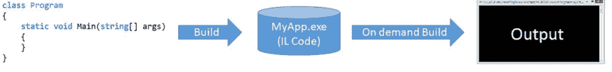

### 中间语言 (MSIL)

```csharp
static void Main(string[] args)
{
    int x = 10, y = 20, z;

    if (x > y)
    {
        z = 100;
    }
}
```

```il
.method private void Main(string[] args)
.entrypoint
// Code size 24 (0x18)
.maxstack init (2)
.locals init ([0] int32 x, [1] int32 z, [2] bool CS$4$0000)
IL_0000: nop
```

你可以通过在 Visual Studio 中打开控制窗口并输入 `ILASM` 后加应用程序的路径和名称来查看应用程序的 MSIL 代码。`ILDAASM` 工具的全称是 *中间语言反汇编器 (Intermediate Language Disassembler)*。

处理器与内部内存（RAM）紧密配合，在周期之间存储指令或完成的结果，这些结果将显示给用户或保存到永久数据存储器。

例如，当按下键盘上的“A”键时，一个二进制指令会被发送到处理器，处理器使用内存处理请求，然后将“A”作为输出给用户。

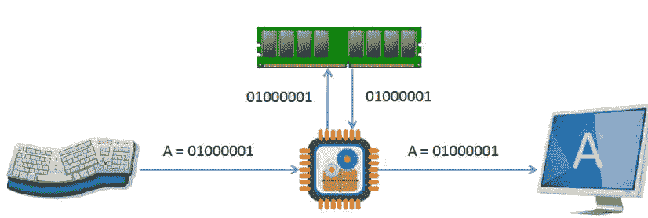

### 位与字节

位（`Bit`）代表二进制数字，是最小的数据单元，能够存储 1 或 0 的值，通常表示真或假。位用于存储和处理数据。为了能够有效地与数据位工作，位被分组成字节（`bytes`），每个字节由 8 位组成。每个字节的值可以是 0 到 255 之间的任意数，可以表示一个数字、字符或数据指令。多个字节可以存储单个值，如果使用了多个字节，则后续的字节将附加在第一个字节的左侧。你总是从右到左读取二进制值。因为你一次添加一个完整的字节，所以你会得到 256、512、1024、2048 等倍数。

| 单位 | 位/字节 | 等值 |
| --- | --- | --- |
| 字节 | 8 位 | 1 字节 |
| KByte | 2¹⁰ 字节 | 1024 字节 |
| MByte | 2²⁰ 字节 | 1048576 字节 |

下面的图片显示了一个字节的位值，在这种情况下，大写字母 A 的值为 65。

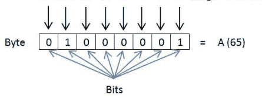

### 进制

并将值相加。在数值字符之间从右向左移动，你拥有 0-15，$16^1 = 16, 16^2 = 256, 16^3 = 4096, 16^4 = 65536, 16^5 = 1048576$。

| $16^5 = 1048576$ | $16^4 = 65536$ | $16^3 = 4096$ | $16^2 = 256$ | $16^1 = 16$ | 0-15 |
|---|---|---|---|---|---|
| 1 | 2 | 3 | 4 | 5 | 6 |
| 1048576 × 1 | 65536 × 2 | 4096 × 3 | 256 × 4 | 16 × 6 | = 1193046 |

### 本书使用的项目模板

在启动新项目时，Visual Studio 通过为最常见的场景提供模板，使操作变得简单。模板包含启动代码，你可以在此基础上创建你的应用程序。所选模板从一开始就包含了相关的组件、控件以及必要的程序集（类库）的引用。

IDE 将根据模板进行配置。以下是书中使用的模板的简要描述。

#### 控制台应用程序 (Console Application)

控制台应用程序没有图形用户界面 (GUI)，而是使用命令行界面在控制窗口中运行；因此，它被认为是轻量级的。

#### Windows Forms 应用程序

Windows Forms 应用程序用于创建桌面表单应用程序，直接运行在 Windows 操作系统上，而不是浏览器。

#### 类库

构建类库将生成 `.dll` 程序集。这是重用代码并在多个应用程序之间共享代码的好方法。重用 `.dll` 只需要引用它的程序集即可。

### 控制台应用程序

如果你想创建一个不需要图形用户界面（GUI）的轻量级应用程序，那么 Visual Studio 中的控制台模板可能是你的选择。

控制台应用程序的用户界面（UI）完全基于文本，因此对用户不太友好。你可能会选择控制台应用程序的一种场景是创建服务器端应用程序，此时管理员需要一种快速输入数据或执行其他管理任务的方法。

在书中，你不会花费大量时间学习控制台的每个功能，因为你可能不会经常使用它；相反，你将学习 Windows Forms 应用程序，它为桌面应用程序提供了丰富的用户界面。

顾其名，控制台运行在被称为“控制台窗口”的巨大黑色空隙中。在 Visual Studio 中，创建控制台应用程序时需要的窗口并不多，解决方案管理器（`Solution Explorer`）通常足够了，有时你可能需要使用其他窗口中的调试工具（调试将在书中后文介绍）。

如果你在 Visual Studio 中设置了 C# 语言设置，解决方案管理器将显示在开发环境的右侧。如果它被隐藏了，可以通过主菜单中的“视图-解决方案管理器”（`View-Solution Explorer`）或在键盘上按住 `Ctrl` 键按 `W` 再按 `S`（`Ctrl+W, S`）来调出。

解决方案管理器以树形显示项目文件夹和文件，文件夹可以根据需要折叠或展开。控制台应用程序的主文件称为 `Program.cs`，它包含一个 `Program` 类，该类是应用程序的容器。

`Program` 类包含一个名为 `Main` 的方法，它是应用程序的入口点，当用户启动应用程序时执行从这里开始。在这个方法中，你编写希望在应用程序启动时执行的代码。正如你将在书中后续部分学到的，我们鼓励将代码拆分为更易于管理的单元，并存储在称为类的容器中，以便更好地重用和对封装数据。但现在，在创建控制台应用程序时，你将直接在 `Main` 方法内部编写代码。

控制台应用程序中的 `Main` 方法必须声明为静态（`static`），这样它就可以在不创建 `Program` 类对象（实例）的情况下被执行。如果你被强制创建 `Program` 类的对象，将无法在控制窗口中直接执行应用程序。`Main` 方法不允许返回值，因为在应用程序在 `Main` 方法结束而结束后，无法处理返回值。

下面的图片描述了开发环境的重要部分以及 `Program.cs` 文件中与控制台应用程序相关的 `Main` 方法。


应用程序在此开始

```csharp
class Program
{
    static void Main(string[] args)
    {
        // 方法不返回任何值
    }
    // 静态方法不需要对象即可运行
}
```

执行在此开始

在方法的的大括号之间编写你的代码

| 关键字 | 描述 |
| --- | --- |
| `Class` (类) | 在 `Program` 类的范围内，它是主应用程序流的容器。 |


| Static (静态) | 静态方法是一个类方法，这意味着它属于类而不是属于从该类创建的单个对象。将 `Main` 声明为静态的以便 .NET 框架运行时在应用程序启动时执行它是至关重要的。 |
| --- | --- |
| Void | 声明的方法不返回任何值。 |

# 编译（生成）控制台应用程序

你可以按键盘上的 `Shift + B` 来生成应用程序，如果存在错误，它们将列在错误列表中，可以通过开发环境底部的标签页访问。你可以通过按 `F5` 轻松地运行应用程序。

| 描述 | 文件 | 行 | 列 |
| --- | --- | --- | --- |
| 1 名称 '...' 在上下文中文中不存在 | `Program.cs` | 13 | 15 |
| 2 隐式类型局部变量必须初始化 | `Program.cs` | 14 | 17 |
| 3 缺少分号 | `Program.cs` | 14 | 18 |


# C# 初学者入门

## 如何创建控制台应用程序

1. 打开 Visual Studio。
2. 在菜单中选择 **文件-新建项目**（`File-New Project`）。
3. 在左侧树形中选择 **C#**。
4. 在模板列表中选择 **控制台应用程序**（`Console Application`）。
5. 在 **名称** 字段中为项目命名。
6. 确保 **解决方案目录** 已勾选。
7. 点击 **确定** 按钮，让 Visual Studio 设置带有必要文件、文件夹和引用的项目。

## C# 初学者教程

请注意，你可以在代码中添加注释，这些注释在构建应用程序时会被忽略。方法是在代码行开头使用双斜杠（`//`），或者如果是较长的注释，可以使用斜杠星号将其包围（`/* 这是一个注释 */`）。

```csharp
// 添加换行符
Console.WriteLine();
// 向控制台写入一行文本，但不带换行符
Console.Write("A line of text");
// 使用 \n 命令在新行行写入文本
Console.WriteLine("\Another line of text");
// 使用 \t 分两列写入文本
Console.Write("\t{tagName}");
/* 通过将名称插入字符串中来格式化字符串。你可以通过添加更多花括号、增加索引数字并添加逗号分隔的列表值来插入多个字符串。 */
Console.WriteLine("Welcome {0}!", "Jonas");
// 创建固定长度列
Console.WriteLine("{0,2}{1,4}yo", "Jonas", 45);
```

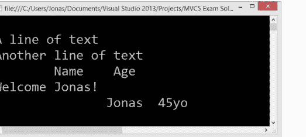

### 从控制台窗口读取用户输入

当从控制台读取用户输入时，你可能想存储该值以便以后使用。存储值的简单方法是使用 `var` 关键字后跟变量名，通过该变量你可以访问存储的值（你将在后续章节中学习更多关于的知识）。

```csharp
// 提示用户输入名称
Console.Write("Enter your name: ");
// 将名称存储在变量中以后使用
var name = Console.ReadLine();
// 如果用户输入了 Jonas，则向控制台写入：Welcome Jonas!
Console.WriteLine("Welcome {0}!", name);
```

### 在调试时保持控制台窗口打开

你可以调用 `ReadKey` 方法在输出最后一行内容后保持控制台窗口打开。方法中的 `true` 值可以防止字符被输出到控制台。

```csharp
Console.WriteLine("\nPress any key to exit");
Console.ReadKey(true);
```

### 练习：创建你的第一个控制台应用程序

在本次练习中，你将创建一个新的控制台应用程序，该程序将提示用户输入名称“Enter your name: ”，并将输入的名称存储在名为 `Name` 的变量中。然后，你将使用变量中的值写入文本“Welcome the entered name!”，其中输入的名称代表存储在 `name` 变量中的实际名称，例如，如果他们输入 Jonas，则显示 Welcome Jonas!。名称应与文本在同一行输入。

然后，你将在文本“Enter your age: ”的开头添加一个换行符（`\n`），并让用户在文本同一行输入他们的年龄，文本后不添加换行符。用户输入的年龄应存储在名为 `age` 的变量中。

使用制表符（`\t`）将文本向右推，然后输出一个标题“Name Age”，并在两个单词之间加上一个制表符。随后在标题下方另起一行显示名称和年龄。

接下来，你将使用 `{0, 20}` 语法使用固定长度列，其中 `0` 是代表变量值插入位置的索引，`20` 是列中的固定字符数。使用固定长度列显示存储在变量中的名称和年龄。

最后，你将提示用户按任意键退出应用程序，并在文本之后使用 `ReadKey` 方法等待用户按下键盘键。

## C# 初学者教程

```text
C:\Users\Jonas\Documents\Visual Studio 2017\Projects\MVCS Exam Solution\ConsoleTest.exe
Enter your name: Jonas
Welcome Jonas!

Enter your age: 45

Name    Age
Jonas   45

Fixed length column output
Jonas   45yo

Press any key to exit
```

## 创建解决方案

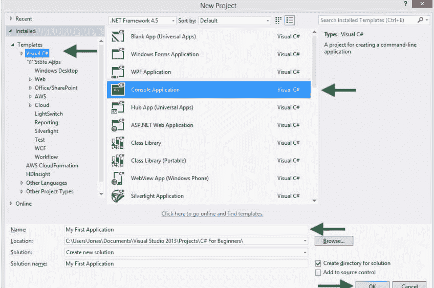

1. 打开 Visual Studio
2. 点击“新建项目”链接或在主菜单中选择“文件-新建项目”。

## C# 初学者教程

1. 在“新建项目”对话框左侧树形视图中点击 **Visual C#**。
2. 在对话框中间的模板列表中选择 **Console Application**。
3. 在 **Name** 文本字段中将项目命名为 **My First Application**。
4. 点击 **OK** 按钮。
5. 在 `Program.cs` 文件中找到 `Main` 方法，你将在其中编写程序代码。

```csharp
static void Main(string[] args)
{
    //在此处编写你的代码
}
```

### 保持控制台窗口打开

待办事项列表第一件事是确保在输出和用户输入完成后控制台窗口保持打开。如果不保持窗口打开，在 Visual Studio 中运行时，它将在执行最后一行代码后立即关闭。

控制台窗口的输出应该如下所示：

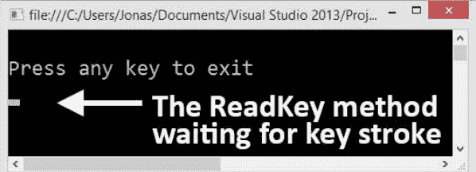

1. 将光标置于 `Main` 方法中上方大括号的右侧，在大括号之间创建一个新行，并按下键盘上的 **Enter** 键。
2. 使用 `WriteLine` 方法写入“Press any key to exit”消息。在字符串开头使用 `\n` 命令添加换行符以移动文本。
3. 使用 `ReadKey(true)` 防止字符被输出到控制台。
4. 按 `F5` 运行应用程序。目前的代码如下：

```csharp
static void Main(string[] args)
{
    Console.WriteLine("\nPress any key to exit");
    Console.ReadKey(true);
}
```

## C# 初学者教程

1. 在上一个练习中添加的 Welcome 消息下方添加新行。
2. 使用 `Write` 方法写入消息 **Enter your age:** 而不在文本后添加换行符。在字符串开头使用 `\n` 命令添加换行符。

`Console.Write("\nEnter your age:");`

3. 使用 `var` 关键字将用户输入的年龄存储在名为 `age` 的变量中。使用 `ReadLine` 方法读取值。

`var age = Console.ReadLine();`

5. 使用包含两个制表符的格式化字符串写入存储在变量中的名称和年龄，实现这一点，必须添加索引为 0 和 1 的花括号，然后以逗号分隔的列表列出变量。

`Console.WriteLine("\t{0}\t{1}", name, age);`

## 命名空间 (Namespace) 和使用 (using)

命名空间是将属于一起且具有共同点的类进行物理分组的一种。要访问命名空间中的类，你可以在想要访问这些类的 `.cs` 文件顶部添加 `using` 语句，或者在使用这些类时在代码中提供完整的命名空间和类名。后一种使用命名空间的方法不是推荐的方法，因为它会引入大量的额外代码，导致代码杂乱且难以阅读。

假设你想计算一个数字平方根，为了实现这一点，你可以使用预定义的 .NET Framework `Math` 类中名为 `Sqrt` 的数学方法。下面是实现该功能的两种方法，命名空间路径比示例中的要长得多。你还可以注意到，在创建项目时，你的 `Program` 类被自动放置在一个命名空间中。

直接在代码中使用命名空间来实现计算。请注意，你每次调用 `Sqrt` 方法时都必须使用完整的命名空间路径。在每行上写命名空间路径看起来可能没什么额外的代码，但请记住，这是 .NET Framework 库中最短的命名空间路径之一，通常它们有几层深。

```csharp
namespace MyConsoleApplication
{
    class Program
    {
        static void Main(string[] args)
        {
            var result1 = System.Math.Sqrt(5);
            var result2 = System.Math.Sqrt(10);
            var result3 = System.Math.Sqrt(15);
        }
    }
}
```

使用 `using` 语句声明命名空间然后调用该方法。注意，你只需要声明一次命名空间路径，就可以根据需要直接在 `Math` 类上多次调用 `Sqrt` 方法。

```csharp
using System;

namespace MyConsoleApplication
{
    class Program
    {
        static void Main(string[] args)
        {
            var result1 = Math.Sqrt(5);
            var result2 = Math.Sqrt(10);
            var result3 = Math.Sqrt(15);
        }
    }
}
```

## 区域 (Regions)

区域是一种逻辑上分组代码的方式，不会影响程序执行流，它仅用于使代码更易读且易于遵循。区域是一个可折叠的代码段，它会隐藏代码并在位置显示描述性文本。当代码需要修改或查看时，可以展开该区域。你可以通过点击左侧边距中的加/减号来折叠和展开区域。

要创建一个区域，你需要在要包含在区域内的第一行上方添加 `#region` 关键字并后跟描述，并在要属于该区域的最后一行代码之后添加 `#endregion` 关键字。

如果你想在上一个示例的数学计算周围添加一个区域，代码看起来如下：

```csharp
static void Main(string[] args)
{
    #region Math Calculations
    var result1 = System.Math.Sqrt(5);
    var result2 = System.Math.Sqrt(10);
    var result3 = System.Math.Sqrt(15);
    #endregion
}
```

折叠时，代码将只显示标题 `Math Calculations`。

## C# 初学者教程

```csharp
static void Main(string[] args)
{
    // Math Calculations
}
```

在编写程序时，我的类或结构体中通常会有以下几个主要的区域，你将在接下来的章节中学习结构体和类，在这里，我只是想向你展示我经常使用区域创建的逻辑部分。如果区域描述中有你未知的术语，只需在脑中记住它们，并在阅读接下来的章节时留意即可。如果你觉得需要刷新关于区域的知识，可以随时返回此节。在某些应用程序中，我不需要所有的区域，而在某些情况下，我需要更细致地创建子区域。

```csharp
public class MyClass
{
    #region Delegates and Events
    #endregion
    #region Constants
    #endregion
    #region Fields/Variables
    #endregion
    #region Properties
    #endregion
    #region Constructors
    #endregion
    #region Methods
    #endregion
    #region Control Events
    #endregion
}
```

### 练习：在应用程序中添加区域

打开你在上一个练习中创建的应用程序，用获取和显示名称的代码包裹在一个区域内，并描述为 `Fetch user name`。接下来，在获取和显示用户年龄的代码周围放置一个区域，并将其描述为 `Fetch user's age`。在保持控制台窗口打开的代码周围放置第三个区域，并给它描述为 `Exit code`。

## C# 初学者教程

一旦区域就绪，通过点击代码窗口左边距的加/减号折叠和展开它们来对其进行测试。

运行应用程序以确保区域不会影响程序执行流，并且仍然像以前一样工作。

1. 在 Visual Studio 中打开 `My First Application` 项目。
2. 在第一个 `Write` 方法调用上方添加 `#region` 命令，并将其描述为 `Fetch user name`。

```csharp
#region Fetch user name
Console.Write("Enter your name: ");
```

3. 在写入欢迎消息的 `WriteLine` 方法下方添加 `#endregion` 命令。

```csharp
Console.WriteLine("Welcome {0}!", name);
#endregion
```

4. 在询问用户年龄的 `Write` 方法调用上方添加 `#region` 命令，并将其描述为 `Fetch user's age`。

```csharp
#region Fetch user's age
Console.Write("\nEnter your age: ");
```

5. 在向控制台窗口写入名称和年龄的 `WriteLine` 方法下方添加 `#endregion` 命令。

```csharp
Console.WriteLine("\t{0}\t{1}", name, age);
#endregion
```

6. 在要求用户按任意键退出的 `Write` 方法调用上方添加 `#region` 命令，并将其描述为 `Exit code`。

```csharp
#region Exit code
Console.Write("\nPress key to exit");
```

7. 在 `ReadKey` 方法下方添加 `#endregion` 命令。

```csharp
Console.ReadKey(true);
#endregion
```

8. 现在区域已就绪，通过点击代码窗口左边距中的减号来折叠它们。
9. 点击边距中的加号再次打开它们。

## C# 初学者教程

10. 现在通过右键点击代码窗口并选择 `Ctrl+M,O` 来折叠所有大纲。这将折叠活动代码窗口中的所有区域。
11. 点击边距中的加号展开 `Main` 方法。这应该显示被折叠的区域描述。
12. 通过右键点击代码窗口并选择 `Ctrl+M,L` 展开所有区域。
13. 按键盘上的 `F5` 或工具栏上的播放按钮运行应用程序。确保应用程序像添加区域之前一样正常工作。
14. 关闭应用程序。

## 初识 Windows Forms

你刚刚熟悉了用途有限的控制台应用程序。现在你将查看功能更强大的 Windows Forms 项目，你可以用它创建完整的 Windows 桌面系统。这种项目类型具有图形界面 (GUI)，用户可以通过它与你添加的控件进行交互。你可以添加许多类型的预定义控件，从按钮、文本字段到树视图控件和菜单。

## 创建解决方案

| |
| --- |
|  |

1. 打开 Studio
2. 点击 **New Project** 链接或在主菜单中选择 **File-New**。
3. 点击对话框左侧树视图中的 **Visual C#**。
4. 在项目模板列表中选择 **Windows Forms Application**。
5. 在 **Name** 文本框中将项目命名为 `My First Forms Application`。
6. 点击 **OK** 按钮。

## 项目内容

如所示，项目内容与控制台应用程序不同。首先，显示的是灰色表单而不是代码窗口，这是故意的，因为你必须在表单上添加控件才能对其进行任何有用操作，即使只是一个按钮。表单是用户交互的应用程序界面。为了给用户提供良好的体验，你应该将控件对齐在直线上，而不是

# C# 入门

不要将它们以混乱的方式散布在表面，你还想使用标签（labels）来描述控件的用途。如果用户需要在文本框中输入名称，那么你应该根据你决定的布局，在控件的上方或左侧添加标签。你可以从下一节介绍的工具箱（Toolbox）中添加控件。


所有打开的文件都以标签页的形式显示在设计表面的上方。如果你需要打开已关闭的表单或其他文件，可以在解决方案管理器（`Solution Explorer`）中找到它。点击文件将临时打开它，其标签页将被你点击的下一个文件替换。而双击文件将永久打开它，并且在关闭后下次打开解决方案时它将保持打开状态。你可以通过点击它的 x 按钮来关闭文件。

你会注意到在这个项目中有一个 `Program.cs` 文件，就像控制台应用程序一样，但在 Windows Forms 应用程序中，它仅用于启动应用程序向用户显示主表单。你很少在该文件中编写代码，代码而是编写在所谓的“后台代码文件”（code-behind file）中，该文件与特定的表单绑定。打开表单后台代码最简单的方法是双击它的灰色背景区域，或者在解决方案管理器中展开表单节点并点击与表单同名的节点。你将在整本书中学习如何在后台代码中编写代码，并将根据练习需要引入新的控件。

下面的图片显示了显示工具箱和表单设计面的开发环境。

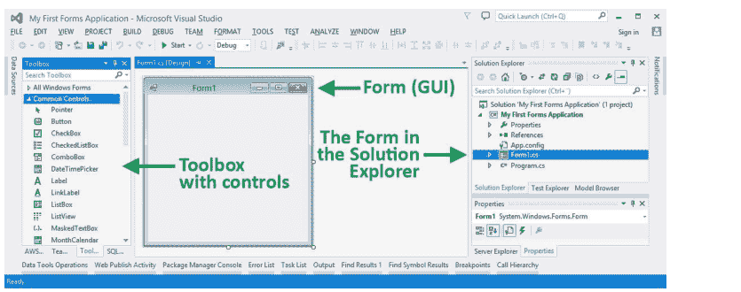

注意，工具箱是空的，因为后台代码处于打开状态，因为无法使用工具箱向代码文件添加图形控件。后台代码在第二个标签页中打开，而 GUI 位于带有 `[Design]` 后缀的标签页中。你可以点击标签页来切换后台代码、设计视图或其他打开的窗口。

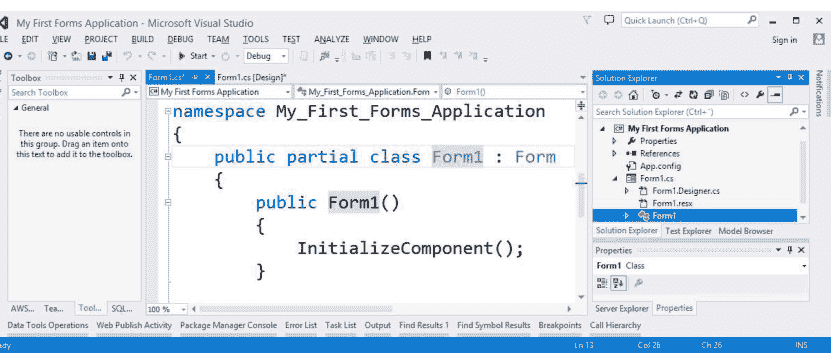

你可以通过按下键盘上的 `F5` 或 `Ctrl+F5` 或点击启动按钮来运行应用程序，但当你运行运行时，主表单将显示给用户。它的行为将和你熟悉的任何其他标准 Windows 表单一样，并在标题栏中具有相同的最小化、最大化和关闭按钮。表单现在是空的，但你需要向它添加一些控件。

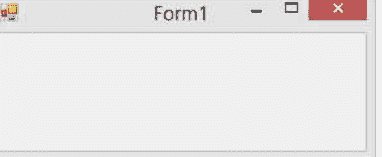

# 向表单添加控件

你可以在工具箱窗口中找到可以添加到表单的定义控件，该窗口可以最小化为 Visual Studio 开发环境左侧的标签页或窗口。如果你在开发环境中找不到它，也可以通过在菜单中选择“工具箱”来打开它。

在操作控件并将它们添加到表单表面时，将工具箱窗口固定在开发环境中以保持其打开状态可以节省时间，你通过点击工具箱窗口右上角的图钉图标来固定固定它。你可以随时再次点击图钉按钮来取消固定。

你可以通过多种方式向表单添加控件，最常见的方法是双击工具箱中的控件，或者在指向控件时按住左鼠标键并将控件拖动到表单表面。

为了设计表单，你可能需要更改添加到其表面的控件的大小，你只需通过选择控件（单击一次）并使用控件的正方形缩放句柄来实现。

# 为控件命名

在向表单添加控件时，你通常想为它命名（标签是个例外）。要为控件命名，选择并更改属性窗口中 `Name` 属性的默认名称，属性窗口默认显示在解决方案管理器下方。

在命名表单时可以遵循相同的指令，区别在于你选择的是表单而不是控件。

1. 如果属性窗口已关闭，通过主菜单中的“视图-属性窗口”打开属性窗口。
2. 通过单击一次选择表单中你想要命名的控件。
3. 进入属性窗口并滚动到顶部，你将在那里找到 `(Name)` 字段。
4. 双击 `(Name)` 标签以选中其中的所有文本。
5. 输入新名称并按键盘上的回车键。

# 代码编写位置

你通过编写代码为表单添加功能，根据你编写代码的位置，代码将在不同的阶段被访问和执行。表单本身是一个类，运行时将使用它在堆（`Heap`，慢内存）上创建表单对象，并将其显示给用户。

如下面的代码所示，`Form` 类有一部分名为 `Form1()`（你给表单起的名称）的代码，这是一种被称为构造函数（`Constructor`）的特殊方法。在构造函数中编写的代码会在堆上创建表单对象时执行，你可以使用此方法在表单或其控件可见之前初始化变量。这对于在用户访问之前给表单提供正确的状态非常有用。

构造函数下方是另一个名为 `Form1_Load` (`YourFormName_Load`) 的部分，这是一种称为事件（`event`）的特殊类型方法。当表单在堆上创建时，事件会被触发并执行，你可以使用此方法在表单或其控件可见之前初始化变量。这对于在用户访问之前给表单提供正确的状态非常有用。

```csharp
public partial class Form1 : Form
{
    public Form1()
    {
        // Code to initialize the form
    }

    private void Form1_Load(object sender, EventArgs e)
    {
        // Code to execute when the form is loaded
    }
}
```

## 代码可访问性

如果你在上述方法之外但在 `Form` 的大括号内声明变量，它将可以从所有方法被访问。

在方法内部声明变量将使其可用性缩小到方法内部，并且无法从其他地方访问。换句话说，如果你在构造函数内部声明变量，该变量只能在构造函数内部使用，不能在其他方法中使用。

正如你将在后续章节中学到的，方法内部可以声明不同类型的块。如果你在这样的块内部声明变量，变量将仅在该块内可访问，因此在方法的其余部分无效。一个例子是用于更改流程的 `if` 块。

示例代码使用三个变量演示了可访问性。`total` 变量在类级别声明，这意味着可以在整个类中使用。`result` 变量在 `Form1_Load` 事件方法内部声明，因此仅在该方法内部可访问。`sum` 变量在 `if` 块内部声明，因此仅在该块内部可访问，如果你想在 `sum` 中该值，可以将其赋值给访问范围更大的变量。

`total` 变量在构造方法内部被赋值为 0，在在其控件渲染到屏幕之前。`result` 变量在 `Load` 事件内部声明并赋值为 10，并用于 `if` 语句（后续章节中的更多或 `if`）以及作为 `if` 块内部计算的一部分。`sum` 变量被声明并将其值赋值给类级别的 `total`，从而在整个类中可用。

```csharp
var sum = result * 100;
// 将 sum 变量的值赋值给 total 变量
total = sum;
```

# 练习：创建你的第一个 Windows Forms 应用程序

在本练习中，你将实现与之前创建的控制台应用程序相同的场景。你将创建一个用户界面（表单），询问用户的姓名和年龄，然后在弹出对话框中显示结果。为了实现这一点，你需要添加两个文本内容为 Name（姓名）和 Age（年龄）的标签，并在标签下方放置文本框以收集用户输入，最后添加一个在点击时会显示对话框的按钮。

如果你还没有在“创建解决方案”章节中创建名为 My First Forms Application 的 Windows Forms 应用程序，请现在创建。

这是完成后的表单样式所示：

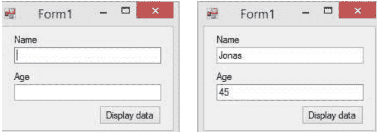

## 创建表单并添加控件

1. 打开 `Form1[Design]` 选项卡。如果你已经关闭了它，可以通过双击解决方案管理器中的 `Form1` 节点来打开它。
2. 打开工具箱窗口（视图-工具箱），如果它尚未打开。
3. 双击工具箱中的 `Label` 图标向表单上添加一个 `Label`，然后在表单表面重新调整它的位置。
4. 在属性窗口的 `Text` 属性中将标签的文本更改为 `Name`。
5. 通过双击工具箱中的 `textbox` 图标在标签下方向表单添加一个 `textbox` 控件。
6. 在属性窗口的 `Name` 字段将文本框重命名为 `txtName`。
7. 调整文本框的大小使其更宽。
8. 在姓名文本框下方添加另一个标签，并将其文本更改为 `Age`。
9. 在 `Age` 标签下方添加另一个文本框，并将文本框重命名为 `txtAge`。
10. 在年龄文本框下方添加一个 `Button` 控件并将其重命名为 `btnDisplayData`。
11. 将按钮上的文本更改为 `Display data`（显示数据）。
12. 点击表单的灰色区域并拖动中间的正方形句柄向上和向右拖动来调整表单大小。
13. 按键盘上的 `F5` 启动应用程序。
14. 表单将显示带有空文本字段，如果你点击按钮，将什么都不会发生。
15. 点击表单右上角的红色 x 按钮关闭应用程序，或点击开发环境中的停止按钮（带有红色正方形的按钮）。

## 为按钮添加代码

要让按钮执行任务，你必须在表单的代码后部添加它的 `Click` 事件方法。添加 `Click` 事件最简单的方法是双击按钮，这将添加该事件方法并直接带你进入代码窗口中的该方法。

拼图的最后一块碎片是让表单在点击按钮时在对话框中显示消息。你可以使用 `MessageBox` 类上的 `Show` 方法来显示对话框。

1. 双击表单设计器中的按钮。
2. 代码后部将自动添加一个与按钮同名的 `Click` 事件方法。

```csharp
private void btnDisplayData_Click(object sender, EventArgs e) {
    // 你的代码在此处
}
```

3. 我们先从添加带有静态文本的消息框对话框开始。在 `Click` 事件中添加以下代码。

```csharp
MessageBox.Show("This is my first dialog box");
```

4. 启动应用程序并点击按钮显示对话框。

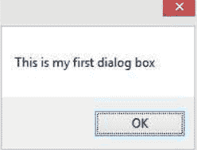

5. 关闭对话框和应用程序。
6. 现在让我们增加难度，显示来自 `txtName` 文本框的文本。删除文本和引号（`Show` 方法括号内的），并添加使用其 `Text` 属性从文本框获取值的代码。将代码更改为：

```csharp
MessageBox.Show(txtName.Text);
```

7. 启动应用程序并在点击按钮之前在 `Name` 文本框中输入你的姓名。对话框应该显示你的姓名。

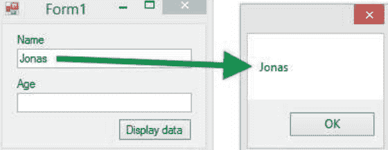

8. 关闭应用程序。
9. 现在再次增加难度，通过格式化输出字符串来显示两个文本框中的姓名和年龄以及一些描述性文本。你可以使用在控制台应用程序中相同的字符串格式化技术来格式化字符串输出，区别在于你使用 `String` 类上的 `Format` 方法而不是 `Console.WriteLine` 来格式化字符串。

```csharp
MessageBox.Show(String.Format("{0} is {1} years old.", txtName.Text, txtAge.Text));
```

10. 启动应用程序并在文本框中输入你的姓名和年龄，然后点击按钮。对话框看起来应该如下。

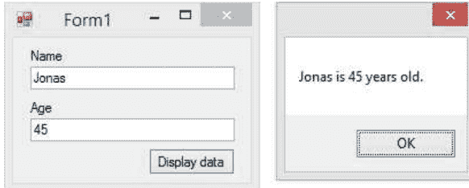

11. 关闭应用程序。

# 2. 条件逻辑

## 引言

条件语句用于确定应用程序的执行流。例如，你可能会向用户提出一个问题并根据该答案确定应用程序执行流。虽然在本章中你将使用单选按钮和组合框等表单控件使用条件逻辑来确定应用程序执行流，但条件逻辑也可以用于常量、变量甚至硬编码的值。使用控件与其他使用条件逻辑的其他方法之间的在于，你将使用控件的属性，而不是在 `if-` 或 `switch-` 表达式中使用声明的变量、常量或其他值。

## If

**if** 语句用于评估条件是否为 **true**（真）或 **false**（假），并根据结果执行两种情况之一，或者结合一个或多个 **else**-块或 **else**-块来处理多种场景。

如果 **if** 语句中的条件评估为 **true**，则执行 **if**-块；否则，如果存在 **else** 块，则执行 **else** 块。

如果定义了 **else if**-块，执行将传播到下一个 **else if** 语句，直到某个语句评估为 **true** 或没有剩余的 **else if** 语句为止。

**重要：**通过在表达式中使用两个等号 (`==`)，你可以检查条件的值是否相等：`if (value == otherValue).` 或者你也可以使用 **Equals** 方法来实现相同的结果：`if (value.Equals(otherValue))`。

**重要：**通过使用不等于 (`!=`)，你可以检查条件的值是否彼此不同：`if (value != otherValue).` 或者你可以结合否定标记使用 **Equals** 方法来实现相同的结果：`if (!value.Equals(otherValue))`。

## If 语句

```csharp
if (valueToEvaluate == true)
{
    // 如果条件评估为 true，
    // 将执行此代码
}
```

## If...else 语句

```csharp
if (valueToEvaluate == true)
{
    // 如果条件评估为 true，
    // 将执行此代码
}
else
{
    // 如果条件评估为 false，
    // 将执行此代码
}
```

## If...else if 语句

```csharp
var someString = "Some text";
if (stringValue == "Some value")
{
    // 如果 if 条件评估为 true，
    // 将执行此代码
}
else if (stringValue == "Some other value")
{
    // 如果 else if 条件评估为 true，
    // 将执行此代码
}
else
{
    // else 将执行此代码
}
```

## If 语句内部 If 语句

```csharp
var someString = "Some text";
var someBoolean = false;
```

```csharp
if (someStringValue == "Some value")
{
    if (someBooleanValue == true)
    {
        // 如果条件评估为 true，
        // 将执行此代码
    }
    else
    {
        // else 将执行此代码
    }
}
else
{
}
```

## Switch

在编写条件语句时，你不应该有太多 `if/else` 子句，因为这会让代码难以阅读和理解；相反，你应该考虑使用 `switch` 语句。`switch` 块本质上是编写 `if/else` 子句的一种更紧凑、更易读的方式。

`switch` 中的 `case` 选择使用常量定义。

每个 `case` 语句都以 `break` 或 `return` 命令结束，这将强制执行跳转到 `switch` 块的结束或完全退出方法或事件，而不执行任何剩余代码。

你可以在 `switch` 中拥有 `default` 块，它本质上同于 `if/else` 语句中的 `else` 子句。如果没有匹配到 `case` 块，将执行此块。

```csharp
var valueToCheck = "The current value";
switch (valueToCheck)
{
    case "Some value":
        // 执行某些操作
        break;
    case "Some other value":
        // 执行其他操作
        break;
    default:
        // 如果没有匹配到 case 则执行
        break;
}
```

> 延伸阅读：“选择语句（C# 参考文档）”

# 练习：条件逻辑

在本次练习的第一部分中，你将实现 `if/else` 以及 `if/else if/else` 场景。在 `if/else` 场景中，用户将通过检查复选框来决定程序流，该复选框将启用或禁用控件。如果勾选了复选框，用户可以使用单选按钮选择性别，进入 `if/else if/else` 程序流；在这里，当点击按钮时，标签（`label`）中的消息将发生变化，取决于他们是否选择了任何按钮或选择了哪一个单选按钮。

在本次练习的第二部分中，你将使用 `switch` 根据在组合框中选择的国家来控制程序流。在 `switch` 中，所选国家的主要语言将显示在标签中，且背景颜色也将根据所选国家而发生变化。你将添加以下国家：瑞典（瑞典语，浅绿色）、挪威（挪威语，浅蓝色）、芬兰（芬兰语，浅黄色）、英国和美国（英语，浅鲑色），最后是未知（未指定，浅粉色）。你可以自由添加选择的其他国家。

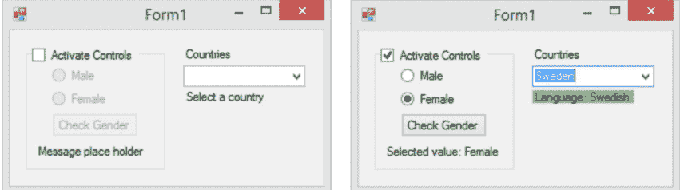

## If/else 逻辑

让我们从添加控件开始，然后进入代码后文件（code-behind file）中的逻辑处理。

你需要添加一个组框（`group box`）控件（位于工具箱的“所有 Windows 表窗”部分），向其中添加所有控件，但复选框除外，复选框将放置在组框的边框上（见上图）。需要添加组框的原因是单选按钮必须放置在组框内才能作为一个单元工作，特别是当你有多个相互独立的单选按钮区域时，这一点尤为重要。如果你不使用组框放置单选按钮，而是直接将它们放在表单上，那么所有单选按钮都将处于表单提供的同一个单选组中。

在组框内部，放置两个单选按钮，分别名为 `rbnMale` 和 `rbnFemale`，文本分别为“Male”和“Female”。在单选按钮下方，添加一个文本为“Check Gender”的按钮 `btnCheckGender`，以及一个文本为“Message place holder”的标签 `lblMessage`。

最后，你添加一个文本为“Activate Controls”的复选框 `chkActivate`，它将根据复选框是否被勾选来启用或禁用组框中的控件。在添加复选框之前先选中表单，以避免它进入组框内部，并在移除组框标题文本后，将其拖动到组框上方。

## 添加控件

1. 打开表单设计器。
2. 展开工具箱中的“所有 Windows 表窗”部分。
3. 将一个组框拖到表单表面上。


4. 清空其 `Text` 属性中的文本。

5. 将一个单选按钮拖入组框内，将名称更改为 `rbnMale`，文本更改为“Male”，并将其 `Enabled` 属性设置为 `false`。

6. 将第二个单选按钮拖入组框内，将名称更改为 `rbnFemale`，文本更改为“Female”，并将其 `Enabled` 属性设置为 `false`。

7. 将“Female”单选按钮置在“Male”单选按钮下方。

8. 向组框添加一个按钮，将名称更改为 `btnCheckGender`，文本更改为“Check Gender”，并将其 `Enabled` 属性设置为 `false`。

9. 向组框添加一个标签，将名称更改为 `lblMessage`，文本更改为“Message place holder”。

10. 点击一次表单选中它。

11. 将一个复选框拖到表单上（不要在组框内），将名称更改为 `chkActivate`，文本更改为“Activate Controls”。

12. 将复选框移动到组框原来显示标题的位置，使其充当组框标题的作用。

## 启用/禁用控件

1. 点击一次复选框控件选中它。

2. 转到属性窗口并点击事件按钮（带有闪电图标的那个）。

3. 找到 `CheckStateChanged` 事件，双击该描述，将在表单代码后文件中创建该事件并跳转到该处。当复选框的状态发生变化（勾选或取消勾选）时，将触发该事件。

```csharp
private void chkActivate_CheckStateChanged(object sender, EventArgs e)
{}
```

4. 添加一个 `if` 语句，使用其 `Checked` 属性检查复选框是否被勾选。当 `if` 语句中的属性或变量是布尔类型时，不需要显式检查它是否等于 `true` 或 `false`，只需写属性或变量名，系统会自动为你完成检查。

```csharp
if (chkActivate.Checked)
{}
```

5. 在 `if` 块的大括号内部，你想要启用单选按钮和按钮，因为复选框意味着控件可以被启用。通过给它们的 `Enabled` 属性赋值 `true` 来启用控件。

```csharp
btnCheckGender.Enabled = true;
rbnMale.Enabled = true;
rbnFemale.Enabled = true;
```

6. 在 `if` 块下方添加一个 `else` 块，通过给它们的 `Enabled` 属性赋值 `false` 来禁用控件。

```csharp
btnCheckGender.Enabled = false;
rbnMale.Enabled = false;
rbnFemale.Enabled = false;
```

7. 运行应用程序并勾选/取消勾选复选框，以确保控件已启用和禁用。

`CheckStateChanged` 事件的完整代码如下：

```csharp
private void chkActivate_CheckStateChanged(object sender, EventArgs e)
{
    if (chkActivate.Checked)
    {
        btnCheckGender.Enabled = true;
        rbnMale.Enabled = true;
        rbnFemale.Enabled = true;
    }
    else
    {
        btnCheckGender.Enabled = false;
        rbnMale.Enabled = false;
        rbnFemale.Enabled = false;
    }
}
```

## 点击按钮

虽然你可以在属性窗口中通过为 `Checked` 属性赋值 `true` 来在启动时选中一个单选按钮，但在本次练习中它们都是未选中状态，因为你将实现一个 `else` 块。

你在按钮的 `Click` 事件中添加的第一件事是一个 `if` 块，如果 `rbnMale` 单选按钮被勾选，则执行该块并将字符串“Selected value: Male”分配给标签。然后你将检查 `Female` 是否被勾选，并将字符串“Selected value: Female”分配给标签。第三种场景涉及用户在未选择任何单选按钮的情况下点击按钮，这将通过实现一个 `else` 块来处理，在其中你将字符串分配给标签。

1. 在表单设计器中双击按钮。

2. 添加一个 `if` 语句，检查 `rbnMale` 单选按钮的 `Checked` 属性是否为 `true`（已勾选）。记住，在 `if` 语句中输入属性即可检查布尔值，换句话说，不需要使用 `true` 或 `Equals` 方法来比较属性值。

```csharp
if (rbnMale.Checked)
{
    lblMessage.Text = "Selected value: Male";
}
```

3. 接下来你使用 `else if` 语句检查 `rbnFemale` 单选按钮的值是否为 `true`。

```csharp
else if (rbnFemale.Checked)
{
    lblMessage.Text = "Selected value: Female";
}
```

4. 你将添加的最后一段逻辑是处理所有其他情况（例如未选择任何单选按钮的情况）。

```csharp
else
{
    lblMessage.Text = "No gender selected";
}
```

5. 运行应用程序并勾选复选框启用组框内的其他控件。

6. 在不选择任何单选按钮的情况下点击按钮，并读取标签中的文本。

7. 选择一个单选按钮并点击按钮，读取标签中的文本。

8. 选择另一个单选按钮并点击按钮，读取标签中的文本。

9. 取消勾选复选框，以确保组框内的控件被禁用。

10. 关闭应用程序。

`btnCheckGender_Click` 的完整代码如下：

```csharp
private void btnCheckGender_Click(object sender, EventArgs e)
{
    if (rbnMale.Checked)
    {
        lblMessage.Text = "Selected value: Male";
    }
    else if (rbnFemale.Checked)
    {
        lblMessage.Text = "Selected value: Female";
    }
    else
    {
        lblMessage.Text = "No gender selected";
    }
}
```

## Switch 逻辑

在练习的这部分，你将实现一个 `switch` 语句来处理组合框控件中的选中国家，并显示与该国家相关的语言。你还将根据所选国家所使用的语言，更改显示国家信息的标签的背景颜色。

在表单上添加一个组合框 `cboCountry`，并在表单的 `Form_Load` 事件中为其添加一些项目。添加以下国家：瑞典、挪威、芬兰、英国和美国；你可以根据喜好添加额外的国家。

添加一个 `switch` 语句，在组合框的 `SelectedIndexChanged` 事件中检查组合框的 `SelectedIndex` 属性。根据练习开始时的说明，在 `switch case` 块中更改标签的文本和背景颜色。

## 添加控件

1. 将一个标签拖到表单上，并放在组框的右侧（见上图）。

2. 将标签的文本更改为“Countries”。

3. 在标签下方添加一个组合框，并将其命名为 `cboCountry`。

4. 在组合框下方添加一个标签，命名为 `lblLanguage` 并将其文本更改为“Select a country”。

## 向组合框添加国家

1. 双击表单。

2. 使用组合框的 `Add` 方法添加国家。

```csharp
private void Form1_Load(object sender, EventArgs e)
{
    cboCountry.Items.Add("Unknown");
    cboCountry.Items.Add("Sweden");
    cboCountry.Items.Add("Norway");
    cboCountry.Items.Add("Finland");
    cboCountry.Items.Add("Great Britain");
    cboCountry.Items.Add("USA");
}
```

3. 进入表单设计器并双击组合框，将它的 `SelectedIndexChanged` 事件添加到后置代码中。

4. 在事件中添加一个 `switch` 语句，检查组合框的 `SelectedIndex` 属性，该索引对应于组合框中选中的项目。索引从 0 开始，这意味着在 `Form_Load` 事件中添加到组合框的第一个项目索引为 0。

```csharp
switch (cboCountry.SelectedIndex)
{
}
```

5. 为不同的国家场景添加 `case` 块。记住每个 `case` 必须用 `break` 语句终止，以防止穿透到下一个 `case`。索引 4 和 5 的 case 实现相同，因此你可以不添加除 `case` 以外的任何代码，让索引 4 的 `case` 穿透到索引 5 的 `case`。以下是第一个 `case` 的示例实现。

```csharp
case 1:
    lblLanguage.Text = "Language: Swedish";
    lblLanguage.BackColor = Color.LightGreen;
    break;
```

6. 使用 `switch` 末尾的 `default` 块来实现未被任何 `case` 处理的所有意外情况。

```csharp
default:
    lblLanguage.Text = "Language: Unspecified";
    lblLanguage.BackColor = Color.LightPink;
    break;
```

7. 运行应用程序，在组合框中选择不同的国家，观察组合框下方标签的背景颜色和文本是如何变化的。

8. 关闭应用程序。

`SelectedIndexChanged` 事件的完整代码如下：

```csharp
private void cboCountry_SelectedIndexChanged(object sender, EventArgs e)
{
    switch (cboCountry.SelectedIndex)
    {
        case 1:
            lblLanguage.Text = "Language: Swedish";
            lblLanguage.BackColor = Color.LightGreen;
            break;
        case 2:
            lblLanguage.Text = "Language: Norwegian";
            lblLanguage.BackColor = Color.LightSkyBlue;
            break;
        case 3:
            lblLanguage.Text = "Language: Finnish";
            lblLanguage.BackColor = Color.LightYellow;
            break;
        case 4: // 索引 4 将穿透到索引 5
        case 5:
            lblLanguage.Text = "Language: English";
            lblLanguage.BackColor = Color.LightSalmon;
            break;
        default:
            lblLanguage.Text = "Language: Unspecified";
            lblLanguage.BackColor = Color.LightPink;
            break;
    }
}
```

# 3. 变量

## 引言

变量是 RAM 内存（随机存取存储器）中一小区域的友好名称（句柄），计算机在执行算法时用它存储信息；如果需要，变量值可以存储很久。应用程序使用的 RAM 至少在应用程序结束时会被清除，但部分内存通常在不再使用时就会被清除。

正如你将在后面的章节中学到的，存储在内存中的数据可以持久化到永久存储设备，如硬盘、USB 或光盘。

在声明变量时，你可以选择使用数据类型的名称（如 `int`、`string` 或 `bool`）进行显式声明，也可以使用 `var` 关键字进行隐式声明，将求值推迟到编译时进行。

在许多情况下，使用 `var` 关键字会让代码更整洁、更易读。

**重要**：变量名对大小写敏感。变量名 `myValue` 与 `myvalue` 不同，因为第一个名称中有一个大写的 V，而第二个变量没有。

这两种声明都会返回整数结果。第一个变量使用 `int` 显式声明，第二个变量则使用 `var` 隐式声明。

```csharp
int explicitNumber = 100;
var implicitNumber = 200;
```

## 值类型与引用类型

有两种变量类型：**值类型**和**引用类型**。值类型存储在称为栈的快速内存区域，而引用类型存储在称为堆的较大区域。堆之所以较慢，是因为它处理的大型对象在移除时需要特定的技巧。

你可以使用 `struct` 创建用户定义的值类型，使用 `class` 创建引用类型。你将在随后的章节中学习这些内容。

将此放入现实世界的背景中：将栈看作商店的架子，存放小物品；将堆看作商店后方的大型存储区域，存放无法放在架上的板箱。你希望客户能够轻松快速地访问小物品（栈），但如果他们对割草机、高级户外烧烤架或露台家具感兴趣，则指向大房间。

如果你声明一个值类型变量 `myList`，那么它的值将存储在栈上。这就像拿出一个大小足够以容纳指定数据类型值的盒子，将值放在里面，并在外面贴上带有变量名的标签。当你需要检索存储该特定变量的值时，只需指定变量（标签）名称即可极快地获取值。

另一方面，如果你使用 `class` 创建引用类型（用于与变量名关联的对象），那么它将太大无法放入栈，而将创建在堆上，并带有一个指向栈的引用指针。在之前的示例中，你直接将值放在盒子里，但现在你放置了一个指向实际对象存储位置的指示条。有了该引用，你可以在大型存储区域的所有对象之间进行寻宝，以找到实际物品。

销毁或移除变量也是如此。如果是架子上的小物品（在栈上），你可以直接把它扔进垃圾桶并完事；但如果是一个大对象（在堆上），你首先需要安全地拆解它，让工作人员（垃圾回收器）将其丢进后方的容器，最后由大型垃圾车收集并最终倾倒在填埋场，这比把小物品扔进垃圾桶要消耗更多的时间和资源。

当堆上的对象被销毁时，它无法直接从内存中移除；相反，它会被交给一个称为 GC 的垃圾回收器，由其安全地从内存中移除，就像上面的示例一样。

变量的生命周期取决于它的声明位置。例如，如果你直接在类中声明一个变量，那么只要该对象仍在堆上，它的值在整个对象引用（变量名）周期内都是可用的。在子程序（方法）中声明的变量在整个方法范围内都可用（直到遇到大括号或 `return` 语句）。如果变量声明在如 `if` 语句之类的代码块中，那么它只在该代码块内部是可用的，并在代码块结束时被移除。

```csharp
int myInt = 100;
bool myBool = true;
double myDouble = 10.05;
string myString = "Some text";
```

| RAM 地址 | 变量名 | 数值 |
| --- | --- | --- |
| #101 | myInt | 100 |
| #102 | myBool | true |
| #103 | myDouble | 10.05 |
| #104 | myString | reference |

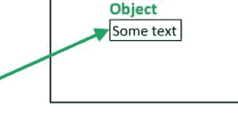

# 数据类型

所有应用程序都使用来自不同来源的数据，如用户界面、数据库、网络服务或其他来源。变量是存储值的手段，而运算符和表达式则用于操作这些值。

变量被声明为特定的数据类型，由于 C# 是一种类型安全的语言，编译器保证存储在变量中的值是正确的类型。下表显示了最常用的数据类型及其对应的系统名称，该名称在编译解决方案、解释高层 C# 代码并将其转换为 MSIL 代码时由通用类型系统（CTS）使用。

| 类型 | 描述 | 大小（字节） | 范围 | CLR 别名 (System.) |
| --- | --- | --- | --- | --- |
| Int | 整数 | 4 | -2,147,483,648 到 2,147,483,647 | Int32 |
| Long | 整数 | 8 | -9,223,372,036,854,775,808 到 9,223,372,036,854,775,807 | Int64 |
| Float | 浮点数 | 4 | +/- 3.4 x 10^38 | Single |
| Double | 浮点数 | 8 | +/-1.7 x 10^308 | Double |
| Decimal | 货币值 | 16 | 28 位有效数字 | Decimal |
| Bool | 布尔值 | 1 | 真或假 | Boolean |
| Char | 单字符 | 2 | N/A | Char |
| String | 字符序列（文本） | | N/A | String |
| DateTime | 时间点 | 8 | 00:00:00/01/0001 到 23:59:59/12/31/9999 | DateTime |
| Object | 通用类型 | | N/A | Object |

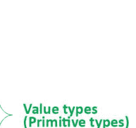
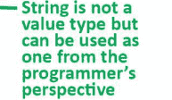

## 算术运算符

在计算数值时，知道运算符的计算顺序非常重要，下列表显示了执行顺序。

- `*` 乘
- `/` 除
- `%` 余数（取模）
- `+` 加
- `-` 减

以下是你可以使用的赋值和增减运算符，可以用来缩短代码。你将在本书中使用它们。

- `++` 变量值加 1


- `--` 变量值减 1
- `*=` 乘法后赋值
- `/=` 除法后赋值
- `%=` 取模后赋值
- `+=` 加法后赋值
- `-=` 减法后赋值

# 变量的命名规则

在命名变量时，你必须遵循某些规则。

- 规则 1：标识符只能包含字母、数字和下划线字符。
- 规则 2：标识符必须以字母或下划线开头。
- 规则 3：标识符不能与 C# 保留关键字相同。

**重要：C# 是区分大小写的**，这意味着你可能只通过改变大小写来使用相同的变量名。`myVariable` 和 `MyVariable` 是不同的变量。在命名一个将其值存储在后备变量中的属性时，你可能会考虑利用这一点来获得优势。

有许多不同的命名约定，*选择一种约定*并坚持下去。

你可以在同一行上声明多个变量并用逗号隔开；所有以此方式声明的变量将具有相同的类型。

# 声明变量

```csharp
int amount;
int vat;
// 或者
int amount, vat;
```

# 为变量赋值

```csharp
int amount;
amount = 100;
```

# 声明并赋值变量

```csharp
double discount = 0.5;
```

# 强制转换

在应用程序中，将值从一种数据类型转换为另一种是常见的；一个例子是你想要使用来自文本框或其他用户界面控件的值。

# 隐式转换

在应用程序中，将值从一种数据类型转换为另一种是常见的；一个例子是你想要使用来自文本框或其他用户界面控件的值。

# 强制转换

从较大的数据类型转换为较小类型时需要显式转换。

```csharp
double y;
int x = (int)y;
```

# System.Convert 类

你可以使用 `System.Convert` 类进行转换。

```csharp
string myString = "1234";
int myInt = Convert.ToInt32(myString);
```

# TryParse 方法

你可以对数据类型使用 `TryParse` 来检查转换是否可能。该函数接受两个参数；第一个是要解析的值，第二个是如果转换成功则包含解析值的变量。

```csharp
string parseValue = "1234";
int parsedInt = 0;

if (int.TryParse(parseValue, out parsedInt))
{
    // 解析成功
}
else
{
    // 解析失败
}
```

延伸阅读：“强制转换与类型转换（C#编程指南）”

# C# 入门教程

数值变量有两种类型：整数和浮点数。整数变量（如 `short`、`int` 和 `long`）可以作为计数器以及主键和外键的标识符。浮点变量（如 `float`、`double` 和 `decimal`）用于需要精度的数学计算。为了尝试这些类型的变量，你现在将使用 Windows Forms 应用程序创建一个简单的表单。

## 练习：简单表单

在此练习中，你将通过创建一个包含最多 5 种不同产品的表单来磨练处理数值变量的技能。特定产品的值通过水平行上的控件输入，五种产品都使用相同类型的控件来输入它们的值。第一个控件是用于产品名称的文本框，第二个是用于产品价格的文本框，第三个是用于产品订单数量的数值增减控件，第四个是用于行总计的文本框。

| 产品 | 价格 | 数量 | 行总计 |
|---|---|---|---|
| 产品 1 | | 10 | 10 |
| 产品 2 | | 2 | 40 |
| 产品 3 | 30.5 | 3 | 91.5 |
| 产品 4 | | 40 | 160 |
| 产品 5 | | 50 | 250 |
| 折扣 | | | 50 |
| 增值税 % | 12 | | 60.18 |
| 总计 | | | 561.68 |

产品名称应最多 30 个字符，你可以使用属性窗口中的 `MaxLength` 属性进行设置。使用 `Name` 属性将文本框命名为 `txtProduct1-txtProduct5`。

价格（Price）文本框应仅允许输入数值值和小数点（取决于 Windows 文化设置，可能是逗号或句号），你可以使用 `KeyPress` 事件方法来实现。文本还应该右对齐，这可以通过 `TextAlign` 属性进行设置。文本框中的默认文本应为零 (0)。文本应加粗，这可以通过 `Font` 属性进行设置。将文本框命名为 `txtPrice1-txtPrice5`。

订购数量将由 `NumericUpDown` 控件表示，每个产品最大为 10 个，这可以通过 `Maximum` 属性进行设置。值应该右对齐并以粗体显示。将控件命名为 `numUnits1-numUnits5`。当点击控件中的向上或向下按钮时，订购产品的成本（价格 * 单位）应自动显示在行总（Line Total）文本框中，要实现这一点，你需要添加 `ValueChanged` 事件方法，可以通过双击 `NumericUpDown` 来完成。

当使用 `NumericUpDown` 控件处理特定产品时，将计算行总；因此，该控件可以是只读的，可以通过其 `ReadOnly` 属性进行设置。背景应为黄色，以指示它是一个计算字段，可以使用 `BackColor` 属性进行设置。文本应以粗体字体显示并右对齐。将控件命名为 `txtTotal1-txtTotal5`。

实现后续产品订单行的最简单方法是选择为第一行订单（产品）添加的控件，复制它们并更改它们的名称。你可以按住键盘上的 `Ctrl` 键选择这些控件并点击所需的控件，或者你可以将鼠标指向表单表面控件的左侧，按住鼠标按钮并拖动覆盖所需的控件。

折扣（Discount）文本框中的文本应右对齐并以粗体字体显示。该值将在计算增值税（VAT）之前将从所有行总之和中减去。将文本框命名为 `txtDiscount`。

VAT 有两个文本框，一个用于 VAT 百分比，一个用于计算金额。将用于百分比的 VAT 文本框命名为 `txtVAT`，并将其文本右对齐且加粗。VAT 百分比应该是可编辑的。将文本框命名为 `txtVATAmount`，其文本也应右对齐并加粗，且具有蓝色字体，这可以通过 `ForeColor` 属性设置。背景应为黄色，以表示这是一个计算字段，并且应该是只读的。VAT 金额通过相加行总、减去折扣，最后将结果乘以 VAT 百分比除以 100 来计算。你可以通过先使用 `Double.TryParse` 方法解析文本框，并将结果值存储在计算中使用的 `double` 数据类型变量中，来完成计算。

`VatAmt = (lineTotal1 + lineTotal2 + lineTotal3 + lineTotal4 + lineTotal5 - discount) * (vat / 100)`

下例展示了你如何解析折扣文本框中的值。请注意，`discount` 变量必须使用 `out` 关键字传递给 `TryParse` 方法。`out` 关键字可以用于从方法传出值，你将在随后的章节中学习更多内容。在这种情况下，`TryParse` 方法将从文本框返回的字符串转换为 `double` 值并存储在 `discount` 变量中。如果转换失败（文本框中的字符串无法转换为 `double` 值），则 `discount` 变量将存储 0。以此示例为模板，你应该能够解析其他文本框中的值。

```csharp
double discount;
Double.TryParse(txtDiscount.Text, out discount);
```

当点击计算按钮（`btnCalculate`）时，总成本应显示在名为 `txtTotal` 的文本框中。该文本框应该是只读的，具有蓝色背景，文本右对齐并以粗体字体显示，默认文本应为 0。

## 创建订单表

- 打开 Visual Studio。
- 在“文件”菜单中选择“新建项目”。
- 选择“Windows Forms Application”模板。
- 在“名称”字段中将项目命名为 Order Form，并点击“确定”按钮。
- 现在应该可以看到表单设计界面。

## 添加文本框

- 添加一个文本框到表单上。
- 将其重命名为 `txtProduct`。
- 添加一个文本框。
- 将其重命名为 `txtPrice`。
- 将文本右对齐。
- 添加一个 `NumericUpDown` 控件。
- 将其重命名为 `numUnits`。
- 将文本右对齐。
- 添加一个文本框。
- 将其重命名为 `txtTotal`。
- 将背景设为黄色。

## 复制订单

- 选择所有已添加的控件（不包括标签）。
- 按键盘上的 `Ctrl+C` 复制它们。
- 按键盘上的 `Ctrl+V` 粘贴复制的控件。
- 在仍处于选中状态时排列这些控件。
- 通过增加末尾数字来重命名控件。复制的文本框 `txtProduct1` 将接收默认名称并变为 `txtProduct2`，其他控件依此类推。
- 对剩下的 3 行订单重复此过程。

## 添加折扣文本框

- 从工具箱添加一个文本框到表单。
- 将文本框拖到最后一行订单下方。
- 将其命名为 `txtDiscount`。
- 将文本右对齐。
- 将文本以粗体字体显示。
- 将文本框宽度设置为单位控件和行总控件的总和，110px 即可。

## 添加 VAT 文本框

- 添加一个 `txtVAT` 文本框用于 VAT 百分比。
- 将文本框与折扣文本框左边缘对齐，并放在其下方。
- 将文本右对齐。
- 将文本以粗体字体显示。
- 将文本框宽度设置为约为 39px 以缩小。
- 添加另一个名为 `txtVATAmount` 的文本框用于计算的 VAT 金额。
- 将文本框与折扣文本框左边缘对齐，并放在其下方。
- 将文本右对齐。
- 将文本以粗体字体显示。
- 将文本框宽度设置为约为 64px 以缩小。
- 由于这是一个计算字段，你必须将其 `ReadOnly` 属性设置为 `true`。
- 将 `BackColor` 属性更改为黄色，表示这是一个计算字段。
- 将 `ForeColor` 属性更改为蓝色以突出显示。
- 在 `txtVAT` 文本框左侧添加一个标签，将其文本更改为 VAT %。

## 添加总计文本框

1. 添加一个名为 `txtTotal` 的文本框用于应付金额。
2. 将文本框与 `txtVAT` 文本框的左边缘对齐，并放置在其下方。
3. 设置文本右对齐。
4. 将显示字体设置为**粗体**。
5. 将文本框的宽度更改约为 `110px` 左右。
6. 由于这是一个计算字段，你必须将 `ReadOnly` 属性设置为 `true`。
7. 将 `BackColor` 属性更改为蓝色，表示这是应付金额。
8. 将 `ForeColor` 属性更改为白色以突出显示。
9. 在文本框左侧添加一个标签，将其文本更改为 Total。

## 添加计算按钮

1. 添加一个名为 `btnTotal` 的按钮。
2. 将按钮与 `txtVAT` 文本框的左边缘对齐，并放置在文本框下方。
3. 将按钮文本更改为 Calculate。
4. 使按钮样式与 `txtTotal` 文本框以及数字增减控件保持一致。
5. 运行应用程序并在文本框中输入值，你可能会发现点击 Calculate 按钮时没有任何反应，点击增减按钮时 Line Total（行总计）也没有计算。这是因为你还没有在后台代码文件中添加任何执行计算的代码，这将是你的下一次任务。
6. 关闭应用程序。

## 限制输入为数值

在处理如价格等数值输入时，你可能希望限制输入仅为数字和小数点。需要注意的是这一点是，小数点在不同文化中是不同的，例如在瑞典，使用逗号表示小数点，而在美国则使用句号。这可以通过使用 Windows 中当前文化进行更复杂的实现来解决，但你将在本次练习中不会这样做；相反，你将声明一个名为 `decimalPoint` 的字符常量，用于存储小数点符号。该常量将在整个计算过程中使用，这是一种使代码更具维护性的方法，因为如果你想更改符号，只需更改一处。

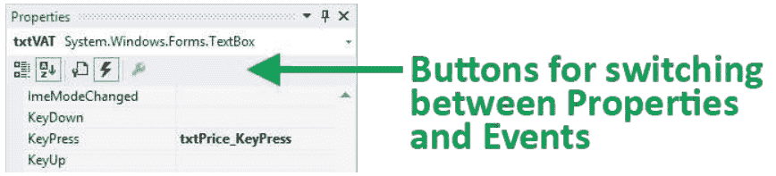

你可以为每个文本框添加一个新的 `KeyPress` 事件方法，但这会导致大量的代码重复，这是你应该尽量避免的。相反，你将创建一个名为 `txtPrice_KeyPress` 的 `KeyPress` 事件方法，它将用于所有受限制的框。一旦创建了这个事件方法，你只需要在属性窗口中，通过在事件列表特定事件下拉菜单中选择它，为影响的文本框设置 `KeyPress` 事件。

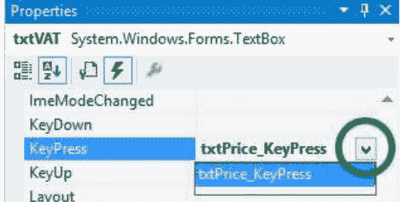

## 将事件强制转换为文本框

`KeyPress` 有名为 `e` 的 `KeyPressEventArgs` 参数，你可以在事件方法的括号中找到它。该参数可以用于获取按下的键盘键的信息，例如通过其 `KeyChar` 确定它是哪个字符。

要检查按下的键是否为数字，可以使用 `char.IsDigit` 方法；要检查是否按下了控制键（Ctrl, Alt, Shift），则需要使用 `char.IsControl` 方法。在限制文本框输入时，此类信息可能极有价值。

`KeyPress` 事件还有一个名为 `sender` 的对象参数，它包含了正在使用的控件。要使用实际文本框的文本来获取或设置属性值，你必须将 `sender` 参数强制转换为实际的文本框类型，你可以使用 `as` 关键字来实现这一点。下面的代码显示了 `KeyPress` 事件以及如何将 `sender` 对象强制转换为 `TextBox`。注意，在声明文本框变量时可以使用 `var` 关键字，因为强制转换将在应用程序编译时确定使用哪种数据类型。

```csharp
private void txtPrice_KeyPress(object sender, KeyPressEventArgs e)
{
    var textbox = sender as TextBox;
}
```

接下来，你需要在 `KeyPress` 事件上方添加一个 `char` 类型的常量 `decimalPoint`，用于存储上方要使用的小数点。常量是一种在声明后只能赋值一次的变量。如果你在一个小数点符号应为句号的地区，请将此字符改为句号。

```csharp
const char decimalPoint = ',';
```

`KeyPress` 的 `e` 参数有一个名为 `Handled` 的属性，它决定了按下键对应的字符是否应该被添加到文本框中。如果 `Handled` 属性设置为 `true`，则字符不会被添加到文本框中。你将在事件方法中创建一个 `bool` 类型变量 `isHandled`，这有助于判断是否应该添加该字符。使用以下代码判断是否应该省略该字符。

```csharp
bool isHandled = !char.IsDigit(e.KeyChar) && !char.IsControl(e.KeyChar) && !e.KeyChar.Equals(decimalPoint);
```


重要：表达式中的感叹号（`!`）表示“非”，它会反转结果，使 `true` 变为 `false`；表达式中的和符号（`&&`）表示“与”，如果结果要返回 `true`，则强制两个值都为 `true`。表达式中的双管道（`||`）表示“或”，当一个或两个值为 `true` 时，结果为 `true`。

### 检查按下的键是否不是数字（句号外）且不是控制键

让我解释这段代码以明确它将做什么。首先，你创建一个 `isHandled` 变量，如果字符应该省略，则该变量值为 `true`；如果字符应该添加到文本框，则为 `false`。你首先想使用 `char.IsDigit` 方法排除非数字字符，传入当前字符并使用 `e.KeyChar` 属性，但因为 `Digit` 方法返回 `true` 表示是数字，所以你需要在表达式前放置一个感叹号来反转结果，本质上是判断它是否不是数值。代码目前是这样，后续还会添加更多内容。

```csharp
bool isHandled = char.IsDigit(e.KeyChar);
```

接下来，你想检查是否没有按下控制键，这需要使用 `char.IsControl` 方法，你需要在表达式前使用感叹号，以表示你希望结果反映没有按下控制键。

双和符号（`&&`）用于逻辑上合并两个布尔（true/false）结果，以判断组合结果是否评估为 `true`；如果其中一个或两个为 `false`，结果将为 `false`。

```csharp
bool isHandled = !char.IsDigit(e.KeyChar) && !char.IsControl(e.KeyChar) && !e.KeyChar.Equals(decimalPoint);
```

你最后需要检查的是字符是否等于小数点。最后一步需要检查以评估按键事件是否被处理：如果按下的键是小数点且文本框已经包含一个小数点，你根结底只能有一个小数点。

```csharp
(e.KeyChar.Equals(decimalPoint)) && textbox.Text.Contains(decimalPoint))
```

# C# 初学者

```csharp
bool isHandled = !char.IsDigit(e.KeyChar) &&
                 !char.IsControl(e.KeyChar) && !e.KeyChar.Equals(decimalPoint);
```

- 9. 如果按键字符是小数点且文本框已包含小数点，则判断按键是否被视为已处理。如果这两个表达式中任何一个为真，则该按键应被视为已处理，并且文本框忽略该字符。

`e.Handled = isHandled || (e.KeyChar.Equals(decimalPoint)) && textbox.Contains(decimalPoint);`

- 10. 运行应用程序，确保第一个 Price 文本框中只能输入数值和一个小数点。

- 11. 关闭应用程序。

- 12. 选择除第一个 文本框以及 Discount 和 VAT Percentage 文本框以外的所有 Price 文本框。

- 13. 在属性（Properties）窗口的事件列表中找到 KeyPress 事件，并在 KeyPress 标签右侧字段的下拉列表中选择 `txtPrice_KeyPress`。这将同一个事件方法关联到所有所选文本框的 KeyPress 事件。

- 14. 再次运行应用程序，确保你之前所选的所有文本框都具有相同的限制。

- 15. 关闭应用程序。

考虑到这两个结果，完成后的评估代码如下所示：

```csharp
e.Handled = isHandled || (e.KeyChar.Equals(decimalPoint)) &&
            textbox.Text.Contains(decimalPoint);
```

KeyPress 事件方法的完整代码如下：

```csharp
public partial class Form : Form {
    const char decimalPoint = ',';

    private void txtPrice_KeyPress(object sender, KeyPressEventArgs e)
    {
        // 正在编辑的文本框。
        var textbox = sender as TextBox;

        // 按下的按键不是数字、
        // 句号/逗号，且不是控制字符。
        bool isHandled = !char.IsDigit(e.KeyChar) &&
                         !char.IsControl(e.KeyChar) &&
                         !e.KeyChar.Equals(decimalPoint);

        // 仅允许一个小数点
        e.Handled |= isHandled ||
                    (e.KeyChar).Equals(decimalPoint) &&
                    textbox.Text.Contains(decimalPoint);
    }
}
```

## 计算行总额

当点击与行相关的 NumericalUpDown 控件中的向上或向下按钮、当控件获得焦点（光标在控件内）并使用键盘上的向上或向下箭头、控件值改变或控件失去焦点时，每个产品行的行总额计算为 `units*price`。要实现这些场景，你必须使用 numUnits 控件的 `Changed` 事件。结果将显示在与产品相关的 txtLine 中。

由于 NumericalUpDown 控件的 `Value` 属性返回的是小数值，因此在将其存储到名为 `units` 的变量之前，必须将其强制转换为 `int`。强制转换是为了将该值作为整数使用。你可以通过在控件名称前的括号中放置 `int` 类型来进行转换。

```csharp
var units = (int)numUnits1;
```

由于与产品相关的 txtPrice 的 `Text` 属性中的值可能包含非数值，因此你必须将该值解析到 `double` 类型变量中。转换可能包含 double 其他值的优选方法是使用 `Double.TryParse` 方法，因为即使解析失败，它也会返回一个 double 值（返回 0）。该方法将值作为 `out` 参数而不是返回值返回，这意味着你需要声明一个 `double` 变量 (price)，并在带有 `out` 关键字的情况下将其作为第二个参数传递给方法，第一个参数是需要解析的字符串值。

```csharp
double price = 0;
Double.TryParse(txtPrice1.Text, out price);
```

将实际计算的结果存储在名为 `lineTotal` 的 `double` 变量中，并将该变量赋值给 txtLineTotal 文本框的 `Text` 属性。

- 1. 打开表的设计界面。

- 2. 双击第一个 NumericalUpDown 控件，将其 `ValueChanged` 事件添加到后台代码文件中。

```csharp
private void numUnits1_ValueChanged(object sender, EventArgs e)
{
```

- 3. 使用 `var` 关键字添加一个变量，并将 `numUnits1` `Value` 属性的结果作为 `int` 赋值给它。

```csharp
var units = (int)numUnits1.Value;
```

- 4. 计算中使用了一个 `double` 值，你可以使用 Double 类上的 `TryParse` 方法将 txtPrice1 `Text` 中的值解析为 double。该方法需要通过 `out` 参数传递一个变量，方法通过该变量返回解析后的结果。声明为 `out` 的变量可以在方法中返回返回值以外的额外值，更多信息将在方法中介绍。

```csharp
double price = 0;
double.TryParse(txtPrice1.Text, out price);
```

- 5. 使用公式 `units*price` 计算行总额，并将其存储在声明为 `double` 类型的变量 `lineTotal` 中。

```csharp
double lineTotal = units * price;
```

- 6. lineTotal 变量中的结果应显示在 txtTotal 文本框中，通过将变量赋值给它的 `Text` 属性。注意，在赋值给 `Text` 属性时，必须使用 `ToString` 方法将值转换为字符串。这种转换是必要的。

```csharp
txtTotal.Text = lineTotal.ToString();
```

- 7. 运行应用程序。

- 8. 关闭应用程序。

# C# 入门

9. 应用程序现在已完成。运行应用程序并在字段中输入某些值，点击**Calculate**（计算）按钮来计算增值税（VAT）总成本。

10. 关闭应用程序。

**btnTotal_Click** 事件完整代码如下：

```csharp
private void btnTotal_Click(object sender, EventArgs e)
{
    double discount, vat, ltot1, ltot2, ltot3, ltot4, ltot5;
    double total, lineTotals, vatTotal;
    Double.TryParse(Discount.Text, out discount);
    Double.TryParse(txtVAT.Text, out vat);
    Double.TryParse(lineTotal1.Text, out ltot1);
    Double.TryParse(lineTotal2.Text, out ltot2);
    Double.TryParse(lineTotal3.Text, out ltot3);
    Double.TryParse(lineTotal4.Text, out ltot4);
    Double.TryParse(lineTotal5.Text, out ltot5);

    lineTotals = ltot1 + ltot2 + ltot3 + ltot4 + ltot5 - discount;
    vatTotal = lineTotals + (vat / 100);
    total = lineTotals + vatTotal;
    txtVatAmt.Text = vatTotal.ToString();
    txtTotal.Text = total.ToString();
}
```

# 字符串变量

字符串用于存储字母数字值，例如可以存储来自 GUI 文本框的值。

# 字符串拼接

你可以使用 `+` 运算符来拼接字符串，但这种拼接方法应谨慎使用，因为它会产生开销；每使用一次 `+` 运算符，内存中都会创建一个新字符串并丢弃旧字符串。

在以下示例中，变量 `myString` 在所有字符串拼接后将包含值 *First part, second part*。

```csharp
string myString = "first part, ";
myString = myString + "second part, ";
myString = myString + "third part";
```

你应该使用 `StringBuilder` 类的实例而不是使用 `+` 运算符并向变量添加值，因为数据是动态添加的，且 `StringBuilder` 对象在堆（Heap）上只被实例化一次。使用 `Append` 方法将数据添加到 `StringBuilder` 变量中。当你想使用 `StringBuilder` 实例内部字符串时，必须对变量调用 `ToString` 方法。

```csharp
StringBuilder myStringBuilder = new StringBuilder("first part");
myStringBuilder.Append("second part");
myStringBuilder.Append("third part");
string concatenatedString = myStringBuilder.ToString();
```

# 字符串验证

字符串验证非常重要，尤其是当值来自 GUI 时，它可以帮助避免表单中的异常错误，并可以在数据保存到数据源之前向用户显示验证消息。实现字符串验证的方法是是正则表达式。

`Regex` 类位于 `System.Text.RegularExpressions` 命名空间，你可以使用它的 `IsMatch` 方法来验证字符串是否符合指定标准。

以下代码验证字符串是否包含数字。

```csharp
var textTest = "hello world";
var regularExpression = "\d";
var result = Regex.IsMatch(textTest, regularExpression, RegexOptions.None);
if (result)
{
  // 文本匹配了表达式。
}
```

# 练习：StringBuilder 和 Regex

在此练习中，你将使用一个名为 `emailAddresses` 的 `StringBuilder` 类实例在文本框中存储电子邮件地址。在点击 `btnAdd` 按钮时，使用 `Regex` 类的 `IsMatch` 方法通过正则表达式验证电子邮件地址，然后将其添加到 `emailAddresses` 变量中。如果评估的不是真正的邮箱，则 `txtEmail` 文本框的背景应显示为浅粉色，表示邮箱错误。如果用户尝试多次输入，邮箱只能添加到 `emailAddresses` 变量一次，可以通过对变量的字符串表示使用 `Contains` 方法检查邮箱是否已存在于字符串中，从而解决这个问题。

正则表达式的实际字符串表示创建可能非常困难。除非你真的喜欢深挖正则表达式的世界，否则我建议你使用搜索引擎在互联网上寻找已存在的正则表达式。

从 RFC 5322 派生出的许多可能的正则表达式之一，用于在电子邮件地址添加到名为 `email-Regex` 的只读字符串时进行验证，如下：

```csharp
readonly string emailRegex;
emailRegex = "@([a-z0-9!#$%'*+/=?^_`{|}~-]+]+(?:\.[a-z0-9!#$%'*+/=?^_`{|}~-]+]+)*@@" +
"?(?:[a-z0-9](?:[a-z0-9]*[a-z0-9])?\.)+[a-z0-9](?:[a-z0-9]*[a-z0-9])?|[a-z0-9]+)";
```

> 重要：只读常量（readonly constant）可以在运行时赋值一次，而使用 `const` 关键字声明的常量必须在编译时在创建常量的同一行进行赋值。

以下代码显示了如何评估字符串是否匹配特定的正则表达式。在此例中，存储在常量中的正则表达式与输入到 `txtEmail` 的字符串进行比较。

```csharp
var result = Regex.IsMatch(txtEmail.Text, emailRegex);
```

在 `if` 语句中使用 `result` 变量来确定应该显示哪种背景颜色（浅粉色）。

# C# 入门

```csharp
if(!emailAddresses.ToString().Contains(txtEmail.Text))
emailAddresses.Append(txtEmail.Text + "\n");
```

- 8. 在 `if` 块的结束大括号下方添加一个 `else` 语句，当 `if` 语句为假 时将执行它，这意味着电子邮件错误。将 `txtEmail` 文本框的背景颜色更改为浅粉色，向用户显示错误。

```csharp
else
txtEmail.BackColor = Color.LightPink;
```

- 9. 你需要做的最后一件事是在 `txtEmailList` 文本框中显示 `emailAddresses` 变量的内容。注意，你必须对该变量调用 `ToString` 方法才能将内容添加到 `txtEmailList.Text` 中。`txtEmailList.Text = emailAddresses.ToString();`

- 10. 运行应用程序并输入一个无效的电子邮件，点击按钮时文本框背景将变为浅粉色。

- 11. 输入一个有效的电子邮件地址并点击按钮，将其添加到大文本框中，并将文本框背景颜色更改为白色。

- 12. 添加另一个有效电子邮件并点击按钮将其添加到大文本框中。确保两个电子邮件地址都已显示。

- 13. 输入一个无效的电子邮件并点击按钮，使文本框背景变为浅粉色，然后将电子邮件改为有效电子邮件并点击按钮，确保背景颜色在添加电子邮件时更改。

- 14. 关闭应用程序。

表单中的完整代码如下：


```csharp
public partial class Form1 : Form
{
    readonly string emailRegex;
    StringBuilder emailAddresses = new StringBuilder();

    public Form1()
    {
        emailRegex =
            @"[a-z0-9#$%'*+/=?^_`{}|~]*" +
            "@+(?:|\.[a-z0-9#$%'*+/=?^_`{}|~-])*" +
            "@+(?:[a-z0-9](?:[a-z0-9]*[a-z0-9])?)" +
            "@+[a-z0-9](?:[a-z0-9]*[a-z0-9])?";
        InitializeComponent();
    }

    private void Form1_Load(object sender, EventArgs e)
    {
    }

    private void btnAdd_Click(object sender, EventArgs e)
    {
        var result = Regex.IsMatch(txtEmail.Text, emailRegex);
        if (result)
        {
            txtEmail.BackColor = Color.White;
            if (!emailAddresses.ToString().Contains(txtEmail.Text))
                emailAddresses.Append(txtEmail.Text + "\n");
        }
        else
            txtEmail.BackColor = Color.Pink;
        txtEmailList.Text = emailAddresses.ToString();
    }
}
```

# 数组

数组是一个被视为一组并作为一个单元进行管理的值或对象的序列。最常见的数组类型是一维、二维或三维的（分别对应列表、表格和立方体），但你可以创建多达 32 维的数组。

数组是基于零（0）索引的，这意味着数组的第一个元素存储在索引零处。数组的大小由你可以在其中存储的元素数量决定。数组包含的维度数量决定了数组的秩（rank）。数组始终持有相同类型的值或对象。

如果你需要在同一个序列中存储不同类型，请考虑集合（collections）。集合位于 `System.Collections` 命名空间下，并且是可扩展的，这意味着根据需要向集合中添加和删除对象。

在执行 `new` 操作符之前，数组不会分配物理内存；此时，你可以隐式地（通过直接赋值）或显式地（通过指定大小）指定数组的大小。

在向数组读取或写入数据时，你应该检查 `IndexOutOfRangeException` 异常。

## 一维数组

以下示例显示了如何创建一个一维数组，它存储值或对象，数组从索引零开始。数组的维度由你可以在其中存储的元素数量决定。在下面的代码中，数组包含 5 个占位符。

```csharp
int[] list = new int[5];
```

现在可以使用大括号语法为数组赋值，注意在索引 0 处。

```csharp
list[0] = 10;
```

另一种方法是在声明数组的同时使用大括号进行赋值。注意在声明类型时。

```csharp
int[] list = new int[] { 1, 2, 3, 4, 5 };
```

### 遍历数组中的值

尽管你还没有读过数组的上下文。在下面的示例中，值得提到使用 `for` 循环来迭代数组；注意你不应该硬编码循环的结束索引（除非绝对必要），应该使用数组或集合的 `Length` 和 `Count` 属性来确定所需的迭代次数。这里使用 `list` 的 `Length` 属性来确定迭代次数。为了获取数组中的单个值，你在数组变量的括号中使用循环计数器（在本例中为 `i`）。通常使用命名为 `i`、`j`、`k` 等变量作为循环计数器。你从 `i` 开始，因为 `a`、`b`、`c` 等通常保留用于数学计算的占位符。下面的代码将遍历数组中存储的值并将它们相加，结果存储在变量中。

```csharp
int result = 0;
for (int i = 0; i < list.Length; i++)
{
    result += list[i];
}
```

## 二维数组

以下示例显示了如何创建一个二维数组，它存储值或对象，数组从索引零开始。注意你通过逗号来指定维度。

```csharp
int[,] table = new int[2, 3];
```

现在可以使用大括号语法为二维数组赋值，注意在索引 0 处。

```csharp
table[0, 0] = 1;
```

另一种方法是在声明数组时同时使用大括号。注意二维。

```csharp
int[,] table = { { 1, 2, 3 }, { 4, 5, 6 } };
```

要从特定的占位符获取值，你需要指定维度和索引。

```csharp
var value1 = table[0, 1]; // 返回 2
var value2 = table[1, 2]; // 返回 6
```

## 练习：构建计算器

在这个练习中，我建议你尝试在不看解决方案的情况下实现，并将其视为一种测试，以查看在继续后续章节之前是否有需要填充的知识漏洞。练习将以微案例的形式呈现，描述虚构客户想要实现的内容，并让你自己解决，这种描述方式是为了模拟一个微型的真实世界场景。未来你会遇到更多此类练习，让你觉得有趣并保持警觉。

重要提示：如果你使用的是 Visual Studio 2015 或更高版本，Windows Forms 的分辨率发生了变化，你可能需要使用适当的 UI 控件尺寸。

## 用例说明

客户坚称事件方法中不应存在硬编码值，这些值应该在 `Form1` 类开头声明为常量以使代码更具可维护性。任何类级变量也应该在类的开头处声明。

计算器只需要使用两个值计算出一个结果。当使用数字按钮输入值时，当前值应在数值标签中用大字体显示。当点击其中一个算术按钮（+、-、x、/）时，值应该移动并用小得多的字体显示在数值标签上方一小区域的标签中（见下所示）。

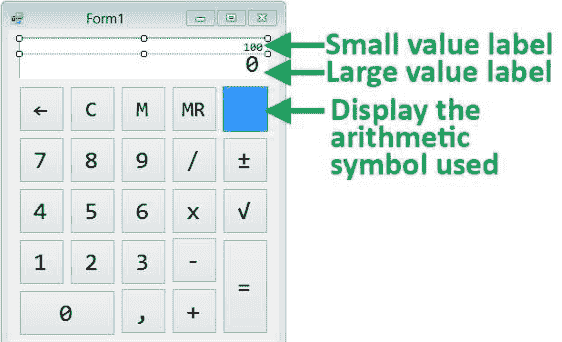

删除 (-)、清除 (C)、内存 (M) 和内存调回 (MR) 按钮应该放置在数值标签下方，还应该有一个标签（蓝色背景），当点击其中一个按钮时，该标签应显示所使用的算术字符（+、-、x、/）。

删除 (-) 按钮删除最后一次输入的数字（最右侧的数字）。注意，如果删除了负值的最后一个数字位，你必须确保将负号替换为 0。如果删除了正值的最后一个数字位，你必须在大数值标签中添加一个 0。

清除 (C) 按钮应该清除所有小数值标签中的值以及显示算术字符的标签，并给大数值标签赋值 0。

内存 (M) 按钮应该将大数值标签中的值存储在一个名为 `memory` 的字符串变量中，供以后使用。

内存调回 (MR) 按钮应该调回内存变量中存储的值并将值显示在大数值标签中。

数字按钮应该将数字追加到大数值标签值的末尾。小数点字符也是如此，它在大数值标签中只允许出现一次。

当点击其中一个算术按钮时，大数值标签中的值应移动到小数值标签中，算术符号应显示在内存调回按钮右侧蓝色标签中。该符号将用于确定在点击等号时如何计算结果。这些按钮应该由同一个名为 `btnCalculate_Click` 的事件方法处理。

当点击平方根 (√) 时，应该使用 `Math` 类中的 `Sqrt` 方法计算大数值标签中值的平方根，并将结果显示在大数值标签中替换原始值。你还应该处理负值，因为无法计算负数的平方根，请显示带有适当消息的消息。

取反按钮 (±) 应该作为一个切换按钮，在大数值标签的左侧添加或移除负号 (-)。

当点击计算按钮 (=) 时，应该根据小数值标签、大数值标签中的值以及蓝色标签中存储的符号计算结果。

数字按钮应该使用同一个名为 `btnNumber_Click` 的事件方法。你可以使用 `Button` 类将 `sender` 参数（来自事件括号）强制转换为 `Button`，并使用你存储被点击按钮的变量来访问其 `Text` 属性。

```csharp
Button btn = (Button)sender;
```

### 关于计算结果的规则

如果其中一个标签包含空字符串，或者大数值标签包含 0，则不应进行计算，并应使用 `return` 关键字提前结束事件。

```csharp
if (...) return;
```

如果两个值标签中的任意一个的最后一个字符是小数点，则在执行计算之前应移除该字符。

执行的计算应由蓝色标签中显示的算术符号决定。

计算完成后，应通过给 `Text` 属性赋值空字符串来清除蓝色标签和小数值标签。

结果应在大数值标签中显示保留三（3）位小数。你可以使用 `ToString` 方法的格式化功能来实现这一点。此外，如果计算出的值为实例 10.0，该值以零小数值（,0 或 .0）结尾，则在值显示在大数值标签中之前，应使用 `Replace` 方法从字符串中删除零和小数符号。

```csharp
lblValue.Text = result.ToString("F3").Replace(zeroDecimal, String.Empty);
```

现在在你开始实现解决方案之前，文档中提供给你的信息。当可以使用实例常量代替硬编码文本和值时。我建议你分阶段实现解决方案，以便在进行新功能之前确保某功能运行正常。

## 解决方案

我希望你在决定参考此处提供的解决方案之前已经尝试过自己实现它。你将从创建 GUI 开始，然后实现按钮逻辑，最后在点击带有等号的按钮时完成实际计算。

## 数值标签

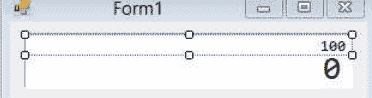

1. 创建一个名为 Simple Calculator 的新 Windows Forms 应用程序。
2. 将表单调整为宽 314px、高 383px。
3. 向表单上拖入一个标签，代表用户通过点击数字按钮输入的值。
4. 将标签重命名为 `lblValue`。
5. 将 `AutoSize` 属性设置为 `false` 以便调整标签大小。
6. 将背景颜色更改为 `white` 并将边界样式更改为 `Fixed3D`，使其看起来更像文本框。
7. 将字体更改为 `Consolas 20` 以使文本更大。
8. 将标签调整为宽 274px、高 46px。
9. 给 `Text` 属性赋值 0。
10. 将文本对齐方式设置为右下对齐。
11. 向表单上拖入另一个标签并重命名为 `lblPreviousValue`。
12. 将 `AutoSize` 属性设置为 `false` 以便调整标签大小。
13. 将背景颜色更改为 `white` 并边界样式更改为 `None` 以移除标签边框。
14. 将字体更改为 `Consolas 10` 以使文本变小。
15. 将标签调整为宽 270px、高 14px。
16. 给 `Text` 属性赋值空字符串以清除标签。
17. 将文本对齐方式设置为右对齐。
18. 将标签放置在第一个标签上方，以便显示标签所需的 Unicode 符号。

## 算术函数标签（蓝色的那个）

此标签的作用是在点击其中一个算术按钮（+、-）时显示用户选择的数学函数。存储在此标签中的值将决定如何计算结果；

1. 添加一个标签并将其命名为 `lblMathFunction`。
2. 将标签调整为与按钮相同的高度（50px）和宽度（50px）。
3. 将标签重新定位在内存 (MR) 按钮右侧。
4. 将背景颜色更改为蓝色。
5. 将 `ForeColor` 属性更改为白色。
6. 将文本对齐方式设置为居中对齐。
7. 将字体更改为 `Consolas 20`。
8. 将边界样式更改为 `FixedDouble`。

## 数字按钮

将数字按钮命名为 `btnOne`、`btnTwo` 等以此类推。

为了避免大量重复代码并使其更正确、更易维护，你应该创建一个被所有数字按钮使用的 Click 事件。要访问被点击按钮的 `Text` 属性（或任何其他属性），你可以将 `sender` 参数强制转换为 `Button`，`sender` 参数是通过事件括号传递的。

你必须考虑到，包含目前已输入值的数值标签可能包含计算器启动或使用删除或清除按钮清除值时赋值的默认 0。如果是这种情况，在将按钮值添加到标签的 `Text` 属性之前，你必须通过为其赋值空字符串来清除标签。

1. 选择其中一个数字按钮，在属性窗口的 Click 事件字段中输入 `btnNumber_Click` 并按下回车键。这应该创建事件方法并带你进入该方法。

```csharp
private void btnNumber_Click(object sender, EventArgs e)
{
}
```

2. 添加一个名为 `btn` 的变量，用于持有 `sender` 参数，并将 `sender` 参数转换为 `Button` 类型，以便使用它的属性。

```csharp
Button btn = (Button)sender;
```

3. 因为客户希望所有值都以常量形式存储，你需要在表单类紧跟左大括号的地方添加一个名为 `noValue` 的常量，并给该常量赋值为 "0"。

```csharp
public partial class Form1 : Form
{
    const string noValue = "0";
```

4. 在 `if` 语句中使用你刚刚添加的常量，检查 `lblValue` 标签的内容是否等于该常量，如果是，则通过给它赋值一个空字符串来清空标签。注意，对于只执行一行代码的 `if` 语句，不需要使用大括号。

```csharp
if (lblValue.Text == noValue)
    lblValue.Text = String.Empty;
```

5. 最后你需要做的是按钮的数值追加到 `lblValue` 标签文本的末尾，你可以通过 `+=` 运算符来实现这一点。

```csharp
lblValue.Text += btn.Text;
```

6. 现在既然事件方法已经实现，你应该使用属性窗口中的 Events 部分，将它添加到所有数字按钮的 Click 事件中。
7. 运行应用程序，确保你点击的按钮对应的数字已追加到 `lblValue` 标签（大标签）文本的末尾。
8. 关闭应用程序。

以下是用于数字按钮 Click 事件的完整事件代码：

```csharp
private void btnNumber_Click(object sender, EventArgs e)
{
    Button btn = (Button)sender;

    if (lblValue.Text == noValue)
        lblValue.Text = String.Empty;

    lblValue.Text += btn.Text;
}
```

## 删除按钮 (Delete button)

删除按钮的作用是在点击时从 `lblValue` 标签中移除右侧的字符。这里你必须考虑一些边界情况：

- 只有当标签包含多一个字符时，才应该移除标签的最后一位数字；否则应该使用你之前创建的 `noValue` 常量将标签值重置为 0。
- 如果标签只包含一个数字且值为负号，则标签的值应该使用你之前创建的 `noValue` 常量重置为 0。

1. 将按钮命名为 `btnDelete`。
2. 双击删除 (-) 按钮，将其 Click 事件方法添加到代码后代码文件中。
3. 声明一个名为 `newValue` 的字符串，并分配存储在 `noValue` 常量中的默认值。该变量将在整个事件过程中持有新值。

```csharp
string newValue = noValue;
```

4. 接下来获取 `lblValue` 标签中存储的文本长度，并将其存在名为 `length` 的 `int` 变量中。你需要这个值来确定是否应用第一个边界条件，或者是否从值中移除最后一位数字。

```csharp
int length = Convert.ToInt32(lblValue.Text.Length);
```

5. 使用该值判断是否应该移除最后一位数字，使用 `Text` 属性的 `Substring` 方法将其移除，并将结果存在之前创建的 `newValue` 变量中。

```csharp
if (length > 1)
    newValue = lblValue.Text.Substring(0, length - 1);
```

6. 检查 `newValue` 中的剩余值是否等于负号，如果是，则重置存储在 `noValue` 常量中的变量值。在表单开头用名为 `minusSign` 的字符串存储负号，并在 `if` 语句中使用它，而不是硬编码负号。

```csharp
if (newValue.Equals(minusSign))
    newValue = noValue;
```

7. 将 `newValue` 中的值赋值给 `lblValue` 标签的 `Text` 属性。
8. 运行应用程序并确保删除按钮工作正常。
9. 关闭应用程序。

以下是删除按钮的完整代码：

```csharp
private void btnDelete_Click(object sender, EventArgs e)
{
    string newValue = noValue;
    int length = Convert.ToInt32(lblValue.Text.Length);

    if (length > 1)
        newValue = lblValue.Text.Substring(0, length - 1);

    if (newValue.Equals(minusSign))
        newValue = noValue;

    lblValue.Text = newValue;
}
```

## 清除按钮 (Clear button)

清除按钮的作用是清除标签并为它们分配默认值。

1. 将按钮命名为 `btnClear`。
2. 在表单上双击清除按钮以创建其 Click 事件。
3. 将 `noValue` 常量的值赋值给 `lblValue` 标签以将其值重置为 0。


# C# 入门教程

## 清除按钮

4. 给 `lblFirstValue` 和 `lblMathFunction` 标签分配空字符串以清除它们。

5. 运行应用程序并确保清除按钮工作正常。

6. 关闭应用程序。

以下是清除按钮的完整代码：

```csharp
private void btnClear_Click(object sender, EventArgs e)
{
    lblValue.Text = noValue;
    lblFirstValue.Text = String.Empty;
    lblMathFunction.Text = String.Empty;
}
```

## 记忆按钮

**记忆 (M)** 按钮的作用是将标签 `lblValue` 中的当前值存储在表单级别名为 `memory` 的 `string` 变量中。然后用户应该可以通过点击**记忆读取 (MR)** 按钮来恢复该值。

1. 将按钮命名为 `btnMemory`。

2. 在表单上双击记忆按钮以创建其 Click 事件。

3. 在表单级别声明名为 `memory` 的字符串变量并给它分配一个空字符串。

```csharp
string memory = String.Empty;
```

4. 滚动到 `btnMemory_Click` 事件。

5. 将 `lblValue` 标签的值赋值给 `memory` 变量。

6. 将 `lblValue` 标签的值重置为 `noValue` 常量。

以下是记忆按钮的完整代码：

```csharp
private void btnMemory_Click(object sender, EventArgs e)
{
    memory = lblValue.Text;
    lblValue.Text = noValue;
}
```

## 记忆读取按钮

记忆读取 (MR) 按钮的作用是读取存储在记忆变量中的值并显示在 `lblValue` 标签中。

1. 将按钮命名为 `btnMemoryRecall`。

2. 在表单上双击记忆读取按钮以创建其 Click 事件。

3. 将表单级别创建的 `memory` 值赋值给 `lblValue` 标签。

4. 运行应用程序测试记忆和记忆读取按钮：输入一个值然后点击记忆按钮。点击清除按钮清除标签，然后点击记忆读取按钮获取记忆变量中的值并显示在 `lblValue` 标签中。

5. 关闭应用程序。

以下是记忆读取按钮的完整代码：

```csharp
private void btnMemoryRecall_Click(object sender, EventArgs e)
{
    lblValue.Text = memory;
}
```

## 小数按钮

小数点按钮的作用是在 `lblValue` 标签的值末尾添加小数点字符。为了符合用例规范，你必须根据 Windows 操作系统的区域设置创建另一个小数点字符串（逗号或点），将常量命名为 `decimalSign` 并根据你国家使用的符号为其赋值。

1. 将按钮命名为 `btnDecimal`。

2. 在表单上双击小数点按钮以创建其 Click 事件。

3. 滚动到表单开头，添加一个名为 `decimalSign` 的字符串常量，并分配相应的小数点。

```csharp
const string decimalSign = ",";
```

4. 回到 `btnDecimal_Click` 事件。

5. 在事件方法中添加名为 `hasDecimal` 的 `bool` 变量，并根据 `lblValue` 是否包含 `decimalSign` 常量中的小数点分配 `true` 或 `false`。

```csharp
bool hasDecimal = lblValue.Text.Contains(decimalSign);
```

6. 添加一个 `if` 语句检查 `hasDecimal` 变量是否为 `false`，或者是否未向标签添加小数点。

```csharp
if (!hasDecimal) lblValue.Text += decimalSign;
```

7. 运行应用程序并输入小数值。尝试添加多个小数点，这不应该是可能的。

8. 关闭应用程序。

以下是小数点按钮的完整代码：

```csharp
private void btnDecimal_Click(object sender, EventArgs e)
{
    bool hasDecimal = lblValue.Text.Contains(decimalSign);
    if (!hasDecimal) lblValue.Text += decimalSign;
}
```

## 算术按钮

**算术 (+, -, x, /)** 按钮的目的是点击计算 (=) 按钮时确定如何计算结果。当点击其中一个按钮时，该按钮的算术符号应显示在 `lblMathFunction` 标签中，`lblValue` 中的值应移动到 `lblFirstValue` 标签（数值标签上方的小标签），并将 `noValue` 常量的值赋值给 `lblValue` 标签。将 `sender` 参数强制转换为 `Button`，以获取点击按钮的 `Text` 属性，并将其显示在 `lblMathFunction` 标签中。

1. 选择一个**算术**按钮，并在**属性**窗口的**事件**部分中为其 **Click** 事件字段添加名称 `btnCalculate_Click`。

2. 如果你没有跳转到事件方法，请点击表单上的按钮进入其 **Click** 事件，将参数转换为 `Button` 变量 `btn`。

3. 将 `sender` 参数强制转换为名为 `btn` 的 `Button` 变量。

```csharp
Button btn = (Button)sender;
```

4. 将 `btn` 变量（实际上是点击的按钮）的 `Text` 属性分配给 `lblMathFunction` 标签。将在蓝色标签中显示按钮文本。稍后将使用此值决定如何执行计算。

```csharp
lblMathFunction.Text = btn.Text;
```

5. 将 `lblValue` 标签的值分配给 `lblFirstValue` 标签。

```csharp
lblFirstValue.Text = lblValue.Text;
```

6. 将 `lblValue` 标签的值设置为 `noValue` 常量的值。

```csharp
lblValue.Text = noValue;
```

7. 运行应用程序，确保算术符号显示在蓝色标签中，并且值已从 `lblValue` 标签移动到 `lblFirstValue` 标签。

8. 关闭应用程序。

以下是**计算**按钮的完整代码：

```csharp
private void btnCalculate_Click(object sender, EventArgs e)
{
    Button btn = (Button)sender;
    lblMathFunction.Text = btn.Text;
    lblFirstValue.Text = lblValue.Text;
    lblValue.Text = noValue;
}
```

## 符号按钮

符号 (±) 按钮的目的是在 `lblValue` 标签中显示负号（使数值变为负数）或在值为负数时移除负号。由于用例规定代码中除了表单开头的常量外不应存在硬编码值，因此必须添加一个名为 `minusSign` 的字符串常量，其中包含一个负号。

1. 将按钮命名为 `btnSign`。

2. 双击表单上的符号按钮以创建其 **Click** 事件。

3. 滚动到表单开头，添加常量 `minusSign` 并为其赋值一个负号。

```csharp
const string minusSign = "-";
```

4. 回到 `btnSign_Click` 事件方法。

5. 添加一个布尔（`bool`）变量 `hasSign`，通过使用 `Contains` 属性检查 `lblValue` 标签的 `Text` 属性是否存在负号，以此检查是否为负值。

```csharp
bool hasSign = lblValue.Text.Contains(minusSign);
```

6. 添加 `if` 语句检查 `hasSign` 值是否为 `true`，这意味着它是一个负数，应该移除负号。你可以对 `lblValue` 标签的 `Text` 属性使用 `Replace` 方法，将负号替换为空字符串。

```csharp
if (hasSign) lblValue.Text = lblValue.Text.Replace(minusSign, String.Empty);
```

7. 添加 `else` 语句检查值是否不等于存储在 `noValue` 常量中的值；即值不为零。如果是这样，在 `lblValue` 的 `Text` 属性开头插入负号，使数值变为负数。你可以使用 `Text` 属性的 `Insert` 方法在字符串开头添加负号。

```csharp
else if (lblValue.Text != noValue) lblValue.Text = lblValue.Text.Insert(0, minusSign);
```

8. 运行应用程序并添加正负数切换功能。

9. 关闭应用程序。

以下是符号按钮的完整代码：

```csharp
private void btnSign_Click(object sender, EventArgs e)
{
    bool hasSign = lblValue.Text.Contains(minusSign);
    if (hasSign)
        lblValue.Text = lblValue.Text.Replace(minusSign, String.Empty);
    else if (lblValue.Text != noValue)
        lblValue.Text = lblValue.Text.Insert(0, minusSign);
}
```

## 平方根按钮

平方根 (√) 按钮的目的是计算 `lblValue` 标签中值的平方根并在同一标签中显示结果。在计算平方根时可以使用 `Math` 类的 `Sqrt` 方法。在调用 `Sqrt` 方法之前，你必须检查值是否为正数，因为无法计算负数的平方根。如果值为负数，请显示带有适当消息的消息框。

1. 将按钮命名为 `btnSqrt`。

2. 双击表单上的平方根按钮创建其 **Click** 事件。

3. 添加布尔（`bool`）变量 `hasSign`，通过使用 `Contains` 属性检查 `lblValue` 标签的 `Text` 属性是否存在负号，以此检查是否为负值。

```csharp
bool hasSign = lblValue.Text.Contains(minusSign);
```

4. 添加 `if` 语句检查 `hasSign` 值是否为 `true`，这意味着它是一个负数，应该移除负号。你可以对 `lblValue` 标签的 `Text` 属性使用 `Replace` 方法，将负号替换为空字符串。

```csharp
if (hasSign)
{
    MessageBox.Show("Cannot calculate the square root of a negative number");
    return;
}
```

5. 接下来你需要检查 `lblValue` 是否以小数点结尾，如果是，则将其移除。

```csharp
var endsWithDecimalSign = lblValue.Text.EndsWith(decimalSign);
int length = lblValue.Text.Length;
if (endsWithDecimalSign) lblValue.Text = lblValue.Text.Substring(0, length - 1);
```

6. 使用 `Math` 类的 `Sqrt` 方法计算平方根。

```csharp
// 平方根计算逻辑
var value = Convert.ToDouble(lblValue.Text);
var result = Math.Sqrt(value);
lblValue.Text = result.ToString();
```

## 等于按钮

等 (=) 按钮的目的是根据点击的算术值，使用相应的算术运算计算两个值的结果。由于用例规定代码中除了表单开头的常量外不应存在硬编码值，你必须为剩余的三个算术运算符 `plusSign`、`divisionSign` 和 `multiplicationSign` 添加字符串常量。

1. 将按钮命名为 `btnEquals`。

2. 双击表单上的等按钮创建其 **Click** 事件。

3. 滚动到表单开头，添加三个常量 `plusSign`、`divisionSign` 和 `multiplicationSign`。

```csharp
const string plusSign = "+";
const string divisionSign = "/";
const string multiplicationSign = "x";
```

4. 你首先需要检查是否任何标签为空，或者 `lblValue` 的值是否为 0，如果是，则提前退出事件。

```csharp
var endsWithDecimalSign = lblFirstValue.Text.EndsWith(decimalSign);
int length = Convert.ToInt32(lblFirstValue.Text.Length);
if (endsWithDecimalSign)
    lblFirstValue.Text = lblFirstValue.Text.Substring(0, length - 1);
```

5. 你需要检查 `lblValue` 的值是否以小数点字符结尾并将其删除。

```csharp
length = Convert.ToInt32(lblFirstValue.Text.Length);
endsWithDecimalSign = lblValue.Text.EndsWith(decimalSign);
if (endsWithDecimalSign)
    lblFirstValue.Text = lblFirstValue.Text.Substring(0, length - 1);
```

6. 声明两个名为 `value1` 和 `value2` 的变量，并将两个标签转换后的 `double` 类型存储在它们中（`lblValue` 和 `lblFirstValue`）。

```csharp
var value1 = Convert.ToDouble(lblFirstValue.Text);
var value2 = Convert.ToDouble(lblValue.Text);
```

7. 获取存储在 `lblMathFunction` 标签中的值并将其赋值给名为 `mathFunction` 的字符串变量。

```csharp
var mathFunction = lblMathFunction.Text;
```

8. 添加一个名为 `result` 的小数值并将其赋值为 0。你可以显式地使用 `double` 数据类型清除变量，也可以隐式地使用 `var` 关键字并赋值为 `0d`；在 0 之后的 `d` 指定了编译器该值应被视为一个 `double` 值。

```csharp
var result = 0d; // decimal = 0m, double = 0d
```

9. 如果 `mathFunction` 中存储的符号等于常量 `plusSign`，则计算结果为 `value1 + value2` 并将结果存储在 `result` 变量中。

```csharp
if (mathFunction.Equals(plusSign))
    result = value1 + value2;
```

10. 如果符号等于常量 `minusSign`，计算结果为 `value1 - value2` 并将结果存储在 `result` 变量中。

```csharp
else if (mathFunction.Equals(minusSign))
    result = value1 - value2;
```

11. 如果符号等于常量 `divisionSign`，则计算结果为 `value1 / value2` 并结果存储在 `result` 变量中。

```csharp
else if (mathFunction.Equals(divisionSign))
    result = value1 / value2;
```

12. 否则，如果符号等于常量 `multiplicationSign`，则计算结果为 `value1 * value2` 并结果存储在 `result` 变量中。

```csharp
else if (mathFunction.Equals(multiplicationSign))
    result = value1 * value2;
```

13. 接下来清空两个 `lblMathFunction` 和 `lblFirstValue`。

```csharp
lblMathFunction.Text = String.Empty;
lblFirstValue.Text = String.Empty;
```

14. 使用 `ToString` 方法的格式选项，将 `result` 变量的结果格式化为 3 位小数的输出。

```csharp
lblValue.Text = result.ToString("F3");
```

15. 运行应用程序并进行几次涉及 `+`, `-`, `x` 和 `/` 的计算。

16. 关闭应用程序。

这里是 Equals 按钮的完整代码：


```cs
private void btnEquals_Click(object sender, EventArgs e)
{
    if (lblFirstValue.Text.Equals(String.Empty) ||
        lblMathFunction.Text.Equals(String.Empty) ||
        lblValue.Text.Equals(String.Empty) || lblValue.Text.Equals(noValue))
        return;

    var endsWithDecimalSign = lblFirstValue.Text.EndsWith(decimalSign);
    int length = Convert.ToInt32(lblFirstValue.Text.Length);
    if (endsWithDecimalSign)
        lblFirstValue.Text = lblFirstValue.Text.Substring(0, length - 1);

    length = Convert.ToInt32(lblValue.Text.Length);
    endsWithDecimalSign = lblValue.Text.EndsWith(decimalSign);
    if (endsWithDecimalSign)
        lblValue.Text = lblValue.Text.Substring(0, length - 1);

    var value1 = Convert.ToDouble(lblFirstValue.Text);
    var value2 = Convert.ToDouble(lblValue.Text);
    var mathFunction = lblMathFunction.Text;
    var result = 0d; // decimal = 0m, double = 0d
    if (mathFunction.Equals(plusSign))
        result = value1 + value2;
    else if (mathFunction.Equals(minusSign))
        result = value1 - value2;
    else if (mathFunction.Equals(divisionSign))
        result = value1 / value2;
    else if (mathFunction.Equals(multiplicationSign))
        result = value1 * value2;

    lblMathFunction.Text = String.Empty;
    lblFirstValue.Text = String.Empty;

    lblValue.Text = result.ToString("F3");
}
```

# 4. 循环与迭代

## 简介

迭代是多次执行代码块的一种方法；例如，它可以是一个数组或值的集合。本章中的示例将使用下面的数组来提供数据。

```cs
string[] animals = { "Cat", "Dog", "Bird", "Fish", "Lizard" };
```

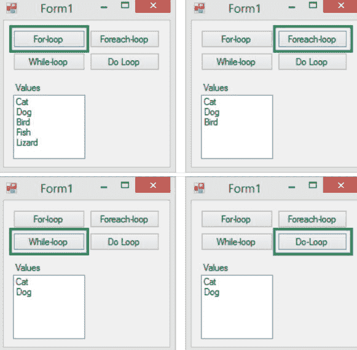

## For

`for` 循环是一种遍历一组值的方法，直到给定的表达式求值为假为止。一个 `for` 循环包含三个部分：循环的起始值、控制循环停止的表达式以及计数器。

`int i = 0` 是起始值，`i < 5` 是让循环停止的条件，`i++` 是迭代器。

```cs
for (int i = 0; i < 5; i++)
{
    lstResult.Add(animals[i]);
}
```

另一种动态确定循环何时停止的方法是使用数组的 `Length` 属性或集合的 `Count` 方法来确定它有多少项。

```cs
for (int i = 0; i < animals.Length; i++)
{
    lstResult.Add(animals[i]);
}
```

## Foreach

使用 `foreach` 循环，你不需要知道元素的数量，因为它会遍历数组中的所有元素，除非你使用 `break` 命令显式结束循环。

```cs
foreach (string animal in animals)
{
    if (animal.Equals("Fish")) break;
    lstResult.Add(animal);
}
```

## While

`while` 循环是在条件为真时执行代码块的循环。需要注意的是，如果初始条件为假，`while` 循环将不会执行。

```cs
int counter = 0;
while (!animals[counter].Equals("Bird"))
{
    lstResult.Add(animals[counter]);
    counter++;
}
```

## Do

`do` 循环与 `while` 循环相反，至少执行一次。

```cs
int counter = 0;
do
{
    lstResult.Add(animals[counter]);
    counter++;
} while (!animals[counter].Equals("Bird"));
```

## 练习：循环

在本次练习中，你将使用 `foreach` 循环将数组值添加到列表框中，当用户点击 **Move (For)** 或 **Move (While)** 按钮时，选中的值将移动到第二个列表框。

可以通过调用 `Items.Clear` 方法清除显示选中值的列表框。

```cs
1stSelected.Items.Clear();
```

# C# 初学者

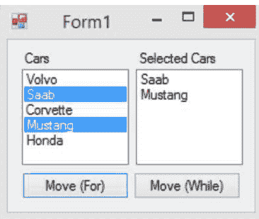

## 添加控件

1. 在 Visual Studio 中创建一个 Windows Forms 并命名为 Loops。
2. 在表单添加一个文本为 Cars 的标签。
3. 在标签下方添加一个列表框并命名为 `ItCars`。
4. 在列表下方添加一个文本为 Move (For) 的按钮并命名为 `btnMoveCars-For`。
5. 将列表的 `SelectionMode` 属性设置为 `MultiExtended`，以便在按住 Ctrl 或 Shift 键时选择多个项。
6. 在表单添加一个文本为 Selected Cars 的标签。
7. 在标签下方添加一个列表框并命名为 `ItSelectedCars`。
8. 在列表下方添加一个文本为 Move (While) 的按钮并命名为 `btnMove-CarsWhile`。

## 向 ItCars 列表框添加值

1. 双击表面区域（而不是控件）以添加 `Form_Load` 事件。
2. 定位 `Form1` 类的开头添加一个名为 `cars` 的字符串数组，其中包含汽车列表。

```cs
public partial class Form1 : Form
{
    string[] cars = {
        "Volvo", "Saab", "Corvette", "Mustang", "Honda" };
}
```

# C# 初学者

3. 找到 `Form_Load` 事件并使用 `for` 循环将 `cars` 数组中的项添加到 `LstCars` 列表框。使用 `cars` 数组的 `Length` 属性来确定所需的迭代次数。

```cs
for (int i = 0; i < cars.Length; i++)
{
    LstCars.Items.Add(cars[i]);
}
```

`Form_Load` 事件的完整代码如下：

```cs
private void Form1_Load(object sender, EventArgs e)
{
    for (int i = 0; i < cars.Length; i++)
    {
        LstSelectedCars.Items.Add(cars[i]);
    }
}
```

## 使用 foreach 循环将选中值移动到 LstSelectedCars 列表框

1. 在表单设计器中双击 `btnMoveCars` ，这将创建并带你进入按钮的 `Click` 事件。
2. 清空 `LstSelectedCars` 列表框。

```cs
SelectedCars.Items.Clear();
```

3. 使用 `foreach` 循环将选中项从 `LstCars` 列表框移动到 `LstSelectedCars` 列表框。你可以在列表的 `SelectedItems` 属性中找到选中项。

```cs
foreach (string car in LstSelectedCars.SelectedItems)
{
    LstSelectedCars.Items.Add(car);
}
```

4. 运行并在列表中选择一个或多辆汽车，点击列表框时按住 Ctrl 或 Shift 键选择多项。
5. 点击 Move (For) 按钮将选中项移动到 `LstSelectedCars` 列表。
6. 关闭应用程序。

# C# 初学者

`btnnMoveCarsFor_Click` 事件的完整代码如下：

```cs
private void btnnMoveCarsFor_Click(object sender, EventArgs e)
{
    lstSelectedCars.Items.Clear();
    foreach (string car in lstSelectedCars.SelectedItems)
    {
        lstSelectedCars.Items.Add(car);
    }
}
```

## 使用 while 循环将选中值移动到 lstSelectedCars 列表框

1. 在表单设计器中双击 `btnMoveWhile` 按钮，这将创建并带你进入按钮的 `Click` 事件。
2. 清空 `lstSelectedCars` 列表框。

```cs
lstSelectedCars.Items.Clear();
```

3. 使用 `while` 循环将选中项从 `lstCars` 列表框移动到 `lstSelectedCars` 列表框。你可以在列表框的 `SelectedItems` 属性中找到选中项。

```cs
int index = 0;
while (index < lstCars.SelectedItems.Count)
{
    lstSelectedCars.Items.Add(lstCars.SelectedItems[index]);
    index++;
}
```

4. 运行并在列表中选择一个或多辆汽车，点击列表框时按住 Ctrl 或 Shift 键选择多项。
5. 点击 Move (While) 按钮将选中项移动到 `lstSelectedCars` 列表。
6. 关闭应用程序。

`btnMoveCarsWhile_Click` 事件的完整代码如下：

```cs
private void btnMoveCarsWhile_Click(object sender, EventArgs e)
{
    lstSelectedCars.Items.Clear();
    int index = 0;
    while (index < lstSelectedCars.SelectedItems.Count)
    {
        lstSelectedCars.Items.Add(lstCars.SelectedItems[index]);
        index++;
    }
}
```

# 5. 调试

## 简介

调试是你必须采用并学习的技能，用于监控程序流中的运行情况，它通常用于发现和修复错误。在特定点进行调试时，你可以通过在代码中插入所谓的“断点”来查看变量和控制属性的当前值。当命中断点时，执行将停止，这样你就可以切换到开发环境并弄清楚应用程序在该阶段发生了什么。

调试时你可以利用许多窗口，你将在这里熟悉其中一些。

在调试模式下，命中断点后，你可以逐步执行代码，这简化了查找需要修复的问题所在的任务。要调试应用程序，它必须处于 Debug 模式；你可以从主菜单栏下方的标准工具栏设置该模式。

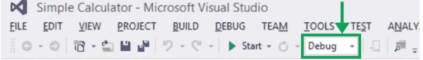

## 断点和窗口

如果你大致知道想要调试的问题所在，你可以在想要停止执行的行上放置断点。这允许你使用可用于调试的各种窗口和工具。

要设置或删除断点，请点击所需的代码行并从 Debug 菜单中选择“切换断点”、按下键盘上的 `F9` 键，或点击目标代码行左侧的灰色区域。断点显示为代码窗口左侧灰色区域上的实心红圈，代码背景将变为深红色。

# C# 初学者

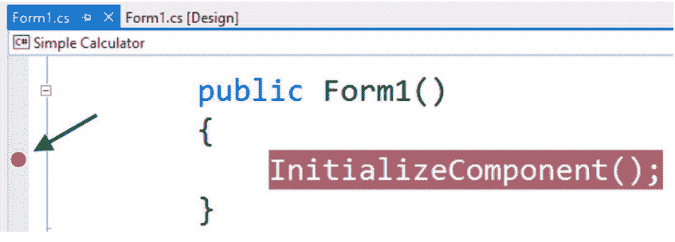

```cs
public Form1()
{
    InitializeComponent();
}
```

要以调试模式启动应用程序，请按键盘上的 `F5` 键，在主菜单中选择调试-开始调试，或点击标准工具栏上的播放按钮。如果你想在禁用调试的情况下启动应用程序，可以按键盘上的 `Ctrl+F5` 或在主菜单中选择调试-无调试启动。

当执行遇到断点时，执行将在该断点处停止，使你能够使用下表描述按钮或键盘键逐步执行代码。注意，设置断点的代码行将高亮显示；这种高亮效果将在逐步执行时显示下一行执行的行。逐步执行代码时，使用 `F11` 逐行执行代码，并在方法被调用时进入方法内部；并使用 `F10` 逐行执行，但在方法被调用时完整执行方法，而不进入方法内部。

# C# 初学者

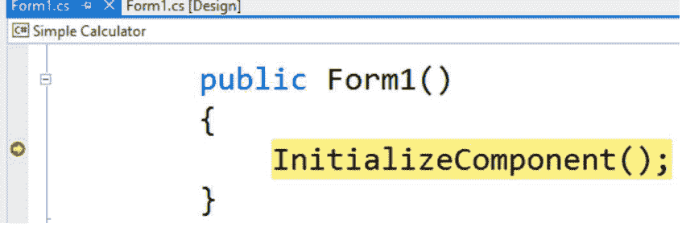

```cs
public Form1()
{
    InitializeComponent();
}
```

| 调试菜单 | 键盘键 | 描述 |
| :--- | :--- | :--- |
| 开始调试 | `F5` | 启动应用程序 |
| 全部中断 | `Ctrl+Break` | 中断应用程序 |
| 停止调试 | `Ctrl+F5` | 停止调试 |
| 重启 | `Ctrl+Shift+F5` | 重启应用程序 |
| 单步进入 | `F11` | 进入方法 |
| 单步跳过 | `F10` | 执行方法而不进入 |
| 单步跳出 | `Shift+F11` | 退出方法 |

（注：原文后续部分存在大量重复描述，此处已根据核心内容进行整合翻译）

6. 打开“监视”窗口并为其添加一个变量，在单步执行代码时观察窗口中的变化。
7. 打开“本地”窗口，在单步执行代码时观察窗口中的变化。
8. 打开“自动显示”窗口，在单步执行代码时观察窗口中的变化。
9. 关闭应用程序。

## 练习：调试订单表单

在此练习中，你将打开之前创建的订单表单项目。你希望在点击产品单元控件中的向上/向下按钮时，向“输出”窗口打印调试信息。请在一行中打印产品名称、价格和行总额，并在不同的列中打印这些值。为这些值添加描述性文本（见下图）。

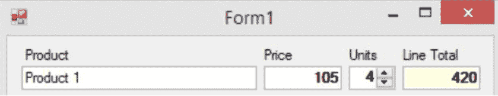
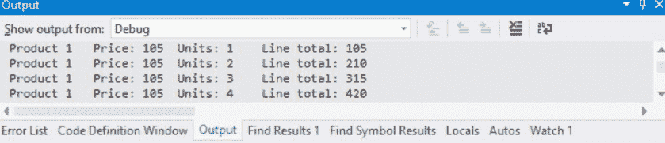

1. 打开你在之前的练习中创建的订单表单。
2. 找到 `numUnits1_ValueChanged` 事件，当点击 `NumericUpDown` 控件中的向上/向下按钮时会触发该事件。
3. 在事件的最后一行代码之后添加代码：

```cs
Debug.WriteLine(String.Format("{0}\tPrice: {1}\tUnits: {2}\tlineTotal: {3}", txtProduct1.Text, price, units, lineTotal));
```

4. 对其他 `ValueChanged` 事件重复步骤 2-3。
5. 打开“输出”窗口。
6. 运行应用程序，向表单添加数据并点击向上/向下箭头。点击按钮时，数据应写入输出窗口（见上图）。
7. 关闭应用程序。

# 6. 简单类型

## 引言

简单类型是用户定义的类型，你可以使用 `struct`（结构体）或 `enum`（枚举）关键字来创建自己的数据类型。在某些情况下，如果不涉及多个变量，单个值不足以表示你正在处理的数据；与其声明多个变量，你可以将它们封装在一个赋予适当名称的 `struct` 块中。从结构体声明的变量可以用于访问存储在其中的多个相关值。

枚举基本上是一组相互相关的常量值列表。

### 枚举

如果你想创建一个具有固定值集的变量，例如星期几的名称或月份，那么 `enum` 是一个很好的选择。枚举始终在名称级别或类级别声明。

虽然理论上你可以使用多个文本或数值变量来实现类似的结果，但不建议这样做，因为代码将难以维护得多。使用枚举有几个优点：

- **提高可管理性**
  使用枚举时遇到无效参数和拼写错误的名称概率较低。枚举由于有一组固定的值，因此限制了可以使用哪些值。
- **提高开发者体验**
  枚举中的可用值将通过 IntelliSense 显示。
- **提高代码可读性**
  使用枚举使代码更容易阅读和理解。
- **提高可重用性**
  你可以轻松在不同场景中重用同一个枚举。

# C# 初学者教程


每个枚举成员都有一个名称和一个值；名称是你在括号中列出的字符串，值是从 0 开始的整数；第一个成员获得值 0，下一个值是 1，依此类推。看下一个示例，周日的值为 0，周一的值为 1。

如果需要，你可以通过简单为枚举成员赋予整数值为它们分配自定义值。你可以通过将枚举转换为整数 `(int)day` 来访问枚举，或者在不转换的情况下使用值名称 `day.Sunday`。

你可以将枚举用于 `if` 语句或 `switch` 表达式。你也可以通过使用枚举作为变量类型声明变量，或作为方法定义中的参数来使用枚举。

以下示例声明了一个名为 `Weekday` 的枚举，然后可以使用它可以创建变量或用于条件逻辑。

```csharp
enum Weekday {
  Sunday, Monday, Tuesday, Wednesday, Thursday, Friday, Saturday
}
```

以下代码可以使用该枚举声明变量。

```csharp
var today = Weekday.Saturday; // 隐式声明
Weekday today = Weekday.Monday; // 显式声明
```

以下代码将判断 `today` 天是否为周末。

```csharp
var isWeekend = today.Equals(Weekday.Saturday) ||
today.Equals(Weekday.Sunday);
```

以下代码在 `if` 语句中使用 `today` 变量的值。

```csharp
if(today.Equals(Weekday.Friday))
{}
```

以下代码在 `switch` 中使用 `today` 变量。

```csharp
switch (today)
{
    case Weekday.Saturday:
    case Weekday.Sunday:
        Debug.WriteLine("Is weekend");
        break;
    default:
        Debug.WriteLine("Is weekday");
        break;
}
```

以下代码将存储在 `today` 变量中的天从 `Weekday` 数据类型转换为 `int` 数据类型。

```csharp
int dayNumber = (int)today;
```

在接下来的代码中，为方法定义了一个 `Weekday` 参数。在调用方法时，该参数将被赋予其值。

```csharp
void MethodUsingEnum(Weekday day)
{}
```

如果你想遍历枚举中的名称以便在组合框或列表控件中显示这些名称，你将必须使用枚举类型及其方法。使用 `typeof` 关键字获取枚举的底层类型，以便在运行时对其进行操作。调用 `GetEnumNames` 方法列出值名称。以下代码将 `Weekday` 枚举的值名称（天数的名称）添加到名为 `cbWeekday-days` 的组合框中。

```csharp
cboWeekdays.Items.AddRange(typeof(Weekday).GetEnumNames());
```

扩展阅读：[枚举类型 (C# 编程指南)]

## 练习：星期几（第 1 部分）

在接下来的练习中，你将向代码后台的表单类添加一个枚举，然后使用该枚举为组合框和列表框填充存储在枚举中的星期几。

当在任一控件中选择新一天时，标签应该通过更改标签背景颜色和文本来指示两个选定的天是否相同。如果相同，使用 `LightGreen`（浅绿色），否则使用 `LightPink`（浅红色）。文本应该是“The selected days are equal:”，然后根据是否相同跟上 `true` 或 `false`。

组合框和列表框都使用相同的 `SelectedIndexChanged` 事件来判断星期几是否相同。

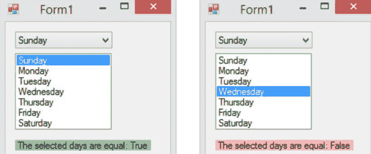

1. 在 Visual Studio 中创建一个新的 **Windows Forms Application** 并将其命名为 *Weekdays*。
2. 将组合框控件拖到表单上并将其命名为 `cboWeekdays`。
3. 将组合框的 `DropDownStyle` 属性更改为 `DropDownList`，启用仅选择模式，使其行为像下拉列表而不是带有文本框的组合框。
4. 将列表框拖到组合框下方的表单上并将其命名为 `lstWeekdays`。
5. 在列表框下方拖入一个标签并将其命名为 `lblAreEqual`。
6. 双击表单获取 `Form_Load` 事件。
7. 滚动到代码后台文件的开头。
8. 在表单类的括号内添加包含星期几的 **enum** `Weekdays`。
9. 回滚到 `Form_Load` 事件。

```csharp
private void Form1_Load(object sender, EventArgs e)
{
}
```

```csharp
enum Weekday { Sunday, Monday, Tuesday, Wednesday, Thursday, Friday, Saturday }
```

10. 使用 `typeof` 关键字及其 `GetEnumNames` 方法获取星期几名称，并将它们添加到组合框和列表框中（使用 `AddRange` 方法）。

```csharp
cboWeekdays.Items.AddRange(typeof(Weekday).GetEnumNames());
lstWeekdays.Items.AddRange(typeof(Weekday).GetEnumNames());
```

11. 使用 `DateTime` 数据类型获取今天的星期，并将其赋值给组合框和列表框的 `SelectedIndex` 属性以选择当前日期。

```csharp
cboWeekdays.SelectedIndex = (int)DateTime.Today.DayOfWeek;
lstWeekdays.SelectedIndex = (int)DateTime.Today.DayOfWeek;
```

12. 回到表单设计视图并选择组合框。
13. 在属性窗口的事件部分找到 `SelectedIndexChanged`。
14. 在事件字段添加 `Weekdays_SelectedIndexChanged` 并按回车。你将自动进入列表框的进入方法。

```csharp
private void Weekdays_SelectedIndexChanged(object sender, EventArgs e)
{
}
```

15. 获取组合框 `SelectedItem` 属性的值并存储在名为 `cbDay` 的变量中，然后对列表框执行相同操作，将值存储在变量 `lstDay` 中。

```csharp
var cbDay = cboWeekdays.SelectedItem;
var lstDay = lstWeekdays.SelectedItem;
```

16. 根据选定的天是否相同更改标签上的文本颜色。

```csharp
lblAreEqual.Text = String.Format("The selected days are equal: {0}", cbDay.Equals(lstDay));
```

17. 根据选定的天是否相同更改标签的背景颜色。

```csharp
lblAreEqual.BackColor = cbDay.Equals(lstDay) ? Color.LightGreen : Color.LightPink;
```

18. 运行应用程序并在两个控件中选择不同的日期，确保标签根据练习描述中的规则发生更改。
19. 关闭应用程序。

## 结构体

你可以使用 `struct` 关键字来创建自定义的轻量级数据结构，它将相关信息作为一个单一项目存储。适合结构体的数据示例是一个点，你可以创建一个 `Point` 结构体，其中包含 x-y 坐标的变量或属性。有人可能会认为可以使用类代替，这确实如此，但结构体比类更快，因为它们存储在栈上，因此在删除时不需要传递给垃圾回收器。大多数内置类型如 `int`、`bool` 和 `long` 都被定义为结构体。

在创建结构体时，`struct` 关键字之前会有一个访问修饰符：`public`、`internal` 或 `private`。`public` 意味着结构体可以在任何地方访问。`internal`（默认）意味着该类型可以在同一个项目中访问，但不能从其他项目访问；如果省略了访问修饰符，则使用此修饰符。`private` 意味着结构体仅对同一结构体或类内的代码可见；这要求结构体必须位于另一个类型内部。

如果你想在创建实例时对其进行初始化，可以在结构体中声明构造函数。构造函数的名称始终与结构体相同，如果你不提供默认构造函数，编译器总是创建一个空的默认构造函数。只要参数列表是唯一的，就可以在同一个结构体中添加多个构造函数。

**重要提示：** 在添加带参数的构造函数时，结构体中的所有底层变量或属性都必须使用构造函数块内部的值初始化。

为了在结构体中存储信息，你可以在内部声明字段（变量）和属性来保存值。不建议在结构体中使用公共字段；相反，你应该使用属性来获取和设置私有字段的值，请参见“属性”章节。

此代码声明了一个带有构造函数的结构体。

```csharp
private struct Point
{
    public int x, y;
    public Point(int x, int y)
    {
        this.x = x;
        this.y = y;
    }
}
```

以下代码在声明变量时使用了 `Point` 结构体；注意，在基于结构体创建变量时，必须使用 `new` 关键字。变量可以在类级别声明，也可以在事件或方法中声明。

```csharp
Point point = new Point(10, 20);
```

你可以通过在变量名后写一个点（.），后跟你想要读取或更改的（属性）名称，随时读取或更改点变量内部变量（属性）的值。在代码中，在将 point 变量的内容打印到输出窗口之前，x 变量从初始值 10 更改为 30。

```csharp
private void Form1_Load(object sender, EventArgs e)
{
    point.x = 30;
    Debug.WriteLine(String.Format("x:{0}, y:{1}", point.x, point.y));
}
```

## 属性

属性用于获取和设置位于结构体或类中的私有变量。使用属性的一个巨大优势是，你可以在通过属性赋值或返回值之前执行数据检查。另一个优势是，你可以更改属性的实现而不影响客户端代码（只要你不删除属性或更改其访问修饰符或名称）。第三个优势是你可以将控件绑定到属性，但不能绑定到变量。对于结构体或类的使用者来说，该属性看起来像一个公共变量。

在实现属性时，你使用 `get` 和 `set` 访问器。`get` 访问器用于使用 `return` 语句从私有字段返回值；`set` 访问器使用一个名为 `value` 的特殊局部变量将值分配给私有变量。当客户端代码为属性赋值时，该值就会被分配。

你可以通过提供同时 `get` 和 `set` 块（可读/写）、仅 `get` 块（只读）或仅 `set` 块（只写）来决定客户端代码如何使用属性。

有一个预定义的代码片段，你可以通过输入 `prop` 然后按键盘上的 `Tab` 键来使用，此模板可以显著提高你的编码速度。

属性还可以用于整合数据并为客户端提供结果。例如，你可以创建一个属性，从包含名和姓的两个私有变量或属性返回全名。或者，你可以根据业务逻辑返回或赋值值。记住从构造函数中为所有私有变量赋值。

此示例代码基于之前的 `Point` 结构体代码，其中结构体添加了两个变量 `x` 和 `y` 并通过构造函数进行了赋值。现在将公共变量更改为属性，以使结构体符合最佳实践。

变量已从公共更改为私有，使其仅在结构体内部可见，并添加了两个属性来反映结构体外部的值并使可以更改值。注意，属性名称以大写字母开头，而变量和常量以小写字母或下划线开头。

```csharp
private struct Point
{
    private int x, y;
    public int X { get { return x; } set { x = value; } }
    public int Y { get { return y; } set { y = value; } }
    public Point(int x, int y)
    {
        this.x = x;
        this.y = y;
    }
}

Point point = new Point(10, 20);
```

```csharp
private void Form1_Load(object sender, EventArgs e)
{
    point.X = 30;
    Debug.WriteLine(String.Format("x:{0}, y:{1}", point.X, point.Y));
}
```

## 练习：星期（第 2 部分）

在此练习中，你将修改上一节中实现的枚举星期。你把关于周期的信息封装在一个结构体中，并在添加到组合框和列表框时使用它；不再作为字符串添加星期，而是作为 `Day` 实例添加。修改列表中的数据将允许将项目转换为 `Day` 实例，然后使用结构体提取数据。

### 创建 Day 结构体

在 `class` 内部创建一个名为 `Day` 的结构体，因为它位于 `class` 内部，所以仅在类内部可见；如果你想让它具有更广泛范围，可以在类之外声明为 `internal` 或 `public`。

结构体应该有一个名为 `Weekday` 的属性，用于获取或设置之前创建的 `Weekday` 枚举值。它还应该有一个名为 `DayNumber` 的整数属性，用于跟踪存储在结构体变量中的星期几，一个名为 `DayName` 的字符串属性以及一个名为 `IsWeekday` 的布尔属性（如果是工作日则返回 `true`，否则返回 `false`）。

`DayNumber` 和 `IsWeekday` 属性应仅返回值，不能从代码为它们赋值（仅使用 `get` 块并省略 `set` 块）。

此练习中的结构体有两个构造函数，其中一个带有 `Weekday` 参数，以便将星期直接分配给结构体中的私有局部变量 `weekday`，该变量用于存储 `Weekday` 属性的值。第二个构造函数应该有一个整数参数，该参数被转换为 `Weekday` 枚举类型，从而转换为实际的星期，并存储在私有局部变量 `weekday` 中。

你将需要使用循环，在循环中为 `Weekday` 枚举中的每一天创建一个新的 `Day` 实例，然后将其添加到数组中。由于在前面的章节中仅简要提到了循环，因此代码将在此提供。由于此练习中的工作日从星期日开始，你可以假设它是第 0 天，知道 `for` 循环可以从 0 开始计数器。在这种情况下，确定循环应该执行多少次很容易，因为一周始终有 7 天。为了向你展示更动态的实现方法，你将使用 `Weekday` 枚举的 `GetEnumValues`。在循环体内创建一个 `Day` 结构体类型的实例（变量），并将日期（当前循环值）传递给其构造函数，这将创建存储在当前处理日期的数组索引中的日期。当循环完成后，`weekdays` 数组将包含每周每一天的七个 `Day` 结构体实例。

```csharp
Day[] weekdays = new Day[7];
```

```csharp
for (int dayNbr = 0; dayNbr < typeof(Weekday).GetEnumValues().Length; dayNbr++) {
    var day = new Day(dayNbr);
    weekdays[dayNbr] = day;
}
```

使用该数组作为组合框的数据源，并将其复制用于列表框。将 `weekdays` 数组赋值给组合框的 `DataSource` 属性，并在 `weekdays` 数组变量上调用 `Clone` 方法创建数组副本，将其赋值给列表框的相同属性。由于你正在将结构体实例分配给列表控件，你必须指定显示哪个属性值作为控件中的文本，你可以通过将属性名称作为字符串赋值给列表控件的 `DisplayMember` 属性来实现，在一种情况下是 `DayName`。

要为列表控件设置当前工作日，你需要创建一个新的 `Day` 结构体变量，并将 `DateTime` 类的 `Today.DayOfWeek` 属性传递给其构造函数，并将该变量分配给组合框和列表框的 `SelectedItem` 属性。

为了避免处理空引用，你需要将 `Weekdays_SelectedIndexChanged` 事件中的现有代码封装在一个 `if` 块中，检查组合框和列表控件的 `SelectedItem` 属性是否为空。

将存储在 `cboDay` 和 `lstDay` 变量中的 `SelectedItem` 属性强制转换为 `Day` 数据类型。你必须这样做是因为在循环中，你向数组添加了七个 `Day` 结构体实例（每周每天一个），这些随后被作为列表控件的数据源。这种情况使得在显示所选日期信息时可以使用属性值。

接下来，你想在 `lblAreEqual` 标签中添加一行文本，显示两个所选工作日的名称，以及它是工作日还是周末（使用 `Day` 变量的 `IsWeekday` 属性来判断它们是工作日还是周末的一部分）。保留现有变量作为标签的第二行，使用 `\n` 格式命令创建换行符并使用 `+=` 运算符将旧文本附加到新文本。

保持背景颜色的逻辑不变。

### 创建 Day 结构体

1. 打开你在枚举部分创建的 `Weekdays` 项目。
2. 切换到代码后台窗口。
3. 在类开头找到 `Weekday` 枚举。


## 4. 在 `Weekday` 枚举下方添加一个 `Day` 结构体

```csharp
struct Day
{}
```

## 5. 在结构体内部使用 `Weekday` 枚举作为数据类型，添加一个名为 `weekday` 的私有变量及其对应的公共属性 `Weekday`

该变量将作为存储在 `Day` 结构体中的数据的占位符，并将通过构造函数或 `Weekday` 属性赋值。

```csharp
private Weekday weekday;
public Weekday Weekday { get { return weekday; } set { weekday = value; } }
```

## 6. 添加一个公共的 `int DayNumber`，返回存储在结构体中并转换为 `int` 的工作日

该属性应是只读的。

```csharp
public int DayNumber { get { return (int)weekday; } }
```

## 添加一个公共的字符串属性 `DayName`，以字符串形式返回工作日

对 `weekday` 变量使用 `ToString` 方法。该属性应是只读的。

```csharp
public string DayName { get { return weekday.ToString(); } }
```

## 添加一个公共的布尔属性 `IsWeekday`

如果结构体中存储的工作日是（周一至周五），则返回 `true`；你可以将 `weekday` 变量中的值与 `Weekend` 枚举中的日期进行比较。该属性应是只读的。

```csharp
public bool IsWeekday { get { return !weekday.Equals(Weekday.Sunday) && !weekday.Equals(Weekday.Saturday); } }
```

## 添加一个带有 `Weekday` 枚举参数 `weekday` 的构造函数方法

注意，构造函数是一个与结构体同名的方法。将参数 `weekday` 赋值给结构体中的私有 `weekday` 变量以便以后使用。

```csharp
public Day(Weekday weekday) {
    this.weekday = weekday;
}
```

## 添加第二个构造函数方法，带有 `int` 参数 `weekday`

通过使用 `Weekday` 枚举强制转换 `weekday` 参数赋值给结构体中的私有 `weekday` 变量。

```csharp
public Day(int weekday) {
    this.weekday = (Weekday)weekday;
}
```

## `Day` 结构体的完整代码如下

```csharp
struct Day {
    private Weekday weekday;
    public Weekday Weekday {
        get { return weekday; }
        set { weekday = value; }
    }
    public int DayNumber { get { return (int)weekday; } }
    public string DayName { get { return weekday.ToString(); } }
    public bool IsWeekday {
        get { return !weekday.Equals(Weekday.Sunday) && !weekday.Equals(Weekday.Saturday); }
    }
    public Day(Weekday weekday) {
        this.weekday = weekday;
    }
    public Day(int weekday) {
        this.weekday = (Weekday)weekday;
    }
}
```

# C# 初学者

## Form_Load 事件

### 1. 找到 `Form_Load` 事件并注释掉或删除其中的所有代码

### 2. 创建名为 `weekdays` 的数组，能够存储每周每天的 7 个 `Day` 实例

```csharp
Day[] weekdays = new Day[7];
```

### 3. 添加一个 `for` 循环遍历 `Weekday` 枚举中的天数

每次迭代创建一个 `Day` 变量，并将循环索引作为值传递给构造函数，以存储具有工作日的 `Day` 变量（你添加的第二个构造函数）。将 `Day` 添加到数组中对应循环索引变量当前值的位置。

```csharp
for (int daynbr = 0; daynbr < typeof(Weekday).GetEnumValues().Length; daynbr++) {
    var day = new Day(daynbr);
    weekdays[daynbr] = day;
}
```

### 4. 将 `weekdays` 数组赋值给组合框的 `DataSource` 属性，并将数组的副本（clone）赋值给列表框，从而填充数据

使用数组变量的 `Clone` 方法创建副本。如果你不创建数组副本，两个列表控件将使用相同的数据，通过共享内存将它们连接在一起，导致副作用。

### 5. 通过将属性名称作为字符串赋值给组合框和列表框的 `DisplayMember` 属性，告诉列表控件应显示哪个属性值

### 6. 使用 `DateTime` 类使用当前周的值初始化列表控件

创建一个名为 `dayOfWeek` 的变量。

### 7. 使用结构体作为数据类型创建一个新变量

将你创建的 `today` 变量赋值给组合框和列表的 `SelectedItem` 属性，以便在列表中选择相应的日期。

## `Form_Load` 事件的完整代码如下

```csharp
private void Form1_Load(object sender, EventArgs e)
{
    Day[] weekdays = new Day[7];
    for (int nbr = 0; nbr < typeof(Weekday).GetEnumValues().Length; nbr++)
    {
        var day = new Day(nbr);
        weekdays[nbr] = day;
    }

    cboWeekdays.DataSource = weekdays;
    1stWeekdays.DataSource = weekdays.Clone();
    cboWeekdays.DisplayMember = "DayName";
    1stWeekdays.DisplayMember = "DayName";

    var dayOfWeek = (int)DateTime.Today.DayOfWeek;
    Day today = new Day(dayOfWeek);
    cboWeekdays.SelectedItem = today;
    1stWeekdays.SelectedItem = today;
}
```

# C# 初学者教程

```csharp
var dayOfWeek = (int)DateTime.Today.DayOfWeek;
var today = new Day(dayOfWeek);
cboWeekdays.SelectedItem = today;
1stWeekdays.SelectedItem = today;
}
```

## Weekdays_SelectedIndexChanged 事件

### 1. 找到 `Weekdays_SelectedIndexChanged` 事件

### 2. 在事件内部代码周围添加一个 `if` 语句和代码块，检查组合框和列表框的 `SelectedItem` 属性是否不为 `null`

如果你尝试转换 `null` 值，将抛出异常（错误），但你可以通过检查值是否为 `null` 来避免这种情况。第一次触发事件时，框执行的 `SelectedItem` 将为 `null`，因为尚未向其添加任何值。

```csharp
if (cboWeekdays.SelectedItem != null && 1stWeekdays.SelectedItem != null)
{
}
```

### 3. 在将 `SelectedItem` 赋值给 `cboDay` 和 `1stDay` 变量时，使用 `Day` 结构体数据类型对 `SelectedItem` 属性进行强制转换

```csharp
var cboDay = (Day)cboWeekdays.SelectedItem;
var 1stDay = (Day)1stWeekdays.SelectedItem;
```

### 4. 添加所选星期几的名称，并判断它们是工作日还是周末

```csharp
lbl1AreEqual.Text = String.Format("{0}: {1}, {2}: {3}",
    cboDay.DayName, cboDay.IsWeekday ? "Weekday" : "Weekend",
    1stDay.DayName, 1stDay.IsWeekday ? "Weekday" : "Weekend");

lbl1AreEqual.Text += String.Format("\nThe selected days are equal: {0}", cboDay.Equals(1stDay));
```

### 5. 运行应用程序，确保当组合框和列表框中的日期变化时，显示正确的文本

# C# 初学者教程

## `Weekdays_SelectedIndexChanged` 事件的完整代码如下

```csharp
private void Weekdays_SelectedIndexChanged(object sender, EventArgs e) {
    if (cboWeekdays.SelectedItem != null && 1stWeekdays.SelectedItem != null) {
        var cboDay = (Day)cboWeekdays.SelectedItem;
        var 1stDay = (Day)1stWeekdays.SelectedItem;

        lbl1AreEqual.Text = String.Format("{0}: {1}, {2}: {3}", cboDay.DayName, cboDay.IsWeekday ? "Weekday" : "Weekend", 1stDay.DayName, 1stDay.IsWeekday ? "Weekday" : "Weekend");

        lbl1AreEqual.Text += String.Format("\nThe selected days are equal: {0}", cboDay.Equals(1stDay));

        lbl1AreEqual.BackColor = cboDay.Equals(1stDay) ? Color.LightGreen : Color.LightPink;
    }
}
```

# 7. 方法

## 引言

将解决方案分为较小的、逻辑清晰的组件是非常重要的；方法是将代码分组为独立工作单元的方法。如果在事件中编写所有代码，而不使用方法来结构化应用程序，将变得几乎无法维护。在本章中，你将学习如何创建和调用方法。

方法是封装为特定目的设计的操作方式，并保护存储在类型（如类或结构体）中的数据。在执行应用程序时会调用许多系统方法，其中一个方法是 `Main`，它定义了应用程序的入口点，由 CLR 在应用程序启动时执行；你在书开头执行控制台应用程序时使用过此方法，但在执行 Windows Forms 应用程序时它也会在后台运行。

方法有不同的类型，某些方法仅供类型内部使用，在类型外部不可见，而其他方法是公共的，供其他类型向该对象实例请求信息。

.NET Framework 本身包含许多类，你可以使用这些类与用户、计算机或计算机操作系统进行交互。

## 创建方法

所有方法都包含两个部分：规范和方法体。规范定义了名称、参数、返回类型和可访问性（作用域）。每个方法必须有一个唯一的签名，该签名由名称和参数列表定义。省略可访问性将使方法具有私有作用域，使其仅在类型内部可访问。

## 方法命名

在命名方法时，你应该遵循与变量类似的命名规范。以下是你可以遵循的某些最佳实践。

### C# 初学者教程

- 命名方法时使用动词或动词短语；这让开发者更容易理解代码结构。
- 使用 Pascal 命名法（每个单词的首字母都应该大写）；不要用下划线或小写字母开头方法名。

## 方法体

方法体始终被包含在大括号中，是一个包含任何编程构造的代码块。在方法内部创建的变量在方法结束时将离开域（失效）并被销毁，因此只能在方法内部使用。

## 无参数方法

最简单的方法没有输入或输出数据的参数，且不返回值。这类方法被称为 `void` 方法，因为即使没有返回值也必须声明 `void` 类型。

如果你知道要在类或结构体中使用方法，可以使用 `void` 关键字来定义这种不返回结果的方法。

在本章中，所有方法，你将在稍后的章节中学习作用域。

一种可能需要使用无参数方法的场景是初始化控件时；以下示例显示了如何初始化标签。

```csharp
public class Form1 : Form
{
    private void Form1_Load(object sender, EventArgs e) {
        InitializeControls();
    }

    private void InitializeControls() {
        lbl1Test.AutoSize = false;
        lbl1Test.Size = new Size(80, 80);
        lbl1Test.Location = new Point(10, 10);
        lbl1Test.BorderStyle = BorderStyle.FixedSingle;
        lbl1Test.Font = new Font("Consolas", 20);
        lbl1Test.TextAlign = ContentAlignment.MiddleCenter;
        lbl1Test.BackColor = Color.White;
    }
}
```

## 带参数的方法

所有方法都在方法内部指定了参数列表；如果你不指定任何参数，将提供一个空列表。每个参数都用逗号分隔，并由类型和名称定义。参数的最佳实践是使用小驼峰命名法。

在以下示例中，用户可以在文本框中输入两个数字，点击 `Add` 按钮时，这两个值相加并显示在文本框中。为了防止按钮的 `Click` 事件过于臃肿，计算逻辑移动到了名为 `Add` 的独立方法，该方法接收两个 `double` 参数。

### C# 初学者教程

| 数字 1 | 数字 2 |
|---|---|
| 12 | 14 |
| 结果 | 26 |

还创建了接收字符串参数的方法用于在消息框中显示错误消息。此逻辑被放在独立方法中以便于复用。当用户在两个用于数值的文本框之一中输入非数值时，此处调用了它。

```csharp
public partial class Form1 : Form
{
    private void Add(double a, double b)
    {
        double result = a + b;
        txtResult.Text = result.ToString();
        txtResult.BackColor = result < 0 ? Color.LightPink : Color.LightGreen;
    }

    private void ErrorMessage(string message)
    {
        MessageBox.Show(message, "Error", MessageBoxButtons.OK, MessageBoxIcon.Error);
    }

    private void btnAdd_Click(object sender, EventArgs e)
    {
        double a = 0, b = 0;
        var successA = Double.TryParse(txtNo1.Text, out a);
        var successB = Double.TryParse(txtNo2.Text, out b);

        if (successA && successB)
            Add(a, b);
        else
            ErrorMessage("不是数值值!");
    }
}
```

## 使用引用参数的方法

当你使用 `ref` 关键字定义引用参数时，你是在指示通用语言运行时 (CLR) 将内存引用（指针）传递给传入的变量，而不是传递值。这意味着你既可以使用传入的值，也可以给它赋一个新值。

在此示例中，平方根是从文本框输入的值中计算的。当 `Sqrt` 方法计算出结果后，该结果将通过接收计算值的同一个参数传出；在 `Click` 事件中，修改后的值将显示在文本框中。

`double` 变量被用作引用参数，这意味着该变量的内存指针被设置到 `Sqrt` 方法中，使得方法可以使用并修改变量值，而不是像默认行为那样发送变量中存储的值。如你在 `Sqrt` 方法所示，在计算出平方根值后，该参数被赋值了平方根值。

由于无法计算负数的平方根，因此添加了一个 `If` 语句来检查通过 `a` 参数传递的值；如果该值为负数，则调用上一个示例中的 `ErrorMessage`。

在调用 `Sqrt` 方法之前还会进行值检查，以确保该值是数字，如果不是，则调用 `ErrorMessage` 方法。


```cs
public partial class Form2 : Form
{
    private void ErrorMessage(string message)
    {
        MessageBox.Show("Error", message, MessageBoxButtons.OK, MessageBoxIcon.Error);
    }

    private void Sqrt(ref double a)
    {
        if (a >= 0)
            a = Math.Sqrt(a);
        else
            ErrorMessage("Cannot calculate Sqrt from a negative number!");
    }
}
```

# C# 初学者

```cs
private void Sqrt_Click(object sender, EventArgs e)
{
    double a = 0d;
    var successA = Double.TryParse(txtNo.Text, out a);
    if (successA)
    {
        Sqrt(ref a);
        txtNo.Text = a.ToString();
    }
    else
    {
        ErrorMessage("Not numeric value!");
    }
}
```

延伸阅读：[ref (C Reference)](#)

## 使用输出参数的方法

如果你想从方法中传递多个返回值，可以在参数列表中使用输出参数。当你使用输出参数时，它们必须在方法体内部赋值。定义为 `out` 的参数不能向方法传递值，它只能从方法中传出值。

这基本上与本章中“带参数的方法”部分中的示例相同，不同在于 `Add` 方法中的结果是通过 `out` 参数从方法传出的；这种类型的参数除了返回返回值之外，不能在其他方法中使用，无法通过它使用传入的值，尝试这样做将产生编译错误。

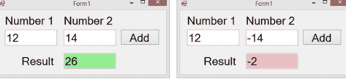

# C# 初学者

```cs
public partial class Form1 : Form
{
    private void Add(double a, double b, out double result)
    {
        result = a + b;
    }
}
```

```cs
private void ErrorMessage(string message)
{
    MessageBox.Show(message, "Error",
    MessageBoxButtons.OK, MessageBoxIcon.Error);
}
```

```cs
private void btnAdd_Click(object sender, EventArgs e)
{
    double a = 0, b = 0;
    var successA = Double.TryParse(txtNo1.Text, out a);
    var successB = Double.TryParse(txtNo2.Text, out b);

    if (successA && successB)
    {
        double result;
        Add(a, b, out result);
        txtReslut.Text = result.ToString();
        txtReslut.BackColor = result < 0 ?
        Color.LightPink : Color.LightGreen;
    }
    else
    {
        ErrorMessage("Not a numeric value!");
    }
}
```

延伸阅读：[out parameter modifier (C# Reference)]

## 有返回类型的方法

所有方法都有返回类型，即使是不返回值的方法也是如此。你使用 `void` 返回类型来指定方法不返回返回值。返回值的方法必须在方法体中有一个 `return` 语句，且返回的值的数据类型必须与方法声明中的类型相同。当方法到达 `return` 语句时，方法将退出；这意味着 `return` 语句之后代码将不会执行。

# C# 初学者

在此示例中，从 `Subtract` 方法使用返回值来向调用源发送事件结果。结果被收集在一个变量中，该变量被赋值为方法调用的结果。在 `Subtract` 方法内部，使用 `return` 关键字来返回算术操作的结果。注意，返回数据类型指定在方法名的左侧，之前其他方法使用 `void`，现在使用 `double` 数据类型来指定将使用 `return` 关键字返回值。

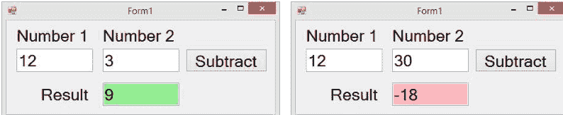

```cs
public partial class Form1 : Form
{
    private double Subtract(double a, double b) {
        return a - b;
    }
}
```

```cs
private void ErrorMessage(string message) {
    MessageBox.Show(message, "Error",
    Buttons.OK, MessageBoxIcon.Error);
}
```

```cs
private void btnSubtract_Click(object sender, EventArgs e) {
    double a = 0, b = 0;
    var successA = Double.TryParse(txtNo1.Text, out a);
    var successB = Double.TryParse(txtNo2.Text, out b);
    if (successA && successB) {
        var result = Subtract(a,b);
        txtResult = result.ToString();
        txtResult.BackColor = result < 0 ?
        Color.LightPink : Color.LightGreen;
    } else {
        ErrorMessage("Not a numeric value!");
    }
}
```

## 调用方法

由于方法封装了其逻辑并向调用者“隐藏”了它，你可能无法访问代码或不知道方法的内部工作原理；它可能由第三方类库或 .NET Framework 提供。

你可以通过指定其参数来调用方法。如果你不需要某个值，可以跳过。

```cs
double a = 0d, b = 0d;
var result = Subtract(a, b);
Sqrt(ref a);
Add(a, b);
```

延伸阅读："Methods (C# Programming Guide)”

## 重载方法

通过重载，你可以创建具有相同名称的方法实现。有时你可能根据参数的细微差异执行任务；可以使用重载，但每个签名必须是不同的。

在下方的 `Add` 方法示例中，使用了重载以便根据不同的数字调用方法。

```cs
private void Add(double a, double b)
{
    double result = a + b;
    txtReslut.Text = result.ToString();
    txtReslut.BackColor = result < 0 ? Color.LightPink : Color.LightGreen;
}
```

# C# 初学者

```cs
private void Add(double a, double b, out double result)
{
    result = a + b;
}
```

## 可选方法参数

你可能想要使用可选参数的情况是与组件对象模型 (COM) 库进行交互操作。由于这些库不支持重载，你可以使用可选参数。

另一种你可能使用可选参数的情况是当参数列表不足以区分方法实现来实现重载。

你通过在方法参数列表中为其赋值来声明可选参数。所有强制性（非可选）参数必须在任何可选参数之前声明。

调用带有可选参数的方法时，你可以省略全部或部分可选参数，因为它们在你提供的默认值；如果你有多个可选参数并省略了其中一个，则后续的参数也必须省略。当参数被省略时，方法将使用默认值。

在此示例中，你将看到如何实现一个通用的方法来格式化文本框和标签，这些控件在格式化和文本方面具有相同的属性。为了实现更通用的方法，将使用可选参数；在这种情况下，显示在控件中的文本以及背景和文本颜色将作为可选参数传递。

注意，你必须为可选参数分配编译时常量值，例如字符串，`default` 方法可以获取类型的默认值；在此示例中

# C# 初学者

在方法定义中，必须为 `Color` 枚举实现 `default` 方法，然后在方法体中使用 `if` 语句对其进行处理。

定义第一个参数的 `Control` 类被所有添加到表单的控件继承（作为其一部分），然后它可以处理传递给方法的任何控件，你将在稍后的章节中学习更多关于继承的知识。

`FormatControls` 方法从 `Form_Load` 事件中调用，各种标签和文本框（见下图）被发送到该方法中进行格式化。

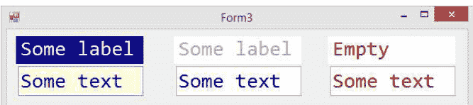

```csharp
public partial class Form3 : Form
{
    private void FormatControls(Control ctrl,
        string text = "Empty", Color color = default(Color),
        Color bkColor = default(Color))
    {
        if (color.Equals(Color.Empty))
            color = Color.DarkRed;
        if (bkColor.Equals(Color.Empty))
            bkColor = Color.White;

        ctrl.BackColor = bkColor;
        ctrl.ForeColor = color;
        ctrl.Text = text;
        ctrl.Font = new Font("Consolas", 20);
    }
}
```

```csharp
private void Form3_Load(object sender, EventArgs e)
{
    FormatControls(lblMessage, "Some label text",
        Color.White, Color.DarkBlue);
    FormatControls(txtMessage, "Some text",
        Color.DarkBlue, Color.LightYellow);

    FormatControls(lblMessage2, "Some label text", Color.DarkGray);
    FormatControls(txtMessage2, "Some text", Color.DarkBlue);
    FormatControls(lblMessage3);
    FormatControls(txtMessage3, "Some text");
}
```

## 命名方法参数

使用命名参数，你可以打破参数在方法中声明的顺序。要使用命名参数，请用冒号分隔参数名和值。

当与可选参数结合使用时，命名参数可以轻松省略某些参数。可选参数将接收它们的默认值。省略必选参数将导致编译错误。

如果你回顾上一个例子，它有一个名为 `FormatControls` 的方法，该方法实现了可选参数。在那个例子中，你了解到必须在第一个可选参数之后指定所有的后续参数，虽然事实如此，但你可以通过使用命名参数来绕过这一点。如果你想在调用 `FormatControls` 方法时发送文本和背景颜色但省略文本，或者你只想发送文本颜色而省略其他两个可选参数，那么你需要使用命名参数来实现该方法。

```csharp
private void Form3_Load(object sender, EventArgs e)
{
  // 使用命名参数
  FormatControls(txtMessage3, "Some text", bkColor: Color.LightSkyBlue);
  FormatControls(txtMessage3, color: Color.DarkKhaki);
}
```

额外阅读：[命名和可选参数（C# 编程指南）](https://learn.microsoft.com/en-us/dotnet/csharp/language-reference/embedded/named-arguments)”

## 调试方法

在测试应用程序逻辑时，调试是一个非常强大的工具。在调试方法时，有三种步进代码的方法：进入（step into）、跳出（step out）和单步执行（step over）。

## 进入 (Step into)

按下键盘上的 `F11` 执行当前位置的语句；如果该语句是一个函数调用，调试将在该方法中继续。你可以点击 **进入** 按钮来实现相同效果；如果你以 **进入** 模式启动应用程序，它将在断点模式下启动。

## 单步执行 (Step over)

按下键盘上的 `F10` 执行当前位置的语句；如果该语句是一个函数调用，调试将执行该方法但不会进入其内部，而是继续执行下一行代码。异常情况是该方法中设置了断点，执行将在该行代码处停止。

## 跳出 (Step out)

将执行方法中的剩余代码，并在调用该方法的代码行处停止。

## 异常处理

异常处理是增强用户体验和避免不必要数据丢失的好方法。错误可能发生在应用程序逻辑中，也可能发生在引用到应用程序的外部代码中；例如，你可能不知道文件是否可以访问或数据库是否在线。

仅检查返回值不足以捕获所有类型的错误，因为并非所有方法都有返回值。了解方法为什么失败很重要，而不仅仅是知道它失败了。许多错误无法通过检查返回值来处理；一个错误可能是内存耗尽。

你使用异常来处理 .NET 中所有类型的错误。例如，如果一个方法尝试打开一个不存在的文件，将抛出一个异常。如果方法中没有处理异常，异常将传播到调用它的方法，该方法必须准备好处理该异常。异常将一直传播到应用程序的启动方法；如果未被方法处理，应用程序将崩溃并向用户显示一个难看的消息。

在 .NET Framework 中，所有异常都派生自 `Exception` 类。系统可以抛出许多专门的异常，它们都继承了 `Exception` 类。你甚至可以通过派生现有的异常类之一来创建自己的异常以处理应用程序逻辑。

| 异常类 | 命名空间 | 描述 |
| --- | --- | --- |
| Exception | System | 处理任何抛出的异常。作为故障保护使用。 |
| SystemException | System | System命名空间中所有异常的基类。处理由 CLR 产生的所有错误。 |
| ApplicationException | System | 处理应用程序产生的所有非致命异常。 |
| NullReferenceException | System | 处理与空对象相关的异常。 |
| FileNotFoundException | System.IO | 处理文件缺失的异常。 |

额外阅读：“异常类 (Exception Class)”

## Try/Catch 块

Try/catch 块是在应用程序中实现结构化异常处理 (SEH) 的方法。为了处理可能出现的异常，将代码封装在 `try` 块中并在一个或多个 `catch` 块中处理异常。建议在 catch 列表中使用通用的 `Exception` 类作为最后一个 catch 块来添加异常处理；此最后一个 catch 用于处理你可能忽略的任何异常。

在 catch 块中，你可以使用 catch 括号中定义的异常变量的 `Message` 等属性来显示或记录错误信息。

```csharp
try {
    // 要执行的代码
} catch (DivideZeroException ex) {
    // 特定的错误处理
} catch (Exception ex) {
    // 通用错误处理，捕获所有未处理的
} finally {
    // 无论是否抛出异常，始终将执行
}
```

如果在后续示例的第二个文本框中输入 `0`，执行将识别到你正尝试除以零，并抛出 `DivideZeroException`，处理异常的 catch 块中的代码将执行。反之，如果你输入非数值，第二个 catch 块将执行，因为那不会抛出 `DivideZeroException` 异常。


```csharp
private void btnDivide_Click(object sender, EventArgs e)
{
    try
    {
        int value1 = Int32.Parse(txtNo1.Text);
        int value2 = Int32.Parse(txtNo2.Text);

        var result = value1 / value2;
    }
    catch (DivideZeroException ex)
    {
        MessageBox.Show("抛出了除以零异常！");
    }
    catch (Exception ex)
    {
        MessageBox.Show(ex.Message);
    }
}
```

# C# 初学者教程

```csharp
try
{
    int value1 = Int32.Parse(txtNo1.Text);
    int value2 = Int32.Parse(txtNo2.Text);

    result = value1 / value2;
}
catch (DivideZeroException ex)
{
    MessageBox.Show("Divide by zero exception was thrown!");
}
catch (Exception ex)
{
    MessageBox.Show(ex.Message);
}
finally
{
    MessageBox.Show(String.Format("Result: {0}", result.ToString()));
}
```

附加阅读：“try-catch-finally (C# Reference)”

## 抛出异常

要在你的应用程序逻辑中实现异常处理，你需要了解如何抛出异常以及如何处理它们。当你抛出一个异常时，该方法的执行将结束，该异常将由 CLR 传递给第一个能够处理该特定异常的异常处理器。

使用 `throw` 关键字从你的应用程序逻辑中抛出异常。当系统异常与你的应用程序逻辑不匹配时，建议创建与你的应用程序逻辑对应的自定义异常类；考虑你可能希望随异常传递应用程序数据；为此，你需要创建一个派生自现有异常类的新异常类，并为其中的数据实现属性。

在例示例中，当第二个参数 (`b`) 的值为 0 时，被调用的方法会抛出一个 `ApplicationException`。然后该异常将在调用事件中被处理。

```csharp
public partial class Form5 : Form
{
    private double ThrowException(int a, int b)
    {
        if (b.Equals(0))
            throw new ApplicationException("You cannot divide by Zero!");
        return a / b;
    }
}
```

```csharp
private void Form5_Load(object sender, EventArgs e)
{
    try
    {
        ThrowException(1, 0);
    }
    catch (AccessException ex)
    {
        MessageBox.Show(ex.Message);
    }
    catch (Exception ex)
    {
        MessageBox.Show(ex.Message);
    }
}
```

如果异常处理器无法解决问题，你可以重新抛出异常。

```csharp
public partial class Form5 : Form
{
    private double ReThrowException(int a, int b)
    {
        try
        {
            // 将生成一个 DivideByZeroException
            return a / b;
        }
        catch (Exception ex)
        {
            // 将异常向上传播
            // 传递到调用的方法/事件
            throw;
        }
    }
}
```

```csharp
private void Form5_Load(object sender, EventArgs e)
{
    try
    {
        ThrowException(1, 0);
    }
    catch (DivideByZeroException ex)
    {
        // DivideByZeroException
        // 将在这里被处理
        MessageBox.Show(ex.Message);
    }
    catch (Exception ex)
    {
        MessageBox.Show(ex.Message);
    }
}
```

## 练习：重构计算器应用程序

在本次练习中，你将对之前在第 3 章练习中创建的 Calculator 解决方案进行重构。重构是指获取现有的代码库，通过将代码事件拆分为方法来使代码更整洁、更易读且重用，这正是你将在练习中要做的。

你将进行的第一次重构是添加区域（regions），以便逻辑上将构造函数、事件、常量和变量分开：将常量移动到 `Constants` 区域，将构造函数移动到 `Constructors` 区域，并将所有控制事件移动到 `Control Events` 区域。此外，添加名为 `Methods` 的区域用于重构后的方法。

创建一个名为 `AddDigit` 的方法，该方法将向计算器数值添加一个数字；从 `btnNumber_Click` 事件中复制代码并粘贴到 `AddDigit` 方法体中。修改代码以使用传递给 `AddDigit` 方法的两个字符串参数，而不是直接使用标签。使用 `return` 语句从方法返回拼接后的文本。在 `btnNumber_Click` 事件中调用 `AddDigit` 方法，并将 `lblValue` 标签的 `Text` 属性值和当前点击的按钮作为参数传入。

```csharp
lblValue.Text = AddDigit(lblValue.Text, btnDigit.Text);
```

创建一个名为 `DeleteDigit` 的 `void` 方法，它接收一个引用（`ref`）字符串参数和一个普通字符串参数。引用参数可用于向方法发送数据并返回数据。从 `btnDelete_Click` 事件中剪切除第一行和最后一行之外的所有代码，并粘贴到 `DeleteDigit` 方法，然后修改粘贴的代码使用参数而不是直接使用标签。在 `btnDelete_Click` 事件中调用 `DeleteDigit` 方法，原本剪出的代码位于剩余两行代码之间。使用 `ref` 关键字将 `newValue` 变量作为第一个参数传入，并将 `lblValue` 中的文本作为第二个参数。

```csharp
DeleteDigit(ref newValue, lblValue.Text);
```

创建一个名为 `AddDecimal` 的方法并在其中修改并使用 `btnDecimal_Click` 事件中的代码；该方法应返回字符串并接收字符串作为参数。移除事件中的所有代码，并将调用 `AddDecimal` 的结果赋值给 `lblValue` 标签。

```csharp
lblValue.Text = AddDecimal(lblValue.Text);
```

创建一个名为 `ToggleSign` 的方法并在其中修改并使用 `btnSign_Click` 事件中的代码；该方法应返回字符串并接收字符串作为参数。移除事件中的所有代码，并将调用 `ToggleSign` 的结果赋值给 `lblValue` 标签。

```csharp
lblValue.Text = ToggleSign(lblValue.Text);
```

在 `btnEquals_Click` 事件处创建一个名为 `CanCalculate` 的方法，它检查标签是否包含数字；重构事件，当方法返回 `true` 时退出。

```csharp
if (CanCalculate()) return;
```

创建一个名为 `EndsDecimalSign` 的方法，它返回字符串并接收字符串作为参数；该方法的目的是确保传入的字符串以小数点结尾。将事件中的检查替换为对 `EndsDecimalSign` 的调用，分别赋值给 `lblValue` 和 `lblValue`。

创建一个接收三个双参数的 `void` 方法，第一个双参数声明为 `out` 参数，其默认值为 0。

```csharp
Calculate(out result, mathFunction);
```

打开 `btnSqrt_Click` 事件将检查替换为调用 `EndsDecimalSign` 方法。

```csharp
lbl.Text = EndsDecimalSign(lblValue.Text);
```

## 添加区域

1. 打开第 3 章创建的 Calculator 项目。
2. 在表单代码后文件中为常量创建一个名为 `Constants` 的区域。
3. 为变量创建一个名为 `Variables` 的区域。
4. 创建一个名为 `Methods` 的空区域，你在重构代码时将在该区域添加方法。
5. 为构造函数创建一个名为 `Constructors` 的区域。
6. 为所有 Click 事件和 Load 事件创建一个名为 `Control Events` 的区域。

## AddDigit 方法

1. 在 `Methods` 区域添加一个返回类型为 `string` 且带有 `labelText` 和 `buttonText` 两个字符串参数的 `AddDigit` 方法。

```csharp
#region Methods
private string AddDigit(string labelText, string buttonText)
{
    if (labelText == noValue)
        labelText += String.Empty;

    return labelText;
}
#endregion
```

2. 定位到 `btnNumber_Click` 事件并复制除第一行之外的所有代码。
3. 将复制的代码粘贴到 `AddDigit` 方法体中。
4. 将所有 `lblValue.Text` 出现处替换为 `labelText` 变量名。
5. 将 `btn.Text` 替换为 `buttonText` 变量。
6. 添加一个返回 `labelText` 变量的 `return` 语句。

## btnNumber_Click

1. 定位到 `btnNumber_Click` 事件并删除除第一行之外的所有代码。
2. 添加一行代码，将 `AddDigit` 方法调用的结果赋值给 `lblValue` 标签的 `Text` 属性。将标签和按钮的 `Text` 属性传递给方法。

```csharp
private void btnNumber_Click(object sender, EventArgs e)
{
    Button btn = (Button)sender;
    lblValue.Text = AddDigit(lblValue.Text, btn.Text);
}
```

## DeleteDigit 方法

1. 在 `Methods` 区域添加一个名为 `DeleteDigit` 方法，返回类型为 `void` 并包含两个名为 `newValue` 和 `value` 的字符串参数。`newValue` 参数应该使用 `ref` 关键字定义，以便可以通过它传递并返回值。

```csharp
private void DeleteDigit(ref string newValue, string value)
{}
```

2. 找到 `btnDelete_Click` 事件，剪切除第一行和最后一行之外的所有代码。
3. 将复制的代码粘贴到 `DeleteDigit` 方法中。
4. 将所有的 `lblValue.Text` 替换为 `value` 参数。

`DeleteDigit` 方法的完整代码如下：

```csharp
private void DeleteDigit(ref string newValue, string value)
{
    int length = Convert.ToInt32(value.Length);
    if (length > 1)
        newValue = value.Substring(0, length - 1);
    if (newValue.Equals(minusSign))
        newValue = noValue;
}
```

## btnDelete_Click 事件

1. 找到 `btnDelete_Click` 事件。
2. 在剩余的两行代码之间添加一行代码，调用 `DeleteDigit` 方法并将 `newValue` 作为第一个参数，将 `lblValue` 标签的文本作为第二个参数。你不能将方法调用赋值给标签的 `Text` 属性，因为它被声明为 `void`，但你可以在 `ref` 变量中赋值。

`btnDelete_Click` 事件的完整代码如下：

```csharp
private void btnDelete_Click(object sender, EventArgs e)
{
    string newValue = AddDecimal(ref newValue, lblValue.Text);
    DeleteDigit(ref newValue, lblValue.Text);
    lblValue.Text = newValue;
}
```

## AddDecimal

1. 在 `Methods` 区域添加一个名为 `AddDecimal` 方法，包含一个字符串参数和一个名为 `value` 的字符串参数。
2. 找到 `btnDecimal_Click` 事件并剪切其内部的所有代码。
3. 将复制的代码粘贴到 `AddDecimal` 方法体中。
4. 将所有的 `lblValue.Text` 替换为 `value` 参数。
5. 添加一个返回语句来返回 `value` 变量。

`AddDecimal` 方法的完整代码如下：

```csharp
private string AddDecimal(string value)
{
    bool hasDecimal = value.Contains(decimalSign);
    if (!hasDecimal)
        value += decimalSign;
    return value;
}
```

## btnDecimal_Click 事件

1. 找到 `btnDecimal_Click` 事件。
2. 将 `AddDecimal` 方法的结果赋值给 `lblValue` 标签的 `Text` 属性，并将相同的 `Text` 属性作为参数传递给方法。

`btnDecimal_Click` 事件的完整代码如下：

```csharp
private void btnDecimal_Click(object sender, EventArgs e)
{
    lblValue.Text = AddDecimal(lblValue.Text);
}
```

## ToggleSign 方法

1. 在 `Methods` 区域添加一个名为 `ToggleSign` 方法，返回类型为字符串并包含一个名为 `value` 的字符串参数。

```csharp
private string ToggleSign(string value)
{
```

2. 找到 `btnSign_Click` 事件并剪切其内部的所有代码。
3. 将剪切的代码粘贴到 `ToggleSign` 方法体中。
4. 将所有的 `lblValue.Text` 替换为 `value` 参数。
5. 添加一个返回语句来返回 `value` 变量。

`ToggleSign` 方法的完整代码如下：

```csharp
private string ToggleSign(string value)
{
    bool hasSign = value.Contains(minusSign);
    if (hasSign)
        value = value.Replace(minusSign, String.Empty);
    else if (value != noValue)
        value = value.Insert(0, minusSign);

    return value;
}
```

## btnSign_Click 事件

1. 找到 `btnSign_Click` 事件。
2. 将 `ToggleSign` 方法的调用赋值给 `lblValue` 标签的 `Text` 属性，并将相同的 `Text` 作为参数传递给方法。

`btnSign_Click` 事件的完整代码如下：

```csharp
private void btnSign_Click(object sender, EventArgs e)
{
    lblValue.Text = ToggleSign(lblValue.Text);
}
```

## CanCalculate 方法

1. 在 `Methods` 区域添加一个名为 `CanCalculate` 方法，返回类型为 `bool` 且没有参数。

```csharp
private bool CanCalculate()
{
}
```


- 2. 找到 `btnEquals_Click` 事件并复制第一个 `if` 语句中的所有代码。
- 3. 将复制的代码粘贴到 `CanCalculate` 方法体中作为返回语句。

```csharp
return lblFirstValue.Text.Equals(String.Empty) ||
lblMathFunction.Text.Equals(String.Empty) ||
lblValue.Text.Equals(String.Empty) ||
lblFirstValue.Text.Equals(noValue);
```

`CanCalculate` 方法的完整代码如下：

```csharp
private bool CanCalculate()
{
  return lblFirstValue.Text.Equals(String.Empty) ||
  lblMathFunction.Text.Equals(String.Empty) || 
  lblValue.Text.Equals(String.Empty) ||
  lblFirstValue.Text.Equals(noValue);
}
```

## EndWithDecimalSign 方法

- 1. 在 Methods 区域添加一个名为 `EndWithDecimalSign` 的方法，返回类型为字符串并包含一个参数 `value`。

```csharp
private string EndWithDecimalSign(string value)
{
}
```

- 2. 找到 `btnEquals_Click` 事件并复制检查标签文本是否以小数结尾的所有代码。

```csharp
var endWithDecimalSign = lblFirstValue.Text.EndsWith(decimalSign);
int length = Convert.ToInt32(lblFirstValue.Text.Length);
if(endWithDecimalSign)
    lblFirstValue.Text = lblFirstValue.Text.Substring(0, length - 1);
```

- 3. 将复制的代码粘贴到 `EndWithDecimalSign` 方法体中。
- 4. 将所有的 `lblFirstValue.Text` 实例替换为返回 `value` 变量。
- 5. 添加一个返回语句来返回 `value` 变量。

`EndWithDecimalSign` 方法的完整代码如下：

```csharp
private string EndWithDecimalSign(string value)
{
  var endsWithDecimalSign = value.EndsWith(decimalSign);
  int length = Convert.ToInt32(value.Length);
  if (endsWithDecimalSign)
    value = value.Substring(0, length - 1);

  return value;
}
```

## Calculate 方法

- 1. 在 Methods 区域添加一个名为 `Calculate` 的方法，返回类型为 `void` 并使用 `out` 关键字以便通过它传递值。添加两个 `double` 参数 `value1` 和 `value2` 以及一个字符串参数 `mathFunction`。你必须将 `result` 变量初始化为 `0`。

```csharp
private void Calculate(out double result, double value1, double value2, string mathFunction){result = 0;}
```

- 2. 找到 `btnEquals_Click` 事件并复制所有计算代码。
- 3. 将复制的代码粘贴到 `Calculate` 方法变量赋值之后。

`Calculate` 方法的代码如下：

```csharp
private void Calculate(out double result, double value1, double value2, string mathFunction)
{
    result = 0;

    if (mathFunction.Equals(plusSign))
        result = value1 + value2;
    else if (mathFunction.Equals(minusSign))
        result = value1 - value2;
    else if (mathFunction.Equals(divisionSign))
        result = value1 / value2;
    else if (mathFunction.Equals(multiplicationSign))
        result = value1 * value2;
}
```

# C# 初学者

## btnEquals_Click 事件

- 1. 找到 `btnEquals_Click` 事件。
- 2. 将第一个 `if` 语句的内容替换为调用 `CanCalculate` 方法。

```csharp
if (CanCalculate()) return;
```

- 3. 将检查 `lblFirstValue` 是否以小数结尾的代码替换为调用 `EndWithDecimalSign` 方法，传入 `lblFirstValue.Text` 并将结果赋给该属性。

```csharp
lblFirstValue.Text = EndWithDecimalSign(lblFirstValue.Text);
```

- 4. 对 `lblValue` 标签执行相同的操作。

```csharp
lblValue.Text = EndWithDecimalSign(lblValue.Text);
```

- 5. 将 `if` 和 `else` 语句替换为调用 `Calculate` 方法并传入变量。

```csharp
Calculate(out result, value1, value2, mathFunction);
```

- 6. 运行应用程序并进行计算以确保应用程序按预期工作。
- 7. 关闭应用程序。

`btnEquals_Click` 事件的完整代码如下：

```csharp
private void btnEquals_Click(object sender, EventArgs e)
{
    if (CanCalculate()) return;

    lblFirstValue.Text = EndWithDecimalSign(lblFirstValue.Text);
    lblValue.Text = EndWithDecimalSign(lblValue.Text);

    var value1 = Convert.ToDouble(lblFirstValue.Text);
    var value2 = Convert.ToDouble(lblValue.Text);
    var mathFunction = lblMathFunction.Text;
    var result = 0d;

    Calculate(out result, value1, value2, mathFunction);

    lblMathFunction.Text = String.Empty;
    lblFirstValue.Text = String.Empty;

    lblValue.Text = result.ToString("F3");
}
```

# C# 初学者教程

## btnSqrt_Click 事件

1. 找到 `btnSqrt_Click` 事件。
2. 将检查 `lblValue` 标签是否以小数点结尾的代码替换为对 `EndsWithDecimalSign` 方法的调用，传入 `lblValue.Text` 属性的值，并将结果赋值给该属性。

```csharp
lblValue.Text = EndsWithDecimalSign(lblValue.Text);
```

3. 运行应用程序并计算一些平方根，以确保程序按预期工作。
4. 关闭应用程序。

完整的 `btnSqrt_Click` 事件代码如下：

```csharp
private void btnSqrt_Click(object sender, EventArgs e)
{
    bool hasSign = lblValue.Text.Contains(minusSign);
    if (hasSign)
    {
        MessageBox.Show(
            "无法计算负数的平方根");
        return; // 提前退出事件
    }

    lblValue.Text = EndsWithDecimalSign(lblValue.Text);

    var value = Convert.ToDouble(lblValue.Text);
    var result = Math.Sqrt(value);
    lblValue.Text = result.ToString();
}
```

## 8. 集合

### 简介

集合是管理相同类型项的一种重要工具，类似于一个集合，你可以在其中添加、删除项，逐个遍历项，并统计数量。你可以使用任何数据类型，例如 `int`、`string`。集合通常用于图形用户界面，将数据绑定到文本框、下拉列表和菜单等控件。另一个很棒的特性是你可以使用 LINQ 查询集合。集合类由 `System.Collections` 命名空间提供，根据情况，你可以使用以下常用的集合类型：

### List

在线性集合中存储项；你可以将 `List` 集合视为一个动态数组。它可以用于存储例如 `struct` 或 `class` 实例、`strings` 或 `int` 值。假设你正在处理以经度和纬度形式存在的地图信息，你可以创建一个用于该目的的 `struct`。在创建 `List` 集合时，你必须指定要存储的对象或值的数据类型。下面的代码显示了如何创建一个名为 `map` 的 `List` 集合来创建两个实例：

```csharp
List<MapPoint> map = new List<MapPoint>();
List<int> values = new List<int>();
```

如果你想通过调用 `Add` 或 `AddRange` 方法向 `List` 集合添加项，取决于你想添加一个值还是一个范围。继续之前的示例，你可以这样添加数据：

```csharp
double latitude = 59.329684, longitude = 18.068423;
map.Add(new MapPoint(latitude, longitude));
```

```csharp
values.AddRange(new int[] { 1, 2, 3 });
values.Add(10);
```

如果你想从 `List` 集合中获取特定项，可以使用方括号，将在后的章节中介绍：

```csharp
var point = map[0];
```

如果你需要从 `List` 集合中移除项，可以使用 `Remove` 或 `RemoveAt` 方法。假设你想移除之前示例中获取的坐标，为了实现这一点，你可以调用 `RemoveAt` 并传入要移除的索引：

```csharp
var point = map[0];
map.Remove(point);
```

```csharp
int index = 0;
map.RemoveAt(index);
```

要遍历集合中的项，可以使用任何所需的循环类型，常用的集合循环有 `foreach` 和 `for`：

```csharp
foreach (var coordinate in map)
{
  lstCoordinates.Items.Add(
    String.Format("Lat: {0}, long: {1}", coordinate.Latitude, coordinate.Longitude));
}
```

### 练习：地图坐标

在这个练习中，你将使用名为 `map` 的 `List` 集合存储地图坐标。经度、纬度和城市名称将使用你创建的 `MapPoint` struct 进行存储。当用户在表单中输入数据并点击添加按钮时，将创建一个新的 `MapPoint` 实例并保存到 `map` 集合中，数据也将添加到名为 `lstCoordinates` 的列表框中（见下图）。

为了确保输入的经度和纬度是 `double` 类型，你需要使用 `Double` 类的 `TryParse` 方法解析文本框中的字符串。在解析之前，你可能还需要确保小数点是（.）而不是逗号（,）。你可能想做的另一个事情更改应用程序使用的区域设置，以确保用户无论在何处解析值时都使用相同的设置。这对于现在的你可能有点高级，但还是这样做吧。在 `Form_Load` 事件中添加以下代码，将表单的区域设置设置为美国标准：

```csharp
private void Form1_Load(object sender, EventArgs e)
{
    System.Threading.Thread.CurrentCulture.CurrentCulture =
    new System.Globalization.CultureInfo("en-US");
}
```

当用户在列表中选择一个城市并点击删除按钮时，选中的项应该从列表框和 `map` 集合中移除。使用列表框的 `SelectedIndex` 属性作为从 `List` 集合中移除的索引。你是同时将它们添加到集合和列表框的，两者都是零索引。


### 添加控件

1. 创建名为 **Map Coordinates**（地图坐标）的 Windows Forms。
2. 添加文本为 **Latitude**（纬度）的标签。
3. 在标签下方添加一个 `txtLatitude` 文本框。
4. 在上一个标签右侧添加文本为 **Longitude**（经度）的标签。
5. 在标签下方添加一个 `txtLongitude` 文本框。
6. 在纬度文本框下方添加文本为 **City**（城市）的标签。
7. 在标签下方添加一个 `txtCity` 文本框。
8. 在文本框右侧添加一个名为 `btnAddCoordinate` 文本为“Add”（添加）的按钮。
9. 在文本框 `lstCoordinates` 下方添加一个列表框。
10. 在列表下方添加一个名为 `btnDelete` 文本为“Delete”（删除）的按钮。

### 添加 MapPoint struct

1. 双击表单进入后台代码文件。
2. 找到 `Form1` 类的开头。
3. 在类中添加一个名为 `MapPoint` 的 `struct`。

```csharp
struct MapPoint
{
```

4. 在 `struct` 中添加两个 `double` 类型的私有变量 `_latitude` 和 `_longitude`，以及一个 `string` 类型的 `_city`。这些变量将存储 `struct` 的内部数据。

```csharp
private double _latitude, _longitude;
private string _city;
```

5. 添加变量对应的属性 `Latitude`、`Longitude` 和 `City`。

```csharp
public double Latitude {
    get { return _latitude; }
    set { _latitude = value; }
}

public double Longitude {
    get { return _longitude; }
    set { _longitude = value; }
}

public string City {
    get { return _city; }
    set { _city = value; }
}
```

6. 为 `struct` 添加一个构造函数，接收纬度、经度和城市名称三个参数，并将它们赋值给相应的私有变量。

```csharp
public MapPoint(double latitude, double longitude, string city)
{
    _latitude = latitude;
    _longitude = longitude;
    _city = city;
}
```

7. 在 `struct` 的大括号下方添加一个能够存储 `MapPoint` 值的 `map` 集合。该集合将把所有添加的坐标作为 `MapPoint` 实例存储。

```csharp
List<MapPoint> map = new List<MapPoint>();
```

到目前的代码如下：

```csharp
public partial class Form1 : Form{
    struct MapPoint {
        private double _latitude, _longitude;
        private string _city;
        public double Latitude {
            get { return _latitude; }
            set { _latitude = value; }
        }
        public double Longitude {
            get { return _longitude; }
            set { _longitude = value; }
        }
        public string City {
            get { return _city; }
            set { _city = value; }
        }
        public MapPoint(double latitude, double longitude, string city) {
            _latitude = latitude;
            _longitude = longitude;
            _city = city;
        }
    }
    List<MapPoint> map = new List<MapPoint>();
}
```


# C# 入门

## MapPoint 类

```csharp
public class MapPoint
{
    private double _latitude;
    private double _longitude;
    private string _city;

    public double Latitude
    {
        get { return _latitude; }
        set { _latitude = value; }
    }

    public double Longitude
    {
        get { return _longitude; }
        set { _longitude = value; }
    }

    public string City
    {
        get { return _city; }
        set { _city = value; }
    }

    public MapPoint(double latitude, double longitude, string city)
    {
        _latitude = latitude;
        _longitude = longitude;
        _city = city;
    }
}
```

```csharp
List<MapPoint> map = new List<MapPoint>();
```

## Form_Load 事件

在这里理解正在发生的事情可能会有一点棘手，因为你将使用你以前从未用过的线程。你想实现的目标是确保所有用户在将字符串转换为双精度浮点数（`double`）时使用相同的设置。为了实现这一点，你必须将从操作系统手动获取的区域设置更改为你选择的任意一个，在本例中，是美国标准 (`en-US`)。

下面的代码使用了全命名空间路径，但你也可以将其作为 `using` 语句添加在包含表单的命名空间上方。使用全路径是为了方便你理解设置的来源。

```csharp
private void Form1_Load(object sender, EventArgs e)
{
    System.Threading.Thread.CurrentThread.CurrentCulture = new
    System.Globalization.CultureInfo("en-US");
}
```

## 添加按钮 (Add)

当点击 `Add` 按钮时，你想创建一个新的 `MapPoint` 实例并将文本框中的值赋值给它的属性。然后，你想将该 `MapPoint` 添加到你之前创建的 `map` 集合中，以及列表框（`list box`）中。

1. 在表单设计器中双击 `Add` 按钮以创建其 `Click` 事件。
2. 添加两个名为 `longitude` 和 `latitude` 的 `double` 类型的变量，它们将用于解析文本框中的值。
   ```csharp
   double latitude, longitude;
   ```
3. 使用 `Double` 类上的 `TryParse` 方法来解析来自经纬度文本框的值。同时，将方法调用的结果存入两个名为 `isLatitude` 和 `isLongitude` 的变量中；如果解析成功，结果为 `true`，否则为 `false`。此外，如果用户输入了逗号（`,`）作为小数点，请将逗号（`,`）替换为点（`.`）。注意，传递给 `TryParse` 的 `latitude` 和 `longitude` 变量前面有 `out` 关键字；当你想要将值存储在调用的方法内部创建的变量中，但不想向方法传递任何值时（你只对方法传出的值感兴趣），就会使用该关键字。

```csharp
var isLatitude = Double.TryParse(
    txtLatitude.Text.Replace(',', '.'), out latitude);
```

```csharp
var isLongitude = Double.TryParse(
    txtLongitude.Text.Replace(',', '.'), out longitude);
```

4. 在 `if` 语句中使用 `isLatitude` 和 `isLongitude` 变量来确定是否应该继续将 `MapPoint` 添加到列表集合和列表框中。只有当两者都为 `true` 时，你才将 `MapPoint` 添加到集合和列表框中，因为它们都已成功转换为 `double` 值，并可以被视为有效的坐标。

```csharp
if (isLatitude && isLongitude)
{
}
```

5. 在 `if` 块内部创建一个名为 `coordinate` 的新 `MapPoint`，使用解析后的 `double` 纬度和经度，以及城市文本框中的文本。

```csharp
var coordinate = new MapPoint(latitude, longitude, txtCity.Text);
```

6. 将 `coordinate` 变量添加到 `map` 集合中。

```csharp
map.Add(coordinate);
```

7. 将来自 `coordinate` 变量属性的数据添加到列表框中。

```csharp
lstCoordinates.Items.Add(String.Format("{0} [{1}, {2}]",
    coordinate.City, coordinate.Latitude, coordinate.Longitude));
```

### 完整代码：Add 按钮

```csharp
private void btnAddCoordinate_Click(object sender, EventArgs e)
{
    double latitude, longitude;

    var isLatitude = Double.TryParse(txtLatitude.Text.Replace(',', '.'), out latitude);
    var isLongitude = Double.TryParse(txtLongitude.Text.Replace(',', '.'), out longitude);

    if (isLatitude && isLongitude)
    {
        var coordinate = new MapPoint(latitude, longitude, txtCity.Text);
        map.Add(coordinate);
        lstCoordinates.Items.Add(
            String.Format("{0} [{1}, {2}]",
            coordinate.City, coordinate.Latitude,
            coordinate.Longitude));
    }
}
```

## 删除按钮 (Delete)

删除按钮的目的是从列表框列表中移除选中项，并从 `List` 集合中将其移除。

1. 双击 `Delete` 按钮。
2. 检查列表框的索引是否大于 `-1`。
   ```csharp
   if (lstCoordinates.SelectedIndex > -1)
   ```
3. 在 `if` 块中使用名为 `index` 的变量来获取索引值。
   ```csharp
   var index = lstCoordinates.SelectedIndex;
   ```
4. 使用索引从 `map` 集合中移除该项。
   ```csharp
   map.RemoveAt(index);
   lstCoordinates.Items.RemoveAt(index);
   ```
5. 运行应用程序并选择城市，点击 `Delete` 按钮从列表框中移除它。
6. 现在你通过代码来理解如何删除项。

### 完整代码：Delete 按钮

```csharp
private void btnDelete_Click(object sender, EventArgs e)
{
    if (lstCoordinates.SelectedIndex > -1)
    {
        var index = lstCoordinates.SelectedIndex;
        map.RemoveAt(index);
        lstCoordinates.Items.RemoveAt(index);
    }
}
```

## 字典 (Dictionary)

`Dictionary` 集合使用键/值对来存储项，每个项有一个键（用于索引集合并查找值）和一个值（你想要的对象）。一个例子是你正在处理一个车辆注册表，使用注册号存储车辆信息。

### Car 结构体

以下 `Car` 结构体将用于示例。

```csharp
struct Car
{
    private string _regNo, _vinNo, _model;
    private int _year;

    public string RegNo { get { return _regNo; } set { _regNo = value; } }
    public string VinNo { get { return _vinNo; } set { _vinNo = value; } }
    public string Model { get { return _model; } set { _model = value; } }
    public int Year { get { return _year; } set { _year = value; } }

    public Car(string regNo, string vinNo, string model, int year)
    {
        _regNo = regNo;
        _vinNo = vinNo;
        _model = model;
        _year = year;
    }
}
```

### Dictionary 基本操作

下面的代码显示如何使用之前描述的 `Car` 结构体创建一个 `Dictionary` 集合实例。

```csharp
Dictionary<string, Car> cars = new Dictionary<string, Car>();
```

通过调用 `Add` 方法向 `Dictionary` 集合添加数据。

```csharp
var car = new Car("ABC123", "1234567", "Volvo", 1989);
cars.Add(car.RegNo, car);
```

如果你想从 `Dictionary` 集合中获取特定项，可以在 `Dictionary` 变量后使用方括号并指定要获取的键。

```csharp
var fetchedCar = cars["ABC123"];
```

如果你需要从 `Dictionary` 集合中移除项，使用 `Remove` 方法并传入要移除项的键。

```csharp
cars.Remove("ABC123");
```

要迭代集合中的项，你可以使用任何需要的循环类型，集合最常用的循环是 `foreach` 和 `for`。因为 `Dictionary` 集合拥有 `Key`（键）和 `Value`（值），你可以在循环块中同时访问两者。下面的示例将向两辆汽车添加到 `cars Dictionary` 中，并将它们列在名为 `lstCars` 的列表中。

```csharp
private void Form1_Load(object sender, EventArgs e)
{
    var car1 = new Car("ABC123", "1234567", "Volvo", 1989);
    var car2 = new Car("XYZ987", "987654", "Saab", 2005);
    cars.Add(car1.RegNo, car1);
    cars.Add(car2.RegNo, car2);

    foreach (var car in cars)
    {
        lstCars.Items.Add(
            String.Format("Key:{0}, RegNo:{1}, Vin:{2}, Model:{3}, Year:{4}",
                car.Key, car.Value.RegNo, car.Value.VinNo,
                car.Value.Model, car.Value.Year));
    }
}
```

## 练习：书籍字典

在此练习中，你将创建一个表单，用户可以通过它将书籍添加到名为 `lstBooks` 的列表视图 `Dictionary` 集合中。这种控件设计用于以不同的方式显示数据，默认是大图标；要以表格格式显示数据，你需要将 `View` 属性设置为 `Details`（详细信息）。该控件中的数据默认不会选中整行——你也可以通过将其 `FullRowSelect` 属性赋值为 `true` 来更改这一点。

你还需要在选中控件时，点击控件右上角的小箭头按钮为列表视图添加所需的列。会弹出一个菜单，在其中你选择 `Edit Columns`（编辑列）来打开列标题对话框。为书籍信息添加三列（ISBN、标题和年份），并使用 `Name`、`Text` 和 `Width` 列来修改你添加的列。

书籍应该存储在一个名为 `books` 的 `Dictionary` 集合中，其中 `Key` 是书籍的 ISBN 号，`Value` 是使用 `Book` 结构体（`struct`）存储的完整书籍信息，该结构体包含 `ISBN`、`Title` 和 `Year` 属性。

在 `Form_Load` 事件中使用 `Book` 结构体向 `books` 集合中添加三本书，你可以使用以下数据：

- ISBN: 978-0547928227, Title: The Hobbit, Year: 2010
- ISBN: 978-0547928210, Title: The Fellowship of the Ring, Year: 2011
- ISBN: 978-0547928197, Title: The Return of the King, Year: 2012

在 `Form_Load` 事件中遍历 `books` 集合，并将书籍添加到 `lstBooks` 列表视图控件中。你必须将 ISBN 号分配给 `ListViewItem` 实例的 `Name` 属性，以便在删除书籍时更容易定位特定的书籍。

表单必须有三个文本框用于向列表添加新书籍，以及一个 `Add`（添加）和一个 `Delete`（删除）按钮。

由于年份是在文本框中输入的，在 `Add` 按钮的 `Click` 事件中获取时它是字符串，你需要解析值并向用户显示错误消息；如果年份文本框中的值无法解析为 `int` 或解析值为负数，则不要添加书籍。

假设年份可以解析且大于 0，那么你应该使用 `Book` 结构体创建一个新书籍并添加到 `books` 集合中。然后使用书籍信息通过 `Items` 集合的 `Add` 方法将书籍添加到列表视图中。最后应清除文本框。

在 `Delete` 按钮的 `Click` 事件中遍历列表视图控件的 `SelectedItems` 集合，从 `books` 集合和 `lstBooks` 列表视图中删除选中的书籍。列表视图和集合都有 `Remove` 方法，你可以用它们删除循环中的当前项。使用当前项的 `Name` 属性获取所需的 ISBN 号（`Key`）以便从 `books` 集合中删除该项，并将当前项转换为 `ListViewItem` 以从列表视图中删除它。

## 添加控件

1. 创建一个名为 `Books` 的新 `Windows Forms Application` 项目。
2. 向表单添加一个列表视图控件。
3. 在 `Properties` 窗口中将其 `View` 属性更改为 `Details`。
4. 将 `FullRowSelect` 属性设置为 `true`。
5. 将控件命名为 `lstBooks`。
6. 选择列表视图控件并点击控件右上角的小箭头按钮。
7. 点击弹出菜单中的 `Edit Columns` 链接。
8. 为列表视图添加以下列：
   - ISBN, Text
   - Title, Text
   - Year, Text
9. 使用 `Book` 结构体定义数据结构。
10. 使用 `Book` 构造函数将书籍添加到 `books` 集合。
11. 将 ISBN 号分配给 `ListViewItem` 的 `Name` 属性。
12. 使用 `Add` 方法将书籍添加到列表视图。
13. 添加后清除文本框。
14. 使用 `Delete` 按钮从集合和列表视图中删除选中的项。

## Form_Load 事件实现细节

3. 创建名为 `item` 的新 `ListViewItem` 变量，并在迭代中使用当前书籍的值。在将其添加到列表视图之前，将 ISBN 赋值给 `item` 变量的 `Name` 属性。

```csharp
var item = new ListViewItem(new string[] { book.ISBN, book.Title, book.Year.ToString() });
item.Name = book.ISBN;
lstBooks.Items.Add(item);
```

4. 运行应用程序，确保书籍正确显示在列表中。
5. 关闭应用程序。

### 完整代码：Form_Load 事件

```csharp
private void Form1_Load(object sender, EventArgs e)
{
    // 初始化 books 字典并添加示例数据
    var books = new Dictionary<string, Book>();
    books.Add("978-0547928227", new Book("978-0547928227", "The Hobbit", 2010));
    books.Add("978-0547928210", new Book("978-0547928210", "The Fellowship of the Ring", 2011));
    books.Add("978-0547928197", new Book("978-0547928197", "The Return of the King", 2012));

    foreach (var book in books)
    {
        var item = new ListViewItem(new string[] { book.Value.ISBN, book.Value.Title, book.Value.Year.ToString() });
        item.Name = book.Key;
        lstBooks.Items.Add(item);
    }
}
```


private void Form1_Load(object sender, EventArgs e)
{
    foreach (var book in books.Values)
    {
        var item = new ListViewItem(new string[] { book.ISBN, book.Title, book.Year.ToString() });
        item.Name = book.ISBN;
        lstBooks.Items.Add(item);
    }
}

## 添加按钮 (Add)

1. 添加添加按钮的点击事件。
2. 添加一个名为 `year` 的 `int` 变量，将用于解析从 `txtYear` 文本框中的文本。使用该变量存储调用 `Int32.TryParse` 方法解析年份的结果，记住你必须将该变量作为 `out` 参数传递。将方法调用的返回值存储在名为 `success` 的变量中。

```csharp
var year = 0;
var success = Int32.TryParse(txtYear.Text, out year);
```

3. 使用解析结果来判断书籍是否应添加到集合和列表视图。如果解析成功，`success` 变量将包含 `true`。你还希望年份是一个正数。如果解析失败或年份小于 0，则显示一条适当的消息。

```csharp
if (success && year > 0)
{
}
else
    MessageBox.Show("Not a valid year");
```

4. 在 `if` 块中创建一个新书籍并将其添加到 `books` 集合中。

```csharp
var newBook = new Book(txtISBN.Text, txtTitle.Text, year);
books.Add(newBook.ISBN, newBook);
```

5. 使用 `newBook` 变量中的信息创建一个新的 `ListViewItem`，在将其添加到 `lstBooks` 列表之前，将其 `Name` 属性赋值为书籍的 ISBN 号。`Name` 属性中的值将在移除书籍时使用。

```csharp
var item = new ListViewItem(new string[] { newBook.ISBN, newBook.Title, newBook.Year.ToString() });
item.Name = newBook.ISBN;
lstBooks.Items.Add(item);
```

6. 清空文本框。

```csharp
txtISBN.Text = String.Empty;
txtTitle.Text = String.Empty;
txtYear.Text = String.Empty;
```

7. 运行应用程序，通过向文本框写入值并点击添加按钮来添加新书籍。
8. 尝试添加年份小于 0 或非数字文本的书籍。应该显示消息框。
9. 关闭应用程序。

添加按钮的完整代码如下：

```csharp
private void btnAdd_Click(object sender, EventArgs e)
{
    var year = 0;
    var success = Int32.TryParse(txtYear.Text, out year);

    if (success && year > 0)
    {
        var newBook = new Book(txtISBN.Text, txtTitle.Text, year);
        books.Add(newBook.ISBN, newBook);

        var item = new ListViewItem(new string[] { newBook.ISBN, newBook.Title, newBook.Year.ToString() });
        item.Name = newBook.ISBN;
        lstBooks.Items.Add(item);

        txtISBN.Text = String.Empty;
        txtTitle.Text = String.Empty;
        txtYear.Text = String.Empty;
    }
    else
        MessageBox.Show("Not a valid year");
}
```

## 删除按钮 (Delete)

1. 添加删除按钮的点击事件。
2. 添加一个 `foreach` 循环遍历列表视图的 `SelectedItems` 集合；该集合包含控件中所有选中的行。

```csharp
foreach (var item in lstBooks.SelectedItems) { }
```

3. 调用 `Remove` 方法并传递字典 Key 值（ISBN 号），从 `books` 集合中移除迭代中的当前项。列表视图中选中项的 `ToString` 方法将返回第一列的值。

```csharp
books.Remove(item.ToString());
```

4. 调用列表视图 `Items` 集合上的 `Remove` 方法，传递当前项到 `ListView` 以从列表视图中移除。

```csharp
lstBooks.Items.Remove(item);
```

5. 运行应用程序，在列表中选择一本书并点击删除按钮将其移除。
6. 选项。

删除按钮的完整代码如下：

```csharp
private void btnDelete_Click(object sender, EventArgs e)
{
    foreach (ListViewItem item in lstBooks.SelectedItems)
    {
        books.Remove(item.ToString());
        lstBooks.Items.Remove(item);
    }
}
```

# C# 入门

## 队列 (Queue)

按照先进先出（FIFO）的存储项；也就是说，对象的读取顺序与处理的顺序相同。一个例子是站在柜台前的人排队列。通常在操作队列时，使用 `Enqueue` 添加项，使用 `Dequeue` 从队列中移除项。还有一个 `Peek` 方法可以在不移除项的情况下查看项。

```csharp
Queue<string> myQ = new Queue<string>();
```

## 练习：Order

在此练习中，你将创建一个 `Order` 结构体和一个持有 `Order` 实例的队列。队列中的订单数量将显示在列表中。

| OrderNo | Description |
| :--- | :--- |
| | |

## 添加控件

1. 打开表单的代码。
2. 在类开头添加名为 `Order` 的结构体。
3. 为结构体添加 `OrderNo` 和 `Description` 属性以及对应的私有变量。
4. 添加带有订单号和描述参数的 `Order` 构造函数。属性应该是只读的。

`Order` 结构体的完整代码如下：

```csharp
public partial class Form1 : Form
{
    struct Order
    {
        private string _orderNo, _description;

        public string OrderNo { get { return _orderNo; } }
        public string Description { get { return _description; } }

        public Order(string orderNo, string description)
        {
            _orderNo = orderNo;
            _description = description;
        }
    }
}
```

# C# 入门

```csharp
Queue<Order> orders = new Queue<Order>();
```

## Form_Load 事件

如果应用程序启动时队列中已有订单，则在 `lblInQueue` 标签中显示队列的数量，可以从数据库读取。

```csharp
lblInQueue.Text = String.Format("Orders in Q: {0}", orders.Count);
```

## 添加按钮

1. 为添加按钮添加点击事件。
2. 使用 `orders` 队列变量 `Enqueue` 方法向队列添加新订单。
3. 使用与 `Form_Load` 事件相同的代码在列表框显示队列中的订单数量。
4. 清空列表框并使用 `foreach` 循环将队列中的订单显示在列表中。
5. 运行应用程序并添加几个订单，确保计数器增加且队列中的订单显示在列表中。
6. 关闭应用程序。

`btnAdd_Click` 事件的完整代码如下：

```csharp
private void btnAdd_Click(object sender, EventArgs e)
{
    orders.Enqueue(new Order(txtOrderNo.Text, txtDescription.Text));

    lblInQueue.Text = String.Format("Orders in Q: {0}", orders.Count);

    lstOrders.Items.Clear();

    foreach (var order in orders)
    {
        lstOrders.Items.Add(String.Format("Order [{0}] {1}", order.OrderNo, order.Description));
    }
}
```

# C# 入门

## 获取按钮 (Get button)

1. 为 Get 按钮添加 `Click` 事件。
2. 确保没有尝试从空队列中获取订单。使用 `return` 关键字确保优雅地退出。

```csharp
if (orders.Count.Equals(0)) return;
```

3. 队列出下一个订单并将其存储在名为 `order` 的变量中。

```csharp
var order = orders.Dequeue();
```

4. 在 `lblInQueue` 标签中显示队列的数量。
5. 按照以下格式显示带有订单信息的消息框：

```csharp
String.Format("Order [{0}] {1}", order.OrderNo, order.Description);
```

6. 清空列表框并用它显示队列订单。
7. 运行应用程序并尝试添加和删除订单，确保标签中的订单数量已更新，并且队列中的订单已显示在列表框中。
8. 关闭应用程序。

`btnGet_Click` 事件的完整代码如下所示：

```csharp
private void btnGet_Click(object sender, EventArgs e)
{
    if (orders.Count.Equals(0)) return;

    var order = orders.Dequeue();

    lblInQueue.Text = String.Format("Orders in Q: {0}", orders.Count);

    MessageBox.Show(String.Format("Order [{0}] {1}", order.OrderNo, order.Description));

    lstOrders.Items.Clear();

    foreach (var item in orders)
    {
        lstOrders.Items.Add(String.Format("Order [{0}] {1}", item.OrderNo, item.Description));
    }
}
```

# C# 入门

## 栈 (Stack)

栈（Stack）按照后进先出的原则存储项目；也就是说，项目的读取顺序与添加顺序相反；最后添加的项目将最先读取。其中一个显而易见的例子是硬币堆；你将硬币堆在硬币堆顶部，并从栈顶部移除，以防止硬币落在各个方向。另一个例子是扑克牌，你洗牌，然后在发牌时从顶部抽取扑克牌（只要你是一个诚实的发牌员的话）。

通常在操作 `Stack` 时，你使用 `Push` 方法向栈添加新项目，并使用 `Pop` 从栈顶获取下一个项目，但有一个 `Peek` 方法，可以用于查看项目而不将其从栈中移除。

你可以在其中存储任何类型的数据；下面的代码向一个字符串栈添加了新项目。

```csharp
Stack<string> myStack = new Stack<string>();

myStack.Push("Added First");
myStack.Push("Added Second");
myStack.Push("Added Third");
```

当从栈中获取值时，最后添加的将是先收到的。查看之前的代码段，在下面的示例中通过 `Pop` 方法获取并存储在变量中的第一个值将是 "Added Third"，因为位于栈的最顶端。

```csharp
var nextValue = myStack.Pop();
```

## 练习：扑克牌 (Deck of cards)

在此练习中，你将使用两个枚举（`Suit` 和 `Value`）和一个包含两个属性 `Suit` 和 `Value` 的 `Card` 结构体来创建一个扑克牌。然后你将创建一个名为 `deck` 的 `Stack` 作为扑克牌，并用所有 52 张牌填充它。

然后你将添加一个名为 `btnDraw` 的按钮，它将从栈中取出下一张牌并在列表框中显示其数据。

`Value` 枚举应持有牌值（Ace = 1, Two, Three, ..., Jack, Queen, King），`Suit` 枚举应持有红心、黑桃、方片和梅花。每张牌都将被分配一个来自 `Value` 枚举的值和一个来自 `Suit` 枚举的值。

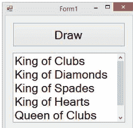

## 添加控件

1. 创建一个名为 `Deck of Cards` 的新 Windows Forms 应用程序。
2. 添加一个文本为 "Draw" 的名为 `btnDraw` 的按钮。
3. 在按钮下方添加一个名为 `lstCards` 的列表框。

## 添加枚举

1. 进入后台代码并找到表单类的开头。
2. 添加一个 `Suit` 枚举，它持有四种花色的名称。注意第一个枚举选项被分配了值 1，以便枚举从值 1 开始而不是默认的 0。

```csharp
enum Suit { Hearts = 1, Spades, Diamonds, Clubs }
```

3. 添加一个 `Value` 枚举，它持有十三种牌值。

```csharp
enum Value { Ace = 1, Two, Three, Four, Five, Six, Seven, Eight, Nine, Ten, Jack, Queen, King }
```

## 添加 Card 结构体

1. 在第二个枚举下方添加一个 `Card` 结构体。
2. 使用 `Suit` 枚举作为数据类型添加私有变量 `_suit`。这将是特定牌花色的位符。

```csharp
private Suit _suit;
```

3. 使用 `Value` 枚举作为数据类型添加私有变量 `_value`。这将是特定牌值的位符。

```csharp
private Value _value;
```

4. 添加对应的名为 `Value` 和 `Suit` 的属性。
5. 添加一个接受一个花色和一个值作为参数的构造函数，并将赋值给结构体中相应的变量。

```csharp
public Card(Value value, Suit suit)
```

6. 在 `Card` 结构体下方使用 `Card` 结构体作为数据类型添加名为 `deck` 的 `Stack` 变量。

```csharp
Stack<Card> deck = new Stack<Card>();
```

这将持有 52 张牌。

```csharp
public partial class Form1
{
    enum Suit { Hearts = 1, Spades, Diamonds, Clubs }

    enum Value { Ace = 1, Two, Three, Four, Five, Six, Seven, Eight, Nine, Ten, Jack, Queen, King }

    struct Card
    {
        private Suit _suit;
        private Value _value;

        public Value Value { get { return _value; } }
        public Suit Suit { get { return _suit; } }

        public Card(Value value, Suit suit)
        {
            _value = value;
            _suit = suit;
        }
    }

    Stack<Card> deck = new Stack<Card>();
}
```

## 向栈添加牌

1. 定位 `Form1_Load` 事件。
2. 创建一个从 1 到 13 的外部循环（值）。
3. 创建一个从 1 到 4 的内部循环（花色）。
4. 将每张牌添加到栈中，因为构造函数需要参数。

添加牌的完整代码如下：

```csharp
private void Form1_Load(object sender, EventArgs e)
{
    for (int value = 1; value <= 13; value++)
    {
        for (int suit = 1; suit <= 4; suit++)
        {
            deck.Push(new Card((Value)value, (Suit)suit));
        }
    }
}
```


```csharp
{
    deck.Push(new Card((Value)value, (Suit)suit));
}
```

## Draw 按钮

1. 创建按钮的 `Click` 事件。
2. 在弹出之前检查栈是否为空。
   `if (deck.Count > 0)`
3. 使用 `Pop` 方法获取下一张牌并将其存储在变量中。
   `var card = deck.Pop();`
4. 将获取的牌添加到 `lstCards`，格式为 "Ace of Hearts"。
5. 运行应用程序并尝试添加和删除订单。

```csharp
private void btnDraw_Click(object sender, EventArgs e)
{
    if (deck.Count > 0)
    {
        var card = deck.Pop();
        lstCards.Items.Add(String.Format("{0} of {1}", card.Value, card.Suit));
    }
}
```

# C# 入门

## LINQ 简介

在本节中，你将学习如何使用 LINQ 和 Lambda 表达式从集合中获取数据，以及如何连接集合并在向用户显示之前整合多个源。连接集合在处理相关数据时非常有用，例如在订单头中显示客户信息，通过唯一的客户 ID 与订单连接。

LINQ 的伟大特性之一是值在你请求它们时才被获取；获取数据的实例包括遍历查询结果、使用 `First`、`Last`、`FirstOrDefault` 获取单个值，或使用 `ToList` 获取 LINQ 查询产生的所有项目。

因为在使用查询选择数据时不会立即检索数据，所以你实际上可以在从源获取实际数据之前对现有查询进行范围缩小的操作。

## 订单示例

以下代码将在接下来的示例中创建 `orders` 和 `customers` 集合时使用。

```csharp
public partial class Form1
{
    struct Order
    {
        private int _id, _customerId;
        private double _total;
        private DateTime _date;

        public int Id { get { return _id; } }
        public int CustomerId { get { return _customerId; } }
        public double Total
        {
            get { return _total; }
            set { _total = value; }
        }
        public DateTime Date { get { return _date; } set { _date = value; } }

        public Order(int id, int customerId, double total, DateTime date)
        {
            _id = id;
            _customerId = customerId;
            _total = total;
            _date = date;
        }
    }

    struct Customer
    {
        private int _id;
        private string _name;

        public int Id { get { return _id; } }
        public string Name { get { return _name; } set { _name = value; } }

        public Customer(int id, string name)
        {
            _id = id;
            _name = name;
        }
    }

    List<Order> orders = new List<Order>();
    List<Customer> customers = new List<Customer>();

    public Form1()
    {
        orders.AddRange(new Order[]{
            new Order(1, 2, 100, new DateTime(2015, 01, 10)),
            new Order(2, 1, 200, new DateTime(2015, 01, 20)),
            new Order(3, 2, 300, new DateTime(2015, 01, 15)),
            new Order(4, 3, 400, new DateTime(2015, 5, 1))
        });

        customers.AddRange(new Customer[]{
            new Customer(1, "Carl Smith"),
            new Customer(2, "Jane Doe"),
            new Customer(3, "John Doe"),
        });

        InitializeComponent();
    }
}
```

# C# 初学者

## 查询语法

在使用 LINQ 进行查询时，使用以下基本语法：

```text
from <variable> in <data source>
join <variable2> in <data source>
  on <variable.property> equals <variable2.property>
group <grouping criteria>
where <selection criteria>
orderby <result ordering criteria>
select <variable name>
```

LINQ 查询始终以 `from` 语句开头，列出查询中使用的变量名，随后跟上 `in` 关键字和数据源（在本章节中，数据源是集合）。查询还必须有一个 `select` 语句，用于定义从数据源中选择的内容；在简单查询中，这将是返回从数据源获取的项目。

在处理多个数据源时，你可能希望将它们连接起来，以创建一个来自所有数据源的单一结果集。为了实现这一点，你可以使用一个或多个 `join` 语句（每个想要连接的数据源使用一个）。

也可以对数据进行分组，从而创建一个聚合结果结果。

`where` 子句用于过滤数据并缩小结果集；`where` 子句可以非常简单（仅过滤一个属性），也可以包含多个属性的复杂逻辑。

如果你想对选定的数据进行排序，请使用 `orderby` 语句。

## 获取所有项

使用 LINQ 时，你可以以 `IEnumerable` 或 `List` 的形式从集合中获取所有项；`ToList` 方法用于执行查询并获取实际数据并存储在 `List` 中。

### 创建查询并后续获取数据

```csharp
var allOrders = from o in orders
                select o;
allOrders.ToList();
```

### 直接获取项

```csharp
var allCustomers = (from c in customers
                    select c).ToList();
```

## 获取特定项

在查询数据源时，你可以选择不同的 LINQ 查询语法或使用 Lambda 表达式。让我们来探索这两种方式。在使用 LINQ 时，你可以根据 `id` 获取特定订单。仅使用 LINQ 查询涉及 `where` 子句，而使用 Lambda 表达式时，可以使用 `First` 或 `FirstOrDefault` 方法。`First` 和 `FirstOrDefault` 方法之间的区别在于，如果没有找到匹配项，`First` 会抛出异常，而 `FirstOrDefault` 会返回默认值。

注意，两个查询都使用 `First` 方法来获取集合中的第一个项，确保获取的是正确的项。

```csharp
// 仅使用 LINQ
var order = (from o in orders
             where o.Id.Equals(1)
             select o).First();
```

```csharp
// LINQ 和 Lambda
var order = orders.First(o => o.Id.Equals(1));
```

这取决于你喜欢使用哪种语法。在某些情况下，你需要获取特定数量的项。

## 数据排序

使用 LINQ 时，可以使用 `orderby` 或 `OrderByDescending` 子句对选定数据进行排序。你还可以使用 `ThenBy` 子句进行多级排序。

```csharp
// 仅使用 LINQ
var sortedOrders = (from o in orders
                    orderby o.Id
                    select o).ToList();
```

```csharp
// LINQ 和 Lambda
var sortedOrders = orders.OrderBy(o => o.Id).ToList();
```

## 使用 Skip 和 Take 进行分页

使用 LINQ 可以通过 `Skip` 和 `Take` 方法实现分页。这对于显示大型数据集非常有用。

```csharp
// 仅使用 LINQ
var pagedOrders = (from o in orders
                   orderby o.Id
                   skip 10
                   take 10
                   select o).ToList();
```

```csharp
// LINQ 和 Lambda
var pagedOrders = orders.OrderBy(o => o.Id).Skip(10).Take(10).ToList();
```

## 使用 Join 连接集合

使用 LINQ 时，可以使用 `join` 子句连接两个集合。这允许你根据公共键合并数据源。

```csharp
// 仅使用 LINQ
var joinedData = (from o in orders
                  join c in customers on o.CustomerId equals c.Id
                  select new { o, c }).ToList();
```

```csharp
// LINQ 和 Lambda
var joinedData = orders.Join(customers, o => o.CustomerId, c => c.Id, (o, c) => new { o, c }).ToList();
```

## 练习：订单表单

在此练习中，你将使用 `Queue` 和两个 `List` 集合来存储客户和订单信息，并在 LINQ 和 Lambda 表达式在列表中显示它们。使用两个类定义客户和订单。客户应该有 `id (int)` 和 `name (string)` 属性，订单应该有 `id (int)` 和 `total (double)` 属性。

```csharp
public class Order
{
    public int Id { get; set; }
    public int CustomerId { get; set; }
    public double Total { get; set; }
    public DateTime Date { get; set; }
}

public class Customer
{
    public int Id { get; set; }
    public string Name { get; set; }
}

public class Form1 : Form
{
    private List<Order> orders = new List<Order>();
    private List<Customer> customers = new List<Customer>();
    private Queue<Order> queue = new Queue<Order>();

    public Form1()
    {
        InitializeComponent();
        LoadData();
    }

    private void LoadData()
    {
        orders.AddRange(new Order[]{
            new Order { Id = 1, CustomerId = 2, Total = 100, Date = new DateTime(2015, 01, 10) },
            new Order { Id = 2, CustomerId = 1, Total = 200, Date = new DateTime(2015, 01, 20) },
            new Order { Id = 3, CustomerId = 2, Total = 300, Date = new DateTime(2015, 01, 15) },
            new Order { Id = 4, CustomerId = 3, Total = 400, Date = new DateTime(2015, 5, 1) }
        });

        customers.AddRange(new Customer[]{
            new Customer { Id = 1, Name = "Carl Smith" },
            new Customer { Id = 2, Name = "Jane Doe" },
            new Customer { Id = 3, Name = "John Doe" }
        });
    }

    private void btnAddOrder_Click(object sender, EventArgs e)
    {
        var order = new Order
        {
            Id = orders.Count + 1,
            CustomerId = (int)cmbCustomers.SelectedItem,
            Total = double.Parse(txtTotal.Text),
            Date = DateTime.Now
        };

        orders.Add(order);
        queue.Enqueue(order);
        UpdateGrid();
    }

    private void btnNextOrder_Click(object sender, EventArgs e)
    {
        if (queue.Count > 0)
        {
            var order = queue.Dequeue();
            // 显示订单详情
        }
    }

    private void UpdateGrid()
    {
        dataGridView1.Rows.Clear();
        foreach (var order in orders)
        {
            dataGridView1.Rows.Add(order.Id, order.CustomerId, order.Total, order.Date);
        }
    }
}
```

或者点击处理下一个订单按钮。为了重用代码，你可以将其放置在从不同事件调用的方法中。

队列中的下一个订单应该以浅蓝色背景显示，列表视图所有未处理的订单显示浅粉色背景，所有已处理的订单显示浅绿色背景。

只有当 `Total` 文本框中的值可以解析为双精度浮点数时，新订单才会被添加到订单队列中。

关闭按钮应该关闭窗口并退出应用程序。如果队列中存在未处理的订单，应该显示消息框询问用户是否结束应用程序（“订单队列不空！仍然关闭吗？”）；如果用户回答“是”，应用程序将结束，否则将保持打开。你可以更改消息框中显示的按钮，并将结果收集在 `DialogResult` 变量中。你还可以选择性显示图标。

```csharp
var result = MessageBox.Show("Order Q not empty! Close anyway?", "WARNING", MessageBoxButtons.YesNo, MessageBoxIcon.Exclamation);
if (result.Equals(DialogResult.No)) return;
```


# C# 入门

## 添加控件

1. 创建一个名为 `Orders` 的新 Windows Forms 应用程序。
2. 将 `Text` 属性更改为“Orders”。这将更改表单标题部的文本。
3. 向表单添加一个 `TabControl`。
4. 点击第一个标签页，然后点击标签页下方的白色区域，并将 `Text` 属性更改为“New Order”。
5. 在白色标签页表面上添加两个文本为“Customer”（客户）和“Total”（总额）的 `Label`。
6. 在“Customer”标签下方添加一个名为 `cboCustomers` 的 `ComboBox`（组合框）。
7. 在“Total”标签下方添加一个名为 `txtTotal` 的 `TextBox`（文本框）。
8. 在 `txtTotal` 文本框右侧添加一个名为 `btnAddOrder`、文本为“Add Order”（添加订单）的按钮。
9. 点击第二个标签页，点击空白白色区域并通过 `Text` 属性将标签更改为“Manage Orders”（管理订单）。
10. 添加三个名为 `btnPeekNextOrder`、`btnProcessNextOrder` 和 `btnListOrders` 的按钮。将按钮上的文本更改为“Peek Next Order”（查看下一个订单）、“Process Next Order”（处理下一个订单）和“List Orders”（列出订单）。
11. 在标签控件下方添加一个名为 `lstOrders` 的 `ListView`。
12. 在列表视图下方添加一个名为 `btnClose`、文本为“Close”（关闭）的按钮。

## 添加 Order 结构体

1. 打开代码后台并定位到表单开头。
2. 在表单类上方添加一个新的 `struct` 结构体。
3. 添加一个 `Guid` 属性 `OrderNo` 及其对应的私有变量。
4. 添加一个 `int` 属性 `CustomerId` 及其对应的私有变量。
5. 添加一个 `double` 属性 `Total` 及其对应的私有变量。
6. 添加一个接收三个对应私有变量参数的构造函数，并将它们赋值给这些变量。

这是 `Order` 结构体的完整代码：

```csharp
struct Order
{
    private int _customerId;
    private double _total;
    private Guid _orderNo;

    public Guid OrderNo
    {
        get { return _orderNo; }
        set { _orderNo = value; }
    }

    public int CustomerId
    {
        get { return _customerId; }
        set { _customerId = value; }
    }

    public double Total
    {
        get { return _total; }
        set { _total = value; }
    }

    public Order(int customerId, double total, Guid orderNo)
    {
        _customerId = customerId;
        _total = total;
        _orderNo = orderNo;
    }
}
```

## 添加 Customer 结构体

1. 在 `Order` 结构体下方添加一个名为 `Customer` 的新 `struct` 结构体。
2. 添加一个 `int` 属性 `Id` 及其对应的私有变量。
3. 添加一个 `string` 属性 `Name` 及其对应的私有变量。
4. 添加一个接收两个对应私有变量参数的构造函数，并将它们赋值给这些变量。

这是 `Customer` 结构体的完整代码：

```csharp
struct Customer
{
    private int _id;
    private string _name;

    public int Id
    {
        get { return _id; }
    }

    public string Name
    {
        get { return _name; }
        set { _name = value; }
    }

    public Customer(int id, string name)
    {
        _id = id;
        _name = name;
    }
}
```

## 添加集合

1. 定位到表单类的开头。
2. 在类中添加一个名为 `customers` 的 `List<Customer>` 集合。
3. 添加一个名为 `fulfilledOrders` 的 `List<Order>` 集合。
4. 添加一个名为 `orders` 的 `Queue<Order>` 集合。
5. 在构造函数向 `customers` 集合添加两个客户。
6. 在 `Form_Load` 事件中将客户分配给 `cboCustomers` 组合框的 `DataSource` 属性。
7. 在 `Form_Load` 事件内部指定 `Name` 属性为 `DisplayMember`。
8. 运行应用程序并确保客户在组合框中显示。
9. 关闭应用程序。

到目前为止表单的代码如下：

```csharp
public partial class Orders : Form
{
    List<Customer> customers = new List<Customer>();
    Queue<Order> orders = new Queue<Order>();
    List<Order> fulfilledOrders = new List<Order>();

    public Orders()
    {
        customers.AddRange(new Customer[]{
            new Customer(1, "John Doe"),
            new Customer(2, "Stan Smith")
        });
        InitializeComponent();
    }

    private void Orders_Load(object sender, EventArgs e)
    {
        cboCustomers.DataSource = customers;
        cboCustomers.DisplayMember = "Name";
    }
}
```

## 添加 ShowCustomerOrders 方法

为了重用在列表视图显示客户订单的代码，你将创建一个名为 `ShowCustomerOrders` 的方法，该方法将被调用。

1. 在 `Form_Load` 事件旁添加一个区域。
2. 添加一个接收 `int` 参数 `customerID` 的 `ShowCustomerOrders` 方法。
3. 使用 LINQ 获取匹配通过 `customerID` 的客户。
4. 为了避免队列为空时后续的 LINQ 表达式失败，存储 `nextOrder` 变量。
5. 为了在将数据添加到列表视图时使用一个循环，你需要使用 `Union` 方法追加来自集合中的订单。

```csharp
#region ShowCustomerOrders
private void ShowCustomerOrders(int customerID)
{
    var customer = customers.First(c => c.Id.Equals(customerID));
    var nextOrderNo = orders.Count > 0 ? orders.Peek().OrderNo : Guid.Empty;

    var items = (
        from o in orders
        where o.CustomerId.Equals(customer.Id)
        select new
        {
            Color = o.OrderNo.Equals(nextOrderNo) ? Color.LightBlue : Color.LightPink,
            Item = new ListViewItem(new string[]{
                o.OrderNo.ToString(), o.Total.ToString(),
                customer.Name, customer.Id.ToString()
            })
        })
    .Union(
        from o in fulfilledOrders
        where o.CustomerId.Equals(customer.Id)
        select new
        {
            Color = Color.LightGreen,
            Item = new ListViewItem(new string[]{
                o.OrderNo.ToString(), o.Total.ToString(),
                customer.Name, customer.Id.ToString()
            })
        });

    lstOrders.Items.Clear();
    foreach (var item in items)
    {
        item.Item.BackColor = item.Color;
        lstOrders.Items.Add(item.Item);
    }
}
#endregion
```

## cboCustomers_SelectedIndexChanged 事件

当在组合框中选择一个客户时，列表视图控件中应该显示该客户的订单。

1. 为 `cboCustomers` 组合框添加 `SelectedIndexChanged` 事件。
2. 检查组合框是否包含客户，如果为空则优雅地退出事件。
3. 添加名为 `customer` 的变量，并将从组合框中选定的客户转换为 `Customer` 类型进行存储。
4. 调用 `ShowCustomerOrders`，并传递 `customer` 变量中的客户 ID。

这是 `cboCustomers_SelectedIndexChanged` 事件的完整代码：

```csharp
private void cboCustomers_SelectedIndexChanged(object sender, EventArgs e)
{
    if (cboCustomers.Items.Count.Equals(0)) return;

    var customer = (Customer)cboCustomers.SelectedItem;
    ShowCustomerOrders(customer.Id);
}
```

## 选项卡控件的 SelectedIndexChanged 事件

当选项卡控件中的第一个标签页被选中时，列表视图中应该显示组合框中选定客户的订单。

1. 为选项卡控件添加 `SelectedIndexChanged` 事件。
2. 通过访问其 `SelectedIndex` 属性检查点击的标签页是否为选项卡控件中的第一个标签页。
3. 在 `if` 块内部检查客户组合框是否包含客户，如果为空则优雅地退出事件。
4. 从组合框中获取选定的客户并使用 `Customer` 结构体对其进行强制转换。
5. 调用 `ShowCustomerOrders`，传递 `customer` 变量中的客户 ID。

这是选项卡控件 `SelectedIndexChanged` 事件的完整代码：

```csharp
private void tabControl1_SelectedIndexChanged(object sender, EventArgs e)
{
    if (tabControl1.SelectedIndex.Equals(0))
    {
        if (cboCustomers.Items.Count.Equals(0)) return;

        var customer = (Customer)cboCustomers.SelectedItem;
        ShowCustomerOrders(customer.Id);
    }
}
```

## 添加订单按钮

1. 为添加订单按钮添加 `Click` 事件。
2. 因为只有在 `Total` 文本框中的值可以解析为 `double` 时才应该添加订单，所以你必须添加一个名为 `total` 的 `double` 变量来存储解析后的值。
3. `TryParse` 方法的结果应存储在名为 `success` 的 `bool` 变量中，并将 `total` 变量作为输出参数传递给 `TryParse` 方法。如果解析成功，则将在 `success` 变量中存储 `true`。
4. 添加一个 `if` 语句，当 `success` 变量为 `true` 时才执行 `if` 块。
5. 在 `if` 块内部从组合框中选定的客户处获取客户 ID。使用组合框的 `SelectedItem` 并将其强制转换为 `Customer` 以访问其 `Id`。
6. 使用 `Order` 结构体创建一个新变量，传递客户、总计和一个新的 `Guid`。
7. 调用 `orders` 队列集合上的 `Enqueue` 方法将订单添加到队列中。
8. 调用 `ShowCustomerOrders` 方法在列表视图显示客户和订单信息。
9. 运行应用程序，在组合框中选择一个客户，在 `Total` 文本框中输入值并点击添加订单按钮将数据作为订单队列添加。确保数据显示在列表视图中。第一行应该是浅蓝色，随后添加的行应该是浅粉色。浅蓝色表示它是队列中的新订单。
10. 关闭应用程序。

```csharp
var customerId = ((Customer)cboCustomers.SelectedItem).Id;
var order = new Order(customerId, total, Guid.NewGuid());
```

这是 `btnAddOrder_Click` 事件的完整代码：

```csharp
private void btnAddOrder_Click(object sender, EventArgs e)
{
    var total = 0.0;
    var success = Double.TryParse(txtTotal.Text, out total);

    if (success)
    {
        var customerId = ((Customer)cboCustomers.SelectedItem).Id;
        var order = new Order(customerId, total, Guid.NewGuid());
        orders.Enqueue(order);
        ShowCustomerOrders(customerId);
    }
}
```

## 查看下一个订单按钮

此按钮的目的是查看（peek）订单队列中的下一个未处理的订单；为了实现这一点，你必须添加一个 LINQ 根据客户 ID 获取客户，并调用队列上的 `Peek` 方法来获取订单。然后你必须使用客户的数据创建一个 `ListViewItem` 并将其展示。

1. 为 `btnPeekNextOrder` 按钮添加 `Click` 事件。
2. 检查订单队列是否至少有一个订单，如果为空则优雅地退出事件。
3. 从队列中查看下一个订单而不将其移除。
4. 使用客户的数据创建一个 `ListViewItem` 并将其展示在列表视图。

```csharp
private void btnPeekNextOrder_Click(object sender, EventArgs e)
{
    if (orders.Count == 0) return;

    var nextOrder = orders.Peek();
    var customer = customers.First(c => c.Id.Equals(nextOrder.CustomerId));

    var item = new ListViewItem(new string[] {
        nextOrder.OrderNo.ToString(),
        nextOrder.Total.ToString(),
        customer.Name,
        customer.Id.ToString()
    });
    item.BackColor = Color.LightYellow; // 示例颜色，原文未指定具体颜色
    lstOrders.Items.Clear();
    lstOrders.Items.Add(item);
}
```


## 处理订单队列

### 查看下一个订单（Peek Order）

此按钮的目的是查看订单队列中的下一个未处理的订单；为了实现这一点，你必须添加一个 LINQ 并在其中获取未处理的订单。

- 为 `btnPeekOrder` 按钮添加 Click 事件。
- 检查订单队列是否至少有一个订单，如果为空则优雅地退出事件。
- 从队列中查看下一个订单而不将其移除。
- 使用客户的数据创建一个 `ListItem` 并将其展示在列表视图。

### 处理下一个订单

此按钮的目的是处理订单队列中的下一个订单并将其移动到 `fulfilledOrders` 集合。为了实现这一点，你必须调用队列的 `Dequeue` 方法来获取订单。

- 为 `btnProcessNextOrder` 按钮添加 Click 事件。
- 检查订单队列是否至少有一个订单，如果为空则优雅地退出事件。
- 从队列中弹出下一个订单并将其添加到 `fulfilledOrders` 集合。
- 弹出订单后，调用 `ShowCustomerOrders` 方法显示。

### 列出已处理订单

此按钮的目的是在列表视图中显示 `fulfilledOrders` 集合中所有已处理的订单及其对应的客户信息。使用 LINQ join 语句将客户集合与 `fulfilledOrders` 集合连接，并创建一个包含合并数据的匿名对象。

1. 为 `btnListOrders` 按钮添加 Click 事件。
2. 使用 LINQ join 将客户集合与 `fulfilledOrders` 集合连接，并将结果存储在名为 `orderList` 的变量中。注意，你正在调用 `ToList()` 来立即获取项，稍后使用 `foreach` 循环遍历结果时，项将自动获取。

```csharp
var orderList = (from o in fulfilledOrders
                 join c in customers on o.CustomerId equals c.Id
                 select new
                 {
                     o.OrderNo,
                     o.Total,
                     c.Name,
                     c.Id
                 }).ToList();
```

#### 备选写法（C# 初学者）

```csharp
var orderList =
from o in fulfilledOrders
join c in customers on o.CustomerId equals c.Id
select new
{
    OrderNo = o.OrderNo,
    Name = c.Name,
    Total = o.Total,
    CustomerId = c.Id
};
```

3. 清除列表视图。
4. 添加一个 `foreach` 循环遍历存储在 `orderList` 变量中的结果。为 `foreach` 块的每次迭代创建一个新的 `ListViewItem`，并将其添加到列表控件。
5. 运行应用程序并添加几个订单。
6. 点击“List Orders”按钮；列表视图不应显示任何订单，因为所有订单都未处理。
7. 点击“Process Next Order”按钮处理至少一个订单。处理过的订单应该以浅绿色背景显示。
8. 点击“List Orders”按钮仅显示已处理的订单，且无背景颜色。
9. 关闭应用程序。

以下是 `btnListOrders_Click` 事件的完整代码：

```csharp
private void btnListOrders_Click(object sender, EventArgs e)
{
    var orderList =
    from o in fulfilledOrders
    join c in customers on o.CustomerId equals c.Id
    select new
    {
        OrderNo = o.OrderNo,
        Name = c.Name,
        Total = o.Total,
        CustomerId = c.Id
    };

    1stOrders.Items.Clear();
    foreach(var order in orderList)
    {
        var item = new ListItem(new string[]{
            order.OrderNo.ToString(), order.Total.ToString(),
            order.Name, order.CustomerId.ToString());
        1stOrders.Items.Add(item);
    }
}
```

### 关闭应用程序

此按钮的作用是关闭应用程序。如果订单队列包含未处理的订单，则应显示消息框，询问用户是否关闭应用程序。

- 为 Close 按钮添加 Click 事件。
- 检查订单队列是否包含订单。如果没有，显示一个标题为“WARNING”的消息框，内容为“Order Q not empty Close anyway?”，带有 Yes/No 按钮和一个感叹号图标。将按钮点击结果存储在名为 `result` 的变量中。
- 如果点击了 No 按钮，则事件应优雅退出，表单保持打开。

```csharp
var result = MessageBox.Show(
    "Order Q not empty! Close anyway?", "WARNING",
    MessageBoxButtons.YesNo, MessageBoxIcon.Exclamation);

if (result.Equals(DialogResult.No)) return;
```

- 添加对表单 `Close` 方法的调用；可以使用 `this` 关键字访问表单。

以下是 `btnClose_Click` 事件的完整代码：

```csharp
private void btnClose_Click(object sender, EventArgs e)
{
    var result = MessageBox.Show(
        "Order Q not empty! Close anyway?", "WARNING",
        MessageBoxButtons.YesNo, MessageBoxIcon.Exclamation);

    // 检查点击了哪个按钮
    if (result.Equals(DialogResult.No)) return;

    this.Close();
}
```

---

## 微用例：扑克应用程序

在本次练习中，你将创建一个用户与电脑对战的扑克应用程序。你将获得一个用例，描述了应用程序的不同部分以及需要实现的功能，请尽可能仅使用该用例来实现它们。用例中引入并描述了一些新理论。微用例布局的设计是为了模拟真实场景。我强烈建议在开始编码之前一次性阅读整个用例。

### 描述

应用程序应该支持玩多手而无需重启。它应该包含三个不同部分：游戏时使用的 **Windows Forms Application** GUI、一个代表单张牌的 **Card** `struct`，以及一个代表发出的牌的 **Hand** `struct`。

### GUI

GUI 应该在标签中显示玩家和庄家的牌值，并为每张牌使用一个标签显示点数和花色；黑桃和梅桃应该显示为黑色，而红心和方块显示为红色（见下图）。牌背景应为白色。结果应显示在两个手牌之间，如果玩家赢，则以浅绿色背景显示“Player wins!”；如果庄家赢，则以浅粉色背景显示“Dealer Wins!”。一个带有“DEAL NEW HAND”文本的按钮应为玩家和庄家发放新牌，发出的牌应动态添加到 **Panel** 控件中，且在应用程序启动时不应出现在 GUI 中。


### 牌

牌由两个存储点数和花色的变量组成，一个显示牌花色符号的属性（存储在 `suit` 变量中的值），以及一个显示简写牌点数（2, 3...）的属性。使用 **enums** 来跟踪可能的点数（二、三...王、A）、花色（黑桃、梅桃...）和符号（♥、♠、♦、♣）。`value` 和 `suit` 变量应声明为相应的类型。

你还需要实现一个接口，以便比较两张牌（见下文）。

### 手牌

**Hand struct** 代表玩家或庄家的手牌。结构外部需要两个 **enums**：一个名为 **Hands**，代表可能的手牌（对子、两对...满葫芦、皇家同花），另一个名为 **Winner**，持有可能的获胜者（庄家、玩家、平局）。**Hand** 包含与手牌相关的数据，如一个持有 5 个 `Card` 实例的数组，一个存储 `suit` 的 `int`（红心、黑桃、梅桃、方块）。

需要两个声明为结构的变量，一个用于庄家 `dealerHand`，另一个用于玩家 `playerHand`。还需要一个名为 `deck` 的 `List<Card>` 集合来持有 52 张牌。一个名为 `shuffles` 的 `int` 变量将决定在发牌前洗牌的次数。

创建一个 `Initialize` 方法，由按钮调用以实例化变量。该方法用于清除当前的手牌和牌组。

创建一个 `ShuffleDeck` 方法，在按钮事件的 `Initialize` 方法后调用。该方法的作用是根据 `shuffles` 变量进行多次洗牌；使用 `Random` 类来实现随机洗牌。

创建一个 `DealsCards` 方法，交替地为庄家和玩家分配牌。发牌时不要忘记从牌组中移除已使用的牌。庄家和玩家各获得 5 张牌，分别存储在 `dealerHand` 和 `playerHand` 的 `Cards` 数组中。

创建一个 `CompareHands` 方法，使用 `Hands` 枚举比较庄家和玩家的手牌。该方法需要调用另一个你将创建的方法 `EvaluateHand`，接收一个引用传递（`ref`）的 `Hand` 参数；该方法将识别存储在 `Hand` 参数中的牌（对子、两对...），并修改它的两个 `HighCard` 和 `Kicker` 属性。为了方便评估牌，你可能需要在评估之前对 `Cards` 数组进行排序。调用两次 `EvaluateHand` 方法，一次针对玩家牌，一次针对庄家牌。

你还应该创建一个 `CompareCards` 方法，在手牌相等或两手牌都没有值（只有一组混合牌）的情况下比较庄家和玩家的牌。

你需要的最后一个方法是 `RevealCards`，它动态地将牌添加到表单的玩家和庄家区域，并在庄玩家牌之间的标签中显示胜利者；如果庄家赢，标签背景颜色应为浅粉色，如果玩家赢则为浅绿色。

### 评估牌型

牌型的大小应根据以下牌型顺序确定：皇家同花、同顺花、四条、葫芦、同花、顺子、三条、两对、单对、高牌。

如果庄家和玩家的牌型相同，则获胜者由踢牌（kicker，即剩余牌中最大的牌）决定。

### 如何在单独的文件创建结构体

1. 在解决方案资源管理器中右键点击项目名称，并在菜单中选择“添加类”（Add-Class）。
2. 输入文件名并点击“添加”（Add）按钮。
3. 在文件中将 `class` 关键字替换为 `struct` 关键字。

### 如何动态添加控件

以下代码将动态地向庄家面板和玩家面板添加 5 张牌。

首先，通过在每个面板的 `Controls` 集合上调用 `Clear` 方法来清空面板；该 `Controls` 集合用于跟踪放置在控件或表单内部的内在控件。当你向面板添加控件时，使用此集合并调用其 `Add` 方法。在添加标签之前，必须通过调用名为 `CreateCard` 的方法（你需要将创建它）来创建它们；该方法的目的是格式化标签并准备好它们在面板中显示。

```csharp
this.panDealer.Controls.Clear();
this.panPlayer.Controls.Clear();
for (int i = 0; i < 5; i++)
{
    // 计算位置
    var x = i * 60;
    var y = 0;
    // 创建并格式化标签
    var lbl1Dealer = CreateCard(x, y, dealerHand.Cards[i]);
    var lbl1Player = CreateCard(x, y, playerHand.Cards[i]);
    // 将标签添加到面板的 Controls 集合
    this.panDealer.Controls.Add(lbl1Dealer);
    this.panPlayer.Controls.Add(lbl1Player);
}
```

#### `CreateCard` 方法实现

```csharp
private Label CreateCard(int x, int y, Card card)
{
    Label lbl = new Label();
    // 将文本值和符号分行格式化
    lbl.Text = String.Format("{0}\n{1}",
        card.Value, card.SuitSymbol);
    lbl.Size = new Size(55, 76);
    // 在面板中定位标签
    lbl.Location = new Point(x, y);
    // 格式化边界和字体
    lbl.BorderStyle = BorderStyle.FixedSingle;
    lbl.Font = new Font("Consolas", 20);
    lbl.TextAlign = ContentAlignment.MiddleCenter;
    lbl.BackColor = Color.White;
    // 设置文本颜色
    lbl.ForeColor =
        card.Suit.Equals(Suit.Hearts) ||
        card.Suit.Equals(Suit.Diamonds) ?
        Color.Red : Color.Black;
    return lbl;
}
```

### 如何实现 IComparable 接口

`IComparable` 接口允许你根据设置的标准将一个对象与另一个对象进行比较。如果不实现此接口，对象将根据内存引用进行比较，而不是根据值或标准。

接口是一种契约，描述了必须实现的方法头，而不是它们应该如何实现。此特定接口必须实现一个名为 `CompareTo` 的方法，然后可以在变量上调用它，以将其值与另一个变量的值进行比较。在这种情况下，它将用于对包含代表牌的数组进行排序。

`Value` 是 `Card` 结构体中使用的属性，用于暴露存储牌值的私有 `value` 变量，并使用包含所有可能值的枚举。

```csharp
struct Card : IComparable
{
    public int CompareTo(object obj)
    {
        var obj1 = (int)Value;
        var obj2 = (int)((Card)obj).Value;
        return obj1.CompareTo(obj2);
    }
}
```

### 实现


# 创建用户界面

你将从创建用户界面开始，然后添加洗牌功能为发牌主发牌，并为玩家发两手牌。当两手牌发完后，将对它们进行评估以决定获胜者；见下方的 GUI（）。

- 标签 `lblDealer` 将显示发牌主的牌
- 面板 `panDealer` 将显示牌
- 标签 `lblWinner` 将显示获胜者
- 面板 `panPlayer` 将显示玩家的牌
- 标签 `lblPlayer` 将显示玩家的牌
- 按钮 `btnDeal` 将显示“发牌”

## 步骤

1. 创建名为 `Poker` 的 Windows 应用程序。
2. 将标题设置为 `Poker`。
3. 将字体设置为 `Consolas`，20pt。
4. 添加一个显示牌牌的标签。
5. 添加一个名为 `lblHand` 的标签，显示“牌型：”，位于其右侧。
6. 面板 `panDealer` 将包含发牌主的牌。
7. 添加一个垂直居中对齐的标签，将其 `AutoSize` 属性设置为 `false`。
8. 面板 `panPlayer` 将包含的牌。
9. 添加一个显示“玩家”的标签。
10. 添加一个名为 `lblPlayer` 的标签，显示“牌型：”。
11. 添加一个显示“新牌组”的按钮。

# Card 结构体

结构体将方便地封装有关单张牌的所有信息，在单独的文件中创建 `Card` 结构体。

```csharp
struct Card
{
}
```

结构体应有一个私有变量 `_value` 以及对应的只读属性 `Value`，使用 `Value` 枚举存储值。它还应该有一个 `_suit` 以及对应的只读属性 `Suit`，使用 `Suit` 枚举存储。

使用 `Enum.Parse` 解析 `_suit` 并将结果转换为 `char`。

为了显示 `_value` 变量的简写形式，添加第四个属性 `ValueSymbol`（1, 2, 3, ..., J, Q, A）。

## C# 初学者

构造函数应有两个参数，分别对应 `Value` 和 `Suit` 枚举类型。这些值应赋值给结构体中相应的变量。

实现 `IComparable` 接口及其 `CompareTo` 方法，将 `Value` 属性的值转换为 `int` 以比较两个对象。在对牌排序时需要此方法。你可以阅读更多关于如何实现接口的内容。

### 步骤

1. 在解决方案资源管理器中右键点击项目名称，并在菜单中选择“添加类”。
2. 将文件命名为 `Card` 并点击“添加”按钮。
3. 将类型从 `class` 改为 `struct`。

```csharp
struct Card
{
}
```

4. 在 `Poker` 命名空间中添加三个枚举 `Suit`、`Value` 和 `Symbol`，分别用于第一个牌花色、牌值和牌花色符号。你可以在文字处理器的插入字符工具中找到这些符号。

```csharp
namespace Poker{
    enum Suit { Hearts = 1, Spades, Diamonds, Clubs }
    enum Value { Two = 2, Three = 3, Four = 4, Five = 5, Six = 6, Seven = 7, Eight = 8, Nine = 9, Ten = 10, Jack = 11, Queen = 12, King = 13, Ace = 14 }
    enum Symbol { Hearts = '♥', Spades = '♠', Diamonds = '♦', Clubs = '♣' }
}
```

5. 在结构体中添加变量 `_value` 及其对应的只读属性，使用 `Value` 枚举作为其数据类型。
6. 在结构体中添加变量 `_suit` 及其对应的只读属性，使用 `Suit` 枚举作为其数据类型。
7. 添加一个只读属性 `SuitSymbol`，使用 `Symbol` 枚举根据 `_suit` 变量的值返回符号。

```csharp
public char SuitSymbol
{
    get {
        // 根据 _suit 返回 '♥', '♦', '♠' 或 '♣'
        return (char)(Symbol)Enum.Parse(
            typeof(Symbol), _suit.ToString());
    }
}
```

8. 添加一个名为 `ValueSymbol` 的属性，使用 `switch` 根据存储在 `int` 类型变量 `_value` 中的值返回代表卡牌简写值（1, 2, 3, ..., J, Q, A）的字符串。

```csharp
switch ((int)_value)
{
    case 11: return "J";
    ...
    default: return ((int)_value).ToString();
}
```

9. 添加一个构造函数，包含两个分别为 `Value` 和 `Suit` 枚举数据类型的参数，并将它们的值赋值给适当的变量。

```csharp
public Card(Value value, Suit suit)
```

10. 通过在结构体声明后附加 `: IComparable` 来实现 `IComparable` 接口。

```csharp
struct Card : IComparable
```

11. 右键点击接口名称并选择“实现接口”以添加接口中的 `CompareTo` 方法。

```csharp
public int CompareTo(object obj)
{
    throw new NotImplementedException();
}
```

12. 修改 `CompareTo` 方法内部的代码，根据 `Value` 属性进行比较。

```csharp
public int CompareTo(object obj)
{
    var obj1 = (int)Value;
    var obj2 = (int)((Card)obj).Value;
    return obj1.CompareTo(obj2);
}
```

## C# 初学者教程

`Card.cs` 完整代码如下：

```csharp
namespace Poker{
    enum Suit { Hearts = 1, Spades, Diamonds, Clubs }
    enum Value { Two = 2, Three = 3, Four = 4, Five = 5,
        Six = 6, Seventh = 7, Eight = 8, Nine = 9, Ten = 10,
        Jack = 11, Queen = 12, King = 13, Ace = 14 }
    enum Symbol { Hearts = '♥', Spades = '♠',
        Diamonds = '♦', Clubs = '♣' }
    // Unicode字符 "u2665", "u2660", "u2666", "u2663"

    struct Card : IComparable{
        private Value _value;
        private Suit _suit;

        public Value Value { get { return _value; }}
        public Suit Suit { get { return _suit; }}
        public char CharSymbol{
            get {
                return (char)(Symbol)Enum.Parse(
                    typeof(Symbol), _suit.ToString());
            }
        }
        public string ValueSymbol{
            get {
                switch ((int)_value) {
                    case 11: return "J"
                    case 12: return "Q"
                    case 13: return "K"
                    case 14: return "A"
                    default: return ((int)_value).ToString();
                }
            }
        }
    }
}
```

```csharp
public Card(Value value, Suit suit)
{
    _value = value;
    _suit = suit;
}

public int CompareTo(object obj)
{
    var obj1 = (int)Value;
    var obj2 = (int)(Card)obj;
    return obj1.CompareTo(obj);
}
```

# Hand 结构体

`Hand` 存储关于庄家或玩家手牌的信息，例如卡牌数组、牌值、大牌、底牌（kicker cards）以及同花色或同花顺时的花色。除了卡牌数组外，所有变量将在评估和比较过程中赋值并使用。

你还需要在 `Poker` 命名空间中添加两个枚举，一个名为 `Hands` 用于所有可能的扑克牌，另一个名为 `Winner` 用于可能的获胜者。

```csharp
enum Hands { Nothing, Pair, TwoPair, ..., RoyalStraightFlush }
enum Winner { Dealer, Player, Draw }
```

## 步骤

1. 在解决方案管理器中右键点击项目名称，并在菜单中选择“添加类”。
2. 将文件命名为 `Hand` 并点击“添加”按钮。
3. 将类型从类（class）改为结构体（struct）。

```csharp
struct Hand
{
```

4. 在 `Poker` 命名空间中添加名为 `Hands` 的枚举，用于所有可能的扑克牌。

```csharp
enum Hands { Nothing, Pair, TwoPair, ThreeOfAKind, Straight, Flush, FullHouse, FourOfAKind, StraightFlush, RoyalStraightFlush }
```

5. 使用 `Card` 结构体作为数据类型添加一个名为 `Cards` 的数组属性。

```csharp
public Card[] Cards { get; set; }
```

6. 添加一个名为 `HandValue` 的属性，使用 `Hands` 枚举作为其数据类型。
7. 使用 `Value` 枚举作为数据类型添加两个名为 `HighCard1` 和 `HighCard2` 的属性。
8. 添加一个名为 `Kickers` 的 `List<Value>` 集合属性。

```csharp
public List<Value> Kickers { get; set; }
```

9. 添加一个名为 `Suit` 的 `int` 属性。

## C# 初学者教程

`Hand.cs` 完整代码如下：

```csharp
namespace Poker
{
    enum Hands { Nothing, Pair, TwoPair, ThreeOfKind,
        Straight, Flush, FullHouse, FourOfKind,
        RoyalStraightFlush }
    enum Winner { Dealer, Player, Draw }

    struct Hand
    {
        public Card[] Cards { get; set; }
        public Hands HandValue { get; set; }
        public Value HighCard1 { get; set; }
        public Value HighCard2 { get; set; }
        public List<Value> Kickers { get; set; }
        public int Suit { get; set; }
    }
}
```

# Form

你需要三个变量和一个常量。第一个变量用于持有玩家牌，第二个变量使用 `Hand` 结构体声明庄家牌。第三个变量是声明为 `List<Card>` 的牌组。`int` 常量决定了在发牌前洗牌的次数。

## 步骤

1. 打开表后台代码文件，找到表类的开头。
2. 添加一个名为 `Variables` 的区域（region）。

## C# 初学者教程

3. 使用 `Hand` 结构体添加名为 `playerHand` 的变量。该变量持有玩家的牌。

```csharp
playerHand = new Hand();
```

4. 使用 `Hand` 结构体添加名为 `dealerHand` 的变量。该变量持有庄家的牌。

```csharp
dealerHand = new Hand();
```

5. 使用 `List<Card>` 集合添加名为 `deck` 的变量。该变量代表牌组中的52张牌，即玩家和庄家的牌。

```csharp
List<Card> deck = new List<Card>();
```

6. 添加一个 `int` 常量 `shuffles` 表示发牌前洗牌的次数。

目前的表代码：

```csharp
public partial class Form1
{
    #region Variables
    Hand playerHand;
    Hand dealerHand;
    List<Card> deck;
    const int shuffles = 1000;
    #endregion

    public Form1()
    {
        InitializeComponent();
    }
}
```

# Initialize 方法

该方法的作用是在每次发牌前为 `playerHand`、`dealerHand` 和 `deck` 变量创建实例，模拟庄家收集牌并洗牌。`Initialize` 方法应在按钮事件中首先调用。

## 步骤

1. 打开后台代码文件，定位到类的结尾。
2. 在末尾添加一个名为 `Methods` 的区域。
3. 在区域内添加无参数的 `void Initialize`。

```csharp
#region Methods
private void Initialize()
{
}
#endregion
```

4. 为 `playerHand`、`dealerHand` 和 `deck` 变量创建实例。

```csharp
playerHand = new Hand();
dealerHand = new Hand();
deck = new List<Card>();
```

5. 添加 `btnDeal_Click` 事件。
6. 从事件中调用 `initialize` 方法。

```csharp
private void btnDeal_Click(object sender, EventArgs e)
{
    Initialize();
}
```

7. 将光标置于调用方法的行上并按键盘上的 `F9` 添加断点。
8. 运行应用程序并点击按钮。
9. 当执行在断点处停止时，逐个指向变量查看内容。手牌应该使用 `Hand` 结构体的默认值创建，而 `List` 应为 `null`。
10. 按 `F11` 进入方法，并在步执行时检查变量值。手变量仍包含默认值，但列表已实例化并包含 0 个 `Card` 实例。
11. 停止应用程序。

`Initialize` 方法的完整代码如下：

```csharp
#region Methods
private void Initialize()
{
    playerHand = new Hand();
    dealerHand = new Hand();
    deck = new List<Card>();
}
#endregion
```

```csharp
private void btnDeal_Click(object sender, EventArgs e)
{
  Initialize();
}
```

# ShuffleDeck 方法

该方法的作用是洗牌。要将牌添加到牌组中，可以使用嵌套的 `foreach` 循环，外层遍历 `Suit` 枚举，内层遍历 `Value` 枚举，这将为每个花色（红心、黑桃、钻石和梅花）添加从2到14的值。

当使用循环将52张牌添加到牌组集合后，是时候洗牌了。洗牌的方法之一是使用 `Random` 类生成随机数，并将中剩余卡牌的数量作为 `Random` 类变量 `Next` 方法的最大值。

使用随机数作为索引，从牌组中获取并移除卡牌，将其添加到临时的 `List<Card>` 集合中。当牌组为空时，临时集合应包含洗过一次的牌。在随机过程的每次迭代中，将牌移动到牌组并清空临时集合，迭代次数由 `shuffles` 常量指定。在遍历 `shuffles` 常量的次数时可以使用 `for` 循环，在遍历牌组牌时可以使用 `while` 循环；在迭代集合时移除项时不能使用 `for` 或 `foreach` 循环，因为这会破坏循环的索引。

## 步骤

1. 找到 `Methods` 区域并添加一个无参数的 `void` 方法 `ShuffleDeck`。


```csharp
private void ShuffleDeck()
{
}
```

### 2. 在方法中添加一个遍历 `Suit` 枚举值的 `foreach` 循环。要获取这些值，你需要使用 `Enum` 类的 `GetValues` 方法并使用 `typeof` 方法传递类型。

```csharp
foreach (Suit suit in Enum.GetValues(typeof(Suit)))
{
}
```

### 3. 在之前的 `foreach` 循环内部添加一个嵌套的 `foreach` 循环遍历 `Values` 枚举中的值。

```csharp
foreach (Value value in Enum.GetValues(typeof(Value)))
{
}
```

### 4. 在嵌套循环内部创建一个新的 `Card` 变量，使用 `suit` 和 `value` 循环变量将该牌添加到 `deck` 集合中。

```csharp
var card = new Card(value, suit);
deck.Add(card);
```

### 5. 在外层 `foreach` 循环下方创建一个 `Random` 类的实例。

```csharp
Random rnd = new Random();
```

### 6. 添加一个 `for` 循环遍历 `shuffles` 常量，并在循环中创建一个新的临时 `List<Card>` 集合。

```csharp
for (int i = 0; i < shuffles; i++)
{
    List<Card> tmpDeck = new List<Card>();
}
```

### 7. 在临时集合下方添加一个 `while` 循环，只要 `deck` 集合中还有牌，就一直循环。

```csharp
while (deck.Count > 0)
{
}
```

### 8. 使用 `rnd` 变量的 `Next` 方法生成一个新的随机数，以 `deck` 集合中剩余牌的数量作为最大值。

```csharp
var index = rnd.Next(deck.Count);
```

### 9. 使用该数字作为索引从 `deck` 集合中获取并移除一张牌。将获取的牌添加到临时集合。

```csharp
var card = deck[index];
deck.RemoveAt(index);
tmpDeck.Add(card);
```

### 10. 当所有牌都移动到临时集合后，在 `while` 循环外部将临时集合赋值给 `deck` 集合。

```csharp
deck = tmpDeck;
```

### 11. 在按钮事件的 `Initialize` 方法下方添加对 `ShuffleDeck` 方法的调用。

### 12. 在按钮 `Click` 事件末尾设置一个断点。

### 13. 运行应用程序并点击按钮。

### 14. 命中断点后检查 `deck` 集合，它现在应该包含 52 张随机顺序的牌。

### 15. 停止应用程序。

`ShuffleDeck` 方法的完整代码如下：

```csharp
private void ShuffleDeck()
{
    foreach (Suit suit in Enum.GetValues(typeof(Suit)))
    {
        foreach (Value value in Enum.GetValues(typeof(Value)))
        {
            var card = new Card(value, suit);
            deck.Add(card);
        }
    }
    Random rnd = new Random();
    for (int i = 0; i < shuffles; i++)
    {
        List<Card> tmpDeck = new List<Card>();
        while (deck.Count > 0)
        {
            var index = rnd.Next(deck.Count);
            var card = deck[index];
            deck.RemoveAt(index);
            tmpDeck.Add(card);
        }
        deck = tmpDeck;
    }
}
```

# DealCards 方法

该方法的目的是向庄家和玩家各分发 5 张牌，每次迭代分发一张牌。你需要在 `playerHand` 和 `dealerHand` 变量中初始化具有 5 个值的 `Cards` 数组。为了分发牌，你需要迭代 5 次，每次迭代时从 `deck` 集合中获取并移除 2 张牌，并将其中一张放入 `playerHand`，另一张放入 `dealerHand` 的 `Cards` 数组中。

## C# 初学者

### 在 Methods 区域添加一个名为 `DealCards` 的无参数 `void` 方法。

在方法内部初始化玩家和庄家手的 `Cards` 数组。

```csharp
private void DealCards()
{
    playerHand.Cards = new Card[5];
    dealerHand.Cards = new Card[5];
}
```

添加一个迭代 5 次的 `for` 循环，获取两张牌并分配给玩家和庄家的 `Cards` 数组。从 `deck` 集合中移除这两张牌，模拟从牌堆中发了两张。

```csharp
for (int i = 0; i < 5; i++)
{
    playerHand.Cards[i] = deck.ElementAt(0);
    dealerHand.Cards[i] = deck.ElementAt(1);
    deck.RemoveRange(0, 2);
}
```

### 在按钮的 `Click` 事件中添加对 `DealCards` 方法的调用。

运行应用程序并探索 `dealerHand` 和 `playerHand` 变量中的 `Cards` 数组。它们应该包含代表玩家和庄家牌的 5 张牌。

停止应用程序。

`DealCards` 方法的完整代码如下：

```csharp
private void DealCards()
{
    playerHand.Cards = new Card[5];
    dealerHand.Cards = new Card[5];
    for (int i = 0; i < 5; i++)
    {
        playerHand.Cards[i] = deck.ElementAt(0);
        dealerHand.Cards[i] = deck.ElementAt(1);
        deck.RemoveRange(0, 2);
    }
}
```

# EvaluateHand 方法

该方法的目的是评估扑克牌型，找出庄家或玩家拥有的是种牌型，并使用 `Hands` 枚举将正确的牌型分配给传入手牌的 `HandValue` 属性。在评估过程中，传入手牌中的大多数属性都会用到。`EvaluateHand` 方法应该声明一个声明为 `Hand` 结构体的 `ref` 参数；需要将其声明为 `ref` 是因为你将对其进行永久更改。

这个方法可以被视为较为复杂的之一，因为它涉及到许多必须按顺序执行的检查，才能正确评估牌型。

我建议你使用 `Array` 类中的 `Sort` 方法对数组中的牌进行排序，以便更容易评估牌型。将相同值的牌排序后，它们将相邻，从而更容易找到对子、三条和四条。寻找顺子也会变得更容易，因为牌将按顺序排列。对牌排序不仅有助于判断牌型，还能大幅减少你为实现结果所需编写的代码量。

牌型值应该根据以下牌型顺序确定：皇家同花顺、同花顺、四条、葫芦、同花、顺子、三条、两对、单对、高牌、无牌型。在评估牌型时，你需要使用 `Value` 和 `Hands` 枚举。

## 对牌排序

对牌排序后，你可以为牌创建名为 `suit1-suit5` 的变量，为牌值创建名为 `value1-value5` 的变量，以便更容易阅读代码，无需在 `if` 语句中使用 `cards` 数组。

### 1. 在 Methods 区域添加一个名为 `EvaluateHand` 的 `void` 方法，并使用 `ref` 关键字声明一个 `Hand` 参数。

```csharp
private void EvaluateHand(ref Hand evalHand)
{
}
```

### 2. 创建一个名为 `Arranging cards` 的区域并对牌排序。

```csharp
#region Arranging cards
Array.Sort(evalHand);
```

### 3. 在区域内添加 `suit1-suit5` 和 `value1-value5` 变量。

```csharp
private void EvaluateHand(ref Hand evalHand)
{
    int suit1 = evalHand.Cards[0].Suit;
    int suit2 = evalHand.Cards[1].Suit;
    int suit3 = evalHand.Cards[2].Suit;
    int suit4 = evalHand.Cards[3].Suit;
    int suit5 = evalHand.Cards[4].Suit;
    int value1 = evalHand.Cards[0].Value;
    int value2 = evalHand.Cards[1].Value;
    int value3 = evalHand.Cards[2].Value;
    int value4 = evalHand.Cards[3].Value;
    int value5 = evalHand.Cards[4].Value;
}
```

## Has Flush

通过判断手牌是否为同花并将结果存储在传入手牌的 `Suit` 和 `HandValue` 属性中，你可以利用结果判断手牌是否为同花、同花顺或皇家同花顺。实现这一点的一种方法是使用 LINQ 计算相同花色的牌的数量；如果有 5 张，你就知道它是同花。但你不能直接退出方法，因为同花顺和皇家同花顺是需要先评估的。

### 1. 添加一个名为 `Flush` 的区域。

### 2. 使用 LINQ 统计相同花色的牌，否则将 `false` 赋值给变量 `hasFlush`。

```csharp
var hasFlush = evalHand.Cards.Count(c => c.Suit == suit1) == 5;
```

### 3. 如果 `hasFlush` 为 `true`，则将花色保存到 `evalHand`并将 `Hands.Flush` 保存到其 `HandValue` 属性中。

`Flush` 区域的完整代码如下：

```csharp
#region Flush
if (evalHand.Cards.Count(c => c.Suit == suit1) == 5)
{
    evalHand.Suit = (int)suit1;
    evalHand.HandValue = Hands.Flush;
}
#endregion
```

## Has Straight

通过判断手牌是否为顺子并将结果存储在三个 `bool` 变量——`hasStraight`、`isHighStraight` (10, J, Q, K, A) 和 `isLowStraight` (A, 2, 3, 4, 5) 中，你可以利用结果和 `hasFlush` 变量判断手牌是否为顺子、同花或皇家同花顺。

有两种基本情况需要处理：首先是 A 到 5 的低顺子。使用 `value1-value5` 变量和 `Value` 枚举判断手牌是否为顺子。

不要使用 `return` 语句退出方法，因为你还需要判断手牌是否为顺子、同花或皇家同花顺。

### 1. 添加一个名为 `Straight` 的区域。

### 2. 添加名为 `hasStraight` 的 `bool` 变量，如果手牌是顺子，则包含为 `true`。你可以通过检查当前牌是否等于上一张牌加 1，或者牌范围是否为 A-5 来实现这一点。

### 3. 添加名为 `isHighStraight` 的 `bool` 变量，如果手牌是 10 到 A 的顺子，则包含为 `true`。

### 4. 添加一个名为 `isLowStraight` 的 `bool` 类型的变量，如果手牌是从 A 到 5 的顺子，该变量将为 `true`。

`Has Straight` 区域的完整代码如下：

```csharp
#region Has Straight
var hasStraight =
    (value2.Equals(value1 + 1) && value3.Equals(value2 + 1) &&
     value4.Equals(value3 + 1) && value5.Equals(value4 + 1)) ||
    (value1.Equals(Value.Two) && value2.Equals(Value.Three) &&
     value3.Equals(Value.Four) && value4.Equals(Value.Five) &&
     value5.Equals(Value.Ace));
```

```csharp
var isHighStraight = hasStraight && value4.Equals(Value.King) &&
                     value5.Equals(Value.Ace); // (10, J, Q, K, A)
```

```csharp
var isLowStraight = hasStraight && value2.Equals(Value.Two) &&
                    value5.Equals(Value.Ace); // (A, 2, 3, 4, 5)
```

```csharp
#endregion
```

## 皇家同花 (Royal Straight Flush)

现在你已经确定了它是同花还是顺子，是时候利用这些信息来判断手牌是否为皇家同花了。使用 `isHighStraight` 和 `hasFlush` 变量，并检查花色是否等于红心（Hearts），如果表达式结果为 `true`，则将 `value5` 变量赋值给 `HighCard1` 属性，并将 `Hands` 枚举中的 `RoyalStraightFlush` 赋值给 `HandValue` 参数。在这些赋值操作后退出（下方的）方法。

### 1. 添加一个名为 `Royal Straight Flush` 的区域。

### 2. 添加一个 `if` 语句检查是否为皇家同花。

```csharp
if (isHighStraight && hasFlush && suit1.Equals(Suit.Hearts))
{
}
```

### 3. 在 `if` 块内赋值属性值并从方法返回。

`Royal Straight Flush` 区域的完整代码如下：

```csharp
#region Royal Straight Flush
if (isHighStraight && hasFlush && suit1.Equals(Suit.Hearts))
{
    evalHand.HighCard1 = value5;
    evalHand.HandValue = Hands.RoyalStraightFlush;
    return;
}
#endregion
```

## 顺子/同花顺 (Straight/Straight Flush)

现在你已经确定了它不是皇家同花，下一步是判断它是顺子还是同花顺。

在 `if` 语句中使用 `hasStraight` 变量来判断是否为顺子。根据是低顺子还是其他顺子，将手牌值赋值给 `evalHand` 参数的 `HighCard1` 属性；低顺子应该使用 `value4` 变量，其他顺子使用 `value5` 变量。

使用 `hasFlush` 变量来判断 `HandValue` 属性应该赋值为 `Hands` 枚举中的 `StraightFlush` 还是 `Straight`。

### 1. 添加一个名为 `Straight/Straight Flush` 的区域。

### 2. 使用 `hasStraight` 变量检查手牌是否为顺子。

```csharp
if (hasStraight)
{
}
```

### 3. 使用 `isLowStraight` 变量为 `evalHand` 参数赋值 `HighCard1` 属性。

```csharp
evalHand.HighCard1 = isLowStraight ? value4 : value5;
```

### 4. 使用 `hasFlush` 变量为 `evalHand` 参数赋值 `HandValue` 属性。

```csharp
evalHand.HandValue = hasFlush ? Hands.StraightFlush : Hands.Straight;
```

### 5. 从方法退出。

`Straight/Straight Flush` 区域的完整代码如下：

```csharp
#region Straight/Straight Flush
if (hasStraight)
{
    evalHand.HighCard1 = isLowStraight ? value4 : value5;
    evalHand.HandValue = hasFlush ? Hands.StraightFlush : Hands.Straight;
    return;
}
#endregion
```

现在你已经确定了它不是皇家同花、同花顺或顺子。

下一步是如果手牌是同花（Flush），则从方法退出。

`Flush` 区域的完整代码如下：


```csharp
#region Flush
if (hasFlush) return;
#endregion
```

# 四条 (Four of a Kind)

接下来你将检查手牌是否为四条，由于牌牌已经过过排序，你可以通过检查是否有 4 张与第三张牌值相同的牌来实现。你可以使用 `Count` LINQ 方法和 Lambda 表达式来判断。

在为 `evalHand` 参数赋值 `HighCard1` 属性时，`value3` 变量始终能给你正确的值，因为它在任何四条牌中都存在。

- 添加一个名为 Four of a Kind 的区域。
- 评估第一张和第二张牌的值，以判断是否为四条手牌。

```csharp
if (evalHand.Cards.Count(c => c.Value.Equals(value3))).Equals(4)
{
}
```

- 赋值 `HighCard1` 和 `HandValue` 属性。
- 从方法退出。

# C# 入门教程

**四条 (Four of a Kind)** 区域的完整代码如下：

```csharp
#region Four of a Kind
if (evalHand.Cards.Count(c => c.Value.Equals(value3))).Equals(4)
{
    evalHand.HighCard1 = value3;
    evalHand.HandValue = Hands.FourOfKind;
    return;
}
#endregion
```

**包含三条 (Has Three of a Kind)**

接下来你将检查手牌是否包含三条，你可以通过检查是否有 3 张与第三张牌值相同的牌来实现，因为牌牌已经过过排序。你可以使用 `Count` 方法和 Lambda 表达式来判断。

在为 `evalHand` 参数赋值 `HighCard1` 属性时，`value3` 变量始终能给你正确的值，因为它在任何三条牌中都存在。

不要在此时就退出方法，因为你需要先检查是否为葫芦（Full House）。

- 添加一个名为 Three of Kind 的区域。
- 评估第一张、第二张和第三张牌的值，判断是否为三条手牌，并将结果存储在 `hasThreeAKind` 变量中。

`var hasThreeAKind = evalHand.Cards.Count(c => c.Value.Equals(value3)).Equals(3);`

- 如果 `hasThreeAKind` 为 true，则赋值 `HighCard1` 和 `HandValue` 属性。

Three of Kind 区域的完整代码如下：

```csharp
#region Three of Kind
var hasThreeAKind = evalHand.Cards.Count(c => c.Value.Equals(value3)).Equals(3);

if (hasThreeAKind) {
    evalHand.HighCard1 = value3;
    evalHand.HandValue = Hands.ThreeOfKind;
}
#endregion
```

# C# 入门教程

# 葫芦 (Full House)

要检查手牌是否为葫芦，你需要使用 `hasFullHouse` 变量并检查是否存在对（因为手牌中已经是三条）。在为 `evalHand` 参数赋值 `HighCard1` 属性时使用 `value3` 变量。

将 `FullHouse` 赋值给 `HandValue` 属性。

- 添加一个名为 Full House 的区域。
- 添加一个 if 语句检查 `hasFullHouse` 且是否存在对。

`if (hasFullHouse && (evalHand.Cards.Count(c => c.Value.Equals(value1))).Equals(2) || evalHand.Cards.Count(c => c.Value.Equals(value5))).Equals(2))`

- 为属性赋值并从方法退出。

Full House 区域的完整代码如下：

```csharp
#region Full House
if (hasFullHouse && (evalHand.Cards.Count(c => c.Value.Equals(value1))).Equals(2) || evalHand.Cards.Count(c => c.Value.Equals(value5))).Equals(2))
{
  evalHand.HighCard1 = value3; // 三条
  evalHand.HighCard2 = evalHand.Cards.First(c => !c.Value.Equals(value3)).Value; // 对
  evalHand.HandValue = Hands.FullHouse;
  return;
}
#endregion
```

# C# 入门教程

# 如果手牌是三条则返回

要检查手牌是否为三条，你只需要检查 `hasThreeOfKind` 变量是否为 true，如果是则从方法返回。

Three of Kind 区域的完整代码如下：

```csharp
#region Three of Kind
if (hasThreeOfKind) return;
#endregion
```

# 有对 (Has Pairs ?)

要检查手牌是否包含对，你只需要检查第一张、第三张和第五张牌的值，以找到手牌中的任何对；将找到的对添加到名为 `pairs` 的 `List<Value>` 集合中。

你还需要在 `evalHand` 参数中实例化 `Kickers` 集合，因为当两手牌对相同时，底牌可能会起作用。

- 添加一个名为 Has Pairs ? 的区域。
- 添加一个名为 `pairs` 的 `List<Value>` 集合变量，用于存储手牌中任何对的牌值。

`List<Value> pairs = new List<Value>();`

- 评估手牌以找到是否存在与第一张、第三张和第五张牌值的对，如果存在该值的对，则将牌值添加到 `pairs` 集合中，对其他两种场景重复代码。

`if (evalHand.Cards.Count(c => c.Value.Equals(value1)).Equals(2)) pairs.Add(value1);`

- 在 `evalHand` 参数中实例化 `Kickers` 集合。

`evalHand.Kickers = new List<Value>();`

# C# 入门教程

Has Pairs 区域的完整代码如下：

```csharp
#region Has Pairs
List<Value> pairs = new List<Value>();

if (evalHand.Cards.Count(c => c.Value.Equals(value1)).Equals(2))
    pairs.Add(value1);
if (evalHand.Cards.Count(c => c.Value.Equals(value3)).Equals(2))
    pairs.Add(value3);
if (evalHand.Cards.Count(c => c.Value.Equals(value5)).Equals(2))
    pairs.Add(value5);

evalHand.Kickers = new List<Value>();
#endregion
```

# 两对 (Two Pairs)

要检查牌是否包含两对，你可以计算 `pairs` 集合中值的数量，每个值对应一对牌。

将 `pairs` 集合中的第一个值赋值给 `HighCard2` 属性，将第二个值赋值给 `HighCard1` 属性。同时将 `TwoPair` 赋值给 `HandValue` 属性。

要找到该牌的底牌（kicker），你需要将剩余一张牌的值添加到 `evalHand` 参数的 `Kickers` 集合中。

- 添加一个名为 `Two Pairs` 的区域。
- 添加一个 if 语句检查 `pairs` 集合是否有有两个条目。

```csharp
if (pairs.Count.Equals(2))
{
```

- 将 `pairs` 集合中的第一个值赋值给 `HighCard2` 属性。
- 将 `pairs` 集合中的第二个值赋值给 `HighCard1` 属性。
- 将 `TwoPair` 赋值给 `HandValue` 属性。
- 找到剩余的牌并将其添加到 `evalHand` 参数的 `Kickers` 集合中。

`evalHand.Kickers.Add(evalHand.Cards.First(c => !c.Value.Equals(pairs[1]) && !c.Value.Equals(pairs[0])).Value);`

- 从方法返回。

# C# 入门教程

Two Pairs 区域的完整代码如下：

```csharp
#region Two Pairs
if (pairs.Count.Equals(2))
{
    evalHand.HighCard1 = pairs[1];
    evalHand.HighCard2 = pairs[0];
    evalHand.HandValue = Hands.TwoPair;
    evalHand.Kickers.Add(evalHand.Cards.First(c =>
        !c.Value.Equals(pairs[1]) &&
        !c.Value.Equals(pairs[0])).Value);
    return;
}
#endregion
```

# 对子 (Pair)

要检查牌是否包含一对，你计算 `pairs` 集合中值的数量，因为每个值对应一对牌。

将 `pairs` 集合中的第一个值赋值给 `evalHand` 参数的 `HighCard1` 属性。同时将 `Pair` 赋值给 `HandValue` 属性。

要找到该牌的所有剩余底牌值；你需要将所有剩余牌的值添加到 `evalHand` 参数的 `Kickers` 集合中。反转 `Cards` 的排序顺序，以便从高到低值值获取底牌。

1. 添加一个名为 `Pair` 的区域。
2. 添加一个 if 语句检查 `pairs` 集合是否有一个条目。

```csharp
if (pairs.Count.Equals(1))
{
```

3. 将 `pairs` 集合中的第一个值赋值给 `HighCard1` 属性。
4. 将 `Pair` 赋值给 `HandValue` 属性。
5. 找到剩余的牌并将其添加到 `evalHand` 参数的 `Kickers` 集合中。

`evalHand.Kickers.AddRange(evalHand.Cards.Reverse().Where(c => !c.Value.Equals(pairs[0])).Select(c => c.Value));`

6. 从方法返回。

# C# 入门教程

测试 `EvaluateHand` 方法。使用 `EvaluateHand` 方法最简单的方法是创建一个不涉及任何随机化的控制场景，为了实现这一点，你可以使用 `playerHand` 变量，并将已知牌分配给 `Cards` 数组，并将 `playerHand` 变量传递给 `EvaluateHand` 方法。

确保在此按钮的 Click 事件中调用 `EvaluateHand` 方法之后设置了断点。

1. 找到 `btnDeal_Click` 事件。
2. 在调用 `DealCards` 方法后，将牌添加到 `playerHand` 变量的 `Cards` 数组中，你可以选择创建任何喜欢的扑克牌。

```csharp
playerHand.Cards = new Card[5]{
    new Card(Value.Ace, Suit.Diamonds),
    new Card(Value.Ace, Suit.Clubs),
    new Card(Value.Eight, Suit.Diamonds),
    new Card(Value.Ace, Suit.Hearts),
    new Card(Value.Five, Suit.Spades)
};
```

3. 添加对 `EvaluateHand` 方法的调用，并通过引用 (ref) 将 `playerHand` 变量传递给方法以评估牌。

`EvaluateHand(ref playerHand);`

4. 按键盘上的 F5 在调试中启动应用程序并点击按钮。
5. 在到达断点时检查 `playerHand` 变量。你选择创建的牌应该反映在 `HandValue` 属性中。
6. 测试从皇家同花顺到无（Nothing）所有可能的扑克牌，以确保评估正常工作。
7. 关闭应用程序。
8. 注释掉 `playerHand` 变量的测试代码。
9. 在上一个 `EvaluateHand` 方法调用之后添加对 `EvaluateHand` 方法的调用，并通过引用 (ref) 将 `dealerHand` 变量传递给方法以评估牌。

`btnDeal_Click` 事件的完整代码如下：

```csharp
private void btnDeal_Click(object sender, EventArgs e)
{
    Initialize();
    ShuffleDeck();
    DealCards();

    /* 在测试 EvaluateHand 方法后注释掉 Cards 数组的代码。 */
    playerHand.Cards = new Card[5]{
        new Card(Value.Ace, Suit.Diamonds),
        new Card(Value.Ace, Suit.Clubs),
        new Card(Value.Eight, Suit.Diamonds),
        new Card(Value.Ace, Suit.Hearts),
        new Card(Value.Five, Suit.Spades)
    };

    EvaluateHand(ref playerHand);
    EvaluateHand(ref dealerHand);
}
```

# CompareCards 方法

在比较牌之前，你需要创建一个方法来比较仅含有混合牌的手牌，以通过最高牌值找到胜者。此方法将由你接下来创建的 `CompareHands` 方法调用。

最简单的方法可能是创建一个循环，按从 4 到 0 遍历两手牌中的牌，并逐一比较牌，当其中一张牌比另一张大时，通过返回 `Winner` 枚举中的一个值来退出循环。如果两手牌相同，则循环将结束并返回 `Winner.Draw` 值。

1. 在 Methods 区域使用 `Winner` 枚举作为返回数据类型添加名为 `CompareCards` 的方法。

```csharp
private Winner CompareCards()
{}
```

2. 在方法内部添加一个从 4 到 0 遍历牌的循环。

`for (int i = 4; i >= 0; i--)`

3. 在循环中添加一个 if 语句，检查 `playerHand` 和 `dealerHand` 在索引处的牌值是否不同。

`if (!playerHand.Cards[i].Value.Equals(dealerHand.Cards[i].Value))`

4. 如果 if 表达式为真，则使用返回语句返回 `Winner` 的值退出循环。

`return playerHand.Cards[i].Value > dealerHand.Cards[i].Value ? Winner.Player : Winner.Dealer;`

5. 如果牌相同则返回 `Winner.Draw`。

`CompareCards` 的完整代码如下：

```csharp
private Winner CompareCards()
{
  for (int i = 4; i >= 0; i--)
    if (!playerHand.Cards[i].Value.Equals(dealerHand.Cards[i].Value))
      return playerHand.Cards[i].Value > dealerHand.Cards[i].Value ? Winner.Player : Winner.Dealer;

  return Winner.Draw;
}
```

# CompareHands 方法

此方法将比较 `playerHand` 和 `dealerHand` 变量以确定胜者并使用 `Winner` 枚举返回结果。

有三种情况需要调查，前两种只需要比较两手牌的 `HandValue` 属性并返回胜者。第三种情况稍复杂，因为它涉及找到手牌中的最高牌，或最高的底牌。

想象两手牌值相同的情况（例如对子），通过比较对子的值来查看谁拥有更大的对，如果对子相同，则由底牌决定胜者。其他扑克牌也是如此，但皇家同花顺，它是最大的牌且总是获胜（只有一个玩家可以拥有）。

- 在 Methods 区域使用 `Winner` 枚举作为方法的返回数据类型添加 `CompareHands` 方法。

```csharp
private Winner CompareHands()
{
```

- 添加两个 if 语句检查是庄家还是玩家是胜者。

```csharp
if (playerHand.HandValue > dealerHand.HandValue) return Winner.Player;
if (playerHand.HandValue < dealerHand.HandValue) return Winner.Dealer;
```

- 添加一个检查 `playerHand.HandValue` 属性的 switch。

```csharp
switch (playerHand.HandValue)
{
```

如果 switch 未执行则返回平局。

`CompareHands` 目前的代码如下：


```csharp
private Winner CompareHands()
{
    if (playerHand.HandValue > dealerHand.HandValue) return Winner.Player;
    if (playerHand.HandValue < dealerHand.HandValue) return Winner.Dealer;

    // 如果它们的 HandValue 相同则进行比较
    switch (playerHand.HandValue)
    {
        //在此处添加牌的 case 语句
    }

    return Winner.Draw;
}
```

# C# 初学者

`StraightFlush`（同花顺）情况对应 `CompareHands` 方法中 `switch` 中的 `Hands.StraightFlush`。

- 如果顺子相同，则通过 `playerHand` 和 `dealerHand` 变量的 `Suit` 属性来决定胜者。

`return dealerHand.Suit > playerHand.Suit ? Winner.Player : Winner.Dealer;`

`StraightFlush` 情况的完整代码如下：

```csharp
case Hands.StraightFlush:
    if (playerHand.HighCard1 > dealerHand.HighCard1) return Winner.Player;
    if (playerHand.HighCard1 < dealerHand.HighCard1) return Winner.Dealer;
    return dealerHand.Suit > playerHand.Suit ? Winner.Player : Winner.Dealer;
```

`Straight`（顺子）情况对应 `CompareHands` 方法中 `switch` 中的 `Hands.Straight` 情况。

- 为 `CompareHands` 方法中的 `switch` 添加一个 `Hands.Straight` 的分支。

比较 `HighCard1` 属性以查看哪个手的顺子最大，并使用 `Winner` 枚举返回胜者。

如果顺子相同，则返回 `Winner.Draw`。

`return Winner.Draw;`

`Straight` 情况的完整代码如下：

```csharp
case Hands.Straight:
    if (playerHand.HighCard1 > dealerHand.HighCard1) return Winner.Player;
    if (playerHand.HighCard1 < dealerHand.HighCard1) return Winner.Dealer;
    return Winner.Draw;
```

# 四条、葫芦和三条的情况

- 为 `CompareHands` 方法中的 `switch` 添加 `Hands.FourOfKind`、`Hands.FullHouse` 和 `Hands.ThreeOfKind` 牌的分支。

```csharp
case Hands.FourOfKind:
case Hands.FullHouse:
case Hands.ThreeOfKind:
```

2. 比较 `HighCard1` 属性以查看哪个玩家拥有最好的牌，并使用 `Winner` 枚举返回结果。

`FourOfKind`、`FullHouse` 和 `ThreeOfKind` 情况的完整代码如下：

```csharp
case Hands.FourOfKind:
case Hands.FullHouse:
case Hands.ThreeOfKind:
    return playerHand.HighCard1 > dealerHand.HighCard1 ?
        Winner.Player : Winner.Dealer;
```

# 同花（Flush）的情况

1. 为 `CompareHands` 方法中的 `switch` 添加一个 `Hands.Flush` 的分支。

2. 添加一个 `if` 语句来检查手牌是否有相同的同花，并比较 `HighCard1` 属性以查看哪边的同花最大，如果是，则使用 `Winner` 枚举返回胜者。

3. 如果它们是不同的同花，则比较牌，通过调用 `CompareCards` 方法的返回来查看哪个手的牌最高。

`return CompareCards();`

同花情况的完整代码如下：

```csharp
case Hands.Flush:
    if (playerHand.Suit.Equals(dealerHand.Suit))
        return playerHand.HighCard1 > dealerHand.HighCard1 ?
            Winner.Player : Winner.Dealer;

    return CompareCards();
```

# 两对（Two Pairs）的情况

要确定两对牌的胜者，需要进行三项检查。第一是检查最高对子并查看它们是否相等，第二是检查第二对并查看它们是否相等，第三是比较底牌。如果没有执行任何 `if` 语句，则返回平局。

# C# 初学者

1. 为 `CompareHands` 方法中的 `switch` 添加一个 `Hands.TwoPair` 的分支。

2. 添加一个 `if` 语句检查 `playerHand` 的 `HighCard1` 属性值是否高于 `dealerHand` 的属性值。

3. 添加一个 `if` 语句检查 `playerHand` 的 `HighCard1` 属性值是否低于 `dealerHand` 的属性值。

4. 添加一个 `if` 语句检查 `playerHand` 的 `HighCard2` 属性值是否高于 `dealerHand` 相同的属性值。

5. 添加一个 `if` 语句检查 `playerHand` 的 `HighCard2` 属性值是否低于 `dealerHand` 相同的属性值。

6. 添加一个 `if` 语句检查 `playerHand` 的底牌是否高于 `dealerHand` 的底牌。

7. 添加一个 `if` 语句检查 `playerHand` 是否低于 `dealerHand` 的底牌。

8. 如果情况相同，则返回 `Winner.Draw`。

两对情况的完整代码如下：

```csharp
case Hands.TwoPair:
    if (playerHand.HighCard1 > dealerHand.HighCard1) return Winner.Player;
    if (playerHand.HighCard1 < dealerHand.HighCard1) return Winner.Dealer;
    if (playerHand.HighCard2 > dealerHand.HighCard2) return Winner.Player;
    if (playerHand.HighCard2 < dealerHand.HighCard2) return Winner.Dealer;
    if (playerHand.Kickers[0] > dealerHand.Kickers[0]) return Winner.Player;
    if (playerHand.Kickers[0] < dealerHand.Kickers[0]) return Winner.Dealer;
    return Winner.Draw;
```

# 对子（Pair）的情况

当两只手都有对子时，进行了两项检查来确定胜者。第一是检查对子并查看它们是否相等，第二是比较底牌。如果没有执行任何 `if` 语句，则返回平局。

# C# 初学者

1. 为 `CompareHands` 方法添加一个 `Hands.Pair` 的分支。

2. 添加一个 `if` 语句检查 `playerHand` 的 `HighCard1` 属性值是否高于 `dealerHand` 的相同属性。

3. 添加一个 `if` 语句检查 `playerHand` 的 `HighCard1` 属性值是否低于 `dealerHand` 相同属性的值。

4. 遍历 `Kickers` 集合中的底牌，找出哪只手的底牌最大。

```csharp
for (int i = 2; i >= 0; i--)
    if (!playerHand.Kickers[i].Equals(dealerHand.Kickers[i]))
        return playerHand.Kickers[i] > dealerHand.Kickers[i] ?
            Winner.Player : Winner.Dealer;
```

5. 如果没有执行任何 `if` 语句，则返回平局。

对子情况的完整代码如下：

```csharp
case Hands.Pair:
    if (playerHand.HighCard1 > dealerHand.HighCard1) return Winner.Player;
    if (playerHand.HighCard1 < dealerHand.HighCard1) return Winner.Dealer;

    for (int i = 2; i >= 0; i--)
        if (!playerHand.Kickers[i].Equals(dealerHand.Kickers[i]))
            return playerHand.Kickers[i] > dealerHand.Kickers[i] ?
                Winner.Player : Winner.Dealer;

    return Winner.Draw;
```

# 无大（Nothing）的情况

如果玩家的手牌中没有任何牌型，则取决于比较所有的牌直到找到最高牌，你可以通过调用你创建的 `CompareCards` 方法来实现。

无大情况的完整代码如下：

```csharp
case Hands.Nothing:
    return CompareCards();
```

# 添加对 CompareHands 方法调用

当手牌被评估后，是时候比较它们并确定胜者了，你可以在按钮的 `Click` 事件中调用 `CompareHands` 方法，并将结果保存在名为 `winner` 的变量中。

# C# 初学者

1. 找到按钮的 `Click` 事件。

2. 在调用 `EvaluateHand` 方法之后调用 `CompareHands` 方法，并将结果保存在名为 `winner` 的变量中。

```csharp
var winner = CompareHands();
```

3. 运行应用程序并查看 `winner` 变量的值，以确保胜者是正确的。使用你之前添加的测试代码测试几只牌，并为 `dealerHand` 变量添加相同的代码。

4. 关闭应用程序。

# CreateCard 方法

要动态添加标签，你需要创建具有相似设置和坐标的标签，最好是将标签创建分离到方法中。`CreateCard` 方法将返回一个 `Label`，并将 x 和 y 坐标作为 `int` 参数，同时传入创建的 `Card`。

`CreateCard` 方法的完整代码如下：

```csharp
Label CreateCard(int x, int y, Card card)
{
    Label lbl = new Label();
    lbl.Text = String.Format("{0}\n{1}",
        card.ValueSymbol, card.SuitSymbol);
    lbl.Size = new Size(55, 76);
    lbl.Location = new Point(x, y);
    lbl.BorderStyle = BorderStyle.FixedSingle;
    lbl.Font = new Font("Consolas", 20);
    lbl.TextAlign = ContentAlignment.MiddleCenter;
    lbl.BackColor = Color.White;
    lbl.ForeColor = card.Suit.Equals(Suit.Hearts) ||
        card.Suit.Equals(Suit.Diamonds) ?
        Color.Red : Color.Black;
    return lbl;
}
```

# RevealCards 方法

`RevealCards` 方法的目的是在表单中显示玩家和庄家的牌标签，以及胜者和单个手牌的值。该方法有

# C# 初学者教程

使用 `Winner` 枚举声明的参数，其值将从按钮 `Click` 事件中调用 `CompareHands` 方法提供。

在遍历卡片并添加它们之前，你必须清除两个用于添加卡片的面板。

要将卡片动态添加到表单中，你需要为每张卡片调用 `CreateCard` 方法，并将生成的标签添加到正确面板的 `Controls` 集合中。

然后在相应的标签中显示手牌值和胜利者。如果玩家赢得，将胜利者标签的背景颜色改为浅绿色，否则将其改为浅粉色。

1. 在 Methods 区域添加一个名为 `RevealCards` 的 `void` 方法，该方法接受一个 `Winner` 枚举类型的参数。

```csharp
private void RevealCards(Winner winner)
{}
```

2. 在向面板添加任何卡片之前清除面板。

```csharp
this.panDealer.Controls.Clear();
this.panPlayer.Controls.Clear();
```

3. 添加一个循环来遍历玩家和庄家手中的卡片，调用 `CreateCard` 方法创建卡片标签。为庄家牌复制此代码。

```csharp
var lblPlayer = CreateCard(x, y, playerHand.Cards[i]);
this.panPlayer.Controls.Add(lblPlayer);
```

4. 将庄家牌值添加到 `lblDealer` 标签，将玩家牌值添加到 `lblPlayer` 标签。

5. 根据结果向 `lblWinner` 标签添加文本 "Player wins!"、"Dealer wins!" 或 "It's a draw"。

6. 根据结果更改 `lblWinner` 标签的背景颜色。

7. 在按钮的 `Click` 事件中，在之前的方法之前添加对 `RevealCards` 方法的调用，并传入来自 `CompareHands` 方法的 `winner` 变量。

8. 运行应用程序并点击按钮。确保信息和卡片显示正确。

9. 关闭应用程序。

10. 注释掉测试卡片的代码并重新运行应用程序。现在点击按钮时应该显示随机生成的卡片。

11. 关闭应用程序。

`RevealCards` 方法的完整代码如下：

```csharp
private void RevealCards(Winner winner)
{
    this.panDealer.Controls.Clear();
    this.panPlayer.Controls.Clear();

    for (int i = 0; i < 5; i++)
    {
        var x = i * 60;
        var y = 0; // 原文 y = i 可能为笔误，通常 Y 坐标固定
        var lblDealer = CreateCard(x, y, dealerHand.Cards[i]);
        var lblPlayer = CreateCard(x, y, playerHand.Cards[i]);
        this.panDealer.Controls.Add(lblDealer);
        this.panPlayer.Controls.Add(lblPlayer);
    }

    lblDealer.Text = dealerHand.HandValue.ToString();
    lblPlayer.Text = playerHand.HandValue.ToString();
    lblWinner.Text = String.Format("{0}",
        winner.Equals(Winner.Player) ? "Player wins!" :
        winner.Equals(Winner.Dealer) ? "Dealer wins!" :
        "It's a draw");
    lblWinner.BackColor = winner.Equals(Winner.Player) ?
        Color.LightGreen : Color.LightPink;
}
```

# C# 初学者教程

## 按钮的 Click 事件

下方是 `btnDeal_Click` 事件的完整代码。

```csharp
private void btnDeal_Click(object sender, EventArgs e)
{
    Initialize();
    ShuffleDeck();
    DealCards();
    EvaluateHand(ref playerHand);
    EvaluateHand(ref dealerHand);
    var winner = CompareHands();
    RevealCards(winner);
}
```

## 9. 类

### 介绍

类是面向对象编程的核心部分；类是一种允许你创建在堆上创建的自定义引用类型的构造结构。类允许你封装逻辑实体的行为和特征。类就像是某种类型的蓝图；你只需定义一次类，就可以根据需要从它创建许多对象实例；它是可重用的。类还是可扩展的，这意味着你可以在不破坏早期实现的情况下添加和更改类；这可以通过继承或直接更改类来实现。


# C# 初学者教程

## 类与结构体

类比结构体（`struct`）更具通用性，结构体是在栈（`stack`）上创建的值类型，旨在小巧且快速。你可以用类做一些的事情是结构体无法完成的，其中之一就是继承。查看两者区别的一种方法是：结构体用于创建值类型，这些值类型可以在类中使用以定义特征，就像普通的 `int` 或 `double` 变量或属性一样。

特征和行为由变量（字段）、属性、方法和事件定义。

使用 `class` 关键字来创建类；最佳实践是每个 `.cs` 文件创建一个类，尽管可以添加多个，但规则的例外是当你嵌套这些类时。遵循这一最佳实践有助于分离关注点并遵循应用程序流。

## 添加类

为了保持项目的结构化，你应该考虑创建一个名为 `Classes` 或与你添加的类的用途相关的文件夹，并在该文件夹中创建类。

要创建文件夹，右键点击你想要创建文件夹的项目或文件夹，选择“添加-新建文件夹（Add New Folder）”并命名。要向文件夹添加类，右键点击该文件夹，选择“添加类（Add-Class）”，命名并点击“添加（Add）”按钮。

**重要：** 为类命名时的最佳实践是使用 Pascal 命名法（Pascal casing），即每个单词的首字母大写，在名称中包含每个单词的首字母大写。

## 访问修饰符

在声明类时可以使用访问修饰符来指定其在何处可见。当你从应用程序引用程序集时，访问修饰符就会起作用；`public` 类是可访问的，而 `internal` 和 `private` 均不可访问。

声明为 `internal` 的类仅在创建它的程序集内可见；如果应用程序引用该类，它们甚至不知道它们的存在。这是省略访问修饰符时的默认值。

只有在另一个类内部创建类时，才能将其声明为 `private`，这在工厂中很常见，你需要工厂处理实例并直接暴露它们。

```csharp
class MyClass1 // 省略访问修饰符
{
}
internal class MyClass2
{
}
public class MyClass3
{}
class MyClass4
{
    private class MyNested1
    {
    }
    internal class Nested2
}
```

## 添加成员

特征和行为由变量（字段）、属性、方法和事件定义。

使用关键字创建类；最佳实践是每个 `.cs` 文件创建一个类，尽管可以添加多个，但规则的例外是当你嵌套这些类时。遵循这一最佳实践有助于分离关注点并遵循应用程序流。

```csharp
class ClassWithMembers
{
    double _result;
    int _writeOnlyValue;

    public double Result { get { return _result; } set { _result = value; } }
    public int ReadOnlyValue { get { return 10; } set { _writeOnlyValue = value; } }
}
```

## 类实例化

要使用类，你需要创建它的实例；实例也被对象。

当对象创建后，你可以使用它的属性赋值以创建其特征。你还可以调用它的方法完成某些任务，并订阅它的事件。在编写代码时使用点表示法（在对象后输入点）时，IntelliSense 将显示该对象的所有可用成员列表。

## 构造函数

构造函数是在创建类的实例时调用的特殊方法。你可以向构造函数传递带有初始值的参数，使用这些值通过属性或变量设置实例的特征。如果没有在代码中添加构造函数，编译器将在编译解决方案时添加一个默认构造函数。

可以提供具有不同参数列表的多个构造函数；当你希望开发人员能够使用不同的初始值实例化时，这非常有用，与带有参数最多的构造函数相比，可能是一组值的子集。

在订单类中，你可以为构造函数制作三种实现；一个是空的，一个通过接收描述、描述以及订单 ID 作为参数，以不同的方式实例化对象。

你可以使用默认方法将给定数据类型的默认值赋值给变量，而不是硬编码该值。

```csharp
public class Order
{
    public int OrderId { get; set; }
    public string Description { get; set; }

    // 使用 : 实例化
    // OrderRow orderRow = new OrderRow();
    public Order()
    {
        OrderId = 0;
        Description = String.Empty;
    }

    // 使用 : 实例化
    // OrderRow orderRow = new OrderRow("Row description");
    public Order(string description)
    {
        OrderId = default(int);
        Description = description;
    }

    // 使用 : 实例化
    // OrderRow orderRow = new OrderRow(1001, "Row description");
    public Order(int orderId, string description)
    {
        OrderId = orderId;
        Description = description;
    }
}
```

## 调用重载构造函数

为了使前面的代码更加紧凑并重用已声明的构造函数，你可以在构造函数声明后使用 `this` 关键字让它们相互调用。

在下面的示例中，当创建实例时，第一个构造函数会调用第二个，第二个会调用第三个构造。

```csharp
public class Order1
{
    public int OrderId { get; set; }
    public string Description { get; set; }

    // 调用构造函数：
    // Order1(string description)
    public Order1() : this(String.Empty) { }

    // 调用构造函数：
    // Order1(int orderId, string description)
    public Order1(string description) : this(default(int), description) { }

    // 将传入的值赋值给属性
    public Order1(int orderId, string description)
    {
        OrderId = orderId;
        Description = description;
    }
}
```

当使用第一个构造函数创建实例时，它会带一个空字符串调用第二个构造函数，转而带来自第一个构造函数的空字符串调用第三个构造函数，并传递 int 数据类型的默认值。

```csharp
var cls = new Order1();
```

当使用第二个构造函数创建实例时，传入的描述将连同 int 数据类型的默认值发送给第三个构造函数。

```csharp
var cls = new Order1("Some description");
```

当使用第三个构造函数创建实例时，两个传入的参数将被赋予对象的属性。

```csharp
var cls = new Order1(101, "The description");
```

# 练习：客户数据

在此练习中，你将创建一个名为 `Customer` 的类，并用它在组合框中列出客户，并在文本框中显示所选客户的数据。还可以在包含客户的 List 集合中添加、更新和删除客户信息。

`Customer` 类应该有四个属性和两个构造函数。`Id` 属性应使用 `Guid` 数据类型，`FirstName`、`LastName` 和 `Name` 属性应使用 `string` 数据类型。`Name` 属性应该是只读的并返回 `FirstName` 和 `LastName` 属性的拼接值。

第一个构造函数应该接收三个可赋值属性的参数，并将传入的值赋值给对象中相应的属性。第二个构造函数应该接收名和姓的两个参数，并使用 `this` 关键字调用第一个构造函数。

与其需要遍历客户集合并编写大量的添加、更新和删除代码，你可以使用 `BindingList`，它专门用于在数据发生变化时保持表单控件中的数据同步。

在组合框或列表框中显示集合内容时，只需将集合赋值给 `DataSource` 属性，并使用 `DataMember` 属性指定集合类中你想要在控件中显示的属性名（应为 DataMember）。

如果你还想将文本框绑定到集合上，以反映来自组合框中选中对象的数据，则可以在文本框上使用 `DataBinding.Add` 方法添加数据绑定。当文本更改时，文本框将更新集合中所选项的数据。这可能不是你想要的行为，要覆盖该设置，你必须传入两个额外的参数，第一个可以为 `false`，第二个为 `DataSourceUpdateMode.Never`，这将停止对集合的任何自动更新。

要更新集合中某项的数据，你必须调用集合的 `ResetBindings` 方法；在添加或删除项时不需要调用此方法。

不要忘记在添加或更新数据时检查文本框是否包含文本，并在尝试更新或删除客户时确保集合中至少有一个客户。

## GUI

1. 添加三个带有文本"Customers"、"First Name"和"Last Name"的标签。
2. 在"Customers"标签下方添加一个组合框 `cboCustomers`。
3. 添加两个文本框 `txtFirstName` 和 `txtLastName`，用于显示组合框中选中客户的姓和姓。
4. 添加三个按钮 `btnRemove`、`btnUpdate` 和 `btnAdd`。

## Customer 类

1. 右键点击项目名称并选择 **Add-New Folder** 向项目添加一个新文件夹。
2. 右键点击项目名称并选择 **Add-Class** 向文件夹添加一个类。
3. 将类命名为 `Customer`。
4. 添加属性：Id (`Guid`)、FirstName (`string`)、LastName (`string`)、和 Name (`string`)。
5. 添加两个构造函数：一个接收所有可赋值属性的参数，另一个接收 firstName 和 lastName 并使用 `this` 调用第一个构造函数。
6. Name 属性应该是只读的并返回 `FirstName` 和 `LastName` 属性的拼接值。

```csharp
public class Customer
{
    public Guid Id { get; set; }
    public string FirstName { get; set; }
    public string LastName { get; set; }
    public string Name
    {
        get { return FirstName + LastName; }
    }

    public Customer(Guid id, string firstName, string lastName)
    {
        Id = id;
        FirstName = firstName;
        LastName = lastName;
    }

    public Customer(string firstName, string lastName) : this(Guid.NewGuid(), firstName, lastName)
    {
    }
}
```

（注：根据练习描述的逻辑，上述代码结构已重构以匹配描述的要求，因为用于类实现的 OCR 文本是碎片化的）。

## Add 按钮

1. 添加 `btnAdd_Click` 事件。
2. 如果文本框为空，则退出事件，以避免添加没有名字或姓氏的客户。

```csharp
if (txtFirstName.Text.Equals(String.Empty) || txtLastName.Text.Equals(String.Empty)) return;
```

3. 使用文本框中的值创建一个新的客户实例 `customer`。

```csharp
var customer = new Customer(txtFirstName.Text, txtLastName.Text);
```

4. 使用 `customers` 集合的 `Add` 方法将客户添加到集合中。

```csharp
customers.Add(customer);
```

5. 通过将索引赋值给组合框的 `SelectedIndex` 属性，在组合框中显示添加的客户。

```csharp
cboCustomers.SelectedIndex = cboCustomers.Items.Count - 1;
```

`btnAdd_Click` 事件的完整代码：

```csharp
private void btnAdd_Click(object sender, EventArgs e)
{
    if (txtFirstName.Text.Equals(String.Empty) || txtLastName.Text.Equals(String.Empty)) return;

    var customer = new Customer(txtFirstName.Text, txtLastName.Text);
    customers.Add(customer);
    cboCustomers.SelectedIndex = cboCustomers.Items.Count - 1;
}
```

## Update 按钮

1. 添加 `btnUpdate_Click` 事件。
2. 如果组合框为空，则退出事件，你可以通过检查 `SelectedIndex` 是否为 -1 来实现。

```csharp
if (cboCustomers.SelectedIndex.Equals(-1)) return;
```

3. 如果文本框为空，则退出事件，以避免保存没有名字或姓氏的客户。

```csharp
if (txtFirstName.Text.Equals(String.Empty) || txtLastName.Text.Equals(String.Empty)) return;
```

4. 从 `customers` 集合中获取与组合框 `SelectedIndex` 值对应的客户。

```csharp
var customer = customers[cboCustomers.SelectedIndex];
```

5. 将获取到的客户的 `FirstName` 和 `LastName` 属性更改为文本框的内容。

```csharp
customer.FirstName = txtFirstName.Text;
customer.LastName = txtLastName.Text;
```

6. 为了在组合框中反映对集合的更改，你必须对集合变量调用 `ResetBindings` 来重置绑定。

```csharp
customers.ResetBindings();
```

`btnUpdate_Click` 事件的完整代码：

```csharp
private void btnUpdate_Click(object sender, EventArgs e)
{
    if (cboCustomers.SelectedIndex.Equals(-1)) return;
    if (txtFirstName.Text.Equals(String.Empty) || txtLastName.Text.Equals(String.Empty)) return;
    var customer = customers[cboCustomers.SelectedIndex];
    customer.FirstName = txtFirstName.Text;
    customer.LastName = txtLastName.Text;
    customers.ResetBindings();
}
```

## Remove 按钮

1. 添加 `btnRemove_Click` 事件。
2. 只有当索引大于或等于 0 时，才尝试移除客户。使用集合变量的 `RemoveAt` 方法移除与组合框 `SelectedIndex` 属性对应的客户。

```csharp
if (cboCustomers.SelectedIndex >= 0)
    customers.RemoveAt(cboCustomers.SelectedIndex);
```

3. 运行应用程序并添加、更新和删除客户。
4. 停止应用程序。

`btnRemove_Click` 事件的完整代码：

```csharp
private void btnRemove_Click(object sender, EventArgs e)
{
    if (cboCustomers.SelectedIndex >= 0)
        customers.RemoveAt(cboCustomers.SelectedIndex);
}
```

# 类库

在大型和企业级解决方案中，分离某些功能并创建可重用的类库是非常常见的。类库本质上是一个独立的项目，其中包含类，这些类被编译为用于特定目的的程序集（.dll）；它可以是数据访问层、带有业务逻辑的业务层，或一组辅助类。类库可以用于任何具有特定定义目的的场景。

类库可以作为其自身解决方案中的独立程序集创建，也可以是现有解决方案的一部分。在这两种情况下，你都必须对程序集添加引用或投影类，以访问它们并创建它们的实例。

## 创建类库

你通过向现有解决方案添加一个新的“类库”（Class Library）项目来创建类库。在项目中，你可以根据需要添加任意类，并将它们划分到命名空间和文件夹中。

1. 在解决方案管理器中右键点击解决方案名称，选择“添加-新建项目”。


## 创建类库

1. 在对话框中选择“类库”。
2. 给类库命名并点击“确定”按钮。
3. 像你以前在应用程序中所做的那样，向项目添加类。

## 引用类库

要访问类库中的类，你必须从应用程序向类库项目添加引用，并添加适当的 `using` 语句以指定类所在的命名空间路径；你可以通过解析它来添加 `using` 语句：在代码中已添加的类名上右键点击并选择“解析使用”（Resolve-using）。

1. 右键点击应用程序（主项目）中的“引用”（References）文件夹，并选择“添加引用”。
2. 找到你想引入应用程序的程序集并使用类形式。如果程序集在同一个解决方案中，定位它的最快方法是选择左侧对话框菜单中的“解决方案”。
3. 勾选程序集名称左侧的复选框并点击“确定”按钮。
4. 手动在类所在的位置添加 `using` 语句，或者在代码中编写类名，右键点击它并选择“解析使用 xyz”，其中 xyz 是类的命名空间路径。

# C# 初学者教程

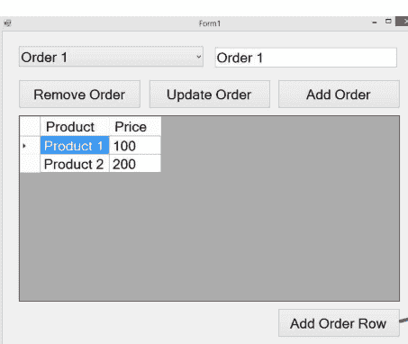

# 创建项目

1. 创建名为 Orders 的 Windows Forms 应用程序（Windows Forms Application）。
2. 在解决方案管理器中，右键点击解决方案名称（而不是项目名称），并选择“添加-新建项目”。
3. 在项目列表中选择“类库”（Class Library），不要选择“类库（可移植）”（Class Library Portable）。
4. 将项目命名为 Data Layer 并点击“确定”按钮。
5. 新的 Data Layer 项目包含一个名为 `Class1.cs` 的类，你可以将其重命名并重用为 Order 类。在解决方案管理器中右键点击类名并选择“重命名”。将类重命名为 Order 并按回车；对话框会询问你是否也要重命名类，点击“是”按钮。
6. 通过右键点击“引用”（References）文件夹并选择“添加引用”，在 Windows Forms 应用程序中添加类库的引用。
7. 点击左侧菜单中的“解决方案”（Solution）选项以找到类库。
8. 勾选 Data Layer 项目左侧的复选框并点击“确定”按钮。

# Order 类

**Order** 类定义了订单对象将包含的信息。

1. 在 **Data Layer** 类库中找到 **Order** 类并双击打开它。
2. 默认情况下，类库中的类是**内部的**（internal），因此你需要将类的访问修饰符更改为 **public**。

```csharp
public class Order
{
}
```

3. 添加名为 `OrderId` 的 int 属性，后续将包含一个唯一 ID。

```csharp
public int OrderId { get; set; }
```

4. 添加一个名为 `Description` 的 string 属性，后续将包含一个简短描述。
5. 添加一个**内部的**（internal）构造函数，接收订单 ID 和描述，并使用之前添加的属性存储它们。

```csharp
internal Order(int orderId, string description) { }
```

6. 保存解决方案。

完整的 **Order** 类代码如下：

```csharp
public class Order
{
    public int OrderId { get; set; }
    public string Description { get; set; }

    internal Order(int orderId, string description)
    {
        OrderId = orderId;
        Description = description;
    }
}
```

# OrderRow 类

OrderRow 类定义了订单行对象将包含的信息。

1. 在解决方案管理器中右键点击 Data Layer 类库并选择“添加-类”。
2. 将类命名为 OrderRow 并点击“添加”按钮。
3. 默认情况下，类库中的类是内部的，因此你需要将类的访问修饰符更改为 public。
4. 添加两个 int 属性 `OrderRowId` 和 `OrderId`，后者的 ID 将作为订单集合的外键，用于跟踪记录哪条订单行属于哪个订单。
5. 添加一个名为 `Product` 的 string 属性，用于存储产品名称。
6. 添加一个名为 `Price` 的可空（null-able）double 属性。你通过在数据类型名称末尾添加问号（?）来使属性或变量变为可空。
7. 为类添加一个内部构造函数，参数包含所有属性。

完整的 OrderRow 类代码如下：

```csharp
public class OrderRow
{
    public int OrderRowId { get; set; }
    public int OrderId { get; set; }
    public string Product { get; set; }
    public double? Price { get; set; }

    internal OrderRow(int orderId, int orderRowId, string product, double? price)
    {
        OrderId = orderId;
        OrderRowId = orderRowId;
        Product = product;
        Price = price;
    }
}
```

# 创建 Data 类

Data 类的唯一目的是作为数据源（orders 和 orderRows 集合）与应用程序之间的层以分离关注点；表单不应包含直接操作数据的代码，它们应该使用 Data 类的对象并调用其方法。这意味着 Data 类需要具有从集合中添加、更新和删除数据的方法；在现实场景中，这些集合可能会被数据库以及 Entity Framework 或 ADO.NET 替换。

你会在向表单添加功能时向 Data 类添加方法，例如你将添加集合、一个名为 `AddOrder` 的方法（用于添加订单）以及一个返回 `List<Order>` 的 `GetOrders` 方法。

## 添加 Data 类

1. 在解决方案管理器中右键点击 Data Layer 类并选择“添加类”。
2. 将类命名为 Data 并点击“添加”按钮。
3. 类默认是内部的，因此你需要将类的访问修饰符更改为 public。

```csharp
public class Data
```

4. 添加一个名为 Variables（变量）的区域（region）。
5. 在区域内添加一个名为 `orders` 的 `List<Order>` 集合。

```csharp
List<Order> orders = new List<Order>();
```

6. 在区域内添加一个名为 `orderRows` 的 `List<OrderRow>` 集合。

## 添加 AddOrder 方法

1. 添加一个名为 Order Methods（订单方法）的区域。
2. 在 Order Methods 区域添加一个返回 `Order` 对象并接收名为 `description` 的 string 参数的 `AddOrder` 方法。

```csharp
public Order AddOrder(string description)
{
```

3. 在方法中使用 try/catch 块进行异常处理，其中 catch 块在发生任何异常时抛出一个带有特定消息的新 `ApplicationException`。

> "Could not add the order"（无法添加订单）以及实际异常作为内部异常。通过这种方式抛出异常，它将作为特定异常传递给客户端处理。

```csharp
try
{
    catch (Exception ex)
    {
        throw new ApplicationException("Could not add the order", ex);
    }
```

4. 你在 try 块中需要执行的第一件事是生成一个新的订单 ID，在此情况下，它将是当前存在的最大订单 ID 加一；在现实场景中，它将从数据库表自动生成或作为新的 Guid 添加。

```csharp
int newId = orders.Count.Equals(0) ? 1 : orders.Max(o => o.OrderId) + 1;
```

5. 接下来你必须创建一个 `Order` 类的新实例，将 `newId` 和 `description` 作为值传递给其构造函数。

```csharp
var order = new Order(newId, description);
```

6. 使用 `Add` 方法将订单添加到 `orders` 集合中。
7. 方法返回订单。

## 添加 GetOrders 方法

1. 添加一个无参数的 `GetOrders` 方法，它返回 `List<Order>` 集合。
2. 方法返回订单。

Data 类代码如下：

```csharp
public class Data
{
    #region Variables
    List<Order> orders = new List<Order>();
    List<OrderRow> orderRows = new List<OrderRow>();
    #endregion

    #region Order Methods

    public Order AddOrder(string description)
    {
        try
        {
            int newId = orders.Count.Equals(0) ? 1 : orders.Max(o => o.OrderId) + 1;
            var order = new Order(newId, description);
            orders.Add(order);
            return order;
        }
        catch (Exception ex)
        {
            throw new ApplicationException("Could not add the order", ex);
        }
    }

    public List<Order> GetOrders()
    {
        return orders;
    }

    #endregion
}
```

# GUI（主表单）

打开主表单的设计区域。

1. 添加一个组合框 `cboOrders` 列出所有可用订单。
2. 添加一个文本框 `txtDescription` 显示所选订单的描述。
3. 添加四个按钮：`RemoveOrder`、`UpdateOrder` 和 `AddOrder`。
4. 添加一个数据网格控件 `dgvOrderRows`。
5. 添加一个按钮 `AddRow`。

# GUI（添加行表单）

1. 在解决方案管理器中右键点击 Orders 项目并选择“添加-表单”（Forms）。
2. 将表单命名为 `frmRow` 并点击“添加”按钮。
3. 添加两个标签，文本分别为 "Product" 和 "Price"。
4. 添加两个文本框 `txtProduct` 和 `txtPrice`。
5. 添加两个按钮 `btnOK` 和 `btnCancel`。

# 在主表单中绑定控件

1. 在表单开头打开 Variables 区域。
2. 在区域内添加一个变量 `data` 并分配 `Data` 类的实例。你需要引入正确的命名空间以访问该类。

```csharp
Data data = new Data();
```

3. 添加两个 `BindingList` 集合 `orders` 和 `orderRows`，用于将控件绑定到当前数据。

```csharp
BindingList<Order> orders;
BindingList<OrderRow> orderRows;
```

4. 在 `Form_Load` 事件中添加 try/catch 块，带有针对 `ApplicationException` 和 `Exception` 的 catch 块。在 `ApplicationException` 的 catch 块中使用异常的 `Message` 属性添加消息框；当类库的 `AddOrder` 方法中添加订单时，将触发此异常并传递此处。
5. 在 try 块中调用 `data` 实例的 `AddOrder` 方法添加两个订单。

```csharp
data.AddOrder("Order 1");
data.AddOrder("Order 2");
```

6. 通过调用 `data` 变量上的 `GetMethods` 将类库中的 `orders` List 添加到表单中的 `orders` BindingList。

```csharp
orders = new BindingList<Order>(data.GetOrders());
```

7. 将表单中的 `BindingList` `orders` 绑定到组合框的 `DataSource` 属性。
8. 将 `Order` 类中希望在组合框中显示的属性赋值给其 `DisplayName` 属性（字符串）。
9. 使用 `DataBindings.Add` 方法将 `txtDescription` 的 `Text` 属性绑定到 `orders` 集合的 `Description` 属性。

```csharp
txtDescription.DataBindings.Add("Text", "Description", false, DataSourceUpdateMode.Never);
```

11. 在数据网格视图中隐藏前两列，以隐藏在网格中显示的 `OrderRow` 对象的 id 值。

```csharp
dgvOrderRows.Columns[0].Visible = false;
dgvOrderRows.Columns[1].Visible = false;
```

12. 运行应用程序。
13. 组合框中应该显示两个订单，选中的订单描述应该在文本框中可见。
14. 选择另一个订单，并确保文本框中的文字发生变化。
15. 关闭应用程序。

到目前为止主窗的代码：

```csharp
public partial class Form1 : Form
{
    #region 变量
    Data data = new Data();
    BindingList<Order> orders;
    BindingList<OrderRow> orderRows;
    #endregion

    #region 构造函数和 Form_Load
    public Form1()
    {
        InitializeComponent();
    }

    private void Form1_Load(object sender, EventArgs e)
    {
        try
        {
            data.AddOrder("Order 1");
            data.AddOrder("Order 2");
            orders = new BindingList<Order>(data.GetOrders());
            cboOrders.DataSource = orders;
            cboOrders.DisplayMember = "Description";
            txtDescription.DataBindings.Add(
                "Text", orders, "Description",
                false, DataSourceUpdateMode.Never);
            dgvOrderRows.Columns[0].Visible = false;
            dgvOrderRows.Columns[1].Visible = false;
        }
        catch (ApplicationException ex)
        {
            MessageBox.Show(ex.Message);
        }
        catch (Exception ex)
        {
        }
    }
    #endregion
}
```

## ContainsOrder 方法

该方法的作用是确保 `orders` 集合中不包含包含文本框中提供的描述的订单。该方法将在点击 Add 按钮时被调用，并根据提供的描述是否已存在订单返回 true 或 false；你可以使用 `Count` 方法和 Lambda 表达式来检查描述是否存在。

1. 在类库中打开 Data 类。
2. 在 Order Methods 区域添加一个名为 `ContainsOrder` 的 bool 方法，它接受一个名为 `description` 的字符串参数。
3. 返回检查 `orders` 集合是否包含传递给方法的描述的订单的结果。你可以使用 `Count` 方法和 Lambda 表达式来检查描述是否存在；如果结果大于零，则已存在该描述的订单。

```csharp
return orders.Count(o => o.Description.Equals(description)) > 0;
```

`ContainsOrder` 方法的完整代码：

```csharp
public bool ContainsOrder(string description)
{
    return orders.Count(o => o.Description.Equals(description)) > 0;
}
```

## btnAddOrder_Click 事件

此按钮的作用是使用 Data 类中 `AddOrder` 方法的文本框中的，向 `orders` 集合中添加新订单。


- 1. 为 `btnAddOrder` 按钮添加 Click 事件。

- 2. 由于 `AddOrder` 方法可能会抛出 `ApplicationException`，因此必须在 Click 事件中处理它，以防止发生异常时应用程序崩溃。在 Click 事件中添加 try/catch 块，如果从 `AddOrder` 方法抛出 `ApplicationException`，则显示带有异常消息的消息框。

```csharp
try
{
    // 此处编写代码
}
catch (AccessException ex)
{
    MessageBox.Show(ex.Message);
}
catch (Exception ex)
{
}
```

- 3. 如果文本框为空，显示消息“Description is empty!”并退出事件。

- 4. 如果文本框中已输入描述的订单已存在，则显示消息“Description already exist!”并退出事件。你可以通过调用 `Data` 类中的 `ContainsOrder` 来执行检查。

```csharp
if (data.ContainsOrder(txtDescription.Text))
{
}
```

- 5. 在最后一个 if 块之后通过调用 `Data` 类中的 `AddOrder` 方法添加新订单，并将返回的订单保存在变量 `order` 中。

```csharp
var order = data.AddOrder(txtDescription.Text);
```

- 6. 调用 `ResetBindings()` 重置对 `orders` 集合的绑定。

- 7. 由于在添加新订单并重置绑定后，新项会自动添加到组合框中，你想在组合框中选择该订单。为了实现这一点，你将 `AddOrder` 方法返回的订单赋值给组合框的 `SelectedItem` 属性。

```csharp
cboOrders.SelectedItem = order;
```

- 8. 运行应用程序并在文本框中输入描述。

- 9. 点击 Add Order 按钮。

- 10. 订单应该被添加到 `orders` 集合并显示在组合框中。

- 11. 尝试添加一个已存在描述的订单；弹出消息框。

- 12. 关闭应用程序。

`btnAddOrder_Click` 事件的完整代码：

```csharp
private void btnAddOrder_Click(object sender, EventArgs e)
{
    try
    {
        if (txtDescription.Length.Equals(0))
        {
            MessageBox.Show("Description is empty!");
            return;
        }
        if (data.ContainsOrder(txtDescription.Text))
        {
            MessageBox.Show("Description already exist!");
            return;
        }
        var order = data.AddOrder(txtDescription.Text);
        orders.ResetBindings();
        cboOrders.SelectedItem = order;
    }
    catch (ApplicationException ex)
    {
        MessageBox.Show(ex.Message);
    }
    catch (Exception ex)
    {
    }
}
```

# UpdateOrder 方法

`Data` 类中该方法的作用是使用文本框中的更新现有订单。

- 在 `Data` 类中添加一个名为 `UpdateOrder` 的 bool 方法，它接受两个参数：int 类型的 `orderid` 和 string 类型的 `description`。为该方法添加 try/catch 块，catch 块不接受参数并返回 false，try 块最后返回 true。

```csharp
try {
    // 此处编写代码
    return true;
}
catch {
    return false;
}
```

- 使用 LINQ 和 Lambda 从 `orders` 集合中获取匹配 order id 的订单。

`var order = orders.FirstOrDefault(o => o.OrderId.Equals(orderId));`

- 将传递的描述赋值给 `order` 对象的 `Description` 属性。

UpdateOrder 方法的完整代码：

```csharp
public bool UpdateOrder(int orderId, string description)
{
    var order = orders.FirstOrDefault(o => o.OrderId.Equals(orderId));
    order.Description = description;
    return true;
}
```

# btnUpdateOrder_Click 事件

- 1. 为 `btnUpdateOrder` 按钮添加 Click 事件。

- 2. 检查 `orders` 集合中至少有一个订单，如果为空则退出事件。

  `if (orders.Count.Equals(0)) return;`

- 3. 调用 `Data` 类中的 `UpdateOrder` 方法，传递组合框中的订单 id 和文本框中的描述。将返回值保存在变量 `success` 中。

  `var success = data.UpdateOrder((Order)cboOrders.SelectedItem).OrderId, txtDescription.Text);`

- 4. 如果 `success` 变量为 true，则订单已更新，你应该通过调用 `ResetBindings()` 重置 `orders` 集合的绑定。

- 5. 运行应用程序并在组合框中选择一个订单。

- 6. 修改文本框中的描述并点击 Update Order 按钮。

- 7. 在组合框中选择另一个订单，以确保更改反映在文本框中。

- 8. 关闭应用程序。

`btnUpdateOrder_Click` 事件的完整代码：

```csharp
private void btnUpdateOrder_Click(object sender, EventArgs e)
{
    if (orders.Count.Equals(0)) return;

    var success = data.UpdateOrder((Order)cboOrders.SelectedItem).OrderId, txtDescription.Text);

    if (success) orders.ResetBindings();
}
```

# RemoveOrder 方法

`Data` 类中该方法的作用是从 `orders` 集合中删除现有订单，并从 `orderRows` 集合中删除所有相关的订单行。

- 在 `Data` Order Methods 区域添加一个名为 `RemoveOrder` 的 bool 方法，它接受一个 int 类型的 `orderId` 参数。

- 为该方法添加 try/catch 块，catch 块不接受参数并返回 false，try 块最后返回 true。

- 使用 LINQ 和 Lambda 从 `orderRows` 集合中删除匹配传递的 id 的所有订单行。

  `orderRows.RemoveAll(or => or.OrderId.Equals(orderId));`

- 使用 LINQ 和 Lambda 从 `orders` 集合中删除匹配传递的 id 的订单。

  `orders.RemoveAll(o => o.OrderId.Equals(orderId));`

```csharp
public bool RemoveOrder(int orderId)
{
  try {
    orderRows.RemoveAll(or => or.OrderId.Equals(orderId));
    orders.RemoveAll(o => o.OrderId.Equals(orderId));
    return true;
  }
  catch {
    return false;
  }
}
```

# GetOrderRows 方法

- 在 `Data` 类中添加一个 Order Row Methods 区域。

- 在 Order Row Methods 区域添加一个返回 `List<OrderRow>` 的 `GetOrderRows` 方法，它接受一个 int 类型的 `orderId` 参数。

### C# 入门

3. 使用 LINQ 和 Lambda 从 `orderRows` 集合获取所有与传入的 `orderId` 匹配订单行。

`return orderRows.Where(or => or.OrderId.Equals(orderId)).ToList();`

GetOrderRows 方法完整代码：

```csharp
public List<OrderRow> GetOrderRows(int orderId)
{
    return orderRows.Where(or => or.OrderId.Equals(orderId)).ToList();
}
```

## 主表中的 UpdateOrderRowBinding 方法

该方法的目的是更新 `orderRows` Binding-List 与查看所选订单行的数网格之间的数据绑定。

- 1. 在主表中添加一个名为 `Methods` 的区域（region）。

2. 在该区域内添加一个名为 `UpdateOrderRowBindings` 的无参数 void 方法。

3. 方法要做的第一件事是检查组合框是否选中了项，因为无法为不存在的订单获取订单 ID。如果组合框的 `SelectedItem` 为 null

4. 从组合框中选定的订单获取订单 ID，并将其存储在名为 `orderId` 的 int 变量中。

5. 将 `Data` 类中通过 `GetOrderRows` 方法初始的新 `BindingList<OrderRow>` 实例赋值给 `orderRows` 变量。

6. 将 `orderRows` 集合赋值给数据网格的 `DataSource` 属性。

```csharp
if (cboOrders.SelectedItem == null)
{
    dgvOrderRows.Rows.Clear();
    return;
}
```

UpdateOrderRowBindings 方法完整代码：

```csharp
private void UpdateOrderRowBinding()
{
    if (cboOrders.SelectedItem == null)
    {
        dgvOrderRows.Rows.Clear();
        return;
    }

    var orderId = ((Order)cboOrders.SelectedItem).OrderId;
    orderRows = new BindingList<OrderRow>(data.GetOrderRows(orderId));
    dgvOrderRows.DataSource = orderRows;
}
```

# btnRemoveOrder_Click 事件

此按钮的目的是删除现有的订单及其关联行。

btnRemoveOrder_Click 方法完整代码：

```csharp
private void btnRemoveOrder_Click(object sender, EventArgs e)
{
  if (orders.Count.Equals(0)) return;

  var success = data.RemoveOrder(((Order)cboOrders.SelectedItem).OrderId);
  if (success)
  {
    orders.ResetBindings();
    UpdateOrderRowBinding();
  }
}
```

### C# 入门

### frmAddOrderRow 表单构造函数

该表单用于创建一个新的订单行，当点击 **OK** 按钮关闭表单时，该行会被添加到 `orderRows` 集合中。

- 1. 打开 **frmAddOrderRow** 的后置代码（code-behind）。

2. 在表单开始处添加名为 **Properties** 的**区域**（region）。

3. 在**区域**中添加一个名为 **OrderRow** 的 **private OrderRow** 属性。

4. 修改构造函数定义，将 **OrderRow** 参数命名为 `orderRow`。

5. 将传入的 **orderRow** 赋值给 **OrderRow** 属性。

6. 在构造函数周围添加描述为 **Constructor** 的**区域**（region）。

目前为止的表单代码：

```csharp
public partial class frmAddOrderRow : Form
{
    #region Properties
    private OrderRow OrderRow { get; set; }
    #endregion

    #region Constructor
    public frmAddOrderRow(OrderRow orderRow)
    {
        OrderRow = orderRow;
        InitializeComponent();
    }
    #endregion
}
```

# frmAddOrderRow 表单中的 OK 按钮

当用户点击此按钮时，如果文本框的值无法解析为 **double** 值，则应显示文本为“Price not valid!”的消息框，并保持表单打开状态。

如果解析成功，则应将文本框中的值添加到 **OrderRow** 属性的相应属性中（该属性包含对传入 **orderRow** 对象的引用），然后将 `DialogResult.OK` 赋值给 `DialogResult` 属性，以通知主表已点击 **OK** 按钮并关闭表单。

- 1. 为 **OK** 按钮添加 **Click** 事件。

- 2. 尝试将 `txtPrice` 文本框中的值解析为 double 值，并将返回值存储在名为 `success` 的变量中，将解析后的值存储在名为 `price` 的变量中。

- 3. 如果 `success` 变量为 true，则将 `txtProduct` 文本框中的值赋值给 `OrderRow` 对象的 `Product` 属性，并将 `price` 变量赋值给 `OrderRow` 对象的 `Price` 属性。

- 4. 将 `DialogResult.OK` 赋值给表单的 `DialogResult` 属性。

`DialogResult = DialogResult.OK;`

- 5. 调用表单的 `Close` 方法关闭表单；使用 `this` 关键字访问表单。

`this.Close();`

- 6. 如果 `success` 变量为 false，则显示文本为“Price not valid!”的消息框并保持表单打开。

btnOK_Click 事件完整代码：

```csharp
private void btnOK_Click(object sender, EventArgs e)
{
    double price = 0;
    var success = Double.TryParse(txtPrice.Text, out price);

    if (success) {
        OrderRow.Product = txtProduct.Text;
        OrderRow.Price = price;
        DialogResult = DialogResult.OK;
        this.Close();
    }
    else MessageBox.Show("Price not valid!");
}
```

# frmAddOrderRow 表单中的 Cancel 按钮

- 1. 为 Cancel 按钮添加 Click Click 事件。

- 2. 将 `DialogResult.Cancel` 赋值给表单的 `DialogResult` 属性。

- 3. 调用 `Close` 方法关闭表单。

Cancel_Click 事件的完整代码：

```csharp
private void btnCancel_Click(object sender, EventArgs e)
{
    DialogResult = DialogResult.Cancel;
    this.Close();
}
```

# EmptyRow 方法

`Data` 类此目的是返回一个带有默认值的 `OrderRow` 实例。该实例将在新订单行添加到现有订单时使用。

- 1. 添加一个无参数的名为 `EmptyRow` 方法。

2. 返回一个 `OrderRow` 实例，其 ID 值为 0，描述为空字符串，价格为 null。

EmptyRow() 方法的完整代码：

```csharp
public OrderRow EmptyRow()
{
    return new OrderRow(0, String.Empty, null);
}
```

# AddOrderRow 方法

`Data` 类中此方法的目的是向现有订单添加新的订单行。你将根据 `orderRows` 中最大的订单 ID 创建一个新的订单 ID，并将其赋值给传入的 `orderRow` 的 `OrderId` 属性。


- 1. 在 `Data` 类的方法区域添加一个接收 `OrderRow` 参数的 `OrderRow` 方法。
- 2. 添加一个 `try/catch` 块，其中 `catch` 块抛出一个消息为“Could not add order row”的 `ApplicationException`，并将实际异常作为内部异常。
- 3. 在 `try` 块内部计算订单行 ID 并将结果存储在名为 `newId` 的变量中。

```csharp
int newId = orderRows.Count.Equals(0) ? 1 : orderRows.Max(o => o.OrderId) + 1;
```

- 4. 将 `newId` 的值赋值给传入的 `orderRow` 的 `OrderId` 属性。
- 5. 使用 `Add` 方法将 `orderRow` 参数添加到 `orderRows` 集合中。
- 6. 从方法返回 `orderRow` 对象。

`AddOrderRow` 方法完整代码：

```csharp
public OrderRow AddOrderRow(OrderRow orderRow)
{
    try {
        int newId = orderRows.Count.Equals(0) ? 1 :
                    orderRows.Max(o => o.OrderId) + 1;

        orderRow.OrderId = newId;
        orderRows.Add(orderRow);
        return orderRow;
    } catch (Exception ex) {
        throw new ApplicationException("Could not add the order row", ex);
    }
}
```

# 主表中的 ShowTableRow 方法

该方法的目的是显示添加订单表单并返回结果。你可以使用表单实例的 `ShowDialog` 方法将表单显示为模态框；模态框类似于对话框，必须关闭才能使用它的主表。

- 1. 在主表的后置代码中添加一个接收 `OrderRow` 参数的 `ShowAddRow` 方法。
- 2. 创建 `AddOrderRow` 的实例并将其存储在名为 `frm` 的变量中。

```csharp
var frm = new frmAddOrderRow(orderRow);
```

- 3. 为了能够将表单位于主表顶部和左侧 40px 处，你必须将 `Manual` 赋值给 `frm` 实例的 `StartPosition` 属性。使用 `Location` 属性对表单进行定位。

```csharp
frm.StartPosition = FormStartPosition.Manual;
```

- 4. 显示表单并将点击按钮的结果保存在 `DialogResult` 变量中，然后从方法返回该变量。

```csharp
return frm.ShowDialog();
```

# C# 初学者

```csharp
DialogResult result = frm.ShowDialog();
return result;
```

`ShowAddOrderRowForm` 方法的完整代码：

```csharp
private DialogResult ShowAddOrderRowForm(OrderRow order)
{
    // 创建表单实例
    var frm = new frmAddOrderRow(order);

    // 设置表单位置
    frm.StartPosition = FormStartPosition.Manual;
    var location = this.Location;
    location.Offset(40, 40);
    frm.Location = location;

    // 打开表单并返回点击按钮的结果
    DialogResult result = frm.ShowDialog();
    return result;
}
```

## 主表中的添加订单行（Add Order Row）按钮

此按钮的目的是向现有订单添加新的订单行。要实现这一点，你必须调用之前创建的 `EmptyOrderRow` 方法创建一个空订单行，并将结果传递给之前创建的 `ShowAddOrderRow` 方法，以显示添加订单行的表单。

如果用户正确填写了表单并点击 OK 按钮，则组合框中选定的订单 ID 应该赋值给订单行对象的 `OrderId` 属性。然后，应将订单对象传递给 `Data` 类中的 `AddOrderRow` 方法，将其添加到 `orderRows` 集合中。

最后你需要做的是调用你创建的 `UpdateOrderRowBinding` 方法，以重新更新 `orderRows` `BindingList` 集合与网格视图之间的绑定，以反映更改。

- 1. 为 `btnAddOrderRow` 按钮添加 `Click` 事件。
- 2. 通过调用 `Data` 类中的 `EmptyOrderRow` 方法创建一个新的订单行实例，并存储在名为 `orderRow` 的变量中。

```csharp
var orderRow = data.EmptyOrderRow();
```

- 3. 将 `orderRow` 实例传递给 `ShowAddOrderRowForm` 方法显示表单并填充值。将表单的返回值存储在变量 `result` 中。

```csharp
var result = ShowAddOrderRowForm(orderRow);
```

- 4. 检查表单中是否点击了 Cancel 按钮，如果是，则退出事件，因为此时行不应被添加到 `OrderRows` 集合中。

```csharp
if (result.Equals(DialogResult.Cancel)) return;
```

- 5. 将组合框中选中的订单 ID 添加到 `orderRow` 的 `OrderId` 属性。
- 6. 通过调用 `Data` 类中的 `AddOrderRow` 方法将 `orderRow` 实例添加到 `Data` 类中的 `OrderRows` 集合中。
- 7. 运行应用程序并点击 Add Row 按钮显示添加表单。
- 8. 在 Product 框中输入产品名称，在 Price 框中输入无效价格。
- 9. 当点击 OK 按钮时，应该弹出一个消息框。关闭消息框。
- 10. 输入有效价格并点击 OK 按钮。表单应该关闭，并在数据网格视图中显示一个订单行。
- 11. 再次打开表单并点击 Cancel 按钮，确保它在不出现消息框的情况下关闭。
- 12. 关闭应用程序。

`btnAddOrderRow_Click` 事件的完整代码：

```csharp
private void btnAddOrderRow_Click(object sender, EventArgs e)
{
    var orderRow = data.EmptyOrderRow();
    var result = ShowAddOrderRowForm(orderRow);
    if (result.Equals(DialogResult.Cancel)) return;

    orderRow.OrderId = orders[cboOrders.SelectedIndex].OrderId;
    orderRow = data.AddOrderRow(orderRow);
    UpdateOrderRowBinding();
}
```

## 绑定组合框的 SelectedIndexChanged 事件

为了让数据网格视图中的订单行随组合框中选定的订单而变化，你必须更新 `orderRows` 集合与数据网格视图之间的绑定。你可以通过在组合框的 `SelectedChanged` 事件中调用创建的 `UpdateOrderRowBinding` 方法来实现，该事件会在组合框中选中某项时触发。

- 1. 为组合框添加 `SelectedChanged` 事件。
- 2. 添加对 `UpdateOrderRowBinding` 方法的调用。
- 3. 运行应用程序。
- 4. 为选定的订单添加订单行。
- 5. 在组合框中选择另一个订单，确保订单行反映当前订单的订单行。
- 6. 关闭应用程序。

组合框 `SelectedChanged` 事件的完整代码：

```csharp
private void cboOrders_SelectedIndexChanged(object sender, EventArgs e) {
  RemoveOrderRowBinding();
}
```

## RemoveOrderRow 方法

`Data` 类中此方法的目的是从 `Data` 类中的 `orderRows` 集合中移除订单行实例。

- 1. 在 `Data` 类的 Order Row Methods 区域添加一个 `bool` 类型的方法，它接收一个 `OrderRow` 实例参数。
- 2. 返回调用 `orderRows` 集合的 `Remove` 方法的结果。将 `OrderRow` 实例传递给该方法。

`RemoveOrderRow` 方法的完整代码：

```csharp
public bool RemoveOrderRow(OrderRow orderRow) {
  return orderRows.Remove(orderRow);
}
```

## 删除订单行

要删除订单行，你需要在数据网格视图的 `UserDeleting` 事件中添加代码。你可以通过 `e.Row` 属性的 `SelectedItem` 属性从数据网格视图访问正在删除的订单行；你必须将其转换为 `OrderRow`。

- 1. 为数据网格视图添加 `UserDeleting` 事件。
- 2. 通过 `e.Row` 属性的 `SelectedItem` 属性从数据网格视图访问正在删除的订单行；你必须将其转换为 `OrderRow`。
- 3. 调用 `Data` 类中的 `RemoveOrderRow` 方法。

`UserDeleting` 事件的完整代码：

```csharp
private void dgvOrderRows_UserDeleting(object sender, DataGridViewCancelEventArgs e) {
  var orderRow = (OrderRow)e.Row.SelectedItem;
  data.RemoveOrderRow(orderRow);
}
```

## 更新订单行数据

要更新订单行中的数据，可以双击单元格进入编辑模式。

## 引用类型与值类型

变量有两种类型：值类型和引用类型。值类型存储在栈（`stack`）上，因此比存储在堆（`heap`）上的引用类型快得多。处理值类型变量时，你直接与其值交互。引用类型（从类创建的对象）的工作方式不同。从类创建的变量并不直接包含数据，而是指向堆上分配的内存区域的引用（指针）。这意味着在给变量赋值之前，必须先创建一个实例。此外，当变量超出作用域且不再被使用时，对象并不会简单消失；一个名为垃圾回收（`GC`）的进程将接管该引用并将对象从内存中移除，这需要时间。

# 静态类 (Static classes)

在某些情况下，存储实例数据是没有必要的；例如，你可以创建一个仅包含不存储任何方法的类。这些可以是转换方法，也可以根据输入参数返回某种结果的方法（例如数学计算）。在这些情况下，**静态（`static`）**是理想的选择；**静态类**不能被实例化，其成员需要用**静态关键字（`static keyword`）**进行声明。

**重要：** 你直接通过类来访问*静态*成员，而不是通过变量。

# 静态成员 (Static members)

静态成员在某些情况下非常有用，例如当**静态方法**执行的功能属于类型本身时，比如跟踪创建了多少个类型的实例。无论创建了多少个实例，**静态成员**的实例只会被创建一个。

**重要：** 如果类没有被声明为*静态且包含静态成员*，那么*静态成员*在该*类*的所有实例中都是可用的。如果*静态*属性属性值发生变化，它会影响该*类*的所有实例。

**重要：** *静态方法*无法访问*非静态成员*；这是因为*静态成员*属于类型，因此它不了解任何实例。

# 练习：带有静态类和类库的计算器 (Exercise: Calculator with static class and class library)

在此练习中，你将对之前创建的最新版本计算器应用程序进行重构，将常量和方法提取到包含**静态类和成员**的类库中。

打开最新版本的计算器应用程序（即你重构为方法的版本），并为其添加一个名为 **Calculator Library** 的**类库**项目。重命名类库中现类 **Calc**，并在应用程序项目中引用该类库。

要将常量和方法从视图重构到类库，你需要将它们剪切并粘贴到 **Calc** 类中，并将它们从**private**（私有）改为**public**（公共）。除了 **CanCalculate** 方法外，所有方法都可以移动；该方法无法移动，因为它包含了对表单控件的引用。

在表单代码文件中为所有常量和方法名称加上 `Calc` 类的前缀（例如 `Calc.noValue`）。最简单的方法是对每个名称进行搜索并替换。

## 创建类库项目

向解决方案中添加一个类项目并重命名现有的类 `Calc`。将类从实例类更改为不能实例化的静态类。从应用程序项目中引用该类库。

- 1. 打开你在之前的练习中重构的最新版本计算器应用程序。
- 2. 在解决方案管理器中右键点击解决方案，选择“添加新建项目”，添加类库项目。
- 3. 将项目命名为 Calculator Library，右键点击 `Calc1` 并选择“重命名”。弹出对话框后，点击“是**”。
- 4. 将类从实例类更改为静态类。

```csharp
public static class Calc
{}
```

- 5. 右键点击引用文件夹并选择“添加引用”，在计算器应用程序中添加类库引用。
- 6. 在对话框中选择 Calculator Library 项目名称并点击确定按钮。

## 移动常量和方法

剪切 `CanCalculate` 方法之外的所有常量和方法并粘贴到 `Calc` 类中，然后将它们从 `private` 改为 `public`。为所有常量和方法名称加上 `Calc` 类的前缀。

- 1. 剪切 `CanCalculate` 方法之外的所有常量和方法并粘贴到 `Calc` 类中。
- 2. 给常量添加 `public` 访问修饰符。
- 3. 将方法上的 `private` 访问修饰符改为 `public static`。
- 4. 保存 `Calc` 类。

# C# 初学者入门 (C# For Beginners)

- 5. 在表单代码文件中搜索并替换 `noValue` 为 `Calc.noValue` (`Ctrl+Shift+H`)。确保“查找范围”下拉菜单设置为“当前文档”。
- 6. 搜索并替换 `minusSign` 为 `Calc.minusSign`。
- 7. 搜索并替换 `AddDigit` 为 `Calc.AddDigit`。
- 8. 搜索并替换 `DeletedDigit` 为 `Calc.DeleteDigit`。
- 9. 搜索并替换 `AddDecimal` 为 `Calc.AddDecimal`。
- 10. 搜索并替换 `ToggleSign` 为 `Calc.ToggleSign`。
- 11. 搜索并替换 `EndsWithDecimalSign` 为 `Calc.EndsWithDecimalSign`。
- 12. 搜索并替换 `Calculate` 为 `Calc.Calculate`。
- 13. 运行应用程序。
- 14. 进行几次计算以确保计算器按预期工作。
- 15. 关闭应用程序。

# 10. 接口 (Interfaces)

# 简介 (Introduction)

接口是定义方法、属性、事件和索引器签名的方式，而不指定这些成员是如何实现的。当在类中实现接口时，你必须实现接口中指定的所有成员，这向调用者保证所有成员都将被实现。通过实现接口，你允许开发者使用类的部分功能；实现多个小接口比实现一个巨大的接口要好；记住你必须实现所有成员，这对于功能实现来说可能是一项艰巨的任务。

**重要：** 你可以在一个类中实现多个接口，以定义不同的特征和行为。

**重要：** 接口中定义的方法不能有任何逻辑（方法体），只有指定返回数据类型和（如果需要）参数列表的定义。方法体将在实现接口的类中添加。

**重要：** 编程规范规定所有接口名称应以大写字母 "I" 开头，以便于与类区分来。

接口只能有一种访问修饰符，要么是 **public**（公共），使其可以从任何程序集访问；要么是 **internal**（内部），使其可以在定义它的程序集内部访问。

**重要：** 接口不能关联到类的**字段、常量和构造函数**。

# 接口声明 (Interface declaration)

假设你想实现一个 **Movie** 类；可以通过在类后面加上冒号 (`:`) 并紧跟用逗号分隔的接口列表来实现。实现接口 **IMovie** 定义了发布日期、导演、标题等。注意接口中的方法没有访问修饰符。

```csharp
public interface IMovie
{
    // 属性声明
    string Title { get; set; }
    string Director { get; set; }
    DateTime ReleaseDate { get; set; }

    // 方法声明
    int YearsSince();
}
```

# C# 初学者入门 (C# For Beginners)

# Movie : IMovie


所有成员将抛出 `NotImplementedException`，你在实现成员的实际逻辑时会移除该安全异常。

# 隐式接口实现 (Implicit interface implementation)

当你隐式实现接口时，你可以直接从实现类的实例变量访问接口，而无需先将对象转换为接口类型。


# 从隐式接口创建实例

```csharp
public class Movie : IMovie
{
    public string Title { get; set; }
    public string Director { get; set; }
    public DateTime ReleaseDate { get; set; }
}
```

```csharp
public int YearsSinceRelease()
{
    throw new NotImplementedException();
}
```

```csharp
public partial class Test
{
    public Test()
    {
        var movie = new Movie();
        // 或者
        var movie = (IMovie)new Movie();
        // 或者
        IMovie movie = new Movie();
    }
}
```

# 显式接口实现

显式实现接口意味着它通过所属的接口进行限定；这使得代码更容易理解，特别是当你实现了多个接口时。只有当多个实现的接口中存在相同名称和类型的成员时，你才需要使用显式实现。

**重要：** 当你显式实现接口时，只能通过该接口类型的变量或通过将类转换为该接口类型来使用该接口的成员。

```csharp
public class Movie : IMovie
{
    public string IMovie.Title { get; set; }
    public string IMovie.Director { get; set; }
    public DateTime IMovie.ReleaseDate { get; set; }

    public int IMovie.YearsSinceRelease()
    {
        throw new NotImplementedException();
    }
}
```

# 从显式接口创建实例

```csharp
public partial class Test
{
    public Test()
    {
        var movie = (IMovie)new Movie();
        // 或者：
        IMovie movie = new Movie();
    }
}
```

# 练习：带有两个接口的 Employee 类

在此练习中，你将创建两个接口 `IPerson` 和 `IEmployee`，它们将在一个名为 `Employee` 的类中被实现。用户界面应包含三个单选按钮，点击时将分别使用完整的 `Employee` 实例、`IPerson` 和 `IEmployee` 显示所有数据；你必须将类转换为相应的接口类型。

点击其中一个单选按钮的结果应显示在富文本框控件中（见下图）。

`IPerson` 接口应定义三个属性：`PersonId` (int)、`Name` (string) 和 `Born` (DateTime)。它还应该定义一个名为 `Age` 的方法，在类中实现时，根据 `Person` 属性中的日期计算返回年龄。

`IEmployee` 接口应定义三个属性：`EmployeeId` (int)、`Department` (string) 和 `Salary` (double)。

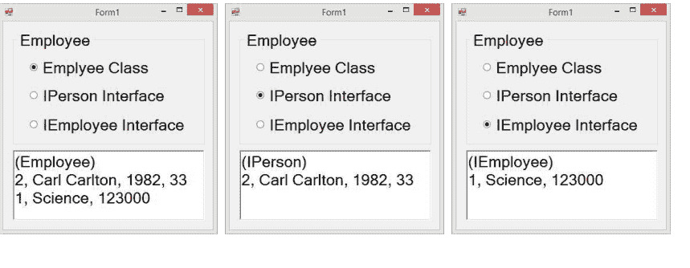

## IPerson 接口

1. 创建一个新的 Windows Forms 应用程序。
2. 向项目添加一个名为 `Interfaces` 的文件夹。
3. 右键点击 `Interfaces` 文件夹并选择“添加-新建项”。
4. 在对话框中选择“接口”，将其命名为 `IPerson` 并点击“添加”按钮。
5. 使用 `get` 关键字添加一个名为 `PersonId` 的 int 属性，使其在实现类之外是只读的。注意，你不需要为接口定义的成员指定任何访问修饰符。
6. 添加一个名为 `Name` 的 string 属性。
7. 添加一个名为 `Born` 的 DateTime 属性。
8. 添加一个无参数的 int 方法 `Age`。

`IPerson` 接口的完整代码：

```csharp
interface IPerson
{
    // 属性定义
    int PersonId { get; }
    string Name { get; set; }
    DateTime Born { get; set; }

    // 方法定义
    int Age();
}
```

## IEmployee 接口

1. 向 `Interfaces` 文件夹添加一个 `IEmployee` 接口。
2. 添加一个名为 `EmployeeId` 的 int 属性。
3. 添加一个名为 `Department` 的 string 属性。
4. 添加一个名为 `Salary` 的 double 属性。

`IEmployee` 接口的完整代码：

```csharp
interface IEmployee
{
    int EmployeeId { get; }
    string Department { get; set; }
    double Salary { get; set; }
}
```

## Employee 类

1. 向项目添加一个名为 `Classes` 的文件夹。
2. 向 `Classes` 文件夹添加一个名为 `Employee` 的类。
3. 为类添加 `public` 访问修饰符，以便它可以包含公共属性。
4. 在类名后以逗号分隔列表添加接口名称，使用冒号分隔类名和接口列表。

```csharp
public class Employee : IPerson, IEmployee
{}
```

5. 右键点击两个接口名称，选择“实现接口 - 实现接口”，以便类中实现它们的成员。
6. 为类中的 `PersonId` 和 `EmployeeId` 属性添加带有 `private` 访问修饰符的 `set` 关键字。

```csharp
public int EmployeeId { private set; }
```

7. 实现 `Age` 方法，根据 `Born` 属性计算年龄。

```csharp
public int Age()
{
    return DateTime.Now.AddYears(-Born.Year).Year;
}
```

8. 添加一个包含所有属性参数的构造函数，并将传递的值赋值给相应的属性。

`Employee` 类的完整代码：

```csharp
public class Employee : IPerson, IEmployee
{
    #region Employee Implementation
    public int EmployeeId { get; private set; }
    public string Department { get; set; }
    public double Salary { get; set; }
    #endregion

    #region Person Implementation
    public int PersonId { get; private set; }
    public string Name { get; set; }
    public DateTime Born { get; set; }

    public int Age()
    {
        return DateTime.Now.AddYears(-Born.Year).Year;
    }
    #endregion

    public Employee(int employeeId, int personId, string department,
        double salary, string name, DateTime born)
    {
        EmployeeId = employeeId;
        PersonId = personId;
        Department = department;
        Salary = salary;
        Name = name;
        Born = born;
    }
}
```

## GUI

1. 打开表单的代码后（code-behind）。
2. 在表单开头创建一个 `Employee` 类的实例。

```csharp
Employee empl = new Employee(1, 2, "Science", 123000, "Carl Carlton",
    new DateTime(1982, 10, 5));
```

3. 为显示完整 `Employee` 实例数据的单选按钮添加 `Click` 事件。
4. 分配包含 `Employee` 实例所有数据的格式化字符串。

```csharp
private void rbnEmployeeClass_Click(object sender, EventArgs e)
{
    // 使用来自两个接口的所有成员
    txtResult.Text = String.Format("Employee\n" + "{0}, {1}, {2}\n{3}, {4}, {5}",
        empl.PersonId, empl.Name, empl.Born.Year, empl.Age(),
        empl.EmployeeId, empl.Department, empl.Salary);
}
```

5. 为显示由 `IPerson` 接口定义数据的单选按钮相同的操作。将 `Employee` 实例转换为 `IPerson` 接口指针。注意，只有在转换后你才能访问接口的成员。

```csharp
var person = (IPerson)empl;
```

6. 为显示由 `IEmployee` 接口定义数据的单选按钮相同的操作。注意，如果你喜欢，可以在转换时使用 `as` 关键字。

```csharp
var employee = empl as IEmployee;
```

7. 运行应用程序并点击单选按钮更改富文本框中显示的文本。
8. 关闭应用程序。

`Form` 类的完整代码：

```csharp
public partial class Form1 : Form
{
    Employee empl = new Employee(1, 2, "Science", 123000, "Carl Carlton",
        new DateTime(1982, 10, 5));

    public Form1()
    {
        InitializeComponent();
    }

    private void rbniEmployeeClass_Click(object sender, EventArgs e)
    {
        // 使用来自两个接口的所有成员
        txtResult.Text = String.Format("Employee\n" + "{0}, {1}, {2}\n{3}, {4}, {5}",
            empl.PersonId, empl.Name, empl.Born.Year, empl.Age(),
            empl.EmployeeId, empl.Department, empl.Salary);
    }

    private void rbnIPerson_Click(object sender, EventArgs e)
    {
        // 转换为 IPerson
        // 只能使用接口的成员
        var person = (IPerson)empl;
        txtResult.Text = String.Format("IPerson\n" + "{0}, {1}, {2}\n{3}",
            person.PersonId, person.Name, person.Born.Year, person.Age());
    }

    private void rbniEmployeeInterface_Click(object sender, EventArgs e)
    {
        // 转换为 IEmployee
        // 只能使用接口中的 empl
        var employee = empl as IEmployee;
        txtResult.Text = String.Format("IEmployee\n" + "{0}, {1}, {2}",
            employee.EmployeeId, employee.Department, employee.Salary);
    }
}
```

# 接口多态

接口多态规定：一个类可以表示为它实现的任何接口的实例。

由于多个类实现了相同的接口，我们可以根据应用程序流在对象之间切换。

必须显式转换将接口类型转换为实现该接口的类类型；因为类可能实现了比接口定义的更多的成员。

假设你正在编写一个处理不同电影介质的应用程序，例如 VHS 和蓝光；在实现 VHS 和蓝光的类时，它们具有某些类似的特性和行为；例如，所有电影都有标题和发行日期。我们可以通过使用名为 `IMovie` 的接口来标准化实现的成员。

```csharp
public interface IMovie
{
    string Title { get; set; }
    string Director { get; set; }
    DateTime ReleaseDate { get; set; }
    int YearsSince();
}
```

```csharp
public class VHS : IMovie
{
    public string Title { get; set; }
    public string Director { get; set; }
    public DateTime ReleaseDate { get; set; }

    // 方法特定于此类
    public void Rewind()
    {
    }

    public int YearsSinceRelease()
    {
        // 实现与蓝光光不同
        return DateTime.Now.Year - ReleaseDate.Year;
    }
}

public class BlueRay : IMovie
{
    public string Title { get; set; }
    public string Director { get; set; }
    public DateTime ReleaseDate { get; set; }

    // 方法特定于此类
    public void CleanSurface()
    {
    }

    public int YearsSinceRelease()
    {
        // 实现与 VHS 不同
        TimeSpan time = DateTime.Now - ReleaseDate;
        return new DateTime(time).Add(time).Year;
    }
}
```

`Player` 类中的 `Play` 方法有一个类型 `IMovie` 参数，它可以接收任何实现 `IMovie` 接口的实例。在这个示例中，`VHS` 和 `BlueRay` 类实现了该接口。

由于这两个类都实现了 `IMovie` 接口，`IMovie` 参数将根据传递给它的接口指针重定向到正确的对象，因此它可以用于处理所有实现接口的成员，而无需强制类型转换。

然而，你可以将接口指针强制转换为实现类的类型，以便使用该类中实现但不属于接口特定成员。

```csharp
public class Player
{
    public void Play(IMovie movie)
    {
        // 因为两个类都实现了该接口，
        // 所以可以使用相同的接口属性和方法。
        string info = String.Format(
            "标题: {0} 发布日期: {1} | 年限: {2}",
            movie.Title,
            movie.ReleaseDate.ToShortDateString(),
            movie.YearsSinceRelease());

        // 使用类实例并调用
        // 定义类特有的方法
        if (movie is VHS)
        {
            var vhs = (VHS)movie;
            vhs.Rewind();
        }
        else if (movie is BlueRay)
        {
            var blueRay = (BlueRay)movie;
            blueRay.CleanSurface();
        }
    }
}
```

在下面的代码中，创建了两个电影，一个是 VHS 磁带，另一个是蓝光光盘。在构造函数中创建了 `Player` 类的实例，并在同一个 `Player` 实例上两次调用 `Play` 方法：一次针对 VHS 磁带，一次针对蓝光光盘。

`IMovie` 指针将根据传递给 `Play` 方法的内容使用正确的电影实例。


```csharp
public class Test
{
    VHS vhs = new VHS() { Title = "A.I.",
        ReleaseDate = new DateTime(2001, 6, 21); };

    BlueRay blueRay = new BlueRay() { Title = "Alien",
        ReleaseDate = new DateTime(1979, 11, 2); };

    public Test()
    {
        var player = new Player();

        // 播放 vhs 磁带
        player.Play(vhs);

        // 播放蓝光光盘
        player.Play(blueRay);
    }
}
```

# 练习：接口多态

在练习中，你将使用多态来决定在调用方法时使用哪个类的实现。你将创建一个名为 `IAnimal` 的接口，定义一个名为 `Walk` 的方法，该方法将在 `Cat`、`Dog` 和 `Dinosaur` 三个类中实现，这些类对该方法有不同的实现。当用户选择一个单选按钮并点击 `Walk` 按钮时，代表单选按钮选择的对象将强制转换为 `IAnimal` 接口，执行 `Walk` 方法并显示带有消息的消息框。

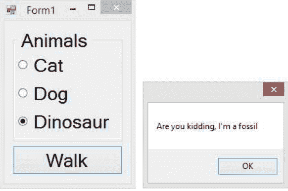

# IAnimal 接口

1. 创建一个新的 Windows Forms 。
2. 向项目中添加一个名为 `Interfaces` 的文件夹。
3. 右键点击该文件夹并选择“添加新项”（Add-New Item）。
4. 在列表中选择“接口”（Interface），将其命名为 `IAnimal` 并点击“添加”按钮。
5. 在接口中添加一个名为 `Walk` 的字符串方法定义并保存接口文件。

`IAnimal` 接口的完整代码：

```csharp
interface IAnimal
{
  string Walk();
}
```

# 类

1. 向项目中添加一个名为 `Classes` 的文件夹。
2. 向文件夹中添加一个名为 `Cat` 的类。
3. 在类名后通过冒号添加 `IAnimal` 接口名。

```csharp
class Cat : IAnimal
{
}
```

通过右键点击接口并选择“实现接口”（Implement Interface）来实现接口。`Walk` 方法将被添加到类中，将其设置为字符串 "I'm not gonna walk just because you say so"。

```csharp
public string Walk()
{
  return "I'm not gonna walk just because you say so";
}
```

`Cat` 类的完整代码：

```csharp
class Cat : IAnimal
{
  public string Walk()
  {
    return "I'm not gonna walk just because you say so";
  }
}
```

# Dog 类

1. 在 `Classes` 文件夹中添加一个名为 `Dog` 的类。
2. 在类名后通过冒号添加 `IAnimal` 接口名。
3. 实现接口。`Walk` 方法应返回字符串 "Sure, I'll happily for a walk!"。

该 `Dog` 类的完整代码：

```csharp
class Dog : IAnimal
{
    public string Walk()
    {
        return "Sure, I'll happily for a walk!";
    }
}
```

# Dinosaur 类

1. 在 `Classes` 文件夹中添加一个名为 `Dinosaur` 的类。
2. 实现 `IAnimal` 接口。`Walk` 方法应返回字符串 "Are you kidding, fossil!"。

该类的完整代码：

```csharp
class Dinosaur : IAnimal
{
    public string Walk()
    {
        return "Are you kidding, fossil!";
    }
}
```

## GUI

1. 添加三个单选按钮 `rbnCat`、`rbnDog` 和 `rbnDinosaur` 以及一个名为 `btnWalk` 的按钮。
2. 为按钮添加 `Click` 事件。
3. 在事件中声明一个 `IAnimal` 接口变量 `animal`。
4. 根据选中的单选按钮，使用 if 语句将实例赋值给 `animal`。

```csharp
if (rbnCat.Checked)
animal = new Cat();
```

5. 如果没有选择单选按钮，显示消息 "Select an animal"。
6. 调用 `Walk` 方法并在消息框中显示返回字符串。
7. 运行应用程序，选择单选按钮并确保显示的消息正确。
8. 在事件开头放置断点并逐行执行代码。

Form 的完整代码：

```csharp
public partial class Form1 : Form
{
    private void btnWalk_Click(object sender, EventArgs e)
    {
        IAnimal animal;

        //接口多态
        if (rbnCat.Checked)
            animal = new Cat();
        else if (rbnDog.Checked)
            animal = new Dog();
        else if (rbnDinosaur.Checked)
            animal = new Dinosaur();
        else
        {
            MessageBox.Show("Select an animal");
            return;
        }

        MessageBox.Show(animal.Walk());
    }
}
```

# 排序书籍列表

在下方的 `Bookstore` 类中，一个 `List<Book>` 集合将填充了书籍，然后使用集合的 `Sort` 方法进行排序，你可以在图中看到排序后的列表。

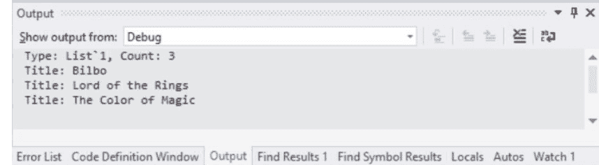

```csharp
class Bookstore
{
    List<Book> books = new List<Book>();

    public Bookstore()
    {
        books.Add(new Book("Lord of the Rings"));
        books.Add(new Book("The Color of Magic"));
        books.Add(new Book("Bilbo"));

        books.Sort();
    }

    private void PrintCollection()
    {
        Debug.WriteLine(String.Format("Type: {0}, Count: {1}", books.GetType().Name, books.Count));
    }
}
```

```csharp
foreach (var book in books)
{
    Debug.WriteLine(String.Format("Title: {0}", book.Title));
}
```

# IComparer 接口

如果你想使用自定义的比较器类实现来比较两个对象，你需要实现 `IComparer` 接口及其 `Compare` 方法。使用这种实现方式，你可以创建非常复杂的比较；同时你非常清楚正在进行的是什么类型的比较，因为你将你创建的比较器类的实例传递给集合的 `Sort` 方法。如果需要，也易于更新和重用比较逻辑。

`IComparer` 和 `IComparable` 接口之间的一个主要区别是：`IComparer` 接口是在独立类中实现的，而 `IComparable` 接口实现在用于定义集合项的类中。

# Book 类

```csharp
public class Book
{
    public string Title { get; set; }
    public double Rating { get; set; }

    public Book(string title, double rating) {
        Title = title;
        Rating = rating;
    }
}
```

# 实现 IComparer 接口的 BookComparer 类

```csharp
class BookComparer : IComparer<Book>
{
    public int Compare(Book book1, Book book2) {
        return book1.Rating.CompareTo(book2.Rating);
    }
}
```

# 排序书籍列表

在下方的 `Bookstore` 类中，一个 `List<Book>` 集合将填充了书籍，并使用集合的 `Sort` 方法和 `BookComparer` 类按评分进行排序，可以在下图中看到排序后的列表。

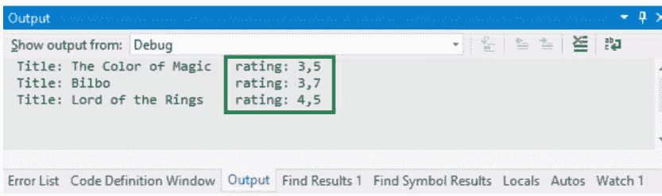

```csharp
class SortedBookstore
{
    List<Book> books = new List<Book>();

    public void SortedBookstore()
    {
        books.Add(new Book("Lord of the Rings", 4.5));
        books.Add(new Book("The Color of Magic", 0.5));
        books.Add(new Book("Bilbo", 3.7));

        books.Sort(new BookComparer());
        PrintCollection();
    }

    private void PrintCollection()
    {
        foreach (var book in books)
        {
            Debug.WriteLine(String.Format(
                "{0, -20} rating: {1}",
                book.Title, book.Rating));
        }
    }
}
```

# 11. 事件 (Events)

## 引言

事件是对象通知另一个对象发生了某事的一种。事件的一种类型是 GUI 控件在用户与控件交互时触发的事件；例如用户点击按钮时触发的 `Click` 事件。你编写代码来*订阅*事件，当事件被触发时，它可以执行某些操作。

除了使用控件外，你还可以为你由**结构体（structs）**或**类（classes）**定义的类型创建事件，并在发生某事时将其*发布*，以通知作为*订阅者*的应用程序或组件。

为了让其他代码能够订阅事件，你需要创建一个委托（delegate）；它是一个定义了事件函数返回类型和参数的方法签名。

事件与委托相关联；你通过创建一个与委托对应的方法（即事件处理程序）来订阅事件，并将该方法名传递给*事件发布者*（即将引发事件的对象）。

## 定义事件委托

你在结构体或类中使用 `delegate` 关键字来定义委托。系统委托接受两个参数：第一个是引发事件的对象，第二个是事件参数（event argument），它是 `EventArgs` 类的实例，包含了需要传递给订阅者的额外信息。

你使用 `event` 关键字来定义事件。它接受两个参数：首先是委托的名称，紧随其后的是你希望该事件拥有的名称（该名称在订阅事件时会被使用）。

下述代码示例展示了如何在 `Order` 类中实现 `OrderAdded` 事件，当订单中添加了新订单行时，该事件将被触发。

```csharp
class Order
{
    public delegate void OrderRowEventHandler(OrderRow row);
    public event OrderRowEventHandler OrderRowAdded;
}
```

## 触发事件

定义委托和事件后，你就可以编写代码来触发事件。在触发事件时，所有事件的订阅者将收到通知并执行其事件处理方法。在引发事件之前，检查事件是否为空是非常重要的，否则尝试引发事件时会抛出异常。引发事件的语法是调用方法并传递必要的参数。

下面的代码示例展示了如何从方法中引发 `OrderAdded` 事件。

```csharp
class Order
{
    public delegate void OrderRowEventHandler(OrderRow row);
    public event OrderRowEventHandler OrderRowAdded;

    public void addOrderRow(Product product, int quantity)
    {
        // 添加订单行

        // 如果有订阅者则引发事件
        if (OrderRowAdded != null)
        {
            OrderRowAdded(row);
        }
    }
}
```

## 订阅事件

在客户端代码中订阅事件时，你需要做两件事：首先创建一个与事件委托签名匹配的方法，其次使用 `+=` 运算符订阅事件并附加事件处理方法。在某些情况下，你可能还需要取消订阅，可以使用 `-=` 运算符。

```csharp
public partial class Form1 : Form
{
    Order order = new Order();
    private void AddOrderRow_Click(object sender, EventArgs e)
    {
        // 订阅事件
        order.OrderRowAdded += order_OrderAdded;

        // 调用方法向订单添加行
        order.addOrderRow((Product)cboProducts.SelectedItem, (int)numQty.Value);

        // 取消订阅
        order.OrderRowAdded -= order_OrderAdded;
    }

    void order_OrderAdded(OrderRow row)
    {
        // 当事件引发时执行某些操作
    }
}
```

## 事件示例

下面的示例将模拟用户向订单行添加产品。订单将发布一个事件，当添加新行时触发该事件，客户端表单将订阅该事件并更新数据视图中的数据源。订单行按订单 ID 升序显示，最近添加的订单行将以浅绿色背景显示。

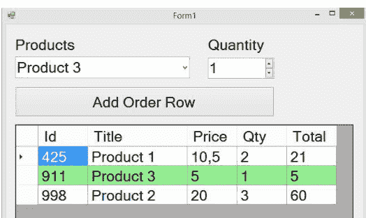

### Product 类

类表示可以添加到订单行的产品，它有三个属性：唯一 ID、描述性标题和价格。

```csharp
class Product
{
    public int Id { get; set; }
    public string Title { get; set; }
    public double Price { get; set; }
}
```

### OrderRow 类

类表示可以添加到订单的订单，其所有属性都是公开可读的，但只能赋值对象或者完全不可赋值。

私有的 `Product` 属性持有与订单行关联产品，且在订单行外部不可，以遵循面向对象编程的封装规则（所有数据都应该是私有的，并通过属性暴露）。它可以在内部赋值和读取，其数据通过两个只读属性 `Title` 和 `Price` 暴露。

```csharp
class OrderRow
{
    private Product product;
    public string Title => product.Title;
    public double Price => product.Price;
    public int Id { get; set; }
    public int Qty { get; set; }

    public OrderRow(Product product, int quantity, int id)
    {
        this.product = product;
        this.Qty = quantity;
        this.Id = id;
    }

    public double Total => Price * Qty;
}
```


类的构造函数会将传递的产品和数量分配给相应的属性，并且 `Id` 属性被分配一个最大值为 1000 的随机数（以便在此示例中区分不同的订单行）。

```csharp
class OrderRow
{
    private Product Product { get; set; }
    public int Id { get; private set; }
    public string Title { get { return Product.Title; } }
    public double Price { get { return Product.Price; } }
    public int Qty { get; private set; }
    public double Total { get { return Product.Price * Qty; } }

    public OrderRow(Product product, int quantity)
    {
        Product = product;
        Qty = quantity;
        Id = new Random().Next(1000);
    }
}
```

## Order 类（事件发布者）

该类表示一个订单，可以包含存储在 `List<OrderRow>` 集合中的许多订单行。在添加了订单行后，将触发 `OrderRowAdded` 事件，通知其订阅者（客户端）有一个新的订单行可用。

当用户点击 GUI 中的“添加行”按钮时，客户端会调用 `AddRow` 方法。将使用传入的产品和数量创建一个新的订单行，并将其添加到 `orderRows` 集合中。在订单行被添加到集合后，如果有订阅者，则会触发 `OrderRowAdded` 事件。

`GetOrderRows` 方法将返回按行 ID 升序排序的所有订单行。当客户端在数据网格视图中列出属于该订单的所有订单行时，会调用此方法。

## C# 初学者

```csharp
class Order
{
    public delegate void OrderRowAdded(OrderRow row);
    public event OrderRowAddedHandler OrderRowAdded;

    List<OrderRow> rows = new List<OrderRow>();

    public List<OrderRow> GetOrders()
    {
        return rows.OrderBy(or => or.Id).ToList();
    }

    public void AddOrderRow(Product product, int quantity)
    {
        // 使用传入的
        // 信息创建一个新的订单行，并将订单行添加到
        // 订单行集合中
        var orderRow = new OrderRow(product, quantity);
        rows.Add(orderRow);

        // 如果有订阅者则触发事件
        if (OrderRowAdded != null)
            OrderRowAdded(orderRow);
    }
}
```

## 客户端（事件订阅者）

为了让复杂度稍微降低，只有一个在表开头声明的订单，并带有一个包含所有可用产品的集合。

产品在构造函数中被添加到 `products` 集合中，然后该集合被赋值为组合框的数据源，列出产品标题。

按钮的 `Click` 事件是订阅 `OrderAdded` 事件的地方，并调用订单实例的 `AddOrderRow` 方法，使用 GUI 中的数据创建一个新的订单行。产品从列出可用产品的项目框中获取，数量从数字递减计数控件中获取。

当订单对象中触发 `OrderRowAdded` 事件时，将调用 `order_OrderRowAdded` 事件方法，在方法内部，通过调用订单实例的 `GetOrderRows` 方法来重新分配数据源。在此方法中，将对数据网格输出进行格式化，为最近添加的订单行分配列宽和背景颜色。

```csharp
public partial class Form1 : Form
{
    Order order = new Order();
    List<Product> products = new List<Product>();

    public Form1()
    {
        Products.Add(new Product { Id = 1, Price = 10.5,
            Title = "Product 1" });
        Products.Add(new Product { Id = 2, Price = 20,
            Title = "Product 2" });
        Products.Add(new Product { Id = 3, Price = 5,
            Title = "Product 3" });
    }

    InitializeComponent();

    cboProducts.DataSource = products;
    cboProducts.DisplayMember = "Title";

    private void btnnAddOrderRow_Click(object sender, EventArgs e)
    {
        // 订阅事件
        order.OrderRowAdded += order_OrderRowAdded;

        order.AddOrderRow((Product)cboProducts.SelectedItem,
            (int)numQty.Value);

        // 取消订阅事件
        order.OrderRowAdded -= order_OrderRowAdded;
    }

    void order_OrderRowAdded(OrderRow row)
    {
        var idx = order.GetOrderRows().IndexOf(null);
        dgvOrderRows.DataSource = order.GetOrderRows();

        foreach (DataGridViewColumn column in dgvOrderRows.Columns)
            column.Width = 90;
    }
}
```

```csharp
dgvOrderRows.Columns[1].Width = 180;

foreach(DataGridViewCell cell in dgvOrderRows.Rows[idx].Cells) cell.Style.BackColor = Color.LightGreen;
```

## 练习：带事件的视频租赁

在此练习中，你将使用事件创建一个简单的视频租赁应用程序，用于信号所有电影副本都已租出，以及电影副本已归还并再次租出。

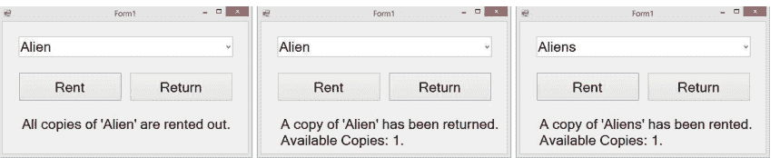

由于 `videos` 视频集合中可能有多部电影副本，在 `Video-Rental` 类实例中，你需要使用 `Distinct` LINQ 方法来获取要在组合框显示的电影。要以这种方式使用 `Distinct` 方法，你需要实现一个实现了 `IEqualityComparer` 接口的 `VideoComparator` 类。该接口有两个定义的方法：`Equals` 用于比较两个实例以确定它们是否应该视为相等，`GetHashCode` 返回传入对象的唯一标识符。

```csharp
class VideoComparator : IEquatable<Video>
{
    public bool Equals(Video video1, Video video2)
    {
        return video1.FilmId.Equals(video2.FilmId);
    }

    public int GetHashCode(Video video)
    {
        return video.FilmId;
    }
}
```

在调用 `Distinct` 方法时，你传入上面定义的类实例来比较视频实例。

```csharp
public List<Video> GetVideos()
{
    return videos.Distinct(new VideoComparator()).ToList();
}
```

当用户点击租用按钮时，组合框中选择的电影将被发送到 `VideoRental` 类实例的 `Rent` 方法，以模拟电影正在租用。在 `RentVideo` 方法中，将 `videos` 集合中匹配传入电影的第一个实例的 `ISented` 属性设置为 `true`，如果集合中没有更多该电影可用副本，则触发 `AllCopiesRentedOut` 事件；否则触发 `VideoInfo` 事件。

当点击归还按钮时，订阅 `VideoReturned` 事件，然后调用 `VideoRental` 类实例的 `ReturnVideo` 方法，传入组合框中选择的电影 ID。在方法调用后取消订阅。

当 `VideoRental` 类实例触发 `AllCopiesRentedOut` 事件时，将调用客户端对应的 `rental_AllCopiesRentedOut` 事件方法，在标签中显示电影所有副本均已租出的文本消息（见上图）。

当 `VideoRental` 类实例触发 `VideoInfo` 事件时，将调用客户端对应的 `rental_VideoInfo` 事件方法，在标签中显示该电影可用副本数量的文本消息（见上图）。

## GUI

GUI 非常简单，它包含一个名为 `cboVideos` 的组合框、两个分别名为 `btnRent` 和 `btnReturn` 的按钮以及一个名为 `lblResult` 的标签（见上图）。

4. 实现 `GetHashCode` 方法并返回传入 `Video` 实例的 `FilmId` 属性。

VideoComparer 类的完整代码：

```csharp
class VideoComparer : IEqualityComparer<Video>
{
    public bool Equals(Video video1, Video video2)
    {
        return video1.FilmId.Equals(video2.FilmId);
    }

    public int GetHashCode(Video video)
    {
        return video.FilmId;
    }
}
```

## VideoRental 类（事件发布者）

VideoRental 类是一个模拟视频商店，视频在这里被租赁和归还，事件也在此类中声明和触发。除了视频之外，你还需要向该类添加四个方法。

`GetVideos` 方法返回视频集合的去重结果集，并在组合框加载数据时从 GUI 调用。`AddVideoToList` 用于将视频添加到视频集合中。`RentVideo` 用于将视频标记为已租赁（将视频集合中的 `IsRented` 属性设置为 `true`），然后触发带有电影信息的 `AllCopies-RentedOut` 或 `VideoInfo` 事件。`ReturnVideo` 在视频归还时调用，将电影的 `IsRented` 属性设置为 `false`，表示其可以被租赁。电影归还后会触发 `VideoReturned` 事件。

## 事件与视频集合

1. 在 Classes 文件夹中添加名为 `VideoRental` 的类。

2. 添加一个名为 `AllCopiesRentedOutHandler` 的委托，声明为 `void` 并接收一个 `Video` 作为参数。

   `public delegate void AllCopiesRentedOutHandler(Video video);`

3. 使用该委托声明一个名为 `AllCopiesRentedOut` 的事件。

   `public event AllCopiesRentedOutHandler AllCopiesRentedOut;`

4. 添加一个名为 `VideoHandler` 的委托，声明为 `void` 并接收一个名为 `title` 的字符串参数和一个名为 `count` 的整型参数。

   `public delegate void VideoHandler(string title, int count);`

5. 使用 `VideoHandler` 委托声明两个名为 `VideoReturned` 和 `VideoInfo` 的事件。你可以使用同一个委托，因为这些方法在客户端的定义是完全相同的。

6. 在类中添加一个名为 `videos` 的 `List<Video>` 集合。该类将持有所有已租赁和可用的电影。

表单的代码后端（目前至此）：

```csharp
class VideoRental
{
    public delegate void AllCopiesRentedOutHandler(Video video);
    public event AllCopiesRentedOutHandler AllCopiesRentedOut;

    public delegate void VideoHandler(string title, int count);
    public event VideoHandler VideoReturned;
    public event VideoHandler VideoInfo;

    List<Video> videos = new List<Video>();
}
```

### GetVideos 方法

添加一个名为 `GetVideos` 的方法，该方法返回一个包含去重电影的 `List<Video>` 集合，并在调用 `Distinct` 方法时使用 `VideoComparer` 实例来比较 `Video` 实例。

`GetVideos` 方法的完整代码：

```csharp
public List<Video> GetVideos()
{
    return videos.Distinct(new VideoComparer()).ToList();
}
```

### AddVideoToList 方法

添加一个 `void` 方法，将传入的 `Video` 实例添加到视频集合中。

`AddVideoToList` 方法的完整代码：

```csharp
public void AddVideoToList(Video video)
{
    videos.Add(video);
}
```

## RentVideo 方法

1. 添加一个名为 `RentVideo` 的方法，接收一个名为 `filmId` 的整型参数。

   ```csharp
   public void RentVideo(int filmId)
   {
   ```

2. 使用传入的电影从视频集合中获取与 `filmId` 匹配且尚未被租赁的第一部电影。将结果存储在名为 `video` 的变量中。

   `var video = videos.FirstOrDefault(v => v.FilmId.Equals(filmId) && !v.IsRented);`

3. 如果 `video` 变量不为空，则将 `IsRented` 属性设置为 `true`，将其标记为已租赁的电影。将结果存储在你之前添加的 `video` 变量中。

4. 检查 `video` 变量是否为空以及 `AllCopiesRentedOut` 事件是否有订阅者。如果有订阅者，则获取与 `filmId` 匹配的第一部电影，并在触发事件时将其传递给事件。

```csharp
if (video == null && AllCopiesRentedOut != null)
{
    video = videos.FirstOrDefault(v => v.FilmId.Equals(filmId));
    AllCopiesRentedOut(video);
}
```

5. 如果上一个 `if` 语句评估为 `false`，则计算可租赁电影的数量，并将结果存储在名为 `count` 的变量中。传递与 `filmId` 匹配的视频的 `Title` 属性和 `count` 变量以触发 `VideoInfo` 事件。

```csharp
else
{
    var count = videos.Count(v => v.FilmId.Equals(filmId) && !v.IsRented);
    VideoInfo(video.Title, count);
}
```

`RentVideo` 方法的完整代码：


```go
public void RentVideo(int filmId)
{
    var video = videos.FirstOrDefault(
        v => v.FilmId.Equals(filmId) && !v.IsRented);

    // 如果可用则租赁
    if (video != null) {
        video.IsRented = true;

        // 检查是否还有可用的视频
        video = videos.FirstOrDefault(v => v.FilmId.Equals(filmId) &&
            !v.IsRented);
    }

    // 检查是否应该触发事件
    if (video == null && AllCopiesRentedOut != null)
    {
        video = videos.FirstOrDefault(v => v.FilmId.Equals(filmId));
        AllCopiesRentedOut(video);
    }
    else
    {
        var count = videos.Count(v => v.FilmId.Equals(filmId) && !v.IsRented);
        VideoInfo(video.Title, count);
    }
}
```

### ReturnVideo 方法

添加一个名为 `ReturnVideo` 的方法，接收一个名为 `filmId` 的整型参数。

1. 使用传入的电影从视频集合中获取与 `filmId` 匹配且尚未被租赁的第一部电影。将结果存储在名为 `video` 的变量中。

2. 如果 `video` 变量不为空，则将 `IsRented` 属性设置为 `false`，将其标记为未租赁的电影。将结果存储在你之前添加的 `video` 变量中。

3. 电影归还后会触发 `VideoReturned` 事件。

`ReturnVideo` 方法的完整代码：

```go
public void ReturnVideo(int filmId)
{
    var video = videos.FirstOrDefault(v => v.FilmId.Equals(filmId));
    if (video != null)
    {
        video.IsRented = false;
        VideoReturned(video);
    }
}
```

## Form 类（事件订阅者）

构造函数通过调用 `VideoRental` 实例的 `AddVideoToList` 方法将视频添加到集合中。它还通过调用 `GetVideos` 方法将集合中的视频作为组合框的数据源。

表单的代码后端：

```go
public partial class Form1 : Form
{
    VideoRental rental = new VideoRental();

    public Form1()
    {
        InitializeComponent();
        cboVideos.DataSource = rental.GetVideos();
        cboVideos.DisplayMember = "Title";
    }
}
```

## Rent 按钮的点击事件

在尝试组合框中选择视频之前，必须订阅 `AllCopiesRentedOut` 和 `VideoInfo` 事件。调用 `rental` 实例变量的 `RentVideo` 方法来租赁电影，然后取消订阅事件。

1. 为 Rent 按钮添加 `Click` 事件。

2. 订阅这两个事件。在键盘上按两次 `Tab` 键自动生成事件方法。

   `rental.AllCopiesRentedOut += rental_AllCopiesRentedOut;`

   `rental.VideoInfo += rental_VideoInfo;`

3. 清空标签，从组合框中选择视频。

4. 调用 `rental` 实例变量的 `RentVideo` 方法并传入获取的视频。

5. 取消事件订阅。

Rent 按钮点击事件的完整代码：

```go
private void btnRent_Click(object sender, EventArgs e)
{
// 订阅事件
rental.AllCopiesRentedOut += rental_AllCopiesRentedOut;
rental.VideoInfo += rental_VideoInfo;

// 尝试视频
lblResult.Text = String.Empty;
var video = (Video)cboVideos.SelectedItem;
rental.RentVideo(video.FilmId);

// 取消订阅
rental.AllCopiesRentedOut -= rental_AllCopiesRentedOut;
rental.VideoInfo -= rental_VideoInfo;
}
```

### AllCopiesRentedOut 事件方法

当 `rental` 实例的 `RentVideo` 方法触发 `AllCopiesRentedOut` 事件时调用此方法。向标签中写入一条消息，说明所选电影的所有拷贝都已租赁。

# C# 入门教程

**AllCopiesRentedOut** 事件的完整代码：

```csharp
void rental_AllCopiesRentedOut(Video video) {
    lblResult.Text = String.Format("All copies of '{0}' are rented out.", video.Title);
}
```

### VideoInfo 事件方法

当 **ReturnVideo** 方法的 **rental** 实例触发 **VideoInfo** 事件时，会调用此方法。向标签中写入消息，显示已选电影副本已渲染。

**VideoInfo** 事件的完整代码：

```csharp
void rental_VideoInfo(string title, int count) {
    lblResult.Text = String.Format("A copy of '{0}' has been rented.\nAvailable Copies: {1}", title, count);
}
```

### Return 按钮的 Click 事件

在归视频之前，你需要订阅 **VideoReturned** 事件，如果视频成功归，该事件将向标签中写入消息。你通过调用 **rental** 实例变量上的 **ReturnVideo** 方法来归视频。

- 1. 添加 **Return** 按钮的 Click 事件。

- 2. 订阅 **VideoReturned** 事件。

- 3. 清空标签文本并从组合框获取选中的视频。

- 4. 调用 **rental** 实例变量上的 **ReturnVideo** 方法。

- 5. 取消订阅 **VideoReturned** 事件。

**VideoReturned** 事件的完整代码：

```csharp
private void btnReturn_Click(object sender, EventArgs e) {
    rental.VideoReturned += rental_VideoReturned;

    // 尝试归视频
    lblResult.Text = String.Empty;
    var video = (Video)cboVideos.SelectedItem;

    rental.ReturnVideo(video.FilmId);
    rental.VideoReturned -= rental_VideoReturned;
}
```

# VideoReturned 事件方法

当 rental ReturnVideo 方法触发 VideoReturned 事件时，会调用此方法。向标签中写入消息，说明视频已归还。

**VideoReturned** 事件的完整代码：

```csharp
void rental_VideoReturned(string title, int count)
{
  lblResult.Text = String.Format(
    "A copy of '{0}' has been returned.\nAvailable Copies: {1}.",
    title, count);
}
```

## 12. 继承

## 介绍

继承允许通过在另一个类中重用已有的类来对类进行特化。它是你面向对象开发者工具箱中一个非常强大的工具。在继承一个类时，你正在重用一个已存在类的特征和行为；然后你通过以方法、属性和其他编程构造的形式添加新的特征和行为来特化你的类。

使用继承可以通过减少需要编写的代码量来节省金钱和时间。使用继承的另一个优点是可以根据需要交替使用对象层次结构。

在继承时，你取一个现有的类并将其作为基类，作为已实现方法、属性和其他构造的来源，并在你的新类中重用它，而不是从零开始。

**重要：** 你只能继承一个类，但可以实现多个接口。

假设你正在创建一个处理不同类型飞行机器的应用程序；此时你可以构建一个继承链，从最通用的类 `FlyingMachine`（飞行器）开始，它实现了所有飞行器共有的功能。然后你继承 `FlyingMachine` 类到更具体的类 `Plane`（飞机）和 `Saucer`（飞碟），它们是不同类型的飞行机器，因此具有适合飞机和飞碟的特征和行为。然后你决定进一步将其特化为不同的子类别，以及每个类别不同的特征和行为。

在飞行机器的场景中，`FlyingMachine` 类将是 `Plane` 和 `Saucer` 的基类，而这两个类将分别作为所创建的不同类别的基类。另一种说法是，类别类派自 `Plane` 或 `Saucer` 类；而 `Plane` 和 `Saucer` 类派自 `FlyingMachine` 类。

**重要：** 继承一个类时，是将要继承的类名指定在要被继承类名的右侧，类之间用冒号连接。例如：`InheritingClass : ClassToInherit`。

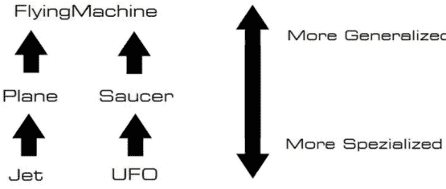

# 基类：FlyingMachine

`FlyingMachine` 类是此继承链中最通用的类，包含了所有类型飞行机器中都会使用的成员。

```csharp
class FlyingMachine
{
    public void Drive() { }
    public void Stop() { }
}
```

# 更特化的类：Plane 和 Saucer

`Plane` 和 `Saucer` 类是比 `FlyingMachine` 类更特化的飞行机器，并且需要与 `FlyingMachine` 类相同的逻辑。与其从头开始写写代码导致两个相同的代码库从而引发代码不一致，不如通过在 `Plane` 和 `Saucer` 类中继承 `FlyingMachine` 类来重用其代码。

通过继承 `FlyingMachine` 类，其所有的公共成员在继承类中都是可用的，就像它们在这些类中实现的一样。

```csharp
class Plane : FlyingMachine
{
    public int NumberOfFloors { get; set; }
    public bool HasFirstClass { get; set; }
}
```

```csharp
class Saucer : FlyingMachine
{
    public bool HasAlienTechnology { get; set; }
    public bool IsFromEarth { get; set; }
}
```

# さらに特化的类：Jet 和 UFO

`Jet` 和 `UFO` 类是更特化的飞机和飞碟，继承了 `Plane` 和 `Saucer` 类的特征和行为。`Jet` 和 `UFO` 类可以访问 `FlyingMachine` 类中的成员。

```csharp
class Jet : Plane
{
    public bool Isersonic { get; set; }
}
```

```csharp
class UFO : Saucer
{
    public bool HasWarpSpeed { get; set; }
}
```

# 使用类

以下代码示例展示了如何使用这些类以及每个类中可用的内容。粗体成员成员定义在该类中。

```csharp
void UsingSpecializedClasses()
{
    FlyingMachine fm = new FlyingMachine();
    fm.Drive();
    fm.Stop();

    Plane plane = new Plane();
    plane.Drive();
    plane.Stop();
    plane.HasFirstClass = true;
    plane.NumberOfFloors = 2;

    Jet jet = new Jet();
    jet.Drive();
    jet.Stop();
    jet.HasFirstClass = true;
    jet.NumberOfFloors = 3;
    jet.Isersonic = false;

    Saucer saucer = new Saucer();
    saucer.Drive();
    saucer.Stop();
    saucer.HasAlienTechnology = false;
    saucer.IsFromEarth = true;

    UFO ufo = new UFO();
    ufo.Drive();
    ufo.Stop();
    ufo.HasAlienTechnology = true;
    ufo.IsFromEarth = false;
    ufo.HasWarpSpeed = true;
}
```

# 基类

在项目项目时，你应该问自己其他开发者是否以及何时需要你创建的类作为继承的基类。如果你选择使其可继承，那么你对类如何被继承拥有完全控制权。

# 抽象

创建仅作为基类的抽象类并不罕见。抽象类的成员并不需要完全实现的功能，甚至可以缺失功能。由你决定开发者是否可以创建你所创建的类的实例。如果你希望类仅用于继承而不允许创建该类的实例，那么在类声明中添加 `abstract` 关键字。

在抽象类中添加成员时，你可以选择使用 `abstract` 关键字来创建它们，在这种情况下它们在概念上类似于接口定义的成员，这些成员必须由派生类重写，且在抽象类中没有提供实现。

# C# 入门

**重要：** `abstract` 类只能用于继承，不能被实例化。

# 创建抽象类

类的前两个成员已经实现，并包含了可以从继承类中直接调用的逻辑。最后两个成员被声明为**抽象**（abstract），并且需要在继承类中使用 `override`（重写）关键字对其进行重写。

```csharp
abstract class AbstractBaseClass
{
    // 已实现的成员
    internal bool NonAbstractProperty { get; set; }
    internal void NonAbstractMethod()
    {
        // 执行一些事情
    }

    // 需要在继承类中
    // 重写的抽象成员
    internal abstract bool AbstractProperty { get; set; }
    internal abstract void AbstractMethod()
}
```

# 使用抽象类

请注意，继承自 `AbstractBaseClass` 类的两个**抽象**成员在 `InheritingClass` 类中必须使用 `override` 关键字进行实现后，才能被调用，而两个非抽象成员则可以直接调用。

```csharp
class InheritingClass : AbstractBaseClass
{
    // AbstractBaseClass 类的重写成员
    internal override bool AbstractProperty { get; set; }
    internal override void AbstractMethod()
    {
        // 执行一些事情
    }
}

void UseMembers()
{
    // 使用继承类的
    // 非抽象成员
    NonAbstractProperty = false;
    NonAbstractMethod();

    // 继承类的重写成员
    // 无需先重写即可调用
    AbstractProperty = true;
    AbstractMethod();
}
```

# 密封 (Sealed)

在某些情况下，你可能希望防止开发者继承某个类；你可以通过在类声明中添加 `sealed`（密封）关键字来实现，从而创建一个不可继承的类。

在创建一个派自另一个类的类时，你可能希望防止进一步的继承；你可以通过在类声明中添加 `sealed` 关键字来实现。

**重要：** `sealed` 和 `abstract` 关键字不能用在同一个类上，因为它们是互斥的。

**重要：** `static` 类是密封的，`无法`被继承，且 `non-static` 类中的 `static` 成员不会被继承。

# 创建密封类


# C# 入门

## 密封类

此类无法被继承，必须实例化后才能使用。

```csharp
sealed class SealedClass
{
    public bool PropertyInSealedClass { get; set; }
    public int MethodInSealedClass(int x, int y)
    {
        return x + y;
    }
}
```

## 重写虚拟成员

以下代码定义了一个继承上述基类的类，并使用有效逻辑重写了 `Subtract` 方法，这使得可以在继承类的实例上调用该方法而不会抛出异常。

注意，即使 `Add` 方法没有被重写，你仍然可以调用它，因为它被继承了。

```csharp
class OverridingVirtualMember : BaseClassWithVirtualMember
{
    public override int Subtract(int x, int y)
    {
        return x - y;
    }
}
```

以下代码创建了基类的实例并...

## 程序集、类与继承

在 `Corleones` 程序集中，我们找到了与科莱里昂家族相关的类，以及那些为家族干着脏活的下属。`Corleone` 类是所有科莱里昂家族成员（`Don` 和 `Joe`）所继承的基类。该家族有一套荣誉准则，所有想要杀人的下属都必须遵守该准则。该准则由 `KillerCod` 类表示；它是所有下属类的基类。`Minion` 类的实例代表家族使用的一次暗杀任务。

在家族之外，我们还有追捕该家族并试图抓捕他们的警官；`Constable` 类位于 `Police` 程序集中。

## Corleone 类

`Corleone` 类被声明为 `public`（公共），这意味着它可以从任何程序集访问。所有成员都被声明为 `internal`（内部），这意味着它们可以在 `Corleones` 程序集内被访问，但不能从 `Police` 程序集访问。

`GetMinion` 和 `AddMinion` 方法被声明为 `virtual`（虚方法），这意味着在继承 `Corleone` 类时，它们可以被重写并实现新的逻辑。`Don` 和 `Joe` 处理下属的方式可能不同，因此会根据其特定需求的逻辑来实现这些方法。

```csharp
public class Corleone
{
    internal List<Minion> Minions = new List<Minion>();
    internal virtual Minion GetMinion(string name)
    {
        throw new NotImplementedException();
    }
    internal virtual void AddMinion(Minion minion)
    {
        Minions.Add(minion);
    }
}
```

## Don 类

该类代表家族的父亲和组织的领袖。此类继承自 `Corleone` 类，并可以访问其成员。`Don` 类使用 `sealed`（密封）关键字声明，这意味着它不能被继承。

Don Corleone 有一个被严密守护且只有家族才知道的秘密；这个秘密以及他在警察审讯时所撒的谎言被声明为 `private`（私有），因为他可以选择通过公共或内部属性来分享秘密，而不是暴露它。

众所周知他有一个儿子 Joe。Joe 被声明为一个独立的类，其实例存储在 `Don` 类中，因为他是 Don Corleone 的儿子，因此与他相关；`Don` 类的构造函数和 `Don` 实例被传递给 `Joe` 实例，使用 `this` 关键字（代表 `Don` 类的当前实例）来建立父子关系。

```csharp
Son = new Joe(this);
```

当家族询问秘密时，Don 告诉他们的话由 `TellFamily` 属性表示，该属性声明为 `internal`，以确保 `Corleones` 程序集的所有成员都能发现。`TellPolice` 属性被声明为 `public`，因为任何人（其他程序集的成员）都被允许听到这个谎言。

`GetMinion` 方法继承自 `Corleones` 类，但使用 `override` 关键字进行了重写，以创建一个替代实现，当 Don 调用他的某个下属时将使用它。该方法也被声明为 `internal`，以确保只有 `Corleones` 程序集的成员可以要求 Don 联系他的下属。

`SolveProblem` 方法在声明时没有使用访问修饰符，因此它是私有的。这意味着只有 `Don` 类中的成员可以调用它；当 Don 想解决一个问题时，他的儿子会处理，因此调用包含 `Joe` 实例的 `Son` 属性上的 `OrderHit` 方法。

```csharp
sealed public class Don : Corleone
{
    private string familySecret = "This is the secret";
    private string lie = "I have no idea";
    public Joe Son { get; set; }

    public Don()
    {
        Son = new Joe(this);
    }

    internal string TellFamily { get { return familySecret; } }
    public string TellPolice { get { return lie; } }

    internal override Minion GetMinion(string name)
    {
        return (from minion in Minions
                where minion.Name == name
                select minion).SingleOrDefault();
    }

    void SolveProblem()
    {
        Son.OrderHit("Charlie", "Marty");
    }
}
```

## Joe 类

Joe 是 Don 的儿子，帮助他经营家族业务；`Joe` 类被声明为 `public`，这意味着它可以从任何程序集访问，并且对继承没有限制。

`AddMinion` 方法继承自 `Corleone` 类并用自己的实现进行了重写，它也被声明为 `sealed`，这意味着如果 `Joe` 类被继承，派生类不能重写此方法；它还被声明为 `internal`，意味着它只能在 `Corleones` 程序集内部使用。

`GetMinion` 方法继承自 `Corleone` 类并被重写且声明为 `internal`，意味着它有独特的实现，且仅在 `Corleones` 程序集中可用。请注意，它的实现与 `Don` 类中的相同方法不同。

在声明为 `internal` 且位于 `Corleones` 程序集中的 `OrderHit` 方法中，`Kill` 方法在 `Corleones` 程序集中被声明为 `internal`。`AskSecret` 方法被声明为 `public`，使得可以从任何其他程序集进行访问。

```csharp
public class Joe : Corleone
{
    private Don father;
    public Joe(Don father)
    {
        this.father = father;
    }

    internal sealed override void AddMinion(Minion minion)
    {
        var exist = GetMinion(minion.Name) != null;
        if (!exist)
        {
            Minions.Add(minion);
        }
    }

    internal override Minion GetMinion(string name)
    {
        return (from minion in Minions
                where minion.Name == name
                select minion).SingleOrDefault();
    }

    internal void OrderHit(string minion, string target)
    {
        Kill(target);
    }

    public string AskSecret()
    {
        Console.WriteLine("[Joe thinking] The Secret is: {0}", father.TellFamily);
        return father.TellPolice;
    }
}
```

## KillerCod 类

该类包含两个方法，下属类在想要杀人时必须通过继承来实现这些方法。`KillerCod` 被声明为 `internal`，因为警察不能知道下属与家族之间的约定。下属类通过继承 `KillerCod` 履行了这一约定。

`ChooseWeapon` 方法声明为 `protected`（保护），这意味着它必须通过继承才能在 `KillerCod` 类外部使用。

`Kill` 方法被声明为 `protected internal`，意味着可以通过继承或在 `Corleones` 程序集内部进行使用。

```csharp
internal class KillerCod
{
    protected void ChooseWeapon() { }

    protected internal void Kill(string name)
    {
    }
}
```

## Minion 类

该类代表为家族工作的下属之一，它继承了 `KillerCod` 类及其成员。`Minion` 类被声明为 `internal`，这意味着它仅在 `Corleones` 程序集内可用，而对警察程序集不可用；这使得下属成为一个只有家族才知道的秘密群体。

注意，当 `Joe` 从 `OrderHit` 方法中调用该方法时，不需要实现 `Kill` 方法；`Joe` 可以调用 `Kill` 方法，因为它在 `KillerCod` 类中声明为 `internal`。

```csharp
internal class Minion : KillerCod
{
    internal string Name { get; set; }
    internal Minion(string name)
    {
        Name = name;
        ChooseWeapon();
    }
    public void Talk()
    {
        Console.WriteLine("I'm not saying anything");
    }
}
```

## Constable 类

`Constable` 类位于与所有其他类不同的程序集中，因为它不属于家族；警察可能被收买，但这并不一样，他们仍然是家族的一部分。警官喜欢审讯人员，并抓住每一个机会审讯科莱里昂家族。

被声明为 `internal`，使得其他程序集无法访问它；你可以说小弟在 `Corleones` 程序集内部隐藏了一个秘密团体。

请注意，`Interrogate` 方法中的 `person` 参数被声明为 `object` 类型，这允许传入任何类的实例。`is` 关键字用于判断该实例是否为 `Don` 类或 `Joe` 类实例。

重要提示：你需要在 `Police` 程序集中添加对 `Corleones` 程序集的引用，以便访问它的类。

```csharp
public class Constable
{
    public void Interrogate(object person)
    {
        if (person is Don)
            Console.WriteLine("[Don {0}", ((Don)person).TellPolice());

        if (person is Joe)
            Console.WriteLine("[Joe {0}", ((Joe)person).AskSecret());

        // 不可能，因为 Minion 类被声明为 internal
        // if (person is Minion)
        // Console.WriteLine("[Minion {0}", ((Minion)person).TellPolice());
    }
}
```

## base 关键字

在某些情况下，即使你在派生类中重写了成员，也可能想从派生类调用基类的方法或构造函数。你使用 `base` 关键字来实现这一点。

你可能重写了基类中的某个方法，或者创建了一个新方法，并希望作为逻辑的一部分调用基类的方法；或者你想在初始化派生类时调用基类的构造函数。你还可能从属性访问器中调用基类方法。

在实例化派生类时，在执行任何派生类逻辑之前，会自动调用基类的默认构造函数。有时你希望调用备用构造函数而不是默认的基类构造函数；在这些情况下，你在派生类的构造函数声明中使用 `base` 关键字。

### 基类

```csharp
public class Beverage
{
    public string Name { get; set; }
    public bool IsFairTrade { get; set; }

    public Beverage()
    {
        Name = string.Empty;
        IsFairTrade = false;
    }

    public Beverage(string name, bool isFairTrade)
    {
        Name = name;
        IsFairTrade = isFairTrade;
    }

    public virtual bool GetFairTrade()
    {
        return IsFairTrade;
    }
}
```

### 派生类

```csharp
public class Tea : Beverage
{
    public double Weight { get; set; }

    // 调用默认基类构造函数
    // 等于 Tea() : base()
    public Tea() { }

    public Tea(string name, bool isFairTrade, double weight)
        : base(name, isFairTrade)
    {
        // 在执行此构造函数块中的任何代码之前
        // 调用 Beverage(string name, bool isFairTrade) 构造函数
        Weight = weight;
    }
}
```

```csharp
public override bool GetFairTrade()
{
    // 调用基类中的 GetFairTrade 方法
    if (!base.GetFairTrade())
    {
        /* 公平贸易状态 */
    }
    return base.GetFairTrade();
}
```

## 练习：继承与访问修饰符（绝地武士 vs 西斯）

本练习旨在演示如何跨程序集实现继承，以及如何使用访问修饰符来确定类成员的可访问范围。

### 背景故事

你可能已经熟悉了，这是一个关于神与邪恶的故事，设定在《星球大战》中绝地武士对战西斯的史诗虚幻冒险中。正如你所知道的，最多同时有两个西斯，一个大师和一个学徒。对于绝地武士来说稍有不同，因为他们是宇宙的和平维护者，必须不止两个，但一个绝地武士大师在任何时候只能有一个帕达学徒。

原力有两个面，光明和黑暗，绝地武士使用光明面维护和平，而西斯使用黑暗面制造破坏和混乱。一旦你跨越光明走向黑暗，就无法回头。作为西斯，你可以在一段时间内接触原力的双方，直到你完全转化为黑暗面——安纳金·天行者，达斯·维达。

此应用程序将跟踪谁是绝地武士大师、谁是学徒，以及谁是西斯领主、西斯学徒。为了重用常用类，它们将被放在名为 `CommonTraits` 的独立程序集（类库）中，并在需要的地方继承。绝地武士和西斯类也将被放在名为 `Jedis` 和 `Siths` 的独立程序集中，以在两者之间保持屏障。应用程序将在第四个程序集中创建一个控制台应用程序。

在控制台应用程序中，你想显示有关角色的信息，如名称、种族、原力微生物计数以及他们使用的原力（黑暗或光明）。你还想让角色能够相互询问两个问题：第一个问题是他们是西斯、绝地武士还是两者都不是；第二个问题是该角色是否为西斯；如果被问者是绝地武士，答案应包含关于他们是绝地武士大师还是学徒的信息，以及提问者是否有学徒。如果被问者是西斯且提问者也是西斯，则应该揭示关于西斯领主或学徒的内部信息，否则拒绝任何关于西斯的知识。

你将至少添加以下角色：贾贾·宾克斯（Jar Jar Binks，刚刚人，无原力）、帕尔帕廷议员（Senator Palpatine，人类，黑暗面）、安纳金·天行者（Anakin Skywalker，人类，光明面）和欧比旺·克诺比（Obi-Wan Kenobi，人类，光明面）。在执行过程中，安纳金将分两步转化为黑暗面，第一步是成为帕尔帕廷的学徒。

为了更方便地打印信息，你将在控制台应用程序的 `Program` 类中创建两个方法：`PrintBeing`（输出关于角色的信息）和 `PrintQuestions`（输出上述两个问题的答案）。安纳金的第二步将转化为黑暗面。

### 创建程序集

你需要创建四个程序集；从名为 `JediVs` 的控制台应用程序开始，添加三个类库程序集 `CommonTraits`、`Jedis` 和 `Siths`。


# 创建项目结构

1. 创建名为 `JediVs` 的控制台应用程序。
2. 右键点击解决方案，添加类库项目 `Common Traits`。
3. 在 `Common Traits` 中添加两个文件夹：`Classes` 和 `Enums`。
4. 向解决方案添加另一个类库项目 `Jedis`。
5. 向解决方案添加另一个类库项目 `Siths`。
6. 右键点击控制台应用程序，将其设置为启动项目。

# TheForce 类

`AddForce` 方法：应该包含一个 `Force` 参数，该参数会被添加到 `Forces` 集合中。

1. 在 `Common Traits` 程序集的 `Classes` 文件夹中添加一个名为 `TheForce` 的类。
2. 将类的访问修饰符改为 `public abstract`。

```csharp
public abstract class TheForce
{}
```

3. 添加一个名为 `Forces` 的 public `List<Force>` 集合，并带有私有 setter。

```csharp
public List<Force> Forces { get; private set; }
```

4. 添加一个带有私有 setter 的 public `int` 属性 `Midicholians`。
5. 添加一个带有 `int` 参数 `midicholians` 的构造函数，并将参数值赋值给同名的属性，同时实例化集合。
6. 添加一个抽象字符串方法 `WhatAreYou`，它包含一个名为 `suspect` 的 `Being` 参数。由于是抽象的，该方法在抽象类中不能包含任何实现，必须由继承它的类来实现。

```csharp
public abstract string WhatAreYou(Being suspect);
```

7. 添加一个受保护的（`protected`）虚空方法 `AddForce`，包含一个会被添加到 `Forces` 集合的 `Force` 参数。由于是受保护的，该方法只能从继承类中调用；声明为 `virtual` 将允许在继承类中使用 `override` 或 `new` 关键字来重写该实现。

```csharp
protected virtual void AddForce(Force force) { ... }
```

## TheForce 类的完整代码

```csharp
public abstract class TheForce
{
    public List<Force> Forces { get; private set; }
    public int Midicholians { get; private set; }

    public TheForce(int midicholians)
    {
        Midicholians = midicholians;
        Forces = new List<Force>();
    }

    public abstract string WhatAreYou(Being suspect);

    protected virtual void AddForce(Force force)
    {
        Forces.Add(force);
    }
}
```

# Being 类

`Being` 代表角色的基本特征和行为。使用继承可以缩短开发类的时间；通过继承 `TheForce` 类，你不需要从头重写一切。继承将让你直接访问 `AddForce` 方法的实现，从而可以在 `Being` 类内部调用它，它还将强制你实现抽象的 `WhatAreYou` 方法。你还可以从 `Forces` 和 `Midichlorians` 属性读取值。

除了继承的属性外，你将添加两个与生物相关的属性：类型为 `string` 的 `Name` 和类型为 `Race`（枚举）的 `Race`。应该能够从 `Being` 类创建实例，也可以继承它，并且它的构造函数应该有三个参数：`name`、`race` 和 `midichlorians`；最后一个参数应该传递给基类的构造函数。

应该实现三个方法：`AddForce`（重写）、`WhatAreYou`（重写）和 `AreYouSith`（见下详情）。

## Being 类定义

`Being` 类：应该继承 `TheForce` 类并重写它的 `AddForce` 和 `WhatAreYou` 方法。构造函数应该接受三个名为 `name`、`race` 和 `midicholians` 的参数，类型分别为 `string`、`Race`（枚举）和 `int`。前两个参数应该赋值给 `Being` 类中同名的属性，而第三个应该传递给基类（被继承类）的构造函数。

`AddForce` 方法：应该重写与同名的继承方法，并在 `Being` 类被继承时停止任何进一步的重写。实现应该检查要添加的力是否已经存在，如果是，则跳过。

`WhatAreYou` 方法：此方法的目的是通过询问来发现一个角色是绝地、西斯还是二者皆不是。通过 `suspect` 参数传递的 `Being` 实例是你正在询问的角色。如果实例为 `null`，则返回字符串 "I don't exist"。

（这可能发生在 Anakin 完全堕入黑暗面，且不再承认自己是 Anakin Skywalker 的情况下），如果提问题的角色和嫌疑者都能够使用原力的黑暗面，那么如果提问题的角色和嫌疑者都能使用原力的黑暗面，则返回 "I'm Sith"；如果他们使用原力的光明面，则返回 "I'm Jedi"。

**AreYouSith 方法：** 应该是一个公共方法，并包含一个 `suspect` 参数，并且可以被继承类重写。

1. 在 `Common Traits` 程序集中添加一个名为 `Being` 的类。
2. 将访问修饰符改为 `public` 并继承 `TheForce`。
3. 添加一个 `string` 属性 `Name`。
4. 添加一个 `Race`（枚举）属性 `Race`。
5. 添加一个带有 `name`、`race` 和 `midicholians` 参数的构造函数。
6. 重写 `AddForce` 方法。
7. 重写 `WhatAreYou` 方法。
8. 添加一个虚空方法 `AreYouSith`，带有 `midicholians` 参数，并默认返回 "I'm not Sith"。

```csharp
public virtual string AreYouSith(Being suspect)
{
    return "I'm not Sith";
}
```

## Being 类的完整代码

```csharp
public class Being : TheForce
{
    public string Name { get; set; }
    public Races Race { get; set; }

    public Being(string name, Races race, int midicholians) : base(midicholians)
    {
        Name = name;
        Race = race;
    }

    protected override void AddForce(Force force)
    {
        if (!Forces.Contains(force))
        {
            Forces.Add(force);
        }
    }

    public override string WhatAreYou(Being suspect)
    {
        if (suspect == null)
            return "I don't exist";
        if (suspect.Forces.Contains(Force.DarkSide))
            return "I'm Sith";
        if (suspect.Forces.Contains(Force.LightSide))
            return "I'm Jedi";
        return "I'm neither side";
    }

    public virtual string AreYouSith(Being suspect)
    {
        return "I'm not Sith";
    }
}
```

# Jedi 类

该程序集包含一个名为 `Jedi` 的类，代表一个绝地角色。在独立的程序集中创建它是为了在绝地和西斯类之间定义一个清晰的边界。

你需要添加 `Common Traits` 程序集的引用，以访问所有必要的类和枚举。

## Jedi 类定义

`Jedi` 类：继承 `Being` 类及其所有的固有特征和行为。构造函数应该有三个参数：`name`、`race` 和默认值为 0 的 `midicholians`。所有参数值都应该传递给基类构造函数。在构造函数内部，通过调用继承的 `AddForce` 方法将光明力添加到 `Forces` 集合中。

`Padawan` 属性：将 `Jedi` 实例赋值给此属性代表绝地有一个学徒。该属性应该是公开可读但私有可写的。

`IsJediMaster` 属性：如果绝地有一个学徒，则返回 `true`。该属性应该只有 `get` 块。

`AddPadawan` 方法：此方法将传递的 `Jedi` 实例添加到 `Padawan` 属性中，代表绝地有一个学徒。

`RemovePadawan` 方法：通过将 `Jedi` 类的默认值赋值给 `Padawan` 属性来移除绝地的学徒。

`AreYouSith` 方法：继承方法的重写版本。如果传递的 `Being` 实例是绝地大师，该方法应返回 "I am Jedi Master, and my apprentice is {name of apprentice}"；如果该生物是绝地但不是大师，则返回 "I am a Padawan and my name is {name of padawan}"；或者返回 "I don't know of any Sith"。

1. 在 `Jedis` 程序集中添加一个名为 `Jedi` 的类。
2. 将访问修饰符改为 `public` 并继承 `Being` 类。

```csharp
public class Jedi : Being
{
```

3. 添加一个公开的 `Jedi` 属性 `Padawan`，该属性只能在 `Jedi` 类内部赋值。

```csharp
    public Jedi Padawan { get; private set; }
}
```

4. 添加一个名为 `IsJediMaster` 的公共 `bool` 属性，它仅包含一个 get 块，如果 `Padawan` 属性分配了一个 `Jedi` 实例，则返回 true。

```csharp
public bool IsJediMaster { get { return Padawan != null; } }
```

5. 添加一个包含三个参数的构造函数，分别为 `name`、`race` 和 `midichlorian count`，这些参数将传递给基类构造函数。在构造函数内部调用继承的 `AddForce` 方法，为 Jedi 分配光明面力量（`LightSide`）。

```csharp
public Jedi(string name, Races race, int midichlorians = 0) : base(name, race, midichlorians)
{
    AddForce(Force.LightSide);
}
```

6. 添加一个名为 `AddPadawan` 的 public void 方法，它有一个 `Jedi` 参数，并将其赋值给 `Padawan` 属性。
7. 添加一个名为 `RemovePadawan` 的无参数 public void 方法，它将 `Jedi` 类的默认值赋值给 `Padawan` 属性。

```csharp
Padawan = default(Jedi);
```

8. 重写继承的方法 `AreYouSith`。按照描述实现它。

## Jedi 类的完整代码

```csharp
public class Jedi : Being
{
    public Jedi Padawan { get; private set; }
    public bool IsJediMaster { get { return Padawan != null; } }

    public Jedi(string name, Races race, int midichlorians) : base(name, race, midichlorians)
    {
        AddForce(Force.LightSide);
    }

    public void AddPadawan(Jedi padawan)
    {
        Padawan = padawan;
    }

    public void RemovePadawan()
    {
        Padawan = default(Jedi);
    }

    public override string AreYouSith(Being suspect)
    {
        if (suspect is Jedi)
        {
            var jedi = suspect as Jedi;
            if (jedi.IsJediMaster)
                return "I'm a Jedi Master, and my apprentice is " + jedi.Padawan.Name;
            else
                return "I'm a Padawan and my name is " + jedi.Name;
        }
        return "I don't know of any Sith";
    }
}
```

# Sith 程序集

此程序集包含一个名为 `Sith` 的类，代表一个西斯角色。之所以在单独的程序集中创建是为了 Jedi 和 Sith 类之间定义更清晰的边界，以保持它们的逻辑清晰分离。

你需要添加对 `Common Traits` 程序集的引用，以便访问所有必需的类和枚举。

## Sith 类定义

`Sith` 类：继承 `Being` 类及其所有继承的特性和行为。构造函数应该包含三个参数：`string` 类型的 `name`、`Races` 类型的 `race` 以及 `int` 类型的 `midichlorians`，其默认值为 0。所有参数值都应传递给基类的构造函数。构造函数应通过调用继承的 `AddForce` 方法向 `Forces` 集合中添加黑暗面力量（`DarkSide`）。应添加第二个构造函数，其参数为 `Being` 数据类型的 `being` 以及名为 `name` 的 `string` 数据类型参数，使用来自 `being` 参数和 `name` 参数的值调用第一个构造函数。

`Apprentice` 属性：为此属性分配一个 `Sith` 实例代表该西斯有学徒。此属性应该是公开可读的，但仅限私有赋值。

`IsSithLord` 属性：如果西斯有学徒则返回 true。此属性仅包含一个 get 块。

`AddApprentice` 方法：此方法将根据传入的 `Jedi` 实例和 `name` 参数中的名称创建一个新的 `Sith` 实例。然后将新的 `Sith` 实例分配给 `Apprentice`，代表当前西斯有学徒。接着，将 `Jedi` `Forces` 集合中的所有力量都添加到 `Sith` 实例中，并将 `Jedi` 实例分配为 `Jedi` 类的默认值。最后，从方法返回新的学徒。

`CompleteTraining` 方法：当西斯学徒迈向黑暗面的最后一步时，将调用此方法以消除任何光明面力量的痕迹。

`AreYouSith` 方法：这是继承的同名重写版本。如果传入的 `Being` 实例是西斯学徒，方法应返回 "I'm a Sith Lord, and my apprentice is [学徒名称]"；如果该 Being 是西斯但不是西斯主，则返回 "I'm a Sith Apprentice and my name is [学徒名称]"；否则返回 "I don't know of any Sith"。

1. 在 `Sith` 程序集中添加一个名为 `Sith` 的类。
2. 将访问修饰符改为 `public` 并继承 `Being` 类。
3. 添加一个名为 `Apprentice` 的 public `Sith` 属性，它只能在 `Sith` 类内部赋值。
4. 添加一个名为 `IsSithLord` 的 public `bool` 属性，它仅包含一个 get 块，如果 `Apprentice` 属性分配了一个 `Sith` 实例，则返回 true。
5. 添加一个包含三个参数的构造函数，分别为 `name`、`race` 和 `midichlor count`，这些参数将传递给基类构造函数。在构造函数内部调用继承的 `AddForce` 方法，为 Sith 分配黑暗面力量。

```csharp
public class Sith : Being
{}
```

```csharp
public Sith Apprentice { get; private set; }
```

```csharp
public bool IsSithLord { get { return Apprentice != null; } }
```

```csharp
public Sith(string name, Races race, int midichlorians = 0) :
    base(name, race, midichlorians)
{
    AddForce(Force.DarkSide);
}
```

6. 添加第二个构造函数，其带有 `being` 和 `name` 参数，在类中使用 `this` 关键字调用第一个构造函数时使用参数中的值。


# Sith 类实现

## 构造函数

```csharp
public Sith(Being being, string name)
    : this(name, being.Race, being.Midchloridians)
{}
```

## 方法实现

### 7. AddApprentice 方法

添加一个名为 `AddApprentice` 的 public 方法，带有一个引用传递的 `Jedi` 参数和一个名为 `name` 的 `string` 参数，该参数为 Sith 主提供的新学徒。`Jedi` 参数通过引用传递是因为你希望在方法末尾使用 `Jedi` 的默认值，以象征该 Jedi 不再存在，现在是新出生的 Sith 学徒。

```csharp
public Sith AddApprentice(ref Jedi jedi, string name)
{
    Apprentice = new Sith(jedi, name);
    Apprentice.Forces.AddRange(jedi.Forces);
    jedi = default(Jedi);
    return Apprentice;
}
```

### 8. CompleteTraining 方法

添加一个名为 `CompleteTraining` 的 public 方法，带有一个 `Sith` 参数。从学徒的 `Forces` 集合中移除所有光明面（`LightSide`）值。

```csharp
Apprentice.Forces.Remove(Force.LightSide);
```

### 9. AreYouSith 方法

重写继承的方法 `AreYouSith`。按照上述描述实现它。

## Sith 类完整代码

```csharp
public class Sith : Being
{
    private Sith Apprentice { get; set; }
    internal bool IsSithLord { get; return Apprentice != null; }
}
```

# C# 入门：Sith 类成员

## 构造函数

```csharp
public Sith(string name, Races race, int midchloridians = 0) :
    base(name, race, midchloridians)
{
    AddForce(Force.DarkSide);
}
```

```csharp
public Sith(Being being, string name)
    : this(name, being.Race, being.Midchloridians)
{}
```

## 方法

```csharp
public void CompleteTraining(Sith apprentice)
{
    Apprentice.Forces.Remove(Force.LightSide);
}
```

```csharp
public Sith AddApprentice(ref Jedi jedi, string name)
{
    Apprentice = new Sith(jedi, name);
    Apprentice.Forces.AddRange(jedi.Forces);
    jedi = default(Jedi);
    return Apprentice;
}
```

```csharp
public override string AreYouSith(Being suspect)
{
    if (this is Sith && suspect is Sith)
    {
        var sith = suspect as Sith;
        if (sith.IsSithLord)
            return "I'm a Sith Lord, and my apprentice is " + sith.Apprentice.Name;
        else
            return "I'm a Sith Apprentice and my name is " + sith.Name;
    }
    return "I don't know of any Sith";
}
```

# JediSith 程序集

这是显示角色信息的主应用程序。你需要添加对其他程序集的引用，以便访问必要的类和枚举。

## PrintBeing 方法

为了显示角色信息，你必须添加一个名为 `PrintBeing` 的方法，它接收一个 `Being` 数据类型的参数，包含要显示的字符。使用 `String.Format` 方法格式化一个包含名称、种族、原力值以及该角色拥有的力量（黑暗/光明）的输出字符串，并将其打印到控制台窗口。

### 实现步骤

1. 在 `Main` 方法下方的 `Program` 类添加一个名为 `PrintBeing` 的方法，该方法有一个 `Being` 类型的参数 `being`。

```csharp
private static void PrintBeing(Being being)
{}
```

2. 添加一个名为 `forces` 的字符串变量并赋值空字符串。

3. 遍历 `being.Forces` 集合中的力量，并将存储在 `forces` 变量中的数据拼接成一个字符串。

```csharp
foreach (var force in being.Forces)
    forces += String.Format("{0}, ", force);
```

4. 如果循环后 `forces` 字符串包含任何数据，则删除字符串的最后两个字符，以避免在字符串末尾显示逗号。

```csharp
if (!forces.Equals(String.Empty))
    forces = forces.Substring(0, forces.Length - 2);
```

5. 将所需数据单行写入控制台窗口。

### PrintBeing 完整代码

```csharp
private static void PrintBeing(Being being)
{
    string forces = String.Empty;
    foreach (var force in being.Forces)
        forces += String.Format("{0}, ", force);

    if (!forces.Equals(String.Empty))
        forces = forces.Substring(0, forces.Length - 2);
    
    Console.WriteLine(String.Format("Name: {0}, Race: {1}, Midchloridians: {2}, Forces: {3}", being.Name, being.Race, being.Midchloridians, forces));
}
```

## PrintQuestions 方法

`PrintQuestions` 方法应该有两个参数：一个 `Being` 类型的 `interrogator`，另一个 `List<Being>` 集合类型的 `suspects`。遍历 `suspects` 集合中的角色，显示询问者的名称、嫌疑人的名称以及调用 `interrogator` 实例的 `WhatAreYou` 方法的结果（将当前嫌疑人作为参数值），同时也显示询问者的名称、嫌疑人的名称以及调用 `interrogator` 实例的 `AreSith` 方法的结果（将当前嫌疑人作为参数值）。循环后向控制台添加一个空行。

### 实现步骤

- 在 `Main` 方法下方的 `Program` 中添加一个 `PrintQuestions` 方法，包含一个 `Being` 类型的参数 `interrogator` 和一个 `List<Being>` 集合类型的参数 `suspects`。

```csharp
private static void PrintQuestions(Being interrogator, List<Being> suspects) {
}
```

- 添加一个 `foreach` 循环遍历 `suspects` 集合中的内容。

- 为每个嫌疑人打印询问者的名称、嫌疑人的名称以及调用 `WhatAreYou` 方法的结果。

```csharp
Console.WriteLine(String.Format("{0} [WhatAreYou] {1}: {2}", interrogator.Name, suspect.Name, interrogator.WhatAreYou(suspect)));
```

- 现在按照上述描述的方式对 `AreSith` 方法执行相同的操作。

- 在循环后添加对 `Console.WriteLine` 方法的调用。

### PrintQuestions 完整代码

```csharp
private static void PrintQuestions(Being interrogator, List<Being> suspects) {
    foreach (var suspect in suspects) {
        Console.WriteLine(String.Format("{0} [WhatAreYou] {1}: {2}", interrogator.Name, suspect.Name, interrogator.WhatAreYou(suspect)));
        Console.WriteLine(String.Format("{0} [AreSith] {1}: {2}", interrogator.Name, suspect.Name, interrogator.AreSith(suspect)));
    }
    Console.WriteLine();
}
```

## Main 方法

这里是所有内容汇总并显示输出的地方。

### 实现步骤

1. 将角色添加到 `Main` 方法中。

```csharp
var jarJar = new Being("Jar Jar Binx", Races.Gungan, 0);
var palpatine = new Sith("Senator Palpatine", Races.Human, 10000);
var anakin = new Jedi("Anakin Skywalker", Races.Human, 50000);
var obiWan = new Jedi("Obi Wan Kenobi", Races.Human, 10000);
```

2. **输出 1**：调用 `PrintBeing` 方法并添加 `Console.ReadKey` 和 `Console.Clear` 方法的调用。

```csharp
PrintBeing(obiWan);
```

3. 通过调用 `obiWan` 实例变量的 `AddPadawan` 方法并传递 `anakin` 实例变量，将 `anakin` 作为学徒添加到 `Obi Wan Kenobi`。

```csharp
obiWan.AddPadawan(anakin);
```

4. **输出 2**：为每个角色调用 `PrintQuestions` 方法，将剩余的角色作为 `suspects` 集合的一部分传入。在 `PrintQuestions` 方法调用后添加 `Console.ReadKey` 和 `Console.Clear` 方法的调用。

```csharp
PrintQuestions(palpatine, new List<Being> { anakin, obiWan, jarJar });
```

5. 通过 `palpatine` 实例变量调用 `AddApprentice` 方法传递 `anakin` 实例以及名称 `"Darth Vader"`，并将结果存储在名为 `darthVader` 的变量中。

```csharp
var darthVader = palpatine.AddApprentice(ref anakin, "Darth Vader");
```

6. 调用 `PrintBeing` 方法传入 `darthVader` 实例。通过调用 `darthVader` 实例的 `CompleteTraining` 方法让 Vader 完成训练。

7. **输出 3**：调用 `PrintBeing` 方法传入 `darthVader` 实例，注意 Darth Vader 力量的变化。在 `PrintBeing` 方法调用后添加 `Console.ReadKey` 和 `Console.Clear` 方法的调用。

8. 通过调用 `obiWan` 实例变量的 `RemovePadawan` 方法将 `anakin` 从 `obiWan` 的学徒移除。

9. **输出 4**：调用 `PrintQuestions` 方法，让 Palpatine 询问 Darth Vader 和 Obi Wan，让 Darth Vader 询问 Palpatine 和 Obi Wan，让 Obi 询问 Darth Vader。

10. 添加对 `Console.ReadKey` 方法的调用。

### Main 方法完整代码

```csharp
static void Main(string[] args)
{
    var jarJar = new Being("Jar Jar Binx", Races.Gungan, 0);
    var palpatine = new Sith("Senator Palpatine", Races.Human, 10000);
    var anakin = new Jedi("Anakin Skywalker", Races.Human, 50000);
    var obiWan = new Jedi("Obi Wan Kenobi", Races.Human, 10000);

    #region Output 1
    PrintBeing(obiWan);
    PrintBeing(anakin);
    PrintBeing(palpatine);
    PrintBeing(jarJar);
    Console.ReadKey();
    Console.Clear();
    #endregion

    obiWan.AddPadawan(anakin);

    #region Output 2
    PrintQuestions(palpatine, new List<Being> { anakin, obiWan, jarJar });
    Console.ReadKey();
    Console.Clear();
    #endregion

    var darthVader = palpatine.AddApprentice(ref anakin, "Darth Vader");

    #region Output 3
    PrintBeing(darthVader);
    darthVader.CompleteTraining();
    PrintBeing(darthVader);
    Console.ReadKey();
    Console.Clear();
    #endregion

    obiWan.RemovePadawan();

    #region Output 4
    PrintQuestions(palpatine, new List<Being> { darthVader, obiWan });
    PrintQuestions(darthVader, new List<Being> { palpatine, obiWan });
    PrintQuestions(obiWan, new List<Being> { darthVader });
    Console.ReadKey();
    #endregion
}
```

# 程序运行输出示例

```text
Obi Wan Kenobi [AreYouSith] Anakin Skywalker: 我是一个学徒，我的名字叫安金·天行者。
Obi Wan Kenobi [WhatAreYou] Senator Palpatine: 我既不是西斯也不是绝地。
Obi Wan Kenobi [AreYouSith] Senator Palpatine: 我不知道任何西斯。
Obi Wan Kenobi [WhatAreYou] Jar Jar Binx: 我既不是西斯也不是绝地。
Obi Wan Kenobi [AreYouSith] Jar Jar Binx: 我不知道任何西斯。

Jar Jar Binx [WhatAreYou] Anakin Skywalker: 我是一个绝地武士。
Jar Jar Binx [AreYouSith] Anakin Skywalker: 我不是西斯。
Jar Jar Binx [WhatAreYou] Obi Wan Kenobi: 我是一个绝地武士。
Jar Jar Binx [AreYouSith] Obi Wan Kenobi: 我不是西斯。
Jar Jar Binx [WhatAreYou] Senator Palpatine: 我既不是西斯也不是绝地。
Jar Jar Binx [AreYouSith] Senator Palpatine: 我不知道任何西斯。
```


```
/*
#endregion
#region --- Output 3 ---
/*
Name: Darth Vader, Human: Midichlorians: 500000,
Forces: DarkSide, LightSide
Name: Darth Vader, Human: Midichlorians: 500000,
Forces: DarkSide
/*
#endregion
#region --- Output 4 ---
/*
Palatine 议员 [WhatAreYou] Darth Vader: 我是一个西斯。
Palatine 议员 [AreYouSith] Darth Vader: 我是一个西斯学徒，名字叫达斯·维德。
Palatine 议员 [WhatAreYou] Obi Wan Kenobi: 我是一个绝地武士。
Palatine 议员 [AreYouSith] Obi Wan Kenobi: 我不知道任何西斯。

Darth Vader [WhatAreYou] Palatine 议员: 我是一个西斯。
Darth Vader [AreYouSith] Palatine 议员: 我是一个西斯领主，我的学徒是达斯·维德。
Darth Vader [WhatAreYou] Obi Wan Kenobi: 我是一个绝地武士。
Darth Vader [AreYouSith] Obi Wan Kenobi: 我不知道任何西斯。

Obi Wan Kenobi [WhatAreYou] Darth Vader: 我既不是西斯也不是绝地。
Obi Wan Kenobi [AreYouSith] Darth Vader: 我不知道任何西斯。
/*
#endregion
```

# C# 入门

## 迷你用例：汽车租赁

在本项研究中，你将构建一个租赁汽车的门户，就像加油站和租车公司使用的那种一样。显然，你不会构建一个极其详尽且功能完备的系统，而是构建一个基础系统，用于满足租赁和还车的需求。

重要的是，此方案的设计初衷是为了说明面向对象编程（OOP）的某些方面，因此可能不是最优的。

## 强耦合 vs. 松耦合设计

强耦合的解决方案通常更难以更改，对类的更改通常会涉及到周围类和方法调用的更改。

此外，通过在可以使用接口的地方将类实例作为参数传递，从某种程度上也让自己陷入了困境。使用接口会使其变得简单得多，不仅可以传递接口的一部分，还可以完全传递其他实例。以数据层类的实例为例，通过使用接口，你可以轻松地将一个实现切换为另一个；例如从测试数据层切换到生产数据层。

在实现此用例时，你将使用继承来说明抽象类和成员如何在解决方案中使用以重用代码。你还将使用接口来实现类，使解决方案更易维护。通过使用接口，你将能够通过在类类实现 `IDataLayer` 和 `IBookingProcessor` 接口来切换业务层和数据层为其他实现，这被称为接口多态（Interface Polymorphism）。你还将通过不使用类定义参数和类型，而是使用类中实现的接口，使解决方案完全具有灵活性，这被称为接口注入（Interface Injection），是松耦合设计模式的一部分。假设你有一个名为 `IVehicle` 的接口，它定义了任何车辆（如汽车和摩托车）的特征和行为，你现在可以在方法定义中使用 `IVehicle` 接口作为参数，将汽车类或摩托车类的实例传递给方法，因为它们都实现了同一个接口。正如你可能在接口章节中学过的样，这是可行的。

## 汽车租赁规范

为了简单起见，系统计算的是同一天内的所有租赁，不支持半天或按小时租赁。当汽车租赁时间超过一天时，时长应通过从还车日期减去租赁日期来计算。

### 规范

汽车分为若干类别，从开始定义了三个：

- 轿车（Sedan）、组合（Combi）和面包车（Van）。以后可能会添加更多类别。

每次租赁必须通过唯一的预订单号识别。每次租赁定义为每个订单租赁一辆汽车，每个订单只能有一个客户。

类应该放在不同的程序集中以便重用；共有三个程序集，拥有各自的文件夹结构：

- Car Rental（汽车租赁）：Windows Forms 应用程序
- Business Layer（业务层）：存放处理所有业务逻辑的订单处理器
- Data Layer（数据层）：存放实体类和数据层类

在处理预订单时，应用程序将调用 `BookingProcessor` 类实例的相应方法，该类接收 `CollectionDataLayer` 类实例以便与数据源通信，在这种情况下，数据源是存储在集合中的伪数据。`CollectionDataLayer` 类是在实现并使用真实数据源时会被替换的类；从 `BookingProcessor` 类到数据源的所有方法调用都是在该类的实例上进行的。代表数据源的伪数据和集合存储在一个名为 `TestData` 的类中；在现实场景中，这很可能会使用 Entity Framework 实体与数据库通信。

### 价格

汽车类别决定了如何计算价格，所有计算都考虑了两种类型：每日费用和公里费用。

- 轿车：价格 = 每日费用 * 天数
- 组合车：价格 = 每日费用 * 天数 + 日费 * 行驶公里数。日费初始为 1.5，但可能会更改。
- 面包车：价格 = 每日费用 * 天数 + 日费 * 行驶公里数。日费初始为 2.0，距离费初始为 2.5，但可能会更改。

# C# 入门

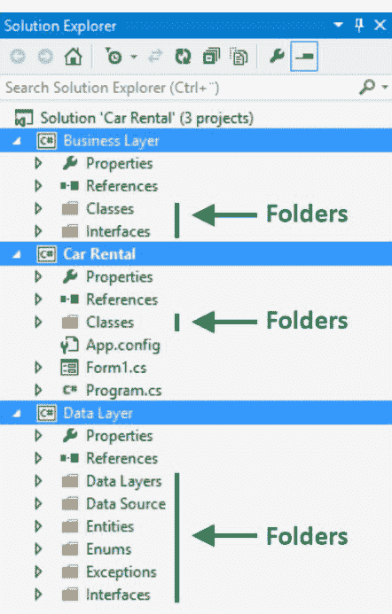

## 三程序集

解决方案将包含三个程序集：用于 Windows Forms 应用程序的 **Car Rental**，用于业务规则的业务层 **Business Layer**，以及一个与数据源通信的 **Data Layer**。

为了访问 **Business Layer** 和 **Data Layer** 程序集中的类，你需要在应用程序程序集中对它们添加引用。

## 应用程序结构

应用程序在这种情况下使用名为 **Car Rental** 的 Windows Forms 应用程序项目创建。除了默认的项目内容（如表单）外，你还将添加一个名为 **Classes** 的文件夹，并在其中添加所有处理 GUI 所需的类；你将需要创建一个类作为组合框（combo box）项显示数据的模型，以及另一个类作为列表视图（list view）显示数据的模型。

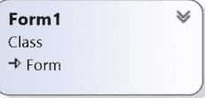


## 应用程序 GUI

应用程序 GUI 包含一个带有标签页控件的表单，该控件有四个标签页：租车（Rent Vehicle）、还车（Return Booking）、订单（Bookings）和添加数据（Add Data）。

租车标签页包含一个显示可租车辆的列表视图控件、一个包含客户列表的组合框，以及一个租车按钮，该按钮将使用另外两个控件的信息为客户租车。

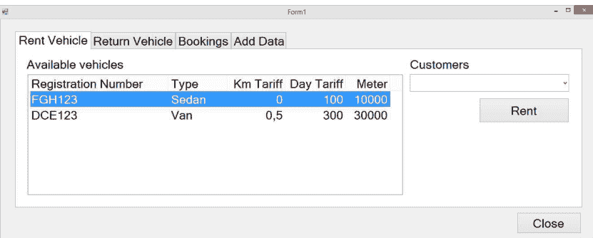

还车标签页包含一个显示可还租车辆的列表视图控件、一个用于指定还车时车辆里程设置的文本框，以及一个还车按钮，该按钮将使用其他控件的数据来还车并计算租用费用。

# C# 初学者教程

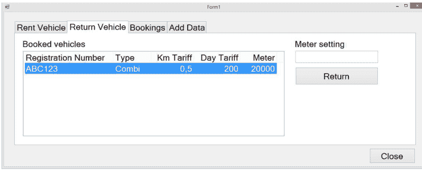

订单标签页使用列表视图控件提供系统中已创建所有订单的历史概述。已租出的车辆在“已还（Returned）”列中没有指定日期。

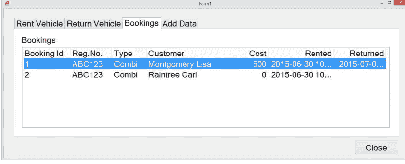

添加数据标签页可以使用文本框和组合框来指定或选择数据，从而添加新的车辆和客户。

# C# 初学者教程

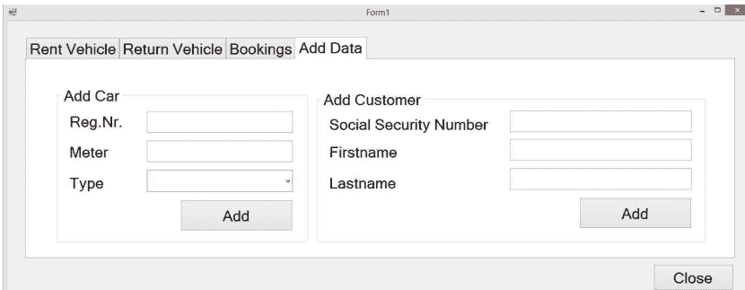

## 业务层结构

**业务层（Business Layer）**应该使用**类库（Class Library）**项目创建，而不是**类库（Portal）**项目，因为后者包含了一些你不希望项目中需要的限制。该程序集只有一个名为 **BookingProcessor** 的类，它实现了一个名为 **IBookingProcessor** 的接口，该接口又继承了名为 **IRentalBase** 的接口。

添加两个名为 **Classes** 和 **Interfaces** 的文件夹，并将 **BookingProcessor** 类放在 Classes 文件夹中，将 **IBookingProcessor** 接口放在 Interfaces 文件夹中。**IRentalBase** 接口属于**数据层（Data Layer）**，这意味着你需要在**业务层**程序集中对**数据层**程序集的引用。

**IRentalBase** 接口定义了 **BookingProcessor** 和 **CollectionDataLayer** 类中实现的大部分方法；这两个类都实现了相同的方法，因为应用程序后台代码中的 **BookingProcessor** 类实例将使用 **CollectionDataLayer** 实例并调用其方法来访问数据源；方法具有相同的名称、返回数据类型和参数，可以易于跟踪从业务层到数据层的程序流，同时也实现了 **IRentalBase** 接口的复用。

# C# 初学者教程

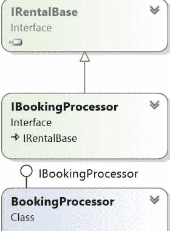

## 数据层结构

数据层程序集应该使用类库（Class Library）项目创建，而不是类库（Portal）项目，因为后者包含了一些你不希望项目中需要的限制。此程序集必须包含大多数类，因为它存放了所有的实体类和自定义异常类，以及 `IDataLayer` 接口的任何实现（例如 `CollectionDataLayer` 类）。

`CollectionDataLayer` 类的实例将被注入（发送）到 `BookingProcessor` 类的实例中；来自汽车租车应用程序对数据源的所有调用将通过 `BookingProcessor` 实例进行，以便在从 `BookingProcessor` 实例的方法内部调用数据层之前强制执行任何业务规则。

需要许多文件夹来保持结构的的整洁和易于导航。Data Layers 文件夹将存放 `IDataLayer` 接口的任何实现（例如 `CollectionDataLayer` 类）。Data Source 文件夹将有一个名为 `TestData` 的类，它将作为此应用程序实现中使用的测试数据的数据源。Entities 文件夹将存放所有特定数据的类，这些类可以用于数据库表建模，例如 `Customer`、`Booking` 和 `Vehicle`。Enums 文件夹将包含一个 .cs 文件，存放应用程序所需的所有枚举。Exceptions 文件夹将存放所有自定义的异常（如 `CustomerException`），而 Interfaces 文件夹将存放程序集中使用的所有接口。

# C# 初学者教程

下面的图片显示了实现数据层类时涉及的接口，在此例中，`CollectionDataLayer` 类将用于获取和操作由 `TestData` 类中的集合集合表示的数据源中的数据。请注意，`BookingProcessor` 类实现的 `IRentalBase` 接口在这里是作为 `IDataLayer` 和 `IRentalBase` 接口之间接口继承的一部分被实现的。

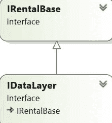

下面的图片说明了应用程序所需的自定义异常以及它们对 `KeyNotFoundException` 类的继承。

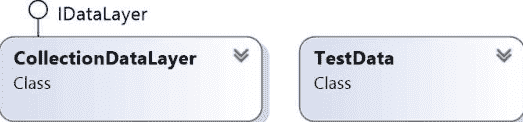


# C# 初学者教程

下面的图片说明了车辆的实现以及实现特定车辆（如 `Car` 类）时使用的接口和继承。请注意，`Car` 类继承了一个中间类 `Vehicle`，这是为了确保某些方法的默认实现是可用的，它还开放了 `IVehicle` 接口作为数据类型，供未来可能添加的所有类型的特定车辆类使用。它还通过在方法中使用接口进行接口注入，而不是使用特定的车辆类作为参数，使得实现更具灵活性。


下面的图片插图了剩余实体类 `Customer`、`Booking` 和 `Vehicle` 的实现。虽然严格来说没有必要使用接口来实现这些类，但为了一致性，这里是做了，并且万一将来必须实现实体的子类别，你可能希望对什么是客户有更专门的定义，并复用 `ICustomer` 接口将客户的默认特性和行为实现到专门的类中，确保它们是客户。实现类似结果的另一种方法当然是使用继承和重写方法。

# C# 入门

| ICustomer |
| :--- |
| 接口 (Interface) |
| 属性 (Properties) |
| 名字 (FirstName) |
| ID (Id) |
| 姓 (LastName) |
| 社会安全号 (SocialSecurityNumber) |

| IBooking |
| :--- |
| 接口 (Interface) |
| 属性 (Properties) |
| 费用 (Cost) |
| 客户ID (CustomerId) |
| ID (Id) |
| 已租用 (Rented) |
| 已还 (Returned) |

| IVehicleType |
| :--- |
| 接口 (Interface) |
| 属性 (Properties) |
| 每日基础价 (BasePricePerDay) |
| 每公里基础价 (BasePricePerKm) |
| ID (Id) |
| 公里费 (KmTariff) |
| 名称 (Name) |

| ICustomer |
| :--- |
| 类 (Class) |

| IBooking |
| :--- |
| 类 (Class) |

| IVehicleType |
| :--- |
| 类 (Class) |

### Customer 接口和类

此类将代表客户的特征，这意味着它只包含属性。在所有情况下，属性都是公开的，以便在任何地方访问；数据类型也不应该是秘密，除了 `Id` 属性外，所有属性都应该使用 `string` 数据类型声明。

1. 在 Data Layer 项目的 Interfaces 文件夹中添加一个 `ICustomer` 接口并将其设置为公共。

```csharp
public interface ICustomer
{
```

2. 在接口中定义所有属性，记住在接口中不需要指定访问修饰符。

```csharp
string LastName { get; set; }
```

3. 在 Data Layer 项目的 Entities 文件夹中添加一个公共类 `Customer` 并在类中实现接口。

```csharp
public class Customer : ICustomer
{
```

4. 添加属性最快的方法是从接口中复制它们并为它们添加 `public` 访问修饰符。

```csharp
public string LastName { get; set; }
```

`ICustomer` 接口的完整代码：

```csharp
public interface ICustomer {
  int Id { get; set; }
  string SocialSecurityNumber { get; set; }
  string FirstName { get; set; }
  string LastName { get; set; }
}
```

`Customer` 类的完整代码：

```csharp
public class Customer {
  public int Id { get; set; }
  public string SocialSecurityNumber { get; set; }
  public string FirstName { get; set; }
  public string LastName { get; set; }
}
```

### Booking 接口和类

此类将代表预订的特征，因此只包含属性。在这种情况下，所有属性都是公开的以便在任何地方访问；数据类型也不应该是秘密，所有 `Id` 属性应该使用 `int` 数据类型声明，`Rented` 和 `Returned` 属性应该使用 `DateTime` 数据类型声明，而金额小数部分的费用属性应该使用 `double` 数据类型声明。

1. 在 Data Layer 项目的 Interfaces 文件夹中添加一个名为 `IBooking` 的接口并将其设置为公共。

```csharp
public interface IBooking
{}
```

2. 在接口中定义所有属性，记住在接口中不需要指定任何访问修饰符。

```csharp
double Cost { get; set; }
```

3. 在 Data Layer 项目的 Entities 文件夹中添加一个公共类 `Booking` 并在类中实现接口。

```csharp
public class Booking : IBooking
{}
```

4. 添加属性最快的方法是从接口中复制它们并粘贴到类中，并为它们添加 `public` 访问修饰符。

```csharp
public double Cost { get; set; }
```

`IBooking` 接口的完整代码：


```csharp
public interface IBooking
{
    int Id { get; set; }
    int VehicleId { get; set; }
    int CustomerId { get; set; }
    DateTime Rented { get; set; }
    DateTime Returned { get; set; }
    double Cost { get; set; }
}
```

`Booking` 类的完整代码：

```csharp
public class Booking : IBooking
{
    public int Id { get; set; }
    public int VehicleId { get; set; }
    public int CustomerId { get; set; }
    public DateTime Rented { get; set; }
    public DateTime Returned { get; set; }
    public double Cost { get; set; }
}
```

# VehicleType 接口和类

此类将代表车辆类型的特征，因为它只包含属性。在所有情况下，属性都是公开的，以便在任何地方访问；数据类型也不应该是秘密，所有 `id` 属性应该使用 `int` 数据类型声明，基础价格和资费属性应该使用 `double` 数据类型声明，因为它们可能包含小数，而 `Name` 属性应该用 `string` 数据类型声明。

# C# 入门

车辆不是特定的车辆，而是一种车辆类型，例如组合型（Combi）、面包车（Van）和轿车（Sedan），它们具有不同的每日和每公里基础价及资费（参见用例开头的计算）。每当车辆归还时，系统将检查这些统计数据以获取计算费用的值。不建议硬编码这些值，因为这意味着每次价格变化都需要重新构建整个解决方案并将版本分发给用户。

- 在 Data Layer 项目的 Interfaces 文件夹中添加一个名为 `IVehicleType` 的接口并将其设置为公共。
- 在接口中定义属性，记住在接口中不需要指定任何访问修饰符。
- 在 Data Layer 的 Entities 文件夹中添加一个名为 `VehicleType` 的公共类并在接口中实现类。
- 添加属性最快的方法是从接口中复制它们并为它们添加 `public` 访问修饰符。

`IVehicleType` 接口的完整代码：

```csharp
public interface IVehicleType
{
    int Id { get; set; }
    string Name { get; set; }
    double BasePriceKm { get; set; }
    double BasePricePerDay { get; set; }
    double DayTariff { get; set; }
    double KmTariff { get; set; }
}
```

`VehicleType` 类的完整代码：

```csharp
public class VehicleType : IVehicleType
{
    public int Id { get; set; }
    public string Name { get; set; }
    public double BasePriceKm { get; set; }
    public double BasePricePerDay { get; set; }
    public double DayTariff { get; set; }
    public double KmTariff { get; set; }
}
```

# Vehicle 接口和类

此类将代表车辆的特征和行为，除了包含属性外，它还将有两个无参数的构造函数和一个带有 `IVehicle` 接口参数的构造函数；作为类类型相同的对象可能看起来很奇怪，但如果你想象一个使用现有对象来初始化新对象的场景，这并不奇怪。

在这种情况下，所有属性都是公开的以便在任何地方访问；数据类型也不应该是秘密，所有 `Id` 属性应该使用 `int` 数据类型声明，里程、基础价和资费属性应该使用 `double` 数据类型声明，因为它们可以包含小数，`RegistrationNumber` 属性应该用 `string` 数据类型声明。

你可能认为将 `Vehicle` 类创建为抽象类并继承到更专业的车辆类（如 `Car` 类）是一个好主意，但在这种情况下不建议这样做，因为你实际上希望将 `Car` 类实例强制传递给 `Vehicle` 类构造函数，以便在创建 `Car` 实例时为 `Vehicle` 实例的属性赋值；这种实现 `Car` 类的方法避免了在 `Car` 类构造函数中分配属性值的麻烦，并复用了 `Vehicle` 构造函数的代码，使 `Car` 类简洁得多。

你可能会奇怪为什么 `Vehicle` 接口和类中包含了同一组基础价和资费属性，因为在租赁和归还之间车辆类型的值可能会发生变化，如果不存储租赁时的值，客户在车辆归还时支付的钱就会偏多。

# C# 入门


- 在 Data Layer 项目的 Interfaces 文件夹中添加一个名为 `IVehicle` 的接口并将其设置为公共。
- 在接口中定义所有属性，记住在接口中不需要指定任何访问修饰符。
- 在 Data Layer 项目的 Entities 文件夹中添加一个公共类 `Vehicle` 并在类中实现接口。
- 添加属性最快的方法是从接口中复制它们并粘贴到类中，并为它们添加 `public` 访问修饰符。

# C# 入门教程

5. 为类添加两个公共构造函数：一个不带参数，另一个带有一个 `IVehicle` 参数，该参数用于将传入的 `Vehicle` 对象的值赋值给相应的属性。

```csharp
public Vehicle() { }
public Vehicle(IVehicle vehicle) { ... }
```

`IVehicle` 接口的完整代码：

```csharp
public interface IVehicle
{
    int Id { get; set; }
    int TypeId { get; set; }
    double BasePricePerKm { get; set; }
    double BasePricePerDay { get; set; }
    double DayTariff { get; set; }
    double KmTariff { get; set; }
    string RegistrationNumber { get; set; }
    double Meter { get; set; }
}
```

`Vehicle` 类的完整代码：

```csharp
public class Vehicle : IVehicle
{
    public int Id { get; set; }
    public int TypeId { get; set; }
    public string RegistrationNumber { get; set; }
    public double BasePricePerKm { get; set; }
    public double BasePricePerDay { get; set; }
    public double DayTariff { get; set; }
    public double KmTariff { get; set; }
    public double Meter { get; set; }

    public Vehicle() { }
    public Vehicle(IVehicle vehicle)
    {
        BasePricePerDay = vehicle.BasePricePerDay;
        BasePricePerKm = vehicle.BasePricePerKm;
        DayTariff = vehicle.DayTariff;
        KmTariff = vehicle.KmTariff;
        Id = vehicle.Id;
        Meter = vehicle.Meter;
        RegistrationNumber = vehicle.RegistrationNumber;
        TypeId = vehicle.TypeId;
    }
}
```

# Car 类

此类代表汽车的特征和行为，除了包含属性外，它还实现了两个构造函数：一个不带参数，另一个带有 `IVehicle` 参数并将其传递给基类构造函数。你可能会疑惑在 `Vehicle` 类中要有 `IVehicle` 构造函数的意义，因为那里正是基类最终所在的地方。

你可能注意到文中没有提到 `ICar` 接口，原因是因为 `Car` 类将继承 `Vehicle` 类，而 `Vehicle` 类已经包含了 `ICar` 接口将定义的所有属性。

Car 类的完整代码：

```csharp
public class Car : Vehicle
{
    public Car() { }
    public Car(IVehicle vehicle) : base(vehicle) { }
}
```

# 数据源（测试数据）

此类位于 `Data Layer` 程序集中的 `Data Source` 文件夹，将包含用于模拟真实数据源的集合。使用此类测试数据非常有价值的，因为你清楚应用程序启动时会有哪些数据，这有助于发现逻辑错误，例如计算错误或在控件中显示错误的数据。

由于集合代表数据源中的表，因此你不应该在处处访问它们，它们应该仅能通过数据层进行访问；使用分层架构的原因之一是为了实现关注点分离，一个程序集等于一个特定区域。使用不同层次的另一个原因是强制执行封装；你可以将数据封装在类中，并使用 `internal` 和 `private` 等访问修饰符来确保数据仅在其创建和存储的程序集内可用。

使用 `internal` 访问修饰符来限制所创建的数据集合的范围，确保它们仅在 `Data Layer` 程序集内可访问；随后，通过实现 `IDataLayer` 接口的 `CollectionLayer` 类中的属性和方法，使数据程序集外部可用。如果你以后引入了其他数据源

# C# 入门教程

你只需在包含访问特定数据源所需逻辑的类中实现 `IDataLayer` 接口，并将类的实例传递给 `BookingProcessor` 实例即可。

为了方便访问持有测试数据的集合，你将它们创建为静态（`static`），以避免创建类实例（因为实例会重置数据）。请注意，这通常不是处理数据源的方式，但在特定的测试场景中你会使用这种方法。

需要四个集合。第一个称为 `VehicleTypes`，使用 `IVehicleType` 接口声明，因此它可以容纳任何实现 `IVehicleType` 接口的类的实例，例如 `Vehicle` 类。

第二个集合称为 `Vehicles`，使用 `IVehicle` 接口声明，使其能够存储实现该接口的类实例，如 `Vehicle` 和 `Car` 类；你可能会好奇 `Car` 如何访问该接口，答案是通过继承实现了该接口的 `Vehicle` 类。

第三个集合称为 `Customers`，使用 `ICustomer` 接口声明，使其能够存储实现该接口的类实例，例如 `Customer` 类。

第四个集合称为 `Bookings`，使用 `IBooking` 接口声明，使其能够存储实现该接口的类实例，如 `Booking` 类。该类的实例用于表示系统中的订单。

为了创建一组测试数据，你需要添加一个名为 `Seed` 的方法来向集合中添加数据，这可以保持每次启动应用程序时数据的一致性，而这对于测试应用程序至关重要。

在 `VehicleTypes` 集合中为以下车辆类型添加测试数据：`Combi` 和 `Van`。

在 `Vehicles` 集合中使用 `Car` 类为几辆车辆添加测试数据，并将你刚刚添加的车辆类型赋予汽车的 `Typed` 属性。

在 `Customers` 集合中为几个客户添加测试数据。

# C# 入门教程

在 `Bookings` 集合中为几个订单添加测试数据，确保至少有一个订单通过通过给 `Returned` 属性添加日期被标记为已归还。

- 在 `Data Layer` 项目的 `Data Source` 中添加一个名为 `TestData` 的类。你不需要为该类添加访问修饰符，因为它默认是 `internal` 的。

# TestData 类的完整代码：

```csharp
class TestData
{
    #region Collections
    internal static List<IVehicleType> VehicleTypes = new List<IVehicleType>();
    internal static List<IVehicle> Vehicles = new List<IVehicle>();
    internal static List<ICustomer> Customers = new List<ICustomer>();
    internal static List<IBooking> Bookings = new List<IBooking>();
    #endregion

    #region Methods
    internal void Seed()
    {
        // 这些数据通常从
        // 数据源获取
        VehicleTypes.Add(new VehicleType()
        { Id = 1, Name = "Sedan", BasePricePerDay = 100, BasePricePerKm = 1, DayTariff = 1, KmTariff = 1 });
        VehicleTypes.Add(new VehicleType()
        { Id = 2, Name = "Combi", BasePricePerDay = 200, BasePricePerKm = 0.5, DayTariff = 1.3, KmTariff = 1 });
        VehicleTypes.Add(new VehicleType()
        { Id = 3, Name = "Van", BasePricePerDay = 300, BasePricePerKm = 0.5, DayTariff = 1.5, KmTariff = 1.5 });

        Vehicles.Add(new Car()
        { Id = 1, TypeId = 1, BasePricePerKm = 0, DayTariff = 1, KmTariff = 1, RegistrationNumber = "FGH123", Meter = 10000 });
        Vehicles.Add(new Car()
        { Id = 2, TypeId = 2, BasePricePerDay = 200, BasePricePerKm = 0.5, DayTariff = 1.3, KmTariff = 1, RegistrationNumber = "ABC123", Meter = 20000 });
        Vehicles.Add(new Car()
        { Id = 3, TypeId = 3, BasePricePerDay = 300, BasePricePerKm = 1.5, DayTariff = 1.5, KmTariff = 1.5, RegistrationNumber = "DCE123", Meter = 30000 });

        Customers.Add(new Customer()
        { Id = 1, FirstName = "Carl", LastName = "Raintree", SocialSecurityNumber = "12324545" });
        Customers.Add(new Customer()
        { Id = 2, FirstName = "Lisa", LastName = "Montgomery", SocialSecurityNumber = "95654123" });

        Bookings.Add(new Booking()
        { Id = 1, VehicleId = 2, CustomerId = 2, Returned = DateTime.Now.AddDays(1), Cost = 500 });
    }
    #endregion
}
```

# C# 入门

```csharp
Bookings.Add(new Booking() { Id = 1, VehicleId = 2,
Rented = DateTime.Now, Returned = DateTime.Now.AddDays(1),
Cost = 500, CustomerId = 2 });
Bookings.Add(new Booking() { Id = 2, VehicleId = 2,
Rented = DateTime.Now, CustomerId = 1 });

#endregion
```

# IDataLayer 接口和 DataLayer 类

`IDataLayer` 接口继承自 `IRBase` 接口，该接口也被 `IBookingProcessor` 接口实现。`CollectionDataLayer` 类和 `Booking` 类中实现的大部分方法都定义在 `IRBase` 接口中。

位于 Data Layers 文件夹下的 `CollectionDataLayer` 类实现了 `IDataLayer` 接口，该接口直接或间接地定义了与数据源通信时使用的所有成员。该类应该声明为公共，因为它必须能够从任何程序集访问。

此应用程序中的数据源是在上一个练习中创建的集合，但在实际场景中，它很可能是通过 ADO.NET 或 Entity Framework 访问的数据库。


# C# 入门

```csharp
Bookings.Add(new Booking() { Id = 1, VehicleId = 2,
Rented = DateTime.Now, Returned = DateTime.Now.AddDays(1),
Cost = 500, CustomerId = 2 });
Bookings.Add(new Booking() { Id = 2, VehicleId = 2,
Rented = DateTime.Now, CustomerId = 1 });

#endregion
```

# IDataLayer 接口和 DataLayer 类

`IDataLayer` 接口继承自 `IRBase` 接口，该接口也被 `IBookingProcessor` 接口实现。`CollectionDataLayer` 类和 `Booking` 类中实现的大部分方法都定义在 `IRBase` 接口中。

位于 `Data Layers` 文件夹下的 `CollectionDataLayer` 类实现了 `IDataLayer` 接口，该接口直接或间接地定义了与数据源通信时使用的所有成员。该类应该声明为公共，因为它必须能够从任何程序集访问。

此应用程序中的数据源是在上一个练习中创建的集合，但在实际场景中，它很可能是通过 ADO.NET 或 Entity Framework 访问的数据库。

应用程序没有直接使用 `CollectionDataLayer` 类的实例，实例在创建 `BookingProcessor` 构造函数时被传入，然后由业务层调用数据层。这分离了关注点，并使解决方案变得非常灵活，因为在未来添加更多数据源时，可以将 `CollectionDataLayer` 实例替换为任何实现 `IDataLayer` 接口的类。它满足了用例设置的标准之一，即数据源是可以多变的。

目前，你只需要添加一个空的 `IDataLayer` 接口和一个空的 `CollectionDataLayer` 类；你将在实现 GUI 中实现功能时填充该接口和类。你唯一需要的实现是从构造函数中调用 `TestData` 类的 `Seed` 方法，用数据填充集合。

- 在 Data Layer 项目的 `Interfaces` 文件夹中添加一个名为 `IRBase` 的空公共接口。
- 在 Data 项目的 `Interfaces` 文件夹中添加一个名为 `IDataLayer` 的空公共接口。
- 在 `IDataLayer` 接口中继承 `IRentalBase` 接口。

`public interface IDataLayer : IRentalBase { ... }`

- 在 Data 项目的 `Data Layers` 文件夹中添加一个名为 `CollectionDataLayer` 的公共类。
- 实现 `IDataLayer` 接口。

`public class CollectionDataLayer : IDataLayer { ... }`

- 从构造函数调用 `TestData` 类的 `Seed` 方法用数据填充集合。

```csharp
public CollectionDataLayer()
{
    TestData.Seed();
}
```

目前 `IRBase` 接口的完整代码：

```csharp
public interface IRBase {}
```

目前 `IDataLayer` 接口的完整代码：

```csharp
public interface IDataLayer : IRentalBase {}
```

目前 `CollectionDataLayer` 类的完整代码：

```csharp
public class CollectionDataLayer : IDataLayer
{
    public CollectionDataLayer()
    {
        TestData.Seed();
    }
}
```

# IBookingProcessor 接口和 BookingProcessor 类

`IBookingProcessor` 接口继承自 `IRBase` 接口，`BookingProcessor` 类中实现的大部分方法都定义在 `IRBase` 接口中。

该类的目的是在数据层和数据源之间实现逻辑。

`CollectionDataLayer` 类位于 `Data Layers` 文件夹下，实现了 `IDataLayer` 接口，该接口直接或间接地定义了与数据源通信时使用的所有成员。该类应该声明为公共，因为它必须能够从任何程序集访问。

此应用程序中的数据源是在上一个练习中创建的集合，但在实际场景中，它很可能是通过 ADO.NET 或 Entity Framework 访问的数据库。

应用程序没有直接使用 `CollectionDataLayer` 类的实例，实例在创建 `BookingProcessor` 构造函数时被传入，然后由业务层调用数据层。这分离了关注点，并使解决方案变得非常灵活，因为在未来添加更多数据源时，可以将 `CollectionDataLayer` 实例替换为任何实现 `IDataLayer` 接口的类。它满足了用例设置的标准之一，即数据源是可以多变的。

目前，你只需要添加一个空的 `IDataLayer` 接口和一个空的 `CollectionDataLayer` 类；你将在实现 GUI 中实现功能时填充该接口和类。你唯一需要的实现是从构造函数中调用 `TestData` 类的 `Seed` 方法，用数据填充集合。

- 在 Data Layer 项目的 `Interfaces` 文件夹中添加一个名为 `IRBase` 的空公共接口。
- 在 Data 项目的 `Interfaces` 文件夹中添加一个名为 `IDataLayer` 的空公共接口。
- 在 `IDataLayer` 接口中继承 `IRentalBase` 接口。

`public interface IDataLayer : IRentalBase { ... }`

- 在 Data 项目的 `Data Layers` 文件夹中添加一个名为 `CollectionDataLayer` 的公共类。
- 实现 `IDataLayer` 接口。

`public class CollectionDataLayer : IDataLayer { ... }`

- 从构造函数调用 `TestData` 类的 `Seed` 方法用数据填充集合。

```csharp
public CollectionDataLayer()
{
    TestData.Seed();
}
```

目前 `IRBase` 接口的完整代码：

```csharp
public interface IRBase {}
```

目前 `IDataLayer` 接口的完整代码：

```csharp
public interface IDataLayer : IRentalBase {}
```

目前 `CollectionDataLayer` 类的完整代码：

```csharp
public class CollectionDataLayer : IDataLayer
{
    public CollectionDataLayer()
    {
        TestData.Seed();
    }
}
```

# 表单区域划分

- 在 `Form_Load` 事件下方添加一个名为 `Fill Data Methods` 的区域。
- 在 `Fill Data Methods` 区域下方添加一个名为 `Action Methods` 的区域。
- 在 `Action Methods` 区域下方添加一个名为 `Helper Methods` 的区域。
- 在 `Helper Methods` 区域下方添加一个名为 `Button Events` 的区域。

到目前完整的表单类代码：

```csharp
public partial class Form1 : Form
{
    IBookingProcessor processor;

    public Form1()
    {
        InitializeComponent();
    }

    private void Form1_Load(object sender, EventArgs e)
    {
        processor = new BookingProcessor(new CollectionDataLayer());
    }

    #region Fill Data Methods
    #endregion

    #region Action Methods
    #endregion

    #region Helper Methods
    #endregion

    #region Button Events
    #endregion
}
```

# 租车辆：列出客户

现在是时候使用 `TestData` 类中的数据了，在 `BookingProcessor` 和 `CollectionDataLayer` 类中实现必要的方法，然后从表单的代码后部调用这些方法。

第一个任务是向“租车辆”选项卡中的 `cboCustomers` 组合框中填充数据源中的客户。为了能够从 `TestData` 类（数据源）的 `Customers` 集合获取所有客户，你需要在 `IRentalBase` 接口中定义一个名为 `GetCustomers` 的方法，并在 `CollectionDataLayer` 中实现它（逻辑是从 `Customers` 集合中获取数据），同时在 `BookingProcessor` 类中实现它（逻辑是通过调用 `CollectionDataLayer` 实例来获取数据）。当两个类中都实现了该方法后，就可以使用添加到表单代码后部的 `processor` 变量来调用预订处理器的 `GetCustomer` 方法。

由于你知道该方法将返回客户列表，因此推断它应该返回 `List<ICustomer>` 或 `IEnumerable<ICustomer>` 并不难，两者之间的主要区别是 `IEnumerable` 会延迟实例的实际获取，直到它们被使用时（例如在遍历集合时）。使用 `ICustomer` 接口作为数据类型可以使解决方案尽可能灵活；如果你使用 `Customer` 类，那么集合中只能存储该类的对象，而通过使用接口，所有实现该接口的类都可以存储在集合中。

# IRentalBase 接口

为了在 `CollectionDataLayer` 和 `BookingProcessor` 类中实现相同签名的 `GetCustomer` 方法，你需要将其添加到 `IRentalBase` 接口中；这将强制这两个类实现该方法，因为它们实现了该接口。如果在其中一个或两个类未实现该方法，将导致编译异常，在添加方法之前应用程序将无法运行。

- 打开 `IRentalBase` 接口。
- 添加两个名为 `Action Methods` 和 `Fetch Methods` 的区域。


- 在接口的 Fetch Methods 区域添加一个名为 `GetCustomers` 的 `IEnumerable<ICustomer>` 方法的定义。记住，接口只定义成员，永远不包含逻辑。

```csharp
IEnumerable<ICustomer> GetCustomers();
```

到目前完整的 `IRentalBase` 接口代码：

```csharp
public interface IRentalBase
{
    #region Action Methods
    #endregion

    #region Fetch Methods
    IEnumerable<ICustomer> GetCustomers();
    #endregion
}
```

# CollectionDataLayer 类

在 `CollectionDataLayer` 类中添加一个名为 `GetCustomers` 的方法来实现 `IRental` 接口中定义的方法；你可以从接口中复制定义，粘贴到类中并添加大括号。

该方法的逻辑不能更简单了，你只需要返回 `TestData` 类中的 `Customers` 集合即可。

1. 在 Data Layer 项目中打开 `CollectionDataLayer` 类。
2. 为类添加三个名为 Action Methods、Fetch Methods 和 Helper Methods 的区域。
3. 在 Fetch Methods 区域实现 `GetCustomers` 方法。
4. 从方法中返回 `TestData` 类中的 `Customers` 集合。

```csharp
public IEnumerable<ICustomer> GetCustomers()
{
    return TestData.Customers;
}
```

到目前完整的 `CollectionDataLayer` 类：

```csharp
public class CollectionDataLayer : IDataLayer
{
    public CollectionDataLayer() {
        new TestData().Seed();
    }

    #region Action Methods
    #endregion
    #region Fetch Methods
    public IEnumerable<ICustomer> GetCustomers()
    {
        return TestData.Customers;
    }
    #endregion
    #region Helper Methods
    #endregion
}
```

# BookingProcessor 类

在 `BookingProcessor` 类中添加了 `GetCustomer` 方法来实现 `IRentalBase` 接口中定义的方法；你可以从接口中复制定义，粘贴到类中并添加大括号。

由于该方法的逻辑没有业务逻辑需要实现，因此逻辑不能更简单了，你只需要返回调用 `CollectionDataLayer` 类中 `GetCustomers` 方法的结果，你通过早早添加到 `BookingProcessor` 类中的 `DataLayer` 属性来访问它。你应该实现异常处理，以抛出来自数据引发的任何异常。

- 在 Business Layer 项目中打开 `BookingProcessor` 类。
- 为类添加两个名为 Action Methods、Fetch Methods 和 Helper Methods 的区域。
- 在 Fetch Methods 区域实现 `GetCustomers` 方法。
- 在方法中添加 `try/catch` 块，其中 `catch` 块重新抛出异常。
- 返回从数据层调用 `GetCustomers` 方法得到的结果。

```csharp
return DataLayer.GetCustomers();
```

到目前完整的 `BookingProcessor` 类：

```csharp
public class BookingProcessor : IBookingProcessor
{
    #region Properties
    public IDataLayer DataLayer { get; private set; }
    #endregion

    #region Constructor
    public BookingProcessor(IDataLayer dataLayer)
    {
        DataLayer = dataLayer;
    }
    #endregion

    #region Action Methods
    #endregion
    #region Fetch Methods
    public IEnumerable<ICustomer> GetCustomers()
    {
        try
        {
            return DataLayer.GetCustomers();
        }
        catch
        {
            throw;
        }
    }
    #endregion
    #region Helper Methods
    #endregion
}
```

# ComboCustomer 类

此类用于存储在组合框中每个客户的数据对象。创建此类的原因是能够在组合框文本字段中显示许多属性的值，而该字段通常只接受一个属性。通过创建一个返回姓、名和社会安全号格式化输出的属性，你可以将该属性分配给组合框的 `DisplayMember` 属性。

客户

| 姓名 |
| :--- |
| Raintree Carl (12325455) |
| Montgomery Lisa (95654123) |

该类应该有三个属性：**Name**（即上述格式化输出）、**SocialSecurityNumber** 和 **Id**（客户 ID）。

1. 在 Windows Forms 项目的 **Classes** 文件夹中添加一个名为 **ComboCustomer** 的类。
2. 添加两个名为 **Name** 和 **SocialSecurityNumber** 的 **string** 属性。
3. 添加一个名为 **Id** 的 **int** 属性。

```csharp
class ComboCustomer
{
    public string Name { get; set; }
    public string SocialSecurityNumber { get; set; }
    public int Id { get; set; }
}
```

# 填充组合框

在表单的代码后添加 `FillCustomers` 方法，并使用 `processor` 变量调用预订处理器的 `GetCustomers` 方法来获取所有客户。使用 LINQ 查询将 `Customer` 对象转换为 `ComboCustomer` 对象。

清空 `cboCustomers` 组合框并将 `ComboCustomer` 对象列表添加到其中，使用 `Name` 属性作为 `DisplayMember`。

1. 在 Car Rental 项目中打开表单的代码后。
2. 在 Fetch Data Methods 区域添加 `FillCustomers` 方法。
3. 在方法中添加 `try/catch` 块，其中 `catch` 块为空，忽略可能发生的任何异常。
4. 在 LINQ 查询中使用从预订处理器调用 `GetCustomers` 方法得到的结果，将 `Customer` 对象转换为 `ComboCustomer` 对象。

```csharp
var customer = from c in processor.GetCustomers()
select new {
    Name = String.Format("{0} {1} ({2})", c.LastName, c.FirstName, c.SocialSecurityNumber),
    SocialSecurityNumber = c.SocialSecurityNumber,
    Id = c.Id
}
```

5. 清空组合框项。
6. 使用 `AddRange` 方法将 `ComboCustomer` 对象添加到组合框 `cboCustomers.Items.AddRange(customer.ToArray());`。
7. 将 "Name" 分配给组合框的 `DisplayMember` 属性。
8. 在 Form_Load 事件中 processor 变量下方调用 `FillCustomers` 方法。
9. 运行应用程序并打开客户组合框，确保客户位于下拉列表中。

# C# 初学者

`GetCustomers` 方法的代码格式如下：

```csharp
public partial class Form1 : Form
{
    IBookingProcessor processor;
    public Form1() ...
    private void Form1_Load(object sender, EventArgs e)
    {
        processor = new BookingProcessor(new CollectionDataLayer());
        FillCustomers();
    }

    #region Fill Data Methods
    private void FillCustomers()
    {
        try
        {
            var customer = from c in processor.GetCustomers()
            select new ComboCustomer
            {
                Name = String.Format("{0} {1} ({2})",
                c.FirstName, c.SocialSecurityNumber,
                SocialSecurityNumber = c.SocialSecurityNumber,
                Id = c.Id
            });

            cboCustomers.Items.Clear();
            cboCustomers.Items.AddRange(customer.ToArray());
            cboCustomers.DisplayMember = "Name";
        }
        catch
        {
        }
    }
    #endregion
}
```

# 租车：列出可用车辆

现在 `cboCustomers` 组合框已经填充了客户，现在是时候在“租车”选项卡中的 `lwAvailableVehicles` 填充所有尚未被租出的车辆了。

# C# 初学者

为了能够通过 `TestData` 类中的 `Vehicles` 集合获取所有可用车辆（数据源），需要在 `IRentalBase` 接口中定义一个名为 `GetVehicles` 的方法，并在 `CollectionDataLayer` 中实现它，其逻辑为从 `Vehicles` 集合中获取数据；同时，还需要在 `BookingProcessor` 中实现它，其逻辑为通过调用 `CollectionDataLayer` 类中对应方法来获取数据。当在两个类中都实现该方法后，可以将 `processor` 变量添加到表单的代码后文件中，以便调用预处理程序中的 `GetVehicles` 方法。

由于你知道该方法应该返回车辆列表，因此应该返回 `List<IVehicle>` 或 `IEnumerable<IVehicle>`。使用 `IVehicle` 接口作为集合数据类型以使解决方案尽可能灵活；如果你使用 `Vehicle` 类，则集合中只能存储该类的对象，而通过使用接口，可以在集合中存储实现该接口的所有类。

`GetVehicles` 方法应该有一个名为 `status` 的 `VehicleStatus` 参数，用于过滤所需的车辆。`VehicleStatus` 是一个枚举，包含以下值：All（全部）、Booked（已租）和 Available（可用）。

在这种场景下，你还需要实现第二个方法 `GetVehicleType`，它根据传入的车辆类型 ID 获取车辆类型；此方法用于在列表视图控件显示车辆时显示车辆类型名称而不是车辆类型 ID。

# VehicleStatus 枚举

为了能够根据车辆状态进行过滤，你需要实现一个名为 `VehicleStatus` 的枚举，它可以作为 `GetVehicles` 方法的参数数据类型并用于方法中的过滤。该枚举应具有以下值：All、Booked 和 Available。

1. 在 Data Layer 项目的 Enums 文件夹中添加名为 `Enums` 的类。
2. 删除类代码但保留命名空间。
3. 在命名空间中添加公共的 `VehicleStatus` 枚举。

# C# 初学者

`VehicleStatus` 枚举的完整代码：

```csharp
public enum VehicleStatus
{
    All,
    Booked,
    Available
}
```

# IRentalBase 接口

为了在 `CollectionDataLayer` 和 `BookingProcessor` 类中实现带有相应签名的 `GetVehicles` 和 `GetOutputType` 方法，你需要将它们添加到 `IRBase` 接口中；这将强制这两个类都实现这些方法，因为它们都实现了该接口。在任何一个类中未实现这些方法将导致编译异常，在添加方法之前应用程序将无法运行。

1. 打开 `IRBase` 接口。
2. 定义一个名为 `GetVehicles` 的 `IEnumerable<IVehicle>`，它带有一个名为 `status` 的 `VehicleStatus` 参数；将其添加到接口的 Fetch Methods 区域。
3. 定义一个名为 `GetOutputType` 的 `IVType` 方法，它有一个名为 `vehicleTypeId` 的 `int` 参数；将其添加到接口的 Fetch Methods 区域。

```csharp
IEnumerable<IVehicle> GetVehicles(VehicleStatus status);
```

```csharp
IVehicleType GetOutputType(int vehicleTypeId);
```

目前 `IRentalBase` 接口的完整代码：

```csharp
public interface IRentalBase
{
    #region Action Methods
    #endregion

    #region Fetch Methods
    IEnumerable<ICustomer> GetCustomers();
    IEnumerable<IVehicle> GetVehicles(VehicleStatus status);
    IVehicleType GetOutputType(int vehicleTypeId);
    #endregion
}
```

# C# 初学者

## CollectionDataLayer 类

在 `CollectionDataLayer` 类中添加名为 `GetVehicles` 和另一个名为 `GetOutputType` 的方法，以实现 `IRentalBase` 接口定义方法；你可以从接口中复制定义，粘贴到类中并添加大括号。

`GetVehicles` 方法中的逻辑比 `GetCustomers` 方法稍微复杂，因为现在返回的集合可能包含所有、可用或已租的车辆，这意味着你必须实现条件逻辑，根据 `status` 参数中传入的状态来决定返回哪些车辆。实现此逻辑最简单的方法可能是对 `Available` 状态进行递归调用，并将 `Booked` 状态作为参数值；在 `Available` 状态的 LINQ 查询的 `where` 子句中，检查结果是否包含具有当前车辆 ID 的已租车辆。如果递归调用的 `Count` 方法为零，则说明该车辆没有预订。

```csharp
case VehicleStatus.Available:
    return from c in TestData.Vehicles
           where GetVehicles(VehicleStatus.Booked).Count(b => b.Id.Equals(c.Id)).Equals(0)
           select c;
```

为了返回已租的车辆，你需要在 LINQ 查询中根据车辆 ID 将 `Vehicles` 集合与 `Bookings` 集合连接。你还需要添加一个 `where` 子句，检查车辆的 `Returned` 属性是否为 `DateTime.MinValue`。

`GetVehicleType` 中的逻辑要简单得多；你只需要对 `TestData` 类中的 `VehicleTypes` 集合使用 LINQ 查询，获取方法传入的车辆 ID 的第一个或默认值。

```csharp
case VehicleStatus.All:
    return TestData.Vehicles;
```

8. 根据车辆 ID 连接 `Vehicles` 集合与 `Bookings` 集合以返回已租车辆，并检查车辆的 `Returned` 属性是否包含 `DateTime.MinValue`。

```csharp
case VehicleStatus.Booked:
    return from c in TestData.Vehicles
           join b in TestData.Bookings on c.Id equals b.VehicleId
           where b.Returned.Equals(DateTime.MinValue)
           select c;
```

6. 对 `Available` 状态递归调用 `GetVehicles` 并在 LINQ 查询中检查结果是否包含任何车辆。


```csharp
case VehicleStatus.Available:
    return c in TestData.Vehicles
    where GetVehicles(VehicleStatus.Booked)
    .Count(b => b.Id.Equals(c.Id)).Equals(0)
    select c;
```

7. 在 Fetch Methods 区域实现 `GetOutputType` 方法。

8. 为方法添加一个 LINQ 查询，使用 `FirstOrDefault` 方法根据 `vehicleTypeId` 获取车辆类型。

```csharp
return TestData.VehicleTypes.FirstOrDefault(vt => vt.Id.Equals(vehicleTypeId));
```

目前 `CollectionDataLayer` 的代码：

```csharp
public class CollectionDataLayer : IDataLayer
{
    public CollectionDataLayer() ...

    #region Fetch Methods
    public IEnumerable<ICustomer> GetCustomers() ...
    public IEnumerable<IVehicle> GetVehicles(VehicleStatus status)
    {
        switch (status)
        {
            case VehicleStatus.All:
                return TestData.Vehicles;

            case VehicleStatus.Booked:
                return c in TestData.Vehicles
                join b in TestData.Bookings on c.Id equals b.VehicleId
                where b.Returned.Equals(DateTime.MinValue)
                select c;

            case VehicleStatus.Available:
                return c in TestData.Vehicles
                where GetVehicles(VehicleStatus.Booked)
                .Count(b => b.Id.Equals(c.Id)).Equals(0)
                select c;
        }
        return new List<IVehicle>();
    }

    public IVehicle GetVehicleType(int vehicleID)
    {
    }
    #endregion

    #region Helper Methods
    #endregion
}
```

# BookingProcessor 类

由于这两个方法都不需要实现业务逻辑，它们的逻辑再简单不过了，直接通过你早些添加到 `BookingProcessor` 类的 `DataLayer` 属性调用 `CollectionLayer` 类中的 `GetVehicles` 和 `GetOutputType` 方法的结果即可。你还应该实现异常处理，重新抛出来自数据层的任何异常。

1. 打开 Business 层区域中的 `BookingProcessor` 类。

2. 在 Fetch Methods 区域实现 `GetVehicles` 方法。

3. 在方法中添加 `try/catch` 块，在 `catch` 块中重新抛出异常。

4. 返回调用数据层 `GetVehicles` 方法的结果。

```csharp
return DataLayer.GetVehicles(status);
```

# C# 入门

5. 在 Fetch Methods（获取方法）区域实现 `GetVehicleType` 方法。

6. 在方法中添加 `try/catch` 块，其中 catch 块重新抛出异常。

7. 在数据层中调用 `GetVehicleType` 方法并返回结果。

```csharp
return DataLayer.GetVehicleType(vehicleTypeId);
```

目前 `BookingProcessor` 类如下：

```csharp
public class BookingProcessor : IBookingProcessor
{
    #region Properties
    public IDataLayer DataLayer { get; private set; }
    #endregion

    #region Constructor
    public BookingProcessor(IDataLayer dataLayer) ...
    #endregion

    #region Action Methods
    #region Fetch Methods
    public IEnumerable<ICustomer> GetCustomers() ...
    public IEnumerable<IVehicle> GetVehicles(VehicleStatus status)
    {
        try
        {
            return DataLayer.GetVehicles(status);
        }
        catch
        {
            throw;
        }
    }

    public IVehicle GetVehicleType(int vehicleTypeId)
    {
        try
        {
            return DataLayer.GetVehicleType(vehicleTypeId);
        }
        catch { throw; }
    }
    #endregion
    #region Helper Methods
    #endregion
}
```

# GetVehicles ListItem 转换方法

```csharp
return v in processor.GetVehicles(vehicleStatus)
  select new ListItem(new string[])
  {
    processor.GetVehicleType(v.TypeId).Name,
  }};
```

# C# 入门

`GetVehicles` 方法的完整代码：

```csharp
private IEnumerable<ListItem> GetVehicles(VehicleStatus vehicleStatus)
{
    return v in processor.GetVehicles(vehicleStatus)
    select new ListItem(new string[]
    {
        v.RegistrationNumber,
        processor.GetStateType(v.TypeId).Name,
        v.BasePricePerKm.ToString(),
        v.BasePricePerDay.ToString(),
        v.Meter.ToString(),
        v.Id.ToString(),
        "" //BookingId
    });
}
```

# 填充列表视图

创建一个名为 `FillAvailableVehicles` 的方法，该方法通过调用你在表单中刚刚创建的 `GetVehicles` 方法来获取所有可用车辆，并传递可用车辆状态。

使用方法调用的结果填充 `lvwAvailableVehicles` 列表视图，在添加获取的车辆之前，**别忘了**清空列表视图中的项，以避免列表视图出现重复项。

可用车辆

| 注册号 | 类型 | 公里费率 | 日费率 | 里程 |
|---|---|---|---|---|
| FGH123 | 轿车 | 0 | 100 | 10000 |
| DCE123 | 货车 | 0,5 | 300 | 30000 |

1. 打开表单的代码后文件。

2. 在 Fill Data Methods（填充数据方法）区域添加名为 `FillAvailableVehicles` 的方法。

3. 调用 `GetVehicles` 方法传递 `VehicleStatus.Available`，并将结果存储在名为 `vehicles` 的变量中。

```csharp
var vehicles = GetVehicles(VehicleStatus.Available);
```

4. 清空 `lvwAvailableVehicles` 列表视图的 `Items` 集合。

5. 通过调用 `AddRange` 方法将获取的车辆添加到 `Items` 集合中。

6. 从 `Form_Load` 事件调用 `FillAvailableVehicles` 方法。

# C# 入门

7. 运行应用程序并确保可用车辆显示在“租车”（Rent Vehicle）选项卡的列表视图控件中。

`FillAvailableVehicles` 方法的完整代码：

```csharp
private void FillAvailableVehicles()
{
    var vehicles = GetVehicles(VehicleStatus.Available);
    lvwAvailableVehicles.Items.Clear();
    lvwAvailableVehicles.Items.AddRange(vehicles.ToArray());
}
```

# RentVehicle: 租车辆

现在“租车”选项卡中的 `cboCustomers` 框和 `lvwAvailableVehicles` 列表视图已经填充了数据，是时候点击 `btnRent` 按钮来实现租车了。为了租车，你需要从组合框中的选中客户获取客户 ID，并从列表视图中的选中车辆获取车辆 ID。

由于你将创建的 `RentVehicle` 方法并没有获取数据并执行向 `TestData` 类中的 `Bookings` 集合中添加订单的操作，因此它应该被添加到相关类的 `Action Methods` 区域以及 `IRentalBase` 接口中。在 `CollectionDataLayer` 和 `BookingProcessor` 类中实现 `IRentalBase` 接口中的 `RentVehicle` 方法定义。当两个类都实现该方法后，可以使用添加到表单代码后的 `processor` 变量来调用订单处理的 `RentVehicle` 方法。

由于你希望该方法返回一个表示订单是否成功的 `bool` 值。接口中定义的方法有三个参数：两个名为 `vehicleId` 和 `customerId` 的 `int` 参数和一个名为 `timeReturnDate` 的 `DateTime` 参数。

# IRentalBase 接口

为了在 `CollectionDataLayer` 和 `BookingProcessor` 类中实现相同签名的 `RentVehicle` 方法，你需要将其添加到 `IRentalBase` 接口中；这将强制这两个类都实现该方法，因为它们实现了该接口。未能实现其中或两个类将导致编译异常，在添加方法之前应用程序将无法运行。

# C# 入门

1. 打开 `IRentalBase` 接口。

2. 在接口的 `Action Methods` 中添加名为 `RentVehicle` 的方法定义，带有三个参数：两个名为 `vehicleId` 和 `customerId` 的 `int` 参数和一个名为 `timeRental` 的 `DateTime`。记住接口只定义而从不包含逻辑。

目前 `IRentalBase` 接口的代码如下：

```csharp
public interface IRentalBase
{
    #region Action Methods
    bool RentVehicle(int vehicleId, int customerId, DateTime timeRental);
    #endregion

    #region Fetch Methods
    IEnumerable<ICustomer> GetCustomers();
    IEnumerable<IVehicle> GetVehicles(VehicleStatus status);
    IVehicle GetVehicleType(int vehicleId);
    #endregion
}
```

# CollectionDataLayer

在 `CollectionDataLayer` 中添加名为 `RentVehicle` 的方法以实现接口中定义的方法；你可以从接口复制定义，将其粘贴到类中并添加大括号。

该方法的逻辑是首先添加一个 `try/catch` 块，然后通过在 `TestData` 类中 `Bookings` 集合的最高订单 ID 上加 1 来生成一个新订单（注意订单将从数据库自动生成）。一旦获得订单，你就可以使用 `Bookings` 集合的 `Add` 方法，通过使用传递给 `RentVehicle` 的值和新订单 ID 创建 `Booking` 类的新实例来添加新订单。如果没有抛出异常，则从方法返回 `true`。

1. 在数据层项目中打开 `CollectionDataLayer`。

2. 在 `Action Methods` 区域实现 `RentVehicle` 方法。

3. 为方法添加 `try/catch` 块。

4. 通过调用 `Bookings` 集合的 `Max` 方法并指定你想要获取最大值的属性，生成一个从 ID 1 到最高订单 ID 的新订单。

```csharp
var bookingId = TestData.Bookings.Max(b => b.Id) + 1;
```

5. 通过调用 `Bookings` 集合上的 `Add` 方法并传递 `Booking` 类的新实例来添加新订单。

```csharp
TestData.Bookings.Add(new Booking() { Id = bookingId, CustomerID = customerID, Rented = timeRental, VehicleId = vehicleId });
```

6. 如果没有抛出异常，返回 `true`，否则返回 `false`。

目前 `CollectionDataLayer` 类的代码如下：

```csharp
public class CollectionDataLayer : IDataLayer
{
    public CollectionDataLayer() ...

    #region Action Methods
    public bool RentVehicle(int vehicleId, int customerID, DateTime timeRental)
    {
        try {
            // 订单通常由数据库提供
            var bookingId = TestData.Bookings.Max(b => b.Id) + 1;
            TestData.Bookings.Add(new Booking() {
                Id = bookingId,
                CustomerID = customerID,
                Rented = timeRental,
                VehicleId = vehicleId
            });
            return true;
        }
        catch {
            return false;
        }
    }
    #endregion
}
```

# C# 入门

```csharp
catch
{
    throw;
}
```

```csharp
#region 获取数据方法
public IEnumerable<ICustomer> GetCustomers() ...
public IEnumerable<IVehicle> GetVehicles(VehicleStatus status) ...
public IVehicleType GetVehicleType(int vehicleTypeId) ...
#endregion
```

```csharp
#region 辅助方法
#endregion
```

# BookingProcessor 类

为 `BookingProcessor` 类添加一个名为 `RentVehicle` 的方法，以实现 `IRentalBase` 接口中定义的方法；你可以从接口中复制定义，将其粘贴到类中并添加括号。

由于该方法没有需要实现的业务逻辑，这没有再简单了，你只需要返回调用 `CollectionDataLayer` 类中 `RentVehicle` 方法的结果即可，你可以通过你之前为 `BookingProcessor` 类添加的 `DataLayer` 属性访问它。你还应该实现异常处理，抛出从数据层抛出的任何异常。

1. 在业务层（Business Layer）项目打开打开 `BookingProcessor` 类。

2. 在操作方法（Action Methods）区域实现 `RentVehicle` 方法。

3. 在方法中添加 `try/catch` 块，其中 `catch` 块重新抛出异常。

4. 返回从数据层调用 `RentVehicle` 方法的结果。

```csharp
return DataLayer.RentVehicle(vehicleId, customerId, DateTime.Now);
```

目前为止完整的 `BookingProcessor` 类：

```csharp
public class BookingProcessor : IBookingProcessor
{
```


```csharp
#region 属性
public IDataLayer DataLayer { get; private set; }
#endregion
```

# C# 入门

```csharp
#region 构造函数
public BookingProcessor(IDataLayer dataLayer) ...
#endregion

#region 操作方法
public bool RentVehicle(int vehicleId, int customerId, DateTime timeOfRental)
{
    try
    {
        return DataLayer.RentVehicle(vehicleId, customerId, DateTime.Now);
    }
    catch
    {
        throw;
    }
}
#endregion

#region 获取数据方法
public IEnumerable<ICustomer> GetCustomers() ...
public IEnumerable<IVehicle> GetVehicles(VehicleStatus status) ...
public IVehicleType GetVehicleType(int vehicleTypeId) ...
#endregion

#region 辅助方法
#endregion
```

## 租赁车辆

为了租赁车辆，你需要创建一个名为 `RentVehicle` 的 `bool` 方法，该方法从 `choCustomers` 组合框的选中项目和 `lwAvailableVehicles` 列表视图获取数据，并使用这些信息调用处理器实例上的 `RentVehicle` 方法。

表单操作方法区域的 `RentVehicle` 方法在预订过程成功时应返回 `true`，否则返回 `false`。返回的结果将用于 `btnRent` 按钮的点击事件，如果预订失败，则显示消息框。

在方法中添加一个名为 `success` 的 `bool` 变量。

# C# 入门

实现一个 `try/catch` 块，在 `try` 块中返回 `true`，在 `catch` 块中返回 `false`，就像你之前在其他方法中做的一样，区别你使用变量来存储值并在 `catch` 块之后返回它。

添加一个 `if` 块检查组合框中是否选择了客户，如果未选择，则向用户显示消息并优雅地退出方法。

添加另一个 `if` 块检查列表视图中是否选择了车辆，如果未选择，则向用户显示消息并优雅地退出方法。

从列表视图获取选中的车辆的 ID 并将其存储在名为 `vehicleid` 的变量中，从组合框获取选中的客户的 ID 并将其存储在名为 `customerid` 的变量中。

调用 `processor` 实例上的 `RentVehicle` 方法，传递 `vehicle` 和 `customerid` 变量以及当前日期，并将结果存储在 `returnVehicle` 变量中。

调用你在练习开始时创建的 `FillAvailableVehicles` 方法，以重新填充包含可租用车辆的列表视图。

1. 打开表单的代码后文件。
2. 在 **Action Methods** 区域添加一个名为 `RentVehicle` 的 `bool` 方法。
3. 在方法中添加一个名为 `success` 的 `bool` 变量并将其赋值为 `false`。
4. 添加一个 `try/catch` 块，其中 `catch` 块将 `success` 变量赋值为 `false`。
5. 在 `catch` 块之后返回 `success` 变量的值。
6. 在 `try` 块中添加一个 `if` 语句，检查框的 `SelectedIndex` 是否小于零，如果是，则向用户显示消息并返回 `success` 变量的值。
7. 在 `try` 块中添加一个 `if` 语句检查列表视图的 `Selecteditems.Count` 属性是否为零，如果是，则向用户显示消息并返回 `success` 变量的值。
8. 解析列表视图选中项目的第六个子项目以获取车辆 ID，并将结果存储在名为 `vehicleid` 的变量中。

```csharp
var vehicleId = Int32.Parse(lvAvailableVehicles.SelectedItems[0].SubItems[5].Text);
```

9. 通过将选中的项目转换为 `ComboCustomer` 对象，从组合框的选中项目中获取客户 ID 并读取其 `Id` 属性的值，将该值存储在名为 `customerId` 的变量中。

```csharp
var customerId = ((ComboCustomer)cboCustomers.SelectedItem).Id;
```

10. 调用 `processor` 变量上的 `RentVehicle` 方法，传递车辆、 `customerId` 和当前日期。将方法调用的结果存储在 `success` 变量中。

```csharp
success = processor.RentVehicle(vehicleId, DateTime.Now);
```

11. 调用 `FillAvailableVehicles` 方法更新 `IwAvailableVehicles`。稍后你将使用这两个列表视图控件在其他方法中添加两个。
12. 在 **Button Events** 区域为 `btnButton` 添加点击事件。
13. 在点击事件中调用你刚刚添加到表单的 `RentVehicle` 方法，并将结果存储在名为 `rented` 的变量中。
14. 添加一个 `if` 语句，如果 `rented` 变量为 `false`，则显示消息框告诉用户该车辆未租赁成功。
15. 运行应用程序并在不选择客户的情况下点击按钮，确保显示了正确的消息。
16. 选择一辆车辆和一个客户并点击按钮。如果预订成功添加，该车辆将不再在列表视图中可供租用。

目前为止的代码为：

```csharp
public partial class Form1 : Form
{
    IBookingProcessor processor;

    public Form1() ...

    private void Form1_Load(object sender, EventArgs e) ...

    #region Data Methods
    private void FillCustomers() ...
    private IEnumerable<ListViewItem> GetVehicles(VehicleStatus status) ...
    private void FillAvailableVehicles() ...
    #endregion
```

# C# 入门

```csharp
#region Action Methods
private bool RentVehicle(bool success = false)
{
    try
    {
        if (cboCustomers.SelectedIndex < 0)
        {
            MessageBox.Show("Please select a customer from the list");
            return success;
        }

        if (lwAvailableVehicles.SelectedItems.Count == 0)
        {
            MessageBox.Show("Please select a vehicle from the list");
            return success;
        }

        var vehicleId = Int32.Parse(lvAvailableVehicles.SelectedItems[0].SubItems[5].Text);
        var customerId = ((ComboCustomer)cboCustomers.SelectedItem).Id;

        success = processor.RentVehicle(vehicleId, customerId, DateTime.Now);

        FillAvailableVehicles();
    }
    catch
    {
        success = false;
    }
    return success;
}
#endregion
```

```csharp
#region Helper Methods
#endregion
```

```csharp
#region Button Events
private void btnRent_Click(object sender, EventArgs e)
{
    var rented = RentVehicle();
    if (!rented)
    {
        MessageBox.Show("The vehicle was not rented");
    }
}
#endregion
}
```

# 租赁车辆

现在你已经启用了用户还车，现在是时候为 `Return` 选项卡添加还车的功能了。要还车，用户必须从 `lwBookedVehicles` 列表视图中选择一辆车辆，并在点击 `btnReturn` 按钮之前在 `txtReturn` 框中输入当前的里程数。

在练习的这部分，你将把所有预订车辆添加到 `lwBookedVehicles` 列表视图。为了能够填充数据中的所有预订车辆，你需要调用之前创建的 `GetVehicles` 方法——向其传递 `VehicleStatus.Booked`。

## 填充列表视图

在表单的 **Data Methods** 区域添加一个名为 `FillBookedVehicles` 的方法，调用 `GetVehicles` 方法并使用其结果填充列表视图，并在 `Form_Load` 事件中调用该方法。

1. 打开表单的代码后文件。
2. 在 **Data Methods** 区域添加一个名为 `FillBookedVehicles` 的 `void` 方法。
3. 调用 `GetVehicles` 方法并传递 `VehicleStatus.Booked`，将方法的结果存储在名为 `vehicles` 的变量中。

```csharp
var vehicles = GetVehicles(VehicleStatus.Booked);
```

4. 清空 `lwBookedVehicles` 列表视图的 **Items** 集合。
5. 使用 **AddRange** 方法将获取的车辆添加到列表视图。
6. 在 `Form_Load` 事件的末尾调用 `FillBookedVehicles` 方法。
7. 在 `RentVehicle` 方法调用 `FillAvailableVehicle` 方法之后调用 `FillBookedVehicles` 方法，在租赁车辆时更新列表视图内容。
8. 运行应用程序并确保 **Return Vehicle** 选项卡的 **Booked Vehicles** 列表视图中有一个预订。

# C# 入门

9. 进入“租车”选项卡，租赁剩余车辆之一，并确保它已从“可用车辆”列表视图移除。切换到“还车”选项卡，确保该车辆显示在列表视图。

目前表单的代码如下：

```csharp
public partial class Form1 : Form
{
    IBookingProcessor processor;

    public Form1() ...

    private void Form_Load(object sender, EventArgs e) ...

    #region Fill Data Methods
    private void FillCustomers()...
    private IEnumerable<ListViewItem> GetVehicles(VehicleStatus status) ...
    private void FillAvableVehicles() ...
    private void FilledVehicles()
    {
        var vehicles = GetVehicles(VehicleStatus.Booked);
        lwBokedVehicles.Items.Clear();
        lwBokedVehicles.Items.AddRange(vehicles.ToArray());
    }
    #endregion

    #region Action Methods
    private bool RentVehicle() ...
    #endregion

    #region Helper Methods
    #endregion

    #region Button Events
    private void btnRent_Click(object sender, EventArgs e) ...
    #endregion
}
```

## 还车：归车辆

为了归还租赁的车辆，用户必须在 `lwBokedVehicles` 中选择一个车辆以获取车辆 ID，在 `txtMeterReturn` 文本框中输入当前的车辆里程数，并点击 `btnReturn` 按钮。

由于你创建的 `ReturnVehicle` 方法没有获取数据并执行归还租赁车辆的操作，它应该被添加到相关类的 `Action Methods` 区域以及 `IRentalBase` 接口中。在 `CollectionDataLayer` 和 `BookingProcessor` 类中实现 `IRental` 接口的 `ReturnVehicle` 方法定义。当两个类中都实现了该方法后，添加到表单代码代码的 `processor` 变量就可以用于调用预处理器中的 `ReturnVehicle` 方法。

由于你希望该方法通过向 `Returned` 属性添加当前日期来归还车辆，计算费用并将该值赋值给 `Cost` 属性，同时将传入的里程设置赋值给与 `booking id` 匹配的现有订单的 `Meter` 属性，返回一个 `bool` 值来表示操作是否成功是有益的。接口中定义的方法有三个参数：一个名为 `bookingid` 的 `int` 参数，一个名为 `meter` 的 `double` 参数（当前里程设置），以及返回的 `DateTime` 参数。

如果订单对象出现问题，应该抛出一个名为 `BookingException` 的特殊异常，并带有合适的消息并将 `booking id` 存储在 `Id` 属性中。`BookingException` 应该继承并扩展 `KeyNotFoundException` 类。

如果车辆对象出现问题，应该抛出一个名为 `VehicleException` 的特殊异常，并带有合适的消息并将车辆 ID 存储在 `Id` 属性中。`VehicleException` 应该继承并扩展 `KeyNotFoundException` 类。

为了保持 `ReturnVehicle` 方法代码整洁，你必须添加两个方法：`RentalDuration`（根据租赁和归还日期计算车辆租赁了多久）以及 `CalculatePrice`（根据获取的车辆信息、当前里程设置以及 `RentalDuration` 方法计算出的时长来计算价格）。

为了进行计算，你必须从 `TestData` 类的 `Bookings` 集合中获取与传入方法的 `booking id` 匹配的订单，并从获取的订单的 `Vehicles` 集合中获取与 `vehicle id` 匹配的车辆。

## BookingException、VehicleException 和 CustomerException 类

为了在异常中存储数据，你需要将最好的异常类继承到一个新类，为该类添加必要的属性并添加一个带有必要参数的构造函数。

在这两个异常类中，你想添加一个具有公共获取器和私有设置器的属性 `id`。异常的自定义消息将存储在继承类的 `Message` 属性中，通过使用 `base` 关键字将其发送给基类。

异常类应该创建在 Data Layer 项目的 `Exceptions` 文件夹中，以便随处访问。

1. 在 Data Layer 项目的 `Exceptions` 文件夹中添加名为 `BookingException` 的类。
2. 将其访问性改为 `public` 并继承 `KeyNotFoundException` 类。

```csharp
public class BookingException : KeyNotFoundException
```

3. 添加一个带有私有设置器的公共 `int` 属性 `id`。

```csharp
public int Id { get; private set; }
```

4. 添加一个构造函数，包含一个名为 `id` 的 `int` 参数和一个名为 `message` 的 `string` 参数。构造函数将使用 `message` 参数调用基类的构造函数，并在构造函数体内将传入的 `id` 参数赋值给构造函数的 `id` 属性。

```csharp
public BookingException(int id, string message = "The given booking id does not exist") : base(message)
{ Id = id; }
```


- 5. 为名为 `VehicleException` 和 `CustomerException` 的两个类重复 1-4 点，更改 `message` 参数的默认文本。

`BookingException` 类的完整代码：

```csharp
public class BookingException : KeyNotFoundException
{
    public int Id { get; private set; }

    public BookingException(int id, string message = "The given booking id does not exist") : base(message)
    {
        Id = id;
    }
}
```

`VehicleException` 类的完整代码：

```csharp
public class VehicleException : KeyNotFoundException
{
    public int Id { get; private set; }

    public VehicleException(int id, string message = "The given vehicle id does not exist") : base(message)
    {
        Id = id;
    }
}
```

## IDataLayer 接口

为了在 `CollectionDataLayer` 类中实现 `RentalDuration` 和 `CalculatePrice` 方法，你需要将其添加到 `IDataLayer` 接口中；这将强制类实现这些方法。未在类中实现这些方法将导致编译异常，在添加方法之前应用程序无法运行。

1. 打开 `IDataLayer` 接口。
2. 在接口的 `Helper Methods` 区域定义一个名为 `RentalDuration` 的 `int` 方法，带有两个名为 `rented` 和 `returned` 的 `DateTime` 参数。记住接口定义成员且永远不包含逻辑。

   `int RentalDuration(DateTime rented, DateTime returned);`

3. 定义一个名为 `CalculatePrice` 的 `double` 方法，包含三个参数：一个名为 `vehicle` 的 `IVehicle` 参数、一个名为 `returnedMeterSetting` 的 `double` 参数和一个名为 `duration` 的 `int` 参数。将方法添加到接口的 `Helper Methods` 区域。

   `double CalculatePrice(IVehicle vehicle, double returnedMeterSetting, int duration);`

`IDataLayer` 接口的完整代码：

```csharp
public interface IDataLayer : IRentalBase
{
    #region Helper Methods
    int RentalDuration(DateTime rented, DateTime returned);

    double CalculatePrice(IVehicle vehicle, double returnedMeterSetting, int duration);
    #endregion
}
```

## RentalDuration 方法

此在 `IDataLayer` 接口中定义的方法通过从归还日期减去租赁日期来计算车辆租赁了多久，并将结果存储在一个名为 `TimeSpan` 对象中。使用传入的 `TimeOfDay` 参数来检查租赁时长是否在接受范围内；如果 `time` 对象的 `Days` 属性等于零，且 `returned` 和 `rented` 的 `TimeOfDay` 属性之差大于时间跨度的最小值，则返回 1，否则返回 `time` 对象的 `Days` 属性值。

```csharp
if (time.Days == 0 && returned.TimeOfDay - rented.TimeOfDay > TimeSpan.MinValue)
```

在 `CollectionDataLayer` 的 `Helper Methods` 区域添加 `RentalDuration`。该方法应有两个名为 `rented` 和 `returned` 的 `DateTime` 参数，并返回一个表示车辆租赁天数的 `int` 值。

1. 打开 `CollectionDataLayer` 类。
2. 在 `Helper Methods` 区域添加名为 `RentalDuration` 的方法，带有名为 `rented` 和 `returned` 的 `DateTime` 参数。

   `public int RentalDuration(DateTime rented, DateTime returned)`

3. 添加一个名为 `time` 的 `TimeSpan` 变量，并将 `returned` 和 `rented` 参数之间的差的结果赋值给它。
4. 添加一个 `if` 语句检查天数是否为零，如果是则返回 1，否则返回 `time` 变量计算的天数。

### C# 初学者

```csharp
if (time.Days == 0 && returned.TimeOfDay - rented.TimeOfDay > 
TimeSpan.MinValue)
  return 1;
else
  return time.Days;
```

`RentalDuration` 方法的完整代码：

```csharp
public class CollectionDataLayer : IDataLayer
{
  public CollectionDataLayer()...

  #region Action Methods
  public bool RentVehicle(int vehicleId, int
  customerID, DateTime timeOfRental) ...
  #endregion

  #region Fetch Methods
  public IEnumerable<ICustomer> GetCustomers() ...
  public IEnumerable<IVehicle> GetVehicles(VehicleStatus status) ...
  public IVehicle GetVehicle(int vehicleId) ...
  #endregion

  #region Helper Methods
  public int RentalDuration(DateTime rented, DateTime returned)
  {
    TimeSpan time = returned - rented;

    if (time.Days == 0 &&
      returned.TimeOfDay - rented.TimeOfDay > TimeSpan.MinValue)
      return 1;
    else
      return time.Days;
  }
  #endregion
}
```

## CalculatePrice 方法

此方法定义在 `IDataLayer` 接口中，将根据用例指定的公式计算客户租赁车辆应支付的费用（见下文）。返回 `double` 的 `CalculatePrice` 方法应添加到 `CollectionDataLayer` 类的 `Helper Methods` 区域中，并包含三个参数：`IVehicle` 类型的 `vehicle`、`int` 类型的 `returnedMeterSetting` 以及 `int` 类型的 `duration`。

### C# 初学者

- **轿车 (Sedan)**：价格 = 每日费用 * 天数
- **多功能车 (Combi)**：价格 = 每日费用 * 天数 * 日费 + 每公里费用 * 实际行驶里程。日费初始为 1.5，但可以随时间更改。
- **货车 (Van)**：价格 = 每日费用 * 天数 * 日费 + 每公里费用 * 实际行驶里程 * 距离费。日费初始为 2.0，距离费初始为 2.5，但可以随时间更改。

1. 打开 `CollectionDataLayer` 类。
2. 在 `Helper Methods` 区域添加一个名为 `CalculatePrice` 的方法，并包含三个参数：`IVehicle` 类型的 `vehicle`、`int` 类型的 `returnedMeterSetting` 以及 `int` 类型的 `duration`。
3. 计算价格并从方法返回结果。

```csharp
public double CalculatePrice(IVehicle vehicle, double
returnedMeterSetting, int duration)
return vehicle.BasePricePerDay * duration * vehicle.DayTariff +
vehicle.BasePricePerKm * (returnedMeterSetting - vehicle.Meter) *
vehicle.KmTariff;
```

`CalculatePrice` 方法的完整代码：

```csharp
public double CalculatePrice(IVehicle vehicle, double
returnedMeterSetting, int duration)
{
    return vehicle.BasePricePerDay * duration * vehicle.DayTariff +
    vehicle.BasePricePerKm *
    (returnedMeterSetting - vehicle.Meter) *
    vehicle.KmTariff;
}
#endregion
```

## IRentalBase 接口

要在 `CollectionDataLayer` 和 `BookingProcessor` 类中实现具有相应签名的 `ReturnVehicle` 和 `GetBookings` 方法，你需要将它们添加到 `IRentalBase` 接口中；这将强制这两个类实现这些方法，因为它们实现了该接口。未实现这些方法会导致编译失败；该方法在系统中使用，在添加这些方法之前，应用程序将无法运行。

`ReturnVehicle` 方法用于还车并更改 `TestData` 类中 `Bookings` 集合中的 `Booking` 对象。`GetBookings` 方法返回系统中的所有订单，并当 `BookingProcessor` 类中使用 `GetBooking` 方法获取单个订单时作为基础。

1. 打开 `IRentalBase` 接口。
2. 在接口的 `Action Methods` 区域添加一个名为 `ReturnVehicle` 的 `double` 方法，包含三个参数：一个名为 `bookingId` 的 `int` 参数、一个名为 `meter` 的 `double` 参数以及一个名为 `Returned` 的 `DateTime` 参数。记住，接口只定义成员，绝不包含任何逻辑。

   `double ReturnVehicle(int bookingId, double meter, DateTime returned);`

3. 在接口的 `Fetch Methods` 区域添加一个无参数的 `IEnumerable<IBooking>` 方法 `GetBookings`。

   `IEnumerable<IBooking> GetBookings();`

### C# 初学者

到目前为止 `IRentalBase` 接口的完整代码：

```csharp
public interface IRentalBase
{
    #region Action Methods
    bool RentVehicle(int vehicleId, int customerId, DateTime timeRental);
    double ReturnVehicle(int bookingId, double meter, DateTime returned);
    #endregion
    #region Fetch Methods
    IEnumerable<ICustomer> GetCustomers();
    IEnumerable<IVehicle> GetVehicles(VehicleStatus status);
    IVehicle GetVehicleType(int vehicleTypeId);
    IEnumerable<IBooking> GetBookings();
    #endregion
}
```

## CollectionDataLayer 类中的 ReturnVehicle 方法

在 `CollectionDataLayer` 类中添加一个名为 `ReturnVehicle` 方法来实现 `IRentalBase` 接口中定义的方法；你可以从接口拷贝定义，将其粘贴到类中并添加大括号。

该方法的逻辑比之前的方法更复杂。首先，你添加一个 `try/catch` 块，然后在使用 `booking` 和 `vehicle` 对象进行计算之前，检查一组可能导致订单异常和车辆异常的条件。

以下条件将导致方法在计算租赁时长和费用之前抛出 `BookingException`：

- 获取的 `booking` 对象为 `null`，这意味着在 `Bookings` 集合中不存在传入 id 对应的订单对象。
- 获取的 `booking` 对象中的 `Vehicle` 属性为 `null` 或小于 1。
- 获取的 `booking` 对象中的 `DateOfTheRented` 属性等于日期的最小值。
- 获取的 `booking` 对象中的 `DateOfTheRented` 属性大于日期。
- 传入方法的 `returned` 参数等于日期的最小值。这意味着车辆已租赁但尚未归还。

以下条件将导致你在计算租赁时长和费用之前抛出 `VehicleException`：

- 获取的车辆对象为 `null`。
- 获取的车辆对象中的 `Meter` 属性大于通过方法 `meter` 参数传入的设置值。

如果没有抛出异常，则可以调用 `RentalDuration` 和 `CalculatePrice` 方法来计算租赁时长和费用。其用途是为获取的 `booking` 的 `Returned`、`Cost` 和 `Meter` 属性赋值以完成还车。

1. 在 Data Layer 项目中打开 `CollectionDataLayer` 类。
2. 在 `Action Methods` 区域实现 `ReturnVehicle` 方法。
3. 为方法添加 `try/catch` 块。
4. 获取匹配传入的 `bookingId` 且 `Returned` 属性包含日期最小值的订单。将该订单存储在名为 `booking` 的变量中。

   ```csharp
   var booking = TestData.Bookings.FirstOrDefault(b =>
   b.Id.Equals(bookingId) && b.Returned.Equals(DateTime.MinValue));
   ```

5. 为可能触发订单异常的条件添加 `if` 语句。
6. 获取与获取的 `booking` 中的 `Vehicle` 属性匹配的车辆。

   ```csharp
   var vehicle = TestData.Vehicles.FirstOrDefault(v =>
   v.Id.Equals(booking.Vehicle));
   ```

7. 为可能触发车辆异常的条件添加 `if` 语句。
8. 调用 `RentalDuration` 方法，传入 `booking` 对象的 `Rented` 属性值和传入方法的 `returned` 参数，以计算车辆租赁时长，将结果存储在变量 `duration` 中。
9. 调用 `CalculatePrice` 方法，传入车辆对象、`meter` 参数和计算出的时长，将结果存储在变量 `cost` 中。
10. 将 `returned` 参数的值赋值给 `booking` 对象的 `Returned` 属性。
11. 将 `cost` 变量的值赋值给 `booking` 对象的 `Cost` 属性。
12. 将 `meter` 参数的值赋值给 `booking` 对象的 `Meter` 属性。
13. 从方法返回 `cost` 变量。
14. 在 `catch` 块中重新抛出任何异常。

### C# 初学者

目前 `CollectionDataLayer` 类中的代码如下：


```csharp
public class CollectionDataLayer : IDataLayer
{
    public CollectionDataLayer() ...

    #region Action Methods
    public bool RentVehicle(int vehicleId, int customerId, DateTime timeOfRental) ...
    public double ReturnVehicle(int bookingId, double meter, DateTime returned)
    {
        try
        {
            var booking = TestData.Bookings.FirstOrDefault(
                b => b.Id.Equals(bookingId) &&
                b.Rented.Equals(DateTime.MinValue));
            // 如果订单对象有问题，则抛出异常
            if (booking == null) throw new BookingException(bookingId);
            if (booking.VehicleId == null || booking.VehicleId < 1)
                throw new BookingException(bookingId);
            if (booking.Rented.Date == DateTime.MinValue)
                throw new BookingException(bookingId);
            if (booking.Rented.Date > returned)
                throw new BookingException(bookingId, "Rental date is greater than the return date.");
            if (returned == DateTime.MinValue)
                throw new BookingException(bookingId, "The car is still rented out.");
            var vehicle = TestData.Vehicles.FirstOrDefault(
                v => v.Id.Equals(booking.Id));
            // 如果车辆对象有问题，则抛出异常
            if (vehicle == null) throw new VehicleException(vehicle.Id, "The vehicle is not rented out.");
            if (vehicle.Meter > meter)
                throw new VehicleException(vehicle.Id, "The meter setting is lower than the current meter setting.");

            // 计算费用。
            var duration = RentalDuration(booking.Rented, returned);
            var cost = CalculatePrice(vehicle, meter, duration);
            booking.Returned = returned;
            booking.Cost = cost;
            vehicle.Meter = meter;

            return cost;
        }
        catch
        {
            throw;
        }
    }
    #endregion

    #region Fetch Methods
    public IEnumerable<ICustomer> GetCustomers() ...
    public IEnumerable<IVehicle> GetVehicles(VehicleStatus status) ...
    public IVehicleType GetVehicleType(int vehicleTypeId) ...
    #endregion

    #region Helper Methods
    public int RentalDuration(DateTime rented, DateTime returned) ...
    public double CalculatePrice(IVehicle vehicle, double returnedMeterSetting, int duration) ...
    #endregion
}
```

## BookingProcessor 类中的 ReturnVehicle 方法

在 `BookingProcessor` 类中添加一个名为 `ReturnVehicle` 的方法，以实现 `IRentalBase` 接口中定义的方法；你可以从接口拷贝定义，将其粘贴到类中并添加大括号。

该方法的逻辑与 `RentVehicle` 方法几乎相同。首先你添加一个 `try/catch` 块，并在 `try` 块中调用数据层实例属性上的 `ReturnVehicle` 方法。

1. 打开业务层项目中的 `BookingProcessor` 类。
2. 在 Action Methods 方法区域实现 `ReturnVehicle` 方法。
3. 为方法添加一个 `try/catch` 块。
4. 在 `try` 块中返回调用 `ReturnVehicle` 方法的结果，并传递必要的参数。
   `return DataLayer.ReturnVehicle(bookingId, meter, returned);`
5. 根据获取的订单的 `VehicleId` 属性获取车辆。
6. 在 `catch` 块中重新抛出异常。

`BookingProcessor` 类中 `ReturnVehicle` 方法的代码如下：

```csharp
public double ReturnVehicle(int bookingId, double meter, DateTime returned)
{
    try
    {
        return DataLayer.ReturnVehicle(bookingId, meter, returned);
    }
    catch
    {
        throw;
    }
}
```

## CollectionDataLayer 类中的 GetBookings 方法

在 `CollectionDataLayer` 类中添加一个名为 `GetBookings` 的方法，以实现 `IRental` 接口中定义的方法。

该方法的逻辑非常简单，你只需要返回 `TestData` 类中的 `Bookings` 集合。

1. 打开 `CollectionDataLayer` 类。
2. 在类的 Fetch Methods 添加一个无参数的 `IEnumerable<Booking>` 类型方法 `GetBookings`。
3. 返回 `TestData` 类中 `Bookings` 集合中的数据。

目前 `CollectionDataLayer` 类的代码如下：

```csharp
public class CollectionDataLayer : IDataLayer
{
    public CollectionDataLayer() ...

    #region Action Methods
    public bool RentVehicle(int vehicleId, int customerId, DateTime timeOfRental) ...
    public double ReturnVehicle(int bookingId, double meter, DateTime returned) ...
    #endregion

    #region Fetch Methods
    public IEnumerable<ICustomer> GetCustomers() ...
    public IEnumerable<IVehicle> GetVehicles(VehicleStatus status) ...
    public IVehicle GetVehicle(int vehicleId) ...
    public IEnumerable<IBooking> GetBookings()
    {
        return TestData.Bookings;
    }
    #endregion

    #region Helper Methods
    public int RentalDuration(DateTime rented, DateTime returned) ...
    public double CalculatePrice(IVehicle vehicle, double returnedSetting, int duration) ...
    #endregion
}
```

## IBookingProcessor 接口

你必须在 `IBookingProcessor` 接口中添加一个名为 `GetBooking` 的方法，带一个 `int` 参数 `vehicle`。该方法的目的是从 `IBooking` 接口返回单个 `Booking` 对象。

1. 打开 `IBookingProcessor`。
2. 添加带有 `int` 参数 `vehicle` 的 `IBooking` 定义。

目前 `IBookingProcessor` 的代码如下：

```csharp
public interface IBookingProcessor : IRentalBase
{
    IDataLayer DataLayer { get; }
    IBooking GetBooking(int vehicle);
}
```

## BookingProcessor 类中的 GetBooking 方法

你必须在 `BookingProcessor` 类中添加两个方法：`GetBookings` 和 `GetBooking`。`GetBookings` 方法的逻辑很容易实现，你只需要返回数据层 `Bookings` 集合中的所有订单。`GetBooking` 的逻辑稍微复杂，因为你必须使用 LINQ 根据车辆和是否已还从 `Bookings` 集合中获取特定订单。

1. 打开 `BookingProcessor` 类。
2. 在 Fetch Methods 区域添加一个无参数的 `IEnumerable<IBooking>` 类型方法 `GetBookings`。
3. 添加一个 `try/catch` 块，其中 `catch` 块重新抛出任何异常。
4. 返回调用 `DataLayer` 属性上的 `GetBookings` 方法的结果。
   `return DataLayer.GetBookings();`
5. 在 Fetch Methods 方法中添加一个名为 `GetBooking` 的公共方法，带一个 `int` 参数 `vehicle`。
6. 添加一个 `try/catch` 块，其中 `catch` 块重新抛出任何异常。
7. 返回一个 LINQ 查询结果，该查询使用 `GetBookings` 方法过滤出匹配传递车辆 ID 且其 `Returned` 属性为 `DateTime` 最小值的订单。
   `return (from b in DataLayer.GetBookings() where b.VehicleId.Equals(vehicleId) && b.Returned.Equals(DateTime.MinValue) select b).FirstOrDefault();`

目前 `BookingProcessor` 类的代码如下：

```csharp
public IBooking GetBooking(int vehicleId)
{
    try
    {
        return (from b in DataLayer.GetBookings()
                where b.VehicleId.Equals(vehicleId) &&
                b.Returned.Equals(DateTime.MinValue)
                select b).FirstOrDefault();
    }
    catch
    {
        throw;
    }
}
#endregion
#region Helper Methods
#endregion
```

## IsNumeric 方法

这是一个辅助方法，使用正则表达式来检查字符串是否为数值值。

```csharp
Regex regex = new Regex("^[-+]?[0-9]*\\.?[0-9]+$");
```

1. 打开表单的代码后文件。
2. 找到 Helper 区域并添加一个名为 `IsNumeric` 的 `bool` 方法，并带有一个名为 `text` 的字符串参数。
3. 创建一个新的 `RegEx` 对象，并将正则表达式传递给其构造函数。
   `Regex regex = new Regex(@"^[-+]?[0-9]*\.?[0-9]+$");`
4. 调用正则变量的 `IsMatch` 方法，将 `text` 参数中的字符串传递进去并返回结果。
   `return regex.IsMatch(text);`

`IsNumeric` 方法的完整代码：

```csharp
#region Helper Methods
bool IsNumeric(string text)
{
    Regex regex = new Regex("^[-+]?[0-9]*\\.?[0-9]+$");
    return regex.IsMatch(text);
}
#endregion
```

## 退还车辆

当用户点击 `btnReturn` 按钮、在 `lvwBookedVehicles` 列表视图中选择了一个车辆并在 `txtMeterTextbox` 中输入了一个值后，应通过向 `Returned` 属性返回当前日期来将车辆标记为已分配。应当计算费用并分配给 `Cost` 属性，并将当前的里程表值分配给该特定订单的 `Meter` 属性。这是通过调用订单处理器实例上的 `ReturnVehicle` 方法并传递订单 ID、里程表设置和当前日期来实现。

为了保持按钮 Click 事件中的代码整洁，你将在表单的 Action Methods 区域创建一个名为 `ReturnVehicle` 的方法，并在 Click 事件中调用它。

在方法中，你必须检查文本框中输入的值是否为数字，如果不是，则向用户显示消息并返回 `false`。你还需要检查列表视图中是否选择了车辆，如果没有选择车辆，则显示消息并返回 `false`。

从列表视图的选中项中获取车辆 ID，并将值存储在名为 `vehicleId` 的变量中。然后通过调用处理器实例上的 `GetBooking` 方法获取订单 ID，并将结果存储在名为 `booking` 的变量中。

调用处理器实例的 `ReturnVehicle` 方法，传递订单 ID、里程表设置和当前日期以返回所选车辆。

调用 `FillAvailableVehicles` 和 `FillBookedVehicles` 方法更新列表视图的内容。

为文本框的 `Text` 属性分配空字符串并从方法返回 `true`。

如果抛出异常，则返回 `false`。

1. 打开表单的代码后文件。
2. 找到 Action Methods 区域并向其中添加一个私有的、无参数 `bool` 方法 `ReturnVehicle`。
3. 添加一个名为 `success` 的 `bool` 变量并赋值为 `false`。
4. 添加一个 `try/catch` 块，在 `catch` 块中将 `success` 变量赋值为 `false`。
5. 添加一个 `if` 语句，通过调用之前定义的 `IsNumeric` 方法检查文本框中的变量是否不是数字，如果语句为真，则向用户显示消息并返回 `success` 变量的值。
   `if (!IsNumeric(txtMeterReturn.Text))`
6. 添加一个 `if` 语句，检查列表视图中是否没有选择车辆，如果语句为真，则向用户显示消息并返回 `success` 变量的值。
   `if (lvwBookedVehicles.SelectedItems.Count == 0)`
7. 通过解析列表视图中选中车辆的 ID 获取车辆 ID。
   `var vehicleId = Int32.Parse(lvwBookedVehicles.SelectedItems[0].SubItems[5].Text);`
8. 通过调用处理器实例上的 `GetBooking` 方法并传递车辆获取订单 ID。
   `var bookingId = processor.GetBooking(vehicleId).Id;`
9. 通过调用处理器实例上的 `ReturnVehicle` 方法并传递订单 ID、里程表设置和当前日期来返回车辆。
   `processor.ReturnVehicle(bookingId, Double.Parse(txtMeterReturn.Text), DateTime.Now);`
10. 调用 `FillAvailableVehicles` 和 `FillBookedVehicles` 方法更新列表视图。
11. 清空文本框。
12. 将 `success` 变量赋值为 `true`。
13. 在方法末尾添加一个返回语句，返回 `success` 变量的值。
14. 在 Button Events 区域为 `btnReturn` 按钮添加 Click 事件。


## 步骤 15-18：实现车辆退还功能

15. 调用你在表单中添加的 `ReturnVehicle` 方法，并将结果存储在名为 `returned` 的变量中。

16. 如果 `returned` 变量的值为 `false`，则显示消息框，显示车辆未退还的消息。

17. 运行应用程序并在 Rent Vehicle 选项卡上预订一个车辆。

18. 打开 Return Vehicle 选项卡并退还车辆。确保车辆从列表视图中消失并出现在 Rent Vehicle 选项卡的列表视图中。

到目前为止表单代码后的代码如下：

```csharp
public partial class Form1 : Form
{
    IBookingProcessor processor;

    public Form1()
    {
        InitializeComponent();
    }

    private void Form_Load(object sender, EventArgs e)
    {
        // ...
    }

    #region Data Methods
    private void FillCustomers()
    {
        // ...
    }

    private IEnumerable<ListViewItem> GetVehicles()
    {
        // ...
    }

    private void FillAvailableVehicles()
    {
        // ...
    }

    private void FillBookedVehicles()
    {
        // ...
    }
    #endregion

    #region Action Methods
    private bool ReturnVehicle()
    {
        bool success = false;
        try
        {
            if (!IsNumeric(txtMeterReturn.Text))
            {
                MessageBox.Show("Please enter a meter reading.");
                return false;
            }

            if (lwBokedVehicles.SelectedItems.Count == 0)
            {
                MessageBox.Show("Please select a vehicle.");
                return false;
            }

            var vehicleId = Int32.Parse(lwBokedVehicles.SelectedItems[0].SubItems[5].Text);
            var bookingId = processor.GetBooking(vehicleId).Id;
            processor.ReturnVehicle(bookingId, Double.Parse(txtMeterReturn.Text), DateTime.Now);

            FillAvailableVehicles();
            FillBookedVehicles();

            txtMeterReturn.Text = String.Empty;
            success = true;
        }
        catch
        {
            success = false;
        }
        return success;
    }
    #endregion

    #region Helper Methods
    bool IsNumeric(string text)
    {
        Regex regex = new Regex(@"^[-+]?[0-9]*\.?[0-9]+$");
        return regex.IsMatch(text);
    }
    #endregion

    #region Button Events
    private void btnReturn_Click(object sender, EventArgs e)
    {
        var returned = ReturnVehicle();

        if (!returned)
        {
            MessageBox.Show("The vehicle wasn't returned.");
        }
    }
    #endregion
}
```

# C# 入门

## ListViewBooking 类

在 Car Rental 项目的 Classes 文件夹中添加名为 `ListViewBooking` 的类。

在类中实现以下属性：类型为 `int` 的 `BookingId`，`int` 类型的 `CustomerId`，`double` 类型的 `Cost`，`string` 类型的 `Customer`（姓和名的拼接），`string` 类型的 `RegistrationNumber`，`string` 类型的 `VehicleType`（通过 `GetVehicleType` 方法获取），`DateTime` 类型的 `Rented`以及 `DateTime` 类型的 `Returned`。

实现一个名为 `ToArray` 的方法，该方法返回一个包含以下顺序属性列数据的字符串数组：BookingId、RegistrationNumber、VehicleType、Customer、Cost、Rented 和 Returned。如果日期等于 `DateTime.MinValue`，则 `Returned` 属性应返回空字符串，否则返回属性中存储的日期。注意数组中不包含 `CustomerId`，因为你不需要显示列表的数据。

### 实现步骤

1. 在 Car Rental 项目的 Classes 文件夹中添加名为 `ListViewBooking` 的类。
2. 添加两个属性 `BookingId` 和 `CustomerId`。
3. 添加 `double` 类型属性 `Cost`。
4. 添加三个属性 `RegistrationNumber`、`VehicleType` 和 `Customer`。
5. 添加两个 `DateTime` 属性 `Rented` 和 `Returned`。
6. 添加一个名为 `ToArray` 的 `string[]` 方法。
7. 返回一个包含上述数据的字符串数组。

### ListViewBooking 类完整代码

```csharp
class ListViewBooking
{
    public int BookingId { get; set; }
    public int CustomerId { get; set; }
    public string RegistrationNumber { get; set; }
    public string VehicleType { get; set; }
    public double Cost { get; set; }
    public string Customer { get; set; }
    public DateTime Rented { get; set; }
    public DateTime Returned { get; set; }
}
```

```csharp
public string[] ToArray()
{
    return new string[] {
        BookingId.ToString(),
        RegistrationNumber,
        VehicleType,
        Customer,
        Cost.ToString(),
        Rented.ToString(),
        Returned == DateTime.MinValue ? String.Empty : Returned.ToString()
    };
}
```

## 填充列表视图

在表单的 Fill Data Methods 区域中添加一个名为 `FillBookings` 的方法，并在 `Form_Load` 以及 `RentVehicle` 和 `ReturnVehicle` 方法在调用 `FillBookedMethods` 后调用它。

添加一个 `try/catch` 块，在 `try` 块结束时返回 `true`，在 `catch` 块中任何抛出的异常返回 `false`。

在 `try` 块中使用 LINQ 查询使用 `ListViewBooking` 类创建订单对象来获取所有订单列表，并将结果存储在名为 `bookings` 的变量中。你需要连接 `processor` 实例变量上 `GetBookings`、`GetCustomers` 和 `GetVehicles` 方法调用的结果，并为创建的每个对象调用 `GetVehicleType` 以获取车辆类型名称。

一旦获得 `ListView` 对象列表，调用 `Items` 集合来显示存储在 `lvwBookings` 变量中的订单。

### 实现步骤

1. 在表单后置代码的 Fill Data Methods 区域添加一个无参数的 `bool` 方法 `FillBookings`。
2. 添加一个在 `catch` 块中返回 `false` 的 `try/catch` 块。
3. 添加一个 LINQ 查询，连接调用 `GetBookings` 方法的结果与调用 `GetCustomers` 方法（基于客户 id）以及 `GetVehicles` 方法（基于车辆 id）的结果。将查询结果存储在变量 `bookings` 中，并使用 `ListViewBooking` 类创建对象。调用 `GetVehicleTypes` 方法获取车辆类型名称。

```csharp
var bookings =
    from b in processor.GetBookings()
    join c in processor.GetCustomers()
    on b.CustomerId equals c.Id
    join car in processor.GetVehicles(VehicleStatus.All)
    on b.VehicleId equals car.Id
    select new ListViewItem(new ListViewBooking
    {
        BookingId = b.Id,
        CustomerId = b.CustomerId,
        Cost = b.Cost,
        Customer = String.Format("{0} {1}", c.LastName, c.FirstName),
        RegistrationNumber = car.RegistrationNumber,
        VehicleType = processor.GetVehicleType(car.TypeId).Name,
        Rented = b.Rented,
        Returned = b.Returned
    }).ToArray();
```

4. 清空列表视图上的 `Items` 集合。
5. 使用 `AddRange` 方法将存储在 `bookings` 变量中的结果添加到 `Items` 集合。
6. 返回 `true`。
7. 在 `Form_Load` 事件中调用 `FillBookedVeh` 后调用 `FillBookings` 方法。
8. 在 `ReturnVehicle` 方法中调用 `FillBookedVeh` 后调用 `FillBookings` 方法。
9. 运行应用程序并确保 Bookings 标签页的列表视图中有订单。
10. 在 Return Vehicle 标签页中添加订单并打开 Bookings 标签页，订单应该在列表视图可见，且该订单的 `Returned` 列应为空。
11. 打开 Return Vehicle 标签页并归还租用的车辆。打开 Bookings 标签页并确保 `Returned` 列包含当前日期。

目前表单后置代码中的如下：

```csharp
public partial class Form1 : Form
{
    IBookingProcessor processor;

    public Form1() ...

    private void Form_Load(object sender, EventArgs e) ...

    #region Fill Data Methods
    public bool FillBookings()
    {
        try
        {
            // LINQ 查询逻辑在这里
            lvwBookings.Items.Clear();
            lvwBookings.Items.AddRange(bookings);
            return true;
        }
        catch
        {
            return false;
        }
    }
    #endregion
}
```

## 添加数据：车辆类型

为了添加新车辆时从组合框选择车辆类型，你需要在 `IRentalBase` 接口中添加名为 `GetVehicleTypes` 的方法，并在 `CollectionDataLayer` 和 `BookingProcessor` 类中实现它。

`CollectionDataLayer` 中方法的逻辑很容易实现，你只需返回 `TestData` 类中 `VehicleTypes` 集合的内容即可。

| 车辆类型 |
| :--- |
| Sedan |
| 多功能 |
| 厢式 |

## IRentalBase 接口

在 `IRentalBase` 的 Fetch Methods 中添加一个无参数的 `IEnumerable<IVehicleType>` 方法 `GetVehicleTypes` 的定义。

```csharp
public interface IRentalBase
{
    #region Action Methods
    bool RentVehicle(int vehicleId, int customerId, DateTime timeRental);
    double ReturnVehicle(int bookingId, double meter, DateTime returned);
    #endregion
    #region Fetch Methods
    IEnumerable<ICustomer> GetCustomers();
    IEnumerable<IVehicle> GetVehicles(VehicleStatus status);
    IVehicleType GetVehicleType(int vehicleTypeId);
    IEnumerable<IBooking> GetBookings();
    IEnumerable<IVehicleType> GetVehicleTypes();
    #endregion
}
```

## CollectionDataLayer 类

在 `CollectionDataLayer` 的 Fetch Methods 区域实现 `GetVehicleTypes` 方法，返回 `TestData` 类中 `VehicleTypes` 集合的内容。

```csharp
public class CollectionDataLayer : IDataLayer
{
    public CollectionDataLayer() ...

    #region Action Methods
    public bool RentVehicle(int vehicleId, int customerId, DateTime timeRental) ...
    public double ReturnVehicle(int bookingId, double meter, DateTime returned) ...
    #endregion

    #region Fetch Methods
    public IEnumerable<ICustomer> GetCustomers() ...
    public IEnumerable<IVehicle> GetVehicles(VehicleStatus status) ...
    public IVehicleType GetVehicleType(int vehicleTypeId) ...
    public IEnumerable<IBooking> GetBookings() ...
    public IEnumerable<IVehicleType> GetVehicleTypes() ...
    #endregion
}
```

# C# 入门


```csharp
public IEnumerable<IVehicle> GetVehicles(VehicleStatus status) ...
public IVehicle GetVehicle(int vehicleID) ...
public IEnumerable<IBooking> GetBookings()
public IEnumerable<IVehicle> GetVehicleTypes()
{
    return TestData.VehicleTypes;
}
#endregion
```

```csharp
#region Helper Methods
public int RentalDuration(DateTime start, DateTime returned) ...
public double calculatePrice(IVehicle vehicle,
    double returnedMeterSetting, int duration) ...
#endregion
```

# BookingProcessor 类

在 `BookingProcessor` 类的 Fetch Methods（获取方法）区域实现 `GetVehicleTypes` 方法，通过调用 `DataLayer` 属性上的 `GetVehicleTypes` 方法并返回其结果来实现。确保 catch 块会重新抛出任何异常。

1. 打开 `BookingProcessor` 类。
2. 在 Fetch Methods 区域添加一个名为 `GetVehicleTypes` 的无参数 `IEnumerable<IVehicle>` 方法。
3. 在 try 块中返回调用数据层中 `GetVehicleTypes` 方法的结果。
   `return DataLayer.GetVehicleTypes();`

目前 `BookingProcessor` 类的代码如下：

```csharp
public class BookingProcessor : IBookingProcessor
{
#region Properties
    public IDataLayer DataLayer { get; private set; }
#endregion
```

```csharp
#region Constructor
    public BookingProcessor(IDataLayer dataLayer) ...
#endregion
```

# C# 入门

```csharp
#region Action Methods
public bool RentVehicle(int vehicleID, 
    int customerID, DateTime timeOfRental), ...
public double ReturnVehicle(int bookingID, double meter,
    DateTime returned)
#endregion
```

```csharp
#region Fetch Methods
public IEnumerable<ICustomer> GetCustomers() ...
public IEnumerable<IVehicle> GetVehicles(VehicleStatus status) ...
public IVehicle GetVehicles(int vehicleID) ...
public IEnumerable<IBooking> GetBookings() ...
public IBooking GetBooking(int vehicleID) ...
public IEnumerable<IVehicle> GetVehicleTypes() {
    try {
        return DataLayer.GetVehicleTypes();
    } catch {
        throw;
    }
}
#endregion
```

```csharp
#region Helper Methods
#endregion
```

# 填充下拉框

在表单的 Fill Data Methods（填充数据方法）区域添加一个无参数的 `void FillVehicleTypes`，并在调用 `FillBookings` 方法后从 `Form_Load` 事件中调用它。

添加一个 try/catch 块，在 try 块中填充下拉框，并在 catch 块中通过忽略异常来处理任何异常。

将调用 `GetVehicleTypes` 方法的结果赋值给 `cboTypes` 下拉框的 `DataSource` 属性，并将其 `DisplayMember` 属性设置为 "Name"，以便在下拉框中显示车辆类型的名称。

1. 打开表单的代码文件（code-behind）。
2. 在 Fill Data Methods 区域添加一个名为 `FillVehicleTypes` 的无参数 `void` 方法。
3. 在方法中添加 try/catch 块，并保持 catch 块为空。
4. 将调用 `GetVehicleTypes` 方法的结果赋值给 `cboTypes` 下拉框的 `DataSource` 属性。
   `cboTypes.DataSource = processor.GetVehicleTypes();`
5. 将 "Name" 赋值给 `DisplayMember` 属性。
6. 运行应用程序并点击 Add Data（添加数据）选项卡。
7. 确保 `cboTypes` 下拉框中列出了车辆类型。

目前表单代码文件如下：

```csharp
public partial class Form1 : Form {
    IBookingProcessor processor;

    public Form1() ...
    private void Form1_Load(object sender, EventArgs e) ...

    #region Data Methods
    private void FillCustomers()
    private void IEnumerable<ListItem> GetVehicles(VehicleStatus vehicleStatus)
    private void FillAvailableVehicles() ...
    private void FillBookedVehicles() ...
    private bool FillBookings() ...
    private void FillVehicleTypes() {
        try {
            cboTypes.DataSource = processor.GetVehicleTypes();
            cboTypes.DisplayMember = "Name";
        } catch {
        }
    }
    #endregion

    #region Action Methods
    private bool RentVehicle() ...
    private bool ReturnVehicle() ...
    #endregion
```

# C# 入门

```csharp
#region Helper Methods
bool IsNumeric(string text) ...
#endregion
```

```csharp
#region Button Events
private void btnArgs_Click(object sender, EventArgs e) ...
private void btnReturn_Click(object sender, EventArgs e) ...
#endregion
```

# Add Data: 添加新车辆

要添加新车辆，用户必须在 `txtRegNo` 文本框中指定注册号，在 `txtMeter` 文本框中指定初始里程数，并在 `cboTypes` 下拉框中选择车辆类型，然后点击 Add 选项卡上的 `btnAddVehicle` 按钮。

该按钮调用一个名为 `AddVehicle` 的方法，该方法有一个 `IVehicle` 参数 vehicle。所需车辆类的实例被传递给该方法。目前只有一个特殊的车辆类，即 `Car` 类。如果车辆未添加到名为 `added` 的集合变量中，则方法调用的结果将包含 `false`；如果是，则应向用户显示车辆未添加的消息。try 块中的最后一步是显示 Rent Vehicle（租车辆）选项卡。

由于你创建的 `AddVehicle` 方法不获取数据，它将在 `DataLayer` 类中实现。`BookingProcessor` 将调用在 `IRental` 接口中定义的 `AddVehicle` 方法。

# IRental 接口

要实现 `IRental` 接口，必须在 Action Methods 区域定义 `AddVehicle` 方法。

1. 打开 `IRental` 接口。
2. 在 Action Methods 区域添加一个带有 `IVehicle` 参数的 `void` 方法。

`IRental` 接口的完整代码如下：

```csharp
public interface IRentalBase {
    #region Action Methods
    bool RentVehicle(int vehicleId, int customerId, DateTime timeOfRental);
    double ReturnVehicle(int bookingId, double meter, DateTime returned);
    void AddVehicle(IVehicle vehicle);
    #endregion

```csharp

#region Fetch Methods

    IEnumerable<Customer> GetCustomers();

    IEnumerable<IVehicle> GetVehicles(VehicleStatus status);

    IVehicleType GetVehicleType(int vehicleId);

    IEnumerable<IBooking> GetBookings();

    IEnumerable<IVehicle> GetVehicleTypes();

#endregion

}

```

# DataLayer 类

在 `DataLayer` 类的 Action Methods 区域实现 `AddVehicle` 方法，首先获取集合中的车辆 ID，并将增加 1 后的值存储在传递的车辆实例的 `Id` 属性中。

注意，在现实场景中，车辆 ID 将由数据库自动生成。

用 try/catch 块封装代码，该块会重新抛出可能发生的异常。

1. 打开 `DataLayer` 类。
2. 在 Action Methods 区域添加一个带有 `IVehicle` 参数的 `void` 方法。
3. 添加 try/catch 块，其中 catch 块重新抛出任何异常。
4. 计算下一个车辆 ID 并存储在传递的车辆实例的 `Id` 属性中。
5. 通过调用 `Add` 方法传递车辆实例，将车辆添加到 `TestData` 类中的 `Vehicles` 集合。

`DataLayer` 类代码如下：

```csharp

public class DataLayer : IDataLayer

{

    public DataLayer() ...

    #region Action Methods

    public bool RentVehicle(int vehicleId, int customerId, DateTime timeOfRental) ...

    public double ReturnVehicle(int bookingId, double meter, DateTime returned) ...

    public void AddVehicle(IVehicle vehicle) {

        try {

            vehicle.Id = TestData.Vehicles.Max(b => b.Id) + 1;

            TestData.Vehicles.Add(vehicle);

        } catch {

            throw;

        }

    }

    #endregion

```


## 辅助方法

```c

#region

public int RentalDuration(DateTime rented, DateTime returned) ...

public double CalculatePrice(IVehicle vehicle,

double returnedMeterSetting, int duration) ...

#endregion

}

```

## BookingProcessor 类

在 `BookingProcessor` 类的 `Action Methods` 区域实现 `AddVehicle` 方法。

添加一个 `try/catch-block`，其中 `catch-block` 重新抛出任何异常。

此方法的实现与位操作实现不同之处在于，它在调用 `AddVehicle` 方法之前有需要执行的业务逻辑。

业务逻辑是一个 if 语句，用于检查传入的 `vehicle` 实例的属性值；如果 `Id` 属性大于 0、或者 `Meter` 属性小于 0、或者 `RegistrationNumber` 属性为空、或者 `TypeId` 属性小于 1，则应抛出一个新的 `VehicleException`，并带有消息说明车辆数据错误。

调用 `DataLayer` 属性上的 `AddVehicle` 方法，将 `vehicle` 实例添加到 `TestData` 类中的 `Vehicles` 集合中。

1. 打开 `BookingProcessor` 类。
2. 在 `Action Methods` 区域添加一个名为 `AddVehicle` 的 `void` 方法。
3. 在上方添加 `try/catch-block`，其中 `catch-block` 重新抛出任何异常。
4. 在 `try-block` 中使用 if 语句添加上述业务逻辑。
```csharp

if (vehicle.Id > 0 || vehicle.Meter < 0 || vehicle.RegistrationNumber.Equals(String.Empty) || vehicle.TypeId < 1)

   throw new VehicleException(vehicle.Id, "The vehicle has erroneous data.");

  ```
5. 调用数据层中的 `AddVehicle` 方法。
  `DataLayer.AddVehicle(vehicle);`

# C# 初学者

到为止 `BookingProcessor` 类的代码：

```csharp

public class BookingProcessor : IBookingProcessor

{

    #region Properties

    public IDataLayer DataLayer { get; private set; }

    #endregion

    #region Constructor

    public BookingProcessor(IDataLayer dataLayer) ...

    #endregion

    #region Action Methods

    public bool RentVehicle(int vehicleId, int customerID, DateTime timeoutOfRental)

    public double ReturnVehicle(int bookingId, double meter, DateTime returned)

    public void AddVehicle(IVehicle vehicle)

    {

        if (vehicle.Id > 0 || vehicle.Meter < 0 ||

            vehicle.RegistrationNumber.Equals(String.Empty) ||

            vehicle.TypeId < 1)

            throw new VehicleException(vehicle.Id,

            "The Vehicle has erroneous data.");

        DataLayer.AddVehicle(vehicle);

    }

    catch

    {

        throw;

    }

    #endregion

    #region Fetch Methods

    public IEnumerable<ICustomer> GetCustomers() ...

    public IEnumerable<IVehicle> GetVehicles(VehicleStatus status) ...

    public IVehicleType GetVehicleType(int vehicleTypeId) ...

    public IEnumerable<IBooking> GetBookings()

    public IBooking GetBooking(int vehicleId) ...


## 添加车辆

在表单的 Action Methods 区域添加一个名为 `AddVehicle` 的 `void` 方法，带有一个名为 `vehicle` 的 `IVehicle` 参数。

添加一个 `try/catch` 块，其 `catch` 块重新抛出任何异常。

`AddVehicle` 方法应该检查所有控件是否包含正确信息：`txtRegNo` 文本框不能为空，`txtMeter` 文本框必须包含一个可以解析为 `double` 的数值，且 `cbo` 组合框必须有一个已选值。

如果一个或多个控件包含错误数据，则应向名为 `errMsg` 的字符串变量中填充相关的错误信息。然后将完整消息显示给用户，方法返回 `false`。

当传入的 `vehicle` 实例的属性已从文本框赋值，并且为组合框中选定的车辆类型存储了 `VehicleType` 对象后，应在处理器实例变量上调用 `AddVehicle` 方法。

在实例添加到 `TestData` 类中的 `Vehicles` 集合后，应该调用 `FillAvailableVehicles` 方法来重新填充 Rent Vehicle 选项卡上的列表视图，并清除已添加的复选框。

如果在 `try` 块中没有抛出任何异常，则从方法返回 `true`。

添加 `AddVehicle` 方法后，可以在 `btnAddVehicle` 按钮的 `Click` 事件中调用它。将方法调用的结果存储在变量 `added` 中，并将 `Car` 类的新实例作为方法参数传入。

如果无法添加车辆，变量 `added` 将为 `false`，可以通过 `if` 语句进行检查以便向用户显示合适的错误消息。

在 `if` 语句之后打开 Rent Vehicle 选项卡。

### C# 初学者

1. 打开表单的代码绑定。
2. 在表单的 Action Methods 区域添加一个名为 `AddVehicle` 的 `void` 方法，带有一个名为 `vehicle` 的 `IVehicle` 参数。
3. 添加一个 `try/catch` 块，其中 `catch` 块重新抛出任何异常。
4. 检查控件是否有有效数据，如果任何数据无效，则在名为 `errMsg` 的字符串变量中构建错误消息。
5. 如果 `txtMeter` 文本框不是数字或无法解析为 `double`，或者从 `cboTypes` 组合框中选择了 `txtRegNo` 项，则显示错误消息并返回 `false`。

```csharp
if (!IsNumeric(txtMeter.Text) || IsNumeric(txtMeter.Text) && Double.Parse(txtMeter.Text) < 0 || cboTypes.SelectedIndex < 0)
```

6. 从组合框中获取选中的 `VehicleType` 对象并进行类型转换，存储在变量 `type` 中。

```csharp
var type = (VehicleType)cboTypes.SelectedItem;
```

7. 使用控件为 `vehicle` 对象赋值数据。
8. 将 `vehicle` 传递给 `TestData` 类的方法。
9. 更新列表视图。
10. 清空 `txtRegNo` 和 `txtMeter` 文本框。
11. 从方法返回 `true`。
12. 绑定 `btnAddVehicle` `Click` 事件。
13. 添加一个 `try/catch` 块，其中 `catch` 块显示异常。
14. 将方法调用的结果存储在变量 `added` 中。
15. 如果 `added` 变量为 `false`，则显示异常对应的错误消息。
16. 切换到 Rent Vehicle 选项卡。
17. 运行应用程序。
18. 添加新车辆并确保其出现在列表视图中。

### 表单代码

```csharp
public partial class Form1 : Form
{
    IBooking processor;

    public Form1() ...

    private void Form1_Load(object sender, EventArgs e) ...

    #region Fill Data

    private void FillCustomers() ...

    private void GetVehicles(VehicleStatus) ...

    private void FillAvialbleVehicles() ...

    private void FilledVehicles() ...

    private void FillVehicleTypes() ...

    #endregion

    #region Action Methods

    private bool RentVehicle() ...

    private bool ReturnVehicle() ...

    private bool AddVehicle(IVehicle vehicle)
    {
        try
        {
            string errMsg = String.Empty;

            if (txtRegNo.TextLength == 0)
                errMsg = "Incorrect registration number" +
                        Environment.NewLine;

            if (cboTypes.SelectedIndex < 0)
                errMsg += "No vehicle type selected" +
                        Environment.NewLine;

            if (!IsNumeric(txtMeter.Text) || (IsNumeric(txtMeter.Text) && Double.Parse(txtMeter.Text) < 0))
                errMsg += "The meter value is incorrect" +
                        Environment.NewLine;

            if (errMsg != String.Empty)
            {
                Message.Show(errMsg);
                return false;
            }

            var type = (VehicleType)cboTypes.SelectedItem;

            vehicle.Meter = Double.Parse(txtMeter.Text);
            vehicle.RegistrationNumber = txtRegNo.Text;
            vehicle.TypeId = type.Id;
            vehicle.BasePricePerDay = type.BasePricePerDay;
            vehicle.BasePricePerKm = type.BasePricePerKm;
            vehicle.DayTariff = type.DayTariff;
            vehicle.KmTariff = type.KmTariff;

            processor.AddVehicle(vehicle);

            FillAvialbleVehicles();

            txtRegNo.Text = String.Empty;
            txtMeter.Text = String.Empty;

            return true;
        }
        catch
        {
            return false;
        }
    }

    #endregion
}
```

## C# 入门

```csharp
#region Helper Methods

bool IsNumeric(string text) ...

#endregion

#region Button Events

private void bntRent_Click(object sender, EventArgs e) ...

private void bntReturn_Click(object sender, EventArgs e) ...

private void bntAddVehicle_Click(object sender, EventArgs e)
{
    try
    {
        var added = AddVehicle(new Car());
        if (!added) MessageBox.Show("The vehicle was not added");
        tabBooking.SelectTab(tabRentVehicle);
    }
    catch (Exception ex)
    {
        MessageBox.Show(ex.Message);
    }
}

#endregion
```

## 添加数据：添加新客户

要添加新客户，用户必须在点击“添加数据”选项卡上的 `btnAddCustomer` 按钮之前，在 `txtSocial`、`txtFirstName` 和 `txtLastName` 文本框中指定社会号码、名字和姓。

该按钮调用无参数的 `int AddCustomer` 方法，该方法返回所添加客户在 `cCustomers` 组合框中的索引位置，以便可以在“租用车辆”选项卡中选择。该方法包含一个 `try/catch` 块，通过实现一个空的 `catch` 块来忽略异常。

`IRentalBase` 接口定义的 `AddCustomer` 方法是一个 `void` 方法，并带有一个 `ICustomer` 参数 `customer`。由于 `AddCustomer` 方法通过添加新客户执行操作，因此它应该被添加到相关类和 `IRentalBase` 接口的 `Action Methods` 区域中。

在 `CollectionDataLayer` 和 `BookingProcessor` 类中实现 `IRentalBase` 接口中的 `AddCustomer` 方法定义。实现完成后，在表单后台代码中使用 `processor` 变量来调用 `AddCustomer` 方法。

在添加新客户后，调用 `FillCustomers` 方法以更新“租用车辆”选项卡中 `cboCustomers` 组合框的内容。

### IRentalBase 接口

为了在 `CollectionDataLayer` 和 `BookingProcessor` 类中实现 `AddCustomer` 方法，你需要将它的定义添加到 `IRentalBase` 接口中；这将强制这两个类实现该方法，因为它们实现了该接口。

`AddCustomer` 方法用于向 `TestData` 类中的 `Customers` 集合中添加新客户。

- 打开 `IRentalBase` 接口。
- 在接口的 `Action Methods` 区域添加一个名为 `AddCustomer` 的 `void` 方法定义，并带有一个名为 `customer` 的 `ICustomer` 参数。

```csharp
void AddCustomer(ICustomer customer);
```

`IRentalBase` 接口的完整代码：

```csharp
public interface IRentalBase
{
    #region Action Methods

    bool Rental(int vehicleID, int customerID, DateTime timeOfRental);
    double ReturnVehicle(int bookingID, double meter, DateTime returned);
    void AddVehicle(IVehicle vehicle);
    void AddCustomer(ICustomer customer);

    #endregion

    #region Fetch Methods

    IEnumerable<ICustomer> GetCustomers();
    IEnumerable<IVehicle> GetVehicles(VehicleStatus status);
    IVehicle GetVehicle(int vehicleID);
    IEnumerable<IBooking> GetBookings();
    IEnumerable<IVehicle> GetVehicleTypes();

    #endregion
}
```

### CollectionDataLayer 类

在 `CollectionDataLayer` 类的 `Action Methods` 区域实现 `AddCustomer` 方法，通过获取 `Customers` 集合中最大的客户 ID，并将该值加 1 后存储在客户实例的 `Id` 属性中。将客户实例传递给 `TestData` 类中 `Customers` 集合的 `Add` 方法。

注意，在现实场景中，客户 ID 将由数据库自动生成。

用 `try/catch` 块包裹代码，以重新抛出可能发生的任何异常。

1. 打开 `CollectionDataLayer` 类。
2. 在 `Action Methods` 区域添加一个名为 `AddCustomer` 的 `void` 方法，并带有一个名为 `customer` 的 `ICustomer` 参数。
3. 添加一个 `try/catch` 块，其中 `catch` 块重新抛出任何异常。
4. 计算下一个客户 ID 并将其存储在传递的客户实例的 `Id` 属性中。

```csharp
customer.Id = TestData.Customers.Max(c => c.Id) + 1;
```

5. 通过调用 `Add` 方法并传递客户实例，将客户实例添加到 `TestData` 类的 `Customers` 集合中。

`CollectionDataLayer` 类代码：

```csharp
public class CollectionDataLayer : IDataLayer
{
    public CollectionDataLayer() ...

    #region Action Methods

    public bool ReturnVehicle(int vehicleId, int customerId, DateTime timeOfDay) ...
    public double ReturnVehicle(int bookingId, double meter, DateTime returned) ...
    public void AddVehicle(IVehicle vehicle) ...
    public void AddCustomer(ICustomer customer)
    {
        try
        {
            // 客户 id 将由数据库自动生成
            customer.Id = TestData.Customers.Max(c => c.Id) + 1;
            TestData.Customers.Add(customer);
        }
        catch
        {
            throw;
        }
    }

    #endregion

    #region Fetch Methods

    public IEnumerable<ICustomer> GetCustomers() ...
    public IEnumerable<IVehicle> GetVehicles(VehicleStatus status) ...
    public IVehicle GetType(int vehicleId) ...
    public IEnumerable<IBooking> GetBookings() ...
    public IEnumerable<IVehicle> GetVehicleTypes() ...

    #endregion

    #region Helper Methods

    public int RentalDuration(DateTime rented, DateTime returned) ...
    public double CalculatePrice(IVehicle vehicle, int duration) ...
    double returnedMeterSetting,

    #endregion
}
```


## IBookingProcessor 接口

你需要在 `IBookingProcessor` 接口中添加一个名为 `CustomerExists` 的 `bool` 方法定义，并带有一个名为 `securityNumber` 的字符串参数。该方法的目的是检查给定的安全号码是否已存在于 `Customers` 集合中。

1. 打开 `IBookingProcessor` 接口。
2. 添加一个名为 `CustomerExists` 的 `bool` 方法定义，并带有一个名为 `securityNumber` 的字符串参数。
`bool CustomerExists(string securityNumber);`

`IBookingProcessor` 接口的完整代码：

```csharp
public interface IBookingProcessor : IRentalBase
{
    IDataLayer DataLayer { }
    IBooking GetBooking(int vehicleId);
    bool CustomerExists(string securityNumber);
}
```

## BookingProcessor 类

在 `Action Methods` 区域实现 `AddCustomer` 方法，并在 `Helper Methods` 区域实现 `CustomerExist` 方法。

### CustomerExist 方法

使用 LINQ 计算具有特定安全号码的客户数量。如果查询结果大于 0，则表示该客户已存在。

### AddCustomer 方法

添加一个 try/catch 块，其中 catch 块重新抛出任何异常。

该方法与之前的实现不同之处在于它在调用数据层的 `AddCustomer` 方法之前执行了逻辑：第一条语句检查 `Id` 属性是否大于 0，如果是则抛出一个异常（客户数据错误）；第二条语句检查安全号码是否已存在于 `Customers` 集合中，如果是则抛出一个异常（客户已存在）。

1. 打开 `BookingProcessor` 类。
2. 在 `Helper Methods` 区域添加一个名为 `CustomerExist` 的 `bool` 方法，并带有一个名为 `securityNumber` 的字符串参数。
3. 计算 `TestData` 类集合中具有该安全号码的客户数量，并将 LINQ 查询结果存储在变量 `social` 中。
4. 如果存在该号码，则返回 `true`。

```csharp
return social > 0;
```

5. 在 `Action Methods` 区域添加一个名为 `AddCustomer` 的 `void` 方法，并带有一个 `ICustomer` 参数 `customer`。
6. 添加一个 try/catch 块，其中 catch 块重新抛出任何异常。
7. 在 try 块中使用 `if` 语句添加关于客户 ID 的逻辑：

```csharp
if (customer.Id > 0)
    throw new CustomerException(customer.Id, "The customer has erroneous data.");
```

8. 添加用于检查客户是否已存在的业务逻辑：

```csharp
if (CustomerExists(customer.SecurityNumber))
    throw new CustomerException(customer.Id, "The customer already exist.");
```

9. 调用数据层的 `AddCustomer` 方法将客户添加到集合。
`DataLayer.AddCustomer(customer);`

`BookingProcessor` 类的代码：

```csharp
public class BookingProcessor : IBookingProcessor
{
    #region Properties
    public IDataLayer DataLayer { get; private set; }
    #endregion

    #region Constructor
    public BookingProcessor(IDataLayer dataLayer) ...
    #endregion

    #region Action Methods
    public bool RentVehicle(int vehicleId, int customerId, DateTime timeOfRental) ...
    public double ReturnVehicle(int bookingId, double meter, DateTime returned) ...
    public void AddVehicle(IVehicle vehicle) ...
    public void AddCustomer(ICustomer customer)
    {
        try
        {
            // 业务逻辑：检查客户是否已经存在
            if (customer.Id > 0)
                throw new CustomerException(customer.Id, "The customer has erroneous data.");
            if (CustomerExists(customer.SecurityNumber))
                throw new CustomerException(customer.Id, "The customer already exist.");
            DataLayer.AddCustomer(customer);
        }
        catch
        {
            throw;
        }
    }
    #endregion

    #region Helper Methods
    public bool CustomerExists(string securityNumber)
    {
        int social = TestData.Customers.Count(c => c.SecurityNumber == securityNumber);
        return social > 0;
    }
    #endregion
}
```

## C#入门

```csharp
if (customer.Id > 0)
    throw new CustomerException(customer.Id, "The customer has erroneous data.");
if (CustomerExist(customer.SocialSecurityNumber))
    throw new CustomerException(customer.Id, "The customer already exist.");
DataLayer.AddCustomer(customer);
try
{
    throw;
}
#endregion
```

```csharp
#region Fetch Methods
public IEnumerable<Customer> GetCustomers() ...
public IEnumerable<IVehicle> GetVehicles(VehicleStatus status) ...
public IVehicleType GetVehicle(int vehicleType) ...
public IEnumerable<IBooking> GetBookings() ...
public IBooking GetBooking(int vehicleId) ...
public IEnumerable<IVehicleType> GetVehicleTypes() ...
#endregion
```

```csharp
#region Helper Methods
public bool CustomerExist(string socialScurityNumber)
{
    var social = (from c in DataLayer.GetCustomers()
        where c.SocialSecurityNumber.Equals(socialScurityNumber)
        select c).Count();
    return social > 0;
}
#endregion
```

## 添加客户

在表单的 `Action Methods` 区域添加一个无参数的 `void` 类型方法 `AddCustomer`。

添加一个 `try/catch` 块，其中第一个 `catch` 块处理 `CustomerException`，通过向用户显示异常消息并返回 `Int32.MinValue`。第二个 `catch` 块应为空，以忽略任何其他异常。

`AddCustomer` 方法应检查所有相关控件是否包含正确信息，如果一个或多个文本框为空，应显示适当的消息，然后通过返回 -1 优雅地退出方法。

当 `Customer` 类的新实例 `customer` 的属性已从文本框赋值后，应在处理器实例变量上调用 `AddCustomer` 方法以添加客户。

在客户实例被添加到 `TestData` 类的 `Customers` 集合后，应调用 `FillCustomers` 方法重新填充 `Vehicle` 选项卡上的组合框，然后清空文本框。

如果没有抛出异常，则返回客户实例在组合框中的索引位置。

添加 `AddCustomer` 方法后，可以在 `btnAddCustomer` 按钮的 `Click` 事件中调用它。将方法调用的结果存储在名为 `idx` 的变量中。

如果车辆无法添加，`idx` 变量将包含 -1 或 `Int32.MinValue`，可以通过 `if` 语句进行检查以便向用户显示错误消息。

将 `idx` 变量的值赋值给 `cboCustomer` 框的 `SelectedIndex` 属性，并切换到 `Rent Vehicle` 选项卡。

1. 打开表单的代码后（code-behind）。
2. 在表单的 `Action Methods` 区域添加一个名为 `AddCustomer` 的无参数 `void`。
3. 添加包含上述两个 `catch` 块的 `try/catch` 块。
4. 检查控件数据有效，如果任何数据无效，在变量 `errMsg` 中构建错误消息。
5. 如果任何文本框为空，显示错误消息并返回 -1。
6. 创建一个名为 `customer` 的 `Customer` 类实例，并将文本框的值赋值给其属性。
`var customer = new Customer() { SocialSecurityNumber = txtSocial.Text, FirstName = txtFirstName.Text, LastName = txtLastName.Text };`
7. 调用 `AddCustomer` 方法并将 `customer` 对象作为参数传递，将其添加到 `TestData` 类的 `Customers` 集合中。
`processor.AddCustomer(customer);`
8. 调用 `FillCustomers` 方法更新 `Rent Vehicle` 选项卡组合框中的客户。
9. 清空文本框。
10. 返回客户实例在组合框中的索引位置。
11. 在 `Events` 区域为 `btnAddCustomer` 按钮添加 `Click` 事件。
12. 调用 `AddCustomer` 方法并将返回值存储在变量 `idx` 中。
13. 添加一个 `if` 语句检查 `idx` 变量的值是否等于 `Int32.MinValue`，如果是则使用 `return` 语句退出事件。
14. 添加一个 `if` 语句检查 `idx` 变量的值是否等于 -1，如果是则向用户显示客户已添加的消息，然后使用 `return` 语句退出事件。
15. 将 `idx` 变量的值赋值给 `cboCustomers` 组合框的 `SelectedIndex` 属性，以选择新添加的客户。
16. 打开 `Rent Vehicle` 选项卡。
`tabBooking.SelectTab(tabRentVehicle);`
17. 运行应用程序并添加一个新车辆，确保它出现在 `Rent Vehicle` 代码绑定的车辆列表中：

表单代码绑定中的代码如下：

```csharp
public partial class Form1 : Form
{
    IBookingProcessor processor;
    public Form1() ...
    private void Form1_Load(object sender, EventArgs e) ...
}
```

```csharp
#region Fill Data Methods
private void FillCustomers() ...
private IEnumerable<ListView> GetVehicles(VehicleStatus status) ...
private void FillAvialbleicles() ...
private void FillBookedVehicles() ...
private bool FillBookings() ...
private void FillVehicleTypes() ...
#endregion
```

```csharp
#region Action Methods
private bool RentVehicle() ...
private bool ReturnVehicle() ...
private bool AddVehicle(IVehicle vehicle) ...
private int AddCustomer()
{
    try
    {
        // 检查错误数据
        string errMsg = String.Empty;
        // ... 此处编写逻辑
    }
    catch (CustomerException ex)
    {
        // Show(ex.Message)
        // return Int32.MinValue
    }
    catch
    {
        // 忽略其他
    }
}
#endregion
```

## C# 入门教程

### 流与二进制数据

读取二进制数据速度快，且存储时占用空间较小；缺点是它不是可读文本。

### 写入二进制数据

`BinaryWriter` 类具有多个属性和方法，在向流写入数据时可以使用它们。`Write` 方法将数据写入流并移动指针。`Seek` 方法允许你将指针置于特定位置；然后你可以向该字节写入数据。`Flush` 方法允许将缓冲区中的剩余字节写入流中。`Close` 方法关闭 `BinaryWriter` 实例及其底层流。`BaseStream` 属性允许访问底层流。

示例：使用 `BinaryWriter` 向文件写入字节数组

在此示例中，字节数组中的值将通过 `BinaryWriter` 实例的 `Write` 方法以二进制数据的形式保存到文件中。

```csharp
private void BinaryWriterTest(string path, byte[] binaryData)
{
    var destinationFile = new FileStream(path, FileMode.Create, FileAccess.Write);
    var writer = new BinaryWriter(destinationFile);
    foreach (byte data in binaryData)
    {
        writer.Write(data);
    }
    writer.Close();
    destinationFile.Close();
}
```

### 读取二进制数据

`BinaryReader` 类具有多个属性和方法，在从流中读取数据时可以使用它们。`Read` 方法从特定位置读取流中剩余的字节。`ReadByte` 和 `ReadBytes` 方法读取下一个字节或若干字节。`Close` 方法关闭 `BinaryReader` 实例及其底层流。`BaseStream` 属性允许访问底层流。

示例：使用 `BinaryReader` 读取整个文件

在此示例中，二进制文件的内容将通过 `BinaryReader` 实例的 `Read` 方法完整读取到字节数组中，并从方法返回数据。

```csharp
private byte[] BinaryReaderTest(string path)
{
    FileStream sourceFile = new FileStream(path, FileMode.Open, FileAccess.Read);
    BinaryReader reader = new BinaryReader(sourceFile);
    int length = (int)reader.BaseStream.Length;
    // 将所有数据读入数组
    byte[] binaryData = new byte[length];
    reader.Read(binaryData, 0, length);
}
```


```csharp
reader.Close();

sourceFile.Close();

return binaryData;
}
```

# 示例：使用 `while` 循环从 `BinaryReader` 读取

在此示例中，二进制文件的内容将通过 `while` 循环使用 `BinaryReader` 实例的 `ReadByte` 方法逐字节地读取到字节数组中，并从方法返回数据。

```csharp
private byte[] BinaryReaderTest(string path)
{
    FileStream sourceFile = new FileStream(path, FileMode.Open, FileAccess.Read);
    BinaryReader reader = new BinaryReader(sourceFile);
    int length = (int)reader.BaseStream.Length;
    // 使用 while 循环读取所有数据
    byte[] binaryData = new byte[length];
    while (sourceFile.Position < length)
        binaryData[sourceFile.Position] = reader.ReadByte();
    reader.Close();
    sourceFile.Close();
    return binaryData;
}
```

# 示例：使用循环从 `BinaryReader` 读取

在此示例中，二进制文件的内容将通过 `for` 循环使用 `BinaryReader` 实例的 `ReadByte` 方法通过字节数组逐字节地读取，然后从方法返回数据。

```csharp
private byte[] BinaryReaderTest(string path)
{
    FileStream sourceFile = new FileStream(path, FileMode.Open, FileAccess.Read);
    BinaryReader reader = new BinaryReader(sourceFile);
    int length = (int)reader.BaseStream.Length;
    // 为 for 循环读取数据
    byte[] binaryData = new byte[length];
    for (int i = 0; i < length; i++)
        binaryData[i] = reader.ReadByte();
    reader.Close();
    sourceFile.Close();
    return binaryData;
}
```

# 流与文本数据

当你需要存储和读取人类可读的数据时，可以使用 `StreamReader` 和 `StreamWriter` 类。

# 写入文本数据

`StreamWriter` 类具有多个属性和方法，在从流中读取数据时可以使用它们。`Flush` 方法将缓冲区中的剩余数据写入流中。`Write` 方法将数据写入流并跟跟一个换行符。`Close` 方法关闭 `StreamWriter` 实例及其底层流。

`AutoFlush` 属性告诉 `StreamWriter` 每次写入数据时都将数据刷新到流，确保写入缓冲区为空。`NewLine` 属性允许你决定使用字符将表示换行符。

# 示例：使用 `StreamWriter` 写入

在此示例中，字符串变量中的文本将通过 `StreamWriter` 实例的 `StreamWriter` 方法以人类可读文本保存到文件中。`path` 参数将包含文件位置的物理路径和文件名。

```csharp
private void StreamWriterTest(string path, string data)
{
    var destinationFile = new FileStream(path, FileMode.Create, FileAccess.Write);
    var writer = new StreamWriter(destinationFile);
    writer.WriteLine(data);
    writer.Close();
}
```

# 读取文本数据

`StreamReader` 类具有多个属性和方法，在从流中读取数据时可以使用它们。`Peek` 方法以 `int` 形式读取二进制数据；你可能需要显式地转换该值。`ReadBlock` 方法允许从指定位置读取一个字符块。`Read` 方法允许从流中读取一行字符。`ReadToEnd` 方法允许从当前位置读取剩余字符。`Close` 方法关闭 `StreamReader` 实例及其底层流。`EndOfStream` 属性可以你是否已到达流的末尾。

# 示例：使用 `StreamReader` 读取字符

在此示例中，文本文件的内容将通过 `StreamReader` 实例的 `Read` 方法逐字符读取到 `StringBuilder` 实例中，然后从方法返回数据。读取的字符在附加到 `StringBuilder` 实例之前会转换为 `char`。

```csharp
private string StreamReaderTest(string path)
{
    FileStream sourceFile = new FileStream(path, FileMode.Open, FileAccess.Read);
    StreamReader reader = new StreamReader(sourceFile);
    StringBuilder text = new StringBuilder();
    while (reader.Peek() != -1)
        text.Append((char)reader.Read());
    reader.Close();
    sourceFile.Close();
    return text.ToString();
}
```

# 示例：使用 `StreamReader` 读取整个文件

在此示例中，文本文件的内容将通过 `StreamReader` 实例的 `ReadToEnd` 方法完整读取到字符串中，并从方法返回数据。

```csharp
private string StreamReaderTest(string path)
{
    FileStream sourceFile = new FileStream(path, FileMode.Open, FileAccess.Read);
    StreamReader reader = new StreamReader(sourceFile);
    string data = reader.ReadToEnd();
    reader.Close();
    sourceFile.Close();
    return data;
}
```

# 练习：从 `BinaryReader` 读取并写入数据

在此练习中，你将创建一个 `IO` 类，用于读取二进制和文本文件。通过选择单选按钮，`DataFormat` 枚举将决定使用哪种类型的写入器来保存数据。

- 如果选择二进制按钮，将通过 `BinaryWriter` 实例的 `Write` 方法以字节数组的形式保存到文件。
- 如果选择文本按钮，将通过 `StreamWriter` 实例的 `WriteLine` 方法以字符串的形式保存到文件。

## IO 类

在 `Classes` 文件夹中添加 `IO` 类，并在类上方添加一个 `DataFormat` 枚举。

由于你将在不同格式（二进制和文本）读取和写入数据，`DataFormat` 枚举的值将决定在保存数据时使用何种类型的写入器。

静态 `WriteToFile` 方法你将创建三个参数：字符串类型的 `path`、`DataFormat` 类型的 `dataFormat` 以及对象类型的 `data`；`data` 参数被声明为 `object` 是因为数据可以是字节数组或纯文本。该方法应返回一个布尔值，表示在 `try/catch` 块中是否成功保存到文件。

```csharp
// 示例实现
if (dataFormat == DataFormat.Binary)
{
    BinaryWriter writer = new BinaryWriter(destinationFile);
    writer.Write((byte[])data);
    writer.Close();
}
else
{
    StreamWriter writer = new StreamWriter(destinationFile);
    writer.WriteLine((string)data);
    writer.Close();
}
```

静态 `ReadFile` 方法你将创建三个参数：字符串类型的 `path`、`DataFormat` 类型的 `dataFormat` 以及对象类型的 `data`（声明为输出参数以返回读取的数据）；`data` 参数被声明为 `object` 是因为读取的数据可以是不同类型，而使用 `out` 参数是因为方法的返回值已用于返回一个布尔值，表示是否成功从文件中读取数据。

```csharp
// 示例实现
if (dataFormat == DataFormat.Binary)
{
    BinaryReader reader = new BinaryReader(sourceFile);
    data = reader.ReadBytes((int)reader.BaseStream.Length);
    reader.Close();
}
else
{
    StreamReader reader = new StreamReader(sourceFile);
    data = reader.ReadToEnd();
    reader.Close();
}
```

1. 创建一个名为 `Read and Write` 的 Windows Forms 应用程序。
2. 向项目添加一个名为 `Classes` 的文件夹。
3. 在 `Classes` 文件夹中添加 `IO` 类。

```csharp
public static bool WriteToFile(string path, DataFormat dataFormat, object data) { ... }
```

4. 添加一个 `try/catch` 块，其中 `try` 块的最后语句返回 `true`，`catch` 块返回 `false`。此值将指示写入操作是否成功。
5. 创建 `FileStream` 实例 `file`，使用 `path` 参数作为路径，将 `FileMode` 设置为 `Create` 并将 `FileAccess` 设置为 `Write`。
   ```csharp
   var file = new FileStream(path, FileMode.Create, FileAccess.Write);
   ```
6. 由于你知道数据将使用不同的格式保存，因此需要一个 `if/else` 块来根据 `DataFormat` 参数的值分离逻辑。
   ```csharp
   if (dataFormat.Equals(DataFormat.Binary)) { ... }
   else if (dataFormat.Equals(DataFormat.Text)) { ... }
   ```
7. 添加一个名为 `ReadFile` 的静态方法，该方法具有上述三个参数。
   ```csharp
   public static bool ReadFile(string path, DataFormat dataFormat, out object data) { ... }
   ```
8. 由于 `out` 参数需要在方法的第一行代码中进行赋值，因此将其赋值为 `null`。
   ```csharp
   data = null;
   ```
9. 添加一个 `try/catch` 块，其中 `try` 块的最后语句返回 `true`，`catch` 块返回 `false`。此值将指示读取操作是否成功。
10. 创建 `FileStream` 实例 `file`，使用 `path` 参数作为路径，将 `FileMode` 设置为 `Open` 并将 `FileAccess` 设置为 `Read`。
    ```csharp
    var file = new FileStream(path, FileMode.Open, FileAccess.Read);
    ```
11. 由于你知道数据将使用不同的格式保存，因此需要一个 `if/else if` 块来根据 `DataFormat` 参数的值分离逻辑。
    ```csharp
    if (dataFormat.Equals(DataFormat.Binary)) { ... }
    else if (dataFormat.Equals(DataFormat.Text)) { ... }
    ```

这是目前为止 `IO` 类的代码：

```csharp
class IO
{
    public static bool WriteToFile(string path, DataFormat dataFormat, object data)
    {
        try
        {
            var file = new FileStream(path, FileMode.Create, FileAccess.Write);
            if (dataFormat.Equals(DataFormat.Binary)) { }
            else if (dataFormat.Equals(DataFormat.Text)) { }
            return true;
        }
        catch
        {
            return false;
        }
    }

    public static bool ReadFile(string path, DataFormat dataFormat, out object data)
    {
        data = null;
        try
        {
            FileStream file = new FileStream(path, FileMode.Open, FileAccess.Read);
            if (dataFormat.Equals(DataFormat.Binary)) { }
            else if (dataFormat.Equals(DataFormat.Text)) { }
            return true;
        }
        catch { return false; }
    }
}
```

# C# 初学者

## GUI

GUI 由一个带有文本 "Message" 的标签、一个名为 `txtMessage` 的富文本框、两个名为 `rbnBinary` 和 `rbnText` 的单选按钮、一个名为 `btnRead` 的读取按钮和一个名为 `btnSave` 的保存按钮组成。

单选按钮不需要任何事件，因为它们的 `Checked` 属性将在按钮的 `Click` 事件中使用。


1. 创建一个新的 Windows Forms 应用程序。
2. 按照图像和文本按钮描述添加控件。
3. 为保存按钮添加 `Click` 事件。
4. 在 `Click` 事件中添加一个名为 `success` 的布尔类型变量。
5. 添加 `if/else if` 块来检查单选按钮是否被选中。

```csharp
if (rbnBinary.Checked)
{ }
else if (rbnText.Checked)
{ }
```


# C# 初学者

## 练习步骤

### 6. 在 `if` 块中添加一个带有变量数据的字节数组
```csharp
byte[] binaryData = { 1, 2, 4, 8, 16, 32, 64, 128 };
```

### 7. 调用 `IO` 类中的 `WriteToFile` 方法并将返回值保存到 `success` 变量中
将路径和文件名作为第一个参数，`DataFormat.Binary` 和数组作为第二个和第三个参数。
```csharp
success = IO.WriteFile("C:\\binary.bin", DataFormat.Binary, binaryData);
```

### 8. 定位 `else if` 块并调用 `IO` 类中的 `WriteToFile` 方法
将路径和文件名作为第一个参数，`DataFormat.Text` 和文本框中的文本作为第二个和第三个参数。
```csharp
success = IO.WriteFile(@"C:\Test\txt.txt", DataFormat.Text, txtMessage.Text);
```

### 9-11. 写入按钮的 `Click` 事件处理
- 如果 `success` 变量为 `false`，则显示消息 "Could not write to file!"。
- 在写入按钮的 `if` 语句之后清空文本框。
- 为读取按钮添加 `Click` 事件。

### 12-14. 读取按钮的 `Click` 事件处理
- 在 `Click` 事件中添加一个名为 `success` 的布尔类型变量。
- 在声明 `success` 变量后清空文本框。
- 添加一个 `if/else if` 块来检查哪个单选按钮被选中。

### 15. 定位 `if` 块并添加一个名为 `binaryData` 的对象变量

### 16. 调用 `IO` 类中的 `ReadFile` 方法
将返回值存储在 `success` 变量中。将路径和文件名作为第一个参数，`DataFormat.Binary` 作为第二个参数，`binaryData` 作为 `out` 参数作为第三个参数。
```csharp
success = IO.ReadFile("C:\\binary.bin", DataFormat.Binary, out binaryData);
```

### 17. 遍历并转换数据
由于数据是以 `object` 类型返回的，你需要通过 `foreach` 循环遍历它并转换为 `byte[]`。

### 18. 定位 `else` 块并添加一个名为 `text` 的对象变量

### 19. 调用 `IO` 类中的 `ReadFile` 方法
将返回值保存到 `success` 变量中。将路径和文件名作为第一个参数，`DataFormat.Text` 作为第二个参数，作为 `out` 参数作为第三个参数。
```csharp
success = IO.ReadFile(@"C:\Test\txt.txt", DataFormat.Text, out text);
```

### 20-21. 处理读取结果
- 如果 `success` 变量为 `true`，则将 `text` 变量赋值给文本框的 `Text` 属性。你需要调用 `text` 变量的 `ToString` 方法。
- 如果 `success` 变量为 `false`，在读取按钮中显示消息 "Could not read from file!"。

## 后台代码实现

`Click` 事件发生在后台代码中：

```csharp
partial class Form1 : Form
{
    private void btnSave_Click(object sender, EventArgs e)
    {
        bool success = false;

        if (rbnBinary.Checked)
        {
            byte[] binaryData = { 1, 2, 4, 8, 16, 32, 64, 128 };
            success = IO.WriteToFile("C:\\binary.bin", DataFormat.Binary, binaryData);
        }
        else if (rbnText.Checked)
        {
            success = IO.WriteToFile(@"C:\Test\txt.txt", DataFormat.Text, txtMessage.Text);
        }

        if (!success)
        {
            MessageBox.Show("Could not write to file!");
        }

        txtMessage.Clear();
    }

    private void btnRead_Click(object sender, EventArgs e)
    {
        bool success = false;
        txtMessage.Clear();

        if (rbnBinary.Checked)
        {
            object binaryData;
            success = IO.ReadFile("C:\\binary.bin", DataFormat.Binary, out binaryData);

            if (success)
            {
                foreach (byte data in binaryData as byte[])
                {
                    txtMessage.Text += data + ",";
                }
            }
        }
        else if (rbnText.Checked)
        {
            object text;
            success = IO.ReadFile(@"C:\Test\txt.txt", DataFormat.Text, out text);

            if (success)
            {
                txtMessage.Text = text.ToString();
            }
        }

        if (!success)
        {
            MessageBox.Show("Could not read from file!");
        }
    }
}
```

## 保存二进制数据

在练习的这一部分，你将关注 `WriteToFile` 方法，在其中你将添加代码使用 `foreach` 循环和 `BinaryWriter` 实例的 `Write` 方法结合 `FileStream` 实例将字节数组数据保存到二进制文件。

1. 打开 `IO` 类并定位 `WriteToFile` 方法中的 `if` 块。
   ```csharp
   if (dataFormat.Equals(DataFormat.Binary))
   ```
2. 在 `if` 块内部添加一个描述为 Binary Writer 的区域。
3. 在区域内创建一个名为 `writer` 的 `BinaryWriter` 变量，并将 `file` 变量作为其唯一参数。
   ```csharp
   var writer = new BinaryWriter(file);
   ```
4. 添加一个 `foreach` 循环，遍历 `data` 参数并使用 `Write` 方法将数据写入文件。注意你可能需要将数据转换为 `byte[]`，因为它是使用 `object` 类型传递的。
   ```csharp
   foreach (byte b in data as byte[])
   ```
5. 通过调用 `Close` 方法关闭写入器和文件流。
6. 运行应用程序并在点击保存按钮之前确保选中了二进制数据单选按钮。
7. 关闭应用程序并打开你在保存按钮的 `Click` 事件中调用 `WriteToFile` 方法时提供的文件夹。
8. 定位并打开你在调用 `WriteToFile` 方法时提供的文件名的的文件。注意数据看起来像是随机不可读的字符。

### 使用 `BinaryWriter` 写入文件的完整代码

```csharp
if (dataFormat.Equals(DataFormat.Binary))
{
    #region BinaryWriter
    var writer = new BinaryWriter(file);
    foreach (byte b in data as byte[])
        writer.Write(b);
    #endregion
}

writer.Close();
file.Close();
```

## 读取二进制数据

在练习的这一部分，你将关注 `ReadFile` 方法中的 `if` 块，你将在其中添加代码，结合 `FileStream` 实例和 `BinaryReader` 实例的 `Read` 方法，将二进制文件中的数据读回字节数组。

1. 打开 `IO` 类和 `ReadFile` 方法中的 `if` 块。
   `if (dataFormat.Equals(DataFormat.Binary))`
2. 在 `if` 块内部添加一个描述为 Binary Reader 的区域（region）。
3. 在区域内创建一个名为 `reader` 的 `BinaryReader` 实例，并将 `file` 变量作为唯一参数传入。
   `var reader = new BinaryReader(file);`
4. 找到流的长度；即创建读取数据的字节数组所需的字节数。
   `int length = (int)reader.BaseStream.Length;`
5. 使用 `length` 变量创建一个名为 `binaryData` 的字节数组。
   `byte[] binaryData = new byte[length];`
6. 通过调用 `reader` 变量的 `Read` 方法将数据读入数组，传入流的起始位置和要读取的字节数。
7. 通过调用它们的 `Close` 方法关闭读取器和文件流。
8. 将 `binaryData` 变量赋值给 `out data` 参数。
9. 运行应用程序，并确保在点击 Read（读取）按钮之前选中了 Binary（二进制）单选按钮。文件中的数据应显示在文本框中。

### 使用 `BinaryReader` 读取文件的完整代码

```csharp
if (dataFormat.Equals(DataFormat.Binary))
{
    #region Binary Reader
    var reader = new BinaryReader(file);
    int length = (int)reader.BaseStream.Length;
    // 将所有数据读入数组
    byte[] binaryData = new byte[length];
    reader.Read(binaryData, 0, length);
    reader.Close();
    file.Close();
    data = binaryData;
    #endregion
}
```

## 保存文本数据

在练习的这一部分，你将关注 `WriteToFile` 方法中的 `else` 块，你将在其中结合 `File` 实例和 `StreamWriter` 实例的 `WriteLine` 方法，将文本数据保存到文件中。

1. 打开 `IO` 类并定位到 `WriteToFile` 方法中的 `else if` 块。
   `if (dataFormat.Equals(DataFormat.Text))`
2. 在 `else if` 块内部添加一个描述为 StreamWriter 的区域。
3. 在区域内创建一个名为 `writer` 的 `StreamWriter` 实例变量，并将 `file` 变量作为唯一参数传入。
   `var writer = new StreamWriter(file);`
4. 使用 `writer` 实例变量调用 `WriteLine` 方法并传入 `data` 参数的内容。
5. 通过调用它们的 `Close` 方法关闭写入器和文件流。
6. 运行应用程序，并确保在点击 Save（保存）按钮之前选中了 Text data（文本数据）单选按钮。
7. 关闭应用程序，并打开你在调用 `WriteToFile` 方法时在 Save 按钮 Click 事件中提供的文件夹。
8. 定位并打开调用 `WriteToFile` 方法时提供的文件名。注意数据是人类可读的文本。
9. 关闭文件。

### 使用 `StreamWriter` 写入所有内容的完整代码

```csharp
else if (dataFormat.Equals(DataFormat.Text))
{
    #region StreamWriter
    var writer = new StreamWriter(file);
    writer.WriteLine(data);
    writer.Close();
    file.Close();
    #endregion
}
```

## 读取文本数据

在练习的这一部分，你将关注 `ReadFile` 中的 `else if` 块，你将在其中添加代码，结合 `FileStream` 实例和 `StreamReader` 实例的 `ReadToEnd` 方法，将文本文件中的数据读回字符串。

1. 打开 `IO` 类并定位到 `ReadFile` 方法中的 `else if` 块。
   `if (dataFormat.Equals(DataFormat.Text))`
2. 在 `else if` 块内部添加一个描述为 Stream Reader 的区域。
3. 在区域内创建一个名为 `reader` 的 `StreamReader` 实例变量，并将 `file` 变量作为唯一参数传入。
   `var reader = new StreamReader(file);`
4. 通过调用 `reader` 变量的 `ReadToEnd` 方法将数据读入 `data` 参数。
5. 通过调用它们的 `Close` 方法关闭读取器和文件流。
6. 运行应用程序，并确保在点击 Read 按钮之前选中了 Text data（文本数据）单选按钮。文件中的数据应显示在文本框中。

### 使用 `StreamReader` 读取文件的完整代码

```csharp
else if (dataFormat.Equals(DataFormat.Text))
{
    #region Reader
    var reader = new StreamReader(file);
    data = reader.ReadToEnd();
    reader.Close();
    file.Close();
    #endregion
}
```

## 练习：租车 - 保存客户到文件

在练习中，你将为 Car Rental 添加一个 `IO` 类。`WriteToFile` 方法的作用是将表格数据形式在文本文件中列出所有客户。因为你知道哪些信息将保存到文件中，所以很容易确定数据类型。

（注：由于 OCR 文本存在大量重复，此处提取核心逻辑指令）

```csharp
catch
{
    return false;
}
```

### 保存客户

1. 在 Rent Vehicle（租车）选项卡中添加一个名为 `btnSave` 的 Save（保存）按钮。
2. 将 Save 按钮的 Click 事件添加到后台代码的 Button Events 区域。
3. 添加对 `IO` 类中 `WriteToFile` 方法的调用，并将路径和文件名作为第一个参数，同时调用 `processor` 上的 `GetCustomers` 方法通过预订处理器从数据源获取客户。将方法调用的返回值保存在变量中：
   ```csharp
   var success = IO.WriteToFile(@"C:\Customers.txt", processor.GetCustomers());
   ```
4. 如果 `success` 变量为 `true`，则显示成功信息；如果是 `false`，提示用户客户无法保存到文件。

## 14. 序列化

### 引言

序列化可用于持久化或传输对象数据，随后随后可以被反序列化回对象实例。我们将查看如何使用二进制、XML 和 JSON 序列化/反序列化。该格式需要是轻量级的，以便通过 HTTP 和 SOAP 进行传输。

一种场景可能是你想保存用户设置。你可以有一个包含设置属性的对象，当设置更改时对其进行序列化，并在启动应用程序时进行反序列化。另一个场景可能是你从前端 GUI 接收订单，这些订单被序列化并放入队列中以备后处理。后端订单处理过程会将订单数据反序列化为它可以用于存储数据的对象。

**二进制序列化**通常用于在同一平台的不同应用程序之间传输对象；它是轻量级的，开销小，并且能够保持实例之间的保真度和状态。

**XML 序列化**通常用于通过 SOAP 协议和从 Web 服务传输对象；它有开销，因为使用 XML 格式化非常冗长，使得它更消耗处理器。优点是它可以跨平台并在不同应用程序之间使用。另一个缺点是它不保留类型保真度，并且只序列化**公共**成员。必须引用 `System.Runtime.Serialization.Formatters.Soap` 程序集。

或者，在序列化到 XML 时，可以使用 `System.Xml.Serialization` 命名空间中更易用的 `XmlSerializer` 类（见下例）。

### XML 输出示例

```xml
```


<?xml version="1.0"?>
<ArrayOfCustomer xmlns:xsi="http://www.w3.org/2001/XMLSchema-instance" xmlns:xsd="http://www.w3.org/2001/XMLSchema">
  <Customer>
    <Id>1</Id>
    <SocialSecurityNumber>12324545</SocialSecurityNumber>
    <FirstName>Carl</FirstName>
    <LastName>Raintree</LastName>
  </Customer>
  <Customer>
    <Id>2</Id>
    <SocialSecurityNumber>95654123</SocialSecurityNumber>
    <FirstName>Lisa</FirstName>
    <LastName>Montgomery</LastName>
  </Customer>
</ArrayOfCustomer>

JSON 序列化基于 JavaScript 的子集，通常用于涉及使用 AJAX 从 JavaScript 进行异步调用。你不局限于同一个域，且 JSON 是轻量级的、人类可读的、易于解析的与平台无关的。必须引用 `System.Runtime.Serialization` 程序集并向 `System.Runtime.Serialization.Json` 添加 using 语句。

或者，在序列化到 JSON 时，可以使用 `System.Web.Extensions` 程序集中的 `JavaScriptSerializer`（见下例）。

以下代码显示了 JSON 输出示例：

```json
[{"Id":"1","SocialSecurityNumber":"12324545","FirstName":"Carl","LastName":"Raintree"},\n{"Id":"2","SocialSecurityNumber":"95654123","FirstName":"Lisa","LastName":"Montgomery"}]
```

# 序列化与反序列化

当你需要添加某些序列化代码以使类可序列化时，请在类定义上方添加 `[Serializable]` 特性并实现 `ISerializable` 接口；此接口包含 `GetObjectData` 方法定义，该方法在序列化数据时使用。你还需要添加一个接受两个参数 `SerializationInfo` 和 `StreamingContext` 的构造函数。此构造函数用于将数据反序列化为对象。如果你想在序列化过程中忽略某些字段，请向字段上添加 `[NonSerialized]` 特性。

```csharp
[Serializable]
public class Customer {
    public int Id { get; set; }
    public string SocialSecurityNumber { get; set; }
    public string FirstName { get; set; }
    public string LastName { get; set; }
    [NonSerialized]
    public string TempValue { get; set; }
}
```

# 二进制序列化

二进制序列化要求类被标记为 `[Serializable]` 特性。要使用二进制序列化序列化对象，你需要创建一个 `BinaryFormatter` 类的实例。接下来，你需要使用 `File` 或 `FileStream` 类创建一个文件来持久化对象。要序列化对象，你可以在 `BinaryFormatter` 实例上调用 `Serialize` 方法，并传递文件流和你想序列化的对象。不要忘记使用文件流上的 `Close` 方法关闭文件流。

示例中的 `GetCustomers` 方法返回一个 `List<Customer>` 集合。

```csharp
var formatter = new BinaryFormatter();
using (var stream = File.Create(@"C:\Test\binary.txt")) {
    formatter.Serialize(stream, GetCustomers());
}
```

# 二进制反序列化

要反序列化对象以打开以二进制格式存储的实例，你需要创建一个 `BinaryFormatter` 类的实例。要打开包含数据的文件，请使用 `File` 或 `FileStream` 类上的 `OpenRead` 方法。要重建对象，你可以在 `BinaryFormatter` 实例上调用 `Deserialize` 方法，传递文件流并将结果存储在序列化类型的实例变量中。不要忘记使用文件实例上的 `Close` 方法关闭文件流。

```csharp
var formatter = new BinaryFormatter();
using (var stream = File.OpenRead(@"C:\Test\binary.txt")) {
    var customers = (List<Customer>)formatter.Deserialize(stream);
}
```

# XML 序列化

要使用 XML 序列化序列化对象，你需要创建一个位于 `System.Xml.Serialization` 中的 `XmlSerializer` 实例。使用 `File` 或 `FileStream` 类创建你想持久化对象的文件。要序列化对象，你可以在 `XmlSerializer` 实例上调用 `Serialize` 方法，传递文件流和你想序列化的对象。不要忘记使用文件流上的 `Close` 方法关闭文件流。

示例中的 `GetCustomers` 方法返回一个 `List<Customer>` 集合。

```csharp
var serializer = new XmlSerializer(typeof(List<Customer>));
using (var stream = File.Create(@"C:\Test\binary.txt")) {
    serializer.Serialize(stream, GetCustomers());
}
```

# XML 反序列化

要将 XML 格式的对象反序列化以打开一个实例，你需要创建一个 `XmlSerializer` 类的实例。打开包含数据的文件，使用 `File` 或 `FileStream` 类上的 `OpenRead` 方法。要重建对象，你可以在 `XmlSerializer` 实例上调用 `Deserialize` 方法，传递文件流并将结果存储在序列化类型的实例变量中。不要忘记使用文件实例上的 `Close` 方法关闭文件流。你必须反序列化为正确的数据，在这种情况下是 `List<Customer>`。

```csharp
var xml = File.ReadAllText(@"C:\Test\binary.txt");
var deserializer = new XmlSerializer(typeof(List<Customer>));
using (var reader = new StreamReader(xml)) {
    var customers = (List<Customer>)deserializer.Deserialize(reader);
}
```

# JSON 序列化

你需要创建一个 `JavaScriptSerializer` 类并传入你要序列化的对象的类类型。使用 `File` 或 `FileStream` 类创建你想持久化对象的文件，并使用 `WriteAllText` 方法持久化数据。

**重要：** 你需要引用 `System.Web.Extensions` 程序集以访问 `JavaScriptSerializer` 类。

**注意：** 有其他 .NET 和第三方（JSON.NET）程序集可以在序列化到 JSON 时使用。

示例中的 `GetCustomers` 方法返回一个 `List<Customer>` 集合。

```csharp
string json = new JavaScriptSerializer().Serialize(GetCustomers());
File.WriteAllText(@"C:\test\json.txt", json);
```

# JSON 反序列化

要将持久化的对象反序列化为 JSON 格式的对象实例，你需要使用 `File` 类上的 `ReadAllText` 方法打开包含对象数据的文件。要重建对象，你可以在 `JavaScriptSerializer` 实例上调用 `Deserialize` 方法，传递从文件中读取的数据并将结果存储在变量类型的实例中。

```csharp
string json = File.ReadAllText(@"C:\test\json.txt");
var customers = new JavaScriptSerializer().Deserialize<List<Customer>>(json);
```

# 练习：租车 - 数据持久化

在此练习中，你将使用 JSON 序列化和反序列化为 **Car Rental** 添加持久化功能。

你需要完成的第一项工作是在 **Data Layer** 项目中为 `System.Web.Extensions` 程序集添加引用。

# C# 入门

创建一个描述为 Serialize/Deserialize the CollectionDataLayer 类的新区域（region），并将在此练习中创建的所有方法放入该区域内。

添加一个名为 `ISerialize` 的新公共接口，其中包含一个名为 `Serialize` 的 `void` 方法，该方法有一个名为 `path` 的字符串参数。`IDataLayer` 接口应继承 `ISerialize` 接口。在 `CollectionDataLayer` 类中实现 `Serialize` 方法；使用 `JavaScriptSerializer` 对象的 `Serialize` 方法来序列化 `TestData` 类和 `File` 类中的集合，并使用 `WriteAllText` 方法将数据持久化到文件中。

```csharp
File.WriteAllText(path + @"Bookings.txt", new JavaScriptSerializer().Serialize(TestData.Bookings));
```

在 `CollectionDataLayer` 类中添加四个名为 `DeserializeBookings`、`DeserializeCustomers`、`DeserializeVehicles` 和 `DeserializeVehicleTypes` 的方法，这些方法用于反序列化各自文件中的数据并返回获取数据的相应集合。查找该特定集合的类应使用 `File` 类的 `ReadAllText` 方法读取。将获取的数据传递给 `JavaScriptSerializer` 类的一个实例的 `Deserialize` 方法，并返回该方法的的结果。

```csharp
string json = File.ReadAllText(path);
return new JavaScriptSerializer().Deserialize<List<Booking>>(json);
```

添加一个名为 `Seed` 的 `void` 方法，它有一个名为 `path` 的字符串参数，将通过调用你刚刚添加的 `Deserialize` 方法将数据加载到相应的集合中。一旦通过调用 `TestClass.Seed` 方法创建了文件，就在 `CollectionDataLayer` 类中调用此方法来替换它。

你可以使用 `FormClosing` 事件在每次表单关闭时将数据持久化到文件中。调用处理器实例中 `DataLayer` 实例的 `Serialize` 方法。

```csharp
processor.DataLayer.Serialize(@"C:\Test\");
```

# 添加 ISerialize 接口

1. 在 Data Layer 项目的 Interfaces 文件夹中添加一个名为 `ISerialize` 的接口。
2. 将接口的访问性更改为 public（公共）。

# C# 入门

3. 为一个名为 `Serialize` 的 `void` 方法添加方法定义，该方法有一个名为 `path` 的字符串参数。
4. 打开 `IDataLayer` 接口并继承 `ISerialize` 接口。

```csharp
public interface IDataLayer : IRentalBase, ISerialize
```

`ISerialize` 接口的完整代码：

```csharp
public interface ISerialize {
  void Serialize(string path);
}
```

# 实现 ISerialize 接口

1. 打开 `CollectionDataLayer` 类。
2. 添加一个描述为 Serialize/Deserialize 的区域（region）。
3. 在区域中添加一个名为 `Serialize` 的 `void` 方法，该方法有一个名为 `path` 的字符串参数。
4. 调用 `File` 类的 `WriteAllText` 方法来持久化序列化数据。将要创建文件的路径和文件名作为其第一个参数，将序列化数据作为第二个参数。如下面的代码所示，该调用被压缩了一行代码。

```csharp
File.WriteAllText(path + @"Bookings.txt", new JavaScriptSerializer().Serialize(TestData.Bookings));
```

`Serialize` 方法的完整代码：

```csharp
public void Serialize(string path) {
  /* 需要引用 System.Web.Extensions 程序集 */
  File.WriteAllText(path + @"Bookings.txt",
    new JavaScriptSerializer().Serialize(TestData.Bookings));
  File.WriteAllText(path + @"Customers.txt",
    new JavaScriptSerializer().Serialize(TestData.Customers));
  File.WriteAllText(path + @"Vehicles.txt",
    new JavaScriptSerializer().Serialize(TestData.Vehicles));
  File.WriteAllText(path + @"VehicleTypes.txt",
    new JavaScriptSerializer().Serialize(TestData.VehicleTypes));
}
```

# C# 入门

# 实现四个反序列化方法

1. 打开 `CollectionDataLayer` 类。
2. 找到 Serialize/Deserialize 区域。
3. 添加一个名为 `DeserializeBookings` 的 `private List<Booking>` 方法，该方法有一个字符串参数 `path`。
4. 使用 `File` 类的 `ReadAllText` 方法获取存储在路径参数指定中的 JSON 数据。将结果存储在字符串变量 `json` 中。

```csharp
string json = File.ReadAllText(path);
```

5. 返回调用 `JavaScriptSerializer` 类实例的 `Deserialize` 方法的结果：`return new JavaScriptSerializer().Deserialize<List<Booking>>(json);`
6. 对其他方法 `DeserializeCustomers`、`DeserializeVehicles` 和 `DeserializeVehicleTypes` 以及 `TestData` 类中对应的集合 `Customers`、`Vehicles` 和 `VehicleTypes` 重复上述步骤。

反序列化方法的完整代码：

```csharp
/* 需要引用 System.Web.Extensions 程序集 */
private List<Booking> DeserializeBookings(string path) {
    string json = File.ReadAllText(path);
    return new JavaScriptSerializer().Deserialize<List<Booking>>(json);
}
```

```csharp
private List<Customer> DeserializeCustomers(string path) {
    string json = File.ReadAllText(path);
    return new JavaScriptSerializer().Deserialize<List<Customer>>(json);
}
```

```csharp
private List<Vehicle> DeserializeVehicles(string path) {
    string json = File.ReadAllText(path);
    return new JavaScriptSerializer().Deserialize<List<Vehicle>>(json);
}
```

```csharp
private List<VehicleType> DeserializeVehicleTypes(string path) {
    string json = File.ReadAllText(path);
    return new JavaScriptSerializer().Deserialize<List<VehicleType>>(json);
}
```


# 实现 Seed 方法

1. 打开 `CollectionDataLayer` 类。
2. 找到 Serialize/Deserialize 区域。
3. 添加一个名为 `Seed` 的 `private` 方法，它有一个字符串参数 `path`。
4. 将调用 `DeserializeBookings` 方法的结果赋值给 `TestData` 类中的 `Bookings` 集合。注意，你必须调用 `ToList` 方法将 Booking 对象强制转换为列表。
   `TestData.Bookings = DeserializeBookings(path + "Bookings.txt").Cast<IBooking>().ToList();`
5. 对 `TestData` 类中剩余的三个集合重复此操作，更改方法调用为 `DeserializeCustomers`、`DeserializeVehicles` 和 `DeserializeVehicleTypes`。

Seed 方法的完整代码：

```csharp
private void Seed(string path)
{
    TestData.Bookings = DeserializeBookings(path + "Bookings.txt").Cast<IBooking>().ToList();
    TestData.Customers = DeserializeCustomers(path + "Customers.txt").Cast<ICustomer>().ToList();
    TestData.Vehicles = DeserializeVehicles(path + "Vehicles.txt").Cast<IVehicle>().ToList();
    TestData.VehicleTypes = DeserializeVehicleTypes(path + "VehicleTypes.txt").Cast<IVehicleType>().ToList();
}
```

# 实现 FormClosing 事件

1. 打开表单设计器并选择表单。
2. 在属性窗口的事件列表中双击 `FormClosing` 事件。
3. 在 FormClosing 事件中调用处理器实例的 `DataLayer` 属性的 `Serialize` 方法，传递你想让文件所在的路径。
   `processor.DataLayer.Serialize("C:\\Test\\");`
4. 运行应用程序并立即关闭。
5. 打开 Windows 资源管理器并查看文件创建的位置。打开它们并确保它们包含预期数据。
6. 返回 Visual Studio。
7. 定位到 `CollectionDataLayer` 类的构造函数，注释掉或删除对 `TestData` 类 `Seed` 方法的调用，并添加你之前创建的本地 `Seed` 方法的调用。

```csharp
public CollectionDataLayer()
{
    //new TestData().Seed();
    Seed("C:\\Test\\");
}
```

8. 运行应用程序并确保从文件中加载的数据是正确的。
9. 添加并更改数据然后关闭应用程序。
10. 启动应用程序并确保数据已持久化到文件中并被正确读取。

# 15. 反射

## 引言

在构建应用程序时，代码和组件的复用是你始终需要考虑的。反射是一种在应用程序中使用现有程序集并在运行时检查其元数据的方法；只需记住，它比静态 C# 代码稍微慢一些。使用 `System.Reflection` 命名空间中的类在你的应用程序中实现反射。

反射的一个用法示例是 `System.Runtime.Serialization` 命名空间，它使用反射来确定序列化哪些类型成员。

你可以检查一个带有未知类型和成员的第三方程序集，查看你的应用程序是否满足了该程序集的依赖项。在某些情况下（例如当你正在实现一个泛型存储库时），你可能想在存储之前使用反射检查每个类型及其属性。在其他情况下，你可能希望拥有一个在运行时加载的插拔程序集；实现此点的一种方法是使用反射查找特定的接口。如果你正在构建一个使用 JavaScript 等语言创建的类型和方法的虚拟平台，你可能想在运行时定义并执行方法。

除了下面列出的反射类之外，在实现反射时，你可能还会发现 `System.Type` 类有用；一个特别感兴趣的方法是 `GetFields` 方法，它将类型中定义的字段获取到 `FieldInfo` 对象列表中。

这里是 `System.Reflection` 命名空间中一些类的列表。

| 类 | 描述 |
| --- | --- |
| Assembly | 检查程序集的元数据和类型。也可以用于将程序集加载到内存中。 |
| TypeInfo | 检查类型的特征。 |
| ParameterInfo | 检查成员拥有哪些参数。 |
| ConstructorInfo | 检查类型的构造函数。 |
| FieldInfo | 检查类型的字段。 |
| MemberInfo | 检查类型暴露的成员。 |
| PropertyInfo | 检查类型的属性。 |
| MethodInfo | 检查类型的方法。 |

延伸阅读：“MSDN Type 类”和“.NET Framework 中的反射”

## 加载程序集

`System.Reflection` 命名空间下的 `Assembly` 类有两个上下文：一个是用于仅反射操作的上下文，你可以用它通过静态方法检查程序集元数据，但不能执行任何代码。另一个是执行上下文，你用它在已加载的程序集中执行代码。

尝试在仅反射的上下文在程序集中执行代码将导致抛出 `InvalidOperationException` 异常。此上下文比执行上下文更快。

`Assembly` 类包含以下用于在运行时加载程序集的静态方法。

| 静态方法 | 描述 |
| --- | --- |
| LoadFrom | 使用绝对文件路径在执行上下文中加载程序集。 |
| ReflectionOnlyLoad | 使用仅反射的上下文将程序集加载到二进制 BLOB 对象。 |
| ReflectionOnlyLoadFrom | 使用绝对文件路径在仅反射的加载加载程序集。 |

以下代码显示了加载程序集的三个方法；在实现解决方案时，你只需要使用其中一种。

```csharp
string assemblyPath = @"C:\Sample Files\TestAssembly.dll\";

// 执行上下文
Assembly assembly = Assembly.LoadFrom(assemblyPath);

// 仅反射上下文
Assembly assembly = Assembly.ReflectionOnlyLoad(assemblyPath);

// 仅反射上下文 - BLOB
var rawBytes = File.ReadAllBytes(assemblyPath);
Assembly assembly = Assembly.ReflectionOnlyLoad(rawBytes);
```

当程序集加载后，你可以使用以下方法和属性来检查和执行它。

| 方法 | 描述 |
| --- | --- |
| FullName | 获取程序集的全名，包含程序集版本和公钥令牌。 |
| GetReferencedAssemblies | 获取加载程序集引用的所有程序集的名称列表。 |
| GlobalAssemblyCache | 说明程序集是否是从全局程序集缓存 (GAC) 加载的。 |
| Location | 程序文件的绝对路径。 |
| ReflectionOnly | 说明程序集是否是使用仅反射上下文加载的。 |
| GetType | 根据类型名称获取程序集中的 `Type` 实例。 |
| GetTypes | 获取程序集中所有类型的数组；数组元素由 `Type` 类型表示。 |

延伸阅读：“Assembly 类”

## 检查类型

通过反射，你可以检查程序集并获取有关单个成员或类型中所有成员的信息。以下代码示例基于上一个示例中的代码构建。

### GetType/GetTypes

使用 `GetType` 方法通过全限定名称在程序集中获取类型，如果类型不存在，则将返回 `null`。使用 `GetTypes` 方法在 `Type` 对象的数组中获取所有类型。

以下代码显示了你如何从已加载的程序集中获取特定类型（类、结构体、...）。

```csharp
public static Type GetType(Assembly assembly, string typeName)
{
    return assembly.GetType(typeName);
}
```

以下代码显示了你如何从已加载的程序集中获取所有类型名称列表。

```csharp
public static List<string> GetTypeNames(Assembly assembly)
{
    return assembly.GetTypes().Select(t => t.FullName).ToList();
}
```

### GetConstructors

使用 `GetConstructors` 方法获取类型的所有构造函数；它返回一个 `ConstructorInfo` 对象的数组。使用 `GetParameters` 方法获取每个构造函数的参数。

下面的示例显示了你如何遍历类型中的构造函数并获取每个构造函数的参数。

```csharp
public static List<string> GetConstructors(Type type)
{
    // 遍历构造函数
    foreach (var constructor in type.GetConstructors())
    {
        var parameters = new StringBuilder();
        // 获取每个构造函数的参数
        foreach (var parameter in constructor.GetParameters())
        {
            parameters.Append(String.Format("{0} {1}", parameter.ParameterType.Name, parameter.Name));
        }
    }
}
```

### GetFields

使用 `GetFields` 方法获取类型的所有字段；它返回一个 `FieldInfo` 对象的数组。使用 `BindingFlags` 集合选择要检查的字段。字段将列在形式上移除包含 `<` 字符的字段以存储值。

```csharp
public static List<string> GetFields(Type type)
{
    var flags = BindingFlags.Instance | BindingFlags.NonPublic |
                BindingFlags.Public | BindingFlags.DeclaredOnly;

    return (
        from t in type.GetFields(flags)
        where !t.Name.Contains("<")
        select String.Format("{0} {1}",
            t.IsPrivate ? "private" : "public", t.Name)
    ).ToList();
}
```

### GetProperties

使用 `GetProperties` 方法获取类型的所有属性；它返回一个 `PropertyInfo` 对象的数组。使用 `BindingFlags` 集合选择要检查的字段。属性将列在形式上 `[private/public] 属性 ([public/private] 设置)`；`GetMethod.IsPrivate` 属性说明属性是公共还是私有的，`SetMethod.IsPrivate` 属性说明属性的访问器和设置器是公共还是私有的。

```csharp
public static List<string> GetProperties(Type type)
{
    var flags = BindingFlags.Instance | BindingFlags.NonPublic |
                BindingFlags.Public | BindingFlags.DeclaredOnly;

    return (
        from t in type.GetProperties(flags)
        select String.Format("{0} {1} {{2} get; {3} set;}}",
            t.IsPrivate ? "private" : "public",
            t.ToString(),
            t.GetGetMethod().IsPrivate ? "private" : "public",
            t.GetSetMethod() != null && t.GetSetMethod().IsPrivate ? "private" : "public")
    ).ToList();
}
```

### GetMethods

```csharp
private List<string> GetMethods(Type type)
{
    var flags = BindingFlags.Instance | BindingFlags.NonPublic |
                BindingFlags.Public | BindingFlags.DeclaredOnly;

    return (
        from t in type.GetMethods(flags)
        select String.Format("{0} {1}", t.IsPrivate ?
        "private" : "public", t.Name))
    ).ToList();
}
```

```csharp
public class Student
{
    private int _id;
    public int Id { get { return _id; } set { _id = value; } }
    public string FirstName { get; set; }
    public string LastName { get; set; }
    public DateTime DateOfBirth { get; private set; }
    public static string School { get; set; }

    public Student()
    {
        DateOfBirth = DateTime.MinValue;
    }

    public Student(DateTime dateOfBirth)
    {
        DateOfBirth = dateOfBirth;
    }

    public int GetAge()
    {
        TimeSpan difference = DateTime.Now.Subtract(DateOfBirth);
        int ageInYears = (int)(difference.Days / 365.25);
        return ageInYears;
    }

    public int GetAge(DateTime dateOfBirth)
    {
        if (DateOfBirth == DateTime.MinValue ||
            DateOfBirth != dateOfBirth)
            DateOfBirth = dateOfBirth;
        return GetAge();
    }
}
```


# 创建类型的实例

要创建 `Type` 的实例，您可以使用通过 `Assembly` 类的 `LoadFrom` 方法加载的程序集上的 `GetType` 方法。当加载了 `Type` 后，您可以使用 `GetConstructor` 方法来获取所需的构造函数；通过将参数签名与传递给 `GetConstructor` 方法的 `Type` 数组匹配。为了获取默认构造函数，只需传递一个长度为 0 的空数组。

此示例代码展示了如何在通过反射加载的程序集中创建 `Type` 的实例。注意，返回类型为 `object`，因为实例类型在设计时是未知的。

```csharp
public static object CreateWithDefaultConstructor(Type type)
{
    try
    {
        var constructor = type.GetConstructor(new Type[0]);
        return constructor.Invoke(new object[0]);
    }
    catch { throw; }
}
```

```csharp
public static object CreateWithSpecificConstructor(Type type)
{
    try
    {
        var constructor = type.GetConstructor(
            new Type[1] { typeof(DateTime) });
        return constructor.Invoke(
            new object[1] { new DateTime(1970, 5, 4) });
    }
    catch { throw; }
}
```

## 调用方法

使用反射调用程序集中的类型方法时，您需要在实例的 `Type` 上调用 `GetMethod` 方法（使用 `GetType` 方法），然后对 `GetMethod` 返回的 `MethodInfo` 对象调用 `Invoke` 方法；传入 `Type` 实例和参数列表（作为对象数组）。如果它是无参数方法，则传入一个空对象数组。

在接下来的示例中，该方法必须返回 `int`，因为这是 `ExecuteMethod` 方法的返回数据类型。您可以通过稍微思考使方法变得更通用。

```csharp
public static int ExecuteMethod(object instance, string methodName)
{
    var method = instance.GetType().GetMethod(methodName, new Type[0]);
    var value = method.Invoke(instance, new object[0]);
    return Convert.ToInt32(value);
}
catch
{
    return Int32.MinValue;
}
```

# 设置属性值

要使用反射为实例属性赋值，您首先需要通过调用 `GetProperty` 方法从实例 `Type` 中获取属性，然后对 `GetProperty` 返回的 `PropertyInfo` 对象调用 `SetValue` 方法来设置属性值。

此示例展示了如何使用反射为实例属性赋值。

```csharp
public static void SetPropertyValue(object instance, string propertyName, object value)
{
    var property = instance.GetType().GetProperty(propertyName);
    property.SetValue(instance, value);
}
```

要使用反射为静态属性赋值，您首先需要通过调用 `GetProperty` 方法从 `Type` 中获取属性，不需要实例。然后您可以对 `GetProperty` 返回的 `PropertyInfo` 对象调用 `SetValue` 方法来设置属性值。

此示例展示了如何通过反射为静态属性赋值。

```csharp
private void SetStaticPropertyValueValue(Type type, string propertyName, object value)
{
    var property = type.GetProperty(propertyName);
    property.SetValue(null, value);
}
```

# 获取属性值

要使用反射从实例属性获取值，您首先需要通过调用 `GetProperty` 方法从实例获取属性；然后您可以对 `GetProperty` 返回的 `PropertyInfo` 对象调用 `GetValue` 方法来获取属性值。

此示例展示了如何使用反射从实例属性获取值。

```csharp
public static string GetPropertyValue(object instance, string propertyName)
{
    var property = instance.GetType().GetProperty(propertyName);
    var value = property.GetValue(instance);
    return value.ToString();
}
```

要使用反射从静态属性获取值，您首先需要通过调用 `GetProperty` 方法从 `Type` 获取属性，不需要创建实例；您可以对 `GetProperty` 返回的 `PropertyInfo` 对象调用 `GetValue` 方法来获取属性值。

此示例展示了如何使用反射从静态属性获取值。

```csharp
private string GetPropertyValue(Type type, string propertyName)
{
    var property = type.GetProperty(propertyName);
    var value = property.GetValue(null);
    return value.ToString();
}
```

# 练习：反射

在练习中，您将利用反射的知识创建一个 Windows Forms 程序，该程序将使用使用反射方法构建的类库，从本章之前描述的 `Student` 类类型读取信息；您还将使用反射读取并更新 `Student` 类实例中的信息。`Student` 类将在一个名为 `Test Assembly` 的第三个程序集中创建，您将对项目生成时生成的 `.dll` 程序集进行反射。

您首先想在 GUI 中通过一个名为 `cbTypes` 的组合框显示 `TestAssembly` 中所有的类型（类）。当在列表中选择一个类型时，应用程序将使用反射通过名为 `lstInfo` 的列表框列出类型中的所有变量、属性和构造函数。

然后，您将添加一个名为 `btnCallMethod` 的按钮，它将调用 `Student` 类实例的 `Get` 方法并将结果显示在 `lblResult` 的标签中。

练习的最后一部分是在点击 `btnSetProperty` 按钮时，使用来自 `txtValue` 文本框的值更改 `FirstName` 属性的值，然后读取该值并显示。


# 解决方案设置

解决方案由三个项目组成：名为 `Reflection Application` 的 Windows Forms 程序、一个用于创建的反射方法的类库 `Reflection Library`，以及一个包含 `Student` 类的类库 `Test Assembly`。

您将在 `Reflection Library` 程序集中创建两个类：一个名为 `LoadAssembly` 用于加载程序集的方法，另一个名为 `Members` 用于读取和修改类型的方法。

- 创建名为 `Reflection Application` 的新 Windows Forms 项目。
- 向解决方案添加名为 `Reflection Library` 的类库项目。
- 添加两个名为 `LoadAssembly` 和 `Members` 的类。
- 将它们的访问级别更改为 `public`。
- 向解决方案添加名为 `Test Assembly` 的类库项目。
- 添加名为 `Student` 的公共类，并根据本章“调用方法”部分的规范进行实现。

## GUI

- 在 `Reflection Application` 项目中打开表单设计器（见上图）。
- 添加一个文本为“Types in assembly”的标签。
- 添加一个名为 `cbTypes` 的组合框；稍后将填充 `Test Assembly.dll` 程序集中所有的类型（类）名称。
- 添加一个名为 `Instinfo` 的列表，将列出组合框中所选类型的所有成员。
- 在列表下方添加一个名为 `lblResult` 的标签。
- 在标签旁边添加一个名为 `txtValue` 的文本框。
- 添加一个名为 `btnCallMethod` 的按钮，将用于调用加载的类型方法。
- 添加一个名为 `btnSetProperty` 的按钮，将用于为加载的类型属性赋值。
- 添加一个名为 `btnGetProperty` 的按钮，将用于从加载的类型中读取值。

# C# 入学者教程

## 加载程序集类型

要加载程序集中所有类型的名称，你需要通过调用 `Assembly.ReflectionOnlyLoadFrom` 方法将程序集加载到内存，然后在程序集实例上调用 `GetTypes` 方法。将结果赋值给 `cboTypes` 组合框的 `DataSource` 属性。

为了使代码可复用，你将在 `LoadAssembly` 类中创建一个名为 `LoadReflectionOnly` 的公共静态方法，并带有一个名为 `LoadAssembly` 的字符串参数。该方法使用 `Assembly.ReflectionOnlyLoadFrom` 方法进行加载，并返回的可读程序集实例。

**重要：** 将方法创建为静态意味着你可以在无需创建类的情况下调用它们。

## LoadAssembly 类

1. 在 `Reflection Library` 项目中打开 `LoadAssembly` 类。
2. 添加一个名为 `Load Assembly` 的区域（region）。
3. 添加名为 `LoadReflectionOnly` 的公共静态 `Assembly` 方法，带有一个名为 `assemblyPath` 的字符串参数。此方法将返回已加载程序集的仅反射实例。
   `public static Assembly LoadReflectionOnly(string assemblyPath)`
4. 返回从参数路径加载的 dll 程序集。使用 `Assembly` 类上的 `ReflectionOnlyLoadFrom` 方法将程序集加载到内存。
   `return Assembly.ReflectionOnlyLoadFrom(assemblyPath);`

目前 `LoadAssembly` 类中的代码：

```csharp
public class LoadAssembly
{
    #region Load Assembly

    public static Assembly LoadReflectionOnly(string assemblyPath)
    {
        // 仅反射上下文
        return Assembly.ReflectionOnlyLoadFrom(assemblyPath);
    }

    #endregion
}
```

# C# 入学者教程

## Members 类

1. 在 `Reflection Library` 项目中打开 `Members` 类。
2. 添加一个名为 `Type Methods` 的区域。
3. 添加名为 `GetNames` 的公共静态 `List<string>` 方法，带有一个名为 `assembly` 的 `Assembly` 参数。此方法将返回传入程序集中所有类型（类、结构体、...等）的名称列表。

```csharp
public static List<string> GetNames(Assembly assembly)
```

4. 返回 `FullName` 属性。传入程序集上的 `GetTypes` 方法将填充所有类型。使用 LINQ 方法仅查找每个类型的 `FullName` 属性，并链式调用 `ToList` 方法创建结果列表。

```csharp
return assembly.GetTypes().Select(t => t.FullName).ToList();
```

目前 `Members` 类中的代码：

```csharp
public class Members
{
    #region Type Methods

    public static List<string> GetNames(Assembly assembly)
    {
        return assembly.GetTypes().Select(t => t.FullName).ToList();
    }

    #endregion
}
```

## 表单的 Load 事件

要加载 `Test Assembly` 的仅反射实例，你需要为从表单的 `Load` 事件中调用的 `LoadReflectionOnly` 方法提供完整路径和文件名。由于同一个路径会被多次使用，你可以在表单层级创建一个字符串常量来保存该值。你还需要在表单层级创建一个 `Assembly` 变量来保存你获取的实例。你在 `Load` 事件中要做的最后一件事是将调用 `LoadReflectionOnly` 方法的结果赋值给 `cboTypes` 组合框的 `DataSource` 属性；你不需要指定 `DisplayMember` 值，因为你赋值的集合仅包含字符串列表。

1. 打开表单并将其 `Load` 事件添加到后台代码中。
2. 在表单类级中添加一个名为 `assemblyPath` 的字符串常量，并将 `Test Assembly .dll` 文件的路径和文件名赋值给它。如果你认为 `.dll` 文件所在的路径过长，始终可以将 `.dll` 文件复制到另一个更靠近根目录的目录中；不要将文件放置在根目录下，因为那里通常有安全限制。
3. 在表单类中添加一个名为 `assembly` 的 `Assembly` 变量。
   `Assembly assembly;`
4. 从 `Load` 事件中调用 `LoadReflectionOnly` 方法并将返回值存储在 `assembly` 变量中。将 `assemblyPath` 常量作为方法的参数。

```csharp
assembly = LoadAssembly.LoadReflectionOnly(assemblyPath);
```

5. 调用 `Members` 类中的 `GetTypeNames` 方法，并将结果赋值给 `cboTypes` 框的 `DataSource` 属性。
6. 运行应用程序并确保 `Students` 类列在组合框中。

目前表单类代码：

```csharp
public partial class Form1 : Form
{
    const string assemblyPath = @"C:\Sample Files\Test Assembly.dll";
    Assembly assembly;

    public Form1()
    {
        InitializeComponent();
    }

    private void Form1_Load(object sender, EventArgs e)
    {
        assembly = LoadAssembly.LoadReflectionOnly(assemblyPath);
        cboTypes.DataSource = Members.GetTypeNames(assembly);
    }
}
```

# C# 入学者教程

## 获取类型中的构造函数

在练习的这部分，你将使用加载的程序集来获取其构造函数的信息，并将这些信息显示在 `lstInfo` 列表中，每个构造函数占一行。

为了能够自己获取类型，你需要添加一个名为 `GetType` 的方法，该方法接受一个名为 `assembly` 的 `Assembly` 参数和一个名为 `className` 的字符串参数。传入的程序集将用于在使用程序集实例上的 `GetType` 方法时提取由 `type` 参数指定的类型。

一旦在 `cboTypes` 组合框的 `SelectedChanged` 事件中提取出类型，你添加到 `Members` 类中的 `Constructor` 方法将获取构造函数的信息并将其返回一个字符串列表，这些字符串将显示在 `lstInfo` 列表中。

需要一个嵌套列表来遍历构造函数。

## GetType 方法

1. 定位 `Members` 类中的 `Type Methods` 区域。
2. 添加一个名为 `GetType` 的公共静态 `Type` 方法，带有一个名为 `assembly` 的 `Assembly` 参数和一个名为 `className` 的字符串参数。
   `public static Type GetType(Assembly assembly, string className)`
3. 返回调用 `GetType` 的结果。

# C# 入学者教程

目前 `Members` 类：

```csharp
public class Members
{
    #region Type Methods

    public static List<string> GetNames(Assembly assembly)
```


## GetType 方法

```csharp
public static Type GetType(Assembly assembly, string className)
```

#endregion

## GetConstructors 方法

1. 在上述区域下方添加一个名为 `Fetch Members` 的区域。
2. 添加一个名为 `GetConstructors` 的公共静态 `List<string>` 方法，带有一个名为 `type` 的 `Type` 参数。

```csharp
public static List<string> GetConstructors(Type type)
```

3. 在方法中添加一个名为 `constructors` 的 `List<string>` 变量并对其实例化。
4. 使用 `foreach` 循环遍历构造函数实例的 `GetParameters` 方法的结果。
5. 添加一个新的名为 `ctor` 的 `StringBuilder` 类实例，用于创建构造函数及其参数的字符串。将类型名称和左括号添加到构造函数。

```csharp
var ctor = new StringBuilder(String.Format("{0}", type.Name));
```

6. 添加另一个名为 `parameters` 的 `StringBuilder` 实例，用于构建构造参数列表。对其进行空实例化。
7. 使用 `parameters` `StringBuilder` 变量上的 `Append` 方法，使用 `String.Format` 将构造参数添加到其中，参数类型和名称之间留空格并在末尾添加逗号。

```csharp
parameters.Append(String.Format("{0} {1}", parameter.ParameterType, parameter.Name));
```

8. 添加 `if` 语句检查 `parameters` `StringBuilder` 变量的长度是否等于 0；如果没有参数，则可以向 `ctor` 变量添加右括号。如果有参数，则必须将它们连同右括号一起添加到 `ctor` 中。在将参数参数之前，确保移除 `parameters` 变量末尾的逗号和空格。

```csharp
if (parameters.Length.Equals(0))
    ctor.Append(");");
else
    ctor.Append(String.Format("{0}", parameters.ToString().Substring(0, parameters.Length - 2)));
```

9. 将 `ctor` 变量添加到 `constructors` 集合中。
10. 在方法结束处的循环之外返回 `constructors` 集合。

目前 `Members` 类：

```csharp
public class Members
{
    #region Type Methods
    public static List<string> GetNames(Assembly assembly)
    public static Type GetType(Assembly assembly, string className)
    #endregion

    #region Fetch Type Members
    public static List<string> GetConstructors(Type type)
    {
        // 遍历构造函数
        var constructors = new List<string>();
        foreach (var constructor in type.GetConstructors())
        {
            var ctor = new StringBuilder(String.Format("{0}", type.Name));
            var parameters = new StringBuilder();

            foreach (var parameter in constructor.GetParameters())
                parameters.Append(String.Format("{0} {1}", parameter.ParameterType.Name, parameter.Name));

            if (parameters.Length.Equals(0))
                ctor.Append("{0}");
            else
                ctor.Append(String.Format("{0}",
                    parameters.ToString().Substring(0,
                    parameters.Length - 2)));

            constructors.Add(ctor.ToString());
        }
        return constructors;
    }
    #endregion
}
```

## cbo 组合框的 SelectedIndexChanged 事件

1. 添加 `SelectedIndexChanged` 方法并将返回的类型存储在名为 `type` 的变量中。
2. 对返回的类型调用 `GetType` 方法。将你之前添加到表类中的 `assembly` 变量和组合框中的文本传递给该方法。

```csharp
var type = Members.GetType(assembly, cboTypes.Text);
```

3. 清空 Info 列表框的内容。
4. 向列表框添加一个文本为“--- Constructors --”的项。
5. 通过将 `Members` 类的 `GetConstructors` 方法的调用结果传递给列表项集合的 `AddRange` 方法，将构造函数列表添加到列表框中。

```csharp
lstInfo.Items.AddRange(Members.GetConstructors(type).ToArray());
```

6. 向列表框添加一个空项作为后续信息的分割符。
7. 运行应用程序并确保 Student 类的构造函数已在列表框列表中。

### C# 初学者

到目前为止表类：

```csharp
public partial class Form1 : Form
{
    const string assemblyPath = @"C:\Sample Files\Test Assembly.dll";
    Assembly assembly;

    public Form1() ...

    private void Form1_Load(object sender, EventArgs e) ...

    private void cboTypes_SelectedIndexChanged(object sender, EventArgs e)
    {
        var type = Members.GetType(assembly, cboTypes.Text);

        lstInfo.Items.Clear();
        lstInfo.Items.Add("--- Constructors ---");
        lstInfo.Items.AddRange(Members.GetConstructors(type).ToArray());
        lstInfo.Items.Add("---");
    }
}
```

## 获取类型中的字段

在练习的这部分，你将使用加载的程序集来获取其字段（变量）的信息，并将其显示在 `lstInfo` 列表框中，每个字段占一行。

在 `Members` 类中添加一个名为 `GetFields` 的公共静态方法，该方法带有一个 `Type` 参数；它将获取字段信息并以字符串列表的形式返回。返回的数据将使用 `cboTypes` 组合框的 `SelectedIndexChanged` 事件显示在 `lstInfo` 列表框中。

你可以在 `GetFields` 方法中对传递的类型使用 LINQ 查询，并使用 `String.Format` 方法格式化输出。你需要排除任何名称中包含 `<` 的字段，因为那是系统为了支持属性而添加的字段。输出应该反映该字段是公有的还是私有的，以及其类型和名称（用空格分隔）。

### C# 初学者


## GetFields 方法

- 打开 `Members` 类，在类顶部添加一个名为 `Constants` 的新区域。
- 在区域中添加名为 `flags` 的 `BindingFlags` 并为其分配以下值：`Instance`、`NonPublic`、`Public` 和 `DeclaredOnly`。这些标志决定了从类型中包含哪些成员。
- 在 `Members` 类中找到 `Fetch Type Member`。
- 添加一个名为 `GetFields` 的公共静态方法，该方法有一个名为 `type` 的 `Type` 参数。
- 通过在 `type` 参数上调用 `GetFields` 方法并将 `flags` 常量的 `BindingFlags` 列表传递给方法，返回 LINQ 查询获取字段的结果。

```csharp
static BindingFlags flags =
    BindingFlags.Instance | BindingFlags.NonPublic |
    BindingFlags.Public | BindingFlags.DeclaredOnly;

public static List<string> GetFields(Type type)
    from t in type.GetFields(flags)
```

到目前为止的 `Members` 类：

```csharp
public class Members
{
    #region Constants
    static BindingFlags flags =
        BindingFlags.Instance | BindingFlags.NonPublic |
        BindingFlags.Public | BindingFlags.DeclaredOnly;
    #endregion

    #region Type Methods
    public static List<string> GetTypeNames(Assembly assembly) ...
    public static Type GetType(Assembly assembly, string typeName) ...
    #endregion

    #region Fetch Members
    public static List<string> GetConstructors(Type type) ...
    public static List<string> GetFields(Type type)
    {
        return (
            from t in type.GetFields(flags)
            where t.Name.Contains("<")
            select String.Format("{0} {1} {2}", t.IsPrivate ?
                "private" : "public", t.FieldName, t.Name)
        ).ToList();
    }
    #endregion
}
```

## SelectedIndexChanged 事件

1. 在表的后代码文件中找到 `cboTypes` 组合框的 `SelectedIndexChanged` 事件。
2. 向列表框添加一个文本为“-- Fields --”的项。
3. 通过将 `Members` 类 `GetFields` 方法的调用结果传递给 `AddRange` 方法，将字段列表添加到列表框中。
4. 向列表框添加一个空项作为后续信息的分割符。
5. 运行应用程序并确保 Student 类的字段已列在列表框中。

组合框的 `SelectedIndexChanged` 事件：

```csharp
private void cboTypes_SelectedIndexChanged(object sender, EventArgs e)
{
    var type = Members.GetType(assembly, cboTypes.Text);

    lstInfo.Items.Clear();
    lstInfo.Items.Add("--- Constructors ---");
    lstInfo.Items.AddRange(Members.GetConstructors(type).ToArray());
    lstInfo.Items.Add("---");
    lstInfo.Items.Add("-- Fields --");
    lstInfo.Items.AddRange(Members.GetFields(type).ToArray());
    lstInfo.Items.Add("");
}
```

## 获取类型中的属性

在练习的这部分，你将使用加载的程序集来获取属性的信息，并将其显示在 `lstInfo` 列表框中，每个属性占一行。

在 `Members` 类中添加一个名为 `GetProperties` 的公共静态方法，该方法带有一个 `Type` 参数；它将获取属性信息并以字符串列表的形式返回。返回的数据将使用 `cboTypes` 组合框的 `SelectedIndexChanged` 事件显示在 `lstInfo` 列表框中。

你可以在 `GetProperties` 方法中对传递的类型使用 LINQ 查询，并使用 `String.Format` 方法格式化输出。输出应该反映属性是公有的还是私有的、其类型，以及访问器和赋值器是公有的还是私有的；使用以下格式：`"{0}{1}{2} {3} get; {4} set;}"`

使用类型的 `GetMethod` 和 `GetSet` 方法来获取信息。


## GetProperties 方法

- 打开 `Members` 类并找到 Fetch 区域。
- 添加一个名为 `GetProperties` 的公共静态方法，该方法有一个名为 `type` 的 `Type` 参数。

```csharp
public static List<string> GetProperties(Type type)
```

- 返回 LINQ 获取属性的结果，通过在 `type` 参数上调用 `GetProperties` 并将 `flags` 常量的 `BindingFlags` 列表传递给方法。

到目前为止的 `Members` 类：

```csharp
public class Members
{
    #region Constants
    static BindingFlags flags =
        BindingFlags.Instance | BindingFlags.NonPublic |
        BindingFlags.Public | BindingFlags.DeclaredOnly;
    #endregion

    #region Type Methods
    public static List<string> GetTypeNames(Assembly assembly) ...
    public static Type GetType(Assembly assembly, string typeName) ...
    #endregion

    #region Fetch Members
    public static List<string> GetConstructors(Type type) ...
    public static List<string> GetFields(Type type) ...
    public static List<string> GetProperties(Type type)
    {
        return (
            from t in type.GetProperties(flags)
            select String.Format("{0}{1}{2} {3} get; {4} set;}", t.GetMethod().IsPrivate ? "private" : "public", t.PropertyName, t.Name, t.GetMethod(true).IsPrivate ? "private" : "public", t.GetMethod(true).IsPrivate ? "private" : "public")
        ).ToList();
    }
    #endregion
}
```

## SelectedIndexChanged 事件

1. 在表的后代码文件中找到 `cboTypes` 组合框的 `SelectedIndexChanged` 事件。
2. 向列表框添加一个文本为“--- Properties ---”的项。
3. 通过将 `Members` 类的 `GetProperties` 方法调用传递给列表框 `Items` 集合的 `AddRange` 方法，将字段列表添加到列表框中。

```csharp
lstInfo.Items.AddRange(Members.GetProperties(type).ToArray());
```

4. 在列表框中添加一个项目，作为后续信息的分割符。
5. 运行应用程序并确保 `Student` 类的属性已添加到列表框中。

目前组合框的 `SelectedIndexChanged` 事件：

```csharp
private void cboTypes_SelectedIndexChanged(object sender, EventArgs e)
{
    // 代码未完整提供
}
```


```csharp
var type = Members.GetType(assembly, cboTypes.Text);

1stInfo.Items.Clear();

1stInfo.Items.Add("--- Constructors ---");

1stInfo.Items.AddRange(Members.GetConstructors(type).ToArray());

1stInfo.Items.Add("");

1stInfo.Items.Add("--- Fields ---");

1stInfo.Items.AddRange(Members.GetFields(type).ToArray());

1stInfo.Items.Add("");

1stInfo.Items.Add("--- Properties ---");

1stInfo.Items.AddRange(Members.GetProperties(type).ToArray());

1stInfo.Items.Add("");
```

# 获取类型中的方法

在练习的这部分，你将使用加载的程序集来获取其方法的信息，并将信息显示在 `1stInfo` 框中，每个方法占一行。

在 `Members` 类中添加一个名为 `GetMethods` 的公共静态 `List<string>` 方法，带有一个名为 `type` 的 `Type` 参数，获取方法的信息并作为字符串列表返回。返回的数据将通过 `cboTypes` 组合框的 `SelectedChanged` 事件显示在 `1stInfo` 列表框中。

你可以将 LINQ 查询的结果与传递的类型的 `GetMethods` 方法中的循环结合使用，并使用 `String.Format` 方法格式化输出。输出应显示该方法是公的还是私有的、其数据类型、名称以及参数列表；使用以下格式：`"{0} {1} {2}({3})"`。

# C# 入学者教程

你想排除任何名称包含 `get_` 或 `set_` 的方法，因为它们是属性。


# GetMethods 方法

1. 打开 `Members` 类并定位到 `Fetch Type Members` 区域。
2. 添加一个带有名为 `type` 的 `Type` 参数的公共静态 `List<string> GetMethods` 方法。
3. 添加一个名为 `result` 的 `List<string>` 变量并对其实例化。
4. 通过调用 `type` 参数上的 `GetMethods` 方法将 LINQ 查询获取方法的结果保存到名为 `methods` 的变量中，并将来自 `flags` 的 `Bindings` 列表传递循环。你想排除任何名称包含 `get_` 或 `set_` 的方法，因为它们是属性。

```csharp
public static List<string> GetMethods(Type type)
{
    var methods =
        from method in type.GetMethods(flags)
        where method.Name.Contains("get_") &&
        !method.Name.Contains("set_")
        select method;
}
```

5. 添加一个遍历 `methods` 变量中方法的 `foreach` 循环。
6. 在循环中添加一个名为 `parameters` 的 `StringBuilder` 变量。
7. 通过调用外层循环中当前方法的 `GetParameters` 方法，添加一个嵌套循环来遍历每个方法中的参数。

# C# 入学者教程

```csharp
foreach (var parameter in method.GetParameters())
```

8. 将参数信息附加到 `parameters` `StringBuilder` 变量中；显示每个参数的数据类型和参数名称。
9. 移除 `parameters` 变量中任何末尾的逗号和空格。
10. 将方法信息添加到 `result` 集合中，每个字符串代表一个方法的数据。字符串应显示方法是公的还是私有的、返回数据类型、名称以及括号内的参数列表。使用以下格式：`"{0} {1} {2}({3})"`
11. 在方法结束时、循环外部返回 `result` 集合。

目前的 `Members` 类：

```csharp
public class Members
{
    #region Constants
    static BindingFlags flags = ...
    #endregion

    #region Type Methods
    public static List<string> GetNames(Assembly assembly) ...
    public static Type GetType(Assembly assembly, string type) ...
    #endregion

    #region Fetch Type Members
    public static List<string> GetConstructors(Type type) ...
    public static List<string> GetFields(Type type) ...
    public static List<string> GetProperties(Type type) ...
    public static List<string> GetMethods(Type type)
    {
        var result = new List<string>();

        var methods = from method in type.GetMethods(flags)
                      where !method.Name.Contains("get_") &&
                      method.Name.Contains("set_")
                      select method;

        foreach (var method in methods)
        {
            var parameters = new StringBuilder();
        }
    }
}
```

# C# 入学者教程

```csharp
foreach (var parameter in method.GetParameters())
    parameters.Append(String.Format("{0} {1}",
        parameter.ParameterType.Name, parameter.Name));

if (parameters.Length > 0)
    parameters.Remove(parameters.Length, 2);

result.Add(String.Format("{0} {1}({2})",
    method.IsPrivate ? "private" : "public",
    method.ReturnType.Name,
    parameter.Name()));

return result;

#endregion
```

# IndexChanged 事件

1. 在表单后台代码文件中定位 `cTypes` 组合框的 `SelectedIndexChanged` 事件。
2. 在列表框中添加一个文本为 `"--- Methods --"` 的项目。
3. 通过调用 `Members` 类的 `GetMethods` 方法，将方法列表添加到列表框中。
4. 在列表框中添加一个空项目作为后续信息的分割符。
5. 运行应用程序并确保 `Student` 类的方法已添加到列表框中。

```csharp
firstInfo.Items.AddRange(Members.GetMethods(type).ToArray());
```

组合框 `SelectedIndexChanged` 事件的完整代码：

```csharp
private void cTypes_SelectedIndexChanged(object sender, EventArgs e)
{
    var type = Members.GetType(assembly, cboTypes.Text);

    1stInfo.Items.Clear();

    1stInfo.Items.Add("--- Constructors ---");

    1stInfo.Items.AddRange(Members.GetConstructors(type).ToArray());

    1stInfo.Items.Add("--- Fields ---");

    1stInfo.Items.AddRange(Members.GetFields(type).ToArray());
}
```

# C# 入学者教程

```csharp
1stInfo.Items.Add("");

1stInfo.Items.Add("--- Properties ---");

1stInfo.Items.AddRange(Members.GetProperties(type).ToArray());

1stInfo.Items.Add("");

1stInfo.Items.Add("--- Methods ---");

1stInfo.Items.AddRange(Members.GetMethods(type).ToArray());
```

# 调用类型中的方法

在练习的这部分，你将使用程序集实例调用一个对象方法 `ExecuteMethod`，该方法有一个 `object` 参数 `instance`（持有类型实例）和一个 `string` 参数 `methodName`（持有要调用的方法名称）。在传递的的 `GetType` 方法上调用 `GetMethod` 方法以指定要调用的方法，将定义存储在变量 `method` 中；传入 `methodName` 参数和一个空数组（因为你没有向方法传递任何参数）。要调用方法，你必须在 `method` 变量上调用 `Invoke`，并将方法调用的值返回到变量 `result`。如果没有发生异常则返回方法的结果，如果在异常块中发生则返回 `null`。

将 `ExecuteMethod` 方法的返回值显示在名为 `IResult` 的标签中。

为了能够调用反射创建的类型实例上的方法，你必须调用 `Assembly` 类的 `LoadFrom` 方法，你将在 `LoadAssembly` 类中添加一个返回创建的程序集的 `LoadExecutable` 方法。你不能使用 `LoadReflection` 方法，因为它只返回反射数据而不是完全创建的程序集实例。

在 `Members` 类中添加一个对象方法 `CreateWithSpecificConstructor`，它有一个 `Type` 参数 `type` 和一个 `DateTime` 参数 `date`。一个 `try/catch` 块，`catch` 块重新抛出任何异常。在 `try` 块中，你首先需要添加一个变量构造来持有构造函数的定义，然后通过在构造函数变量上调用 `Invoke` 方法来实例化该构造函数。将必要的参数列表以逗号分隔的 `Type` 数组传入 `GetConstructor` 方法，并将这些参数的值以逗号分隔的列表作为 `object` 数组传入 `Invoke` 方法。

# C# 入学者教程

```csharp
var constructor = type.GetConstructor(new Type[1] { typeof(DateTime) });

return constructor.Invoke(new object[1] { date });
```

为 `btnCallMethod` 按钮添加一个 `try/catch` 块，并在发生异常时在消息框中显示异常消息。

通过调用 `LoadAssembly` 类中的 `LoadExecutable` 方法将程序集加载到内存，并将结果存储在表级别的 `assembly` 变量中。

从组合框中获取选中的类型名称，并将其程序集作为参数值传递给 `Members` 类中的 `GetType` 方法，以获取程序集中具有所选类型名称类的定义，将类型存储在名为 `type` 的变量中。

调用 `Members` 类中的 `CreateWithSpecificConstructor` 方法创建类型的实例，并存储在名为 `instance` 的变量中。

使用 `instance` 变量和想要调用的方法名（`GetAge`）调用 `ExecuteMethod` 方法，并在 `IblResult` 标签中显示返回值。

# LoadExecutable 方法

1. 打开 `LoadAssembly` 类并定位到 Assembly 区域。
2. 添加一个名为 `LoadExecutable` 的公静态 `Assembly` 方法，它有一个名为 `assemblyPath` 的字符串参数。
   `public static Assembly LoadExecutable(string assemblyPath)`
3. 通过调用 `Assembly.LoadFrom` 方法并传递 `assemblyPath` 参数返回结果。

# C# 入学者教程

到目前为止的 `LoadAssembly` 类：

```csharp
public class LoadAssembly
{
    #region Load Assembly
    public static Assembly LoadReflectionOnly(string assemblyPath) ...
    public static Assembly LoadExecutable(string assemblyPath)
    {
        // Executable context
        return Assembly.LoadFrom(assemblyPath);
    #endregion
}
```

# CreateWithSpecificConstructor 方法

1. 打开 `Members` 类并添加方法 `CreateWithSpecificConstructor`。
2. 添加一个名为 `CreateWithSpecificConstructor` 的公静态对象方法，它有一个名为 `type` 的 `Type` 参数和一个名为 `date` 的 `DateTime` 参数。`public static object CreateWithSpecificConstructor(Type type, DateTime date)`
3. 添加一个处理任何异常的 `try-catch` 块。
4. 添加一个名为 `result` 的 `List<string>` 变量并对其实例化。
5. 向传递的参数添加 `GetConstructor` 方法，指定构造函数定义应包含一个 `DateTime` 参数。
6. 通过调用构造函数变量的 `Invoke` 方法并传递 `date` 参数返回结果。

```csharp
var constructor = type.GetConstructor(new Type[1] { typeof(DateTime) });
```

```csharp
return constructor.Invoke(new object[1] { date });
```

到目前为止的 `Members` 类：

```csharp
public class Members
{
    #region Constants
    static BindingFlags flags = ...
    #endregion

    #region Type Methods
    public static List<string> GetTypeNames(Assembly assembly) ...
```

# C# 入学者教程

```csharp
public static Type GetType(Assembly assembly, string typeName) ...
#endregion
```

```csharp
#region Fetch Type Members
public static List<string> GetConstructors(Type type) ...
public static List<string> GetFields(Type type) ...
public static List<string> GetProperties(Type type) ...
public static List<string> GetMethods(Type type) ...
#endregion
```

```csharp
#region Instance Members
public static object CreateWithSpecificConstructor(Type type, DateTime date)
```

```csharp
{
    try
    {
        var constructor = type.GetConstructor(
            new Type[] { typeof(DateTime) });
        return constructor.Invoke(new object[] { date });
    }
    catch { throw; }
}
```


# ExecuteMethod 方法

1. 打开 `Members` 类并定位到 Instance Members 区域。
2. 添加一个名为 `ExecuteMethod` 的公静态对象方法，它有一个名为 `instance` 的对象参数（从类创建的实例）和一个名为 `methodName` 的字符串参数（要调用的方法名）。
   `public static object ExecuteMethod(object instance, string methodName)`
3. 添加一个 `try/catch` 块，其中 `catch` 块返回 `null`。
4. 在 `instance` 参数的 `GetType` 方法上调用 `GetMethod` 方法，将结果存储在名为 `method` 的变量中。向 `GetMethod` 方法传递 `methodName` 参数和一个空的 `Type` 数组。
   `var method = instance.GetType().GetMethod(methodName, new Type[0]);`
5. 通过调用 `method` 变量的 `Invoke` 方法传递 `instance` 参数和一个空的对象数组返回结果。
   `return method.Invoke(instance, new object[0]);`

到目前为止的 `Members` 类：

```csharp
public class Members
{
    #region Constants
    static BindingFlags flags = ...
    #endregion

    #region Type Methods
    public static List<string> GetTypeNames(Assembly assembly) ...
    public static Type GetTypeName(Assembly assembly, string type) ...
    #endregion

    #region Fetch Type Members
    public static List<string> GetConstructors(Type type) ...
    public static List<string> GetFields(Type type) ...
    public static List<string> GetProperties(Type type) ...
    public static List<string> GetMethods(Type type) ...
    #endregion

    #region Instance Members
    public static object CreateWithSpecificConstructor(Type type, DateTime date) ...
    public static object ExecuteMethod(object instance, string methodName)
    {
        try
        {
            var method = instance.GetType().GetMethod(methodName, new Type[0]);
            return method.Invoke(instance, new object[0]);
        }
        catch
        {
            return null;
        }
    }
    #endregion
}
```

# C# 入学者教程

## CallMethod 按钮事件

1. 在代码后文件中添加 `btnCallMethod` 按钮事件。
2. 添加一个 `try/catch` 块，其中 `catch` 在消息框中显示异常消息。
3. 调用 `LoadAssembly` 类上的 `LoadExecutable` 方法并传递 `assemblyPath`，将其存储在开始时添加到表单类中的 `assembly` 变量中。
   `assembly = LoadAssembly.LoadExecutable(assemblyPath);`
4. 调用 `Members` 类上的 `GetType` 方法，传递 `assembly` 变量和来自组合框的文本。将结果存储在名为 `type` 的变量中。
   `var type = Members.GetType(assembly, cTypes.Text);`
5. 通过调用 `type` 变量上的 `CreateWithSpecificConstructor` 方法创建类型的实例。
   `var instance = Members.CreateWithSpecificConstructor(type, new DateTime(1970, 5, 4));`
6. 调用 `Members` 类上的 `ExecuteMethod` 方法，传递 `instance` 变量和方法名（`GetAge`）；在 `lblResult` 中显示结果。
   `lblResult.Text = Members.ExecuteMethod(instance, "GetAge").ToString();`

到目前为止的表单类：

```csharp
public partial class Form1 : Form
{
    const string assemblyPath = @"C:\Sample Files\Test.dll";
    Assembly assembly;

    public Form1() ...
    private void Form1_Load(object sender, EventArgs e) ...
}

private void cTypesSelectedIndexChanged(object sender, EventArgs e) ...

private void btnCallMethod_Click(object sender, EventArgs e)
{
    try
    {
        var assembly = LoadAssembly.LoadExecutable(assemblyPath);
        var type = Members.GetType(assembly, cTypes.Text);
        var instance = Members.CreateWithSpecificConstructor(type, new DateTime(1970, 5, 4));
        lblResult.Text = Members.ExecuteMethod(instance, "GetAge").ToString();
    }
    catch (Exception ex)
    {
        MessageBox.Show(ex.Message);
    }
}
```

# 保存和读取属性值

在练习的一部分中，你将使用程序集实例来设置和读取存储在属性中的值。

由于你已经调用了带参数的构造函数，现在你在创建类型实例时将调用默认构造函数。为了实现这一点，你将在 `Members` 类中添加一个新方法 `CreateWithDefaultConstructor`，它有一个名为 `type` 的 Type 参数。在该方法中，你将获取构造函数定义并从类型创建实例，与之前一样，但这次向 `GetConstructor` 方法传递一个空的 `Type` 数组，并向 `Invoke` 方法传递一个对象数组。

# C# 初学者

在 `Members` 类中添加一个名为 `GetPropertyValue` 的对象方法，该方法包含一个对象实例和一个字符串类型的参数 `propertyName`。在方法内部，在实例参数的 `GetType` 方法上使用 `propertyName` 调用 `GetProperty` 方法，以将属性定义获取到名为 `property` 的变量中。返回调用 `property` 变量的 `GetValue` 方法的结果，并传入 `instance` 参数以从属性中读取值。

由于涉及读取和写入属性的两个按钮必须使用同种类型的实例，因此你需要在表单类中添加一个对象变量 `instance`，用于存储当 `btnSetProperty` 按钮的 `Click` 事件为属性赋值时创建的实例。

`btnSetProperty` 和 `btnGetProperty` 按钮都将包含 `try/catch` 块，在 `catch` 块中，通过消息框向用户显示异常消息。

在 `btnSetProperty` 按钮的 `try` 块中将调用 `LoadExecutable` 方法将程序集加载到内存中。调用 `GetType` 方法将类型（类）加载到内存中，并使用该类型通过调用 `CreateDefaultConstructor` 来创建实例。实例创建后，可以将其传递给 `SetPropertyValue` 方法，带有要赋值的属性名称以及从 `txt` 文本框获取的实际值。

## SetProperty 和 GetProperty 方法

1. 打开 `Members` 类并找到 `Instance Members`（实例成员）区域。
2. 添加一个名为 `SetProperty` 的 public static void 方法，它包含一个名为 `instance` 的对象参数（从类创建的实例）、一个字符串参数 `propertyName`（要赋值的属性的名称）以及一个名为 `value` 的对象参数（要赋给属性的值）。
   `public static void SetPropertyValue(object instance, string propertyName, object value)`
3. 添加一个 `try/catch` 块，在 `catch` 块中重新抛出异常。
4. 在实例参数的 `GetType` 方法上调用 `GetProperty` 方法，将结果存储在名为 `property` 的变量中。并将 `propertyName` 参数传递给 `GetProperty` 方法。

```csharp
var property = instance.GetType().GetProperty(propertyName);
```

5. 在 `property` 变量上调用 `SetValue` 方法并传入 `instance` 和 `value` 参数，以将值赋给属性。
   `property.SetValue(instance, value);`

6. 添加一个名为 `GetPropertyValue` 的 public static object 方法，它包含一个名为 `instance` 的对象参数（从类创建的实例）和一个字符串参数 `propertyName`（从中获取值的属性名称）。
   `public static object GetPropertyValue(object instance, string propertyName)`

7. 添加一个 `try/catch` 块，在 `catch` 块中重新抛出异常。

8. 在实例参数的 `GetType` 方法上调用 `GetProperty` 方法，将结果存储在名为 `property` 的变量中。并将 `propertyName` 参数传递给 `GetProperty` 方法。
   `var property = instance.GetType().GetProperty(propertyName);`

9. 返回调用 `property` 变量的 `GetValue` 方法的结果，并传入 `instance` 参数以获取属性中存储的值。
   `return property.GetValue(instance);`

目前为止的 `Members` 类：

```csharp
public class Members
{
    #region Constants
    static BindingFlags flags = ...
    #endregion

    #region Type Methods
    public static List<string> GetNames(Assembly assembly) ...
    public static Type GetType(Assembly assembly, string type) ...
    #endregion

    #region Fetch Members
    public static List<string> GetConstructors(Type type) ...
    public static List<string> GetFields(Type type) ...
    public static List<string> GetProperties(Type type) ...
    public static List<string> GetMethods(Type type) ...
    #endregion
}
```

## Instance Members

```csharp
#region Instance Members
public static object CreateWithSpecificConstructor(Type type, DateTime date) ...
public static object ExecuteMethod(object instance, string methodName) ...

public static void SetPropertyValue(object instance, string propertyName, object value)
{
    try
    {
        var property = instance.GetType().GetProperty(propertyName);
        property.SetValue(instance, value);
    }
    catch { throw; }
}

public static object GetPropertyValue(object instance, string propertyName)
{
    try
    {
        var property = instance.GetType().GetProperty(propertyName);
        return property.GetValue(instance);
    }
    catch { throw; }
}
#endregion
```

### `Instance Members` 区域中的 `CreateWithDefaultConstructor` 方法

1. 打开 `Members` 类并找到名为 `CreateWithDefaultConstructor` 的 static object，它包含一个名为 `type` 的 Type 参数。
2. 添加一个 `try/catch` 块，在 `catch` 块中重新抛出异常。
3. 在 `type` 参数上调用 `GetConstructor` 并传入一个空的 `Type` 数组。将结果存储在名为 `constructor` 的变量中。
4. 返回调用 `constructor` 变量的 `Invoke` 方法的结果，并传入空对象数组。

```csharp
return constructor.Invoke(new object[0]);
```

### `Members` 类的完整代码

```csharp
public class Members
{
    #region Constants
    static BindingFlags flags = ...
    #endregion

    #region Methods
    public static List<string> GetTypeNames(Assembly assembly) ...
    public static Type GetType(Assembly assembly, string typeName) ...
    #endregion

    #region Fetch Type Members
    public static List<string> GetConstructors(Type type) ...
    public static List<string> GetFields(Type type) ...
    public static List<string> GetProperties(Type type) ...
    public static List<string> GetMethods(Type type) ...
    #endregion

    #region Instance Members
    public static object CreateWithSpecificConstructor(Type type, DateTime date) ...
    public static object ExecuteMethod(object instance, string methodName) ...
    public static void SetPropertyValue(object instance, string propertyName, object value)
    {
        try
        {
            var property = instance.GetType().GetProperty(propertyName);
            property.SetValue(instance, value);
        }
        catch { throw; }
    }
    #endregion
}
```


public static object GetPropertyValue(object instance, string propertyName)
{
    try
    {
        var property = instance.GetType().GetProperty(propertyName);
        return property.GetValue(instance);
    }
    catch { throw; }
}

#endregion

# C# 初学者

## SetProperty 按钮的 Click 事件

1. 在代码后文件中添加 `btnSetProperty` 按钮的 `Click` 事件。
2. 在表单类中添加一个对象变量 `instance`。
3. 在 `Click` 事件中添加 `try/catch` 块，在 `catch` 块中显示异常消息。
4. 在 `btnSetProperty` 按钮的 `try` 块中调用 `LoadExecutable` 方法将程序集加载到内存中。
5. 调用 `GetType` 方法将类型（类）加载到内存中。
6. 使用该类型通过调用 `CreateDefaultConstructor` 创建实例。
7. 创建后，可以将其传递给 `SetPropertyValue` 方法，带有要赋值的属性名称以及从 `txt` 文本框获取的实际值。

```csharp
Members.SetPropertyValue(instance, "FirstName", txtValue.Text);
```

## Get Property 按钮的 Click 事件

你不需要创建类型实例，因为已经在 `btnSetProperty` 按钮的 `Click` 事件中完成并存储在名为 `instance` 的表单级变量中。

1. 在代码后文件中添加 `btnPropertyGroup` 按钮的 `Click` 事件。
2. 在 `Click` 事件中添加 `try/catch` 块，在 `catch` 块中通过消息框显示异常消息。
3. 将调用 `Members` 类 `GetPropertyValue` 方法的结果（传入 `instance` 变量和要获取值的属性名称）赋值给 `lblResult`。
4. 运行应用程序并在文本框中输入一个值。
5. 点击 Set Property 按钮将该值保存到 `Student` 类实例的 `FirstName` 属性中。
6. 点击 Get Property 按钮以获取存储在 `FirstName` 属性中的值。该值应显示在标签上。

```csharp
lblResult.Text = Members.GetPropertyValue(instance, "FirstName").ToString();
```

## 16. 泛型

### 为什么使用泛型？

在本节中，你将学习为什么可能需要使用泛型，以及为什么它是 C# 工具箱中强大的工具。

泛型是一种以类型安全的方式重用代码的强大方法。想象一下执行以下代码会发生什么：

```csharp
public void UseArrayList()
{
    ArrayList books = new ArrayList();
    books.Add(new Book("Lord of the Rings"));
    books.Add(new Book("The Color of Magic"));
    // 我们可以添加一个不是 Books 类的对象
    books.Add(new Car());
    // 运行时将抛出异常，因为
    // 你不能将 Car 转换为 Book
    Book book = (Book)books[2];
}
```

该程序将抛出异常，因为无法将用 `Car` 类创建的对象强制转换为 `Book` 类的对象。你可以通过在代码中添加额外的检查（如 `if` 块）来规避这个问题，但这将非常繁琐且难以管理。从本质上，你必须为每个现有和未来的类型添加检查以确保“安全”。

```csharp
Book book = (Book)books[2];
```


### 集合

如果有一种方法可以声明集合中应该存储什么类型的对象，而无需向代码中添加大量额外逻辑（例如对象转换以及避免存储值类型时的装箱和拆箱），那不是很好吗？

正如你可能已经猜到的那样，确实有。那位拯救白白的勇敢骑士的名字就是“泛型”。泛型是一种推迟声明类型的方法，直到列表实例被创建。

注意，当你在 `List` 类之后编写左尖括号 `<` 时，会出现一个灰色的弹出消息，告诉你这是一个泛型列表，它接受类型 `T`，其中 `T` 被替换为你想与列表使用的实际类型。一旦你声明了泛型列表，它就变成了闭合泛型列表，只能与提供的类型一起。


注意，闭合泛型列表被用作方法的返回类型，用于返回方法内部创建的书籍列表。

```csharp
public List<Book> UseGenericCollection()
{
    var books = new List<Book>
    {
        new Book { ISBN = "1234567890", Title = "Lord of the Rings"},
        new Book { ISBN = "0987654321", Title = "The Color of Magic" }
    };
    // 现在已无法向列表添加 Books 以外的对象了
    // books.Add(new Car { ChassisId = "1223ABDS23", Make = "Volvo" });
    return books;
}
```

```csharp
books.Add(new Car { ChassisId = "1223ABDS23", Make = "Volvo" });
```

(本地变量) `List<Book> books`
Error: 找不到最佳重载方法 'System.Collections.Generic.List<Generic.Collections.Classes.Chapter_1.Book>.Add(Generic.Collections.Classes...'。

如果你尝试向 `Book` 列表添加一个 `Car`，将显示编译前的错误。

### 使用泛型创建专用集合

假设你意识到你的应用程序框架可以使用一种特殊的集合，该集合可以轻松地反转集合的内容。为了实现这一点，我们创建一个接受泛型类型并实现 `IEnumerable` 接口的类，使得对存储的项进行迭代成为可能。

我知道这个例子有些生硬，但它的目的是向你展示如何结合类、方法、方法参数、字段以及作为返回类型使用泛型。你还将学习如何使用 `yield` 关键字在循环时创建列表结果。

开始之前，你需要添加一个名为 `ReversibleCollection` 的类，该类实现了泛型版本的 `IEnumerable<T>` 接口。

重要：`yield` 关键字会构建一个状态机，它将实现 `IEnumerable<T>` 并在迭代结束返回修改或排序后的项。

```csharp
class ReversibleCollection<T> : IEnumerable<T>
{
    #region IEnumerable<T> 的实现
    public IEnumerator<T> GetEnumerator()
    {
        foreach (var item in collection)
        {
            yield return item;
        }
    }

    IEnumerator IEnumerable.GetEnumerator()
    {
        // 调用另一个 GetEnumerator 方法
        // 并返回其结果
        return GetEnumerator();
    }
    #endregion
}
```

接下来，你需要在私有集合中保存类型为 `T` 的项，该集合类外部无法访问。列表将存储通过接下来添加的 `Add` 和 `AddRange` 方法添加的项。

由于你使用泛型类型 `T` 实现了该类，这意味着 `T` 现在可以在整个类中使用。当你添加一个名为 `collection` 的 `List<T>` 时，你会利用这一点，它将存储添加到集合中的项。在创建 `Add(T item)` 和 `AddRange(T[] item)` 方法时，你也将使用泛型类型 `T`。

```csharp
public void Add(T item)
{
    collection.Add(item);
}

public void AddRange(T[] items)
{
    collection.AddRange(items);
}
```

`private List<T> collection = new List<T>();`

注意，闭合泛型列表被用作方法的返回类型，用于返回方法中创建的列表。（示例下）

```csharp
public IEnumerable<T> Reverse()
{
    foreach (var item in collection)
    {
        yield return item;
    }
}
```

### 练习：泛型集合

1. 创建一个新的 Windows Forms 解决方案。
2. 添加一个名为 `Classes` 的文件夹。
3. 在 `Classes` 中添加一个名为 `Car` 的类。`Car` 类应有两个属性：字符串类型的 `RegNo` 和 `Model`。
4. 在 `Classes` 中添加一个名为 `Motorcycle` 的类。该类应有两个字符串类型的 `RegNo` 和 `Model`。
5. 在表单上添加一个名为 `cboCars` 的组合框。
6. 在表单上添加一个名为 `btnCollections` 的按钮并打开其点击事件。

让我们先观察使用普通集合存储多种类型的值会发生什么。

7. 在表单类创建一个名为 `vehicles` 的 `ArrayList` 集合（不在按钮点击事件中）。
8. 在表单构造函数或表单的 `Load` 事件中向 `vehicles` 集合添加两辆汽车和一辆摩托车。

```csharp
vehicles.Add(new Car { RegNo = "ABC123", Model = "Volvo" });
vehicles.Add(new Car { RegNo = "XYZ123", Model = "Saab" });
vehicles.Add(new Motorcycle { RegNo = "QWE987", Model = "Honda" });
```

9. 在按钮点击事件中，编写一个 `for` 循环遍历集合中的 `vehicles`。
10. 因为你只想在 `cboCars` 组合框显示汽车，所以在将对象添加到组合框之前，使用 `Car` 类对其进行转换。

```csharp
foreach (var vehicle in vehicles)
    cboCars.Items.Add((Car)vehicle);
```

11. 当应用程序运行并按下按钮时，将显示 `InvalidCastException`，因为 `Motorcycle` 对象无法转换为 `Car` 对象。

```csharp
foreach (var vehicle in vehicles)
    cboCars.Items.Add(((Car)vehicle).RegNo);
```

12. 现在，使用泛型集合重写代码并限制它存储一种类型。这将使集合在存储单一类型的值时是安全的。

#### 到目前表单类的代码

```csharp
public partial class Form1 : Form
{
    ArrayList vehicles = new ArrayList();

    public Form1()
    {
        InitializeComponent();

        #region RegNo
        vehicles.Add(new Car { RegNo = "ABC123", Model = "Volvo" });
        vehicles.Add(new Car { RegNo = "XYZ123", Model = "Saab" });
        vehicles.Add(new Motorcycle { RegNo = "QWE987", Model = "Honda" });
        #endregion
    }

    private void btnnCollections_Click(object sender, EventArgs e)
    {
        foreach (var vehicle in vehicles)
        {
            cboCars.Items.Add(((Car)vehicle).RegNo);
        }
    }
}
```

### 接口解决方案

你可以通过使用一个名为 `IVehicle` 的中间接口来解决，让 `Car` 和 `Motorcycle` 类实现该接口，并使用该接口来避免异常。这将带来另一个挑战，我们将在练习中探索它。

1. 向项目添加一个名为 `Interfaces` 的文件夹。
2. 在 `Interfaces` 文件夹中添加一个名为 `IVehicle` 的接口。
3. 在 `IVehicle` 接口中添加 `RegNo` 和 `Model` 属性。
4. 在 `Car` 和 `Motorcycle` 类中实现 `IVehicle` 接口。
   `class Car : IVehicle`
   `class Motorcycle : IVehicle`
5. 为表单添加另一个名为 `btnCollectionInterface` 的按钮。
6. 进入按钮的 `Click` 事件并添加一个遍历 `vehicles` 集合的 `foreach` 循环。
7. 这次在将对象添加到组合框时，你将它们强制转换为 `IVehicle` 而不是 `Car`。

#### 到目前表单类的代码

```csharp
public partial class Form1 : Form
{
    ArrayList vehicles = new ArrayList();

    public Form1() ...

    private void btnCollections_Click(object sender, EventArgs e) ...

    private void btnCollectionswithInterface_Click(object sender, EventArgs e)
    {
        foreach (var vehicle in vehicles)
            cboCars.Items.Add(((IVehicle)vehicle).RegNo);
    }
}
```

8. 运行应用程序。这次没有抛出异常。但是，如果你查看组合框列表，你会发现现在摩托车对象也和汽车对象一起显示在组合框的下拉列表中。


显然，当目标是仅在组合框中显示汽车时，这并不是你想要的结果。

### 泛型解决方案

仅显示汽车的更好方法是在处理汽车时使用专门用于汽车对象的集合，在处理摩托车时使用专门用于摩托车的集合。为了实现这一点，你将使用泛型。

1. 在表单类中添加一个名为 `cars` 的 `List<T>` 集合用于存储汽车（而不是按钮的 `Click` 事件）。
   `List<Car> cars;`
2. 向 `List<Car>` 中添加两辆汽车
   ```csharp
   cars = new List<Car>
   {
       new Car { RegNo = "ABC123", Model = "Volvo" },
       new Car { RegNo = "XYZ123", Model = "Saab" }
   };
   ```
3. 尝试向 `cars` 集合添加一个摩托车实例，这应该会导致编译前的错误，并用红色波浪线下划代码。如你所示，一旦泛型列表用类型实例化并成为闭合泛型集合，就不可能存储汽车以外的任何内容。
4. 注释掉或删除添加摩托车的代码行。
5. 创建新按钮 `btnGenericCollection` 并添加其 `Click` 事件。
6. 在按钮事件中使用组合框的 `DataSource` 属性并通过 `DisplayMember` 属性显示注册号。
7. 运行应用程序并点击按钮。如你所见，列表只显示汽车。


#### 表单类的代码

```csharp
public partial class Form1 : Form
{
    ArrayList vehicles = new ArrayList();
    List<Car> cars;

    public Form1()
    {
        InitializeComponent();

        #region ArrayList collection
        #region Generic collection
        cars = new List<Car>
        {
            new Car { RegNo = "ABC123", Model = "Volvo" },
```


# C# 初学者教程

## 泛型约束

在处理泛型时，有时需要约束泛型类型的使用，使其成为特定的类、实现特定的接口，或确保它有一个默认的无参数构造函数。通过这样做，你可以以更强大的方式使用泛型，因为编译器知道该类型包含什么。下表描述了你可以在泛型中使用的约束。

| 约束条件 | 描述 |
| :--- | :--- |
| `where T: <接口名称>` | 类型参数必须实现指定的接口。 |
| `where T: <类名称>` | 类型参数必须派生自指定的类。 |
| `where T : U` | 类型参数必须是指定的类型。 |
| `where T: new()` | 类型参数必须有默认构造函数。 |
| `where T : struct` | 类型参数必须是值类型。 |
| `where T : class` | 类型参数必须是引用类型。 |

### 必须是类

如果你知道它必须是一个类，这种类型的约束非常有用。它对值类型不起作用。

```csharp
class MyCollection<T> where T : class
{
    // 只允许引用类型
}
```

```csharp
class MyCollection<T> where T : class
{
    public T Get(int id)
    {
        return (T)new object();
    }

    public void Add(T entity)
    {
    }
}
```

对传递的泛型所能进行的操作存在限制，因为编译器不知道该类型包含什么。可用的方法只有引用类型的默认方法（见图）。

### 必须派生自基类

以之前的示例为起点，你可以将约束更改为泛型实例必须派生自的特定基类。假设你有一个名为 `Entity` 的基类，`Repository` 类中使用的泛型类型都派生自它，那么你可以将 `Repository` 类的定义更改为：

```csharp
class Repository<T> where T : Entity
```

如果 `Entity` 基类实现了一个名为 `IsValid` 的属性，那么你就可以在 `Repository` 类中使用泛型访问该属性。

```csharp
class Entity
{
    public bool IsValid { get; set; }
}
```

```csharp
public void Add(T entity)
{
}
```

### 必须有默认构造函数

你还可以指定泛型类型必须实现默认构造函数。默认构造函数不接受参数。`new()` 约束必须是约束列表中的最后一个。

```csharp
class Repository<T> where T : Entity, new()
```

### 必须实现特定接口

以相同的基础示例为起点，你可以将约束更改为泛型实例必须实现的特定接口。这样更加灵活，因为你没有将约束缩小到特定的基类，而是允许任何实现该接口的类作为泛型类型进行传递。

假设你有一个名为 `IEntity` 的接口，`Repository` 类中使用的泛型类型都实现它，那么你可以将 `Repository` 类的定义更改为：

```csharp
class Repository<T> where T : IEntity
```

如果 `IEntity` 接口定义了一个名为 `IsValid` 的属性，并且所有作为泛型类型的类都实现该属性，那么你就可以在 `Repository` 类中使用泛型类型访问该属性。这之所以能够运行，是因为编译器可以推迟类型分配，从而在类型已知运行时指向正确的方法。

```csharp
interface IEntity
{
    bool IsValid { get; set; }
}
```

```csharp
class Repository<T> where T : IEntity
{
    public void Add(T entity)
    {
        if (entity.IsValid) {}
    }
}
```

## 练习：创建一个专门的集合

在此练习中，你将创建一个泛型仓库类，它将包含 `Add` 和 `Get` 方法，并且允许实现你创建的 `IRegisterable` 接口的类型。

### 创建并实现 IRegisterable 接口

在练习的这一部分，你将创建一个名为 `IRegisterable` 的新接口，其中包含一个 `bool` 类型的属性 `IsRegistered`。

1. 创建一个新的 Windows Forms Application。
2. 添加一个名为 `IRegisterable` 的新接口。
3. 为接口添加一个名为 `IsRegistered` 的 `bool` 属性。
4. 添加一个名为 `Car` 的类。
5. 在 `Car` 类中实现 `IRegisterable` 接口。
6. 同样添加一个只读字符串属性 `DisplayValue`，用于返回注册号（使用 `String.Format`），且仅当车辆已注册时返回。**DisplayValue 属性属于 Car 类**，不属于接口的一部分。
7. 添加一个名为 `Motorcycle` 的类，带有两个字符串属性 `RegNo` 和 `Model`。
8. 不要在此类中实现 `IRegisterable` 接口。

对于 `IRegisterable` 接口的代码：

```csharp
public interface IRegisterable
{
    bool IsRegistered { get; set; }
}
```

`Car` 类的完整代码：

```csharp
class Car : IRegisterable
{
    public string RegNo { get; set; }
    public string Model { get; set; }
    public bool IsRegistered { get; set; }

    public string DisplayValue
    {
        get
        {
            return String.Format("{0} : {1} : {2}", RegNo, Model, IsRegistered.ToString());
        }
    }
}
```

目前 `Motorcycle` 类的代码：

```csharp
class Motorcycle
{
    public string RegNo { get; set; }
    public string Model { get; set; }
}
```

### 创建 Repository 类

在练习的这一部分，你将添加一个名为 `Repository<T>` 的泛型类，`T` 将决定存储在列表集合中的对象类型。定义类的泛型类型 `T` 受到上一个练习中创建的接口的约束。`Repository<T>` 类包含一个名为 `items` 的 `List<T>` 集合，用于存储通过以后创建的 `Add` 方法添加的项目。

1. 添加一个泛型 `Repository<T>` 类。
2. 限制类型 `T` 仅限实现 `IRegisterable` 接口的对象。
3. 在类中添加一个名为 `items` 的私有 `List<T>` 集合。

```csharp
class Repository<T> where T : IRegisterable
{
    List<T> items = new List<T>();
}
```

### 在 Repository 类中创建 Add 和 Get 方法

在练习的这一部分，你将为 `Repository<T>` 类添加两个方法 `Add` 和 `Get`。`Add` 方法接收一个类型为 `T` 的项目并添加到集合中。`Get` 方法如果其可空 `bool` 参数 `registered` 为 `null`，则返回包含所有项目的 `IEnumerable<T>`；否则，返回 `IsRegistered` 属性等于参数值的项目。

1. 在 `Repository<T>` 类中添加一个名为 `Add` 的方法，它应该有一个类型为 `T` 的参数。
2. 传递的项目应被添加到方法中的 `items` 集合中。
3. 添加一个名为 `Get` 的方法，它有一个可空 `bool` (`bool?`) 参数 `registered`。该方法应返回一个 `IEnumerable<T>`。`bool?` 参数的默认值为 `null`。
4. 添加一个 `if` 语句检查传递的参数是否为 `null`。如果是，则返回整个项目列表（车辆）。如果参数为 `true`，则返回已注册的车辆，否则返回未注册车辆。你可以使用带有 Lambda 表达式的 LINQ 语句在一个 `else` 块中获取注册或未注册的车辆。

`Repository<T>` 类的完整代码：

```csharp
public class Repository<T> where T : class, IRegisterable, new()
{
    List<T> items = new List<T>();

    public void Add(T item)
    {
        items.Add(item);
    }

    public IEnumerable<T> Get(bool? registered = null)
    {
        // 如果 registered 为空则返回所有注册的项目
        // 否则如果为 true 则返回已注册的项目
        // 如果为 false 则返回未注册的项目
        if (registered == null)
            return items;
        else
            return items.Where(item => item.IsRegistered.Equals(registered));
    }
}
```

### GUI

在练习的这一部分，你将创建 GUI。

1. 向表单添加一个列表框 `lstItems`。
2. 添加一个组框控件，在其中放置三个单选按钮。
3. 将单选按钮命名为 `rbnAll`、`rbnRegistered` 和 `rbnUnregistered`。
4. 确保在应用程序启动时 `rbnAll` 是选中的。
5. 在表单后台代码中，创建一个 `Repository<T>` 实例。
6. 通过调用 `Add` 方法向仓库添加四个 `Car` 实例。
7. 在表单上添加一个名为 `btnInterfaceConstraint` 的按钮并创建其 Click 事件。
8. 如果 `rbnAll` 被选中，调用仓库的 `Get` 方法而不传递任何值。
9. 如果 `rbnRegistered` 勾选或为 `false`，则设置 `DataSource` 属性并设置 `DisplayMember`。
10. 运行应用程序。所有车辆应该显示在列表中。
11. 选择 `rbnRegistered` 并点击按钮。已注册的车辆应该显示在列表中。
12. 选择 `rbnUnregistered` 并点击按钮。未注册的车辆应该显示在列表中。

目前表单的代码：

```csharp
public partial class Form1 : Form
{
    Repository<Car> carRepository = new Repository<Car>();

    public Form1()
    {
        InitializeComponent();

        carRepository.Add(new Car { RegNo = "ABC123", Model = "Volvo", IsRegistered = false });
        carRepository.Add(new Car { RegNo = "GFD456", Model = "Corvette", IsRegistered = false });
        carRepository.Add(new Car { RegNo = "XYZ789", Model = "Saab", IsRegistered = true });
        carRepository.Add(new Car { RegNo = "LKJ012", Model = "Koenigsegg", IsRegistered = true });
    }

    private void btnInterfaceConstraint_Click(object sender, EventArgs e)
    {
        if (rbnAll.Checked)
            lstItems.DataSource = carRepository.Get();
        else
            lstItems.DataSource = carRepository.Get(rbnRegistered.Checked ? true : false).ToList();

        lstItems.DisplayMember = "DisplayValue";
    }
}
```

### 使用 Motorcycle 类测试 Repository

在练习的这一部分，你将创建一个 `Repository<T>` 类实例 `mcRepository`，它接收 `Motorcycle` 类的实例。

1. 转到表单后台代码。
2. 添加一个 `Repository<T>` 类实例 `mcRepository`，它由 `Motorcycle` 类定义。
3. 你应该收到一个异常，说 `Motorcycle` 类没有实现 `IRegisterable` 接口。
4. 在 `Motorcycle` 类中实现 `IRegisterable` 接口。
5. 为 `Motorcycle` 类添加 `DisplayValue` 属性（参考 `Car` 类）。为了将结果打印到表单列表框。
6. 构建解决方案时异常应该消失。

目前表单后台代码：

```csharp
public partial class Form1 : Form
{
    Repository<Car> carRepository = new Repository<Car>();
    Repository<Motorcycle> mcRepository = new Repository<Motorcycle>();
}
```

目前 `Motorcycle` 类的代码如下：

```csharp
class Motorcycle : IRegisterable
{
    public string RegNo { get; set; }
    public string Model { get; set; }
    public bool IsRegistered { get; set; }

    public string DisplayValue
    {
        get
        {
            return String.Format("{0} : {1} : {2}", RegNo, Model, IsRegistered.ToString());
        }
    }
}
```


# 类和默认构造函数的约束

在练习的这部分中，你将通过添加约束和 `new()` 来进一步实现 `Repository<T>` 类中的泛型类型 `T`。类约束强制 `Repository<T>` 只处理引用类型（类），而 `new()` 约束则检查由泛型生成的实例是否实现了默认构造函数。

1. 转到 `Repository<T>` 类并将其约束更改为：
   `class Repository<T> where T : class, IRegisterable, new()`
2. 转到 `Motorcycle` 类并实现一个接受三个参数的构造函数，用于类中可赋值的属性（`RegNo`、`Model` 和 `IsRegistered`）
3. 这会导致编译错误，使得无法构建解决方案
   `Repository<Motorcycle> morcycle = new Repository<Motorcycle>();`

```csharp
// 02_Constraints.Motorcycle 必须具有无参数构造函数的非抽象类型，才能
// 作为泛型类型或方法 '02_Constraints.Chapter2.Repository<T>' 中的参数 'T' 使用
```

出现此异常的原因是，当你实现构造函数时，编译器会自动忽略默认构造函数。

# C# 入门

4. 为了解决这个问题，你必须在 `Motorcycle` 类中实现一个默认构造函数。你通过添加一个无参数的构造函数来实现。
5. 错误应该消失。
6. 运行应用程序并点击按钮。所有的汽车应该显示在列表框中。尽管你更改了 `Repository<T>` 的约束，类仍然显示，是因为 `Car` 类是一个具有默认构造函数并实现了 `IRegisterable` 接口的类。

目前 `Motorcycle` 类的代码如下：

```csharp
class Motorcycle : IRegisterable
{
    public string RegNo { get; set; }
    public string Model { get; set; }
    public bool IsRegistered { get; set; }

    public string DisplayValue
    {
        get
        {
            return String.Format("{0} {1}: {2}", RegNo, Model, IsRegistered.ToString());
        }
    }

    public Motorcycle(string regNo, string model, bool isRegistered)
    {
        RegNo = regNo;
        Model = model;
        IsRegistered = isRegistered;
    }

    // 默认构造函数
    public Motorcycle()
    {
    }
}
```

# 扩展方法

在扩展类时经常使用继承，但在某些情况下（例如处理无法继承的密封类（`sealed class`）时），扩展方法可能是解决方案。一种场景可能是你想提取某些功能并创建一个可以用于许多不同类型的泛型版本。

扩展方法不会更改底层类型。它们必须被声明为 `public static`，并且第一个参数必须指定要扩展的类型；你通过在第一个参数前加上 `this` 关键字来实现。注意，在调用该方法时，你不需要为 `this` 参数传递值，因为它代表了使用该扩展方法的类型。包含扩展方法的类必须声明为带有 `static` 关键字。

扩展方法经常用于 MVC 应用以输出 HTML。

**重要：** 你必须在打算使用的 `.cs` 文件中放置对包含扩展方法的类的 `using` 语句。

# 示例：扩展方法

此示例代码显示了如何为密封的 `System.String` 类型创建一个扩展方法，检查字符串是否包含数字。

```csharp
public static class StringExtensions
{
    public static bool ContainsNumbers(this string value)
    {
        return Regex.IsMatch(value, @"\d+");
    }
}
```

此示例代码显示了如何调用扩展方法。

```csharp
public class UseExtensions
{
    void UseExtensionMethod(string str)
    {
        // 在类型变量上调用扩展方法
        bool hasNumbers = str.ContainsNumbers();
    }
}
```

# 链式扩展方法

如果扩展方法返回的值与它初始化时的类型相同，那么处理该类型的其他扩展方法就可以通过点 (`.`) 符号链式调用原始扩展方法。假设该扩展方法将接收一个集合并反转其项的顺序，然后返回修改后的集合。如果你想从集合中检索前 10 个项，你可以链式调用 LINQ 的 `Take` 扩展方法。

## 示例：链式扩展方法

在此示例中，`Person` 对象存储在一个集合中，使用一个带有字符串参数名称的 `Add` 扩展方法，并返回传入的 `List<Person>` 集合的修改版本。该扩展方法还应该通过调用另一个扩展方法 `Count`（该方法具有一个名为 `name` 的字符串参数）来返回名称在集合中出现的次数。

实现后，包含扩展方法的静态类应该拥有两个名为 `Add` 和 `Count` 的方法。

```csharp
public class Person
{
    public string Name { get; set; }
}
```

```csharp
public static class ChainingExtensions
{
    public static List<Person> Add(this List<Person> persons, string name)
    {
        persons.Add(new Person { Name = name });
        return persons;
    }

    public static int Count(this List<Person> persons, string name)
    {
        var count = persons.Count(p => p.Name.Equals(name));
        return count;
    }
}
```

在之前的示例中，如果添加了多个个人，`Add` 方法可以多次链式调用，因为它返回了传递的集合。一旦 `Count` 方法被调用，`List<Person>` 集合上就无法再链式调用，因为 `Count` 方法返回一个 `int`。

```csharp
List<Person> persons = new List<Person>();

public int ChainingExtensionMethods(string searchName)
{
    return persons.Add("Jonas").Add("Lisa").Add("Jonas").Count(searchName);
}
```

# 泛型方法

当方法需要使用未确定的类型时，泛型非常有用。当类型确定时，泛型方法可以处理任何类型并返回一个封闭泛型方法。

## 示例：泛型方法

```csharp
public interface ICounter
{
    string CompareValue { get; }
}

public class Animal : ICounter
{
    public string Race { get; set; }
    public string Type { get; set; }
    public string CompareValue { get { return Race; } }
}
```

在创建集合中存储的对象时使用的 `Animal` 类实现了 `ICounter` 接口，使得可以使用 `CountItems` 扩展方法。

```csharp
public class UseExtensions
{
    List<Animal> items = new List<Animal>();

    public int GenericExtensionMethods(string filter)
    {
        items.Add(new Animal { Race = "Cat", Type = "Egyptian Mau" });
        items.Add(new Animal { Race = "Dog", Type = "Boxer" });
        items.Add(new Animal { Race = "Cat", Type = "Siberian" });
        return CountItems(filter);
    }
}
```

从 `btnGenericExtensionMethods` 按钮的 `Click` 事件创建 `UseExtensions` 类的实例，并调用 `GenericExtensionMethods` 方法来使用扩展方法。

```csharp
private void btnGenericExtensionMethods_Click(object sender, EventArgs e)
{
    var extensions = new UseExtensions();
    var count = extensions.GenericExtensionMethods("Cat");
    lblResult.Text = count.ToString();
}
```

## 练习：泛型扩展方法

在此练习中，你将创建一个名为 `Search` 的扩展方法，它将对车辆的任何字符串属性进行过滤，并将结果显示在列表框中。

### 创建 Search 扩展方法

创建一个名为 `Search` 的扩展方法，它将搜索 `Repository` 类中所在项的所有可用的字符串属性。`Search` 方法将返回一个 `IEnumerable<T>`，其中包含所有至少有一个字符串属性包含方法参数提供的搜索字符串的项目。

你必须假装你没有访问 `Repository` 类的权限，就像它是第三方类库的一部分一样。你将在循环中使用反射（reflection）来逐个查找项的属性，并在第二个（内部）循环中，你将遍历泛型 `T` 的可读属性，以查找属性名称是否存在于泛型类型中。使用属性名称检查当前项中的对应属性是否包含传入的字符串搜索参数的值。

1. 创建一个名为 `Extensions` 的新类并将其更改为 `static`。
2. 创建一个名为 `Search` 的 `public static` 方法，并使用泛型 `T` 声明。
3. 为该方法添加两个参数：
   a. 第一个是方法要作用的对象，此参数应该用 `this` 关键字修饰。将参数命名为 `rep` 并将其声明为 `Repository<T>`。由于你无法直接访问 `Repository<T>` 类中的集合，你可以通过 `Repository` 的 `Get` 方法获取其项权限。
   b. 第二个是名为 `search` 的字符串参数，包含要搜索的字符串。

由于 `Repository<T>` 类具有约束，此方法也具有这些约束。

```csharp
public static class Extensions
{
    public static IEnumerable<T> Search<T>(this Repository<T> rep, string search) where T : class, IRegisterable, new()
    {
        ...
    }
}
```

4. 找到在传递类型 `T` 中定义的所有字符串属性。为此，你需要：
   a. 使用 `typeof` 调用类型 `T` 的 `GetProperties` 方法以获取 `T` 的实际类型。
   b. 使用 LINQ 方法找到声明为 `string` 且可读的属性：
      i. 要检查属性是否为特定类型，可以在 `Where` 方法的 Lambda 变量中使用当前项的 `PropertyType`，并与你追求的类型进行比较。
      ii. 要检查属性是否可读，可以检查 `Where` 方法 Lambda 变量中当前项的 `CanRead` 属性。
   c. 将结果属性保存在名为 `readProps` 的变量中。

```csharp
var readProps = typeof(T).GetProperties().Where(p => p.PropertyType == typeof(string) && p.CanRead);
```

5. 创建一个名为 `result` 的 `List<T>`，用于存放与传入字符串搜索值匹配的项目。
6. 添加一个 `foreach` 循环，遍历 `Repository<T>` 类集合中的所有项；你可以通过调用传递 `Search` 方法的 `rep` 参数的 `Get` 方法来访问项。
7. 在循环内部添加 `if` 语句，检查当前项是否已在 `result` 集合中。如果存在，则使用 `continue` 关键字立即跳转到下一个项。

```csharp
var result = new List<T>();
foreach (var item in rep.Get())
{
    if (result.Contains(item)) continue;
    // ... 后续逻辑
}
```

8. 在 `if` 语句之后，遍历你在第 4 步中获取的所有字符串类型属性。在检查当前循环项中的这些值时，你需要使用这些属性的名称。
9. 要检查当前循环项的属性值，你需要：
   i. 在项上调用 `GetType` 方法。
   ii. 在 `GetType` 方法上调用 `GetProperty` 方法，并将从内部循环遍历的属性集合中获取的属性名称传入。


iii. 要获取属性值，必须调用 `GetValue` 方法并将当前项作为参数传入。

iv. 将该值转换为大写字符串，并检查搜索字符串的大写版本是否在该属性字符串之中。

```csharp
foreach (var prop in readProps)
  if (item.GetType().GetProperty(prop.Name).GetValue(item)
    .ToString().ToUpper().Contains(search.ToUpper()))
  {
    ...
  }
```

9. 在内部循环的 `if` 块内部添加另一个 `if` 块，检查 `result` 集合是否包含该项。

10. 从方法返回 `result` 集合。

## GUI 界面

1. 创建一个新的 Windows Forms Application。

2. 在表单上添加一个名为 `lstResult` 的列表框（ListBox）。

3. 在表单上添加一个文本为 "Search" 的标签（Label）。

4. 在标签右侧添加一个名为 `txtSearch` 的文本框（TextBox）。

5. 在文本框下方添加一个名为 `btntSearch` 的按钮。

## 调用 Search 方法

在练习的一部分，你将调用创建的 `Search` 方法。当点击 Search 按钮时，文本框中的值将传递给 `Search` 方法，调用结果显示在列表框中。

1. 在表单类中添加一个名为 `carRepository` 的 `Repository<T>` 实例。

2. 在表单构造函数向仓库添加相同的汽车。

3. 在按钮的 `Click` 事件中，使用 `carRepository` 实例将调用 `Search` 方法返回的汽车集合赋值给列表框的 `DataSource` 属性。不要忘记将文本框的文本值传递给 `Search` 方法。

4. 将列表框的 `DisplayMember` 属性设置为 "DisplayValue"，这是你想从 `Car` 对象中显示的属性。

5. 运行应用程序并在文本框中输入一个值，然后点击按钮。要让 `Car` 对象显示在列表框中，其一个或多个字符串属性值必须包含文本框中输入的文本。

目前的表单类如下：

```csharp
public partial class Form1 : Form
{
    Repository<Car> carRepository = new Repository<Car>();

    public Form1()
    {
        InitializeComponent();

        carRepository.Add(new Car { RegNo = "ABC123", Model = "Volvo", IsRegistered = false });
        carRepository.Add(new Car { RegNo = "GFD123", Model = "Volvo", IsRegistered = false });
        carRepository.Add(new Car { RegNo = "XYZ123", Model = "Saab", IsRegistered = true });
        carRepository.Add(new Car { RegNo = "LKJ123", Model = "Koenigsegg", IsRegistered = true });
    }
}
```

# 委托与泛型

委托（delegate）本质上是一个可以指向方法的变量，并在以后你想要调用该方法时使用它。它定义了方法头及其返回类型，使得能够安全地调用与该委托关联的方法。

# 示例：使用泛型方法不使用委托输出数据

为了输出存储在 `List<T>` 集合中的项的 `CompareValue`，你可以在 `GenericExtensionMethods` 类中实现一个 `Output` 方法；这种方法的缺点是它不灵活，只允许打印到一种输出控制控件或窗口（在示例代码中，它是 Visual Studio IDE 中的输出窗口）。

```csharp
public static void Output<T>(this List<T> items) where T : ICounter {
    foreach(var item in items) {
        Debug.WriteLine(item.CompareValue);
    }
}
```

# 示例：使用委托

为了让 `Output` 方法更具灵活性，可以使用委托来传递函数指针。函数指针可以指向一个打印方法，由该方法处理实际的打印操作。这种方法通过将委托指向不同的打印方法，实现了 `Output` 方法的复用。打印方法将由发送到 `Printer` 委托的方法决定。

你需要在类外添加一个接收 `object` 数据类型参数的委托；通过使用 `object` 数据类型，委托可以处理任何类型的数据。

```csharp
public delegate void Printer(object data);
```

为了能够使用该委托 `Output` 扩展方法，必须修改 `GenericExtensionMethods` 类，使其接受委托作为其第二个参数。这将允许 `Output` 方法在打印时调用传入的委托及其关联的方法。

# C# 初学者教程

将 `Debug.WriteLine` 调用替换为对委托的调用。

```csharp
public static void Output<T>(this List<T> items, Printer print
where T : ICounter
{
    foreach (var item in items)
    {
        print(item.CompareValue);
    }
}
```

通过对 `Output` 方法进行此项更改，就可以打印到你需要的任何输出控件。

让我们添加一个方法，写入表单的列表框（list box）而不是输出窗口。为了实现这一打印方法，将其添加到表单类中以匹配委托的定义。如下面的示例代码所示，这是一个 `void` 方法，具有一个 `object` 类型的参数，正如委托定义规定的那样。你可以根据预期用途为各个打印方法命名。

```csharp
void PrintListBox(object data)
{
    lstResult.Items.Add(data);
}
```

添加一个名为 `btnUsingDelegate` 的按钮并将其 `Click` 事件添加到表单类中。使用你添加的 `PrintListBox` 方法创建一个委托。调用 `Output` 方法并将委托作为其参数传入。

```csharp
private void btnUsingDelegate_Click(object sender, EventArgs e)
{
    Printer print = new Printer(PrintListBox);
    var extensions = new DelegatesAndGenerics();
    extensions.items.Output(print);
}
```

你可以根据需要创建许多委托方法，在其他控件或窗口中显示数据。

# 示例：使用泛型委托

通过向打印方法传递类型 `T`，可以使代码更具通用性。首先将委托更改为接受泛型类型 `T`。

```csharp
public delegate void Printer<T>(T data);
```

必须修改 `Output` 方法以接受 `Printer<T>` 委托，并将循环中的项作为参数传递给委托指针。记得为该方法添加正确的约束。

```csharp
public static void Output<T>(this List<T> items, Printer<T> print)
{
    foreach (var item in items)
    {
        print(item);
    }
}
```

将 PrintTo 委托方法的参数更改为泛型类型 `T`。为了访问类中的 `IntegerValue`，你需要将泛型类型 `T` 限制为实现 `ICounter` 接口的类型，就像你在其他方法中所做的那样。

```csharp
void PrintToListBox<T>(T data) where T : ICounter
{
    lstResult.Items.Add(data.IntegerValue);
}
```

添加一个名为 `btnPrintingUsingGenericDelegate` 的按钮并将其 `Click` 事件添加到表单类中。创建一个特定类型的委托，并作为修改后的 `PrintListBox` 方法的参数传入。调用 `Output` 方法并将委托作为其参数。

将 `PrintToListBox` 方法连接到委托，并在按钮点击事件中对列表调用 `Output` 方法。

# C# 初学者教程

```csharp
private void btnPrintingUsingGenericDelegate_Click(object sender,
EventArgs e)
{
    var extensions = new DelegatesAndGenerics();
    var print = new Printer<Animal>(PrintToList);
    extensions.items.Output(print);
}
```

# Action/Func/Predicate

处理委托调用的另一种方法是使用三种预定义的委托之一：**Action**、**Func** 和 **Predicate**。**Action** 和 **Func** 可以接受最多 16 个泛型类型参数，而 **Predicate** 只能接受 1 个。

| Action | 说明 |
| --- | --- |
| Action | 定义一个始终返回 void 的委托方法。 |
| Func | 定义一个始终返回特定类型的委托方法。 |
| Predicate | 定义一个始终返回 bool 的委托方法。 |

# Action 委托

与其使用上一个示例中所有繁琐的代码，可以使用委托来实现相同的结果。实现代码有多种不同的方式，让我们逐一查看。

示例：Lambda

第一步是替换委托定义。为了实现这一点，你需要更改 `Output` 方法以接受 `Action` 作为参数。

```csharp
public static void Output<T>(this List<T> items, Action<T> print)
where T : ICounter
{
    foreach (var item in items)
    {
        print(item.CompareValue);
    }
}
```

# C# 初学者教程

第二步是使用内联委托。为了实现这一点，你可以在按钮的 Click 事件中使用 Lambda 表达式。

```csharp
private void btnUsingAction_Click(object sender, EventArgs e)
{
    var extensions = new DelegatesAndGenerics();
    Action<Animal> print = PrintToList;
    extensions.items.Output(print);
}
```

第三步是使用委托定义。为了实现这一点，你可以在函数调用直接中使用 Lambda 表达式。

```csharp
private void btnUsingAction_Click(object sender, EventArgs e)
{
    Action<Animal> print = a => lstResult.Items.Add(a.Race);
    extensions.items.Output(print);
}
```

变化很大对吧！不过你可以通过 Lambda 表达式更进一步。

# Func 委托

`Func` 与 `Action` 的区别在于它始终返回一个值，因此它至少接受一个泛型类型，即返回值。`Func` 的最后一个泛型类型始终是返回类型。

# 示例：调用 Func

假设你想创建一个函数，从 `List<Animal>` 集合中根据品种返回第一个 `Animal` 实例。为了实现这一点，你可以使用 `Func` 并向其传递两个参数：用于品种的字符串和用于返回类型的 Animal。当 `Func` 声明后，可以像任何其他函数一样调用它。下面 Lambda 表达式中的 `a` 是传递给 `animal` Func 的字符串 "Cat"。

```csharp
var extensions = new DelegatesAndGenerics();

// 定义可以调用的函数
Func<string, Animal> animal = a =>
extensions.items.FirstOrDefault(f => f.Race.Equals(a));

// 调用函数
var result = animal("Cat");
```

# Predicate 委托

`Predicate` 与 `Action` 的区别在于它始终返回一个布尔值并接受一个泛型类型参数值。

# 示例：调用 predicate

在下面的示例中，使用名为 `HasRace` 的 `Predicate` 函数来查找指定的品种是否存在于集合集中。下面 Lambda 表达式中的 `race` 是传递给 `HasRace` 函数的字符串 "Cat"。

```csharp
private void btnPredicate_Click(object sender, EventArgs e)
{
    var extensions = new DelegatesAndGenerics();
}
```

# C# 初学者

```csharp
Predicate<string> HasRace = race => extensions.items.Count(f => f.Race.race(race)) > 0;
```

```csharp
var result = HasRace("Cat");
lblResult.Text = result.ToString();
```

# 练习：Action/Func/Predicate 委托

在本节中，你将创建一个 Action 来向不同的控件输出信息，创建一个 Func 来返回对象，以及创建一个 Predicate 来查找一个或多个项目是否匹配文本框中的搜索字符串。

## GUI

此练习需要多添加几个控件。添加一个文本为 "Result:" 的标签，在其右侧添加一个名为 lblResult 的标签，文本为 "No result"。再添加一个名为 cboRace 的组合框以及四个按钮：btnPrintToToList、btnPrintToComboBox、btnCallFunc 和 btnCallPredicate（见下文）。


1. 在 Search 按钮下方添加一个文本为 "Result:" 的标签。

2. 在上一个标签右侧添加一个名为 `lblResult` 的标签，文本为 "No result"。

3. 在两个标签下方添加一个名为 `cboResult` 的组合框。

4. 在组合框下方添加一个名为 `btnPrintToList` 的按钮。

5. 在上一个按钮下方添加一个名为 `btnPrintToComboBox` 的按钮。

6. 在上一个按钮下方添加一个名为 `btnCallFunc` 的按钮。

7. 在 `btnCallFunc` 按钮右侧添加一个名为 `btnCallPredicate` 的按钮。

# 添加 Action

在本节中，你将调用之前练习创建的 Search 方法，并通过调用的一个名为 Output 的扩展方法将结果输出到列表框和组合框。这演示了如何使用 Action 将输出重定向到选定的控件，而无需更改扩展方法的实现。

1. 打开 Extensions 类并添加一个名为 `Output` 的扩展方法，该方法接受 `IEnumerable<T> items` 作为第一个参数，接受一个名为 `Action<T>` 作为第二个参数。方法应返回 void。

2. 在方法中添加一个 `foreach` 循环，遍历传递集合中的项目。

Extensions 类的完整代码：

```csharp
public static class Extensions
{
    public static IEnumerable<T> Search<T>(this Repository repo,
    string search) where T : class, IRegisterable, new() ...

    public static void Output<T>(this IEnumerable<T> items, Action<T> print)
    where T : class, IRegisterable, new()
    {
        foreach (var item in items)
        {
            print(item);
        }
    }
}
```

# 使用 Action

现在你将调用之前练习创建的 Search 扩展方法。通过调用刚刚创建的 Output 扩展方法将结果输出到列表框和组合框。这演示了如何使用 Action 将输出重定向到选定的控件，而无需更改扩展方法的实现。

1. 为 `btnPrintListBox` 添加 Click 事件。

2. 清空列表框的项目。

3. 对 Search 方法的结果调用 Output 方法。你可以直接将 Output 方法的附加到 Search 方法上进行链式调用。在类的 Output 方法中使用 Lambda 表达式指向列表的 Add 方法。


```csharp
carRepository.Search(txtSearch.Text).Output(
    a => 1stResultItems.Add(a.DisplayValue));
```

- 4. 启动应用程序，在文本框中输入值并点击 `btnPrintListBox` 按钮。列表框应显示匹配汽车的信息。
- 5. 为 `btnPrintToComboBox` 按钮添加 `Click` 事件。
- 6. 重复步骤 5，清空组合框并在 Lambda 表达式中指向其 `Add` 方法。
- 7. 启动应用程序，在文本框中输入值并点击 `btnPrintToComboBox` 按钮。组合框应显示匹配汽车的信息。

目前的表单类：

```csharp
public partial class Form1 : Form
{
    Repository<Car> carRepository = new Repository<Car>();

    public Form1() ...

    private void btnSearch_Click(object sender, EventArgs e) ...

    private void btnPrintListBox_Click(object sender, EventArgs e)
    {
        1stResult.Items.Clear();
        carRepository.Search(txtSearch.Text)
            .Output(a => 1stResult.Items.Add(a.DisplayValue));
    }
}
```

```csharp
private void btnPrintToComboBox_Click(object sender, EventArgs e)
{
    cboResult.Items.Clear();
    carRepository.Search(txtSearch.Text)
        .Output(a => cboResult.Items.Add(a.DisplayValue));
}
```

# 使用 Func

在本练习中，你将创建一个名为 `FirstMatch` 的 `Func`，它返回匹配文本框中输入的搜索文本的第一个项目。

- 1. 为 `btnCallFunc` 按钮添加 `Click` 事件。
- 2. 创建一个 `Func` 委托 `FirstMatch`，接受一个字符串参数并调用 `carRepository` 上的 `Search` 方法，返回匹配搜索的第一辆汽车。使用 Lambda 表达式调用 `Search` 方法：

```csharp
Func<string, Car> FirstMatch = search => // 定义 Func 委托
    carRepository.Search(search).FirstOrDefault();
```

- 3. 使用文本框中的文本调用 `FirstMatch` 方法并将结果存储在标签中。
- 4. 启动应用程序，在文本框中输入值并点击 `btnCallFunc` 按钮。列表框应显示匹配汽车的信息。

目前的表单类：

```csharp
public partial class Form1 : Form
{
    Repository<Car> carRepository = new Repository<Car>();

    public Form1() ...
}
```

# 使用 Predicate

在本练习中，你将创建一个名为 `Contains` 的 `Predicate`，如果存在匹配则返回 `true`，否则返回 `false`。

- 1. 为 `btnCallPredicate` 按钮添加 `Click` 事件。
- 2. 创建一个 `Predicate` 委托 `Contains`，接受一个字符串参数并调用 `carRepository` 上的 `Search` 方法，如果存在匹配则返回 `true`。使用 Lambda 表达式调用 `Search` 方法：

```csharp
Predicate<string> Contains = search => carRepository.Search(search).Count() > 0;
```

- 3. 使用文本框中的文本调用 `Contains` 方法并将结果存储在标签中。
- 4. 启动应用程序，在文本框中输入值并点击 `btnCallPredicate` 按钮。标签应显示匹配汽车的信息。

# 事件与泛型

使用泛型事件从对象向调用者发送信息可能是非常有用的。使用普通事件，你必须预先指定数据类型，这强制事件只能与该类型工作。然而，使用泛型事件，你可以在注册事件时指定要使用的类型，使得事件可以与任何类型配合。

要声明泛型事件，你使用 `EventHandler<T>` 类，这节省了一行代码，因为你不需要显式为它指定委托；它在后台已经提供了一个。

# C# 初学者教程

每个事件包含两个参数：类型为 `object` 的发送者（`sender`），它是事件源的对象或控件；以及 `EventArgs`，它可能包含需要发送给订阅者（接收者）的对象或控件的数据。要通过事件传递自定义数据，你需要创建一个包含相应属性的自定义 `EventArgs`。

要创建 `EventArgs` 类，你需要添加一个派自 `EventArgs` 类的新类并向其添加属性。由于泛型类型 `T` 在触发事件的类始终可用，因此你可以在 `EventArgs` 类中安全地使用它。

# 示例：泛型事件

在这个示例中，你将看到如何使用泛型事件将数据传递给订阅者。

在交给你的任务规范中规定，你应该能够从名为 `Buffer` 的类的列表中删除项，并在项被删除时触发一个事件。首要任务是创建一个继承自 `EventArgs` 类的 `RemovedItemEventArgs` 类。

注意，泛型类型 `T` 被传递给该类并用于存储被删除的项。

```csharp
public class RemovedItemEventArgs<T> : EventArgs
{
    public T RemovedItem { get; set; }

    public RemovedItemEventArgs(T removedItem)
    {
        RemovedItem = removedItem;
    }
}
```

`Buffer` 类包含一个泛型类型 `T`，并包含一个存储项的集合。

```csharp
public class Buffer<T>
{
    public List<T> items = new List<T>();
}
```

# C# 初学者教程

向 `Buffer` 类添加该事件。当项从集合中删除时，该事件将被触发。

```csharp
public event EventHandler<RemovedItemEventArgs<T>> ItemRemoved;
```

向 `Buffer` 类添加 `RemoveItem` 方法，它将从指定索引处从集合中删除项并向订阅者触发事件。

```csharp
public void RemoveItem(int index)
{
    var item = items.ElementAtOrDefault(index);
    // 创建 EventArgs 并触发事件
    var eventArgs = new RemovedItemEventArgs<T>(item);
    ItemRemoved(this, eventArgs);
    items.RemoveAt(index);
}
```

完成 `Buffer` 类后，我们移动到表单，在表单中将事件订阅到按钮上。将 `Buffer` 类的实例添加到表单中并填充以下数据。

```csharp
Buffer<string> buffer = new Buffer<string>();
buffer.items.Add("First string");
buffer.items.Add("Second string");
buffer.items.Add("Third string");
```

在按钮的 `Click` 事件中订阅该事件，并从集合中删除第二个项，然后在列表框中显示剩余项。

```csharp
private void btnEvent_Click(object sender, EventArgs e)
{
    // 订阅事件
    buffer.ItemRemoved += buffer_ItemRemoved;
    // 移除第二个项 "Second string"
    buffer.RemoveItem(1);
    // 在列表框中显示剩余项
    lstResult.Items.Clear();
}
```

规则将由 `RuleComparer` 类的实例进行评估，该类实现了 `IComparer` 接口，以定义如何比较两个 `object` 值。它还将实现一个泛型方法 `EvaluateRules<T>`，该方法将接受一个 `T` 类型的项和一个 `BusinessRule<T>` 对象的列表。这些方法使用反射从 `T` 的项中获取属性值以及每个规则中的属性 `Property`，并将该属性与每个规则对象的 `Value` 属性中的值进行比较。因此，本质上，你从对象（类型为 `T`）的属性中获取给定值，使用反射获取规则对象指定的属性属性值，并将其与规则对象提供的另一个属性值进行比较。

# C# 初学者教程

传递到方法的 `List<BusinessRule<T>>` 集合中的每个规则对象都将被分别评估，所有规则的加权结果将决定 `EvaluateRules<T>` 方法返回成功（`true`）还是失败（`false`）。

为了实现此功能，你需要添加两个类和一个枚举（`enum`）。

枚举：名为 `RuleOperator` 的枚举将定义 `EvaluateRules<T>` 方法在评估规则时可以进行的不同比较类型。每个规则对象都将有一个属性，用于指定要比较的属性值以及要比较的指定值。你将添加的运算符有：`GreaterThan`（大于）、`LessThan`（小于）、`Equal`（等于）、`NotEqual`（不等于）、`Contains`（包含）和 `NotContains`（不包含）；最后两个值将用于检查列表是否包含某个值。

`BusinessRule<T>` 类：第一个类是泛型公共 `BusinessRule<T>` 类，它将为给定类型 `T` 的项定义单个规则。该类具有以下公共属性：

- 一个名为 `Property` 的字符串属性，它存储项中你想要与第二个对象属性 `Value` 进行比较的属性名称。
- 第三个属性是名为 `Items` 的 `IEnumerable<T>`，它是与规则评估类型相同的项的列表；该方法扫描集合中的所有项，以确定规则是否成功。
- 第四个是名为 `Comparator` 的 `RuleOperator` 属性，它包含来自 `RuleOperator` 枚举的值之一，它将决定如何比较这两个值。
- 最后一个属性是可空布尔类型 (`bool?`) `Success`；在规则被评估之前它为 `null`；如果 `EvaluateRules<T>` 对该规则返回成功则为 `true`，如果评估不成功或失败则为 `false`。

`RuleComparator` 类：`RuleComparator` 实例将针对类型为 `T` 的项评估 `BusinessRule<T>` 规则列表。为了使用标准运算符（如 `<` `>`）比较对象值，该类必须实现 `IComparer` 接口。.NET 框架提供了一些比较器类供你使用，如果你不想自己实现的话；这里使用的是 `CaseInsensitiveComparer`，它适用于字符串值。`IComparer` 实现的 `Compare` 方法返回一个整数，负值表示第一个对象的值小于第二个对象的值，零表示相等，正值表示第一个对象的值大于第二个对象的值。由于此特定的比较器可以比较双精度数值和字符串，因此你需要创建两种场景：一种是比较解析双精度的值，另一种是作为字符串比较。你可以使用创建的相同 `ISNumeric` 方法来检查值是否为数值。

该类将具有三个方法，第一个名为 `ISNumeric`，用于检查对象值是否为数值并根据结果返回 `true` 或 `false`。第二个 `int` 方法名为 `Compare`，拥有两个对象 `value1` 和 `value2`，属于 `IComparer` 接口；第三个方法名为 `EvaluateRules<T>`，接受一个 `T` 参数 `item` 和一个 `List<BusinessRule<T>>` 参数 `rules`。该方法的目的是遍历集合中的规则，并根据传入的 `T` 对象中的给定属性对每个规则进行评估。你可以阅读此用例开头的方法。定义定义规则：你通过在表单的方法中创建 `List<BusinessRule<T>>` 集合来定义规则，并将其传递给处理器以评估其方法之一，例如你在另一个用例中创建的通用 `Add` 方法。所有规则都必须成功，评估才被视为成功。

```csharp
// 创建供处理器评估的规则
var rules = new List<BusinessRule<ICustomer>>() {
    new BusinessRule<ICustomer> {
        Property = "Id", Value = 1, Comparer = RuleOperator.LessThan
    },
    new BusinessRule<ICustomer> { 
        Property = "SocialSecurityNumber",
        Items = processor.GetICustomer(),
        Comparer = RuleOperator.NotContains
    }
};
```

```csharp
// 将规则集合传递给 Add 方法
var success = processor.Add(customer, rules);
```

# C# 入门

`BusinessRule<T>` 类将实现 `RuleOperator` 枚举和 `BusinessRule<T>` 类；为了简单起见，它们将放在 `.cs` 文件夹中；如果你需要，也可以将其放在单独的文件中。

1. 创建 Car Rental 解决方案的副本，以便在出现问题时可以返回初始点。
2. 打开 Car Rental 解决方案。
3. 在业务层（Business Layer）项目的 `Classes` 文件夹中添加一个名为 `BusinessRule` 的类。
4. 将类的访问性更改为 `public`。
5. 将其泛型化为 `T`。

```csharp
public class BusinessRule<T>
```

6. 在类上方、命名空间内部添加一个名为 `RuleOperator` 的公共枚举。
7. 为该枚举添加以下值：`GreaterThan`, `LessThan`, `Equal`, `NotEqual`, `Contains`, `NotContains`。
8. 为该类添加以下公共属性：`string` 类型的 `Property`、`object` 类型的 `Value`、`IEnumerable<T>` 类型的 `Items`、`RuleOperator` 类型的 `Comparer` 以及 `bool?`（可空 `bool`）类型的 `Success`。

`BusinessRule` 类和 `RuleOperator` 枚举的完整代码：

```csharp
public enum RuleOperator
{
    GreaterThan,
    LessThan,
    Equal,
    NotEqual,
    Contains,
    NotContains
}

public class BusinessRule<T>
{
    public string Property { get; set; }
    public object Value { get; set; }
    public IEnumerable<T> Items { get; set; }
    public RuleOperator Comparer { get; set; }
    public bool? Success { get; set; }
}
```

# RuleComparer 类

此类中方法的目的是评估传入的类型为 `BusinessRule<T>` 的业务规则。

# Compare 方法

1. 在业务层（Business Layer）项目的 `Classes` 文件夹中添加一个名为 `RuleComparer` 的类。
2. 在类中实现 `IComparer` 接口。这将添加一个名为 `Compare` 的方法，该方法接受两个对象数据类型的参数，并对它们进行相互比较。
3. 为了能够在 `Compare` 方法中评估值，你需要添加一个名为 `IsNumeric` 的方法，用于检查对象值是否为数值。你已经在表单中创建了这个方法，因此只需将其复制并粘贴到 `RuleComparer` 类中。
4. 在 `Compare` 方法中使用 `IsNumeric` 方法来确定方法定义的 `value1` 和 `value2` 参数值是否为数值。
5. 如果两个值都是数值，在将它们发送到 `CaseInsensitiveComparer` 的 `Compare` 方法比较之前，将它们解析为 `double` 数据类型。

```csharp
if (IsNumeric(value1) && IsNumeric(value2))
    return ((new CaseInsensitiveComparer()).Compare(
        Double.Parse(value1.ToString()),
        Double.Parse(value2.ToString())
    ));
```

如果值不是数值，则在不解析值的情况下调用 `CaseInsensitiveComparer` 的 `Compare` 方法。


```csharp
return ((new CaseInsensitiveComparer()).Compare(value1, value2));
```

`Compare` 方法和 `IsNumeric` 方法的完整代码：

```csharp
class RuleComparer : IComparer
{
    bool IsNumeric(object value)
    {
        Regex regex = new Regex("^[-+]?[0-9]*\\.?[0-9]+$");
        return regex.IsMatch(value.ToString());
    }
}
```

# C# 入门

```csharp
public int Compare(object value1, object value2)
{
    if (IsNumeric(value1) && IsNumeric(value2))
    {
        return (new CaseInsensitiveComparer()).Compare(
            Double.Parse(value1.ToString()),
            Double.Parse(value2.ToString())
        );
    }
    return (new CaseInsensitiveComparer()).Compare(value1, value2);
}
```

# EvaluateRules<T> 方法

该方法的目的是针对类型为 `T` 的对象的属性评估规则。为了实现这一点，你需要使用反射（reflection）查看对象的属性，并根据规则中 `Property` 属性指定的名称获取值。

1. 添加一个泛型 bool 方法 `EvaluateRules<T>`，它包含一个 `T` 类型参数 `item` 和一个名为 `List<BusinessRule<T>>` 的集合。参数是你想要评估规则的实例，集合是待评估的规则列表。

```csharp
public bool EvaluateRules<T>(T item, List<BusinessRule<T>> rules)
{}
```

2. 添加一个名为 `success` 的 bool 变量并赋值为 `true`。该变量将用于确定传入方法的集合中所有规则的加权结果。如果所有规则都成功，该变量将包含 `true`，否则将包含 `false`。

3. 添加一个 `foreach` 循环来遍历集合中的规则。

4. 在获取块内部使用反射从类型为 `T` 的 `item` 获取属性值。你使用 `item` 上的 `GetType` 方法获取其类型定义（类及其内容），然后在该类型上调用 `GetProperty` 方法，根据当前迭代中规则的 `Property` 属性存储的名称来获取特定的属性定义。使用该属性调用 `GetValue` 方法，并将 `T` 类型对象传递给它。

```csharp
var value = item.GetType().GetProperty(rule.Property).GetValue(item);
```

5. 添加一个名为 `result` 的 int 变量并赋值为 `0`。该变量将用于存储调用 `Compare` 方法的结果，用于评估正在比较的两个值是否小于或大于另一个。

6. 为了确定使用何种运算符以及如何评估两个对象值之间的比较，你需要添加一个 `switch` 语句来检查当前迭代规则的 `Comparator` 属性。

```csharp
switch (rule.Comparer)
{}
```

7. 为 `RuleOperator.LessThan` 添加分支，通过调用 `Compare` 方法并传递早早通过反射获取的 `item` 对象的属性值以及规则中 `Value` 属性的值。将结果存储在你之前创建的 `result` 变量中。为了确定是否成功，你将 `result < 0` 赋值给规则的 `Success` 属性，并使用 `&` 来确定 `success` 变量的结果（`success & result < 0`），结果只有当两个值都为 `true` 时，`success` 变量才为 `true`；你可以扩展 `result` 以涵盖集合中的所有规则。

```csharp
case RuleOperator.LessThan:
    result = Compare(value, rule.Value);
    rule.Success = result < 0;
    success = success & result < 0;
    break;
```

8. `RuleOperator.Equal` 的分支与上一个分支非常相似，区别在于不是评估 `result < 0`，而是评估 `== 0`。

9. `RuleOperator.GreaterThan` 的分支与上一个分支非常相似，区别在于评估 `0` 时使用 `> 0`。

10. `RuleOperator.NotEqual` 的分支与上一个分支非常相似，区别在于评估 `0` 时使用 `!= 0`。

11. `RuleOperator.Contains` 与与其他分支之处在于它需要遍历集合中的所有项来评估规则。首先为规则的 `Success` 属性赋值为 `false`。

12. 添加一个 `foreach` 循环遍历集合中的所有项。

# C# 入门

13. 使用之前通过反射获取的 `item` 对象的属性获取当前项的值，使用规则中 `Property` 的名称（`itm` 是迭代中的当前项）。

```csharp
var propValue = itm.GetType().GetProperty(rule.Property).GetValue(itm);
```

14. 由于你想确定集合中是否有一个项根据给定属性与 `item` 的对象相等，你可以假设有一个或多个匹配规则成功，并且规则的 `Success` 属性应赋值为 `true`。你可以通过调用 `Compare` 方法并评估结果是否等于 `0`（`value` 是存储在 `item` 对象属性中的值的变量）来进行此评估。

```csharp
if (Compare(propValue, value).Equals(0))
    rule.Success = true;
```

15. 在确定结果成功时使用布尔运算符 `&` 并赋值给 `success`。你需要强制转换 `rule.Success` 变量，因为它被声明为可空 bool (bool)。

```csharp
success = success & (bool)rule.Success;
```

16. `RuleOperator.NotContains` 的分支与上一个分支非常相似，但你首先为规则的 `Success` 属性赋值为 `true`，为 `Success` 属性赋值为 `false`，如果比较成功则跳出循环（如果集合中存在可比较的项）。

```csharp
if (Compare(propValue, value).Equals(0))
    rule.Success = false;
    break;
```

17. 规则是否成功的最终评估与上一个分支相同。

18. 方法中最后需要做的事情是在循环外部将 `success` 变量从方法返回（在方法的右大括号之前）。

EvaluateRules<T> 方法的完整代码：

```csharp
public bool EvaluateRules<T>(T item, List<BusinessRule<T>> rules)
{
    var success = true;
    foreach (var rule in rules)
    {
        var value = item.GetType().GetProperty(rule.Property).GetValue(item);
        int result = 0;
        switch (rule.Comparer)
        {
            case RuleOperator.LessThan:
                result = Compare(value, rule.Value);
                rule.Success = result < 0;
                success = success & rule.Success;
                break;
            case RuleOperator.Equal:
                result = Compare(value, rule.Value);
                rule.Success = result.Equals(0);
                success = success & rule.Success;
                break;
            case RuleOperator.GreaterThan:
                result = Compare(value, rule.Value);
                rule.Success = result > 0;
                success = success & rule.Success;
                break;
            case RuleOperator.NotEqual:
                result = Compare(value, rule.Value);
                rule.Success = !result.Equals(0);
                success = success & !rule.Success;
                break;
            case RuleOperator.Contains:
                rule.Success = false;
                foreach (var item in rule.Items)
                {
                    var propValue = item.GetType().GetProperty(rule.Property).GetValue(item);
                    if (Compare(propValue, value).Equals(0))
                    {
                        rule.Success = true;
                    }
                }
                success = success & (bool)rule.Success;
                break;
            case RuleOperator.NotContains:
                rule.Success = true;
                foreach (var itm in rule.Items)
                {
                    var propValue = itm.GetType().GetProperty(rule.Property).GetValue(itm);
                    if (Compare(propValue, value).Equals(0))
                    {
                        rule.Success = false;
                        break;
                    }
                }
                success = success & (bool)rule.Success;
                break;
        }
    }
    return success;
}
```

# 添加和测试规则

让我们添加稍后使用的规则并对其进行测试，以确保它们确实有效。这些规则将在“添加数据”选项卡上添加新车辆或客户时使用，且这些规则与 `BookingProcessor` 类中 `AddVehicle` 和 `AddCustomer` 方法的规则相同。

在添加车辆时，会评估以下规则：

- 车辆 Id 必须小于 1。
- 车辆的里程表设置（`Meter`）必须大于或等于 0。
- 车辆的注册号（`RegistrationNumber`）不能为空字符串。
- 车辆的类型 ID（`TypeId`）必须大于 0。

在添加客户时，会评估以下规则：

- 客户 Id 必须小于 1。
- 客户的**社会安全号码（SocialSecurityNumber）**不存在于 **TestData** 类（数据源）中的 **Customer** 集合中。

## 添加规则

1. 在表单的代码后文件中找到 `AddVehicle` 方法。
2. 在调用 `processor.AddVehicle` 方法之前添加上述规则。
3. 创建一个名为 `rules` 的变量，并分配一个 `List<BusinessRule<IVehicle>>` 实例，通过添加新的 `BusinessRule<IVehicle>` 实例在集合中创建规则，并对其属性赋值（即上述规则）。

```csharp
var rules = new List<BusinessRule<IVehicle>>() {
    new BusinessRule<IVehicle> {
        Property = "Id", Value = 1,
        Comparer = RuleOperator.LessThan },
    new BusinessRule<IVehicle> {
        Property = "Meter", Value = -1,
        Comparer = RuleOperator.GreaterThan },
    new BusinessRule<IVehicle> {
        Property = "RegistrationNumber", Value = String.Empty,
        Comparer = RuleOperator.NotEqual },
    new BusinessRule<IVehicle> {
        Property = "TypeId", Value = 0,
        Comparer = RuleOperator.GreaterThan }
};
```

4. 为了评估规则，你将临时将 `RuleComparator` 类的修饰符更改为 `public`。
5. 在 `RuleComparator` 类的实例上调用 `EvaluateRules<T>` 方法，并将其返回值赋值给名为 `success` 的变量。将 `AddVehicle` 方法中正在创建的车辆实例连同规则集合传递给 `EvaluateRules` 方法。

```csharp
var success = new RuleComparator().EvaluateRules(vehicle, rules);
```

6. 在调用 `processor.AddVehicle` 方法处设置一个断点。
7. 运行应用程序并在 **Add Data** 选项卡上添加新车辆。
8. `success` 变量的值应为 `true`。
9. 停止应用程序。
10. 将 `id` 规则的 `Value` 属性改为 `0`。

# C# 初学者

11. 运行应用程序并在 **Add Data** 选项卡上添加新车辆。
12. `success` 变量的值应为 `false`，因为其中一条规则被评估为 `false`。请记住，只有当所有规则都返回 `true` 时，最终结果才为 `true`。
13. 停止应用程序。
14. 将 `id` 规则的 `Value` 属性改为 `0`。
15. 移除你在第 5 步中添加的对 `EvaluateRules` 方法的调用。
16. 在表单的代码后文件中找到 `AddCustomer` 方法。
17. 在调用 `processor.AddCustomer` 方法之前添加上述规则。
18. 创建一个名为 `rules` 的变量，并分配一个 `List<BusinessRule<ICustomer>>` 实例，通过添加新的 `BusinessRule<ICustomer>` 实例在集合中创建规则，并对其属性赋值（即上述规则）。

```csharp
var rules = new List<BusinessRule<ICustomer>>() {
    new BusinessRule<ICustomer> {
        Property = "Id", Value = 1,
        Comparer = RuleOperator.LessThan },
    new BusinessRule<ICustomer> {
        Property = "SocialSecurityNumber", Value = String.Empty,
        Comparer = RuleOperator.NotContains }
};
```

19. 为了评估规则，你将临时将 `RuleComparator` 类的修饰符更改为 `public`。


## 20. 在 RuleComparator 类的实例上调用 `EvaluateRules<T>` 方法

在 `RuleComparator` 类的实例上调用 `EvaluateRules<T>` 方法，并将其返回值赋值给名为 `success` 的变量。将 `AddCustomer` 方法中正在创建的客户实例连同规则集合传递给 `EvaluateRules` 方法。

```csharp
var success = new RuleComparator().EvaluateRules(customer, rules);
```

## 21. 设置断点

在调用 `processor.AddCustomer` 方法处设置一个断点。

## 22. 运行应用程序

运行应用程序并在 **Add Data** 选项卡上添加新客户。

## 23. 验证结果

`success` 变量的值应为 `true`。

## 24. 停止应用程序

停止应用程序。

## 25. 修改规则属性

将 `id` 规则的 `Value` 属性改为 `0`。

# C# 入门

# 创建接口和类

复制 `IBookingProcessor` 接口和 `BookingProcessor` 类，并将它们重命名为 `IGenericProcessor` 和 `GenericProcessor`。对 `IDataLayer`、`IRentalBase` 和 `CollectionDataLayer` 执行相同的操作，并将它们重命名为 `IGenericDataLayer`、`IGenericBase` 和 `GenericDataLayer`。

不要忘记更改已实现和继承的接口以及相关类的构造函数。除了上述更改外，目前没有删除、更改或添加代码。

你可以通过以下方式复制 `.cs` 文件：

1. 在解决方案管理器中右键点击文件并复制。
2. 在你想粘贴的文件夹上右键点击并选择“粘贴”。
3. 选择你粘贴的文件并按键盘上的 F2 重命名文件，但这不会更改文件内部的内容。
4. 打开文件更改类或接口的名称，如果是类，则更改构造函数。

## 数据层（Data Layer）项目中复制并重命名后的接口和类的更改

```csharp
public interface IGenericBase
{
  // 此处不显示其他可用方法
}
```

```csharp
public interface IGenericDataLayer : IGenericBase, ISerializable
{
  // 此处不显示其他可用方法
}
```

```csharp
public class GenericDataLayer : IGenericDataLayer
{
  public GenericDataLayer()
  {
    // 代码未显示
  }
  // 此处不显示其他可用方法
}
```

## 业务层（Business Layer）项目中复制并重命名后的接口和类的更改

```csharp
public interface IGenericProcessor : IGenericBase {
    IGenericDataLayer DataLayer { get; }
    // 此处不显示其他可用方法
}

public class GenericProcessor : IGenericProcessor {
    #region Properties
    public IGenericDataLayer DataLayer { get; private set; }
    #endregion

    #region Constructor
    public GenericProcessor(IGenericDataLayer dataLayer) {
        DataLayer = dataLayer;
    }
    #endregion

    // 其他可用方法已省略
}
```

# 通用 Get 方法

要实现泛型 `Get` 方法，首先必须在 `IGenericBase` 接口中实现它，这样它在 `GenericProcessor` 和 `GenericDataLayer` 类中都必须实现。但该方法应该返回什么？如果有参数，应该是什么？

如果你查看接口中旧的 `Get` 方法，你会发现它们返回所获取数据类型的 `IEnumerable`；这意味着这是一个使用泛型的绝佳机会，因为类型决定了将返回的内容；这些类型可以很容易地替换为泛型类型 `T`。棘手之处在于，泛型类型不会让你直接访问类型成员，这意味着你将在泛型 `Get` 方法中必须使用反射（reflection）来访问它们。

为了降低复杂性，你会将无参数的 `Get` 方法视为一种情况，并将其他 `Get` 方法视为单独的情况，你仍然可以作为次要手段对这些方法使用泛型 `Get` 其他方法。因此，`GetCustomers`、`GetBooking` 和 `GetVehicleTypes` 方法都将被新的无参数泛型 `Get` 方法取代。

因此，新的泛型接口方法定义为 `IEnumerable<T> Get<T>()`。将该方法定义添加到 `IGenericBase` 接口中，但暂不要移除旧的 `Get` 方法定义。

在 `GenericProcessor` 类和 `GenericDataLayer` 类中实现 `Get` 方法。

在 `GenericProcessor` 类的 `Get` 方法中调用 `GenericDataLayer` 类的 `Get` 方法。

## 为 IGenericBase 接口添加 Get 方法

1. 打开 `IGenericBase` 接口。
2. 添加一个描述为 `Generic Methods`（通用方法）的区域（region）。
3. 在区域内添加方法定义。

`IGenericBase` 接口的更改：

```csharp
public interface IGenericBase
{
    #region Generic Methods
    IEnumerable<T> Get<T>();
    #endregion
    #region Action Methods ...
    #region Fetch Methods ...
}
```

## 在 GenericProcessor 类中实现 Get 方法

1. 打开 `GenericProcessor` 类。
2. 添加一个描述为 `Generic Methods` 的区域。
3. 添加一个与 `IGenericBase` 接口定义相同的公共 `Get` 方法。
4. 通过 `DataLayer` 属性调用 `GenericDataLayer` 类中的 `Get` 方法并返回结果。

```csharp
public IEnumerable<T> Get<T>() {
    return DataLayer.Get<T>();
}
```

## 在 GenericDataLayer 类中实现 Get 方法

此方法有点复杂，因为它涉及大量的反射。你需要的第一步是获取泛型类型 `T` 的类型定义，以便访问其成员定义。然后创建一个 `TestData` 类的实例并获取其类型定义，以便访问其成员定义和集合。

使用 `TestData` 类的类型定义来获取第一个具有与泛型类型 `T` 名称匹配的泛型参数的字段。这将找到括号中类型与存储在泛型 `T` 中的类型相同的集合。换句话说，如果 `T` 是 `ICustom`，则将使用该类型在 `TestData` 类中匹配类型名称的 `IEnumerable<ICustom>` 集合，并将其作为 `FieldInfo` 对象返回。

```csharp
var colFieldInfo = dataType.GetFields().FirstOrDefault(f => f.FieldType.GetGenericArguments().First().Name.Equals(type.Name));
```

```csharp
var colFieldInfo =
dataType.GetFields() // 获取 TestData 类中的变量
.FirstOrDefault(f =>) // 找到第一个匹配的字段
f.FieldType // 获取变量的数据类型 (IEnumerable)
.GetGenericArguments() // 获取括号中的数据类型
.First() // 获取第一个泛型类型（你只使用一个）
.Name // 获取泛型类型的名称
Equals(type.Name)); // 是否等于 T 的类型名称
```

使用 `FieldInfo` 对象，通过调用 `GetValue` 方法并传入 `TestData` 实例来获取其值。

1. 打开 `GenericDataLayer` 类。
2. 添加一个描述为 `Generic Methods` 的区域。
3. 添加一个与 `IGenericBase` 接口定义相同的公共 `Get` 方法。
4. 获取类型 `T` 的类型定义并将其存储在名为 `type` 的变量中。

   `var type = typeof(T);`

5. 创建 `TestData` 类的实例并将其存储在名为 `testDataObj` 的变量中。
6. 获取 `TestData` 类的类型定义并将其存储在名为 `testDataType` 的变量中。

   `var testDataType = testDataObj.GetType();`

7. 获取描述你正在寻找的集合的 `FieldInfo` 对象，并将其存储在名为 `collectionField` 的变量中（见上文描述）。

   `var collectionField = testDataType.GetFields().FirstOrDefault(f => f.FieldType.GetGenericArguments().First().Name.Equals(type.Name));`

8. 获取集合并强制转换为 `IEnumerable<T>`。将集合存储在名为 `collection` 的变量中。你需要将 `TestData` 实例传递给 `GetValue` 方法以访问数据。

   `var collection = (IEnumerable<T>)collectionField.GetValue(testDataObj);`

9. 从方法返回集合。

`GenericDataLayer` 类中 `Get` 方法的完整代码：

```csharp
#region Generic Methods
public IEnumerable<T> Get<T>()
{
  var type = typeof(T);
  var testDataObj = new TestData();
  var testDataType = testDataObj.GetType();

  var collectionField = testDataType.GetFields()
      .FirstOrDefault(f => f.FieldType.GetGenericArguments()
      .First().Name.Equals(type.Name));

  var collection = (IEnumerable<T>)collectionField
      .GetValue(testDataObj);

  return collection;
}
#endregion
```

## 在表单中替换 Get 方法调用

这基本上是一个搜索替换的场景，你把所有对 `GetCustomers`、`GetBookings` 和 `GetVehicleTypes` 方法的调用替换为泛型方法的调用，并指定要获取集合数据的类型；例如，`GetCustomers()` 访问将被替换为调用 `Get<Customer>()`。

将 `TestData` 中集合的访问修饰符更改为 `public` 将使你更容易通过反射处理类中的数据。

# C# 入门教程

1. 打开 **TestData** 类，并将所有集合的访问修饰符从 **internal** 改为 **public**。
2. 打开表单的代码后台文件（code-behind）。
3. 在表单开头找到 `IBookingProcessor` 处理器变量，将其更改为 `IGenericProcessor` 处理器。
4. 在 `Form_Load` 事件中更改 `BookingProcessor` 的实例，创建一个 `GenericProcessor` 类的实例。

```csharp
processor = new GenericProcessor(new GenericDataLayer());
```

5. 找到 `FillCustomers` 方法。
6. 将 LINQ 查询中对 `GetCustomers` 方法的调用替换为对泛型 Get 方法的调用。

```csharp
var customer = processor.Get<ICustomer>()
```

7. 找到 `FillBookings` 方法。
8. 将 LINQ 查询中对 `GetBookings` 和 `GetCustomers` 方法的调用替换为对泛型 Get 方法的调用。

```csharp
var bookings = from b in processor.Get<IBooking>
join c in processor.Get<ICustomer>() on b.CustomerId equals c.Id
```

9. 在 LINQ 查询中找到 `FillVehicleTypes` 方法，并替换为泛型 Get 方法的调用。

```csharp
cboTypes.DataSource = processor.Get<IVehicleType>();
```

10. 将 LINQ 查询中对 `GetVehicleTypes` 方法的调用替换为泛型 Get 方法的调用。

```csharp
return (from b in DataLayer.Get<IBooking>)
```

11. 找到 `GetBooking` 方法。
12. 将 LINQ 查询中对 `GetBookings` 方法的调用替换为泛型 Get 方法的调用。
13. 找到 `AddCustomer` 方法。
14. 将 `SocialSecurityNumber` 规则中对 `GetCustomers` 方法的调用替换为泛型 Get 方法的调用。

```csharp
new BusinessRule<ICustomer> { Property = "SocialSecurityNumber",
Items = processor.Get<ICustomer>(),
Comparer = RuleOperator.NotContains
```

15. 找到 `CustomerExist` 方法。
16. 将 LINQ 查询中对 `GetCustomers` 方法的调用替换为泛型 Get 方法的调用。

```csharp
var social = (from c in DataLayer.Get<ICustomer>())
```

17. 找到 `btnSave_Click` 事件。
18. 将 `WriteToFile` 方法调用中对 `GetCustomers` 方法的调用替换为泛型 Get 方法的调用。

```csharp
var success = IO.WriteToFile("C:\\Test\\Customers.txt", 
processor.Get<ICustomer>());
```

19. 运行应用程序，并确保所有列表视图和组合框都有数据。
20. 关闭应用程序。
21. 现在既然你已经知道程序可以正常运行，是时候进行清理并移除不再使用的代码了。
22. 打开 `GenericBase` 接口，移除（或注释掉）`GetCustomers`、`GetBookings` 和 `GetTypes` 方法。

```csharp
//IEnumerable<ICustomer> GetCustomers();
//IEnumerable<IBooking> GetBookings();
//IEnumerable<IVehicle> GetVehicleTypes();
```

23. 打开 `GenericProcessor` 类，移除（或注释掉）`GetCustomers`、`GetBookings` 和 `GetTypes` 方法。
24. 打开 `GenericDataLayer` 类，移除（或注释掉）`GetCustomers`、`GetBookings` 和 `GetTypes` 方法。
25. 运行应用程序，并确保所有列表视图和组合框都有数据。
26. 关闭应用程序。

# 重构 GetVehicles 方法

该方法将不再需要存在于 `GenericDataLayer` 类中，因为它将调用 `GenericProcessor` 类中 `GetVehicles` 方法的泛型 Get 方法。因此，该方法的接口定义将从 `GenericBase` 移动到 `GenericProcessor` 接口。

`GetVehicles` 方法包含关于获取哪些车辆的逻辑，你需要通过将其移动到 `GenericProcessor` 版本的方法来保留这些逻辑。

## C# 入门教程

1. 打开 `IGenericBase` 接口，剪切 `GetVehicles` 定义。
2. 打开 `IGenericProcessor` 接口，并将 `GetVehicles` 定义粘贴到接口中。

```csharp
IEnumerable<IVehicle> GetVehicles(VehicleStatus status);
```

3. 打开 `GenericDataLayer` 类中的 `GetVehicles` 方法，剪切 switch 块并删除该方法的剩余部分。
4. 打开 `GenericProcessor` 版本的 `GetVehicles` 方法，将对 `DataLayer.GetVehicles` 的调用替换为剪切出的 switch 块。


```csharp
// 用 switch 替换此代码
return DataLayer.GetVehicles(status);
```

5. 代码看起来可能像圣诞树一样，但不用担心。只需将直接集合替换为对指定集合类型泛型 `Get` 方法的调用；例如，`TestData.Vehicles` 将变为 `DataLayer.Get<IVehicle>`。

```csharp
case VehicleStatusAll:
   // return TestData.Vehicles;
   // 将变为
   return DataLayer.Get<IVehicle>();
```

6. 运行应用程序，并确保所有列表都包含信息。

7. 关闭应用程序。

`GenericProcessor` 类中 `GetVehicles` 方法的完整代码：

```csharp
public IEnumerable<IVehicle> GetVehicles(VehicleStatus status)
{
  try
  {
    switch (status)
    {
      case VehicleStatus.All:
        return DataLayer.Get<IVehicle>();
      case VehicleStatus.Booked:
        return from c in DataLayer.Get<IBooking>
        join b in DataLayer.Get<IBooking> on c.Id equals b.VehicleId
        where b.Returned.Equals(DateTime.MinValue)
        select c;
    }
  }
}
```

# C# 入门教程

```csharp
case VehicleStatus.Available:
    return from c in DataLayer.Get<IVehicle>()
    where GetVehicles(VehicleStatus.Booked)
    .count(b => b.Id.Equals(c.Id)).Equals(0)
    select c;
default:
    return null;
}
catch {
    throw;
}
```

## 重构 GetVehicleTypes 方法

该方法将不再需要存在于 `GenericDataLayer` 类中，因为它将调用 `GenericProcessor` 类中 `GetVehicleTypes` 方法的泛型 `Get` 方法。因此，该接口定义将从 `IGenericBase` 移动到 `GenericProcessor` 接口。

`GetVehicleTypes` 方法包含关于获取哪些车辆的逻辑，你需要通过将其移动到 `GenericProcessor` 版本的方法来保留这些逻辑。

1. 打开 `IGenericBase` 接口，剪切 `GetVehicles` 定义。

2. 打开 `IGenericProcessor` 接口，并将 `GetVehicles` 定义粘贴到接口中。

```csharp
IEnumerable<IVehicle> GetVehicles(VehicleStatus status);
```

3. 打开 `GenericDataLayer` 类中的 `GetVehicles` 方法，剪切 switch 块并删除该方法的剩余部分。

4. 打开 `GenericProcessor` 版本的 `GetVehicles` 方法，将对 `DataLayer.GetVehicles` 的调用替换为剪切出的 switch 块。

```csharp
// 用 switch 替换此代码
return DataLayer.GetVehicles(status);
```

5. 代码看起来可能像圣诞树一样，但不用担心。只需将直接集合替换为对指定集合类型泛型 `Get` 方法的调用；例如，`TestData.Vehicles` 将变为 `DataLayer.Get<IVehicle>`。

```csharp
case VehicleStatusAll:
   // return TestData.Vehicles;
   // 将变为
   return DataLayer.Get<IVehicle>();
```

6. 运行应用程序，并确保所有列表都包含信息。

7. 关闭应用程序。

`GenericProcessor` 类中 `GetVehicles` 方法的完整代码：

```csharp
public IEnumerable<IVehicle> GetVehicles(VehicleStatus status)
{
  try
  {
    switch (status)
    {
      case VehicleStatus.All:
        return DataLayer.Get<IVehicle>();
      case VehicleStatus.Booked:
        return from c in DataLayer.Get<IBooking>
        join b in DataLayer.Get<IBooking> on c.Id equals b.VehicleId
        where b.Returned.Equals(DateTime.MinValue)
        select c;
    }
  }
}
```

# C# 入门

## 完整的 IGenericDataLayer 接口

```csharp
public interface IGenericDataLayer : IGenericBase, ISerialize {
    #region Generic Methods
    void Add<T>(T item);
    #endregion

    #region Helper Methods
    int RentalDuration(DateTime rented, DateTime returned);
    double CalculatePrice(IVehicle vehicle, double returnedMeterSetting, int duration);
    #endregion
}
```

### 在 GenericDataLayer 类中实现 Add 方法

这个方法有点棘手，因为它涉及到大量的反射。你需要做的第一件事是获取泛型 `T` 的类型定义，以便访问其成员定义。然后，你需要创建一个 `TestData` 类的实例，以获取其类型定义，并使用它来访问其成员定义，从而使你能够访问集合中的数据。

使用 `TestData` 类的类型定义获取第一个具有泛型参数的字段，该参数的类型名称与泛型 `T` 的类型匹配。这将定位到角括号中类型与泛型 `T` 中存储的类型相同的集合。换句话说，如果 `T` 是 `ICustomer`，则将使用该类型在 `TestData` 类中定位匹配类型名的 `IEnumerable<ICustomer>` 集合，并将其作为 `FieldObject` 返回。

```csharp
var collectionVariable = dataType.GetFields().FirstOrDefault(f => f.FieldType.GetGenericArguments().First().Name.Equals(type.Name));
```

```csharp
var collectionVariable = dataType.GetFields() // 获取 TestData 类中的变量
    FirstOrDefault(f => f.FieldType) // 获取变量的数据类型 (IEnumerable)
    GetGenericArguments() // 获取角括号中的数据类型
    First() // 获取第一个泛型类型（你只需要一个）
    Name // 获取该泛型类型的名称
    Equals(type.Name)); // 它是否与 T 的类型名称相等
```

使用 `collectionVariable`，通过传递 `TestData` 类的实例调用 `GetValue` 方法来获取集合中的值，并将结果存储在变量 `collection` 中。

使用该集合获取最高 id，并将该值加 1 后赋值给传递给方法的 `T` 类型 `item` 对象的 `Id` 属性。

使用 `Add` 方法将更新后的项对象添加到集合中。

1. 打开 `GenericDataLayer` 类。

2. 添加一个包含泛型方法 `Generic Methods` 的区域。

3. 添加一个与 `IGenericDataLayer` 接口中定义相同的 `public Add` 方法。

4. 获取 `T` 的类型定义并将其存储在变量 `type` 中。`var type = typeof(T);`

5. 创建一个 `TestData` 类的实例并将其存储在变量 `testDataObj` 中。

6. 获取 `TestData` 类的类型并将其存储在变量 `testDataType` 中。`var testDataType = testDataObj.GetType();`

7. 获取 `FieldInfo` 对象（见上文详细描述）。将其存储在变量 `collectionVariable = testDataType.GetFields().FirstOrDefault(f => f.FieldType.GetGenericArguments().First().Equals(type.Name));` 中。

8. 获取集合并将其转换为 `IEnumerable<T>`。将集合存储在变量 `collection` 中。你需要将 `TestData` 实例传递给 `GetValue` 方法以访问数据。`var collection = (IEnumerable<T>)collectionVariable.GetValue(testDataObj);`

9. 为项对象的 `id` 属性赋值。`item.GetType().GetProperty("Id").SetValue(item, collection.Max(b => (int)b.GetType().GetProperty("Id").GetValue(b) + 1));`

10. 将更新后的项对象添加到集合中。

`GenericDataLayer` 类中 `Add` 方法的完整代码：

```csharp
public void Add<T>(T item)
{
    // 获取定义集合的类型
    var type = typeof(T);
    // 创建 TestData 类的实例，
    // 在将项添加到集合时需要该实例
    var testDataObj = new TestData();
    // TestData 类的类型定义
    // 用于查找集合
    var testDataType = testDataObj.GetType();
    // 根据其泛型类型查找集合，
    // 例如 <ICustomer> 和 T 的类型名称
    // (ICustomer, IVehicle, ...)
    var collectionVariable = testDataType.GetFields()
        .FirstOrDefault(f => f.FieldType.GetGenericArguments()[0].Name.Equals(type.Name));

    // 使用集合变量获取实际的 List<T> 集合
    var collection = (List<T>)collectionVariable.GetValue(testDataObj);

    // 最高 Id + 1
    item.GetType().GetProperty("Id").SetValue(item,
        collection.Max(b => (int)b.GetType().GetProperty("Id").GetValue(b) + 1));

    // 将 T 的实例添加到集合
    collection.Add(item);
}
```

### IGenericProcessor 接口

你将拥有一个 void `Add` 方法，它包含一个类型为 `T` 的参数 `item`，以及另一个类型为 `List<BusinessRule<>>` 的参数 `rules`。

1. 打开 `IGenericProcessor` 接口。

2. 添加一个描述为 `Generic Methods` 的区域。

3. 在区域中添加带有上述两个参数的 void `Add` 方法。

   `bool Add<T>(T item, List<BusinessRule<T>> rules);`

完整的 `IGenericProcessor` 接口：

```csharp
public interface IGenericProcessor : IGenericBase
{
    IGenericDataLayer { get; }

    #region Generic Methods
    bool Add<T>(T item, List<BusinessRule<T>> rules);
    #endregion

    bool CustomerExist(string socialSNumber);
    IBooking GetBooking(int vehicle);
    IEnumerable<IVehicle> GetVehicles(VehicleStatus status);
    IVehicle GetVehicle(int vehicleId);
}
```

### 在 GenericProcessor 类中实现 Add 方法

你有一个 void `Add` 方法，它接受一个类型为 `T` 的项和一个 `List<BusinessRule<>>` 的规则。它实现了一个 try/catch 结构，在 catch 块中抛出任何异常。

try 块的第一件事是通过 `RuleComparator` 实例调用 `EvaluateRules` 方法评估规则。如果方法成功，则在 DataLayer 上调用 Add 方法。然后从 `EvaluateRules` 方法返回结果。

1. 打开 `GenericProcessor` 类。

2. 在 `Generic Methods` 区域添加上述的 Add 方法。


`public bool Add<T>(T item, List<BusinessRule<T>> rules)`

3. 添加一个 try/catch 结构，在 catch 块中抛出任何异常。

该 Add 方法如下：

```csharp
public bool Add<T>(T item, List<BusinessRule<T>> rules)
{
    try {
        var success = new RuleComparator().EvaluateRules(item, rules);
        if (success)
            DataLayer.Add(item);
        return success;
    }
    catch {
        throw;
    }
}
```

### 修改表单后台代码中的 Add 方法

将对 `processor.Add` 的调用替换为新的泛型 Add 方法，并传入客户对象以及你在之前的练习中添加的规则集合。

1. 打开表单后台代码并定位 Add 方法的调用。

2. 将 Add 方法的调用替换为泛型 Add 方法。

   `// processor.Add(customer)`

   `// 替换为`

   `var success = processor.Add<Customer>(customer, rules)`

3. 打开 `IGenericBase` 接口并删除 Add 方法。

4. 打开 `IGenericData` 接口并删除 Add 方法。

5. 打开 `IGenericProcessor` 接口并删除 Add 方法。

6. 运行应用程序，确保可以在 Data 标签页添加客户。

7. 尝试添加年龄为负数的客户，确保它没有被添加到 Customer 标签页的列表中。

8. 关闭应用程序。

# C# 入门

1. 打开表的代码后台（code-behind），并找到 `AddCustomer` 方法的调用。

2. 将 `AddCustomer` 方法的调用替换为泛型 `Add` 方法的调用。

   注意，在处理器实例上调用 `Add` 方法不需要指定接口类型，编译器会自动推断。

   ```csharp
   // processor.AddCustomer(vehicle);
   // 替换为
   var success = processor.Add(customer, rules);
   ```

3. 打开 `IGenericBase` 接口并移除 `AddCustomer` 方法。

4. 打开 `IGenericDataLayer` 接口并移除 `AddCustomer` 方法。

5. 打开 `IGenericProcessor` 接口并移除 `AddCustomer` 方法。

6. 打开 `IGenericProcessor` 接口并移除 `CustomerExist` 方法。

7. 打开 `IGenericProcessor` 接口并移除 `CustomerExist` 方法。

8. 运行应用程序并添加客户，确保客户已添加到“租车辆”（Rent Vehicle）选项卡的组合框中。

9. 尝试添加一个安全号码可能已存在的客户，确保该客户未被添加到“租车辆”选项卡的组合框中。

10. 关闭应用程序。

表单 `AddCustomer` 方法中的代码：

```csharp
private int AddCustomer(){
    try {
        // 检查表单输入的代码
        // 为了节省空间，省略了字段

        var customer = new Customer() {
            SocialSecurityNumber = txtSocial.Text,
            FirstName = txtFirstName.Text,
            LastName = txtLastName.Text
        };
    }

// 在 GenericProcessor 的 Add 方法中评估的业务规则
var rules = new List<BusinessRule<ICustomer>>() {
    new BusinessRule<ICustomer> { Property = "Id", Value = 1, Comparer = RuleOperator.LessThan },
new BusinessRule<ICustomer> {
    Property = "SocialSecurityNumber",
    Items = processor.Get<ICustomer>(),
    Comparer = RuleOperator.NotContains
};
```

```csharp
processor.Add(customer, rules);

FillCustomers();

txtSocial.Text = String.Empty;

txtFirstName.Text = String.Empty;

txtLastName.Text = String.Empty;

return cboCustomers.Items.Count - 1;

catch (CustomerException ex) {

    MessageBox.Show(ex.Message);

    return Int32.MinValue;

}

catch { return -1; }

}
```

# 17. 多线程

## 导言

为了增强用户体验，你应该利用将工作负载同时分发到多个线程的可能性。我们将看到任务并行库（Task Parallel Library）如何解决这个问题，以及我们如何在不阻塞线程的情况下执行耗时任务，以及如何从多个线程并发访问资源。

你应该避免在 UI 线程上执行耗时任务，因为这会导致 UI 无响应。现在的大多数处理器都有多个核心；请务必通过在应用程序中使用多个线程来提高性能。

## 任务

`Task` 类将允许你能够在不同的线程上并行执行多个任务。并行库在后台处理线程池以将任务分配给线程；使用此库，你可以链式调用和暂停任务、等待任务完成并执行其他操作。

你通过使用 `Task` 类的实例并传递一个指向要执行方法的 `Action` 委托来创建任务；此静态方法必须被实现且不能有返回值。如果你需要返回值，可以使用 `Func` 类或 `Task<TResult>` 代替之。

示例：使用 `Action` 委托执行任务：

```csharp
public partial class Form : Form
{
    TaskWithMethod = new Task(new Action(ActionMethod));

    private void TaskWithMethod_Click(object sender, EventArgs e)
    {
        taskWithMethod.Start();
    }
}
```

```csharp
private static void ActionMethod()
{
    // 执行一些耗时操作
    Thread.Sleep(3000);
    MessageBox.Show("Finished: " + DateTime.Now.ToString());
}
```

### 示例：使用匿名委托执行任务

如果你想执行一个具有单一用途的方法，可以使用匿名委托来实现它。

```csharp
public partial class Form1 : Form
{
    Task taskWithDelegate = new Task(delegate
    {
        Thread.Sleep(3000);
        MessageBox.Show("Finished: " + DateTime.Now.ToString());
    });
}
```

```csharp
private void TaskWithDelegate_Click(object sender, EventArgs e)
{
    taskWithDelegate.Start();
}
```

### 使用 Lambda 表达式创建任务

Lambda 是定义可以接收参数并返回返回值的匿名委托的简写形式；Lambda 表达式遵循 `(输入参数) => 表达式` 的形式；Lambda 运算符 (`=>`) 读作“Go to”。你可以向运算符左侧括号中的表达式传递变量；例如，表达式 `(x, y) => x > y` 如果 `x` 大于 `y` 则将返回 true，否则返回 false。

Lambda 表达式可以与简单表达式一起使用、目标已实现的方法，或由表单内大括号代码块定义的匿名方法使用：`(输入参数) => { C# 代码 }`。

使用 Lambda 表达式是实现任务的推荐方式，因为它是一种简洁的方法。

示例：带有实现方法的 Lambda 表达式

```csharp
public partial class Form1 : Form
{
    Task taskWithDelegate = new Task(() => {
        Thread.Sleep(3000);
        MessageBox.Show("Finished: " + DateTime.Now.ToString());
    });
}
```

### 控制任务执行

你可以使用三种不同的方法来启动任务执行；`Task.Factory.StartNew` 方法可以通过其参数进行高度配置。

示例：启动任务的三种方法

```csharp
public partial class Form : Form
{
    private void ThreeToStartTask_Click(object sender, EventArgs e)
    {
        Task task1 = new Task(() => {
            Console.WriteLine("Task 1 has completed.");
        });
        task1.Start();

        var task2 = Task.Factory.StartNew(() => {
            Console.WriteLine("Task 2 has completed.");
        });

        // 调用 Task.Run 的简短方式
        var task3 = Task.Run(() => {
            Console.WriteLine("Task 3 has completed.");
        });
    }
}
```

### 等待任务

有时你需要等待任务的执行；例如，如果你需要使用任务的结果，或者如果你需要处理任务可能抛出的异常。

有三种方法可以用来等待任务；`Task.Wait` 方法等待特定的任务；`Task.WaitAll` 等待多个任务完成，而 `Task.WaitAny` 直到任务集合中的任何一个任务完成。

以下方法和变量将在接下来的代码示例中使用。

```csharp
public partial class Form1 : Form
{
    private static string result = String.Empty;

    private static void LongRunningTaskA()
    {
        Thread.Sleep(3000);
        result = "LongRunningTaskA";
    }

    private static void LongRunningTaskB()
    {
        Thread.Sleep(1000);
        result = "LongRunningTaskB";
    }

    private static void LongRunningTaskC()
    {
        Thread.Sleep(3000);
        result = "LongRunningTaskC";
    }
}
```

#### 示例：等待一个任务

执行将等待任务完成；当任务完成后，标签将显示 LongRunningTaskA。

```csharp
public partial class Form1 : Form
{
    private static string result = String.Empty;
    // ... 上述方法 ...

    private void WaitOneTask_Click(object sender, EventArgs e)
    {
        var taskA = Task.Run(() => LongRunningTaskA());
        taskA.Wait();
        lblTest.Text = result;
    }
}
```

#### 示例：“等待任意 (Wait On Any)”任务

执行将等待直到 Task 集合中的一个任务完成；当该任务完成时，标签将显示 LongRunningTaskB，因为该任务已结束了。

```csharp
public partial class Form1 : Form
{
    private static string result = String.Empty;
    private static void LongRunningTaskA() { /* ... */ }
    private static void LongRunningTaskB() { /* ... */ }
    private static void LongRunningTaskC() { /* ... */ }
    private void WaitOnOneTask_Click(object sender, EventArgs e) { /* ... */ }

    private void WaitOnAnyTask_Click(object sender, EventArgs e) 
    {
        Task[] tasks = new Task[3]
        {
            Task.Run(() => LongRunningTaskA()),
            Task.Run(() => LongRunningTaskB()),
            Task.Run(() => LongRunningTaskC())
        };

        // 等待任意任务完成
        // 只需要一个 Task 完成
        Task.WaitAny(tasks);
        lblTest.Text = result;
    }
}
```

#### 示例：“等待所有 (Wait On All)”任务

执行将等待直到 Task 集合中的所有任务完成；当任务完成时，标签将显示 LongRunningTaskC，因为该任务已结束了。

```csharp
public partial class Form1 : Form
{
    private static string result = String.Empty;
    private static void LongRunningTaskA() { /* ... */ }
    private static void LongRunningTaskB() { /* ... */ }
    private static void LongRunningTaskC() { /* ... */ }
    private void WaitOnOneTask_Click(object sender, EventArgs e) { /* ... */ }
    private void WaitOnAnyTask_Click(object sender, EventArgs e) { /* ... */ }

    private void WaitAllTask_Click(object sender, EventArgs e)
    {
        Task[] tasks = new Task[3]
        {
            Task.Run(() => LongRunningTaskA()),
            Task.Run(() => LongRunningTaskB()),
            Task.Run(() => LongRunningTaskC())
        };

        // 等待所有任务完成
        Task.WaitAll(tasks);
        lblTest.Text = result;
    }
}
```

### 从 Task 中返回值

要从 Task 返回值，需要使用泛型类 `Task<TResult>`；当 `Task<TResult>` 完成执行后，返回值将存储在 `Task<TResult>` 实例变量中名为 `Result` 的属性中。

示例：从 Task 返回值
当 Task 完成执行时，`Result` 属性中将返回一个 `Student` 实例。

```csharp
class Student
{
    public string FirstName { get; set; }
    public string LastName { get; set; }
    public DateTime DOB { get; set; }
}
```

```csharp
public partial class Form1
{
```


# 从 Task 返回值

要从 Task 返回值，需要使用泛型类 `Task<TResult>`；当 `Task<TResult>` 完成执行后，返回值将存储在 `Task<TResult>` 实例变量中名为 `Result` 的属性中。

## 示例：从 Task 返回值

当 Task 完成执行时，`Result` 属性将返回一个 `Student` 实例。

```csharp
class Student
{
    public string FirstName { get; set; }
    public string LastName { get; set; }
    public DateTime DOB { get; set; }
}
```

```csharp
public partial class Form1
{
    private void ReturnValueFromTask_Click(object sender, EventArgs e)
    {
        Task<Student> studentTask = Task.Run<Student>(() => new Student
        {
            FirstName = "Jonas",
            LastName = "Fagerberg"
        });

        lblTest.Text = String.Format("{0} {1}",
            studentTask.Result.FirstName,
            studentTask.Result.LastName);
    }
}
```

# 取消任务

在某些情况下，你可能希望允许用户取消长时间运行的任务；然而，直接结束 Task 是危险的，因此任务并行库（Task Parallel Library）使用取消令牌（cancellation tokens）来支持协作取消。

为了能够取消任务，在创建 Task 时必须创建一个取消令牌。该令牌随后被传递给委托方法。你可以通过调用创建 Task 实例的 `CancellationTokenSource` 实例上的 `Cancel()` 方法来取消任务。你可以在创建 Task 的方法中检查取消令牌的状态。

## 示例：不抛出异常的取消任务

首先，你创建一个变量来持有 Task，创建一个用于创建取消令牌的 `CancellationTokenSource` 实例，以及用于持有令牌的 `CancellationToken`。在创建 Task 的 Click 事件中，将新创建的令牌赋值给 `CancellationToken` 变量并启动任务。在 Click 事件方法中取消任务。

`DoWork` 由 Task 执行；注意，这里会检查是否请求了取消，以判断 Task 是否应该取消。

```csharp
public partial class Form1 : Form
{
    Task task;
    CancellationTokenSource cts = new CancellationTokenSource();
    CancellationToken ct;

    private void CancelAtTask_Click(object sender, EventArgs e)
    {
        result = String.Empty;
        ct = cts.Token;
        task = Task.Run(() => DoWork(ct));
    }

    private void CancelTheTask_Click(object sender, EventArgs e)
    {
        cts.Cancel();
        lbl1Test.Text = result;
    }
}
```

```csharp
private void DoWork(CancellationToken token)
{
    for (int i = 0; i < 3; i++)
    {
        // 检查是否请求了取消
        if (token.IsCancellationRequested)
        {
            result = "Cancelled";
            return;
        }
        Thread.Sleep(1000);
        // 如果任务未被取消则继续
        result = "Finished";
    }
}
```

## 示例：抛出异常的取消任务

如果你希望 Task 在被取消时抛出异常，则需要在令牌实例上调用 `ThrowIfCancellationRequested()` 方法；如果 Task 被取消，将抛出 `OperationCanceledException` 异常。

```csharp
public partial class Form1 : Form
{
    Task task;
    CancellationTokenSource cts = new CancellationTokenSource();
    CancellationToken ct;

    private void CancelAtTask_Click(object sender, EventArgs e)
    {
        result = String.Empty;
        ct = cts.Token;
        task = Task.Run(() => DoWork(ct));
    }

    private void CancelTheTask_Click(object sender, EventArgs e)
    {
        try
        {
            cts.Cancel();
            if (ct.IsCancellationRequested)
                throw new OperationCanceledException();
        }
        catch (OperationCanceledException)
        {
            lblTest.Text = "Cancelled";
        }
    }
}
```

```csharp
private void DoWork(CancellationToken token)
{
    token.ThrowIfCancellationRequested();
    Thread.Sleep(5000);
}
```

> 进阶阅读：“如何取消任务及其子任务”

# 并行任务

`Parallel` 类包含了许多方法，如果你想要同时执行多个任务可以使用它们。

## 示例：一组固定任务

如果你有一组想要同时执行的任务，可以使用 `Parallel.Invoke()` 方法。

执行此任务的结果将是 `MethodC MethodB MethodA`，因为这是它们完成的顺序。

```csharp
public partial class Form1 : Form
{
    private static void MethodA()
    {
        Thread.Sleep(3000);
        result += "MethodA ";
    }

    private static void MethodB()
    {
        Thread.Sleep(2000);
        result += "MethodB ";
    }

    private static void MethodC()
    {
        Thread.Sleep(1000);
        result += "MethodC ";
    }

    private void ExecuteFixedOfTasks_Click(object sender, EventArgs e)
    {
        result = String.Empty;
        Parallel.Invoke(
            () => MethodA(),
            () => MethodB(),
            () => MethodC()
        );
        lblTest.Text = result;
    }
}
```

# 并行迭代

如果你需要并行运行循环，可以使用 `Parallel.For()` 和 `Parallel.ForEach()` 方法。

循环的 `from` 和 `to` 参数是 `Int32` 类型，`index` 参数作为 `Action<int>` 每个迭代执行一次。

```csharp
public partial class Form1 : Form
{
    private void ParallelLoops_Click(object sender, EventArgs e)
    {
        double[] array = ParallelFor();
    }
}
```

```csharp
private double[] ParallelFor()
{
    int from = 0;
    int to = 500000;
    double[] array = new double[to];
    Parallel.For(from, to, index =>
    {
        array[index] = Math.Sqrt(index);
    });
    return array;
}
```

## 示例：Parallel ForEach

该重载方法的最简单版本接收两个参数：一个想要遍历的 `IEnumerable<TSource>` 集合，以及一个每个迭代执行一次的 `Action<TSource>` 委托函数。

```csharp
public partial class Form1 : Form
{
    private void ParallelForEach_Click(object sender, EventArgs e)
    {
        string[] items = { "A", "B", "C" };
        Parallel.ForEach(items, item =>
        {
            Console.WriteLine(item);
        });
    }
}
```

> 进阶阅读：“[MSDN 数据并行（任务并行库）]”

# 并行 LINQ

语言集成查询 (LINQ) 通过一种名为并行 LINQ (PLINQ) 的实现支持并行执行。当你在遍历 `IEnumerable` 集合时，可以通过调用 `AsParallel()` 方法来使用 PLINQ。

> 更多阅读：“MSDN Parallel LINQ (PLINQ)”

```csharp
public partial class Form1 : Form
{
    private void ParallelLINQ_Click(object sender, EventArgs e)
    {
        var students = new List<Student>();
        students.Add(new Student { FirstName = "Jonas", LastName = "Fagerberg" });
        students.Add(new Student { FirstName = "Lisa", LastName = "Ericsson" });

        // Parallel LINQ (PLINQ)
        var selectedStudents = students.AsParallel()
            .Where(s => s.FirstName.StartsWith("J"))
            .ToList();
    }
}
```


# 处理任务异常

当任务中抛出异常时，任务并行库（Task Parallel Library）会将来自合并任务的任何异常封装到一个 `AggregateException` 对象，其中所有抛出的异常都存储在 `InnerExceptions` 属性中。

你可以通过等待任务完成来处理异常；这是通过在 `try` 块中调用 `Task.Wait` 方法并对 `AggregateException` 异常实现 `catch` 块来实现。

更多阅读：“MSDN Exception Handling (Task Parallel Library)”

```csharp
public partial class Form1 : Form
{
    private void HandleException_Click(object sender, EventArgs e)
    {
        CancellationTokenSource cts = new CancellationTokenSource();
        CancellationToken ct = cts.Token;
        var task = Task.Run(() => doThrow(ct), ct);
        // 将触发异常
        cts.Cancel();
        try
        {
            task.Wait();
        }
        catch (AggregateException ae)
        {
            foreach (var inner in ae.InnerExceptions)
            {
                if (inner is TaskCanceledException)
                {
                    lblTest.Text = "Task Cancelled";
                }
                else
                {
                    // 抛出其他异常
                    throw;
                }
            }
        }
    }

    private void doThrow(CancellationToken token)
    {
        token.ThrowIfCancellationRequested();
        Thread.Sleep(5000);
    }
}
```

# 并发集合

在使用任务或其他多线程技术时，你必须确保你使用的集合是线程安全的，而标准集合并不是。在构建多线程应用程序时，你可以利用以下几种线程安全的集合。你需要线程安全集合的原因是为了保持数据的完整性；不应允许两个资源同时使用相同的数据并导致数据损坏。你可以在 `System.Collections.Concurrent` 命名空间找到线程安全的集合。

## 线程安全集合

这些集合设计用于在多线程应用程序以线程安全的方式工作。

| 集合 | 描述 |
| --- | --- |
| `ConcurrentBag<T>` | 存储无序的项集合。 |
| `ConcurrentDictionary<TKey, TValue>` | 使用键值对存储字典项集合。 |
| `ConcurrentQueue<T>` | 线程安全的先进先出（FIFO）队列。 |
| `ConcurrentStack<T>` | 线程安全的后进先出（LIFO）栈。 |
| `BlockingCollection<T>` | 是 `IProducerConsumerCollection<T>` 接口的封装。它可以阻塞读取请求，直到集合有空间可用。 |
| `IProducerConsumerCollection<T>` | 此接口定义了由类实现的方法，这些类区分了添加项目的生产者和读取项目的消费者。该接口由 `ConcurrentBag<T>`、`ConcurrentQueue<T>` 和 `ConcurrentStack<T>` 集合实现。 |

## 示例：线程安全的 ConcurrentQueue 和 ConcurrentBag

此示例代码显示了如何实现线程安全的 `ConcurrentQueue` 和 `ConcurrentBag`。当我们点击按钮时，订单将开始涌入队列，由三个人中的之一开始处理。当所有处理完成后，结果将显示在列表框中。

### Order 类

```csharp
class Order
{
    public Order(string name, string description)
    {
        Name = name;
        Description = description;
    }

    public string Name { get; set; }
    public string Description { get; set; }

    public int Id
    {
        get { return Convert.ToInt32(Description.Substring(5)); }
    }
}
```

### Form 表单

由于应用程序使用多个线程来为客户提供服务（每位服务员一个线程），你必须使用安全集合。此特定任务选择的集合是 `ConcurrentQueue` 和 `ConcurrentBag`；队列非常适合处理提交的订单，因为项目是按照先进先出的原则处理的，而袋（Bag）用于存储正在向客户提供服务的订单。

`PlaceOrders` 方法将在单独线程上添加订单，每个订单之间有轻微的延迟。

`ProcessOrders` 方法由每位服务员调用，以便他们将完成的订单交付给客户。`while` 循环确保他们无限持续服务客户，从队列中取出订单并添加到订单集合中，以显示它们已交付。

在按钮的 `Click` 事件中，`PlaceOrders` 方法使用 `Task` 在单独线程上执行，并在代码后续部分进行等待，以确保在列表框中显示订单之前所有订单都已处理完毕。

所有服务员也都使用 `Task` 在单独线程上启动，以确保他们可以同时操作。

这意味着至少有五个在同时运行，包括 UI 线程、订单线程以及三个服务员线程。

```csharp
public partial class Form1 : Form
{
    ConcurrentQueue<string> queue = new ConcurrentQueue<string>();
    ConcurrentBag<Order> orders = new ConcurrentBag<Order>();

    private void PlaceOrders()
    {
        for (int i = 1; i <= 25; i++)
        {
            Thread.Sleep(5);
            var order = String.Format("{0}", i);
            queue.Enqueue(order);
        }
    }

    private void ProcessOrders(string name)
    {
        string order;
        while (true) // 无限持续
            if (queue.TryDequeue(out order))
                orders.Add(new Order(name, order));
    }

    private void ConcurrentQueue_Click(object sender, EventArgs e)
    {
        var taskPlaceOrders = Task.Run(() => PlaceOrders());
        Task.Run(() => ProcessOrders("Carl"));
        Task.Run(() => ProcessOrders("Lisa"));
        Task.Run(() => ProcessOrders("Mary"));
        taskPlaceOrders.Wait();
        lstOrders.DataSource =
            from o in orders
            orderby o.Id ascending
            select String.Format("{0} by {1}", o.Description, o.Name);
    }
}
```

更多阅读：“System.Collections.Concurrent 命名空间”

# 练习：餐厅

在此练习中，你将创建一个餐厅应用程序，在关闭之前都会放置订单。当点击开始按钮时，餐厅打开，收银员开始接收订单，订单被添加到线程安全的 `queue` 中。餐厅菜单存储在线程安全的集合 `menu` 中；随机选择一个菜品添加到订单中以模拟客户点餐。

订单在 `PlaceOrders` 方法中添加到 `queue` 中，该方法在 `while` 循环中运行，直到任务被取消。在循环中，`Thread.Sleep` 方法用于模拟收银员登记订单，然后生成 1 到菜单中菜品数量之间的随机数来获取所点的菜品；这被用于创建并添加到队列的订单中。如果订单成功添加到队列，则 `orderId` 增加 1。

为了模拟服务员向客户提供食物，使用 `ProcessOrders` 方法，此处获取订单信息源于与包含控件的不同的线程。如果你尝试直接将订单信息添加到列表框，将导致跨线程操作违反，抛出 `InvalidOperationException`。解决方案是创建一个名为 `AddListBox` 的 `Action<string>` 委托，通过调用 `this.BeginInvoke` 方法将信息发送到表单线程。在 `ProcessOrders` 中添加一个 `while` 循环，它将一直迭代直到当前任务被取消。循环的目的是从订单队列中获取下一个订单，将其添加并发送到列表框进行显示；你通过调用表单上的 `BeginInvoke` 方法并传递 `AddListBox` Action 和要显示的字符串来实现。

为了打开餐厅，调用 `OpenRestaurant` 方法，在该方法中创建一个 `CancellationToken` 并将其传递给所有运行餐厅的 `Task`；该令牌将决定何时不再向订单队列添加订单以及服务员们今天的工作已经下班了。`OpenRestaurant` 方法调用的第一个 `Task` 将带有 `CancellationToken` 调用 `PlaceOrders` 方法以开始向订单队列；它必须在单独线程上执行，因为它必须在服务员接待已下单订单客户时，能够添加新订单。

接下来，服务员们将通过为每位员工创建一个 `Task` 来签上班，该 `Task` 将调用 `ProcessOrders` 方法开始服务客户。该方法传递了员工名称和 `CancellationToken`。

表单应该有一个名为 `lstOrders` 的列表框以及两个名为 `btnStart` 和 `btnCancel` 的按钮。点击 Start 按钮时，将使用 `Task` 在单独线程上调用 `OpenRestaurant` 方法以释放 UI 线程；如果在 UI 线程上运行，用户将无法点击 Cancel 来关闭餐厅。

Cancel 按钮将调用 `CancellationTokenSource` 的 `Cancel` 方法来取消所有 `Tasks`。

两个按钮在点击后都应该被禁用。


## Dish 类

此类的对象代表菜单上不同的菜肴，并被添加到表单代码后文件中一个名为 `menu` 的 `ConcurrentBag<Dish>` 中。每个已下单的订单都存储了一个 `Dish` 对象。`Dish` 类有一个名为 `Id` 的 public int 属性和一个名为 `Name` 的 public string 属性。

`Dish` 类的完整代码如下：

```csharp
class Dish
{
    public int Id { get; set; }
    public string Name { get; set; }
}
```

## Order 类

此类的对象代表客户下的订单。`Order` 对象存放在名为 `orders` 的 `ConcurrentQueue<Order>` 集合中。`Order` 类有一个构造函数，接受三个参数：类型为 int 的 `id`、类型为 `Dish` 的 `dish` 以及类型为 string 的 `waiter`。为 `waiter` 参数分配了字符串数据类型的默认值。

类中需要四个属性：类型为 int 的 `Id`、类型为 string 的 `Waiter`、类型为 `Dish` 的 `Dish` 以及一个返回有关订单和菜肴信息的只读属性 `OrderInfo`。`OrderInfo` 属性显示在列表框中。

`Order` 类的完整代码如下：

```csharp
class Order
{
    public Order(int id, Dish dish, string waiter = default(string))
    {
        Id = id;
        Waiter = waiter;
        Dish = dish;
    }

    public string Waiter { get; set; }
    public Dish Dish { get; set; }
    public int Id { get; set; }

    public string OrderInfo
    {
        get
        {
            return String.Format("{0} - {1} ({2})", Id, Dish.Name, Waiter);
        }
    }
}
```

## GUI 图形用户界面

GUI 包含一个名为 `lstOrders` 的列表框和两个名为 `btnStart` 和 `btnCancel` 的按钮。
表单的代码后文件有一个名为 `orders` 的 `ConcurrentQueue<Order>`，用于跟踪未处理的订单；一个名为 `menu` 的 `ConcurrentBag<Dish>` 用于跟踪菜单上的菜肴；一个 `CancellationTokenSource cts` 和一个用于结束执行中的 `Tasks` 的 `CancellationToken ct`。

在代码后文件中为按钮添加 `Click` 事件。

目前表单代码后文件内容：

```csharp
public partial class Form1 : Form
{
    ConcurrentQueue<Order> orders = new ConcurrentQueue<Order>();
    ConcurrentBag<Dish> menu = new ConcurrentBag<Dish> {
        new Dish { Id = 1, Name = "Chicken Vindaloo" },
        new Dish { Id = 2, Name = "Calzone" },
        new Dish { Id = 3, Name = "Caesar Salad" },
        new Dish { Id = 4, Name = "Pasta Carbonara" }
    };
    CancellationTokenSource cts = new CancellationTokenSource();
    CancellationToken ct;

    public Form1()
    {
        InitializeComponent();
    }

    private void btnStart_Click(object sender, EventArgs e)
    {
    }

    private void btnCancel_Click(object sender, EventArgs e)
    {
    }
}
```


## PlaceOrders 方法

在表单代码后文件中添加 `PlaceOrders` 方法；它将订单添加到 `orders` 队列中，并为每个订单分配一个唯一的订单 ID 和从菜单中随机选择的菜肴。

为了能够取消 `while` 循环订单，可以使用传递给方法的 `CancellationToken` 实例的 `IsCancellationRequested` 属性，以检查是否已通过点击 Cancel 按钮发出了取消请求。

使用 `try/catch` 块忽略任何异常，并且仅在没有抛出异常时才在 `try` 块中将订单添加到队列。

添加 `Thread.Sleep(300)` 方法来模拟注册订单需要一段时间。使用 `Random` 类生成从 1 到菜单集合中项目数量的随机数；此 ID 将被用于从 `menu` 集合中获取菜肴。

创建一个新的 `Order` 实例，并将订单 ID 和菜肴传递给其构造函数；将订单添加到 `orders` 队列。

将订单 ID 加 1。

- 在表单代码后文件中添加一个带有 `CancellationToken` 参数 `token` 的私有 void 方法 `PlaceOrders`。
- 添加一个带有 `orderId` 变量的 `while` 循环并将其赋值为 1。
- 添加一个只要 `token` 未被取消就一直迭代的 `while` 循环。
- 在 `while` 循环中使用 `try/catch` 块忽略任何异常。
- 添加 `Thread.Sleep(300)` 方法来模拟注册订单需要一段时间。
- 使用 `Random` 类生成从 1 到菜单集合中项目数量的随机数；此 ID 将被用于从 `menu` 集合中获取菜肴。
- 创建一个新的 `Order` 实例并将订单 ID 和菜肴传递给其构造函数；将订单添加到 `orders` 队列。
- 将订单 ID 加 1。

`PlaceOrders` 的完整代码如下：

```csharp
private void PlaceOrders(CancellationToken token)
{
    int orderId = 1;
    while (!token.IsCancellationRequested)
    {
        try
        {
            Thread.Sleep(300);
            Random random = new Random();
            int idx = random.Next(1, menu.Count + 1);
            Dish dish = menu.First(m => m.Id == idx);
            Order order = new Order(orderId, dish);
            orders.Enqueue(order);
            orderId++;
        }
        catch { }
    }
}
```

## ProcessOrders 方法

在表单代码后文件中添加 `ProcessOrders` 方法；它将从 `orders` 队列中提取订单并在列表框中显示服务员名称。只要没有发出取消请求就一直迭代的 `while` 循环将使用传递给方法的 `CancellationToken`。在每次迭代中，服务员将尝试从 `orders` 队列中提取一个订单；如果成功，将把人员名称添加到订单中，并调用 `Action<string>` 委托来显示信息。为了进行跨线程调用，你需要使用表单的 `BeginInvoke` 方法。

- 在代码后文件中添加一个带有 `string` 参数 `name` 和 `CancellationToken` 参数 `token` 的方法 `ProcessOrders` 方法。
- 添加一个 `Action<string>` 委托 `AddToList`。
- 添加一个 `Order` 变量 `order`，用于从 `orders` 队列中提取下一个订单。
- 添加一个只要 `token` 参数未发出取消请求就一直迭代的 `while` 循环。
- 在 `while` 循环中添加一个 `if` 语句，当成功从 `orders` 队列中提取订单时执行。
- 在 `if` 块中将人员名称添加到订单。
- 从列表框调用方法的 `BeginInvoke` 方法来激活 `Action<string>` 委托，该委托调用提取出的 `order` 对象的 `OrderInfo` 值。

`ProcessOrders` 的完整代码如下：

```csharp
private void ProcessOrders(string name, CancellationToken token)
{
    Action<string> AddToList = orderInfo => 1stOrders.Items.Add(orderInfo);
    Order order;
    while (!token.IsCancellationRequested)
    {
        if (orders.Dequeue(out order))
        {
            order.Waiter = name;
            this.BeginInvoke(AddToList, new object[] { order.OrderInfo });
        }
    }
}
```

## OpenRestaurant 方法

此方法将启动一个任务，该任务将订单添加到订单队列，并启动服务员和女员在服务客户时从订单队列中取出订单时使用的任务。

必须为 `CancellationToken` 变量创建一个令牌，该令牌将作为参数传递给任务方法，从而能够取消正在运行的任务并关闭餐厅。

- 在表单的代码后（code-behind）中添加一个名为 `OpenRestaurant` 的无参数私有 void 方法。
- 使用 `ct = cts.Token;` 为 `CancellationToken` 变量创建一个令牌。
- 添加一个执行 `PlaceOrders` 方法的任务，并传入 `CancellationToken` 变量。
  `Task.Run(() => PlaceOrders(ct));`
- 添加三个执行 `ProcessOrders` 方法的任务，并传入服务员或女员的名字（Carl, Mary 和 Lisa）以及 `CancellationToken` 变量。
  `Task.Run(() => ProcessOrders("Carl", ct));`

`OpenRestaurant` 方法的完整代码如下：

```csharp
private void OpenRestaurant()
{
    ct = cts.Token;
    Task.Run(() => PlaceOrders(ct));
    Task.Run(() => ProcessOrders("Carl", ct));
    Task.Run(() => ProcessOrders("Lisa", ct));
    Task.Run(() => ProcessOrders("Mary", ct));
}
```

## btnStart_Click 事件

当用户点击按钮时，餐厅打开并使用 Task 调用了 `OpenRestaurant` 方法。按钮在被点击后应该设为禁用状态。

- 在表单的代码后中找到 `btnStart_Click` 事件。
- 添加一个 `try/catch` 块，其中 `catch` 块忽略所有异常。
- 添加一个执行 `OpenRestaurant` 方法的任务。
- 禁用按钮。

`btnStart_Click` 事件的完整代码如下：

```csharp
private void btnStart_Click(object sender, EventArgs e)
{
    try
    {
        Task.Run(() => OpenRestaurant());
        btnStart.Enabled = false;
    }
    catch
    {
    }
}
```

## btnCancel_Click 事件

点击此将通过调用 `CancellationSource` 实例上的 `Cancel` 方法来关闭餐厅。按钮在被点击后应该设为禁用状态。

- 在表单的代码后中找到 `btnCancel_Click` 事件。
- 添加一个 `try/catch` 块，其中 `catch` 块忽略所有异常。
- 调用 `CancellationSource` 实例上的 `Cancel` 方法。
- 禁用按钮。

`btnCancel_Click` 事件的完整代码如下：

```csharp
private void btnCancel_Click(object sender, EventArgs e)
{
    try
    {
        cts.Cancel();
        btnCancel.Enabled = false;
    }
    catch
    {
    }
}
```

## 18. Async（异步）

### 介绍

当你希望在启动操作的线程之外执行某个操作，且不想等待初始线程完成时，异步操作就是答案。

.NET Framework 4.5 比以前更容易创建异步操作；在后台创建任务的操作，以及 `async` 关键字让你能够在不阻塞线程的情况下创建异步操作，而 `await` 关键字则等待结果，这一切都在同一个方法内完成。

### async 和 await

在 .NET Framework 4.5 中，引入了 `async` 和 `await` 关键字；它们让编写异步操作变得简单得多。你使用 `await` 关键字来挂起带有 `async` 修饰符的方法执行，直到一个长时间运行的任务完成；在异步方法挂起期间，主线程可以继续它的工作。

使用 `async` 和 `await` 运行异步操作的独特之处在于，它们允许你在单个线程上运行异步操作；这使得它们在从异步操作更新 GUI 时特别有用。

### 阻塞 GUI 线程

当执行此代码时，GUI 线程将被阻塞，直到 Task 完成。

```csharp
public partial class Form1 : Form
{
    private void btnBlockingUIThread_Click(object sender, EventArgs e)
    {
        Task<string> task = Task.Run<string>(() =>
        {
            Thread.Sleep(5000);
            return "Finished";
        });

        // 阻塞 UI 线程，直到任务完成。
        lbl1Result.Text = task.Result;
    }
}
```

### 挂起执行

为了挂起执行并让 GUI 线程继续工作，你使用 `async` `await` 关键字。注意 `async` 关键字用于修饰方法头。

```csharp
public partial class Form1 : Form
{
    private async void btnAsyncAndAwait_Click(object sender, EventArgs e)
    {
        Task<string> task = Task.Run(() =>
        {
            Thread.Sleep(5000);
            return "Finished";
        });

        // 当 Task 有结果时将被调用
        lbl1Result.Text = await task;
    }
}
```

进阶阅读：“使用 Async and Await 进行异步编程 (C# 和 Visual Basic)”

### 可等待方法 (Awaitable methods)

`await` 操作符以非锁定的方式等待 Task 完成。可等待的方法对于 `void` 方法应返回 `Task`，对于返回结果的方法应返回 `Task<TResult>`；唯一的一个例外是允许返回 `void` 的事件方法。

此代码展示了一个同步方法的实现，在下一个示例中将其修改为异步方法。

```csharp
public partial class Form1 : Form
{
    private Student GetDataSynchronous()
    {
        var task = Task.Run<Student>(() =>
        {
            Thread.Sleep(3000);
            return new Student
            {
                FirstName = "Jonas"
            };
        });
        return task.Result;
    }
}
```

下面的代码展示了一个返回值的异步方法的实现。注意异步方法和事件方法必须用 `async` 关键字修饰，并在事件方法调用异步方法时使用 `await` 操作符。标签的 `Text` 属性将在异步方法完成后赋值。

```csharp
public partial class Form1 : Form
{
    private async Task<Student> GetDataAsynchronously()
    {
        var task = await Task.Run<Student>(() =>
        {
            Thread.Sleep(3000);
            return new Student { FirstName = "Jonas" };
        });
        return task;
    }

    private async void btnAwaitableMethod_Click(object sender, EventArgs e)
    {
        var student = await GetDataAsynchronously();
        lblResult.Text = student.FirstName;
    }
}
```

进阶阅读：“异步返回类型 (C# 和 Visual Basic)”

### 回调方法 (Callback methods)

你可以配置异步操作在任务完成时调用回调方法；异步方法可以将数据传递给回调方法，由该方法处理信息或更新 GUI。

必须创建一个委托来处理回调方法，并将其作为参数传递给异步方法。回调方法通常带有参数并返回 `void`；这使得在声明回调方法时 `Action<T>` 委托非常合适，因为它接受最多 16 个类型参数，T 是你想要返回类型。

在以下示例中，我们使用异步方法注册了一个新学生，并在回调方法中通过消息框向用户确认学生已添加。

当点击按钮时，使用 `await` 关键字异步调用 `EnrollStudent` 方法，并将回调方法和学生姓名作为其参数。

`EnrollStudent` 方法使用 `async` 关键字声明并返回 `Task`，使其成为异步方法。处理传入回调方法指针的参数声明为 `Action<Student>`，它将接收一个 `Student` 实例作为参数。

在 `EnrollStudent` 方法中，一个等待的 Task 将新学生添加到 `Students` 集合（或现实场景中的数据库表）中并返回 `Student` 对象。然后另一个等待的 Task 将以 `Student` 对象作为参数执行回调方法。

当这两个任务都完成后，`EnrollStudent` 方法将完成它的工作。

在 `DisplayStudentCallback` 方法中，消息框显示了新注册的学生。

```csharp
public partial class Form1 : Form
{
    List<Student> Students = new List<Student>();

    private async void btnCallbackMethod_Click(object sender, EventArgs e)
    {
        await EnrollStudent(DisplayStudentCallback, "Lisa", "Smith");
    }

    private async Task EnrollStudent(Action<Student> callback,
        string firstName, string lastName)
    {
        var student = await Task.Run(() =>
        {
            Students.Add(new Student
            {
                FirstName = firstName,
                LastName = lastName
            });
            return Students.Last();
        });

        // 异步调用回调方法。
        await Task.Run(() => callback(student));
    }

    private void DisplayStudentCallback(Student student)
    {
        MessageBox.Show($"Student enrolled: {student.FirstName} {student.LastName}");
    }
}
```


```csharp
await Task.Run(() => callback(student));
    }

    private void DisplayStudentCallback(Student student)
    {
        MessageBox.Show(String.Format(
            "Student {0} was enrolled",
            student.FirstName, student.LastName));
    }
}
```

扩展阅读："Action\<T> Delegate"

# 同步并发数据访问

响应性和性能是多任务处理的两个优势，但同时也面临挑战。其中之一就是并发数据访问；如果两个资源更新同一数据，可能会出现问题，导致数据处于不可预测的状态。

为了解决这些挑战，你可以使用锁机制和并发集合。

# 锁块

如果多个线程同时访问相同的数据，就会存在使用和存储损坏数据的风险。假设你有一个仓库应用程序，它有不同的方法来更新更新和检查物品的库存水平。如果库存水平正在被一个线程更新，可能会在更新完成之前，就产生了对当前库存水平的请求。

解决方案是使用 `lock` 在进行关键更新的地方实现互斥锁；这种类型的锁将锁定任何当前持有锁之外的线程。使用以下语法实现锁：`lock (object) [statement block]`。`lock` 中的对象应在类中声明为 `private`，且仅用于一个用途，即作为唯一标识来持有锁。在语句块内编写关键代码。

## 示例：使用 lock 方法的类

在创建 `Warehouse` 实例时，必须通过构造函数提供初始库存余额，并存储在 `int stock` 变量中。

`GetStockLevel` 方法返回库存中的物品数量。

当调用 `FetchItemsFromStorage` 方法时，如果已获得 `stock` 实例的锁，则传入的销售物品数量（由 `soldItems` 参数表示）将从当前库存计数减少并保存回 `stock` 变量。

```csharp
class Warehouse {
    private object stockLock = new object();
    int stock;

    public Warehouse(int initialStock)
    {
        stock = initialStock;
    }

    public int GetStockLevel()
    {
        return stock;
    }
}
```

```csharp
public bool FetchItemsFromStorage(int soldItems)
{
    lock (stockLock)
    {
        if (stock >= soldItems)
        {
            Thread.Sleep(3000);
            // 计算新的库存水平
            stock = stock - soldItems;
            return true;
        }
        else
        {
            // 库存不足
            return false;
        }
    }
}
```

## 示例：使用 lock 的调用方法

以下代码显示了调用锁方法的类。如果按顺序点击两个按钮，第二次调用将等待第一次调用结束。为了能够点击两个按钮，我们必须在单独的线程上运行这些调用，因此使用了 `async` 和 `await` 关键字。

如果你带有锁执行此代码，你将得到以下结果：`firstUpdateTask = true, firstStockLevelCountTask = 1, secondUpdateTask = false, secondStockLevelCountTask = 1`。

如果你移除锁并执行代码，将得到以下结果：`firstUpdateTask = true, firstStockLevelCountTask = 1, secondUpdateTask = true, secondStockLevelCountTask = -2`。第二次调用产生了损坏的数据，因为库存水平更新没有被锁定，可能会与第一次调用同时执行。

```csharp
public partial class Form1 : Form
{
    Warehouse w = new Warehouse(4);
    bool firstUpdateTask, secondUpdateTask;
    int firstStockLevelCount, secondStockLevelCount;

    private async void FirstClick(object sender, EventArgs e)
    {
        firstUpdateTask = await Task.Run<bool>(() =>
            w.FetchItemsFromStorage(3));
        firstStockLevelCount = await Task.Run<int>(() =>
            w.GetStockLevel());
    }

    private async void Second_Click(object sender, EventArgs e)
    {
        secondUpdateTask = await Task.Run<bool>(() =>
            w.FetchItemsFromStorage(3));
        secondStockLevelCount = await Task.Run<int>(() =>
            w.GetStockLevel());
    }
}
```

扩展阅读："Lock Statement (C# Reference)" 和 "Thread Synchronization (C# and Visual Basic)"

# 练习：股票历史

在本次练习中，你将通过 Tasks 的多线程以及使用 `async` 和 `await` 的异步调用从 Yahoo 和 Nasdaq 获取股票信息。请求将在单独线程上进行，并将使用来自最快服务的信息；这是通过将其设置为使用 `Task.WaitAny` 方法执行的 Tasks 完成的。每个 Task 都将调用 `Task.Factory.FromAsync` 方法从网站异步获取数据。

当获取了所有所需股票的历史数据后，数据将以格式良好的方式显示在富文本框中。除了创建一个完成所有繁重工作的 `StockFactory` 类外，你还将创建一个 `Stock` 类，用于持有正在处理的每个股票符号的数据。

## Stock 类

`Stock` 类将持有一个股票符号的数据。类的 `decimal Max`、`Min` 和 `Avg` 属性将由名为 `ProcessStock` 的方法计算并赋值。其余属性将由构造函数赋值。`string` 属性 `Symbol`、`Site` 和 `DataSource` 将存储股票符号名称、网站地址以及关于获取数据的信息。`bool` 属性 `HasPrices` 如果获取了股票的任何价格将返回 `true`，`decimal` 属性 `DataPoints` 将返回用于计算 `Min` 和 `Avg` 属性值的数据点（价格）数量。

构造函数应具有以下参数：`string symbol`, `string site`, `string dataSource` 和 `List<decimal> prices`。

`ProcessStock` 方法在属性已从构造函数参数获取值后从构造函数调用。它有一个 `List<decimal>` 集合。

### C# 初学者

1. 创建一个名为 `Stock History` 的项目。
2. 添加一个名为 `Classes` 的文件夹。
3. 在文件夹中添加一个名为 `Stock` 的类。
4. 添加三个名为 `Symbol`、`Site` 和 `DataSource` 的属性，并带有私有设置器（private setters）。
5. 添加一个名为 `HasPrices` 的 `bool`，并带有私有设置器。
6. 添加三个名为 `DataPoints`、`Min` 和 `Avg` 的 `decimal` 属性，并带有私有设置器。
7. 添加一个具有 `string` 参数 `symbol`、`site` 和 `dataSource` 的构造函数。还要添加一个类型为 `List<decimal>` 的参数 `prices` 用于所有价格点。
8. 在构造函数中为 `Symbol`、`Site`、`DataSource`、`HasPrices` 和 `DataPoints` 属性赋值。
9. 添加一个私有 `void` 方法 `ProcessStock`，它有一个名为 `prices` 的 `List<decimal>` 参数。
10. 添加一个 `if` 语句检查 `prices` 集合是否为空或为 null，如果是使用 `return` 语句从方法返回。
11. 添加三个 Tasks `T_min`、`T_max` 和 `T_avg`，将持有调用 `prices` 集合的 `Min`、`Max` 和 `Average` 方法的任务定义。Tasks 的目的是在集合中找到最小值和最大值，并使用单独线程计算所有值的平均值，以加快执行速度。
12. 添加一个 `try/catch` 块，其中 `catch` 忽略任何异常。
13. 在 `try` 块内部通过调用 `Task.WaitAll` 方法执行所有 Tasks。这将临时停止方法中的执行，直到 Tasks 返回结果。
14. 将 Tasks 的结果赋值给相应的属性。
15. 在构造函数完成所有属性赋值后，添加对 `ProcessStock` 方法的调用。

### Stock 类完整代码

```csharp
class Stock
{
    #region Properties
    public string Symbol { get; private set; }
    public string Site { get; private set; }
    public string DataSource { get; private set; }
    public bool HasPrices { get; private set; }
    public decimal DataPoints { get; private set; }
    public decimal Min { get; private set; }
    public decimal Max { get; private set; }
    public decimal Avg { get; private set; }
    #endregion

    #region Constructor
    public Stock(string symbol, string site, string dataSource, List<decimal> prices)
    {
        Symbol = symbol;
        Site = site;
        DataSource = dataSource;
        HasPrices = prices.Count > 0;
        DataPoints = prices.Count;
        ProcessStock(prices);
    }
    #endregion

    #region Methods
    private void ProcessStock(List<decimal> prices)
    {
        if (prices == null || prices.Count.Equals(0)) return;

        var T_min = Task.Run<decimal>(() => prices.Min());
        var T_max = Task.Run<decimal>(() => prices.Max());
        var T_avg = Task.Run<decimal>(() => prices.Average());

        try
        {
            Task.WaitAll(new Task[] { T_min, T_max, T_avg });
            Min = T_min.Result;
            Max = T_max.Result;
            Avg = T_avg.Result;
        }
        catch
        {
        }
    }
    #endregion
}
```

## GUI - Part 1

GUI 将包含两个控件：一个名为 `txtResult` 的富文本框和一个名为 `btnGetStockData` 的按钮。该按钮的 Click 事件应该是异步的，以防止在获取股票历史数据以及格式化并显示文本时锁定 GUI。


当用户点击按钮时，将创建一个名为 `symbols` 的 `List<string>`，其中包含微软 (msft) 和英特尔 (intc) 的股票代码，你可以根据需要添加更多股票代码。

由于 Click 事件是异步的，执行获取数据的 `GetData` 方法和格式化数据的 `FormatOutput` 方法的 Tasks 都可以被等待，以释放 GUI 线程。

一旦任务完成，`FormatOutput` 方法生成的输出将赋值给富文本框的 `Text` 属性。

按钮在点击时应被禁用，并在数据显示后启用。

在本节中，你将创建两个方法 **GetData** 和 **FormatOutput**，并使用 `Thread.Delay` 方法实现延迟，以验证当这些方法执行工作时表单是否保持响应状态。你将在本次练习的后续部分添加实际实现。

1. 向表单添加一个名为 `txtResult` 的富文本框控件。
2. 添加一个名为 `btnGetStockData` 的按钮，文本为 **Get Stock Data**（获取股票数据）。
3. 在代码后置添加一个名为 **GetData** 的 **private List\<Stock>** 方法，并包含一个名为 **symbols** 的 `List<string>` 参数和一个名为 **yearsOfHistory** 的 `int` 参数。
```csharp
private List<Stock> GetData(List<string> symbols, int yearsOfHistory)
```
4. 使用 `Thread.Sleep` 方法为该方法添加 2 秒延迟。
5. 从该方法返回 **null**。
6. 添加一个名为 **FormatOutput** 的 **string** 方法，包含一个名为 **stocks** 的 `List<Stock>` 参数。
7. 使用 `Thread.Sleep` 方法为该方法添加 2 秒延迟。
8. 从该方法返回 **null**。
9. 为 `btnGetStockData` 按钮添加 **Click** 事件，并通过添加 `async` 关键字使其成为异步的。
10. 为 Click 事件添加 **try/catch** 块，其中 **catch** 块在 `MessageBox` 中显示异常消息。
11. 在 **try** 块中禁用按钮并清空富文本框。
12. 添加名为 **symbols** 的 **List\<string>** 变量，并添加微软 (**msft**) 和英特尔 (**intc**) 的代码。
```csharp
var symbols = new List<string> { "msft", "intc" };
```
13. 添加名为 **stocks** 的 **Task** 变量，等待调用 **GetData** 方法的 **Task** 结果，传入 **symbols** 集合和想要获取数据的年份。
```csharp
var stocks = await Task.Run(() => GetData(symbols, 2));
```
14. 添加名为 **output** 的 **Task** 变量，等待调用 **FormatOutput** 方法的 **Task** 结果，传入上一个 **Task** 返回的 **stocks** 集合。
```csharp
var output = await Task.Run(() => FormatOutput(stocks));
```
15. 将 output 变量的值赋值给 `txtResult` 文本框的 `Text` 属性。
16. 启用按钮。
17. 运行应用程序并点击按钮。
18. 在按钮禁用时你应该能够移动表单。
19. 关闭应用程序。

## StockFactory 类

此类在从 Nasdaq 和 Yahoo 获取股票数据时负责繁重工作。

### 常量、属性和构造函数

为了获取格式正确的 URL（不幸的是这些 URL 很长且包含大量数字），在类中创建两个名为 `urlTemplate` 和 `urlTemplateNasdaq` 的字符串常量。

```csharp
#region Constants
```


# C# 入门教程

## URL 模板常量

```csharp
private const string urlTemplateYahoo = "http://chart.finance.yahoo.com/table.csv?s={0}&d={1}&e={2}&f={3}&g&a={1}&b={2}&c={4}&ignore=.csv";

private const string urlTemplateNasdaq = "http://nasdaq.com/ext/charts/d2-1-14-0,0,0,0,0,0,0,0,0,0,0,0,0,0,0,0,0,0,0,0,0,0,0,0,0,0,0,0,0,0,0,0,0,0,0,0,0,0,0,0,0,0,0,0,0,0,0,0,0,0,0,0,0,0,0,0,0,0,0,0,0,0,0,0,0,0,0,0,0,0,0,0,0,0,0,0,0,0,0,0,0,0,0,0,0,0,0,0,0,0,0";
```

## 需求概述

你还需要添加一个名为 `IsInternetAvailable` 的 `bool` 属性，它将返回调用 `System.Net.NetworkInformation` 命名空间下 `NetworkInterface` 类的 `GetIsNetworkAvailable` 方法的结果。此属性将用于确保计算机上有可用的互联网连接。

由于你将使用异步请求，你需要在 `TaskScheduler` 类中实现 `UnobservedTaskException` 事件以处理被取消的 Task。因为只有第一个返回结果的结果会被使用，其余的将被取消，.NET Framework 要求对被取消的 Task 进行观察，以避免垃圾回收为这些 Task 抛出异常。可以通过在 `UnobservedTaskException` 事件中调用 `e.SetObserved` 方法来忽略 `CancelledObserved`。

- 在 `Classes` 文件夹中添加名为 `Factory` 的类。
- 添加一个名为 `urlTemplateYahoo` 的私有字符串常量（请见上方描述的使用的 URL 模板）。
- 添加一个名为 `urlTemplateNasdaq` 的私有字符串常量（请见上方描述的使用的 URL 模板）。
- 添加一个名为 `InternetAvailable` 的 `bool` 属性，如果计算机上有可用互联网连接则返回 `true`。

```csharp
public static bool IsInternetAvailable
{
    get { return NetworkInterface.GetIsNetworkAvailable(); }
}
```

- 添加一个公共构造函数并使用 `UnobservedTaskException` 事件。`TaskScheduler.UnobservedTaskException += new EventHandler<UnobservedTaskExceptionEventArgs>(UnobservedTaskException_Handler);`
- 将事件方法设为静态，以便供所有实例使用。
- 在事件中调用 `e.SetObserved` 方法，告诉垃圾回收你已经观察了被取消的对象，可以将其移除。

## StockFactory 类实现

到目前为止 `StockFactory` 类的代码：

```csharp
class StockFactory
{
    #region Constants

    private const string urlTemplateYahoo = "http://chart.finance.yahoo.com/table.csv?s={0}&d={1}&e={2}&f={3}&g&a={1}&b={2}&c={4}&ignore=.csv";

    private const string urlTemplateNasdaq = "http://charting.nasdaq.com/ext/charts.dll?d2-1-14-0-0,0,0,0,0,0,0,0,0,0,0,0,0,0,0,0,0,0,0,0,0,0,0,0,0,0,0,0,0,0,0,0,0,0,0,0,0,0,0,0,0,0,0,0,0,0,0,0,0,0,0,0,0,0,0,0,0,0,0,0,0,0,0,0,0,0,0,0,0,0,0,0,0,0,0,0,0,0,0,0,0,0,0,0,0,0,0,0,0,0";

    #endregion

    #region Properties

    public static bool IsInternetAvailable
    {
        get { return NetworkInterface.GetIsNetworkAvailable(); }
    }

    #endregion

    #region Constructor

    public static StockFactory()
    {
        /* 当异步请求被取消时，会抛出异常。
           必须观察这些异常，以避免垃圾回收在清理
           Task 对象期间抛出异常。 */
        TaskScheduler.UnobservedTaskException += new EventHandler<UnobservedTaskExceptionEventArgs>(TaskUnobservedException_Handler);
    }

    #endregion

    #region Event Handlers

    /* 在此应用程序中，启动了多个 Task 来获取股票
       数据，但只有第一个返回的 Task 会被处理，其他
       Task 将被取消。已取消的 Task 需要被观察，
       否则垃圾回收将在清理 Task 对象期间抛出异常。
       以下事件处理程序是解决此问题的变通方法。
       注意：此构造函数仅应与类注册一次。 */
    private static void TaskUnobservedException_Handler(object sender, UnobservedTaskExceptionEventArgs e)
    {
        /* 忽略所有后续的任务，因为第一个返回结果的
           Task 结果已经处理过了 */
        e.SetObserved();
    }

    #endregion
}
```

## ParsePrices 方法

`ParsePrices` 方法将从 `GetStockAsync` 方法调用，并使用传入的 `WebResponse` 对象读取其响应流，并分离出从网站返回的历史价格信息。

添加一个 `try/finally` 块，其中 `finally` 块关闭通过 `response` 参数传递给方法的响应流。

使用响应对象上的 `GetResponseStream` 方法来获取 `try` 块中包含数据的响应流。

使用 `StreamReader` 读取数据；继续读取流，直到 `EndOfStream` 属性为 `true`。

从流读取器中逐行读取数据，并使用 `Split` 方法和 `separators` 参数进行分割。将结果存储在名为 `tokens` 的 `string[]` 变量中。

检查 `tokens` 中的第一个标记是有效值，以及存储在传入的 `dataIndex` 参数确定的位置的价格是否解析为 `decimal` 值。使用 `en-US` 文化以确保数据被正确解析。将价格添加到名为 `prices` 的 `List<decimal>` 集合。

在读取响应流的 `using` 块下方返回 `prices` 集合。

### 实现步骤

1. 为 `StockFactory` 类添加一个私有静态 `List<decimal>` 方法 `ParsePrices`。该方法有三个参数：类型为 `WebResponse` 的 `response`、类型为 `char[]` 的 `separators` 和类型为 `int` 的 `dataIndex`。
2. 为方法添加一个 `try/finally` 块，其中 `finally` 块关闭响应流。
3. 在 `try` 块中添加名为 `prices` 的 `List<decimal>` 集合。
4. 为响应对象上的 `GetResponseStream` 方法调用添加 `using` 块，使用 `(Stream webStream = response.GetResponseStream())`。
5. 为 `StreamReader` 添加 `using` 块，以读取响应流的内容，使用 `(StreamReader reader = new StreamReader(webStream))`。
6. 添加一个 `while` 循环，只要流中还有内容就一直迭代。

```csharp
while (!reader.EndOfStream)
```

7. 在循环内部逐行读取，并将数据存储在名为 `record` 的字符串变量中。
8. 使用 `separators` 参数和 `Split` 方法分割 `record`。将结果存储在名为 `tokens` 的 `string[]` 变量中。
9. 添加一个名为 `date` 的 `DateTime` 变量和一个名为 `data` 的 `decimal` 变量，用于存储从 `TryParse` 方法从 `tokens` 返回的值。
10. 将 `tokens` 数组中的第一个值解析为日期，并将价格添加到 `dataIndex` 变量值对应的集合中。如果解析成功则添加。

```csharp
if (DateTime.TryParse(tokens[0], out date))
{
    if (Decimal.TryParse(tokens[dataIndex],
        NumberStyles.AllowDecimalPoint,
        new CultureInfo("en-US"), out data))
    {
        prices.Add(data);
    }
}
```

11. 在其他 `using` 块下方从方法返回 `prices` 集合。

### 完整代码

```csharp
/// <summary>
/// 从响应流解析价格
/// </summary>
private static List<decimal> ParsePrices(WebResponse response, char[] separators, int dataIndex)
{
    // 打开数据流并解析
    try
    {
        List<decimal> prices = new List<decimal>();

        using (Stream webStream = response.GetResponseStream())
        {
            using (StreamReader reader = new StreamReader(webStream))
            {
                // 读取流
                while (!reader.EndOfStream)
                {
                    // 逐行读取
                    string record = reader.ReadLine();

                    // 分割记录
                    string[] tokens = record.Split(separators);

                    DateTime date;
                    decimal data;

                    // 使用 en-US 文化确保数据解析正确
                    if (DateTime.TryParse(tokens[0], out date))
                    {
                        if (Decimal.TryParse(tokens[dataIndex],
                            NumberStyles.AllowDecimalPoint,
                            new CultureInfo("en-US"), out data))
                        {
                            prices.Add(data);
                        }
                    }
                }
            }
        }

        // 返回集合
        return prices;
    }
    finally
    {
        // 在返回之前关闭响应流
        response.Close();
    }
}
```

## GetStockAsync 方法

此静态方法将从 `GetStockData` 方法调用，通过对方法参数中指定的网站进行异步调用来获取股票信息。该方法具有以下参数：`url` 类型为 `string`、`site` 类型为 `string`、`dataSource` 类型为 `string`、`symbol` 类型为 `string`、`separators` 类型为 `char[]`、`index` 类型为 `int`、`yearsOfHistory` 类型为 `int` 以及声明为 `out` 的 `request` 类型。

要执行异步请求，你必须使用 `url` 参数创建请求并将其存储在定义的 `out` 关键字参数中。你通过调用 `HttpRequest` 类的 `Create` 方法创建请求。

要进行异步调用，你必须使用 `Task.Factory.FromAsync` 方法创建一个名为 `webTask` 的 Task，传入你创建的请求对象的 `BeginGetResponse` 和 `EndGetResponse` 方法。

由于你想在另一个名为 `resultTask` 的 Task 中使用 `webTask` 的结果，你需要使用 `ContinueWith` 在任务结束的地方继续。传递 Lambda 表达式的 `antecedent` 参数包含第一个 Task 的响应。如果 `Status` 属性不等于 `TaskStatus.Faulted`，则调用 `ParsePrices` 方法读取响应流并读取价格信息；将结果存储在名为 `prices` 的 `List<decimal>` 集合中。返回一个新的 `Stock` 实例并传递 `symbol`、`site` 和 `dataSource` 参数的值。

如果 `antecedent` 参数等于 `TaskStatus.Faulted`，则返回一个新的 `Stock` 实例，并传递 `symbol`、`site` 和 `dataSource` 参数的值以及空的 `List<decimal>` 集合。

方法返回 `resultTask` 变量的值。

### 实现步骤

- 为 `StockFactory` 类添加一个具有上述参数的 `Task<Stock>` 方法 `GetStockAsync`。

```csharp
private static Task<Stock> GetStockAsync(string url, string site, string dataSource, string symbol, char[] separators, int dataIndex, int yearsOfHistory, out HttpWebRequest request)
```

- 使用 `url` 参数创建 `HttpWebRequest` 实例并将其存储在传入方法的 `out` 关键字参数中。

```csharp
request = (HttpWebRequest)HttpWebRequest.Create(url);
```

- 添加名为 `webTask` 的 Task 以执行异步 Web 请求。

```csharp
var webTask = Task.Factory.FromAsync<WebResponse>(
    request.BeginGetResponse,
    request.EndGetResponse,
    null);
```

- 添加名为 `resultTask` 的回调 Task，它将使用异步调用的结果。

```csharp
var resultTask = webTask.ContinueWith<Stock>(antecedent =>
{
    if (!antecedent.Status.Equals(TaskStatus.Faulted))
    {
        // 成功处理逻辑
    }
    else
    {
        // 故障处理逻辑
    }
});
```

- 在回调 Task 中添加一个 `if` 语句，检查 `webTask` Task 是否以故障状态返回。

```csharp
if (!antecedent.Status.Equals(TaskStatus.Faulted))
```


- 6. 将 `webTask` 的响应结果存储在名为 `response` 的变量中。
- 7. 调用 `ParsePrices` 方法，传入 `response` 变量、分隔符和 `dataIndex` 参数，将结果存储在名为 `prices` 的 `List<decimal>` 集合变量中。
- 8. 从 `resultTask` 返回一个新的 `Stock` 实例，连同 `prices` 集合传递 `symbol`、`site` 和 `dataSource` 参数。
- 9. 从 `resultTask` 返回一个新的 `Stock` 实例，传入 `symbol`、`site` 和 `dataSource` 参数以及一个空的 `List<decimal>` 集合（if 块之外）。
- 10. 在 Tasks 下方的方法返回 `resultTask` 变量。

## `GetStockAsync` 方法的完整代码

```csharp
// <summary>
// 尝试从 Yahoo 或 Nasdaq 异步下载数据。
// </summary>
private static Task<Stock> GetStockAsync(string url, string site, string dataSource, string symbol, char[] separators, int dataIndex, int yearsOfHistory, out HttpRequest request)
{
    // 从站点请求数据
    request = (HttpRequest)WebRequest.Create(url);

    var resultTask = Task.Factory.FromAsync<HttpResponse>(
        request.GetResponse,
        request.EndGetResponse,
        null);

    if (!antecedent.Status.Equals(TaskStatus.Faulted))
    {
        var response = (HttpResponse)antecedent.Result;
        List<decimal> prices = ParsePrices(response, separators, dataIndex);
        return new Stock(symbol, site, dataSource, prices);
    }

    return new Stock(symbol, site, dataSource, new List<decimal>());
    return resultTask;
}
```

# GetStockData 方法

此静态方法将从表单中的 `GetData` 方法调用，用于获取股票历史数据。它应该返回一个 `Stock` 实例，其中包含该股票代码返回的历史价格，并接收参数。第一个参数是类型为 `string` 的 `symbol`，包含要调查的股票代码；第二个参数是类型为 `int` 的 `yearsOfHistory`，决定为股票获取多少年的数据。

如果没有可用网络，该方法应抛出一个消息为“No internet available”的 `ApplicationException` 异常。使用 `IsInternetAvailable` 属性来判断网络是否可用。

声明两个 `HttpRequest` 变量 `req_yahoo` 和 `req_Nasdaq`，用于存储网站返回的请求对象。需要存储请求对象的原因是当其中一个站点返回结果时，可以取消剩余的请求。一旦一个请求完成，没有必要继续进行其他请求，因为历史股票数据已经获取。

使用 `urlTemplateYahoo` 和 `urlTemplateNasdaq` 常量以及 `String.Format` 创建两个名为 `urlYahoo` 和 `urlNasdaq` 的变量，它们将持有指向站点的 URL。`urlYahoo` 变量需要 symbol、当前月份-1、日期-1以及年份 `yearsHistory`；使用 `DateTime` 实例来获取信息。`urlNasdaq` 变量需要 symbol。

创建两个名为 `yahoo` 和 `nasdaq` 的 `Task<Stock>` 变量，并调用 `GetStockAsync` 方法的结果。`GetStockAsync` 方法需要以下信息：`urlYahoo` 或 `urlNasdaq` 变量的值、`site`（显示在输出中）、指定数据获取方式的 `dataSource`、Daily Close 2年（显示在输出中）、分隔网站返回数据的字符、数据中包含价格的索引位置、要获取数据的年份，以及通过 `out` 关键字声明的方法中接收请求对象的 `HttpRequest` 变量。

添加一个 `List<Task<Stock>>` 集合 `tasks` 用于存储任务，以及一个 `List<HttpRequest>` 集合 `requests` 用于存储从 `GetStockAsync` 调用返回的 web 对象。将 `yahoo` 和 `nasdaq` Tasks 添加到 `tasks` 集合，并将 `req_yahoo` 和 `req_nasdaq` 对象添加到 `requests` 集合。

添加一个名为 `result` 的变量并赋值为 `null`；此变量将持有获胜请求 Task 的股票。

添加一个 `while` 循环遍历 `tasks` 集合中的 Tasks。在循环中添加一个名为 `taskIndex` 的变量；此变量将持有获胜 Task 的集合索引，或表示超时的负值。调用 `Task.WaitAny` 方法并赋值，该方法接收转换为数组的任务集合和15秒超时作为参数。

如果发生超时，使用 `break` 语句跳出循环。

如果 Task 未报告任何异常且 Task 结果包含价格，将 Task 结果赋值给 `result` 变量。你可以检查当前 Task 的 `Exceptions` 属性以判断异常，检查 `Result` 属性判断价格。

使用 `taskIndex` 变量中的当前索引从 `tasks` 集合移除 Task，并从 `requests` 集合移除请求对象。

在 `while` 循环下方添加一个 `foreach` 循环，遍历 `requests` 集合中剩余的请求并调用它们的 `Abort` 方法将其终止。

在 `foreach` 循环下方添加一个 if 语句，如果 `result` 不为空则返回 `result` 变量的值。添加一个 `else` 块，抛出一个文本为“Could not fetch data from any of the sites.”的 `ApplicationException` 异常。

- 添加静态方法 `GetStock(string symbol, int yearsOfHistory)`
- 检查网络是否可用，不可用则抛出异常
- 添加两个 `HttpRequest` 变量 `req_yahoo`, `req_nasdaq`
- 组装 Yahoo URL。
- 创建调用 Yahoo 站点获取历史数据的 Task。
- 创建调用 Nasdaq 站点获取历史数据的 Task。
- 创建名为 `tasks` 的 `List<Task<Stock>>` 集合。
- 创建名为 `requests` 的 `List<HttpRequest>` 集合。
- 将 Tasks 添加到 `tasks` 集合。
- 添加名为 `result` 的 `Stock` 变量。
- 添加一个遍历 `tasks` 集合中 Tasks 的 `while` 循环。
- 14. 调用 `Task.WaitAny` 方法并将结果保存到 `int` 变量 `taskIndex` 中。`WaitAny` 方法将等待 tasks 集合中的一个 Task 返回结果并终止剩余的任务。
- 15. 如果超时，使用 `break` 语句跳出循环。
- 16. 如果 Task 未报告任何异常且 Task 结果包含价格，将 Task 赋值给 `result` 变量。
- 17. 使用 `taskIndex` 变量中的当前索引从 `tasks` 集合移除 Task，并从 `requests` 集合移除请求对象。
- 18. 使用 `foreach` 循环通过调用 `Abort` 方法处理 `requests` 集合中的剩余请求。
- 19. 在 `foreach` 循环下方添加 if 语句，如果 `result` 不为空则返回其值，如果为空则抛出 `ApplicationException` 异常。

```csharp
int taskIndex = Task.WaitAny(tasks.ToArray(), 15000);

if (taskIndex < 0) break;

if (tasks[taskIndex].Exception == null && tasks[taskIndex].Result.HasPrices)
    result = tasks[taskIndex].Result;

tasks.RemoveAt(taskIndex);
requests.Remove(taskIndex); // 简化逻辑表示

foreach (HttpRequest r in requests)
    r.Abort();

if (result != null)
    return result;
else
    throw new ApplicationException("Could not fetch data from any of the sites.");
```

# C# 入门

```csharp
string.Format("Daily Close, {0} years", yearsOfHistory),
symbol, new char[]{' '}, 6, yearsOfHistory, out req_yahoo);
```

```csharp
Task<Stock> nasdaq = GetStockAsync(urlNasdaq, "http://nasdaq.com")
string.Format("Daily Close, {0} years", yearsOfHistory),
symbol, new char[]{' \t'}, 4, yearsOfHistory, out req_nasdaq);
```

```csharp
var tasks = new List<Task<Stock>>();
var requests = new List<HttpRequest>();
```

```csharp
tasks.Add(yahoo)
tasks.Add(nasdaq);
```

```csharp
requests.Add(req_yahoo)
requests.Add(req_nasdaq);
```

```csharp
Stock result = null;
```

```csharp
// 使用第一个没有返回异常的 Task 的结果
while (tasks.Count > 0)
{
```

```csharp
// 完成的任务在 tasks 数组中的索引，
// 如果 taskIndex < 0 则表示发生了超时
int taskIndex = Task.WaitAny(tasks.ToArray(), 15000);
```

```csharp
if (taskIndex < 0) break; // 超时
```

```csharp
// 如果任务成功，则获取任务结果
if (tasks[taskIndex].Exception == null &&
tasks[taskIndex].Result.HasPrices)
result = tasks[taskIndex].Result;
```

```csharp
// 从 tasks 集合中移除 Task
// 从 requests 集合中移除请求
tasks.RemoveAt(taskIndex);
requests.RemoveAt(taskIndex);
```

```csharp
}
// 取消所有剩余请求
foreach (HttpRequest r in requests)
r.Abort();
```

```csharp
// 如果包含数据，则返回结果
if (result != null)
    return result;
else
    // 如果没有任何网站能产生数据，则抛出异常
    throw new ApplicationException(
        "无法从任何网站获取数据.");
```

# GUI - 第二部分

在运行应用程序并获取股票数据之前，你需要做的最后一件事是在表单的代码后台（code-behind）中实现 `GetData` 和 `FormatOutput` 方法。如果你还没有删除之前向它们的两行代码，请在实现它们时将其删除。

# GetData 方法

GetData 方法有两个参数：类型为 `List<string>` 的 `symbol` 和 `int` 类型的 `yearsOfHistory`。为后者赋值 1。你需要为每个股票符号创建一个新的 Task。这些 Task 应该调用 `StockFactory` 类上的 `GetData`，并将返回的对象添加到名为 `stocks` 的 `List<Stock>` 集合中。每个 Task 都应该添加到名为 `tasks` 的 `List<Task>` 集合中，该集合将作为参数传递给执行任务的 `Task.Wait` 方法。该方法应返回生成的 `List<Stock>` 集合。

```csharp
foreach (var symbol in symbols)
{
    Task task = Stock.Factory.StartNew((t_symbol) => {
        var stock = StockFactory.GetData(t_symbol.ToString(), yearsOfHistory);
        stocks.Add(stock);
    }, symbol);
    tasks.Add(task);
}
```

- 6. 在 `foreach` 循环下方调用 `Tasks.WaitAll` 方法，并传递转换为数组的 `tasks` 集合。
- 7. 从方法返回 `stocks` 集合。

## GetData 方法的完整代码

```csharp
private List<Stock> GetData(List<string>, int yearsOfHistory = 1)
{
    var tasks = new List<Task>();
    var stocks = new List<Stock>();

    foreach (var symbol in symbols)
    {
        Task task = Task.Factory.StartNew((t_symbol) => {
            var stock = StockFactory.GetStockData(t_symbol.ToString(), yearsOfHistory);
            stocks.Add(stock);
        }, symbol);
        tasks.Add(task);
    }

    // 等待所有任务完成
    Task.WaitAll(tasks.ToArray());
    return stocks;
}
```

# FormatOutput 方法

FormatOutput 方法有一个名为 `stocks` 的 `List<Stock>` 参数，并返回包含历史股票数据格式化输出的字符串。在显示货币信息时使用 `en-US` 格式。

使用 `StringBuilder` 对象并为 `stocks` 集合中的每只股票追加格式化的股票信息。

- 在表单的代码后台添加一个名为 `FormatOutput` 的字符串方法，带有一个名为 `stocks` 的集合参数。
- 添加一个名为 `output` 的 `StringBuilder` 变量。
- 添加一个针对 `en-US` 文化的 `CultureInfo` 变量。该对象将在添加货币信息时配合 `String.Format` 方法使用。
`var culture = new CultureInfo("en-US");`
- 添加一个遍历 `stocks` 集合的 `foreach` 循环。
- 在将数据追加到 `StringBuilder` 对象时使用 `String.Format`。
- 为股票添加价格信息时将 `culture` 对象传递给 `String.Format` 以获取正确的货币符号。
`output.Append(string.Format(culture, "\n    Data points:\t{0:#,##}", stock.DataPoints));`
`output.Append(string.Format(culture, "\n    Min price:\t{0:C}", stock.Min));`
- 从方法返回字符串格式的 `output` 变量。
- 运行应用程序并点击按钮获取一些历史股票数据。

## FormatOutput 方法的完整代码

```csharp
private string FormatOutput(List<Stock> stocks)
{
    var output = new StringBuilder();
    var culture = new CultureInfo("en-US");

    foreach (var stock in stocks)
    {
```


```
output.Append(string.Format("** {0} **", stock.Symbol));

output.Append(string.Format("\n    Site:\t{0}", stock.Site));

output.Append(string.Format("\n    Data source:\t{0}", stock.DataSource));

output.Append(string.Format(culture, "\n    Data points:\t{0:#,##}", stock.DataPoints));

output.Append(string.Format(culture, "\n    Min price:\t{0:C}", stock.Min));

output.Append(string.Format(culture, "\n    Max price:\t{0:C}", stock.Max));

output.Append(string.Format(culture, "\n Avg price:\t\t{0:C}\n", stock.Avg));

}

return output.ToString();

}
```
