# C++ 入门指南


## 引言

本书适合初学者以及对进入后端编程感兴趣的程序员。尽管 C++ 有时被描绘成过去的幽灵，但这种语言仍然与我们在一起，并继续处于我们今天使用的一些大技术之后——更不用说它在游戏世界的印记了。它的强大和多功能继续使其成为我们时代最重要的语言之一。它不会消失，学习它将扩展你的视野。

由于处理开销小，C++ 经常被用作后端语言。Spotify、Adobe、YouTube 和 Amazon 等公司使用 `c++` 驱动它们的后端，你很快就会知道为什么。

C++ 也是强大的游戏引擎之后。游戏引擎允许程序员在不从零开始一切的情况下构建游戏，并有效地渲染内容。Unity 游戏引擎和 Unreal Engine 是运行在 `c++` 之上的游戏引擎示例。

C++ 是一种美丽、高效的语言，因为它具有良好的功率/硬件比例：对于它带给我们的功率，它消耗硬件。这就是为什么学习它的人热爱它。

在本书中，我们将涵盖以下主题：

- 编程术语和编程原理
- 搭建 `c++` 环境
- 入门：语法、数据类型和变量
- `c++` 的力量：操作、循环、Switch 和决策
- 在 `c++` 中创建自定义函数

你还可以在末尾找到一个实用的词表，这样一旦你开始工作，就可以将本书作为参考。

## 第 1 章：搭建 `c++` 开发环境

从最基础上说，编程是用代码编写一份机器可以理解的指令列表。代码存在于执行文件中。这些文件带有文件扩展名，告诉编译器文件中的语言。这些扩展名就是你经常在文件末看到的后缀，`.js`、`.cpp` 或 `.hpp`。

要编写代码并将其保存到执行文件中，你需要以下物品：

- 文本编辑器：允许你编写并编辑代码
- 编译器：将你写的代码转换为机器可以理解的语言

### `c++` 代码语法示例

这是一个开启了语法高亮的 Paste Bin 截图（“c++ code.”，2015）。语法高亮和制表符间距有助于使代码更易理解。所有带有语法高亮的文本编辑器都会使用此方案：库显示为绿色，函数、数据类型和数据显示为蓝色。字符串将显示为红色。

你在本地工作时，无法轻松获得这些便利功能。如果你使用的是 Windows，在系统上找到的第一个文本编辑器是记事本（Notepad）。Wordpad 是另一个具有更多 GUI 特性的编辑器。当你打开这些程序时，你会发现它们是多么的单调和无聊。它们像 Word 但更糟，因为如果编写高效、优雅的代码对我们来说很重要，那么它们就不应该是简单的文字处理器。它们类文字处理器的特性使得它们更适合编写文字而不是代码，尽管你可以在它们写代码。

```cpp
#include <stdio.h>
#include <iostream>

using namespace std;

int main() {
    int num = 0;
    return 0;
}
```

#### Windows 记事本与 Wordpad 工具的并排对比

这是一个显示 Windows 两个内置工具的截图，左侧是记事本，右侧是 Wordpad。Wordpad 具有更多微软套件 GUI 特性，你可能对这些更熟悉，包括位于高亮“文件”标签上方的微软快速访问栏。相比之下，记事本非常简陋。与文字处理器不同，这两个工具都允许你以不同的文件扩展名保存文件。然而，Wordpad 比记事本更像文字处理器，它以富文本格式 (`.rtf`) 保存文件。如果你使用富文本格式以外的扩展名保存，Wordpad 会警告你将丢失格式。

让记事本和 Wordpad 独特之处在于它们可以以各种文件扩展名保存文件，而文字处理器则不能。文件扩展名非常重要，因为它们告诉编译器如何解释文件中的内容，从而让机器拥有一套它可以理解并执行的指令集。

尽管有这些能力，这两个程序仍然缺乏语法高亮等关键文本编辑器功能。你可能认为这没什么大碍，但事实如此；代码中相同的单词因为它们出现的方式和时间而可能意味着不同的含义，因此高亮有助于我们区分它们所指的内容。所以，如果一切都是单调的黑白，你必须花更多努力来理解某段代码指的是什么。现在听起来很复杂，一旦你开始编写代码，这将变得明显且必要。

Notepad++（不要与 Windows 的记事本混淆）具有高亮功能，但你必须这样激活它们：

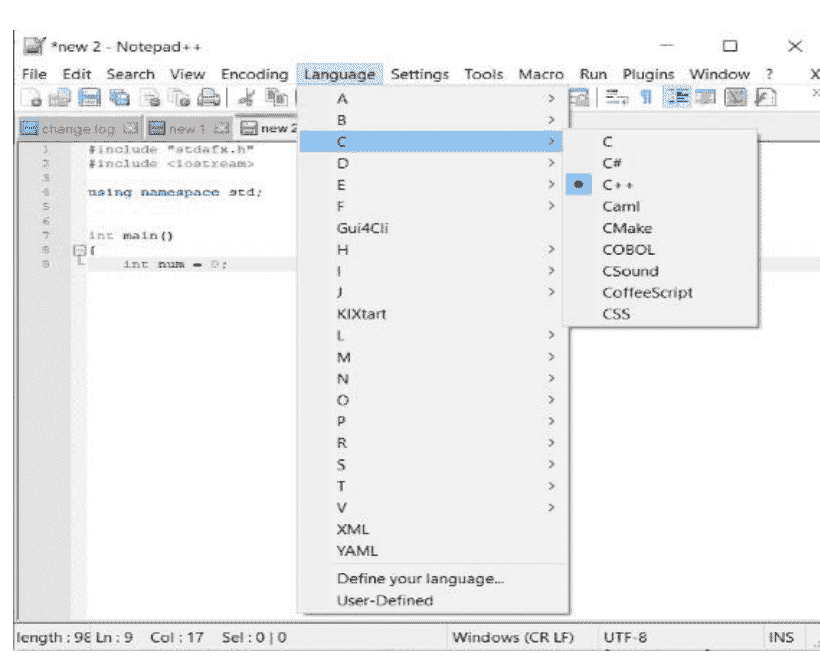

#### Notepad++ 的 `c++` 语法截图

Notepad++ 是免费的，正如其名，它是用 `c++` 的。这张截图说明了如何启用语言语法。可以通过进入语言 > "c" > 并导航到 `c++` 来专门启用 `c++` 语法。Notepad++ 仅适用于 Windows 平台（Orin, n.d.）。

Bluefish 是更高级的文本编辑器，带有更多功能（“Bluefish Editor: Features,” n.d.）。与 Notepad++ 不同，Bluefish 在 Windows 外的多个平台上可用。我不向初学者推荐 Bluefish，因为它有很多让完全完全初学者感到无从措的功能。如果你不是编程新手，可以尝试一下；你会发现许多 IDE 文本编辑器的典型 GUI 功能。

进入文本编辑器后，你必须选择一个编译器。现在让我向你如何在三个平台（Windows、Linux 和 Mac）上设置本地环境。

### Windows IDE 安装与设置

你所做的就是安装一个 IDE。记住，它必须包含一个文本编辑器和一个编译器。`code::Blocks` 是一个为 `c++` 设计的有用开源 IDE，它可以轻松适配各种编译器，包括微软的 Visual `c++`。安装 `code::Block` 很容易。你只需要访问他们的下载页面 `http://www.codeblocks.org/downloads/26` 并选择最新版本即可。

#### code::Blocks 下载页面

截至本文编写，`code::Blocks` 有适用于 Windows 和 Linux 发行版的 20.03 版本。该页面还包含了对安装有帮助说明。

程序安装完成后，你就准备好了。你可以使用它来编写 `c++` 程序。要做到这一点，你需要遵循三个步骤：创建文件、构建程序和运行程序。

创建新文件稍微复杂一点。以下是你需要做的：

- 进入 文件 (File) > 新建 (New)
- 选择“创建一个空文件”并输入你的代码
- 使用 `.cpp` 扩展名保存文件

而且，不用说，在运行程序之前你必须构建程序。你可以通过进入菜单中的 构建 (Build) > “构建并运行 (Build and Run)” 来完成。

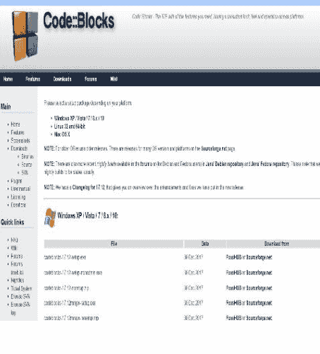

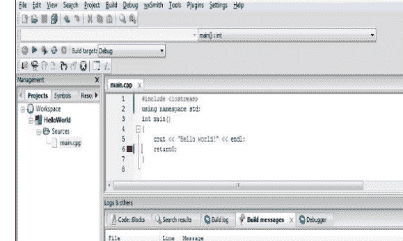

#### code::Blocks 中的“Hello World”截图

我们在 blocks 中“Hello World”程序的实时截图。运行此程序后，代码构建消息（Build Messages）中会出现一个错误。`code::Blocks` 高亮了第 6 行的错误。根据你之前章节对 `c++` 语法的知识，你应该能看到如何修复代码。我们如何修复代码？

*提示：数据和函数应该显示为蓝色。*在这种情况下，`code::Blocks` 适用于 Windows 和 Linux，但没有 Mac 版本。

### Mac OS IDE 安装与设置

对于 Mac，你需要获取 Xcode。它是面向 macOS 的软件开发套件。你可以从 App Store 获取它。Xcode 支持多种语言，如 Java、Python 和 Ruby。

它是面向 macOS 系统、tvOS（Apple TV）、watchOS（Apple Watch）以及 iPadOS（Apple iPad）的软件开发工具。Mac 使用专有编译器，因此如果你在 Mac 上，你只能选择使用 Xcode 来开发 `c++`。你可以通过此链接下载并安装 Xcode：

`https://apps.apple.com/us/app/xcode/id49779835?mt=12`

一旦文件下载并安装，打开 Xcode 并点击“新建 Xcode”图标。然后在初始窗口中选择“新建项目”。

#### Xcode 新项目界面

这些截图采用是 8.3.3 版本的 Xcode（Patel, 2017）。因此，我们的示例与最新版本有所不同。截至本文编写，最新版本是 12.1，主要包含了对各种 macOS 平台的更新。尽管存在差异，这些截图仍能帮助你在当前版本中定位。我们的指令仍然会有结果。

在此操作后，将弹出一个窗口要求你选择模板。该窗口将引导你完成剩余的设置。选择 macOS 部分并进入应用程序部分；在其中，选择命令行工具 (command Line Tool)。

看起来像这样：

`img/76e155a654962a3de26649c22b574ec2_20_0.png`

##### 1. 项目选择界面：macOS 应用程序 > 命令行工具

##### 2. 命令行工具选项：语言 > 选择 `c++`

Xcode 的命令行工具可以处理像 Swift 这样的微软专用语言。该程序可以在 Mac 编译器中与基于 C 的语言一起运行，包括 `c++`。默认选择 Swift。

在同一个窗口中，你将被要求添加一个组织标识符（organization identifier）。请记住，Xcode 的命令行工具是针对专有 macOS 系统的编程模板，因此组织标识符用于在 Apple 数据库中为你的程序创建一个唯一的 ID：Apple 开发者网站和 iCloud 容器、App Store 中的 iTunes Connect 门户。这将你的应用程序精简为专有的 macOS 框架。

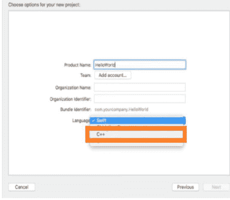

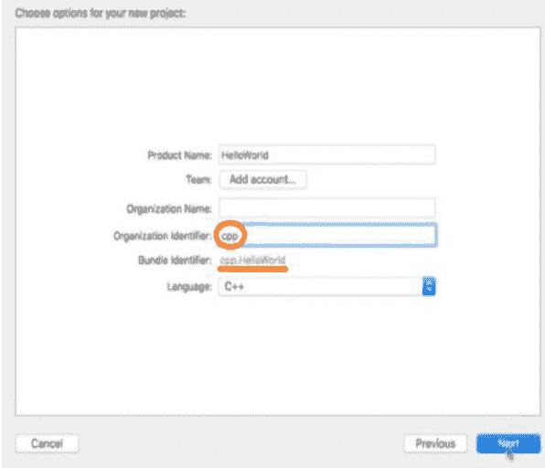

##### 3. 命令行工具选项：组织标识符 > “cpp”

组织标识符是一种命名规范，帮助程序员将他们的项目集成到 Apple 的专有软件开发方案中。在这里，我们使用“cpp”作为标识符，它生成“cpp.HelloWorld”作为我们的包标识符（bundle identifier）。一旦指定了标识符，指南允许我们继续进行下一步。

现在，在你选择的目录中保存项目。在左侧窗格中，Xcode 将打开该文件。你必须选择 `main.cpp` 以访问 Xcode 中你程序的全局 `c++` 文件。如果你愿意，可以将 `cpp` 文件上传到目录并对其进行编辑。

##### 3. Xcode 命令行工具：“main.cpp”

此截图展示了 IDE 风格的 Xcode 命令行工具工作空间。它在文本编辑器中打开了 `main.cpp` (Patel, 2017)。

一旦你写了一些代码并想要运行它，请选择 Product（产品）并点击 Run（运行）。你也可以通过选择该按钮来运行和构建程序。

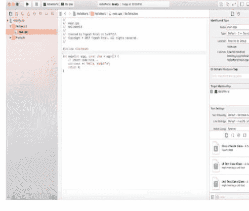

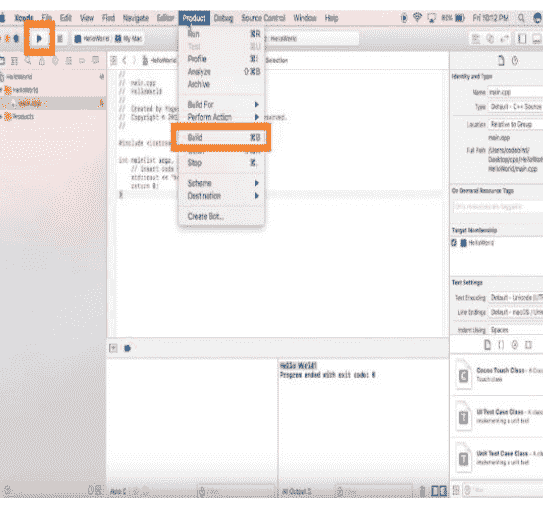

##### 4. Xcode 命令行工具：“Hello World” 构建与运行

与 `code::Blocks` IDE 类似，你必须先构建后运行你的程序。此截图还展示了“Hello World”的结果和返回值 (Patel, 2017)。

如果你是一个认为自己未来会在 Apple 设备上工作的程序员，那么在 Xcode 中工作和实践是一项明智的投资。例如，Apple 在各种消费品和和服务（如流媒体服务和设备）方面拥有健康的市场份额。尽管如此，你应该记住 `c++` 主要用作服务器端语言。服务端编程是控制内容传输送到 YouTube 这样的动态网站的代码。大多数服务端编程是在 Linux 机器上完成的。

### Linux 编译器安装

Linux 是一个基于控制台的操作系统，因此它不需要文本编辑器。相反，我们将重点关注安装和设置编程编译器。Mac 和 Windows 会在 IDE 中自动初始化编译器，但在 Linux 中，需要更注重操作的方法。你将被执行后端初始化。这看起来可能有很多工作，但从大局来看，它允许那些使用 Linux 的人员对开发过程有完全的控制，并释放更多的计算能力。

由于 Linux 是一个使用控制台界面的操作系统，对于初学者或习惯 Windows 或 Mac 的人来说会很奇怪。这是因为用户通常习惯 GUI（图形用户界面）。Linux 无 GUI 可以释放更多计算能力用于编程——GUI 需要一些计算能力来生成和维护。这就是为什么许多服务器和其他编程环境拥有控制台界面。此外，它们中的许多使用 Linux 发行版。

Linux 发行版（distro）是一种基于 Linux 内核的软件集合和用于安装额外软件软件包系统的操作系统。

以下是安装和初始化编译器的指令。这适用于 Ubuntu，一个受初学者流行的 Linux 发行版。这些安装在你使用的任何 Linux 发行版中都是相似的。

注意：有许多 Linux 发行版提供了许多用户喜爱的基于 GUI 的桌面体验。其中大多数是开源的，并可以免费下载和安装。你可以探索这些发行版并创建控制台界面进行练习。可以考虑的免费发行版是 CentOS，它基于 Red Hat 用于服务器管理（“centos-faq | open-source-community.” – n.d.）。红帽企业 Linux (RHEL) 用于许多服务器管理设置且不是免费的。然而，CentOS 使用了它的许多组件，是准备在红帽环境下工作的极发行版。

在示例中，我们将使用 Linux 上的 GNU 编译编译器。GNU 编译编译器是一个基于 Linux 的编译器，支持 `c++` 以及 Fortran、Ada 和 Java 等其他语言（“Gcc 7 Release Series—changes, New Features, and Fixes—GNU Project—Free Software Foundation (FSF),” n.d.）。要安装 GNU Gcc，请遵循以下步骤：

- 在控制台中，输入以下命令：

首先通过输入此命令 `gcc -v` 检查机器上是否已经安装了版本：

#### A. 在 Ubuntu 控制台中检查 GNU Gcc

你应该检查你的系统是否有一份 Gcc 副本。此截图展示了一个已经安装了 Gcc 的系统 (Patel, 2014)。使用命令后，如果系统中没有 Gcc 副本，它将缺失此行。如果有副本，它将有一类似的行。大多数情况下，你的版本会更更新。

以下命令将在你的系统中安装 Gcc (Agarwal, 2017b)：

```
sudo apt-get update
```


`sudo apt-get install Gcc`


### B. 在 Ubuntu 控制台中安装 GNU Gcc

在截图中，已经存在 GNU Gcc。如果系统中不存在，运行高亮显示的命令将在你的系统中安装 GNU Gcc (Patel, 2014)。控制台会提示你输入“Y”以开始安装。你还提供了软件包管理功能，例如终端的能力。以下命令将安装编译和运行 c++ 所需的所有库：

```
sudo-get update && sudo apt-get install g++
```

由于 Linux 内置了文本编辑器，你将需要使用以下命令访问文本编辑器的 GUI 界面：

```
gedit
```

你可以根据自己的意编写程序。请记住将程序保存为 `.cpp` 扩展名，这样它们才能被正确编译。

```cpp
#include<iostream>
using namespace std;

int main() {
    int a=0,b=0,sum;
    cout<<"Enter any two Numbers ";
    cin>>a>>b;
    sum=a+b;
    cout<<"sum is " <<sum;
    return 0;
}
```

## Ubuntu 中的 Gedit

此截图展示了 Linux 内置的文本编辑器 Gedit（[在 Linux 中运行 c, c++ 程序](https://example.org) Ubuntu 16.04 (Ubuntu Tutorial for Beginners), n.d.）。Gedit 是一种 Linux 编程文本编辑器工具，为多种编程语言提供了语法高亮和标签页间距功能。请确保从高亮的下拉菜单中选择了“c++”。你可以通过点击“保存”按钮在 GUI 中保存你的程序文件。请务必列出你保存文件的目录，因为在编译和运行代码时，你需要将编译器指向该目录。

要测试并运行你的代码，必须遵循以下指令：

1. 引导终端进入文件目录。执行此操作请使用此命令。在目录中重复输入，直到显示出 `.cpp` 文件。

2. 编译并测试程序文件

使用以下命令：

```
g++ -o test filename.cpp
```

如果出现任何错误，此命令将告诉你哪一行包含错误，就像你从 IDE 中预期的一样。然后你可以通过 `gedit filename.cpp` 打开程序文件并修复该行代码。

3. 运行程序文件

编译器将名为“test”的可执行文件来运行该程序。你可以在终端中输入 `./test` 来执行它。

## 在 Ubuntu 中测试、编译和运行 .cpp 文件

此截图展示了在 gedit 中编写的示例代码的测试、编译和运行（[在 Linux 中运行 c, c++ 程序](https://example.org) Ubuntu 16.04 (Ubuntu Tutorial for Beginners), n.d.）。

Linux 发行版是详细的基于控制台的系统，大多数系统都可以通过终端处理任何语言的编程。学习在 Linux 环境工作是有利的，因为它让你接触到服务端编程。

**注意：** 在 centos 上安装 Gcc 的过程类似。要进行安装，你应该改用 `yumgroupinstall` DevelopmentTools。此命令也会自动安装所需的库。

编写、编译、测试和运行程序的步骤都是相同的。

创建你自己的编程环境可以帮助你应对现实世界的场景，这是在线编程空间无法提供的。在本书中，我们将使用在线 IDE。这是因为每个人都将拥有相同输出和接口的学习环境。这简化了问题。

# 第 2 章：c++ 基础、编程原理

编程语言与其他任何人类语言一样：它们有结构、语法和规则。仅仅知道另一种人类语言的词汇是不够的。了解如何使用它们以及它们在该语言中如何运作，是在该语言中有效通信不可或缺的一部分。编程语言的功能相同，但它们试图帮助的通信是人与机器之间的。虽然机器（至少在今天）永远不会像我们这样聪明干练，但它们可以以我们无法想象的速率和效率理解很多内容。所有的编程都是一套指令。这些指令可以是规则，可以是你想要机器执行的操作，或者是其他什么。但这一切之所以可能，是因为我们遵循了编程语言的规则。

编程规则（或语法）是一列用于通信程序方面（如函数和变量）的边界符号。语法对于编译器来说非常重要，因为它告诉编译器应该向机器下达什么指令。

在我们开始之前，值得记住几点。与 Python 或其他高级编程语言不同，c++ 并不容易像人类语言。像 JS、Python 和 c# 等高级语言之所以这样设计是因为这有利于易于阅读和管理。c++ 尽管如此，但它更容易被机器理解，恰恰是因为它没有那么抽象。这就是为什么在处理 c++ 工作时，你只需要编译器和文本编辑器，而像 Python 这样的语言需要安装它们的环境。

## 编程原理

c++ 有许多方法完成相同的任务。就像人类语言一样，有许多方式可以表达相同的意思，但某些方式更适合某些场合，而另一些则不然。c++ 也是如此；某些方法非常棒，因为它们减少了程序开销。许多开发者会希望如此，因为这提高了整个应用程序的性能，这就是编程的第一条原则：用尽可能少的函数完成任务。不要让事情变得比需要它们更复杂。在大多数情况下，这意味着以节约的方式使用循环或 switch 语句。

做到此点的最佳方法是首先理解问题的本质以及如何最好实现解决方案。换句话说，你需要编写一个算法——一列你希望机器遵循以解决问题的指令。

你的设计应该始终从你想让程序做的事情开始。这还包括你的算法，或者至少是你的算法将解决的问题。算法始终看起来像这样：

4. 输入：传入的数据（如适用）

5. 处理：对数据执行的操作以及变量的声明

6. 输出：结果，或你想要执行的操作。

这是一个详细的 c++ 示例，用于显示“Hello World”：

```cpp
// 显示 "Hello World" 的简单 c++ 程序
// 输入输出头文件
#include<iostream>

using namespace std;
// 主函数
// 程序执行的地方
int main()
{
// 打印 hello world
cout<<"Hello World";

return 0;
}
```

这里是结构：

- 调用输入输出头文件

- 调用主函数

- 打印 Hello World

- 指示状态的终止语句

我们可以看到 c++ 是多么详细，因为大部分步骤涉及执行代码所需的后端方面，例如调用库文件。通常情况下你的算法不需要这么详细。

尽管很简单，这个算法说明了开发者如何将任务翻译成代码。在下一章中，我们将使用该算法编写我们的程序。

正如你在示例中注意到的，代码中有注释说明了代码部分的作用。这些注释以 `//` 开头。编译器不会读取任何以 `//` 开头的代码，因为它们不会产生任何影响，只是帮助处理代码的人理解代码的功能。

## c++ 语法概述

我们讨论了语法对编译器的重要性，但理解编程语言的语法同样重要，因为它允许你调试代码。就像人类语言一样，如果你了解语言的规则，出错时就可以轻松纠正。调试是发现并消除代码错误和异常的过程，称为“bug”（[什么是调试？](https://example.org) n.d.）。这是一个修正的过程。

IDE 拥有突出代码错误位置的调试工具，但这些工具并不总是可靠。例如，漏掉终止代码行的分号是一个常见错误，但调试器会在 `.h` 文件中突出错误，而不是程序文件 `.cpp` 中发生错误的地方。大多数调试器并不智能到可以检测内容的缺失，而是会抛出编译器在未终止行违反库规则时给出的详细错误。然而，程序员只需在注意到某一行缺少红色分号行分隔符时就能发现错误。

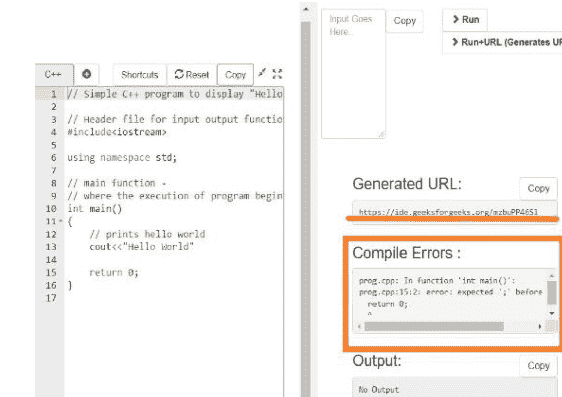

### GeeksforGeeks IDE 中没有行分隔符的“Hello World”程序

这张截图展示了一个缺少分隔符的“Hello World”。你会立即注意到，该 IDE 对 C++ 的语法高亮与我们在上一章节中探索的编程环境不同。语法会随平台而异。这就是为什么我们要通过 GeeksforGeeks IDE 来统一流程的原因。在我们选择的 IDE 中，分号没有被高亮。然而，IDE 可以通过识别和标注缺失的分号来弥补这一缺陷，如截图中所高亮所示。你可以通过访问其生成的 URL 来练习和探索此程序：https://ide.geeksforgeeks.org/mzzbuPP46S。

当代码量较小时，这很容易看出，但在处理较大的项目时，这项任务可能会变得困难。我听说过有些程序员花费一周或更长的时间试图寻找或修复代码中的某一行，结果发现只是一个非常微小的问题，比如漏了一个字母或大小写不匹配。为了方便调试，建议你将代码拆分成更小的模块（“什么是调试？”，n.d.）。通过这种方法可以发现并轻松处理许多错误。

让我们来看一下“Hello World”程序并详细研究它的语法。虽然语法高亮在不同平台上可能不同，但代码的这些方面在所有平台上都是一致被高亮的。

- **注释 (comments)：** 如我所说，这些是编译器将忽略的代码。它们用于注释代码并为其他程序员留下有用的解释。这非常棒，因为通常我们在编写代码时会与他人协作。建议你在你的算法中留下注释，以便他人简化理解。在大多数平台上，注释会被高亮为绿色。注释前总是带有 `//`。

- **头文件库 (Header File Library)：** 以 `#` 开头的行用于编译器调用库函数。这些行至关重要，因此它们出现在每个程序中。在“Hello World”示例中，我们调用了一个用于管理字符串的库。这些代码行在不同平台上会有不同的颜色高亮。在 GeeksforGeeks 中，颜色是紫色。

- **语句 (Statements)：** 语句用编译器识别的指令描述了一行代码的开头。这包括声明处理指令，比如我们 Hello World 程序中的 `using...` 或 `return...`。它们在多个平台上也有不同的高亮方式。在 GeeksForGeeks 中，它们被高亮为紫色。

- **函数 (Functions)：** 这是封装了指令的代码。它可以接收输入并输出结果。每个函数的编写方式如下：`[函数名] ()` 后面跟着大括号 `{}`。大括号中的任何内容都是将要执行的指令集。在我们的示例中，`main()` 是启动通过 `cout<<` 输出“Hello World”指令的函数。在 `.cpp` 程序中，`int main ()` 必须始终出现程序才能运行。

> 注意：回想我们在上一节关于算法的讨论，你的算法将主要描述在 `int main()` 大括号内发生了哪些指令。更详细的算法可能会解释输入、输出和其他数据所需的各种数据类型。我们将在第 3 章详细讨论类型。

- **数据 (Data)：** 这些是变量和其他类型的数据函数和语句。在 GeeksforGeeks IDE 中，它们被高亮为蓝色。

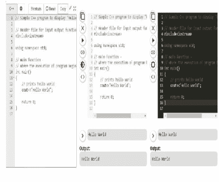

### GeeksforGeeks IDE 中的“Hello World”程序与 GeeksforGeeks 嵌入式文章的对比

这张截图展示了“Hello World”的成功运行以及运行程序时使用的内存。此 IDE 具有浅色语法高亮，主要关注注释、语句和操作数数据。与 GeeksforGeeks 文章中的嵌入式代码相比，它们的嵌入代码要详细得多（“Writing – first – c++ – program,”–2017）。右侧的两张截图展示了文章中相同代码的“浅色模式”和“深色模式”视图。这些视图更详细，高亮了注释、函数并区分了不同的语句。例如，`int` 等数据类型与 `using namespace` 等其他语句通过不同的颜色区分。此外，嵌入视图与 IDE 不同，会将字符串与其他数据区分开。这是语法高亮在不同平台之间可能变化的完美示例。

之前我们看到了一个带有错误的 code::Block 示例。下面是完全相同的代码，旁边是修正后的代码。你立即就可以体会语法以及 code::Block 示例中代码哪里出了问题。

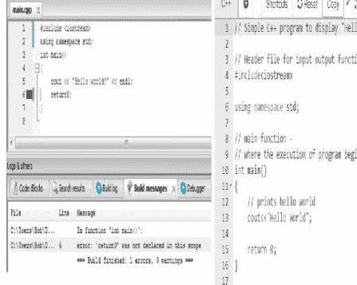

### code::Blocks 中的“Hello World”与 GeeksforGeeks IDE 的对比

这张截图对前一个示例进行了并排对比：code::Blocks 中带有错误的“Hello World”以及在 GeeksforGeeks IDE 中相同的修正后代码。通过学习两者，你应该能看到 `int main()` 函数中的最后一条指令在 code::Blocks 中输入错误了。结果是，编译器无法识别返回语句。

我必须承认，在这样的几行代码中这并不那么印象深刻，但能够注意到错误并解释它们是程序员最重要的技能之一。在现阶段，你不必太担心自己是否能做到。你编写代码越多、学习得越多，你发现和修复错误的能力就越强。软件和 Web 开发是由于失败率很高的行业。要成为一名成功的开发者，你需要快速解决问题、高效地找到 bug 并修复它们。这在管理方面同样适用，因为发现、修复和解释 bug 是桌面服务水平的很大一部分。服务水平协议（SLAs）是服务提供者与客户之间的协议。他们就服务质量、可用性等方面达成一致（Wieder, Butler, & Yahayapour, 2011）。在技术领域，SLAs 是为了确保服务水平而制定的。在美国，开发人员年薪约为 60,000 美元；负责 SLA 的人员年薪约为 90,000 美元（这种专业水平非常有价值，因为它理解了 C++）。

## 第一个程序：输出与基础字符串

“Hello World”是种编程语言的入门项目；它的目标是向学习者展示程序的基本语法及其工作方式。随着学习深入，你会编写许多“Hello World”程序。在上一节中，我们用它探索了算法、语法和 C++ 编程环境。在本节中，我们将进一步操作：

C++ 使用来自库 `ostream` 的`对象`。对象是计算机管理数据的方法。在我们的示例中，`cout` 用于告诉编译器打印“Hello World”。不要害怕；我们将在后面的章节中讨论运算符和对象。现在，理解 `cout` 就足够了，因为它是定义在我们声明的头文件中的。

现在，让我们通过更改输出来看“Hello World”和 `cout` 对象。在这里找到原始代码以便作为参考：

https://ide.geeksforge.org/eA8ZMEKiDo

你也可以查看索引中的代码副本。

### 使用 cout

`cout` 对象使用 `<<` 操作符来打印值和文本，我们可以根据需要使用任意数量的它。使用浏览器中的 IDE，修改代码以打印出：

Hello World

I am learning C++

如下所示：

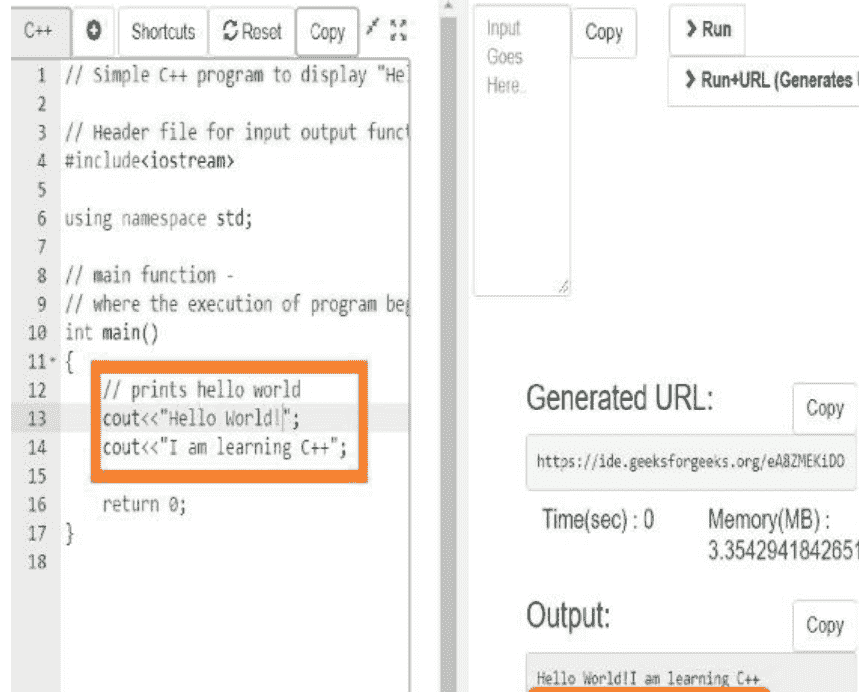

### 添加 cout 对象

这张截图显示了我们在分屏模式下对编辑后的“Hello World”程序进行的成功运行。虽然程序运行没有没有任何错误，但它并没有产生我们想要的结果。观察输出发现，打印的文本缺少换行符。我们必须指示编译器添加换行符以获得所需的结果。

添加换行可以通过多种方式实现：我们可以在字符串内部添加分隔符，或者使用 `iostream` 库中的另一个操纵对象。

### 使用转义序列

虽然在 `cout` 中直接编写字符串并换行看起来很诱人，但它是行不通的。这会破坏代码并导致无法运行。不相信吗？试试看！

你可以使用转义序列来添加换行。转义序列用于许多需要在字符串和字符流中引入特殊字符的场景。它也可以添加行，如下所示：

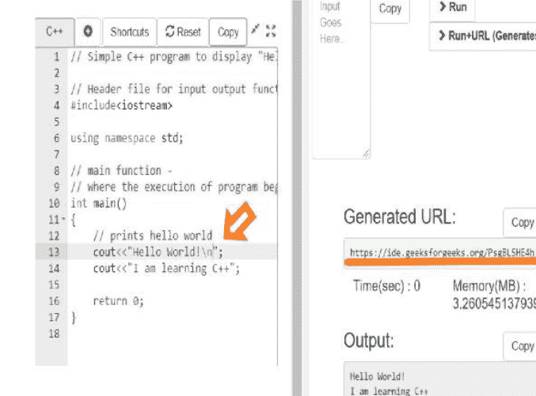

### 使用字符串内转义序列来分隔和处理输出

这是我们在分屏模式下对编辑后的“Hello World”程序的成功运行。通过 `\n`，我们得到了预期的输出。

当你查看代码时，可以看到我们使用了双引号。因此，如果你想在字符串中添加双引号，将必须使用转义序列，这样编译器就知道它不是代码的一部分。这样做可能会导致不可预见的错误或缺陷。这就是为什么转义序列很重要。以下是它们可以使用的许多实例列表（“转义序列—cppreference.com，”n.d.）：

- `''`：用于单引号

- `'\"'`：用于双引号

- `"\?"`：用于问号

- `"\""`：用于反斜杠

- `"f"`：代表“换页”（form feed），用于跳到下一“页”

- `"\n"`：代表“换行”（line feed），用于跳到下一行

- `"\t"`：代表“水平制表符”（horizontal tab），在水平方向添加 5 个空格

- `"v"`：代表“垂直制表符”，用于垂直语言中的间距设置

**注意：** 如果你决定尝试不同的转义序列作为文本分隔符，请确保只使用“Run”按钮。这将保存工作区。

如果你想保存某些结果以后使用，可以使用 `Run + URL...` 按钮将工作保存到另一个 URL 以便以后返回。返回我们的练习，可以使用我们保存的 IDE 工作区 URL（https://ide.geeksforgeeks.org/PsgBLSHE4h）。你也可以在索引中访问此代码。

### 使用 endl：输入/输出操纵符

正如我们所说的，编程语言像人类语言一样灵活。可以用多种方式表达一条指令，终止字符串也不例外。转义序列和 `endl` 之间的区别在于 `endl` 会刷新并刷新用于存储字符串的缓冲区。程序员在打印大量文本后使用 `endl` 来清除内存。你可以看到为什么在内存管理中很有用。`endl` 是输入/输出操纵符的一个示例。输入/输出操纵符是允许使用 `<<` 操作符或 `>>` 操作符控制输入/输出流的函数（“输入/输出操纵符—cppreference.com，”n.d.）。

 使用字符串内转义序列来分隔和处理输出

这是我们在分屏模式下对编辑后的“Hello World”程序的成功运行。使用 `\n`，我们得到了预期的输出。


查看代码时，你可以看到使用了双引号。因此，如果你想在字符串中添加双引号，将必须使用转义序列，这样编译器就知道它不是代码的一部分。这样做可能会导致不可预见的错误或缺陷。这就是为什么转义序列很重要。以下是它们可以使用的许多实例列表（“转义序列—cppreference.com，”n.d.）：

- `''`：用于单引号
- `'\"'`：用于双引号
- `"\?"`：用于问号
- `"\""`：用于反斜杠
- `"f"`：代表“换页”（form feed），用于跳到下一“页”
- `"\n"`：代表“换行”（line feed），用于跳到下一行
- `"\t"`：代表“水平制表符”（horizontal tab），在水平方向添加 5 个空格
- `"v"`：代表“垂直制表符”，用于垂直语言中的间距设置

**注意：** 如果你决定尝试不同的转义序列作为文本分隔符，请确保只使用“Run”按钮。这将保存工作区。

如果你想保存某些结果以后使用，可以使用 `Run + URL...` 按钮将工作保存到另一个 URL 以便以后返回。返回我们的练习，可以使用我们保存的 IDE 工作区 URL（https://ide.geeksforgeeks.org/PsgBLSHE4h）。你也可以在索引中访问此代码。

### 使用 endl：输入/输出操纵符

正如我们所说的，编程语言像人类语言一样灵活。可以用多种方式表达一条指令，终止字符串也不例外。转义序列和 `endl` 之间的区别在于 `endl` 会刷新并刷新用于存储字符串的缓冲区。程序员在打印大量文本后使用 `endl` 来清除内存。你可以看到为什么在内存管理中很有用。`endl` 是输入/输出操纵符的一个示例。输入/输出操纵符是允许使用 `<<` 操作符或 `>>` 操作符控制输入/输出流的函数（“输入/输出操纵符—cppreference.com，”n.d.）。

![](img/76e155a654962a3de26649c22b574ec2_53.png 使用字符串内转义序列来分隔和处理输出

这是我们在分屏模式下对编辑后的“Hello World”程序的成功运行。使用 `\n`，我们得到了预期的输出。

查看代码时，你可以看到使用了双引号。因此，如果你想在字符串中添加双引号，将必须使用转义序列，这样编译器就知道它不是代码的一部分。这样做可能会导致不可预见的错误或缺陷。这就是为什么转义序列很重要。以下是它们可以使用的许多实例列表（“转义序列—cppreference.com，”n.d.）：

- `''`：用于单引号
- `'\"'`：用于双引号
- `"\?"`：用于问号
- `"\""`：用于反斜杠
- `"f"`：代表“换页”（form feed），用于跳到下一“页”
- `"\n"`：代表“换行”（line feed），用于跳到下一行
- `"\t"`：代表“水平制表符”（horizontal tab），在水平方向添加 5 个空格
- `"v"`：代表“垂直制表符”，用于垂直语言中的间距设置

**注意：** 如果你决定尝试不同的转义序列作为文本分隔符，请确保只使用“Run”按钮。这将保存工作区。

如果你想保存某些结果以后使用，可以使用 `Run + URL...` 按钮将工作保存到另一个 URL 以便以后返回。返回我们的练习，可以使用我们保存的 IDE 工作区 URL（https://ide.geeksforgeeks.org/PsgBLSHE4h）。你也可以在索引中访问此代码。

### 使用 endl：输入/输出操纵符

正如我们所说的，编程语言像人类语言一样灵活。可以用多种方式表达一条指令，终止字符串也不例外。转义序列和 `endl` 之间的区别在于 `endl` 会刷新并刷新用于存储字符串的缓冲区。程序员在打印大量文本后使用 `endl` 来清除内存。你可以看到为什么在内存管理中很有用。`endl` 是输入/输出操纵符的一个示例。输入/输出操纵符是允许使用 `<<` 操作符或 `>>` 操作符控制输入/输出流的函数（“输入/输出操纵符—cppreference.com，”n.d.）。

![](img/76e155a654962a3de26649c22b574ec2_53.png 使用字符串内转义序列来分隔和处理输出

这是我们在分屏模式下对编辑后的“Hello World”程序的成功运行。使用 `\n`，我们得到了预期的输出。

查看代码时，你可以看到使用了双引号。因此，如果你想在字符串中添加双引号，将必须使用转义序列，这样编译器就知道它不是代码的一部分。这样做可能会导致不可预见的错误或缺陷。这就是为什么转义序列很重要。以下是它们可以使用的许多实例列表（“转义序列—cppreference.com，”n.d.）：

- `''`：用于单引号
- `'\"'`：用于双引号
- `"\?"`：用于问号
- `"\""`：用于反斜杠
- `"f"`：代表“换页”（form feed），用于跳到下一“页”
- `"\n"`：代表“换行”（line feed），用于跳到下一行
- `"\t"`：代表“水平制表符”（horizontal tab），在水平方向添加 5 个空格
- `"v"`：代表“垂直制表符”，用于垂直语言中的间距设置

**注意：** 如果你决定尝试不同的转义序列作为文本分隔符，请确保只使用“Run”按钮。这将保存工作区。

如果你想保存某些结果以后使用，可以使用 `Run + URL...` 按钮将工作保存到另一个 URL 以便以后返回。返回我们的练习，可以使用我们保存的 IDE 工作区 URL（https://ide.geeksforgeeks.org/PsgBLSHE4h）。你也可以在索引中访问此代码。

### 使用 endl：输入/输出操纵符

正如我们所说的，编程语言像人类语言一样灵活。可以用多种方式表达一条指令，终止字符串也不例外。转义序列和 `endl` 之间的区别在于 `endl` 会刷新并刷新用于存储字符串的缓冲区。程序员在打印大量文本后使用 `endl` 来清除内存。你可以看到为什么在内存管理中很有用。`endl` 是输入/输出操纵符的一个示例。输入/输出操纵符是允许使用 `<<` 操作符或 `>>` 操作符控制输入/输出流的函数（“输入/输出操纵符—cppreference.com，”n.d.）。

### 声明 iostream 对象和操纵符

这张截图是在删除了 `using namespace std;` 之后，“Hello World”程序的成功运行测试。一旦成功声明了 iostream 对象和操纵符，就删除了那行多余的代码。

如果你想进行练习，可以使用此 URL：https://ide.geeksforgeeks.org/VgoboAodiX

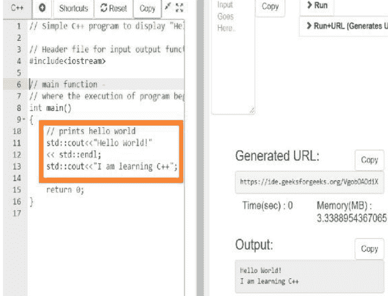

**注意：** 如果你在练习过程中遇到多个错误，我们始终会提供一个运行成功程序的已保存 IDE 工作区，以帮助你排排除故障。要开始排错阶段，请打开另一个窗口，并使用当前的工作区导航到成功运行的工作区。你可以在此链接找到“声明 iostream 对象和操纵符”的成功运行版本：https://ide.geeksforgeeks.org/a5zodSWoQU。

# 第 3 章：变量与数据类型

我们已经讨论过低级编程如何接近机器语言，但它们又不同，因为它们仍然使用了让人联人类语言的元素，如语法、结构和变量。变量是人类用来向机器传达含义的数学概念。计算机科学的很大一部分在于识别语言是一系列数学概念。这包括 AND 和 OR 门，它们使机器能够在单个数据位层面上做出决策。在非常小的尺度上，位运算可以帮助许多计算过程，从控制显示器到切换服务器上的流量。我们将在第 4 章讨论这些高级主题。现在，让我们通过观察变量来深对 C++ 的理解。

变量是任何编程语言中最重要的方面之一——编程语言的功能和其他操作通常都在变量上运行。我们曾说过，并不是所有程序都有正在处理的变量，或者没有可以进行的操作。函数的结果总是状态改变。状态改变是指机器从一个决策或操作阶段切换到另一个。这个术语曾用于描述旧主机计算机的操作，但我们仍然在计算机科学中使用它描述程序的工作。在我们的示例中，IDE 在程序运行之前从初始化的 `main()` 状态开始。然后它切换状态来执行输出命令。

由于低级语言与机器语言非常接近，因此经常讨论状态改变。低级语言也被称为编译语言，因为它们被编译成机器语言。这与 Python 等高级语言形成对比。如果你还记得，我们讨论过高级语言由于其内置库的存在，不需要在声明变量时指定其数据类型。例如，Python 使用 Python 环境来识别变量及其数据类型。在 C++ 中，变量和数据类型必须被声明。数据类型告诉编译器如何处理数据。当你考虑到数学中的向量（vectors）时，数据类型更有意义；与整数不同，整数告诉我们空间的大小和方向。因此，向量是整数不同的数据类型。这类属性被用于 Photoshop 等软件中以帮助进行渲染。

注意：基于矢量的图像可以在不损失图像质量的情况下进行处理。这是因为 jpeg 或 .png 等文件将图像的像素位置存储为网格上的整数。而矢量文件（如 svg 或 .pdf）则使用矢量来描述其像素位置。因此，当图像被放大大时，矢量会指明颜色应该如何扩展，而普通的图像文件则不会。这就是导致在处理非矢量图像文件时出现像素化和失真的原因。

## 输入与输出：声明变量

在上一章中，我们在学习如何使用 `cout` 时声明了一些内容。在这一节中，我们将查看数据类型的示例以及它们是如何声明的。下面是变量声明的示例及其代表含义（“C++ Variables”，n.d.）。请记住，变量本质上存储的是类型的数据：

- `int`：关键字是“integer”（整数）的缩写，存储没有小数的整数。该关键字包含负整数。
- `double`：存储带小数的数字。
- `char`：关键字是“character”（字符）的缩写，存储无论大小写如何的字符。`char` 值使用单引号。
- `string`：存储文本，如我们的“Hello World”示例。`string` 值使用双引号。
- `bool`：关键字是“Boolean”（布尔）的缩写，存储两种状态：`true`（真）或 `false`（假）。正如之前讨论的，这些值可以表示为“0/1”。

在下一节我们将详细讨论它们。现在让我们看看这些示例。创建一个变量需要在赋值运算符之后赋予值。语法如下：

```
[类型][变量名] = [值];
```

**注意：** 名在函数内部必须是唯一的，否则会导致错误。

现在让我们创建一个名为 `myNum` 的 `int` 类型变量，并赋值为 10，然后让我们的程序打印出来。

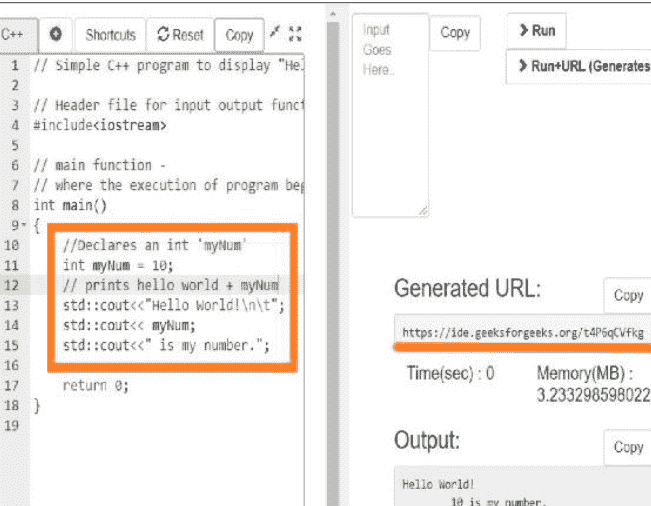

## 声明 int 数字

这张截图是“myNum”程序的成功运行。你可以通过以下 URL 访问保存的 IDE 工作区：https://ide.geeksforgeeks.org/t4P6qcVFkg。

这段代码是在没有空格的情况下实现的；这是最佳实践。你应该尝试成功实现相同的代码。记得可以使用 URL 将工作区重置为成功状态。

我们的代码中有很多 `cout` 示例。让我们使用右上角的输入框和 `cin` 对象，以便我们的程序接收输入并对其进行操作。

我们可以通过编写接收两个数字并相加的程序来实现。为了这一点，我们必须声明两个存储程序操作输入的变量。

我们将声明多个变量：

- 两个 `int` 变量 `x` 和 `y`
- 一个 `int` 变量 `sum`

我们还可以告诉程序提供两个输入。

**注意：** 在我们的 IDE 中，你必须在运行程序之前输入数据。每个输入应占一行。

此截图显示我们修改后的程序计算 $\frac{22}{7}$ 测试成功。你可以通过以下 URL 保存的 IDE 工作空间：

```
https://ide.geeksforgeeks.org/a8Mw6tmyf8. 此练习还包括 ${22}
= 3.1428571428571428571428571...
```

但是，正如你所看到的，这里显示为 3。这是因为编译器将输入计算为 `int`（整型），而它们没有被修改为存储小数。

结果就是结果丢失了小数。

要得到我们想要的结果，最好的办法更改变量的数据类型。使用 `float` 数据类型与 `double` 数据类型有区别吗？我们可以预期不同的结果吗？记住，你可以通过 URL 返回工作空间的成功状态来重置。

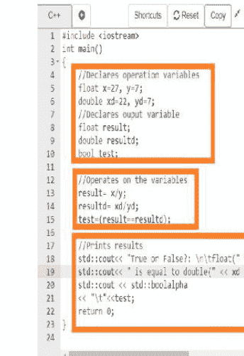

## 比较 Float 和 Double

此截图显示我们修改后的程序计算 $\pi = \frac{22}{7}$ 测试运行成功。为了专注于比较 `float` 和 `double`，我们移除了输入语句并重新排列了数据类型。我们强烈建议你自己使用位于此 URL 的之前的程序创建这个程序：https://ide.geeksforgeeks.org/a8Mw6tmyf8。这个练习将让你练习我们之前讨论过的一些之前的编程主题，包括：

- `bool` 数据类型关键字
- `boolalpha` 输入输出操纵符

它还将让你获得一些逻辑运算符的经验。我们将在下一章中详细讨论逻辑运算符。一旦你操作了程序，打开一个新窗口，并将其与上方截图的成功运行进行比较。你可以在此 URL 找到带有成功运行的保存 IDE 工作空间：https://ide.geeksforgeeks.org/dNIUYtN7M。

## C++ 的力量：高级字符串

我们将查看的另一种数据类型是字符串。字符串是计算机科学中最流行的数据类型之一；它们是字符序列。将它们认为是句子可能会有所帮助，但并不是每个句子都代表字符串。我们已经在“Hello World”应用程序中看到过它们是如何工作的。字符串是一个独立的数据类型，拥有自己的库。为了操作和使用它们，程序需要适当的头文件——`string` 库。这些库具有允许程序操作字符串的方法和特性。

## 运算：字符串拼接

字符串拼接是将不同的字符串组合成一个字符串。它是字符串的结合。这是程序最常见的功能之一。例如，当你在网站或游戏上输入姓名，然后切换到另一个页面，屏幕上问候你“Hello, [your_name]!”时，程序就使用了拼接来实现这一点。它将“Hello,”与你的名字以及结尾的“!”组合在了一起。

在 C++ 中，字符串拼接通过“+”运算符执行。让我们通过创建一个打印带有问候语的输入字符串的程序来查看这一操作。为了使之工作，我们必须包含 `<string>` 库，它包含了处理字符串所需的对象和语句。

打开我们一直在使用的 IDE 的新实例并按照以下步骤操作：

- 除了 `#include <iostream>`，还包含 `<string>` 库
- 省略 `using namespace std;`
- 移除 `int main(){...}` 中当前的填充代码
- 声明并设置变量 `firstName = "John"` 和 `lastName = "Doe"`
- 声明并通过“ + ”运算符添加 `firstName` 和 `lastName` 来计算 `fullName`
- 将结果打印为“Hello John Doe.”

它看起来像这样：

```cpp
C++  Stop  Reset Copy Debug  Input  Run
1 #include<iostream>
2 // 调用处理字符串的库
3 #include <string>
4 int main(){
5 {
6 // 声明变量并完成
7 string firstName = "John";
8 string lastName = "Doe";
9 string fullName = firstName + " " + lastName;
10
11 // 打印结果
12 cout<<"Hello "
13 << fullName<<std::endl;
14
15
16 return 0;
17 }
```

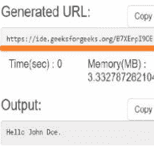

## 字符串拼接

此截图我们的字符串拼接程序测试运行成功。我们鼓励你在另一个窗口中打开此程序，并与你的程序进行比较。你可以在此 URL 访问成功运行：https://ide.geeksforgeeks.org/B7XErpI9oE。

**注意：** 确保对你的代码进行注释。你可以使用简写指令并把它们作为即兴算法来注释你的代码。这将帮助你保持程序的整洁。

通常，在论坛中，拼接的文本输入保持尽可能小，格式化由程序完成。在示例中，我们必须手动在“Hello”和“John”之后添加空格，但程序会自动添加空格。现在你已经看到“+”运算符是如何工作的了，你可能会如何添加空格呢？

看看你是否通过在编辑器中尝试代码来弄清楚。如果事情变得不可控，你随时可以通过点击 URL 返回到我们成功的 IDE 工作空间。

## 注意：

`+` 运算符既用于数字相加，也用于字符串拼接。尝试使用该运算符加字符串和数字将产生错误。你可以使用上一个章节中修改的程序自行进行测试。你也可以在此 URL 查看该程序的成功运行结果，它展示了如何拼接数字和字符串：https://ide.geeksforgeeks.org/glPmDwF7。取消注释以尝试将数字和字符串相加，亲眼看到错误。错误信息非常长且冗，因为它在 `<iostream>` 和 `<string>` 库之间存在冲突。

## 字符串对象：Length() 属性

我们从现实经验中知道，字符串像许多事物一样有不同的大小。这与我们目前探索的其他数据类型不同。C++ 使这成为可能因为它将字符串构造为带有属性的对象。C++ 在 `Length()` 属性下定义了字符串长度，正如你在对象中预期的那样。要访问长度，字符串必须绑定到变量，并且你必须使用 `.` 语法。它应该像这样：

```cpp
[string_name].length()
```

让我们回到程序并获取 `fullName` 的长度。我们需要通过添加一行带有 `cout` 的新行来修改代码，如下：

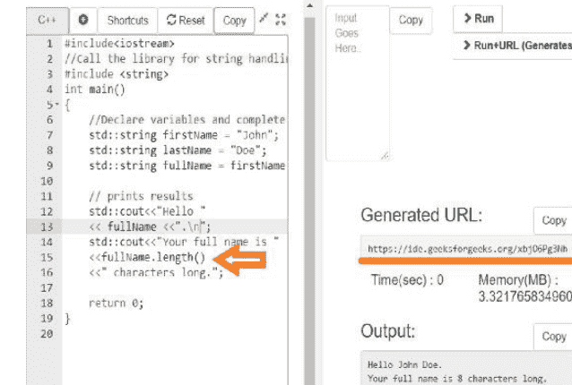

### 打印 Length

此截图是我们的属性程序测试运行成功。我们鼓励你在此 URL 修改程序：https://ide.geeksforgeeks.org/B7XErpI9oE。

### 字符串索引


回顾关于对象的讨论。向量数组也是具有自身属性的特殊现象。数组是对象的有序排列——通常是行、列或矩阵——每个元素都有特定的位置。字符串存储在由字符组成的数组中。因此，字符串数组是字符的有序排列，字符串中的每个字符都有索引。

## 字符串索引

字符串索引从 `0` 开始。记住索引从 `0` 开始。我们将使用这种语法来实现：

```
fullName[x]
```

`x` 代表我们想要打印的字符索引。记住也要编辑 `cout` 以正确打印字母：

```cpp
#include <iostream>
#include <string>

int main() {
    // 声明变量并完成字符串
    string firstName = "John";
    string lastName = "Doe";
    string fullName = firstName + " " + lastName;

    // 打印结果
    std::cout << fullName << std::endl;
    std::cout << " 的第三个字符是 " << firstName[2] << std::endl;
    std::cout << lastName[2] << std::endl;

    return 0;
}
```

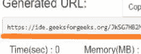

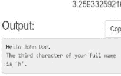

### 访问 `fullName` 字符串数组

此截图是我们修改后的属性程序测试运行成功。我们鼓励你在此 URL 修改程序：https://ide.geeksforgeeks.org/xbjoPg3Nh。

一旦你修改了程序，可以在另一个窗口中将其与此成功运行进行比较。你可以通过以下 URL 访问此保存的 IDE 窗口：https://ide.geeksforgeeks.org/JWSG7HB2Ms。

在我们的示例中，我们非常依赖 `cout` 能力，但正如我提到的，还有其他用于从不同来源获取内容的处理能力。这些是 `cin` 对象和 `getline()` 函数。

### `cin` 和 `getline()` 函数

在上一章的示例中，我们使用了 `cin`。和 `cout` 一样，`cin` 是 `<iostream>` 库中的一个对象，它允许程序使用 `>>` 运算符接收输入。和 `cout` 一样，`cin` 对象必须用 `std` 数据类型定义。让我们修改我们的拼接程序，使其接收“John Doe”的输入。如果你愿意，可以使用你的名字，因为这样做可能很有趣。你需要遵循以下指令：

- 访问以下 URL 路径下的字符串拼接器：
- https://ide.geeksforgeeks.org/B7XErpI9oE
- 声明变量。
- 提示用户输入姓名。
- 使用以下代码段进行计算操作。
- 打印出应显示的结果。

如果你发现自己卡住了，这里是处理方法：

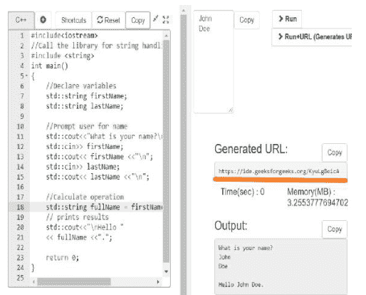

### 使用 `cin` 进行字符串拼接

这张截图是我们使用 `cin` 修改后的字符串拼接程序的成功测试运行结果。我们鼓励你在另一个窗口中打开此程序并将其与你的程序进行比较。你可以通过此 URL 访问成功的结果：https://ide.geeksforeks.org/KyuLgBoica。

**注意：** 确保对你的代码进行注释。你可以简写指令并将它们作为即兴算法来注释你的代码。这将帮助你保持程序的有序。

该程序只有在用户分别输入名和姓时才能正常工作。但大多数人的姓名是存储或输入为单个字符串的。让我们改变程序，以便在用户输入全名时向他们问候。你需要遵循以下步骤：

1. 如果尚未存在，或者你需要重置工作区，请前往以下 URL 之前的工作区：https://ide.geeksforeks.org/KyuLgBoica
2. 仅声明 `fullName` 变量。
3. 使用 `cin` 提示用户输入全名。
4. 使用 `cout` 和 `inputfullName` 问候用户。

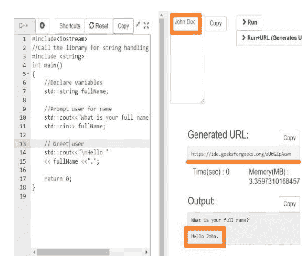

### 使用 `cin` 进行字符串终止

这张截图是我们使用 `cin` 修改后的字符串拼接程序的失败测试运行。虽然程序无错误地完成，但我们没有得到预期的结果。如果你的程序在修改后出现错误或没有得到类似的结果，我们鼓励你使用成功的结果来排查工作区的问题。在另一个窗口中打开这个成功的结果并与你的程序比较。你可以通过 URL 访问成功的结果：https://ide.geeksforgeeks.org/aU6GZPAxwn。

你见证了典型的 `cin` 行为。当 `cin` 遇到空格时，将其视为字符串终止符并停止。这就是为什么“Doe”没有添加到输出中。为了读取带有空格的整个字符串，我们必须使用 `<string>` 库中的 `getline()` 函数；它从输入中提取所有字符并将它们转换为字符串数组。

## 注意

通常优于使用 `getline()` 以确保程序可以从辅助源读取字段文本，特别是 `getline()` 可以无错误地读取和聚合不同类型的字符。

这是一个使用 `getline()` 函数的示例：https://www.geeksforgeeks.org/getline-string-c/

在这一章中，我们做了很多工作。我们查看了特殊函数、对象、文本操纵符和运算符。我们将在接下来的章节中详细介绍它们。我希望你已经看到了运算符在引导数据和赋予程序功能方面的作用。在接下来的章节中，我们将研究运算符以及它们如何赋予程序决策能力。

# 第 4 章：C++ 中的操作

我们讨论了 C++ 主要是一门后端、服务器端语言，适用于控制服务器和其他用于交付内容的决策工具。在上一章中，我们通过查看字符串研究了 C++ 处理数据的细微方式。在其中，我们看到了操作在允许我们控制程序中的循环和决策方面的核心作用。对操作有更好的理解允许我们为程序添加更多功能。**功能**是程序员如何使用语言的方法和特征来实现目的。我们已经看到了这些字符串处理方法是如何工作的，但如果我们能在允许我们实现特定目的（如内容管理）的语境中使用这些特征，将会更好。

注意：“操作数”(operand) 描述被操作的值或变量。“运算符”(operator) 描述指示正在执行的操作种类的符号（“c++ - operators,” - n.d.）。

以下是 C++ 中的运算符列表（“operators-In-c.png (800x533),” n.d.）：

| 运算符 | 类型 |
| --- | --- |
| `+, -, -` | 一元运算符 > 算术运算符 |
| `+, -, *, /, %` | 二元运算符 > 算术运算符 |
| `<, <=, >, >=, ==, !=` | 二元运算符 > 关系运算符 |
| `||, !` | 二元运算符 > 逻辑运算符 |
| `|, <<, >>, ~` | 二元运算符 > 位运算符 |
| `=, --, -=, *=` | 二元运算符 > 赋值运算符 |
| `?:` | |

此表列出了运算符符号并根据 (1) 它们一次接受多少操作数 > (2) 它们实现的操作类型进行分类。例如，大多数算术运算符同时处理两个操作数。

所有运算符的特征取决于它们同时可以操作的操作数数量以及它们可以执行的操作类型。它们被分为三类：

**一元** - 一次只接受 1 个操作数的运算符。

**二元** - 一次接受 2 个操作数的运算符。

**三元** - 接受多于 2 个操作数的运算符。

它们被进一步分为：

1. 算术运算符
2. 关系运算符
3. 逻辑运算符
4. 位运算符
5. 赋值运算符
6. 条件运算符

大多数运算符需要两个操作数。**注意：** 在字符串拼接示例中，`+` 用于进行加法运算。唯一的例外是一元 `++` 和 `-` 运算符，我们在循环中使用它们来增加或减少。

## 二元运算符

它们是 C++ 中最常用的运算符，因为它们主要用于数学运算。

### 算术运算符

它们用于执行数学运算。

- `!=`：表示操作数不相等，如果操作数相等则返回 `false`。
- `>`：“大于”运算符，检查左侧操作数是否大于右侧操作数。如果是，该运算符返回布尔值 `true`；否则，它返回 `false`。
- `<`：“小于”运算符，检查左侧操作数是否小于右侧操作数。如果是，该运算符返回布尔值 `true`；否则，返回布尔值 `false`。

就像我们之前处理算术运算符一样，让我们创建一个 `cout` 程序来演示关系运算符。我们将在代码中使用条件判断 `if()` 语句。`if()` 语句在满足指定条件时执行其大括号内的代码。如果条件不满足，它将执行 `else{}` 语句中的代码。`else` 不包含需要检查的条件；它在 `if()` 中的指定条件不满足时执行。条件判断语句始终使用关系运算符来测试条件。

## 注意

`if()` 和 `else` 语句是大小写敏感的。`"if"` 和 `"else"` 必须全小写。此外，虽然 `if()` 可以在没有 `else` 的情况下执行，但如果条件为 `false`，缺少 `else` 语句会导致错误。`else` 语句无法在没有 `if()` 语句的情况下实现我们将在后面的章节中详细描述 `if(...else` 语句。

要创建我们的程序，必须遵循以下步骤：

1. 使用此 URL 打开并编辑算术例程序：https://ide.geeksforgeeks.org/vDccH7f5EQ
2. 使用与算术例相同的变量。确保清理代码中任何不需要的变量。
3. 打印程序的说明。
4. 测试 `if(a > b)` 并打印结果：
   - 创建 `if` 语句，在大于时打印结果。
   - 创建一个嵌套的 `else` 语句，在为假时打印结果。
   
   注意：对于每个 `if(...else`，你都必须为所有可能性创建一个 `cout`。对于我们的简单程序，每个语句只有两种可能。
5. 测试 `if(a >= b)` 并打印结果。
6. 测试 `if(a < b)` 并打印结果。
7. 测试 `if(a <= b)` 并打印结果。
8. 测试 `if(a == b)` 并打印结果。
9. 测试 `if(a != b)` 并打印结果。

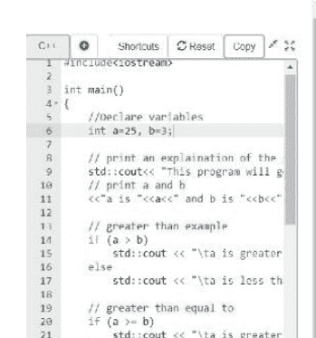

### 关系运算程序

此截图是关系运算程序的成功运行结果，显示了所有的关系函数。

如果你没有得到类似的结果，请查看我们的代码：https://ide.geeksforgeeks.org/dFD3cEk85y。通过对比并找出你错在哪里。像这样的练习将使你具备调试技能。

此外，请花时间欣赏并理解代码。

### 逻辑运算符

逻辑运算符为关系运算符增加了更多复杂性。这些可以类比人类的“与”（and）或“或”（or）。它们还具有改变关系运算符含义的特性。**逻辑运算符**与关系运算符结合使用，组合两个或多个条件来描述一种约束。它们让我们在条件判断中捕捉更多信息并执行更多操作。共有三种逻辑运算符（Jaggi, 2015b）：

- `&&`：逻辑“与”运算符在两个条件都满足时返回布尔值 `true`，如果不满足则返回 `false`。
- `||`：逻辑“或”运算符在一个（或两个）条件满足时返回布尔值 `true`，如果一个都不满足则返回 `false`。
- `!`：逻辑“非”运算符在考虑的条件不满足时不返回布尔值 `true`。如果其中一个条件为 `true`，则返回布尔值 `false`。

逻辑运算符在机器中使用非常频繁。想象银行安全系统中的“非”运算符。假设锁上的门是“0”[false]，未未锁的门是“1”。因为银行应该保持安全，我们的默认值是“0”。这被称为故障关闭型系统，因为如果出现问题，门将关闭（默认状态）。所有发往门的信号都由一个“非”信号控制：如果没有发生什么，门应该保持锁闭状态；如果发生抢劫，它们也应该保持锁闭状态。抢劫期间打开的门将接收到“非”信号以执行故障关闭。但在火灾期间，这些门应该打开，因此故障关闭的“非”信号将返回 `true` 以打开门。

让我们通过构建一个逻辑程序来探索逻辑运算符。遵循以下指令：

1. 使用此 URL 打开并编辑关系程序：https://ide.geeksforgeeks.org/fD3cEk85y
2. 修改这些额外变量来测试逻辑运算符：`a = 5, b = 0, c = 12, d = 24`
3. 打印程序的说明。
4. 测试 `if(a > b && c == d)` 并打印结果：
   a. 创建 `if` 语句，在大于时打印结果。
   b. 创建嵌套的 `else` 语句，在为假时打印结果。
5. 测试 `(a > b || c == d)` 并打印结果。
6. 测试 `(!b)` 并打印结果。
7. 清理代码中任何不必要的行。

它看起来是：

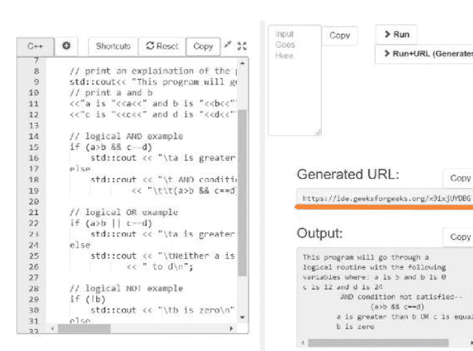

### 逻辑运算程序

此截图是逻辑运算程序的成功运行结果，显示了所有逻辑运算符的示例。你可以通过此 URL 访问：https://ide.geeksforgeeks.org/dD3cEk85y

正如你所看到的，“与”函数可能增加 `else` 语句的复杂性。虽然 `if()` 可以在没有 `else` 语句的情况下执行，但如果条件为 `false`，缺少 `else` 语句会导致错误。`else` 语句无法在没有 `if()` 语句的情况下实现。我们将在后面的章节中详细描述。你可以通过此 URL 检查你的工作：https://ide.geeksforgeeks.org/nh8yV9K

让我们暂时放下例程序，去探索我们如何使用逻辑运算符。逻辑运算符基于机器逻辑。逻辑运算符基于机器逻辑。逻辑运算符基于机器逻辑。逻辑运算符基于机器逻辑。逻辑运算符基于机器逻辑。逻辑运算符基于机器逻辑。逻辑运算符基于机器逻辑。这非常有用，因为我们可以为程序提供更多指令。

### 短路

让我们使用这个来编写一个告知何时 AND 短路的程序。遵循以下指令：

1. 打开一个新的 IDE 工作区。
2. 声明两个 `int` 变量：`a = 10, b = 4`。
3. 打印程序的说明：
   a. 此程序将测试当 `a` 等于 `b` 时的 OR 或 AND。
   b. 打印 `a` 和 `b` 的当前值。
4. 声明并计算两个 `bool` 变量：
5. `resAND = (a == b) && std::cout << "OR shorted"`
6. `resOR = (a == b) || std::cout << "AND circuited"`

它看起来是这样的：

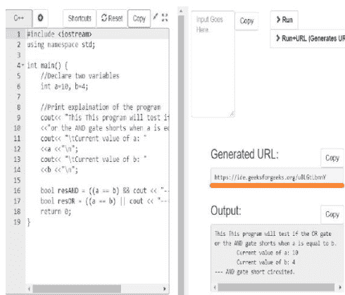

### 短路检测程序

此截图是我们短路检测程序的成功运行。利用逻辑 AND、逻辑 OR 以及它们之间关系的知识，我们开发了一种检测短路的方法。你可以通过 URL 访问此工作空间：https://ide.geeksforgeeks.org/uBLGbnn

尝试不同的 `a` 和 `b` 的值，看看是否可以触发不同的“电路”。

考虑一个短路检测程序。我们在现实世界中如何使用它？我曾提到过此类系统在银行安全中起着作用。问题是它如何实现这些功能的？你可以告诉程序，如果条件不满足（“非”），则拒绝访问，比如密码不匹配。

对逻辑运算符的理解让我们了解了机器和系统是如何做出决策的。关系运算符和逻辑运算符让我们更好地控制程序中发生的情况以及它与周围环境的关系。我们通过各种库、语句和对象来实现。到目前为止我们编写的是小型程序，但在较大的程序中使用此类对象可能会给编译器带来开销。这在编程环境以及游戏引擎、内容交付等行业会有显著影响。想象 YouTube 的服务器必须传输数千字节每秒处理的数据以及需要实时渲染的游戏引擎：它们必须在利用这些控制特性的同时减少开销。坦率地说，这可以通过使用位运算符来实现。

## 位运算符

在电路层面，机器通过使用 AND（与）门和 OR（或）门进行通信。这使它们在单个比特位上具有了决策能力。位运算符利用这些微观层面的计算在机器层面访问计算过程，从而绕过对象编程。换句话说，它们是在二进制层级对数字操作的逻辑运算符。

要使用它们，你需要了解二进制。人类使用十进制（也称为十位制）来概念化数字。例如，像 `543` 这样的数字被理解为 5 百、3 十和 4 个个位。在十进制中，它看起来是这样的：

```
5 * 10² + 3 * 10¹ + 4 * 10⁰ = 534
```

在二进制中，同一个数字看起来像 `0b1000010110` —— “0b”只是为了让我们人类理解这是一个二进制数。二进制数是二制的，只是看起来不同。所有二进制数都呈现为比特流，可以处于两种状态：1 或 0。就像十进制一样，数字的位置决定了它的值。534 的示例显示了一个长度为 10 位的二进制数。仔细观察 534 的比特流，我们可以看到第 2、第 3、第 4 和第 10 位比特是开启的（从右向左），所有其他比特都是关闭的（1 为开启，0 为关闭）。在二进制中，我们这样计算：

```
2^9 + 2^4 + 2^2 + 2^1 = 534
```

对我们人类来说，计算它并不容易，但这就是计算机通信的方式，通过数据比特流进行。它们识别和计数这些数字非常熟练，就像人类处理十进制数字一样容易。因此，使用在计算机自然层面运行的位运算符可以提高速度和性能（Killian, 2012），因为它跳过了从对象编程到机器语言的翻译。这就是为什么你会发现位运算经常用于竞争性编程。以下是 C++ 位运算符的列表（《c/c++ 中的位运算符》，2014）：

- `|` 位与（Bitwise AND）接收两个数字（操作数），并在数字流中的每个比特上运行 AND 运算。如果两者都为 1，则 AND 流的结果为 1。
- `|` 位或（Bitwise OR）接收两个数字（操作数），并在数字流中的每个比特上运行 OR 运算。如果两者中任一为 1，则 OR 流的结果为 1。
- `^` 位异或（Bitwise XOR）接收两个数字作为操作数，并在两个数字流的每个比特上执行异或运算。如果两个比特不同，则异或结果流的结果为 1。


- `<<` 左移运算符接收两个数字，并将第一个操作数的比特向左移动。第二个操作数用于确定移动的位数。
- `>>` 右移运算符接收两个数字，并将第一个操作数的比特向右移动。
- `~` 位取反（Bitwise Not）运算符接收一个数字并切换所有比特的状态（1变0，0变1）。

注意：机器使用寄存器和缓冲区来存储用于计算的比特。寄存器只是一个存储数组，每个比特在数组中都有自己的位置。如果你将这些数据流看作一个数组，将帮助你理解许多位运算符，特别是移位运算符。

让我们写一个位运算程序。首先，我们需要创建一个位寄存器并研究比特流。这需要 `<bitset>` 库中的`bitset<x>()`函数。它允许你打印长度为`<x>`的二进制流。按照指令操作：

1. 打开一个新的 IDE c++ 工作空间
2. 除了`<iostream>`，务必也调用`<bitset>`库
3. 声明操作数变量及其值：

```
unsigned int a = 60; // 00111100
unsigned int b = 13; // 00001101
```

4. 为计算声明寄存器 c：

```
int c = 0;
```

5. 打印操作数值及其寄存器：

```
cout << "Operand a: " << a << " and b: " << b;
cout << "\nregistera: 0b" << bitset<8>(a);
cout << "\nregisterb: 0b" << bitset<8>(b) << endl;
```

**注意：** 由于所有数字都小于255，我们将在整个练习中使用长度为`<8>`的比特流。

6. 在寄存器 c 中计算 a 和 b 的位与运算：

```
c = a & b; // 00000100
```

7. 打印操作数值及其寄存器...
8. 在寄存器 c 中计算 a 和 b 的位或运算：`c = a | b; // 00111101`
9. 打印结果和寄存器：
10. 计算 a 和 b 的位异或运算：`c = a ^ b; // 00111001`
11. 打印结果和寄存器：
12. 计算 a 的位取反：`c = ~a; // 11000011`
13. 打印结果和寄存器：
14. 打印 a 的寄存器比较：
15. 计算 a 的左移运算：`c = a << 2; // 11110000`
16. 打印结果和寄存器：
17. 计算 a 的右移运算：`c = a >> 2; // 00011111`
18. 打印结果和寄存器：

### 带有寄存器打印的位运算

此截图是位运算程序的成功运行。输出显示了寄存器的直观视图。这将允许你看到位运算是如何计算的以及它是如何改变寄存器的。这是一个输出较长的程序。为了完整学习，可以通过此 URL 访问我们的保存工作空间：https://ide.geeksforgeorg/JgnAlVwo

## 注意

此程序使用了命名空间`std`来简化程序。良好的做法是省略命名空间并单独声明`cout`和位对象。

我们将讨论的最后二进制运算符是赋值运算符。赋值运算符用于赋值值和动态更改值。在编程原理中，我们讨论过程序需要尽可能高效且指令尽可能。高级赋值运算符结合等赋值和各种操作来减少代码行。它们都是原子操作，意味着它们允许操作变量中存储的值并重新赋值。以下是常见的赋值运算符列表（Prabhu, 2018）：

- `=` 等赋值运算符将值分配给左侧变量。
- `+=` 原子加法运算符，用于结合`+`和`=`运算符。该运算符将左侧变量的值加上右侧的值，然后将结果保存到左侧变量。例如，`x += y`是`x = x + y`的更短写法，无需使用单独的算术运算符。
- `-=` 原子减法运算符，用于结合`-`和`=`运算符。该运算符从右侧的值减去左侧变量的值，然后将结果保存到左侧变量。
- `*=` 原子乘法运算符，用于结合`*`和`=`运算符。该运算符将左侧变量的值乘以右侧的值并将结果保存到左侧变量。
- `/=` 原子除法运算符是`/`和`=`运算符的组合。该运算符将左侧的值除以右侧的值，并将结果保存到左侧变量。例如，`x /= y`是`x = x/y`的更短写法，无需使用单独的算术运算符。

按照以下步骤操作：

1. 打开一个新的 IDE 工作空间
2. 声明并初始化我们的变量

```
int a = 10;
```

3. 打印程序的说明和初始值

**注意：** 在编写打印内容的程序时，务必让它们易于阅读！确保你的程序能够自我解释。

4. 原子性加 10 并打印结果
5. 从我们的变量中原子性减去 10 并打印结果
6. 原子性乘以 10 并打印结果
7. 将我们的变量原子性除以 10 并打印结果

显示如下：

```cpp
#include <iostream>
using namespace std;

int main() {
    // 将值10 赋值给 a
    // 使用 = 运算符
    int a=10;
    cout<<"this program will atomically multiply a";
    cout<<"value of a is "<<a;

    // 通过给 a 增加 10 来赋值
    // 使用 += 运算符
    a += 10;
    cout<<"Atomically +10: value of a is "<<a;

    // 通过从 a 减去 10 来赋值
    // 使用 -= 运算符
    a -= 10;
    cout<<"Atomically -10: value of a is "<<a;

    // 通过将 a 乘以 10 来赋值
    // 使用 *= 运算符
    a *= 10;
    cout<<"Atomically *10: value of a is "<<a;

    return 0;
}
```

### 赋值程序 (Assignment Routine)

此截图是我们的赋值程序的成功运行结果。该程序具有顺序输出，这意味着每条指令都会影响下一条指令的结果。这意味着，如果我们更改应用于`a`上的原子操作顺序，输出将会不同。为了充分研究，您可以使用以下链接在我们的保存的工作空间中访问：https://ide.geeksforgeeks.org/Fbc63b0u1E

这些二元赋值运算符将赋值和算术功能结合。它们在控制循环和条件语句时也运行良好。原子赋值运算符与一元算术运算符密切相关。两者都经常用于控制循环。让我们来看一元操作。

### 一元操作 (Unary operations)

在讨论一元操作之前，让我们看看使用这些操作的代码。

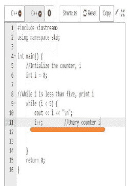

### 带有一元运算符的 While 循环

此截图是一个简单的 while 循环，它打印计数器 i 的值。一元操作在每次迭代中执行`i= 1 + i`，直到`i = 5` while 循环结束。省略`i++`将导致错误，因为 while 循环无法推进。我们将在决策章节详细讨论循环。为了充分研究，您可以使用此 URL 在我们的保存的工作空间中访问：https://ide.geeksforgeeks.org/MgMpb

`i = 1 + i`等同于`i++`。使用一元形式使代码更简洁，因为它排除了`+`算术运算符和`=`赋值运算符。我们也可以使用原子加法运算符来完成代码：`i+=1`等同于`i++`。但那种格式需要编译器存储并操作额外的操作数。一元运算符的作用是通过仅有一个操作数来简化代码。记住，一元运算符是使用一个操作数的运算符。这里是一元运算符的其他一些示例（Kumar, 2017）：

- `++`: 递增运算符，用于将整数的值增加1。它可以放在变量前面以立即增加值，或者在递增之前临时保存值。
- `--`: 递减运算符，用于将整数的值减少1。与递增类似，程序员也可以实现前递减和递减指令。
- `-`: 一元负运算符，用于更改变量或参数的符号。对负整数执行一元负操作将使其变为正数，反之亦然。
- `!`: 非（NOT）运算符用于反转操作数的布尔逻辑状态。例如，如果变量`x`的布尔值为 false，则`x`将变为 true。
- `&`: 地址运算符，用于指向变量的地址。

让我们编写一个一元运算符程序，看看前置和后置指令是如何工作的。遵循以下指令：

1. 打开一个新的 IDE 工作空间
2. 声明并初始化我们的变量和一个缓冲区

```
int a = 10, buf
```

3. 打印程序的说明和初始值
4. 计算一个等于缓冲区的后递增并打印结果
5. 计算一个等于缓冲区的后递减并打印结果
6. 计算一个等于缓冲区的前递增并打印结果
7. 计算一个等于缓冲区的前递减并打印结果

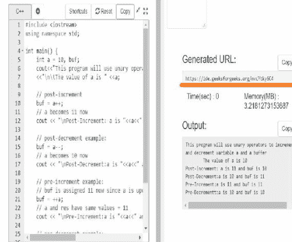

### 带有后置和前置操作的一元程序

此截图是我们的一元程序。为了充分研究，您可以使用此 URL 在我们的保存的工作空间中访问：https://ide.geeksforgeeks.org/mvcYtky6c4

程序对`a`进行操作，并在计算时，将值存储在我们可以观察的缓冲区中。通过比较`a`和缓冲区，后置操作延迟更改`a`的值；相比之下，前置操作立即更改值。

除此之外，我们还有`sizeof()`运算符。它看起来像一个函数，但被归类为运算符。它检查对象的大小并返回以字节为单位的大小。

回想我们关于位流的对话。我没说的是它们通常被分为 8 位一组。一个字节是一个单的 8 位流，可以表示 255 个数字。在我们的位运算程序中，我们的寄存器处理的是小于 255 的数字。

让我们写一个使用`sizeof()`获取数组大小的程序。开始吧：

1. 打开一个新的 c++ IDE 工作空间
2. 声明并初始化我们的数组

```cpp
intarr1[] = {1,2,3,4,7,9,8,0,12,35,99,14 }
```

3. 打印程序的说明和 nt 数组

**注意：** 要打印数组，你必须创建一个 for 循环。现在，只需使用这些代码行：

```cpp
for(const e:arr){
    cout << e << "";
}
```

4. 计算数组的大小

```
intsize = sizeof(arr[0])
```

5. 打印数组的大小

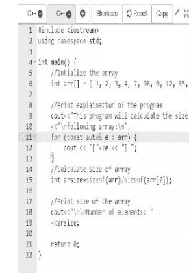

### 数组大小程序

此截图是我们的数组大小程序。我们鼓励您将结果与我们的进行比较。为了充分研究，您可以使用此 URL 在我们的保存的工作空间中访问：https://ide.geeksforgeeks.org/HwpcLY4

那是两个元操作的一个很好的示例：`sizeof()`和地址指针。构造函数调用由一个带有索引变量的 for 循环、一个地址运算符和一个索引对象的组成。构造函数通过使用地址指针自动推断`arr`的大小并打印其内容。简单来说，构造函数使用地址来减小程序体积。

让我们来编写一个程序来演示这些相似之处：

1. 打开一个新的 IDE C++ 工作空间
2. 使用`<stdc++.h>`库中的条件运算符
3. 打印条件运算符的解释

此程序将使用两种方法选取最大值：条件运算符和`if().else`语句。

我们预期结果为 5。

4. 声明变量并执行条件运算符

```
int arrsize=sizeof(arr[0]);
```

5. 打印`if().else`的解释

```
if(2 > 5) 则打印 2
else 则打印 5
```

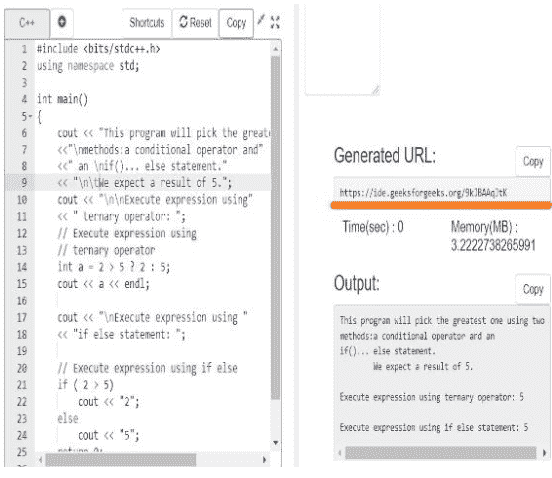

### 条件操作演示

这张截图是我们条件操作演示的界面。这个程序没有实际的实用功能。但是，为了我们的目的，它确实演示了条件运算符和`if...else`语句之间相似的结构。为了充分学习，建议您通过此 URL 访问我们保存的工作空间副本：https://ide.geeksforgeeks.org/9kJBAAqKt

在本章中，我们查看了3 类型的运算符：一元、二元和三元。正如您看到的，这些运算符允许程序员应用 c++ 的强大特性。例如，二元运算符允许机器通过更改函数做出逻辑决策、计算值并控制过程。一元函数帮助我们缩小并简化复杂的代码。三元运算符允许我们的代码更加简洁。它们都是 c++ 中决策和切换的核心。

# 第 5 章：c++ 中的决策

我们将讨论决策函数；这些是类似于`if-else`循环的函数。编程很大程度上依赖于决策，而决策是由我们在第 4 章中看到的涉及运算符的逻辑表达式提供的。决策函数结合逻辑表达式，使机器能够根据程序员选择的标准做出决策的能力。

在第 4 章的`sizeof()`练习中，我们在拷贝构造函数中使用`for()`循环，该循环处理了数组并打印了所有索引。一元运算符`Addressof`配合`auto`数据类型允许我们实现`for()`循环，而无需为循环添加额外的计数器。如果你从未有过自己初始化和实现循环的经验，拷贝构造函数的简单性就不那么明显了。

## 循环

程序员花费大量时间通过脚本和例程将枯燥、重复的任务自动化。是什么让脚本和例程实现了循环呢？正如名称所示，只要满足特定条件，循环就会重复相同的指令（"c++ While Loop," n.d.）。循环通常用于通过索引（如数组和向量）来遍历聚合对象。例如，你可能会编写一个循环，不断搜索数组，直到找到特定项目为止。循环有两种类型：入口控制循环和出口控制循环。

在我们的一元算术示例中，我们有一个带有计数器的`while()`循环。计数器是一个任意变量，与一元运算符配合用于递增指定的表达式。它是入口控制循环的一个示例——它在执行代码之前会测试条件。让我们将该示例修改为`while()`循环以探索它的组件。我们将使用它来打印 10 次 "Hello World"。按照以下指令操作：

1. 打开以下 IDE C++ 工作空间：https://ide.geeksforgeeks.org/MGUtZdlpb
2. 打印程序的解释

此程序将对编号并打印 10 行--

3. 将条件测试更改为`i < 11`
4. 带有行号地打印 10 次 "Hello World"

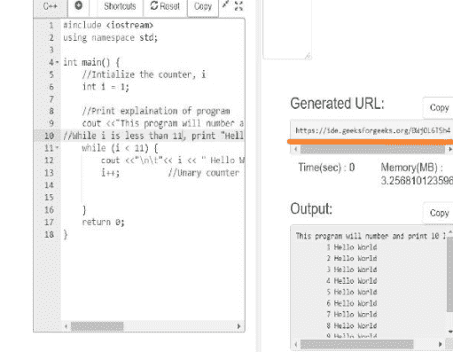

### While Loop演示

这张截图是我们 while循环演示的界面。您可以使用此 URL 访问我们保存的工作空间副本：https://ide.geeksforgeeks.org/0WjoL6TSh4。

此程序展示了增量计数器是如何工作的。为了使其工作，数字必须从 1 开始而不是 0。大多数人习惯数字那样工作。为了做到这一点，我们将计数器初始化为 1。然而，如果我们设置条件为10，它将给我们 9 次输出。要得到 10 次，我们必须将数字增加到 11。

控制循环的另一个示例是`for`循环函数；它需要三个表达式作为输入（Agarwal, 2017a）：

- 一个声明数据类型和变量的初始化表达式。该变量可以是计数器也可以是索引变量。
- 一个产生布尔值真或否的测试表达式。如果条件为真，则`for`循环将继续循环其指定的代码块。
- 一个递增计数器或索引变量的更新表达式

让我们通过编写一个类似于`while()`循环示例的程序来查看它们是如何工作的。按照以下指令操作：

1. 打开以下 IDE c++ 工作空间：https://ide.geeksforgeeks.org/0WjoL6TSh4
2. 打印程序的解释
3. 此程序将对编号并打印 10 行 Hello World
4. 实现`for()`循环

```
for(int i = 1; i < 11; i++)
```

5. 带有行号地打印 10 次 "Hello World"
6. 清理任何不需要的代码和注释


### For Loop 演示

这张截图是我们 for 循环演示的界面。您可以使用此 URL 访问我们保存的工作空间副本：https://ide.geeksforgeeks.org/0WjoL6TSh4。

此程序展示了增量计数器是如何工作的。为了使其工作，数字必须从 1 开始而不是 0。大多数人习惯数字那样工作。为了做到这一点，我们将计数器初始化为 1。然而，如果我们设置条件为10，它将给我们 9 次输出。要得到 10 次，我们必须将数字增加到 11。

控制循环的另一个示例是`for`循环函数；它需要三个表达式作为输入（Agarwal, 2017a）：

- 一个声明数据类型和变量的初始化表达式。该变量可以是计数器也可以是索引变量。
- 一个产生布尔值真或否的测试表达式。如果条件为真，则`for`循环将继续循环其指定的代码块。
- 一个递增计数器或索引变量的更新表达式

让我们通过编写一个类似于`while()`循环示例的程序来查看它们是如何工作的。按照以下指令操作：

1. 打开以下 IDE c++ 工作空间：https://ide.geeksforgeeks.org/MGUtZdlpb
2. 打印程序的解释
3. 此程序将对编号并打印 10 行 Hello World
4. 实现`for()`循环

```
for(int i = 1; i < 11; i++)
```

5. 带有行号地打印 10 次 "Hello World"
6. 清理任何不需要的代码和注释

（注：由于原始文本存在大量重复，此处翻译已根据核心逻辑内容进行了去重整合）

到目前为止，我们在示例中使用了`if().else`函数。它们易于理解，且结构非常直观易懂。`if().else`语句测试一个条件，并根据结果执行其中一个代码块或另一个。它们是两个独立的不同语句的组合。


你可以单独执行`if()`函数，但编译器期望一个`else`语句。`else`语句包含与`if()`表达式相伴的代码。没有`if()`语句，`else`语句永远无法被执行。

`else if()`语句指定了另一个要测试的条件。它创建了一个被称为嵌套`if-else`的语句链。如果你正在测试很多条件，最好使用`switch`，我们将在下一节讨论。让我们编写第一个嵌套`if-else`语句。遵循这些指令（“c++ | 嵌套三元运算符，” 2018）：

1. 打开一个新的 IDE C++ 工作空间
2. 打印条件运算符的说明

此程序将顺序遍历 2 到 4 的数字列表，并使用嵌套的`if().else`语句选择最大的一个。

我们预期结果为 4。

## 实现嵌套 if-else

```cpp
if(2 > 3) then print 2
else(3 > 4) then print 3
else print 4
```

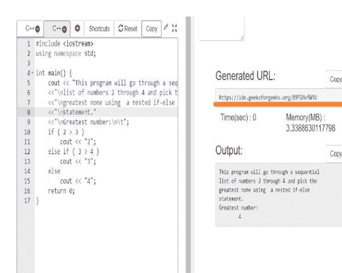

### 嵌套 If-Else 演示

此截图是我们的嵌套 if-else 演示。与我们的演示一样，这个程序没有实际功能。但对于我们的目的来说，这是实现理解`if()....else`语句的极佳练习。尽管我们已经知道了答案，`if().else`仍然为每个语句需要代码块。代码块也应该对应于条件，以便创建一个满足其声明目的的功能性程序。你可以通过此 URL 访问我们保存的工作空间的副本：https://ide.geeksforgeeks.org/89MlNvrWYUY。

让我们进一步研究该练习。嵌套`if-else`可以分为两部分：包含条件和执行代码的`if()`和`else if()`语句。你会发现代码块在逻辑上遵循程序的状态目标，这在我们更改条件语句时，按升序打印数字是有意义的。`if()`语句内部的条件及其包含的代码块的排列方式允许程序流向答案。例如，`if (2 > 3)`被硬编码到下一个嵌套语句。该结构刻意遵循了嵌套条件运算符。

### 嵌套三元 If If Else 运算符

在上一章中，我们讨论了条件运算符，即测试条件并根据结果执行表达式的三元运算符。我们说它所使用的结构类似于`if().else`语句，但更简洁。例如，`if()`语句测试一个条件，并根据测试结果执行两个代码块之一。`if()....else`语句可以嵌套，条件运算符也可以嵌套。让我们比较一下两者的结构。遵循以下步骤参与（“c++ | 嵌套三元运算符，” 2018）：

1. 如果你已经关闭了嵌套 if-else 演示，请通过此 URL 打开保存的 IDE C++ 工作空间以及我们的程序：https://ide.geeksforgeeks.org/89M1NvRWYU
2. 打印程序的说明

1. 此程序将通过两种方法顺序遍历 2 到 4 的数字列表并选择最大的一个：条件运算符和嵌套`if()....else`语句
2. 我们预期结果为 4。

3. 添加一个嵌套 if-else 的打印通知
4. 打印条件语句的通知
5. 添加条件运算符代码：声明变量并执行条件运算符

```cpp
int a = 2 > 3 ? 2 : 3 > 4 ? 3 : 4;
```

6. 清理代码中任何不必要的行并修正任何注释

```cpp
#include <iostream>
using namespace std;

int main() {
    cout << "This program will go through a sequence\n";
    cout << "list of numbers 2 through 4 and pick\n";
    cout << "greatest number using two methods:\n";
    cout << "Nested if-else and a nested ternary operator\n\tNested if-else Greatest number:\n\t";
    if (2 > 3) {
        cout << "2";
    } else if (3 < 4) {
        cout << "3";
    }

    else
    cout << "Nested ternary operator Greatest\n";
    int a = 2 > 3 ? 2 : 3 > 4 ? 3 : 4;
    cout << a;
    return 0;
}
```

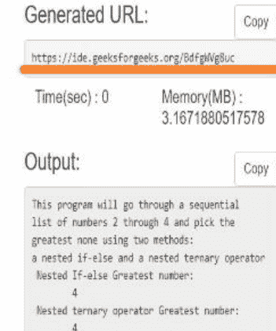

### 嵌套三元 If Else 运算符

此截图是我们的嵌套 if-else 演示。通过实现三元运算符，我们修改了 if-else 演示。你可以通过此 URL 访问我们保存的工作空间的副本：https://ide.geeksforgeeks.org/Bdfg。

让我们进一步研究该练习。嵌套 if-else 可以分为两部分：包含条件和执行代码的`if()`和`else if()`语句。你会发现代码块在逻辑上遵循程序的状态目标，这在我们更改条件语句时，按升序打印数字是有意义的。`if()`语句内部的条件及其包含的代码块的排列方式允许程序流向答案。例如，`if (2 > 3)`被硬编码到下一个嵌套语句。该结构刻意遵循了嵌套条件运算符。

## Switch

正如我所说，程序员需要追求高效、易懂的代码。使用`switch`替代`if().else`是实现这一点的方法，特别是当我们在处理多个表达式时。switch 语句提供了一种根据变量执行不同代码块的简洁方法。其语法如下：

```cpp
switch(n)
{
  case 1:
    expression = 1;
    break;
  case 2:
    expression = 2;
    break;
  default:
    expression = any;
}
```

**注意：** switch 只能评估整数。要添加条件组件，你必须更改操作更改。运算符必须产生整数。

让我们创建一个 switch 演示来练习 switch 的组件：

1. 打开一个新的 IDE C++ 工作空间
2. 初始化变量

```cpp
int x = 2;
```

3. 打印程序的说明
4. 初始化 switch
5. 为 case 1 打印“choice is 1”
6. 为 case 2 打印“choice is 2”
7. 为 case 3 打印“choice is 3”
8. 为 default 打印“Program Exit”

```cpp
#include <iostream>
using namespace std;

int main() {
    //Initialize variable
int x = 2;

    //Print explanation
    cout << "This program prints choice: " << x << endl;
    cout << "x is equal to: " << x << endl;
    //Program switch
    switch (x) {
        case 1:
            cout << "Choice is 1";
            break;
        case 2:
            cout << "Choice is 2";
            break;
        case 3:
            cout << "Choice is 3";
            break;
    }
    return 0;
}
```

### Switch 演示

这是我们的 switch 演示的截图。你可以通过此 URL 访问我们保存的工作空间的副本：https://ide.geeksforgeeks.org/dSehFXULzz5。我们强烈建议使用此演示将我们之前的练习之一转换为 switch。一个极佳的候选是我们的关系例程序。它有

`if()... else`语句！这会导致 12 种不同的场景。你如何将此程序转换为`switch`？提示：考虑使用`input`函数为每个关系例程创建一个菜单。你可以在此 URL 自己学习关系例程：https://ide.geeksforgeeks.org/dFD3cEk85y。

现在我们已经了解了决策函数是什么以及它们是如何工作的，让我们关注函数及其在编程中的作用吧。

# 第 6 章：创建函数

我们讨论过算法作为一种理解问题和规划代码如何工作以解决问题的方法。算法接收输入，执行操作，然后给出结果，结果导致状态改变。函数是一个你可以多次调用的代码块，而无需重新编写代码。代码通常是执行某个所需任务并具有高重用性的。函数由函数头和函数体组成。以下是函数的语法结构：

```cpp
[datatype]function_name(arguments) {
//statements
return 0;
}
```

正如你所看到的，正如许多其他编程语言一样，C++ 基本上是一系列函数、语句和操作符，中间穿插着对象和其他数据存储元素。我们到目前为止写的所有内容都使用了`main()`函数，其语法与上面类似。因此，函数对你来说并不陌生。

每个函数必须返回一个数据类型，就像`main()`函数返回`int 0`一样。如果函数没有这样做，则使用`(void)`作为返回类型。正如你可能猜到的，`return`是结束函数的语句。

函数接收的输入称为参数（parameters）或实（arguments）。并不是所有函数都会接受输入，正如我们在`main()`中看到的；尽管如此，你仍然可以将参数传递给函数使其运行。这就是库将对象传递给`main()`的。

## 创建并调用函数

要开始调用函数，你必须在`main()`之前对其进行声明和定义。这是因为 C++ 是顺序执行的。C++ 练习遵循声明优先原则，函数具有高优先级。这就是为什么你必须在`main()`之前声明它们，以便你可以调用它们。它们也被这样称为，因为一旦声明了函数，我们可以在`main()`之外任何地方定义它。

让我们写一个简单的打印函数以便我们理解它们。请遵循以下指令：

1. 打开一个新的 IDE C++ 工作空间
2. 声明你的函数`void myFunction();`
3. 在`main`中调用你的函数`myFunction();`
4. 在`main`之外定义你的函数

```cpp
{
cout << "executed!";
}
```

### 函数演示

此截图是我们的函数演示。可以使用此 URL 访问我们保存的工作空间的副本：https://ide.geeksforgeeks.org/... 如果你想进行更多练习，我们建议使用此练习作为模板，将我们过去的某个练习转换为函数！将声明和定义分离属于良好的编程实践。这让你很容易知道代码中所有可调用的已定义函数。现在让我们关注参数传递。

函数被交给编译器。为了完成任务并发挥作用，这些函数需要输入。提醒你一下，这些输入称为实（arguments）或参（parameters）。程序员根据参数的来源或出现的位置来描述参数。例如，如果你有一个名为`sum(x,y)`的求和函数，当`main()`将 2 和 3 传递给函数时，`x`和`y`就是实参。参数传递给函数有两种方法：

- **按值传递（Pass by Value）：** 实参的值被复制并存储在函数的形参中。`main()`内部的任何更改都不会影响实参。
- **按引用传递（Pass by Reference）：** 实参和形参都指向同一个位置。因此，`main()`内部的任何更改都会影响实参。

让我们通过编写自己的函数来练习参数传递。请遵循以下指令：

1. 打开一个新的 IDE C++ 工作空间
2. 声明你的函数`int max(int x, int y)`
3. 在`main`中调用你的函数
4. 初始化两个实变量`a = 10, b = 20;`
5. 初始化一个变量并调用函数`int m = max(a, b);`
6. 打印结果
7. 结束 main()
8. 在`main`之外定义你的函数

i. 此函数应使用`if`语句检查`x`是否大于`y`。
ii. 如果`x`大于`y`，则返回`x`
iii. 否则，返回`y`。

### 带有参数传递的函数

此截图是我们的函数演示。可以使用此 URL 访问我们保存的工作空间的副本：https://ide.geeksforgeeks.org/... 如果你想进行更多练习，我们建议使用此练习作为模板，将我们过去的某个练习转换为函数！考虑我们使用传递参数传递给它的练习。

在我们的示例中，用于`main`的变量`(a,b)`与用于`max(x, y)`的变量位于不同的位置。传递值是更优的，因为这确保了实变量在调用函数之前保持不变。使用引用传递参数有其自己的优势，特别是在较大的程序中。重复且快速发生的自动化过程利用了这些特性进行基于引用的结构。现在让我们关注代码的压缩和优化。

### 函数重载

所有定义的对象和类必须有唯一的名称。你不能运行具有两个相同变量的程序，否则将抛出错误。你可能在之前处理例程和演示时已经见过这种情况。所以请记住：声明两次的变量会导致错误。但奇怪的是，只要参数不同，多个函数可以与其他函数具有相同的名称。这在函数返回不同数据类型的情况下是允许的。因此，重载函数以返回多个数据类型是更好的。这就是函数重载；程序员组合函数以接收多个数据类型的过程。为什么？因为它简化并合并了代码。看以下代码：

```cpp
#include <iostream>
using namespace std;

int plus(int x, int y) {
    return x + y;
}

double plus(double x, double y) {
    return x + y;
}

int main() {
    int myint = plus(5, 3);
    double mydouble = plus(5.3, 6.26);
    cout << "int: " << myint << "\n";
    cout << "double: " << mydouble << "\n";
    return 0;
}
```

### 没有函数重载的程序

可以使用 URL 访问我们保存的工作空间的副本：https://ide.geeksforgeeks.org/qkpHHzZqq5。函数在文件的顶部声明并定义，以便我们更好地观察它们。你将使用此文件进行函数重载。记住，如果在编辑期间代码受损，你可以随时返回此工作空间。

上面的程序声明了两个执行相似计算的函数。在大型程序中，这浪费空间且效率低下。

这使得编辑代码变得困难，因为在较大的程序中，这两个函数不太位于同一个地方。为了提高效率，我们应该将这些函数合并到一个名称下，并“堆叠”数据类型。以下是你可以的方法：

1. 打开以下 URL 中保存的 IDE 工作空间
2. 将`double plusFunc...`改为`double plus...`
3. 在`double plus...`的位置调用`double plusFunc...`

## 程序函数重载

你可以使用此 URL 访问我们保存的工作空间的副本：https://ide.geeksforgeeks.org/e1qLzi3aGo。我们将函数保留在文件的顶部以便于编辑。此重载练习需要进行一些细微的调整才能使此文件正常工作。如果你遇到任何持久性错误，可以使用我们的工作空间来对比你的文件。请记住，如果在编辑过程中代码被损坏，你可以随时返回原始工作空间。你可以在此 URL 访问原始工作空间：https://ide.geeksforgeeks.org/qkpHhZsqq5。

当你合并相似的函数时，你就清理了代码。这很重要，尤其是当你需要调试代码时，因为当发生错误时编译器可能会指向函数。在 C++ 代码中，当编译器指向多个库时，这种情况会发生。通过合并和重载函数可以确保编译器有更少的函数可以引用，从而使你更容易调试。请记住，C++ 正在不断更新，这使得工作变得更加容易。新功能不断被添加，库不断被压缩和进一步组织。因此，C++7 中的错误看起来与 C++14 中的错误不同。更新带来了执行平凡任务的新、简单方法。例如，拷贝构造函数的调用组合被认为是数组等容器索引更现代的方法。为了跟上更新并从新的 C++ 开发中获益，你必须不断练习、自我测试并提问。

# 结论

学习编程是一段认知之旅，是一段激发人心、令人兴奋且有时令人沮丧的旅程。当我们到达这本书的末尾时，回顾一下学到的某些重要课程是非常重要的。它们还将伴随着最后的思考和建议，旨在为你提供在这一领域继续成长所需的一切。

# 扩展你的实践：准备你的编码环境

我们使用了在线 IDE，以便每个人都有相同的体验。如果你想保存你的工作，可以使用 Run+URL 按钮将其保存到另一个 URL 中。你也可以使用你保存的 IDE 工作空间和书中列出的 URL 将这些内容加签，以备日后参考。将它们作为参考或修复损坏的代码。在我们所进行的所有练习中，我尽力向你展示了最佳编码实践。你已经看到在 C++ 中有许多方法实现某事，所以请利用这一点。不要害怕实验和尝试新事物，并阅读关于你感兴趣的其他事项的操作方法。书中的练习并不是标准答案，编程中不存在绝对的标准。所以请将这本书作为参考，并探索实现某事的其他方法。我们的代码位于本电子书的索引中，以便快速参考。

有很多编程环境和文本编辑器支持 C++。其中一些会有多个版本的 C++。在编写本文时，C++ 的最新版本是 17，但支持最好的是 C++14。C++14 是 C++ 的演进版本，它具有更易理解的语言特性。C++14 比其前身更符合人类习惯，你可以预计这种趋势将持续。大多数编程环境中旧旧且广泛使用的 C++ 版本是 C++11。


我鼓励你搭建一个本地 IDE 并在上面工作。它将让你成长得更快并适应现实场景。我们提到过适用于 Microsoft 的 `code::Blocks` 和适用于 Mac 的 `Xcode`。如果你有 Linux，可以在所有发行版中使用的标准选项。Linux 是一个基于控制台的环境，深受软件开发者的青睐，因为基于控制台的环境充满了许多与程序直接交互的内置功能。

许多发行版为许多用户提供了基于 GUI 的桌面。它们大多数是开源的，可以免费下载和安装。我们非常推荐 `CentOS`，一个免费的 Linux 服务器管理发行版。`CentOS` 使用了许多红帽企业 Linux (RHEL) 的组件。它是准备在红帽服务器管理环境中工作的最佳发行版。

# 编码最佳实践：学习的所有权与协作

在相处的时间里，我们看到了许多软件开发的技巧和最佳实践。在第一章中，我们讨论了程序如何用尽可能少的代码来完成任务。坦率地说，随着 C++ 的每个新版本的出现，增加了更多实现此点的方法。大多数初级编程课程教授了旧的、效率较低的方法来实现常见的编程任务，如解析数组、条件语句和调用函数。你会发现这些技术中的大部分在实际编程中从未被使用过。大多数初级课程侧重于让初学者牢固掌握基础——你的知识基础往往与你将如何进步同样重要。随着你的成长，你将发现用代码解决问题的更有效的方法，但这只有在你不断练习和学习时才会发生。

如果你想成为一名更好的程序员，你必须对自己的学习负责。学习开发前的工具，比如算法。这完全关乎学习如何解决问题。你还可以尝试其他开发前的工具，比如绘图。绘图对于视觉型学习者非常有帮助。所有这些对于成为一名程序员都是棒的；你选择哪一个并不重要，只要你利用了开发前的工具即可。

回到算法，更详细的算法将解释输入、输出和其他数据所需的各种数据类型。算法的优势在于你可以将其作为简写。你还可以对代码进行注释和管理。这些习惯将帮助你的代码对团队成员保持有序且连贯。所有这些实践将增强你看待和思考程序的方式。

软件开发者在团队中工作，几个人同时处理同一段代码。在这样的情况下，注释代码的重要性变得非常明显。

与他人共同工作也会加速你的成长。与他人一起编码时，你从他们的经验和知识中学习。正如我们所说的，C++ 拥有各种库对象、语句和其他工具。它就像人类语言中的词汇一样丰富，因为实现同样的事情有很多方法。你解决问题的方法取决于你发现高效方法的能力。但最终，所有的编程和软件开发都是创造性的活动。与他人合作将增加你的编程“词汇”——你从他们创造性地解决问题中学学习，并在过程中发现你自己的见解。你应该始终记住，每个人都可以贡献，而他们贡献的内容深受其经验程度的影响。所以，即使你是 C++ 新手，你仍然对解决问题有独特的经验和方法，这是其他人没有的，因为你的思考方式不同。这本身对任何团队都是价值的，特别是当你学会了很好地传达你的想法时。我强烈建议你将词汇表作为帮助你清晰交流的方式之一。

除了注释之外，将代码保持尽可能整洁也是一种良好的做法。我已经演示了如何对代码行进行注释以防止在编辑过程中破坏代码。在你的练习中，当代码损坏到无法修复时，你始终可以从我们保存的 IDE 重新开始，或者只需刷新浏览器重新开始（代码）。这取决于你运行和生成的状态（代码）。只有在你需要保存代码时，才生成 URL，而不是在开发期间。

我们还强调了代码结构的重要性。例如，我们讨论了函数声明和定义的重要性：最佳实践是在顶部声明函数，并在 `main()` 函数之后定义它们。这与声明整数类似。这些技术确保了你在开始时就有函数、变量和对象的清单。

格式化并删除代码中多余行可以减少开发过程中出现错误的可能性。当你进行更改时，应该始终更新你的注释。未格式化的代码不会影响性能，但代码的逻辑会。格式化代码是一种协作中的礼貌，更不用说这能让你的工作变得多么轻松：你团队中的其他程序员能够实现你的代码，甚至对其进行改进，并且他们会留下注释。

但这些实践不仅对你有好处。随着世界的发展，情况变得变得越来越复杂，因此让程序能够向用户解释自身是有益的。如果你的程序有输出，请确保它是易于阅读的。我们已经在书中看到了如何实现这一点。使用如 `\n` 等转义序列创建换行，使用 `\t` 创建水平制表，以便让你的代码有足够的空白区域。但作为一名与服务器和其他设备工作的后端程序员，你可能不需要像为客户端提供内容的前端程序员那样频繁地打印输出。唯一可能需要看到输出内容的用户是通过终端管理这些机器的其他技术人员和管理员。格式化实践在后端编程中往往未被充分利用，但仍然是一个良好的习惯。对于那些没有资源去研究程序员调试时常见的晦涩编译器生成错误的管理员和技术人员来说，这是非常有价值的。因此，经过格式化并在终端或控制台中清晰提供这些信息的程序是非常重要的。

## 核心收获：C++ 中的计算机科学概念

除了编程，我们还探索了一些基础的计算机科学概念。我们研究了机器及其语言的行为。我们讨论了学习编程如何像学习一种新语言：语法和规则确保了通信的可能性。C++ 是一种后端语言，用于管理控制海量数据的服务器。与 Python 等更具人性化的高级语言不同，C++ 要求程序员在代码中写得更详细。在函数中，每个变量必须是唯一的，否则将会出错。所有函数和语句都是大小敏感的，并有遵循它们的特定规则。我们实现了许多 `if...else` 语句，并制作了嵌套的 `if...else` 语句。我们看到像 `if()` 这样的条件语句可以在没有 `else` 的情况下执行，但如果条件为假，缺少 `else` 语句会导致错误。正如缺少动词表示句子不完整一样，没有 `if()` 就无法实现 `else` 语句。

我们看到了计算机如何使用逻辑数学通过二进制数进行通信。我们看到了位函数如何在位位上工作，完成像 AND（与）、OR（或）和 NOT（非）这样的逻辑数学计算。其他基于对象的 C++ 函数必须由编译器翻译成机器语言。但位函数更快，因为它们跳过了那一步直接与机器通信。它们通常被部署在竞争性编程中以制作高度敏捷的程序和例。在竞争性编程之外，位函数在管理大数据方面也有一些功能。

位函数的挑战在于它们是二进制的，人类非常难理解。为了看到计算机看到的内容，我们上了一个关于二进制和二进制数学的短期计算机科学课。我们用位程序创建了一个“字节级”的寄存器流，并创建了动态缓冲区来存储位运算的位。这些虚拟缓冲区和寄存器就是服务器管理 TB级数据的方式。想想：我们的缓冲区和寄存器长度都是一个字节，但一个 TB 比我们的缓冲区大 $10^{12}$ 倍：1,000,000,000,000 字节。对于 YouTube 这种基于 C++ 进行后端计算的网站来说，这些数字很小。YouTube 处理的数据是天文数字。

在 2018 年，数据量为 5.25 泽字节（$10^{21}$ 字节）。它服务了超过 350 亿小时的内容（“How much data does YouTube store? - Quora,” n.d.）。位函数赋予这些服务器在不中断或大规模延迟的情况下处理这种负载的能力。这是 C++ 力量及其处理复杂系统能力的最佳示例之一。它是程序员学习的一门有用语言。如果你将这些数据流可视化为具有 8 个槽位的数组，你将更容易理解许多位运算符，特别是移位运算符。

除了二进制编程外，我们还处理了不同类型的数据，并探索了对象编程的不同方面。我们做了很多处理字符串的练习，例如。事实上，我们在每一个练习中都使用并部署了字符串。我们看到字符串也是数据数组，可以像对象一样进行操作，但少数方式除外。字符串有长度、大小，并与 `<string>` 库中的各种对象配对。考虑任何类型、向量（vector）或数组的拷贝构造函数组合，你需要一个带有地址运算符（Addressof operator）元素的 `for()` 循环。该任务在 `<string>` 库中有一个专门的函数，你只需要正在解析的项的索引即可。如果说你从书中应该学到的一点，那就是熟练处理字符串：跳出转义序列、通过数组索引处理字符串以及将字符串传递给不同的函数。

我们还学习并讨论了功能和设计考量。例如，我们讨论了何时以及如何使用循环。我们的银行安全示例通过在故障关闭（fail-close）系统中的退出控制循环示例得到了最好的说明。正如我们所说，银行应该始终保持门锁好并关闭；它们是故障关闭的。银行的大多数事件都需要门和出口在故障时关闭，只有在火灾时才应该打开。系统应该保持一切处于控制中，在例程执行之后测试条件。退出控制循环在其他领域也有用，例如数据控制。YouTube 将数据修正作为正常操作的次要程序。这确保了系统始终运行，不会被数据请求阻塞。

由于 C++ 是一种后端语言，它必须处理和操作多种类型的数据。当我们讨论基于向量的图像作为对象类及其其他对象属性时，进行了简要讨论。像 Photoshop 这样的图像处理软件是用 C++ 程序的，其中图像处理等方面充分利用了程序的力量。向量允许在不损失质量的情况下进行图像操作，而 `.jpg` 或 `.png` 则是像素数组。像 `.svg` 或 `.pdf` 的向量使用向量容器来描述它们的像素位置，这在 C++ 中更多的类特征，允许保留图像。

这本书也旨在作为参考，因此我鼓励你使用术表和索引来复习主题。术表包含了所有加粗的术语以及我们看过的代码片段。它还包含了更详细讨论术语的章节。

### 术语表

| 术语 | 定义 | 章节 |
|---|---|---|
| `+` | 求两个变量和的二进制算术运算。也用于在 `<string>` 库中连接字符串 | operation:String concatenation |
| `++` | 递增运算符，用于将整数的值增加 1。这个一元运算符通常用于增加循环内变量的值。 | Unary operators |
| `--` | 减少变量的一元运算符 | Unary operators |
| `-` | 算术运算符，从一个操作数中减去另一个操作数的二元运算符 | Arithmetic operators |
| `-` | 一元负运算符，用于更改变量或参数的符号。对负整数执行一元负操作将使其变为正向且反之亦然。 | Unary operators |
| `-=` | 用于结合 `-` 和 `=` 运算符的原子减法运算符。该运算符首先从右侧的值减去左侧变量的当前值，然后将结果赋值给左侧变量。例如，`x-=y` 是 `x=x-y` 的简短写方式，无需使用单独的算术运算符。 | 赋值运算符 |
| `!` | 二元逻辑“非”运算符，当所考虑的条件不满足时返回布尔值 `true`。如果其中一个条件为真，则返回布尔值 `false`。 | 逻辑运算符 |
| `!` | NOT 运算符用于反转操作数的布尔逻辑状态。例如，如果变量 `x` 的布尔值为 `false`，则 `!x` 将为 `true`。 | 逻辑运算符 |
| `!=` | “不等”运算符，也会检查两个给定操作数是否相等。然而，如果操作数不等，该运算符返回布尔值 `true`；如果操作数相等，则返回 `false`。 | 关系运算符 |
| `*` | 乘以两个操作数的二元运算符。操作数的顺序不影响结果。 | 算术运算符 |

### 算术运算符

| 术语 | 定义 | 章节 |
|---|---|---|
| `*=` | 原子乘法运算符，用于结合 `*` 和 `=` 运算符。该运算符首先将左侧变量的当前值乘以右侧的值，然后将结果赋值给左侧变量。例如，`x*=y` 是 `x=x*y` 的简短写方式，无需使用单独的算术运算符。 | 赋值运算符 |
| `/` | 二元除法“斜杠”运算符，将第一个操作数除以第二个操作数。 | 算术运算符 |
| `/=` | 原子除法运算符是 `/` 和 `=` 运算符的组合。该运算符首先将左侧变量的当前值除以右侧的值，然后将结果赋值给左侧变量。例如，`x/=y` 是 `x=x/y` 的简短写方式，无需使用单独的算术运算符。 | 赋值运算符 |

### 使用转义序列

| 术语 | 定义 | 章节 |
|---|---|---|
| `\?` 转义序列 | 用于问号。 | 转义序列 |
| `\'` 转义序列 | 用于单引号。 | 转义序列 |
| `\"` 转义序列 | 用于双引号。 | 转义序列 |
| `\\` 转义序列 | 用于反斜杠。 | 转义序列 |
| `\f` 转义序列 | 代表“分页符”，用于跳到下一“页”。 | 转义序列 |
| `\n` 转义序列 | 代表“换行符”，用于跳到下一行。 | 转义序列 |
| `\t` 转义序列 | 代表“水平制表符”，并在水平方向上添加 5 个空格。 | 转义序列 |
| `\v` 转义序列 | 代表“垂直制表符”，用于垂直语言中的间距设置。 | 转义序列 |

### 运算符与操纵符

| 术语 | 定义 | 章节 |
|---|---|---|
| `&` 一元运算符 | 取地址运算符，用于指向变量的地址。 | 一元运算符 |
| `&` 二元运算符 | 位与运算（AND），取两个数字作为操作数，并对两个数字流中的每一位进行 AND 操作。只有当两个位都为 1 时，AND 的结果流才为 1。 | 位运算符 |
| `&&` | 二元逻辑“与”运算符，当所考虑的条件都满足时，返回布尔值 `true`；否则返回 `false`。 | 逻辑运算符 |
| `%` | 二元取模运算符，返回第一个操作数除以第二个操作数的余数。 | 算术运算符 |
| `^` | 位异或运算（XOR），取两个数字作为操作数，并对两个数字流中的每一位进行 XOR 操作。如果两个位不同，则 XOR 的结果流为 1。 | 位运算符 |
| `+=` | 原子加法运算符，用于结合 `+` 和 `=` 运算符。该运算符首先将左侧变量的当前值加上右侧的值，然后将结果存储到左侧变量。例如，`x+=y` 是 `x=x+y` 的简短写方式，无需使用单独的算术运算符。 | 赋值运算符 |
| `<` | “小于”运算符，检查第一个操作数是否小于第二个操作数。如果是，该运算符返回布尔值 `true`；否则返回 `false`。 | 关系运算符 |
| `<<` | 左移运算符，取两个数字并左移第一个操作数的位。第二个操作数用于确定移动的位数。 | 位运算符 |
| `<=` | 小于等于运算符，检查第一个操作数是否小于或等于第二个操作数。如果是，该运算符返回布尔值 `true`；否则返回 `false`。 | 关系运算符 |
| `=` | 等于赋值运算符，用于将右侧的值赋值给左侧变量。 | 赋值运算符 |
| `==` | “等于”运算符，检查两个操作数是否相等。如果操作数相等，返回布尔值 `true`，否则返回 `false`。 | 关系运算符 |
| `>` | 大于运算符，检查第一个操作数是否大于第二个。如果是，该运算符返回布尔值 `true`；否则返回 `false`。 | 关系运算符 |
| `>=` | 大于等于运算符，检查第一个操作数是否大于或等于第二个操作数。如果是，该运算符返回布尔值 `true`；否则返回 `false`。 | 关系运算符 |
| `>>` | 右移运算符，取两个数字并右移第一个操作数的位。第二个操作数用于确定移动的位数。 | 位运算符 |
| `\|` | 位或运算（OR），取两个数字作为操作数，并对两个数字流中的每一位进行 OR 操作。如果任意一个位为 1，则结果流为 1。 | 位运算符 |
| `~` | 位非运算符，取一个数字并反转所有位的状态（1变0，0变1）。 | 位运算符 |
| `\|\|` | 二元逻辑“或”运算符，当至少一个（或两个）条件满足时，返回布尔值 `true`。如果所有条件都不满足，则返回 `false`。 | 逻辑运算符 |

### 数据类型与操纵符

| 术语 | 定义 | 章节 |
|---|---|---|
| `bool` 类型 | 是“Boolean”的缩写，存储两个状态的值：`true` 或 `false`。大小为 1 字节。这些值可以通过操作符表示为 `0/1` 或 `false/true`。 | 基础数据类型 |
| `boolalpha/noboolalpha` 操纵符 | 在布尔值的 `0/1` 表示和 `false/true` 表示之间切换。 | 操纵符 |
| `char` 类型 | 数据类型关键字，是“character”的缩写，无论大小写均存储单个字符。大小为 1 字节。`char` 值用单引号包围。 | 基础数据类型 |
| `cout` 对象 | C++ 编程对象，属于 `<iostream>` 库，允许程序使用 `<<` 运算符输出值和文本。该对象必须定义类型，通常为 `std`。 | 输入/输出 |
| `double` 类型 | 数据类型关键字，用于存储具有 15 位小数的数字。大小为 8 字节。该数据类型可以包含更多的小数，优用于数学计算。 | 基础数据类型 |
| `else` | 语句用于在其关联的 `if()` 表达式为假时指定代码。没有 `if()` 则无法使用 `else`。 | 循环 |
| `endl` 操纵符 | 输入输出操纵符，输出 `\n` 并刷新输出流。 | 操纵符 |
| `ends` 操纵符 | 输入输出操纵符，输出 `\0` [零字符]。 | 操纵符 |
| `float` 类型 | 关键字数据类型，存储具有 7 位小数的数字。大小为 4 字节。该数据类型优用于持有货币数字。 | 基础数据类型 |
| `flush` 操纵符 | 输入输出操纵符，刷新输出流。 | 操纵符 |
| `get_money` 操纵符 | 接收货币值作为输入的操纵符。该操纵符仅支持 C++11，可能在过时的 C++ 编程环境中引起错误。 | 操纵符 |
| `get_time` 操纵符 | 输入输出：根据指定格式接收日期/时间值作为输入的输入/输出操纵符。该操纵符仅支持 C++11，可能在过时的 C++ 编程环境中引起错误。 | 使用 endl：输入/输出 |
| `int` 关键字 | “integer”（整数）的缩写数据类型关键字，用于存储整数。大小为 4 字节。该关键字包括正整数和负整数。 | 基础数据类型 |
| `put_money` 操纵符 | 格式化并输出货币值的输入/输出操纵符。该操纵符仅支持 C++11，可能在过时的 C++ 编程环境中引起错误。 | 使用 endl：输入/输出操纵符 |
| `put_time` 操纵符 | 根据指定格式接收日期/时间值作为输入的输入/输出操纵符。该操纵符仅支持 C++11，可能在过时的 C++ 编程环境中引起错误。 | 使用 endl：输入/输出操纵符 |


| `"quoted"` 操纵符 | 允许插入和提取带有嵌入空格引号字符串的输入/输出操纵符。该操纵符仅支持 `c++14`。 | 使用 `endl`：输入/输出操纵符 |

| `"showcase/noshowbase"` 操纵符 | 专门用于数学输出的输入/输出操纵符，控制是否使用前缀指示数值进制。 | 操纵符 |

| `"showpos/noshowpos"` 操纵符 | 控制是否使用 `"+"` 符号表示负数的输入/输出操纵符。 | 使用 `endl`：输入/输出操纵符 |

| `"uppercase/nouppercase"` 操纵符 | 控制在某些输出格式是否使用大写字母的输入/输出操纵符。 | 使用 `endl`：输入/输出 |

| `"using namespace std;"` | 经常使用的代码，用于单方面为 `iostream` 库对象和操纵符声明 `"std"` 数据类型。这种单方面声明使代码更易读。但在实践中不建议这样做，因为可能导致程序中的字符串处理定义不明，从而引发难以缓解的错误。书中的练习将避免使用此语句。 | 省略命名空间 |

| `[string_name].length()` 属性 | 调用 `"length"` 字符串对象的编码语法。 | 字符串对象：`Length()` 属性 |

| 实际参数 | 进入定义函数的参数。 | 参数传递 |

| 算法 | 一种组织工具，用于规划程序的各个方面，包括：(1) 输入数据（如果适用），(2) 对声明变量执行的操作，以及 (3) 程序运行的结果。 | 编程原理 |

| 算术运算符 | 用于执行常用数学运算的二和一元操作。 | 算术运算符 |

| 汇编语言 | 描述一种低级编程语言，需要编译器将其转换为机器码。 | 第 1 章：搭建 C++ 开发环境 |

| 赋值运算符 | 用于给变量赋值并动态更改值，从而减少程序中的指令数量。 | 赋值运算符 |

| 原子操作 | 将赋值与其他操作结合的操作。原子操作允许程序员操纵存储在变量中的值并立即重新赋值。 | 赋值运算符 |

| 十进制 | 人类用于为数字分配位值的数字系统。十进制也称为小数计数制，因为数字在数中的值取决于它相对于小数点的位置。该值乘以 10 的幂次，其中小数点左侧的每一个点是 `10^(n+1)`，小数点右侧的每一个点是 `10^(n-1)`。 | 位运算符 |

| 二进制数系统 | 参见 二进制 (Base-2) | 位运算符 |

| 二元运算符 | 带有两个操作数执行的运算符分类。 | 第 4 章：`c++` 中的操作 |

| 位运算符 | 在二进制位上对数字进行操作的逻辑运算符。 | 位运算符 |

| `Bluefish` | 一种免费的开源高级文本编辑器，具有多种用于通用编程和动态网站开发的工具。 | 配置编辑器 |

| 字节 (Byte) | 由 8 位组成的数据测量单位。一个字节可以表示最多 255 个数字 (`0b1111111`)。 | 一元运算符 |

| `c++14` | `c++` 的高级版本，使该版本对人类编程来说略微更易理解。"标准 `c++`" 通常指 `c++11`，也称为 `c++0x`。 | 第 1 章：搭建 C++ 开发环境 |

| `CentOS` | 一种免费、社区支持的 Linux 发行版操作系统，功能上与红帽企业 Linux (RHEL) 兼容。 | Linux 编译器安装 |

| `code` | 参见 可执行文件 | 第 1 章：搭建 C++ 开发环境 |

| `code::Blocks` | 一种为 `c++` 设计的开源 IDE。此 IDE 支持许多 `c++` 编译器，包括 `Gcc`、`clang` 和微软的 Visual `c++`。此 IDE 可以使用 `c++` 和 `Fortran` 编程。 | Windows IDE 安装 |

| 命令行界面 (CLI) | 与计算机交互的方法，用户通过输入代码行来控制程序。 | 配置文本编辑器 |

| 注释 | 编译器忽略的代码，在 `c++` 中以行开头的双斜杠表示。注释用于标记代码并留笔记以指导其他程序员研究你的代码。 | `c++` 语法概述 |

| 编译型语言 | 参见 低级语言 | 第 3 章 |

| 字符串拼接 (concatenation) | 一种常见的编程功能，允许开发者通过从源获取内容并在程序中提供来动态控制文本。在 `c++` 中，字符串拼接通过 `"+"` 算术运算符完成。 | |

| 条件运算符 | 基于三个表达式的布尔逻辑运算符。条件运算符的结果取决于第一个表达式。 | 三元运算符 |

| 条件短路 (Short-circuit) | 程序开发者使用逻辑运算符和条件语句控制程序的行为。 | 逻辑运算符 |

| 拷贝构造函数调用 | 搜索和打印索引的方法。由带有索引变量的 `for` 循环、地址运算符以及如数组的容器对象组成。 | 循环 |

| 计数器 | 与算术一元运算符结合用于循环循环指定表达式的任意变量。 | 循环 |

| 数据 | 操作数，或函数和语句作用的各种类型的数据 | 语法概述 |

| 数据类型 | 变量的属性，告诉编译器或解释器程序员打算如何使用数据。常见数据类型包括实数、整数和"真/假"布尔变量。 | |

| 调试 (Debugging) | 定位和消除计算机程序错误和异常的过程，也称为"找 Bug"。通常情况下，小的、模块化的代码比大文件更容易调试。 | 语法概述 |

| 十进制数系统 | 参见 十进制 (Base-10) | 位运算符 |

| `do {...}while()` 循环 | 一种退出循环，测试单个条件并循环代码块直到满足条件。 | 循环 |

| `else if()` | 用于嵌套条件 `if... else` 语句的条件语句组合。如果有许多需要测试的条件，建议程序员使用 `switch`。 | 循环 |

| 术语 | 说明 | 章节 |

|---|---|---|

| 字符串中的符号 | 在不混淆编译器的情况下。 | | |

| 可执行文件 | 用于执行程序操作的指令列表。 | 第 1 章 |

| 文件扩展名 | 告知代码编译器可执行文件所用语言的文件后缀。C++ 语言由 `".cpp"` 或 `".hpp"` 扩展名表示。 | 第 1 章 |

| 编程第一原则 | 程序必须设计为以尽可能少的函数完成任务。这一原则减少了开销并提高了程序的性能。 | 编程原理 |

| `for()` 循环 | 一种入口控制的循环，具有三个输入：初始化表达式、测试表达式和更新表达式。`for` 循环将执行其代码块，直到测试表达式报告为假。 | 循环 |

| 形式参数 | 用于定义初始参数的变量，以及在实际参数传递之前函数中的任何参数。 | 参数传递 |

| 函数 | 接收输入以执行操作并在被调用时运行的代码块。 | 第 6 章：创建... |

| 函数重载 | 一种编程技术，通过将多个数据类型堆叠在一个函数上来整合代码。 | 函数重载 |

| 功能性 | 在代码中实现程序特性和工具以实现特定结果的方式。 | 第 4 章：C++ 操作 |

| 函数 | 封装了可能带有输入并输出结果指令的代码。每个函数 `[function-name]()`，其中 `[function_name]` 是任意函数，后面总是跟着大括号 `{}`，大括号内的每个显式指令都将由编译器执行。 | 语法概述 |

| `Gedit` | 一种免费、开源的通用文本编辑器，包含了用于编辑源码和标记语言等结构化文本的工具。 | Linux 编译器安装 |

| `getline()` 函数 | 来自 `<string>` 库的 C++ 函数，从输入中提取所有字符到字符串数组中。 | `cin` 和 `getline()` 函数 |

| GNU 编译器集合 (Gcc) | 由 GNU 项目产生的开源编译器系统，支持多种编程语言。`Gcc` 是 GNU 工具链的核心组件，是 Linux 的标准编译器。 | Linux 编译器安装 |

| 图形用户界面 (GUI) | 与计算机程序交互的方法，允许用户使用图形图标和视觉指示作为次要符号，而不是输入命令。 | 设置文本 |

| 头文件库 | 以井号 (`#`) 开头的行，用于编译器调用库函数。 | 语法概述 |

| `if()` .... `else` 语句 | 一种条件语句函数组合，测试单个条件并根据测试结果执行显式说明的代码块。 | 关系运算符 |

| `if()`... `else` 语句 | 一种嵌套函数，在满足指定条件时执行其大括号 `"{}"` 内的所有指令；否则，它执行包含的 `else {}` 语句的项目。这些语句始终部署关系操作数来测试条件。 | |

| 集成开发环境 (IDE) | 用于编写代码、测试错误和翻译程序的编程环境。 | 第 1 章 |

| Linux 发行版 (distro) | 基于 Linux 内核的软件集合包管理系统，用于安装额外的软件。 | Linux 编译器安装 |

| 逻辑门 | 具有一个或多个输入但只有一个输出的物理电子电路。与门在所有输入均为 `"1"` 时才通过 `"1"`；或门在任何任何输入接收到 `"1"` 时将 `"1"` 作为输出；非门在输入接收到 `"0"` 时通过 `"1"`。 | 逻辑运算符 |

| 逻辑运算符 | 与关系运算符结合使用的二元运算符，组合两个或多个条件以描述特定的约束。 | 逻辑运算符 |

| 循环 | 只要满足指定条件就执行代码块的函数 | 第 2 章 |

| 低级语言 | 紧随计算机指令架构的编程语言——语言中的命令或函数与处理器指令密切对应。这减少了运行程序的开销，因为编译器将低级语言翻译成机器码所需的资源较少。 | |

| 机器语言 | 直接由 CPU 编译并执行的语言。参见"汇编语言"。 | 第 1 章 |

| 操作符，输入/输出 | C++ `iostream` 库中的辅助函数，可以使用 `"<<"` 运算符或 `">>"` 运算符控制输入/输出流。 | 使用输入输出操作符 |

| `Notepad ++` | 用于 Microsoft Windows 的文本编辑器和源代码编辑器。 | 设置文本 |

| 对象 | 描述计算机用于管理数据的方法通用计算术语。 | 第一个程序：输出和基础字符串 |

| 操作数 | 描述被操作的值、对象或变量的操作组件。 | 备注：操作数... |

| 操作 | 用于在程序中实现决策的功能，如控制循环。 | 第 4 章：C++ 操作 |

| 运算符 | 描述表示正在执行的操作类型的符号的操作组件。描述了运算符一次可以操作多少操作数：一元、二元和三元。 | 备注：操作数... |

| 标识符 | Apple 的专用命名规范，用于在各种 Apple 数据库中创建唯一 ID：Apple 开发者网站、App Store 中的 iTunes Connect 门户、iCloud 容器和专用 macOS 框架。实际参数和形式参数指向相同的位置。因此，函数内部进行的任何更改都会影响实际参数 | | |

| 参数值传递 | 实际参数的值被复制并存储在函数的形式参数中。`main()` 中进行的任何更改都不会影响传递的实际参数。 | | |

| 红帽企业 Linux (RHEL) | Red Hat 为商业市场开发的商业 Linux 发行版。备注：有很多发行版 | |

| 寄存器 | 二进制存储数组，其中每个位都有自己的位置。寄存器用于计算位运算运算符。 | 位运算运算符 |

| 关系运算符 | 用于比较两个值并返回布尔响应的二元运算符。 | 关系运算符 |

| 脚本 | 由某些程序或执行的补充指令列表 | 第 6 章：创建... |

| 二进制 | 机器用于计算的数制。也称为二进制系统。二进制数表示为位流，其中每个位可以是两个状态之一：1 或 0。1 位在流中的位置决定了数值的值。 | | |

| 服务端编程 | 编写协商并交付内容到动态或变化网站的代码。C++ 主要是服务器端语言。 | | |

| 服务水平协议 (SLA) | IT 管理中的术语，描述技术管理员、服务提供者与客户之间的承诺。 | 语法概述 |

| `sizeof()` | 一元操作，查询对象的大小并交付其字节数的大小。 | 一元运算符 |

| 软件 | 一套 | Mac IDE |

| 开发工具包 (SDK) | 硬件和软件供应商提供的用于开发应用程序的工具。 | 安装 |

| :--- | :--- | :--- |

| 语句 | 描述函数外编译器识别的带有特定指令的代码起始行的通用术语。这些在语言语法环境中的显示方式取决于语句的类型和编程环境的约定。 | |

| 字符串数组 | 字符的有序排列，字符串中的每个字符按其自身的数值位置索引。 | 字符串索引与数组 |

| 字符串 | 一种计算机编程数据类型，表示字符序列，可以是字面量常量或某种形式的变量。 | 高级字符串 |

| `switch ()` 语句 | 多分支语句，用于根据评估表达式的值执行不同的代码块。 | 循环 |

| 三元运算符 | 接受 2 个及以上操作数的运算符分类，或带有多个参数的条件运算符。 | 三元运算符 |

| 文本编辑器 | 允许编辑的程序。 | 第一章 |

| 一元运算符 | 以单个操作数执行的运算符分类。 | 一元运算符 |

| 变量 | 借用数学中的概念，用于描述关联值可以更改和操作的符号值。变量用于通过操作函数控制程序。 | |

| `while()` 循环 | 入口控制循环，测试单个条件并循环执行代码块直到条件满足。 | 循环 |

| `Xcode` | 用于 macOS 的免费 IDE 开发开发套。此 IDE 具有用于开发面向 macOS 操作系统（如用于 Apple TV 的 `tvOS`、用于 Apple watch 的 `watchOS` 以及 iPad 平板）的 C++ 程序的工具。 | Mac IDE 安装 |

## 索引

为了方便起见，所有的编码程序练习已发布在此处。

GeeksforGeeks IDE 中的"Hello World"程序

```cpp
// 显示 "Hello World" 的简单 c++ 程序
// 输入输出函数的头文件
#include<iostream>
using namespace std;
// main 函数 -
// 程序执行的开始的地方
int main()
{
  // 打印 hello world
  cout<<"Hello World";

  return 0;
}
```

## 使用字符串内转义序列来定界和处理输出

```cpp
// 显示 "Hello World" 的简单 c++ 程序
// 输入输出函数的头文件
#include<iostream>
using namespace std;
// main 函数
// 程序执行的开始的地方
int main()
{
    // 打印 hello world
    cout<<"Hello World!\n";
    cout<<"I am learning c++";

    return 0;
}
```

## 使用输入/输出操纵符定界和处理输出

```cpp
// 显示 "Hello World" 的简单 c++ 程序
// 输入输出函数的头文件
#include<iostream>

using namespace std;
// main 函数 -
// 程序执行的开始的地方
int main()
{
    // 打印 hello world
    cout<<"Hello World!\n";
    cout<<"I am learning c++";

    return 0;
}
```

## 测试稳定性：使用注释移除 "using namespace"：

```cpp
// 显示 "Hello World" 的简单 c++ 程序
// 输入输出函数的头文件
#include<iostream>
//using namespace std;
// main 函数 -
// 程序执行的开始的地方
int main()
{
// 打印 hello world
cout<<"Hello World!" << endl;
cout<<"I am learning c++";

return 0;
}
```

### 声明 iostream 对象和操纵符

使用命名空间

```cpp
// 显示 "Hello World" 的简单 c++ 程序
// 输入输出函数的头文件
#include<iostream>

// main 函数 -
// 程序执行的开始的地方
int main()
{
    // 打印 hello world
    std::cout<<"Hello World!"
    << std::endl;
    std::cout<<"I am learning c++";

    return 0;
}
```

```cpp
// 显示 "Hello World" 的简单 c++ 程序
// 输入输出函数的头文件
#include<iostream>
//using namespace std;
// main 函数 -
// 程序执行的开始的地方
int main()
{
// 打印 hello world
cout<<"Hello World!" << endl;
cout<<"I am learning c++";

return 0;
}
```

```cpp
// 显示 "Hello World" 的简单 c++ 程序
// 输入输出函数的头文件
#include<iostream>
// main 函数 -
// 程序执行的开始的地方
int main()
{
// 声明一个 int 'myNum'
int myNum = 10;
// 打印 <<<< hello world + myNum
std::cout<<"Hello World!\n\t";
std::cout<< myNum;
std::cout<<" is my number."";

return 0;
}
```

## 求加输入并打印结果

输入

11

12


```cpp
#include<iostream>

int main() {
    // 向用户解释程序
    std::cout<<"欢迎! 输入两个数字， \n 我将它们相加。\n";

    // 声明输入变量
    int x, y;

    // 声明输出变量
    int sum;

    // 提示用户输入
    std::cout<<"Type a number: \";
    std::cin >> x << "\n";
    std::cout << x <<Type another number: \";
    std::cin >> y;
    std::cout << y << "\n";

    // 对变量进行操作
    sum=x+y;

    // 打印结果
    std::cout<<"Sum is: ""<<sum;

    return 0;
}
```

## 将 `Int` 与 `Float` 或 `Double` 使用

输入：

22

7

```cpp
#include<iostream>

int main()
{
    // 解释程序用法
    std::cout<<"欢迎! 输入两个数字， \n我将它们相除。\n";

    // 声明输入变量
    int x, y;

    // 声明输出变量
    float result;

    // 提示用户输入
    std::cout<<"Type a number: ";
    std::cin >> x;
    std::cout << "Type another number: ";
    std::cin >> y;

    // (此处原文逻辑似乎有断层，保持原样翻译)
    std::cout << "I am learning c++";

    return 0;
}
```

## `Float` and `Double`

```cpp
#include<iostream>

int main()
{
    // 声明变量
    int a=25, b=3;
    int result;

    // 算术程序

    // 打印 a 和 b
    std::cout<<"a is "<<a<<" b is "<<b;

    // 加法
    result = a + b;
    std::cout<<"\ta+b is "<< result;

    // 减法
    result = a - b;
    std::cout<<"\ta-b is "<< result;

    // 乘法
    result = a * b;
    std::cout<<"\ta*b is "<< result;

    // 除法
    result = a / b;
    std::cout<<"\ta/b is "<< result;

    // 模运算
    result = a % b;
    std::cout << "\ta%b is:" << result << "\n";

    return 0;
}
```

## `String concatenation`

```cpp
#include<iostream>

int main()
{
    // 声明变量
    std::string firstName = "John";
    std::string lastName = "Doe";
    std::string fullName;

    // 字符串拼接
    fullName = firstName + " " + lastName;

    // 打印结果
    std::cout << "\nHello "
    << fullName << ".";

    return 0;
}
```

## `String with cin`

```cpp
#include<iostream>

int main()
{
    // 声明变量
    std::string fullName;

    // 使用 cin 的字符串
    std::cout<<"你的全名是什么?\n";
    std::cin>>fullName;

    // 问候用户
    std::cout<<"\n"
    << fullName << ".";

    return 0;
}
```

## `String Termination with cin`

```cpp
#include<iostream>

int main()
{
    // 声明变量
    std::string fullName;

    // 带终止符的字符串
    fullName = "John Doe";

    // 打印结果
    std::cout<<"\n"
    << fullName << ".";

    return 0;
}
```

## `String Array`

```cpp
#include<iostream>

int main()
{
    // 声明变量
    std::string firstName = "John";
    std::string lastName = "Doe";
    std::string fullName;

    // 字符串数组
    fullName = firstName + " " + lastName;

    // 打印结果
    std::cout << "\nHello "
    << fullName << ".";

    return 0;
}
```

## `String concatenation with cin`

```cpp
#include<iostream>

int main()
{
    // 声明变量
    std::string firstName;
    std::string lastName;

    // 使用 cin 的字符串拼接
    std::cout<<"你的名字是什么?\n";
    std::cin>>firstName;
    std::cout<<"你的姓氏是什么?\n";
    std::cin>>lastName;

    // 计算操作
    fullName = firstName + " " + lastName;
    std::cout<<"\nHello "
    << fullName << ".";

    return 0;
}
```

### 关系运算程序

```cpp
#include<iostream>

int main()
{
    //声明变量
    int a=25, b=3;

    // 打印程序说明
    std::cout<< "此程序将通过一个\n关系例程，带有以下\n变量进行，其中： "
    // 打印 a 和 b
    <<"a" 为 "<<a<<"  b 为 "<<b<<"\\n";

    // 大于示例
    if (a > b)
        std::cout << "\ta 大于 b\n";
    else
        std::cout << "\ta 小于等于 b\n";

    // 大于等于
    if (a >= b)
        std::cout << "\ta 大于等于 b\n";
    else
        std::cout << "\ta 小于 b\n";

    // 小于示例
    if (a < b)
        std::cout << "\ta 小于 b\n";
    else
        std::cout << "\ta 大于等于 b\n";

    // 小于等于
    if (a <= b)
        std::cout << "\ta 小于等于 b\n";
    else
        std::cout << "\ta 大于 b\n";

    // 等于
    if (a == b)
        std::cout << "\ta 等于 b\n";
    else
        std::cout << "\ta 和 b 不相等\n";

    // 不等于
    if (a != b)
        std::cout << "\ta 不等于 b\n";
    else
        std::cout << "\ta 等于 b\n";

    return 0;
}
```

### 逻辑运算程序

```cpp
#include<iostream>

int main() {
    //声明变量
    int a=5, b=0, c=12, d=24;

    // 打印程序说明
    std::cout<< "此程序将通过一个\n逻辑例程，带有以下变量："
    // 打印 a 和 b
    <<"a 为 "<<a<<"  b 为 "<<b<<"\n"
    <<"c 为 "<<c<<"  d 为 "<<d<<"\n";

    // 逻辑与 AND示例
    if (a>b && c==d) {
        std::cout << "\ta 大于 b 且 c 等于 d\n";
    } else {
        std::cout << "\t(a>b) && c==d)\n";
    }

    // 逻辑或 OR示例
    if (a>b || c==d) {
        std::cout << "\ta 大于 b 或 c 等于 d\n";
    } else {
        std::cout << "\ta 既不大于 b 也不等于 d\n";
    }

    // 逻辑非 NOT示例
    if (!b)
        std::cout << "\tb 为 0\n";
    else
        std::cout << "\tb 不为 0\n";

    return 0;
}
```

### 短路检测程序

```cpp
#include <iostream>

using namespace std;

int main() {
    //声明两个变量
    int a=10, b=4;

    // 打印程序说明
    cout<< "此程序将测试当 a 等于 b 时\n"
    <<"OR 门或 AND 门是否短路。 \n";
    cout << "\ta 的当前值: "
    <<a << "\t\n";
    cout << "\tb 的当前值: "
    <<b << "\t\n";

    bool resAND = ((a == b) && (cout << "---OR门短路了。\n", false)); // 已修正
    bool resoR = ((a == b) || (cout << "---AND门短路了。\n", true)); // 已修正

    return 0;
}
```

# 带寄存器打印的位运算

```cpp
#include <iostream>
#include <bitset>

using namespace std;

int main() {
    //声明操作数
    unsigned int a = 60; // 60 0011 1100
    unsigned int b = 13; // 13 0000 1101

    //声明用于计算的寄存器 c
    int c = 0;

    // 打印操作数寄存器
    cout<<"操作数寄存器 a: "<< a
    << " 和 b: " << b
    << "\n寄存器 a: -0b"<< bitset<8>(a)
    << "\n寄存器 b: -0b"<< bitset<8>(b) << endl;

    // 位与 AND
    c = a & b; // 12 = 0000 1100
    cout <<"行 1 - c 的值为 : " << c
    // 打印寄存器
    <<"\n\t AND 寄存器 a&b: -0b"<< bitset<8>(c) << endl;

    // 位或 OR
    c = a | b; // 61 = 0011 1101
    cout <<"行 2 - c 的值为: " << c
    // 打印寄存器
    <<"\n\t OR 寄存器 a|b: -0b"<< bitset<8>(c) << endl;

    // 位异或 XoR
    c = a ^ b; // 49 = 0011 0001
    cout << "行 3 - c 的值为: " << c
    // 打印寄存器
    <<"\n\t XoR 寄存器 a^b: -0b"<< bitset<8>(c) << endl;

    // 位非 NOT
    c = ~a; // -61 = 1100 0011
    cout << "行 4 - c 的值为: " << c
    // 打印寄存器
    <<"\n\t NoT 寄存器 ~a: -0b"<< bitset<8>(c) << endl;

    // 左移
    c = a << 2; // 240 = 1111 0000
    cout << "行 5 - c 的值为: " << c
    // 打印寄存器
    <<"\n\t 左移寄存器 a<<2: -0b"<< bitset<8>(c) << endl;

    // 右移
    c = a >> 2; // 15 = 0000 1111
    cout << "行 6 - c 的值为: " << c
    // 打印寄存器
    <<"\n\t 右移寄存器 a>>2: -0b"<< bitset<8>(c) << endl;

    return 0;
}
```

# 赋值程序

```cpp
#include <iostream>

using namespace std;

int main() {
    // 将值 10 赋值给 a
    // 使用 "=" 运算符
    int a = 10;
    cout<<"此程序将原子化地操作 a 的值\n\ta 的值为 " <<a;

    // 通过向 a 加上 10 来赋值
    // 使用 "+" 运算符
    a += 10;
    cout<<"\n 原子化 + 10: a 的值现在是 " <<a;

    // 通过从 a 中减去 10 来赋值
    // 使用 "-" 运算符
    a -= 10;
    cout<<"\n 原子化从 a 减去 10: a 的值现在是 " <<a;

    // 通过将 a 乘以 10 来赋值
    // 使用 "*" 运算符
    a *= 10;
    cout<<"\n 原子化 * 10: a 的值现在是 " <<a;

    // 通过将 a 除以 10 来赋值
    // 使用 "/=" 运算符
    a /= 10;
    cout<<"\n 原子化除以 10: a 的值现在是 " <<a;

    return 0;
}
```

# 条件运算符示例

```cpp
#include <iostream>

using namespace std;

int main() {
    cout << "此程序将演示不同的\n条件运算符:\n";

    // 使用 if-else 语句
    if (2 > 5)
        cout << "2";
    else
        cout << "5";

    cout << endl;

    // 使用三元运算符
    int result = (2 > 5) ? 2 : 5;
    cout << "三元运算符结果: " << result << endl;

    // 使用 switch 语句
    switch(1) {
        case 1:
            cout << "分支 1";
            break;
        default:
            cout << "默认分支";
    }

    return 0;
}
```

# 运算符赋值

```cpp
#include <iostream>

using namespace std;

int main() {
    int a = 10;
    std::cout << "初始值: " << a << std::endl;

    a += 5; // 等于 5
    std::cout << "a += 5 后: " << a << std::endl;

    a -= 3; // 减去 3
    std::cout << "a -= 3 后: " << a << std::endl;

    a *= 2; // 乘以 2
    std::cout << "a *= 2 后: " << a << std::endl;

    a /= 4; // 除以 4
    std::cout << "a /= 4 后: " << a << std::endl;

    a %= 3; // 取模
    std::cout << "a %= 3 后: " << a << std::endl;

    return 0;
}
```

# 嵌套 `if-else` 示例

```cpp
#include <iostream>

using namespace std;

int main() {
    cout << "This program will go through a sequential"
    cout << "\nlist of numbers 2 through 4 and pick the "
    cout << "\ngreatest none using a nested if-else "
    cout << "\nstatement."
    cout << "\ngreatest number:\n\t";

    if ( 2 > 3 ) {
        cout << "22";
    } else if ( 3 > 4 ) {
        cout << "33";
    } else {
        cout << "44";
    }

    return 0;
}
```

# 嵌套 `if-else` 与嵌套三元运算符比较


# 嵌套 if-else 示例

```cpp
#include <iostream>
using namespace std;
int main() {
    cout << "This program will go through a sequential"
    cout << "\nlist of numbers 2 through 4 and pick the "
    cout << "\ngreatest none using a nested if-else "
    cout << "\nstatement."
    cout << "\ngreatest number:\n\t";
    if ( 2 > 3 ) {
        cout << "22";
    } else if ( 3 > 4 ) {
        cout << "33";
    } else {
        cout << "44";
    }
    return 0;
}
```

# 嵌套 if-else 与嵌套三元运算符比较

```cpp
#include <iostream>
using namespace std;
int main() {
    cout << "This program will go through a sequential"
    cout << "\nlist of numbers 2 through 4 and pick the "
    cout << "\ngreatest none using two methods:"
    cout << "\na nested if-else and a nested ternary operator"
    cout << "\nNested If-else Greatest number:\n\t";
    if ( 2 > 3 ) {
        cout << "2";
    } else if ( 3 > 4 ) {
        cout << "3";
    } else {
        cout << "4";
    }
    cout << "\nNested ternary operator Greatest number:\n\t";
    int a = 2 > 3 ? 2 : 3 > 4 ? 3 : 4;
    return 0;
}
```

# Switch 示例

```cpp
#include <iostream>
using namespace std;
int main() {
// 初始化变量
int x = 2;
// 打印说明
cout << "This program prints a choice given x.\n"
cout << "\n Variable x is equal to:" << x
cout << "\n\t";
// 程序 switch
switch (x)
{
case 1:
cout << "choice is 1";
break;
case 2:
cout << "choice is 2";
break;
case 3:
cout << "choice is 3";
break;
default:
cout << "Program Exit";
break;
}
return 0;
}
```

# 函数示例

```cpp
#include <iostream>
using namespace std;
// 函数声明
void myFunction();
// 主方法
int main() {
    myFunction(); // 调用函数
    return 0;
}
// 函数定义
void myFunction() {
    cout << "I just got executed!";
}
```

# 带参数传递的函数

```cpp
#include <iostream>
using namespace std;

// 声明函数
int max(int x, int y);
// 主
int main() {
    int a = 10, b = 20;

    // 调用上述函数寻找 'a' 和 'b' 的最大值
    int m = max(a, b);

    cout << "m is " << m;
    return 0;
}
// 定义函数
int max(int x, int y)
{
    if (x > y)
        return x;
    else
        return y;
}
```

# 无函数重载的程序

```cpp
#include <iostream>
using namespace std;
int plusFuncInt(int x, int y) {
    return x + y;
}
double plusFuncDouble(double x, double y) {
    return x + y;
}
int main() {
    int myNum1 = plusFuncInt(8, 5);
    double myNum2 = plusFuncDouble(4.3, 6.26);
    cout << "Int: " << myNum1 << "\n";
    cout << "Double: " << myNum2;
    return 0;
}
```

### 函数重载

```cpp
#include <iostream>
using namespace std;
int plusFuncInt(int x, int y) {
    return x + y;
}
// 更改函数
double plusFuncInt(double x, double y) {
    return x + y;
}
int main() {
    int myNum1 = plusFuncInt(8, 5);

    // 调用函数代替旧函数
    double myNum2 = plusFuncInt(4.3, 6.26);
    cout << "Int: " << myNum1 << "\n";
    cout << "Double: " << myNum2;
    return 0;
}
```

# 参考文献

- [在 Linux 中运行 c,c++ 程序 - Ubuntu 16.04 - (面向初学者的 Ubuntu 教程), (n.d.)](https://www.youtube.com/watch?v=A7Nyro1h0) - 取自 [https://www.youtube.com/watch?v=A7Nyro1h0](https://www.youtube.com/watch?v=A7Nyro1h0)

- [15-1134.00—Web 开发人员。(n.d.). 获取于 2019 年 9 月 20 日，[https://www.onetonline.org/link/summary/15-1134.00](https://www.onetonline.org/link/summary/15-1134.00)

- [15-1199.03—Web 管理员。(n.d.). 获取于 2019 年 10 月 1 日，[https://www.onetonline.org/link/summary/15-1199.03](https://www.onetonline.org/link/summary/15-1199.03)

- [Agarwal, H. (2017a, 1 月 13 日). c 和 c++ 中的循环。获取于 2019 年 8 月 28 日，来自 GeeksforGeeks 网站：[https://www.geeksforgeeks.org/loops-in-c-and-cpp/](https://www.geeksforgeeks.org/loops-in-c-and-cpp/)

- [Agarwal, H. (2017b, 5 月 16 日). 设置 c++ 开发环境。获取于 2019 年 8 月 13 日，来自 GeeksforGeeks 网站：[https://www.geeksforgeeks.org/setting-c-environment/](https://www.geeksforgeeks.org/setting-c-environment/)

- [Awas, S. (n.d.). c/c++ 中的 switch 语句

- [c/switch . (n.d.). 获取于 2019 年 10 月 1 日，来自 GeeksforGeeks 网站：[https://www.onetonline.org/link/summary/15-1199.03](https://www.onetonline.org/link/summary/15-1199.03)

- [Agarwal, H. (2017a, 1 月 13 日). c 和 c++ 中的循环。获取于 2011 年 8 月 288，1eks   ：[https://www.geeksforgeeks.org/loops-in-c-and-cpp/](https://www.geeksforgeeks.org/loops-in-c-and-cpp/)

- [Agarwal, H. (2017b, 5 月 16 日). 设置 c++1环境... 2019 年 8 月 13 日，1.ekseks 网站：[https://www.geeksforgeeks.org/setting-c-environment/](https://www.geeksforgeeks.org/setting-c-environment/)

- [Awas, S. (n.d.). c/c++ 中的 switch 语句

- [c/switch . (n.d.). 获取于 2019 年 10 月 1 日，来自 Geeksforeks 网站：[https://www.onetonline.org/link/summary/15-1199.03](https://www.onetonline.org/link/summary/15-1199.03)

- [Agarwal, H. (2017a, 1 月 13 日). c 和 c++ 中的循环。获取于 2019 年 8 月 28 日，来自 GeeksforGeeks 网站：[https://www.geeksforgeeks.org/loops-in-c-and-cpp/](https://www.geeksforgeeks.org/loops-in-c-and-cpp/)

- [Agarwal, H. (2017b, 5 月 16 日). 设置 c++ 开发环境。获取于 2019 年 8 月 13 日，来自 GeeksforGeeks 网站：[https://www.geeksforgeeks.org/setting-c-environment/](https://www.geeksforgeeks.org/setting-c-environment/)

- [Awas, S. (n.d.). c/c++ 中的 switch 语句

- [c/switch . (n.d.). 获取于 2019 年 10 月 1 日，来自 GeeksforGeeks 网站：[https://www.onetonline.org/link/summary/15-1199.03](https://www.onetonline.org/link/summary/15-1199.03)


- 15-1199.03—Web 管理员。(n.d.)。获取于 2019 年 10 月 1 日，https://www.onetonline.org/link/summary/15-1199.03

- Agarwal, H. (2017a, 1 月 13 日)。C 和 C++ 中的循环。获取于 2019 年 8 月 28 日，来自 GeeksforGeeks 网站：https://www.geeksforgeeks.org/loops-in-c-and-cpp/

- Agarwal, H. (2017b, 5 月 16 日)。设置 C++ 开发环境。获取于 2019 年 8 月 13 日，来自 GeeksforGeeks 网站：https://www.geeksforgeeks.org/setting-c-environment/

- Awas, S. (n.d.)。C/C++ 中的 `switch` 语句。

- Patel, Y. (2017)。如何使用 Xcode Mac OS X 创建第一个 C++ Hello World 项目。检索自 https://www.youtube.com/watch?time_continue=21&v=H-EyqBNDA

- Peshev, M. (2017, 11 月 3 日)。作为一名程序员，拥有 GitHub 个人资料重要吗？—Quora。2019 年 9 月 11 日检索自 https://www.quora.com/As-a-programmer-is-it-important-to-have-a-GitHub-profile

- Prabhu, R. (2018, 12 月 11 日)。C/C++ 中的赋值运算符。2019 年 8 月 28 日检索自 https://www.geeksforgeeks.org/assignment-operators-in-c-c/

- 编程软件与 IDE——复习版 1——GCE 计算机科学。(n.d.)。2019 年 9 月 11 日检索自 BBC Bitesize 网站：https://www.bbc.co.uk/bitesize/guides/zqmpr82/revision/1

- Python vs C++：找出 9 种重要差异。(2018, 7 月 1 日)。2019 年 9 月 30 日检索自 EDUca 网站：https://www.educba.com/python-vs-c-plus-plus/

- 什么是脚本？来自 Techopedia 的定义。(n.d.)。2019 年 10 月 3 日检索自 Techopedia.com 网站：https://www.techopedia.com/definition/10324/scripts

- 什么是软件开发包（SDK）？—来自 Techopedia 的定义。(n.d.)。2019 年 9 月 29 日检索自 Techpedia.com 网站：https://www.techpedia.com/definition/3878/software-development-kit-sdk

- 什么是调试？—来自 Techpedia 的定义。(n.d.)。2019 年 9 月 28 日检索自 Techpedia.com 网站：https://www.techpedia.com/definition/16373/debugging

- Xcode 9 新特性。(n.d.)。2019 年 9 月 28 日检索自 https://developers.apple.com/library/archive/documentation-conceptual/WhatNewInXcode/9_xcode9.html

- Wieder, P., Butler, J., M., Theilmann, W., & Yahyapour, R. R. (2011)。云计算的服务水平协议。Springer Science & Business Media。

- 编写首个 C++ 程序：Hello World 示例。(2017, 5 月 17 日)。2019 年 10 月 1 日检索自 GeeksforGeeks 网站：https://www.geeksforgeeks.org/writing-first-c-program-hello-world-example/

- Xcode。(n.d.)。2019 年 9 月 29 日检索自 Mac App Store 网站：https://apps.apple.com/us/app/xcode/id497799835?mt=12
