# 数据处理的 C#

# 6 术语表 ............................................................. 184
- 抽象 ........................................................................ 184
- 访问器 ....................................................................... 184
- 基类 ............................................................................. 184
- 调用 ............................................................................. 184
- 类 ............................................................................ 184
- 代码复用 ...................................................................... 185
- 内聚 ......................................................................... 185
- 集合 ........................................................................ 185
- 编译器 .......................................................................... 185
- 组件 ......................................................................... 185
- 构造函数 ........................................................................ 185
- 耦合 .......................................................................... 186
- 创造性懒惰 .................................................................. 186
- 委托 ........................................................................... 186
- 依赖 ......................................................................... 186
- 事件 .............................................................................. 186
- 异常 .......................................................................... 186
- 功能设计规范 ..................................................... 187
- 全局唯一标识符 (GUID) ...................................................... 187
- 层次结构 .......................................................................... 187
- 不可变 ........................................................................... 187
- 继承 ........................................................................ 188
- 接口 .......................................................................... 188
- 库 ............................................................................ 188
- 机器码 ....................................................................... 188
- 成员 ............................................................................. 188
- 元数据 ........................................................................... 188
- 方法 ............................................................................. 188
- 修改器 ............................................................................ 188
- 命名空间 .......................................................................... 189
- 重载 ........................................................................... 189
- 重写 ........................................................................... 189
- 可移植 ........................................................................... 189
- 私有 ............................................................................ 189
- 属性 ........................................................................... 189
- 受保护 .......................................................................... 190
- 公有 ............................................................................. 190
- 引用 .......................................................................... 190
- 签名 .......................................................................... 190
- 源文件 ........................................................................ 190
- 静态 ............................................................................. 190
- 流 ............................................................................. 191
- 结构 .......................................................................... 191
- 下标 .......................................................................... 191
- 语法高亮 ................................................................ 191
- 测试脚手架 ....................................................................... 191
- this ............................................................................... 191
- 类型安全 ........................................................................... 192
- 单元测试 ........................................................................... 192
- 值类型 .......................................................................... 192

# 引言

## 欢迎
欢迎来到 Rob Miles™ 的奇妙世界！这是一个充满烂笑话、双关语和编程的世界。在本书中，我将带你粗略了解 C# 编程语言。如果你以前有过编程经验，如果你仍愿意读下去，我将不胜感激。哪怕只是为了笑话也值得一读，而且你或许真的能学到些东西。

如果你以前没有编过程，不用担心。编程不是火箭科学，它其实只是，嗯，编程。学习编程的坏消息是，刚开始时你会同时被大量思想和概念冲击，这可能会让人困惑。学习编程的关键是：

- **实践** – 大量编程，并强迫自己从解决问题的角度思考问题
- **研究** – 查看他人编写的程序。通过研究其他人创建的代码，你可以学到很多。弄清楚别人是如何完成工作的，是你构建自己解决方案的绝佳起点。并记住，在许多情况下并不存在*最佳*解决方案，只有在特定情境下更好的方案，例如最快、最小、最易用等。
- **坚持** – 编写程序是艰苦的工作，你必须努力投入。大多数人未能成为程序员的主要原因在于他们放弃了，而不是因为他们愚蠢。但是，也不要过度坚持。如果你在 30 分钟内还没有解决某个编程问题，就应该暂停并寻求帮助。或者至少暂时离开问题，稍后再回来。通宵达旦地试图解决问题并不是好计划，只会让你早上烦躁易怒。我们将在 5.9 节稍后讨论一切出错时该怎么办。

## 阅读这些笔记
这些笔记旨在供从头到尾通读，然后再供日后参考。它们包含若干*编程要点*。这些内容基于真实的编程经验，应认真对待。还有一些内容写在*C# 书*中。这些内容非常重要，应该牢记。

如果你对这些笔记如何能变得更好有任何意见（尽管我当然认为这极不可能），欢迎随时联系

最重要的是，享受编程。

Rob Miles  
rob@robmiles.com  
www.robmiles.com  
www.dcs.hull.ac.uk

## 获取这些笔记的副本
这些笔记免费提供给赫尔大学计算机科学专业的学生。

本书网站位于 http://www.csharpcourse.com


# 1 计算机与程序

在本章中，你将了解计算机是什么，并理解计算机程序如何告诉计算机该做什么。你将发现开始编写程序时应该做什么，以确保你和你的客户都能获得“圆满结局”。最后，你将大致了解编程，并特别了解 C# 语言。

## 1.1 计算机

在考虑编程之前，我们先来考虑计算机。这一点很重要，因为它设定了编程本身所有问题所处的背景。

### 1.1.1 计算机简介

*问：蜜蜂为什么会嗡嗡叫？*
*答：因为它不知道歌词！*

描述计算机的一种方式是：一个会嗡嗡响的电子盒子。这种说法虽然在技术上是正确的，但可能导致大量困惑，尤其是那些随后试图给冰箱编程的人。更好的描述方式是：

> > 一种根据所给予的指令处理信息的设备。

这个一般性定义排除了冰箱，但并非详尽无遗。不过，就我们的目的而言，它已经足够了。你给计算机的指令通常称为程序。使用计算机的行为通常称为编程。这并不是大多数人对计算机做的事。大多数人并不编写程序，而是使用别人编写的程序。因此，我们必须区分用户和程序员。用户有一项工作，他或她发现在运行适当程序的计算机上做这项工作更容易。程序员则拥有一台机器，他们会摆弄机器的内部构造。有一条黄金法则：如果已有现成程序可用，你绝不要自行编写程序；也就是说，强烈渴望用计算机处理文字，不应导致你编写一个文字处理器！

然而，因为你常常想用计算机做一些以前没有人做过的事情，而且因为有人愿意付钱让你做，所以我们将学习如何编程以及如何使用计算机。

在我们开始研究充满乐趣的编程业务之前，有必要先看一些计算机术语：

### 1.1.2 硬件与软件

如果你买过一台计算机，你得到的不仅仅是一个会嗡嗡响的盒子。这个盒子要真正有用，还必须具备足够的內建智能，能够理解简单的命令去执行操作。在这一点上，我们必须区分计算机系统的软件与硬件。

硬件是系统的物理部分。基本上，如果你能踢它，而且把它浸在一桶水里它就会停止工作，那它就是硬件。硬件就是销售员卖给你的那个角落里令人印象深刻的一堆指示灯和开关。

软件是让机器运转起来的东西。如果计算机有灵魂，那么它就保存在软件中。软件利用硬件可以运行程序的物理能力，去做一些有用的事情。它之所以被称为软件，是因为它没有物理实体，而且相对容易更改。软件就是《星际迷航》电影里那句“计算机运行中”的声音。

> Windows 7 是一个操作系统。它为计算机程序提供了可以执行的平台。

所有计算机在出售时都带有一些软件。没有软件，它们就会成为一种新奇而又极其昂贵的加热系统。随计算机附带的软件通常称为操作系统。操作系统使机器可用。它管理计算机上保存的所有信息，并提供大量命令让你管理各项事务。它还允许你运行程序——无论是你编写的程序还是别人编写的程序。你必须学会与操作系统“对话”，这样才能创建你的 C# 程序并让它们运行起来。

### 1.1.3 数据与信息

人们经常互换使用“数据”和“信息”这两个词，似乎认为一个就是另一个。我认为数据和信息是两种不同的东西：

**数据**是计算机存储和操作的一串串 0 和 1。

**信息**是人们对数据所做的解释，使其具有某种意义。严格来说，计算机处理的是数据，人类处理的是信息。例如，计算机可能在内存的某处保存如下位模式：

```
11111111 11111111 11111111 00000000
```

你可以将其理解为：

> > “你在银行透支了 256 英镑”

或

> > “你位于地面以下 256 英尺”

或

> > “三十二个电灯开关中有八个处于关闭状态”

从数据到信息的转换通常发生在人类阅读输出时。那么我为什么如此较真？因为牢记这一点至关重要：计算机并不“知道”它所处理的数据实际上意味着什么。对计算机来说，数据只是位的模式，是用户赋予这些模式以意义。当你收到一份银行对账单，上面写着你账户里有 8,388,608 英镑时，请记住这一点！

#### 数据处理

计算机是数据处理机。信息被输入其中；计算机对其做某种处理，然后生成进一步的信息。计算机程序告诉计算机如何处理输入的信息。计算机处理数据的方式，就像香肠机处理肉一样：从一端放入某物，进行一些加工，然后从另一端出来某物：


> 这使得计算机成为一个非常好的“错误放大器”，也是一个可以用来推卸责任的有用东西，……

程序不知道它正在处理的数据是什么，就像香肠机不知道肉是什么一样。把一辆自行车放进香肠机，它会试图用它做香肠。把糟糕的数据送进计算机，它也会做出同样无用的事情。只有你才能真正赋予数据以意义（见上文）。对计算机而言，数据只是进来的一些东西，必须以某种方式加以操作。

计算机程序只是一系列指令，告诉计算机如何处理传入的数据，以及输出的数据将采用什么形式。

请注意，计算机的数据处理方面——你可能会认为完全是读写数字——其实远不止如此。典型的数据处理应用示例包括：

数字手表：手表中的微型计算机接收来自晶振的脉冲和来自按钮的请求，处理这些数据，并产生显示时间的信息。

汽车：发动机中的微型计算机接收来自传感器的信息，这些信息告诉它当前发动机转速、道路速度、空气中的氧气含量、加速器的设置等，并产生电压输出来控制化油器的设置、火花正时等，以优化发动机性能。

CD 播放器：计算机从光盘上获取信号，并将其转换为你想听的声音。同时，它保持激光头精确定位，并监测所有按钮，以防你想选择光盘的另一部分。

游戏主机：计算机从手柄接收指令，并利用这些指令来管理它为玩游戏的人创造的虚拟世界。

请注意，其中一些数据处理应用只是将技术应用于现有设备，以改进它们的工作方式。然而，CD 播放器和游戏主机如果没有內建的数据处理能力，就无法工作。

大多数相当复杂的设备都包含数据处理组件以优化其性能，而有些设备之所以存在，仅仅是因为我们能够内置智能。我们作为软件编写者，正在进入的正是这样一个世界。重要的是，要把数据处理业务看作远比计算公司工资单、读取数字和打印结果更广泛的事情。那些是计算机的传统用途。

> 请注意，这“提高了赌注”，因为软件失效的后果可能极具破坏性。

作为软件工程师，不可避免的是，我们的大量时间将花在将数据处理组件嵌入其他设备以驱动它们上。你将不再是通过按下一个开关让某物工作，而是通过按下一个开关告诉计算机去让它工作。这些嵌入式系统将使每个人都成为计算机用户，而我们必须确保他们甚至没有意识到里面有一台计算机！

你还应该记住，看似无害的程序也可能具有危及生命的可能性。例如，医生可能会用电子表格来计算患者的药物剂量。在这种情况下，程序中的缺陷可能导致疾病甚至死亡（请注意，我并不认为医生真的会这样做——但谁知道呢……）

#### 程序员提示：底层永远是硬件

重要的是，你要记住，你的程序实际上是由一块具有物理限制的硬件执行的。你必须确保你编写的代码确实能装入目标机器，并以合理的速度运行。现代计算机的功率和容量使这个问题不像过去那么突出，但你仍然应该意识到这些方面。在适当的时候，我会提到它们。

## 1.2 程序与编程

*我告诉别人我是“软件工程师”。*

编程是一种黑色艺术。它是一种你勉强承认在夜里拉上窗帘、无人注视时才会做的事情。告诉别人你给计算机编程，你会得到以下反应之一：

- 1. 茫然凝视。
- 2. “真有趣”，接着是长篇大论地描述他们刚刚安装的双层玻璃。
- 3. 被要求解决他们曾经遇到过以及将来会遇到的所有计算机问题。
- 4. 一种表情，表明你不可能是很好的程序员，因为他们都开法拉利，并能随意侵入英格兰银行。


多数人对编程的定义是：靠做某种没人能懂的事情赚大钱。

我对编程的定义是：以计算机系统能够理解并执行的形式，推导并表达出给定问题的解决方案。

从这个定义中可以得出两点：

-   你必须先能自己解决问题，才能编写程序去解决它。
-   你必须让计算机理解你试图告诉它做什么。

### 1.2.1 什么是程序员？

*别忘了水管工能挣多少钱……*

我喜欢把程序员想象成有点像水管工！水管工带着一大包工具和备件上门。他看了一会儿，啧啧摇头，然后打开包，取出各种工具和零件，把它们组装起来，解决你的问题。编程正是如此。你面临一个需要解决的问题。你手边有一大袋技巧，在这里就是一门编程语言。你观察问题一会儿，琢磨出如何解决，然后把语言的这些部分组合起来，解决你手上的问题。编程的艺术在于知道该从你的技巧袋中取出哪些部分来解决问题的每个部分。

#### 从问题到程序

编程不是数学，而是组织与结构。

把一个问题的解决过程分解成一组可以交给计算机执行的指令，这才是编程最有趣的部分。不幸的是，这也是编程中最难的部分。如果你认为学习编程只是学习一门编程语言，那就大错特错了。事实上，如果你认为编程只是弄出一个能解决问题的程序，那也同样大错特错！

编写程序时你必须考虑很多事情；并非所有事情都直接与手头的问题相关。我将从这样一个前提开始：你是在为客户编写程序。他或她有一个问题，希望你编写一个程序来解决它。我们假定客户对计算机的了解比我们还少。

一开始我们甚至不打算讨论编程语言、计算机类型或类似的东西；我们首先要确保自己知道客户想要什么。

#### 解决错误的问题

为一个客户并不存在的问题提供完美解决方案，在现实世界中发生的频率高得惊人。许多软件项目之所以失败，是因为它们解决的问题是错误的问题。系统的开发者根本没有弄清需求，而是创建了他们自认为需要的东西。客户则以为，既然开发者不再问他们问题了，那么正在构建的东西应该是对的，直到最终交付时才暴露出可怕的真相。因此，程序员在确切知道需求之前，克制住不去动手做东西，这一点非常重要。

这是一种自律。程序员以自己提出解决方案的能力为傲，所以一旦拿到问题，他们立刻开始思考解决之道，这几乎是一种条件反射。你应该做的是思考：“我真的理解问题是什么吗？”在解决一个问题之前，你应该确保自己对问题有一个滴水不漏的定义，并且这个定义是你和客户都认可的。

*你能对客户说出的最糟糕的话就是“我能做到”。相反，你应该想：“这是客户想要的吗？”*

在现实世界中，这样的定义有时被称为“功能设计规格说明”（Functional Design Specification，FDS）。它准确说明了客户想要什么。你和客户双方都签字，底线是：如果你提供的系统符合设计规格说明，客户就必须付钱。一旦拿到了设计规格说明，你就可以思考解决问题的办法了。你可能会想，如果是给自己写程序，就没必要这样做了；反正没有客户需要满足。事实并非如此。写出某种规格说明，会迫使你以非常细致的层面去思考问题。它也会迫使你思考你的系统不会做什么，并在项目一开始就设定好客户的期望。

#### 程序员提示：规格说明必须始终存在

> 我写过很多赚钱的程序。我绝不会在没有先拿到一份扎实的规格说明之前就编写程序。即使是为朋友干活，这一点也同样适用（或许尤其适用）。

现代开发技术把客户放在开发的核心位置，并让他们参与设计过程。这些做法基于这样一个前提：在项目开始时获得一份最终版的规格说明是非常困难的（而且实际上也没有多大用处）。作为开发者，你对客户的业务了解不多，而客户也不了解技术的局限和可能性。考虑到这一点，一个好做法是先做出若干版本的解决方案，在进入下一版之前与客户逐一讨论。这被称为“原型开发”。

### 1.2.2 一个简单的问题

设想这样一个场景：你正坐在酒吧里最喜欢的椅子上，思考着宇宙，这时一个以卖双层玻璃为生的朋友打断了你的沉思。他知道你算是个程序员，想请你帮忙解决一个问题：

他刚开始自己制作窗户单元，正在找一个能帮他计算材料成本的程序。他只想输入窗户的尺寸，然后打印出制作这扇窗的成本，包括所需的木材和玻璃用量。

“这看起来是个不错的小外快，”你想。一旦谈好了价格，你就开始工作。你需要做的第一件事，就是弄清楚客户到底要你做什么……

#### 明确问题

在考虑如何编写系统规格说明时，有三件重要的事情：

-   什么信息流入系统。
-   什么信息流出系统。
-   系统对这些信息做了什么。

有很多种方式可以用图表来表示这些信息，不过现在我们在描述每个阶段时，还是使用书面文字：

#### 输入的信息

以我们那个不朽的双层玻璃问题为例，我们可以把信息描述为：

-   窗户的宽度。
-   窗户的高度。

#### 输出的信息

客户想要看到的信息是：

-   窗户所需的玻璃面积。
-   制作窗框所需的木材长度。

你可以看看下面的图示来理解我们需要什么：

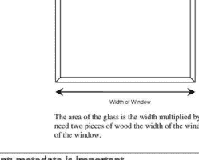

玻璃的面积等于宽度乘以高度。要制作窗框，我们需要两根与窗户同宽的木材，以及两根与窗户同高的木材。

#### 程序员提示：元数据很重要

关于信息的信息叫作元数据。这里的“元”字意味着从问题中“退一步”，以便在更广阔的背景下审视它。就我们的窗户程序而言，元数据会告诉我们更多关于正在使用和产生的值的信息，特别是信息所采用的单位，以及信息可能取值的有效范围。对于你在程序中表示的任何量，你至少必须拥有这一级别的元数据。

#### 程序实际上做了什么

程序可以根据以下公式推导出这两个值：

```
玻璃面积 = 窗户宽度 * 窗户高度
木材长度 = (窗户宽度 + 窗户高度) * 2
```

#### 补充更多细节

我们现在已经相当清楚程序将为我们做些什么了。作为明智且具有远见的人，我们不会就此止步，接下来还需要考虑程序如何判断输入的信息是否有效。

这必须与客户一起完成，他或她必须明白：如果给出的信息落在指定范围内，你的程序就会认为数据有效并据此处理。

就上述问题而言，因此我们可以把输入数据的定义扩展为：

-   窗户宽度，单位为米，取值在0.5米到3.5米之间（含端点）。
-   窗户高度，单位为米，取值在0.5米到2.0米之间（含端点）。

注意，你和客户都必须理解这份文档！

注意，我们还在描述中加入了单位，这非常重要——也许我们的客户从一家按英尺出售木材的供应商那里进货，在这种情况下，我们的输出描述应该写成：

-   窗户所需的玻璃面积，单位为平方米。记住我们卖的是双层玻璃，所以需要两块玻璃。
-   制作窗框所需的木材长度，以英尺为单位，使用每米3.25英尺的换算系数。

把这一切以你和客户都能理解的形式写下来之后，我们必须双方都在最终规格说明上签字，然后工作就可以开始了。


#### 证明其有效性

在现实世界中，您现在将创建一个测试，以便证明程序有效，您可以例如说：

> "如果我给上述程序输入高度 2 米、宽度 1 米，程序应该告诉我需要 4 平方米的玻璃和 19.5 英尺的木材。"

为正规项目设计的测试程序应测试程序内的所有可能状态，包括至关重要的错误条件。在大型系统中，编写程序的人可能需要创建一个围绕程序的测试框架，以便对其进行测试。客户和供应商应就应执行的测试数量和类型达成一致，然后签署一份描述这些测试的文件。

测试是程序开发中非常重要的一部分。甚至有一种开发技术，你先编写测试，然后再编写实际执行任务的程序。这实际上是一个好主意，我们稍后会探讨。就代码生产而言，你可以预期编写用于测试解决方案的代码量与解决方案本身相当。在估算特定工作的工作量时请记住这一点。

更好的是，设立分阶段付款制度，以便系统开发过程中就能获得部分款项。

#### 获取报酬

此时供应商知道，如果创建一个能通过所有测试的系统，客户就别无选择，只能为工作付费！还要注意，由于设计和测试程序已冻结，不存在可能导致客户要求更改工作的歧义，尽管当然这种情况仍可能发生！

对开发者来说好消息是，如果要求更改，这些更改可以被视为额外工作，而他们可以预期因此获得报酬。

#### 客户参与

还要注意，在“正规”系统中，客户会期望就程序如何与用户交互进行咨询，有时甚至细致到显示屏上字母的颜色！请记住，程序员可能想到的最危险的事情之一是“这就是他想要的！”与用户的精确交互——程序在遇到错误时做什么、信息如何呈现等——是客户保证会有强烈看法的东西。理想情况下，所有这些信息都应写入规范中，规范应包括屏幕布局以及每个阶段应按哪个键的细节。通常会使用原型来了解程序应是什么样子和感觉。

事实：如果您期望在项目进行中推导出规范，要么您将无法完成工作，要么您最终将花费五倍的工作量！

> *事实：由于规范不正确而导致实现失败的情况比任何其他原因都多！*

开始而不是因为对问题的初始理解错误而最终做额外工作。

如果您对铸铁般规范的坚持迫使客户思考系统到底应该做什么以及如何工作，那就更好了。客户很可能会说“但我付钱给你是因为你是计算机专家，我对这些机器一无所知”。这不是借口。解释‘一次做对’技术的益处，如果那样不起作用，就拿出一把左轮手枪并强行解决问题！

再次，如果我能用红色下划线强调，我会这样说：以上所有内容都适用于您为自己编写程序的情况。您是自己最糟糕的客户！

您可能认为我在这里在啰嗦；我们学习编程时将创建的简单系统会如此微不足道，以上技术过于冗长。您错了。做这类事情的一个非常好的理由是，它让大部分程序为您写好——通常在客户的帮助下。当我们开始我们的双层玻璃程序时，我们现在知道我们必须：

```
read in the width
verify the value
read in the height
verify the value
calculate width times height times 2 and print it
calculate (width + height) * 2 * 3.25 and print it
```

这项工作的编程部分现在只是将上述描述转换为可在计算机中使用的语言...

#### 程序员观点：好的程序员是好的沟通者

与客户交谈并了解他/她想要什么的艺术就是艺术。如果您想称自己为真正的程序员，您必须学会如何做到这一点。您必须做的第一件事之一是打破“我为你写程序”的想法，并将其替换为“我们正在为问题创建解决方案”。您不是为客户工作，您是与他们一起工作。这非常重要，特别是当您可能需要与客户就功能或价格进行权衡时。

## 1.3 编程语言

一旦我们知道程序应该做什么（规范），以及如何确定它是否有效（测试），我们现在需要以计算机可以处理的形式表达我们的程序。

您可能会问“为什么我们需要编程语言，为什么不能使用像英语这样的语言？”对此有两个答案：

- 1. 计算机太笨了，无法理解英语。
- 2. 英语会成为一种糟糕的编程语言。

先说第一点。我们目前无法制造非常聪明的计算机。计算机通过放入软件变得聪明，而我们能创建的程序大小和它与我们交流的速度都有限制。目前，使用最先进的软件和硬件，我们可以制造出聪明程度约等于一条带虫的计算机。问题是我们英语说得不够好；因此我们无法制造能理解英语的计算机。我们能做的最好的事情就是让计算机理解我们用来告诉它做什么的非常有限的语言。

再说第二点。英语作为一种语言充满了歧义。用英语以无歧义的方式表达某件事非常困难。如果你不相信我，去问任何一位律师！

> *请注意，这并不意味着带虫会成为好的程序员！*

> *时间飞逝如箭。*
> *果蝇喜欢香蕉！*

编程语言解决了这两个问题。它们足够简单，可以被计算机程序理解，并且减少了歧义。

### 程序员观点：语言并不那么重要

有很多编程语言。在你的职业生涯中，你必须学习不止一种。C# 是开始编程的很棒的语言，但不要认为它是你唯一会学习的语言。

## 1.4 C#

> *实际上有数百种编程语言；你至少需要知道 3 种。*

我们将学习一种名为 C#（发音为 C sharp）的语言。如果你犯了称这种语言为 C hash 的错误，你会立刻暴露你的无知！C# 是一种非常灵活且功能强大的编程语言，有着有趣的历史。它是由微软公司出于各种原因开发的，有些是技术性的，有些是政治性的，还有些是市场营销性的。

C# 与 C++ 和 Java 编程语言非常相似，借用了（或改进了）这些语言提供的特性。Java 和 C++ 的起源都可以追溯到一种名为 C 的语言，这是一种高度危险且有趣的语言，诞生于 20 世纪 70 年代初。C 因 UNIX 操作系统是用它编写的而闻名，并且是专门为此设计的。

### 1.4.1 危险的 C

我把 C 称为危险的语言。那我的意思是什么？考虑一下电锯。如果我，Rob Miles，想使用电锯，我会从商店租一个。我不是有经验的电锯使用者；我希望它配备大量内置安全功能，如护罩和自动断电装置。这些会让我使用它时更安全，但可能会限制工具的实用性，即因为所有安全装置，我可能无法砍倒某些种类的树。如果我是真正的伐木工，我会去买一台专业电锯，它没有任何安全功能，但可以用来砍倒几乎任何东西。如果我在使用专业工具时犯错，我很容易就会失去一条腿，而业余机器不会让这种情况发生。

从编程角度来说，这意味着 C 缺少其他编程语言提供的一些安全功能。这使语言更加灵活。

然而，如果我做了愚蠢的事，C 不会阻止我，所以我用 C 程序导致计算机崩溃的可能性比用更安全的语言大得多。

#### 程序员观点：计算机总是愚蠢的

我认为你应该始终基于这样一个前提工作：任何计算机都不会容忍你的任何错误，而你做的任何愚蠢的事情都会导致灾难！这会极大地集中注意力。

### 1.4.2 安全的 C#

在这一点上，C# 语言试图兼顾两者之长。C# 程序可以包含托管或非托管部分。托管代码会被运行它的系统精心处理。这确保运行托管代码时很难（但可能并非不可能）使你的计算机崩溃。然而，所有这些精心处理都是有代价的，会导致你的程序运行更慢。

为了获得最大可能的性能，并能够直接访问底层计算机系统的部分，您可以将程序标记为非托管。非托管程序运行更快，但如果它崩溃，就有能力使计算机

随之而来。切换到非托管模式，就好比因为新链锯的防护罩碍事，就把它拆掉。

C# 是一门很适合入门学习的语言，因为托管部分会让你更容易理解程序出错时发生了什么。

### 1.4.3 C# 与对象

C# 语言是面向对象的。对象是一种组织机制，让你把程序分解成合理的块，每一块负责整个系统的一部分。面向对象设计让大型项目更容易设计、测试和扩展。它还能让你创建具有高度可靠性和稳定性的程序。

我非常热衷于面向对象编程，但我还不打算就此讲太多。这不是因为我不了解它（说实话），而是因为我相信，在我们在程序中使用对象之前，还有一些非常基础的编程问题需要解决。

对象的使用既关乎设计，也关乎编程，而在我们能够设计更大的系统之前，必须先知道如何编程。

### 1.4.4 让 C# 运行

*你实际上是用某种文本编辑器编写程序——它可能是编译和运行系统的一部分。*

C# 是一门编译型编程语言。计算机无法直接理解这种语言，因此一个称为编译器的程序会把 C# 文本转换成简单得多的低级指令。这些低级指令又会被转换成实际命令，用来驱动运行程序的硬件。

稍后我们会更详细地了解 C# 程序工作方式的这一方面；现在要记住的是，在你真正运行精彩的 C# 程序之前，需要先把它交给编译器。

编译器是一个非常大的程序，它知道如何判断你的程序是否合法。它做的第一件事就是检查你在使用语言本身时是否有错误。只有当编译器没有发现错误时，它才会生成输出。

编译器还会发出警告：当它注意到你做了某些技术上并不违规、但可能表明你在某处犯了错误的事情时，就会产生警告。警告情形的一个例子是：你创建了某个东西，却没有把它用于任何用途。编译器会告诉你这件事，以防你忘了添加程序的某一部分。

C# 语言附带了一大堆其他东西（这里重用一个技术术语），它们让 C# 程序能够执行诸如从键盘读取文本、在屏幕上输出、建立网络连接等操作。这些额外功能可供你的 C# 程序使用，但你必须显式请求它们。程序运行时，它们会被自动定位。稍后我们将看看如何把你自己的程序分解成若干不同的块（也许是为了让几个不同的程序员可以共同处理它）。

### 1.4.5 创建 C# 程序

微软开发了一个名为 Visual Studio 的工具，它是一个编写程序的好地方。它包含编译器，以及集成的编辑器和调试器。它提供多个版本，具有不同的功能集。有一个免费版本，称为 Visual Studio Express 版，非常适合入门。另一个免费资源是 Microsoft .NET Framework。它提供了一组命令行工具，也就是你在命令提示符中输入的内容，可用于编译和运行 C# 程序。如何创建和运行程序由你决定。

我不会详细介绍如何下载和安装 .NET Framework；那属于其他文档的内容。我将假设你使用的计算机安装了文本编辑器（通常是记事本）和 .NET Framework。

#### 人脑计算机

当然，一开始最好只是在纸上推演你的程序。我认为，当你不在计算机前坐着时，编写程序的效果最好，也就是说，最好的方法是在远离机器的纸上编写（或至少规划出）你的解决方案。一旦你坐在键盘前，就很容易受到诱惑，开始按键并输入一些也许能运行的东西。这不是好方法。你几乎肯定最终会得到一个勉强能运行的东西，然后你会花上几个小时摆弄它，让它跑起来。如果你先坐下来用铅笔把解决方案设计出来，你大概能用一半左右的时间得到一个可运行的系统。

> **程序员观点：优秀的程序员调试更少**
>
> 我对那些整天泡在终端前、与庞大程序搏斗并靠调试把它们修整成形的“黑客型”程序员并不佩服。我佩服的是那种一出现，输入程序，就能一次运行成功的人！

### 1.4.6 C# 程序由什么组成？

如果你的妈妈想告诉你如何做你最喜欢的水果蛋糕，她会把食谱写在一张纸上。食谱会是一份配料清单，后面跟着一系列对配料执行的操作。

程序可以被看作一份食谱，但它是写给计算机遵循的，而不是写给厨师遵循的。配料将是你希望程序处理的值（称为变量）。程序本身将是一系列要由计算机遵循的操作（称为语句）。与其把程序写在一张纸上，你不如把它放进计算机中的一个文件里，这个文件通常称为源文件。

这就是编译器处理的内容。一个源文件包含三样东西：

- 给编译器的指令
- 关于将保存和操作数据的结构的信息。
- 操作数据的指令。

依次来看：

#### 控制编译器

C# 编译器需要了解你程序的某些信息。它需要知道你的程序将使用哪些外部资源。还可以告诉它任何对构建程序很重要的选项。你程序中的某些部分只是提供这些信息，以告诉编译器该做什么。

#### 存储数据

程序通过处理数据来工作。当程序处理数据时，数据必须存储在计算机中。所有计算机语言都支持某种形式的变量。变量只是一个命名的位置，在程序运行时用来保存一个值。C# 还让你可以构建能够保存多个项的结构，例如，单个结构可以保存关于某个特定银行客户的所有信息。作为程序设计过程的一部分，你需要决定哪些数据项需要存储。你还必须为这些数据项决定用于标识它们的合理名称。

经验丰富的程序员会把问题分解成若干较小的问题，并为每个问题编写一个方法。

#### 描述解决方案

描述你解决问题方案的实际指令也必须是你程序的一部分。在 C# 程序中，执行某件事的单条简单指令称为*语句*。语句是一条执行某一特定操作的指令，例如将两个数相加并存储结果。

程序真正引人入胜的地方在于，有些语句可以改变接下来执行哪条语句，这样你的程序就能查看情况并决定做什么。在 C# 中，你可以把语句组合在一起，形成一个执行某一特定任务的程序块。这样的块称为*方法*。

方法可以非常小，也可以非常大。它可以返回一个你可能关心、也可能不关心的值。它可以有你喜欢的任何名称，你的程序可以包含任意多个你认为合适的方法。一个方法可以引用其他方法。C# 语言还提供了大量可用的*库*。它们让你不必每次编写程序时都“重复发明轮子”。我们将在本文后面详细讨论方法。

#### 标识符和关键字

你为自己创建的每个方法命名，并尽量让函数名称符合它的功能，例如 ShowMenu 或 SaveToFile。C# 语言实际上通过寻找一个具有特殊名称 Main 的方法来运行你的程序。当程序开始运行时，会调用这个方法；当 Main 结束时，程序也就结束了。你为标识事物而发明的名称称为*标识符*。当你创建用于保存值的东西时，也会创建标识符；当我们需要保存所需木材的长度时，woodLength 可能是一个好选择。稍后我们将了解创建标识符时必须遵守的规则和约定。

C# 语言本身包含的单词称为*关键字*。在食谱中，关键字会类似于“混合”“加热”或“搅拌”。它们会告诉你类似这样的话：*加热糖直到熔化* 或 *搅拌至顺滑*。事实上，你会发现程序看起来很像食谱。在本文某些代码清单中，关键字会显示为蓝色。

#### 对象

我们编写的程序中的一些内容，是属于所用框架的对象。继续用烹饪类比，它们就像搅拌碗和烤箱，在烹饪过程中使用。对象名称会用不同颜色表示，或在本文某些代码清单中显示为蓝色。

#### 计算机程序中的文本

你的程序中有两种文本。一种是你希望计算机执行的指令，另一种是你希望程序实际显示在用户面前的消息。你的妈妈可能会在她的蛋糕食谱中加入以下指令：

> 现在用粉色糖霜在蛋糕顶部写上“圣诞快乐”。

她使用双引号字符来标记要写在蛋糕上的文本，C# 的工作方式完全相同。“圣诞快乐”不是指令的一部分；它是需要写出来的内容。这类消息在本文中显示为红色。

#### 颜色与约定

我在本文中使用的颜色旨在与你使用专业程序编辑器（例如 Visual Studio 附带的编辑器）编辑程序时看到的颜色保持一致。这些颜色只是让程序更容易理解，并没有任何特殊含义。它们会在你编写程序时由编辑器自动添加。


# 2 简单数据处理

本章我们将创建一个真正有用的程序（尤其是如果你从事玻璃安装行业）。我们将从创建一个非常简单的解决方案开始，并研究执行基本数据处理的 C# 语句。然后我们将使用 C# 语言的额外特性来提高我们所生产解决方案的质量。

## 2.1 第一个 C# 程序

我们将要查看的第一个程序将读取窗户的宽度和高度，然后打印出制作可适配该尺寸孔洞的窗户所需的木材和玻璃用量。这就是我们在第 1.2.2 节中描述的要解决的问题。

### 2.1.1 程序示例

也许开始学习 C# 的最好方式就是直接上手我们第一个 C# 程序。如下所示：

```csharp
using System;

class GlazerCalc
{
    static void Main()
    {
        double width, height, woodLength, glassArea;
        string widthString, heightString;

        widthString = Console.ReadLine();
        width = double.Parse(widthString);

        heightString = Console.ReadLine();
        height = double.Parse(heightString);

        woodLength = 2 * (width + height) * 3.25;
        glassArea = 2 * (width * height);

        Console.WriteLine ("The length of the wood is " +
            woodLength + " feet");
        Console.WriteLine ("The area of the glass is " +
            glassArea + " square metres");
    }
}
```

*代码示例 1 - GlazerCalc 程序*

这是一个有效的程序。如果你把它交给 C# 编译器，它会编译通过，并且可以运行。实际工作由我所标注的两行完成。总体而言，这两行之前的部分负责设置并获取待处理的值。之后的部分则负责向用户显示答案。

现在我们可以逐行查看，并尝试了解它如何融入我们的程序。

学习编程的一个重要部分是学习如何使用支持你的程序的系统的所有额外功能。

#### using System;

这是对 C# 编译器的一个指令，告诉它我们想要使用 System 命名空间中的内容。命名空间是特定名称具有意义的地方。我们在对话中也有命名空间，如果我使用的是“足球”命名空间并说“那支球队真的很火”，我是在说好话。如果我使用的是“消防员”命名空间，我说的就是不太好的话。

在 C# 中，System 命名空间描述了许多有用的内容。C# 提供的这些有用内容之一是 Console 对象，它允许我写入内容并显示在用户面前屏幕上。如果我想直接将其称为 Console，我必须告诉编译器我正在使用 System 命名空间。这意味着如果我用特定名称引用某物，编译器会在 System 中查找是否有匹配的名称。我们稍后会使用其他命名空间。

类是面向对象编程的基础，正如我们稍后将看到的那样。

#### class GlazerCalc

C# 程序由一个或多个类组成。类是一个容器，包含数据和程序代码以完成特定任务。就我们的双层玻璃计算器而言，该类只包含一个方法来计算木材长度和玻璃面积，但如果需要，类可以包含更多内容。

你需要为创建的每个类发明一个标识符。我把我们的类命名为 GlazerCalc，因为这反映了它的功能。现在，不要太担心类的问题，只要确保为你创建的类选择有意义的名称即可。

哦，还有一件事：有一个约定，即包含特定类的文件名称应与类本身匹配，换句话说，上面的程序应保存在名为 GlazerCalc.cs 的文件中

#### static

这个关键字确保其后的方法始终存在，即在此上下文中 static 的意思是“是封闭类的组成部分并且始终存在”。当我们开始考虑对象时，我们会发现这个小关键字有各种有趣的含义。但现在我希望你只需确保在这里放置它，以便你的程序正常工作。

#### void

void 就是无。在编程术语中，void 关键字意味着我们即将描述的方法不会返回我们感兴趣的任何内容。该方法只是做完工作然后结束。在某些情况下，我们编写返回结果的方法（事实上，我们稍后在程序中会使用这样的方法）。

然而，为了防止其他人意外使用我们 Main 方法返回的值，我们明确声明它不返回任何内容。这使我们的程序更安全，因为编译器现在知道如果有人尝试使用该方法返回的值，这一定是一个错误。

#### Main

你选择方法名称以反映它们将为你做什么。除了 Main。 这个方法（必须有一个，而且只能有一个）是你的程序开始运行的地方。当你的程序被加载并运行时，首先获得控制权的方法就是名为 Main 的方法。如果你省略了 Main 方法，系统就完全不知道从哪里开始。

#### ()

这是一对括起来的空括号。这听起来可能很愚蠢，但实际上告诉编译器 Main 方法没有参数。方法的一个参数为方法提供可操作的内容。当你定义一个方法时，你可以告诉 C# 它操作一个或多个事物，例如 sin(x) 可以操作角度 x 的浮点值。我们将在本文档后面非常详细地介绍方法。

#### {

这是一个大括号。顾名思义，大括号成对出现，即每个左大括号必须有一个匹配的右大括号。大括号允许程序员将程序片段组合在一起。这样的程序片段通常称为块。块可以包含其中使用的变量声明，然后是按顺序执行的程序语句序列。在本例中，大括号包围了 Main 方法的工作部分。

当编译器在末尾看到匹配的右大括号时，它就知道已到达方法的末尾，可以查找下一个（如果有）。不成对的大括号的影响无一例外是致命的...

#### double

到现在你可能觉得需要喝点东西。但在此上下文中 double 并不是这个意思。它的意思是“双精度浮点数”。

我们的程序在运行时需要记住某些值。特别是它将读取窗户的宽度和高度值，然后计算并打印玻璃面积和木材长度的值。C# 将存放值的地方称为变量。在任何块的开头，你可以告诉 C# 你想要预留一些空间来保存一些数据值。每个项目可以保存特定类型的值。本质上，C# 可以处理三种数据类型，浮点数、整数和文本，即字母、数字和标点符号。创建变量的过程称为声明变量。

*double 变量可以以非常高的精度保存非常宽范围的值。*

你通过给出数据的类型，然后列出你想要变量的名称来声明某种类型的变量。我们现在使用 double 类型。稍后我们将使用其他类型。

#### width, height, woodLength, glassArea

这是一个列表。C# 中项目的列表由 ,（逗号）字符分隔。在本例中，它是变量名称的列表。一旦编译器看到 double（见上文）这个词，它就期望找到至少一个要创建的变量的名称。编译器会遍历列表，创建可以容纳 double 类型值的“盒子”并赋予它们适当的名字。从这一点开始，我们可以引用上述名称，编译器就会知道我们正在使用该特定变量。

#### 程序员提示：了解您的数据来源

事实上，考虑到人们读取卷尺的精度限制，以及我们不会制作像宇宙一样宽的窗户的事实，双精度浮点数对于此应用来说是过度设计。你可以改为询问客户是否可以只用毫米来表示尺寸。我们稍后会研究驱动特定变量类型选择的考虑因素。所有这些决策都由你在了解正在创建的系统时收集的元数据（关于数据的数据）驱动。


```csharp
;
```

分号标记变量名列表的结束，也标志着该声明语句的结束。C# 程序中的所有语句都以 ; 字符分隔，这有助于保持编译器在正确的轨道上。

; 字符实际上非常重要。它告诉编译器某个语句的结束位置。如果编译器在期望看到的地方找不到它，就会产生错误。你可以将这些字符与电影中的齿孔相提并论，它们保持一切同步。

```csharp
string widthString, heightString;
```

我们已经创建了一些可以保存数字的变量。现在我们要创建一些可以包含字符串的变量。这是因为当我们从用户读取数字时，我们首先将其作为文本字符串读取。然后我们再将文本转换为数字。变量 widthString 和 heightString（注意有意义的命名）将包含数字的文本版本。

```csharp
widthString =
```

这是一个赋值语句。在这个 C# 语句中，我们将改变变量中的值。我们的程序将从用户读取一行文本并将结果放入我们称为 widthString 的变量中。记住，变量只是一个特定大小的命名盒子，可以保存单个数据项（在本例中为文本字符串）。

你的程序很大一部分将是向变量分配新值的指令，因为各种结果被计算出来。C# 使用 = 字符来执行赋值。此语句的第一部分是先前定义的变量的名称。随后是 = 字符，我称之为 gozinta。我之所以这样称呼它，是因为右边的值 gozinta（goes into）左边的变量。抱歉。

#### Console.
在等号右边，我们有将被赋给 widthString 的内容。在这种情况下，结果将是方法 ReadLine 返回的字符串。该方法属于一个名为 Console 的对象，它负责用户输入和输出。全点号（.）将对象标识符与方法标识符分隔开。

#### ReadLine
这表明 ReadLine 方法将被调用。这要求正在运行的程序暂时离开，执行该方法中的语句，然后返回。方法是你可以将程序分解为多个块的一种方式，每个块都有特定的任务。它们还意味着你只需要编写某段代码一次，将其放入方法中，然后每当需要执行该特定任务时调用该方法。C# 系统包含许多内置方法来为我们的程序做事。ReadLine 就是其中之一。

当此程序运行时，ReadLine 方法会被调用（或调用）。它将等待用户输入一行文本并按 Enter 键。输入的内容随后将作为字符串由 ReadLine 方法返回。方法调用的结果被放置在 widthString 变量中。

#### ()
方法调用后面跟着该方法的参数。参数是传递给方法以供其处理的东西。可以把它想象成某种过程的原材料。就 ReadLine 而言，它没有任何原材料；它将从输入文本的用户那里获取信息。然而，即使参数为空，我们仍然必须提供参数列表。

#### ;
我们之前见过分号。它标记我们程序中语句的结束。

#### width =
这是另一个赋值（Mr. Phelps/Hawke¹）。变量 width 被赋予一个值。你的程序中的许多语句只是简单地移动数据并对其执行操作。

#### double.
但语句的其余部分看起来有点吓人。事实上并不太复杂。我们要求 Mr. double（负责保存双精度浮点数的东西）为我们做一点小事。在这种情况下，这件小事是“取出 widthString 保持的字符串并将其转换为双精度浮点数。”Mr. double 通过公开名为 Parse 的方法提供这种能力。

请注意，C# 中的某物公开其方法并没有什么错误或不道德之处。这就是我们让事情为我们完成的方式。当你开始设计更大的程序时，你会发现最好的做法是创建公开方法以完成工作的组件。整个 C# 库集作为一系列方法提供，而你必须掌握的事情之一就是方法在哪里以及如何使用它们。就像生活中的许多事情一样，诀窍在于知道该问谁...

#### Parse
Parse 方法的任务是将它收到的字符串转换为双精度浮点数。为此，它必须沿着字符串查找，逐个取出每个数字，然后计算实际值，例如“12”表示十和两个单位。这种沿着事物查找的过程通常称为解析。因此我们使用的方法的名称。方法接收要解析的字符串并返回找到的数字。

请注意，这带来了很大的恶意潜力，因为如果用户没有输入值或输入了类似“Twenty Five”的内容，Parse 方法调用将无法解析出数字并因此失败。它如何失败以及如何解决这种失败，将留待后面的章节，以便为本文增添更多激情。

#### (widthString);
我们已经看到，方法调用必须后面跟着该方法的原材料（参数）。就 ReadLine 而言，没有参数，但我们仍然需要提供一个空列表来表示这一点。就 Parse 而言，该方法需要被赋予它要处理字符串。我们通过将包含文本的字符串变量的名称（widthString）放入括号中（如上所示）来实现这一点。widthString 中的信息值（即用户输入的文本）被传递给 Parse 方法以供其处理并提取数字。

¹ 这里有一个晦涩的电影/电视节目参考，供各位朋友。

```csharp
heightString = Console.ReadLine();
height = double.Parse(heightString);
```

这两个语句只是重复读取高度值的文本然后将其转换为保存窗口高度的双精度值的过程。

```csharp
woodLength = 2*(width + height)*3.25;
```

当我编写程序时，即使编译器不需要我也会使用括号。这使程序更清晰。

这就是程序本身的核心。这就是做工作的部分。它采用高度和宽度值并用它们来计算所需木材的长度。

计算是一个表达式，就像上面一样，这次重要的是要注意使用括号来修改表达式中值的计算顺序。通常 C# 会按你期望的方式计算表达式，即所有乘法和除法先进行，然后是加法和减法。在上面的表达式中，我想先做某些部分，所以我做了数学中会做的事，我把要先做的部分用括号括起来。

请注意，我使用 3.25 的系数是为了考虑到客户希望木材长度以英尺为单位。1 米大约有 3.25 英尺，所以我将以米为单位的结果乘以此系数。

表达式中的 + 和 * 字符称为 *运算符*，因为它们会导致操作发生。表达式中的其他项称为 *操作数*。运算符作用于它们。

```csharp
glassArea = 2 * (width * height);
```

这行重复了玻璃面积的计算。请注意，面积以平方米给出，因此不需要转换。我把一个乘法放在括号中，以便表明我正在计算两倍的面积（即两块玻璃）。特别这样做没有必要，但我认为这样更清晰一些。

```csharp
Console.WriteLine
```

这是一个对方法的调用，就像 ReadLine 方法一样，只是这个方法接收它得到的内容然后将其打印到控制台上。

```csharp
(
```

这是此方法调用的 *参数* 的开始。我们在 Parse 和 ReadLine 的调用中见过这些。

```csharp
"The length of the wood is "
```

这是一个 *字符串字面量*。它只是在程序中的一段文本字符串。文本字符串用双引号字符括起来，以告诉编译器这是程序中值的一部分，而不是对编译器的指令。

```csharp
+
```

加号是一个加法运算符。我们见过它用于将两个整数相加。然而，这里的加号意味着完全不同的东西。在这种情况下，它意味着“将两个字符串连接起来”。


你必须习惯在程序中使用*上下文*的概念。我们在命名空间中见过这一点。这里是在运算符中。C# 系统使用操作的上下文来决定做什么。在之前的 + 的情况下，两个双精度浮点数之间它表示“做一个求和”。这里左侧有一个字符串。这意味着它将执行字符串连接而不是数学加法。

#### woodLength

这是上下文发挥作用的另一个例子。之前我们将 woodLength 用作值的数值表示，在此程序中为所需的木材长度。然而，在当前使用的上下文中（添加到字符串末尾）它就不能那样工作了。

C# 编译器因此必须要求 woodLength 数据项将自身转换为字符串，以便在此位置正确使用。幸运的是它可以做到，因此程序按预期工作。

非常重要，你要精确理解这里发生了什么。考虑：

```
Console.WriteLine ( 2.0 + 3.0 );
```

这将执行数值计算（2.0 + 3.0）并产生一个双精度浮点值。然后会要求这个实值提供自身的字符串版本以便打印，输出为：

```
5
```

但代码行：

```
Console.WriteLine ( "2.0" + 3.0 );
```

会将 + 视为连接两个字符串。它会要求值 3 将自身转换为字符串（听起来很奇怪——但这就是发生的事情）。然后它会产生输出：

```
2.03
```

字符串 "2.0" 在末尾添加了值 3.0 的文本。这种行为上的差异完全是因为正在执行的运算的上下文。

你可以认为我们程序中的所有变量都被标记了*元数据*（又是这个词），编译器用它来决定如何处理它们。变量 heightString 被标记为信息，说明“这是一个字符串，用加号与它一起使用时你进行连接”。变量 woodLength 被标记的元数据说明“这是一个双精度浮点值，用加号与它一起使用时你执行算术运算”。

```
+ " feet"
```

这里又有一个连接。我们在末尾添加单词 feet。每当我打印一个值时，我总是把单位放在末尾。这样可以更轻松地确保该值是有意义的。

```
)
```

括号标记了为 WriteLine 方法调用而构建的参数的结束。当方法被调用时，程序首先从所有组件组装一个完整的字符串，将它们添加（或连接）以产生单一结果。然后它将 resulting 字符串值传递给方法，该方法会将其打印到控制台。

```
;
```

分号标记此语句的结束。

```
}
```

现在有一些非常重要的内容。程序本质上已经完成。我们已经添加了所需的所有行为。然而，编译器仍需要被告知我们已到达程序的末尾。这个第一个闭合大括号标记了作为 Main 方法体的代码块的结束。代码块以 { 开始，以 } 结束。当编译器看到它时，它会自言自语‘那是 Main 方法的结束’。

```
}
```

第二个闭合大括号的工作与第一个同样重要。它标记了类 GlazerCalc 的结束。在 C# 中，一切都存在于类内部。类是包含许多东西的容器，包括方法。如果我们愿意（我们稍后会这样做），我们可能会把多个方法放入一个类中。然而现在，我们只希望类中有一个方法。因此我们使用第二个闭合大括号来标记类本身的结束。

#### Punctuation

这标志着我们程序的结束。你会注意到的一件事是其中有大量的标点符号。这至关重要，必须完全按照 C# 所需的方式提供，否则你会得到所谓的编译错误。这只是表明编译器太笨了，无法理解你提供的内容。

你很快就会习惯于查找和发现编译错误。你会发现的一件事是编译器并不总是能在错误发生的地方检测到错误；考虑遗漏一个 '}' 字符的影响。然而，请注意，仅凭编译器认为你的程序没问题，并不保证它能按你想要的方式运行！

还要记住的一点是，程序的布局不会影响编译器，以下同样有效：

```
using System;
class GlazerCalc{static void Main(){double width, height, woodLength, glassArea;string widthString, heightString; width = double.Parse(widthString);heightString = Console.ReadLine();height = double.Parse(heightString);woodLength = 2 * ( width + height ) * 3.25 ;glassArea = 2 * ( width * height ) ;Console.WriteLine( "The length of the wood is " + woodLength + " feet" );Console.WriteLine( "The area of the glass is " + glassArea + " square metres" );}}
```

尽管如果有人以这种方式布局程序，我会给他一个聪明的敲手警告！

#### Programmer's Point: Program layout is very important

你可能已经注意到我在编写程序时使用的相当吸引人的布局。大括号内的项目缩进了，这样可以非常清楚地知道它们属于哪里。我这样做不是因为我觉得这样的列表在艺术上令人愉悦。我这样做是因为否则我几乎无法阅读程序并理解它做了什么。就像我发现没有正确间距的英语很难阅读一样，如果程序没有正确布局，我也很难阅读。

## 2.2 Manipulating Data

在本节中，我们将看看如何编写操作数据的程序，如何存储、检索以及一般地处理值。这为我们提供了执行程序数据处理部分的能力。

### 2.2.1 Variables and Data

在上面的玻璃安装程序中，我们决定将我们正在处理的窗户的宽度和高度存储在我们描述为 double 的变量中。在我们的编程生涯中更进一步之前，我们需要考虑这意味着什么，以及我们在编写的程序中还可以存储哪些其他类型的数据。

程序操作数据。编程语言必须为你提供存储正在处理的数据的方式，否则它毫无用处。数据实际意味着什么是由你作为程序员决定的（参见上面关于数据的 digression）。

变量是一个可以存储东西的命名位置。你可以把它想象成一个特定大小的盒子，盒子上写着名字。你选择名字来反映将要存储的内容（我们在上面的程序中使用了像 woodLength 这样合理的名称）。你还需要从 C# 提供的存储类型范围中选择变量的类型（盒子的特定大小和形状）。变量的类型是该变量元数据的一部分。

程序还包含字面值。字面值只是你在程序中用于某种目的的值。对于每种类型的变量，C# 语言都有一种表达该类型字面值的方式。

### 2.2.2 Storing Numbers

考虑数值时有两种类型的数据：

- 漂亮的块状单个值，例如田地里的羊的数量、齿轮上的齿、篮子里的苹果。这些被称为整数。
- 讨厌的现实世界类型事物，例如当前温度、一根绳子的长度、一辆汽车的速度。这些被称为实数。

在第一种情况下，我们可以精确地保存值；你总是拥有这些项目的确切数量，它们是整数的。

*当你编写规范时，你应该担心值的精度。精度过高可能会减慢机器速度——精度过低可能会导致使用错误的值。*

在第二种情况下，我们永远无法精确地保存我们所观察到的内容。即使你把一根绳子测量到小数点后 100 位，它仍然不会给出其精确长度——你总能更准确地获得该值。这些是实数。计算机是数字的，即完全在可视为数字的位模式上操作。因为我们知道它以开关为基础工作，所以它在保存实值时存在问题。为了处理实值，计算机实际上以有限的精度存储它们，我们希望这足够（通常是）。

这意味着当我们想要存储某物时，我们必须告诉计算机它是整数还是实数。我们还需要考虑需要保存的可能值的范围，以便选择适当的类型来存储数据。

你通过声明来告诉 C# 你想要创建的变量。声明还标识了我们想要存储的东西的类型。把它想象成 C# 创建了一个特定大小的盒子，专门设计用于容纳给定类型的项目。盒子被标记了一些元数据（又是那个词），这样系统就知道可以放入什么以及如何使用该盒子。


#### 存储整数值

整数是计算机最容易存储的值类型。每个值都会映射到特定的位模式。唯一的问题是范围。值越大，表示它所需的位数就越多。

C# 根据你要存储的值的范围，提供了多种整数类型：

| 类型 | 位数 | 范围 |
|---|---|---|
| sbyte | 8 位 | -128 到 127 |
| byte | 8 位 | 0 到 255 |
| short | 16 位 | -32768 到 32767 |
| ushort | 16 位 | 0 到 65535 |
| int | 32 位 | -2147483648 到 2147483647 |
| uint | 32 位 | 0 到 4294967295 |
| long | 64 位 | -9223372036854775808 到 9223372036854775807 |
| ulong | 64 位 | 0 到 18446744073709551615 |
| char | 16 位 | 0 到 65535 |

注意，负数的范围比正数多一个。这是因为数字使用二进制补码表示法存储。

标准的整数类型 int 在 C# 中可以存储大得惊人的数字，范围从 -2,147,483,648 到 2,147,483,647。如果你想存储比这更大的整数（虽然我不知道你为什么需要这样做），还有一个 long 版本。

一个整型变量的例子可以是用来统计田野中绵羊数量的变量：

```
int numberOfSheep;
```

这会创建一个能够统计超过二十亿只绵羊的变量！它还允许程序操作“负绵羊”，这可能没有意义（当然，除非你经营一家绵羊银行，让人们借走绵羊）。请记住，语言本身并不知道这些考虑。如果你想确保绵羊数量永远不超过 1,000 只，并且永远不会变成负数，你必须自己添加这个行为。

当你使用 Visual Studio（或其他支持语法高亮的代码编辑器）编辑程序源代码时，你会发现 C# 语言内置的类型名称（如 int 和 float）以蓝色显示，如上所示。

#### 程序员要点：检查你自己的数学

另一点你需要记住的是，程序并不总能检测到变量超出范围的情况。如果我把值 255 放入一个 byte 类型的变量，这是可以的，因为 255 是该类型能容纳的最大值。然而，如果我在这个变量的值上加 1，系统可能不会将其检测为错误。实际上，这可能导致值“绕回”到 0。这可能会给我的程序带来大麻烦。

#### 整数字面量

整数字面量表示为不带小数点的数字序列：

```
23
```

这是整数值 23。我可以在程序中使用它，如下所示：

```
numberOfSheep = 23 ;
```

如果我使用某种“较短的”类型，编译器会将字面量视为该类型：

```
sbyte tinyVal = 127;
```

在这个语句中，127 被视为 sbyte 字面量，而不是整数。这意味着如果我做了某些愚蠢的事：

```
sbyte tinyVal = 128;
```

（sbyte 能容纳的最大值是 127），编译器会检测到我犯了错误，程序将无法编译。

#### 存储实数值

“实数”是用于非整数的通用术语。它们有小数点和分数部分。根据值的大小，小数点会在数字中浮动，因此得名 float。

C# 提供了一种可以容纳实数的类型。标准 float 值的范围为 1.5E-45 到 3.4E38，精度只有 7 位数字（即不如大多数袖珍计算器）。

如果你需要更高精度（当然你的程序会占用更多计算机内存，运行更慢），你可以使用 double 类型（double 是双精度 double precision 的缩写）。它会占用更多计算机内存，但范围可达 5.0E-324 到 1.7E308，精度为 15 位数字。

float 变量的一个例子可以是用来存储冰淇淋平均价格的变量：

```
float averageIceCreamPriceInPence;
```

double 变量的一个例子可以是用来存储宇宙宽度（以英寸为单位）的变量；

```
double uniWidthInInches;
```

最后，如果你想要极致的精度，但范围可以稍小一些，你可以使用 decimal 类型。它使用的存储空间是 double 的两倍，能存储 28-29 位精度的值。它用于金融计算，在这些计算中数字不会特别大，但需要非常高的精度。

```
decimal robsOverdraft;
```

#### 实数字面量

存储浮点数有两种方式：float 或 double。当把字面量值写入程序本身时，编译器需要知道你写的是浮点值（较小尺寸的盒子）还是双精度值（较大尺寸的盒子）。

float 字面量可以用一个实数后跟 f 来表示：

```
2.5f
```

double 字面量表示为不带 f 的实数：

```
3.5
```

你也可以使用指数来表示 double 和 float 值：

```
9.4665288415
```

这是一个双精度字面量值，实际上是一光年的米数。如果在末尾加上 f，它就变成一个浮点字面量值。

与整数不同，对于实数，编译器对它们的组合方式非常挑剔。这是因为当你把值从双精度变量移动到普通浮点变量时，会丢失一些精度。这意味着你必须采取特殊步骤，确保作为程序员的你明确表示你希望这样做，并且你能承受后果。这个过程称为强制转换（casting），我们稍后会详细讨论。

#### 程序员要点：简单的变量可能是最好的

你会发现，我和大多数程序员倾向于只使用整数（`int`）和浮点（`float`）变量类型。这可能看起来有些浪费（我极不可能需要统计二十亿只绵羊），但这使程序更容易理解。

### 2.2.3 存储文本

有时我们要存储的信息是文本。它可以是单个字符的形式；有时则是一个字符串。C# 提供了变量来管理这两类信息：

#### char 变量

`char` 是一种可以容纳单个字符的变量类型。字符是你在键盘上按下一个键或在屏幕上显示单个字符时得到的内容。C# 使用一种名为 UNICODE 的字符集，它可以处理超过 65,000 种不同的字符设计，包括大量外文字符。

字符变量的一个例子可以是用来存储用户刚刚按下的命令键的变量：

```
~~~csharp
char commandKey;
~~~
```

#### char 字面量值

你可以通过将字符括在单引号中来表示它：

```
~~~csharp
'A'
~~~
```

这意味着“字符 A”。如果你的程序从键盘读取一个字符，而用户按住 Shift 并按下 A，程序就会得到这个字符。如果你使用支持*语法高亮*的编辑器编辑程序，字符字面量会以红色显示。

#### 字符转义序列

这就引出了一个问题：“我们如何表示 '（单引号）字符？”这可以通过使用转义序列来实现。转义序列是一个以特殊转义字符开头的字符序列。这里的“转义”意味着“摆脱平常单调的约定，不只是表示字面意思，而是要做些特别的事情”。转义字符是 `\`（反斜杠）字符。可能的转义序列有：

| 字符 | 转义序列名称 |
|---|---|
| `\'` | 单引号 |
| `\"` | 双引号 |
| `\\` | 反斜杠 |
| `\0` | 空字符 |
| `\a` | 警报 |
| `\b` | 退格 |
| `\f` | 换页 |
| `\n` | 换行 |
| `\r` | 回车 |
| `\t` | 水平制表符 |
| `\v` | 垂直制表符 |

这些转义序列的效果取决于你将其发送到的设备。有些系统在收到警报字符时会发出蜂鸣声。有些系统在收到换页字符时会清除屏幕。

你可以按如下方式使用它们：

```
~~~csharp
char beep = '\a' ;
~~~
```


请注意，`a` 必须是小写。

#### 字符代码值

我们已经知道，计算机实际上处理的是数字，而不是真正的字母。C# 使用 Unicode 标准将字符映射为表示它们的数字。如果你愿意，可以将字符字面量表示为 Unicode 字符集中的某个值。好消息是，这让你可以使用大量的字符（只要你知道它们的代码）。坏消息是，你必须用十六进制来表示这个值，这比十进制稍微难用一些。最好的消息是，你可能根本不需要经常做这种事情，甚至完全不需要。

不过，举个例子，我恰好知道大写字母 A（A）的 Unicode 值是 65。这在十六进制（基数为 16）中表示为四个十六和一个一（即 41）。因此，我可以在程序中这样写：

```
char capitalA = '\x0041';
```

请注意，我必须在两个十六进制数字前面加上前导零。

#### 字符串变量

一种可以容纳一串文本的盒子类型。在 C# 中，字符串可以很短，例如 `"Rob"`，也可以很长，例如 `"War and Peace"`（这是指那本书，而不是三个单词）。字符串变量可以容纳一行文本。然而，由于有一些特殊字符表示“换行”（见上文），一个字符串完全有可能容纳大量文本行。

字符串变量的一个例子可以是保存用户刚刚输入的那一行内容的变量：

```
string commandLine;
```

#### 字符串字面量值

字符串字面量值用双引号括起来表示：

"this is a string"

字符串可以包含上面的转义序列：

"\x0041BCDE\a"

如果我们打印这个字符串，它会打印出：

ABCDE

- 并尝试响铃。

如果我只是表达文本，不含转义字符或其他奇怪的内容，我可以告诉编译器这是一个原义字符串。我只需在字面量前面加上一个 `@`：

@"\x0041BCDE\a"

如果我打印这个字符串，我会得到：

\x0041BCDE\a

当你表达文件路径之类的内容时，这会很有用。原义字符还有另一个技巧，你可以用它让字符串字面量跨越多行：

@"The quick
brown fox
jumps over the lazy dog"

这表示一个跨越三行的字符串。存储时，字符串中的换行符会被保留。

### 2.2.4 使用布尔值存储状态

`bool`（boolean 的缩写）变量是一种盒子类型，它可以容纳某件事是否为真。有时候这就是你所需要的全部。如果你要存储订阅是否已付费，就没有必要使用一个可以容纳大量可能值的类型来浪费空间。相反，你只需要存储 true 或 false 这两种状态。这是 bool 类型仅有的两个允许值。

布尔变量的一个例子可以是保存网络连接状态的变量：

```
bool networkOK;
```

#### 布尔字面量值

这些很容易表示为 true 或 false：

```
networkOK = true;
```

#### 程序员要点：思考变量的类型

为变量选择合适的类型是一项技能。我倾向于只把浮点存储作为最后的手段。它们会引入我不太喜欢的精度缺失。我发现只要稍微动点脑筋，就可以很舒服地使用整数。例如，与其把商品价格存储为 1.5 英镑（需要使用 float），我会把价格存储为 150 便士。

另外，在考虑如何存储数据时，记住数据的来源很重要。在上面的例子中，我使用了 double 类型来保存窗口的宽度和高度。这真的很愚蠢。它没有考虑所需的精度，也没有考虑窗口能被测量得有多准确。我怀疑我的玻璃销售商测量的精度不会超过 1 毫米，所以只把数据存储到那个精度是有意义的。

这说明了另一个元数据方面的考虑：当你面临存储浮点信息的前景时，先弄清楚它是如何产生的，再决定如何存储。举个例子，你可能认为处理汽车速度时，必须存储一个浮点值。然而，当你发现速度传感器给出的答案精度只有 1 英里/小时时，这项工作就简单多了。

### 2.2.5 标识符

在 C# 中，标识符是程序员为程序中某个东西选择的名字。变量的名字更恰当地称为标识符。我们还会在其他地方看到创建标识符的情况。C# 对什么构成有效标识符有一些规则：

- 所有标识符名称必须以字母开头。
- 在字母之后，可以包含字母、数字或下划线 `_` 字符。

大写字母和小写字母是不同的，即 Fred 和 fred 是不同的标识符。

这里有几个声明示例，其中一个是无效的（看看你能不能猜到是哪一个以及为什么）：

```
int fred ;
float sim ;
char 2yesitsme ;
```

编程的黄金法则之一，与“始终使用键盘时让键帽朝上”并列的是：

始终为你的变量赋予有意义的名称。

根据我读过的 Mills and Boon 浪漫小说，最好的关系是有意义的关系。

C# 中对于我们目前正在创建的这类变量的惯例是混合使用大小写字母，使标识符中的每个单词都以大写字母开头：

```
float averageIceCreamPriceInPence;
```

这有时被称为驼峰式大小写，大概是因为标识符中由大写字母引起的“驼峰”。

#### 程序员要点：思考变量的命名

选择变量名是另一项你应该磨练的技能。它们应该足够长以便具有表达力，但又不能太长以至于程序行变得过于复杂。也许 `averageIceCreamPriceInPence` 这个名称在这方面有点过头了。但我可以接受。记住，你总是可以通过合理的排版让程序看起来不错：

```
averageIceCreamPriceInPence = computedTotalPriceInPence / numberOfIceCreams;
```

### 2.2.6 给变量赋值

一旦我们有了一个变量，我们就需要知道如何把东西放进去，以及如何把值取出来。C# 通过赋值语句来实现这一点。赋值有两个部分：你要赋的值和你要放置的位置。例如，考虑以下代码：

```
class Assignment
{
    static void Main ()
    {
        int first, second, third ;
        first = 1 ;
        second = 2 ;
        third = second + first ;
    }
}
```

程序的第一部分到现在应该很熟悉了。在 Main 函数中，我们声明了三个变量 first、second 和 third。它们都是整数类型。

最后三条语句是真正做工作的语句。这些是赋值语句。赋值将一个值给予一个指定的变量，该变量必须具有合理的类型（注意，你必须对此保持理性，因为正如我们已经知道的，编译器不知道也不关心你在做什么）。被赋的值是一个表达式。中间的等号主要是用来迷惑我们的，它并不表示数学意义上的相等；我喜欢把它看作一个“gazinta”（见上文）。Gazinta 将赋值右侧的结果取出，并放入左侧的盒子中，这意味着：

```
2 = second + 1 ;
```

- 是一种编程上的淘气行为，会引起各种讨厌的错误。

#### 表达式

表达式是可以被求值以产生结果的东西。然后我们可以在程序中随意使用这个结果。表达式既可以简单到只有一个值，也可以复杂到像一个大计算。它们由两部分组成：运算符和操作数。


#### 操作数

操作数是运算符所作用的对象。它们通常是字面值或变量的标识符。在上面的程序中 first、second、third 是标识符，而 2 是一个字面值。字面值是指代码中实际存在的东西。字面值由编译器关联一个类型。

#### 运算符

运算符是执行工作的东西。它们指定对操作数执行的操作。大多数运算符作用于两个操作数，各在其两侧。在上面的程序中 + 是唯一的运算符。

```
2 + 3 * 4
-1 + 3
(2 + 3) * 4
```

这些表达式由 C# 从左到右计算，就像你自己那样。同样地，就像传统数学中一样，表达式中先执行所有乘法和除法，然后再执行加法和减法。

C# 通过为每个运算符赋予优先级来实现这一点。当 C# 计算一个表达式时，它会查找其中优先级最高的运算符并先执行它们。然后查找下一个优先级较低的运算符，依此类推，直到得到最终结果。请注意，这意味着上面的第一个表达式将因此返回 14 而不是 20。

如果你想强制执行计算的顺序，可以像最后一个示例那样用括号括起你想先执行的部分。你可以把括号嵌套在括号内，只要确保打开的括号数量与关闭的括号数量相同即可。作为一个简单的人，我倾向于通过给所有内容加上括号来使其非常清晰。

恐怕不值得为这种所谓的“表达式求值”过于紧张；通常情况下，事情会按照你预期的那样计算出来。

为了完整性，这里列出了所有运算符、它们的作用以及优先级。我按优先级从高到低列出运算符。

| Operator | Description |
|---|---|
| `-` | 一元负号，即 C# 在负数中发现的减号，例如 -1。一元表示仅应用于一个项目。 |
| `*` | 乘法，请注意使用 * 而不是在数学上更正确但令人困惑的 ×。 |
| `/` | 除法，由于在屏幕上难以将一个数字画在另一个数字上方，我们改用这个字符 |
| `+` | 加法。 |
| `-` | 减法。请注意，我们使用与一元负号完全相同的字符。 |

这不是所有可用运算符的完整列表，但目前足够了。因为这些运算符作用于数字，所以它们通常被称为数值运算符。但当然你应该记住，其中一些（例如 +）也可以用于其他类型的数据之间。也可以以导致值从一种类型移动到另一种类型的方式使用运算符。这可能会导致问题，正如我们现在将看到的那样。

### 2.2.7 更改数据类型

每当我将一个值从一种类型移动到另一种类型时，C# 编译器会对我正在做的事情非常感兴趣。它担心我即将执行的操作是否会导致程序中的数据丢失。它以“扩展”和“缩小”值的方式考虑每一次操作。

#### 扩展与缩小

C# 使用的一般原则是，如果你在“缩小”一个值，它总是会要求你明确告诉它这是你想要做的。如果你在扩展，则没有问题。

为了理解这些术语的含义，我们可以考虑行李箱。如果我要出差，我会带一个箱子。如果我决定换一个较小的箱子，我就必须把所有东西从大箱子里拿出来放进小箱子里。但它可能没有足够的空间，所以我必须留下其中一件衬衫。这就是“缩小”。

然而，如果我换成更大的箱子，就没有问题。更大的箱子可以装下小箱子里所有的东西，还有多余的空间。

在 C# 中，类型的“大小”是指值的范围（最大和最小）以及精度（小数位数）。这意味着如果我写：

```
int i = 1;
float x = i;
```

这可以正常工作，因为浮点类型可以容纳整数类型支持的所有值。然而：

```
float x = 1;
int i = x;
```

- 会导致编译器抱怨（即使此时变量 x 只保存一个整数值）。编译器担心这样的赋值可能会丢弃信息，因此将其视为错误。

请注意，这同样适用于浮点值，例如：

```
double d = 1.5;
float f = d;
```

- 也会引起错误，因为编译器知道 double 比 float 更宽。

#### 类型转换

我们可以通过使用类型转换强制 C# 将值视为某种类型。类型转换是一种向编译器发出的额外指令，强制它以特定方式对待一个值。你通过在值之前用括号括起你想要的类型来进行类型转换。例如：

```
double d = 1.5;
float f = (float) d;
```

在上面的代码中，向编译器传达的信息是“我不在乎这个赋值可能会导致信息丢失。作为程序的编写者，我将负责确保程序正确运行”。你可以将类型转换视为编译器推卸问题的方式。如果程序因数据丢失而失败，那不是因为编译器做了愚蠢的事情。

正如我们上面看到的，每种变量类型都有特定的可能值范围，而浮点值的范围远大于整数。这意味着如果你这样做：

```
int i = 1;
i = (int) 123456781234567890.999 ;
```

- 该类型转换注定会失败。放入 i 中的值将无效。C# 中没有任何东西会检查此类错误。在编写程序时，确保你从不超出所使用数据类型的范围是你的责任——程序不会注意到，但用户一定会！

> > 我不认为这是 C# 的缺陷。它给了你很大的灵活性，但代价是假设你知道自己在做什么....

运算符的行为方式取决于其使用的上下文。稍后我们将看到，+ 运算符通常执行数值计算，但也可以在字符串之间使用以将它们连接起来，即 "Ro" + "b" 将得到结果 "Rob"

如果你想要完全控制编译器为你生成的特定类型的运算符，程序必须包含显式类型转换以设置运算符的正确上下文。

```
using System;
class CastDemo
{
    static void Main ()
    {
        int i = 3, j = 2;
        float fraction;
        fraction = (float) i / (float) j;
        Console.WriteLine ( "fraction : " + fraction );
    }
}
```

上面的 (float) 类型转换告诉编译器将整数变量中的值视为浮点数，因此我们得到打印出 1.5 而不是 1。

#### 程序员提示：类型转换可以增加清晰度

我倾向于即使不需要也加上类型转换，这可以使程序更清晰。它可能不会影响计算结果，但会告知读者我试图做什么

### 2.2.9 程序与模式

在这一点上，我们重新审视我们的双层玻璃程序并查看其工作原理。实际执行工作的代码归结为几行代码，它们读取数据，将其存储在适当类型的存储位置中，然后使用存储的值计算用户所需的结果：

```
string widthString = Console.ReadLine();
double width = double.Parse(widthString);

string heightString = Console.ReadLine();
height = double.Parse(heightString);

woodLength = 2 * ( width + height ) * 3.25;
glassArea = 2 * ( width * height );

Console.WriteLine ( "The length of the wood is " + woodLength + " feet" );
Console.WriteLine ( "The area of the glass is " + glassArea + " square metres" );
```

有趣的是，这是一种行为模式，可以一次又一次地重复使用。

例如，考虑你的另一个朋友，他经营一家药店。他想要一个程序来计算他购买药片的总成本，以及他需要的瓶子数量。他输入药片的成本和他想要的数量。药片总是以 100 片为一瓶出售。

你可以非常轻松地修改你的程序来完成这项工作，唯一困难的部分是弄清楚特定数量的药片需要多少瓶。如果你只是将药片数量除以 100，整数除法会给出错误答案（对于少于 100 片药片的任何数量，你的程序会告诉你需要 0 瓶）。一种解决方法是先在药片数量上加上 99 再

> *请记住，如果除以两个整数，结果始终向下取整，小数部分会被丢弃。*

执行除法，强制所需的瓶数对大于 0 的任何药片数量进行“向上取整”。这使得程序的活动部分如下：

```
int bottleCount = ((tabletCount + 99) / 100);
int salePrice = bottleCount * pricePerBottle;
```

我们可以将剩余的代码围绕其放置，以形成完整的解决方案：

```
string pricePerBottleString = Console.ReadLine();
int pricePerBottle = int.Parse(pricePerBottleString);

string tabletCountString = Console.ReadLine();
int tabletCount = int.Parse(tabletCountString);

int bottleCount = ((tabletCount + 99) / 100);
int salePrice = bottleCount * pricePerBottle;

Console.WriteLine ("The number of bottles is " +
    bottleCount );
Console.WriteLine ("The total price is " +
    salePrice );
```

这里有趣的是，药剂师的程序实际上只是双层玻璃销售员程序的一个变体。两者都符合一种行为模式（读取数据、处理它、打印输出），这种模式在许多应用程序中都很常见。只要你被要求编写一个读取某些数据、计算出一些答案然后打印结果的程序，你就可以利用这种模式。

程序员技能的一部分在于根据用于解决它的最佳模式来识别问题的性质。

## 2.3 编写程序

我们到目前为止创建的程序非常简单。它们只是读取数据，对其进行处理然后打印结果。然而，我们需要创建更复杂的程序。它们可能需要根据所提供的数据做出决策。它们可能需要重复某些操作直到某个条件为真。它们可能需要读取大量数据然后以多种不同的方式处理这些数据。

在本节中，我们将考虑如何为程序提供额外的复杂性，并了解编写程序的一般业务。

### 2.3.1 软件即故事

有些人说编写程序有点像写故事。我并不完全相信这是真的。我发现一些计算机手册是虚构作品，但程序是另一回事。我认为虽然它本身并不是故事，但一个好的程序文本确实具有优秀文学的一些特征：

- 它应该易于阅读。在任何时候，都不应强迫可怜的读者回溯或复习作者假定其已知的知识。文本中的所有名称都应传达意义并且彼此区分。
- 它应该有良好的标点和语法。各种组件应以清晰一致的方式组织。
- 它在页面上看起来应该好看。好的程序布局良好。不同的块应缩进，语句在页面上以良好的形式展开。
- 应该清楚谁编写了它，以及最后一次更改的时间。如果你写了一些好东西，你应该署上你的名字。如果你更改了你所写的，你应该添加有关你所做的更改及其原因的信息。

一个写得好的程序很大一部分是程序员放置的注释。没有注释的程序有点像有一个自动驾驶仪但没有窗户的飞机。有可能它会把你带到正确的地方，但从内部很难判断它正在去哪里。

#### 块注释

当 C# 编译器看到 /* 序列，这意味着注释的开始时，它会自言自语：

> > “啊！这里有一段信息供比我更伟大的头脑思考。我将忽略其后的一切，直到看到 */ 关闭注释。”

例如：

```
/* This program works out glass and wood required for
 a double glazing salesman. */
```

请慷慨地使用注释。它们有助于使你的程序更容易理解。你会非常惊讶地发现你很快就会忘记自己是如何让程序工作的。你也可以使用注释来让人们了解程序的特定版本、上次修改的时间和原因，以及编写程序的程序员的名字——即使是你的。

如果你使用支持语法高亮的编辑器，你会发现注释通常以绿色显示。

#### 行注释

另一种形式的注释使用 // 序列。这标志着注释的开始，该注释延伸到该特定代码行的末尾。它适用于在语句末尾添加快速说明：

```
position = position + 1; // move on to the next customer
```

我对语句进行了注释，以向读者提供有关其实际作用的额外信息。

#### 程序员提示：不要添加过多的细节

编写注释是非常明智的做法。但不要过度。记住，阅读你程序的人可以预期知道 C# 语言，并且不需要对他们解释得过于详细。

```
goatCount = goatCount + 1; // add one to goatCount
```

我认为这对读者来说是纯粹的侮辱。如果你选择了合理的标识符，你会发现你的程序将直接从代码本身表达出它所做的绝大部分内容。

### 2.3.2 控制程序流程

我们第一个双层玻璃程序非常简单，它从第一个语句一直直线运行到最后一个，然后停止。通常你会遇到程序必须根据提供给它的数据改变其行为的情况。基本上程序流程有三种类型：

- 1. 直线
- 2. 根据给定条件选择
- 3. 根据给定条件重复

所有写过的程序都由上述三个元素组成，几乎没有其他内容！你可以在设计程序的工作算法时很好地利用这一点。到目前为止，我们只考虑了直线运行然后停止的程序。程序遵循的路径有时被称为其“执行线程”。当你调用一个函数时，执行线程会转移到该函数中，直到它完成。

#### 条件执行 - if

上面为我们的玻璃安装工计算木材和玻璃的程序很不错；事实上我们的客户可能会对它相当满意。然而，它并不完美。问题不在于程序，而在于用户。

如果你给程序一个窗口宽度为 -1，它就会继续计算出一个愚蠢的结果。我们的程序没有任何对无效宽度和高度的检查。用户如果程序未能识别他输入了愚蠢的值而提出投诉是有理由的，事实上，美国法院目前正在审理的若干案件中，程序未能识别无效数据、产生垃圾输出并造成大量损害。

我们想要做的是注意到那些非常愚蠢的回复并告诉用户他做了一些可疑的事情。在我们给客户的程序规范中，我们说了类似这样的话（这是我们的元数据）：

程序将拒绝超出以下范围的窗口尺寸：

- 宽度小于 0.5 米
- 宽度大于 5.0 米
- 高度小于 0.75 米
- 高度大于 3.0 米

这意味着我们已经尽了最大努力；如果程序得到 1 而不是 10 作为宽度，那就是用户的问题，从我们的角度来看，重要的是上述规范阻止我们被起诉！

为了让我们能够做到这一点，程序必须注意到那些调皮的值并拒绝它们。为此，我们可以使用以下构造：

```
if (condition)
    statement or block we do if the condition is true
else
    statement or block we do if the condition is false
```

条件决定了程序中发生的事情。那么我们所说的条件是什么意思？C# 有一种方法可以在程序中明确地说明真和假。我们已经看到 bool 类型用于存储这种逻辑状态。

我们可以创建返回逻辑结果的条件。这些被称为“逻辑条件”。这很逻辑。最简单的条件只是值 true 或 false，例如：

```
if (true)
    Console.WriteLine ("hello mum");
```

这是有效的，虽然相当无用，因为条件始终为真，所以“hello mum”始终被打印（注意我们省略了 else 部分——这是可以的，因为它是可选的）。

#### 条件和关系运算符

为了让我们使用条件，我们需要一组额外的关系运算符，可以在逻辑表达式中使用。关系运算符作用于操作数，就像数值运算符一样。然而，涉及它们的任何表达式只能产生两个值之一，真或假。可用关系运算符如下：


*如果要比较浮点值，请将它们相减，看看差值是否非常小。*

`==`

**等于。** 如果左侧和右侧相等，表达式值为 true。如果不相等，值为 false。

`4 == 5`

- 计算结果为 false。请注意，比较浮点变量是否持有完全相同的值并不是特别有意义。由于它们以有限的精度存储，你可能会发现条件在不应失败的情况下失败了，例如下面的等式：

`x = 3.0 * (3.0 / 3.0) ;`

- 很可能导致 x 包含 0.9999999，这意味着：

`x == 1.0`

- 将为 false——尽管从数学上讲，该测试的计算结果应为 true。

`!=`

**不等于。** 等于的反义。如果操作数不相等，表达式值为 true；如果相等，值为 false。同样，不建议将此测试用于浮点数。

`<`

**小于。** 如果左侧操作数小于右侧操作数，表达式值为 true。如果左侧操作数大于或等于右侧操作数，表达式值为 false。以这种方式比较浮点数是非常有效的。

`>`

**大于。** 如果左侧操作数大于右侧操作数，结果为 true。如果左侧操作数小于或等于右侧操作数，结果为 false。

`<=`

**小于或等于。** 如果左侧操作数小于或等于右侧操作数，结果为 true，否则为 false。

`>=`

**大于或等于。** 如果左侧操作数大于或等于右侧操作数，结果为 true，否则为 false。

`!`

**非。** 这可用于反转特定值或表达式，例如可以说 !true，其结果为 false，或者可以说：`!(x==y)`——这与 `(x!=y)` 意义相同。当想要反转表达式的语义时，可以使用非。

#### 组合逻辑运算符

有时我们想要组合逻辑表达式以做出更复杂的选择，例如，要测试窗口宽度是否有效，我们必须测试它大于最小值且小于最大值。C# 提供了额外的运算符来组合逻辑值：

`&&`

**与。** 如果 && 两侧的操作数都为 true，则 && 的结果为 true。如果其中一个为 false，则结果为 false，例如

```
(width > 0.5) && (width < 5.0)
```

- 按照我们上面的描述，如果宽度有效，这将为 true。我在这个例子中把每个条件都用括号括起来，以便更容易看清发生了什么。然而，编译器能够推断出 && 需要应用于两个逻辑表达式的结果之间，所以实际上并不需要这些括号。

`||`

> 德摩根定理是此的基础。

**或。** 如果 || 两侧的任一操作数为 true，则表达式的结果为 true。只有当两个操作数都为 false 时，表达式才为 false；例如：

```
width <= 0.5 || width >= 5.0
```

- 如果宽度无效，这将为 true。也就是说，如果宽度小于最小值或大于最大值，则宽度无效。请注意，要反转条件的语义（即当值无效时为 true），我们不仅需要将每个表达式中的 > 改为 <=，还需要将 && 改为 ||。

将这些运算符与 if 结构结合使用，我们可以做出决策，并根据获得的数据改变程序的行为。

#### 程序员要点：分解你的条件

如果你发现自己为了使某条语句被执行而编写了巨大且复杂的条件，你可能会发现通过使用多个 if 语句并以适当方式缩进代码，可以让事情更清晰。这也将使代码更容易调试，因为你可以观察程序逐个地通过你的条件，而不是基于一个庞大的条件走向某个方向，然后你还得解开它。

#### 使用块组合语句

我们已决定，如果用户给出的值超出我们允许的范围，则生成错误，并将该值设置为相应的最大值或最小值。为此，我们需要执行两条根据特定条件选择的语句，一条用于输出消息，另一条用于执行赋值。你可以通过使用 { 和 } 字符来实现这一点。用 { 和 } 字符括起来的一组语句被视为单个语句，因此我们执行以下操作：

```
if ( width > 5.0 )
{
    Console.WriteLine ("width too big, using maximum\n") ;
    width = 5.0 ;
}
```

这两条语句现在构成一个块，仅当 width 大于 5.0 时才执行。你可以用这种方式将数百条语句组合在一起，编译器不会介意。你还可以将这样的代码块放入其他块中，这称为嵌套。

程序中的 { 和 } 字符数量必须匹配，否则当编译器在块的中间遇到文件末尾，或在文件中间遇到程序结尾时，你将得到奇怪且难以理解的错误！

#### 程序员要点：用布局告知读者

我通过将特定块缩进若干空格来让事情更容易理解，即每次用 { 字符打开一个块时，我都将左边界向内移动一点。这样我就能随时一眼看出我处于哪一层。这就是真正的程序员的做法。

#### 元数据、魔法数字和 const

魔法数字是具有特殊含义的值。它在程序中永远不会被更改；相反，它是程序中使用的常量。当我编写我的玻璃装配程序时，我会包含一些给出高度和宽度最大值和最小值的魔法数字。这些数字来自我在编写程序规范时精心收集的*元数据*。

现在，我可以直接使用值 0.5、5.0、0.75 和 3.0——但这些值没有承载多少含义，并且使程序难以更改。如果由于某种原因，我的最大玻璃尺寸变为 4.5 米，我必须在整个程序中查找并仅更改相应的值。我不喜欢程序中的“魔法数字”这种想法。我想做的是用更有意义的东西替换每个数字。

我们可以通过创建一个常量变量来实现这一点，即它永远不能被改变。

```
const double PI=3.141592654;
```

这意味着你可以做如下事情：

```
circ = rad * 2 * PI ;
```

这既更有意义（我们使用的是 PI 而不是某个无名值），也让程序编写更快。任何使用魔法数字的地方，你都应该使用这种形式的常量，例如：

```
const double MAX_WIDTH = 5.0 ;
```

这使你的程序更易于阅读，也更易于更改。

有一个约定，即常量变量的名称总是用大写字母表示。这样一来，当你阅读程序时，就能分辨出哪些内容已经被定义。

因此，我们可以如下修改我们的双层玻璃程序：

```csharp
using System;

class GlazerCalc
{
    static void Main()
    {
        double width, height, woodLength, glassArea;

        const double MAX_WIDTH = 5.0 ;
        const double MIN_WIDTH = 0.5 ;
        const double MAX_HEIGHT = 3.0 ;
        const double MIN_HEIGHT = 0.75 ;

        string widthString, heightString;

        Console.Write ( "Give the width of the window : " );
        widthString = Console.ReadLine();
        width = double.Parse(widthString);

        if (width < MIN_WIDTH) {
            Console.WriteLine ( "Width is too small" );
            Console.WriteLine ( "Using minimum" );
            width = MIN_WIDTH ;
        }

        if (width > MAX_WIDTH) {
            Console.WriteLine ( "Width is too large.\n\n" );
            Console.WriteLine ( "Using maximum" );
            width = MAX_WIDTH ;
        }

        Console.Write ( "Give the height of the window : " );
        heightString = Console.ReadLine();
        height = double.Parse(heightString);
```


```csharp
if (height < MIN_HEIGHT) {
    Console.WriteLine( "Height is too small.\n\n" );
    Console.WriteLine( "Using minimum" );
    height = MIN_HEIGHT ;
}
if (height > MAX_HEIGHT) {
    Console.WriteLine( "Height is too large.\n\n" );
    Console.WriteLine( "Using maximum" );
    height = MAX_HEIGHT ;
}

woodLength = 2 * ( width + height ) * 3.25 ;

glassArea = 2 * ( width * height ) ;

Console.WriteLine( "The length of the wood is " + 
    woodLength + " feet" ) ;
Console.WriteLine( "The area of the glass is " + 
    glassArea + " square metres" ) ;
}
}
```

这个程序满足了我们的要求。它不会使用与我们的规范不兼容的值。然而，我仍然不会称它完美。如果我们的销售员给出了错误的高度，程序只会限制该值，并且需要重新运行，同时必须再次输入高度。

我们真正想要的是一种能够反复获取宽度和高度值，直到得到合适值的方法。C# 通过提供循环结构让我们可以做到这一点。

### 2.3.3 循环

条件语句允许你在给定条件为真时执行某些操作。然而，你常常希望在特定条件为真时重复某件事，或者重复给定次数。

C# 有三种方式可以做到这一点，具体取决于你究竟想做什么。

请注意，我们得到三种方法并不是因为我们一定需要三种，而是因为它们能让你编写程序时更轻松（有点像给我们的链锯加一个附件，让它更容易完成某项特定任务）。编程的大部分技巧在于为手头的任务选择合适的工具或附件（其余部分则是弄清楚为什么工具没有按你预期的方式工作）。

在我们的程序中，我们希望在得到无效数字时反复输入数字，也就是说，给出一个正确的数字应当让循环停止。这意味着，如果我们第一次就正确获取数字，循环只会执行一次。你可能会认为我在这里耍了个花招；我所做的只是改变了：

- 一直获取值，直到看到一个合适的值
- 当值不合适时持续获取值

编程艺术的一部分，就是改变你思考问题的方式，以适合你告诉编程语言去解决问题的方式。

#### do – while 循环

在我们这个小 C# 程序中，我们使用 do – while 结构，它看起来像这样：

```
do
    statement or block
while (condition) ;
```

这允许我们重复一段代码，直到末尾的条件变为假。

请注意，测试是在语句或代码块之后执行的，也就是说，即使测试注定会失败，该语句也会执行一次。

这种上下文中的条件与 if 结构中的条件完全相同，这引出了类似下面这种程序的有趣可能性：

```csharp
using System;
class Forever
{
    public static void Main ()
    {
        do
        {
            Console.WriteLine ( "Hello mum" ) ;
        }
        while ( true ) ;
    }
}
```

这是一个完全合法的 C# 程序。它会运行多久是个有趣的问题，答案包含人类心理学、能源未来和宇宙学等因素，也就是说，它会一直运行，直到：

1. 你对此感到厌倦。
2. 你的电用完。
3. 宇宙内爆。

这是一种链锯情形，而不是强力链锯情形。就像任何旧链锯，如果你真的很努力，也有可能把自己的腿锯掉一样，使用任何编程语言都可能写出一个永远不会停止的程序。这让我想起我最喜欢的洗发水使用说明：

1. 弄湿你的头发
2. 加入洗发水并用力揉搓。
3. 用温水冲洗。
4. 重复。

我想知道此刻还有多少人在洗头发？

#### while 循环

有时你想在执行循环之前决定是否重复循环。如果你想一想上面的循环如何工作，测试是在要重复的代码执行一次之后才进行的。对于我们的程序来说，这正是我们想要的：我们需要先请求一个值，然后才能判断它是否有效。为了尽可能灵活，C# 给了我们另一种循环结构形式，允许我们先进行测试：

```
while (condition)
    statement or block
```

请注意，C# 试图通过省略单词 `do` 来减少运行程序时需要按的键数。如果你把 `do` 放进去，编译器会非常乐意地给你一条错误信息——不过你当然早就猜到了！）

#### for 循环

你常常会希望将某件事重复给定次数。我们给出的循环结构可以相当容易地做到这一点：

```csharp
using System;

class WhileLoopInsteadOfFor
{
    public static void Main ()
    {
        int i;
        i = 1;
        while ( i < 11 )
        {
            Console.WriteLine ( "Hello mum" );
            i = i + 1;
        }
    }
}
```

控制事情的变量通常称为控制变量，通常命名为 i。

这个无用的程序会打印 hello mum 10 次。它通过使用一个变量来控制循环。该变量被赋予初始值 (1)，然后在我们每次绕循环时进行测试。随后，控制变量在每次执行这些语句后递增。最终它会达到 11，此时循环终止，我们的程序停止。

C# 提供了一种结构，让你可以一次性设置这种形式的循环：

```
for ( setup ; finish test ; update )
{
    things we want to do a given
    number of times
}
```

我们可以用它把上面的程序重写为：

```csharp
using System;

class ForLoop
{
    public static void Main ()
    {
        int i;
        for ( i = 1 ; i < 11 ; i = i + 1 )
        {
            Console.WriteLine ( "Hello mum" );
        }
    }
}
```

setup 将一个起始值放入控制变量。test 是一个条件，必须为真，`for` 循环才会继续。update 是在每次循环结束时执行以更新控制变量的语句。请注意，这三个元素由分号分隔。具体的事件顺序如下：

1. 将 setup 值放入控制变量。
2. 测试是否已经完成循环；如果已完成，则退出到 `for` 循环之后的语句。
3. 执行要重复的语句。
4. 执行 update。
5. 从第 2 步重复。

以这种方式编写循环比使用某种 while 形式更快、更简单，因为它将循环的所有元素集中在一个地方，而不是让它们分散在程序中。这意味着你不太可能忘记做诸如给控制变量赋初始值或更新它之类的事情。

如果你愚蠢到在循环中乱动控制变量的值，那么你的程序也会做出愚蠢的事情，也就是说，如果你在循环中把 i 重新设为 0，它就会永远运行下去。那你活该。

```csharp
using System;

class GlazerCalc
{
    static void Main()
    {
        double width, height, woodLength, glassArea;
        const double MAX_WIDTH = 5.0;
        const double MIN_WIDTH = 0.5;
        const double MAX_HEIGHT = 3.0;
        const double MIN_HEIGHT = 0.75;
        string widthString, heightString;

        do {
            Console.Write ( "Give the width of the window between " + 
            MIN_WIDTH + " and " + MAX_WIDTH + ": " );
            widthString = Console.ReadLine();
            width = double.Parse(widthString);
        } while ( width < MIN_WIDTH || width > MAX_WIDTH );

        do {
            Console.Write ( "Give the height of the window between " + 
            MIN_HEIGHT + " and " + MAX_HEIGHT + ": " );
            heightString = Console.ReadLine();
            height = double.Parse(heightString);
        } while ( height < MIN_HEIGHT || height > MAX_HEIGHT );

        woodLength = 2 * ( width + height ) * 3.25 ;
        glassArea = 2 * ( width * height ) ;

        Console.WriteLine ( "The length of the wood is " + 
        woodLength + " feet" ) ;
        Console.WriteLine( "The area of the glass is " + 
        glassArea + " square metres" ) ;
    }
}
```

### 2.3.4 运算符简写

到目前为止，我们看到的运算符都出现在表达式中，并作用于两个操作数，例如：

```
window_count = window_count + 1
```

在这个例子中，运算符是 +，作用于变量 window_count 和值 1。上述语句的目的是将 1 加到变量 window_count 上。然而，无论从我们需要键入的内容来看，还是从计算机运行程序时实际执行的操作来看，这都是一种相当冗长的表达方式。C# 允许我们在需要时表达得更简洁，下面这一行：

```
window_count++
```

会完成同样的事情。我们可以更简洁地表达自己，编译器也能生成更高效的代码，因为它现在知道我们要做的是给某个特定变量加一。`++` 称为一元运算符，因为它只作用于一个操作数。它会使该操作数中的值增加一。还有一个对应的 `--` 运算符，可用于减小（递减）变量。你可以在上面示例的 `for` 循环定义中看到这种结构的例子。


我们使用的另一种简写是在给变量添加一个特定值时。我们可以写：

```
house_cost = house_cost + window_cost;
```

这完全没问题，但又显得有些冗长。C# 有一些额外的运算符可以让我们将其简化为：

```
house_cost += window_cost;
```

`+=` 运算符将加法和赋值结合起来，使得 `house_cost` 中的值增加 `window_cost`。其他一些简写运算符是：

| 表达式 | 含义 |
| --- | --- |
| `a += b` | `a` 中的值被 `a + b` 替换 |
| `a -= b` | `a` 中的值被 `a - b` 替换 |
| `a /= b` | `a` 中的值被 `a / b` 替换 |
| `a *= b` | `a` 中的值被 `a * b` 替换 |

还有其他组合运算符；我留给你去找！

#### 语句和值

C# 的一个非常有趣的特点是所有语句都返回一个值，如果你愿意，可以在另一个语句中使用它。大多数时候你会忽略这个值，这没问题，但在某些情况下它会非常有用，特别是当我们涉及到做决定时（稍后会讲）。为了说明这是如何完成的，请考虑以下内容：

```
i = (j=0);
```

这是完全合法的（也许甚至是明智的）C#。它会使 `i` 和 `j` 都被设为 0。赋值语句总是返回被赋的值（即 `=` 符号右侧的部分）。这个值随后可以用作值或操作数。如果你这样做，建议将用作值的语句用括号括起来，这对你和编译器来说都会使整个内容更清晰！

当你考虑像 `++` 这样的运算符时，可能会存在歧义，因为你不知道得到的是递增前还是递增后的值。C# 提供了获取任一值的方法，具体取决于你想要的效果。你可以通过 `++` 的位置来确定你想在求和前还是求和后看到值：

- `i++` 表示“给我递增前的值”
- `++i` 表示“给我递增后的值”

例如：

```
int i = 2, j;
j = i++;
j = ++i;
```

- 会使 `j` 等于 3。

其他特殊运算符，如 `++` 等，都在运算符执行后返回其值。

#### 程序员提示：始终追求简洁

不要沉迷于此。你可以写出类似这样的代码这一事实：

```
height = width = speed = count = size = 0 ;
```

- 并不意味着你应该这样做。如今当我编写程序时，我首先考虑的是程序是否易于理解。我认为上面的语句并不容易理解——因此无论它有多高效，我仍然不会这样做。

### 2.3.5 更整洁的打印

*请注意，数字的打印方式并不影响它在程序中的存储方式，它只是告诉打印方法应该如何打印它。*

如果你已经运行了上述程序，到现在你应该已经发现数字的打印方式还有很大的改进空间。整数似乎打印得不错，但浮点数似乎有自己的想法。为了解决这个问题，C# 提供了数字打印的另一种略有不同的方法。这提供了更大的灵活性，而且如果你要打印大量值，也更容易使用。

#### 在打印字符串中使用占位符

占位符只是标记值将被打印的位置。考虑：

```
int i = 150 ;
double f = 1234.56789 ;
Console.WriteLine ( "i:{0} f:{1}" , i , f ) ;
Console.WriteLine ( "i:{1} f:{0}" , f , i ) ;
```

这将打印出：

```
i: 150 f: 1234.56789
i: 150 f: 1234.56789
```

字符串中的 `{n}` 部分表示“参数编号 n，从 0 开始计数”。在第二个写语句中，我交换了数字的顺序，但由于我也交换了参数的顺序，因此输出相同。

当然，如果我做一些疯狂的事情，例如 `{99}`，`WriteLine` 方法会报错。

#### 调整实数精度

可以为占位符添加格式信息：

```
int i = 150 ;
double f = 1234.56789 ;
Console.WriteLine ( "i:{0:0} f:{1:0.00}" , i , f ) ;
```

这将打印出：

```
i: 150 f: 1234.57
```

0 字符代表一个或多个数字。当放在小数点后时，它们可用于控制用来表示值的位数。注意，这样做意味着如果数字是整数，它将被打印为 12.00。

#### 指定打印的位数

我可以通过输入特定数量的零来指定特定的位数：

```
int i = 150 ;
double f = 1234.56789 ;
Console.WriteLine ( "i:{0:0000} f:{1:00000.00}" , i , f ) ;
```

这将打印出：

```
i: 0150 f: 01234.57
```

请注意，如果我这样做，我会得到前导零被打印出来，这在打印支票等内容时很有用。

#### 真正花哨的格式

如果你想要真正花哨的控制级别，可以使用 `#` 字符。格式字符串中的 `#` 表示“如果有数字，就在此处放置一个数字”：

```
int i = 150 ;
double f = 1234.56789 ;
Console.WriteLine ( "i:{0:#,###} f:{1:#,###.00}" , i , f ) ;
```

我使用了 `#` 字符来让我的千位数字以逗号打印：

```
i: 150 f: 1,234.57
```

请注意，格式化程序只使用它需要的 `#` 字符和逗号。值 150 没有千位数字，因此它和逗号被省略了。还要注意，我已将 0 包含为最小数字。这样做的目的是当我打印值 0 时，实际上会打印出一个值，否则打印零时页面上什么都没有。

#### 在列中打印

最后我可以在打印布局信息中添加宽度值。如果你想将材料打印成列，这非常有用：

```
int i = 150 ;
double f = 1234.56789 ;
Console.WriteLine ( "i:{0,10} f:{1,15:0.00}" , i , f ) ;
Console.WriteLine ( "i:{0,10} f:{1,15:0.00}" , 0 , 0 ) ;
```

这将产生输出：

```
i:       150 f:      1234.57
i:         0 f:         0.00
```

整数值打印在宽 10 个字符的列中，双精度值打印在宽 15 个字符的列中。目前输出是右对齐的，如果我想让数字左对齐，我将宽度设为负数：

```
int i = 150 ;
double f = 1234.56789 ;
Console.WriteLine ( "i:{0,-10} f:{1,-15:0.00}" , i , f ) ;
Console.WriteLine ( "i:{0,-10} f:{1,-15:0.00}" , 0 , 0 ) ;
```

这将产生输出：

```
i: 150        f: 1234.57
i: 0          f: 0.00
```

请注意，这种对齐方式即使打印的是字符串而不是数字也有效，因此如果你想打印单词列，可以使用此技术来实现。

你可以指定任何项目的打印宽度，甚至是一段文本，这使得在列中打印变得非常容易。

# 3 创建程序

在本章中，我们将在编程能力的基础上构建程序，使程序被分解为可管理的块，并了解程序如何使用数组存储和操作大量数据。

## 3.1 方法

我们已经遇到过方法 `Main`、`WriteLine` 和 `ReadLine`。`Main`是我们编写的方法，程序从这里开始。`WriteLine` 和 `ReadLine` 是由 C# 的创建者提供的，以便我们能够显示文本并从用户读取信息。

这就是方法的全部内容。你的程序将包含你创建的方法来解决问题的部分，同时也会使用其他人提供的方法。在本节中，我们将考虑方法为何有用以及如何创建自己的方法。

### 3.1.1 方法的需求

在上面的玻璃装配程序中，我们花费大量时间检查输入值并确保它们在一定范围内。我们有完全相同的代码来检查宽度和高度。如果我们要读取第三项，例如框架厚度，我们就必须第三次复制代码。这效率不高；它使程序更大更难编写。我们希望做的是编写一次检查代码，然后在程序的每个位置使用它。为此，你需要定义一个方法来为你完成工作。

#### 方法与懒惰

我们已经确定了一个好的程序员是创造性懒惰的。这其中的一个原则是程序员会尝试只做一次给定的工作。

到目前为止，我们所有的程序都在一个方法中。方法是我们程序主部分之后的 code 块。然而，C# 让我们创建在程序运行时使用的其他方法。方法给了我们两种新武器：

- 我们可以使用方法来让我们重用我们编写的代码片段。
- 我们也可以使用方法将一个大任务分解为多个较小的任务。

当我们开始编写更大的程序时，我们需要这两者。再次强调，就像 C# 语言的许多特性一样，方法并不会使事情成为可能，但它们确实有助于我们程序的组织。

本质上，你取一段代码并为其命名。然后你可以引用这段代码为你做某事。作为一个愚蠢的例子：


```csharp
using System;
class MethodDemo
{
    static void doit()
    {
        Console.WriteLine("Hello");
    }
    public static void Main()
    {
        doit();
        doit();
    }
}
```

在主方法中，我调用了两次 doit。每次调用该方法时，作为方法体的代码块中的代码就会执行。在本例中，它只包含一条语句，即在控制台上打印 "Hello"。运行上述程序的结果将是：

```
Hello
Hello
```

因此，我们可以使用方法避免重复编写相同的代码。只需将代码放入方法体中，然后在需要时调用它即可。

### 3.1.2 参数

此时，方法已经很有用，因为它们让我们可以在程序的许多位置使用相同的语句块。然而，如果允许方法带有参数，它们会变得更加有用。

参数是一种将值传入方法调用的手段。方法会获得需要处理的数据。例如，考虑下面的代码：

```csharp
using System;
class MethodDemo
{
    static void silly(int i)
    {
        Console.WriteLine("i is : " + i);
    }
    public static void Main()
    {
        silly(101);
        silly(500);
    }
}
```

方法 silly 有一个整数参数。在这个方法体的代码块中，我们可以将参数 i 当作整数变量使用。当方法开始时，为参数提供的值会被复制到该参数中。这意味着程序运行时我们会得到如下输出：

```
i is : 101
i is : 500
```

### 3.1.3 返回值

方法还可以向调用者返回值。你已经使用过这个特性，ReadLine 和 Parse 方法都会返回我们在程序中用过的结果：

```csharp
using System;

class ReturnDemo
{
    static int sillyReturnPlus(int i)
    {
        i = i + 1;
        Console.WriteLine("i is : " + i);
        return i;
    }

    public static void Main()
    {
        int res;
        res = sillyReturnPlus(5);
        Console.WriteLine("res is : " + res);
    }
}
```

sillyReturnPlus 方法接收参数的值，并返回该值加一。

方法返回的值可以在程序中任何使用该类型变量的地方使用。换句话说，调用 sillyReturnPlus 可以代替一个整数。看看你能否算出下面这段代码会显示什么：

```csharp
res = sillyReturnPlus(5) + sillyReturnPlus(7) + 1;
Console.WriteLine("res is : " + res);
```

实际上，忽略方法返回的值也是可以的，但这其实是一件毫无意义的事情：

```csharp
sillyReturnPlus(5); // 可以编译，但没有任何用处
```

### 3.1.4 一个有用的方法

现在我们可以开始编写真正有用的方法了：

```csharp
static double readValue(
    string prompt, // 向用户显示的提示
    double low,    // 允许的最小值
    double high    // 允许的最大值
)
{
    double result = 0;
    do
    {
        Console.WriteLine(prompt +
            " between " + low +
            " and " + high);
        string resultString = Console.ReadLine();
        result = double.Parse(resultString);
    } while ((result < low) || (result > high));
    return result;
}
```

readValue 方法被告知要使用的提示信息以及允许的最低值和最高值。然后它可以用来读取值并确保这些值在范围内。我们可以使用这个方法读取任何内容，并确保提供的值在特定范围内。

```csharp
double windowWidth = readValue(
    "Enter width of window: ", MIN_WIDTH, MAX_WIDTH);

double age = readValue("Enter your age: ", 0, 70);
```

第一次调用 readValue 获取窗口的宽度。第二次读取一个介于 0 到 70 之间的年龄。

#### 程序员要点：用方法进行设计

方法是程序员工具箱中非常有用的部分。它们构成了开发过程的重要一环。一旦你弄清楚了客户的需求并收集了元数据，就可以开始考虑如何将程序分解为各个方法。通常你会发现，在编写代码时，你在重复某个特定的操作。如果是这样，你应该考虑将该操作提取出来，移入一个方法中。这是一个好主意，原因有两个：

- 1. 它避免你编写相同的代码两次。
- 2. 如果代码中发现错误，你只需在一个地方修复。

移动代码并创建方法被称为重构。这将在我们之后进行的软件工程中占据重要地位。

#### 方法的局限性

方法非常擅长完成工作，但由于其工作方式，它可能会有些局限。例如，如果我想编写一个方法，读取一个人的姓名和年龄，就会遇到问题。从我们目前所见的方法来看，它们只能返回一个值。所以我可以编写一个返回人名的方法，或者编写一个返回年龄的方法。但我无法编写一个同时返回两个值的方法，因为方法只能返回一个值。当你尝试时你会发现，改变参数的值并不会改变传入的变量的值。这是因为，除非你另有指定，否则只有参数的值被传入方法调用中。

### 3.1.5 按值传递参数

那么，我说的“按值传递参数”是什么意思呢？考虑以下代码：

```csharp
static void addOneToParam(int i)
{
    i = i + 1;
    Console.WriteLine("i is : " + i);
}
```

方法 addOneToParam 给参数加一，打印结果，然后返回：

```csharp
int test = 20;
addOneToParam(test);
Console.WriteLine("test is : " + test);
```

上面这段 C# 代码以变量 test 作为参数调用该方法。运行时它会打印出如下内容：

```
i is : 21
test is : 20
```

理解这里发生的事情非常重要。在调用 addOneToParam 时使用的是 test 的值。程序会计算出作为参数传入方法调用的表达式的结果，然后将这个值传给调用。这意味着你可以编写如下调用：

```csharp
test = 20;
addOneToParam(test + 99);
```

这会打印出：

```
i is : 120
```

按值传递非常安全，因为方法所做的一切都不会影响调用它的代码中的变量。然而，当我们要创建一个返回多个值的方法时，这就成了限制。

### 3.1.6 按引用传递参数

*理解引用是如何工作的非常重要。如果你不理解这些，你就不能自称为合格的程序员！*

幸运的是，C# 提供了一种方式，不是将变量的值传入方法，而是提供对该变量的引用。在方法内部，不是使用变量的值，而是使用引用来获取实际的变量本身。实际上，传入方法的不是变量的内容，而是变量在内存中的位置或地址。

因此，在我们上面的调用中，编译器不会传入“20”，而是生成代码传入“内存位置 5023”（假设变量 test 实际存储在 5023）。方法使用这个内存位置，而不是值。换句话说：

> “如果按引用传递，对参数的修改会改变你传入引用的那个变量。”

如果你觉得引用令人困惑，你并不孤单。然而，我们在现实生活中一直在使用引用，而且毫无问题。如果你说“把地毯送到高街 23 号”，你就是在给送货员一个引用。在程序中使用引用也是如此。程序会说“从位置 5023 获取值”，而不是“值是 1”。

考虑以下代码：

```csharp
static void addOneToRefParam(ref int i)
{
    i = i + 1;
    Console.WriteLine("i is: " + i);
}
```

请注意，关键字 ref 已添加到参数信息中。

```csharp
test = 20;
addOneToRefParam(ref test);
Console.WriteLine("test is: " + test);
```

上面的代码调用了新方法，并且在参数前面也加了 ref 关键字。在这种情况下，输出如下：

```
i is 21
test is: 21
```

在这种情况下，方法调用修改了变量的内容。注意，C# 在参数是引用时会很谨慎。你必须在方法声明和调用方法时都加上 ref 关键字。

#### 程序员要点：记录你的副作用

方法对其周围环境所做的更改称为方法的副作用。换句话说，当有人调用我们的 addOneToRefParam 方法时，它会产生“副作用”，即改变方法本身之外的一些东西（也就是按引用传递的参数的值）。

一般来说，你必须小心副作用，因为阅读你程序的人必须知道你的方法以这种方式做出了更改。

### 3.1.7 将参数作为“out”引用传递

当你将参数作为引用传递时，你是在赋予方法对它的完全控制权。有时你并不希望这样。相反，你只想允许方法改变变量。当我们想读取用户的姓名和年龄时就是这种情况。参数的原始值对方法来说无关紧要。相反，它只是想将结果传递给它们。在这种情况下，我可以将 ref 替换为关键字 out：


```
static void readPerson ( out string name, out int age )
{
    name = readString ( "Enter your name : " ) ;
    age = readInt ( "Enter your age : ", 0, 100 ) ;
}
```

readPerson 方法读取一个人的姓名和年龄。注意，它还使用了我另外创建的两个方法：readString 和 readInt。

我可以按如下方式调用 readPerson：

```csharp
string name ;
int age ;
readPerson ( out name, out age ) ;
```

注意，在调用该方法时我也必须使用 out 关键字。
readPerson 方法将读取这个人的信息，并将信息传入这两个变量。

#### 程序员观点：语言可以帮助程序员

out 关键字是一个很好的例子，说明编程语言的设计如何让程序更安全、更易于编写。它确保程序员不能在方法内使用该参数的值。它还允许编译器确保在方法中的某处为输出参数赋值。这非常有用。这意味着，如果我把参数标记为 out，那么为了让程序编译通过，我必须已经为它们赋了值。这使我更难把程序写错，因为这样可以防止我忘记完成那部分工作。

### 3.1.8 方法库

优秀的程序员在开始编写代码时首先要做的，是创建一组可以用来让工作更轻松的库。在上面的代码中，我写了几个库方法，可以用它们读取不同类型的值：

```csharp
static string readString ( string prompt )
{
    string result ;
    do
    {
        Console.Write ( prompt ) ;
        result = Console.ReadLine();
    } while ( result == "" ) ;
    return result ;
}
```

```csharp
static int readInt ( string prompt, int low, int high )
{
    int result;
    do
    {
        string intString = readString (prompt) ;
        result = int.Parse(intString);
    } while ( result < low || result > high ) ;
    return result;
}
```

readString 方法将读取文本，并确保用户不会输入空文本。readInt 方法读取特定范围内的一个数字。注意，我相当巧妙地在 readInt 方法中使用了 readString 方法，这样在需要数字时用户就无法输入空字符串。我们可以按如下方式使用这些方法：

```csharp
{
    int i ;
    {
        int j ;
    }
    j = 99 ;
}
```

- 会导致错误，因为变量 j 在程序中的这一点上并不存在。

为了防止你因创建两个同名变量而把自己弄糊涂，C# 对内层块中的变量还有一条额外规则：

```csharp
{
    int i ;
    {
        int i ;
    }
}
```

这不是一个有效程序，因为 C# 不允许内层块中的变量与外层块中的变量同名。这是因为在内层块内部，你可能本想使用外层的 i，却使用了“内层”版本的 i。为了消除这种可能性，编译器拒绝允许这样做。注意，这与其他语言（例如 C++）中的情况相反，在那些语言中这种行为是允许的。

然而，在相继的块中重用变量名是完全可以接受的，因为在这种情况下，一个变量不可能与另一个变量混淆。

```csharp
{
    int i ;
}
{
    int i ;
    {
        int j ;
    }
}
```

i 的第一个实例在第二个实例出现之前已被销毁，因此这段代码没问题。

### for 循环局部变量

创建 for 循环结构时，可以使用一种特殊变量。这允许你声明一个只在循环本身持续期间存在的控制变量：

```csharp
for ( int i = 0 ; i < 10 ; i = i + 1 )
{
    Console.WriteLine ( "Hello" ) ;
}
```

变量 i 在 for 循环开始时声明并初始化，并且只在块本身持续期间存在。

### 3.2.3 类中的数据成员

局部变量固然很好，但当程序执行离开声明它们的块时，它们就会消失。我们经常需要一些存在于类中方法之外的变量。

#### 方法内的局部变量

考虑以下代码：

```csharp
class LocalExample
{
    static void OtherMethod ()
    {
        local = 99; // this will not compile
    }

    static void Main ()
    {
        int local = 0;
        Console.WriteLine ("local is :" + local);
    }
}
```

变量 local 在 Main 方法中声明并使用，不能在其他任何地方使用。如果 OtherMethod 中的某条语句试图使用 local，程序将编译失败。

#### 作为类数据成员的变量

如果我想让一个类中的两个方法共享一个变量，我就必须让这个变量成为类的成员。这意味着要在类中的方法之外声明它：

```csharp
class MemberExample
{
    // the variable member is part of the class
    static int member = 0 ;

    static void OtherMethod ()
    {
        member = 99;
    }

    static void Main ()
    {
        Console.WriteLine ("member is : " + member);
        OtherMethod();
        Console.WriteLine ("member is now : " + member);
    }
}
```

变量 member 现在是 MemberExample 类的一部分，因此 Main 方法和 OtherMethod 都可以使用这个变量。上面的程序将输出：

```
member is : 0
member is now : 99
```

这是因为调用 OtherMethod 时，它会在运行时把 member 的值改为 99。

如果你想让多个方法“共享”一组数据，类变量非常有用。例如，如果你要创建一个下棋程序，那么把存储棋盘的变量设为类成员是明智的。这样，读取玩家走法、显示棋盘以及计算计算机走法的方法就都可以使用同一份棋盘信息。

#### 静态类成员

注意，我把这个类的数据成员设为 static，因此它属于类本身，而不是类的实例。现在不必担心这一点；稍后我们会研究 static 的确切含义。目前你只需记住加上 static 关键字，否则程序将无法编译。

一个常见的编程错误是把 static 和 const 混淆。将变量标记为 const 意味着“值不能改变”。用 static 标记变量意味着“该变量是类的一部分，并且始终存在”。如果这样有帮助，你可以把 static 想象成始终伴随着我们的东西，就像收音机调到电台之外时背景中的静电噪声。或者，你可以把它想象成静止不动的，因此不会去任何地方。

#### 程序员观点：规划变量的使用

你应该规划程序中变量的使用。你应该决定哪些变量只在局部块中使用，哪些应当成为类的成员。请记住，如果你让一个变量成为类的成员，那么该类中的任何方法都可以使用它（这会增加它遭遇意外情况的可能性）。我非常注意把类中成员变量的数量保持在尽可能少的程度，并且如果只需要在代码的一小部分中存储值，就使用局部变量

## 3.3 数组

现在我们知道如何创建能够读入值、计算结果并打印结果的程序。我们的程序还可以根据用户提供的值做出决策，并重复执行动作指定次数。

事实证明，你现在已经了解了实现任何已写过的程序所需的几乎所有语言特性。只缺一样东西，那就是创建能够存储大量数据的程序的能力。数组是实现这一点的一种方式，我们接下来将了解它们。

### 3.3.1 为什么需要数组

你作为程序员的名声现在开始广泛传播。下一个来见你的人是当地板球队的负责人。他想请你为他写一个程序，帮助他分析队员的表现。进行一场板球比赛时，队中每名成员都会得到一定的跑分。客户想要的东西很简单：给定一场比赛中一组球员得分，他希望得到这些得分的升序列表。

你接下来要做的是细化规格并添加一些元数据。你们讨论合理的范围（一场比赛中任何球员的得分都不能低于 0 或高于 1000 分）。你画出程序将接受什么、将打印什么信息的粗略版本。你决定将获得多少报酬以及何时获得。

最后，为了使这个项目完美，你们商定软件必须何时完成、你将如何向新客户演示，并把所有这些写下来并签字确认。所有这些都安排好后，你现在要做的就是编写实际的程序本身。你想：“这很简单。”首先要做的是定义数据如何存储。

```csharp
int score1, score2, score3, score4, score5, score6, score7, score8, score9, score10, score11;
```

现在你可以开始把数据放入每个变量。你可以为此使用你新写的数字读取方法：

```csharp
score1 = readInt("Player 1 score : ", 0, 1000);
score2 = readInt("Player 2 score : ", 0, 1000);
score3 = readInt("Player 3 score : ", 0, 1000);
score4 = readInt("Player 4 score : ", 0, 1000);
score5 = readInt("Player 5 score : ", 0, 1000);
score6 = readInt("Player 6 score : ", 0, 1000);
score7 = readInt("Player 7 score : ", 0, 1000);
score8 = readInt("Player 8 score : ", 0, 1000);
score9 = readInt("Player 9 score : ", 0, 1000);
score10 = readInt("Player 10 score : ", 0, 1000);
score11 = readInt("Player 11 score : ", 0, 1000);
```


接下来我们要做的就是将它们排序……嗯……这太糟糕了！似乎没有办法做到。仅判断 score1 是否是最大值就需要一个包含 10 次比较的 IF 结构！显然必须有更好的方法，毕竟我们知道计算机非常擅长排序这类事情。

C# 为我们提供了一种叫做*数组*的东西。数组允许我们声明一排特定类型的盒子。然后我们可以使用叫做*下标*的东西来指示我们想使用这一排中的哪个盒子。考虑以下代码：

```csharp
using System;
class ArrayDemo
{
    public static void Main ( )
    {
        int [ ] scores = new int [11] ;
        for ( int i=0; i<11; i++)
        {
            scores [i] = readInt ( "Score : " , 0,1000);
        }
    }
}
```

`int [ ] scores` 部分告诉编译器我们要创建一个数组变量。你可以把它看作一个可以指向给定数组的标签。

真正创建数组本身的是 `new int [11]`。当 C# 看到它时，它会说：“啊哈！这里需要一个数组。”然后它拿几块木头，做一个长而薄的盒子，里面有 11 个隔间，每个都足够容纳一个整数。接着它把整个盒子涂成红色——因为能容纳整数的盒子是红色的。然后它拿一根绳子，把 `scores` 标签系在这个盒子上。如果你顺着绳子从 `scores` 标签出发，就能到达数组盒子。实际上，它可能不用木头或绳子，但你应该能明白这里发生了什么。

### 3.3.2 数组元素

盒子中的每个隔间称为一个*元素*。在程序中，你通过在数组名后的方括号 `[ ]` 中放入编号来指定元素。这部分称为*下标*。注意，数组之所以如此神奇，在于你可以使用变量来指定元素。实际上，你可以使用任何返回整数结果的表达式作为下标，例如：

```csharp
scores [i+1]
```

- 完全没问题（只要你不超出数组末尾）。当数组创建时，数组中的所有元素都被设置为 0。

#### 数组元素编号

C# 从 0 开始为盒子编号。这意味着你通过给出下标 0 来指定数组起始处的元素。因此，没有 `scores [11]` 这个元素。如果你查看程序中向数组读取值的部分，你会看到我们只从 0 数到 10。这一点非常重要。任何试图超出 `scores` 数组边界的行为都会导致程序在运行时失败。如果你觉得“第一个元素的下标是 0”这个说法令人困惑，那么最好的理解方式是将下标视为你在数组中向下需要经过的距离，才能到达你需要的元素。

让这种困惑雪上加霜的是，这种编号方案在其他语言中并不相同。Visual Basic 从 1 开始为数组元素编号。对此我很抱歉；这恰恰说明编程中并非所有事情都是一致的。

### 3.3.3 大型数组

数组的真正威力在于我们能够使用变量来指定所需的元素。通过让变量遍历一系列值，我们就可以用非常短小的程序来扫描整个数组。实际上，要把程序改成读取 1000 个分数，我们只需要做几处修改：

```csharp
using System;
class ArrayDemo
{
    public static void Main ()
    {
        int [] scores = new int [1000] ;
        for ( int i=0; i<1000; i=i+1)
        {
            scores [i] = readInt ( "Score : ", 0,1000);
        }
    }
}
```

变量 i 现在从 0 到 999 变化，大大增加了我们存储的数据量。

#### 管理数组大小

使用数组时的一个好技巧是利用常量变量来保存数组的大小。这有两个显著的好处：

- *使程序更易于理解*
- *使程序更易于修改*

常量变量在声明时被赋予一个值。这个值之后只能被程序读取，绝不能被更新。所以，如果我想编写一个可以轻松适应任何团队规模的分数程序，我可以这样写：

```csharp
using System;
class ArrayDemo
{
    public static void Main ()
    {
        const int SCORE_SIZE = 1000;
        int [] scores = new int [SCORE_SIZE] ;
        for ( int i=0; i < SCORE_SIZE; i=i+1)
        {
            scores [i] = readInt ( "Score : ", 0,1000);
        }
    }
}
```

变量 SCORE_SIZE 是一个已被标记为 const 的整数。这意味着程序中的语句不能更改它。它的值永远不会是 1000 以外的其他值。有一个约定：这类常量用大写字母书写，单词之间用下划线分隔。

所有我之前用固定值表示数组大小的地方，现在都用常量来代替。这意味着如果团队规模发生变化，我只需要在声明常量时更改赋给它的值，然后重新编译程序。这样做另一个好处是，for 循环现在看起来更有意义。由于 i 的值现在从 0 到 SCORE_SIZE，读者更容易看出它正在遍历分数数组。

### 3.3.4 创建二维数组

然而，有时我们想保存的不只是一行。有时我们需要一个网格。我们可以通过创建一个*二维*数组来实现。如果你愿意，你可以把它看作是“数组的数组”（但前提是这不会让你头疼）。例如，要保存井字棋（tic tac toe）游戏的棋盘，我们可以使用：

```csharp
int [,] board = new int [3,3];
board [1,1] = 1;
```

这看起来与我们的一维数组非常相似，但有一些重要的区别。`[,]` 现在有一个逗号。逗号的存在意味着它的两边各有内容。这意味着数组现在有二维，而不仅仅是一维。所以当我们给出棋盘的大小时，必须提供两个维度，而不仅仅是一个。然后，当我们想要指定一个元素时，必须给出两个下标值。在以上代码中，我把中间格（最好的那一个）的值设置为 1。

你可以把二维数组看作一个网格：

|  | 0 | 1 | 2 |
|---|---|---|---|
| 0 | 0 | 0 | 0 |
| 1 | 0 | 1 | 0 |
| 2 | 0 | 0 | 0 |

第一个下标指定哪一列，第二个下标指定哪一行。上面的示意图显示了已经下了最好一步的棋盘。

在上面的例子中，数组是方形的（即横向和纵向的维度相同）。如果我们愿意，可以改变这一点：

```csharp
int [,] board = new int [3,10];
```

- 但这会使得在其上进行一场合理的游戏变得相当困难。

### 3.3.5 超过二维

极少情况下，你可能需要使用超过二维的数组。如果你到了三维，你可以把它想象成一堆网格，第三个维度（你可以称之为 z）决定你取哪个特定网格。如果我们想在一个立方体棋盘上玩三维井字棋，我们可以这样声明数组：

```csharp
int [,,] board = new int [3,3,3];
board [1,1,1] = 1;
```

这段代码创建了一个三维棋盘，然后占据了游戏立方体正中间那个极有价值的位置。

如果你愿意，你可以使用超过三维的数组，C# 对此没有问题。然而，你可能会遇到大麻烦，因为这很难理解和可视化。

请注意，有时候你可能认为自己需要增加一个维度，而实际上你需要的是增加另一个数组。例如，回到我们的板球得分程序，如果队长想要存储球员的名字，你不应该通过给分数数组增加一个维度来实现，而应该声明第二个字符串数组来保存每个球员的名字：

```csharp
int [] scores = new int [11] ;
string [] names = new string [11] ;
```

你的程序必须确保每个球员的名字和得分信息始终对齐。换句话说，names 数组中下标为 0 的元素将包含在 scores 数组中下标为 0 处得分的那个球员的名字。


#### 程序员观点：保持维度尽量少

在我编程的这么多年里，我从未需要使用超过三个维度。如果你发现自己有很多维度，我建议你是在用错误的方式做事，应该从问题中退后一步。也许你可以通过创建一个结构体，然后创建该结构体项的数组，从而获得更高效的解决方案。我们稍后会讨论结构体。

## 3.4 异常与错误

我讨厌程序出问题。如果我从编程中学到了一件事，那就是：当别人让你的程序崩溃时，他们显得很聪明，而你显得很愚蠢。考虑以下情况：

```
Enter your age: Twenty One
```

程序要求用户输入年龄。用户输入了年龄，但没有使用数字。这会让你的程序相当恼火：

```
Unhandled Exception: System.FormatException: Input string was not in a correct format.
at System.Number.StringToNumber(String str, NumberStyles options, NumberBuffer& number, NumberFormatInfo info, Boolean parseDecimal)
at System.Number.ParseInt32(String s, NumberStyles style, NumberFormatInfo info)
at RobsProgram.Main(String[] args)
```

这看起来确实很不公平。一个傻到用文字输入年龄的人居然能让程序崩溃。在本节中，我们将了解 C# 语言如何处理错误，以及如何让我们的程序更难被破坏。

### 3.4.1 异常与 Parse 方法

Parse 是我们用来将文本字符串转换为数值的方法。

```csharp
int age = int.Parse(ageString);
```

上述语句使用 int.Parse 将 ageString 中的字符串转换为整数结果，然后将其存储在变量 age 中。

这运行良好，但并非没有局限。Parse 的问题在于，如果你给它一个包含无效文本的字符串，它不知道该如何处理。在工作中，如果我遇到无法处理的问题，我就把它交给老板来解决。毕竟，老板拿高薪，就是被雇来解决问题的。

Parse 通过抛出异常供程序的其他部分捕获来解决问题。这相当于 C# 中给老板递一张便条，上面写着：“我不知道该怎么处理这个。有什么想法吗？”如果没有任何东西捕获该异常（实际上就是老板不在，无法处理问题），那么该异常将终止程序。C# 运行时系统将显示异常的内容，然后停止，就像上面那样。

### 3.4.2 捕获异常

我们可以通过添加代码来捕获 Parse 抛出的异常并尝试修复问题，从而使程序能够处理传给 Parse 的无效文本输入。用编程术语来说，这称为“动态错误处理”，因为我们的程序在错误发生时对其作出响应。为此，我们必须使用一种新的 C# 结构，即 try-catch 子句。try 关键字后面跟着一个代码块。代码块之后是 catch 子句。如果 try 后面的任何语句抛出异常，程序就会运行 catch 子句中的代码来处理该错误。

```csharp
int age;
try
{
    age = int.Parse(ageString);
    Console.WriteLine("Thank you");
}
catch
{
    Console.WriteLine("Invalid age value");
}
```

上面的代码使用 Parse 来解析年龄字符串。但是，解析操作发生在 try 块内。如果对 Parse 的调用抛出异常，catch 块中的代码就会运行，并向用户显示一条消息。注意，一旦异常被抛出，就不会返回到 try 块中的代码，也就是说，如果解析失败，程序将不会显示“谢谢”这条消息。

### 3.4.3 异常对象

当我把问题上报给老板时，我会递交一张描述该问题的便条。异常的工作方式相同。异常是一种对象，包含已发生问题的详细信息。当 Parse 失败时，它会创建一个异常对象，描述刚刚发生的糟糕事情（在这种情况下，是输入字符串格式不正确）。上面的程序忽略了异常对象，只是登记了异常事件，但如果我们愿意，可以通过捕获异常来改进程序的诊断信息：

```csharp
int age;
try
{
    age = int.Parse(ageString);
    Console.WriteLine("Thank you");
}
catch (Exception e)
{
    // Get the error message out of the exception
    Console.WriteLine(e.Message);
}
```

现在 catch 看起来像一次方法调用，其中 Exception e 是该方法的参数。它正是这样工作的。在 catch 子句内，e 的值被设置为 Parse 抛出的异常。Exception 类型有一个名为 Message 的属性，其中包含描述错误的字符串。如果用户输入无效字符串，上面的程序将写出异常中的文本，其中包含以下消息：

```
Input string was not in a correct format.
```

这条消息来自被抛出的异常。如果 try 块内的代码可能抛出几种不同类型的异常，这会很有用，因为这意味着消息反映了实际发生的事情。Exception 对象还包含其他可能有用的属性。

### 3.4.4 异常嵌套

当异常被抛出时，负责在计算机内管理程序执行的运行时系统会寻找包含它的 catch 子句。如果你的程序不包含针对该异常的 catch，它将被运行时系统自带的 catch 捕获。这个 catch 子句中的代码将显示异常详细信息，然后停止程序。程序可以有多层 try-catch，程序将使用与 try 块中代码所在层级相匹配的 catch。

```csharp
try
{
    // Exceptions at this level will be caught by the
    // "outer" catch clause
    try
    {
        // Exceptions at this level will be caught by the
        // "inner" catch clause
    }
    catch (Exception inner)
    {
        // This is the "inner" catch clause
    }
    // Exceptions at this level will be caught by the
    // "outer" catch clause
}
catch (Exception outer)
{
    // This is the "outer" catch clause
}
```

上面的代码展示了这是如何工作的。如果最内层块中的代码抛出异常，运行时系统将找到内部 catch 子句。但是，一旦执行离开该内部块，在发生异常时运行的将是外部 catch。

#### 程序员观点：不要捕获所有异常

本把这称为宝可梦综合征：“要把它们全部抓住”。不要觉得有义务捕获代码可能抛出的每一个异常。如果有人要求你添加一个获取不存在文件的方法，它能做的最好的事情就是抛出“文件未找到”异常，而不是试图通过返回空引用或空项来处理。返回占位符只会在以后某个东西试图使用所返回的空项时造成更大的问题。故障显现得越快，就越容易确定原因。

### 3.4.5 添加 finally 子句

有时，无论是否抛出异常，程序都必须执行一些操作。这些操作包括关闭文件、释放资源以及通常的清理工作。但是，我们知道，当异常被抛出时，会调用 catch 子句中的语句，而程序永远不会返回到程序的 try 部分。catch 子句中的代码可能会从它所在的方法返回，甚至可能自己抛出异常。在这些情况下，try-catch 结构之后的任何代码都没有机会运行。

幸运的是，C# 通过允许你向 try-catch 结构添加 finally 子句，为这个问题提供了一种解决方案。无论 try 块中的代码是否抛出异常，finally 子句内的语句都会运行。

```csharp
try
{
    // Code that might throw an exception
}
catch (Exception outer)
{
    // Code that catches the exception
}
finally
{
    // Code that is obeyed whether an exception
    // is thrown or not
}
```


在上面的代码中，finally 部分中的语句保证会运行：要么在 try 部分中的语句执行完毕时运行，要么在执行即将离开程序的 catch 部分之前运行。

### 3.4.6 抛出异常

既然我们已经知道如何捕获异常，接下来需要考虑的就是如何抛出异常。事实证明这非常简单：

```
throw new Exception("Boom");
```

上面的语句创建一个新异常，然后将其抛出。创建新异常时，可以给它一个字符串，其中包含该异常将要传递的消息。在本例中，我使用了有些无用的消息 "Boom"。如果代码不在 try-catch 构造中运行，抛出异常可能会导致程序结束。

### 3.4.7 异常使用规范

异常最好保留给程序确实无法继续执行的情况。如果你要抛出异常，应该是在程序确实无法做其他任何事情的情况下。例如，如果双层玻璃窗程序的用户输入的窗户高度过大，程序可以简单地打印消息 "Height too large" 并请求另一个值。这意味着这一层级的错误不值得抛出异常。我把异常保留给我的程序确实无法处理、必须转交给其他东西的灾难性事件，你也应该这样做。

#### 程序员观点：规划你的异常处理

设计程序时，你应该考虑哪些事件算作“致命问题”，以及你将如何处理它们。你甚至可以根据 System 提供的异常类型创建自己的自定义异常类型，并在错误处理中使用它们。

## 3.5 switch 构造

我们现在几乎已经了解了用 C# 语言构造程序所需的一切。你可能会感到相当惊讶，但关于编程本身，实际上已经没有多少需要了解的了。C# 其余的大部分内容都关注于让编程工作变得更简单。一个很好的例子就是 switch 构造。

### 3.5.1 做出多项决策

假设你正在改进双层玻璃窗程序，让客户可以从预定义的窗户类型范围中进行选择。你会询问类似：

```
Enter the type of window:
```

- 1 = 平开窗
- 2 = 标准窗
- 3 = 庭院门

然后你的程序就可以通过选择类型并给出尺寸来计算相应窗户的成本。每个方法都会询问相关问题，并计算出该类项目的价格。

当你开始编写程序时，最终可能会得到类似这样的代码：

```
static void handleCasement ()
{
    Console.WriteLine("Handle Casement");
}
static void handleStandard ()
{
    Console.WriteLine("Handle Standard");
}
static void handlePatio ()
{
    Console.WriteLine("Handle Patio");
}
```

这些方法最终将处理每种窗户类型。目前它们只打印出自己被调用。稍后你会继续填写代码（这实际上是一种非常好的程序构建方式）。一旦这些方法就位，接下来需要做的就是编写代码，调用用户所选择的方法。

我们已经有一个方法可以用来从用户那里获取数字（它叫 readInt，接收一个提示字符串以及上限和下限）。我们的程序可以使用这个方法获取选择值，然后选择需要调用的方法。

### 3.5.2 使用 if 构造进行选择

当你进行实际选择时，最终得到的代码看起来有点像这样：

```
int selection ;
selection = readInt ( "Window Type : ", 1, 3 ) ;

if ( selection == 1 )
{
    handleCasement();
}
else
{
    if ( selection == 2 )
    {
        handleStandard();
    }
    else
    {
        if ( selection == 3 )
        {
            handlePatio() ;
        }
        else
        {
            Console.WriteLine ( "Invalid number" );
        }
    }
}
```

这样能正常工作，但相当笨拙。你必须编写大量 if 构造来激活每个选项。

### 3.5.3 switch 构造

因为你必须经常这样做，C# 包含一种特殊构造，允许你根据特定值从多个选项中选出一个。这称为 switch 构造。如果你用它来编写上面的代码，程序看起来会是这样。

```
switch (selection)
{
    case 1:
        handleCasement ();
        break;
    case 2:
        handleStandard ();
        break;
    case 3:
        handlePatio ();
        break;
    default:
        Console.WriteLine ( "Invalid number" );
        break;
}
```

switch 构造接收一个值，并用它来决定要执行哪个选项。它会执行与 switch 变量值匹配的 case。当然，这意味着你使用的 case 类型必须与 switch 选择值匹配；不过，按照真正的 C# 传统，如果你犯了错误，编译器会给你一个错误。调用相关方法后的 break 语句用于阻止程序继续运行并执行后面的代码。就像你跳出循环一样，当执行到 break 时，switch 就结束了，程序会从 switch 之后的语句继续运行。

另一个有用的特性是 default 选项。如果 switch 值不匹配任何可用的 case，它就为 switch 提供一个去处；在我们的例子中（抱歉！），我们输出了一条适当的消息。

如果你愿意，也可以将 switch 构造用于数字以外的类型：

```
switch (command)
{
    case "casement":
        handleCasement ();
        break;
    case "standard":
        handleStandard ();
        break;
    case "patio":
        handlePatio ();
        break;
    default:
        Console.WriteLine ( "Invalid command" );
        break;
}
```

这个 switch 使用字符串来控制 case 的选择。然而，你的用户不会为此感谢你，因为这意味着他们必须输入选项的完整名称，而且当然，如果他们输错一个字符，命令就无法识别。

#### 多个 case

你可以使用多个 case 项，这样当命令匹配多个选项之一时，程序就可以执行特定的 switch 元素：

```
switch (command)
{
    case "casement" :
    case "c" :
        handleCasement ();
        break ;
    case "standard" :
    case "s" :
        handleStandard () ;
        break ;
    case "patio" :
    case "p" :
        handlePatio () ;
        break ;
    default :
        Console.WriteLine ( "Invalid command" ) ;
        break ;
}
```

上面的 switch 会在用户输入名称的完整部分或仅输入首字母时选择一个特定选项。如果你想基于这样的文本字符串进行选择，我建议你查看字符串类型提供的 ToUpper 和 ToLower 方法。它们可用于获取字符串的全大写或全小写版本，这可以让命令的测试变得容易得多。

```
switch (command.ToUpper())
{
    case "CASEMENT" :
    case "C" :
...
```

#### 程序员观点：switch 是个好主意

switch 使程序更易于理解，也更快编写。如果你使用 switch，添加额外命令也更容易，因为只需再放入一个 case。然而，我建议不要将大量程序代码放入 switch case 中。相反，你应该像上面那样放入一个方法调用。

## 3.6 使用文件

如果你想让程序真正有用，就必须给它一种在未运行时存储数据的方式。我们知道你可以用这种方式存储数据；我们到目前为止创建的所有程序都是以文件形式保存的。

文件由计算机的操作系统管理。我们想要做的是使用 C# 告诉操作系统创建文件并让我们访问它们。好消息是，尽管不同操作系统管理文件的方式不同，但在 C# 中操作文件的方式在任何计算机上都是相同的。我们可以编写一个 C# 程序，在 Windows PC 上创建文件，然后使用同一个程序在 UNIX 系统上创建文件，而不会出现问题。

### 3.6.1 流与文件

C# 利用一种称为流的东西让程序能够处理文件。流是程序与数据资源之间的链接。数据可以沿流向上或向下流动，因此流可用于读写文件。流将程序与你所用计算机的操作系统连接起来。实际工作由操作系统完成，而你使用的 C# 库会将你使用流的请求转换为当时所用操作系统的指令。


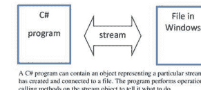

C# 程序可以包含一个对象，该对象表示程序员创建并连接到文件的特定流。程序通过对流对象调用方法来告诉它要做什么，从而对文件执行操作。

C# 有一系列不同的流类型，你可以根据想要做的事情来使用。所有流的使用方式完全相同。事实上，你已经熟悉流的使用方式，因为将 C# 程序连接到用户的 Console 类就是作为流实现的。ReadLine 和 WriteLine 方法是你可向任何流发出的命令，要求它读取和写入数据。

我们将考虑两种让程序使用文件的流类型；它们是 StreamWriter 和 StreamReader 类型。

### 3.6.2 创建输出流

创建流对象的方式与创建任何其他对象一样，都是通过使用 new。创建流时，可以向其传递要打开的文件的名称。

```csharp
StreamWriter writer;
writer = new StreamWriter("test.txt");
```

变量 writer 将引用你想要写入的流。创建新的 StreamWriter 时，程序将打开名为 test.txt 的文件用于输出，并将流连接到该文件。如果此过程因任何原因失败，例如你的操作系统无法/不被允许写入该文件，或者名称无效，那么该操作将失败并抛出相应的异常。

但请注意，如果文件 test.txt 已经存在，这段代码也不会出现问题。发生的情况只是会在原位置创建一个全新的空文件。这可能有危险。这意味着你可以使用上面的两条语句完全破坏现有文件的内容，那会很糟糕。大多数有用的程序会询问用户是否应覆盖现有文件，你稍后会了解如何做到这一点。

### 3.6.3 写入流

流创建后，可以通过调用它提供的写入方法向其写入。

```csharp
writer.WriteLine("Hello world");
```

上述语句对流调用 WriteLine 方法，使其将文本 "Hello world" 写入文件 test.txt。这与用于将信息写入控制台供用户读取的技术完全相同。事实上，你可以使用所有写入功能，包括我们在前面打印部分探索过的那些功能，来格式化输出。

每次向文件写入一行时，该行都会添加到已经写入的行末尾。如果你的程序陷入无限循环写入，它可能会填满存储设备。如果发生这种情况，并且写入无法成功执行，那么对 WriteLine 的调用将抛出异常。编写良好的程序可能应确保捕获并正确处理任何此类异常（打开文件时也可能抛出这些异常）。

### 3.6.4 关闭流

当程序完成向流写入后，使用 Close 方法显式关闭流非常重要：

```
writer.Close();
```

调用 Close 方法时，流会将所有等待写入文件的文本写出，并断开程序与文件的连接。任何进一步向该流写入的尝试都将失败并抛出异常。文件一旦关闭，计算机上的其他程序就可以访问它，也就是说，执行关闭后，你可以使用记事本程序打开 test.txt 并查看其中的内容。忘记关闭文件会因多种原因而带来问题：

- 程序可能在文件未正确关闭的情况下结束。在这种情况下，你写入文件的部分数据将不会存在。
- 如果你的程序有连接到文件的流，其他程序可能无法使用该文件。也将无法移动或重命名该文件。
- 打开的流会消耗一小部分但相当可观的操作资源。如果你的程序创建大量流但不关闭它们，这可能会导致以后打开其他文件时出现问题。

所以，关闭文件，否则后果自负。

### 3.6.5 流与命名空间

如果你迫不及待地尝试上面的代码片段，你会发现它们无法工作。对此很抱歉。在使用 StreamWriter 类型之前，你还需要了解一些其他内容。与许多处理输入和输出的对象一样，这个对象定义在 System.IO 命名空间中。我们之前已经接触过命名空间，当时我们思考了在 C# 程序开头需要包含 using System; 语句的原因。现在我们需要进一步了解它们。

命名空间都与查找资源有关。C# 语言提供了允许我们编写程序的关键字和构造，但除此之外，C# 安装还附带大量额外资源。这些资源包括 Console 对象之类的东西，它让我们可以读取文本并向用户写入文本。C# 安装实际上包含成千上万的资源，每个资源都必须有唯一标识。如果你负责对大量项目进行编目，你会发现将项目分组会非常有帮助。博物馆馆长一直这样做。他们把所有的罗马文物放在一个房间，把希腊文物放在另一个房间。C# 语言的设计者创建了命名空间机制，让程序员可以用他们的资源做同样的事情。

对于它以前没见过的项，它会自动在已被告知要使用的命名空间中查找。换句话说，当编译器看到以下语句时：

```
Console.WriteLine("Hello World");
```

它知道要在 System 命名空间中查找该对象，以便可以对其使用 WriteLine 方法。如果程序员拼错了类名：

```
Console.WriteLine("Hello World");
```

编译器将在 System 命名空间中查找，找不到名为 Console 的对象，并生成编译错误。

如果你尝试使用 StreamWriter 类但没有告诉编译器在 System.IO 命名空间中查找，你将得到同样的错误。换句话说，要使用文件处理类，你需要在程序的最顶部添加以下语句：

```
using System.IO;
```

可以将一个命名空间放在另一个命名空间内部（就像图书管理员会把一个花瓶柜放在罗马房间里，并可以将其称为 Roman.Vases），因此 IO 命名空间实际上包含在 System 命名空间内。然而，仅仅因为你使用了某个命名空间，并不意味着你使用了其中定义的所有命名空间，因此你必须包含上面的行，才能使用文件处理对象。

命名空间是确保你创建的项的名称不会与其他程序员的名称冲突的好方法。我们稍后将了解如何创建自己的命名空间。

### 3.6.6 从文件读取

从文件读取与写入非常相似，因为程序会创建一个流来完成实际工作。在这种情况下，使用的流是 StreamReader。

```
TextReader reader = new StreamReader("Test.txt");
string line = reader.ReadLine();
Console.WriteLine(line);
reader.Close();
```

上述程序将流连接到文件 Test.txt，从文件中读取第一行，将其显示在屏幕上，然后关闭流。如果找不到该文件，那么打开它的尝试将失败，程序将抛出异常。

#### 检测输入文件的结尾

重复调用 ReadLine 将返回文件的后续各行。然而，如果你的程序到达文件末尾，ReadLine 方法每次被调用时都会返回空字符串。幸运的是，StreamReader 对象提供了一个名为 EndOfStream 的属性，程序可以用它来确定何时到达文件末尾。当该属性变为 true 时，就已经到达文件末尾。

```
StreamReader reader;
reader = new StreamReader("Test.txt");
while (reader.EndOfStream == false)
{
    string line = reader.ReadLine();
    Console.WriteLine(line);
}
reader.Close();
```

上述程序将打开文件 test.txt，并在控制台上显示文件中的每一行。当到达文件末尾时，while 循环将停止程序。


# 4 创建解决方案
## 4.1 我们的案例研究：友好银行
本节的大部分内容基于一个案例研究，这将使你能够在强有力的背景下看到 C# 的特性。你将扮演一名程序员的角色，使用该语言为客户创建一个解决方案。

我们正在制作的程序是为一家银行服务的，即“United Friendly and Really Nice Bank of Lovely People”™，又名友好银行。我们将使用 C# 创建整个银行应用程序，并探索使此操作变得容易的 C# 特性。

作为一名程序员，在你的职业生涯中不太可能让你真正实现一个完整的银行系统（尽管这可能非常有趣——而且可能相当有利可图）。然而，从编程的角度来看，这是一个有趣的问题，随着我们接近它，我们将发现许多在我们可能编写的其他程序中也很有用的技术。

### 程序员提示：寻找模式
世界上不同程序的数量实际上相当少。我们银行将要做的很多事情（存储大量关于大量个人的信息、为特定人员搜索信息、实施更改系统一个或多个项目内容的交易）与从电子游戏到机器人的许多其他类型的程序都很常见。

### 4.1.1 银行系统范围
系统的范围是对系统将要执行的功能的描述。这也隐含地说明了系统将不做什么。这同样重要，因为客户通常不会清楚你正在做什么，并且很可能会期望你提供你根本没有打算提供的内容。通过在开始时明确范围，你可以确保以后不会出现不愉快的意外。

目前我们只关心管理银行中的账户信息。银行经理告诉我们，银行存储每个客户的信息。这些信息包括他们的姓名、地址、账号、余额和透支值。以后可能会添加其他数据项。

客户有数千名，经理还告诉我们还有许多不同类型的账户（而且不时还会发明新的账户类型）。

系统还必须按要求生成警告信和对账单。

#### 银行笔记
在某些章节的末尾，将描述这段新的 C# 如何影响我们创建银行系统的方式。这些注释应将特性置于有用的上下文中。

## 4.2 枚举类型
这些听起来很时髦。如果有人问你今天学到了什么，你可以说“我学会了如何使用枚举类型”，他们会非常印象深刻。当然，如果他们懂编程，他们只会说“哦，你的意思是你给一些状态编号了”，也不会太在意。

### 4.2.1 枚举与状态
枚举听起来很时髦。但如果你把“enumerated”仅仅理解为“编号”，事情就会变得容易一些。为了理解我们在这里做什么，我们需要考虑这些类型旨在解决的问题。

我们知道如果我们想保存一个整数值，可以使用 int 类型。如果我们想保存真或假的东西，可以使用 bool。然而，有时我们想保存一系列特定值或状态。

#### 示例状态
枚举类型在存储状态信息时非常有用。状态并不完全与其他项目（如客户姓名或其账户余额）相同。

例如，如果我要编写一个打《战舰》游戏的程序（其中“海洋”的方格包含可以被攻击的不同类型的舰艇），我可能会决定海洋的某个方格可以包含以下内容：
- 空海
- 已攻击
- 战列舰
- 巡洋舰
- 潜艇
- 划艇

如果你仔细想想，我在这里有点组装了更多元数据，因为我决定需要跟踪海洋，然后我弄清楚可以放入其中的确切内容。我可以用数字来做：
- 空海 = 1
- 已攻击 = 2
- 战列舰 = 3
- 巡洋舰 = 4
- 潜艇 = 5
- 划艇 = 6

然而，这意味着我必须自己跟踪这些值，并记住如果在海洋位置得到值 7，这显然是错误的。

C# 有一种方法可以创建一种类型，该类型只有特定的一组可能值。这些类型称为“枚举类型”。

```
enum SeaState
{
    EmptySea,
    Attacked,
    Battleship,
    Cruiser,
    Submarine,
    RowingBoat
}
```

我创建了一个名为 SeaState 的类型，可用于保存海洋特定部分的狀態。它只能具有上述给定的值，并且必须完全以这些命名枚举来管理。例如我必须写：

```
SeaState openSea;
openSea = SeaState.EmptySea;
```

我的变量 openSea 只能保存代表海洋内容状态的值。当然 C# 本身实际上会将这些状态表示为特定的数值，但如何管理这些数值不是我的问题。

请注意，我创建的类型（如 SeaState）将在编辑器中以蓝色高亮显示，这种蓝色与关键字并不完全相同。

这表明这些项目是我创建的额外类型，可用于创建变量，但它们并不是 C# 语言的一部分，就像关键字一样。理解这里发生的事情很重要。之前我们使用的是 C# 的一部分的类型，例如 int 和 double。现在我们已经到了实际创建自己的数据类型的阶段，这些数据类型可用于保存应用程序所需的数据值。

### 4.2.2 创建枚举类型
新的枚举类型可以在任何类之外创建，并在我的任何程序中创建一个新类型供使用：

```
using System;
enum TrafficLight
{
    Red,
    RedAmber,
    Green,
    Amber
}
class EnumDemonstration
{
    public static void Main ()
    {
        TrafficLight light ;
        light = TrafficLight.Red;
    }
}
```

每当你需要保存只能取有限数量可能值或状态的东西时（例如 OnSale、UnderOffer、Sold、OffTheMarket 等），你就应该考虑使用枚举类型来保存这些值。

#### 程序员提示：使用枚举类型
枚举类型是另一个人人受益的情况如果你使用它们。程序变得更简单编写、更容易理解且更安全。因此你应该大量使用它们。

对于银行，你希望同时保存项目的状态以及有关客户的其他信息。例如，我们可以将状态“Frozen”、“New”、“Active”、“Closed”和“Under Audit”作为银行账户的状态。如果是这种情况，创建一个可以保存这些值且仅这些值的枚举类型是明智的

```
enum AccountState
{
    New,
    Active,
    UnderAudit,
    Frozen,
    Closed
};
```

我们现在有一个变量可以保存银行账户的状态信息。每个账户都将包含一个 AccountState 类型的变量，表示该账户的状态。

## 4.3 结构
结构让我们可以将一组单独的值组织成一个连贯的整体，我们可以将该整体映射到我们正在处理的问题中的一个项目。这在许多应用程序中都很重要。

### 4.3.1 什么是结构？
当你处理信息时，你通常希望保存关于特定项目的不同事物的集合。友好银行委托了一个账户存储系统，你可以使用结构使此操作更容易。就像任何参加过我课程的好程序员一样，你会开始做以下事情：
- 精确地确定规范，即以书面形式明确他们期望你的系统做什么。
- 谈判一个过高的费用。
- 考虑如何存储数据。

#### 一个示例结构
根据你的规范，你知道程序必须保存以下内容：
- 客户姓名 - 字符串
- 客户地址 - 字符串
- 账号 - 整数值
- 账户余额 - 整数值
- 透支额度 - 整数值

友好银行告诉你，他们只会将多达 50 人放入你的银行存储中，所以过了一段时间后，你提出了以下方案：

```
const int MAX_CUST = 50;
AccountState [] states = new AccountState [MAX_CUST] ;
string [] names = new string [MAX_CUST] ;
string [] addresses = new string [MAX_CUST] ;
int [] accountNos = new int [MAX_CUST] ;
int [] balances = new int [MAX_CUST] ;
int [] overdraft = new int [MAX_CUST] ;
```

我们拥有的是为我们想要存储的关于特定客户的每条单独数据各一个数组。如果我们在谈论数据库（实际上我们就是在编写数据库），每个客户的数据块称为记录，而该块的单个部分，例如透支值，称为字段。在我们的程序中，我们假设 balance[0] 保存数据库中第一个客户的余额，overdraft[0] 保存第一个客户的透支，依此类推。（请记住数组下标值从 0 开始）。

这都很好，你可以用这种数据结构建立一个数据库系统。然而，能够以更明确的方式将你的记录组合在一起会更好。

### 4.3.2 创建结构
C# 让你可以创建数据结构。结构是一组 C# 变量，你希望将其作为单个实体处理。在 C# 中，一块数据称为结构，其每个部分称为字段。为了帮助我们处理银行数据库，我们可以创建一个结构来保存有关客户的所有信息：

```
struct Account
{
    public AccountState State;
    public string Name ;
    public string Address ;
    public int AccountNumber ;
    public int Balance ;
    public int Overdraft ;
} ;
```

这里定义了一个名为 Account 的结构，它包含所有必需的客户信息。完成这些之后，我们现在可以定义一些变量：

```
Account RobsAccount ;
Account [] Bank = new Account [MAX_CUST];
```

第一个声明创建了一个名为 RobsAccount 的变量，它可以保存单个客户的信息。第二个声明创建了一个完整的客户数组，名为 Bank，可以保存所有客户。

我们可以像对其他任何变量类型一样，将一个结构变量赋值给另一个结构变量。执行赋值时，源结构中的所有值都会被复制到目标结构中：

```
Bank[0] = RobsAccount;
```

这会将 RobsAccount 结构中的信息复制到 Bank 数组起始位置的元素中。

我们通过在使用结构变量之后写上成员名称、并用 .（句点）分隔来引用结构的各个成员，例如：

```
RobsAccount.AccountNumber
```

- 将引用结构变量 RobsAccount 中的整数字段 AccountNumber。（即 RobsAccount 中的 AccountNumber 值）

你也可以对结构数组的元素这样做，因此：

```
Bank [25].Name
```

- 将是包含下标为 25 的元素中客户姓名的字符串。

### 4.3.3 使用结构

创建并设置结构的程序如下所示：

```
using System;

// enum
enum AccountState
{
    New,
    Active,
    UnderAudit,
    Frozen,
    Closed
} ;
```

```
// structure
struct Account
{
    public AccountState State;
    public string Name ;
    public string Address ;
    public int AccountNumber ;
    public int Balance ;
    public int Overdraft ;
}
// program
class BankProgram
{
    public static void Main ()
    {
        Account RobsAccount;
        RobsAccount.State = AccountState.Active;
        RobsAccount.Name = "Rob Miles";
        RobsAccount.Address = "His house";
        RobsAccount.AccountNumber = 1234;
        RobsAccount.Balance = 0;
        RobsAccount.Overdraft = -1000;
        Console.WriteLine ( "Name is: " + RobsAccount.Name ) ;
        Console.WriteLine ( "Balance is: " + RobsAccount.Balance ) ;
    }
}
```

注意结构和枚举是如何声明在 BankProgram 类外部的。一旦创建了结构，我就可以像使用 Int 或 Float 之类的类型一样使用它。

这个程序没有创建结构数组，但它确实展示了如何访问单个结构变量中的各个字段。

#### 结构中的初始值

当结构作为局部变量（即在块中）创建时，其中的值未定义。这意味着如果你尝试在程序中使用它们，就会得到编译错误。这与你在一程序中在给变量赋值之前就使用它完全相同。换句话说：

```
Account RobsAccount;
Console.WriteLine ( "Name is: " + RobsAccount.Name );
```

- 会产生编译错误。作为程序员，你的职责是确保在尝试从变量中取出任何内容之前，始终先给变量放入一个值。

#### 在方法调用中使用结构类型

方法可以具有结构类型的参数：

```
public void PrintAccount ( Account a )
{
    Console.WriteLine ( "Name: " + a.Name );
    Console.WriteLine ( "Address: " + a.Address );
    Console.WriteLine ( "Balance: " + a.Balance );
}
```

这个方法提供了一种快速打印账户变量内容的方式：

```
PrintAccount (RobsAccount);
```

也可以创建返回结构类型结果的方法，例如我们可以创建一个 ReadAccount 方法，它读取一个账户并将其返回。

#### 程序员要点：结构至关重要

在商业系统中，花费很长时间设计构成数据存储的结构是很常见的。它们是程序的基本构建块，因为它们保存着其他一切所赖以构建的所有数据。你可以把结构的设计以及对其内容的约束，视为关于你所创建系统的另一大块元数据。

#### 使用类型进行设计

你可以看到，我们已向 Account 结构添加了一个 State 值。这使程序可以轻松跟踪账户的特定状态。我们所做的是创建了一个可以保存多个值的类型（我们的 AccountState 枚举类型），并将其放入我们设计的另一个类型中，后者用于保存银行账户持有人的信息。这种方法就是你处理更复杂问题的方式。我们可以从与客户讨论所得的元数据中，获得这些类型应保存内容的所有细节。

例如，如果我们想创建一个真正令人印象深刻的双层玻璃窗管理程序，我们可能会设计出类似这样的东西：

```
enum WindowState
{
    Quoted,
    Ordered,
    Manufactured,
    Shipped,
    Installed
};

struct Window
{
    public WindowState state;
    public double Width;
    public double Height;
    public string Description;
};
```

这将保存房屋中某个特定窗户的信息，包括窗户的尺寸、窗户订单的状态，以及描述窗户本身的字符串。对于包含若干窗户的特定房屋，我们可以创建一个 Window 结构数组。

#### 程序员要点：你应该为对象赋予状态

上面的 Account 类是一个很好的例子，说明对象会根据其所处的状态而以不同方式使用。例如，无法从处于 Frozen 状态的账户中取款。系统中的几乎每个对象都可以通过添加状态来改进。订单可以处于 Empty、Pending、Despatched 和 Received 状态。外星人可以处于 Sleeping、Attacking 或 Destroyed 状态。每当你发明一个新对象时，都应该立即开始考虑它在你系统中可以占据的状态。

## 4.4 对象、结构与引用

你已经看到，如果你想存储关于某个特定项的一组信息，可以将所有这些信息汇集到一个结构中。结构很有用，但在编写大型程序时，我们还希望能够解决其他问题：

- 我们希望确保程序中的给定项不能被置于无效状态，也就是说，我们不希望银行账户的账号为空或不正确。
- 我们希望能够将大型系统分解为独立且分离的组件，这些组件可以独立开发，并可与执行相同任务的其他组件互换，也就是说，我们希望让一个程序员团队处理账户，另一个团队处理支票，另一个团队处理信用卡等。
- 我们希望确保创建新型银行账户所涉及的工作量尽可能小，也就是说，如果银行决定推出一种新的高息存款账户，我们希望能够利用现有的存款账户

为了做到所有这些，我们将不得不开始从基于对象设计的角度来考虑程序。本节应该附带某种健康警告，内容大致是“其中一些想法一开始可能会让你的脑袋有点疼”。但以下几点也非常重要：

- 对象不会为我们的程序添加任何新行为——当我们学习了语句、循环、条件和数组之后，我们几乎已经知道编写程序所需的一切。
- 对象最好被视为设计问题的一种解决方案。它们让我们能够用概括性的方式来谈论系统。我们可以之后再回过头来细化对象实际完成任务的方式。

几乎一切已经写过的程序，都可以仅使用我们目前已经了解的技术来编写。但对象让我们能够以更好的方式工作。因此，不管喜不喜欢，我们都必须掌握它们。

### 4.4.1 对象与结构

在 C# 中，对象和结构有很多共同之处。它们都可以保存数据并包含方法。然而，两者之间有一个关键区别。结构按值管理，而对象按引用管理。

理解两者之间的区别非常重要，因为这会对它们的使用方式产生很大影响。

#### 创建和使用结构

考虑以下代码：

```
struct AccountStruct
{
    public string Name;
};

class StructsAndObjectsDemo
{
    public static void Main ()
    {
        AccountStruct RobsAccountStruct;
        RobsAccountStruct.Name = "Rob";
        Console.WriteLine ( RobsAccountStruct.Name );
    }
}
```

这实现了一个非常简单的银行账户，其中我们只保存账户持有人的姓名。Main 方法创建了一个名为 RobsAccountStruct 的结构变量。

| RobsAccountStruct |
|---|
| Name: Rob |


接着，代码将变量的 name 属性设置为字符串 "Rob"。如果我们运行这个程序，结果正如你所预料的那样：它会打印出名字 "Rob"。如果该结构还包含关于银行账户的其他条目，它们同样会被存储在该结构中，我也可以用同样的方式来使用它们。

#### 创建并使用类的实例

我们可以对程序做一个小小的改动，把银行账户转换为一个类：

```
class Account
{
    public string Name;
};

class StructsAndObjectsDemo
{
    public static void Main ()
    {
        Account RobsAccount;
        RobsAccount.Name = "Rob";
        Console.WriteLine (RobsAccount.Name);
    }
}
```

账户信息现在保存在类中，而不是结构中。这个账户类被简单地命名为 Account。问题在于，当我们编译这个程序时，会得到如下错误：

```
ObjectName.cs(12): error CS0165: Use of unassigned local variable 'RobsAccount'
```

那么，这是怎么回事呢？要理解所发生的事，你需要知道这一行做了什么：

```
Account RobsAccount;
```

这看起来像是声明了一个名为 RobsAccount 的变量。但对于对象来说，事情并非表面看上去那样。


当程序执行这一行时，你真正得到的是创建了一个名为 RobsAccount 的引用。这样的引用被允许指向 Account 的实例。你可以把它们想象成有点类似行李牌：它们可以用一根绳子系在某样东西上。如果你有这个标签，就可以顺着绳子找到它所系着的对象。

但当我们创建引用时，实际上并没有得到它所指向的那个东西。编译器知道这一点，所以它会报错，因为这一行：

```
RobsAccount.Name = "Rob";
```

是在尝试找到系在这个标签上的东西，并把 name 属性设置为 "Rob"。由于这个标签目前没有系在任何东西上，程序在这里就会失败。因此编译器实际上是在说：“你正试图沿着一个不指向任何东西的引用去找目标，所以我将给你一个‘变量未定义’错误。”

我们通过创建类的一个实例，然后把标签连接到它上面来解决这个问题。实现方式是在程序中添加一行：

```csharp
class Account
{
    public string Name ;
};
class StructsAndObjectsDemo
{
    public static void Main ()
    {
        Account RobsAccount ;
        RobsAccount = new Account();
        RobsAccount.Name = "Rob";
        Console.WriteLine (RobsAccount.Name );
    }
}
```

我添加的这行创建了一个新的 Account 对象，并将引用 RobsAccount 设置为指向该对象。

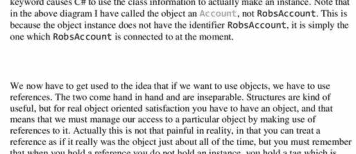

我们之前见过 new 这个关键字。我们用它来创建数组，那是因为数组实际上被实现为对象，所以我们用 new 来创建它。new 创建的是一个对象，而对象是类的一个实例。我要用漂亮的字体把这句话再说一遍：

> > “对象是类的一个实例。”

我重复这句话是因为理解这一点非常重要。类向 C# 提供了要创建什么以及它能做什么的指令。new 关键字让 C# 使用类信息来实际创建一个实例。注意，在上面的图中，我把这个对象称为 Account，而不是 RobsAccount。这是因为对象实例本身并没有 RobsAccount 这个标识符；它只是当前被 RobsAccount 连接到的那个对象。

### 4.4.2 引用

现在我们必须习惯这样的观念：如果想使用对象，就必须使用引用。两者如影随形、密不可分。结构体有点用处，但要获得真正的面向对象的满足感，你必须拥有一个对象，而这意味着我们必须通过引用某个特定对象来管理对它的访问。实际上，这在现实中并没有那么痛苦，因为你几乎可以把引用当作对象本身来使用；但你必须记住，当你持有一个引用时，你持有的并不是实例本身，而是一个系在实例上的标签……

#### 对同一实例的多个引用

也许再看一个关于引用的例子会有所帮助。考虑以下代码：

```
Account RobsAccount ;
RobsAccount = new Account();
RobsAccount.Name = "Rob";
Console.WriteLine (RobsAccount.Name );
Account Temp ;
Temp = RobsAccount;
Temp.Name = "Jim";
Console.WriteLine (RobsAccount.Name );
```

问题是：第二次调用 WriteLine 会打印出什么？如果我们画一张图，答案就会更清楚：

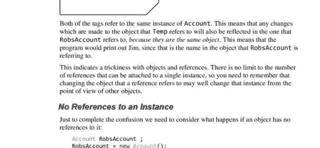

这两个标签都指向同一个 Account 实例。这意味着，对 Temp 所引用的对象所做的任何更改，也会反映在 RobsAccount 所引用的对象上，因为它们是同一个对象。因此程序会打印出 Jim，因为那正是 RobsAccount 所引用的对象中的名字。

这说明了对象和引用之间的一个微妙之处。一个实例上可以挂接的引用数量没有限制，所以你要记住：改变某个引用所指向的对象，很可能会从其他对象的角度改变该实例。

#### 没有引用指向的实例

为了让困惑更完整，我们还需要考虑当一个对象没有任何引用指向它时会发生什么：

```
Account RobsAccount ;
RobsAccount = new Account();
RobsAccount.Name = "Rob";
Console.WriteLine (RobsAccount.Name );
RobsAccount = new Account();
RobsAccount.Name = "Jim";
Console.WriteLine (RobsAccount.Name );
```

这段代码创建了一个账户实例，将其 name 属性设置为 Rob，然后又创建了另一个账户实例。引用 RobsAccount 被设置为指向新对象，而新对象的 name 被设置为 Jim。问题是：第一个实例会怎么样？同样，用一张图可以更清楚地说明：

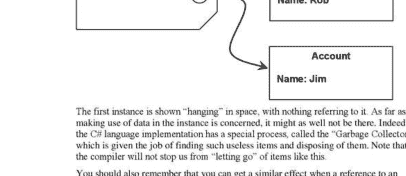

第一个实例显示为“悬空”在空间中，没有任何引用指向它。就利用实例中的数据而言，它就跟不存在一样。实际上，C# 语言实现中有一个特殊机制，称为“垃圾回收器”（Garbage Collector），它的任务就是找到这些无用的对象并销毁它们。注意，编译器并不会阻止我们“松手”放弃这样的对象。

你还应记住，当指向某个实例的引用超出作用域时，也会产生类似效果：

```
{
    Account localVar ;
    localVar = new Account();
}
```

变量 localVar 是该块内的局部变量。这意味着当程序执行离开这个块时，局部变量会被丢弃。这也就意味着指向该账户的唯一引用也被移除了，垃圾回收器又多了一项工作。

#### 程序员要点：尽量避免使用垃圾回收器

虽然有时释放不再使用的对象是合理的，但你必须记住，创建和销毁对象会占用计算资源。当我使用对象时，我会担心自己创建和销毁了多少对象。对象会被自动销毁，并不意味着你就应该滥用这一机制。

### 4.4.3 为什么还要用引用？

引用现在听起来并不那么有趣。它们似乎让创建和使用对象变得更困难，而且可能是许多混乱的根源。那么我们为什么还要费心使用它们呢？

要回答这个问题，我们可以看看太平洋上的雅浦岛（Yap）。这个岛使用的货币是约 12 英尺高的石头，每块重达数百磅。

雅浦货币中一枚“硬币”的价值，与将石头运到岛上的船上死亡的人数直接相关。当你用其中一枚硬币付款时，你并不会真的把它搬起来交给对方。相反，你只需要说：“山顶路上那枚硬币现在是你的了。”换句话说，他们用引用来管理那些不想搬来搬去的对象。

这就是我们在程序中使用引用的原因。设想一家银行有许多账户。如果我们想把它们按客户姓名的字母顺序排序，就必须把它们全部搬来搬去。


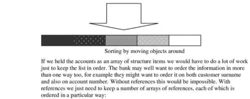

通过移动对象进行排序

如果我们把账户保存在一个结构体数组中，为了保持列表有序，我们就需要做大量的工作。银行很可能还想以多种方式对信息排序，例如，他们可能希望既按客户姓氏排序，又按账号排序。如果没有引用，这是不可能做到的。有了引用，我们只需要维护多个引用数组，每个数组按特定方式排序：


通过使用引用进行排序

如果我们只对引用进行排序，就完全不必移动大型数据项。添加新对象时也无需移动任何对象，只需移动引用即可。

#### 引用与数据结构

我们按排序引用构成的列表非常好，但如果要往已排序列表添加内容，我们仍然需要移动引用。我们可以通过把数据组织成树形结构来克服这一点，同时还能加快搜索速度。


通过使用树进行排序

在上面的树中，每个节点有两个引用，一个可以指向“较浅”的节点，另一个可以指向“较深”的节点。如果我想要一个有序的项目列表，只需沿着“较浅”的一侧尽量往下走，就会到达最浅的那个节点。然后回到它上面的节点（那必定是次浅的）。接着沿着较深的一侧（Lake）向下走，重复这个过程。这种方法的巧妙之处还在于添加新项目非常容易：我只需在树上找到需要挂接的位置，然后把引用挂在那里即可。

搜索也很快，因为我可以在每个节点处判断下一步该往哪个方向查找，直到要么找到目标，要么发现所需方向没有引用，这种情况下说明该项不在结构中。

#### 程序员要点：数据结构很重要

这不是一篇数据结构文档，而是一篇编程文档。如果你暂时还没弄懂有关树的内容，别担心，只要记住引用是构建数据结构的重要机制即可。但将来某个时候，你一定需要认真理解如何使用这些东西来构建结构。

#### 引用的重要性

这种工作方式的关键在于，对象除了包含数据负载外，还可以包含对其他对象的引用。我们稍后会讨论对象使用的这一方面；目前只需记住引用和对象是各不相同、彼此独立的。

#### 银行笔记：引用与账户

对于一家拥有成千上万客户的银行来说，引用对其管理所持有的数据至关重要。账户会保存在计算机内存中，而且由于每个账户的规模以及存储的账户数量，如果我们想对它们排序，是不可能在内存中移动它们的。

这意味着操作它们的唯一办法是让它们留在原地，并维护指向这些账户的引用列表。引用是非常小的“标签”，可以用来在内存中定位实际项目。对引用列表排序非常容易，而且也可以维护多个这样的列表。这意味着我们可以向经理提供按客户姓名排序的银行视图，以及按余额排序的另一个视图。而且，如果经理提出需要新的结构或视图，我们也可以用引用来创建。

## 4.5 用对象进行设计

我们现在开始以对象的视角来思考。我们这样做的原因是，我们希望找到一种方法，使系统设计尽可能简单。这都要归结为程序员们著名的“创造性的懒惰”。我们在这里试图做到的事情，最好表述为：

> 尽可能把所有的困难工作推迟，如果可能的话，让别人去做。

对象让我们做到了这一点。回到我们的银行账户，我们可以看到，我们需要能够对银行账户做许多事情：

- 向账户存钱
- 从账户取钱
- 查询余额
- 打印对账单
- 更改账户持有人的地址
- 打印账户持有人的地址
- 更改账户状态
- 查询账户状态
- 更改透支限额
- 查询透支限额

基于对象的设计没有说“我们需要对银行账户执行这些操作”，而是反其道而行之，有点像多年前肯尼迪总统所做的那样：

> “因此，我的美国同胞们：不要问国家能为你做什么——问问你能为国家做什么”（热烈的欢呼）

我们不对银行账户做事情，而是请它为我们做这些事情。我们的银行应用设计可以这样思考：先确定用于表示信息的对象，然后规定它们应该能够做哪些事情。真正巧妙之处在于，一旦我们决定了银行账户应当做什么，我们也许就能让别人去实现这些功能。

如果我们的规格说明是正确的，而他们也恰当地实现了它，我们就不必操心他们究竟是如何让它工作的——只需坐享其成，把工作做好的功劳归到自己名下。

这让我们回到本文档中反复出现的两个主题：元数据和测试。银行账户对象应当能够做什么，是该对象元数据的一部分。一旦我们决定了账户必须执行的操作，接下来就需要设计一种方法，使每个操作都能被测试。

在本节中，我们将实现一个具有真实银行账户部分行为的对象。

### 程序员要点：并非一切都应该成为可能

请注意，有些事情我们不应该能对银行账户对象做。账户的账号是该账户所独有的，不应更改。我们可以通过根本不提供改变账号的方法来获得这种行为。在设计时，重要的是我们不仅要确定应该做什么，还要确定哪些行为应该是不可能的。我们甚至可以把一些操作标记为受审计的，即对象会记录对它做过什么。这样我们就能很容易地发现是否有坏事发生。

### 4.5.1 对象中的数据

所以，我们可以从希望银行账户为我们做什么的角度来考虑它。首先要确定我们想在其中存储的所有数据项。为了简单起见，我现在只考虑如何跟踪账户余额。这样我就能描述所有所需的技术，而不会被太多细节所困扰。

```
class Account
{
    public decimal Balance;
}
```

上面的 Account 类保存了我们存储银行账户余额所需的成员。类中保存一个值、用于描述该类所持有的某些数据的成员通常称为属性。我使用 decimal 类型来表示账户余额，因为该类型是专门为保存金融数值而设计的。

我们已经看到，类中的每个数据项都是类的一个成员，并且作为类的一部分存储。每次创建类实例时，我也得到了所有成员。我们已经看到，创建类实例并设置成员的值是非常容易的：

```
Account RobsAccount;
RobsAccount = new Account();
RobsAccount.Balance = 99;
```

这样做能起作用的原因是，对象的所有成员都是 public，这意味着任何需要直接访问它们的人都可以访问。也就是说，任何编写应用程序的程序员都可以做类似的事情：

```
RobsAccount.Balance = 0;
```


并拿走我所有的钱。如果我们要提供一种阻止这种情况发生的方法，我们需要保护对象内部的数据。

### 4.5.2 对象内部的成员保护

如果对象要发挥作用，我们必须有一种保护其中数据的方法。理想情况下，当有人尝试更改我对象中的值时，我希望能够获得控制权，并在我不喜欢的情况下阻止该更改的发生。对此的正式说法是封装。我希望所有重要数据都隐藏在我的对象内部，这样我就能完全控制对其的操作。这种技术是我防御性编程方法的关键，其目的是确保无论发生什么情况，我的程序部分都不会出错。

例如，在我们的银行程序中，我们希望确保余额永远不会以我们无法控制的方式被更改。我们需要做的第一件事就是阻止外部世界随意操作我们的余额值：

```
class Account
{
    private decimal balance;
}
```

该属性不再标记为 public。而是现在为 private。这意味着外部世界不再能直接访问它。如果我编写以下代码：

Rob'sAccount.balance = 0;

当我尝试编译程序时，我会收到一个错误：

```
PrivateDemo.cs(13,3): error CS0122:
'PrivateMembers.Account.balance' is inaccessible due to its protection level
```

余额值现在保存在对象内部，对外部世界不可见。

#### 修改私有成员

我可以告诉你，像这样进行测试非常困难，因为虽然很容易向程序发送输入，但通常很难看到程序对此的响应。我在这些情况下的做法是让用户界面部分成为一个非常薄的层，位于对象执行工作的请求之上。以我们上面的银行账户为例，提供用户界面的代码——客户在其中输入想要取款的金额——将会非常简单，并直接连接到我的对象提供的方法。只要我的对象测试通过，我就可以相当确信用户界面也会没问题。

另一种很难用这种方式进行测试的程序类型是任何类型的游戏。这主要是因为游戏玩法的质量不是你可以设计测试的内容。只有当有人回来并说 "The game is too hard because you can't kill the end of level boss without dying" 时，你才能真正采取行动。在这种情况下唯一的解决方案是非常明确地说明你的测试试图证明什么，以便人类测试人员知道要寻找什么，并使更改会影响游戏玩法的数值变得非常容易。例如，应该很容易调整外星人一次攻击对你的宇宙飞船造成的伤害量，以及所有游戏对象的速度。

## 4.6 静态项

目前我们在类中创建的所有成员都是该类的实例的一部分。这意味着每当我们创建一个 Account 类的实例时，我们都会得到一个 balance 成员。然而，我们也可以创建作为类的一部分保存的成员，即它们存在于任何特定实例之外。

### 4.6.1 静态类成员

static 关键字让我们可以创建不保存在实例中而是保存在类本身的成员。

在 C# 程序的上下文中了解 static 的含义非常重要。我们在几乎所有编写过的程序中都大量使用了它：

```csharp
class AccountTest
{
    public static void Main ()
    {
        Account test = new Account();
        test.PayInterest (50);
        Console.WriteLine ("Balance:" + test.GetBalance());
    }
}
```

AccountTest 类有一个名为 Main 的静态成员方法。我们知道这是运行程序时被调用的方法。它是 AccountTest 类的一部分。如果我创建了五十个 AccountTest 实例，它们都会共享同一个 Main 方法。在 C# 术语中，关键字 static 用于标记成员属于类本身，而不属于类的实例。我将再次用漂亮的字体写下来，

> > “静态成员是类的成员，而不是类的实例的成员”

我不需要创建 AccountTest 类的实例就能使用 Main 方法。这就是我的程序实际运行的方式，因为当它启动时还没有创建任何实例，因此该方法必须已经存在，否则它无法运行。

Static 并不是指“不可更改”。我想这时候该用更多漂亮的字体了：

> > Static 并不是指“不可更改”。

被设为静态的类成员可以像类的任何其他成员一样使用。数据成员或方法都可以设为静态。

### 4.6.2 使用类的静态数据成员

也许在这个时候举一个静态数据的例子会有帮助。考虑我们的银行账户的利率。客户告诉我们，账户类的一个成员需要是账户的利率。在程序中，我们可以通过向类添加另一个成员来实现这一点，该成员保存当前的利率：

```csharp
public class Account
{
    public decimal Balance ;
    public decimal InterestRateCharged ;
}
```

现在我可以创建账户并为它们设置余额和利率。（当然，如果我做得规范，我会将这些设为私有并提供方法等，但我现在保持简单。）

```csharp
Account RobsAccount = new Account();
RobsAccount.Balance = 100;
RobsAccount.InterestRateCharged = 10;
```

问题在于我被告知利率适用于所有账户。如果利率发生变化，它必须对所有账户都生效。这意味着要实现更改，我必须遍历所有账户并更新利率。这会很繁琐，而且如果漏掉一个账户，可能会很昂贵。

我通过将利率成员设为静态来解决这个问题：

```csharp
public class Account
{
    public decimal Balance ;
    public static decimal InterestRateCharged ;
}
```

利率现在是类的一部分，而不是任何实例的一部分。这意味着我必须改变获取它的方式：

```csharp
Account RobsAccount = new Account();
RobsAccount.Balance = 100;
Account.InterestRateCharged = 10;
```

由于它是类的成员，现在我必须使用类名来获取它，而不是实例引用的名称。

#### 程序员提示：静态数据成员很有用但也很危险

当你为项目收集元数据时，应该寻找可以设为静态的东西。像值的限制（你将允许一个人拥有的最大年龄）之类的东西可以设为静态。可能有一天年龄限制会发生变化，而你不想更新程序中的所有对象。

但当然，正如蜘蛛侠的叔叔所说，“能力越大，责任越大。”你应该小心如何提供对静态数据项的访问。对单个静态值的更改会影响整个系统。因此它们应始终设为私有，并通过方法调用进行更新。

### 4.6.3 在类中使用静态方法

我们也可以使方法静态。我们很久以来一直对 Main 方法这样做。但在设计系统时你也可以使用它们。例如，我们可能有一个方法来决定某人是否被允许拥有银行账户。它会接收年龄和收入。然后根据这些是否可接受返回 true 或 false：

```csharp
public bool AccountAllowed ( decimal income, int age )
{
    if ( ( income >= 10000 ) && ( age >= 18 ) )
    {
        return true;
    }
    else {
        return false;
    }
}
```

这会检查年龄和收入；你必须年满 17 岁并且至少有 10000 英镑的收入才被允许开户。问题是，目前我们必须先拥有一个 Account 实例才能调用该方法。我们可以通过使方法静态来解决这个问题：

```csharp
public static bool AccountAllowed ( decimal income, int age )
{
    if ( ( income >= 10000 ) && ( age >= 18 ) )
    {
        return true;
    }
    else {
        return false;
    }
}
```

现在该方法属于类，而不是类的实例。我现在可以通过使用类名来调用该方法：

```csharp
if ( Account.AccountAllowed ( 25000, 21 ) )
{
    Console.WriteLine ( "Allowed Account" );
}
```

这很好，因为我不需要创建账户实例就能查明是否允许开户。

#### 在静态方法中使用成员数据

Allowed 方法没问题，但当然我已将年龄和收入固定在其中。我可能会决定使方法更灵活：

```csharp
public class Account
{
    private decimal minIncome = 10000;
    private int minAge = 18;

    public static bool AccountAllowed(decimal income, int age)
    {
        if ( ( income >= minIncome ) && ( age >= minAge ) )
        {
            return true;
        }
        else
        {
            return false;
        }
    }
}
```

这是一个更好的设计，因为我现在拥有类成员来设定年龄和收入的上限。然而这是一个糟糕的程序，因为上面的类无法编译：

```
AccountManagement.cs(19,21): error CS0120: An object reference is required for the nonstatic field, method, or property 'Account.minIncome'
AccountManagement.cs(19,43): error CS0120: An object reference is required for the nonstatic field, method, or property 'Account.minAge'
```

像往常一样，编译器正用让人头晕的语言告诉我们到底哪里错了。编译器真正的意思是“静态方法正在使用一个非静态的类成员。”

如果这没有帮助，试试这个。成员 minIncome 和 minAge 保存在 Account 类的实例中。然而，静态方法可以在没有实例的情况下运行（因为它属于类）。编译器不满意，因为在这种情况下方法将没有任何成员可供使用。我们可以通过也将收入和年龄限制设为静态来修复这个问题（并使程序完全正确）：

```csharp
public class Account
{
    private static decimal minIncome ;
    private static int minAge ;

    public static bool AccountAllowed(decimal income, int age)
    {
        if ( ( income >= minIncome ) && ( age >= minAge ) )
        {
            return true;
        }
        else
        {
            return false;
        }
    }
}
```

如果你想想，这完全说得通。限制值不应该作为类的成员保存，因为我们希望它们对所有实例都相同，因此，将它们设为静态是我们一开始就应该做的。

#### 程序员提示：静态方法成员可用于创建库

有时在开发中你需要提供一组执行任务的方法。在 C# 系统本身中，有大量用于执行数学函数的方法，例如 sin 和 cos。在这种情况下我们只需要方法本身，而不是类的实例，因此将这些方法设为静态是有意义的。同样，在构建系统时，你应该考虑如何使此类方法为你自己的使用提供可用。

#### 银行笔记：静态银行信息

我们可以在银行中使用 static 解决的问题类型有：

**static member variable:** 管理员希望我们能够一次性为所有客户账户设置利率。Account 类的单个静态成员将提供一个可在所有实例内部使用的变量。但由于该值只有一个副本，因此可以更改它，从而调整所有账户的利率。任何对所有类只保存一次的值（值的限制是另一个例子）最好作为静态值管理。当管理员说“哦，五岁儿童的账户利率与普通账户不同”时，使用静态就变得不可能了。此时我们知道不能使用静态，因为我们需要为某些实例保存不同的值。

**static member method:** 管理员告诉我们需要一个方法来确定某人是否被允许拥有账户。我不能将其作为任何 Account 实例的一部分，因为在运行时账户尚未生成。我必须将其设为静态，以便它可以在没有实例的情况下执行。

## 4.7 对象的构造

我们已经看到，当我们使用 new 来创建对象时，我们的对象就被创建了：

```csharp
test = new Account();
```

如果你仔细观察正在发生的事情，你可能会认为这看起来很像一次方法调用。

这实际上正是正在发生的事情。当创建类的实例时，C# 系统会调用该类中的构造函数方法。构造函数方法是类的成员，它的作用是让程序员获得控制权并设置这个崭新对象的内部内容。C# 游戏规则之一是每个类都必须有一个构造函数方法，以便在创建新实例时调用。


你可能会觉得这很奇怪，因为通常编译器在你做错事时不会浪费时间来责骂你，但在这种情况下它只是默默地解决问题而不告诉你。这里有两种看法：

- 友好的编译器：编译器试图让你的生活更轻松
- 邪恶的编译器：编译器知道如果它现在自动这样做，你以后在尝试理解为什么不需要添加一个时将会遭受更大的痛苦

你如何看待编译器的行为取决于你。

### 4.7.1 默认构造函数

构造函数方法与类同名，但它不返回任何内容。它在我们执行 new 时被调用。如果你没有提供构造函数（到目前为止我们还没有），编译器会为我们创建一个。

```
public class Account
{
    public Account ()
    {
    }
}
```

这就是默认构造函数的外观。它是 public 的，这样它就可以被可能想要创建该类实例的外部类访问。它不接受任何参数。如果我创建自己的构造函数，编译器会假设我知道自己在做什么并停止提供默认的构造函数。这可能会导致问题，我们稍后会讨论。

### 4.7.2 我们自己的构造函数

为了好玩，我们可以创建一个构造函数，它只是打印出它已被调用的信息：

```
public class Account
{
    public Account ()
    {
        Console.WriteLine ( "We just made an account" );
    }
}
```

这个构造函数并不太具建设性（呵呵），但它确实让我们知道它何时被调用。这意味着当我的程序执行以下行时：

```
robsAccount = new Account();
```

程序将打印出以下消息：

我们刚刚创建了一个账户

注意这并不太合理，因为它会导致大量打印输出，而程序的用户可能并不欣赏，但它确实展示了过程是如何工作的。

#### 为构造函数提供信息

能够在创建 Account 时获得控制权是有用的，但在创建时能够向 Account 传入信息会更好。例如，我可能想在创建账户时设置账户持有人的姓名、地址和初始余额。换句话说，我想这样做：

```
robsAccount = new Account( "Rob Miles", "Hull", 0 );
```

这将创建一个新账户并将 name 属性设置为 Rob Miles，地址设置为 Hull，初始余额设置为零。事实证明我可以很容易地做到这一点，我所要做的就是让构造函数方法接受这些参数并用它们来设置类的成员：

```
class Account
{
    // private member data
    private string name;
    private string address;
    private decimal balance;

    // constructor
    public Account(string inName, string inAddress, decimal inBalance)
    {
        name = inName;
        address = inAddress;
        balance = inBalance;
    }
}
```

构造函数接收参数中提供的数值，并用它们来设置正在创建的 Account 实例的成员。在这方面它的行为与任何其他方法调用完全相同。

请注意，添加这样的构造函数有一个非常强大的影响：

你必须使用新的构造函数来创建类的实例，即现在我创建 Account 对象的唯一方式是提供姓名、地址和起始余额。如果我尝试这样做：

```
robsAccount = new Account();
```

- 编译器将不再对我友好并产生错误：

```
AccountTest.cs(9,27): error CS1501: No overload for method 'Account' takes 0 arguments
```

当编译器告诉我类中没有不带任何参数的构造函数时，换句话说，只有当程序员没有提供构造函数时，编译器才会提供默认构造函数。

如果我们在程序中使用了默认构造函数，然后我们再添加自己的构造函数，这可能会导致混淆。默认构造函数不再由编译器提供，我们的程序现在无法正确编译。在这种情况下，你必须找到所有对默认构造函数的调用并更新它们，或者为这些调用创建自己的默认构造函数。当然你不必这样做，因为你的程序设计得如此之好，以至于你永远不会遇到这个问题。就像我一样，呵呵。

### 4.7.3 重载构造函数

Overload 是一个有趣的词。在《Star Trek》科幻系列的语境中，它是他们在每隔一集里对曲速引擎所做的事情。在 C# 程序的语境中，它的含义是：

> "A method has the same name as another, but has a different set of parameters."

编译器非常乐意让你重载方法，因为它可以根据方法调用时给出的参数判断使用哪一个。在类的构造函数的语境中，这意味着你可以提供多种构造类实例的方式。例如，你的许多（但不是全部）账户都将以零余额创建，即账户中没有钱。这意味着我们希望能够写

```
robsAccount = new Account("Rob Miles", "Null");
```

我省略了余额值，因为我想使用默认的零值。如果你的代码这样做，编译器只需查找一个具有两个字符串参数且没有其他参数的构造函数方法。大致如下：

```
public Account (string inName, string inAddress)
{
    name = inName;
    address = inAddress;
    balance = 0;
}
```

#### 重载方法名

事实上，你可以在你的类中重载任何方法名。这在你有一个可以由多种不同数据驱动的特定操作时很有用，例如你可以提供几种设置交易日期的方式：

```
SetDate ( int year, int month, int day )
SetDate ( int year, int julianDate )
SetDate ( string dateInMMDDYY )
```

调用：

```
SetDate ( 23, 7, 2005 );
```

- 将与接受三个整数参数的方法匹配并执行该代码。

### 4.7.4 构造函数管理

如果 ACCOUNT 类将拥有大量构造函数方法，这对程序员来说会非常令人困惑：

```
public Account (string inName, string inAddress, decimal inBalance)
{
    name = inName;
    address = inAddress;
    balance = inBalance;
}
```

```
public Account (string inName, string inAddress)
{
    name = inName;
    address = inAddress;
    balance = 0;
}
```

```
public Account (string inName)
{
    name = inName;
    address = "Not Supplied";
    balance = 0;
}
```

我为 ACCOUNT 实例创建了三个构造函数。第一个提供了所有信息，第二个没有提供余额并将值设为 0。第三个也没有提供地址，并将地址设为 "Not Supplied"。

为此我不得不重复代码。好的程序员讨厌重复代码。它被视为“危险的额外工作”。可怕的是，这很容易做到，只需在文本编辑器中使用块复制命令，你就可以把同一段程序到处使用。但你不应该这样做。因为这很糟糕。如果你需要更改这段代码，你必须找到代码的每一份拷贝并更改它。

这种情况发生的频率比你想象的要多，即使你没有在代码中引入错误，你仍可能发现自己需要更改它，因为规范发生了变化。因此，C# 提供了一种方法，可以让一个构造函数调用另一个构造函数。考虑以下情况：

```csharp
public Account (string inName, string inAddress,
                decimal inBalance)
{
    name = inName;
    address = inAddress;
    balance = inBalance;
}

public Account ( string inName, string inAddress ) :
    this (inName, inAddress, 0 )
{
}

public Account ( string inName ) :
    this (inName, "Not Supplied", 0 )
{
}
```

关键字 this 表示“此类中的另一个构造函数”。正如上面的代码示例所示，代码中高亮的部分是对第一个构造函数的调用。它们只是将提供的参数以及我们创建的任何默认值传递给“真正的”构造函数来处理。这意味着从构造函数向对象本身传输值的实际操作只发生在一种方法中，而其他构造函数方法只是调用它。

这些调用的语法相当有趣，因为对构造函数的调用发生在构造函数方法体之前。事实上它完全在块之外。这是有道理的，因为它准确地反映了正在发生的事情。“this”构造函数在进入其他构造函数的体之前运行。事实上，在上面的代码中，由于 this 的调用完成了所有工作，构造函数的体可以为空。

> > **程序员提示：对象构造应有计划**
> >
> > 对象构造的方式是你编写程序时应仔细规划的事情。你应该创建一个“主”构造函数来处理构造对象的最全面方法。然后你应该让所有其他构造函数方法使用它来调用该方法。

### 4.7.5 构造函数不能失败

如果你看一部詹姆斯·邦德电影，通常会有一个情节，007 探员被告知世界的命运掌握在他手中。失败不是选项。构造函数有点像这样。构造函数不能失败。这就是一个问题。

无论何时我们过去编写方法，我们都确保其行为经过错误检查，以使方法不会破坏我们对象的状态。例如，尝试从银行账户中提取负数金额的钱应该被拒绝。

我们允许对象被操作的方式的全部基础是确保它们不会被使用者破坏。如果你试图用方法调用做一些愚蠢的事情，它应该拒绝执行该操作并返回一些指示它无法完成工作的信息。

所以我们知道，当我们创建一个改变对象数据的 方法时，我们必须确保更改始终有效。例如，我们不会让以下调用成功：

```csharp
RobsAccount.PayInFunds (1234567890);
```

一次可以存入的现金量会有上限，因此 PayInFunds 方法会拒绝存入资金。但是什么能阻止以下操作：

```csharp
RobsAccount = new Account ("Rob", "Hull", 1234567890);
```


像詹姆斯·邦德一样，构造函数不允许失败。无论构造函数调用期间发生什么，它都会完成并创建一个新实例。

这就产生了一个问题。看起来我们可以在除最重要的一点之外的每个点上否决愚蠢的值，即对象首次创建时。

#### 程序员观点：管理失败是一项艰苦的工作

这让我们进入了我们在追求成为优秀程序员的过程中一种反复出现的主题。编写执行任务的代码通常非常容易。编写能够以有用的方式处理所有可能失败情况的代码则困难得多。编程生活的一个事实是，你（或至少应该）花费更多时间担心事物如何失败，而不是它们如何正确工作。

#### 构造函数和异常

目前唯一的办法是让构造函数在不满意时抛出异常。这意味着构造函数的用户必须确保在创建对象时捕获异常，这并不是一件坏事。真正聪明的做法是让构造函数为其提供的每个属性调用 set 方法，如果其中任何一个返回错误，构造函数应在该点抛出异常：

```
public Account (string inName, string inAddress)
{
    if ( SetName ( inName ) == false ) {
        throw new Exception ( "Bad name " + inName ) ;
    }
    if ( SetAddress ( inAddress ) == false ) {
        throw new Exception ( "Bad address" + inAddress ) ;
    }
}
```

如果我们尝试用错误的姓名创建账户，它会抛出异常，这正是我们想要的。这里唯一的问题是，如果地址也错误，方法的使用者直到修复姓名并再次调用构造函数后才会知道这一点。

我讨厌在使用程序时发生这种情况。通常是在网上填写表单时。我把名字输错了，它就会抱怨。然后我把名字改对了，它又抱怨我的地址。我想要一种方法，可以一次性获得项目所有无效部分报告。这可以做到；代价是稍微复杂一点；

```
public Account (string inName, string inAddress)
{
    string errorMessage = "";
    if ( SetName ( inName ) == false )
    {
        errorMessage = errorMessage + "Bad name " + inName;
    }
    if ( SetAddress ( inAddress ) == false )
    {
        errorMessage = errorMessage + " Bad addr " + inAddress;
    }
    if ( errorMessage != "" )
    {
        throw new Exception ( "Bad account" + errorMessage ) ;
    }
}
```

这个版本的构造函数会组装一条错误消息，描述账户中所有错误的内容。每一个新的错误都会被添加到消息中，然后整个内容被放入异常并抛回给调用者。

#### 程序员观点：考虑国际化问题

上面的代码会组装一条文本消息，并在发生坏事时将其发送给用户。这是一件好事。
然而，如果你按上述方式编写程序，在将代码安装到银行的法国分行时可能会导致问题。在规范过程中，你需要确定代码是否会以多种语言版本创建。如果会，你将需要管理适当消息的存储和选择。幸运的是，有一些 C# 库旨在使这变得更容易。

#### 银行笔记：构造账户

围绕类构造函数的这些问题与银行账户规范本身并无直接关系，因为它们真正关系到规范的实现方式，而不是系统本身实际做什么。

话虽如此，如果经理说类似“客户填写表单，输入姓名和地址并用于创建新账户”这样的话，这会让你很好地了解应向构造函数提供哪些参数。

## 4.8 从对象到组件

我认为，随着你作为软件作者的发展，你会经历一个从问题中“后退一步”的过程
和 s) 或图形的（用户使用鼠标在屏幕上点击“按钮”）。

另一方面，接口只是指定软件组件如何被另一个软件组件使用。请不要被诱惑去用关于窗口和按钮如何工作的长篇描述来回答有关 C# 接口机制的考试问题。这会让你得零分。

### 接口与设计

因此，与其一开始就设计类，我们应该思考描述它们的接口，即它们需要做什么。或者我们将此信息表达在一个称为接口的东西中。接口只是一组被归在一起的方法定义。

我们对银行账户接口的第一次尝试可以如下所示：

```csharp
public interface IAccount
{
    void PayInFunds ( decimal amount );
    bool withdrawFunds ( decimal amount );
    decimal GetBalance ();
}
```

这说明 IAccount 接口由三个方法组成，一个用于存入资金；另一个用于提取资金，第三个返回账户余额。从余额管理的角度来看，这就是我们需要的一切。请注意，在接口级别，我没有说明应如何做，我只是说明应做什么。接口与类一样放置在源文件中，并以相同的方式编译。它列出了与特定任务或角色相关的一系列方法；在这种情况下，类必须被视为银行账户。

### 程序员观点：接口名称以 I 开头

我们已经看到有被称为编码约定的东西，它们为命名变量制定了标准。另一个约定是接口的名称应以字母 I 开头。如果你不这样做，你的程序仍然可以正常编译，因为编译器对变量名称没有意见，但你可能会在夜间难以入睡。而且完全正确。


### 4.8.3 在 C# 中实现接口

当我们让一个类实现接口时，接口就变得有趣了。实现接口就像在服务提供方与消费者之间建立一份契约。如果一个类实现了某个接口，它就是在说：对于该接口中描述的每个方法，它都有一个相应的实现。

就银行账户而言，我将创建一个实现该接口的类，这样它就可以被视为一个账户组件，而不用管它实际上是什么：

```csharp
public class CustomerAccount : IAccount
{
    private decimal balance = 0;

    public bool WithdrawFunds ( decimal amount )
    {
        if ( balance < amount )
        {
            return false ;
        }
        balance = balance - amount ;
        return true ;
    }

    public void PayInFunds ( decimal amount )
    {
        balance = balance + amount ;
    }

    public decimal GetBalance ()
    {
        return balance;
    }
}
```

上面的代码看起来与之前的账户类并没有太大不同。唯一的区别在于第一行：

```csharp
public class CustomerAccount : IAccount
{
    ...
}
```

上面这一行中高亮的部分，就是程序员告诉编译器这个类实现了 `IAccount` 接口的地方。这意味着该类包含接口中描述的所有方法的具体版本。如果该类不包含接口所需的方法，你就会得到一个编译错误：

```text
error CS0535: 'AccountManagement.CustomerAccount' does not
implement interface member
'AccountManagement.IAccount.PayInFunds(decimal)'
```

在这个例子中，我漏掉了 `PayInFunds` 方法，编译器便相应地报错。

### 4.8.4 对接口的引用

一旦我们让 `CustomerAccount` 类编译通过，我们现在就有了一个可以从两种方式来看待的东西：

-   作为 `CustomerAccount`（因为它就是这样的东西）
-   作为 `IAccount`（因为它能完成这些事）

人们一直这样做。你可以用多种方式来看待我，这里有两种：

-   Rob Miles 这个人（因为这就是我本人）
-   一名大学讲师（因为这是我能做的事）

如果你把我当作一名讲师，你就会使用包含诸如 GiveLecture 之类方法的接口。而且你可以对任何其他讲师（即实现该接口的人）使用同样的方法。从大学的角度来看，它必须管理大量可互换的讲师，因此把我视为一名讲师，而不是 Rob Miles 这个人，对它来说有用得多。

因此，借助接口，我们不再从类是什么的角度来考虑类，而是开始从类能做什么的角度来思考它们。就我们的银行而言，这意味着我们希望按 IAccount（账户能力的集合）来处理对象，而不是按 CustomerAccount（某个特定的账户类）来处理对象。

用 C# 的话来说，这意味着我们需要能够创建引用变量，这些变量按照对象所实现的接口来引用对象，而不是按照对象所属的特定类型来引用对象。事实证明，这相当容易：

```csharp
IAccount account = new CustomerAccount();
account.PayInFunds(50);
```

account 变量可以引用实现了 IAccount 接口的对象。编译器会检查并确保 CustomerAccount 确实实现了该接口；如果确实如此，编译就会成功。

请注意，永远不会存在 IAccount 接口的实例。它只是一种方式，让我们可以引用具有该能力（即包含所需方法）的某个东西。

现实生活也是如此。并不存在“讲师”这样的实体事物，只有大量可以被认为具有那种特定能力或角色的人。

### 4.8.5 使用接口

既然我们已经用接口设计好了系统，扩展它就容易多了。我可以创建一个实现 IAccount 接口的 BabyAccount 类。它实现了所有必需的方法，但这些方法的行为略有不同，因为我们希望所有超过十英镑的取款都失败：

```csharp
public class BabyAccount : IAccount
{
    private decimal balance = 0;
    public bool WithdrawFunds ( decimal amount )
    {
        if (amount > 10)
        {
            return false ;
        }
        if (balance < amount)
        {
            return false ;
        }
        balance = balance - amount ;
        return true;
    }
    public void PayInFunds ( decimal amount )
    {
        balance = balance + amount ;
    }
    public decimal GetBalance ()
    {
        return balance;
    }
}
```

这样做的好处在于，由于它是一个组件，我们不必更改所有使用它的类。当我们创建账户对象时，只需要询问需要的是标准账户还是婴儿账户。系统的其余部分随后可以接收这个对象并使用它，而不必关心它具体是什么。当然，我们还得专门为它编写一些测试，以确保超过十英镑的取款确实会失败，但在现有系统中使用这种新型账户是非常容易的。

### 4.8.6 实现多个接口

一个组件可以实现任意多个所需接口。IAccount 接口让我可以纯粹从组件表现为银行账户的能力来看待它。不过，我可能想以多种方式来看待一个组件。例如，银行会希望账户能够将自身打印到纸上。

你可能会想，我只需要向 IAccount 接口添加一个打印方法即可。如果我想要打印的始终只是银行账户，这会是合理的。但是，会有很多东西需要打印，例如警告信、特别优惠等。其中每一项都会通过提供特定接口（例如 IWarning、ISpecialOffer）的组件来实现。我不想在每一个这样的组件中都提供一个打印方法；我真正想要的是一种能够从对象打印能力来看待该对象的方式。

这实际上非常容易。我创建这个接口：

```csharp
public interface IPrintToPaper
{
    void DoPrint();
}
```

现在，任何实现了 IPrintToPaper 接口的东西都会包含 DoPrint 方法，并且可以从其打印能力来考虑它。

一个类可以根据需要实现任意多个接口。每个接口都是一种新的方式，可以通过它来引用和访问该类。

```csharp
public class BabyAccount : IAccount, IPrintToPaper
{
    ...
}
```

这意味着 BabyAccount 实例的行为像账户，并且还包含一个可用于让它打印输出的 DoPrint 方法。

### 4.8.7 使用接口进行设计

如果你正确地应用“抽象”技术，最终应该会得到一个系统创建过程，其步骤大致如下：

-   尽可能收集关于问题的元数据；哪些对客户重要，哪些值需要被表示和操作，以及这些值的范围
-   确定你必须创建哪些类来表示问题中的组件
-   确定组件必须提供的操作（方法）和值（属性）
-   将这些内容放入每个组件的接口中
-   决定如何测试这些值和操作
-   实现组件，并在过程中进行测试

在编写任何代码之前，你无法在纸上完成太多这类工作。还有一些图形工具，可用于绘制正式图表来表示这些信息。软件工程领域完全基于这一过程。

你还应该已经发现，接口很适合用来挂载测试。如果你有一组所有银行账户都必须具备的基本行为（例如，存入资金必须始终使账户余额增加），那么你可以编写绑定到 `IAccount` 接口的测试，并用这些测试来测试所创建的任何银行组件。

#### 程序员观点：接口只是承诺

接口与其说是一份有约束力的契约，不如说是一个承诺。一个类有一个名为 `PayInFunds` 的方法，并不意味着它就会把钱存入账户；它只意味着该类中存在一个具有该名称的方法。C# 中没有任何东西允许你对方法强制执行特定行为；这取决于你有多信任你所使用类的编写者，以及你的测试有多好。事实上，我们在构建程序时有时会很好地利用这一点：我们可以创建实现接口但并不真正具有那种行为的“哑”组件。

接口机制在我们制作组件并将它们组合起来时，给予了我们极大的灵活性。这意味着，一旦我们弄清楚银行账户类需要为我们保存什么，我们就可以接着考虑我们要要求账户做什么。这是规格说明中的真正细节。一旦我们为一个组件设计好接口，我们就可以只考虑该组件必须做什么，而不是它具体如何做到。

例如，经理告诉我们，每个银行账户都必须有一个账号。这是一个非常重要的值，因为它在账户的整个生命周期内都是固定的，永远不能更改。任何两个账户都不应具有相同的编号。

从接口设计的角度来看，这意味着账号将在创建账户时设置，账户类将提供一个让我们获取该值的方法（但不会有设置账号的方法）。

我们不关心 `GetAccountNumber` 方法实际做了什么，只要它始终返回特定账户的值即可。因此，这一需求最终在由账户类实现的接口中表达出来。

```csharp
interface IAccount
{
    int GetAccountNumber();
}
```

这个方法返回一个整数，该整数是此实例的账号。通过将它放入接口，我们可以说账户必须提供这个值，但我们实际上并没有描述应该如何做到这一点。系统中接口的设计正是如此。它们声明我们需要某些行为，但不一定说明这些行为如何实现。我必须添加注释，更详细地说明该方法做什么。

对于账号这类确实需要在全世界唯一的东西的需求，促成了在 C# 库中创建一组方法，用来创建称为全局唯一标识符或 GUID 的东西。这些数据项是根据日期、时间以及有关主机计算机的某些信息创建的。每个 GUID 在全世界都是唯一的。我们可以在 Account 构造函数中使用它们来创建一个 GUID，从而让每个账户都有一个唯一编号。

## 4.9 继承

继承是另一种实现创造性懒惰的方式。它是一种让我们可以从类中获取行为，并且只修改我们需要修改的部分来创建新类的方式。在这方面，你可以把它视为一种实现所谓代码重用的机制。如果你有一组想要创建的相关对象，它也可以用于程序的设计阶段。

继承让一个类从它的父类中获取行为。你可以把接口看作一个类所作的声明：由于它实现了给定接口，因此它具有一组行为。如果一个类继承自某个特定的父类，那么这

表示它有一组行为，因为它从父类继承了这些行为。简而言之：

- 接口："我能做这些事情，因为我告诉你我能做"
- 继承："我能做这些事情，因为我的父类能做"

### 4.9.1 扩展父类

我们可以在银行账户项目中看到继承的一个使用示例。我们已经注意到，BabyAccount 必须像 CustomerAccount 一样行为，除了现金取款方法之外。客户账户可以随意取出任意金额。婴儿账户一次只能取出最多 10 英镑。

我们从设计角度来看，通过使用接口解决了这个问题。通过将执行工作的事物与工作的描述分离（这正是接口所允许的），我们可以让整个银行系统以 IAccount 的形式思考，然后根据需要插入具有不同行为的账户。我们甚至可以在系统部署后随时创建全新的账户。这些账户可以引入并与其他账户一起工作，因为它们的行为是正确的（即它们实现了接口）。

但在编写程序时，这会让事情变得有点麻烦。我们需要创建一个 BabyAccount 类，其中包含大量在 CustomerAccount 类中重复的代码。“这不是问题”，你可能这么想。“我可以用编辑器的块复制来移动程序文本”。但是：

#### 程序员观点：块复制是邪恶的

我在编写程序时仍然会犯错。你可能会认为在我从事这份工作这么多年后，我每次都能做对一切。错了。而且我犯的很多错误都是由不当使用块复制造成的。我写了一些代码，发现需要在程序的另一部分使用类似但不完全相同的代码。所以我使用块复制。然后我更改了大部分，但不是全部的新代码，发现我的程序无法正常工作。

请不要这样做。优秀的程序员只写一次代码，并且仅写一次。如果你需要在多个地方使用它，就把它做成一个方法。

我们真正想要做的是获取 CustomerAccount 中的所有行为，然后只更改需要不同行为的那个方法。事实证明，我们可以在 C# 中使用继承来实现这一点。当我创建 BabyAccount 类时，我可以告诉编译器它基于 CustomerAccount：

```
public class BabyAccount : CustomerAccount, IAccount
{
}
```

这里的关键是类名后面的高亮部分。我放上了 BabyAccount 所扩展的类的名称。这意味着 CustomerAccount 能做的所有事情，BabyAccount 都能做。

我现在可以写类似这样的代码：

```
BabyAccount b = new BabyAccount();
b.PayInFunds(50);
```

这之所以有效，是因为虽然 BabyAccount 没有 PayInFunds 方法，但父类有。这意味着此时使用的是 CustomerAccount 类中的 PayInFunds 方法。

因此，BabyAccount 类的实例具有从其父类获取的能力。事实上，目前 BabyAccount 类本身没有任何行为；它从父类获取所有东西。

### 4.9.2 重写方法

我们现在知道可以基于现有类创建新类。接下来我们需要能够做的是更改我们感兴趣的那个方法的行为。我们想要用一个新的方法替换 WithdrawFunds 方法。这称为重写方法。在 BabyAccount 类中，我可以这样做：

```
public class BabyAccount : CustomerAccount, IAccount
{
    public override bool WithdrawFunds (decimal amount)
    {
        if (amount > 10)
        {
            return false ;
        }
        if (balance < amount)
        {
            return false ;
        }
        balance = balance - amount ;
        return true ;
    }
}
```

关键字 override 的意思是“优先使用这个版本的方法，而不是父类中的方法”。这意味着类似这样的代码：

```
BabyAccount b = new BabyAccount();
b.PayInFunds(50);
b.WithdrawFunds(5);
```

PayInFunds 的调用将使用父类中的方法（因为它没有被重写），但 WithdrawFunds 的调用将使用 BabyAccount 中的方法。

#### 虚方法

实际上，为了使重写工作，我们还需要做另一件事。C# 编译器需要知道一个方法是否将被重写。这是因为它必须以与“普通”方法略有不同的方式调用被重写的方法。换句话说，上面的代码无法正确编译，因为编译器没有被告知 WithdrawFunds 可能在父类的子类中被重写。

为了使重写正确工作，我必须更改 CustomerAccount 类中该方法的声明。

```
public class CustomerAccount : IAccount
{
    private decimal balance = 0;
    public virtual bool WithdrawFunds ( decimal amount )
    {
        if ( balance < amount )
        {
            return false ;
        }
        balance = balance - amount ;
        return true ;
    }
}
```

关键字 virtual 的意思是“我可能想在子类中制作该方法的另一个版本”。你不必重写该方法，但如果没有这个词，你绝对不能重写。这使得 override 和 virtual 成为一种配对。你使用 virtual 来标记方法可以被重写，而使用 override 来实际提供方法的替代。

#### 类层次结构中的数据保护

事实证明，上面的代码仍然无法工作。这是因为 CustomerAccount 类中的 balance 值是 private 的。我们特意将其设为 private，以便其他类中的方法无法获取该值并直接更改它。

然而，这种保护过于严格，因为它阻止了 BabyAccount 类更改该值。为了绕过这个问题，C# 提供了称为 protected 的稍微不那么严格的访问级别。这使得成员对扩展父类的类可见。换句话说，BabyAccount 类中的方法可以看到并使用 protected 成员，因为它们与包含该成员的类处于同一类层次结构中。

类层次结构有点像家谱。每个类都有一个父类，可以做父类能做的所有事情。它还可以使用其上层类的所有 protected 成员。

```csharp
public class CustomerAccount : IAccount
{
    protected decimal balance = 0;
    ....
}
```

我对这样做并不太满意；balance 对我来说非常重要，我更希望没有人能在 CustomerAccount 类之外看到它。然而，现在做出这个更改将使程序工作。稍后我们将看到更好的管理这种情况的方法。

#### 银行笔记：为乐趣和利润而重写

重写方法的能力非常强大。这意味着我们可以创建更通用的类（例如 CustomerAccount）并对其进行自定义以使其更具体（例如 BabyAccount）。当然，这应该在设计阶段进行规划和管理。这需要收集更多来自客户的元数据，并用于决定在项目生命周期中需要更改行为的哪些部分。我们会将 WithdrawFunds 方法设为 virtual，因为经理会说“我们喜欢能够自定义某些账户取款的方式”。并且我们会将其写在规范中。

### 4.9.3 使用基方法

请记住，程序员本质上是懒惰的人，他们试图为给定问题只写一次代码。嗯，看起来我们在这里违反了自己的规则，因为 BabyAccount 类中的 WithdrawFunds 方法包含了父类中方法的全部代码。

我们已经注意到我们不喜欢这样，因为这意味着 balance 值必须比我们希望的更暴露。幸运的是，C# 的设计者已经考虑到了这一点，并提供了一种方法，可以从重写它的方法中调用基方法。

在这种情况下，单词 base 的意思是“对已被重写的事物的引用”。我可以用它来使我的 BabyAccount 中的 WithdrawFunds 方法更简单。


```csharp
public class BabyAccount : CustomerAccount, IAccount
{
    public override bool WithdrawFunds(decimal amount)
    {
        if (amount > 10)
        {
            return false;
        }
        return base.WithdrawFunds(amount);
    }
}
```

WithdrawFunds 方法的最后一行对父类中原始的 WithdrawFunds 方法进行了调用，即被该方法重写的方法。

很重要的一点是，你要理解我在这里做了什么，以及为什么这样做：

- 我不想重复编写相同的代码两次
- 我不想让 balance 值在 CustomerAccount 类之外可见。

使用 base 关键字调用被重写的方法非常优雅地解决了这两个问题。因为方法调用返回一个 bool 结果，我可以直接传递它返回的内容。通过这样修改，我可以将 balance 重新设为 CustomerAccount 中的私有，因为它在类外不会被更改。

请注意，这里还有其他有用的衍生效果。如果我需要修复 WithdrawFunds 方法行为中的 bug，我只需在顶层类中修复一次，然后对所有调用它的类都生效。

### 4.9.4 创建替换方法

这部分相当痛苦，但别担心太多，因为仔细想想其实是有道理的。如果你尝试使用 C#，你会发现似乎并不需要 virtual 关键字来重写方法。如果我省略它（同时也省略 override），程序似乎运行正常。

这是因为在这种情况下并没有重写，你只是提供了一个新版本的方法（事实上 C# 编译器会给出警告，提示你应提供 new 关键字来表明这一点）：

```csharp
public class BabyAccount : CustomerAccount, IAccount
{
    public new bool WithdrawFunds(decimal amount)
    {
        if (amount > 10)
        {
            return false;
        }
        if (balance < amount)
        {
            return false;
        }
        balance = balance - amount;
        return true;
    }
}
```

这种工作方式的问题在于你无法使用 base。这使得从父类继承行为变得更加困难。

#### 程序员提示：不要替换方法

我非常反对用替换方法而不是重写方法。如果你想允许程序员以这种方式创建类的自定义版本，采用重写会更明智，因为这允许以一种受控的方式使用被重写的方法。事实上，我在想我为什么要提到这一点。

### 4.9.5 停止重写

重写非常强大。这意味着程序员只需更改类的一个很小部分，就能创建一个具有父类所有行为的新类。这与一种设计过程相吻合，即随着你在类“族谱”中向下移动，类会变得越来越具体。

然而，重写/替换并不总是可取的。考虑 GetBalance 方法。它永远不需要被替换。然而，一个调皮的程序员仍可以编写自己的方法并重写或替换父类中的方法：

```csharp
public new decimal GetBalance()
{
    return 1000000;
}
```

这相当于银行界的永不空的啤酒瓶。无论取出多少现金，它总是返回一百万英镑的余额！

一个调皮的程序员可以将其插入类中，给自己一个愉快的挥霍。这意味着我们需要一种方法来标记某些方法不能被重写。C# 通过 sealed 关键字来实现这一点，其含义是“你不能再重写此方法”。

不幸的是，这使用起来相当困难。规则是只能密封重写的方法（这意味着我们不能在 CustomerAccount 类中密封 GetBalance 虚拟方法），并且仍然可以替换一个已密封的方法。

sealed 的另一个用途且潜力更大的是，你可以标记一个类为 sealed。这意味着该类不能被继承，即不能作为另一个类的基础。

```csharp
public sealed class BabyAccount : CustomerAccount, IAccount
{
    .....
}
```

编译器现在将阻止 BabyAccount 被用作另一个账户的基础。

#### 银行笔记：保护你的代码

就银行应用程序而言，客户对你在程序中使用 sealed 之类的东西的方式不会有特别强烈的意见。但他们希望对你编写的代码有信心。关于这项业务不幸的一点是，你必须考虑到使用你组件的人可能并非都友善可信。这意味着在设计程序时，你应决定方法是否应标记为 virtual，并确保在可以时进行密封。

对于这个水平的编程课程，我现在如此强调这一点可能有点过分，如果你没有完全理解，也无需特别担心，只需记住在创建程序时这是你必须考虑的另一个风险。

### 4.9.6 构造函数与继承体系

构造函数是在对象创建过程中获得控制权的方法。程序员使用它来允许为对象设置初始值：

```csharp
robsAccount = new CustomerAccount("Rob Miles", 100);
```

在这种情况下，我们想为 Rob Miles 创建一个新账户，初始余额为 100 英镑。

上述代码只有在 CustomerAccount 类具有一个接受字符串作为第一个参数和 decimal 值作为第二个参数的构造函数时才有效。

你可能会认为我可以通过编写类似这样的构造函数来解决这个问题：

```csharp
public CustomerAccount(string inName, decimal inBalance)
{
    name = inName;
    balance = inBalance;
}
```

但 CustomerAccount 类是 Account 类的扩展。换句话说，要创建一个 CustomerAccount，我必须先创建一个 Account。而 Account 是具有设置姓名和初始余额的构造函数的类。在这种情况下，子类的构造函数必须在创建之前调用父类中的特定构造函数来设置。base 关键字用于调用父类构造函数。换句话说，客户账户构造函数的正确版本如下：

```csharp
public CustomerAccount(string inName, decimal inBalance) : base(inName, inBalance)
{
}
```

base 关键字的使用方式与 this 用于调用同一类中另一个构造函数的方式相同。上述构造函数假设 CustomerAccount 的父类 Account 具有一个接受两个参数的构造函数，第一个是字符串，第二个是 decimal 值。

#### 构造函数链

因此在考虑构造函数和类继承体系时，你必须记住要创建子类的实例，必须先创建父类的实例。这意味着父类的构造函数必须在子类的构造函数之前运行。换句话说，要创建 CustomerAccount，必须先创建 Account。其结果是程序员必须注意构造函数链的问题。他们必须确保在创建过程的每个层级都有构造函数被调用来设置该层级的类。

> **程序员提示：设计你的类构造过程**
> 
> 你应将类实例的创建方式设计到你构建的系统中。
> 
> 它是你正在构建的系统的整体架构的一部分。
> 
> 我把这些东西看作有点像你在大型建筑中竖起以支撑楼层和屋顶的钢梁。
> 
> 它们告诉将要构建实现解决方案的组件的程序员如何创建这些组件。
> 
> 当然非常重要的一点是，你应将这些设计写下来并随时让开发团队获取。

### 4.9.7 抽象方法和类

目前我们使用重写来修改现有父方法的行为。然而，重写也可以在稍有不同的上下文中使用。我可以用它来强制类继承体系中的项目遵循一组行为。如果账户必须执行某些操作，那么我们可以将这些操作设为抽象，然后让子类实际提供实现。


例如，在银行应用程序的语境中，我们可能希望提供一个方法，用于向客户生成一封警告信，告知他们的账户已透支。对于每种账户类型，这封信的内容都必须有所不同（我们不会用对婴儿账户持有者的语气去和年长客户说话）。这意味着在创建银行账户系统时，我们知道需要这个方法，但我们并不确切知道它在每种情况下具体做什么。

我们可以仅在 CustomerAccount 类中提供一个“标准”方法，然后依靠程序员用更具体的消息来重写它，但这样一来，我们无法确保他们确实提供了该方法。

C# 提供了一种将方法标记为抽象的方式。这意味着该方法的方法体不在这个类中提供，而是将在子类中提供：

```
public abstract class Account
{
    public abstract string RudeLetterString();
}
```

我的新 Account 类包含一个抽象方法，这一事实意味着该类本身也是抽象的（并且必须如此标记）。不可能创建抽象类的实例。想一想，这是合理的。如果 RudeLetterString 方法被调用，Account 的实例将不知道该怎么办。

抽象类可以被视为一种模板。如果你想基于一个抽象父类创建某个类的实例，你必须提供父类中所有抽象方法的实现。

#### 抽象类和接口

你可能会觉得抽象类看起来很像接口。确实如此，因为接口也提供了一份类必须实现的方法“清单”。然而，抽象类有所不同，因为它们除了抽象方法之外，还可以包含完整实现的方法。这会很有用，因为这意味着你不必在实现某个特定接口的每个组件中重复实现同样的方法。

问题在于你只能继承一个父类，所以你只能获取一个类的行为。如果你还想实现接口，你可能仍需要重复一些方法。

也许此时用一个更完整的示例会有所帮助。

如果考虑我们的银行账户问题，我们可以识别出两类行为：

- 每种银行账户都必须提供的行为（例如 PayInFunds 和 GetBalance）
- 每种银行账户必须以特定账户类型所特有的方式提供的行为（例如 WithdrawFunds 和 RudeLetterString）

诀窍在于，将第一类中的所有方法放入父类，第二类的方法则必须设为抽象。这让我们得到类似如下的类设计：

```
public interface IAccount
{
    void PayInFunds ( decimal amount );
    bool WithdrawFunds ( decimal amount );
    decimal GetBalance ();
    string RudeLetterString();
}
public abstract class Account : IAccount
{
    private decimal balance = 0;
    public abstract string RudeLetterString();
    public virtual bool WithdrawFunds ( decimal amount )
    {
        if ( balance < amount )
        {
            return false ;
        }
        balance = balance - amount ;
        return true;
    }
    public virtual decimal GetBalance ()
    {
        return balance;
    }
    public void PayInFunds ( decimal amount )
    {
        balance = balance + amount ;
    }
}
public class CustomerAccount : Account
{
    public override string RudeLetterString()
    {
        return "You are overdrawn" ;
    }
}
public class BabyAccount : Account
{
    public override bool WithdrawFunds ( decimal amount )
    {
        if (amount > 10)
        {
            return false ;
        }
        return base.WithdrawFunds(amount);
    }
    public override string RudeLetterString()
    {
        return "Tell daddy you are overdrawn";
    }
}
```

这段代码值得仔细研究。请注意，我是如何把所有账户都必须做的事情移入父类 Account 的。然后我在适当的子类中添加了定制的方法。还要注意，我仍然保留了接口。这是因为，即使我现在有了这个抽象结构，我仍然希望以“账户性”来思考账户对象，而不是任何特定的具体类型。

#### 对抽象类的引用

对抽象类的引用就像对接口的引用一样工作。对 Account 类的引用可以指向任何从该父类派生的类。这看起来可能很有用，因为我们可以把某个东西视为“账户”而不是 BabyAccount。不过，我更希望你们通过接口来管理对抽象事物（如账户）的引用。

### 4.9.8 使用对象和组件进行设计

就本部分而言，你现在已经广泛了解了可用于设计大型软件系统的所有工具。如果你理解了接口和抽象类想要实现的目标，这将在你的编程生涯中大有裨益。概括来说：

**接口：** 让你能够定义一组组件可以实现的行为（即方法）。任何实现该接口的组件都可以被视为该接口类型的引用。一个具体的例子是类似 `IPrintTechnology` 的东西。我的银行系统中有许多项目都需要做到这一点，因此我们可以把行为细节放入接口中，让它们以自己的方式实现。这样，我们的打印机就可以纯粹地以这种方式看待实现该接口的每个实例。接口让我能够描述组件可以实现的一组行为。一旦组件实现了接口，它就可以纯粹地被看作具有这种能力的组件。对象可以实现多个接口，从而能够向使用它们的系统呈现不同的面貌。

**抽象：** 让你能够创建一个父类，其中包含供所有继承它的类使用的模板信息。如果你想创建一组相关的条目，例如你可能需要处理的所有不同类型的银行账户，包括信用卡、存款账户、活期账户等，那么最好的方法就是建立一个父类，其中包含抽象和非抽象的方法。子类可以使用父类中的方法，并重写那些需要针对特定类提供不同实现的方法。

#### 使用接口引用

一个重要的考虑因素是，即使你使用了抽象父类，我认为你仍然应该使用接口来引用数据对象本身。这会给你一定程度的灵活性，你可以利用它达到良好效果。

#### 银行笔记：善用接口和抽象

如果我们的银行收购了另一家银行，并且想要共享账户信息，我们可能需要一种使用他们账户的方式。如果他们的账户也是软件组件（而且理应是），那么我们所要做的就是在双方实现所需的接口，这样我们的系统就能相互理解。换句话说，另一家银行必须创建 `IAccount` 接口中的方法，让他们的账户对象（无论叫什么）实现该接口，然后，瞧，我现在就可以使用他们的账户了。

如果我的整个系统都基于父类 Account 来思考，那将会困难得多——因为他们的类根本无法纳入这个层级结构。

### 4.9.9 别慌

这些都是深入的内容。如果你现在还不明白，别担心。C# 的这些特性与软件设计过程密切相关，而软件设计是一个非常复杂的事情。要记住的重要一点是，提供所有这些特性都是为了让你解决一个问题：

> 创建以安全、可互换组件形式打包的软件。

接口让我能够描述每个组件能做什么。类层次结构让我能够在这些组件内部复用代码。仅此而已。

## 4.10 对象礼仪

我们已经从“宏观”层面考察了对象，知道了如何用它们来设计和实现大型软件系统。现在我们需要看一些更小但非常重要的问题，这些问题涉及我们在程序中如何使用对象。

### 4.10.1 对象与 ToString

我们一直认为对象具有打印自身的魔力。如果我写代码：

```
int i = 99;
Console.WriteLine(i);
```

这将打印出：

99

整数似乎在某种程度上知道如何打印自身。现在是时候弄清楚这是如何实现的，以及我们如何赋予自己的对象同样的魔力。

事实证明，这一切都是由 C# 中事物的“对象性”所提供的。我们知道对象可以包含信息并为我们做事。（事实上，我们已经看到，构建程序的整个基础就是决定对象应该做什么，然后让它们去做那些事。）我们还看到，你可以扩展一个父对象来创建一个子对象，它拥有父对象的所有能力，加上我们添加的新能力。现在我们来看看这些对象能力是如何用于让 C# 实现本身的某些部分工作的。

#### Object 类

当你创建一个新类时，它实际上并不是凭空产生的。它实际上是 object 类的子类。换句话说，如果我写：

```
public class Account {
```

这等价于写：

```
public class Account : object {
```

object 类是 C# 的一部分，一切事物都是 object 类的子类。这有几个重要的影响：

- 每个对象都能做对象能做的事。
- 对 object 类型的引用可以引用任何类。


就本部分笔记而言，第一点在此最为重要。这意味着所有创建的类都会从它们的最终父类 `object` 继承一系列行为。如果你查看使对象工作的实际代码，会找到一个名为 `ToString` 的方法。`object` 对 `ToString` 的实现会返回该对象类型的字符串描述。

#### ToString 方法

系统知道每个对象都有 `ToString` 方法，因此如果它需要某个对象的字符串版本，就会调用该对象上的这个方法以获取文本。

换句话说：

```
object o = new object();
Console.WriteLine(o);
```

- 会打印出：

```
System.Object
```

如果你愿意，也可以显式调用该方法：

```
Console.WriteLine(o.ToString());
```

- 结果完全相同。

`ToString` 的一个优点是它被声明为 `virtual`。这意味着我们可以重写它，让它按照我们想要的方式工作：

```
class Account
{
    private string name;
    private decimal balance;

    public override string ToString()
    {
        return "Name: " + name + " balance: " + balance;
    }

    public Account (string inName, decimal inBalance)
    {
        name = inName;
        balance = inBalance;
    }
}
```

在上面的小型 `Account` 类中，我重写了 `ToString` 方法，使它打印出 `name` 和 `balance` 值。这意味着代码：

```
Account a = new Account("Rob", 25);
Console.WriteLine(a);
```

- 会打印出：

```
Name: Rob balance: 25
```

因此，从良好习惯的角度来看，每当设计一个类时，你都应该提供一个 `ToString` 方法，它给出该类内容的文本版本。

#### 获取父对象的字符串描述

如果你想获取父对象的字符串描述，可以使用 `base` 机制来实现。如果你向子类添加了一些数据，并希望先打印父类的内容，这有时会很有用：

```
public override string ToString()
{
    return base.ToString() + " Parent: " + parentName;
}
```

上面的方法来自 `ChildAccount` 类。该类扩展了 `CustomerAccount` 并保存该孩子父母的姓名。上面的代码使用了父对象中的 `ToString` 方法，然后在返回之前将父母的姓名附加到末尾。这样做的优点是，如果父类的行为发生变化，例如添加了新成员或字符串格式发生变化，`ChildAccount` 类不必修改，因为它只会使用升级后的方法。

### 4.10.2 对象与相等性测试

我们已经看到，当比较对象引用时，相等性测试的含义与值比较不同。我们知道，对象通过命名标签来管理，这些标签引用存储在内存某处的未命名项。当我们执行相等性测试时，系统只是检查两个引用是否指向同一位置。

为了了解这会如何给我们带来问题，我们需要考虑如何实现一个图形计算机游戏（暂时离开银行例子）。在游戏中，各种对象将位于屏幕上的特定位置。我们可以用坐标或点来表示这个位置，包含一个 `x` 值和一个 `y` 值。然后我们可能需要测试两个物体是否发生了碰撞。

```
class Point
{
    public int x;
    public int y;
}
```

这是我的 `Point` 类。现在我可以创建 `Point` 的实例，并用它们来管理我的游戏对象：

```
Point spaceshipPosition = new Point();
spaceshipPosition.x = 1;
spaceshipPosition.y = 2;

Point missilePosition = new Point();
missilePosition.x = 1;
missilePosition.y = 2;

if ( spaceshipPosition == missilePosition )
{
    Console.WriteLine("Bang");
}
```

请注意，我将 `Point` 类的 `x` 和 `y` 成员设为 `public`。这是因为我不太担心对它们的保护，但我确实希望程序能快速运行。

问题是上述程序代码无法正常工作。即使我将飞船和导弹放在屏幕上的同一位置，也不会打印出 `Bang`。

这是因为尽管两个 `Point` 对象持有相同的数据，但它们并不位于内存中的同一地址，这意味着相等性测试将失败。

#### 程序员要点：确保使用正确的相等性比较

作为程序员，我必须记住，当我比较对象以确定它们是否包含相同数据时，需要使用 `Equals` 方法而不是 `==` 运算符。我不得不修复的一些最棘手的 bug 都源于程序员忘了该使用哪种比较方式。如果你发现包含相同数据的对象没有被正确比较，请检查正在执行的比较测试。

#### 添加你自己的 Equals 方法

解决这个问题的方法是提供一个方法，用它来比较两个点，看它们是否指向同一位置。为此，我们必须重写标准的 `Equals` 行为，并添加我们自己的方法：

```
public override bool Equals(object obj)
{
    Point p = (Point) obj;
    if ( ( p.x == x ) && ( p.y == y ) )
    {
        return true;
    }
    else
    {
        return false;
    }
}
```

`Equals` 方法接收一个对要比较对象的引用。请注意，这个引用是以 `object` 引用的形式提供的。我们需要做的第一件事是创建一个指向 `Point` 的引用。我们需要这样做，因为我们想从 `Point` 中获取 `x` 和 `y` 值（无法从 `object` 中获取它们）。

该对象被强制转换为 `Point`，然后比较 `x` 和 `y` 值。如果两者相同，方法向调用者返回 `true`。这意味着我可以编写如下代码：

```
if ( missilePosition.Equals(spaceshipPosition) )
{
    Console.WriteLine("Bang");
}
```

这个测试会起作用，因为 `Equals` 方法实际比较的是两个点的内容，而不仅仅是它们的引用。

请注意，我实际上并不需要重写 `Equals` 方法。我本来可以写一个名为 `TheSame` 的方法来完成这项工作。然而，C# 库方法有时会使用 `Equals` 方法来检查两个对象是否包含相同的数据，因此重写 `Equals` 能让我的类在它们看来表现正确。

#### 程序员要点：Equals 行为对于测试很重要

我们银行账户管理程序的客户非常希望创建的每个银行账户都是唯一的。如果银行中曾经出现两个相同账户，将会导致严重问题。系统中所有内容都必须是唯一的，这一事实可能会让你觉得没有必要提供一种方法来比较两个 `Account` 实例是否相等。“如果系统永远不会包含两个相同的东西，我为什么要浪费时间编写代码以这种方式比较它们呢？”

然而，有一个很好的理由说明你可能会发现相等性行为非常有用。当你编写程序中存储数据并重新取回数据的部分时，你会发现有一种方法来测试从存储中取回的数据是否与放入时相同，是非常有用的。在这种情况下，相等性行为很重要，所以我认为你应该始终提供一个。

#### 银行笔记：良好的习惯是值得提倡的

在你创建的类中提供 `Equals` 和 `ToString` 方法被视为良好的习惯。这些方法能让你的类与 C# 系统中的其他类相互兼容。在编写类的方法时，恰当地使用这一点也非常有用。当你开始创建银行账户管理系统时，应该安排一次所有相关程序员参加的会议，让他们知道你会坚持这种规范的开发方式。事实上，采用专业做法时，你应该制定标准，明确你将提供这些方法中的哪些。你会期望所有参与项目的程序员都按照这些标准来编写代码。


### 4.10.3 对象与 this

到现在，你应该已经习惯这样的想法：我们可以使用对对象的引用获取该对象的成员。考虑：

```csharp
public class Counter
{
    public int Data;
    public void Count()
    {
        Data = Data + 1;
    }
}
```

上面的类有一个数据成员和一个方法成员。该数据是一个计数器。每次调用 Count 方法时，计数器都会加一。我可以按如下方式使用这个类：

```csharp
Counter c = new Counter();
c.Count();
Console.WriteLine("Count: " + c.Data);
```

这会调用方法，然后打印出数据。我们知道，在此上下文中，.（点）表示“沿着对对象的引用，然后使用该类的这个成员”。

#### 作为对当前实例的引用的 this

我讨厌解释 this，我想用 this 这个词来表示“这个”，但 this 在 C# 程序中也有特殊含义。也许绕过这个问题的最好方法是记住：当我使用 this 这个词时，我指的是“对当前正在执行的类实例的引用”。当类中的方法访问成员变量时，编译器会自动在每次使用类成员前加上 this.。换句话说，Counter 类的“规范”版本如下：

```csharp
public class Counter
{
    public int Data;
    public void Count()
    {
        this.Data = this.Data + 1;
    }
}
```

如果愿意，我们可以加上 this.，以明确表示我们使用的是类的成员，而不是局部变量。

#### 将自身的引用传递给其他类

this 的另一个用途是，当某个实例类需要向要使用它的另一个类提供自身引用时。一个新的银行账户可以通过将自身的引用传递给一个会存储它的方法，从而把自己存入银行：

```csharp
bank.Store(this);
```

当调用 Store 方法时，会传入对当前正在执行的账户实例的引用。Store 方法接受这个引用，然后以某种方式存储它。当然，在这种情况下，我们并不是把账户本身传入银行，而是传入对该账户的引用。

如果这让你头疼，那暂时不用担心。

#### 关于 this 的困惑

我认为使用 this 是个好主意。这意味着阅读我代码的人可以立刻分辨出我使用的是局部变量还是类的成员。不过，这可能需要一点时间才能习惯。如果我的类中有一个包含方法的成员，而我想使用其中一个方法，最终我会写出这样的代码：

```csharp
this.account.SetName("Rob");
```

这表示“这个类中有一个名为 account 的成员变量。对该成员调用 SetName 方法，将名称设置为 “Rob”。”

## 4.11 字符串和字符的强大功能

也许值得花一点时间更详细地考虑 string 类型。因为它提供了许多好用的额外功能，可以为你省下大量工作。这些功能以方法的形式公开，你可以在字符串引用上调用它们。这些方法会返回一个新字符串，并按你的要求进行转换。你可以使用这些方法处理文本大小写、去除开头和结尾的空格，以及提取子字符串。

### 4.11.1 字符串操作

字符串相当特殊。我认为它们有点类似“位”（bit）。在许多方面，一个位可以被看作要么是动物，要么是鸟。字符串可以被看作要么是对象（通过引用访问），要么是值（作为值使用）。

提供这种混合行为是因为它让我们程序员更轻松。然而，这也意味着在你学习编程时，必须把字符串视为有点特殊，因为它们似乎打破了我们学到的一些规则。

理解转换字符串时会发生什么非常重要。这是因为，尽管字符串是对象，但它们实际上并不总是像对象那样行事。

```csharp
string s1 = "Rob";
string s2 = s1;
s2 = "different";
Console.WriteLine(s1 + " " + s2);
```

如果你认为自己了解对象和引用，那么你应当预期：当 s2 改变时，s1 也会改变。第二条语句让引用 s2 指向与 s1 相同的对象，所以改变 s2 也应该改变 s1 所引用的对象。要了解更多相关内容，请参阅第 4.4.1 节。

但实际情况并非如此，因为 C# 以特殊方式看待 string 类型的实例。它称之为不可变（immutable）。这是因为程序员希望字符串在这方面表现得有点像值。

### 4.11.2 不可变字符串

其思路是：如果你试图更改一个字符串，C# 系统会改为创建一个新字符串，并让你正在“更改”的引用指向更改后的那个字符串。换句话说，当系统看到下面这一行时：

```csharp
s2 = "different";
```

- 它会创建一个包含文本 "different" 的新字符串，并让 s2 指向该字符串。s1 所引用的内容保持不变。因此，在赋值之后，s1 和 s2 不再引用同一个对象。这种在每次需要时都创建一个新对象、从不允许对象被更改的行为，就是系统实现不可变性的方式。

### 4.11.3 字符串比较

字符串的特殊性质还意味着你可以使用 equals 比较字符串，并获得你想要的行为：

```csharp
if ( s1 == s2 )
{
    Console.WriteLine("The same");
}
```

如果 s1 和 s2 是纯粹的引用类型，那么这个比较只有在它们引用同一个对象时才会成立。但在 C# 中，只要它们包含相同的文本，比较就会成立。如果你愿意，也可以使用 equals 方法：

```csharp
if ( s1.Equals(s2) )
{
    Console.WriteLine("Still the same");
}
```

### 4.11.4 字符串编辑

你可以像访问数组那样，通过索引读取字符串中的单个字符：

```csharp
char firstCh = name[0];
```

这会将字符变量 firstCh 设置为字符串中的第一个字符。

但是，你不能更改字符：

```csharp
name[0] = 'R';
```

- 这会导致编译错误，因为字符串是不可变的。

你可以使用 Substring 方法从字符串中取出一个字符序列：

```csharp
string s1 = "Bob";
s1 = s1.Substring(1, 2);
```

第一个参数是起始位置，第二个是要复制的字符数。这会在 s1 中留下字符串 "ob"。（请记住，字符串的索引从位置 0 开始。）

如果愿意，你可以省略第二个参数；在这种情况下，会复制从起始位置到字符串末尾的所有字符：

```csharp
string s1 = "Miles";
s1 = s1.Substring(2);
```

- 这会在 s1 中留下 "les"。

### 4.11.5 字符串长度

如果你试图执行超出字符串长度的操作，上述所有操作都会失败。在这方面，字符串就像数组一样。也可以对它们使用相同的方法来查明其长度：

```csharp
Console.WriteLine("Length: " + s1.Length);
```

Length 属性给出字符串中的字符数。

### 4.11.6 字符大小写

可以要求 string 类型的对象以略有不同的形式创建新的、修改后的自身版本。你通过在引用上调用方法来完成这件事，以获得想要的结果：

```csharp
s1 = s1.ToUpper();
```

ToUpper 方法返回一个字符串版本，其中所有字母都转换为大写。字符串中的其他字符不会改变。还有一个对应的 ToLower 方法。

### 4.11.7 修剪与空字符串

另一个有用的方法是 Trim。它会移除字符串开头或结尾的任何空格。

```csharp
s1 = s1.Trim();
```

如果你的用户可能输入了 " Rob " 而不是 "Rob"，这会很有用。如果不修剪文本，你会发现对名称的相等测试会失败。如果你只想去掉开头或结尾的空格，可以使用 TrimStart 和 TrimEnd 方法。如果你修剪一个只包含空格的字符串，最终会得到一个不包含任何字符的字符串（即其长度为零）。

### 4.11.8 字符命令

char 类还公开了一些非常有用的方法，可用于检查单个字符的值。这些是静态方法，可以在字符类上调用，并能以多种方式测试字符。

| 方法 | 描述 |
|---|---|
| char.IsDigit(ch) | 如果字符是数字（0 到 9），则返回 true |
| char.IsLetter(ch) | 如果字符是字母（a 到 z、A 到 Z），则返回 true |
| char.IsLetterOrDigit(ch) | 如果字符是字母或数字，则返回 true |
| char.IsLower(ch) | 如果字符是小写字母，则返回 true |
| char.IsUpper(ch) | 如果字符是大写字母，则返回 true |
| char.IsPunctuation(ch) | 如果字符是标点字符，则返回 true |
| char.IsWhiteSpace(ch) | 如果字符是空格、制表符或换行符，则返回 true |

当你遍历字符串查找特定字符时，可以使用这些方法。

### 4.11.9 使用 StringBuilder 摆弄字符串

如果你真的想摆弄字符串的内容，你会发现无法为字符串中的单个字符赋值这一点非常麻烦。你之所以感到痛苦，是因为字符串实际上是为保存字符串而设计的，而不是为了提供编辑它们的方式。为了进行正规的字符串编辑，C# 提供了一个名为 StringBuilder 的类。它位于 System.Text 命名空间中。

它的工作方式很像字符串，但你可以为字符赋值，甚至可以用一个字符串替换另一个字符串。在 StringBuilder 实例和字符串之间转换也非常容易。如果你需要进行一些正规的编辑，应该查阅相关内容。

## 4.12 属性

属性很有用。它们有点像 switch 关键字，让我们可以轻松选择内容。我们并不需要属性，但 C# 提供它们，是因为它们能让程序稍微更容易编写，也更易于阅读。


### 4.12.1 属性作为类成员

属性是类中用于保存值的成员。我们已经看到，可以使用成员变量来做这类事情，但需要把该成员的值设为公共。例如，银行可能要求我们跟踪员工。他们可能想要保存的项之一是员工的年龄。我可以这样做：

```csharp
public class StaffMember
{
    public int Age;
}
```

该类包含一个公共成员。我可以按常规方式获取这个成员：

```csharp
StaffMember s = new StaffMember();
s.Age = 21;
```

我可以直接访问类的公共成员；只需给出成员名称即可。问题在于，我们已经认定，这并不是管理对象的好方法。没有什么能阻止像下面这样的事情：

```csharp
s.Age = -100218232;
```

这非常不妥，但由于 Age 成员是公共的，我们无法阻止它。

### 4.12.2 创建 Get 和 Set 方法

为了获得控制权并做有用的事情，我们可以创建公共的 get 和 set 方法。这些方法以受管理的方式提供对该成员的访问。然后我们把 Age 成员设为私有，就没有人能篡改它：

```csharp
public class StaffMember
{
    private int age;
    public int GetAge()
    {
        return this.age;
    }
    public void SetAge( int inAge )
    {
        if ( (inAge > 0) && (inAge < 120) )
        {
            this.age = inAge;
        }
    }
}
```

现在我们对属性有了完全的控制，但不得不编写大量额外代码。想要处理年龄值的程序员现在必须调用方法：

```csharp
StaffMember s = new StaffMember();
s.SetAge(21);
Console.WriteLine( "Age is : " + s.GetAge() );
```

### 4.12.3 使用属性

属性是一种让此类数据管理稍微容易一些的方式。为 StaffMember 类创建的年龄属性如下：

```csharp
public class StaffMember
{
    private int ageValue;
    public int Age
    {
        set
        {
            if ( (value > 0) && (value < 120) )
            {
                this.ageValue = value;
            }
        }
        get
        {
            return this.ageValue;
        }
    }
}
```

年龄值现在已经创建为属性。注意该属性包含 get 和 set 部分。它们直接对应于我之前编写的 get 和 set 方法的主体。属性真正的好处在于，它们的使用方式与类成员完全一样：

```csharp
StaffMember s = new StaffMember();
s.Age = 21;
Console.WriteLine ( "Age is : " + s.Age );
```

当给 Age 属性赋值时，set 代码会运行。关键字 value 表示“被赋的值”。当读取 Age 属性时，get 代码会运行。这让我们拥有方法的所有优点，但它们使用和创建起来要容易得多。

我还可以做其他巧妙的事情：

```csharp
public int AgeInMonths
{
    get
    {
        return this.ageValue*12;
    }
}
```

这是一个新属性，名为 AgeInMonths。它只能被读取，因为它没有提供 set 行为。不过，它基于与其他属性所使用的相同源值，以月为单位返回年龄。这意味着你可以提供几种不同方式来获取同一个值。

你也可以通过省略 set 行为来提供只读属性。如果省略 get，也可以实现只写属性。

### 4.12.4 属性和接口

接口是一种可以把一组行为汇集在一起的方式。它们被封装为一个方法列表，类如果实现这些接口，就必须包含这些方法。也可以向接口中添加属性。为此，需要省略作为 get 和 set 行为主体的语句：

```csharp
interface IStaff
{
    int Age
    {
        get;
        set;
    }
}
```

这个接口规定：实现它的类必须包含一个同时具有 get 和 set 行为的 Age 属性。

### 4.12.5 属性问题

属性确实很简洁，而且 .NET 库中的类到处都在使用它们。但在决定是否使用属性时，有几件事需要注意：

#### 属性赋值失败

我们已经看到，如果 set 行为认为值超出范围，它可以拒绝该值。这没问题，但它无法告诉属性的使用者发生了这种情况。对于上面的 Age 属性，以下代码：

```csharp
s.Age = 121;
```

会失败。然而，执行赋值的人不会意识到这一点，因为属性无法返回值来指示成功或失败。属性 set 方法能做到这一点的唯一方式是抛出异常，而这不是一个好的继续方式。

另一方面，SetAge 方法可以返回一个值，指示它是否成功：

```csharp
public bool SetAge( int inAge )
{
    if ( (inAge > 0) && (inAge < 120) )
    {
        this.age = inAge;
        return true;
    }
    return false;
}
```

设置年龄值的程序员现在可以知道设置是成功还是失败。

如果存在属性赋值可能失败的情况，我从不会把它公开为属性。我认为可以把 set 方法和 get 属性组合起来，但我认为那会是疯狂的做法。

#### 属性会运行代码

当你给属性赋值时，实际上是在调用方法。不幸的是，从执行赋值的代码中无法看出这一点：

```csharp
s.Age = 99;
```

这看起来非常无害，但可能导致 set 属性内部运行上千行代码。可以利用这一点来获得好处，即对象可以对属性更改做出反应并跟踪这些更改。但它也可能变得非常令人困惑。

## 4.13 构建银行

现在我们已经可以创建可工作的银行账户。我们可以使用接口来定义银行账户组件的行为。这为我们提供了一种随着银行业务发展创建新账户类型的方式。我们现在需要的是一种存储大量账户的方式。这个容器类将提供方法，让我们能够根据持有人姓名找到特定账户。我们可以用接口来表达银行所需的行为：

```csharp
interface IBank
{
    IAccount FindAccount (string name);
    bool StoreAccount (IAccount account);
}
```

实现这些方法的类可以用于存储账户。我可以把一个账户放进去，然后再取回来：

```csharp
IBank friendlyBank = new ArrayBank(50);
IAccount account = new CustomerAccount("Rob", 0);
if (friendlyBank.StoreAccount(account)) {
    Console.WriteLine("Account stored OK");
}
```

上面的代码创建了一个银行，然后向其中放入一个账户；如果存储成功，就打印一条消息。

### 4.13.1 在数组中存储账户

ArrayBank 类是一个使用数组工作的银行账户存储系统。当你创建 ArrayBank 的实例时，通过构造函数告诉它你想存储多少个账户。在上面的代码中，我们创建的银行有足够空间存放 50 个账户的引用。构造函数在被调用时会创建相应大小的数组。

```csharp
private IAccount[] accounts;

public ArrayBank(int bankSize)
{
    accounts = new IAccount[bankSize];
}
```

请注意，理解这里发生的事情非常重要。我们根本没有创建任何账户。我们创建的是一个引用数组。数组中的每个引用都可以指向一个实现 IAccount 接口的对象。但此刻没有任何引用指向任何地方，它们都被设为 null。当我们向银行添加账户时，只需让其中一个引用指向该账户实例。我们从不会把账户“放进”数组；相反，我们把对该账户的引用放进数组。


该图展示了存储第一个账户后 accounts 数组的状态。浅色元素被设为 null。数组开头的元素包含对账户实例的引用。

向银行添加账户的方法必须找到数组中的第一个空位置，并将其设置为引用已添加的账户：

```csharp
public bool StoreAccount (IAccount account)
{
    int position = 0;
    for (position = 0; position<accounts.Length; position++)
    {
        if (accounts[position] == null)
        {
            accounts[position] = account;
            return true;
        }
    }
    return false;
}
```

此方法遍历数组，寻找包含 null 的元素。如果找到一个，就把它设置为引用要求存储的账户，然后返回 true。如果在到达数组末尾之前没有找到 null 元素，就返回 false，表示存储失败。

当我们想处理某个账户时，必须先找到它。银行接口提供了一个名为 FindAccount 的方法，它将查找与特定客户姓名匹配的账户：

```csharp
IAccount fetchedAccount = arrayBank.FindAccount("Rob");
```

它将返回具有所需名称的账户，如果找不到该账户则返回 null。在基于数组的银行实现中，这是通过简单的搜索实现的：

```csharp
public IAccount FindAccount ( string name )
{
    int position=0 ;
    for (position=0 ; position<accounts.Length ; position++)
    {
        if ( accounts[position] == null )
        {
            continue;
        }
        if ( accounts[position].GetName() == name )
        {
            return accounts[position];
        }
    }
    return null;
}
```

这段代码遍历 accounts 数组，寻找名称与所查找名称匹配的条目。如果找到包含 null 引用的元素，它就跳过该元素，继续处理下一个。如果到达数组末尾仍未找到匹配项，就返回 null；否则返回对所找到账户的引用。

### 4.13.2 搜索与性能

上面的解决方案可以正常工作，并可作为银行的基础。然而，随着银行规模增大，它会变得非常慢。每当我们添加一个新账户，搜索就会变慢，因为 FindAccount 方法必须检查越来越多的项才能找到那一个。对于只有五十个账户的银行，这不是问题；但如果有数千个账户，这种简单搜索就会太慢。

### 4.13.3 使用哈希表存储账户

幸运的是，我们可以使用一种称为“哈希表”的机制，它允许我们根据键轻松找到项。这比顺序搜索快得多，因为它使用一种能直接带我们找到所需项的技术。

其思路是对搜索属性中的信息做某种数学处理（称为“哈希”），生成一个数字，然后用这个数字确定数据存储的位置。

例如，我们可以取账户名称字符串中的所有字母，查找每个字母的 ASCII 码，然后把这些值相加。名称“Rob”可以转换为 82+111+98 = 291。我们可以到位置 291 查找我们的账户。

当然，这个哈希代码并非万无一失：名称“Rpa”会得到相同的总和（82+112+97），并指向同一位置。这被戏称为“哈希冲突”。我们可以用巧妙的方式组合这些值，以降低发生这种情况的概率，但无法完全避免冲突。

在存储账户时，可以通过增加一个测试来解决冲突。如果我们发现想使用的位置不是 null，就从这个位置开始向下逐个查找，寻找第一个空闲位置。

当我们要查找给定项时，我们使用哈希把我们带到搜索的起始位置，然后查找名称匹配的那一个。

简而言之，哈希函数为我们的搜索提供了一个起点，而不是像上面基于数组的简单代码那样总是从数组开头查找。这大大加快了数据访问速度。

### 4.13.4 使用 C# Hashtable 集合

幸运的是，C# 的设计者为我们创建了一个可供使用的哈希表类。它会根据一个称为键的特定对象为我们存储项。事实证明，基于它创建银行存储机制非常容易：

```csharp
class HashBank : IBank
{
    Hashtable bankHashtable = new Hashtable();
    public IAccount FindAccount(string name)
    {
        return bankHashtable[name] as IAccount;
    }
    public bool StoreAccount(IAccount account)
    {
        bankHashtable.Add(account.GetName(), account);
        return true;
    }
}
```

Hashtable 类可以在 System.Collections 命名空间中找到。它提供了一个名为 Add 的方法，该方法接收键的值以及要存储在该哈希代码上的项的引用。它还允许你使用对键的引用（在本例中是名称）来定位项：

`return bankHashtable[name] as IAccount;`

我们必须使用这段代码中的 as 部分，因为集合将返回一个对象引用。我们希望返回一个实现 IAccount 接口的实例的引用。as 运算符是强制转换的一种形式（即我们强制编译器把某个项视为特定类型）。它优先于以下代码使用：

`return (IAccount) bankHashtable[name];`

as 运算符的优点是：如果 bankHashtable[name] 没有返回账户，或返回了错误类型的内容，as 运算符将生成 null 引用。由于这正是 FindAccount 方法的调用方所期望的，因此可以直接返回它。如果强制转换失败（即在运行时银行哈希表返回了错误的内容），我们的程序将因异常而失败。

有趣的是，由于我们使用接口实现了银行行为，我们可以非常容易地改变程序中账户存储部分的工作方式，而无需更改其他任何内容。

#### 银行笔记：关键属性很重要

这里执行的操作与你使用现金卡从银行取钱时发生的情况完全相同。取款机使用卡上的信息作为键来查找你的账户记录，以便检查你的余额值，然后在钱被取出后更新它。

在我们简单的银行中，只有一个键，即账户持有人的姓名。在真实银行中，键会更复杂，而且很可能不止一个，这样他们可以根据手头的信息按姓名、地址或账号搜索账户持有人。

在收集关于系统的元数据时，你通常需要考虑一个项的哪些属性将作为关键字段。

# 5 高级编程

## 5.1 泛型与集合

泛型非常有用。这句话大概不会告诉你太多关于它们或它们能做什么的信息，但它确实表明它们非常有用。它们听起来有点吓人：告诉别人你学过“泛型”，很可能会让人联想到穿白大褂、拿试管的人，至少对那些拼写不太好的人来说是这样。但我跑题了。我认为 Generics 的词根大概是“general（通用的）”，因为其思想是你指定一个通用操作，然后在不同上下文中以适合各自的方式应用它。如果这听起来有点像抽象和继承，那么你大致找对了方向。如果听起来不像，那么可能值得重读书中那些部分，直到它们变得有意义。

也许讨论泛型的最好方式，是看看它们如何帮助我们解决银行中的一个问题。我们刚刚看到，可以把 Account 引用存储在 Array 中。但我们知道，创建数组时程序员必须确切指定它包含多少个元素。这会导致“压垮骆驼的最后一根稻草”问题：向银行添加第 10,001 个客户实际上并不是值得庆祝的事，因为数组大小被设为 10,000，我们的程序会崩溃。

解决这个问题的一种方法是使用一个非常大的数组，但我们并不热衷于此，因为这意味着对于较小的银行，程序可能会浪费大量内存。幸运的是，C# 库提供了多种解决方案，从简单的 ArrayList 开始。

### 5.1.1 ArrayList 类

ArrayList 是我们刚刚见过的 HashTable 的近亲，因为它位于同一个 System.Collections 命名空间中。它让我们能创建一种非常有用的东西：一个可以增大尺寸的数组。我们总是可以向 ArrayList 添加新元素，库中一些非常聪明的代码会确保这一点可行。

#### 创建 ArrayList

创建 ArrayList 非常简单：

```
ArrayList store = new ArrayList();
```

注意，你不必设置 ArrayList 的大小，不过有一些重载构造函数可以让你提供这个信息，并稍微帮助库代码。

```
ArrayList storeFifty = new ArrayList(50);
```

名为 storeFifty 的 ArrayList 最初能够存储 50 个引用，但根据需要它可以容纳更多或更少。

#### 向 ArrayList 添加项

向 ArrayList 添加项也非常简单。该类提供了一个 Add 方法：

```
Account robsAccount = new Account();
store.Add(robsAccount);
```

重要的是要记住这里发生了什么。我们并不是把一个 Account 放入 arraylist；相反，我们是让 arraylist 的某个元素引用该账户。从这个意义上说，Add 这个词可能有点误导，因为它实际添加的是一个引用，而不是对象本身。


请记住，完全有可能让 robsAccount 同时存在于多个 ArrayList 中，就像你的名字在现实世界中可以出现在多个列表中一样。银行可能拥有许多客户列表。它会有一个所有客户的列表，以及一个‘special’客户的列表，也许还有一个欠款最多的客户列表。因此，ArrayList 中一个‘in’的项目实际上并不在其中，列表实际上包含的是对该项目的引用。当一个项目从 ArrayList 中移除时，它不一定会被销毁；它只是不再在该列表上了。

#### 在 ArrayList 中访问项目
ArrayList 中的项目可以像数组元素一样访问，但有一个棘手的转折。如果我们能直接从 ArrayList 中获取账户并使用它就太好了。

```
Account a = store[0];
a.PayInFunds(50);
```

不幸的是这行不通。如果你写这段代码，你会得到编译错误。其原因是 ArrayList 持有对象引用的列表。仔细想想，这是它唯一能保存的东西。ArrayList 类的设计者并不知道程序员确切地想用它处理什么类型的对象，因此他们不得不使用对象引用。

你一定还记得从对象层次结构的讨论中，对象引用可以引用任何类的实例（因为它们都派生自 object），因此这就是 ArrayList 唯一能工作的引用类型。

这实际上并不是一个大问题，因为程序可以使用强制转换来改变 ArrayList 返回的项目的类型：

```
Account a = (Account) store[0];
a.PayInFunds(50);
```

这将获取 ArrayList 开头的元素，将其强制转换为 Account 类，然后向其中存入五十英镑。

稍大一点的问题是 ArrayList 不是类型安全的。这意味着我无法确定你给我的 ArrayList 中是否只有账户：

```
KitchenSink k = new KitchenSink();
store.Add(k);
```

这会将一个 KitchenSink 实例的引用放入我们的银行存储中。如果我们以后尝试将其用作 Account，这将导致问题（并引发异常）。要获得一个真正类型安全的 Account 存储，我们稍后需要更详细地查看泛型。

#### 从 ArrayList 中移除项目
实际上无法从数组中移除东西，但 ArrayList 类提供了一个非常有用的 Remove 行为。它接收要移除的对象的引用：

```
store.Remove(robsAccount);
```

这会从 store ArrayList 中移除 robsAccount 引用的第一次出现。如果 store 包含多个对 robsAccount 的引用，那么每个引用都可以单独移除。请注意，如果给定的引用实际上不在 ArrayList 中（即如果我在 store 不包含 robsAccount 时运行上面的代码），这不会导致错误。如果移除一个项目，ArrayList 的大小会减小。

#### 查找 ArrayList 的大小
你可以使用 Count 属性来了解列表中有多少项目：

```
if (store.Count == 0)
{
    Console.WriteLine("The bank is empty");
}
```

#### 检查 ArrayList 是否包含某个项目
我将要提到的最后一个技巧（但 ArrayList 还能为你做很多其他事情）是 Contains 方法。这只是一个快速判断 ArrayList 是否包含特定引用的方法。

```
if (store.Contains(robAccount))
{
    Console.WriteLine("Rob is in the bank");
}
```

Contains 方法接收一个对象的引用，如果 ArrayList 包含该引用则返回 true。当然你可以自己编写这种行为，但将其内置到类中会容易得多。

#### ArrayList 与数组
ArrayList 和数组看起来很相似。它们都允许你存储大量项目，并且你可以使用下标（方括号中的值）来获取任一中的元素。它们在尝试访问数组中不存在的元素时也会抛出异常。如果你愿意，可以用 ArrayList 代替数组，并获得随需增长和缩小的存储优势，唯一的问题是你有一个 ArrayList 总是保存对象引用，而不是任何特定类。然而，当你转向 List 类时，这可以得到解决。

### 5.1.2 List 类
List 类提供了 ArrayList 的所有功能，而且还有类型安全的优势。它比 ArrayList 类更新，是基于 C# 语言较新版本提供的泛型特性构建的。要理解它如何工作，你需要了解一些泛型。

#### 泛型与行为
仔细想想，数组的基本行为总是相同的。无论你有一个 int、string、float 还是 Account 数组，它所做的工作完全相同。它将一堆东西放在一个地方，并为你提供处理它们的方法。数组对整数数组提供的能力与对 Account 数组提供的能力完全相同。而且由于每个数组都被声明为保存特定类型的值，C# 可以确保数组始终保存适当类型的值。系统的运作方式是，根本没有办法将 Account 引用放入整数数组中。这都是好事，但 ArrayList 在这方面破坏了一些规则。

ArrayList 是后来添加的，而且因为它并不是像数组那样语言的一部分，所以必须使用妥协方案来允许它保存程序中任何类型项目的引用。它通过使用对象引用来实现这一点，但这可能导致危险的程序，因为没有任何东西能阻止任何类型的引用被添加到 ArrayList 中。

这听起来有点令人困惑，来个例子吧。

如果你想在你和朋友之间分发弹珠，你可以想出一种方法。类似：“将弹珠数量除以朋友数量，然后随机分配余数。”你现在有一个可以分享弹珠的系统。然而，你也可以用它来分享糖果、蛋糕甚至汽车。系统作用于什么并不特别重要。你可以拿你的通用分享算法并用它来分享几乎任何东西。分享算法可以在不考虑被分享事物类型的情况下被发明；它可以是一种通用分享行为，然后应用于我们想要分享的事物。在这方面，泛型可以被视为另一种形式的抽象。

#### 泛型与 List
在泛型的情况下，你想要的行为是列表的行为。制作列表时，列表存储什么并不重要，只要你有一种方法告诉它存储什么即可。提供泛型的 C# 特性增加了一些新符号来让你表达这一点。List 类位于 System.Collections.Generic 命名空间中，工作方式如下：

```
List<Account> accountList = new List<Account>();
```

上面的语句创建了一个名为 accountList 的列表，可以保存对 Accounts 的引用。 < 和 > 字符之间的类型就是我们告诉列表它可以存储什么类型事物的方式。我们可以用类似的方式创建一个可以保存整数的 List：

```
List<int> scores = new List<int>();
```

因为我们已经告诉编译器列表可以保存的事物的类型，所以它可以执行类型验证并确保使用列表时不会出现问题：

```
KitchenSink k = new KitchenSink();
accountList.Add(k);
```

上面的语句会导致编译错误，因为 accountList 变量被声明为保存 Account 引用的列表，并且不会接受厨房水槽。

由于编译器知道 accountList 保存的是 Account 引用，这意味着你可以编写如下代码：

```
accountList[0].PayInFunds(50);
```

无需对列表中的项目进行强制转换，因为类型已经确定。

你可以用 List（Add、Count、Remove）做 ArrayList 能做的所有事情，这使得它们成为存储大量特定类型项目的完美方式。

### 5.1.3 Dictionary 类
正如 ArrayList 有一个更强大的、泛型增强的表亲叫做 List，Hashtable 也有一个更强大的表亲叫做 Dictionary。这允许你的哈希表的键和它存储的项目变得类型安全。例如，我们可能想使用账户持有人的名字作为定位特定账户的方式。换句话说，我们有一个字符串作为键和一个 Account 引用作为值。我们可以按如下方式创建一个字典来保存这些键/值对：

```
Dictionary<string,Account> accountDictionary = new Dictionary<string,Account>();
```

我们现在可以向字典中添加项目：

```
accountDictionary.Add("Rob", robAccount);
```

这看起来就像 Hashtable 的使用方式（确实如此）。然而，使用 Dictionary 的优势在于我们只能添加通过字符串定位的 Account 值。换句话说，像这样的语句将被拒绝。


```csharp
KitchenSink k = new KitchenSink();
accountDictionary.Add("Glug", k);
```

另一个优点是，我们不需要对结果进行强制转换：

```csharp
d["Rob"].PayInFunds(50);
```

这会找到哈希键为“Rob”的元素，然后向其中存入五十英镑。

这种字典用法唯一的问题是，如果不存在键为“Rob”的元素，那么尝试查找该元素将导致抛出 KeyNotFoundException。你可以通过询问字典是否包含特定键来避开这个问题：

```csharp
if (d.ContainsKey("Rob")) {
    Console.WriteLine("Rob is in the bank");
}
```

Dictionary 类以类型安全的方式存储键和值，简直妙不可言，我强烈推荐你使用它。

### 5.1.4 编写泛型代码

List 和 Dictionary 类当然是用 C# 编写的，并利用了该语言的泛型特性。这些特性如何用于创建泛型类，略微超出了本文的范围，但我强烈建议你进一步了解泛型，因为它能让编写代码——尤其是库例程——轻松得多。

#### 程序员要点：使用 Dictionary 和 List

你其实不必对泛型了解很多，就能看出这两样东西有多么有用。每当你需要存放一组东西时，就创建一个 List。如果你希望能够根据键来查找内容，就使用 Dictionary。不必担心性能问题。编写这些类的程序员都是非常聪明的人。

## 5.2 存储业务对象

要让我们的银行真正运作起来，我们必须有一种存储银行账户并再次将其取回的方法。如果我们希望程序能够处理大量账户，我们知道必须创建一个数组来管理这些账户。这意味着我们的数据存储要求是：程序启动时将所有账户加载到内存中，然后在程序完成时将它们保存起来。

首先，我们将考虑如何保存一个账户。然后，我们可以继续考虑保存大量账户的代码。我们要处理的账户只有两个成员，但我们正在探讨的思路可以扩展用于处理包含多得多的数据的类。我们可以用下面的接口来表达所需的账户行为：

```csharp
public interface IAccount
{
    void PayInFunds ( decimal amount );
    bool WithdrawFunds ( decimal amount );
    decimal GetBalance ();
    string GetName();
}
```

银行中的所有账户都将通过实现该接口的对象来管理，以管理余额并读取账户所有者的姓名。

```csharp
public class CustomerAccount : IAccount
{
    public CustomerAccount(
        string newName,
        decimal initialBalance)
    {
        name = newName;
        balance = initialBalance;
    }

    private decimal balance = 0;
    private string name;

    public virtual bool WithdrawFunds ( decimal amount )
    {
        if ( balance < amount )
        {
            return false;
        }
        balance = balance - amount ;
        return true;
    }

    public void PayInFunds ( decimal amount )
    {
        balance = balance + amount ;
    }

    public decimal GetBalance ()
    {
        return balance;
    }

    public string GetName()
    {
        return name;
    }
}
```

请注意，这个版本的类没有对输入值执行任何错误检查，因此它并不是我所说的“生产”代码；它只是为了说明类中的数据如何保存和恢复。

### 5.2.1 保存账户

实现保存行为的最佳方式是让账户负责保存自身。事实上，如果你仔细想想，这是我们能保存账户的唯一方式，因为任何保存机制都需要保存账户中的私有数据，而这些数据只对类内部的方法可见。

我们可以向 CustomerAccount 类添加一个 Save 方法：

```csharp
public bool Save ( string filename )
{
    try
    {
        System.IO.TextWriter textOut =
        new System.IO.StreamWriter(filename);
        textOut.WriteLine(name);
        textOut.WriteLine(balance);
        textOut.Close();
    }
    catch
    {
        return false;
    }
    return true;
}
```

该方法接收账户要存储到的文件名。它会写出客户姓名和账户余额。因此，我可以这样做：

```csharp
if (Rob.Save("outputfile.txt"))
{
    Console.WriteLine("Saved OK");
}
```

这会请求 Rob 所引用的账户将自身保存到名为“outputfile.txt”的文件中。请注意，我编写代码时已经考虑到：如果文件输出失败，该方法将返回 false，以表示保存未成功。

### 5.2.2 加载账户

加载比保存稍微棘手一些。保存账户时，我们有一个想要保存的账户。加载时，则不会有可供加载的账户实例。解决这个问题的一种方法是编写一个静态方法，根据文件名创建账户：

```csharp
public static CustomerAccount Load(string filename)
{
    CustomerAccount result = null;
    System.IO.TextReader textIn = null;
    try
    {
        textIn = new System.IO.StreamReader(filename);
        string nameText = textIn.ReadLine();
        string balanceText = textIn.ReadLine();
        decimal balance = decimal.Parse(balanceText);
        result = new CustomerAccount(nameText,balance);
    }
    catch
    {
        return null;
    }
    finally
    {
        if (textIn != null) textIn.Close();
    }
    return result;
}
```

该方法打开文件，获取余额值，然后使用该余额值和姓名创建一个新的 CustomerAccount。

上面的 Load 方法煞费苦心地确保：如果发生任何糟糕的情况，它会做以下几件事：

- 它不会抛出任何必须由调用方捕获的异常。
- 如果发生任何糟糕的情况，它会返回 null 以表示加载失败。
- 它确保它打开的文件始终会被关闭。

这就是我所说的“专业”质量水平，也是你在编写要出售的代码时应当追求的目标。

我们可以这样使用：

```csharp
test = CustomerAccount.Load( "test.txt" );
```

这类方法有时被称为“工厂”方法，因为它为我们创建类的实例。如果工厂失败（因为找不到文件或文件不包含有效内容），它将返回 null 结果，我们可以对此进行测试：

```csharp
if (test == null)
{
    Console.WriteLine( "load failed" );
}
```

### 程序员要点：你能做的只有这么多

请注意，如果一个不称职的程序员使用了我上面的 Load 方法，他们可能会忘记测试它返回的结果，那么如果找不到客户，他们的程序就会跟随一个空引用。这意味着他们的程序在这种情况下会失败。而且他们很可能会试图把问题归咎于我（这非常不公平）。

解决这个问题的办法是，确保用醒目的大字记录返回 null 的行为，让用户非常清楚该方法的行为方式。你还可以使用代码分析工具，它们有点像“有态度的编译器”（其中一个好工具叫 FxCop）。这些工具会扫描程序中忽略方法结果的情况，并将其标记为潜在错误。归根结底，如果白痴使用你的软件，你也做不了太多，你只能确保无论发生什么，你负责的部分不会出问题。

实际上，随着年龄增长，我越来越倾向于让程序在这种情况下抛出异常，因为这样可以确保失败更早地引起系统的注意。不过，这件事你可以从两方面争论，最适合争论的地方是酒吧。

### 5.2.3 多个账户

上面的代码让我们可以存储和加载单个账户。然而，目前我们在一个文件中只能存储一个账户。我们可以为每个账户创建一个新文件，但这会令人困惑且效率低下，因为需要大量打开和关闭文件的操作（请记住，我们的银行可能包含数千个账户）。

#### 使用流

更好的解决方案是给文件保存方法传入一个流，让它保存自身，而不是传入文件名。流是 C# 库在我们打开与文件的连接时创建的东西。

```csharp
System.IO.TextWriter textOut =
    new System.IO.StreamWriter( "Test.txt" );
```

引用 textOut 指向一个连接到文件 Test.txt 的流。我们可以创建一个 save 方法，它接受流引用作为参数，而不是文件名：

```csharp
public void Save(System.IO.TextWriter textOut)
{
    textOut.WriteLine(name);
    textOut.WriteLine(balance);
}
```

这个 save 方法可以从我们原来的文件保存方法中调用：

你确实可以做出一个可工作的银行系统，但这假设你对类层次结构、方法重写/重载和构造函数链有非常好的理解。好消息是，当你真正理解这些内容时，你就可以称自己为一名成熟的 C# 程序员了。

### Banks and Flexibility
### 银行与灵活性

We know that when our system is actually used in a bank there will be a range of different kinds of account class, some of which will be based on others. As an example, we have previously discussed the BabyAccount, a special account for young people which limits the amount that can be withdrawn to no more than 10 pounds. The customer has also asked that the BabyAccount class contains the name of the "parent" account holder. We could implement such behaviour by creating an account which extends the CustomerAccount class and adds the required behaviours and properties:
我们知道当我们的系统实际在银行中使用时，会有一系列不同种类的账户类，其中一些基于其他类。例如，我们之前讨论过 BabyAccount，这是一种面向年轻人的特殊账户，限制每次取款金额不超过 10 英镑。客户还要求 BabyAccount 类包含“parent”账户持有人的姓名。我们可以通过创建一个扩展 CustomerAccount 类并添加所需行为和属性的账户来实现这种行为：

```csharp
public class BabyAccount : CustomerAccount
{
    private string parentName;

    public string GetParentName()
    {
        return parentName;
    }

    public override bool WithdrawFunds(decimal amount)
    {
        if (amount > 10)
        {
            return false;
        }
        return base.WithdrawFunds(amount);
    }

    public BabyAccount(
        string newName,
        decimal initialBalance,
        string inParentName)
        : base(newName, initialBalance)
    {
        parentName = inParentName;
    }
}
```

This is a complete BabyAccount implementation. It contains an additional property, parentName, and overrides the WithdrawFunds method to provide the new behaviour. Note that I have created a constructor which is supplied with the name of the account holder, the starting balance and the name of the parent. This makes use of the constructor in the parent to set the balance and name, and then sets the parent name. I can create a BabyAccount as follows:
这是一个完整的 BabyAccount 实现。它包含一个额外的属性 parentName，并重写 WithdrawFunds 方法以提供新的行为。请注意，我创建了一个构造函数，它接收账户持有人的姓名、初始余额和家长姓名。这使用了父类的构造函数来设置余额和姓名，然后设置家长姓名。我可以按如下方式创建 BabyAccount：

```csharp
BabyAccount babyJane = new BabyAccount ("Jane", 20, "John");
```

This would create a new BabyAccount instance and set the reference babyJane to refer to it.
这将创建一个新的 BabyAccount 实例，并将引用 babyJane 设置为指向它。

### Saving a child class
### 保存子类

When we want to save a BabyAccount we also need to save the information from the parent class. This turns out to be very easy, as long as we use the save method which sends the information to a stream.
当我们想要保存 BabyAccount 时，我们也需要保存父类中的信息。只要我们使用将信息发送到流的 save 方法，这就变得非常容易。

```csharp
public override void Save(System.IO.TextWriter textOut)
{
    base.Save(textOut);
    textOut.WriteLine(parentName);
}
```

This method overrides the Save method in the parent CustomerAccount. However, it first calls the overridden method in the parent to save the CustomerAccount data. Then it performs the save behaviour required by the BabyAccount class. This is very good design, as it means that if the data content and save behaviour of the parent class changes we don't need to change the behaviour of the child.
此方法重写了父类 CustomerAccount 中的 Save 方法。然而，它首先调用父类中的重写方法来保存 CustomerAccount 数据。然后它执行 BabyAccount 类所需保存行为。这是非常好的设计，因为它意味着如果父类的数据内容和保存行为发生变化，我们不需要更改子类的行为。

### Loading a child class
### 加载子类

We could create a static load method for the BabyAccount which reads in the information and constructs a new BabyAccount:
我们可以为 BabyAccount 创建一个静态 load 方法，该方法读取信息并构造一个新的 BabyAccount：

```csharp
public static BabyAccount Load(
    System.IO.TextReader textIn
)
{
    BabyAccount result = null;
    try
    {
        string name = textIn.ReadLine();
        string balanceText = textIn.ReadLine();
        decimal balance = decimal.Parse(balanceText);
        string parent = textIn.ReadLine();
        result = new BabyAccount (name, balance, parent);
    }
    catch
    {
        return null;
    }
    return result;
}
```

However, I'm not particularly keen on this approach. This method breaks one of the rules of good design, in that we now have a dependency between the two classes which means that when I change the CustomerAccount class (perhaps to add a new field called customerID) I also have to update the Load method in the BabyAccount class to make sure that this extra data is loaded. If I forget to do this the program will compile, but when it runs it will not work correctly.
然而，我不太喜欢这种方法。这种方法破坏了良好设计的一个规则，即我们现在在两个类之间存在依赖关系，这意味着当我更改 CustomerAccount 类（例如添加名为 customerID 的新字段）时，我还必须更新 BabyAccount 类中的 Load 方法，以确保此额外数据被加载。如果我忘记这样做，程序会编译通过，但在运行时将无法正确工作。

What we really want to do is make the CustomerAccount responsible for loading its data and the BabyAccount just look after its content; in a similar way to the way the save method uses the base keyword to save the parent object.
我们真正想要做的是让 CustomerAccount 负责加载自己的数据，而 BabyAccount 只负责管理自己的内容；与 save 方法使用 base 关键字保存父对象的方式类似。

The way to do this is to go back to the construction process. We know that a constructor is a method which gets control when an instance of a class is being created. A constructor can be used to set up the data in the instance, and it can be passed information to allow it to do this. In the code above there is a constructor for the BabyAccount class which accepts the three data items that the BabyAccount holds and then sets the instance up with these values.
实现这一点的方法是回到构造过程。我们知道构造函数是在创建类的实例时获得控制的方法。构造函数可用于设置实例中的数据，并且可以传递信息以允许它执行此操作。在上面的代码中，BabyAccount 类有一个构造函数，它接受 BabyAccount 持有三个数据项，然后使用这些值设置实例。

What we do is create constructors for the CustomerAccount and BabyAccount classes which read their information from a stream that is supplied to them:
我们所做的是为 CustomerAccount 和 BabyAccount 类创建构造函数，这些构造函数从提供给它们的流中读取信息：

```csharp
public CustomerAccount(System.IO.TextReader textIn)
{
    name = textIn.ReadLine();
    string balanceText = textIn.ReadLine();
    balance = decimal.Parse(balanceText);
}
```

This constructor sets up the new CustomerAccount instance by reading the values from the stream that it is supplied with. I can therefore write code like this:
此构造函数通过从提供给它的流中读取值来设置新的 CustomerAccount 实例。因此我可以编写如下代码：

```csharp
System.IO.TextReader textIn =
    new System.IO.StreamReader(filename);
result = new CustomerAccount(textIn);
textIn.Close();
```

This creates a new CustomerAccount from the stream. Now I can create a constructor for the BabyAccount which uses the constructor of the parent class:
这会从流中创建一个新的 CustomerAccount。现在我可以为 BabyAccount 创建一个使用父类构造函数的构造函数：

```csharp
public BabyAccount(System.IO.TextReader textIn) :
    base (textIn)
{
    parentName = textIn.ReadLine();
}
```

This removes the dependency relationship completely. If the behaviour of the CustomerAccount constructor changes we do not have to change the BabyAccount at all.
这完全消除了依赖关系。如果 CustomerAccount 构造函数的行为发生变化，我们完全不需要更改 BabyAccount。

Note that these constructors do not do any error checking, they just throw exceptions if something goes wrong. Bearing in mind that the only way that a constructor can fail is to throw an exception anyway, this is reasonable behaviour.
请注意，这些构造函数不执行任何错误检查，如果出现问题它们只是抛出异常。考虑到构造函数失败的唯一方式就是抛出异常，这是一种合理行为。

### Interfaces and the save operation
### 接口与保存操作

When we started this account development we set out an interface which describes all the things which an instance of an account should be able to do. At the start this did not include the save behaviours, but it could be updated to include them:
当我们开始账户开发时，我们制定了一个接口，描述了账户实例应该能够执行的所有操作。起初这不包括保存行为，但可以更新以包含它们：

```csharp
public interface IAccount
{
    void PayInFunds ( decimal amount );
    bool WithdrawFunds ( decimal amount );
    decimal GetBalance ();
    string GetName();

    bool Save(string filename);
    void Save(System.IO.TextWriter textOut);
}
```

We can now ask any item which implements the IAccount interface to save itself to either a file or a stream. This is very useful when we store our collection of accounts, since the account container will not have to behave differently depending on what kind of account it is saving, it just has to call the save method for the particular instance. This is a good idea.
现在我们可以要求实现 IAccount 接口的任何项将自身保存到文件或流中。当我们存储账户集合时，这非常有用，因为账户容器不必根据保存的账户类型而表现不同，它只需要为特定实例调用 save 方法。这是一个好主意。

### Loading and factories
### 加载与工厂

When it comes to loading our classes back, things get a little trickier. You might think it would be sensible to add load methods to the IAccount interface, so that we can ask instances of a particular kind of account to load the data. Unfortunately this is a kind of problem here, in that when we are loading the accounts we don't actually have an instance to call any methods on. Also, bearing mind we are reading from a stream of data, we don't actually know what kind of item we are loading.
当我们加载类时，事情变得有点棘手。你可能会认为将加载方法添加到 IAccount 接口是明智的，这样我们就可以要求特定类型的账户实例加载数据。不幸的是，这里存在一种问题，即在加载账户时，我们实际上没有实例可以调用方法。此外，考虑到我们正在从数据流中读取，我们实际上并不知道正在加载的是什么类型的项。

The solution to this problem is to identify the type of each instance in the stream when we save the classes. The save method for our bank could look like this:
解决此问题的办法是在保存类时识别流中每个实例的类型。我们银行的 save 方法可能如下所示：

```csharp
public void Save(System.IO.TextWriter textOut)
{
    textOut.WriteLine(bankHashtable.Count);
    foreach (CustomerAccount account in bankHashtable.Values)
    {
        textOut.WriteLine(account.GetType().Name);
        account.Save(textOut);
    }
}
```

This looks very like our original method, except that it has an additional line, which has been highlighted. This writes out the name of the class. It makes use of the method GetType(), which can be called on an instance of a class to get the type of that class. Having got the type we can then get the Name property of this type and print that. In other words, if the account is of type CustomerAccount the program will output:
这看起来与我们原来的方法非常相似，只是它多了一行，已被突出显示。这会写出类的名称。它使用了 GetType() 方法，该方法可以对类的实例调用以获取该类的类型。获取类型后，我们可以获取该类型的 Name 属性并打印出来。换句话说，如果账户的类型是 CustomerAccount，程序将输出：

```
CustomerAccount
Rob
100
```

The output now contains the name of the type of each class that has been written. This means that when the stream is read back in this information can be used to cause the correct type of class to be created. The nearest way to do this is to create a factory which will produce instances of the required class:
输出现在包含已写入的每个类的类型名称。这意味着当流被读回时，可以使用此信息来创建正确类型的类。实现此目的最接近的方法是创建一个工厂来生成所需类的实例：

```csharp
class AccountFactory
{
    public static IAccount MakeAccount(
        string name, System.IO.TextReader textIn)
    {
        switch (name)
        {
            case "CustomerAccount":
                return new CustomerAccount(textIn);
            case "BabyAccount":
                return new BabyAccount(textIn);
            default:
                return null;
        }
    }
}
```

This class only contains a single method, which is static. The method is given two parameters, the name of the class to be created and a stream to read from. It uses the name to decide which item to make, creates one, and then returns that to the caller. If the name is not recognized it returns null. The bank load method can use this factory to create instances of accounts as they are loaded:
此类仅包含一个静态方法。该方法接收两个参数：要创建的类的名称和用于读取的流。它使用名称来决定要创建哪个项，创建它，然后将其返回给调用者。如果名称无法识别，则返回 null。银行加载方法可以使用此工厂在加载时创建账户实例：

```csharp
public static HashBank Load(System.IO.TextReader textIn)
{
    HashBank result = new HashBank();
    string countString = textIn.ReadLine();
    int count = Int.Parse(countString);
    for (int i = 0; i < count; i++)
    {
        string className = textIn.ReadLine();
        IAccount account =
            AccountFactory.MakeAccount(className, textIn);
        result.bankHashtable.Add(account.GetName(), account);
    }
    return result;
}
```

Again, this looks very like our original load method, except that it uses the factory to make account instances once it has read the name of the class from the stream.
再次，这看起来与我们原来的加载方法非常相似，只是它在从流中读取类名后使用工厂创建账户实例。

### Factory Dependencies
### 工厂依赖

Note that we now have a genuine dependency between our system and the factory class. If we ever add a new type of account we need to update the behaviour of the factory so that it contains a case to deal with the new account type. There is in fact a way of removing the need to do this. It involves writing code which will search for C# classes which implement particular interfaces and creating them automatically. However this kind of stuff is beyond the scope of this text.
请注意，我们现在在系统和工厂类之间存在真正的依赖关系。如果我们以后添加新的账户类型，我们需要更新工厂的行为，使其包含处理新账户类型的 case。事实上，有一种方法可以消除这种需求。它涉及编写代码来搜索实现特定接口的 C# 类并自动创建它们。然而，这种内容超出了本文的范围。


### 银行笔记：混乱的代码

你可能会认为上面的解决方案相当混乱。我们管理保存项目的方式（通过类中的方法）和加载的方式（通过构造函数）是不对称的。然而，这种工作方式并无不妥。当你想要在对象和存储之间来回转换时，你会发现会遇到这些问题，而这个解决方案是我所找到的最好的之一。

## 5.3 业务对象与编辑

我们已经了解如何设计一个类来保存我们银行客户的信息。我们现在也知道如何将信息保存到类实例中，并且可以对大量不同类型的项目执行此操作。现在我们需要考虑如何通过提供用户界面使我们的账户管理系统真正有用，让人们能够与我们的业务对象交互来运营银行。

### 程序员提示：生产代码

从现在开始，所有代码示例都将在生产代码的上下文中给出。这是我乐意在产品中提供的代码。这意味着我会考虑你在为真实客户编写代码时应该关注的事情。这可能会使示例比你希望的更复杂一些，但我认为这是值得的，因为重要的是你要开始理解你现在所写的内容，以及你正在努力解决的问题，正是“真正的”程序员所面临的问题。

### 5.3.1 业务对象的角色

在我们的银行系统中，我们采取了非常严格的做法，防止任何银行账户组件直接与用户对话。这是因为像 CustomerAccount 这样的类被称为业务对象。它们的工作不是与用户对话；它们严格负责跟踪客户银行账户中的信息。业务对象的工作是确保其保存的数据始终正确。编辑行为应使用业务对象公开的方法。

#### 管理银行账户名称

例如，考虑银行账户持有人的姓名。很重要的一点是它始终安全存储，但人们可能希望不时更改姓名。这意味着业务对象必须提供更改姓名的方式。

然而，事情不仅仅是把一个字符串换成另一个字符串。新姓名必须是有效的。这意味着账户必须能够拒绝它不喜欢的姓名。如果它要拒绝姓名，那么如果能告诉用户为什么某个姓名无效，对用户来说会非常有用，因此验证过程应提供失败原因的反馈。

一个优秀的软件工程师会提供类似这样的内容：

```csharp
private string name;
public string GetName()
{
    return this.name;
}
public static string ValidateName ( string name )
{
    if ( name == null ) {
        return "Name parameter null";
    }
    string trimmedName = name.Trim();
    if ( trimmedName.Length == 0 )
    {
        return "No text in the name";
    }
    return "";
}
public bool SetName ( string inName )
{
    string reply;
    reply = ValidateName (inName);
    if ( reply.Length > 0 )
    {
        return false;
    }
    this.name = inName.Trim();
    return true;
}
```

姓名作为账户类的私有成员存储。程序员提供了三个方法，让我的 Account 类的用户处理姓名。有方法用于获取姓名，一个用于设置姓名，还有一个用于验证姓名。validate 方法由 set 方法调用，以确保我的业务对象使账户永远不会有无效姓名。validate 方法会拒绝空的姓名字符串，或仅包含空格的字符串。它会去掉姓名文本前后的所有空格，然后检查 resulting 字符串的长度是否为空。如果是，则拒绝该字符串。

我提供 validate 方法，以便我的类的用户可以检查他们的姓名是否有效。这不会给我带来太多额外工作，因为我在验证姓名时也会自己使用该方法。validate 方法返回一个字符串，如果字符串被拒绝则给出错误消息。姓名无效可能有多种原因，目前我给出了两种。姓名无效的原因当然是项目元数据的一部分。我还将此方法设为静态，以便可以在没有实际账户实例的情况下验证姓名。

#### 测试姓名处理

当然，一旦我们有了这些方法，自然要做的就是为它们创建测试：

```csharp
int errorCount = 0;
string reply;
reply = CustomerAccount.ValidateName(null);
if (reply != "Name parameter null")
{
    Console.WriteLine("Null name test failed");
    errorCount++;
}
reply = CustomerAccount.ValidateName("");
if (reply != "No text in the name")
{
    Console.WriteLine("Empty name test failed");
    errorCount++;
}
reply = CustomerAccount.ValidateName("  ");
if (reply != "No text in the name")
{
    Console.WriteLine("Blank string name test failed");
    errorCount++;
}
CustomerAccount a = new CustomerAccount("Rob", 50);
if (!a.SetName("Jim"))
{
    Console.WriteLine("Jim SetName failed");
    errorCount++;
}
if ( a.GetName() != "Jim" ) {
    errorCount++;
    Console.WriteLine("Jim GetName failed");
}
if (!a.SetName("  Pete  "))
{
    Console.WriteLine("Pete trim SetName failed");
    errorCount++;
}
if ( a.GetName() != "Pete" )
{
    Console.WriteLine("Pete GetName failed");
    errorCount++;
}
if (errorCount > 0 )
{
    SoundsSiren();
}
```

这些是我能想到的所有测试。首先我测试 ValidateName，以确保它拒绝两种空字符串。然后我确保可以在账户上设置姓名。最后我检查姓名的空格修剪是否正常工作。

#### 程序员提示：使用数字而非消息

在我的示例程序中有一个我尚未解决的问题，这使得它们不完全完美。那就是错误处理的问题。目前，我的验证方法提供的错误是字符串。在真正的生产环境中，错误将是数值。这是因为它们在测试中更容易比较，而且也意味着我的程序可以很容易地用外语工作。我只需要一个查找表来将消息编号转换为当前活动语言中的适当字符串。你应该将这类问题作为项目元数据的一部分来考虑。系统必须在法国和德国工作这一事实是你一开始就需要意识到的。

#### 编辑姓名

我们现在有一个业务对象，它提供的方法让我们可以编辑姓名值。我现在可以编写代码来编辑此属性：

```csharp
while (true)
{
    Console.Write ( "Enter new name : " );
    newName = Console.ReadLine();
    string reply = account.ValidateName(newName);
    if ( reply.Length == 0 )
    {
        break;
    }
    Console.WriteLine( "Invalid name : " + reply );
}
account.SetName(newName);
```

此代码将对 account 引用的账户实例执行姓名编辑。它会读取一个新姓名。如果姓名有效，则循环被打破并设置姓名。如果姓名无效，则打印消息并重复循环。这不是最优雅的解决方案，但它确实让用户了解正在进行的操作，并且它确实有效。现在我们有了编辑代码，我们需要把它放在某个地方。

#### 创建编辑器类

最好的做法是创建一个负责编辑的类。该类将处理需要编辑的特定账户。编辑器类与账户类之间将存在依赖关系，即如果账户类发生变化，编辑器可能需要更新，但这就是我们必须接受的。

当我想编辑一个账户时，我创建一个编辑器实例并传递一个对账户实例的引用：

```csharp
public class AccountEditTextUI
{
    private IAccount account;

    public AccountEditTextUI(IAccount inAccount)
    {
        this.account = inAccount;
    }

    public void EditName ()
    {
        string newName;
        Console.WriteLine( "Name Edit" );
        while (true)
        {
            Console.Write ( "Enter new name : " );
            newName = Console.ReadLine();
            string reply = this.account.ValidateName(newName);
            if ( reply.Length == 0 )
            {
                break;
            }
            Console.WriteLine( "Invalid name : " + reply );
        }
        this.account.SetName(newName);
    }
}
```


这是我的账户编辑器类。目前它只能编辑姓名，但我稍后会添加其他编辑方法。该类会跟踪其正在编辑的账户。我在构造它时向其传递该账户的引用。我会按如下方式使用名称编辑器：

```csharp
CustomerAccount a = new CustomerAccount("Rob", 50);
AccountEditTextUI edit = new AccountEditTextUI(a);
edit.EditName();
```

这段代码创建了一个客户账户的实例。然后它创建一个编辑器对象并要求它编辑该账户的姓名。

请注意，编辑器类接收的是对 Account 接口的引用，而不是对账户类的引用。这意味着任何表现得像账户的东西都可以使用此类进行编辑。还请注意，编辑器会记住正在编辑的账户类，以便我在调用 EditName 时可以对其引用进行操作。

#### 程序员提示：习惯在方法间传递引用

重要的是你要习惯在方法之间传递引用的概念。如果我想“给”一个类一些可操作的东西，我会通过调用该类中的方法并将引用作为参数传递给此方法来实现。你在创建不同的编辑表单时会使用这种技术。

### 5.3.2 基于文本的编辑系统

我们现在在编辑器类中有一个方法，可以用来编辑银行账户的姓名。我们真正想要的是一个菜单系统，它接收用户的命令并执行该功能：

```text
Editing account for Pete
    Enter name to edit name
    Enter pay to pay in funds
    Enter draw to draw out funds
    Enter exit to exit program
Enter command :
```

用户输入所需命令的名称，然后程序选择该功能。我的编辑类包含一个执行此操作的方法：

这是我的编辑方法，它会反复读取命令并将其分派给适当的方法。我已扩展账户类以管理账户余额，并添加了存入资金和提取资金的编辑方法。请注意，我在将其用于驱动选择命令的 switch 构造之前，会先修剪命令字符串并将其转换为小写。

编辑方法接收正在编辑的账户的引用。然后它将该引用传递给将执行实际工作的服务方法。

```csharp
public void DoEdit (CustomerAccount account)
{
    string command;
    do
    {
        Console.WriteLine ( "Editing account for {0}", account.GetName() );
        Console.WriteLine ( "    Enter name to edit name" );
        Console.WriteLine ( "    Enter pay to pay in funds" );
        Console.WriteLine ( "    Enter draw to draw out funds" );
        Console.WriteLine ( "    Enter exit to exit program" );
        Console.Write ( "Enter command : " );
        command = Console.ReadLine();
        command = command.Trim();
        command = command.ToLower();
        switch ( command )
        {
            case "name":
                EditName(account);
                break;
            case "pay":
                PayInFunds(account);
                break;
            case "draw":
                WithDrawFunds(account);
                break;
        }
    } while ( command != "exit" );
}
```

#### 程序员提示：每条消息都很重要

你应该记住，每当你的程序向用户发送文本时，你可能会遇到语言问题。我的银行账户编辑方法示例代码中的菜单打印出硬编码为英语的文本。在一个编写良好的程序中，这将以消息编号的形式进行管理，以便更轻松地更改输出的文本。

作为生产系统中的一般规则，你永远不应该直接向用户写入文本（这包括用户可能输入的命令名称）。所有内容都应以消息编号的形式进行管理。唯一的例外是客户向你保证程序将仅用于特定语言的情况。C# 库包含一组资源，可帮助你管理程序的国际化。

#### 银行笔记：多于一个用户界面

银行对于编辑账户详细信息可能有一系列要求。这些要求范围从呼叫中心的运营员、拨号终端上的运营员、手机上的客户以及自动取款机前的客户。我希望你能看到，我们管理所有这些与银行账户交互的不同方式的唯一方法是分离业务对象（账户本身）与输入/输出行为。

请注意，我们永远不会做诸如允许用户界面代码决定什么是有效名称之类的事情。这个问题不是前端的责任。唯一能决定名称有效性的东西是账户对象本身。用户界面必须始终基于它将使用业务对象来执行此类验证。

## 5.4 图形用户界面

不应让人感到惊讶的是，屏幕上的图形用户界面由对象表示。当我们处理屏幕上的窗口时，我们的程序实际上是在调用对象中的方法，使它们执行诸如改变大小和颜色之类的操作。

### 5.4.1 创建窗体

如果我想要一个供用户交互的屏幕窗体，我需要创建一个对象实例来为我完成此操作。我创建的对象是 Form。该类可以在 System.Windows.Forms 命名空间中找到。我可以创建此类的一个实例并要求它为我执行操作。

```csharp
using System.Windows.Forms;

class FormDemo
{
    public static void Main ()
    {
        Form f = new Form();
        f.ShowDialog();
    }
}
```

Form 类提供了一个名为 ShowDialog 的方法。这要求窗体显示自身并暂停程序，直到窗体关闭。如果我运行上面的程序，屏幕上会出现以下内容：

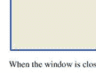

当窗口通过红色按钮关闭时，它会消失并且程序结束。

#### 向窗体添加组件

窗体是一个容器。它可以包含多个用于构建用户界面的图形组件。我们必须创建组件并将其添加到窗体中以构建我们的用户界面。例如，要向窗体添加标签，我们可以执行以下操作：

```csharp
using System.Windows.Forms;

class FormDemo
{
    public static void Main ()
    {
        Form f = new Form();
        Label title = new Label();
        title.Text="Hello";
        f.Controls.Add(title);
        f.ShowDialog();
    }
}
```

这会创建一个标签，将标签的文本属性设置为“Hello”，然后将其添加到框架所包含的控件中。此代码的结果是一个如下所示的窗体：


我可以摆弄组件的属性以将其在屏幕上移动并执行许多有趣的操作：

```csharp
using System.Windows.Forms;
using System.Drawing;

class FormsDemo
{
    public static void Main ()
    {
        Form f = new Form();
        Label title = new Label ();
        title.Text="hello";
        title.Top=50;
        title.Left=50;
        title.ForeColor = Color.Red;
        title.BackColor = Color.Yellow;
        f.Controls.Add(title);
        f.ShowDialog();
    }
}
```

屏幕上的位置以像素为单位给出（像素是屏幕上的一个单独点）。原点（即 0,0 处的像素）位于屏幕的左上角。

Color 类位于 System.Drawing 命名空间中。它提供了一整套静态颜色值，并且还允许你通过设置红色、绿色和蓝色分量的强度来创建自己的颜色。上面的程序将显示如下窗体：


通过在窗体上添加多个标签并适当定位它们，我们可以开始构建用户界面。

#### 使用 TextBox 组件编辑文本

显示标签很好，但我想做的是提供一种可以编辑姓名文本的方式。Windows Forms 库提供了一个用于此目的的 TextBox 组件。这是一个与标签类似的组件，但它提供了文本编辑行为。我可以将 TextBox 的文本属性设置为想要编辑的文本。然后用户可以向文本框中输入文本并修改它。然后我可以在需要更新值时读取文本属性。

TextBox 在我付出很少努力的情况下为我提供了大量功能。它允许用户使用 Windows 剪贴板将文本剪切并粘贴到框中。它允许用户输入大量文本并滚动文本以使其适合框中。简而言之，它的行为就像你在 Windows 屏幕上使用过的每个文本字段一样。这是因为它实际上与你使用过的每个文本字段都是同一件事。

我可以在我的程序中按如下方式创建和使用 TextBox：

```csharp
using System.Windows.Forms;
using System.Drawing;

class FormsDemo
{
    public static void Main()
    {
        Form f = new Form();
        Label nameLabel = new Label();
        nameLabel.Text = "Name";
        nameLabel.Top = 50;
        nameLabel.Left = 0;
        f.Controls.Add(nameLabel);

        TextBox nameTextBox = new TextBox();
        nameTextBox.Top = 50;
        nameTextBox.Left = 100;
        nameTextBox.Text = "Rob";
        f.Controls.Add(nameTextBox);

        f.ShowDialog();
    }
}
```

我稍微调整了标签的位置并给它一个更合理的名称。我还将我们正在编辑的名称文本设置为 Rob，只是为了展示组件的工作方式。如果运行此程序，你会得到如下所示的表单：

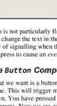

这并不特别花哨，但对于大约 25 行的代码来说已经不错了。它也允许你随意更改名称中的文本。但目前我们没有办法发出编辑已完成信号。为此我们需要一个按钮，可以按下它来触发一个事件。

#### 按钮组件

我们想要一个按钮，用户在完成名称编辑后可以按下它。这将触发我的程序保存更新后的名称并关闭表单。你在使用程序时已经按过成千上万次这样的按钮。现在我们将了解如何让它工作。

Button 就像其他任何组件一样。我可以把它放在表单上并像管理其他组件一样管理其位置：

```csharp
using System.Windows.Forms;
using System.Drawing;

class FormsDemo
{
    public static void Main()
    {
        Form f = new Form();
        Label nameLabel = new Label();
        nameLabel.Text = "Name:";
        nameLabel.Top = 50;
        nameLabel.Left = 0;
        f.Controls.Add(nameLabel);

        TextBox nameTextBox = new TextBox();
        nameTextBox.Top = 50;
        nameTextBox.Left = 100;
        nameTextBox.Text = "Rob";
        f.Controls.Add(nameTextBox);

        Button finishButton = new Button();
        finishButton.Top = 80;
        finishButton.Left = 100;
        finishButton.Text = "Finished";
        f.Controls.Add(finishButton);

        f.ShowDialog();
    }
}
```

这给我在表单上提供了一个可以按下的按钮：

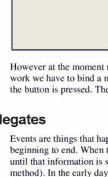

然而目前按钮按下时什么也不会发生。要使其工作，我们必须将程序中的一个方法绑定到按钮按下时生成的事件。Windows Forms 系统使用委托来管理此过程。

### 5.4.2 事件和委托

事件就是发生的事件（嗯，不用说）。到目前为止，我们的程序都是从头到尾运行的。当程序需要用户提供某些信息时，它会耐心等待直到信息被提供（通常是通过调用 ReadLine 方法）。在计算机早期，这就是它们的使用方式。在任何给定瞬间，程序要么正在运行代码，要么在等待输入。如今程序的使用方式大不相同。用户期望通过按下屏幕上的“按钮”并触发程序内部的不同操作来与项目进行交互。

这意味着我们的程序工作方式必须改变。程序不再等待用户做某事，而必须在事件生成时做出响应。其结果是编程语言必须提供某种管理事件的方式。

#### 事件和方法调用

在 C# 中，事件是通过对该对象中方法的调用传递给对象的。在这方面，你可以将事件和消息视为同一事物。从我们名称编辑表单的角度来看，我们希望在用户按下“Finished”按钮时调用特定方法。该方法将验证新名称，如果正确则存储它，然后关闭编辑表单。

#### 按钮事件

回到我们正在解决的问题：当用户点击表单上的按钮时，这会被 Windows 操作系统记录下来，然后作为事件传递给表单。表单决定将事件交给表单上的哪个组件，并调用该组件中的方法来告诉它“你被按下了”。然后按钮执行其动画，使其进出移动。然后它寻找需要告知事件的人。按钮维护一个需要告知事件的人的列表。该列表实际上是一个委托列表。

因此，要让按钮运行我们的方法，我们需要创建一个委托对象，然后将其传递给按钮，以便它在事件发生时知道使用它。委托是一个对象，可用于表示类实例中的特定方法。对于我们的按钮而言，委托将表示我们希望在按钮按下时调用的方法。我们将此委托的引用传递给按钮，然后它可以在按钮按下时调用该方法所表示的方法。

好消息是，为 Windows 组件创建委托实例是一项如此常见的任务，以至于表单库已提供了一个委托类来为我们完成此操作。我们只需要创建该类的一个实例即可获得要交给按钮的委托。

当事件发生时被调用的方法的签名对于每种类型的事件都是相同的，从鼠标移动到按钮按下再到窗口关闭，因此我们每次需要创建委托时都可以使用此类。创建委托并将其分配给方法的实际代码如下：

```csharp
using System.Windows.Forms;
using System.Drawing;
using System;

class FormsDemo
{
    public static void Main()
    {
        Form f = new Form();
        Label nameLabel = new Label();
        nameLabel.Text = "Name:";
        nameLabel.Top = 50;
        nameLabel.Left = 0;
        f.Controls.Add(nameLabel);

        TextBox nameTextBox = new TextBox();
        nameTextBox.Top = 50;
        nameTextBox.Left = 100;
        nameTextBox.Text = "Rob";
        f.Controls.Add(nameTextBox);

        Button finishButton = new Button();
        finishButton.Top = 80;
        finishButton.Left = 100;
        finishButton.Text = "Finished";
        finishButton.Click +=
            new EventHandler(finishButton_Click);
        f.Controls.Add(finishButton);

        f.ShowDialog();
    }

    private static void finishButton_Click(
        object sender, EventArgs e)
    {
        Console.WriteLine("Finish Pressed");
    }
}
```

加亮的代码是将委托绑定到单击事件的部分。EventHandler 委托类位于 System 命名空间中，可以引用返回 void 且接受两个参数的方法，一个是引发事件的对象的引用，另一个是包含所发生事件详细信息的 EventArgs 实例的引用。

在上面的代码中，我有一个名为 finishButton_Click 的事件处理程序方法，它接受这些参数（但不对它们做任何处理）。相反，每次按下按钮时它都会打印一条消息。如果你编译并运行上述程序，你会发现每次按下 Finish 按钮时程序都会打印一条消息。在完成的编辑器中，此方法将为我们完成编辑。

请注意，我们实际上不必使用这些参数，通常我们的方法会忽略提供的值。然而，有时，例如在捕获鼠标移动事件时，我们可能希望使用它们来提供诸如鼠标坐标之类的信息。

### 5.4.3 账户编辑表单

我上面的示例代码对于展示表单的工作方式以及如何向其添加组件是可以的，但它不是生产代码。这是因为我手工制作了所有内容，并且没有真正的编辑对象。如果你还记得我们的文本编辑代码，你会回忆起我们有一个对象为我们执行编辑。我们向它传递对账户的引用，它管理编辑过程，并在编辑完成后返回。

要制作一个合适的账户编辑器，我们需要创建一个类来为我们完成这项工作。它将几乎以与文本编辑器完全相同的方式使用。

#### 扩展 Windows Form 类

事实证明，创建执行此任务的类的最佳方式是扩展 Form 类以制作我们自己的新表单。这是使用 Windows 组件的标准技术。其思想是，当表单创建时，表单中的构造函数创建所有组件并将它们添加到表单的适当位置。然后我们的表单可以被视为一个空表单的定制版本。而创建类的定制版本的方式就是扩展它们。


```csharp
using System;
using System.Windows.Forms;

public class AccountEditForm : System.Windows.Forms.Form
{
    private Label nameLabel;
    private TextBox nameTextBox;
    private Button finishButton;

    IAccount account;

    public AccountEditForm(IAccount inAccount)
    {
        this.account = inAccount;

        this.nameLabel = new Label();
        this.nameLabel.Text = "Name";
        this.nameLabel.Top = 50;
        this.nameLabel.Left = 0;
        this.Controls.Add(this.nameLabel);

        this.nameTextBox = new TextBox();
        this.nameTextBox.Top = 50;
        this.nameTextBox.Left = 100;
        this.nameTextBox.Text = this.account.GetName();
        this.Controls.Add(this.nameTextBox);

        this.finishButton = new Button();
        this.finishButton.Top = 80;
        this.finishButton.Left = 100;
        this.finishButton.Text = "Finished";
        this.finishButton.Click += new System.EventHandler(finishButton_Click);
        this.Controls.Add(this.finishButton);
    }

    private void finishButton_Click(object sender, System.EventArgs e)
    {
        string reply = account.ValidateName(nameTextBox.Text);
        if ( reply.Length > 0 )
        {
            System.Windows.Forms.MessageBox.Show(reply);
            return;
        }
        this.account.SetName( nameTextBox.Text );
        this.Dispose();
    }
}
```

窗体将接收一个对正在编辑的账户实例的引用。然后它会从窗体中取出属性并显示出来以供编辑。当用户按下完成按钮时，窗体必须确保姓名有效。如果有效，就应设置账户类的姓名，然后窗体必须释放自身。

这段代码相当于我们之前创建的 `AccountEditTextUI` 方法的 Windows 版本。所有窗体组件都在窗体的构造函数中创建。

`finishButton_Click` 方法从文本框中取出姓名并验证它。如果姓名无效，它就使用 Windows 窗体系统中的一个静态方法弹出一个消息框并报告错误：


这就是我们告诉用户姓名不正确的方式。`Show` 方法有多种不同形式，你可以用它们获得不同形式的 message box，甚至可以向其中添加额外的按钮。

#### 释放窗体

当我们用完此窗体并希望摆脱它时，就使用 `Dispose` 方法。窗体上的所有组件都会被销毁，窗体也会从屏幕上移除。一旦释放了某个窗体，我们就再也不能使用它了。我们将需要改为创建一个新窗体。

`Dispose` 方法很重要，因为我们必须显式说明何时用完该实例。如果我们只是移除了对窗体对象的引用，它仍会留在内存中，直到垃圾回收器注意到它。

#### 使用编辑窗体

要使用编辑窗体，我们必须先构造一个账户实例。然后我们将对该账户的引用传入 `AccountEditForm` 的构造函数。

```csharp
Account a = new Account();
a.SetName("Rob");
AccountEditForm edit = new AccountEditForm(a);
edit.ShowDialog();
Console.WriteLine(" Name value : " + a.GetName());
```

这段测试代码创建一个账户，并将账户持有人的姓名设置为 Rob。然后它创建一个编辑窗体，并使用该窗体编辑账户中的姓名值。

#### 模态编辑

在编辑窗体中调用 `ShowDialog` 是模态的。这意味着当窗体显示在屏幕上时，系统的其余部分会暂停。在上面的代码中，直到编辑窗体关闭后才会执行 `WriteLine`。

#### Visual Studio 与窗体编辑

Visual Studio 应用程序可以承担创建窗体并向其中添加组件的所有繁重工作。它还会负责为按钮操作创建委托。然而，重要的是要记住，尽管它自动化了我上面手动完成的许多操作，但驱动其生成的窗体的基本原理完全相同。

#### 程序员观点：客户确实很在意用户界面

如果系统中有一部分是客户一定会抱有强烈看法的，那就是用户界面。其设计应从产品一开始就启动，并随着产品推进不断完善。永远不要想当然地认为你知道用户界面应如何以某种方式工作。我不得不花更多时间重做用户界面代码，几乎超过系统的任何其他部分。好消息是，借助 Visual Studio 之类的工具，很容易制作出相当逼真的系统前端原型。然后可以将这些原型展示给客户（甚至让客户签字确认），以确认你做的方向是对的。

## 5.5 使用委托

事件和委托是 C# 中非常重要的一部分。因此，你应该仔细阅读本文，并确保理解其中的内容。

委托很有用，因为它们让我们可以操作对方法的引用。我们可以通过一块可以移动的数据，来管理在给定情况下将调用哪个特定方法。

委托是 C# 程序中管理事件的重要部分。事件是发生的一些事情，我们的程序可能需要对其作出响应。它们包括诸如用户在用户界面中按下按钮、时钟滴答走动以及通过网络到达的消息等。在每种情况下，我们都需要告诉系统在事件发生时该做什么。C# 做到这一点的方式是允许我们创建委托类的实例，并将这些实例交给事件生成器。当事件发生时（有时称为事件“触发”），事件所引用的方法会被调用来传递消息。

我把委托称为“告诉一段程序在某事发生时该做什么的一种方式”。更正式的描述如下：

> 委托是对类中方法的类型安全引用。

### 5.5.1 类型安全的委托

这里的“类型安全”这个说法意味着，如果方法接受两个整数参数并返回一个字符串，那么该方法的委托将具有完全相同的形态，并且不能以任何其他方式使用。这个词用于将委托与 C 等更原始语言中使用的指针之类的东西区分开来。

在 C 中，你可以创建指向方法的指针，但 C 环境不知道（甚至不在乎）这些方法实际上是什么样子。这意味着你可以用错误的方式调用它们，并导致程序崩溃。不必过于担心这一点。只需记住，委托使用起来是安全的。

#### 使用委托

例如，考虑我们银行中费用的计算。银行会有许多不同的方法来完成这项计算，具体取决于客户类型和该客户的状态。它可能希望有一种方式，让程序在运行时选择使用哪种费用计算方法。

我们已经看到，像重写这样的机制让我们可以创建特定于某种对象类型的方法，例如我们为 `BabyAccount` 类提供了一个自定义的 `withdrawFunds`，它只允许我们取出有限金额的现金。这些技术非常有用，但它们硬编码到了我编写的代码中。一旦我编译了该类，其中的方法就不能更改。

委托是方法的“替身”。如果你调用委托，它就会调用它当前引用的方法。这意味着我可以把它当作一种方法选择器来使用。委托类型按如下方式创建：

```csharp
public delegate decimal CalculateFee (decimal balance);
```

请注意，我还没有创建任何委托。我只是告诉编译器委托类型 `CalculateFee` 是什么样子。这个委托可以代替一个方法，该方法接受单个 decimal 参数（账户余额）并返回一个 decimal 值（我们要向客户收取的金额）。你可能想与这个委托一起使用的一个方法示例如下：

```
public decimal RipoffFee(decimal balance)
{
    if (balance < 0)
    {
        return 100;
    }
    else
    {
        return 1;
    }
}
```

这是一个相当邪恶的费用计算器。如果透支，费用为100英镑。如果有存款，费用为1英镑。我想在我的程序中使用它。我可以创建一个引用它的 CalculateFee 实例：

```
CalculateFee calc = new CalculateFee(RipoffFee);
```

现在我可以“调用”calc，它实际上会运行 ripoff 计算器方法：

```
fees = calc(100);
```

calc 委托目前引用了一个将使用 RipoffFee 方法的委托实例。我可以通过创建另一个委托来更改它：

```
calc = new CalculateFee(FriendlyFee);
```

现在当我“调用”calc 时，它将运行 FriendlyFee 方法。当然，这只有在 FriendlyFee 是一个返回 decimal 类型值并接受单个 decimal 值作为参数的方法时才有效。

委托的实例就像其他对象一样。这意味着它可以作为引用来管理，因此我可以构建包含委托的结构，并且我也可以将委托作为参数传入和传出方法。你可以将委托列表视为我可以调用的方法列表。

这为我们提供了另一层抽象，这意味着我们现在可以设计程序，使其行为在程序运行过程中发生变化。然而，现在最好只是将其视为我们如何使用委托来管理程序对事件的响应。

#### 程序员提示：合理使用委托

允许程序在运行时改变其行为是一件相当奇怪的事情。我将其作为一个例子来展示委托如何让程序将方法引用作为对象进行操作，而不是作为一种良好的编程方式。委托在事件处理程序中被大量使用，也用于管理线程（如下文所述）。在我编写的程序中，除了这些用途外，我很少使用它们。

## 5.6 线程和线程处理

如果你想称自己为一名真正的程序员，你需要了解一些关于线程的知识。它们可以使程序更容易创建，但也可能是导致非常棘手错误的来源。在未来，计算机处理器的速度将受到光速和原子大小等令人恼火因素的限制，线程是我们能够继续提高计算机系统性能的方式。

### 5.6.1 什么是线程？

目前我们的程序在运行时只使用单个线程。线程通常在 Main 方法中开始，并在该方法结束时结束。你可以将线程想象成沿着轨道行驶的火车。轨道就是线程正在执行的语句。就像你可以在同一轨道上放置多辆火车一样，计算机可以在单个程序代码块中运行多个线程。

计算机可以通过两种方式支持多线程。第一种是通过在活动线程之间快速切换，给每个线程有限的时间运行，然后再切换到另一个线程运行。当线程未运行时，它正在等待运行的机会。就线程而言，它似乎在连续运行，但实际上线程可能只有时不时地活跃一小段时间。

支持多线程的第二种方式是实际拥有多个处理器。第一台计算机只有一个处理器，因此被迫使用“时间片”来支持多线程。现在的新机器具有“双核”甚至“四核”处理器，可以真正同时运行多个线程。

### 5.6.2 为什么我们需要线程？

线程使计算机在某个程序被挂起时仍能做有用的事情成为可能。你的系统可以在程序等待你按下下一个键时播放音乐和下载文件。现代计算机每秒可以执行数百万条指令；将这种能力在多个任务之间共享是有意义的。

你编写和运行的程序都作为线程在你的计算机中执行。这就是你的程序能够与其他你希望同时使用的程序一起处于活动状态的方式。你没有意识到这一点，是因为操作系统（通常是 Windows）在分配处理能力方面做得非常好。

线程提供了另一个“抽象”层，因为如果我们希望同时做不止一件事，只是发送一个线程去执行任务，而不是将第二个任务与第一个任务交错执行，这非常有用。如果我编写一个文字处理器，我们可能会发现创建线程来执行耗时的任务（如打印或拼写检查）很有用。这些任务可以在“后台”执行，同时用户继续处理文档。

线程也是 Windows 窗体响应事件的方式。你已经看到，来自 Button 组件的“点击”事件可以触发事件处理程序代码的运行。Windows 系统实际上会创建一个新的执行线程来运行事件处理程序代码。

#### 程序员提示：线程可能很危险

就像让两列火车共用同一条铁路轨道有时会导致问题一样，使用线程的程序也可能以壮观且令人困惑的方式失败。系统可能只有在特定事件序列导致两个之前表现良好的线程为共享数据“争斗”时才会失败。由线程引起的错误是最难追踪和修复的，因为你必须先让问题发生才能修复它，而导致故障的情况可能只有时不时才会出现。我将给出一些提示，说明如何确保你的程序不会因线程相关错误而出错，我建议你仔细遵循这些提示。

### 5.6.3 线程和处理器

请考虑以下方法：

```
static private void busyLoop()
{
    long count;
    for (count = 0; count < 1000000000000; count = count+1)
    {
    }
}
```

这个方法什么都不做，但它做了数百万次。如果我运行调用此方法的程序，第一件事就是程序似乎停止了。然后笔记本电脑的风扇启动，因为处理器开始发热，因为它现在正在努力工作。如果我启动 Windows 任务管理器，我会看到下面的图片：


我的笔记本电脑有四个处理器核心，这意味着它一次可以运行四个线程。你可以在显示器的 CPU（中央处理器单元）使用历史部分下看到小图表，显示每个处理器的繁忙程度。从上面的图表来看，最左边的处理器和最右边的处理器相当繁忙，但中间的两个处理器什么也没做。如果我停止程序运行，我会得到下面的显示。

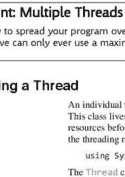

现在所有处理器都只是空转。当我们开始使用多个线程时，我们应该看到更多的图表上升，因为我的程序在多个处理器上运行。

#### 程序员提示：多线程可以提高性能

如果你能想出如何将程序分布在多个线程上，这会对运行速度产生很大影响。上面的方法最多只能使用我系统 25% 的资源，因为它只在一个可用的四个处理器上运行。

### 5.6.4 运行线程

单个线程由你的程序作为 Thread 类的实例进行管理。该类位于 System 命名空间中。我们在之前使用文件时曾使用命名空间来定位资源。确保我们可以使用所有线程资源的最简单方法是，在程序开头添加 using 指令：

```
using System.Threading;
```

Thread 类在你的程序和操作系统之间提供了一个链接。操作系统的任务之一是在你的计算机上管理线程并决定每个线程何时运行。通过调用 Thread 类提供的方法，你可以启动和停止它们。

#### 选择线程的启动位置

当你创建线程时，你需要告诉线程从哪里开始运行。这就像告诉你弟弟你希望他在轨道上的哪个位置放置你的火车。你通过使用委托来做到这一点。委托是指向类中方法的一种方式。线程使用的委托类型是 ThreadStart 类型。此委托类型可以引用不返回值或接受任何参数的方法。如果你查看上面的 busyLoop 方法，你会发现该方法完全符合要求。你可以按如下方式创建 ThreadStart 委托来引用此方法：

```
ThreadStart busyLoopMethod = new ThreadStart(busyLoop);
```

#### 创建线程

一旦你定义了起点，你现在就可以创建一个 Thread 值：

```
Thread t1 = new Thread(busyLoopMethod);
```

变量 t1 现在引用一个线程实例。请注意，目前线程尚未运行，正在等待启动。当我们开始运行 t1 时，它将遵循委托 busyLoopMethod 并调用 busyLoop 方法。

#### 启动线程

Thread 类提供了许多方法，你的程序可以使用它们来控制其行为。要启动线程运行，你可以使用 Start 方法：

```
t1.Start();
```

这是线程开始运行的点。

```
class ThreadDemo
{
    static private void busyLoop()
    {
        long count;
        for (count = 0; count < 100000000000L; count = count+1)
        {
        }
    }

    static void Main()
    {
        ThreadStart busyLoopMethod = new ThreadStart(busyLoop);
        Thread t1 = new Thread(busyLoopMethod);
        t1.Start();
        busyLoop();
    }
}
```

上面的代码创建了一个名为 t1 的线程并启动它运行 busyLoop 方法。它还直接从 Main 方法调用 busyLoop。这意味着有两个进程处于活动状态。这会改变任务管理器显示：


现在更多的使用图表显示出活动，CPU 使用率从 25% 上升到 50%，因为我们的程序现在使用了更多的处理器。

#### 创建大量线程

从上面的显示可以看出，如果我们创建一个额外的线程，就可以使用计算机提供的更多性能。事实上，我们可以创建比这多得多的线程：

```
for (int i = 0; i < 100; i = i + 1)
{
    Thread t1 = new Thread(busyLoopMethod);
    t1.Start();
}
```

此循环将创建 100 个线程，所有线程都在运行 busyLoop 方法。现在我们的计算机真的很忙：

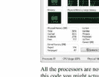

所有处理器现在都已满载，CPU 使用率已达到 100%。如果你运行这段代码，你可能会发现机器变得稍微不那么响应，并且所有散热风扇都全速运转。

#### 程序员提示：线程太多会拖慢一切

请注意，没有任何东西阻止你的程序启动大量正在运行的线程。这可能很危险。如果同时运行太多线程，你会拖慢一切。这实际上是攻击计算机的一种类型的基础，称为拒绝服务攻击。它通过启动大量占用处理器的线程使计算机无法使用。幸运的是，Windows 会提高处理用户输入的线程的优先级，因此你通常可以获得控制并停止这种不轨行为。

### 5.6.5 线程与同步

你可能想知道为什么所有线程不会争夺用作循环计数器的 count 的值。这是因为该变量是 busyLoop 方法的局部变量：

```
static private void busyLoop()
{
    long count;
    for (count = 0; count < 100000000000; count = count+1)
    {
    }
}
```

count 变量在方法体内部声明。这意味着每个方法都有自己的这个局部变量的副本。如果你仍在把线程想象成火车，那么每个线程的数据就像被拖在火车后面的轨道上。我们可以对这段代码做一个微小的改动，让 count 变量成为类的成员：

```
static long count;
static private void busyLoop()
{
    for (count = 0; count < 100000000000; count = count + 1)
    {
    }
}
```

该方法看起来非常相似，但现在运行 busyLoop 的每个线程都在共享同一个 count 变量。这可能非常灾难性。现在很难预测这个多线程程序需要多长时间才能完成。请考虑以下操作序列：

- 1. 线程 1 获取 count 变量的值，以便对其加 1。
- 2. 在执行加法之前，线程 1 被停止，线程 20 被允许运行。
- 3. 线程 20 获取 count 的值，对其加一并将其写回内存。
- 4. 稍后线程 1 再次获得控制权，将其在被停止前获取的值加 1 并将结果写回内存。

由于线程 1 在计算过程中被中断的方式，它覆盖了线程 20 所做的更改。随着线程的运行，它们都在加载、递增和存储 count 的值并覆盖它们所做的更改。

我们需要一种方法来阻止线程相互中断。语句 count = count + 1; 必须能够在不被中断的情况下完成。你可以通过使用称为互斥或 mutex 的功能来实现这一点。我们可以在这里回到我们的火车类比。

#### 使用互斥来管理数据共享

允许两个线程共享同一个变量有点像允许两列火车共享同一段轨道。两者都很危险。单轨问题是通过使用一个黄铜令牌来解决的，该令牌由机车司机持有。当它们进入单轨时，会被授予令牌。当火车离开单轨路段时，司机将令牌交还。任何想要进入轨道的人都必须等待轮到自己持有令牌。

互斥的工作方式完全相同，通过使用一个对象的实例来扮演令牌的角色。

```
static object sync = new object();
```

如果你不想销毁一个线程，而只是让它暂停一段时间，你可以对该线程调用 Suspend 方法：

```
t1.Suspend();
```

线程将被置于休眠状态，直到你对该线程调用 Resume 方法。

```
t1.Resume();
```

#### 查找线程的状态

你可以通过使用其 ThreadState 属性来了解线程的状态。这是一个枚举值，具有多个可能的值。

最有用的有：

| ThreadState.Running | 线程正在运行 |
| ThreadState.Stopped | 线程已完成执行线程方法 |
| ThreadState.Suspend | 线程已被挂起 |
| ThreadState.WaitSleepJoin | 线程正在执行 Sleep，等待加入另一个线程或等待 Monitor |

例如，如果线程 t1 正在运行，则显示一条消息：

```
if ( t1.ThreadState == ThreadState.Running )
{
    Console.WriteLine("Thread Running");
}
```

### 5.6.7 保持线程的理智

线程非常有用。它们让你的程序通过启动执行线程来处理任务。创建必须支持许多用户的系统（例如 Web 服务器）的最佳方法是创建一个多线程应用程序，该应用程序为每个传入请求启动一个线程。这使得代码更容易管理，也意味着你的程序可以充分利用可用的处理能力。

然而，线程也可能成为极大的挫败来源。我们知道我们的程序在运行时有时会产生错误。这主要是因为我们做错了什么。当我们遇到问题时，我们会查看发生了什么，然后找出故障所在。到目前为止，我们的程序都是单线程的，我们能够输入导致问题的[content]


现在更多的使用图表显示出活动，CPU 使用率从 25% 上升到 50%，因为我们的程序现在使用了更多的处理器。

#### 创建大量线程

从上面的显示可以看出，如果我们创建一个额外的线程，就可以使用计算机提供的更多性能。事实上，我们可以创建比这多得多的线程：

```
for (int i = 0; i < 100; i = i + 1)
{
    Thread t1 = new Thread(busyLoopMethod);
    t1.Start();
}
```

此循环将创建 100 个线程，所有线程都在运行 busyLoop 方法。现在我们的计算机真的很忙：


所有处理器现在都已满载，CPU 使用率已达到 100%。如果你运行这段代码，你可能会发现机器变得稍微不那么响应，并且所有散热风扇都全速运转。

#### 程序员提示：线程太多会拖慢一切

请注意，没有任何东西阻止你的程序启动大量正在运行的线程。这可能很危险。如果同时运行太多线程，你会拖慢一切。这实际上是攻击计算机的一种类型的基础，称为拒绝服务攻击。它通过启动大量占用处理器的线程使计算机无法使用。幸运的是，Windows 会提高处理用户输入的线程的优先级，因此你通常可以获得控制并停止这种不轨行为。

### 5.6.5 线程与同步

你可能想知道为什么所有线程不会争夺用作循环计数器的 count 的值。这是因为该变量是 busyLoop 方法的局部变量：

```
static private void busyLoop()
{
    long count;
    for (count = 0; count < 100000000000; count = count+1)
    {
    }
}
```

count 变量在方法体内部声明。这意味着每个方法都有自己的这个局部变量的副本。如果你仍在把线程想象成火车，那么每个线程的数据就像被拖在火车后面的轨道上。我们可以对这段代码做一个微小的改动，让 count 变量成为类的成员：

```
static long count;
static private void busyLoop()
{
    for (count = 0; count < 100000000000; count = count + 1)
    {
    }
}
```

该方法看起来非常相似，但现在运行 busyLoop 的每个线程都在共享同一个 count 变量。这可能非常灾难性。现在很难预测这个多线程程序需要多长时间才能完成。请考虑以下操作序列：

- 1. 线程 1 获取 count 变量的值，以便对其加 1。
- 2. 在执行加法之前，线程 1 被停止，线程 20 被允许运行。
- 3. 线程 20 获取 count 的值，对其加一并将其写回内存。
- 4. 稍后线程 1 再次获得控制权，将其在被停止前获取的值加 1 并将结果写回内存。

由于线程 1 在计算过程中被中断的方式，它覆盖了线程 20 所做的更改。随着线程的运行，它们都在加载、递增和存储 count 的值并覆盖它们所做的更改。

我们需要一种方法来阻止线程相互中断。语句 count = count + 1; 必须能够在不被中断的情况下完成。你可以通过使用称为互斥或 mutex 的功能来实现这一点。我们可以在这里回到我们的火车类比。

#### 使用互斥来管理数据共享

允许两个线程共享同一个变量有点像允许两列火车共享同一段轨道。两者都很危险。单轨问题是通过使用一个黄铜令牌来解决的，该令牌由机车司机持有。当它们进入单轨时，会被授予令牌。当火车离开单轨路段时，司机将令牌交还。任何想要进入轨道的人都必须等待轮到自己持有令牌。

互斥的工作方式完全相同，通过使用一个对象的实例来扮演令牌的角色。

```
static object sync = new object();
```

如果你不想销毁一个线程，而只是让它暂停一段时间，你可以对该线程调用 Suspend 方法：

```
t1.Suspend();
```

线程将被置于休眠状态，直到你对该线程调用 Resume 方法。

```
t1.Resume();
```

#### 查找线程的状态

你可以通过使用其 ThreadState 属性来了解线程的状态。这是一个枚举值，具有多个可能的值。

最有用的有：

| ThreadState.Running | 线程正在运行 |
| ThreadState.Stopped | 线程已完成执行线程方法 |
| ThreadState.Suspend | 线程已被挂起 |
| ThreadState.WaitSleepJoin | 线程正在执行 Sleep，等待加入另一个线程或等待 Monitor |

例如，如果线程 t1 正在运行，则显示一条消息：

```
if ( t1.ThreadState == ThreadState.Running )
{
    Console.WriteLine("Thread Running");
}
```

### 5.6.7 保持线程的理智

线程非常有用。它们让你的程序通过启动执行线程来处理任务。创建必须支持许多用户的系统（例如 Web 服务器）的最佳方法是创建一个多线程应用程序，该应用程序为每个传入请求启动一个线程。这使得代码更容易管理，也意味着你的程序可以充分利用可用的处理能力。

然而，线程也可能成为极大的挫败来源。我们知道我们的程序在运行时有时会产生错误。这主要是因为我们做错了什么。当我们遇到问题时，我们会查看发生了什么，然后找出故障所在。到目前为止，我们的程序都是单线程的，我们能够输入导致问题的


### 5.7.1 异常类

C# 的 System 命名空间包含大量不同的异常，但它们都基于父类 Exception。如果你想抛出自己的异常，强烈建议你创建继承自 Exception 类的自定义异常类型。当出错时可以生成 System.Exception，但这意味着你的代码产生的异常会与系统其他部分产生的异常混在一起。如果你希望代码能够显式地处理自己的错误，最好的方法是创建你自己的一个或多个异常。

这意味着，除了系统里的所有其他异常，你还需要设计程序将如何处理和生成错误。这（当然）又回到了你收集的元数据上，因为规格说明会告诉你事物可能出错的方式以及错误的产生方式。

### 5.7.2 创建自己的异常类型

创建异常类型非常简单。只需扩展 `System.Exception` 类即可：

```csharp
public class BankException : System.Exception
{
}
```

这样可行，因为 System.Exception 类有一个不带参数的默认构造函数。BankException 中的默认构造函数（由编译器自动添加）只需使用它来创建一个 Exception 实例。

然而，Exception 构造函数还有一个版本允许我们向异常添加消息。可以使用这个消息来发现出了什么问题。要创建带消息的标准异常，我会向构造函数传递一个字符串。如果我想在自己的银行异常中使用这个功能，就必须解决异常类的构造函数链问题，并编写如下代码：

```csharp
public class BankException : System.Exception
{
    public BankException ( string message )
        : base (message)
    {
    }
}
```

这里使用了 base 关键字来调用父类的构造函数，并将字符串消息传递给它。

### 5.7.3 抛出异常

throw 关键字会在代码的该点抛出一个异常。被抛出的对象必须基于 System.Exception 类。例如，如果我的账户持有者姓名是空字符串，我可能想抛出一个异常。可以用以下代码实现：

```csharp
if ( inName.Length == 0 )
{
    throw new BankException( "Invalid Name" );
}
```

throw 关键字后面跟着对要抛出异常的引用。在上面的代码中，我创建了一个新的银行异常实例，然后将其抛出。此时执行流程会转移到“最近的”catch 构造。这可能是我自己的 catch，也可能是系统提供的 catch。如果异常被系统捕获，意味着我的程序将被终止。不过，我可以自己捕获该异常，如下所示：

```csharp
Account a;
try
{
    a = new Account(newName, newAddress);
}
catch (BankException exception)
{
    Console.WriteLine("Error : " + exception.Message);
}
```

该代码尝试创建一个新账户。如果这样做导致抛出异常，就会执行异常处理程序中的代码。引用变量 exception 被设置为指向已抛出的异常。异常的 Message 成员就是传入的文本。这意味着如果我尝试用空名称创建账户，就会抛出异常，调用 catch，并打印消息。

#### 程序员要点：自己设计错误异常

异常是描述事情如何出错的对象。它可以包含一条文本消息，你可以显示它来向用户解释问题。不过，你应该认真考虑扩展异常类，创建自己信息更丰富的错误异常。错误应该有编号，即你的异常应带有错误编号。这在处理不同语言时非常有帮助。如果客户在报告问题时能说“错误编号 25”，支持人员会更容易做出合理的回应。请注意，和几乎所有其他事情一样，你需要在设计中考虑错误的处理方法。

### 5.7.4 多种异常类型

值得花时间思考如何管理系统中的异常和错误。我们可以根据需要编写多个 catch 构造，catch 会与抛出的异常类型进行匹配：

```csharp
public class BankExceptionBadName : System.Exception
{
    public BankExceptionBadName(string message) :
        base (message)
    {
    }
}
public class BankExceptionBadAddress : System.Exception
{
    public BankExceptionBadAddress(string message) :
        base (message)
    {
    }
}
```

现在我可以根据代码的失败方式使用不同的 catch：

```csharp
Account a;
try
{
    a = new Account("Rob, ");
}
catch (BankExceptionBadName nameException)
{
    Console.WriteLine("Invalid name : " +
    nameException.Message);
}
catch (BankExceptionBadAddress addrException)
{
    Console.WriteLine("Invalid address : " +
    addrException.Message);
}
catch (System.Exception exception )
{
    Console.WriteLine("System exception : " +
    exception.Message);
}
```

每个 catch 匹配不同类型的异常。在处理程序列表的最末尾，我有一个捕获 System 异常的 catch。如果异常不是姓名或地址异常，就会调用它。

#### 程序员要点：程序常常在错误处理程序中出现故障

仔细想想，错误处理程序很难测试。它们只在发生错误时才运行，而大多数时候你使用的测试数据都假定一切正常。这意味着错误处理程序本身更容易留下错误，因为与系统其他部分相比，这些代码得到的执行次数较少。当然，这可能会导致非常大的灾难，因为错误处理程序本应纠正问题，如果它失败了，通常会让糟糕的情况变得更糟。

作为一名专业程序员，你必须确保错误处理代码的测试强度至少与系统其他部分相当。这可能意味着你必须创建特殊的测试版本来强制代码中产生错误。相信我，这是值得的！

错误处理应该在你的设计阶段就考虑进去。在创建系统时，你需要决定要管理多少种错误以及何种类型的错误。

## 5.8 程序组织

目前，我们把创建的所有程序源代码都放在一个单独的文件中，然后编译并运行。这对于很小的项目还可以，但现在我们开始编写更大的程序，需要更好的方式来组织事物。尤其考虑到一个项目可能有多人同时开发时，这一点尤为重要。

要做到这一点，我们必须解决两个问题：

- 如何将我们编写的代码物理地分散到多个文件中
- 如何逻辑地标识程序中的各项

这两个问题是截然不同且彼此独立的，C# 为两者都提供了机制。在本节中，我们将了解如何将大型程序拆分为多个不同的块。

### 5.8.1 使用单独的源文件

在大型系统中，程序员通常希望将程序分散到多个不同的源文件中。当你设计问题的解决方案时，需要决定所有文件的位置。

在我们的银行管理程序中，已经确定需要一个类来跟踪特定账户。这个类将称为 Account。考虑一个非常简单的 Account 类：

```csharp
public class Account
{
    private decimal balance = 0;
    public void PayInFunds ( decimal amount )
    {
        balance = balance + amount;
    }
    public decimal GetBalance ()
    {
        return balance;
    }
    public bool WithdrawFunds ( decimal amount )
    {
        if ( amount < 0 )
        {
            return false ;
        }
        if ( balance >= amount )
        {
            balance = balance - amount ;
            return true;
        }
        else
        {
            return false ;
        }
    }
}
```

这是一个行为规范的类，它不允许我们提取超过账户余额的钱。如果需要，我们可以将其放入名为“Account.cs”的文件中。不过，我们可能还想创建许多其他与银行账户相关的类。因此，我决定将该类放在一个名为“AccountManagement.cs”的文件中。随着我添加更多的账户管理元素，可以将它们放入该文件。问题是，当我尝试编译该文件时，编译器现在会感到不满：

```
error CS5001: 'AccountManagement.exe' does not have an entrypoint defined
```

编译器期望生成一个可执行程序。这些程序以 Main 方法的形式作为入口点。我们的银行账户类没有 main 方法，因为程序永远不会从实际运行一个账户开始。相反，其他程序会运行，并在需要时创建账户。因此，编译器无法生成可执行文件，因为它不知道程序应该从哪里开始。

请注意，我已将 Account 类标记为 public。这样其他文件中的类就可以使用它。你可以像保护类成员一样对类应用访问级别。一般来说，如果你希望类在库中使用，就应该将其设置为 public。

#### 创建库

我通过要求编译器生成库来解决这个问题。我使用编译命令的 target 选项。选项是修改命令行为的一种方式。编译器能够判断它正在接收选项，因为选项通常以斜杠字符开头：

```
csc /target:library AccountManagement.cs
```


编译器现在会寻找 Main 方法，因为它已被告知生成库而不是程序。如果我查看已创建的内容，会发现编译器并没有为我生成可执行文件，而是生成了一个库文件：

```
AccountManagement.dll
```

文件扩展名 dll 代表动态链接库。这意味着该文件的内容将在程序运行时动态加载。

#### 使用库
现在我有了库，接下来要弄清楚如何使用它。首先我要创建一个名为 AccountTest.cs 的另一个源文件。它包含一个 Main 方法，该方法将使用 Account 类：

```csharp
using System;
class AccountTest
{
    public static void Main ()
    {
        Account test = new Account();
        test.PayInFunds (50);
        Console.WriteLine ("Balance:" + test.GetBalance());
    }
}
```

这会创建一个新账户，向其中存入 50 英镑，然后打印出余额。如果我尝试编译它，会得到一堆错误：

```
AccountTest.cs(5,3): error CS0246: The type or namespace name 'Account' could not be found (are you missing a using directive or an assembly reference?)
AccountTest.cs(6,3): error CS0246: The type or namespace name 'test' could not be found (are you missing a using directive or an assembly reference?)
AccountTest.cs(7,3): error CS0246: The type or namespace name 'test' could not be found (are you missing a using directive or an assembly reference?)
```

问题在于编译器不知道去 AccountManagement.cs 文件中查找 Account 类。这意味着它无法创建 test，从而导致进一步的错误。

为了解决这个问题，我需要告诉编译器引用 AccountManagement 来查找 Account 类：

```
csc /reference:AccountManagement.dll AccountTest.cs
```

reference 选项后面跟着要使用的库文件列表。在这种情况下，只有一个文件需要查看，即包含所需类的库。编译器现在知道在哪里找到应用程序的所有部分，因此可以构建可执行程序。

#### 运行时库引用
我们现在制作了两个包含程序代码的文件：

- **AccountManagement.dll** 包含 Account 类代码的库
- **AccountTest.exe** 创建 Account 实例的可执行程序

这两个文件都必须存在，程序才能正常工作。这是因为动态链接库中的“动态”。这意味着库只在程序运行时加载，而不是在构建时加载。

#### 删除系统组件
这意味着如果我做一些糟糕的事情，比如删除 AccountManagement.dll 文件然后运行程序，就会发生各种糟糕的事情：

```
Unhandled Exception: System.IO.FileNotFoundException: File or
assembly name AccountManagement, or one of its dependencies, was
not found.
File name: "AccountManagement" at AccountTest.Main()
... lots of other stuff
```

这意味着我们在发布程序时需要小心，确保程序运行时所有组件文件都存在。

#### 更新系统组件
由多个可执行组件构成系统的一个优点是，我们可以更新其中一部分而不影响其他部分。如果我修改 AccountManagement 类并重新编译它，AccountTest 会自动拾取新版本。当然，这仅在不改变 AccountTest 使用的类或方法的外观时才有效。

好消息是我可以在不发布整个新版本的情况下修复程序的损坏部分。

坏消息是这种情况几乎从未奏效。有一个专门的术语“dll 地狱”来形容这种情况。除非修复的代码完全正确，否则很可能会破坏程序的其他部分。Windows 本身就是这样工作的，我安装新程序（更糟的是现有程序的升级）导致计算机上其他程序损坏的次数多到令人不愿回忆。

#### 程序员提示：使用版本控制和变更管理
许多事情最终都源于对良好规划和管理的需求。而我们又回到了这里。当你考虑将应用程序作为商品出售时，你必须确保对如何发布升级和修复有一种受管理的方案。好消息是，有办法确保程序的某些版本只能与特定的程序文件一起工作。坏消息是你必须计划如何使用这项技术，然后确保你确实使用了它。如果这听起来很无聊和吹毛求疵，我非常抱歉，但如果你不这样做，你要么会发疯，要么会破产。或者两者兼有。

### 5.8.2 命名空间
我们可以使用库文件将解决方案拆分为多个文件。这使得解决方案的管理稍微容易一些。但我们还有另一个问题。我们不仅仅想将事物拆分为物理块，也想使用逻辑块。

如果你不确定我的意思，请考虑我们银行的情况。我们决定 Account 是保存客户账户所有细节的类的一个合理名称。但如果你考虑整个银行运营，你会发现“account”这个词到处出现。银行会从供应商那里购买回形针、橡皮图章、小链笔（当然预先不装墨水）之类的东西。你可以说银行与这样的供应商有账户关系。它很可能希望使用计算机系统跟踪这些账户。也许程序员会决定为此命名为 Account 是合理的。啊！我们现在正面临真正的问题。如果这两个系统最终相遇，我们可以预期一场关于“Account”真正含义的数字决斗。这会很糟糕。

我们可以通过将账户类重命名为 CustomerBankAccount 来解决问题。但这会很混乱，并且意味着在设计时我们必须确保以始终唯一的方式命名所有类。

更好的方法是说我们有一个 CustomerBanking 命名空间，其中“account”一词具有特定的含义。我们也可以有一个 EquipmentSupplier 命名空间。这可以防止两个名称冲突，因为它们没有在同一个命名空间中定义。

#### 将类放入命名空间
到目前为止，我们使用的每个名称都是在所谓的全局命名空间中创建的。这是因为我们在源文件中没有显式设置命名空间。然而，它们非常容易设置：

```
namespace CustomerBanking
{
    public class Account
    {
        private decimal balance = 0;
        public void PayInFunds ( decimal amount )
        {
            balance = balance + amount;
        }
        public decimal GetBalance ()
        {
            return balance;
        }
        public bool WithDrawFunds ( decimal amount )
        {
            if ( amount < 0 )
            {
                return false ;
            }
            if ( balance >= amount )
            {
                balance = balance - amount ;
                return true;
            }
            else
            {
                return false ;
            }
        }
    }
}
```

我使用了 namespace 关键字来标识命名空间。其后跟着一个类块。此块中声明的每个类都被视为给定命名空间的一部分，在本例中为 CustomerBanking。

给定的源文件可以包含任意多的命名空间定义，每个命名空间可以包含任意多的类。

#### 从命名空间使用类
全局类（即在任何命名空间之外创建的类）可以直接通过其名称引用。如果你想使用命名空间中的类，你必须同时给出命名空间。

```
CustomerBanking.Account test;
```

这创建了一个可以引用 Account 类实例的变量。我们使用的 Account 类是 CustomerBanking 命名空间中的那个。

这种带命名空间前缀的名称称为完全限定名。如果我们想创建类的实例，我们再次使用完全限定名。


```csharp
test = new CustomerBanking.Account();
```

如果我想使用来自 CustomerBanking 命名空间的 Account 类，我必须相应地修改我的测试类。

#### 使用命名空间

如果你从某个特定命名空间使用了很多东西，C# 提供了一种方法，可以告诉编译器在它需要解析某个特定项的名称时在该命名空间中查找。我们使用 using 关键字来做到这一点：

```csharp
using CustomerBanking;
```

当编译器看到类似这样的行时：

```csharp
Account RobsAccount;
```

- 它会自动在 CustomerBanking 命名空间中查找是否存在名为 Account 的类。如果存在就使用它。我们已经大量使用过这种技术。System 命名空间是许多库组件所在的位置。我们可以通过完全限定名来使用它们。

```csharp
System.Console.WriteLine ( "Hello World" );
```

然而，大多数程序中常见的是以下行：

```csharp
using System;
```

- 放在最顶部。这意味着程序员只需写：

```csharp
Console.WriteLine ( "Hello World" );
```

编译器会说“ah, I'll go and have a look for a thing called Console in all the namespaces that I've been told to use”。如果它找到一个且只有一个 Console，那么一切正常，它就会使用它。如果它找到两个 Console 项（如果我是个白痴，我想我可以在 CustomerBanking 命名空间中放一个 Console 类），它会抱怨不知道使用哪一个。

#### 嵌套命名空间

你可以将一个命名空间放在另一个命名空间内部。这允许你将事物分解成更小的块。System 命名空间就是这样，这是一个属于 System 命名空间的命名空间，专门处理输入/输出。你可以通过适当的包含来使用 System.IO 命名空间中的项：

```csharp
using System.IO;
```

在声明命名空间方面，你这样做：

```csharp
namespace CustomerBanking {
    namespace Accounts {
        // account classes go here
    }
    namespace Statements {
        // statement classes go here
    }
    namespace RudeLetters {
        // rude letter classes go here
    }
}
```

现在我可以根据需要使用类：

```csharp
using CustomerBanking.RudeLetters;
```

当然，你使用的命名空间应该始终经过精心设计。但话又说回来，你可能早就明白这一点。

### 5.8.3 单独文件中的命名空间

并没有规定你必须将某个特定命名空间中的所有类放在同一个文件中。将类分散到多个不同的源文件中是完全可以的。你必须确保你想要使用的文件包含所需的所有部分，这当然意味着需要更多的规划和组织。

#### 程序员提示：完全限定名是好的

有两种方法可以获取某物。你可以使用完全限定名（CustomerBanking.RudeLetters.OverdraftWarning）拼出完整的位置，或者你可以使用 using 获取命名空间中的项。在两者中我更喜欢完全限定名。我知道这会使程序稍微更难编写，但这意味着当我阅读代码时，我可以看到给定资源来自何处。如果我只在代码中看到名称 OverdraftWarning，我就不知道它来自哪里，因此我必须在所有正在使用的命名空间中搜索它。

## 5.9 调试

有些人天生就会调试。并非每个人都擅长调试，有些人永远会比其他人更好。话虽如此，确实有一些技巧可以帮助简化这一过程，我们将在此处探讨其中一些。好消息是，如果你采用测试驱动的方法进行开发，用户发现的故障数量应该尽可能少，但仍有一些东西需要修复。

顺便说一下，程序问题被称为 bug 的原因是因为最初的一个是由一只真正的昆虫造成的，它卡在计算机的某些触点中，导致其失效。然而，这并不是大多数 bug 的成因。你很少会看到程序因为硬件故障而失败。我编程多年，只在少数几次见到这种情况。令人悲哀的是，程序中大多数 bug 都是程序员放进去的。换句话说，调试就是努力工作以弄清楚你最初有多愚蠢。

### 5.9.1 故障报告

我们已经看到，故障是用户因程序中的错误而看到的东西。

故障是通过测试过程或用户发现的。如果程序在测试过程中失败，导致其出现的步骤会被很好地记录。然而，如果用户报告故障，证据可能只是轶事性的，即你不会得到导致故障出现的步骤序列；你只会被告知“ There is a bug in the print routine.”

#### 程序员提示：设计你的故障报告流程

就像我提到过的几乎所有其他事情一样，你管理故障报告的方式应该在项目开始时考虑。换句话说，你应该建立一个处理报告故障的流程。在大规模开发中，故障报告会被管理、分配给程序员并被仔细跟踪。报告的故障数量以及处理它们所需的时间，都是关于你所制作的东西质量的宝贵信息。此外，如果你将故障报告流程正式化（或甚至自动化），你可以确保获得关于问题的最大可能信息。

#### 两种类型的故障

故障分为两种，总是发生的和有时发生的。

总是发生的故障很容易；你可以执行总是导致 bug 显现的序列，然后使用合适的技术来解决它（稍后详述）。

有时发生的故障很让人头疼。这意味着你没有导致系统失败的确定的事件序列。这并不意味着没有序列（除非你遭受某种硬件引起的瞬态——这种情况相当罕见），而是你还没有找到序列。

例如，一个打印函数有时会崩溃，有时又能正常工作。你可能会将其追踪到打印的页数、页面上的文本量，或在请求打印时正在编辑的文档大小。

故障的显现可能在错误实际发生之后，例如程序在从数据库中删除项目时可能失败，但错误可能出在存储该项目的例程中，或在覆盖数据库所在内存的代码中。

当程序本身被更改时，故障可能会改变或消失；覆盖内存的错误如果代码布局发生变化会破坏程序的不同部分。这可能导致最令人恼火的故障类型，即你添加额外的打印语句以了解更多关于问题的信息，而问题随即消失！¹

如果你怀疑存在此类错误，你的第一个测试是以某种方式更改代码和数据布局，然后重新运行程序。如果故障性质发生变化，这表明程序或数据被损坏的问题。

### 5.9.2 捕捉 Bug

你可以将故障分为其他类别，即程序崩溃（即完全停止）或执行错误。令人惊讶的是，崩溃通常更容易修复。它们通常指向：

- 未处理的状况（确保所有选择语句都有一个执行合理操作的默认处理程序，并且在值在模块间传递时使用防御性编程技术）；
- 程序陷入循环，永远不会失败的 do-while 结构，包含更改控制变量的代码的 for 循环，方法因错误而调用自身并递归导致栈溢出
- 未被正确捕获的异常

如果你的程序做错了事，这可能更难找到。查找：

- 类成员未初始化的使用
- 拼写错误（查找拼写错误的变量名、不正确的比较运算符、未正确终止的注释）
- 逻辑错误（查找指令序列中的故障、无效的循环终止、计算错误的逻辑条件）

正如我上面所说，有些人天生就擅长找 bug。以下是一些提示：

不要做任何假设。如果你假设“唯一能到这里的方式是通过这个序列”或“这段代码不可能被执行”，你往往会错。与其做假设，不如添加额外代码来证明你认为正在发生的事情确实正在发生。

向别人解释问题——即使只是猫！解释问题的行为往往能让你推导出答案。如果你在交谈的人对你的陈述持高度怀疑态度，那就最好了。


查看错误表现中所有可能（即使看似无关）的因素。如果错误是间歇性的，这一点尤其重要。如果错误出现在你 UNIX 系统的周五下午，请查明是否另一个部门在那个时候使用机器进行工资核算，填满了所有临时空间，或者负载部门打开了大型升降机，向主电源注入了大量噪声。

暂时把问题放一放。去做点别的事情，你可能会发现答案突然就出现了。或者，当你回到问题时，答案可能会立刻浮现。

请记住，尽管这个错误当然是不可能的，但它确实在发生。这意味着要么不可能的事情正在发生，要么你认为它不可能的某个假设是错误的！

你能不能回到错误不存在的状态，然后查看之后所做的更改？如果系统因更改而失败，或者天哪，因修复错误的更改而失败，请尝试回到错误不存在的位置，然后逐步引入更改，直到错误出现。另外，仔细查看该功能的引入如何影响系统中的其他模块。一个好的源代码控制系统在这里非常有价值，因为它能准确告诉你从一个版本到下一个版本做了哪些更改。

此时我应该明确的一点是，调试过程是在修复一个本应可以工作的解决方案中的故障。换句话说，在你尝试修复程序实际行为中的问题之前，你必须知道程序应该如何工作。我几乎被那些为了“看看这样能不能让程序工作”而添加另一个循环或改变条件操作方式的人感动得落泪。这样的努力注定会失败，就像把一堆电子元件扔向墙壁，然后期望地板上会出现一台 DVD 播放机一样，那也不可能成功。

#### 推倒重来

在某些项目中，重新开始所付出的努力可能比试图找出你创建的破损解决方案中有什么问题要少。如果你已经从调试中抽出了一些时间，向朋友解释了代码，并检查了所有的假设，那么也许，仅仅也许，这才可能是最好的前进方式。

#### 程序员要点：修复错误会导致错误

错误的主要来源可能正是修复错误的过程。这是因为当人们为了修复某一部分而更改程序时，他们所做的更改往往会破坏系统的其他功能。我找到的统计数据表明，“一换二”的情况经常出现，也就是说，每修复一个错误就会引入两个全新的错误。解决这个问题的唯一方法是确保你的测试流程（你作为一系列单元测试创建的）可以在应用修复后自动运行。这至少可以确保修复没有破坏任何重要的东西。

### 5.9.3 制作完美的软件

世界上没有完美的软件。我工作遵循的规则之一是，“任何有用的程序都会有错误”。换句话说，我可以编写保证不含错误的程序。然而，这样的程序会非常小，因此用处不大。一旦我创建了一个有输入、输出和一些行为的实用程序，我就会开始引入错误。

这并不意味着我编写的每个程序都没用，只是意味着它不会完美。在考虑故障时，你还必须考虑其影响。开发中的项目经理的部分工作是决定产品何时足够好到可以销售，以及代码中的某个故障是否是“阻碍性问题”。

“阻碍性问题”是一种使程序无法销售的故障。如果程序每运行三次就崩溃一次，或者有时会破坏主机计算机的文件存储，这很可能是阻碍性错误的表现。但如果它只在用中文字体和某种激光打印机打印时总是多打印第一页，这可能被视为大多数用户可以容忍的问题。

这意味着你需要评估报告给你的故障的影响，确定优先级，并管理如何处理它们。你还需要了解开发的背景。例如，视频游戏中的故障比空中交通管制系统中的故障问题要小得多。

制作尽可能完美的软件的关键在于确保你对要解决的问题有很好的理解，在开始编写代码之前就知道如何解决它，并且仔细管理你的代码生产过程。关于编程的这一方面，请阅读本文档末尾推荐的一些书籍。

## 5.10 结束了吗？

这些并不是你成为程序员所需的全部知识。甚至也不是你成为 C# 程序员所需的全部知识。然而，这是一个相当不错的开始，但本文还缺少一些内容，因为我们没有时间全部讲授。如果你想成为一名优秀的 C# 程序员，你应该了解以下内容：

- 序列化
- 特性
- 反射
- 网络

### 5.10.1 持续发展

一个好的程序员会有意识地不断审视自己的专业知识并关注新事物。如果你认真对待这个行业，你应该随时至少阅读一本关于该主题的书。我从记事起就一直在编程，但从未停止过学习这门学科。我也从未停止过编程、阅读关于编程的书籍以及查看其他人的代码：

### 5.10.2 进一步阅读

**《代码大全（第二版）》**  
史蒂夫·迈克康奈尔  
微软出版社：ISBN 0-7356-1967-0

这实际上不是一本关于 C# 的书，而是一本关于其他一切的书。它从“软件构建”的角度涵盖了一系列软件工程和编程技术。如果你有任何认真想成为一名合格程序员的想法，你应该/必须阅读/拥有这本书。

**《如何成为一名程序员》**

这个网站也值得一读，因为它确实很好地涵盖了程序员的行为。

http://samizdat.mines.edu/howto/HowToBeAProgrammer.html

# 6 术语表

## 抽象

抽象的事物并不具有“真正”的存在。在编写程序时，我们用这个词来表示“对某事物的理想化描述”。在组件设计的情况下，抽象类包含需要存在的事物的描述，但它不说明如何实现它们。在 C# 中，如果一个类被标记为抽象，或者它包含一个或多个被标记为抽象的方法，那么这个类就是抽象的。

你不能创建抽象类的实例，但你可以将其用作具体类的基础或模板。例如，我们可能决定在事务处理系统中需要许多不同类型的收据：现金收据、支票收据、批发商收据等。我们不知道每种特定收据内部如何工作，但我们知道它必须具备哪些行为才能成为收据。

因此，我们可以创建一个抽象收据类，作为所有具体收据类的基础。每个“真正的”收据类都是通过扩展父抽象类创建的。这意味着它是收据家族的一员（即它可以被视为收据），但它以自己的方式工作。

## 访问器

访问器是一种提供对类内管理的值的访问的方法。实际上，访问是只读的，因为数据安全地保存在类中，但其他类中的代码可能需要访问该值本身。访问器实现为公共方法，它将向调用者返回一个值。请注意，如果被访问的对象是通过引用管理的，程序员必须确保传递出对象的引用是安全的。如果对象不应被更改，则可能需要复制一个对象以返回给调用者。

## base

base 是一个 C# 关键字，根据其所在上下文具有不同的含义。它在子类的构造函数中用于调用父类的构造函数。它也用于重写方法中，以调用被重写的方法。

## 调用

当你想使用一个方法时，你调用它。当方法被调用时，执行序列切换到该方法，从其体中的第一条语句开始。当到达方法的末尾或 return 语句时，执行序列返回到方法调用之后的那条语句。

## 类

类是行为（方法）和数据（属性）的集合。它可用于表示程序中的现实世界事物（例如银行账户）。每当你需要将许多东西收集到一个单元中时，你应该考虑创建一个类。


## 代码复用

开发人员应采取措施确保给定的一段程序只编写一次。通常通过将代码放入方法中然后调用它们来实现，而不是在程序的不同部分重复相同的语句。使用类层次结构也是一种复用代码的方式。你只需要重写你想要更新的方法。

## 内聚

如果一个类不依赖于/不耦合于其他类，那么它具有高内聚。

## 集合

C# 库中有集合的概念，即一组你想要一起存储的事物，例如一支足球队中的所有球员或一家银行中的所有客户。集合的一种形式是数组。另一种是哈希表，它允许你根据该项中的键值轻松找到特定项。集合类将支持枚举，这意味着可以要求它向 C# 的 foreach 构造提供连续的值。

每当你想要将若干事物一起存储时，应考虑使用集合类来为你完成这件事。这些集合类可以在 System.Collections 命名空间中找到。

## 编译器

编译器接收源文件并理解它。编译器将生成一个可执行文件，随后该文件会被运行。编写编译器是一项专门的工作，它们过去用汇编语言编写，现在则用高级语言（如 C#）构建。编译器是一个大型程序，专门为特定的计算机和编程语言编写。大多数编译器分几个阶段工作。第一个阶段是预处理器，它接收用户编写的源代码，然后找出所有单独的关键字、标识符和符号，产生一个程序源代码流；该流被送入“解析器”，解析器确保源代码遵循所用编程语言的语法。最后一个阶段是代码生成器，它生成可执行文件，随后由主机运行。

## 组件

组件是一个以接口形式公开其行为的类。这意味着，与其从它是什么（例如 BabyCustomerAccount）的角度来考虑，不如从它能做什么（实现 IAccount 接口以存款和取款）的角度来考虑。创建系统时，应关注组件以及它们如何交互。它们的交互通过它们之间的接口来表达。

## 构造函数

构造函数是类中的一种方法，在创建该类的新实例时被调用。程序员使用构造函数在创建实例时获得控制权，并设置类内部的值。如果一个类是某个层次结构中的成员，并且父类有构造函数，那么在创建子类时，确保正确调用父类构造函数很重要。否则，编译器将拒绝编译你的程序。

## 耦合

如果一个类*依赖*于另一个类，则称这两个类*耦合*。一般来说，程序员应努力使其设计中的耦合尽可能少，因为耦合会使系统更难更新。

耦合通常与内聚一起讨论，因为你应该追求高内聚和低耦合。

## 创造性懒惰

在我看来，懒惰的某些方面应用于编程时会很有成效。

代码复用，即尝试获取现有代码，就是一个很好的例子。

在做任何事情之前确保规格说明正确，是另一种节省工作量的方法。然而，通过设计结构让其他人完成大量工作，可能是创造性懒惰付诸实践的最佳例子。

## 委托

委托是对方法的类型安全引用。委托是针对特定方法签名创建的（例如，此方法接受两个整数并返回一个浮点数）。然后，它可以指向类中与该签名匹配的方法。请注意，委托实例包含两项内容：对包含该方法的实例/类的引用，以及对方法本身的引用。委托是对象这一事实意味着它可以像任何其他对象一样被传递。

委托用于告知事件生成器（如按钮、计时器等）在它们生成的事件发生时要调用的方法。

## 依赖

一般来说，设计中的依赖过多是一件坏事。当一个类中的代码更改意味着你可能也必须更改另一个类时，两个类之间就存在依赖关系。这通常意味着你没有在系统中的对象之间正确分配职责，并且两个对象正在管理相同的数据。举例来说，请参阅第 145 页关于 Customer/Account 和 ChildAccount 的 Load 方法的讨论。

依赖通常是有方向性的。例如，用户界面类可能依赖于业务对象类（如果向业务对象添加新属性，你将需要更新用户界面）。然而，用户界面工作方式的更改不太可能意味着业务对象需要修改。

## 事件

事件是程序可能需要响应的某种外部发生的事情。事件包括鼠标移动、按键被按下、窗口被调整大小、按钮被按下、计时器滴答等。许多现代程序基于与方法相连的事件来工作。当事件发生时，会调用方法来传递通知。Windows 组件利用委托（委托是对方法的类型安全引用）使事件生成器能够获知事件发生时要调用的方法。

## 异常

异常是一个对象，用于描述刚刚发生的糟糕事情。

异常是 C# 程序处理错误方式的一部分。当运行中的程序到达无法继续的位置时（可能是无法打开文件，或输入值毫无意义），它可以放弃并“抛出”异常：

```
throw new Exception("Oh Dear");
```

Exception 对象包含一个 Message 属性，它是一个字符串，可用于描述出了什么问题。在上面的示例中，消息将被设置为 "Oh Dear"。

如果异常没有被“捕获”，程序将在该点结束。你可以通过将可能抛出异常的代码包含在 try-catch 结构中，使程序响应异常。当异常被抛出时，程序将执行转移到 catch 子句中的代码：

```
try
{
    // code that might throw an exception
}
catch (Exception e)
{
    // code that is obeyed if an exception is thrown
    // e is a reference to the exception that was thrown
}
finally
{
    // code in here is always obeyed, whether the exception
    // was thrown or not
}
```

try-catch 结构也可以包含 finally 子句，其中包含无论是否抛出异常都会执行的代码。

## 功能设计规格说明

大型软件开发遵循特定路径，从初次会议一直到产品移交。所遵循的具体路径取决于工作的性质以及开发者使用的技术，然而，所有开发都必须从描述系统要做什么开始。这是整个项目中最关键的事项，通常称为功能设计规格说明，或 FDS。

## 全局唯一标识符 (GUID)

这是一种旨在在全世界范围内唯一的事物。它提供一个标识符，通过它可引用某事物。GUID 的创建涉及使用随机值、日期和时间等。GUID 用于账户引用和标签等必须唯一的事物。许多操作系统和程序员库提供创建 GUID 的方法。

## 层次结构

当子类扩展父类以生成一个新类时，就创建了层次结构，该类具有父类的所有能力，以及特定于子类要求的新行为和修改后的行为。扩展子类会产生更深一层的层次结构。层次结构顶层的类应更通用，并且可能是抽象的（例如 BankAccount），而较低层级的类将更具体（例如 ChildBankAccount）。

## 不可变

不可变对象不能被更改。如果试图更改不可变对象的内容，则会创建一个带有更改后内容的新对象，而“旧”对象

保留在内存中。字符串类是不可变的。这使得字符串的行为类似于值类型，从而使它们在程序中使用起来更简单。

## Inheritance
继承是类扩展父类的方式，以便它可以使用父类的所有行为和属性，但为略有不同的需求添加/自定义这些。有关更多详细信息，请参阅层级结构的描述。

## Interface
接口定义了一组操作。这些操作以若干方法定义的形式定义。实现接口的类必须为每个方法包含代码。实现接口的类可以纯粹以该接口的形式引用。接口使得创建组件成为可能。我们并不关心组件的确切是什么，只要它实现了接口，就可以用纯粹的能力来考虑它。

## Library
库是一组被其他程序使用的类。库与程序的区别在于，库文件将具有 .dll（动态链接库）扩展名，并且不包含 main 方法。

## Machine code
机器码是计算机处理器实际理解的语言。它包含许多非常简单的操作，例如将项目从处理器移入内存，或对处理器中的项目加一。每一种特定的计算机处理器系列都有其自己的特定机器码，这意味着为一种机器编写的机器码不能轻易地用于另一种机器。

## Member
类的成员在该类内部声明。它要么做某事（方法），要么保存一些数据（变量）。方法有时被称为行为。数据成员有时被称为属性。

## Metadata
元数据是关于数据的数据。它在各种层面上运行。年龄值以整数形式保存这一事实是元数据。它不能为负数这一事实是更多元数据。在创建系统时，元数据必须由程序员与客户协商收集。

## Method
方法是一段代码块，其前面有方法签名。方法有一个特定的名称，可能返回一个值。它也可能接受一个参数来操作。方法用于将大型程序分解为多个较小的单元，每个单元执行任务的一部分。它们还用于允许同一段程序在大型开发的许多地方使用。如果方法是 public，则可以由其他类中的代码调用。公共方法是对象暴露其行为的方式。消息是通过调用该对象内部的方法来传递给对象的。

## Mutator
变异器是一种方法，用于更改对象内部成员的值。更改希望得到管理，即无效值会以某种方式被拒绝。这以公共方法的形式实现，该方法提供新值并可能返回错误代码。

## Namespace
命名空间是特定名称具有特定含义的区域。命名空间让你重用名称。创建命名空间的程序员可以在该命名空间中使用任何名称。资源的完全限定名称以名称存在的命名空间为前缀。命名空间可以包含另一个命名空间，从而允许建立层次结构。请注意，命名空间在逻辑上是纯粹的，因为它不反映项目在系统中的物理位置，它只是提供它们所知的名称。C# 提供了 using 关键字以允许将命名空间“导入”到程序中。

## Overload
当在同一类中声明了名称相同但参数集不同的方法时，该方法就被重载了。当为特定操作提供信息有多种方式时，方法会被重载，例如日期可以通过提供日、月、年信息来设置，也可以通过文本字符串来设置，也可以通过自 1 月 1 日以来的天数整数来设置。可以提供三种不同的重载方法来设置日期，每个方法名称相同。在这种情况下，可以说 SetDate 方法已被重载。

## Override
有时你可能想要制作现有类的更专业版本。这可能需要提供类中方法的更新版本。你通过创建扩展父类的子类然后重写需要更改的方法来实现这一点。当在子类的实例上调用方法时，调用的是新方法，而不是父类中被重写的方法。如果你需要，可以使用 base 关键字来访问被重写的方法。

## Portable
应用于计算机软件时，可移植性越高，就越容易将其移动到不同类型的计算机上。计算机包含不同种类的处理器和操作系统，只能运行专门为其编写的程序。可移植应用程序是指可以相对轻松地转移到新处理器或操作系统上的应用程序。高级语言往往具有可移植性，机器码则更难转移。

## Private
类的私有成员仅对该类内部方法中的代码可见。通常将类的成员数据设为私有，以便它们不能被类外部的代码更改。然后程序员可以提供方法或 C# 属性来管理可能分配给私有成员的值。不将数据成员设为私有的唯一原因是消除使用方法访问数据带来的性能损失。

类的实例来使用静态成员。它还意味着静态成员是通过其类的名称而不是对实例的引用来访问的。静态成员对于创建与所有实例共享的类成员很有用，例如您银行中所有账户的利率。

## Stream
流是一个对象，表示与将为我们移动数据的东西的连接。移动可能是到磁盘文件、网络端口甚至系统控制台。流消除了根据输出发送位置或输入接收位置修改程序的需要。

## Structure
结构是一组数据项。它不是通过引用管理的，结构在赋值时会被复制。结构也按值传递给方法。结构对于在单个单元中保存相关数据的块很有用。它们不如通过引用管理的对象灵活，但使用起来更高效，因为访问结构项不需要像对象那样跟随引用。

## Subscript
这是用于标识数组中元素的值。它必须是整数值。C# 中的下标始终从 0 开始（这令人困惑地定位了数组的第一个元素），并延伸到数组大小减 1。这意味着如果你创建一个四元素数组，你可以通过下标值 0、1、2 或 3 来获取数组中的元素。最好将下标视为你将要向下移动的距离以获取想要的元素。这意味着数组中的第一个元素必须具有下标值 0。

## Syntax Highlighting
一些程序编辑器（例如 Visual Studio）以不同颜色显示不同的程序元素，以便程序员更容易理解代码。关键字以蓝色显示，字符串以红色显示，注释以绿色显示。请注意，颜色由编辑器添加，实际的 C# 源文件中没有任何内容决定文本的颜色。

## Test harness
测试架将包含被测试系统将使用的输入和输出部分的模拟。你将程序放入测试架中，然后程序认为它处于已完成的系统中。测试架在调试时非常有用，因为它在测试时消除了对完整系统（例如拖网渔船）的需求。

## This
This 是 C# 关键字，其含义取决于所给出的上下文。它用于类的构造函数中调用另一个构造函数。它也用作对当前实例的引用，用于在该实例内部运行的非静态方法。


## 类型安全

我们已经看到，C# 对于组合本不该组合的东西相当挑剔。尝试将 float 值放入 int 变量，编译器会对此报错。原因在于，语言的设计者注意到了一些常见的编程错误，并让这些错误在程序运行之前、而不是在程序崩溃之后才被检测出来。其中一种错误是在上下文中使用值或项，而这种使用要么没有意义（把 string 放入 bool），要么可能导致数据或精度丢失（把 double 放入 byte）。这种挑剔被称为类型安全，C# 非常重视它。其他一些语言在组合事物时宽松得多，并基于程序员最了解情况这一前提。它们假设，既然代码被写成要做某事，那么这件事就一定是正确的。

C# 非常热衷于此（我也是）。我认为开发者获得一切可能的帮助来阻止他们做蠢事很重要，而一种能阻止你以可能不合理的方式组合事物的语言，在我看来是件好事。

当然，如果你真的想把自己的意志强加给编译器，并强迫它无视任何类型安全问题来编译你的代码，可以通过使用强制转换来实现。

## 单元测试

单元测试是一种小型测试，它检验某个组件并确保其正确执行特定功能。单元测试应与开发过程同步编写，以便在代码编写完成后（或在测试驱动开发中，在代码编写之前）立即将其应用于代码。

## 值类型

值类型保存简单值。值类型以值的形式传入方法调用，并在赋值时复制其值；也就是说，x = y 会将 y 中的值复制到 x 中。对 x 中值的更改不会影响 y 的值。请注意，这与引用类型形成对比：在引用类型中，赋值结果会使 x 和 y 引用同一实例。

## 虚方法

方法是类的成员。我可以调用该方法来完成一项工作。有时我可能想扩展一个类，以生成一个子类，该子类是那个类更专门的版本。在这种情况下，我可能想用子类中的新方法替换（重写）父类中的方法。要实现这一点，父类中的方法必须已标记为 virtual。只有虚方法才能被重写。将方法设为虚方法会稍微减慢对它的访问速度，因为程序在调用它之前必须查找该方法的任何重写。这就是为什么并非所有方法最初都被设为虚方法。

## 索引

- `(`
- `()` 20, 22
- `/`
- `/*` 38
- `;` 21
- `{` 20
- `+` 23

### A

- 抽象
  - 类和接口 116
  - 方法 113
  - 对抽象类的引用 118
- 访问器 93, 127
- ArrayList 134
  - 访问元素 135
  - 查找大小 135
  - 移除元素 135
  - 搜索 136
- 数组 61
  - 元素 62
  - 下标 62
  - 二维 63
- 赋值 21
- 赋值 49

### B

- 基方法 112, 120
- 块 41
- 布尔值 31
- 大括号 20
- break 46
- 按钮 156
- 按钮事件 157

### C

- C 14
- 驼峰命名法 32
- case 70
- 强制转换 34
- 链锯 14
- char 29, 124
  - case 123
  - 测试 126
- 类 19
- 类成员 90
- Close 73
- 代码复用 109
- 颜色 155
- 列打印 51
- 注释 38
- 编译器 15
- 组件属性 154
- 组件 104, 154
- 计算机 6
  - 数据处理 7
  - 嵌入式系统 8
  - 硬件与软件 6
  - 程序 7
  - 编程 8
- 条件 39
- Console 21
- 常量 41
- 构造函数 98
  - 链式调用 115
  - 自定义 99
  - 默认 98
  - 失败 102
  - 管理 101
  - 重载 100
  - 参数 99
- 上下文 24
- continue 46
- CPU 163
- 自定义构造函数 99

### D

- 数据 7, 26
- 数据保护 112
- default 70
- 默认构造函数 98
- 委托 162
  - 指针 162
- Dictionary 137
- double 20

### E

- 编辑窗体 159
- 元素 62
- 枚举类型 76
- Equals 方法 121
- 转义序列 29
- 事件管理 158
- 事件 162
- 异常 171
  - 类 172
  - 多个 catch 173
  - 抛出 172
  - 类型 172
- 表达式 32
- 数据类型 35

## 术语表

- 操作数 33
- 运算符 33

### F

- 文件
  - 流 141
- foreach 143
- Form 153, 159
  - Dispose 161
  - 模态 161
- 冰箱 6
- 完全限定名 73

### G

- 泛型 134, 136
- 全局命名空间 178
- gozinta 21
- 图形用户界面 153
- GUID 109

### H

- 哈希表 131
- Hashtable 132

### I

- 标识符 17, 31
- if 39
- 不可变 124
- 信息 7
- 继承 109
- 整数 27
- 接口
  - 抽象 104
  - 设计 108
  - 实现 106
  - 实现多个 108
  - 引用 106

### K

- 关键字 17

### L

- 标签 154
- Length 125
- 库 175
- List 类 136
- 字面值 26, 35
- 循环 43
  - break 46
  - continue 46
  - do - while 43
  - for 44
  - while 44

### M

- 成员保护 91
- MessageBox 161
- 元数据 11
- 方法 17, 52
  - 基方法 112
  - Main 17
  - 重写 111
  - 替换 113
  - 密封 114
  - 阻止重写 114
  - 虚方法 111
- 修改器 91, 127

### N

- 命名空间 19, 177
  - 全局 178
  - 嵌套 179
  - 单独文件 180
  - using 179
- 命名空间 73
- 窄化 54
- 嵌套块 58
- 嵌套命名空间 179
- new 85, 98

### O

- object 类 119
- 面向对象 15
- 对象 83, 89, 115
  - 容器 129
  - equals 121
  - 工厂方法 141
  - 键 133
  - 属性 127
  - this 123
- 操作数 33
- 操作系统 7
- 运算符 33
  - 组合逻辑 40
  - 优先级 33
  - 关系 39
  - 一元 48
- out 参数 56
- 溢出 27, 27
- 构造函数 100
- 重写 111

### P

- 参数 22, 53
- 圆括号 23
- Parse 22
- 暂停 169
- 管道工 9
- 指针 162
- 打印格式 50
- 打印占位符 50
- 优先级 33
- 私有 91, 92
- 程序布局 25
- Main 19
- 程序流程 38
- 程序员 6
- 程序员要点
  - 始终提供 equals 行为 122
  - 避免过多维度 63, 67, 68
  - 块复制是邪恶的 110
  - 分解你的条件 41
  - Bug 修复会引发 Bug 182
  - 类增加清晰度 36
  - 检查你的数学运算 27
  - 谨慎选择变量类型 31
  - 聪明并不总是聪明 46
  - 构造过程应当规划 102, 103
  - 数据结构很重要 89
  - 委托是强大的魔法 164, 165
  - 用方法进行设计 55
  - 设计你的类构造过程 115
  - 自己设计错误异常 173
  - 设计你的故障报告 180
  - 记录你的副作用 56
  - 不要仅仅因为新花样存在就去使用它 138
  - 不要替换方法 114
  - 枚举很好 76, 78
  - 每条消息都很重要 153
  - 翻转条件 47
  - 完全限定名很好 180
  - 给变量起合理的名字 32
  - 优秀的沟通者 13
  - 伟大的程序员 16
  - 硬件的重要性 8
  - 规格说明的重要性 10
  - 接口只是承诺 109
  - 使代码国际化 104, 105
  - 了解你的数据源 20
  - 语言确实有帮助 57
  - 确保使用正确的 equals 121
  - 元数据 11
  - 元数据成员：成员和方法 92
  - 并非一切都应该可行 90
  - 把握好注释的节奏 38
  - 为失败做计划 58
  - 规划你的变量 61
  - 私有数据和公共方法 92, 93, 94
  - 生产代码 148
  - 程序布局 25
  - 编程语言 14
  - 程序常常在错误处理程序中失败 174
  - 静态数据成员既有用又危险 96
  - 静态方法成员可用于使代码更安全 89
  - 流很美妙 142
  - 力求简单 49
  - 结构至关重要 82
  - 愚蠢的计算机 14
- switch 语句很好 71
- 你能做的只有这么多 141
- 尽量避免垃圾回收器 87
- 谨慎使用 Care 46
- 使用数字而非消息 150
- 使用简单的变量类型 29
- 用户对用户界面有强烈意见 161
- 版本控制和变更管理 177, 180, 182
- 属性 90, 126
  - 接口中的属性 128
- public 92
- 标点符号 25

### R

- Read_Inc 21
- 秘诀 16
- 引用 84, 85, 87
  - 参数 56
  - 对抽象类的引用 118
- 替换方法 113
- return 53

### S

- 作用域 76, 87
- 密封 114
- 搜索 131
- 分号 21
- 源文件 174
- 《星际迷航》7
- 语句 177
  - 返回值 49
- 静态 19, 94
  - 数据 95
  - 方法 96
- 讲故事 37
- 流 71
- 流 141
- StreamWriter 72
- 字符串 29, 124
  - 比较 125
  - 编辑 125
  - 不可变 124
  - Length 125
  - 字面量 23
- StringBuilder 126
- 结构体
  - 访问 80
  - 定义 79
- 子类型 62
- switch 68, 69
- 系统 68
- System 命名空间 19


<!-- no content -->
