# 所有人的 C++ 第二版 活页版


此页有意留空

## 前言

本书是一本关于C++和计算机编程的入门书，聚焦于核心内容——以及有效的学习。本书旨在满足广泛的学生兴趣和能力，适合计算机科学家、工程师以及其他学科学生的第一门编程课程。不需要任何编程经验，只需要一点点高中数学知识。以下是本书的主要特点：

**指导与实例演练帮助学生成功。**

初学者经常问：“我该如何开始？现在该怎么办？”当然，像编程这样复杂的活动不能简化为菜谱式的指令。然而，循序渐进的指导对于建立信心和提供当前任务的框架极有帮助。“问题解决”部分强调了设计与规划的重要性。“如何做”指南帮助学生们完成常见的编程任务。更多的实例演练可在网上获取。

**熟能生巧。**

当然，编程学生需要能够实现有一定难度的程序，但他们首先需要相信自己能够成功。本书在每节末尾包含了大量的自测问题。“练一练”指向课后建议尝试的练习。在每章末尾，你会找到各种各样的编程作业，从简单的练习到实际应用。

**教授计算机科学原理，而不仅仅是C++或面向对象。**

本书以C++编程语言为载体介绍计算机科学概念。涵盖了C++语言的相当大一部分子集，重点关注标准C++中能提高学生生产力的现代特性。本书采用传统路径，强调控制结构、过程分解和数组算法，然后在最后几章转向类的设计。

**视觉化方法激发读者兴趣，便于导航。**

照片提供了视觉类比，解释计算机概念的性质和行为。分步图说明了复杂的程序操作。语法框和示例表以紧凑的格式呈现各种典型和特殊案例。在专注于文本材料之前，通过浏览视觉内容很容易“了解全貌”。


*视觉特性有助于读者导航。*

**聚焦核心内容，同时保持技术准确性。**

百科全书式的覆盖对初学者没有帮助，但相反的做法——将材料简化为简单的要点列表——也没有帮助。在本书中，核心内容以易于消化的小块呈现，并附有单独的注释，在读者准备好接收额外信息时，深入介绍良好实践或语言特性。你不会发现人为的过度简化，那只会给人一种知识的错觉。

### 本版新增内容

#### 问题解决策略

本版增加了实用的、逐步说明的技术示例，帮助学生设计和评估编程问题的解决方案。这些策略在最相关的地方引入，解决了许多学生面临的障碍。包含的策略有：

- 算法设计（使用伪代码）
- 先手动做一遍（手动进行示例计算）
- 流程图
- 测试用例
- 手算追踪
- 故事板
- 可复用函数
- 逐步细化
- 改编算法
- 通过操作物理对象发现算法
- 画图（指针图）
- 追踪对象（识别状态和行为）
- 发现类

#### 可选工程练习

章末练习增加了来自科学和工程领域的问题。这些练习面向为技术专业学习C++的学生，旨在说明编程在这些领域的价值。更多练习可在本书的配套网站上获取。

#### 新的和重新组织的主题

所有章节都经过修订和增强，以响应用户反馈并改善主题的流畅性。循环算法现在在第4章中明确引入。调试现在在第5章的一个详细实例演练中引入。数组在第6章中先于向量介绍，关于向量算法的新一节建立在本章前面介绍的数组算法之上。第7章新增了一个关于结构类型的可选部分。全书中出现了新的示例表、照片和练习。

### 本书导览

本书的核心内容包括：

- 第1章 引言
- 第2章 基本数据类型
- 第3章 决策
- 第4章 循环
- 第5章 函数
- 第6章 数组和向量

对于需要系统与嵌入式编程的工程类课程，您可能需要涵盖关于指针的第7章。第7.1节和7.4节足以在第10章中将指针与多态结合使用。


文件处理是第 8 章的主题。可以提前讲授第 8.1 节，作为读写文本文件的入门。本章其余部分提供用于实际应用的补充材料。

第 9 章和第 10 章介绍 C++ 的面向对象特性。第 9 章介绍类的设计与实现。第 10 章涵盖继承与多态。

另外四章可在网上获取。它们可以单独用作综合应用章节，也可以组合起来用于两学期课程的教学。（它们还可以并入教材的定制印刷版；详情请咨询威利销售代表。）

- 第 11 章 递归
- 第 12 章 排序与查找
- 第 13 章 列表、栈和队列
- 第 14 章 集合、映射和优先队列

图 1 展示了各章之间的依赖关系。

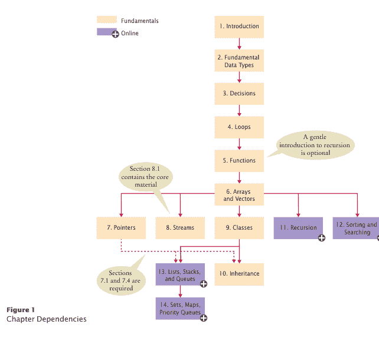

## 学习辅助功能导览

本书中的教学元素相互配合，聚焦并强化编程的关键概念和基本原理，同时组织额外的提示和细节来支持和深化这些基础。除了章节目标和大量练习等传统特色外，每章还包含面向当今视觉型学习者的元素。

**贯穿每章的页边注**标明新概念在何处引入，并概述关键思想。

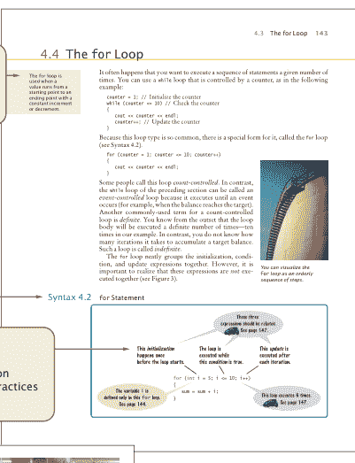

**带注释的语法框**提供对新语言结构的快速、可视化概览。

**注释**解释必需组件，并指向与语法相关的常见错误或最佳实践的更多信息。

用**类比**日常事物的方式来解释变量、数据类型、循环等概念的性质和行为。

**图 2 for 循环的执行**

| 步骤 | 状态/动作 | 代码 |
| --- | --- | --- |
| 初始化 | `counter = 1` | `for (counter = 1; counter <= 10; counter++)`<br>`cout << counter << endl;` |
| 检查条件 | `counter <= 10`（真） | `for (counter = 1; counter <= 10; counter++)`<br>`cout << counter << endl;` |
| 执行循环体 | `cout << counter << endl;` | `for (counter = 1; counter <= 10; counter++)`<br>`cout << counter << endl;` |
| 更新计数器 | `counter++` | `for (counter = 1; counter <= 10; counter++)`<br>`cout << counter << endl;` |
| 再次检查条件 | `counter <= 10`（真） | `for (counter = 1; counter <= 10; counter++)`<br>`cout << counter << endl;` |

渐进式图示跟踪代码段，帮助学生直观理解程序流程。颜色的一致使用使变量和其他元素易于识别。

**图 3 参数传递**

| 阶段 | 代码 | 状态 |
| --- | --- | --- |
| 函数调用 | `double result = cube_volume(2);` | `result = ?` |
| 进入函数 `cube_volume` | `double result = cube_volume(2);` | `side = 2` |
| 执行函数体 | `double volume = side * side * side;` | `side = 2` |
| 执行返回语句 | `return volume;` | `volume = 8` |
| 返回函数调用 | `double result = cube_volume(2);` | `result = 8` |

- 创建参数变量 `side`（立方体的边长）。
- 用调用 `cube_volume` 时传入的实参值初始化该参数变量。
- 将 `side * side * side` 的值赋给变量 `volume`，该值存储在变量 `volume` 中。
- 返回语句返回 `volume` 的值，因此 `cube_volume` 返回 `8`。

每节末尾的自测练习旨在让学生深入思考新材料——并且能在课堂上引发讨论。

## 自测

- 11. 将 `twos.cpp` 程序中的 `for` 循环改写为 `while` 循环。
- 12. 这个循环会打印多少个数字？

   ```cpp
   for (int n = 10; n >= 0; n--)
   {
       cout << n << endl;
   }
   ```

- 13. 编写一个 `for` 循环，打印 10 到 20（含两端）之间的所有偶数。
- 14. 编写一个 `for` 循环，计算 1 到 100 的整数之和。
- 15. 你会如何修改 `HelloPrinter` 程序，使用循环打印十次 "Hello"？

**练习** 现在你可以尝试本章末尾的这些练习：R4.2、R4.7、P4.12。

可选的工程练习让学生接触技术领域的应用。

## 工程练习 P7.20

编写一个程序，模拟“旅客捷运系统”的控制软件，该系统是一组在两条同心圆形轨道上运行的无人驾驶列车。一组道岔允许列车切换轨道。

在你的程序中，外轨和内轨应各分为十段。每个轨道段可以容纳一列列车，列车可顺时针或逆时针移动。列车移动到其所在轨道中的相邻段；如果该段被占用，则移动到另一条轨道中的相邻段。

定义一个 `Segment` 结构体。每个段都有一个指向其所在轨道中下一段和上一段的指针，以及一个指向另一条轨道中下一段和上一段的指针，……

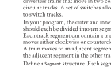

```cpp
ch05/cube.cpp
 1 #include <iostream>

 3 using namespace std;

 5 /**
 6    Computes the volume of a cube.
 7    @param side the side length of the cube
 8    @return the volume
 9 */
10 double cube_volume(double side)
11 {
12    double volume = side * side * side;
13    return volume;
14 }

16 int main()
17 {
18    double result1 = cube_volume(2);
19    double result2 = cube_volume(10);
20    cout << "A cube with side length 2 has volume " << result1 << endl;
21    cout << "A cube with side length 10 has volume " << result2 << endl;

23    return 0;
24 }
```

**程序运行结果**

```
A cube with side length 2 has volume 8
A cube with side length 10 has volume 1000
```

程序清单经过精心设计，便于阅读，远不止简单的颜色编码。函数通过细微的轮廓加以区分。

**常见错误**描述学生常犯的错误类型，解释错误发生的原因以及如何处理。

## 常见错误 2.1

### 使用未定义变量

你必须先声明变量，然后才能首次使用它。例如，以下语句序列是不合法的：

```
    double can_volume = 4 / 3 * 3.14 * can_radius * can_radius * 1.75;
    double can_radius = 12 * 3.14 * 1.75 * 1.75;
```

在你的程序中，语句按顺序编译。当编译器到达第一条语句时，它并不知道稍后会在下一行定义 can_radius，因此会报告错误。

**编程提示**解释良好的编程实践，并通过手工跟踪等提示和技巧鼓励学生提高效率。

## 编程提示 3.6

### 手工跟踪

一种用于理解程序是否正确运行的非常有用的技术称为手工跟踪。你在纸上模拟程序的活动。你可以将此方法用于伪代码或 Java 代码。


手工跟踪帮助你理解程序是否正确运行。

拿一张索引卡或其他纸张，制作一个表格，为程序中的每个变量设置一列。如果愿意，还可以为程序中的各行添加行。确保每次更新变量时，划掉旧值并在其下方写下新值。

你需要知道如何执行循环。在循环中，你重复执行其中的语句，直到循环条件为假。

| input | count | max |
| --- | --- | --- |
| 1 | 1 | 1 |
| 2 | 2 | 2 |
| 3 | 3 | 3 |

| input | count | max |
| --- | --- | --- |
| 1 | 1 | 1 |
| 2 | 2 | 2 |
| 3 | 3 | 3 |
| -1 | 3 | 3 |

例如，我们用上一节的数据跟踪该程序。假设使用输入值 1、2、3 和 -1，以及示例 3.1 中的代码。

```
    Line 14: int input = in.nextInt();
    Line 15: int count = 0;
    Line 16: int max = 0;
    Line 17: while (input >= 0) {
    Line 18:    count++;
    Line 19:    if (input > max) { max = input; }
    Line 20:    input = in.nextInt();
    Line 21: }
    Line 22: double average = 0;
    Line 23: if (count > 0) { average = (double) max / count; }
    Line 24: System.out.println(average);
```

由于 max 从 0 开始，它被替换为 1；随后被替换为 2；然后被替换为 3；它没有被 -1 替换，因为 -1 不大于 3。下一次输入时，循环条件为假。然后按 (double) max / count 计算平均值。如果 count 为 0，则平均值为 0。

**专题**介绍可选主题，并对其他主题提供补充解释。

## 专题 6.2

### 排序算法

排序是将序列中的元素重新排列，使它们按有序顺序存储的过程。下面是一个简单的排序算法，称为选择排序。考虑对以下数组值进行排序：

`11 9 17 12 5 10`

显然的第一步是找到最小元素。在本例中，最小元素是 5，存储在 slots[4] 中。应将 5 移到数组开头。当然，slots[0] 中已经存储了一个元素，即 11。因此需要将 11 复制到 slots[4]，即先前由 5 占据的位置。下面显示完成第一步后的数组。

`5 9 17 12 11 10`

现在第一个元素处于正确位置。下一步，第二个元素处于正确位置。再下一步，第三个元素处于正确位置。再下一步，第四个元素处于正确位置。剩余的数组值是 9、17、12、11、10。下一步是在剩余数组中找到最小元素。最小元素是 9，存储在 slots[1] 中。应将 9 移到剩余数组开头。当然，slots[1] 中已经存储了一个元素，即 9。因此无需操作。下面显示完成第二步后的数组。

`5 9 17 12 11 10`

现在前两个元素处于正确位置。下一步，剩余的数组值是 17、12、11、10。最小元素是 10，存储在 slots[5] 中。应将 10 移到剩余数组开头。当然，slots[2] 中已经存储了一个元素，即 17。因此需要将 17 复制到 slots[5]，即先前由 10 占据的位置。下面显示完成第三步后的数组。

`5 9 10 12 11 17`

现在前三个元素处于正确位置。下一步，剩余的数组值是 12、11、17。最小元素是 11，存储在 slots[4] 中。应将 11 移到剩余数组开头。当然，slots[3] 中已经存储了一个元素，即 12。因此需要将 12 复制到 slots[4]，即先前由 11 占据的位置。下面显示完成第四步后的数组。

`5 9 10 11 12 17`

现在前四个元素处于正确位置。下一步，剩余的数组值是 12 和 17。最小元素是 12，存储在 slots[4] 中。应将 12 移到剩余数组开头。当然，slots[4] 中已经存储了一个元素，即 12。因此无需操作。下面显示完成第五步后的数组。

`5 9 10 11 12 17`

现在前五个元素处于正确位置。下一步，剩余的数组值是 17。最小元素是 17，存储在 slots[5] 中。应将 17 移到剩余数组开头。当然，slots[5] 中已经存储了一个元素，即 17。因此无需操作。下面显示完成第六步后的数组。

`5 9 10 11 12 17`

现在前六个元素都已处于正确位置。数组现已排序完成。

**趣闻**提供有关计算的历史和社会信息——既为了趣味，也为了满足 ACM/IEEE 课程指南中“历史和社会背景”的要求。

## 趣闻 4.1

### 第一个 bug

据传说，第一个计算机 bug 是一只真正的昆虫。计算机科学家格蕾丝·默里·霍珀是计算机领域的先驱，当时她正在哈佛大学研究早期计算机 Mark II。一天，机器停止工作。她和同事发现一只飞蛾卡在继电器开关中。操作员用胶带把飞蛾粘在日志本上。如下所示的日志记录写着：“首次实际发现 bug 的案例。”飞蛾本身已经消失，但日志页保存在史密森尼学会。

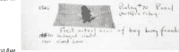


## 附录

附录A包含一份编程风格指南。在编程作业中使用风格指南有助于引导学生养成良好习惯，并减少不必要的选择。该风格指南以电子形式提供，以便教师可以修改它以反映其偏好的风格。

附录B和C概述C++保留字和运算符。附录D列出字符转义序列和ASCII字符编码值。附录E记录了本书中使用的所有库函数和类。

本书配套网站上提供的附加附录包括附录E的扩展版本，其中包含四个可选章节（第11–14章）中使用的函数和类，另外还有涵盖数制、位运算和移位运算以及C++与Java比较的附录。

## 学生与教师资源

学生和教师的以下资源可通过访问 www.wiley.com/college/horstmann 获取。本书有两个配套网站——一个面向学生，另一个是仅限教师访问的受密码保护网站。

- 面向科学与工程问题领域的额外练习
- 将书中的问题求解步骤应用于其他现实示例的示例解答（在书中用图标[icon]标识）
- 本书中所有示例的源代码
- 所有复习和编程练习的解答（仅限教师）
- 总结每章并包含书中代码清单和图表的讲座演示幻灯片（PowerPoint格式）（仅限教师）
- 侧重于技能而不仅仅是术语的题库（仅限教师）
- 关于递归、排序与查找以及数据结构的四个附加章节
- 电子形式的编程风格指南

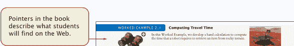

## 致谢

非常感谢John Wiley & Sons的Beth Golub、Tom Kulesa、Andre Legaspi、Elizabeth Mills、Michael Berlin和Lisa Gee，以及Publishing Services团队对本图书项目的辛勤工作和支持。特别深切地感谢Cindy Johnson，她以极大的耐心和对细节的关注使本书成为现实。我们还要感谢北达科他州立大学的Jonathan Tolstedt提供了高质量的解答；感谢肯塔基大学的Brent Scales修订和增强了题库；感谢纽约大学理工学院的Evan Gallagher制作了富有创意的PowerPoint幻灯片。

我们非常感谢许多审阅和/或对本书第一版及本版进行课堂测试的个人。我们重视他们提出的许多宝贵改进建议。他们包括：

- 查尔斯·D·艾利森，*犹他谷州立学院*
- 弗雷德·安内克斯泰因，*辛辛那提大学*
- 斯特凡诺·巴萨尼，*东北大学*
- 诺亚·D·巴尼特，*弗吉尼亚理工大学*
- 苏珊·比克福德，*塔拉哈西社区学院*
- 罗纳德·D·鲍曼，*阿拉巴马大学亨茨维尔分校*
- 彼得·布雷兹奈，*威斯康星大学绿湾分校*
- 理查德·卡卡切，*彭萨科拉初级学院，彭萨科拉*
- 张匡南，*东肯塔基大学*
- 约瑟夫·德利贝罗，*亚利桑那州立大学*
- 苏布拉马尼亚姆·达尔马拉詹，*亚利桑那州立大学*
- 玛丽·多尔夫，*密歇根大学*
- 马蒂·杜尔伯格，*北卡罗来纳州立大学*
- 威廉·E·邓肯，*路易斯安那州立大学*
- 约翰·埃斯特尔，*俄亥俄北方大学*
- 瓦利德·法拉格，*宾夕法尼亚印第安纳大学*
- 斯蒂芬·吉尔伯特，*橙海岸社区学院*
- 肯尼斯·吉特利茨，*新罕布什尔技术学院*
- 丹尼尔·格里戈莱蒂，*德锐理工学院，廷利帕克*
- 芭芭拉·吉约特，*路易斯安那州立大学*
- 查尔斯·哈尔西，*里奇兰学院*
- 乔恩·汉拉思，*伊利诺伊理工学院*
- 尼尔·哈里森，*犹他谷大学*
- 于尔根·赫克特，*安大略大学*
- 史蒂夫·霍奇斯，*卡布里洛学院*
- 杰基·贾博，*博伊西州立大学*
- 黛比·金子，*老道明大学*
- 米尔·贝赫拉德·哈梅塞，*滑铁卢大学*
- 权成植，*北卡罗来纳中央大学*
- 洛里·莱曼，*北卡罗来纳大学夏洛特分校*
- 辛西娅·莱斯特，*塔斯基吉大学*
- 李延军，*福特汉姆大学*
- W·詹姆斯·麦克莱恩，*多伦多大学*
- 琳达莉·马苏德，*莫特社区学院*
- 查尔斯·W·梅利亚德，*德锐理工学院，欧文*
- 伊桑·V·芒森，*威斯康星大学密尔沃基分校*
- 菲利普·雷加尔布托，*三叉戟技术学院*
- 唐·雷茨拉夫，*北德克萨斯大学*
- 杰夫·林根伯格，*密歇根大学安娜堡分校*
- 约翰·P·鲁索，*温特沃斯理工学院*
- 库尔特·施密特，*德雷塞尔大学*
- 布伦特·斯凯尔斯，*肯塔基大学*
- 威廉·谢伊，*威斯康星大学绿湾分校*
- 米歇尔·A·斯塔基，*圣玛丽山学院*
- 威廉·斯托克韦尔，*中俄克拉荷马大学*
- 乔纳森·托尔斯特德特，*北达科他州立大学*
- 博伊德·特罗林格，*巴特学院*
- 穆哈雷姆·乌亚尔，*纽约市立学院*
- 马亨德拉·维劳塔皮莱，*乔治城大学*
- 克斯廷·沃伊格特，*加州州立大学圣贝纳迪诺分校*
- 大卫·P·沃里斯，*勒莫因学院*
- 萨利赫·尤尔塔什，*德克萨斯农工大学*

特别感谢所有课堂测试者：

- 帕尼·查克拉帕尼和雷德兰兹大学的学生
- 吉姆·马科维亚克和长滩城市学院LAC的学生
- 苏雷什·穆克纳哈利帕特纳和怀俄明大学的学生
- 穆尔利达兰·奈尔和南本德印第安纳大学的学生
- 哈里特·罗德曼和新河社区学院的学生
- 大卫·托珀姆和奥龙学院的学生
- 丹尼·范塔塞尔和加维兰学院的学生

| 章节 | 常见错误 | 操作指南与示例 |
|---|---|---|
| **1** 引言 | 遗漏分号 14<br>拼错单词 16 | 用伪代码描述算法 20<br>编写铺地板算法 ⊕ |
| **2** 基本数据类型 | 使用未定义变量 37<br>使用未初始化变量 37<br>意外的整数除法 43<br>括号不匹配 44<br>忘记头文件 45<br>舍入误差 45 | 计算旅行时间 ⊕<br>执行计算 54<br>计算邮票费用 ⊕ |
| **3** 决策 | if 条件后的分号 80<br>混淆 = 和 == 85<br>浮点数的精确比较 86<br>悬空 else 问题 98<br>组合多个关系运算符 107<br>混淆 && 和 \|\| 条件 107 | 实现 if 语句 87<br>提取中间部分 ⊕ |
| **4** 循环 | 无限循环 136<br>不要想“我们到了吗？” 137<br>差一错误 137 | 编写循环 162<br>信用卡处理 ⊕ |
| **5** 函数 | 缺少返回值 203 | 实现函数 204<br>匹配和替换字符串的组成部分 ⊕<br>使用调试器 ⊕<br>计算课程成绩 ⊕<br>递归思考 229 |


| 编程提示 | 专题 | 趣闻 |
|---|---|---|
| 备份副本 11 | 转义序列 14 | ENIAC 与计算的黎明 5<br>标准组织 7 |
| 选择描述性变量名 38<br>不要使用魔法数字 39<br>表达式中的空格 46 | C++ 中的数值类型 38<br>数值范围与精度 39<br>类型转换 46<br>结合赋值与算术运算 47 | Pentium 浮点错误 47<br>国际字母表与 Unicode 61 |
| 花括号布局 79<br>始终使用花括号 80<br>制表符 81<br>避免分支中的重复 82<br>零警告编译 85<br>手工跟踪 97<br>制定计划并为意外问题留出时间 103 | 选择运算符 81<br>字符串的字典序 86<br>switch 语句 93<br>布尔运算符的短路求值 108<br>德摩根定律 108 | 丹佛机场行李处理系统 89<br>人工智能 112 |
| 仅将 for 循环用于其预期目的 147<br>选择与任务匹配的循环边界 147<br>计算迭代次数 147<br>循环流程图 149 | 清除失败状态 153<br>循环半问题与 break 语句 153<br>输入和输出的重定向 154 | 第一个 bug 138<br>软件盗版 172 |
| 函数注释 199<br>不要修改参数变量 201<br>保持函数简短 216<br>跟踪函数 216<br>桩函数 217<br>避免全局变量 220<br>优先使用返回值而不是引用参数 225 | 函数声明 203<br>常量引用 225 | 个人计算机的爆炸式增长 230 |

| 章节 | 常见错误 | 操作指南与示例 |
|---|---|---|
| **6 数组和向量** | 越界错误 254<br>省略二维数组参数的列大小 284 | 使用数组 271<br>掷骰子<br>世界人口表 |
| **7 指针** | 混淆指针与其指向的数据 313<br>返回指向局部变量的指针 319<br>悬空指针 328<br>内存泄漏 328 | 使用指针 334<br>生成群发邮件 |
| **8 流** |  | 处理文本文件 369<br>查找重复项 |
| **9 类** | 忘记分号 395<br>尝试调用构造函数 405 | 实现类 409<br>实现银行账户类 |
| **10 继承** | 私有继承 449<br>复制基类成员 450<br>忘记基类名 455<br>对象切片 462 | 开发继承层次结构 464<br>实现用于工资处理的员工层次结构 |

| 章节 | 常见错误 | 操作指南与示例 |
|---|---|---|
| 11 递归（仅网络版） | 无限递归<br>跟踪递归函数 |  |
| 12 排序与查找<br>（仅网络版） |  |  |
| 13 列表、栈和队列<br>（仅网络版） |  |  |
| 14 集合、映射和优先队列<br>（仅网络版） |  |  |


正如你收集工具、研究项目并制定处理计划一样，在本章中你将收集开始学习编程所需的基础知识。在简要介绍计算机硬件、软件和编程的一般概念之后，你将学习如何编写和运行第一个 C++ 程序。你还将学习如何诊断和修复编程错误，以及如何使用伪代码描述算法——一种解决问题的逐步描述——来规划你的程序。

## 1.1 什么是编程？

计算机快速连续地执行非常基本的指令。

你可能为了工作或娱乐使用过计算机。许多人用计算机处理日常任务，例如电子银行或写学期论文。计算机擅长这类任务。它们可以处理重复性杂务，例如把数字相加或把文字排到页面上，而不会感到无聊或疲惫。

计算机的灵活性是一个相当惊人的现象。同一台机器可以帮你平衡支票簿、打印学期论文和玩游戏。相比之下，其他机器执行的任务范围要窄得多；汽车行驶，烤面包机烤面包。计算机能执行广泛任务，是因为它们执行不同的程序，每个程序指导计算机处理特定任务。

计算机程序是一系列指令和决策。

计算机本身是一种存储数据（数字、文字、图片）、与设备（显示器、音响系统、打印机）交互并执行程序的机器。*计算机程序*以极其详细的方式告诉计算机完成任务所需的步骤序列。物理计算机和外围设备统称为*硬件*。计算机执行的程序称为*软件*。

今天的计算机程序如此复杂，以至于很难相信它们由极其原始的操作组成。一个典型操作可能是以下之一：

- 在此屏幕位置放置一个红点。
- 将这两个数字相加。
- 如果此值为负，则在某条指令处继续执行程序。

计算机用户之所以有流畅交互的错觉，是因为一个程序包含大量此类操作，并且计算机能以极快速度执行它们。

编程是设计和实现计算机程序的行为。

设计和实现计算机程序的行为称为*编程*。在本书中，你将学习如何为计算机编程——即如何指导计算机执行任务。

编写带有运动和音效的计算机游戏，或支持花哨字体和图片的文字处理器，是一项复杂任务，需要由许多高技能程序员组成的团队。你最初的编程工作将更为平凡。你在本书中学到的概念和技能构成重要基础，如果你的第一批程序无法与你熟悉的复杂软件相媲美，你不应失望。实际上，你会发现即使简单的编程任务也有巨大兴奋感。看到计算机精确而快速地执行一项本会花费你数小时枯燥劳动的任务，是一种奇妙的体验，去


在程序中做出能立即带来改进的小改动，并看到计算机成为你心智能力的延伸。

### 自测

- 1. 在计算机上播放音乐需要什么？
- 2. 为什么 CD 播放器不如计算机灵活？
- 3. 为了玩电子游戏，计算机用户需要了解哪些编程知识？

### 练习

现在你可以尝试本章末尾的这些练习：R1.1、R1.4。

## 1.2 计算机的解剖结构

要理解编程过程，你需要对构成计算机的组成部分有初步了解。我们将以个人计算机为例。较大的计算机具有更快、更大或更强大的组件，但它们在根本设计上是相同的。

计算机的核心是**中央处理器**（CPU）（见图 1）。它由单个*芯片*或少量芯片组成。计算机芯片（集成电路）是一种组件，具有塑料或金属外壳、金属连接器，以及主要由硅制成的内部布线。对于 CPU 芯片，内部布线极其复杂。例如，Pentium 芯片（撰写本书时个人计算机中常用的一种 CPU）由数百万个称为*晶体管*的结构元件组成。

CPU 执行程序控制和数据处理。也就是说，CPU 定位并执行程序指令；它执行加法、减法、乘法和除法等算术运算；它从外部存储器或设备中取回数据，并将数据存回。

计算机存储数据和程序。存储分为两种。*主存储器*由内存芯片制成：这些电子电路在供电时能够存储数据。*辅助存储器*通常是硬盘，提供成本较低且断电后仍能保存数据的存储。硬盘由旋转的盘片和读/写磁头组成，盘片涂有磁性材料，磁头能够检测并改变盘片上的磁通量（见图 2）。

> 中央处理器（CPU）执行程序控制和数据处理。

> 存储设备包括内存和辅助存储器。

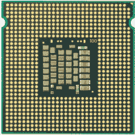

**图 1** 中央处理器

## 1.3 机器码与编程语言

在最基本的层面上，计算机指令极其原始。处理器执行*机器指令*。典型的机器指令序列如下：

- 1. 将内存位置 40000 的内容移入 CPU。
- 2. 如果该值 > 100，则继续执行存储在内存位置 11280 中的指令。

计算机程序以机器指令的形式存储，所用编码取决于处理器类型。

实际上，机器指令被编码为数字，以便能够存储在内存中。在 Pentium 处理器上，这一指令序列被编码为如下数字序列：

161 40000 45 100 127 11280

在不同制造商生产的处理器上，编码会有所不同。当这类处理器取回这一数字序列时，会对其进行解码并执行相应的命令序列。

我们如何将命令序列传达给计算机？最简单的方法是将实际数字放入计算机内存。事实上，最早的计算机就是这样工作的。然而，一个长程序由数千条单独命令组成，查找所有命令的数字代码并手动将代码放入内存是一件繁琐且容易出错的事情。如前所述，计算机非常擅长自动化处理繁琐且容易出错的活动。计算机科学家很快就意识到，可以利用计算机本身来辅助编程过程。

计算机科学家设计了*高级编程语言*，使程序员能够使用与待解决问题更密切相关的语法来描述任务。在本书中，我们将使用 C++ 编程语言，它由 Bjarne Stroustrup 于 20 世纪 80 年代开发。


C++ 是一种通用语言，广泛用于系统和嵌入式编程。

多年来，C++ 通过增加许多特性而不断发展。标准化过程最终促成了 1998 年国际 C++ 标准的发布。该标准在 2003 年发布了小幅更新，预计一次重大修订将在 2011 年左右实现。目前，C++ 是开发数据库和操作系统等系统软件最常用的语言。同样重要的是，C++ 越来越多地用于编写“嵌入式系统”程序，即控制汽车发动机或蜂窝电话等设备的小型计算机。

下面是一个典型的 C++ 语句：

```
if (int_rate > 100) { cout << "Interest rate error"; }
```

高级编程语言独立于处理器。

这意味着，“如果利率超过 100，就显示一条错误消息。”一种特殊的计算机程序——编译器——会将这种高级描述转换为针对特定处理器的机器指令。

高级语言独立于底层硬件。C++ 指令在 Intel Pentium 和手机处理器上同样有效。当然，编译器生成的机器指令不同，但使用编译器的程序员不必担心这些差异。

### 自测

- 6. 编译器属于计算机硬件还是软件？
- 7. 使用计算机进行办公工作的人会运行编译器吗？
- 8. C++ 最重要的用途是什么？

### 练习

现在你可以尝试本章末尾的这些练习：R1.5。

### 小知识 1.2 标准组织

两个标准组织——美国国家标准学会（ANSI）和国际标准化组织（ISO）——共同制定了 C++ 语言的权威标准。

为什么要有标准？你每天都会遇到标准化带来的好处。当你购买灯泡时，你可以确信它能装进灯座，而不必在家里测量灯座、在商店测量灯泡。事实上，如果你曾买过使用非标准灯泡的手电筒，就可能体会过缺乏标准有多么麻烦。这种手电筒的替换灯泡可能很难买到，而且价格昂贵。

ANSI 和 ISO 标准组织是由行业专业人士组成的协会，他们制定的标准涵盖从汽车轮胎、信用卡形状到编程语言等各个方面。为 C++ 这样的编程语言制定标准，意味着你可以把在一个系统上使用某制造商编译器开发的程序拿到另一个系统上，并确信它仍能正常工作。


## 1.4 熟悉你的编程环境

留出一些时间来熟悉你将在课程作业中使用的编程环境。

许多学生会发现，作为程序员所需的工具与他们熟悉的软件大不相同。你应该花些时间熟悉编程环境。由于计算机系统差异很大，本书只能概述你需要遵循的步骤。参加动手实验，或请一位熟悉情况的朋友带你参观，都是不错的主意。

**步骤 1** 启动 C++ 开发环境。

计算机系统在这方面差异很大。在许多计算机上，都有一个**集成开发环境**，你可以在其中编写和测试程序。在其他计算机上，你首先要启动一个*编辑器*——一种功能类似文字处理器的程序——在其中输入 C++ 指令；然后打开控制台窗口并键入命令来执行程序。你需要弄清楚如何开始使用你的环境。

**步骤 2** 编写一个简单程序。

在学习一门新编程语言时，第一个程序的传统选择是显示简单问候语“Hello, World!”的程序。让我们遵循这一传统。下面是用 C++ 编写的“Hello, World!”程序：

```cpp
#include <iostream>

using namespace std;

int main()
{
    cout << "Hello, World!" << endl;
    return 0;
}
```

我们将在下一节中检查这个程序。

编辑器是用于输入和修改文本（例如 C++ 程序）的程序。

无论你使用哪种编程环境，你都要先在编辑器窗口中输入程序语句来开始工作。

按照适合你的环境的步骤，创建一个新文件并将其命名为 hello.cpp。（如果你的环境除了文件名之外还需要提供项目名称，请将项目命名为 hello。）*完全按照*上面给出的程序指令输入。或者，在本书程序的源文件中找到电子副本，并将其粘贴到你的编辑器中。

C++ 区分大小写。你必须注意区分大写字母和小写字母。

在编写此程序时，请仔细注意各种符号，并记住 C++ 区分大小写。你必须严格按照程序清单中出现的样式输入大写和小写字母。你不能输入 MAIN 或 End。如果不小心，你会遇到问题——参见第 16 页的常见错误 1.2。

编译器将 C++ 程序翻译成机器代码。

### 第 3 步：完成并运行程序。

构建和运行 C++ 程序的过程在很大程度上取决于你的编程环境。在某些集成开发环境中，你只需按一个按钮。在其他环境中，你可能需要输入命令。当你运行测试程序时，消息

```
Hello, World!
```

将出现在屏幕的某处（参见图 5 和图 6）。

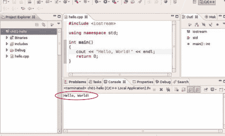

**图 5**  
在集成开发环境中运行 hello 程序

### 编程提示 1.1：备份副本


对于许多人来说，将文件备份到U盘上是一种简单方便的存储方法。另一种越来越流行的备份形式是互联网文件存储。以下是一些需要记住的要点。


- **经常备份。** 备份文件只需几秒钟，如果你不得不花很多小时重新创建原本可以轻松保存的工作，你会恨自己。我建议你每三十分钟备份一次工作。
- **轮换备份。** 使用多个备份目录，并轮换使用。也就是说，先备份到第一个目录。然后备份到第二个目录。然后使用第三个，再回到第一个。这样你总是有三个最近的备份。如果你最近的更改让事情变得更糟，你可以回到较旧的版本。
- **注意备份方向。** 备份涉及将文件从一个位置复制到另一个位置。正确执行这一点很重要——即从你的工作位置复制到备份位置。如果你搞反了，你会用旧版本覆盖较新的文件。
- **定期检查备份。** 再次确认你的备份是否在你认为的位置。没有什么比在你需要时发现备份不在那里更令人沮丧的了。
- **放松，然后恢复。** 当你丢失文件并需要从备份中恢复时，你可能处于不愉快、紧张的状态。开始之前，深呼吸并仔细考虑恢复过程。一个焦躁的计算机用户在尝试恢复受损文件时抹掉最后一个备份的情况并不少见。

## 1.5 分析你的第一个程序


在本节中，我们将详细分析第一个 C++ 程序。这里再次给出源代码：

**ch01/hello.cpp**

```cpp
#include <iostream>

using namespace std;

int main()
{
    cout << "Hello, World!" << endl;
    return 0;
}
```

第一行 `#include <iostream>` 告诉编译器包含一个用于“流输入/输出”的服务。你将在第 8 章学习什么是流。目前，你只需记住在所有执行输入或输出的程序中添加这一行。

### 语法 1.2：输出语句

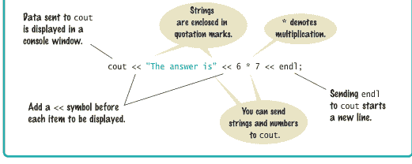

- 用引号将文本字符串括起来。
- 使用 + 将两个数字相加，使用 * 将两个数字相乘。
- 向 cout 发送 endl 以结束一行显示输出。
- 每条语句以分号结束。

语句 `cout << "Hello";` 显示**字符串** Hello。字符串是字符序列。你必须将字符串的内容放在引号内，这样编译器才能知道你字面意思就是文本 "Hello"，而不是同名函数。

你可以向 cout 发送多个项目。在每个项目前使用一个 <<。例如，`cout << "The answer is " << 6 * 7;` 显示 The answer is 42（在 C++ 中，* 表示乘法）。

endl 符号表示一个*行尾*标记。当这个标记被发送到 cout 时，光标会移动到下一屏幕行的第一列。如果不使用行尾标记，那么下一个显示的项目将直接跟在当前字符串的同一行后面。在这个程序中我们只打印了一个项目，但通常我们会想要打印多个项目，所以用行尾标记结束所有输出行是一个好习惯。

最后，注意 C++ 中的每条语句都以分号结尾，就像每个英文句子都以句号结尾一样。


- 12. 如何修改 hello.cpp 程序，使它改为向你问好？
- 13. 这个程序有什么问题？

  ```cpp
  #include <iostream>
  using namespace std;
  int main()
  {
      cout << Goodbye, World! << endl;
      return 0;
  }
  ```

- 14. 下面的语句序列会打印什么？

  ```cpp
  cout << "Hello";
  cout << "World";
  ```

- 15. 下面的语句会打印什么？

  ```cpp
  cout << 2 * 2 << 2;
  ```

- 16. 下面的语句会打印什么？

  ```cpp
  cout << "Hello" << endl << endl << "World";
  ```

**动手练习**  现在你可以尝试本章末尾的这些练习：R1.7、P1.1、P1.2。

### 常见错误 1.1：省略分号


在 C++ 中，每条语句都必须以分号结尾。忘记输入分号是一个常见错误。它会使编译器感到困惑，因为编译器使用分号来找到一条语句的结束和下一条语句的开始。编译器不使用行尾或右花括号来识别语句的结束。例如，编译器会将

```cpp
cout << "Hello, World!" << endl
return 0;
```

视为一条语句，就像你写了

```cpp
cout << "Hello, World!" << endl return 0;
```

然后它就不理解那条语句，因为它不希望在输出命令中间出现 return 这个词。补救方法很简单。只需检查每条语句是否有结尾分号，就像你检查每个英文句子是否以句号结尾一样。

### 专题 1.1：转义序列


如何显示包含引号的字符串，例如

```
Hello, "World"
```

你不能使用

```cpp
cout << "Hello, "World"";
```

一旦编译器读到 "Hello, "，它就认为字符串结束了，然后就对 World 感到困惑。编译器思维单一，如果简单的输入分析对它们来说没有意义，它们就拒绝继续，并报告错误。相比之下，人很可能会意识到第二个和第三个引号本应是字符串的一部分。

那么，我们如何在屏幕上显示引号呢？C++ 的设计者提供了一个解决方法。用反斜杠字符（`\`）标记每个引号，像这样：

```cpp
cout << "Hello, \"World\"";
```

序列 `\"` 表示一个字面引号，而不是字符串的结束。这样的序列称为转义序列。

还有其他几个转义序列。如果你真的想在屏幕上显示一个反斜杠，可以使用转义序列 `\\`。语句

```cpp
cout << "Hello\\World";
```

打印

```
Hello\World
```


最后，转义序列 \n 表示一个换行符，它会在屏幕上开始新的一行。命令

```
cout << "Hello, World!\n";
```

与以下代码的效果完全相同：

```
cout << "Hello, World!" << endl;
```

## 1.6 错误

编程语言遵循非常严格的约定。当你与另一个人交谈时，如果你弄乱或遗漏了一两个词，你的交谈对象通常仍能理解你想说什么。但是，当你在 C++ 程序中出错时，编译器不会试图猜测你的意思。（这其实是件好事。如果编译器猜错了，生成的程序就会做错事——很可能带来灾难性后果。）在本节中，你将学习如何处理程序中的错误。

用 hello.cpp 程序做一点实验。如果你出现如下键入错误，会发生什么：

```
cot << "Hello, World!" << endl;
cot << "Hello, World!" << endl;
cot << "Hello, World!" << endl;
```

在第一种情况下，编译器会抱怨它完全不知道你说的 cot 是什么意思。错误消息的确切措辞取决于编译器，但可能类似于“未定义的符号 cot”。这是编译时错误或语法错误。根据语言规则，某些地方出了问题，编译器发现了它。当编译器发现一个或多个错误时，它不会把程序翻译成机器码，因此也就没有程序可运行。你必须修复错误并重新编译。在第一次编译成功之前，经历几轮修复编译时错误是很常见的。

如果编译器发现一个错误，它不会简单地停下来放弃。它会尽量报告它能找到的所有错误，以便你可以一次性全部修复。然而，有时一个错误会让它偏离轨道。第二行中的错误很可能就会这样。由于程序员忘记了结束引号，编译器会一直寻找字符串的结尾。在这种情况下，编译器常常会对相邻行发出虚假的错误报告。你应该只修复那些对你来说有意义的错误消息，然后重新编译。

第三行中的错误属于另一种类型。程序会编译并运行，但它的输出会是错误的。它会打印

```
Hello, World!
```

这是运行时错误。程序在语法上是正确的，并且做了一些事情，但它没有做它应该做的事情。编译器无法发现这个错误，必须在程序运行时通过测试并仔细查看其输出来找出它。因为运行时错误是由程序中的逻辑缺陷引起的，所以它们常被称为逻辑错误。有些运行时错误非常严重，会生成异常：来自处理器的一个信号，它会带着错误消息中止程序。例如，如果你的程序包含语句 `cout << 1 / 0;`，你的程序可能会因“除以零”异常而终止。

在程序开发过程中，错误是不可避免的。一旦程序超过几行，正确输入而不出错一次就需要超人的专注力。你会发现自己比想象中更频繁地遗漏分号或引号，但编译器会为你追踪这些问题。

运行时错误更麻烦。编译器不会发现它们——事实上，只要语法正确，编译器会愉快地翻译任何程序——但生成的程序会做错事。程序作者有责任测试程序并发现任何运行时错误。程序测试是一个重要主题，你将在本书中多次遇到。

> 程序员负责检查和测试程序，以防止运行时错误。

编译时错误是违反编程语言规则且被编译器检测到的错误。

运行时错误会导致程序采取程序员并不想执行的操作。


程序员会花相当多的时间修复编译时错误和运行时错误。

### 自检


- 17. 假设你从 hello.cpp 程序中省略了 main 后面的 () 字符。你会得到编译时错误还是运行时错误？
- 18. 当你使用计算机时，你可能遇到过程序“崩溃”（自行退出）或“挂起”（无法响应你的输入）。这种行为是编译时错误还是运行时错误？
- 19. 当程序存在编译器错误时，为什么不能测试它的运行时错误？

### 练习

现在你可以尝试本章末尾的这些练习：R1.10、R1.11。

## 常见错误 1.2

### 拼写错误


如果你意外拼错了一个单词，可能会发生奇怪的事情，而且从错误消息中并不总能完全明显地看出哪里出错了。下面是一个很好的例子，说明简单的拼写错误如何引起麻烦：

```
#include <iostream>

using namespace std;

int Main()
{
    cout << "Hello, World!" << endl;
    return 0;
}
```

这段代码定义了一个名为 Main 的函数。编译器不会认为它与 main 函数相同，因为 Main 以大写字母开头，而 C++ 语言区分大小写。大写字母和小写字母被认为彼此完全不同，对编译器来说，Main 与 main 的匹配程度并不比 rain 与 main 的匹配程度更高。编译器会编译你的 Main 函数，但当链接器准备构建可执行文件时，它会抱怨缺少 main 函数，并拒绝链接程序。当然，“缺少 main 函数”的消息应该能给你线索，告诉你到哪里查找错误。

如果你收到的错误消息似乎表明编译器走错了路，最好检查拼写和大小写。在 C++ 中，大多数名称只使用小写字母。如果你拼错了符号名称（例如用 out 而不是 cout），编译器会抱怨“未定义的符号”。这个错误消息通常是一个很好的线索，表明你犯了拼写错误。

## 1.7 问题求解：算法设计

你很快就会学习如何在 C++ 中编写计算和决策程序。但在下一章我们研究实现计算的机制之前，让我们先考虑实现之前的规划过程。

你可能遇到过一些广告，鼓励你付费购买一项计算机化服务，为你匹配恋爱伴侣。想一想这可能会如何运作。你填写一张表格并寄出。其他人也这样做。数据由计算机程序处理。假设计算机能够完成为你寻找最佳匹配的任务，这合理吗？假设不是你弟弟，而是你弟弟的桌子上放着所有表格。你能给他什么指示？你不能说：“找到长相最好、喜欢直排轮滑和浏览互联网的异性”。长相没有客观标准，而你弟弟的看法（或分析数字化照片的计算机程序的看法）很可能与你的不同。如果你无法给某人写出解决问题的书面指示，计算机就不可能神奇地解决这个问题。计算机只能做你告诉它做的事。它只是做得更快，不会感到无聊或疲惫。现在考虑以下投资问题：


*找到完美伴侣并不是计算机能够解决的问题。*

你将 10,000 美元存入一个每年赚取 5% 利息的银行账户。账户余额翻倍需要多少年？

你能手工解决这个问题吗？当然可以。你可以按如下方式计算余额：

| 年份 | 利息 | 余额 |
|------|----------|---------|
| 0 | | 10000 |
| 1 | 10000.00 x 0.05 = 500.00 | 10000.00 + 500.00 = 10500.00 |
| 2 | 10500.00 x 0.05 = 525.00 | 10500.00 + 525.00 = 11025.00 |
| 3 | 11025.00 x 0.05 = 551.25 | 11025.00 + 551.25 = 11576.25 |
| 4 | 11576.25 x 0.05 = 578.81 | 11576.25 + 578.81 = 12155.06 |

你一直继续，直到余额至少达到 20,000 美元。那么年份列中的最后一个数字就是答案。

当然，执行这种计算对你或你弟弟来说极其无聊。但计算机非常擅长快速且无误地执行重复计算。对计算机来说，重要的是对求解步骤的描述。每一步都必须清晰且无歧义，不需要任何猜测。下面就是这样的描述：

从年份值为 0、一个利息列和余额 10,000 美元开始。

| 年份 | 利息 | 余额 |
|------|----------|---------|
| 0 | | 10000 |


### 图9：软件开发过程

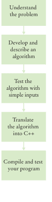

当每一步该做什么以及下一步该去哪里都有精确指示时，方法是*明确的*。没有猜测或发挥创造力的余地。当每一步都能在实践中执行时，方法是*可执行的*。如果我们要求使用未来年份实际收取的利率，而不是每年5%的固定利率，那么我们的方法将不可执行，因为任何人都无法知道那个利率会是多少。如果方法最终会结束，那么它是*可终止的*。在我们的例子中，需要稍加思考才能看出该方法不会永远进行下去。每进行一步，余额至少增加$500，因此最终必定达到$20,000。

一个由明确、可执行且可终止的步骤组成的序列称为**算法**。我们已经找到了一个解决投资问题的算法，因此可以通过给计算机编程来找到解决方案。算法的存在是为任务编程的必要先决条件。在开始编程之前，你需要先发现并描述你要解决的问题的算法（见图9）。


*算法是求解问题的配方。*

> 求解问题的算法是一个由明确、可执行且可终止的步骤组成的序列。


- 20. 假设利率为20%。投资翻倍需要多长时间？
- 21. 假设你的手机运营商对最多300分钟通话收费$29.95，之后每分钟$0.45，另加12.5%的税费。给出一个根据给定分钟数计算月费的算法。
- 22. 考虑以下伪代码，用于从一系列照片中找出最有吸引力的照片：

  ```
  Pick the first photo and call it "the best so far".
  For each photo in the sequence
    If it is more attractive than the "best so far"
      Discard "the best so far".
      Call this photo "the best so far".
  The photo called "the best so far" is the most attractive photo in the sequence.
  ```

  这是一个能找到最有吸引力照片的算法吗？

- 20. 4年：
  - 0：10,000
  - 1：12,000
  - 2：14,400
  - 3：17,280
  - 4：20,736
- 21. 分钟数最多为300吗？
  - a. 如果是，答案为 $29.95 × 1.125 = $33.70。
  - b. 如果不是，
    - 1. 计算差值：（分钟数）− 300。
    - 2. 将该差值乘以0.45。
    - 3. 加上 $29.95。
    - 4. 将总和乘以1.125。这就是答案。
- 22. 否。步骤“如果它比‘目前最好的’更有吸引力”不可执行，因为没有客观方法判断两张照片中哪张更有吸引力。
- 23.

  ```
  Pick the first photo and call it "the most expensive so far".
  For each photo in the sequence
      If it is more expensive than "the most expensive so far"
          Discard "the most expensive so far".
          Call this photo "the most expensive so far".
  The photo called "the most expensive so far" is the most expensive photo in the sequence.
  ```
- 24. 第一个前面有白色弹珠的黑色弹珠用蓝色标出：

  ○●○●●●

  交换这两个得到

  ●○○●●●

  下一个要交换的黑色弹珠是

  ●○○●●●

  得到

  ●○●○●●

  接下来的步骤是

  ●●○○●●

  ●●○●○●

  ●●●●○○

  现在序列已排序。
- 25. 该序列不会终止。考虑输入 ○●○●○。前两个弹珠不断被交换。

## 第2章：基本数据类型


### 本章目标

- 能够定义并初始化变量和常量
- 理解整数和浮点数的性质与限制
- 在C++中编写算术表达式和赋值语句
- 体会注释和良好代码布局的重要性
- 创建读取并处理输入、显示结果的程序
- 使用标准C++ string类型处理字符串

### 本章内容

- **2.1 变量** 30
  - *语法2.1：变量定义* 31
  - *语法2.2：赋值* 34
  - *常见错误2.1：使用未定义的变量* 37
  - *常见错误2.2：使用未初始化的变量* 37
  - *编程提示2.1：选择描述性变量名* 38
  - *专题2.1：C++中的数值类型* 38
  - *专题2.2：数值范围与精度* 39
  - *编程提示2.2：不要使用魔法数字* 39
- **2.2 算术** 40
  - *常见错误2.3：意外的整数除法* 43
  - *常见错误2.4：括号不匹配* 44
  - *常见错误2.5：忘记头文件* 45
  - *常见错误2.6：舍入误差* 45
  - *编程提示2.3：表达式中的空格* 46
  - *专题2.3：类型转换* 46
  - *专题2.4：组合赋值与算术* 47
  - *趣味事实2.1：奔腾浮点缺陷* 47
- **2.3 输入与输出** 48
  - *语法2.3：输入语句* 48
- **2.4 问题求解：先手工完成** 52
  - *示例2.1：计算旅行时间*
  - *如何做2.1：执行计算* 54
  - *示例2.2：计算邮票成本*
- **2.5 字符串** 56
  - *趣味事实2.2：国际字母表与Unicode* 61


数字和字符串（例如这块显示板上的那些）是任何C++程序中的重要数据类型。在本章中，你将学习如何使用数字和文本，以及如何编写用它们执行有用任务的简单程序。

## 2.1 变量

当你的程序执行计算时，你会希望存储值，以便以后使用。在C++程序中，你使用*变量*来存储值。在本节中，你将学习如何定义和使用变量。

为了说明变量的使用，我们将开发一个解决以下问题的程序。软饮料以罐装和瓶装出售。一家商店以与两升瓶相同的价格出售六罐装12盎司罐装饮料。你应该买哪个？（12液量盎司约等于0.355升。）

在我们的程序中，我们将为每包的罐数和每罐的体积定义变量。然后我们将计算六罐装的体积（以升为单位）并打印答案。


*哪种装得更多苏打水？是六罐装12盎司罐装，还是两升瓶？*

### 2.1.1 变量定义

下面的语句定义了一个名为 `cans_per_pack` 的变量：

```cpp
int cans_per_pack = 6;
```

> 变量是带名称的存储位置。

**变量**是计算机程序中的存储位置。每个变量都有一个名称并保存一个值。

变量类似于停车库中的停车位。停车位有一个标识符（例如“J053”），并且可以停放一辆车。变量有一个名称（例如 `cans_per_pack`），并且可以保存一个值（例如6）。


*就像计算机程序中的变量一样，停车位有一个标识符和一个内容物。*

### 语法2.1 变量定义

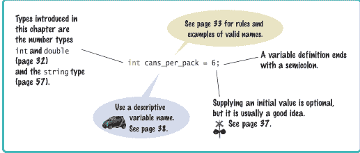

定义变量时，通常希望**初始化**它。也就是说，你指定应该存储在变量中的值。再次考虑这个变量定义：

定义变量时，通常要指定初始值。

```cpp
int cans_per_pack = 6;
```

定义变量时，还要指定其值的类型。

变量 `cans_per_pack` 被初始化为值6。

就像限制为某种类型车辆（例如紧凑型汽车、摩托车或电动汽车）的停车位一样，C++中的变量存储特定类型的数据。C++支持相当多的数据类型：数字、字符串、文件、日期以及许多其他类型。每当定义变量时，都必须指定类型（见语法2.1）。

`cans_per_pack` 变量是一个整数，即没有小数部分的整数。在C++中，这种类型称为 *int*。（有关C++中数字类型的更多信息，见下一节。）

注意类型位于变量名之前：

```cpp
int cans_per_pack = 6;
```

表1展示了变量定义的各种变体。


*每个停车位适合特定类型的车辆，正如每个变量保存特定类型的值。*


## 对浮点数使用 double 类型。

当需要小数部分时（例如数字 0.355），我们使用浮点数。C++ 中最常用于表示浮点数的类型称为 double。（如果想了解原因，请阅读第 38 页的专题 2.1。）下面是浮点变量的定义：

```cpp
double can_volume = 0.355;
```

当诸如 6 或 0.355 这样的值出现在 C++ 程序中时，它们称为数字字面量。表 2 展示了在 C++ 中如何书写整数和浮点数字面量。

### 2.1.3 变量名

定义变量时，应选择一个能够说明其用途的名称。例如，使用描述性名称 `can_volume`，比使用简短名称 `cv` 更好。

在 C++ 中，变量名有几条简单规则：

- 变量名必须以字母或下划线（_）字符开头，剩余字符必须是字母、数字或下划线。
- 不能使用其他符号，例如 $ 或 %。名称中也不允许有空格。可以使用下划线代替空格，例如 `can_volume`。
- 变量名区分大小写，也就是说，`can_volume` 和 `can_Volume` 是不同的名称。因此，变量名最好只使用小写字母。
- 不能使用 `double` 或 `return` 等保留字作为名称；这些单词专门保留用于表示其特殊的 C++ 含义。（参见附录 B。）

**表 3** C++ 中的变量名

| 变量名 | 注释 |
|---|---|
| can_volume1 | 变量名由字母、数字和下划线字符组成。 |
| x | 在数学中，通常使用 `x` 或 `y` 这样的简短变量名。在 C++ 中这样做是合法的，但并不常见，因为这会使程序更难理解（参见第 38 页的编程提示 2.1）。 |
| can_Volume | **注意：**变量名区分大小写。这个变量名与 `can_volume` 不同。 |
| 6pack | **错误：**变量名不能以数字开头。 |
| can volume | **错误：**变量名不能包含空格。 |
| double | **错误：**不能使用保留字作为变量名。 |
| 1tr/fl.oz | **错误：**不能使用 `/` 或 `.` 等符号。 |

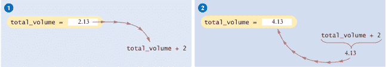

**图 1** 执行赋值 `total_volume = total_volume + 2`

### 2.1.5 常量

不能更改定义为 `const` 的变量的值。

当使用保留字 `const` 定义变量时，其值永远不能改变。常量通常使用大写字母书写，以便在视觉上与普通变量区分开来：

```cpp
const double BOTTLE_VOLUME = 2;
```

在程序中使用命名常量是一种良好的编程风格，它可以说明数值的含义。例如，比较下面两条语句：

```cpp
double total_volume = bottles * 2;
```

以及

```cpp
double total_volume = bottles * BOTTLE_VOLUME;
```

阅读第一条语句的程序员可能无法理解数字 2 的意义。第二条语句使用了命名常量，因此使计算过程清晰得多。

### 2.1.6 注释

使用注释为阅读代码的人添加解释。编译器会忽略注释。

随着程序变得越来越复杂，你应当添加**注释**，也就是针对代码阅读者的解释。下面是一个例子：

```cpp
const double CAN_VOLUME = 0.355; // 12 盎司罐的容积，单位为升
```

这条注释向人类读者解释了数值 0.355 的含义。编译器完全不会处理注释，而是忽略从 `//` 分隔符开始直到行尾的所有内容。


正如电视评论员会解释新闻一样，你可以在程序中使用注释来解释程序的行为。

## 编程提示 2.1


### 选择描述性的变量名

如果使用更短的变量名，例如：

```cpp
double cv = 0.355;
```

我们可以少输入很多内容。不过，把这个定义与我们实际使用的定义进行比较。哪一个更容易阅读？答案显而易见。只需阅读 `can_volume` 就容易得多，而阅读 `cv` 后还要推测它表示“罐的容积”。

在实际编程中，当程序由多人共同编写时，这一点尤其重要。你可能很清楚 `cv` 表示罐的容积，而不是当前速度，但几年后需要更新代码的人也会清楚吗？另外，三个月后，当你再次查看代码时，你还记得 `cv` 表示什么吗？

## 专题 2.1


### C++ 中的数值类型

除了 `int` 和 `double` 类型之外，C++ 还有其他几种数值类型。

C++ 有两种浮点类型。`float` 类型使用的存储空间是本书所使用的 `double` 类型的一半，但它只能存储 6～7 位数字。许多年前，计算机的内存远少于今天，当时 `float` 是浮点计算的标准类型；只有在需要更多数字时，程序员才会使用“**双精度**”这一奢侈配置。如今，`float` 类型已经很少使用。

顺便说一下，这些数字之所以称为“浮点数”，是因为它们在计算机中的内部表示方式。考虑数字 29660、2.96 和 0.0296。它们可以用非常相似的方式表示：即表示为有效数字序列——296——以及小数点位置的说明。当这些值乘以或除以 10 时，只有小数点的位置发生变化；它会“浮动”。计算机使用以 2 为底的数，而不是以 10 为底的数，但原理相同。

**表 4** 数值类型

| 类型 | 典型范围 | 典型大小 |
|---|---|---|
| int | −2,147,483,648 … 2,147,483,647（约 20 亿） | 4 字节 |
| unsigned | 0 … 4,294,967,295 | 4 字节 |
| short | −32,768 … 32,767 | 2 字节 |
| unsigned short | 0 … 65,535 | 2 字节 |
| long long | −9,223,372,036,854,775,808 … 9,223,372,036,854,775,807 | 8 字节 |
| double | 双精度浮点类型，范围约为 ±10^308，约有 15 位有效十进制数字 | 8 字节 |
| float | 单精度浮点类型，范围约为 ±10^38，约有 7 位有效十进制数字 | 4 字节 |

除 `int` 类型外，C++ 还有 `short`、`long` 和 `long long` 整数类型。每种整数类型都有对应的无符号类型。例如，`short` 类型的典型范围是 −32,768 到 32,767，而 `unsigned short` 的范围是 0 到 65,535。这些看起来奇怪的范围上限源于计算机对二进制数的使用。一个 `short` 值使用 16 个二进制位，可以编码 2^16 = 65,536 个值。请注意，整数类型的范围并未标准化，不同编译器之间可能有所不同。表 4 列出了典型值。

## 专题 2.2

### 数值范围和精度


由于计算机使用有限位数表示数字，因此它们无法表示任意的整数或浮点数。

`int` 类型具有*有限的范围*：在大多数平台上，它最多只能表示略大于 20 亿的数字。对于许多应用来说，这并不是问题，但不能使用 `int` 来表示世界人口。

如果某次计算得到的值超出了 `int` 的范围，结果就会发生*溢出*。系统不会显示错误，而是将结果截断，使其适合存储在 `int` 中，从而得到一个无用的值。例如：

```cpp
int one_billion = 1000000000;
cout << 3 * one_billion << endl;
```

该程序会显示 -1294967296。

在这种情况下，可以改用 double 值。不过，有关另一个相关问题——舍入误差——的更多信息，请阅读第 45 页的常见错误 2.6。

## 编程提示 2.2

### 不要使用魔法数字


**魔法数字**是指在代码中出现但没有解释的数值常量。例如：

```cpp
total_volume = bottles * 2;
```

为什么是 2？瓶子的容积是罐子的两倍吗？不是，原因是每个瓶子包含 2 升。使用命名常量可以让代码自解释：

```cpp
const double BOTTLE_VOLUME = 2;
total_volume = bottles * BOTTLE_VOLUME;
```

使用命名常量还有另一个原因。假设情况发生变化，现在瓶子的容积变成了 1.5 升。如果使用了命名常量，只需修改一处即可完成更改。否则，你必须查看程序中每一个数字 2，并猜测它表示的是瓶子的容积还是其他含义。在一个超过几页的程序中，这会非常乏味，也很容易出错。

即使是最合理的宇宙常量，总有一天也会发生变化。你认为一周有七天？火星上的客户会因为你这种愚蠢的偏见而非常不满。定义一个常量：

```cpp
const int DAYS_PER_WEEK = 7;
```


### 表 6 其他数学函数

| 函数 | 描述 |
|----------|-------------|
| sin(x) | *x* 的正弦（*x* 以弧度为单位） |
| cos(x) | *x* 的余弦 |
| tan(x) | *x* 的正切 |
| log10(x) | （十进制对数）log10(*x*)，*x* > 0 |
| abs(x) | *x* 的绝对值 \|*x*\| |

表 6 展示了在 `<cmath>` 头文件中声明的其他函数。输入和输出都是浮点数。


- 10. 银行账户每年赚取 p% 的利息。在 C++ 中，如何计算一年内赚取的利息？假设已定义 double 类型的变量 p 和 balance。
- 11. 在 C++ 中，如何计算面积存储在变量 area 中的正方形的边长？
- 12. 球体的体积由 V = 4/3 πr³ 给出。如果半径由 double 类型的变量 radius 给出，请写出计算体积的 C++ 表达式。可以假设 π 由常量 PI 定义。
- 13. 1729 / 10 和 1729 % 10 的值分别是什么？
- 14. 假设一份潘趣酒配方需要给定量的橙味汽水，以盎司计量。
  
  `int amount = 32;`
  
  假设该数量不能被 12 整除，我们可以计算所需的 12 盎司罐数：
  
  `int cans_needed = amount / 12 + 1;`
  
  使用 % 运算符确定会剩下多少盎司。例如，如果需要 32 盎司，则需要 3 罐，并剩下 4 盎司。


**实践一下** 现在你可以尝试本章末尾的这些练习：R2.3、R2.5、P2.2。

## 常见错误 2.3


### 意外的整数除法

遗憾的是，C++ 对整数除法和浮点除法使用同一个符号，即 /。这两种运算实际上相当不同。意外使用整数除法是一个常见错误。考虑下面这段计算三个整数平均值的代码：

```cpp
cout << "Please enter your last three test scores: ";
int s1;
int s2;
```

## 常见错误 2.5


### 忘记包含头文件

每个执行输入或输出的程序都需要 `<iostream>` 头文件。如果使用 sqrt 等数学函数，则需要包含 `<cmath>`。如果忘记包含相应的头文件，编译器将无法识别 cout 或 sqrt 等符号。如果编译器报错称某个函数或符号未定义，请检查你的头文件。

有时你可能不知道应包含哪个头文件。假设你想使用 abs 函数计算一个整数的绝对值。碰巧的是，这个版本的 abs 并非定义在 `<cmath>` 头文件中，而是定义在 `<cstdlib>` 中。如何找到正确的头文件？你需要找到 abs 函数的文档，最好使用开发环境的在线帮助或互联网上的参考网站，例如 http://www.cplusplus.com（见图 3）。文档中包含该函数的简短说明以及必须包含的头文件名称。

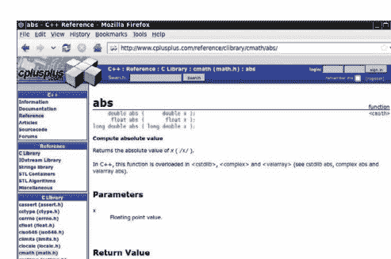

图 3 在线文档

## 常见错误 2.6


### 舍入误差

在使用浮点数进行计算时，舍入误差是不可避免的现实。你在手工计算时很可能也遇到过这种现象。如果将 1/3 计算到两位小数，会得到 0.33。再乘以 3，得到 0.99，而不是 1.00。

在处理器硬件中，数字以二进制数系统表示，而不是十进制。当二进制位丢失时，仍然会产生舍入误差。它们只是可能出现在与你预期不同的地方。下面是一个例子。

```cpp
#include <iostream>

using namespace std;

int main()
{
   double price = 4.35;
   int cents = 100 * price; // Should be 100 * 4.35 = 435
   cout << cents << endl; // Prints 434!
   return 0;
}
```

当然，一百乘以 4.35 是 435，但程序打印的是 434。大多数计算机以二进制系统表示数字。在二进制系统中，4.35 没有精确表示，就像在十进制系统中 1/3 没有精确表示一样。计算机使用的表示略小于 4.35，因此该值乘以 100 后略小于 435。当浮点值转换为整数时，整个小数部分（几乎为 1）会被丢弃，整数 434 被存入 cents。补救方法是加上 0.5，以便舍入到最接近的整数：

```cpp
int cents = 100 * price + 0.5;
```

## 编程提示 2.3


### 表达式中的空格

下面的写法更易读：

```cpp
x1 = (-b + sqrt(b * b - 4 * a * c)) / (2 * a);
```

而不是：

```cpp
x1=(-b+sqrt(b*b-4*a*c))/(2*a);
```

只需在所有运算符 + - * / % = 的两边加上空格。但是，不要在一元减号后加空格：一元减号用于对单个量取负，例如 -b。这样就能很容易地将其与二元减号区分开，如 a - b。

按照惯例，不要在函数名后加空格。也就是说，写成 sqrt(x)，而不是 sqrt (x)。

## 专题 2.3


### 强制类型转换

有时，你需要将一个值存储到不同类型的变量中。只要存在信息丢失的风险，编译器就会发出警告。例如，如果将 double 值存储到 int 变量中，可能会以两种方式丢失信息：

- 小数部分会丢失。
- 数值大小可能过大。

例如，

```cpp
int n = 1.0E100; // NO
```

这很可能无法工作，因为 10^100 大于可表示的最大整数。

然而，有时你确实想将浮点值转换为整数值。如果你准备丢失小数部分，并且知道这个特定的浮点数不大于可能的最大整数，那么可以使用强制类型转换来关闭警告。强制类型转换是从一种类型（如 double）到另一种类型（如 int）的转换，这种转换通常并不安全，但你知道在特定情况下是安全的。在 C++ 中，强制类型转换的写法如下：

```cpp
int cents = static_cast<int>(100 * price + 0.5);
```

## 专题 2.4

### 结合赋值与算术运算


在 C++ 中，可以将算术运算和赋值结合起来。例如，下面的语句

```cpp
total += cans * CAN_VOLUME;
```

是以下写法的简写：

```cpp
total = total + cans * CAN_VOLUME;
```

类似地，

```cpp
total *= 2;
```

是以下写法的另一种方式：

```cpp
total = total * 2;
```

许多程序员觉得这是一个方便的简写。如果你喜欢它，尽可以在自己的代码中使用。不过，为简单起见，本书不会使用它。

## 趣闻 2.1

### Pentium 浮点缺陷


1994 年，英特尔公司发布了当时其最强大的处理器——Pentium。与之前几代处理器不同，它拥有非常快的浮点运算单元。英特尔的目标是与面向工程工作站的高端处理器制造商展开激烈竞争。Pentium 一经推出便大获成功。

1994 年夏天，弗吉尼亚州林奇堡学院的 Thomas Nicely 博士运行了大量计算，以分析某些素数序列的倒数之和。即使考虑了不可避免的舍入误差，结果也并不总是与他的理论预测相符。随后，Nicely 博士注意到，同一个程序在英特尔产品线中早于 Pentium 的较慢 486 处理器上运行时，确实产生了正确结果。这本来不应该发生。浮点计算的最佳舍入行为由电气与电子工程师协会（IEEE）标准化，而英特尔声称 486 和 Pentium 处理器都遵循 IEEE 标准。进一步检查后，Nicely 博士发现，有一组极少的数字，在这两种处理器上计算出的两个数的乘积不同。例如，

4,195,835 - ((4,195,835/3,145,727) × 3,145,727)

在数学上等于 0，并且在 486 处理器上确实计算为 0。而在他的 Pentium 处理器上，结果是 256。

事实证明，英特尔在其测试中已独立发现了这个缺陷，并已开始生产修复该缺陷的芯片。该缺陷是由一张用于加速处理器浮点乘法算法的表中的错误引起的。英特尔认定该问题极其罕见。他们声称，在正常使用下，普通消费者每 27,000 年才会注意到该问题一次。对英特尔来说不幸的是，Nicely 博士并不是普通用户。

现在英特尔面临一个真正的问题。它估算，更换迄今为止已售出的所有 Pentium 处理器将花费巨额资金。英特尔接到的该芯片订单已经超过其生产能力，而不得不把稀缺芯片作为免费替换品发放而不是出售，会尤其令人恼火。英特尔管理层决定拖延，最初只提出为那些能证明其工作需要在数学计算中达到绝对精度的客户更换处理器。自然，这并没有得到数十万客户的认可，他们以 700 美元甚至更高的零售价购买了 Pentium 芯片，不想生活在一种挥之不去的担忧中：也许有一天，他们的所得税程序会产生错误的申报表。最终，英特尔屈服于公众要求，更换了所有有缺陷的芯片，花费约 4.75 亿美元。

### Pentium FDIV 错误

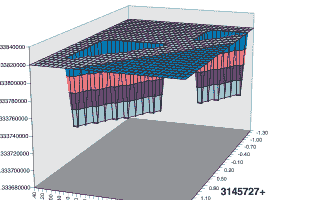

该图展示了一组数字，原始 Pentium 处理器在计算这些数字时得到了错误的商。


#### 2.3.2 格式化输出

当你打印计算结果时，通常希望对其外观有一定的控制。例如，当你打印以美元和美分表示的金额时，通常希望它四舍五入到两位小数。也就是说，你希望输出看起来像

```
Price per ounce: 0.04
```

而不是

```
Price per ounce: 0.0409722
```

```
cout << fixed << setprecision(2);
```

这条命令不会产生任何输出；它只是操纵 `cout`，使其改变输出格式。`fixed` 和 `setprecision` 这些值称为*操纵器*。我们将在第 8 章详细讨论操纵器。现在，只需记住：每当你希望货币值显示整齐时，就包含上面给出的语句。

> 你使用操纵器来指定值应如何格式化。

要使用操纵器，必须在程序中包含 `<iomanip>` 头文件：

```
#include <iomanip>
```

你可以将操纵器和要显示的值合并到一条语句中。

```
cout << fixed << setprecision(2)
     << "Price per ounce: "
     << price_per_ounce << endl;
```

还有另一个有时很方便的操纵器。当你显示多行数据时，通常希望各列对齐。

你使用 `setw` 操纵器来设置下一个输出字段的*宽度*。宽度是用于显示该值的总字符数，包括数字、小数点和空格。当你希望数字列对齐时，控制宽度很重要。

例如，如果你希望一个数字打印在宽度为八个字符的列中，你可以使用

```
cout << setw(8) << price_per_ounce;
```


*你使用操纵器将输出整齐地对齐到列中。*

这条命令在宽度为 8 的字段中打印 `price_per_ounce` 的值，例如

```text
␣␣␣␣0.04
```

（其中每个 ␣ 表示一个空格。）

`setprecision` 和 `setw` 操纵器之间有一个显著区别。一旦设置了精度，该值将用于所有浮点数。但宽度只影响下一个值。后续值将不带额外空格进行格式化。

我们的下一个示例程序将提示输入六罐装的价格和每罐的体积，然后打印每盎司的价格。该程序运用你刚刚学到的关于读取输入和格式化输出的知识。

### ch02/volume2.cpp

```cpp
#include <iostream>
#include <iomanip>

using namespace std;

int main()
{
   // Read price per pack

   cout << "Please enter the price for a six-pack: ";
   double pack_price;
   cin >> pack_price;

   // Read can volume

   cout << "Please enter the volume for each can (in ounces): ";
   double can_volume;
   cin >> can_volume;

   // Compute pack volume

   const double CANS_PER_PACK = 6;
   double pack_volume = can_volume * CANS_PER_PACK;

   // Compute and print price per ounce

   double price_per_ounce = pack_price / pack_volume;

   cout << fixed << setprecision(2);
   cout << "Price per ounce: " << price_per_ounce << endl;

   return 0;
}
```

### 程序运行

```text
Please enter the price for a six-pack: 2.95
Please enter the volume for each can (in ounces): 12
Price per ounce: 0.04
```

## 2.4 问题求解：先手工做

开发算法的一个非常重要的步骤是首先*手工*进行计算。如果你自己无法计算出一个解，那么你不太可能编写出一个自动化该计算的程序。

为了说明手工计算的使用，考虑以下问题。一排黑白瓷砖需要沿着墙铺设。出于美观原因，建筑师规定第一块和最后一块瓷砖应为黑色。你的任务是在给定可用空间和每块瓷砖宽度的情况下，计算所需瓷砖数量以及两端的间隙。

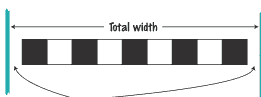

为了使问题更具体，我们假设以下尺寸：

- 总宽度：100 英寸
- 瓷砖宽度：5 英寸

为典型情况选取具体数值，以便用于手工计算。

显而易见的解决方案是用 20 块瓷砖填满空间，但那样行不通——最后一块瓷砖会是白色的。

相反，这样看问题：第一块瓷砖必须始终是黑色，然后我们添加若干对白色/黑色瓷砖：


第一块瓷砖占据 5 英寸，剩下 95 英寸由成对瓷砖覆盖。每一对宽 10 英寸。因此对数为 95 / 10 = 9.5。然而，我们需要舍弃小数部分，因为不能有半对瓷砖。

因此，我们将使用 9 对瓷砖，即 18 块瓷砖，再加上最初的黑色瓷砖。总共需要 19 块瓷砖。

这些瓷砖跨越 19 × 5 = 95 英寸，留下总间隙 100 − 19 × 5 = 5 英寸。间隙应均匀分布在两端。每端的间隙为 (100 − 19 × 5) / 2 = 2.5 英寸。

这一计算为我们提供了足够的信息，可以设计出适用于任意总宽度和瓷砖宽度的算法。

```text
number of pairs = integer part of (total width - tile width) / (2 x tile width)
number of tiles = 1 + 2 x number of pairs
gap at each end = (total width - number of tiles x tile width) / 2
```

如你所见，进行手工计算能让你对问题有足够的洞察，从而容易地开发出算法。

下面是完整程序 `ch02/vending.cpp`：

```cpp
#include <iostream>
#include <iomanip>

using namespace std;

int main()
{
   const int PENNIES_PER_DOLLAR = 100;
   const int PENNIES_PER_QUARTER = 25;

   cout << "Enter bill value (1 = $1 bill, 5 = $5 bill, etc.): ";
   int bill_value;
   cin >> bill_value;
   cout << "Enter item price in pennies: ";
   int item_price;
   cin >> item_price;

   int amount_due = PENNIES_PER_DOLLAR * bill_value - item_price;
   int dollar_coins = amount_due / PENNIES_PER_DOLLAR;
   amount_due = amount_due % PENNIES_PER_DOLLAR;
   int quarters = amount_due / PENNIES_PER_QUARTER;

   cout << "Dollar coins: " << setw(6) << dollar_coins << endl
        << "Quarters:     " << setw(6) << quarters << endl;
}
```

### 程序运行

```text
Enter bill value (1 = $1 bill, 5 = $5 bill, etc.): 5
Enter item price in pennies: 225
Dollar coins:       2
Quarters:           3
```

### 实践示例 2.2 计算邮票成本


本实践示例使用算术函数来模拟邮票自动售货机。

## 2.5 字符串

字符串是字符的序列。

许多程序处理文本，而不是数字。文本由字符组成：字母、数字、标点、空格等。字符串是字符的序列。例如，字符串 "Harry" 是五个字符的序列。


### 2.5.1 string 类型

你可以定义保存字符串的变量。

```cpp
string name = "Harry";
```

string 类型是 C++ 标准的一部分。要使用它，只需包含头文件 `<string>`：

```cpp
#include <string>
```

我们区分字符串变量（例如上面定义的变量 name）和字符串字面量（用引号括起来的字符序列，例如 "Harry"）。存储在字符串变量中的字符串可以改变。字符串字面量表示一个特定字符串，就像数字字面量（例如 2）表示一个特定数字一样。

与数字变量不同，即使你不提供初始值，字符串变量也保证会被初始化。默认情况下，字符串变量被设置为空字符串：一个不包含任何字符的字符串。空字符串字面量写作 ""。定义

```cpp
string response;
```

与以下代码具有相同效果：

```cpp
string response = "";
```

### 2.5.2 拼接

> 使用 + 运算符来拼接字符串；也就是说，将它们放在一起以产生一个更长的字符串。

给定两个字符串，例如 "Harry" 和 "Morgan"，你可以将它们拼接成一个长字符串。结果由第一个字符串中的所有字符组成，后面跟着第二个字符串中的所有字符。在 C++ 中，你使用 + 运算符拼接两个字符串。例如，

```cpp
string fname = "Harry";
string lname = "Morgan";
string name = fname + lname;
```

结果为字符串

```text
"HarryMorgan"
```

如果你希望名和姓之间用空格分隔呢？没问题：

```cpp
string name = fname + " " + lname;
```

这条语句拼接三个字符串：fname、字符串字面量 " " 和 lname。结果为

```text
"Harry Morgan"
```

### 2.5.3 字符串输入

你可以从控制台读取字符串：

```cpp
cout << "Please enter your name: ";
string name;
cin >> name;
```


如果省略长度，就会得到从给定位置到字符串末尾的所有字符。例如，

```text
greeting.substr(7)
```

得到的字符串是 `"World!"`（包括感叹号）。

下面是一个简单的程序，它将这些概念付诸实践。该程序询问你的名字和你另一半的名字，然后打印出你们姓名的首字母。

操作 `first.substr(0, 1)` 会生成一个由单个字符组成的字符串，该字符取自 `first` 的开头。程序对第二个名字执行同样的操作。然后将得到的一个字符字符串与字符串字面量 `"&"` 连接起来，得到一个长度为 3 的字符串，即首字母字符串。（见图 4。）

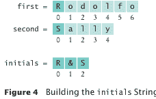

**图 4** 构建首字母字符串


首字母由每个名字的第一个字母构成。

## ch02/initials.cpp

```cpp
1  #include <iostream>
2  #include <string>
3
4  using namespace std;
5
6  int main()
7  {
8      cout << "Enter your first name: ";
9      string first;
10     cin >> first;
11     cout << "Enter your significant other's first name: ";
12     string second;
13     cin >> second;
14     string initials = first.substr(0, 1)
15         + "&" + second.substr(0, 1);
16     cout << initials << endl;
17
18     return 0;
19 }
```

## 程序运行

```text
Enter your first name: Rodolfo
Enter your significant other's first name: Sally
R&S
```

**表 8 字符串操作**

| 语句 | 结果 | 注释 |
|---|---|---|
| `string str = "C";`<br>`str = str + "+";` | `str` 被设置为 `"C++"` | 当应用于字符串时，`+` 表示拼接。 |
| 🚫 `string str = "C" + "+";` | **错误** | **错误：** 不能将两个字符串字面量连接起来。 |
| `cout << "Enter name: ";`<br>`cin >> name;`<br>(用户输入：Harry Morgan) | `name` 包含 `"Harry"` | `>>` 运算符将下一个单词放入字符串变量。 |
| `cout << "Enter name: ";`<br>`cin >> name >> last_name;`<br>(用户输入：Harry Morgan) | `name` 包含 `"Harry"`，`last_name` 包含 `"Morgan"` | 使用多个 `>>` 运算符读取多个单词。 |
| `string greeting = "H & S";`<br>`int n = greeting.length();` | `n` 被设置为 5 | 每个空格算作一个字符。 |
| `string str = "Sally";`<br>`string str2 = str.substr(1, 3);` | `str2` 被设置为 `"all"` | 提取从位置 1 开始、长度为 3 的子串。（初始位置为 0。） |
| `string str = "Sally";`<br>`string str2 = str.substr(1);` | `str2` 被设置为 `"ally"` | 如果省略长度，则包含从该位置到末尾的所有字符。 |
| `string a = str.substr(0, 1);` | `a` 被设置为 `str` 中的首字母 | 提取从位置 0 开始、长度为 1 的子串。 |
| `string b = str.substr(str.length() - 1);` | `b` 被设置为 `str` 中的最后一个字母 | 最后一个字母的位置是 `str.length() - 1`。无需指定长度。 |


## 自测

- 25. 字符串 `"C++ Program"` 的长度是多少？

- 26. 考虑这个字符串变量。

  ```cpp
  string str = "C++ Program";
  ```

  给出一个对 `substr` 成员函数的调用，使其返回子串 `"gram"`。

- 27. 使用字符串连接将自测 26 中的字符串变量 `str` 变为 `"C++ Programming"`。

- 28. 以下语句序列会打印什么？

  ```cpp
  string str = "Harry";
  cout << str.substr(0, 1) + str.substr(str.length() - 1);
  ```

- 29. 给出一个输入语句，用于读取形如 "John Q. Public" 的名字。

**练习一下** 现在你可以尝试本章末尾的这些练习：R2.6、R2.9、P2.12、P2.19。

- 成员函数使用点号表示法调用。
- 使用 `substr` 成员函数提取字符串的子串


## 复习练习

R2.1 在这段语句序列之后，mystery 的值是多少？

```cpp
int mystery = 1;
mystery = 1 - 2 * mystery;
mystery = mystery + 1;
```

R2.2 以下语句序列有什么问题？

```cpp
int mystery = 1;
mystery = mystery + 1;
int mystery = 1 - 2 * mystery;
```

R2.3 将以下数学表达式写成 C++。

$$s = s_0 + v_0 t + \frac{1}{2} g t^2$$

$$G = 4\pi^2 \frac{a^3}{p^2(m_1 + m_2)}$$

$$FV = PV \cdot \left(1 + \frac{INT}{100}\right)^{YRS}$$

$$c = \sqrt{a^2 + b^2 - 2ab\cos \gamma}$$

R2.4 将以下 C++ 表达式写成数学记号。

a. `dm = m * (sqrt(1 + v / c) / sqrt(1 - v / c) - 1);`
b. `volume = PI * r * r * r * h;`
c. `volume = 4 * PI * pow(r, 3) / 3;`
d. `z = sqrt(x * x + y * y);`

R2.5 以下表达式的值是什么？在每一行中，假设

```cpp
double x = 2.5;
double y = -1.5;
int m = 18;
int n = 4;
```

a. `x + n * y - (x + n) * y`
b. `m / n + m % n`
c. `5 * x - n / 5`
d. `1 - (1 - (1 - (1 - (1 - n))))`
e. `sqrt(sqrt(n))`

R2.6 以下表达式的值是什么？在每一行中，假设

```cpp
string s = "Hello";
string t = "World";
```

a. `s.length() + t.length()`
b. `s.substr(1, 2)`
c. `s.substr(s.length() / 2, 1)`
d. `s + t`
e. `t + s`

**R2.7** 找出以下程序中至少五个编译期错误。

```cpp
#include iostream

int main();
{
    cout << "Please enter two numbers:"
    cin >> x, y;
    cout << "The sum of << x << " and" << y
         << "is:" x + y << endl;
    return;
}
```

**R2.8** 找出以下程序中至少四个运行时错误。

```cpp
#include <iostream>

using namespace std;

int main()
{
    int total;
    int x1;
    cout << "Please enter a number:";
    cin >> x1;
    total = total + x1;
    cout << "Please enter another number:";
    int x2;
    cin >> x2;
    total = total + x1;
    double average = total / 2;
    cout << "The average of the two numbers is "
         << average << "endl";
    return 0;
}
```

R2.9 解释 2、2.0、"2" 和 "2.0" 之间的区别。

R2.10 解释以下每个程序段计算什么。

a. `int x = 2;`  
   `int y = x + x;`  
b. `string s = "2";`  
   `string t = s + s;`

R2.11 为一个程序编写伪代码，该程序读取一个单词，然后打印第一个字符、最后一个字符和中间的字符。例如，如果输入是 Harry，程序打印 H y arr。

R2.12 为一个程序编写伪代码，该程序读取一个名字（例如 Harold James Morgan），然后打印一个由名字、中间名和姓氏的首字母组成的字母组合（例如 HJM）。

R2.13 为一个程序编写伪代码，该程序计算一个数字的第一位和最后一位数字。例如，如果输入是 23456，程序应打印出 2 和 6。提示：%、log10。

R2.14 修改“如何做 2.1”中程序的伪代码，使程序以 25 美分、10 美分和 5 美分硬币找零。可以假设价格是 5 美分的倍数。为了开发伪代码，先用几个具体数值进行演算。

R2.15 一个鸡尾酒摇酒器由三个圆锥段组成。
使用真实的半径和高度值，利用自测 24 中给出的圆锥段公式计算总体积。然后开发一个适用于任意尺寸的算法。


R2.16 你正在像这样切下一块派，其中 c 是直线部分的长度（称为弦长），h 是该块的高度。

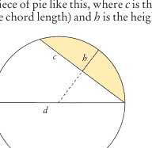

有一个面积的近似公式：A ≈ (2/3)ch + h³/(2c)

然而，h 不太容易测量，而派的直径 d 通常是已知的。计算派的直径为 12 英寸、该段的弦长为 10 英寸时的面积。推广为一个对任意直径和弦长都能给出面积的算法。

R2.17 以下伪代码描述了在给定日期编号（0 = 星期日，1 = 星期一，依此类推）时如何获取星期几的名称。

```text
Define a string called names containing "SunMonTueWedThuFriSat".
Compute the starting position as 3 * the day number.
Extract the substring of names at the starting position with length 3.
```

使用日期编号 4 检查这段伪代码。画出正在计算的字符串的示意图，类似于第 59 页的图 4。

R2.18 以下伪代码描述了如何交换一个单词中的两个字母。

```text
We are given a string str and two positions i and j. (i comes before j.)
Set first to the substring from the start of the string to the last position before i.
Set middle to the substring from positions i + 1 to j - 1.
Set last to the substring from position j + 1 to the end of the string.
Concatenate the following five strings: first, the string containing just the character at position i, middle,
    the string containing just the character at position j, and last.
```

使用字符串 "gateway" 以及位置 2 和 4 检查这段伪代码。画出正在计算的字符串的示意图，类似于第 59 页的图 4。


**R2.19** 运行以下程序，并解释你得到的输出。

```cpp
#include <iostream>
using namespace std;

int main()
{
   int total;
   cout << "Please enter a number: ";
   double x1;
   cin >> x1;
   total = total + x1;
   cout << "total: " << total << endl;
   cout << "Please enter a number: ";
   double x2;
   cin >> x2;
   total = total + x2;
   cout << "total: " << total << endl;
   total = total / 2;
   cout << "total: " << total << endl;
   cout << "The average is " << total << endl;
   return 0;
}
```

注意插入的跟踪消息（以蓝色显示）用于显示 `total` 变量的当前内容。你如何修复该程序？（该程序有两个独立的错误。）

**R2.20** 编写一个程序，打印以下值

```text
3 * 1000 * 1000 * 1000
3.0 * 1000 * 1000 * 1000
```

并解释结果。

**R2.21** 本章包含一些关于变量和常量的建议，这些建议使程序更易于阅读和维护。简要总结这些建议。

## 编程练习

**P2.1** 编写一个程序，以毫米为单位显示一张信纸大小（8.5 × 11 英寸）纸张的尺寸。每英寸有 25.4 毫米。在程序中使用常量和注释。

**P2.2** 编写一个程序，计算并显示一张信纸大小（8.5 × 11 英寸）纸张的周长及其对角线长度。

**P2.3** 编写一个程序，读取一个数字并显示其平方、立方和四次方。仅对四次方使用 `pow` 函数。

**P2.4** 编写一个程序，提示用户输入两个整数，然后打印

- 和
- 差

**P2.12** 以下伪代码描述了如何将包含十位电话号码的字符串（如 `"4155551212"`）转换为带有括号和破折号的更易读的字符串，如下所示：`"(415) 555-1212"`。

```text
Take the substring consisting of the first three characters and surround it with "(" and ")". This is the area code.
Concatenate the area code, the substring consisting of the next three characters, a hyphen, and the substring consisting of the last four characters. This is the formatted number.
```

将该伪代码转换成 C++ 程序，该程序将电话号码读入一个字符串变量，计算格式化后的号码，并打印出来。

**P2.13** 以下伪代码描述了如何从浮点值给出的价格中提取美元和美分。例如，价格 2.95 会得出美元和美分的值 2 和 95。

```text
Assign the price to an integer variable dollars.
Multiply the difference price - dollars by 100 and add 0.5.
Assign the result to an integer variable cents.
```

将该伪代码转换成 C++ 程序。读取一个价格并打印美元和美分。使用输入 2.95 和 4.35 测试你的程序。

**P2.14** *找零。* 实现一个程序，指导收银员如何找零。该程序有两个输入：应付金额和从顾客处收到的金额。显示顾客应找回的美元、25 美分硬币、10 美分硬币、5 美分硬币和 1 美分硬币的数量。

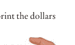

**P2.15** 编写一个程序，要求用户输入

- 油箱中汽油的加仑数
- 以每加仑英里数为单位的燃油效率
- 每加仑汽油的价格

然后打印每 100 英里的费用，以及汽车用油箱中的汽油可以行驶多远。

**P2.16** *文件名和扩展名。* 编写一个程序，提示用户输入驱动器号（`C`）、路径（`\Windows\System`）、文件名（`Readme`）和扩展名（`txt`）。然后打印完整的文件名 `C:\Windows\System\Readme.txt`。（如果你使用 UNIX 或 Macintosh，请跳过驱动器名，并使用 `/` 而不是 `\` 来分隔目录。）

**P2.17** 编写一个程序，从用户处读取一个介于 1,000 和 999,999 之间的数字，并打印*带逗号分隔千位*的数字。下面是一个示例对话；用户输入以彩色显示：

```text
Please enter an integer between 1000 and 999999: 23456
23,456
```

**P2.18** 编写一个程序，从用户处读取一个介于 1,000 和 999,999 之间的数字，其中用户在输入中带有逗号。然后打印不带逗号的数字。下面是一个示例对话；用户输入以彩色显示：

```text
Please enter an integer between 1,000 and 999,999: 23,456
23456
```

*提示：* 将输入作为字符串读取。测量字符串的长度。假设它包含 *n* 个字符。然后提取由前 *n* - 4 个字符和后三个字符组成的子字符串。

**P2.19** *打印网格。* 编写一个程序，打印以下井字棋网格。

```text
+---+---+---+
|   |   |   |
+---+---+---+
|   |   |   |
+---+---+---+
|   |   |   |
+---+---+---+
```

当然，你可以简单地编写如下形式的七条语句

```cpp
cout << "+---+---+---+";
```

但你应该用聪明的方式来做。定义字符串变量来保存两种图案：一种梳状图案

```text
+---+---+---+
|   |   |   |
```

以及底部线。打印梳状图案三次，底部线一次。

**P2.20** 编写一个程序，读取一个整数并将其分解为单个数字的序列。例如，输入 16384 显示为

```text
1 6 3 8 4
```

你可以假设输入不超过五位数字且不是负数。

**P2.21** 编写一个程序，读取两个 24 小时制格式的时间（0900，1730），并打印两个时间之间的小时数和分钟数。下面是一个示例运行。用户输入以彩色显示。

```text
Please enter the first time: 0900
Please enter the second time: 1730
8 hours 30 minutes
```

如果你能处理第一个时间晚于第二个时间的情况，则有额外加分：

```text
Please enter the first time: 1730
Please enter the second time: 0900
15 hours 30 minutes
```

**P2.22** *书写大号字母。* 一个大写字母 H 可以这样生成：

```text
*   *
*   *
*****
*   *
*   *
```

它可以被定义为一个字符串常量，如下所示：

```cpp
const string LETTER_H =
  "*   *\n*   *\n*****\n*   *\n*   *\n";
```

（`\n` 字符在特殊主题 1.1 中解释。）对字母 E、L 和 O 执行相同的操作。然后用大号字母写出以下消息

```text
H
E
L
L
O
```

**P2.23** 编写一个程序，将数字 1, 2, 3, ..., 12 转换成相应的月份名称 January, February, March, ..., December。*提示：* 构造一个很长的字符串 `"January February March ..."`，在其中添加空格，使每个月份名称具有*相同的长度*。然后使用 `substr` 提取你想要的月份。


**工程题 P2.24** 考虑以下电路。

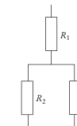

编写一个程序，读取三个电阻的阻值，并使用欧姆定律计算总电阻。

**工程题 P2.25** 露点温度 $T_d$ 可以根据相对湿度 $RH$ 和实际温度 $T$ 近似计算：

$$T_d = \frac{b \cdot f(T,RH)}{a - f(T,RH)}$$

$$f(T,RH) = \frac{a \cdot T}{b + T} + \ln(RH)$$

其中 a = 17.27，b = 237.7°C。

编写一个程序，读取相对湿度（介于 0 和 1 之间）和温度（以摄氏度为单位），并打印露点值。使用 C++ 函数 `log` 计算自然对数。

**工程题 P2.26** 这里展示的管夹温度传感器是坚固的传感器，可以直接夹在铜管上，以测量管道中液体的温度。


每个传感器都包含一个称为*热敏电阻*的器件。热敏电阻是一种半导体器件，其电阻具有温度依赖性，可用下式描述：

$$R = R_0 e^{\beta(1/T - 1/T_0)}$$

其中 R 是温度 T（°K）下的电阻（Ω），R₀ 是温度 T₀（°K）下的电阻（Ω）。β 是一个常数，取决于制造热敏电阻所用的材料。热敏电阻通过提供 R₀、T₀ 和 β 的值来指定。

用于制造管夹温度传感器的热敏电阻在 T₀ = 85 °C 时 R₀ = 1075 Ω，β = 3969 °K。（注意 β 的单位是 °K。回想一下，°K 温度是通过在 °C 温度上加 273 得到的。）液体温度（单位 °C）由电阻 R（单位 Ω）通过下式确定：

$$T = \frac{\beta T_0}{T_0 \ln\left(\frac{R}{R_0}\right) + \beta} - 273$$

编写一个 C++ 程序，提示用户输入热敏电阻的阻值 R，并打印一条消息，给出以 °C 为单位的液体温度。

### 工程题 P2.27

下图所示的电路说明了电力公司与其一位客户之间连接的一些重要方面。客户由三个参数表示，$V_t$、$P$ 和 $pf$。$V_t$ 是通过插入墙上插座所获得的电压。客户期望 $V_t$ 值稳定可靠，以便其电器正常工作。因此，电力公司会仔细调节 $V_t$ 的值。$P$ 描述客户使用的电量，是决定客户电费的主要因素。功率因数 $pf$ 则不那么为人熟知。（功率因数按某个角的余弦值计算，因此其值总是介于 0 和 1 之间。）在本问题中，你将需要编写一个 C++ 程序来研究功率因数的意义。


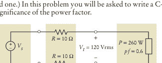

在图中，电力线路被简化地表示为以欧姆为单位的电阻。电力公司被表示为一个交流电压源。为了在电压 $V_t$ 下向客户提供功率 $P$，所需的电源电压 $V_s$ 可以通过以下公式确定：

$$V_s = \sqrt{\left(V_t + \frac{2RP}{V_t}\right)^2 + \left(\frac{2RP}{V_t}\right)^2\left(1 - pf^2\right)}$$

（$V_s$ 的单位为 Vrms。）这个公式表明 $V_s$ 的值取决于 $pf$ 的值。编写一个 C++ 程序，提示用户输入一个功率因数值，并


## 自测题答案

- 1. 一种可能的答案是

    ```
    int bottles_per_case = 8;
    ```

    你可以选择不同的变量名或不同的初始化值，但变量类型应为 `int`。

- 2. 有三处错误：

    - 变量名中不能有空格。
    - 变量类型应为 `double`，因为它保存的是小数值。
    - 语句末尾缺少一个分号。

- 3.

    ```
    double unit_price = 1.95;
    int quantity = 2;
    ```

- 4. `cout << "Total price: " << unit_price * quantity << endl;`

- 5. 将 `cans_per_pack` 的定义改为

    ```
    int cans_per_pack = 4;
    ```

- 6. 需要使用 `*/` 定界符来结束以 `/*` 开头的注释：

    ```
    double can_volume = 0.355; /* Liters in a 12-ounce can */
    ```

- 7. 程序可以编译，并显示相同的结果。但是，阅读该程序的人可能会觉得考虑“小数个罐子”令人困惑。

- 8. 它的值会被赋值语句修改。

- 9. 当停车位中的一辆车被另一辆车替换时，就会发生赋值。

- 10. `double interest = balance * p / 100;`

- 11. `double side_length = sqrt(area);`

- 12.

    ```
    4 * PI * pow(radius, 3) / 3
    or (4.0 / 3) * PI * pow(radius, 3),
    but not (4 / 3) * PI * pow(radius, 3)
    ```

- 13. 172 和 9

- 14. `int leftover = 12 - amount % 12;`

- 15. 没有提示通知程序用户输入数量。

- 16. `unit_price` 变量被定义为 `int`。如果用户输入诸如 1.95 这样的价格，只有 1 会被放入该变量。

- 17. 输出为

    ```
    The total volume is20
    ```

    注意 `is` 和 `20` 之间没有空格。

- 18. `cout << "$" << fixed << setprecision(2) << total_price;`

- 19.

    ```
    cout << "Bottles: " << setw(8) << bottles << endl
         << "Cans:    " << setw(8) << cans << endl;
    ```

    注意 `setw` 操纵符出现了两次。还要注意字符串 `"Cans:    "` 中增加了空格。

- 20.

    ```
    int pairs = (total_width - tile_width) / (2 * tile_width);
    int tiles = 1 + 2 * pairs;
    double gap = (total_width - tiles * tile_width) / 2;
    ```

    确保 `pairs` 声明为 `int`。

- 21. 现在，在最初的黑色瓷砖之后，是四块瓷砖组成的一组（灰/白/灰/黑）。因此，算法现在是

    ```
    number of groups = integer part of (total width - tile width) / (4 x tile width)
    number of tiles = 1 + 4 x number of groups
    ```

    间隙的公式没有改变。

- 22. 显然，答案只取决于行号和列号是偶数还是奇数，因此我们先取除以 2 后的余数。然后我们可以枚举所有预期答案：

    | 行 % 2 | 列 % 2 | 颜色 |
    | --- | --- | --- |
    | 0 | 0 | 0 |
    | 0 | 1 | 1 |
    | 1 | 0 | 1 |
    | 1 | 1 | 0 |

    在表的前三项中，颜色就是余数之和。在第四项中，和会是 2，但我们想要 0。我们可以通过再进行一次取余运算来实现：

    ```
    color = ((row % 2) + (column % 2)) % 2
    ```

- 23. 在九年内，维修成本增加了 $1,400。因此，每年增加 $1,400 / 9 = $156。第 3 年的维修成本将是 $100 + 2 x $156 = $412。第 n 年的维修成本是 $100 + n x $156。为避免舍入误差的累积，实际上最好使用得出 $156 的原始表达式，即，

    ```
    Repair cost in year n = 100 + n x 1400 / 9
    ```

- 24. 伪代码可以很容易地从这些公式得出。

    ```
    bottom volume = π x r₁² x h₁
    top volume = π x r₂² x h₂
    middle volume = π x (r₁² + r₁ x r₂ + r₂²) x h₃ / 3
    total volume = bottom volume + top volume + middle volume
    ```

    测量一个典型的葡萄酒瓶可得到
    r₁ = 3.6, r₂ = 1.2, h₁ = 15, h₂ = 7, h₃ = 6（单位均为厘米）。因此，

    ```
    bottom volume = 610.73
    top volume = 31.67
    middle volume = 135.72
    total volume = 778.12
    ```

    实际体积为 750 ml，这与我们的计算足够接近，足以让我们相信它是正确的。

- 25. 长度为 11。空格也算作一个字符。

- 26. `str.substr(7, 4)`

- 27. `str = str + "ming";`

- 28. `hy`

- 29. `cin >> first_name >> middle_initial >> last_name;`

## 第 3 章：决策


### 本章目标

- 能够使用 if 语句实现决策
- 学习如何比较整数、浮点数和字符串
- 理解布尔数据类型
- 制定验证用户输入的策略

### 本章内容

- **3.1 if 语句** 76
    - 语法 3.1：if 语句 78
    - 编程提示 3.1：花括号布局 79
    - 编程提示 3.2：始终使用花括号 80
    - 常见错误 3.1：if 条件后的分号 80
    - 编程提示 3.3：制表符 81
    - 专题 3.1：选择运算符 81
    - 编程提示 3.4：避免分支中的重复 82
- **3.2 比较数字和字符串** 82
    - 语法 3.2：比较 83
    - 常见错误 3.2：混淆 = 和 == 85
    - 编程提示 3.5：在零警告下编译 85
    - 常见错误 3.3：浮点数的精确比较 86
    - 专题 3.2：字符串的字典序 86
    - 如何做 3.1：实现 if 语句 87
    - 示例练习 3.1：提取中间部分 87
    - 趣闻 3.1：丹佛机场行李处理系统 89

- **3.3 多个备选方案** 90
    - 专题 3.3：switch 语句 93
- **3.4 嵌套分支** 94
    - 编程提示 3.6：手工跟踪 97
    - 常见错误 3.4：悬空 else 问题 98
- **3.5 问题求解：流程图** 99
- **3.6 问题求解：测试用例** 102
    - 编程提示 3.7：制定计划并为意外问题留出时间 103
- **3.7 布尔变量和运算符** 103
    - 常见错误 3.5：组合多个关系运算符 107
    - 常见错误 3.6：混淆 && 和 || 条件 107
    - 专题 3.4：布尔运算符的短路求值 108
    - 专题 3.5：德摩根定律 108
- **3.8 应用：输入验证** 109
    - 趣闻 3.2：人工智能 112


计算机程序的基本特征之一是能够做出决策。就像火车根据道岔的设置改变轨道一样，程序可以根据输入和其他情况采取不同的操作。

在本章中，你将学习如何编写简单和复杂的决策程序。你还会将所学内容应用到检查用户输入的任务中。

### 3.1 if 语句

> if 语句允许程序根据要处理的数据的性质执行不同的操作。

if 语句用于实现决策。当条件满足时，执行一组语句。否则，执行另一组语句（见语法 3.1）。

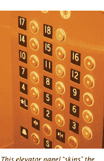

下面是一个使用 if 语句的示例。在许多国家，数字 13 被认为是不吉利的。为了避免冒犯迷信的租户，建筑业主有时会跳过第十三层；12 层之后紧接着就是 14 层。当然，13 层通常并不会空着，也不会像一些阴谋论者所相信的那样布满秘密办公室和研究实验室。它只是被称为 14 层。控制大楼电梯的计算机需要弥补这一小怪癖，并调整所有大于 13 的楼层号。

让我们用 C++ 模拟这个过程。我们会请用户输入想要的楼层号，然后计算实际楼层。当输入大于 13 时，我们需要将输入减 1 来得到实际楼层。例如，如果用户输入 20，程序会将实际楼层确定为 19。否则，我们直接使用提供的楼层号。

这个电梯面板“跳过”了第十三层。该楼层实际上并没有缺失——控制电梯的计算机调整了 13 以上的楼层号。

```
    int actual_floor;

    if (floor > 13)
    {
        actual_floor = floor - 1;
    }
    else
    {
        actual_floor = floor;
    }
```

图 1 中的流程图显示了分支行为。

在我们的示例中，if 语句的每个分支都只包含一条语句。你可以根据需要在一个分支中包含任意多条语句。有时，会出现这样的情况：


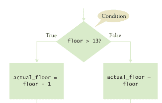

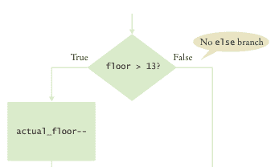

**图 1**  
`if` 语句的流程图

**图 2**  
没有 `else` 分支的 `if` 语句的流程图

在这个语句的 `else` 分支中没有任何操作。在这种情况下，你可以将其完全省略，例如：

```cpp
int actual_floor = floor;

if (floor > 13)
{
    actual_floor--;
}  // No else needed
```

流程图见图 2。

下面的程序演示了 `if` 语句的实际应用。该程序询问用户想要的楼层，然后输出实际楼层。


*`if` 语句就像路上的岔路口。根据决策的不同，程序的不同部分会被执行。*


- 1. 在一些亚洲国家，数字 14 被认为不吉利。一些建筑业主为求稳妥，会*把第 13 层和第 14 层都*跳过。你会如何修改示例程序以处理这样的建筑？
- 2. 考虑下面这个用于计算折扣价格的 `if` 语句：

    ```cpp
    if (original_price > 100)
    {
        discounted_price = original_price - 20;
    }
    else
    {
        discounted_price = original_price - 10;
    }
    ```

    如果原价是 95、100、105，折扣价格分别是多少？
- 3. 将这个 `if` 语句与自测题 2 中的 `if` 语句进行比较：

    ```cpp
    if (original_price < 100)
    {
        discounted_price = original_price - 10;
    }
    else
    {
        discounted_price = original_price - 20;
    }
    ```

    这两个语句是否总是计算出相同的值？如果不是，在什么情况下它们会不同？
- 4. 考虑下面这些用于计算折扣价格的语句：

    ```cpp
    discounted_price = original_price;
    if (original_price > 100)
    {
        discounted_price = original_price - 10;
    }
    ```

    如果原价是 95、100、105，折扣价格分别是多少？
- 5. 变量 `fuel_amount` 和 `fuel_capacity` 分别保存车辆当前的实际燃油量和油箱容量。如果油箱中剩余燃油不足 10%，状态灯应显示红色；否则显示绿色。通过打印出 "red" 或 "green" 来模拟这一过程。

### 实践练习

现在你可以尝试本章末尾的这些练习：R3.3、R3.4、P3.16。

### 编程技巧 3.1：花括号的布局

程序员在代码中对齐花括号的方式各不相同。在本书中，我们遵循一个简单的规则：让 `{` 和 `}` 上下对齐。

```cpp
if (floor > 13)
{
   floor--;
}
```

这种风格便于发现匹配的花括号。


*正确地对齐代码能让你的程序更易读。*

有些程序员将左花括号放在 `if` 同一行：

```cpp
if (floor > 13) {
    floor--;
}
```

这种风格使花括号的匹配更困难，但能节省一行代码，让你无需滚动屏幕就能看到更多代码。两种风格都有热情的拥护者。

重要的是，你要选择一种布局风格，并在给定编程项目中始终如一地坚持使用。选择哪种风格可能取决于你的个人偏好，或你需要遵循的代码风格指南。

### 编程技巧 3.2：始终使用花括号


当 `if` 语句体由单条语句构成时，可以不使用花括号。例如，下面的写法是合法的：

```cpp
if (floor > 13)
    floor--;
```

然而，始终包含花括号是个好主意：

```cpp
if (floor > 13)
{
    floor--;
}
```

花括号能让你的代码更易读，而且你不太可能犯下诸如常见错误 3.1 中描述的错误。

### 常见错误 3.1：在 `if` 条件后加分号

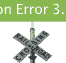

下面的代码片段包含一个不幸的错误：

```cpp
if (floor > 13) ; // ERROR
{
    floor--;
}
```

`if` 条件后面不应有分号。编译器会按如下方式解释这条语句：如果 `floor` 大于 13，就执行由单个分号表示的语句，也就是空语句。用花括号括起来的语句不再属于 `if` 语句的一部分，它总是会被执行。即使 `floor` 的值不大于 13，它也会被减 1。

在 `else` 保留字后加分号同样是错误的：

```cpp
if (floor > 13)
{
    actual_floor = floor - 1;
}
else ;
{
    actual_floor = floor;
}
```

在这种情况下，如果 `floor > 13` 不成立，就执行空语句。这是 `if` 语句的结束。接下来的语句（用花括号括起来）在两种情况下都会执行；也就是说，`actual_floor` 总是被设置为 `floor`。

### 编程技巧 3.3：制表符


块结构代码具有这样一个特性：嵌套语句会缩进一级或多级：

```cpp
int main()
{
    int floor;
    ...
    if (floor > 13)
    {
        floor--;
    }
    ...
    return 0;
}
```

0 1 2 缩进级别


如何将光标从最左侧列移动到合适的缩进级别？一种完全合理的策略是按足够多次空格键。然而，许多程序员使用 Tab 键。按一次 Tab 会将光标移动到下一个缩进级别。

虽然 Tab 键很好用，但有些编辑器使用制表符进行对齐，这就不太好了。当你把文件发送给其他人或打印时，制表符可能会带来问题。对于制表符的宽度，并没有统一的标准，而且有些软件会完全忽略制表符。因此，最好用空格而不是制表符来保存文件。大多数编辑器都有自动将所有制表符转换为空格的设置。请查看你的开发环境的文档，了解如何启用这一有用的设置。

### 专题 3.1：选择运算符


C++ 有一种选择运算符，形式如下：

```cpp
condition ? value1 : value2
```

该表达式的值是：如果条件成立，则为 *value1*；如果条件不成立，则为 *value2*。例如，我们可以这样计算实际楼层号：

```cpp
actual_floor = floor > 13 ? floor - 1 : floor;
```

它等价于：

```cpp
if (floor > 13)
{
    actual_floor = floor - 1;
}
else
{
    actual_floor = floor;
}
```

你可以在任何需要值的地方使用选择运算符，例如：

```cpp
cout << "Actual floor: " << (floor > 13 ? floor - 1 : floor);
```

本书中不涉及选择运算符，但你会发现它是许多 C++ 程序中一种便捷的构造。

### 编程技巧 3.4：避免分支中的重复代码


检查一下你是否在每个分支中都重复了相同的代码。如果是，就把它移到 `if` 语句之外。下面是这种重复的一个示例：

```cpp
if (floor > 13)
{
   actual_floor = floor - 1;
   cout << "Actual floor: " << actual_floor << endl;
}
else
{
   actual_floor = floor;
   cout << "Actual floor: " << actual_floor << endl;
}
```

输出语句在两个分支中完全相同。这并非错误——程序会正确运行。不过，你可以通过移动这条重复的语句来简化程序，如下所示：

```cpp
if (floor > 13)
{
   actual_floor = floor - 1;
}
else
{
   actual_floor = floor;
}
cout << "Actual floor: " << actual_floor << endl;
```

当程序长期维护时，消除重复代码尤为重要。当存在两组效果相同的语句时，程序员很容易只修改其中一组而遗漏另一组。

## 3.2 比较数字和字符串

关系运算符（`< > <= >= == !=`）用于比较数字和字符串。

每个 `if` 语句都包含一个条件。在许多情况下，条件涉及比较两个值。例如，在前面的示例中，我们测试了 `floor > 13`。比较运算符 `>` 被称为关系运算符。C++ 有六种关系运算符（见表 1）。

正如你所看到的，只有两个 C++ 关系运算符（`>` 和 `<`）与数学符号中的样子一致。计算机键盘上没有 ≥、≤ 或 ≠ 的按键，但 `>=`、`<=` 和 `!=` 运算符因为看起来相似而容易记住。对于大多数 C++ 初学者来说，`==` 运算符起初会让人困惑。在 C++ 中，`=` 已经有含义，即赋值。


在 C++ 中，你使用关系运算符来检查一个值是否大于另一个值。


**表 1** 关系运算符

| C++ | 数学表示法 | 说明 |
|---|---|---|
| > | > | 大于 |
| >= | ≥ | 大于或等于 |
| < | < | 小于 |
| <= | ≤ | 小于或等于 |
| == | = | 等于 |
| != | ≠ | 不等于 |

`==` 运算符表示相等性测试：

```cpp
floor = 13; // Assign 13 to floor
if (floor == 13) // Test whether floor equals 13
```

必须记住在测试中使用 `==`，在测试外使用 `=`。（更多信息见第85页的常见错误3.2。）

也可以比较字符串：

```cpp
if (input == "Quit") ...
```

使用 `!=` 检查两个字符串是否不同。在 C++ 中，字母大小写很重要。例如，"Quit" 和 "quit" 不是同一个字符串。

## 语法 3.2 比较

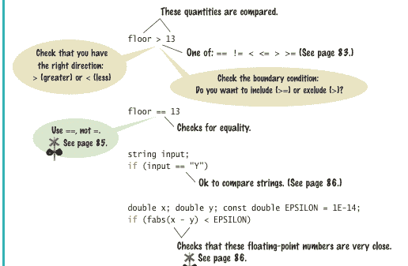

**表 2** 关系运算符示例

| 表达式 | 值 | 注释 |
|---|---|---|
| 3 <= 4 | true | 3 小于 4；<= 测试“小于或等于”。 |
| ❌ 3 =< 4 | 错误 | “小于或等于”运算符是 <=，不是 =<。“小于”符号在前。 |
| 3 > 4 | false | > 是 <= 的反面。 |
| 4 < 4 | false | 左侧必须严格小于右侧。 |
| 4 <= 4 | true | 两侧相等；<= 测试“小于或等于”。 |
| 3 == 5 - 2 | true | == 测试相等性。 |
| 3 != 5 - 1 | true | != 测试不相等性。3 不等于 5 - 1，这是真的。 |
| ❌ 3 = 6 / 2 | 错误 | 使用 == 测试相等性。 |
| 1.0 / 3.0 == 0.333333333 | false | 尽管这些值彼此非常接近，但它们并不完全相等。见第86页的常见错误3.3。 |
| ❌ "10" > 5 | 错误 | 不能将字符串与数字进行比较。 |

表 2 总结了如何在 C++ 中使用关系运算符。


- 6. 如果 a 为 3、b 为 4，下列哪些条件为真？
  - a. a + 1 <= b
  - b. a + 1 >= b
  - c. a + 1 != b
- 7. 给出下列条件的相反条件

  floor > 13

- 8. 这条语句中的错误是什么？

  ```cpp
  if (score_a = score_b)
  {
      cout << "Tie" << endl;
  }
  ```

- 9. 在此 if 语句中提供一个条件，以测试用户是否输入了 Y：

  ```cpp
  string input;
  cout << "Enter Y to quit." << endl;
  cin >> input;
  if (...)
  {
      cout << "Goodbye." << endl;
      return 0;
  }
  ```

- 空格字符排在所有可打印字符之前。
- 数字排在字母之前。
- 关于标点符号的排序，见附录 D。

比较两个字符串时，先比较每个单词的首字母，然后比较第二个字母，依此类推，直到其中一个字符串结束，或找到第一对不匹配的字母。

如果其中一个字符串结束，则较长的字符串被视为“更大”。例如，比较 "car" 和 "cart"。前三个字母匹配，并且到达第一个字符串的末尾。因此，在字典序中 "car" 排在 "cart" 之前。

当遇到不匹配时，包含“较大”字符的字符串被视为“更大”。例如，比较 "cat" 和 "cart"。前两个字母匹配。由于 t 排在 r 之后，因此在字典序中字符串 "cat" 排在 "cart" 之后。

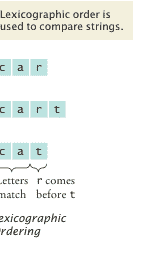

## 操作方法 3.1

### 实现 if 语句


本操作指南将引导你完成实现 if 语句的过程。我们将用下面的示例问题来说明这些步骤：

大学书店每年10月24日举办“千字节日”促销活动：如果价格低于128美元，所有电脑配件购买均可享受8%的折扣；如果价格至少为128美元，则享受16%的折扣。编写一个程序，要求收银员输入原价，然后打印折扣价。

### 第1步

确定分支条件。

在我们的示例问题中，条件的明显选择是：

```
original price < 128?
```

这完全可以，我们将在解决方案中使用该条件。

但如果你选择相反的条件，也完全可以得出正确的解决方案：原价是否至少（≥）128美元？如果你站在购物者的角度，想知道什么时候适用更大折扣，你可能会选择这个条件。


对于昂贵的产品，销售折扣通常更高。使用 if 语句来实现这样的决策。

### 第2步

为条件为真时需要完成的工作编写伪代码。

在这一步中，列出在“正”分支中执行的一个或多个操作。具体细节取决于你的问题。你可能想打印一条消息、计算值，甚至退出程序。

在我们的示例中，我们需要应用8%的折扣：

```
discounted price = 0.92 x original price
```

### 第3步

为条件*不*为真时需要完成的工作（如果有）编写伪代码。

如果第1步的条件不满足，你希望做什么？有时你什么都不想做。在这种情况下，使用不带 `else` 分支的 `if` 语句。

在我们的示例中，条件测试价格是否低于128美元。如果该条件*不为真*，则价格至少为128美元，因此适用16%的更高折扣：

```
discounted price = 0.84 x original price
```

### 第4步

仔细检查关系运算符。

首先，确保测试朝正确的*方向*进行。混淆 `>` 和 `<` 是常见错误。接下来，考虑应该使用 `<` 运算符还是它的近亲 `<=` 运算符。

如果原价正好是128美元，应该发生什么？仔细阅读问题后，我们发现如果原价*低于*128美元，则适用较低折扣；如果原价*至少*为128美元，则适用较高折扣。因此，128美元的价格*不应*满足我们的条件，我们必须使用 `<`，而不是 `<=`。

### 第5步

消除重复。

检查哪些操作是两个分支共有的，并将它们移到外面。（见第82页的编程提示3.4。）

在我们的示例中，有两条如下形式的语句

```
discounted price = __ x original price
```

它们仅在折扣率上不同。最好只在分支中设置折扣率，然后再进行计算：

```
If original price < 128
   discount rate = 0.92
Else
   discount rate = 0.84
discounted price = discount rate x original price
```

### 第6步

测试两个分支。

制定两个测试用例：一个满足 `if` 语句的条件，另一个不满足。问自己在每种情况下应该发生什么。然后按照伪代码，将每种情况实际执行一遍。

在我们的示例中，考虑原价的两种情形：100美元和200美元。我们预期第一个价格折扣8美元，第二个折扣32美元。

当原价为100时，条件 100 < 128 为真，我们得到

```
discount rate = 0.92
discounted price = 0.92 x 100 = 92
```

当原价为200时，条件 200 < 128 为假，并且

```
discount rate = 0.84
discounted price = 0.84 x 200 = 168
```

在两种情况下，我们都得到了预期的答案。

### 第7步

在 C++ 中组合 `if` 语句。

输入骨架

```cpp
if ()
{
}
else
{
}
```

```cpp
cout << "Most structures fall";
}
```

这行不通。假设 richter 的值为7.1。该值至少为4.5，匹配第一种情况。其他测试将永远不会被尝试。

> 使用多个 if 语句时，要注意条件的顺序。

在这个示例中，同样重要的是我们使用一系列 else if 子句，而不仅仅是多个独立的 if 语句。考虑下面这一系列独立测试：

```cpp
if (richter >= 8.0) // Didn't use else
{
    cout << "Most structures fall";
}
if (richter >= 7.0)
{
    cout << "Many buildings destroyed";
}
if (richter >= 6.0)
{
    cout << "Many buildings considerably damaged, some collapse";
}
if (richter >= 4.5)
{
    cout << "Damage to poorly constructed buildings";
}
```

现在这些备选分支不再是互斥的。如果 richter 为7.1，那么最后三个测试都会匹配，并打印三条消息。

## 自测

- 11. 在一个游戏程序中，玩家 A 和 B 的分数分别存储在变量 score_a 和 score_b 中。假设分数更高的玩家获胜，编写一系列条件语句，打印出 "A won"、"B won" 或 "Game tied"。
- 12. 编写一个包含三个分支的条件语句：如果 x 为正，则将 s 设为 1；如果 x 为负，则设为 -1；如果 x 为零，则设为 0。
- 13. 如何只用两个分支完成自测 12 的任务？
- 14. 初学者有时会编写如下语句：

  ```cpp
  if (price > 100)
  {
      discounted_price = price - 20;
  }
  else if (price <= 100)
  {
      discounted_price = price - 10;
  }
  ```

  解释这段代码可以如何改进。
- 15. 假设用户向 richter.cpp 程序输入 -1。会打印什么？
- 16. 假设我们希望 richter.cpp 程序检查用户是否输入了负数。你会向 if 语句添加什么分支，添加到哪里？

**练习一下** 现在你可以尝试本章末尾的这些练习：R3.20、P3.1、P3.9、P3.10。


### 专题 3.3


## `switch` 语句

一系列将*单个整数值*与多个*常量备选值*进行比较的 `if` 语句，可以实现为 `switch` 语句。例如，

```c
int digit;

switch (digit)
{
   case 1: digit_name = "one"; break;
   case 2: digit_name = "two"; break;
   case 3: digit_name = "three"; break;
   case 4: digit_name = "four"; break;
   case 5: digit_name = "five"; break;
   case 6: digit_name = "six"; break;
   case 7: digit_name = "seven"; break;
   case 8: digit_name = "eight"; break;
   case 9: digit_name = "nine"; break;
   default: digit_name = ""; break;
}
```

这是以下写法的简写：

```c
int digit;
if (digit == 1) { digit_name = "one"; }
else if (digit == 2) { digit_name = "two"; }
else if (digit == 3) { digit_name = "three"; }
else if (digit == 4) { digit_name = "four"; }
else if (digit == 5) { digit_name = "five"; }
else if (digit == 6) { digit_name = "six"; }
else if (digit == 7) { digit_name = "seven"; }
else if (digit == 8) { digit_name = "eight"; }
else if (digit == 9) { digit_name = "nine"; }
else { digit_name = ""; }
```

嗯，这算不上多大的捷径，但它有一个优点——很明显，所有分支测试的都是*同一个*值，即 `digit`。

```c
case 1: case 3: case 5: case 7: case 9:
    odd = true; break;
```

如果没有任何 case 子句匹配，则选择 default 分支。

`switch` 的每个分支都必须由 `break` 指令终止。如果缺少 `break`，执行会*贯穿*到下一个分支，依此类推，直到最终遇到 `break` 或到达 `switch` 的末尾。在实践中，这种贯穿行为相当有用，但它也是常见的错误来源。如果你不小心忘记了 `break` 语句，程序仍会编译，但会执行不需要的代码。许多程序员认为 `switch` 语句有些危险，更倾向于使用 `if` 语句。

是否在自己的代码中使用 `switch` 语句，由你决定。无论如何，你都需要具备阅读 `switch` 的能力，以防在其他程序员的代码中遇到它。


*`switch` 语句让你从一组固定的备选方案中进行选择。*

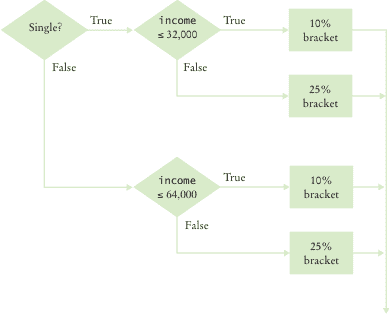

**图 4** 所得税计算

理论上，嵌套可以超过两层。一个三级决策过程（先按州，再按申报身份，最后按收入水平）需要三级嵌套。

**ch03/tax.cpp**

```cpp
#include <iostream>
#include <string>

using namespace std;

int main()
{
    const double RATE1 = 0.10;
    const double RATE2 = 0.25;
    const double RATE1_SINGLE_LIMIT = 32000;
    const double RATE1_MARRIED_LIMIT = 64000;

    double tax1 = 0;
    double tax2 = 0;

    double income;
    cout << "Please enter your income: ";
    cin >> income;

    cout << "Please enter s for single, m for married: ";
    string marital_status;
    cin >> marital_status;

    if (marital_status == "s")
    {
        if (income <= RATE1_SINGLE_LIMIT)
        {
            tax1 = RATE1 * income;
        }
        else
        {
            tax1 = RATE1 * RATE1_SINGLE_LIMIT;
            tax2 = RATE2 * (income - RATE1_SINGLE_LIMIT);
        }
    }
    else
    {
        if (income <= RATE1_MARRIED_LIMIT)
        {
            tax1 = RATE1 * income;
        }
        else
        {
            tax1 = RATE1 * RATE1_MARRIED_LIMIT;
            tax2 = RATE2 * (income - RATE1_MARRIED_LIMIT);
        }
    }
    double total_tax = tax1 + tax2;

    cout << "The tax is $" << total_tax << endl;
    return 0;
}
```

### 程序运行

```
Please enter your income: 80000
Please enter s for single, m for married: m
The tax is $10400
```


### 自测

- 17. 单身纳税人在收入为 $32,000 时应缴纳多少税？
- 18. 如果第一个嵌套的 `if` 语句从

    ```c
    if (income <= RATE1_SINGLE_LIMIT)
    ```

    改为

    ```c
    if (income < RATE1_SINGLE_LIMIT)
    ```

    该金额会改变吗？
- 19. 假设哈里和萨莉每人每年收入 $40,000。如果他们结婚，会节省税款吗？
- 20. 你会如何修改 tax.cpp 程序，以检查用户输入的婚姻状况是否正确（即 s 或 m）？
- 21. 有些人不赞成对更高收入征收更高税率，声称当你因努力工作而加薪时，税后最终到手的钱可能反而更少。这个论点有什么漏洞？

### 动手练习

现在你可以尝试本章末尾的这些练习：R3.7、R3.19、P3.13、P3.19。

tax1 和 tax2 的值会被更新。

```c
{
    tax1 = RATE1 * RATE1_MARRIED_LIMIT;
    tax2 = RATE2 * (income - RATE1_MARRIED_LIMIT);
}
```

| tax1 | tax2 | 收入 | 婚姻状况 |
| --- | --- | --- | --- |
| 0 | 0 | 80000 | m |
| 6400 | 4000 |  |  |

它们的和 total_tax 会被计算并打印出来。然后程序结束。

```c
double total_tax = tax1 + tax2;

cout << "The tax is $" << total_tax << endl;
return 0;
}
```

| tax1 | tax2 | 收入 | 婚姻状况 | 总税额 |
| --- | --- | --- | --- | --- |
| 0 | 0 | 80000 | m |  |
| 6400 | 4000 |  |  | 10400 |

由于程序跟踪显示了预期输出（$10,400），它成功证明了该测试用例工作正常。

### 常见错误 3.4

### 悬空 else 问题

当一个 if 语句嵌套在另一个 if 语句中时，可能会出现以下错误。


```c
double shipping_charge = 5.00; // $5 inside continental U.S.
if (country == "USA")
    if (state == "HI")
        shipping_charge = 10.00; // Hawaii is more expensive
else // Pitfall!
    shipping_charge = 20.00; // As are foreign shipments
```

缩进层级似乎暗示 else 与测试 `country == "USA"` 分组在一起。不幸的是，事实并非如此。编译器会忽略所有缩进，并将 else 与前面的 if 匹配。也就是说，代码实际上是

```c
double shipping_charge = 5.00; // $5 inside continental U.S.
if (country == "USA")
    if (state == "HI")
        shipping_charge = 10.00; // Hawaii is more expensive
    else // Pitfall!
        shipping_charge = 20.00; // As are foreign shipments
```

这不是你想要的结果。你希望将 else 与第一个 if 分组。

这种有歧义的 else 被称为*悬空 else*。如果你*始终使用花括号*，就可以避免这个陷阱，正如第 80 页的编程提示 3.2 所建议的那样：

```c
double shipping_charge = 5.00; // $5 inside continental U.S.
if (country == "USA")
{
    if (state == "HI")
    {
        shipping_charge = 10.00; // Hawaii is more expensive
    }
}
else
{
    shipping_charge = 20.00; // As are foreign shipments
}
```

## 3.5 问题求解：流程图

> 流程图由任务、输入/输出和决策等元素组成。

本章前面已经见过流程图的示例。流程图展示了解决问题所需的决策和任务结构。当你需要解决复杂问题时，最好画一个流程图来可视化控制流。

基本的流程图元素如图 5 所示。

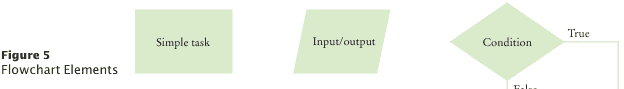

> 决策的每个分支都可以包含任务和进一步的决策。

基本思想很简单。按照任务和输入/输出框应执行的顺序将它们连接起来。每当需要做出决策时，画一个带有两个结果的菱形（见图 6）。

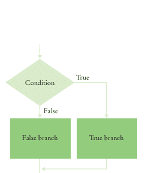

每个分支都可以包含一系列任务，甚至更多决策。如果某个值有多种选择，就按图 7 那样将它们展开。

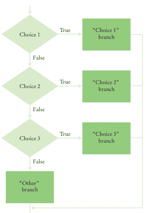


### 编程提示 3.7：制定计划，并为意外问题留出时间


商业软件常常因交付晚于承诺而声名不佳。例如，微软最初承诺其 Windows Vista 操作系统将于 2003 年末面世，然后又说 2005 年，之后又说 2006 年 3 月；它最终于 2007 年 1 月发布。一些早期承诺可能并不现实。让潜在客户预期产品即将可用，符合微软的利益。如果客户知道实际交付日期，他们可能在此期间转向其他产品。不过，不可否认，微软没有预料到它为自己设定要解决的任务的全部复杂性。

微软可以推迟其产品的交付，但你很可能不能。作为学生或程序员，你应该明智地管理时间并按时完成作业。你或许能在截止日期前一晚完成简单的编程练习，但一个看起来难度翻倍的作业很可能需要四倍的时间，因为更多地方可能出错。因此，每当你开始一个编程项目时，都应该制定计划。

首先，现实地估计完成以下事项需要多少时间：

- 设计程序逻辑。
- 开发测试用例。
- 录入程序并修复语法错误。
- 测试并调试程序。

例如，对于所得税程序，我可能估计设计需要一小时；开发测试用例需要 30 分钟；数据录入和修复语法错误需要一小时；测试和调试需要一小时。总计 3.5 小时。如果我每天在这个项目上工作两小时，将需要将近两天。

然后想想可能出错的事情。你的电脑可能坏掉。你可能被计算机系统的问题难住。（对初学者来说，这是特别重要的一点。仅仅因为要花时间找到一个知道如何用神奇命令解决问题的人，就因一个小问题损失一天，这非常常见。）根据经验法则，将你的估计时间加倍。也就是说，你应该在截止日期前四天而不是两天开始。如果一切顺利，那很好；你提前两天完成了程序。当不可避免的问题发生时，你还有缓冲时间，可以保护你免于尴尬和失败。

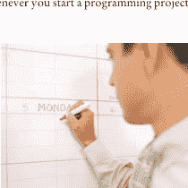

*为你的编程工作制定计划，并为问题预留时间。*

## 3.7 布尔变量与运算符

有时，你需要在程序的一部分中求一个逻辑条件的值，并在其他地方使用它。要存储一个可以为 true 或 false 的条件，你可以使用布尔变量。布尔变量以数学家乔治·布尔（1815—1864）命名，他是逻辑研究的先驱。

> 布尔类型 `bool` 有两个值：`false` 和 `true`。

在 C++ 中，`bool` 数据类型表示布尔类型。`bool` 类型的变量只能保存恰好两个值，记作 `false` 和 `true`。这些值不是字符串或整数；它们是专用于布尔变量的特殊值。


*布尔变量也称为标志，因为它可以处于上（true）或下（false）状态。*

下面是一个布尔变量的定义：

```cpp
bool failed = true;
```

你可以在程序后面使用该值来做判断：

```cpp
if (failed) // Only executed if failed has been set to true
{
    ...
}
```

当你做出复杂决策时，常常需要组合布尔值。组合布尔条件的运算符称为**布尔运算符**。在 C++ 中，`&&` 运算符（称为*与*）仅当两个条件都为 true 时才产生 true。`||` 运算符（称为*或*）如果至少一个条件为 true，则结果为 true。

假设你编写一个处理温度值的程序，并且想测试给定温度是否对应液态水。（在海平面，水在 0 摄氏度结冰，在 100 摄氏度沸腾。）如果温度大于零且小于 100，水就是液态：

```cpp
if (temp > 0 && temp < 100) { cout << "Liquid"; }
```

测试条件有两部分，由 `&&` 运算符连接。（如表5和附录C所示，`>` 和 `<` 运算符的优先级高于 `&&` 运算符。）每个部分都是可为 true 或 false 的布尔值。如果两个单独表达式都为 true，则组合表达式为 true。如果其中一个表达式为 false，结果也为 false（见图8）。

C++ 有两个组合条件的布尔运算符：`&&`（与）和 `||`（或）。

**A && B**

| A | B | A && B |
|---|---|---|
| true | true | true |
| true | false | false |
| false | true | false |
| false | false | false |

**A || B**

| A | B | A \|\| B |
|---|---|---|
| true | true | true |
| true | false | true |
| false | true | true |
| false | false | false |

**!A**

| A | !A |
|---|---|
| true | false |
| false | true |

**图8** 布尔真值表

*在冰岛的这处间歇泉，你可以看到冰、液态水和蒸汽。*


**表5 部分运算符及其优先级**

| 运算符 | 描述 |
| --- | --- |
| `++` `--` `+`（一元）<br>`-`（一元）`!` | 自增、自减、正号、负号，<br>布尔*非* |
| `*` `/` `%` | 乘法、除法、取余 |
| `+` `-` | 加法、减法 |
| `<` `<=` `>` `>=` | 比较 |
| `==` `!=` | 等于、不等于 |
| `&&` | 布尔*与* |
| `\|\|` | 布尔*或* |

相反，让我们测试给定温度下水是否*不是*液态。当温度至多为 0 或至少为 100 时就是这种情况。使用 `||`（*或*）运算符组合表达式：

```cpp
if (temp <= 0 || temp >= 100) { cout << "Not liquid"; }
```

图9展示了这些示例的流程图。

> 要反转条件，请使用 `!`（*非*）运算符。

有时你需要用*非*逻辑运算符*反转*一个条件。`!` 运算符接受单个条件：如果该条件为 false，则求值为 true；如果条件为 true，则求值为 false。在此示例中，如果布尔变量 frozen 的值为 false，则产生输出：

```cpp
if (!frozen)
{
    cout << "Not frozen";
}
```

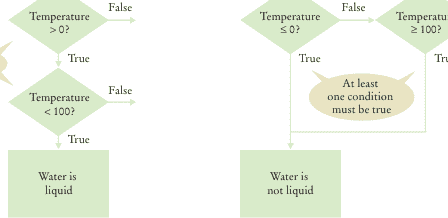

**图9** *与* 和 *或* 组合的流程图

**表6 布尔运算符**

| 表达式 | 值 | 注释 |
| --- | --- | --- |
| 0 < 200 && 200 < 100 | false | 只有第一个条件为 true。注意 < 运算符的优先级高于 && 运算符。 |
| 0 < 200 \|\| 200 < 100 | true | 第一个条件为 true。 |
| 0 < 200 \|\| 100 < 200 | true | `\|\|` 不是“二选一”的测试。如果两个条件都为 true，结果为 true。 |
| ❌ 0 < 200 < 100 | true | **错误：** 表达式 0 < 200 为 true，被转换为 1。表达式 1 < 100 为 true。你永远不应写这样的表达式；参见第107页的常见错误3.5。 |
| ❌ -10 && 10 > 0 | true | **错误：** -10 不是零，它被转换为 true。你永远不应写这样的表达式；参见第107页的常见错误3.5。 |
| 0 < x && x < 100 \|\| x == -1 | (0 < x && x < 100) \|\| x == -1 | && 运算符的优先级高于 \|\| 运算符。 |
| !(0 < 200) | false | 0 < 200 为 true，因此其否定为 false。 |
| frozen == true | frozen | 没有必要将布尔变量与 true 比较。 |
| frozen == false | !frozen | 使用 ! 比与 false 比较更清晰。 |

表6展示了求值布尔运算符的更多示例。


- 31. 假设 x 和 y 是两个整数。如何测试它们是否都为零？
- 32. 如何测试它们中是否至少有一个为零？
- 33. 如何测试它们中是否恰好有一个为零？
- 34. !frozen 的值是什么？
- 35. 使用 bool 类型而不是字符串 "false"/"true" 或整数 0/1 有什么优势？

**练习** 现在你可以尝试本章末尾的这些练习：R3.27、P3.22、P3.24。


## 常见错误 3.5

### 组合多个关系运算符


考虑以下表达式

```
if (0 <= temp <= 100) // Error
```

这看起来完全像数学测试 0 ≤ temp ≤ 100。不幸的是，它并不是。

让我们剖析表达式 0 <= temp <= 100。前半部分 0 <= temp 是一个测试，其结果取决于 temp 的值，为 true 或 false。然后，该测试的结果（true 或 false）会与 100 进行比较。能把真值和浮点数进行比较吗？true 是否大于 100？不幸的是，为了与 C 语言保持兼容，C++ 会将 false 转换为 0，将 true 转换为 1。因此，该表达式将始终求值为 true。

你必须小心，不要在程序中混用逻辑表达式和算术表达式。而应使用*与*来组合两个独立的测试：

```
if (0 <= temp && temp <= 100) ...
```

另一类常见错误与之类似，就是写成

```
if (x && y > 0) ... // Error
```

而不是

```
if (x > 0 && y > 0) ...
```

不幸的是，编译器不会发出错误消息。相反，它会把 x 转换为 true 或 false。零被转换为 false，任何非零值被转换为 true。如果 x 不为零，那么它会测试 y 是否大于 0，最后计算这两个真值的*与*。自然，这种计算毫无意义。

## 常见错误 3.6

### 混淆 && 和 || 条件


混淆*与*条件和*或*条件是一种出奇常见的错误。一个值如果至少为 0 且至多为 100，就位于 0 和 100 之间。如果它小于 0 或大于 100，就位于该范围之外。没有黄金法则；你只需仔细思考。

通常，*与*或*或*会被明确表述，这时实现起来并不太难。但有时措辞并不那么明确。很常见的情况是，各个条件被整齐地分列在项目符号列表中，却几乎不说明它们应如何组合。考虑以下报税说明。如果下列*任意*一项为真，你可以申报单身申报状态：

-   你从未结婚。
-   在纳税年度的最后一天，你合法分居*或*离婚。
-   你丧偶，*且*未再婚。

由于只要*任意*一个条件为真，测试就通过，所以必须用*或*来组合这些条件。在另一处，同样的说明指出，如果以下五个条件*全部*为真，你可以使用更有利的已婚联合申报状态：

-   你的配偶在不到两年前去世，*且*你未再婚。
-   你有一个可以申报为受抚养人的孩子。
-   该孩子在*整个*纳税年度都住在你家。
-   你为维持这个孩子的家庭住所支付了超过*一半*的费用。
-   在配偶他*或*她去世的那一年，你与配偶提交了联合申报表。

因为要使测试通过，*所有*条件都必须为真，所以必须用*与*来组合它们。

## 专题 3.4


### 布尔运算符的短路求值

计算 && 和 || 运算符时，一旦确定真值，求值就会停止。当计算一个 && 且第一个条件为假时，第二个条件不会被求值，因为第二个测试的结果无关紧要。

> && 和 || 运算符使用短路求值进行计算：一旦确定真值，就不再对其余条件求值。

例如，考虑表达式

```
quantity > 0 && price / quantity < 10
```

假设 quantity 的值为零。那么测试 quantity > 0 失败，并且不会尝试第二个测试。这样也好，因为除以零是非法的。

同样，当 || 表达式的第一个条件为真时，其余部分不会被求值，因为结果必定为真。

这个过程称为短路求值。

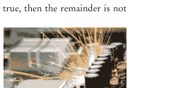

> 在短路中，电流沿电阻最小的路径流动。同样，短路求值采用最快的路径来计算布尔表达式的结果。

## 专题 3.5


### 德摩根定律

人类通常很难理解对与/或表达式应用非运算符后的逻辑条件。德摩根定律以逻辑学家奥古斯都·德摩根（1806—1871）命名，可用于简化这些布尔表达式。

假设我们想对未在美国本土范围内发货的情况收取更高的运费。

```
if (!(country == "USA"
    && state != "AK"
    && state != "HI"))
  shipping_charge = 20.00;
```

这个测试有点复杂，你必须仔细梳理其中的逻辑。当“国家是美国且州不是阿拉斯加且州不是夏威夷”不为真时，就收取 20.00 美元。嗯？说有些人不会被这段代码搞糊涂，这可不是真的。

计算机不在乎，但编写和维护代码需要人类程序员。因此，知道如何简化这样的条件是有用的。

德摩根定律有两种形式：一种用于对 and 表达式取反，一种用于对 or 表达式取反：

```
!(A && B)    is the same as    !A || !B
!(A || B)    is the same as    !A && !B
```

> 德摩根定律告诉你如何对 && 和 || 条件取反。

要特别注意，将非运算移入内部会反转与和或运算符。例如，“州是阿拉斯加或州是夏威夷”的否定，

```
!(state == "AK" || state == "HI")
```

是“州不是阿拉斯加且州不是夏威夷”：

```
!(state == "AK") && !(state == "HI")
```

## 本章小结

### 使用 `if` 语句实现决策。

-   `if` 语句允许程序根据要处理的数据的性质执行不同的操作。


### 实现数字和对象的比较。


-   关系运算符（`<`、`<=`、`>`、`>=`、`==`、`!=`）用于比较数字和字符串。
-   字典序用于比较字符串。


### 实现需要多个 `if` 语句的复杂决策。


-   对于具有两个以上情况的决策，需要多个备选方案。
-   使用多个 `if` 语句时，要注意条件的顺序。

对于真正理解这些句子而言是必要的。例如，考虑句子“去年秋天她入读了 Michigan State”。读者会自动意识到，这里的“fall”与跌倒无关，而是指秋季。虽然存在密歇根州，但这里的 Michigan State 指这所大学。先验地，计算机程序不具备这些知识。CYC 项目的目标是提取并存储所需的事实——也就是说：（1）人们进入大学就读；（2）密歇根是一个州；（3）许多州都有名为 X State University 的大学，通常缩写为 X State；（4）大多数人在秋季进入大学就读。到 1995 年，该项目已经编纂了约 10 万个常识概念和约 100 万条将它们关联起来的知识事实。即使如此庞大的数据量，也尚未证明足以用于有用的应用。

近年来，人工智能技术取得了重大进展。最令人惊叹的例子之一是美国国防高级研究计划局（DARPA）发起的一系列自动驾驶车辆“大挑战”的结果。参赛者被邀请提交一辆计算机控制的车辆，该车辆必须在没有人类驾驶员或遥控的情况下完成障碍赛道。2004 年的首届活动令人失望，没有参赛者完成路线。2005 年，五辆车在莫哈韦沙漠完成了艰苦的 212 公里赛程。斯坦福的 Stanley 获得第一名，平均速度为 30 公里/小时。2007 年，DARPA 将比赛移至一个“城市”环境——一个废弃的空军基地。车辆必须能够相互交互，并遵守加州交通法规。正如斯坦福的塞巴斯蒂安·特龙所解释的：


2007 年 DARPA 城市挑战赛冠军

> 在上一届大挑战中，障碍物是岩石还是灌木并不重要，因为无论哪种情况，你都只需绕开它。当前的挑战是从仅仅感知环境转向理解环境。


**R3.9** 在一个调度程序中，我们想要检查两个预约是否重叠。为简单起见，预约从整点开始，并且我们使用军用时间（小时为0–23）。下面的伪代码描述了一种算法，用于确定开始时间为 start1、结束时间为 end1 的预约是否与开始时间为 start2、结束时间为 end2 的预约重叠。

```text
If start1 > start2
    s ← start1
Else
    s ← start2
If end1 < end2
    e ← end1
Else
    e ← end2
If s ≤ e
    The appointments overlap.
Else
    The appointments don't overlap.
```

用从 10–12 的预约和从 11–13 的预约追踪该算法，然后用从 10–11 的预约和从 12–13 的预约进行追踪。

**R3.10** 为练习 R3.9 中的算法绘制流程图。

**R3.11** 为练习 P3.12 中的算法绘制流程图。

**R3.12** 为练习 P3.13 中的算法绘制流程图。

**R3.13** 为练习 R3.9 中的算法开发一组测试用例。

**R3.14** 为练习 P3.13 中的算法开发一组测试用例。

**R3.15** 为一个程序编写伪代码，该程序提示用户输入月份和日期，并打印出它是否是以下四个节日之一：

- 元旦（1月1日）
- 独立日（7月4日）
- 退伍军人节（11月11日）
- 圣诞节（12月25日）

**R3.16** 为一个程序编写伪代码，该程序根据下表为测验评定字母等级：

| 分数 | 等级 |
| --- | --- |
| 90–100 | A |
| 80–89 | B |
| 70–79 | C |
| 60–69 | D |
| < 60 | F |

**R3.17** 解释 C++ 中字符串的字典序与字典或电话簿中单词排序有何不同。*提示：考虑诸如 IBM、wiley.com、Century 21 和 While-U-Wait 这样的字符串。*

**R3.18** 在以下字符串对中，哪一对在字典序中排在前？

- a. "Tom", "Dick"
- b. "Tom", "Tomato"
- c. "church", "Churchill"
- d. "car manufacturer", "carburetor"
- e. "Harry", "hairy"
- f. "C++", " C++"
- g. "Tom", "Tom"
- h. "Car", "Car1"
- i. "car", "bar"

**R3.19** 解释 else if 子句序列与嵌套 if 语句之间的区别。各给出一个例子。

**R3.20** 给出一个 else if 子句序列的例子，其中测试的顺序无关紧要。给出一个测试顺序很重要的例子。

**R3.21** 重写第 3.3 节中的条件，使用 < 运算符而不是 >= 运算符。对比较顺序有什么影响？

**R3.22** 为练习 P3.18 中的税务程序给出了一组测试用例。手动计算预期结果。

**R3.23** 使用下面的语句再编一个 C++ 代码示例，展示悬空 else 问题。GPA 至少为 1.5 但低于 2 的学生处于留校察看状态。低于 1.5 的学生则不及格。

**R3.24** 通过找出布尔输入 p、q 和 r 的所有组合下布尔表达式的真值，完成下面的真值表。

| p | q | r | (p && q) \|\| !r | !(p && (q \|\| !r)) |
|---|---|---|---|---|
| false | false | false |  |  |
| false | false | true |  |  |
| false | true | false |  |  |
| ... |  |  |  |  |
| 另外 5 种组合 |  |  |  |  |
| ... |  |  |  |  |

**R3.25** 对还是错？对于任意布尔条件 A 和 B，A && B 与 B && A 相同。

**R3.26** 许多搜索引擎的“高级搜索”功能允许你对复杂查询使用布尔运算符，例如“(cats OR dogs) AND NOT pets”。将这些搜索运算符与 C++ 中的布尔运算符进行对比。

**R3.27** 假设 b 的值为 false，x 的值为 0。以下每个表达式的值是多少？

- a. `b && x == 0`
- b. `b || x == 0`
- c. `!b && x == 0`
- d. `!b || x == 0`
- e. `b && x != 0`
- f. `b || x != 0`
- g. `!b && x != 0`
- h. `!b || x != 0`

**R3.28** 简化以下表达式。这里，`b` 是 `bool` 类型的变量。

- a. `b == true`
- b. `b == false`
- c. `b != true`
- d. `b != false`

**R3.29** 简化以下语句。这里，`b` 是 `bool` 类型的变量，`n` 是 `int` 类型的变量。

- a. `if (n == 0) { b = true; } else { b = false; }`  
  *（提示：n == 0 的值是什么？）*
- b. `if (n == 0) { b = false; } else { b = true; }`
- c. `b = false; if (n > 1) { if (n < 2) { b = true; } }`
- d. `if (n < 1) { b = true; } else { b = n > 2; }`

**R3.30** 以下程序有什么问题？

```cpp
cout << "Enter the number of quarters: ";
cin >> quarters;
total = total + quarters * 0.25;
cout << "Total: " << total << endl;
if (cin.fail()) { cout << "Input error."; }
```

**R3.31** 读取数字出奇地困难，因为 C++ 输入流一次一个字符地查看输入。首先，跳过空白。然后流消耗那些可以成为数字一部分的输入字符。一旦流识别出一个数字，如果遇到不能成为数字一部分的字符，它就会停止读取。然而，如果第一个非空白字符不是数字或符号，或者如果第一个字符是符号而第二个不是数字，则流失败。
考虑一个读取整数的程序：

```cpp
cout << "Enter the number of quarters: ";
int quarters;
cin >> quarters;
```

对于以下每个用户输入，圈出已读取的字符数以及流是否处于失败状态。

- a. `15.9`
- b. `15 9`
- c. `+159`
- d. `-15A9`
- e. `Fifteen`
- f. `-Fifteen`
- g. `+ 15`
- h. `1.5E3`
- i. `+1+5`

**编程练习**

**P3.1** 编写一个程序，读取温度值和字母 C（摄氏度）或 F（华氏度）。打印在海平面给定温度下水是液态、固态还是气态。

**P3.2** 海拔每升高 300 米（或 1,000 英尺），水的沸点大约下降 1 摄氏度。改进练习 P3.1 的程序，允许用户提供以米或英尺为单位的海拔。

**P3.3** 编写一个程序，读取三个浮点数并打印三个输入中的最大值。例如：

```text
Please enter three numbers: 4 9 2.5
The largest number is 9.
```

**P3.4** 编写一个程序，读取三个字符串并按字典序排序。

```text
Enter three strings: Charlie Able Baker
Able
Baker
Charlie
```

**P3.5** 编写一个程序，读取一个整数并打印该数字有多少位，通过检查该数字是否 ≥ 10、≥ 100 等来实现。（假设所有整数都小于一百亿。）如果数字为负，先将其乘以 −1。

**P3.6** 编写一个程序，读取三个数字，如果它们都相同则打印“全部相同”，如果它们都不同则打印“全部不同”，否则打印“都不是”。

**P3.7** 编写一个程序，读取三个数字，如果它们按递增顺序排列则打印“递增”，如果按递减顺序排列则打印“递减”，否则打印“都不是”。这里，“递增”指“严格递增”，每个值都大于前一个值。序列 3 4 4 不会被视为递增。

**P3.8** 重复练习 P3.7，但在读取数字之前，询问用户递增/递减应该是“严格”还是“宽松”。在宽松模式下，序列 3 4 4 是递增的，序列 4 4 4 既是递增的也是递减的。

**P3.9** 编写一个程序，将字母等级转换为数字等级。字母等级为 A、B、C、D 和 F，后面可能跟 + 或 −。它们的数值为 4、3、2、1 和 0。没有 F+ 或 F−。+ 将数值增加 0.3，− 将数值减少 0.3。然而，A+ 的值为 4.0。

```text
Enter a letter grade: B-
The numeric value is 2.7.
```

**P3.10** 编写一个程序，将 0 到 4 之间的数字转换为最接近的字母等级。例如，数字 2.8（可能是几个等级的平均值）将转换为 B−。平局时偏向更好的等级；例如 2.85 应为 B。

**P3.11** 编写一个程序，接受用户输入的以下简写符号描述的扑克牌：

| 简写 | 含义 |
| --- | --- |
| A | 王牌 |
| 2 ... 10 | 牌面值 |
| J | 杰克 |
| Q | 皇后 |
| K | 国王 |
| D | 方块 |
| H | 红桃 |
| S | 黑桃 |
| C | 梅花 |


你的程序应打印牌的完整描述。例如，

```text
Enter the card notation: QS
Queen of Spades
```

**P3.12** 当比较两个时间点时，每个时间点以小时（采用24小时制，范围从0到23）和分钟给出，以下伪代码确定哪个时间在前。

```text
If hour1 < hour2
    time1 comes first.
Else if hour1 and hour2 are the same
    If minute1 < minute2
        time1 comes first.
    Else if minute1 and minute2 are the same
        time1 and time2 are the same.
    Else
        time2 comes first.
Else
    time2 comes first.
```

编写一个程序，提示用户输入两个时间点，并先打印较早的时间，然后再打印另一个时间。

**P3.13** 以下算法根据给定的月份和日期得出季节（春季、夏季、秋季或冬季）。

```text
If month is 1, 2, or 3, season = "Winter"
Else if month is 4, 5, or 6, season = "Spring"
Else if month is 7, 8, or 9, season = "Summer"
Else if month is 10, 11, or 12, season = "Fall"
If month is divisible by 3 and day >= 21
    If season is "Winter", season = "Spring"
    Else if season is "Spring", season = "Summer"
    Else if season is "Summer", season = "Fall"
    Else season = "Winter"
```


编写一个程序，提示用户输入月份和日期，然后打印由该算法确定的季节。

**P3.14** 编写一个程序，读入两个浮点数，并测试它们在小数点后两位之内是否相同。以下是两个示例运行。

```text
Enter two floating-point numbers: 2.0 1.99998
They are the same up to two decimal places.
Enter two floating-point numbers: 2.0 1.98999
They are different.
```

**P3.15** 编写一个程序模拟银行交易。有两个银行账户：支票账户和储蓄账户。首先，询问银行账户的初始余额；拒绝负余额。然后询问交易类型；选项为存款、取款和转账。接着询问账户；选项为支票账户和储蓄账户。再询问金额；拒绝会透支账户的交易。最后，打印两个账户的余额。

**P3.16** 编写一个程序，读入员工的姓名和薪水。这里的薪水指 *按小时计算的* 工资，例如$9.25。然后询问该员工上周工作了多少小时。务必接受小数小时。任何加班工作（每周超过40小时）按正常工作工资的150%支付。计算工资，并为员工打印一张工资支票。

**P3.17** 编写一个程序，提示用户输入生日的日期和月份，然后打印一份星座运势。为程序员编一些运势，如下所示：


```text
    Please enter your birthday (month and day): 6 16
    Gemini are experts at figuring out the behavior of complicated programs.
    You feel where bugs are coming from and then stay one step ahead. Tonight,
    your style wins approval from a tough critic.
```

每条运势都应包含星座的名称。（你会在互联网上数量多得惊人的网站上找到星座的名称和日期范围。）

**P3.18** 编写一个程序，按照下表计算税费：

| 如果您的身份为单身，且应纳税所得额超过 | 但不超过 | 税额为 | 超出部分的 |
|---|---|---|---|
| $0 | $8,000 | 10% | $0 |
| $8,000 | $32,000 | $800 + 15% | $8,000 |
| $32,000 |  | $4,400 + 25% | $32,000 |

| 如果您的身份为已婚，且应纳税所得额超过 | 但不超过 | 税额为 | 超出部分的 |
|---|---|---|---|
| $0 | $16,000 | 10% | $0 |
| $16,000 | $64,000 | $1,600 + 15% | $16,000 |
| $64,000 |  | $8,800 + 25% | $64,000 |

**P3.19** 1913年的美国原始所得税相当简单。税额为：

- 对前 $50,000 征收 1% 的税。
- 对超过 $50,000 至 $75,000 的部分征收 2% 的税。
- 对超过 $75,000 至 $100,000 的部分征收 3% 的税。
- 对超过 $100,000 至 $250,000 的部分征收 4% 的税。
- 对超过 $250,000 至 $500,000 的部分征收 5% 的税。
- 对超过 $500,000 的部分征收 6% 的税。

没有针对单身或已婚纳税人的单独税率表。编写一个程序，按照此税率表计算所得税。

**P3.20** `tax.cpp` 程序使用了2008年美国所得税税表的简化版本。查找当前年份单身和已婚申报者的税级和税率，并实现一个程序来计算实际的所得税。

**P3.21** *单位换算。* 编写一个单位换算程序，询问用户希望从哪个单位进行换算（fl. oz、gal、oz、lb、in、ft、mi）以及希望换算到哪个单位（ml、l、g、kg、mm、cm、m、km）。拒绝不兼容的换算（例如 gal → km）。询问要换算的值，然后显示结果：

```text
Convert from? gal
Convert to? ml
Value? 2.5
2.5 gal = 9462.5 ml
```

**P3.22** 编写一个程序，提示用户输入字母表中的一个单个字符。根据用户输入打印 Vowel 或 Consonant。如果用户输入不是字母（在 a 到 z 或 A 到 Z 之间），或者是长度大于1的字符串，则打印一条错误消息。

**P3.23** *罗马数字。* 编写一个程序，将一个正整数转换为罗马数字系统。罗马数字系统有以下数字：

- I — 1
- V — 5
- X — 10
- L — 50
- C — 100
- D — 500
- M — 1,000

数字的构成遵循以下规则：（1）仅表示不超过3,999的数字。（2）与十进制系统一样，千位、百位、十位和个位分别表示。（3）数字1到9表示为：

- I — 1
- II — 2
- III — 3
- IV — 4
- V — 5
- VI — 6
- VII — 7
- VIII — 8
- IX — 9

如你所见，I 在 V 或 X 之前时，其值会被减去，而且你绝不能连续使用超过三个 I。（4）十位和百位采用同样的方式，只是分别使用字母 X、L、C 和 C、D、M 代替 I、V、X。你的程序应接受一个输入（如 1978），并将其转换为罗马数字 MCMLXXVIII。


**P3.24** 编写一个程序，提示用户输入月份（1表示一月，2表示二月，依此类推），然后打印该月的天数。对于二月，打印“28 or 29 days”。

```text
Enter a month: 5
30 days
```

不要为每个月使用单独的 if/else 分支。使用布尔运算符。

**P3.25** 一年有366天称为闰年。如果年份能被4整除（例如1980年），则该年是闰年，但如果能被100整除（例如1900年）则不是闰年；然而，如果能被400整除（例如2000年）则是闰年。在1582年10月15日引入格里高利历之前没有这些例外（1500年是闰年）。编写一个程序，询问用户一个年份并计算该年是否为闰年。

**P3.26** 为练习 P3.2 添加错误处理。如果用户未在预期时输入数字，或提供了无效的高度单位，则打印一条错误消息并结束程序。

**工程 P3.27** 编写一个程序，提示用户输入波长值，并打印电磁波谱对应部分的描述，如表7所示。


## 表7 电磁波谱

| 类型 | 波长 (m) | 频率 (Hz) |
|---|---|---|
| 无线电波 | > 10^-1 | < 3 × 10^9 |
| 微波 | 10^-3 到 10^-1 | 3 × 10^9 到 3 × 10^11 |
| 红外线 | 7 × 10^-7 到 10^-3 | 3 × 10^11 到 4 × 10^14 |
| 可见光 | 4 × 10^-7 到 7 × 10^-7 | 4 × 10^14 到 7.5 × 10^14 |
| 紫外线 | 10^-8 到 4 × 10^-7 | 7.5 × 10^14 到 3 × 10^16 |
| X射线 | 10^-11 到 10^-8 | 3 × 10^16 到 3 × 10^19 |
| 伽马射线 | < 10^-11 | > 3 × 10^19 |

**工程 P3.28** 重复练习 P3.27，修改程序，使其改为提示用户输入频率。

**工程 P3.29** 重复练习 P3.27，修改程序，使其首先询问用户输入的是波长还是频率。

**工程 P3.30** 一辆小型厢式车有两扇滑动门。每扇门都可以通过仪表板开关、内部把手或外部把手打开。但是，如果儿童锁开关被激活，内部把手就不起作用。滑动门要打开，变速杆必须处于驻车档，*并且*主解锁开关必须被激活。（本书作者就是这样一辆车的长期受苦车主。）


假设电压表电压被限制在范围 $V_{min} = 12$ 伏特 $≤ V_m ≤ V_{max} = 18$ 伏特内。编写一个程序，接受 $V_m$ 的值并检查它是否在 12 和 18 之间。当 $V_m$ 在 12 和 18 之间时，程序应返回以摄氏度为单位的气体温度；否则返回一条错误消息。

### 工程 P3.33

霜冻造成的农作物损害是农民面临的众多风险之一。下图展示了一个用于霜冻预警的简单报警电路。该报警电路使用一种称为热敏电阻的器件，在温度降至冰点以下时使蜂鸣器发声。热敏电阻是半导体器件，其电阻随温度变化，由以下方程描述


$$R = R_0 e^{β(1/T - 1/T_0)}$$

其中 $R$ 是在温度 $T$（单位为 $°K$）下的电阻，单位为 $Ω$；$R_0$ 是在温度 $T_0$（单位为 $°K$）下的电阻，单位为 $Ω$。$β$ 是取决于制造热敏电阻所用材料的常数。

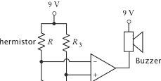

该电路设计为当

$$R_2/(R + R_2) < R_4/(R_3 + R_4)$$

时报警器将发声。

报警电路中使用的热敏电阻在 $T_0 = 40 °C$ 时具有 $R_0 = 33,192 Ω$，且 $β = 3,310 °K$。（注意 $β$ 的单位是 $°K$。回想一下，以 $°K$ 表示的温度是通过将摄氏温度加上 273 得到的。）电阻 $R_2$、$R_3$ 和 $R_4$ 的阻值为 $156.3 kΩ = 156,300 Ω$。

编写一个 C++ 程序，提示用户输入以 $°F$ 为单位的温度，并打印一条消息，指示在该温度下报警器是否会发声。

### 工程 P3.34

一个质量 $m = 2$ 千克的物体连接在长度为 $r = 3$ 米的绳子末端。该质量块被高速旋转。绳子能承受的最大张力为 $T = 60$ 牛顿。编写一个程序，接受旋转速度 $v$，并判断这样的速度是否会导致绳子断裂。提示：$T = m v^2/r$。

### 工程 P3.35

一个质量 $m$ 连接在长度为 $r = 3$ 米的绳子末端。绳子只能以 1、10、20 或 40 米/秒的速度旋转。绳子能承受的最大张力为 $T = 60$ 牛顿。编写一个程序，用户输入质量 $m$ 的值，程序确定在不拉断绳子的情况下可以旋转的最大速度。提示：$T = m v^2/r$。

### 工程 P3.36

普通人能以 7 英里/小时的速度从地面跳起，而不必担心离开地球。然而，如果一名宇航员站在哈雷彗星上以这个速度跳起，宇航员还会回到彗星表面吗？创建一个程序，允许用户输入从哈雷彗星表面起跳的发射速度（单位：英里/小时），并判断跳跃者是否会返回表面。如果不会，程序应计算彗星必须增加多少质量才能让跳跃者返回表面。


提示：逃逸速度为 $v_{\text{escape}} = \sqrt{2GM/R}$，其中 $G = 6.67 \times 10^{-11}\ \text{N}\cdot\text{m}^2/\text{kg}^2$ 是引力常数，$M = 1.3 \times 10^{22}\ \text{kg}$ 是哈雷彗星的质量，$R = 1.153 \times 10^6\ \text{m}$ 是其半径。

## 自测题答案

- 1. 将 if 语句改为

    ```cpp
    if (floor > 14)
    {
        actual_floor = floor - 2;
    }
    ```

- 2. 85. 90. 85.

- 3. 唯一的区别是当 `original_price` 为 100 时。自测题 2 中的语句将 `discounted_price` 设为 90；此语句将其设为 80。

- 4. 95. 100. 95.

- 5.

    ```cpp
    if (fuel_amount < 0.10 * fuel_capacity)
    {
        cout << "red" << endl;
    }
    else
    {
        cout << "green" << endl;
    }
    ```

- 6. (a) 和 (b) 都为真，(c) 为假。

- 7. `Floor <= 13`

- 8. 这些值应使用 `==` 进行比较，而不是 `=`。

- 9. `input == "y"`

- 10. `str != "" or str.length() > 0`

- 11.

    ```cpp
    if (score_a > score_b)
    {
        cout << "A won";
    }
    else if (score_a < score_b)
    {
        cout << "B won";
    }
    else
    {
        cout << "Game tied";
    }
    ```

- 12.

    ```cpp
    if (x > 0)
    {
        s = 1;
    }
    else if (x < 0)
    {
        s = -1;
    }
    else
    {
        s = 0;
    }
    ```

- 13. 你可以先将 s 设为三个值之一：

    ```cpp
    s = 0;
    if (x > 0) { s = 1; }
    else if (x < 0) { s = -1; }
    ```

- 14. 可以省略 if (price <= 100)，从而清楚地表明 else 分支是唯一的选择。

- 15. 无建筑物破坏

- 16. 在最后的 else 之前添加一个分支：

    ```cpp
    else if (richter < 0) { cout << "Error: Negative input" << endl; }
    ```

- 17. \$3,200

- 18. 不会。那么计算为 $0.10 \times 32000 + 0.25 (32000 - 32000)$。

- 19. 不会。他们各自的税是每人 \$5,200，如果他们结婚，他们将支付 \$10,400。实际上，处于更高税率档次的纳税人（我们的程序未对此建模）在结婚时可能支付更高的税，这种现象称为*婚姻惩罚*。

- 20. 将第 36 行的 else 改为 else if (marital_status == "m")，并在第 47 行之后添加另一个分支：

    ```cpp
    else { cout << "Error: marital status should be s or m." << endl; }
    ```

- 21. 更高的税率只适用于更高档次中的收入。假设你是单身，收入为 \$31,900。你应该尝试获得 \$200 的加薪吗？当然应该：前 \$100 的 90% 和后 \$100 的 75% 你都能保留。

- 22.

    

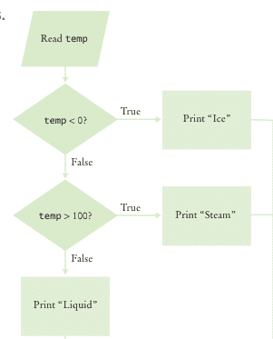

| 测试用例 | 预期输出 | 说明 |
|---|---|---|
| 12 | 12 | 低于 13 层 |
| 14 | 13 | 高于 13 层 |
| 13 | ? | 规格说明不明确——有关此程序带错误处理的版本，请参见第 3.8 节 |

一个边界测试用例是价格为 \$128。应适用 16% 的折扣，因为问题陈述指出，如果价格*至少*为 \$128，则适用较大的折扣。因此，预期输出为 \$107.52。

| 测试用例 | 预期输出 | 说明 |
|---|---|---|
| 9 | 大多数结构倒塌 | |
| 7.5 | 许多建筑物被摧毁 | |
| 6.5 | 许多建筑物严重... | |
| 5 | 对质量差的...造成损坏 | |
| 3 | 无破坏... | |
| 8.0 | 大多数结构倒塌 | 边界情况。在此程序中，边界情况不那么重要，因为地震的行为是逐渐变化的。 |
| -1 | | 规格说明不明确——有关此程序带错误处理的版本，请参见自测题 16。 |

- 30.

    | 测试用例 | 预期输出 | 说明 |
    |---|---|---|
    | (0.5, 0.5) | 内部 | |
    | (4, 2) | 外部 | |
    | (0, 2) | 在边界上 | 恰好位于边界上 |
    | (1.414, 1.414) | 在边界上 | 接近边界 |
    | (0, 1.9) | 内部 | 距边界不小于 1 毫米 |
    | (0, 2.1) | 外部 | 距边界不小于 1 毫米 |

- 31. x == 0 && y == 0

- 32. x == 0 || y == 0

- 33. (x == 0 && y != 0) || (y == 0 && x != 0)

- 34. 与 frozen 的值相同。

- 35. 可以保证没有其他值。对于字符串或整数，你需要检查不会出现诸如“maybe”或 -1 之类的值进入计算。

- 36. (a) 错误：楼层必须在 1 到 20 之间。 (b) 错误：楼层必须在 1 到 20 之间。 (c) 电梯将前往实际楼层 19。 (d) 错误：不是整数。

- 37. cin.fail() || floor == 13 || floor <= 0 || floor > 20

- 38. 检查 cin.fail()，以确保研究人员没有提供诸如 oh my 之类的输入。检查 weight <= 0，因为任何老鼠肯定都有正重量。我们不知道老鼠能有多大，但新几内亚老鼠体重不超过 2 千克。普通家鼠（rattus rattus）体重可达 0.2 千克，因此我们说任何 weight > 10 千克肯定是输入错误，可能是混淆了克和千克。因此，检查为

    ```cpp
    if (cin.fail())
    {
        cout << "Error: Not a number" << endl;
        return 1;
    }

    if (weight < 0)
    {
        cout << "Error: Weight cannot be negative." << endl;
        return 1;
    }

    if (weight > 10)
    {
        cout << "Error: Weight > 10 kg." << endl;
        return 1;
    }
    ```

- 39. 第一次输入失败。m 的值保持不变。由于先前的输入失败，下一次输入甚至不会尝试获取额外的按键。它也会失败，n 保持不变。程序打印 1 2。


在循环中，程序的一部分会一遍又一遍地重复执行，直到达到某个特定目标。对于需要重复步骤的计算，以及处理包含许多数据项的输入，循环都很重要。在本章中，你将学习 C++ 中的循环语句，以及编写处理输入和模拟现实世界活动的程序的技术。

## 4.1 while 循环

在本节中，你将学习如何重复执行语句，直到达到某个目标。

回顾第 1 章中的投资问题。你将 $10,000 存入一个每年获得 5% 利息的银行账户。账户余额需要多少年才能达到原始投资的两倍？


*由于所获利息也会产生利息，银行余额呈指数增长。*

在第 1 章中，我们为这个问题设计了以下算法：

从 year 值为 0、一列利息以及余额 $10,000 开始。

| 年 | 利息 | 余额 |
| --- | --- | --- |
| 0 |  | $10,000 |

- 当余额小于 $20,000 时，重复以下步骤：
  - 将 year 值加 1。
  - 按 balance × 0.05 计算利息（即 5% 利息）。
  - 将利息加到余额中。
- 报告最终的 year 值作为答案。

你现在知道如何在 C++ 中定义和更新变量。你还不知道如何执行“当余额小于 $20,000 时重复步骤”。


*在粒子加速器中，亚原子粒子会多次穿过环形隧道，从而获得物理实验所需的速度。同样，在计算机科学中，只要条件为真，循环中的语句就会执行。*

下面是解决投资问题的程序。图 2 展示了程序的执行过程。

### ch04/doublinv.cpp

```cpp
1 #include <iostream>
2
3 using namespace std;
4
5 int main()
6 {
7    const double RATE = 5;
8    const double INITIAL_BALANCE = 10000;
9    const double TARGET = 2 * INITIAL_BALANCE;
10
11   double balance = INITIAL_BALANCE;
12   int year = 0;
13
14   while (balance < TARGET)
15   {
16      year++;
17      double interest = balance * RATE / 100;
18      balance = balance + interest;
19   }
20
21   cout << "The investment doubled after "
22        << year << " years." << endl;
23
24   return 0;
25 }
```

### 程序运行结果

```text
The investment doubled after 15 years.
```


1. 投资需要多少年才能变成三倍？修改程序并运行它。
2. 如果年利率为 10%，投资需要多少年才能翻倍？修改程序并运行它。
3. 修改程序，使每年结束后的余额都被打印出来。你是如何做到的？
4. 假设我们修改程序，使 `while` 循环的条件为：

```cpp
while (balance <= TARGET)
```

这对程序有什么影响？为什么？

5. 下面的循环会打印什么？

```cpp
int n = 1;
while (n < 100)
{
   n = 2 * n;
   cout << n << " ";
}
```

**动手练习** 现在你可以尝试本章末尾的这些练习：R4.3、P4.11、P4.16。

```cpp
balance = balance * (1 + RATE / 100);
```

这里，程序员忘记在循环中添加 `year++` 命令。结果，year 始终为 1，循环永远不会结束。

无限循环的另一个常见原因是，意外递增了一个本应递减的计数器（或反之）。考虑下面这个例子：

```cpp
year = 20;
while (year > 0)
{
    balance = balance * (1 + RATE / 100);
    year++;
}
```

year 变量实际上应该递减，而不是递增。这是一个常见错误，因为递增计数器比递减计数器常见得多，以至于你的手指可能会下意识地键入 `++`。结果，year 始终大于 0，循环永远不会结束。（实际上，year 最终可能会超过可表示的最大正整数，并回绕为负数。）然后循环结束了——当然，结果完全错误。


*就像这只在跑步机上停不下来的仓鼠一样，无限循环永远不会结束。*

### 常见错误 4.2：不要想“我们到了吗？”

在做重复性的事情时，我们大多数人都想知道什么时候完成。例如，你可能会想：“我想至少得到 $20,000”，并把循环条件设为

```cpp
balance >= TARGET
```

但 while 循环的考虑方式相反：我允许继续执行多久？正确的循环条件是

```cpp
while (balance < TARGET)
```

换句话说：“只要余额小于目标，就继续做。”

> *编写循环条件时，不要问：“我们到了吗？”*
>
> *条件决定循环会继续执行多久。*


### 常见错误 4.3：差一错误

考虑我们计算投资翻倍所需年数的代码：

```cpp
int year = 0;
while (balance < TARGET)
{
    year++;
    double interest = balance * RATE / 100;
    balance = balance + interest;
}
cout << "The investment doubled after " << year << " years." << endl;
```


year 应该从 0 开始还是从 1 开始？看一个使用简单数值的场景：初始余额为 $100，利率为 50%。第 1 年之后，余额为 $150；第 2 年之后为 $225，即超过 $200。因此，这项投资在 2 年后翻了一番。循环执行了两次，每次都递增 year。因此 year 必须从 0 开始，而不是从 1 开始。

| 年 | 余额 |
| --- | --- |
| 0 | $100 |
| 1 | $150 |
| 2 | $225 |

换句话说，balance 变量表示每年结束时的余额。一开始，balance 变量包含的是第 0 年结束后的余额，而不是第 1 年结束后的余额。

接下来，在测试中应该使用 `<` 还是 `<=` 比较？如果你想用一个例子来厘清这个问题，就需要找到一个最终余额恰好是初始余额两倍的场景。当利率为 100% 时就会出现这种情况。循环执行一次。此时 year 为 1，balance 恰好等于 2 * INITIAL_BALANCE。一年后投资翻倍了吗？翻了。因此，循环不应再执行。如果测试条件是 `balance < TARGET`，循环会停止，这是正确的。如果测试条件写成 `balance <= TARGET`，循环会再执行一次。

换句话说，只要余额尚未翻倍，就继续累加利息。

### 趣闻 4.1：第一个 Bug


据传说，第一个 bug 是在哈佛大学一台巨大的机电计算机 Mark II 中发现的。它确实是由一只虫子引起的——一只飞蛾被困在继电器开关中。

实际上，从操作员留在飞蛾旁边日志本上的便条（见照片）来看，当时“bug”一词似乎已经被广泛使用。

> 计算机科学先驱莫里斯·威尔克斯写道：“不知何故，在摩尔学院以及之后，人们一直以为让程序正确不会有特别的困难。我仍能记得那一刻，我恍然大悟：我未来生命中的很大一部分将花在寻找自己程序中的错误上。”

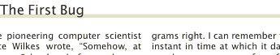

*第一个 Bug*


## 4.2 问题求解：手动跟踪

> 手动跟踪是对代码执行过程的模拟，在此过程中，你逐条执行指令并跟踪变量的值。

在编程技巧 3.6 中，你已经学习了手动跟踪的方法。当你手动跟踪代码或伪代码时，需要在一张纸上写下变量的名称，在头脑中执行代码的每一步，并更新变量的值。

最好将代码写在纸上或打印在纸上。使用纸夹之类的标记物标记当前行。每当变量发生变化时，划掉旧值，并在旧值下方写下新值。当程序产生输出时，也要在另一列中记下输出。

请看下面的示例。程序显示什么值？

```cpp
int n = 1729;
int sum = 0;
while (n > 0)
{
   int digit = n % 10;
   sum = sum + digit;
   n = n / 10;
}
cout << sum << endl;
```

这里有三个变量：n、sum 和 digit。

| n | sum | digit |
|---|---|---|
|  |  |  |

进入循环之前，前两个变量分别被初始化为 1729 和 0。

```cpp
int n = 1729;
int sum = 0;
while (n > 0)
{
   int digit = n % 10;
   sum = sum + digit;
   n = n / 10;
}
cout << sum << endl;
```

| n | sum | digit |
|---|---|---|
| 1729 | 0 |  |

由于 n 大于零，进入循环。变量 digit 被设置为 9（1729 除以 10 的余数）。变量 sum 被设置为 0 + 9 = 9。

```cpp
int n = 1729;
int sum = 0;
while (n > 0)
{
   int digit = n % 10;
   sum = sum + digit;
   n = n / 10;
}
cout << sum << endl;
```

| n | sum | digit |
|---|---|---|
| 1729 | 9 | 9 |

最后，n 变为 172。（请记住，1729 / 10 的除法中，余数会被丢弃，因为两个操作数都是整数。）

划掉旧值，并将新值写在旧值下方。

```cpp
int n = 1729;
int sum = 0;
while (n > 0)
{
    int digit = n % 10;
    sum = sum + digit;
    n = n / 10;
}
cout << sum << endl;
```

| n | sum | digit |
|---|---|---|
| 1729 | 0 |  |
| 172 | 9 | 9 |

现在再次检查循环条件。

```cpp
int n = 1729;
int sum = 0;
while (n > 0)
{
    int digit = n % 10;
    sum = sum + digit;
    n = n / 10;
}
cout << sum << endl;
```

由于 n 仍然大于零，重复执行循环。现在 digit 变为 2，sum 被设置为 9 + 2 = 11，n 被设置为 17。

| n | sum | digit |
|---|---|---|
| 1729 | 0 |  |
| 172 | 9 | 9 |
| 17 | 11 | 2 |

再次执行循环，将 digit 设置为 7，将 sum 设置为 11 + 7 = 18，并将 n 设置为 1。

| n | sum | digit |
|---|---|---|
| 1729 | 0 |  |
| 172 | 9 | 9 |
| 17 | 11 | 2 |
| 1 | 18 | 7 |

最后一次进入循环。现在 digit 被设置为 1，sum 被设置为 19，n 变为零。

| n | sum | digit |
|---|---|---|
| 1729 | 0 |  |
| 172 | 9 | 9 |
| 17 | 11 | 2 |
| 1 | 18 | 7 |

| n | sum | digit |
|---|---|---|
| 1729 | 0 |  |
| 172 | 9 | 9 |
| 17 | 11 | 2 |
| 1 | 18 | 7 |
| 0 | 19 | 1 |

```cpp
int n = 1729;
int sum = 0;
while (n > 0)
{
    int digit = n % 10;
    sum = sum + digit;
    n = n / 10;
}
cout << sum << endl;
```

> 由于 n 等于零，因此该条件不成立。

现在，条件 n > 0 为假。继续执行循环之后的语句。

```cpp
int n = 1729;
int sum = 0;
while (n > 0)
{
    int digit = n % 10;
    sum = sum + digit;
    n = n / 10;
}
cout << sum << endl;
```

| n | sum | digit | output |
|---|---|---|---|
| 1729 | 0 |  |  |
| 172 | 9 | 9 |  |
| 17 | 11 | 2 |  |
| 1 | 18 | 7 |  |
| 0 | 19 | 1 | 19 |

这是一条输出语句。输出的值是 sum 的值，即 19。

当然，你也可以直接运行代码来得到相同的答案。但是，手动跟踪能够让你获得一些仅仅运行代码无法获得的洞见。再次考虑每次迭代中发生的事情：

- 我们提取 n 的最后一位数字。
- 我们将该数字加到 sum 上。
- 我们从 n 中去掉这一位数字。

手动跟踪可以帮助你理解不熟悉的算法是如何工作的。

手动跟踪可以显示代码或伪代码中的错误。

换句话说，该循环计算了 n 中各位数字的总和。现在，无论 n 取什么值，你都知道这个循环的作用，而不仅仅是示例中的值。（为什么有人想要计算各位数字之和？）这类操作对于检查信用卡号码和其他形式的身份证号码是否有效很有用——请参阅练习 P4.5。

手动跟踪不仅可以帮助你理解正确运行的代码，它还是查找代码错误的强大技术。当程序的行为与你预期不符时，拿出一张纸，在头脑中逐步执行代码，同时跟踪变量的值。

手动跟踪不需要一个能够运行的程序。你可以手动跟踪伪代码。事实上，在费力将伪代码翻译成实际代码之前，先对伪代码进行手动跟踪是一个很好的做法，可以确认它能够正确运行。


6. 手动跟踪以下代码，显示 n 的值和输出。

```cpp
int n = 5;
while (n >= 0)
{
    n--;
    cout << n << endl;
}
```

7. 手动跟踪以下代码，显示 n 的值和输出。你注意到了什么潜在错误？

```cpp
int n = 1;
while (n <= 3)
{
    cout << n << ", ";
    n++;
}
```

8. 假设 a 为 2、n 为 4，手动跟踪以下代码。然后解释对于任意 a 和 n 的值，该代码实现了什么功能。

```cpp
int r = 1;
int i = 1;
while (i <= n)
{
    r = r * a;
    i++;
}
```

9. 跟踪以下代码。你观察到了什么错误？

```cpp
int n = 1;
while (n != 50)
{
    cout << n << endl;
    n = n + 10;
}
```

10. 以下伪代码旨在计算数字 n 中的位数：

```text
count = 1
temp = n
while (temp > 10)
    Increment count.
    Divide temp by 10.
```

分别对 n = 123 和 n = 100 的情况跟踪该伪代码。你发现了什么错误？

**练习** 现在，你可以尝试本章末尾的以下练习：R4.1、R4.5。

## 4.3 for 循环

当一个值以固定的增量或减量从起始点变化到结束点时，可以使用 for 循环。

我们经常需要让一系列语句执行指定次数。你可以使用由计数器控制的 *while* 循环，如下面的示例所示：

```cpp
counter = 1; // Initialize the counter
while (counter <= 10) // Check the counter
{
    cout << counter << endl;
    counter++; // Update the counter
}
```

由于这种循环类型非常常见，因此有一种专门的形式，称为 for 循环（参见语法 4.2）。

```cpp
for (counter = 1; counter <= 10; counter++)
{
   cout << counter << endl;
}
```


有些人将这种循环称为*计数控制循环*。相比之下，上一节中的 `while` 循环可以称为*事件控制循环*，因为它会一直执行，直到某个事件发生（例如，余额达到目标值）。计数控制循环的另一个常用术语是*确定次数循环*。从一开始，你就知道循环体将执行确定的次数——在我们的示例中是十次。相比之下，你不知道累积到目标余额需要多少次迭代。这种循环称为*不确定次数循环*。

你可以将 for 循环想象成一系列有序的步骤。

for 循环将初始化、条件和更新表达式整齐地组织在一起。不过，需要注意的是，这些表达式*不是同时执行的*（参见图 3）。

- 初始化操作在进入循环之前执行一次。①
- 条件在每次迭代之前检查。② ⑤
- 更新操作在每次迭代之后执行。④

**图 3** for 循环的执行过程

| 步骤 | 状态 | 代码 |
|------|-------|------|
| ① 初始化 counter | `counter = 1` | `for (counter = 1; counter <= 10; counter++)`<br>`{`<br>`  cout << counter << endl;`<br>`}` |
| ② 检查条件 | `counter = 1` | `for (counter = 1; counter <= 10; counter++)`<br>`{`<br>`  cout << counter << endl;`<br>`}` |
| ③ 执行循环体 | `counter = 1` | `for (counter = 1; counter <= 10; counter++)`<br>`{`<br>`  cout << counter << endl;`<br>`}` |
| ④ 更新 counter | `counter = 2` | `for (counter = 1; counter <= 10; counter++)`<br>`{`<br>`  cout << counter << endl;`<br>`}` |
| ⑤ 再次检查条件 | `counter = 2` | `for (counter = 1; counter <= 10; counter++)`<br>`{`<br>`  cout << counter << endl;`<br>`}` |


## 语法 4.2 for 语句

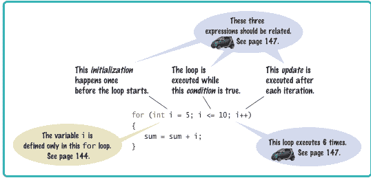

for 循环可以向下计数而不是向上计数：

```cpp
for (counter = 10; counter >= 0; counter--) ...
```

递增或递减的步长不必是 1：

```cpp
for (counter = 0; counter <= 10; counter = counter + 2) ...
```

其他变体参见第 146 页的表 2。

到目前为止，我们一直假设计数器变量已经在 for 循环之前定义。或者，你也可以在循环初始化中定义一个变量。这样的变量只在循环内定义：

```cpp
for (int counter = 1; counter <= 10; counter++)
{
   ...
} // counter no longer defined here
```

下面是 for 循环的一个典型应用。我们想打印储蓄账户在若干年内的余额，如下表所示：

| 年份 | 余额 |
|---|---|
| 1 | 10500.00 |
| 2 | 11025.00 |
| 3 | 11576.25 |
| 4 | 12155.06 |
| 5 | 12762.82 |

这里适用 for 循环模式，因为变量 year 从 1 开始，按固定增量递增，直到达到目标：

**编程提示 4.1**


### 仅按预期目的使用 for 循环

for 循环是特定形式循环的一种*惯用形式*。某个值以固定的增量或减量从起点运行到终点。

编译器不会检查初始化、条件和更新表达式是否相关。例如，下面的循环是合法的：

```cpp
// Confusing—unrelated expressions
for (cout << "Inputs: "; cin >> x; sum = sum + x)
{
   count++;
}
```

然而，阅读这种 for 循环的程序员会感到困惑，因为它不符合他们的预期。对于不遵循 for 惯用形式的迭代，请使用 while 循环。

**编程提示 4.2**


### 选择与任务匹配的循环边界

假设你想打印从 1 到 10 的行号。当然，你会想使用这样的循环：

```cpp
for (int i = 1; i <= 10; i++)
```

i 的取值范围由关系式 1 ≤ i ≤ 10 界定。因为两个边界上都是 ≤，所以这种边界称为*对称*边界。

在遍历字符串中的字符时，使用下面的边界更自然：

```cpp
for (int i = 0; i < str.length(); i++)
```

在这个循环中，i 遍历字符串中的所有有效位置。你可以通过 str.substr(i, 1) 访问第 i 个字符。i 的取值范围是 0 ≤ i < str.length()，左边是 ≤，右边是 <。这是合适的，因为 str.length() 不是一个有效位置。这样的边界称为*非对称*边界。

在这种情况下，使用对称边界并不是一个好主意：

```cpp
for (int i = 0; i <= str.length() - 1; i++)  // Use < instead
```

非对称形式更容易理解。

**编程提示 4.3**


### 计算迭代次数

为一次迭代找到正确的上下界可能会令人困惑。应该从 0 开始还是从 1 开始？终止条件应该用 <= 还是 <？

计算迭代次数是更好地理解循环的一个非常有用的方法。对于非对称边界的循环，计数更容易。循环

```cpp
for (int i = a; i < b; i++)
```

执行 b - a 次。例如，循环

```cpp
for (int i = 0; i < 10; i++)
```

运行 10 次，取值分别为 0、1、2、3、4、5、6、7、8 和 9。

具有对称边界的循环，

```cpp
for (int i = a; i <= b; i++)
```

执行 b - a + 1 次。这个“+1”是许多编程错误的根源。

例如，

```cpp
for (int i = 0; i <= 10; i++)
```

运行 11 次。也许这正是你想要的；如果不是，从 1 开始或使用 < 10。

理解这种“+1”错误的一种方法是看围栏。每一段在左侧有一根围栏柱，最后一段的右侧还有一根柱子。忘记计算最后一个值通常被称为“围栏柱错误”。


*一个四段围栏需要多少根柱子？在这种问题上很容易“差一”。*

## 4.4 do 循环

当循环体必须至少执行一次时，do 循环是合适的。

有时你希望循环体至少执行一次，并在循环体执行之后进行循环测试。do 循环正是为此目的而设：

```cpp
do
{
   statements
}
while (condition);
```

do 循环先执行循环体，然后再测试条件。

有些人称这种循环为后测试循环，因为条件是在循环体完成后才测试的。相比之下，while 和 for 循环是前测试循环。在这两类循环中，条件在进入循环体之前进行测试。

这类循环的一个典型例子是输入验证。假设你要求用户输入一个小于 100 的值。如果用户没注意，输入了一个更大的值，你就再次询问，直到值正确为止。当然，在用户输入之前，你无法测试这个值。这正是 do 循环的完美应用（参见图 5）：

```cpp
int value;
do
{
   cout << "Enter a value < 100: ";
   cin >> value;
}
while (value >= 100);
```

## 4.5 处理输入

在本节中，你将学习如何读取和处理一系列输入值。

每当你读取一系列输入时，都需要某种方法来指示序列的结束。有时你很幸运，输入值不可能为零。那么你可以提示用户继续输入数字，或输入 0 以结束序列。如果允许零但不允许负数，你可以使用 -1 表示终止。用作终止信号的值称为**哨兵**。

哨兵值表示数据集的结束，但它不是数据的一部分。

让我们把这种技术应用到一个计算一组薪资值平均值的程序中。在我们的示例程序中，我们将使用 -1 作为哨兵。员工当然不会为负薪资工作，但也可能有无偿工作的志愿者。

在循环内部，我们读取一个输入。如果输入不是 -1，就处理它。为了计算平均值，我们需要所有薪资的总和以及输入的数量。

```cpp
while (...)
{
    cin >> salary;
    if (salary != -1)
    {
        sum = sum + salary;
        count++;
    }
}
```

只要没有检测到哨兵值，我们就保持在循环中。

```cpp
while (salary != -1)
{
    ...
}
```

只有一个问题：当第一次进入循环时，还没有读取任何数据值。请确保用哨兵以外的某个值来初始化 salary：

```cpp
double salary = 0; // Any value other than -1 will do
```

或者，使用 do 循环：

```cpp
do
{
    ...
}
while (salary != -1)
```


*在军队中，哨兵守卫边界或通道。在计算机科学中，哨兵值表示输入序列的结束或输入序列之间的边界。*

我们现在遇到了一个额外的复杂性。只有在你进入循环并尝试读取输入之后，你才会知道输入失败。要记住这个失败，可以使用一个布尔变量：

你可以使用布尔变量来控制循环。在进入循环之前将变量设置为 true，然后将其设置为 false 以退出循环。

```cpp
cout << "Enter values, Q to quit: ";
bool more = true;
while (more)
{
   cin >> value;
   if (cin.fail())
   {
      more = false;
   }
   else
   {
      Process value.
   }
}
```

有些程序员不喜欢引入布尔变量来控制循环。第 153 页的专题 4.2 展示了退出循环的另一种机制。然而，在读取输入时，还有一种更简单的方法。以下表达式

```cpp
cin >> value
```

可以在条件中使用。如果 `cin` 在读取 value 后*没有*失败，则它的值为 true。因此，你可以使用以下循环来读取并处理一组输入：

```cpp
cout << "Enter values, Q to quit: ";
while (cin >> value)
{
   Process value.
}
```

这个循环适用于处理单个输入序列。你将在第 8 章中学习更多关于读取输入的内容。


- 21. 当用户在提示输入值时立即输入 -1，`sentinel.cpp` 程序会打印什么？
- 22. 为什么 `sentinel.cpp` 程序中有两次格式如下的检查？

    ```cpp
    salary != -1
    ```

- 23. 如果 `sentinel.cpp` 中 `salary` 变量的定义改为以下形式，会发生什么？

    ```cpp
    double salary = -1;
    ```

- 24. 我们提示用户“输入值，输入 Q 退出。”当用户输入其他字母时会发生什么？
- 25. 下面的循环用于读取一系列值，有什么问题？

    ```cpp
    cout << "Enter values, Q to quit: ";
    while (!cin.fail())
    {
       double value;
       cin >> value;
       sum = sum + value;
       count++;
    }
    ```


**图 6**
Web 应用程序设计的故事板


如果数量不止一个怎么办？用户可能有一整张以厘米为单位的数值表，需要转换为英寸。

如果用户输入的單位我们的程序不知道如何处理怎么办，例如埃？

如果用户要求不可能的转换怎么办，例如英寸转换为加仑？

让我们从故事板面板开始。用不同颜色写出用户输入是个好主意。（如果手边没有彩色笔，就在它们下面画线。）

```
~~~
Converting a Sequence of Values

What unit do you want to convert from? cm
What unit do you want to convert to? in
Enter values, terminated by zero
30  ← Allows conversion of multiple values
30 cm = 11.81 in  ← Format makes clear what got converted
100
100 cm = 39.37 in
0
What unit do you want to convert from?
~~~
```

故事板展示了我们如何处理一种潜在的混淆。一个想知道 30 厘米是多少英寸的用户可能没有仔细阅读第一个提示，而指定了英寸。但随后输出是“30 in = 76.2 cm”，提醒用户存在问题。

故事板还提出了一个问题。用户应该怎样知道“cm”和“in”是有效单位？“centimeter”和“inches”也可以吗？会发生什么

27. Google 有一个简单的单位转换界面。你只需输入问题，就能得到答案。


为一个 C++ 程序中的等效界面制作故事板。展示一切顺利的“happy day”场景，并展示对两类错误的处理。

28. 考虑对自测 26 中的程序进行修改。在计算平均值之前去掉最低分。为用户只提供一个分数的情况提供故事板。

29. 在 C++ 中实现以下故事板有什么问题？

```
~~~
Computing Multiple Averages
Enter scores: 90 80 90 100 80
The average is 88
Enter scores: 100 70 70 100 80
The average is 88
Enter scores: -1            -1 is used as a sentinel to exit the program
[Program exits!]
~~~
```

30. 为一个程序制作故事板，该程序比较一笔 $10,000 的投资在给定年数内在两种利率下的增长情况。

**实践练习** 现在你可以尝试本章末尾的这些练习：R4.17、R4.18、R4.19。

## 4.7 常见循环算法

在以下各节中，我们讨论一些最常见的以循环实现的算法。你可以将它们用作循环设计的起点。

### 4.7.1 求和与平均值

计算若干输入的总和是一项非常常见的任务。维护一个*累计总和*：一个变量，将每个输入值加到它上面。当然，总和应初始化为 0。

```cpp
double total = 0;
double input;
while (cin >> input)
{
    total = total + input;
}
```

要计算平均值，请维护所有值的总和与计数。

要计算平均值，请统计你有多少个值，然后除以计数。务必检查计数不为零。

```cpp
double total = 0;
int count = 0;
double input;
while (cin >> input)
{
    total = total + input;
    count++;
}
double average = 0;
if (count > 0) { average = total / count; }
```

### 4.7.2 计数匹配项

要统计满足条件的值，请检查所有值，并为每个匹配项递增计数器。

你常常想知道有多少个值满足特定条件。例如，你可能想统计一个字符串中有多少个空格。维护一个计数器，即一个初始化为 0 的变量，每当有匹配项时就递增。

```cpp
int spaces = 0;
for (int i = 0; i < str.length(); i++)
{
    string ch = str.substr(i, 1);
    if (ch == " ")
    {
        spaces++;
    }
}
```

例如，如果 str 是字符串 "My Fair Lady"，则 spaces 会递增两次（当 i 为 2 和 7 时）。

注意，spaces 变量声明在循环之外。我们希望循环更新单个变量。ch 变量声明在循环内部。每次迭代都会创建一个单独的变量，并在每次循环迭代结束时将其移除。

这个循环也可用于扫描输入。以下循环一次读取一个单词的文本，并统计字母数至多为三个的单词数量：

```cpp
int short_words = 0;
string input;
while (cin >> input)
{
    if (input.length() <= 3)
    {
        short_words++;
    }
}
```


在统计匹配项的循环中，每当找到匹配项时，计数器就递增。

### 4.7.3 查找第一个匹配项

> > 如果你的目标是找到匹配项，那么在找到匹配项时就退出循环。

当你统计满足条件的值时，你需要查看所有值。然而，如果你的任务是找到匹配项，那么一旦条件满足就可以停止。

下面是一个查找字符串中第一个空格的循环。由于我们不会访问字符串中的所有元素，因此 while 循环比 for 循环更合适：

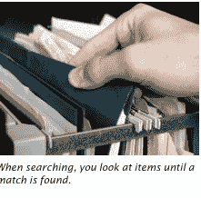

```cpp
bool found = false;
int position = 0;
while (!found && position < str.length())
{
   string ch = str.substr(position, 1);
   if (ch == " ") { found = true; }
   else { position++; }
}
```

如果找到了匹配项，则 found 为 true，position 是第一个匹配项的索引。如果循环没有找到匹配项，那么循环结束后 found 仍为 false。

在前面的示例中，我们在字符串中搜索满足条件的字符。你可以将相同的过程应用于用户输入。假设你要求用户输入一个小于 100 的正值。持续询问，直到用户提供正确的输入：

```cpp
bool valid = false;
double input;
while (!valid)
{
   cout << "Please enter a positive value < 100: ";
   cin >> input;
   if (0 < input && input < 100) { valid = true; }
   else { cout << "Invalid input." << endl; }
}
```

注意，变量 input 声明在 while 循环之外，因为你希望在循环结束后使用该输入。如果它声明在循环体内部，你就无法在循环外使用它。

### 4.7.4 最大值与最小值

> > 要找到最大值，每当你看到更大的值时，就更新目前为止看到的最大值。

要计算序列中的最大值，请维护一个变量来存储你已遇到的最大元素，并在找到更大值时更新它：

```cpp
double largest;
cin >> largest;
double input;
while (cin >> input)
{
   if (input > largest)
   {
      largest = input;
   }
}
```

该算法要求至少有一个输入。

*要找到最高的公交车乘客的身高，请记住目前为止的最大值，并在看到更高的人时更新它。*


要计算最小值，只需反转比较：

    double smallest;
    cin >> smallest;
    double input;
    while (cin >> input)
    {
        if (input < smallest)
        {
            smallest = input;
        }
    }

### 4.7.5 比较相邻值

在循环中处理一系列值时，你有时需要将一个值与它前面的值进行比较。例如，假设你想检查一系列输入是否包含相邻重复项，例如 1 7 2 9 9 4 9。

现在你面临一个挑战。考虑用于读取一个值的典型循环：

    double input;
    while (cin >> input)
    {
        // Now input contains the current input
        ...
    }

要比较相邻输入，请将前一个输入存储在变量中。

你如何将当前输入与前一个输入进行比较？在任何时候，input 都包含当前输入，并覆盖前一个输入。

答案是存储前一个输入，如下所示：

    double input;
    double previous;
    while (cin >> input)
    {
        if (input == previous) { cout << "Duplicate input" << endl; }
        previous = input;
    }


## 操作指南 4.1 — 编写循环


本操作指南将带你逐步完成实现循环语句的过程。我们将用下面的示例问题来说明这些步骤：

读取十二个温度值（每个月一个），并显示温度最高的月份编号。例如，根据 http://worldclimate.com，死亡谷的平均最高气温为（按月份顺序）：

```
18.2  22.6  26.4  31.1  36.6  42.2
45.7  44.5  40.2  33.1  24.2  17.6
```

在这个例子中，温度最高（45.7 摄氏度）的月份是七月，程序应显示 7。


### 第 1 步

确定循环内部必须完成哪些工作。

每个循环都需要执行某种重复性工作，例如

- 读取下一项数据。
- 更新一个值（例如银行余额或总计）。
- 递增计数器。

如果你无法确定循环内部需要放什么，可以先写下手工解决该问题时会采取的步骤。例如，对于温度读取问题，你可能会写：

```
Read first value.
Read second value.
If second value is higher than the first, set highest temperature to that value, highest month to 2.
Read next value.
If value is higher than the first and second, set highest temperature to that value, highest month to 3.
Read next value.
If value is higher than the highest temperature seen so far, set highest temperature to that value,
    highest month to 4.
…
```

现在看看这些步骤，并将它们归纳为一组可以放入循环体的*统一操作*。第一个操作很简单：

```
Read next value.
```

下一个操作更棘手。在我们的描述中，我们使用了“高于第一个值”“高于第一个和第二个值”“高于目前见过的最高温度”等判断。我们需要确定一个适用于所有迭代的判断。最后一种表述最为通用。

同样，我们必须找到一种设置最高月份的通用方法。我们需要一个存储当前月份的变量，其值从 1 到 12。然后我们可以表述第二个循环操作：

```
If value is higher than the highest temperature, set highest temperature to that value,
    highest month to current month.
```

合起来，我们的循环是

```
Loop
    Read next value.
    If value is higher than the highest temperature, set highest temperature to that value,
        highest month to current month.
    Increment current month.
```

### 第 2 步

指定循环条件。

你希望在循环中达到什么目标？典型示例包括：

- 计数器是否已达到最终值？
- 你是否已读取最后一个输入值？
- 某个值是否已达到给定阈值？

在我们的示例中，我们只是希望当前月份达到 12。

### 第 3 步

确定循环类型。

我们区分两种主要循环类型。定数循环或计数控制循环执行确定的次数。在不定循环或事件控制循环中，迭代次数事先未知——循环会一直执行，直到某个事件发生。后者的一个典型例子是读取数据直到遇到哨兵值的循环。

如果你事先知道循环重复多少次，请使用 for 语句。对于其他循环，请考虑循环条件。你是否需要先完成一次循环体迭代，才能判断何时终止循环？在这种情况下，应选择 do 循环。否则，使用 while 循环。

在我们的示例中，我们读取 12 个温度值。因此，我们选择 for 循环。

### 第 4 步

为首次进入循环设置变量。

列出循环中使用和更新的所有变量，并确定如何初始化它们。通常，计数器初始化为 0 或 1，总计初始化为 0。

在我们的示例中，变量有

```
current month
highest value
highest month
```

我们需要谨慎设置最高温度值。不能简单地将其设为 0。毕竟，我们的程序需要处理来自南极洲的温度值，而这些值可能全是负数。

一个好的选择是将最高温度值设为第一个输入值。当然，这样我们就需要记住只再读取 11 个值，并让当前月份从 2 开始。

我们还需要将最高月份初始化为 1。毕竟，在澳大利亚的某个城市，我们可能永远找不到比一月更温暖的月份。

### 第 5 步

在循环结束后处理结果。

在许多情况下，所需结果只是一个在循环体中更新过的变量。例如，在我们的温度程序中，结果是最高月份。有时，循环会计算对最终结果有贡献的值。例如，假设要求计算温度的平均值。那么循环应计算总和，而不是平均值。循环完成后，就可以计算平均值：用总和除以输入数量。

下面是我们的完整循环：

```
Read first value; store as highest value.
highest_month = 1
for (current_month = 2; current_month <= 12; current_month++)
    Read next value.
    If value is higher than the highest value, set highest value to that value,
        highest_month to current_month.
```

### 第 6 步：用典型示例跟踪循环

按照 4.2 节所述，手工跟踪你的循环代码。选择不太复杂的示例值——执行循环 3～5 次就足以检查最常见的错误。在首次和最后一次进入循环时要特别注意。

有时，你可能想做一点小修改，以便能够进行跟踪。例如，在手工跟踪投资翻倍问题时，使用 20% 的利率而不是 5%。在手工跟踪温度循环时，使用 4 个数据值，而不是 12 个。

假设数据是 22.6 36.6 44.5 24.2。下面是跟踪过程：

| 当前月份 | 当前值 | 最高月份 | 最高值 |
| --- | --- | --- | --- |
| 2 | 36.6 | 2 | 22.6 |
| 3 | 44.5 | 3 | 36.6 |
| 4 | 24.2 | | 44.5 |

跟踪过程表明，**最高月份**和**最高值**已正确设置。

### 第 7 步：用 C++ 实现循环

下面是我们的示例对应的循环。练习 P4.4 要求你完成该程序。

```
double highest_value;
cin >> highest_value;
int highest_month = 1;
for (int current_month = 2; current_month <= 12; current_month++)
{
    double next_value;
    cin >> next_value;
    if (next_value > highest_value)
    {
        highest_value = next_value;
        highest_month = current_month;
    }
}
cout << highest_month << endl;
```

### 工作示例 4.1 信用卡处理

本工作示例使用循环从信用卡号中删除空格。


## 4.8 嵌套循环

> 当一个循环的循环体包含另一个循环时，这些循环就是嵌套的。嵌套循环的一个典型用途是打印带行和列的表格。

在 3.4 节中，你看到了如何嵌套两个 if 语句。同样，复杂的迭代有时需要**嵌套循环**：一个循环位于另一个循环语句内部。处理表格时，嵌套循环会自然出现。外层循环遍历表格的所有行。内层循环处理当前行中的列。

本节你将看到如何打印表格。为简单起见，我们将只打印幂 x^a，如右表所示。

| x^1 | x^2 | x^3 | x^4 |
| --- | --- | --- | --- |
| 1 | 1 | 1 | 1 |
| 2 | 4 | 8 | 16 |
| 3 | 9 | 27 | 81 |
| ... | ... | ... | ... |
| 10 | 100 | 1000 | 10000 |

下面是打印该表格的伪代码：

```
Print table header.
For x from 1 to 10
    Print table row.
    Print endl.
```

如何打印表格的一行？你需要为每个指数打印一个值。这需要第二个循环：

```
For n from 1 to 4
    Print x^n.
```

这个循环必须放在前一个循环内部。我们说内层循环*嵌套*在外层循环中（见图 7）。

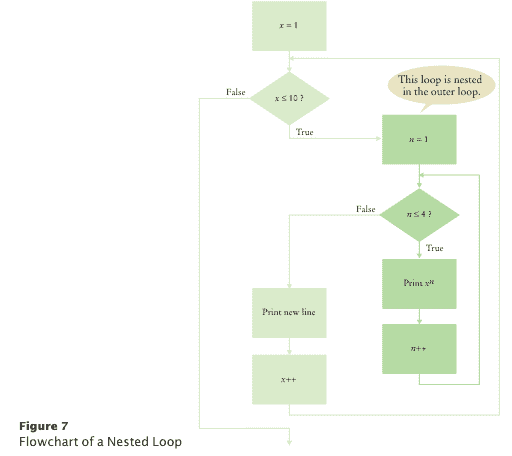


**程序运行**

```
        1       2       3       4
        x       x       x       x

        1       1       1       1
        2       4       8       16
        3       9       27      81
        4       16      64      256
        5       25      125     625
        6       36      216     1296
        7       49      343     2401
        8       64      512     4096
        9       81      729     6561
       10       100     1000    10000
```

**表 3 嵌套循环示例**

| 嵌套循环 | 输出 | 说明 |
| --- | --- | --- |
| `for (i = 1; i <= 3; i++)`<br>`{`<br>`    for (j = 1; j <= 4; j++)  { cout << "*"; }`<br>`    cout << endl;`<br>`}` | `****`<br>`****`<br>`****` | 打印 3 行，每行 4 个星号。 |
| `for (i = 1; i <= 4; i++)`<br>`{`<br>`    for (j = 1; j <= 3; j++)  { cout << "*"; }`<br>`    cout << endl;`<br>`}` | `***`<br>`***`<br>`***`<br>`***` | 打印 4 行，每行 3 个星号。 |
| `for (i = 1; i <= 4; i++)`<br>`{`<br>`    for (j = 1; j <= i; j++)  { cout << "*"; }`<br>`    cout << endl;`<br>`}` | `*`<br>`**`<br>`***`<br>`****` | 打印 4 行，长度分别为 1、2、3 和 4。 |
| `for (i = 1; i <= 3; i++)`<br>`{`<br>`    for (j = 1; j <= 5; j++)`<br>`    {`<br>`        if (j % 2 == 0) { cout << "*"; }`<br>`        else { cout << "-"; }`<br>`    }`<br>`    cout << endl;`<br>`}` | `-*-*-`<br>`-*-*-`<br>`-*-*-` | 在偶数列打印星号，在奇数列打印短横线。 |
| `for (i = 1; i <= 3; i++)`<br>`{`<br>`    for (j = 1; j <= 5; j++)`<br>`    {`<br>`        if ((i + j) % 2 == 0) { cout << "*"; }`<br>`        else { cout << " "; }`<br>`    }`<br>`    cout << endl;`<br>`}` | `* * *`<br>` * * `<br>`* * *` | 打印棋盘格图案。 |


- 38. 为什么外层循环中有 `cout << endl` 语句，而内层循环中没有？
- 39. 你会如何修改程序，使其显示从 x^0 到 x^5 的所有幂？
- 40. 如果你做出了自测题 39 中的修改，程序会显示多少个值？
- 41. 下面的嵌套循环会显示什么内容？

  ```
  for (int i = 0; i < 3; i++)
  {
      for (int j = 0; j < 4; j++)
      {
          cout << i + j;
      }
      cout << endl;
  }
  ```

- 42. 编写嵌套循环，生成下面的方括号图案：

  ```
  [][][][]
  [][][][]
  [][][][]
  ```

**动手实践** 现在你可以尝试本章末尾的这些练习：R4.23、P4.21、P4.22。

## 4.9 随机数与模拟

在模拟中，你使用计算机来模拟某种活动。你可以通过调用随机数生成器来引入随机性。

*模拟程序*使用计算机来模拟现实世界（或想象世界）中的某种活动。模拟通常用于预测气候变化、分析交通、选股，以及科学和商业中的许多其他应用。在接下来的章节中，你将学习如何实现对具有一定随机性的现象进行建模的模拟。

### 4.9.1 生成随机数

现实世界中的许多事件很难被绝对精确地预测，但有时我们却能相当准确地了解其平均行为。例如，一家商店可能根据经验知道每五分钟会来一位顾客。当然，那只是一个平均值——顾客并不是每隔五分钟来一位。为了准确地对顾客流量进行建模，你需要考虑这种随机波动。那么，你如何在计算机中运行这样的模拟呢？

C++ 库中有一个*随机数生成器*，它产生的数字看起来完全是随机的。调用 `rand()` 会得到一个介于 0 和 `RAND_MAX` 之间的随机整数（`RAND_MAX` 是一个依赖于实现的常量，通常（但并不总是）是最大的有效 `int` 值）。再次调用 `rand()`，你会得到另一个不同的数字。`rand` 函数在 `<cstdlib>` 头文件中声明。

下面的程序调用 `rand` 函数十次。

```
ch04/random.cpp
1 #include <iostream>
2 #include <cstdlib>
3
4 using namespace std;
5 int main()
6 {
7    for (int i = 1; i <= 10; i++)
8    {
9       int r = rand();
10      cout << r << endl;
11   }
12   return 0;
13 }
```

**程序运行**

```
1804289383
846930886
1681692777
1714636915
1957747793
424238335
719885386
1649760492
596516649
118964142
```

实际上，这些数字并不是完全随机的。它们来自一组在很长时间内不会重复的数字序列。这些序列实际上是由相当简单的公式计算出来的；它们只是表现得像随机数。因此，它们通常被称为**伪随机数**。

试着再次运行该程序。你会得到*完全相同的输出*！这证实了随机数是由公式生成的。然而，在运行模拟时，你并不总是希望得到相同的结果。为了克服这个问题，请为随机数序列指定一个*种子*。每次使用新的种子，随机数生成器都会开始生成一个新的序列。种子通过 `srand` 函数设置。一个简单的种子值可以是当前时间：

```
srand(time(0));
```

只需在程序中生成任何随机数之前调用一次即可。这样，每次程序运行时的随机数都会不同。同时还要包含声明 `time` 函数的 `<ctime>` 头文件。

### 4.9.2 模拟掷骰子

在实际应用中，你需要将随机数生成器的输出转换为不同的范围。例如，要模拟掷一次骰子，你需要 1 到 6 之间的随机数。

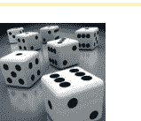

这是在两个边界 a 和 b 之间计算随机整数的一般方法。正如你在第 147 页的编程提示 4.3 中所知，在 a 和 b 之间（包括边界本身）共有 b - a + 1 个值。首先计算 `rand() % (b - a + 1)` 得到一个介于 0 和 b - a 之间的随机值，然后再加上 a，就得到一个介于 a 和 b 之间的随机值：

```
int r = rand() % (b - a + 1) + a;
```

下面是一个模拟掷一对骰子的程序。

**ch04/dice.cpp**

```cpp
1  #include <iostream>
2  #include <string>
3  #include <cstdlib>
4  #include <ctime>
5
6  using namespace std;
7
8  int main()
9  {
10    srand(time(0));
11
12    for (int i = 1; i <= 10; i++)
13    {
14       int d1 = rand() % 6 + 1;
15       int d2 = rand() % 6 + 1;
16       cout << d1 << " " << d2 << endl;
17    }
18    cout << endl;
19    return 0;
20 }
```

**程序运行**

```
5 1
2 1
1 2
5 1
1 2
6 4
4 4
6 1
6 3
5 2
```

### 4.9.3 蒙特卡洛方法

蒙特卡洛方法是一种巧妙的方法，用于为无法精确求解的问题寻找近似解。（该方法以蒙特卡洛著名的赌场命名。）这里有一个典型的例子：计算 π 的值很困难，但你可以通过下面的模拟相当准确地逼近它。

模拟向一个半径为 1 的圆的外接正方形投掷飞镖。这很容易：生成 -1 到 1 之间的随机 x 和 y 坐标。


如果生成的点位于圆内，我们就将其计为一次命中。当 x^2 + y^2 ≤ 1 时即为命中。因为我们的投掷完全是随机的，所以我们预期命中次数 / 尝试次数的比值约等于圆与正方形面积的比值，即 π / 4。因此，我们对 π 的估计值为 4 × 命中次数 / 尝试次数。这种方法仅用简单的算术就得到了 π 的估计值。

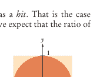

要运行蒙特卡洛模拟，你在随机数生成方面需要多花些功夫。掷骰子时，结果必须是六个面之一。然而，投掷飞镖时，可能存在许多种结果。你必须生成一个随机的浮点数。

首先，生成以下值：

```cpp
double r = rand() * 1.0 / RAND_MAX; // Between 0 and 1
```

值 r 是一个介于 0 和 1 之间的随机浮点值。（你必须乘以 1.0，以确保 `/` 运算符的其中一个操作数是浮点数。`rand() / RAND_MAX` 会进行整数除法——参见常见错误 2.3。）

要生成一个介于 -1 和 1 之间的随机值，你可以计算：

```cpp
double x = -1 + 2 * r; // Between -1 and 1
```

当 r 从 0 变化到 1 时，x 从 -1 + 2 × 0 = -1 变化到 -1 + 2 × 1 = 1。

下面就是执行该模拟的程序。

**ch04/montecarlo.cpp**

```cpp
#include <iostream>
#include <cstdlib>
#include <cmath>
#include <ctime>

using namespace std;

int main()
{
   const int TRIES = 10000;

   srand(time(0));

   int hits = 0;
   for (int i = 1; i <= TRIES; i++)
   {
      double r = rand() * 1.0 / RAND_MAX; // Between 0 and 1
      double x = -1 + 2 * r; // Between -1 and 1
      r = rand() * 1.0 / RAND_MAX;
      double y = -1 + 2 * r;
      if (x * x + y * y <= 1) { hits++; }
   }
   double pi_estimate = 4.0 * hits / TRIES;
   cout << "Estimate for pi: " << pi_estimate << endl;
   return 0;
}
```

**程序运行**

```
Estimate for pi: 3.1504
```


## 自测

- 43. 如何用 rand 函数模拟掷硬币？
- 44. 如何模拟抽取一张随机的扑克牌？
- 45. 为什么 dice.cpp 文件包含 `<ctime>` 头文件？
- 46. 在许多游戏中，你掷一对骰子来得到 2 到 12 之间的值。下面这种模拟掷一对骰子的做法有什么问题？
  ```
  int sum = rand() % 11 + 2;
  ```
- 47. 如何生成一个 0 到 100 之间的随机浮点数？

**动手实践** 现在你可以尝试本章末尾的这些练习：R4.24、P4.10、P4.25。

### 随机事实 4.2 软件盗版


当你读到这段话时，你已经编写过几个计算机程序，并且亲身体验过编写哪怕最简陋的程序需要付出多少努力。编写一个真正的软件产品，例如金融应用程序或计算机游戏，需要大量时间和金钱。如果人们没有合理的机会从自己的付出中赚到更多钱，那么很少有人、更少有公司愿意投入那样的时间和金钱。（实际上，有些公司免费提供软件，希望用户升级到功能更完善的有偿版本，或为咨询服务付费。）另一些公司免费提供让用户读取和使用文件的软件，但出售创建这些文件所需的软件。最后，还有一些个人出于热情贡献自己的时间，制作出你可以自由复制的程序。更多信息见随机事实 9.2。

销售软件时，公司必须依赖客户的诚实。不道德的人很容易复制计算机程序而不付费。在大多数国家，这是违法的。大多数政府提供法律保护，例如版权法和专利法，以鼓励新产品的开发。容忍普遍盗版的国家发现，它们有充足而廉价的外国软件供应，却没有本地制造商愿意为本国公民设计好的软件，例如使用当地文字的文字处理软件或适应当地税法的金融程序。

当软件的大众市场首次出现时，供应商对因盗版而损失的金钱感到愤怒。他们试图反击，采用各种方案确保只有合法所有者才能使用软件，例如加密狗——一种必须连接到打印机端口后软件才能运行的设备。合法用户憎恨这些措施。他们为软件付了钱，却不得不忍受各种不便，例如多个加密狗从他们的计算机上伸出来。在美国，市场压力迫使大多数供应商放弃这些复制保护方案，但在世界其他地区，它们仍然很常见。

由于盗版软件如此容易且廉价，而被发现的机会又极小，你必须为自己做出道德选择：如果一套你非常想要的软件包超出了你的预算，你会偷用它，还是保持诚实，凑合用一款更实惠的产品？


当然，盗版并不局限于软件。其他数字产品也会出现同样的问题。你可能曾有机会不付费就获得歌曲或电影的副本。或者你可能曾因音乐播放器上的复制保护设备而感到沮丧，该设备让你难以收听自己付费购买的歌曲。诚然，对于一个音乐团体，如果其出版商为看似他们付出很少努力的作品收取高额费用——至少与设计和实现一个软件包所付出的努力相比是这样——人们很难对其抱有太多同情。尽管如此，艺术家和作者因其付出而获得一些补偿，似乎才是公平的。如何在不给诚实客户增加负担的情况下公平地支付艺术家、作者和程序员的报酬，在撰写本文时仍是一个未解决的问题，许多计算机科学家正在这一领域进行研究。

## 本章小结

## 解释循环中的执行流程。

- 循环在条件保持为真时重复执行一段代码。


- 差一错误是编写循环时常见的错误。通过思考简单的测试用例来避免这类错误。

## 使用手工跟踪技术分析程序的行为。


- 手工跟踪是对代码执行的一种模拟，你逐步执行指令并跟踪变量的值。
- 手工跟踪可以帮助你理解一个不熟悉的算法如何工作。
- 手工跟踪可以显示代码或伪代码中的错误。

## 使用 for 循环实现计数循环。


- 当某个值从起点以固定增量或减量变化到终点时，使用 for 循环。

## 在 while 循环和 do 循环之间做选择。

- 当循环体必须至少执行一次时，do 循环是合适的。

## 实现读取输入数据序列的循环。

- 哨兵值表示数据集的结束，但它不是数据的一部分。
- 你可以使用布尔变量控制循环。在进入循环前将该变量设为 true，然后将其设为 false 以离开循环。
- 使用输入重定向从文件读取输入。使用输出重定向将程序输出捕获到文件中。


## 使用故事板技术规划用户交互。

- 故事板由动作序列中每个步骤的带注释草图组成。
- 开发故事板有助于你理解程序所需的输入和输出。

## 了解最常见的循环算法。

- 要计算平均值，请维护所有值的总和与计数。
- 要统计满足条件的值，请检查所有值，并为每个匹配项递增计数器。
- 如果你的目标是找到匹配项，请在找到匹配项时退出循环。
- 要找到最大值，每当看到更大的值时，就更新目前见过的最大值。
- 要比较相邻输入，请将前一个输入存储在变量中。

## 使用嵌套循环实现多级迭代。


- 当一个循环的循环体包含另一个循环时，这些循环就是嵌套的。嵌套循环的一个典型用途是打印带行和列的表格。

## 将循环应用于模拟的实现。

- 在模拟中，你使用计算机模拟一项活动。你可以通过调用随机数生成器引入随机性。


## 复习练习

R4.1 为这些循环提供跟踪表。

```
a. int i = 0; int j = 10; int n = 0;
   while (i < j) { i++; j--; n++; }
b. int i = 0; int j = 0; int n = 0;
   while (i < 10) { i++; n = n + i + j; j++; }
c. int i = 10; int j = 0; int n = 0;
   while (i > 0) { i--; j++; n = n + i - j; }
d. int i = 0; int j = 10; int n = 0;
   while (i != j) { i = i + 2; j = j - 2; n++; }
```

R4.2 这些循环会打印什么？

```
a. for (int i = 1; i < 10; i++) { cout << i << " "; }
b. for (int i = 1; i < 10; i += 2) { cout << i << " "; }
c. for (int i = 10; i > 1; i--) { cout << i << " "; }
d. for (int i = 0; i < 10; i++) { cout << i << " "; }
e. for (int i = 1; i < 10; i = i * 2) { cout << i << " "; }
f. for (int i = 1; i < 10; i++) { if (i % 2 == 0) { cout << i << " "; } }
```

R4.3 什么是无限循环？在你的计算机上，如何终止一个执行无限循环的程序？

R4.4 什么是“差一”错误？请从你自己的编程经验中举一个例子。

**R4.5** 假设输入值为 4 7 -2 -5 0，为练习 P4.9 中的伪代码编写程序跟踪。

**R4.6** 下面的代码合法吗？

```
    for (int i = 0; i < 10; i++)
    {
        for (int i = 0; i < 10; i++)
        {
            cout << i << " ";
        }
        cout << endl;
    }
```

它会打印什么？这是好的编码风格吗？如果不是，你会如何改进它？

**R4.7** 下列循环会执行多少次？假设循环体中没有改变 i。

- a. `for (int i = 1; i <= 10; i++) ...`
- b. `for (int i = 0; i < 10; i++) ...`
- c. `for (int i = 10; i > 0; i--) ...`
- d. `for (int i = -10; i <= 10; i++) ...`
- e. `for (int i = 10; i >= 0; i++) ...`
- f. `for (int i = -10; i <= 10; i = i + 2) ...`
- g. `for (int i = -10; i <= 10; i = i + 3) ...`

**R4.8** 为一个打印如下日历的程序编写伪代码：

```
    Su M  T  W  Th F  Sa
           1  2  3  4
    5  6  7  8  9 10 11
   12 13 14 15 16 17 18
   19 20 21 22 23 24 25
   26 27 28 29 30 31
```

**R4.9** 为一个打印如下摄氏度/华氏度换算表的程序编写伪代码：

| 摄氏度 | 华氏度 |
|---------|------------|
| 0       | 32         |
| 10      | 50         |
| 20      | 68         |
| ...     | ...        |
| 100     | 212        |

**R4.10** 为一个读取学生记录序列并打印每个学生总分的程序编写伪代码。每条记录包含学生的名和姓，随后是一系列考试分数以及哨兵值 -1。该序列以单词 END 结束。以下是一个示例序列：

```
    Harry Morgan 94 71 86 95 -1
    Sally Lin 99 98 100 95 90 -1
    END
```

为这个示例输入提供一张跟踪表。


### R4.11 将下面的 for 循环改写为 while 循环。

```cpp
int s = 0;
for (int i = 1; i <= 10; i++)
{
    s = s + i;
}
```

### R4.12 将下面的 do/while 循环改写为 while 循环。

```cpp
int n;
cin >> n;
double x = 0;
double s;
do
{
    s = 1.0 / (1 + n * n);
    n++;
    x = x + s;
}
while (s > 0.01);
```

### R4.13 给出下列循环的跟踪表。

```cpp
a. int s = 1;
   int n = 1;
   while (s < 10) { s = s + n; }
   n++;
b. int s = 1;
   for (int n = 1; n < 5; n++) { s = s + n; }
c. int s = 1;
   int n = 1;
   do
   {
       s = s + n;
       n++;
   }
   while (s < 10 * n);
```

### R4.14 下面的循环会输出什么？通过跟踪代码来得出答案，不要使用计算机。

```cpp
a. int s = 1;
   for (int n = 1; n <= 5; n++)
   {
       s = s + n;
       cout << s << " ";
   }
b. int s = 1;
   for (int n = 1; s <= 10; cout << s << " ")
   {
       n = n + 2;
       s = s + n;
   }
c. int s = 1;
   int n;
   for (n = 1; n <= 5; n++)
   {
       s = s + n;
       n++;
   }
   cout << s << " " << n;
```

### R4.15 下面的程序段会输出什么？通过跟踪代码来得出答案，不要使用计算机。

- **a.**
```cpp
int n = 1;
for (int i = 2; i < 5; i++) { n = n + i; }
cout << n;
```

- **b.**
```cpp
int i;
double n = 1 / 2;
for (i = 2; i <= 5; i++) { n = n + 1.0 / i; }
cout << i;
```

- **c.**
```cpp
double x = 1;
double y = 1;
int i = 0;
do
{
    y = y / 2;
    x = x + y;
    i++;
}
while (x < 1.8);
cout << i;
```

- **d.**
```cpp
double x = 1;
double y = 1;
int i = 0;
while (y >= 1.5)
{
    x = x / 2;
    y = x + y;
    i++;
}
cout << i;
```

### R4.16 给出一个 for 循环的例子，其中对称边界更自然。给出一个 for 循环的例子，其中非对称边界更自然。

### R4.17 为第154页4.6节中的转换程序添加一个故事板面板，展示用户输入不兼容单位的场景。

### R4.18 在4.6节中，我们决定在提示中向用户显示所有有效单位的列表。如果程序支持更多单位，这种方法就不可行。给出一个故事板面板，说明另一种方法：如果用户输入未知单位，则显示所有已知单位的列表。

### R4.19 修改4.6节中的故事板，以支持一个询问用户是想转换单位、查看程序帮助还是退出程序的菜单。该菜单应在程序开始时、转换完一系列值后以及显示错误时显示。

### R4.20 为执行4.6节所述单位转换的程序绘制流程图。

### R4.21 在4.7.4节中，查找最大和最小输入的代码用输入值初始化最大和最小变量。为什么不能用零初始化它们？

### R4.22 什么是嵌套循环？给出一个通常使用嵌套循环的例子。

你将编写一个程序，让计算机与人类对手对战。生成一个10到100之间的随机整数，表示堆的初始大小。生成一个0到1之间的随机整数，决定计算机还是人类先手。生成一个0到1之间的随机整数，决定计算机采用*聪明*还是*愚蠢*模式。在愚蠢模式下，计算机轮到时只是从堆中取一个随机的合法值（1到n/2之间）。在聪明模式下，计算机取走足够多的弹珠，使堆的大小变为2的幂减1——即3、7、15、31或63。这总是合法走法，除非当前堆的大小恰好是2的幂减1。在这种情况下，计算机随机走一个合法步。

你会注意到，在聪明模式下，如果计算机先手，它是不可能被击败的，除非堆的大小恰好是15、31或63。当然，先手且知道获胜策略的人类玩家可以战胜计算机。

### P4.25 *醉汉游走。*

一个醉汉在网格状街道中随机选择四个方向之一，踉跄走到下一个路口，然后再次随机选择四个方向之一，如此反复。你可能会认为，平均而言醉汉不会走很远，因为选择会相互抵消，但事实并非如此。

将位置表示为整数对 (x, y)。实现醉汉游走，经过100个路口，并打印起始位置和结束位置。

### P4.26 *蒙提霍尔悖论。*

玛丽莲·沃斯·萨万特在一本流行杂志中描述了以下问题（大致基于蒙提·霍尔主持的一档游戏节目）：

> “假设你在一个游戏节目中，面前有三扇门供你选择：一扇门后是一辆汽车；另外两扇门后是山羊。你选择一扇门，比如1号门，而知道门后有什么的主持人打开另一扇门，比如3号门，后面是山羊。然后他对你说：‘你想改选2号门吗？’改选对你有利吗？”

沃斯·萨万特女士证明改选对你有利，但她的许多读者，包括一些数学教授，不同意，认为因为另一扇门被打开，概率不会改变。

你的任务是模拟这个游戏节目。在每次迭代中，随机选择1到3之间的门号来放置汽车。随机让玩家选择一扇门。随机让游戏节目主持人在两扇有山羊的门中选择一扇。现在，如果玩家改选到第三扇门而获胜，则增加策略1的计数器；如果玩家坚持最初选择而获胜，则增加策略2的计数器。运行1,000次迭代并打印两个计数器。

### P4.27 *布丰投针实验。*

以下实验由法国博物学家乔治-路易·勒克莱尔·德·布丰伯爵（1707–1788）设计。将一根长1英寸的针投到画有相距2英寸平行线的纸上。如果针落在一条线上，我们将其计为一次*命中*。（见图8。）布丰猜想，尝试次数/命中次数的商近似于π。

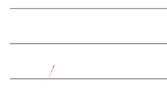

**图8** 布丰投针实验

*（注：对于每个 x 和 z，都有两个 y 值，因为船体从右舷到左舷是对称的。）*

在航海术语中，点 x 处的横截面积称为“截面”。要计算它，让 z 从 0 到 −T 以 n 个增量变化，每个增量为 T/n。对于每个 z 值，计算 y 值。然后对梯形条带的面积求和。右侧是 n = 4 时的条带。

编写一个程序，读入 B、L、T、x 和 n 的值，然后打印出 x 处的横截面积。

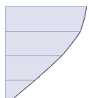

### 工程题 P4.31

放射性材料的放射性衰变可以用方程 $A = A_0 e^{-(\log 2)t/h}$ 建模，其中 A 是时间 t 时材料的量，A_0 是时间 0 时的量，h 是半衰期。

锝-99是一种用于脑部成像的放射性同位素。它的半衰期为6小时。你的程序应显示患者接受剂量后24小时内每小时体内的相对量 A/A_0。


### 工程题 P4.32

左图展示了一种称为“变压器”的电子设备。变压器通常通过将导线线圈绕在铁氧体磁芯上构成。下图说明了在手机和音乐播放器等各种音频设备中出现的一种情况。在该电路中，变压器用于将扬声器连接到音频放大器的输出端。

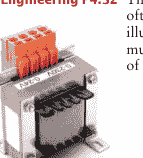

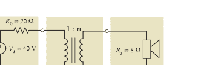

用于表示变压器的符号意在暗示两个导线线圈。变压器的参数 n 称为变压器的“匝数比”。（导线绕在磁芯上形成线圈的次数称为线圈的匝数。匝数比字面上就是两个导线线圈的匝数之比。）

在设计电路时，我们主要关心输送到扬声器的功率值——该功率使扬声器产生我们想听到的声音。假设我们不用变压器而将扬声器直接连接到放大器。放大器可用功率的一部分会到达扬声器。其余可用功率会损失在放大器本身中。将变压器加入电路是为了提高输送到扬声器的放大器功率占比。

输送到扬声器的功率 $P_s$ 使用以下公式计算

$$P_s = R_s \left( \frac{nV_s}{n^2R_0 + R_s} \right)^2$$


编写一个C++程序，为所示电路建模，以0.01的增量将匝数比从0.01变化到2，然后确定使传递到扬声器的功率最大的匝数比值。

## 自测题答案

- 1. 23年。

- 2. 7年。

- 3. 添加一条语句

```cpp
cout << balance << endl;
```

作为 while 循环中的最后一条语句。

- 4. 程序输出相同的结果。这是因为14年后的余额略低于20,000美元，而15年后略高于20,000美元。

- 5. 2 4 8 16 32 64 128

注意，尽管128大于100，但它仍被打印出来。

- 6.

| n | 输出 |
| --- | --- |
| 5 | |
| 4 | 4 |
| 3 | 3 |
| 2 | 2 |
| 1 | 1 |
| 0 | 0 |
| -1 | -1 |

- 7.

| n | 输出 |
| --- | --- |
| 1 | 1, |
| 2 | 1, 2, |
| 3 | 1, 2, 3, |
| 4 | |

最后一个值后面有一个逗号。通常，逗号只放在值之间。

- 8.

| a | n | r | i |
| --- | --- | --- | --- |
| 2 | 4 | 1 | 1 |
| | | 2 | 2 |
| | | 4 | 3 |
| | | 8 | 4 |
| | | 16 | 5 |

该代码计算 a^n。

- 9.

| n | 输出 |
| --- | --- |
| 1 | 1 |
| 11 | 11 |
| 21 | 21 |
| 31 | 31 |
| 41 | 41 |
| 51 | 51 |
| 61 | 61 |
| ... | ... |

这是一个无限循环。n 永远不会等于 50。

- 10.

| count | n |
| --- | --- |
| 1 | 123 |
| 2 | 12.3 |
| 3 | 1.23 |

```cpp
cin >> x;
sum = sum + x;
}
while (x != 0);
```

- 20.

```cpp
int x = 0;
int previous;
do
{
    previous = x;
    cin >> x;
    sum = sum + x;
}
while (previous != x);
```

- 21. 无数据

- 22. 第一个检查在读取哨兵值后结束循环。第二个检查确保哨兵值不会被作为输入值处理。

- 23. while 循环永远不会进入。用户永远不会被提示输入。由于 count 保持为 0，程序将打印“No data”。

- 24. 流也会失败。更准确的提示应该是：“输入值，按非数字键退出。”但这可能会让程序用户更困惑，因为他们需要思考选择哪个键。

- 25. 在尝试读取输入之前，你无法知道输入是否失败。

- 26. *计算平均值*

```
Enter scores, Q to quit: 90 80 90 100 80 Q
The average is 88
(Program exits)
```

- 27. *简单转换*

```
Your conversion question: How many in are 30 cm  — Only one value can be converted.
30 cm = 11.81 in  — Run program again for another question
(Program exits)
```

*未知单位*

```
Your conversion question: How many inches are 30 cm?
Unknown unit: inches
Known units are in, ft, mi, mm, cm, m, km, oz, lb, g, kg, tsp, tbsp, pint, gal
(Program exits)
```

*程序无法理解问题语法*

```
Your conversion question: What is an angstrom?
Please formulate your question as "How many (unit) are (value) (unit)?"
(Program exits)
```

- 28. 一个分数不够

```
Enter scores. Q to quit: 90 Q
Error: At least two scores are required.
(Program exits)
```

- 29. 使用我们目前已经涵盖的C++特性，不可能实现这个接口。程序无法知道第一组输入何时结束。（当你使用 cin >> value 读取数字时，是你自己决定将它们放在单行还是多行的。）

- 30. 比较两种利率

```
First interest rate in percent: 5
Second interest rate in percent: 10
Years: 5
```

| 年份 | 5% | 10% |
| --- | --- | --- |
| 0 | 10000.00 | 10000.00 |
| 1 | 10500.00 | 11000.00 |
| 2 | 11025.00 | 12100.00 |
| 3 | 11576.25 | 13310.00 |
| 4 | 12155.06 | 14641.00 |
| 5 | 12762.82 | 16105.10 |

> 这一行说明 1 表示第一年的结束。

- 31. 总和为零。

- 32. double total = 0;

```cpp
double total = 0;
double input;
while (cin >> input)
{
   if (input > 0) { total = total + input; }
}
```

- 33. position 是 str.length()。

- 34. 当找到匹配项时循环会停止，但你无法访问该匹配项，因为 position 没有在循环外定义。

- 35. 从字符串末尾开始循环：

```cpp
bool found = false;
int position = str.length() - 1;
while (!found && position >= 0)
{
   string ch = str.substr(position, 1);
   if (ch == " ") { found = true; }
   else { position--; }
}
```

- 36. 除非输入包含零或负数，否则最小值会被错误地计算为0。

- 37. 当执行 cin >> previous 时，cin 失败且 previous 不变。语句 cin >> input 也会失败，因此 while 循环永远不会进入。

- 38. 内层循环中的所有值应显示在同一行。

# 第5章

# 函数


## 本章目标

- 能够实现函数
- 熟悉参数传递的概念
- 理解函数注释的重要性
- 制定将复杂任务分解为简单任务的策略
- 能够确定变量的作用域
- 识别何时使用值参数和引用参数

## 本章内容

- **5.1 函数作为黑盒** 194
- **5.2 实现函数** 196
  - *语法5.1：函数定义* 197
  - *编程提示5.1：函数注释* 199
- **5.3 参数传递** 199
  - *编程提示5.2：不要修改参数变量* 201
- **5.4 返回值** 202
  - *常见错误5.1：缺少返回值* 203
  - *专题5.1：函数声明* 203
  - *如何做5.1：实现函数* 204
  - *工作示例5.1：匹配和替换字符串的一部分* ⊕
  - *工作示例5.2：使用调试器* ⊕
- **5.5 无返回值的函数** 206
- **5.6 问题解决：可重用函数** 208
- **5.7 问题解决：逐步求精** 210
  - *编程提示5.3：保持函数简短* 216
  - *编程提示5.4：跟踪函数* 216
  - *编程提示5.5：桩代码* 217
  - *工作示例5.3：计算课程成绩* ⊕
- **5.8 变量作用域和全局变量** 218
  - *编程提示5.6：避免使用全局变量* 220
- **5.9 引用参数** 220
  - *编程提示5.7：优先使用返回值而不是引用参数* 225
  - *专题5.2：常量引用* 225
- **5.10 递归函数（可选）** 226
  - *如何做5.2：递归思考* 229
  - *随机事实5.1：个人计算机的爆炸式增长* 230

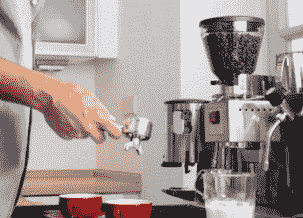

函数是C++程序的基本构建块。函数将计算封装成一种易于理解和重用的形式。（左侧图片中的人正在执行“制作两杯浓缩咖啡”这一函数。）在本章中，你将学习如何设计和实现自己的函数。通过逐步求精的过程，你将能够把复杂的任务分解成一系列相互协作的函数。

### 5.1 函数作为黑盒

函数是一段命名的指令序列。

函数是带有名称的指令序列。你已经接触过几个函数。例如，第2章中引入的名为 pow 的函数，包含计算幂 x^y 的指令。此外，每个C++程序都有一个名为 main 的函数。

你通过调用函数来执行其指令。例如，考虑以下程序：

```cpp
int main()
{
   double z = pow(2, 3);
   ...
}
```

通过使用表达式 pow(2, 3)，main 调用 pow 函数，要求它计算 2^3 的幂。main 函数被暂时挂起。pow 函数的指令执行并计算结果。pow 函数将其结果（即值 8）返回给 main，main 函数恢复执行（见图1）。

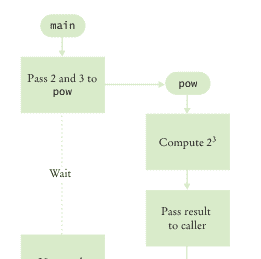

**图1** 函数调用期间的执行流程


- 1. 考虑函数调用 `pow(3, 2)`。参数和返回值分别是什么？
- 2. 函数调用 `pow(pow(2, 2), 2)` 的返回值是什么？
- 3. C++ 标准库中的 `ceil` 函数接受一个参数 `x`，并返回大于或等于 `x` 的最小整数。`ceil(2.3)` 的返回值是什么？
- 4. 不知道 `ceil` 函数的具体实现，是否可能确定自测题 3 的答案？请使用一个工程术语描述 `ceil` 函数的这一特性。

**练习** 现在，你可以尝试本章末尾的练习：R5.1、P5.1。

## 5.2 实现函数

在本节中，你将学习如何根据给定的规范实现一个函数。我们将使用一个非常简单的示例：编写一个根据给定边长计算立方体体积的函数。


`cube_volume` 函数使用给定的边长计算立方体的体积。

> 定义函数时，需要为函数提供一个名称、为每个参数提供一个变量，并指定结果的类型。

编写此函数时，你需要：

- *为函数选择一个名称（`cube_volume`）。*
- *为每个参数声明一个变量（`double side_length`）。这些变量称为参数变量。*
- *指定返回值的类型（`double`）。*

将这些信息组合起来，构成函数定义的第一行：

```cpp
double cube_volume(double side_length)
```

接下来，指定函数体：调用函数时执行的语句。

边长为 s 的立方体的体积是 s × s × s。不过，为了更加清晰，我们的参数变量命名为 `side_length`，而不是 s，因此需要计算 `side_length * side_length * side_length`。

我们将把这个值存储在名为 `volume` 的变量中：

```cpp
double volume = side_length * side_length * side_length;
```

要返回函数的结果，请使用 `return` 语句：

```cpp
return volume;
```

函数体包含在花括号中。下面是完整的函数：

```cpp
double cube_volume(double side_length)
{
    double volume = side_length * side_length * side_length;
    return volume;
}
```

*return 语句将函数的结果提供给调用者。*


现在让我们使用这个函数。我们将提供一个调用 `cube_volume` 函数两次的 `main` 函数。

```cpp
int main()
{
    double result1 = cube_volume(2);
    double result2 = cube_volume(10);
    cout << "A cube with side length 2 has volume " << result1 << endl;
    cout << "A cube with side length 10 has volume " << result2 << endl;

    return 0;
}
```

使用不同的参数调用函数时，函数会返回不同的结果。考虑调用 `cube_volume(2)`。参数 2 对应于 `side_length` 参数变量。因此，在这次调用中，`side_length` 的值为 2。函数计算 `side_length * side_length * side_length`，也就是 `2 * 2 * 2`。当使用不同的参数（例如 10）调用函数时，函数会计算 `10 * 10 * 10`。

现在，我们将两个函数组合成一个测试程序。由于 `main` 调用了 `cube_volume`，因此在定义 `main` 函数之前，必须先让程序知道 `cube_volume` 函数。这很容易实现：只需在源文件中先放置 `cube_volume`，最后放置 `main` 即可。（另一种方法请参见第 203 页的专题 5.1。）

### 语法 5.1 函数定义

```cpp
// Type of return value: double
// Name of function: cube_volume
// Type of parameter variable: double
// Name of parameter variable: side_length
double cube_volume(double side_length)
{
    // Function body, executed when function is called.
    double volume = side_length * side_length * side_length;
    // return statement exits function and returns result. See page 202.
    return volume;
}
```

### 编程提示 5.1——函数注释


每当编写函数时，都应该注释其行为。注释是供人类读者阅读的，而不是供编译器阅读的，并且函数注释的布局没有统一的标准。在本书中，我们将采用以下布局：

函数注释解释函数的用途、参数变量和返回值的含义，以及任何特殊要求。

```cpp
/**
   Computes the volume of a cube.
   @param side_length the side length of the cube
   @return the volume
*/
double cube_volume(double side_length)
{
   double volume = side_length * side_length * side_length;
   return volume;
}
```

这种特定的文档风格借鉴自 Java 编程语言。它也受到 C++ 工具的广泛支持，例如 Doxygen 工具（www.doxygen.org）。

注释的第一行描述函数的用途。每个 `@param` 子句描述一个参数变量，`@return` 子句描述返回值。

注意，函数注释记录的不是实现（函数如何完成其功能），而是设计（函数完成什么工作、输入是什么以及结果是什么）。这类注释允许其他程序员将函数作为“黑盒”来使用。

## 5.3 参数传递

参数变量保存函数调用中提供的参数值。

在本节中，我们将研究向函数传递参数的机制。当调用函数时，会创建它的参数变量（参数变量的另一个常用术语是形式参数）。在函数调用中，会为每个参数变量提供一个表达式，这个表达式称为参数（这个表达式的另一个常用术语是实际参数）。每个参数变量都会使用相应参数的值进行初始化。

考虑图 3 所示的函数调用：

```cpp
double result1 = cube_volume(2);
```

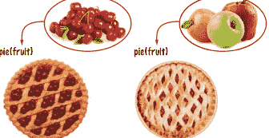

水果派的制作配方可能会要求使用任意种类的水果。在这里，“水果”就是参数变量的一个示例。苹果和樱桃则是参数的示例。

```cpp
return z;
}
int main()
{
    int a = 4;
    int b = 7;
    cout << mystery(a, b) << endl;
}
```

- 11. 该程序会打印什么？请使用类似图 3 的图示来找出答案。

```cpp
int mystery(int x)
{
    int y = x * x;
    return y;
}
int main()
{
    int a = 4;
    cout << mystery(a + 1) << endl;
}
```

- 12. 以下程序会打印什么？请使用类似图 3 的图示来找出答案。

```cpp
int mystery(int n)
{
    n++;
    n++;
    return n;
}
int main()
{
    int a = 5;
    cout << mystery(a) << endl;
}
```

**练习** 现在，你可以尝试本章末尾的练习：R5.5、P5.10。

### 编程提示 5.2

**不要修改参数变量**


在 C++ 中，参数变量与其他变量一样。你*可以*在函数体中修改参数变量的值。例如：

```cpp
int total_cents(int dollars, int cents)
{
    cents = dollars * 100 + cents; // Modifies parameter variable
    return cents;
}
```

不过，许多程序员认为这种做法容易令人困惑。它混淆了参数（函数的输入）和变量（值的存储空间）这两个概念。为了避免混淆，只需引入一个单独的变量：

```cpp
int total_cents(int dollars, int cents)
{
    int result = dollars * 100 + cents;
    return result;
}
```

## 5.4 返回值

> return 语句终止函数调用，并产生函数结果。

可以使用 `return` 语句指定函数的结果。处理 `return` 语句时，函数会立即退出。这种行为便于在函数开头处理异常情况：

```cpp
double cube_volume(double side_length)
{
    if (side_length < 0) { return 0; }
    double volume = side_length * side_length * side_length;
    return volume;
}
```

如果使用负值作为 `side_length` 调用函数，那么函数会返回 0，并且不会执行函数的其余部分。（请参见图 4。）

在前面的示例中，每个 `return` 语句都返回了一个常量或变量。实际上，`return` 语句可以返回任意表达式的值。与其先将返回值保存到变量中，再返回该变量，通常不如省略变量，直接返回更复杂的表达式：

```cpp
double cube_volume(double side_length)
{
    return side_length * side_length * side_length;
}
```

函数的每个分支都返回一个值非常重要。请考虑下面这个错误的函数：

```cpp
double cube_volume(double side_length)
{
    if (side_length >= 0)
    {
        return side_length * side_length * side_length;
    } // Error
}
```

假设你使用负值作为边长调用 `cube_volume`。当然，你本不应该这样调用，但它可能因编码错误而发生。由于 `if` 条件不成立，`return` 语句不会执行。然而，函数必须返回某个值。根据具体情况，编译器可能会

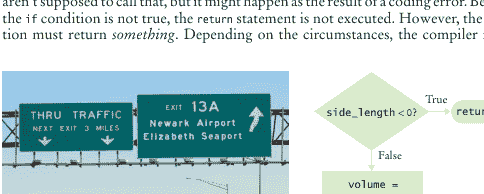

**图 4** return 语句会立即退出函数


将其标记为错误，否则函数可能会返回一个随机值。通过返回某个安全值来防范此问题：

```c
double cube_volume(double side_length)
{
    if (side_length > 0)
    {
        return side_length * side_length * side_length;
    }
    return 0;
}
```

每个函数的最后一条语句都应当是 return 语句。这确保当函数执行到末尾时，会返回*某个*值。

## 常见错误 5.1

### 缺少返回值

函数总是需要返回某些内容。如果函数的代码包含多个分支，请确保每个分支都返回一个值：

```c
int sign(double x)
{
    if (x < 0) { return -1; }
    if (x > 0) { return 1; }
    // Error: missing return value if x equals 0
}
```

此函数计算一个数的符号：负数返回 –1，正数返回 +1。然而，如果参数为零，则不会返回任何值。大多数编译器会在此情况下发出警告，但如果你忽略该警告，并且函数曾以 0 作为参数被调用，就会返回一个随机量。

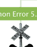

## 专题 5.1

### 函数声明

调用编译器不知道的函数是编译时错误，就像使用未定义的变量一样。如果你在首次使用所有函数之前先定义它们，就可以避免此错误。首先定义底层辅助函数，然后定义中层主力函数，最后在程序中定义 `main`。

有些程序员喜欢在程序中首先列出 `main` 函数。如果你也有此偏好，就需要学习如何在程序顶部**声明**其他函数。函数声明列出返回类型、函数名和参数变量，但不包含函数体：

```c
double cube_volume(double side_length);
```

这是一则声明，承诺该函数在其他地方实现。区分声明和定义很容易：声明以分号结尾，而定义后面跟一个 `{ ... }` 块。声明也称为**原型**。

在函数原型中，参数名是可选的。你也可以写成

```c
double cube_volume(double);
```

不过，为了说明每个参数的用途，在声明中包含参数名是个好主意。

常见函数（如 `pow`）的声明包含在头文件中。如果查看 `<cmath>` 内部，你会找到 `pow` 和其他数学函数的声明。


下面是 cube.cpp 文件的另一种组织方式：

```cpp
#include <iostream>

using namespace std;

// Declaration of cube_volume
double cube_volume(double side_length);

int main()
{
    double result1 = cube_volume(2);  // Use of cube_volume
    double result2 = cube_volume(10);
    cout << "A cube with side length 2 has volume " << result1 << endl;
    cout << "A cube with side length 10 has volume " << result2 << endl;
    return 0;
}

// Definition of cube_volume
double cube_volume(double side_length)
{
    return side_length * side_length * side_length;
}
```

如果你喜欢这种方法，尽可在程序中使用它。你只需要注意一个缺点。每当你更改函数名或某个参数类型时，都需要在两个地方修改：声明和定义中。

## 如何做 5.1 实现函数


函数是一种可以多次使用不同参数的计算，既可以在同一程序中使用，也可以在不同程序中使用。每当某项计算需要多次使用时，就把它做成一个函数。

为了说明这个过程，假设你正在帮助研究埃及金字塔的考古学家。你接到的任务是编写一个函数，在给定高度和底边长度的情况下确定金字塔的体积。

- **第 1 步** 描述函数应该做什么。  
  提供一段简单的英文描述，例如“计算底面为正方形的金字塔的体积。”

- **第 2 步** 确定函数的“输入”。  
  列出所有可能变化的参数。初学者常常会实现过于具体的函数。例如，你可能知道吉萨大金字塔是埃及金字塔中最大的一座，高 146 米，底边长 230 米。即使最初的问题只问到大金字塔，你也不应在计算中使用这些数字。编写一个计算任意金字塔体积的函数同样简单——而且有用得多。


在我们的例子中，参数是金字塔的高度和底边长度。此时，我们已有足够信息来编写函数文档：

```cpp
/**
   Computes the volume of a pyramid whose base is a square.
   @param height the height of the pyramid
   @param base_length the length of one side of the pyramid's base
   @return the volume of the pyramid
*/
```

### 第 3 步 确定参数变量和返回值的类型。

高度和底边长度都可以是浮点数。因此，我们将为两个参数变量选择类型 `double`。计算出的体积也是浮点数，因此返回类型为 `double`。于是，函数将定义为

```cpp
double pyramid_volume(double height, double base_length)
```

### 第 4 步 编写伪代码以获得所需结果。

大多数情况下，函数需要执行若干步骤才能得到所需答案。你可能需要使用数学公式、分支或循环。用伪代码表达你的函数。通过互联网搜索可知，金字塔体积的计算公式为

```text
volume = 1/3 x height x base area
```

由于底面是正方形，我们有

```text
base area = base length x base length
```

使用这两个等式，我们可以根据参数变量计算体积。

### 第 5 步 实现函数体。

在我们的示例中，函数体相当简单。注意使用 return 语句返回结果。

```cpp
{
   double base_area = base_length * base_length;
   return height * base_area / 3;
}
```

### 第 6 步 测试函数。

实现函数后，应当单独测试它。这样的测试称为单元测试。手工设计测试用例，并确保函数产生正确结果。例如，对于高度为 9、底边长为 10 的金字塔，我们期望体积为 1/3 × 9 × 100 = 300。如果高度为 0，我们期望体积为 0。

```cpp
int main()
{
   cout << "Volume: " << pyramid_volume(9, 10) << endl;
   cout << "Expected: 300" << endl;
   cout << "Volume: " << pyramid_volume(0, 10) << endl;
   cout << "Expected: 0" << endl;
   return 0;
}
```

输出确认函数按预期工作：

```text
Volume: 300
Expected: 300
Volume: 0
Expected: 0
```

### 示例 5.1 匹配并替换字符串中的部分内容


本示例创建一个函数，用于查找一个字符串在给定字符串中首次出现的位置，并将其替换为第二个字符串。

### 示例 5.2 使用调试器


在本示例中，你将学习如何使用调试器查找程序中的错误。

## 5.5 无返回值的函数

使用返回类型 `void` 表示函数不返回值。

有时，你需要执行一系列不产生值的指令。如果该指令序列出现多次，你会希望将其打包成一个函数。在 C++ 中，使用返回类型 `void` 表示没有返回值。

下面是一个典型示例。你的任务是在一个方框中打印一个字符串，如下所示：


```text
-------
|Hello!|
-------
```

不过，可以用不同的字符串替换 `Hello`。用于此任务的函数可以定义如下：

```cpp
void box_string(string str)
```

现在，你按通常方式开发函数体，即制定解决该任务的通用方法。

- 打印一行，其中包含 `-` 字符 `n * 2` 次，其中 `n` 是字符串的长度。
- 打印一行，包含该字符串，左右两侧用 `|` 包围。
- 再打印一行，其中包含 `-` 字符 `n * 2` 次。

以下是函数实现：

```cpp
/**
   Prints a string in a box.
   @param str the string to print
*/
void box_string(string str)
{


```cpp
int n = str.length();
for (int i = 0; i < n + 2; i++) { cout << "-"; }
cout << endl;
cout << "|" << str << "|" << endl;
for (int i = 0; i < n + 2; i++) { cout << "-"; }
cout << endl;
}
```

请注意，此函数不计算任何值。它执行一些操作，然后返回调用方。（请参阅示例程序 `ch05/box.cpp`。）

由于没有返回值，因此不能在表达式中使用 `box_string`。你可以调用

```cpp
box_string("Hello");
```

但不能这样调用：

```cpp
result = box_string("Hello"); // Error: box_string doesn't return a result.
```

如果希望在到达函数末尾之前从 `void` 函数返回，可以使用不带值的 `return` 语句。例如：

```cpp
void box_string(string str)
{
    int n = str.length();
    if (n == 0)
    {
        return; // Return immediately
    }
    ...
}
```


- 13. 使用 `box_string` 函数，如何生成下面的输出？

```
------
!Hello!
------
```

- 14. 下面的语句有什么问题？

```cpp
cout << box_string("Hello");
```

- 15. 实现一个 `shout` 函数，打印由一个字符串后跟三个感叹号组成的一行。例如，`shout("Hello")` 应打印 `Hello!!!`。该函数不应返回值。

- 16. 应如何修改 `box_string` 函数，使字符串两侧各留一个空格，如下所示：

```
--------
! Hello !
--------
```

- 17. `box_string` 函数包含两次打印由 `-` 字符组成的行的代码。请将这段代码放入一个单独的函数 `print_line` 中，并使用该函数简化 `box_string`。这两个函数的代码是什么？

**练习** 现在可以尝试本章末尾的练习：R5.4、P5.24。

- 20. 考虑下面的函数。它计算初始余额为 10,000 美元、利率为 5% 的账户的复利：

```cpp
double balance(int years) { return 10000 * pow(1.05, years); }
```

- 21. 注释解释了下面循环的功能。请改用函数实现。

```cpp
// Counts the number of spaces
int spaces = 0;
for (int i = 0; i < input.length(); i++)
{
    if (input.substr(i, 1) == " ") { spaces++; }
}
```

- 22. 在自测题 21 中，要求你实现一个统计空格数量的函数。如何将其泛化，使它能够统计任意字符？为什么需要这样做？

**练习** 现在可以尝试本章末尾的练习：R5.7、P5.23。

## 5.7 问题求解：逐步细化

> 使用逐步细化的过程，将复杂任务分解为更简单的任务。

问题求解最强大的策略之一就是**逐步细化**。要解决一个困难的任务，先将它分解为更简单的任务。然后继续将这些简单任务分解为更简单的任务，直到剩下的都是你知道如何解决的任务。


下面是将这一过程应用于日常生活问题的一个例子。早上起床后，你只是必须**喝到咖啡**。如何喝到咖啡？你可以看看能否让别人，比如你的母亲或伴侣，给你带一杯。如果做不到，你就必须**冲咖啡**。如何冲咖啡？如果有速溶咖啡，可以**冲泡速溶咖啡**。如何冲泡速溶咖啡？只需**烧开水**，然后将开水与速溶咖啡混合即可。如何烧开水？如果有微波炉，就在杯子里装满水，把杯子放入微波炉中加热三分钟。否则，就在水壶里装满水，把水壶放在炉子上加热，直到水沸腾。另一方面，如果没有速溶咖啡，就必须**煮咖啡**。如何煮咖啡？向咖啡机中加水，放入滤纸，**研磨咖啡**，将咖啡放入滤纸，然后打开咖啡机。如何研磨咖啡？将咖啡豆放入咖啡研磨机，然后按下按钮 60 秒。

图 5 展示了制作咖啡解决方案的流程图视图。细化过程以展开的方框表示。在 C++ 中，可以将细化实现为函数。例如，函数 `brew_coffee` 会调用 `grind_coffee`，而它会由函数 `make_coffee` 调用。

让我们将逐步细化的过程应用于一个编程问题。

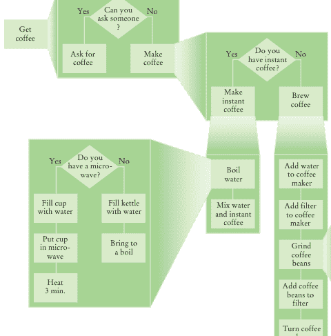

**图 5** 制作咖啡解决方案的流程图

填写支票时，通常会同时用数字（“274.15 美元”）和文字字符串（“两百七十四美元零 15 美分”）写出支票金额。这样可以减少收款人在金额前面添加几个数字的诱惑。


对于人类来说，这并不特别困难，但计算机如何完成这件事呢？没有内置函数可以将 274 转换为 “two hundred seventy four”。我们需要编写这个函数。下面是我们想要编写的函数的描述：

```c
/**
 * Turns a number into its English name.
 * @param number a positive integer < 1,000
 * @return the name of number (e.g., "two hundred seventy four")
 */
string int_name(int number)
```

如果（`part > 0`），则将 `digit_name(part)` 附加到 `name`。

与文字描述相比，这段伪代码有许多重要的改进。它展示了如何安排测试，从与较大数字的比较开始，并展示了之后如何在更多的 `if` 语句中继续处理较小的数字。

另一方面，这段伪代码对各部分的实际转换描述得比较模糊，只是提到了“几百的名称”等。此外，我们没有明确说明空格。按当前形式，代码会生成没有空格的字符串，例如 `twothousandseventyfour`。与主要问题的复杂性相比，人们希望空格只是一个小问题。最好不要让这些细节干扰伪代码。

现在将伪代码转换为实际代码。最后三种情况很简单，因为已经为它们开发好了辅助函数：

```cpp
if (part >= 20)
{
    name = name + " " + tens_name(part);
    part = part % 10;
}
else if (part >= 10)
{
    name = name + " " + teen_name(part);
    part = 0;
}

if (part > 0)
{
    name = name + " " + digit_name(part);
}
```

最后，让我们处理 100 到 999 之间的数字。由于 `part < 1000`，`part / 100` 是一个个位数，我们可以通过调用 `digit_name` 获取它的名称。然后添加 “hundred” 后缀：

```cpp
if (part >= 100)
{
    name = digit_name(part / 100) + " hundred";
    part = part % 100;
}
```

现在，你已经了解了 `int_name` 函数的所有重要构建模块。下面是完整的程序：

### ch05/intname.cpp

```cpp
#include <iostream>
#include <string>

using namespace std;

/**
   Turns a digit into its English name.
   @param digit an integer between 1 and 9
   @return the name of digit ("one" ... "nine")
*/
string digit_name(int digit)
{
if (digit == 1) return "one";
if (digit == 2) return "two";
if (digit == 3) return "three";
if (digit == 4) return "four";
if (digit == 5) return "five";
if (digit == 6) return "six";
if (digit == 7) return "seven";
if (digit == 8) return "eight";
if (digit == 9) return "nine";
return "";
}

/**
 * Turns a number between 10 and 19 into its English name.
 * @param number an integer between 10 and 19
 * @return the name of the given number ("ten" ... "nineteen")
 */
string teen_name(int number)
{
   if (number == 10) return "ten";
   if (number == 11) return "eleven";
   if (number == 12) return "twelve";
   if (number == 13) return "thirteen";
   if (number == 14) return "fourteen";
   if (number == 15) return "fifteen";
   if (number == 16) return "sixteen";
   if (number == 17) return "seventeen";
   if (number == 18) return "eighteen";
   if (number == 19) return "nineteen";
   return "";
}

/**
 * Gives the name of the tens part of a number between 20 and 99.
 * @param number an integer between 20 and 99
 * @return the name of the tens part of the number ("twenty" ... "ninety")
 */
string tens_name(int number)
{
   if (number >= 90) return "ninety";
   if (number >= 80) return "eighty";
   if (number >= 70) return "seventy";
   if (number >= 60) return "sixty";
   if (number >= 50) return "fifty";
   if (number >= 40) return "forty";
   if (number >= 30) return "thirty";
   if (number >= 20) return "twenty";
   return "";
}

/**
 * Turns a number into its English name.
 * @param number a positive integer < 1,000
 * @return the name of the number (e.g. "two hundred seventy four")
 */
string int_name(int number)
{
   int part = number; // The part that still needs to be converted
   string name; // The return value
```


现在你进入了 part >= 10 的分支。tens_name(16) 是 sixteen，因此变量的值现在如下所示：

| int_name(number = 416) | |
|---|---|
| part | name |
| 416 | "four hundred" |
| 16 | "four hundred" |
| 0 | "four hundred sixteen" |

现在就很清楚为什么要在第87行将 part 设置为0了。否则，你会进入下一个分支，结果就会变成 “four hundred sixteen six”。跟踪代码是理解函数细微之处的有效方法。

### 编程提示 5.5：存根

在编写较大的程序时，并不总是能够一次性实现并测试所有函数。你常常需要测试一个调用另一个函数的函数，但另一个函数尚未实现。这时，你可以用一个存根临时替代缺失的函数。存根是一个返回简单值的函数，该值足以用于测试另一个函数。以下是存根函数的示例：


*存根是不完整的函数，可用于测试。*

```cpp
/**
   Turns a digit into its English name.
   @param digit an integer between 1 and 9
   @return the name of digit ("one" ... "nine")
*/
string digit_name(int digit)
{
   return "mumble";
}

/**
   Gives the name of the tens part of a number between 20 and 99.
   @param number an integer between 20 and 99
   @return the tens name of the number ("twenty" ... "ninety")
*/
string tens_name(int number)
{
   return "mumblety";
}
```

如果你将这些存根与 int_name 函数组合，并用参数274进行测试，你会得到 "mumble hundred mumblety mumble" 这样的结果，这表明 int_name 函数的基本逻辑是正确的。

### 工作示例 5.3 — 计算课程成绩

本工作示例使用逐步求精的方法，解决将一组字母等级转换为课程平均等级的问题。


## 5.8 变量作用域与全局变量

> 变量的作用域是程序中该变量可见的部分。

在程序中，同一个变量名可以被定义多次。当使用该变量名时，你需要知道它属于哪个定义。本节我们将讨论处理同名变量多次定义的规则。

在函数内定义的变量，从其定义点开始到所在块结束都是可见的。这个区域称为变量的作用域。

考虑以下示例中的 volume 变量：

```cpp
double cube_volume(double side_length)
{
    double volume = side_length * side_length * side_length;
    return volume;
}

int main()
{
    double volume = cube_volume(2);
    cout << volume << endl;

    return 0;
}
```

每个 volume 变量都定义在各自的函数中，它们的作用域不重叠。


正如不同城市都可以有一条名为“主街”的街道一样，C++ 程序也可以拥有多个同名变量。

在同一作用域内定义两个同名变量是非法的。例如，以下代码是非法的：

```cpp
int main()
{
   double volume = cube_volume(2);
   double volume = cube_volume(10);
      // ERROR: cannot define another volume variable in this scope
   ...
}
```

然而，你可以在嵌套块中定义另一个同名变量。这里，我们定义了两个名为 amount 的变量。

```cpp
double withdraw(double balance, double amount)
{
   if (...)
   {
      double amount = 10; // Another variable named amount
      ...
   }
   ...
}
```

参数变量 amount 的作用域是整个函数，但嵌套块内部除外。在嵌套块内部，amount 指的是在该块中定义的变量。我们说内部变量遮蔽了外部块中定义的变量。在你编写的函数中，你应该避免这种可能引起混淆的情况，只需重命名其中一个变量即可。

嵌套块中的变量会遮蔽外部块中的同名变量。

在函数内部定义的变量称为局部变量。C++ 还支持全局变量：在函数外部定义的变量。全局变量对其后面定义的所有函数可见。例如，<iostream> 头文件定义了全局变量 cin 和 cout。

局部变量定义在函数内部。全局变量定义在函数外部。

```cpp
int balance = 10000; // A global variable

void withdraw(double amount)
{
   if (balance >= amount)
   {
      balance = balance - amount;
   }
}

int main()
{
   withdraw(1000);
   cout << balance << endl;
   return 0;
}
```

变量 balance 的作用域覆盖 withdraw 和 main 两个函数。

一般来说，使用全局变量并不是个好主意。当多个函数更新全局变量时，结果可能很难预测。尤其是在由多个程序员开发的大型程序中，每个函数的作用清晰且易于理解非常重要。你应该在程序中避免使用全局变量。

在程序中避免使用全局变量。

考虑这个示例程序：

### 自测


```cpp
1  int x;
2  int mystery(int x)
3  {
4      int s = 0;
5      for (int i = 0; i < x; i++)
6      {
7          int x = i + 1;
8          s = s + x;
9      }
10     return x;
11 }
12 int main()
13 {
14     x = 4;
15     int s = mystery(x);
16     cout << s << endl;
17 }
```

- 28. 哪一行定义了一个全局变量？
- 29. 哪些行定义了名为 x 的局部变量？
- 30. 哪些行位于第2行 x 定义的作用域内？
- 31. 第14行的赋值改变了哪个变量？
- 32. 该程序定义了两个同名变量，它们的作用域不重叠。它们是哪两个？

**动手实践** 现在你可以尝试本章末尾的练习：R5.8、R5.9。

### 编程提示 5.6：避免使用全局变量


在某些情况下必须使用全局变量（如 cin 和 cout），但这种情况相当罕见。带有全局变量的程序难以维护和扩展，因为你不能再将每个函数视为一个简单的“黑盒”，只需接收参数并返回结果。当函数修改全局变量时，理解函数调用的效果变得更加困难。随着程序规模的增大，这种困难会迅速增加。与其使用全局变量，不如使用函数参数在程序的不同部分之间传递信息。

## 5.9 引用参数

如果你想要编写一个改变实参值的函数，就必须使用**引用参数**来允许这种修改。我们首先解释为什么需要一种不同的参数类型，然后展示引用参数的语法。

考虑一个模拟从银行账户提取指定金额的函数，前提是账户中有足够的资金。如果金额不足，则改为扣除10美元罚款。该函数的使用方式如下：

```cpp
double harrys_account = 1000;
withdraw(harrys_account, 100); // Now harrys_account is 900
withdraw(harrys_account, 1000); // Insufficient funds. Now harrys_account is 890
```

下面是最初的尝试：

```cpp
void withdraw(double balance, double amount) // Does not work
{
    const double PENALTY = 10;
    if (balance >= amount)
    {
        balance = balance - amount;
    }
    else
    {
        balance = balance - PENALTY;
    }
}
```

但这是行不通的。

让我们逐步跟踪函数调用 withdraw(harrys_account, 100)——见图6。函数开始时，创建参数变量 balance ❶，并设置为与 harrys_account 相同的值，同时 amount 被设置为 100 ❷。然后 balance 被修改 ❸。当然，这种修改对 harrys_account 没有影响，因为 balance 是一个独立的变量。当函数返回时，balance 被遗忘，harrys_account 中也没有钱被取出 ❹。


**图6** 当 balance 和 account 为值参数时


**图8** 当余额是引用参数时

例如，调用

```cpp
withdraw(harrys_account, 100);
```

会修改变量 `harrys_account`，而调用

```cpp
withdraw(sallys_account, 150);
```

会修改变量 `sallys_account`。

> 引用参数的实参必须始终是一个**变量**。如果提供一个数字，那将是一个错误：

```cpp
withdraw(1000, 500);  // Error: argument for reference parameter must be a variable
```

原因很清楚——函数会修改引用参数，但不可能改变一个数字的值。出于同样的原因，你不能提供一个表达式：

```cpp
withdraw(harrys_account + 150, 500);
// Error: argument for reference parameter must be a variable
```

> 修改引用参数会更新调用中提供的变量。

## ch05/account.cpp

```cpp
#include <iostream>

using namespace std;
```

```cpp
5  /**
6      Withdraws the amount from the given balance, or withdraws
7      a penalty if the balance is insufficient.
8      @param balance the balance from which to make the withdrawal
9      @param amount the amount to withdraw
10 */
11 void withdraw(double& balance, double amount)
12 {
13     const double PENALTY = 10;
14     if (balance >= amount)
15     {
16         balance = balance - amount;
17     }
18     else
19     {
20         balance = balance - PENALTY;
21     }
22 }
23
24 int main()
25 {
26     double harrys_account = 1000;
27     double sallys_account = 500;
28     withdraw(harrys_account, 100);
29     // Now harrys_account is 900
30     withdraw(harrys_account, 1000); // Insufficient funds
31     // Now harrys_account is 890
32     withdraw(sallys_account, 150);
33     cout << "Harry's account: " << harrys_account << endl;
34     cout << "Sally's account: " << sallys_account << endl;
35
36     return 0;
37 }
```

### 程序运行

```text
Harry's account: 890
Sally's account: 350
```


- 33. 如果将 `amount` 参数定义为 `double&` 而不是 `double`，`withdraw` 函数还能正确工作吗？

- 34. 下面的函数旨在将给定金额的钱从一个账户转账到另一个账户。请提供函数参数。

```cpp
void transfer(...)
{
    if (balance1 >= amount)
    {
        balance1 = balance1 - amount;
        balance2 = balance2 + amount;
    }
}
```

- 35. 修改 `withdraw` 函数，使其返回一个 `bool` 值，指示取款是否成功。如果余额不足，不要收取罚款。

```cpp
}
cout << endl;
}
```

> 递归计算通过使用相同问题在更简单输入下的解来解决问题。

再看一次 `print_triangle` 函数，并注意它是多么合情合理。如果边长为0，就不需要打印任何内容。下一部分也同样合情合理：先打印较小的三角形，*不要去想它为什么有效*，然后再打印一行 `[]`。显然，结果就是一个所需大小的三角形。

要确保递归成功，有两个关键要求：

- 每次递归调用都必须以某种方式简化任务。
- 必须有特殊情况来直接处理最简单的任务。

> 为了使递归能够终止，必须有针对最简单输入的特殊情况。

`print_triangle` 函数以越来越小的边长反复调用自身。最终边长必然达到0，函数便停止调用自身。

下面是用边长4打印三角形时发生的情况。

- 调用 `print_triangle(4)` 会调用 `print_triangle(3)`。
  - 调用 `print_triangle(3)` 会调用 `print_triangle(2)`。
    - 调用 `print_triangle(2)` 会调用 `print_triangle(1)`。
      - 调用 `print_triangle(1)` 会调用 `print_triangle(0)`。
        - 调用 `print_triangle(0)` 返回，不做任何事情。
      - 调用 `print_triangle(1)` 打印 `[]`。
    - 调用 `print_triangle(2)` 打印 `[][]`。
  - 调用 `print_triangle(3)` 打印 `[][][]`。
- 调用 `print_triangle(4)` 打印 `[][][][]`。

递归函数的调用模式看起来很复杂，而成功设计递归函数的关键是*不要去想它*。


*这套俄罗斯套娃看起来类似于递归函数的调用模式。*

## ch05/triangle.cpp

```cpp
#include <iostream>

using namespace std;

/**
 * Prints a triangle with a given side length.
 * @param side_length the side length (number of [] along the base)
 */
```

```cpp
void print_triangle(int side_length)
{
    if (side_length < 1) { return; }
    print_triangle(side_length - 1);
    for (int i = 0; i < side_length; i++)
    {
        cout << "[]";
    }
    cout << endl;
}

int main()
{
    cout << "Enter the side length: ";
    int input;
    cin >> input;
    print_triangle(input);
    return 0;
}
```

### 程序运行

```text
Enter the side length: 10
[]
[][]
[][][]
[][][][]
[][][][][]
[][][][][][]
[][][][][][][]
[][][][][][][][]
[][][][][][][][][]
[][][][][][][][][][]
```

打印三角形形状其实并不一定需要递归。你可以使用嵌套循环，像这样：

```cpp
for (int i = 0; i < side_length; i++)
{
    for (int j = 0; j < i; j++)
    {
        cout << "[]";
    }
    cout << endl;
}
```

然而，这对循环有些棘手。许多人觉得递归解决方案更容易理解。


- 38. 考虑对 `print_triangle` 函数进行如下微小修改：

```cpp
void print_triangle(int side_length)
{
    if (side_length < 1) { return; }
    for (int i = 0; i < side_length; i++)
    {
        cout << "[]";
```

一位数的数字和就是它本身，因此当 `n < 10` 时你可以停止递归，并在此情况下返回 `n`。或者，如果你愿意，还可以更省事。如果 `n` 是一位数，那么 `digit_sum(n / 10) + n % 10` 等于 `digit_sum(0) + n`。你可以简单地在 `n` 为零时终止递归。

## 步骤4

通过组合简单情况和化简步骤来实现解决方案。

现在你可以实现解决方案了。为你在步骤3中考虑的简单输入分别创建情况。如果输入不属于最简单的情况，那么就实现你在步骤2中发现的逻辑。

以下是完整的 `digit_sum` 函数：

```c
int digit_sum(int n)
{
    // Special case for terminating the recursion
    if (n == 0) { return 0; }
    // General case
    return digit_sum(n / 10) + n % 10;
}
```

他们选择了当时能够运行少数几个现有应用程序中大部分程序的那个系统。它恰好是微软的 DOS（磁盘操作系统）。微软将该操作系统授权给其他硬件厂商，并鼓励软件公司编写 DOS 应用程序。


*在 Apple II 上运行的 VisiCalc 电子表格*

其结果是为 PC 兼容机开发了大量有用的应用程序。

PC 应用程序当然很有用，但它们并不容易学习。每个厂商都开发了不同的用户界面：用户需要掌握一组按键、菜单选项和设置，才能有效地使用某个软件包。应用程序之间的数据交换很困难，因为每个程序使用不同的数据格式。1984年，苹果的 Macintosh 改变了这一切。Macintosh 的设计者富有远见，为计算机提供了直观的用户界面，并迫使软件开发人员遵循这一界面。微软和 PC 兼容机制造商花了多年时间才赶上。

大多数个人电脑被用于从在线来源获取信息、娱乐、文字处理和家庭财务。一些分析人士预测，个人电脑将与电视机和有线网络融合，成为一种娱乐和信息设备。


## 确定程序中变量的作用域。

- 变量的作用域是程序中该变量可见的部分。
- 嵌套块中的变量会遮蔽外层块中同名的变量。
- 局部变量定义在函数内部。全局变量定义在函数外部。
- 在程序中避免使用全局变量。


## 描述引用参数如何工作。

- 修改值参数对调用者没有影响。
- 引用参数指的是函数调用中提供的变量。
- 修改引用参数会更新调用中提供的变量。

## 理解递归函数调用并实现简单的递归函数。

- 递归计算通过使用同一问题在更简单输入下的解来解决问题。
- 为使递归终止，必须为最简单的输入设置特殊情况。
- 寻找递归解的关键是将输入简化为同一问题的更简单输入。
- 设计递归解时，不必担心多重嵌套调用。只需关注将问题简化为稍微简单一些的问题。


## 复习练习

**R5.1** 实参和返回值有什么区别？一个函数可以有多少个实参？可以有多少个返回值？

**R5.2** 从 `main` 的第一行开始，第198页程序 `cube.cpp` 的各行按什么顺序执行？

**R5.3** 从C++库或本章讨论的函数中，给出下列各项的示例：

- a. 一个具有两个 `double` 实参和一个 `double` 返回值的函数
- b. 一个具有一个 `double` 实参和一个 `double` 返回值的函数
- c. 一个具有两个 `int` 实参和一个 `int` 返回值的函数
- d. 一个具有一个 `int` 实参和一个 `string` 返回值的函数
- e. 一个具有一个 `string` 实参且没有返回值的函数
- f. 一个具有引用参数且没有返回值的函数
- g. 一个没有参数且具有 `int` 返回值的函数

**R5.4** 判断正误？

- a. 一个函数恰好有一个 return 语句。
- b. 一个函数至少有一个 return 语句。
- c. 一个函数至多有一个返回值。
- d. 返回值为 void 的函数从不会有 return 语句。
- e. 执行 return 语句时，函数立即退出。
- f. 返回值为 void 的函数必须打印结果。
- g. 没有参数的函数总是返回相同的值。

**R5.5** 考虑这些函数：

```cpp
double f(double x) { return g(x) + sqrt(h(x)); }
double g(double x) { return 4 * h(x); }
double h(double x) { return x * x + x - 1; }
double k(double x) { return 2 * (x + 1); }
```

不要实际编译和运行程序，确定下列函数调用的结果：

- a. `double x1 = f(2);`
- b. `double x2 = g(h(2));`
- c. `double x3 = k(g(2) + h(2));`
- d. `double x4 = f(0) + f(1) + f(2);`
- e. `double x5 = f(-1) + g(-1) + h(-1) + k(-1);`

**R5.6** 为一个函数编写伪代码，该函数将包含字母的电话号码（例如 1-800-FLOWERS）转换为实际电话号码。使用电话键盘上的标准字母。


**R5.7** 设计一个函数，将浮点数打印为货币值（带有 $ 符号和两位小数）。

- a. 说明程序 `ch02/volume2.cpp` 和 `ch04/invtable.cpp` 应如何修改以使用你的函数。
- b. 如果程序应显示不同的货币（例如欧元），需要做什么修改？

**R5.8** 对于下列程序中的每个变量，指出其作用域。然后不要实际运行程序，确定程序会打印什么。

```cpp
int a = 0;
int b = 0;
int f(int c)
{
    int n = 0;
    a = c;
    if (n < c)
    {
        n = a + b;
    }
    return n;
}

int g(int c)
{
    int n = 0;
    int a = c;
    if (n < f(c))
    {
        n = a + b;
    }
    return n;
}

int main()
{
    int i = 1;
    int b = g(i);
    cout << a + b + i << endl;
    return 0;
}
```

**R5.9** 我们已经看到C++中的三种变量：全局变量、参数变量和局部变量。按照这些类别对练习 R5.8 中的变量进行分类。

**R5.10** 使用逐步求精的过程描述制作炒鸡蛋的过程。讨论如果冰箱里没有鸡蛋你会怎么做。

**R5.11** 下列函数有多少个参数？有多少个返回值？*提示：* C++中“参数”和“返回值”的概念与直观的“输入”和“输出”概念不同。

```cpp
void average(double& avg)
{
    cout << "Please enter two numbers: ";
    double x;
    double y;
    cin >> x >> y;
    avg = (x + y) / 2;
}
```

**R5.12** 使用下列实参对 int_name 函数进行走查：

- a. 5
- b. 12
- c. 21
- d. 301
- e. 324
- f. 0
- g. -2

```cpp
int temp = a;
a = b;
b = temp;
}

int main()
{
    int x = 3;
    int y = 4;
    false_swap2(x, y);
    cout << x << " " << y << endl;
    return 0;
}
```

为什么该函数没有交换 x 和 y 的内容？如何重写该函数使其正确工作？

**R5.18** 下列函数交换两个整数，而不需要临时变量：

```cpp
void tricky_swap(int& a, int& b)
{
    a = a - b;
    b = a + b;
    a = b - a;
}
```

然而，它在一种重要情况下会失败，即调用 tricky_swap(x, x) 时。解释应该发生什么以及实际会发生什么。

**R5.19** 给出一个递归函数的伪代码，用于打印给定字符串的所有子串。例如，字符串 "rum" 的子串是 "rum" 本身、"ru"、"um"、"r"、"u"、"m" 和空字符串。你可以假设该字符串的所有字母都不同。

**R5.20** 给出一个递归函数的伪代码，该函数对字符串中的所有字母进行排序。例如，字符串 "goodbye" 会被排序为 "bdegooy"。

## 编程练习

**P5.1** 在 `<algorithm>` 头文件中声明的 max 函数返回其两个实参中较大的一个。编写一个程序，读取三个浮点数，使用 max 函数，并显示

- 前两个输入中较大的一个。
- 后两个输入中较大的一个。
- 三个输入中最大的一个。

**P5.2** 编写一个函数，计算银行账户在给定初始余额和利率下，经过给定年数后的余额。假设利息按年复利计算。

**P5.3** 编写下列函数，并提供一个程序来测试它们。

- a. `double smallest(double x, double y, double z)`，返回实参中最小的一个
- b. `double average(double x, double y, double z)`，返回实参的平均值

```cpp
double cylinder_volume(double r, double h)
double cylinder_surface(double r, double h)
double cone_volume(double r, double h)
double cone_surface(double r, double h)
```

这些函数计算半径为 r 的球、底面半径为 r 且高为 h 的圆柱，以及底面半径为 r 且高为 h 的圆锥的体积和表面积。然后编写一个程序，提示用户输入 r 和 h 的值，调用这六个函数，并打印结果。

**P5.12** 编写函数

```cpp
double distance(double x1, double x2, double y1, double y2)

void midpoint(double x1, double x2, double y1, double y2, double& xmid, double& ymid)
void slope(double x1, double x2, double y1, double y2, bool& vertical, double& s)
```

这些函数计算连接点 (x1, y1) 和 (x2, y2) 的线段的距离、中点和斜率。斜率函数应将 vertical 设为 true 并且不设置 s，或者将 vertical 设为 false 并将 s 设为斜率。

**P5.13** 编写一个函数

```cpp
double read_double(string prompt)
```

该函数显示提示字符串，后跟一个空格，读入一个浮点数并返回它。下面是一个典型用法：

```cpp
salary = read_double("Please enter your salary.");
perc_raise = read_double("What percentage raise would you like?");
```

**P5.14** 编写一个函数 `void sort2(int& a, int& b)`，如果 `a` 大于 `b`，则交换 `a` 和 `b` 的值，否则保持 `a` 和 `b` 不变。例如，

```cpp
int u = 2;
int v = 3;
int w = 4;
int x = 1;
sort2(u, v); // u is still 2, v is still 3
sort2(w, x); // w is now 1, x is now 4
```

**P5.15** 编写一个函数 `sort3(int& a, int& b, int& c)`，交换它的三个实参，使它们按排序顺序排列。例如，

```cpp
int v = 3;
int w = 4;
int x = 1;
sort3(v, w, x); // v is now 1, w is now 3, x is now 4
```

*提示：使用练习 P5.14 中的 `sort2`。*

**P5.16** 增强 `int_name` 函数，使其对小于 1,000,000,000 的值也能正确工作。

**P5.17** 增强 `int_name` 函数，使其对负值和零也能正确工作。*注意：* 确保改进后的函数不会把 20 打印为 "twenty zero"。

**P5.18** 对于某些值（例如 20），`int_name` 函数返回一个带前导空格的字符串（" twenty"）。修复这个瑕疵，并确保只在必要时插入空格。*提示：* 有两种方法可以实现这一点。要么确保从不插入前导空格，要么在返回结果前删除结果中的前导空格。


### P5.19
编写一个打印工资单的程序。向程序用户询问员工姓名、时薪和工作小时数。如果工作小时数超过 40，则员工在超过 40 的小时数上按“一倍半工资”支付，即这些小时的时薪为 150%。你的支票应类似于下图。付款人和银行使用虚构名称。务必使用逐步求精，并将你的解决方案分解为多个函数。使用 `int_name` 函数打印支票的美元金额。


### P5.20
编写一个函数，使用称为蔡勒公式（Zeller’s congruence）的公式计算给定日期是星期几。设

- *d* = 该月中的日期
- *mm* = 修正后的月份（3 = 三月，……，12 = 十二月，13 = 一月，14 = 二月）
- *w* = 星期几（0 = 星期一，1 = 星期二，……，6 = 星期日）

则

w = ( d + 5 + (26 × (mm + 1))/10 + 5 × (year % 100)/4 + 21 × (year / 100)/4 ) % 7

这里，`/` 表示整数除法，`%` 表示取余运算。

### P5.21 闰年。
编写一个函数

```cpp
bool leap_year(int year)
```

用于测试某一年是否为闰年：即一年有 366 天。闰年是使日历与太阳保持同步所必需的，因为地球每 365.25 天绕太阳一周。实际上，这个数字并不完全精确，对于 1582 年之后的所有日期，适用格里高利历修正。通常能被 4 整除的年份是闰年，例如 1996 年。然而，能被 100 整除的年份（例如 1900 年）不是闰年，但能被 400 整除的年份是闰年（例如 2000 年）。


### P5.22
编写一个程序，将诸如 MCMLXXVIII 的罗马数字转换为其十进制数字表示。提示：首先编写一个函数，返回每个字母的数值。然后使用以下算法：

```text
total = 0
While the roman number string is not empty
   If the first character has a larger value than the second, or the string has length 1
      Add value(first character) to total.
      Remove the character.
   Else
      Add value(second character) - value(first character) to total.
      Remove both characters.
```

### P5.23
在练习 P3.23 中，要求你编写一个程序，将数字转换为其罗马数字表示。当时，你还不知道如何消除重复代码，因此得到的程序相当长。通过实现并使用以下函数重写该程序：


```cpp
string roman_digit(int n, string one, string five, string ten)
```

该函数使用为 one、five 和 ten 值指定的字符串来转换一位数字。你会按如下方式调用该函数：

```cpp
roman_ones = roman_digit(n % 10, "I", "V", "X");
n = n / 10;
roman_tens = roman_digit(n % 10, "X", "L", "C");
...
```

### P5.24 邮政条形码。
为了更快地分拣信件，美国邮政署鼓励寄送大量邮件的公司使用表示邮政编码的条形码（见图 9）。

```text
*************** ECRLOT ** C057
CODE C671RTS2
JOHN DOE                                   C057
1009 FRANKLIN BLVD
SUNNYVALE        CA 95014-5143
```


**图 9** 邮政条形码

五位邮政编码的编码方案如图 10 所示。每侧都有全高的框架条。五个编码数字之后是一个校验位，其计算方式如下：将所有数字相加，并选择校验位使总和成为 10 的倍数。例如，邮政编码 95014 的数字和为 19，因此校验位为 1，使总和等于 20。


**图 10** 五位条形码的编码

末尾的字符。例如，要反转 "flow"，首先将 "low" 反转为 "wol"，然后在末尾加上 "f"。

### P5.28
编写一个递归函数

```cpp
bool is_palindrome(string str)
```

如果 `str` 是回文，即一个反转后相同的单词，则返回 true。回文的例子有 "deed"、"rotor" 或 "aibohphobia"。*提示：* 如果一个单词的首尾字母匹配，且剩余部分也是回文，则该单词是回文。

### P5.29
使用递归实现一个函数 `bool find(string str, string match)`，用于测试 `match` 是否包含在 `str` 中：

```cpp
bool b = find("Mississippi", "sip"); // Sets b to true
```

*提示：* 如果 `str` 以 `match` 开头，那么你就完成了。如果不是，则考虑删除第一个字符后得到的字符串。

### P5.30
使用递归确定数字 `n` 的位数。*提示：* 如果 `n < 10`，则它有一位数字。否则，它的位数比 `n / 10` 多一位。

### P5.31
使用递归计算 `a^n`，其中 `n` 是正整数。*提示：* 如果 `n` 为 1，则 `a^n = a`。否则，`a^n = a × a^{n-1}`。

### 工程 P5.32
厚度为 `d`、表面曲率半径为 `R_1` 和 `R_2` 的透镜的有效焦距 `f` 由下式给出

$$\frac{1}{f}=(n-1)\left[\frac{1}{R_1}-\frac{1}{R_2}+\frac{(n-1)d}{n R_1 R_2}\right]$$

其中 `n` 是透镜介质的折射率。编写一个函数，根据其他参数计算 `f`。


### 工程 P5.33
实验室容器的形状像圆台：


编写函数计算体积和表面积，使用以下方程：

$$V=\frac{1}{3}\pi b\left(R_1^2+R_2^2+R_1R_2\right)$$

$$S=\pi(R_1+R_2)\sqrt{(R_2-R_1)^2+b^2}+\pi R_1^2$$

### 工程 P5.34
在电影院中，观众看到屏幕画面的角度 θ 取决于观众到屏幕的距离 x。对于下图所示尺寸的电影院，编写一个函数，计算给定距离下的角度。


接下来，提供一个适用于任意尺寸影院的更通用的函数。

### 工程 P5.35
电线（如图片所示）是一种由绝缘材料覆盖的圆柱形导体。一段导线的电阻由公式给出


R = ρL/A = 4ρL/(πd²)

其中 ρ 是导体的电阻率，L、A 和 d 分别是导线的长度、横截面积和直径。铜的电阻率为 1.678 × 10⁻⁸ Ω m。导线直径 d 通常由美国线规 (AWG) 指定，它是一个整数 n。AWG n 导线的直径由以下公式给出

d = 0.127 × 92^((36−n)/39) mm

编写一个 C++ 函数

```cpp
double diameter(int wire_gauge)
```

它接受线规并返回相应的导线直径。编写另一个 C++ 函数

```cpp
double copper_wire_resistance(double length, int wire_gauge)
```

它接受一段铜线的长度和线规，并返回该导线的电阻。铝的电阻率为 2.82 × 10⁻⁸ Ω m。编写第三个 C++ 函数

```cpp
double aluminum_wire_resistance(double length, int wire_gauge)
```

它接受一段铝线的长度和线规，并返回该导线的电阻。

编写一个 C++ 程序来测试这些函数。

### 工程 P5.36
汽车受到的阻力由下式给出

F_D = ½ ρv²AC_D

其中 ρ 是空气密度（1.23 kg/m³），v 是速度，单位为 m/s，A 是汽车的投影面积（2.5 m²），C_D 是阻力系数（0.2）。

克服这种阻力所需的功率（瓦特）为 P = F_D v，所需的等效马力为 Hp = P/746。编写一个程序，接受汽车速度，并计算克服由此产生的阻力所需的功率（瓦特）和马力。注意：1 mph = 0.447 m/s。

## 自测题答案

1. 参数是 3 和 2。返回值为 9。
2. 对 pow 的内部调用返回 2^2 = 4。因此，外部调用返回 4^2 = 16。
3. 3。
4. 该函数的用户可以将它视为黑箱。
5. 27。
6. 8 × 8 × 8 = 512。
7.

```cpp
double volume = pow(side_length, 3);
return volume;
```

8.

```cpp
double square_area(double side_length)
{
    double area = side_length * side_length;
    return area;
}
```

9. (2 + 3) / (3 - 2) = 5
10. 调用函数时，x 被设为 4，y 被设为 7，z 变为 11。然后 z 被改为 5.5，该值被返回并打印。
11. 调用函数时，x 被设为 5。然后 y 被设为 25，该值被返回并打印。
12. 调用函数时，n 被设为 5。然后 n 被递增两次，设为 7。该值被返回并打印。
13.

```cpp
box_string("Hello");
box_string("World");
```

14. box_string 函数不返回值。因此，你不能在 `<<` 表达式中使用它。
15.

```cpp
void shout(string str)
{
    cout << str << "!!!" << endl;
}
```

16.

```cpp
void box_string(string str)
{
    int n = str.length();
    for (int i = 0; i < n + 4; i++) { cout << "-"; }
    cout << endl;
    cout << "| " << str << " |" << endl;
    for (int i = 0; i < n + 4; i++) { cout << "-"; }
    cout << endl;
}
```

17.

```cpp
void print_line(int count)
{
    for (int i = 0; i < count; i++)
    {
```


```cpp
    cout << "_";
}
    cout << endl;
}
void box_string(string str)
{
    int n = str.length();
    print_line(n + 2);
    cout << "|" << str << "|" << endl;
    print_line(n + 2);
}
```

- 18. `int total_pennies = round_to_pennies(total);`
  `int total_tax_pennies = round_to_pennies(total * tax_rate);`

  其中函数定义如下

    ```cpp
    /**
        @param amount an amount in dollars and cents
        @return the amount in pennies, rounded to the nearest penny
    */
    int round_to_pennies(double amount)
    {
        return static_cast<int>(100 * amount + 0.5);
    }
    ```

- 19. `if (is_even(page)) ...`

  其中函数定义如下：

    ```cpp
    bool is_even(int n)
    {
        return n % 2 == 0;
    }
    ```

- 20. 添加参数变量，以便将初始余额和利率传递给函数：

    ```cpp
    double balance(double initial_balance, double rate, int years)
    {
        return initial_balance * pow(1 + rate / 100, years);
    }
    ```

- 21. `int spaces = count_spaces(input);`

  其中函数定义如下：

    ```cpp
    /**
        @param str any string
        @return the number of spaces in str
    */
    int count_spaces(string str)
    {
        int count = 0;
        for (int i = 0; i < str.length(); i++)
        {
            if (str.substr(i, 1) == " ")
            {
                count++;
            }
        }
        return count;
    }
    ```

- 32. 变量 *s* 在第4行和第15行定义。

- 33. 是的，但由于函数不修改 amount 参数变量，因此没有必要这样做。

- 34. `void transfer(double& balance1, double& balance2, double amount)`

- 35. `bool withdraw(double& balance, double amount)`

    ```cpp
    {
        if (balance >= amount)
        {
            balance = balance - amount;
            return true;
        }
        else
        {
            return false;
        }
    }
    ```

- 36. `void minmax(double x, double y, double& a, double& b)`

    ```cpp
    {
        if (x < y) { a = x; b = y; }
        else { a = y; b = x; }
    }
    ```

- 37. 程序将 x 设为 1，然后将 y 设为 4，再将 x 设为 3。它打印 3 4。

- 38.

    ```
    [][][][]
    [][][]
    [][]
    []
    ```

- 39. 4 + 3 + 2 + 1 + 0 = 10

- 40. mystery(10) + 1 = mystery(5) + 2 = mystery(2) + 3 = mystery(1) + 4 = mystery(0) + 5 = 5

- 41. 思路是先打印一个 []，然后打印 n - 1 个 []。

    ```cpp
    void print_boxes(int n)
    {
        if (n == 0) { return; }
        cout << "[]";
        print_boxes(n - 1);
    }
    ```

- 42. 只需将以下内容添加到函数开头：

    ```cpp
    if (part >= 1000)
    {
        return int_name(part / 1000) + " thousand " + int_name(part % 1000);
    }
    ```

## 语法 6.1 定义数组


这里我们定义一个可以保存十个值的数组：

```cpp
    double values[10];
```

这是变量 values 的定义，其类型为“double 数组”。也就是说，values 存储一串浮点数。[10] 表示数组的大小。（参见图1。）数组大小必须是编译时已知的常量。

使用数组来收集同一类型的一系列值。

定义数组时，可以指定初始值。例如，

```cpp
    double values[] = { 32, 54, 67.5, 29, 34.5, 80, 115, 44.5, 100, 65 };
```

提供初始值时，不需要指定数组大小。编译器通过统计值的个数来确定大小。

### 表1 定义数组

|  |  |
|---|---|
| `int numbers[10];` | 包含十个整数的数组。 |
| `const int SIZE = 10;`<br>`int numbers[SIZE];` | 最好为大小使用具名常量。 |
| ⚠️ `int size = 10;`<br>`int numbers[size];` | **注意：** 在标准 C++ 中，大小必须是常量。这个数组定义并非对所有编译器都有效。 |
| `int squares[5] = { 0, 1, 4, 9, 16 };` | 包含五个整数并带初始值的数组。 |
| `int squares[] = { 0, 1, 4, 9, 16 };` | 如果提供初始值，可以省略数组大小。大小会设置为初始值的数量。 |
| `int squares[5] = { 0, 1, 4 };` | 如果提供的初始值少于数组大小，剩余值会设为 0。这个数组包含 0、1、4、0、0。 |
| `string names[3];` | 包含三个字符串的数组。 |

### 6.1.2 访问数组元素

数组中存储的值称为其**元素**。每个元素都有一个位置编号，称为**索引**。要访问 *values* 数组中的值，必须指定要使用的索引。这通过 `[]` 运算符完成：

数组 *values* 中的各个元素通过整数索引 *i* 访问，使用记法 `values[i]`。

```cpp
values[4] = 34.5;
```

现在索引为 4 的元素被填入 34.5。（参见图2。）


可以使用以下命令显示索引为 4 的元素内容：

```cpp
cout << values[4] << endl;
```

如你所见，元素 `values[4]` 可以像任何 double 类型的变量一样使用。

数组元素可以像任何变量一样使用。

在 C++ 中，数组位置的计数方式可能会让你感到意外。如果仔细看图2，你会发现当我们修改 `values[4]` 时，填入的是*第五个*元素。在 C++ 中，数组元素编号*从 0 开始*。也就是说，*values* 数组的合法元素是

- `values[0]`，第一个元素
- `values[1]`，第二个元素
- `values[2]`，第三个元素
- `values[3]`，第四个元素
- `values[4]`，第五个元素
- ...
- `values[9]`，第十个元素

数组索引必须至少为零，并且小于数组大小。

你将在第7章看到为什么 C++ 选择这种编号方案。

必须小心索引值。试图访问数组中不存在的元素是严重错误。例如，如果 *values* 有二十个元素，就不允许访问 `values[20]`。

试图访问索引不在有效索引范围内的元素称为**越界错误**。编译器不会捕获这种类型的错误。甚至正在运行的程序也*不会*生成错误消息。如果发生越界错误，你会静默地读取或覆盖另一个内存位置。因此，你的程序可能会出现随机错误，甚至可能崩溃。

*就像邮局信箱通过信箱编号来标识一样，数组元素通过索引来标识。*


如果提供无效的数组索引，就会发生越界错误，它可能损坏数据或导致程序终止。

最常见的越界错误如下：

```cpp
double values[10];
cout << values[10];
```

包含十个元素的数组中不存在 `values[10]`——合法索引值范围是 0 到 9。

要访问数组的所有元素，请使用一个变量作为索引。假设 `values` 有十个元素，整数变量 `i` 依次取值 0、1、2，一直到 9。那么表达式 `values[i]` 会依次得到每个元素。例如，这个循环会显示所有元素。

```cpp
for (int i = 0; i < 10; i++)
{
    cout << values[i] << endl;
}
```

注意，在循环条件中索引*小于*10，因为不存在与 `values[10]` 对应的元素。

### 6.1.3 部分填充的数组

数组在运行时不能改变大小。当你事先不知道需要多少个元素时，这会成为问题。在这种情况下，必须对需要存储的最大元素数量做出合理猜测。我们称这个数量为*容量*。例如，我们可能决定有时想存储十个以上的值，但绝不超过 100 个：

```cpp
const int CAPACITY = 100;
double values[CAPACITY];
```

在典型的程序运行中，只有数组的一部分会被实际元素占用。我们称这样的数组为*部分填充的数组*。必须维护一个*伴随变量*来统计实际使用了多少个元素。在图3中，我们称伴随变量为 `current_size`。


*对于部分填充的数组，需要记住已经填充了多少个元素。*


**图3** 部分填充的数组

以下循环收集值并填充 `values` 数组。

对于部分填充的数组，要维护一个表示当前大小的伴随变量。

```cpp
int current_size = 0;
double input;
while (cin >> input)
{
    if (current_size < CAPACITY)
    {
        values[current_size] = input;
        current_size++;
    }
}
```


```
        }   }
```

在这个循环结束时，current_size 包含数组中元素的实际数量。注意，如果数组大小达到容量，就必须停止接受输入。

要处理收集到的数组元素，你再次使用伴随变量，而不是容量。这个循环打印部分填充的数组：

```cpp
for (int i = 0; i < current_size; i++)
{
    cout << values[i] << endl;
}
```


1. 定义一个包含前五个质数的整数数组。

2. 假设数组 primes 已按自测 1 所述初始化。执行以下循环后，它的内容是什么？

   ```cpp
   for (int i = 0; i < 2; i++)
   {
       primes[4 - i] = primes[i];
   }
   ```

3. 假设数组 primes 已按自测 1 所述初始化。执行以下循环后，它的内容是什么？

   ```cpp
   for (int i = 0; i < 5; i++)
   {
       primes[i]++;
   }
   ```

4. 给定定义

   ```cpp
   const int CAPACITY = 10;
   double values[CAPACITY];
   ```

   编写语句，将零放入数组 values 中有效下标最低和最高的元素。

5. 给定自测 4 中定义的数组，编写一个循环，从最后一个元素开始，按相反顺序打印数组 values 的元素。

6. 定义一个名为 words 的数组，它可容纳十个 string 类型的值。

7. 定义一个包含两个字符串 "Yes" 和 "No" 的数组。

**动手练习** 现在你可以尝试本章末尾的这些练习：R6.1、R6.2、R6.6、P6.1。

### 常见错误 6.1：边界错误


使用数组时最常见的错误或许是访问不存在的元素。

```cpp
double values[10];
values[10] = 5.4;
   // Error—values has 10 elements with subscripts 0 to 9
```

如果你的程序通过越界下标访问数组，不会出现错误消息。相反，程序会悄悄（或不那么悄悄地）破坏某些内存。除了非常短的程序中问题可能不被察觉外，这种破坏会使程序行为不可预测，甚至可能导致程序终止。这些是严重错误，可能难以检测。

### 编程提示 6.1：使用数组存储相关值的序列


数组旨在存储具有相同含义的值的序列。例如，一个测验成绩数组完全合理：

```c
int scores[NUMBER_OF_SCORES];
```

但一个

```c
double personal_data[3];
```

在位置 0、1 和 2 分别保存一个人的年龄、银行余额和鞋码的数组则是糟糕的设计。程序员要记住这些数据值中哪一个存储在哪个数组位置会很繁琐。在这种情况下，使用三个单独的变量要好得多。

### 趣闻 6.1：早期互联网蠕虫


1988 年 11 月，康奈尔大学的学生罗伯特·莫里斯（Robert Morris）发布了一个所谓的病毒程序，感染了美国各地约 6,000 台连接到互联网的计算机。数以万计的计算机用户无法阅读电子邮件或以其他方式使用计算机。所有主要大学和许多高科技公司都受到影响。（当时的互联网比现在小得多。）

这次攻击中使用的特定病毒类型称为蠕虫。病毒程序从互联网上的一台计算机爬行到下一台。蠕虫会尝试连接 finger，这是 UNIX 操作系统中用于查找有关在网络上某台特定计算机上拥有账户的用户信息的程序。像 UNIX 中的许多程序一样，finger 是用 C 语言编写的。在 C 中，和在 C++ 中一样，数组具有固定大小。为了存储要查找的用户名（例如 walter@cs.sjsu.edu），finger 程序分配了一个 512 个字符的数组，假设没有人会提供如此长的输入。不幸的是，C 和 C++ 一样，不检查数组索引是否小于数组长度。如果你使用过大的索引写入数组，你只会覆盖属于某些其他对象的内存位置。在某些版本的 finger 程序中，程序员很懒惰，没有检查保存输入字符的数组是否足够大以容纳输入。因此，蠕虫程序故意用 536 字节填充 512 字符的数组。多出的 24 字节会覆盖一个返回地址，攻击者知道该地址就存储在行缓冲区之后。当该函数结束时，它没有返回到调用者，而是返回到蠕虫提供的代码（见图 4）。该代码以与 finger 相同的超级用户权限运行，使蠕虫得以进入远程系统。如果编写 finger 的程序员更认真一些，这种特定攻击就不可能发生。在 C++ 中，和在 C 中一样，所有程序员都必须非常小心，不要越过数组边界。

人们完全可以猜测，是什么驱使病毒作者花许多周来策划这种反社会行为：闯入数千台计算机并使它们瘫痪。看来闯入完全是作者有意为之，但使计算机瘫痪是一个缺陷，由持续重新感染造成。莫里斯被判处 3 年缓刑、400 小时社区服务，并罚款 10,000 美元。

近年来，计算机攻击愈演愈烈，动机也变得更加险恶。病毒常常不再使计算机瘫痪，而是窃取财务数据，或利用被攻击的计算机发送垃圾邮件。可悲的是，由于编写不良的程序容易受到缓冲区溢出错误的影响，许多此类攻击仍然可能发生。


**图 4** 一次“缓冲区溢出”攻击

### 6.2.3 求和与平均值

你已经在 4.7.1 节中遇到过这个算法。下面是计算数组中所有元素之和的代码：

```cpp
double total = 0;
for (int i = 0; i < size of values; i++)
{
    total = total + values[i];
}
```

要获得平均值，除以元素个数：

```cpp
double average = total / size of values;
```

务必检查大小不为零。

### 6.2.4 最大值和最小值

使用 4.7.4 节中的算法，该算法用一个变量保存你目前遇到的最大元素。下面是针对数组的实现：


```cpp
double largest = values[0];
for (int i = 1; i < size of values; i++)
{
    if (values[i] > largest)
    {
        largest = values[i];
    }
}
```

注意，循环从 1 开始，因为我们用 values[0] 初始化 largest。要计算最小值，反转比较即可。这些算法要求数组至少包含一个元素。

### 6.2.5 元素分隔符

> 分隔元素时，不要在第一个元素之前放置分隔符。

当你显示集合的元素时，通常希望将它们分隔开，常用逗号或竖线，如下所示：

1 | 4 | 9 | 16 | 25


注意，分隔符比数字少一个。在除*第一个元素*（索引为 0）之外的每个元素之前打印分隔符：

```cpp
for (int i = 0; i < size of values; i++)
{
    if (i > 0)
    {
        cout << " | ";
    }
    cout << values[i];
}
```

要打印五个元素，你需要四个分隔符。

### 6.2.6 线性搜索

线性搜索按顺序检查元素，直到找到匹配项。

你常常需要搜索某个元素的位置，以便替换或删除它。访问所有元素，直到找到匹配项或到达数组末尾。这里我们搜索第一个等于 100 的元素的位置。


*要搜索特定元素，请访问各个元素，并在遇到匹配项时停止。*

```cpp
int pos = 0;
bool found = false;
while (pos < size of values && !found)
{
   if (values[pos] == 100)
   {
      found = true;
   }
   else
   {
      pos++;
   }
}
```

如果 found 为 true，则 pos 是第一个匹配项的位置。

### 6.2.7 删除元素

考虑一个部分填充的数组 values，其当前大小存储在变量 current_size 中。假设你想从 values 中删除索引为 pos 的元素。如果元素没有特定顺序，这项任务很容易完成。只需用最后一个元素覆盖要删除的元素，然后递减跟踪大小的变量。（见图 6。）

```cpp
values[pos] = values[current_size - 1];
current_size--;
```

如果元素的顺序很重要，情况就更复杂。然后你必须将要删除元素之后的所有元素移到更低的索引，然后递减保存数组大小的变量。（见图 7。）

```cpp
for (int i = pos + 1; i < current_size; i++)
{
   values[i - 1] = values[i];
}
current_size--;
```


**图 6** 在无序数组中删除元素

**图 7** 在有序数组中删除元素


### 6.2.8 插入元素

如果元素的顺序无关紧要，你可以直接在末尾插入新元素，并递增用于跟踪大小的变量。（参见图 8。）对于部分填充的数组：

```cpp
if (current_size < CAPACITY)
{
    current_size++;
    values[current_size - 1] = new_element;
}
```

在序列中间某个特定位置插入元素要做的工作更多。首先，增加保存当前大小的变量。接着，将插入位置之上的所有元素移到更高的索引。最后，插入新元素。以下是部分填充数组的代码：

> 插入元素之前，从最后一个元素开始，将元素移到数组末尾。

```cpp
if (current_size < CAPACITY)
{
    current_size++;
    for (int i = current_size - 1; i > pos; i--)
    {
        values[i] = values[i - 1];
    }
    values[pos] = new_element;
}
```

注意移动的顺序：删除元素时，你先将下一个元素下移到更低的索引，然后移动再下一个元素，直到最终到达数组末尾。插入元素时，你从数组末尾开始，将该元素移到更高的索引，然后移动它前面的元素，依此类推，直到最终到达插入位置（参见图 9）。


### 6.2.9 交换元素

你经常需要交换数组中的元素。例如，第 263 页专题 6.2 中的排序算法通过反复交换元素来对数组排序。

**图 10**
交换数组元素


考虑交换数组 `values` 中位置 `i` 和 `j` 处元素的任务。我们希望将 `values[i]` 设为 `values[j]`。但那样会覆盖当前存储在 `values[i]` 中的值，所以我们要先保存它：


> 交换两个元素时使用临时变量。

```cpp
double temp = values[i];
values[i] = values[j];
```

现在我们可以将 `values[j]` 设为保存的值。

```cpp
values[j] = temp;
```

图 10 展示了这一过程。

*要交换两个元素，你需要一个临时变量。*

### 6.2.10 读取输入

如果你知道用户将提供多少个输入值，将它们放入数组就很简单：

```cpp
double values[NUMBER_OF_INPUTS];
for (i = 0; i < NUMBER_OF_INPUTS; i++)
{
   cin >> values[i];
}
```

```cpp
36        cout << " <== largest value";
37    }
38    cout << endl;
39  }
40 }
41    return 0;
42 }
```

## 程序运行

```
Please enter values, Q to quit:
34 5 80 115 44.5 Q
34 5
80
115 <== largest value
44.5
```


- 8. 在以下输入下，largest.cpp 程序的输出是什么？

    ```
    20 10 20 Q
    ```

- 9. 编写一个循环，统计数组中有多少个元素等于零。

- 10. 考虑在数组中查找最大元素的算法。为什么我们不把 largest 和 i 初始化为零，像这样？

    ```cpp
    double largest = 0;
    for (int i = 0; i < size; i++)
    {
       if (values[i] > largest)
       {
          largest = values[i];
       }
    }
    ```

- 11. 打印分隔符时，我们跳过了第一个元素前的分隔符。请重写循环，使每个元素之后都打印分隔符，但最后一个元素除外。

- 12. 下面这些用于打印带分隔符的数组的语句有什么问题？

    ```cpp
    cout << values[0];
    for (int i = 1; i < size; i++)
    {
       cout << ", " << values[i];
    }
    ```

- 13. 搜索匹配项时，我们使用的是 while 循环，而不是 for 循环。改用下面这个循环有什么问题？

    ```cpp
    for (pos = 0; pos < size && !found; pos++)
    {
       if (values[pos] == 100)
       {
          found = true;
       }
    }
    ```

- 14. 向数组中插入元素时，我们从末尾开始移动索引值较大的元素。为什么像下面这样从插入位置开始是错误的：

数组参数始终是引用参数。

数组参数*始终是引用参数*。（你将在第 7 章看到原因。）函数可以修改数组实参，而这些修改会影响传入函数的数组。例如，下面的 multiply 函数会更新数组中的所有元素：

```cpp
void multiply(double values[], int size, double factor)
{
    for (int i = 0; i < size; i++)
    {
        values[i] = values[i] * factor;
    }
}
```

在这种情况下，你*不*使用 & 符号来表示引用参数。

虽然数组可以作为函数参数，但它们不能作为函数返回类型。如果函数计算多个值，函数的调用者必须提供一个数组参数变量来保存结果。

函数的返回类型不能是数组。

```cpp
void squares(int n, int result[])
{
    for (int i = 0; i < n; i++)
    {
        result[i] = i * i;
    }
}
```

当函数改变数组的大小时，它应当告知调用者在调用之后数组有多少个元素。最简单的方法是返回新的大小。下面是一个例子——一个将输入值添加到数组中的函数：

当函数修改数组的大小时，它需要告诉调用者。

```cpp
int read_inputs(double inputs[], int capacity)
{
    int current_size = 0;
    double input;
    while (cin >> input)
    {
        if (current_size < capacity)
        {
            inputs[current_size] = input;
            current_size++;
        }
    }
    return current_size;
}
```

注意，这个函数还需要知道数组的容量。通常，向数组添加元素的函数需要知道其容量。你会这样调用这个函数：

```cpp
const int MAXIMUM_NUMBER_OF_VALUES = 1000;
double values[MAXIMUM_NUMBER_OF_VALUES];
int current_size = read_inputs(values, MAXIMUM_NUMBER_OF_VALUES);
// values is a partially filled array; the current_size variable specifies its size
```

向数组添加元素的函数需要知道其容量。

或者，你可以将大小作为引用参数传递。这对于修改现有数组的函数更合适：

```cpp
void append_inputs(double inputs[], int capacity, int& current_size)
{
    double input;
    while (cin >> input)
    {
        if (current_size < capacity)
        {
            inputs[current_size] = input;
            current_size++;
        }
    }
}
```

这个函数的调用方式如下：

```cpp
append_inputs(values, MAXIMUM_NUMBER_OF_VALUES, current_size);
```

调用之后，current_size 变量包含新的大小。

下面的示例程序从标准输入读取值，将它们翻倍，并打印结果。该程序使用了三个函数：

- read_inputs 函数用输入值填充数组。它返回读取到的元素个数。
- multiply 函数修改它接收到的数组内容，这演示了数组是按引用传递的。
- print 函数不修改它接收到的数组内容。

## ch06/functions.cpp

```cpp
#include <iostream>

using namespace std;

/**
   Reads a sequence of floating-point numbers.
   @param inputs an array containing the numbers
   @param capacity the capacity of that array
   @return the number of inputs stored in the array
*/
int read_inputs(double inputs[], int capacity)
{
   int current_size = 0;
   cout << "Please enter values, Q to quit:" << endl;
   bool more = true;
   while (more)
   {
      double input;
      cin >> input;
      if (cin.fail())
      {
         more = false;
      }
      else if (current_size < capacity)
      {
         inputs[current_size] = input;
         current_size++;
      }
   }
   return current_size;
}

/**
   Multiplies all elements of an array by a factor.
   @param values a partially filled array
   @param size the number of elements in values
```


```c
37 /**
38 @param factor the value with which each element is multiplied
39 */
40 void multiply(double values[], int size, double factor)
41 {
42     for (int i = 0; i < size; i++)
43     {
44         values[i] = values[i] * factor;
45     }
46 }
47 
48 /**
49     Prints the elements of a vector, separated by commas.
50     @param values a partially filled array
51     @param size the number of elements in values
52 */
53 void print(double values[], int size)
54 {
55     for (int i = 0; i < size; i++)
56     {
57         if (i > 0) { cout << ", "; }
58         cout << values[i];
59     }
60     cout << endl;
61 }
62 
63 int main()
64 {
65     const int CAPACITY = 1000;
66     double values[CAPACITY];
67     int size = read_inputs(values, CAPACITY);
68     multiply(values, size, 2);
69     print(values, size);
70 
71     return 0;
72 }
```

## 程序运行

```
Please enter values, Q to quit:
12 25 20 Q
24, 50, 40
```

## 自测

- 15. 如果你调用 sum 函数时在 size 上撒谎会发生什么？例如，即使在 values 的大小为 100 时调用 `double result = sum(values, 1000);`。
- 16. 你如何调用 squares 函数来计算前五个平方数并将结果存储在数组 numbers 中？
- 17. 编写一个函数，返回数组中某个元素的第一个位置，如果元素不存在则返回 –1。使用 6.2.6 节的线性搜索算法。
- 18. 重写 read_inputs 函数，使数组大小成为引用参数，而不是返回值。
- 19. 编写一个函数的头部，该函数将两个数组追加到另一个数组中。不要实现该函数。

下一节将向您展示一种技术，当基本算法都无法适应某个任务时，可以用它来发现新算法。


## 自测

- 20. 6.2.7 节有两个用于删除元素的算法。哪一个应该用于解决本节所述的任务？
- 21. 实际上，为了计算总分，并不需要删除最小值。描述另一种方法。
- 22. 如何使用 4.7 节中的一个或多个算法，打印给定数组中正数和负数的数量？
- 23. 如何打印数组中的所有正值，用逗号分隔？
- 24. 考虑以下用于收集数组中所有匹配项的算法：

```
int matches_size = 0;
for (int i = 0; i < size of values; i++)
{
    if (values[i] fulfills the condition)
    {
        matches[matches_size] = values[i];
        matches_size++;
    }
}
```

这个算法如何帮助你完成自测第 23 题？

**练习一下** 现在你可以尝试本章末尾的这些练习：R6.15，R6.16。

## 操作指南 6.1 使用数组


当你处理一系列值时，通常需要使用数组。（在某些非常简单的情况下，你可以在读取值时直接处理，无需存储它们。）本操作指南将引导你完成必要的步骤。

考虑来自 6.4 节的示例问题：给你一个学生的测验成绩。你需要计算最终测验成绩，即去掉最低分后所有分数的总和。例如，如果成绩是

8 7 8.5 9.5 7 5 10

那么最终成绩是 50。

### 步骤 1 将任务分解为若干步骤。

你通常希望将任务分解为多个步骤，例如

- 将数据读入数组。
- 在一步或多步中处理数据。
- 显示结果。

在我们的示例问题中，这会产生以下伪代码：

```
Read inputs.
Compute the final score.
Display the score.
```

在决定如何处理数据时，你应该熟悉 6.2 节中的数组算法。许多处理任务可以通过组合或改编其中一个或多个算法来解决。上一节向你展示了如何将**计算最终成绩**分解为基本算法：

- **找到最小值的位置。**
- **将其从数组中移除。**
- **计算总和。**

### 步骤 2 为每个步骤确定函数、参数和返回值。

尽管可以将所有步骤放入`main`函数中，但这通常不是一个好主意。最简单且最好的方法是让每个非平凡的步骤成为一个独立的函数。在我们的示例中，我们将实现四个函数：

- `read_inputs`
- `min_position`
- `remove`
- `sum`
- `final_score`

对于每个处理数组的函数，你都需要传入数组本身和数组大小。例如，

```cpp
double sum(double values[], int size)
```

如果函数修改了大小，它需要告诉调用者新的大小。函数可以返回大小，也可以使用引用参数来传递大小。对于修改现有数组的函数来说，第二种方法是更好的选择。

我们采用第一种方法来处理读取输入值的函数。

```cpp
int read_inputs(double values[], int capacity) // Returns the size
```

`remove`函数修改`current_size`参数：

```cpp
void remove(double values[], int& current_size, int pos)
```

此时，你应该像这样为每个函数编写文档：

```cpp
/**
   Removes an element from an array. The order of the elements is not preserved.
   @param values a partially filled array
   @param current_size the number of elements in values
   (will be reduced by 1 if the position is valid)
   @param pos the position of the element to be removed
*/
void remove(double values[], int& current_size, int pos)
```

### 步骤 3 实现每个函数，在需要时使用辅助函数。

我们不会展示`read_inputs`函数的代码，因为你已经见过它了。让我们实现`final_score`函数。它调用了三个辅助函数：`min_position`、`remove`和`sum`：

```cpp
/**
   Removes the smallest value of an array and returns the
   sum of the remaining values.
   @param values a partially filled array
   @param current_size the number of elements in values (will be reduced by 1)
   @return the sum of the values, excluding the minimum
*/
double final_score(double values[], int& current_size)
{
   int pos = min_position(values, current_size);
   remove(values, current_size, pos);
   return sum(values, current_size);
}
```

我们在上一节讨论了`min_position`的算法：

```
/**
   Gets the position of the minimum value from an array.
   @param values a partially filled array
   @param size the number of elements in values
   @return the position of the smallest element in values
*/
int min_position(double values[], int size)
{
   int smallest_position = 0;
   for (int i = 1; i < size; i++)
   {
      if (values[i] < values[smallest_position])
      {
         smallest_position = i;
      }
   }
   return smallest_position;
}
```

其余辅助函数使用了 6.2 节中的算法。你可以在书的配套代码中找到这些实现。

### 步骤 4 考虑你所实现函数的边界条件。

大多数操作数组的函数都有些复杂，你必须小心处理正常和异常情况。空数组会发生什么？包含单个元素的数组呢？找不到匹配项时怎么办？存在多个匹配项时呢？考虑这些边界条件，并确保你的函数正确工作。

这里有一个这样的考虑示例。我们如何知道`min_position`函数将被调用时，数组大小至少为 1？（回想一下，你必须至少有一个元素才能找到最小值。）该函数是从`final_score`函数调用的。然而，可以设想`final_score`函数被调用时传入一个空数组。我们需要么加入一个测试，要么在函数注释中添加限制。我们选择后者，并将`min_position`函数的values参数变量的注释改为

```
@param values a partially filled array of size >= 1
```

考虑另一个潜在问题。如果有多个匹配项怎么办？这意味着一个学生有不止一次测试分数较低。`final_score`函数只移除该低分的一个出现，这正是期望的行为。

### 步骤 5 组装并测试完整程序。

现在我们准备将各个函数组合成一个完整的程序。在这样做之前，考虑一些测试用例及其预期输出：

| 测试用例 | 预期输出 | 注释 |
|---|---|---|
| 8 7 8 5 9 5 7 5 10 | 50 | 参见步骤 1。 |
| 8 7 7 9 | 24 | 只应移除低分的一个实例。 |
| 8 | 0 | 移除低分后，没有剩余分数。 |
| （无输入） | **错误** | 这不是合法的输入。 |


这个 main 函数完成了该解决方案（参见 ch06/scores.cpp）。

```cpp
int main()
{
    const int CAPACITY = 1000;
    double scores[CAPACITY];
    int current_size = read_inputs(scores, CAPACITY);
    if (current_size == 0)
    {
        cout << "At least one score is required." << endl;
    }
    else
    {
        double score = final_score(scores, current_size);
        cout << "Final score: " << score << endl;
    }
    return 0;
}
```

### 示例 6.1 掷骰子

本示例展示如何分析一组掷骰结果，以判断骰子是否“公平”。


## 6.5 问题求解：通过操作实物发现算法

在 6.4 节中，你看到了如何通过组合和改编已知算法来解决问题。但是，当标准算法都不足以完成你的任务时，你该怎么办？在本节中，你将学习一种通过操作实物来发现算法的技巧。

考虑以下任务。给定一个大小为偶数的数组，你要交换前半部分和后半部分。例如，如果数组包含八个数字

```text
9 13 21 4 11 7 1 3
```

那么你应该将其改为

```text
11 7 1 3 9 13 21 4
```

许多学生发现提出一个算法相当具有挑战性。他们可能知道需要使用循环，也可能意识到应该插入元素（6.2.8 节）或交换元素（6.2.9 节），但他们没有足够的直觉来画图、描述算法或写出伪代码。

发现算法的一种有用技巧是操作实物。首先排列一些物体来表示数组。硬币、扑克牌或小玩具都是不错的选择。

> 使用一串硬币、扑克牌或玩具来可视化一个值数组。

*操作实物可以为你提供发现算法的思路。*


这里我们排列八枚硬币。


现在让我们退一步，看看可以做什么来改变硬币的顺序。我们可以移除一枚硬币（6.2.7 节）：

*可视化数组元素的移除*


我们可以插入一枚硬币（6.2.8 节）：

*可视化数组元素的插入*


或者我们可以交换两枚硬币（6.2.9 节）。

*可视化两枚硬币的交换*


继续吧——排列一些硬币，并立即尝试这三种操作，以便对它们有所体会。

那么，这如何帮助我们解决交换数组前半部分和后半部分的问题呢？

让我们通过将第一枚硬币与第五枚硬币交换，把第一枚硬币放到正确位置。不过，作为 C++ 程序员，我们会说我们交换位置 0 和 4 的硬币：


接下来，我们交换位置 1 和 5 的硬币：


再进行两次交换，我们就完成了：


现在，一个算法逐渐清晰起来：

```text
i = 0
j = ... (we'll think about that in a minute)
while (!done yet)
    swap elements at positions i and j
    i++
    j++
```

变量 j 从哪里开始？当有八枚硬币时，位置 0 的硬币被移动到位置 4。一般来说，它被移动到数组的中间，即位置 **size / 2**。

那么我们要进行多少次迭代？我们需要交换前半部分的所有硬币。也就是说，我们需要交换 *size / 2* 枚硬币。伪代码如下

```text
i = 0
j = size / 2
while i < size / 2
    swap elements at positions i and j
    i++
    j++
```

对伪代码进行走查是个好主意（参见 4.2 节）。你可以用回形针表示变量 i 和 j 的位置。如果走查成功，那么我们就知道伪代码中没有“差一”错误。自测 25 要求你执行走查，练习 P6.7 要求你将伪代码转换为 C++。练习 R6.17 提出了另一种交换数组两半的算法，即反复移除和插入硬币。

许多人发现，操作实物比画图或在头脑中构想算法更不令人畏惧。当你需要设计新算法时，试一试吧！

你可以用回形针作为位置标记或计数器。

### 自测


- 25. 走查我们在本节中开发的算法，使用两个回形针表示 i 和 j 的位置。解释为什么伪代码中没有越界错误。
- 26. 拿出一些硬币并模拟以下伪代码，使用两个回形针表示 i 和 j 的位置：

    ```text
    i = 0
    j = size - 1
    while i < j
        swap elements at positions i and j
        i++
        j--
    ```

  该算法做什么？

- 27. 考虑重新排列数组中所有值的任务，使偶数排在前面。其他顺序无关紧要。例如，数组

    ```text
    1 4 14 2 1 3 5 6 23
    ```

  可以重新排列为

    ```text
    4 2 14 6 1 5 3 23 1
    ```

  使用硬币和回形针，发现一个通过交换元素来解决此任务的算法，然后用伪代码描述它。

- 28. 为自测 27 的任务发现一个使用移除和插入元素而不是交换的算法。
- 29. 考虑 4.7.4 节中查找输入序列中最大元素的算法——*不是*数组中的最大元素。为什么通过从一副牌中抽取扑克牌而不是排列玩具士兵来可视化这个算法更好？


### 练习

现在你可以尝试本章末尾的这些练习：R6.17、R6.18、P6.7。

### 语法 6.2 二维数组定义

```cpp
int data[4][4] = {
    { 16, 3, 2, 13 },
    { 5, 10, 11, 8 },
    { 9, 6, 7, 12 },
    { 4, 15, 14, 1 },
};
```

### 6.6.2 访问元素

> 二维数组中的单个元素通过使用两个下标 array[i][j] 来访问。

要访问二维数组中的特定元素，需要在两个独立的方括号中指定两个下标，分别选择行和列（参见语法 6.2 和图 12）：

```cpp
int value = counts[3][1];
```

要访问二维数组中的所有值，需要使用两个嵌套循环。例如，以下循环打印 counts 的所有元素。

```cpp
for (int i = 0; i < COUNTRIES; i++)
{
   // Process the ith row
   for (int j = 0; j < MEDALS; j++)
   {
      // Process the jth column in the ith row
      cout << setw(8) << counts[i][j];
   }
   cout << endl; // Start a new line at the end of the row
}
```


**图 12**  
访问二维数组中的  
一个元素

### 6.6.3 计算行和列的总和

一个常见任务是计算行或列的总和。在我们的示例中，行总和给出了某个国家获得的总奖牌数。

找到正确的索引值有点棘手，快速画个草图是个好主意。要计算第 i 行的总和，我们需要访问以下元素：


如你所见，我们需要计算 counts[i][j] 的和，其中 j 的范围从 0 到 MEDALS - 1。以下循环计算总和：

```cpp
int total = 0;
for (int j = 0; j < MEDALS; j++)
{
    total = total + counts[i][j];
}
```

计算列总和类似。求 counts[i][j] 的和，其中 i 的范围从 0 到 COUNTRIES - 1。


```cpp
int total = 0;
for (int i = 0; i < COUNTRIES; i++)
{
    total = total + counts[i][j];
}
```


## 6.6.4 二维数组参数

> 二维数组参数必须具有固定的列数。

将二维数组传递给函数时，必须在参数类型中将列数指定为*常量*。例如，下面的函数计算给定行的总和：

```cpp
const int COLUMNS = 3;

int row_total(int table[][COLUMNS], int row)
{
   int total = 0;
   for (int j = 0; j < COLUMNS; j++)
   {
      total = total + table[row][j];
   }
   return total;
}
```

这个函数可以计算行数任意的二维数组的各行总和，但该数组必须有 3 列。如果要计算有 4 列的二维数组的各行总和，则必须编写另一个函数。

要理解这一限制，需要知道数组元素在内存中如何存储。尽管该数组看起来是二维的，元素仍然按线性序列存储。图 13 展示了 `counts` 数组如何逐行存储。

例如，要访问

```cpp
counts[3][1]
```

程序必须先跳过第 0、1、2 行，然后定位第 3 行中的偏移量 1。从数组起始位置算起的偏移量是

```text
3 × number of columns + 1
```

现在考虑 `row_total` 函数。编译器生成代码来查找元素

```cpp
table[i][j]
```

通过计算偏移量

```text
i * COLUMNS + j
```

编译器使用你在声明参数时第二对括号中提供的值：

```cpp
int row_total(int table[][COLUMNS], int row)
```

注意，第一对括号应为空，就像一维数组一样。


**图 13** 二维数组按行序列存储

- 34. 哪些元素位于连接井字棋棋盘左上角和右下角的对角线上？

### 动手练习

现在你可以尝试本章末尾的这些练习：R6.23、P6.19、P6.20。

## 常见错误 6.2

### 省略二维数组参数的列大小


将一维数组传递给函数时，需要将数组大小指定为单独的参数变量：

```cpp
void print(double values[], int size)
```

这个函数可以打印任意大小的数组。然而，对于二维数组，不能简单地将行数和列数作为参数变量传递：

```cpp
void print(double table[][], int rows, int cols) // NO!
```

函数必须在编译时知道二维数组有多少列。必须用数组参数变量指定列数。这个数必须是常量：

```cpp
const int COLUMNS = 3;
void print(const double table[][COLUMNS], int rows) // OK
```

这个函数可以打印行数任意的表格，但列大小是固定的。

## 工作示例 6.2

### 世界人口表


本工作示例展示如何将世界人口数据打印成带有行标题和列标题、并为每个数据列给出总计的表格。

## 6.7 向量

向量存储一系列值，其大小可以改变。

编写从用户输入收集值的程序时，并不总是知道将有多少个值。不幸的是，数组的大小必须在*程序编译时*已知。

在 6.1.3 节中，你看到了如何用部分填充的数组解决这个问题。我们将在后续各节讨论的向量构造提供了一种更方便的解决方案。向量像数组一样收集一系列值，但其大小可以改变。


*向量会扩展以容纳所需数量的元素。*

## 语法 6.3：定义向量


### 6.7.1 定义向量

定义向量时，在尖括号中指定元素的类型，如下所示：

```cpp
vector<double> values;
```

可以选择指定初始大小。例如，下面是一个初始大小为 10 的向量的定义：

```cpp
vector<double> values(10);
```

如果定义向量时不指定初始大小，则其大小为 0。虽然定义大小为 0 的数组没有意义，但让向量具有为 0 的*初始*大小，然后按需增长，通常很有用。

为了在程序中使用向量，需要包含 `<vector>` 头文件。

**表 2** 定义向量

| 代码 | 含义 |
| --- | --- |
| `vector<int> numbers(10);` | 一个包含十个整数的向量。 |
| `vector<string> names(3);` | 一个包含三个字符串的向量。 |
| `vector<double> values;` | 一个大小为 0 的向量。 |
| `vector<double> values();` | **错误：** 未定义向量。 |
| `vector<int> numbers;`<br>`for (int i = 1; i <= 10; i++)`<br>`{`<br>`   numbers.push_back(i);`<br>`}` | 一个包含十个整数的向量，填充为 1, 2, 3, ..., 10。 |
| `vector<int> numbers(10);`<br>`for (int i = 0; i < numbers.size(); i++)`<br>`{`<br>`   numbers[i] = i + 1;`<br>`}` | 另一种定义包含十个整数的向量并将其填充为 1, 2, 3, ..., 10 的方法。 |

如你所见，将向量与函数一起使用很容易——不需要记住特殊规则。

### 6.7.4 向量算法

6.2 节中的大多数算法无需修改即可应用于向量——只需将 `values` 的 `size` 替换为 `values.size()`。在本节中，我们讨论哪些算法对向量有所不同。

### 复制

正如 6.2.2 节所讨论的，复制数组需要显式循环。复制向量要容易得多。只需将其赋值给另一个向量。考虑这个例子：

```cpp
vector<int> squares;
for (int i = 0; i < 5; i++) { squares.push_back(i * i); }
vector<int> lucky_numbers; // Initially empty
lucky_numbers = squares; // Now lucky_numbers contains the same elements as squares
```

### 查找匹配项

6.2.6 节展示了如何查找第一个匹配项，但有时你想要所有匹配项。用数组做这件事很繁琐，但使用收集匹配项的向量则很简单。下面我们收集所有大于 100 的元素：

```cpp
vector<double> matches;
for (int i = 0; i < values.size(); i++)
{
   if (values[i] > 100)
   {
      matches.push_back(values[i]);
   }
}
```

### 删除元素

从向量中删除元素时，需要调用 `pop_back` 成员函数来调整向量的大小。以下是在顺序无关紧要时删除 `[pos]` 处元素的代码。

```cpp
int last_pos = values.size() - 1;
values[pos] = values[last_pos]; // Replace element at pos with last element
values.pop_back(); // Delete last element
```

从有序向量中删除元素时，先移动元素，再减小大小：

```cpp
for (int i = pos + 1; i < values.size(); i++)
{
   values[i - 1] = values[i];
}
values.pop_back();
```

### 插入元素

在向量末尾插入元素不需要特殊代码。只需使用 `push_back` 成员函数。

## *趣闻 6.2* 第一位程序员

在袖珍计算器和个人计算机出现之前，导航员和工程师使用机械加法机、计算尺以及对数和三角函数表来加快计算。不幸的是，这些表格——其数值必须手工计算——出了名地不准确。数学家查尔斯·巴贝奇（1791—1871）有一个洞见：如果能构造一种机器自动生成印刷表格，那么计算错误和排版错误都可以避免。巴贝奇着手为此目的开发一种机器，他称之为差分机，因为它使用逐次差分来计算多项式。例如，考虑函数 f(x) = x³。写下 f(1)、f(2)、f(3) 等的值。然后取相邻值之间的差值：

| 值 | 差值 |
| --- | --- |
| 1 | |
| 8 | 7 |
| 27 | 19 |
| 64 | 37 |
| 125 | 61 |
| 216 | 91 |

重复这个过程，取第二列中相邻值的差值，然后再重复一次：

| 值 | 一阶差分 | 二阶差分 | 三阶差分 |
| --- | --- | --- | --- |
| 1 | | | |
| 8 | 7 | | |
| 27 | 19 | 12 | |
| 64 | 37 | 18 | 6 |
| 125 | 61 | 24 | 6 |
| 216 | 91 | 30 | 6 |

现在差值全都相同。你可以通过一种加法模式反推函数值——需要知道该模式边缘的值和常量差值。你可以自己试一试：把突出显示的数字写在一张纸上，然后通过加上位于北侧和西北侧位置的数字来填入其他数字。

这种方法非常有吸引力，因为机械加法机已经为人所知有一段时间了。它们由齿轮组成，每个轮有 10 个齿，用来表示数字，并带有处理从一个数字到下一个数字进位的机构。另一方面，机械乘法机脆弱且不可靠。巴贝奇制造了一台成功的差分机原型，并用自己的钱和政府资助，着手建造表格印刷机。然而，由于资金问题以及将机器建造到所需精度的难度，它从未完工。

在研制差分机期间，巴贝奇构想了一个宏大得多的愿景，他称之为分析机。差分机被设计用来执行有限的一组计算——它并不比今天的袖珍计算器更聪明。但巴贝奇意识到，通过将程序和数据一样存储起来，这种机器可以变得可编程。分析机的内部存储将由 1,000 个寄存器组成，每个寄存器有 50 个十进制数字。程序和常量将存储在穿孔卡片上——这种技术当时常用于织布机编织有图案的织物。

洛夫莱斯伯爵夫人阿达·奥古斯塔（1815—1852），拜伦勋爵的独生女，是查尔斯·巴贝奇的朋友和赞助人。阿达·洛夫莱斯是最早认识到这种机器潜力的人之一，这种潜力不仅在于计算数学表格，还在于处理非数字数据。许多人认为她是世界上第一位程序员。


巴贝奇差分机的复制品

## 本章小结

### 使用数组收集值。


- 使用数组收集同一类型的一系列值。
- 数组 *values* 中的各个元素通过整数索引 `i` 访问，使用记号 *values[i]*。


- 数组元素可以像任何变量一样使用。
- 数组索引必须至少为零且小于数组大小。
- 如果提供了无效的数组索引，就会发生越界错误，它可能破坏数据或导致程序终止。
- 对于未填满的数组，要用一个伴随变量来记录当前大小。


## 能够使用常见的数组算法。

- 要复制数组，请使用循环将其元素复制到新数组中。
- 分隔元素时，不要在第一个元素前放置分隔符。
- 线性搜索按顺序检查元素，直到找到匹配项。
- 在插入元素之前，*从最后一个元素开始*将元素向数组末尾移动。
- 交换两个元素时使用临时变量。


## 实现处理数组的函数。

- 将数组传递给函数时，也要传递数组的大小。
- 数组参数始终是引用参数。
- 函数的返回类型不能是数组。
- 当函数修改数组大小时，它需要告知调用者。
- 向数组添加元素的函数需要知道数组的容量。

## 能够组合并调整算法来解决编程问题。

- 通过组合基本算法，你可以解决复杂的编程任务。
- 你应该熟悉基本算法的实现，以便能够调整它们。

## 通过操作实物来发现算法。

- 使用一系列硬币、扑克牌或玩具来可视化值数组。
- 你可以使用回形针作为位置标记或计数器。


## 使用二维数组存储按行和列排列的数据。

- 使用二维数组存储表格数据。
- 二维数组中的单个元素通过两个下标 `array[i][j]` 访问。
- 二维数组参数必须具有固定的列数。


## 使用向量管理大小可变的集合。


- 向量存储大小可变的值序列。
- 使用 `size` 成员函数获取向量的当前大小。
- 使用 `push_back` 成员函数向向量添加更多元素。使用 `pop_back` 减小大小。
- 向量可以作为函数参数和返回值。
- 使用引用参数修改向量的内容。
- 函数可以返回向量。

## 复习题

**R6.1** 编写代码，用下面每组值填充数组 `double values[10]`。

- a. `1  2  3  4  5  6  7  8  9  10`
- b. `0  2  4  6  8  10  12  14  16  18`
- c. `1  4  9  16  25  36  49  64  81  100`
- d. `0  0  0  0  0  0  0  0  0  0`
- e. `1  4  9  16  9  7  4  9  11`
- f. `0  1  0  1  0  1  0  1  0  1`
- g. `0  1  2  3  4  0  1  2  3  4`

**R6.2** 考虑以下数组：

```cpp
int a[] = { 1, 2, 3, 4, 5, 4, 3, 2, 1, 0 };
```

下面的循环完成后，`total` 的值是多少？

- a.
  ```cpp
  int total = 0;
  for (int i = 0; i < 10; i++) { total = total + a[i]; }
  ```
- b.
  ```cpp
  int total = 0;
  for (int i = 0; i < 10; i = i + 2) { total = total + a[i]; }
  ```
- c.
  ```cpp
  int total = 0;
  for (int i = 1; i < 10; i = i + 2) { total = total + a[i]; }
  ```
- d.
  ```cpp
  int total = 0;
  for (int i = 2; i <= 10; i++) { total = total + a[i]; }
  ```
- e.
  ```cpp
  int total = 0;
  for (int i = 0; i < 10; i = 2 * i) { total = total + a[i]; }
  ```
- f.
  ```cpp
  int total = 0;
  for (int i = 9; i >= 0; i--) { total = total + a[i]; }
  ```
- g.
  ```cpp
  int total = 0;
  for (int i = 9; i >= 0; i = i - 2) { total = total + a[i]; }
  ```
- h.
  ```cpp
  int total = 0;
  for (int i = 0; i < 10; i++) { total = a[i] - total; }
  ```

**R6.3** 考虑以下数组：

```cpp
int a[] = { 1, 2, 3, 4, 5, 4, 3, 2, 1, 0 };
```

下面的循环完成后，数组的内容是什么？

- a. `for (int i = 1; i < 10; i++) { a[i] = a[i - 1]; }`
- b. `for (int i = 9; i > 0; i--) { a[i] = a[i - 1]; }`
- c. `for (int i = 0; i < 9; i++) { a[i] = a[i + 1]; }`
- d. `for (int i = 8; i >= 0; i--) { a[i] = a[i + 1]; }`
- e. `for (int i = 1; i < 10; i++) { a[i] = a[i] + a[i - 1]; }`
- f. `for (int i = 1; i < 10; i = i + 2) { a[i] = 0; }`
- g. `for (int i = 0; i < 5; i++) { a[i + 5] = a[i]; }`
- h. `for (int i = 1; i < 5; i++) { a[i] = a[9 - i]; }`

**R6.4** 编写一个循环，用 1 到 100 之间的十个随机数填充数组 int values[10]。编写两个嵌套循环的代码，用 1 到 100 之间十个不同的随机数填充 values。

**R6.5** 编写 C++ 代码，实现一个循环，同时计算数组的最大值和最小值。

**R6.6** 下面的循环有什么问题？

```cpp
    int values[10];
    for (int i = 1; i <= 10; i++)
    {
       values[i] = i * i;
    }
```

解释修复该错误的两种方法。

**R6.7** 什么是数组的索引？合法的索引值是什么？什么是越界错误？

**R6.8** 编写一个包含越界错误的程序。运行该程序。在你的计算机上会发生什么？

**R6.9** 编写一个读取十个数字的循环，以及第二个循环，按输入时相反的顺序显示它们。

**R6.10** 使用给定示例跟踪第 6.2.5 节中元素分隔符循环的流程。显示两列，一列为 i 的值，另一列为输出。

**R6.11** 跟踪第 6.7.4 节中查找匹配项循环的流程，其中 values 包含元素 110 90 100 120 80。显示两列，一列为 i，另一列为 matches。

**R6.12** 跟踪第 6.2.6 节中线性搜索循环的流程，其中 values 包含元素 80 90 100 120 110。显示两列，一列为 pos，另一列为 found。当 values 包含 80 90 100 70 时重复该跟踪。

**R6.13** 跟踪第 6.2.7 节中描述的两种删除元素的机制。使用包含元素 110 90 100 120 80 的数组 values，并删除索引 2 处的元素。

**R6.14** 对于下面在部分填充数组上的操作，请提供函数的头部（header）。

- a. 按降序对元素排序。
- b. 打印所有元素，用给定的字符串分隔。
- c. 统计有多少元素小于给定值。
- d. 删除所有小于给定值的元素。
- e. 将所有小于给定值的元素放到另一个数组中。

不要实现这些函数。

**R6.15** 给定两个数组，分别表示平面上的一组点的 x 坐标和 y 坐标。为了绘制点集，我们需要知道包含这些点的最小矩形的 x 和 y 坐标。


如何从第 6.2 节中的基本算法获得这些值？

**R6.16** 通过先对数组排序来解决第 6.4 节中描述的问题。你需要如何修改计算总计的算法？

**R6.17** 使用一种删除和插入元素而不是交换元素的算法来解决第 6.5 节中描述的任务。假设存在用于删除和插入的函数，请为该算法编写伪代码。用一序列硬币演示该算法，并解释为什么它比第 6.5 节中开发的交换算法效率低。

**R6.18** 开发一种算法，用于查找数字数组中出现频率最高的值。使用一序列硬币。在每个硬币下方放置回形针，统计序列中有多少其他相同面值的硬币。给出能够得出正确答案的算法的伪代码，并描述使用硬币和回形针如何帮助你找到该算法。

**R6.19** 给出一个函数的伪代码，该函数将数组元素旋转一个位置，将初始元素移到数组末尾，如下所示：


**R6.20** 给出一个函数的伪代码，该函数从部分填充的数组中删除所有负值，并保持其余元素的顺序。

**R6.21** 假设 values 是一个*已排序*的部分填充整数数组。给出描述如何将一个新值插入到其适当位置，以便结果数组保持有序的伪代码。

**R6.22** *连续段*（run）是相邻重复值组成的序列。给出计算数组中最长连续段长度的伪代码。例如，在包含元素

`1 2 5 5 3 1 2 4 3 2 2 2 2 3 6 5 5 6 3 1`

的数组中，最长连续段的长度为 4。

**R6.23** 为一个算法编写伪代码，该算法将整数二维数组的第一列、最后一列以及第一行、最后一行填充为 -1。

**R6.24** 判断正误？

- **a.** 数组的所有元素类型相同。
- **b.** 数组不能包含字符串作为元素。


- c. 二维数组的行数和列数总是相同的。
- d. 二维数组中不同列的元素可以具有不同的类型。
- e. 函数不能返回二维数组。
- f. 所有数组参数都是引用参数。
- g. 函数不能更改作为参数传递的二维数组的维度。

### R6.25
如何使用 C++ 中的向量执行以下任务？

- a. 测试两个向量是否包含相同顺序的相同元素。
- b. 将一个向量复制到另一个向量。
- c. 用零填充向量，覆盖其中所有元素。
- d. 移除向量中的所有元素。

### R6.26
判断对错？

- a. 向量的所有元素都具有相同类型。
- b. 向量的下标必须是整数。
- c. 向量不能包含字符串作为元素。
- d. 向量不能使用字符串作为下标。
- e. 所有向量参数都是引用参数。
- f. 函数不能返回向量。
- g. 函数不能更改作为引用参数的向量的长度。

## 编程练习

### P6.1
编写一个程序，用十个随机整数初始化一个数组，然后打印四行输出，包含

- 位于偶数索引处的每个元素。
- 每个偶数元素。
- 所有元素按逆序排列。
- 仅第一个和最后一个元素。

### P6.2
编写数组函数，对整数数组执行以下任务：

- a. 交换数组中第一个和最后一个元素。
- b. 将所有元素向右移动一位，并将最后一个元素移到第一个位置。例如，1 4 9 16 25 将变为 25 1 4 9 16。
- c. 将所有偶数元素替换为 0。
- d. 将除第一个和最后一个之外的每个元素替换为其两个相邻元素中较大的一个。
- e. 如果数组长度为奇数，则删除中间元素；如果长度为偶数，则删除中间两个元素。
- f. 将所有偶数元素移到前面，同时保持其余元素的顺序不变。
- g. 返回数组中第二大的元素。

以及

11 1 4 9 16 9 7 4 9

将被视为相同，但是

1 4 9 16 9 7 4 9 11

和

11 11 7 9 16 4 1 4 9

则不相同。你可能需要一个或多个辅助函数。

### P6.12
编写一个函数，从数组中移除重复项。例如，如果以包含以下内容的数组调用 `remove_duplicates`：

1 4 9 16 9 7 4 9 11

那么数组将变为

1 4 9 16 7 11

你的函数应该有一个数组大小的引用参数，在移除重复项时更新该参数。

### P6.13
*连串*是相邻重复值组成的序列。编写一个程序，生成 20 次随机掷骰子的序列，并打印骰子值，用括号将连串括起来进行标记，如下所示：

1 2 (5 5) 3 1 2 4 3 (2 2 2 2) 3 6 (5 5) 6 3 1

使用以下伪代码：

```text
Set a Boolean variable in_run to false.
For each valid index i in the array
   If in_run
      If values[i] is different from the preceding value
         Print ).
         in_run = false
   If not in_run
      If values[i] is the same as the following value
         Print (.
         in_run = true
   Print values[i].
If in_run, print ).
```

### P6.14
编写一个程序，生成 20 次随机掷骰子的序列，并打印骰子值，只标记最长的连串，如下所示：

1 2 5 5 3 1 2 4 3 (2 2 2 2) 3 6 5 5 6 3 1

如果存在多个最大长度的连串，则标记第一个。

### P6.15
编写一个程序，生成 20 个介于 0 到 99 之间的随机值，打印该序列，对其进行排序，然后打印排序后的序列。使用标准 C++ 库中的 sort 函数。

### P6.16
编写一个程序，生成数字 1 到 10 的十个随机排列。要生成随机排列，你需要用一个数组填充数字 1 到 10，使任意两个元素的内容都不相同。你可以通过暴力方式，不断生成随机值直到有一个值尚未出现在数组中。但这样效率不高。相反，请遵循以下算法：

- 创建第二个数组，并用数字 1 到 10 填充。
- 重复 10 次
  - 从第二个数组中随机选取一个元素。
  - 将其移除，并追加到排列数组中。

### P6.17
一个经过充分研究的事实是，卫生间中的男性通常倾向于最大化与已占用隔间的距离，即占据最长连续空隔间的中间位置。

例如，考虑所有十个隔间都为空的情况。

`- - - - - - - - - -`

第一位访客将占据中间位置：

`- - - - X - - - - -`

下一位访客将位于右侧空区域的中间。

`- - - - X - - X - -`

给定一个布尔值数组，其中 true 表示隔间已被占用，为下一位访客找到位置。你的计算应放在一个函数中

```cpp
next_visitor(bool occupied[], int stalls)
```

### P6.18
在此作业中，你将模拟*保加利亚纸牌*游戏。游戏从 45 张牌开始。（它们不一定是扑克牌。未标记的索引卡也同样适用。）随机将它们分成若干堆，每堆大小随机。例如，你可能从大小为 20、5、1、9 和 10 的堆开始。在每一轮中，你从每堆取出一张牌，用这些牌形成一个新的堆。例如，示例起始配置将转换为大小分别为 19、4、8、9 和 5 的堆。当各堆大小（按某种顺序）为 1、2、3、4、5、6、7、8 和 9 时，纸牌游戏结束。（可以证明你最终总会得到这样的配置。）

在你的程序中，生成一个随机起始配置并打印。然后不断应用纸牌步骤并打印结果。当达到纸牌最终配置时停止。

### P6.19
*幻方。* 一个用数字 1, 2, 3, ..., n² 填充的 n × n 矩阵，如果每一行、每一列以及两条对角线上的元素之和都相同，则称为幻方。

| 16 | 3 | 2 | 13 |
|----|----|----|----|
| 5 | 10 | 11 | 8 |
| 9 | 6 | 7 | 12 |
| 4 | 15 | 14 | 1 |

编写一个程序，从键盘读取 16 个值，并测试当它们放入 4 × 4 数组时是否构成幻方。你需要测试两个特性：

- 1. 数字 1, 2, ..., 16 中的每一个是否都出现在用户输入中？
- 2. 当这些数字被放入方阵时，每行、每列和对角线的和是否彼此相等？

### P6.20
实现以下算法来构造 n × n 幻方；它仅在 n 为奇数时有效。

然后编写一个程序，读取一百个地形高度值，并显示当水位从地形最低点分十步上升到最高点时，地形如何被淹没。

### 工程 P6.34
修改书籍配套代码中的 ch06/image.cpp 程序，生成正弦波的图像。


每五度绘制一条像素线。

### 工程 P6.35
修改 ch06/animation.cpp 程序以显示动画正弦波。在第 i 帧中，将正弦波平移 5 × i 度。

### 工程 P6.36
编写一个程序，模拟质量为 m 的物体连接在振荡弹簧上的运动。当弹簧偏离其平衡位置 x 时，胡克定律指出恢复力为

$F = -kx$

其中 k 是一个取决于弹簧的常量。（在此模拟中使用 10 N/m。）


从给定的位移 x（例如 0.5 米）开始。将初始速度 v 设为 0。使用 1 千克的质量，根据牛顿第二定律（F = ma）和胡克定律计算加速度 a。使用较小的时间间隔 Δt = 0.01 秒。更新速度——它变化 aΔt。更新位移——它变化 vΔt。每十次迭代，将弹簧位移绘制为条形，其中 1 像素代表 1 厘米。修改 ch06/image.cpp 程序以创建图像。


## 自测题答案

- **1.** `int primes[] = { 2, 3, 5, 7, 11 };`

- **2.** 2, 3, 5, 3, 2

- **3.** 3, 4, 6, 8, 12

- **4.**
```cpp
values[0] = 0;
values[CAPACITY - 1] = 0;
```

- **5.**
```cpp
for (int i = SIZE - 1; i >= 0; i--)
{
    cout << values[i] << endl;
}
```

- **6.** `string words[10];`

- **7.** `string words[] = { "Yes", "No" };`

- **8.** 20 <= 最大值  
  10  
  20 <= 最大值

- **9.**
```cpp
int count = 0;
for (int i = 0; i < size; i++)
{
    if (values[i] == 0)
    {
        count++;
    }
}
```

- **10.** 如果 values 的所有元素都是负数，那么结果会被错误地计算为 0。

- **11.**
```cpp
for (int i = 0; i < size; i++)
{
    cout << values[i];
    if (i < size - 1)
    {
        cout << " | ";
    }
}
```

现在你知道为什么我们换一种方式设置循环了。

- **12.** 如果序列没有元素，那么会打印一个随机值。

- **13.** 如果找到匹配项，那么 pos 会在循环退出前递增。

- **14.** 这个循环将所有元素设置为 values[pos]。

- **15.** sum 函数会将 values 数组中的所有数字以及接下来的 900 个数字相加，从而产生一个随机结果。（实际上，程序可能无权访问所有这些数字，在这种情况下，操作系统会终止它。）

- **16.**
```cpp
int numbers[5];
squares(3, numbers);
```

- **17.**
```cpp
int find_first(double values[], int size, double searched_value)
{
    for (int pos = 0; pos < size; pos++)
    {
        if (values[pos] == searched_value)
        {
            return pos;
        }
    }
    return -1;
}
```

注意，这个循环比第 6.2.6 节中的循环更简单，因为一旦找到匹配项，我们就可以直接返回位置。

- **18.**
```cpp
void read_inputs(double inputs[], int capacity, int& size)
{
    size = 0;
    double input;
    while (cin >> input)
    {
        if (size < capacity)
        {
            inputs[size] = input;
            size++;
        }
    }
}
```

- **19.**
```cpp
int append(double first[], int first_size,
        double second[], int second_size,
        double target[], int target_capacity)
```

注意以下事项：

- 必须传入第一个和第二个数组的大小，以便函数知道要复制多少个元素。
- 必须传入目标数组的容量，以便函数不会写到末尾之外。
- 目标数组是一个参数变量——函数不能返回数组。
- 返回类型是 int，以便函数可以返回目标数组的大小。（或者，你可以使用引用参数 int& target_size。）

- **20.** 使用第一种算法。计算和时元素的顺序无关紧要。

- **21.** 找到最小值。  
  计算总和。  
  减去最小值。

- **22.** 使用计数匹配项的算法（第 4.7.2 节）两次，一次用于统计正值，一次用于统计负值。

- **23.** 你需要修改第 6.2.5 节中的算法。

```cpp
bool first = true;
for (int i = 0; i < size; i++)
{
    if (values[i] > 0)
    {
        if (first) { first = false; }
        else { cout << ", "; }
        cout << values[i];
    }
}
```

注意，你不能再使用 i > 0 作为打印分隔符的条件。

- **24.** 使用该算法将所有正值收集到一个数组中，然后使用第 6.2.5 节中的算法打印匹配项数组。

- **34.** board[0][0], board[1][1], board[2][2]

- **35.**
```cpp
vector<int> primes;
primes.push_back(2);
primes.push_back(3);
primes.push_back(5);
primes.push_back(7);
primes.push_back(11);
```

- **36.**
```cpp
vector<int> primes(5);
primes[0] = 2; primes[1] = 3; primes[2] = 5; primes[3] = 7; primes[4] = 11;
```

- **37.** 安、卡尔

- **38.** 题目没有说明进行了多少次测量。如果测量持续数月或数年（在科学或工业应用中很可能如此），那么 vector 是更好的选择。如果你知道测量数据只存储固定的一段时间（例如一天），那么数组也同样适用。

- **39.** 因为工作日的数量不会改变，所以使用数组没有劣势。

- **40.**
```cpp
vector<double> append(vector<double> first, vector<double> second)
```

将此与自测题 19 的答案进行对比。

- **41.** target 必须是引用参数，source 应该是值参数。

**表 1 指针语法示例**

假设有以下声明：

```cpp
int m = 10; // Assumed to be at address 20300
int n = 20; // Assumed to be at address 20304
int* p = &m;
```

| 表达式 | 值 | 注释 |
|---|---|---|
| `p` | 20300 | `m` 的地址。 |
| `*p` | 10 | 存储在该地址的值。 |
| `&n` | 20304 | `n` 的地址。 |
| `p = &n;` |  | 将 `p` 设置为 `n` 的地址。 |
| `*p` | 20 | 存储在更改后地址的值。 |
| `m = *p;` |  | 将 20 存储到 `m` 中。 |
| ❌ `m = p;` | **错误** | `m` 是 int 值；`p` 是 `int*` 指针。这些类型不兼容。 |
| ❌ `&10` | **错误** | 只能取变量的地址。 |
| ❌ `&p` | `p` 的地址，可能是 20308 | 这是指针变量的位置，而不是整数的位置。 |
| ❌ `double x = 0;<br>p = &x;` | **错误** | `p` 的类型是 `int*`，`&x` 的类型是 `double*`。这些类型不兼容。 |

### 7.1.3 初始化指针

使用指针时，特别注意正确初始化尤为重要。

初始化指针时，请确保指针和内存地址具有相同的类型。例如，以下初始化会出错：

```cpp
int balance = 1000;
double* account_pointer = &balance; // Error!
```

地址 `&balance` 是指向 int 值的指针，也就是说，是 `int*` 类型的表达式。用 `int*` 初始化 `double*` 指针永远不合法。

使用未初始化的指针是错误的。

如果定义指针变量时没有提供初始值，该指针会包含一个随机地址。使用该随机地址是错误的。在实践中，如果使用未初始化的指针，程序很可能会崩溃或出现莫名其妙的异常行为：

```cpp
double* account_pointer;
    // Forgot to initialize
*account_pointer = 1000;
    // NO! account_pointer contains an unpredictable value
```

有一个特殊值 NULL，应使用它来表示不指向任何位置的指针。如果定义了指针变量但还不想立即初始化它，请将其设置为 NULL。

NULL 指针不指向任何对象。

```cpp
double* account_pointer = NULL;  // Will set later
```

稍后可以测试该指针是否仍为 NULL。如果是，就不要使用它。

```cpp
if (account_pointer != NULL) { cout << *account_pointer; }  // OK
```

试图通过 NULL 指针访问数据是非法的，并且会导致程序终止。

以下程序演示指针的行为。我们执行两次相同的取款语句，但 account_pointer 的值不同。每次都会修改不同的账户。

### ch07/accounts.cpp

```cpp
#include <iostream>

using namespace std;

int main()
{
   double harrys_account = 0;
   double joint_account = 2000;
   double* account_pointer = &harrys_account;

   *account_pointer = 1000;  // Initial deposit

   *account_pointer = *account_pointer - 100;  // Withdraw $100
   cout << "Balance: " << *account_pointer << endl;  // Print balance

   // Change the pointer value
   account_pointer = &joint_account;

   // The same statements affect a different account
   *account_pointer = *account_pointer - 100;  // Withdraw $100
   cout << "Balance: " << *account_pointer << endl;  // Print balance

   return 0;
}
```

### 程序运行

```cpp
Balance: 900
Balance: 1900
```


- **1.** 考虑以下这组语句。会打印什么？

```cpp
int a = 1;
int b = 2;
int* p = &a;
cout << *p << endl;
p = &b;
cout << *p << endl;
```

- **2.** 考虑以下这组语句。会打印什么？

```cpp
int a = 1;
int b = 2;
```


## 专题 7.1 指针与引用


在 5.9 节中，你看到了引用参数如何让函数修改作为实参传递的变量。下面是一个带有引用参数的函数示例：

```cpp
void withdraw(double& balance, double amount)
{
    if (balance >= amount)
    {
        balance = balance - amount;
    }
}
```

如果你调用

```cpp
withdraw(harrys_checking, 1000);
```

那么只要资金充足，就会从harrys_checking中取出1000美元。

你可以使用指针达到同样的效果：

```cpp
void withdraw(double* balance, double amount)
{
    if (*balance >= amount)
    {
        *balance = *balance - amount;
    }
}
```

但是，这时你需要用账户的地址来调用函数：

```cpp
withdraw(&harrys_checking, 1000);
```

这两种方案是等价的。在幕后，编译器会将引用参数转换为指针。

## 7.2 数组与指针

指针对于理解数组的特殊性特别有用。在以下小节中，我们描述C++中数组与指针之间的关系。

### 7.2.1 数组作为指针

考虑这样的数组声明：

```cpp
int a[10];
```

> 数组变量的名称是指向数组起始元素的指针。

如你所知，a[3]表示一个数组元素。不带方括号的数组名*则*表示指向起始元素的指针（见图3）。

你可以将该指针保存在一个变量中：

```cpp
int* p = a; // 现在p指向a[0]
```

你也可以在表达式中将数组名用作指针。语句

```cpp
cout << *a;
```

与语句

```cpp
cout << a[0];
```

效果相同。


**图3** 指向数组的指针

### 7.2.2 指针算术

> 指针算术是指将整数偏移量添加到数组指针上，得到一个跳过给定数量元素的指针。

指向数组的指针支持*指针算术*。你可以向指针添加整数偏移量，使其指向数组中的另一个位置。例如，假设`p`指向数组的开头：

```cpp
double a[10];
double* p = a;
```

那么表达式

```cpp
p + 3
```

是指向索引为3的数组元素的指针，而

```cpp
*(p + 3)
```

就是该数组元素。

正如你在前一节中所看到的，我们可以将数组名用作指针。也就是说，`a + 3`是指向索引为3的数组元素的指针，`*(a + 3)`与`a[3]`的含义完全相同。

> 数组/指针对偶律指出：`a[n]`等同于`*(a + n)`，其中`a`是指向数组的指针，`n`是整数偏移量。

实际上，对于任何整数`n`，都有

```
a[n] 与 *(a + n) 相同
```

这种关系被称为*数组/指针对偶律*。

这条定律解释了为什么所有C++数组的索引都从0开始。指针（`a`或`a + 0`）指向数组的起始元素。因此该元素必须是`a[0]`。为了更好地理解指针算术，我们再次假设我们知道实际的内存地址。假设数组`a`从地址20300开始。该数组包含十个`double`类型的值。一个`double`值占用8字节内存。因此，该数组占用80字节，从20300到20379。起始值位于地址20300，下一个位于地址20308，依此类推（见图3）。例如，`a + 3`的值是20300 + 3 × 8 = 20324。（一般来说，如果`p`是指向类型`T`的指针，那么地址`p + n`是通过将`n`乘以`T`值的大小加到地址`p`上得到的。）

第317页的表2使用该示例展示了指针算术和*数组/指针对偶*。

### 7.2.3 数组参数变量是指针

一旦你理解了数组与指针之间的联系，就会明白为什么数组参数变量与其他参数类型不同。作为示例，考虑这个计算数组中所有值之和的函数：

```cpp
double sum(double a[], int size)
{
    double total = 0;
    for (int i = 0; i < size; i++)
    {
        total = total + a[i];
    }
    return total;
}
```

下面是对该函数的调用（见图4）：

```cpp
double data[10];
... // 初始化data
double s = sum(data, 10);
```

值data被传递给sum函数。它实际上是一个`double*`类型的指针，指向数组的起始元素。因此，人们会期望函数声明为

> 将数组传递给函数时，只传递起始地址。

```cpp
double sum(double* a, int size)
```

然而，如果你仔细观察函数定义，你会看到参数变量被声明为一个空边界的数组：

```cpp
double sum(double a[], int size)
```

在C++编译器看来，这些参数声明完全等价。[]表示法是声明指针的“语法糖”。（计算机科学家使用“语法糖”一词来描述一种对人类易读、同时掩盖了复杂实现细节的表示法。）数组表示法给人类读者一种错觉，以为整个数组都被传递给了函数，但实际上函数只接收数组的起始地址。


**图4** 将数组传递给函数

**表2** 数组与指针

| 表达式 | 值 | 注释 |
|---|---|---|
| `a` | 20300 | 数组的起始地址，这里假设为20300。 |
| `*a` | 0 | 存储在该地址的值。（该数组包含值0, 1, 4, 9, ...） |
| `a + 1` | 20308 | 数组中下一个double值的地址。一个double占用8字节。 |
| `a + 3` | 20324 | 索引为3的元素的地址，通过跳过3 × 8字节得到。 |
| `*(a + 3)` | 9 | 存储在地址20324处的值。 |
| `a[3]` | 9 | 根据数组/指针对偶，与`*(a + 3)`相同。 |
| `*a + 3` | 3 | `*a`与3之和。由于没有括号，`*`只作用于`a`。 |
| `&a[3]` | 20324 | 索引为3的元素的地址，与`a + 3`相同。 |

现在考虑函数体中的这条语句：

```cpp
total = total + a[i];
```

C++编译器将`a`视为*指针*，而不是数组。表达式`a[i]`是`*(a + i)`的语法糖。该表达式表示距离变量`a`中存储的地址`i`个元素位置的存储单元。图4展示了当`i`为3时如何访问`a[i]`。

现在你可以理解为什么总是需要传递数组的大小。函数接收一个单独的内存地址，该地址告诉它数组从哪里开始。该内存地址使函数能够定位数组中的值。但函数还需要知道在哪里停止。

**自测**

对于自测6–9，按照图3画出数组和指针。假设起始地址（20300即可），并假设每个int值占用4字节。

- 6. 执行以下语句后，数组的内容是什么？

   ```cpp
   int a[] = { 2, 3, 5 };
   int* p = a;
   p++;
   *p = 0;
   ```

- 7. 执行以下语句后，数组的内容是什么？

   ```cpp
   int a[] = { 2, 3, 5 };
   int* p = a + 1;
   *(p + 1) = 0;
   ```

- 8. 执行以下语句后，数组的内容是什么？

   ```cpp
   int a[] = { 2, 3, 5 };
   int* p = a;
   int* q = a + 2;
   p++;
   q--;
   *p = *q;
   ```

- 9. 以下语句会打印什么？

   ```cpp
   int a[] = { 2, 3, 5 };
   cout << *(a + 2) << " ";
   cout << *(a + 2) << endl;
   ```

- 10. 在第6章中，我们定义了一个函数

   `void squares(int n, int result[])`

   使用指针表示法声明参数变量。

**动手练习** 现在你可以尝试本章末尾的这些练习：R7.7、R7.8、P7.4。

## 专题 7.2 使用指针遍历数组


再次考虑7.2.3节中的sum函数。既然你知道sum函数的第一个参数变量是指针，你就可以用稍微不同的方式实现该函数。不必递增整数索引，而是可以递增指针变量来依次访问所有数组元素：

```cpp
double sum(double* a, int size)
{
   double total = 0;
   double* p = a; // p从数组开头开始
   for (int i = 0; i < size; i++)
   {
      total = total + *p; // 加上p指向的值
      p++; // 将p前进到下一个数组元素
   }
   return total;
}
```

最初，指针p指向元素a[0]。递增

```cpp
p++;
```

使其指向下一个元素（见图5）。

使用并递增指针比以`a[i]`方式访问数组元素稍微高效一点。因此，一些程序员习惯使用指针而不是索引来访问数组元素。


**图5** 指针变量遍历数组元素


### 编程技巧 7.2：清晰编程，而非炫技


有些程序员以尽量减少指令数量为傲，即使生成的代码难以理解。例如，下面是一个合法的 sum 函数实现：

```
double sum(double* a, int size)
{
    double total = 0;
    while (size-- > 0) // Loop size times
    {
        total = total + *a++; // Add the value to which a points; increment a
    }
    return total;
}
```

这个实现使用了两个技巧。首先，函数参数变量 a 和 size 是变量，修改它们是合法的。此外，表达式 size-- 和 a++ 表示“将变量递减或递增并返回旧值”。换句话说，表达式

```
size-- > 0
```

结合了两项任务：递减 size，并测试 size 在递减之前是否为正。类似地，表达式

```
*a++
```

将指针递增到下一个元素，并返回递增前所指向的元素。

请不要使用这种编程风格。作为程序员，你的工作不是用你的聪明才智让其他程序员眼花缭乱，而是编写易于理解和维护的代码。

### 常见错误 7.2：返回指向局部变量的指针


考虑这个函数，它试图返回一个指向包含两个元素的数组的指针，这两个元素分别是一个数组的第一个和最后一个值：

```
double* firstLast(double a[], int size)
{
    double result[2];
    result[0] = a[0];
    result[1] = a[size - 1];
    return result; // Error!
}
```

该函数返回一个指向 result 数组起始元素的指针。然而，该数组是 firstLast 函数的局部变量。当函数退出时，局部变量不再存在。它的内容很快会被其他函数调用覆盖。

你可以通过传入一个数组来保存答案来解决这个问题：

```
void firstLast(const double a[], int size, double result[])
{
    result[0] = a[0];
    result[1] = a[size - 1];
}
```

然后由调用者负责分配一个数组来保存结果。

### 特殊主题 7.3：常量指针


下面的定义指定了一个常量指针：

```
const double* p = &balance;
```

你不能修改 p 所指向的值。也就是说，下面的语句是非法的：

```
*p = 0; // Error
```

当然，你可以读取该值：

```
cout << *p; // OK
```

常量数组参数变量等价于常量指针。例如，考虑函数

```
double sum(const double values[], int size)
```

回想 7.2.3 节，values 是一个指针。该函数也可以定义为

```
double sum(const double* values, int size)
```

该函数可以使用指针 values 读取数组元素，但不能修改它们。

## 7.3 C 和 C++ 字符串

C++ 有两种处理字符串的机制。string 类支持任意长度的字符序列，并提供了一些方便的操作，如拼接和字符串比较。然而，C++ 也从 C 语言继承了一种更原始的字符串处理层面，其中字符串被表示为 char 值数组。在本节中，我们将讨论这些类型之间的关系。

### 7.3.1 char 类型

> `char` 类型的值表示单个字符。字符字面量用单引号括起来。

`char` 类型表示单个字符。字符字面量由单引号分隔；例如，

```
char input = 'y';
```

| W | O | R | D |
|---|---|---|---|

每个字符实际上都被编码为一个整数值。（参见附录 D，了解目前在大多数计算机上使用的 ASCII 码编码。）

注意 'y' 是单个字符，与 "y" 截然不同，"y" 是包含 'y' 字符的字符串。

表 3 显示了典型的字符字面量。

### 7.3.2 C 字符串

> 字面量字符串（用双引号括起来）是一个 `char` 值数组，以零终止符结尾。

在 C 编程语言中，字符串总是表示为字符数组。C++ 程序员通常将 `char` 值数组称为“C 字符串”。

特别是，字面量字符串（如 "Harry"）不是 `string` 类型的对象。相反，它是 `char` 值数组。与所有数组一样，字符串字面量可以赋值给指向数组中首字符的指针变量：

```
const char* char_pointer = "Harry"; // Points to 'H'
```


该字符串被声明为 *const*，因为你不应该修改字面量字符串。（关于常量指针的更多信息，请参见第 320 页的特殊主题 7.3。）

C 字符串以一个称为*空终止符*的特殊字符结尾，记为 '\0'。例如，C 字符串 "Harry" 包含六个字符，即 'H'、'a'、'r'、'r'、'y' 和 '\0'（见图 6）。

终止符是一个编码为数字零的字符——这与字符 '0' 不同，'0' 是表示数字零的字符。（在 ASCII 编码方案下，表示数字零的字符被编码为数字 48。）

操作 C 字符串的函数依赖于这个终止符。这里有一个典型例子：在 `<cstring>` 头文件中声明的 `strlen` 函数，用于计算字符数组的长度。该函数计数直到遇到终止符为止的字符数量。

```
int strlen(const char s[])
{
   int i = 0;
   while (s[i] != '\0') { i++; } // Count characters before the null terminator
   return i;
}
```

调用 `strlen("Harry")` 返回 5。

### 7.3.3 字符数组

像 "Harry" 这样的字面量字符串是常量。你不允许修改它的字符。如果你想修改字符串中的字符，可以定义一个字符数组。例如：

```
char char_array[] = "Harry"; // An array of 6 characters
```

**表 3 字符字面量**

| 字面量 | 描述 |
|---|---|
| 'y' | 字符 y |
| '0' | 表示数字 0 的字符。在 ASCII 码中，'0' 的值为 48。 |
| ' ' | 空格字符 |
| '\n' | 换行字符 |
| '\t' | 制表符字符 |
| '\0' | 字符串的空终止符 |
| ❌ "y" | **错误：** 不是 char 值 |

char_array 变量是一个包含 6 个字符的数组，初始化为 'H'、'a'、'r'、'r'、'y' 和一个空终止符。编译器会计算用于初始化数组的字符串中的字符数，包括空终止符。

你可以修改数组中的字符：

```
char_array[0] = 'L';
```

### 7.3.4 在 C 和 C++ 字符串之间转换

许多库函数使用 `char*` 类型的指针。

在 C++ string 类被广泛使用之前，直接操作字符数组很常见，但也相当具有挑战性（参见第 323 页的特殊主题 7.4）。如果你使用的函数接收或返回 C 字符串，你需要知道如何在 C 字符串和 string 对象之间转换。

例如，`<cstdlib>` 头文件声明了一个有用的函数

```
int atoi(const char s[])
```

atoi 函数将包含数字的字符数组转换为其整数值：

```
char year[] = "2012";
int y = atoi(year); // Now y is the integer 2012
```

这个功能莫名其妙地在 C++ string 类中缺失了。string 类的 c_str 成员函数提供了一个“逃生舱”。如果 s 是一个字符串，那么 s.c_str() 会产生一个指向字符串中字符的 char* 指针。下面是你如何使用该成员函数调用 atoi 函数：

你可以用 C 字符串初始化 C++ string 变量。

```
string year = "2012";
int y = atoi(year.c_str());
```

相反，从 C 字符串转换为 C++ 字符串非常容易。只需用任何 char* 类型的值（如字符串字面量或字符数组）初始化 string 变量即可。例如，定义

```
string name = "Harry";
```

用 C 字符串 "Harry" 初始化 C++ string 对象 name。

### 7.3.5 C++ 字符串与 `[]` 运算符

到目前为止，我们一直使用 `substr` 成员函数来访问 C++ 字符串中的单个字符。例如，如果定义了一个字符串变量

```
string name = "Harry";
```

表达式

```
name.substr(3, 1)
```

会生成一个长度为 1 的字符串，其中包含索引 3 处的字符。

你可以使用 `[]` 运算符访问 C++ string 对象中的单个字符：

```
name[0] = 'L';
```

现在字符串是 "Larry"。如果你想逐个字符地访问字符串，`[]` 运算符比 `substr` 函数更方便。

下面是一个有用的例子。下面的函数复制一个字符串，并将所有字符转换为大写：


```cpp
/**
   Makes an uppercase version of a string.
   @param str a string
   @return a string with the characters in str converted to uppercase
*/
string uppercase(string str)
{
   string result = str; // Make a copy of str
   for (int i = 0; i < result.length(); i++)
   {
      result[i] = toupper(result[i]); // Convert each character to uppercase
   }
   return result;
}
```

例如，`uppercase("Harry")` 返回一个字符为 `"HARRY"` 的字符串。`toupper` 函数定义在 `<cctype>` 头文件中。它将小写字符转换为大写。（`tolower` 函数则做相反的事。）


- 11. 字符数组 `"Hello, World!\n"` 中存储了多少个 char 值？
- 12. `strlen("Hello, World!\n")` 的值是什么？
- 13. 分配一个指向字符串 `"Hello"` 的指针变量。
- 14. 考虑这条语句：

  `string title = "Agent" + 007;`

  这条语句能编译吗？它的效果是什么？
- 15. 考虑以下语句：

    ```cpp
    cout << "Enter an integer, Q to quit";
    string input;
    cin >> input;
    if (input == "Q") { return; }
    ```

    如果输入不是字母 Q，你如何提取存储在字符串 input 中的数字？

**动手练习** 现在你可以尝试本章末尾的这些练习：R7.15、R7.16、P7.6。

## 专题 7.4

### 使用 C 字符串


在 string 类被广泛使用之前，直接使用字符数组很常见。

第 324 页的表 4 展示了几个用于操作 C 字符串的常用函数。所有这些函数都在 `<cstring>` 头文件中声明。

考虑将名字和姓氏拼接成一个字符串的任务。string 类使这变得非常容易：

```cpp
string first = "Harry";
string last = "Smith";
string name = first + " " + last;
```

让我们用 C 字符串实现这个任务。为结果分配一个字符数组：

```cpp
const int NAME_SIZE = 40;
char name[NAME_SIZE];
```

## 7.4 动态内存分配

> 如果你事先不知道需要多少个值，请使用动态内存分配。

在许多编程情形中，你事先不知道需要多少个值。为解决这个问题，你可以使用*动态分配*，并让 C++ 运行时系统在你需要时创建新值。运行时系统维护着一块很大的存储区域，称为**堆**，它可以分配任意类型的值和数组。当你请求一个 `new double` 时，一个 `double` 类型的存储位置会在堆上找到，并返回指向该位置的指针。

> new 运算符从堆中分配内存。

更有用的是，表达式

```cpp
new double[n]
```

分配一个大小为 *n* 的数组，并产生一个指向起始元素的指针。（这里的 *n* 不必是常量。）

你会希望将该指针保存到一个变量中：

> 必须使用 delete 或 delete[] 运算符回收动态分配的对象。

```cpp
double* account_pointer = new double;
double* account_array = new double[n];
```

现在你可以像本章前面所述那样使用该指针。如果你分配的是数组，数组/指针二重性的魔力让你可以使用数组记法 `account_array[i]` 访问第 *i* 个元素。

当你的程序不再需要先前用 `new` 运算符分配的内存时，必须使用 `delete` 运算符将其归还给堆：

```cpp
delete account_pointer;
```

但是，如果你分配的是数组，则必须使用 `delete[]` 运算符：

```cpp
delete[] account_array;
```

这个运算符提醒堆：该指针指向的是一个数组，而不是单个值。

### 语法 7.2 动态内存分配


```cpp
int primes[] = { 2, 3, 5, 7, 11 };
int* p = grow(primes, 5);
```

- 20. 考虑自测 19 中的 grow 函数。它的调用者必须记住做什么？

**动手练习** 现在你可以尝试本章末尾的这些练习：R7.19、R7.21、P7.10。

### 常见错误 7.3：悬空指针


> 使用悬空指针（指向已删除内存的指针）是一种严重的编程错误。

一种非常常见的指针错误是使用指向已被删除内存的指针。这样的指针称为**悬空指针**。由于已释放的内存会被重新用于其他目的，使用悬空指针可能造成真正的破坏。考虑这个例子：

```cpp
int* values = new int[n];
// Process values
delete[] values;
// Some other work
values[0] = 42;
```

这段代码可以编译，因为编译器不会跟踪指针是否指向有效内存位置。然而，程序运行时可能产生不可预测的结果。如果程序在删除 values 之后在任何地方调用 `new` 运算符，该调用可能再次分配同一块内存。现在程序的其他某部分访问 `values` 所指向的内存，而当你覆盖该内存时，那部分程序就会发生故障。即使你看不到任何对 `new` 的调用，这种情况也可能发生——此类调用可能出现在库函数中。

*永远不要*使用已删除的指针。有些程序员会采取预防措施，将所有已删除的指针设置为 `NULL`：

```cpp
delete[] values;
values = NULL;
```

这不是完美的保护——你可能已将 `values` 保存到另一个指针变量中——但这是一个合理的预防措施。

### 常见错误 7.4：内存泄漏


另一种非常常见的指针错误是在堆上分配内存却从不释放它。从未被释放的内存块称为**内存泄漏**。

如果你分配了几小块内存却忘记释放它们，这不是一个大问题。程序退出时，所有已分配内存都会归还给操作系统。

> 每次对 `new` 的调用都应有对应的 delete 调用。

但是，如果你的程序运行很长时间，或者分配大量内存（也许在循环中），那么它可能耗尽内存。内存耗尽会导致程序崩溃。在极端情况下，如果你的程序耗尽了所有可用内存，计算机可能会冻结。对于需要连续运行数月或数年而无需重启的程序，以及在手机等资源受限设备上运行的程序，避免内存泄漏尤为重要。

即使你编写的是短生命周期程序，也应养成避免内存泄漏的习惯。确保每次调用 `new` 运算符都有对应的 `delete` 运算符调用。

## 7.5 指针数组和指针向量

当你有一组指针序列时，可以将它们放入数组或向量中。一个包含十个 `int*` 指针的数组和一个向量定义如下：

```cpp
int* pointer_array[10];
vector<int*> pointer_vector(10);
```

表达式 `pointer_array[i]` 或 `pointer_vector[i]` 表示序列中索引为 `i` 的指针。

此类指针序列的一种应用是各行长度不同的二维数组，例如图 8 所示的三角形数组。


在这种情况下，使用二维数组不会很高效，因为几乎一半的元素会被浪费。

我们将开发一个程序，使用这样的数组来模拟*高尔顿板*（图 9）。高尔顿板由呈金字塔形排列的钉子以及底部的一排槽组成。球被放到顶部钉子上，并向槽移动。在每个钉子处，球有 50% 的概率向左或向右移动。槽中的球近似呈钟形曲线分布。

高尔顿板只能显示槽中的球，但我们可以做得更好：为每个钉子保留一个计数器，并在球经过它时递增计数器。

我们将模拟一个有十行钉子的板。每一行都需要一个计数器数组。


以下语句初始化这个三角形数组：

```cpp
int* counts[10];
for (int i = 0; i < 10; i++)
{
    counts[i] = new int[i + 1];
}
```

注意，第一个元素 `counts[0]` 包含一个指向长度为 1 的数组的指针，最后一个元素 `counts[9]` 包含一个指向长度为 10 的数组的指针。

在进行模拟之前，我们先考虑如何打印这些值。元素 `counts[i]` 指向一个数组。该数组中索引为 `j` 的元素是 `counts[i][j]`。

下面这个循环会打印第 `i` 行中的所有元素：

```cpp
for (int j = 0; j <= i; j++)
{
    cout << setw(4) << counts[i][j];
}
cout << endl;
```

现在让我们模拟一个下落的球。图 9 中向左和向右的运动，对应图 10 中移动到下一行，要么垂直向下，要么向右。更准确地说，如果球当前位于第 `i` 行第 `j` 列，那么它将前往第 `i + 1` 行，并以 50% 的概率要么留在第 `j` 列，要么前往第 `j + 1` 列。

下面的程序给出了细节。在示例程序运行中，注意 1,000 个球如何击中顶部的钉子，以及最底部的钉子行如何近似呈钟形曲线分布。

### ch07/galton.cpp

```cpp
 1  #include <iostream>
 2  #include <iomanip>
 3  #include <cstdlib>
 4  #include <ctime>
 5  
 6  using namespace std;
 7  
 8  int main()
 9  {
10      srand(time(0));
11  
12      int* counts[10];
13  
14      // Allocate the rows
15      for (int i = 0; i < 10; i++)
16      {
17          counts[i] = new int[i + 1];
18          for (int j = 0; j <= i; j++)
19          {
20              counts[i][j] = 0;
21          }
22      }
23  
24      const int RUNS = 1000;
25  
26      // Simulate 1,000 balls
27      for (int run = 0; run < RUNS; run++)
28      {
29          // Add a ball to the top
30          counts[0][0]++;
31          // Have the ball run to the bottom
32          int j = 0;
33          for (int i = 1; i < 10; i++)
34          {
35              int r = rand() % 2;
36              // If r is even, move down, otherwise to the right
37              if (r == 1)
38              {
39                  j++;
40              }
41              counts[i][j]++;
42          }
43      }
44  
45      // Print all counts
46      for (int i = 0; i < 10; i++)
47      {
48          for (int j = 0; j <= i; j++)
49          {
50              cout << setw(4) << counts[i][j];
51          }
52          cout << endl;
53      }
54  
55      // Deallocate the rows
56      for (int i = 0; i < 10; i++)
57      {
58          delete[] counts[i];
59      }
60  
61      return 0;
62  }
```

### 程序运行

```text
    1000
    480 520
    241 500 259
    124 345 411 120
    68 232 365 271 64
    32 164 283 329 161 31
    16 88 229 303 254 88 22
    9 47 147 277 273 190 44 13
    5 24 103 203 288 228 113 33 3
    1 18 64 149 239 265 186 61 15 2
```


21. 为什么我们没有用下面的循环初始化三角形数组？

```cpp
for (int i = 0; i < 10; i++)
{
    counts[i] = new int[i];
}
```

22. 假设一个程序像本节那样初始化了一个三角形数组，然后用下面的语句访问一个不存在的元素

```cpp
counts[1][2]++
```

程序能编译吗？如果能，运行时会发生什么？

23. 初始化一个 10 × 10 的三角形数组，其中第一行长度为 10，最后一行长度为 1。

24. 需要对 galton.cpp 程序做哪些修改，才能使 `counts` 成为 `vector<int>`？

25. 需要对 galton.cpp 程序做哪些修改，才能使每一行都是 `vector<int>`？

**动手实践** 现在你可以尝试本章末尾的这些练习：R7.22、P7.11、P7.12。

## 7.6 问题求解：画图

在设计使用指针的程序时，你希望把指针如何连接你正在处理的数据可视化。在大多数情况下，画一张显示这些连接的图是很重要的。

从将通过指针访问或修改的数据开始。这些数据可能是账户余额、计数器、字符串或其他项目。重点关注被指向的内容。

然后画出包含指针的变量。这些变量将是你系统的前端。处理通常从指针开始，然后定位实际数据。

最后，把指针画成箭头。如果指针会在程序执行过程中变化，就画一种典型布局。画出几张显示指针如何变化的图也可能很有用。

画出正在处理的数据，然后画出指针变量。在画指针箭头时，说明一种典型情况。

考虑下面的问题：一所大学的媒体中心向教职工和学生出借设备，例如麦克风、线缆等。我们想要跟踪每件物品的名称，以及借出该物品的用户名称。

在这种情况下，被访问的数据是物品名称和用户名。我们会把所有名称存储在一个长字符数组中，并按需把新名称添加到末尾。如果某个名称已经存在，我们就不会重复存储它。只要需要删除的字符串很少，这就是一种高效的字符串存储方式。下面是字符数组的一部分：

```text
Microphone TX-10\0 Smith, Diane\0 Lee, Tim\0 Tape recorder\0 Mini DV cable\0 ...
```

接下来，让我们画出指向物品名称的指针。它们存储在一个名为 `items` 的指针数组中。有些物品可能具有相同的名称。在下面的示例中，我们有两个名称相同的麦克风。

30. 假设你想对媒体中心中物品的名称进行排序。没有必要移动字符串。你需要做的只是重新排列字符串指针。画一张图来显示结果。

**动手实践** 现在你可以尝试本章末尾的这些练习：R7.25、R7.26、R7.27。

## 操作指南 7.1：使用指针


你使用指针，是因为你希望程序具有灵活性：能够改变数据之间的关系。本操作指南将带你逐步了解决策过程，以便使用指针。

我们将通过模拟部门复印机的一部分控制逻辑这一任务来说明这些步骤。复印的人会输入一个用户编号。共有 100 个不同的用户，编号为 0 到 99。每个用户都链接到一个复印账户，要么是主账户，要么是十个项目账户之一。这种链接由管理员维护，并且会随着用户处理不同项目而变化。当进行复印时，应增加相应账户的计数。


*用户在复印机控制面板上表明身份。使用指针，用户与复印账户之间的关系可以灵活变化。*

### 第 1 步 画图。

如 7.6 节所述，最好画一张图来显示程序中的指针。

在我们的示例中，我们需要跟踪复印账户：一个主账户和十个项目账户。对于每个用户，我们需要一个指向复印账户的指针：


### 第 2 步 声明指针变量。

这一步通常很容易。对于数值数据，你会使用 `int*` 或 `double*` 类型的指针。如果你操作字符数组，就使用 `char*` 指针。在第 10 章中，你将使用指向对象的指针。

你有多少个指针变量？如果你只有一两个，只需声明如下变量

```cpp
double* account_pointer;
```

如果你有一系列指针，就使用 vector 或数组，例如

```cpp
vector<char*> lines;
```

在我们的示例中，目的是操作复印计数器。因此，我们的数据是整数，指针类型是 `int*`。我们知道将恰好有 100 个指针，每个用户一个。因此，我们可以选择一个数组

```cpp
int* users[100];
```

### 第 3 步 用变量地址或堆内存初始化指针。

你会先分配变量，然后用 `&` 运算符取得它们的地址吗？如果你要通过指针访问的数据量是固定的，这样做没问题。否则，就使用 `new` 运算符动态分配内存。完成后一定要使用 `delete` 或 `delete[]` 运算符释放内存。

在我们的示例中，不需要动态分配，因此我们只需取得变量的地址。

```cpp
int master_account;
int project_accounts[10];
for (int i = 0; i < 100; i++)
{
    users[i] = &master_account;
}
// Here we reassign several users to project accounts.
// The following code is a simulation of the actions that would
// occur in an administration interface, which we do not implement.
users[2] = project_accounts + 1;
users[3] = project_accounts + 2;
users[99] = project_accounts + 2;
```

### 第 4 步 使用 `*` 或 `[]` 运算符访问数据。

当你通过指针访问单个变量时，使用 `*` 运算符读取或写入该变量。例如，

```cpp
*account_pointer = *account_pointer + 20;
```

当你有一个指向数组的指针时，使用 `[]` 表示法。只需把该指针当作数组：

```cpp
account_array[i] = account_array[i] + 20;
```

如果你有一个指针数组或指针 vector，那么你需要用方括号取得单个指针。然后再提供一个 `*` 或 `[]` 来取得值。你在高尔顿板模拟器中看到一个示例，其中计数是这样访问的

```cpp
counts[i][j]
```

在牢记这些访问规则的情况下实现你的算法。

在我们的示例中，我们读取用户 ID 和复印份数。然后增加复印账户的计数：

```cpp
cin >> id >> copies;
*users[id] = *users[id] + copies;
```

练习 P7.12 要求你完成这个模拟。

## 工作示例 7.1

### 制作群发邮件


本工作示例使用指针为群发邮件创建模板。


### 7.7.2 指向结构的指针

使用 `new` 运算符动态分配结构值很常见：

```cpp
StreetAddress* address_pointer = new StreetAddress;
```

假设你想设置 `address_pointer` 所指向结构的门牌号：

```cpp
*address_pointer.house_number = 1600; // Error
```

不幸的是，这是语法错误。点运算符的优先级高于 `*` 运算符。也就是说，编译器认为你的意思是

```cpp
*(address_pointer.house_number) = 1600; // Error
```

然而，`address_pointer` 是一个指针，而不是一个结构。你不能对指针应用点（`.`）运算符，编译器会报告错误。相反，你必须明确表示你想先应用 `*` 运算符，再应用点运算符：

```cpp
(*address_pointer).house_number = 1600; // OK
```

由于这种情况非常常见，C++ 的设计者提供了一个运算符来简化“跟随指针并访问成员”的操作。该运算符写作 `->`，通常读作“箭头”。

> 使用 `->` 运算符通过指针访问结构成员。

```cpp
address_pointer->house_number = 1600; // OK
```


**图 11** 指向结构的指针

### 7.7.3 带指针成员的结构

结构的成员可以是一个指针。当信息在多个结构值之间共享时，这种情况经常出现。考虑以下示例。在一个拥有多个办公室的组织中，每位员工都有一个姓名和一个办公地点：

```cpp
struct Employee
{
    string name;
    StreetAddress* office;
};
```

这里，我们定义了两名都为会计办公室工作的员工：

```cpp
StreetAddress accounting;
accounting.house_number = 1729;
accounting.street_name = "Park Avenue";

Employee harry;
harry.name = "Smith, Harry";
harry.office = &accounting;

Employee sally;
sally.name = "Lee, Sally";
sally.office = &accounting;
```

图 12 展示了这些结构之间的关系。

这种信息共享有一个重要的好处。假设会计办公室搬到了街对面：

```cpp
accounting.house_number = 1720;
```

现在，Harry 和 Sally 的办公地址都会自动更新。


**图 12** 指向共享结构的两个指针

**自测**

- 31. 声明一个 StreetAddress 类型的变量，并用国务院的地址初始化它：2201 C Street NW。
- 32. 声明一个 StreetAddress* 类型的指针变量，并用一个包含国务院地址的结构初始化它：2201 C Street NW。
- 33. 定义一个结构类型 Date 来描述诸如“7 月 4 日”或“12 月 31 日”这样的日期。
- 34. 使用你在自测 33 中定义的结构类型，定义一个变量 independence_day，并将其初始化为 7 月 4 日。
- 35. 如何打印出 Harry 的办公地址？

**练习** 现在你可以尝试本章末尾的这些练习：R7.23、R7.24、P7.16。

- **R7.12** 实现一个函数 firstLast，它获取整数数组中的第一个和最后一个值，并将结果存储在一个数组参数中。

- **R7.13** 解释下列表达式的含义：
  - a. `"Harry" + 1`
  - b. `*("Harry" + 2)`
  - c. `"Harry"[3]`
  - d. `[4]"Harry"`

- **R7.14** 以下两个变量定义之间有什么区别？
  - a. `char a[6] = "Hello";`
  - b. `char* b = "Hello";`

- **R7.15** 以下三个变量定义之间有什么区别？
  - a. `char* p = NULL;`
  - b. `char* q = "";`
  - c. `char r[1] = { '\0' };`

- **R7.16** 考虑以下程序段：

    ```cpp
    char a[] = "Mary had a little lamb";
    char* p = a;
    int count = 0;
    while (*p != '\0')
    {
        count++;
        while (*p != ' ' && *p != '\0') { p++; }
        while (*p == ' ') { p++; }
    }
    ```

    外层 while 循环结束时 count 的值是多少？

- **R7.17** 考虑以下将 C++ 字符串重复三次的代码。

    ```cpp
    string a = "Hello";
    string b = a + a + a;
    ```

    假设 s 是一个 C 字符串，并且 t 声明为

    ```cpp
    char t[100];
    ```

    编写等效的 C 字符串代码，将 s 的三重重复（或尽可能多地容纳）存储到 t 中。

- **R7.18** 以下哪些赋值在 C++ 中是合法的？

    ```cpp
    void f(int p[])
    {
        int* q;
        const int* r;
        int s[10];
        p = q; ①
        p = r; ②
        p = s; ③
        q = p; ④
        q = r; ⑤
        q = s; ⑥
        r = p; ⑦
    ```

## 编程练习

- **P7.1** 编写一个函数

    ```cpp
    void sort2(double* p, double* q)
    ```

    它接收两个指针，并对它们所指向的值进行排序。如果你调用

    ```cpp
    sort2(&x, &y)
    ```

    那么调用后 x <= y。

- **P7.2** 编写一个函数

    ```cpp
    double replace_if_greater(double* p, double x)
    ```

    如果 x 更大，则把 p 所指向的值替换为 x。返回 p 原来指向的值。

- **P7.3** 编写一个函数，计算浮点数据数组的平均值：

    ```cpp
    double average(double* a, int size)
    ```

    在函数中，使用指针变量而不是整数索引来遍历数组元素。

- **P7.4** 编写一个函数，返回指向浮点数据数组中最大值的指针：

    ```cpp
    double* maximum(double* a, int size)
    ```

    如果 size 为 0，则返回 NULL。

- **P7.5** 编写一个函数，反转浮点数据数组中的值：

    ```cpp
    void reverse(double* a, int size)
    ```

    在函数中，使用两个指针变量而不是整数索引来遍历数组元素。

- **P7.6** 实现标准库中的 strncpy 函数。

- **P7.7** 实现标准库函数

    ```cpp
    int strspn(const char s[], const char t[])
    ```

    它返回 s 的初始部分的长度，该部分由 t 中的字符（以任意顺序）组成。

- **P7.8** 编写一个函数

    ```cpp
    void reverse(char s[])
    ```

    它反转一个字符串。例如，"Harry" 变成 "yrraH"。

- **P7.9** 使用 strncpy 和 strncat 函数，实现一个函数

    ```cpp
    void safe_concat(const char a[], const char b[], char result[],
                     int result_maxlength)
    ```

    它将字符串 a 和 b 连接到缓冲区 result。确保不要溢出缓冲区。该缓冲区可以容纳 result_maxlength 个字符，不包括 '\0' 终止符。（也就是说，缓冲区有 result_maxlength + 1 个字节可用。）

- **P7.10** 编写一个函数 `int* read_data(int& size)`，它从 cin 读取数据，直到用户输入 Q 终止输入。该函数应将 size 引用参数设置为数值输入的数量。返回一个指向堆上数组的指针。该

- **P7.16** 修改练习 P7.13，使你首先按输入顺序打印各行，然后按排序后的顺序打印它们。当你对这些行排序时，只重新排列 `lines` 数组中的指针。

- **P7.17** 当你阅读一份长文档时，许多单词很可能多次出现。与其存储每个单词，可能更有利的做法是只存储唯一单词，并将文档表示为指向这些唯一单词的指针向量。编写一个实现该策略的程序。每次从 `cin` 读取一个单词。维护一个单词的 `vector<char*>`。如果新单词不包含在该向量中，则分配内存，将单词复制到其中，并追加一个指向新内存的指针。如果该单词已经存在，则追加一个指向现有单词的指针。

- **P7.18** 定义一个结构 `Student`，它包含一个 `name` 和一个由 `courses` 组成的 `vector<Course*>`。定义一个结构 `Course`，它包含一个 `name` 和一个由已注册学生组成的 `vector<Student*>`。定义一个函数 `void print_student(Student* s)`，它打印一名学生的姓名以及该学生所选所有课程的课程名。定义一个函数 `void print_course(Course* c)`，它打印一门课程的课程名以及该课程中所有学生的姓名。定义一个函数 `void enroll(Student* s, Course* c)`，它将给定学生注册到给定课程中，并更新两个向量。在你的 `main` 函数中，定义若干学生和课程，并将学生注册到课程中。然后对所有学生调用 `print_student`，对所有课程调用 `print_course`。

- **工程 P7.19** 编写一个程序，模拟一个采集测量值并处理它们的设备。

    采集函数收集数据值（应使用 0 到 100 之间的随机整数来模拟），并将它们放入一个数组。当数组已满时，采集函数调用函数 `new_array` 来请求一个要填充的新数组。

    处理函数处理一个数据值（对于本练习，它只是更新用于计算最大值、最小值和平均值的全局变量）。当它到达数组末尾时，调用函数 `next_array` 来请求一个要处理的新数组。

    由于采集函数填充数组的速度可能快于处理函数处理它们的速度，因此将指向已填充数组的指针存储在另一个数组中。`new_array` 和 `next_array` 函数需要维护那个指针数组。

    在真实设备中，数据采集和处理是并行发生的。通过从 `main` 中随机调用采集函数和处理函数来模拟这一点。

- **工程 P7.20** 编写一个程序，模拟“旅客捷运系统”的控制软件，这是一组在两条同心圆形轨道上运行的无人驾驶列车。一组道岔允许列车切换轨道。

    

    在你的程序中，外轨道和内轨道应各分为十个区段。

    每个轨道区段可以包含一列列车，该列车可以顺时针或逆时针移动。

    一列列车会移动到其所在轨道中的相邻区段，或者如果该区段已被占用，则移动到另一条轨道中的相邻区段。

    定义一个 `Segment` 结构。每个区段都有一个指向其所在轨道中下一个和上一个区段的指针、一个指向另一条轨道中下一个和上一个区段的指针，


- 21. 那么第一行将有 0 个元素，而最后一行将有 9 个元素。

- 22. 程序可以编译。`counts[1]` 是一个 `int*` 指针，对其应用 `[2]` 是合法的。`counts[1][2]` 将访问内存地址 `counts[1] + 2`，不幸的是，该地址指向其他内存。该内存将被覆盖，并且无法预测其影响。

- 23.
  ```cpp
  int* triangular_array[10];
  for (int i = 0; i < 10; i++)
  {
      triangular_array[i] = new int[10 - i];
  }
  ```

- 24. 包含 `<vector>` 头文件，并将 counts 的声明替换为 `vector<int> counts(10)`。程序的其余部分无需更改。

- 25. 将 counts 的声明改为 `vector<int> counts[10]`。将行分配循环体改为
  ```cpp
  counts[i] = vector<int>(i + 1);
  ```
  删除释放循环。


请注意，下面代码中 process_name 函数的 in_file 参数变量是一个引用参数。读取或写入操作会修改流变量。流变量会跟踪到目前为止已读取或写入的字符数。任何读取或写入操作都会改变这些数据。因此，你必须始终将流参数变量设置为引用参数。

对于流，始终使用引用参数。

完整程序如下所示。如你所见，从文件读取就像从键盘读取输入一样简单。

看一下程序输出。值得注意的是，仅 69 个男孩名字和 153 个女孩名字就占了所有出生人数的一半。这对那些从事个性化小饰品生产的人来说是个好消息。练习 P8.10 要求你研究这一分布多年来是如何变化的。

## ch08/babynames.cpp

```cpp
#include <iostream>
#include <fstream>
#include <string>

using namespace std;

/**
   Reads name information, prints the name if total >= 0, and adjusts the total.
   @param in_file the input stream
   @param total the total percentage that should still be processed
*/
void process_name(ifstream& in_file, double& total)
{
   string name;
   int count;
   double percent;
   in_file >> name >> count >> percent;

   if (in_file.fail()) { return; } // Check for failure after each input
   if (total > 0) { cout << name << " "; }
   total = total - percent;
}

int main()
{
   ifstream in_file;
   in_file.open("babynames.txt");
   if (in_file.fail()) { return 0; } // Check for failure after opening

   double boy_total = 50;
   double girl_total = 50;

   while (boy_total > 0 || girl_total > 0)
   {
      int rank;
      in_file >> rank;
      if (in_file.fail()) { return 0; }

      cout << rank << " ";

      process_name(in_file, boy_total);
      process_name(in_file, girl_total);
   }

   cout << endl;

   return 0;
}
```

### 程序运行

```text
1 Michael Jessica
2 Christopher Ashley
3 Matthew Emily
4 Joshua Sarah
5 Jacob Samantha
6 Nicholas Amanda
7 Andrew Brittany
8 Daniel Elizabeth
9 Tyler Taylor
10 Joseph Megan
...
68 Dustin Gabrielle
69 Noah Katie
70 Caitlin
71 Lindsey
...
150 Hayley
151 Rebekah
152 Jocelyn
153 Cassidy
```


- 1. 如果你调用 `in_file.open("")` 会发生什么？
- 2. 下面的代码有什么问题？
  ```cpp
  ifstream out_file;
  out_file.open("output.txt");
  out_file << "Hello, World!" << endl;
  ```
- 3. 下面的函数有什么问题？
  ```cpp
  double sum(ifstream in)
  {
      double total = 0;
      double input;
      while (in >> input) { total = total + input; }
      return total;
  }
  ```
- 4. 如何修改 babynames.cpp 程序，以得到占人口 10% 的最常见名字？
- 5. 如何修改 babynames.cpp 程序，以便将程序输出保存到文件 00？

**实践练习** 现在你可以尝试本章末尾的这些练习：R8.3、R8.6、P8.1。

*如果你从流中读取了一个字符，但不喜欢读到的内容，你可以将其放回（unget）。*


isdigit 函数是多个对字符进行分类的有用函数之一——参见表 1。所有这些函数都会根据参数是否通过测试而返回 true 或 false。要使用这些函数，你必须包含 `<cctype>` 头文件。

### 8.2.3 读取行

*你可以使用 getline 函数读取一行输入，然后对其进行进一步处理。*

当文件中的每一行都是一条数据记录时，通常最好使用 getline 函数读取整行：

```cpp
string line;
getline(in_file, line);
```

下一输入行（不含换行符）会被放入字符串 line 中。getline 函数返回“未失败”条件。你可以使用以下循环处理文件中的每一行：

```cpp
while (getline(in_file, line))
{
   Process line;
}
```

请注意，getline 不是成员函数，而是一个普通函数，调用时不能使用点号表示法。

表 1 `<cctype>` 中的字符函数

| 函数 | 接受的字符 |
|---|---|
| isdigit | 0 ... 9 |
| isalpha | a ... z, A ... Z |
| islower | a ... z |
| isupper | A ... Z |
| isalnum | a ... z, A ... Z, 0 ... 9 |
| isspace | 空白字符（空格、制表符、换行符，以及很少使用的回车符、换页符和垂直制表符） |

数字靠右对齐。这种对齐方式适用于数字，但不适用于字符串。通常，你希望字符串靠左对齐。你可以使用 left 和 right 操作符来设置对齐方式。下面的示例对字符串使用左对齐，然后切换回右对齐来输出数字：

```cpp
out_file << left << setw(10) << word << right << setw(10) << number;
```

浮点数的默认格式称为常规格式。该格式显示精度所指定的位数（默认是 6 位），对于很大和很小的数字则切换为科学记数法。例如，

```cpp
out_file << 12.3456789 << " " << 123456789.0;
```

将输出

```cpp
12.3457 1.23457e+08
```

定点格式会以小数点后相同的位数输出所有数值。在定点格式下，同样的数字显示为

```cpp
12.345679 123456789.000000
```

使用 fixed 操作符选择该格式，并使用 setprecision 操作符更改精度。例如，

```cpp
out_file << fixed << setprecision(2) << 1.2 << " " << 1.235
```

将输出

```cpp
1.20 1.24
```

> 使用 fixed 和 setprecision 操作符，以小数点后固定位数来格式化浮点数。

表 2 流操作符

| 操作符 | 用途 | 示例 | 输出 |
| --- | --- | --- | --- |
| setw | 仅设置下一个项目的字段宽度。 | `out_file << setw(6) << 123 << endl`<br>`<< 123 << endl`<br>`<< setw(6) << 12345678;` | 123<br>123<br>12345678 |
| setfill | 设置填充字段时使用的填充字符。（默认字符是空格。） | `out_file << setfill('0') << setw(6) << 123;` | 000123 |
| left | 选择左对齐。 | `out_file << left << setw(6) << 123;` | 123 |
| right | 选择右对齐（默认）。 | `out_file << right << setw(6) << 123;` | 123 |
| fixed | 为浮点数选择定点格式。 | `double x = 123.4567;`<br>`out_file << x << endl << fixed << x;` | 123.457<br>123.456700 |
| setprecision | 设置常规格式下的有效数字位数；对于定点格式，设置小数点后的数字位数。 | `double x = 123.4567;`<br>`out_file << fixed << x << endl`<br>`<< setprecision(2) << x;` | 123.456700<br>123.46 |


使用 istringstream 将字符串中的数字转换为整数或浮点数。

接下来，只需使用 >> 运算符读取月份名称、日期、逗号分隔符和年份：

```cpp
string month;
int day;
string comma;
int year;
strm >> month >> day >> comma >> year;
```

现在 month 是 "January"，day 是 24，year 是 1973。注意，这条输入语句会将 day 和 year 作为*整数*得到。如果我们用 `substr` 拆分字符串，就只能得到字符串，而不是数字。

事实上，将包含数字的字符串转换为其整数值是非常常见的操作，因此为此编写一个辅助函数很有用：

```cpp
int string_to_int(string s)
{
    istringstream strm;
    strm.str(s);
    int n = 0;
    strm >> n;
    return n;
}
```

例如，`string_to_int("1973")` 是*整数* 1973。

使用 ostringstream 将数值转换为字符串。

通过写入字符串流，可以将整数或浮点数转换为字符串。首先构造一个 ostringstream 对象：

```cpp
ostringstream strm;
```

接下来，使用 << 运算符向流中添加数字。该数字会被转换为一个字符序列：

```cpp
strm << fixed << setprecision(5) << 10.0 / 3;
```

现在该流包含字符串 "3.33333"。要从流中获取该字符串，请调用 `str` 成员函数：

```cpp
string output = strm.str();
```

可以用同样的方式构建更复杂的字符串。这里我们构建一个由月份、日期和年份组成的数据字符串：

```cpp
string month = "January";
int day = 24;
int year = 1973;
ostringstream strm;
strm << month << " " << day << ", " << year;
string output = strm.str();
```

现在 output 是字符串 "January 24, 1973"。注意，我们将*整数* day 和 year 转换成了字符串。同样，将整数转换为字符串也是非常常见的操作，因此为它提供一个辅助函数很有用：

```cpp
string int_to_string(int n)
{
    ostringstream strm;
    strm << n;
    return strm.str();
}
```

例如，`int_to_string(1973)` 是字符串 "1973"。


- 16. 这些语句执行后 n 的值是多少？

    ```cpp
    istringstream strm;
    strm.str("123,456");
    int n;
    int m;
    char ch;
    strm >> n >> ch >> m;
    n = 1000 * n + m;
    ```

- 17. string_to_int("123,456") 返回什么？
- 18. string_to_int("$123") 返回什么？
- 19. 这些语句执行后 strm.str() 的值是什么？

    ```cpp
    ostringstream strm;
    strm << setprecision(5) << 10.0 / 3;
    ```

- 20. 编写一个将浮点数转换为字符串的函数。为小数点后的位数提供一个参数变量。

**练习** 现在你可以尝试本章末尾的这些练习：R8.9、P8.10、P8.13。

## 8.5 命令行参数

取决于所使用的操作系统和 C++ 开发环境，启动程序的方法有所不同——例如，在编译环境中选择“运行”、单击图标，或在命令 shell 窗口的提示符下键入程序名。后一种方法称为“从命令行调用程序”。使用此方法时，当然必须键入程序名，但也可以键入程序可以使用的附加信息。这些附加字符串称为**命令行参数**。例如，如果使用以下命令行启动程序

```cpp
prog -v input.dat
```

那么程序会收到两个命令行参数：字符串“-v”和“input.dat”。如何处理这些字符串完全由程序决定。通常会将以连字符（-）开头的字符串解释为选项，而将其他字符串解释为文件名。

要接收命令行参数，需要以不同的方式定义 `main` 函数。需要定义两个参数变量：一个整数和一个类型为 `char*` 的字符串字面量数组。

```cpp
int main(int argc, char* argv[])
{
   ...
}
```

> 从命令行启动的程序可以在 main 函数中接收程序名和命令行参数。

这里 `argc` 是参数个数，`argv` 包含参数的值。在我们的示例中，`argc` 是 3，`argv` 包含三个字符串

```cpp
argv[0]:   "prog"
argv[1]:   "-v"
argv[2]:   "input.dat"
```

注意，`argv[0]` 始终是程序名，而 `argc` 始终至少为 1。

```cpp
23  int main(int argc, char* argv[])
24  {
25      int key = 3;
26      int file_count = 0; // The number of files specified
27      ifstream in_file;
28      ofstream out_file;
29  
30      for (int i = 1; i < argc; i++) // Process all command-line arguments
31      {
32          string arg = argv[i]; // The currently processed argument
33          if (arg == "-d") // The decryption option
34          {
35              key = -3;
36          }
37          else // It is a file name
38          {
39              file_count++;
40              if (file_count == 1) // The first file name
41              {
42                  in_file.open(arg.c_str());
43                  if (in_file.fail()) // Exit the program if opening failed
44                  {
45                      cout << "Error opening input file " << arg << endl;
46                      return 1;
47                  }
48              }
49              else if (file_count == 2) // The second file name
50              {
51                  out_file.open(arg.c_str());
52                  if (out_file.fail())
53                  {
54                      cout << "Error opening output file " << arg << endl;
55                      return 1;
56                  }
57              }
58          }
59      }
60  
61      if (file_count != 2) // Exit if the user didn't specify two files
62      {
63          cout << "Usage: " << argv[0] << " [-d] infile outfile" << endl;
64          return 1;
65      }
66  
67      encrypt_file(in_file, out_file, key);
68      return 0;
69  }
```


### 自测

- 21. 如果使用 caesar -d encrypt.txt 调用该程序，arg 是什么，argv 的元素是什么？
- 22. 当按自测 21 中所述方式调用程序时，跟踪该程序的执行。
- 23. 使用凯撒密码加密 CAESAR。
- 24. 程序对空格做什么处理？

**练习** 现在你可以尝试本章末尾的这些练习：R8.11、P8.5、P8.17。

当收集的数据可以分布在多行时，读取单词更有意义。请记住，读取单词时会丢失所有空白字符。

读取字符主要适用于需要访问单个字符的任务。示例包括分析字符频率、将制表符改为空格或加密。

### 第 5 步 对于面向行的输入，提取所需数据。

使用 getline 函数读取一行输入很简单。然后需要从该行中取出数据。可以按照 8.2 节所述提取子字符串。或者，也可以将该行转换为 istringstream，并使用 >> 运算符提取其组成部分。当每行中的项数固定时，后一种方法更容易。在我们的示例中并非如此——国家名称可能由多个字符串组成。因此，我们选择从每个输入行中提取子字符串。

如果需要将任何子字符串作为数字使用，则必须转换它们（见 8.4 节）。

### 第 6 步 将重复出现的任务放入函数中。

处理输入文件通常包含重复性任务，例如跳过空白字符或从字符串中提取数字。开发一组函数来处理这些繁琐操作非常值得。

在我们的示例中，有一个常见任务需要辅助函数：提取国家名称及其后面的值。此任务可以在一个辅助函数中实现

```cpp
void read_line(string line, string& country, double& value)
```

我们还需要一个辅助函数 string_to_double，用于将人口和面积值转换为浮点数。该函数类似于 8.4 节中开发的 string_to_int。

### 第 7 步 如有需要，使用操纵符格式化输出。

如果要求对输出进行格式化，请按照 8.3 节所述使用操纵符。通常，你会希望将输出切换为定点格式并设置精度。然后在每个值前使用 setw，并使用 left 对齐字符串，使用 right 对齐数字：

```cpp
out << setw(40) << left << country << setw(15) << right << density << endl;
```

以下是完整程序：

### ch08/popdensity.cpp

```cpp
#include <cctype>
#include <fstream>
#include <iostream>
#include <iomanip>
#include <sstream>
#include <string>

using namespace std;

/**
    Converts a string to a floating-point number, e.g. "3.14" -> 3.14.
    @param s a string representing a floating-point number
    @return the equivalent floating-point number
*/
double string_to_double(string s)
{
    istringstream stream;
    stream.str(s);
    double x = 0;
```


```cpp
20     stream >> x;
21     return x;
22 }
23 
24 /**
25     Extracts the country and associated value from an input line.
26     @param line a line containing a country name, followed by a number
27     @param country the string for holding the country name
28     @param value the variable for holding the associated value
29     @return true if a line has been read, false at the end of the stream
30 */
31 void read_line(string line, string& country, double& value)
32 {
33     int i = 0; // Locate the start of the first digit
34     while (!isdigit(line[i])) { i++; }
35     int j = i - 1; // Locate the end of the preceding word
36     while (isspace(line[j])) { j--; }
37 
38     country = line.substr(0, j + 1); // Extract the country name
39     value = string_to_double(line.substr(i)); // Extract the number value
40 }
41 
42 int main()
43 {
44     ifstream in1;
45     ifstream in2;
46     in1.open("worldpop.txt"); // Open input files
47     in2.open("worldarea.txt");
48 
49     ofstream out;
50     out.open("world_pop_density.txt"); // Open output file
51     out << fixed << setprecision(2);
52 
53     string line1;
54     string line2;
55 
56     // Read lines from each file
57     while (getline(in1, line1) && getline(in2, line2))
58     {
59         string country;
60         double population;
61         double area;
62 
63         // Split the lines into country and associated value
64         read_line(line1, country, population);
65         read_line(line2, country, area);
66 
67         // Compute and print the population density
68         double density = 0;
69         if (area != 0) // Protect against division by zero
70         {
71             density = population * 1.0 / area;
72         }
73         out << setw(40) << left << country
74             << setw(15) << right << density << endl;
75     }
76 
77     return 0;
78 }
```

## 工作示例 8.1 查找重复项


本示例处理一个文件，以定位包含重复单词的行。

## 8.6 随机访问与二进制文件

在接下来的几节中，你将学习如何在文件的任意位置读写数据，以及如何编辑图像文件。

### 8.6.1 随机访问

> 在随机访问文件中，你可以在读或写操作之前移动文件指针，从而访问任意位置。

到目前为止，你每次从文件中读取一项、每次向文件中写入一项，既不向前跳过也不向后跳过。这种访问模式称为**顺序访问**。在许多应用中，我们希望访问文件中的特定项，而不必先读取所有前面的项。这种访问模式称为**随机访问**（见图 3）。随机访问并没有什么“随机”之处——这个术语意味着你可以读取和修改存储在文件中任意位置的任意项。

只有文件流支持随机访问；cin 和 cout 流分别连接到键盘和终端，不支持随机访问。每个文件流都有两个特殊位置：*get* 位置和 *put* 位置（见图 4）。这些位置决定下一个字符从哪里读取或写入。

以下函数调用将 get 和 put 位置移动到给定值处，该值从流开头开始计数。

```cpp
strm.seekg(position);
strm.seekp(position);
```

要确定 get 和 put 位置的当前值（从文件开头开始计数），请使用

```cpp
position = strm.tellg();
position = strm.tellp();
```

### 8.6.2 二进制文件

许多文件，尤其是包含图像和声音的文件，不以文本形式存储信息，而是以二进制数形式存储。这些数表示为字节序列，就像它们在计算机内存中一样。（每个字节是 0 到 255 之间的一个值。）在二进制格式中，浮点数总是占用 8 个字节。我们将通过一种用于图像的二进制文件格式来研究随机访问。


*在正式坐席晚餐上，食物是按顺序供应的。在自助餐上，你可以“随机访问”所有食物项。*


我们必须讨论一些关于二进制文件的技术问题。要以读写方式打开二进制文件，请使用以下命令：

```cpp
fstream strm;
strm.open(filename, ios::in | ios::out | ios::binary);
```

使用以下调用读取一个字节

```cpp
int input = strm.get();
```

该调用返回一个 0 到 255 之间的值。要读取一个整数，请读取四个字节 $b_0, b_1, b_2, b_3$，并将它们组合为 $b_0 + b_1 \cdot 256 + b_2 \cdot 256^2 + b_3 \cdot 256^3$。我们将为这项任务提供一个辅助函数。

>> 运算符不能用于从二进制文件读取数字。

### 8.6.3 处理图像文件

在本节中，你将学习如何编写一个程序来编辑 BMP 格式的图像文件。与更常见的 GIF、PNG 和 JPEG 格式不同，BMP 格式非常简单，因为它不使用数据压缩。因此，BMP 文件非常大，你在实际环境中很少会遇到它们。不过，图像编辑器可以将任何图像转换为 BMP 格式。

BMP 格式有多个版本；我们只介绍最简单、最常见的一种，有时称为 24 位真彩色格式。在这种格式中，每个像素表示为三个字节的序列，分别对应蓝色、绿色和红色值。例如，青色（蓝色和绿色的混合）是 255 255 0，红色是 0 0 255，中灰色是 128 128 128。

BMP 文件以一个包含各种信息的文件头开始。我们只需要以下项：

| 位置 | 项 |
|---|---|
| 2 | 此文件的大小（字节） |
| 10 | 图像数据的起始位置 |
| 18 | 图像的宽度（像素） |
| 22 | 图像的高度（像素） |

要试用此程序，请取一张你喜欢的图像，使用图像编辑器转换为 BMP 格式（或使用本书代码文件中的 queen-mary.bmp），然后运行该程序，并在图像编辑器中查看转换后的文件。练习 P8.21 和 P8.22 要求你产生更有趣的效果。

### ch08/imagemod.cpp

```cpp
 1  #include <iostream>
 2  #include <fstream>
 3  #include <cstdlib>
 4
 5  using namespace std;
 6
 7  /**
 8     Processes a pixel by forming the negative.
 9     @param blue the blue value of the pixel
10     @param green the green value of the pixel
11     @param red the red value of the pixel
12  */
13  void process(int& blue, int& green, int& red)
14  {
15     blue = 255 - blue;
16     green = 255 - green;
17     red = 255 - red;
18  }
19
20  /**
21     Gets an integer from a binary stream.
22     @param stream the stream
23     @param offset the offset at which to read the integer
24     @return the integer starting at the given offset
25  */
26  int get_int(fstream& stream, int offset)
27  {
28     stream.seekg(offset);
29     int result = 0;
30     int base = 1;
31     for (int i = 0; i < 4; i++)
32     {
33        result = result + stream.get() * base;
34        base = base * 256;
35     }
36     return result;
37  }
38
39  int main()
40  {
41     cout << "Please enter the file name: ";
42     string filename;
43     cin >> filename;
44
45     fstream stream;
46     // Open as a binary file
47     stream.open(filename.c_str(), ios::in | ios::out | ios::binary);
48
49     int file_size = get_int(stream, 2); // Get the image dimensions
50     int start = get_int(stream, 10);
51     int width = get_int(stream, 18);
52     int height = get_int(stream, 22);
53     // Scan lines must occupy multiples of four bytes
54     int scanline_size = width * 3;
55     int padding = 0;
56     if (scanline_size % 4 != 0)
57     {
58         padding = 4 - scanline_size % 4;
59     }
60
61     if (file_size != start + (scanline_size + padding) * height)
62     {
63         cout << "Not a 24-bit true color image file." << endl;
64         return 1;
65     }
66
67     stream.seekg(start); // Go to the start of the pixels
68
69     for (int i = 0; i < height; i++) // For each scan line
70     {
71         for (int j = 0; j < width; j++) // For each pixel
72         {
73             int pos = stream.tellg(); // Go to the start of the pixel
74
75             int blue = stream.get(); // Read the pixel
76             int green = stream.get();
77             int red = stream.get();
78
79             process(blue, green, red); // Process the pixel
80
81             stream.seekp(pos); // Go back to the start of the pixel
82
83             stream.put(blue); // Write the pixel
84             stream.put(green);
85             stream.put(red);
86         }
87
88         stream.seekg(padding, ios::cur); // Skip the padding
89     }
90
91     return 0;
92  }
```

### 自测


- 25. 用通俗的话说，以下代码段做什么？

        strm.seekg(0);
        strm.put(0);

- 26. 你会如何修改 `imagemod.cpp` 程序，以交换每个像素的绿色和蓝色值，从而产生迷幻效果？
- 27. 如果在同一图像文件上运行 `imagemod.cpp` 程序两次，会发生什么？
- 28. 我们能否只用顺序访问来实现图像修改程序？如果不能，为什么不能？
- 29. 假设一个 BMP 文件以 BMP 格式存储 100 x 100 像素的图像，图像数据从偏移量 64 开始。文件总大小是多少？

**练习一下** 现在你可以尝试本章末尾的这些练习：R8.12、R8.13、P8.21。


### 随机小知识 8.2 数据库与隐私


大多数公司使用计算机保存庞大的客户记录和其他业务信息数据文件。数据库不仅降低经营成本，还提高公司可提供的服务质量。如今几乎难以想象，过去从银行网点取钱或预订旅行曾是多么耗时。

如今大多数数据库按照关系模型组织。假设一家公司存储你的订单和付款信息。他们可能不会在每个订单上重复你的姓名和地址；那会占用不必要的空间。相反，他们会保存一个包含所有客户姓名的文件，并用唯一的客户编号标识每位客户。订单记录中只保留该客户编号，而不是完整的客户信息。

要打印发票，数据库程序必须对客户文件和订单文件都发出查询，并从两者中提取必要信息（姓名、地址、订购的商品）。查询常常涉及两个以上文件。例如，公司可能有一个车主地址文件和一个付款记录良好者文件，并可能想找出所有在上个月下过订单、开昂贵汽车且按时付款的客户，以便再寄给他们一份产品目录。当然，如果所有客户文件都使用同一个键，这类查询会快得多，这就是为什么美国如此多组织试图收集客户的社会保障号。

1935年《社会保障法》规定，每位缴费者都应被分配一个社会保障号，以跟踪进入社会保障基金的缴费。这些号码具有独特格式，例如 078-05-1120。（这个特定号码曾被印在插入钱包的样卡上。它实际上是钱包制造商一位副总裁的秘书的社会保障号。当成千上万人把它当作自己的号码使用时，该号码被作废，这位秘书收到了一个新号码。）右图展示了一张社会保障卡。尽管社会保障号最初并非打算用作通用身份识别号，但它们已经变成了这样的号码。

一些人对几乎每个组织都想存储他们的社会保障号和其他个人信息这一事实非常担忧。公司和政府有可能合并多个数据库，并推导出关于我们的信息，而这些信息我们可能希望他们并不拥有，或者这些信息可能根本不真实。如果保险公司发现你有太多亲属患有某种疾病，它可能拒绝承保或收取更高保费。你可能因为不准确的信用报告或医疗报告而被拒绝录用，甚至可能不知道原因。这些是非常令人不安的发展，已经对少数但数量不断增加的人产生了非常负面的影响。

在许多工业化国家（但目前不包括美国），公民有权控制关于自己的哪些信息应在何种情况下传达给他人。

**客户**

| 客户编号 | 姓名 |
|---|---|
| 123457 | 多伊，约翰 |

**订单**

| 订单编号 | 客户编号 | 商品 |
|---|---|---|
| 35693 | 123457 | 800- 登山靴 |
| 34587 | 123457 | 蓝色汽车 |
| 35694 | 123459 | 人人汽车 |

*关系数据库文件*


*社会保障卡*

## 本章小结

### 开发读写文件的程序。

- 要读写文件，使用 `fstream`、`ifstream` 或 `ofstream` 类型的变量。
- 打开文件流时，需要提供磁盘上存储的文件名。
- 使用与 `cin` 相同的操作从文件流读取。
- 使用与 `cout` 相同的操作向文件流写入。
- 对于流，始终使用引用参数。


```
If the line was successfully read
    pos2 = current get position
    Set put position to pos1.
    Write the reversed line.
    Set get position to pos2.
```

**P8.9** 编写一个程序，读取文件中每一行，反转其行序，并写入另一个文件。假设用户在提示输入文件名时指定 input.txt 和 output.txt，且 input.txt 包含以下行

```
Mary had a little lamb
Its fleece was white as snow
And everywhere that Mary went
The lamb was sure to go.
```

程序完成后，output.txt 应包含

```
The lamb was sure to go.
And everywhere that Mary went
Its fleece was white as snow
Mary had a little lamb
```

**P8.10** 从社会保障管理局获取过去几十年的姓名数据。将表格数据粘贴到名为 babynames80s.txt 等文件中。修改 babynames.cpp 程序，使其提示用户输入文件名。文件中的数字带有逗号分隔符，因此修改程序以处理它们。你能发现频率中的趋势吗？

**P8.11** 编写一个程序，读入 babynames.txt 并生成两个文件 boynames.txt 和 girlnames.txt，将男孩和女孩的数据分开。

**P8.12** 编写一个程序，读取与 babynames.txt 格式相同的文件，并打印所有既是男孩名又是女孩名的名字（例如 Alexis 或 Morgan）。

**P8.13** 编写一个程序，读取文件 worldpop.txt（包含在本书源代码中）中的国家数据。不要编辑该文件。使用以下算法处理每一行。将非空白字符添加到国家名称中。当遇到空白字符时，定位下一个非空白字符。如果它不是数字，则向国家名称中添加一个空格和该字符。否则将其放回并读取数字。打印所有国家人口的总和（不包括“欧洲联盟”条目）。

**P8.14** 编写一个程序，询问用户文件名，并显示该文件中的字符数、单词数和行数。然后让程序询问下一个文件名。当用户输入一个不存在的文件（例如空字符串）时，程序应退出。

**P8.15** 编写一个名为 copyfile 的程序，将一个文件复制到另一个文件。文件名在命令行中指定。例如，

```
copyfile report.txt report.sav
```

**P8.16** 编写一个程序，将多个文件的内容**连接**到一个文件中。例如，

```
catfiles chapter1.txt chapter2.txt chapter3.txt book.txt
```

生成一个长文件 book.txt，其中包含 chapter1.txt、chapter2.txt 和 chapter3.txt 文件的内容。目标文件始终是命令行中指定的最后一个文件。

**P8.17** *随机单表替换密码。* 将所有字母按固定数量移位的凯撒密码太容易被破解。这里有一个更好的想法。作为密钥，不要使用数字，而使用单词。假设关键词是 FEATHER。然后首先删除重复字母，得到 FEATHR，并按相反顺序附加字母表中的其他字母：

```
F E A T H R Z Y X W V U S Q P O N M L K J I G D C B
```

现在按如下方式加密字母：


编写一个程序，使用此密码加密或解密文件。例如，

```
crypt -d -kFEATHER encrypt.txt output.txt
```

使用关键词 FEATHER 解密文件。不提供关键词是错误的。

**P8.18** *字母频率。* 如果使用练习 P8.17 的密码加密文件，其所有字母都会被打乱，看起来如果不知道关键词就没有希望解密。猜测关键词似乎也无望。可能的密钥词太多了。然而，受过解密训练的人可以立刻破解此密码。英文字母的平均频率是众所周知的。最常见的字母是 E，出现频率约为 13%。以下是字母的平均频率。

|   |   |   |   |   |   |   |   |
|---|---|---|---|---|---|---|---|
| A | 8% | H | 4% | O | 7% | U | 3% |
| B | <1% | I | 7% | P | 3% | V | <1% |
| C | 3% | J | <1% | Q | <1% | W | 2% |
| D | 4% | K | <1% | R | 8% | X | <1% |
| E | 13% | L | 4% | S | 6% | Y | 2% |
| F | 3% | M | 3% | T | 9% | Z | <1% |
| G | 2% | N | 8% |  |  |  |  |

编写一个程序，读取输入文件并显示该文件中的字母频率。这样的工具将有助于密码破译者。如果加密文件中最频繁的字母是 H 和 K，那么它们极有可能是 E 和 T 的密文。

将结果显示在类似上表的表格中，并确保各列对齐。

**P8.19** *维吉尼亚密码。* 为了击败简单的字母频率分析，维吉尼亚密码根据字母在……中的位置，将字母编码为多个密文字母之一。


对于输入文档，选择一个关键字，例如 TIGER。然后像这样对输入文本的第一个字母进行编码：

| A | B | C | D | E | F | G | H | I | J | K | L | M | N | O | P | Q | R | S | T | U | V | W | X | Y | Z |
|---|---|---|---|---|---|---|---|---|---|---|---|---|---|---|---|---|---|---|---|---|---|---|---|---|---|
| ↓ | ↓ | ↓ | ↓ | ↓ | ↓ | ↓ | ↓ | ↓ | ↓ | ↓ | ↓ | ↓ | ↓ | ↓ | ↓ | ↓ | ↓ | ↓ | ↓ | ↓ | ↓ | ↓ | ↓ | ↓ | ↓ |
| T | U | V | W | X | Y | Z | A | B | C | D | E | F | G | H | I | J | K | L | M | N | O | P | Q | R | S |

编码后的字母表就是常规字母表移位后以 T 开头，T 是关键字 TIGER 的第一个字母。第二个字母根据下表加密。

| A | B | C | D | E | F | G | H | I | J | K | L | M | N | O | P | Q | R | S | T | U | V | W | X | Y | Z |
|---|---|---|---|---|---|---|---|---|---|---|---|---|---|---|---|---|---|---|---|---|---|---|---|---|---|
| ↓ | ↓ | ↓ | ↓ | ↓ | ↓ | ↓ | ↓ | ↓ | ↓ | ↓ | ↓ | ↓ | ↓ | ↓ | ↓ | ↓ | ↓ | ↓ | ↓ | ↓ | ↓ | ↓ | ↓ | ↓ | ↓ |
| I | J | K | L | M | N | O | P | Q | R | S | T | U | V | W | X | Y | Z | A | B | C | D | E | F | G | H |

输入文本中的第三、第四和第五个字母使用以字符 G、E 和 R 开头的字母序列进行加密，依此类推。由于密钥只有五个字母长，输入文本中的第六个字母与第一个字母以相同方式加密。编写一个程序，根据此密码对输入文本进行加密或解密。

**P8.20** *普莱费尔密码（Playfair cipher）。* 阻止对加密文本进行简单字母频率分析的另一种方法是将字母成对加密。一个简单的方案是普莱费尔密码。选择一个关键字并删除其中的重复字母。然后将关键字和字母表中剩余的字母填入一个 5 × 5 的方格中。（因为只有 25 个方格，I 和 J 被视为同一个字母。）

下面是使用关键字 PLAYFAIR 的一种排列。

| P | L | A | Y | F |
|---|---|---|---|---|
| I | R | B | C | D |
| E | G | H | K | M |
| N | O | Q | S | T |
| U | V | W | X | Z |

要加密一对字母，比如 AM，请查看以 A 和 M 为角的矩形：

| P | L | A | Y | F |
|---|---|---|---|---|
| I | R | B | C | D |
| E | G | H | K | M |
| N | O | Q | S | T |
| U | V | W | X | Z |

该字母对的编码由矩形的另外两个角形成，在本例中为 FI。如果两个字母恰好在同一行或同一列，例如 GO，只需交换这两个字母。解密以相同方式进行。编写一个程序，根据此密码对输入文本进行加密或解密。

**P8.21** 编写一个程序，编辑图像文件并将蓝色和绿色值减少 30%，使其呈现“日落”效果。


**P8.22** 编写一个程序，编辑图像文件，将其转换为灰度图。


将每个像素替换为一个蓝色、绿色和红色分量具有相同灰度级别的像素。灰度级别通过将红色级别的 30%、绿色级别的 59% 和蓝色级别的 11% 相加来计算。（人眼中感色的视锥细胞对红光、绿光和蓝光的敏感度不同。）

**P8.23** *垃圾邮件。* 编写一个程序，读取两个文件：一个 *模板* 和一个 *数据库*。模板文件包含文本和标签。标签的形式为 |1| |2| |3| ...，需要替换为当前数据库记录中的第一个、第二个、第三个...字段。一个典型的数据库如下所示：

```
Mr.|Harry|Morgan|1105 Torre Ave.|Cupertino|CA|95014
Dr.|John|Lee|702 Ninth Street Apt.|4|San Jose|CA|95109
Miss|Evelyn|Garcia|1101 S. University Place|Ann Arbor|MI|48105
```

下面是一封典型的格式信函：

```
To:
|1| |2| |3|
|4|
|5|, |6| |7|

Dear |1| |3|:

You and the |3| family may be the lucky winners of $10,000,000 in the C++ compiler
clearinghouse sweepstakes! ...
```

**P8.24** 编写一个程序，处理三个数据库文件。第一个文件包含一组人的姓名和电话号码。第二个文件包含一组人的姓名和社会安全号码。第三个文件包含一组人的社会安全号码和年收入。这些人群应有重叠，但不必完全相同。你的程序应询问用户一个电话号码，然后打印姓名、社会安全号码和年收入（如果能够确定这些信息）。

**P8.25** 编写一个程序，打印学生成绩报告。有一个文件 classes.txt，包含学院教授的所有课程名称，例如

**classes.txt**

```
CSC1
CSC2
CSC46
CSC151
MTH121
...
```

对于每门课程，都有一个包含学生 ID 号码和成绩的文件：

**csc2.txt**

```
    11234  A-
    12547  B
    16753  B+
    21886  C
    ...
```

编写一个程序，询问学生 ID，并通过搜索所有课程文件打印该学生的成绩报告。以下是一个示例报告：

```
    Student: ID 16753
    CSC2  B+
    MTH121 C+
    CHM1  A
    PHY50 A-
```

**工程 P8.26** 下图中的开关闭合后，电容器两端的电压（单位：伏特）由以下方程表示：

$$v(t)=B(1-e^{-t/(RC)})$$


假设电路参数为 B = 12 伏，R = 500 Ω，C = 0.25 μF。因此

$$v(t)=12(1-e^{-0.008t})$$

其中 t 的单位为 μs。读取一个文件 `params.txt`，其中包含 B、R、C 的值以及 t 的起始值和结束值。写入一个文件 `rc.txt`，包含时间 t 和对应的电容器电压 v(t) 的值，其中 t 从给定的起始值到给定的结束值，共 100 步。在我们的示例中，如果 t 从 0 到 1,000 μs，输出文件中的第十二个条目将是：

```
    110    7.02261
```

**工程 P8.27** 下图显示了练习 P8.26 中电路的电容器电压曲线。电容器电压从 0 伏增加到 B 伏。“上升时间”定义为电容器电压从 $v_1 = 0.05 × B$ 变化到 $v_2 = 0.95 × B$ 所需的时间。


## 自测题答案

- 1. 流将处于失败状态，因为没有名称为空的文件。

- 2. 流变量被声明为输入流。它本应为 ofstream。

- 3. 流参数变量 in 应为引用参数。

- 4. 将 boy_total 和 girl_total 初始化为 10。

- 5. 在 main 的开头添加以下代码：

    ```cpp
    ofstream out_file;
    out_file.open("output.txt");
    ```

    将所有 cout 改为 out_file。

    向 process_name 添加一个类型为 ofstream& 的参数变量 out_file。

- 6. number 为 6，因为逗号不被识别为数字的一部分。

    ch 是 ','。

- 7. word 是 "world!"（包括 !），ch 是 'W'。

- 8.

    ```cpp
    char ch;
    double number;
    string marker;
    in_file >> ch;
    in_file.unget();
    if (isdigit(ch) || ch == '-') { cin >> number; } else { cin >> marker; }
    ```

- 9. 该循环会跳过一串空白字符。

- 10. 有些国家名称（如 United States）由多个单词组成。

- 11. 123456.000000，因为默认精度是 6。

- 12. `cout << fixed << setprecision(2) << 123456.0;`

- 13. 00123456

- 14. 123456

- 15. 因为 setw 操作符只影响第一个输出。

- 16. 123456

- 17. 123

- 18. 0

- 19. 3.3333。注意，在常规格式中，精度表示数字的总位数，而不是小数点后的位数。

- 20.

    ```cpp
    string double_to_string(double x, int digits)
    {
        ostringstream strm;
        strm << fixed << setprecision(digits) << x;
        return strm.str();
    }
    ```

- 21. argc 为 3，argv 包含字符串 "caesar"、"-d" 和 "encrypt.txt"。


## 第9章 类


### 章节目标

- 理解封装的概念
- 掌握接口与实现的分离
- 能够实现自己的类
- 理解构造函数和成员函数如何作用于对象
- 为解决编程问题发现合适的类
- 将程序分布到多个源文件中

### 章节内容

- **9.1 面向对象编程** 390
- **9.2 指定类的公共接口** 392
  - *语法 9.1：类定义* 393
  - *常见错误 9.1：忘记分号* 395
- **9.3 数据成员** 395
- **9.4 成员函数** 397
  - *语法 9.2：成员函数定义* 400
  - *编程技巧 9.1：所有数据成员应为私有；大多数成员函数应为公有* 402
  - *编程技巧 9.2：const 正确性* 402
- **9.5 构造函数** 403
  - *常见错误 9.2：试图调用构造函数* 405
  - *专题 9.1：初始化列表* 405
  - *专题 9.2：重载* 406
- **9.6 问题解决：追踪对象** 407
  - *如何做 9.1：实现一个类* 409
  - *工作示例 9.1：实现银行账户类* 411
  - *随机事实 9.1：电子投票机* 412
- **9.7 问题解决：发现类** 414
  - *编程技巧 9.3：将平行向量转化为对象向量* 416
- **9.8 分离编译** 417
- **9.9 指向对象的指针** 422
  - *专题 9.3：析构函数与资源管理* 424
  - *随机事实 9.2：开源与自由软件* 426

以下是 `CashRegister` 类定义的 C++ 语法：

```cpp
class CashRegister
{
public:
   void clear();
   void add_item(double price);

   double get_total() const;
   int get_count() const;

private:
   data members—see Section 9.3
};
```

成员函数在类的*公有部分*声明。程序的任何部分都可以调用这些成员函数。数据成员在类的*私有部分*定义。只有类的成员函数才能访问这些数据成员；它们对程序的其余部分隐藏。

将私有成员放在公有部分之前是合法的，但在本书中，我们将公有部分放在前面。毕竟，阅读类的大多数程序员是类的使用者，而非实现者，他们对公共接口的兴趣大于对私有实现的兴趣。

成员函数的声明看起来与普通函数的声明类似。这些声明不提供任何实现。你将在9.4节看到如何实现成员函数。

成员函数有两种，称为**修改器**和**访问器**。修改器是修改对象数据成员的函数。`CashRegister` 类有两个修改器：`clear` 和 `add_item`。调用其中任何一个函数后，总金额和商品数量都会改变。

### 语法 9.1 类定义


修改器成员函数会改变它所操作的对象。

访问器成员函数不会改变它所操作的对象。使用 `const` 关键字标记访问器。

访问器仅查询对象的某些信息而不修改它。`CashRegister` 类有两个访问器：`get_total` 和 `get_count`。对 `CashRegister` 对象应用这两个函数中的任何一个，只会返回一个值，并且不会修改该对象。在 C++ 中，应使用 const 保留字来标记访问器函数（参见第402页的编程技巧 9.2），如下所示：

```
    double get_total() const;
```

成员函数使用你已经见过的点表示法调用，就像 `string` 和流函数一样：

```
    CashRegister register1; // 定义一个 CashRegister 对象
    register1.clear(); // 调用一个成员函数
```

现在我们知道了 `CashRegister` 对象能做什么，但不知道它如何做到。当然，要在程序中使用 `CashRegister` 对象，我们不需要知道。我们只需使用公共接口。图1显示了 `CashRegister` 类的接口。修改器函数用指向私有数据的箭头表示，表明它们会修改数据。访问器函数用相反方向的箭头表示，表明它们只读取数据。

### 自我检查

- 5. 以下代码段会打印什么？

```cpp
CashRegister reg;
reg.clear();
reg.add_item(0.95);
reg.add_item(0.95);
cout << reg.get_count() << " " << reg.get_total() << endl;
```

- 6. 以下代码段有什么问题？

```cpp
CashRegister reg;
reg.clear();
reg.add_item(0.95);
cout << reg.get_amount_due() << endl;
```

- 7. 声明 `CashRegister` 类的一个成员函数 `get_dollars`，它返回销售总金额的美元值。
- 8. 说出 `string` 类的两个访问器成员函数。
- 9. `ifstream` 类的 `get` 成员函数是访问器还是修改器？

### 练习

现在你可以尝试本章末尾的这些练习：R9.3、R9.7。


*这些时钟具有共同的行为，但每个时钟都有不同的状态。类似地，一个类的对象可以有不同的数据成员值。*


- 10. 在这些语句之后，`register1.item_count`、`register1.total_price`、`register2.item_count` 和 `register2.total_price` 的值是多少？

```cpp
CashRegister register1;
register1.clear();
register1.add_item(0.90);
register1.add_item(0.95);
CashRegister register2;
register2.clear();
register2.add_item(1.90);
```

- 11. 这段代码有什么问题？

```cpp
CashRegister register2;
register2.clear();
register2.add_item(0.95);
cout << register2.total_price << endl;
```

- 12. 考虑一个表示时间点的 `Time` 类，例如上午9点或下午3:30。给出两种可以用于实现 `Time` 类的不同数据成员集合。
- 13. 假设 `Time` 类的实现者从一种实现策略改为另一种，但保持公共接口不变。使用 `Time` 类的程序员需要做什么？
- 14. 考虑一个表示字母等级（如 A+ 或 B）的 `Grade` 类。给出两种可以用于实现 `Grade` 类的不同数据成员集合。

**练习** 现在你可以尝试本章末尾的这些练习：R9.16、R9.17、R9.18。

### 9.4 成员函数

类的定义声明了其成员函数。每个成员函数在类定义之后单独定义。以下各节展示如何定义成员函数。

- 22. 

| key | file_count | i | arg |
| --- | --- | --- | --- |
| β | 0 | X | -d |
| -3 | 1 | Z | encrypt.txt |
|  |  | 3 |  |

然后程序打印消息
`Usage: caesar [-d] infile outfile`
并退出。

- 23. FDHVDU
- 24. 它将它们变成 # 字符。空格的 ASCII 码是32，而 # 字符的代码是35。
- 25. 它将文件的初始字节替换为0。
- 26. 更改 process 函数以交换 green 和 blue 参数的值。程序的其余部分保持不变。
- 27. 你会得到原始图像。
- 28. 我们可以顺序读取头值和像素数据，但要更新像素，我们必须向后移动。
- 29. 每条扫描线需要 3 × 100 字节。由于这个数字能被4整除，所以没有填充。总大小 = 3 × 100 × 100 + 64 = 30,064 字节。


## 9.4.1 实现成员函数

下面是 `CashRegister` 类的 `add_item` 函数的实现。

```cpp
void CashRegister::add_item(double price)
{
    item_count++;
    total_price = total_price + price;
}
```

`CashRegister::` 前缀清楚地表明我们正在定义 `CashRegister` 类的 `add_item` 函数。在 C++ 中，其他类中也可以有 `add_item` 函数，这完全合法，因此准确指定我们正在定义哪个 `add_item` 函数很重要。（参见第400页的语法9.2。）只有在定义函数时才使用 `ClassName::add_item` 语法，调用时不要使用。调用 `add_item` 成员函数时，调用形式为 `object.add_item(...)`。

**定义成员函数时使用 `ClassName::` 前缀。**

定义访问器成员函数时，在参数列表的右括号后提供保留字 `const`。下面是 `get_count` 成员函数：

```cpp
int CashRegister::get_count() const
{
    return item_count;
}
```

你可以在本节末尾的示例程序中找到其他成员函数。

## 9.4.2 隐式参数和显式参数

每当在成员函数中引用数据成员（例如 `item_count` 或 `total_price`）时，它表示调用该成员函数的对象的数据成员。例如，考虑调用

```cpp
register1.add_item(1.95);
```

`CashRegister::add_item` 函数中的第一条语句是

```cpp
item_count++;
```

哪个 `item_count` 被递增？在此调用中，是 `register1` 对象的 `item_count`。（参见图3。）


添加项目时，它会影响调用该函数的收银机对象的数据成员。

```cpp
77 register1.add_item(0.95);
78 display(register1);
79 register1.add_item(2.50);
80 display(register1);
81 return 0;
82 }
```

### 程序运行

|  |  |
| --- | --- |
| 1 | $1.95 |
| 2 | $2.90 |
| 3 | $5.40 |


### 自测题

15. 下面这个 `get_total` 成员函数的实现有什么问题？

    ```cpp
    int get_total()
    {
        return total_price;
    }
    ```

16. 实现9.4.3节中描述的 `add_items` 成员函数，但不要调用 `add_item`。

17. 为 `CashRegister` 类实现一个成员函数 `get_dollars`，它返回总销售额中以美元表示的金额（不含美分）。

18. 考虑 `string` 类的 `substr` 成员函数。它有多少个参数？它们的类型是什么？

19. 考虑 `string` 类的 `length` 成员函数。它有多少个参数？它们的类型是什么？

### 练习

现在你可以尝试本章末尾的这些练习：P9.3、P9.4、P9.6。

### 编程提示 9.1：所有数据成员都应为私有；大多数成员函数应为公有


在类的公有部分定义数据成员是可能的，但在你自己的代码中不应这样做。始终使用封装，用成员函数操作私有数据成员。

通常，成员函数应为公有。但有时你会有一个仅被其他成员函数用作辅助函数的成员函数。在这种情况下，可以将该辅助函数设为私有。只需在类的私有部分声明它。

### 编程提示 9.2：const 正确性


在 C++ 中，应使用 `const` 保留字声明所有访问器函数。（回想一下，访问器函数是不修改其隐式参数的成员函数。）

例如，假设你设计以下类：

```cpp
class CashRegister
{
    void display(); // Bad style—no const
    ...
```

*构造函数就像对象的一组汇编指令。*


你刚才看到的构造函数没有参数。这样的构造函数称为**默认构造函数**。每当你定义一个对象且未为构造指定任何参数时，就会使用它。例如，如果你定义

**默认构造函数没有参数。**

```cpp
CashRegister register1;
```

那么就会调用默认构造函数。它将 `register1.item_count` 和 `register1.total_price` 设置为零。

**一个类可以有多个构造函数。**

许多类有不止一个构造函数。这允许你以不同方式定义对象。例如，考虑一个有两个构造函数的 `BankAccount` 类：

```cpp
class BankAccount
{
public:
    BankAccount(); // Sets balance to 0
    BankAccount(double initial_balance); // Sets balance to initial_balance
    // Member functions omitted
private:
    double balance;
};
```

编译器会选择与构造实参匹配的构造函数。

两个构造函数都与类同名，即 `BankAccount`。但默认构造函数没有参数变量，而第二个构造函数有一个 `double` 参数变量。（这是*重载*的一个例子——参见特殊主题9.2。）

当你构造对象时，编译器会选择与你提供的实参匹配的构造函数。例如，

```cpp
BankAccount joes_account;
    // Uses default constructor
BankAccount lisas_account(499.95);
    // Uses BankAccount(double) constructor
```

实现构造函数时，需要特别注意所有为数字或指针的数据成员。这些类型不是类，因此没有构造函数。如果你有一个数据成员是某个类的对象（例如一个 `string` 对象），那么该类有构造函数，该对象将被初始化。例如，所有 `string` 对象都会自动初始化为空字符串。

**确保在构造函数中初始化所有数字和指针数据成员。**

考虑这个类：

```cpp
class Item
{
public:
   Item();
   // Additional member functions omitted
private:
   string description;
   double price;
};
```

在 `Item` 构造函数中，需要将 `price` 设置为0，但不必初始化 `description` 数据成员。它会自动初始化为空字符串。

如果你不为类提供任何构造函数，编译器会自动生成一个默认构造函数。该默认构造函数使用类类型数据成员的默认构造函数来初始化它们，而其他数据成员则保持未初始化。

### 自测题


20. 为 `BankAccount` 类提供默认构造函数的实现。
21. 为 `BankAccount(double)` 构造函数提供实现。
22. 为 `Item` 类提供默认构造函数的实现。
23. 为 `CashRegister` 类提供默认构造函数的实现，并调用 `clear` 成员函数。
24. 下列每个定义中调用的是哪个构造函数？

    a. `Item item1;`

    b. `Item item2("Corn flakes");`

    c. `Item item3(3.95);`

    d. `Item item4("Corn Flakes", 3.95);`

    e. `Item item5();`

### 练习

现在你可以尝试本章末尾的这些练习：R9.13、R9.14、P9.5、P9.8。

### 常见错误 9.2：试图调用构造函数


构造函数仅在对象首次创建时被调用。你不能再调用它。例如，不能调用构造函数来清空对象：

```cpp
CashRegister register1;
...
register1.CashRegister(); // Error
```

默认构造函数确实会将一个*新*的 `CashRegister` 对象设置为已清空状态，但你不能对现有对象调用构造函数。

### 特殊主题 9.1：初始化列表


当你构造一个对象，而其数据成员本身也是对象时，这些对象会由它们所属类的默认构造函数构造。然而，如果某个数据成员属于一个没有默认构造函数的类，就需要显式调用该数据成员的构造函数。下面是一个例子。

这个 `Item` 类没有默认构造函数：

```cpp
class Item
{
```


## 9.6 问题求解：跟踪对象

你已经了解了手动跟踪这一技术对于理解程序运行方式很有帮助。当程序包含对象时，可以对这一技术进行调整，从而更好地理解对象数据和封装。

将成员函数写在卡片正面，将数据成员的值写在卡片背面。

每个对象使用一张索引卡或便签。在正面写下该对象可以执行的成员函数。在背面为数据成员的值制作一张表格。

下面是一张 `CashRegister` 对象的卡片：

- **正面**
  - CashRegister reg1
  - clear
  - add_item(price)
  - get_total
  - get_count

| item_count | total_price |
| --- | --- |
| | |

这可以让你初步体会封装。对象通过其公共接口（卡片正面）进行操作，而数据成员则隐藏在卡片背面。

构造对象时，填写数据成员的初始值。

| item_count | total_price |
| --- | --- |
| 0 | 0 |

调用修改器成员函数时，更新数据成员的值。

每当执行修改器成员函数时，划掉旧值，并在其下方写入新值。调用 `add_item` 成员函数后，情况如下：

| item_count | total_price |
| --- | --- |
| ~~0~~<br>1 | ~~0~~<br>19.95 |

如果程序中有多个对象，就会有多张卡片，每个对象对应一张：

- 26. 跟踪以下成员函数调用：
  ```cpp
  Car my_car(25);
  my_car.add_gas(20);
  my_car.drive(100);
  my_car.drive(200);
  my_car.add_gas(5);
  ```
- 27. 假设要求你通过添加成员函数 `get_miles_driven` 来模拟汽车的里程表。向对象的卡片中添加一个适合计算该成员函数的数据成员。
- 28. 跟踪自测题 26 中的成员函数调用，并更新你在自测题 27 中添加的数据成员。


**练习**  现在，你可以尝试本章末尾的以下练习：R9.20、R9.21、R9.22。

## 如何做 9.1 实现一个类


一个非常常见的任务是实现一个类，使其对象能够执行一组指定的操作。本节将逐步介绍所需的步骤。

例如，考虑一个 `Menu` 类。该类的对象可以显示如下菜单：

- 1) 开设新账户
- 2) 登录现有账户
- 3) 帮助
- 4) 退出

然后，菜单等待用户输入一个值。如果用户输入的值无效，菜单会重新显示，用户可以再次尝试。


### 步骤 1

列出对象所承担职责的非正式清单。

注意，只将实际需要的功能纳入考虑范围。在现实世界的事物中，例如收银机或银行账户，可能有几十种值得实现的功能。但是，你的任务不是忠实地模拟现实世界。你只需要确定解决特定问题所需的职责。

对于菜单，你需要：

- **显示菜单。**
- **获取用户输入。**

现在，寻找那些不属于问题描述、但隐藏在其中的职责。对象是如何创建的？哪些日常活动需要执行，例如每次销售开始时清空收银机？

在菜单示例中，考虑菜单是如何生成的。程序员创建一个空菜单对象，然后添加“开设新账户”“帮助”等选项。这里存在一个隐藏的职责：

- **添加选项。**

### 步骤 2

指定公共接口。

将步骤 1 中的列表转换为一组成员函数，并为参数变量和返回值指定具体类型。务必将访问器标记为 `const`。许多程序员发现

```cpp
}
```

`Menu` 构造函数有些奇怪。我们需要构造一个不包含任何选项的菜单。向量是一个类，并且具有默认构造函数。该构造函数恰好完成了我们想要的事情，也就是构造一个空向量。不需要执行其他操作：

```cpp
Menu::Menu()
{
}
```

如果你发现某些成员函数的实现存在困难，可能需要重新考虑数据成员的选择。初学者常常一开始就选择一组无法准确描述对象状态的数据成员。如果有必要，尽管回过头来重新思考实现策略。

完成实现后，编译你的类并修复所有编译器错误。（有关完整的类实现，请参见配套代码中的 ch09/menu.cpp。）

### 步骤 6 测试你的类。

编写一个简短的测试程序并运行它。测试程序应执行你在步骤 2 中确定的成员函数调用。

```cpp
int main()
{
    Menu main_menu;
    main_menu.add_option("Open new account");
    main_menu.add_option("Log into existing account");
    main_menu.add_option("Help");
    main_menu.add_option("Quit");

    int input = main_menu.get_input();
    cout << "Input: " << input << endl;
    return 0;
}
```

### 程序运行结果

```text
1) Open new account
2) Log into existing account
3) Help
4) Quit
5
1) Open new account
2) Log into existing account
3) Help
4) Quit
3
Input: 3
```

## 趣闻 9.1 电子投票机

在美国 2000 年总统大选中，选票由各种机器进行统计。有些机器处理的是纸板选票，选民通过在选票上打孔来表示自己的选择（见下图）。当选民不够细心时，纸张碎片——如今臭名昭著的“挂纸片”——会部分卡在打孔卡中，导致选票统计错误。虽然有必要进行人工重新计票，但由于时间限制和程序争议，并非所有地方都执行了重新计票。这次选举非常接近，许多人至今仍怀疑：如果投票机能够准确统计选民的意愿，最终的选举结果是否会有所不同。


*打孔卡选票*

随后，投票机制造商声称，电子投票机可以避免打孔卡或光学扫描表格所造成的问题。在电子投票机中，选民通过按下按钮或触摸计算机屏幕上的图标来表示自己的偏好。通常，每位选民在提交选票之前都会看到一个供其核对的摘要屏幕。这个过程与使用自动柜员机非常相似。


*触摸屏投票机*

这些机器似乎确实更有可能按照选民的意愿统计选票。然而，某些类型的电子投票机一直存在很大争议。如果一台机器只是记录选票，并在选举结束后打印出统计总数，那么你如何知道机器工作正常？机器内部有一台执行程序的计算机，而正如你从自身经验中所了解的，程序可能存在错误。

事实上，一些电子投票机确实存在错误。曾有个别案例显示，机器报告了不可能的统计结果。当机器报告的选票数量远多于或远少于选民人数时，显然说明它发生了故障。遗憾的是，此时已经无法查明实际投票结果。随着时间推移，人们通常会期待软件中的这些错误得到修复。更隐蔽的是，如果结果看起来合理，可能永远不会有人进行调查。

许多计算机科学家已经就这一问题发声，并确认以当今的技术，不可能证明软件没有错误且未遭到篡改。他们中的许多人建议，电子投票机应采用选民可验证的审计追踪机制。（一个很好的信息来源是 http://verifiedvoting.org）。通常，选民验证型机器会打印出一张选票。每位选民都有机会核对打印件，然后将其投入传统的投票箱。如果电子设备出现问题，就可以扫描这些打印件，或由人工进行统计。

本书撰写之时，电子投票机制造商及其客户——负责组织选举的城市和县——都强烈抵制这一理念。制造商不愿提高机器成本，因为他们可能无法将增加的成本转嫁给客户，而客户通常预算紧张。选举官员担心打印机发生故障，其中一些人还公开表示，他们实际上更喜欢能够避免麻烦的重新计票工作的设备。

你怎么看？你可能会使用自动柜员机从银行账户中取现金。你会核对机器打印的纸质凭条吗？你会检查银行对账单吗？即使你不这样做，你是否仍然相信其他人会仔细核对自己的余额，从而防止银行进行大规模欺诈？

无论如何，银行设备的完整性是否比投票机更重要，或者不如投票机重要？每一种投票流程难道不都会存在一定的错误和欺诈空间吗？为了防范潜在的轻微故障和欺诈，增加设备、纸张和工作人员时间方面的成本，难道不合理吗？计算机科学家无法回答这些问题——一个有充分认知的社会必须在这些方面做出权衡。但是，和所有专业人士一样，他们有义务发声，并准确说明计算设备的能力与局限性。

## 完整示例 9.1

### 实现银行账户类


本完整示例展示了如何开发一个模拟银行账户的类。


## 9.7 问题解决：发现类

要发现类，请在问题描述中寻找名词。

当你使用对象和类来解决问题时，需要确定实现所需的类。你也许可以复用已有的类，也许需要实现新的类。发现类和成员函数的一个简单方法是在问题描述中寻找名词和动词。通常，名词对应类，动词对应成员函数。

问题领域中的概念，无论是科学、商业还是游戏，往往能成为好的类。例如：

- Cannonball
- CashRegister
- Monster

问题领域中的概念是类的好候选。

这样的类的名称应该是描述该概念的名词。其他常用的类表示系统服务，如文件或菜单。

什么可能不是一个好的类？如果你无法从类名判断该类的对象应该做什么，那么你可能就走错方向了。例如，你的作业可能要求你编写一个打印工资支票的程序。假设你开始尝试设计一个名为 PaycheckProgram 的类。这个类的对象会做什么？这个类的对象必须完成作业需要做的所有事情。这并没有简化任何东西。更好的类是 Paycheck。然后你的程序可以操作一个或多个 Paycheck 对象。

另一个常见错误，尤其是那些习惯于编写由函数组成的程序的学生容易犯的错误，是把动作变成类。例如，如果作业要求计算工资支票，你可能会考虑编写一个名为 ComputePaycheck 的类。但你能想象一个“ComputePaycheck”对象吗？“ComputePaycheck”不是名词这一事实提示你走错了方向。另一方面，Paycheck 类在直觉上是有意义的。“paycheck”是一个名词。你可以想象一个 paycheck 对象。然后你可以考虑 Paycheck 类的常用成员函数，比如 compute_taxes，这有助于你完成作业。

当你分析问题描述时，经常会发现需要多个类。此时考虑这些类之间的关系会很有帮助。类之间的基本关系之一是“聚合”关系（非正式地称为“has-a”关系）。


在排课系统中，问题领域的潜在类包括 Class、LectureHall、Instructor 和 Student。

注意括住头文件的一组指令：

```cpp
#ifndef CASHREGISTER_H
#define CASHREGISTER_H

#endif
```

假设一个文件包含两个头文件：cashregister.h 和另一个本身又包含了 cashregister.h 的头文件。这些指令的效果是，当文件第二次被遇到时跳过它。如果没有这个检查，编译器在看到 CashRegister 类的定义两次时会报错。（遗憾的是，它不会检查这些定义是否相同。）

CashRegister 类的源文件仅包含成员函数（包括构造函数）的定义。

请注意，源文件 cashregister.cpp 包含了它自己的头文件 cashregister.h。编译器需要知道 CashRegister 类是如何定义的，才能编译这些成员函数。

```cpp
// ch09/cashregister.cpp
#include "cashregister.h"

CashRegister::CashRegister()
{
    clear();
}

void CashRegister::clear()
{
    item_count = 0;
    total_price = 0;
}

void CashRegister::add_item(double price)
{
    item_count++;
    total_price = total_price + price;
}

double CashRegister::get_total() const
{
    return total_price;
}

int CashRegister::get_count() const
{
    return item_count;
}
```

请注意，函数注释位于头文件中，因为注释是接口的一部分，而非实现的一部分。

cashregister.cpp 文件不包含 main 函数。可能会有许多程序使用 CashRegister 类。这些程序都需要提供自己的 main 函数，以及其他函数和类。

下面是一个使用 CashRegister 类的简单测试程序。其源文件包含 cashregister.h 头文件。

ch09/registertest2.cpp

```cpp
1 #include <iostream>
2 #include <iomanip>
3 #include "cashregister.h"
4
5 using namespace std;
6
7 /**
8    Displays the item count and total price of a cash register.
9    @param reg the cash register to display
10 */
11 void display(CashRegister reg)
12 {
13    cout << reg.get_count() << " $" << fixed << setprecision(2)
14       << reg.get_total() << endl;
15 }
16
17 int main()
18 {
19    CashRegister register1;
20    register1.clear();
21    register1.add_item(1.95);
22    display(register1);
23    register1.add_item(0.95);
24    display(register1);
25    register1.add_item(2.50);
26    display(register1);
27    return 0;
28 }
```

要构建完整的程序，你需要同时编译 registertest2.cpp 和 cashregister.cpp 源文件（见图 7）。具体细节取决于你的编译器。例如，使用 GNU 编译器时，执行命令

```
g++ -o registertest registertest2.cpp cashregister.cpp
```


图 7 从多个源文件编译程序

### 专题 9.3

## 析构函数与资源管理


析构函数是一种特殊的成员函数，在两种情况下会自动执行：

- 在定义对象变量的代码块结束时
- 当堆对象被删除时

为了理解析构函数的必要性，考虑一个类似于 C++ 标准库中字符串类的实现。字符串的字符存储在堆上，每个 String 对象包含一个指针，指向存储其字符的数组。

```cpp
class String
{
  ...
private:
  char* char_array;
};
```

构造函数分配并初始化字符数组：

```cpp
String::String(const char initial_chars[])
{
  char_array = new char[strlen(initial_chars) + 1];
  strcpy(char_array, initial_chars);
}
```

释放这块内存是析构函数的职责。析构函数的名称是 ~ 字符后跟类名，在本例中即 ~String。一个类只能有一个析构函数，且析构函数没有参数。

```cpp
String::~String()
{
  delete[] char_array;
}
```

当不再需要某个 String 对象时，析构函数会被自动调用，字符所占用的内存也会被正确回收（参见图 9）：

```cpp
void fun()
{
  String name("Harry");  // 1 Heap memory is allocated by the constructor

} // 2 The destructor is invoked on name, and its heap memory is deallocated
```

一条经验法则是：如果构造函数调用了 new，就应该提供调用 delete 的析构函数。遗憾的是，仅提供析构函数还不够。考虑以下情形：

```cpp
String name1("Harry");
String name2("Sally");
name1 = name2;
```

这个赋值产生了一个非常糟糕的后果：第一个 String 对象的内存没有被释放。（析构函数只在 name1 所在的代码块结束时才会被调用。）而且两个 String 对象现在共享指向同一堆内存区域的指针。最终，该内存位置会被删除两次（参见图 10）。

这个问题可以通过重新定义将一个对象赋值给另一个对象的含义来克服。在此上下文中，赋值需要做到：

- 删除赋值左侧 String 对象的内存（本例中的 name1）。
- 为左侧对象分配一个新的内存块，并用右侧字符串的副本填充它。


此外，还必须提供一个“拷贝构造函数”来安全地进行复制，例如在将对象作为函数参数传递时。析构函数、赋值运算符和拷贝构造函数通常被称为 C++ 中内存管理的“三大”操作。（详见 Horstmann & Budd 所著 *Big C++* 第2版，第15章。）


## 在 C++ 中制定类的公共接口。

- 修改器成员函数会改变其操作的对象。
- 访问器成员函数不会改变其操作的对象。访问器请使用 `const`。

## 选择数据成员来表示对象的状态。


- 对象持有由成员函数访问的数据成员。
- 每个对象都有自己的一组数据成员。
- 私有数据成员只能由同一个类的成员函数访问。


## 实现类的成员函数。

- 定义成员函数时使用 `ClassName::` 前缀。
- 隐式参数是成员函数所作用对象的引用。
- 成员函数的显式参数在函数定义中列出。
- 在同一对象上调用另一个成员函数时，不要使用点号表示法。

## 设计并实现构造函数。


- 每当创建对象时，构造函数会自动被调用。
- 构造函数的名称与类名相同。
- 默认构造函数没有参数。
- 一个类可以有多个构造函数。
- 编译器会选择与构造参数匹配的构造函数。
- 请务必在构造函数中初始化所有数值和指针数据成员。

## 使用对象追踪技术来可视化对象行为。

- 将成员函数写在卡片正面，数据成员的值写在背面。
- 当调用修改器成员函数时，更新数据成员的值。

## 发现解决编程问题所需的类。


- 要发现类，请在问题描述中寻找名词。
- 问题领域中的概念是类的良好候选。
- 如果某个类的对象包含另一个类的对象，则该类聚合另一个类。
- 避免平行向量，将它们改为对象向量。


- **R9.7** 什么是成员函数？它与非成员函数有何不同？

- **R9.8** 什么是修改器函数？什么是访问器函数？

- **R9.9** 如果在访问器函数中忘记写 const 会发生什么？如果意外地在修改器函数中写了 const 又会发生什么？

- **R9.10** 什么是隐式参数？它与显式参数有何不同？

- **R9.11** 成员函数可以有多少个隐式参数？非成员函数可以有多少个隐式参数？一个函数可以有多少个显式参数？

- **R9.12** 什么是构造函数？

- **R9.13** 什么是默认构造函数？如果一个类没有默认构造函数，会有什么后果？

- **R9.14** 一个类可以有多少个构造函数？一个类可以没有构造函数吗？如果一个类有多个构造函数，哪个会被调用？

- **R9.15** 什么是封装？它为什么有用？

- **R9.16** 数据成员隐藏在类的私有部分中，但并不是隐藏得很好。任何人都可以阅读私有部分。解释 private 保留字在多大程度上隐藏了类的私有成员。

- **R9.17** 你可以使用 get_count 访问器函数读取 CashRegister 类的 item_count 数据成员。是否应该有一个 set_count 修改器函数来改变它？解释为什么应该或不应该。

- **R9.18** 假设你实现一个 ChessBoard 类。提供数据成员来存储棋盘上的棋子以及下一步该轮到哪位玩家。

- **R9.19** 在非成员函数中，很容易区分对成员函数的调用和对非成员函数的调用。你是如何区分它们的？为什么对于从成员函数内部调用的函数来说，这不是那么容易？

- **R9.20** 使用 9.6 节中描述的对象追踪技术，追踪 9.4 节末尾的程序。

- **R9.21** 使用 9.6 节中描述的对象追踪技术，追踪实战示例 9.1 中的程序。

- **R9.22** 设计一个对实战示例 9.1 中 BankAccount 类的修改，使每月的头五笔交易免费，之后每笔额外交易收取 1 美元费用。提供一个在月末扣除费用的成员函数。你需要哪些额外的数据成员？使用 9.6 节中描述的对象追踪技术，追踪一个场景来展示费用是如何在两个月内计算的。

- **R9.23** 考虑下面的问题描述：

  > 用户将硬币投入自动售货机，并通过按下按钮选择产品。如果投入的硬币足以支付产品的购买价格，则产品被分发并给出找零。否则，投入的硬币将退还给用户。

  你应该使用哪些类来实现它？

```cpp
private:
    . . .
};
```

## 工程实践 P9.24

实现一个具有以下属性的 `Car` 类。汽车有一定的燃油效率（以英里/加仑为单位）和油箱中一定量的燃油。效率在构造函数中指定，初始燃油量为 0。提供成员函数 `drive` 来模拟汽车行驶一定距离，从而降低油箱中的燃油量，并提供成员函数 `get_gas_level` 返回当前燃油量，以及 `add_gas` 来加油。示例用法：

```cpp
Car my_hybrid(50); // 50 miles per gallon
my_hybrid.add_gas(20); // Tank 20 gallons
my_hybrid.drive(100); // Drive 100 miles
cout << my_hybrid.get_gas_level() << endl; // Print fuel remaining
```

## 工程实践 P9.25

编写一个程序，打印二次方程 ax^2 + bx + c = 0 的所有实数解。读入 a、b、c 并使用求根公式。你可以假设 a ≠ 0。如果判别式 b^2 − 4ac 为负，则显示一条消息说明没有实数解。

实现一个 `QuadraticEquation` 类，其构造函数接收二次方程的系数 a、b、c。提供成员函数 `get_solution1` 和 `get_solution2` 来获取解，使用求根公式；如果没有解则返回 0。`get_solution1` 函数应返回两个解中较小的那个。

提供一个函数

```cpp
bool has_solutions() const
```

如果判别式为负，则返回 false。

## 工程实践 P9.26

设计一个 `Cannonball` 类来模拟射入空中的炮弹。一个炮弹具有

- 一个 x 位置和一个 y 位置。
- 一个 x 速度和一个 y 速度。

提供以下成员函数：

- 一个构造函数，接受 x 位置（y 位置初始为 0）
- 一个成员函数 `move(double sec)`，将炮弹移动到下一个位置（首先使用当前速度计算在 sec 秒内行驶的距离，然后更新 x 和 y 位置；然后考虑 −9.81 米/秒^2 的重力加速度来更新 y 速度；x 速度不变。）（更多细节参见练习 P4.29。）
- 一个成员函数 `shoot`，其参数为角度 α 和初速度 v（计算 x 速度为 v cos α，y 速度为 v sin α；然后以 0.1 秒的时间间隔持续调用 `move`，直到 y 位置 ≤ 0；每次移动后显示 (x, y) 位置。）

在一个程序中使用这个类，提示用户输入初始角度和初速度，然后调用 `shoot`。

## 工程实践 P9.27

下方照片中最顶部电阻器上的色带表示电阻为 6.2 kΩ ±5%。电阻的 ±5% 容差表示电阻的可接受变化范围。一个 6.2 kΩ ±5% 的电阻器，其电阻值可能小至 5.89 kΩ，也可能大至 6.51 kΩ。我们说 6.2 kΩ 是电阻的标称值，而电阻的实际值可以是 5.89 kΩ 到 6.51 kΩ 之间的任意值。


编写一个 C++ 程序，将电阻表示为一个类。提供一个构造函数，该构造函数接受标称电阻值和容差，然后随机确定实际电阻值。该类应提供用于获取标称电阻值、容差和实际电阻值的公有成员函数。

为该 C++ 程序编写一个 `main` 函数，通过显示十个 330 Ω ±10% 电阻的实际电阻值，演示该类能够正常工作。

### 工程题 P9.28

在练习 P9.27 的电阻类中，提供一个方法，用于返回表示电阻值和容差的“色环”说明。电阻有四条色环：


- 第一条色环表示电阻值的第一位有效数字。
- 第二条色环表示电阻值的第二位有效数字。
- 第三条色环表示十进制乘数。
- 第四条色环表示容差。

| 颜色 | 数字 | 乘数 | 容差 |
| --- | --- | --- | --- |
| 黑色 | 0 | ×10^0 | — |
| 棕色 | 1 | ×10^1 | ±1% |
| 红色 | 2 | ×10^2 | ±2% |
| 橙色 | 3 | ×10^3 | — |
| 黄色 | 4 | ×10^4 | — |
| 绿色 | 5 | ×10^5 | ±0.5% |
| 蓝色 | 6 | ×10^6 | ±0.25% |
| 紫色 | 7 | ×10^7 | ±0.1% |
| 灰色 | 8 | ×10^8 | ±0.05% |
| 白色 | 9 | ×10^9 | — |
| 金色 | — | ×10^-1 | ±5% |
| 银色 | — | ×10^-2 | ±10% |
| 无色 | — | — | ±20% |

例如（使用表中的数值作为对照），一个从左到右依次具有红色、紫色、绿色和金色色环的电阻，其第一位数字为 2，第二位数字为 7，乘数为 $10^5$，容差为 $\pm5\%$，因此电阻值为 2,700 kΩ，容差为正负 5%。

### 工程题 P9.29

下图展示了一种常用的电路，称为“分压器”。电路的输入电压为 $v_i$，输出电压为 $v_o$。分压器的输出与输入成正比，这个比例常数称为电路的“增益”。分压器可用下面的方程表示：

$$G = \frac{v_o}{v_i} = \frac{R_2}{R_1 + R_2}$$

其中，$G$ 是增益，$R_1$ 和 $R_2$ 是组成分压器的两个电阻的电阻值。


制造过程中的差异会导致实际电阻值偏离标称值，具体如练习 P9.27 所述。同样，电阻值的变化也会导致分压器增益发生变化。我们使用标称电阻值计算*增益的标称值*，使用实际电阻值计算*增益的实际值*。

编写一个包含两个类 `VoltageDivider` 和 `Resistor` 的 C++ 程序。`Resistor` 类的描述见练习 P9.27。`VoltageDivider` 类应包含两个数据成员，这两个数据成员都是 `Resistor` 类的对象。提供一个构造函数，该构造函数接受两个 `Resistor` 对象、它们的电阻标称值以及电阻容差。该类应提供用于获取分压器增益的标称值和实际值的公有成员函数。

为该程序编写一个 `main` 函数，通过显示十个分压器的标称增益和实际增益，演示该类能够正常工作。每个分压器均由容差为 5%、标称值分别为 $R_1 = 250\ \Omega$ 和 $R_2 = 750\ \Omega$ 的电阻组成。

### 自测题答案

- 1. `cin` 是一个对象，`string` 是一个类。
- 2. 通过 `substr` 成员函数和 `[]` 运算符。
- 3. 作为 `vector<char>`。作为字符数组。
- 4. 没有。成员函数将产生相同的效果，并且代码无法以其他方式操作字符串对象。
- 5. 2 1.90
- 6. 没有名为 `get_amount_due` 的成员函数。
- 7. `int get_dollars() const;`
- 8. `length`、`substr`
- 9. 一个修改器。获取字符会将其从流中移除，从而对流进行修改。不相信吗？考虑一下连续两次调用 `get` 函数时会发生什么。通常会得到两个不同的字符。但如果对一个对象连续两次调用访问器（期间没有进行修改），则一定会得到相同的结果。
- 10. 2、1.85、1、1.90
- 11. 代码试图访问一个私有数据成员。
- 12.
  - (1) `int hours; // Between 1 and 12`
    `int minutes; // Between 0 and 59`
    `bool pm; // True for p.m., false for a.m.`
  - (2) `int hours; // Military time, between 0 and 23`
    `int minutes; // Between 0 and 59`
  - (3) `int total_minutes; // Between 0 and 60 * 24 - 1`
- 13. 它们完全不需要修改程序，因为公有接口没有改变。只需使用新版本的 `Time` 类重新编译即可。
- 14. 
  - (1) `string letter_grade; // "A+", "B"`
  - (2) `double number_grade; // 4.3, 3.0`
- 15. (1) 缺少 `CashRegister::`。(2) 缺少 `const`。
- 16.
  ```cpp
  void CashRegister::add_items(int quantity, double price)
  {
      item_count = item_count + quantity;
      total_price = total_price + quantity * price;
  }
  ```
- 17.
  ```cpp
  int CashRegister::get_dollars() const
  {
      int dollars = total_price; // Truncates cents
      return dollars;
  }
  ```
- 18. 三个参数：两个显式的 `int` 类型参数，以及一个隐式的 `string` 类型参数。
- 19. 一个参数：隐式的 `string` 类型参数。该函数没有显式参数。
- 20. `BankAccount::BankAccount() { balance = 0; }`
- 21.
  ```cpp
  BankAccount::BankAccount(double initial_balance)
  {
      balance = initial_balance;
  }
  ```
- 22.
  ```cpp
  Item::Item()
  {
      price = 0;
  }
  ```
  注意，不必初始化描述数据成员。
- 23.
  ```cpp
  CashRegister::CashRegister()
  {
      clear();
  }
  ```
- 24. (a) 默认构造函数。(b) `Item(string)` 或 `Item(const char[])` (c) `Item(double)` (d) `Item(string, double)` (e) 不定义对象。
- 25.
  ```
  Car my_car

  Car(mpg)
  add_gas(amount)
  drive(distance)
  get_gas_left
  ```

  | 剩余燃油 | 每加仑英里数 |
  | --- | --- |
  | 0 | 25 |

  前端

  后端
- 26.
  | 剩余燃油 | 每加仑英里数 |
  | --- | --- |
  | 0 |  |
  | 20 | 25 |
  | 16 |  |
  | 8 |  |
  | 13 |  |
- 27.
  | 剩余燃油 | 每加仑英里数 | 总行驶里程 |
  | --- | --- | --- |
  | 0 | 25 | 0 |
- 28.
  | 剩余燃油 | 每加仑英里数 | 总行驶里程 |
  | --- | --- | --- |
  | 0 |  | 0 |
  | 20 | 25 |  |
  | 16 |  | 100 |
  | 8 |  | 200 |
  | 13 |  |  |
- 29. 在问题描述中寻找名词。
- 30. 是（`ChessBoard`），不是（`MovePiece`）。
- 31.
  
- 32. 通常，图书馆系统需要跟踪某位读者借出了哪些书，因此让 `Patron` 聚合 `Book` 更合理。不过，在设计中并不总是只有一个正确答案。如果你认为识别读者很重要

## 第 10 章

## 继承


### 章节目标

- 理解继承和多态的概念
- 学习如何继承和重写成员函数
- 能够为派生类实现构造函数
- 能够设计和使用虚函数

### 章节内容

- **10.1 继承层次结构** 442
- **10.2 实现派生类** 446
  - *语法 10.1：* 派生类定义 448
  - *常见错误 10.1：* 私有继承 449
  - *常见错误 10.2：* 复制基类成员 450
  - *编程提示 10.1：* 使用单个类表示值的变化，使用继承表示行为的变化 450
  - *专题 10.1：* 调用基类构造函数 451
  - *语法 10.2：* 带基类初始化器的构造函数 451
- **10.3 重写成员函数** 451
  - *常见错误 10.3：* 忘记基类名称 455
- **10.4 虚函数和多态** 455
  - *编程提示 10.2：* 不要使用类型标签 462
  - *常见错误 10.4：* 对象切片 462
  - *专题 10.2：* 虚拟自调用 463
  - *操作指南 10.1：* 开发继承层次结构 464
  - *示例 10.1：* 为薪资处理实现员工层次结构 468
  - *随机知识 10.1：* 并行计算的局限性 469


这个层级结构的根是 `Question` 类型。一个问题可以显示其文本，并且可以检查给定的回答是否为正确答案：

```cpp
class Question
{
public:
    Question();
    void set_text(string question_text);
    void set_answer(string correct_response);
    bool check_answer(string response) const;
    void display() const;
private:
    string text;
    string answer;
};
```

文本的显示方式取决于问题类型。在本章后面，你将会看到一些变体，但基类只是将问题文本发送到 `cout`。回答的检查方式也取决于问题类型。如前所述，数值类问题可能接受近似答案（参见练习 P10.1）。在练习 P10.3 中，你将会看到另一种检查回答的方式。但在基类中，我们仅要求回答与正确答案完全匹配。

在接下来的几节中，你将会看到如何构建继承该基类成员函数和数据成员的派生类。

下面是 `Question` 类的实现和一个简单的测试程序。注意，`Question` 类的构造函数不需要做任何工作，因为 `text` 和 `answer` 字段会自动设置为空字符串。`main` 函数中的 `boolalpha` 流操纵符使得布尔值显示为 `true` 和 `false`，而不是默认的 `1` 和 `0`。

### ch10/quiz1/test.cpp

```cpp
1   #include <iostream>
2   #include <sstream>
3   #include <string>

using namespace std;


class Question
{
public:
    /**
        Constructs a question with empty text and answer.
    */
    Question();

    /**
        @param question_text the text of this question
    */
    void set_text(string question_text);

    /**
        @param correct_response the answer for this question
    */
    void set_answer(string correct_response);

    /**
        @param response the response to check
        @return true if the response was correct, false otherwise
    */
    bool check_answer(string response) const;

    /**
        Displays this question.
    */
    void display() const;

private:
    string text;
    string answer;
};

Question::Question()
{
}

void Question::set_text(string question_text)
{
    text = question_text;
}

void Question::set_answer(string correct_response)
{
    answer = correct_response;
}

bool Question::check_answer(string response) const
{
    return response == answer;
}

void Question::display() const
{
    cout << text << endl;
}
```

*就像加长豪华轿车的制造商，从一辆普通汽车开始并加以改装一样，程序员通过修改另一个类来创建派生类。*


`:` 符号表示继承。保留字 `public` 是出于技术原因所必需的（参见第 449 页的常见错误 10.1）。

`ChoiceQuestion` 对象与 `Question` 对象在三个方面有所不同：

- 它的对象存储答案的各种选项。
- 有一个成员函数用于添加另一个选项。
- `ChoiceQuestion` 类的 `display` 函数显示这些选项，以便答题者可以选择其中之一。

当 `ChoiceQuestion` 类继承自 `Question` 类时，它只需要明确这三点差异：

```cpp
class ChoiceQuestion : public Question
{
public:
   ChoiceQuestion();
   void add_choice(string choice, bool correct);
   void display() const;
private:
   vector<string> choices;
};
```

派生类可以通过提供新的实现来覆盖基类函数。

图 4 展示了 `ChoiceQuestion` 对象的布局。它从 `Question` 基类对象继承了 `text` 和 `answer` 数据成员，并添加了一个额外的数据成员：`choices` 向量。

`add_choice` 函数是 `ChoiceQuestion` 类特有的。你只能将其应用于 `ChoiceQuestion` 对象，而不能应用于一般的 `Question` 对象。然而，`display` 函数是对基类中已有函数的重定义，以考虑派生类的特殊需求。我们说派生类*覆盖*了这个函数。你将在 10.3 节中看到具体方式。

派生类继承其未覆盖的所有数据成员和所有函数。

在 `ChoiceQuestion` 类定义中，你只需要指定新的成员函数和数据成员。`Question` 类的所有其他成员函数和数据成员都会被 `ChoiceQuestion` 类自动继承。例如，每个 `ChoiceQuestion` 对象仍然具有 `text` 和 `answer` 数据成员，以及 `set_text`、`set_answer` 和 `check_answer` 成员函数。


在驾驶和加油方面，它们与其他汽车相同。只是燃油效率更高。一个带有数据成员的单一汽车类

```
double miles_per_gallon;
```

就完全足够了。

但是，如果你编写一个展示如何修理不同种类车辆的程序，那么拥有一个单独的 `hybridCar` 类是有意义的。在修理方面，混合动力汽车的行为与其他汽车不同。

## 专题 10.1


### 调用基类构造函数

> 除非另有指定，否则基类数据成员将使用默认构造函数进行初始化。

考虑构造派生类对象的过程。派生类构造函数只能初始化派生类的数据成员。但基类的数据成员也需要被初始化。除非你另有指定，否则基类数据成员将使用基类的默认构造函数进行初始化。

为了指定另一个构造函数，你需要使用初始化列表，如专题 9.1 中所述。在初始化列表中指定基类的名称和构造参数。例如，假设 `Question` 基类有一个用于设置问题文本的构造函数。下面是派生类构造函数如何调用该基类构造函数：

```
ChoiceQuestion::ChoiceQuestion(string question_text)
: Question(question_text)
{
}
```

派生类构造函数会在执行 `{ }` 内的代码之前调用基类构造函数。在我们的示例程序中，我们使用了基类的默认构造函数。但是，如果基类没有默认构造函数，则必须使用初始化列表语法。

> 派生类的构造函数可以向基类构造函数提供参数。

### 语法 10.2

### 带基类初始化器的构造函数

```
The base-class constructor is called first.

ChoiceQuestion::ChoiceQuestion(string question_text)
: Question(question_text)
{
   // This block can contain additional statements.
}

If you omit the base-class constructor call, the default constructor is invoked.
```

## 10.3 覆盖成员函数

派生类从基类继承成员函数。如果你对继承的成员函数的行为不满意，可以通过在派生类中提供新的实现来覆盖它。

> 派生类可以继承基类的函数，也可以通过提供另一种实现来覆盖它。

考虑 `ChoiceQuestion` 类的 `display` 函数。为了显示答案选项，它需要覆盖基类的 `display` 函数。具体来说，派生类的函数需要：

- 显示问题文本。
- 显示答案选项。

第二部分很容易，因为答案选项是派生类的一个数据成员。

```cpp
void ChoiceQuestion::display() const
{
   // Display the question text
   ...
   // Display the answer choices
   for (int i = 0; i < choices.size(); i++)
   {
      cout << i + 1 << ": " << choices[i] << endl;
   }
}
```

但是如何获取问题文本呢？你无法直接访问基类的 `text` 成员，因为它是私有的。

相反，你可以调用基类的 `display` 函数。

```cpp
void ChoiceQuestion::display() const
{
   // Display the question text
   display(); // Invokes implicit parameter.display()
   // Display the answer choices
   ...
}
```

然而，这并不太可行。因为 `ChoiceQuestion::display` 的隐式参数类型是 `ChoiceQuestion`，而且在 `ChoiceQuestion` 类中有一个名为 `display` 的函数，所以将会调用该函数——但那就是你正在编写的这个函数！该函数会一遍又一遍地调用自身。

要显示问题文本，你必须更明确地指定要调用哪个名为 `display` 的函数。你希望调用 `Question::display`：

```cpp
void ChoiceQuestion::display() const
{
   // Display the question text
   Question::display(); // OK
   // Display the answer choices
   ...
}
```

使用 `BaseClass::function` 记号来显式调用基类函数。

当你覆盖一个函数时，通常希望扩展基类版本的功能。因此，你常常需要在扩展之前调用基类版本。要调用它，你需要使用 `BaseClass::function` 记号。但是，你并没有义务调用基类函数。偶尔，派生类会覆盖基类函数并规定一个完全不同的功能。

下面是一个完整的程序，它显示一个普通的 `Question` 对象和一个 `ChoiceQuestion` 对象。（你已经见过的 `Question` 类的定义被放在 `question.h` 中，实现位于 `question.cpp` 中。）这个示例展示了如何利用继承从基类形成更专门的类。


### `ch10/quiz2/test.cpp`

```cpp
#include <iostream>
#include <sstream>
#include <vector>
#include "question.h"

class ChoiceQuestion : public Question
{
public:
   /**
     Constructs a choice question with no choices.
   */
   ChoiceQuestion();

   /**
     Adds an answer choice to this question.
     @param choice the choice to add
     @param correct true if this is the correct choice, false otherwise
   */
   void add_choice(string choice, bool correct);

   void display() const;
private:
   vector<string> choices;
};

ChoiceQuestion::ChoiceQuestion()
{
}

void ChoiceQuestion::add_choice(string choice, bool correct)
{
   choices.push_back(choice);
   if (correct)
   {
      // Convert choices.size() to string
      ostringstream stream;
      stream << choices.size();
      string num_str = stream.str();
      set_answer(num_str);
   }
}

void ChoiceQuestion::display() const
{
   // Display the question text
   Question::display();
   // Display the answer choices
   for (int i = 0; i < choices.size(); i++)
   {
      cout << i + 1 << ": " << choices[i] << endl;
   }
}

int main()
{
   string response;
   cout << boolalpha;
59  // Ask a basic question
60
61 Question q1;
62 q1.set_text("Who was the inventor of C++?");
63 q1.set_answer("Bjarne Stroustrup");
64
65 q1.display();
66 cout << "Your answer: ";
67 getline(cin, response);
68 cout << q1.check_answer(response) << endl;
69
70 // Ask a choice question
71
72 ChoiceQuestion q2;
73 q2.set_text("In which country was the inventor of C++ born?");
74 q2.add_choice("Australia", false);
75 q2.add_choice("Denmark", true);
76 q2.add_choice("Korea", false);
77 q2.add_choice("United States", false);
78
79 q2.display();
80 cout << "Your answer: ";
81 getline(cin, response);
82 cout << q2.check_answer(response) << endl;
83
84 return 0;
85 }
```

### 程序运行结果

```text
Who was the inventor of C++?
Your answer: Bjarne Stroustrup
true
In which country was the inventor of C++ born?
1: Australia
2: Denmark
3: Korea
4: United States
Your answer: 2
true
```


- 11. 下面的 display 函数实现有什么问题？

```cpp
void ChoiceQuestion::display() const
{
    cout << text << endl;
    for (int i = 0; i < choices.size(); i++)
    {
        cout << i + 1 << ": " << choices[i] << endl;
    }
}
```

- 12. 下面的 display 函数实现有什么问题？

```cpp
void ChoiceQuestion::display() const
{
    this->display();
    for (int i = 0; i < choices.size(); i++)
    {
```

相反，你需要把实际对象存储在其他地方，并通过存储指针在一个数组中收集它们的位置。我们将在下一节讨论指针的使用。

## 10.4.2 基类和派生类的指针

要访问类层次结构中不同类的对象，请使用指针。指向各种对象的指针大小都相同——即内存地址的大小——即使对象本身的大小可能不同。

下面是设置指针数组的代码（见图 6）：

```cpp
Question* quiz[2];
quiz[0] = new Question;
quiz[0]->set_text("Who was the inventor of C++?");
quiz[0]->set_answer("Bjarne Stroustrup");
ChoiceQuestion* cq_pointer = new ChoiceQuestion;
cq_pointer->set_text("In which country was the inventor of C++ born?");
cq_pointer->add_choice("Australia", false);
...
quiz[1] = cq_pointer;
```

如高亮代码所示，你只需定义数组来保存指针，通过调用 new 分配所有对象，并使用 -> 运算符而不是点运算符。

> 派生类指针可以转换为基类指针。

注意，最后一个赋值将类型为 ChoiceQuestion* 的派生类指针赋给类型为 Question* 的基类指针。这完全合法。指针是对象的起始地址。因为每个 ChoiceQuestion 都是 Question 的一种特殊情况，所以 ChoiceQuestion 对象的起始地址尤其也是 Question 对象的起始地址。反向赋值——从基类指针到派生类指针——是错误的。

呈现所有问题的代码如下：

```cpp
for (int i = 0; i < QUIZZES; i++)
{
   quiz[i]->display();
   cout << "Your answer: ";
   getline(cin, response);
   cout << quiz[i]->check_answer(response) << endl;
}
```

再次注意 -> 运算符的使用，因为 quiz[i] 是一个指针。


正如交通工具的移动方式可能不同，多态对象以不同方式执行任务。


### 10.4.4 多态

> 多态（字面意思是“具有多种形态”）描述的是共享一组任务并以不同方式执行这些任务的对象。

quiz 数组收集了两种问题的混合。这样的集合称为**多态**（字面意思是“具有多种形态”）。多态集合中的对象具有某些共性，但不一定是同一类型。继承用于表达这种共性，而虚函数使行为可以变化。

虚函数赋予程序极大的灵活性。问题呈现循环只描述了一般机制：“显示问题，获取回答，并检查回答。”每个对象自己知道如何执行特定任务：“显示问题”和“检查回答”。

使用虚函数使程序*易于扩展*。假设我们希望有一种用于计算的新问题，并且愿意接受近似答案。我们只需定义一个新类 `NumericQuestion`，并带有自己的 `check_answer` 函数。然后，我们可以用普通问题、选择题和数值问题的混合来填充 quiz 数组。呈现问题的代码完全不需要改变！对虚函数的调用会自动选择新定义类的正确成员函数。

下面是 quiz 程序的最终版本，它使用指针和虚函数。运行该程序时，你会发现调用了相应版本的虚函数。（文件 `question.cpp` 和 `choicequestion.cpp` 包含在本书的配套代码中。）

**ch10/quiz3/question.h**

```cpp
#ifndef QUESTION_H
#define QUESTION_H

#include <string>

using namespace std;

class Question
{
public:
  /**
   * Constructs a question with empty question and answer.
   */
  Question();
```

- 19. 下列语句显示的结果是什么？

```cpp
ChoiceQuestion* p = new ChoiceQuestion();
p->set_text("What is the answer?");
p->add_choice("42", true);
p->add_choice("Something else", false);
Question q = *p;
q.display();
```

- 20. 假设 check_answer 在 question.h 中未被声明为虚函数，test.cpp 的行为会如何变化？

**练习一下** 现在你可以尝试本章末尾的这些练习：R10.14、R10.15、P10.11、P10.12。

## 编程提示 10.2

### 不要使用类型标签


有些程序员会构建继承层次结构，其中每个对象都有一个指示其类型的标签，通常是字符串。然后他们查询该字符串：

```cpp
if (q->get_type() == "Question")
{
   // Do something
}
else if (q->get_type() == "ChoiceQuestion")
{
   // Do something else
}
```

这是一种糟糕的策略。如果添加一个新类，那么所有这些查询都需要修改。相比之下，考虑向我们的 quiz 程序中添加一个 NumericQuestion 类。该程序不需要任何改动，因为它使用的是虚函数，而不是类型标签。

每当你发现自己要向类层次结构中添加类型标签时，请重新考虑并改用虚函数。

## 常见错误 10.4

### 对象切片


在 C++ 中，将派生类对象复制到基类变量中是合法的。但是，派生类的任何信息都会在这个过程中丢失。例如，当把一个 Manager 对象赋给一个 Employee 类型的变量时，结果只包含经理数据中的员工部分：

```cpp
Manager m;

Employee e = m; // Holds only the Employee base data of m
```

任何经理特有的信息都会被切掉，因为它无法放入 Employee 类型的变量中。要避免切片，可以使用指针。

当函数具有多态参数（即可以属于基类或派生类的参数）时，切片问题通常会出现。在这种情况下，参数变量必须是指针或引用。考虑这个例子：

```cpp
void ask(Question q) // Error
{
```


```cpp
q.display();
cout << "Your answer: ";
getline(cin, response);
cout << q.check_answer(response) << endl;
}
```

如果你用 `ChoiceQuestion` 对象调用此函数，那么参数变量 `q` 会用该对象的一个副本初始化。但 `q` 是一个 `Question` 对象；派生类信息被切片掉。最简单的补救方法是使用引用：

```cpp
void ask(const Question& q)
```

现在只有地址被传递给函数。引用实际上是伪装的指针。不会发生切片，虚函数能正常工作。

## 专题 10.2 虚自调用


假设我们向 `Question` 类添加以下函数：

```cpp
void Question::ask() const
{
   display();
   cout << "Your answer: ";
   string response;
   getline(cin, response);
   cout << check_answer(response) << endl;
}
```

现在考虑以下调用

```cpp
ChoiceQuestion cq;
cq.set_text("In which country was the inventor of C++ born?");
...
cq.ask();
```

`ask` 函数会调用哪个 `display` 和 `check_answer` 函数？如果查看 `Question::ask` 函数的代码，可以看到这些函数是在隐式参数上执行的：

```cpp
void Question::ask() const
{
   implicit_parameter.display();
   cout << "Your answer: ";
   string response;
   getline(cin, response);
   cout << implicit_parameter.check_answer(response) << endl;
}
```

我们调用中的隐式参数是 `cq`，一个 `ChoiceQuestion` 类型的对象。由于 `display` 和 `check_answer` 函数是虚函数，会自动调用这些函数的 `ChoiceQuestion` 版本。即使 `ask` 函数定义在 `Question` 类中，而该类对 `ChoiceQuestion` 类一无所知，也会发生这种情况。

如你所见，虚函数是一种非常强大的机制。`Question` 类提供了一个 `ask` 函数，它规定了提问的共性，即显示问题并检查回答。如何执行显示和检查则留给派生类。

## 操作指南 10.1 开发继承层次结构


当你处理一组类时，其中一些更通用，另一些更专门，你会希望将它们组织成继承层次结构。这使你能够以统一的方式处理不同类的对象。

作为示例，我们将考虑一家银行为其客户提供以下账户类型：

- 储蓄账户，赚取利息。利息按月复利，并按每月最低余额计算。
- 支票账户，没有利息，每月提供三次免费取款，每笔额外取款收取 1 美元交易费。

程序将管理一组这两种类型的账户，其结构应使得可以添加其他账户类型而不影响主处理循环。提供如下菜单

```text
D)eposit  W)ithdraw  M)onth end  Q)uit
```

对于存款和取款，查询账号和金额。每笔交易后打印账户余额。

在“月末”命令中，根据银行账户类型累计利息或清零交易计数器。然后打印所有账户的余额。

**步骤 1** 列出属于该层次结构的类。

在我们的例子中，问题描述产生两个类：`SavingsAccount` 和 `CheckingAccount`。为了表达它们之间的共性，我们将引入一个 `BankAccount` 类。

**步骤 2** 将类组织成继承层次结构。

绘制一个显示基类和派生类的 UML 图。下面是我们的示例图：


**步骤 3** 确定共同职责。

在步骤 2 中，你已经识别出层次结构底部的一个类。该类需要具有足够的职责来完成手头的任务。为了找出这些任务是什么，请编写处理对象的伪代码：

```text
For each user command
    If it is a deposit or withdrawal
        Deposit or withdraw the amount from the specified account.
        Print the balance.
    If it is month end processing
        For each account
            Call month end processing.
            Print the balance.
```

```cpp
public:
   /**
    * Constructs a checking account with a zero balance.
    */
   CheckingAccount();

   virtual void withdraw(double amount);
   virtual void month_end();
private:
};
...
```

**步骤 6** 确定数据成员。

列出每个类的数据成员。如果发现所有类共有的数据成员，务必将其放在层次结构的基类中。

所有账户都有余额。我们将该值存储在 `BankAccount` 基类中：

```cpp
class BankAccount
{
...
private:
   double balance;
};
```

`SavingsAccount` 类需要存储利率。它还需要存储每月最低余额，该余额必须由所有取款操作更新：

```cpp
class SavingsAccount : public BankAccount
{
...
private:
   double interest_rate;
   double min_balance;
};
```

`CheckingAccount` 类需要统计取款次数，以便在达到免费取款限额后收取费用：

```cpp
class CheckingAccount : public BankAccount
{
...
private:
   int withdrawals;
};
```

**步骤 7** 实现构造函数和成员函数。

`BankAccount` 类的成员函数更新或返回余额：

```cpp
BankAccount::BankAccount()
{
   balance = 0;
}

void BankAccount::deposit(double amount)
{
   balance = balance + amount;
}

void BankAccount::withdraw(double amount)
{
   balance = balance - amount;
}

double BankAccount::get_balance() const
{
    return balance;
}
```

在 `BankAccount` 基类层面，我们无法对月末处理作任何说明。我们选择让该函数什么都不做：

```cpp
void BankAccount::month_end()
{
}
```

在 `SavingsAccount` 类的 `withdraw` 成员函数中，最低余额会被更新。注意对基类成员函数的调用：

```cpp
void SavingsAccount::withdraw(double amount)
{
    BankAccount::withdraw(amount);
    double balance = get_balance();
    if (balance < min_balance)
    {
        min_balance = balance;
    }
}
```

在 `SavingsAccount` 类的 `month_end` 成员函数中，利息被存入账户。我们必须调用 `deposit` 成员函数，因为我们无法直接访问 `balance` 数据成员。最低余额会为下个月重置：

```cpp
void SavingsAccount::month_end()
{
    double interest = min_balance * interest_rate / 100;
    deposit(interest);
    min_balance = get_balance();
}
```

`CheckingAccount` 类的 `withdraw` 函数需要检查取款次数。如果取款次数过多，就会收取费用。再次注意该函数如何使用 `BankAccount::` 语法调用基类函数：

```cpp
void CheckingAccount::withdraw(double amount)
{
    const int FREE_WITHDRAWALS = 3;
    const int WITHDRAWAL_FEE = 1;

    BankAccount::withdraw(amount);
    withdrawals++;
    if (withdrawals > FREE_WITHDRAWALS)
    {
        BankAccount::withdraw(WITHDRAWAL_FEE);
    }
}
```

支票账户的月末处理只是重置取款次数：

```cpp
void CheckingAccount::month_end()
{
    withdrawals = 0;
}
```

**步骤 8** 在堆上分配对象并处理它们。

为了让多态（即行为的变化）在 C++ 中发挥作用，你需要通过指针调用虚函数。最简单的策略是使用 `new` 运算符将所有多态对象分配到堆上。

在我们的示例程序中，我们分配 5 个支票账户和 5 个储蓄账户，并将它们的地址存储在一个银行账户指针数组中。然后我们接受用户命令并执行存款、取款和月度处理。

```cpp
int main()
{
    cout << fixed << setprecision(2);

    // Create accounts
    const int ACCOUNTS_SIZE = 10;
    BankAccount* accounts[ACCOUNTS_SIZE];
    for (int i = 0; i < ACCOUNTS_SIZE / 2; i++)
    {
        accounts[i] = new CheckingAccount;
    }
    for (int i = ACCOUNTS_SIZE / 2; i < ACCOUNTS_SIZE; i++)
    {
        SavingsAccount* account = new SavingsAccount;
        account->set_interest_rate(0.75);
        accounts[i] = account;
    }

    // Execute commands
    bool more = true;
    while (more)
    {
        cout << "D)eposit W)ithdraw M)onth end Q)uit: ";
        string input;
        cin >> input;
        if (input == "D" || input == "W") // Deposit or withdrawal
        {
            cout << "Enter account number and amount: ";
            int num;
            double amount;
            cin >> num >> amount;

            if (input == "D") { accounts[num]->deposit(amount); }
            else { accounts[num]->withdraw(amount); }

            cout << "Balance: " << accounts[num]->get_balance() << endl;
        }
        else if (input == "M") // Month end processing
        {
            for (int n = 0; n < ACCOUNTS_SIZE; n++)
            {
                accounts[n]->month_end();
                cout << n << " " << accounts[n]->get_balance() << endl;
            }
        }
        else if (input == "Q")
        {
            more = false;
        }
    }

    return 0;
}
```

完整程序请参见 ch10/accounts.cpp。


## 示例 10.1

### 实现用于薪资处理的员工层级结构


本示例演示如何实现适用于不同类型员工的薪资处理。


### 随机事实 10.1 计算的极限

你有没有想过，你的老师或评分者是如何确保你的编程作业是正确的？很有可能，他们会查看你的解决方案，也许还会用一些测试输入来运行它。但通常他们手头有一个正确的解决方案。这表明可能有一种更简单的方法。也许他们可以把你的程序和他们的正确程序输入到一个“程序比较器”中，这个程序比较器是一个计算机程序，它分析两个程序并确定它们是否计算出相同的结果。当然，你的解决方案和已知正确的程序不必完全相同——重要的是，它们在给定相同输入时产生相同的输出。

这样的程序比较器如何工作呢？C++ 编译器知道如何读取程序并理解其中的类、函数和语句。因此，似乎可以合理地认为，有人经过一番努力，可以编写一个程序，读取两个 C++ 程序，分析它们的功能，并判断它们是否解决相同的任务。当然，这样的程序对教师来说非常有吸引力，因为它可以使评分过程自动化。因此，即使今天还没有这样的程序，人们也许仍会忍不住尝试开发一个，并将其出售给世界各地的大学。

然而，在你开始为此筹集风险投资之前，你应该知道，理论计算机科学家已经证明，开发这样的程序是不可能的，*无论你多么努力*。

这类不可解问题相当多。第一个问题称为停机问题，由英国研究者艾伦·图灵于 1936 年发现。由于他的研究是在第一台真正的计算机被制造出来之前进行的，图灵必须设计一种理论设备——图灵机——来解释计算机如何工作。图灵机由一条长磁带、一个读/写头和一个程序组成，该程序具有如下编号指令：“如果磁头下的当前符号是 x，则将其替换为 y，将磁头向左或向右移动一个单位，然后继续执行指令 n”（见下页图）。有趣的是，仅凭这些指令，你所能进行的编程与使用 C++ 一样多，尽管这样做极其繁琐。理论计算机科学家喜欢图灵机，因为只用数学定律就能描述它们。


艾伦·图灵

用 C++ 的术语来说，停机问题表述为：“不可能编写一个具有两个输入（即任意 C++ 程序 P 的源代码和字符串 I）的程序，来判断程序 P 在以 I 作为输入执行时，是否会停机而不会陷入无限循环。”当然，对于某些类型的程序和输入，可以判断程序在给定输入下是否会停机。停机问题断言，不可能提出一个适用于所有程序和输入的单一决策算法。注意，你不能简单地让程序 P 在输入 I 上运行来解决这个问题。如果程序运行了 1000 天，你并不知道程序是否处于无限循环中。也许你只需要再等一天它就会停止。

这样一个“停机检查器”，如果能写出来的话，也可能对批改作业很有用。教师可以用它来筛选学生提交的程序，查看它们是否会在特定输入下陷入无限循环，然后不再进一步检查它们。然而，如图灵所证明的那样，这样的程序无法编写。他的论证巧妙且相当简单。

假设存在一个“停机检查器”程序。我们称它为 H。从 H 出发，我们将开发另一个程序，即“杀手”程序 K。K 执行以下计算。它的输入是一个包含程序 R 源代码的字符串。然后它对输入程序 R 和输入字符串 R 应用停机检查器。也就是说，它检查程序 R 在输入为其自身源代码时是否停机。把程序作为自己的输入听起来很离奇，但这并非不可能。例如，C++ 编译器是用 C++ 编写的，你可以使用它来编译自身。或者，一个更简单的例子，你可以使用一个字数统计程序来统计它自己源代码中的字数。

**在 C++ 中实现派生类。**

- 派生类可以通过提供新的实现来覆盖基类函数。
- 派生类继承所有数据成员以及所有它未覆盖的函数。
- 除非另有指定，基类数据成员使用默认构造函数初始化。
- 派生类的构造函数可以向基类构造函数提供参数。


**描述派生类如何覆盖基类的函数。**

- 派生类可以继承基类的函数，也可以通过提供另一个实现来覆盖它。
- 使用`BaseClass::function`表示法显式调用基类函数。

**描述虚函数和多态。**

- 将派生类对象转换为基类时，派生类数据会被切片掉。
- 派生类指针可以转换为基类指针。
- 调用虚函数时，会调用属于隐式参数实际类型的版本。
- 多态（字面意思是“具有多种形态”）描述的是共享一组任务并以不同方式执行这些任务的对象。


## 复习练习

**R10.1** 识别以下每对类中的基类和派生类。

- a. Employee, Manager
- b. Polygon, Triangle
- c. GraduateStudent, Student
- d. Person, Student
- e. Employee, Professor
- f. BankAccount, CheckingAccount
- g. Vehicle, Car
- h. Vehicle, Minivan
- i. Car, Minivan
- j. Truck, Vehicle

**R10.2** 一个面向对象的交通模拟系统有以下类：

- Vehicle  PickupTruck
- Car  SportUtilityVehicle
- Truck  Minivan
- Sedan  Bicycle
- Coupe  Motorcycle

绘制一个 UML 图，显示这些类之间的继承关系。

**R10.3** 你会在以下类之间建立什么样的继承关系？

- Student  Professor
- Employee  Secretary
- Person  Janitor
- DepartmentChair

**R10.4** 绘制一个 UML 图，显示这些类之间的继承和聚合关系：

- Person  Instructor
- Student  Lecture
- Course  Lab

**R10.5** 考虑一个用于管理小型电器商店库存的程序。为什么把 SmallAppliance 作为基类、Toaster、CarVacuum、TravelIron 等作为派生类并不有用呢？

**R10.6** 第 464 页操作指南 10.1 中的 CheckingAccount 类从它的基类继承了哪些数据成员？它又添加了哪些数据成员？

**R10.7** 第 464 页操作指南 10.1 中的 SavingsAccount 类从它的基类继承了哪些函数？它覆盖了哪些函数？它又添加了哪些函数？

**R10.8** 为几何形状设计一个继承层次：矩形、正方形和圆形。绘制一个 UML 图。提供一个计算形状面积的虚函数。为每个类提供合适的构造函数。编写类定义，但不要提供成员函数的实现。

**R10.9** 继续练习 R10.8，编写一个 main 函数，执行以下步骤：

- 用一个矩形、一个正方形和一个圆形填充一个形状指针向量。
- 打印每个形状的面积。
- 释放所有堆对象。

**R10.10** 你能把基类对象转换为派生类对象吗？把派生类对象转换为基类对象呢？把基类指针转换为派生类指针呢？把派生类指针转换为基类指针呢？如果可以，请举例说明。如果不行，请解释原因。

**R10.11** 考虑一个函数 process_file(ostream& str)。图 2 中的哪些类的对象可以作为参数传递给这个函数？


**R10.12** 以下程序输出什么？

```cpp
class B
{
public:
    void print(int n) const;
};

void B::print(int n) const
{
    cout << n << endl;
}

class D : public B
{
public:
    void print(int n) const;
};

void D::print(int n) const
{
    if (n <= 1) { B::print(n); }
    else if (n % 2 == 0) { print(n / 2); }
    else { print(3 * n + 1); }
}

int main()
{
    D d;
    d.print(3);
    return 0;
}
```

请手动确定答案，不要通过编译和运行程序来确定。

**R10.13** 假设类 `D` 继承自 `B`。以下哪些赋值是合法的？

```cpp
B b;
D d;
B* pb;
D* pd;
```

- **a.** `b = d;`
- **b.** `d = b;`
- **c.** `pd = pb;`
- **d.** `pb = pd;`
- **e.** `d = pd;`
- **f.** `b = *pd;`
- **g.** `*pd = *pb;`

**R10.14** 假设类 `Sub` 派生自类 `Sandwich`。以下哪些赋值是合法的？

```cpp
Sandwich* x = new Sandwich();
Sub* y = new Sub();
```

- **a.** `x = y;`
- **b.** `y = x;`
- **c.** `y = new Sandwich();`
- **d.** `x = new Sub();`
- **e.** `*x = *y;`
- **f.** `*y = *x;`

**R10.15** 程序输出什么？通过跟踪每次调用的流程来解释你的答案。

```cpp
class B
{
public:
   B();
   virtual void p() const;
   void q() const;
};

B::B() {}
void B::p() const { cout << "B::p\n"; }
void B::q() const { cout << "B::q\n"; }

class D : public B
{
public:
   D();
   virtual void p() const;
   void q() const;
};

D::D() {}
void D::p() const { cout << "D::p\n"; }
void D::q() const { cout << "D::q\n"; }

int main()
{
   B b;
   D d;
   B* pb = new B;
   B* pd = new D;
   D* pd2 = new D;

   b.p(); b.q();
   d.p(); d.q();
   pb->p(); pb->q();
   pd->p(); pd->q();
   pd2->p(); pd2->q();
   return 0;
}
```

**R10.16** 使用习题示例 10.1 中的 `Employee` 类（配套代码中的 `ch10/salaries.cpp`），从 `Employee` 创建一个子类 `Volunteer`，并提供构造函数 `Volunteer(string name)`，使其将工资设置为 0。

**R10.17** 在“如何做 10.1”的 `accounts.cpp` 程序中，将 `get_balance` 函数声明为虚函数是否合理？请解释你的理由。

**R10.18** 仅在 `ChoiceQuestion` 类中将 `display` 成员函数声明为虚函数，会产生什么效果？

## 编程练习

- **P10.1** 在第 10.1 节的问题层次结构中添加一个 `NumericQuestion` 类。如果回答与预期答案的差异不超过 0.01，则接受该回答为正确。

- **P10.2** 在第 10.1 节的问题层次结构中添加一个 `FillInQuestion` 类。这种问题使用一个包含答案的字符串构造，答案由 `_ _` 包围，例如：“C++ 的发明者是 `_Bjarne Stroustrup_`”。问题应显示为

  ```
  The inventor of C++ was ____
  ```

  提供一个 `main` 函数演示你的类。

- **P10.3** 修改 `Question` 类的 `check_answer` 成员函数，使其不考虑不同的空格或大小写字符。例如，回答 `" bjarne stroustrup"` 应与答案 `"Bjarne Stroustrup"` 匹配。

- **P10.4** 在第 10.1 节的问题层次结构中添加一个 `MultipleChoiceQuestion` 类，使其支持多个正确选项。答题者只需提供任意一个正确选项。答案字符串应包含所有正确选项，并用空格分隔。

- **P10.5** 在第 10.1 节的问题层次结构中添加一个 `ChooseAllCorrect` 类，使其支持多个正确选项。答题者必须提供所有正确选项，并用空格分隔。

- **P10.6** 向 `Question` 基类添加一个 `add_text` 成员函数，并提供 `ChoiceQuestion` 的另一种实现，使其调用 `add_text`，而不是存储一个选项向量。

- **P10.7** 修改“如何做 10.1”中的 `CheckingAccount` 类，使其在每月超过三笔免费交易后，对存款或取款收取 1 美元的费用。将费用计算代码放入一个私有成员函数中，并从 `deposit` 和 `withdraw` 成员函数中调用它。

- **P10.8** 从 `Employee` 派生一个 `Programmer` 类。提供构造函数 `Programmer(string name, double salary)`，该构造函数调用基类构造函数。提供一个 `get_name` 函数，以 `"Hacker, Harry (Programmer)"` 的格式返回姓名。

- **P10.9** 实现一个基类 `Person`。从 `Person` 派生 `Student` 和 `Instructor` 类。人员具有姓名和生日。学生具有专业，教师具有工资。为所有类编写类定义、构造函数和 `display` 成员函数。

- **P10.10** 从 `Employee` 派生一个 `Manager` 类。添加一个名为 `department`、类型为 `string` 的数据成员。提供一个 `display` 函数，用于显示经理的姓名、部门和工资。从 `Manager` 派生一个 `Executive` 类。提供一个 `display` 函数，显示字符串 `Executive`，后面跟随存储在 `Manager` 基类对象中的信息。

- **P10.11** 实现一个基类 `Account` 和派生类 `Savings`、`Checking`。在基类中提供成员函数 `deposit` 和 `withdraw`。提供一个 `daily_interest` 函数，用于计算并添加每日利息。计算时假设每个月有 30 天。余额超过 1,000 美元的支票账户按年利率 3% 计息。储蓄账户按整个余额的年利率 6% 计息。编写一个测试程序，进行一个月的存款和取款，并计算每天的利息。

- **P10.12** 实现一个基类 `Appointment` 和派生类 `Onetime`、`Daily`、`Weekly`、`Monthly`。预约包含描述（例如“看牙医”）以及日期和时间。编写一个虚函数 `occurs_on(int year, int month, int day)`，用于检查预约是否发生在指定日期。例如，对于每月预约，必须检查月份中的日期是否匹配。然后用各种预约填充一个 `vector<Appointment*>`。让用户输入一个日期，并打印出当天发生的所有预约。

- **P10.13** 改进练习 P10.12 中的预约簿程序。让用户可以选择添加新的预约。用户必须指定预约类型、描述以及日期和时间。

- **P10.14** 通过让用户能够将预约数据保存到文件并从文件重新加载，改进练习 P10.12 和 P10.13 中的预约簿程序。保存部分比较直接：编写一个虚函数 `save`，保存类型、描述、日期和时间。加载部分则不太容易。必须首先确定要加载的预约类型，使用该类型的默认构造函数创建一个对象，然后调用虚函数 `load` 来加载其余数据。

- **P10.15** 使用多态来执行练习 P8.10 和 P8.11 中描述的图像处理。设计一个基类 `Effect` 以及派生类 `Sunset` 和 `Grayscale`。使用一个虚函数 `process`。程序的文件处理部分应反复通过 `Effect*` 指针调用 `process`，而无需知道应用的是哪种效果。

- **工程 P10.16** 在本题中，你将对由任意配置的电阻器组成的电路进行建模。提供一个带有成员函数 `get_resistance` 的基类 `Circuit`。提供一个表示单个电阻器的派生类 `Resistor`。提供派生类 `Serial` 和 `Parallel`，每个类都包含一个 `vector<Circuit*>`。串联电路表示一组串联的电路，其中每个电路可以是单个电阻器，也可以是另一个电路。同样，并联电路表示一组并联的电路。例如，下面的电路是一个 `Parallel` 电路，其中包含一个单独的电阻器和一个 `Serial` 电路。

  

  

  使用欧姆定律计算组合电阻。

- **工程 P10.17** 下图的（a）部分展示了一个称为放大器的电路的符号表示。放大器的输入是电压 vi，输出是电压 vo。放大器的输出与输入成正比。这个比例常数称为放大器的“增益”。

  图中的（b）、（c）和（d）部分展示了三种特定类型放大器的原理图：反相放大器、同相放大器和分压放大器。这三种放大器均由两个电阻器和一个运算放大器组成。每种放大器的增益值取决于其电阻值。具体而言，增益 g 为


下面的图中展示了两个简单的谐振电路。（a）中的电路称为*并联谐振电路*。（b）中的电路称为*串联谐振电路*。两个谐振电路均由一个电阻（阻值为$R$）、一个电容（容值为$C$）和一个电感（电感值为$L$）组成。


这些电路通过确定$R$、$C$和$L$的值来设计，使得谐振频率响应由指定的$\omega_0$、$B$和$k$值描述。并联谐振电路的设计公式为：

$$R = k, \quad C = \frac{1}{BR}, \quad \text{and} \quad L = \frac{1}{\omega_0^2 C}$$

类似地，串联谐振电路的设计公式为：

$$R = \frac{1}{k}, \quad L = \frac{R}{B}, \quad \text{and} \quad C = \frac{1}{\omega_0^2 L}$$

编写一个C++程序，其中`ResonantCircuit`为基类，`SeriesResonantCircuit`和`ParallelResonantCircuit`为派生类。为基类提供三个私有数据成员，表示谐振频率响应的参数$\omega_0$、$B$和$k$。基类应提供公共成员函数来获取和设置这些成员。基类还应提供`display`函数，打印谐振频率响应的描述。

每个派生类应提供一个设计对应谐振电路的函数。派生类还应重写基类的`display`函数，以打印频率响应（$\omega_0$、$B$和$k$的值）和电路（$R$、$C$和$L$的值）的描述。

所有类均应提供适当的构造函数。

为C++程序编写一个`main`函数，演示派生类都能正常工作。

## 自测题答案

1. 因为每个经理都是雇员，但并非每个雇员都是经理，所以Manager类更具体。它是派生类，而Employee是基类。
2. CheckingAccount和SavingsAccount都继承自更一般的BankAccount类。
3. istream, istringstream, ifstream, iostream, fstream
4. Vehicle, Truck, Motorcycle
5. 不应该。测验不是一个问题；它*包含*多个问题。
6. a, b, d
7. 
    ```cpp
    class Manager : public Employee
    {
    private:
       double bonus;
    }
    ```
8. name、base_salary 和 bonus
9. 
    ```cpp
    class Manager : public Employee
    {
    public:
       double get_salary() const;
    }
    ```
10. get_name、set_name、set_base_salary
11. 该函数不允许访问基类中的text成员。
12. `this`指针的类型是`ChoiceQuestion*`。因此，会选择`ChoiceQuestion`的display函数，导致函数调用自身。
13. 因为不存在歧义。派生类没有`set_answer`函数。
14. 
    ```cpp
    string Manager::get_name() const
    {
       return "n" + Employee::get_name();
    }
    ```
15. 
    ```cpp
    double Manager::get_salary() const
    {
       return Employee::get_salary() + bonus;
    }
    ```
16. `quiz[1]`的类型是`Question*`，且`Question`类没有名为`add_choice`的成员函数。
17. a和d是合法的。
18. a和d是合法的。
19. 只有问题文本，而不包括选项。当`*p`被赋给对象`q`时，选项被切掉了。
20. 它不会改变。在我们的测试程序所用的类中，该函数从未被重写。

## 源文件

每个程序由一个或多个文件或模块组成。通过编译和链接这些文件来获得可执行程序。按如下方式组织每个文件中的内容：

- 头注释
- #include 语句
- 常量
- 类
- 函数

通常每个文件都以一个注释块开始。下面是一个典型的格式：

```cpp
/*
  @file invoice.cpp
  @author Jenny Koo
  @date 2012-01-24
  @version 3.14
*/
```

你可能还想包含版权声明，例如：

```cpp
/* Copyright 2012 Jenny Koo */
```

有效的版权声明包括：

- 版权符号©或“Copyright”一词或缩写“Copr.”
- 作品首次出版的年份
- 版权所有者的名称

（注：为了节省篇幅，本书中的程序以及磁盘上的程序都省略了此头注释，以便实际行号与书中印刷的行号一致。）

接下来，列出所有包含的头文件。

```cpp
#include <iostream>
#include "question.h"
```

不要嵌入绝对路径名，例如：

```cpp
#include "c:\my_homework\widgets.h"   // Don't !!!
```

在头文件之后，列出整个程序文件所需的常量。

```cpp
const int GRID_SIZE = 20;
const double CLOCK_RADIUS = 5;
```

然后提供所有类的定义。

```cpp
class Product
{
  ...
};
```

排列类定义的顺序，使一个类在另一个类中使用它之前被定义。

最后，列出所有函数，包括类的成员函数和非成员函数。排列非成员函数的顺序，使函数在调用之前被定义。因此，main函数将是文件中的最后一个函数。

### 函数

为每个函数提供如下形式的注释。

```text
/**
 * Explanation.
 * @param parameter variable1  explanation
 * @param parameter variable2  explanation
 * ...
 * @return explanation
 */
```

除main之外的所有函数都需要开头的说明。它应以大写字母开头，并以句号结束。一些文档工具会将说明的第一句话提取到摘要表中。因此，如果你的说明由多个句子组成，请将说明组织成第一句话是对函数用途的简明解释。

如果函数没有参数变量，则省略@param注释。对于void函数，省略@return注释。下面是一个典型示例：

```cpp
/**
 * Converts calendar date into Julian day. This algorithm is from Press
 * et al., Numerical Recipes in C, 2nd ed., Cambridge University Press, 1992.
 * @param year the year of the date to be converted
 * @param month the month of the date to be converted
 * @param day the day of the date to be converted
 * @return the Julian day number that begins at noon on the given
 * calendar date
 */
long dat2jul(int year, int month, int day)
{
    ...
}
```

参数变量名必须明确，尤其当它们是整数或布尔类型时。

```cpp
Employee remove(int d, double s); // Huh?
Employee remove(int department, double severance_pay); // OK
```

当然，对于非常通用的函数，短名称可能非常合适。

不要编写通过引用参数正好返回一个结果的void函数。相反，应将结果作为返回值。

```cpp
void find(vector<Employee> c, bool& found); // Don’t!
bool find(vector<Employee> c); // OK
```

当然，如果函数计算多个值，则部分或全部结果可以通过引用参数返回。

每个函数最多只能有30行代码。（注释、空行以及仅包含花括号的行不计算在内。）由一个长的if/else/else语句序列组成的函数可以更长，前提是每个分支不超过10行。这条规则迫使你将复杂的计算分解为独立的函数。

### 局部变量

不要在块的开头定义所有局部变量。应在每个变量首次使用之前定义它。

每个变量要么在定义时显式初始化，要么在紧随其后的语句中赋值（例如，通过>>指令）。

```cpp
int pennies = 0;
```

或

```cpp
int pennies;
cin >> pennies;
```

将变量移动到需要它们的最内层块中：

```cpp
while (...)
{
    double xnew = (xold + a / xold) / 2;
    ...
}
```

不要在一个语句中定义两个变量：

```cpp
int dimes = 0, nickels = 0; // Don't
```

定义指针变量时，将*与类型放在一起，而不是与变量放在一起：

```cpp
Link* p; // OK
```

不是

```cpp
Link *p; // Don't
```

### 常量

在C++中，不要使用#define定义常量：

```cpp
#define CLOCK_RADIUS 5 // Don't
```

而应使用const：

```cpp
const double CLOCK_RADIUS = 5;  // The radius of the clock face
```

代码中不得使用魔法数字。（魔法数字是指嵌入在代码中而没有常量定义的整数常量。）任何除0、1或2之外的数字都被视为魔法数字：

```cpp
if (p.get_x() < 10) // Don't
```

应使用const变量：

```cpp
const double WINDOW_XMAX = 10;
if (p.get_x() < WINDOW_XMAX) // OK
```

即使是最合理的宇宙常量，总有一天也会改变。你以为每年有365天？你在火星上的客户会对你这种愚蠢的偏见感到非常不满。


## 非线性控制流

不要使用 `switch` 语句。请改用 `if/else`。

不要使用 `break`、`continue` 或 `goto` 语句。请使用 `bool` 变量控制执行流程。

## 词法问题

## 命名约定

以下规则规定了标识符名称中何时使用大写和小写字母。

- 1. 所有变量名、函数名以及类的所有数据字段均使用小写，有时在中间加下划线。例如，`first_player`。
- 2. 所有常量均使用大写，偶尔带有下划线。例如，`CLOCK_RADIUS`。
- 3. 所有类名以大写字母开头，后跟小写字母，偶尔在中间出现大写字母。例如，`BankTeller`。

名称必须足够长且具有描述性。使用 `first_player` 而不是 `fp`。不要省略元音。相当常规的局部变量可以很短（`ch`、`i`），只要它们确实只是用于保存输入字符、循环计数器等的无趣容器即可。另外，不要在函数中用 `ctr`、`c`、`cnt`、`cnt2`、`c2` 表示五个计数器变量。这些变量中的每一个肯定都有特定用途，可以命名以提醒读者其用途（例如，`ccurrent`、`cnext`、`cprevious`、`cnew`、`cresult`）。

## 缩进和空白

每三列设置一个制表位。保存文件，使其完全不包含制表符。这意味着你需要更改编辑器中的制表位设置！在编辑器中，确保选择“每个制表位 3 个空格”和“将所有制表符保存为空格”。每个编程编辑器都有这些设置。如果你的编辑器没有，就完全不要使用制表符，而是键入正确数量的空格来实现缩进。

自由使用空行来分隔函数中逻辑上不同的部分。

在每个二元运算符前后使用一个空格：

```cpp
x1 = (-b - sqrt(b * b - 4 * a * c)) / (2 * a); // Good
x1=(-b-sqrt(b*b-4*a*c))/(2*a); // Bad
```

在每个逗号、分号和保留字之后（而不是之前）留一个空格，但函数名之后不留空格。

```cpp
if (x == 0) ...
f(a, b[i]);
```

每一行都必须不超过 80 列。如果必须拆分语句，请为续行增加一级缩进：

```cpp
a[n] = ................................................
       + ....................;
```

## 附录 B

### 保留字摘要

| 保留字 | 描述 | 参考位置 |
|---|---|---|
| bool | 布尔类型 | 第 3.7 节 |
| break | 跳出循环或 switch | 专题 3.3、4.2 |
| case | switch 语句中的标签 | 专题 3.3 |
| char | 字符类型 | 第 7.3 节 |
| class | 类的定义 | 第 9.2 节 |
| const | 常量值、引用、成员函数或指针的定义 | 第 2.1.5 节、专题 5.2、专题 6.4、第 9.2 节 |
| default | switch 语句的默认分支 | 专题 3.3 |
| delete | 将内存块归还给堆 | 第 7.4 节 |
| do | 至少执行一次的循环 | 第 4.4 节 |
| double | 双精度浮点类型 | 第 2.1.2 节 |
| else | if 语句中的替代子句 | 第 3.1 节 |
| false | 布尔假值 | 第 3.7 节 |
| float | 单精度浮点类型 | 专题 2.1 |
| for | 用于初始化、测试和更新变量的循环 | 第 4.3 节 |
| if | 条件分支语句 | 第 3.1 节 |
| int | 整数类型 | 第 2.1 节 |
| long | int 和 double 类型的修饰符，表示该类型可能占用更多字节 | 专题 2.1 |
| namespace | 用于消除名称歧义的命名空间 | 第 1.5 节 |
| new | 从堆中分配内存块 | 第 7.4 节 |
| private | 类的特性，只能由该类及其友元访问 | 第 9.2 节 |
| public | 类的特性，可由所有函数访问 | 第 9.2 节 |
| return | 从函数返回值 | 第 5.4 节 |
| short | int 类型的修饰符，表示该类型可能占用更少字节 | 专题 2.1 |
| static_cast | 从一种类型转换为另一种类型 | 专题 2.3 |
| struct | 将任意类型的项聚合为单个值的构造 | 第 7.7 节 |
| switch | 一种根据表达式的值在多个分支中进行选择的语句 | 专题 3.3 |
| this | 指向成员函数隐式参数的指针 | 第 9.9.3 节 |
| true | 布尔类型的真值 | 第 3.7 节 |
| unsigned | int 和 char 类型的修饰符，表示该类型的值不能为负 | 专题 2.1 |
| using | 导入命名空间 | 第 1.5 节 |
| virtual | 具有动态分派的成员函数 | 第 10.4 节 |
| void | 函数或指针的空类型 | 第 5.5 节 |
| while | 由条件控制的循环语句 | 第 4.1 节 |

本书未涵盖以下保留字：

```text
asm        explicit   operator   template   union
auto       export     protected  throw      volatile
catch      extern     register   try        wchar_t
const_cast friend     reinterpret_cast typedef
continue   goto       signed     type_info
dynamic_cast inline   sizeof     typename
enum       mutable    static
```

## 表 1 ASCII 码表

| 十进制代码 | 十六进制代码 | 字符 | 十进制代码 | 十六进制代码 | 字符 | 十进制代码 | 十六进制代码 | 字符 | 十进制代码 | 十六进制代码 | 字符 |
|---|---|---|---|---|---|---|---|---|---|---|---|
| 0 | 00 | \0 | 32 | 20 | 空格 | 64 | 40 | @ | 96 | 60 | &#96; |
| 1 | 01 |  | 33 | 21 | ! | 65 | 41 | A | 97 | 61 | a |
| 2 | 02 |  | 34 | 22 | " | 66 | 42 | B | 98 | 62 | b |
| 3 | 03 |  | 35 | 23 | # | 67 | 43 | C | 99 | 63 | c |
| 4 | 04 |  | 36 | 24 | $ | 68 | 44 | D | 100 | 64 | d |
| 5 | 05 |  | 37 | 25 | % | 69 | 45 | E | 101 | 65 | e |
| 6 | 06 |  | 38 | 26 | & | 70 | 46 | F | 102 | 66 | f |
| 7 | 07 | \a | 39 | 27 | ' | 71 | 47 | G | 103 | 67 | g |
| 8 | 08 | \b | 40 | 28 | ( | 72 | 48 | H | 104 | 68 | h |
| 9 | 09 | \t | 41 | 29 | ) | 73 | 49 | I | 105 | 69 | i |
| 10 | 0A | \n | 42 | 2A | * | 74 | 4A | J | 106 | 6A | j |
| 11 | 0B | \v | 43 | 2B | + | 75 | 4B | K | 107 | 6B | k |
| 12 | 0C | \f | 44 | 2C | , | 76 | 4C | L | 108 | 6C | l |
| 13 | 0D | \r | 45 | 2D | - | 77 | 4D | M | 109 | 6D | m |
| 14 | 0E |  | 46 | 2E | . | 78 | 4E | N | 110 | 6E | n |
| 15 | 0F |  | 47 | 2F | / | 79 | 4F | O | 111 | 6F | o |
| 16 | 10 |  | 48 | 30 | 0 | 80 | 50 | P | 112 | 70 | p |
| 17 | 11 |  | 49 | 31 | 1 | 81 | 51 | Q | 113 | 71 | q |
| 18 | 12 |  | 50 | 32 | 2 | 82 | 52 | R | 114 | 72 | r |
| 19 | 13 |  | 51 | 33 | 3 | 83 | 53 | S | 115 | 73 | s |
| 20 | 14 |  | 52 | 34 | 4 | 84 | 54 | T | 116 | 74 | t |
| 21 | 15 |  | 53 | 35 | 5 | 85 | 55 | U | 117 | 75 | u |
| 22 | 16 |  | 54 | 36 | 6 | 86 | 56 | V | 118 | 76 | v |
| 23 | 17 |  | 55 | 37 | 7 | 87 | 57 | W | 119 | 77 | w |
| 24 | 18 |  | 56 | 38 | 8 | 88 | 58 | X | 120 | 78 | x |
| 25 | 19 |  | 57 | 39 | 9 | 89 | 59 | Y | 121 | 79 | y |
| 26 | 1A |  | 58 | 3A | : | 90 | 5A | Z | 122 | 7A | z |
| 27 | 1B |  | 59 | 3B | ; | 91 | 5B | [ | 123 | 7B | { |
| 28 | 1C |  | 60 | 3C | < | 92 | 5C | &#92; | 124 | 7C | &#124; |
| 29 | 1D |  | 61 | 3D | = | 93 | 5D | ] | 125 | 7D | } |
| 30 | 1E |  | 62 | 3E | > | 94 | 5E | ^ | 126 | 7E | ~ |
| 31 | 1F |  | 63 | 3F | ? | 95 | 5F | _ | 127 | 7F |  |

## 附录 E

### C++ 库摘要

### 标准代码库

#### `<cmath>`

- `double sqrt(double x)`  
  功能：平方根，√x
- `double pow(double x, double y)`  
  功能：幂，x^y。如果 x > 0，y 可为任意值。如果 x 为 0，y 必须 > 0。如果 x < 0，y 必须为整数。
- `double sin(double x)`  
  功能：正弦，sin x（x 以弧度为单位）
- `double cos(double x)`  
  功能：余弦，cos x（x 以弧度为单位）
- `double tan(double x)`  
  功能：正切，tan x（x 以弧度为单位）
- `double log10(double x)`  
  功能：十进制对数，log10(x)，x > 0
- `double fabs(double x)`  
  功能：绝对值，|x|

#### `<cstdlib>`

- `int abs(int x)`  
  功能：绝对值，|x|
- `void exit(int n)`  
  功能：以状态码 n 退出程序。
- `int rand()`  
  功能：随机整数
- `void srand(int n)`  
  功能：将随机数生成器的种子设置为 n。

#### `<cctype>`

- `bool isalpha(char c)`  
  功能：测试 c 是否为字母。


- `left, right`
  操纵符：如果值短于字段宽度，则将其左对齐或右对齐。
- `scientific`
  操纵符：选择科学浮点格式，例如 1.729000e+03。
- `setfill(char c)`
  操纵符：将填充字符设置为字符 c。
- `setprecision(int n)`
  操纵符：在定点格式和科学格式下，将浮点值的精度设置为小数点后的 n 位数字。
- `setw(int n)`
  操纵符：设置下一个字段的宽度。

## `<iostream>`

### 类 istream

- `bool istream::fail() const`
  函数：如果输入已失败，则为真。
- `istream& istream::get(char& c)`
  函数：获取下一个字符并将其放入 c。
- `istream& istream::unget()`
  函数：将最后读取的字符放回流中，以便在下一次输入操作中再次读取；一次只能放回一个字符。
- `istream& istream::seekg(long p)`
  函数：将获取位置移动到位置 p。
- `long istream::tellg()`
  函数：返回获取位置。

### 类 ostream

- `ostream& ostream::seekp(long p)`
  函数：将放置位置移动到位置 p。
- `long ostream::tellp()`
  函数：返回放置位置。

## `<fstream>`

### 类 ifstream

- `void ifstream::open(const char n[])`
  函数：打开名为 n 的文件以供读取。

### 类 ofstream

- `void ofstream::open(const char n[])`
  函数：打开名为 n 的文件以供写入。

### 类 fstream

- `void fstream::open(const char n[])`
  函数：打开名为 n 的文件以供读取和写入。

### 类 fstreambase

- `void fstreambase::close()`
  函数：关闭文件流。

说明：

- fstreambase 是 ifstream、ofstream 和 fstream 的公共基类。
- 要同时以输入和输出方式打开二进制文件，请使用 `f.open(n, ios::in | ios::out | ios::binary)`。

## `<sstream>`

### 类 istringstream

- `istringstream::istringstream(string s)`
  构造一个从字符串 s 读取的字符串流。

### 类 ostringstream

- `string ostringstream::str() const`
  函数：返回由字符串流收集的字符串。

说明：

- 调用 `istringstream(s.c_str())` 来构造一个 `istringstream`。
- 调用 `s = string(out.str())` 来获取一个字符串对象，其中包含 `ostringstream` out 所收集的字符。

## `<vector>`

### 类 vector<T>

- `int vector<T>::size() const`
  函数：返回容器中的元素个数。
- `vector<T>::vector(int n)`
  函数：构造一个包含 n 个元素的 vector。
- `void vector<T>::push_back(const T& x)`
  函数：在最后一个元素之后插入 x。
- `void vector<T>::pop_back()`
  函数：移除（但不返回）最后一个元素。
- `T& vector<T>::operator[](int n)`
  函数：访问索引 n 处的元素。
- `T& vector<T>::at(int n)`
  函数：访问索引 n 处的元素，并检查索引是否在范围内。

**delete 运算符** 将内存回收至堆的运算符。

**派生类** 通过添加数据成员、添加成员函数或重新定义成员函数来修改基类的类。

**目录** 磁盘上可容纳文件或其他目录的结构；也称为文件夹。

**点表示法** 用于在对象上调用成员函数的表示法 *object.function(parameters)*。

**元素** 数组中的存储位置。

**封装** 对实现细节的隐藏。

**转义字符** 文本中不按字面意义理解，而是与后面的一个或多个字符组合时具有特殊含义的字符。在 C++ 字符串中，\ 字符是转义字符。

**异常** 阻止程序正常继续的条件。

**可执行文件** 包含程序机器指令的文件。

**显式参数** 成员函数中除调用该函数的对象之外的参数。

**表达式** 由常量、变量和/或函数调用以及将它们组合起来的运算符构成的语法结构。

**扩展名** 文件名的最后一部分，用于指定文件类型。例如，扩展名 .cpp 表示 C++ 文件。

**流失败状态** 在尝试无效操作后流所处的状态，例如在下一个流位置产生非数字时读取数字，或在到达文件末尾后继续读取。

**文件** 存储在磁盘上的字节序列。

**文件指针** 文件中下一个要读取或写入的字节的位置。可以移动它来访问文件中的任意字节。

**浮点数** 带小数部分的数。

**文件夹** 目录。

**函数** 可被多次调用、其参数变量可取不同值的一系列语句。

**全局变量** 作用域不限于单个函数的变量。

**头文件** 告知编译器另一个模块或库中可用特性的文件。

**堆** 程序运行时可以从中分配内存的存储池。

**随机访问** 无需读取前面的值即可直接访问任意值的能力。

**递归函数** 可以用更简单的值调用自身的函数。它必须在不调用自身的情况下处理最简单的值。

**引用参数** 绑定到调用中提供的变量的参数。在函数内对该参数所做的更改会影响函数外的变量。

**关系运算符** 比较两个值并产生布尔结果的运算符。

**保留字** 在编程语言中具有特殊含义、因此程序员不能将其用作名称的词。

**返回值** 函数通过 return 语句返回的值。

**舍入误差** 由于计算机只能存储浮点数的有限位数而引入的误差。

**运行时错误** 参见 **逻辑错误**。

**作用域** 程序中定义变量的部分。

**选择排序** 一种排序算法，其中反复找出并移除最小元素，直到没有元素剩余。

**哨兵值** 输入中不用于实际输入值，而用于表示输入结束的值。

**顺序访问** 一个接一个地访问值，不跳过其中任何一个。

**对象切片** 将派生类的对象复制到基类的变量中，从而丢失派生类的数据。

**源文件** 包含编程语言指令的文件。

**逐步细化** 通过将问题分解为更小的问题，然后进一步分解这些更小的问题来解决问题。

**流** 字节序列的抽象，可以从其中读取数据或向其写入数据。

**字符串** 字符序列。

**结构** 将任意类型的项聚合为单个值的构造。

**桩函数** 没有功能或功能最少的函数。

**替换原则** 规定凡是需要基类对象的地方都可以使用派生类对象的规则。

**语法** 定义如何用特定编程语言构成指令的规则。

页码后跟 *t* 表示表格中的材料。C++ 库中的函数和类按名称收录。对于为应用示例创建的函数和类，请参阅主标题“applications”下所列的程序。

## 符号

- `( )`（括号）
  - 算术运算顺序，40
  - 不配对，42
- `&`（和号）
  - 地址运算符，309
  - 引用参数指示符，222、266
- `->`（箭头运算符），337、422–423
- `*`（星号）
  - 间接寻址运算符，309
  - 乘法运算符，40、105t
- `\`（反斜杠）
  - 作为字面量显示，14
  - 转义序列，14、493t
- `&&`（布尔 AND）
  - 与 `||`（OR）混淆，107
  - 描述，105t
  - 反转，108
  - 短路求值，108
- `!`（布尔 NOT）
  - 描述，105t
  - 反转条件，108
- `||`（布尔 OR）
  - 与 `&&`（AND）混淆，107
  - 描述，105t
  - 反转，108
  - 短路求值，108
- `=`（等号）
  - 与 `==`（相等关系运算符）的区别，83
  - 赋值运算符，34–35
- `>>`（提取运算符）
  - 将值赋给变量，48
  - 从屏幕读取输入，48
  - 从二进制文件读取数字，373
  - 从控制台读取字符串，58
- `<<`（插入运算符）
  - 显示到屏幕，12
  - 结束显示的输出，14
  - 格式化打印输出，51t
  - 开始新行，15
  - 语法，13
- `-`（减号）
  - 减法运算符，40
  - 一元负运算符，105t
  - 一元运算符中的空格，46
- `+`（加号）
  - 加法运算符，40、105t
  - 连接运算符，57
  - 一元正运算符，105t
- `"..."`（引号）
  - 作为字面量显示，14、493t
  - 字符串指示符，13
- `/`（斜杠）
  - 除法运算符，40、105t
- `:`（冒号），继承指示符，447
- `.`（点），点运算符，337
- `/*...*/`，多行注释，C++ 代码，36
- `/**...*/`，多行注释，Java 风格，199
- `{ }`（花括号）
  - 编码准则，487
  - 在 if 语句中，79–80、98
- `? :`（问号、冒号），选择运算符，81
- `\"`（反斜杠、双引号），双引号转义序列，493t
- `\?`（反斜杠、问号），问号转义序列，493t
- `\'`（反斜杠、引号），单引号转义序列，493t
- `==`（等号），相等运算符
  - 与 `=`（等号，赋值运算符）的区别，83
  - 布尔运算，105t
  - 描述，83t
  - 相等性测试，83
- `!=`（感叹号、等号），不等于运算符，83t、105t
- `>`（大于），关系运算符，83t、105t
- `>=`（大于或等于），关系运算符，83t、105t
- `-`（连字符），在选项名称中，365
- `<`（小于），关系运算符，83t、105t
- `<=`（小于或等于），关系运算符，83t、105t
- `-`（减号），减法运算符，105t
- `--`（减号），递减运算符，40、105t
- `%`（百分号），取模运算符，41、105t
- `++`（加号），递增运算符，40、105t
- `//`（斜杠），单行注释指示符，36


- 算术，使用循环
  - 对值求平均，157–158
  - 比较相邻值，160–161
  - 计数项，158
  - 查找第一项，159
  - 查找最大值/最小值，159–160
  - 对值求和，157–158

- 算术转换
  - 强制转换，46
  - 浮点数转整数，41

- 算术运算符
  - 计算绝对值，43t
  - 加法，40
  - 计算余弦，43t
  - 计算十进制对数值，43t
  - 与逻辑运算符混用，107
  - 乘法，40
  - 计算幂，41–43
  - 计算根，41–43
  - 计算正弦，43t
  - 为提高可读性添加空格，46
  - 减法，40
  - 概述，40
  - 计算正切，43t

- 算术运算符，除法
  - /（斜杠），除法运算符，40
  - 浮点数，40–41, 43–44
  - 整数，有意，40–41
  - 整数，无意，43–44
  - 计算模，41
  - 带余数，40–41
  - 不带余数，40

- 数组算法
  - 调整，269–274
  - 对元素求平均，257
  - 复制数组，256
  - 发现，274–277
  - 显示元素，带分隔符，257
  - 填充数组，256
  - 查找最大/最小元素，257
  - 插入元素，259
  - 读取输入，260–263
  - 删除元素，258
  - 搜索，二分，264–265
  - 搜索，线性，258
  - 选择排序，263–264
  - 对元素求和，256
  - 交换元素，259–260

- 数组元素
  - 访问，252–253
  - 求平均，257
  - 定义，252
  - 显示，带分隔符，257
  - 查找最大/最小，257
  - 索引编号，252
  - 插入，259
  - 删除，258
  - 搜索，二分，264–265
  - 搜索，线性，258
  - 求和，256
  - 交换，259–260

- 数组/指针对偶定律，315

- 数组。*另见向量*
  - 越界错误，252–253, 254–255
  - 容量，253–254
  - 字符值的数组。*参见 C 字符串*
  - 伴随变量，253–254
  - 复制，256
  - 确定当前大小，253–254
  - 定义，250–251
  - 定义，250
  - 填充，256
  - 标记最大输入，261–263
  - 参数变量，316–318
  - 参数，266
  - 部分填充，253–254
  - 用途，255
  - 读取输入，260–263
  - 选择排序，263–264
  - 排序，263–264
  - 语法，251
  - 与向量对比，289

- 数组，用函数处理
  - &，引用参数指示符，266
  - 数组参数，266
  - 增加数组大小，266
  - 传递数组大小，265, 317
  - 返回数组大小，266
  - 确定容量，266–267
  - 常量数组参数，269
  - 元素相乘，267–268
  - 打印元素，267–268
  - 读取输入，267–268

- 数组，二维
  - 访问元素，279
  - 指定列数，284
  - 定义，278–279
  - 定义，278
  - 参数，281–284
  - 传递给函数，281–284
  - 计算行和列的总和，280
  - 语法，279

- 数组，与指针一起使用
  - 数组参数变量，316–318
  - 数组/指针对偶定律，315
  - 将数组声明为指针，314
  - 将数组传递给函数，316–318
  - 指针算术，315
  - 返回指向局部变量的指针，319
  - 模拟高尔顿板，329–332
  - 遍历数组，318

- 箭头运算符 (->)，337, 422–423
- 人工智能，112–113
- ASCII 码，494t

- 赋值
  - =（等号），赋值运算符，34–35
  - 与算术运算组合，47

- 星号 (*)
  - 间接寻址运算符，309
  - 乘法运算符，40, 105t

- 非对称循环边界与对称循环边界，147
- at 函数，498
- atoi 函数，322
- 奥古斯塔，阿达，290
- 自动驾驶汽车，113

- 求平均
  - 数组元素，257
  - 值，使用循环，157–158

## B

- \b（退格转义序列），493t
- 巴贝奇，查尔斯，290
- 婴儿名字程序，354–357
- babynames.cpp（第08章），356–357
- 备份数据，10–11

- 反斜杠 (\)
  - 作为字面量显示，14
  - 转义序列，14, 493t

- 反斜杠、双引号 (\")，双引号转义序列，493t
- 反斜杠、问号 (\?)，问号转义序列，493t
- 反斜杠、引号 (\')，单引号转义序列，493t
- 银行账户取款模拟，220–225

- 基类
  - 构造，451
  - 构造函数语法，451
  - 定义，442
  - 忘记其名称，455
  - 从基类继承派生类，451–455
  - 用派生类重写，448

- 钟形曲线分布，模拟，329–332
- 二进制文件，读/写，372–373
- 二分搜索，264–265
- 黑盒，函数作为，195
- 空行，编码规范，486
- 空白，编码规范，486
- BMP 图像，读/写，373–376
- bool，保留字，489t
- bool 数据类型，103–104
- boolalpha 操纵符，444–446, 496
- 布尔，乔治，103

- 布尔运算
  - 运算符，概述，104
  - 运算符优先级，105t
  - 真值表，104
  - 变量，103–104

- 布尔运算，&&（AND）
  - 与 ||（OR）混淆，107
  - 描述，105t
  - 反转，108
  - 短路求值，108

- 布尔运算，!（NOT）
  - 描述，105t
  - 反转条件，108

- 布尔运算，||（OR）
  - 与 &&（AND）混淆，107
  - 描述，105t
  - 反转，108
  - 短路求值，108

- 布尔变量，103–104
  - 用于控制循环，152

- 瓶子体积程序，30–51
- 边界条件，测试，102
- 越界错误，数组，252–253, 254–255

- 花括号 ({ })
  - 编码规范，487
  - 在 if 语句中，79–80, 98

- break，保留字，489t

- break 语句
  - 编码规范，486
  - 循环终止，153
  - 缺失，93

- 将复杂任务分解为简单步骤
  - 递归思维，229–230
  - 逐步细化，210–215

- 跳出循环，153
- 拆分语句，编码规范，486
- 缓冲区溢出攻击，255
- 缺陷，历史上第一个，138

## C

- C++ 程序
  - 大小写敏感，8
  - 结束语句，13–14
  - 历史，6
  - 发明者，6
  - main 函数，12
  - 命名空间，12
  - 避免命名冲突，12
  - 风格指南。参见编码规范
  - 语法，12

- C 字符串
  - \0，空字符终止符，321
  - atoi 函数，322
  - 将字符转换为整数，322
  - 与 C++ 相互转换，322
  - 定义，320–321
  - 用于 C 字符串的函数，323–324
  - 确定长度，321
  - 直接操作，323–324
  - strlen 函数，321
  - 终止，321

- caesar.cpp（第08章），366–367

- 调用
  - 构造函数，405
  - 函数，194, 226–230
  - 从成员函数调用成员函数，399–402
  - 通过指针调用成员函数，422–423

- 罐体积程序，30–51
- 回车转义序列 (\r)，493t

- 大小写
  - 转换，322–323, 496
  - 确定，496

- case，保留字，93, 489t

- 大小写敏感
  - C++ 程序，8
  - 编码规范，486
  - 定义，16
  - 文件系统，9
  - if 语句比较，86
  - 集成开发环境，8
  - 拼写错误的单词，16
  - 变量，33

- 收银机模拟，400–402, 418–421
- cashregister.cpp（第09章），419
- cashregister.h（第09章），418
- 强制转换，46
- “大教堂与集市，” 426
- <cctype> 代码库，概述，495–496
- 孔屑，412
- char，保留字，489t
- char* 指针，322
- char 类型，320
- 字符数组，字符串，321–322

- 字符编码
  - ASCII 码，494t
  - 转义序列，493t

- 字符。另见字符串
  - 转换为整数，322
  - 定义，56
  - 从字符串中提取，58–60, 496
  - 从文本文件读取，358–359

- 支票打印程序，211–215
- 芯片，定义，3

- cin (>>)
  - 将值赋给变量，48
  - 从屏幕读取输入，48

- class，保留字，392–394, 489t

- 类。另见公共接口
  - 聚合关系，414–415
  - 编码规范，485
  - 定义，390
  - 发现，414–417
  - "has-a"关系，414–415, 442
  - "is-a"关系，442
  - 命名约定，392

- 类，定义
  - 实现构造函数，411–412
  - 确定数据成员，411
  - 实现成员函数，411–412
  - 列出对象职责，409
  - 定义顺序，482
  - 过程概述，409–412
  - 记录公共接口，410–411
  - 指定公共接口，409–410
  - 语法，393
  - 测试结果，412

- clear 函数，153
- 克隆 PC，230
- close 函数，498
- <cmath> 代码库，概述，495
- <cmath> 头文件，45

- 代码库，<cctype>
  - isalnum 函数，496
  - isalpha 函数，495
  - isdigit 函数，496
  - islower 函数，496
  - isspace 函数，496
  - isupper 函数，496
  - tolower 函数，496
  - toupper 函数，496

- 代码库，<cmath>
  - cos 函数，495
  - fabs 函数，495
  - log10 函数，495
  - pow 函数，495
  - sin 函数，495
  - sqrt 函数，495
  - tan 函数，495

- 代码库，<cstdlib>
  - abs 函数，495
  - exit 函数，495
  - rand 函数，495
  - srand 函数，495


- 代码库，`<ctime>`
  - 时间函数，496
- 代码库，`<fstream>`
  - close 函数，498
  - fstream 类，498
  - fstreambase 类，498
  - ifstream 类，497
  - ofstream 类，497
  - open 函数，497–498
- 代码库，`<iomanip>`
  - boolalpha 操纵器，496
  - fixed 操纵器，496
  - left 操纵器，497
  - right 操纵器，497
  - scientific 操纵器，497
  - setfill 操纵器，497
  - setprecision 操纵器，497
  - setw 操纵器，497
- 代码库，`<iostream>`
  - fail 函数，497
  - get 函数，497
  - istream 类，497
  - ostream 类，497
  - seekg 函数，497
  - seekp 函数，497
  - setw 操纵器，497
  - tellg 函数，497
  - tellp 函数，497
  - unget 函数，497
- 代码库，`<string>`
  - c_str 函数，496
  - getline 函数，496
  - length 函数，496
  - string 类，496
  - substr 函数，496
- 代码库，`<sstream>`
  - istringstream 类，498
  - istrstream 类，498
  - ostringstream 类，498
  - str 函数，498
- 代码库，`<vector>`
  - at 函数，498
  - operator 函数，498
  - pop_back 函数，498
  - push_back 函数，498
  - size 函数，498
  - vector 函数，498
  - vector<> 类，498
- 编码规范
  - 类，485
  - 常量，484–485
  - 版权声明，482
  - 局部变量，484
  - 魔法数字，484
  - 指针变量，484
  - 清晰优于巧妙，318
- 编码规范，控制流
  - break 语句，486
  - continue 语句，486
  - goto 语句，486
  - if/else 语句，486
  - 非线性，486
  - for 语句，485
  - switch 语句，486
  - while 循环，485
- 编码规范，函数
  - 注释块，483
  - 介绍性说明，483
  - 最大大小，483
  - @param 注释，483
  - 参数变量名，483
  - @return 注释，483
- 编码规范，词法问题
  - { }（花括号），487
  - 空行，486
  - 空格，486
  - 拆分语句，486
  - 大小写敏感，486
  - 缩进，486
  - 行宽，486
  - 多行注释，487
  - 命名约定，486
  - 制表位，486
  - 不稳定布局，487
  - 空白，486
- 编码规范，源文件
  - 注释块，482
  - 版权声明，482
  - 嵌入绝对路径名，482
  - 类定义顺序，482
  - 组织源文件内容，482
- 模拟煮咖啡，210–211
- 冒号（:），继承指示符，447
- 列宽（数据字段），格式化，49–51
- 列，二维数组
  - 计数，指定，284
  - 求和，280
- 命令行参数，365–367
- 注释
  - /*...*/（多行），36
  - /**...*/（多行），199
  - //（单行），36
  - 定义，35
  - 函数，199
- 注释，编码规范
  - 函数中，483
  - 多行，487
  - 源文件中，482
- 伴随变量，数组，253–254
- 比较
  - 相邻值，使用循环，160–161
  - 算术。另见算术运算符
  - 逻辑。另见布尔运算
  - 真/假。另见布尔运算
- 比较，if 语句
  - 大小写敏感，86
  - 浮点数，86
  - 字符串的字典序，86–87
  - 数字，82–85
  - 数字与字母，87
  - 标点符号，87
  - 关系运算符，82–83t
  - 舍入误差，86
  - 空格，87
  - 字符串，82–85, 86–87
  - 语法，83
- 编译器，集成开发环境，8
- 编译源代码
  - 连接独立文件，417–421
  - 头文件，417–421
  - 分离编译，417–421
  - 零警告消息，85
- 计算机控制设备。另见嵌入式系统
- 计算机程序。另见 C++
  - 定义，2
  - 硬件无关性，6
  - 高级语言，6
  - 机器指令，6
- 计算机（电子）。另见个人计算机
  - 分析机，290
  - 人工智能，112–113
  - CYC 项目，112–113
  - 差分机，290
  - ENIAC，5
  - 专家系统，112
  - 第五代项目，112
  - 第一位程序员，290
  - 历史，5, 290, 469–470
  - 语言翻译，112
  - 计算的局限性，469–470
  - 图灵机，469–470
  - 不可解问题，469–470
- 计算机（人类），5
- 拼接字符串，57
- 连接个人计算机。另见网络
- 控制台窗口，集成开发环境，7
- const，保留字
  - 常量数组参数，269
  - 常量引用，225
  - 声明访问器函数，402–403
  - 定义常量，35
  - 描述，489t
  - 成员函数，402–403
- 常量数组参数，269
- 常量引用，225
- 常量。另见变量
  - 编码规范，484–485
  - 定义，35
  - 共享，421
- 构造函数
  - 基类，451
  - 调用，405
  - 复制，425
  - 数据指针，初始化，404–405
  - 默认参数，404
  - 定义，403
  - 用于现有对象，405
  - 显式声明，405–406
  - 实现，411–412
  - 初始化器列表，405–406
  - 成员函数，403–406
  - 每个类多个，404
  - 命名，403
  - 数字指针，初始化，404–405
  - 重载，404, 406
  - 返回值，403
  - 安全复制，425
  - void 保留字，403
- continue 语句，编码规范，486
- 控制流，编码规范
  - break 语句，486
  - continue 语句，486
  - goto 语句，486
  - if/else 语句，486
  - 非线性，486
  - for 语句，485
  - switch 语句，486
  - while 循环，485
- 控制流，实现。另见布尔运算、循环
  - break 语句，93, 153
  - for，保留字，489t
  - for 语句，语法，144。另见 for 循环
  - switch，保留字，490t
  - switch 语句，93。另见 if 语句
  - while，保留字，490t
  - while 语句，语法，133。另见 while 循环
- 转换
  - 大小写，322–323, 496
  - 字符到整数，322
  - 数字到单词，211–215
  - C 和 C++ 之间的字符串，322
- 复制构造函数，425
- 复制保护方案，172
- 复制
  - 数组，256
  - 向量，288
- cos 函数，431, 495
- 余弦，计算，43†
- 计数
  - 使用循环计数项目，158
  - 循环迭代，147–148
- cout (<<)
  - 显示到屏幕，12
  - 结束显示输出，14
  - 格式化打印输出，51†
  - 开始新行，15
  - 语法，13
- 覆盖率，测试用例，102
- CPU（中央处理器），3
- `<cstdlib>` 代码库，总结，495
- c_str 函数，496
- `<ctime>` 代码库，总结，496
- cube.cpp（第05章），198, 204
- cube.cpp（第09章），421
- cube.h（第09章），421
- 立方体，体积计算，196–198, 204
- 货币值，格式化，49
- CYC 项目，112–113

## D

- 悬空 else 问题，98
- 悬空指针，328
- DARPA，自动驾驶车辆挑战，113
- 数据成员
  - 声明，393
  - 定义，395
  - 描述，395–397
  - 确定，411
  - 初始化。另见构造函数
  - 公有与私有，396, 402
- 数据指针，初始化，404–405
- 数据类型。另见数字类型；字符串；变量
  - ASCII 码，61
  - bool，103–104。另见布尔运算
  - 更改。另见类型转换
  - 国际字母表，61
  - Unicode，61
- 数据库，隐私问题，377
- 德·摩根，奥古斯都，108
- 德·摩根定律，108–109
- 调试。另见错误消息；错误；异常；测试代码
  - 混淆 =（赋值运算符）与 ==（相等运算符），85
  - 混淆 &&（布尔与）与 ||（布尔或），107
  - 第一个 bug，138
  - 使用流程图，99–101
  - 手工，52–53
  - if 语句，97–98
  - 无限循环，136–137
  - 缺少头文件，45
  - 舍入误差，45–46
  - 拼写错误，16
  - 使用测试用例，102
  - 括号不匹配，42
  - 未定义变量，37
  - 未初始化变量，37
  - 意外的整数除法，43–44
  - while 循环，139–142
- 十进制对数值，计算，43†
- 决策。另见控制流
- 声明
  - 访问器函数，402–403
  - 将数组作为指针，314
  - 数据成员，393
  - 函数参数变量，196
  - 函数，196–198, 203
  - 成员函数，393
  - 参数变量，196
- 递减
  - --（减号），递减运算符，40, 105†
  - 循环迭代，144
  - 变量，40
- default，保留字，93, 489†
- 定义
  - 数组，一维，250–251
  - 数组，二维，278–279
  - 类。另见类，定义
  - 常量，35
  - 派生类，446–449
  - 成员函数，398
  - 指针，308–309
  - 变量，单个，30–32
  - 变量，多个，313
  - 向量，285–286
- delete，保留字，489†
- delete[] 运算符，325
- delete 运算符，325
- 丹佛行李处理系统，89

- 解引用运算符。参见间接运算符 (*)
- 派生类
  - :（冒号），表示继承，447
  - 定义，446–449
  - 定义，442
  - 从基类继承，451–455
  - 重写基类，448
  - 重写成员函数，451–455
  - 私有继承，449–450
  - public 保留字，447，449–450
  - 复制基类成员，450
  - 语法，448
- dice.cpp (ch04)，170
- 掷骰子，模拟，169–170
- 差分机，290
- 目录，9–10。另请参见文件夹
- 发现类，414–417
- 除法
  - /（斜杠），除法运算符，40
  - 浮点数，40–41，43–44
  - 整数，有意，40–41
  - 整数，无意，43–44
  - 模，计算，41
  - 带余数，40–41
  - 不带余数，40
- do，保留字，489t
- do 循环
  - 描述，148–149
  - 流程图，149
  - 输入验证，148–149
  - 用途，148
- doogles，172
- DOS（磁盘操作系统），231
- 点（.），点运算符，337
- 点表示法
  - 访问结构成员，336
  - 调用 length 函数，58
  - 成员函数，399–400
- double，保留字，489t
- double 数值类型，38t
- doubleinv.cpp (ch04)，135
- 重复名称。参见命名空间；重载
- 动态内存分配，325–328

## E

- 地震，90
- Eckert, J. Presper，5
- 编辑器，集成开发环境，7–8
- 电子投票机，412–413
- 电梯楼层模拟，76–78，110–111
- elevator1.cpp (ch03)，78
- elevator2.cpp (ch03)，110–111
- else，保留字，489t
- else 语句，悬空 else 问题，98
- 嵌入式系统，336
- 嵌入绝对路径名，482
- 封装，391
- 加密
  - 算法，368
  - 专利，368
  - PGP（Pretty Good Privacy），368
  - 私钥，368
  - 公钥，368
  - RSA，368
- endl（行尾标记），13
- ENIAC（电子数字积分计算机），5
- 等号（=）
  - 与 == 相比，相等关系运算符，83
  - 赋值运算符，34–35
- 等号（==），相等运算符
  - 与 =（等号）相比，赋值运算符，83
  - 布尔运算，105t
  - 描述，83t
  - 相等性测试，83
- 错误条件，测试，102
- 错误消息。另请参见调试；错误；特定消息
  - 建议性，85
  - 编译时零警告，85
  - 致命，85
  - 缺少 main 函数，16
  - 严重程度，85
  - 拼写错误，16
  - 未定义符号，16
  - 警告，85
- 错误。另请参见调试；异常；特定错误
  - 编译时，15–16
  - 逻辑，16
  - 运行时，15–16
  - 语法，15–16
- 转义序列，汇总，493t。另请参见特定序列
- 示例。参见应用程序
- 异常，16
- 感叹号加等号（!=），不等于运算符，83t，105t
- 可执行文件，9
- 执行，算法，19
- exit 函数，495
- 专家系统，112
- 显式参数，成员函数，398–399

## F

- \f（换页转义序列），493t
- fabs 函数，495
- fail 函数
  - 描述，497
  - 文件流输入，353–354
  - if 语句，110
- 失败状态，清除，153
- false，保留字，103–106，489t
- “栅栏柱错误”，148
- 第五代项目，112
- 文件加密应用，366–367
- 文件扩展名，9
- 文件流。另请参见字符串流
  - 定义，352
  - 文件处理，示例，354–357
  - 打开，352–353
  - 引用参数，356
  - 语法，354
- 文件流，输入
  - 定义，352
  - fail 函数，353–354
  - 失败指示器，353–354
  - 文件名，指定，353
  - fstream 变量，352
  - ifstream 变量，352
  - 打开，352–353
- 文件流，从文本文件输入
  - 逐字符，358–359
  - get 函数，358–359
  - getline 函数，359–361
  - isdigit 函数，359
  - 逐行，359–361
  - 单字符前瞻，358–359
  - 概述，353–354
  - 过程概述，369–370
  - unget 函数，358–359
  - 空白字符，移除，358
  - 逐词，358
- 文件流，输出
  - 对齐，设置，361
  - 定义，352
  - 文件名，指定，353
  - 固定格式，361
  - fixed 操纵器，361
  - 浮点数，默认格式，361
  - 格式化，361
  - fstream 变量，352
  - 通用格式，361
  - left 操纵器，361
  - 操纵器，361
  - 打开，352–353
  - ostream 变量，352
  - 用前导零填充，361
  - 精度，361
  - right 操纵器，361
  - setfill 操纵器，361
  - setprecision 操纵器，361
  - setw 操纵器，361
  - 单个字符，361
  - 到文本文件，354，369–370
  - 宽度，设置，361
- 文件系统
  - 区分大小写，9
  - 目录，9–10
  - 扩展名，9
  - 文件，9–10
  - 文件夹，9–10
- 文件
  - 扩展名，9
  - 在文件夹层次结构中，10
  - 集成开发环境，9
  - 从中读取输入，154
- 填充数组
  - 插入元素，259
  - 使用循环，256
  - 将数据读入，260–263
- 填充向量，286，288
- 查找
  - 最大数组输入，261–263
  - 最大/最小数组元素，257
  - 向量元素，288
- 第一位程序员，290
- 固定格式，文件流输出，361
- fixed 操纵器，49，51t，361，496
- 标志。参见布尔变量
- float，保留字，489t
- float 数值类型，38t
- 浮点数
  - 转换为整数，41
  - 定义，33
  - 除法，40–41，43–44
  - double 数值类型，38t
  - 文件流输出，默认格式，361
  - float 数值类型，38t
  - if 语句比较，86
  - Pentium 缺陷，47
  - 舍入，41
  - 舍入误差，45–46
- 流控制。参见控制流

- 运算符（续）
  - 重载，406
- OR 运算符（||）
  - 与 &&（AND）混淆，107
  - 描述，105t
  - 反转，108
  - 短路求值，108
- 类定义的顺序，编码准则，482
- ostream 类，497
- ostream 变量，352
- ostringstream 类，363–365，498
- 输出。另请参见文件流；字符串流
  - 定义，4
  - 显示到屏幕，12，15
  - 结束显示的输出，14
  - 重定向，154
  - 开始新行，15
  - 语法，13
- 输出，格式化
  - 列宽，49–51t
  - 货币值，49
  - fixed 操纵器，49，51t
  - 浮点数，文件流
    - 默认格式，361
  - <iomanip> 头文件，49
  - 使用操纵器，49–51t
  - 打印输出，49–51t
  - setprecision 操纵器，49，51t
  - setw 操纵器，49，51t
- 输出，格式化文件流
  - 固定格式，361
  - 浮点数，默认格式，361
  - 格式化，361
  - 通用格式，361
- 输出语句
  - 在屏幕上显示值，12–13
  - 格式化打印输出，51t
- 重载
  - 构造函数，404，406
  - 运算符，406

## P

- 用前导零填充，361
- 并行向量，416–417
- @param 注释
  - 编码准则，483
  - 函数文档，199
- 参数变量，函数
  - 声明，196
  - 定义，196
  - 修改，201
  - 名称，编码准则，483
- 传递，199–201
  - 实参到函数，199–201
  - 数组到函数，316–318
  - 参数变量，199–201
- 圆括号 ( )
  - 算术运算顺序，40
  - 不平衡，42
- 部分填充数组，253–254
- 传递
  - 实参到函数，199–201
  - 数组到函数，316–318
  - 参数变量，199–201
- PC。参见个人计算机
- Pentium 浮点缺陷，47
- 百分号（%），模运算符，41，105t
- 外围设备，4
- 个人计算机。另请参见计算机
  - Altair 8800，230
  - Apple II，230
  - Apple Macintosh，231
  - 芯片，3
  - 克隆，230
  - 组成部分，3–5
  - CPU（中央处理器），3
  - DOS，231
  - 第一套套件，230
  - 发展，230–231
  - 硬盘存储，3–4
  - 历史，230–231
  - IBM PC，230
  - 输入，4
  - Intel 8086 处理器，230
  - 互连。参见网络
  - 内存存储，3–4
  - 操作系统，230–231
  - 输出，4
  - 外围设备，4
  - 主存储器，3–4
  - 原理图设计，4
  - 辅助存储器，3–4
  - 存储，3–4
  - 晶体管，3
  - 用户界面，231
  - VisiCalc 电子表格，230–231
- PGP（Pretty Good Privacy），368
- 盗版，软件，172
- 规划程序。参见流程图；故事板
- 加号（+）
  - 加法运算符，40，105t
  - 连接运算符，57
  - 一元正号运算符，105t
- 加号（++），递增运算符，40，105t
- 指针成员，将结构与指针一起使用，337–338
- 指针变量，编码准则，484


## P

- 指针
  - &，地址运算符，309
  - 指向基类的指针（来自虚函数），457
  - 悬垂，328
  - 定义，308–309
  - 定义多个变量，313
  - 定义，308
  - 指向派生类的指针（来自虚函数），457
  - 绘制图示，332–335
  - 初始化，311–313
  - NULL，312
  - 模拟高尔顿板，329–332
  - 语法，310
  - 从引用参数转换，314
  - 未初始化，311–312
  - 与被指向的变量比较，313
  - 作为向量，329–332
- 指针，用指针访问变量
  - *，间接运算符，309
  - 概述，309–311
- 指针语法，310
- 过程描述，334–335
- 指针，指向对象
  - ->，箭头运算符，422–423
  - 调用成员函数，422–423
  - 动态对象分配，422
  - this 指针，423
- 指针，与数组一起使用
  - 数组参数变量，316–318
  - 数组/指针对偶律，315
  - 将数组声明为指针，314
  - 将数组传递给函数，316–318
  - 指针运算，315
  - 返回指向局部变量的指针，319
  - 模拟高尔顿板，329–332
  - 遍历数组，318
- 指针，与结构体一起使用
  - ->，箭头运算符，337
  - .，点运算符，337
  - 分配结构体值，337
  - 点记法，336
  - 指针成员，337–338
  - 指向结构体，337
  - 结构体，定义，336
- pop_back 函数，286，288，498
- popdensity.cpp（第8章），370–371
- pow 函数，41–42，495
- 幂，计算，41–43
- powtable.cpp（第4章），166
- 精度
  - 文件流输出，361
  - int 数字类型，39
- 良好隐私（PGP），368
- 主存储器，3–4
- 打印
  - 数组元素，267–268
  - 格式化打印输出，49–51t
  - 表格，行和列，165–168
- 隐私问题，数据库，377
- private
  - 数据成员，396，402
  - 继承，449–450
  - 密钥，368
  - 成员函数，402
- private，保留字，489t
- 问题解决技巧
  - 发现类，414–417
  - 绘制指针图示，332–334
  - 流程图，99–101
  - 手工计算，52–53
  - 可重用函数，208–210
  - 逐步求精，210–215
  - 故事板，154–157
  - 测试用例，102
  - 递归思考，229–230
- 问题解决技巧，手工跟踪
  - 代码模拟，139–142
  - 对象，407–409
- 问题解决技巧，使用算法
  - 改编算法，269–274
  - 设计算法，17–21
  - 发现算法，274–277
- 问题陈述，转换为C++程序，54–56
- 程序员，最早的，290
- 编程，2。另见软件开发过程
- 编程环境。见集成开发环境
- 编程语言。另见C++
  - 硬件无关性，6
  - 高级，6
  - 机器指令，6
- 程序，从命令行启动，365–367
- 提示符
  - 定义，48
  - 从中读取，48
- 伪代码
  - 转换为C++程序，54–56
  - 定义，18
  - 设计算法，18，20–21
- 伪随机数，169
- public
  - 数据成员，396，402
  - 继承，449–450
  - 密钥，368
  - 成员函数，402
- public，保留字，489t–490t
- 公共接口
  - 类定义语法，392–395
  - 定义，391
  - 编写文档，410–411
  - 指定，392–395，409–410
- public 保留字，派生类，447，449–450
- 标点符号，if 语句比较，87
- push_back 函数，286，288–289，498
- 金字塔，体积计算，204–205

## Q

- 问号，冒号(?:)
  - 选择运算符，81
- 测验评分程序，269–274
- quiz1/test.cpp（第10章），444–446
- quiz2/test.cpp（第10章），453–454
- quiz3/choicequestion.h（第10章），460
- quiz3/question.h（第10章），459–460
- quiz3/test.cpp（第10章），461
- 答题程序，443–446，452–455，459–462
- 引号（"..."）
  - 作为字面量显示，14，493t
  - 字符串指示符，13

## R

- \r（回车转义序列），493t
- 随机访问文件，读/写，372
- 随机数
  - 边界之间，169–170
  - 生成，168–169
  - 蒙特卡洛方法，170–172
  - 伪随机数，169
  - rand 函数，168–169
  - 种子数，169
  - 模拟掷骰子，169–170
- random.cpp（第4章），168–169
- 范围，数字类型，38t
- 范围溢出，int 数字类型，39
- 雷蒙德，埃里克，426
- 读取
  - 将输入读入数组，260–263，267–268
  - 从屏幕提示符读取，48
  - 从控制台读取字符串，57–58。另见字符串流
- 读取文件。另见文件流
  - 二进制，372–373
  - BMP图像，373–376
- 随机访问，372
- 读取文件，文本
  - 逐字符，358–359
  - get 函数，358–359
  - getline 函数，359–361
  - isdigit 函数，359
  - 逐行，359–361
  - 单字符前瞻，358–359
  - 概述，353–354
  - 过程概述，369–370
  - unget 函数，358–359
  - 空白，移除，358
  - 逐词，358
- 递归函数，226–230
- 递归思维，229–230
- 引用参数，函数
  - & 参数指示符，222
  - 常量引用，225
  - 定义，220
  - 修改实参，220–225
  - 与返回值比较，225
  - 从引用参数转换指针，314
  - 值参数，222，225
- register1.cpp（第10章），400–402
- register2.cpp（第9章），420
- 关系比较，105t
- 关系运算符
  - 组合，107
  - 定义，82–83t
  - 示例，84t
  - 多个，107
- 余数，40–41。另见取模
- 移除
  - 数组元素，258
  - 向量元素，286–287，288
- 重复语句执行。见循环
- 保留字符，作为字面量显示，14
- 保留字。另见特定词
  - 汇总，489t–490t
  - 作为变量，33
- 调整向量大小，286
- return，保留字，490t
- @return 注释，编码规范，483
- 返回语句，196，202
  - 类型，指定，196
  - void 类型，206–207
- 返回值，构造函数，403
- 返回值，函数
  - 定义，195
  - 确保，203
  - 缺失，203
  - 省略，206–207
  - 与引用参数比较，225
- 重用
  - 函数，208–210
  - 变量名，218–219
- 里氏震级，90t
- 里氏震级程序，90–92
- right 操纵符，361，497
- 里维斯特，罗恩，368
- 根，计算，41–43
- 浮点数舍入，41
- 舍入误差，45–46，86
- 二维数组中的行
  - 求和，280
- RSA加密，368

## S

- 安全副本，425
- 示例程序。*见*应用程序
- 科学计数法操纵符，497
- 搜索数组
  - 二分，264–265
  - 线性，258
- 辅助存储器，3–4
- 安全
  - 复制保护方案，172
  - 加密狗，172
  - 软件盗版，172
- 随机数的种子数，169
- seekg 函数，497
- seekp 函数，497
- 选择排序，263–264
- 分号(;)
  - 在类定义中，395
  - 在else语句中，80
  - 结束C++语句，13
  - 在if语句中，80
  - 省略，14
- 哨兵值，150–152
- sentinel.cpp（第4章），151
- 分离编译，417–421
- setfill 操纵符，361，497
- setprecision 操纵符，49，51t，361，497
- setw 操纵符，49，51t，361，497
- 遮蔽变量，219
- 沙米尔，阿迪，368
- short，保留字，490t
- short 数字类型，38–39t
- 短路求值，108
- 模拟掷骰子，169–170
- 模拟程序，168–172
- sin 函数，43t，495
- 正弦，计算，43t
- size 函数，498
- 数组大小
  - 确定，253–254，266–267
  - 增加，266
  - 传递给函数，265，317
  - 从函数返回，266
- 向量大小，修改，286
- 斜杠(/)
  - 除法运算符，40，105t
  - 斜杠(//)，单行注释指示符，36
- 切片问题，456–457，462–463
- 软件
  - 定义，2
  - 自由，426
  - 许可证，426
  - 开源，426
- 软件开发过程
  - 时间估算，103
  - 规划行动。*见*流程图；故事板
  - 进度安排，103
- 软件盗版，172
- sort 函数，263
- 数组排序，263–264
- 源代码
  - 转换为可执行程序，8–9
  - 定义，9
  - 集成开发环境，9
  - 存储，9
- 源文件
  - 编码规范，482
  - 内容组织规范，482
- 空格
  - 函数名之后，46
  - 算术运算符之间，46
  - 表达式中，46
  - if 语句比较，87
- 拼写错误，消息，16
- sqrt 函数，41–42，495
- srand 函数，169
- 斯托曼，理查德，426
- 标准组织，7
- static_cast，保留字，46，490t
- 逐步求精，210–215
- 存储器，定义，3–4
- 存储
  - 程序，9–10
  - 源代码，9
  - 值。*见*常量；变量
- 故事板，154–157。*另见*流程图
- str 函数，363–365，498
- string 类，320，496
- `<string>` 代码库，汇总，496
- 字符串数据类型，变量与字面量，57
- 字符串流。*另见*文件流
  - 适配器，363


## S

- 字符串流（续）
  - 将整数转换为字符串，364
  - 将字符串转换为整数，364
  - 接口，将字符串适配为，363
  - istringstream 类，363–365
  - ostringstream 类，363–365
  - 读取单个字符，363
  - str 函数，363–365
- 字符串
  - +（加号），连接运算符，57
  - 大小写转换，322–323
  - char 类型，320
  - 字符数组，321–322
  - 比较，字典序，86–87
  - 连接，57
  - 转换为整数，364
  - 定义，13，56
  - 用引号括起，13
  - if 语句比较，82–85，86–87
  - 初始化，57
  - 长度，确定，58–60
  - length 函数，58–60
  - 修改，321–322
  - 从控制台读取，57–58
  - string 类，320
  - tolower 函数，323
  - toupper 函数，323
- C 字符串
  - `\0`，空终止符，321
  - atoi 函数，322
  - 将字符转换为整数，322
  - 与 C++ 之间相互转换，322
  - 定义，320–321
  - 用于 C 字符串的函数，323–324
  - 长度，确定，321
  - 直接操作，323–324
  - strlen 函数，321
  - 终止，321
- 字符串，字符
  - 定义，56
  - 读取，57–58，363–365
- 字符串，子字符串
  - `[]` 运算符，322–323
  - 提取单个字符，322–323
  - 提取字符串，58–60
  - substr 成员函数，58–60
- strlen 函数，321
- Bjarne Stroustrup，6
- `<strstream>` 代码库，摘要，498
- struct，保留字，336–338，490t
- 结构
  - 与指针一起使用
    - `->`，箭头运算符，337
    - `.`，点运算符，337
  - 分配结构值，337
  - 点表示法，336
  - 指针成员，337–338
  - 指向结构的指针，337
  - 定义，336
- 函数存根，217
- 替换原则，442
- substr 函数，58–60，496
- 子字符串，提取，58–60
- 减法，40
- 对数组求和
  - 列，280
  - 元素，256
  - 行，280
- 使用循环对值求和，157–158
- 交换数组元素，259–260
- switch，保留字，490t
- switch 语句，93，486
- 对称循环边界与非对称循环边界，147
- 语法糖，316–318

## T

- `\t`（制表符转义序列），493t
- 制表位
  - 编码规范，486
  - 缩进 if 语句，81
- tan 函数，437，495
- 正切值，计算，437
- tax.cpp（第 3 章），95–96
- tellg 函数，497
- tellp 函数，497
- 终止
  - `\0`，空终止符，321
  - 算法，19
  - C 字符串，321
  - 循环，为其设置条件，137
  - 带有 break 语句的循环，153
- 测试代码。另请参见调试
  - 边界条件，102
  - 覆盖率，102
  - 设计测试用例，102
  - 错误条件，102
  - 新类，412
- 读取文本文件。参见读取文本文件
- this，保留字，490t
- this 指针，423
- Sebastian Thrun，113
- time 函数，496
- tolower 函数，323，496
- toupper 函数，323，496
- 晶体管，3
- 三角形图案程序，227–229
- triangle.cpp（第 5 章），227–228

## V

- 病毒，255
- VisiCalc 电子表格，230–231
- void，保留字，403，490t
- void 类型，函数返回值，206–207
- 体积计算
  - 瓶子，30–51
  - 罐头，30–51
  - 立方体，196–198，204
  - 金字塔，204–205
  - 软饮料容器，30–51
- volume1.cpp（第 2 章），36
- volume2.cpp（第 2 章），50
- volumes.h（第 9 章），421
- 电子投票机，412–413

## W

- while，保留字，490t
- while 循环
  - 编码规范，485
  - 调试，139–142
  - 描述，132–136
  - 流程图，133，149
  - 手动跟踪，139–142
- while 语句，语法，133
- 空白字符
  - 编码规范，486
  - 移除，358
- 整数
  - 带分数。参见浮点数
  - 不带分数。参见整数
- 宽度
  - 代码行，指南，486
  - 列（数据字段），格式化，49–51t
  - 文件流输出，设置，361
- Maurice Wilkes，138
- 世界人口密度程序，369–371
- 蠕虫，255
- 写入文件
  - 二进制，372–373
  - BMP 图像，373–376
  - 随机访问，372
  - 文本，352–357。另请参见文件流输出
- 写入字符串。参见字符串流

## X

- `\xhh`（以十六进制指定的代码），493t

## Z

- Phil Zimmermann，368

## 致谢

### 文本致谢

**练习** P2.25、P5.32、P5.34：改编自 *MATLAB：带应用的介绍（第三版）*，Amos Gilat 著（John Wiley & Sons, Inc.，2008 年）。经 John Wiley & Sons, Inc. 授权转载。

P4.28、P4.30：改编自 *工程编程导论：使用算法解决问题*，James P. Holloway 著（John Wiley & Sons, Inc.，2004 年）。经 John Wiley & Sons, Inc. 授权转载。

P6.33：由北达科他州立大学 Jonathan Tolstedt 惠允。

### 插图致谢

**前言**

- 第 v 页：iStockphoto。

**第 1 章**

- 第 1、2 页：Sebastian Duda/iStockphoto。
- 第 3、21 页：Natalia Siverina/iStockphoto。
- 第 4 页：PhotoDisc, Inc./Getty Images。
- 第 5 页：UPPA/Photoshot Holdings Ltd。
- 第 6 页：由 Bjarne Stroustrup 惠允。
- 第 7 页：iStockphoto。
- 第 11 页（上）、第 22 页：Tatiana Popova/iStockphoto。
- 第 11 页（下）：Josh Hodge/iStockphoto。
- 第 15、22 页：Martin Carlsson/iStockphoto。
- 第 17 页：iStockphoto。
- 第 19、22 页：Claudia DeWald/iStockphoto。
- 第 20 页：David H. Lewis/iStockphoto。
- 第 21 页：Robert Ban/iStockphoto。
- 第 24 页：Mark Massel/PhotoDisc, Inc.
- 第 27 页：由 NASA/JPL-Caltech 惠允。

**第 2 章**

- 第 29 页、第 30 页（上）：Chad Anderson/iStockphoto。
- 第 30 页（中）：iStockphoto；Travis Manley/iStockphoto。
- 第 30 页（下）、第 62 页：Javier Larrea/Age Fotostock。
- 第 31、62 页：Ingenui/iStockphoto。
- 第 35 页：James Stedl/iStockphoto。
- 第 39 页：Finn Brandt/iStockphoto。
- 第 40 页：Yunus Arakan/iStockphoto。
- 第 41、62 页：Michael Filippo/iStockphoto。
- 第 43 页：Joe McDaniel/iStockphoto。
- 第 47 页：由堪萨斯大学政策与社会研究所 Larry Hoyle 惠允。
- 第 49、62 页：Rich Koele/iStockphoto。
- 第 53 页：由 NASA/JPL-Caltech 惠允。
- 第 54 页：Photos.com/Jupiter Images。
- 第 56、62 页：Jason Walton/iStockphoto。
- 第 59、63 页：Rich Legg/iStockphoto。
- 第 61 页（左）：Paul Vachier/iStockphoto。
- 第 61 页（右上）：Joel Carillet/iStockphoto。
- 第 61 页（右下）：iStockphoto。
- 第 65 页：Thomas Stange/iStockphoto。
- 第 67 页：iStockphoto。
- 第 68 页：Steve Snyder/iStockphoto。
- 第 70 页：José Luis Gutiérrez/iStockphoto。
- 第 71 页：TebNad/iStockphoto。

**第 3 章**

- 第 75、76 页：iStockphoto。
- 第 76 页：Oleksandr Gumerov/iStockphoto。
- 第 77、113 页：Creatas/Media Bakery。
- 第 79 页：Timothy Large/iStockphoto。
- 第 81 页：Vincent LaRussa 摄影/John Wiley & Sons, Inc.
- 第 82、113 页：iStockphoto。
- 第 86 页（上）：iStockphoto。
- 第 86 页（下）、第 113 页：Corbis Digital Stock。
- 第 87 页：iStockphoto。
- 第 89 页：Bob Daemmrich/Getty Images。
- 第 90、113 页：Kevin Russ/iStockphoto。
- 第 93 页：iStockphoto。
- 第 94、114 页：iStockphoto。
- 第 97 页：Derek Thomas/iStockphoto。
- 第 100 页：Ekspansio/iStockphoto。
- 第 103 页：BananaStock/Media Bakery。
- 第 104 页（上）、第 114 页：Jon Patton/iStockphoto。
- 第 104 页（下）：Catharina van den Dikkenberg/iStockphoto。
- 第 108 页：Youra Pechkin/iStockphoto。
- 第 109、114 页：Tetra Images/Media Bakery。
- 第 111 页：Jean-Marie PLUCHON/iStockphoto。
- 第 113 页：Vaughn Youtz/Zuma Press。
- 第 120 页：iStockphoto。
- 第 121 页：iStockphoto。
- 第 122 页：Charles Schultz/iStockphoto。
- 第 123 页（上）：Darko Novaković/iStockphoto。
- 第 123 页（下）：Nancy Louie/iStockphoto。
- 第 124 页：Susan Stevenson/iStockphoto。
- 第 125 页：rotrofrank/iStockphoto。
- 第 126 页：由 NASA/JPL-Caltech 惠允。


## 第4章

- 第131、132页（上）：iStockphoto。
- 第132页（中）：Jarek Szymanski/iStockphoto。
- 第132页（下）、第173页：Marco Maccarini/iStockphoto。
- 第137页（上）：ohiophoto/iStockphoto。
- 第137页（下）：Karen Town/iStockphoto。
- 第138页：弗吉尼亚州达尔格伦海军水面武器中心。
- 第139–141页（回形针）：Yvan Dube/iStockphoto。
- 第143、173页：Enrico Fianchini/iStockphoto。
- 第148页：iStockphoto。
- 第150、173页：Rhoberazzi/iStockphoto。
- 第155页：由 Martin Hardee 提供。
- 第158页：Dietmar Klement/iStockphoto。
- 第159页：iStockphoto。
- 第160页：matt matthews/iStockphoto。
- 第161页：Tommy Ingberg/iStockphoto。
- 第162页：Steve Geer/iStockphoto。
- 第164页：iStockphoto。
- 第166、174页：david kahn/iStockphoto。
- 第169、174页：Kiyoshi Takahashi/iStockphoto。
- 第170页：Tim Starkey/iStockphoto。
- 第172页：Don Bayley/iStockphoto。
- 第173页（从上数第二张）：Derek Thomas/iStockphoto。
- 第179页：david franklin/iStockphoto。
- 第180页：Anthony Rosenberg/iStockphoto。
- 第181页：Eric Isselée/iStockphoto。
- 第184页：Charles Gibson/iStockphoto。
- 第185页（上）：Michael O Flachra/iStockphoto。
- 第185页（下）、第186页（上）：《工程编程导论：用算法解决问题》，James P. Holloway（John Wiley & Sons, Inc.，2004年）。经 John Wiley & Sons, Inc. 许可转载。
- 第186页（中）：Mark Kostich/iStockphoto。
- 第186页（下）：Ziga Cetrtic/iStockphoto。

## 第5章

- 第193、194页：Joselito Brianes/iStockphoto。
- 第195、232页：Yenwen Lu/iStockphoto。
- 第196页：dieter Spears/iStockphoto。
- 第197、232页：Nina Shannon/iStockphoto。
- 第199页（拼贴图）、第232页：christine balderas/iStockphoto（樱桃派）；dieter Spears/iStockphoto（苹果派）；Klaudia Steiner/iStockphoto（樱桃）；iStockphoto（苹果）。
- 第202、232页：Natalia Bratslavsky/iStockphoto。
- 第204页：Holger Mette/iStockphoto。
- 第206、232页：Pelfreth/Dreamstime.com。
- 第209页：Lawrence Sawyer/iStockphoto。
- 第210、232页：Rob Belknap/iStockphoto。
- 第211页：iStockphoto。
- 第359、378页：Getty Images。
- 第361、378页：iStockphoto。
- 第363、378页：iStockphoto。
- 第366、378页：iStockphoto。
- 第368页：Anna Khomulo/iStockphoto。
- 第369页：Oksana Perkins/iStockphoto。
- 第373、378页：iStockphoto。
- 第374页：Cay Horstmann。
- 第383、384页：Cay Horstmann。
- 第386页：Chris Daschner/iStockphoto。

## 第9章

- 第389、390页（上）：Stephanie Strathdee/iStockphoto。
- 第390页（下）、第426页：Michael Shake/iStockphoto。
- 第391页（上）、第427页：Damir Cudic/iStockphoto。
- 第391页（下）：Christian Waadt/iStockphoto。
- 第392页（上）：James Richey/iStockphoto。
- 第392页（下）：Eric Isselee/iStockphoto。
- 第395、427页：iStockphoto。
- 第397、427页：Mark Evans/iStockphoto。
- 第398页：Glow Images。
- 第404、427页：Ann Marie Kurtz/iStockphoto。
- 第409页（上）：Hunterwagstaff/Dreamstime.com。
- 第409页（下）：Mark Evans/iStockphoto。
- 第412页：Peter Nguyen/iStockphoto。
- 第413页：Lisa F. Young/iStockphoto。
- 第414、427页：Oleg Prikhodko/iStockphoto。
- 第415、427页：Anastasya Maksymenko/iStockphoto。
- 第426页：由 Richard Stallman 提供。
- 第430页：Jasmin Awad/iStockphoto。
- 第431页：Miklas Voros/iStockphoto。
- 第434页：Steve Dibblee/iStockphoto。
- 第437页：Maria Toutoudaki/iStockphoto。

## 第10章

- 第441、442页：Lisa Thornberg/iStockphoto。
- 第442、470页：Tony Tremblay/iStockphoto（车辆）；Peter Dean/iStockphoto（摩托车）；nicholas belton/iStockphoto（汽车）；Robert Pernell/iStockphoto（卡车）；Clay Blackburn/iStockphoto（轿车）；iStockphoto（SUV）。
- 第443页：paul kline/iStockphoto。
- 第447、471页：Ivan Cholakov/iStockphoto。
- 第459、471页：Aleksandr Popov/iStockphoto。
- 第469页（上）：Sean Locke/iStockphoto。
- 第469页（下）：Science Photo Library/Photo Researchers, Inc.。
- 第476页：Maria Toutoudaki/iStockphoto。

## 第11章

- © 章首图：Nicolae Popovici/iStockphoto。

## 第12章

- © 章首图：Volkan Ersoy/iStockphoto。

