# 每个人的 C++（第 2 版）

# 前言

本书是一本 C++ 与计算机编程入门书，聚焦要点——以及有效学习。本书旨在服务广泛的学生兴趣与能力，适合计算机科学家、工程师以及其他学科学生的第一门编程课程。无需具备编程经验，只需少量高中数学代数知识。以下是本书的主要特点：

**指导与示例演练帮助学生取得成功。** 初学编程者常常会问：“我该怎么开始？现在该做什么？”当然，像编程这样复杂的活动不可能简化为食谱式的说明。不过，分步指导对于建立信心和提供当前任务的大纲非常有帮助。“问题求解”小节强调设计与规划的重要性。“如何做”指南帮助学生学习常见编程任务。更多示例演练可在网上获取。

**熟能生巧。** 当然，编程学生需要能够实现非平凡程序，但他们首先需要有信心自己能够成功。本书在每节末尾包含大量自测题。“练习一下”提示建议在每节之后尝试的练习。在每章末尾，你会找到各种各样的编程作业，从简单练习题到实际应用。

**教授计算机科学原理，而不仅仅是 C++ 或面向对象。** 本书以 C++ 编程语言为载体，介绍计算机科学概念。书中涵盖了 C++ 语言相当大的子集，重点介绍标准 C++ 中能提高学生效率的现代特性。本书采用传统路线，先强调控制结构、过程分解和数组算法，然后在最后几章转向类的设计。

**视觉化方法激励读者并便于导航。** 照片提供视觉类比，解释计算机概念的性质和行为。分步图示说明复杂的程序操作。语法框和示例表以紧凑格式呈现各种典型和特殊情况。在专注于文字材料之前，通过浏览视觉内容很容易了解“整体概况”。


*视觉功能帮助读者导航。*

**在保持技术准确的同时聚焦要点。** 百科全书式的覆盖对初学编程者没有帮助，但相反的做法——把材料缩减成一份过于简单的要点列表——同样没有帮助。本书将要点以易于消化的片段呈现，并在读者准备好接受额外信息时，用独立注释深入介绍良好实践或语言特性。你不会找到那种给人知识错觉的人为过度简化。

文件处理是第 8 章的主题。8.1 节可以提前讲授，作为读写文本文件的入门。本章其余部分提供用于实际应用的补充材料。

第 9 章和第 10 章介绍 C++ 的面向对象特性。第 9 章介绍类的设计与实现。第 10 章涵盖继承与多态。

⊕ 另有四章可在网上获取。它们可以单独用作综合项目章节，也可以组合起来用于教授一学年两学期的课程。（它们还可以纳入本书的定制印刷版；详情请咨询你的 Wiley 销售代表。）

- 第 11 章 递归
- 第 12 章 排序与查找
- 第 13 章 列表、栈和队列
- 第 14 章 集合、映射和优先队列

图 1 展示了各章之间的依赖关系。

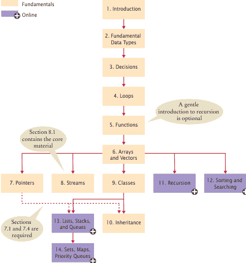

**图 1**
章节依赖关系

> 令人难忘的照片强化类比，并帮助学生记住概念。

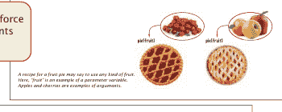

> 问题求解小节教授产生想法和评估所提解决方案的技巧，通常使用纸笔或其他实物。这些小节强调，使学生成功的大部分规划与问题求解都发生在计算机之外。

## 6.5 问题求解：通过操作实物发现算法 277

那么，这如何帮助我们解决交换数组前半部分和后半部分的问题呢？

让我们通过交换第五枚和第六枚硬币，把前六枚硬币放到正确位置。不过，作为 C++ 程序员，我们不会使用 swap；位置 2 和 4 的硬币。

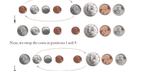

> **如何做**指南为常见编程任务提供分步指导，强调规划与测试。它们回答初学者的问题：“现在该做什么？”，并将关键概念整合到问题求解流程中。

## 如何做 1.1 用伪代码描述算法

在用 C++ 创建程序之前，你需要开发一个算法——一种得到解决方案的方法。你也许能用伪代码来思考算法，伪代码是一种由英文单词而不是计算机编程语言构成的语言。下面示例中的算法用于计算购物成本。然后你可以将伪代码翻译成 C++。

- **第 1 步** 确定输入和输出。

  在我们的示例问题中，有三个输入：

  - 购买价格和第 1 个折扣，第一辆车的价格和燃油效率；
  - 购买价格和第 2 个折扣，第二辆车的价格和燃油效率。

> **示例演练**将“如何做”中的步骤应用到一个不同的示例，展示如何用这些步骤来规划、实现和测试另一个编程问题的解决方案。

## 示例演练 1.1 编写铺地砖算法

沃德劳一家想要开发一种算法，以交替的颜色图案铺设地砖。

**表 3 C++ 中的变量名**

| 变量名 | 注释 |
|---|---|
| can_wheel | 变量名可以由字母、数字和下划线字符组成。 |
| x | 在数学中，x 是像 x 或 y 这样的单字符变量名。这是合法的，但使用单字符变量名不是好主意，因为更难理解。（参见第 38 页的编程提示 2.1。） |
| Can_wheel | 注意：变量名区分大小写。 |
| 2x | 错误：变量名不能以数字开头。 |
| can wheel | 错误：变量名不能包含空格。 |
| double | 错误：不能将保留字用作变量名。 |
| if/else | 错误：不能使用 / 或 + 之类的符号。 |


**图 2** for 循环的执行

| 步骤 | 代码 |
|---|---|
| 1 初始化计数器 | `for (counter = 1; counter <= 10; counter++)`<br>`cout << counter << endl;` |
| 2 检查条件 | `for (counter = 1; counter <= 10; counter++)`<br>`cout << counter << endl;` |
| 3 执行循环体 | `for (counter = 1; counter <= 10; counter++)`<br>`cout << counter << endl;` |
| 4 更新计数器 | `for (counter = 1; counter <= 10; counter++)`<br>`cout << counter << endl;` |
| 5 再次检查条件 | `for (counter = 1; counter <= 10; counter++)`<br>`cout << counter << endl;` |

渐进式图示追踪代码段，帮助学生直观理解程序流程。颜色的一致使用使变量和其他元素易于识别。

```
1 Function call
double result1 = cube_volume(2);
result1 = 8
size_1 = 2

2 Initializing function parameter variable
double result2 = cube_volume(10);
result2 = 1000
size_2 = 10

3 About to execute function body
double volume = side_length * side_length * side_length;
side_length = 10

4 Function return
return volume;
result2 = 1000
```

**图 3** 参数传递

- cube_volume 函数的参数变量 side_length 被创建。①
- 参数变量用调用 cube_volume 时传入的实参值初始化。②
- 参数变量被复制，即值、长度。③
- 参数变量是……值、长度、大小、长度 + 大小、长度……存储在变量 'cube' 中。④
- 返回值存储在调用 cube_volume 函数的函数中的变量 'result' 中。⑤

每节末尾的自测练习旨在促使学生深入思考新材料——并能在课堂上激发讨论。

### 检查点

- 13. 将 testabc.cpp 程序的 for 循环改写为 while 循环。
- 14. 这个循环会打印多少个数字？

```
for (int n = 10; n >= 0; n--)
{
 cout << n << endl;
}
```

- 15. 编写一个 for 循环，打印 10 到 20（含）之间的所有偶数。
- 16. 编写一个 for 循环，计算 1 到 10 的整数之和。

现在就练：你可以尝试本章末尾的这些练习：R4.2、R4.7、P4.12。

可选的工程练习让学生接触技术领域的应用。

```cpp
ch05/cube.cpp
1 #include <iostream>
2 using namespace std;
3
4 /**
5 Computes the volume of a cube.
6 @param side_length the side length of the cube
7 @return the volume
8 */
9 double cube_volume(double side_length)
10 {
11 double volume = side_length * side_length * side_length;
12 return volume;
13 }
14
15 int main()
16 {
17 double result1 = cube_volume(2);
18 double result2 = cube_volume(10);
19 cout << "A cube with side length 2 has volume " << result1 << endl;
20 cout << "A cube with side length 10 has volume " << result2 << endl;
21 return 0;
22 }
```

**程序运行**

```
A cube with side length 2 has volume 8
A cube with side length 10 has volume 1000
```

**程序清单**经过精心设计，便于阅读，远不止简单的颜色编码。函数通过细微的轮廓线加以区分。

**工程** P7.20 编写一个程序，模拟“人员运输系统”的控制软件，这是一组在两条同心圆形轨道上运行的无人驾驶列车。一组道岔允许列车切换轨道。
在你的程序中，外轨和内轨应各自分为十段。每个轨道段可容纳一列列车，列车可顺时针或逆时针移动。列车移动到其轨道上的相邻段，或者如果该段被占用，则移动到另一条轨道上的相邻段。
定义一个 Segment 结构。每个段都有一个指向其轨道中下一个和上一个段的指针，一个指向另一条轨道中下一个和上一个段的指针，

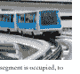

**常见错误**介绍学生常犯的错误类型，解释错误发生的原因以及如何处理。

## 常见错误 2.1——使用未定义的变量


该示例解释了在变量定义之前使用它的问题。

**编程提示**解释良好的编程实践，并通过手工跟踪等提示和技巧鼓励学生提高效率。

## 编程提示 3.6——手工跟踪


该示例将手工跟踪描述为一种理解程序是否正确运行的技术。

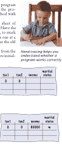

**专题**呈现可选主题，并对其他主题提供额外解释。

## 专题 6.2——排序算法


该示例描述了一种将序列元素按排序顺序排列的排序算法。

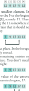

**趣闻**提供有关计算的历史和社会信息——以激发兴趣，并满足 ACM/IEEE 课程指南中“历史和社会背景”的要求。

## 趣闻 4.1——第一个 bug

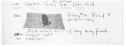

关于第一个 bug、其发现过程以及该术语历史的文章。

# 致谢

非常感谢 John Wiley & Sons 的 Beth Golub、Tom Kulesa、Andre Legaspi、Elizabeth Mills、Michael Berlin 和 Lisa Gee，以及出版服务团队的各位，感谢他们为本书项目付出的辛勤工作和支持。特别深切地感谢 Cindy Johnson，她以极大的耐心和对细节的关注使本书成为现实。我们还要感谢北达科他州立大学的 Jonathan Tolstedt 提供高质量解答；感谢肯塔基大学的 Brent Scales 修订和完善题库；感谢纽约大学理工学院的 Evan Gallagher 提供富有创意的 PowerPoint 幻灯片。

我们非常感谢许多审阅和/或对本书第一版进行课堂测试的个人。我们重视他们提出的许多宝贵改进建议。他们包括：

- Charles D. Allison，犹他谷州立学院
- Fred Annexstein，辛辛那提大学
- Stefano Basagni，东北大学
- Noah D. Barnett，弗吉尼亚理工大学
- Susan Bickford，塔拉哈西社区学院
- Ronald D. Bowman，阿拉巴马大学亨茨维尔分校
- Peter Breznay，威斯康星大学绿湾分校
- Richard Cacace，彭萨科拉初级学院，彭萨科拉
- Kuang-Nan Chang，东肯塔基大学
- Joseph DeLibero，亚利桑那州立大学
- Subramaniam Dharmarajan，亚利桑那州立大学
- Mary Dorf，密歇根大学
- Marty Dulberg，北卡罗来纳州立大学
- William E. Duncan，路易斯安那州立大学
- John Estell，俄亥俄北方大学
- Waleed Farag，宾夕法尼亚印第安纳大学
- Stephen Gilbert，橙海岸社区学院
- Kenneth Gitlitz，新罕布什尔技术学院
- Daniel Grigoletti，德弗里理工学院廷利帕克校区
- Barbara Guillott，路易斯安那州立大学
- Charles Halsey，里奇兰学院
- Jon Hanrath，伊利诺伊理工学院
- Neil Harrison，犹他谷大学
- Jurgen Hecht，安大略大学
- Steve Hodges，卡布里洛学院
- Jackie Jarboc，博伊西州立大学
- Debbie Kaneko，老道明大学
- Mir Behrad Khamesee，滑铁卢大学
- Sung-Sik Kwon，北卡罗来纳中央大学
- Lorrie Lehman，*北卡罗来纳大学夏洛特分校*
- Cynthia Lester，*塔斯基吉大学*
- Yanjun Li，*福特汉姆大学*
- W. James MacLean，*多伦多大学*
- LindaLee Massoud，*莫特社区学院*
- Charles W. Mellard，*德弗里理工学院欧文校区*
- Ethan V. Munson，*威斯康星大学密尔沃基分校*
- Philip Regalbuto，*特莱登特技术学院*
- Don Retzlaff，*北德克萨斯大学*
- Jeff Ringenberg，*密歇根大学安娜堡分校*
- John P. Russo，*温特沃斯理工学院*
- Kurt Schmidt，*德雷塞尔大学*
- Brent Seales，*肯塔基大学*
- William Shay，*威斯康星大学绿湾分校*
- Michele A. Starkey，*圣玛丽山学院*
- William Stockwell，*中俄克拉荷马大学*
- Jonathan Tolstedt，*北达科他州立大学*
- Boyd Trolinger，*比尤特学院*
- Muharrem Uyar，*纽约城市学院*
- Mahendra Velauthapillai，*乔治敦大学*
- Kerstin Voigt，*加州州立大学圣贝纳迪诺分校*
- David P. Voorhees，*勒莫因学院*
- Salih Yurttas，*德克萨斯农工大学*

特别感谢我们所有的课堂测试人员：

- Pani Chakrapani 和雷德兰兹大学的学生
- Jim Mackowiak 和长滩城市学院 LAC 的学生
- Suresh Muknahallipatna 和怀俄明大学的学生
- Murlidharan Nair 和印第安纳大学南本德分校的学生
- Harriette Roadman 和新河社区学院的学生
- David Topham 和奥洛恩学院的学生
- Dennie Van Tassel 和加维兰学院的学生


# 第 1 章

# 引言


## 本章目标

- 了解计算机的体系结构
- 了解机器语言和高级编程语言
- 熟悉你的编译器
- 编译并运行你的第一个 C++ 程序
- 识别编译时错误和运行时错误
- 用伪代码描述算法
- 理解编程活动

## 本章内容

- 1.1 什么是编程？ 2
- 1.2 计算机的结构 3
- 随机事实 1.1：ENIAC 与计算时代的黎明 5
- 1.3 机器代码和编程语言 6
- 随机事实 1.2：标准化组织 7
- 1.4 熟悉你的编程环境 7
- 编程提示 1.1：备份副本 11
- 1.5 分析你的第一个程序 11
- 语法 1.1：C++ 程序 12
- 语法 1.2：输出语句 13
- 常见错误 1.1：省略分号 14
- 专题 1.1：转义序列 14
- 1.6 错误 15
- 常见错误 1.2：拼写错误 16
- 1.7 问题解决：算法设计 17
- 操作指南 1.1：用伪代码描述算法 20
- 示例 1.1：编写铺设地板的算法 20


就像你收集工具、研究项目并制定计划来解决问题一样，在本章中，你将收集开始学习编程所需的基础知识。在简要介绍计算机硬件、软件和编程之后，你将学习如何编写和运行你的第一个 C++ 程序。你还将学习如何诊断和修复编程错误，以及如何在规划程序时使用伪代码来描述算法——即解决问题所需步骤的逐步描述。

## 1.1 什么是编程？

计算机以极快的速度连续执行非常基本的指令。

你可能已经使用计算机工作或娱乐。许多人使用计算机处理日常任务，如电子银行或写学期论文。计算机擅长这些任务。它们可以处理重复性的琐事，例如累加数字或在页面上放置文字，而不会感到无聊或疲惫。

计算机的灵活性是一个非常惊人的现象。同一台机器可以结算你的支票簿、打印你的学期论文，还能玩游戏。相比之下，其他机器执行的任务范围要窄得多；汽车负责驾驶，烤面包机负责烤面包。计算机能够执行各种各样的任务，因为它们运行不同的程序，每个程序都指示计算机处理特定的任务。

计算机程序是指令和决策的序列。

计算机本身是一种存储数据（数字、文字、图片）、与设备（显示器、音响系统、打印机）交互并执行程序的机器。计算机程序以极其细致的方式告诉计算机完成任务所需的步骤序列。物理计算机和外围设备统称为硬件。计算机执行的程序称为软件。

今天的计算机程序非常复杂，很难相信它们是由极其原始的操作组成的。一个典型的操作可能是以下之一：

- 在屏幕的这个位置放置一个红点。
- 将这两个数字相加。
- 如果这个值是负数，则从某条指令继续执行程序。

计算机用户会产生流畅交互的错觉，因为一个程序包含大量这样的操作，而且计算机能够以极快的速度执行它们。

编程是设计和实现计算机程序的行为。

设计和实现计算机程序的行为称为编程。在本书中，你将学习如何为计算机编程——即如何指挥计算机执行任务。

编写带有运动和音效的计算机游戏，或者支持花哨字体和图片的文字处理器，是一项复杂的任务，需要一支由许多高技能程序员组成的团队。你的第一次编程尝试将更加平凡。你在本书中学到的概念和技能构成了重要的基础，如果你最初的程序无法与你熟悉的复杂软件相媲美，你也不应感到失望。实际上，你会发现即使是简单的编程任务也会带来巨大的兴奋感。看着计算机精确而快速地完成一项需要你数小时辛苦劳作的任务，对程序进行微小的更改并立即看到改进，看着计算机成为你智力的延伸，这是一种奇妙的体验。


- 1. 在计算机上播放音乐需要什么？
- 2. 为什么 CD 播放器不如计算机灵活？
- 3. 计算机用户玩视频游戏需要了解哪些编程知识？

**动手练习** 现在你可以尝试本章末尾的练习：R1.1，R1.4。

## 1.2 计算机的结构

要理解编程过程，你需要对构成计算机的基本部件有一个初步的了解。我们将以个人计算机为例。较大的计算机具有更快、更大或更强大的组件，但它们的设计基本相同。

计算机的核心是**中央处理器（CPU）**（见图 1）。它由一个*芯片*或少量芯片组成。计算机芯片（集成电路）是一种带有塑料或金属外壳、金属连接器以及主要由硅构成的内部接线的组件。对于 CPU 芯片，内部接线极其复杂。例如，奔腾芯片（在撰写本书时个人计算机常用的 CPU）由数百万个称为*晶体管*的结构元件组成。

中央处理器（CPU）执行程序控制和数据处理。

也就是说，CPU 定位并执行程序指令；它执行加法、减法、乘法和除法等算术运算；它从外部存储器或设备获取数据并将数据存回。

计算机存储数据和程序。有两种存储类型。*主存储器*由内存芯片构成：只要供电，这些电子电路就能存储数据。*辅助存储器*通常是*硬盘*，它提供无需电力也能持久保存的廉价存储。硬盘由旋转的盘片组成，盘片涂有磁性材料，还有读写头，可以检测和改变盘片上的磁通量（见图 2）。

存储设备包括内存和辅助存储器。

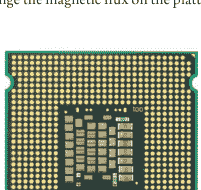

**图 1**  
中央处理器

图 3 给出了个人计算机体系结构的示意图。程序指令和数据（如文本、数字、音频或视频）存储在硬盘、DVD 等光盘上，或网络上的其他地方。当程序启动时，它被读入内存，CPU 就可以读取它。CPU 一次读取一条程序指令。在这些指令的指挥下，CPU 读取数据、修改数据并存储数据。有些程序指令会使 CPU 在显示屏幕上放置点，或使打印机让扬声器振动。由于这些动作大量且快速地发生，人类用户便感知到了图像和声音。某些程序指令会从键盘或鼠标读取用户输入。程序分析这些输入的性质，然后执行下一个适当的指令。


### 自测

- 4. 程序未运行时存储在何处？
- 5. 计算机的哪一部分执行加法、乘法等算术运算？

**动手练习** 现在你可以尝试本章末尾的练习：R1.2，R1.3。


## *随机事实 1.1* ENIAC 与计算时代的黎明

ENIAC（电子数值积分计算机）是第一台可用的电子计算机。它由宾夕法尼亚大学的 J. 普雷斯珀·埃克特和约翰·莫奇利设计，于 1946 年完成——比晶体管发明早两年。这台计算机安置在一个大房间里，由许多机柜组成，里面装有大约 18,000 个真空管（见图 2）。真空管以每天几个的速度烧毁。一位服务员推着装满真空管的购物车不断巡视并更换有缺陷的管子。这台计算机通过在面板上连接电线来编程。每一种布线配置都会为特定问题设置好计算机。要让计算机处理另一个问题，就必须重新插上电线。

ENIAC 的工作得到了美国陆军的支持，陆军对弹道表的计算感兴趣，这些表格会根据风阻、初速度和大气条件给出弹丸的轨迹。要计算弹道，必须求解某些微分方程的数值解；因此得名“数值积分器”。在 ENIAC 这类机器研制出来之前，人类从事这类工作，直到 20 世纪 50 年代，“计算机”一词指的都是这些人。ENIAC 后来被用于和平目的，例如美国人口普查数据的制表。

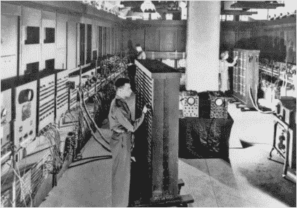

**图 4** ENIAC


```cpp
#include <iostream>

using namespace std;

int main()
{
    cout << "Hello, World!" << endl;
    return 0;
}
```

我们将在下一节中仔细分析这个程序。

无论你使用哪种编程环境，你都要先在编辑器窗口中输入程序语句。

编辑器是一种用于输入和修改文本（如 C++ 程序）的程序。

按照你的环境适用的步骤，新建一个文件并将其命名为 `hello.cpp`。（如果你的环境要求除文件名外还要提供项目名，请将项目命名为 `hello`。）严格按上面给出的程序指令输入。或者，在本书的程序源文件中找到电子副本，将其粘贴到你的编辑器中。

在编写这个程序时，请仔细注意各种符号，并记住 C++ 是区分大小写的。你必须严格按照程序清单中的大小写形式输入字母。你不能输入 `MAIN` 或 `End`。如果不小心，你会遇到问题——参见第 16 页的常见错误 1.2。

C++ 区分大小写。你必须小心区分大小写字母。

### 第 3 步 编译并运行程序

构建和运行 C++ 程序的过程在很大程度上取决于你的编程环境。在某些集成开发环境中，只需按一下按钮；而在其他环境中，你可能需要输入命令。当你运行测试程序时，屏幕上会出现以下信息（见图 5 和图 6）：

> 编译器将 C++ 程序翻译成机器码。

Hello, World!

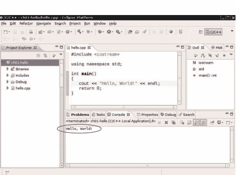

**图 5**
在集成开发环境中运行 `hello` 程序

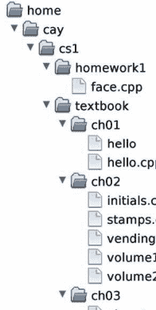

不过，你应该创建文件夹来组织你的工作。最好为你的编程课程单独创建一个文件夹，并在该文件夹中为每次作业再分别创建子文件夹。

如果你不自行指定文件夹，某些编程环境会将你的程序放在默认位置。在这种情况下，你需要弄清楚这些文件存放在哪里。

务必清楚你的文件在文件夹层级中的位置。当你提交文件进行评分以及制作*备份*副本时，这些信息至关重要。

> 在灾难发生之前，制定一个为你的工作保留备份副本的策略。

你将花费大量时间创建和改进 C++ 程序。很容易不小心删除一个文件，有时也会因计算机故障而丢失文件。为了避免重新创建丢失文件的烦恼，请养成将工作备份到存储盘或其他计算机上的习惯。

### 自测

- 9. 编程项目如何存储在计算机上？
- 10. 当你将可执行文件加载到文本编辑器中时，你期望看到什么？
- 11. 在编程项目中工作时，你如何保护自己免受数据丢失的影响？

**动手练习** 现在你可以尝试本章末尾的这些练习：R1.6。

## 语法 1.1 C++ 程序

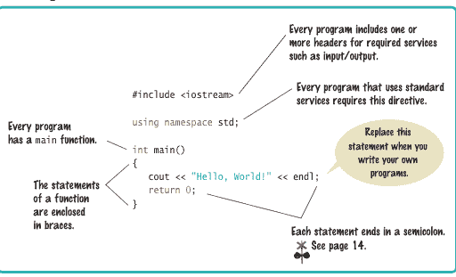

每个 C++ 程序都包含一个名为 `main` 的函数。

下一行

```cpp
using namespace std;
```

告诉编译器使用“标准命名空间”。命名空间是一种在大型程序中避免命名冲突的机制。你无需关心命名空间。对于你在本书中将要编写的程序，你总是使用标准命名空间。只需在每个程序的开头，在 `#include` 指令下方添加 `using namespace std;` 即可。

结构

```cpp
int main()
{
    ...
    return 0;
}
```

定义了一个名为 `main` 的函数，它“返回”一个“整数”（即没有小数部分的整数，C++ 中称为 `int`），值为 0。该值表示程序成功结束。函数是执行特定任务的一组编程指令。每个 C++ 程序都必须有一个 `main` 函数。大多数 C++ 程序除了 `main` 之外还包含其他函数，但我们要到第 5 章才会讨论函数和返回值。

目前，最好把所有这些部分看作是编写一个简单程序所必需的“管道”。只需将你想要执行的代码放在 `main` 函数的花括号内即可。（C++ 程序的基本结构如语法 1.1 所示。）

要向屏幕显示值，你可以使用名为 `cout` 的实体和 `<<` 运算符（有时称为插入运算符）。例如，语句

```cpp
cout << 39 + 3;
```

显示数字 42。

使用 `cout` 和 `<<` 运算符向屏幕显示值。

## 语法 1.2 输出语句

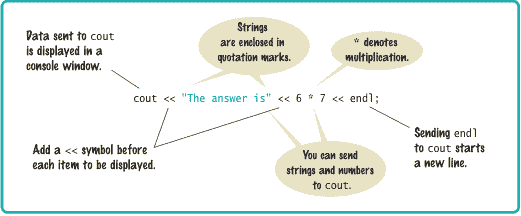

将文本字符串用引号括起来。

语句

```cpp
cout << "Hello";
```

显示字符串 `Hello`。字符串是字符序列。你必须将字符串内容放在引号内，这样编译器才能知道你确实指的是文本 `"Hello"`，而不是同名函数。

使用 `+` 将两个数相加，使用 `*` 将两个数相乘。

你可以向 `cout` 发送多个项目。在每个项目前使用一个 `<<`。例如，

```cpp
cout << "The answer is " << 6 * 7;
```

显示 `The answer is 42`（在 C++ 中，`*` 表示乘法）。

向 `cout` 发送 `endl` 以结束一行显示输出。

`endl` 符号表示行尾标记。当该标记发送到 `cout` 时，光标会移动到下一行的第一列。如果不使用行尾标记，下一个显示的项目将直接跟在当前字符串后面，位于同一行。在这个程序中我们只打印了一项，但通常我们会要打印多个项目，因此以行尾标记结束每一行输出是一个好习惯。

每条语句以分号结尾。

最后，请注意 C++ 中的每条语句都以分号结尾，就像每个英文句子都以句号结尾一样。


- 12. 如何修改 `hello.cpp` 程序以向你问候？
- 13. 这个程序有什么问题？

  ```cpp
  #include <iostream>
  using namespace std;
  int main()
  {
      cout << Goodbye, World! << endl;
      return 0;
  }
  ```

- 14. 以下语句序列会打印什么？

  ```cpp
  cout << "Hello";
  cout << "World";
  ```

- 15. 以下语句会打印什么？

  ```cpp
  cout << 2 * 2 << 2;
  ```

- 16. 以下语句会打印什么？

  ```cpp
  cout << "Hello" << endl << endl << "World";
  ```

## 动手练习

现在你可以尝试本章末尾的这些练习：R1.7、P1.1、P1.2。

## 常见错误 1.1


### 遗漏分号

在 C++ 中，每条语句都必须以分号结尾。忘记输入分号是一个常见错误。这会使编译器感到困惑，因为编译器使用分号来查找一条语句在哪里结束、下一条从哪里开始。编译器不会使用行尾或右花括号来识别语句的结束。例如，编译器会将

```cpp
cout << "Hello, World!" << endl
return 0;
```

视为一条语句，就好像你写成了

```cpp
cout << "Hello, World!" << endl return 0;
```

然后它无法理解第二条语句，因为它不希望在一个输出命令中间出现单词 `return`。补救方法很简单：只须扫描每条语句，看是否有终止分号，就像你检查每个英文句子是否都以句号结尾一样。

## 专题 1.1


### 转义序列

如何显示包含引号的字符串，例如

```text
Hello, "World"
```

你不能使用

```cpp
cout << "Hello, "World"";
```

当编译器读到 `"Hello, "` 时，它认为字符串已结束，然后对 `World` 感到非常困惑。编译器是一根筋的，如果对输入进行简单分析后无法理解，它们就会拒绝继续并报告错误。相比之下，人类很可能会意识到第二个和第三个引号本应是字符串的一部分。

那么，我们如何才能在屏幕上显示引号呢？C++ 的设计者提供了一个“逃生舱”。在每个引号前加一个反斜杠字符（`\`），像这样：

```cpp
cout << "Hello, \"World\"";
```

序列 `\"` 表示一个字面引号，而不是字符串的结束。这样的序列称为转义序列。

还有一些其他转义序列。如果你真的想在屏幕上显示一个反斜杠，可以使用转义序列 `\\`。语句

```cpp
cout << "Hello\\World";
```

会打印

```text
Hello\World
```


输出。因为运行时错误是由程序中的逻辑缺陷引起的，所以它们常被称为**逻辑错误**。某些类型的运行时错误非常严重，以至于会产生**异常**：来自处理器的信号，它会中止程序并给出错误消息。例如，如果你的程序包含语句 `cout << 1 / 0;`，你的程序可能会因“除以零”异常而终止。

在程序开发过程中，错误不可避免。一旦程序超过几行，要一次性准确无误地输入它就需要超乎常人的专注力。你会发现自己常常漏掉分号或引号，频率超出你的意愿，但编译器会帮你查出这些问题。

运行时错误更麻烦。编译器不会发现它们——事实上，只要语法正确，编译器会乐于翻译任何程序——但生成的程序会做错事。程序作者有责任测试程序并发现任何运行时错误。程序测试是一个重要主题，你将在本书中多次遇到。

程序员负责检查和测试程序，以防运行时错误。


- 17. 假设你从 `hello.cpp` 程序中省略了 `main` 后的 `()` 字符。你会得到编译时错误还是运行时错误？
- 18. 使用计算机时，你可能经历过程序“崩溃”（自行退出）或“挂起”（无法响应你的输入）。这种行为是编译时错误还是运行时错误？
- 19. 当程序存在编译器错误时，为什么不能测试它的运行时错误？

### 练习一下

现在你可以尝试本章末尾的这些练习：R1.10、R1.11。

## 常见错误 1.2


### 单词拼写错误

如果你不小心拼错了一个单词，可能会发生奇怪的事情，而且错误消息未必总能完全清楚地表明出了什么问题。下面是一个简单拼写错误如何导致麻烦的好例子：

```cpp
#include <iostream>

using namespace std;

int Main()
{
    cout << "Hello, World!" << endl;
    return 0;
}
```

这段代码定义了一个名为 `Main` 的函数。编译器不会认为它与 `main` 函数相同，因为 `Main` 以大写字母开头，而 C++ 语言是**区分大小写的**。大写和小写字母被认为完全不同，对编译器来说，`Main` 与 `main` 的匹配程度并不比 `cout` 更高。编译器会编译你的 `Main` 函数，但当链接器准备构建可执行文件时，它会抱怨缺少 `main` 函数并拒绝链接程序。当然，“缺少 main 函数”这条消息应该能提示你去哪里查找错误。

如果你收到的错误消息似乎表明编译器找错了方向，那么检查拼写和大小写是个好主意。在 C++ 中，大多数名称只使用小写字母。如果你拼错了符号名称（例如用 out 而不是 cout），编译器会抱怨“未定义符号”。这条错误消息通常是一个很好的线索，说明你犯了拼写错误。

```
Repeat the following steps while the balance is less than $20,000
Add 1 to the year value.
Compute the interest as balance × 0.05 (i.e., 5 percent interest)
Add the interest to the balance.
```

| 年份 | 利息 | 余额 |
|---:|---:|---:|
| 0 |  | 10000 |
| 1 | 500.00 | 10500.00 |
| … | … | … |
| 14 | 942.82 | 19799.32 |
| 15 | 989.96 | 20789.28 |

```
Report the final year value as the answer.
```

伪代码是对解决问题的一系列步骤的非正式描述。

当然，这些步骤还不是计算机能理解的语言，但你很快就会学会如何用 C++ 表述它们。这种非正式描述称为**伪代码**。

伪代码没有严格要求，因为它由人类读者阅读，而不是计算机程序。以下是本书中将使用的几种伪代码语句：

- 使用如下语句描述某个值如何设置或更改：

  `total cost = purchase price + operating cost`

  或

  `Multiply the balance value by 1.05.`

  或

  `Remove the first and last character from the word.`

- 你可以如下描述决策和重复：

  `If total cost 1 < total cost 2`

  `While the balance is less than $20,000`

  `For each picture in the sequence`

  使用缩进指示哪些语句应被选择或重复：

  ```
  For each car
      operating cost = 10 × annual fuel cost
      total cost = purchase price + operating cost
  ```

  这里，缩进表示两条语句都应对每辆车执行。

- 用如下语句表示结果：

  `Choose car 1.`

  `Report the final year value as the answer.`

确切的措辞并不重要。重要的是，伪代码描述的步骤序列是

- 无歧义的
- 可执行的
- 可终止的

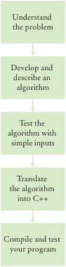

**图 9**  
软件开发过程

当每一步做什么以及下一步去哪里都有精确指令时，方法就是*无歧义的*。没有猜测或发挥创造力的余地。当每一步都能在实践中执行时，方法就是*可执行的*。如果我们要求使用未来年份实际收取的利率，而不是每年固定的 5% 利率，我们的方法就不可执行，因为任何人都无法知道那个利率会是多少。如果方法最终会结束，它就是*可终止的*。在我们的例子中，需要稍加思考才能看出该方法不会永远进行下去：每执行一步，余额至少增加 $500，因此最终必然达到 $20,000。


*算法是寻找解决方案的配方。*

一个无歧义、可执行且可终止的步骤序列称为**算法**。我们已经找到了解决投资问题的算法，因此可以通过给计算机编程来找到解决方案。算法的存在是为任务编程的基本前提。在开始编程之前，你需要先发现并描述你要解决的任务的算法（见图 9）。

> 解决问题的算法是一个无歧义、可执行且可终止的步骤序列。


### 自测

- 20. 假设利率是 20%。投资翻倍需要多长时间？

- 21. 假设你的手机运营商对最多 300 分钟通话收费 $29.95，之后每分钟额外收费 $0.45，另加 12.5% 的税费。给出一个根据给定分钟数计算月费的算法。

- 22. 考虑以下伪代码，用于从一系列照片中找出最有吸引力的照片：

  ```
  Pick the first photo and call it "the best so far".
  For each photo in the sequence
      If it is more attractive than the "best so far"
          Discard the "best so far".
          Call this photo "the best so far".
  The photo called "the best so far" is the most attractive photo in the sequence.
  ```

  这是一个能找到最有吸引力照片的算法吗？

- 23. 假设自测 22 中的每张照片都有价格标签。给出一个找出最贵照片的算法。

- 24. 假设你有一组随机排列的黑白弹珠，想重新排列它们，使黑色弹珠和白色弹珠分组在一起。考虑这个算法：

  ```
  Repeat until sorted
      Locate the first black marble that is preceded by a white marble, and switch them.
  ```

  该算法对序列 ○●○●○● 会做什么？列出步骤，直到算法停止。

- 25. 假设你有一组随机排列的彩色弹珠。考虑以下伪代码：

  ```
  Repeat until sorted
      Locate the first marble that is preceded by a marble of a different color, and switch them.
  ```

  为什么这不是一个算法？

### 练习一下

现在你可以尝试本章末尾的这些练习：R1.13、R1.14。

## 如何做 1.1：用伪代码描述算法


在准备好用 C++ 编写程序之前，你需要开发一个算法——一种针对特定问题得出解决方案的方法。用伪代码描述该算法：用英语表述的一系列精确步骤。


例如，考虑这个问题：你可以选择购买两辆车。其中一辆比另一辆更省油，但也更贵。你知道两辆车的价格和燃油效率（以英里每加仑，mpg 为单位）。你计划将这辆车保留十年。假设汽油价格为每加仑 $4，每年行驶 15,000 英里。你会用现金支付车款，不考虑融资成本。哪辆车更划算？

**第 1 步** 确定输入和输出。

在我们的示例问题中，有以下输入：

- 购买价格1和燃油效率1，即第一辆车的价格和燃油效率（以 mpg 为单位）
- 购买价格2和燃油效率2，即第二辆车的价格和燃油效率

我们只想知道哪辆车更值得买。这就是期望的输出。

**第 2 步** 将问题分解为更小的任务。

对于每辆车，我们需要知道驾驶它的总成本。让我们分别为每辆车进行这项计算。一旦得到每辆车的总成本，我们就可以判断哪辆车更划算。

每辆车的总成本是购买价格 + 运营成本。

我们假设十年内使用量和汽油价格不变，因此运营成本取决于驾驶该车一年的成本。

运营成本是 10 × 年度燃料成本。

年度燃料成本是每加仑价格 × 年度燃料消耗量。

年度燃料消耗量是每年行驶英里数 / 燃油效率。例如，如果你驾驶该车行驶 15,000 英里，燃油效率为 15 英里/加仑，则该车消耗 1,000 加仑。


### 步骤 3

用伪代码描述每个子任务。在描述中，安排各步骤的顺序，使任何中间值都在其他计算需要用到之前先计算出来。例如，在计算出运营成本后，再列出这个步骤：

```text
total cost = purchase price + operating cost
```

以下是决定购买哪辆汽车的算法：

```text
For each car, compute the total cost as follows:
    annual fuel consumed = annual miles driven / fuel efficiency
    annual fuel cost = price per gallon × annual fuel consumed
    operating cost = 10 × annual fuel cost
    total cost = purchase price + operating cost
If total cost1 < total cost2
    Choose car 1.
Else
    Choose car 2.
```

### 步骤 4

通过解决一个实际问题来测试你的伪代码。我们将使用以下示例值：

- 汽车1：25,000美元，50英里/加仑
- 汽车2：20,000美元，30英里/加仑

以下是对第一辆汽车成本的计算：

```text
annual fuel consumed = annual miles driven / fuel efficiency = 15000 / 50 = 300
annual fuel cost = price per gallon × annual fuel consumed = 4 × 300 = 1200
operating cost = 10 × annual fuel cost = 10 × 1200 = 12000
total cost = purchase price + operating cost = 25000 + 12000 = 37000
```

类似地，第二辆汽车的总成本为40,000美元。因此，该算法的输出是选择汽车1。

## 示例解析 1.1

### 编写铺设地板的算法

本示例演示了如何开发一种算法，以交替的颜色图案铺设瓷砖。


## 本章小结

### 定义“计算机程序”和编程。

- 计算机以极快的速度连续执行非常基本的指令。
- 计算机程序是指令和决策的序列。
- 编程是设计和实现计算机程序的行为。

### 描述计算机的组成部分。

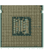

- 中央处理器（CPU）执行程序控制和数据处理。
- 存储设备包括内存和辅助存储。

**R1.12** 编写一个算法来解决以下问题：一个银行账户初始有10,000美元。利息按月复利计算，年利率为6%（每月0.5%）。每月取出500美元用于支付大学开支。多少年后账户会耗尽？

**R1.13** 考虑练习R1.12中的问题。假设这些数值（10,000美元、6%、500美元）可以由用户选择。是否存在某些值会使你开发的算法无法终止？如果是，请修改算法以确保它始终能够终止。

**R1.14** 为了估算粉刷房子的成本，油漆工需要知道外墙的表面积。开发一个计算该数值的算法。输入为房子的宽度、长度和高度，门窗的数量及其尺寸。（假设所有门窗尺寸相同。）

**R1.15** 你想决定是开车上班还是乘火车。你知道从家到工作地点的单程距离，以及汽车的燃油效率（英里/加仑）。你也知道单程火车票的价格。你假设汽油价格为每加仑4美元，汽车保养费用为每英里5美分。编写一个算法来决定哪种通勤方式更便宜。

**R1.16** 你想知道汽车使用中，多大的比例用于上下班通勤，多大的比例用于个人用途。你知道从家到工作地点的单程距离。在某一特定时期内，你记录了里程表上的起始和结束里程数，以及工作日天数。编写一个算法来解决这个问题。

**R1.17** 在第20页的“操作指南 1.1”描述的问题中，你对汽油价格和年使用量做了假设。理想情况下，你希望在不做这些假设的情况下知道哪辆车更划算。为什么计算机程序无法解决这个问题？

**R1.18** π的值可以按照以下公式计算：

$$\frac{\pi}{4} = 1 - \frac{1}{3} + \frac{1}{5} - \frac{1}{7} + \frac{1}{9} - \cdots$$

编写一个算法来计算π。由于该公式是无穷级数，而算法必须在有限步内停止，因此当结果确定到六位有效数字时，就应停止。

**R1.19** 假设你让弟弟负责备份你的工作。编写一套详细的指令来执行他的任务。说明他应该多久备份一次，以及需要将哪些文件从哪个文件夹复制到哪个位置。说明他应该如何验证备份是否正确完成。

**工程 R1.20** 旧金山出租车委员会设定了2010年的收费标准：

- 最初的1/5英里：3.10美元
- 每增加1/5英里或不足1/5英里：0.45美元
- 每分钟等待或交通延误：0.45美元


对于速度低于盈亏平衡点的每一分钟，将按“等待或交通延误”收费，而不是按里程收费。盈亏平衡点是指在一分钟内行驶1/5英里的速度。

假设出租车以恒定速度行驶，开发一个算法，根据给定的行驶距离和时间计算车费。

### 工程 P1.16

气态巨行星（木星、土星、天王星和海王星）的大气主要由氢气（H₂）组成，其次为氦气（He）。类地行星的大气则主要包含二氧化碳（CO₂）和氮气（N₂）：金星和火星以二氧化碳（CO₂）为主、氮气（N₂）为辅；而地球大气则主要是氮气（N₂），其次为氧气（O₂）。编写一个程序，将这些信息以表格形式输出，包含四列：行星类型、行星名称、主要大气成分和次要大气成分。


### 工程 P1.17

编写一个程序，使用 `/`、`\`、`-`、`|`、`+` 等字符绘制出下图中的线条。将 Ω 写为“Ohm”。

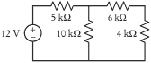

## 自测题答案

1. 读取CD上的数据并将输出发送到扬声器和屏幕的程序。
2. CD播放机只能做一件事——播放音乐CD。它不能执行程序。
3. 什么也不做。
4. 在辅助存储设备中，通常是硬盘。
5. 中央处理器。
6. 软件。
7. 不是——编译器是面向程序员的，用于将高级编程指令翻译成机器代码。
8. 系统软件和嵌入式系统。
9. 程序存储在文件中，文件存储在文件夹或目录中。
10. 你会看到一个看似随机的字符和符号序列。
11. 备份你的文件和文件夹。
12. 将“World”替换为你的名字，例如：
    `cout << "Hello, Harry!" << endl;`
13. Goodbye, World! 没有用引号括起来。
14. 它会输出 `HelloWorld`，没有空格或逗号。
15. 输出 `42`，没有空格。
16. `Hello`

    `World`

    两个词之间有一个空行。
17. 编译时错误。
18. 这是运行时错误。毕竟，程序必须经过编译才能运行。
19. 当程序存在编译错误时，不会生成可执行文件，也就没有可以运行的程序。
20. 4年：

    | 年份 | 金额 |
    |---:|---:|
    | 0 | 10,000 |
    | 1 | 12,000 |
    | 2 | 14,400 |
    | 3 | 17,280 |
    | 4 | 20,736 |

21. 分钟数是否最多为300？
    - 如果是，答案为 $29.95 × 1.125 = $33.70。
    - 如果不是：
      1. 计算差值：（分钟数）− 300。
      2. 将该差值乘以0.45。
      3. 加上 $29.95。
      4. 将总额乘以1.125。这就是答案。
22. 不能。“如果它比当前最佳更有吸引力”这一步无法执行，因为没有任何客观方法可以判断两张照片中哪一张更有吸引力。

```text
23. Pick the first photo and call it "the most expensive so far".
For each photo in the sequence
    If it is more expensive than "the most expensive so far"
        Discard "the most expensive so far".
        Call this photo "the most expensive so far".
The photo called "the most expensive so far" is the most expensive photo in the sequence.
```

24. 序列中第一个前一个弹珠为白色的黑色弹珠会被标记为蓝色：

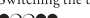

交换这两颗弹珠后得到：


下一个要交换的黑色弹珠是：


得到：


接下来的步骤是：


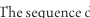

现在序列已经排序。

25. 该序列不会终止。考虑输入 ○●○●○●。最前面的两颗弹珠会一直被交换。


# 第2章 基本数据类型


## 本章目标

- 能够定义并初始化变量和常量
- 理解整数和浮点数的属性与局限性
- 在 C++ 中编写算术表达式和赋值语句
- 理解注释和良好代码布局的重要性
- 创建读取并处理输入、并显示结果的程序
- 使用标准 C++ string 类型处理字符串

## 本章内容

- **2.1 变量** 30
    - *语法2.1：* 变量定义 31
    - *语法2.2：* 赋值 34
    - *常见错误2.1：* 使用未定义的变量 37
    - *常见错误2.2：* 使用未初始化的变量 37
    - *编程提示2.1：* 选择描述性变量名 38
    - *专题2.1：* C++ 中的数值类型 38
    - *专题2.2：* 数值范围与精度 39
    - *编程提示2.2：* 不要使用魔法数字 39
- **2.2 算术运算** 40
    - *常见错误2.3：* 意外的整数除法 43
    - *常见错误2.4：* 括号不匹配 44
    - *常见错误2.5：* 忘记包含头文件 45
    - *常见错误2.6：* 舍入误差 45
    - *编程提示2.3：* 表达式中的空格 46
    - *专题2.3：* 类型转换 46
    - *专题2.4：* 结合赋值与算术运算 47
    - *趣味事实2.1：* 奔腾浮点缺陷 47
- **2.3 输入和输出** 48
    - *语法2.3：* 输入语句 48
- **2.4 问题求解：先手工完成** 52
    - *工作示例2.1：* 计算旅行时间 ✥
    - *操作指南2.1：* 执行计算 54
    - *工作示例2.2：* 计算邮票费用 ✥
- **2.5 字符串** 56
    - *趣味事实2.2：* 国际字母表与 Unicode 61


数字和字符串（例如这块显示板上的内容）是任何 C++ 程序中的重要数据类型。在本章中，你将学习如何处理数字和文本，以及如何编写简单程序来用它们执行有用的任务。

## 2.1 变量

当程序执行计算时，你会希望存储值，以便以后使用。在 C++ 程序中，你使用变量来存储值。在本节中，你将学习如何定义和使用变量。

为了说明变量的用法，我们将开发一个程序来解决以下问题。软饮料以罐装和瓶装出售。一家商店以与两升瓶相同的价格出售一包六罐装、每罐12盎司的罐装饮料。你应该买哪一种？（12液量盎司约等于0.355升。）

在我们的程序中，我们将为每包罐数以及每罐容量定义变量。然后，我们将计算一包六罐装饮料的升数并打印答案。


哪种装得汽水更多？一包六罐装12盎司罐装饮料，还是一瓶两升装饮料？

### 2.1.1 变量定义

下面的语句定义了一个名为 `cans_per_pack` 的变量：

```
int cans_per_pack = 6;
```

变量是带有名称的存储位置。

变量是计算机程序中的存储位置。每个变量都有一个名称，并保存一个值。

变量类似于停车库中的停车位。停车位有一个标识符（例如“J 053”），并且可以停放一辆车。变量有一个名称（例如 `cans_per_pack`），并且可以保存一个值（例如 6）。


与计算机程序中的变量一样，停车位也有标识符和内容。

### 语法2.1 变量定义

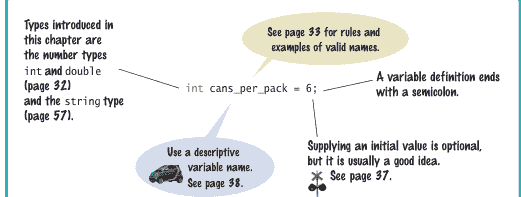

> 定义变量时，通常要指定一个初始值。
>
> 定义变量时，还要指定其值的类型。

定义变量时，通常要**初始化**它。也就是说，你要指定应存储在变量中的值。再次考虑这个变量定义：

```
int cans_per_pack = 6;
```

变量 `cans_per_pack` 用值 6 初始化。

就像停车位只限于停放某种类型的车辆（例如小型汽车、摩托车或电动汽车）一样，C++ 中的变量存储特定**类型**的数据。C++ 支持相当多的数据类型：数字、文本字符串、文件、日期以及许多其他类型。每当定义变量时，都必须指定类型（见语法2.1）。

`cans_per_pack` 变量是一个整数，即没有小数部分的整数。在 C++ 中，这种类型称为 `int`。（有关 C++ 中数字类型的更多信息，请参见下一节。）

注意，类型位于变量名之前：

```
int cans_per_pack = 6;
```

表1展示了变量定义的各种变体。


每个停车位适合特定类型的车辆，正如每个变量保存特定类型的值。

> 浮点数使用 double 类型。

当需要小数部分时（例如数字 0.355），我们使用**浮点数**。C++ 中最常用的浮点数类型称为 double。（如果你想知道原因，请阅读第38页的专题2.1。）下面是一个浮点变量的定义：

```
double can_volume = 0.355;
```

当 6 或 0.355 这样的值出现在 C++ 程序中时，称为数字字面量。表2展示了如何在 C++ 中书写整数字面量和浮点数字面量。

### 2.1.3 变量名

定义变量时，应选择一个能说明其用途的名称。例如，使用描述性名称（如 `can_volume`）比使用简短名称（如 `cv`）更好。

在 C++ 中，变量名有几条简单规则：

- 1. 变量名必须以字母或下划线（`_`）字符开头，其余字符必须是字母、数字或下划线。
- 2. 不能使用 `$` 或 `%` 等其他符号。名称中也不允许有空格。可以改用下划线，如 `can_volume`。
- 3. 变量名**区分大小写**，也就是说，`can_volume` 和 `can_Volume` 是不同的名称。因此，最好在变量名中只使用小写字母。
- 4. 不能使用 `double` 或 `return` 等**保留字**作为名称；这些词专门保留用于其特殊的 C++ 含义。（见附录 B。）

表3展示了 C++ 中合法和非法变量名的示例。

**表3 C++ 中的变量名**

| 变量名 | 注释 |
|---|---|
| `can_volume1` | 变量名由字母、数字和下划线字符组成。 |
| `x` | 在数学中，你会使用 `x` 或 `y` 这样的短变量名。这在 C++ 中是合法的，但并不常见，因为它会使程序更难理解（见第38页的编程提示2.1）。 |
| ⚠️ `can_Volume` | **注意：** 变量名区分大小写。此变量名与 `can_volume` 不同。 |
| 🚫 `6pack` | **错误：** 变量名不能以数字开头。 |
| 🚫 `can volume` | **错误：** 变量名不能包含空格。 |
| 🚫 `double` | **错误：** 不能使用保留字作为变量名。 |
| 🚫 `1tr/fl.02` | **错误：** 不能使用 / 或 . 等符号。 |

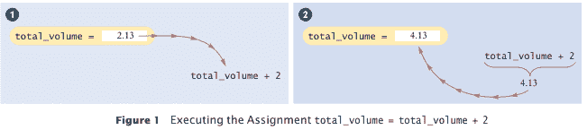

### 2.1.5 常量

> 不能更改定义为 const 的变量的值。

当变量使用保留字 const 定义时，其值永远不能改变。常量通常使用大写字母书写，以便在视觉上与普通变量区分开：

```
const double BOTTLE_VOLUME = 2;
```

在程序中使用具名常量来解释数值的含义是一种良好的编程风格。例如，比较以下语句

```
double total_volume = bottles * 2;
```

和

```
double total_volume = bottles * BOTTLE_VOLUME;
```

阅读第一条语句的程序员可能不理解数字 2 的意义。第二条语句使用具名常量，使计算清晰得多。

### 2.1.6 注释

> 使用注释为阅读代码的人添加说明。编译器会忽略注释。

随着程序变得更复杂，你应该添加注释，即为代码的人类读者提供说明。下面是一个例子：

```
const double CAN_VOLUME = 0.355; // Liters in a 12-ounce can
```

这条注释向人类读者解释了值 0.355 的意义。编译器完全不处理注释。它会忽略从 // 分隔符到行尾的所有内容。


你可以使用 `//` 语法编写单行注释。如果注释跨越多行，请将其放在 `/*` 和 `*/` 分隔符之间。编译器会忽略这些分隔符及其之间的所有内容。

这是一个典型示例：程序开头的一段长注释，用于说明程序的目的：

```cpp
/*
   This program computes the volume (in liters) of a six-pack of soda
   cans and the total volume of a six-pack and a two-liter bottle.
*/
```

现在我们准备完成程序。下面的程序演示了变量、常量和赋值语句的使用。程序显示六罐装饮料的体积，以及六罐装加一瓶两升瓶装饮料的总体积。我们用常量表示罐装和瓶装的体积。`total_volume` 变量初始化为罐装体积，然后通过赋值语句加上瓶装体积。

### ch02/volume1.cpp

```cpp
#include <iostream>

using namespace std;

/*
   This program computes the volume (in liters) of a six-pack of soda
   cans and the total volume of a six-pack and a two-liter bottle.
*/

int main()
{
   int cans_per_pack = 6;
   const double CAN_VOLUME = 0.355; // Liters in a 12-ounce can
   double total_volume = cans_per_pack * CAN_VOLUME;

   cout << "A six-pack of 12-ounce cans contains "
        << total_volume << " liters." << endl;

   const double BOTTLE_VOLUME = 2; // Two-liter bottle
   total_volume = total_volume + BOTTLE_VOLUME;

   cout << "A six-pack and a two-liter bottle contain "
        << total_volume << " liters." << endl;

   return 0;
}
```

### 程序运行

```
A six-pack of 12-ounce cans contains 2.13 liters.
A six-pack and a two-liter bottle contain 4.13 liters.
```


1. 定义一个适合存放一箱中瓶子数量的变量。
2. 下面的变量定义有什么问题？  
   `int ounces per liter = 28.35`
3. 定义并初始化两个变量 `unit_price` 和 `quantity`，分别用于存放单瓶单价和购买的瓶数。使用合理的初始值。
4. 使用自测题 3 中定义的变量显示总购买价格。
5. 有些饮料以四罐装而不是六罐装出售。你会如何修改 `volume1.cpp` 程序来计算总体积？
6. 这条注释有什么问题？
   ```cpp
   double can_volume = 0.355; /* Liters in a 12-ounce can //
   ```
7. 假设 `volume1.cpp` 程序中 `cans_per_pack` 变量的类型从 `int` 改为 `double`，对程序会有什么影响？
8. 为什么 `volume1.cpp` 程序中的 `total_volume` 变量不能声明为 `const`？
9. 你会如何用停车位类比来解释赋值？

## 动手练习

现在你可以尝试本章末尾的练习：R2.1、R2.2、P2.1。

## 常见错误 2.1

### 使用未定义的变量


必须在使用变量之前定义它。例如，下面这条语句序列是不合法的：

```cpp
double can_volume = 12 * liter_per_ounce;
double liter_per_ounce = 0.0296;
```

在程序中，语句是按顺序编译的。当编译器编译到第一条语句时，它还不知道 `liter_per_ounce` 会在下一行定义，因此会报告错误。

## 常见错误 2.2

### 使用未初始化的变量


如果你定义了一个变量但未对其初始化，程序的行为可能变得不可预测。要理解原因，请考虑定义变量时会发生什么。内存中会划出恰好足以存放你所指定类型值的空间。例如，对于定义

```cpp
int bottles;
```

会保留一块足以容纳整数的内存。该内存中已经存在*某个*值。毕竟，你得到的并不是崭新的晶体管——只是一块之前被使用过的内存区域，里面充满了先前计算留下的残留数据。（在这一点上，变量与停车位不同。停车位可以是空的，没有停放车辆。但变量始终持有某个值。）

如果你在未初始化的情况下使用该变量，那么先前那个值就会被使用，从而产生不可预测的结果。例如，考虑以下程序片段：

```cpp
int bottles; // Forgot to initialize
int bottle_volume = bottles * 2; // Result is unpredictable
```

无法知道会计算出什么值。如果不走运，你在家运行程序时可能会出现一个看似合理的值，而在程序被评分时却产生完全不同的结果。

## 编程技巧 2.1


### 选择具有描述性的变量名

我们本可以使用更短的变量名来省去大量输入，例如：

```cpp
double cv = 0.355;
```

不过，请将这个定义与我们实际使用的定义进行比较。哪一个更容易阅读？这根本没有可比性。读 `can_volume` 比读 `cv` 然后还得琢磨它一定是指“罐装体积”要省事得多。

在实际编程中，当程序由多人编写时，这一点尤其重要。你可能很清楚 `cv` 代表罐装体积而不是当前速度，但对于多年后需要更新你代码的人来说，这也很明显吗？更进一步说，三个月后你再看这些代码时，你自己还能记得 `cv` 是什么意思吗？

## 专题 2.1


### C++ 中的数值类型

除了 `int` 和 `double` 类型之外，C++ 还有几种其他数值类型。

C++ 有两种浮点类型。`float` 类型使用的存储空间是本书中使用的 `double` 类型的一半，但它只能存储 6–7 位数字。许多年前，当计算机的内存远不如今天时，`float` 是浮点计算的标准类型，程序员只有在需要额外位数时才会奢侈地使用“双精度”。如今，`float` 类型已很少使用。

顺便说一下，这些数之所以被称为“浮点”，是因为它们在计算机中的内部表示方式。考虑数字 29660、2.96 和 0.0296。它们可以用非常相似的方式表示；也就是说，作为有效数字序列——296——以及小数点位量的指示。当这些值乘以或除以 10 时，只有小数点的位置发生变化；它“浮动”。计算机使用二进制而不是十进制，但原理是相同的。

#### 表 4 数值类型

| 类型 | 典型范围 | 典型大小 |
| --- | --- | --- |
| `int` | −2,147,483,648 ... 2,147,483,647（约 20 亿） | 4 字节 |
| `unsigned` | 0 ... 4,294,967,295 | 4 字节 |
| `short` | −32,768 ... 32,767 | 2 字节 |
| `unsigned short` | 0 ... 65,535 | 2 字节 |
| `long long` | −9,223,372,036,854,775,808 ... 9,223,372,036,854,775,807 | 8 字节 |
| `double` | 双精度浮点类型，范围约为 ±10<sup>308</sup>，约 15 位有效十进制数字 | 8 字节 |
| `float` | 单精度浮点类型，范围约为 ±10<sup>38</sup>，约 7 位有效十进制数字 | 4 字节 |

除了 `int` 类型，C++ 还有整数类型 `short`、`long` 和 `long long`。每种整数类型都有对应的 `unsigned` 版本。例如，`short` 类型的范围通常是 −32,768 到 32,767，而 `unsigned short` 的范围是 0 到 65,535。这些看似奇怪的限制是计算机中使用二进制数的结果。`short` 值使用 16 个二进制位，可以编码 2¹⁶ = 65,536 个值。请记住，整数类型的范围并未标准化，在不同编译器中有所不同。表 4 给出的是典型值。

## 专题 2.2


### 数值范围与精度

由于数字在计算机中用有限位数的数字表示，因此它们无法表示任意的整数或浮点数。

`int` 类型的范围有限：在大多数平台上，它最多可表示略大于 20 亿的数。对许多应用来说这不是问题，但你无法用 `int` 来表示世界人口。

如果计算产生的值超出 `int` 范围，结果就会溢出。不会显示任何错误。结果会被截断以适应 `int`，从而产生一个无用的值。例如：

```cpp
int one_billion = 1000000000;
cout << 3 * one_billion << endl;
```

会显示 −1294967296。

在这种情况下，你可以改用 `double` 值。不过，请阅读第 45 页的常见错误 2.6，了解一个相关问题：舍入误差。

## 编程技巧 2.2


### 不要使用魔数

魔数是出现在代码中却没有解释的数值常量。例如：

```cpp
total_volume = bottles * 2;
```

为什么是 2？瓶子体积是罐子的两倍吗？不，原因是每个瓶子装 2 升。使用命名常量让代码自我说明：

```cpp
const double BOTTLE_VOLUME = 2;
total_volume = bottles * BOTTLE_VOLUME;
```

使用命名常量还有另一个原因。假设情况发生变化，瓶装体积现在变成 1.5 升。如果你使用了命名常量，只需修改一处即可完成。否则，你必须检查程序中每一个值为 2 的地方，并思考它表示的是瓶装体积还是其他含义。在超过几页长的程序中，这极其繁琐且容易出错。

即使最合理的宇宙常数总有一天也会改变。你认为一周有七天？你在火星上的客户会对你这种愚蠢的偏见非常不满。请定义一个常量。

```cpp
const int DAYS_PER_WEEK = 7;
```


## 2.2 算术运算

在以下各节中，你将学习如何在 C++ 中进行算术和数学计算。

### 2.2.1 算术运算符


C++ 支持与计算器相同的四种基本算术运算——加法、减法、乘法和除法，但乘法和除法使用的符号有所不同。

表示乘法时必须写成 `a * b`。与数学中不同，你不能写成 `a · b`、`a . b` 或 `a × b`。同样，除法始终用 `/` 表示，不能使用 `÷` 或分数线。

例如，`\frac{a+b}{2}` 要写成 `(a + b) / 2`。

括号的用法与代数中相同：用于指明应按什么顺序计算各个子表达式。例如，在表达式 `(a + b) / 2` 中，先计算和 `a + b`，再将这个和除以 2。相比之下，在表达式

```text
a + b / 2
```

中，只有 `b` 会先除以 2，然后再计算 `a` 与 `b / 2` 的和。与常规代数符号一样，乘法和除法的*优先级高于*加法和减法。例如，在表达式 `a + b / 2` 中，即使 `+` 运算符位于更靠左的位置，也会先执行 `/`。如果算术运算的两个操作数都是整数，结果也是整数。如果一个或两个操作数是浮点数，结果就是浮点数。例如，`4 * 0.5` 的结果是 `2.0`。

> 乘法使用 `*`，除法使用 `/`。

### 2.2.2 自增与自减

通过加 1 或减 1 来改变变量的值十分常见，因此有一种专门的简写形式：

```cpp
counter++;
counter--;
```

`++` 自增运算符为 C++ 编程语言赋予了名称。C++ 是 C 语言的渐进式改进版本。

> `++` 运算符将变量的值加 1；`--` 运算符将变量的值减 1。

### 2.2.3 整数除法与余数

> 如果 `/` 的两个操作数都是整数，余数会被丢弃。

只要参与运算的数中至少有一个是浮点数，除法的结果就会符合预期。也就是说，`7.0 / 4.0`、`7 / 4.0` 和 `7.0 / 4` 的结果都是 1.75。但是，如果两个数都是整数，那么除法结果始终是整数，余数会被丢弃。也就是说，

```text
7 / 4
```

的结果是 1，因为 7 除以 4 等于 1，余数为 3（余数会被丢弃）。这可能导致一些不易察觉的编程错误——参见第 43 页的常见错误 2.3。

`%` 运算符用于计算整数除法的余数。

如果只关心余数，请使用 `%` 运算符：

```text
7 % 4
```

结果是 3，也就是 7 除以 4 的整数除法余数。代数中没有与 `%` 符号对应的符号。选择它是因为它看起来与 `/` 相似，而且求余运算与除法有关。这个运算符称为*取模运算符*。（有些人称它为 *modulo* 或 *mod*。）它与某些计算器上的百分比运算无关。

下面是整数 `/` 和 `%` 运算的一个典型用途。假设你的存钱罐里有若干便士：

```text
int pennies = 1729;
```

你想要计算这笔钱相当于多少美元和美分。可以通过除以 100 的整数除法得到美元数。

```text
int dollars = pennies / 100;  // 将 dollars 设为 17
```

整数除法会丢弃余数。要得到余数，请使用 `%` 运算符：

```text
int cents = pennies % 100;  // 将 cents 设为 29
```

`%` 运算符的另一个常见用途是判断一个数是偶数还是奇数。如果整数 n 是偶数，那么 `n % 2` 的结果为零。


### 2.2.4 将浮点数转换为整数

将浮点变量赋给整数变量时，小数部分会被丢弃。

将浮点数值赋给整数变量时，小数部分会被丢弃：

```text
double price = 2.55;
int dollars = price;  // 将 dollars 设为 2
```

丢弃小数部分并不总是你想要的结果。很多时候，你希望将数值四舍五入到最接近的整数。要将正浮点数四舍五入到最接近的整数，可以先加上 0.5，再转换为整数：

```text
int dollars = price + 0.5;  // 四舍五入到最接近的整数
```

在我们的例子中，加上 0.5 会使所有大于 2.5 的数变成大于 3 的数。具体来说，2.55 会变成 3.05，然后截断为 3。（对于负浮点数，应减去 0.5。）

由于截断可能导致错误，编译器可能会警告你，将浮点数值赋给整数变量是不安全的。关于如何避免此警告，请参见第 46 页的专题 2.3。

### 2.2.5 幂与根

在 C++ 中，没有表示幂和根的符号。要计算它们，必须调用*函数*。要计算一个数的平方根，可以使用 sqrt 函数。例如，√x 写作 sqrt(x)。要计算 xⁿ，写作 pow(x, n)。

#### 表 6 其他数学函数

| 函数 | 说明 |
| --- | --- |
| sin(x) | x 的正弦值（x 的单位为弧度） |
| cos(x) | x 的余弦值 |
| tan(x) | x 的正切值 |
| log10(x) | x 的常用对数（以 10 为底），x > 0 |
| abs(x) | 绝对值 \|x\| |

表 6 展示了在 `<cmath>` 头文件中声明的其他函数。输入和输出均为浮点数。

### 自我检测


- 10. 一个银行账户每年的利息为 p%。在 C++ 中，如何计算一年的利息？假设变量 p 和 balance 已定义，且类型均为 double。
- 11. 在 C++ 中，如何计算一个正方形的边长？该正方形的面积存储在变量 area 中。
- 12. 球的体积公式为 V = 4/3 πr³。
      如果半径由一个名为 radius、类型为 double 的变量表示，请写出计算体积的 C++ 表达式。可以假设常量 PI 表示 π。
- 13. 1729 / 10 和 1729 % 10 的值分别是多少？
- 14. 假设某个潘趣酒配方要求加入一定量的橙味汽水，单位为盎司。

      ```text
      int amount = 32;
      ```

      假设所需的汽水量不能被 12 整除，可以通过以下方式计算需要多少罐 12 盎司的汽水：

      ```text
      int cans_needed = amount / 12 + 1;
      ```

      使用 `%` 运算符确定还会剩下多少盎司。例如，如果需要 32 盎司，就需要 3 罐，还会剩下 4 盎司。


## 动手练习

现在，你可以尝试本章末尾的这些练习：R2.3、R2.5、P2.2。

## 常见错误 2.3

**意外的整数除法**

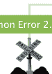

遗憾的是，C++ 对整数除法和浮点数除法使用同一个符号，即 `/`。这实际上是两种截然不同的运算。意外使用整数除法是很常见的错误。请看下面这段用于计算三个整数平均值的代码：

```cpp
    cout << "Please enter your last three test scores: ";
    int s1;
    int s2;
    int s3;
    cin >> s1 >> s2 >> s3;
    double average = (s1 + s2 + s3) / 3; // Error
    cout << "Your average score is " << average << endl;
```

这段代码可能有什么问题？当然，s1、s2 和 s3 的平均值是

\(\frac{s1+s2+s3}{3}\)

然而，这里的 `/` 并不表示数学意义上的除法。由于 s1 + s2 + s3 和 3 都是整数，因此它表示整数除法。例如，如果三项分数之和为 14，计算出的平均值就是 4，也就是 14 除以 3 的整数除法结果。随后，这个整数 4 会被赋给浮点变量 average。解决办法是将分子或分母转换为浮点数：

```cpp
double total = s1 + s2 + s3;
double average = total / 3;
```

或者

```cpp
double average = (s1 + s2 + s3) / 3.0;
```

## 常见错误 2.4

**括号不匹配**

请看下面这个表达式：

`(-(b * b - 4 * a * c) / (2 * a)`

它有什么问题？数一数括号。这里有三个 `(`，但只有两个 `)`。括号*不匹配*。在复杂表达式中，这种输入错误非常常见。再看下面这个表达式。

`-(b * b - (4 * a * c))) / (2 * a`

这个表达式有三个 `(` 和三个 `)`，但仍然不正确。在表达式中间的部分，

`-(b * b - (4 * a * c))) / (2 * a`

只有两个 `(`，却有三个 `)`，这是错误的。在表达式中间，`(` 的数量必须大于或等于 `)` 的数量；在表达式末尾，两者的数量必须相同。

这里有一个简单的技巧，无需纸笔就能更轻松地计数。大脑很难同时记住两个计数。扫描表达式时只记录一个计数：从第一个左括号开始，将计数设为 1；每遇到一个左括号就加 1，每遇到一个右括号就减 1。扫描表达式时，把这些数字念出来。如果计数曾降到零以下，或者扫描结束时不为零，说明括号不匹配。例如，扫描上一个表达式时，你会这样念：

```text
-(b * b - (4 * a * c))) / (2 * a
 1       2             1 0 -1
```

这样就能发现错误。


## 常见错误 2.5：忘记头文件

每个执行输入或输出的程序都需要 `<iostream>` 头文件。如果使用诸如 `sqrt` 的数学函数，则需要包含 `<cmath>`。如果忘记包含相应的头文件，编译器将无法识别 `abs` 或 `sqrt` 等符号。如果编译器报错说未定义的函数或符号，请检查你的头文件。

有时你可能不知道要包含哪个头文件。假设你想使用 `abs` 函数计算整数的绝对值。碰巧，这个版本的 `abs` 并未在 `<cmath>` 头文件中定义，而是在 `<cstdlib>` 中定义。如何找到正确的头文件？你需要查找 `abs` 函数的文档，最好使用开发环境的在线帮助或互联网上的参考站点，例如 http://www.cplusplus.com （参见图3）。文档中包括函数的简短描述以及必须包含的头文件名称。

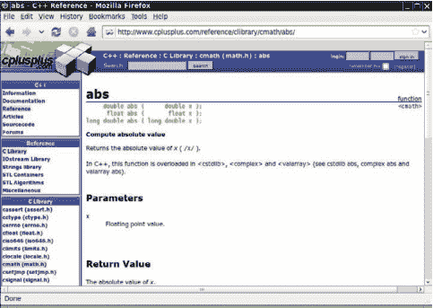

**图3** 在线文档

## 常见错误 2.6：舍入误差

使用浮点数进行计算时，舍入误差是无法避免的。你可能自己手工计算时也遇到过这种现象。如果你将 1/3 计算到两位小数，会得到 0.33。再乘以 3，得到 0.99，而不是 1.00。

在处理器硬件中，数字以二进制数制表示，而非十进制。当二进制位丢失时，你仍然会得到舍入误差。只是它们可能出现在你意想不到的不同位置。下面是一个例子。

```cpp
#include <iostream>

using namespace std;

int main()
{
    double price = 4.35;
    int cents = 100 * price; // Should be 100 * 4.35 = 435
    cout << cents << endl; // Prints 434!
    return 0;
}
```

当然，100 乘以 4.35 等于 435，但程序输出的是 434。大多数计算机用二进制系统表示数字。在二进制系统中，没有 4.35 的精确表示，就像十进制系统中没有 1/3 的精确表示一样。计算机使用的表示只是略小于 4.35，因此该值的 100 倍略小于 435。当浮点值被转换为整数时，整个小数部分（几乎为 1）被丢弃，整数 434 被存储在 cents 中。解决方法是加上 0.5 以四舍五入到最接近的整数：

```cpp
int cents = 100 * price + 0.5;
```

## 编程技巧 2.3：表达式中的空格


阅读以下代码更容易：

```cpp
x1 = (-b + sqrt(b * b - 4 * a * c)) / (2 * a);
```

而不是：

```cpp
x1=(-b+sqrt(b*b-4*a*c))/(2*a);
```

只需在所有运算符 `+ - * / % =` 周围加上空格。但是，不要在一元负号后加空格：即用于对单个量取负的 `-`，例如 `-b`。这样，就可以轻松地与二元减号区分开来，如 `a - b`。习惯上不要在函数名后加空格。也就是说，应写 `sqrt(x)` 而不是 `sqrt (x)`。

## 专题 2.3：强制类型转换


偶尔，你需要将值存储到不同类型的变量中。只要存在信息丢失的风险，编译器就会发出警告。例如，如果将 double 值存储到 int 变量中，可能以两种方式丢失信息：

- 小数部分丢失。
- 数值大小可能过大。

例如，

```cpp
int n = 1.0E100; // NO
```

很可能无法工作，因为 10¹⁰⁰ 大于可表示的最大整数。

然而，有时你确实想将浮点值转换为整数值。如果你准备丢失小数部分，并且知道该特定浮点数不大于最大可表示整数，那么可以使用强制类型转换来关闭警告。强制类型转换是一种从一种类型（如 double）到另一种类型（如 int）的转换，这种转换通常不安全，但你知晓在特定情况下是安全的。在 C++ 中表达强制类型转换如下：

```cpp
int cents = static_cast<int>(100 * price + 0.5);
```

## 专题 2.4：结合赋值与算术


在 C++ 中，你可以将算术和赋值结合起来。例如，指令

```cpp
total += cans * CAN_VOLUME;
```

是以下写法的快捷方式：

```cpp
total = total + cans * CAN_VOLUME;
```

同样，

```cpp
total *= 2;
```

是另一种写作方式：

```cpp
total = total * 2;
```

许多程序员觉得这是一种方便的快捷方式。如果你喜欢，可以在自己的代码中使用。但为简单起见，本书不会使用它。

## 随机事实 2.1：奔腾浮点错误

1994年，英特尔公司发布了当时其最强大的处理器——奔腾。与之前几代处理器不同，它拥有非常快速的浮点单元。英特尔的目标是积极与高端工程工作站处理器制造商竞争。奔腾立即获得了巨大成功。

1994年夏天，弗吉尼亚州林奇堡学院的托马斯·奈斯利博士运行了大量计算，分析某些素数序列的倒数之和。即使他考虑了不可避免的舍入误差，结果也并不总是符合他的理论预测。随后，奈斯利博士注意到，同样的程序在英特尔的486处理器（奔腾之前的产品）上运行却产生了正确的结果。这不应该发生。浮点计算的最优舍入行为由电气与电子工程师协会（IEEE）标准化，而英特尔声称在486和奔腾处理器中都遵循了IEEE标准。经过进一步检查，奈斯利博士发现有一小部分数字在两个处理器上的乘积计算结果不同。例如，

4,195,835 − ((4,195,835/3,145,727) × 3,145,727)

在数学上等于0，在486处理器上计算结果确实是0。而在他的奔腾处理器上，结果是256。

事实证明，英特尔在测试中独立发现了这个错误，并已开始生产修复该问题的芯片。该错误是由于用于加速处理器浮点乘法算法的查找表中的一个错误引起的。英特尔确定该问题极为罕见。他们声称在正常使用情况下，普通消费者每27,000年才会遇到一次该问题。对英特尔来说不幸的是，奈斯利博士并不是普通用户。

现在英特尔面临一个真正的问题。它认为更换迄今售出的所有奔腾处理器将花费大量资金。英特尔收到的芯片订单已经超过其生产能力，而不得不将稀缺的芯片作为免费更换件而非出售，尤其令人恼火。英特尔管理层决定拖延，最初只愿意为那些能够证明其工作需要在数学计算中达到绝对精度的客户更换处理器。自然，这并没有得到数十万客户的认可，他们以700美元以上的零售价购买了奔腾芯片，不想忍受那种令人不安的感觉——也许有一天，他们的所得税程序会计算出错误的申报结果。最终，英特尔迫于公众压力，更换了所有有缺陷的芯片，花费约4.75亿美元。

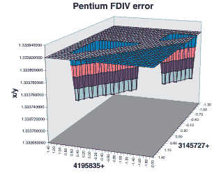

> 此图展示了一组数字，最初的奔腾处理器对这些数字计算出了错误的商。

## 2.3 输入和输出

### 2.3.1 输入

在本节中，你将看到如何将用户输入放入变量中。以第36页的 `volume1.cpp` 程序为例。与其假设两升瓶装和六罐装的价钱相同，我们可以询问程序用户价格。

当程序请求用户输入时，它应首先打印一条消息，告诉用户期望什么输入。这样的消息称为提示信息。

```cpp
cout << "Please enter the number of bottles: "; // Display prompt
```

不要在提示信息后面添加 endl。你希望输入出现在冒号后面，而不是下一行。

接下来，程序发出读取输入的命令。cin 对象从控制台窗口读取输入。你使用 >> 运算符（有时称为提取运算符）将输入值放入变量中，如下所示：

```cpp
int bottles;
cin >> bottles;
```

当程序执行输入语句时，它会等待用户提供输入。用户还需要按 Enter 键，程序才会接受输入。用户提供输入后，数字被放入 bottles 变量中，程序继续执行。

注意，在这段代码中，不需要初始化 bottles 变量，因为它由紧接着的语句填充。经验法则是，在声明变量时应初始化变量，除非该变量在紧随其后的输入语句中被填充。

你可以在一条输入语句中读取多个值：

```cpp
cout << "Please enter the number of bottles and cans: ";
cin >> bottles >> cans;
```

用户可以在同一行提供两个输入：

```
Please enter the number of bottles and cans: 2 6
```

或者，用户可以在每次输入后按 Enter 键：

```
Please enter the number of bottles and cans: 2
6
```

> 使用 >> 运算符读取值并将其放入变量中。

### 语法 2.3：输入语句

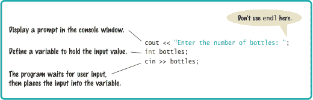


### 2.3.2 格式化输出

当你打印计算结果时，通常希望对其外观有一定控制。例如，当你打印以美元和美分表示的金额时，通常希望将其四舍五入到小数点后两位。也就是说，你希望输出看起来像

```
Price per ounce: 0.04
```

而不是

```
Price per ounce: 0.0409722
```

以下命令指示 `cout` 对所有浮点数使用小数点后两位：

```
cout << fixed << setprecision(2);
```

该命令不会产生任何输出；它只是操纵 `cout`，使其改变输出格式。`fixed` 和 `setprecision` 这些值被称为*操纵符*。我们将在第 8 章详细讨论操纵符。目前，只需记住，每当希望整齐显示货币值时，就包含上面给出的语句。

要使用操纵符，必须在程序中包含 `<iomanip>` 头文件：

```
#include <iomanip>
```

你可以将操纵符和要显示的值合并到一条语句中。

```
cout << fixed << setprecision(2)
     << "Price per ounce: "
     << price_per_ounce << endl;
```

还有另一个有时很方便的操纵符。当你显示多行数据时，通常希望各列对齐。

你可以使用 `setw` 操纵符设置下一个输出字段的宽度。宽度是用于显示该值的总字符数，包括数字、小数点和空格。当你希望数字列对齐时，控制宽度很重要。

例如，如果你希望将一个数字打印在宽度为八个字符的列中，可以使用

```
cout << setw(8) << price_per_ounce;
```

你使用操纵符来指定值的格式化方式。


你使用操纵符将输出整齐地对齐成列。

该命令在宽度为 8 的字段中打印值 `price_per_ounce`，例如

```
    0.04
```

（其中每个■代表一个空格）。

`setprecision` 和 `setw` 操纵符之间有一个显著区别。一旦设置了精度，该值将用于所有浮点数。但宽度只影响*下一个*值。后续值格式化时不添加空格。

我们的下一个示例程序将提示输入一包六罐装的价格和每罐的容量，然后打印每盎司的价格。该程序将运用你刚刚学到的关于读取输入和格式化输出的知识。

### ch02/volume2.cpp

```cpp
#include <iostream>
#include <iomanip>

using namespace std;

int main()
{
    // Read price per pack

    cout << "Please enter the price for a six-pack: ";
    double pack_price;
    cin >> pack_price;

    // Read can volume

    cout << "Please enter the volume for each can (in ounces): ";
    double can_volume;
    cin >> can_volume;

    // Compute pack volume

    const double CANS_PER_PACK = 6;
    double pack_volume = can_volume * CANS_PER_PACK;

    // Compute and print price per ounce

    double price_per_ounce = pack_price / pack_volume;

    cout << fixed << setprecision(2);
    cout << "Price per ounce: " << price_per_ounce << endl;

    return 0;
}
```

### 程序运行

```
Please enter the price for a six-pack: 2.95
Please enter the volume for each can (in ounces): 12
Price per ounce: 0.04
```

- 20. 将计算瓷砖数量和间隙宽度的伪代码转换为 C++。

- 21. 假设建筑师指定了一种带有黑色、灰色和白色瓷砖的图案，如下所示：

  

  同样，第一块和最后一块瓷砖应为黑色。你需要如何修改算法？

- 22. 一个机器人需要用黑白相间的瓷砖铺设地板。开发一个算法，在给定行号和列号的情况下，给出颜色（0 表示黑色，1 表示白色）。先从行和列的具体值开始，然后推广。

  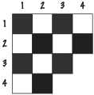

  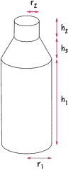

- 23. 对于某辆汽车，第 1 年的维修和保养费用估计为 $100；第 10 年为 $1,500。假设维修费用每年增加相同的金额，编写伪代码计算第 3 年的维修费用，然后推广到第 *n* 年。

- 24. 瓶子的形状可近似为两个半径分别为 *r₁* 和 *r₂*、高度分别为 *h₁* 和 *h₂* 的圆柱体，并由高度为 *h₃* 的圆锥段连接。使用圆柱体积公式 *V = πr²h* 和圆锥段体积公式 *V = π(r₁² + r₁r₂ + r₂²)h/3*，编写伪代码计算瓶子的体积。使用一个已知体积的实际瓶子作为样本，对你的伪代码进行手工计算。

**实践练习** 现在你可以尝试本章末尾的这些练习：R2.13、R2.15、R2.16。


## 示例 2.1 — 计算旅行时间

在这个示例中，我们开发一种手工计算方法，用来计算机器人从崎岖地形中取回物品所需的时间。


## 如何做 2.1 执行计算

许多编程问题要求你执行算术计算。本“如何做”将向你展示如何将问题陈述转化为伪代码，并最终转化为 C++ 程序。

例如，假设要求你编写一个模拟自动售货机的程序。顾客选择要购买的商品，并将纸币插入自动售货机。自动售货机发放所购商品并找零。我们将假设所有商品价格都是 25 美分的倍数，并且机器以美元硬币和 25 美分硬币找零。你的任务是计算应找回每种硬币的数量。

### 步骤 1

理解问题：输入是什么？期望输出是什么？

在这个问题中，有两个输入：

- 顾客插入的纸币面额
- 所购商品的价格

有两个期望输出：

- 机器找回的美元硬币数量
- 机器找回的25美分硬币数量

### 步骤 2

手工计算示例。

假设顾客购买了一件价格为 $2.25 的商品，并插入了一张 $5 纸币。应找给顾客 $2.75，即两枚美元硬币和三枚25美分硬币。

这对你来说很容易看出，但 C++ 程序如何得出同样的结论？如果你以美分而不是美元为单位计算，会更简单。应找给顾客的金额是 275 美分。除以 100 得到 2，即美元硬币数量。将余数（75）除以 25 得到 3，即25美分硬币数量。

### 步骤 3

编写计算答案的伪代码。

在上一步中，你解决了一个具体问题实例。现在你需要想出一个通用方法。

给定任意商品价格和付款，如何计算应找的硬币？首先，以美分计算应找金额：

```
amount due = 100 × bill value - item price in pennies
```

要得到美元硬币，除以 100 并舍去余数：

```
dollar coins = amount due / 100 (without remainder)
```


自动售货机接收纸币并以硬币找零。

剩余应找金额可以用两种方法计算。如果你熟悉取模运算符，可以直接计算

```
amount due = amount due % 100
```

或者，从应找金额中减去美元硬币的美分价值：

```
amount due = amount due - 100 × dollar coins
```

要得到应找的25美分硬币，除以 25：

```
quarters = amount due / 25
```

### 步骤 4

定义所需的变量和常量，并指定它们的类型。

这里有五个变量：

- bill_value
- item_price
- amount_due
- dollar_coins
- quarters

我们是否应引入常量，将 100 和 25 解释为 `PENNIES_PER_DOLLAR` 和 `PENNIES_PER_QUARTER`？这样做将使程序更容易转换到国际市场，因此我们将采取这一步。

非常重要的一点是，`amount_due` 和 `PENNIES_PER_DOLLAR` 的类型为 `int`，因为 `dollar_coins` 的计算使用整数除法。同样，其他变量也是整数。

### 步骤 5

将伪代码转换为 C++ 语句。

如果你认真完成了伪代码，这一步应该很容易。当然，你必须知道如何在 C++ 中表达数学运算（例如幂或整数除法）。

```cpp
amount_due = PENNIES_PER_DOLLAR * bill_value - item_price;
dollar_coins = amount_due / PENNIES_PER_DOLLAR;
amount_due = amount_due % PENNIES_PER_DOLLAR;
quarters = amount_due / PENNIES_PER_QUARTER;
```

### 步骤 6

提供输入和输出。

在开始计算之前，我们提示用户输入纸币面额和商品价格：

```cpp
cout << "Enter bill value (1 = $1 bill, 5 = $5 bill, etc.): ";
cin >> bill_value;
cout << "Enter item price in pennies: ";
cin >> item_price;
```

计算完成后，我们显示结果。作为额外加分项，我们使用 `setw` 操纵符确保输出整齐对齐。

```cpp
cout << "Dollar coins: " << setw(6) << dollar_coins << endl
     << "Quarters:     " << setw(6) << quarters << endl;
```

### 步骤 7

包含所需的头文件并提供 `main` 函数。

我们需要 `<iostream>` 头文件用于所有输入和输出。因为我们使用 `setw` 操纵符，所以还需要 `<iomanip>`。该程序不使用任何特殊数学函数。因此，我们不包含 `<cmath>` 头文件。

在 `main` 函数中，你需要定义常量和变量（步骤 4）、执行计算（步骤 5）以及提供输入和输出（步骤 6）。显然，你会希望先获取输入，然后进行计算，最后显示输出。在函数开头定义常量，并在需要之前定义每个变量。


### 2.5.1 string 类型

可以定义用于存储字符串的变量。

```cpp
string name = "Harry";
```

string 类型是 C++ 标准的一部分。要使用它，只需包含头文件 `<string>`：

```cpp
#include <string>
```

我们要区分字符串变量（例如上面定义的变量 name）和字符串字面量（用引号括起来的字符序列，例如 "Harry"）。存储在字符串变量中的字符串可以改变。字符串字面量表示一个特定的字符串，就像数字字面量（例如 2）表示一个特定的数字一样。

与数值变量不同，即使不提供初始值，字符串变量也保证会被初始化。默认情况下，字符串变量会被设为空字符串：即不包含任何字符的字符串。空字符串字面量写作 `""`。下面的定义

```cpp
string response;
```

与下面的定义效果相同：

```cpp
string response = "";
```

### 2.5.2 字符串拼接

> 使用 + 运算符拼接字符串，也就是将字符串连接起来，得到一个更长的字符串。

给定两个字符串，例如 "Harry" 和 "Morgan"，你可以将它们拼接成一个长字符串。结果由第一个字符串中的所有字符，后接第二个字符串中的所有字符组成。在 C++ 中，可以使用 + 运算符拼接两个字符串。例如：

```cpp
string fname = "Harry";
string lname = "Morgan";
string name = fname + lname;
```

结果字符串为：

```cpp
"HarryMorgan"
```

如果你想在名和姓之间加一个空格，该怎么办？很简单：

```cpp
string name = fname + " " + lname;
```

这条语句拼接了三个字符串：fname、字符串字面量 " " 和 lname。结果为：

```cpp
"Harry Morgan"
```

### 2.5.3 字符串输入

你可以从控制台读取一个字符串：

```cpp
cout << "Please enter your name: ";
string name;
cin >> name;
```

如果省略长度，就会获取从给定位置到字符串末尾的所有字符。例如，`greeting.substr(7)` 是字符串 `"world!"`（包括感叹号）。

下面这个简单程序将上述概念付诸实践。程序会询问你的名字以及另一半的名字，然后打印出你们的姓名首字母。操作 `first.substr(0, 1)` 会从 `first` 的开头取出一个字符，组成一个字符串。程序对第二个名字也进行同样的操作。接着，它将得到的两个单字符字符串与字符串字面量 `"&"` 拼接，得到一个长度为 3 的字符串，也就是首字母字符串。（见图 4。）

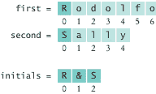


**图 4** 构建姓名首字母字符串

*姓名首字母由每个名字的第一个字母组成。*

### ch02/initials.cpp

```cpp
#include <iostream>
#include <string>

using namespace std;

int main()
{
   cout << "Enter your first name: ";
   string first;
   cin >> first;
   cout << "Enter your significant other's first name: ";
   string second;
   cin >> second;
   string initials = first.substr(0, 1)
       + "&" + second.substr(0, 1);
   cout << initials << endl;

   return 0;
}
```

### 程序运行

```text
Enter your first name: Rodolfo
Enter your significant other's first name: Sally
R&S
```

**表 8 字符串操作**

| 语句 | 结果 | 说明 |
|---|---|---|
| `string str = "C";`<br>`str = str + "+";` | `str` 被设为 `"C+"` | 对字符串使用时，`+` 表示拼接。 |
| `string str = "C" + "+";` | **错误** | **错误：**不能拼接两个字符串字面量。 |
| `cout << "Enter name: ";`<br>`cin >> name;`<br>（用户输入：Harry Morgan） | name 包含 "Harry" | `>>` 运算符会将下一个单词放入字符串变量中。 |
| `cout << "Enter name: ";`<br>`cin >> name >> last_name;`<br>（用户输入：Harry Morgan） | name 包含 "Harry"，last_name 包含 "Morgan" | 使用多个 `>>` 运算符可以读取多个单词。 |
| `string greeting = "H & S";`<br>`int n = greeting.length();` | n 被设为 5 | 空格也算作一个字符。 |
| `string str = "Sally";`<br>`string str2 = str.substr(1, 3);` | str2 被设为 "all" | 提取从位置 1 开始、长度为 3 的子串。（初始位置为 0。） |
| `string str = "Sally";`<br>`string str2 = str.substr(1);` | str2 被设为 "ally" | 如果省略长度，则会包含从指定位置到字符串末尾的所有字符。 |
| `string a = str.substr(0, 1);` | a 被设为 str 的首字母 | 提取从位置 0 开始、长度为 1 的子串。 |
| `string b = str.substr(str.length() - 1);` | b 被设为 str 的最后一个字母 | 最后一个字母的位置是 `str.length() - 1`。无需指定长度。 |


### 自我检测

- 25. 字符串 `"C++ Program"` 的长度是多少？
- 26. 考虑以下字符串变量：`string str = "C++ Program";` 请给出一个 `substr` 成员函数调用，使其返回子串 `"gram"`。
- 27. 使用字符串拼接，将自我检测 26 中的字符串变量 `str` 转换为 `"C++ Programming"`。
- 28. 以下语句序列会打印什么？`string str = "Harry";` `cout << str.substr(0, 1) + str.substr(str.length() - 1);`
- 29. 给出一条输入语句，用于读取形如 “John Q. Public” 的姓名。

**动手练习** 现在可以尝试本章末尾的这些练习：R2.6、R2.9、P2.12、P2.19。


## 趣闻 2.2 国际字母与 Unicode

英语字母表相当简单：大写和小写的 a 到 z。其他欧洲语言则有重音符号和特殊字符。例如，德语有三个所谓的变音字母 ä、ö、ü，以及一个双 s 字符 ß。这些并非可有可无的装饰；如果不使用这些字符，根本无法写出一页德语文字，而德语键盘上也有对应的按键。

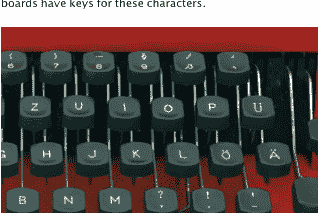

*德语键盘布局*

这给计算机用户和设计人员带来了一个问题。美国标准字符编码（称为 ASCII，即美国信息交换标准代码）规定了 128 个编码：52 个大小写字母、10 个数字、32 个标点符号，以及 34 个控制字符（例如空格、换行符，以及另外 32 个用于控制打印机和其他设备的字符）。变音字母和双 s 字符并不在其中。一些德国数据处理系统会用德语字母替换不常用的 ASCII 字符：[\]{|}~ 被替换为 ÄÖÜäöüß。大多数人或许可以不用这些字符，但 C++ 程序员肯定不行。其他编码方案则利用一个字节可以编码 256 种不同字符这一事实，而 ASCII 只标准化了其中的 128 种。遗憾的是，这类编码存在多种互不兼容的标准，给欧洲计算机用户带来了一些麻烦。

许多国家根本不使用罗马字母。举例来说，俄语、希腊语、希伯来语、阿拉伯语和泰语字母都有完全不同的形状。更复杂的是，希伯来语和阿拉伯语是从右向左书写的。这些字母体系各有 30 至 100 个字母，使用它们的国家也都制定了相应的编码标准。


*希伯来语、阿拉伯语和英语*

使用汉字的语言所面临的情况要复杂得多，包括各种汉语方言、日语和韩语。汉字不是字母文字，而是表意文字。一个字符代表一种概念或事物。大多数词语由一个、两个或三个这样的表意字符组成。（已知的表意文字超过 50,000 个，其中约 20,000 个正在使用。）因此，编码它们需要两个字节。中国大陆、台湾、日本和韩国各自采用了互不兼容的编码标准。（日语和韩语书写中混合使用本民族的音节文字和汉字。）

字符编码之间的不一致，长期以来一直是国际电子通信和争夺全球市场的软件制造商面临的一大麻烦。从 1988 年开始，一批硬件和软件制造商组成的联盟开发了一种统一的 21 位编码方案，称为 Unicode，能够为世界上几乎所有书写语言的文本编码。约 100,000 个字符已被分配编码，其中包括 70,000 多个中日韩表意文字。人们甚至计划为古埃及象形文字等已消亡的语言添加编码。


*汉字*


**R2.7** 找出以下程序中的至少五个*编译时*错误。

```cpp
#include iostream

int main();
{
    cout << "Please enter two numbers:"
    cin << x, y;
    cout << "The sum of << x << " and" << y
        << "is: " x + y << endl;
    return;
}
```

**R2.8** 找出以下程序中的至少四个*运行时*错误。

```cpp
#include <iostream>

using namespace std;

int main()
{
    int total;
    int x1;
    cout << "Please enter a number:";
    cin >> x1;
    total = total + x1;
    cout << "Please enter another number:";
    int x2;
    cin >> x2;
    total = total + x1;
    double average = total / 2;
    cout << "The average of the two numbers is "
        << average << "endl";
    return 0;
}
```

**R2.9** 解释 `2`、`2.0`、`"2"` 和 `"2.0"` 之间的区别。

**R2.10** 解释以下每个程序段计算的是什么。

- a. `int x = 2;`  
  `int y = x + x;`
- b. `string s = "2";`  
  `string t = s + s;`

**R2.11** 为一个程序编写伪代码，该程序读取一个单词，然后打印第一个字符、最后一个字符以及中间部分的字符。例如，如果输入是 Harry，程序打印 H y arr。

**R2.12** 为一个程序编写伪代码，该程序读取一个姓名（如 Harold James Morgan），然后打印由名字、中间名和姓氏的首字母组成的字母组合（如 HJM）。

**R2.13** 为一个程序编写伪代码，该程序计算一个数字的第一位和最后一位数字。例如，如果输入是 23456，程序应打印出 2 和 6。*提示*：`%`、`log10`。

**R2.14** 修改*如何做 2.1* 中程序的伪代码，使程序以 25 美分、10 美分和 5 美分硬币找零。你可以假设价格是 5 美分的倍数。为了编写伪代码，先用几个具体的数值进行尝试。

**R2.15** 一个鸡尾酒调酒器由三个锥台组成。使用实际的半径和高度值，利用*自测题 24* 中给出的锥台公式计算总体积。然后开发一个适用于任意尺寸的算法。


**R2.16** 你正在切一块这样的馅饼，其中 $c$ 是直线部分的长度（称为弦长），$b$ 是这块馅饼的高度。

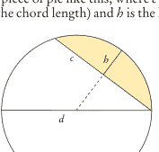

面积有一个近似公式：$A \approx \frac{2}{3}cb + \frac{b^3}{2c}$

然而，$b$ 不易测量，而馅饼的直径 $d$ 通常是已知的。计算当馅饼直径为 12 英寸、弓形弦长为 10 英寸时的面积。将其推广到适用于任意直径和弦长的算法。

**R2.17** 以下伪代码描述了如何根据日期编号（0 = 星期日，1 = 星期一，以此类推）获取星期几的名称。

```
定义一个名为 names 的字符串，包含 "SunMonTueWedThuFriSat"。
计算起始位置为 9 × 日期编号。
在 names 的起始位置提取长度为 3 的子字符串。
```

使用日期编号 4 检验这段伪代码。画出所计算字符串的示意图，类似于第 59 页的图 4。

**R2.18** 以下伪代码描述了如何交换一个单词中的两个字母。

```
给定一个字符串 str 和两个位置 i 和 j（i 在 j 之前）。
将 first 设置为从字符串开头到 i 之前最后一个位置的子字符串。
将 middle 设置为从位置 i + 1 到 j - 1 的子字符串。
将 last 设置为从位置 j + 1 到字符串末尾的子字符串。
连接以下五个字符串：first、仅包含位置 i 处字符的字符串、middle、
仅包含位置 j 处字符的字符串以及 last。
```

使用字符串 "gateway" 以及位置 2 和 4 检验这段伪代码。画出所计算字符串的示意图，类似于第 59 页的图 4。

**R2.19** 运行以下程序，并解释你得到的输出。

```cpp
#include <iostream>

using namespace std;

int main()
{
    int total;
    cout << "Please enter a number: ";
    double x1;
    cin >> x1;
    total = total + x1;
    cout << "total: " << total << endl;
    cout << "Please enter a number: ";
    double x2;
    cin >> x2;
    total = total + x2;
    cout << "total: " << total << endl;
    total = total / 2;
    cout << "total: " << total << endl;
    cout << "The average is " << total << endl;
    return 0;
}
```

注意插入的跟踪消息（以蓝色显示）用于展示 total 变量的当前内容。你如何修复这个程序？（该程序有两个独立的错误。）

**R2.20** 编写一个程序，打印以下值

```
3 * 1000 * 1000 * 1000
3.0 * 1000 * 1000 * 1000
```

并解释结果。

**R2.21** 本章包含一些关于变量和常量的建议，这些建议使程序更易于阅读和维护。简要总结这些建议。

## 编程练习

**P2.1** 编写一个程序，显示一张信纸尺寸（8.5 × 11 英寸）纸张的毫米尺寸。每英寸有 25.4 毫米。在程序中使用常量和注释。

**P2.2** 编写一个程序，计算并显示一张信纸尺寸（8.5 × 11 英寸）纸张的周长和对角线长度。

**P2.3** 编写一个程序，读取一个数字并显示其平方、立方和四次方。仅对四次方使用 `pow` 函数。

**P2.4** 编写一个程序，提示用户输入两个整数，然后打印

- 和
- 差
- 积
- 平均值

**P2.5** 编写一个程序，提示用户输入两个整数，然后打印

- 距离（差的绝对值）
- 最大值（两者中较大的）
- 最小值（两者中较小的）

*提示*：`max` 和 `min` 函数定义在 `<algorithm>` 头文件中。

**P2.6** 编写一个程序，提示用户输入以米为单位的测量值，然后将其转换为英里、英尺和英寸。

**P2.7** 编写一个程序，提示用户输入半径，然后打印

- 以该半径为圆的面积和周长
- 以该半径为球的体积和表面积

**P2.8** 编写一个程序，询问用户矩形的边长，然后打印

- 矩形的面积和周长
- 对角线的长度（使用勾股定理）

**P2.9** 改进*如何做 2.1* 中讨论的程序，使其允许输入 25 美分硬币以及纸币。

**P2.10** 编写一个程序，帮助人们决定是否购买混合动力汽车。程序的输入应为：

- 新车的成本
- 预计每年行驶的英里数
- 预计油价
- 5 年后的预计转售价值


计算拥有这辆车 5 年的总成本。（为简单起见，我们不考虑融资成本。）从网上获取一辆新车和一辆二手混合动力汽车以及一辆可比汽车的实际价格。使用当前油价和每年 15,000 英里运行你的程序两次。在作业中包含伪代码和程序运行结果。

**P2.11** 以下伪代码描述了书店如何根据总价和订购的图书数量计算订单价格。

```
读取图书总价和图书数量。
计算税费（图书总价的 7.5%）。
计算运费（每本书 2 美元）。
订单价格是图书总价、税费和运费的总和。
打印订单价格。
```

将这段伪代码翻译成 C++ 程序。

**P2.12** 以下伪代码描述了如何将包含十位电话号码（如 "4155551212"）的字符串转换为带有括号和连字符的可读字符串，如下所示："(415) 555-1212"。

```
取由前三个字符组成的子字符串，并用 "(" 和 ")" 括起来。这是区号。
连接区号、由接下来三个字符组成的子字符串、一个连字符以及由最后四个字符组成的子字符串。这是格式化后的号码。
```

将这段伪代码翻译成 C++ 程序，该程序将电话号码读入字符串变量，计算格式化后的号码，并打印它。

**P2.13** 以下伪代码描述了如何从浮点值表示的价格中提取美元和美分。例如，价格 2.95 会产生美元值 2 和美分值 95。

```
将价格赋给整型变量 dollars。
将差值 price - dollars 乘以 100 并加上 0.5。
将结果赋给整型变量 cents。
```

将这段伪代码翻译成 C++ 程序。读取一个价格并打印美元和美分。使用输入 2.95 和 4.35 测试你的程序。

**P2.14** *找零。* 实现一个程序，指导收银员如何找零。程序有两个输入：应付金额和从顾客那里收到的金额。显示应找回给顾客的美元、25 美分硬币、10 美分硬币、5 美分硬币和 1 美分硬币。


**P2.15** 编写一个程序，要求用户输入

- 油箱中汽油的加仑数
- 以每加仑英里数为单位的燃油效率
- 每加仑汽油的价格

然后打印每 100 英里的成本，以及汽车在油箱中的汽油用完前可以行驶多远。

**P2.16** *文件名和扩展名。* 编写一个程序，提示用户输入驱动器号（`c`）、路径（`\Windows\System`）、文件名（`Readme`）和扩展名（`txt`）。然后打印完整的文件名 `C:\Windows\System\Readme.txt`。（如果你使用 UNIX 或 Macintosh，请跳过驱动器名称，并使用 `/` 而不是 `\` 来分隔目录。）

**P2.17** 编写一个程序，从用户那里读取一个介于 1,000 和 999,999 之间的数字，并打印时在千位处加上逗号。以下是一个示例对话；用户输入以彩色显示：

```
Please enter an integer between 1000 and 999999: 23456
23,456
```

**P2.18** 编写一个程序，从用户那里读取一个介于 1,000 和 999,999 之间的数字，其中用户输入时带有逗号。然后打印不带逗号的数字。以下是一个示例对话；用户输入以彩色显示：

```
Please enter an integer between 1,000 and 999,999: 23,456
23456
```

*提示：* 将输入读取为字符串。测量字符串的长度。假设它包含 n 个字符。然后提取由前 n − 4 个字符和最后三个字符组成的子字符串。


### P2.19 打印网格

编写一个程序，打印下面的网格，用于玩井字棋。

```
+---+---+---+
|   |   |   |
+---+---+---+
|   |   |   |
+---+---+---+
|   |   |   |
+---+---+---+
```

当然，你可以简单地写出七条如下形式的语句：

```cpp
cout << "+---+---+---+";
```

不过，你应该用巧妙的方式来做。定义字符串变量来保存两种图案：一种梳状图案

```
+---+---+---+
|   |   |   |
```

以及底边线。将梳状图案打印三次，底边线打印一次。

### P2.20

编写一个程序，读取一个整数，并将其拆分成由单个数字组成的序列。例如，输入 16384 显示为

```
1 6 3 8 4
```

你可以假定输入不超过五位数字，并且不是负数。

### P2.21

编写一个程序，读取两个军事时间格式（0900、1730）的时间，并打印这两个时间之间的小时数和分钟数。下面是一个示例运行。用户输入以颜色显示。

```
Please enter the first time: 0900
Please enter the second time: 1730
8 hours 30 minutes
```

如果你能处理第一个时间晚于第二个时间的情况，可获得额外加分：

```
Please enter the first time: 1730
Please enter the second time: 0900
15 hours 30 minutes
```

### P2.22 书写大号字母

一个大写字母 H 可以这样生成：

```
*   *
*   *
*****
*   *
*   *
```

它可以像这样定义为一个字符串常量：

```cpp
const string LETTER_H =
   "*   *\n*   *\n*****\n*   *\n*   *\n";
```

（\n 字符在专题 1.1 中有说明。）对字母 E、L 和 O 也做同样的处理。然后用大号字母输出下面的信息：

```
H
E
L
L
O
```

### P2.23

编写一个程序，将数字 1、2、3、…、12 转换为相应的月份名称 January、February、March、…、December。*提示：* 构造一个很长的字符串 "January February March …"，在其中添加空格，使每个月份名称具有相同的长度。然后使用 `substr` 提取你想要的月份。


### 工程 P2.24

考虑下面的电路。

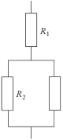

编写一个程序，读取三个电阻的阻值，并使用欧姆定律计算总电阻。

### 工程 P2.25

露点温度 \(T_d\) 可以由相对湿度 \(RH\) 和实际温度 \(T\) 近似计算得到：

\[
T_d = \frac{b \cdot f(T, RH)}{a - f(T, RH)}
\]

\[
f(T, RH) = \frac{a \cdot T}{b + T} + \ln(RH)
\]

其中 \(a = 17.27\)，\(b = 237.7^\circ\text{C}\)。编写一个程序，读取相对湿度（介于 0 和 1 之间）和温度（单位摄氏度），并打印露点值。使用 C++ 函数 `log` 计算自然对数。

### 工程 P2.26

这里显示的管夹式温度传感器是坚固的传感器，可以直接夹在铜管上，以测量管内液体的温度。

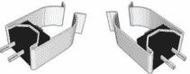

每个传感器都包含一个称为*热敏电阻*的器件。热敏电阻是一种半导体器件，其电阻随温度变化，可用下式描述：

\[
R = R_0 e^{\beta\left(\frac{1}{T} - \frac{1}{T_0}\right)}
\]

其中 \(R\) 是温度 \(T\)（单位 °K）下的电阻（单位 \(\Omega\)），\(R_0\) 是温度 \(T_0\)（单位 °K）下的电阻（单位 \(\Omega\)）。\(\beta\) 是一个取决于热敏电阻制造材料的常数。热敏电阻的规格由 \(R_0\)、\(T_0\) 和 \(\beta\) 的值确定。

用于制造管夹式温度传感器的热敏电阻在 \(T_0 = 85\ ^\circ\mathrm{C}\) 时 \(R_0 = 1075\ \Omega\)，且 \(\beta = 3969\ ^\circ\mathrm{K}\)。（注意 \(\beta\) 的单位是 °K。回想一下，以 °K 为单位的温度等于以 °C 为单位的温度加上 273。）液体温度（°C）由电阻 \(R\)（\(\Omega\)）通过下式确定：

\[
T = \frac{\beta T_0}{T_0\ln\left(\frac{R}{R_0}\right)+\beta}-273
\]

编写一个 C++ 程序，提示用户输入热敏电阻的阻值 \(R\)，并输出一条消息，给出液体温度（°C）。

### 工程 P2.27

下图所示的电路说明了电力公司与其某个客户之间连接的一些重要方面。客户由三个参数表示：\(V_t\)、\(P\) 和 \(pf\)。\(V_t\) 是插入墙上插座时获得的电压。客户的电器要正常工作，依赖于 \(V_t\) 的可靠值。因此，电力公司会仔细调节 \(V_t\) 的值。\(P\) 描述客户使用的电功率，是决定客户电费账单的主要因素。功率因数 \(pf\) 则不太为人熟知。（功率因数是某个角度的余弦值，因此其值始终介于 0 和 1 之间。）在本问题中，你将编写一个 C++ 程序来研究功率因数的重要性。


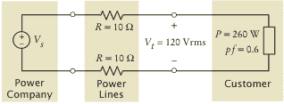

在图中，输电线被（有些简化地）表示为以欧姆为单位的电阻。电力公司由一个交流电压源表示。在电压 \(V_t\) 下向客户提供功率 \(P\) 所需的电源电压 \(V_s\) 可以用以下公式确定：

\[
V_s = \sqrt{\left(V_t + \frac{2RP}{V_t}\right)^2 + \left(\frac{2RP}{pf\,V_t}\right)^2(1-pf^2)}
\]

（\(V_s\) 的单位为 Vrms。）该公式表明 \(V_s\) 的值取决于 \(pf\) 的值。编写一个 C++ 程序，提示用户输入一个功率因数值，并

## 自测题答案

1. 一种可能的答案是

   ```cpp
   int bottles_per_case = 8;
   ```

   你可以选择不同的变量名或不同的初始化值，但你的变量必须是 `int` 类型。

2. 有三个错误：
   - 变量名中不能包含空格。
   - 变量类型应为 `double`，因为它保存的是小数值。
   - 语句末尾缺少分号。

3.

   ```cpp
   double unit_price = 1.95;
   int quantity = 2;
   ```

4. `cout << "Total price: " << unit_price * quantity << endl;`

5. 将 `cans_per_pack` 的定义改为

   ```cpp
   int cans_per_pack = 4;
   ```

6. 你需要使用 `*/` 定界符来结束以 `/*` 开头的注释：

   ```cpp
   double can_volume = 0.355; /* Liters in a 12-ounce can */
   ```

7. 程序可以编译，并且会显示相同的结果。不过，阅读程序的人可能会对出现小数罐感到困惑。

8. 它的值会被赋值语句修改。

9. 当停车位中的一辆汽车被另一辆替换时，就会发生赋值。

10. `double interest = balance * p / 100;`

11. `double side_length = sqrt(area);`

12.

   ```cpp
   4 * PI * pow(radius, 3) / 3
   or (4.0 / 3) * PI * pow(radius, 3),
   but not (4 / 3) * PI * pow(radius, 3)
   ```

13. 172 和 9

14. `int leftover = 12 - amount % 12;`

15. 没有提示符提醒程序用户输入数量。

16. `unit_price` 变量被定义为 `int` 类型。如果用户输入 1.95 这样的价格，只有 1 会被存入该变量。

17. 输出为

   ```text
   The total volume is20
   ```

   注意 `is` 和 `20` 之间没有空格。

18. `cout << "$" << fixed << setprecision(2) << total_price;`

19.

   ```cpp
   cout << "Bottles: " << setw(8) << bottles << endl
        << "Cans: " << setw(8) << cans << endl;
   ```

   注意 `setw` 操纵符出现了两次。另外，请注意字符串 "Cans: " 中增加了空格。


- 20.
  ```cpp
  int pairs = (total_width - tile_width) / (2 * tile_width);
  int tiles = 1 + 2 * pairs;
  double gap = (total_width - tiles * tile_width) / 2;
  ```
  确保将 `pairs` 声明为 int。

- 21. 现在，在初始的黑色瓷砖之后，有由四块瓷砖（灰/白/灰/黑）组成的组。因此，算法现在是：

  ```text
  number of groups = integer part of (total width - tile width) / (4 x tile width)
  number of tiles = 1 + 4 x number of groups
  ```

  间隙的公式没有改变。

- 22. 显然，答案只取决于行号和列号是偶数还是奇数，因此我们先取除以 2 后的余数。然后我们可以枚举所有预期答案：

  | 行 % 2 | 列 % 2 | 颜色 |
  |---:|---:|---:|
  | 0 | 0 | 0 |
  | 0 | 1 | 1 |
  | 1 | 0 | 1 |
  | 1 | 1 | 0 |

  在表的前三个条目中，颜色只是余数之和。在第四个条目中，和会是 2，但我们想要 0。我们可以通过再进行一次取模运算来实现：

  ```text
  color = ((row % 2) + (column % 2)) % 2
  ```

- 23. 在九年中，维修费用增加了 $1,400。因此，每年增加 $1,400 / 9 = $156。第 3 年的维修费用为 $100 + 2 × $156 = $412。第 n 年的维修费用为 $100 + n × $156。为避免舍入误差累积，实际上最好使用得到 $156 的原始表达式，即

  ```text
  Repair cost in year n = 100 + n x 1400 / 9
  ```

- 24. 伪代码很容易从这些方程得出。

  ```text
  bottom volume = π x r₁² x h₁
  top volume = π x r₂² x h₂
  middle volume = π x (r₁² + r₁ x r₂ + r₂²) x h₃ / 3
  total volume = bottom volume + top volume + middle volume
  ```

  测量一个典型葡萄酒瓶得到 `r₁ = 3.6, r₂ = 1.2, h₁ = 15, h₂ = 7, h₃ = 6`（单位均为厘米）。因此，

  ```text
  bottom volume = 610.73
  top volume = 31.67
  middle volume = 135.72
  total volume = 778.12
  ```

  实际体积是 750 ml，这与我们的计算足够接近，使我们可以相信它是正确的。

- 25. 长度是 11。空格也算一个字符。
- 26. `str.substr(7, 4)`
- 27. `str = str + "ming";`
- 28. `Hy`
- 29. `cin >> first_name >> middle_initial >> last_name;`


计算机程序的基本特征之一是能够做出决策。就像火车根据道岔的设置改变轨道一样，程序可以根据输入和其他情况采取不同的操作。

在本章中，你将学习如何编写简单和复杂的决策程序。你将把所学知识应用到检查用户输入的任务中。

## 3.1 if 语句

> if 语句允许程序根据要处理的数据的性质执行不同的操作。

if 语句用于实现决策。当条件满足时，执行一组语句。否则，执行另一组语句（见语法 3.1）。

下面是一个使用 if 语句的示例。在许多国家，数字 13 被认为是不吉利的。为了不冒犯迷信的租户，建筑业主有时会跳过第十三层；12 层之后紧接着就是 14 层。当然，13 层通常不会被空置，或者像一些阴谋论者认为的那样，充满秘密办公室和研究实验室。它只是被称为 14 层。控制大楼电梯的计算机需要补偿这一怪癖，并调整 13 层以上的所有楼层号。

让我们用 C++ 模拟这个过程。我们将要求用户输入所需的楼层号，然后计算实际楼层。当输入大于 13 时，我们需要将输入减一来得到实际楼层。例如，如果用户输入 20，程序会确定实际楼层为 19。否则，我们直接使用提供的楼层号。

```cpp
int actual_floor;

if (floor > 13)
{
    actual_floor = floor - 1;
}
else
{
    actual_floor = floor;
}
```

图 1 中的流程图显示了分支行为。

在我们的示例中，if 语句的每个分支都包含一条语句。你可以在每个分支中包含任意多条语句。有时，会出现

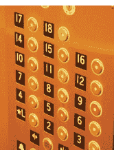

这个电梯面板“跳过”了第十三层。该楼层实际上并没有缺失——控制电梯的计算机调整了 13 层以上的楼层号。

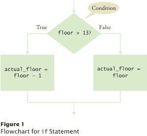

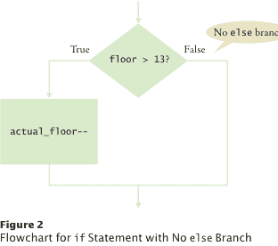

语句的 else 分支中没有任何操作。在这种情况下，你可以完全省略它，如下例所示：

```cpp
int actual_floor = floor;

if (floor > 13)
{
    actual_floor--;
} // No else needed
```

流程图见图 2。

下面的程序让 if 语句发挥作用。该程序询问所需的楼层，然后打印出实际楼层。


> if 语句就像道路上的岔路口。根据决策，程序的不同部分会被执行。

### ch03/elevator1.cpp

```cpp
#include <iostream>

using namespace std;

int main()
{
    int floor;
    cout << "Floor: ";
    cin >> floor;
    int actual_floor;
    if (floor > 13)
    {
        actual_floor = floor - 1;
    }
    else
    {
        actual_floor = floor;
    }

    cout << "The elevator will travel to the actual floor "
         << actual_floor << endl;

    return 0;
}
```

### 程序运行

```text
Floor: 20
The elevator will travel to the actual floor 19
```

### 语法 3.1  if 语句

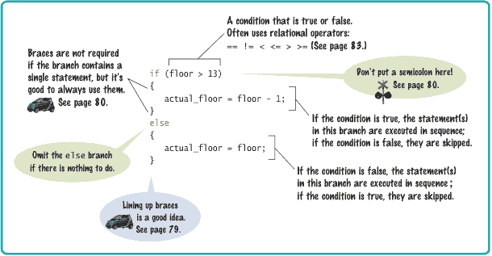


1. 在一些亚洲国家，数字 14 被认为是不吉利的。一些建筑业主为了稳妥起见，同时跳过第十三层和第十四层。你会如何修改示例程序来处理这样的建筑？

2. 考虑以下用于计算折扣价的 if 语句：

   ```java
   if (original_price > 100)
   {
       discounted_price = original_price - 20;
   }
   else
   {
       discounted_price = original_price - 10;
   }
   ```

   如果原价是 95，折扣价是多少？100？105？

3. 将这条 if 语句与自测题 2 中的语句进行比较：

   ```java
   if (original_price < 100)
   {
       discounted_price = original_price - 10;
   }
   else
   {
       discounted_price = original_price - 20;
   }
   ```

   这两条语句总是计算出相同的值吗？如果不是，什么时候值会不同？

4. 考虑以下用于计算折扣价的语句：

   ```java
   discounted_price = original_price;
   if (original_price > 100)
   {
       discounted_price = original_price - 10;
   }
   ```

   如果原价是 95，折扣价是多少？100？105？

5. 变量 fuel_amount 和 fuel_capacity 保存车辆的实际燃油量和燃油箱大小。如果油箱中剩余少于 10%，状态灯应显示红色；否则显示绿色。通过打印 "red" 或 "green" 来模拟此过程。

**练习一下** 现在你可以尝试本章末尾的这些练习：R3.3、R3.4、P3.16。

## 编程提示 3.1


### 花括号布局

程序员在代码中对齐花括号的方式各不相同。在本书中，我们遵循一个简单的规则：让 { 和 } 对齐。

```java
if (floor > 13)
{
    floor--;
}
```

这种风格使匹配的花括号很容易被发现。


*正确对齐代码使你的程序更易于阅读。*


## 编程提示 3.3


### 制表符

块结构代码的特点是嵌套语句会缩进一个或多个级别：

```cpp
int main()
{
   int floor;
   ...
   if (floor > 13)
   {
      floor--;
   }
   ...
   return 0;
}
```

0 1 2 缩进级别

你如何将光标从最左列移动到适当的缩进级别？一种完全合理的策略是按空格键足够多次。然而，许多程序员改用 Tab 键。制表符会将光标移动到下一个缩进级别。


你使用 Tab 键将光标移动到下一个缩进级别。

虽然 Tab 键很好用，但有些编辑器使用制表符进行对齐，这就不太好了。当你将文件发送给他人或打印机时，制表符可能会导致问题。对于制表符的宽度没有普遍一致的约定，而且有些软件会完全忽略制表符。因此，最好使用空格而不是制表符来保存文件。大多数编辑器都有自动将所有制表符转换为空格的设置。请查看开发环境的文档，了解如何启用这个有用的设置。

## 专题 3.1


### 选择运算符

C++ 有一种如下形式的选择运算符：

```cpp
condition ? value1 : value2
```

该表达式的值为：如果测试通过，则为 value1；如果失败，则为 value2。例如，我们可以这样计算实际楼层号：

```cpp
actual_floor = floor > 13 ? floor - 1 : floor;
```

这等价于：

```cpp
if (floor > 13)
{
   actual_floor = floor - 1;
}
else
{
   actual_floor = floor;
}
```

你可以在任何需要值的地方使用选择运算符，例如：

```cpp
cout << "Actual floor: " << (floor > 13 ? floor - 1 : floor);
```

本书不使用选择运算符，但它是一种便捷的结构，你会在许多 C++ 程序中看到它。

## 编程提示 3.4

### 避免在分支中重复


检查是否在每个分支中*重复代码*。如果是，请将其移出 if 语句。下面是一个此类重复的示例：

```cpp
if (floor > 13)
{
   actual_floor = floor - 1;
   cout << "Actual floor: " << actual_floor << endl;
}
else
{
   actual_floor = floor;
   cout << "Actual floor: " << actual_floor << endl;
}
```

输出语句在两个分支中完全相同。这不是错误——程序会正确运行。不过，你可以通过移动重复的语句来简化程序，如下所示：

```cpp
if (floor > 13)
{
   actual_floor = floor - 1;
}
else
{
   actual_floor = floor;
}
cout << "Actual floor: " << actual_floor << endl;
```

当程序需要长期维护时，消除重复尤为重要。当有两组效果相同的语句时，程序员很容易只修改其中一组而不修改另一组。

## 3.2 比较数字和字符串

关系运算符（< > <= >= == !=）用于比较数字和字符串。

每个 if 语句都包含一个条件。在许多情况下，条件涉及比较两个值。例如，在前面的示例中，我们测试了 floor > 13。比较运算符 > 称为关系运算符。C++ 有六种关系运算符（见表 1）。

表 1. 关系运算符

| C++ | 数学符号 | 描述 |
|---|---|---|
| `>` | `>` | 大于 |
| `>=` | `≥` | 大于或等于 |
| `<` | `<` | 小于 |
| `<=` | `≤` | 小于或等于 |
| `==` | `=` | 等于 |
| `!=` | `≠` | 不等于 |

如你所见，只有两个 C++ 关系运算符（< 和 >）看起来与数学符号中预期的一致。计算机键盘没有 ≤、≥ 或 ≠ 键，但 <=、>= 和 != 运算符很容易记住，因为它们看起来相似。对于大多数 C++ 初学者来说，== 运算符一开始会令人困惑。在 C++ 中，= 已经有含义，即赋值。


在 C++ 中，你使用关系运算符检查一个值是否大于另一个值。

`==` 运算符表示相等测试：

```cpp
floor = 13; // Assign 13 to floor
if (floor == 13)  // Test whether floor equals 13
```

你必须记住在测试中使用 `==`，在测试之外使用 `=`。（更多信息见第 85 页的常见错误 3.2。）

你也可以比较字符串：

```cpp
if (input == "Quit") ...
```

使用 `!=` 检查两个字符串是否不同。在 C++ 中，字母大小写很重要。例如，"Quit" 和 "quit" 不是同一个字符串。

### 语法 3.2 — 比较

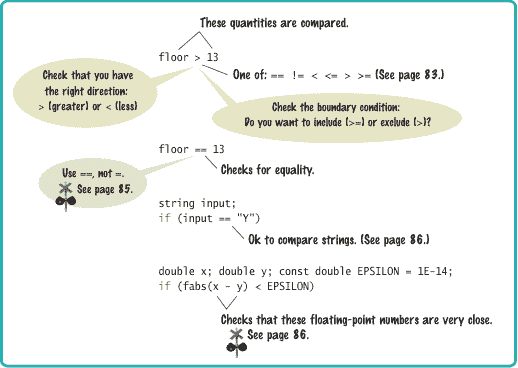

表 2 关系运算符示例

| 表达式 | 值 | 注释 |
| :--- | :--- | :--- |
| 3 <= 4 | true | 3 小于 4；<= 测试“小于或等于”。 |
| 3 =< 4 | 错误 | “小于或等于”运算符是 <=，不是 =<。“小于”符号在前。 |
| 3 > 4 | false | > 是 <= 的反面。 |
| 4 < 4 | false | 左侧必须严格小于右侧。 |
| 4 <= 4 | true | 两侧相等；<= 测试“小于或等于”。 |
| 3 == 5 - 2 | true | == 测试相等。 |
| 3 != 5 - 1 | true | != 测试不相等。3 不等于 5 - 1，这是真的。 |
| 3 = 6 / 2 | 错误 | 使用 == 测试相等。 |
| 1.0 / 3.0 == 0.33333333 | false | 尽管这些值彼此非常接近，但它们并不完全相等。见第 86 页的常见错误 3.3。 |
| "10" > 5 | 错误 | 不能将字符串与数字进行比较。 |

表 2 总结了如何在 C++ 中使用关系运算符。


- 6. 当 a 为 3、b 为 4 时，下列哪些条件为真？
  - a. a + 1 <= b
  - b. a + 1 >= b
  - c. a + 1 != b
- 7. 给出该条件的相反条件

  `floor > 13`
- 8. 这条语句中有什么错误？

  ```cpp
  if (score_a = score_b)
  {
      cout << "Tie" << endl;
  }
  ```
- 9. 在这个 if 语句中提供一个条件，以测试用户是否输入了 Y：

  ```cpp
  string input;
  cout << "Enter Y to quit." << endl;
  cin >> input;
  if (...)
  {
      cout << "Goodbye." << endl;
      return 0;
  }
  ```

## 常见错误 3.3

### 浮点数的精确比较

浮点数只有有限的精度，计算可能引入舍入误差。在比较浮点数时，必须考虑这些不可避免的舍入误差。例如，下面的代码将 2 的平方根自乘。理想情况下，我们期望得到答案 2：

```cpp
double r = sqrt(2.0);
if (r * r == 2)
{
    cout << "sqrt(2) squared is 2" << endl;
}
else
{
    cout << "sqrt(2) squared is not 2 but "
         << setprecision(18) << r * r << endl;
}
```

该程序显示：

```text
sqrt(2) squared is not 2 but 2.0000000000000004
```

在大多数情况下，精确比较浮点数没有意义。相反，我们应该测试它们是否足够接近。也就是说，它们之差的绝对值应小于某个阈值。用数学方式表示，如果满足下式，我们就说 x 和 y 足够接近：

$$|x - y| < \varepsilon$$

其中 $\varepsilon$ 是一个非常小的数。$\varepsilon$ 是希腊字母 epsilon，用于表示非常小的量。在比较 double 数时，通常将 $\varepsilon$ 设为 $10^{-14}$：

```cpp
const double EPSILON = 1E-14;
double r = sqrt(2.0);
if (fabs(r * r - 2) < EPSILON)
{
    cout << "sqrt(2) squared is approximately 2";
}
```

包含 <cmath> 头文件以使用 fabs 函数。


*在比较浮点数时考虑有限精度。*

## 专题 3.2

### 字符串的字典序

如果使用 < 或 > 比较字符串，它们会按“字典序”进行比较。这种排序方式与字典中单词的排序方式非常相似。

例如，考虑下面这个代码片段。

```cpp
string name = "Tom";
if (name < "Dick") ...
```

该条件不成立，因为在字典中 Dick 排在 Tom 前面。字典中的排序与 C++ 中的排序有一些差异。在 C++ 中：

- 所有大写字母都排在小写字母之前。例如，"Z" 排在 "a" 之前。


*要查看两个词中哪个在字典中排在前，请考虑它们第一个不同的字母。*


- 空格字符排在所有可打印字符之前。
- 数字排在字母之前。
- 标点符号的排序见附录 D。

比较两个字符串时，先比较两个字符串的第一个字母，再比较第二个字母，依此类推，直到其中一个字符串结束，或找到第一对不匹配的字母。

如果一个字符串结束，较长的字符串被认为“更大”。例如，比较 "car" 与 "cart"。前三个字母匹配，然后到达第一个字符串的末尾。因此，按字典序，"car" 排在 "cart" 之前。

当遇到不匹配时，包含“较大”字符的字符串被认为“更大”。例如，让我们比较 "cat" 与 "cart"。前两个字母匹配。由于 t 排在 r 之后，按字典序，字符串 "cat" 排在 "cart" 之后。

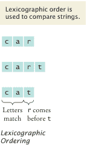

## 操作方法 3.1 —— 实现 if 语句


本操作方法将引导你完成实现 if 语句的过程。我们将用下面的示例问题说明这些步骤：

大学书店每年 10 月 24 日举行“千字节日”促销：如果价格低于 $128，所有电脑配件购买享受 8% 的折扣；如果价格至少为 $128，则享受 16% 的折扣。编写一个程序，向收银员询问原价，然后打印折扣价。

### 步骤 1 —— 确定分支条件

在示例问题中，条件的明显选择是：

```text
original price < 128?
```

这完全可以，我们将在解决方案中使用该条件。

但如果你选择相反的条件，也同样可以得出正确的解决方案：原价是否至少（≥）$128？如果你站在购物者的角度，想知道什么时候适用更大的折扣，就可能选择这个条件。


对于昂贵商品，销售折扣通常更高。使用 if 语句来实现这样的决策。

### 步骤 2 —— 为条件为真时需要完成的工作给出伪代码

在这一步中，列出在“正”分支中执行的一个或多个操作。具体细节取决于你的问题。你可能想打印消息、计算值，甚至退出程序。

在我们的示例中，需要应用 8% 的折扣：

```text
discounted price = 0.92 x original price
```

### 步骤 3 —— 为条件不为真时需要完成的工作（如果有）给出伪代码

如果步骤 1 的条件不满足，你想做什么？有时你什么都不想做。在这种情况下，使用不带 else 分支的 if 语句。

在我们的示例中，条件测试价格是否低于 $128。如果该条件不为真，则价格至少为 $128，因此销售适用 16% 的更高折扣：

```text
discounted price = 0.84 x original price
```

### 步骤 4 —— 复核关系运算符

首先，确保测试方向正确。混淆 > 和 < 是常见错误。接下来，考虑应该使用 < 运算符还是它的近亲 <= 运算符。

如果原价恰好是 $128，应该发生什么？仔细阅读问题，我们发现：如果原价低于 $128，适用较低折扣；当原价至少为 $128 时，适用较高折扣。因此，$128 的价格不应满足我们的条件，我们必须使用 <，而不是 <=。

### 步骤 5 —— 消除重复

检查哪些操作是两个分支共有的，并将它们移到分支外。（参见第 82 页的编程提示 3.4。）

在我们的示例中，有两条如下形式的语句：

```text
discounted price = ____ x original price
```

它们仅在折扣率上不同。最好只在分支中设置折扣率，然后在之后进行计算：

```text
If original price < 128
    discount rate = 0.92
Else
    discount rate = 0.84
discounted price = discount rate x original price
```

### 步骤 6 —— 测试两个分支

制定两个测试用例：一个满足 if 语句的条件，另一个不满足。问自己每种情况下应该发生什么。然后按照伪代码，逐一模拟执行它们。

在我们的示例中，考虑原价的两种情形：$100 和 $200。我们期望第一个价格折扣 $8，第二个折扣 $32。

当原价为 100 时，条件 100 < 128 为真，得到

```text
discount rate = 0.92
discounted price = 0.92 x 100 = 92
```

当原价为 200 时，条件 200 < 128 为假，并且

```text
discount rate = 0.84
discounted price = 0.84 x 200 = 168
```

在两种情况下，我们都得到预期答案。

### 步骤 7 —— 在 C++ 中组装 if 语句

输入骨架：

```cpp
if ()
{
}
else
{
}
```

## 3.3 多重备选方案

对于有两个以上情况的决策，需要多重备选方案。

在 3.1 节中，你了解了如何用 if 语句编写双向分支。在许多情况下，情况不止两种。在本节中，你将了解如何实现带多重备选方案的决策。例如，考虑一个显示地震影响（以里氏震级衡量）的程序（见表 3）。

1989 年的洛马普列塔地震损坏了旧金山的海湾大桥，并摧毁了许多建筑物，其里氏震级为 7.1。


**表 3 里氏震级**

| 数值 | 影响 |
| --- | --- |
| 8 | 大多数结构倒塌 |
| 7 | 许多建筑物被摧毁 |
| 6 | 许多建筑物严重损坏，一些倒塌 |
| 4.5 | 建造质量差的建筑物受损 |

里氏震级是衡量地震强度的指标。震级中的每一级，例如从 6.0 到 7.0，都表示地震强度增加十倍。

在这种情况下，有五个分支：四个损坏描述各一个，外加一个无破坏的分支。图 3 显示了该多分支语句的流程图。

你可以使用多个 if 语句来实现多重备选方案，如下所示：

```cpp
if (richter >= 8.0)
{
   cout << "Most structures fall";
}
else if (richter >= 7.0)
{
   cout << "Many buildings destroyed";
}
else if (richter >= 6.0)
{
   cout << "Many buildings considerably damaged, some collapse";
}
else if (richter >= 4.5)
{
   cout << "Damage to poorly constructed buildings";
}
else
{
   cout << "No destruction of buildings";
}
```

一旦四个测试之一成功，就显示相应影响，不再尝试进一步测试。如果四种情况都不适用，则执行最后的 else 子句，并打印默认消息。（完整程序见 ch03/richter.cpp 文件。）

**图 3** 多重备选方案

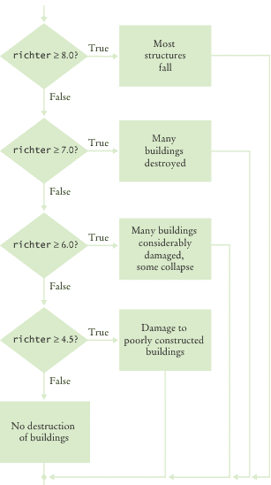

这里必须对条件排序，并首先针对最大的分界值进行测试。假设我们颠倒测试顺序：

```cpp
if (richter >= 4.5) // Tests in wrong order
{
    cout << "Damage to poorly constructed buildings";
}
else if (richter >= 6.0)
{
    cout << "Many buildings considerably damaged, some collapse";
}
else if (richter >= 7.0)
{
    cout << "Many buildings destroyed";
}
else if (richter >= 8.0)
{
    cout << "Most structures fall";
}
```

> 使用多个 if 语句时，要注意条件的顺序。

这样不行。假设 richter 的值为 7.1。该值至少为 4.5，匹配第一个情况。其他测试将永远不会被尝试。

在这个例子中，同样重要的是我们使用一系列 else if 子句，而不仅仅是多个独立的 if 语句。考虑下面这一系列独立测试：

```cpp
if (richter >= 8.0) // Didn't use else
{
   cout << "Most structures fall";
}
if (richter >= 7.0)
{
   cout << "Many buildings destroyed";
}
if (richter >= 6.0)
{
   cout << "Many buildings considerably damaged, some collapse";
}
if (richter >= 4.5)
{
   cout << "Damage to poorly constructed buildings";
}
```

现在这些备选方案不再互斥。如果 richter 为 7.1，那么后三个测试都匹配，并且会打印三条消息。

### 自测


- 11. 在一个游戏程序中，玩家 A 和 B 的分数分别存储在变量 score_a 和 score_b 中。假设分数更高的玩家获胜，编写一系列条件语句，打印出 "A won"、"B won" 或 "Game tied"。
- 12. 编写一个具有三个分支的条件语句：如果 x 为正，则将 s 设为 1；如果 x 为负，则设为 -1；如果 x 为零，则设为 0。
- 13. 如何仅用两个分支完成自测 12 的任务？
- 14. 初学者有时会编写如下语句：

    ```cpp
    if (price > 100)
    {
        discounted_price = price - 20;
    }
    else if (price <= 100)
    {
        discounted_price = price - 10;
    }
    ```

    解释这段代码可以如何改进。
- 15. 假设用户向 richter.cpp 程序输入 -1。会打印什么？
- 16. 假设我们希望让 richter.cpp 程序检查用户是否输入了负数。你会向 if 语句添加什么分支，以及添加在哪里？

**动手练习** 现在你可以尝试本章末尾的这些练习：R3.20、P3.1、P3.9、P3.10。


## 专题 3.3

### switch 语句

将*单个整数值*与若干个*常量备选值*进行比较的一系列 if 语句，可以用 switch 语句实现。例如，


```cpp
int digit;

switch (digit)
{
   case 1: digit_name = "one"; break;
   case 2: digit_name = "two"; break;
   case 3: digit_name = "three"; break;
   case 4: digit_name = "four"; break;
   case 5: digit_name = "five"; break;
   case 6: digit_name = "six"; break;
   case 7: digit_name = "seven"; break;
   case 8: digit_name = "eight"; break;
   case 9: digit_name = "nine"; break;
   default: digit_name = ""; break;
}
```

这是以下代码的简写：

```cpp
int digit;
if (digit == 1) { digit_name = "one"; }
else if (digit == 2) { digit_name = "two"; }
else if (digit == 3) { digit_name = "three"; }
else if (digit == 4) { digit_name = "four"; }
else if (digit == 5) { digit_name = "five"; }
else if (digit == 6) { digit_name = "six"; }
else if (digit == 7) { digit_name = "seven"; }
else if (digit == 8) { digit_name = "eight"; }
else if (digit == 9) { digit_name = "nine"; }
else { digit_name = ""; }
```

嗯，这算不上多大简写，但它有一个优点——很明显所有分支都在测试同一个值，即 digit。


*switch 语句让你从一组固定的备选方案中进行选择。*

一个分支可以有多个 case 子句，例如

```cpp
case 1: case 3: case 5: case 7: case 9:
    odd = true; break;
```

如果没有任何 case 子句匹配，则选择 default 分支。

switch 的每个分支都必须以 break 指令终止。如果缺少 break，执行会*贯穿*到下一个分支，依此类推，直到最终遇到 break 或到达 switch 末尾。在实践中，这种贯穿行为相当有用，但它也是常见的错误来源。如果你不小心忘记了 break 语句，程序会编译通过，但会执行不需要的代码。许多程序员认为 switch 语句有些危险，因而更偏好 if 语句。

是否在自己的代码中使用 switch 语句，由你决定。无论如何，你都需要具备阅读 switch 的能力，以防在其他程序员的代码中遇到它。

## 3.4 嵌套分支

当一个决策语句包含在另一个决策语句的分支内部时，这些语句就是*嵌套*的。

经常需要将一个 if 语句包含在另一个 if 语句内部。这种安排称为*嵌套*语句组。下面是一个典型示例。

在美国，不同税率根据纳税人的婚姻状况而有所不同。单身纳税人和已婚纳税人适用不同的税率表。已婚纳税人将收入合并计算，并对总收入缴税。表 4 给出了税率计算，使用的是对 2008 纳税年度有效税率表的简化版本。每个“档次”适用不同税率。在此税率表中，第一档收入按 10% 征税，第二档收入按 25% 征税。每个档次的收入限额取决于婚姻状况。

具有两个决策层次的问题需要嵌套决策。

现在，给定申报状态和收入数字，计算应缴税款。关键在于存在两个*层次*的决策。首先，必须根据婚姻状况分支。然后，对于每种申报状态，还必须根据收入水平再分支。

**表 4 联邦税率表**

| 状态与应税收入 | 税额为 | 超出以下金额的部分 |
|---|---:|---:|
| 单身，最多 $32,000 | 10% | $0 |
| 单身，超过 $32,000 | $3,200 + 25% | $32,000 |
| 已婚，最多 $64,000 | 10% | $0 |
| 已婚，超过 $64,000 | $6,400 + 25% | $64,000 |

这个两级决策过程反映在本节末尾程序中的两级 if 语句中。（流程图见图 4。）


*计算所得税需要多个层次的决策。*

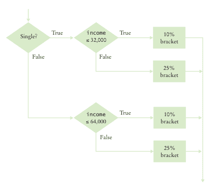

图 4 所得税计算

理论上，嵌套可以深于两级。三级决策过程（先按州，再按申报状态，最后按收入水平）需要三个嵌套层级。

ch03/tax.cpp

```cpp
#include <iostream>
#include <string>

using namespace std;

int main()
{
   const double RATE1 = 0.10;
   const double RATE2 = 0.25;
   const double RATE1_SINGLE_LIMIT = 32000;
   const double RATE1_MARRIED_LIMIT = 64000;

   double tax1 = 0;
   double tax2 = 0;

   double income;
   cout << "Please enter your income: ";
   cin >> income;

   cout << "Please enter s for single, m for married: ";
   string marital_status;
   cin >> marital_status;

   if (marital_status == "s")
   {
       if (income <= RATE1_SINGLE_LIMIT)
       {
           tax1 = RATE1 * income;
       }
       else
       {
           tax1 = RATE1 * RATE1_SINGLE_LIMIT;
           tax2 = RATE2 * (income - RATE1_SINGLE_LIMIT);
       }
   }
   else
   {
       if (income <= RATE1_MARRIED_LIMIT)
       {
           tax1 = RATE1 * income;
       }
       else
       {
           tax1 = RATE1 * RATE1_MARRIED_LIMIT;
           tax2 = RATE2 * (income - RATE1_MARRIED_LIMIT);
       }
   }

   double total_tax = tax1 + tax2;

   cout << "The tax is $" << total_tax << endl;
   return 0;
}
```

### 程序运行

```text
Please enter your income: 80000
Please enter s for single, m for married: m
The tax is $10400
```


### 自测

- 17. 单身纳税人在收入为 $32,000 时需缴纳多少税款？

- 18. 如果第一个嵌套 if 语句从

  ```cpp
  if (income <= RATE1_SINGLE_LIMIT)
  ```

  改为

  ```cpp
  if (income < RATE1_SINGLE_LIMIT)
  ```

  该金额会改变吗？

- 19. 假设哈里和萨莉每人每年收入 $40,000。如果他们结婚，会节省税款吗？

- 20. 你会如何修改 tax.cpp 程序，以检查用户为婚姻状况输入了正确的值（即 s 或 m）？

- 21. 有些人反对对更高收入征收更高税率，声称当你因努力工作而加薪时，税后最终可能拿到更少的钱。这个论点有什么缺陷？

**练习一下**  现在你可以尝试本章末尾的这些练习：R3.7、R3.19、P3.13、P3.19。

## 编程提示 3.6


### 手工跟踪

一种用于理解程序是否正确运行的非常有用的技术称为*手工跟踪*。你在一张纸上模拟程序的活动。这种方法可用于伪代码或 C++ 代码。

拿一张索引卡、一张鸡尾酒餐巾纸，或者手边随便什么纸。为每个变量建一列。准备好程序代码。用某个标记物（例如回形针）标出当前语句。在脑中一次执行一条语句。每当变量的值发生变化时，划掉旧值，并把新值写在旧值下面。

例如，让我们用第 95 页程序运行中的数据来跟踪税务程序。在第 13 和 14 行，tax1 和 tax2 被初始化为 0。


*手工跟踪有助于你理解程序是否正确运行。*

```cpp
6  int main()
7  {
8      const double RATE1 = 0.10;
9      const double RATE2 = 0.25;
10     const double RATE1_SINGLE_LIMIT = 32000;
11     const double RATE1_MARRIED_LIMIT = 64000;
12
13     double tax1 = 0;
14     double tax2 = 0;
15
```

| tax1 | tax2 | income | 婚姻状况 |
|---:|---:|---:|---|
| 0 | 0 |  |  |
|  |  |  |  |

在第 18 和 22 行，income 和 marital_status 通过输入语句初始化。

```cpp
16     double income;
17     cout << "Please enter your income: ";
18     cin >> income;
19
20     cout << "Please enter s for single, m for married: ";
21     string marital_status;
22     cin >> marital_status;
23
```

| tax1 | tax2 | income | 婚姻状况 |
|---:|---:|---:|---|
| 0 | 0 | 80000 | m |
|  |  |  |  |

因为 marital_status 不是 "s"，所以我们转到外层 if 语句的 else 分支（第 36 行）。

```cpp
24     if (marital_status == "s")
25     {
26         if (income <= RATE1_SINGLE_LIMIT)
27         {
28             tax1 = RATE1 * income;
29         }
30         else
31         {
32             tax1 = RATE1 * RATE1_SINGLE_LIMIT;
33             tax2 = RATE2 * (income - RATE1_SINGLE_LIMIT);
34         }
35     }
36     else
37     {
```

由于 income 不 <= 64000，我们转到内层 if 语句的 else 分支（第 42 行）。

```cpp
38         if (income <= RATE1_MARRIED_LIMIT)
39         {
40             tax1 = RATE1 * income;
41         }
42         else
43         {
44             tax1 = RATE1 * RATE1_MARRIED_LIMIT;
45             tax2 = RATE2 * (income - RATE1_MARRIED_LIMIT);
46         }
```


tax1 和 tax2 的值会被更新。

```cpp
43     {
44         tax1 = RATE1 * RATE1_MARRIED_LIMIT;
45         tax2 = RATE2 * (income - RATE1_MARRIED_LIMIT);
46     }
47 }
```

| tax1 | tax2 | income | 婚姻状况 |
|---:|---:|---:|---|
| 0 | 0 | 80000 | m |
| 6400 | 4000 | | |

它们的总和 total_tax 被计算并打印出来。  
然后程序结束。

```cpp
48     double total_tax = tax1 + tax2;
49
50     cout << "The tax is $" << total_tax << endl;
51     return 0;
52  }
53 }
```

| tax1 | tax2 | income | 婚姻状况 | 总税额 |
|---:|---:|---:|---|---:|
| 0 | 0 | 80000 | m | |
| 6400 | 4000 | | | 10400 |

由于程序跟踪显示预期输出（$10,400），因此它成功证明了该测试用例工作正常。

## 常见错误 3.4


### 悬空 else 问题

当一个 if 语句嵌套在另一个 if 语句内部时，可能会出现以下错误。

```cpp
double shipping_charge = 5.00; // $5 inside continental U.S.
if (country == "USA")
    if (state == "HI")
        shipping_charge = 10.00; // Hawaii is more expensive
    else // Pitfall!
        shipping_charge = 20.00; // As are foreign shipments
```

缩进级别似乎表明 else 与测试 `country == "USA"` 配对。不幸的是，事实并非如此。编译器会忽略所有缩进，并将 else 与前一个 if 配对。也就是说，代码实际上是：

```cpp
double shipping_charge = 5.00; // $5 inside continental U.S.
if (country == "USA")
    if (state == "HI")
        shipping_charge = 10.00; // Hawaii is more expensive
    else // Pitfall!
        shipping_charge = 20.00; // As are foreign shipments
```

这不是你想要的结果。你想要将 else 与第一个 if 配对。

这种有歧义的 else 被称为悬空 else。如果你始终使用花括号，就可以避免这个陷阱，如编程技巧 3.2（第 80 页）中所建议的那样：

```cpp
double shipping_charge = 5.00; // $5 inside continental U.S.
if (country == "USA")
{
    if (state == "HI")
    {
        shipping_charge = 10.00; // Hawaii is more expensive
    }
}
else
{
    shipping_charge = 20.00; // As are foreign shipments
}
```

在绘制流程图时，有一个需要注意的问题。不受约束的分支和合并可能会导致“意大利面条式代码”，即程序中可能路径的混乱网络。


*意大利面条式代码拥有太多路径，以至于变得无法理解。*

> 切勿将箭头指向另一个分支的内部。

避免意大利面条式代码有一个简单的规则：切勿将箭头指向另一个分支的内部。

为了理解这个规则，请考虑以下示例：美国境内运费为 5 美元，但运往夏威夷和阿拉斯加的运费为 10 美元。国际运费也是 10 美元。你可能会从如下流程图开始：

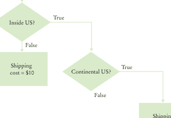

现在你可能会倾向于重用“运费 = 10 美元”这个任务：

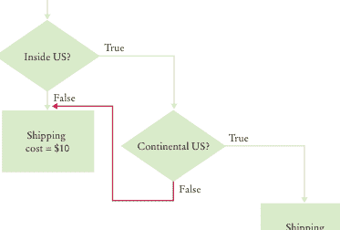

不要这样做！红色箭头指向了另一个分支的内部。相反，应该添加另一个将运费设置为 10 美元的任务，如下所示：

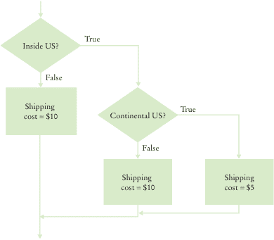

这样不仅能避免意大利面条式代码，而且也是更好的设计。未来国际运费很可能与运往阿拉斯加和夏威夷的运费不同。

流程图对于直观理解算法的流程非常有用。但是，当你添加更多细节时，它们很快就会变得庞大。此时，就有必要从流程图切换到伪代码。

### 自测

- 22. 为一个程序绘制流程图，该程序读取值 temp，如果小于零则打印“Frozen”。
- 23. 右侧的流程图有什么问题？
- 24. 你如何修复自测 23 中的流程图？
- 25. 为一个程序绘制流程图，该程序读取值 x。如果 x 小于零，打印“Error”。否则，打印其平方根。
- 26. 为一个程序绘制流程图，该程序读取值 temp。如果小于零，打印“Ice”。如果大于 100，打印“Steam”。否则，打印“Liquid”。

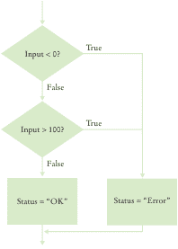

## 动手练习

现在你可以尝试本章末尾的练习：R3.10、R3.11、R3.12。

## 编程技巧 3.7


### 制定计划并为意外问题预留时间

商业软件因交付晚于承诺而臭名昭著。例如，微软最初承诺其 Windows Vista 操作系统将在 2003 年底推出，然后是 2005 年，然后是 2006 年 3 月；最终于 2007 年 1 月发布。其中一些早期承诺可能并不现实。让潜在客户期待产品即将问世符合微软的利益。如果客户知道实际交付日期，他们可能会转而使用其他产品。但不可否认的是，微软并未预料到自己要解决的任务的全部复杂性。

微软可以推迟其产品的交付，但你可能无法这样做。作为学生或程序员，你应该明智地管理时间，按时完成作业。你也许可以在截止日期前一天晚上完成简单的编程练习，但一个看起来难度翻倍的作业可能需要四倍的时间，因为可能出错的地方更多。因此，每当你开始一个编程项目时，都应该制定计划。

首先，切合实际地估计你需要多少时间来完成以下任务：

- 设计程序逻辑。
- 开发测试用例。
- 输入程序并修复语法错误。
- 测试和调试程序。

例如，对于所得税程序，我可能会估算：设计需要一小时；开发测试用例需要 30 分钟；数据输入和修复语法错误需要一小时；测试和调试需要一小时。总计 3.5 小时。如果我每天在这个项目上工作两小时，大约需要两天时间。

然后考虑可能出错的情况。你的电脑可能会崩溃。你可能会被计算机系统的问题难住。（这对初学者来说尤其重要。因为一个琐碎的问题而浪费一天时间是很常见的，只是因为你需要花时间找到那个知道神奇命令来解决它的人。）根据经验，将你的估计时间加倍。也就是说，你应该在截止日期前四天开始，而不是前两天。如果一切顺利，那很好；你提前两天完成了程序。当不可避免的问题出现时，你有了缓冲时间，可以避免尴尬和失败。


> 为你的编程工作制定计划，并为问题留出时间。

## 3.7 布尔变量与运算符

有时，你需要在程序的一个部分评估逻辑条件，并在其他地方使用它。要存储一个可以为真或假的条件，你可以使用布尔变量。布尔变量以数学家乔治·布尔（1815–1864）的名字命名，他是逻辑学研究的先驱。

> 布尔类型 `bool` 有两个值：`false` 和 `true`。

在 C++ 中，bool 数据类型表示布尔类型。bool 类型的变量只能保存两个值，即 false 和 true。这些值不是字符串或整数；它们是特殊值，仅用于布尔变量。

**表 5. 选定的运算符及其优先级**

| 运算符 | 描述 |
|---|---|
| `++ -- +`（一元）、`-`（一元）、`!` | 自增、自减、正号、负号、布尔*非* |
| `* / %` | 乘法、除法、取余 |
| `+ -` | 加法、减法 |
| `< <= > >=` | 比较 |
| `== !=` | 等于、不等于 |
| `&&` | 布尔*与* |
| `||` | 布尔*或* |

反过来，让我们测试水在给定温度下是否*不是*液体。当温度小于等于 0 或大于等于 100 时，就是这种情况。使用 `||`（*或*）运算符来组合表达式：

```cpp
if (temp <= 0 || temp >= 100) { cout << "Not liquid"; }
```

图 9 显示了这些示例的流程图。

有时你需要使用*非*逻辑运算符来*反转*条件。`!` 运算符接受一个条件，如果该条件为假则评估为真，如果条件为真则评估为假。在此示例中，当布尔变量 `frozen` 的值为假时，会输出内容：

> 要反转条件，请使用 `!`（*非*）运算符。

```cpp
if (!frozen)
{
    cout << "Not frozen";
}
```

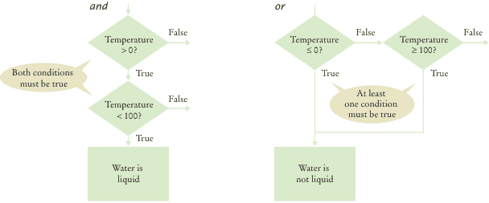

**图 9.** *与*和*或*组合的流程图


**表 6 布尔运算符**

| 表达式 | 值 | 备注 |
|---|---|---|
| 0 < 200 && 200 < 100 | false | 只有第一个条件为真。注意 `<` 运算符的优先级高于 `&&` 运算符。 |
| 0 < 200 \|\| 200 < 100 | true | 第一个条件为真。 |
| 0 < 200 \|\| 100 < 200 | true | `\|\|` 并非“要么-要么”的测试。如果两个条件都为真，结果为真。 |
| ⛔ 0 < 200 < 100 | true | **错误：** 表达式 0 < 200 为真，它被转换为 1。表达式 1 < 100 为真。你绝不应该写出这样的表达式；参见第 107 页的常见错误 3.5。 |
| ⛔ -10 && 10 > 0 | true | **错误：** -10 不是零。它被转换为 true。你绝不应该写出这样的表达式；参见第 107 页的常见错误 3.5。 |
| 0 < x && x < 100 \|\| x == -1 | (0 < x && x < 100) \|\| x == -1 | `&&` 运算符的优先级高于 `\|\|` 运算符。 |
| !(0 < 200) | false | 0 < 200 为真，因此其否定为假。 |
| frozen == true | frozen | 无需将布尔变量与 true 进行比较。 |
| frozen == false | !frozen | 使用 `!` 比与 false 比较更清晰。 |

表 6 展示了更多有关布尔运算符求值的示例。


- 31. 假设 x 和 y 是两个整数。你如何测试它们是否都为零？
- 32. 你如何测试它们是否至少有一个为零？
- 33. 你如何测试它们是否恰好有一个为零？
- 34. `!frozen` 的值是什么？
- 35. 使用 `bool` 类型而不是字符串 “false”/“true” 或整数 0/1 有什么优势？

**动手练习** 现在你可以尝试本章末尾的这些练习：R3.27、P3.22、P3.24。

## 常见错误 3.5


### 组合多个关系运算符

考虑表达式

```
if (0 <= temp <= 100) // 错误
```

这看起来就像数学测试 0 ≤ temp ≤ 100。遗憾的是，它并非如此。

让我们剖析表达式 `0 <= temp <= 100`。前半部分 `0 <= temp` 是一个测试，其结果为 true 或 false，具体取决于 temp 的值。然后，该测试的结果（true 或 false）再与 100 进行比较。能比较布尔值和浮点数吗？true 是否大于 100？遗憾的是，为了与 C 语言保持兼容，C++ 将 false 转换为 0，将 true 转换为 1。因此，该表达式总是求值为 true。

在程序中，你必须小心，不要混淆逻辑表达式和算术表达式。相反，应使用**and（并且）**来组合两个独立的测试：

```
if (0 <= temp && temp <= 100) ...
```

另一个同样类型的常见错误是写出

```
if (x && y > 0) ... // 错误
```

而不是

```
if (x > 0 && y > 0) ...
```

遗憾的是，编译器不会发出错误消息。相反，它会将 x 转换为 true 或 false。零被转换为 false，任何非零值被转换为 true。如果 x 不为零，那么它测试 y 是否大于 0，最后计算这两个真值的**and（并且）**。显然，这种计算毫无意义。

## 常见错误 3.6


### 混淆 && 与 || 条件

混淆**and**和**or**条件是一个非常常见的错误。一个值位于 0 和 100 之间，当且仅当它至少为 0 **且** 至多为 100。如果它小于 0 **或** 大于 100，则该值位于该范围之外。这里没有金科玉律；你必须仔细思考。

通常**and**和**or**在表述中十分明确，实现起来并不困难。但有时措辞并不那么明确。常见的情况是，各个条件在项目符号列表中很好地分隔开，但几乎没有说明应如何组合它们。考虑以下报税说明。如果以下任一情况成立，你就有资格申报该身份：

- 你从未结婚。
- 在纳税年度的最后一天，你已合法分居或离婚。
- 你已丧偶，且未再婚。

由于只要**任一**条件为真则测试通过，你必须使用**or**来组合这些条件。在另一处，同样的说明指出，如果以下所有五个条件均为真，你可以使用更为有利的“已婚联合申报”身份：

- 你的配偶在不到两年前去世，且你未再婚。
- 你有一个孩子，可以将他/她申报为被抚养人。
- 该孩子在整个纳税年度都住在你的家中。
- 你为该孩子支付了超过一半的居家费用。
- 你在配偶去世当年与其共同申报了税表。

因为要使测试通过，**所有**条件都必须为真，你必须使用**and**来组合它们。

## 专题 3.4


### 布尔运算符的短路求值

当计算 `&&` 和 `||` 运算符时，一旦确定真值，求值便会停止。当计算 `&&` 且第一个条件为 false 时，不会计算第二个条件，因为第二个测试的结果已无关紧要。

例如，考虑表达式

```
quantity > 0 && price / quantity < 10
```

假设 quantity 的值为零。那么测试 `quantity > 0` 失败，第二个测试不会被尝试。这正合适，因为除以零是非法的。

类似地，当 `||` 表达式的第一个条件为 true 时，其余部分不会被计算，因为结果必定为 true。

这个过程称为*短路求值*。

> *在短路中，电流沿着电阻最小的路径行进。类似地，短路求值采用最快的路径来计算布尔表达式的结果。*


> `&&` 和 `||` 运算符使用*短路求值*进行计算：一旦真值确定，就不再计算其他条件。

## 专题 3.5


### 德摩根定律

人们通常难以理解在 `and/or` 表达式上应用 `not` 运算符的逻辑条件。以逻辑学家奥古斯都·德摩根（1806–1871）命名的德摩根定律可用于简化这些布尔表达式。

假设我们想对不在美国本土境内发货的情况收取更高的运费。

```
if (!(country == "USA"
    && state != "AK"
    && state != "HI"))
    shipping_charge = 20.00;
```

这个测试有点复杂，你必须仔细思考其逻辑。当“国家是美国**并且**州不是阿拉斯加**并且**州不是夏威夷”为*假*时，收取 20.00 美元。嗯？说某些人不会被这段代码弄糊涂，那是不对的。

计算机并不在乎，但编写和维护代码的是人类程序员。因此，了解如何简化这样的条件是有用的。

德摩根定律有两种形式：一种用于*and*表达式的否定，一种用于*or*表达式的否定：

```
!(A && B)    等同于    !A || !B
!(A || B)    等同于    !A && !B
```

> 德摩根定律告诉你如何否定 `&&` 和 `||` 条件。

要特别注意，通过将 `not` 向内移动，*and* 和 *or* 运算符会*互换*。例如，“该州是阿拉斯加州或夏威夷州”的否定：

```
!(state == "AK" || state == "HI")
```

就是“该州不是阿拉斯加州，并且不是夏威夷州”：

```
!(state == "AK") && !(state == "HI")
```

当然，这与下面相同：

```
state != "AK" && state != "HI"
```

现在将这个定律应用到我们的运费计算中：

```
!(country == "USA"
    && state != "AK"
    && state != "HI")
```

等价于

```
!(country == "USA")
    || !(state == "AK")
    || !(state != "HI")
```

从而得到更简单的测试：

```
country != "USA"
    || state == "AK"
    || state == "HI"
```

要简化包含 *and* 或 *or* 表达式否定的条件，通常最好应用德摩根定律，将否定移动到最内层。

## 3.8 应用：输入验证


*像质量控制员一样，你希望在处理用户输入之前确保其正确无误。*

`if` 语句的一个重要应用是*输入验证*。每当你的程序接受用户输入时，在将其用于计算之前，你都需要确保用户提供的值有效。

考虑我们的电梯程序。假设电梯面板上有标有 1 到 20（但没有 13）的按钮。以下是非法输入：

- 数字 13
- 零或负数
- 大于 20 的数字
- 不是数字序列的输入，例如 five

对于每种情况，我们都要给出错误消息并退出程序。

防止输入 13 很简单：

```
if (floor == 13)
{
    cout << "Error: There is no thirteenth floor." << endl;
    return 1;
}
```

语句

```
return 1;
```

会立即退出 main 函数，从而终止程序。按照惯例，如果程序正常完成，则返回 0；如果遇到错误，则返回非零值。


```cpp
26 }
27
28 // Now we know that the input is valid
29 int actual_floor;
30 if (floor > 13)
31 {
32     actual_floor = floor - 1;
33 }
34 else
35 {
36     actual_floor = floor;
37 }
38
39 cout << "The elevator will travel to the actual floor "
40      << actual_floor << endl;
41
42 return 0;
43 }
```

### 程序运行

```text
Floor: 13
Error: There is no thirteenth floor.
```

### 自测

- **36.** 考虑 elevator2.cpp 程序。当输入为以下值时，输出是什么？
  - a. 100?
  - b. -1?
  - c. 20?
  - d. thirteen?

- **37.** 你的任务是重写 elevator2.cpp 程序，使其只有一个带有复合条件的 if 语句：

  ```cpp
  if (...)
  {
      cout << "Error: Bad input" << endl;
      return 1;
  }
  ```

  这个条件是什么？

- **38.** 在夏洛克·福尔摩斯的故事《苏塞克斯吸血鬼奇案》中，那位无与伦比的侦探说了这样一句话：“马蒂尔达·布里格斯并不是一位年轻女士的名字，华生……那是一艘与苏门答腊巨鼠有关的船，一个世人还未准备好听闻的故事。”一百多年后，研究人员在印度尼西亚的另一地区——西新几内亚发现了巨鼠。

  假设你负责编写一个处理老鼠体重的程序。其中包含以下语句：

  ```cpp
  double weight;
  cout << "Enter weight in kg: ";
  cin >> weight;
  ```

  你应该提供哪些输入检查？


*在处理输入时，你需要拒绝过大的值。但多大才算过大？这些在西新几内亚发现的巨鼠，体型大约是城市老鼠的五倍。*

**39.** 考虑以下测试程序：

```cpp
int main()
{
    int m = 1;
    cout << "Enter an integer: ";
    cin >> m;
    int n = 2;
    cout << "Enter another integer: ";
    cin >> n;
    cout << m << " " << n << endl;
    return 0;
}
```

运行这个程序并在第一个提示符处输入 `three`。会发生什么？为什么？

**实践** 现在你可以尝试本章末尾的这些练习：R3.1、R3.30、P3.26。


## 随机事实 3.2 人工智能

当人们使用复杂的计算机程序来准备报税时，必定会认为计算机具有某种智能。计算机提出合理的问题，并进行我们认为具有智力挑战的计算。毕竟，如果报税很容易，我们就不需要计算机来替我们做了。

然而，作为程序员，我们知道所有这些表面上的智能都是一种错觉。人类程序员在各种可能场景下精心“训练”了软件，而它只是重播被编程进去的动作和决策。

是否有可能编写出在某种意义上是真正智能的计算机程序？从计算技术的最早期开始，人们就认为人脑可能只是一台巨大的计算机，而且完全有可能编写程序来模仿人类思维的某些过程。人工智能的严肃研究始于20世纪50年代中期，最初二十年取得了一些令人瞩目的成功。下国际象棋的程序——这无疑是一项看似需要非凡智力能力的活动——已经变得非常出色，现在它们常规性地击败除最优秀人类棋手之外的所有人。早在1975年，一个名为Mycin的专家系统就因在诊断患者脑膜炎方面比普通医生更准确而闻名。

然而，也有严重的挫折。从1982年到1992年，日本政府开展了一项大规模研究项目，投入超过400亿日元。该项目被称为“第五代项目”。其目标是开发新的硬件和软件，以大幅提升专家系统软件的性能。项目启动之初，其他国家担心日本计算机产业即将成为该领域无可争议的领导者。然而，最终结果令人失望，几乎没有将人工智能应用推向市场。

从一开始，人工智能界宣布的目标之一就是开发能够将文本从一种语言翻译成另一种语言的软件，例如从英语翻译成俄语。这项任务被证明极其复杂。人类语言似乎比最初想象的更加微妙，并且与人类经验紧密交织。即使是当今文字处理程序自带的语法检查工具，也更多是噱头而非实用工具，而分析语法只是翻译句子的第一步。

CYC（来自百科全书）项目由道格拉斯·莱纳特于1984年启动，试图将人类言语和写作背后的隐含假设编码化。团队成员一开始分析新闻文章，并问自己哪些未提及的事实

### 实现分支需要进一步决策的决策

- 当一个决策语句包含在另一个决策语句的分支内时，这些语句就是*嵌套*的。
- 对于具有两层决策的问题，需要嵌套决策。


### 绘制流程图以可视化程序的控制流

- 流程图由任务、输入/输出和决策的元素组成。
- 决策的每个分支可以包含任务和进一步的决策。
- 切勿将箭头指向另一个分支内部。

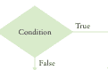

### 为你的程序设计测试用例

- 程序的每个分支都应该由一个测试用例覆盖。
- 最好在实现程序之前设计测试用例。

### 使用布尔数据类型来存储和组合可以为真或假的条件

- 布尔类型 `bool` 有两个值：false 和 true。
- C++ 有两个组合条件的布尔运算符：`&&`（与）和 `||`（或）。
- 要反转条件，请使用 `!`（非）运算符。
- `&&` 和 `||` 运算符使用*短路求值*计算：一旦确定了真值，就不再计算其他条件。
- 德摩根定律告诉你如何否定 `&&` 和 `||` 条件。


### 应用 if 语句来检测用户输入是否有效

- 读取值时，检查它是否在所需范围内。
- 使用 fail 函数来测试输入流是否已失败。


## 复习题

- **R3.1** 找出下列 `if` 语句中的错误。
  - a. `if x > 0 then cout << x;`
  - b. `if (x > 0) ; { y = 1; } else ; { y = -1; }`
  - c. `if (1 + x > pow(x, sqrt(2)) { y = y + x; }`
  - d. `if (x = 1) { y++; }`
  - e. `cin >> x; if (cin.fail()) { y = y + x; }`

- **R3.2** 这些代码片段会打印什么？
  - a. `int n = 1; int m = -1;`
  
    `if (n < -m) { cout << n; } else { cout << m; }`
  
  - b. `int n = 1; int m = -1;`
  
    `if (-n >= m) { cout << n; } else { cout << m; }`

  - c. `double x = 0; double y = 1;`
  
    `if (fabs(x - y) < 1) { cout << x; } else { cout << y; }`

  - d. `double x = sqrt(2); double y = 2;`
  
    `if (x * x == y) { cout << x; } else { cout << y; }`

- **R3.3** 假设 x 和 y 是 double 类型的变量。编写一个代码片段，如果 x 为正，则将 y 设为 x，否则设为 0。

- **R3.4** 假设 x 和 y 是 double 类型的变量。编写一个代码片段，在不调用 fabs 函数的情况下将 y 设为 x 的绝对值。使用 if 语句。

- **R3.5** 解释为什么比较浮点数比比较整数更困难。编写 C++ 代码来测试整数 n 是否等于 10，以及浮点数 x 是否等于 10。

- **R3.6** 第85页的常见错误 3.2 解释了 C++ 编译器在使用赋值运算符代替相等性测试时不会报告错误，但可能会发出警告。编写一个包含以下语句的测试程序：

  `if (floor = 13)`

  当你编译该程序时，你的编译器会做什么？

- **R3.7** 棋盘上的每个方格可以用一个字母和一个数字来描述，例如本例中的 g5：

  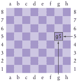

  下面的伪代码描述了一个算法，用于确定具有给定字母和数字的方格是深色（黑色）还是浅色（白色）。

  ```
  If the letter is an a, c, e, or g
      If the number is odd
          color = "black"
      Else
          color = "white"
  Else
      If the number is even
          color = "black"
      Else
          color = "white"
  ```

  使用第97页编程提示 3.6 中的过程，用输入 g5 跟踪这段伪代码。

- **R3.8** 为练习 R3.7 的算法给出四个覆盖所有分支的测试用例。


**R3.9** 在日程安排程序中，我们需要检查两个约会是否重叠。为简化起见，约会从整点开始，并使用二十四小时制（小时 0–23）。下面的伪代码描述了一个算法，用于判断开始时间为 **start1**、结束时间为 **end1** 的约会是否与开始时间为 **start2**、结束时间为 **end2** 的约会重叠。

```text
If start1 > start2
    s = start1
Else
    s = start2
If end1 < end2
    e = end1
Else
    e = end2
If s < e
    The appointments overlap.
Else
    The appointments don’t overlap.
```

用两个约会跟踪该算法：一个从 10–12，另一个从 11–13；然后一个从 10–11，另一个从 12–13。

**R3.10** 为练习 R3.9 中的算法绘制流程图。

**R3.11** 为练习 P3.12 中的算法绘制流程图。

**R3.12** 为练习 P3.13 中的算法绘制流程图。

**R3.13** 为练习 R3.9 中的算法开发一组测试用例。

**R3.14** 为练习 P3.13 中的算法开发一组测试用例。

**R3.15** 编写一个程序的伪代码，提示用户输入月份和日期，并输出是否为以下四个节日之一：

- 元旦（1 月 1 日）
- 独立日（7 月 4 日）
- 退伍军人节（11 月 11 日）
- 圣诞节（12 月 25 日）

**R3.16** 编写一个程序的伪代码，根据下表为一次测验分配字母等级：

| 分数 | 等级 |
|---|---|
| 90–100 | A |
| 80–89 | B |
| 70–79 | C |
| 60–69 | D |
| < 60 | F |

**R3.17** 解释 C++ 中字符串的字典序与词典或电话簿中单词的排序有何不同。*提示：* 考虑诸如 IBM、wiley.com、Century 21 和 While-U-Wait 等字符串。

**R3.18** 在以下字符串对中，哪一个在字典序中更靠前？

- a. "Tom", "Dick"
- b. "Tom", "Tomato"
- c. "Church", "Churchill"
- d. "car manufacturer", "carburetor"
- e. "Harry", "hairy"
- f. "C++", "Car"
- g. "Tom", "Tom"
- h. "Car", "Carl"
- i. "car", "bar"

**R3.19** 解释一串 `else if` 子句与嵌套 `if` 语句之间的区别，并分别举例说明。

**R3.20** 给出一个测试顺序无关紧要的 `else if` 子句序列示例，再给出一个测试顺序有影响的示例。

**R3.21** 用 `<` 运算符重写 3.3 节中的条件，而不是 `>=` 运算符。这对比较顺序有什么影响？

**R3.22** 为练习 P3.18 中的税务程序给出一个测试用例集，并手工计算预期结果。

**R3.23** 再编一个 C++ 代码示例来演示悬空 `else` 问题，使用以下规则：GPA 至少为 1.5 但低于 2 的学生被留校察看；GPA 低于 1.5 的学生不及格。

**R3.24** 通过找出布尔输入 p、q、r 的所有组合下布尔表达式的真值，补全下面的真值表。

| p | q | r | (p && q) \|\| !r | !(p && (q \|\| !r)) |
|---|---|---|---|---|
| false | false | false |  |  |
| false | false | true |  |  |
| false | true | false |  |  |
| … |  |  |  |  |
| 另外 5 种组合 |  |  |  |  |
| … |  |  |  |  |

**R3.25** 对还是错？对于任意布尔条件 A 和 B，A && B 与 B && A 相同。

**R3.26** 许多搜索引擎的“高级搜索”功能允许使用布尔运算符进行复杂查询，例如 “(cats OR dogs) AND NOT pets”。请将这些搜索运算符与 C++ 中的布尔运算符进行对比。

**R3.27** 假设 b 的值为 false，x 的值为 0。以下每个表达式的值分别是多少？

- a. `b && x == 0`
- b. `b || x == 0`
- c. `!b && x == 0`
- d. `!b || x == 0`
- e. `b && x != 0`
- f. `b || x != 0`
- g. `!b && x != 0`
- h. `!b || x != 0`

**R3.28** 简化以下表达式。其中，b 是 bool 类型的变量。

- a. `b == true`
- b. `b == false`
- c. `b != true`
- d. `b != false`

**R3.29** 简化以下语句。其中，b 是 bool 类型的变量，n 是 int 类型的变量。

- a. `if (n == 0) { b = true; } else { b = false; }`

  *（提示：`n == 0` 的值是什么？）*

- b. `if (n == 0) { b = false; } else { b = true; }`
- c. `b = false; if (n > 1) { if (n < 2) { b = true; } }`
- d. `if (n < 1) { b = true; } else { b = n > 2; }`

**R3.30** 以下程序有什么问题？

```text
cout << "Enter the number of quarters: ";
cin >> quarters;
total == total + quarters * 0.25;
cout << "Total: " << total << endl;
if (cin.fail()) { cout << "Input error."; }
```

**R3.31** 读取数字出奇地困难，因为 C++ 输入流一次只查看一个字符。首先，跳过空白字符。然后，输入流读入那些可以构成数字的字符。一旦输入流识别出一个数字，如果发现某个字符不能构成数字，就会停止读取。然而，如果第一个非空白字符不是数字或符号，或者第一个字符是符号而第二个字符不是数字，输入流就会失败。

考虑一个读取整数的程序：

```text
cout << "Enter the number of quarters: ";
int quarters;
cin >> quarters;
```

对于以下每个用户输入，圈出已读取了多少个字符，并说明输入流是否处于失败状态。

- a. `15.9`
- b. `15 9`
- c. `+159`
- d. `-15A9`
- e. `Fifteen`
- f. `-Fifteen`
- g. `+ 15`
- h. `1.5E3`
- i. `+1+5`

## 编程练习

**P3.1** 编写一个程序，读取一个温度值以及字母 C（表示摄氏温度）或 F（表示华氏温度）。打印在海平面给定温度下，水是液态、固态还是气态。

**P3.2** 水的沸点大约每升高 300 米（或 1000 英尺）下降 1 摄氏度。改进练习 P3.1 中的程序，允许用户以米或英尺为单位输入海拔高度。

**P3.3** 编写一个程序，读取三个浮点数，并打印三个输入中最大的数。例如：

```text
Please enter three numbers: 4 9 2.5
The largest number is 9.
```

**P3.4** 编写一个程序，读取三个字符串，并按字典序对它们排序。

```text
Enter three strings: Charlie Able Baker
Able
Baker
Charlie
```

**P3.5** 编写一个程序，读取一个整数，并通过检查该数是否 ≥ 10、≥ 100 等来打印该数有多少位。（假设所有整数都小于 100 亿。）如果该数为负数，先将其乘以 −1。

**P3.6** 编写一个程序，读取三个数，如果它们全部相同则打印“全部相同”，如果它们各不相同则打印“各不相同”，否则打印“其他”。

**P3.7** 编写一个程序，读取三个数，如果它们按递增顺序排列则打印“递增”，如果按递减顺序排列则打印“递减”，否则打印“其他”。这里，“递增”表示“严格递增”，即每个值都大于前一个值。序列 3 4 4 不视为递增。

**P3.8** 重复练习 P3.7，但在读取数字之前，询问用户递增/递减应按照“严格”还是“宽松”模式。在宽松模式下，序列 3 4 4 是递增的，而序列 4 4 4 既递增又递减。

**P3.9** 编写一个程序，将字母等级转换为数字等级。字母等级为 A、B、C、D 和 F，可能后跟 + 或 −。它们的数值分别为 4、3、2、1 和 0。没有 F+ 或 F−。A+ 会使数值增加 0.3，− 会使数值减少 0.3。但 A+ 的值为 4.0。

```text
Enter a letter grade: B-
The numeric value is 2.7.
```

**P3.10** 编写一个程序，将 0 到 4 之间的数字转换为最接近的字母等级。例如，数字 2.8（可能是几个成绩的平均值）会被转换为 B−。平局时取较好的等级；例如，2.85 应为 B。

**P3.11** 编写一个程序，读取用户输入的一张扑克牌，使用以下速记符号：

| | |
|---|---|
| A | A（王牌） |
| 2 . . . 10 | 牌面数值 |
| J | J（杰克） |
| Q | Q（王后） |
| K | K（国王） |
| D | 方块 |
| H | 红桃 |
| S | 黑桃 |
| C | 梅花 |


### P3.16

编写一个程序，读取员工的姓名和薪资。这里的薪资表示*时薪*，例如 $9.25。然后询问该员工上周工作了多少小时。请确保接受小数小时。任何加班时间（每周超过 40 小时）按正常工资的 150% 支付。计算应付工资，并为该员工打印一张工资单。

### P3.17

编写一个程序，提示用户输入生日的日期和月份，然后打印一份星座运势。为程序员编造一些运势，例如：

```
请输入您的生日（月份和日期）：6 16
双子座是分析复杂程序行为的专家。
您能感觉到 bug 来自哪里，并总能领先一步。今晚，
您的风格会赢得一位严厉批评家的认可。
```


每份运势都应包含星座的名称。（您会在互联网上数量多得惊人的网站上找到这些星座的名称和日期范围。）

### P3.18

编写一个程序，按以下税率表计算税款：

如果您的身份是单身，且应税收入超过：

| 超过 | 但不超过 | 税款为 | 超出部分 |
|---|---|---|---|
| $0 | $8,000 | 10% | $0 |
| $8,000 | $32,000 | $800 + 15% | $8,000 |
| $32,000 |  | $4,400 + 25% | $32,000 |

如果您的身份是已婚，且应税收入超过：

| 超过 | 但不超过 | 税款为 | 超出部分 |
|---|---|---|---|
| $0 | $16,000 | 10% | $0 |
| $16,000 | $64,000 | $1,600 + 15% | $16,000 |
| $64,000 |  | $8,800 + 25% | $64,000 |

### P3.19

1913 年的美国原始所得税非常简单。税款为：

- 前 $50,000 部分按 1% 征税。
- 超过 $50,000 至 $75,000 的部分按 2% 征税。
- 超过 $75,000 至 $100,000 的部分按 3% 征税。
- 超过 $100,000 至 $250,000 的部分按 4% 征税。
- 超过 $250,000 至 $500,000 的部分按 5% 征税。
- 超过 $500,000 的部分按 6% 征税。

单身或已婚纳税人没有单独的税率表。编写一个程序，按此税率表计算所得税。

### P3.20

`tax.cpp` 程序使用了 2008 年美国所得税表的简化版本。查找当前年度单身和已婚申报者的税级和税率，并实现一个计算实际所得税的程序。

### P3.24

编写一个程序，要求用户输入月份（1 代表一月，2 代表二月，依此类推），然后打印该月的天数。对于二月，打印“28 或 29 天”。

```
输入月份：5
30 天
```

不要为每个月使用单独的 if/else 分支。使用布尔运算符。

### P3.25

一年有 366 天称为闰年。如果一个年份能被四整除（例如 1980），则该年是闰年，除非它能被 100 整除（例如 1900），那么它不是闰年；但是，如果它能被 400 整除（例如 2000），则它又是闰年。在 1582 年 10 月 15 日引入格里高利历之前，没有这些例外（1500 年是闰年）。编写一个程序，要求用户输入一个年份，并计算该年是否为闰年。

### P3.26

为练习 P3.2 添加错误处理。如果用户在需要时没有输入数字，或者提供了无效的高度单位，则打印错误消息并结束程序。

### 工程 P3.27

编写一个程序，提示用户输入一个波长值，并打印电磁波谱相应部分的描述，如表 7 所示。


**表 7. 电磁波谱**

| 类型 | 波长（米） | 频率（赫兹） |
|---|---:|---:|
| 无线电波 | > 10⁻¹ | < 3 × 10⁹ |
| 微波 | 10⁻³ 至 10⁻¹ | 3 × 10⁹ 至 3 × 10¹¹ |
| 红外线 | 7 × 10⁻⁷ 至 10⁻³ | 3 × 10¹¹ 至 4 × 10¹⁴ |
| 可见光 | 4 × 10⁻⁷ 至 7 × 10⁻⁷ | 4 × 10¹⁴ 至 7.5 × 10¹⁴ |
| 紫外线 | 10⁻⁸ 至 4 × 10⁻⁷ | 7.5 × 10¹⁴ 至 3 × 10¹⁶ |
| X 射线 | 10⁻¹¹ 至 10⁻⁸ | 3 × 10¹⁶ 至 3 × 10¹⁹ |
| 伽马射线 | < 10⁻¹¹ | > 3 × 10¹⁹ |

### 工程 P3.28

重复练习 P3.27，修改程序，使其改为提示输入频率。

### 工程 P3.29

重复练习 P3.27，修改程序，使其首先询问用户输入的是波长还是频率。

### 工程 P3.30

一辆小型货车有两扇滑动门。每扇门都可以通过仪表板开关、内部把手或外部把手打开。但是，如果儿童锁开关被激活，内部把手将不起作用。为了滑动门能够打开，换挡杆必须处于停车挡（P），并且主解锁开关必须被激活。（本书作者就是这样一辆车的长期受苦车主。）


您的任务是模拟该车辆控制软件的一部分。输入是一系列开关和换挡杆的值，顺序如下：

- 左侧和右侧滑动门的仪表板开关、儿童锁和主解锁（0 表示关闭，1 表示激活）
- 左侧和右侧滑动门的内部和外部把手（0 或 1）
- 换挡杆设置（P N D 1 2 3 R 之一）。

一个典型的输入是 0 0 0 1 0 1 0 0 P。
根据情况打印“left door opens”和/或“right door opens”。如果两扇门都没有打开，打印“both doors stay closed”。

### 工程 P3.31

声级 L（单位为分贝，dB）由下式确定：

$$L = 20\log_{10}(p/p_0)$$

其中 p 是声音的声压（单位为帕斯卡，缩写为 Pa），p₀ 是参考声压，等于 20 × 10⁻⁶ Pa（此时 L 为 0 dB）。下表给出了某些声级的描述。


| 声级 | 分贝 |
|---|---:|
| 痛阈 | 130 dB |
| 可能造成听力损伤 | 120 dB |
| 1 米外的风镐 | 100 dB |
| 10 米外繁忙道路上的交通 | 90 dB |
| 正常交谈 | 60 dB |
| 安静的图书馆 | 30 dB |
| 轻微树叶沙沙声 | 0 dB |

编写一个程序，读取一个值和一个单位（dB 或 Pa），然后从上面的列表中打印最接近的描述。

### 工程 P3.32

下图所示的电路旨在测量腔体内气体的温度。

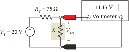

电阻 R 表示封闭在腔体内的温度传感器。电阻 R（单位：Ω）与温度 T（单位：°C）之间的关系由方程给出：

$$R = R_0 + kT$$

在此设备中，假设 R₀ = 100 Ω，k = 0.5。电压表显示传感器两端的电压值 Vₘ。该电压 Vₘ 根据以下方程指示气体温度 T：

$$T = \frac{R}{k} - \frac{R_0}{k} = \frac{R_s}{k}\frac{V_m}{V_s - V_m} - \frac{R_0}{k}$$

假设电压表电压被限制在 \(V_{\min}=12\) 伏 \(\le V_m \le V_{\max}=18\) 伏的范围内。编写一个程序，接受一个 \(V_m\) 值，并检查它是否在 12 到 18 之间。当 \(V_m\) 在 12 到 18 之间时，程序应返回以摄氏度为单位的气体温度；否则应返回错误消息。

### 工程 P3.33


霜冻造成的作物损害是农民面临的众多风险之一。下图显示了一个简单的报警电路，旨在警告霜冻。该报警电路使用一种称为热敏电阻的设备，在温度降至冰点以下时发出蜂鸣声。热敏电阻是半导体器件，其电阻随温度变化，由以下方程描述：

$$R=R_0e^{\beta\left(\frac{1}{T}-\frac{1}{T_0}\right)}$$

其中 \(R\) 是温度为 \(T\)（单位：°K）时的电阻（单位：Ω），\(R_0\) 是参考温度 \(T_0\)（单位：°K）时的电阻（单位：Ω）。β 是一个常数，取决于制造热敏电阻所用的材料。

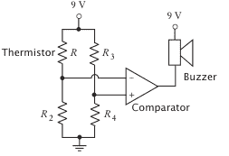

电路设计为当以下条件成立时报警：

$$\frac{R_2}{R+R_2}<\frac{R_4}{R_3+R_4}$$

报警电路中使用的热敏电阻具有 \(R_0=33{,}192\ \Omega\)，在 \(T_0=40^\circ\text{C}\) 时，且 \(\beta=3{,}310\ ^\circ\text{K}\)。（回想一下，β 的单位是 °K。同时回想一下，以 °K 为单位的温度是通过将摄氏温度加上 273° 得到的。）电阻 \(R_2\)、\(R_3\) 和 \(R_4\) 的阻值为 156.3 kΩ = 156,300 Ω。

编写一个 C++ 程序，提示用户输入一个以 °F 为单位的温度，并打印一条消息，指示在该温度下报警器是否会响起。

### 工程 P3.34

一个质量 \(m=2\) 千克的物体连接到一根长度为 \(r=3\) 米的绳子末端。该物体被高速旋转。绳子能承受的最大张力为 \(T=60\) 牛顿。编写一个程序，接受一个旋转速度 \(v\)，并确定这样的速度是否会导致绳子断裂。**提示：** \(T=mv^2/r\)。

### 工程 P3.35

一个质量 \(m\) 连接到一根长度为 \(r=3\) 米的绳子末端。绳子只能以 1、10、20 或 40 米/秒的速度旋转。绳子能承受的最大张力为 \(T=60\) 牛顿。编写一个程序，用户输入质量 \(m\) 的值，程序确定在不使绳子断裂的情况下可以旋转的最大速度。**提示：** \(T=mv^2/r\)。


**工程 P3.36** 普通人能以 7 mph 的速度跳离地面，而不必担心离开地球。然而，如果宇航员站在哈雷彗星上以这个速度起跳，宇航员还会落回表面吗？编写一个程序，允许用户输入从哈雷彗星表面起跳的速度（单位为 mph），并判断跳跃者是否会返回表面。如果不会，程序应计算彗星的质量必须增加多少，才能使跳跃者返回表面。


*提示：* 逃逸速度为 $v_{\text{escape}}=\sqrt{\frac{2GM}{R}}$，其中 $G=6.67\times10^{-11}\,N\,m^2/kg^2$ 是引力常数，$M=1.3\times10^{22}\,kg$ 是哈雷彗星的质量，$R=1.153\times10^6\,m$ 是其半径。

## 自测题答案

- 1. 将 if 语句改为

    ```cpp
    if (floor > 14)
    {
        actual_floor = floor - 2;
    }
    ```

- 2. 85. 90. 85.

- 3. 唯一区别在于 `original_price` 是否为 100。自测题 2 中的语句将 `discounted_price` 设为 90；这条语句将其设为 80。

- 4. 95. 100. 95.

- 5. 

    ```cpp
    if (fuel_amount < 0.10 * fuel_capacity)
    {
        cout << "red" << endl;
    }
    else
    {
        cout << "green" << endl;
    }
    ```

- 6. (a) 和 (b) 都为真，(c) 为假。

- 7. `floor <= 13`

- 8. 应使用 `==` 而不是 `=` 来比较这些值。

- 9. `input == "Y"`

- 10. `str != "" or str.length() > 0`

- 11.

    ```cpp
    if (score_a > score_b)
    {
        cout << "A won";
    }
    else if (score_a < score_b)
    {
        cout << "B won";
    }
    else
    {
        cout << "Game tied";
    }
    ```

- 12.

    ```cpp
    if (x > 0)
    {
        s = 1;
    }
    else if (x < 0)
    {
        s = -1;
    }
    else
    {
        s = 0;
    }
    ```

- 13. 你可以先将 **s** 设为三个值之一：

    ```cpp
    s = 0;
    if (x > 0) { s = 1; }
    else if (x < 0) { s = -1; }
    ```

- 14. 可以省略 if (price <= 100)，从而清楚表明 else 分支是唯一的选择。

- 15. 不会摧毁建筑物

- 16. 在最后的 else 之前添加一个分支：

    ```cpp
    else if (richter < 0) { cout << "Error: Negative input" << endl; }
    ```

- 17. $3,200

- 18. 不会。那样计算就是 0.10 × 32000 + 0.25 (32000 − 32000)。

- 19. 不会。他们各自的税是每人 $5,200，如果结婚，他们将支付 $10,400。实际上，处于较高税率档的纳税人（我们的程序未对此建模）在结婚时可能支付更高的税，这种现象称为*婚姻惩罚*。

- 20. 将第 36 行的 else 改为 else if (marital_status == "m")，并在第 47 行后添加另一个分支：

    ```cpp
    else { cout << "Error: marital status should be s or m." << endl; }
    ```

- 21. 较高税率只适用于较高税率档中的收入。假设你单身且收入为 $31,900。你应该尝试加薪 $200 吗？当然应该：前 $100 你可以保留 90%，接下来的 $100 你可以保留 75%。

- 22.

    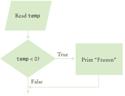

# 第 4 章

# 循环


## 本章目标

- 实现 `while`、`for` 和 `do` 循环
- 避免无限循环和差一错误
- 理解嵌套循环
- 实现读取和处理数据集的程序
- 使用计算机进行模拟

## 本章内容

- **4.1 while 循环** 132
  - 语法 4.1：while 语句 133
  - 常见错误 4.1：无限循环 136
  - 常见错误 4.2：不要想“我们到了吗？” 137
  - 常见错误 4.3：差一错误 137
  - 趣味事实 4.1：第一个 Bug 138
- **4.2 问题求解：手工跟踪** 139
- **4.3 for 循环** 142
  - 语法 4.2：for 语句 144
  - 编程提示 4.1：仅将 for 循环用于其预期用途 147
  - 编程提示 4.2：选择与任务匹配的循环边界 147
  - 编程提示 4.3：计算迭代次数 147
- **4.4 do 循环** 148
  - 编程提示 4.4：循环流程图 149
- **4.5 处理输入** 150
  - 专题 4.1：清除失败状态 153
  - 专题 4.2：循环半问题与 break 语句 153
  - 专题 4.3：输入和输出重定向 154
- **4.6 问题求解：故事板** 154
- **4.7 常见循环算法** 157
  - 操作指南 4.1：编写循环 162
  - 示例 4.1：信用卡处理
- **4.8 嵌套循环** 165
- **4.9 随机数与模拟** 168
  - 趣味事实 4.2：软件盗版 172


在循环中，程序的一部分会反复执行，直到达到某个特定目标。循环对于需要重复步骤的计算以及处理由许多数据项组成的输入非常重要。本章你将学习 C++ 中的循环语句，以及编写处理输入和模拟现实世界活动的程序的技术。

## 4.1 while 循环

在本节中，你将学习如何重复执行语句，直到达到某个目标。

回想第 1 章的投资问题。你将 $10,000 存入一个年利率为 5% 的银行账户。账户余额需要多少年才能翻倍达到原始投资的两倍？


由于赚取的利息也会产生利息，银行余额呈指数增长。

在第 1 章中，我们为该问题开发了以下算法：

**从年份值为 0、一列利息和余额 $10,000 开始。**

| 年份 | 利息 | 余额 |
|---|---|---|
| 0 |  | $10,000 |

- 当余额小于 $20,000 时，重复以下步骤：
  - 1. 将年份值加 1。
  - 2. 计算利息为余额 × 0.05（即 5% 利息）。
  - 3. 将利息加到余额中。
  - 4. 报告最终年份值作为答案。

你现在知道如何在 C++ 中定义和更新变量。你还不知道如何执行“当余额小于 $20,000 时重复步骤”。

在粒子加速器中，亚原子粒子多次穿过环形隧道，获得物理实验所需的速度。类似地，在计算机科学中，循环中的语句在条件为真时执行。


### 表 1 while 循环示例

| 循环 | 输出 | 说明 |
|---|---|---|
| `i = 5;`<br>`while (i > 0)`<br>`{`<br>`    cout << i << " ";`<br>`    i--;`<br>`}` | `5 4 3 2 1` | 当 `i` 为 0 时，循环条件为假，循环结束。 |
| `i = 5;`<br>`while (i > 0)`<br>`{`<br>`    cout << i << " ";`<br>`    i++;`<br>`}` | `5 6 7 8 9 10 11 ...` | `i++` 语句是一个错误，会导致“无限循环”（见第 136 页的常见错误 4.1）。 |
| `i = 5;`<br>`while (i > 5)`<br>`{`<br>`    cout << i << " ";`<br>`    i--;`<br>`}` | `（无输出）` | 语句 `i > 5` 为假，循环永远不会执行。 |
| `i = 5;`<br>`while (i < 0)`<br>`{`<br>`    cout << i << " ";`<br>`    i--;`<br>`}` | `（无输出）` | 程序员可能想：“当 `i` 小于 0 时停止”。然而，循环条件控制的是循环何时执行，而不是何时结束（见第 137 页的常见错误 4.2）。 |
| `i = 5;`<br>`while (i > 0) ;`<br>`{`<br>`    cout << i << " ";`<br>`    i--;`<br>`}` | `（无输出，程序不会终止）` | 注意 `{` 前的分号。这个循环有一个空循环体。它会永远运行，检查 `i > 0` 是否为真，而循环体中什么也不做。 |

## 常见错误 4.1


### 无限循环

一个非常恼人的循环错误是*无限循环*：这种循环会永远运行，只能通过终止程序或重启计算机来停止。如果程序中有输出语句，那么屏幕上会一行接一行地闪过输出。否则，程序就停在那里挂起，看起来什么也没做。在某些系统上，你可以通过按 Ctrl + C 终止挂起的程序。在其他系统上，你可以关闭程序运行的窗口。

无限循环的一个常见原因是忘记更新控制循环的变量：

```cpp
year = 1;
while (year <= 20)
{

```cpp
balance = balance * (1 + RATE / 100);
}
```

这里程序员忘记在循环中添加 `year++` 命令。结果，year 始终为 1，循环永远不会结束。

无限循环的另一个常见原因是意外地递增了一个本应递减的计数器（反之亦然）。考虑这个示例：

```cpp
year = 20;
while (year > 0)
{
    balance = balance * (1 + RATE / 100);
    year++;
}
```

`year` 变量本应递减，而不是递增。这是一个常见错误，因为递增计数器比递减计数器常见得多，以至于你的手指可能会下意识地输入 `++`。结果，`year` 始终大于 0，循环永远不会结束。（实际上，`year` 最终可能会超过可表示的最大正整数并*回绕*为负数。然后循环结束——当然，结果完全错误。）


*就像这只在跑步机上停不下来的仓鼠，无限循环永远不会结束。*

## 常见错误 4.2

### 不要想“我们到了吗？”


当做重复性的事情时，我们大多数人都想知道什么时候完成。例如，你可能会想：“我想至少得到 $20,000”，并把循环条件设为

```cpp
balance >= TARGET
```

但 `while` 循环的想法相反：我可以继续多久？正确的循环条件是

```cpp
while (balance < TARGET)
```

换句话说：“只要余额小于目标，就继续做。”


*在编写循环条件时，不要问“我们到了吗？”条件决定循环将持续多久。*

## 常见错误 4.3

### 差一错误


考虑我们计算投资翻倍所需年数的过程：

```cpp
int year = 0;
while (balance < TARGET)
{
    year++;
    double interest = balance * RATE / 100;
    balance = balance + interest;
}
cout << "The investment doubled after " << year << " years." << endl;
```

`year` 应该从 0 还是从 1 开始？你应该测试 `balance < TARGET` 还是 `balance <= TARGET`？在这些表达式中很容易出现差一错误。

有些人试图通过随机插入 +1 或 -1 直到程序看起来能工作来解决差一错误——这是一种糟糕的策略。编译并测试所有各种可能性可能需要很长时间。花一点脑力思考能真正节省时间。

幸运的是，差一错误很容易避免，只需仔细推演几个测试用例，并利用测试用例中的信息为你的决定提供依据。

`year` 应该从 0 还是从 1 开始？看一个使用简单数值的场景：初始余额为 $100，利率为 50%。第 1 年后，余额为 $150；第 2 年后为 $225，即超过 $200。所以投资在 2 年后翻倍。循环执行了两次，每次递增 `year`。因此 `year` 必须从 0 开始，而不是从 1 开始。

| 年份 | 余额 |
|---:|---:|
| 0 | $100 |
| 1 | $150 |
| 2 | $225 |

换句话说，`balance` 变量表示年末之后的余额。一开始，balance 变量包含的是第 0 年之后的余额，而不是第 1 年之后的余额。

接下来，你应该在测试中使用 `<` 还是 `<=` 比较？如果你想用一个例子来解决这个问题，你需要找到一个最终余额恰好是初始余额两倍的场景。当利率为 100% 时就会发生这种情况。循环执行一次。现在 `year` 为 1，`balance` 恰好等于 `2 * INITIAL_BALANCE`。一年后投资翻倍了吗？翻倍了。因此，循环不应再执行。如果测试条件是 `balance < TARGET`，循环就会停止，这是应该的。如果测试条件曾是 `balance <= TARGET`，循环就会再执行一次。

换句话说，只要余额尚未翻倍，你就继续增加利息。

> 差一错误是编写循环时常见的错误。仔细推演简单的测试用例，以避免这类错误。

## 趣闻 4.1 第一个 Bug


据传说，第一个 bug 是在 Mark II 中发现的，这是一台位于哈佛大学的巨型机电计算机。它确实是由一只虫子引起的——一只飞蛾被困在继电器开关中。

实际上，从操作员留在飞蛾旁边的日志本中的备注（见照片）来看，当时“bug”这个术语似乎已经被广泛使用了。

计算机科学先驱莫里斯·威尔克斯写道：“不知怎么的，人们一直以为让程序正确不会有特别的困难。我仍能记得那个确切的时刻，我意识到我未来生活的大部分时间都将花在寻找自己程序中的错误上。”


第一个 Bug

```cpp
int n = 1729;
int sum = 0;
while (n > 0)
{
    int digit = n % 10;
    sum = sum + digit;
    n = n / 10;
}
cout << sum << endl;
```


条件 `n > 0` 现在为假。继续执行循环之后的语句。

```cpp
int n = 1729;
int sum = 0;
while (n > 0)
{
    int digit = n % 10;
    sum = sum + digit;
    n = n / 10;
}
cout << sum << endl;
```

| n | sum | digit | 输出 |
|---:|---:|---:|---:|
| 1729 | 0 |  |  |
| 172 | 9 | 9 |  |
| 17 | 11 | 2 |  |
| 1 | 18 | 7 |  |
| 0 | 19 | 1 | 19 |

这条语句是输出语句。输出的值是 `sum` 的值，即 19。

当然，你只需运行代码就能得到相同的答案。然而，手工跟踪可以给你一种仅仅运行代码无法获得的洞察。再考虑一下每次迭代中发生了什么：

- 我们提取 `n` 的最后一位数字。
- 我们将该数字加到 `sum`。
- 我们从 `n` 中去掉该数字。

换句话说，这个循环求的是 `n` 中各位数字之和。你现在知道这个循环对任意 `n` 值的作用，而不仅仅是示例中的那个值。（为什么会有人想求各位数字之和呢？这类操作可用于检查信用卡号和其他形式的身份证件的有效性——见练习 P4.5。）

手工跟踪不仅能帮助你理解正确工作的代码。它还是查找代码错误的一种强大技术。当程序的行为不符合你的预期时，拿出一张纸，在脑中逐步执行代码时跟踪变量的值。

你不需要一个可运行的程序来进行手工跟踪。你可以手工跟踪伪代码。事实上，在费心将其转换为实际代码之前，先手工跟踪你的伪代码以确认它能正确工作，是一个极好的主意。

> 手工跟踪可以帮助你理解不熟悉的算法如何工作。

> 手工跟踪可以显示代码或伪代码中的错误。

### 自测

- **6.** 手工跟踪以下代码，显示 `n` 的值和输出。

```cpp
int n = 5;
while (n >= 0)
{
    n--;
    cout << n << endl;
}
```

```cpp
for (counter = 1; counter <= 10; counter++)
{
    cout << counter << endl;
}
```

有些人称这种循环为*计数控制*循环。相比之下，上一节的 `while` 循环可以称为*事件控制*循环，因为它会一直执行到某个事件发生（例如，当余额达到目标）为止。计数控制循环的另一个常用术语是*定次*循环。你从一开始就知道循环体将执行确定的次数——在我们的例子中是十次。相比之下，你不知道累积到目标余额需要多少次迭代。这样的循环称为*不定次*循环。


你可以把 *for 循环* 看作一系列有序的步骤。

`for` 循环将初始化、条件和更新表达式整齐地组合在一起。然而，重要的是要认识到这些表达式*并不是一起执行的*（见图 3）。

- 初始化在进入循环之前执行一次。①
- 每次迭代之前检查条件。② ⑤
- 每次迭代之后执行更新。④

**图 3** for 循环的执行

| 步骤 | 描述 | 计数器 | 代码 |
|---|---|---|---|
| ① | 初始化计数器 | 1 | `for (counter = 1; counter <= 10; counter++)`<br>`{`<br>`    cout << counter << endl;`<br>`}` |
| ② | 检查条件 | 1 | `for (counter = 1; counter <= 10; counter++)`<br>`{`<br>`    cout << counter << endl;`<br>`}` |
| ③ | 执行循环体 | 1 | `for (counter = 1; counter <= 10; counter++)`<br>`{`<br>`    cout << counter << endl;`<br>`}` |
| ④ | 更新计数器 | 2 | `for (counter = 1; counter <= 10; counter++)`<br>`{`<br>`    cout << counter << endl;`<br>`}` |
| ⑤ | 再次检查条件 | 2 | `for (counter = 1; counter <= 10; counter++)`<br>`{`<br>`    cout << counter << endl;`<br>`}` |


## 语法 4.2 for 语句


for 循环也可以递减而不是递增：

```cpp
for (counter = 10; counter >= 0; counter--) . . .
```

递增或递减的步长不必是 1：

```cpp
for (counter = 0; counter <= 10; counter = counter + 2) . . .
```

更多变体请参见第 146 页的表 2。

到目前为止，我们都假设计数器变量在 `for` 循环之前已经定义。或者，你可以在循环初始化中定义一个变量。这样的变量*仅*在循环中定义：

```cpp
for (int counter = 1; counter <= 10; counter++)
{ . . . }
// counter no longer defined here
```

下面是一个 `for` 循环的典型用法。我们想打印储蓄账户在若干年内的余额，如下表所示：

| 年份 | 余额 |
| --- | --- |
| 1 | 10500.00 |
| 2 | 11025.00 |
| 3 | 11576.25 |
| 4 | 12155.06 |
| 5 | 12762.82 |

`for` 循环模式适用，因为变量 `year` 从 1 开始，然后以恒定的增量移动，直到达到目标：

### 程序运行

```
Enter number of years: 10
   1  10500.00
   2  11025.00
   3  11576.25
   4  12155.06
   5  12762.82
   6  13400.96
   7  14071.00
   8  14774.55
   9  15513.28
  10  16288.95
```

**表 2 for 循环示例**

| 循环 | i 的值 | 注释 |
| --- | --- | --- |
| `for (i = 0; i <= 5; i++)` | `0 1 2 3 4 5` | 注意该循环执行了 6 次。（参见第 147 页的编程提示 4.3。） |
| `for (i = 5; i >= 0; i--)` | `5 4 3 2 1 0` | 使用 `i--` 表示递减。 |
| `for (i = 0; i < 9; i = i + 2)` | `0 2 4 6 8` | 使用 `i = i + 2` 表示步长为 2。 |
| `for (i = 0; i != 9; i = i + 2)` | `0 2 4 6 8 10 12 14 ... (无限循环)` | 你可以使用 `<` 或 `<=` 代替 `!=` 来避免此问题。 |
| `for (i = 1; i <= 20; i = i * 2)` | `1 2 4 8 16` | 你可以指定任何修改 `i` 的规则，例如每一步将其加倍。 |
| `for (i = 0; i < str.length(); i++)` | `0 1 2 ... 直到字符串 str 的最后一个有效索引` | 在循环体中，使用表达式 `str.substr(i, 1)` 获取包含第 `i` 个字符的字符串。 |


- 11. 将 `invtable.cpp` 程序中的 `for` 循环改写为 `while` 循环。
- 12. 这个循环打印多少个数字？

  ```cpp
  for (int n = 10; n >= 0; n--)
  {
      cout << n << endl;
  }
  ```

- 13. 编写一个 `for` 循环，打印 10 到 20（含）之间的所有偶数。
- 14. 编写一个 `for` 循环，计算从 1 到 n 的整数之和。
- 15. 如何修改 `invtable.cpp` 程序中的 `for` 循环，以打印所有余额直到投资翻倍？

**练习一下** 现在你可以尝试本章末尾的这些练习：R4.2、R4.7、P4.12。

**图 5** do 循环的流程图


- 16. 假设我们要检查至少为 0 且最多为 100 的输入。修改 `do` 循环以进行此检查。
- 17. 使用 `while` 循环重写输入检查。你的解决方案有什么缺点？
- 18. 假设 C++ 没有 `do` 循环。你能将任何 `do` 循环重写为 `while` 循环吗？
- 19. 编写一个 `do` 循环，读取整数并计算它们的和。当读取到值 0 时停止。
- 20. 编写一个 `do` 循环，读取正整数并计算它们的和。当连续两次读取到相同的值时停止。例如，如果输入是 1 2 3 4 4，那么总和是 14，循环停止。

**练习一下** 现在你可以尝试本章末尾的这些练习：R4.8、R4.12、R4.13。

## 编程提示 4.4：循环的流程图


在第 3.5 节中，你学习了如何使用流程图可视化程序中的控制流。流程图可以包含两种类型的循环；它们对应于 C++ 中的 `while` 循环和 `do` 循环。它们的区别在于条件的位置——是在循环体之前还是之后。


如第 3.5 节所述，你应该避免流程图中出现“意大利面条式代码”。对于循环来说，这意味着你永远不希望有箭头指向循环体内部。

## 4.5 处理输入

哨兵值表示数据集的结束，但它不是数据的一部分。

在本节中，你将学习如何读取和处理一系列输入值。

每当你读取一系列输入时，你需要某种方法来指示序列的结束。有时候你很幸运，输入中不会有任何值为 0。然后你可以提示用户继续输入数字，或者输入 0 结束序列。如果允许零但不允许负数，你可以使用 -1 表示终止。作为终止信号的值称为**哨兵**。

让我们将这个技术应用到一个计算一组工资平均值的程序中。在我们的示例程序中，我们将使用 -1 作为哨兵。雇员当然不会以负工资工作，但可能有免费工作的志愿者。

在循环内部，我们读取一个输入。如果输入不是 -1，我们就处理它。为了计算平均值，我们需要所有工资的总和以及输入的个数。

```cpp
while (...)
{
    cin >> salary;
    if (salary != -1)
    {
        sum = sum + salary;
        count++;
    }
}
```

只要未检测到哨兵值，我们就留在循环中。

```cpp
while (salary != -1)
{
    ...
}
```

只有一个问题：当第一次进入循环时，还没有读取任何数据值。请确保将 `salary` 初始化为哨兵以外的某个值：

```cpp
double salary = 0; // Any value other than -1 will do
```

或者，使用 do 循环：

```cpp
do
{
    ...
}
while (salary != -1)
```


> 在军事中，哨兵守卫边界或通道。在计算机科学中，哨兵值表示输入序列的结束或输入序列之间的边界。

以下程序读取输入，直到用户输入哨兵值，然后计算并打印平均值。

**ch04/sentinel.cpp**

```cpp
#include <iostream>

using namespace std;

int main()
{
   double sum = 0;
   int count = 0;
   double salary = 0;
   cout << "Enter salaries, -1 to finish: ";
   while (salary != -1)
   {
      cin >> salary;
      if (salary != -1)
      {
         sum = sum + salary;
         count++;
      }
   }
   if (count > 0)
   {
      double average = sum / count;
      cout << "Average salary: " << average << endl;
   }
   else
   {
      cout << "No data" << endl;
   }
   return 0;
}
```

### 程序运行

```
Enter salaries, -1 to finish: 10 10 40 -1
Average salary: 20
```

数字哨兵只在输入存在某些限制时有效。但在许多情况下，没有这种限制。假设你要计算一个可能包含 0 或负值的数据集的平均值。那么你就不能使用 0 或 -1 来表示输入的结束。

在这种情况下，你可以读取输入数据直到输入失败。正如你在第 3.8 节中看到的，如果前面的输入失败，则条件

```cpp
cin.fail()
```

为真。例如，假设输入是通过以下语句读取的：

```cpp
double value;
cin >> value;
```

如果用户输入了一个不是数字的值（例如 Q），则输入失败。

你可以使用一个布尔变量来控制循环。在进入循环之前将变量设置为 true，然后将其设置为 false 以离开循环。

现在我们遇到了额外的复杂性。只有在进入循环并尝试读取输入之后，你才知道输入失败。为了记住失败，使用一个布尔变量：

```cpp
cout << "Enter values, Q to quit: ";
bool more = true;
while (more)
{
    cin >> value;
    if (cin.fail())
    {
        more = false;
    }
    else
    {
        Process value.
    }
}
```

有些程序员不喜欢引入布尔变量来控制循环。第 153 页的专题 4.2 展示了另一种离开循环的机制。然而，在读取输入时，有一种更简单的方法。表达式

```cpp
cin >> value
```

可以用在条件中。如果 `cin` 在读取 `value` 后没有失败，则其计算结果为 true。因此，你可以使用以下循环读取和处理一组输入：

```cpp
cout << "Enter values, Q to quit: ";
while (cin >> value)
{
    Process value.
}
```

这个循环适用于处理单个输入序列。你将在第 8 章中了解更多关于读取输入的内容。

### 自测


- 21. 当用户在被提示输入值时立即输入 -1，`sentinel.cpp` 程序会打印什么？
- 22. 为什么 `sentinel.cpp` 程序中有两个 `salary != -1` 形式的检查？
- 23. 如果 `sentinel.cpp` 中 `salary` 变量的定义改为 `double salary = -1;`，会发生什么？
- 24. 我们提示用户“输入值，按 Q 退出”。当用户输入其他字母时会发生什么？
- 25. 下面的循环用于读取一系列值，有什么问题？

  ```cpp
  cout << "Enter values, Q to quit: ";
  while (!cin.fail())
  {
      double value;
      cin >> value;
      sum = sum + value;
      count++;
  }
  ```


**练习一下** 现在你可以尝试本章末尾的这些练习：R4.10、P4.6、P4.7。

## 专题 4.1：清除失败状态


当输入操作失败时，所有后续输入操作也会失败。如果你想读取两个数字序列并使用一个字母作为哨兵，你需要在读取第一个哨兵后清除失败状态。调用`clear`函数：

```cpp
cout << "Enter values, Q to quit.\n";
while (cin >> values)
{
   Process input.
}
cin.clear();
```

假设用户输入了 30 10 5 Q。输入 Q 导致了失败。因为只有成功处理的字符才会从输入中移除，所以 Q 字符仍然存在。将其读入一个虚拟变量：

```cpp
string sentinel;
cin >> sentinel;
```

现在你可以继续读取更多输入了。

## 专题 4.2：循环半途问题与break语句


有些程序员不喜欢由布尔变量控制的循环，例如：

```cpp
bool more = true;
while (more)
{
   cin >> value;
   if (cin.fail())
   {
      more = false;
   }
   else
   {
      Process value.
   }
}
```

对循环终止的实际测试位于循环中间，而不是顶部。这被称为**循环半途**，因为必须进入循环一半才能知道是否需要终止。

作为替代方案，你可以使用`break`保留字。

```cpp
while (true)
{
   cin >> value;
   if (cin.fail()) { break; }
   Process value.
}
```

`break`语句会跳出当前所在的循环，而不论循环条件如何。

在循环半途的情况下，`break`语句可能是有益的。但是很难制定明确的规则来规定何时使用它们是安全的，何时应避免使用。本书不使用`break`语句。

图 6  Web 应用程序设计的故事板


如果有多于一个数量怎么办？用户可能有一整张厘米值表需要转换为英寸。

如果用户输入的程序不知道如何处理单位（如埃）怎么办？

如果用户要求进行不可能的转换（如英寸到加仑）怎么办？

让我们从一个故事板面板开始。用不同的颜色书写用户输入是个好主意。（如果你手边没有彩色笔，就加下划线。）

```
Converting a Sequence of Values

What unit do you want to convert from? cm
What unit do you want to convert to? in
Enter values, terminated by zero        — Allows conversion of multiple values
30
30 cm = 11.81 in
100
100 cm = 39.37 in                          — Format makes clear what got converted
0
What unit do you want to convert from?
```

故事板展示了我们如何处理潜在的混淆。一个想知道 30 厘米等于多少英寸的用户可能没有仔细阅读第一个提示而指定了英寸。但随后输出是“30 in = 76.2 cm”，提醒用户出了问题。

故事板还提出了一个问题。用户如何知道“cm”和“in”是有效单位？“centimeter”和“inches”是否也能用？如果发生以下情况会怎样

- 27. Google 有一个简单的单位转换界面。你只需输入问题，就能得到答案。

  

  为 C++ 程序中的等效界面制作故事板。展示一切顺利的“愉快一天”场景，并展示两种错误的处理方式。

- 28. 考虑对自测题 26 中的程序进行修改。在计算平均值前去掉最低分。为用户只提供一个分数的情况制作故事板。

- 29. 在 C++ 中实现以下故事板有什么问题？

  ```
  Computing Multiple Averages
  Enter scores: 90 80 90 100 80
  The average is 88
  Enter scores: 100 70 70 100 80
  The average is 88
  Enter scores: -1        -1 is used as a sentinel to exit the program
  (Program exits)
  ```

- 30. 为一个程序制作故事板，比较 10,000 美元投资在给定年数下按两种利率增长的情况。

**练习一下** 现在你可以尝试本章末尾的这些练习：R4.17、R4.18、R4.19。

## 4.7 常见循环算法

在以下各节中，我们讨论一些最常见的以循环形式实现的算法。你可以将其作为循环设计的起点。

### 4.7.1 求和与平均值

计算多个输入的和是一个非常常见的任务。保持一个*运行总计*：一个将每个输入值加上去的变量。当然，总计应初始化为 0。

```cpp
double total = 0;
double input;
while (cin >> input)
{
    total = total + input;
}
```

要计算平均值，保留一个总计和一个所有值的计数。要计算平均值，统计你有多少个值，然后除以计数。务必检查计数不为零。

```cpp
double total = 0;
int count = 0;
double input;
while (cin >> input)
{
    total = total + input;
    count++;
}
double average = 0;
if (count > 0) average = total / count;
```

### 4.7.2 匹配计数

要计算满足条件的值，检查所有值，并在每次匹配时递增计数器。

你常常想知道有多少值满足特定条件。例如，你可能想计算一个字符串中有多少个空格。保持一个计数器，它是一个初始化为 0 的变量，每当有匹配时就递增。

```cpp
int spaces = 0;
for (int i = 0; i < str.length(); i++)
{
    string ch = str.substr(i, 1);
    if (ch == " ")
    {
        spaces++;
    }
}
```

例如，如果 str 是字符串 "My Fair Lady"，则 spaces 递增两次（当 i 为 2 和 7 时）。

注意，spaces 变量声明在循环之外。我们希望循环更新一个单一的变量。ch 变量声明在循环内部。每次迭代都会创建一个单独的变量，并在每次循环迭代结束时移除。

这个循环也可以用于扫描输入。以下循环逐词读取文本，并计算不超过三个字母的单词数：

```cpp
int short_words = 0;
string input;
while (cin >> input)
{
    if (input.length() <= 3)
    {
        short_words++;
    }
}
```


在匹配计数循环中，每当找到一个匹配时就递增计数器。

*要找到最高的公交车乘客的身高，记住到目前为止的最大值，并在看到更高的人时更新它。*


要计算最小值，只需反转比较：

```cpp
double smallest;
cin >> smallest;
double input;
while (cin >> input)
{
    if (input < smallest)
    {
        smallest = input;
    }
}
```

### 4.7.5 比较相邻值

在循环中处理一个值序列时，有时需要将一个值与其前一个值进行比较。例如，假设你想检查一个输入序列是否包含相邻重复项，如 1 7 2 9 9 4 9。现在你面临一个挑战。考虑读取值的典型循环：

```cpp
double input;
while (cin >> input)
{
    // Now input contains the current input
    ...
}
```

要比较相邻输入，将前一个输入存储在一个变量中。

你如何将当前输入与前一个输入进行比较？在任何时候，input 都包含当前输入，覆盖了前一个输入。答案是存储前一个输入，如下所示：

```cpp
double input;
double previous;
while (cin >> input)
{
    if (input == previous) { cout << "Duplicate input" << endl; }
    previous = input;
}
```


## 操作指南 4.1 编写循环

本操作指南将引导你完成实现循环语句的过程。我们将通过以下示例问题来说明这些步骤：

读取十二个温度值（每个月一个），并显示最高温度所在月份的编号。例如，根据 http://worldclimate.com 的数据，死亡谷的平均最高温度（按月顺序）为：

18.2  22.6  26.4  31.1  36.6  42.2  
45.7  44.5  40.2  33.1  24.2  17.6

在这种情况下，最高温度（45.7 摄氏度）对应的月份是七月，程序应显示 7。


**第 1 步** 确定必须在循环*内部*完成的工作。

每个循环都需要执行某种重复性工作，例如：

- 读取另一项数据。
- 更新一个值（如银行余额或总计）。
- 递增一个计数器。

如果你无法确定循环内部需要做什么，可以先写下用手工解决问题时你会采取的步骤。例如，对于温度读取问题，你可能会写：

```
Read first value.
Read second value.
If second value is higher than the first, set highest temperature to that value, highest month to 2.
Read next value.
If value is higher than the first and second, set highest temperature to that value, highest month to 3.
Read next value.
If value is higher than the highest temperature seen so far, set highest temperature to that value, highest month to 4.
...
```

现在审视这些步骤，并将它们归结为一组可以放入循环体的*统一*操作。第一个操作很容易：

```
Read next value.
```

下一个操作则更棘手。在我们的描述中，我们使用了“高于第一个值”、“高于第一个和第二个值”、“高于目前所见最高温度”等测试条件。我们需要确定一个适用于所有迭代的测试条件。最后一种表述最为通用。

类似地，我们必须找到一种通用方式来设置最高月份。我们需要一个存储当前月份的变量，其值从 1 到 12。然后我们可以表述第二个循环操作：

```
If value is higher than the highest temperature, set highest temperature to that value, highest month to current month.
```

总之，我们的循环如下：

```
Loop
    Read next value.
    If value is higher than the highest temperature, set highest temperature to that value,
        highest month to current month.
    Increment current month.
```

### 第 2 步

指定循环条件。

你希望在循环中达到什么目标？典型示例有：

- 计数器是否达到了最终值？
- 是否已读取最后一个输入值？
- 某个值是否达到了给定阈值？

在我们的示例中，我们只需让当前月份达到 12。

### 第 3 步

确定循环类型。

我们区分两种主要的循环类型。确定次数循环（或计数控制循环）会执行确定的次数。不确定次数循环（或事件控制循环）的迭代次数事先不知道——循环会一直执行直到某个事件发生。后者一个典型示例是读取数据直到遇到哨兵的循环。

如果你事先知道循环重复的次数，请使用 for 语句。对于其他循环，请考虑循环条件。你是否需要先完成循环体的一次迭代，才能判断何时终止循环？如果是，则应选择 do 循环。否则，使用 while 循环。

在我们的示例中，我们读取 12 个温度值。因此，我们选择 for 循环。

### 第 4 步

为首次进入循环设置变量。

列出循环中使用和更新的所有变量，并确定如何初始化它们。通常，计数器初始化为 0 或 1，总计初始化为 0。

在我们的示例中，变量如下：

```
current month
highest value
highest month
```

我们需要谨慎地设置最高温度值。不能简单地将其设为 0。毕竟，我们的程序需要处理南极洲的温度值，这些温度可能都是负数。

一个好的选择是将最高温度值设置为第一个输入值。当然，这样我们就需要记住只再读取 11 个值，且当前月份从 2 开始。

我们还需要将最高月份初始化为 1。毕竟，在澳大利亚的城市里，我们可能永远找不到比一月更温暖的月份。

### 第 5 步

在循环结束后处理结果。

在许多情况下，所需结果只是循环体中更新的一个变量。例如，在我们的温度程序中，结果就是最高月份。有时，循环会计算对最终结果有贡献的值。例如，假设要求你计算温度的平均值。那么循环应该计算总和，而不是平均值。循环完成后，你就可以计算平均值了：用总和除以输入数量。

数字时钟中的小时和分钟显示就是嵌套循环的一个例子。小时循环 12 次，而每个小时对应分钟循环 60 次。


外层循环有 10 行。对于每个 x，程序在内层循环中打印 4 列。因此，总共打印 10 × 4 = 40 个值。下面是完整程序。请注意，我们也使用循环来打印表头。然而，这些循环不是嵌套的。

### ch04/powtable.cpp

```cpp
#include <iostream>
#include <iomanip>
#include <cmath>

using namespace std;

int main()
{
    const int NMAX = 4;
    const double XMAX = 10;

    // Print table header

    for (int n = 1; n <= NMAX; n++)
    {
        cout << setw(10) << n;
    }
    cout << endl;
    for (int n = 1; n <= NMAX; n++)
    {
        cout << setw(10) << "x";
    }
    cout << endl << endl;

    // Print table body

    for (double x = 1; x <= XMAX; x++)
    {
        // Print table row

        for (int n = 1; n <= NMAX; n++)
        {
            cout << setw(10) << pow(x, n);
        }
        cout << endl;
    }

    return 0;
}
```

### 程序运行结果

| 1 | 2 | 3 | 4 |
|---|---|---|---|
| x | x | x | x |
| 1 | 1 | 1 | 1 |
| 2 | 4 | 8 | 16 |
| 3 | 9 | 27 | 81 |
| 4 | 16 | 64 | 256 |
| 5 | 25 | 125 | 625 |
| 6 | 36 | 216 | 1296 |
| 7 | 49 | 343 | 2401 |
| 8 | 64 | 512 | 4096 |
| 9 | 81 | 729 | 6561 |
| 10 | 100 | 1000 | 10000 |

### 表 3 嵌套循环示例

| 嵌套循环 | 输出 | 说明 |
|---|---|---|
| `for (i = 1; i <= 3; i++)`<br>`{`<br>`    for (j = 1; j <= 4; j++)  { cout << "*"; }`<br>`    cout << endl;`<br>`}` | `****`<br>`****`<br>`****` | 打印 3 行，每行 4 个星号。 |
| `for (i = 1; i <= 4; i++)`<br>`{`<br>`    for (j = 1; j <= 3; j++)  { cout << "*"; }`<br>`    cout << endl;`<br>`}` | `***`<br>`***`<br>`***`<br>`***` | 打印 4 行，每行 3 个星号。 |
| `for (i = 1; i <= 4; i++)`<br>`{`<br>`    for (j = 1; j <= i; j++)  { cout << "*"; }`<br>`    cout << endl;`<br>`}` | `*`<br>`**`<br>`***`<br>`****` | 打印 4 行，长度分别为 1、2、3 和 4。 |
| `for (i = 1; i <= 3; i++)`<br>`{`<br>`    for (j = 1; j <= 5; j++)`<br>`    {`<br>`        if (j % 2 == 0) { cout << "*"; }`<br>`        else { cout << "-"; }`<br>`    }`<br>`    cout << endl;`<br>`}` | `-*-*-`<br>`-*-*-`<br>`-*-*-` | 在偶数列打印星号，在奇数列打印短横线。 |
| `for (i = 1; i <= 3; i++)`<br>`{`<br>`    for (j = 1; j <= 5; j++)`<br>`    {`<br>`        if ((i + j) % 2 == 0) { cout << "*"; }`<br>`        else { cout << " "; }`<br>`    }`<br>`    cout << endl;`<br>`}` | `* * *`<br>` * * `<br>`* * *` | 打印棋盘图案。 |


- 38. 为什么外层循环中有一条语句`cout << endl`，而内层循环中没有？
- 39. 如何修改程序，才能显示从*x*⁰到*x*⁵的所有幂？
- 40. 如果按照自测题 39 的要求修改程序，会显示多少个值？
- 41. 下面的嵌套循环会显示什么？

```cpp
for (int i = 0; i < 3; i++)
{
    for (int j = 0; j < 4; j++)
    {
        cout << i + j;
    }
    cout << endl;
}
```

- 42. 编写嵌套循环，生成以下括号图案：

```
[][][][]
[][][][]
[][][][]
```

**动手练习** 现在你可以尝试本章末尾的以下练习：R4.23、P4.21、P4.22。

## 4.9 随机数与模拟

在模拟中，你使用计算机来模拟某种活动。通过调用随机数生成器，可以引入随机性。

*模拟程序*使用计算机来模拟现实世界（或虚构世界）中的某种活动。模拟常用于预测气候变化、分析交通状况、挑选股票，以及科学和商业领域中的许多其他应用。在接下来的几节中，你将学习如何实现模拟，以对具有一定随机性的现象建模。

### 4.9.1 生成随机数

现实世界中的许多事件很难做到绝对精确地预测，但有时我们可以相当准确地了解其平均情况。例如，商店可能根据经验得知平均每五分钟会有一位顾客到店。当然，这是一个平均值——顾客并不会严格按照每五分钟一次的间隔到店。要准确模拟顾客流量，就需要考虑这种随机波动。那么，如何在计算机中运行这样的模拟呢？

C++ 库提供了一个*随机数生成器*，它可以生成看起来完全随机的数字。调用`rand()`会产生一个介于 0 和`RAND_MAX`之间的随机整数（`RAND_MAX`是一个取决于具体实现的常量，通常但并非总是有效`int`值的最大值）。再次调用`rand()`，就会得到另一个数。`rand`函数在`<cstdlib>`头文件中声明。

下面的程序调用`rand`函数十次。

ch04/random.cpp

```cpp
#include <iostream>
#include <cstdlib>

using namespace std;

int main()
{
    for (int i = 1; i <= 10; i++)
    {
        int r = rand();
        cout << r << endl;
    }
    return 0;
}
```

### 程序运行结果

```text
1804289383
846930886
1681692777
1714636915
1957747793
424238335
719885386
1649760492
596516649
118964142
```

实际上，这些数字并不完全随机。它们来自一串很长时间内不会重复的数列。这些数列实际上是通过相当简单的公式计算出来的，只是表现得像随机数。因此，它们通常被称为**伪随机数**。

试着再次运行程序。你会得到*完全相同的输出*！这说明随机数是通过公式生成的。不过，在运行模拟时，你并不总是希望得到相同的结果。要解决这个问题，可以为随机数序列指定一个*种子*。每次使用新种子时，随机数生成器都会开始生成一个新的序列。使用`srand`函数设置种子。一个简单的种子取值是当前时间：

```cpp
srand(time(0));
```

只需在程序中生成任何随机数之前调用一次即可。这样，每次运行程序时，随机数都会不同。还要包含声明`time`函数的`<ctime>`头文件。

### 4.9.2 模拟掷骰子

在实际应用中，需要将随机数生成器的输出转换为不同的范围。例如，要模拟掷骰子，就需要生成介于 1 和 6 之间的随机数。


下面介绍一种通用方法，用于计算介于上下界 a 和 b 之间的随机整数。正如第 147 页的编程提示 4.3 所述，包含边界值在内，a 和 b 之间共有 b - a + 1 个值。首先计算`rand() % (b - a + 1)`，得到一个介于 0 和 b - a 之间的随机值，然后加上 a，即可得到一个介于 a 和 b 之间的随机值：

```cpp
int r = rand() % (b - a + 1) + a;
```

```cpp
}
cout << s << " " << n;
```

- **R4.5** 为练习 P4.9 中的伪代码编写程序跟踪表，假设输入值为 4 7 -2 -5 0。

- **R4.6** 下面的代码是否合法？

```cpp
for (int i = 0; i < 10; i++)
{
    for (int i = 0; i < 10; i++)
    {
        cout << i << " ";
    }
    cout << endl;
}
```

它会打印什么？这是良好的编码风格吗？如果不是，应如何改进？

- **R4.7** 下面的循环会执行多少次？假设循环体中没有修改 i。

  - a. `for (int i = 1; i <= 10; i++) ...`
  - b. `for (int i = 0; i < 10; i++) ...`
  - c. `for (int i = 10; i > 0; i--) ...`
  - d. `for (int i = -10; i <= 10; i++) ...`
  - e. `for (int i = 10; i >= 0; i++) ...`
  - f. `for (int i = -10; i <= 10; i = i + 2) ...`
  - g. `for (int i = -10; i <= 10; i = i + 3) ...`

- **R4.8** 为一个打印如下日历的程序编写伪代码：

```
Su M T W Th F Sa
       1  2  3  4
 5  6  7  8  9 10 11
12 13 14 15 16 17 18
19 20 21 22 23 24 25
26 27 28 29 30 31
```

- **R4.9** 为一个打印如下摄氏/华氏温度换算表的程序编写伪代码：

| 摄氏度 | 华氏度 |
| --- | --- |
| 0 | 32 |
| 10 | 50 |
| 20 | 68 |
| ... | ... |
| 100 | 212 |

- **R4.10** 为一个程序编写伪代码：程序读取一系列学生记录，并打印每位学生的总分。每条记录包含学生的名和姓，后接一系列考试成绩，并以 -1 作为哨兵值。整个序列以单词 END 结束。以下是一个示例序列：

```
Harry Morgan 94 71 86 95 -1
Sally Lin 99 98 100 95 90 -1
END
```

为这个示例输入提供一张跟踪表。

- **R4.15** 以下程序片段会打印什么？请通过跟踪代码来找出答案，不要使用计算机。

  **a.**

  ```cpp
  int n = 1;
  for (int i = 2; i < 5; i++) { n = n + i; }
  cout << n;
  ```

  **b.**

  ```cpp
  int i;
  double n = 1 / 2;
  for (i = 2; i <= 5; i++) { n = n + 1.0 / i; }
  cout << i;
  ```

  **c.**

  ```cpp
  double x = 1;
  double y = 1;
  int i = 0;
  do
  {
      y = y / 2;
      x = x + y;
      i++;
  }
  while (x < 1.8);
  cout << i;
  ```

  **d.**

  ```cpp
  double x = 1;
  double y = 1;
  int i = 0;
  while (y >= 1.5)
  {
      x = x / 2;
      y = x + y;
      i++;
  }
  cout << i;
  ```

- **R4.16** 举例说明一种上下界对称的`for`循环更自然的情况，再举例说明一种上下界非对称的`for`循环更自然的情况。

- **R4.17** 为第 154 页第 4.6 节中的单位换算程序添加一个故事板面板，展示用户输入不兼容单位的场景。

- **R4.18** 在第 4.6 节中，我们决定在提示中向用户列出所有有效单位。如果程序支持的单位多得多，这种做法就行不通了。请绘制一个故事板面板，展示另一种做法：如果用户输入未知单位，则显示所有已知单位的列表。

- **R4.19** 修改第 4.6 节中的故事板，使其支持一个菜单，询问用户是要换算单位、查看程序帮助，还是退出程序。菜单应在程序开始时、完成一系列数值换算后，以及显示错误信息后显示。

- **R4.20** 为一个按照第 4.6 节所述执行单位换算的程序绘制流程图。

- **R4.21** 在第 4.7.4 节中，用于查找最大和最小输入值的代码会将最大值和最小值变量初始化为一个输入值。为什么不能将它们初始化为零？

- **R4.22** 什么是嵌套循环？请举例说明通常在哪种情况下会使用嵌套循环。


### R4.23 嵌套循环

```
for (int i = 1; i <= height; i++)
{
    for (int j = 1; j <= width; j++) { cout << "*"; }
    cout << endl;
}
```

显示一个给定宽度和高度的矩形，例如

```
****
****
****
```

编写一个*单层* for 循环来显示相同的矩形。

### R4.24

假设你设计一个教育游戏来教儿童如何读钟表。你如何为小时和分钟生成随机值？

### R4.25

在一个旅行模拟中，Harry 将拜访他分布在三个州的朋友。他在加利福尼亚有十个朋友，在内华达有三个，在犹他有两个。你如何生成一个介于 1 和 3 之间的随机数来表示目的州，且其概率与每个州的朋友数量成正比？

## 编程练习

### P4.1

编写带有循环的程序，计算：

- a. 2 到 100（含）之间所有偶数的和。
- b. 1 到 100（含）之间所有平方数的和。
- c. 从 2⁰ 到 2²⁰ 的所有 2 的幂。
- d. a 和 b（含）之间所有奇数的和，其中 a 和 b 是输入。
- e. 输入中所有奇数数字的和。（例如，如果输入是 32677，则和为 3 + 7 + 7 = 17。）

### P4.2

编写程序，读取一系列整数输入并打印：

- a. 输入中的最小值和最大值。
- b. 偶数输入和奇数输入的个数。
- c. 累计总和。例如，如果输入是 1 7 2 9，程序应打印 1 8 10 19。
- d. 所有相邻重复项。例如，如果输入是 1 3 3 4 5 5 6 6 2，程序应打印 3 5 6。

### P4.3

编写程序，将一行输入作为字符串读取并打印：

- a. 字符串中仅包含的大写字母。
- b. 字符串中每隔一个字母。
- c. 将该字符串中的所有元音字母替换为下划线。
- d. 字符串中元音字母的个数。
- e. 字符串中所有元音字母的位置。

### P4.4

完成第 162 页“How To 4.1”中的程序。你的程序应读取十二个温度值，并打印温度最高的月份。

### P4.5 信用卡号校验

信用卡号的最后一位是*校验位*，用于防止转录错误，例如单个数字错误或两个数字交换。以下方法用于验证实际的信用卡号，但为简单起见，我们将以 8 位数字而非 16 位数字来描述它：

- 从最右边的数字开始，每隔一个数字求和。例如，如果信用卡号是 43589795，则求和 5 + 7 + 8 + 3 = 23。
- 将上一步中未包含的每个数字加倍。将所得数字的所有数字相加。例如，对于上述数字，从倒数第二个数字开始加倍，得到 18 18 10 8。将这些值中的所有数字相加得到 1 + 8 + 1 + 8 + 1 + 0 + 8 = 27。
- 将前两步的和相加。如果结果的最后一位是 0，则该号码有效。在我们的例子中，23 + 27 = 50，所以该号码有效。

编写一个实现此算法的程序。用户应提供一个 8 位数字，你应打印出该号码是否有效。如果无效，你应打印出能使该号码有效的校验位的值。

### P4.6 货币兑换

编写一个程序，首先要求用户输入今天美元与日元之间的汇率，然后读取美元值并将其转换为日元。使用 0 作为哨兵值。


### P4.7

编写一个程序，首先要求用户输入今天美元与日元之间的汇率，然后读取美元值并将其转换为日元。使用 0 作为哨兵值表示美元输入的结束。然后程序读取一系列日元金额并将其转换为美元。第二个序列以另一个零值终止。

### P4.8

编写一个程序，读取一组浮点值。要求用户输入这些值，然后打印：

- 这些值的平均值。
- 这些值中的最小值。
- 这些值中的最大值。
- 极差，即最小值和最大值之间的差。

当然，你只能提示输入一次这些值。

### P4.9

将以下用于从一组输入中查找最小值的伪代码转换为 C++ 程序。

- 将布尔变量 `first` 设置为 true。
- 当另一个值成功读取时
  - 如果 first 为 true
    - 将最小值设置为该值。
    - 将 first 设置为 false。
  - 否则，如果该值小于最小值
    - 将最小值设置为该值。
- 打印最小值。

### P4.10

将以下用于随机排列字符串中字符的伪代码转换为 C++ 程序。

- 读取一个单词。
- 重复 `word.length()` 次
  - 在单词中随机选择一个位置 `i`。
  - 在单词中随机选择一个位置 `j > i`。
  - 交换位置 `j` 和 `i` 处的字母。
- 打印该单词。


要交换字母，请按如下方式构造子字符串：


然后将字符串替换为

```
first + word.substr(j, 1) + middle + word.substr(i, 1) + last
```

### P4.11

编写一个程序，读取一个单词并将该单词的每个字符打印在单独的一行上。例如，如果用户提供输入 “Harry”，程序打印：

- H
- a
- r
- r
- y

### P4.12

编写一个程序，读取一个单词并以相反顺序打印该单词。例如，如果用户提供输入 “Harry”，程序打印：

`yrraH`

### P4.13

编写一个程序，读取一个单词并打印该单词中元音字母的个数。对于此练习，假设 a、e、i、o、u 和 y 是元音字母。例如，如果用户提供输入 “Harry”，程序打印 2 个元音字母。

### P4.14

编写一个程序，读取一个单词并打印该单词中的音节数。对于此练习，假设音节的确定方式如下：每个相邻元音序列 a、e、i、o、u、y（单词末尾的 e 除外）都是一个音节。但是，如果该算法得出的计数为 0，则将其改为 1。例如，

| 单词 | 音节数 |
|---|---:|
| Harry | 2 |
| hairy | 2 |
| hare | 1 |
| the | 1 |

### P4.15

编写一个程序，读取一个单词并按长度排序打印所有子字符串。例如，如果用户提供输入 “rum”，程序打印：

- r
- u
- m
- ru
- um
- rum

### P4.16

编写一个程序，读取一个数字并打印其所有*二进制位*：打印余数 number % 2，然后将 number 替换为 number / 2。继续直到 number 为 0。例如，如果用户提供输入 13，输出应为：

- 1
- 0
- 1
- 1

### P4.17 平均值和标准差

编写一个程序，读取一组浮点数据值。选择一种合适的机制来提示数据集的结束。当所有值都读取完毕后，打印出值的个数、平均值和标准差。数据集 \(\{x_1, \ldots, x_n\}\) 的平均值为 \(\bar{x} = \sum x_i/n\)，其中 \(\sum x_i = x_1 + \cdots + x_n\) 是输入值的总和。标准差为

\[
s = \sqrt{\frac{\sum (x_i - \bar{x})^2}{n - 1}}
\]

然而，这个公式不适合此任务。当程序计算出 \(\bar{x}\) 时，各个 \(x_i\) 早已不复存在。在你知道如何保存这些值之前，使用数值上不太稳定的公式

\[
s = \sqrt{\frac{\sum x_i^2 - \frac{1}{n}(\sum x_i)^2}{n - 1}}
\]

在处理输入值时，你可以通过跟踪计数、总和以及平方和来计算此量。

### P4.18

*斐波那契数列*由以下序列定义：

\(f_1 = 1\)

\(f_2 = 1\)

\(f_n = f_{n-1} + f_{n-2}\)

将其重新表述为：

```
fold1 = 1;
fold2 = 1;
fnew = fold1 + fold2;
```

之后，丢弃不再需要的 fold2，并将 fold2 设置为 fold1，将 fold1 设置为 fnew。以适当次数重复计算 fnew。

实现一个用这种方式计算斐波那契数的程序。


编写一个程序，让计算机与人类对手进行游戏。生成一个 10 到 100 之间的随机整数，表示初始石子堆的大小。生成一个 0 或 1 的随机整数，决定由计算机还是人类先手。再生成一个 0 或 1 的随机整数，决定计算机采用*聪明*模式还是*笨拙*模式。在笨拙模式下，轮到计算机时，它只从石子堆中随机取走一个合法数量的石子（介于 1 和*n*/2 之间）。在聪明模式下，计算机会取走足够多的石子，使石子堆的大小变成 2 的幂减 1，即 3、7、15、31 或 63。这始终是合法的一步，除非当前石子堆的大小恰好比某个 2 的幂小 1。在这种情况下，计算机随机走一步合法的棋。

你会发现，在聪明模式下，如果计算机先手，它就不会输，除非石子堆的大小恰好是 15、31 或 63。当然，如果人类玩家先手并且知道获胜策略，就能战胜计算机。

### P4.25 醉汉漫步。

一个醉汉在街道网格中随机选择四个方向之一，踉踉跄跄地走到下一个路口，然后再次随机选择四个方向之一，如此反复。你可能会认为，平均而言，醉汉走不了多远，因为各个方向的选择会相互抵消，但事实并非如此。

用整数对（*x*，*y*）表示位置。实现醉汉走过 100 个路口的漫步，并输出起点和终点位置。

### P4.26 蒙蒂霍尔悖论。

玛丽莲·沃斯·萨万特在一本畅销杂志上描述了下面这个问题（大致取材于蒙蒂·霍尔主持的一档游戏节目）：“假设你参加一个游戏节目，可以从三扇门中选择一扇：一扇门后面是一辆汽车，另外两扇门后面是山羊。你选了一扇门，比如 1 号门。主持人知道每扇门后面是什么，于是打开另一扇门，比如 3 号门，里面是一只山羊。然后他问你：‘你想改选 2 号门吗？’改选对你有利吗？”

沃斯·萨万特女士证明了改选对你有利，但她的许多读者（包括一些数学教授）对此持异议，他们认为打开另一扇门后，概率不会改变。

你的任务是模拟这个游戏节目。每次迭代中，随机选择一个 1 到 3 之间的门号放置汽车。随机确定玩家选择的门。随机确定游戏节目主持人从两扇有山羊的门中选择一扇。然后，如果玩家改选第三扇门后获胜，就将策略 1 的计数器加 1；如果玩家坚持最初的选择后获胜，就将策略 2 的计数器加 1。运行 1,000 次迭代，并输出两个计数器的值。

### P4.27 布丰投针实验。

法国博物学家乔治-路易·勒克莱尔·德·布丰伯爵（1707—1788）设计了下面这个实验。将一根长 1 英寸的针丢在画有平行线的纸上，线间距为 2 英寸。如果针落在线上，就记为一次命中。（见图 8。）布丰猜想，*尝试次数/命中次数*的商近似于 π。


在很短的时间间隔内，速度 v 几乎保持不变，我们可以用 Δs = vΔt 计算球移动的距离。在程序中，我们只需设置

```cpp
const double DELTA_T = 0.01;
```

并按如下方式更新位置：

```cpp
s = s + v * DELTA_T;
```

速度会不断变化——事实上，地球的引力会使其减小。在很短的时间间隔内，Δv = -gΔt，因此我们必须按如下方式更新速度：

```cpp
v = v - g * DELTA_T;
```

下一次迭代中，将使用新的速度来更新距离。

现在运行模拟，直到炮弹落回地面。将初速度作为输入（100 m/sec 是一个合适的值）。每秒更新位置和速度 100 次，但只在每个完整秒结束时输出位置。此外，还要输出精确公式 \(s(t) = -\frac{1}{2}gt^2 + v_0t\) 的计算结果，以便比较。


*注：你可能会想，既然已经有了精确公式，进行这种模拟有什么好处？其实，微积分教材中的公式并不精确。事实上，炮弹离地球表面越远，重力就越弱。这使代数计算变得足够复杂，以至于无法给出实际运动的精确公式；不过，只需扩展计算机模拟，使其适用于变化的重力，就能解决这个问题。对于炮弹来说，微积分教材中的公式已经足够准确，但要计算弹道导弹等飞行高度更高物体的精确轨迹，就必须借助计算机。*

### 工程题 P4.30

船体的一个简单模型如下：

\[
|y| = \frac{B}{2}\left[1-\left(\frac{2x}{L}\right)^2\right]\left[1-\left(\frac{z}{T}\right)^2\right]
\]

其中，\(B\) 是型宽，\(L\) 是船长，\(T\) 是吃水深度。


编写一个 C++ 程序，对图示电路进行建模，并将匝数比从 0.01 开始按 0.01 的增量递增，直到 2，然后确定使输送给扬声器的功率最大的匝数比。

## 自测题答案

- 1. 23 年。

- 2. 7 年。

- 3. 在 while 循环的最后一条语句处添加

  ```cpp
  cout << balance << endl;
  ```

- 4. 程序输出相同。这是因为 14 年后的余额略低于 20,000 美元，而 15 年后的余额略高于 20,000 美元。

- 5. `2 4 8 16 32 64 128`

  注意，即使 128 大于 100，程序仍会输出 128。

- 6.

  ```text
  n   output
  5
  4   4
  3   3
  2   2
  1   1
  0   0
  -1  -1
  ```

- 7.

  ```text
  n   output
  1   1,
  2   1, 2,
  3   1, 2, 3,
  4   1, 2, 3, 4
  ```

  最后一个值后面也有逗号。通常，逗号只出现在值与值之间。

- 8.

  ```text
   a   n   r   i
   2   4   4   1
               2   2
               4   3
               8   4
              16   5
  ```

  这段代码计算 aⁿ。

- 9.

  ```text
  n   output
  1   1
  11  11
  21  21
  31  31
  41  41
  51  51
  61  61
  ...
  ```

  这是一个无限循环。n 永远不会等于 50。

- 10.

  ```text
  count  n
  1      123
  2      12.3
  3      1.23
  ```

  这会得到正确答案。数字 123 有 3 位。

  | count | n |
  | ---: | ---: |
  | 1 | 100 |
  | 2 | 10 |

  这会得到错误答案。数字 100 也有 3 位。循环条件本应为

  ```cpp
  while (temp >= 10)
  ```

- 11.

  ```cpp
  int year = 1;
  while (year <= nyears)
  {
      balance = balance * (1 + RATE / 100);
      cout << setw(4) << year << setw(10) << balance << endl;
      year++;
  }
  ```

- 12. 11 个数字：10 9 8 7 6 5 4 3 2 1 0

- 13.

  ```cpp
  for (int i = 10; i <= 20; i = i + 2)
  {
      cout << n << endl;
  }
  ```

- 14.

  ```cpp
  int sum = 0;
  for (int i = 1; i <= n; i++)
  {
      sum = sum + i;
  }
  ```

- 15.

  ```cpp
  for (int year = 1; balance <= 2 * INITIAL_BALANCE; year++)
  ```

  不过，在这种情况下最好不要使用 for 循环，因为循环条件与 year 变量无关。使用 while 循环会更合适。

- 16.

  ```cpp
  do
  {
      cout << "Enter a value between 0 and 100: ";
      cin >> value;
  }
  while (value < 0 || value > 100);
  ```

- 17.

  ```cpp
  int value = 100;
  while (value >= 100)
  {
      cout << "Enter a value < 100: ";
      cin >> value;
  }
  ```

  这里，变量 value 必须先用一个人为设定的值初始化，以确保循环至少执行一次。

- 18. 是。do 循环

  ```cpp
  do { body } while (condition);
  ```

  等价于下面这个 while 循环：

  ```cpp
  bool first = true;
  while (first || condition) { body; first = false; }
  ```

- 19.

  ```cpp
  int x;
  int sum = 0;
  do
  {
  ```


### 28. 只有一个分数是不够的

```
Enter scores, Q to quit: 90 Q
Error: At least two scores are required.
(Program exits)
```

29. 到目前为止，利用我们已经学过的 C++ 特性，不可能实现这个接口。程序无法知道第一组输入何时结束。（当你使用 `cin >> value` 读取数字时，你可以选择将它们放在一行还是多行。）

### 30. 比较两种利率

```
First interest rate in percent: 5
Second interest rate in percent: 10
Years: 5
```

| 年份 | 5% | 10% |
|---:|---:|---:|
| 0 | 10000.00 | 10000.00 |
| 1 | 10500.00 | 11000.00 |
| 2 | 11025.00 | 12100.00 |
| 3 | 11576.25 | 13310.00 |
| 4 | 12155.06 | 14641.00 |
| 5 | 12762.82 | 16105.10 |

这一行说明 1 表示第一年的结束。

31. 总和为零。

32. double total = 0;
    double input;
    while (cin >> input)
    {
        if (input > 0) { total = total + input; }
    }

33. `position` 是 `str.length()`。

34. 当找到匹配时循环会停止，但你无法访问该匹配，因为 `position` 没有在循环外部定义。

### 35. 从字符串末尾开始循环：

```
bool found = false;
int position = str.length() - 1;
while (!found && position >= 0)
{
    string ch = str.substr(position, 1);
    if (ch == " ") { found = true; }
    else { position--; }
}
```

36. 除非输入中包含零或负数，否则最小值会被错误地计算为 0。

37. 当执行 `cin >> previous` 时，`cin` 失败，`previous` 保持不变。语句 `cin >> input` 也会失败，因此永远不会进入 `while` 循环。

38. 内层循环中的所有值都应显示在同一行。

# 第5章 函数


## 本章目标

- 能够实现函数
- 熟悉参数传递的概念
- 理解函数注释的重要性
- 培养将复杂任务分解为简单任务的策略
- 能够确定变量的作用域
- 识别何时使用值参数和引用参数

## 本章内容

- **5.1 函数作为黑盒** 194
- **5.2 实现函数** 196
  - *语法5.1：函数定义* 197
  - *编程技巧5.1：函数注释* 199
- **5.3 参数传递** 199
  - *编程技巧5.2：不要修改参数变量* 201
- **5.4 返回值** 202
  - *常见错误5.1：缺少返回值* 203
  - *专题5.1：函数声明* 203
  - *如何做5.1：实现函数* 204
  - *示例5.1：匹配和替换字符串的部分* ◈
  - *示例5.2：使用调试器* ◈
- **5.5 无返回值的函数** 206
- **5.6 问题解决：可复用的函数** 208
- **5.7 问题解决：逐步求精** 210
  - *编程技巧5.3：保持函数简短* 216
  - *编程技巧5.4：跟踪函数* 216
  - *编程技巧5.5：桩代码* 217
  - *示例5.3：计算课程成绩* ◈
- **5.8 变量作用域与全局变量** 218
  - *编程技巧5.6：避免全局变量* 220
- **5.9 引用参数** 220
  - *编程技巧5.7：优先使用返回值而不是引用参数* 225
  - *专题5.2：常量引用* 225
- **5.10 递归函数（可选）** 226
  - *如何做5.2：递归思考* 229
  - *趣闻5.1：个人计算机的爆炸式增长* 230


函数是 C++ 程序的基本构建块。函数将计算打包成一种易于理解和复用的形式。（左图所示的人正在执行“制作两杯浓缩咖啡”这一函数。）在本章中，你将学习如何设计和实现自己的函数。通过逐步求精的过程，你将能够把复杂任务分解为一系列相互协作的函数。

## 5.1 函数作为黑盒

函数是一条命名的指令序列。你已经遇到过几个函数。例如，在第2章中介绍过的名为 pow 的函数，包含计算 x^y 次幂的指令。此外，每个 C++ 程序都有一个名为 main 的函数。

调用函数是为了执行其指令。例如，考虑以下程序：

```cpp
int main()
{
    double z = pow(2, 3);
    ...
}
```

通过使用表达式 `pow(2, 3)`，main 调用 pow 函数，请求它计算 2³ 的幂。main 函数被暂时挂起。pow 函数的指令执行并计算出结果。pow 函数将其结果（即值 8）返回给 main，main 函数然后恢复执行（见图1）。


### 自测

1. 考虑函数调用 `pow(3, 2)`。参数和返回值分别是什么？
2. 函数调用 `pow(pow(2, 2), 2)` 的返回值是什么？
3. C++ 标准库中的 `ceil` 函数接受单个参数 `x`，并返回大于等于 `x` 的最小整数。`ceil(2.3)` 的返回值是什么？
4. 即使不知道 `ceil` 函数的实现方式，也能确定自测题3的答案。用一个工程术语来描述 `ceil` 函数的这一特性。

**动手练习** 现在你可以尝试本章末尾的这些练习：R5.1、P5.1。

## 5.2 实现函数

在本节中，你将学习如何根据给定的规格说明来实现函数。我们将使用一个非常简单的例子：一个根据给定边长计算立方体体积的函数。


cube_volume 函数使用给定的边长来计算立方体的体积。

在编写这个函数时，你需要

- 为函数选择一个名称（`cube_volume`）。
- 为每个参数声明一个变量（`double side_length`）。这些变量称为参数变量。
- 指定返回值的类型（`double`）。

定义函数时，你要提供函数名称、每个参数对应的变量以及结果的类型。

将这些信息组合在一起，构成函数定义的第一行：

```
    double cube_volume(double side_length)
```

接下来，指定函数体：即函数被调用时执行的语句。

边长为 `s` 的立方体体积是 `s × s × s`。但是，为了更清晰起见，我们的参数变量被命名为 `side_length` 而不是 `s`，因此我们需要计算 `side_length * side_length * side_length`。

我们将把这个值存储在一个名为 `volume` 的变量中：

```
    double volume = side_length * side_length * side_length;
```

为了返回函数的结果，请使用 return 语句：

```
    return volume;
```

函数体用花括号括起来。以下是完整的函数：

```
    double cube_volume(double side_length)
    {
        double volume = side_length * side_length * side_length;
        return volume;
    }
```

以下是完整的程序。注意描述函数行为的注释。（第199页的编程技巧5.1描述了注释的格式。）

### ch05/cube.cpp

```cpp
#include <iostream>

using namespace std;

/**
   Computes the volume of a cube.
   @param side_length the side length of the cube
   @return the volume
*/
double cube_volume(double side_length)
{
   double volume = side_length * side_length * side_length;
   return volume;
}

int main()
{
   double result1 = cube_volume(2);
   double result2 = cube_volume(10);
   cout << "A cube with side length 2 has volume " << result1 << endl;
   cout << "A cube with side length 10 has volume " << result2 << endl;

   return 0;
}
```

### 程序运行

```
A cube with side length 2 has volume 8
A cube with side length 10 has volume 1000
```


### 自测

5. `cube_volume(3)` 的值是多少？
6. `cube_volume(cube_volume(2))` 的值是多少？
7. 通过调用 `pow` 函数，为 `cube_volume` 函数体提供另一种实现。
8. 定义一个函数 `square_area`，用于计算给定边长的正方形面积。
9. 考虑这个函数：

   ```cpp
   int mystery(int x, int y)
   {
      double result = (x + y) / (y - x);
      return result;
   }
   ```

   调用 `mystery(2, 3)` 的结果是什么？

## 动手练习

现在你可以尝试本章末尾的这些练习：R5.2、P5.2、P5.7。


## 编程提示 5.1


### 函数注释

每当编写函数时，都应该用*注释*说明它的行为。注释是给人看的，而不是给编译器看的，并且函数注释的排版没有通用标准。本书将采用以下格式：

```cpp
/**
   计算立方体的体积。
   @param side_length 立方体的边长
   @return 体积
*/
double cube_volume(double side_length)
{
   double volume = side_length * side_length * side_length;
   return volume;
}
```

函数注释会说明函数的用途、参数变量和返回值的含义，以及任何特殊要求。

这种文档风格借鉴自 Java 编程语言。C++ 工具也广泛支持这种风格，例如 Doxygen 工具（www.doxygen.org）。

注释的第一行描述函数的用途。每个 `@param` 子句都会描述一个参数变量，`@return` 子句则描述返回值。

请注意，函数注释记录的不是实现（函数如何完成其工作），而是设计（函数的作用、输入及结果）。注释使其他程序员可以将函数当作“黑盒”来使用。

## 5.3 参数传递

参数变量保存函数调用中提供的实参值。

本节将介绍向函数传递实参的机制。调用函数时，会创建它的*参数变量*。（参数变量的另一个常用术语是*形式参数*。）在函数调用中，会为每个参数变量提供一个表达式，这个表达式称为*实参*。（这个表达式的另一个常用术语是*实际参数*。）每个参数变量都会用对应实参的值初始化。

请看图 3 所示的函数调用：

```cpp
double result1 = cube_volume(2);
```


水果派的食谱可能会要求使用任意种类的水果。这里，“水果”就是参数变量的一个例子。苹果和樱桃则是实参的例子。

## 5.4 返回值

> `return` 语句会终止函数调用并返回函数结果。

使用 `return` 语句指定函数的结果。执行到 `return` 语句时，函数会*立即*退出。利用这一特性，可以方便地在函数开头处理特殊情况：

```cpp
double cube_volume(double side_length)
{
    if (side_length < 0) { return 0; }
    double volume = side_length * side_length * side_length;
    return volume;
}
```

如果调用函数时为 `side_length` 传入了负值，那么函数会返回 0，且不会执行函数的其余部分。（参见图 4。）

在前面的示例中，每个 `return` 语句都返回了常量或变量。实际上，`return` 语句可以返回任意表达式的值。与其先将返回值保存到变量中再返回该变量，通常不如省去变量，直接返回一个更复杂的表达式：

```cpp
double cube_volume(double side_length)
{
    return side_length * side_length * side_length;
}
```

函数的每个分支都必须返回一个值。请看下面这个错误函数：

```cpp
double cube_volume(double side_length)
{
    if (side_length >= 0)
    {
        return side_length * side_length * side_length;
    } // 错误
}
```

假设你用负边长调用了 `cube_volume`。当然，你不应该这样调用，但编程错误可能会导致这种情况发生。因为如果条件不成立，`return` 语句就不会执行。然而，函数必须返回*某个值*。根据具体情况，编译器可能会


**图 4** `return` 语句会立即退出函数

将此标记为错误，或者函数可能会返回一个随机值。返回*某个*安全值即可避免这个问题：

```cpp
double cube_volume(double side_length)
{
    if (side_length >= 0)
    {
        return side_length * side_length * side_length;
    }
    return 0;
}
```

每个函数的最后一条语句都应该是 `return` 语句。这样可以确保函数执行到末尾时会返回*某个*值。

## 常见错误 5.1：缺少返回值


函数总是需要返回某个值。如果函数代码包含多个分支，请确保每个分支都返回一个值：

```cpp
int sign(double x)
{
    if (x < 0) { return -1; }
    if (x > 0) { return 1; }
    // 错误：当 x 等于 0 时缺少返回值
}
```

此函数用于计算数字的符号：负数返回 -1，正数返回 +1。然而，如果实参为零，函数就不会返回任何值。在这种情况下，大多数编译器都会发出警告；但如果你忽略警告，并且函数确实接收了实参 0，那么它就会返回一个*随机值*。

## 专题 5.1：函数声明


调用编译器不认识的函数会导致编译时错误，就像使用未定义的变量一样。可以通过在首次使用函数之前定义所有函数来避免此错误。先定义较低层级的辅助函数，再定义中层的核心函数，最后定义程序中的 `main` 函数。

有些程序员喜欢将 `main` 函数放在程序的开头。如果你也有这样的偏好，就需要了解如何在程序顶部声明其他函数。函数声明会列出返回类型、函数名和参数变量，但不包含函数体：

```cpp
double cube_volume(double side_length);
```

这是一个声明，表示该函数已在其他地方实现。区分声明和定义很容易：声明以分号结尾，而定义后面跟着一个 `{ ... }` 代码块。声明也称为*原型*。

在函数原型中，参数名是可选的。也可以这样写：

```cpp
double cube_volume(double);
```

不过，最好包含参数名，以便说明每个参数的用途。

常用函数（如 `pow`）的声明包含在头文件中。如果查看 `<cmath>`，就能找到 `pow` 和其他数学函数的声明。

下面是 `cube.cpp` 文件的另一种组织方式：

```cpp
#include <iostream>

using namespace std;

// cube_volume 的声明
double cube_volume(double side_length);

int main()
{
    double result1 = cube_volume(2);  // 调用 cube_volume
    double result2 = cube_volume(10);
    cout << "A cube with side length 2 has volume " << result1 << endl;
    cout << "A cube with side length 10 has volume " << result2 << endl;
    return 0;
}

// cube_volume 的定义
double cube_volume(double side_length)
{
    return side_length * side_length * side_length;
}
```

如果你喜欢这种写法，就可以在程序中采用它。只需要注意它的一个缺点：每当更改函数名或某个参数的类型时，都需要同时修改声明和定义。

## 方法 5.1——实现函数


函数是一种可以使用不同参数多次执行的计算，既可以在同一个程序中重复使用，也可以在不同程序中重复使用。每当某项计算需要执行多次时，就应该将它写成函数。

为了说明这一过程，假设你正在帮助研究埃及金字塔的考古学家。你承担了一项任务：编写一个函数，根据金字塔的高度和底边长度计算其体积。

- **步骤 1** 描述函数应完成的工作。

  用简单的英语描述，例如：“计算底面为正方形的金字塔的体积。”

- **步骤 2** 确定函数的“输入”。

  列出所有可能变化的参数。初学者编写的函数常常过于具体。例如，你可能知道埃及最大的金字塔——吉萨大金字塔——高 146 米，底边长 230 米。即使原题只要求计算大金字塔的体积，也*不应该*在计算中使用这些数字。编写一个能计算*任意*金字塔体积的函数同样简单，而且实用得多。


在我们的例子中，参数是金字塔的高度和底边长度。至此，我们已有足够的信息来为这个函数编写文档：

```cpp
/**
 * Computes the volume of a pyramid whose base is a square.
 * @param height the height of the pyramid
 * @param base_length the length of one side of the pyramid's base
 * @return the volume of the pyramid
 */
```

**第 3 步** 确定参数变量和返回值的类型。

高度和底边长度都可以是浮点数。因此，我们将为两个参数变量都选择 `double` 类型。计算出的体积也是浮点数，因此返回类型为 `double`。因此，函数将定义为：

```cpp
double pyramid_volume(double height, double base_length)
```

**第 4 步** 编写伪代码以获得期望结果。

在大多数情况下，一个函数需要执行若干步骤才能求出期望的答案。你可能需要使用数学公式、分支或循环。用伪代码表达你的函数。

通过互联网搜索可以得知，金字塔的体积计算方式为：

**体积 = 1/3 × 高度 × 底面积**

由于底面是正方形，我们有：

**底面积 = 底边长度 × 底边长度**

使用这两个等式，我们可以根据参数变量计算体积。

**第 5 步** 实现函数体。

在我们的示例中，函数体相当简单。注意使用 `return` 语句来返回结果。

```cpp
{
    double base_area = base_length * base_length;
    return height * base_area / 3;
}
```

**第 6 步** 测试你的函数。

实现函数后，你应该单独测试它。这种测试称为单元测试。手动设计测试用例，并确保函数产生正确的结果。例如，对于高度为 9、底边长度为 10 的金字塔，我们期望体积为 1/3 × 9 × 100 = 300。如果高度为 0，我们期望体积为 0。

```cpp
int main()
{
    cout << "Volume: " << pyramid_volume(9, 10) << endl;
    cout << "Expected: 300" << endl;
    cout << "Volume: " << pyramid_volume(0, 10) << endl;
    cout << "Expected: 0" << endl;
    return 0;
}
```

输出确认该函数按预期工作：

```text
Volume: 300
Expected: 300
Volume: 0
Expected: 0
```

```cpp
int n = str.length();
for (int i = 0; i < n + 2; i++) { cout << "-"; }
cout << endl;
cout << "|" << str << "|" << endl;
for (int i = 0; i < n + 2; i++) { cout << "-"; }
cout << endl;
}
```

注意，这个函数不计算任何值。它执行一些操作，然后返回调用者。（参见示例程序 `ch05/box.cpp`。）

由于没有返回值，你不能在表达式中使用 `box_string`。你可以调用：

```cpp
box_string("Hello");
```

但不能：

```cpp
result = box_string("Hello"); // Error: box_string doesn't return a result.
```

如果你想在到达末尾之前从 `void` 函数返回，可以使用不带值的 `return` 语句。例如：

```cpp
void box_string(string str)
{
    int n = str.length();
    if (n == 0)
    {
        return; // Return immediately
    }
    ...
}
```


13. 如何使用 `box_string` 函数生成以下打印输出？

```
--------
|Hello|
--------
--------
|World|
--------
```

14. 下面的语句有什么问题？

```cpp
cout << box_string("Hello");
```

15. 实现一个函数 `shout`，它打印一行，内容为一个字符串后跟三个感叹号。例如，`shout("Hello")` 应打印 `Hello!!!`。该函数不应返回值。

16. 你会如何修改 `box_string` 函数，使被框住的字符串周围留有一个空格，如下所示：

```
----------
| Hello |
----------
```

17. `box_string` 函数包含两次打印一行 `-` 字符的代码。把该代码放入一个单独的函数 `print_line` 中，并使用该函数简化 `box_string`。这两个函数的代码是什么？

**练习一下** 现在你可以尝试本章末尾的这些练习：R5.4、P5.24。

当多次执行同一任务时，请使用函数。


下面是一个更好的替代方案：

> 设计函数时要使其可重用。为函数被重用时可能变化的值提供参数变量。

```cpp
/*
   Prompts a user to enter a value within a given range until the user
   provides a valid input.
   @param low the smallest allowable input
   @param high the largest allowable input
   @return the value provided by the user (between low and high, inclusive)
*/
int read_int_between(int low, int high)
{
   int input;
   do
   {
      cout << "Enter a value between " << low << " and " << high << ": ";
      cin >> input;
   }
   while (input < low || input > high);
   return input;
}
```

在我们的程序中，我们调用：

```cpp
int hours = read_int_between(0, 23);
```

另一个程序可以调用：

```cpp
int month = read_int_between(1, 12);
```

一般来说，你会希望为函数被重用时发生变化的值提供参数变量。


18. 考虑以下语句：

```cpp
int total_pennies = static_cast<int>((100 * total) + 0.5);
int total_tax_pennies = static_cast<int>((100 * total) * tax_rate + 0.5);
```

引入一个函数以减少代码重复。

19. 考虑下面这段在页面左侧或右侧打印页码的代码：

```cpp
if (page % 2 == 0) { cout << page << endl; }
else { cout << setw(80) << page << endl; }
```

引入一个返回类型为 `bool` 的函数，使 `if` 语句中的条件更易于理解。

```
If (part > 0)
    Append digit_name(part) to name.
```

与口头描述相比，这段伪代码有多项重要改进。它展示了如何安排这些测试：先从与较大数的比较开始，并展示较小的数随后如何在进一步的 `if` 语句中处理。

另一方面，这段伪代码对各个部分的实际转换描述得比较模糊，只是提到了“百位名称”之类的内容。此外，我们对空格的处理也很模糊。按照现在这样，代码会生成没有空格的字符串，例如 `twohundredseventyfour`。与主要问题的复杂性相比，人们会希望空格只是一个小问题。最好不要用细枝末节弄乱伪代码。

现在把伪代码转换为真正的代码。最后三种情况很容易，因为已经为它们开发了辅助函数：

```cpp
if (part >= 20)
{
    name = name + " " + tens_name(part);
    part = part % 10;
}
else if (part >= 10)
{
    name = name + " " + teen_name(part);
    part = 0;
}

if (part > 0)
{
    name = name + " " + digit_name(part);
}
```

最后，让我们处理 100 到 999 之间的数字。因为 `part < 1000`，所以 `part / 100` 是一位数字，我们通过调用 `digit_name` 获得它的名称。然后添加“hundred”后缀：

```cpp
if (part >= 100)
{
    name = digit_name(part / 100) + " hundred";
    part = part % 100;
}
```

现在你已经看到了 `int_name` 函数的所有重要构建块。下面是完整的程序：

### ch05/intname.cpp

```cpp
#include <iostream>
#include <string>

using namespace std;

/**
 * Turns a digit into its English name.
 * @param digit an integer between 1 and 9
 * @return the name of digit (“one” ... “nine”)
 */
string digit_name(int digit)
{
```


```cpp
if (digit == 1) return "one";
if (digit == 2) return "two";
if (digit == 3) return "three";
if (digit == 4) return "four";
if (digit == 5) return "five";
if (digit == 6) return "six";
if (digit == 7) return "seven";
if (digit == 8) return "eight";
if (digit == 9) return "nine";
return "";
}

/**
 * Turns a number between 10 and 19 into its English name.
 * @param number an integer between 10 and 19
 * @return the name of the given number ("ten" … "nineteen")
 */
string teen_name(int number)
{
    if (number == 10) return "ten";
    if (number == 11) return "eleven";
    if (number == 12) return "twelve";
    if (number == 13) return "thirteen";
    if (number == 14) return "fourteen";
    if (number == 15) return "fifteen";
    if (number == 16) return "sixteen";
    if (number == 17) return "seventeen";
    if (number == 18) return "eighteen";
    if (number == 19) return "nineteen";
    return "";
}

/**
 * Gives the name of the tens part of a number between 20 and 99.
 * @param number an integer between 20 and 99
 * @return the name of the tens part of the number ("twenty" … "ninety")
 */
string tens_name(int number)
{
    if (number >= 90) return "ninety";
    if (number >= 80) return "eighty";
    if (number >= 70) return "seventy";
    if (number >= 60) return "sixty";
    if (number >= 50) return "fifty";
    if (number >= 40) return "forty";
    if (number >= 30) return "thirty";
    if (number >= 20) return "twenty";
    return "";
}

/**
 * Turns a number into its English name.
 * @param number a positive integer < 1,000
 * @return the name of the number (e.g. “two hundred seventy four”)
 */
string int_name(int number)
{
    int part = number; // The part that still needs to be converted
    string name; // The return value
73  if (part >= 100)
74  {
75      name = digit_name(part / 100) + " hundred";
76      part = part % 100;
77  }
78
79  if (part >= 20)
80  {
81      name = name + " " + tens_name(part);
82      part = part % 10;
83  }
84  else if (part >= 10)
85  {
86      name = name + " " + teen_name(part);
87      part = 0;
88  }
89
90  if (part > 0)
91  {
92      name = name + " " + digit_name(part);
93  }
94
95  return name;
96  }
97
98  int main()
99  {
100     cout << "Please enter a positive integer: ";
101     int input;
102     cin >> input;
103     cout << int_name(input) << endl;
104     return 0;
105 }
```

### 程序运行

```text
Please enter a positive integer: 729
seven hundred twenty nine
```


- 23. 解释如何改进 int_name 函数，使其能够处理最大为 9,999 的参数。
- 24. 为什么第 87 行将 part 设置为 0？
- 25. 当你调用 int_name(0) 时会发生什么？如何修改 int_name 函数以正确处理这种情况？
- 26. 按照编程提示 5.4 中的描述，追踪函数调用 int_name(72)。
- 27. 使用逐步求精的过程，将打印以下表格的任务分解为更简单的任务。

  | i | i * i * i |
  |---|---|
  | 1 | 1 |
  | 2 | 8 |
  | ... | ... |
  | 20 | 8000 |

立即练习 你可以尝试本章末尾的这些练习：R5.12、P5.16、P5.19。

## 编程提示 5.3


### 保持函数简短

编写函数是有一定代价的。你需要设计、编码和测试函数。函数需要文档化。你需要花费一些精力使函数可复用，而不是与特定上下文绑定。为了避免这种代价，我们总是倾向于将越来越多的代码塞进一个地方，而不是费劲将代码拆分为独立函数。经常可以看到缺乏经验的程序员编写出数百行长的函数。

经验法则：如果一个函数长到其代码无法在你的开发环境的一屏中放下，那么它可能应该被拆分开。

## 编程提示 5.4


### 追踪函数

当你设计一组复杂的函数时，在将程序交给计算机之前，进行手动走查是一个好主意。

拿一张索引卡或其他纸片，写下你想要研究的函数调用。写下函数名以及参数变量的名称和值，像这样：


然后写下函数变量的名称和初始值。将它们写在表格中，因为在走查代码时你会更新它们。


我们进入条件测试 part >= 100。part / 100 是 4，part % 100 是 16。digit_name(4) 很容易看出是 "four"。（如果 digit_name 很复杂，你会另外拿一张纸来算出那个函数调用。用这种方式积累好几张纸是很常见的。）

现在 name 已变为 name + " " + digit_name(part / 100) + " hundred"，即 "four hundred"，而 part 已变为 part % 100，即 16。


现在你进入 part >= 10 的分支。teen_name(16) 是 sixteen，因此变量现在有以下值：

| part | name |
|---|---|
| 416 | "--" |
| 16 | "four hundred" |
| 0 | "four hundred sixteen" |

现在就很清楚了，为什么需要在第 87 行将 part 设为 0。否则，你会进入下一个分支，结果将是 "four hundred sixteen six"。追踪代码是理解函数微妙之处的有效方法。

## 编程提示 5.5


### 桩函数

在编写大型程序时，不可能总是同时实现和测试所有函数。你经常需要测试一个调用另一个函数的函数，但另一个函数尚未实现。这时，你可以用一个桩函数临时替代缺失的函数。桩函数是一个返回简单值的函数，该值足以用来测试另一个函数。以下是桩函数的示例：

```cpp
/**
   Turns a digit into its English name.
   @param digit an integer between 1 and 9
   @return the name of digit ("one" ... "nine")
*/
string digit_name(int digit)
{
   return "mumble";
}

/**
   Gives the name of the tens part of a number between 20 and 99.
   @param number an integer between 20 and 99
   @return the tens name of the number ("twenty" ... "ninety")
*/
string tens_name(int number)
{
   return "mumblety";
}
```

如果你将这些桩函数与 int_name 函数组合，并用参数 274 进行测试，你会得到结果 "mumble hundred mumblety mumble"，这表明 int_name 函数的基本逻辑工作正常。


桩函数是不完整的函数，可用于测试。

在同一作用域中定义两个同名变量是不合法的。例如，以下代码是*不*合法的：

```cpp
int main()
{
    double volume = cube_volume(2);
    double volume = cube_volume(10);
    // ERROR: cannot define another volume variable in this scope
    ...
}
```

但你可以在一个**嵌套块**中定义另一个同名变量。这里，我们定义了两个名为 amount 的变量。

```cpp
double withdraw(double balance, double amount)
{
    if (...)
    {
        double amount = 10; // Another variable named amount
        ...
    }
    ...
}
```

嵌套块中的变量会遮蔽外部块中同名的变量。

参数变量 amount 的作用域是整个函数，但嵌套块内部除外。在嵌套块内部，amount 指的是在该块中定义的变量。我们说内部变量遮蔽了外部块中定义的变量。你编写的函数应避免这种可能引起混淆的情况，只需重命名其中一个变量即可。

定义在函数内部的变量称为**局部变量**。C++ 还支持**全局变量**：定义在函数外部的变量。全局变量对其定义之后的所有函数可见。例如，`<iostream>` 头文件定义了全局变量 `cin` 和 `cout`。

以下是一个全局变量的示例：

局部变量定义在函数内部。全局变量定义在函数外部。

```cpp
int balance = 10000; // A global variable

void withdraw(double amount)
{
    if (balance >= amount)
    {
        balance = balance - amount;
    }
}

int main()
{
    withdraw(1000);
    cout << balance << endl;
    return 0;
}
```

变量 balance 的作用域同时覆盖 withdraw 函数和 main 函数。

通常，全局变量不是个好主意。当多个函数更新全局变量时，结果可能难以预测。尤其是在由多个程序员开发的大型程序中，每个函数的效果清晰且易于理解非常重要。你应该在程序中避免使用全局变量。

在你的程序中避免使用全局变量。


考虑以下示例程序：


```cpp
    1  int x;
    2  int mystery(int x)
    3  {
    4     int s = 0;
    5     for (int i = 0; i < x; i++)
    6     {
    7        int x = i + 1;
    8        s = s + x;
    9     }
   10     return x;
   11  }
   12  int main()
   13  {
   14     x = 4;
   15     int s = mystery(x);
   16     cout << s << endl;
   17  }
```

28. **哪一行定义了一个全局变量？**
29. **哪些行定义了名为 x 的局部变量？**
30. **哪些行位于第 2 行中 x 的定义的作用域内？**
31. **第 14 行的赋值更改了哪个变量？**
32. **该程序定义了两个同名但作用域不重叠的变量。它们是什么？**

**练习一下** 现在你可以尝试本章末尾的这些练习：R5.8、R5.9。


## 避免使用全局变量

有些情况下需要使用全局变量（例如 `cin` 和 `cout`），但这种情况非常罕见。带有全局变量的程序难以维护和扩展，因为你不能再把每个函数看作一个只接收参数并返回结果的“黑箱”。当函数修改全局变量时，理解函数调用的效果会变得更加困难。随着程序变大，这种困难会迅速增加。不要使用全局变量，而应使用函数参数将信息从程序的一部分传递到另一部分。

## 5.9 引用参数

如果要编写一个能更改实参值的函数，就必须使用**引用参数**才能允许这种更改。我们首先解释为什么需要不同的参数类型，然后展示引用参数的语法。

考虑一个函数，它模拟从银行账户中取出给定金额的钱，前提是资金充足。如果金额不足，则改为扣除 10 美元罚金。该函数的使用方式如下：

```cpp
    double harrys_account = 1000;
    withdraw(harrys_account, 100); // Now harrys_account is 900
    withdraw(harrys_account, 1000); // Insufficient funds. Now harrys_account is 890
```


**图 8** 当 balance 是引用参数时

例如，调用

`withdraw(harrys_account, 100);`

会修改变量 `harrys_account`，而调用

`withdraw(sallys_account, 150);`

会修改变量 `sallys_account`。

引用参数的实参必须始终是*变量*。提供数字会出错：

`withdraw(1000, 500); // Error: argument for reference parameter must be a variable`

原因很清楚——函数会修改引用参数，但不可能更改数字的值。出于同样的原因，也不能提供表达式：

```cpp
withdraw(harrys_account + 150, 500);
// Error: argument for reference parameter must be a variable
```

修改引用参数会更新调用中提供的变量。

### ch05/account.cpp

```cpp
    1  #include <iostream>
    2
    3  using namespace std;
    4
    5  /**
    6     Withdraws the amount from the given balance, or withdraws
    7     a penalty if the balance is insufficient.
    8     @param balance the balance from which to make the withdrawal
    9     @param amount the amount to withdraw
   10     */
   11  void withdraw(double& balance, double amount)
   12  {
   13     const double PENALTY = 10;
   14     if (balance >= amount)
   15     {
   16        balance = balance - amount;
   17     }
   18     else
   19     {
   20        balance = balance - PENALTY;
   21     }
   22  }
   23
   24  int main()
   25  {
   26     double harrys_account = 1000;
   27     double sallys_account = 500;
   28     withdraw(harrys_account, 100);
   29     // Now harrys_account is 900
   30     withdraw(harrys_account, 1000); // Insufficient funds
   31     // Now harrys_account is 890
   32     withdraw(sallys_account, 150);
   33     cout << "Harry's account: " << harrys_account << endl;
   34     cout << "Sally's account: " << sallys_account << endl;
   35
   36     return 0;
   37  }
```

### 程序运行结果

```text
Harry's account: 890
Sally's account: 350
```


33. 如果将 amount 参数定义为 `double&` 而不是 `double`，withdraw 函数还能正确工作吗？

34. 下面的函数旨在将给定金额的钱从一个账户转到另一个账户。请提供函数参数。

```cpp
void transfer(...)
{
   if (balance1 >= amount)
   {
      balance1 = balance1 - amount;
      balance2 = balance2 + amount;
   }
}
```

35. 修改 withdraw 函数，使其返回一个 `bool` 值，表示取款是否成功。如果余额不足，不要收取罚金。

36. 编写一个函数 `minmax`，使得调用 `minmax(x, y, a, b)` 会将 `a` 设置为 `x` 和 `y` 中较小的那个，并将 `b` 设置为 `x` 和 `y` 中较大的那个。

37. 这个程序会打印什么？

```cpp
void mystery(int& a, int& b)
{
    a = a - b;
    b = b + a;
    a = b - a;
}
int main()
{
    int x = 4;
    int y = 3;
    mystery(x, y);
    cout << x << " " << y << endl;
}
```

**练习一下** 现在你可以尝试本章末尾的这些练习：R5.17、P5.14。

## 编程提示 5.7


### 优先使用返回值而不是引用参数

有些程序员使用引用参数作为设置函数结果的机制。例如，

```cpp
void cube_volume(double side_length, double& volume)
{
    volume = side_length * side_length * side_length;
}
```

然而，这个函数不如我们之前的 `cube_volume` 函数方便。它不能用于 `cout << cube_volume(2)` 这样的表达式中。

只有在函数需要更新变量时才使用引用参数。

## 专题 5.2


### 常量引用

如果值参数是一个大型对象（例如 `string` 值），那么它的效率不是很高。将对象复制到参数变量中不如使用引用参数高效。使用引用参数时，只需要将变量的位置（而不是它的值）传递给函数。

你可以使用如下所示的**常量引用**，让编译器同时提供引用参数的效率和值参数的含义。函数

```cpp
void shout(const string& str)
{
    cout << str << "!!!" << endl;
}
```

与函数

```cpp
void shout(string str)
{
    cout << str << "!!!" << endl;
}
```

的工作方式完全相同。

只有一个区别：对第一个函数的调用执行速度稍快一些。

```cpp
}
cout << endl;
}
```

递归计算通过使用同一问题在更简单输入下的解来解决问题。

再看一次 `print_triangle` 函数，注意它是多么合理。如果边长为 0，则不需要打印任何内容。下一部分同样合理。打印较小的三角形，*不要去想它为什么有效*。然后打印一行 `[]`。显然，结果就是所需大小的三角形。

确保递归成功的两个关键要求是：

- 每次递归调用都必须以某种方式简化任务。
- 必须有直接处理最简单任务的特殊情况。

为了使递归终止，必须为最简单的输入设置特殊情况。

`print_triangle` 函数会用越来越小的边长再次调用自身。最终边长必须达到 0，函数便停止调用自身。

以下是打印边长为 4 的三角形时发生的情况。

- 调用 `printTriangle(4)` 会调用 `printTriangle(3)`。
  - 调用 `printTriangle(3)` 会调用 `printTriangle(2)`。
    - 调用 `printTriangle(2)` 会调用 `printTriangle(1)`。
      - 调用 `printTriangle(1)` 会调用 `printTriangle(0)`。
        - 调用 `printTriangle(0)` 返回，什么也不做。
      - 调用 `printTriangle(1)` 打印 `[]`。
    - 调用 `printTriangle(2)` 打印 `[][]`。
  - 调用 `printTriangle(3)` 打印 `[][][]`。
- 调用 `print_triangle(4)` 打印 `[][][][]`。

递归函数的调用模式看起来复杂，而成功设计递归函数的关键是*不要去想它*。


这组俄罗斯套娃看起来类似于递归函数的调用模式。

### ch05/triangle.cpp

```cpp
1  #include <iostream>
2
3  using namespace std;
4
5  /**
6   * Prints a triangle with a given side length.
7   * @param side_length the side length (number of [] along the base)
8   */
```


```cpp
void print_triangle(int side_length)
{
    if (side_length < 1) { return; }
    print_triangle(side_length - 1);
    for (int i = 0; i < side_length; i++)
    {
        cout << "[]";
    }
    cout << endl;
}

int main()
{
    cout << "Enter the side length: ";
    int input;
    cin >> input;
    print_triangle(input);
    return 0;
}
```

### 程序运行

```text
Enter the side length: 10
[]
[][]
[][][]
[][][][]
[][][][][]
[][][][][][]
[][][][][][][]
[][][][][][][][]
[][][][][][][][][]
[][][][][][][][][][]
```

打印三角形并不一定需要递归。你可以使用嵌套循环，如下所示：

```cpp
for (int i = 0; i < side_length; i++)
{
    for (int j = 0; j < i; j++)
    {
        cout << "[]";
    }
    cout << endl;
}
```

不过，这一对循环有些难懂。许多人觉得递归解法更容易理解。


38. 考虑对`print_triangle`函数做如下小幅修改：

```cpp
void print_triangle(int side_length)
{
    if (side_length < 1) { return; }
    for (int i = 0; i < side_length; i++)
    {
        cout << "[]";
    }
    cout << endl;
    print_triangle(side_length - 1);
}
```

`print_triangle(4)`的结果是什么？

39. 考虑以下递归函数：

```cpp
int mystery(int n)
{
    if (n <= 0) { return 0; }
    return n + mystery(n - 1);
}
```

`mystery(4)`的值是多少？

40. 考虑以下递归函数：

```cpp
int mystery(int n)
{
    if (n <= 0) { return 0; }
    return mystery(n / 2) + 1;
}
```

`mystery(20)`的值是多少？

41. 编写一个递归函数，用于在一行中打印 n 个方框 `[]`。

42. 第 5.7 节中的`int_name`函数接受小于 1,000 的参数。使用递归调用将其范围扩展到 999,999。例如，输入 12,345 时应返回“twelve thousand three hundred forty-five”。

**动手练习** 现在，你可以尝试本章末尾的这些练习：R5.20、P5.28、P5.30。

## 如何做 5.2——递归思维


用递归解决问题，需要采用不同于用循环编程的思维方式。事实上，如果你能稍微懒一点，或者假装自己有点懒，把大部分工作交给别人去做，会很有帮助。如果你需要解决一个复杂问题，就假设“别人”会承担大部分繁重工作，并解决所有更简单输入对应的问题。然后，你只需要想办法把这些较简单输入对应的解法组合起来，从而解决整个问题。

为了说明递归思维过程，我们来看第 4.2 节中的问题：计算一个数各位数字之和。我们要设计一个`digit_sum`函数，用来计算整数 n 各位数字之和。例如，`digit_sum(1729) = 1 + 7 + 2 + 9 = 19`。

### 第 1 步

将输入拆分成可作为该问题输入的若干部分。

在头脑中选定一个或一组要处理的输入，并思考如何简化这些输入。寻找能够用同一任务解决的简化形式，而且其解法与原问题相关。

对于各位数字之和的问题，考虑如何简化输入，例如 n = 1729。减去 1 会有帮助吗？毕竟，`digit_sum(1729) = digit_sum(1728) + 1`。但考虑 n = 1000。`digit_sum(1000)`和`digit_sum(999)`之间似乎没有明显的联系。

一个更有希望的想法是去掉最后一位数字，也就是计算 n / 10 = 172。172 的各位数字之和与 1729 的各位数字之和有直接关系。

> 找到递归解法的关键，是将输入简化为同一问题的一个更简单输入。

### 第 2 步

将较简单输入对应的解法组合起来，得到原问题的解法。

在头脑中考虑你在第 1 步中发现的较简单输入对应的解法。不要担心这些解法是如何得到的。只需相信这些解法已经可用。对自己说：这些输入更简单，所以会有人替我解决这些问题。

对于各位数字之和这个任务，想一想：如果你知道`digit_sum(172)`，怎样才能得到`digit_sum(1729)`？只需加上最后一位数字 9，就完成了。怎样得到最后一位数字？它就是 n % 10 的余数。因此，`digit_sum(n)`可以通过以下方式得到：

`digit_sum(n / 10) + n % 10`

不要担心`digit_sum(n / 10)`是如何计算出来的。输入更小，因此它自然能得到结果。

> 设计递归解法时，不要担心多层嵌套调用。只需专注于将问题简化为一个稍微简单些的问题。

### 第 3 步

找到最简单输入对应的解法。

递归计算会不断简化输入。为了确保递归能够停止，你必须单独处理最简单的输入。为它们设计特殊解法。这通常很容易。

对于`digit_sum`，请查看以下最简单的输入：

- 只有一位数字的数
- 0


## 随机知识 5.1——个人电脑的爆炸式发展

……ration 当时正在为一家电子计算器制造商研发芯片。他意识到，与其再做一个定制设计，不如开发一种通用芯片，让它能够通过编程与计算器的按键和显示屏交互。微处理器就此诞生。当时，微处理器主要用于计算器、洗衣机等设备的控制器。多年之后，计算机行业才注意到，原来真正的中央处理器已经可以集成在单个芯片上了。

业余爱好者最先意识到了这一点。1974 年，MITS Electronics 开始以约 350 美元的价格出售第一套电脑套件 Altair 8800。这套设备包括微处理器、电路板、少量内存、拨动开关和一排指示灯。购买者必须自行焊接和组装，然后通过拨动开关用机器语言编程。它并没有大获成功。

第一个大获成功的是 Apple II。它是一台真正的计算机，配有键盘、显示器和软盘驱动器。刚发布时，用户花 3,000 美元就能买到一台机器，可以玩《太空入侵者》、运行简单的簿记程序，或用 BASIC 编程。最初的 Apple II 甚至不支持小写字母，因此完全不适合文字处理。1979 年，一款名为 VisiCalc 的新电子表格程序带来了突破。在电子表格中，你可以将财务数据及其关系输入由行和列组成的网格中（见右图）。然后修改某些数据，并实时查看其他数据如何变化。例如，你可以查看制造工厂中产品组合的变化会如何影响成本和利润估算。企业中的中层管理人员了解计算机，也厌倦了为了从计算中心取回数据而等待数小时甚至数天，于是纷纷抢购 VisiCalc 以及运行它所需的计算机。对他们而言，计算机就是电子表格机器。

下一个大获成功的是 IBM Personal Computer，此后一直被称为 PC。它是第一款广泛上市、采用英特尔 16 位处理器 8086 的个人计算机，而 8086 的后继产品至今仍用于个人计算机。PC 的成功并非源于工程上的突破，而是因为它很容易被仿制。IBM 公布了计算机的规格，以鼓励第三方开发插卡。IBM 或许没有预料到，其他厂商也能制造出功能相同的计算机，但各种 PC 兼容机厂商还是涌现出来，最终 IBM 停止了个人计算机的销售。

IBM 从未为其 PC 生产过操作系统——也就是负责组织用户与计算机之间的交互、启动应用程序、管理磁盘存储及其他资源的软件。相反，IBM 为客户提供了三种不同操作系统供其选择。大多数客户根本不在乎操作系统。


### 确定程序中变量的作用域。

- 变量的作用域是程序中该变量可见的部分。
- 嵌套块中的变量会遮蔽外层块中同名的变量。
- 局部变量在函数内部定义。全局变量在函数外部定义。
- 在程序中避免使用全局变量。


### 描述引用参数如何工作。

- 修改值参数不会影响调用者。
- 引用参数指向函数调用中提供的变量。
- 修改引用参数会更新调用中提供的变量。

### 理解递归函数调用并实现简单的递归函数。

- 递归计算通过使用相同问题在更简单输入下的解来解决问题。
- 为了使递归终止，必须为最简单的输入设置特殊情况。
- 找到递归解的关键是将输入归约为同一问题的更简单输入。
- 设计递归解时，不要担心多重嵌套调用。只需关注将问题归约为稍微简单一些的问题。


## 复习题

- 1. **R5.1** 实参和返回值之间有什么区别？一个函数可以有多少个实参？多少个返回值？
- 2. **R5.2** 从 `main` 的第一行开始，第198页的程序 `cpp.cpp` 的各行按什么顺序执行？
- 3. **R5.3** 从 C++ 库或本章讨论的函数中，给出以下示例：
  - **a.** 一个具有两个 double 实参和一个 double 返回值的函数
  - **b.** 一个具有一个 double 实参和一个 double 返回值的函数
  - **c.** 一个具有两个 int 实参和一个 int 返回值的函数
  - **d.** 一个具有一个 int 实参和一个 string 返回值的函数
  - **e.** 一个具有一个 string 实参且无返回值的函数
  - **f.** 一个具有引用参数且无返回值的函数
  - **g.** 一个无实参且返回 int 值的函数

### R5.4

对还是错？

- a. 一个函数恰好有一个 return 语句。
- b. 一个函数至少有一个 return 语句。
- c. 一个函数至多有一个返回值。
- d. 返回值为 `void` 的函数永远没有 return 语句。
- e. 执行 return 语句时，函数立即退出。
- f. 返回值为 `void` 的函数必须打印结果。
- g. 无实参的函数总是返回相同的值。

### R5.5

考虑这些函数：

```cpp
double f(double x) { return g(x) + sqrt(h(x)); }
double g(double x) { return 4 * h(x); }
double h(double x) { return x * x + k(x) - 1; }
double k(double x) { return 2 * (x + 1); }
```

不实际编译和运行程序，确定以下函数调用的结果：

- a. `double x1 = f(2);`
- b. `double x2 = g(h(2));`
- c. `double x3 = k(g(2) + h(2));`
- d. `double x4 = f(0) + f(1) + f(2);`
- e. `double x5 = f(-1) + g(-1) + h(-1) + k(-1);`

### R5.6

为一个函数编写伪代码，该函数将包含字母的电话号码（例如 1-800-FLOWERS）转换为实际电话号码。使用电话键盘上的标准字母。


### R5.7

设计一个函数，将浮点数打印为货币值（带有 $ 符号和两位小数）。

- a. 说明程序 `ch02/volume2.cpp` 和 `ch04/invtable.cpp` 应如何修改以使用你的函数。
- b. 如果程序应显示不同的货币（例如欧元），需要做什么更改？

### R5.8

对于以下程序中的每个变量，指出其作用域。然后在不实际运行程序的情况下确定程序打印什么。

```cpp
1  int a = 0;
2  int b = 0;
3  int f(int c)
4  {
5  int n = 0;
6  a = c;
7  if (n < c)
8  {
9      n = a + b;
10 }
11 return n;
12 }
13
14 int g(int c)
15 {
16     int n = 0;
17     int a = c;
18     if (n < f(c))
19     {
20         n = a + b;
21     }
22     return n;
23 }
24
25 int main()
26 {
27     int i = 1;
28     int b = g(i);
29     cout << a + b + i << endl;
30     return 0;
31 }
```

**R5.9** 我们在 C++ 中见过三种变量：全局变量、参数变量和局部变量。根据这些类别对习题 R5.8 中的变量进行分类。

**R5.10** 使用逐步细化的过程描述做炒鸡蛋的过程。讨论如果在冰箱里没有找到鸡蛋，你会怎么做。

**R5.11** 以下函数有多少个参数？有多少个返回值？*提示：* C++ 中“参数”和“返回值”的概念与直观的“输入”和“输出”概念并不相同。

```cpp
void average(double& avg)
{
    cout << "Please enter two numbers: ";
    double x;
    double y;
    cin >> x >> y;
    avg = (x + y) / 2;
}
```

**R5.12** 使用以下实参对 `int_name` 函数进行走查：

- a. 5
- b. 12
- c. 21
- d. 301
- e. 324
- f. 0
- g. -2

```cpp
int temp = a;
a = b;
b = temp;
}

int main()
{
    int x = 3;
    int y = 4;
    false_swap2(x, y);
    cout << x << " " << y << endl;
    return 0;
}
```

为什么该函数没有交换 x 和 y 的内容？你如何重写该函数使其正确工作？

**R5.18** 以下函数交换两个整数，而不需要临时变量：

```cpp
void tricky_swap(int& a, int& b)
{
    a = a - b;
    b = a + b;
    a = b - a;
}
```

然而，它在一种重要情况下会失败，即调用 `tricky_swap(x, x)` 时。解释应该发生什么以及实际发生什么。

**R5.19** 给出一个递归函数的伪代码，用于打印给定字符串的所有子串。例如，字符串 "rum" 的子串是 "rum" 本身、"ru"、"um"、"r"、"u"、"m" 和空字符串。你可以假设所有子串都不同。

**R5.20** 给出一个递归函数的伪代码，对字符串中的所有字母进行排序。例如，字符串 "goodbye" 将被排序为 "bdegooy"。

## 编程练习

**P5.1** 在 `<algorithm>` 头文件中声明的 max 函数返回其两个实参中较大的一个。编写一个程序，读取三个浮点数，使用 max 函数，并显示

- 前两个输入中较大的一个。
- 后两个输入中较大的一个。
- 三个输入中最大的一个。

**P5.2** 编写一个函数，计算银行账户在给定初始余额和利率下，经过给定年数后的余额。假设利息按年复利计算。

**P5.3** 编写以下函数，并提供一个程序来测试它们。

- a. `double smallest(double x, double y, double z)`，返回实参中的最小值
- b. `double average(double x, double y, double z)`，返回实参的平均值

### **P5.4** 编写以下函数：

- a. `bool all_the_same(double x, double y, double z)`，如果实参全部相同则返回 true
- b. `bool all_different(double x, double y, double z)`，如果实参全部不同则返回 true
- c. `bool sorted(double x, double y, double z)`，如果实参已排序（最小的在前）则返回 true

提供一个测试你函数的程序。

### **P5.5** 编写以下函数：

- a. `int first_digit(int n)`，返回实参的第一位数字
- b. `int last_digit(int n)`，返回实参的最后一位数字
- c. `int digits(int n)`，返回实参的位数

例如，`first_digit(1729)` 是 1，`last_digit(1729)` 是 9，`digits(1729)` 是 4。提供一个测试你函数的程序。

### **P5.6** 编写一个函数

```cpp
string middle(string str)
```

返回一个字符串，如果 str 的长度为奇数，则包含 str 中的中间字符；如果长度为偶数，则包含两个中间字符。例如，`middle("middle")` 返回 `"dd"`。

### **P5.7** 编写一个函数

```cpp
string repeat(string str, int n)
```

返回字符串 str 重复 n 次的结果。例如，`repeat("ho", 3)` 返回 `"hohoho"`。

### **P5.8** 编写一个函数

```cpp
int count_vowels(string str)
```

返回字符串 str 中所有元音的数量。元音是字母 a、e、i、o、u 及其大写形式。

### **P5.9** 编写一个函数

```cpp
int count_words(string str)
```

返回字符串 str 中所有单词的数量。单词由空格分隔。例如，`count_words("Mary had a little lamb")` 应返回 5。

### **P5.10** 一个众所周知的现象是，大多数人能够轻松阅读单词中有两个字符被调换的文本，前提是每个单词的首字母和尾字母不变。例如：

> I dn't gvie a dman for a man taht can olny sepll a wrod one way. (Mrak Taiwn)

编写一个函数 `string scramble(string word)`，构造给定单词的打乱版本，随机调换除首字符和尾字符之外的两个字符。然后编写一个程序，从 cin 读取单词并打印打乱后的单词。

### **P5.11** 编写函数

```cpp
double sphere_volume(double r)
double sphere_surface(double r)
```


### P5.19

编写一个打印工资支票的程序。向程序用户询问员工姓名、时薪和工作小时数。如果工作小时数超过 40，则员工超出 40 小时的部分按“1.5 倍工资”支付，即超出 40 小时部分的时薪为 150%。你的支票应类似于下图。付款人和银行使用虚构名称。务必使用逐步求精，并将解决方案分解为多个函数。使用 int_name 函数打印支票的美元金额。


### P5.20

编写一个函数，使用称为泽勒同余的公式计算给定日期的星期几。令

- $d$ = 该月的日
- $mm$ = 修正后的月份（3 = 三月，...，12 = 十二月，13 = 一月，14 = 二月）
- $w$ = 星期几（0 = 星期一，1 = 星期二，...，6 = 星期日）

那么

$$
w = \left( d + 5 + \frac{26 \times (mm + 1)}{10} + \frac{5 \times (year \% 100)}{4} + \frac{21 \times (year / 100)}{4} \right) \% 7
$$

这里所有 / 都表示整数除法，% 表示取余运算。

### P5.21

*闰年。* 编写一个函数

```c
bool leap_year(int year)
```

用于判断某一年是否为闰年；即一年有 366 天。闰年是必要的，以使日历与太阳同步，因为地球每 365.25 天绕太阳一周。实际上，这个数字并不完全精确，并且对于 1582 年之后的所有日期，适用*格里高利历校正*。通常，能被 4 整除的年份是闰年，例如 1996 年。然而，能被 100 整除的年份（例如 1900 年）不是闰年，但能被 400 整除的年份是闰年（例如 2000 年）。


### P5.22

编写一个程序，将诸如 MCMLXXVIII 之类的罗马数字转换为其十进制数字表示。*提示：* 首先编写一个函数，返回每个字母的数值。然后使用以下算法：

邮政编码的每一位数字以及校验位都按下表编码，其中 0 表示半条，1 表示整条。

| 数字 | 条 1（权重 7） | 条 2（权重 4） | 条 3（权重 2） | 条 4（权重 1） | 条 5（权重 0） |
|---|---:|---:|---:|---:|---:|
| 1 | 0 | 0 | 0 | 1 | 0 |
| 2 | 0 | 0 | 1 | 0 | 1 |
| 3 | 0 | 0 | 1 | 1 | 0 |
| 4 | 0 | 1 | 0 | 0 | 1 |
| 5 | 0 | 1 | 0 | 1 | 0 |
| 6 | 0 | 1 | 1 | 0 | 0 |
| 7 | 1 | 0 | 0 | 0 | 1 |
| 8 | 1 | 0 | 0 | 1 | 0 |
| 9 | 1 | 0 | 1 | 0 | 0 |
| 0 | 1 | 1 | 0 | 0 | 0 |

可以使用列权重 7、4、2、1、0 从条形码轻松计算数字。例如，01100 是 0 × 7 + 1 × 4 + 1 × 2 + 0 × 1 + 0 × 0 = 6。唯一的例外是 0，根据权重公式它将得到 1。

编写一个程序，要求用户输入邮政编码并打印条形码。使用 : 表示半条，| 表示整条。例如，95014 变为

```
||:|:::|:|:||::::::|::||
```

### P5.25

编写一个程序，读入条形码（用 : 表示半条，用 | 表示整条），并打印出它所表示的邮政编码。如果条形码不正确，则打印错误消息。

### P5.26

编写一个程序，打印制作咖啡的说明，每当需要做出决定时询问用户输入。将每个任务分解为一个函数，例如：

```cpp
void brew_coffee()
{
    cout << "Add water to the coffee maker." << endl;
    cout << "Put a filter in the coffee maker." << endl;
    grind_coffee();
    cout << "Put the coffee in the filter." << endl;
    ...
}
```

### P5.27

编写一个递归函数

```cpp
string reverse(string str)
```

用于计算字符串的反转。例如，reverse("flow") 应返回 "wolf"。提示：反转从第二个字符开始的子串，然后加上第一个字符。

### 工程 P5.34

在电影院中，观众看到屏幕上画面的角度 θ 取决于观众到屏幕的距离 x。对于下图所示尺寸的电影院，编写一个函数，计算给定距离对应的角度。


接下来，提供一个适用于任意尺寸影院的更通用函数。

### 工程 P5.35

像照片中那样的电线是一种由绝缘材料包覆的圆柱形导体。一段导线的电阻由公式给出


$$
R = \frac{\rho L}{A} = \frac{4\rho L}{\pi d^2}
$$

其中 ρ 是导体的电阻率，L、A 和 d 分别是导线的长度、横截面积和直径。铜的电阻率为 1.678 × 10⁻⁸ Ω m。导线直径 d 通常由美国线规（AWG）指定，它是一个整数 n。AWG n 导线的直径由以下公式给出

$$
d = 0.127 \times 92^{\frac{36-n}{39}} \text{ mm}
$$

编写一个 C++ 函数

```cpp
double diameter(int wire_gauge)
```

接受线规并返回相应的导线直径。编写另一个 C++ 函数

```cpp
double copper_wire_resistance(double length, int wire_gauge)
```

接受一段铜线的长度和线规，并返回该导线的电阻。铝的电阻率为 2.82 × 10⁻⁸ Ω m。编写第三个 C++ 函数

```cpp
double aluminum_wire_resistance(double length, int wire_gauge)
```

接受一段铝线的长度和线规，并返回该导线的电阻。

编写一个 C++ 程序来测试这些函数。

### 工程 P5.36

汽车所受阻力由下式给出

$$
F_D = \frac{1}{2}\rho v^2 A C_D
$$

其中 ρ 是空气密度（1.23 kg/m³），v 是速度，单位为 m/s，A 是汽车的投影面积（2.5 m²），C_D 是阻力系数（0.2）。

克服这种阻力所需的功率（瓦特）为 \(P = F_Dv\)，所需的等效马力为 \(\mathrm{Hp} = P / 746\)。编写一个程序，接受汽车速度，并计算克服由此产生的阻力所需的功率（瓦特）和马力。*注意：* 1 mph = 0.447 m/s。

## 自测题答案

- 1. 实参是 3 和 2。返回值是 9。
- 2. 对 pow 的内部调用返回 2² = 4。因此，外部调用返回 4² = 16。
- 3. 3。
- 4. 函数的用户可以将其视为*黑箱*。
- 5. 27。
- 6. 8 × 8 × 8 = 512。
- 7.
  ```cpp
  double volume = pow(side_length, 3);
  return volume;
  ```
- 8.
  ```cpp
  double square_area(double side_length)
  {
      double area = side_length * side_length;
      return area;
  }
  ```
- 9. (2 + 3) / (3 - 2) = 5
- 10. 调用该函数时，x 被设为 4，y 被设为 7，z 变为 11。然后 z 被改为 5.5，该值被返回并打印。
- 11. 调用该函数时，x 被设为 5。然后 y 被设为 25，该值被返回并打印。
- 12. 调用该函数时，n 被设为 5。然后 n 被递增两次，变为 7。该值被返回并打印。
- 13.
  ```cpp
  box_string("Hello");
  box_string("World");
  ```
- 14. box_string 函数不返回值。因此，不能在 << 表达式中使用它。
- 15.
  ```cpp
  void shout(string str)
  {
      cout << str << "!!!" << endl;
  }
  ```
- 16.
  ```cpp
  void box_string(string str)
  {
      int n = str.length();
      for (int i = 0; i < n + 4; i++) { cout << "-"; }
      cout << endl;
      cout << "| " << str << " |" << endl;
      for (int i = 0; i < n + 4; i++) { cout << "-"; }
      cout << endl;
  }
  ```
- 17.
  ```cpp
  void print_line(int count)
  {
      for (int i = 0; i < count; i++)
      {
          cout << "-";
      }
      cout << endl;
  }
  void box_string(string str)
  {
      int n = str.length();
      print_line(n + 2);
      cout << "|" << str << "|" << endl;
      print_line(n + 2);
  }
  ```
- 18.
  ```cpp
  int total_pennies = round_to_pennies(total);
  int total_tax_pennies = round_to_pennies(total * tax_rate);
  ```

  其中函数定义为

  ```cpp
  /**
     @param amount an amount in dollars and cents
     @return the amount in pennies, rounded to the nearest penny
  */
  int round_to_pennies(double amount)
  {
     return static_cast<int>(100 * amount + 0.5);
  }
  ```
- 19. `if (is_even(page)) ...`

  其中函数定义如下：

  ```cpp
  bool is_even(int n)
  {
     return n % 2 == 0;
  }
  ```
- 20. 添加参数变量，以便将初始余额和利率传递给函数：

  ```cpp
  double balance(double initial_balance, double rate, int years)
  {
     return initial_balance * pow(1 + rate / 100, years);
  }
  ```
- 21. `int spaces = count_spaces(input);`

  其中函数定义如下：

  ```cpp
  /**
     @param str any string
     @return the number spaces in str
  */
  int count_spaces(string str)
  {
     int count = 0;
     for (int i = 0; i < str.length(); i++)
     {
        if (str.substr(i, 1) == " ")
        {
           count++;
        }
     }
     return count;
  }
  ```

- 22. 用任何字符替换空格都非常容易。

    ```cpp
    /**
      @param str any string
      @param ch a string of length 1
      @return the number of times that ch occurs in str
    */
    int count(string str, string ch)
    {
       int count = 0;
       for (int i = 0; i < str.length(); i++)
       {
          if (str.substr(i, 1) == ch) { count++; }
       }
       return count;
    }
    ```

    如果你想统计其他字符，这会很有用。例如，`count(input, ",")` 统计输入中有多少个逗号。

- 23. 将第75行改为

    ```cpp
    name = name + digit_name(part / 100) + " hundred";
    ```

    在第72行，添加以下语句

    ```cpp
    if (part >= 1000)
    {
        name = digit_name(part / 1000) + "thousand ";
        part = part % 1000;
    }
    ```

    在第65行，将注释中的 1000 改为 10000。

- 24. 在“teens”的情况下，我们已经将最后一位数字作为名称的一部分。

- 25. 没有打印任何内容。处理这种情况的一种方法是在第70行之前添加以下语句。

    ```cpp
    if (number == 0) { return "zero"; }
    ```

- 26. 以下是近似的跟踪结果：

    | int name(number = 72) | |
    | --- | --- |
    | **部分** | **名称** |
    | <s>72</s> | <s>"七十"</s> |
    | 2 | "七十二" |

    注意，该字符串以一个空格开头。练习 P5.18 要求你消除它。

- 27. 这里有一种可能的解决方案。将任务 `print table` 拆分为 `print header` 和 `print body`。`print header` 任务调用 `print separator`，打印表头单元格，然后再次调用 `print separator`。`print body` 任务反复调用 `print row`，然后调用 `print separator`。

- 28. 1.

- 29. 2, 7.

- 30. 第3、4、5、6、10、11行，但不包括第7到第9行。

- 31. 第1行定义的全局变量。

## 语法 6.1 — 定义数组


这里我们定义一个可以保存十个值的数组：

```cpp
double values[10];
```

这是一个变量 values 的定义，其类型为“double 数组”。也就是说，values 存储一串浮点数。[10] 表示数组的大小。（见图1。）数组大小必须是在编译时已知的常量。

定义数组时，可以指定初始值。例如，

```cpp
double values[] = { 32, 54, 67.5, 29, 34.5, 80, 115, 44.5, 100, 65 };
```

提供初始值时，不需要指定数组大小。编译器会通过统计值的数量来确定大小。

> 使用数组收集同一类型的一系列值。

**表1 — 定义数组**

| 声明 | 描述 |
| --- | --- |
| `int numbers[10];` | 一个包含十个整数的数组。 |
| `const int SIZE = 10;`<br>`int numbers[SIZE];` | 最好使用具名常量表示大小。 |
| `int size = 10;`<br>`int numbers[size];` | **注意：** 在标准 C++ 中，大小必须是常量。这个数组定义并非对所有编译器都有效。 |
| `int squares[5] = { 0, 1, 4, 9, 16 };` | 一个包含五个整数的数组，带有初始值。 |
| `int squares[] = { 0, 1, 4, 9, 16 };` | 如果提供初始值，可以省略数组大小。大小会设置为初始值的数量。 |
| `int squares[5] = { 0, 1, 4 };` | 如果提供的初始值少于大小，剩余值会设置为 0。这个数组包含 0、1、4、0、0。 |
| `string names[3];` | 一个包含三个字符串的数组。 |

### 6.1.2 访问数组元素

数组 `values` 中的各个元素通过整数索引 *i* 使用表示法 `values[i]` 访问。

存储在数组中的值称为它的**元素**。每个元素都有一个位置编号，称为**索引**。要访问 values 数组中的值，必须指定要使用的索引。这是通过 `[]` 运算符完成的：

```cpp
values[4] = 34.5;
```

现在索引为 4 的元素被填入 34.5。（见图2）。


**图2**
填充数组元素

你可以使用以下命令显示索引为 4 的元素内容：

```cpp
cout << values[4] << endl;
```

如你所见，元素 values[4] 可以像任何 double 类型的变量一样使用。

数组元素可以像任何变量一样使用。

在 C++ 中，数组位置的计数方式可能会让你感到意外。如果仔细看图2，你会发现当我们修改 values[4] 时，填充的是*第五个*元素。在 C++ 中，数组元素编号*从0开始*。也就是说，values 数组的合法元素是

- values[0]，第一个元素
- values[1]，第二个元素
- values[2]，第三个元素
- values[3]，第四个元素
- values[4]，第五个元素
- ...
- values[9]，第十个元素

数组索引必须至少为零且小于数组大小。

你将在第7章看到为什么 C++ 选择这种编号方案。

你必须小心索引值。试图访问数组中不存在的元素是严重错误。例如，如果 values 有二十个元素，就不允许访问 values[20]。

试图访问索引不在有效索引范围内的元素称为**越界错误**。编译器不会捕获这类错误。甚至运行中的程序也*不会*生成错误消息。如果发生越界错误，你会悄悄读取或覆盖另一个内存位置。因此，程序可能出现随机错误，甚至可能崩溃。

*就像邮箱通过信箱编号来标识一样，数组元素通过索引来标识。*


如果提供了无效的数组索引，就会发生越界错误，它可能破坏数据或导致程序终止。

最常见的越界错误如下：

```cpp
double values[10];
cout << values[10];
```

在包含十个元素的数组中没有 `values[10]`——合法索引值范围是 0 到 9。

要访问数组的所有元素，请使用一个变量作为索引。假设 `values` 有十个元素，整数变量 `i` 取值 0、1、2，依此类推，直到 9。那么表达式 `values[i]` 会依次得到每个元素。例如，这个循环显示所有元素。

```cpp
for (int i = 0; i < 10; i++)
{
    cout << values[i] << endl;
}
```

注意，在循环条件中索引*小于*10，因为不存在与 `values[10]` 对应的元素。

### 6.1.3 部分填充的数组


*对于部分填充的数组，你需要记住已填充了多少个元素。*

数组在运行时不能改变大小。当你事先不知道需要多少个元素时，这会成为问题。在这种情况下，你必须对需要存储的最大元素数量做出合理猜测。我们把这个数量称为*容量*。例如，我们可能决定有时想存储超过十个值，但绝不超过 100 个：

```cpp
const int CAPACITY = 100;
double values[CAPACITY];
```

在典型的程序运行中，只有数组的一部分会被实际元素占用。我们称这样的数组为*部分填充的数组*。你必须保留一个伴随变量，用来统计实际使用了多少个元素。在图3中，我们把伴随变量称为 `current_size`。


**图3**
*部分填充的数组*

对于部分填充的数组，要保留一个表示当前大小的伴随变量。

以下循环收集值并填充 `values` 数组。

```cpp
int current_size = 0;
double input;
while (cin >> input)
{
    if (current_size < CAPACITY)
    {
        values[current_size] = input;
        current_size++;
    }
}
```


```cpp
}
}
```

在这个循环结束时，`current_size` 包含数组中元素的实际数量。注意，如果数组的大小达到容量，就必须停止接受输入。

要处理收集到的数组元素，你再次使用伴随变量，而不是容量。这个循环打印部分填充的数组：

```cpp
for (int i = 0; i < current_size; i++)
{
    cout << values[i] << endl;
}
```


### 自测

- 1. 定义一个包含前五个素数的整数数组。
- 2. 假设数组 `primes` 已按自测 1 所述初始化。执行以下循环后，它的内容是什么？

  ```cpp
  for (int i = 0; i < 2; i++)
  {
      primes[4 - i] = primes[i];
  }
  ```

- 3. 假设数组 `primes` 已按自测 1 所述初始化。执行以下循环后，它的内容是什么？

  ```cpp
  for (int i = 0; i < 5; i++)
  {
      primes[i]++;
  }
  ```

- 4. 给定以下定义

  ```cpp
  const int CAPACITY = 10;
  double values[CAPACITY];
  ```

  编写语句，将零放入数组 `values` 中最低和最高有效索引的元素中。
- 5. 给定自测 4 中定义的数组，编写一个循环，从最后一个元素开始，按相反顺序打印数组 `values` 的元素。
- 6. 定义一个名为 `words` 的数组，它可以容纳十个 `string` 类型的值。
- 7. 定义一个包含两个字符串 "Yes," 和 "No" 的数组。

### 练习

现在你可以尝试本章末尾的这些练习：R6.1、R6.2、R6.6、P6.1。

## 常见错误 6.1

### 边界错误

使用数组时最常见的错误也许是访问一个不存在的元素。

```cpp
double values[10];
values[10] = 5.4;
// Error—values has 10 elements with subscripts 0 to 9
```

如果你的程序通过越界下标访问数组，不会有错误消息。相反，程序会悄悄（或并非那么悄悄）地破坏某些内存。除了很短的程序中问题可能不被注意到外，这种破坏会使程序行为不可预测，甚至可能导致程序终止。这些是严重错误，可能难以检测。


## 编程提示 6.1


### 对相关值序列使用数组

数组旨在存储具有相同含义的值序列。例如，考试分数数组完全合理：

```cpp
int scores[NUMBER_OF_SCORES];
```

但是，一个数组

```cpp
double personal_data[3];
```

在位置 0、1 和 2 分别存储一个人的年龄、银行余额和鞋码，这是糟糕的设计。程序员要记住这些数据值中哪一个存储在哪个数组位置会很繁琐。在这种情况下，最好使用三个单独的变量。

## 随机事实 6.1

### 早期的互联网蠕虫


1988 年 11 月，康奈尔大学的学生罗伯特·莫里斯（Robert Morris）发布了一个所谓的病毒程序，感染了美国各地约 6,000 台连接到互联网的计算机。数万名计算机用户无法阅读电子邮件或以其他方式使用计算机。所有主要大学和许多高科技公司都受到影响。（当时的互联网比现在小得多。）

这次攻击中使用的特定病毒称为蠕虫。该病毒程序从互联网上的一台计算机爬行到下一台。蠕虫会尝试连接 finger，这是 UNIX 操作系统中的一个程序，用于查找在网络上某台特定计算机上拥有账户的用户的信息。与 UNIX 中的许多程序一样，finger 是用 C 语言编写的。在 C 中，与 C++ 一样，数组具有固定大小。为了存储要查找的用户名（例如 walter@cs.sjsu.edu），finger 程序分配了一个 512 个字符的数组，假设永远不会有人提供这么长的输入。不幸的是，C 与 C++ 一样，不会检查数组索引是否小于数组长度。如果使用过大的索引写入数组，你只会覆盖属于其他对象的存储单元。在某些版本的 finger 程序中，程序员比较懒惰，没有检查保存输入字符的数组是否足够大以容纳输入。因此，蠕虫程序故意用 536 个字节填充 512 个字符的数组。多出的 24 个字节会覆盖一个返回地址，攻击者知道该地址存储在行缓冲区之后。当该函数完成时，它没有返回到调用者，而是返回到蠕虫提供的代码（见图 4）。该代码以与 finger 相同的超级用户权限运行，使蠕虫能够进入远程系统。如果编写 finger 的程序员更尽责一些，这种特定攻击就不可能发生。在 C++ 中，与在 C 中一样，所有程序员都必须非常小心，不要越过数组边界。

人们很可能会猜测，是什么驱使病毒作者花许多周来策划闯入数千台计算机并使它们瘫痪的反社会行为。看来，闯入完全是作者有意为之，但计算机瘫痪是一个缺陷，由持续再感染造成。莫里斯被判处 3 年缓刑、400 小时社区服务，并被罚款 10,000 美元。

近年来，计算机攻击愈演愈烈，动机也变得更加险恶。病毒往往不是使计算机瘫痪，而是窃取财务数据，或利用被攻击的计算机发送垃圾电子邮件。可悲的是，由于编写不佳的程序容易受到缓冲区溢出错误的影响，许多此类攻击仍然可能发生。


## 6.2 常见数组算法

在以下各节中，我们讨论一些处理值序列的最常见算法。我们展示这些算法，以便你可以将它们用于完全填充和部分填充的数组以及向量（我们将在 6.7 节介绍向量）。当我们使用值的 *大小* 这一表达时，你应将其替换为一个常量或变量，该常量或变量给出数组中的元素数量（如果 values 是向量，则替换为表达式 `values.size()`）。

### 6.2.1 填充

这个循环用零填充数组：

```cpp
for (int i = 0; i < size of values; i++)
{
    values[i] = 0;
}
```

接下来，让我们用数字 0、1、4、9、16 等填充数组 squares。注意，索引为 0 的元素包含 0²，索引为 1 的元素包含 1²，依此类推。

```cpp
for (int i = 0; i < size of squares; i++)
{
    squares[i] = i * i;
}
```

### 6.2.2 复制

> 要复制一个数组，请使用循环将其元素复制到新数组。

考虑两个数组：

```cpp
int squares[5] = { 0, 1, 4, 9, 16 };
int lucky_numbers[5];
```

现在假设你想将第一个数组中的所有值复制到第二个数组。以下赋值是错误的：

```cpp
lucky_numbers = squares; // Error
```

在 C++ 中，不能将一个数组赋值给另一个数组。相反，必须使用循环复制所有元素：

```cpp
for (int i = 0; i < 5; i++)
{
    lucky_numbers[i] = squares[i];
}
```


**图 5** 复制元素以复制数组

### 6.2.3 求和与平均值

你已经在 4.7.1 节遇到过这个算法。以下是计算数组中所有元素之和的代码：

```cpp
double total = 0;
for (int i = 0; i < size of values; i++)
{
    total = total + values[i];
}
```

要获得平均值，请除以元素数量：

```cpp
double average = total / size of values;
```

务必检查大小不为零。

### 6.2.4 最大值和最小值

使用 4.7.4 节中的算法，该算法保留一个变量，用于存储到目前为止遇到的最大元素。以下是针对数组的实现：

```cpp
double largest = values[0];
for (int i = 1; i < size of values; i++)
{
    if (values[i] > largest)
    {
        largest = values[i];
    }
}
```


注意，循环从 1 开始，因为我们用 `values[0]` 初始化 `largest`。要计算最小值，请反转比较。这些算法要求数组至少包含一个元素。

### 6.2.5 元素分隔符

> 分隔元素时，不要在第一个元素之前放置分隔符。

当你显示集合的元素时，通常希望将它们分隔开，常用逗号或竖线，如下所示：

1 | 4 | 9 | 16 | 25

注意，分隔符比数字少一个。在除初始元素（索引为 0）之外的每个元素之前打印分隔符：

```cpp
for (int i = 0; i < size of values; i++)
{
    if (i > 0)
    {
        cout << " | ";
    }
    cout << values[i];
}
```


要打印五个元素，你需要四个分隔符。


### 6.2.8 插入元素

如果元素的顺序无关紧要，可以直接在末尾插入新元素，并将记录数组大小的变量加一。（见图 8。）对于部分填充的数组：

```c
if (current_size < CAPACITY)
{
    current_size++;
    values[current_size - 1] = new_element;
}
```

> 插入元素之前，从最后一个元素开始，将元素向数组末尾移动。

在序列中间的特定位置插入元素要复杂一些。首先，增加保存当前大小的变量。接着，将插入位置之后的所有元素移到更大的索引位置。最后，插入新元素。下面是针对部分填充数组的代码：

```c
if (current_size < CAPACITY)
{
    current_size++;
    for (int i = current_size - 1; i > pos; i--)
    {
        values[i] = values[i - 1];
    }
    values[pos] = new_element;
}
```

注意移动元素的顺序：删除元素时，先将下一个元素移到较小的索引位置，再移动后一个元素，依此类推，直到数组末尾。插入元素时，则从数组末尾开始，将该元素移到较大的索引位置，然后移动它前面的元素，依此类推，直到到达插入位置（见图 9）。


**图 8**

在无序数组中插入元素

**图 9**

在有序数组中插入元素

### 6.2.9 交换元素

你经常需要交换数组中的元素。例如，第 263 页专题 6.2 中的排序算法，就通过反复交换元素来对数组排序。

**图 10**

交换数组元素


考虑交换数组 `values` 中位置 `i` 和 `j` 处元素的任务。我们希望将 `values[i]` 设为 `values[j]`。但这样会覆盖当前存储在 `values[i]` 中的值，因此我们需要先保存它：


*要交换两个元素，需要使用一个临时变量。*

交换两个元素时使用临时变量。

```cpp
double temp = values[i];
values[i] = values[j];
```

现在可以将保存的值赋给 `values[j]`。

```cpp
values[j] = temp;
```

图 10 展示了这一过程。

### 6.2.10 读取输入

如果知道用户会提供多少个输入值，就可以轻松地将它们放入数组：

```cpp
double values[NUMBER_OF_INPUTS];
for (i = 0; i < NUMBER_OF_INPUTS; i++)
{
    cin >> values[i];
}
```

不过，如果需要读取数量不定的输入，这种方法就行不通了。这时，可以将输入值逐个添加到数组中，直到到达输入末尾。

```cpp
double values[CAPACITY];
int current_size = 0;
double input;
while (cin >> input)
{
    if (current_size < CAPACITY)
    {
        values[current_size] = input;
        current_size++;
    }
}
```

此时，`values` 是一个部分填充的数组，而配套变量 `current_size` 的值就是输入值的数量。

这个循环会丢弃无法放入数组的输入。更好的方法是在数组容量用尽时，将 `values` 复制到一个更大的新数组中（见第 6.2.2 节）。

下面的程序实现了本章开篇提出的任务：标记输入序列中的最大值：

ch06/largest.cpp

```cpp
#include <iostream>

using namespace std;

int main()
{
    const int CAPACITY = 1000;
    double values[CAPACITY];
    int current_size = 0;

    cout << "Please enter values, Q to quit:" << endl;
    double input;
    while (cin >> input)
    {
        if (current_size < CAPACITY)
        {
            values[current_size] = input;
            current_size++;
        }
    }

    double largest = values[0];
    for (int i = 1; i < current_size; i++)
    {
        if (values[i] > largest)
        {
            largest = values[i];
        }
    }

    for (int i = 0; i < current_size; i++)
    {
        cout << values[i];
        if (values[i] == largest)
        {
            cout << " <== largest value";
        }
        cout << endl;
    }

    return 0;
}
```

### 程序运行

```text
Please enter values, Q to quit:
34.5 80 115 44.5 Q
34.5
80
115 <== largest value
44.5
```


- 8. 对于以下输入，`largest.cpp` 程序会输出什么？

  20 10 20 Q

- 9. 编写一个循环，统计数组中有多少个元素等于零。

- 10. 考虑在数组中查找最大元素的算法。为什么我们不将 `largest` 和 `i` 初始化为零，如下所示？

```cpp
double largest = 0;
for (int i = 0; i < size of values; i++)
{
    if (values[i] > largest)
    {
        largest = values[i];
    }
}
```

- 11. 输出分隔符时，我们跳过了初始元素前面的分隔符。请重写循环，使分隔符在每个元素之后输出，但最后一个元素之后除外。

- 12. 使用以下语句输出带分隔符的数组有什么问题？

```cpp
cout << values[0];
for (int i = 1; i < size of values; i++)
{
    cout << ", " << values[i];
}
```

- 13. 查找匹配项时，我们使用了 `while` 循环，而不是 `for` 循环。用下面这个循环有什么问题？

```cpp
for (pos = 0; pos < size of values && !found; pos++)
{
    if (values[pos] == 100)
    {
        found = true;
    }
}
```

- 14. 在数组中插入元素时，我们从末尾开始移动索引较大的元素。为什么不能像下面这样从插入位置开始移动？

```cpp
for (int i = pos; i < size of values - 1; i++)
{
    values[i + 1] = values[i];
}
```

**动手练习** 现在可以尝试本章末尾的这些练习：R6.10、R6.13、P6.6、P6.16。

## 专题 6.1 — 使用 C++ 库排序


你经常需要对数组或向量中的元素进行排序。专题 6.2 将介绍一种相对简单但效率不高的排序算法。高效排序算法要复杂得多。幸运的是，C++ 库提供了高效的排序函数。要对含有 `size` 个元素的数组排序，可以调用：

```cpp
sort(a, a + size);
```

要对向量 `values` 排序，可以这样调用：

```cpp
sort(values.begin(), values.end());
```

要完全理解这些调用看似奇特的语法，需要了解本书范围之外的高级 C++ 知识。不过，在需要对数组或向量排序时，不妨直接调用 `sort` 函数。

要使用 `sort` 函数，请在程序中包含 `<algorithm>` 头文件。

## 专题 6.2 — 排序算法


*排序算法*会重新排列序列中的元素，使它们按顺序存储。下面介绍一种简单的排序算法，称为**选择排序**。考虑对以下数组 `values` 排序：


显而易见的第一步是找出最小元素。本例中，最小元素是 5，存储在 `values[3]` 中。你应该将 5 移到数组开头。当然，`values[0]` 中已经存储了一个元素，即 11。因此，不能直接将 `values[3]` 移到 `values[0]`，否则就得先把 11 移到别处。虽然你不知道 11 最终应该放在哪里，但可以确定它不该留在 `values[0]` 中。只需先把它移开：将它与 `values[3]` 交换即可：


现在第一个元素已经处于正确位置。在上图中，较深的颜色表示数组中已经排好序的部分。

接下来，从剩余元素 `values[1]`……`values[4]` 中找出最小值。这个最小值 9 已经处于正确位置，因此无需进行任何操作，只需将已排序区域向右扩展一格：


继续重复这一过程。未排序区域中的最小值是 11，需要将它与未排序区域的第一个值交换：


我们仍然没有找到匹配项，因为 15 ≠ 17，而且我们无法继续划分这个子序列。如果想把 15 插入该序列，我们需要把它插到 values[5] 之前。

这个查找过程称为二分查找，因为每一步都会把查找规模减半。之所以能这样减半，是因为我们知道这些值构成的序列已经排序。下面是一个 C++ 实现：

```cpp
bool found = false;
int low = 0;
int high = size - 1;
int pos = 0;
while (low <= high && !found)
{
    pos = (low + high) / 2; // Midpoint of the subsequence
    if (values[pos] == searched_value) { found = true; }
    else if (values[pos] < searched_value) { low = pos + 1; } // Look in second half
    else { high = pos - 1; } // Look in first half
}
if (found) { cout << "Found at position " << pos; }
else { cout << "Not found. Insert before position " << pos; }
```

## 6.3 数组与函数

> 将数组传递给函数时，也要传递数组的大小。

在本节中，我们将探讨如何编写处理数组的函数。

处理数组中值的函数需要知道数组中有效元素的数量。例如，下面是一个计算数组中所有元素之和的 sum 函数：

```cpp
double sum(double values[], int size)
{
    double total = 0;
    for (int i = 0; i < size; i++)
    {
        total = total + values[i];
    }
    return total;
}
```

请注意数组参数变量的特殊语法。编写数组参数变量时，要在参数名后放一个空的 []。不要在方括号内指定数组大小。

调用该函数时，要同时提供数组名和大小。例如，

```cpp
const int NUMBER_OF_SCORES = 10;
double scores[NUMBER_OF_SCORES]
    = { 32, 54, 67.5, 29, 34.5, 80, 115, 44.5, 100, 65 };
double total_score = sum(scores, NUMBER_OF_SCORES);
```

也可以向该函数传递一个较小的大小：

```cpp
double partial_score = sum(scores, 5);
```

这次调用计算 scores 数组中前五个元素的和。请记住，函数无法知道数组有多少个元素。它只依赖调用方提供的大小。

数组参数始终是引用参数。（你将在第 7 章看到原因。）函数可以修改数组实参，而这些修改会影响传入函数的数组。例如，下面的 multiply 函数会更新数组中的所有元素：

数组参数始终是引用参数。

```cpp
void multiply(double values[], int size, double factor)
{
    for (int i = 0; i < size; i++)
    {
        values[i] = values[i] * factor;
    }
}
```

在这种情况下，不需要使用 & 符号来表示引用参数。

函数的返回类型不能是数组。

尽管数组可以作为函数实参，但它们不能作为函数返回类型。如果函数要计算多个值，函数的调用方必须提供一个数组参数变量来保存结果。

```cpp
void squares(int n, int result[])
{
    for (int i = 0; i < n; i++)
    {
        result[i] = i * i;
    }
}
```

当函数修改数组的大小时，它需要告诉调用方。

当函数改变数组的大小时，它应当告知调用方调用后数组有多少个元素。最简单的方法是返回新的大小。下面是一个示例——一个将输入值添加到数组中的函数：

```cpp
int read_inputs(double inputs[], int capacity)
{
    int current_size = 0;
    double input;
    while (cin >> input)
    {
        if (current_size < capacity)
        {
            inputs[current_size] = input;
            current_size++;
        }
    }
    return current_size;
}
```

向数组添加元素的函数需要知道数组的容量。

请注意，这个函数还需要知道数组的容量。通常，向数组添加元素的函数需要知道其容量。你会这样调用该函数：

```cpp
const int MAXIMUM_NUMBER_OF_VALUES = 1000;
double values[MAXIMUM_NUMBER_OF_VALUES];
int current_size = read_inputs(values, MAXIMUM_NUMBER_OF_VALUES);
    // values is a partially filled array; the current_size variable specifies its size
```

或者，你可以将大小作为引用参数传递。这对于修改现有数组的函数更合适：

```cpp
void append_inputs(double inputs[], int capacity, int& current_size)
{
    double input;
    while (cin >> input)
    {
```

```cpp
/**
@param factor the value with which each element is multiplied
*/
void multiply(double values[], int size, double factor)
{
    for (int i = 0; i < size; i++)
    {
        values[i] = values[i] * factor;
    }
}
/**
    Prints the elements of a vector, separated by commas.
    @param values a partially filled array
    @param size the number of elements in values
*/
void print(double values[], int size)
{
    for (int i = 0; i < size; i++)
    {
        if (i > 0) { cout << ", "; }
        cout << values[i];
    }
    cout << endl;
}

int main()
{
    const int CAPACITY = 1000;
    double values[CAPACITY];
    int size = read_inputs(values, CAPACITY);
    multiply(values, size, 2);
    print(values, size);

    return 0;
}
```

### 程序运行

```text
Please enter values, Q to quit:
12 25 20 Q
24, 50, 40
```


- 15. 如果你调用 *sum* 函数并在 *size* 上撒谎，会发生什么？例如，即使 `values` 的 *size* 是 100，也调用 `double result = sum(values, 1000);`。
- 16. 如何调用 *squares* 函数来计算前五个平方数，并将结果存储在数组 *numbers* 中？
- 17. 编写一个函数，返回某个元素在数组中的第一个位置；如果该元素不存在，则返回 –1。使用 6.2.6 节的线性查找算法。
- 18. 重写 `read_inputs` 函数，使数组大小成为引用参数，而不是返回值。
- 19. 编写一个函数的 *函数头*，该函数将两个数组追加到另一个数组中。不要实现该函数。

**实践练习** 现在你可以尝试本章末尾的这些练习：R6.14、P6.8、P6.12。

## 专题 6.4


### 常量数组参数

当函数不修改数组参数时，添加 const 保留字被认为是一种良好的风格，如下所示：

```cpp
double sum(const double values[], int size)
```

const 保留字有助于代码阅读者，明确表明函数保持数组元素不变。如果函数的实现试图修改该数组，编译器会发出警告。

## 6.4 问题求解：改编算法

> 通过组合基本算法，你可以解决复杂的编程任务。

在 6.2 节中，我们介绍了一些基本的数组算法。这些算法构成了许多处理数组的程序的构建块。一般来说，拥有一套可以组合和改编的基本算法，是一种良好的问题求解策略。

考虑这个示例问题：给定一个学生的测验成绩。你要计算最终测验成绩，即去掉最低分后所有成绩的总和。例如，如果成绩是

8 7 8.5 9.5 7 4 10

那么最终成绩是 50。

对于这种情况，我们没有现成的算法。相反，可以考虑哪些算法可能相关。这些包括：

- 计算总和（6.2.3 节）
- 查找最小值（6.2.4 节）
- 删除元素（6.2.7 节）

现在我们可以制定一个结合这些算法的解决计划。

- **查找最小值。**
- **将它从数组中删除。**
- **计算总和。**

让我们用示例来试一下。下面这些值中的最小值

| [0] | [1] | [2] | [3] | [4] | [5] | [6] |
| --- | --- | --- | --- | --- | --- | --- |
| 8 | 7 | 8.5 | 9.5 | 7 | 4 | 10 |

是 4。我们如何删除它？

现在我们遇到了一个问题。6.2.7 节中的删除算法通过元素的 *位置* 来定位要删除的元素，而不是通过值。

但我们还有另一个算法可以做到这一点：

- 线性查找（6.2.6 节）


我们需要确定行动方案：

-   找到最小值。
-   找到它的位置。
-   从数组中删除该位置。
-   计算总和。

这样可行吗？让我们继续看示例。

我们找到最小值为 4。线性查找告诉我们，值 4 出现在位置 5。

| [0] | [1] | [2] | [3] | [4] | [5] | [6] |
|---|---|---|---|---|---|---|
| 8 | 7 | 8.5 | 9.5 | 7 | **4** | 10 |

我们删除它：

| [0] | [1] | [2] | [3] | [4] | [5] |
|---|---|---|---|---|---|
| 8 | 7 | 8.5 | 9.5 | 7 | 10 |

最后，我们计算总和：8 + 7 + 8.5 + 9.5 + 7 + 10 = 50。

这个演练表明我们的策略有效。

我们能做得更好吗？先找到最小值，然后再遍历一遍数组来获取其位置，似乎有点低效。

我们可以调整查找最小值的算法，使其返回最小值的位置。下面是原始算法：

```
double smallest = values[0];
for (int i = 1; i < size of values; i++)
{
    if (values[i] < smallest)
    {
        smallest = values[i];
    }
}
```

当我们找到最小值时，我们还希望更新位置：

```
if (values[i] < smallest)
{
    smallest = values[i];
    smallest_position = i;
}
```

事实上，这样一来就再也没有必要跟踪最小值了。它其实就是 values[smallest_position]。基于这一认识，我们可以如下调整算法：

```
int smallest_position = 0;
for (int i = 1; i < size of values; i++)
{
    if (values[i] < values[smallest_position])
    {
        smallest_position = i;
    }
}
```

经过这样的调整，我们可以用以下策略解决我们的问题：

-   找到最小值的位置。
-   从数组中删除它。
-   计算总和。

在 271 页的 How To 6.1 中，我们根据这一策略开发了一个 C++ 程序。

你应该熟悉基本算法的实现，以便能够调整它们。

我们在上一节讨论了 `min_position` 的算法：

```cpp
/**
   Gets the position of the minimum value from an array.
   @param values a partially filled array
   @param size the number of elements in values
   @return the position of the smallest element in values
*/
int min_position(double values[], int size)
{
   int smallest_position = 0;
   for (int i = 1; i < size; i++)
   {
      if (values[i] < values[smallest_position])
      {
         smallest_position = i;
      }
   }
   return smallest_position;
}
```

其余辅助函数使用第 6.2 节中的算法。你可以在本书的配套代码中找到这些实现。

### 步骤 4 考虑所实现函数的边界条件

大多数操作数组的函数都有点复杂，你必须小心处理正常情况和异常情况。空数组会怎样？只包含一个元素的数组会怎样？找不到匹配项时会怎样？存在多个匹配项时又会怎样？考虑这些边界条件，并确保你的函数能正确工作。

下面是一个此类考虑的示例。我们怎么知道调用 `min_position` 函数时传入的数组大小至少为 1？（回想一下，必须至少有一个元素才能找到最小值。）该函数由 `final_score` 函数调用。然而，可以想象 `final_score` 函数可能会被传入空数组来调用。我们需要么加入一个测试，要么在函数注释中添加限制。我们将选择后者，并将 `min_position` 函数的 `values` 参数变量的注释改为

```cpp
@param values a partially filled array of size >= 1
```

考虑另一个潜在问题。如果存在多个匹配项会怎样？这意味着一个学生有不止一次测试成绩较低。`final_score` 函数只删除该低分出现的一次，这正是期望的行为。

### 步骤 5 组装并测试完整程序。

现在我们准备将各个函数组合成一个完整的程序。在此之前，请考虑一些测试用例及其预期输出：

| 测试用例 | 预期输出 | 注释 |
| :--- | :---: | :--- |
| 8 7 8.5 9.5 7 5 10 | 50 | 参见步骤 1。 |
| 8 7 7 9 | 24 | 只应删除低分的一个实例。 |
| 8 | 0 | 删除低分后，不再有剩余分数。 |
| （无输入） | **错误** | 这不是合法输入。 |

## 6.6 二维数组

经常会出现这样的情况：你想存储具有二维布局的值集合。这类数据集常见于金融和科学应用中。由行和列的值构成的排列称为*二维数组*，或*矩阵*。

让我们探讨如何存储图 11 所示的示例数据：2010 年冬奥会花样滑冰比赛的奖牌数。


| 国家 | 金牌 | 银牌 | 铜牌 |
|---|---:|---:|---:|
| 加拿大 | 1 | 0 | 1 |
| 中国 | 1 | 1 | 0 |
| 德国 | 0 | 0 | 1 |
| 韩国 | 1 | 0 | 0 |
| 日本 | 0 | 1 | 1 |
| 俄罗斯 | 0 | 1 | 1 |
| 美国 | 1 | 1 | 0 |

**图 11** 花样滑冰奖牌数

### 6.6.1 定义二维数组

C++ 使用带两个下标的数组来存储二维数组。例如，下面是一个具有 7 行 3 列的数组定义，适合存储我们的奖牌数数据：

```cpp
const int COUNTRIES = 7;
const int MEDALS = 3;
int counts[COUNTRIES][MEDALS];
```

你可以按行分组来初始化该数组，如下所示：

```cpp
int counts[COUNTRIES][MEDALS] =
{
    { 1, 0, 1 },
    { 1, 1, 0 },
    { 0, 0, 1 },
    { 1, 0, 0 },
    { 0, 1, 1 },
    { 0, 1, 1 },
    { 1, 1, 0 }
};
```

与一维数组一样，二维数组一旦定义，就不能更改其大小。

### 6.6.3 计算行和列的总和

一项常见任务是计算行总和或列总和。在我们的示例中，行总和给出了某个国家获得奖牌的总数。

找到正确的索引值有点棘手，快速画个草图是个好主意。要计算第 i 行的总和，我们需要访问以下元素：


如你所见，我们需要计算 counts[i][j] 的总和，其中 j 的范围从 0 到 MEDALS - 1。下面的循环计算总和：

```cpp
int total = 0;
for (int j = 0; j < MEDALS; j++)
{
    total = total + counts[i][j];
}
```

计算列总和类似。对 counts[i][j] 求和，其中 i 的范围从 0 到 COUNTRIES - 1。


```cpp
int total = 0;
for (int i = 0; i < COUNTRIES; i++)
{
    total = total + counts[i][j];
}
```

row_total 函数不需要知道数组的行数。如果需要行数，请将其作为变量传入，如下例所示：

```cpp
int column_total(int table[][COLUMNS], int rows, int column)
{
    int total = 0;
    for (int i = 0; i < rows; i++)
    {
        total = total + table[i][column];
    }
    return total;
}
```

下面的程序演示了如何使用二维数组。该程序会打印奖牌数和行总和。

### ch06/medals.cpp

```cpp
#include <iostream>
#include <iomanip>
#include <string>

using namespace std;

const int COLUMNS = 3;

/**
   Computes the total of a row in a table.
   @param table a table with 3 columns
   @param row the row that needs to be totaled
   @return the sum of all elements in the given row
*/
double row_total(int table[][COLUMNS], int row)
{
   int total = 0;
   for (int j = 0; j < COLUMNS; j++)
   {
      total = total + table[row][j];
   }
   return total;
}

int main()
{
   const int COUNTRIES = 7;
   const int MEDALS = 3;

   string countries[] =
   {
      "Canada",
      "China",
      "Germany",
      "Korea",
      "Japan",
      "Russia",
      "United States"
   };

   int counts[COUNTRIES][MEDALS] =
   {
```


## 语法 6.3 — 定义向量


### 6.7.1 定义向量

定义向量时，需要在尖括号中指定元素的类型，如下所示：

```cpp
vector<double> values;
```

可以选择指定初始大小。例如，下面是一个初始大小为 10 的向量的定义：

```cpp
vector<double> values(10);
```

如果定义向量时不指定初始大小，其大小为 0。虽然定义大小为 0 的数组没有意义，但让向量具有*初始*大小 0，然后按需增长，通常很有用。

要在程序中使用向量，需要包含 `<vector>` 头文件。

**表 2. 定义向量**

| 代码 | 描述 |
|---|---|
| `vector<int> numbers(10);` | 包含十个整数的向量。 |
| `vector<string> names(3);` | 包含三个字符串的向量。 |
| `vector<double> values;` | 大小为 0 的向量。 |
| `vector<double> values();` | **错误：** 不定义向量。 |
| `vector<int> numbers;`<br>`for (int i = 1; i <= 10; i++)`<br>`{`<br>`    numbers.push_back(i);`<br>`}` | 包含十个整数的向量，填充为 1、2、3、…、10。 |
| `vector<int> numbers(10);`<br>`for (int i = 0; i < numbers.size(); i++)`<br>`{`<br>`    numbers[i] = i + 1;`<br>`}` | 定义包含十个整数的向量并将其填充为 1、2、3、…、10 的另一种方法。 |

使用 size 成员函数获取向量的当前大小。

像访问数组一样，用 `values[i]` 访问向量元素。

size 成员函数返回向量的当前大小。在遍历所有向量元素的循环中，像这样使用 size 成员函数：

```cpp
for (int i = 0; i < values.size(); i++)
{
    cout << values[i] << endl;
}
```

### 6.7.2 增长和缩小向量

使用 `push_back` 成员函数向向量添加更多元素。使用 `pop_back` 减小大小。

如果需要更多元素，使用 push_back 函数向向量末尾添加元素，从而将其大小增加 1。push_back 函数是一个成员函数，必须用点表示法调用，如下所示：

```cpp
values.push_back(37.5);
```

调用之后，图 14 中的向量 values 大小为 3，values[2] 包含值 37.5。


**图 14** 使用 push_back 添加元素

从空向量开始并用 push_back 函数填充它非常常见。例如，

```cpp
vector<double> values;  // Initially empty
values.push_back(32);  // Now values has size 1 and element 32
values.push_back(54);  // Now values has size 2 and elements 32, 54
values.push_back(37.5); // Now values has size 3 and elements 32, 54, 37.5
```

push_back 成员函数的另一个常见用途是用输入值填充向量。

```cpp
vector<double> values;  // Initially empty

double input;
while (cin >> input)
{
    values.push_back(input);
}
```

注意这个输入循环比 6.2.10 节中的循环*简单得多*。

另一个成员函数 pop_back 删除向量的最后一个元素，将其大小缩小 1（见图 15）：

```cpp
values.pop_back();
```


**图 15** 使用 `pop_back` 删除元素

### 6.7.3 向量和函数

> 向量可以作为函数参数和返回值出现。

可以像使用任何其他值一样，将向量用作函数参数。例如，下面的函数计算一个浮点数向量的和：

```cpp
double sum(vector<double> values)
{
    double total = 0;
    for (int i = 0; i < values.size(); i++)
    {
        total = total + values[i];
    }
    return total;
}
```

> 使用引用参数来修改向量的内容。

该函数遍历向量元素，但不修改它们。如果你的函数要修改元素，请使用引用参数。下面的函数将向量的所有值乘以给定因子。

```cpp
void multiply(vector<double>& values, double factor) // Note the &
{
    for (int i = 0; i < values.size(); i++)
    {
        values[i] = values[i] * factor;
    }
}
```

一些程序员对不修改的向量参数使用常量引用（见专题 5.2），例如：

```cpp
double sum(const vector<double>& values) // const & added for efficiency
```

> 函数可以返回向量。

函数可以返回向量。同样，在这方面向量与任何其他值没有不同。只需在函数中构建结果并返回它。在此示例中，squares 函数返回从 0² 到 (n − 1)² 的平方组成的向量：

```cpp
vector<int> squares(int n)
{
    vector<int> result;
    for (int i = 0; i < n; i++)
    {
        result.push_back(i * i);
    }
    return result;
}
```

如你所见，将向量与函数一起使用很容易——没有需要记住的特殊规则。

### 6.7.4 向量算法

6.2 节中的大多数算法无需更改即可应用于向量——只需将 values 的大小替换为 values.size()。在本节中，我们讨论哪些算法对向量有所不同。

#### 复制

如 6.2.2 节所述，复制数组需要显式循环。复制向量要容易得多。只需将其赋值给另一个向量。考虑这个示例：

```cpp
vector<int> squares;
for (int i = 0; i < 5; i++) { squares.push_back(i * i); }
vector<int> lucky_numbers; // Initially empty
lucky_numbers = squares; // Now lucky_numbers contains the same elements as squares
```

#### 查找匹配项

6.2.6 节展示了如何查找第一个匹配项，但有时你想要所有匹配项。用数组做这件事很繁琐，但使用收集匹配项的向量就很简单。这里我们收集所有大于 100 的元素：

```cpp
vector<double> matches;
for (int i = 0; i < values.size(); i++)
{
    if (values[i] > 100)
    {
        matches.push_back(values[i]);
    }
}
```

#### 删除元素

从向量中删除元素时，你希望调用 pop_back 成员函数来调整向量大小。下面是在顺序无关紧要时删除 `pos` 处元素的代码。

```cpp
int last_pos = values.size() - 1;
values[pos] = values[last_pos]; // Replace element at pos with last element
values.pop_back(); // Delete last element
```

从有序向量中删除元素时，先移动元素，再缩小大小：

```cpp
for (int i = pos + 1; i < values.size(); i++)
{
    values[i - 1] = values[i];
}
values.pop_back();
```

#### 插入元素

在向量末尾插入元素不需要特殊代码。只需使用 push_back 成员函数。

在中间插入元素时，仍然要调用 `push_back`，以便增加向量的大小。使用以下代码：

```cpp
int last_pos = values.size() - 1;
values.push_back(values[last_pos]);
for (int i = last_pos; i > pos; i--)
{
    values[i] = values[i - 1];
}
values[pos] = new_element;
```

### 自测


- 35. 定义一个包含前五个质数（2、3、5、7 和 11）的整数向量。使用 `push_back` 添加元素。
- 36. 不使用 `push_back` 回答自测 35。
- 37. 执行以下语句后，向量 names 的内容是什么？

    ```cpp
    vector<string> names;
    names.push_back("Ann");
    names.push_back("Bob");
    names.pop_back();
    names.push_back("Cai");
    ```

- 38. 假设你想存储每五分钟采集一次的一组温度测量值。你应该使用向量还是数组？
- 39. 假设你想存储星期几的名称。你应该使用向量还是包含七个字符串的数组？
- 40. 为一个将两个向量追加在一起并产生第三个向量的函数编写函数头。不要实现该函数。
- 41. 考虑这个部分完成的函数，它将一个向量的元素追加到另一个向量。

    ```cpp
    void append(vector<double> __ target, vector<double> __ source)
    {
        for (int i = 0; i < source.size(); i++)
        {
            target.push_back(source[i]);
        }
    }
    ```

    指定这些参数应该是值参数还是引用参数。

### 练习

现在你可以尝试本章末尾的这些练习：R6.11、R6.25、P6.26、P6.27。

## 编程提示 6.2


### 优先使用向量而非数组

对于大多数编程任务，向量比数组更易使用。向量可以增长和缩小。即使向量始终保持相同大小，向量能记住自身大小也很方便。对于初学者来说，数组的唯一优势是初始化语法。高级程序员有时更喜欢数组，因为它们效率稍高。此外，如果要处理较旧的程序，你需要知道如何使用数组。


- 数组元素可以像任何变量一样使用。
- 数组下标必须至少为零且小于数组的大小。
- 越界错误会在提供无效数组下标时发生，可能损坏数据或导致程序终止。
- 对于部分填充的数组，保留一个伴随变量来记录当前大小。


### 能够使用常见的数组算法。

- 要复制数组，使用循环将其元素复制到新数组。
- 分隔元素时，不要在第一个元素之前放置分隔符。
- 线性搜索按顺序检查元素，直到找到匹配项。
- 插入元素之前，从最后一个元素开始，将元素向数组末尾移动。
- 交换两个元素时使用临时变量。


### 实现处理数组的函数。

- 将数组传递给函数时，还要传递数组的大小。
- 数组参数始终是引用参数。
- 函数的返回类型不能是数组。
- 当函数修改数组的大小时，需要告知调用者。
- 向数组添加元素的函数需要知道其容量。

### 能够组合和调整算法以解决编程问题。

- 通过组合基本算法，你可以解决复杂的编程任务。
- 你应该熟悉基本算法的实现，以便能够调整它们。

### 通过操作物理对象来发现算法。

- 使用一系列硬币、扑克牌或玩具来可视化一个值数组。
- 你可以使用回形针作为位置标记或计数器。


### 对按行和列排列的数据使用二维数组。

- 使用二维数组存储表格数据。
- 二维数组中的单个元素通过使用两个下标 array[i][j] 来访问。
- 二维数组参数必须具有固定的列数。


下列循环完成后，数组 `a` 的内容是什么？

- a. `for (int i = 1; i < 10; i++) { a[i] = a[i - 1]; }`
- b. `for (int i = 9; i > 0; i--) { a[i] = a[i - 1]; }`
- c. `for (int i = 0; i < 9; i++) { a[i] = a[i + 1]; }`
- d. `for (int i = 8; i >= 0; i--) { a[i] = a[i + 1]; }`
- e. `for (int i = 1; i < 10; i++) { a[i] = a[i] + a[i - 1]; }`
- f. `for (int i = 1; i < 10; i++) { a[i] = a[i] - a[i - 1]; }`
- g. `for (int i = 0; i < 5; i++) { a[i + 5] = a[i]; }`
- h. `for (int i = 1; i < 5; i++) { a[i] = a[9 - i]; }`

**R6.4** 编写一个循环，用 1 到 100 之间的十个随机数填充数组。编写两个嵌套循环的代码，用 1 到 100 之间的十个*不同*随机数填充值。

**R6.5** 编写 C++ 代码，用一个循环同时计算数组的最大值和最小值。

**R6.6** 以下循环有什么问题？

```cpp
int values[10];
for (int i = 1; i <= 10; i++)
{
    values[i] = i * i;
}
```

解释修复该错误的两种方法。

**R6.7** 数组的下标是什么？合法的下标值有哪些？什么是越界错误？

**R6.8** 编写一个包含越界错误的程序。运行该程序。在你的计算机上会发生什么？

**R6.9** 编写一个循环读取十个数字，再编写第二个循环按与输入相反的顺序显示它们。

**R6.10** 用给定示例跟踪第 6.2.5 节中元素分隔符循环的流程。显示两列，一列是 `i` 的值，一列是输出。

**R6.11** 跟踪第 6.7.4 节中查找匹配项循环的流程，其中 values 包含元素 110 90 100 120 80。显示两列，分别为 `i` 和 `matches`。

**R6.12** 跟踪第 6.2.6 节中线性搜索循环的流程，其中 values 包含元素 80 90 100 120 110。显示两列，分别为 `pos` 和 `found`。当 values 包含 80 90 100 70 时重复该跟踪。

**R6.13** 跟踪第 6.2.7 节中描述的两种移除元素机制。使用包含元素 110 90 100 120 80 的数组 values，并移除索引 2 处的元素。

**R6.14** 对于以下对部分填充数组的操作，提供函数的头部。

- a. 按降序对元素排序。
- b. 打印所有元素，用给定字符串分隔。
- c. 统计有多少元素小于给定值。
- d. 移除所有小于给定值的元素。
- e. 将所有小于给定值的元素放入另一个数组。

不要实现这些函数。

**R6.15** 给定两个数组，分别表示平面上一组点的 *x* 坐标和 *y* 坐标。为了绘制该点集，我们需要知道包含这些点的最小矩形的 *x* 坐标和 *y* 坐标。


如何从第 6.2 节的基本算法中获得这些值？

**R6.16** 通过先对数组排序来解决第 6.4 节中描述的问题。你需要如何修改用于计算总和的算法？

**R6.17** 使用移除和插入元素而不是交换元素的算法来解决第 6.5 节中描述的任务。假设存在用于移除和插入的函数，编写该算法的伪代码。用一系列硬币演示该算法，并解释为什么它比第 6.5 节中开发的交换算法效率更低。

**R6.18** 开发一种在数字数组中查找出现频率最高的值的算法。使用一系列硬币。在每个硬币下方放置回形针，计数序列中有多少个相同值的其他硬币。给出能产生正确答案的算法的伪代码，并描述使用硬币和回形针如何帮助你找到该算法。

**R6.19** 给出一个函数的伪代码，该函数将数组元素旋转一个位置，将初始元素移到数组末尾，如下所示：


**R6.20** 给出一个函数的伪代码，该函数从部分填充的数组中移除所有负值，并保留剩余元素的顺序。

**R6.21** 假设 *values* 是一个*已排序*的整数部分填充数组。给出伪代码，描述如何将新值插入到正确位置，使结果数组保持有序。

**R6.22** *连续段*是一系列相邻的重复值。给出计算数组中最大连续段长度的伪代码。例如，包含以下元素的数组中的最大连续段

1 2 5 5 3 1 2 4 3 2 2 2 2 3 6 5 5 6 3 1

长度为 4。

**R6.23** 编写一个算法的伪代码，将整数二维数组的第一列和最后一列以及第一行和最后一行填充为 -1。

**R6.24** 判断正误？

- a. 数组的所有元素都具有相同的类型。
- b. 数组不能包含字符串作为元素。
- c. 二维数组总是具有相同的行数和列数。
- d. 二维数组中不同列的元素可以具有不同的类型。
- e. 函数不能返回二维数组。
- f. 所有数组参数都是引用参数。
- g. 函数不能更改作为参数传递的二维数组的维度。

**R6.25** 在 C++ 中如何使用向量执行以下任务？

- a. 测试两个向量是否按相同顺序包含相同元素。
- b. 将一个向量复制到另一个向量。
- c. 用零填充向量，覆盖其中所有元素。
- d. 从向量中移除所有元素。

**R6.26** 判断正误？

- a. 向量的所有元素都具有相同的类型。
- b. 向量下标必须是整数。
- c. 向量不能包含字符串作为元素。
- d. 向量不能使用字符串作为下标。
- e. 所有向量参数都是引用参数。
- f. 函数不能返回向量。
- g. 函数不能更改作为引用参数的向量的长度。

## 编程练习

**P6.1** 编写一个程序，用十个随机整数初始化数组，然后打印四行输出，包含：

- 偶数索引处的每个元素。
- 每个偶数元素。
- 所有元素按相反顺序排列。
- 仅第一个和最后一个元素。

**P6.2** 编写数组函数，对整数数组执行以下任务：

- a. 交换数组中的第一个和最后一个元素。
- b. 将所有元素向右移动一位，并将最后一个元素移到第一个位置。例如，1 4 9 16 25 将变为 25 1 4 9 16。
- c. 将所有偶数元素替换为 0。
- d. 将除第一个和最后一个元素之外的每个元素替换为其两个相邻元素中较大的那个。
- e. 如果数组长度为奇数，则移除中间元素；如果长度为偶数，则移除中间两个元素。
- f. 将所有偶数元素移到前面，否则保留元素的顺序。
- g. 返回数组中的第二大元素。


- h. 如果数组当前按递增顺序排列，则返回真。
- i. 如果数组包含两个相邻的重复值，则返回真。
- j. 如果数组包含重复值（不一定相邻），则返回真。

为每个函数提供一个测试程序。

**P6.3** 修改 `largest.cpp` 程序，使其同时标记最小和最大的元素。

**P6.4** 重新实现“如何做 6.1”，但不从分数数组中删除最小值。而是将最终得分计算为总分与分数最小值的差。

**P6.5** 编写一个函数 `void remove_min`，从部分填充的数组中删除最小值，且不调用其他函数。

**P6.6** 编写一个函数，计算数组中所有元素的*交替和*。例如，如果 `alternating_sum` 被调用时数组包含

`1 4 9 16 9 7 4 9 11`

则它计算

`1 − 4 + 9 − 16 + 9 − 7 + 4 − 9 + 11 = −2`

**P6.7** 编写一个函数，实现 6.5 节中开发的算法。

**P6.8** 编写一个函数 `reverse`，反转数组中的元素顺序。例如，如果 `reverse` 被调用时数组包含

`1 4 9 16 9 7 4 9 11`

则数组变为

`11 9 4 7 9 16 9 4 1`

**P6.9** 编写一个函数

```cpp
bool equals(int a[], int a_size, int b[], int b_size)
```

检查两个数组是否以相同的顺序包含相同的元素。

**P6.10** 编写一个函数

```cpp
bool same_set(int a[], int a_size, int b[], int b_size)
```

检查两个向量是否以某种顺序包含相同的元素，忽略重复项。例如，两个数组

`1 4 9 16 9 7 4 9 11`

和

`11 11 7 9 16 4 1`

将被视为相同。你可能需要一个或多个辅助函数。

**P6.11** 编写一个函数

```cpp
bool same_elements(int a[], int b[], int size)
```

检查两个数组是否以某种顺序包含相同的元素，且具有相同的重复次数。例如，

`1 4 9 16 9 7 4 9 11`

和

`11 1 4 9 16 9 7 4 9`

将被视为相同，但

`1 4 9 16 9 7 4 9 11`

和

`11 11 7 9 16 4 1 4 9`

则不相同。你可能需要一个或多个辅助函数。

**P6.12** 编写一个函数，从数组中移除重复项。例如，如果 `remove_duplicates` 被调用时数组包含

`1 4 9 16 9 7 4 9 11`

则数组变为

`1 4 9 16 7 11`

你的函数应该有一个数组大小的引用参数，在移除重复项时更新。

**P6.13** *连续段*是相邻重复值的序列。编写一个程序，生成 20 次随机掷骰子的序列，并打印骰子值，用括号将连续段括起来，如下所示：

`1 2 (5 5) 3 1 2 4 3 (2 2 2 2) 3 6 (5 5) 6 3 1`

使用以下伪代码：

```text
Set a Boolean variable in_run to false.
For each valid index i in the array
    If in_run
        If values[i] is different from the preceding value
            Print ).
            in_run = false
    If not in_run
        If values[i] is the same as the following value
            Print (.
            in_run = true
    Print values[i].
If in_run, print ).
```

**P6.14** 编写一个程序，生成 20 次随机掷骰子的序列，并打印骰子值，只标记最长的连续段，如下所示：

`1 2 5 5 3 1 2 4 3 (2 2 2 2) 3 6 5 5 6 3 1`

如果有多个相同最大长度的连续段，标记第一个。

**P6.15** 编写一个程序，生成 20 个 0 到 99 之间的随机值，打印该序列，排序，然后打印排序后的序列。使用标准 C++ 库中的 `sort` 函数。

**P6.16** 编写一个程序，生成 1 到 10 的十个随机排列。要生成随机排列，你需要用 1 到 10 填充一个数组，使得任意两个元素的内容都不相同。你可以用暴力方法，即生成随机值直到得到一个不在数组中的值。但那样效率低下。相反，采用以下算法：

- 创建第二个数组，并用 1 到 10 填充。
- 重复 10 次
  - 从第二个数组中随机选择一个元素。
  - 将其移除并追加到排列数组中。

**P6.17** 一个被充分研究的事实是，在公共厕所中，男性通常倾向于最大化与已占用隔间的距离，即占据最长的连续空置位置序列的中间位置。

例如，考虑所有十个隔间都为空的情况。

```text
- - - - - - - - - -
```

第一位访客将占据中间位置：

```text
- - - - X - - - - -
```

下一位访客将位于右侧空置区域的中间。

```text
- - - - X - - X - -
```

给定一个布尔值数组，其中 true 表示已占用的隔间，找到下一位访客的位置。你的计算应放在一个函数中

```cpp
int next_visitor(bool occupied[], int stalls)
```

**P6.18** 在此作业中，你将模拟*保加利亚纸牌*游戏。游戏从 45 张牌开始。（它们不必是扑克牌。未标记的索引卡同样有效。）将它们随机分成若干堆，每堆大小随机。例如，你可能从大小为 20、5、1、9 和 10 的堆开始。在每一轮中，你从每堆中取出一张牌，用这些牌形成一堆新牌。例如，示例中的起始配置将变为大小为 19、4、8、9 和 5 的堆。当这些堆的大小按某种顺序为 1、2、3、4、5、6、7、8 和 9 时，游戏结束。（可以证明你最终总会得到这样的配置。）

在你的程序中，生成一个随机的起始配置并打印它。然后不断应用纸牌步骤并打印结果。当达到最终配置时停止。

**P6.19** *幻方。* 一个填充了数字 1、2、3、. . . 、n² 的 n × n 矩阵，如果每行、每列以及两条对角线上的元素之和都相等，则称为幻方。

| 16 | 3 | 2 | 13 |
|---|---|---|---|
| 5 | 10 | 11 | 8 |
| 9 | 6 | 7 | 12 |
| 4 | 15 | 14 | 1 |

编写一个程序，从键盘读入 16 个值，并测试将它们放入 4 × 4 数组后是否构成幻方。你需要测试两个特征：

1. 用户输入中是否出现了数字 1、2、. . . 、16 的每一个？
2. 当这些数字放入方阵后，各行、各列和对角线之和是否彼此相等？

**P6.20** 实现以下算法来构造 n × n 幻方；它仅在 n 为奇数时有效。

## 自测题答案

1. `int primes[] = { 2, 3, 5, 7, 11 };`
2. `2, 3, 5, 3, 2`
3. `3, 4, 6, 8, 12`
4.  

    ```cpp
    values[0] = 0;
    values[CAPACITY - 1] = 0;
    ```
5.  

    ```cpp
    for (int i = SIZE - 1; i >= 0; i--)
    {
        cout << values[i] << endl;
    }
    ```
6. `string words[10];`
7. `string words[] = { "Yes", "No" };`
8.  

    ```text
    20 <= largest value
    10
    20 <= largest value
    ```
9.  

    ```cpp
    int count = 0;
    for (int i = 0; i < size; i++)
    {
        if (values[i] == 0)
        {
            count++;
        }
    }
    ```
10. 如果 `values` 的所有元素都为负数，则结果会被错误地计算为 0。
11.  

    ```cpp
    for (int i = 0; i < size; i++)
    {
        cout << values[i];
        if (i < size - 1)
        {
            cout << " | ";
        }
    }
    ```

    现在你知道我们为什么用另一种方式设置循环了。
12. 如果序列没有元素，则打印一个随机值。
13. 如果存在匹配，则 `pos` 在循环退出前被递增。
14. 此循环将所有元素设置为 `values[pos]`。
15. `sum` 函数会将 `values` 数组中的所有数字以及接下来的 900 个数字相加，产生一个随机结果。（实际上，程序可能没有权限访问所有这些数字，此时操作系统将终止它。）
16.  

    ```cpp
    int numbers[5];
    squares(5, numbers);
    ```
17.  

    ```cpp
    int find_first(double values[], int size, double searched_value)
    {
        for (int pos = 0; pos < size; pos++)
        {
            if (values[pos] == searched_value)
            {
                return pos;
    ```


```cpp
    }
    return -1;
}
```

请注意，这个循环比第 6.2.6 节中的循环更简单，因为找到匹配项时我们可以直接返回位置。

```cpp
18. void read_inputs(double inputs[], int capacity, int& size)
{
    size = 0;
    double input;
    while (cin >> input)
    {
        if (size < capacity)
        {
            inputs[size] = input;
            size++;
        }
    }
}
```

```cpp
19. int append(double first[], int first_size,
               double second[], int second_size,
               double target[], int target_capacity)
```

请注意以下几点：

- 必须传递第一个和第二个数组的大小，以便函数知道要复制多少个元素。
- 必须传递目标的容量，以便函数不会写入超过末尾的位置。
- 目标数组是参数变量——函数不能返回数组。
- 返回类型是 `int`，以便函数可以返回目标的大小。（或者，你可以使用引用参数 `int& target_size`。）

20. 使用第一个算法。计算和时元素的顺序无关紧要。

21. 找到最小值。计算总和。减去最小值。

22. 使用计数匹配的算法（第 4.7.2 节）两次，一次用于统计正值，一次用于统计负值。

23. 你需要修改第 6.2.5 节中的算法。

```cpp
bool first = true;
for (int i = 0; i < size of values; i++)
{
    if (values[i] > 0)
    {
        if (first) { first = false; }
        else { cout << ", "; }
        cout << values[i];
    }
}
```

请注意，你不能再使用 i > 0 作为打印分隔符的条件。

24. 使用算法将所有正值收集到一个数组中，然后使用第 6.2.5 节中的算法打印匹配项数组。

25. i 的回形针依次位于位置 0、1、2、3。当 i 递增到 4 时，条件 i < size / 2 变为假，循环结束。类似地，j 的回形针依次位于位置 4、5、6、7，这些是数组后半部分的有效位置。


26. 它会反转数组中的元素。

27. 这里给出一种解决方案。基本思想是将所有奇数元素移到末尾。在数组开头放一个回形针，在末尾放一个回形针。如果第一个回形针处的元素是奇数，就将其与另一个回形针处的元素交换，并将那个回形针向左移动。否则，将第一个回形针向右移动。当两个回形针相遇时停止。伪代码如下：

```text
i = 0
j = size - 1
While (i < j)
    If (a[i] is odd)
        Swap elements at positions i and j.
        j--
    Else
        i++
```

28. 这里给出一种解决方案。思路是移除所有奇数元素并将它们移到末尾。诀窍在于知道何时停止。将奇数元素移入已经包含已移动元素的区域没有任何好处，因此我们希望用另一个回形针标记该区域。

```text
i = 0
moved = size
While i < moved
    If (a[i] is odd)
        Remove the element at position i and add it at the end.
        moved--
```

29. 当你读取输入时，你会一次看到一个值，并且无法提前窥视。从一副牌中一张一张地抽牌，比查看一个所有项目都已展示的序列更能模拟这个过程。

30. 你会得到比赛中金、银、铜牌的总数。在我们的示例中，每种各有四枚。

```cpp
31. for (int i = 0; i < 8; i++)
{
    for (j = 0; j < 8; j++)
    {
        board[i][j] = (i + j) % 2;
    }
}
```

```cpp
32. string board[3][3];
```

```cpp
33. board[0][2] = "x";
```

- 34. board[0][0], board[1][1], board[2][2]
- 35. vector<int> primes;
  - primes.push_back(2);
  - primes.push_back(3);
  - primes.push_back(5);
  - primes.push_back(7);
  - primes.push_back(11);
- 36. vector<int> primes(5);
  - primes[0] = 2; primes[1] = 3; primes[2] = 5; primes[3] = 7; primes[4] = 11;
- 37. Ann, Cal
- 38. 题目没有说明进行了多少次测量。如果测量持续许多个月或数年（在科学或工业应用中很可能是这种情况），那么 vector 是更好的选择。如果你知道测量数据只存储固定的一段时间（比如一天），那么数组也同样适用。
- 39. 因为工作日的数量不会改变，所以使用数组没有劣势。
- 40. vector<double> append(vector<double> first, vector<double> second)  
  将此与自测 19 的答案进行对比。
- 41. target 必须是引用参数，source 应该是值参数。

# 第 7 章

# 指针


## 本章目标

- 能够声明、初始化和使用指针
- 理解数组和指针之间的关系
- 能够在 string 对象和字符指针之间进行转换
- 熟悉动态内存分配和释放

## 本章内容

- 7.1 **定义和使用指针** 308
  - *语法 7.1：* 指针语法 310
  - *常见错误 7.1：* 将指针与其指向的数据混淆 313
  - *编程提示 7.1：* 为每个指针变量单独定义 313
  - *专题 7.1：* 指针与引用 314
- 7.2 **数组和指针** 314
  - *专题 7.2：* 使用指针遍历数组 318
  - *编程提示 7.2：* 编写清晰的程序，而非卖弄技巧 319
  - *常见错误 7.2：* 返回指向局部变量的指针 319
  - *专题 7.3：* 常量指针 320
- 7.3 **C 和 C++ 字符串** 320
  - *专题 7.4：* 使用 C 字符串 323
- 7.4 **动态内存分配** 325
  - *语法 7.2：* 动态内存分配 325
  - *常见错误 7.3：* 悬空指针 328
  - *常见错误 7.4：* 内存泄漏 328
- 7.5 **指针数组和指针 vector** 329
- 7.6 **问题求解：画图** 332
  - *操作方法 7.1：* 使用指针 334
  - *示例 7.1：* 制作群发邮件
  - *趣闻 7.1：* 嵌入式系统 336
- 7.7 **结构和指针（可选）** 336


类型 `double*`（即“指向 double 的指针”）表示一个 double 变量的位置。`&` 运算符也称为地址运算符，它产生一个变量的位置。取一个 double 变量的地址会得到一个类型为 `double*` 的值。

类型 `T*` 表示指向类型为 `T` 的变量的指针。

思考指针可能相当抽象，但你可以用一个简单的技巧让它更具体。计算机程序中的每个变量都位于特定的内存位置。你不知道每个变量存储在哪里，但可以假装自己知道。让我们假设已知 `harrys_account` 存储在位置 20300。（这只是一个虚构的值。）如图 1 所示，`harrys_account` 的值是 0，但 `&harrys_account` 的值是 20300。`account_pointer` 的值也是 20300。在我们的图示中，我们会画一个从指针指向该位置的箭头，但当然，计算机并不存储箭头，只存储数字。

`&` 运算符产生一个变量的位置。

通过使用指针，你可以随时切换到不同的账户。要访问不同的账户，只需更改指针值：

```cpp
account_pointer = &joint_account; ②
```

### 7.1.2 通过指针访问变量

`*` 运算符访问指针所指向的变量。

当你有一个指针时，你会想要访问它所指向的变量。`*` 运算符用于读取或更新指针所指向的变量。当与指针一起使用时，`*` 运算符与乘法没有任何关系。在 C++ 标准中，这个运算符称为间接寻址运算符，但通常也称为解引用运算符。

这条语句向 `account_pointer` 所指向的账户进行初始存款（见图 2）：

```cpp
*account_pointer = 1000; ①
```

换句话说，你可以完全像使用 `harrys_account` 或 `joint_account` 那样使用 `*account_pointer`。使用哪个账户取决于指针的值。当程序执行这条语句时，它会取出存储在 `account_pointer` 中的地址。然后使用该地址处的变量，如图 2 所示。


| 表达式 | 值 | 注释 |
|---|---|---|
| 假设有以下声明：`int m = 10;` // 假定位于地址 20300<br>`int n = 20;` // 假定位于地址 20304<br>`int* p = &m;` |  |  |
| `p` | 20300 | m 的地址。 |
| `*p` | 10 | 存储在该地址的值。 |
| `&n` | 20304 | n 的地址。 |
| `p = &n;` |  | 将 p 设置为 n 的地址。 |
| `*p` | 20 | 存储在更改后地址的值。 |
| `m = *p;` |  | 将 20 存入 m。 |
| `m = p;` | 错误 | m 是一个 int 值；p 是一个 int* 指针。两者类型不兼容。 |
| `&10` | 错误 | 你只能取变量的地址。 |
| `&p` | p 的地址，或许是 20308 | 这是指针变量的位置，而不是整数的位置。 |
| `double x = 0;`<br>`p = &x;` | 错误 | p 的类型是 int*，&x 的类型是 double*。这些类型不兼容。 |

### 7.1.3 初始化指针

对于指针来说，特别注意正确的初始化是至关重要的。

初始化指针时，请确保指针和内存地址具有相同的类型。例如，以下初始化将是一个错误：

```cpp
int balance = 1000;
double* account_pointer = &balance; // Error!
```

地址 &balance 是一个指向 int 值的指针，即 int* 类型的表达式。用 int* 来初始化 double* 指针永远是不合法的。

如果你定义指针变量时没有提供初始值，该指针会包含一个随机地址。使用这个随机地址是错误的。实际上，如果你使用未初始化的指针，程序很可能会崩溃或出现莫名其妙的异常行为：

使用未初始化的指针是一种错误。

```cpp
double* account_pointer;
// Forgot to initialize
*account_pointer = 1000;
// NO! account_pointer contains an unpredictable value
```

NULL 指针不指向任何对象。

有一个特殊值 NULL，你应该用它来表示不指向任何地方的指针。如果你定义了指针变量，但还没有准备好初始化它，请将其设置为 NULL。

```cpp
double* account_pointer = NULL;  // Will set later
```

稍后你可以测试该指针是否仍为 NULL。如果是，就不要使用它。

```cpp
if (account_pointer != NULL) { cout << *account_pointer; }  // OK
```

试图通过 NULL 指针访问数据是非法的，这会导致程序终止。

下面的程序演示了指针的行为。我们两次执行相同的取款语句，但 account_pointer 的值不同。每次都会修改不同的账户。

**ch07/accounts.cpp**

```cpp
#include <iostream>

using namespace std;

int main()
{
    double harrys_account = 0;
    double joint_account = 2000;
    double* account_pointer = &harrys_account;

    *account_pointer = 1000;  // Initial deposit

    *account_pointer = *account_pointer - 100;  // Withdraw $100
    cout << "Balance: " << *account_pointer << endl;  // Print balance

    // Change the pointer value
    account_pointer = &joint_account;

    // The same statements affect a different account
    *account_pointer = *account_pointer - 100;  // Withdraw $100
    cout << "Balance: " << *account_pointer << endl;  // Print balance

    return 0;
}
```

**程序运行**

```
Balance: 900
Balance: 1900
```


- 1. 考虑下面这组语句。会输出什么？

```cpp
int a = 1;
int b = 2;
int* p = &a;
cout << *p << endl;
p = &b;
cout << *p << endl;
```

- 2. 考虑下面这组语句。会输出什么？

```cpp
int a = 1;
int b = 2;
```

**表 2** 数组与指针

| 表达式 | 值 | 注释 |
|---|---|---|
| `a` | 20300 | 数组的起始地址，这里假设为 20300。 |
| `*a` | 0 | 存储在该地址的值。（数组包含值 0、1、4、9……） |
| `a + 1` | 20308 | 数组中下一个 double 值的地址。一个 double 占用 8 字节。 |
| `a + 3` | 20324 | 索引为 3 的元素的地址，通过跳过 3 × 8 字节得到。 |
| `*(a + 3)` | 9 | 存储在地址 20324 的值。 |
| `a[3]` | 9 | 根据数组/指针对偶性，与 `*(a + 3)` 相同。 |
| `*a + 3` | 3 | `*a` 与 3 的和。由于没有括号，`*` 只作用于 `a`。 |
| `&a[3]` | 20324 | 索引为 3 的元素的地址，与 `a + 3` 相同。 |

这给读者一种错觉，以为整个数组都被传递给了函数，但实际上函数只接收到数组的起始地址。

现在考虑函数体中的这条语句：

```cpp
total = total + a[i];
```

C++ 编译器将 `a` 视为一个*指针*，而不是数组。表达式 `a[i]` 是 `*(a + i)` 的语法糖。该表达式表示距离变量 `a` 中存储的地址 `i` 个元素的内存位置。图 4 展示了当 `i` 为 3 时如何访问 `a[i]`。

现在你可以理解为什么总是需要传递数组的大小。函数只收到一个内存地址，它告诉函数数组从哪里开始。该内存地址使函数能够定位数组中的值。但函数还需要知道在哪里停止。


对于自测题 6–9，请像图 3 那样画出数组和指针。假设一个起始地址（20300 就可以），并假设每个 int 值占用 4 字节。

- 6. 执行这些语句后，数组的内容是什么？

```cpp
int a[] = { 2, 3, 5 };
int* p = a;
p++;
*p = 0;
```

- 7. 执行这些语句后，数组的内容是什么？

```cpp
int a[] = { 2, 3, 5 };
int* p = a + 1;
*(p + 1) = 0;
```

- 8. 执行这些语句后，数组的内容是什么？

```cpp
int a[] = { 2, 3, 5 };
int* p = a;
int* q = a + 2;
p++;
q--;
*p = *q;
```

- 9. 下面的语句会输出什么？

```cpp
int a[] = { 2, 3, 5 };
cout << *(a + 2) << " ";
cout << *(a + 2) << endl;
```

- 10. 在第 6 章中，我们定义了一个函数

```cpp
void squares(int n, int result[])
```

使用指针表示法声明参数变量。

**动手实践** 现在你可以尝试本章末尾的这些练习：R7.7、R7.8、P7.4。

## 专题 7.2


### 使用指针遍历数组

再来看 7.2.3 节中的 sum 函数。既然你知道 sum 函数的第一个参数变量是一个指针，你就可以用稍微不同的方式来实现该函数。你可以不递增整数索引，而是递增一个指针变量来依次访问所有数组元素：

```cpp
double sum(double* a, int size)
{
    double total = 0;
    double* p = a; // p starts at the beginning of the array
    for (int i = 0; i < size; i++)
    {
        total = total + *p; // Add the value to which p points
        p++; // Advance p to the next array element
    }
    return total;
}
```

最初，指针 p 指向元素 a[0]。递增操作

```cpp
p++;
```

使 p 指向下一个元素（见图 5）。

使用并递增指针比以 a[i] 的形式访问数组元素稍微高效一些。因此，一些程序员在访问数组元素时通常使用指针而不是索引。


**图 5** 指针变量遍历数组元素

## 编程提示 7.2

### 清晰编程，不要耍小聪明


有些程序员以尽量减少指令数量为傲，即使生成的代码难以理解。例如，下面是 sum 函数的一种合法实现：

```cpp
double sum(double* a, int size)
{
    double total = 0;
    while (size-- > 0) // Loop size times
    {
        total = total + *a++; // Add the value to which a points; increment a
    }
    return total;
}
```

这种实现使用了两个技巧。第一，函数参数变量 a 和 size 是变量，修改它们是合法的。此外，表达式 size-- 和 a++ 的意思是“递减或递增该变量并返回旧值”。换句话说，表达式

```cpp
size-- > 0
```

把两个任务合在了一起：递减 size，并测试 size 在递减之前是否为正。类似地，表达式

```cpp
*a++
```

将指针递增到下一个元素，并返回递增之前它所指向的元素。

请不要使用这种编程风格。作为程序员，你的工作不是用你的巧妙技巧让其他程序员眼花缭乱，而是编写易于理解和维护的代码。

## 常见错误 7.2

### 返回指向局部变量的指针


考虑下面这个函数，它试图返回一个指针，指向一个包含两个元素的数组，这两个元素是数组的第一个值和最后一个值：

```cpp
double* firstlast(double a[], int size)
{
    double result[2];
    result[0] = a[0];
    result[1] = a[size - 1];
    return result; // Error!
}
```

该函数返回一个指向 result 数组起始元素的指针。但是，这个数组是 firstlast 函数的局部变量。函数退出时，局部变量不再存在。它的内容很快会被其他函数调用覆盖。

你可以通过传入一个数组来保存结果，从而解决这个问题：

```cpp
void firstlast(const double a[], int size, double result[])
{
    result[0] = a[0];
    result[1] = a[size - 1];
}
```

然后，由调用者负责分配一个数组来保存结果。


字符串被声明为 `const`，因为你不应该修改字符串字面量。（有关常量指针的更多信息，请参阅第 320 页的专题 7.3。）

C 字符串以特殊字符结尾，称为*空终止符*，用 `'\0'` 表示。例如，C 字符串 "Harry" 包含六个字符，即 'H'、'a'、'r'、'r'、'y' 和 `'\0'`（参见图 6）。

终止符是编码为数字零的字符——这与字符 `'0'`（表示数字零的字符）不同。（在 ASCII 编码方案中，表示数字零的字符被编码为数字 48。）

操作 C 字符串的函数依赖于这个终止符。这里有一个典型的例子，在 `<cstring>` 头文件中声明的 `strlen` 函数，用于计算字符数组的长度。该函数统计字符数量，直到遇到终止符。

```cpp
int strlen(const char s[])
{
    int i = 0;
    while (s[i] != '\0') { i++; } // Count characters before the null terminator
    return i;
}
```

调用 `strlen("Harry")` 返回 5。

### 7.3.3 字符数组

诸如 "Harry" 这样的字符串字面量是常量。你不允许修改其中的字符。如果想修改字符串中的字符，请改为定义字符数组。例如：

```cpp
char char_array[] = "Harry"; // An array of 6 characters
```

**表 3 字符字面量**

| 字面量 | 描述 |
|---|---|
| `'y'` | 字符 y |
| `'0'` | 数字 0 的字符。在 ASCII 码中，`'0'` 的值为 48。 |
| `' '` | 空格字符 |
| `'\n'` | 换行字符 |
| `'\t'` | 制表符字符 |
| `'\0'` | 字符串的空终止符 |
| `"y"` | 错误：不是 char 值 |

```cpp
/**
   Makes an uppercase version of a string.
   @param str a string
   @return a string with the characters in str converted to uppercase
*/
string uppercase(string str)
{
   string result = str;  // Make a copy of str
   for (int i = 0; i < result.length(); i++)
   {
      result[i] = toupper(result[i]);  // Convert each character to uppercase
   }
   return result;
}
```

例如，uppercase("Harry") 返回一个字符串，其字符为 "HARRY"。

`toupper` 函数定义在 `<cctype>` 头文件中。它将小写字符转换为大写。（`tolower` 函数则执行相反的操作。）


1. 字符数组 "Hello, World!\n" 中存储了多少个 char 值？
2. `strlen("Hello, World!\n")` 的值是多少？
3. 分配一个指向字符串 "Hello" 的指针变量。
4. 考虑以下语句：

   ```cpp
   string title = "Agent" + 007;
   ```

   该语句能编译吗？它的作用是什么？
5. 考虑以下语句：

   ```cpp
   cout << "Enter an integer, Q to quit";
   string input;
   cin >> input;
   if (input == "Q") { return; }
   ```

   如果输入不是字母 Q，你如何提取存储在字符串 `input` 中的数字？

**动手练习** 现在你可以尝试本章末尾的这些练习：R7.15、R7.16、P7.6。

## 专题 7.4


### 使用 C 字符串

在 string 类被广泛使用之前，直接使用字符数组是很常见的。第 324 页的表 4 显示了几个用于操作 C 字符串的常用函数。所有这些函数都声明在 `<cstring>` 头文件中。

考虑将名字和姓氏连接成一个字符串的任务。string 类使这变得非常容易：

```cpp
string first = "Harry";
string last = "Smith";
string name = first + " " + last;
```

让我们用 C 字符串来实现这个任务。为结果分配一个字符数组：

```cpp
const int NAME_SIZE = 40;
char name[NAME_SIZE];
```


该数组最多可以容纳长度为 39 的字符串，因为需要留出一个字符给空终止符。

现在使用 `strncpy` 复制名字：

```c
strncpy(name, first, NAME_SIZE - 1);
```

你必须小心不要超出目标数组的边界。名字不太可能超过 39 个字符，但黑客可能会提供更长的输入以覆盖内存。

现在，如果还有空间，添加一个空格和姓氏，同样要小心不要超出数组边界。

```c
int length = strlen(name);
if (length < NAME_SIZE - 1)
{
    strcat(name, " ");
    int n = NAME_SIZE - 2 - length; // Leave room for space, null terminator
    if (n > 0)
    {
        strncat(name, last, n);
    }
}
```

正如你所看到的，C 字符串代码的长度是使用 C++ 字符串的代码的三倍多，而且功能也不如后者——如果目标数组不够长以致无法容纳结果，结果会被截断。

**表 4 C 字符串函数**

在此表中，s 和 t 是字符数组；n 是整数。

| 函数 | 描述 |
|---|---|
| `strlen(s)` | 返回 s 的长度。 |
| `strcpy(t, s)` | 将 s 中的字符复制到 t 中。 |
| `strncpy(t, s, n)` | 最多将 s 中的 n 个字符复制到 t 中。 |
| `strcat(t, s)` | 将 s 中的字符追加到 t 中字符的末尾之后。 |
| `strncat(t, s, n)` | 最多将 s 中的 n 个字符追加到 t 中字符的末尾之后。 |
| `strcmp(s, t)` | 如果 s 和 t 内容相同则返回 0，如果 s 按字典顺序排在 t 之前则返回负整数，否则返回正整数。 |

删除内存块后，你不能再使用它。该存储空间可能已经被其他地方使用。

```cpp
delete[] account_array;
account_array[0] = 1000; // NO! You no longer own the memory of account_array
```

堆数组相对于数组变量有一个显著的优势。如果声明数组变量，必须在编译程序时指定固定的数组大小。但在堆上分配数组时，可以在运行时选择大小。

此外，如果之后需要更多元素，你不会束手无策。可以分配一个更大的堆数组，将较小数组中的元素复制到较大数组中，然后删除较小数组（参见图 7）：

```cpp
double* bigger_array = new double[2 * n];
for (int i = 0; i < n; i++)
{
    bigger_array[i] = account_array[i];
}
delete[] account_array;
account_array = bigger_array;
n = 2 * n;
```

这正是 vector 在幕后所做的事情。

堆分配是一个强大的特性，但你必须非常小心地严格遵守所有规则：

- 每次调用 `new` 都必须恰好对应一次 `delete` 调用。
- 使用 `delete[]` 删除数组。
- 不要访问已删除的内存块。

如果不遵守这些规则，你的程序可能会崩溃或出现不可预测的运行行为。表 5 显示了常见错误。


请务必回收程序不再需要的任何堆内存。


图 7 动态数组的增长

**表 5 常见内存分配错误**

| 语句 | 错误 |
|---|---|
| `int* p;`<br>`*p = 5;`<br>`delete p;` | 没有调用 `new int`。 |
| `int* p = new int;`<br>`*p = 5;`<br>`p = new int;` | 第一个分配的内存块从未被删除。 |
| `int* p = new int[10];`<br>`*p = 5;`<br>`delete p;` | 应该使用 `delete[]` 运算符。 |
| `int* p = new int[10];`<br>`int* q = p;`<br>`q[0] = 5;`<br>`delete p;`<br>`delete q;` | 同一内存块被删除了两次。 |
| `int n = 4;`<br>`int* p = &n;`<br>`*p = 5;`<br>`delete p;` | 只能删除通过调用 `new` 获得的内存块。 |


16. 以下语句序列会输出什么？

```cpp
int* p = new int;
*p = 3;
cout << *p << endl;
delete p;
```

17. 以下语句序列会输出什么？

```cpp
int* p = new int[10];
for (int i = 0; i < 10; i++) { p[i] = i * i; }
cout << p << " " << *(p + 1) << " " << p[2] << endl;
delete[] p;
```

18. 以下语句序列有什么问题？

```cpp
int* p = new int[10];
p[10] = 3;
delete[] p;
```

19. 考虑以下函数：

```cpp
int* grow(int a[], int size)
{
    int* result = new int[2 * size];
    for (int i = 0; i < size; i++) { result[i] = a[i]; }
    for (int i = size; i < 2 * size; i++) { result[i] = 0; }
    return result;
}
```

在执行以下语句后，p 所指向的数组的内容是什么？


```cpp
int primes[] = { 2, 3, 5, 7, 11 };
int* p = grow(primes, 5);
```

- 20. 考虑自检题 19 中的 grow 函数。它的调用者必须记住做什么？

**动手练习** 现在你可以试试本章末尾的练习：R7.19、R7.21、P7.10。

## 常见错误 7.3 — 悬空指针


一个非常常见的指针错误是使用指向已被删除内存的指针。这种指针称为**悬空指针**。由于已释放的内存会被重新用于其他目的，使用悬空指针可能会造成真正的破坏。请考虑这个例子：

```cpp
int* values = new int[n];
// Process values
delete[] values;
// Some other work
values[0] = 42;
```

这段代码会编译通过，因为编译器不会追踪指针是否指向有效的内存位置。然而，程序运行时可能会产生不可预测的结果。如果在删除 values 之后，程序在任意位置调用了 new 运算符，该调用可能会再次分配同一块内存。此时，程序中其他部分正在访问 values 所指向的内存；当你覆盖该内存时，这些部分就会发生故障。即使你没有看到任何对 new 的调用，这种情况也可能发生——这样的调用可能出现在库函数中。

绝不要使用已被删除的指针。有些程序员会采取预防措施，把所有已删除的指针设为 NULL：

```cpp
delete[] values;
values = NULL;
```

这并非完美的保护——你可能已经把 values 保存到了另一个指针变量中——但这是一个合理的预防措施。

使用悬空指针（指向已被删除内存的指针）是一个严重的编程错误。

## 常见错误 7.4 — 内存泄漏


另一个非常常见的指针错误是在堆上分配内存，却从不释放。一块从未被释放的内存称为**内存泄漏**。

如果分配几小块内存却忘记释放，这算不上大问题。程序退出时，所有已分配的内存都会归还给操作系统。

但如果程序运行时间很长，或者分配了大量内存（也许是在循环中），就可能耗尽内存。内存耗尽会导致程序崩溃。在极端情况下，如果程序耗尽了所有可用内存，计算机可能会死机。在需要连续运行数月或数年且无需重启的程序中，以及在手机等资源受限设备上运行的程序中，避免内存泄漏尤其重要。

即使编写的是短期运行的程序，也应该养成避免内存泄漏的习惯。请确保对 new 运算符的每次调用都有对应的 delete 运算符调用。

每次调用 new 都应该有匹配的 delete 调用。


- 21. 为什么我们没有用下面的循环来初始化三角数组？

    ```cpp
    for (int i = 0; i < 10; i++)
    {
        counts[i] = new int[i];
    }
    ```

- 22. 假设某个程序像本节中那样初始化了一个三角数组，然后使用语句 `counts[1][2]++;` 访问一个不存在的元素。程序会编译通过吗？如果会，运行时会发生什么？
- 23. 初始化一个 10×10 的三角数组，其中第一行长度为 10，最后一行长度为 1。
- 24. 需要对 galton.cpp 程序做哪些修改，才能使 counts 成为 `vector<int>`？
- 25. 需要对 galton.cpp 程序做哪些修改，才能使每一行都是 `vector<int>`？

**动手练习** 现在你可以试试本章末尾的练习：R7.22、P7.11、P7.12。

## 7.6 问题解决：画图

在设计使用指针的程序时，你需要把指针与你正在处理的数据之间的连接方式可视化。在大多数情况下，画一张显示这些连接的图是至关重要的。

从那些将通过指针访问或修改的数据开始。这些数据可能是账户余额、计数器、字符串或其他内容。重点关注被指向的对象。

然后画出包含指针的变量。这些变量是系统的前端。处理通常从某个指针开始，然后定位到实际数据。

先画出正在处理的数据，再画出指针变量。绘制指针箭头时，要画出一种典型情况。

最后，把指针画成箭头。如果指针在程序执行过程中会变化，就画出一种典型的布局。画多张图来显示指针的变化也会很有用。

考虑下面的问题：一所大学的媒体中心向师生出借麦克风、线缆等设备。我们想跟踪每件设备的名称，以及借出该设备的用户姓名。

在这种情况下，要访问的数据是设备名称和用户姓名。我们将把所有名称存储在一个很长的字符数组中，并在需要时将新名称添加到末尾。如果某个名称已经存在，我们不会重复存储。在只需要移除少量字符串的情况下，这是一种高效的字符串存储方式。以下是该字符数组的一段：

```
Microphone TX-10\0 Smith, Diane\0 Lee, Tim\0 Tape recorder\0 Mini PVI cable\0 ...
```

接下来，让我们画出指向设备名称的指针。它们存储在一个名为 items 的指针数组中。有些设备可能有相同的名称。在下面的例子中，我们有两个同名的麦克风。

在我们的例子中，目的是操作复印计数器。因此，我们的数据是整数，指针类型为 `int*`。我们知道正好会有 100 个指针，每个用户一个。因此，我们可以选择一个数组

```cpp
int* users[100];
```

### 第 3 步：使用变量地址或堆内存初始化指针

你会先分配变量，然后用 `&` 运算符取得它们的地址吗？如果你想通过指针访问的数据量是固定的，这样做没问题。否则，请使用 `new` 运算符动态分配内存。完成后，务必使用 `delete` 或 `delete[]` 运算符释放内存。

在我们的例子中，不需要动态分配，所以我们只需取变量的地址。

```cpp
int master_account;
int project_accounts[10];
for (int i = 0; i < 100; i++)
{
    users[i] = &master_account;
}
// Here we reassign several users to project accounts.
// The following code is a simulation of the actions that would
// occur in an administration interface, which we do not implement.
users[2] = project_accounts + 1;
users[3] = project_accounts + 2;
users[99] = project_accounts + 2;
```

### 第 4 步：使用 `*` 或 `[]` 运算符访问数据

当你通过指针访问单个变量时，使用 `*` 运算符读取或写入该变量。例如，

```cpp
*account_pointer = *account_pointer + 20;
```

当你的指针指向数组时，使用 `[]` 表示法。直接把指针当作数组即可：

```cpp
account_array[1] = account_array[1] + 20;
```

如果你有一个指针数组或指针向量，就需要用方括号取出单个指针，然后再用另一个 `*` 或 `[]` 取得其中的值。你在高尔顿板模拟器中看到过这样的例子，其中计数是这样访问的：

```cpp
counts[i][j]
```

实现算法时，请记住这些访问规则。

在我们的例子中，我们读取用户 ID 和复印份数，然后增加复印账户：

```cpp
cin >> id >> copies;
*users[id] = *users[id] + copies;
```

练习 P7.12 要求你完成这个模拟。

## 示例 7.1 — 生成群发邮件


本示例使用指针为群发邮件创建模板。

可在线获取：www.wiley.com/college/horstmann。


## 随机事实 7.1 嵌入式系统


嵌入式系统是一种控制设备的计算机系统。该设备包含处理器和其他硬件，并由计算机程序控制。个人计算机的设计目标是具有灵活性，并运行许多不同的计算机程序；与之不同，嵌入式系统的硬件和软件都是针对特定设备量身定制的。计算机控制的设备正变得越来越普遍，从洗衣机到医疗设备、手机、汽车发动机以及航天器，范围十分广泛。

编写嵌入式系统程序时，会遇到一些特有的挑战。其中最重要的是，嵌入式系统需要遵循高得多的质量控制标准。供应商通常并不太在意个人计算机软件中的错误，因为他们总是可以让你安装补丁，或升级到下一个版本。但在嵌入式系统中，这并不是一种可行的选择。很少有消费者会愿意升级洗衣机或汽车发动机中的软件。如果你曾经提交过一份自认为正确的程序作业，却被教师或评分人员发现其中存在错误，那么你就知道，要编写出能够多年可靠完成任务、且没有机会进行修改的软件，是多么困难。对于那些发生故障会毁坏财产或危及人类生命的设备，质量标准尤其重要。许多个人计算机购买者会购买速度快且存储空间大的计算机，因为当许多程序在同一台设备上运行时，随着时间的推移，这笔投资能够得到回报。但嵌入式设备的硬件并不是共享的——它专用于某一台设备。每一台设备都需要单独配备处理器、内存等硬件。如果能够将每个设备的制造成本降低几分钱，那么对于大批量生产的设备而言，节省的金额很快就会累积起来。因此，与桌面软件程序员相比，嵌入式系统程序员具有更强的经济动机去节约资源。遗憾的是，试图节约资源通常会使编写能够正确运行的程序变得更加困难。

C 和 C++ 是开发嵌入式系统时常用的语言。


*嵌入式系统的控制器*

## 7.7 结构与指针（可选）

### 7.7.1 结构

在 C++ 中，可以使用**结构**将任意类型的项目聚合成一个值。例如，一个街道地址由门牌号和街道名称组成。可以定义一个名为 `StreetAddress` 的结构，将这两个值组合成一个实体。在 C++ 中，我们使用 `struct` 保留字来定义结构：

**结构**将成员值组合成一个值。

```cpp
struct StreetAddress
{
   int house_number;
   string street_name;
};
```


该定义会产生一种新的类型 `StreetAddress`，你可以使用它来声明变量：

使用*点表示法*访问结构的成员。

```cpp
StreetAddress white_house;
```

变量 `white_house` 有两个命名部分，称为*成员*，分别是 `house_number` 和 `street_name`。可以像下面这样使用“点表示法”访问每个成员：

```cpp
white_house.house_number = 1600;
white_house.street_name = "Pennsylvania Avenue";
```

- 使用指针数组和指针向量。

- 绘制图表，以直观表示指针及其指向的数据。

  - 先绘制正在处理的数据，然后绘制指针变量。绘制指针箭头时，应表示一种典型情况。

  

- 使用结构聚合数据项，并处理指向结构的指针。

  

  - 结构将成员值组合成一个值。
  - 使用点表示法访问结构的成员。
  - 使用 `->` 运算符通过指针访问结构成员。

## 复习练习

**R7.1** 跟踪以下代码。假设 a 和 b 分别存储在 20300 和 20308。跟踪表中应包含 a、b 和 p 的条目。

```cpp
double a = 1000;
double b = 2000;
double* p = &a;
*p = 3000;
p = &b;
a = *p * 2;
```

**R7.2** 跟踪以下代码。假设 a 和 b 分别存储在 20300 和 20308。跟踪表中应包含 a、b、p 和 q 的条目。

```cpp
double a = 1000;
double b = 2000;
double* p = &a;
double* q = &b;
*p = *q;
p = q;
*p = 3000;
```

**R7.3** 以下代码会输出什么？

```cpp
double a = 1000;
double b = 2000;
double* p = &a;
double* q = p;
b = *q;
p = &b;
a = *p + *q;
cout << a << " " << b << endl;
```

**R7.4** 解释以下代码中的错误。并非每一行都包含错误。每一行都依赖于它前面的代码行。

```cpp
1 double a = 1000;
2 double* p = a;
3 int* p = &a;
4 double* q;
5 *q = 2000;
6  int* r = NULL;
7  *r = 3000;
```

**R7.5** 假设一个系统允许使用任意字符串作为密码，包括空字符串。但是，当用户第一次连接到该系统时，还没有为其分配密码。请描述如何使用一个 `string*` 变量和 NULL 指针来区分未分配的密码和空密码。

**R7.6** 已知定义如下：

```cpp
double primes[] = { 2, 3, 5, 7, 11, 13 };
double* p = primes + 3;
```

绘制一个图示，解释以下表达式的含义：

- a. `primes[1]`
- b. `primes + 1`
- c. `*(primes + 1)`
- d. `p[1]`
- e. `p + 1`

**R7.7** 假设定义如下的数组 primes

```cpp
double primes[] = { 2, 3, 5, 7, 11, 13 };
```

从内存位置 20300 开始。以下各项的值是什么？

- a. `primes`
- b. `*primes`
- c. `primes + 4`
- d. `*(primes + 4)`
- e. `primes[4]`
- f. `&primes[4]`

**R7.8** 假设数组 primes 定义如下：

```cpp
double primes[] = { 2, 3, 5, 7, 11, 13 };
```

考虑第 7.2.3 节中讨论的求和函数。以下各项的值是什么？

- a. `sum(primes, 6);`
- b. `sum(primes, 4);`
- c. `sum(primes + 2, 4);`
- d. `sum(primes, 0);`
- e. `sum(NULL, 4);`

**R7.9** 假设定义如下的数组 primes

```cpp
double primes[] = { 2, 3, 5, 7, 11, 13 };
```

从内存位置 20300 开始。使用第 318 页“专题 7.2”中 sum 的定义，跟踪函数调用 `sum(primes, 4)`。在跟踪表中显示 a、size、total、p 和 i 的值。

**R7.10** 指针是地址，并且具有数值。可以使用 `cout << (unsigned)(p)` 输出指针的值。编写一个程序，比较 p、p + 1、q 和 q + 1，其中 p 是 `int*`，q 是 `double*`。解释结果。

**R7.11** 指针变量可以包含指向单个变量的指针、指向数组的指针、`NULL` 或随机值。编写代码，创建并设置四个指针变量 a、b、c 和 d，以分别展示这些可能性。

**R7.12** 实现一个函数 firstLast，用于获取整数数组中的第一个值和最后一个值，并将结果存储在一个数组参数中。

**R7.13** 解释以下表达式的含义：

- a. `"Harry" + 1`
- b. `*("Harry" + 2)`
- c. `"Harry"[3]`
- d. `4["Harry"]`

**R7.14** 以下两个变量定义有什么区别？

- a. `char a[6] = "Hello";`
- b. `char* b = "Hello";`

**R7.15** 以下三个变量定义有什么区别？

- a. `char* p = NULL;`
- b. `char* q = "";`
- c. `char r[1] = { '\0' };`

**R7.16** 考虑以下程序片段：

```cpp
char a[] = "Mary had a little lamb";
char* p = a;
int count = 0;
while (*p != '\0')
{
    count++;
    while (*p != ' ' && *p != '\0') { p++; }
    while (*p == ' ') { p++; }
}
```

外层 while 循环结束时，count 的值是多少？

**R7.17** 考虑以下将 C++ 字符串重复三次的代码。

```cpp
string a = "Hello";
string b = a + a + a;
```

假设 s 是一个 C 字符串，并且声明了

```cpp
char t[100];
```

请为 C 字符串编写等价代码，将 s 重复三次后的结果（或其中能够放入 t 的部分）存储到 t 中。

**R7.18** 以下哪些赋值在 C++ 中是合法的？

```cpp
void f(int p[])
{
    int* q;
    const int* r;
    int s[10];
    p = q; ①
    p = r; ②
    p = s; ③
    q = p; ④
    q = r; ⑤
    q = s; ⑥
    r = p; ⑦
}
```


```
r = q; ⑧
r = s; ⑨
s = p; ⑩
s = q; ⑪
s = r; ⑫
}
```

**R7.19** 如果忘记删除从堆中获得的对象，会发生什么？如果删除两次，会发生什么？

**R7.20** 编写一个程序，访问已删除的指针、未初始化的指针和 NULL 指针。运行程序时会发生什么？

**R7.21** 找出以下代码中的错误。并非所有行都包含错误。每一行都依赖于前面的行。注意未初始化的指针、NULL 指针、指向已删除对象的指针，以及将指针与对象混淆的问题。

```
1  int* p = new int;
2  p = 5;
3  *p = *p + 5;
4  string s = "Harry";
5  *s = "Sally";
6  delete &s;
7  int* a = new int[10];
8  *a = 5;
9  a[10] = 5;
10 delete a;
11 int* q;
12 *q = 5;
13 q = p;
14 delete q;
15 delete p;
```

**R7.22** 如何仅使用 vector（而不是数组或指针）来定义三角二维数组？

**R7.23** 重写 7.7.3 节中的语句，使街道地址和员工结构分配到堆上。

**R7.24** 设计一个结构类型 Person，包含一个人的姓名以及指向其父亲和母亲的指针。编写语句，为你自己和你的父母定义结构值，并正确建立指针链接。（父母的父母使用 NULL。）

**R7.25** 画出显示习题 P7.4 中调用 maximum 函数结果的图。

**R7.26** 画出读取几行后习题 P7.13 中 lines 数组里的指针图。

**R7.27** 7.6 节描述了一种安排：每个物品都有一个指针，指向借出该物品的用户。这使得很难找出某个特定用户借出了哪些物品。为解决这个问题，设置一个字符串数组 `user_names` 和一个并行数组 `loaned_items`。`loaned_items[i]` 指向一个 `char*` 指针数组，其中每个指针都是第 i 个用户借出的一个物品名称。如果第 i 个用户没有借出任何物品，则 `loaned_items[i]` 为 `NULL`。画出这种安排的图。

以及一个列车指示器，其值为 0（空）、+1（列车顺时针行驶）或 −1（列车逆时针行驶）。在系统中随机路段放置四列列车，每个方向两列。在每一步显示轨道和列车，如下所示：

```
 +---------->--+\
 |  x  x  x  x  |\
 |<----------- |\
 |             |\
 >--<----------|\
 |  x  x  x  x  |\
 +------------+
```

两个矩形表示轨道。每个允许列车在外轨和内轨之间切换的道岔都用 x 表示。每列列车画成 > 或 <，表示其当前方向。程序应显示五十轮。在每一轮中，所有列车都移动一次。

## 自测题答案

- 1. 1
   2
- 2. 2 2
- 3. 30
- 4. 25
- 5. 15，后面是变量 a 的内存地址。该地址可能因程序运行而异。
- 6. 2 0 5
- 7. 2 3 0
- 8. 2 3 5
- 9. 4 5
- 10. `void squares(int n, int* result)`
- 11. 15: `'H''e''l''l''o', ... 'w''o''r''l''d''\n'\0`
- 12. 14. 空终止符不计数，而 '\n' 算作单个字符。
- 13. `char* p = "Hello";`
- 14. 该语句可以编译，但会产生灾难性后果。"Agent" 的类型是 char*。向 char* 加一个整数是合法的。结果是一个指向数组起始位置之后七个字符处的指针。该数组只包含 6 个字符，因此结果指向内存的其他部分。标题字符串将用在那里找到的任意字符构造，直到遇到零为止。结果不可预测。
- 15. `int number = atoi(input.c_str());`
- 16. 3
- 17. 0 1 4
- 18. 访问 p[10] 是非法的；返回的数组元素索引为 0 … 9。
- 19. p 指向一个大小为 10 的数组，元素为 2, 3, 5, 7, 11, 0, 0, 0, 0, 0。
- 20. 当返回的指针不再需要后，对它调用 delete[]。


```
31. StreetAddress state_dept;
    state_dept.house_number = 2201;
    state_dept.street_name = "C Street NW";
```

```
32. StreetAddress* state_dept = new StreetAddress;
    state_dept->house_number = 2201;
    state_dept->street_name = "C Street NW";
```

```
33. struct Date
{
    string month; // It is also OK to define month as an int
    int day;
};
```

```
34. Date independence_day;
    independence_day.month = "July";
    independence_day.day = 4;
```

```
35. cout << harry.office->house_number << " " << harry.office->street_name;
```

注意，必须使用箭头，因为 office 是一个指针。

始终为流使用引用参数。

注意，下面代码中 `process_name` 函数的 `in_file` 参数变量是一个引用参数。读取或写入会修改流变量。流变量会监视到目前为止已读取或写入了多少个字符。任何读取或写入操作都会改变该数据。因此，必须始终将流参数变量设为引用参数。

完整程序如下所示。如你所见，从文件读取与从键盘输入读取一样简单。

看一下程序输出。值得注意的是，仅 69 个男孩名字和 153 个女孩名字就占了所有出生人口的一半。对于那些从事个性化小饰品生产的人来说，这是个好消息。习题 P8.10 要求你研究这种分布多年来是如何变化的。

### ch08/babynames.cpp

```cpp
#include <iostream>
#include <fstream>
#include <string>

using namespace std;

/**
   Reads name information, prints the name if total >= 0, and adjusts the total.
   @param in_file the input stream
   @param total the total percentage that should still be processed
*/
void process_name(ifstream& in_file, double& total)
{
   string name;
   int count;
   double percent;
   in_file >> name >> count >> percent;

   if (in_file.fail()) { return; } // Check for failure after each input
   if (total > 0) { cout << name << " "; }
   total = total - percent;
}

int main()
{
   ifstream in_file;
   in_file.open("babynames.txt");
   if (in_file.fail()) { return 0; } // Check for failure after opening

   double boy_total = 50;
   double girl_total = 50;

   while (boy_total > 0 || girl_total > 0)
   {
      int rank;
      in_file >> rank;
      if (in_file.fail()) { return 0; }

      cout << rank << " ";

      process_name(in_file, boy_total);
      process_name(in_file, girl_total);
44        cout << endl;
45    }
46
47    return 0;
48 }
```

### 程序运行结果

```
1 Michael Jessica
2 Christopher Ashley
3 Matthew Emily
4 Joshua Sarah
5 Jacob Samantha
6 Nicholas Amanda
7 Andrew Brittany
8 Daniel Elizabeth
9 Tyler Taylor
10 Joseph Megan
...
68 Dustin Gabrielle
69 Noah Katie
70 Caitlin
71 Lindsey
...
150 Hayley
151 Rebekah
152 Jocelyn
153 Cassidy
```


- 1. 如果调用 in_file.open("") 会发生什么？
- 2. 以下代码有什么问题？
  ```
  ifstream out_file;
  out_file.open("output.txt");
  out_file << "Hello, World!" << endl;
  ```
- 3. 以下函数有什么问题？
  ```
  double sum(ifstream in)
  {
      double total = 0;
      double input;
      while (in >> input) { total = total + input; }
      return total;
  }
  ```
- 4. 如何修改 babynames.cpp 程序，以便得到占总人口 10% 的最常见名字？
- 5. 如何修改 babynames.cpp 程序，使程序输出保存到文件 00 中？

**练习一下** 现在可以尝试本章末尾的这些习题：R8.3、R8.6、P8.1。


## 8.2 读取文本输入

在接下来的几节中，你将学习如何处理内容复杂的文本，例如现实生活中经常出现的文本。

### 8.2.1 读取单词

使用 >> 运算符读取字符串时，单词之间的空白字符会被消耗掉。

你已经知道如何使用 >> 运算符从流中读取下一个单词。

```cpp
string word;
in_file >> word;
```

执行该操作时，具体会发生以下情况。首先，任何作为空白字符的输入字符都会从流中移除，但它们不会被添加到 word 中。空白字符包括空格、制表符，以及分隔行的换行符。第一个不是空白字符的字符会成为字符串 word 的第一个字符。继续添加更多字符，直到出现另一个空白字符或到达文件末尾。单词之后的空白字符不会从流中移除。

### 8.2.2 读取字符

你可以从流中获取单个字符，并将最后一个字符放回。

你可以通过调用 get 函数一次读取一个字符，而不是读取整个单词：

```cpp
char ch;
in_file.get(ch);
```

get 函数返回“未失败”状态。下面的循环会处理文件中的所有字符：

```cpp
while (in_file.get(ch))
{
   Process the character ch.
}
```

get 函数会读取空白字符。如果你需要处理空格、制表符或换行符等字符，这会很有用。另一方面，如果你不关心空白字符，请改用 >> 运算符。

```cpp
in_file >> ch;  // ch is set to the next non-white space character
```

如果你读取了一个字符又后悔了，可以将其*放回*，以便下一次输入操作能再次读取它。但是，你只能放回最后一个字符。这称为*单字符前瞻*。你有机会查看输入流中的下一个字符，并可以决定是要消费它还是将其放回。

前瞻的一个典型场景是查找数字：

```cpp
char ch;
in_file.get(ch);
if (isdigit(ch))
{
   in_file.unget();  // Put the digit back so that it is part of the number
   int n;
   in_file >> n;  // Read integer starting with ch
}
```

> 如果你从流中读取了一个字符，但不满意读到的内容，可以将其放回。


`isdigit` 函数是几个用于对字符分类的有用函数之一——参见表 1。所有这些函数都会根据参数是否通过测试返回 true 或 false。要使用这些函数，必须包含 `<cctype>` 头文件。

### 8.2.3 读取行

你可以使用 `getline` 函数读取一行输入，然后进一步处理它。

当文件中的每一行都是一个数据记录时，通常最好使用 `getline` 函数读取整行：

```cpp
string line;
getline(in_file, line);
```

下一行输入（不含换行符）会被放入字符串 `line` 中。`getline` 函数返回“未失败”状态。你可以使用下面的循环处理文件中的每一行：

```cpp
while (getline(in_file, line))
{
    Process line.
}
```

注意，`getline` 不是成员函数，而是一个普通函数，不使用点号表示法调用。

**表 1 `<cctype>` 中的字符函数**

| 函数 | 接受的字符 |
|---|---|
| `isdigit` | 0 ... 9 |
| `isalpha` | a ... z, A ... Z |
| `islower` | a ... z |
| `isupper` | A ... Z |
| `isalnum` | a ... z, A ... Z, 0 ... 9 |
| `isspace` | 空白字符（空格、制表符、换行符，以及很少使用的回车符、换页符和垂直制表符） |

- 9. 下面的循环有什么效果？

  ```cpp
  char ch;
  while (in_file.get(ch) && isspace(ch)) { }
  in_file.unget();
  ```

- 10. 为什么不能简单地用下面的循环读取人口数据文件？

  ```cpp
  while (in_file >> country_name >> population)
  {
      Process country name and population.
  }
  ```

**实践练习** 现在你可以尝试本章末尾的这些练习：P8.6、P8.7、P8.9。

## 8.3 写入文本输出

你使用 `<<` 运算符将字符串和数字发送到流。要将单个字符写入流，请使用

```cpp
out_file.put(ch);
```

要控制输出的格式化方式，需要使用流*操纵器*。操纵器是一种影响流行为的值。它通过 `<<` 运算符发送到流。你已经使用过的 `setw` 操纵器就是一个典型例子。语句

```cpp
out_file << setw(10);
```

不会立即产生任何输出，但当写入下一项时，会用足够的空格填充它，使输出跨越十个字符。（如果某个值不适合给定的宽度，它不会被截断。）

> 使用 `setw` 操纵器设置下一项输出的宽度。

有时，你需要用前导零填充数字，例如将小时和分钟打印为 09:01。这可以通过 `setfill` 操纵器实现：

```cpp
out_file << setfill('0') << setw(2) << hours
         << ":" << setw(2) << minutes << setfill(' ');
```

现在，使用零来填充字段。之后，恢复空格作为填充字符。

默认情况下，填充字符出现在该项之前：

```cpp
out_file << setw(10) << 123 << endl << setw(10) << 4567;
```

产生

```text
       123
      4567
```


*操纵器就像调音台上的控制按钮。它不产生输出，但会影响输出的外观。*


- 16. 执行这些语句后 n 的值是多少？

  ```cpp
  istrstream strm;
  strm.str("123,456");
  int n;
  int m;
  char ch;
  strm >> n >> ch >> m;
  n = 1000 * n + m;
  ```

- 17. **string_to_int("123,456")** 返回什么？

- 18. **string_to_int("$123")** 返回什么？

- 19. 执行这些语句后 **strm.str()** 的值是什么？

  ```cpp
  ostringstream strm;
  strm << setprecision(5) << 10.0 / 3;
  ```

- 20. 编写一个将浮点数转换为字符串的函数。为小数点后的位数提供一个参数变量。

**实践练习** 现在你可以尝试本章末尾的这些练习：R8.9、P8.10、P8.13。

## 8.5 命令行参数

取决于所使用的操作系统和 C++ 开发环境，启动程序的方法有所不同——例如，在编译环境中选择“运行”，单击图标，或在命令 shell 窗口的提示符下键入程序名称。后一种方法称为“从命令行调用程序”。使用这种方法时，当然必须键入程序名称，但也可以键入程序可以使用的附加信息。这些附加字符串称为命令行参数。例如，如果你使用以下命令行启动程序

```text
prog -v input.dat
```

那么程序会收到两个命令行参数：字符串“-v”和“input.dat”。如何处理这些字符串完全由程序决定。通常，将以连字符（-）开头的字符串解释为选项，将其他字符串解释为文件名。

> 从命令行启动的程序可以在 main 函数中接收程序名称和命令行参数。

要接收命令行参数，需要以不同方式定义 `main` 函数。你需要定义两个参数变量：一个整数和一个 `char*` 类型的字符串字面量数组。

```cpp
int main(int argc, char* argv[])
{
   . . .
}
```

这里，`argc` 是参数个数，`argv` 包含参数值。在我们的示例中，`argc` 为 3，`argv` 包含三个字符串

```text
argv[0]:   "prog"
argv[1]:   "-v"
argv[2]:   "input.dat"
```

注意，`argv[0]` 始终是程序名称，而 `argc` 始终至少为 1。


## 随机小知识 8.1 加密算法

本章末尾的练习给出了几种加密文本的算法。不要真的用其中任何方法给你的爱人发送秘密信息。任何熟练的密码学家都能在极短时间内*破解*这些方案——也就是说，在不知道秘密关键词的情况下重建原文。

1978年，Ron Rivest、Adi Shamir 和 Leonard Adleman 提出了一种强大得多的加密方法。该方法以其发明者的姓氏命名为 RSA 加密。确切方案太复杂，无法在这里展示，但实际上并不难理解。你可以在 http://theory.lcs.mit.edu/~rivest/rsapaper.pdf 找到详细信息。

RSA 是一种非凡的加密方法。它有两把密钥：公钥和私钥。（见图。）你可以把公钥印在名片上（或电子邮件签名档中），交给任何人。然后任何人都可以给你发送只有你能解密的消息。即使其他所有人都知道公钥，即使他们截获了所有发给你的消息，他们也无法破解该方案并真正读取消息。1994年，数百名研究人员通过互联网协作，破解了一条用129位密钥加密的 RSA 消息。预计使用230位或更多位密钥加密的消息是安全的。

该算法的发明者获得了专利。专利是社会与发明者达成的一项交易。在20年期限内，发明者拥有其商业化的专有权，可以向希望制造该发明的人收取版税，甚至可以完全阻止竞争者使用它。作为回报，发明者必须公开该发明，以便他人从中学习，并且必须在垄断期结束后放弃对其的一切权利主张。其假设是，如果没有专利法，发明者将不愿经历发明的麻烦，或者会试图掩盖其技术，以防止他人复制他们的设备。

围绕 RSA 专利存在一些争议。如果没有专利保护，发明者是否仍会公开该方法，从而在不付出20年垄断代价的情况下造福社会？在这个案例中，答案很可能是肯定的。发明者是学术研究人员，他们靠薪水而不是销售收入生活，通常因发现而获得声誉和职业发展的提升作为回报。他们的追随者是否也会同样积极地发现（并申请专利保护）改进？当然无从得知。算法究竟是否可以申请专利，还是说它属于无人拥有的数学事实？专利局在很长一段时间内确实采取了后一种态度。RSA 的发明者和其他许多人用虚构的电子设备而非算法来描述他们的发明，以规避这一限制。如今，专利局会授予软件专利。

RSA 的故事还有另一个有趣的方面。程序员 Phil Zimmermann 开发了一个名为 PGP（Pretty Good Privacy 的缩写）的程序，它基于 RSA。任何人都可以用该程序加密消息，而即使使用最强大的计算机，解密也不可行。你可以从 GNU 项目（http://www.gnu.org）获取免费的 PGP 实现副本。强加密方法的存在让美国政府烦恼不已。罪犯和外国特工可以发送警方和情报机构无法破译的通信。政府曾考虑指控 Zimmermann 违反禁止未经授权出口军火的法律，理由是他本应知道自己的程序会出现在互联网上。曾有一些严肃的提案，要求将私人公民使用这些加密方法，或向执法部门隐瞒密钥的行为定为非法。


*公钥加密*

## 如何做 8.1：处理文本文件


处理包含真实数据的文本文件可能会出奇地具有挑战性。本“如何做”将为你提供分步指导。

作为示例，我们将考虑这个任务：读取两个国家数据文件 worldpop.txt 和 worldarea.txt（随本书配套代码提供）。两个文件包含相同的国家，且顺序相同。编写一个文件 worldpop_density.txt，其中包含国家名称和人口密度（每平方千米人数），国家名称左对齐，数字右对齐：

```
Afghanistan                         50.56
Akrotiri                            127.64
Albania                             125.91
Algeria                              14.18
American Samoa                     288.92
. . .
```


*新加坡是世界上人口密度最高的国家之一。*

### 第1步：理解处理任务。

一如既往，在设计解决方案之前，你需要清楚理解任务。你能手动完成该任务吗（也许使用较小的输入文件）？如果不能，请获取有关问题的更多信息。

以下伪代码描述了我们的处理任务：

```
While there are more lines to be read
    Read a line from each file.
    Extract the country name.
    population = number following the country name in the first line
    area = number following the country name in the second line
    If area != 0
        density = population / area
    Print country name and density.
```

### 第2步：确定需要读取和写入哪些文件。

这从问题中应该很清楚。在我们的示例中，有两个输入文件（人口数据和面积数据）以及一个输出文件。

### 第3步：选择获取文件名的方法。

有三种选择：

- 硬编码文件名（例如 "worldpop.txt"）
- 询问用户：
- 使用命令行参数指定文件名

```
cout << "Enter filename: ";
cin >> filename;
in_file.open(filename.c_str());
```

在我们的示例中，为简单起见，我们使用硬编码的文件名。

### 第4步：在基于行、基于单词和基于字符的输入之间选择。

经验法则是，如果输入数据按行分组，就按行读取。表格数据就是这种情况，如我们的示例，或者当你需要报告行号时。当收集的数据可能分布在多行时，按单词读取更合理。请记住，按单词读取会丢失所有空白字符。

按字符读取主要用于需要访问单个字符的任务。示例包括分析字符频率、将制表符改为空格或加密。

### 第5步——对于面向行的输入，提取所需数据。

使用 `getline` 函数读取一行输入很简单。然后你需要从该行中提取数据。可以如第8.2节所述提取子字符串。或者，你可以将该行转换为 `istringstream`，并用 `>>` 运算符提取其组成部分。当每行项目数固定时，后一种方法更容易。在我们的示例中并非如此——国家名称可能由多个字符串组成。因此，我们选择从每个输入行中提取子字符串。

如果你需要将其中任何子字符串作为数字使用，必须进行转换（见第8.4节）。

### 第6步——将重复出现的任务放入函数中。

处理输入文件通常有重复性任务，例如跳过空白字符或从字符串中提取数字。开发一组函数来处理这些繁琐操作确实很值得。

在我们的示例中，有一个常见任务需要辅助函数：提取国家名称及其后面的值。该任务可以在一个辅助函数中实现

```
void read_line(string line, string& country, double& value)
```

我们还需要一个辅助函数 `string_to_double`，将人口和面积值转换为浮点数。该函数类似于第8.4节开发的 `string_to_int`。

### 第7步——如有需要，使用操纵器格式化输出。

如果要求格式化输出，请使用第8.3节所述的操纵器。通常，你会希望将输出切换为固定格式并设置精度。然后在每个值之前使用 `setw`，并使用 `left` 对齐字符串、`right` 对齐数字。

```
out << setw(40) << left << country << setw(15) << right << density << endl;
```

以下是完整程序：

### ch08/popdensity.cpp

```cpp
#include <cctype>
#include <fstream>
#include <iostream>
#include <iomanip>
#include <sstream>
#include <string>

using namespace std;

/**
 * Converts a string to a floating-point number, e.g. "3.14" -> 3.14.
 * @param s a string representing a floating-point number
 * @return the equivalent floating-point number
 */
double string_to_double(string s)
{
    istringstream stream;
    stream.str(s);
    double x = 0;
```


```cpp
stream >> x;
return x;
}

/**
 * Extracts the country and associated value from an input line.
 * @param line a line containing a country name, followed by a number
 * @param country the string for holding the country name
 * @param value the variable for holding the associated value
 * @return true if a line has been read, false at the end of the stream
 */
void read_line(string line, string& country, double& value)
{
    int i = 0; // Locate the start of the first digit
    while (!isdigit(line[i])) { i++; }
    int j = i - 1; // Locate the end of the preceding word
    while (isspace(line[j])) { j--; }

    country = line.substr(0, j + 1); // Extract the country name
    value = string_to_double(line.substr(i)); // Extract the number value
}

int main()
{
    ifstream in1;
    ifstream in2;
    in1.open("worldpop.txt"); // Open input files
    in2.open("worldarea.txt");

    ofstream out;
    out.open("world_pop_density.txt"); // Open output file
    out << fixed << setprecision(2);

    string line1;
    string line2;

    // Read lines from each file
    while (getline(in1, line1) && getline(in2, line2))
    {
        string country;
        double population;
        double area;

        // Split the lines into country and associated value
        read_line(line1, country, population);
        read_line(line2, country, area);

        // Compute and print the population density
        double density = 0;
        if (area != 0) // Protect against division by zero
        {
            density = population * 1.0 / area;
        }
        out << setw(40) << left << country
            << setw(15) << right << density << endl;
    }

    return 0;
}
```

## 工作示例 8.1 查找重复内容

本工作示例处理一个文件，以定位包含重复单词的行。

## 8.6 随机访问与二进制文件

在接下来的章节中，你将学习如何在文件中的任意位置读写数据，以及如何编辑图像文件。

### 8.6.1 随机访问

> 通过在执行读取或写入操作前移动文件指针，你可以访问随机访问文件中的任意位置。

到目前为止，你一次从文件中读取一个数据项，一次向文件写入一个数据项，没有向前或向后跳转。这种访问模式称为顺序访问。在许多应用中，我们希望访问文件中的特定数据项，而不必先读取所有前面的数据项。这种访问模式称为随机访问（见图 3）。随机访问与“随机”无关——该术语表示你可以读取并修改文件中任意位置存储的任何数据项。

只有文件流支持随机访问；连接键盘和终端的 cin 和 cout 流不支持。每个文件流有两个特殊位置：读取位置和写入位置（见图 4）。这两个位置决定了下一个字符被读取或写入的位置。

下面的函数调用将读取和写入位置移动到给定值，该值从流的开头开始计算。

```cpp
strm.seekg(position);
strm.seekp(position);
```

要确定读取和写入位置的当前值（从文件开头计算），请使用

```cpp
position = strm.tellg();
position = strm.tellp();
```


在正式晚宴上，食物按顺序上桌。而在自助餐中，你可以“随机访问”所有食物。


### 8.6.2 二进制文件

许多文件，尤其是包含图像和声音的文件，不是以文本形式存储信息，而是以二进制数存储。这些数字以字节序列表示，就像在计算机内存中一样。（每个字节是 0 到 255 之间的一个值。）在二进制格式中，浮点数总是占用 8 个字节。我们将通过图像的二进制文件格式来研究随机访问。

我们必须介绍一些关于二进制文件的技术问题。要以读和写的方式打开二进制文件，请使用以下命令：

```cpp
fstream strm;
strm.open(filename, ios::in | ios::out | ios::binary);
```

你可以通过以下调用读取一个字节

```cpp
int input = strm.get();
```

该调用返回 0 到 255 之间的一个值。要读取整数，请读取四个字节 b₀、b₁、b₂、b₃，并将它们组合为 b₀ + b₁ · 256 + b₂ · 256² + b₃ · 256³。我们将为此任务提供一个辅助函数。

>> 运算符不能用于从二进制文件中读取数字。

### 8.6.3 处理图像文件

在本节中，你将学习如何编写一个用于编辑 BMP 格式图像文件的程序。与更常见的 GIF、PNG 和 JPEG 格式不同，BMP 格式非常简单，因为它不使用数据压缩。因此，BMP 文件体积巨大，你很少会在实际使用中见到它们。不过，图像编辑器可以将任何图像转换为 BMP 格式。

BMP 格式有不同版本；我们只介绍最简单也最常见的一种，有时称为 24 位真彩色格式。在这种格式中，每个像素由三个字节表示，分别对应蓝、绿、红值。例如，青色（蓝色和绿色的混合色）是 255 255 0，红色是 0 0 255，中灰色是 128 128 128。

BMP 文件以包含各种信息的文件头开始。我们只需要以下各项：

| 位置 | 项目 |
|---:|---|
| 2 | 此文件的字节大小 |
| 10 | 图像数据的起始位置 |
| 18 | 图像的像素宽度 |
| 22 | 图像的像素高度 |

要试用该程序，请取一张你喜爱的图像，使用图像编辑器将其转换为 BMP 格式（或使用本书代码文件中的 queen-mary.bmp），然后运行该程序，并在图像编辑器中查看转换后的文件。练习 P8.21 和 P8.22 要求你实现更有趣的效果。

**ch08/imagemod.cpp**

```cpp
1  #include <iostream>
2  #include <fstream>
3  #include <cstdlib>
4
5  using namespace std;
6
7  /**
8     Processes a pixel by forming the negative.
9     @param blue the blue value of the pixel
10    @param green the green value of the pixel
11    @param red the red value of the pixel
12  */
13 void process(int& blue, int& green, int& red)
14 {
15    blue = 255 - blue;
16    green = 255 - green;
17    red = 255 - red;
18 }
19
20 /**
21    Gets an integer from a binary stream.
22    @param stream the stream
23    @param offset the offset at which to read the integer
24    @return the integer starting at the given offset
25 */
26 int get_int(fstream& stream, int offset)
27 {
28    stream.seekg(offset);
29    int result = 0;
30    int base = 1;
31    for (int i = 0; i < 4; i++)
32    {
33       result = result + stream.get() * base;
34       base = base * 256;
35    }
36    return result;
37 }
38
39 int main()
40 {
41    cout << "Please enter the file name: ";
42    string filename;
43    cin >> filename;
44
45    fstream stream;
46    // Open as a binary file
47    stream.open(filename.c_str(), ios::in | ios::out | ios::binary);
48
49    int file_size = get_int(stream, 2); // Get the image dimensions
50    int start = get_int(stream, 10);
51    int width = get_int(stream, 18);
52    int height = get_int(stream, 22);
// Scan lines must occupy multiples of four bytes
int scanline_size = width * 3;
int padding = 0;
if (scanline_size % 4 != 0)
{
    padding = 4 - scanline_size % 4;
}

if (file_size != start + (scanline_size + padding) * height)
{
    cout << "Not a 24-bit true color image file." << endl;
    return 1;
}

stream.seekg(start); // Go to the start of the pixels

for (int i = 0; i < height; i++) // For each scan line
{
    for (int j = 0; j < width; j++) // For each pixel
    {
        int pos = stream.tellg(); // Go to the start of the pixel

        int blue = stream.get(); // Read the pixel
        int green = stream.get();
        int red = stream.get();

        process(blue, green, red); // Process the pixel

        stream.seekg(pos); // Go back to the start of the pixel

        stream.put(blue); // Write the pixel
        stream.put(green);
        stream.put(red);
    }

    stream.seekg(padding, ios::cur); // Skip the padding
}

return 0;
}
```

### 自测

- 25. 用通俗的语言说明，以下代码段做了什么？

    ```cpp
    strm.seekg(0);
    strm.put(0);
    ```

- 26. 你如何修改 `imagemod.cpp` 程序，以交换每个像素的绿色和蓝色值，从而产生迷幻效果？

- 27. 如果你对同一个图像文件运行两次 `imagemod.cpp` 程序，会发生什么？

- 28. 我们能否仅使用顺序访问来实现图像修改程序？如果不能，为什么？

- 29. 假设一个 BMP 文件以 BMP 格式存储一张 100 x 100 像素的图像，图像数据从偏移量 64 开始。该文件的总大小是多少？

**动手实践** 现在你可以尝试本章末尾的练习：R8.12、R8.13、P8.21。


### P8.3
重复练习 P8.2，但允许用户在命令行上指定文件名。如果用户没有指定任何文件名，则提示用户输入文件名。

### P8.4
编写一个程序，读取包含两列浮点数的文件。提示用户输入文件名。打印每一列的平均值。

### P8.5
编写一个程序，搜索命令行上指定的所有文件，并打印出包含某个关键字的所有行。例如，如果调用

```
find Tim report.txt address.txt homework.cpp
```

那么程序可能打印

```
report.txt: discussed the results of my meeting with Tim T
address.txt: Torrey, Tim|11801 Trenton Court|Dallas|TX
address.txt: Walters, Winnie|59 Timothy Circle|Detroit|MI
homework.cpp: Time now;
```

关键字始终是第一个命令行参数。

### P8.6
编写一个程序，检查文件中所有单词的拼写。它应读取文件中的每个单词，并检查该单词是否包含在单词列表中。大多数 UNIX 系统（包括 Linux 和 Mac OS X）都在文件 `/usr/share/dict/words` 中提供了单词列表。（如果你无法访问 UNIX 系统，可以在互联网上搜索 `/usr/share/dict/words` 来找到该文件的副本。）程序应打印出它在单词列表中找不到的所有单词。遵循以下伪代码：

- 打开词典文件。
- 定义一个名为 words 的字符串向量。
- 对于词典文件中的每个单词
  - 将该单词追加到 words 向量中。
- 打开要检查的文件。
- 对于该文件中的每个单词
  - 如果该单词不包含在 words 向量中
    - 打印该单词。

### P8.7
编写一个程序，读取文件中的每一行，反转其字符，并将结果行写入另一个文件。假设用户在提示输入文件名时指定了 `input.txt` 和 `output.txt`，并且 `input.txt` 包含以下行

```
Mary had a little lamb
Its fleece was white as snow
And everywhere that Mary went
the lamb was sure to go.
```

程序运行结束后，`output.txt` 应包含

```
bmal elttil a dah yraM
wons sa etihw saw eceelf stI
tnew yraM taht erehwreve dnA
.og ot erus saw bmal eht
```

### P8.8
编写一个程序，读取文件中的每一行，反转其字符，并将结果行写入同一个文件。使用以下伪代码：

- 当尚未到达文件末尾时
  - pos1 = 当前 get 位置
  - 读取一行。
  - 如果该行成功读取
    - pos2 = 当前 get 位置
    - 将 put 位置设置为 pos1。
    - 写入反转后的行。
    - 将 get 位置设置为 pos2。

### P8.9
编写一个程序，读取文件中的每一行，反转其各行顺序，并将它们写入另一个文件。假设用户在提示输入文件名时指定了 `input.txt` 和 `output.txt`，并且 `input.txt` 包含以下行

```
Mary had a little lamb
Its fleece was white as snow
And everywhere that Mary went
The lamb was sure to go.
```

程序运行结束后，`output.txt` 应包含

```
The lamb was sure to go.
And everywhere that Mary went
Its fleece was white as snow
Mary had a little lamb
```

### P8.10
从社会保障局获取过去几十年中的姓名数据。将表格数据粘贴到名为 `babynames80s.txt` 等文件中。修改 `babynames.cpp` 程序，使其提示用户输入文件名。文件中的数字带有逗号分隔符，因此修改程序以处理它们。你能发现频率中的趋势吗？

### P8.11
编写一个程序，读入 `babynames.txt` 并生成两个文件 `boynames.txt` 和 `girlnames.txt`，将男孩和女孩的数据分开。

### P8.12
编写一个程序，读取格式与 `babynames.txt` 相同的文件，并打印所有既是男孩名又是女孩名的名字（例如 Alexis 或 Morgan）。

### P8.13
编写一个程序，读取文件 `worldpop.txt` 中的国家数据（该文件随本书源代码提供）。不要编辑该文件。使用以下算法处理每一行。将非空白字符添加到国家名称中。当遇到空白字符时，定位下一个非空白字符。如果它不是数字，则添加一个空格和该字符到国家名称中。否则将其放回并读取数字。打印所有国家人口的总和（但排除“欧盟”条目）。

### P8.14
编写一个程序，询问用户文件名并显示该文件中的字符数、单词数和行数。然后让程序询问下一个文件名。当用户输入不存在的文件（例如空字符串）时，程序应退出。

### P8.15
编写一个程序 `copyfile`，将一个文件复制到另一个文件。文件名在命令行上指定。例如，

```
copyfile report.txt report.sav
```

### P8.16
编写一个程序，将多个文件的内容**拼接**到一个文件中。例如，

```
catfiles chapter1.txt chapter2.txt chapter3.txt book.txt
```

会生成一个长文件 `book.txt`，其中包含文件 `chapter1.txt`、`chapter2.txt` 和 `chapter3.txt` 的内容。目标文件始终是命令行上指定的最后一个文件。

### P8.17 随机单表代换密码。
凯撒密码将所有字母按固定数量移位，太容易被破解。这里有一个更好的想法。作为密钥，不要使用数字，而使用单词。假设密钥单词是 FEATHER。那么首先删除重复字母，得到 FEATHR，然后按逆序追加字母表中其余字母：


现在按如下方式加密字母：


编写一个使用此密码加密或解密文件的程序。例如，

```
crypt -d -kFEATHER encrypt.txt output.txt
```

使用关键字 FEATHER 解密文件。不提供关键字是错误的。

### P8.18 字母频率。
如果你使用练习 P8.17 的密码加密一个文件，它的所有字母都会被打乱，看起来如果不了解关键字就没有希望解密。猜测关键字似乎也无望。可能的关键字实在太多了。然而，受过解密训练的人能够很快破解这种密码。英文字母的平均频率是众所周知的。最常见的字母是 E，它出现频率约为 13%。以下是各字母的平均频率。

| 字母 | 频率 | 字母 | 频率 | 字母 | 频率 | 字母 | 频率 |
|---|---:|---|---:|---|---:|---|---:|
| A | 8% | H | 4% | O | 7% | U | 3% |
| B | <1% | I | 7% | P | 3% | V | <1% |
| C | 3% | J | <1% | Q | <1% | W | 2% |
| D | 4% | K | <1% | R | 8% | X | <1% |
| E | 13% | L | 4% | S | 6% | Y | 2% |
| F | 3% | M | 3% | T | 9% | Z | <1% |
| G | 2% | N | 8% |  |  |  |  |

编写一个程序，读取输入文件并显示该文件中的字母频率。这样的工具将有助于密码破译者。如果加密文件中最频繁的字母是 H 和 K，那么它们极有可能是 E 和 T 的加密结果。

将结果显示在如上表所示的表格中，并确保各列对齐。

### P8.19 维吉尼亚密码。
为了挫败简单的字母频率分析，维吉尼亚密码会将一个字母编码为若干密码字母之一，具体取决于它在

文件 `rc.txt` 包含时间 t 的值列表以及相应的电容器电压 v(t)。以 μs 为单位的时间和以伏特为单位的相应电压打印在同一行。例如，下面这一行

```
110  7.02261
```

表示当时间为 110 μs 时，电容器电压为 7.02261 伏特。数据文件中的时间递增。

编写一个程序，读取文件 `rc.txt` 并使用这些数据计算上升时间。用文件最后一行的电压近似 *B*，并找到最接近 0.05 × *B* 和 0.95 × *B* 的数据点。

### 工程 P.28
假设一个文件包含共价键的键能和键长，格式如下：


| 单键、双键或三键 | 键能（kJ/mol） | 键长（nm） |
|---|---|---|
| C\|C | 370 | 0.154 |
| C\|\|C | 680 | 0.13 |
| C\|\|\|C | 890 | 0.12 |
| C\|H | 435 | 0.11 |
| C\|N | 305 | 0.15 |
| C\|O | 360 | 0.14 |
| C\|F | 450 | 0.14 |
| C\|Cl | 340 | 0.18 |
| O\|H | 500 | 0.10 |
| O\|O | 220 | 0.15 |
| O\|Si | 375 | 0.16 |
| N\|H | 430 | 0.10 |
| N\|O | 250 | 0.12 |
| F\|F | 160 | 0.14 |
| H\|H | 435 | 0.074 |

编写一个程序，接受来自某一列的数据，并返回存储文件中其他列的对应数据。如果输入数据匹配不同的行，则返回所有匹配行的数据。例如，输入的键长为 0.12 时，应返回三键 C|||C *和* 键能 890 kJ/mol，以及单键 N|O *和* 键能 250 kJ/mol。


| 键 | 文件数量 | i | 参数 |
|---|---:|---|---|
| *3* | *0* | *X* | *->d* |
| -3 | 1 | Z | encrypt.txt |
|  |  | 3 |  |

然后程序会打印消息

用法：caesar [-d] infile outfile

并退出。

- 23. FDHVDU
- 24. 它们会被转换为 # 字符。空格的 ASCII 码是 32，而 # 字符的编码是 35。
- 25. 它会将文件的初始字节替换为 0。
- 26. 修改处理函数，使其交换 green 和 blue 参数的值。程序的其余部分保持不变。
- 27. 你会得到原始图像。
- 28. 我们本可以按顺序读取标头值和像素数据，但为了更新像素，必须向后移动。
- 29. 每条扫描线需要 3 × 100 个字节。由于这个数字可以被 4 整除，因此没有填充。总大小 = 3 × 100 × 100 + 64 = 30,064 字节。

# 第 9 章：类


## 本章目标

- 理解封装的概念
- 掌握接口与实现的分离
- 能够实现自己的类
- 理解构造函数和成员函数如何作用于对象
- 发现适合解决编程问题的类
- 将程序分布到多个源文件中

## 本章内容

- **9.1 面向对象编程** 390
- **9.2 指定类的公共接口** 392
  - 语法 9.1：类定义 393
  - 常见错误 9.1：忘记分号 395
- **9.3 数据成员** 395
- **9.4 成员函数** 397
  - 语法 9.2：成员函数定义 400
  - 编程提示 9.1：所有数据成员都应为私有；大多数成员函数都应为公有 402
  - 编程提示 9.2：`const` 正确性 402
- **9.5 构造函数** 403
  - 常见错误 9.2：尝试调用构造函数 405
  - 专题 9.1：初始化列表 405
  - 专题 9.2：重载 406
- **9.6 问题求解：跟踪对象** 407
  - 操作指南 9.1：实现一个类 409
  - 例题 9.1：实现一个银行账户类 411
  - 随机事实 9.1：电子投票机 412
- **9.7 问题求解：发现类** 414
  - 编程提示 9.3：将并行向量转换为对象向量 416
- **9.8 分离编译** 417
- **9.9 指向对象的指针** 422
  - 专题 9.3：析构函数与资源管理 424
  - 随机事实 9.2：开源与自由软件 426


本章将向你介绍面向对象编程，这是一种编写复杂程序的重要技术。在面向对象程序中，你操作的不仅仅是数字和字符串，还会处理对应用程序有意义的对象。具有相同行为的对象（例如左侧的风车）会被归入类中。程序员通过为这些类指定并实现函数来提供所需的行为。在本章中，你将学习如何发现、指定和实现自己的类，以及如何在程序中使用它们。

## 9.1 面向对象编程

你已经学会了通过将任务分解为函数来组织程序。这是一种很好的实践，但经验表明，它还不够充分。随着程序规模不断增大，维护大量函数集合会变得越来越困难。

为了解决这个问题，计算机科学家发明了面向对象编程。这是一种通过相互协作的对象来解决任务的编程风格。每个对象都有自己的一组数据，以及一组可以对这些数据执行操作的函数。（这些函数称为成员函数。）

当你使用字符串对象或 `cin` 和 `cout` 等流时，就已经体验过面向对象的编程风格。例如，你可以使用 `length` 和 `substr` 成员函数来处理字符串对象。用于操作流的 `>>` 和 `<<` 运算符也实现为成员函数——参见第 406 页的专题 9.2。

> 类描述了一组具有相同行为的对象。

在 C++ 中，程序员不会实现单个对象，而是提供一个类。类描述了一组具有相同行为的对象。例如，string 类描述了所有字符串的行为。该类规定字符串如何存储字符、可以对字符串使用哪些成员函数，以及成员函数如何实现。


类描述了一组具有相同行为的对象。例如，Car 类描述了所有具有特定容量和形状的乘用车。

> 你可以通过操作方向盘和踏板来驾驶汽车，而无需了解发动机的工作原理。同样，你可以通过对象的成员函数来使用对象，而不必了解其实现。实现细节是隐藏的。


开发面向对象程序时，你会创建描述应用程序中重要事物的自定义类。例如，在学生数据库中，你可能会使用 Student 类和 Course 类。当然，随后你必须为这些类提供成员函数。

使用对象时，你不需要知道它是如何实现的。你不必了解字符串如何组织字符序列，也不必了解 `cin` 对象如何从控制台读取输入。你需要知道的只是公共接口：可以调用的成员函数的规范。提供公共接口，同时隐藏实现细节的过程称为封装。

> 每个类都有一个公共接口：一组可以用来操作该类对象的成员函数。

> 封装是提供公共接口并隐藏实现细节的行为。

你会希望对自己的类使用封装。定义类时，你将指定公共成员函数的行为，但隐藏实现细节。封装使使用你所创建类的程序员受益。他们无需了解类的实现，就可以使用你的类，就像你无需了解 string 类和流类的内部细节，也能使用它们一样。

> 封装使实现发生变化时无需影响类的使用者。

封装对类的实现者也有好处。在长期开发的程序中，实现细节经常会发生变化，通常是为了使对象更高效或功能更强。封装对于实现这些变化至关重要。当实现被隐藏后，实现者可以自由地进行改进。由于实现是隐藏的，这些改进不会影响使用对象的程序员。

> 即使电动汽车的发动机发生了很大变化，驾驶员也不必学习新的操控方式。对于使用实现有所改进的对象的程序员来说也是如此——只要使用的成员函数保持不变。


下面是 CashRegister 类定义的 C++ 语法：

```cpp
class CashRegister
{
public:
    void clear();
    void add_item(double price);

    double get_total() const;
    int get_count() const;

private:
    data members—see Section 9.3
};
```

成员函数在类的*公有部分*中声明。程序的任何部分都可以调用这些成员函数。数据成员在类的*私有部分*中定义。只有该类的成员函数可以访问这些数据成员；它们对程序的其余部分是隐藏的。

在公有部分之前声明私有成员也是合法的，但在本书中，我们将公有部分放在前面。毕竟，阅读类的大多数程序员都是类的使用者，而不是实现者；相比私有实现，他们对公共接口更感兴趣。

成员函数声明看起来与普通函数的声明相似。这些声明并不提供任何实现。你将在第 9.4 节中看到如何实现成员函数。

成员函数有两种，称为*修改器*和*访问器*。修改器是修改对象数据成员的函数。CashRegister 类

### 语法 9.1：类定义


**图 1** CashRegister 类的接口


修改器成员函数会改变它所操作的对象。

修改器成员函数会改变它所操作的对象。调用其中任一函数后，总金额和商品数量都会改变。

访问器成员函数不会改变它所操作的对象。对访问器使用 const。

访问器只查询对象的某些信息而不改变它。CashRegister 类有两个访问器：get_total 和 get_count。将这两个函数中的任何一个应用于 CashRegister 对象时，只是返回一个值，不会修改该对象。在 C++ 中，应使用保留字 const 来标记访问器函数（见第 402 页的编程提示 9.2），如下所示：

```cpp
double get_total() const;
```

成员函数使用你已经见过的 string 和流函数所用的点表示法来调用：

```cpp
CashRegister register1; // Defines a CashRegister object
register1.clear(); // Invokes a member function
```

现在我们知道 CashRegister 对象能做什么，但不知道它是如何做到的。当然，在程序中使用 CashRegister 对象时，我们不需要知道。我们只需使用公共接口。图 1 展示了 CashRegister 类的接口。修改器函数用指向私有数据内部的箭头表示，以表明它们会修改数据。访问器函数用指向另一方向的箭头表示，以表明它们只读取数据。


- 5. 下面的代码段会打印什么？

  ```cpp
  CashRegister reg;
  reg.clear();
  reg.add_item(0.95);
  reg.add_item(0.95);
  cout << reg.get_count() << " " << reg.get_total() << endl;
  ```

- 6. 下面的代码段有什么问题？

  ```cpp
  CashRegister reg;
  reg.clear();
  reg.add_item(0.95);
  cout << reg.get_amount_due() << endl;
  ```

- 7. 声明 CashRegister 类的一个成员函数 get_dollars，用于给出销售总额的美元值。

- 8. 说出 string 类的两个访问器成员函数。

- 9. ifstream 类的 get 成员函数是访问器还是修改器？

### 练习一下

现在你可以尝试本章末尾的这些练习：R9.3、R9.7。

add_item 函数接收一个价格作为参数，并且必须记录该价格。如果 CashRegister 对象存储已输入价格的数组，那么 add_item 函数会追加该价格。另一方面，如果我们决定只存储商品总额和数量，那么 add_item 函数会更新这两个变量。

最后，clear 函数必须为下一次销售准备好收银机，可以通过清空价格数组或将总额和数量设置为零来实现。

我们现在已经发现了表示对象所需数据的两种不同方式。两种方式都可以工作，我们必须做出选择。我们将选择更简单的一种：用变量表示总价格和商品数量。（其他选项在练习 P9.3 和 P9.4 中探讨。）

> 每个对象都有自己的一组数据成员。

数据成员定义在类定义的私有部分：

```cpp
class CashRegister
{
public:
   // See Section 9.2
private:
   int item_count;
   double total_price;
};
```

每个 CashRegister 对象都有这些数据成员的独立副本（见图 2）。

由于数据成员被定义为私有，只有类的成员函数才能访问它们。使用 CashRegister 类的程序员不能直接访问数据成员：

```cpp
int main()
{
   ...
   cout << register1.item_count; // Error—use get_count() instead
   ...
}
```

> 私有数据成员只能由同一类的成员函数访问。

所有数据访问都必须通过公共接口进行。因此，对象的数据成员对使用该类的程序员实际上是隐藏的。虽然在 C++ 中理论上可以通过将数据成员放入公共部分来不封装它们，但在实践中这非常少见。在本书中，我们将始终把所有数据成员设为私有。


**图 2** CashRegister 对象的数据成员


这些时钟有共同的行为，但每一个都有不同的状态。类似地，一个类的对象可以将其数据成员设置为不同的值。


- 10. 执行这些语句后，`register1.item_count`、`register1.total_price`、`register2.item_count` 和 `register2.total_price` 的值是什么？

  ```cpp
  CashRegister register1;
  register1.clear();
  register1.add_item(0.90);
  register1.add_item(0.95);
  CashRegister register2;
  register2.clear();
  register2.add_item(1.90);
  ```

- 11. 下面的代码段有什么问题？

  ```cpp
  CashRegister register2;
  register2.clear();
  register2.add_item(0.95);
  cout << register2.total_price << endl;
  ```

- 12. 考虑一个表示时间点的 Time 类，例如上午 9 点或下午 3:30。给出两组可用于实现 Time 类的不同数据成员。

- 13. 假设 Time 类的实现者从一种实现策略改为另一种实现策略，同时保持公共接口不变。使用 Time 类的程序员需要做什么？

- 14. 考虑一个表示字母等级（例如 A+ 或 B）的 Grade 类。给出两组可用于实现 Grade 类的不同数据成员。

**练习一下** 现在你可以尝试本章末尾的这些练习：R9.16、R9.17、R9.18。

## 9.4 成员函数

类的定义声明其成员函数。每个成员函数都在类定义之后单独定义。以下各节展示如何定义成员函数。

### 9.4.1 实现成员函数

下面是 CashRegister 类的 add_item 函数的实现。

```cpp
void CashRegister::add_item(double price)
{
    item_count++;
    total_price = total_price + price;
}
```

CashRegister:: 前缀清楚地表明我们正在定义 CashRegister 类的 add_item 函数。在 C++ 中，其他类中也可以有 add_item 函数，这完全合法，因此准确指明我们正在定义哪个 add_item 函数很重要。（见第 400 页的语法 9.2。）只在定义函数时使用 ClassName::add_item 语法，调用它时不要使用。调用 add_item 成员函数时，调用的形式为 object.add_item(...)。

定义成员函数时使用 ClassName:: 前缀。

定义访问器成员函数时，在参数列表的右括号后提供保留字 const。下面是 get_count 成员函数：

```cpp
int CashRegister::get_count() const
{
    return item_count;
}
```

你将在本节末尾的示例程序中找到其他成员函数。

### 9.4.2 隐式参数和显式参数

每当在成员函数中引用数据成员（例如 item_count 或 total_price）时，它表示调用该成员函数的对象的数据成员。例如，考虑以下调用：

```cpp
register1.add_item(1.95);
```

CashRegister::add_item 函数中的第一条语句是

```cpp
item_count++;
```

哪个 item_count 被递增？在这个调用中，是 register1 对象的 item_count。（见图 3。）


添加商品时，它会影响调用该函数的收银机对象的数据成员。

```cpp
for (int i = 1; i <= quantity; i++)
{
    add_item(price);
}
```

这里，`add_item` 成员函数是在隐式参数上被调用的。

```cpp
for (int i = 1; i <= quantity; i++)
{
    implicit_parameter.add_item(price);
}
```

也就是调用 `add_items` 函数的对象。例如，在调用 `register1.add_items(6, 0.95);` 时，`add_item` 函数会在 `register1` 上被调用六次。

### 语法 9.2 成员函数定义


**ch09/registertest1.cpp**

```cpp
1 #include <iostream>
2 #include <iomanip>
3
4 using namespace std;
5
6 /**
7    A simulated cash register that tracks the item count and
8    the total amount due.
9 */
10 class CashRegister
11 {
12 public:
13    /**
14       Clears the item count and the total.
15    */
16    void clear();
```


```cpp
/**
    Adds an item to this cash register.
    @param price the price of this item
*/
void add_item(double price);

/**
    @return the total amount of the current sale
*/
double get_total() const;

/**
    @return the item count of the current sale
*/
int get_count() const;

private:
    int item_count;
    double total_price;
};

void CashRegister::clear()
{
    item_count = 0;
    total_price = 0;
}

void CashRegister::add_item(double price)
{
    item_count++;
    total_price = total_price + price;
}

double CashRegister::get_total() const
{
    return total_price;
}

int CashRegister::get_count() const
{
    return item_count;
}

/**
    Displays the item count and total price of a cash register.
    @param reg the cash register to display
*/
void display(CashRegister reg)
{
    cout << reg.get_count() << " $" << fixed << setprecision(2)
        << reg.get_total() << endl;
}

int main()
{
    CashRegister register1;
    register1.clear();
    register1.add_item(1.95);
    display(register1);
    register1.add_item(0.95);
    display(register1);
    register1.add_item(2.50);
    display(register1);
    return 0;
}
```

### 程序运行

```text
1 $1.95
2 $2.90
3 $5.40
```


- 15. 这个 `get_total` 成员函数的实现有什么问题？

  ```cpp
  int get_total()
  {
      return total_price;
  }
  ```

- 16. 实现 9.4.3 节中描述的 `add_items` 成员函数，但不要调用 `add_item`。

- 17. 为 CashRegister 类实现一个成员函数 `get_dollars`，它以美元值（不含美分）给出总销售额。

- 18. 考虑 string 类的 `substr` 成员函数。它有多少个参数，它们是什么类型？

- 19. 考虑 string 类的 `length` 成员函数。它有多少个参数，它们是什么类型？

## 实践练习

现在你可以尝试本章末尾的这些练习：P9.3、P9.4、P9.6。

## 编程提示 9.1

### 所有数据成员都应为私有；大多数成员函数应为公有


可以在类的公有部分定义数据成员，但在你自己的代码中不应这样做。始终使用封装，用私有数据成员并通过成员函数来操作它们。

通常，成员函数应为公有。然而，有时某个成员函数仅被其他成员函数用作辅助函数。在这种情况下，你可以将该辅助函数设为私有。只需在类的私有部分声明它即可。

## 编程提示 9.2

### const 正确性


在 C++ 中，应使用 const 保留字声明所有访问器函数。（回顾一下，访问器函数是不修改其隐式参数的成员函数。）

例如，假设你设计了以下类：

```cpp
class CashRegister
{
    void display(); // Bad style—no const
    ...
};
```

编译代码时不会报告错误。但现在假设另一位程序员在函数中使用你的 CashRegister 类：

```cpp
void display_all(const CashRegister registers[])
{
    for (int i = 0; i < NREGISTERS; i++) { registers[i].display(); }
}
```

那位程序员很认真，将 `registers` 参数变量声明为 const。但这样一来，调用 `registers[i].display()` 将无法编译。因为 `CashRegister::display` 未标记为 const，编译器怀疑调用 `registers[i].display()` 可能修改 `registers[i]`。但该函数承诺不修改 `registers` 数组。

如果你与其他认真对待 const 的团队成员一起编写程序，那么你做好自己这部分也非常重要。因此，你应养成对所有访问器成员函数使用 const 的习惯。

## 9.5 构造函数

> 每当创建对象时，都会自动调用构造函数。

构造函数是一个成员函数，用于初始化对象的数据成员。每当创建对象时，都会自动调用构造函数。通过提供构造函数，你可以确保在任何成员函数作用于对象之前，所有数据成员都已正确设置。

要理解构造函数的重要性，请考虑以下语句：

```cpp
CashRegister register1;
register1.add_item(1.95);
int count = register1.get_count(); // May not be 1
```

这里，程序员忘记在添加项目之前调用 `clear`。因此，`register1` 对象的数据成员被初始化为随机值。构造函数保证对象在定义时始终被完全初始化。

> 构造函数的名称与类名相同。

构造函数的名称与其类名完全相同。你在类定义中声明构造函数，例如：

```cpp
class CashRegister
{
    public:
        CashRegister(); // A constructor
    ...
};
```

构造函数从不返回值，但声明它们时不使用 `void` 保留字。

以下是该构造函数的定义：

```cpp
CashRegister::CashRegister()
{
    item_count = 0;
    total_price = 0;
}
```

在构造函数定义中，第一个 `CashRegister`（位于 `::` 之前）表示我们将要定义 `CashRegister` 类的一个成员函数。第二个 `CashRegister` 是该成员函数的名称。

*构造函数就像对象的一组汇编指令。*


> 默认构造函数没有参数。

你刚才看到的构造函数没有参数。这样的构造函数称为**默认构造函数**。每当你定义对象且未为构造指定任何参数时，就会使用它。例如，如果你定义

```cpp
CashRegister register1;
```

那么就会调用默认构造函数。它将 `register1.item_count` 和 `register1.total_price` 设置为零。

> 一个类可以有多个构造函数。

许多类有不止一个构造函数。这允许你以不同方式定义对象。例如，考虑一个有两个构造函数的 `BankAccount` 类：

```cpp
class BankAccount
{
public:
  BankAccount(); // Sets balance to 0
  BankAccount(double initial_balance); // Sets balance to initial_balance
  // Member functions omitted
private:
  double balance;
};
```

> 编译器会选择与构造实参匹配的构造函数。

两个构造函数都与类同名，即 `BankAccount`。但默认构造函数没有参数变量，而第二个构造函数有一个 double 参数变量。（这是**重载**的一个例子——见专题 9.2。）

当你构造对象时，编译器会选择与你提供的实参匹配的构造函数。例如，

```cpp
BankAccount joes_account;
  // Uses default constructor
BankAccount lisas_account(499.95);
  // Uses BankAccount(double) constructor
```

> 务必在构造函数中初始化所有数字和指针数据成员。

实现构造函数时，你需要特别注意所有为数字或指针的数据成员。这些类型不是类，因此没有构造函数。如果你有一个数据成员是某个类的对象（例如 string 对象），那么该类有构造函数，该对象将被初始化。例如，所有 string 对象都会自动初始化为空字符串。

考虑这个类：

```cpp
class Item
{
public:
    Item();
    // Additional member functions omitted
private:
    string description;
    double price;
};
```

在 `Item` 构造函数中，你需要将 `price` 设置为 0，但不必初始化 `description` 数据成员。它会自动初始化为空字符串。

如果你没有为类提供任何构造函数，编译器会自动生成一个默认构造函数。默认构造函数会用其默认构造函数初始化所有类类型的数据成员，并使其他数据成员保持未初始化状态。


### 自测

- 20. 为 `BankAccount` 类提供默认构造函数的实现。

- 21. 为 `BankAccount(double)` 构造函数提供实现。

- 22. 为 `Item` 类提供默认构造函数的实现。

- 23. 为 `CashRegister` 类提供默认构造函数的实现，并调用 `clear` 成员函数。

- 24. 在以下每个定义中调用的是哪个构造函数？
  - a. `Item item1;`
  - b. `Item item2("Corn flakes");`
  - c. `Item item3(3.95);`
  - d. `Item item4("Corn flakes", 3.95);`
  - e. `Item item5();`

**实践练习** 现在你可以尝试本章末尾的这些练习：R9.13、R9.14、P9.5、P9.8。

## 常见错误 9.2

### 试图调用构造函数

构造函数仅在对象首次创建时被调用。你不能再次调用它。例如，你不能调用构造函数来清除对象：

```cpp
CashRegister register1;
...
register1.CashRegister(); // Error
```

确实，默认构造函数会将新的 `CashRegister` 对象设置为已清除状态，但你不能对现有对象调用构造函数。


## 专题 9.1

### 初始化列表

当你构造一个其数据成员本身也是对象的对象时，那些对象会由其类的默认构造函数构造。然而，如果某个数据成员所属的类没有默认构造函数，你就需要显式调用该数据成员的构造函数。下面是一个例子。

这个 `Item` 类没有默认构造函数：

```cpp
class Item
{
```


## 专题 9.2

### 重载


当同一个函数名用于多个函数时，该名称即被重载。在 C++ 中，只要参数变量的类型不同，就可以重载函数名。例如，你可以定义两个都名为 print 的函数：

```cpp
void print(CashRegister r);
void print(Item i);
```

当调用 print 函数时，

```cpp
print(x);
```

编译器会查看 x 的类型。如果 x 是 CashRegister 对象，则调用第一个函数。如果 x 是 Item 对象，则调用第二个函数。如果 x 两者都不是，编译器将生成错误。

通过给每个函数一个唯一的名字，如 print_register 或 print_item，总是可以避免重载。然而，对于构造函数我们别无选择。C++ 要求构造函数的名字与类的名字相同。如果一个类有多个构造函数，那么该名字必须被重载。

除了名称重载外，C++ 还支持**运算符重载**。可以为熟悉的 C++ 运算符（如 +、= 和 <<）赋予新的含义。这是一种高级技术，本书不讨论。

## 9.6 问题解决：跟踪对象

你已经看到手工跟踪技术对于理解程序运行方式非常有用。当你的程序包含对象时，调整这一技术有助于你更好地理解对象数据和封装。为每个对象使用一张索引卡或便签。在正面写下该对象可以执行的成员函数。在背面为数据成员的值制作一个表格。

把成员函数写在卡片正面，把数据成员的值写在背面。

下面是一张 CashRegister 对象的卡片：


这在某种程度上让你感受到封装。对象通过其公共接口（卡片正面）进行操作，数据成员则隐藏在背面。

构造对象时，填写数据成员的初始值。


每当执行更改器成员函数时，划掉旧值并在下方写入新值。以下是在调用 add_item 成员函数后发生的情况：

调用更改器成员函数时，更新数据成员的值。


如果你的程序中有多个对象，你会有多张卡片，每个对象一张：

- 26. 跟踪以下成员函数调用：

```cpp
Car my_car(25);
my_car.add_gas(20);
my_car.drive(100);
my_car.drive(200);
my_car.add_gas(5);
```

- 27. 假设要求你通过添加一个成员函数 get_miles_driven 来模拟汽车的里程表。在对象的卡片上添加一个适合计算该成员函数的数据成员。


- 28. 跟踪自测 26 中的成员函数，并更新你在自测 27 中添加的数据成员。

**实践练习**  现在你可以尝试本章末尾的练习：R9.20、R9.21、R9.22。

## 操作指南 9.1

### 实现类


一项非常常见的任务是实现一个类，其对象可以执行一组指定的操作。本操作指南将引导你完成必要的步骤。

例如，考虑一个 Menu 类。这个类的对象可以显示如下菜单：

- 1) 开设新账户
- 2) 登录现有账户
- 3) 帮助
- 4) 退出


然后菜单等待用户提供一个值。如果用户没有提供有效的值，菜单会重新显示，用户可以再次尝试。

### 第 1 步：获取对象职责的非正式清单

注意，要限制自己只考虑问题中实际需要的功能。对于现实世界中的事物，如收银机或银行账户，可能有几十个值得实现的功能。然而，你的工作不是忠实地模拟现实世界。你只需要确定解决特定问题所需的那些职责。

以菜单为例，你需要

- **显示菜单。**
- **获取用户输入。**

现在寻找问题描述中没有涉及的隐藏职责。对象是如何创建的？哪些日常活动需要发生，例如每次销售开始时清空收银机？

在菜单示例中，考虑菜单是如何生成的。程序员创建一个空的菜单对象，然后添加选项“开设新账户”、“帮助”等。这里有一个隐藏的职责：

- **添加选项。**

### 第 2 步：指定公共接口

将第 1 步中的清单转换为一组成员函数，并为参数变量和返回值指定具体类型。确保将访问器标记为 const。许多程序员发现，如果写出应用于示例对象的成员函数调用，这一步会更简单，如下所示：

```cpp
Menu main_menu;
main_menu.add_option("Open new account");
// Add more options
int input = main_menu.get_input();
```

现在我们有了一个具体的成员函数清单。

- `void add_option(string option)`
- `int get_input() const`

那么显示菜单呢？不向用户请求输入就显示菜单是没有意义的。然而，如果用户提供了错误的输入，get_input 可能需要多次显示菜单。因此，显示操作很适合作为私有成员函数。

为了完善公共接口，你需要指定构造函数。问问自己，构造类的对象需要哪些信息。有时你会需要两个构造函数：一个将所有数据成员设置为默认值，另一个将它们设置为用户提供的值。

在菜单示例中，我们可以只用一个创建空菜单的构造函数。

以下是公共接口：

```cpp
class Menu
{
public:
   Menu();
   void add_option(string option);
   int get_input() const;
private:
   ...
};
```

### 第 3 步：为公共接口编写文档

为类提供文档注释，然后为每个成员函数添加注释。

```cpp
/**
   A menu that is displayed on a console.
*/
class Menu
{
public:
   /**
      Constructs a menu with no options.
   */
   Menu();

   /**
      Adds an option to the end of this menu.
      @param option the option to add
   */
   void add_option(string option);

   /**
      Displays the menu, with options numbered starting with 1,
      and prompts the user for input. Repeats until a valid input
      is supplied.
      @return the number that the user supplied
   */
   int get_input() const;
};
```


### 自我检查

- 29. 寻找类的经验法则是什么？
- 30. 你要编写一个下棋的程序。`ChessBoard` 可能是一个合适的类吗？`MovePiece` 呢？
- 31. 在电子邮件系统中，消息存储在邮箱中。绘制一个 UML 图，显示适当的聚合关系。
- 32. 你正在实现一个管理图书馆的系统，跟踪哪些书被谁借出。`Book` 类应该聚合 `Patron`，还是反过来？
- 33. 在图书馆管理系统中，`Patron` 类和 `Author` 类之间的关系会是什么？

**动手练习** 现在你可以尝试本章末尾的这些练习：R9.23、R9.24、R9.26。

## 编程提示 9.3：将并行向量改为对象向量


有时，你会发现自己使用长度相同的多个向量，每个向量存储的只是概念上应该属于一个对象的一部分内容。在这种情况下，最好重新组织程序，使用一个元素为对象的单一向量。

例如，假设一张发票包含一系列商品描述和价格。一种解决方案是维护两个向量：

```cpp
vector<string> descriptions;
vector<double> prices;
```

每个向量的长度都相同，由 `descriptions[i]` 和 `prices[i]` 组成的*第 i 个切片*包含需要一起处理的数据。这些向量称为**并行向量**（见图 5）。

在较大的程序中，并行向量会变得令人头疼。程序员必须确保这些向量始终具有相同的长度，并且每个切片中填充的值确实属于一起。此外，任何对切片进行操作的函数都必须将所有向量作为参数接收，这在编程时很繁琐。

解决办法很简单。查看切片并找出它所代表的*概念*。然后将该概念做成一个类。在这个例子中，每个切片包含一个*商品*的描述和价格；将其转换为一个类。

> 通过将并行向量改为对象向量来避免并行向量。

```cpp
class Item
{
public:

private:
   string description;
   double price;
};
```


**图 5** 并行向量


**图 6** 消除并行向量

现在可以消除这些并行向量，并用一个单一向量替换它们：

```cpp
vector<Item> items;
```

结果向量中的每个槽位对应于这组并行向量中的一个切片（见图 6）。

## 9.8 分离编译

复杂程序的代码分布在多个文件中。

当你编写并编译小程序时，可以将所有代码放在一个源文件中。当程序变大或在团队中工作时，情况就会发生变化。你会希望将代码拆分成独立的源文件。这种拆分变得必要有两个原因。首先，编译文件需要时间，而等待编译器不断翻译没有变化的代码似乎很愚蠢。如果你的代码分布在多个源文件中，那么只有你更改过的文件才需要重新编译。第二个原因在团队中与其他程序员一起工作时会变得明显。多个程序员同时编辑一个源文件会非常困难。因此，程序代码被拆分，以便每个程序员单独负责一组独立的文件。

如果你的程序由多个文件组成，其中一些文件会定义其他文件所需的数据类型或函数。文件之间必须有一条通信路径。在 C++ 中，这种通信通过包含头文件来实现。

头文件包含

- 类的定义。
- 常量的定义。
- 非成员函数的声明。

头文件包含类的定义和非成员函数的声明。

注意包围头文件的这组指令：

```cpp
#ifndef CASHREGISTER_H
#define CASHREGISTER_H

#endif
```

假设一个文件包含两个头文件：cashregister.h，以及另一个自身也包含 cashregister.h 的头文件。这些指令的作用是，当第二次遇到该文件时跳过它。如果没有这个检查，编译器在看到 CashRegister 类的定义两次时会报错。（遗憾的是，它并不检查这些定义是否完全相同。）

CashRegister 类的源文件只包含成员函数（包括构造函数）的定义。

注意，源文件 cashregister.cpp 包含它自己的头文件 cashregister.h。编译器需要知道 CashRegister 类是如何定义的，以便编译成员函数。

**ch09/cashregister.cpp**

```cpp
#include "cashregister.h"

CashRegister::CashRegister()
{
   clear();
}

void CashRegister::clear()
{
   item_count = 0;
   total_price = 0;
}

void CashRegister::add_item(double price)
{
   item_count++;
   total_price = total_price + price;
}

double CashRegister::get_total() const
{
   return total_price;
}

int CashRegister::get_count() const
{
   return item_count;
}
```

注意，函数注释位于头文件中，因为注释是接口的一部分，而不是实现的一部分。

cashregister.cpp 文件不包含 *main* 函数。有许多潜在的程序可能会使用 CashRegister 类。这些程序中的每一个都需要提供自己的 *main* 函数，以及其他函数和类。

下面是一个使用 CashRegister 类的简单测试程序。它的源文件包含 cashregister.h 头文件。

**ch09/registertest2.cpp**

```cpp
#include <iostream>
#include <iomanip>
#include "cashregister.h"

using namespace std;

/**
    Displays the item count and total price of a cash register.
    @param reg the cash register to display
*/
void display(CashRegister reg)
{
    cout << reg.get_count() << " $" << fixed << setprecision(2)
         << reg.get_total() << endl;
}

int main()
{
    CashRegister register1;
    register1.clear();
    register1.add_item(1.95);
    display(register1);
    register1.add_item(0.95);
    display(register1);
    register1.add_item(2.50);
    display(register1);
    return 0;
}
```

要构建完整程序，需要同时编译 registertest2.cpp 和 cashregister.cpp 源文件（见图 7）。具体细节取决于你的编译器。例如，使用 GNU 编译器时，可以执行以下命令

```bash
g++ -o registertest registertest2.cpp cashregister.cpp
```


你刚刚看到了设计头文件和源文件的最简单、最常见的情况。还有一些额外的技术细节你应该知道。

- 头文件应包含定义该类所需的所有头文件。例如，如果某个类使用了 string 类，也要包含 `<string>` 头文件。每当包含标准库中的头文件时，还要包含 `using namespace std;` 指令。

**item.h**

```cpp
#include <string>
using namespace std;

class Item
{
    ...
private:
    string description;
};
```

- 将共享常量放入头文件中。例如，

**volumes.h**

```cpp
const double CAN_VOLUME = 0.355;
```

- 要共享非成员函数，请将函数声明放入头文件，并将函数定义放入对应的源文件。

**cube.h**

```cpp
double cube_volume(double side_length);
```

**cube.cpp**

```cpp
#include "cube.h"

double cube_volume(double side_length)
{
    double volume = side_length * side_length * side_length;
    return volume;
}
```


### 自我检查

- 34. 假设收银机被增强为可以从银行账户直接扣款，并且向 CashRegister 类添加了一个成员函数声明 `BankAccount()`。你需要在 `cashregister.h` 中包含哪个头文件？
- 35. 在自我检查 34 描述的增强中，你需要在 `cashregister.cpp` 中包含哪个额外文件？
- 36. 在自我检查 34 描述的增强中，你需要在 `bankaccount.h` 文件中包含哪个额外文件？
- 37. 假设我们想将 display 函数从 `registertest2.cpp` 移到 `cashregister.h` 和 `cashregister.cpp` 文件中。解释这些文件需要如何更改。
- 38. 使用 `#include <iostream>` 指令包含的头文件位于哪里？

## 动手练习

现在你可以尝试本章末尾的这些练习：R9.28、R9.29、P9.20。


## 9.9 指向对象的指针

以下各节讨论如何使用指向对象的指针。正如你将在下一章看到的，当你处理来自相关类的多个对象时，指向对象的指针很重要。

### 9.9.1 动态分配对象

使用 `new` 运算符获取位于堆上的对象。

在堆上分配对象很常见。如第 7.4 节所述，你使用 `new` 运算符从堆中获取内存。例如，调用

```cpp
new CashRegister
```

返回一个指向 `CashRegister` 对象的指针。你也可以提供构造实参：

```cpp
new BankAccount(1000)
```

通常你会想保存 `new` 运算符返回的指针：

```cpp
CashRegister* register_pointer = new CashRegister;
BankAccount* account_pointer = new BankAccount(1000);
```

注意，这些定义中的每一个都分配了两个实体：一个指针变量和堆上的一个对象——见图 8。

当你不再需要某个堆对象时，务必将其删除：

```cpp
delete account_pointer;
```

`new` 运算符返回指向所分配对象的指针。

当不再需要某个堆对象时，使用 `delete` 运算符回收其内存。

### 9.9.2 -> 运算符

因为 `register_pointer` 是指向 `CashRegister` 对象的指针，所以值 `*register_pointer` 表示 `CashRegister` 对象本身。要调用该对象的成员函数，你可能会这样调用

```cpp
(*register_pointer).add_item(1.95);
```


**图 8** 指针及其指向的对象

括号是必需的，因为在 C++ 中，点运算符的优先级高于 `*` 运算符。不带括号的表达式会导致编译时错误：

```cpp
*register_pointer.add_item(1.95); // Error—you can't apply . to a pointer
```

因为点运算符的优先级高于 `*`，所以句点会被应用于指针，而不是对象。

> 使用 `->` 运算符通过指针调用成员函数。

因为通过指针调用成员函数非常常见，所以有一个运算符可用来缩写“跟随指针并调用成员函数”的操作。该运算符写作 `->`，通常读作“箭头”。下面是使用“箭头”运算符的方法：

```cpp
register_pointer->add_item(1.95);
```

这会调用 `CashRegister` 成员函数，将隐式参数设为 `*register_pointer`，并将显式参数设为 `1.95`。

### 9.9.3 this 指针

> 在成员函数中，`this` 指针指向隐式参数。

每个成员函数都有一个特殊的参数变量，称为 `this`，它是指向隐式参数的指针。例如，考虑 `CashRegister::add_item` 函数。如果你调用

```cpp
register1.add_item(1.95)
```

那么 `this` 指针的类型为 `CashRegister*`，并指向 `register1` 对象。

你可以在成员函数的定义内使用 `this` 指针。例如，你可以将 `add_item` 函数实现为

```cpp
void CashRegister::add_item(double price)
{
    this->item_count++;
    this->total_price = this->total_price + price;
}
```

这里，表达式 `this->item_count` 指的是隐式参数的 `item_count` 数据成员（在我们的示例中为 `register1.item_count`）。有些程序员喜欢以这种方式使用 `this` 指针，以明确 `item_count` 是数据成员而不是变量。


- 39. 编写一条语句，动态分配一个 string 对象，并将地址保存在指针变量 `str_pointer` 中。
- 40. 编写一条语句，释放自测题 39 中分配的对象。
- 41. 编写一条语句，动态分配一个内容为 "Hello" 的 string 对象，并将地址保存在指针变量 `str_pointer` 中。
- 42. 编写一条语句，在自测题 41 中分配的对象上调用 `length` 成员函数并打印结果。
- 43. 当调用 `string::length` 成员函数时，`this` 的类型是什么？

## 动手实践

现在你可以尝试本章末尾的这些练习：R9.30、P9.21、P9.22。

### 在 C++ 中制定类的公共接口。

- 修改器成员函数会改变其操作的对象。
- 访问器成员函数不会改变其操作的对象。
- 在访问器中使用 `const`。

### 选择数据成员来表示对象的状态。

- 对象持有由成员函数访问的数据成员。
- 每个对象都有自己的一组数据成员。
- 私有数据成员只能由同一类的成员函数访问。


### 实现类的成员函数。

- 定义成员函数时使用 *ClassName::* 前缀。
- 隐式参数是对应用成员函数的对象的引用。
- 成员函数的显式参数列在函数定义中。
- 在同一对象上调用另一个成员函数时，不要使用点表示法。

### 设计和实现构造函数。

- 每当创建对象时，构造函数都会被自动调用。
- 构造函数的名称与类名相同。
- 默认构造函数没有参数。
- 一个类可以有多个构造函数。
- 编译器会选择与构造实参匹配的构造函数。
- 务必在构造函数中初始化所有数值和指针数据成员。


### 使用对象跟踪技术来可视化对象行为。

- 将成员函数写在卡片的正面，将数据成员的值写在背面。
- 当调用修改器成员函数时，更新数据成员的值。

### 发现解决编程问题所需的类。

- 要发现类，请在问题描述中寻找名词。
- 问题领域中的概念是类的良好候选。
- 如果一个类的对象包含另一个类的对象，则该类聚合另一个类。
- 避免使用并行向量，将其改为对象向量。


### 在头文件和源文件中分离类的接口与实现。


- 复杂程序的代码分布在多个文件中。
- 头文件包含类的定义和非成员函数的声明。
- 源文件包含函数实现。

### 使用指向对象的指针并管理动态分配的对象。

- 使用 `new` 运算符获取位于堆上的对象。
- `new` 运算符返回指向所分配对象的指针。
- 当不再需要某个堆对象时，使用 `delete` 运算符回收其内存。
- 使用 `->` 运算符通过指针调用成员函数。
- 在成员函数中，`this` 指针指向隐式参数。

## 复习题

**R9.1** 列出到目前为止你在本书中遇到的所有 C++ 库类。

**R9.2** 考虑一个 `Date` 类，它存储诸如 2011 年 11 月 20 日这样的日历日期。考虑这个类的两种可能实现：存储日、月和年，以及存储自 1900 年 1 月 1 日以来的天数。实现者为什么可能更喜欢第二种版本？这种选择如何影响类的用户？

**R9.3** 编写一个部分 C++ 类定义，其中包含习题 R9.2 中所述 `Date` 类的公共接口。提供成员函数，用于将日期设置为特定的年、月、日，用于将日期前进给定天数，以及用于求此日期与另一日期之间的天数。注意 `const`。

**R9.4** 在这些语句之后，调用 `reg1.get_count()`、`reg1.get_total()`、`reg2.get_count()` 和 `reg2.get_total()` 分别返回什么值？

```cpp
CashRegister reg1;
reg1.clear();
reg1.add_item(0.90);
reg1.add_item(1.95);
CashRegister reg2;
reg2.clear();
reg2.add_item(1.90);
```

**R9.5** 考虑第 409 页 How To 9.1 中的 `Menu` 类。执行以下调用时会显示什么？

```cpp
Menu simple_menu;
simple_menu.add_option("OK");
simple_menu.add_option("Cancel");
int response = simple_menu.get_input();
```

**R9.6** 类的*接口*是什么？它与类的*实现*有何不同？


## 复习题

- **R9.7** 什么是成员函数？它与非成员函数有何不同？

- **R9.8** 什么是修改函数？什么是访问函数？

- **R9.9** 如果在访问函数中忘记写 `const`，会发生什么？如果不小心在修改函数中加上 `const`，又会发生什么？

- **R9.10** 什么是隐式参数？它与显式参数有何不同？

- **R9.11** 成员函数可以有多少个隐式参数？非成员函数可以有多少个隐式参数？函数可以有多少个显式参数？

- **R9.12** 什么是构造函数？

- **R9.13** 什么是默认构造函数？如果一个类没有默认构造函数，会有什么后果？

- **R9.14** 一个类可以有多少个构造函数？类可以没有构造函数吗？如果一个类有多个构造函数，会调用其中的哪一个？

- **R9.15** 什么是封装？它有什么用？

- **R9.16** 数据成员隐藏在类的私有部分中，但它们其实并没有被很好地隐藏。任何人都可以阅读私有部分。请说明 `private` 保留字在多大程度上隐藏了类的私有成员。

- **R9.17** 可以通过 CashRegister 类的 `get_count` 访问函数读取 `item_count` 数据成员。是否应该添加一个 `set_count` 修改函数来更改它？请说明理由。

- **R9.18** 假设你要实现一个 ChessBoard 类。请提供用于存储棋盘上的棋子以及下一回合玩家的数据成员。

- **R9.19** 在非成员函数中，很容易区分对成员函数和非成员函数的调用。如何区分它们？为什么从成员函数中调用函数时就没那么容易区分？

- **R9.20** 使用第 9.6 节中介绍的对象跟踪技术，跟踪第 9.4 节末尾的程序。

- **R9.21** 使用第 9.6 节中介绍的对象跟踪技术，跟踪示例 9.1 中的程序。

- **R9.22** 设计一个对示例 9.1 中 BankAccount 类的修改方案，使每月前五笔交易免费，之后每笔交易收取 1 美元手续费。提供一个成员函数，在月底扣除手续费。你还需要哪些额外的数据成员？使用第 9.6 节中介绍的对象跟踪技术，跟踪一个能展示两个月内手续费如何计算的场景。

- **R9.23** 考虑以下问题描述：

  > 用户向自动售货机投入硬币，并按下按钮选择商品。如果投入的硬币足以支付商品价格，就发放商品并找零。否则，将投入的硬币退还给用户。

  应使用哪些类来实现这个系统？

- **R9.24** 考虑以下问题描述：

  员工每两周领取一次工资。工资按每小时工资率和工作小时数计算；但是，如果每周工作超过 40 小时，超出部分按正常工资的 150% 支付加班费。

  应使用哪些类来实现这个系统？

- **R9.25** 考虑以下问题描述：

  客户向商店订购商品。系统生成发票，列出订购的商品及数量、已收到的付款以及尚欠金额。商品寄送到客户的送货地址，发票则寄送到账单地址。

  应使用哪些类来实现这个系统？

- **R9.26** 假设一台自动售货机中存有商品，用户向机器投入硬币以购买商品。请绘制 UML 图，展示 VendingMachine、Coin 和 Product 类之间的聚合关系。

- **R9.27** 假设一个 Invoice 对象包含所订购商品的描述，以及客户的账单地址和送货地址。请绘制 UML 图，展示 Invoice、Address、Customer 和 Product 类之间的聚合关系。

- **R9.28** 考虑一个井字棋程序的实现，该程序包含 Player 和 TicTacToeBoard 两个类。每个类的实现分别放在自己的 C++ 源文件中，每个类的接口分别放在自己的头文件中。此外，源文件 game.cpp 包含游戏运行和显示玩家得分的代码。请描述每个头文件的内容，并确定分别在哪些文件中包含这些头文件。

- **R9.29** 如果将 display 函数从 registertest2.cpp 移到 cashregister.h，会发生什么？如果不确定，请实际尝试一下。

- **R9.30** 在练习 P9.22 中，MenuItem 可以选择包含一个 Menu。通常，实现“可选”关系有两种方法：可以使用可能为 NULL 的指针，也可以使用一个指示值（例如 bool 值）来表明可选项是否存在。为什么在这种情况下必须使用指针？

## 编程练习

- **P9.1** 实现一个模拟计数器的类。计数器是一种用于统计人数的机械装置，例如统计参加音乐会或登上公交车的人数。每当操作员按下按钮，计数值就加一。请用 `count` 成员函数模拟这一操作。实体计数器有一个显示屏，用来显示当前值。在你的类中，请改用 `get_value` 成员函数。

  

- **P9.2** 实现一个 Rectangle 类。提供一个构造函数，用于创建具有给定宽度和高度的矩形；提供 `get_perimeter` 和 `get_area` 成员函数，用于计算周长和面积；再提供一个 `void resize(double factor)` 成员函数，将宽度和高度都乘以给定因子，从而调整矩形大小。

- **P9.3** 重新实现 `CashRegister` 类，使其用一个 `vector<double>` 记录每件已添加商品的价格。删除 `item_count` 和 `total_price` 数据成员。重新实现 `clear`、`add_item`、`get_total` 和 `get_count` 成员函数。添加一个 `display_all` 成员函数，显示当前销售中所有商品的价格。

- **P9.4** 重新实现 `CashRegister` 类，使其将总价记录为整数，即以美分为单位的总价。例如，不存储 17.29，而是存储整数 1729。由于这种实现可以避免舍入误差累积，因此通常会采用这种方式。不要更改类的公有接口。

- **P9.5** 为 `CashRegister` 类添加计算销售税的功能。构造 `CashRegister` 对象时应提供税率。添加 `add_taxable_item` 和 `get_total_tax` 成员函数。（通过 `add_item` 添加的商品不计税。）

- **P9.6** 商店打烊后，经理想知道当天的营业额。修改 `CashRegister` 类以支持这一功能。提供 `get_sales_total` 和 `get_sales_count` 成员函数，分别获取所有销售的总金额和销售笔数。提供一个 `reset_sales` 成员函数，重置所有计数器和总额，使次日的销售从零开始。

- **P9.7** 重新实现 `Menu` 类，使其将所有菜单项存储在一个长字符串中。*提示：*单独维护一个选项数量计数器。添加新选项时，将选项编号、选项内容和换行符追加到字符串中。

- **P9.8** 实现一个 `StreetAddress` 类。地址包含门牌号、街道名称、可选的公寓号、城市、州和邮政编码。提供两个构造函数：一个包含公寓号，另一个不包含。提供一个 `print` 成员函数，将街道地址（以及可选的公寓号）打印在一行，将城市、州和邮政编码打印在下一行。提供一个 `comes_before` 成员函数，用于判断按邮政编码比较时，一个地址是否排在另一个地址之前。

- **P9.9** 实现一个 `SodaCan` 类，并提供 `get_surface_area()` 和 `get_volume()` 成员函数。在构造函数中提供易拉罐的高度和半径。

  

- **P9.10** 实现一个 `Portfolio` 类。该类有两个 `BankAccount` 类型的数据成员 `checking` 和 `savings`，类型定义见示例 9.1（代码文件中的 ch09/account.cpp）。实现以下四个成员函数：

  ```cpp
  deposit(double amount, string account)
  withdraw(double amount, string account)
  transfer(double amount, string account)
  print_balances()
  ```

  其中，账户字符串为 "S" 或 "C"。对于存款或取款，它表示要操作哪个账户。对于转账，它表示从哪个账户扣款；款项会自动转入另一个账户。

- **P9.11** 实现一个 `Student` 类。本练习中，学生具有姓名和测验总分。提供一个合适的构造函数，以及 `get_name()`、`add_quiz(int score)`、`get_total_score()` 和 `get_average_score()` 函数。为了计算平均分，还需要存储该学生参加的测验次数。

- **P9.12** 修改练习 P9.11 中的 `Student` 类，使其能够计算平均绩点。需要提供用于添加成绩和获取当前 GPA 的成员函数。成绩表示为


实现一个 `Grade` 类。提供一个从字符串（如 `"B+"`）构造成绩的构造函数。你还需要一个将成绩转换为数值的函数（例如，`"B+"` 转换为 3.3）。

### P9.13

定义一个 `Country` 类，用于存储国家名称、人口和面积。使用该类编写一个程序，读取一组国家并输出：

- 面积最大的国家。
- 人口最多的国家。
- 人口密度（每平方公里或平方英里的人数）最大的国家。

### P9.14

设计一个 `Message` 类来模拟电子邮件消息。一条消息包含收件人、发件人和消息文本。支持以下成员函数：

- 一个构造函数，接收发件人和收件人，并将时间戳设置为当前时间。
- 一个成员函数 `append`，向消息正文追加一行文本。
- 一个成员函数 `to_string`，将消息合并成一个长字符串，如下所示：`"From: Harry Hacker\nTo: Rudolf Reindeer\n ..."`
- 一个成员函数 `print`，打印消息文本。*提示：* 使用 `to_string`。

编写一个程序，使用该类创建一条消息并打印它。

### P9.15

设计一个 `Mailbox` 类，使用练习 P9.14 中的 `Message` 类存储电子邮件消息。实现以下成员函数：

```cpp
void Mailbox::add_message(Message m)
Message Mailbox::get_message(int i) const
void Mailbox::remove_message(int i)
```

### P9.16

实现一个可用于简单选举的 `VotingMachine` 类。包含清除机器状态、投民主党票、投共和党票以及获取两党票数的成员函数。（*提示：* 使用 `<ctime>` 头文件中的函数获取当前日期。）

### P9.17

提供一个用于撰写简单信件的类。在构造函数中提供发件人和收件人的姓名：

```cpp
Letter(string from, string to)
```

提供一个成员函数

```cpp
void add_line(string line)
```

向信件正文添加一行文本。提供一个成员函数

```cpp
string get_text()
```

返回信件的完整文本。文本格式如下：

> 尊敬的 *收件人姓名*：
>
> *空行*
> *正文第一行*
> *正文第二行*
> ...
> *正文最后一行*
>
> *空行*
> 此致

### P9.22

重新实现 How To 9.1 中的 `Menu` 类，以支持类似于图形用户界面中的子菜单。


菜单包含一系列菜单项。每个菜单项有一个名称，并且可选地包含一个子菜单。

实现 `Menu` 和 `MenuItem` 类。提供一个显示菜单并获取用户输入的函数。只需对显示的项进行编号，并让用户输入所选项的编号。当选中带有子菜单的项时，显示子菜单。否则，只需打印一条包含所选项名称的消息。

注意两个类之间存在循环依赖。为了打破这种依赖，首先提供声明

```cpp
class Menu;
```

然后定义 `MenuItem` 类，最后定义 `Menu` 类和 `main` 函数。

### 工程 P9.23

定义一个 `ComboLock` 类，其工作方式类似于健身房储物柜中的密码锁，如图所示。该锁由一个密码构造——三个介于 0 和 39 之间的数字。`reset` 函数将刻度盘重置为指向 0。`turn_left` 和 `turn_right` 函数将刻度盘向左或向右转动给定的刻度数。`open` 函数尝试打开锁。如果用户首先向右转到密码中的第一个数字，然后向左转到第二个数字，最后向右转到第三个数字，则锁会打开。


```cpp
class ComboLock
{
public:
    ComboLock(int secret1, int secret2, int secret3);
    void reset();
    void turn_left(int ticks);
    void turn_right(int ticks);
    bool open() const;
private:
    ...
};
```

### 工程 P9.24

实现一个具有以下属性的 `Car` 类。汽车具有特定的燃油效率（以英里/加仑为单位）和油箱中的一定燃油量。效率在构造函数中指定，初始燃油量为 0。提供一个成员函数 `drive`，模拟汽车行驶一定距离，减少油箱中的燃油量；并提供成员函数 `get_gas_level` 返回当前燃油量，以及 `add_gas` 用于加油。示例用法：

```cpp
Car my_hybrid(50); // 每加仑 50 英里
my_hybrid.add_gas(20); // 加油 20 加仑
my_hybrid.drive(100); // 行驶 100 英里
cout << my_hybrid.get_gas_level() << endl; // 打印剩余燃油量
```

### 工程 P9.25

编写一个程序，输出二次方程 $ax^2 + bx + c = 0$ 的所有实数解。读入 $a$、$b$、$c$ 并使用求根公式。你可以假设 $a \neq 0$。如果判别式 $b^2 - 4ac$ 为负，则显示一条消息说明没有实数解。

实现一个 `QuadraticEquation` 类，其构造函数接收二次方程的系数 $a$、$b$、$c$。提供成员函数 `get_solution1` 和 `get_solution2`，使用求根公式获取解，如果无解则返回 0。`get_solution1` 函数应返回两个解中较小的一个。

提供一个函数 `bool has_solutions() const`，如果判别式为负，则返回 false。

### 工程 P9.26

设计一个 `Cannonball` 类来模拟射向空中的炮弹。一个炮弹具有：

- 一个 x 位置和一个 y 位置。
- 一个 x 速度和一个 y 速度。

提供以下成员函数：

- 一个构造函数，带有一个 x 位置（y 位置初始为 0）。
- 一个成员函数 `move(double sec)`，将炮弹移动到下一个位置（首先使用当前速度计算 `sec` 秒内行驶的距离，然后更新 x 和 y 位置；然后考虑 −9.81 m/sec² 的重力加速度更新 y 速度；x 速度保持不变）。（更多细节参见练习 P4.29。）
- 一个成员函数 `shoot`，其参数为角度 α 和初始速度 $v$（将 x 速度计算为 $v \cos α$，y 速度计算为 $v \sin α$；然后持续调用 `move`，时间间隔为 0.1 秒，直到 y 位置 ≤ 0；每次移动后显示 $(x,y)$ 位置）。

在程序中使用该类，提示用户输入起始角度和初始速度，然后调用 `shoot`。

### 工程 P9.27

下图照片中最上面电阻器上的彩色色环表示电阻为 6.2 kΩ ±5%。±5% 的电阻容差表示电阻的可接受变化范围。一个 6.2 kΩ ±5% 的电阻器，其电阻可能小至 5.89 kΩ，也可能大至 6.51 kΩ。我们说 6.2 kΩ 是电阻的*标称值*，而电阻的实际值可以是 5.89 kΩ 到 6.51 kΩ 之间的任意值。

- **9.** 一个修改器。获取一个字符会将其从流中移除，从而修改了流。不相信？考虑一下如果你调用 get 函数两次会发生什么。你通常会得到两个不同的字符。但如果你对同一个对象调用两次访问器（两次调用之间没有修改），你一定会得到相同的结果。

- **10.** `2, 1.85, 1, 1.90`

- **11.** 代码试图访问一个私有数据成员。

- **12.** (1)
  ```cpp
  int hours; // 介于 1 和 12 之间
  int minutes; // 介于 0 和 59 之间
  bool pm; // true 表示下午，false 表示上午
  ```
  (2)
  ```cpp
  int hours; // 军事时间，介于 0 和 23 之间
  int minutes; // 介于 0 和 59 之间
  ```
  (3)
  ```cpp
  int total_minutes; // 介于 0 和 60 * 24 - 1 之间
  ```

- **13.** 他们完全不需要修改程序，因为公共接口没有改变。他们需要使用新版本的 `Time` 类重新编译。

- **14.** (1)
  ```cpp
  string letter_grade; // "A+", "B"
  ```
  (2)
  ```cpp
  double number_grade; // 4.3, 3.0
  ```

- **15.** (1) 缺少 `CashRegister::`。(2) 缺少 `const`。

- **16.**
  ```cpp
  void CashRegister::add_items(int quantity, double price)
  {
      item_count = item_count + quantity;
      total_price = total_price + quantity * price;
  }
  ```

- **17.**
  ```cpp
  int CashRegister::get_dollars() const
  {
      int dollars = total_price; // 截断美分
      return dollars;
  }
  ```

- **18.** 三个参数：两个 `int` 类型的显式参数，以及一个 `string` 类型的隐式参数。

- **19.** 一个参数：`string` 类型的隐式参数。该函数没有显式参数。

- **20.**
  ```cpp
  BankAccount::BankAccount() { balance = 0; }
  ```

- **21.**
  ```cpp
  BankAccount::BankAccount(double initial_balance)
  {
      balance = initial_balance;
  }
  ```

- **22.**
  ```cpp
  Item::Item()
  {
      price = 0;
  }
  ```
  注意，描述数据成员不需要初始化。

- **23.**
  ```cpp
  CashRegister::CashRegister()
  {
      clear();
  }
  ```

- **24.** (a) 默认构造函数。 (b) `Item(string)` 或 `Item(const char[])` (c) `Item(double)` (d) `Item(string, double)` (e) 没有定义对象。


-   25. Car my_car

    ```text
    Car(mpg)
    add_gas(amount)
    drive(distance)
    get_gas_left
    ```

    正面

    | gas_left | miles_per_gallon |
    | --- | --- |
    | 0 | 25 |

    背面

-   26.

    | gas_left | miles_per_gallon |
    | --- | --- |
    | -0 | 25 |
    | -20 | |
    | -16 | |
    | -8 | |
    | -13 | |

-   27.

    | gas_left | miles_per_gallon | total_miles |
    | --- | --- | --- |
    | 0 | 25 | 0 |

-   28.

    | gas_left | miles_per_gallon | total_miles |
    | --- | --- | --- |
    | -0 | 25 | 0 |
    | -20 | | 100 |
    | -16 | | |
    | -8 | | 200 |
    | -13 | | |

-   29. 在问题描述中查找名词。

-   30. 有（ChessBoard）和没有（MovePiece）。

-   31.

    

-   32. 通常，图书馆系统想要跟踪读者借出了哪些图书，因此让 Patron 聚合 Book 更有意义。然而，设计并不总是只有一个正确答案。如果你强烈认为识别出借出某本特定图书的读者很重要（也许是为了通知该读者归还这本书，因为其他读者已经预约了这本书），那么你可以主张聚合关系应该反过来。

-   33. 它们之间将不存在任何关系。

-   34. 定义 BankAccount 类的头文件，可能命名为 bankaccount.h。

-   35. 没有。cashregister.cpp 文件包含 cashregister.h，而 cashregister.h 包含 bankaccount.h。

-   36. 没有。银行账户不需要知道收银机的任何信息。

-   37. 将下面这行添加到 cashregister.h：

    ```cpp
    void display(CashRegister reg);
    ```

    将 display 函数的实现添加到 cashregister.cpp。

-   38. 答案取决于你的系统。在我的系统上，该文件位于 /usr/include/c++/4.2/iostream。

-   39. `string* str_pointer = new string;`

-   40. `delete str_pointer;`

-   41. `string* str_pointer = new string("Hello");`

    或

    ```cpp
    string* str_pointer = new string;
    *str_pointer = "Hello";
    ```

-   42. `cout << str_pointer->length();`

-   43. `string*`，更准确地说，是 `const string*`，因为 `length` 是一个访问器函数。


相关类的对象通常具有共同的行为。例如，铲子、耙子和剪刀都执行园艺任务。在本章中，你将学习继承的概念如何表达特化类与通用类之间的关系。通过使用继承，你将能够在类之间共享代码，并提供可供多个类使用的服务。

## 10.1 继承层次结构

在面向对象设计中，继承是一种更通用的类（称为基类）与更特化的类（称为派生类）之间的关系。派生类从基类继承数据和行为。例如，考虑图1中描述的不同类型车辆之间的关系。

派生类从基类继承数据和行为。

汽车具有所有车辆的共同特征，例如将人从一个地方运送到另一个地方的能力。我们说 `Car` 类继承自 `Vehicle` 类。在这个关系中，`Vehicle` 类是基类，`Car` 类是派生类。

你总是可以用派生类对象来代替基类对象。

非正式地说，这种继承关系被称为 *is-a*（“是一种”）关系。将这种关系与我们在9.7节中讨论的 *has-a*（“有一个”）关系进行对比。每辆*汽车*都是*交通工具*。每个 `vehicle` 都有一个 `engine`。

继承关系非常强大，因为它允许我们在不同类的对象上复用算法。假设我们有一个操作 `Vehicle` 对象的算法。因为汽车是一种特殊的车辆，我们可以向该算法提供一个 `Car` 对象，并且它会正确运行。这就是**替换原则**的一个例子，该原则指出：当期望基类对象时，你始终可以使用派生类对象。


**图1** 车辆类的继承层次结构


**图2** 流类的继承层次结构

继承关系可以形成这样的层次结构：类变得越来越特化，如图1所示。图2中显示的 C++ 流类就是这种层次结构的另一个例子。图2使用了继承的 UML 表示法，其中基类和派生类用指向基类的箭头连接。

如你所见，`ifstream`（从文件读取数据的输入流）是 `istream`（从任何来源读取数据的输入流）的一种特殊情况。如果你有一个 `ifstream` 对象，它可以作为接受 `istream` 的函数的参数。

```cpp
void process_input(istream& in)  // Can call with an ifstream object
```

为什么提供一个处理 `istream` 对象而不是 `ifstream` 对象的函数？因为该函数更有用，它可以处理任何类型的输入流（例如 `istringstream`，这便于测试）。这又是替换原则在发挥作用。

在本章中，我们将研究一个简单的类层次结构。你很可能参加过计算机评分的测验。测验由问题组成，问题有多种类型：

- 填空
- 选择（单选或多选）
- 数值（近似答案也可以；例如，实际答案是4/3时，1.33也可以）
- 自由回答


我们将开发一个简单但灵活的测验程序来说明继承。

图3显示了这些问题类型的继承层次结构。


**图3** 问题类型的继承层次结构

这个层次结构的根是 Question 类型。问题可以显示其文本，并且可以检查给定的回答是否正确：

```cpp
class Question
{
public:
   Question();
   void set_text(string question_text);
   void set_answer(string correct_response);
   bool check_answer(string response) const;
   void display() const;
private:
   string text;
   string answer;
};
```

文本的显示方式取决于问题类型。在本章后面，你会看到一些变体，但基类只是将问题文本发送到 cout。回答的检查方式也取决于问题类型。如前所述，数值问题可能接受近似答案（参见练习 P10.1）。在练习 P10.3 中，你将看到另一种检查回答的方式。但在基类中，我们仅要求回答与正确答案完全匹配。

在接下来的小节中，你将看到如何构造继承该基类成员函数和数据成员的派生类。

以下是 Question 类的实现和一个简单的测试程序。注意，Question 类的构造函数无需做任何工作，因为 text 和 answer 字段会自动设置为空字符串。main 函数中的 boolalpha 流操纵符使得布尔值显示为 true 和 false，而不是默认的 1 和 0。

`ch10/quiz1/test.cpp`

```cpp
#include <iostream>
#include <sstream>
#include <string>

using namespace std;

class Question
{
public:
  /**
   Constructs a question with empty text and answer.
  */
  Question();

  /**
   @param question_text the text of this question
  */
  void set_text(string question_text);

  /**
   @param correct_response the answer for this question
  */
  void set_answer(string correct_response);

  /**
   @param response the response to check
   @return true if the response was correct, false otherwise
  */
  bool check_answer(string response) const;

  /**
   Displays this question.
  */
  void display() const;

private:
  string text;
  string answer;
};

Question::Question()
{
}

void Question::set_text(string question_text)
{
  text = question_text;
}

void Question::set_answer(string correct_response)
{
  answer = correct_response;
}

bool Question::check_answer(string response) const
{
  return response == answer;
}

void Question::display() const
{
  cout << text << endl;
}
```


```cpp
int main()
{
   string response;
   cout << boolalpha; // Show Boolean values as true, false

   Question q1;
   q1.set_text("Who was the inventor of C++?");
   q1.set_answer("Bjarne Stroustrup");

   q1.display();
   cout << "Your answer: ";
   getline(cin, response);
   cout << q1.check_answer(response) << endl;

   return 0;
}
```

### 程序运行

```text
Who was the inventor of C++?
Your answer: Bjarne Stroustrup
true
```


1. 考虑类Manager和Employee。哪个应该是基类，哪个应该是派生类？
2. 类BankAccount、CheckingAccount和SavingsAccount之间的继承关系是什么？
3. 考虑函数`do_something(istream& stream)`。列出图2中所有其对象可以传递给该函数的流类。
4. 考虑函数`do_something(Car& c)`。列出图1中所有其对象不能传递给该函数的车辆类。
5. 类Quiz应该继承自类Question吗？为什么？

**动手练习** 现在你可以尝试本章末尾的这些练习：R10.1、R10.2、R10.5。

## 10.2 实现派生类

在C++中，你通过指定派生类与基类的不同之处来从基类形成派生类。你定义派生类新增的成员函数。派生类继承基类的所有成员函数，但如果继承的行为不合适，你可以更改实现。

派生类自动继承基类的所有数据成员。你只需定义新增的数据成员。

以下是派生类定义的语法：

```cpp
class ChoiceQuestion : public Question
{
public:
   New and changed member functions
private:
   Additional data members
};
```

*就像加长豪华轿车的制造商，从普通汽车开始并加以改装，程序员通过修改另一个类来生成派生类。*


符号`:`表示继承。保留字`public`是出于技术原因所必需的（参见第449页的常见错误10.1）。

`ChoiceQuestion`对象与`Question`对象在三个方面有所不同：

- 它的对象存储答案的各种选项。
- 有一个用于添加另一个选项的成员函数。
- `ChoiceQuestion`类的display函数显示这些选项，以便答题者可以选择其中一个。

当`ChoiceQuestion`类继承自`Question`类时，它只需明确列出这三个不同之处：

```cpp
class ChoiceQuestion : public Question
{
public:
    ChoiceQuestion();
    void add_choice(string choice, bool correct);
    void display() const;
private:
    vector<string> choices;
};
```

图4显示了`ChoiceQuestion`对象的布局。它从`Question`基对象继承text和answer数据成员，并添加了一个额外的数据成员：choices向量。

`add_choice`函数是`ChoiceQuestion`类特有的。你只能将其应用于`ChoiceQuestion`对象，而不能用于一般的`Question`对象。然而，`display`函数是对基类中已有函数的重新定义，以考虑派生类的特殊需求。我们说派生类**覆盖**了该函数。你将在10.3节中看到具体方式。

在`ChoiceQuestion`类定义中，你只需指定新的成员函数和数据成员。`Question`类的所有其他成员函数和数据成员都会被`ChoiceQuestion`类自动继承。例如，每个`ChoiceQuestion`对象仍然具有text和answer数据成员，以及`set_text`、`set_answer`和`check_answer`成员函数。

> 派生类可以通过提供新的实现来覆盖基类函数。

> 派生类继承所有数据成员以及它未覆盖的所有函数。


**图4** 派生类对象的数据布局

在驾驶和加油方面，其他汽车也是如此。它们只是有更好的燃油效率。一个带有数据成员的`Car`类

```cpp
double miles_per_gallon;
```

就完全足够了。

## 专题10.1


### 调用基类构造函数

考虑构造派生类对象的过程。派生类构造函数只能初始化派生类的数据成员。但基类数据成员也需要被初始化。除非你另有指定，否则基类数据成员将使用基类的默认构造函数进行初始化。

> 除非另有指定，否则基类数据成员将使用默认构造函数进行初始化。

为了指定另一个构造函数，你使用初始化列表，如专题9.1中所述。在初始化列表中指定基类的名称和构造参数。例如，假设Question基类有一个用于设置问题文本的构造函数。下面是一个派生类构造函数如何调用该基类构造函数：

```cpp
ChoiceQuestion::ChoiceQuestion(string question_text)
    : Question(question_text)
{
}
```

派生类构造函数在执行{ }内的代码之前调用基类构造函数。

> 派生类的构造函数可以向基类构造函数提供参数。

在我们的示例程序中，我们使用了基类的默认构造函数。但是，如果基类没有默认构造函数，你必须使用初始化列表语法。

## 语法10.2 — 带基类初始化器的构造函数


## 10.3 覆盖成员函数

派生类继承基类的成员函数。如果你对继承的成员函数的行为不满意，可以通过在派生类中指定新的实现来覆盖它。

> 派生类可以从基类继承函数，或者通过提供另一个实现来覆盖它。

考虑ChoiceQuestion类的display函数。它需要覆盖基类的display函数，以显示答案的选项。具体来说，派生类的函数需要

- 显示问题文本。
- 显示答案选项。

第二部分很容易，因为答案选项是派生类的一个数据成员。

```cpp
void ChoiceQuestion::display() const
{
   // Display the question text
   ...
   // Display the answer choices
   for (int i = 0; i < choices.size(); i++)
   {
      cout << i + 1 << ": " << choices[i] << endl;
   }
}
```

但是如何获得问题文本呢？你不能直接访问基类的text成员，因为它是私有的。相反，你可以调用基类的display函数。

```cpp
void ChoiceQuestion::display() const
{
   // Display the question text
   display(); // Invokes implicit parameter.display()
   // Display the answer choices
   ...
}
```

然而，这并不完全有效。因为`ChoiceQuestion::display`的隐式参数类型是`ChoiceQuestion`，并且在`ChoiceQuestion`类中有一个名为`display`的函数，所以该函数将被调用——但这正是你当前正在编写的函数！该函数会反复调用自身。

为了显示问题文本，你必须更具体地指定要调用哪个名为`display`的函数。你需要`Question::display`：

```cpp
void ChoiceQuestion::display() const
{
   // Display the question text
   Question::display(); // OK
   // Display the answer choices
   ...
}
```

> 使用BaseClass::function记号来显式调用基类函数。

当你覆盖一个函数时，通常希望*扩展*基类版本的功能。因此，你通常需要在扩展之前调用基类版本。要调用它，你需要使用`BaseClass::function`记号。但是，你没有义务调用基类函数。偶尔，派生类会覆盖基类函数并指定完全不同的功能。

下面是一个完整程序，它显示一个普通的Question对象和一个ChoiceQuestion对象。（你已经见过的Question类定义放在question.h中，实现在question.cpp中。）这个例子展示了如何使用继承从基类形成一个更专门的类。


### ch10/quiz2/test.cpp

```cpp
#include <iostream>
#include <sstream>
#include <vector>
#include "question.h"

class ChoiceQuestion : public Question
{
public:
   /*
     Constructs a choice question with no choices.
   */
   ChoiceQuestion();

   /*
     Adds an answer choice to this question.
     @param choice the choice to add
     @param correct true if this is the correct choice, false otherwise
   */
   void add_choice(string choice, bool correct);

   void display() const;
private:
   vector<string> choices;
};

ChoiceQuestion::ChoiceQuestion()
{
}

void ChoiceQuestion::add_choice(string choice, bool correct)
{
   choices.push_back(choice);
   if (correct)
   {
      // Convert choices.size() to string
      ostringstream stream;
      stream << choices.size();
      string num_str = stream.str();
      set_answer(num_str);
   }
}

void ChoiceQuestion::display() const
{
   // Display the question text
   Question::display();
   // Display the answer choices
   for (int i = 0; i < choices.size(); i++)
   {
      cout << i + 1 << ": " << choices[i] << endl;
   }
}

int main()
{
   string response;
   cout << boolalpha;
}
```

- 13. 再次查看 `add_choice` 函数的实现，它调用了基类的 `set_answer` 函数。为什么不需要调用 `Question::set_answer`？
- 14. 在自测 9 的 Manager 类中，重写 `get_name` 函数，使管理者的名字前带有一个 `*`（例如 *Lin, Sally*）。
- 15. 在自测 9 的 Manager 类中，重写 `get_salary` 函数，使其返回工资与奖金之和。

**实践练习**  现在你可以尝试本章末尾的这些练习：R10.12、P10.1。


### 忘记基类名

扩展基类函数功能时的一个常见错误是忘记基类名。例如，要计算经理的工资，先获取底层 `Employee` 对象的工资，再加上奖金：

```cpp
double Manager::get_salary() const
{
    double base_salary = get_salary();
        // Error—should be Employee::get_salary()
    return base_salary + bonus;
}
```

这里的 `get_salary()` 指的是应用于该成员函数隐式参数的 `get_salary` 函数。隐式参数的类型是 Manager，并且存在一个 `Manager::get_salary` 函数，因此会调用该函数。当然，这是对我们正在编写的函数的递归调用。相反，你必须指定想要调用哪个 `get_salary` 函数。在这种情况下，需要显式调用 `Employee::get_salary`。

每当从派生类函数中调用同名的基类函数时，务必给出函数的完整名称，包括基类名。

## 10.4 虚函数与多态

在前面的小节中，你看到了继承的一个重要用途：从基类形成更专门的类。在接下来的小节中，你将看到继承更强大的应用：处理类型和行为可在运行时变化的对象。这种行为的差异通过虚函数实现。当你在对象上调用虚函数时，C++ 运行时系统会根据对象所属的类来确定应调用哪个实际的成员函数。

在接下来的小节中，你将了解为什么需要使用指针来访问类可在运行时变化的那些对象，以及虚函数如何为给定对象选择适当的成员函数。

### 10.4.1 切片问题

在本节中，我们将讨论一个问题，当你处理属于类层次结构中不同类的对象集合时，这个问题经常出现。

如果你查看 quiz2/test.cpp 的 main 函数，你会发现有一些重复代码用于显示每个问题并检查回答。如果将所有问题收集到一个数组中，并且可以用循环将它们呈现给用户，那会更好：

```cpp
const int QUIZZES = 2;
Question quiz[QUIZZES];
quiz[0].set_text("Who was the inventor of C++?");
quiz[0].set_answer("Bjarne Stroustrup");
ChoiceQuestion cq;
cq.set_text("In which country was the inventor of C++ born?");
cq.add_choice("Australia", false);
...
quiz[1] = cq;

for (int i = 0; i < QUIZZES; i++)
{
    quiz[i].display();
    cout << "Your answer: ";
    getline(cin, response);
    cout << quiz[i].check_answer(response) << endl;
}
```

数组 quiz 保存 `Question` 类型的对象。编译器认识到 `ChoiceQuestion` 是 `Question` 的一种特殊情况。因此，它允许从选择题到问题的赋值：

```cpp
quiz[1] = cq;
```

然而，一个 `ChoiceQuestion` 对象有三个数据成员，而一个 `Question` 对象只有两个。没有空间存储派生类的数据。当你将派生类对象赋值给基类变量时，这些数据就会被 *切掉*（见图 5）。

如果运行生成的程序，选项不会被显示：

```
Who was the inventor of C++?
Your answer: Bjarne Stroustrup
true
In which country was the inventor of C++ born?
Your answer:
```

对于需要操作继承层次结构中混合类的对象的代码来说，这个问题非常典型。派生类对象通常比基类对象大，而不同派生类的对象具有不同的大小。对象数组无法处理这种大小变化。

将派生类对象转换为基类时，派生类数据会被切掉。


**图 5**  切掉派生类数据

### 10.4.3 虚函数

当你收集类层次结构中不同类的对象，然后调用成员函数时，你希望应用适当的成员函数。例如，当你对一个恰好指向 `ChoiceQuestion` 的 `Question*` 指针调用 display 成员函数时，你希望显示各个选项。

出于效率原因，这不是 C++ 中的默认行为。默认情况下，调用

```cpp
quiz[i]->display();
```

总是调用 `Question::display`，因为 `quiz[i]` 的类型是 `Question*`。

然而，在这种情况下，你真正想要确定 `quiz[i]` 所指向对象的实际类型（它可以是 `Question` 或 `ChoiceQuestion` 对象），然后调用适当的函数。在 C++ 中，必须提醒编译器该函数调用需要先进行适当的函数选择，而循环的每次迭代可能选择不同的函数。为此，使用 `virtual` 保留字：

```cpp
class Question
{
public:
    Question();
    void set_text(string question_text);
    void set_answer(string correct_response);
    virtual bool check_answer(string response) const;
    virtual void display() const;
private:
    ...
};
```

`virtual` 保留字必须在 *基类* 中使用。派生类中所有具有相同名称和参数变量类型的函数随后都会自动成为虚函数。不过，为派生类函数也提供 `virtual` 保留字被认为是良好的风格。

```cpp
class ChoiceQuestion : public Question
{
public:
    ChoiceQuestion();
    void add_choice(string choice, bool correct);
    virtual void display() const;
private:
    ...
};
```

在函数定义中不提供保留字 virtual：

```cpp
void Question::display() const // No virtual reserved word
{
    cout << text << endl;
}
```

> 当调用虚函数时，会调用属于隐式参数实际类型的版本。

每当调用虚函数时，编译器会在运行时确定特定调用中隐式参数的类型。然后调用适合该对象的函数。例如，当 display 函数被声明为虚函数时，调用

```cpp
quiz[i]->display();
```

总是调用属于 `quiz[i]` 所指向对象实际类型的函数——要么是 `Question::display`，要么是 `ChoiceQuestion::display`。


*正如交通工具可以有不同的移动方式一样，多态对象也会以不同方式执行任务。*


### 10.4.4 多态

多态（字面意思是“具有多种形状”）描述的是共享一组任务并以不同方式执行这些任务的对象。

测验数组收集了两种问题的混合。这样的集合称为**多态的**（字面意思是“具有多种形状”）。多态集合中的对象具有某些共性，但不一定是同一类型。继承用于表达这种共性，而虚函数使行为可以有所不同。

虚函数赋予程序极大的灵活性。问题展示循环只描述了一般机制：“显示问题、获取回答并检查它。”每个对象自己知道如何执行具体任务：“显示问题”和“检查回答”。

使用虚函数使程序易于扩展。假设我们希望有一种用于计算的新型问题，并且愿意接受近似答案。我们需要做的只是定义一个新类 `NumericQuestion`，并为它提供自己的 `check_answer` 函数。然后，我们可以用普通问题、选择题和数值问题的混合来填充测验数组。呈现问题的代码完全不需要修改！对虚函数的调用会自动选择新定义类的正确成员函数。

下面是测验程序的最终版本，它使用指针和虚函数。运行程序时，你会发现调用了相应版本的虚函数。（文件 `question.cpp` 和 `choicequestion.cpp` 包含在本书的配套代码中。）

`ch10/quiz3/question.h`

```cpp
#ifndef QUESTION_H
#define QUESTION_H

#include <string>

using namespace std;

class Question
{
public:
   /**
    * Constructs a question with empty question and answer.
    */
   Question();

   /*
    * @param question_text the text of this question
    */
   void set_text(string question_text);

   /*
    * @param correct_response the answer for this question
    */
   void set_answer(string correct_response);

   /*
    * @param response the response to check
    * @return true if the response was correct, false otherwise
    */
   virtual bool check_answer(string response) const;

   /*
    * Displays this question.
    */
   virtual void display() const;
private:
    string text;
    string answer;
};
#endif
```

`ch10/quiz3/choicequestion.h`

```cpp
#ifndef CHOICEQUESTION_H
#define CHOICEQUESTION_H

#include <vector>
#include "question.h"

class ChoiceQuestion : public Question
{
public:
    /*
     * Constructs a choice question with no choices.
     */
    ChoiceQuestion();

    /*
     * Adds an answer choice to this question.
     * @param choice the choice to add
     * @param correct true if this is the correct choice, false otherwise
     */
    void add_choice(string choice, bool correct);

    virtual void display() const;
private:
    vector<string> choices;
};

#endif
```

```cpp
#include <iostream>
#include "question.h"
#include "choicequestion.h"

int main()
{
   string response;
   cout << boolalpha;

   // Make a quiz with two questions
   const int QUIZZES = 2;
   Question* quiz[QUIZZES];
   quiz[0] = new Question;
   quiz[0]->set_text("Who was the inventor of C++?");
   quiz[0]->set_answer("Bjarne Stroustrup");

   ChoiceQuestion* cq_pointer = new ChoiceQuestion;
   cq_pointer->set_text(
      "In which country was the inventor of C++ born?");
   cq_pointer->add_choice("Australia", false);
   cq_pointer->add_choice("Denmark", true);
   cq_pointer->add_choice("Korea", false);
   cq_pointer->add_choice("United States", false);
   quiz[1] = cq_pointer;

   // Check answers for all questions
   for (int i = 0; i < QUIZZES; i++)
   {
      quiz[i]->display();
      cout << "Your answer: ";
      getline(cin, response);
      cout << quiz[i]->check_answer(response) << endl;
   }

   return 0;
}
```


- 16. 为什么测试程序引入变量 `cq_pointer`，而不是直接调用 `quiz[1]->add_choice("Australia", false)`？
- 17. 以下哪些语句是合法的？
  - a. `ChoiceQuestion q;`
    `Question a = q;`
  - b. `ChoiceQuestion b = a;`
  - c. `a.add_choice("Yes", true);`
  - d. `b.add_choice("No", false);`
- 18. 以下哪些语句是合法的？
  - a. `ChoiceQuestion* p = new ChoiceQuestion;`
  - b. `ChoiceQuestion* q = p;`
  - c. `p->add_choice("Yes", true);`
  - d. `q->add_choice("No", false);`
- 19. 以下语句的结果会显示什么？

```cpp
ChoiceQuestion* p = new ChoiceQuestion();
p->set_text("What is the answer?");
p->add_choice("42", true);
p->add_choice("Something else", false);
Question q = *p;
q.display();
```

- 20. 假设在 question.h 中 check_answer 没有被声明为虚函数，test.cpp 的行为会如何变化？

**实践一下** 现在你可以尝试本章末尾的这些练习：R10.14、R10.15、P10.11、P10.12。

## 编程提示 10.2

### 不要使用类型标签


有些程序员会构建继承层次结构，其中每个对象都有一个指示其类型的标签，通常是一个字符串。然后他们查询该字符串：

```cpp
if (q->get_type() == "Question")
{
   // Do something
}
else if (q->get_type() == "ChoiceQuestion")
{
   // Do something else
}
```

这是一种糟糕的策略。如果添加一个新类，那么所有这些查询都需要修改。相反，考虑向我们的测验程序添加一个 *NumericQuestion* 类。该程序中*不需要*做任何改变，因为它使用的是虚函数，而不是类型标签。每当你发现自己要向类层次结构中添加类型标签时，请重新考虑，并改用虚函数。

## 常见错误 10.4

### 对象切片


在 C++ 中，将派生类对象复制到基类变量中是合法的。然而，在此过程中，所有派生类信息都会丢失。例如，当把一个 Manager 对象赋值给 Employee 类型的变量时，结果只包含经理数据中的员工部分：

```cpp
Manager m;

Employee e = m; // Holds only the Employee base data of m
```

任何经理特有的信息都会被切掉，因为它无法放入 Employee 类型的变量中。要避免切片，可以使用指针。

切片问题通常发生在函数具有多态参数时（也就是说，参数可以属于基类或派生类）。在这种情况下，参数变量必须是指针或引用。考虑这个例子：

```cpp
void ask(Question q) // Error
{
    q.display();
    cout << "Your answer: ";
    getline(cin, response);
    cout << q.check_answer(response) << endl;
}
```

如果用 ChoiceQuestion 对象调用这个函数，那么参数变量 q 会用该对象的一个副本初始化。但 q 是一个 Question 对象；派生类信息被切掉了。最简单的补救方法是使用引用：

```cpp
void ask(const Question& q)
```

现在只有地址被传递给函数。引用实际上是一种伪装的指针。不会发生切片，虚函数也能正常工作。

## 专题 10.2


### 虚函数自调用

假设我们向 Question 类添加以下函数：

```cpp
void Question::ask() const
{
    display();
    cout << "Your answer: ";
    getline(cin, response);
    cout << check_answer(response) << endl;
}
```

现在考虑这个调用

```cpp
ChoiceQuestion cq;
cq.set_text("In which country was the inventor of C++ born?");
...
cq.ask();
```

ask 函数会调用哪个 display 和 check_answer 函数？如果查看 Question::ask 函数的代码，你可以看到这些函数是在隐式参数上执行的：

```cpp
void Question::ask() const
{
    implicit_parameter.display();
    cout << "Your answer: ";
    getline(cin, response);
    cout << implicit_parameter.check_answer(response) << endl;
}
```

我们调用中的隐式参数是 cq，一个 ChoiceQuestion 类型的对象。由于 display 和 check_answer 函数是虚函数，会自动调用 ChoiceQuestion 版本的这些函数。即使 ask 函数定义在 Question 类中，而 Question 类并不知道 ChoiceQuestion 类，这种情况也会发生。

如你所见，虚函数是一种非常强大的机制。Question 类提供了一个 ask 函数，它规定了提问的共同性质，即显示问题并检查回答。如何执行显示和检查则留给派生类决定。


## 如何做 10.1：开发继承层次结构


当你处理一组类时，其中一些更通用，另一些更专门，你会希望将它们组织成一个继承层次结构。这使你能够以统一的方式处理不同类的对象。

作为示例，我们将考虑一家银行为其客户提供以下账户类型：

- 储蓄账户，可赚取利息。利息按月复利，并按每月最低余额计算。
- 支票账户，没有利息，每月提供三次免费取款，每多取款一次收取 1 美元交易费。

程序将管理一组这两种类型的账户，并且其结构应使得可以在不更改主处理循环的情况下添加其他账户类型。提供如下菜单

D)存款  W)取款  M)月末处理  Q)退出

对于存款和取款，查询账号和金额。在每笔交易后打印账户余额。

在“月末处理”命令中，根据银行账户的类型累计利息或清除交易计数器。然后打印所有账户的余额。

### 第 1 步：列出属于该层次结构的类。

在我们的例子中，问题描述产生了两个类：SavingsAccount 和 CheckingAccount。为了表达它们之间的共性，我们将引入一个类 BankAccount。

### 第 2 步：将类组织成继承层次结构。

绘制一个显示基类和派生类的 UML 图。下面是我们的示例图：


### 第 3 步：确定共同职责。

在第 2 步中，你将已经识别出层次结构基部的类。该类需要具有足够的职责来执行手头的任务。为了找出这些任务是什么，请编写处理对象的伪代码：

```text
For each user command
    If it is a deposit or withdrawal
        Deposit or withdraw the amount from the specified account.
        Print the balance.
    If it is month end processing
        For each account
            Call month end processing.
            Print the balance.
```

从伪代码中，我们得到以下每个银行账户都必须执行的共同职责列表：

- 存款。
- 取款。
- 获取余额。
- 执行月末处理。

### 第 4 步：决定哪些函数在派生类中被重写。

对于每个派生类和每一项共同职责，决定该行为是可以继承还是需要重写。将任何被重写的函数在层次结构的根类中声明为 virtual。

获取余额对所有账户类型都是共同的。取款和月末处理对于派生类是不同的，因此需要声明为 virtual。因为未来某种账户类型完全可能对存款收费，所以将 deposit 成员函数也声明为 virtual 似乎是谨慎的。

```cpp
class BankAccount
{
public:
    virtual void deposit(double amount);
    virtual void withdraw(double amount);
    virtual void month_end();
    double get_balance() const;
private:
    ...
};
```

### 第 5 步：定义每个派生类的公共接口。

通常，派生类具有不同于基类的职责。列出这些职责，以及需要重写的成员函数。你还需要指定应如何构造派生类的对象。

在这个例子中，我们需要一种为储蓄账户设置利率的方法。此外，我们需要指定构造函数和重写的函数。

```cpp
class SavingsAccount : public BankAccount
{
public:
    /**
        Constructs a savings account with a zero balance.
    */
    SavingsAccount();

    /**
        Sets the interest rate for this account.
        @param rate the monthly interest rate in percent
    */
    void set_interest_rate(double rate);

    virtual void withdraw(double amount);
    virtual void month_end();
private:
    ...
};

class CheckingAccount : public BankAccount
{
public:
    /**
        Constructs a checking account with a zero balance.
    */
    CheckingAccount();

    virtual void withdraw(double amount);
    virtual void month_end();
private:
    ...
};
```

### 第 6 步：识别数据成员。

列出每个类的数据成员。如果你发现某个数据成员是所有类共有的，请务必将其放在层次结构的基类中。

```cpp
class BankAccount
{
    ...
    private:
        double balance;
};
```

SavingsAccount 类需要存储利率。它还需要存储每月最低余额，该余额必须由所有取款更新：

```cpp
class SavingsAccount : public BankAccount
{
    ...
    private:
        double interest_rate;
        double min_balance;
};
```

CheckingAccount 类需要统计取款次数，以便在达到免费取款限额后收取费用：

```cpp
class CheckingAccount : public BankAccount
{
    ...
    private:
        int withdrawals;
};
```

### 第 7 步：实现构造函数和成员函数。

BankAccount 类的成员函数更新或返回余额：

```cpp
BankAccount::BankAccount()
{
    balance = 0;
}

void BankAccount::deposit(double amount)
{
    balance = balance + amount;
}

void BankAccount::withdraw(double amount)
{
    balance = balance - amount;
}
```

```cpp
double BankAccount::get_balance() const
{
    return balance;
}
```

在 BankAccount 基类这一层，我们无法对月末处理说什么。我们选择让该函数不做任何事：

```cpp
void BankAccount::month_end()
{
}
```

在 SavingsAccount 类的 withdraw 成员函数中，会更新最低余额。注意对基类成员函数的调用：

```cpp
void SavingsAccount::withdraw(double amount)
{
    BankAccount::withdraw(amount);
    double balance = get_balance();
    if (balance < min_balance)
    {
        min_balance = balance;
    }
}
```

在 SavingsAccount 类的 month_end 成员函数中，利息被存入账户。我们必须调用 deposit 成员函数，因为我们无法直接访问 balance 数据成员。最低余额会为下个月重置：

```cpp
void SavingsAccount::month_end()
{
    double interest = min_balance * interest_rate / 100;
    deposit(interest);
    min_balance = get_balance();
}
```

CheckingAccount 类的 withdraw 函数需要检查取款次数。如果取款次数过多，则会收取费用。再次注意该函数如何使用 BankAccount:: 语法调用基类函数：

```cpp
void CheckingAccount::withdraw(double amount)
{
    const int FREE_WITHDRAWALS = 3;
    const int WITHDRAWAL_FEE = 1;

    BankAccount::withdraw(amount);
    ++withdrawals;
    if (withdrawals > FREE_WITHDRAWALS)
    {
        BankAccount::withdraw(WITHDRAWAL_FEE);
    }
}
```

支票账户的月末处理只是重置取款次数：

```cpp
void CheckingAccount::month_end()
{
    withdrawals = 0;
}
```

### 第 8 步：在堆上分配对象并处理它们。

为了让多态（即行为的变化）在 C++ 中生效，你需要通过指针调用虚函数。最简单的策略是使用 new 运算符将所有多态对象分配到堆上。

在我们的示例程序中，我们分配 5 个支票账户和 5 个储蓄账户，并将它们的地址存储在一个银行账户指针数组中。然后我们接受用户命令并执行存款、取款和月度处理。

```cpp
int main()
{
    cout << fixed << setprecision(2);

    // Create accounts
    const int ACCOUNTS_SIZE = 10;
    BankAccount* accounts[ACCOUNTS_SIZE];
    for (int i = 0; i < ACCOUNTS_SIZE / 2; i++)
    {
        accounts[i] = new CheckingAccount;
    }
    for (int i = ACCOUNTS_SIZE / 2; i < ACCOUNTS_SIZE; i++)
    {
        SavingsAccount* account = new SavingsAccount;
        account->set_interest_rate(0.75);
        accounts[i] = account;
    }

    // Execute commands
    bool more = true;
    while (more)
    {
        cout << "D)eposit W)ithdraw M)onth end Q)uit: ";
        string input;
        cin >> input;
        if (input == "D" || input == "W")  // Deposit or withdrawal
        {
            cout << "Enter account number and amount: ";
            int num;
            double amount;
            cin >> num >> amount;

            if (input == "D") { accounts[num]->deposit(amount); }
            else { accounts[num]->withdraw(amount); }

            cout << "Balance: " << accounts[num]->get_balance() << endl;
        }
        else if (input == "M")  // Month end processing
        {
            for (int n = 0; n < ACCOUNTS_SIZE; n++)
            {
                accounts[n]->month_end();
                cout << n << " " << accounts[n]->get_balance() << endl;
            }
        }
        else if (input == "Q")
        {
            more = false;
        }
    }

    return 0;
}
```

完整程序请参见 ch10/accounts.cpp。


## 综合示例 10.1

### 实现用于薪资处理的员工层次结构

本综合示例展示了如何实现适用于不同类型员工的薪资处理程序。


### 随机知识 10.1 计算的局限性


你是否曾想过，授课教师或评分者如何确保你的编程作业是正确的？他们很可能会查看你的解答，也许还会用一些测试输入来运行程序。但通常，他们手头会有一个正确的解答。这说明或许有更简单的办法。也许他们可以把你的程序和正确的程序输入一个“程序比较器”——一种能分析两个程序并判断它们是否会计算出相同结果的计算机程序。当然，你的解答与已知正确的程序不必完全相同——关键在于，给定相同的输入时，它们会产生相同的输出。

这样的程序比较器可以如何工作呢？C++ 编译器知道如何读取程序，并理解其中的类、函数和语句。因此，看起来只要付出一些努力，就有人能够编写一个程序，读取两个 C++ 程序、分析它们的行为，并判断它们是否解决了同一项任务。当然，这样的程序对教师非常有吸引力，因为它可以自动完成评分过程。因此，尽管目前还不存在这样的程序，但人们或许会忍不住想要开发一个，并把它卖给世界各地的大学。

不过，在你开始为这项事业募集风险投资之前，你应该知道，理论计算机科学家已经证明，无论你多么努力，都不可能开发出这样的程序。

这类无法解决的问题有不少。第一个这类问题称为停机问题，由英国研究人员艾伦·图灵于 1936 年发现。由于他的研究发生在第一台真正的计算机建成之前，图灵不得不设计一种理论装置——图灵机——来解释计算机如何工作。图灵机由一条很长的磁带、一个读写头，以及一段由编号指令组成的程序构成。指令形式如下：“如果读写头下方的当前符号是 x，就将它替换为 y，将读写头向左或向右移动一个单位，然后继续执行第 n 条指令”（见下一页的图）。有趣的是，仅凭这些指令，你就能编写出与用 C++ 一样强大的程序，只不过过程极其繁琐。理论计算机科学家喜欢图灵机，因为只用数学定律就能描述它们。


*艾伦·图灵*

用 C++ 的说法，停机问题可以表述为：“不可能编写一个有两个输入的程序：任意 C++ 程序 P 的源代码和字符串 I；该程序要判断程序 P 在输入 I 的情况下执行时，是否会在不陷入无限循环的情况下停机。”当然，对于某些类型的程序和输入，我们确实能够判断程序是否会在给定输入下停机。停机问题断言，不可能找到一种适用于所有程序和输入的统一判定算法。注意，不能只运行程序 P 并输入 I 来解决这个问题。如果程序运行了 1,000 天，你并不知道它是否陷入了无限循环。也许再等一天它就会停止。

如果能编写出这样的“停机检查器”，它也可能有助于批改作业。教师可以用它筛查学生提交的程序，查看程序是否会在特定输入下陷入无限循环，然后不再进一步检查。然而，正如图灵所证明的，这样的程序无法编写出来。他的论证既巧妙又相当简单。

假设“停机检查器”程序确实存在。我们称它为 H。基于 H，我们将构造另一个程序，即“杀手”程序 K。K 执行如下计算：它的输入是一个字符串，其中包含程序 R 的源代码。然后，它使用停机检查器检查程序 R 在输入字符串 R 时的运行情况。也就是说，它检查程序 R 在以自身源代码作为输入时是否会停机。把一个程序输入给它自己听起来很奇怪，但这并非不可能。例如，C++ 编译器本身就是用 C++ 编写的，你可以用它来编译它自己。再举一个更简单的例子，你可以使用字数统计程序来统计它自身源代码中的单词数量。

K 得到 H 的回答后，如果 H 说 R 在以自身为输入时会停机，K 就会进入无限循环。否则，K 就退出。用 C++ 编写的程序可能如下所示：

```cpp
int main()
{
    string r = read program input;
    HaltChecker checker;
    if (checker.check(r, r))
    {
        while (true) { }
        // Infinite loop
    }
    else
    {
        return 0;
    }
}
```

现在问问自己：当有人询问 K 在输入 K 时是否会停机，停机检查器会给出什么答案？也许它会发现，K 在这样的输入下会陷入无限循环。可等等，这不可能是对的。这意味着当 r 是 K 的程序代码时，checker.check(r, r) 会返回 false。显然，在这种情况下，main 函数会返回，因此 K 并没有陷入无限循环。这说明 K 在分析自身时必定会停机，所以 checker.check(r, r) 应该返回 true。但这样一来，main 函数就不会终止——它会陷入无限循环。这表明，从逻辑上讲，不可能实现一个能够检查每个程序在特定输入下是否停机的程序。

计算能力是有限的，这一点令人警醒。有些问题无论计算机程序多么巧妙，都无法回答。理论计算机科学家还在研究计算本质方面的其他问题。至今仍未解决的一个重要问题，涉及那些在实践中需要耗费大量时间才能解决的问题。这些问题可能本质上就很难解决；如果是这样，寻找更好的算法就毫无意义。这类理论研究可能具有重要的实际应用。例如，目前还没有人知道，通过发现一种新算法，能否破解当今最常用的加密方案（有关加密算法的更多信息，请参阅随机知识 8.1）。如果能确定不存在破解某种特定密码的快速算法，我们就能对加密安全性更加放心。

**程序**

| 指令编号 | 如果磁带符号是 | 替换为 | 然后移动读写头 | 然后转到指令 |
|---:|---:|---:|:---:|---:|
| 1 | 0 | 2 | 右 | 2 |
| 1 | 1 | 1 | 左 | 4 |
| 2 | 0 | 0 | 右 | 2 |
| 2 | 1 | 1 | 右 | 2 |
| 2 | 2 | 0 | 左 | 3 |
| 3 | 0 | 0 | 左 | 3 |
| 3 | 1 | 1 | 左 | 3 |
| 3 | 2 | 2 | 右 | 1 |
| 4 | 1 | 1 | 右 | 5 |
| 4 | 2 | 0 | 左 | 4 |


*图灵机*

## 本章总结

### 解释继承、基类和派生类的概念。

- 派生类从基类继承数据和行为。
- 派生类对象总是可以代替基类对象使用。


### 在 C++ 中实现派生类。

- 派生类可以通过提供新的实现来重写基类函数。
- 派生类会继承所有数据成员，以及它没有重写的所有函数。
- 除非另有说明，否则基类数据成员会使用默认构造函数进行初始化。
- 派生类的构造函数可以向基类构造函数提供参数。


### 描述派生类如何重写基类中的函数。

- 派生类可以继承基类中的函数，也可以通过提供另一种实现来重写该函数。
- 使用 `BaseClass::function` 表示法显式调用基类函数。

### 描述虚函数和多态。

- 将派生类对象转换为基类对象时，派生类的数据会被切割掉。
- 派生类指针可以转换为基类指针。
- 调用虚函数时，会调用与隐式参数实际类型相对应的版本。
- 多态（字面意思是“具有多种形态”）描述的是一组对象：它们共享一组任务，但以不同方式执行这些任务。


## 复习练习

**R10.1** 指出下列每对类中的基类和派生类。

- a. Employee（员工）、Manager（经理）
- b. Polygon（多边形）、Triangle（三角形）
- c. GraduateStudent（研究生）、Student（学生）
- d. Person（人员）、Student（学生）
- e. Employee（员工）、Professor（教授）
- f. BankAccount（银行账户）、CheckingAccount（支票账户）
- g. Vehicle（车辆）、Car（汽车）
- h. Vehicle（车辆）、Minivan（小型厢式车）
- i. Car（汽车）、Minivan（小型厢式车）
- j. Truck（卡车）、Vehicle（车辆）


**R10.2** 一个面向对象的交通模拟系统包含以下类：

- Vehicle — PickupTruck
- Car — SportUtilityVehicle
- Truck — Minivan
- Sedan — Bicycle
- Coupe — Motorcycle

绘制一个 UML 图，显示这些类之间的继承关系。

**R10.3** 你会在以下类之间建立哪些继承关系？

- Student — Professor
- Employee — Secretary
- Person — Janitor
- DepartmentChair

**R10.4** 绘制一个 UML 图，显示以下类之间的继承关系和聚合关系：

- Person — Instructor
- Student — Lecture
- Course — Lab

**R10.5** 考虑一个用于管理小型家电商店库存的程序。为什么设置一个基类 `SmallAppliance`，并设置派生类 `Toaster`、`CarVacuum`、`TravelIron` 等并没有什么用？

**R10.6** 第 464 页 How To 10.1 中的 `CheckingAccount` 类从其基类继承了哪些数据成员？它又添加了哪些数据成员？

**R10.7** 第 464 页 How To 10.1 中的 `SavingsAccount` 类从其基类继承了哪些函数？它重写了哪些函数？它又添加了哪些函数？

**R10.8** 为几何图形设计一个继承层次结构，包括矩形、正方形和圆形。绘制 UML 图。提供一个用于计算图形面积的虚函数。为每个类提供适当的构造函数。编写类定义，但不要提供成员函数的实现。

**R10.9** 继续练习 R10.8，编写一个 `main` 函数，执行以下步骤：

- 1. 使用一个矩形、一个正方形和一个圆形填充一个图形指针向量。
- 2. 输出每个图形的面积。
- 3. 释放所有堆对象。

**R10.10** 能否将基类对象转换为派生类对象？能否将派生类对象转换为基类对象？能否将基类指针转换为派生类指针？能否将派生类指针转换为基类指针？如果可以，请给出示例。如果不可以，请解释原因。

**R10.11** 考虑函数 `process_file(ostream& str)`。图 2 中哪些类的对象可以作为参数传递给该函数？

## 编程练习

**P10.1** 为第 10.1 节中的问题层次结构添加一个 `NumericQuestion` 类。如果响应与预期答案的差值不超过 0.01，则接受该响应为正确答案。

**P10.2** 为第 10.1 节中的问题层次结构添加一个 `FillInQuestion` 类。这类问题使用一个包含答案的字符串构造，答案两侧用 `_ _` 包围，例如 `"The inventor of C++ was _Bjarne Stroustrup_"`。问题应显示为

The inventor of C++ was ____

提供一个演示该类的 `main` 函数。

**P10.3** 修改 `Question` 类的 `check_answer` 成员函数，使其不考虑不同的空格或大小写字符。例如，响应 `" bjarne stroustrup"` 应与答案 `"Bjarne Stroustrup"` 匹配。

**P10.4** 为第 10.1 节中的问题层次结构添加一个 `MultiChoiceQuestion` 类，使其支持多个正确选项。答题者应提供任意一个正确选项。答案字符串应包含所有正确选项，并以空格分隔。

**P10.5** 为第 10.1 节中的问题层次结构添加一个 `ChooseAllCorrect` 类，使其支持多个正确选项。答题者应提供所有正确选项，并以空格分隔。

**P10.6** 向 `Question` 基类添加一个 `add_text` 成员函数，并提供 `ChoiceQuestion` 的另一种实现，使其调用 `add_text`，而不是存储选项向量。

**P10.7** 修改 How To 10.1 中的 `CheckingAccount` 类，使得每月超过三笔免费交易后的存款或取款都收取 1 美元手续费。将计算手续费的代码放入一个私有成员函数中，并在 `deposit` 和 `withdraw` 成员函数中调用它。

**P10.8** 从 `Employee` 派生一个 `Programmer` 类。提供一个构造函数 `Programmer(string name, double salary)`，该构造函数调用基类构造函数。提供一个 `get_name` 函数，以 `"Hacker, Harry (Programmer)"` 的格式返回姓名。

**P10.9** 实现一个基类 `Person`。从 `Person` 派生 `Student` 和 `Instructor` 类。人员具有姓名和生日。学生具有专业，教师具有薪水。为所有类编写类定义、构造函数以及 `display` 成员函数。

**P10.10** 从 `Employee` 派生一个 `Manager` 类。添加一个名为 `department`、类型为 `string` 的数据成员。提供一个 `display` 函数，显示经理的姓名、部门和薪水。从 `Manager` 派生一个 `Executive` 类。提供一个 `display` 函数，显示字符串 `Executive`，后面跟随存储在 `Manager` 基类对象中的信息。

**P10.11** 实现一个基类 `Account`，以及 `Savings` 和 `Checking` 派生类。在基类中提供 `deposit` 和 `withdraw` 成员函数。提供一个 `daily_interest` 函数，用于计算并添加每日利息。计算时假设每个月有 30 天。`Checking` 账户对余额中超过 1,000 美元的部分按年利率 3% 计息。`Savings` 账户对全部余额按年利率 6% 计息。编写一个测试程序，执行为期一个月的存款和取款操作，并计算每天的利息。

**P10.12** 实现一个基类 `Appointment`，以及 `Onetime`、`Daily`、`Weekly` 和 `Monthly` 派生类。预约包含描述（例如“看牙医”）以及日期和时间。编写一个虚函数 `occurs_on(int year, int month, int day)`，用于检查预约是否发生在指定日期。例如，对于每月预约，必须检查月份中的日期是否匹配。然后使用各种预约填充一个 `Appointment*` 向量。让用户输入一个日期，并输出在该日期发生的所有预约。

**P10.13** 改进练习 P10.12 中的预约簿程序。为用户提供添加新预约的选项。用户必须指定预约的类型、描述以及日期和时间。

**P10.14** 通过允许用户将预约数据保存到文件并从文件重新加载，改进练习 P10.12 和 P10.13 中的预约簿程序。保存部分比较直接：创建一个虚函数 `save`。保存类型、描述、日期和时间。加载部分则不那么容易。必须首先确定要加载的预约类型，使用该类型的默认构造函数创建对象，然后调用虚函数 `load` 来加载其余数据。

**P10.15** 使用多态来执行练习 P8.10 和 P8.11 中所描述的图像处理操作。设计一个基类 `Effect` 以及 `Sunset` 和 `Grayscale` 派生类。使用一个虚函数 `process`。程序的文件处理部分应反复对一个 `Effect*` 指针调用 `process`，而无需知道所应用的是哪种效果。

**工程 P10.16** 在本题中，你将对由任意配置的电阻器组成的电路进行建模。提供一个基类 `Circuit`，其中包含成员函数 `get_resistance`。提供一个表示单个电阻器的派生类 `Resistor`。提供 `Serial` 和 `Parallel` 派生类，它们各自包含一个 `vector<Circuit*>`。串联电路表示一组串联的电路，其中每个电路可以是单个电阻器，也可以是另一个电路。同样，并联电路表示一组并联的电路。例如，下面的电路是一个 `Parallel` 电路，其中包含一个单独的电阻器和一个 `Serial` 电路。


使用欧姆定律计算组合电阻。

**工程 P10.17** 下图的 (a) 部分展示了一个称为*放大器*的电路的符号表示。放大器的输入是电压 *vᵢ*，输出是电压 *vₒ*。放大器的输出与输入成正比。这个比例常数称为放大器的“增益”。

(b)、(c) 和 (d) 部分展示了三种特定类型放大器的电路图：*反相放大器*、*同相放大器*和*分压放大器*。这三种放大器均由两个电阻器和一个运算放大器组成。每种放大器的增益值取决于其电阻值。具体而言，增益 *g* 的


下图展示了两个简单的谐振电路。图 (a) 中的电路称为*并联谐振电路*。图 (b) 中的电路称为*串联谐振电路*。两个谐振电路均由电阻为 \(R\) 的电阻器、电容为 \(C\) 的电容器和电感为 \(L\) 的电感器组成。


这些电路的设计方法是确定 \(R\)、\(C\) 和 \(L\) 的值，使谐振频率响应由指定的 \(\omega_0\)、\(B\) 和 \(k\) 值来描述。并联谐振电路的设计方程为：

\[
R = k, \qquad C = \frac{1}{BR}, \qquad L = \frac{1}{\omega_0^2 C}
\]

类似地，串联谐振电路的设计方程为：

\[
R = \frac{1}{k}, \qquad L = \frac{R}{B}, \qquad C = \frac{1}{\omega_0^2 L}
\]

编写一个 C++ 程序，将 ResonantCircuit 表示为基类，并将 SeriesResonantCircuit 和 ParallelResonantCircuit 表示为派生类。为基类提供三个私有数据成员，分别表示谐振频率响应的参数 \(\omega_0\)、\(B\) 和 \(k\)。基类应提供公有成员函数来获取和设置这些成员中的每一个。基类还应提供一个 display 函数，用于打印谐振频率响应的描述。

每个派生类都应提供一个函数来设计相应的谐振电路。派生类还应重写基类的 display 函数，以打印频率响应（\(\omega_0\)、\(B\) 和 \(k\) 的值）和电路（\(R\)、\(C\) 和 \(L\) 的值）的描述。

所有类都应提供适当的构造函数。

为这个 C++ 程序编写一个 main 函数，以演示所有派生类都能正常工作。

# 附录 A

# C++ 语言编码指南

## 引言

本编码风格指南是某份已在工业实践和大学课程中取得良好应用效果的指南的简化版本。它规定了你在编程作业中必须遵循的规则。

风格指南是一组关于布局和格式的强制性要求。统一的风格使你更容易阅读老师和同学的代码。如果你做团队项目，你会真正体会到一致性的好处。你的老师和评分者也更容易快速把握你程序的要点。

风格指南能让你成为更高效的 programmer，因为它*减少了无谓的选择*。如果你不必在琐碎的事情上做选择，就能把精力花在解决真正的问题上。

在这些指南中，一些构造被明确禁止。这并不意味着使用它们的程序员是邪恶或无能的。它意味着这些构造的用处不大，并且可以用其他语言构造同样好甚至更好地表达。

如果你已经用 C 或 C++ 编程过，最初可能会对放弃一些喜爱的习惯感到不适。然而，在次要问题上放下个人偏好并为团队利益做出妥协，是专业素养的标志。

这些指南必然有些冗长和枯燥。它们还提到了一些你可能还没在课堂上学到的特性。以下是最重要的要点：

- 制表符设置为每三个空格。
- 变量名和函数名使用小写。
- 常量名使用大写。类名以大写字母开头。
- 保留字之后以及二元运算符之间要有空格。
- 花括号必须对齐。
- 不得使用魔法数字。
- 每个函数都必须有注释。
- 每个函数最多可使用 30 行代码。
- 不允许使用 goto、continue 或 break。
- 每个文件最多可使用两个全局变量。

*给教师的说明：当然，许多程序员和组织对编码风格有强烈的看法。如果本风格指南与你的个人偏好或当地习惯不兼容，请随意修改它。为此，本编码风格指南以电子形式提供在本书的配套网站上。*

## 源文件

每个程序都是一个或多个文件或模块的集合。可执行程序通过编译和链接这些文件获得。按如下方式组织每个文件中的材料：

- 文件头注释
- #include 语句
- 常量
- 类
- 函数

通常以注释块开始每个文件。以下是一个典型格式：

```
/*
  @file invoice.cpp
  @author Jenny Koo
  @date 2012-01-24
  @version 3.14
*/
```

你可能还想包含版权声明，例如：

```
/* Copyright 2012 Jenny Koo */
```

有效的版权声明由以下内容组成：

- 版权符号 © 或单词“Copyright”或缩写“Copr.”
- 作品首次出版的年份
- 版权所有者姓名

（注意：为节省空间，本书中的程序以及磁盘上的程序都省略了此头注释，以便实际行号与书中打印的行号一致。）

接下来，列出所有包含的头文件。

```
#include <iostream>
#include "question.h"
```

不要嵌入绝对路径名，例如：

```
#include "c:\me\my_homework\widgets.h" // Don't !!!
```

在头文件之后，列出整个程序文件中需要的常量。

```
const int GRID_SIZE = 20;
const double CLOCK_RADIUS = 5;
```

然后提供所有类的定义。

```
class Product
{
  ...
};
```

安排类定义的顺序，使一个类在另一个类中使用之前先被定义。

最后，列出所有函数，包括类的成员函数和非成员函数。安排非成员函数的顺序，使函数在被调用之前先被定义。因此，main 函数将是你文件中的最后一个函数。

## 函数

为每个函数提供以下形式的注释。

```
/*
 * Explanation.
 * @param parameter variable1  explanation
 * @param parameter variable2  explanation
 * ...
 * @return explanation
 */
```

除 `main` 外，所有函数都需要有介绍性说明。说明应以大写字母开头并以句号结尾。一些文档工具会将说明的第一句话提取到摘要表中。因此，如果你提供的说明由多个句子组成，请这样组织说明：第一句话应简洁地解释函数的用途。

如果函数没有参数变量，则省略 `@param` 注释。对于 void 函数，省略 `@return` 注释。以下是一个典型示例：

```
/*
 * Converts calendar date into Julian day. This algorithm is from Press
 * et al., Numerical Recipes in C, 2nd ed., Cambridge University Press, 1992.
 * @param year  the year of the date to be converted
 * @param month  the month of the date to be converted
 * @param day  the day of the date to be converted
 * @return the Julian day number that begins at noon of the given
 * calendar date
 */
long dat2jul(int year, int month, int day)
{
    ...
}
```

参数变量名必须明确，尤其是当它们是整数或布尔值时。

```
Employee remove(int d, double s); // Huh?
Employee remove(int department, double severance_pay); // OK
```

当然，对于非常通用的函数，短名称可能非常合适。

不要编写通过引用恰好返回一个答案的 void 函数。相反，应将结果作为返回值。

```
void find(vector<Employee> c, bool& found); // Don’t!
bool find(vector<Employee> c); // OK
```

当然，如果函数计算多个值，则可以通过引用参数返回部分或全部结果。

函数最多只能有 30 行代码。（注释、空行和仅包含花括号的行不计入此数。）由一个很长的 if/else/else 语句序列组成的函数可以更长，前提是每个分支不超过 10 行。这条规则迫使你将复杂计算分解为单独的函数。


## 局部变量

不要在代码块的开头定义所有局部变量。应在每个变量首次使用之前定义它。

每个变量都必须在定义时显式初始化，或者在紧接着的下一条语句中进行设置（例如通过 `>>` 指令）。

```cpp
int pennies = 0;
```

或者：

```cpp
int pennies;
cin >> pennies;
```

将变量移到使用它的最内层代码块中：

```cpp
while (...)
{
    double xnew = (xold + a / xold) / 2;
    ...
}
```

不要在一条语句中定义两个变量：

```cpp
int dimes = 0, nickels = 0; // Don’t
```

定义指针变量时，应将 `*` 放在类型一侧，而不是变量一侧：

```cpp
Link* p; // OK
```

不要写成：

```cpp
Link *p; // Don’t
```

## 常量

在 C++ 中，不要使用 `#define` 定义常量：

```cpp
#define CLOCK_RADIUS 5 // Don't
```

应改用 `const`：

```cpp
const double CLOCK_RADIUS = 5;  // The radius of the clock face
```

代码中不得使用魔术数字。（魔术数字是指嵌入代码中、但没有常量定义的整数常量。）除了 0、1 和 2 之外的任何数字都被视为魔术数字：

```cpp
if (p.get_x() < 10)  // Don't
```

应改用 `const` 变量：

```cpp
const double WINDOW_XMAX = 10;
if (p.get_x() < WINDOW_XMAX)  // OK
```

即使是最合理的宇宙常量，总有一天也会发生变化。你以为一年有 365 天？火星上的客户会对你这种可笑的偏见感到非常不满。

定义一个常量：

```cpp
const int DAYS_PER_YEAR = 365;
```

这样，你就可以轻松生成火星版本，而不必在代码中查找所有的 365、364、366、367 等数字。

## 类

类中的各项应按如下方式排列：

```cpp
class ClassName
{
public:
    constructors
    mutators
    accessors
private:
    data
};
```

类的所有数据字段都必须是私有的。

## 控制流

### `for` 语句

仅当某个变量以固定的增量或减量从某个值变化到另一个值时，才使用 `for` 循环。

```cpp
for (i = 0; i < a.size(); i++)
{
    cout << a[i] << endl;
}
```

不要将 `for` 循环用于如下奇怪的结构：

```cpp
for (xnew = a / 2; count < ITERATIONS; cout << xnew) // Don't
{
    xold = xnew;
    xnew = xold + a / xold;
    count++;
}
```

应将这类循环改写为 `while` 循环，使指令的执行顺序更加清晰。

```cpp
xnew = a / 2;
while (count < ITERATIONS) // OK
{
    xold = xnew;
    xnew = xold + a / xold;
    count++;
    cout << xnew;
}
```

### 非线性控制流

不要使用 `switch` 语句。应改用 `if/else`。

不要使用 `break`、`continue` 或 `goto` 语句。应使用 `bool` 变量控制执行流程。

## 词法问题

### 命名约定

以下规则规定了标识符名称中何时使用大写字母和小写字母。

- 1. 所有变量名、函数名以及类的数据字段均使用小写字母，中间有时可以使用下划线。例如：`first_player`。
- 2. 所有常量均使用大写字母，中间可以偶尔使用下划线。例如：`CLOCK_RADIUS`。
- 3. 所有类名均以大写字母开头，后跟小写字母，中间可以偶尔出现大写字母。例如：`BankTeller`。

名称必须足够长且具有描述性。应使用 `first_player`，而不是 `fp`。不要省略元音字母。对于相当常规的局部变量，只要它们确实只是用于保存输入字符、循环计数器等无关紧要的内容，就可以使用较短的名称（如 `ch`、`i`）。此外，不要在函数中使用 `ctr`、`c`、`cnt`、`cnt2`、`c2` 来表示五个计数变量。这些变量必然各自具有特定用途，因此应使用能够提醒读者其用途的名称（例如 `current`、`next`、`previous`、`new`、`result`）。

### 缩进和空白

每隔三列设置一个制表位。保存文件时，确保其中完全不包含制表符。这意味着你需要更改编辑器中的制表位设置！在编辑器中，确保选择“每个制表位 3 个空格”，并选择“将所有制表符保存为空格”。每个编程编辑器都有这些设置。如果你的编辑器没有，就完全不要使用制表符，而是输入正确数量的空格来实现缩进。

可以自由使用空行来分隔函数中逻辑上不同的部分。

每个二元运算符两侧都要留一个空格：

```cpp
x1 = (-b - sqrt(b * b - 4 * a * c)) / (2 * a); // Good
x1=(-b-sqrt(b*b-4*a*c))/(2*a); // Bad
```

每个逗号、分号和保留字之后（之前不留）都要留一个空格，但函数名之后不留空格。

```cpp
if (x == 0) ...
f(a, b[i]);
```

每行必须不超过 80 列。如果必须拆分语句，则为续行增加一级缩进：

```cpp
a[n] = ....................................................;
    + ....................;
```

# 附录 B

# 保留字摘要

| 保留字 | 描述 | 参考位置 |
| --- | --- | --- |
| bool | 布尔类型 | 第 3.7 节 |
| break | 跳出循环或 `switch` | 特殊主题 3.3、4.2 |
| case | `switch` 语句中的标签 | 特殊主题 3.3 |
| char | 字符类型 | 第 7.3 节 |
| class | 类的定义 | 第 9.2 节 |
| const | 常量值、引用、成员函数或指针的定义 | 第 2.1.5 节、特殊主题 5.2、特殊主题 6.4、第 9.2 节 |
| default | `switch` 的默认分支 | 特殊主题 3.3 |
| delete | 将内存块归还给堆 | 第 7.4 节 |
| do | 至少执行一次的循环 | 第 4.4 节 |
| double | 双精度浮点类型 | 第 2.1.2 节 |
| else | `if` 语句中的备选子句 | 第 3.1 节 |
| false | 布尔值 false | 第 3.7 节 |
| float | 单精度浮点类型 | 特殊主题 2.1 |
| for | 用于初始化、测试和更新变量的循环 | 第 4.3 节 |
| if | 条件分支语句 | 第 3.1 节 |
| int | 整数类型 | 第 2.1 节 |
| long | `int` 和 `double` 类型的修饰符，表示该类型可能包含更多字节 | 特殊主题 2.1 |
| namespace | 用于消除名称歧义的命名空间 | 第 1.5 节 |
| new | 从堆中分配内存块 | 第 7.4 节 |
| private | 类的特性，只能由该类及其友元访问 | 第 9.2 节 |

## 著名藻类

| 分类 | 代表属 | 生态作用 |
| --- | --- | --- |
| 绿藻门 | 衣藻属、小球藻属、石莼属 | 淡水和海洋生态系统中的初级生产者 |
| 褐藻门 | 巨藻属、海带属、墨角藻属 | 海带森林的重要组成部分，为生物提供栖息地 |
| 红藻门 | 紫菜属、石花菜属、珊瑚藻属 | 红藻，在珊瑚礁生态系统中具有重要作用 |
| 硅藻门 | 硅藻（例如舟形藻属） | 重要的浮游植物，产生氧气 |
| 甲藻纲 | 裸甲藻属、亚历山大藻属 | 某些种类会导致有害藻华（赤潮） |

# 附录 C

# 运算符摘要

下表按照优先级递减的分组列出了运算符。表中的水平线表示运算符优先级发生变化。例如，`z = x - y;` 表示 `z = (x - y);`，因为 `=` 的优先级低于 `-`。

前缀一元运算符和赋值运算符按从右到左的方式结合。其他所有运算符均按从左到右的方式结合。例如，`x - y - z` 表示 `(x - y) - z`，因为 `-` 按从左到右的方式结合；而 `x = y = z` 表示 `x = (y = z)`，因为 `=` 按从右到左的方式结合。

| 运算符 | 描述 | 参考位置 |
| --- | --- | --- |
| `::` | 作用域解析 | 第 9.4.1 节 |
| `.` | 访问成员 | 第 2.5.4 节、第 7.7.2 节 |
| `->` | 解引用并访问成员 | 第 9.9 节 |
| `[]` | 向量或数组下标 | 第 6.1 节 |
| `()` | 函数调用 | 第 5.1 节 |
| `++` | 递增 | 第 2.2.2 节 |
| `--` | 递减 | 第 2.2.2 节 |
| `!` | 布尔非 | 第 3.8 节 |
| `~` | 按位非 | 附录 G |
| `+ (unary)` | 正号 | 第 2.2.1 节 |
| `- (unary)` | 负号 | 第 2.2.1 节 |
| `* (unary)` | 指针解引用 | 第 7.1 节 |
| `& (unary)` | 变量地址 | 第 5.9 节、第 7.1 节 |
| `new` | 堆分配 | 第 7.4 节 |
| `delete` | 堆回收 | 第 7.4 节 |
| `sizeof` | 变量或类型的大小 | 附录 F |
| `(type)` | 类型转换 | 未涉及 |


| 运算符 | 描述 | 参考位置 |
|---|---|---|
| `.*` | 访问成员指针 | 未涵盖 |
| `->*` | 解引用并访问成员指针 | 未涵盖 |
| `*` | 乘法 | 第 2.2.1 节 |
| `/` | 除法或整数除法 | 第 2.2.1 节、第 2.2.3 节 |
| `%` | 整数求余 | 第 2.2.3 节 |
| `+` | 加法 | 第 2.2.1 节 |
| `-` | 减法 | 第 2.2.1 节 |
| `<<` | 输出 | 第 1.5 节、第 2.3.2 节、附录 G |
| `>>` | 输入 | 第 2.3.1 节、附录 G |
| `<` | 小于 | 第 3.2 节 |
| `<=` | 小于或等于 | 第 3.2 节 |
| `>` | 大于 | 第 3.2 节 |
| `>=` | 大于或等于 | 第 3.2 节 |
| `==` | 等于 | 第 3.2 节 |
| `!=` | 不等于 | 第 3.2 节 |
| `&` | 按位与 | 附录 G |
| `^` | 按位异或 | 附录 G |
| `\|` | 按位或 | 附录 G |
| `&&` | 布尔*与* | 第 3.7 节 |
| `\|\|` | 布尔*或* | 第 3.7 节 |
| `?:` | 选择 | 专题 3.1 |
| `=` | 赋值 | 第 2.1.4 节 |
| `+=`, `-=`, `*=`, `/=`, `%=`, `&=`, `\|=`, `^=`, `>>=`, `<<=` | 组合运算符与赋值 | 专题 2.4 |
| `,` | 表达式的顺序 | 未涵盖 |

# 附录 D

## 字符编码

这些转义序列可以出现在字符串（例如，`"\n"`）和字符（例如，`'\\'`）中。

| 转义序列 | 描述 |
|---|---|
| `\n` | 换行 |
| `\r` | 回车 |
| `\t` | 制表符 |
| `\v` | 垂直制表符 |
| `\b` | 退格 |
| `\f` | 换页 |
| `\a` | 警报 |
| `\\` | 反斜杠 |
| `\"` | 双引号 |
| `\'` | 单引号 |
| `\?` | 问号 |
| `\x₁h₂` | 以十六进制指定的代码 |
| `\o₁o₂o₃` | 以八进制指定的代码 |

## 标准代码库

### `<cmath>`

- `double sqrt(double x)`  
  函数：平方根，√x
- `double pow(double x, double y)`  
  函数：幂，xʸ。如果 x > 0，y 可为任意值。如果 x 为 0，y 必须 > 0。如果 x < 0，y 必须为整数。
- `double sin(double x)`  
  函数：正弦，sin x（x 以弧度为单位）
- `double cos(double x)`  
  函数：余弦，cos x（x 以弧度为单位）
- `double tan(double x)`  
  函数：正切，tan x（x 以弧度为单位）
- `double log10(double x)`  
  函数：十进制对数，log₁₀ (x)，x > 0
- `double fabs(double x)`  
  函数：绝对值，|x|

### `<cstdlib>`

- `int abs(int x)`  
  函数：绝对值，|x|
- `void exit(int n)`  
  函数：以状态码 n 退出程序。
- `int rand()`  
  函数：随机整数
- `void srand(int n)`  
  函数：将随机数生成器的种子设为 n。

### `<cctype>`

- `bool isalpha(char c)`  
  函数：测试 c 是否为字母。
- `char isalnum(char c)`  
  函数：测试 c 是否为字母或数字。
- `bool isdigit(char c)`  
  函数：测试 c 是否为数字。
- `bool isspace(char c)`  
  函数：测试 c 是否为空白字符。
- `bool islower(char c)`  
  函数：测试 c 是否为小写。
- `bool isupper(char c)`  
  函数：测试 c 是否为大写。
- `char tolower(char c)`  
  函数：返回 c 的小写形式。
- `char toupper(char c)`  
  函数：返回 c 的大写形式。

### `<ctime>`

- `time_t time(time_t* p)`  
  函数：返回自 1970 年 1 月 1 日 00:00:00 GMT 以来经过的秒数。如果 p 不为 NULL，返回值也存储在 p 所指向的位置。

### `<string>`

- `istream& getline(istream& in, string s)`  
  函数：从输入流 in 获取下一行输入，并将其存储到字符串 s 中。

### string 类

- `int string::length() const`  
  成员函数：返回字符串的长度。
- `string string::substr(int i) const`  
  成员函数：返回从索引 i 到字符串末尾的子串。
- `string string::substr(int i, int n) const`  
  成员函数：返回从索引 i 开始、长度为 n 的子串。
- `const char* string::c_str() const`  
  成员函数：返回包含此字符串中字符的 char 数组。

### `<iomanip>`

- `boolalpha`  
  操纵器：使布尔值显示为 true 和 false，而不是默认的 1 和 0。
- `fixed`  
  操纵器：选择定点浮点格式，并带尾随零。
- `left, right`  
  操纵器：如果值短于字段宽度，则将其左对齐或右对齐。
- `scientific`  
  操纵器：选择科学浮点格式，例如 1.729000e+03。
- `setfill(char c)`  
  操纵器：将填充字符设为字符 c。
- `setprecision(int n)`  
  操纵器：在定点格式和科学格式下，将浮点值的精度设为小数点后 n 位。
- `setw(int n)`  
  操纵器：设置下一个字段的宽度。

### `<iostream>`

#### istream 类

- `bool istream::fail() const`  
  函数：如果输入失败则为 true。
- `istream& istream::get(char& c)`  
  函数：获取下一个字符并放入 c。
- `istream& istream::unget()`  
  函数：将最后读取的字符放回流中，以便在下一次输入操作中再次读取；一次只能放回一个字符。
- `istream& istream::seekg(long p)`  
  函数：将获取位置移动到位置 p。
- `long istream::tellg()`  
  函数：返回获取位置。

#### ostream 类

- `ostream& ostream::seekp(long p)`  
  函数：将放置位置移动到位置 p。
- `long ostream::tellp()`  
  函数：返回放置位置。

### `<fstream>`

#### ifstream 类

- `void ifstream::open(const char n[])`  
  函数：打开名为 n 的文件用于读取。

#### ofstream 类

- `void ofstream::open(const char n[])`  
  函数：打开名为 n 的文件用于写入。

## 标准代码库

### fstream 类

- `void fstream::open(const char n[])`  
  函数：打开名为 n 的文件用于读取和写入。

### fstreambase 类

- `void fstreambase::close()`  
  函数：关闭文件流。

说明：

- fstreambase 是 ifstream、ofstream 和 fstream 的公共基类。
- 要以输入和输出方式打开二进制文件，使用 `f.open(n, ios::in | ios::out | ios::binary)`

### `<strstream>`

#### istringstream 类

- `istringstream::istringstream(string s)`  
  构造一个从字符串 s 读取的字符串流。

#### ostringstream 类

- `string ostringstream::str() const`  
  函数：返回由字符串流收集的字符串。

说明：

- 调用 `istringstream(s.c_str())` 构造一个 `istringstream`。
- 调用 `s = string(out.str())` 获取一个字符串对象，其中包含由 `ostringstream out` 收集的字符。

### `<vector>`

#### vector<T> 类

- `int vector<T>::size() const`  
  函数：返回容器中元素的数量。
- `vector<T>::vector(int n)`  
  函数：构造一个包含 n 个元素的 vector。
- `void vector<T>::push_back(const T& x)`  
  函数：在最后一个元素之后插入 x。
- `void vector<T>::pop_back()`  
  函数：删除（但不返回）最后一个元素。
- `T& vector<T>::operator[](int n)`  
  函数：访问索引 n 处的元素。
- `T& vector<T>::at(int n)`  
  函数：访问索引 n 处的元素，并检查索引是否在范围内。

# 术语表

**访问器函数**  访问对象但不改变对象的函数。

**地址**  指定变量在内存中位置的值。

**聚合关系**  类之间的“has-a”关系。

**算法**  解决问题的明确、可执行且可终止的规范。

**ANSI/ISO C++ 标准**  由美国国家标准协会和国际标准化组织制定的 C++ 语言标准。

**实参**  函数调用中的参数值，或由运算符组合的值之一。

**数组**  相同类型的值的集合，每个值可通过整数索引访问。

**箭头运算符**  -> 运算符。p->m 等同于 (*p).m。

**ASCII 码**  美国信息交换标准代码，将 0 到 127 的代码值分配给字母、数字、标点符号和控制字符。

**赋值**  将新值放入变量。

**基类**  派生另一个类的类。

**二进制文件**  值以二进制表示形式存储且不能作为文本读取的文件。

**二分查找**  在有序数组中查找值的快速算法。每一步将搜索范围缩小到数组的一半。

**位**  二进制数字；最小信息单位，有两个可能值 0 和 1。由 n 位组成的数据元素有 2ⁿ 个可能值。

**黑盒**  具有给定规范但实现未知的设备。

**块**  由 {} 括起来的一组语句。

**布尔运算符**  见**逻辑运算符**。

**布尔类型**  具有 true 和 false 两个值的类型。

**边界测试用例**  涉及位于合法值集合外边界处的值的测试用例。例如，如果函数预期适用于所有非负整数，则 0 是边界测试用例。

**越界错误**  试图访问超出合法范围的数组元素。


**delete 运算符** 将内存回收给堆的运算符。

**派生类** 通过添加数据成员、添加成员函数或重定义成员函数来修改基类的类。

**目录** 磁盘上可以存放文件或其他目录的结构；也称为文件夹。

**点表示法** 用于在对象上调用成员函数的表示法 *对象.函数(参数)*。

**元素** 数组中的存储位置。

**封装** 隐藏实现细节。

**转义字符** 文本中不按字面意义理解，而是与后面一个或多个字符组合时具有特殊意义的字符。在 C++ 字符串中，\\ 字符是转义字符。

**异常** 阻止程序继续正常运行的条件。

**可执行文件** 包含程序机器指令的文件。

**显式参数** 成员函数中除调用该函数的对象之外的参数。

**表达式** 由常量、变量和/或函数调用以及组合它们的运算符构成的语法结构。

**扩展名** 文件名的最后一部分，指定文件类型。例如，扩展名 .cpp 表示 C++ 文件。

**失败流状态** 在尝试了无效操作后流的状态，例如当下一个流位置产生非数字时读取数字，或在到达文件末尾后继续读取。

**文件** 存储在磁盘上的字节序列。

**文件指针** 文件中下一个要读取或写入的字节的位置。可以移动它以访问文件中的任何字节。

**浮点数** 带有小数部分的数字。

**文件夹** 目录。

**函数** 可以多次调用的一系列语句，其参数变量可以取不同的值。

**全局变量** 作用域不限于单个函数的变量。

**头文件** 告知编译器另一个模块或库中可用功能的文件。

**堆** 程序运行时可以从中分配内存的存储池。

**IDE（集成开发环境）** 包含编辑器、编译器和调试器的编程环境。

**隐式参数** 调用成员函数的对象。例如，在调用 x.f(y) 中，对象 x 是 f 的隐式参数。

**#include 指令** 指示预处理器包含头文件的指令。

**索引** 数组中元素的位置。

**继承** 一般基类与专门派生类之间的“is-a”关系。

**初始化** 创建变量时将其设置为一个明确定义的值。

**整数** 没有小数部分的数字。

**整数除法** 取两个整数的商并丢弃余数。在 C++ 中，如果两个参数都是整数，/ 符号表示整数除法。例如，11 / 4 为 2，而不是 2.75。

**接口** 可以应用于给定类型对象的一组函数。

**字典顺序** 按照字典中的顺序对字符串进行排序，跳过所有匹配的字符，并比较两个字符串的第一个不匹配字符。例如，在字典顺序中，“orbit”排在“orchid”之前。请注意，在 C++ 中，与字典不同，该顺序区分大小写：Z 排在 a 之前。

**库** 一组可包含在程序中的预编译函数。

**链接器** 将目标文件和库文件组合成可执行文件的程序。

**局部变量** 作用域为单个块的变量。

**逻辑错误** 语法正确的程序中导致其行为与规范不同的错误。

**逻辑运算符** 可应用于布尔值的运算符。C++ 有三个逻辑运算符：&&、|| 和 !。

**循环** 重复执行的一系列指令。

**循环和一半** 终止条件既不在开头也不在结尾的循环。

**机器代码** 可以由 CPU 直接执行的指令。

**幻数** 程序中出现的没有解释的数字。

**main 函数** 程序执行时首先调用的函数。

**成员函数** 由类定义并作用于该类对象的函数。

**内存** 计算机中存储代码和数据的电路。

**语法错误** 不遵循编程语言规则且被编译器拒绝的指令。

**制表符** '\t' 字符，它将行中的下一个字符推进到一组固定屏幕位置（称为制表位）中的下一个位置。

**测试覆盖率** 运行一组测试用例时执行的程序指令。

**文本文件** 以文本表示形式存储值的文件。

**跟踪消息** 程序运行期间为调试目的而打印的消息。

**类型** 一组命名值以及可对它们执行的操作。

**一元运算符** 带一个参数的运算符。

**Unicode** 一种标准代码，为世界各地的文字中使用的字符分配由两个字节组成的值。

**未初始化变量** 尚未设置为特定值的变量。它包含变量所占内存位置中恰好存在的任何“随机”字节。

**单元测试** 对函数本身进行的测试，与程序的其余部分隔离。

**值参数** 值被复制到函数参数变量中的函数参数。如果变量作为值参数传递，函数内部对参数变量所做的更改不会影响程序外部的原始变量。

**变量** 可以保存不同值的存储位置。

**向量** 标准 C++ 模板，用于动态增长的数组。

**虚函数** 可以在派生类中重新定义的函数。实际调用的函数取决于运行时调用它的对象类型。

**void** 表示无类型或未知类型的保留字。

**走查** 手工模拟程序或程序的一部分以测试其行为是否正确。

**空白字符** 由空格、制表符和/或换行符组成的序列。

- _（下划线），在变量名中，33
- [ ] 运算符
  - 访问数组元素，252
  - 访问单个字符串字符，322–323
- ;（分号）
  - 在类定义中，395
  - 结束 C++ 语句，13
  - 在 if 语句中，80
  - 省略，14
- \0，空终止符，321

## A

- \a（alert 转义序列），493r
- abs 函数，43r, 495
- 嵌入绝对路径名，482
- 计算绝对值，43r
- 声明访问器函数，402–403
- 访问器，定义，393–394
- account.cpp（ch05），223–224
- accounts.cpp（ch07），312
- 适配器，字符串流，363
- 适配算法，269–274
- 加法。另请参阅求和
  - +（算术运算符），40, 105r
- Adelman, Leonard, 368
- 咨询消息。另请参阅错误消息
- 聚合关系，414–415
- 机场行李处理系统，89
- alert 转义序列（\a），493r
- 算法。另请参阅数组算法；循环；常见算法
  - 适配，269–274
  - 定义特征，19
  - 用伪代码描述，18, 20–21
  - 设计，17–21
  - 发现，274–277
  - 加密，368
  - 可执行，19
  - 终止，19
  - 无歧义，19
- 对齐
  - 文件流输出，361
  - if 语句，81
- Altair 8800, 230
- 歧义，算法，19
- 与号（&）
  - 地址运算符，309
  - 引用参数指示符，222, 266
- 分析机, 290
- AND 运算符（&&）
  - 与 ||（OR）混淆，107
  - 描述，105r
  - 反转，108
  - 短路求值，108
- ANSI（美国国家标准学会），7
- Apple II, 230
- Apple Macintosh, 231
- 应用程序
  - 婴儿名字程序，354–357
  - 银行账户取款模拟，220–225
  - 钟形曲线分布，模拟，329–332
  - 收银机模拟，400–402, 418–421
  - 支票打印程序，211–215
  - 咖啡制作模拟，210–211
  - 数字转换为单词，211–215
  - 电梯楼层模拟，76–78, 110–111
  - 文件加密，366–367
  - 高尔顿板模拟，329–332
  - 所得税模拟，94–96
  - 使用 if 语句进行输入验证，109–111
  - 投资程序，17–18, 132–136
  - 蒙特卡洛方法，模拟，170–172
  - 打印表格，165–168
  - 测验评分程序，269–274
  - 测验程序，443–446, 452–455, 459–462
  - 里氏震级程序，90–92
  - 三角形图案程序，227–229
  - 自动售货机模拟，54–56
  - 世界人口密度，369–371
- 应用程序，体积计算
  - 瓶子，30–51
  - 罐子，30–51
  - 立方体，196–198, 204
  - 金字塔，204–205
  - 软饮料容器，30–51
- 参数，命令行，365–367
- 参数，函数
  - 定义，195
  - 修改，220–225
  - 传递，199–201
- 算术。另请参阅数字类型
  - `<cmath>` 头文件，45
  - 与赋值结合，47
  - 变量递减，40
  - 变量递增，40
  - 缺少 `<cmath>` 头文件，45
  - 浮点数舍入，41
  - 舍入误差，45–46
  - 不平衡括号，42


- 算术，使用循环
  - 求平均值，157–158
  - 比较相邻值，160–161
  - 计数项目，158
  - 查找第一个项目，159
  - 最大值/最小值，查找，159–160
  - 对值求和，157–158
- 算术转换
  - 强制类型转换，46
  - 浮点数到整数，41
- 算术运算符
  - 绝对值，计算，43t
  - 加法，40
  - 余弦，计算，43t
  - 十进制对数值，计算，43t
  - 与逻辑运算混合，107
  - 乘法，40
  - 幂，计算，41–43
  - 根，计算，41–43
  - 正弦，计算，43t
  - 为可读性添加空格，46
  - 减法，40
  - 汇总，40
  - 正切，计算，43t
- 算术运算符，除法
  - /（斜杠），除法运算符，40
  - 浮点数，40–41，43–44
  - 整数，有意，40–41
  - 整数，无意，43–44
  - 模，计算，41
  - 带余数，40–41
  - 不带余数，40
- 数组算法
  - 调整，269–274
  - 对元素求平均值，257
  - 复制数组，256
  - 发现，274–277
  - 显示元素，使用分隔符，257
  - 填充数组，256
  - 查找最大/最小元素，257
  - 插入元素，259
  - 读取输入，260–263
  - 删除元素，258
  - 搜索，二分，264–265
  - 搜索，线性，258
  - 选择排序，263–264
  - 对元素求和，256
  - 交换元素，259–260
- 数组元素
  - 访问，252–253
  - 求平均值，257
  - 定义，252
  - 显示，使用分隔符，257
  - 查找最大/最小，257
  - 索引编号，252
  - 插入，259
  - 删除，258
  - 搜索，二分，264–265
  - 搜索，线性，258
  - 求和，256
  - 交换，259–260
- 数组/指针二象性定律，315
- 数组。*另见* 向量
  - 越界错误，252–253，254–255
  - 容量，253–254
  - char 值的数组。*参见* C 字符串
  - 伴随变量，253–254
  - 复制，256
  - 当前大小，确定，253–254
  - 定义，250–251
  - 定义，250
  - 填充，256
  - 最大输入，标记，261–263
  - 参数变量，316–318
  - 参数，266
  - 部分填充，253–254
  - 用途，255
  - 读取输入，260–263
  - 选择排序，263–264
  - 排序，263–264
  - 语法，251
  - 与向量对比，289
- 数组，使用函数处理
  - &，引用参数间接，266
  - 数组参数，266
  - 数组大小，增加，266
  - 数组大小，传递，265，317
  - 数组大小，返回，266
  - 容量，确定，266–267
  - 常量数组参数，269
  - 元素相乘，267–268
  - 打印元素，267–268
  - 读取输入，267–268
- 数组，二维
  - 访问元素，279
  - 列数，指定，284
  - 定义，278–279
  - 定义，278
  - 参数，281–284
  - 传递给函数，281–284
  - 行和列总计，计算，280
  - 语法，279
- 数组，与指针一起使用
  - 数组参数变量，316–318
  - 数组/指针二象性定律，315
  - 将数组声明为指针，314
  - 将数组传递给函数，316–318
  - 指针算术，315
  - 返回指向局部变量的指针，319
  - 模拟高尔顿板，329–332
  - 遍历数组，318
- 箭头运算符（->），337，422–423
- 人工智能，112–113
- ASCII 编码，494t
- 赋值
  - =（等号），赋值运算符，34–35
  - 与算术结合，47
- 星号（\*）
  - 间接运算符，309
  - 乘法运算符，40，105t
- 非对称循环边界 *与* 对称循环边界，147
- at 函数，498
- atoi 函数，322
- 奥古斯塔，阿达，290
- 自动驾驶车辆，113
- 求平均值
  - 数组元素，257
  - 值，使用循环，157–158

## B

- `\b`（退格转义序列），493t
- 巴贝奇，查尔斯，290
- 婴儿姓名程序，354–357
- babynames.cpp（ch08），356–357
- 备份数据，10–11
- 反斜杠（`\\`）
  - 作为字面量显示，14
  - 转义序列，14，493t
- 反斜杠，双引号（`\"`），双引号转义序列，493t
- 反斜杠，问号（`\?`），问号转义序列，493t
- 反斜杠，引号（`\'`），单引号转义序列，493t
- 银行账户取款模拟，220–225
- 基类
  - 构造，451
  - 构造函数语法，451
  - 定义，442
  - 忘记其名称，455
  - 从中继承派生类，451–455
  - 用派生类重写，448
- 钟形曲线分布，模拟，329–332
- 二进制文件，读/写，372–373
- 二分搜索，264–265
- 黑盒，函数作为，195
- 空行，编码指南，486
- 空格，编码指南，486
- BMP 图像，读/写，373–376
- bool，保留字，489t
- bool 数据类型，103–104
- boolalpha 操纵符，444–446，496
- 布尔，乔治，103
- 布尔运算
  - 运算符，汇总，104
  - 运算符优先级，105t
  - 真值表，104
  - 变量，103–104
- 布尔运算，&&（AND）
  - 与 ||（OR）混淆，107
  - 描述，105t
  - 反转，108
  - 短路求值，108
- 布尔运算，!（NOT）
  - 描述，105t
  - 反转条件，108
- 布尔运算，||（OR）
  - 与 &&（AND）混淆，107
  - 描述，105t
  - 反转，108
  - 短路求值，108
- 布尔变量，103–104
  - 用于控制循环，152
- 瓶子体积程序，30–51
- 边界条件，测试，102
- 越界错误，数组，252–253，254–255
- 花括号（{ }）
  - 编码指南，487
  - 在 if 语句中，79–80，98
- break，保留字，489t
- break 语句
  - 编码指南，486
  - 循环终止，153
  - 缺失，93
- 将复杂任务分解为简单步骤
  - 递归思维，229–230
  - 逐步细化，210–215
- 跳出循环，153
- 语句换行，编码指南，486
- 缓冲区溢出攻击，255
- bug，历史上第一个，138

## C

- C++ 程序
  - 区分大小写，8
  - 结束语句，13–14
  - 历史，6
  - 发明者，6
  - main 函数，12
  - 命名空间，12
  - 命名冲突，避免，12
  - 风格指南。参见编码指南
  - 语法，12
- C 字符串
  - `\0`，空终止符，321
  - atoi 函数，322
  - 将字符转换为整数，322
  - 与 C++ 相互转换，322
  - 定义，320–321
  - 用于它的函数，323–324
  - 长度，确定，321
  - 直接操作，323–324
  - strlen 函数，321
  - 终止，321
- caesar.cpp（ch08），366–367
- 调用
  - 构造函数，405
  - 函数，194，226–230
  - 从成员函数调用成员函数，399–402
  - 从指针调用成员函数，422–423
- 罐体积程序，30–51
- 回车转义序列（`\r`），493t
- 大小写
  - 转换，322–323，496
  - 判断，496
- case，保留字，93，489t
- 区分大小写
  - C++ 程序，8
  - 编码指南，486
  - 定义，16
  - 文件系统，9
  - if 语句比较，86
  - 集成开发环境，8
  - 拼错单词，16
  - 变量，33
- 收银机模拟，400–402，418–421
- cashregister.cpp（ch09），419
- cashregister.h（ch09），418
- 强制类型转换，46
- 《大教堂与集市》，426
- `<cctype>` 代码库，汇总，495–496
- chads，412
- char，保留字，489t
- `char*` 指针，322
- char 类型，320
- 字符数组，字符串，321–322
- 字符编码
  - ASCII 编码，494t
  - 转义序列，493t
- 字符。*另见* 字符串
  - 转换为整数，322
  - 定义，56
  - 从字符串中提取，58–60，496
  - 从文本文件读取，358–359
- 支票打印程序，211–215
- 芯片，定义，3
- cin（>>）
  - 将值赋给变量，48
  - 从屏幕读取输入，48
- class，保留字，392–394，489t
- 类。*另见* 公共接口
  - 聚合关系，414–415
  - 编码指南，485
  - 定义，390
  - 发现，414–417
  - “has-a”关系，414–415，442
  - “is-a”关系，442
  - 命名约定，392
- 类，定义
  - 构造函数，实现，411–412
  - 数据成员，确定，411
  - 成员函数，实现，411–412
  - 对象职责，列出，409
  - 定义顺序，482
  - 过程概述，409–412
  - 公共接口，文档化，410–411
  - 公共接口，指定，409–410
  - 语法，393
  - 测试结果，412
- clear 函数，153
- 克隆 PC，230
- close 函数，498
- `<cmath>` 代码库，汇总，495
- `<cmath>` 头文件，45
- 代码库，`<cctype>`
  - isalnum 函数，496
  - isalpha 函数，495
  - isdigit 函数，496
  - islower 函数，496
  - isspace 函数，496
  - isupper 函数，496
  - tolower 函数，496
  - toupper 函数，496
- 代码库，`<cmath>`
  - cos 函数，495
  - fabs 函数，495
  - log10 函数，495
  - pow 函数，495
  - sin 函数，495
  - sqrt 函数，495
  - tan 函数，495
- 代码库，`<cstdlib>`
  - abs 函数，495
  - exit 函数，495
  - rand 函数，495
  - srand 函数，495


- 转换
    - 大小写，322–323, 496
    - 字符转换为整数，322
    - 数字转换为单词，211–215
    - C 和 C++ 之间的字符串，322
- 复制构造函数，425
- 复制保护方案，172
- 复制
    - 数组，256
    - 向量，288
- cos 函数，431, 495
- 余弦，计算，43t
- 计数
    - 使用循环计数项，158
    - 循环迭代次数，147–148
- cout (<<)
    - 显示到屏幕，12
    - 结束显示输出，14
    - 格式化打印输出，51t
    - 开始新行，15
    - 语法，13
- 覆盖，测试用例，102
- CPU（中央处理器），3
- <cstdlib> 代码库，摘要，495
- c_str 函数，496
- <ctime> 代码库，摘要，496
- cube.cpp（ch05），198, 204
- cube.cpp（ch09），421
- cube.h（ch09），421
- 立方体，体积计算，196–198, 204
- 货币值，格式化，49
- CYC 项目，112–113

## D

- 悬空 else 问题，98
- 悬垂指针，328
- DARPA，自动驾驶车辆挑战赛，113
- 数据成员
    - 声明，393
    - 定义，395
    - 描述，395–397
    - 确定，411
    - 初始化。参见构造函数
    - 公有与私有，396, 402
- 数据指针，初始化，404–405
- 数据类型。另请参阅：数值类型；字符串；变量
    - ASCII 码，61
    - bool，103–104。另请参阅：布尔运算
    - 更改。参见强制类型转换
    - 国际字母表，61
    - Unicode，61
- 数据库，隐私问题，377
- 德·摩根，奥古斯塔斯，108
- 德·摩根定律，108–109
- 调试。另请参阅：错误消息；错误；异常；测试代码
    - 混淆 =（赋值运算符）与 ==（相等运算符），85
    - 混淆 &&（布尔与）与 ||（布尔或），107
    - 第一个 bug，138
    - 使用流程图，99–101
    - 手动调试，52–53
    - if 语句，97–98
    - 无限循环，136–137
    - 缺少头文件，45
    - 舍入误差，45–46
    - 拼写错误，16
    - 使用测试用例，102
    - 括号不匹配，42
    - 未定义的变量，37
    - 未初始化的变量，37
    - 无意中的整数除法，43–44
    - while 循环，139–142
- 十进制对数值，计算，43t
- 决策。参见控制流
- 声明
    - 访问器函数，402–403
    - 数组作为指针，314
    - 数据成员，393
    - 函数参数变量，196
    - 函数，196–198, 203
    - 成员函数，393
    - 参数变量，196
- 递减
    - --（减号），递减运算符，40, 105t
    - 循环迭代，144
    - 变量，40
- default，保留字，93, 489t
- 定义
    - 数组，一维，250–251
    - 数组，二维，278–279
    - 类。参见：类，定义
    - 常量，35
    - 派生类，446–449
    - 成员函数，398
    - 指针，308–309
    - 变量，单个，30–32
    - 变量，多个，313
    - 向量，285–286
- delete，保留字，489t
- delete[] 运算符，325
- delete 运算符，325
- 丹佛行李处理系统，89
- 解引用运算符。参见间接运算符 (\*)
- 派生类
    - :（冒号），表示继承，447
    - 定义（defining），446–449
    - 定义（definition），442
    - 从基类继承，451–455
    - 覆盖基类，448
    - 覆盖成员函数，451–455
    - 私有继承，449–450
    - public 保留字，447, 449–450
    - 复制基类成员，450
    - 语法，448
- dice.cpp（ch04），170
- 骰子投掷，模拟，169–170
- 差分机，290
- 目录，9–10。另请参阅：文件夹
- 发现类，414–417
- 除法
    - /（斜杠），除法运算符，40
    - 浮点数，40–41, 43–44
    - 整数，有意的，40–41
    - 整数，无意的，43–44
    - 取模，计算，41
    - 带余数，40–41
    - 无余数，40
- do，保留字，489t
- do 循环
    - 描述，148–149
    - 流程图，149
    - 输入验证，148–149
    - 目的，148
- doogles，172
- DOS（磁盘操作系统），231
- 点（.），点运算符，337
- 点表示法
    - 访问结构成员，336
    - 调用 length 函数，58
    - 成员函数，399–400
- double，保留字，489t
- double 数值类型，38t
- doubling.cpp（ch04），135
- 重复名称。参见命名空间；重载
- 动态内存分配，325–328

## E

- 地震，90
- 埃克特，J. 普雷斯珀，5
- 编辑器，集成开发环境，7–8
- 电子投票机，412–413
- 电梯楼层模拟，76–78, 110–111
- elevator1.cpp（ch03），78
- elevator2.cpp（ch03），110–111
- else，保留字，489t
- else 语句，悬空 else 问题，98
- 嵌入式系统，336
- 嵌入绝对路径名，482
- 封装，391
- 加密
    - 算法，368
    - 专利，368
    - PGP（良好隐私），368
    - 私钥，368
    - 公钥，368
    - RSA，368
- endl（行结束标记），13
- ENIAC（电子数值积分器和计算机），5
- 等号（=）
    - 与 ==，相等关系运算符，83
    - 赋值运算符，34–35
- 等号（==），相等运算符
    - 与 =（等号），赋值运算符，83
    - 布尔运算，105t
    - 描述，83t
    - 相等测试，83
    - 错误条件，测试，102
    - 错误消息。另请参阅：调试；错误；特定消息
        - 建议性，85
        - 零警告编译，85
        - 致命，85
        - 缺少 main 函数，16
        - 严重程度，85
        - 拼写错误，16
        - 未定义符号，16
        - 警告，85
- 错误。另请参阅：调试；异常；特定错误
    - 编译时，15–16
    - 逻辑，16
    - 运行时，15–16
    - 语法，15–16
- 转义序列，摘要，493t。另请参阅：特定序列
- 示例。参见应用程序
- 异常，16
- 感叹号与等号（!=），不等于运算符，83t, 105t
- 可执行文件，9
- 执行，算法，19
- exit 函数，495
- 专家系统，112
- 显式参数，成员函数，398–399
- 幂运算。参见：幂，计算
- 提取运算符（>>）
    - 给变量赋值，48
    - 从屏幕读取输入，48
    - 从二进制文件读取数字，373
    - 从控制台读取字符串，58

## F

- \f（换页转义序列），493t
- fabs 函数，495
- fail 函数
    - 描述，497
    - 文件流输入，353–354
    - if 语句，110
- 失败状态，清除，153
- false，保留字，103–106, 489t
- “栅栏柱错误”，148
- 第五代项目，112
- 文件加密应用程序，366–367
- 文件扩展名，9
- 文件流。另请参阅：字符串流
    - 定义，352
    - 文件处理，示例，354–357
    - 打开，352–353
    - 引用参数，356
    - 语法，354
- 文件流，输入
    - 定义，352
    - fail 函数，353–354
    - 失败指示符，353–354
    - 文件名，指定，353
    - fstream 变量，352
    - ifstream 变量，352
    - 打开，352–353
- 文件流，从文本文件输入
    - 逐字符，358–359
    - get 函数，358–359
    - getline 函数，359–361
    - isdigit 函数，359
    - 逐行，359–361
    - 单字符前瞻，358–359
    - 概述，353–354
    - 过程概述，369–370
    - unget 函数，358–359
    - 空白，移除，358
    - 逐词，358
- 文件流，输出
    - 对齐，设置，361
    - 定义，352
    - 文件名，指定，353
    - 定点格式，361
    - fixed 操纵符，361
    - 浮点数，默认格式，361
    - 格式化，361
    - fstream 变量，352
    - 常规格式，361
    - left 操纵符，361
    - 操纵符，361
    - 打开，352–353
    - ostream 变量，352
    - 用前导零填充，361
    - 精度，361
    - right 操纵符，361
    - setfill 操纵符，361
    - setprecision 操纵符，361
    - setw 操纵符，361
    - 单个字符，361
    - 到文本文件，354, 369–370
    - 宽度，设置，361
- 文件系统
    - 大小写敏感性，9
    - 目录，9–10
    - 扩展名，9
    - 文件，9–10
    - 文件夹，9–10
- 文件
    - 扩展名，9
    - 在文件夹层次结构中，10
    - 集成开发环境，9
    - 从中读取输入，154
- 填充数组
    - 插入元素，259
    - 使用循环，256
    - 将数据读入，260–263
- 填充向量，286, 288
- 查找
    - 最大数组输入，261–263
    - 最大/最小数组元素，257
    - 向量元素，288
- 第一位程序员，290
- 定点格式，文件流输出，361
- fixed 操纵符，49, 51t, 361, 496
- 标志。参见布尔变量
- float，保留字，489t
- float 数值类型，38t
- 浮点数
    - 转换为整数，41
    - 定义，33
    - 除法，40–41, 43–44
    - double 数值类型，38t
    - 文件流输出，默认格式，361
    - float 数值类型，38t
    - if 语句比较，86
    - Pentium bug，47
    - 舍入，41
    - 舍入误差，45–46
- 流程控制。参见控制流


- 流程图。另见故事板
  - 常见符号，99
  - 使用流程图调试，99–101
  - do 循环，149
  - if 语句，77
  - 循环，149
  - for 循环，145
  - 描绘多个选项，99
  - 重用任务，100–101
  - 避免“意大利面条式代码”，100–101
  - while 循环，133, 149
- 文件夹，9–10。另见目录
- for，保留字，489t
- for 循环
  - 计数迭代次数，147–148
  - 描述，142–143
  - “篱笆桩错误”，148
  - 流程图，145
  - 递增/递减，144
  - 差一错误，148
  - 用途，147
  - 对称边界与非对称边界，147
- for 语句
  - 编码指南，485
  - 语法，144
- 换页转义序列（\f），493t
- 输出格式化。参见输出、格式化
- 自由软件，426
- 释放内存，325, 328
- fstream 类，498
- `<fstream>` 代码库，概述，497–498
- fstream 变量，352
- fstreambase 类，498
- 函数。另见成员函数；*具体函数*
  - 实际参数。参见实参
  - 作为黑箱，195
  - 函数体，196
  - 调用，194, 226–230
  - 编码指南，483
  - 注释，199
  - 声明，196–198, 203
  - 定义，12, 194
  - 点表示法，58
  - 执行流程，194
  - 显式参数，398–399
  - 形式参数。参见形参变量
  - 手动跟踪，216–217
  - 实现，196–198
  - 隐式参数，398–399
  - 输入。参见实参
  - 调用，58
  - 手动演练，216–217
  - 命名，196
  - 非成员函数，共享，421
  - 输出。参见返回值
  - 处理数组。参见数组、使用函数处理
  - 原型。参见函数声明
  - 建议长度，216
  - 递归函数，226–230
  - 重用，208–210
  - 用于字符串操作，323–324
  - 存根函数，217
  - 语法，197
  - 临时替代函数，217
  - 向量作为实参，287–288
- 函数、实参
  - 定义，195
  - 修改。参见引用形参
  - 传递，199–201
- 函数、形参变量
  - 声明，196
  - 定义，196
  - 修改，201
  - 传递，199–201
- 函数、引用形参
  - & 参数指示符，222
  - 常量引用，225
  - 定义，220
  - 修改实参，220–225
  - 与返回值的比较，225
  - 值形参，222, 225
- 函数、返回值
  - 定义，195
  - 确保返回值，203
  - 缺失返回值，203
  - 省略返回值，206–207
  - 与引用形参的比较，225
  - return 语句，196, 202
  - 指定类型，196
  - void 类型，206–207
- 函数、变量作用域
  - 定义，218
  - 全局，219–220
  - 函数内部。参见局部变量
  - 局部，219–220
  - 函数外部。参见全局变量
  - 重用名称，218–219
  - 遮蔽，219
- functions.cpp（ch06），267–268

## G

- 高尔顿板模拟，329–332
- galton.cpp（ch07），330–331
- 文件流输出的一般格式，361
- get 函数，358–359, 497

- 定义，446-449
- 定义，442
- 从基类继承，451-455
  - 重写基类，448
  - 重写成员函数，451-455
  - 私有继承，449-450
  - public 保留字，447, 449-450
  - 复制基类成员，450
  - 语法，448
- 继承、层次结构
  - 构建，464-468
  - 概述，442-446
- 继承、虚函数
  - 指向基类的指针，457
  - 定义，455
  - 指向派生类的指针，457
  - 概述，458-459
  - 切片问题，456-457, 462-463
  - 与类型标签的比较，462
  - virtual 保留字，458
  - 虚函数自调用，463
- 初始化列表，405-406
- 初始化
  - 数据成员。参见构造函数
  - 指针，311-313
  - 字符串，57
  - 变量，31
- 输入。另见文件流；字符串流
  - 定义，4
  - 重定向，154
- 输入、使用循环处理
  - 布尔哨兵值，152
  - clear 函数，153
  - 清除失败状态，153
  - 从文件读取，154
  - 数值哨兵值，151
  - 哨兵值，150-152
- 输入语句、为变量赋值
  - 变量，48
- 输入验证
  - do 循环，148-149
  - if 语句，109-111
- 插入
  - 数组元素，259
  - 向量元素，288
- 插入运算符（<<）
  - 在屏幕上显示，12
  - 结束显示输出，14
  - 格式化打印输出，511
  - 开始新行，15
  - 语法，13
- int，保留字，489
- int 数值类型
  - 描述，38
  - 精度，39
  - 范围，39
  - 范围溢出，39
  - 值截断，39
- 整数。另见 int 数值类型
  - 从浮点数转换，41
  - 转换为字符串，364
  - 定义，31-33
  - 有意进行除法，40-41
  - 无意进行除法，43-44
- 集成开发环境
  - 区分大小写，8
  - 编译器，8
  - 控制台窗口，7
  - 定义，7
  - 编辑器，7-8
  - 可执行文件，9
  - 文件，9
  - 库，9
  - 链接器，9
  - 源代码，9
  - 存储程序，9-10
- Intel 8086 处理器，230
- 连接个人计算机。参见网络
- `intname.cpp`（ch05），213-215
- C++ 程序的发明者，6
- 反转布尔条件，108
- 投资程序，17-18, 132-136
- `invtable.cpp`（ch04），145
- `<iomanip>` 代码库，概述，496-497
- `<iomanip>` 头文件，49
- `<iostream>` 代码库，概述，497
- “是一个”关系，442
- isalnum 函数，496
- isalpha 函数，495
- isdigit 函数，359, 496
- islower 函数，496
- ISO（国际标准化组织），7
- isspace 函数，496
- istream 类，497
- istringstream 类，363-365, 498
- istringstream 函数，498
- isupper 函数，496
- `item.h`（ch09），421

## L

- 语言翻译，112
- `largest.cpp`（ch06），261-262
- 用前导零补齐，361
- left 操纵符，361, 497
- Lenat，Douglas，112

## M

- 机器指令，6
- 魔数，39, 484
- main 函数，12
- 操纵符
  - 文件流输出，361
  - 格式化打印输出，49–51t
- 函数手动演练，216–217
- 数学运算。参见算术
- 矩阵。参见数组、二维数组
- Mauchly，John，5
- 使用循环查找最大值/最小值，159–160
- medals.cpp（ch06），282–283
- 成员函数
  - 访问器，393–394
  - const 保留字，402–403
  - 构造函数，403–406
  - 声明，393
  - 定义，398
  - 定义，390
  - 定义语法，400
  - 点表示法，58, 399–400
  - 显式参数，398–399
  - 实现，411–412
  - 隐式参数，398–399
  - 修改器，393–394
  - 在派生类中重写，451–455
  - public 与 private，402
  - this 指针，423
  - 类型，393–394
- 成员函数、调用
  - 使用点表示法，58
  - 从成员函数调用，399–402
  - 从指针调用，422–423
- 内存
  - 析构函数，424–425
  - 定义，3–4
  - delete[] 运算符，325
  - delete 运算符，325
  - 动态分配，325, 325–328
  - 释放，325, 328, 424–425
  - 堆，325
  - new 运算符，325
- 内存泄漏，328

- 长度
  - 确定 C 字符串的长度，321
  - 确定字符串的长度，58–60
- length 函数，58–60, 496
- 小于（<），关系运算符，83t, 105t
- 小于或等于（<=），关系运算符，83t, 105t
- 词法问题、编码指南。参见编码指南、词法问题
- 集成开发环境中的库，9。另见代码库
- 软件许可证，426
- 计算的局限性，469–470
- 行宽、编码指南，486
- 线性搜索，258
- 集成开发环境中的链接器，9
- 字面量、空字符串，57
- 局部变量，219–220, 484
- log10 函数，43t, 495
- long，保留字，489t
- long long 数值类型，38–39t
- long 数值类型，39, 39t
- 半循环问题，153
- 循环。另见 do 循环；for 循环；while 循环
  - break 语句，153
  - 跳出循环，153
  - 计数控制循环。参见 for 循环
  - 确定次数循环。参见 for 循环
  - 定义，132
  - 事件控制循环。参见 while 循环
  - 流程图，149
  - 悬空，136–137
  - 不确定次数循环。参见 while 循环
  - 无限循环，136–137
  - 半循环问题，153
  - 循环内部。参见嵌套循环
  - 嵌套循环，165–168
  - 差一错误，137–138
  - 后测循环。参见 do 循环
  - 前测循环。参见 for 循环；while 循环
  - 设置终止条件，137
  - 编写循环，162–164
- 循环、常用算法
  - 计算平均值，157–158
  - 比较相邻值，160–161
  - 计数项目，158
  - 查找第一个项目，159
  - 查找最大值/最小值，159–160
  - 求和值，157–158
- 循环、处理输入
  - 布尔哨兵值，152
  - clear 函数，153
  - 序列结束指示符。参见哨兵值
  - 清除失败状态，153
  - 从文件读取，154
  - 数值哨兵值，151
  - 哨兵值，150–152
- 行李处理系统，89

## M

- 机器指令，6
- 魔数，39, 484
- main 函数，12
- 操纵符
  - 文件流输出，361
  - 格式化打印输出，49–51t
- 函数手动演练，216–217
- 数学运算。参见算术
- 矩阵。参见数组、二维数组
- Mauchly，John，5
- 使用循环查找最大值/最小值，159–160
- medals.cpp（ch06），282–283
- 成员函数
  - 访问器，393–394
  - const 保留字，402–403
  - 构造函数，403–406
  - 声明，393
  - 定义，398
  - 定义，390
  - 定义语法，400
  - 点表示法，58, 399–400
  - 显式参数，398–399
  - 实现，411–412
  - 隐式参数，398–399
  - 修改器，393–394
  - 在派生类中重写，451–455
  - public 与 private，402
  - this 指针，423
  - 类型，393–394
- 成员函数、调用
  - 使用点表示法，58
  - 从成员函数调用，399–402
  - 从指针调用，422–423
- 内存
  - 析构函数，424–425
  - 定义，3–4
  - delete[] 运算符，325
  - delete 运算符，325
  - 动态分配，325, 325–328
  - 释放，325, 328, 424–425
  - 堆，325
  - new 运算符，325
- 内存泄漏，328


- 运算符（续）
  - 重载，406
- OK 运算符（||）
  - 与 &&（AND）混淆，107
  - 说明，105t
  - 反转，108
  - 短路求值，108
- 类定义的顺序，编码指南，482
- ostream 类，497
- ostream 变量，352
- ostringstream 类，363–365，498
- 输出。另见文件流；字符串流
  - 定义，4
  - 显示到屏幕，12，15
  - 结束显示的输出，14
  - 重定向，154
  - 开始新行，15
  - 语法，13
- 输出，格式化
  - 列宽，49–51t
  - 货币值，49
  - fixed 操纵符，49，51t
  - 浮点数，文件流默认格式，361
  - `<iomanip>` 头文件，49
  - 使用操纵符，49–51t
  - 打印输出，49–51t
  - setprecision 操纵符，49，51t
  - setw 操纵符，49，51t
- 输出，格式化文件流
  - 固定格式，361
  - 浮点数，默认格式，361
  - 格式化，361
  - 通用格式，361
- 输出语句
  - 在屏幕上显示值，12–13
  - 格式化打印输出，51t
- 重载
  - 构造函数，404，406
  - 运算符，406

## P

- 用前导零填充，361
- 平行向量，416–417
- @param 注释
  - 编码指南，483
  - 函数文档，199
- 参数变量，函数
  - 声明，196
  - 定义，196
  - 修改，201
- 名称，编码指南，483
  - 传递，199–201
- 圆括号 ()
  - 算术运算顺序，40
  - 不配对，42
- 部分填充的数组，253–254
- 传递
  - 向函数传递实参，199–201
  - 向函数传递数组，316–318
  - 参数变量，199–201
- PC。参见个人计算机
- Pentium 浮点缺陷，47
- 百分号（%），模运算符，41，105t
- 外围设备，4
- 个人计算机。另见计算机
  - Altair 8800，230
  - Apple II，230
  - Apple Macintosh，231
  - 芯片，3
  - 克隆，230
  - 组件，3–5
  - CPU（中央处理器），3
  - DOS，231
  - 第一套套件，230
  - 发展，230–231
  - 硬盘存储，3–4
  - 历史，230–231
  - IBM PC，230
  - 输入，4
  - Intel 8086 处理器，230
  - 互连。参见网络
  - 内存存储，3–4
  - 操作系统，230–231
  - 输出，4
  - 外围设备，4
  - 主存储器，3–4
  - 原理图设计，4
  - 辅助存储器，3–4
  - 存储，3–4
  - 晶体管，3
  - 用户界面，231
  - VisiCalc 电子表格，230–231
- PGP (Pretty Good Privacy)，368
- 盗版，软件，172
- 规划程序动作。参见流程图；故事板
- 加号（+）
  - 加法运算符，40，105t
  - 连接运算符，57
  - 一元正运算符，105t
- 加号（++），自增运算符，40，105t
- 指针成员，将结构与指针一起使用，337–338
- 指针变量，编码指南，484
- 指针
  - &，地址运算符，309
  - 从虚函数指向基类的指针，457
  - 悬空，328
  - 定义，308-309
  - 定义多个变量，313
  - 定义，308
  - 从虚函数指向派生类的指针，457
  - 绘制示意图，332-335
  - 初始化，311-313
  - NULL，312
  - 模拟高尔顿板，329-332
  - 语法，310
  - 从引用参数转换，314
  - 未初始化，311-312
  - 与所指向变量的比较，313
  - 作为向量，329-332
- 指针，用其访问变量
  - \*，间接运算符，309
  - 概述，309-311
  - 指针语法，310
  - 过程描述，334-335
- 指针，指向对象
  - ->，箭头运算符，422-423
  - 调用成员函数，422-423
  - 动态对象分配，422
  - this 指针，423
- 指针，与数组一起使用
  - 数组参数变量，316-318
  - 数组/指针对偶律，315
  - 将数组声明为指针，314
  - 向函数传递数组，316-318
  - 指针算术，315
  - 返回指向局部变量的指针，319
  - 模拟高尔顿板，329-332
  - 遍历数组，318
- 指针，与结构一起使用
  - ->，箭头运算符，337
  - .，点运算符，337
  - 分配结构值，337
  - 点表示法，336
  - 指针成员，337-338
  - 指向结构，337
  - 结构，定义，336
- pop_back 函数，286，288，498
- popdensity.cpp (ch08)，370-371
- pow 函数，41-42，495
- 幂，计算，41-43
- powtable.cpp (ch04)，166
- 精度
  - 文件流输出，361
  - int 数值类型，39
- Pretty Good Privacy (PGP)，368
- 主存储器，3-4
- 打印
  - 数组元素，267-268
  - 格式化打印输出，49-51t
  - 表格，行与列，165-168
- 隐私问题，数据库，377
- private
  - 数据成员，396，402
  - 继承，449-450
  - 密钥，368
  - 成员函数，402
- private，保留字，489t
- 问题求解技术
  - 发现类，414-417
  - 绘制指针示意图，332-334
  - 流程图，99-101
  - 手工计算，52-53
  - 可复用函数，208-210
  - 逐步细化，210-215
  - 故事板，154-157
  - 测试用例，102
  - 递归思考，229-230
- 问题求解技术，手工跟踪
  - 代码模拟，139-142
  - 对象，407-409
- 问题求解技术，使用算法
  - 改编算法，269-274
  - 设计算法，17-21
  - 发现算法，274-277
- 问题陈述，转换为 C++ 程序，54-56
- 程序员，第一批，290
- 编程。另见软件开发过程
- 编程环境。参见集成开发环境
- 编程语言。另见 C++
  - 硬件独立性，6
  - 高级，6
  - 机器指令，6
- 程序，从命令行启动，365-367
- 提示符
  - 定义，48
  - 从提示符读取，48
- 伪代码
  - 转换为 C++ 程序，54-56
  - 定义，18
  - 设计算法，18，20-21
- 伪随机数，169
- public
  - 数据成员，396，402
- 复用
  - 函数，208–210
  - 变量名，218–219
- 里氏震级，90r
- 里氏震级程序，90–92
- right 操纵符，361，497
- River, Ron，368
- 根，计算，41–43
- 舍入浮点数，41
- 舍入误差，45–46，86
- 二维数组中的行，
  - 求和，280
- RSA 加密，368

## S

- 安全副本，425
- 示例程序。*参见* 应用程序
- scientific 操纵符，497
- 搜索数组
  - 二分，264–265
  - 线性，258
- 辅助存储器，3–4
- 安全性
  - 复制保护方案，172
  - 加密狗，172
  - 软件盗版，172
- 随机数的种子数，169
- seekg 函数，497
- seekp 函数，497
- 选择排序，263–264
- 分号 (;)
  - 在类定义中，395
  - 在 else 语句中，80
  - 结束 C++ 语句，13
  - 在 if 语句中，80
  - 省略，14
- 哨兵值，150–152
- sentinel.cpp (ch04)，151
- 分离编译，417–421
- setfill 操纵符，361，497
- setprecision 操纵符，49，51t，361，497
- setw 操纵符，49，51t，361，497
- 遮蔽变量，219
- Shamir, Adi，368
- short，保留字，490r
- short 数值类型，38–39t
- 短路求值，108
- 模拟掷骰子，169–170
- 模拟程序，168–172
- sin 函数，43r，495
- 正弦，计算，43r
- size 函数，498
- 数组大小
  - 确定，253–254，266–267
  - 增加，266
  - 传递给函数，265，317
  - 从函数返回，266
  - 向量大小，修改，286
- 斜杠 (/)
  - 除法运算符，40，105r
- 斜杠 (//)，单行注释
  - 指示符，36
- 切片问题，456–457，462–463
- 软件
  - 定义，2
  - 自由，426
  - 许可证，426
  - 开源，426
- 软件开发过程
  - 估算时间，103
  - 规划动作。*参见* 流程图；故事板
  - 调度，103
- 软件盗版，172
- sort 函数，263
- 排序数组，263–264
- 源代码
  - 转换为可执行程序，8–9
  - 定义，9
  - 集成开发环境，9
  - 存储，9
- 源文件
  - 编码指南，482
  - 内容组织指南，482
- 空格
  - 函数名之后，46
  - 算术运算符之间，46
  - 表达式中，46
  - if 语句比较，87
- 拼写错误，消息，16
- sqrt 函数，41–42，495
- srand 函数，169
- Stallman, Richard，426
- 标准组织，7
- static_cast，保留字，46，490r
- 逐步细化，210–215
- 存储，定义，3–4
- 存储
  - 程序，9–10
  - 源代码，9
  - 值。*参见* 常量；变量
- 故事板，154–157。*另见* 流程图
- str 函数，363–365，498
- string 类，320，496
- `<string>` 代码库，摘要，496
- 字符串数据类型，变量与字面量，57
- 字符串流。*另见* 文件流
  - 适配器，363


# 第13章

⊕ 章首图：andrea laurita/iStockphoto。  
栈和队列：Photodisc/Punchstock。  
随机小知识 13.1：由 Nigel Tout 提供。

# 第14章

⊕ 章首图：nicholas belton/iStockphoto。

# 图标

- 常见错误图标：Scott Harms/iStockphoto。
- 操作指南图标：Steve Simzer/iStockphoto。
- 回形针：Van Dubé/iStockphoto。
- 编程提示图标：Macdaddy/Dreamstime.com。
- 随机小知识图标：Mishella/Dreamstime.com。
- 自测图标：Nicholas Homrich/iStockphoto。
- 专题图标：nathan winter/iStockphoto。
- 例题图标：Tom Hornyi/iStockphoto。

