# 每个人的 C++

# 前言

本书介绍 C++ 和计算机编程，重点关注基础知识以及有效学习。本书旨在满足不同学生的兴趣和能力需求，适合作为计算机科学、工程以及其他学科学生的第一门编程课程。读者无需具备编程经验，只需掌握少量高中代数知识。以下是本书的主要特色：

**指导和完整示例帮助学生取得成功。**

初学编程的人常常会问：“我该如何开始？接下来该做什么？”当然，像编程这样复杂的活动不可能被简化为类似烹饪食谱的操作说明。然而，循序渐进的指导对于建立信心和为当前任务提供框架非常有帮助。“问题求解”部分强调设计和规划的重要性。“如何做”指南帮助学生完成常见的编程任务。其他完整示例可在线获取。

**熟能生巧。**

当然，学习编程的学生需要能够实现并不简单的程序，但他们首先需要相信自己能够取得成功。本书在每节末尾都包含大量自测题。“练习”提示建议读者在每节之后尝试相关练习。在每章末尾，你会发现各种各样的编程作业，从简单的练习题到现实应用，内容十分丰富。

**教授计算机科学原理，而不仅仅是 C++ 或面向对象。**

本书以 C++ 编程语言为载体，介绍计算机科学概念。书中涵盖了 C++ 语言的大量内容，重点讲解标准 C++ 的现代特性，使学生能够高效编程。本书采用传统的学习路径：先强调控制结构、过程分解和数组算法，最后几章再转向类的设计。

**采用视觉化方法激发读者兴趣并便于查阅。**

照片通过视觉类比解释计算机概念的性质和行为。分步骤图示说明复杂的程序操作。语法框和示例表格以紧凑的形式呈现各种典型情况和特殊情况。读者可以先浏览视觉材料，了解全书的“地形”，然后再专注于文字内容。


*视觉元素帮助读者查阅内容。*

**专注于基础，同时保持技术准确性。**

百科全书式的覆盖并不适合初学编程者，但另一种极端做法也同样不可取——将材料简化为一系列过于简单的要点。在本书中，基础知识以易于理解的块状内容呈现；此外，还配有单独的注释，在读者准备好了解更多信息时，进一步介绍良好实践或语言特性。你不会在本书中看到人为的过度简化，也不会获得一种虚假的知识感。

## 本版新增内容

### 问题求解策略

本版新增了实用的分步说明，展示能够帮助学生设计和评估编程问题解决方案的技巧。这些策略在最相关的地方引入，用于解决许多学生在学习过程中遇到的成功障碍。新增策略包括：

- 算法设计（使用伪代码）
- 先手动完成（手动进行示例计算）
- 流程图
- 测试用例
- 手动跟踪
- 故事板
- 可复用函数
- 逐步细化
- 调整算法
- 通过操作实物发现算法
- 绘制图示（指针图）
- 跟踪对象（识别状态和行为）
- 发现类

### 可选的工程练习

章末练习新增了来自科学和工程领域的问题。这些练习面向正在为技术专业学习 C++ 的学生，旨在说明编程在这些领域中的价值。更多练习可在本书的配套网站上获取。

### 新增及重新编排的主题

所有章节都经过修订和扩充，以回应用户反馈并改善主题的组织流程。循环算法现在在第 4 章中进行了明确介绍。调试现在通过第 5 章中的一个较长完整示例引入。数组在第 6 章中先于向量介绍，同时新增了一个关于向量算法的部分，用于建立在本章前面介绍的数组算法之上。第 7 章新增了一个可选的结构类型部分。全书还增加了新的示例表格、照片和练习。

## 全书导览

本书的核心内容包括：

- 第 1 章：简介
- 第 2 章：基本数据类型
- 第 3 章：决策
- 第 4 章：循环
- 第 5 章：函数
- 第 6 章：数组和向量

如果是面向需要学习系统编程和嵌入式编程的工程师开设的课程，你还需要讲授关于指针的第 7 章。第 7.1 节和第 7.4 节足以支持在第 10 章中使用指针实现多态。


文件处理是第8章的主题。第8.1节可以提前讲解，以介绍文本文件的读写。本章其余部分提供了用于实际应用的附加材料。

第9章和第10章介绍C++的面向对象特性。第9章介绍类的设计与实现。第10章涵盖继承和多态。

⊕ 网络上还提供另外四章。它们可以单独用作顶点章节，也可以组合起来用于两学期课程的教学。（它们也可以并入定制的文本打印版本；详情请咨询您的Wiley销售代表。）

- 第11章 递归
- 第12章 排序与查找
- 第13章 列表、栈和队列
- 第14章 集合、映射和优先队列

图1展示了各章之间的依赖关系。

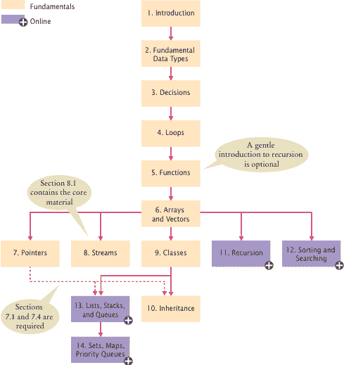

**图1**  
章节依赖关系

## 学习辅助工具导览

本书中的教学元素协同作用，聚焦并强化编程的关键概念和基本原理，同时通过额外的提示和细节来支持和深化这些基础知识。除了传统的章节目标和大量练习之外，每一章还包含面向当今视觉型学习者的元素。

在每一章中，**页边注释**标示出新概念的引入位置，并提供关键思想的概要。

带注释的**语法框**以直观的方式快速概述新的语言结构。

**注释**解释了必需的组成部分，并指向与语法相关的常见错误或最佳实践的更多信息。

## 4.3 `for` 循环

`for` 循环用于需要按给定次数执行一系列语句的情况。你可以使用由计数器控制的 `while` 循环，如下例所示。

```python
counter = 0
while (counter < 10):
    # Check the counter
    count = count + 1
    counter += 1
```

由于这种循环类型非常常见，因此有一种特殊形式，称为 `for` 循环。

```python
for counter in range(10):
    count = count + 1
```

有些人称这种循环为计数器控制循环。相比之下，`while` 循环被称为条件控制循环。你可以用另一种循环来定义这两种循环中的任何一种。

### 语法 4.2 — `for` 语句

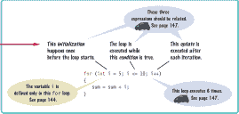


使用日常事物的类比来解释变量、数据类型、循环等概念的性质和行为。


### 图3 — `for` 循环的执行

```cpp
// Initialize counter
counter = 1;

for (counter = 1; counter <= 10; counter++) {
    cout << counter << endl;
}

// Check condition
counter <= 10

// Execute loop body
cout << counter << endl;

// Increment counter
counter = counter + 1;

// Check condition again
counter <= 10
```

> **渐进式图示**追踪代码段，帮助学生可视化程序流程。颜色的一致使用使变量和其他元素易于识别。

```cpp
// Function call
double result1 = cube_value(2);
result1 = 8;
slide_length = 2;

// Initializing function parameter variable
double result1 = cube_value();
double result1 = cube_value();
slide_length = 2;

// About to return the value
double volume = slide_length * slide_length * slide_length;
return volume;
slide_length = 2;
volume = 8;

// After function call
double result1 = cube_value(2);
result1 = 8;
```

### 图3 — 参数传递

- 创建 `cube_value` 函数的参数变量 `slide_length`。
- 参数变量使用调用中传入的参数值进行初始化。在我们的例子中，`slide_length` 被设置为 2。
- 然后调用函数并返回值。
- 变量接收返回的值。

> **自测练习**位于每节末尾，旨在让学生深入思考新内容，并能在课堂上引发讨论。

### 自测

12. 将 `infinite.cpp` 程序中的 `for` 循环改写为 `while` 循环。

13. 这个循环会打印多少个数字？

```cpp
for (int i = 10; i >= 0; i--) {
    cout << i << endl;
}
```

14. 编写一个 `for` 循环，打印 10 到 20（含）之间的所有偶数。

15. 编写一个 `for` 循环，计算从 1 到 n 的整数之和。

16. 如何修改 `while` 循环程序中的 `for` 循环，使其打印所有值直到投资翻倍？

**实践一下** 现在你可以尝试本章末尾的这些练习：R4.2、R4.7、P4.12。

> **可选工程练习**让学生接触技术领域的应用。

**工程 P7.20** 编写一个程序，模拟“人员捷运”系统的控制软件，该系统由一组在两条同心圆形轨道上运行的无人驾驶列车组成。一组道岔允许列车切换轨道。

在你的程序中，外轨道和内轨道都应分成十段。每个轨道段一次只能容纳一列列车。列车移动到相邻段。如果该段被占用，则尝试另一轨道上的相邻段。

定义一个 Segment 结构。每个段都有指向其轨道中下一段和上一段的指针。当一个段被占用时，可以从轨道中移除列车，以便为另一轨道上的相邻段腾出空间。


### `ch05/cube.cpp`

```cpp
#include <iostream>
using namespace std;

// Computes the volume of a cube.
// @param side_length the side length of the cube
// @return the volume

double cube_volume(double side_length)
{
    double volume = side_length * side_length * side_length;
    return volume;
}

int main()
{
    double result1 = cube_volume(2);
    double result2 = cube_volume(10);
    cout << "A cube with side length 2 has volume " << result1 << endl;
    cout << "A cube with side length 10 has volume " << result2 << endl;
    return 0;
}
```

### 程序运行

```text
A cube with side length 2 has volume 8
A cube with side length 10 has volume 1000
```

> **程序清单**经过精心设计，便于阅读，远不止简单的颜色编码。函数通过细微的轮廓加以区分。

**常见错误**描述了学生经常犯的错误类型，解释了错误发生的原因以及如何处理。

## 常见错误 2.1 — 使用未定义的变量

在首次使用变量之前，必须先定义它。例如，下面的语句序列是不合法的。在你的程序中，语句是按顺序编译的。当编译器到达第一条语句时，它不知道 `total_per_guest` 将在下一行定义，因此会报告错误。

```cpp
double tax_rate = 1.1;
double total_per_guest = 0.20;
...
```


**编程技巧**解释了良好的编程实践，并通过手算跟踪（hand-tracing）等技巧和技术鼓励学生提高效率。

## 编程技巧 3.6 — 手算跟踪

一种非常有用的判断程序是否正常工作的技术叫做手算跟踪。你在纸上模拟程序的活动。你可以将这种方法用于伪代码或C++代码。拿一张索引卡、一张鸡尾酒餐巾纸或任何手边的纸。为每个变量设置一列。把程序代码放在手边。用一个行标记（比如回形针）来标记你跟踪程序时的当前语句。每当变量发生变化时，在变量表中写入新值以及引起变化的代码。

例如，让我们用前面示例中的数据跟踪以下程序。如你所见，`tax1` 和 `tax2` 的值不同，因为计算顺序不同。

```cpp
int tax1;
int tax2;
double total = 100.0;
tax1 = ...;
tax2 = ...;
```

| 语句 | tax1 | tax2 | total |
|---|---:|---:|---:|
| ... | ... | ... | ... |

在第18行和第22行，`income` 和 `marital_status` 通过输入语句进行初始化。

```cpp
cin >> income;
cin >> marital_status;
```

| 语句 | tax1 | tax2 | income | 婚姻状况 |
|---|---:|---:|---:|---|
| ... | ... | ... | ... | ... |

因为 `marital_status` 不是 `5`，所以我们转到外层 if 语句的 else 分支。


手算跟踪有助于你理解程序是否正常工作。

**专题**介绍可选主题，并为其他主题提供额外解释。

## 专题 6.2 — 排序算法

排序算法重新排列序列的元素，使它们按排序顺序存储。这里有一个简单的排序算法，称为选择排序。考虑对以下数组值进行排序：

```text
[10] [2] [6] [4] [9]
[2] [10] [6] [4] [9]
```

显而易见的第一步是找到最小的元素。在本例中，最小的元素是 2，存储在 `values[1]` 中。你应该将 2 移到数组的开头。当然，`values[0]` 中已经存储了一个元素，因此该元素被移到存储最小值的原位置。

```text
[2] [10] [6] [4] [9]
[2] [4] [6] [10] [9]
```

现在第一个元素已经就位。在上图中，深色表示数组中已排序的部分。接下来取剩余条目 `values[1]`...`values[4]` 中的最小值。这个最小值 6 已经在正确的位置。这种情况下你不需要做任何事，只需将已排序部分向右扩展一个元素。

```text
[2] [4] [6] [10] [9]
[2] [4] [6] [9] [10]
```

重复该过程。未排序区域的最小值为 9，需要与未排序区域的第一个值交换。


## 随机趣闻 4.1 — 第一个 Bug

**随机趣闻**提供有关计算的历史和社会信息——既为增添趣味，也为了满足 ACM/IEEE 课程指南中“历史和社会背景”的要求。

据传说，第一个 bug 是在 Mark II 上发现的，这是哈佛大学一台巨大的机电计算机。它确实是由一只虫子引起的——一只飞蛾被困在继电器开关中。实际上，从操作员在飞蛾旁边的日志中留下的笔记来看，这只飞蛾似乎在当时就已经在机器里了。

先驱计算机科学家莫里斯·威尔克斯写道：“不知怎的，在机房中，我记起要提前思考可能的问题原因，而正是这一点最终拯救了我们。”

多年后，类似的事件再次发生，在一台计算机内部发现了一只飞蛾。这就是“调试”一词的由来。


## 附录

附录 A 包含一份编程风格指南。在编程作业中使用风格指南有助于引导学生养成良好习惯并减少不必要的选择。该风格指南提供电子版，以便教师修改它以体现其偏好的风格。

附录 B 和 C 概述 C++ 保留字和运算符。附录 D 列出字符转义序列和 ASCII 字符代码值。附录 E 记录了本书中使用的所有库函数和类。

本书配套网站上提供的附加附录包括附录 E 的扩展版本，其中包含第 11–14 章这四个可选章节所使用的函数和类，还包括涵盖数制、位与移位运算以及 C++ 与 Java 比较的附录。

## 学生与教师资源

学生和教师可通过访问 www.wiley.com/college/horstmann 获取以下资源。本书配有两个配套网站——一个面向学生，另一个是仅限教师访问的密码保护网站。

- 针对科学与工程问题领域的附加练习
- 将书中的问题求解步骤应用于其他现实示例的示例解析（在书中以图标标识）
- 本书所有示例的源代码
- 所有复习题和编程练习的解答（仅限教师）
- 总结每章并包含书中代码清单和插图的讲座演示幻灯片（PowerPoint 格式，仅限教师）
- 注重技能而不仅是术语的题库（仅限教师）
- 关于递归、排序与查找以及数据结构的四个附加章节
- 电子版的编程风格指南


## 致谢

非常感谢 John Wiley & Sons 的 Beth Golub、Tom Kulesa、Andre Legaspi、Elizabeth Mills、Michael Berlin 和 Lisa Gee，以及 Publishing Services 团队对本图书项目的辛勤工作和支持。特别深切地感谢 Cindy Johnson，她以极大的耐心和对细节的关注使本书得以成为现实。我们还要感谢北达科他州立大学的 Jonathan Tolstedt 提供高质量的解答；感谢肯塔基大学的 Brent Seales 修订并完善题库；感谢纽约大学理工学院的 Evan Gallagher 制作富有创意的 PowerPoint 幻灯片。

我们非常感谢许多审阅和/或对本书第一版及本版进行课堂测试的人士。我们珍视他们提出的许多宝贵改进建议。他们包括：

- Charles D. Allison，*犹他谷州立学院*
- Fred Annexstein，*辛辛那提大学*
- Stefano Basagni，*东北大学*
- Noah D. Barnette，*弗吉尼亚理工大学*
- Susan Bickford，*塔拉哈西社区学院*
- Ronald D. Bowman，*阿拉巴马大学亨茨维尔分校*
- Peter Breznay，*威斯康星大学绿湾分校*
- Richard Cacace，*彭萨科拉初级学院，彭萨科拉*
- Kuang-Nan Chang，*东肯塔基大学*
- Joseph DeLibero，*亚利桑那州立大学*
- Subramaniam Dharmarajan，*亚利桑那州立大学*
- Mary Dorf，*密歇根大学*
- Marty Dulberg，*北卡罗来纳州立大学*
- William E. Duncan，*路易斯安那州立大学*
- John Estell，*俄亥俄北方大学*
- Waleed Farag，*宾夕法尼亚印第安纳大学*
- Stephen Gilbert，*橙海岸社区学院*
- Kenneth Glitz，*新罕布什尔技术学院*
- Daniel Grioletti，*德瑞理工学院廷利帕克分校*
- Barbara Guillott，*路易斯安那州立大学*
- Charles Halsey，*里奇兰学院*
- Jon Hanrath，*伊利诺伊理工学院*
- Neil Harrison，*犹他谷大学*
- Jurgen Hecht，*安大略大学*
- Steve Hodges，*卡布里洛学院*
- Jackie Jarboe，*博伊西州立大学*
- Debbie Kaneko，*欧道明大学*
- Mir Behrad Khamesee，*滑铁卢大学*
- Sung-Sik Kwon，*北卡罗来纳中央大学*
- Lorrie Lehman，*北卡罗来纳大学夏洛特分校*
- Cynthia Lester，*塔斯基吉大学*
- Yanjun Li，*福特汉姆大学*
- W. James MacLean，*多伦多大学*
- LindaLee Massoud，*莫特社区学院*
- Charles W. Mellard，*德瑞理工学院欧文分校*
- Ethan V. Munson，*威斯康星大学密尔沃基分校*
- Philip Regalbuto，*特莱登特技术学院*
- Don Retzlaff，*北德克萨斯大学*
- Jeff Ringenberg，*密歇根大学安娜堡分校*
- John P. Russo，*温特沃斯理工学院*
- Kurt Schmidt，*德雷塞尔大学*
- Brent Seales，*肯塔基大学*
- William Shay，*威斯康星大学绿湾分校*
- Michele A. Starkey，*圣玛丽山学院*
- William Stockwell，*中俄克拉荷马大学*
- Jonathan Tolstedt，*北达科他州立大学*
- Boyd Trolinger，*比尤特学院*
- Muharrem Uyar，*纽约市立学院*
- Mahendra Velauthapillai，*乔治城大学*
- Kerstin Voigt，*加州州立大学圣贝纳迪诺分校*
- David P. Voorhees，*勒莫因学院*
- Salih Yurttas，*德克萨斯农工大学*

特别感谢我们所有的课堂测试人员：

- Pani Chakrapani 和 *雷德兰兹大学* 的学生
- Jim Mackowiak 和 *长滩市立学院，LAC* 的学生
- Suresh Muknahallipatna 和 *怀俄明大学* 的学生
- Murlidharan Nair 和 *南本德印第安纳大学* 的学生
- Harriette Roadman 和 *新河社区学院* 的学生
- David Topham 和 *奥龙尼学院* 的学生
- Dennie Van Tassel 和 *加维兰学院* 的学生

# 第 1 章：引言


## 本章目标

- 了解计算机的体系结构
- 了解机器语言和高级编程语言
- 熟悉你的编译器
- 编译并运行你的第一个 C++ 程序
- 识别编译时错误和运行时错误
- 用伪代码描述算法
- 理解编程活动

## 本章内容

- 1.1 **什么是编程？** 2
- 1.2 **计算机的解剖结构** 3
  - 事实档案 1.1：ENIAC 与计算时代的黎明 5
- 1.3 **机器代码与编程语言** 6
  - 事实档案 1.2：标准组织 7
- 1.4 **熟悉你的编程环境** 7
  - 编程提示 1.1：备份副本 11
- 1.5 **分析你的第一个程序** 11
  - 语法 1.1：C++ 程序 12
  - 语法 1.2：输出语句 13
  - 常见错误 1.1：省略分号 14
  - 特别提示 1.1：转义序列 14
- 1.6 **错误** 15
  - 常见错误 1.2：拼写错误 16
- 1.7 **问题解决：算法设计** 17
  - 如何做 1.1：用伪代码描述算法 20
  - 示例演练 1.1：为铺设地板编写算法

对程序进行微小改动，从而立即获得改进，并看到计算机成为你心智能力的延伸。

- **自测**
  - 1. 在计算机上播放音乐需要什么？
  - 2. 为什么 CD 播放器不如计算机灵活？
  - 3. 计算机用户为了玩视频游戏，需要对编程了解多少？

**动手练习！** 现在你可以尝试本章末尾的练习：R1.1、R1.4。

## 1.2 计算机的解剖结构

要理解编程过程，你需要对构成计算机的基本部件有一个初步的了解。我们将考察一台个人计算机。较大的计算机拥有更快、更大或更强大的组件，但它们的设计从根本上说是相同的。

计算机的核心是**中央处理器（CPU）**（见图 1）。它由单个芯片或少量芯片组成。计算机芯片（集成电路）是一种带有塑料或金属外壳、金属连接器以及主要由硅制成的内部连线的组件。对于 CPU 芯片而言，其内部连线极其复杂。例如，奔腾芯片（在撰写本书时个人计算机中流行的 CPU）由数百万个称为*晶体管*的结构元件组成。

CPU 执行程序控制和数据处理。也就是说，CPU 定位并执行程序指令；它执行算术运算，如加、减、乘、除；它从外部存储器或设备获取数据，并将数据存回。

计算机存储数据和程序。存储有两种类型。*主存储器*由内存芯片制成：只要供电就能存储数据的电子电路。*辅助存储器*，通常是*硬盘*，提供更便宜且无需电力也能持久保存的存储。硬盘由涂有磁性材料的旋转盘片和能够检测并改变盘片上磁通量的读/写磁头组成（见图 2）。

> 中央处理器（CPU）执行程序控制和数据处理。

> 存储设备包括内存和辅助存储器。

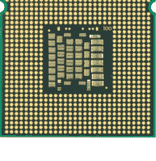

**图 2：硬盘**


程序和数据通常存储在硬盘上，并在程序启动时加载到内存中。然后程序更新内存中的数据，并将修改后的数据写回硬盘。

为了与人类用户交互，计算机需要外围设备。计算机通过显示屏、扬声器和打印机向用户传输信息（称为*输出*）。用户可以通过键盘或鼠标等指点设备输入信息（称为*输入*）。

有些计算机是独立的单元，而另一些则通过*网络*相互连接。通过网络布线，计算机可以从中央存储位置读取数据和程序，或将数据发送到其他计算机。对于联网计算机的用户来说，哪些数据位于计算机本身，哪些数据通过网络传输，可能并不明显。

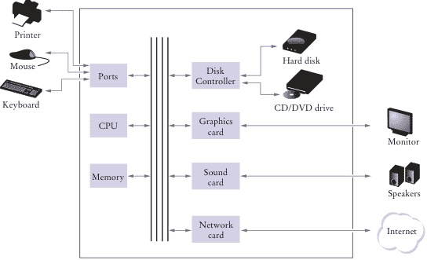

**图 3：个人计算机的示意图**

图 3 给出了个人计算机体系结构的示意性总览。程序指令和数据（如文本、数字、音频或视频）存储在硬盘、DVD 等光盘上，或网络中的其他位置。当程序启动时，它被调入内存，CPU 可以读取它。CPU 一次读取一条程序指令。在这些指令的引导下，CPU 读取数据、修改数据并存储数据。某些程序指令会使 CPU 在显示屏或打印机上放置光点，或使扬声器振动。当这些动作以极快的速度反复发生时，人类用户便感知到图像和声音。某些程序指令从键盘或鼠标读取用户输入。程序分析这些输入的性质，然后执行下一条适当的指令。


- **自测**
  - 4. 当程序当前未运行时，它存储在何处？
  - 5. 计算机的哪个部分执行算术运算（如加法和乘法）？

**动手练习** 现在你可以尝试本章末尾的练习：R1.2、R1.3。

### 事实档案 1.1：ENIAC 与计算时代的黎明


ENIAC（电子数值积分器和计算机）是第一台可用的电子计算机。它由宾夕法尼亚大学的 J. Presper Eckert 和 John Mauchly 设计，于 1946 年完成——早于晶体管发明两年。这台计算机安置在一个大房间里，由许多机柜组成，其中包含约 18,000 个真空管（见图 2）。真空管以每天数只的速度烧毁。一名服务员推着装满真空管的购物车不断巡视并更换有缺陷的管子。计算机通过连接面板上的电线进行编程。每种布线配置都会为特定问题设置计算机。要让计算机处理不同的问题，必须重新插接电线。

ENIAC 的工作得到了美国陆军的支持，陆军对弹道表的计算感兴趣，这些表格会根据风阻、初速度和大气条件给出弹丸的轨迹。要计算轨迹，必须求解某些微分方程的数值解，因此得名“数值积分器”。在 ENIAC 这样的机器开发出来之前，人类从事这类工作，直到 20 世纪 50 年代，“计算机”一词指的都是这些人。ENIAC 后来被用于和平目的，例如美国人口普查数据的统计。

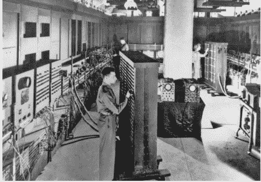

**图 4：ENIAC**

## 1.3 机器代码与编程语言

在最基本的层面上，计算机指令极其原始。处理器执行*机器指令*。一条典型的机器指令序列是：

- 1. 将内存位置 40000 的内容移入 CPU。
- 2. 如果该值 > 100，则继续执行存储在内存位置 11280 的指令。

实际上，机器指令被编码为数字，以便存储在内存中。在奔腾处理器上，这条指令序列被编码为以下数字序列：

```
161 40000 45 100 127 11280
```

在另一制造商生产的处理器上，编码会有所不同。当这种处理器获取这串数字时，它会对其解码并执行相关的命令序列。

我们如何将命令序列传达给计算机？最简单的方法是将实际数字放入计算机内存。事实上，最早的计算机就是这样工作的。然而，一个长程序由数千条单独的命令组成，查找所有命令的数字代码并手动将代码放入内存是一件乏味且容易出错的事情。如前所述，计算机非常擅长自动化那些乏味且容易出错的活动。没过多久，计算机科学家就意识到，可以利用计算机本身来帮助完成编程过程。

计算机科学家发明了*高级编程语言*，允许程序员使用与待解决问题更密切相关的语法来描述任务。在本书中，我们将使用 C++ 编程语言，它由 Bjarne Stroustrup 于 20 世纪 80 年代开发。


多年来，C++ 通过添加许多特性而不断发展。标准化过程最终于 1998 年发布了国际 C++ 标准。2003 年发布了对该标准的小幅更新，而一次重大修订预计将在 2011 年左右完成。目前，C++ 是开发数据库和操作系统等系统软件最常用的语言。同样重要的是，C++ 越来越多地用于“嵌入式系统”编程，即控制汽车发动机或蜂窝电话等设备的小型计算机。

以下是 C++ 中的一条典型语句：

```
if (int_rate > 100) { cout << "Interest rate error"; }
```

其含义是：“如果利率超过 100，则显示一条错误消息”。一种特殊的计算机程序——编译器，将这种高级描述翻译成特定处理器的机器指令。

高级语言独立于底层硬件。C++ 指令在 Intel Pentium 和手机处理器上都能同样良好地工作。当然，编译器生成的机器指令是不同的，但使用编译器的程序员无需担心这些差异。

计算机程序以机器指令的形式存储，其代码依赖于处理器类型。

C++ 是一种通用语言，广泛用于系统和嵌入式编程。

高级编程语言独立于处理器。


```cpp
#include <iostream>

using namespace std;

int main()
{
    cout << "Hello, World!" << endl;
    return 0;
}
```

我们将在下一节中分析这个程序。

无论你使用哪种编程环境，你都需要先在编辑器窗口中输入程序语句来开始你的工作。

创建一个新文件并将其命名为 ch01.cpp，具体步骤根据你的环境而定。（如果你的环境除了文件名之外还要求提供项目名称，请将项目命名为 hello。）请完全按照上面给出的指令输入程序。或者，在本书程序的源文件中找到电子副本，然后粘贴到你的编辑器中。

编辑器是一种用于输入和修改文本（例如 C++ 程序）的程序。

在编写这个程序时，请特别注意各种符号，并记住 C++ 是区分大小写的。你必须按照程序清单中出现的原样输入大写和小写字母。你不能输入 MAIN 或 Endl。如果不小心，你将会遇到问题——参见第 16 页的常见错误 1.2。

> C++ 是区分大小写的。你必须注意区分大写和小写字母。

## 步骤 3 编译并运行程序

构建和运行 C++ 程序的过程在很大程度上取决于你的编程环境。在某些集成开发环境中，你只需按一个按钮。在其他环境中，你可能需要输入命令。当你运行测试程序时，屏幕上会出现以下消息：

Hello, World!

（见图 5 和图 6）。

> 编译器将 C++ 程序翻译成机器代码。

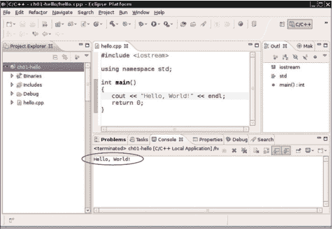

**图 5** 在集成开发环境中运行 hello 程序

**图 6** 在控制台窗口中编译并运行 `hello` 程序

```text
$ cd csl/bookcode/ch01
~/csl/bookcode/ch01$ g++ -o hello hello.cpp
~/csl/bookcode/ch01$ ./hello
Hello, World!
~/csl/bookcode/ch01$ 
```

了解程序构建时幕后的情况是很有用的。首先，编译器将 C++ 源代码（即你编写的语句）转换成机器指令。机器代码只包含你所写的代码的转换结果，这还不足以真正运行程序。要在窗口中显示字符串，需要相当多的底层操作。你的 C++ 开发环境的实现者提供了一个库，其中包含了 `cout` 的定义及其功能。**库**是别人已经编写并编译好的代码集合，可供你在程序中使用。（更复杂的程序是由多个机器代码文件和多个库构建而成的。）一个叫做**链接器**的程序将你的机器代码和 C++ 库中必要的部分组合起来，生成一个**可执行文件**。（图 7 概括了这些步骤。）可执行文件通常被称为 `hello.exe` 或 `hello`，具体取决于你的计算机系统。即使退出 C++ 开发环境后，你仍然可以运行这个可执行程序。

> 链接器将机器代码与库代码组合成一个可执行程序。

## 步骤 4 组织你的工作

作为程序员，你会编写程序、试用它们并改进它们。你将程序存储在文件中。文件有名称，合法名称的规则因系统而异。有些系统允许文件名中包含空格，有些则不允许。有些系统区分大写和小写字母，有些则不区分。大多数 C++ 编译器要求 C++ 文件以扩展名 `.cpp`、`.cxx`、`.cc` 或 `.c` 结尾，例如 `test.cpp`。文件存储在文件夹或目录中。文件夹可以包含文件以及其他文件夹，而这些文件夹本身又可以包含更多的文件和文件夹（见图 8）。这个层次结构可能相当庞大，你无需关心它的所有分支。

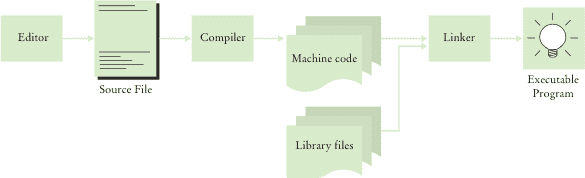

**图 7** 从源代码到可执行程序

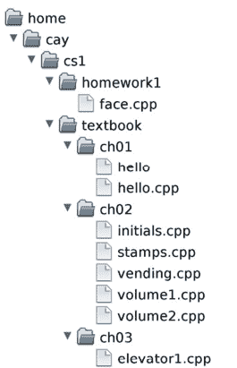

然而，你应该创建文件夹来组织你的工作。最好为你的编程课程单独创建一个文件夹。在该文件夹中，为每项作业再单独创建一个文件夹。

如果你自己不指定文件夹，有些编程环境会将你的程序放在默认位置。在这种情况下，你需要弄清楚这些文件在哪里。

请确保你了解你的文件在文件夹层次结构中的位置。这些信息在提交文件以供评分和制作*备份副本*时至关重要。

你会花费很多小时来创建和改进 C++ 程序。意外删除文件是很容易发生的，而且有时文件会因计算机故障而丢失。为了避免重新创建丢失文件的烦恼，请养成将工作备份到 U 盘或另一台计算机上的习惯。

> 在灾难发生之前，制定一个保留工作备份副本的策略。

### 自测题

9. 编程项目如何存储在计算机上？
10. 当你在文本编辑器中打开一个可执行文件时，你预计会看到什么？
11. 在进行编程项目时，你会如何保护自己免受数据丢失？

**练习一下** 现在你可以尝试本章末尾的练习：R1.6。

## 编程提示 1.1


### 备份副本

对于许多人来说，将文件备份到 U 盘是一种简单方便的存储方法。另一种日益流行的备份形式是互联网文件存储。以下是一些需要记住的要点。

- **经常备份。** 备份文件只需几秒钟，如果你不得不花很多小时重新创建本可以轻松保存的工作，你会恨自己的。我建议你每三十分钟备份一次工作。
- **轮换备份。** 使用多个目录进行备份，并轮换使用。也就是说，先备份到第一个目录，然后备份到第二个目录，接着使用第三个目录，然后再回到第一个目录。这样你总是有三个最近的备份。如果你最近的修改把事情弄得更糟，你可以回到较旧的版本。
- **注意备份方向。** 备份涉及将文件从一个位置复制到另一个位置。正确执行这一点很重要——也就是说，从你的工作位置复制到备份位置。如果你弄反了，你就会用旧版本覆盖较新的文件。
- **不时检查你的备份。** 仔细确认你的备份就在你认为的位置。没有什么比在你需要备份时却发现它们不在那里更令人沮丧的了。
- **先放松，再恢复。** 当你丢失文件并需要从备份中恢复时，你很可能处于不愉快、紧张的状态。深呼吸，在开始之前仔细思考恢复过程。一个焦躁不安的计算机用户在尝试恢复损坏的文件时抹掉最后一个备份的情况并不少见。


## 1.5 分析你的第一个程序


在本节中，我们将详细分析第一个 C++ 程序。这里再次给出源代码：

```cpp
ch01/hello.cpp
1 #include <iostream>
2
3 using namespace std;
4
5 int main()
6 {
7    cout << "Hello, World!" << endl;
8    return 0;
9 }
```

第一行

`#include <iostream>`

告诉编译器包含一个“流输入/输出”服务。你将在第 8 章学习什么是流。目前，你只需记住在所有执行输入或输出的程序中加上这一行。

### 语法 1.1 C++ 程序

```cpp
#include <iostream>
using namespace std;

int main()
{
    cout << "Hello, World!" << endl;
    return 0;
}
```

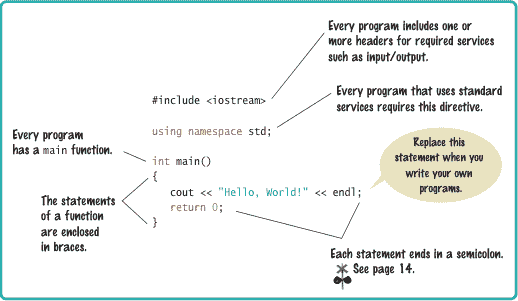

下一行

```cpp
using namespace std;
```

告诉编译器使用“标准命名空间”。命名空间是一种避免大型程序中命名冲突的机制。你无需担心命名空间。对于本书中你将编写的程序，你总是使用标准命名空间。只需在你编写的每个程序的顶部、`#include` 指令的下方添加 `using namespace std;` 即可。

该结构

```cpp
int main()
{
    ...
    return 0;
}
```

定义了一个名为 `main` 的*函数*，它“返回”一个“整数”（即没有小数部分的整数，在 C++ 中称为 int），值为 0。这个值表示程序成功完成。*函数*是执行特定任务的一组编程指令。每个 C++ 程序都必须有一个 main 函数。大多数 C++ 程序除了 main 之外还包含其他函数，但我们要到第 5 章才会讨论函数和返回值。

目前，最好把这些部分都视为编写简单程序所必需的“管道设施”。只需将你想要执行的代码放在 main 函数的花括号内即可。（C++ 程序的基本结构如语法 1.1 所示。）

要在屏幕上显示值，你可以使用名为 `cout` 的实体和 `<<` 运算符（有时称为插入运算符）。例如，语句

```cpp
cout << 39 + 3;
```

会显示数字 42。

> 每个 C++ 程序都包含一个名为 main 的函数。

> 使用 cout 和 << 运算符在屏幕上显示值。


### 语法 1.2 输出语句

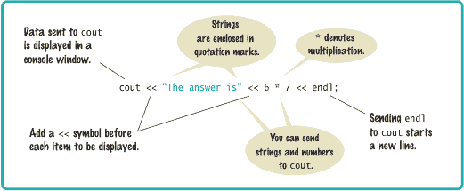

- 将文本字符串用引号括起来。
- 使用 `+` 将两个数相加，使用 `*` 将两个数相乘。
- 向 `cout` 发送 `endl` 以结束一行显示输出。
- 每条语句以分号结尾。

语句

```cpp
cout << "Hello";
```

显示字符串 Hello。字符串是字符序列。必须将字符串的内容括在引号内，以便编译器知道您字面意思就是文本 "Hello"，而不是同名函数。

可以向 `cout` 发送多个项。在每个项之前使用一个 `<<`。例如，

```cpp
cout << "The answer is " << 6 * 7;
```

显示答案为 42（在 C++ 中，`*` 表示乘法）。

`endl` 符号表示行尾标记。当这个标记被发送给 `cout` 时，光标会移动到下一屏幕行的第一列。如果不使用行尾标记，那么下一个显示项就会直接在同一行中跟在当前字符串后面。在这个程序中，我们只打印了一个项，但通常我们会想打印多个项，并且用行尾标记结束所有输出行是一个好习惯。

最后注意，C++ 中的每条语句都以分号结尾，就像每个英文句子都以句号结尾一样。


### 自测

- 12. 如何修改 `hello.cpp` 程序，使其改为问候你？
- 13. 这个程序有什么错误？

  ```cpp
  #include <iostream>
  using namespace std;
  int main()
  {
      cout << Goodbye, World! << endl;
      return 0;
  }
  ```

- 14. 下列语句序列会打印什么？

  ```cpp
  cout << "Hello";
  cout << "World";
  ```

- 15. 下列语句会打印什么？

  ```cpp
  cout << 2 << 2 << 2;
  ```

- 16. 下列语句会打印什么？

  ```cpp
  cout << "Hello" << endl << endl << "World";
  ```

### 练习

现在可以尝试本章末尾的这些练习：R1.7、P1.1、P1.2。

### 常见错误 1.1——省略分号


在 C++ 中，每条语句都必须以分号结尾。忘记键入分号是一种常见错误。这会让编译器困惑，因为编译器使用分号来查找一条语句结束和下一条语句开始的位置。编译器不使用行尾或右花括号来识别语句的结尾。例如，编译器会把

```cpp
cout << "Hello, World!" << endl
return 0;
```

视为一条语句，就好像你写的是

```cpp
cout << "Hello, World!" << endl return 0;
```

然后它无法理解这条语句，因为输出命令中间不应出现 return 一词。补救方法很简单。只需检查每条语句是否以终止分号结尾，就像你会检查每个英文句子是否以句号结尾一样。

### 专题 1.1——转义序列


如何显示包含引号的字符串，例如

```text
Hello, "World"
```

你不能使用

```cpp
cout << "Hello, "World";
```

当编译器读到 "Hello, " 时，会认为字符串已经结束，然后对 World 感到完全困惑。编译器思维很死板，如果对输入的简单分析对它们来说不合理，它们就会拒绝继续，并报告错误。相比之下，人类可能会意识到第二个和第三个引号本应是字符串的一部分。

那么，我们如何在屏幕上显示引号呢？C++ 的设计者提供了一个转义出口。用反斜杠字符（`\`）标记每个引号，如下所示：

```cpp
cout << "Hello, \"World\"";
```

序列 `\"` 表示字面引号，而不是字符串的结束。这样的序列称为*转义序列*。

还有其他一些转义序列。如果确实想在显示中显示反斜杠，则使用转义序列 `\\`。语句

```cpp
cout << "Hello\\World";
```

打印

```text
Hello\World
```

最后，转义序列 `\n` 表示一个**换行**字符，它在屏幕上开始新的一行。

命令

```cpp
cout << "Hello, World!\n";
```

与以下代码的效果完全相同：

```cpp
cout << "Hello, World!" << endl;
```

## 1.6 错误

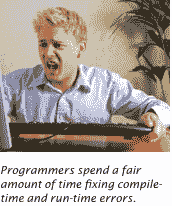

编程语言遵循非常严格的约定。当你与另一个人交谈时，如果说错或漏掉一两个词，你的对话伙伴通常仍会理解你想说什么。但是，当你在 C++ 程序中犯错时，编译器不会试图猜测你的意思。（这其实是件好事。如果编译器猜错了，生成的程序就会做错事——很可能造成灾难性后果。）在本节中，你将学习如何处理程序中的错误。

稍微试验一下 `hello.cpp` 程序。如果出现如下键入错误会发生什么：

```cpp
cot << "Hello, World!" << endl;
cout << "Hello, World! << endl;
cout << "Hollo, World!" << endl;
```

> 编译时错误是违反编程语言规则、并由编译器检测到的错误。

在第一种情况下，编译器会抱怨它不知道 `cot` 是什么意思。错误消息的确切措辞取决于编译器，但可能类似于“未定义符号 cot”。这是一个**编译时错误或语法错误**。根据语言规则，有地方出错了，并且编译器发现了它。当编译器发现一个或多个错误时，它不会将程序翻译为机器码，因此没有可运行的程序。你必须修复错误并重新编译。首次编译成功之前经历几轮修复编译时错误是很常见的。

如果编译器发现错误，它不会只是停下来放弃。它会尝试报告尽可能多的错误，以便你可以一次性全部修复。然而，有时一个错误会使它偏离轨道。第二行的错误很可能导致这种情况。由于程序员忘记了结束引号，编译器会继续寻找字符串的结尾。在这种情况下，编译器通常会为相邻行发出虚假的错误报告。你应该只修复那些你能理解的错误消息，然后重新编译。

第三行的错误属于另一种类型。程序会编译并运行，但其输出将是错误的。它会打印

```text
Hollo, World!
```

> 运行时错误会使程序执行程序员本不打算执行的操作。

这是一个**运行时错误**。程序在语法上是正确的，并且会做某些事情，但它没有做它应该做的事情。编译器无法发现该错误，必须在程序运行时通过测试程序并仔细查看其输出来找出它。

> 程序员负责检查和测试程序，以防止运行时错误。


由于运行时错误是由程序中的逻辑缺陷引起的，因此它们通常被称为逻辑错误。有些类型的运行时错误非常严重，以至于会产生异常：来自处理器的信号，它用错误消息中止程序。例如，如果你的程序包含语句 `cout << 1 / 0;`，你的程序可能会以“除以零”异常终止。

在程序开发过程中，错误不可避免。一旦程序超过几行，就需要超人的专注力才能正确输入而不出错一次。你会发现自己会比预想更频繁地漏掉分号或引号，但编译器会为你追踪这些问题。

运行时错误更麻烦。编译器不会发现它们——事实上，只要语法正确，编译器就会欣然翻译任何程序——生成的程序会做错事。程序作者有责任测试程序并找出任何运行时错误。程序测试是一个重要主题，你将在本书中多次遇到。

### 自测

- 17. 假设你在 `hello.cpp` 程序中省略了 `main` 后的 `()` 字符。你会得到编译时错误还是运行时错误？
- 18. 当你使用计算机时，可能遇到过程序“崩溃”（自行退出）或“挂起”（无法响应你的输入）。这种行为是编译时错误还是运行时错误？
- 19. 当程序存在编译器错误时，为什么不能测试它的运行时错误？

### 练习

现在可以尝试本章末尾的这些练习：R1.10、R1.11。

### 常见错误 1.2——拼错单词


如果不小心拼错一个单词，可能会发生奇怪的事情，而且从错误消息中并不总能完全看出哪里出了问题。下面是一个很好的例子，说明简单的拼写错误如何引起麻烦：

```cpp
#include <iostream>

using namespace std;

int Main()
{
    cout << "Hello, World!" << endl;
    return 0;
}
```

这段代码定义了一个名为 `Main` 的函数。编译器不会认为它与 `main` 函数相同，因为 `Main` 以大写字母开头，而 C++ 语言区分大小写。大写字母和小写字母被认为彼此完全不同，对编译器来说，`Main` 并不比其他任何名称更匹配 `main`。编译器会编译你的 `Main` 函数，但当链接器准备构建可执行文件时，它会抱怨缺少 `main` 函数并拒绝链接程序。当然，“缺少 main 函数”这条消息应该给你一个线索，告诉你到哪里查找错误。

如果收到的错误消息似乎表明编译器找错了方向，最好检查拼写和大小写。在 C++ 中，大多数名称只使用小写字母。如果拼错了某个符号的名称（例如用 `out` 代替 `cout`），编译器会抱怨“未定义符号”。这条错误消息通常是一个很好的线索，说明你犯了拼写错误。


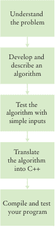

> 解决问题的算法是一个明确、可执行且可终止的步骤序列。

当每一步该做什么、下一步去哪里都有精确的指令时，这种方法就是**明确**的。它没有猜测或发挥创造力的空间。当每一步都能在实践中执行时，这种方法就是**可执行**的。如果我们要求使用未来几年实际收取的利率，而不是每年 5% 的固定利率，那么我们的方法就无法执行，因为任何人都无法知道那个利率会是多少。如果一种方法不会永远持续下去，那么它就是**可终止**的：每执行一步，余额至少增加 500 美元，因此最终必然达到 20,000 美元。


*算法是寻找解决方案的“菜谱”。*

明确、可执行且可终止的步骤序列称为算法。我们已经找到一种算法来解决投资问题，因此可以通过计算机编程来找到解决方案。算法的存在是为某项任务编程的基本前提。在开始编程之前，你需要先发现并描述一个解决该任务的算法（见图 9）。

## 自测题

- 20. 假设利率为 20%。投资翻倍需要多长时间？
- 21. 假设你的手机运营商对不超过 300 分钟的通话收费 29.95 美元，超出部分每分钟收费 0.45 美元，另加 12.5% 的税费。给出一个算法，根据给定的分钟数计算每月费用。
- 22. 考虑以下用于从一系列照片中找出最有吸引力的照片的伪代码：

  ```
  Pick the first photo and call it “the best so far”.
  For each photo in the sequence
      If it is more attractive than the “best so far”
          Discard “the best so far”.
          Call this photo “the best so far”.
  The photo called “the best so far” is the most attractive photo in the sequence.
  ```

  这是一个能找出最有吸引力照片的算法吗？

- 23. 假设自测题 22 中的每张照片都有价格标签。给出一个算法来找出最贵的照片。
- 24. 假设你有一串随机排列的黑白弹珠，希望重新排列，使黑色和白色弹珠分别集中在一起。考虑以下算法：

  ```
  Repeat until sorted
      Locate the first black marble that is preceded by a white marble, and switch them.
  ```

  该算法对序列 ○●○●● 会做什么？请逐步说明，直到算法停止。

- 25. 假设你有一串随机排列的彩色弹珠。考虑以下伪代码：

  ```
  Repeat until sorted
      Locate the first marble that is preceded by a marble of a different color, and switch them.
  ```

  为什么这不是算法？

**动手练习**  现在你可以尝试本章末尾的练习：R1.13、R1.14。

## 如何做 1.1 — 用伪代码描述算法


在准备编写 C++ 程序之前，你需要开发一个算法——即针对特定问题找到解决方案的方法。用伪代码描述算法：一系列用英语表述的精确步骤。

例如，考虑这样一个问题：你有两辆车可以选择购买。其中一辆比另一辆更省油，但也更贵。你知道两辆车的价格和燃油效率（单位：英里/加仑，mpg）。你计划使用这辆车十年。假设油价为每加仑 4 美元，每年行驶 15,000 英里。你将用现金购车，不考虑融资成本。哪辆车更划算？


### 第 1 步 — 确定输入和输出

在我们的示例问题中，有以下输入：

- **购买价格1** 和 **燃油效率1**，第一辆车的价格和燃油效率（单位：mpg）
- **购买价格2** 和 **燃油效率2**，第二辆车的价格和燃油效率
- 我们只想知道哪辆车更划算。这就是期望的输出。

### 第 2 步 — 将问题分解为更小的任务

对于每辆车，我们都需要知道驾驶它的总成本。让我们分别对每辆车进行此计算。一旦知道了每辆车的总成本，我们就可以决定哪辆车更划算。

每辆车的总成本是 **购买价格 + 运营成本**。

我们假设十年内的使用量和油价不变，因此运营成本取决于驾驶这辆车一年的成本。

运营成本是 **10 × 年燃油成本**。

年燃油成本是 **每加仑价格 × 年燃油消耗量**。

年燃油消耗量是 **年行驶英里数 / 燃油效率**。例如，如果你驾驶这辆车行驶 15,000 英里，燃油效率为 15 英里/加仑，那么这辆车消耗 1,000 加仑。

### 第 3 步 — 用伪代码描述每个子任务

在你的描述中，安排步骤的顺序，以便任何中间值都在其他计算需要它们之前计算出来。例如，在计算出**运营成本**之后，再列出**总成本 = 购买价格 + 运营成本**这一步。

以下是决定购买哪辆车的算法：

```
For each car, compute the total cost as follows:
    annual fuel consumed = annual miles driven / fuel efficiency
    annual fuel cost = price per gallon × annual fuel consumed
    operating cost = 10 × annual fuel cost
    total cost = purchase price + operating cost
If total cost 1 < total cost 2:
    Choose car 1.
Else:
    Choose car 2.
```

### 第 4 步 — 通过求解问题来测试你的伪代码

我们将使用以下示例值：

汽车 1：$25,000，50 英里/加仑

汽车 2：$20,000，30 英里/加仑

以下是第一辆车成本的计算：

```
annual fuel consumed = annual miles driven / fuel efficiency = 15000 / 50 = 300
annual fuel cost = price per gallon × annual fuel consumed = 4 × 300 = 1200
operating cost = 10 × annual fuel cost = 10 × 1200 = 12000
total cost = purchase price + operating cost = 25000 + 12000 = 37000
```

类似地，第二辆车的总成本为 $40,000。因此，算法的输出是选择汽车 1。

## 工作示例 1.1 — 编写铺设地板的算法

本工作示例展示了如何为交替颜色图案铺设瓷砖设计算法。


## 本章小结

### 定义“计算机程序”和编程。

- 计算机以极快的速度连续执行非常基本的指令。
- 计算机程序是指令和决策的序列。
- 编程是设计和实现计算机程序的行为。

### 描述计算机的组成部分。

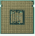

- 中央处理器（CPU）执行程序控制和数据处理。
- 存储设备包括内存和辅助存储。

### 描述将高级语言翻译成机器码的过程。

- 计算机程序以机器指令的形式存储，其代码取决于处理器类型。
- C++ 是一种通用语言，广泛用于系统和嵌入式编程。
- 高级编程语言与处理器无关。

### 熟悉你的 C++ 编程环境。

- 留出一些时间来熟悉你将在课堂作业中使用的编程环境。
- 编辑器是用于输入和修改文本（如 C++ 程序）的程序。
- C++ 区分大小写。你必须注意区分大写和小写字母。
- 在灾难发生之前，制定一个为你的工作保留备份副本的策略。
- 编译器将 C++ 程序翻译成机器码。
- 链接器将机器码与库代码组合成可执行程序。


### 描述简单程序的构建块。

- 每个 C++ 程序都包含一个名为 main 的函数。
- 使用 cout 和 << 运算符在屏幕上显示值。
- 将文本字符串放在引号中。
- 使用 + 将两个数相加，使用 * 将两个数相乘。
- 向 cout 发送 endl 以结束一行显示输出。
- 每个语句以分号结束。

### 将程序错误分类为编译时错误和运行时错误。


- 编译时错误是违反编程语言规则、并被编译器检测到的错误。
- 运行时错误导致程序执行程序员不打算执行的操作。
- 程序员负责检查和测试程序以防止运行时错误。

### 为简单算法编写伪代码。

- 伪代码是用于解决问题的步骤序列的非正式描述。
- 解决问题的算法是明确、可执行且可终止的步骤序列。


- **P1.4** 编写一个程序，打印前十个正整数之和：1 + 2 + ... + 10。

- **P1.5** 编写一个程序，打印前十个正整数的乘积：1 × 2 × ... × 10。（在 C++ 中使用 `*` 表示乘法。）

- **P1.6** 编写一个程序，打印一个账户在第一年、第二年和第三年后的余额，该账户每年赚取 5% 的利息。

- **P1.7** 编写一个程序，在终端屏幕上用一个方框显示你的名字，如下所示：

```
┌────┐
│ Dave │
└────┘
```

请尽量使用 `| - +` 等字符来近似表示线条。

- **P1.8** 编写一个程序，用大号字母打印你的名字，例如：

```
*   *   ***   *****   *****   *   *
*   *  *   *  *       *       *   *
*****  *   *  ****    ****    *   *
*   *  *   *  *       *       *   *
*   *   ***   *****   *****   *   *
```

- **P1.9** 编写一个程序，打印一张与下面相似（但不同）的脸：

```
 /////
+-----+
| o o |
|  ^  |
| '-' |
+-----+
```

- **P1.10** 编写一个程序，打印一座与下面完全相同的房子：

```
 /\
/  \
+----+
| .- |
| |  |
+--++
```

- **P1.11** 编写一个程序，打印一只正在打招呼的动物，与下面相似（但不同）：

```
 /\_/\       -----
( o o )   / Hello \
(  -  )  < Junior |
 | | |    / Coder!/
(_____)      -----
```

- **P1.12** 编写一个程序，在三行中分别打印三项内容，例如你三位最好朋友的名字或你最喜欢的电影。

- **P1.13** 编写一个程序，打印一首你自选的诗。如果你没有最喜欢的诗，可以在互联网上搜索“Emily Dickinson”或“e e cummings”。

- **P1.14** 编写一个程序，打印一幅模仿皮特·蒙德里安画作的作品。（如果你不熟悉他的画作，可以在互联网上搜索。）使用 `@@@` 或 `:::` 等字符序列表示不同颜色，并使用 `-` 和 `|` 构成线条。

- **P1.15** 编写一个程序，使用 `*` 和 `=` 字符打印美国国旗。

### 工程题 P1.16

气态巨行星（木星、土星、天王星和海王星）的大气主要由氢（H₂）组成，其次是氦（He）。类地行星的大气中，金星和火星主要由二氧化碳（CO₂）组成，其次是氮（N₂）；而地球主要由氮（N₂）组成，其次是氧（O₂）。编写一个程序，将这些信息输出为图表，包含四列：行星类型、行星名称、主要大气气体和次要大气气体。


### 工程题 P1.17

编写一个程序，使用 /、\、−、|、+ 等字符绘制线条来显示下图。将 Ω 写作“Ohm”。

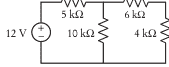

## 自测题答案

1. 一个读取 CD 上的数据并将输出发送到扬声器和屏幕的程序。
2. CD 播放器只能做一件事——播放音乐 CD。它不能执行程序。
3. 什么也不会发生。
4. 在二级存储中，通常是硬盘。
5. 中央处理器。
6. 软件。
7. 不是——编译器是供程序员使用的，用于将高级编程指令转换为机器码。
8. 系统软件和嵌入式系统。
9. 程序存储在文件中，文件存储在文件夹或目录中。
10. 你会看到看似随机的一串字符和符号。
11. 备份你的文件和文件夹。
12. 将“World”替换为你的名字，例如：

```
cout << "Hello, Harry!" << endl;
```

13. Goodbye, World! 两边没有引号。
14. 它会打印 HelloWorld，没有空格或逗号。
15. 42，没有空格。
16. Hello

```
World
```

两个单词之间有一个空行。

17. 编译时错误。
18. 这是运行时错误。毕竟，程序必须先经过编译才能运行。
19. 当程序存在编译器错误时，不会生成可执行文件，也就没有可运行的内容。
20. 4 年：

```
0 10,000
1 12,000
2 14,400
3 17,280
4 20,736
```

21. 分钟数是否最多为 300？
    a. 如果是，则答案为 $29.95 × 1.125 = $33.70。
    b. 如果不是，
        1. 计算差值：（分钟数）− 300。
        2. 将该差值乘以 0.45。
        3. 加上 $29.95。
        4. 将总和乘以 1.125。这就是答案。

22. 不能。步骤*如果它比“目前最好的”更有吸引力*无法执行，因为没有客观方法判断两张照片中哪一张更有吸引力。

23. 选择第一张照片，并将其称为“目前最贵的照片”。
    对于序列中的每张照片
        如果它比“目前最贵的照片”更贵
            丢弃“目前最贵的照片”。
            将这张照片称为“目前最贵的照片”。
    被称为“目前最贵的照片”的那张照片就是序列中最贵的照片。

24. 第一个前面是白色弹珠的黑色弹珠用蓝色标记：

○🔵○●●●

交换这两颗弹珠得到

●○○●●

下一个要交换的黑色弹珠是

●○○🔵●

得到

●○○●○

接下来的步骤是

●●○○○
●●○●○
●●●○○

现在序列已经排好序。

25. 该序列不会终止。考虑输入 ○●○●○。前两颗弹珠会不断被交换。


数字和字符串（例如这个显示板上的内容）是任何 C++ 程序中的重要数据类型。在本章中，你将学习如何处理数字和文本，以及如何编写使用它们执行有用任务的简单程序。

## 2.1 变量

当程序进行计算时，你会希望存储值，以便以后使用。在 C++ 程序中，你使用**变量**来存储值。在本节中，你将学习如何定义和使用变量。

为了说明变量的用法，我们将开发一个程序来解决以下问题。软饮料以罐装和瓶装出售。一家商店以与两升瓶装相同的价格出售六罐装 12 盎司罐装饮料。你应该买哪一种？（12 液量盎司约等于 355 毫升。）

在我们的程序中，我们将定义变量来表示每包罐数以及每罐的体积。然后，我们将计算六罐装以升为单位的体积并打印答案。


*哪种含更多汽水？六罐装 12 盎司罐装饮料，还是两升瓶装？*

### 2.1.1 变量定义

以下语句定义了一个名为 `cans_per_pack` 的变量：

```
int cans_per_pack = 6;
```

变量是计算机程序中的存储位置。每个变量都有一个名称，并保存一个值。

变量类似于停车库中的停车位。停车位有一个标识符（例如“J 053”），并且可以停放一辆车。变量有一个名称（例如 `cans_per_pack`），并且可以保存一个值（例如 6）。

变量是带名称的存储位置。


*就像计算机程序中的变量一样，停车位也有一个标识符和用于存放内容的空间。*

### 语法 2.1 变量定义

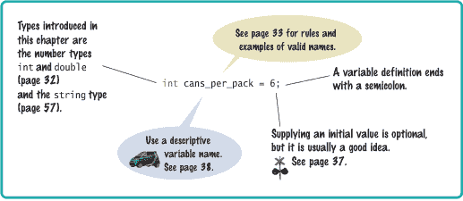

定义变量时，通常希望初始化它。也就是说，你指定应存储在变量中的值。再次考虑这个变量定义：

```
int cans_per_pack = 6;
```

变量 `cans_per_pack` 被初始化为值 6。

就像停车位只限于停放某种类型的车辆（例如小型汽车、摩托车或电动汽车）一样，C++ 中的变量存储特定类型的数据。C++ 支持多种数据类型：数字、文本字符串、文件、日期以及许多其他类型。每当定义变量时，都必须指定类型（参见语法 2.1）。

`cans_per_pack` 变量是一个整数，即没有小数部分的完整数字。在 C++ 中，这种类型称为 `int`。（有关 C++ 中数字类型的更多信息，请参见下一节。）

注意，类型位于变量名之前：

```
int cans_per_pack = 6;
```

表 1 展示了变量定义的各种变体。

定义变量时，通常要指定初始值。

定义变量时，还要指定其值的类型。


*每个停车位都适合停放特定类型的车辆，正如每个变量保存特定类型的值一样。*


**表 1 C++ 中的变量定义**

| 变量名 | 注释 |
|---|---|
| `int cans = 6;` | 定义一个整型变量，并将其初始化为 6。 |
| `int total = cans + bottles;` | 初始值不必是常量。（当然，cans 和 bottles 必须已经预先定义。） |
| ⛔ `int bottles = "10";` | **错误：**不能使用字符串初始化数字。 |
| `int bottles;` | 定义一个未初始化的整型变量。这可能导致错误——参见第 37 页的常见错误 2.2。 |
| `int cans, bottles;` | 在一条语句中定义两个整型变量。在本书中，我们将分别使用单独的语句定义每个变量。 |
| ⚠️ `bottles = 1;` | **注意：**缺少类型。此语句不是定义，而是将新值赋给现有变量——参见第 34 页的第 2.1.4 节。 |

### 2.1.2 数字类型

> 对于不能包含小数部分的数字，请使用 `int` 类型。

在 C++ 中，有几种不同的数字类型。可以使用称为 `int` 的*整数*类型表示没有小数部分的整数。例如，一箱罐装饮料中的罐数必须是整数——不可能有半罐饮料。

**表 2 C++ 中的数字字面量**

| 数字 | 类型 | 注释 |
|---|---|---|
| 6 | int | 整数没有小数部分。 |
| -6 | int | 整数可以是负数。 |
| 0 | int | 零是整数。 |
| 0.5 | double | 带有小数部分的数字类型为 double。 |
| 1.0 | double | 带有小数部分 .0 的整数类型为 double。 |
| 1E6 | double | 使用指数表示法表示的数字：1 × 10^6 或 1000000。使用指数表示法的数字始终为 double 类型。 |
| 2.96E-2 | double | 负指数：2.96 × 10^-2 = 2.96 / 100 = 0.0296 |
| ⛔ 100,000 | | **错误：**不要使用逗号作为数字分隔符。 |
| ⛔ 3 1/2 | | **错误：**不要使用分数；请使用十进制表示法：3.5。 |

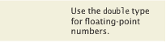

当需要小数部分时（例如数字 0.355），我们使用浮点数。C++ 中最常用的浮点数类型称为 double。（如果想了解原因，请阅读第 38 页的专题 2.1。）下面是浮点变量的定义：

```
double can_volume = 0.355;
```

当 6 或 0.355 这样的值出现在 C++ 程序中时，它被称为数字字面量。表 2 展示了如何在 C++ 中书写整数和浮点数字面量。

### 2.1.3 变量名

定义变量时，应选择一个能够说明其用途的名称。例如，使用 `can_volume` 这样的描述性名称，比使用 `cv` 这样的简短名称更好。

在 C++ 中，变量名有几条简单规则：

1. 变量名必须以字母或下划线（_）字符开头，其余字符必须是字母、数字或下划线。
2. 不能使用 `$` 或 `%` 等其他符号。名称中也不允许有空格。可以使用下划线代替空格，例如 `can_volume`。
3. 变量名**区分大小写**，也就是说，`Can_volume` 和 `can_volume` 是不同的名称。因此，变量名最好只使用小写字母。
4. 不能使用 `double` 或 `return` 等保留字作为名称；这些单词专门保留用于表示 C++ 中的特殊含义。（参见附录 B。）

表 3 展示了 C++ 中合法和非法变量名的示例。

| 变量名 | 注释 |
|---|---|
| `can_volume1` | 变量名由字母、数字和下划线字符组成。 |
| `x` | 在数学中，通常使用 x 或 y 这样的简短变量名。在 C++ 中这样做是合法的，但并不常见，因为这可能使程序更难理解（参见第 38 页的编程提示 2.1）。 |
| ⚠️ `Can_volume` | **注意：**变量名区分大小写。此变量名与 `can_volume` 不同。 |
| 🚫 `6pack` | **错误：**变量名不能以数字开头。 |
| 🚫 `can volume` | **错误：**变量名不能包含空格。 |
| 🚫 `double` | **错误：**不能使用保留字作为变量名。 |
| 🚫 `ltr/fl.oz` | **错误：**不能使用 `/` 或 `.` 等符号。 |

### 2.1.4 赋值语句

> 赋值语句将一个新值存储到变量中，替换之前存储的值。

可以使用**赋值语句**将新值放入变量中。下面是一个示例：

```
cans_per_pack = 8;
```

赋值语句的左侧由一个变量组成。右侧是一个具有值的表达式。该值会存储到变量中，并覆盖变量之前的内容。

变量定义和赋值语句之间有一个重要区别：

```
int cans_per_pack = 6;  // Variable definition
...
cans_per_pack = 8;      // Assignment statement
```

第一条语句是 cans_per_pack 的*定义*。它指示创建一个 `int` 类型的新变量，将其命名为 cans_per_pack，并使用 6 对其进行初始化。第二条语句是*赋值语句*：它指示将现有变量 cans_per_pack 的内容替换为另一个值。

`=` 符号并不表示左侧等于右侧。右侧的表达式会被求值，其值随后放入左侧的变量中。

> 赋值运算符 `=` 不表示数学上的相等关系。

不要将此*赋值操作*与代数中用于表示*相等*的 `=` 混淆。赋值运算符是一条执行某项操作的指令，即将一个值放入变量中。数学上的相等关系则表示两个值相等这一事实。

例如，在 C++ 中，下面的写法完全合法：

```
total_volume = total_volume + 2;
```

它表示读取变量 total_volume 中存储的值，将其加上 2，然后将结果放回 total_volume 中。（参见图 1。）执行该语句的最终效果是将 total_volume 增加 2。例如，如果执行该语句之前 total_volume 为 2.13，那么执行之后它将被设置为 4.13。当然，在数学中，写出 x = x + 2 是没有意义的。没有任何值会等于它自身加 2。

### 语法 2.2 赋值

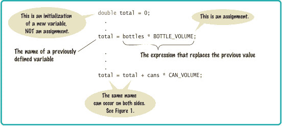

可以使用 `//` 语法编写单行注释。如果注释跨越多行，请将其放在 `/*` 和 `*/` 分隔符之间。编译器会忽略这些分隔符以及其中的所有内容。

下面是一个典型示例：在程序开头使用一段较长的注释来说明程序的用途：

```
/*
   This program computes the volume (in liters) of a six-pack of soda cans
   and the total volume of a six-pack and a two-liter bottle.
*/
```

现在我们已经准备好完成程序。下面的程序展示了变量、常量和赋值语句的用法。该程序显示一组六罐装饮料的容量，以及这组六罐装饮料和一瓶两升饮料的总容量。我们使用常量表示罐子和瓶子的容量。total_volume 变量使用罐子的容量进行初始化。然后使用赋值语句加上瓶子的容量。

### ch02/volume1.cpp

```
#include <iostream>

using namespace std;

/*
   This program computes the volume (in liters) of a six-pack of soda
   cans and the total volume of a six-pack and a two-liter bottle.
*/
int main()
{
   int cans_per_pack = 6;
   const double CAN_VOLUME = 0.355; // Liters in a 12-ounce can
   double total_volume = cans_per_pack * CAN_VOLUME;

   cout << "A six-pack of 12-ounce cans contains "
        << total_volume << " liters." << endl;

   const double BOTTLE_VOLUME = 2; // Two-liter bottle

   total_volume = total_volume + BOTTLE_VOLUME;

   cout << "A six-pack and a two-liter bottle contain "
        << total_volume << " liters." << endl;

   return 0;
}
```

### 程序运行结果

```
A six-pack of 12-ounce cans contains 2.13 liters.
A six-pack and a two-liter bottle contain 4.13 liters.
```


1. 定义一个适合存储箱中瓶子数量的变量。
2. 下面的变量定义有什么问题？

```
int ounces_per_liter = 28.35;
```


## 编程提示 2.1


### 选择描述性变量名

使用较短的变量名本可以为我们省去大量输入，例如：

```
double cv = 0.355;
```

不过，将这个定义与我们实际使用的定义相比，哪个更易读？两者毫无可比性。阅读 `can_volume` 显然比阅读 `cv` 然后再*费劲地琢磨*它一定是指“罐头容量”要省事得多。

在实际编程中，当程序由多人编写时，这一点尤其重要。你可能很清楚 `cv` 代表罐头容量而非当前速度，但对于多年后需要更新你代码的人来说，它是否同样显而易见？再者，三个月后的你再看到这些代码时，还能记得 `cv` 是什么意思吗？

## 专题 2.1


### C++ 中的数值类型

除了 `int` 和 `double` 类型之外，C++ 还有其他几种数值类型。

C++ 有两种浮点类型。`float` 类型使用的存储空间只有本书中使用的 `double` 类型的一半，但它只能存储 6–7 位有效数字。许多年前，当计算机的内存远不如今天时，`float` 是浮点计算的标准类型，程序员只有在需要更多位数时才会奢侈地使用“双精度”。如今，`float` 类型已很少使用。

顺便说一句，这些数字之所以称为“浮点”，是因为它们在计算机中的内部表示方式。考虑数字 29600、2.96 和 0.0296。它们可以用非常相似的方式表示：即由有效数字序列——296——以及小数点位位置的指示组成。当这些值乘以或除以 10 时，只有小数点的位置发生变化；它“浮动”起来。计算机使用二进制而非十进制，但原理相同。

| 类型 | 典型范围 | 典型大小 |
|---|---|---|
| `int` | −2,147,483,648 … 2,147,483,647（约 20 亿） | 4 字节 |
| `unsigned` | 0 … 4,294,967,295 | 4 字节 |
| `short` | −32,768 … 32,767 | 2 字节 |
| `unsigned short` | 0 … 65,535 | 2 字节 |
| `long long` | −9,223,372,036,854,775,808 … 9,223,372,036,854,775,807 | 8 字节 |
| `double` | 双精度浮点类型，范围约为 ±10³⁰⁸，约 15 位有效十进制数字 | 8 字节 |
| `float` | 单精度浮点类型，范围约为 ±10³⁸，约 7 位有效十进制数字 | 4 字节 |

除了 `int` 类型，C++ 还有整数类型 `short`、`long` 和 `long long`。每种整数类型都有对应的 `unsigned` 类型。例如，`short` 类型的典型范围是 −32,768 到 32,767，而 `unsigned short` 的范围是 0 到 65,535。这些看起来奇怪的边界是计算机中使用二进制数的结果。一个 `short` 值使用 16 位二进制数字，可以编码 2¹⁶ = 65,536 个值。请记住，整数类型的范围并未标准化，它们因编译器而异。表 4 给出的是典型值。

## 专题 2.2

### 数值范围与精度

由于数字在计算机中用有限位数的二进制表示，因此它们无法表示任意的整数或浮点数。

`int` 类型的范围有限。在大多数平台上，它能表示的最大数值略大于 20 亿。对于许多应用来说，这不成问题，但你无法用 `int` 表示世界人口。

如果计算产生的结果超出了 `int` 范围，就会发生溢出。此时不会显示任何错误，结果会被截断以适应 `int`，从而产生一个无用的值。例如：

```
int one_billion = 1000000000;
cout << 3 * one_billion << endl;
```

会显示 −1294967296。

在这种情况下，你可以改用 `double` 值。不过，关于一个相关问题——舍入误差——请参阅第 45 页的常见错误 2.6。


## 编程提示 2.2

### 不要使用魔法数字

魔法数字是指代码中出现的没有任何解释的数值常量。例如：

```
total_volume = bottles * 2;
```

为什么是 2？瓶子是罐子的两倍容积吗？不，原因在于每个瓶子装 2 升。请使用命名常量，让代码自我说明：

```
const double BOTTLE_VOLUME = 2;
total_volume = bottles * BOTTLE_VOLUME;
```

使用命名常量还有另一个原因。假设情况发生变化，瓶子容积现在是 1.5 升。如果使用了命名常量，你只需修改一处就完成了。否则，你不得不检查程序中每个出现的 2，并琢磨它究竟表示瓶子容积，还是表示其他含义。在超过几页长的程序中，这将是极其繁琐且容易出错的。

即使是最合理的宇宙常量，总有一天也会改变。你觉得一周有七天？你在火星上的客户会对你这种愚蠢的偏见相当不满。定义一个常量：

```
const int DAYS_PER_WEEK = 7;
```


## 2.2 算术

在以下小节中，你将学习如何在 C++ 中执行算术和数学计算。

### 2.2.1 算术运算符


C++ 支持与计算器相同的四种基本算术运算——加、减、乘、除——但乘法和除法使用的符号不同。

乘法必须用 `*` 表示。与数学中不同，你不能写 `a b`、`a·b` 或 `a×b`。同样，除法始终用 `/` 表示，绝不能用 ÷ 或分数横线。

例如：

\[
\frac{a+b}{2} \quad \text{变为} \quad (a + b) / 2。
\]

> 乘法使用 `*`，除法使用 `/`。

代数中使用括号来指示子表达式的计算顺序。例如，在表达式 `(a + b) / 2` 中，先计算和 `a + b`，然后将和除以 2。相比之下，在表达式

```
a + b / 2
```

中，只有 `b` 被除以 2，然后与 `a` 相加。与常规代数符号一样，乘法和除法的优先级高于加法和减法。例如，在表达式 `a + b / 2` 中，即使 `+` 运算出现在更左边，`/` 也会先执行。如果算术运算的两个操作数都是整数，结果是整数。如果其中一个或两个操作数是浮点数，结果是浮点数。例如，`4 * 0.5` 的结果是 `2.0`。

### 2.2.2 自增与自减

> `++` 运算符将变量加 1；`--` 运算符将变量减 1。

通过加 1 或减 1 来修改变量非常常见，因此有一种专门的简写，即：

```
counter++;
counter--;
```

`++` 自增运算符赋予了 C++ 编程语言名称。C++ 是对 C 语言的增量式改进。

### 2.2.3 整数除法与余数

> 如果 `/` 的两个操作数都是整数，则丢弃余数。

只要参与运算的数字中至少有一个是浮点数，除法的行为与预期一致。也就是说，`7.0 / 4.0`、`7 / 4.0` 和 `7.0 / 4` 都得到 `1.75`。但是，如果两个数字都是整数，那么除法的结果始终是整数，且余数被丢弃。即：

```
7 / 4
```

的计算结果是 1，因为 7 除以 4 等于 1，余 3（余数被丢弃）。这可能是微妙编程错误的来源——参见第 43 页的常见错误 2.3。

> `%` 运算符计算整数除法的余数。

如果你只关心余数，请使用 `%` 运算符：

```
7 % 4
```

结果是 3，即 7 除以 4 的整数除法的余数。`%` 符号在代数中没有对应物。选择它是因为它看起来与 `/` 相似，而余数运算与除法相关。该运算符称为取模（modulus）。（有些人称之为 modulo 或 mod。）它与某些计算器上的百分号运算没有关系。

整数 `/` 和 `%` 运算有一个典型用途。假设你的存钱罐里有一定数量的便士：

```
int pennies = 1729;
```

你想确定相应的美元和美分值。通过除以 100 的整数除法得到美元部分：

```
int dollars = pennies / 100;   // 将 dollars 设为 17
```

整数除法丢弃了余数。要得到余数，请使用 `%` 运算符：

```
int cents = pennies % 100;   // 将 cents 设为 29
```

`%` 运算符的另一个常见用途是检查一个数是偶数还是奇数。如果数字 `n` 是偶数，则 `n % 2` 为零。


*整数除法和 `%` 运算符得出装满便士的存钱罐的美元和美分价值。*

### 2.2.4 将浮点数转换为整数

> 将浮点变量赋给整数会丢弃小数部分。

当浮点值赋给整数变量时，小数部分被丢弃：

```
double price = 2.55;
int dollars = price;  // 将 dollars 设为 2
```

丢弃小数部分并不总是你想要的。通常，你需要四舍五入到最接近的整数。要将正的浮点值四舍五入到最接近的整数，加上 0.5，然后转换为整数：

```
int dollars = price + 0.5;  // 四舍五入到最接近的整数
```

在我们的示例中，加上 0.5 后，所有大于 2.5 的值都会变成大于 3 的值。具体来说，2.55 变成 3.05，然后被截断为 3。（对于负的浮点值，则减去 0.5。）

由于截断是潜在的错误来源，你的编译器可能会发出警告，提示将浮点值赋给整数变量是不安全的。关于如何避免此警告，请参见第 46 页的专题 2.3。

### 2.2.5 幂与根

在 C++ 中，没有表示幂和根的符号。要计算它们，你必须调用函数。要计算一个数的平方根，可以使用 `sqrt` 函数。例如，√x 写作 `sqrt(x)`。要计算 xⁿ，可以写成 `pow(x, n)`。


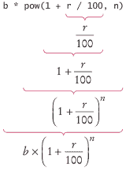

C++ 库定义了许多数学函数，例如 `sqrt`（平方根）和 `pow`（幂运算）。

要使用 `sqrt` 和 `pow` 函数，必须在程序文件顶部放置一行 `#include <cmath>`。头文件 `<cmath>` 是标准 C++ 头文件，与 `<iostream>` 一样，在所有 C++ 系统中都可用。

可以看到，`/`、`sqrt` 和 `pow` 操作的作用是将数学项展开为扁平形式。在代数中，你使用分数、指数和根号来以紧凑的二维形式排列表达式。而在 C++ 中，你必须以线性方式编写所有表达式。例如，数学表达式

$$b \times \left(1 + \frac{r}{100}\right)^n$$

```
b * pow(1 + r / 100, n)
```

图 2 展示了如何分析这样的表达式。

**表 5  算术表达式**

| 数学表达式 | C++ 表达式 | 注释 |
|---|---|---|
| $\frac{x+y}{2}$ | `(x + y) / 2` | 括号是必需的；`x + y / 2` 计算的是 $x + \frac{y}{2}$。 |
| $\frac{xy}{2}$ | `x * y / 2` | 括号不是必需的；相同优先级的运算符从左到右求值。 |
| $\left(1 + \frac{r}{100}\right)^n$ | `pow(1 + r / 100, n)` | 记得在程序顶部添加 `#include <cmath>`。 |
| $\sqrt{a^2+b^2}$ | `sqrt(a * a + b * b)` | `a * a` 比 `pow(a, 2)` 更简单。 |
| $\frac{i+j+k}{3}$ | `(i + j + k) / 3.0` | 如果 $i$、$j$ 和 $k$ 是整数，使用分母 3.0 会强制执行浮点除法。 |

| 函数 | 描述 |
|---|---|
| `sin(x)` | *x* 的正弦（*x* 以弧度为单位） |
| `cos(x)` | *x* 的余弦 |
| `tan(x)` | *x* 的正切 |
| `log10(x)` | （常用对数）`log₁₀(x)`，*x* > 0 |
| `abs(x)` | *x* 的绝对值 \|*x*\| |

表 6 显示了 `<cmath>` 头文件中声明的其他函数。输入和输出都是浮点数。


### 自测

- 10. 一个银行账户每年赚取 *p* 百分比的利息。在 C++ 中，你如何计算一年内赚取的利息？假设类型为 `double` 的变量 *p* 和 balance 已经定义。
- 11. 在 C++ 中，如何计算面积存储在变量 `area` 中的正方形的边长？
- 12. 球体的体积由 \(V = \frac{4}{3}\pi r^3\) 给出。如果半径由类型为 `double` 的变量给出，请写出体积的 C++ 表达式。你可以假设 π 由常量 `PI` 定义。
- 13. `1729 / 10` 和 `1729 % 10` 的值分别是多少？
- 14. 假设一个潘趣酒配方需要给定量的橙味汽水，以盎司为单位。

   ```cpp
   int amount = 32;
   ```

   我们可以计算所需的 12 盎司罐数，假设该数量不能整除 12：

   ```cpp
   int cans_needed = amount / 12 + 1;
   ```

   使用 `%` 运算符确定剩下多少盎司。例如，如果需要 32 盎司，我们需要 3 罐，还剩 4 盎司。


**动手实践**  现在你可以尝试本章末尾的练习：R2.3、R2.5、P2.2。

## 常见错误 2.3

### 意外的整数除法


遗憾的是，C++ 对整数除法和浮点除法都使用相同的符号 `/`。这实际上是两种截然不同的运算。不小心使用整数除法是一个常见错误。考虑下面这段计算三个整数平均值的代码：

```cpp
cout << "Please enter your last three test scores: ";
int s1;
int s2;
int s3;
cin >> s1 >> s2 >> s3;
double average = (s1 + s2 + s3) / 3; // Error
cout << "Your average score is " << average << endl;
```

这有什么问题呢？当然，s1、s2 和 s3 的平均值是

$$\frac{s1+s2+s3}{3}$$

然而，这里的 `/` 并不是数学意义上的除法。它表示整数除法，因为 s1 + s2 + s3 和 3 都是整数。例如，如果分数加起来是 14，计算出的平均值是 4，即 14 除以 3 的整数除法结果。然后这个整数 4 被赋给浮点变量 average。解决方法是让分子或分母成为浮点数：

```cpp
double total = s1 + s2 + s3;
double average = total / 3;
```

或

```cpp
double average = (s1 + s2 + s3) / 3.0;
```

## 常见错误 2.4


### 括号不匹配

考虑以下表达式

```text
(- (b * b - 4 * a * c)) / (2 * a)
```

它有什么问题？数一下括号。这里有三个 `(` 和两个 `)`。括号不匹配。这种输入错误在复杂表达式中非常常见。现在考虑这个表达式。

```text
- (b * b - (4 * a * c))) / (2 * a
```

这个表达式有三个 `(` 和三个 `)`，但仍然不正确。在表达式中间，

```text
- (b * b - (4 * a * c))) / (2 * a
```

只有两个 `(` 但有三个 `)`，这是错误的。在表达式中间，`(` 的数量必须大于或等于 `)` 的数量，而在表达式末尾，两个数量必须相同。

这里有一个简单的技巧，无需纸笔就能更轻松地进行计数。大脑很难同时记住两个计数。扫描表达式时只保留一个计数。从第一个左括号开始计为 1，每当看到一个左括号就加 1，每当看到一个右括号就减 1。扫描表达式时大声说出这些数字。如果计数曾降到 0 以下，或者最后不为 0，则括号不匹配。例如，扫描之前的表达式时，你会咕哝道

```text
-(b * b - (4 * a * c))) / (2 * a
  1     2       1 0 -1
```

然后你就会发现错误。

## 常见错误 2.5

### 忘记头文件

每个执行输入/输出的程序都需要 `<iostream>` 头文件。如果使用 `sqrt` 等数学函数，则需要包含 `<math.h>`。如果忘记包含相应的头文件，编译器将无法识别 `cout` 或 `sqrt` 等符号。如果编译器报错说函数或符号未定义，请检查你的头文件。

有时你可能不知道该包含哪个头文件。假设你想使用 `abs` 函数计算整数的绝对值。碰巧的是，这个版本的 `abs` 并非定义在 `<cmath>` 头文件中，而是定义在 `<cstdlib>` 中。你如何找到正确的头文件？你需要查找 `abs` 函数的文档，最好使用开发环境的在线帮助或互联网上的参考站点，例如 http://www.cplusplus.com （见图 3）。文档中包含函数的简短描述以及你必须包含的头文件名称。

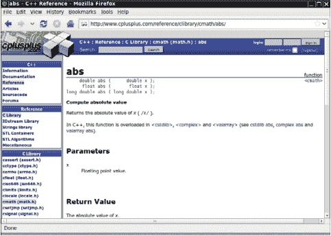

**图 3**  在线文档

## 常见错误 2.6

### 舍入误差

使用浮点数计算时，舍入误差是无法避免的现实。你自己在进行手动计算时可能也遇到过这种现象。如果将 1/3 计算到两位小数，会得到 0.33。再乘以 3，得到 0.99，而不是 1.00。

在处理器硬件中，数字以二进制系统表示，而不是十进制。当数字丢失时，你仍然会得到舍入误差。只是它们可能出现的位置与你预期的不同。下面是一个例子。

```cpp
#include <iostream>

using namespace std;

int main()
{
    double price = 4.35;
    int cents = 100 * price; // Should be 100 * 4.35 = 435
    cout << cents << endl; // Prints 434!
    return 0;
}
```

当然，100 乘以 4.35 等于 435，但程序打印的是 434。大多数计算机以二进制系统表示数字。在二进制系统中，4.35 没有精确的表示形式，就像十进制系统中 1/3 没有精确的表示形式一样。计算机使用的表示略小于 4.35，因此该值的 100 倍略小于 435。当浮点值转换为整数时，几乎为 1 的整个小数部分被丢弃，整数 434 被存储在 cents 中。解决办法是加上 0.5，以四舍五入到最接近的整数：

```cpp
int cents = 100 * price + 0.5;
```

## 编程提示 2.3


### 表达式中的空格

阅读以下代码

```cpp
x1 = (-b + sqrt(b * b - 4 * a * c)) / (2 * a);
```

比

```cpp
x1=(-b+sqrt(b*b-4*a*c))/(2*a);
```

更容易。

只需在所有二元运算符 + - * / % = 周围加上空格。但是，不要在一元减号后加空格：一元减号用于表示对单个量的取负，例如 -b。这样，它可以很容易地与二元减号区分开来，如 a - b。习惯上不在函数名后加空格。也就是说，要写 sqrt(x)，而不是 sqrt (x)。

## 专题 2.3


### 强制类型转换

偶尔，你需要将一个值存储到不同类型的变量中。只要存在信息丢失的风险，编译器就会发出警告。例如，如果将 double 值存储到 int 变量中，可能会以两种方式丢失信息：

- 小数部分丢失。
- 数值大小可能过大。

例如，

```cpp
int n = 1.0E100; // NO
```

很可能无法正常工作，因为 10^100 大于可表示的最大整数。

然而，有时你确实需要将浮点值转换为整数值。如果你准备好丢弃小数部分，并且知道这个特定的浮点数不大于最大可能的整数，那么你可以通过强制类型转换来关闭警告。强制类型转换是将一种类型（如 double）转换为另一种类型（如 int）的转换，这种转换通常并不安全，但你知道在特定情况下是安全的。在 C++ 中，你可以这样表示强制类型转换：

```cpp
int cents = static_cast<int>(100 * price + 0.5);
```


### 2.3.2 格式化输出

当你打印计算结果时，常常希望对结果的外观进行一些控制。例如，当以美元和美分打印金额时，通常希望将其四舍五入到两位有效数字。也就是说，你希望输出看起来像

```
Price per ounce: 0.04
```

而不是

```
Price per ounce: 0.0409722
```

下面的命令指示 `cout` 对所有浮点数使用小数点后两位数字：

```
cout << fixed << setprecision(2);
```

这条命令不会产生任何输出；它只是操纵 `cout`，使其改变输出格式。值 `fixed` 和 `setprecision` 称为*操纵器*。我们将在第8章详细讨论操纵器。目前，只要希望整齐地显示货币值，就必须记住包含上面给出的语句。

要使用操纵器，必须在程序中包含 `<iomanip>` 头文件：

```
#include <iomanip>
```

你可以将操纵器和要显示的值合并到一条语句中。

```
cout << fixed << setprecision(2)
     << "Price per ounce: "
     << price_per_ounce << endl;
```

还有另一个有时很方便的操纵器。当你显示多行数据时，通常希望各列对齐。

你可以使用 `setw` 操纵器设置下一个输出字段的*宽度*。宽度是用于显示该值的字符总数，包括数字、小数点和空格。当希望数字列对齐时，控制宽度很重要。

例如，如果希望将一个数字打印在宽度为八个字符的列中，可以使用

```
cout << setw(8) << price_per_ounce;
```

你可以使用操纵器指定值的格式化方式。


*你使用操纵器将输出按列对齐。*

这条命令在宽度为8的字段中打印值 `price_per_ounce`，例如：

```
        0.04
```

（其中每个空格代表一个空格）。

`setprecision` 和 `setw` 操纵器之间有一个显著区别。一旦设置了精度，该值就会用于所有浮点数。但宽度只影响下一个值。后续值在格式化时不会添加空格。

我们的下一个示例程序将提示输入六罐装的价格和每罐的容量，然后打印每盎司的价格。该程序会运用你刚刚学到的关于读取输入和格式化输出的知识。

### ch02/volume2.cpp

```
#include <iostream>
#include <iomanip>

using namespace std;

int main()
{
    // Read price per pack

    cout << "Please enter the price for a six-pack: ";
    double pack_price;
    cin >> pack_price;

    // Read can volume

    cout << "Please enter the volume for each can (in ounces): ";
    double can_volume;
    cin >> can_volume;

    // Compute pack volume

    const double CANS_PER_PACK = 6;
    double pack_volume = can_volume * CANS_PER_PACK;

    // Compute and print price per ounce

    double price_per_ounce = pack_price / pack_volume;

    cout << fixed << setprecision(2);
    cout << "Price per ounce: " << price_per_ounce << endl;

    return 0;
}
```

### 程序运行

```
Please enter the price for a six-pack: 2.95
Please enter the volume for each can (in ounces): 12
Price per ounce: 0.04
```

## 表 7 格式化输出

| 输出语句 | 输出 | 注释 |
|---|---|---|
| `cout << 12.345678;` | `12.3457` | 默认情况下，数字打印时保留6位有效数字。 |
| `cout << fixed`<br>`    << setprecision(2)`<br>`    << 12.30;` | `12.30` | 使用 `fixed` 和 `setprecision` 操纵器控制小数点后的位数。 |
| `cout << ":" << setw(6)`<br>`    << 12;` | `:    12` | 在数字前打印四个空格，总宽度为6个字符。 |
| `cout << ":" << setw(2)`<br>`    << 123;` | `:123` | 如果宽度不够，则忽略该宽度。 |
| `cout << setw(6)`<br>`    << ":" << 12;` | `     :12` | 宽度只作用于下一个项目。这里，`:` 前有五个空格。 |


### 自我检查

- 15. 下面的语句序列有什么问题？

  ```cpp
  cout << "Please enter the unit price: ";
  double unit_price;
  cin >> unit_price;
  int quantity;
  cin >> quantity;
  ```

- 16. 下面的语句序列有什么问题？

  ```cpp
  cout << "Please enter the unit price: ";
  int unit_price;
  cin >> unit_price;
  ```

- 17. 下面的语句序列的输出是什么？

  ```cpp
  double bottles = 10;
  cout << "The total volume is" << 2 * bottles;
  ```

- 18. 如何以美元和美分的形式打印浮点变量 `total_price`，像这样：`$1.22`？

- 19. 使用 `setw` 操纵器改进输出语句

  ```cpp
  cout << "Bottles: " << bottles << endl
       << "Cans: " << cans << endl;
  ```

  使输出如下所示：

  ```text
  Bottles:        8
  Cans:          24
  ```

  右边的数字应当对齐。（你可以假定这些数字最多有8位。）

**动手练习** 现在你可以尝试本章末尾的这些练习：R2.7、R2.8、P2.6、P2.7。

## 2.4 问题求解：先手工完成

开发算法的一个非常重要的步骤是首先手工执行计算。如果你自己都无法计算出一个解，那么你也不太可能编写出自动完成该计算的程序。

为了说明手工计算的用法，考虑下面的问题。一排黑白瓷砖需要沿墙铺设。出于美观原因，建筑师规定第一块和最后一块瓷砖应为黑色。

你的任务是在给定可用空间和每块瓷砖宽度的情况下，计算所需的瓷砖数量以及两端的间隙。

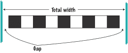

> 为手工计算中的典型情况选取具体数值。

为了使问题更具体，我们假设以下尺寸：

- 总宽度：100英寸
- 瓷砖宽度：5英寸

显而易见的解法是用20块瓷砖填满空间，但这样行不通——最后一块瓷砖会是白色的。

相反，这样看问题：第一块瓷砖必须始终是黑色，然后我们添加若干组白色/黑色配对：


第一块瓷砖占据5英寸，剩下95英寸由配对覆盖。每个配对宽10英寸。因此，配对数量为95 / 10 = 9.5。然而，我们需要舍弃小数部分，因为不能有 fractional 的瓷砖配对。

因此，我们将使用9组瓷砖配对，即18块瓷砖，再加上最初的黑色瓷砖。总共需要19块瓷砖。

这些瓷砖跨越19 × 5 = 95英寸，留下总间隙100 − 19 × 5 = 5英寸。间隙应均匀分布在两端。每端的间隙为(100 − 19 × 5) / 2 = 2.5英寸。

这一计算为我们提供了足够的信息，可以针对总宽度和瓷砖宽度的任意值设计算法。

```
number of pairs = integer part of (total width - tile width) / (2 x tile width)
number of tiles = 1 + 2 x number of pairs
gap at each end = (total width - number of tiles x tile width) / 2
```

如你所见，进行手工计算可以让你对问题有足够的洞察，从而使开发算法变得容易。

## 如何做 2.1：执行计算


许多编程问题要求你执行算术计算。本“如何做”将向你展示如何将问题陈述转换为伪代码，并最终转换为C++程序。

例如，假设要求你编写一个模拟自动售货机的程序。顾客选择要购买的商品，并将纸币插入自动售货机。自动售货机分发所购商品并找零。我们将假设所有商品价格都是25美分的倍数，并且机器以一美元硬币和25美分硬币找零。你的任务是计算每种硬币应给出多少枚。

### 第1步

理解问题：输入是什么？期望的输出是什么？

在这个问题中，有两个输入：

- 顾客插入的纸币面额
- 所购商品的价格

有两个期望输出：

- 机器退回的一美元硬币数量
- 机器退回的25美分硬币数量

### 第2步

手工计算示例。

假设一位顾客购买了一件价格为2.25美元的商品，并插入了一张5美元纸币。应找给顾客2.75美元，即两枚一美元硬币和三枚25美分硬币。

这对你来说很容易看出，但C++程序如何得出相同结论？如果你以美分而不是美元为单位计算，计算会更简单。应找给顾客的金额是275美分。除以100得到2，即一美元硬币的数量。将余数（75）除以25得到3，即25美分硬币的数量。

### 第3步

编写用于计算答案的伪代码。

在上一步中，你解决了一个具体问题实例。现在需要想出一种通用方法。

给定任意商品价格和付款金额，如何计算应找的硬币？首先，以美分计算应找金额：

```
amount due = 100 x bill value - item price in pennies
```

要得到一美元硬币的数量，除以100并舍弃余数：

```
dollar coins = amount due / 100 (without remainder)
```


*自动售货机接收纸币并以硬币找零。*


剩余金额可以用两种方法计算。如果你熟悉取模运算符，可以直接计算

```
amount due = amount due % 100
```

或者，从剩余金额中减去美元硬币所对应的分值：

```
amount due = amount due - 100 × dollar coins
```

要得到应找的 25 美分硬币数量，请除以 25：

```
quarters = amount due / 25
```

### 第 4 步——定义所需的变量和常量，并指定它们的类型。

这里有五个变量：

- `bill_value`
- `item_price`
- `amount_due`
- `dollar_coins`
- `quarters`

我们是否应该引入常量，用 `PENNIES_PER_DOLLAR` 和 `PENNIES_PER_QUARTER` 来解释 100 和 25？这样做会让程序更容易转换到国际市场，因此我们将采取这一步。

`amount_due` 和 `PENNIES_PER_DOLLAR` 为 int 类型非常重要，因为 `dollar_coins` 的计算使用了整数除法。同样，其他变量也都是整数。

### 第 5 步——将伪代码转换为 C++ 语句。

如果你在伪代码方面做得足够 thorough，这一步应该很容易。当然，你必须知道如何在 C++ 中表达数学运算（例如幂运算或整数除法）。

```
amount_due = PENNIES_PER_DOLLAR * bill_value - item_price;
dollar_coins = amount_due / PENNIES_PER_DOLLAR;
amount_due = amount_due % PENNIES_PER_DOLLAR;
quarters = amount_due / PENNIES_PER_QUARTER;
```

### 第 6 步——提供输入和输出。

在开始计算之前，我们提示用户输入账单面值和商品价格：

```
cout << "Enter bill value (1 = $1 bill, 5 = $5 bill, etc.): ";
cin >> bill_value;
cout << "Enter item price in pennies: ";
cin >> item_price;
```

计算完成后，我们显示结果。作为额外加分项，我们使用 `setw` 操纵器来确保输出整齐对齐。

```
cout << "Dollar coins: " << setw(6) << dollar_coins << endl;
cout << "Quarters: " << setw(6) << quarters << endl;
```

### 第 7 步——包含所需的头文件并提供 main 函数。

所有输入和输出都需要 `<iostream>` 头文件。由于我们使用 `setw` 操纵器，还需要 `<iomanip>`。本程序不使用任何特殊的数学函数。因此，我们不包含 `<cmath>` 头文件。

在 main 函数中，你需要定义常量和变量（第 4 步）、执行计算（第 5 步），并提供输入和输出（第 6 步）。显然，你会希望先获取输入，然后进行计算，最后显示输出。在函数开头定义常量，并在每个变量需要之前定义它。

以下是完整程序，`ch02/vending.cpp`：

```cpp
#include <iostream>
#include <iomanip>

using namespace std;

int main()
{
   const int PENNIES_PER_DOLLAR = 100;
   const int PENNIES_PER_QUARTER = 25;

   cout << "Enter bill value (1 = $1 bill, 5 = $5 bill, etc.): ";
   int bill_value;
   cin >> bill_value;
   cout << "Enter item price in pennies: ";
   int item_price;
   cin >> item_price;

   int amount_due = PENNIES_PER_DOLLAR * bill_value - item_price;
   int dollar_coins = amount_due / PENNIES_PER_DOLLAR;
   amount_due = amount_due % PENNIES_PER_DOLLAR;
   int quarters = amount_due / PENNIES_PER_QUARTER;

   cout << "Dollar coins: " << setw(6) << dollar_coins << endl
      << "Quarters:     " << setw(6) << quarters << endl;
}
```

### 程序运行

```text
Enter bill value (1 = $1 bill, 5 = $5 bill, etc.): 5
Enter item price in pennies: 225
Dollar coins:       2
Quarters:           3
```

## **工作示例 2.2**

### 计算邮票费用


本工作示例使用算术函数模拟邮票售货机。

## 2.5 字符串

字符串是字符序列。

许多程序处理文本，而不是数字。文本由**字符**组成：字母、数字、标点、空格等。**字符串**是字符序列。例如，字符串 "Harry" 是五个字符的序列。


### 2.5.1 **string 类型**

你可以定义保存字符串的变量。

```cpp
string name = "Harry";
```

string 类型是 C++ 标准的一部分。要使用它，只需包含头文件 `<string>`：

```cpp
#include <string>
```

我们区分字符串变量（例如上面定义的变量 name）和字符串字面量（括在引号中的字符序列，例如 "Harry"）。存储在字符串变量中的字符串可以更改。字符串字面量表示一个特定的字符串，就像数字字面量（例如 2）表示一个特定的数字一样。

与数字变量不同，即使你不提供初始值，字符串变量也保证会被初始化。默认情况下，字符串变量被设置为空字符串：一个不包含任何字符的字符串。空字符串字面量写作 `""`。定义

```cpp
string response;
```

与

```cpp
string response = "";
```

效果相同。

### 2.5.2 **拼接**

> 使用 + 运算符拼接字符串；也就是说，将它们放在一起以得到更长的字符串。

给定两个字符串，例如 "Harry" 和 "Morgan"，你可以将它们拼接成一个长字符串。结果由第一个字符串中的所有字符组成，后面跟着第二个字符串中的所有字符。在 C++ 中，你使用 + 运算符拼接两个字符串。例如，

```cpp
string fname = "Harry";
string lname = "Morgan";
string name = fname + lname;
```

结果为字符串

```text
"HarryMorgan"
```

如果你希望名字和姓氏之间用空格分隔呢？没问题：

```cpp
string name = fname + " " + lname;
```

这条语句拼接了三个字符串：fname、字符串字面量 `" "` 和 lname。结果为

```text
"Harry Morgan"
```

### 2.5.3 **字符串输入**

你可以从控制台读取字符串：

```cpp
cout << "Please enter your name: ";
string name;
cin >> name;
```

当使用 `>>` 运算符读取字符串时，只会将一个单词放入字符串变量。例如，假设用户输入

```text
Harry Morgan
```

作为对提示的响应。这个输入由两个单词组成。在调用 `cin >> name` 之后，字符串 `"Harry"` 被放入变量 `name`。使用另一条输入语句读取第二个单词。

### 2.5.4 字符串函数

length 成员函数返回字符串中的字符数。

字符串中的字符数称为字符串的*长度*。例如，`"Harry"` 的长度是 5。你可以使用 length 函数计算字符串的长度。与 `sqrt` 或 `pow` 函数不同，length 函数通过**点表示法**调用。也就是说，你写出想要获取长度的字符串，然后一个句点，然后是函数名，后面跟着括号：

```cpp
int n = name.length();
```

成员函数使用点表示法调用。

许多 C++ 函数要求你使用这种点表示法，你必须记住（或查阅）哪些函数需要、哪些不需要。这些函数称为**成员函数**。我们说成员函数 length 是在变量 `name` 上*调用*的。

一旦有了字符串，就可以使用 `substr` 成员函数提取子串。成员函数调用

```cpp
s.substr(start, length)
```

返回一个字符串，它由字符串 `s` 中的字符组成，从字符 `start` 开始，包含 `length` 个字符。下面是一个例子：

```cpp
string greeting = "Hello, World!";
string sub = greeting.substr(0, 5);
// sub is "Hello"
```

使用 substr 成员函数提取字符串的子串。

`substr` 操作生成一个由从字符串 `greeting` 中取出的五个字符组成的字符串。实际上，`"Hello"` 是一个长度为 5 的字符串，出现在 `greeting` 内部。`substr` 操作的一个奇特之处是起始位置。起始位置 0 表示“从字符串开头开始”。字符串中的第一个位置标记为 0，第二个标记为 1，依此类推。例如，下面是 greeting 字符串中的位置编号：

| H | e | l | l | o | , | &nbsp; | W | o | r | l | d | ! |
|---|---|---|---|---|---|---|---|---|---|---|---|---|
| 0 | 1 | 2 | 3 | 4 | 5 | 6 | 7 | 8 | 9 | 10 | 11 | 12 |

最后一个字符的位置编号（12）总是比字符串长度小一。

让我们弄清楚如何提取子串 `"World"`。从 0 开始计数字符，而不是从 1 开始。你会发现 `W` 是第 8 个字符，位置编号为 7。你想要的字符串长度为 5 个字符。因此，合适的子串命令是

```cpp
string w = greeting.substr(7, 5);
```

| H | e | l | l | o | , | &nbsp; | W | o | r | l | d | ! |
|---|---|---|---|---|---|---|---|---|---|---|---|---|
| 0 | 1 | 2 | 3 | 4 | 5 | 6 | 7 | 8 | 9 | 10 | 11 | 12 |


如果省略长度，则会获取从给定位置到字符串末尾的所有字符。例如，`greeting.substr(7)`是字符串“world!”（包括感叹号）。

下面是一个运用这些概念的简单程序。该程序要求用户输入自己的姓名和伴侣的姓名，然后输出两人的姓名首字母。

操作`first.substr(0, 1)`会生成一个由一个字符组成的字符串，该字符取自`first`的开头。程序对第二个姓名执行相同的操作。然后，它将得到的两个单字符字符串与字符串字面量`"&"`连接起来，得到一个长度为 3 的字符串，即姓名首字母字符串。（参见图 4。）


*姓名首字母由每个姓名的第一个字母组成。*

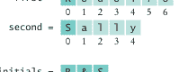

**图 4** 构建姓名首字母字符串

**ch02/initials.cpp**

```cpp
#include <iostream>
#include <string>

using namespace std;

int main()
{
    cout << "Enter your first name: ";
    string first;
    cin >> first;
    cout << "Enter your significant other's first name: ";
    string second;
    cin >> second;
    string initials = first.substr(0, 1)
        + "&" + second.substr(0, 1);
    cout << initials << endl;
    return 0;
}
```

**程序运行结果**

```text
Enter your first name: Rodolfo
Enter your significant other's first name: Sally
R&S
```

### 表 8 字符串操作

| 语句 | 结果 | 注释 |
|---|---|---|
| `string str = "C";`<br>`str = str + "++";` | `str`被设置为`"C++"` | 用于字符串时，`+`表示连接。 |
| `string str = "C" + "++";` | **错误** | **错误：**不能连接两个字符串字面量。 |
| `cout << "Enter name: ";`<br>`cin >> name;`<br>（用户输入：Harry Morgan） | `name`包含`"Harry"` | `>>`运算符会将下一个单词放入字符串变量中。 |
| `cout << "Enter name: ";`<br>`cin >> name >> last_name;`<br>（用户输入：Harry Morgan） | `name`包含`"Harry"`，`last_name`包含`"Morgan"` | 使用多个`>>`运算符可以读取多个单词。 |
| `string greeting = "H & S";`<br>`int n = greeting.length();` | `n`被设置为 5 | 每个空格都算作一个字符。 |
| `string str = "Sally";`<br>`string str2 = str.substr(1, 3);` | `str2`被设置为`"all"` | 提取从位置 1 开始、长度为 3 的子字符串。（起始位置为 0。） |
| `string str = "Sally";`<br>`string str2 = str.substr(1);` | `str2`被设置为`"ally"` | 如果省略长度，则会包含从该位置到字符串末尾的所有字符。 |
| `string a = str.substr(0, 1);` | `a`被设置为`str`中的首字母 | 提取从位置 0 开始、长度为 1 的子字符串。 |
| `string b = str.substr(str.length() - 1);` | `b`被设置为`str`中的最后一个字母 | 最后一个字母的位置是`str.length() - 1`。无需指定长度。 |

### 自我检查


- **25.** 字符串`"C++ Program"`的长度是多少？
- **26.** 考虑以下字符串变量。

    ```cpp
    string str = "C++ Program";
    ```

    写出一个子字符串成员函数调用，使其返回子字符串`"gram"`。
- **27.** 使用字符串连接，将自我检查题 26 中的字符串变量`str`转换为`"C++ Programming"`。
- **28.** 以下语句序列会输出什么？

    ```cpp
    string str = "Harry";
    cout << str.substr(0, 1) + str.substr(str.length() - 1);
    ```
- **29.** 写出一条输入语句，以读取形如`"John Q. Public"`的姓名。

**练习** 现在你可以尝试本章末尾的以下练习：R2.6、R2.9、P2.12、P2.19。

### R2.13

为一个计算数字首位和末位数字的程序编写伪代码。例如，如果输入是 23456，程序应输出 2 和 6。提示：x、log₁₀。

### R2.14

修改“How To 2.1”中程序的伪代码，使程序能够以 25 美分、10 美分和 5 美分硬币的形式找零。可以假设价格是 5 美分的整数倍。为了编写伪代码，先使用几个具体数值进行计算。

### R2.15

鸡尾酒调酒器由三个圆锥台部分组成。

使用合理的半径和高度值，并利用自我检查题 24 中给出的圆锥台部分体积公式，计算总体积。然后开发一个适用于任意尺寸的算法。


### R2.16

如下图所示，你正在切下一块派，其中`c`是直线部分的长度（称为弦长），`h`是这块派的高度。

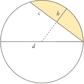

面积有一个近似公式：

\[
A \approx \frac{2}{3}ch + \frac{h^3}{2c}.
\]

然而，`h`不太容易测量，而派的直径`d`通常是已知的。计算派的直径为 12 英寸、该部分的弦长为 10 英寸时的面积。将其推广为一个能够计算任意直径和弦长所对应面积的算法。

### R2.17

以下伪代码描述了如何根据星期编号获取星期名称（0 = 星期日，1 = 星期一，依此类推）。

```text
定义一个名为 names 的字符串，其中包含 "SunMonTueWedThuFriSat"。
将起始位置计算为 3 × 星期编号。
从 names 的起始位置开始，提取长度为 3 的子字符串。
```

使用星期编号 4 检查这段伪代码。绘制所计算字符串的示意图，类似于第 59 页的图 4。

### R2.18

以下伪代码描述了如何交换单词中的两个字母。

```text
给定一个字符串 str 和两个位置 i、j。（i 在 j 之前）
将 first 设置为从字符串开头到 i 之前最后一个位置的子字符串。
将 middle 设置为从位置 i + 1 到 j - 1 的子字符串。
将 last 设置为从位置 j + 1 到字符串末尾的子字符串。
连接以下五个字符串：first、仅包含位置 j 处字符的字符串、middle、仅包含位置 i 处字符的字符串，以及 last。
```

使用字符串`"Gateway"`以及位置 2 和 4 检查这段伪代码。绘制所计算字符串的示意图，类似于第 59 页的图 4。

### R2.19

运行以下程序，并解释所得的输出。

```cpp
#include <iostream>

using namespace std;

int main()
{
    int total;
    cout << "Please enter a number: ";
    double x1;
    cin >> x1;
    total = total + x1;
    cout << "total: " << total << endl;
    cout << "Please enter a number: ";
    double x2;
    cin >> x2;
    total = total + x2;
    cout << "total: " << total << endl;
    total = total / 2;
    cout << "total: " << total << endl;
    cout << "The average is " << total << endl;
    return 0;
}
```

注意**跟踪消息**（以蓝色显示），这些消息用于显示`total`变量当前的内容。如何修复该程序？（该程序有两个独立的错误。）

### R2.20

编写一个程序，输出以下值：

```text
3 * 1000 * 1000 * 1000
3.0 * 1000 * 1000 * 1000
```

解释结果。

### R2.21

本章针对变量和常量提出了许多建议，这些建议可以使程序更易于阅读和维护。简要总结这些建议。

## 编程练习

- **1. P2.1** 编写一个程序，以毫米为单位显示信纸大小（8.5 × 11 英寸）纸张的尺寸。1 英寸等于 25.4 毫米。在程序中使用常量和注释。
- **2. P2.2** 编写一个程序，计算并显示信纸大小（8.5 × 11 英寸）纸张的周长及其对角线长度。
- **3. P2.3** 编写一个程序，读取一个数字并显示其平方、立方和四次方。仅对四次方使用`pow`函数。
- **4. P2.4** 编写一个程序，提示用户输入两个整数，然后输出：
    - 和
    - 差


- 产品
- 平均值

**P2.5** 编写一个程序，提示用户输入两个整数，然后输出

- 距离（差的绝对值）
- 最大值（两个数中较大的一个）
- 最小值（两个数中较小的一个）

*提示：* `max` 和 `min` 函数定义在 `<algorithm>` 头文件中。

**P2.6** 编写一个程序，提示用户输入以米为单位的测量值，然后将其转换为英里、英尺和英寸。

**P2.7** 编写一个程序，提示用户输入半径，然后输出

- 半径为该值的圆的面积和周长
- 半径为该值的球的体积和表面积

**P2.8** 编写一个程序，要求用户输入矩形各边的长度，然后输出

- 矩形的面积和周长
- 矩形对角线的长度（使用勾股定理）

**P2.9** 改进 How To 2.1 中讨论的程序，使其除了支持纸币之外，还允许输入硬币。

**P2.10** 编写一个程序，帮助用户决定是否购买混合动力汽车。程序的输入应包括：

- 新车的价格
- 预计每年行驶的英里数
- 预计的汽油价格
- 5 年后的预计转售价值


计算拥有该汽车 5 年的总成本。（为简单起见，不考虑融资成本。）从 Web 上获取一辆新混合动力汽车、一辆二手混合动力汽车以及一辆可比较汽车的真实价格。运行程序两次，使用今天的汽油价格和每年行驶 15,000 英里的条件。将伪代码和程序运行结果包含在作业中。

**P2.11** 以下伪代码描述了书店如何根据订单总价和订购图书的数量计算订单价格。

```
Read the total book price and the number of books.
Compute the tax (7.5% of the total book price).
Compute the shipping charge ($2 per book).
The price of the order is the sum of the total book price, the tax, and the shipping charge.
Print the price of the order.
```

将此伪代码翻译成 C++ 程序。

P2.12 以下伪代码描述了如何将包含十位数字的电话号码的字符串（例如 `"4155551212"`）转换为带括号和连字符的更易读的字符串，例如：`"(415) 555-1212"`。

```
Take the substring consisting of the first three characters and surround it with "(" and ")". This is the
area code.
Concatenate the area code, the substring consisting of the next three characters, a hyphen, and the
substring consisting of the last four characters. This is the formatted number.
```

将此伪代码翻译成 C++ 程序。程序应将电话号码读入一个字符串变量，计算格式化后的号码并输出。

P2.13 以下伪代码描述了如何从以浮点数表示的价格中提取美元和美分。例如，价格 2.95 会得到美元值 2 和美分值 95。

```
Assign the price to an integer variable dollars.
Multiply the difference price - dollars by 100 and add 0.5.
Assign the result to an integer variable cents.
```

将此伪代码翻译成 C++ 程序。读取一个价格，并输出美元和美分。使用输入 2.95 和 4.35 测试程序。

P2.14 找零。编写一个程序，指导收银员如何找零。程序有两个输入：应付金额和顾客支付的金额。显示顾客应收到的美元、25 美分硬币、10 美分硬币、5 美分硬币和 1 美分硬币的数量。


**P2.15** 编写一个程序，要求用户输入

- 油箱中的汽油量（加仑）
- 每加仑汽油可行驶的英里数
- 每加仑汽油的价格

然后输出每行驶 100 英里的成本，以及汽车使用油箱中的汽油可以行驶多远。

P2.16 文件名和扩展名。编写一个程序，提示用户输入驱动器号（C）、路径（\Windows\System）、文件名（Readme）和扩展名（.txt）。然后输出完整文件名 `C:\Windows\System\Readme.txt`。（如果使用 UNIX 或 Macintosh 系统，则省略驱动器名称，并使用 `/` 而不是 `\` 来分隔目录。）

P2.17 编写一个程序，从用户处读取一个介于 1,000 和 999,999 之间的数字，并在千位之间加上逗号后输出。下面是一个示例对话；用户输入以彩色显示：

Please enter an integer between 1000 and 999999: 23456  
23,456

P2.18 编写一个程序，从用户处读取一个介于 1,000 和 999,999 之间的数字，其中用户在输入中加入逗号。然后输出不带逗号的数字。下面是一个示例对话；用户输入以彩色显示：

Please enter an integer between 1,000 and 999,999: 23,456  
23456

提示：将输入作为字符串读取。测量字符串的长度。假设它包含 n 个字符。然后提取由前 n – 4 个字符和最后三个字符组成的子字符串。

**P2.23** 编写一个程序，将数字 1、2、3、……、12 转换为相应的月份名称 January、February、March、……、December。*提示：* 构造一个很长的字符串 `"January February March ..."`，在其中添加空格，使每个月份名称的长度相同。然后使用 `substr` 提取所需的月份。


### 工程题 P2.24

考虑以下电路。

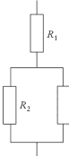

编写一个程序，读取三个电阻的阻值，并使用欧姆定律计算总电阻。

### 工程题 P2.25

露点温度 $T_d$ 可以根据相对湿度 $RH$ 和实际温度 $T$ 近似计算得出：

$$T_d = \frac{b \cdot f(T,RH)}{a - f(T,RH)}$$

$$f(T,RH) = \frac{a \cdot T}{b + T} + \ln(RH)$$

其中，$a = 17.27$，$b = 237.7\,^{\circ}\mathrm{C}$。

编写一个程序，读取相对湿度（介于 0 和 1 之间）以及温度（单位为摄氏度），并输出露点值。使用 C++ 函数 `log` 计算自然对数。

### 工程题 P2.26

此处所示的管夹式温度传感器是一种坚固的传感器，可以直接夹在铜管上，用于测量管内液体的温度。


每个传感器都包含一种称为*热敏电阻*的器件。热敏电阻是一种半导体器件，其电阻随温度变化，变化关系如下：

$$R = R_0 e^{\beta\left(\frac{1}{T} - \frac{1}{T_0}\right)}$$

其中，$R$ 是温度为 $T$（单位为 °K）时的电阻（单位为 $\Omega$），$R_0$ 是温度为 $T_0$（单位为 °K）时的电阻（单位为 $\Omega$）。$\beta$ 是一个取决于制造热敏电阻所用材料的常数。热敏电阻的参数由 $R_0$、$T_0$ 和 $\beta$ 的值确定。

用于制造管夹式温度传感器的热敏电阻在 $T_0 = 85\ ^\circ\mathrm{C}$ 时的 $R_0 = 1075\ \Omega$，并且 $\beta = 3969\ ^\circ\mathrm{K}$。（注意，$\beta$ 的单位是 °K。回顾一下，开尔文温度的计算方法是将摄氏温度加上 273。）液体温度（单位为 °C）可以根据电阻 $R$（单位为 $\Omega$）使用以下公式确定：

$$T = \frac{\beta T_0}{T_0\ln\left(\frac{R}{R_0}\right)+\beta}-273$$

编写一个 C++ 程序，提示用户输入热敏电阻的电阻值 $R$，并输出一条消息，给出液体的温度（单位为 °C）。

### 工程题 P2.27

下图所示电路说明了电力公司与其某位客户之间连接关系的一些重要方面。该客户由三个参数 $V_t$、$P$ 和 $pf$ 表示。$V_t$ 是通过墙上插座接入的电压。客户依赖可靠的 $V_t$ 值，以确保其电器正常工作。因此，电力公司会仔细调节 $V_t$ 的值。$P$ 描述客户使用的功率，是确定客户电费的主要因素。功率因数 $pf$ 则不太常见。（功率因数计算为某个角度的余弦，因此其值始终介于 0 和 1 之间。）在本题中，需要编写一个 C++ 程序来研究功率因数的意义。


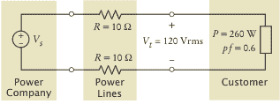

在图中，输电线以电阻（单位为欧姆）的形式表示，这是一种相对简单的表示方式。电力公司由一个交流电压源表示。为了在电压 $V_t$ 下向客户提供功率 $P$，所需的电源电压 $V_s$ 可以使用以下公式确定：

$$V_s = \sqrt{\left(V_t+\frac{2RP}{V_t}\right)^2+\left(\frac{2RP}{pf\,V_t}\right)^2(1-pf^2)}$$

（$V_s$ 的单位为 Vrms。）该公式表明，$V_s$ 的值取决于 $pf$ 的值。编写一个 C++ 程序，提示用户输入功率因数值，并


然后打印一条消息，给出对应的 \(V_s\) 值，使用上图所示的 \(P\)、\(R\) 和 \(V_t\) 的值。

### 工程 P2.28

考虑一个连接到天线的调谐电路，其中 \(C\) 是一个可变电容器，其电容范围从 \(C_{\min}\) 到 \(C_{\max}\)。

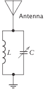

调谐电路选择的频率为 \(f = \frac{2\pi}{\sqrt{LC}}\)。要为给定频率设计此电路，取 \(C = \sqrt{C_{\min}C_{\max}}\)，并根据 \(f\) 和 \(C\) 计算所需的电感 \(L\)。这样，电路可以调谐到从 \(f_{\min} = \frac{2\pi}{\sqrt{LC_{\max}}}\) 到 \(f_{\max} = \frac{2\pi}{\sqrt{LC_{\min}}}\) 范围内的任意频率。

编写一个 C++ 程序，使用给定 \(C_{\min}\) 和 \(C_{\max}\) 值的可变电容器，为给定频率设计调谐电路。（典型输入为 \(f = 16.7\) MHz、\(C_{\min} = 14\) pF、\(C_{\max} = 365\) pF。）程序应读取 \(f\)（单位为 Hz）、\(C_{\min}\) 和 \(C_{\max}\)（单位为 F），并打印所需的电感值以及通过改变电容电路可调谐到的频率范围。

### 工程 P2.29

根据库仑力定律，两个带电量分别为 \(Q_1\) 和 \(Q_2\) 库仑、相距 \(r\) 米的带电粒子之间的电力为 \(F = \frac{Q_1Q_2}{4\pi\varepsilon r^2}\) 牛顿，其中 \(\varepsilon = 8.854 \times 10^{-12}\) 法拉/米。编写一个程序，根据用户输入的 \(Q_1\) 库仑、\(Q_2\) 库仑和 \(r\) 米，计算一对带电粒子上的力，然后计算并显示该电力。

# 第 3 章

# 决策


## 本章目标

- 能够使用 if 语句实现决策
- 学习如何比较整数、浮点数和字符串
- 理解布尔数据类型
- 制定验证用户输入的策略

## 本章内容

- **3.1 if 语句** 76
  - *语法 3.1：if 语句* 78
  - *编程技巧 3.1：花括号布局* 79
  - *编程技巧 3.2：始终使用花括号* 80
  - *常见错误 3.1：if 条件后误加分号* 80
  - *编程技巧 3.3：制表符* 81
  - *专题 3.1：选择运算符* 81
  - *编程技巧 3.4：避免分支中的重复* 82
- **3.2 比较数字和字符串** 82
  - *语法 3.2：比较* 83
  - *常见错误 3.2：混淆 = 和 ==* 85
  - *编程技巧 3.5：以零警告编译* 85
  - *常见错误 3.3：浮点数的精确比较* 86
  - *专题 3.2：字符串的字典序排列* 86
  - *操作指南 3.1：实现 if 语句* 87
  - *例题 3.1：提取中间值*
  - *随机事实 3.1：丹佛机场行李处理系统* 89
- **3.3 多重选择** 90
  - *专题 3.3：switch 语句* 93
- **3.4 嵌套分支** 94
  - *编程技巧 3.6：手动跟踪* 97
  - *常见错误 3.4：悬空 else 问题* 98
- **3.5 问题求解：流程图** 99
- **3.6 问题求解：测试用例** 102
  - *编程技巧 3.7：制定计划并为意外问题留出时间* 103
- **3.7 布尔变量与运算符** 103
  - *常见错误 3.5：组合多个关系运算符* 107
  - *常见错误 3.6：混淆 && 和 || 条件* 107
  - *专题 3.4：布尔运算符的短路求值* 108
  - *专题 3.5：德摩根定律* 108
- **3.8 应用：输入验证** 109
  - *随机事实 3.2：人工智能* 112

计算机程序的基本特征之一是它们能够做出决策。就像火车根据道岔的设置来变换轨道一样，程序可以根据输入和其他情况采取不同的行动。

在本章中，你将学习如何为简单和复杂的决策编程。你将把所学知识应用于检查用户输入的任务中。

## 3.1 if 语句

> if 语句允许程序根据待处理数据的性质执行不同的操作。

if 语句用于实现决策。当条件满足时，执行一组语句；否则，执行另一组语句（参见语法 3.1）。

下面是一个使用 if 语句的示例。在许多国家，数字 13 被认为是不吉利的。为了不冒犯迷信的租户，业主有时会跳过第 13 层；12 层之后紧接着是 14 层。当然，第 13 层通常不会空置，也不像一些阴谋论者认为的那样，被用作秘密办公室和研究实验室。它只是被称为 14 层。控制大楼电梯的计算机需要针对这一怪癖进行补偿，并调整所有大于 13 的楼层号。

让我们在 C++ 中模拟这个过程。我们将要求用户输入所需的楼层号，然后计算实际楼层。当输入大于 13 时，我们需要将输入减 1 以获得实际楼层。例如，如果用户输入 20，程序将实际楼层确定为 19。否则，我们直接使用提供的楼层号。

```cpp
int actual_floor;

if (floor > 13)
{
    actual_floor = floor - 1;
}
else
{
    actual_floor = floor;
}
```

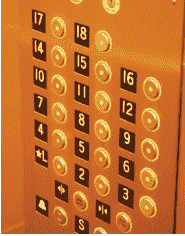

*这个电梯面板“跳过”第 13 层。该楼层实际上并没有缺失——控制电梯的计算机调整了大于 13 的楼层编号。*

图 1 中的流程图显示了分支行为。

在我们的示例中，if 语句的每个分支都包含一条语句。每个分支中你可以根据需要放入任意多条语句。有时，会发生这样的情况：

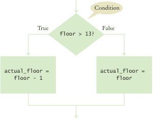

**图 1**  
if 语句的流程图

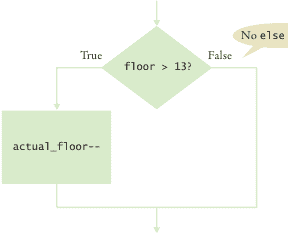

**图 2**  
不带 else 分支的 if 语句的流程图

在语句的 else 分支中没有任何操作。在这种情况下，可以完全省略它，例如：

```c
int actual_floor = floor;

if (floor > 13)
{
    actual_floor--;
} // No else needed
```

流程图见图 2。

下面的程序使 if 语句发挥作用。该程序询问所需楼层，然后输出实际楼层。


*if 语句就像岔路口。根据决策，程序的不同部分将被执行。*

### ch03/elevator1.cpp

```cpp
#include <iostream>

using namespace std;

int main()
{
    int floor;
    cout << "Floor: ";
    cin >> floor;
    int actual_floor;
    if (floor > 13)
    {
        actual_floor = floor - 1;
    }
    else
    {
        actual_floor = floor;
    }

    cout << "The elevator will travel to the actual floor "
         << actual_floor << endl;

    return 0;
}
```

### 程序运行

```text
Floor: 20
The elevator will travel to the actual floor 19
```

### 语法 3.1 — if 语句

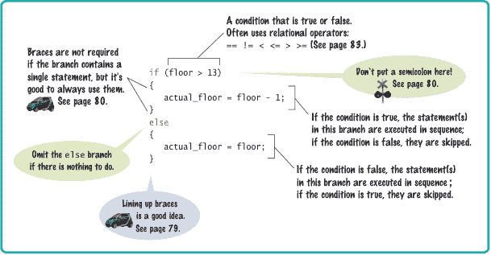

### 自测


1. 在一些亚洲国家，数字 14 被认为是不吉利的。一些业主为了稳妥起见，同时跳过第 13 层和第 14 层。你会如何修改示例程序来处理这样的建筑？

2. 考虑以下用于计算折扣价的 if 语句：

   ```text
   if (original_price > 100)
   {
       discounted_price = original_price - 20;
   }
   else
   {
       discounted_price = original_price - 10;
   }
   ```

   如果原价是 95、100、105，折扣价分别是多少？

3. 将此 if 语句与自测 2 中的语句进行比较：

   ```text
   if (original_price < 100)
   {
       discounted_price = original_price - 10;
   }
   else
   {
       discounted_price = original_price - 20;
   }
   ```

   这两个语句是否总是计算出相同的值？如果不是，它们在什么情况下不同？

4. 考虑以下用于计算折扣价的语句：

   ```text
   discounted_price = original_price;
   if (original_price > 100)
   {
       discounted_price = original_price - 10;
   }
   ```

   如果原价是 95、100、105，折扣价分别是多少？

5. 变量 `fuel_amount` 和 `fuel_capacity` 分别保存车辆的实际油量和油箱容量。如果油箱剩余量不足 10%，状态灯应显示红色；否则显示绿色。通过打印出 "red" 或 "green" 来模拟这个过程。

**实践练习** 现在你可以尝试本章末尾的练习：R3.3、R3.4、P3.16。

## 编程技巧 3.1


### 花括号布局

程序员在代码中对齐花括号的方式各不相同。在本书中，我们遵循一条简单规则：让 `{` 和 `}` 对齐。

```text
if (floor > 13)
{
    floor--;
}
```

这种风格很容易让人找到匹配的花括号。


> 正确对齐代码会让你的程序更容易阅读。


有些程序员把左花括号放在与 `if` 同一行：

```text
if (floor > 13) {
    floor--;
}
```

这种风格使花括号更难匹配，但可以节省一行代码，让你无需滚动就能在屏幕上看到更多代码。两种风格都有热情的拥护者。

重要的是，选定一种布局风格，并在给定的编程项目中始终如一地坚持使用它。选择哪种风格可能取决于你的个人偏好，或你需要遵循的编码风格指南。

## 编程提示 3.2

### 始终使用花括号


当 `if` 语句的语句体由单条语句组成时，不必使用花括号。例如，以下写法是合法的：

```text
if (floor > 13)
    floor--;
```

不过，始终包含花括号是个好主意：

```text
if (floor > 13)
{
    floor--;
}
```

花括号能让代码更易读，你也更不容易犯下诸如常见错误 3.1 中所述的错误。

## 常见错误 3.1

### `if` 条件后的分号


下面的代码片段有一个不幸的错误：

```text
if (floor > 13); // ERROR
{
    floor--;
}
```

`if` 条件之后不应有分号。编译器会这样解释这条语句：如果 `floor` 大于 13，就执行由单个分号表示的语句，也就是空操作语句。用花括号括起来的语句不再是 `if` 语句的一部分。它总会执行。即使 `floor` 的值不大于 13，`floor` 也会递减。

在 `else` 保留字之后放置分号也是错误的：

```text
if (floor > 13)
{
    actual_floor = floor - 1;
}
else ;
{
    actual_floor = floor;
}
```

在这种情况下，如果 `floor > 13` 不成立，就执行空操作语句。这就是 `if` 语句的结尾。下一条用花括号括起来的语句在两种情况下都会执行；也就是说，`actual_floor` 总是被设为 `floor`。

**表 1. 关系运算符**

| C++ | 数学记号 | 说明 |
|---|---|---|
| `>` | `>` | 大于 |
| `>=` | `≥` | 大于或等于 |
| `<` | `<` | 小于 |
| `<=` | `≤` | 小于或等于 |
| `==` | `=` | 等于 |
| `!=` | `≠` | 不等于 |

`==` 运算符表示相等性测试：

```text
floor = 13; // Assign 13 to floor
if (floor == 13) // Test whether floor equals 13
```

必须记住：在测试中使用 `==`，在测试之外使用 `=`。（更多信息见第 85 页的常见错误 3.2。）

也可以比较字符串：

```text
if (input == "Quit") ...
```

使用 `!=` 检查两个字符串是否不同。在 C++ 中，字母大小写很重要。例如，`"Quit"` 和 `"quit"` 不是同一个字符串。

### 语法 3.2 — 比较

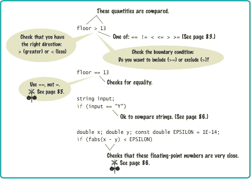

| 表达式 | 值 | 注释 |
|---|---|---|
| `3 <= 4` | `true` | 3 小于 4；`<=` 测试“小于或等于”。 |
| `3 =< 4` | **Error** | “小于或等于”运算符是 `<=`，不是 `=<`。“小于”符号在前。 |
| `3 > 4` | `false` | `>` 是 `<=` 的反向。 |
| `4 < 4` | `false` | 左侧必须严格小于右侧。 |
| `4 <= 4` | `true` | 两侧相等；`<=` 测试“小于或等于”。 |
| `3 == 5 - 2` | `true` | `==` 测试相等性。 |
| `3 != 5 - 1` | `true` | `!=` 测试不相等。3 确实不等于 5 − 1。 |
| `3 = 6 / 2` | **Error** | 使用 `==` 测试相等性。 |
| `1.0 / 3.0 == 0.333333333` | `false` | 尽管这些值彼此非常接近，但它们并不完全相等。见第 86 页的常见错误 3.3。 |
| `"10" > 5` | **Error** | 不能将字符串与数字进行比较。 |

表 2 总结了如何在 C++ 中使用关系运算符。


### 自测

- 6. 如果 `a` 为 3、`b` 为 4，以下哪些条件为真？
  - a. `a + 1 <= b`
  - b. `a + 1 >= b`
  - c. `a + 1 != b`
- 7. 给出条件 `floor > 13` 的反面。
- 8. 这条语句中有什么错误？

```text
if (score_a = score_b)
{
    cout << "Tie" << endl;
}
```

- 9. 在这个 `if` 语句中提供一个条件，用于测试用户是否输入了 Y：

```text
string input;
cout << "Enter Y to quit." << endl;
cin >> input;
if (...)
{
    cout << "Goodbye." << endl;
    return 0;
}
```

- 空格字符排在所有可打印字符之前。
- 数字排在字母之前。
- 标点符号的排序见附录 D。

> 字符串比较使用字典序。

比较两个字符串时，先比较每个字符串的第一个字母，然后比较第二个字母，依此类推，直到其中一个字符串结束，或找到第一对不匹配的字母。

如果其中一个字符串结束，则认为较长的字符串“更大”。例如，比较“car”和“cart”。前三个字母匹配，然后第一个字符串结束。因此，在字典序中，“car”排在“cart”之前。

当遇到不匹配时，包含“较大”字符的字符串被认为“更大”。例如，比较“cat”和“cart”。前两个字母匹配。由于 t 排在 r 之后，字符串“cat”在字典序中排在“cart”之后。

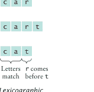

## 操作方法 3.1 — 实现 `if` 语句


本操作方法将引导你完成实现 `if` 语句的过程。我们将用下面的示例问题来说明各个步骤：

大学书店每年 10 月 24 日举办 Kilobyte Day 促销：如果价格低于 $128，所有电脑配件购买享受 8% 的折扣；如果价格至少为 $128，则享受 16% 的折扣。编写一个程序，询问收银员原价，然后打印折扣价。


### 第 1 步 — 确定分支条件。

在示例问题中，条件的明显选择是：

```text
original price < 128?
```

这完全可以，我们将在解决方案中使用该条件。

但如果你选择相反的条件，也完全可以得出正确的解决方案：原价是否至少（≥）$128？如果你站在购物者的角度，想知道什么时候适用更大的折扣，你可能会选择这个条件。

### 第 2 步 — 为条件为真时需要完成的工作编写伪代码。

在这一步中，列出“真”分支中执行的一个或多个操作。具体细节取决于你的问题。你可能想打印一条消息、计算数值，甚至退出程序。

在我们的示例中，需要应用 8% 的折扣：

```text
discounted price = 0.92 × original price
```

### 第 3 步

为条件不为真时需要完成的工作（如果有）编写伪代码。

如果第 1 步的条件不成立，你希望做什么？有时你什么都不想做。在这种情况下，使用不带 `else` 分支的 `if` 语句。

在我们的示例中，该条件测试价格是否低于 $128。如果该条件不为真，则价格至少为 $128，因此促销适用 16% 的更高折扣：

```text
discounted price = 0.84 × original price
```

### 第 4 步

仔细检查关系运算符。

首先，确保测试的方向正确。混淆 `>` 和 `<` 是常见错误。接下来，考虑应该使用 `<` 运算符还是它的近亲 `<=` 运算符。

如果原价正好是 $128，应该发生什么？仔细阅读题目后我们发现：如果原价低于 $128，则适用较低折扣；如果原价至少为 $128，则适用较高折扣。因此，$128 的价格不应满足我们的条件，我们必须使用 `<`，而不是 `<=`。

### 第 5 步

消除重复。

检查哪些操作是两个分支共有的，并把它们移到分支之外。（见第 82 页的编程提示 3.4。）

在我们的示例中，有两条如下形式的语句：

```text
discounted price = __ × original price
```

它们只在折扣率上不同。最好只在各分支中设置折扣率，然后再进行计算：

```text
If original price < 128
    discount rate = 0.92
Else
    discount rate = 0.84
discounted price = discount rate × original price
```

### 第 6 步

测试两个分支。

设计两个测试用例：一个满足 `if` 语句的条件，另一个不满足。问问自己每种情况下应该发生什么。然后按照伪代码，把它们分别执行一遍。

在我们的示例中，考虑原价的两种情形：$100 和 $200。我们预期第一个价格优惠 $8，第二个优惠 $32。

当原价为 100 时，条件 100 < 128 为真，我们得到：

```text
discount rate = 0.92
discounted price = 0.92 × 100 = 92
```

当原价为 200 时，条件 200 < 128 为假，并且：

```text
discount rate = 0.84
discounted price = 0.84 × 200 = 168
```

在这两种情况下，我们都得到了预期的答案。

### 第 7 步

在 C++ 中组装 `if` 语句。

输入骨架：

```text
if ()
{
}
else
{
}
```


并将其填写完整，如第 78 页语法 3.1 所示。如果不需要 `else` 分支，则省略它。

在我们的示例中，完成后的语句为

```cpp
if (original_price < 128)
{
    discount_rate = 0.92;
}
else
{
    discount_rate = 0.84;
}
discounted_price = discount_rate * original_price;
```

## 工作示例 3.1 — 提取中间字符

本习题示例展示了如何从字符串中提取中间字符；如果字符串长度为偶数，则提取中间的两个字符。

## 随机趣闻 3.1 — 丹佛机场行李处理系统

作出决策是任何计算机程序的重要组成部分。在帮助机场分拣行李的计算机系统中，这一点体现得最为明显。系统扫描行李识别码后，会对物品进行分拣，并将它们送往不同的传送带。随后，人工操作员将物品装上卡车。当丹佛市建造一座大型机场，以取代一座过时且拥挤的机场时，行李系统承包商更进一步，设计了一套用机器人推车取代人工操作员的新系统。遗憾的是，这套系统显然无法正常工作。它受到各种机械问题的困扰，例如行李掉到轨道上，导致推车卡住。同样令人沮丧的还有软件故障。当其他位置需要推车时，推车却会无谓地聚集在某些位置。

机场原计划于 1993 年开放，但由于行李系统无法正常运行，开放时间推迟了一年多，承包商也一直在尝试解决这些问题。承包商最终未能成功，机场最后安装了一套人工系统。这次延误给城市和航空公司造成了近 10 亿美元的损失，而这家承包商曾经是美国领先的行李系统供应商，最终却破产了。

显然，基于一种从未在较小规模上试用过的技术来构建大型系统，风险非常高。随着机器人以及控制机器人的软件不断改进，它们将来会承担越来越多的行李处理工作。但这很可能会以渐进的方式实现。


丹佛机场最初采用了一套全自动行李运输系统，用机器人推车取代人工操作员。遗憾的是，这套系统从未正常运行，在机场开放前就被拆除了。

## 3.3 多种选择

对于包含两种以上情况的决策，需要使用多种选择。

在第 3.1 节中，你已经了解了如何使用 `if` 语句编写双向分支。在许多情况下，可能存在两种以上的情况。本节将介绍如何实现包含多种选择的决策。例如，考虑这样一个程序：根据里氏震级（见表 3）显示地震的影响。

*1989 年的洛马普列塔地震损坏了旧金山的海湾大桥，并摧毁了许多建筑物，其里氏震级为 7.1。*


**表 3——里氏震级**

| 数值 | 影响 |
|---:|---|
| 8 | 大多数建筑物倒塌 |
| 7 | 许多建筑物被摧毁 |
| 6 | 许多建筑物严重受损，部分建筑物倒塌 |
| 4.5 | 建造质量较差的建筑物受损 |

里氏震级用于衡量地震的强度。震级每增加一级，例如从 6.0 增加到 7.0，地震强度就会增加十倍。

在这个例子中，有五个分支：四个分别对应不同的破坏描述，还有一个对应没有破坏的情况。图 3 展示了这个多分支语句的流程图。

你可以使用多个 `if` 语句来实现多种选择，如下所示：

```cpp
if (richter >= 8.0)
{
    cout << "Most structures fall";
}
else if (richter >= 7.0)
{
    cout << "Many buildings destroyed";
}
else if (richter >= 6.0)
{
    cout << "Many buildings considerably damaged, some collapse";
}
else if (richter >= 4.5)
{
    cout << "Damage to poorly constructed buildings";
}
else
{
    cout << "No destruction of buildings";
}
```

四个测试中只要有一个成功，就会显示相应的影响，并且不会再进行后续测试。如果四种情况都不适用，则执行最后的 `else` 子句，并打印默认消息。（完整程序请参见 `ch03/richter.cpp` 文件。）

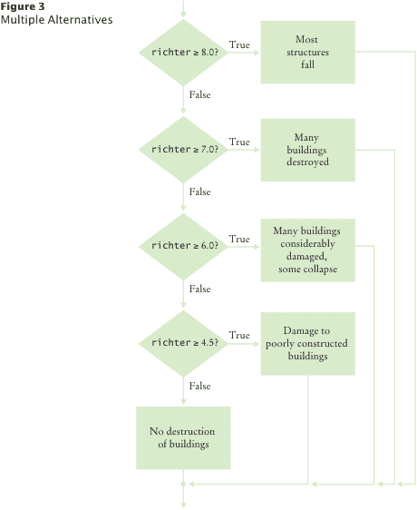

在这里，你必须对条件进行排序，首先测试最大的临界值。假设我们将测试顺序反过来：

```cpp
if (richter >= 4.5) // Tests in wrong order
{
    cout << "Damage to poorly constructed buildings";
}
else if (richter >= 6.0)
{
    cout << "Many buildings considerably damaged, some collapse";
}
else if (richter >= 7.0)
{
    cout << "Many buildings destroyed";
}
else if (richter >= 8.0)
{
    cout << "Most structures fall";
}
```

使用多个 `if` 语句时，要注意条件的顺序。

这样做是行不通的。假设 `richter` 的值为 7.1。该值至少为 4.5，与第一个条件相匹配，因此不会再尝试其他测试。

在这个例子中，同样重要的是：我们使用的是一系列 `else if` 子句，而不是多个彼此独立的 `if` 语句。请看下面这一系列独立的测试：

```cpp
if (richter >= 8.0) // Didn’t use else
{
    cout << "Most structures fall";
}
if (richter >= 7.0)
{
    cout << "Many buildings destroyed";
}
if (richter >= 6.0)
{
    cout << "Many buildings considerably damaged, some collapse";
}
if (richter >= 4.5)
{
    cout << "Damage to poorly constructed buildings";
}
```

现在，这些选择不再是互斥的。如果 `richter` 为 7.1，那么最后三个测试都会匹配，并打印三条消息。

### 自我检查


- 11. 在一个游戏程序中，玩家 A 和 B 的得分分别存储在变量 `score_a` 和 `score_b` 中。假设得分较高的玩家获胜，编写一系列条件语句，打印 `"A won"`、`"B won"` 或 `"Game tied"`。

- 12. 编写一个包含三个分支的条件语句：如果 `x` 为正数，则将 `s` 设为 1；如果 `x` 为负数，则将 `s` 设为 −1；如果 `x` 为 0，则将 `s` 设为 0。

- 13. 只使用两个分支，如何完成自我检查 12 中的任务？

- 14. 初学者有时会编写如下语句：

  ```cpp
  if (price > 100)
  {
      discounted_price = price - 20;
  }
  else if (price <= 100)
  {
      discounted_price = price - 10;
  }
  ```

  解释如何改进这段代码。

- 15. 假设用户在 `richter.cpp` 程序中输入 −1。程序会打印什么？

- 16. 假设我们希望让 `richter.cpp` 程序检查用户输入的是否为负数。应该在 `if` 语句中添加什么分支？添加在哪里？

**练习** 现在，你可以尝试本章末尾的以下练习：R3.20、P3.1、P3.9、P3.10。

## 3.4 嵌套分支

> 当一个决策语句包含在另一个决策语句的分支中时，这些语句就是*嵌套的*。

> 对于具有两层决策过程的问题，需要使用嵌套决策。

通常有必要在一个 `if` 语句中包含另一个 `if` 语句。这种语句排列方式称为语句嵌套。下面是一个典型示例。

在美国，根据纳税人的婚姻状况采用不同的税率。单身纳税人和已婚纳税人适用不同的税率表。已婚纳税人需要将双方收入相加，并根据总收入纳税。表 4 给出了税率的计算方式，其中简化采用了 2008 纳税年度实施的税率表。每个“税率档次”适用不同的税率。在这份税率表中，第一档收入按 10% 征税，第二档收入按 25% 征税。每个税率档次的收入上限取决于婚姻状况。

现在，根据申报状态和收入金额计算应缴税款。关键在于，这里有两层决策过程。首先，必须根据婚姻状况进行分支。然后，对于每种申报状态，还必须根据收入水平进行另一次分支。

**表 4 联邦税率表**

| 如果您的身份是 | 税款为 | 超出以下金额的部分 |
|---|---:|---:|
| **单身，且应税收入为** |  |  |
| 不超过 $32,000 | 10% | $0 |
| 超过 $32,000 | $3,200 + 25% | $32,000 |
| **已婚，且应税收入为** |  |  |
| 不超过 $64,000 | 10% | $0 |
| 超过 $64,000 | $6,400 + 25% | $64,000 |

在本节末尾的程序中，两层 `if` 语句体现了这个两层决策过程。（流程图见图 4。）


*计算所得税需要进行多层决策。*


**图 4** 所得税计算

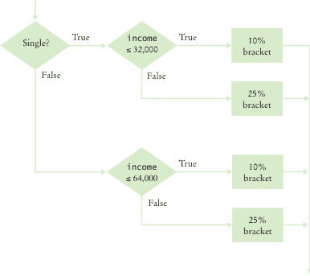

理论上，嵌套层级可以超过两层。一个三级决策过程（先按州，再按申报身份，最后按收入水平）需要三层嵌套。

### ch03/tax.cpp

```cpp
#include <iostream>
#include <string>

using namespace std;

int main()
{
   const double RATE1 = 0.10;
   const double RATE2 = 0.25;
   const double RATE1_SINGLE_LIMIT = 32000;
   const double RATE1_MARRIED_LIMIT = 64000;

   double tax1 = 0;
   double tax2 = 0;

   double income;
   cout << "Please enter your income: ";
   cin >> income;

   cout << "Please enter s for single, m for married: ";
   string marital_status;
   cin >> marital_status;
```

`tax1` 和 `tax2` 的值被更新。

```cpp
{
    tax1 = RATE1 * RATE1_MARRIED_LIMIT;
    tax2 = RATE2 * (income - RATE1_MARRIED_LIMIT);
}
```

| tax1 | tax2 | income | 婚姻状况 |
|---:|---:|---:|:---:|
| 0 | 0 | 80000 | M |
| 6400 | 4000 |  |  |

它们的总和 `total_tax` 被计算并打印出来。然后程序结束。

```cpp
double total_tax = tax1 + tax2;
cout << "The tax is " << total_tax << endl;
return 0;
```

| tax1 | tax2 | income | 婚姻状况 | 总税额 |
|---:|---:|---:|:---:|---:|
| 0 | 0 | 80000 | M |  |
| 6400 | 4000 |  |  | 10400 |

由于程序跟踪显示了预期输出（$10,400），因此它成功证明了该测试用例工作正常。

## 常见错误 3.4


### 悬空 else 问题

当一个 `if` 语句嵌套在另一个 `if` 语句中时，可能出现以下错误。

```cpp
double shipping_charge = 5.00; // $5 inside continental U.S.
if (country == "USA")
    if (state == "HI")
        shipping_charge = 10.00; // Hawaii is more expensive
    else // Pitfall!
        shipping_charge = 20.00; // As are foreign shipments
```

缩进层级似乎表明 `else` 与 `country == "USA"` 这个测试条件配对。遗憾的是，情况并非如此。编译器会忽略所有缩进，并将 `else` 与前面的 `if` 配对。也就是说，代码实际上是：

```cpp
double shipping_charge = 5.00; // $5 inside continental U.S.
if (country == "USA")
    if (state == "HI")
        shipping_charge = 10.00; // Hawaii is more expensive
    else // Pitfall!
        shipping_charge = 20.00; // As are foreign shipments
```

这不是你想要的结果。你想要的是让 `else` 与第一个 `if` 配对。

这种有歧义的 `else` 被称为悬空 `else`。如果始终使用花括号，就能避免这个陷阱，正如第 80 页的编程提示 3.2 所建议的那样：

```cpp
double shipping_charge = 5.00; // $5 inside continental U.S.
if (country == "USA")
{
    if (state == "HI")
    {
        shipping_charge = 10.00; // Hawaii is more expensive
    }
    else
    {
        shipping_charge = 20.00; // As are foreign shipments
    }
}
```

> 绝不要将箭头指向另一个分支的内部。

绘制流程图时，有一个问题需要留意。不受约束的分支与合并会导致“面条式代码”，即程序中各可能路径构成的一张混乱网络。
避免面条式代码有一条简单的规则：绝不要将箭头指向另一个分支的内部。
为了理解这条规则，请看这个例子：美国境内运费为 5 美元，但寄往夏威夷和阿拉斯加的运费为 10 美元。国际运费也是 10 美元。你可能会从下面这样的流程图开始：

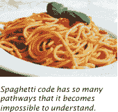

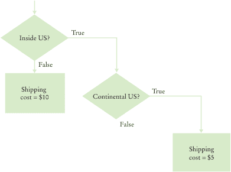

现在，你可能会想复用“运费 = 10 美元”这个任务：

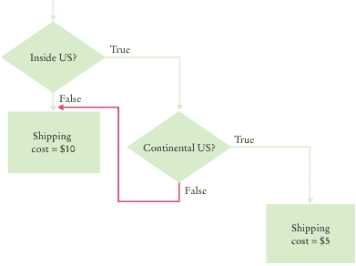

不要那样做！红色箭头指向了另一个分支的内部。相反，应添加另一个将运费设为 10 美元的任务，如下所示：

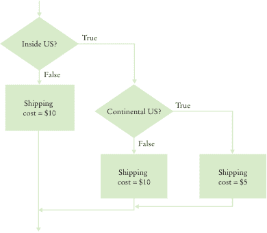

这样做不仅避免了面条式代码，而且也是一种更好的设计。将来很可能会发生国际运费不同于寄往阿拉斯加和夏威夷的运费的情况。

流程图对于直观理解算法流程非常有用。不过，一旦添加更多细节，它们很快就会变得庞大。此时，从流程图转向伪代码是合理的。


### 自测题

- 22. 为一个读取值 `temp` 的程序绘制流程图；如果该值小于零，则打印“Frozen”。
- 23. 右侧的流程图有什么问题？
- 24. 如何修复右侧的流程图？参见自测题 23？
- 25. 为一个读取值 `x` 的程序绘制流程图。如果 `x` 小于零，打印“Error”；否则，打印其平方根。
- 26. 为一个读取值 `temp` 的程序绘制流程图。如果它小于零，打印“Ice”；如果它大于 100，打印“Steam”；否则，打印“Liquid”。

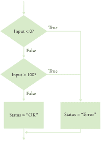

### 练习

现在你可以尝试本章末尾的这些练习：R3.10、R3.11、R3.12。

## 编程提示 3.7


### 制定计划，并为意外问题留出时间

商业软件以交付延迟而著称。例如，微软最初承诺其 Windows Vista 操作系统将在 2003 年晚些时候推出，然后是 2005 年，再然后是 2006 年 3 月；最终它于 2007 年 1 月才发布。其中一些早期承诺可能并不现实。让潜在客户以为该产品即将可用，符合微软的利益。如果客户当时知道实际交付日期，他们可能会在此期间转向其他产品。但不可否认，微软并没有预料到它为自己设定的任务的全部复杂性。

微软可以推迟产品交付，但你可能无法做到这一点。作为学生或程序员，你应当明智地管理时间，并按时完成作业。你也许能在截止日期前一晚完成简单的编程练习，但一个看起来难度两倍的作业很可能会花四倍的时间，因为可能出问题的环节更多。因此，每当你开始一个编程项目时，都应该制定一个计划。

首先，现实地估计你需要多少时间来完成以下工作：

- 设计程序逻辑。
- 开发测试用例。
- 输入程序并修复语法错误。
- 测试并调试程序。

例如，对于所得税程序，我可能会估计：设计需要 1 小时；开发测试用例需要 30 分钟；输入数据和修复语法错误需要 1 小时；测试和调试需要 1 小时。总计 3.5 小时。如果我每天在这个项目上工作 2 小时，大约需要两天才能完成。


然后想想可能出问题的地方。你的电脑可能会出故障。你可能被计算机系统的某个问题难住。（这对初学者来说尤其值得关注。因为要花时间找到那个知道如何用神奇命令解决问题的人，所以在一个琐碎问题上浪费一整天是很常见的。）根据经验法则，将你的估计时间加倍。也就是说，你应该在截止日期前四天开始，而不是前两天。如果一切顺利，那很好；你提前两天完成了程序。当不可避免的问题出现时，你就有缓冲时间，避免尴尬和失败。

*为你的编程工作制定计划，并为可能出现的问题预留时间。*

## 3.7 布尔变量与运算符

有时，你需要在程序的一部分中计算一个逻辑条件，并在其他地方使用它。要存储一个可以为真或假的条件，可以使用布尔变量。布尔变量以数学家乔治·布尔（George Boole，1815–1864）的名字命名，他是逻辑学研究的先驱。

在 C++ 中，`bool` 数据类型表示布尔类型。类型为 `bool` 的变量恰好可以保存两个值，分别记为 `false` 和 `true`。这些值不是字符串或整数；它们是特殊值，仅供布尔变量使用。

> 布尔类型
> `bool` 有两个值：
> `false` 和 `true`。


## 表 5 选定的运算符及其优先级

| 运算符 | 描述 |
|---|---|
| `++ -- + (unary) - (unary) !` | 自增、自减、正号、负号、布尔*非* |
| `* / %` | 乘法、除法、求余 |
| `+ -` | 加法、减法 |
| `< <= > >=` | 比较 |
| `== !=` | 等于、不等于 |
| `&&` | 布尔*与* |
| `\|\|` | 布尔*或* |

反过来，让我们测试水在给定温度下是否*不是*液体。当温度至多为0或至少为100时就是这种情况。使用 `||`（*或*）运算符来组合这些表达式。

```cpp
if (temp <= 0 || temp >= 100) { cout << "Not liquid"; }
```

要反转条件，请使用 `!`（*非*）运算符。

图9展示了这些示例的流程图。

有时你需要用*非*逻辑运算符来*反转*条件。`!` 运算符接受单个条件，如果该条件为假则求值为真，如果该条件为真则求值为假。在这个示例中，如果布尔变量 frozen 的值为 false，则产生输出：

```cpp
if (!frozen)
{
    cout << "Not frozen";
}
```

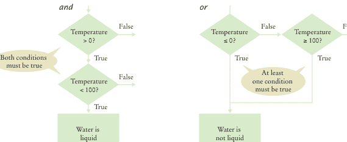

**图9** *与*和*或*组合的流程图

## 表 6 布尔运算符

| 表达式 | 值 | 注释 |
|---|---|---|
| 0 < 200 && 200 < 100 | false | 只有第一个条件为真。注意 < 运算符的优先级高于 && 运算符。 |
| 0 < 200 \|\| 200 < 100 | true | 第一个条件为真。 |
| 0 < 200 \|\| 100 < 200 | true | \|\| 不是“二选一”的测试。如果两个条件都为真，结果为真。 |
| ⛔ 0 < 200 < 100 | true | **错误：** 表达式 0 < 200 为真，被转换为 1。表达式 1 < 100 为真。你绝不要写这样的表达式；参见第107页的常见错误3.5。 |
| ⛔ -10 && 10 > 0 | true | **错误：** -10 不是零。它被转换为 true。你绝不要写这样的表达式；参见第107页的常见错误3.5。 |
| 0 < x && x < 100 \|\| x == -1 | (0 < x && x < 100) \|\| x == -1 | && 运算符的优先级高于 \|\| 运算符。 |
| !(0 < 200) | false | 0 < 200 为真，因此其否定为假。 |
| frozen == true | frozen | 没有必要将布尔变量与 true 比较。 |
| frozen == false | !frozen | 使用 ! 比与 false 比较更清晰。 |

表6展示了求值布尔运算符的更多示例。

- 31. 假设 x 和 y 是两个整数。如何测试它们**两者**是否都为零？
- 32. 如何测试它们中**至少一个**是否为零？
- 33. 如何测试它们中*恰好一个*是否为零？
- 34. `!!frozen` 的值是什么？
- 35. 使用 `bool` 类型而不是字符串 "false"/"true" 或整数 `0/1` 有什么优势？

**练习一下** 现在你可以尝试本章末尾的这些练习：R3.27、P3.22、P3.24。

## 常见错误 3.5


### 组合多个关系运算符

考虑表达式

```cpp
if (0 <= temp <= 100) // Error
```

这看起来就像数学测试 0 ≤ temp ≤ 100。不幸的是，并非如此。

让我们剖析表达式 0 <= temp <= 100。前半部分 0 <= temp 是一个测试，其结果取决于 temp 的值为 true 或 false。然后，该测试的结果（true 或 false）会与 100 进行比较。可以比较真值和浮点数吗？true 是否大于 100？不幸的是，为了与 C 语言保持兼容，C++ 会将 false 转换为 0，将 true 转换为 1。因此，该表达式将始终求值为 true。

必须小心不要在程序中混用逻辑表达式和算术表达式。而应使用 and 来组合两个独立的测试：

```cpp
if (0 <= temp && temp <= 100) ...
```

另一个类似的常见错误是编写

```cpp
if (x && y > 0) ... // Error
```

而不是

```cpp
if (x > 0 && y > 0) ...
```

不幸的是，编译器不会发出错误消息。相反，它会把 x 转换为 true 或 false。零被转换为 false，任何非零值被转换为 true。如果 x 不为零，则测试 y 是否大于 0，最后计算这两个真值的与。自然，这种计算毫无意义。

## 常见错误 3.6


### 混淆 && 和 || 条件

混淆与（and）和或（or）条件是一个出奇常见的错误。一个值如果至少为0且至多为100，则位于0到100之间。如果它小于0或大于100，则位于该范围之外。没有黄金法则；你只需仔细思考。

通常与或条件会被明确说明，实现起来就不太难。但有时措辞并不那么明确。很常见的情况是，各个条件被整齐地分列在项目符号列表中，却几乎没有说明它们应如何组合。考虑以下报税说明。如果以下任意一项为真，你可以申报单身报税身份：

- 你从未结婚。
- 你在纳税年度的最后一天合法分居或离婚。
- 你丧偶，且未再婚。

由于只要任一条件为真测试就通过，所以必须用 or 组合这些条件。在另一处，同样的说明指出，如果以下五个条件全部为真，你可以使用更有利的已婚联合申报身份：

- 你的配偶在不到两年前去世，且你未再婚。
- 你有一个可以申报为受抚养人的孩子。
- 该孩子在纳税年度内全年都住在你家。
- 你支付了为这个孩子维持家庭开销的一半以上。
- 你在配偶去世那年与其提交了联合申报。

因为测试要通过必须所有条件都为真，所以必须用 and 组合它们。

当然，这等同于

```cpp
state != "AK" && state != "HI"
```

现在将这条定律应用到我们的运费计算中：

```cpp
!(country == "USA"
  && state != "AK"
  && state != "HI")
```

等价于

```cpp
!(country == "USA"
  || !(state == "AK")
  || !(state == "HI"))
```

由此得到更简单的测试

```cpp
country != "USA"
  || state == "AK"
  || state == "HI"
```

要简化包含 *与* 或 *或* 表达式否定的条件，通常最好应用德摩根定律，将否定移到最内层。

## 3.8 应用：输入验证


*就像质量控制人员一样，你希望在处理用户输入之前确保它是正确的。*

if 语句的一个重要应用是*输入验证*。每当程序接受用户输入时，都需要确保用户提供的值在用于计算之前是有效的。考虑我们的电梯程序。假设电梯面板上有标号为1到20的按钮（但没有13）。以下输入是非法的：

- 数字13
- 零或负数
- 大于20的数字
- 不是数字序列的输入，例如 five

在每种情况下，我们都希望给出错误消息并退出程序。

防止输入13很简单：

```cpp
if (floor == 13)
{
    cout << "Error: There is no thirteenth floor." << endl;
    return 1;
}
```

语句

```cpp
return 1;
```

会立即退出 main 函数，从而终止程序。约定是：如果程序正常完成则返回0，如果遇到错误则返回非零值。

读取一个值时，检查它是否在所需范围内。

以下是如何确保用户不会输入有效范围之外的数字：

```cpp
if (floor <= 0 || floor > 20)
{
    cout << "Error: The floor must be between 1 and 20." << endl;
    return 1;
}
```

然而，处理不是有效整数的输入是更严重的问题。当语句

```cpp
cin >> floor;
```

执行时，如果用户输入的不是整数（例如 five），那么整数变量 floor 不会被设置。相反，输入流 cin 会被置为失败状态。你可以调用 fail 成员函数来测试该失败状态。

```cpp
if (cin.fail())
{
    cout << "Error: Not an integer." << endl;
    return 1;
}
```

if 语句的顺序很重要。你必须*首先*测试 cin.fail()。毕竟，如果输入失败，就没有给 floor 赋任何值，将其与其他值比较毫无意义。

在 C++ 中，输入失败相当严重。一旦输入失败，之后所有输入尝试也会失败。你将在第8章学习如何编写更能容忍错误输入的程序。目前，我们的目标只是检测错误输入，并在发生时退出程序。

下面是带有输入验证的完整电梯程序。

使用 fail 函数测试输入流是否已失败。

### ch03/elevator2.cpp

```cpp
#include <iostream>

using namespace std;

int main()
{
    int floor;
    cout << "Floor: ";
    cin >> floor;

    // The following statements check various input errors
    if (cin.fail())
    {
        cout << "Error: Not an integer." << endl;
        return 1;
    }
    if (floor == 13)
    {
        cout << "Error: There is no thirteenth floor." << endl;
        return 1;
    }
    if (floor <= 0 || floor > 20)
    {
        cout << "Error: The floor must be between 1 and 20." << endl;
        return 1;
```


```cpp
}

// Now we know that the input is valid
int actual_floor;
if (floor > 13)
{
    actual_floor = floor - 1;
}
else
{
    actual_floor = floor;
}

cout << "The elevator will travel to the actual floor "
     << actual_floor << endl;

return 0;
}
```

### 程序运行

```text
Floor: 13
Error: There is no thirteenth floor.
```


36. 考虑 `elevator2.cpp` 程序。当输入为以下值时，你会得到什么输出？

- a. 100？
- b. −1？
- c. 20？
- d. thirteen？

37. 你的任务是重写 `elevator2.cpp` 程序，使其只有一个带有复合条件的 `if` 语句：

```cpp
if (...)
{
    cout << "Error: Bad input" << endl;
    return 1;
}
```

条件是什么？

38. 在福尔摩斯故事《苏塞克斯吸血鬼》中，这位无与伦比的侦探说了这样的话：“马蒂尔达·布里格斯并不是一个年轻女人的名字，华生……那是一艘船的名字，它与苏门答腊巨鼠有关，而关于这个故事，世人还没有做好准备。”一百多年后，研究人员在印度尼西亚的另一地区——西新几内亚发现了巨鼠。

假设你负责编写一个处理老鼠体重的程序。其中包含以下语句：

```cpp
double weight;
cout << "Enter weight in kg: ";
cin >> weight;
```

你应该提供哪些输入检查？


**39.** 考虑以下测试程序：

```cpp
int main()
{
    int m = 1;
    cout << "Enter an integer: ";
    cin >> m;
    int n = 2;
    cout << "Enter another integer: ";
    cin >> n;
    cout << m << " " << n << endl;
    return 0;
}
```

运行此程序，并在第一个提示符处输入 `three`。会发生什么？为什么？

**动手练习** 现在你可以尝试本章末尾的这些练习：R3.1、R3.30、P3.26。


## 随机趣闻 3.2 — 人工智能

当人们使用诸如税务申报软件之类的计算机程序时，必然会认为计算机具有某种智能。计算机能提出合理的问题，并完成那些让我们觉得烧脑的计算。毕竟，如果报税很容易，我们就不需要计算机替我们完成了。

然而，作为程序员，我们知道这一切表面上的智能都是一种幻觉。人类程序员已经仔细“训练”了软件应对所有可能出现的场景，而它只是重放了编程时预设的动作和决策。

有没有可能编写出在某种意义上是真正智能的计算机程序？从计算技术诞生之初，人们就感觉到人脑可能不过是一台巨大的计算机，而且为计算机编程以模仿某些人类思维过程也很有可能是可行的。关于人工智能的严肃研究始于20世纪50年代。然而，最终的结果令人失望，几乎没有将人工智能应用推向市场。

从一开始，人工智能社区的目标之一就是开发能够将文本从一种语言翻译成另一种语言的软件，例如从英语翻译成俄语。这项任务被证明极其复杂。人类语言比最初想象的更加微妙，并且与人类经验交织得更加紧密。即便是如今文字处理软件中自带的语法检查工具，也更多是一种噱头而非实用工具，而语法分析只是翻译句子的第一步。

由道格拉斯·莱纳特于1984年启动的Cyc（来源于encyclopedia）项目，试图将人类言语和写作背后的隐含假设编码化。团队成员一开始分析新闻文章，并反问自己：要理解这些文章，还需要哪些未提及的事实？

这个目标是为了开发新的硬件和软件，以大幅提升专家系统软件的性能。起初，该项目在其他国家引发了担忧，认为日本计算机产业即将成为该领域无可争议的领导者。

### 实现分支中需要进一步决策的情况。

- 当一个决策语句包含在另一个决策语句的分支中时，这些语句是嵌套的。
- 对于需要两级决策的问题，必须使用嵌套决策。


### 绘制流程图以可视化程序的控制流。

- 流程图由任务、输入/输出和决策的元素构成。
- 决策的每个分支都可以包含任务和进一步的决策。
- 切勿将箭头指向另一个分支内部。

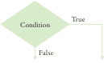

### 为你的程序设计测试用例。

- 程序的每个分支都应由一个测试用例覆盖。
- 最好在实现程序之前设计测试用例。


### 使用布尔数据类型来存储和组合可以为真或假的条件。

- 布尔类型有两个值：`false` 和 `true`。
- C++ 有两个组合条件的布尔运算符：`&&`（与）和 `||`（或）。
- 要对条件取反，请使用 `!`（非）运算符。
- `&&` 和 `||` 运算符使用*短路求值*进行计算：一旦真值被确定，就不再计算后续条件。
- 德摩根定律告诉您如何对 `&&` 和 `||` 条件取反。

### 应用 if 语句来检测用户输入是否有效。

- 读取值时，检查它是否在所需范围内。
- 使用 `fail` 函数测试输入流是否失败。


## 复习题

**R3.1** 找出以下 `if` 语句中的错误。

```cpp
a. if (x > 0) then cout << x;
b. if (x > 0) { y = 1; } else { y = -1; }
c. if (1 + x > pow(x, sqrt(2)) { y = y + x; }
d. if (x == 1) { y++; }
e. cin >> x; if (cin.fail()) { y = y + x; }
```

**R3.2** 这些代码片段会打印什么？

```cpp
a. int n = 1; int m = -1;
   if (n < m) { cout << n; } else { cout << m; }

b. int n = 1; int m = -1;
   if (-n >= m) { cout << n; } else { cout << m; }
```

d. "car manufacturer", "carburetor"  
e. "Harry", "hairy"  
f. "C++", "Car"  
g. "Tom", "Tom"  
h. "Car", "Carl"  
i. "car", "bar"

**R3.19** 解释一系列 `else if` 子句与嵌套的 `if` 语句之间的区别。各举一个例子。

**R3.20** 给出一个 `else if` 子句序列的例子，其中测试的顺序无关紧要。再给出一个测试顺序有影响的例子。

**R3.21** 重写第 3.3 节中的条件，使用 `<` 运算符而不是 `>=` 运算符。这对比较的顺序有什么影响？

**R3.22** 为练习 P3.18 中的税务程序给出一组测试用例。手动计算预期结果。

**R3.23** 编造另一个 C++ 代码示例，演示悬空 `else` 问题，使用以下陈述：GPA 至少为 1.5 但低于 2 的学生处于留校察看状态；低于 1.5 则不及格。

**R3.24** 通过找出布尔输入 `p`、`q` 和 `r` 的所有组合下布尔表达式的真值，完成下面的真值表。

| p | q | r | (p && q) \|\| !r | !(p && (q \|\| !r)) |
|---|---|---|---|---|
| false | false | false |  |  |
| false | false | true |  |  |
| false | true | false |  |  |
| ... |  |  |  |  |
| 还有5种组合 |  |  |  |  |
| ... |  |  |  |  |

**R3.25** 对还是错？对于任意布尔条件 *A* 和 *B*，*A* && *B* 与 *B* && *A* 相同。

**R3.26** 许多搜索引擎的“高级搜索”功能允许你使用布尔运算符进行复杂查询，例如“(cats OR dogs) AND NOT pets”。对比这些搜索运算符与 C++ 中的布尔运算符。

**R3.27** 假设 `b` 的值为 `false`，`x` 的值为 0。以下每个表达式的值是什么？

- a. `b && x == 0`
- b. `b || x == 0`
- c. `!b && x == 0`
- d. `!b || x == 0`
- e. `b && x != 0`
- f. `b || x != 0`
- g. `!b && x != 0`
- h. `!b || x != 0`


### R3.28 简化下列表达式。这里，b 是 bool 类型的变量。

- a. `b == true`
- b. `b == false`
- c. `b != true`
- d. `b != false`

### R3.29 简化下列语句。这里，b 是 bool 类型的变量，n 是 int 类型的变量。

- a. `if (n == 0) { b = true; } else { b = false; }`  
  *（提示：n == 0 的值是什么？）*
- b. `if (n == 0) { b = false; } else { b = true; }`
- c. `b = false; if (n > 1) { if (n < 2) { b = true; } }`
- d. `if (n < 1) { b = true; } else { b = n > 2; }`

### R3.30 下面的程序有什么问题？

```
cout << "Enter the number of quarters: ";
cin >> quarters;
total += total + quarters * 0.25;
cout << "Total: " << total << endl;
if (cin.fail()) { cout << "Input error."; }
```

### R3.31 读取数字其实出奇地困难，因为 C++ 输入流一次只查看输入中的一个字符。首先，跳过空白字符。然后，流会读入那些可能是数字一部分的字符。一旦流识别出一个数字，如果它遇到不能构成数字一部分的字符，就会停止读取。但是，如果第一个非空白字符不是数字或符号，或者第一个字符是符号而第二个字符不是数字，那么流就会进入失败状态。

考虑一个读取整数的程序：

```
cout << "Enter the number of quarters: ";
int quarters;
cin >> quarters;
```

对于以下每种用户输入，圈出已读取了多少个字符，以及流是否处于失败状态。

- a. `15.9`
- b. `15 9`
- c. `+159`
- d. `-15A9`
- e. `Fifteen`
- f. `-Fifteen`
- g. `+ 15`
- h. `1.5E3`
- i. `+1+5`

## 编程练习

### P3.1 编写一个程序，读取一个温度值和字母 C（表示摄氏温度）或 F（表示华氏温度）。输出在给定温度且海平面条件下，水是液态、固态还是气态。

### P3.2 水的沸点随海拔每升高 300 米（或 1,000 英尺）下降约 1 摄氏度。改进练习 P3.1 中的程序，允许用户提供以米或英尺为单位的海拔高度。

### P3.3 编写一个程序，读取三个浮点数，并打印三个输入中的最大值。例如：

```
Please enter three numbers: 4 9 2.5
The largest number is 9.
```

### P3.4 编写一个程序，读取三个字符串，并按字典顺序对它们排序。

```
Enter three strings: Charlie Able Baker
Able
Baker
Charlie
```

### P3.5 编写一个程序，读取一个整数，并通过检查该数是否 ≥ 10、≥ 100 等来判断它有多少位。（假设所有整数都小于一百亿。）如果该数为负数，先将其乘以 −1。

### P3.6 编写一个程序，读取三个数。如果三个数全部相同，则打印 “all the same”；如果三个数全部不同，则打印 “all different”；否则打印 “neither”。

### P3.7 编写一个程序，读取三个数。如果它们是递增顺序，则打印 “increasing”；如果是递减顺序，则打印 “decreasing”；否则打印 “neither”。这里，“increasing” 指“严格递增”，即每个值都大于前一个值。序列 3 4 4 不应被视为递增。

### P3.8 重复练习 P3.7，但在读取数字之前，询问用户对递增/递减的判断是采用 “strict”（严格）还是 “lenient”（宽松）模式。在宽松模式下，序列 3 4 4 是递增的，而序列 4 4 4 既递增又递减。

### P3.9 编写一个程序，将字母等级转换为数字等级。字母等级为 A、B、C、D 和 F，后面可能跟 + 或 −。它们的数值分别为 4、3、2、1 和 0。不存在 F+ 或 F−。+ 使数值增加 0.3，− 使数值减少 0.3。不过，A+ 的数值为 4.0。

```
Enter a letter grade: B−
The numeric value is 2.7.
```

### P3.10 编写一个程序，将 0 到 4 之间的数字转换为最接近的字母等级。例如，数字 2.8（可能是几个等级的平均值）应转换为 B−。如果出现平局，选择较好的等级；例如 2.85 应转换为 B。

### P3.11 编写一个程序，接收用户输入，该输入用以下简写表示一张扑克牌：

- A — A（Ace）
- 2 ... 10 — 牌面值
- J — J（Jack）
- Q — Q（Queen）
- K — K（King）
- D — 方块（Diamonds）
- H — 红桃（Hearts）
- S — 黑桃（Spades）
- C — 梅花（Clubs）

程序应打印这张牌的完整描述。例如，

```
Enter the card notation: QS
Queen of Spades
```

### P3.12 当比较两个时间点（每个时间点以小时和分钟给出，小时采用 24 小时制，范围 0 到 23）时，下面的伪代码确定哪个时间在前。

```
If hour1 < hour2
    time1 comes first.
Else if hour1 and hour2 are the same
    If minute1 < minute2
        time1 comes first.
    Else if minute1 and minute2 are the same
        time1 and time2 are the same.
    Else
        time2 comes first.
Else
    time2 comes first.
```

编写一个程序，提示用户输入两个时间点，先打印较早的时间，再打印另一个时间。

### P3.13 下面的算法根据给定的月份和日期得出季节（Spring、Summer、Fall 或 Winter）。

```
If month is 1, 2, or 3, season = "Winter"
Else if month is 4, 5, or 6, season = "Spring"
Else if month is 7, 8, or 9, season = "Summer"
Else if month is 10, 11, or 12, season = "Fall"
If month is divisible by 3 and day >= 21
    If season is "Winter", season = "Spring"
    Else if season is "Spring", season = "Summer"
    Else if season is "Summer", season = "Fall"
    Else season = "Winter"
```


编写一个程序，提示用户输入月份和日期，并按照该算法打印季节。

### P3.14 编写一个程序，读取两个浮点数，并测试它们在小数点后两位内是否相同。下面是两个示例运行。

```
Enter two floating-point numbers: 2.0 1.99998
They are the same up to two decimal places.
Enter two floating-point numbers: 2.0 1.98999
They are different.
```

### P3.15 编写一个程序来模拟银行交易。有两个银行账户：支票账户（checking）和储蓄账户（savings）。首先，请求输入两个银行账户的初始余额；拒绝负数余额。然后请求输入交易，选项为存款（deposit）、取款（withdrawal）和转账（transfer）。接着请求输入账户，选项为支票账户和储蓄账户。再请求输入金额；拒绝会导致账户透支的交易。最后，打印两个账户的余额。

### P3.21 *单位换算。* 编写一个单位换算程序，询问用户要从哪个单位进行转换（fl. oz、gal、oz、lb、in、ft、mi），以及要转换到哪个单位（ml、l、g、kg、mm、cm、m、km）。拒绝不兼容的转换（例如 gal → km）。询问要转换的数值，然后显示结果：

```
Convert from? gal
Convert to? ml
Value? 2.5
2.5 gal = 9462.5 ml
```

### P3.22 编写一个程序，提示用户输入字母表中的一个单个字符。根据用户输入打印 Vowel 或 Consonant。如果用户输入不是字母（介于 a 到 z 或 A 到 Z 之间），或者字符串长度大于 1，则打印一条错误信息。

### P3.23 *罗马数字。* 编写一个程序，将正整数转换为罗马数字。罗马数字系统有以下数字：

| 罗马数字 | 数值 |
|---|---:|
| I | 1 |
| V | 5 |
| X | 10 |
| L | 50 |
| C | 100 |
| D | 500 |
| M | 1,000 |

数字按照以下规则构成。(1) 只表示不超过 3,999 的数。(2) 与十进制系统一样，千位、百位、十位和个位分别表示。(3) 数字 1 到 9 表示为：

| 罗马数字 | 数值 |
|---|---:|
| I | 1 |
| II | 2 |
| III | 3 |
| IV | 4 |
| V | 5 |
| VI | 6 |
| VII | 7 |
| VIII | 8 |
| IX | 9 |

正如你所看到的，位于 V 或 X 前面的 I 要从数值中减去，并且连续出现的 I 不能超过三个。(4) 十位和百位的表示方式相同，只是分别使用字母 X、L、C 和 D、M 来代替 I、V、X。你的程序应接受一个输入（例如 1978），并将其转换为罗马数字 MCMLXXVIII。


### P3.24

编写一个程序，要求用户输入月份（1 表示一月，2 表示二月，依此类推），然后打印该月的天数。对于二月，打印“28 或 29 天”。

```text
Enter a month: 5
30 days
```

不要为每个月使用单独的 if/else 分支。使用布尔运算符。

### P3.25

有 366 天的年份称为闰年。如果年份能被 4 整除（例如 1980 年），则为闰年；但如果它能被 100 整除（例如 1900 年），则不是闰年；然而，如果它能被 400 整除（例如 2000 年），则是闰年。在 1582 年 10 月 15 日格里高利历引入之前没有例外（1500 年是闰年）。编写一个程序，要求用户输入年份，并计算该年是否为闰年。

### P3.26

为习题 P3.2 添加错误处理。如果用户未按预期输入数字，或为海拔提供了无效单位，则打印错误消息并结束程序。

### 工程 P3.27

编写一个程序，提示用户输入波长值，并打印表 7 中给出的电磁波谱相应部分的描述。


**表 7 电磁波谱**

| 类型 | 波长（m） | 频率（Hz） |
|---|---|---|
| 无线电波 | > 10⁻¹ | < 3 × 10⁹ |
| 微波 | 10⁻³ 到 10⁻¹ | 3 × 10⁹ 到 3 × 10¹¹ |
| 红外线 | 7 × 10⁻⁷ 到 10⁻³ | 3 × 10¹¹ 到 4 × 10¹⁴ |
| 可见光 | 4 × 10⁻⁷ 到 7 × 10⁻⁷ | 4 × 10¹⁴ 到 7.5 × 10¹⁴ |
| 紫外线 | 10⁻⁸ 到 4 × 10⁻⁷ | 7.5 × 10¹⁴ 到 3 × 10¹⁶ |
| X 射线 | 10⁻¹¹ 到 10⁻⁸ | 3 × 10¹⁶ 到 3 × 10¹⁹ |
| 伽马射线 | < 10⁻¹¹ | > 3 × 10¹⁹ |

### 工程 P3.28

重做习题 P3.27，修改程序，使其改为提示输入频率。

### 工程 P3.29

重做习题 P3.27，修改程序，使其首先询问用户输入的是波长还是频率。

### 工程 P3.30

一辆小型厢式车有两扇滑动门。每扇门可通过仪表板开关、车内把手或车外把手打开。但是，如果儿童锁开关已激活，车内把手不起作用。要使滑动门打开，变速杆必须处于*驻车挡*，并且总解锁开关必须已激活。（本书作者正是这样一辆车的长期受苦车主。）


你的任务是模拟该车辆控制软件的一部分。输入是按以下顺序排列的开关和变速杆值序列：

- 左、右滑动门的仪表板开关，儿童锁和总解锁（0 表示关闭，1 表示激活）
- 左、右滑动门的内外把手（0 或 1）
- 变速杆设置（P N D 1 2 3 R 之一）。

典型输入为 `0 0 0 1 0 1 0 0 P`。
视情况打印“左门打开”和/或“右门打开”。如果两扇门都不打开，则打印“两扇门保持关闭”。

### 工程 P3.31

以分贝（dB）为单位的声级 L 由下式确定

$$L = 20\log_{10}(p/p_0)$$

其中 p 是声音的声压（单位为帕斯卡，缩写为 Pa），p₀ 是参考声压，等于 20 × 10⁻⁶ Pa（此时 L 为 0 dB）。下表给出了某些声级的描述。


| 声级 | 分贝 |
|---|---:|
| 痛阈 | 130 dB |
| 可能的听力损伤 | 120 dB |
| 1 米处的风钻 | 100 dB |
| 10 米处繁忙道路上的交通 | 90 dB |
| 正常交谈 | 60 dB |
| 安静的图书馆 | 30 dB |
| 树叶轻微的沙沙声 | 0 dB |

编写一个程序，读取一个数值和一个单位（dB 或 Pa），然后打印上面列表中最接近的描述。

### 工程 P3.32

下图所示的电路用于测量腔室中气体的温度。

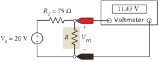

电阻器 R 表示封闭在腔室中的温度传感器。电阻 R（单位为 Ω）与温度 T（单位为 °C）之间的关系由以下方程给出：

$$R = R_0 + kT$$

在该设备中，假设 R₀ = 100 Ω，k = 0.5。电压表显示传感器两端的电压值 Vₘ。该电压 Vₘ 根据以下方程表示气体的温度 T：

$$T = \frac{R}{k} - \frac{R_0}{k} = \frac{R_s}{k}\frac{V_m}{V_s - V_m} - \frac{R_0}{k}$$

```cpp
}
else
{
    cout << "Game tied";
}
```

- 12.

  ```cpp
  if (x > 0)
  {
      s = 1;
  }
  else if (x < 0)
  {
      s = -1;
  }
  else
  {
      s = 0;
  }
  ```

- 13. 你可以先将 `s` 设为三个值之一：

  ```cpp
  s = 0;
  if (x > 0) { s = 1; }
  else if (x < 0) { s = -1; }
  ```

- 14. 可以省略 `if (price <= 100)`，从而清楚地表明 `else` 分支是唯一的选择。
- 15. 不破坏建筑物。
- 16. 在最后的 `else` 之前添加一个分支：

  ```cpp
  else if (richter < 0) { cout << "Error: Negative input" << endl; }
  ```

- 17. $3,200。
- 18. 不。那样计算是 0.10 × 32000 + 0.25 (32000 – 32000)。
- 19. 不。他们各自缴纳的税为每人 $5,200，如果他们结婚，将缴纳 $10,400。实际上，处于较高税率档次的纳税人（我们的程序未建模）在结婚时可能缴纳更高的税，这种现象称为*婚姻惩罚*。
- 20. 将第 36 行的 `else` 改为 `else if (marital_status == "m")`，并在第 47 行后添加另一个分支：

  ```cpp
  else { cout << "Error: marital status should be s or m." << endl; }
  ```

- 21. 较高税率仅适用于较高档次中的收入。假设你单身，收入为 $31,900。你应该争取 $200 的加薪吗？当然：你可以保留第一个 $100 的 90% 和下一个 $100 的 75%。
- 22.

  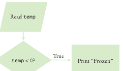

| 测试用例 | 预期输出 | 注释 |
|---|---|---|
| (0.5, 0.5) | 内部 | |
| (4, 2) | 外部 | |
| (0, 2) | 在边界上 | 正好在边界上 |
| (1.414, 1.414) | 在边界上 | 接近边界 |
| (0, 1.9) | 内部 | 距边界不小于 1 mm |
| (0, 2.1) | 外部 | 距边界不小于 1 mm |

- 31. `x == 0 && y == 0`
- 32. `x == 0 || y == 0`
- 33. `(x == 0 && y != 0) || (y == 0 && x != 0)`
- 34. 与 frozen 的值相同。
- 35. 保证没有其他值。对于字符串或整数，你需要检查没有诸如 "maybe" 或 −1 这样的值进入计算。
- 36. (a) 错误：楼层必须在 1 到 20 之间。 (b) 错误：楼层必须在 1 到 20 之间。 (c) 电梯将前往实际楼层 19 (d) 错误：不是整数。
- 37. `cin.fail() || floor == 13 || floor <= 0 || floor > 20`
- 38. 检查 `cin.fail()`，以确保研究人员没有提供诸如 oh my 之类的输入。检查 `weight <= 0`，因为任何老鼠肯定都有正重量。我们不知道老鼠能有多大，但新几内亚鼠体重不超过 2 kg。普通家鼠（*黑鼠*）体重可达 0.2 kg，因此我们可以说任何大于 10 kg 的重量肯定是输入错误，可能是把克和千克混淆了。因此，检查如下：

  ```cpp
  if (cin.fail())
  {
      cout << "Error: Not a number" << endl;
      return 1;
  }

  if (weight < 0)
  {
      cout << "Error: Weight cannot be negative." << endl;
      return 1;
  }

  if (weight > 10)
  {
      cout << "Error: Weight > 10 kg." << endl;
      return 1;
  }
  ```

- 39. 第一次输入失败。m 的值不变。由于先前的输入失败，下一次输入甚至不会尝试获取更多按键。它也会失败，n 保持不变。程序打印 1 2。

# 第 4 章：循环


## 本章目标

- 实现 while、for 和 do 循环
- 避免无限循环和差一错误
- 理解嵌套循环
- 实现读取和处理数据集的程序
- 使用计算机进行模拟

## 本章内容

- 4.1 while 循环 132
- *语法 4.1：* while 语句 133
- *常见错误 4.1：* 无限循环 136
- *常见错误 4.2：* 不要想“我们到了吗？” 137
- *常见错误 4.3：* 差一错误 137
- *趣闻 4.1：* 第一个 bug 138
- 4.2 问题求解：手工跟踪 139
- 4.3 for 循环 142
- *语法 4.2：* for 语句 144
- *编程提示 4.1：* 仅将 for 循环用于其预期目的 147
- *编程提示 4.2：* 选择与任务匹配的循环边界 147
- *编程提示 4.3：* 计算迭代次数 147
- 4.4 do 循环 148
- *编程提示 4.4：* 循环的流程图 149
- 4.5 处理输入 150
- *专题 4.1：* 清除失败状态 153
- *专题 4.2：* 半循环问题与 break 语句 153
- *专题 4.3：* 输入和输出的重定向 154
- 4.6 问题求解：故事板 154
- 4.7 常见循环算法 157
- *操作方法 4.1：* 编写循环 162
- *示例 4.1：* 信用卡处理
- 4.8 嵌套循环 165
- 4.9 随机数与模拟 168
- *趣闻 4.2：* 软件盗版 172


在循环中，程序的一部分会一遍又一遍地重复，直到达到特定目标。循环对于需要重复步骤的计算以及处理包含许多数据项的输入非常重要。在本章中，你将学习 C++ 中的循环语句，以及编写处理输入和模拟现实世界活动的程序的技术。

## 4.1 while 循环

在本节中，你将学习如何重复执行语句直到达成目标。

回顾第 1 章中的投资问题。你将 10,000 美元存入一个年利率为 5% 的银行账户。账户余额需要多少年才能翻倍？

在第 1 章中，我们为这个问题设计了以下算法：

从年份值 0、利息列和余额 10,000 美元开始。

| 年份 | 利息 | 余额 |
| --- | --- | --- |
| 0 |  | $10,000 |

- 当余额低于 20,000 美元时，重复以下步骤
  - 将年份值加 1。
  - 将利息计算为余额 × 0.05（即 5% 的利息）。
  - 将利息加到余额中。
- 将最终年份值作为答案报告。

你现在已经知道如何在 C++ 中定义和更新变量。你还不知道的是如何执行“当余额低于 20,000 美元时重复步骤”。


*因为赚到的利息也会产生利息，所以银行余额呈指数增长。*

*在粒子加速器中，亚原子粒子多次穿过环形隧道，获得物理实验所需的速度。类似地，在计算机科学中，循环中的语句在条件为真时执行。*


当你在循环体*内部*定义变量时，该变量会在每次循环迭代时创建，并在每次迭代结束后销毁。例如，考虑此循环中的 interest 变量：

```cpp
while (balance < TARGET)
{
    year++;
    double interest = balance * RATE / 100;
    balance = balance + interest;
} // interest no longer defined here
```


相比之下，balance 和 year 变量是在循环体*外部*定义的。这样，循环的所有迭代都使用同一个变量。

**图 2** 双重嵌套循环的执行

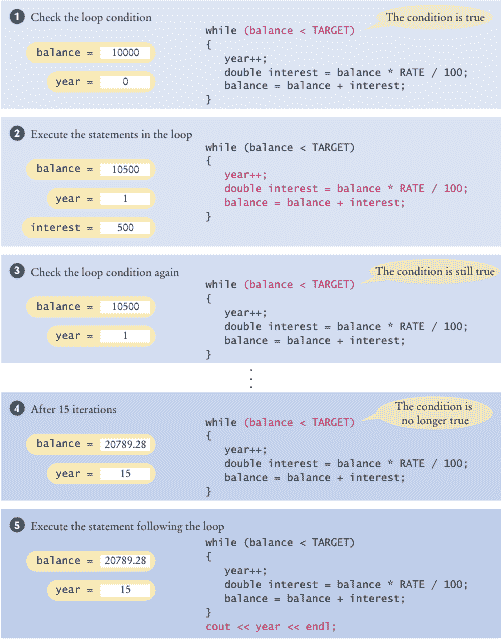

- **1. 检查循环条件**

  balance = 10000

  year = 0

  ```cpp
  while (balance < TARGET)
  {
      year++;
      double interest = balance * RATE / 100;
      balance = balance + interest;
  }
  ```

  标注：“条件为真。”

- **2. 执行循环中的语句**

  balance = 10500

  year = 1

  interest = 500

  ```cpp
  while (balance < TARGET)
  {
      year++;
      double interest = balance * RATE / 100;
      balance = balance + interest;
  }
  ```

- **3. 再次检查循环条件**

  balance = 10500

  year = 1

  ```cpp
  while (balance < TARGET)
  {
      year++;
      double interest = balance * RATE / 100;
      balance = balance + interest;
  }
  ```

  标注：“条件仍然为真。”

- **4. 经过 15 次迭代后**

  balance = 20789.28

  year = 15

  ```cpp
  while (balance < TARGET)
  {
      year++;
      double interest = balance * RATE / 100;
      balance = balance + interest;
  }
  ```

  标注：“条件不再为真。”

- **5. 执行循环之后的语句**

  balance = 20789.28

  year = 15

  ```cpp
  while (balance < TARGET)
  {
      year++;
      double interest = balance * RATE / 100;
      balance = balance + interest;
  }
  cout << year << endl;
  ```

这是解决投资问题的程序。图 2 演示了程序的执行过程。

### ch04/doublinv.cpp

```cpp
#include <iostream>
using namespace std;

int main()
{
   const double RATE = 5;
   const double INITIAL_BALANCE = 10000;
   const double TARGET = 2 * INITIAL_BALANCE;

   double balance = INITIAL_BALANCE;
   int year = 0;

   while (balance < TARGET)
   {
      year++;
      double interest = balance * RATE / 100;
      balance = balance + interest;
   }

   cout << "The investment doubled after "
        << year << " years." << endl;

   return 0;
}
```

### 程序运行

```
The investment doubled after 15 years.
```


- 1. 投资需要多少年才能翻三倍？修改程序并运行。
- 2. 如果年利率为 10%，投资需要多少年才能翻倍？修改程序并运行。
- 3. 修改程序，使其打印每年的余额。你是如何做到的？
- 4. 假设我们修改程序，使 `while` 循环的条件为

  `while (balance <= TARGET)`

  这对程序有什么影响？为什么？

- 5. 以下循环会打印什么？

  ```cpp
  int n = 1;
  while (n < 100)
  {
      n = 2 * n;
      cout << n << " ";
  }
  ```

**练一练** 现在你可以尝试本章末尾的练习题：R4.3、P4.11、P4.16。

### 表 1 `while` 循环示例

| 循环 | 输出 | 解释 |
|---|---|---|
| `i = 5;<br>while (i > 0)<br>{<br>    cout << i << " ";<br>    i--;<br>}` | `5 4 3 2 1` | 当 i 为 0 时，循环条件为假，循环结束。 |
| `i = 5;<br>while (i > 0)<br>{<br>    cout << i << " ";<br>    i++;<br>}` | `5 6 7 8 9 10 11 ...` | `i++` 语句是一个错误，导致“无限循环”（参见第 136 页的常见错误 4.1）。 |
| `i = 5;<br>while (i > 5)<br>{<br>    cout << i << " ";<br>    i--;<br>}` | (无输出) | 语句 `i > 5` 为假，循环永远不会执行。 |
| `i = 5;<br>while (i < 0)<br>{<br>    cout << i << " ";<br>    i--;<br>}` | (无输出) | 程序员可能想的是“当 i 小于 0 时停止。”然而，循环条件控制的是循环何时执行，而不是何时结束（参见第 137 页的常见错误 4.2）。 |
| `i = 5;<br>while (i > 0) ;<br>{<br>    cout << i << " ";<br>    i--;<br>}` | (无输出，程序不会终止) | 注意 `{` 前面的分号。这个循环有一个空主体。它永远运行，检查 `i > 0` 是否成立，而在主体中不做任何事。 |

### 常见错误 4.1：无限循环

一个非常烦人的循环错误是*无限循环*：一种永远运行、只有终止程序或重启计算机才能停止的循环。如果程序中有输出语句，那么屏幕上会飞快地闪过一行又一行输出。否则，程序就停在那里、挂起，似乎什么都没做。在某些系统上，你可以按 Ctrl + C 来终止挂起的程序。在另一些系统上，你可以关闭运行程序的窗口。无限循环的一个常见原因是忘记更新控制循环的变量。

```cpp
year = 1;
while (year <= 20)
{
    balance = balance * (1 + RATE / 100);
}
```


这里程序员忘记在循环中添加 `year++` 命令。结果，year 始终停留在 1，循环永远不会结束。

无限循环的另一个常见原因是意外递增了本应递减的计数器（反之亦然）。考虑以下示例：

```cpp
year = 20;
while (year > 0)
{
    balance = balance * (1 + RATE / 100);
    year++;
}
```

year 变量本应递减，而不是递增。这是一个常见错误，因为递增计数器比递减计数器常见得多，以至于你的手指可能会在自动巡航状态下输入 `++`。结果，year 始终大于 0，循环永远不结束。（实际上，year 最终可能超过可表示的最大正整数，并*回绕*为负数。然后循环结束——当然，结果是完全错误的。）


*就像这只在跑步机上无法停止奔跑的仓鼠，无限循环永远不会结束。*

### 常见错误 4.2：不要想“到了吗？”

当做重复性工作时，大多数人都想知道何时完成。例如，你可能会想：“我想至少得到 20,000 美元”，然后将循环条件设置为

```
balance >= TARGET
```

但 while 循环想的恰恰相反：我还可以继续多长时间？正确的循环条件是

```
while (balance < TARGET)
```

换句话说：“当余额小于目标时，继续运行。”


*在编写循环条件时，不要问“到了吗？”条件决定了循环将运行多长时间。*

### 常见错误 4.3：差一错误

考虑我们计算投资翻倍所需年数的过程：

```cpp
int year = 0;
while (balance < TARGET)
{
    year++;
    double interest = balance * RATE / 100;
    balance = balance + interest;
}
cout << "The investment doubled after " << year << " years." << endl;
```


年份应该从 0 开始还是从 1 开始？应该测试 balance < TARGET 还是 balance <= TARGET？在这些表达式中很容易出现差一错误。

有些人试图通过随机插入 +1 或 -1 来解决差一错误，直到程序看起来能正常工作——这是一种糟糕的策略。编译并测试所有各种可能性可能很耗时。花一点脑力确实能节省大量时间。

幸运的是，差一错误很容易避免，只需推演几个测试用例，并利用测试用例中的信息为你的决策给出理由。

> 差一错误是编程循环中的常见错误。通过思考简单的测试用例来避免这类错误。

年份应该从 0 开始还是从 1 开始？看一个取值简单的场景：初始余额为 $100，利率为 50%。第 1 年之后，余额为 $150；第 2 年之后为 $225，也就是超过 $200。因此，这项投资在 2 年后翻了一番。循环执行了两次，每次都将年份递增。所以年份必须从 0 开始，而不是从 1 开始。

| 年份 | 余额 |
|---:|---:|
| 0 | $100 |
| 1 | $150 |
| 2 | $225 |

换句话说，balance 变量表示年末之后的余额。一开始，balance 变量包含的是第 0 年之后的余额，而不是第 1 年之后的余额。

接下来，在测试中应该使用 < 还是 <= 比较？如果你想用一个例子来解决这个问题，需要找到一个最终余额恰好是初始余额两倍的场景。当利率为 100% 时就会发生这种情况。循环执行一次。此时年份为 1，balance 恰好等于 2 * INITIAL_BALANCE。投资在一年后翻倍了吗？翻倍了。因此，循环不应再执行。如果测试条件是 balance < TARGET，循环会按预期停止。如果测试条件曾是 balance <= TARGET，循环会再执行一次。

换句话说，只要余额还没有翻倍，你就继续累加利息。


## 随机趣闻 4.1 — 第一个 Bug

据传说，第一个 bug 是在 Mark II 中发现的，这是哈佛大学的一台巨型机电计算机。它确实是由一只虫子引起的——一只飞蛾被困在继电器开关中。

实际上，从操作员留在飞蛾旁边日志本上的便条（见照片）来看，当时“bug”这个词似乎已经在广泛使用了。

计算机科学先驱莫里斯·威尔克斯（Maurice Wilkes）写道：“不知怎么的，在摩尔学院以及之后，人们总是以为让程序正确运行不会有特别的困难。我至今记得那个确切的时刻，我意识到我未来生活中的很大一部分将花在寻找我自己程序中的错误上。”

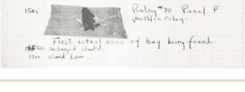

第一个 bug

## 4.2 问题求解：手工跟踪

手工跟踪是一种模拟代码执行的方法，你逐步执行指令并跟踪变量的值。

在编程提示 3.6 中，你学习了手工跟踪的方法。当你手工跟踪代码或伪代码时，你把变量名写在一张纸上，在脑中执行代码的每一步并更新变量。

最好把代码写在或打印在一张纸上。使用一个标记物（例如回形针）来标记当前行。每当变量发生变化时，划掉旧值，并在下方写下新值。当程序产生输出时，也把输出写在另一列中。

考虑这个例子。会显示什么值？

```cpp
int n = 1729;
int sum = 0;
while (n > 0)
{
    int digit = n % 10;
    sum = sum + digit;
    n = n / 10;
}
cout << sum << endl;
```

有三个变量：n、sum 和 digit。

| n | sum | digit |
|---|---|---|
| | | |

在进入循环之前，前两个变量分别初始化为 1729 和 0。

```cpp
int n = 1729;
int sum = 0;
while (n > 0)
{
    int digit = n % 10;
    sum = sum + digit;
    n = n / 10;
}
cout << sum << endl;
```

| n | sum | digit |
|---|---|---|
| 1729 | 0 | |
| | | |
| | | |
| | | |
| | | |
| | | |

因为 n 大于零，进入循环。变量 digit 被设为 9（1729 除以 10 的余数）。变量 sum 被设为 0 + 9 = 9。

```cpp
int n = 1729;
int sum = 0;
while (n > 0)
{
    int digit = n % 10;
    sum = sum + digit;
    n = n / 10;
}
cout << sum << endl;
```

| n | sum | digit |
|---|---|---|
| 1729 | 0 | |
| | 9 | 9 |
| | | |
| | | |
| | | |
| | | |

最后，n 变为 172。（回想一下，在 1729 / 10 的除法中，余数会被丢弃，因为两个操作数都是整数。）

划掉旧值，把新值写在旧值下面。

```cpp
int n = 1729;
int sum = 0;
while (n > 0)
{
    int digit = n % 10;
    sum = sum + digit;
    n = n / 10;
}
cout << sum << endl;
```

| n | sum | digit |
|---|---:|---:|
| 1729 | 0 | |
| 172 | 9 | 9 |

现在再次检查循环条件。

```cpp
int n = 1729;
int sum = 0;
while (n > 0)
{
    int digit = n % 10;
    sum = sum + digit;
    n = n / 10;
}
cout << sum << endl;
```

因为 n 仍然大于零，重复循环。现在 digit 变为 2，sum 被设为 9 + 2 = 11，n 被设为 17。

| n | sum | digit |
|---|---:|---:|
| 1729 | 0 | |
| 172 | 9 | 9 |
| 17 | 11 | 2 |

再次重复循环，将 digit 设为 7，sum 设为 11 + 7 = 18，n 设为 1。

| n | sum | digit |
|---|---:|---:|
| 1729 | 0 | |
| 172 | 9 | 9 |
| 17 | 11 | 2 |
| 1 | 18 | 7 |

最后一次进入循环。现在 digit 被设为 1，sum 为 19，n 变为零。

| n | sum | digit |
|---|---:|---:|
| 1729 | 0 | |
| 172 | 9 | 9 |
| 17 | 11 | 2 |
| 1 | 18 | 7 |
| 0 | 19 | 1 |

7. 手工跟踪以下代码，显示 n 的值和输出。你注意到什么潜在错误？

```cpp
int n = 1;
while (n <= 3)
{
    cout << n << ", ";
    n++;
}
```

8. 假设 a 为 2、n 为 4，手工跟踪以下代码。然后解释该代码对于任意 a 和 n 的值有什么作用。

```cpp
cpp
int r = 1;
int i = 1;
while (i <= n)
{
    r = r * a;
    i++;
}
```

9. 跟踪以下代码。你观察到什么错误？

```cpp
int n = 1;
while (n != 50)
{
    cout << n << endl;
    n = n + 10;
}
```

10. 以下伪代码旨在统计数字 n 的位数：

```text
count ← 1
temp ← n
while (temp > 10)
    Increment count.
    Divide temp by 10.
```

对 n = 123 和 n = 100 跟踪该伪代码。你发现了什么错误？

**动手练习** 现在你可以尝试本章末尾的这些练习：R4.1、R4.5。

## 4.3 for 循环

> 当某个值以固定的增量或减量从起点变化到终点时，使用 for 循环。

常常会出现这样的情况：你希望将一组语句执行给定的次数。你可以使用由计数器控制的 while 循环，如下例所示：

```cpp
counter = 1;  // Initialize the counter
while (counter <= 10)  // Check the counter
{
    cout << counter << endl;
    counter++;  // Update the counter
}
```

由于这种循环类型非常常见，所以有一种特殊形式，称为 for 循环（见语法 4.2）。

```cpp
for (counter = 1; counter <= 10; counter++)
{
    cout << counter << endl;
}
```

有些人把这种循环称为*计数控制*循环。相比之下，上一节的 while 循环可以称为*事件控制循环*，因为它会一直执行，直到某个事件发生（例如余额达到目标）。计数控制循环另一个常用术语是*确定次数*。你从一开始就知道循环体将执行确定的次数——在我们的例子中是十次。相比之下，你不知道需要多少次迭代才能累积到目标余额。这样的循环称为*不确定次数*循环。

for 循环将初始化、条件和更新表达式整齐地组合在一起。然而，重要的是要认识到，这些表达式*并不是*一起执行的（见图 3）。

- 初始化在进入循环之前执行一次。
- 每次迭代之前检查条件。
- 每次迭代之后执行更新。


*你可以把 for 循环想象成一系列有序的步骤。*

**图 3**  
for 循环的执行

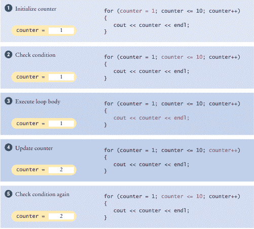


### 语法 4.2 — for 语句

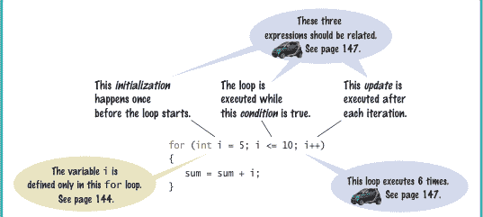

for 循环可以向下计数，而不是向上计数：

```java
for (counter = 10; counter >= 0; counter--) ...
```

递增或递减的步长不必为 1：

```java
for (counter = 0; counter <= 10; counter = counter + 2) ...
```

其他形式请参见第 146 页的表 2。

到目前为止，我们假设计数器变量已经在 for 循环之前定义。另一种做法是在循环初始化部分定义变量。这样的变量*只在循环中*定义：

```java
for (int counter = 1; counter <= 10; counter++)
{
   ...
} // counter 在此处不再定义
```

下面是 for 循环的一个典型用法。我们希望打印出储蓄账户在一段时间内的余额，如下表所示：

| 年份 | 余额 |
| :---: | :---: |
| 1 | 10500.00 |
| 2 | 11025.00 |
| 3 | 11576.25 |
| 4 | 12155.06 |
| 5 | 12762.82 |

for 循环模式适用于这种情况，因为变量 year 从 1 开始，然后以固定增量递增，直到达到目标值：

```text
for (int year = 1; year <= nyears; year++)
{
    Update balance.
    Print year and balance.
}
```

下面是完整的程序。图 4 展示了相应的流程图。

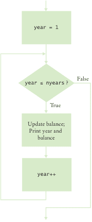

**图 4**  for 循环的流程图

### ch04/invtable.cpp

```cpp
#include <iostream>
#include <iomanip>

using namespace std;

int main()
{
    const double RATE = 5;
    const double INITIAL_BALANCE = 10000;
    double balance = INITIAL_BALANCE;
    int nyears;
    cout << "Enter number of years: ";
    cin >> nyears;

    cout << fixed << setprecision(2);
    for (int year = 1; year <= nyears; year++)
    {
        balance = balance * (1 + RATE / 100);
        cout << setw(4) << year << setw(10) << balance << endl;
    }

    return 0;
}
```

### 程序运行

```text
Enter number of years: 10
 1   10500.00
 2   11025.00
 3   11576.25
 4   12155.06
 5   12762.82
 6   13400.96
 7   14071.00
 8   14774.55
 9   15513.28
10   16288.95
```

**表 2 for 循环示例**

| **循环** | **i 的值** | **注释** |
| --- | --- | --- |
| `for (i = 0; i <= 5; i++)` | `0 1 2 3 4 5` | 注意，循环执行了 6 次。（参见第 147 页的编程提示 4.3。） |
| `for (i = 5; i >= 0; i--)` | `5 4 3 2 1 0` | 对递减的值使用 `i--`。 |
| `for (i = 0; i < 9; i = i + 2)` | `0 2 4 6 8` | 使用 `i = i + 2` 将步长设为 2。 |
| `for (i = 0; i != 9; i = i + 2)` | `0 2 4 6 8 10 12 14 ...`<br>（无限循环） | 可以使用 `<` 或 `<=` 代替 `!=`，从而避免这个问题。 |
| `for (i = 1; i <= 20; i = i * 2)` | `1 2 4 8 16` | 可以指定任意修改 `i` 的规则，例如让它在每一步中翻倍。 |
| `for (i = 0; i < str.length(); i++)` | `0 1 2 ...` 直到字符串 `str` 的最后一个有效索引 | 在循环体中，使用表达式 `str.substr(i, 1)` 获取包含第 i 个字符的字符串。 |

### 自我检查


- 11. 将 `invtable.cpp` 程序中的 for 循环改写为 while 循环。

- 12. 下面的循环会打印多少个数字？

  ```cpp
  for (int n = 10; n >= 0; n--)
  {
      cout << n << endl;
  }
  ```

- 13. 编写一个 for 循环，打印 10 到 20（包括 10 和 20）之间的所有偶数。

- 14. 编写一个 for 循环，计算从 1 到 n 的整数之和。

- 15. 如何修改 `invtable.cpp` 程序中的 for 循环，使其打印所有余额，直到投资额翻倍为止？

**练习**  现在你可以尝试本章末尾的以下练习：R4.2、R4.7、P4.12。

### 编程提示 4.1


**仅将 for 循环用于其预期用途**

for 循环是某种特定形式循环的*惯用写法*。一个值从起始值变化到结束值，并以固定的增量或减量变化。

编译器不会检查初始化表达式、条件表达式和更新表达式是否相互关联。例如，下面的循环是合法的：

```cpp
// 容易令人困惑——互不相关的表达式
for (cout << "Inputs: "; cin >> x; sum = sum + x)
{
    count++;
}
```

但是，阅读这种 for 循环的程序员会感到困惑，因为它不符合他们的预期。对于不符合 for 循环惯用形式的迭代，应使用 while 循环。

### 编程提示 4.2


**选择与任务相匹配的循环边界**

假设你想打印从 1 到 10 的行号。当然，你会希望使用如下循环：

```cpp
for (int i = 1; i <= 10; i++)
```

i 的值受关系 1 ≤ i ≤ 10 的限制。由于两个边界都使用了 ≤，所以称这些边界为*对称边界*。

遍历字符串中的字符时，使用下面的边界更加自然：

```cpp
for (int i = 0; i < str.length(); i++)
```

在这个循环中，i 遍历字符串中的所有有效位置。你可以使用 `str.substr(i, 1)` 访问第 i 个字符。i 的值受 0 ≤ i < str.length() 的限制，左侧使用 ≤，右侧使用 <。这是合适的，因为 length() 不是一个有效位置。这样的边界称为*非对称边界*。

在这种情况下，使用对称边界并不是一个好主意：

```cpp
for (int i = 0; i <= str.length() - 1; i++) // 使用 < 代替
```

非对称形式更容易理解。

### 编程提示 4.3


**计算迭代次数**

为一次迭代找出正确的下界和上界可能令人困惑。应该从 0 开始还是从 1 开始？终止条件中应该使用 ≤ 还是 <？

计算迭代次数是更好地理解循环的一个非常有用的方法。对于具有非对称边界的循环，计算会更容易。循环

```cpp
for (int i = a; i < b; i++)
```

会执行 b - a 次。例如，循环

```cpp
for (int i = 0; i < 10; i++)
```

会执行 10 次，i 的值依次为 0、1、2、3、4、5、6、7、8 和 9。

具有对称边界的循环

```cpp
for (int i = a; i <= b; i++)
```

会执行 b - a + 1 次。这个“+1”是许多编程错误的根源。

**图 5**  do 循环的流程图


### 自我检查

- 16. 假设我们希望检查输入是否至少为 0 且至多为 100。修改用于此检查的 do 循环。

- 17. 使用 while 循环重写输入检查。你的解决方案有什么缺点？

- 18. 假设 C++ 没有 do 循环。你能将任意 do 循环改写为 while 循环吗？

- 19. 编写一个读取整数并计算其总和的 do 循环。当读取到数值 0 时停止。

- 20. 编写一个读取正整数并计算其总和的 do 循环。当连续两次读取到相同的值时停止。例如，如果输入为 1 2 3 4 4，那么总和为 14，并且循环停止。

**练习**  现在你可以尝试本章末尾的以下练习：R4.8、R4.12、R4.13。

### 编程提示 4.4

**循环的流程图**


在第 3.5 节中，你学习了如何使用流程图来可视化程序的控制流。流程图中可以包含两种循环：它们分别对应 C++ 中的 while 循环和 do 循环。二者的区别在于条件的位置——条件位于循环体之前或之后。

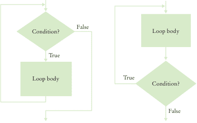

如第 3.5 节所述，应避免在流程图中出现“意大利面式代码”。对于循环来说，这意味着绝不能让箭头指向循环体内部。

## 4.5 处理输入

哨兵值表示一个数据集的结束，但它不属于数据的一部分。

在本节中，你将学习如何读取和处理一系列输入值。每当你读取一系列输入时，都需要有某种方法来表示序列的结束。有时情况比较简单，例如输入值不可能为零。此时，你可以提示用户继续输入数字，或者输入 0 来结束序列。如果允许输入 0，但不允许输入负数，则可以使用 -1 表示终止。用作终止信号的值称为哨兵值。


*在军事领域，哨兵负责守卫边境或通道。在计算机科学中，哨兵值表示输入序列的结束，或输入序列之间的边界。*

让我们在一个计算一组工资平均值的程序中应用这项技术。在示例程序中，我们将使用 -1 作为哨兵值。员工当然不会为了负数工资工作，但可能有免费工作的志愿者。

在循环内部，我们读取一个输入值。如果输入值不是 -1，就对其进行处理。为了计算平均值，我们需要所有工资的总和，以及输入值的数量。

```cpp
while (...)
{
    cin >> salary;
    if (salary != -1)
    {
        sum = sum + salary;
        count++;
    }
}
```

只要没有检测到哨兵值，我们就继续循环。

```cpp
while (salary != -1)
{
    ...
}
```

这里只存在一个问题：第一次进入循环时，还没有读取任何数据值。务必将 salary 初始化为某个不是哨兵值的数值：

```cpp
double salary = 0; // 除 -1 之外的任意值都可以
```

或者，使用 do 循环：

```cpp
do
{
    ...
}
while (salary != -1)
```


下面的程序会持续读取输入，直到用户输入哨兵值，然后计算并打印平均值。

### ch04/sentinel.cpp

```cpp
#include <iostream>

using namespace std;

int main()
{
    double sum = 0;
    int count = 0;
    double salary = 0;
    cout << "Enter salaries, -1 to finish: ";
    while (salary != -1)
    {
        cin >> salary;
        if (salary != -1)
        {
            sum = sum + salary;
            count++;
        }
    }
    if (count > 0)
    {
        double average = sum / count;
        cout << "Average salary: " << average << endl;
    }
    else
    {
        cout << "No data" << endl;
    }
    return 0;
}
```

### 程序运行

```text
Enter salaries, -1 to finish: 10 10 40 -1
Average salary: 20
```

数值哨兵只有在输入存在某种限制时才有效。不过，在许多情况下并没有这样的限制。假设你想要计算一个可能包含 0 或负值的数据集的平均值。那么你就不能使用 0 或 −1 来表示输入结束。

在这种情况下，你可以一直读取输入，直到输入失败。正如你在第 3.8 节中看到的，如果前一次输入失败，条件

```cpp
cin.fail()
```

就为真。例如，假设使用以下语句读取输入：

```cpp
double value;
cin >> value;
```

如果用户输入的值不是数字（例如 Q），输入就会失败。

你可以使用布尔变量来控制循环。在进入循环之前将变量设置为 true，然后将其设置为 false 以退出循环。

现在我们遇到了另一个复杂性。只有在进入循环并尝试读取输入之后，你才知道输入已经失败。要记住这次失败，可以使用一个布尔变量：

```cpp
cout << "Enter values, Q to quit: ";
bool more = true;
while (more)
{
    cin >> value;
    if (cin.fail())
    {
        more = false;
    }
    else
    {
        Process value.
    }
}
```

有些程序员不喜欢引入布尔变量来控制循环。第 153 页的专题 4.2 展示了另一种退出循环的机制。不过，在读取输入时，还有一种更简单的方法。表达式

```cpp
cin >> value
```

可以用在条件中。如果读取 value 后 cin 没有失败，该表达式的值就为 true。因此，你可以使用下面的循环读取并处理一组输入：

```cpp
cout << "Enter values, Q to quit: ";
while (cin >> value)
{
    Process value.
}
```

这个循环适合处理一组连续的输入。你将在第 8 章中进一步了解如何读取输入。

### 自我检查


- 21. 当程序提示输入值时，如果用户立即输入 −1，sentinel.cpp 程序会打印什么？
- 22. 为什么 sentinel.cpp 程序有两个形式为 `salary != −1` 的检查？
- 23. 如果将 sentinel.cpp 中 salary 变量的定义改为 `double salary = −1;`，会发生什么？
- 24. 我们提示用户“输入值，输入 Q 退出”。当用户输入其他字母时会发生什么？
- 25. 下面这个用于读取一系列值的循环有什么问题？

```cpp
cout << "Enter values, Q to quit: ";
while (!cin.fail())
{
    double value;
    cin >> value;
    sum += sum + value;
    count++;
}
```

**练习** 现在你可以尝试本章末尾的以下练习：R4.10、P4.6、P4.7。

## 专题 4.1

### 清除失败状态


当一次输入操作失败后，所有后续输入操作也会失败。如果你想读取两组数字序列，并使用字母作为哨兵值，就需要在读取第一个哨兵值后清除失败状态。调用 `clear` 函数：

```cpp
cout << "Enter values, Q to quit.\n";
while (cin >> values)
{
   Process input.
}
cin.clear();
```

假设用户输入了 `30 10 5 Q`。读取 `Q` 时导致了失败。由于只有成功处理的字符才会从输入中移除，因此字符 `Q` 仍然存在。将它读入一个虚拟变量：

```cpp
string sentinel;
cin >> sentinel;
```

现在你就可以继续读取更多输入。

## 专题 4.2

### 循环与半循环问题以及 `break` 语句


有些程序员不喜欢使用布尔变量控制的循环，例如：

```cpp
bool more = true;
while (more)
{
   cin >> value;
   if (cin.fail())
   {
      more = false;
   }
   else
   {
      Process value.
   }
}
```

循环终止的实际检查位于循环中间，而不是循环顶部。这被称为*循环与半循环*，因为必须进入循环的一半之后，才能知道是否需要终止循环。

作为替代方案，你可以使用保留字 `break`。

```cpp
while (true)
{
   cin >> value;
   if (cin.fail()) { break; }
   Process value.
}
```

`break` 语句会跳出其所在的循环，而不受循环条件影响。

在循环与半循环的情况下，使用 `break` 可能会有好处。不过，很难明确规定何时使用它是安全的，以及何时应当避免使用它。本书不使用 `break` 语句。

## 专题 4.3


### 输入和输出重定向

考虑一下计算输入序列平均值的哨兵程序。如果你使用这样的程序，那么很可能已经将这些值存储在文件中，此时还要把它们全部重新输入一遍就显得很麻烦。操作系统的命令行界面提供了一种将文件连接到程序输入的方法，就好像文件中的所有字符都是由用户实际输入的一样。如果你输入

```text
sentinel < numbers.txt
```

程序就会执行。它的输入指令不再期待从键盘读取输入。所有输入命令都从文件 numbers.txt 中获取输入。这个过程称为输入重定向。

输入重定向是测试程序的优秀工具。当你开发程序并修复其中的错误时，每次运行程序都重复输入相同内容是很乏味的。花几分钟将输入内容放入一个文件中，然后使用重定向。

你也可以重定向输出。在这个程序中，这并不是特别有用。如果运行

```text
sentinel < numbers.txt > output.txt
```

文件 output.txt 会包含输入提示和输出，例如：

```text
Enter a value, -1 to finish: Enter a value, -1 to finish:
Enter a value, -1 to finish: Enter a value, -1 to finish:
Average: 15
```

不过，对于会产生大量输出的程序，重定向输出显然非常有用。你可以打印包含输出的文件，或者在提交评分前对其进行编辑。

> 使用输入重定向从文件中读取输入。使用输出重定向将程序输出捕获到文件中。

## 4.6 问题解决：故事板

当你设计一个与用户交互的程序时，需要为这种交互制定计划。用户提供哪些信息，以及以什么顺序提供？程序将显示哪些信息，以及采用什么格式？发生错误时应该怎么办？程序何时退出？

这种规划类似于电影或电脑游戏的制作，在电影或电脑游戏中，人们使用故事板来规划动作序列。故事板由一系列面板组成，每个面板展示一个步骤的草图。注释解释正在发生的事情，并记录任何特殊情况。故事板也用于开发软件——参见图 6。

在开始设计程序时，制作故事板非常有帮助。你需要问自己：为了计算程序用户想要的答案，需要哪些信息？你还需要决定如何呈现这些答案。这些都是重要的考虑因素，应当在设计计算答案的算法之前确定下来。

让我们来看一个简单的例子。我们想编写一个程序，帮助用户解答诸如“1 品脱中有多少汤匙？”或“30 厘米是多少英寸？”之类的问题。

用户提供哪些信息？

- 要转换的数量和单位
- 要转换成的单位

> 故事板由动作序列中每个步骤的带注释草图组成。

> 制作故事板有助于你理解程序所需的输入和输出。


**图 6**  
Web 应用程序设计的故事板


如果不止一个数量呢？用户可能有一整张厘米值表格需要转换为英寸。

如果用户输入了我们程序无法处理的单位，例如埃（angstrom），该怎么办？

如果用户要求不可能的转换，例如英寸转换为加仑，该怎么办？

让我们从故事板面板开始。最好用不同颜色书写用户输入。（如果手边没有彩色笔，就在它们下面画线。）

```text
    Converting a Sequence of Values

    What unit do you want to convert from? cm
    What unit do you want to convert to? in
    Enter values, terminated by zero  ← Allows conversion of multiple values
    90
    30 cm = 11.81 in
    100
    100 cm = 39.37 in  ← Format makes clear what got converted
    0
    What unit do you want to convert from?
```

故事板展示了我们如何处理一种潜在混淆。一个想知道 30 厘米等于多少英寸的用户可能没有仔细阅读第一个提示，而指定了英寸。但随后输出是“30 in = 76.2 cm”，提醒用户注意这个问题。

故事板还引出一个问题。用户应该怎样知道“cm”和“in”是有效单位？“centimeter”和“inches”也能用吗？当用户输入错误单位时会发生什么？让我们再制作一个故事板来演示错误处理。

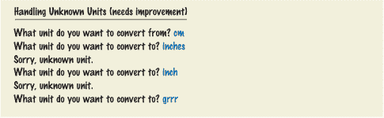

为了消除挫败感，最好列出用户可以提供的单位。

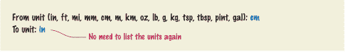

我们改用更短的提示，以便为所有单位名称腾出空间。练习 R4.17 探讨了另一种替代方案。

还有一个我们尚未解决的问题。用户如何退出程序？第一个故事板给人的印象是程序会永远运行下去。

我们可以在看到终止输入序列的哨兵值后询问用户。


从这个案例研究可以看出，故事板对于开发可运行的程序至关重要。你需要了解用户交互的流程，才能组织你的程序。


**26.** 为一个读取若干考试成绩并打印平均分的程序提供一个故事板面板。该程序只需要处理一组分数。不必担心错误处理。

- **27.** Google 有一个用于单位转换的简单界面。你只需输入问题，就能得到答案。


为一个 C++ 程序中的等效界面制作故事板。展示一切顺利的“顺利日”场景，并展示两类错误的处理。

- **28.** 考虑对自测题 26 中的程序进行修改。在计算平均值之前去掉最低分。为用户只提供一个分数的情况提供一个故事板。

- **29.** 在 C++ 中实现以下故事板有什么问题？


- **30.** 为一个程序制作故事板，该程序比较一笔 10,000 美元投资在给定年数内按两种利率增长的情况。

**实践练习**  现在你可以尝试本章末尾的这些练习：R4.17、R4.18、R4.19。

## 4.7 常见循环算法

在以下各节中，我们讨论一些最常见的以循环实现的算法。你可以将它们作为循环设计的起点。

### 4.7.1 求和与平均值

计算若干输入之和是一项非常常见的任务。维护一个*运行总和*：一个将每个输入值累加进去的变量。当然，总和应初始化为 0。

```cpp
double total = 0;
double input;
while (cin >> input)
{
    total = total + input;
}
```

要计算平均值，维护所有值的总和与计数。

要计算平均值，统计有多少个值，然后除以计数。务必检查计数不为零。

```cpp
double total = 0;
int count = 0;
double input;
while (cin >> input)
{
    total = total + input;
    count++;
}
double average = 0;
if (count > 0) { average = total / count; }
```

### 4.7.2 统计匹配项

要统计满足条件的值，检查所有值，并为每个匹配项递增计数器。

你常常想知道有多少个值满足特定条件。例如，你可能想统计一个字符串中有多少个空格。维护一个计数器，即一个初始化为 0 并在每次有匹配时递增的变量。

```cpp
int spaces = 0;
for (int i = 0; i < str.length(); i++)
{
    string ch = str.substr(i, 1);
    if (ch == " ")
    {
        spaces++;
    }
}
```

例如，如果 `str` 是字符串 `"My Fair Lady"`，则 `spaces` 会递增两次（当 `i` 为 2 和 7 时）。

注意，`spaces` 变量声明在循环之外。我们希望循环更新同一个变量。`ch` 变量声明在循环之内。每次迭代都会创建一个单独的变量，并在每次循环迭代结束时移除。

这个循环也可以用于扫描输入。下面的循环逐词读取文本，并统计字母数至多为三个的单词数量：

```cpp
int short_words = 0;
string input;
while (cin >> input)
{
    if (input.length() <= 3)
    {
        short_words++;
    }
}
```


*在统计匹配项的循环中，每当找到匹配项时，计数器就会递增。*

### 4.7.3 查找第一个匹配项

如果你的目标是找到匹配项，那么找到匹配项时就退出循环。

当统计满足条件的值时，你需要查看所有值。然而，如果你的任务是找到匹配项，那么一旦条件满足就可以停止。

下面是一个查找字符串中第一个空格的循环。因为我们不会访问字符串中的所有元素，所以 `while` 循环比 `for` 循环更合适：

```cpp
bool found = false;
int position = 0;
while (!found && position < str.length())
{
    string ch = str.substr(position, 1);
    if (ch == " ") { found = true; }
    else { position++; }
}
```


*搜索时，你会逐项查看，直到找到匹配项。*

如果找到匹配项，则 `found` 为 true，`position` 是第一个匹配项的索引。如果循环未找到匹配项，那么循环结束后 `found` 仍为 false。

在前面的示例中，我们在字符串中搜索满足条件的字符。你可以将同样的过程应用于用户输入。假设你要求用户输入一个小于 100 的正值。持续询问，直到用户提供正确的输入：

```cpp
bool valid = false;
double input;
while (!valid)
{
    cout << "Please enter a positive value < 100: ";
    cin >> input;
    if (0 < input && input < 100) { valid = true; }
    else { cout << "Invalid input." << endl; }
}
```

注意，变量 `input` 声明在 `while` 循环之外，因为你希望在循环结束后使用该输入。如果它声明在循环体内部，你就无法在循环之外使用它。

### 4.7.4 最大值与最小值

要找出最大值，每当看到更大的值时，就更新目前所见的最大值。

要计算序列中的最大值，维护一个存储目前已遇到的最大元素的变量，并在找到更大值时更新它：

```cpp
double largest;
cin >> largest;
double input;
while (cin >> input)
{
    if (input > largest)
    {
        largest = input;
    }
}
```

该算法要求至少有一个输入。

要找出最高的公交车乘客的身高，记住目前为止的最大值，并在看到更高的人时更新它。


要计算最小值，只需反转比较方向：

```cpp
double smallest;
cin >> smallest;
double input;
while (cin >> input)
{
    if (input < smallest)
    {
        smallest = input;
    }
}
```

### 4.7.5 比较相邻值

在循环中处理一系列值时，有时需要将一个值与其前一个值进行比较。例如，假设你想检查输入序列中是否包含相邻重复项，如 1 7 2 9 9 4 9。

现在你面临一个挑战。考虑用于读取值的典型循环：

```cpp
double input;
while (cin >> input)
{
    // Now input contains the current input
}
```

要比较相邻输入，请将前一个输入存储在变量中。

如何将当前输入与前一个输入进行比较？在任何时候，`input` 都包含当前输入，并覆盖前一个输入。答案是存储前一个输入，如下所示：

```cpp
double input;
double previous;
while (cin >> input)
{
    if (input == previous) { cout << "Duplicate input" << endl; }
    previous = input;
}
```


比较相邻的值时，需要将前一个值存储在一个变量中。


还有一个问题：当第一次进入循环时，`previous` 尚未被赋值。你可以在循环外先用一次输入操作来解决这个问题：

```cpp
double input;
double previous;
cin >> previous;
while (cin >> input)
{
    if (input == previous) { cout << "Duplicate input" << endl; }
    previous = input;
}
```


### 自测

- 31. 在 4.7.1 节的算法中，如果没有用户输入，计算得到的总和是多少？
- 32. 如何计算所有正输入的总和？
- 33. 在 4.7.3 节的算法中，如果没有找到匹配项，`position` 的值是多少？
- 34. 以下用于查找字符串中第一个空格位置的循环有什么问题？

```cpp
bool found = false;
for (int position = 0; !found && position < str.length(); position++)
{
    string ch = str.substr(position, 1);
    if (ch == " ") { found = true; }
}
```

- 35. 如何查找字符串中的最后一个空格？
- 36. 以下用于查找最小输入值的循环有什么问题？

```cpp
double smallest = 0;
double input;
while (cin >> input)
{
    if (input < smallest)
    {
        smallest = input;
    }
}
```

- 37. 在 4.7.5 节的算法中，如果完全没有输入，会发生什么？

**动手练习** 现在你可以尝试本章末尾的练习：P4.8、P4.13、P4.14。

## 4.8 嵌套循环

当一个循环的循环体内包含另一个循环时，这两个循环就是嵌套的。嵌套循环的一个典型用途是打印包含行和列的表格。

在 3.4 节中，你已经看到了如何嵌套两个 `if` 语句。类似地，复杂的迭代有时也需要嵌套循环：即一个循环位于另一个循环语句内部。在处理表格时，嵌套循环会自然出现。外层循环遍历表格的所有行，内层循环处理当前行中的各列。

在本节中，你将学习如何打印一个表格。为了简单起见，我们只打印幂 xⁿ，如下方表格所示。下面是打印该表格的伪代码：

```text
Print table header.
For x from 1 to 10
    Print table row.
    Print endl.
```

|   | x¹ | x² | x³ | x⁴ |
|---|---:|---:|---:|---:|
| 1 | 1 | 1 | 1 | 1 |
| 2 | 2 | 4 | 8 | 16 |
| 3 | 3 | 9 | 27 | 81 |
| … | … | … | … | … |
| 10 | 10 | 100 | 1000 | 10000 |

如何打印一行表格？你需要为每个指数打印一个值。这需要第二个循环：

```text
For n from 1 to 4
    Print xⁿ.
```

这个循环必须放在前面那个循环的内部。我们说内层循环嵌套在外层循环中（见图 7）。


**图 7**  
嵌套循环的流程图


- 38. 为什么 `cout << endl` 语句在外层循环中，而不在内层循环中？
- 39. 如果希望显示从 $x^0$ 到 $x^5$ 的所有幂，应如何修改程序？
- 40. 如果你做了自测 39 中的修改，会显示多少个值？
- 41. 下面的嵌套循环会显示什么？
- 42. 编写嵌套循环，生成如下方括号图案：

```cpp
for (int i = 0; i < 3; i++)
{
    for (int j = 0; j < 4; j++)
    {
        cout << i + j;
    }
    cout << endl;
}
```

```text
[][][][]
[][][][]
[][][][]
```

**动手练习** 现在你可以尝试本章末尾的练习：R4.23、P4.21、P4.22。

## 4.9 随机数与模拟

在模拟中，你使用计算机来模拟现实世界中的某种活动。你可以模拟一项活动，也可以通过调用随机数生成器引入随机性。

*模拟程序*使用计算机来模拟现实世界（或想象世界）中的某种活动。模拟通常用于预测气候变化、分析交通、挑选股票，以及科学和商业中的许多其他应用。在接下来的小节中，你将学习如何实现模拟，以对具有一定随机性的现象进行建模。

### 4.9.1 生成随机数

现实世界中的许多事件很难绝对精确地预测，但有时我们可以相当准确地了解其平均行为。例如，一家商店根据经验可能知道每五分钟来一位顾客。当然，这是一个平均值——顾客并不是每隔五分钟就来一次。为了准确地对顾客流量进行建模，你需要考虑这种随机波动。那么，如何在计算机中运行这样的模拟呢？

C++ 库中有一个*随机数生成器*，它产生的数字看起来完全是随机的。调用 `rand()` 会生成一个介于 0 和 `RAND_MAX` 之间的随机整数（`RAND_MAX` 是一个与实现相关的常量，通常（但不总是）是最大的有效 int 值）。再次调用 `rand()`，你会得到另一个不同的数字。`rand` 函数在 `<cstdlib>` 头文件中声明。

下面的程序调用了十次 rand 函数。

**ch04/random.cpp**

```cpp
#include <iostream>
#include <cstdlib>

using namespace std;

int main()
{
    for (int i = 1; i <= 10; i++)
    {
        int r = rand();
        cout << r << endl;
    }
    return 0;
}
```

### 程序运行结果

```text
1804289383
846930886
1681692777
1714636915
1957747793
424238335
719885386
1649760492
596516649
118964142
```

实际上，这些数字并不是完全随机的。它们来自很长时间内不会重复的数字序列。这些序列实际上由相当简单的公式计算得出；只是它们的行为像随机数而已。因此，它们通常被称为**伪随机数**。

试着再次运行这个程序。你会得到*完全相同的输出*！这证实了随机数是由公式生成的。然而，在运行模拟时，你并不总是希望得到相同的结果。为了解决这个问题，可以为随机数序列指定一个**种子（seed）**。每次使用新的种子，随机数生成器就会开始生成一个新的序列。种子通过 `srand` 函数设置。一个简单的种子值可以是当前时间：

```cpp
srand(time(0));
```

只需在程序中生成任何随机数之前调用一次即可。这样，每次程序运行生成的随机数都会不同。同时，还需要包含声明 time 函数的 `<ctime>` 头文件。

### 4.9.2 模拟掷骰子

在实际应用中，你需要将随机数生成器的输出转换为不同的范围。例如，要模拟掷一次骰子，你需要 1 到 6 之间的随机数。


以下是计算介于两个边界 `a` 和 `b` 之间的随机整数的通用方法。正如你在第 147 页的编程提示 4.3 中所知，从 `a` 到 `b`（包括边界值本身）共有 `b - a + 1` 个值。首先计算 `rand() % (b - a + 1)` 得到一个介于 0 和 `b - a` 之间的随机值，然后加上 `a`，得到介于 `a` 和 `b` 之间的随机值：

```cpp
int r = rand() % (b - a + 1) + a;
```

下面是一个模拟掷一对骰子的程序。

### **ch04/dice.cpp**

```cpp
#include <iostream>
#include <string>
#include <cstdlib>
#include <ctime>

using namespace std;

int main()
{
    srand(time(0));

    for (int i = 1; i <= 10; i++)
    {
        int d1 = rand() % 6 + 1;
        int d2 = rand() % 6 + 1;
        cout << d1 << " " << d2 << endl;
    }
    cout << endl;
    return 0;
}
```

### 程序运行结果

```text
5 1
2 1
1 2
5 1
1 2
6 4
4 4
6 1
6 3
5 2
```

### 4.9.3 蒙特卡洛方法

蒙特卡洛方法是一种巧妙的方法，用于为无法精确求解的问题找到近似解。（该方法以蒙特卡洛著名的赌场命名。）这里有一个典型例子：计算 π 的值很困难，但你可以通过下面的模拟很好地逼近它。

模拟向一个包含半径为 1 的圆的正方形投掷飞镖。这很容易：生成 −1 到 1 之间的随机 x 和 y 坐标。


如果生成的点位于圆内，我们就将其计为一次*命中*。当 $x^2 + y^2 \le 1$ 时就是这种情况。由于我们的投掷完全随机，我们期望*命中* / *尝试* 的比率近似等于圆与正方形的面积之比，即 $\pi / 4$。因此，我们对 $\pi$ 的估计值为 $4 \times \text{hits} / \text{tries}$。这种方法仅使用简单的算术就能得到 $\pi$ 的估计值。


要运行蒙特卡洛模拟，你必须在随机数生成方面多费一点功夫。掷骰子时，它必须出现六个面之一。然而，投掷飞镖时有许多可能的结果。你必须生成一个随机浮点值。

首先，生成以下值：

```cpp
double r = rand() * 1.0 / RAND_MAX; // Between 0 and 1
```

值 `r` 是介于 0 和 1 之间的随机浮点值。（你必须乘以 1.0，以确保 `/` 运算符的一个操作数是浮点数。）除法 `rand() / RAND_MAX` 将是整数除法——参见常见错误 2.3。

要生成介于 −1 和 1 之间的随机值，你可以计算：

```cpp
double x = -1 + 2 * r; // Between −1 and 1
```

由于 `r` 的范围从 0 到 1，`x` 的范围从 −1 + 2 × 0 = −1 到 −1 + 2 × 1 = 1。

下面是执行该模拟的程序。

### ch04/montecarlo.cpp

```cpp
#include <iostream>
#include <cstdlib>
#include <cmath>
#include <ctime>

using namespace std;

int main()
{
    const int TRIES = 10000;

    srand(time(0));

    int hits = 0;
    for (int i = 1; i <= TRIES; i++)
    {
        double r = rand() * 1.0 / RAND_MAX; // Between 0 and 1
        double x = -1 + 2 * r; // Between −1 and 1
        r = rand() * 1.0 / RAND_MAX;
        double y = -1 + 2 * r;
        if (x * x + y * y <= 1) { hits++; }
    }
    double pi_estimate = 4.0 * hits / TRIES;
    cout << "Estimate for pi: " << pi_estimate << endl;
    return 0;
}
```

### 程序运行

```text
Estimate for pi: 3.1504
```

- 43. 如何用 `rand` 函数模拟抛硬币？
- 44. 如何模拟随机抽取一张扑克牌？
- 45. 为什么 `dice.cpp` 文件包含 `<ctime>` 头文件？
- 46. 在许多游戏中，你掷一对骰子来得到 2 到 12 之间的值。下面这个模拟掷一对骰子的代码有什么问题？

  ```cpp
  int sum = rand() % 11 + 2;
  ```

- 47. 如何生成 0 到 100 之间的随机浮点数？

## 实践练习

现在你可以尝试本章末尾的这些练习：R4.24、P4.10、P4.25。


## 随机趣闻 4.2 — 软件盗版

读到此处，你已经编写过几个计算机程序，并且亲身经历过编写哪怕最简陋的程序需要付出多少努力。编写真正的软件产品，例如财务应用程序或计算机游戏，需要大量时间和金钱。如果没有合理的机会从付出中赚到更多钱，很少有人——更少有公司——会投入那样的时间和金钱。（实际上，一些公司免费赠送软件，希望用户升级到更精细的付费版本或支付咨询费用。另一些公司免费赠送使用户能够读取和使用文件的软件，但出售创建这些文件所需的软件。最后，还有些人出于热情捐献自己的时间，开发出你可以自由复制的程序。更多信息参见随机事实 9.2。）

销售软件时，公司必须依赖客户的诚实。不道德的人复制计算机程序而不付费是件很容易的事。在大多数国家，这是非法的。大多数政府提供法律保护，例如版权法和专利，以鼓励新产品开发。容忍广泛盗版的国家发现，它们有充足廉价的外国软件供应，却没有本地制造商愿意为本国公民设计优质软件，例如本地文字的处理器或适应当地税法的财务程序。

当软件的大众市场首次出现时，供应商对因盗版而损失的钱感到愤怒。他们试图通过各种方案反击，以确保只有合法所有者才能使用软件，例如加密狗——一种必须先连接到打印机端口才能运行软件的设备。合法用户讨厌这些措施。他们为软件付了费，却不得不忍受不便，例如多个加密狗从他们的计算机上伸出来。在美国，市场压力迫使大多数供应商放弃这些复制保护方案，但在世界其他地区它们仍然很常见。

由于盗版软件如此容易且成本低廉，而且被发现的可能性极小，你必须为自己做出道德选择。如果一套你非常想拥有的软件包对你的预算来说太贵，你会偷它，还是保持诚实，用更负担得起的产品将就？

当然，盗版并不限于软件。其他数字产品也会出现同样的问题。你可能曾有机会不付费就获得歌曲或电影的副本。或者你可能曾因音乐播放器上的复制保护装置而感到沮丧，它让你难以收听自己付费购买的歌曲。诚然，对于一个音乐团体，如果其出版商为他们似乎付出很少努力的作品收取高额费用——至少与设计和实现软件包所付出的努力相比——人们很难对其抱有太多同情。尽管如此，艺术家和作者因其付出而获得一些补偿似乎才是公平的。如何在不让诚实客户负担过重的情况下公平地支付艺术家、作者和程序员，在撰写本书时仍是一个未解决的问题，许多计算机科学家正在这一领域进行研究。


## 本章小结

### 解释循环中的执行流程。

- 循环在条件保持为真时重复执行一段代码。
- 差一错误是编写循环程序时常见的错误。通过简单的测试用例来思考，以避免这类错误。


### 使用手工跟踪技术分析程序的行为。


- 手工跟踪是对代码执行的一种模拟，你逐步执行指令并跟踪变量的值。
- 手工跟踪可以帮助你理解一个不熟悉的算法如何工作。
- 手工跟踪可以显示代码或伪代码中的错误。

### 使用 `for` 循环实现计数循环。


- 当某个值以固定增量或减量从起点变化到终点时，使用 `for` 循环。

### 在 `while` 循环和 `do` 循环之间选择。

- 当循环体必须至少执行一次时，`do` 循环是合适的。

### 实现读取输入数据序列的循环。

- 哨兵值表示数据集的结束，但它不是数据的一部分。
- 你可以使用布尔变量控制循环。在进入循环前将变量设为 true，然后将其设为 false 以离开循环。
- 使用输入重定向从文件读取输入。使用输出重定向将程序输出捕获到文件中。


### 使用故事板技术规划用户交互。

- 故事板由动作序列中每一步的带注释草图组成。
- 开发故事板有助于你理解程序所需的输入和输出。


### 了解最常见的循环算法。

- 要计算平均值，需保留所有值的总和与计数。
- 要统计满足条件的值，检查所有值，并为每个匹配项递增计数器。
- 如果目标是找到匹配项，则在找到匹配项时退出循环。
- 要找到最大值，每当看到更大的值时，就更新目前所见的最大值。
- 要比较相邻输入，请将前一个输入存储在变量中。

### 使用嵌套循环实现多级迭代。


- 当循环体包含另一个循环时，这些循环就是嵌套的。嵌套循环的典型用途是打印带行和列的表格。

### 将循环应用于模拟的实现。

- 在模拟中，你使用计算机模拟一项活动。可以通过调用随机数生成器引入随机性。


## 复习练习

**R4.1** 为这些循环提供跟踪表。

```
a. int i = 0; int j = 10; int n = 0;
   while (i < j) { i++; j--; n++; }

b. int i = 0; int j = 0; int n = 0;
   while (i < 10) { i++; n = n + i + j; j++; }

c. int i = 10; int j = 0; int n = 0;
   while (i > 0) { i--; j++; n = n + i - j; }

d. int i = 0; int j = 10; int n = 0;
   while (i != j) { i = i + 2; j = j - 2; n++; }
```

**R4.2** 这些循环会打印什么？

```
a. for (int i = 1; i < 10; i++) { cout << i << " "; }

b. for (int i = 1; i < 10; i += 2) { cout << i << " "; }

c. for (int i = 10; i > 1; i--) { cout << i << " "; }

d. for (int i = 0; i < 10; i++) { cout << i << " "; }

e. for (int i = 1; i < 10; i = i * 2) { cout << i << " "; }

f. for (int i = 1; i < 10; i++) { if (i % 2 == 0) { cout << i << " "; } }
```

**R4.3** 什么是无限循环？在你的计算机上，如何终止执行无限循环的程序？

**R4.4** 什么是“差一”错误？请从你自己的编程经验中给出一个例子。

**R4.5** 为练习 P4.9 中的伪代码编写程序跟踪，假设输入值为 47 −2 −5 0。

**R4.6** 以下代码合法吗？

```
for (int i = 0; i < 10; i++)
{
    for (int i = 0; i < 10; i++)
    {
        cout << i << " ";
    }
    cout << endl;
}
```

它会打印什么？这是良好的编码风格吗？如果不是，你会如何改进它？

**R4.7** 以下循环会执行多少次？假设循环体中未改变 i。

- a. `for (int i = 1; i <= 10; i++) ...`
- b. `for (int i = 0; i < 10; i++) ...`
- c. `for (int i = 10; i > 0; i--) ...`
- d. `for (int i = -10; i <= 10; i++) ...`
- e. `for (int i = 10; i >= 0; i++) ...`
- f. `for (int i = -10; i <= 10; i = i + 2) ...`
- g. `for (int i = -10; i <= 10; i = i + 3) ...`

**R4.8** 编写一个程序的伪代码，打印如下所示的日历：

| 日 | 一 | 二 | 三 | 四 | 五 | 六 |
|---:|---:|---:|---:|---:|---:|---:|
|   |   |   | 1 | 2 | 3 | 4 |
| 5 | 6 | 7 | 8 | 9 | 10 | 11 |
| 12 | 13 | 14 | 15 | 16 | 17 | 18 |
| 19 | 20 | 21 | 22 | 23 | 24 | 25 |
| 26 | 27 | 28 | 29 | 30 | 31 |   |

**R4.9** 编写一个程序的伪代码，打印如下所示的摄氏度/华氏度转换表：

| 摄氏度 | 华氏度 |
|---:|---:|
| 0 | 32 |
| 10 | 50 |
| 20 | 68 |
| ... | ... |
| 100 | 212 |

**R4.10** 编写一个程序的伪代码，读取一系列学生记录，并打印每个学生的总分。每条记录包含学生的名字和姓氏，随后是一系列测试分数以及哨兵值 −1。该序列以单词 END 终止。以下是一个示例序列：

```
Harry Morgan 94 71 86 95 -1
Sally Lin 99 98 100 95 90 -1
END
```

为这个示例输入提供一张跟踪表。

**R4.11** 将以下 for 循环改写为 while 循环。

```
int s = 0;
for (int i = 1; i <= 10; i++)
{
    s = s + i;
}
```

**R4.12** 将以下 do/while 循环改写为 while 循环。

```
int n;
cin >> n;
double x = 0;
double s;
do
{
    s = 1.0 / (1 + n * n);
    n++;
    x = x + s;
}
while (s > 0.01);
```

**R4.13** 提供以下循环的跟踪表。

- a.

```
int s = 1;
int n = 1;
while (s < 10) { s = s + n; }
n++;
```

- b.

```
int s = 1;
for (int n = 1; n < 5; n++) { s = s + n; }
```

- c.

```
int s = 1;
int n = 1;
do
{
    s = s + n;
    n++;
}
while (s < 10 * n);
```

**R4.14** 以下循环会打印什么？通过跟踪代码来得出答案，而不是使用计算机。

- a.

```
int s = 1;
for (int n = 1; n <= 5; n++)
{
    s = s + n;
    cout << s << " ";
}
```

- b.

```
int s = 1;
for (int n = 1; s <= 10; cout << s << " ")
{
    n = n + 2;
    s = s + n;
}
```

- c.

```
int s = 1;
int n;
for (n = 1; n <= 5; n++)
{
    s = s + n;
    n++;
}
cout << s << " " << n;
```

**R4.15** 以下程序段会打印什么？通过跟踪代码来找出答案，而不是使用计算机。

- a.

```cpp
int n = 1;
for (int i = 2; i < 5; i++) { n = n + i; }
cout << n;
```

- b.

```cpp
int i;
double n = 1 / 2;
for (i = 2; i <= 5; i++) { n = n + 1.0 / i; }
cout << i;
```

- c.

```cpp
double x = 1;
double y = 1;
int i = 0;
do
{
    y = y / 2;
    x = x + y;
    i++;
}
while (x < 1.8);
cout << i;
```

- d.

```cpp
double x = 1;
double y = 1;
int i = 0;
while (y >= 1.5)
{
    x = x / 2;
    y = x + y;
    i++;
}
cout << i;
```

**R4.16** 给出一个对称边界更自然的 for 循环示例。给出一个非对称边界更自然的 for 循环示例。

**R4.17** 为第 154 页第 4.6 节的转换程序添加一个故事板面板，展示用户输入不兼容单位的场景。

**R4.18** 在第 4.6 节中，我们决定在提示中向用户显示所有有效单位的列表。如果程序支持更多单位，这种方法就行不通。给出一个故事板面板，说明另一种方法：如果用户输入未知单位，则显示所有已知单位的列表。

**R4.19** 修改第 4.6 节中的故事板，以支持一个菜单，询问用户是要转换单位、查看程序帮助，还是退出程序。该菜单应在程序开始时、转换完一系列值后以及显示错误时显示。

**R4.20** 为执行第 4.6 节所述单位转换的程序绘制流程图。

**R4.21** 在第 4.7.4 节中，用于查找最大和最小输入的代码用输入值初始化最大和最小变量。为什么不能用零初始化它们？

**R4.22** 什么是嵌套循环？给出一个通常使用嵌套循环的示例。

**R4.23** 嵌套循环

```cpp
for (int i = 1; i <= height; i++)
{
    for (int j = 1; j <= width; j++) { cout << "*"; }
    cout << endl;
}
```

显示一个给定宽度和高度的矩形，例如

```
****
****
****
```

编写一个*单独的* for 循环来显示相同的矩形。

**R4.24** 假设你设计一个教育游戏来教孩子如何读钟表。你如何为小时和分钟生成随机值？

**R4.25** 在一次旅行模拟中，Harry 将拜访位于三个州之一的某位朋友。他在加利福尼亚有十个朋友，在内华达有三个，在犹他有两个。你如何生成一个 1 到 3 之间的随机数，表示目的地州，并使概率与每个州的朋友数量成比例？

## 编程练习

**P4.1** 编写带循环的程序来计算

- a. 2 到 100（含）之间所有偶数的和。
- b. 1 到 100（含）之间所有平方数的和。
- c. 从 2<sup>0</sup> 到 2<sup>20</sup> 的所有 2 的幂。
- d. a 和 b（含）之间所有奇数的和，其中 a 和 b 是输入。
- e. 一个输入中所有奇数数字的和。（例如，如果输入是 32677，则和为 3 + 7 + 7 = 17。）

**P4.2** 编写程序，读取一系列整数输入并打印

- a. 输入中的最小值和最大值。
- b. 偶数和奇数输入的数量。
- c. 累计总和。例如，如果输入是 1 7 2 9，程序应打印 1 8 10 19。
- d. 所有相邻重复项。例如，如果输入是 1 3 3 4 5 5 6 6 2，程序应打印 3 5 6。

**P4.3** 编写程序，将一行输入作为字符串读取并打印

- a. 字符串中仅大写字母。
- b. 字符串中的每隔一个字母。
- c. 将该字符串中的所有元音替换为下划线后的字符串。
- d. 字符串中元音的数量。
- e. 字符串中所有元音的位置。


### P4.4

完成第162页 How To 4.1 中的程序。你的程序应读取十二个温度值，并打印最高温度所在的月份。

### P4.5 信用卡卡号校验

信用卡卡号的最后一位是校验位，用于防止转录错误，例如单个数字出错或两位数字互换。以下方法用于验证实际的信用卡卡号，但为简单起见，我们将以8位数字而非16位数字的卡号来描述它：

- 从最右边的数字开始，将每隔一个的数字相加。例如，如果信用卡卡号是 43589795，则应计算 5 + 7 + 8 + 3 = 23。
- 将上一步未包含的每个数字加倍。然后将这些结果数字的各位数字相加。例如，对于上面给出的数字，从倒数第二位开始将数字加倍，得到 18 18 10 8。将这些值中的各位数字相加，得到 1 + 8 + 1 + 8 + 1 + 0 + 8 = 27。
- 将前两步的和相加。如果结果的最后一位是0，则卡号有效。在我们的例子中，23 + 27 = 50，因此该卡号有效。

编写一个实现此算法的程序。用户应提供一个8位数字，程序应输出该数字是否有效。如果无效，应输出能够使该数字有效的校验位的值。

### P4.6 货币兑换

编写一个程序，首先要求用户输入今天美元兑日元的汇率，然后读取美元值并将每个值转换为日元。使用0作为哨兵值。


### P4.7

编写一个程序，首先要求用户输入今天美元兑日元的汇率，然后读取美元值并将每个值转换为日元。使用0作为哨兵值表示美元输入的结束。然后程序读取一系列日元金额并将其转换为美元。第二个序列由另一个零值终止。

### P4.8

编写一个程序，读取一组浮点值。要求用户输入这些值，然后打印：

- 这些值的平均值。
- 这些值中的最小值。
- 这些值中的最大值。
- 极差，即最小值和最大值之间的差值。

当然，只能提示用户输入一次值。

### P4.15

编写一个程序，读取一个单词并打印所有子字符串，按长度排序。例如，如果用户输入 `"rum"`，程序将打印：

- r
- u
- m
- ru
- um
- rum

### P4.16

编写一个程序，读取一个数字并打印其所有*二进制数字*。打印余数 `number % 2`，然后用 `number / 2` 替换该数字。继续执行，直到数字为0。例如，如果用户提供输入13，输出应为：

- 1
- 0
- 1
- 1

### P4.17 平均值与标准差

编写一个程序，读取一组浮点数据值。选择一种适当的方式提示数据集结束。当所有值都读入后，打印值的个数、平均值和标准差。数据集 $\{x_1, \ldots, x_n\}$ 的平均值为 $\bar{x}=\sum x_i/n$，其中 $\sum x_i=x_1+\ldots+x_n$ 是输入值的总和。标准差为

$$s=\sqrt{\frac{\sum (x_i-\bar{x})^2}{n-1}}$$

然而，这个公式并不适合该任务。当程序计算出 $\bar{x}$ 时，各个 $x_i$ 早已不存在了。在你知道如何保存这些值之前，请使用数值稳定性较差的公式：

$$s=\sqrt{\frac{\sum x_i^2-\frac{1}{n}(\sum x_i)^2}{n-1}}$$

在处理输入值时，你可以通过跟踪计数、总和以及平方和来计算该值。

### P4.18 斐波那契数

*斐波那契数*由以下序列定义：

$$f_1=1$$

$$f_2=1$$

$$f_n=f_{n-1}+f_{n-2}$$

将其重新表述为：

```
fold1 = 1;
fold2 = 1;
fnew = fold1 + fold2;
```

之后，丢弃不再需要的 `fold2`，将 `fold2` 设置为 `fold1`，将 `fold1` 设置为 `fnew`。重复适当次数。

实现一个以这种方式计算斐波那契数的程序。


*斐波那契数列描述了兔子种群的增长。*

### P4.19 整数分解

编写一个程序，要求用户输入一个整数，然后打印出它的所有因子。例如，当用户输入150时，程序应打印：

```
2
3
5
5
```

### P4.20 质数

编写一个程序，提示用户输入一个整数，然后打印出不超过该整数的所有质数。例如，当用户输入20时，程序应打印：

```
2
3
5
7
11
13
17
19
```

回想一下，如果一个数除了1和它本身之外不能被任何数整除，那么它就是一个质数。

### P4.21

编写一个程序，打印如下所示的乘法表：

| 1 | 2 | 3 | 4 | 5 | 6 | 7 | 8 | 9 | 10 |
|---:|---:|---:|---:|---:|---:|---:|---:|---:|---:|
| 2 | 4 | 6 | 8 | 10 | 12 | 14 | 16 | 18 | 20 |
| 3 | 6 | 9 | 12 | 15 | 18 | 21 | 24 | 27 | 30 |
| ... | ... | ... | ... | ... | ... | ... | ... | ... | ... |
| 10 | 20 | 30 | 40 | 50 | 60 | 70 | 80 | 90 | 100 |

### P4.22

编写一个程序，读取一个整数，并使用星号显示一个实心正方形和一个空心正方形，两者并排放置。例如，如果边长为5，程序应显示：

```
***** *****
*****     *
*****     *
*****     *
***** *****
```

### P4.23

编写一个程序，读取一个整数，并使用星号显示给定边长的实心菱形。例如，如果边长为4，程序应显示：

```
   *
  ***
 *****
*******
 *****
  ***
   *
```

### P4.24 尼姆游戏

这是一个众所周知的游戏，有许多变体。以下变体有一种有趣的必胜策略。两名玩家轮流从一堆弹珠中取弹珠。每次行动时，玩家选择取多少颗弹珠。玩家至少取一颗，但最多只能取一半的弹珠。然后另一名玩家行动。取走最后一颗弹珠的玩家输。

你将编写一个程序，让计算机与人类对手对战。生成一个介于10和100之间的随机整数，以确定堆的初始大小。生成一个介于0和1之间的随机整数，以决定计算机还是人类先手。生成一个介于0和1之间的随机整数，以决定计算机是采用*聪明*模式还是*愚蠢*模式。在愚蠢模式下，计算机在轮到它时只是简单地从堆中取一个随机合法值（介于1和*n*/2之间）。

在聪明模式下，计算机取走足够多的弹珠，使堆的大小变成2的幂减1——即3、7、15、31或63。这总是一个合法移动，除非当前堆的大小恰好比2的幂少1。在这种情况下，计算机进行随机合法移动。

你会注意到，在聪明模式下，如果计算机先手，它是无法被击败的，除非堆的大小恰好是15、31或63。当然，先手并且知道必胜策略的人类玩家可以击败计算机。

### P4.25 醉汉漫步

在街道网格中，一个醉汉随机选择四个方向之一，跌跌撞撞地走到下一个路口，然后再次随机选择四个方向之一，如此反复。你可能会认为，平均而言，醉汉不会走很远，因为选择会相互抵消，但事实并非如此。

将位置表示为整数对 (*x*, *y*)。实现醉汉在100个路口之间的行走，并打印起点和终点位置。

### P4.26 蒙提霍尔悖论

玛丽莲·沃斯·萨万特在一本流行杂志上描述了以下问题，这个问题大致基于蒙提·霍尔主持的一个游戏节目：

“假设你在一个游戏节目中，有三扇门供你选择：其中一扇门后面是一辆车；另外两扇门后面是山羊。你选择了一扇门，比如说1号门，而知道每扇门后面是什么的主持人打开了另一扇门，比如说3号门，后面有一只山羊。然后他对你说：‘你想选择2号门吗？’改变你的选择对你有利吗？”

沃斯·萨万特女士证明这对你有利，但她的许多读者，包括一些数学教授，都不同意，他们认为打开另一扇门并不会改变概率。

你的任务是模拟这个游戏节目。在每次迭代中，随机在1到3之间选择一个门号来放置汽车。随机让玩家选择一扇门。随机让主持人选择两扇有山羊的门之一。如果玩家通过换到第三扇门获胜，则递增策略1的计数器；如果玩家通过坚持最初选择获胜，则递增策略2的计数器。运行1000次迭代，并打印两个计数器。

### P4.27 布丰投针实验

以下实验由法国博物学家乔治-路易·勒克莱尔·德·布丰伯爵（1707–1788）设计。将一根长度为1英寸的针投掷到画有间距为2英寸的平行线的纸上。如果针落在一条线上，我们将其计为一次*命中*。（参见图8。）布丰推测，*尝试次数*/*命中次数*的商近似于π。


**图 8** 布丰投针实验


在一个非常短的时间间隔内，速度 v 几乎保持不变，因此我们可以计算小球移动的距离：Δs = vΔt。在程序中，我们只需设置

```cpp
const double DELTA_T = 0.01;
```

并通过以下代码更新位置：

```cpp
s = s + v * DELTA_T;
```

速度会不断变化——事实上，它会受到地球引力的作用而减小。在一个短时间间隔内，Δv = −gΔt，因此我们必须按如下方式持续更新速度：

```cpp
v = v - g * DELTA_T;
```

在下一次迭代中，将使用新的速度来更新距离。

现在运行模拟，直到炮弹落回地面。将初速度作为输入（100 m/sec 是一个不错的值）。每秒更新位置和速度 100 次，但每经过完整的一秒才输出一次位置。同时输出精确公式 s(t) = −1/2 g t^2 + v0 t 的值，以便进行比较。

*注意：* 你可能会想，既然有精确公式，为什么还要进行这种模拟？实际上，微积分教材中的公式*并不精确*。事实上，炮弹距离地球表面越远，所受到的引力就越小。这使代数运算变得足够复杂，以至于无法给出实际运动的精确公式；但是，计算机模拟只需进行扩展，就可以应用可变的引力。对于炮弹而言，微积分教材中的公式实际上已经足够准确，但要计算弹道导弹等飞行高度更高的物体的精确轨迹，就必须使用计算机。


### 工程 P4.30

船体的一个简单模型如下：

$$|y| = \frac{B}{2}\left[1-\left(\frac{2x}{L}\right)^2\right]\left[1-\left(\frac{z}{T}\right)^2\right]$$

其中，B 是船宽，L 是船长，T 是吃水深度。


*（注意：对于每个 x 和 z，都有两个 y 值，因为船体从右舷到左舷是对称的。）*

在航海术语中，x 点处的横截面积称为“船肋剖面”。要计算该面积，让 z 从 0 变到 −T，并将其分成 n 个增量，每个增量的大小为 T/n。对于每个 z 值，计算 y 的值，然后将梯形条带的面积相加。右图显示了 n = 4 时的条带。


编写一个程序，读取 B、L、T、x 和 n 的值，然后输出 x 处的横截面积。

### 工程 P4.31

放射性材料的衰变可以用方程 $A = A_0 e^{-t(\log 2)/h}$ 建模，其中，A 是材料在时间 t 时的量，A_0 是时间为 0 时的量，而 h 是半衰期。

锝-99 是一种用于脑部成像的放射性同位素。它的半衰期为 6 小时。你的程序应在患者接受剂量后的 24 小时内，每隔一小时显示患者体内的相对含量 $A/A_0$。


### 工程 P4.32

左图中的照片展示了一种称为“变压器”的电子设备。变压器通常通过将线圈缠绕在铁氧体磁芯上制成。下图说明了手机和音乐播放器等各种音频设备中会出现的一种情况。在这个电路中，变压器用于将扬声器连接到音频放大器的输出端。


用于表示变压器的符号旨在体现两个线圈。变压器的参数 $n$ 称为变压器的“匝数比”。（导线缠绕磁芯形成线圈的次数称为线圈的匝数。匝数比实际上就是两个线圈匝数之比。）

在设计电路时，我们主要关注传送给扬声器的功率值——正是这些功率使扬声器产生我们想听到的声音。假设不使用变压器，而是将扬声器直接连接到放大器上。放大器可提供的一部分功率会传送到扬声器，剩余的可用功率则会损耗在放大器本身。将变压器加入电路，是为了提高放大器功率中传送给扬声器的比例。

传送给扬声器的功率 $P_s$ 使用以下公式计算：

$$P_s = R_s\left(\frac{nV_s}{n^2R_0 + R_s}\right)^2$$

这会得到正确的答案。数字 123 有 3 位数字。

| 计数 | n |
|---:|---:|
| 1 | 100 |
| 2 | 10 |

这会得到错误的答案。数字 100 同样有 3 位数字。循环条件应该是

```cpp
while (temp > 10)
```

- 11. ```cpp
int year = 1;
while (year <= nyears)
{
    balance = balance * (1 + RATE / 100);
    cout << setw(4) << year << setw(10) << balance << endl;
    year++;
}
```

- 12. 11 个数字：10 9 8 7 6 5 4 3 2 1 0

- 13. ```cpp
for (int i = 10; i <= 20; i = i + 2)
{
    cout << i << endl;
}
```

- 14. ```cpp
int sum = 0;
for (int i = 1; i <= n; i++)
{
    sum = sum + i;
}
```

- 15. ```cpp
for (int year = 1; balance <= 2 * INITIAL_BALANCE; year++)
```

不过，在这种情况下最好不要使用 for 循环，因为循环条件与 year 变量无关。使用 while 循环会是更好的选择。

- 16. ```cpp
do
{
    cout << "Enter a value between 0 and 100: ";
    cin >> value;
}
while (value < 0 || value > 100);
```

- 17. ```cpp
int value = 100;
while (value >= 100)
{
    cout << "Enter a value < 100: ";
    cin >> value;
}
```

这里必须使用一个人为设置的值初始化变量 value，以确保循环至少执行一次。

- 18. 是的。do 循环

```cpp
do { body } while (condition);
```

等价于以下 while 循环：

```cpp
bool first = true;
while (first || condition) { body; first = false; }
```

- 19. ```cpp
int x;
int sum = 0;
do
{
```

- 28. *一个分数不够*

```
Enter scores, 0 to quit: 90 0
Error: At least two scores are required.
(Program exits)
```

- 29. 使用截至目前所学的 C++ 特性，无法实现这种接口。程序没有办法知道第一组输入何时结束。（当你使用 `cin >> value` 读取数字时，可以自行决定将这些数字放在同一行还是多行中。）

- 30. *比较两个利率*

第一个利率（百分比）：5  
第二个利率（百分比）：10  
年数：5  

| 年份 | 5% | 10% |
|---:|---:|---:|
| 0 | 10000.00 | 10000.00 |
| 1 | 10500.00 | 11000.00 |
| 2 | 11025.00 | 12100.00 |
| 3 | 11576.25 | 13310.00 |
| 4 | 12155.06 | 14641.00 |
| 5 | 12762.82 | 16105.10 |

*这一行说明 1 表示第一年结束时的情况。*

- 31. 总和为零。

```cpp
double total = 0;
double input;
while (cin >> input)
{
    if (input > 0) { total = total + input; }
}
```

- 33. `position` 等于 `str.length()`。

- 34. 找到匹配项时循环会停止，但你无法访问该匹配项，因为 position 在循环外未定义。

- 35. 从字符串末尾开始循环：

```cpp
bool found = false;
int position = str.length() - 1;
while (!found && position >= 0)
{
    string ch = str.substr(position, 1);
    if (ch == " ") { found = true; }
    else { position--; }
}
```

- 36. 除非输入包含 0 或负数，否则最小值会被错误地计算为 0。

- 37. 执行 `cin >> previous` 时，`cin` 失败，previous 保持不变。语句 `cin >> input` 也会失败，因此 while 循环永远不会进入。

- 38. 内层循环中的所有值都应该显示在同一行上。


**39.** 将第14、19和31行改为 `for (int n = 0; n <= NMAX; n++)`。并将 `NMAX` 改为5。

**40.** 60：外层循环执行10次，内层循环执行6次。

**41.**
```
0123
1234
2345
```

**42.**
```cpp
for (int i = 1; i <= 3; i++)
{
    for (int j = 1; j <= 4; j++)
    {
        cout << "[]";
    }
    cout << endl;
}
```

**43.** 计算 `rand() % 2`，用0表示正面，1表示反面，或者反过来。

**44.** 计算 `rand() % 4`，将数字0到3与四种花色对应。然后计算 `rand() % 13`，将数字0到12与J、A、2到10、Q、K对应。

**45.** 调用时间函数时需要用到它。

**46.** 该调用会产生一个2到12之间的值，但所有值的概率相同。而掷一对骰子时，数字7出现的可能性是数字2的六倍。正确的公式是：

```cpp
int sum = rand() % 6 + rand() % 6 + 2;
```

**47.** `rand() * 100.0 / RAND_MAX`

# 第 5 章

# 函数


## 本章目标

- 能够实现函数
- 熟悉参数传递的概念
- 重视函数注释的重要性
- 制定将复杂任务分解为简单任务的策略
- 能够确定变量的作用域
- 识别何时使用值参数和引用参数

## 本章内容

- **5.1 函数作为黑盒** 194
- **5.2 实现函数** 196
  - *语法5.1:* 函数定义 197
  - *编程技巧5.1:* 函数注释 199
- **5.3 参数传递** 199
  - *编程技巧5.2:* 不要修改参数变量 201
- **5.4 返回值** 202
  - *常见错误5.1:* 缺少返回值 203
  - *专题5.1:* 函数声明 203
  - *如何做5.1:* 实现函数 204
  - *实例5.1:* 匹配和替换字符串的一部分 ⊕
  - *实例5.2:* 使用调试器 ⊕
- **5.5 无返回值的函数** 206
- **5.6 问题解决：可重用函数** 208
- **5.7 问题解决：逐步求精** 210
  - *编程技巧5.3:* 保持函数简短 216
  - *编程技巧5.4:* 跟踪函数 216
  - *编程技巧5.5:* 桩函数 217
  - *实例5.3:* 计算课程成绩 ⊕
- **5.8 变量作用域和全局变量** 218
  - *编程技巧5.6:* 避免使用全局变量 220
- **5.9 引用参数** 220
  - *编程技巧5.7:* 优先使用返回值而不是引用参数 225
  - *专题5.2:* 常量引用 225
- **5.10 递归函数（可选）** 226
  - *如何做5.2:* 递归思考 229
  - *冷知识5.1:* 个人电脑的爆炸式增长 230


**图2** pow函数作为黑盒

当另一个函数调用`pow`函数时，它会提供“输入”，例如调用`pow(2, 3)`中的表达式2和3。这些表达式称为**参数**。这个术语避免了与其他输入（例如人类用户提供的输入）混淆。类似地，pow函数计算出的“输出”称为**返回值**。函数可以有多个参数，但只能有一个返回值。

> 调用函数时提供参数。返回值是函数计算的结果。

请注意，函数的返回值是返回给调用函数的，而不是显示在屏幕上。例如，假设你的程序中有这样一条语句：

```cpp
double z = pow(2, 3);
```

当pow函数返回其结果时，返回值存储在变量`z`中。如果你希望显示该值，则需要添加类似`cout << z`的语句。

此时，你可能想知道pow函数是如何完成其工作的。例如，`pow(2, 3)`如何计算出2^3等于8？是通过2 × 2 × 2相乘吗？还是通过对数？幸运的是，作为函数的使用者，你*不需要知道*函数是如何实现的。你只需要知道函数的*规格说明*：如果你提供参数x和y，该函数返回x^y。工程师用**黑盒**这个术语来指代具有给定规格但实现未知的设备。你可以将pow视为一个黑盒，如图2所示。

当你设计自己的函数时，你会希望它们对其他程序员来说也表现为黑盒。这些程序员希望在不了解内部实现的情况下使用你的函数。即使你是唯一一个在某个程序上工作的人，将每个函数都变成黑盒也是值得的：你需要记住的细节就少了。


*虽然恒温器通常是白色的，但你可以将其视为一个黑盒。输入是期望温度，输出是发送给加热器或空调的信号。*

### 自检

- 1. 考虑函数调用`pow(3, 2)`。参数和返回值是什么？
- 2. 函数调用`pow(pow(2, 2), 2)`的返回值是什么？
- 3. C++标准库中的`ceil`函数接受单个参数`x`，并返回大于等于`x`的最小整数。`ceil(2.3)`的返回值是什么？
- 4. 即使不知道`ceil`函数是如何实现的，也可以确定自检3的答案。用一个工程术语来描述`ceil`函数的这一特性。

**练一练** 现在你可以尝试本章末尾的练习：R5.1、P5.1。

## 5.2 实现函数

在本节中，你将学习如何根据给定的规格实现函数。我们将使用一个非常简单的例子：一个计算给定边长立方体体积的函数。


*cube_volume函数使用给定的边长来计算立方体的体积。*

> 定义函数时，你要为该函数提供一个名称，为每个参数提供一个变量，并为结果提供一个类型。

编写此函数时，你需要：

- 为函数选择一个名称（`cube_volume`）。
- 为每个参数声明一个变量（double `side_length`）。这些变量称为**参数变量**。
- 指定返回值的类型（`double`）。

将所有信息组合在一起，形成函数定义的第一行：

```cpp
double cube_volume(double side_length)
```

接下来，指定函数的**主体**：即调用函数时执行的语句。

边长为s的立方体体积是s × s × s。然而，为了更清晰，我们的参数变量被命名为`side_length`，而不是`s`，所以我们需要计算`side_length * side_length * side_length`。

我们将把这个值存储在一个名为`volume`的变量中：

```cpp
double volume = side_length * side_length * side_length;
```

为了返回函数的结果，使用return语句：

```cpp
return volume;
```

函数的主体用花括号括起来。完整的函数如下：

```cpp
double cube_volume(double side_length)
{
    double volume = side_length * side_length * side_length;
    return volume;
}
```

return语句将函数的结果返回给调用者。


让我们来使用这个函数。我们将提供一个调用cube_volume函数两次的main函数。

```cpp
int main()
{
    double result1 = cube_volume(2);
    double result2 = cube_volume(10);
    cout << "A cube with side length 2 has volume " << result1 << endl;
    cout << "A cube with side length 10 has volume " << result2 << endl;

    return 0;
}
```

当函数以不同的参数调用时，函数会返回不同的结果。考虑调用cube_volume(2)。参数2对应于`side_length`参数变量。因此，在这次调用中，`side_length`为2。函数计算`side_length * side_length * side_length`，即2 * 2 * 2。当函数以不同的参数（例如10）调用时，函数计算10 * 10 * 10。

现在我们将两个函数组合成一个测试程序。因为main调用了cube_volume，所以必须在定义main函数之前知道cube_volume函数。这很容易实现，只需将cube_volume放在源文件的开头，将main放在最后即可。（有关替代方案，请参见第203页的专题5.1。）

### 语法 5.1 — 函数定义


下面是完整的程序。请注意描述函数行为的注释。（第 199 页的编程技巧 5.1 描述了注释的格式。）

### ch05/cube.cpp

```cpp
#include <iostream>

using namespace std;

/**
  Computes the volume of a cube.
  @param side_length the side length of the cube
  @return the volume
*/
double cube_volume(double side_length)
{
    double volume = side_length * side_length * side_length;
    return volume;
}

int main()
{
    double result1 = cube_volume(2);
    double result2 = cube_volume(10);
    cout << "A cube with side length 2 has volume " << result1 << endl;
    cout << "A cube with side length 10 has volume " << result2 << endl;

    return 0;
}
```

### 程序运行结果

```text
A cube with side length 2 has volume 8
A cube with side length 10 has volume 1000
```


- 5. `cube_volume(3)` 的值是多少？
- 6. `cube_volume(cube_volume(2))` 的值是多少？
- 7. 通过调用 `pow` 函数，为 `cube_volume` 函数体提供另一种实现方式。
- 8. 定义一个函数 `square_area`，用于计算给定边长的正方形的面积。
- 9. 考虑下面这个函数：
  
  ```cpp
  int mystery(int x, int y)
  {
      double result = (x + y) / (y - x);
      return result;
  }
  ```
  
  调用 `mystery(2, 3)` 的结果是什么？

**练习**  现在可以尝试本章末尾的以下练习：R5.2、P5.2、P5.7。


- `cube_volume` 函数的参数变量 `side_length` 被创建。❶
- 参数变量被初始化为调用中传入的实参值。在本例中，`side_length` 被设置为 2。❷
- 函数计算表达式 `side_length * side_length * side_length`，其值为 8。该值被存储在变量 `volume` 中。❸
- 函数返回。它的所有变量都被移除。返回值被传递给调用者，也就是调用 `cube_volume` 函数的函数。❹

现在考虑后续调用 `cube_volume(10)` 时会发生什么。一个新的参数变量被创建。（请记住，第一次调用 `cube_volume` 返回时，之前的参数变量已经被移除。）它被初始化为实参 10，然后重复这一过程。第二次函数调用完成后，其中的变量也会被移除。

与其他变量一样，参数变量只能被设置为兼容类型的值。例如，`cube_volume` 函数的参数变量 `side_length` 的类型是 double。调用 `cube_volume(2.0)` 或 `cube_volume(2)` 都是有效的。在后一个调用中，整数 2 会自动转换为 double 值 2.0。但是，调用 `cube_volume("two")` 是不合法的。


### 自测 10.

这个程序会打印什么？使用类似图 3 的示意图来找出答案。

```cpp
double mystery(int x, int y)
{
    double z = x + y;
    z = z / 2.0;
    return z;
}

int main()
{
    int a = 4;
    int b = 7;
    cout << mystery(a, b) << endl;
}
```

- 11. 这个程序会打印什么？使用类似图 3 的示意图来找出答案。

  ```cpp
  int mystery(int x)
  {
      int y = x * x;
      return y;
  }

  int main()
  {
      int a = 4;
      cout << mystery(a + 1) << endl;
  }
  ```

- 12. 下面的程序会打印什么？使用类似图 3 的示意图来找出答案。

  ```cpp
  int mystery(int n)
  {
      n++;
      n++;
      return n;
  }

  int main()
  {
      int a = 5;
      cout << mystery(a) << endl;
  }
  ```

**练习**  现在可以尝试本章末尾的以下练习：R5.5、P5.10。

## 编程技巧 5.2

### 不要修改参数变量

在 C++ 中，参数变量与其他变量一样。你*可以*在函数体中修改参数变量的值。例如：


```cpp
int total_cents(int dollars, int cents)
{
    cents = dollars * 100 + cents; // Modifies parameter variable
    return cents;
}
```

但是，许多程序员认为这种做法容易造成混淆。它将参数（函数的输入）与变量（值的存储空间）这两个概念混合在了一起。为了避免混淆，只需引入一个单独的变量：

```cpp
int total_cents(int dollars, int cents)
{
    int result = dollars * 100 + cents;
    return result;
}
```

## 5.4 返回值

return 语句终止函数调用，并产生函数结果。

使用 return 语句可以指定函数的结果。处理 return 语句时，函数会*立即*退出。这种行为便于在函数开头处理异常情况：

```cpp
double cube_volume(double side_length)
{
    if (side_length < 0) return 0;
    double volume = side_length * side_length * side_length;
    return volume;
}
```

如果使用负值调用 `side_length`，函数就会返回 0，并且不会执行函数的其余部分。（参见图 4。）

在前面的示例中，每条 return 语句都返回了一个常量或变量。实际上，return 语句可以返回任意表达式的值。与其将返回值保存到变量中再返回该变量，通常不如省略这个变量，直接返回更复杂的表达式：

```cpp
double cube_volume(double side_length)
{
    return side_length * side_length * side_length;
}
```

函数的每个分支都返回一个值非常重要。考虑下面这个错误的函数：

```cpp
double cube_volume(double side_length)
{
    if (side_length >= 0)
    {
        return side_length * side_length * side_length;
    } // Error
}
```

假设你使用负的边长调用 `cube_volume`。当然，你不应该这样调用，但这可能会因编程错误而发生。由于 if 条件不成立，return 语句不会被执行。然而，函数必须返回*某些内容*。根据具体情况，编译器可能会


**图 4**  return 语句会立即退出函数

将此标记为错误，或者函数可能会返回一个随机值。通过返回某个安全值来防止这个问题：

```cpp
double cube_volume(double side_length)
{
    if (side_length >= 0)
    {
        return side_length * side_length * side_length;
    }
    return 0;
}
```

每个函数的最后一条语句都应该是 return 语句。这样可以确保函数执行到末尾时会返回某个值。

## 常见错误 5.1


### 缺少返回值

函数始终需要返回某些内容。如果函数代码包含多个分支，请确保每个分支都返回一个值：

```cpp
int sign(double x)
{
    if (x < 0) { return -1; }
    if (x > 0) { return 1; }
    // Error: missing return value if x equals 0
}
```

这个函数计算一个数的符号：负数为 −1，正数为 +1。但是，如果实参为零，则不会返回任何值。在这种情况下，大多数编译器都会发出警告；但如果忽略该警告，并且函数曾经使用实参 0 被调用，就会返回一个随机值。

## 专题 5.1


### 函数声明

调用编译器不了解的函数会导致编译时错误，就像使用未定义变量一样。你可以在首次使用所有函数之前定义它们，从而避免此错误。先定义较低层级的辅助函数，然后定义中层级的核心函数，最后在程序中定义 `main`。

一些程序员更喜欢在程序中首先列出 `main` 函数。如果你也有这种偏好，就需要学习如何在程序顶部声明其他函数。函数声明会列出返回类型、函数名和参数变量，但不包含函数体：

```cpp
double cube_volume(double side_length);
```

这是一则声明，表示该函数已在其他位置实现。区分声明和定义很容易：声明以分号结尾，而定义后面跟着一个 `{...}` 代码块。声明也称为原型。

在函数原型中，参数名称是可选的。你也可以写成：

```cpp
double cube_volume(double);
```

不过，最好包含参数名称，以便说明每个参数的用途。

`pow` 等常用函数的声明包含在头文件中。如果查看 `<cmath>` 的内容，就会发现 `pow` 和其他数学函数的声明。


在我们的例子中，参数是金字塔的高度和底边长度。此时，我们已经有了足够的信息来为函数编写文档：

```text
/**
 * 计算底面为正方形的金字塔的体积。
 * @param height 金字塔的高度
 * @param base_length 金字塔底面一条边的长度
 * @return 金字塔的体积
 */
```

### 第 3 步

确定参数变量和返回值的类型。

高度和底边长度都可以是浮点数。因此，我们将两个参数变量的类型都选择为 `double`。计算出的体积也是浮点数，因此返回类型为 `double`。所以，函数将被定义为

```cpp
double pyramid_volume(double height, double base_length)
```

### 第 4 步

编写伪代码以获得所需结果。

在大多数情况下，函数需要执行几个步骤才能找到所需答案。你可能需要使用数学公式、分支或循环。用伪代码表达你的函数。

通过互联网搜索可以得知，金字塔的体积计算公式为

**体积 = 1/3 × 高度 × 底面积**

由于底面是正方形，我们有

**底面积 = 底边长度 × 底边长度**

利用这两个公式，我们可以根据参数变量计算出体积。

### 第 5 步

实现函数体。

在我们的示例中，函数体非常简单。注意使用 `return` 语句返回结果。

```cpp
{
    double base_area = base_length * base_length;
    return height * base_area / 3;
}
```

### 第 6 步

测试你的函数。

实现函数后，你应该单独测试它。这种测试称为**单元测试**。手工设计测试用例，并确保函数产生正确的结果。例如，对于一个高度为 9、底边长度为 10 的金字塔，我们期望体积为 1/3 × 9 × 100 = 300。如果高度为 0，我们期望体积为 0。

```cpp
int main()
{
    cout << "Volume: " << pyramid_volume(9, 10) << endl;
    cout << "Expected: 300";
    cout << "Volume: " << pyramid_volume(0, 10) << endl;
    cout << "Expected: 0";
    return 0;
}
```

输出确认该函数按预期工作：

```text
Volume: 300
Expected: 300
Volume: 0
Expected: 0
```

## 工作示例 5.1 — 匹配和替换字符串的一部分


本工作示例创建了一个函数，用于查找一个字符串在给定字符串中的首次出现，并将其替换为另一个字符串。

## 工作示例 5.2 — 使用调试器


在本工作示例中，你将学习如何使用调试器来查找程序中的错误。

## 5.5 无返回值的函数

使用 `void` 返回类型来表示函数不返回值。

有时，你需要执行一系列不产生值的指令。如果该指令序列多次出现，你会希望将其封装到一个函数中。在 C++ 中，使用 `void` 返回类型来表示没有返回值。这里有一个典型的例子。你的任务是将一个字符串打印在框中，如下所示：

```
------
!Hello!
------
```


*`void` 函数不返回值，但它可以产生输出。*

但是，可以替换不同的字符串来代替 Hello。这个任务的函数可以定义如下：

```cpp
void box_string(string str)
```

现在，你按照通常的方式开发函数体，即制定一个解决该任务的通用方法。

- 打印一行包含 `-` 字符 `n + 2` 次的行，其中 `n` 是字符串的长度。
- 打印一行包含该字符串的行，左右两边用 `!` 包围。
- 再打印一行包含 `-` 字符 `n + 2` 次的行。

以下是函数实现：

```cpp
/**
   在框中打印一个字符串。
   @param str 要打印的字符串
*/
void box_string(string str)
{
```

## 5.6 问题解决：可重用函数

> 通过定义函数来消除重复的代码或伪代码。

你已经使用了 C++ 标准库中的许多函数。这些函数作为标准 C++ 的一部分提供，以便程序员无需重新创建它们。当然，C++ 库并不能覆盖所有可以想到的需求。通过设计自己的函数，你通常可以节省时间，这些函数可以用于多个问题。

当你在同一程序中或在不同的程序中多次编写几乎相同的代码或伪代码时，请考虑引入一个函数。下面是一个典型的代码重复示例：

```
int hours;
do
{
    cout << "Enter a value between 0 and 23: ";
    cin >> hours;
}
while (hours < 0 || hours > 23);

int minutes;
do
{
    cout << "Enter a value between 0 and 59: ";
    cin >> minutes;
}
while (minutes < 0 || minutes > 59);
```

这段程序读取两个变量，并确保每个变量都在一定范围内。很容易将共同行为提取到一个函数中：

```
/**
    提示用户输入一个不超过给定最大值的值，直到用户
    提供有效输入。
    @param high 允许的最大输入值
    @return 用户提供的值（介于 0 和 high 之间，包括两端）
*/
int read_int_up_to(int high)
{
    int input;
    do
    {
        cout << "Enter a value between 0 and " << high << ": ";
        cin >> input;
    }
    while (input < 0 || input > high);
    return input;
}
```

然后使用这个函数两次：

```
int hours = read_int_up_to(23);
int minutes = read_int_up_to(59);
```

我们现在已经消除了循环的重复——它只出现一次，在函数内部。

请注意，该函数可以在需要读取整数值的其他程序中重用。但是，我们应该考虑到最小值不一定总是为零的情况。

*当多次执行相同的任务时，使用函数。*


> > 设计可重用的函数。为函数重用时可能变化的值提供参数变量。

下面是一个更好的替代方案：

```cpp
/*
   提示用户输入一个给定范围内的值，直到用户
   提供有效输入。
   @param low 允许的最小输入值
   @param high 允许的最大输入值
   @return 用户提供的值（介于 low 和 high 之间，包括两端）
*/
int read_int_between(int low, int high)
{
   int input;
   do
   {
      cout << "Enter a value between " << low << " and " << high << ": ";
      cin >> input;
   }
   while (input < low || input > high);
   return input;
}
```

在我们的程序中，我们调用

`int hours = read_int_between(0, 23);`

另一个程序可以调用

`int month = read_int_between(1, 12);`

一般来说，你需要为函数重用时可能变化的值提供参数变量。


18. 考虑以下语句：

    ```cpp
    int total_pennies = static_cast<int>(100 * total + 0.5);
    int total_tax_pennies = static_cast<int>(100 * total * tax_rate + 0.5);
    ```

19. 考虑这段在页面的左侧或右侧打印页码的代码：

    ```cpp
    if (page % 2 == 0) { cout << page << endl; }
    else { cout << setw(80) << page << endl; }
    ```

    引入一个返回类型为 `bool` 的函数，使 if 语句中的条件更容易理解。


**图 5** 冲咖啡解决方案的流程图

打印支票时，通常将支票金额既写成数字（“$274.15”），也写成文本字符串（“two hundred seventy four dollars and 15 cents”）。这样做可以减少收款人在金额前面添加几位数字的诱惑。

对人来说，这并不特别困难，但计算机如何做到这一点？没有内置函数可以将 274 转换为“two hundred seventy four”。我们需要编写这个函数。以下是我们想编写的函数的描述：


```cpp
/**
   将数字转换为其英文名称。
   @param number 一个小于 1,000 的正整数
   @return 数字的名称（例如，“two hundred seventy four”）
*/
string int_name(int number)
```


当你发现自己需要一个函数时，先写下参数变量和返回值的描述。

这个函数如何完成它的工作？我们先来看一个简单的情况。如果数字在 1 到 9 之间，我们需要计算出 "one" ... "nine"。事实上，我们需要对百位（*two hundred*）*再次* 进行相同的计算。利用逐步分解的过程，我们为这个更简单的任务设计了另一个函数。同样，我们没有直接实现该函数，而是先编写注释：

```cpp
/*
    Turns a digit into its English name.
    @param digit an integer between 1 and 9
    @return the name of digit ("one" ... "nine")
*/
string digit_name(int digit)
```

一个函数可能需要更简单的函数来完成其工作。

这听起来实现起来很简单，使用一个带有九个分支的 if 语句即可。完成 *digit_name* 函数应该不需要其他函数，所以我们稍后再处理实现细节。

10 到 19 之间的数字是特殊情况。让我们用一个单独的函数 *teen_name* 将它们转换为字符串 "eleven"、"twelve"、"thirteen" 等等：

```cpp
/*
    Turns a number between 10 and 19 into its English name.
    @param number an integer between 10 and 19
    @return the name of the number ("ten" ... "nineteen")
*/
string teen_name(int number)
```

接下来，假设数字在 20 到 99 之间。然后我们将十位显示为 "twenty"、"thirty"、...、"ninety"。为了简单和一致，把该计算放入一个单独的函数中：

```cpp
/*
    Gives the name of the tens part of a number between 20 and 99.
    @param number an integer between 20 and 99
    @return the name of the tens part of the number ("twenty" ... "ninety")
*/
string tens_name(int number)
```

现在假设数字至少为 20 且最多为 99。如果该数字能被 10 整除，我们使用 *tens_name*，然后就完成了。否则，我们用 *tens_name* 打印十位，用 *digit_name* 打印个位。如果数字在 100 到 999 之间，则我们显示一个数字、单词 "hundred" 以及如前所述的余数。

下面是对该算法的伪代码描述：

```text
part = number (The part that still needs to be converted)
name = "" (The name of the number)

if part >= 100
    name = name of hundreds in part + " hundred"
    Remove hundreds from part.

if part >= 20
    Append tens_name(part) to name.
    Remove tens from part.
else if part >= 10
    Append teen_name(part) to name.
    part = 0

if (part > 0)
    Append digit_name(part) to name.
```

这段伪代码相对于口头描述有许多重要的改进。它展示了如何安排测试，先从与较大数字的比较开始，并展示了较小的数字随后如何在后续的 if 语句中被处理。

另一方面，这段伪代码对于各部分的实际转换是模糊的，只是提到了“百位的名称”等等。此外，我们对空格的处理也比较模糊。照现在的样子，代码会产生没有空格的字符串，例如 twohundredseventyfour。与主问题的复杂性相比，人们会希望空格只是一个次要问题。最好不要用次要细节把伪代码弄乱。

现在把伪代码转换成真正的代码。最后三种情况很容易，因为已经为它们开发了辅助函数：

```cpp
if (part >= 20)
{
    name = name + " " + tens_name(part);
    part = part % 10;
}
else if (part >= 10)
{
    name = name + " " + teen_name(part);
    part = 0;
}

if (part > 0)
{
    name = name + " " + digit_name(part);
}
```

最后，让我们处理 100 到 999 之间的数字。因为 part < 1000，part / 100 是一位数，我们通过调用 digit_name 获取其名称。然后我们添加 "hundred" 后缀：

```cpp
if (part >= 100)
{
    name = digit_name(part / 100) + " hundred";
    part = part % 100;
}
```

现在你已经看到了 int_name 函数的所有重要构建块。下面是完整的程序：

### ch05/intname.cpp

```cpp
#include <iostream>
#include <string>

using namespace std;

/**
    Turns a digit into its English name.
    @param digit an integer between 1 and 9
    @return the name of digit ("one" ... "nine")
*/
string digit_name(int digit)
{
    if (digit == 1) return "one";
    if (digit == 2) return "two";
    if (digit == 3) return "three";
    if (digit == 4) return "four";
    if (digit == 5) return "five";
    if (digit == 6) return "six";
    if (digit == 7) return "seven";
    if (digit == 8) return "eight";
    if (digit == 9) return "nine";
    return "";
}

/**
 * Turns a number between 10 and 19 into its English name.
 * @param number an integer between 10 and 19
 * @return the name of the given number (“ten” ... “nineteen”)
 */
string teen_name(int number)
{
    if (number == 10) return "ten";
    if (number == 11) return "eleven";
    if (number == 12) return "twelve";
    if (number == 13) return "thirteen";
    if (number == 14) return "fourteen";
    if (number == 15) return "fifteen";
    if (number == 16) return "sixteen";
    if (number == 17) return "seventeen";
    if (number == 18) return "eighteen";
    if (number == 19) return "nineteen";
    return "";
}

/**
 * Gives the name of the tens part of a number between 20 and 99.
 * @param number an integer between 20 and 99
 * @return the name of the tens part of the number (“twenty” ... “ninety”)
 */
string tens_name(int number)
{
    if (number >= 90) return "ninety";
    if (number >= 80) return "eighty";
    if (number >= 70) return "seventy";
    if (number >= 60) return "sixty";
    if (number >= 50) return "fifty";
    if (number >= 40) return "forty";
    if (number >= 30) return "thirty";
    if (number >= 20) return "twenty";
    return "";
}

/**
 * Turns a number into its English name.
 * @param number a positive integer < 1,000
 * @return the name of the number (e.g. “two hundred seventy four”)
 */
string int_name(int number)
{
    int part = number;  // The part that still needs to be converted
    string name; // The return value

    if (part >= 100)
    {
        name = digit_name(part / 100) + " hundred";
        part = part % 100;
    }

    if (part >= 20)
    {
        name = name + " " + tens_name(part);
        part = part % 10;
    }
    else if (part >= 10)
    {
        name = name + " " + teen_name(part);
        part = 0;
    }

    if (part > 0)
    {
        name = name + " " + digit_name(part);
    }

    return name;
}

int main()
{
    cout << "Please enter a positive integer: ";
    int input;
    cin >> input;
    cout << int_name(input) << endl;
    return 0;
}
```

### 程序运行

```text
Please enter a positive integer: 729
seven hundred twenty nine
```


- 23. 解释如何改进 int_name 函数，使其能够处理最多 9,999 的参数。
- 24. 为什么第 87 行设置 part = 0？
- 25. 当你调用 int_name(0) 时会发生什么？如何修改 int_name 函数以正确处理这种情况？
- 26. 如编程提示 5.4 所述，跟踪函数调用 int_name(72)。
- 27. 使用逐步分解的过程，将打印以下表格的任务分解为更简单的任务。

| i | i * i * i |
|---:|---:|
| 1 | 1 |
| 2 | 8 |
| ... | ... |
| 20 | 8000 |

**练习一下** 现在你可以尝试本章末尾的这些练习：R5.12、P5.16、P5.19。

## 编程提示 5.3

### 保持函数简短


编写一个函数是有一定成本的。你需要设计、编码和测试这个函数。函数需要文档化。你需要花费一些精力使函数可复用，而不是局限于特定上下文。为了避免这种成本，人们总是倾向于把越来越多的代码塞到一个地方，而不是费心将代码分解为单独的函数。经常可以看到经验不足的程序员编写出数百行长的函数。

根据经验，如果一个函数太长，其代码在开发环境中一个屏幕显示不下，那么它可能应该被拆分。

## 编程提示 5.4

### 跟踪函数


当你设计一个复杂的函数集时，在将程序交给计算机之前，进行手工**走查**是一个好主意。

拿一张索引卡或一张纸，写下你想研究的函数调用。写下函数名称以及参数变量的名称和值，如下所示：

| `int_name(number = 416)` |
| --- |
|  |
|  |

然后写下函数变量的名称和初始值。把它们写在一个表格中，因为你将在走查代码时更新它们。

**`int_name(number = 416)`**

| part | name |
| --- | --- |
| 416 | --- |

我们进入测试 `part >= 100`。`part / 100` 是 4，`part % 100` 是 16。很容易看出 `digit_name(4)` 是 "four"。（如果 `digit_name` 很复杂，你就需要用另一张纸来弄清楚这个函数调用。以这种方式积累好几张纸是很常见的。）

现在 `name` 变成了 `name + " " + digit_name(part / 100) + " hundred"`，即 "four hundred"，而 `part` 变成了 `part % 100`，即 16。

**`int_name(number = 416)`**

| part | name |
| --- | --- |
| 416 | --- |
| 16 | "four hundred" |


现在你进入了 `part >= 10` 的分支。`teen_name(16)` 的值是 sixteen，因此各个变量现在的值为：


现在就很清楚了，为什么你需要在第 87 行将 `part` 设为 0。否则，你会进入下一个分支，结果将变成 `"four hundred sixteen six"`。跟踪代码是理解函数细节的有效方法。

## 编程提示 5.5


### 桩（Stubs）

在编写较大程序时，并不总能同时实现并测试所有函数。你常常需要测试一个调用了另一个函数的函数，但被调用的函数尚未实现。此时，你可以用一个桩来临时替代缺失的函数。桩是一个返回简单值的函数，该值足以用来测试另一个函数。以下是桩函数的一些示例：

```cpp
/**
 * Turns a digit into its English name.
 * @param digit an integer between 1 and 9
 * @return the name of digit ("one" ... "nine")
 */
string digit_name(int digit)
{
    return "mumble";
}

/**
 * Gives the name of the tens part of a number between 20 and 99.
 * @param number an integer between 20 and 99
 * @return the tens name of the number ("twenty" ... "ninety")
 */
string tens_name(int number)
{
    return "mumblety";
}
```

如果你将这些桩与 `int_name` 函数组合在一起，然后用参数 274 进行测试，你会得到 `"mumble hundred mumblety mumble"` 的结果，这表明 `int_name` 函数的基本逻辑工作正常。

在同一作用域中定义两个同名变量是非法的。例如，下面的代码是**不合法**的：

```cpp
int main()
{
    double volume = cube_volume(2);
    double volume = cube_volume(10);
    // ERROR: cannot define another volume variable in this scope
    ...
}
```

不过，你可以在一个嵌套块中定义另一个同名变量。这里，我们定义了两个名为 `amount` 的变量。

```cpp
double withdraw(double balance, double amount)
{
    if (...)
    {
        double amount = 10; // Another variable named amount
        ...
    }
    ...
}
```

> 嵌套块中的变量会遮蔽外层块中同名的变量。

参数变量 `amount` 的作用域是整个函数，**除了**嵌套块内部。在嵌套块内部，`amount` 指向的是在该块中定义的变量。我们说内部变量**遮蔽**了外层块中定义的变量。在编写函数时，你应该避免这种可能引起混淆的情况，只需重命名其中一个变量即可。

> 局部变量定义在函数内部。全局变量定义在函数外部。

在函数内部定义的变量称为**局部变量**。C++ 还支持**全局变量**：即在函数外部定义的变量。全局变量对其后定义的所有函数可见。例如，`<iostream>` 头文件定义了全局变量 `cin` 和 `cout`。

下面是一个全局变量的示例：

```cpp
int balance = 10000; // A global variable

void withdraw(double amount)
{
    if (balance >= amount)
    {
        balance = balance - amount;
    }
}

int main()
{
    withdraw(1000);
    cout << balance << endl;
    return 0;
}
```

> 在程序中应避免使用全局变量。

变量 `balance` 的作用域覆盖了 `withdraw` 和 `main` 这两个函数。通常来说，使用全局变量并不是一个好主意。当多个函数更新全局变量时，结果可能难以预测。尤其是在由多个程序员开发的大型程序中，每个函数的作用都应当清晰易懂，这一点非常重要。你应该避免在程序中使用全局变量。

下面是一个初步尝试：

```cpp
void withdraw(double balance, double amount) // Does not work
{
    const double PENALTY = 10;
    if (balance >= amount)
    {
        balance -= amount;
    }
    else
    {
        balance -= PENALTY;
    }
}
```

但这行不通。

让我们逐步分析函数调用 `withdraw(harrys_account, 100)`——见图 6。当函数开始时，参数变量 `balance` 被创建❶，并被设置为与 `harrys_account` 相同的值，`amount` 被设置为 100❷。随后 `balance` 被修改❸。当然，这种修改对 `harrys_account` 没有任何影响，因为 `balance` 是一个独立的变量。当函数返回时，`balance` 被遗忘，也没有任何钱从 `harrys_account` 中被取出❹。


图 6  当 balance 和 account 是值参数时


**图 7**  引用参数和值参数

> 修改值参数不会对调用方产生任何影响。

参数变量 **balance** 被称为**值参数**，因为它用所提供实参的值进行初始化。我们到目前为止所编写的所有函数都使用值参数。不过，在这种情况下，我们不仅仅希望 `balance` 与 `harrys_account` 有相同的值。我们希望 `balance` 引用实际的变量 `harrys_account`（或者是 `joes_account`，或调用中提供的任何变量）。该变量的内容应被更新。

> 引用参数引用的是函数调用中提供的那个变量。

当你想更新函数调用中提供的变量时，应使用引用参数。当我们把 `balance` 变成引用参数后，`balance` 就不再是一个新变量，而是对已有变量的引用。对 `balance` 的任何修改，实际上都是对本次特定调用中 `balance` 所引用的那个变量的修改。

图 7 展示了值参数和引用参数之间的区别。

要表示引用参数，你需要在类型名后面放置一个 `&`。

```cpp
void withdraw(double& balance, double amount)
```

类型 `double&` 读作“对 double 的引用”，或更简短地读作“double ref”。

`withdraw` 函数现在有两个参数变量：一个类型为“double ref”，另一个是 `double` 类型的值参数。函数体没有变化。变化的是对 `balance` 变量进行赋值时的含义。

赋值语句

```cpp
balance = balance - amount;
```

现在会修改传给函数的那个变量（见图 8）。


*引用参数之于银行余额，就像 ATM 卡一样——它允许你修改余额。相比之下，值参数只能告诉你余额是多少。*


**图 8**  当 balance 是引用参数时

例如，调用

```cpp
withdraw(harrys_account, 100);
```

会修改变量 `harrys_account`；而调用

```cpp
withdraw(sallys_account, 150);
```

会修改变量 `sallys_account`。

引用参数的实参必须始终是一个*变量*。如果提供一个数字，则会发生错误：

```cpp
withdraw(1000, 500);  // Error: argument for reference parameter must be a variable
```

原因很清楚——函数会修改引用参数，但无法改变数字的值。出于同样的原因，你也不能提供表达式：

```cpp
withdraw(harrys_account + 150, 500);
// Error: argument for reference parameter must be a variable
```

> 修改引用参数会更新调用中提供的变量。

### ch05/account.cpp

```cpp
#include <iostream>

using namespace std;
```

- 36. 编写一个函数 `minmax`，使得调用 `minmax(x, y, a, b)` 会将 `a` 设置为 `x` 和 `y` 中的较小者，将 `b` 设置为 `x` 和 `y` 中的较大者。

- 37. 这个程序会输出什么？

```cpp
void mystery(int& a, int& b)
{
    a = a - b;
    b = b + a;
    a = b - a;
}
int main()
{
    int x = 4;
    int y = 3;
    mystery(x, y);
    cout << x << " " << y << endl;
}
```

**练习 8**  现在你可以尝试本章末尾的这些习题：R5.17、P5.14。

## 编程提示 5.7

### 优先使用返回值而非引用参数


有些程序员使用引用参数作为设置函数结果的一种机制。例如，

```cpp
void cube_volume(double side_length, double& volume)
{
    volume = side_length * side_length * side_length;
}
```

然而，这个函数不如我们之前的 `cube_volume` 函数方便。它不能用于 `cout << cube_volume(2)` 这样的表达式中。只有在函数需要更新某个变量时，才应使用引用参数。

## 专题 5.2

### 常量引用


将一个大对象（例如字符串值）作为值参数传递，效率并不高。将对象复制到参数变量中，不如只传递一个引用高效。对于引用参数，只需要将变量的位置（而非其值）传送给函数。

通过使用常量引用，你可以让编译器既提供引用参数的高效性，又保留值参数的含义，如下所示。下面的函数

```cpp
void shout(const string& str)
{
    cout << str << "!!!" << endl;
}
```

与下面的函数

```cpp
void shout(string str)
{
    cout << str << "!!!" << endl;
}
```

的工作方式完全相同。两者只有一个区别：对第一个函数的调用执行速度会稍快一些。


## 5.10 递归函数（可选）


*打扫房子可以用递归方式解决：*
*打扫一个房间，然后打扫其余房间。*

递归函数是调用自身的函数。这并不像乍听起来那么不寻常。假设你面临打扫整座房子的艰巨任务。你很可能对自己说：“我先挑一个房间打扫，然后再打扫其他房间。”换句话说，打扫任务调用了自身，但输入更简单。最终，所有房间都会被打扫干净。

在 C++ 中，递归函数使用同样的原理。下面是一个典型示例。我们想打印这样的三角形图案：

```text
[]
[][]
[][][]
[][][][]
```

具体来说，我们的任务是提供一个函数

```cpp
void print_triangle(int side_length)
```

上面给出的三角形是通过调用 `print_triangle(4)` 打印出来的。

为了看出递归如何有帮助，考虑如何从边长为 3 的三角形得到边长为 4 的三角形。

```text
[]
[][]
[][][]
[][][][]
```

**打印边长为 3 的三角形。**
**打印一行四个 []。**

更一般地，对于任意边长：

**打印边长为 - 1 的三角形。**
**打印一行包含边长个 [] 的行。**

下面是翻译成 C++ 的伪代码：

```cpp
void print_triangle(int side_length)
{
    print_triangle(side_length - 1);
    for (int i = 0; i < side_length; i++)
    {
        cout << "[]";
    }
    cout << endl;
}
```

这个想法只有一个问题。当边长为 1 时，我们不想调用 `print_triangle(0)`、`print_triangle(-1)` 等等。解决办法很简单：把它当作特殊情况处理，当 `side_length` 小于 1 时不打印任何内容。

```cpp
void print_triangle(int side_length)
{
    if (side_length < 1) { return; }
    print_triangle(side_length - 1);
    for (int i = 0; i < side_length; i++)
    {
        cout << "[]";
    }
    cout << endl;
}
```

> 递归计算通过使用同一问题的更简单输入来解决问题。

> 为了让递归终止，必须为最简单的输入设置特殊情况。

再看一次 print_triangle 函数，注意它是多么完全合理。如果边长为 0，则不需要打印任何内容。下一部分也同样合理。打印较小的三角形，不要去想它为什么可行。然后打印一行 []。显然，结果就是所需大小的三角形。

有两个关键要求可以确保递归成功：

- 每次递归调用都必须以某种方式简化任务。
- 必须有特殊情况来直接处理最简单的任务。

print_triangle 函数用越来越小的边长再次调用自身。最终边长必然达到 0，函数便停止调用自身。

下面是打印边长为 4 的三角形时发生的情况。

- 调用 `print_triangle(4)` 会调用 `print_triangle(3)`。
  - 调用 `print_triangle(3)` 会调用 `print_triangle(2)`。
    - 调用 `print_triangle(2)` 会调用 `print_triangle(1)`。
      - 调用 `print_triangle(1)` 会调用 `print_triangle(0)`。
        - 调用 `print_triangle(0)` 返回，什么也不做。
      - 调用 `print_triangle(1)` 打印 `[]`。
    - 调用 `print_triangle(2)` 打印 `[][]`。
  - 调用 `print_triangle(3)` 打印 `[][][]`。
- 调用 `print_triangle(4)` 打印 `[][][][]`。

递归函数的调用模式看起来很复杂，而成功设计递归函数的关键是*不要去想它*。


> 这组俄罗斯套娃看起来类似于递归函数的调用模式。

**ch05/triangle.cpp**

```cpp
#include <iostream>

using namespace std;

/**
    Prints a triangle with a given side length.
    @param side_length the side length (number of [] along the base)
*/
void print_triangle(int side_length)
{
    if (side_length < 1) return;
    print_triangle(side_length - 1);
    for (int i = 0; i < side_length; i++)
    {
        cout << "[]";
    }
    cout << endl;
}

int main()
{
    cout << "Enter the side length: ";
    int input;
    cin >> input;
    print_triangle(input);
    return 0;
}
```

### 程序运行

```text
Enter the side length: 10
[]
[][]
[][][]
[][][][]
[][][][][]
[][][][][][]
[][][][][][][]
[][][][][][][][]
[][][][][][][][][]
[][][][][][][][][][]
```

打印三角形形状其实并不一定需要递归。你可以使用嵌套循环，像这样：

```cpp
for (int i = 0; i < side_length; i++)
{
    for (int j = 0; j <= i; j++)
    {
        cout << "[]";
    }
    cout << endl;
}
```

然而，这对循环有点棘手。许多人觉得递归解决方案更容易理解。


### 自测

- **38.** 考虑对 `print_triangle` 函数的这个轻微修改：

```cpp
void print_triangle(int side_length)
{
    if (side_length < 1) { return; }
    for (int i = 0; i < side_length; i++)
    {
        cout << "[]";
    }
    cout << endl;
    print_triangle(side_length - 1);
}
```

`print_triangle(4)` 的结果是什么？

- **39.** 考虑这个递归函数：

```cpp
int mystery(int n)
{
    if (n <= 0) { return 0; }
    return n + mystery(n - 1);
}
```

`mystery(4)` 是什么？

- **40.** 考虑这个递归函数：

```cpp
int mystery(int n)
{
    if (n <= 0) { return 0; }
    return mystery(n / 2) + 1;
}
```

`mystery(20)` 是什么？

- **41.** 编写一个递归函数，用于在一行中打印 n 个方框形状 []。

- **42.** 第 5.7 节中的 `int_name` 函数接受的参数小于 1,000。使用递归调用，将其范围扩展到 999,999。例如，输入 12,345 应返回“一万二千三百四十五”。

**练习一下** 现在你可以尝试本章末尾的这些练习：R5.20、P5.28、P5.30。

### 如何做 5.2：递归思考


递归地解决问题需要与通过编程循环解决问题不同的思维方式。在生活的各个领域，你都可以有点懒，或者装作有点懒，让别人替你完成大部分工作。如果你需要解决一个复杂问题，就假装“别人”会承担大部分繁重工作，并为所有更简单的输入解决该问题。然后你只需要弄清楚如何把更简单输入的解决方案转化为整个问题的解决方案。

为了说明递归思考过程，考虑第 4.2 节中的问题：计算一个数的各位数字之和。我们要设计一个函数 digit_sum，用于计算整数 n 的各位数字之和。例如，digit_sum(1729) = 1 + 7 + 2 + 9 = 19。

**第 1 步** 将输入拆分成本身可以作为该问题输入的部分。

在头脑中，为你想要解决的任务固定一个特定输入或一组输入，并思考如何简化这些输入。寻找那些可以由同一任务解决的简化，并且其解决方案与原任务相关。

在数字和问题中，考虑如何简化诸如 n = 1729 这样的输入。减去 1 会有帮助吗？毕竟，digit_sum(1729) = digit_sum(1728) + 1。但考虑 n = 1000。digit_sum(1000) 和 digit_sum(999) 之间似乎没有明显关系。

一个更有希望的想法是去掉最后一位数字，即计算 n / 10 = 172。172 的数字和与 1729 的数字和直接相关。

> 寻找递归解决方案的关键是将输入简化为同一问题的更简单输入。

**第 2 步** 将更简单输入的解决方案组合成原问题的解决方案。

在头脑中，考虑你在第 1 步中发现的更简单输入的解决方案。不要担心这些解决方案是如何得到的。只需相信这些解决方案是现成的。对自己说：这些是输入，所以别人会替我解决这个问题。

在数字和任务中，问自己：如果你知道 `digit_sum(172)`，如何得到 `digit_sum(1729)`？你只需加上最后一位数字（9），就完成了。如何得到最后一位数字？用余数 `n % 10`。因此，`digit_sum(n)` 的值可以通过以下方式获得

`digit_sum(n / 10) + n % 10`

不要担心 `digit_sum(n / 10)` 是如何计算的。输入更小，因此它自然可行。

> 设计递归解决方案时，不要担心多个嵌套调用。只需专注于将问题简化为稍微简单一点的问题。

**第 3 步** 找到最简单输入的解决方案。

递归计算会不断简化其输入。为了确保递归停止，你必须单独处理最简单的输入。为它们想出特殊解决方案。这通常非常容易。

看看 `digit_sum` 任务的最简单输入：

- 一位数
- 0


### 随机趣闻 5.1 — 个人电脑的爆炸式增长

1971 年，英特尔公司的工程师 Marcian E. “Ted” Hoff 正在为一家电子计算器制造商研发芯片。他意识到，更好的想法是开发一种*通用*芯片，这种芯片可以*编程*，以便与计算器的按键和显示器接口，而不是再做一次定制设计。于是，*微处理器*诞生了。当时，它的主要应用是作为计算器、洗衣机等的控制器。计算机行业过了好几年才注意到，一个真正的中央处理器现在可以作为单块芯片获得。

业余爱好者最先接受了它。1974 年，第一套计算机套件 Altair 8800 由 MITS Electronics 提供，售价约 350 美元。该套件包括微处理器、一块电路板、极少量内存、拨动开关和一排显示灯。购买者必须焊接并组装它，然后通过拨动开关用机器语言为它编程。它并没有大受欢迎。

第一个大热门是 Apple II。它是一台真正的计算机，配有键盘、显示器和软盘驱动器。首次发布时，用户花 3000 美元就能得到一台可以玩《太空侵略者》、运行原始记账程序，或者让用户用 BASIC 为其编程的机器。最初的 Apple II 甚至不支持小写字母，这让它在文字处理方面毫无价值。突破出现在 1979 年，一款新的电子表格程序 VisiCalc 问世。在电子表格中，你把财务数据及其关系输入一个由行和列组成的网格（见右图）。然后你修改其中一些数据，并实时观察其他数据如何变化。例如，你可以看到改变制造工厂中小部件的组合可能如何影响估算成本和利润。公司里的中层管理者懂计算机，而且厌倦了必须等待数小时或数天才能从计算机中心取回数据处理结果，于是纷纷抢购 VisiCalc 以及运行它所需的计算机。对他们来说，计算机就是一台电子表格机器。

下一个大热门是 IBM Personal Computer，此后被称为 PC。它是第一台广泛可用的个人计算机，使用英特尔的 16 位处理器 8086，其后继产品至今仍用于个人计算机中。PC 的成功并非基于任何工程突破，而是基于它易于克隆这一事实。IBM 公布了该计算机的规格，以鼓励第三方开发插件卡。也许 IBM 没有预见到其他人可以制造出功能等效的计算机版本，但各种 PC 克隆厂商涌现出来，最终 IBM 停止销售个人计算机。

IBM 从未为其 PC 生产*操作系统*——也就是组织用户与计算机之间交互、启动应用程序以及管理磁盘存储和其他资源的软件。相反，IBM 向客户提供三种独立操作系统的选择。大多数客户对操作系统毫不在乎。


一位数的数字和就是它本身，因此当 n < 10 时你可以停止递归，在这种情况下返回 n。或者，如果你愿意，可以更省事一些。如果 n 是一位数，那么 `digit_sum(n / 10) + n % 10` 等于 `digit_sum(0) + n`。你可以在 n 为零时直接终止递归。

### 第 4 步

将简单情况和归约步骤结合起来实现解决方案。

现在你已准备好实现解决方案。为你在第 3 步中考虑的简单输入分别处理。如果输入不是最简单的情况之一，则实现你在第 2 步中发现的逻辑。

下面是完整的 `digit_sum` 函数：

```cpp
int digit_sum(int n)
{
    // Special case for terminating the recursion
    if (n == 0) { return 0; }
    // General case
    return digit_sum(n / 10) + n % 10;
}
```

他们选择了当时能够运行现有少数应用程序中大多数软件的系统。这个系统恰好是微软的 DOS（磁盘操作系统）。微软将该操作系统授权给其他硬件供应商，并鼓励软件公司编写 DOS 应用程序。

结果产生了大量适用于 PC 兼容机的实用应用程序。

PC 应用程序确实有用，但不容易学习。每个供应商都开发了不同的用户界面：用户需要掌握一组按键、菜单选项和设置才能有效使用软件包。应用程序之间的数据交换很困难，因为每个程序使用不同的数据格式。1984 年，Apple Macintosh 改变了这一切。Macintosh 的设计者具有远见卓识，为计算机提供了直观的用户界面，并强制软件开发者遵循这一界面。微软和 PC 兼容机制造商花了多年时间才赶上。

大多数个人计算机用于从在线来源获取信息、娱乐、文字处理和家庭财务。一些分析师预测，个人计算机将与电视机和有线网络合并，成为一种娱乐和信息设备。


*在 Apple II 上运行的 VisiCalc 电子表格*

## 章节总结

### 理解函数、参数和返回值的概念。


- 函数是一条命名的指令序列。
- 函数调用时提供参数。返回值是函数计算的结果。

### 能够实现函数。


- 定义函数时，需要为函数提供名称、为每个参数提供变量，并为结果提供类型。
- 函数注释解释了函数的用途、参数变量和返回值的含义，以及任何特殊要求。

### 描述参数传递的过程。

- 参数变量保存函数调用中提供的参数值。


### 描述从函数返回值的过程。

- return 语句终止函数调用并产生函数结果。


### 设计并实现无返回值的函数。


- 使用 void 返回类型表示函数不返回值。

### 开发可复用于多个问题的函数。

- 通过定义函数来消除重复的代码或伪代码。
- 设计可复用的函数。为函数复用时可能变化的值提供参数变量。

### 应用逐步求精的设计原则。


- 使用逐步求精的过程将复杂的任务分解为更简单的任务。
- 当你发现需要函数时，写出参数变量和返回值的描述。
- 函数可能需要更简单的函数来完成其工作。

### R5.4 判断对错？

- a. 函数恰好有一个 return 语句。
- b. 函数至少有一个 return 语句。
- c. 函数至多有一个返回值。
- d. 返回类型为 void 的函数永远没有 return 语句。
- e. 执行 return 语句时，函数立即退出。
- f. 返回类型为 void 的函数必须打印结果。
- g. 没有参数的函数总是返回相同的值。

### R5.5 考虑以下函数：

```cpp
double f(double x) { return g(x) + sqrt(h(x)); }
double g(double x) { return 4 * h(x); }
double h(double x) { return x * x + k(x) - 1; }
double k(double x) { return 2 * (x + 1); }
```

在不实际编译和运行程序的情况下，确定以下函数调用的结果：

- a. double x1 = f(2);
- b. double x2 = g(h(2));
- c. double x3 = k(g(2) + h(2));
- d. double x4 = f(0) + f(1) + f(2);
- e. double x5 = f(-1) + g(-1) + h(-1) + k(-1);

### R5.6 为一个将包含字母的电话号码（如 1-800-FLOWERS）转换为实际电话号码的函数编写伪代码。使用电话键盘上的标准字母。


### R5.7 设计一个函数，将浮点数打印为货币值（带有 $ 符号和两位小数）。

- a. 指出程序 ch02/volume2.cpp 和 ch04/invtable.cpp 应如何修改以使用你的函数。
- b. 如果程序要显示不同的货币（如欧元），需要做哪些更改？

### R5.8 对于以下程序中的每个变量，指出其作用域。然后在不实际运行程序的情况下，确定程序打印的内容。

```cpp
int a = 0;
int b = 0;

int f(int c)
{
    int n = 0;
    a = c;
    if (n < c)
    {
        n = a + b;
    }
    return n;
}

int g(int c)
{
    int n = 0;
    int a = c;
    if (n < f(c))
    {
        n = a + b;
    }
    return n;
}

int main()
{
    int i = 1;
    int b = g(i);
    cout << a + b + i << endl;
    return 0;
}
```

### R5.9 我们在 C++ 中已经看到了三种变量：全局变量、参数变量和局部变量。请根据这些类别对练习 R5.8 中的变量进行分类。

### R5.10 使用逐步求精的过程来描述制作炒蛋的过程。讨论如果在冰箱里没有找到鸡蛋，你会怎么做。

### R5.11 以下函数有多少个参数？它有多少个返回值？*提示：* C++ 中“参数”和“返回值”的概念与直觉上的“输入”和“输出”并不相同。

```cpp
void average(double& avg)
{
    cout << "Please enter two numbers: ";
    double x;
    double y;
    cin >> x >> y;
    avg = (x + y) / 2;
}
```

### R5.12 使用以下参数对 int_name 函数进行一次走查：

- a. 5
- b. 12
- c. 21
- d. 301
- e. 324
- f. 0
- g. -2

### R5.13 考虑以下函数：

```cpp
int f(int n)
{
    if (n <= 1) { return 1; }
    if (n % 2 == 0) // n is even
    {
        return f(n / 2);
    }
    else { return f(3 * n + 1); }
}
```

对计算 f(1)、f(2)、f(3)、f(4)、f(5)、f(6)、f(7)、f(8)、f(9) 和 f(10) 进行跟踪。

### R5.14 通过以下方式消除 5.8 节末尾代码中的全局变量：

- a. 将余额传递给 withdraw 函数并返回更新后的余额。
- b. 将余额作为引用参数传递给 withdraw 函数。

### R5.15 给定以下函数，跟踪函数调用 `print_roots(4)`。

```cpp
int i;

int isqrt(int n)
{
    i = 1;
    while (i * i <= n) { i++; }
    return i - 1;
}

void print_roots(int n)
{
    for (i = 0; i <= n; i++) { cout << isqrt(i) << " "; }
}
```

如何修复代码以使输出符合预期（即 0 1 1 1 2）？

### R5.16 考虑以下旨在交换两个整数数值的函数：

```cpp
void false_swap1(int& a, int& b)
{
    a = b;
    b = a;
}

int main()
{
    int x = 3;
    int y = 4;
    false_swap1(x, y);
    cout << x << " " << y << endl;
    return 0;
}
```

为什么该函数不能交换 x 和 y 的内容？如何重写该函数以使其正确工作？

### R5.17 考虑以下旨在交换两个整数数值的函数：

```cpp
void false_swap2(int a, int b)
{

```


### P5.4

编写以下函数：

- a. `bool all_the_same(double x, double y, double z)`：如果参数都相同，则返回 true
- b. `bool all_different(double x, double y, double z)`：如果参数都不相同，则返回 true
- c. `bool sorted(double x, double y, double z)`：如果参数已排序，即最小值位于最前面，则返回 true

提供一个用于测试这些函数的程序。

### P5.5

编写以下函数：

- a. `int first_digit(int n)`：返回参数的第一位数字
- b. `int last_digit(int n)`：返回参数的最后一位数字
- c. `int digits(int n)`：返回参数的位数

例如，`first_digit(1729)` 的结果为 1，`last_digit(1729)` 的结果为 9，而 `digits(1729)` 的结果为 4。提供一个用于测试这些函数的程序。

### P5.6

编写函数

```cpp
string middle(string str)
```

如果 `str` 的长度为奇数，则返回包含 `str` 中间字符的字符串；如果长度为偶数，则返回包含两个中间字符的字符串。例如，`middle("middle")` 返回 `"dd"`。

### P5.7

编写函数

```cpp
string repeat(string str, int n)
```

返回将字符串 `str` 重复 `n` 次后得到的字符串。例如，`repeat("ho", 3)` 返回 `"hohoho"`。

### P5.8

编写函数

```cpp
int count_vowels(string str)
```

返回字符串 `str` 中所有元音字母的数量。元音字母包括 a、e、i、o、u 及其大写形式。

### P5.9

编写函数

```cpp
int count_words(string str)
```

返回字符串 `str` 中所有单词的数量。单词之间用空格分隔。例如，`count_words("Mary had a little lamb")` 应返回 5。

### P5.10

众所周知，只要每个单词的第一个和最后一个字母不变，即使单词中有两个字符发生了调换，大多数人也能轻松读懂这段文字。例如：

> 我 dn’t gvive a dman for a man taht can only spelll a wrod one way.（Mrak Taiwn）

编写函数 `string scramble(string word)`，随机调换给定单词中除第一个和最后一个字符之外的两个字符，从而构造出一个打乱后的单词。然后编写一个程序，从 `cin` 中读取单词，并输出打乱后的单词。

### P5.11

编写以下函数：

```cpp
double sphere_volume(double r)
double sphere_surface(double r)
double cylinder_volume(double r, double h)
double cylinder_surface(double r, double h)
double cone_volume(double r, double h)
double cone_surface(double r, double h)
```

这些函数分别计算：

- 半径为 `r` 的球体的体积和表面积；
- 底面半径为 `r`、高为 `h` 的圆柱体的体积和表面积；
- 底面半径为 `r`、高为 `h` 的圆锥体的体积和表面积。

然后编写一个程序，提示用户输入 `r` 和 `h` 的值，调用这六个函数，并输出计算结果。

### P5.12

编写以下函数：

```cpp
double distance(double x1, double x2, double y1, double y2)
void midpoint(double x1, double x2, double y1, double y2, double& xmid, double& ymid)
void slope(double x1, double x2, double y1, double y2, bool& vertical, double& s)
```

这些函数分别计算连接点 \((x_1, y_1)\) 和 \((x_2, y_2)\) 的线段的长度、中点和斜率。对于 `slope` 函数，如果直线为垂直线，则应将 `vertical` 设置为 true，而不设置 `s`；否则，应将 `vertical` 设置为 false，并将 `s` 设置为斜率。

### P5.13

编写函数

```cpp
double read_double(string prompt)
```

该函数显示提示字符串，后跟一个空格，读取一个浮点数，并返回该数。以下是典型用法：

```cpp
salary = read_double("Please enter your salary:");
perc_raise = read_double("What percentage raise would you like?");
```

### P5.14

编写函数 `void sort2(int& a, int& b)`：如果 `a` 大于 `b`，则交换 `a` 和 `b` 的值；否则保持 `a` 和 `b` 不变。例如：

```cpp
int u = 2;
int v = 3;
int w = 4;
int x = 1;
sort2(u, v); // u 仍为 2，v 仍为 3
sort2(x, w); // x 现在为 1，w 现在为 4
```

### P5.15

编写函数 `sort3(int& a, int& b, int& c)`，交换其三个参数，使它们按排序顺序排列。例如：

```cpp
int v = 3;
int w = 4;
int x = 1;
sort3(v, w, x); // v 现在为 1，w 现在为 3，x 现在为 4
```

*提示：* 使用练习 P5.14 中的 `sort2`。

### P5.16

改进 `int_name` 函数，使其能够正确处理小于 1,000,000,000 的值。

### P5.17

改进 `int_name` 函数，使其能够正确处理负数和零。

*注意：* 确保改进后的函数不会将 20 输出为“twenty zero”。

### P5.18

对于某些值（例如 20），`int_name` 函数会返回一个带有前导空格的字符串（“twenty”）。修复这一问题，并确保仅在必要时插入空格。*提示：* 有两种实现方法：要么确保永远不会插入前导空格，要么在返回结果之前删除结果中的前导空格。

### P5.19

编写一个打印工资支票的程序。要求程序用户输入员工姓名、时薪和工作时数。如果工作时数超过 40 小时，则员工可获得“一个半小时工资”，即超出 40 小时的部分按时薪的 150% 计算。你的支票应与下图类似。付款人和银行请使用虚构的名称。务必使用逐步细化的方法，并将解决方案拆分为多个函数。使用 `int_name` 函数打印支票上的美元金额。


### P5.20

编写一个函数，使用一种称为*蔡勒公式*（*Zeller's congruence*）的公式计算给定日期是星期几。令：

- \(d\) = 一个月中的日期
- \(mm\) = 修正后的月份（3 = 三月，……，12 = 十二月，13 = 一月，14 = 二月）
- \(w\) = 星期几（0 = 星期一，1 = 星期二，……，6 = 星期日）

则：

$$
w = \left( d + 5 + \frac{(26 \times (mm + 1))}{10} + \frac{5 \times (year \% 100)}{4} + \frac{21 \times (year / 100)}{4} \right) \% 7
$$

这里，所有的 `/` 都表示整数除法，`%` 表示取余运算。

### P5.21

*闰年。* 编写函数

```cpp
bool leap_year(int year)
```

测试某一年是否为闰年，即是否有 366 天。为了使日历与太阳保持同步，需要闰年，因为地球绕太阳公转一周需要 365.25 天。实际上，这个数字并不完全精确，对于 1582 年之后的所有日期，都适用*格里高利历修正*（*Gregorian correction*）。通常，能被 4 整除的年份是闰年，例如 1996 年。但是，能被 100 整除的年份（例如 1900 年）不是闰年；能被 400 整除的年份则是闰年（例如 2000 年）。


### P5.22

编写一个程序，将 MCMLXXVIII 这样的罗马数字转换为其十进制数字表示形式。*提示：* 首先编写一个函数，返回每个字母对应的数值。然后使用以下算法：

末尾的字符。例如，要反转“flow”，首先将“low”反转为“wol”，然后将“f”添加到末尾。

### P5.28

编写递归函数

```cpp
bool is_palindrome(string str)
```

如果 `str` 是回文，则返回 true；也就是说，反转后仍然是相同的单词。回文的例子包括“deed”“rotor”和“aibohphobia”。**提示：** 如果一个单词的第一个和最后一个字母相同，并且去掉这两个字母后剩余的部分也是回文，那么这个单词就是回文。

### P5.29

使用递归实现函数 `bool find(string str, string match)`，测试 `match` 是否包含在 `str` 中：

```cpp
bool b = find("Mississippi", "sippi");  // 将 b 设置为 true
```

**提示：** 如果 `str` 以 `match` 开头，则任务完成。否则，考虑删除第一个字符后得到的字符串。

### P5.30

使用递归确定数字 `n` 中的位数。**提示：** 如果 `n` 小于 10，则它有一位；否则，它的位数比 `n / 10` 多一位。

### P5.31

使用递归计算 \(a^n\)，其中 `n` 是正整数。**提示：** 如果 `n` 为 1，则 \(a^n=a\)；否则，\(a^n=a \times a^{n-1}\)。

### 工程题 P5.32

厚度为 `d`、表面曲率半径分别为 `R_1` 和 `R_2` 的透镜，其有效焦距 \(f\) 由下式给出：

$$
\frac{1}{f}=(n-1)\left[\frac{1}{R_1}-\frac{1}{R_2}+\frac{(n-1)d}{nR_1R_2}\right]
$$

其中，`n` 是透镜介质的折射率。编写一个函数，根据其他参数计算 `f`。


### 工程题 P5.33

一个实验室容器的形状是圆锥台：


使用以下公式编写函数，计算其体积和表面积：

$$
V=\frac{1}{3}\pi h(R_1^2+R_2^2+R_1R_2)
$$

$$
S=\pi(R_1+R_2)\sqrt{(R_2-R_1)^2+h^2}+\pi R_1^2
$$


### 工程题 P5.34

在电影院里，观众观看屏幕上画面的角度 θ 取决于观众与屏幕的距离 x。对于下图所示尺寸的电影院，编写一个函数，计算给定距离对应的角度。


接下来，提供一个更通用的函数，适用于具有任意尺寸的电影院。

### 工程题 P5.35


像照片中的那种电线，是一种由绝缘材料包覆的圆柱形导体。一段导线的电阻由以下公式给出

$$R = \frac{\rho L}{A} = \frac{4\rho L}{\pi d^2}$$

其中 ρ 是导体的电阻率，L、A 和 d 分别是导线的长度、横截面积和直径。铜的电阻率为 $1.678 \times 10^{-8}\ \Omega\,\text{m}$。导线直径 d 通常由美国线规（AWG）指定，它是一个整数 n。AWG n 导线的直径由下式给出

$$d = 0.127 \times 92^{\frac{36-n}{39}}\ \text{mm}$$

编写一个 C++ 函数

```cpp
double diameter(int wire_gauge)
```

它接受线规并返回相应的导线直径。再编写一个 C++ 函数

```cpp
double copper_wire_resistance(double length, int wire_gauge)
```

它接受一段铜线的长度和线规，并返回该导线的电阻。铝的电阻率为 $2.82 \times 10^{-8}\ \Omega\,\text{m}$。编写第三个 C++ 函数

```cpp
double aluminum_wire_resistance(double length, int wire_gauge)
```

它接受一段铝线的长度和线规，并返回该导线的电阻。

编写一个 C++ 程序来测试这些函数。

### 工程题 P5.36

汽车所受的阻力由下式给出

$$F_D = \frac{1}{2}\rho v^2 A C_D$$

其中 ρ 是空气密度（1.23 kg/m³），v 是以 m/s 为单位的速度，A 是汽车的迎风面积（2.5 m²），C_D 是阻力系数（0.2）。

克服这种阻力所需的功率（以瓦特为单位）为 $P = F_Dv$，所需的等效马力为 $Hp = P/746$。编写一个程序，接受汽车速度，并计算克服由此产生的阻力所需的功率（瓦特）和马力。*注意：1 mph = 0.447 m/s。*

## 自测题答案

- 1. 参数是 3 和 2。返回值是 9。
- 2. 对 `pow` 的内层调用返回 $2^2 = 4$。因此，外层调用返回 $4^2 = 16$。
- 3. 3。
- 4. 该函数的使用者可以把它当作一个*黑箱*。
- 5. 27。
- 6. $8 \times 8 \times 8 = 512$。
- 7.

```cpp
double volume = pow(side_length, 3);
return volume;
```

- 8.

```cpp
double square_area(double side_length)
{
    double area = side_length * side_length;
    return area;
}
```

- 9. $(2 + 3) / (3 - 2) = 5$。
- 10. 当调用该函数时，x 被设为 4，y 被设为 7，z 变为 11。然后 z 被改为 5.5，该值被返回并打印。
- 11. 当调用该函数时，x 被设为 5。然后 y 被设为 25，该值被返回并打印。
- 12. 当调用该函数时，n 被设为 5。然后 n 被递增两次，使其变为 7。该值被返回并打印。
- 13.

```cpp
box_string("Hello");
box_string("World");
```

- 14. `box_string` 函数不返回值。因此，不能在 `<<` 表达式中使用它。
- 15.

```cpp
void shout(string str)
{
    cout << str << "!!!" << endl;
}
```

- 16.

```cpp
void box_string(string str)
{
    int n = str.length();
    for (int i = 0; i < n + 4; i++) { cout << "-"; }
    cout << endl;
    cout << "| " << str << " |" << endl;
    for (int i = 0; i < n + 4; i++) { cout << "-"; }
    cout << endl;
}
```

- 17.

```cpp
void print_line(int count)
{
    for (int i = 0; i < count; i++)
    {
        cout << " ";
    }
    cout << endl;
}

void box_string(string str)
{
    int n = str.length();
    print_line(n + 2);
    cout << "!" << endl;
    print_line(n + 2);
}
```

- 18. `int total_pennies = round_to_pennies(total);`
  `int total_tax_pennies = round_to_pennies(total * tax_rate);`

其中函数定义如下

```cpp
/**
 @param amount an amount in dollars and cents
 @return the amount in pennies, rounded to the nearest penny
*/
int round_to_pennies(double amount)
{
    return static_cast<int>(100 * amount + 0.5);
}
```

- 19. `if (is_even(page)) . . .`

其中函数定义如下：

```cpp
bool is_even(int n)
{
    return n % 2 == 0;
}
```

- 20. 添加参数变量，以便可以将初始余额和利率传递给函数：

```cpp
double balance(double initial_balance, double rate, int years)
{
    return initial_balance * pow(1 + rate / 100, years);
}
```

- 21. `int spaces = count_spaces(input);`

其中函数定义如下：

```cpp
/**
 @param str any string
 @return the number of spaces in str
*/
int count_spaces(string str)
{
    int count = 0;
    for (int i = 0; i < str.length(); i++)
    {
        if (str.substr(i, 1) == " ")
        {
            count++;
        }
    }
    return count;
}
```

- 22. 很容易将空格替换为任何字符。

```cpp
/*
    @param str any string
    @param ch a string of length 1
    @return the number of times that ch occurs in str
*/
int count(string str, string ch)
{
    int count = 0;
    for (int i = 0; i < str.length(); i++)
    {
        if (str.substr(i, 1) == ch) { count++; }
    }
    return count;
}
```

如果你想统计其他字符，这会很有用。例如，count(input, ",") 统计输入中有多少个逗号。

- 23. 将第 75 行改为

```cpp
name = name + digit_name(part / 100) + " hundred";
```

在第 72 行，添加语句

```cpp
if (part >= 1000)
{
    name = digit_name(part / 1000) + "thousand ";
    part = part % 1000;
}
```

在第 65 行，将注释中的 1000 改为 10000。

- 24. 对于“十几”的情况，我们已经将最后一位数字作为名称的一部分。
- 25. 不会打印任何内容。处理这种情况的一种方法是在第 70 行之前添加以下语句。

```cpp
if (number == 0) { return "zero"; }
```

- 26. 以下是近似跟踪过程：

`int_name(72)`

| 部分 | 名称 |
|---|---|
| 72 | "seventy" |
| 2 | "seventy two" |

注意，该字符串以一个空格开头。练习 P5.18 要求你消除它。

- 27. 以下是一种可能的解决方案。将任务 **打印表格** 拆分为 **打印表头** 和 **打印表体**。**打印表头** 任务调用 **打印分隔线**，打印表头单元格，然后再次调用 **打印分隔线**。**打印表体** 任务重复调用 **打印行**，然后调用 **打印分隔线**。
- 28. 1。
- 29. 2，7。
- 30. 第 3、4、5、6、10、11 行，但不包括第 7 到第 9 行。
- 31. 第 1 行中定义的全局变量。

# 第 6 章

# 数组和向量


## 本章目标

- 熟悉使用数组和向量收集值
- 了解处理数组和向量的常见算法
- 编写接收并返回数组和向量的函数
- 能够使用二维数组

## 本章内容

- **6.1 数组** 250
  - 语法 6.1：定义数组 251
  - 常见错误 6.1：越界错误 254
  - 编程提示 6.1：对相关值序列使用数组 255
  - 趣闻 6.1：早期互联网蠕虫 255
- **6.2 常见数组算法** 256
  - 专题 6.1：使用 C++ 库排序 263
  - 专题 6.2：一种排序算法 263
  - 专题 6.3：二分查找 264
- **6.3 数组和函数** 265
  - 专题 6.4：常量数组参数 269
- **6.4 问题求解：调整算法** 269
  - 如何做 6.1：使用数组 271
  - 示例 6.1：掷骰子
- **6.5 问题求解：通过操作物理对象发现算法** 274
- **6.6 二维数组** 278
  - 语法 6.2：二维数组定义 279
  - 常见错误 6.2：省略二维数组参数的列大小 284
  - 示例 6.2：世界人口表
- **6.7 向量** 284
  - 语法 6.3：定义向量 285
  - 编程提示 6.2：优先使用向量而非数组 289
  - 趣闻 6.2：第一位程序员 290


### 语法 6.1 — 定义数组


下面定义了一个可以存储十个值的数组：

```cpp
double values[10];
```

这是对变量 `values` 的定义，其类型是“`double` 数组”。也就是说，`values` 存储一系列浮点数。`[10]` 表示数组的大小。（参见图 1。）数组大小必须是在编译时已知的常量。

定义数组时，可以指定初始值。例如：

```cpp
double values[] = { 32, 54, 67.5, 29, 34.5, 80, 115, 44.5, 100, 65 };
```

提供初始值时，不必指定数组大小。编译器会通过统计初始值的个数来确定数组大小。

| 表 1 · 定义数组 | |
|---|---|
| `int numbers[10];` | 包含十个整数的数组。 |
| `const int SIZE = 10;`<br>`int numbers[SIZE];` | 使用命名常量表示数组大小是一个好主意。<br><br>⚠️ **注意：** 在标准 C++ 中，数组大小必须是常量。这个数组定义无法在所有编译器中正常工作。 |
| `int squares[5] = { 0, 1, 4, 9, 16 };` | 包含五个整数且具有初始值的数组。 |
| `int squares[] = { 0, 1, 4, 9, 16 };` | 如果提供了初始值，可以省略数组大小。数组大小将设置为初始值的个数。 |
| `int squares[5] = { 0, 1, 4 };` | 如果提供的初始值少于数组大小，则其余值将设置为 0。该数组包含 0、1、4、0、0。 |
| `string names[3];` | 包含三个字符串的数组。 |

如果提供了无效的数组索引，就会发生越界错误，这可能会破坏数据或导致程序终止。

最常见的越界错误如下：

```cpp
double values[10];
cout << values[10];
```

包含十个元素的数组中不存在 `values[10]`——合法的索引值范围是 0 到 9。

要访问数组中的所有元素，可以使用一个变量表示索引。假设 `values` 有十个元素，整数变量 `i` 依次取值 0、1、2，直到 9。那么表达式 `values[i]` 会依次得到每个元素。例如，下面的循环会显示所有元素。

```cpp
for (int i = 0; i < 10; i++)
{
    cout << values[i] << endl;
}
```

注意，在循环条件中，索引必须*小于* 10，因为不存在对应于 `values[10]` 的元素。

### 6.1.3 部分填充的数组

数组的大小在运行时无法改变。当你事先不知道需要多少个元素时，这会带来问题。在这种情况下，你必须合理估计需要存储的最大元素数量。我们将这个数量称为*容量*。例如，我们可能决定有时需要存储超过十个值，但绝不会超过 100 个：

```cpp
const int CAPACITY = 100;
double values[CAPACITY];
```

在程序的一次典型运行过程中，数组中只有一部分会被实际元素占用。我们将这样的数组称为*部分填充的数组*。你必须维护一个配套变量，用于记录实际使用的元素数量。在图 3 中，我们将这个配套变量命名为 `current_size`。


*对于部分填充的数组，需要记住其中填充了多少个元素。*


**图 3** 部分填充的数组

对于部分填充的数组，应使用一个配套变量记录当前大小。

下面的循环收集值，并填充 `values` 数组。

```cpp
int current_size = 0;
double input;
while (cin >> input)
{
    if (current_size < CAPACITY)
    {
        values[current_size] = input;
        current_size++;
    }
}
```

循环结束时，`current_size` 包含数组中实际元素的数量。注意，当数组大小达到容量时，必须停止接受输入。

要处理收集到的数组元素，同样应该使用配套变量，而不是容量。下面的循环会打印部分填充的数组：

```cpp
for (int i = 0; i < current_size; i++)
{
    cout << values[i] << endl;
}
```


### 自测

- 1. 定义一个包含前五个素数的整数数组。
- 2. 假设数组 `primes` 已按照自测题 1 中的描述完成初始化。执行下面的循环后，该数组的内容是什么？

  ```cpp
  for (int i = 0; i < 2; i++)
  {
      primes[4 - i] = primes[i];
  }
  ```

- 3. 假设数组 `primes` 已按照自测题 1 中的描述完成初始化。执行下面的循环后，该数组的内容是什么？

  ```cpp
  for (int i = 0; i < 5; i++)
  {
      primes[i]++;
  }
  ```

- 4. 给定以下定义：

  ```cpp
  const int CAPACITY = 10;
  double values[CAPACITY];
  ```

  编写语句，将 0 放入数组 `values` 中索引最小和索引最大的元素中。
- 5. 给定自测题 4 中定义的数组，编写一个循环，以逆序打印数组 `values` 的元素，从最后一个元素开始。
- 6. 定义一个名为 `names` 的数组，使其可以存储十个 `string` 类型的值。
- 7. 定义一个包含两个字符串 `"Yes"` 和 `"No"` 的数组。

**练习** 现在可以尝试本章末尾的以下练习：R6.1、R6.2、R6.6、P6.1。

### 常见错误 6.1——越界错误

使用数组时，最常见的错误可能就是访问不存在的元素。

```cpp
double values[10];
values[10] = 5.4;
    // Error—values has 10 elements with subscripts 0 to 9
```

如果程序通过超出边界的下标访问数组，系统不会显示错误消息。相反，程序会悄无声息地（或者并非完全悄无声息地）破坏某些内存。除了非常短的程序可能不会立即显现问题之外，这种破坏会使程序表现得不可预测，甚至可能导致程序终止。这类错误很严重，而且很难检测。


### 编程技巧 6.1——使用数组存储相关值的序列


数组用于存储含义相同的一系列值。例如，使用数组存储考试成绩是非常合适的：

```cpp
int scores[NUMBER_OF_SCORES];
```

但是，下面这个数组：

```cpp
double personal_data[3];
```

在位置 0、1 和 2 分别存储某人的年龄、银行余额和鞋码，这是一种糟糕的设计。程序员必须费力记住每个值存储在数组的哪个位置。在这种情况下，使用三个独立的变量要好得多。

### 趣闻 6.1——早期的互联网蠕虫

1988 年 11 月，一种病毒程序从互联网中的一台计算机传播到另一台计算机。这次攻击中使用的特殊病毒类型称为蠕虫。该蠕虫试图连接到 `finger`，这是 UNIX 操作系统中的一个程序，用于查找网络中特定计算机上某个账户用户的信息。与 UNIX 中的许多程序一样，`finger` 使用 C 语言编写。在 C 语言中，与 C++ 一样，数组具有固定大小。为了存储待查询的用户名（例如 walters@cs.sjsu.edu），`finger` 程序分配了一个包含 512 个字符的数组，并假定不会有人提供如此长的输入。不幸的是，C 语言和 C++ 一样，不会检查数组索引是否小于数组长度。如果向数组中写入数据时使用了过大的索引，就会直接覆盖属于其他对象的内存位置。在某些版本的 `finger` 程序中，程序员没有检查用于存储输入字符的数组是否足够大。因此，蠕虫程序故意向这个 512 字符的数组中填入 536 个字节。多出来的 24 个字节会覆盖返回地址，而攻击者知道该地址存储在行缓冲区之后。当该函数执行结束时，它没有返回到调用者，而是转而执行蠕虫提供的代码（见图 4）。这段代码以与 `finger` 相同的超级用户权限运行，使蠕虫得以进入远程系统。如果编写 `finger` 的程序员更加认真负责，这次攻击本来是无法实现的。在 C++ 中，与 C 语言一样，所有程序员都必须非常小心，不能超出数组边界。

人们不禁会猜想，究竟是什么驱使这名病毒作者花费数周时间策划这一反社会行为，入侵成千上万台计算机并使其瘫痪。入侵显然是作者有意为之，但计算机瘫痪却是由持续重复感染造成的程序错误。莫里斯被判处 3 年缓刑、400 小时社区服务，并处以 10,000 美元罚款。

近年来，计算机攻击日益加剧，攻击动机也变得更加险恶。病毒不再只是使计算机瘫痪，而往往会窃取财务数据，或利用受攻击的计算机发送垃圾邮件。遗憾的是，由于编写不当的程序容易受到缓冲区溢出错误的影响，许多此类攻击仍然有可能发生。


## 6.2 常见数组算法

在接下来的章节中，我们将讨论处理值序列的一些最常见算法。我们给出这些算法，以便你可以将它们用于完全填充和部分填充的数组以及向量（我们将在第 6.7 节中介绍）。当我们使用表达式 size of values 时，你应该用一个常量或变量来替换它，该常量或变量给出数组中的元素数量（如果 values 是向量，则为表达式 values.size()）。

### 6.2.1 填充

这个循环用零填充数组：

```cpp
for (int i = 0; i < size of values; i++)
{
    values[i] = 0;
}
```

接下来，让我们用数字 0, 1, 4, 9, 16 等填充数组 squares。注意索引为 0 的元素包含 0²，索引为 1 的元素包含 1²，以此类推。

```cpp
for (int i = 0; i < size of squares; i++)
{
    squares[i] = i * i;
}
```

### 6.2.2 复制

> 要复制数组，请使用循环将其元素复制到新数组。

考虑两个数组：

```cpp
int squares[5] = { 0, 1, 4, 9, 16 };
int lucky_numbers[5];
```

现在假设你想将第一个数组中的所有值复制到第二个数组。下面的赋值是错误的：

```cpp
lucky_numbers = squares; // Error
```

在 C++ 中，不能将一个数组赋值给另一个数组。相反，你必须使用循环来复制所有元素：

```cpp
for (int i = 0; i < 5; i++)
{
    lucky_numbers[i] = squares[i];
}
```


**图 5** 复制元素以复制数组

### 6.2.3 求和与平均值

你已经在第 4.7.1 节中遇到过这个算法。以下是计算数组中所有元素总和的代码：

```cpp
double total = 0;
for (int i = 0; i < size of values; i++)
{
    total = total + values[i];
}
```

要获得平均值，请除以元素数量：

```cpp
double average = total / size of values;
```

请务必检查 size 不为零。

### 6.2.4 最大值和最小值

使用第 4.7.4 节中的算法，该算法保留一个变量来记录到目前为止遇到的最大元素。以下是数组的实现：

```cpp
double largest = values[0];
for (int i = 1; i < size of values; i++)
{
    if (values[i] > largest)
    {
        largest = values[i];
    }
}
```


注意循环从 1 开始，因为我们用 values[0] 初始化 largest。要计算最小值，反转比较。这些算法要求数组至少包含一个元素。

### 6.2.5 元素分隔符

> 分隔元素时，不要在第一个元素前放置分隔符。

当你显示集合的元素时，通常希望用逗号或竖线分隔它们，例如：

`1 | 4 | 9 | 16 | 25`

注意分隔符比数字少一个。在每个元素*除了第一个元素*（索引为 0）之前打印分隔符：

```cpp
for (int i = 0; i < size of values; i++)
{
    if (i > 0)
    {
        cout << " | ";
    }
    cout << values[i];
}
```


### 6.2.6 线性搜索

线性搜索按顺序检查元素，直到找到匹配项。


要搜索特定元素，依次访问元素，遇到匹配时停止。

你经常需要搜索元素的位置，以便替换或删除它。访问所有元素，直到找到匹配项或到达数组末尾。这里我们搜索第一个等于 100 的元素的位置。

```cpp
int pos = 0;
bool found = false;
while (pos < size of values && !found)
{
   if (values[pos] == 100)
   {
      found = true;
   }
   else
   {
      pos++;
   }
}
```

如果 found 为真，则 pos 是第一个匹配项的位置。

### 6.2.7 删除元素

考虑一个部分填充的数组 values，其当前大小存储在变量 current_size 中。假设你想从 values 中删除索引为 pos 的元素。如果元素的顺序不重要，这个任务很容易完成。只需用最后一个元素覆盖要删除的元素，然后递减跟踪大小的变量。（见图 6。）

```cpp
values[pos] = values[current_size - 1];
current_size--;
```

如果元素的顺序很重要，情况就更复杂了。然后你必须将要删除的元素之后的所有元素移动到一个较低的索引，然后递减保存数组大小的变量。（见图 7。）

```cpp
for (int i = pos + 1; i < current_size; i++)
{
   values[i - 1] = values[i];
}
current_size--;
```


### 6.2.8 插入元素

如果元素的顺序不重要，你可以简单地在末尾插入新元素，递增跟踪大小的变量。（见图 8。）对于部分填充的数组：

在插入元素之前，从最后一个元素开始，将元素向数组末尾移动。

```cpp
if (current_size < CAPACITY)
{
    current_size++;
    values[current_size - 1] = new_element;
}
```

在序列中间的特定位置插入元素需要更多工作。首先，递增保存当前大小的变量。接下来，将所有位于插入位置之上的元素移动到一个更高的索引。最后，插入新元素。以下是部分填充数组的代码：

```cpp
if (current_size < CAPACITY)
{
    current_size++;
    for (int i = current_size - 1; i > pos; i--)
    {
        values[i] = values[i - 1];
    }
    values[pos] = new_element;
}
```

注意移动的顺序：当你删除元素时，你首先将下一个元素向下移动到一个较低的索引，然后是后面的元素，直到你最终到达数组末尾。当你插入元素时，你从数组末尾开始，将该元素移动到一个较高的索引，然后移动它前面的元素，依此类推，直到你最终到达插入位置（见图 9）。


### 6.2.9 交换元素

你经常需要交换数组的元素。例如，第 263 页专题 6.2 中的排序算法通过反复交换元素来对数组排序。

**图 10**  
交换数组元素


考虑交换数组 `values` 中位置 *i* 和 *j* 的元素的任务。我们希望将 `values[i]` 设置为 `values[j]`。但这会覆盖当前存储在 `values[i]` 中的值，所以我们要先保存它：

```cpp
double temp = values[i];
values[i] = values[j];
```

现在我们可以将 `values[j]` 设置为保存的值。

```cpp
values[j] = temp;
```

图 10 展示了该过程。

交换两个元素时使用临时变量。


*要交换两个元素，你需要一个临时变量。*

### 6.2.10 读取输入

如果你知道用户将提供多少个输入值，将它们放入数组很简单：

```cpp
double values[NUMBER_OF_INPUTS];
for (i = 0; i < NUMBER_OF_INPUTS; i++)
{
    cin >> values[i];
}
```

但是，如果需要读取任意数量的输入，这种技术就不起作用。在这种情况下，将值添加到数组中，直到到达输入的末尾。

```cpp
double values[CAPACITY];
int current_size = 0;
double input;
while (cin >> input)
{
    if (current_size < CAPACITY)
    {
        values[current_size] = input;
        current_size++;
    }
}
```

现在 values 是一个部分填充的数组，伴随变量 current_size 设置为输入值的数量。

这个循环会丢弃任何不适合数组的输入。更好的方法是在达到容量时将 values 复制到一个新的更大的数组（见 6.2.2 节）。下面的程序解决了我们在本章开头设定的任务，即标记输入序列中的最大值。

### ch06/largest.cpp

```cpp
#include <iostream>

using namespace std;

int main()
{
    const int CAPACITY = 1000;
    double values[CAPACITY];
    int current_size = 0;

    cout << "Please enter values, Q to quit:" << endl;
    double input;
    while (cin >> input)
    {
        if (current_size < CAPACITY)
        {
            values[current_size] = input;
            current_size++;
        }
    }

    double largest = values[0];
    for (int i = 1; i < current_size; i++)
    {
        if (values[i] > largest)
        {
            largest = values[i];
        }
    }

    for (int i = 0; i < current_size; i++)
    {
        cout << values[i];
        if (values[i] == largest)
        {

```


```cpp
36      cout << " <= largest value";
37    }
38    cout << endl;
39  }
40
41    return 0;
42 }
```

### 程序运行

```text
Please enter values, Q to quit:
34.5 80 115 44.5 Q
34.5
80
115 <= largest value
44.5
```


### 自测题

- 8. 使用以下输入时，largest.cpp 程序的输出是什么？

    ```text
    20 10 20 Q
    ```

- 9. 编写一个循环，统计数组中等于零的元素个数。

- 10. 考虑在数组中查找最大元素的算法。为什么我们不将 largest 和 i 初始化为零，像这样：

    ```cpp
    double largest = 0;
    for (int i = 0; i < values.size(); i++)
    {
        if (values[i] > largest)
        {
            largest = values[i];
        }
    }
    ```

- 11. 打印分隔符时，我们跳过了初始元素之前的分隔符。重写循环，使分隔符在每个元素之后打印，但最后一个元素除外。

- 12. 下面这些用于打印带分隔符数组的语句有什么问题？

    ```cpp
    cout << values[0];
    for (int i = 1; i < values.size(); i++)
    {
        cout << ", " << values[i];
    }
    ```

- 13. 搜索匹配项时，我们使用了 while 循环，而不是 for 循环。改用下面这个循环有什么问题？

    ```cpp
    for (pos = 0; pos < values.size() && !found; pos++)
    {
        if (values[pos] == 100)
        {
            found = true;
        }
    }
    ```

- 14. 向数组中插入元素时，我们从末尾开始移动索引值较大的元素。为什么从插入位置开始（像下面这样）是错误的：

    ```cpp
    for (int i = pos; i < values.size() - 1; i++)
        values[i + 1] = values[i];
    ```

**练习一下** 现在你可以尝试本章末尾的这些练习：R6.10、R6.13、P6.6、P6.16。

## 专题 6.1


### 使用 C++ 库排序

你经常需要对数组或向量的元素进行排序。专题 6.2 向你展示了一种相对简单但效率不高的排序算法。高效的排序算法要复杂得多。幸运的是，C++ 库提供了一个高效的 sort 函数。

要对含有 size 个元素的数组进行排序，请调用

```cpp
sort(a, a + size);
```

要对向量 values 进行排序，请这样调用：

```cpp
sort(values.begin(), values.end());
```

要完全理解这些调用的奇特语法，你需要了解超出本书范围的高级 C++ 知识。但无论何时需要排序数组或向量，都不要犹豫，直接调用 sort 函数。

要使用 sort 函数，请在程序中包含 `<algorithm>` 头文件。

## 专题 6.2


### 一种排序算法

*排序算法*会重新排列序列中的元素，使它们按排序后的顺序存储。这里有一种简单的排序算法，称为选择排序。考虑对以下数组 values 进行排序：


显而易见的第一步是找到最小元素。在这个例子中，最小元素是 5，存储在 values[3] 中。你应该将 5 移到数组开头。当然，values[0] 中已经存储了一个元素，即 11。因此，你不能简单地把 values[3] 移到 values[0] 中，而不把 11 移到别处。你还不知道 11 最终应该放在哪里，但你确信它不应该在 values[0] 中。只需通过将它与 values[3] *交换*来把它移开：


现在第一个元素已在正确位置。在上图中，较深的颜色表示数组中已经排好序的部分。

接下来取剩余条目 values[1] . . . values[4] 中的最小值。那个最小值 9 已经在正确位置。在这种情况下你不需要做任何事，只需将已排序区域向右扩展一个位置：


重复这个过程。未排序区域的最小值是 11，需要将其与未排序区域的第一个值 17 交换：


我们仍然没有找到匹配项，因为 15 ≠ 17，而且我们无法进一步划分该子序列。如果我们想把 15 插入序列中，就需要把它插入到 `values[5]` 之前。

这个搜索过程称为**二分搜索**，因为我们在每一步都将搜索规模减半。这种减半之所以有效，只是因为我们知道数值序列已经排序。下面是 C++ 中的实现。

```cpp
bool found = false;
int low = 0;
int high = size - 1;
int pos = 0;
while (low <= high && !found)
{
    pos = (low + high) / 2; // Midpoint of the subsequence
    if (values[pos] == searched_value) { found = true; }
    else if (values[pos] < searched_value) { low = pos + 1; } // Look in second half
    else { high = pos - 1; } // Look in first half
}
if (found) { cout << "Found at position " << pos; }
else { cout << "Not found. Insert before position " << pos; }
```

## 6.3 数组与函数

向函数传递数组时，也要传递数组的大小。

在本节中，我们将探讨如何编写处理数组的函数。

处理数组中值的函数需要知道数组中有效元素的数量。例如，下面是一个计算数组中所有元素之和的 sum 函数：

```cpp
double sum(double values[], int size)
{
    double total = 0;
    for (int i = 0; i < size; i++)
    {
        total = total + values[i];
    }
    return total;
}
```

注意数组参数变量的特殊语法。编写数组参数变量时，在参数名后放一个空的 []。不要在方括号内指定数组大小。

调用函数时，同时提供数组名和大小。例如，

```cpp
const int NUMBER_OF_SCORES = 10;
double scores[NUMBER_OF_SCORES]
    = { 32, 54, 67.5, 29, 34.5, 80, 115, 44.5, 100, 65 };
double total_score = sum(scores, NUMBER_OF_SCORES);
```

你也可以向函数传递较小的大小：

```cpp
double partial_score = sum(scores, 5);
```

这个调用计算 scores 数组前五个元素的和。记住，函数无法知道数组有多少个元素。它只依赖调用者提供的大小。

> 数组参数始终是引用参数。

数组参数*始终是引用参数*。（你将在第 7 章看到原因。）函数可以修改数组实参；这些修改会影响传入函数的数组。例如，下面的 `multiply` 函数会更新数组中的所有元素：

```cpp
void multiply(double values[], int size, double factor)
{
    for (int i = 0; i < size; i++)
    {
        values[i] = values[i] * factor;
    }
}
```

在这种情况下，你*不要*使用 `&` 符号来表示引用参数。

> 函数的返回类型不能是数组。

尽管数组可以作为函数参数，但它们不能作为函数返回类型。如果函数计算多个值，函数的调用者必须提供一个数组参数变量来保存结果。

```cpp
void squares(int n, int result[])
{
    for (int i = 0; i < n; i++)
    {
        result[i] = i * i;
    }
}
```

> 当函数修改数组的大小时，它需要告诉调用者。

当函数改变数组的大小时，它应该向调用者指出调用后数组有多少个元素。最简单的方法是返回新的大小。下面是一个例子——一个将输入值添加到数组的函数：

```cpp
int read_inputs(double inputs[], int capacity)
{
    int current_size = 0;
    double input;
    while (cin >> input)
    {
        if (current_size < capacity)
        {
            inputs[current_size] = input;
            current_size++;
        }
    }
    return current_size;
}
```

> 向数组添加元素的函数需要知道其容量。

注意，这个函数还需要知道数组的容量。通常，向数组添加元素的函数需要知道其容量。你会这样调用这个函数：

```cpp
const int MAXIMUM_NUMBER_OF_VALUES = 1000;
double values[MAXIMUM_NUMBER_OF_VALUES];
int current_size = read_inputs(values, MAXIMUM_NUMBER_OF_VALUES);
// values is a partially filled array; the current_size variable specifies its size
```

或者，你可以将大小作为引用参数传递。这对于修改现有数组的函数更合适：

```cpp
void append_inputs(double inputs[], int capacity, int& current_size)
{
    double input;
    while (cin >> input)
    {


```cpp
if (current_size < capacity)
{
   inputs[current_size] = input;
   current_size++;
}
}
}
}
```

该函数的调用方式如下：

```cpp
append_inputs(values, MAXIMUM_NUMBER_OF_VALUES, current_size);
```

调用之后，`current_size` 变量将包含新的大小。

下面的示例程序从标准输入读取数值，将它们翻倍，然后输出结果。该程序使用了三个函数：

- `read_inputs` 函数用输入值填充数组。它返回读取的元素数量。
- `multiply` 函数会修改它收到的数组的内容，说明数组是按引用传递的。
- `print` 函数不会修改它收到的数组的内容。

### ch06/functions.cpp

```cpp
#include <iostream>

using namespace std;

/**
   Reads a sequence of floating-point numbers.
   @param inputs an array containing the numbers
   @param capacity the capacity of that array
   @return the number of inputs stored in the array
*/
int read_inputs(double inputs[], int capacity)
{
   int current_size = 0;
   cout << "Please enter values, Q to quit:" << endl;
   bool more = true;
   while (more)
   {
      double input;
      cin >> input;
      if (cin.fail())
      {
         more = false;
      }
      else if (current_size < capacity)
      {
         inputs[current_size] = input;
         current_size++;
      }
   }
   return current_size;
}

/**
   Multiplies all elements of an array by a factor.
   @param values a partially filled array
   @param size the number of elements in values
   @param factor the value with which each element is multiplied
*/
void multiply(double values[], int size, double factor)
{
   for (int i = 0; i < size; i++)
   {
      values[i] = values[i] * factor;
   }
}

/**
   Prints the elements of a vector, separated by commas.
   @param values a partially filled array
   @param size the number of elements in values
*/
void print(double values[], int size)
{
   for (int i = 0; i < size; i++)
   {
      if (i > 0) { cout << ", "; }
      cout << values[i];
   }
   cout << endl;
}

int main()
{
   const int CAPACITY = 1000;
   double values[CAPACITY];
   int size = read_inputs(values, CAPACITY);
   multiply(values, size, 2);
   print(values, size);

   return 0;
}
```

### 程序运行

```text
Please enter values, Q to quit:
12 25 20 Q
24, 50, 40
```


- 15. 如果你调用 `sum` 函数时谎报数组的大小，会发生什么？例如，即使 `values` 的大小为 100，仍然调用 `double result = sum(values, 1000);`？
- 16. 你会如何调用 `squares` 函数来计算前五个平方数，并将结果存储在数组 `numbers` 中？
- 17. 编写一个函数，返回某个元素在数组中的第一个位置；如果元素不存在，则返回 −1。使用 6.2.6 节的线性查找算法。
- 18. 重写 `read_inputs` 函数，使数组大小成为引用参数，而不是返回值。
- 19. 编写一个将两个数组追加到另一个数组的函数的函数头。不要实现该函数。

立即练习 你现在可以在本章末尾尝试这些练习：R6.14、P6.8、P6.12。

## 专题 6.4


### 常量数组参数

当函数不会修改数组参数时，好的风格是添加 `const` 保留字，如下所示：

```cpp
double sum(const double values[], int size)
```

`const` 保留字能帮助代码阅读者清楚地了解该函数不会改变数组元素。如果函数实现尝试修改数组，编译器会发出警告。

## 6.4 问题求解：改编算法

> 通过组合基本算法，你可以解决复杂的编程任务。

在第 6.2 节中，你接触到了许多基本的数组算法。这些算法构成了许多处理数组的程序的构建模块。一般来说，掌握一组可以组合和改编的基本算法是一个很好的问题求解策略。

考虑这个示例问题：已知一名学生的测验成绩。你需要计算最终测验成绩，即去掉最低分后所有成绩的总和。例如，如果成绩为

```text
8  7  8.5  9.5  7  4  10
```

那么最终成绩为 50。

我们没有现成的算法可以直接处理这种情况。相反，考虑哪些算法可能与之相关。这些算法包括：

- 计算总和（6.2.3 节）
- 查找最小值（6.2.4 节）
- 删除元素（6.2.7 节）

现在，我们可以制定一个结合这些算法的解决方案。

```text
Find the minimum.
Remove it from the array.
Calculate the sum.
```

让我们用这个例子来试一下。下面数组的最小值

| [0] | [1] | [2] | [3] | [4] | [5] | [6] |
|---|---|---|---|---|---|---|
| 8 | 7 | 8.5 | 9.5 | 7 | 4 | 10 |

为 4。我们如何删除它？

现在我们遇到了一个问题。6.2.7 节的删除算法是根据元素的位置（而不是值）来定位要删除的元素的。

但我们还有另一个算法可以解决这个问题：

- 线性查找（6.2.6 节）

我们需要修正我们的方案：

- **找到最小值。**
- **找到它的位置。**
- **从数组中删除该位置。**
- **计算总和。**

这个方案可行吗？让我们继续看这个例子。

我们找到的最小值是 4。线性查找告诉我们，值 4 出现在位置 5。

| [0] | [1] | [2] | [3] | [4] | [5] | [6] |
|---|---|---|---|---|---|---|
| 8 | 7 | 8.5 | 9.5 | 7 | 4 | 10 |

我们删除它：

| [0] | [1] | [2] | [3] | [4] | [5] |
|---|---|---|---|---|---|
| 8 | 7 | 8.5 | 9.5 | 7 | 10 |

最后，我们计算总和：8 + 7 + 8.5 + 9.5 + 7 + 10 = 50。

这个演练过程证明了我们的策略是可行的。

我们能做得更好吗？先找到最小值，然后再遍历一次数组来获取它的位置，这看起来有点低效。

我们可以把查找最小值的算法改编为返回最小值的位置。下面是原始算法：

```cpp
double smallest = values[0];
for (int i = 1; i < size of values; i++)
{
    if (values[i] < smallest)
    {
        smallest = values[i];
    }
}
```

> 你应该熟悉基本算法的实现，以便能够对它们进行改编。

当我们找到最小值时，还要更新其位置：

```cpp
if (values[i] < smallest)
{
    smallest = values[i];
    smallest_position = i;
}
```

实际上，这样一来就不再需要记录最小值了。它就是 `values[smallest_position]`。有了这个思路，我们可以将算法改编如下：

```cpp
int smallest_position = 0;
for (int i = 1; i < size of values; i++)
{
    if (values[i] < values[smallest_position])
    {
        smallest_position = i;
    }
}
```

通过这种改编，我们的问题可以用以下策略解决：

- **找到最小值的位置。**
- **将其从数组中删除。**
- **计算总和。**

在第 271 页的 How To 6.1 中，我们将基于这一策略开发一个 C++ 程序。

```cpp
}

/**
 * Gets the position of the minimum value from an array.
 * @param values a partially filled array
 * @param size the number of elements in values
 * @return the position of the smallest element in values
 */
int min_position(double values[], int size)
{
    int smallest_position = 0;
    for (int i = 1; i < size; i++)
    {
        if (values[i] < values[smallest_position])
        {
            smallest_position = i;
        }
    }
    return smallest_position;
}
```

我们在前一节讨论了 `min_position` 的算法：

其余的辅助函数使用了第 6.2 节中的算法。你可以在本书的配套代码中找到这些实现。

### 步骤 4  考虑你要实现的函数的边界条件

大多数操作数组的函数都有些复杂，你必须小心处理正常情况和异常情况。空数组会发生什么？只包含一个元素的数组呢？没有找到匹配项时怎么办？有多个匹配项时又怎么办？考虑这些边界条件，并确保你的函数能正确工作。

这里有一个例子。我们如何知道 `min_position` 函数会被一个大小至少为 1 的数组调用？回想一下，为了找到最小值，数组中至少要有一个元素。该函数由 `final_score` 函数调用。但是，`final_score` 函数有可能传入空数组。我们需要么加入一个测试，要么在函数注释中添加限制条件。我们选择后者，并将 `min_position` 函数的 `values` 参数变量的注释改为：

```cpp
@param values a partially filled array of size >= 1
```

再考虑另一个潜在问题。如果有多个匹配项怎么办？这意味着一个学生有多个低分成绩。`final_score` 函数只删除该低分的一个出现位置，而这正是所期望的行为。

### 步骤 5  组装并测试完整程序

现在，我们准备将各个函数组合成一个完整的程序。在此之前，请考虑一些测试用例及其预期输出：

| 测试用例 | 预期输出 | 备注 |
|---|---:|---|
| `8 7 8.5 9.5 7 5 10` | 50 | 见步骤 1。 |
| `8 7 7 9` | 24 | 只应删除低分的一个出现位置。 |
| `8` | 0 | 删除低分后，没有剩余成绩。 |
| （无输入） | **错误** | 这不是合法输入。 |


这个主函数完成了整个解决方案（参见 `ch06/scores.cpp`）。

```cpp
int main()
{
    const int CAPACITY = 1000;
    double scores[CAPACITY];
    int current_size = read_inputs(scores, CAPACITY);
    if (current_size == 0)
    {
        cout << "At least one score is required." << endl;
    }
    else
    {
        double score = final_score(scores, current_size);
        cout << "Final score: " << score << endl;
    }
    return 0;
}
```

### 示例 6.1 掷骰子

本示例演示如何分析一组掷骰子结果，以判断骰子是否“公平”。


## 6.5 问题解决：通过操作实物来发现算法

在第 6.4 节中，你了解了如何通过组合和调整已知算法来解决问题。但当标准算法都不足以完成你的任务时，你该怎么办？在本节中，你将学习一种通过操作实物来发现算法的技巧。

考虑以下任务。给定一个大小为偶数的数组，你需要交换前半部分和后半部分。例如，如果数组包含以下八个数字：

```text
9 13 21 4 11 7 1 3
```

> 使用一串硬币、扑克牌或玩具来直观表示一个数组的值。

那么你应该将它改为：

```text
11 7 1 3 9 13 21 4
```

许多学生觉得想出一个算法相当具有挑战性。他们可能知道需要使用循环，也可能意识到元素应该被插入（6.2.8 节）或交换（6.2.9 节），但他们没有足够的直觉来绘制示意图、描述算法或写出伪代码。

一种发现算法的有效技巧是操作实物。先将一些物体排成一排来表示一个数组。硬币、扑克牌或小玩具都是不错的选择。

*操作实物可以为你发现算法提供思路。*


这里我们排列了 8 枚硬币。


现在让我们退一步，看看可以如何改变硬币的顺序。我们可以移除一枚硬币（6.2.7 节）：

*可视化移除一个数组元素*


我们可以插入一枚硬币（6.2.8 节）：

*可视化插入一个数组元素*


或者我们可以交换两枚硬币（6.2.9 节）。

*可视化交换两枚硬币*


现在就动手吧——排好几枚硬币并尝试这三种操作，以便对它们有所体会。

那么我们需要迭代多少次？我们需要交换前半部分的所有硬币。也就是说，我们需要交换 **size / 2** 枚硬币。伪代码如下：

```text
i ← 0
j ← size / 2
while (i < size / 2)
    swap elements at positions i and j
    i++
    j++
```

> 你可以使用回形针作为位置标记或计数器。

对伪代码进行一次走查是一个好主意（参见第 4.2 节）。你可以使用回形针来表示变量 i 和 j 的位置。如果走查成功，那么我们就知道伪代码中没有“差一错误”。自测题 25 要求你进行一次走查，练习题 P6.7 要求你将伪代码转换为 C++ 代码。练习题 R6.17 提出了一种不同的算法来交换数组的两半，即通过反复移除和插入硬币。

许多人发现，操作实物比绘制示意图或在脑中想象算法更轻松。当你需要设计一个新算法时，不妨试一试！

### 自测


- 25. 使用两个回形针指示 i 和 j 的位置，走查我们在本节中开发的算法。解释为什么伪代码中没有越界错误。

- 26. 取出一些硬币，并使用两个回形针指示 i 和 j 的位置，模拟以下伪代码：

    ```text
    i ← 0
    j ← size − 1
    while (i < j)
        swap elements at positions i and j
        i++
        j--
    ```

    这个算法做了什么？

- 27. 考虑这样的任务：重新排列数组中的所有值，使偶数排在前面。其余顺序无所谓。例如，数组

    `1  4  14  2  1  3  5  6  23`

    可以重新排列为

    `4  2  14  6  1  5  3  23  1`

    使用硬币和回形针，发现一个通过交换元素解决此任务的算法，然后用伪代码描述它。

- 28. 为自测题 27 中的任务发现一个算法，该算法使用移除和插入元素而不是交换。

- 29. 考虑第 4.7.4 节中的算法，它在一系列输入中查找最大元素——不是数组中的最大元素。为什么这个算法用从牌堆中抽出扑克牌来可视化，比排列成整齐队列的玩具士兵更好？


### 动手练习

现在你可以尝试本章末尾的这些练习：R6.17、R6.18、P6.7。

## 6.6 二维数组

你经常需要存储具有二维布局的值的集合。这类数据集常见于工业和科学应用中。由行和列的值组成的排列称为 *二维数组*，或 *矩阵*。

让我们探讨如何存储图 11 中显示的示例数据：2010 年冬季奥运会花样滑冰比赛的奖牌数。


|  | 金牌 | 银牌 | 铜牌 |
|---|---:|---:|---:|
| 加拿大 | 1 | 0 | 1 |
| 中国 | 1 | 1 | 0 |
| 德国 | 0 | 0 | 1 |
| 韩国 | 1 | 0 | 0 |
| 日本 | 0 | 1 | 1 |
| 俄罗斯 | 0 | 1 | 1 |
| 美国 | 1 | 1 | 0 |

**图 11**  花样滑冰奖牌数

### 6.6.1 定义二维数组

C++ 使用带有两个下标的数组来存储二维数组。例如，下面是一个 7 行 3 列的数组定义，适合存储我们的奖牌数数据：

```cpp
const int COUNTRIES = 7;
const int MEDALS = 3;
int counts[COUNTRIES][MEDALS];
```

你可以通过将每一行分组来初始化数组，如下所示：

```cpp
int counts[COUNTRIES][MEDALS] =
{
    { 1, 0, 1 },
    { 1, 1, 0 },
    { 0, 0, 1 },
    { 1, 0, 0 },
    { 0, 1, 1 },
    { 0, 1, 1 },
    { 1, 1, 0 }
};
```

与一维数组一样，二维数组一旦定义，就无法改变其大小。

### 语法 6.2 二维数组定义

```text
Element type        Rows       Columns
                 ↘        ↙          ↙
Name        int data[4][4] = {
                              { 16,  3,  2, 13 },
                              {  5, 10, 11,  8 },
                              {  9,  6,  7, 12 },
                              {  4, 15, 14,  1 },
                            };     Optional list of initial values
```

### 6.6.2 访问元素

二维数组中的单个元素通过使用两个下标 `array[i][j]` 来访问。

要访问二维数组中的特定元素，你需要在不同的方括号中指定两个下标，分别用于选择行和列（参见语法 6.2 和图 12）：

```cpp
int value = counts[3][1];
```

要访问二维数组中的所有值，你可以使用两个嵌套循环。例如，下面的循环打印 counts 的所有元素。

```cpp
for (int i = 0; i < COUNTRIES; i++)
{
    // Process the ith row
    for (int j = 0; j < MEDALS; j++)
    {
        // Process the jth column in the ith row
        cout << setw(8) << counts[i][j];
    }
    cout << endl; // Start a new line at the end of the row
}
```


### 6.6.3 计算行合计与列合计

一项常见任务是计算行合计或列合计。在我们的示例中，行合计给出某个国家获得的奖牌总数。

找到正确的索引值有点棘手，画一个简图是个好主意。要计算第 *i* 行的合计，需要访问以下元素：


如你所见，需要计算 `counts[i][j]` 的和，其中 *j* 从 0 到 `MEDALS - 1`。以下循环计算该总和：

```c
int total = 0;
for (int j = 0; j < MEDALS; j++)
{
   total = total + counts[i][j];
}
```

计算列合计类似。对 `counts[i][j]` 求和，其中 *i* 从 0 到 `COUNTRIES - 1`。


```c
int total = 0;
for (int i = 0; i < COUNTRIES; i++)
{
   total = total + counts[i][j];
}
```

### 6.6.4 二维数组参数

> 二维数组参数必须具有固定的列数。

将二维数组传递给函数时，必须用参数类型以*常量形式*指定列数。例如，以下函数计算给定行的合计：

```cpp
const int COLUMNS = 3;

int row_total(int table[][COLUMNS], int row)
{
    int total = 0;
    for (int j = 0; j < COLUMNS; j++)
    {
        total = total + table[row][j];
    }
    return total;
}
```

该函数可以计算行数任意的二维数组的行合计，但该数组必须有 3 列。如果要计算具有 4 列的二维数组的行合计，必须编写另一个函数。

要理解这一限制，需要了解数组元素在内存中的存储方式。虽然该数组看起来是二维的，但元素仍按线性序列存储。图 13 展示了 `counts` 数组逐行存储的方式。

例如，要访问

`counts[3][1]`

程序必须首先跳过第 0、1、2 行，然后定位到第 3 行中偏移量为 1 的元素。从数组起始位置算起的偏移量为

3 × *列数* + 1

现在考虑 `row_total` 函数。编译器生成代码，通过计算偏移量

`i * COLUMNS + j`

来查找元素

`table[i][j]`

编译器使用声明参数时在第二对括号中提供的值：

```cpp
int row_total(int table[][COLUMNS], int row)
```

注意第一对括号应为空，与一维数组一样。


**图 13** 二维数组按行序列存储

`row_total` 函数不需要知道数组的行数。如果需要行数，则将其作为变量传入，如下例所示：

```cpp
int column_total(int table[][COLUMNS], int rows, int column)
{
    int total = 0;
    for (int i = 0; i < rows; i++)
    {
        total = total + table[i][column];
    }
    return total;
}
```

以下程序演示了二维数组的使用。该程序输出奖牌数以及行合计。

### ch06/medals.cpp

```cpp
1 #include <iostream>
2 #include <iomanip>
3 #include <string>
4
5 using namespace std;
6
7 const int COLUMNS = 3;
8
9 /**
10    Computes the total of a row in a table.
11    @param table a table with 3 columns
12    @param row the row that needs to be totaled
13    @return the sum of all elements in the given row
14 */
15 double row_total(int table[][COLUMNS], int row)
16 {
17    int total = 0;
18    for (int j = 0; j < COLUMNS; j++)
19    {
20        total = total + table[row][j];
21    }
22    return total;
23 }
24
25 int main()
26 {
27    const int COUNTRIES = 7;
28    const int MEDALS = 3;
29
30    string countries[] =
31    {
32        "Canada",
33        "China",
34        "Germany",
35        "Korea",
36        "Japan",
37        "Russia",
38        "United States"
39    };
40
41    int counts[COUNTRIES][MEDALS] =
42    {
{ 1, 0, 1 },
{ 1, 1, 0 },
{ 0, 0, 1 },
{ 1, 0, 0 },
{ 0, 1, 1 },
{ 0, 1, 1 },
{ 1, 1, 0 }
};

cout << "        Country    Gold   Silver  Bronze   Total" << endl;

// Print countries, counts, and row totals
for (int i = 0; i < COUNTRIES; i++)
{
    cout << setw(15) << countries[i];
    // Process the ith row
    for (int j = 0; j < MEDALS; j++)
    {
        cout << setw(8) << counts[i][j];
    }
    int total = row_total(counts, i);
    cout << setw(8) << total << endl;
}

return 0;
}
```

### 程序运行结果

| 国家 | 金牌 | 银牌 | 铜牌 | 合计 |
|---|---:|---:|---:|---:|
| 加拿大 | 1 | 0 | 1 | 2 |
| 中国 | 1 | 1 | 0 | 2 |
| 德国 | 0 | 0 | 1 | 1 |
| 韩国 | 1 | 0 | 0 | 1 |
| 日本 | 0 | 1 | 1 | 2 |
| 俄罗斯 | 0 | 1 | 1 | 2 |
| 美国 | 1 | 1 | 0 | 2 |

### 自测


- 30. 如果对示例数据中的各列求和，会得到什么结果？
- 31. 考虑一个用于棋盘游戏的 8 × 8 数组：

  `int board[8][8];`

  使用两个嵌套循环初始化该数组，使 0 和 1 交替出现，如同棋盘：

  ```text
  0 1 0 1 0 1 0 1
  1 0 1 0 1 0 1 0
  0 1 0 1 0 1 0 1
  ...
  1 0 1 0 1 0 1 0
  ```

  *提示：* 检查 `i + j` 是否为偶数。

- 32. 定义一个二维数组来表示井字棋棋盘。该棋盘有三行三列，包含字符串 `"x"`、`"o"` 和 `" "`。

- 33. 编写一条赋值语句，在井字棋棋盘的右上角放置一个 `"x"`。

**34.** 哪些元素位于连接井字棋棋盘左上角和右下角的对角线上？

**练习一下** 现在可以尝试本章末尾的这些练习：R6.23、P6.19、P6.20。

## 常见错误 6.2——省略二维数组参数的列大小

将一维数组传递给函数时，需要将数组大小作为单独的参数变量指定：

```cpp
void print(double values[], int size)
```

该函数可以打印任意大小的数组。然而，对于二维数组，不能简单地将行数和列数作为参数变量传入：

```cpp
void print(double table[][], int rows, int cols) // NO!
```

函数必须在编译时知道二维数组有多少列。必须用数组参数变量指定列数。这个数字必须是常量：

```cpp
const int COLUMNS = 3;
void print(const double table[][COLUMNS], int rows) // OK
```

该函数可以打印行数任意的表格，但列大小是固定的。


## 工作示例 6.2 — 世界人口表

本实例解析展示如何将世界人口数据打印成带有行标题和列标题的表格，并为每个数据列添加脚注。


## 6.7 向量

向量存储一个值序列，其大小可以改变。

当编写从用户输入收集值的程序时，并不总是知道会有多少个值。不幸的是，数组的大小必须在*程序编译时*已知。在 6.1.3 节中，你已经看到如何使用部分填充的数组来解决这个问题。接下来几节讨论的向量结构提供了一种更方便的解决方案。向量像数组一样收集值序列，但其大小可以改变。


*向量会扩展以容纳所需数量的元素。*

⊕ 可在线获取：www.wiley.com/college/horstmann。

### 语法 6.3——定义向量


### 6.7.1 定义向量

定义向量时，在尖括号中指定元素类型，如下所示：

```cpp
vector<double> values;
```

可以选择指定初始大小。例如，以下定义一个初始大小为 10 的向量：

```cpp
vector<double> values(10);
```

如果定义向量时不指定初始大小，则其大小为 0。虽然定义大小为 0 的数组没有意义，但让向量的初始大小为 0，然后按需增长，通常很有用。

为了在程序中使用向量，需要包含 `<vector>` 头文件。

**表 2 定义向量**

| 定义 | 说明 |
|---|---|
| `vector<int> numbers(10);` | 一个包含十个整数的向量。 |
| `vector<string> names(3);` | 一个包含三个字符串的向量。 |
| `vector<double> values;` | 大小为 0 的向量。 |
| `vector<double> values();` | **错误：** 未定义向量。 |
| `vector<int> numbers;`<br>`for (int i = 1; i <= 10; i++)`<br>`{`<br>&nbsp;&nbsp;&nbsp;&nbsp;`numbers.push_back(i);`<br>`}` | 一个包含十个整数的向量，填充为 1、2、3、...、10。 |
| `vector<int> numbers(10);`<br>`for (int i = 0; i < numbers.size(); i++)`<br>`{`<br>&nbsp;&nbsp;&nbsp;&nbsp;`numbers[i] = i + 1;`<br>`}` | 另一种定义包含十个整数的向量并填充为 1、2、3、...、10 的方法。 |


访问向量元素的方式是 `values[i]`，这与访问数组元素相同。成员函数 `size` 返回向量的当前大小。在遍历所有向量元素的循环中，可以这样使用 `size` 成员函数：

```cpp
for (int i = 0; i < values.size(); i++)
{
    cout << values[i] << endl;
}
```

使用 `size` 成员函数获取向量的当前大小。

### 6.7.2 增长和缩小向量

如果需要额外的元素，可以使用 `push_back` 函数将元素添加到向量末尾，从而使其大小增加 1。`push_back` 函数是一个成员函数，必须使用点号表示法调用，如下所示：

使用 `push_back` 成员函数向向量中添加更多元素。使用 `pop_back` 减小向量的大小。

```cpp
values.push_back(37.5);
```

调用之后，图 14 中的向量 `values` 大小为 3，`values[2]` 包含值 37.5。


**图 14** 使用 `push_back` 添加元素

一种非常常见的做法是从一个空向量开始，然后使用 `push_back` 函数填充它。例如：

```cpp
vector<double> values; // Initially empty

values.push_back(32); // Now values has size 1 and element 32
values.push_back(54); // Now values has size 2 and elements 32, 54
values.push_back(37.5); // Now values has size 3 and elements 32, 54, 37.5
```

`push_back` 成员函数的另一种常见用途是使用输入值填充向量。

```cpp
vector<double> values;  // Initially empty

double input;
while (cin >> input)
{
    values.push_back(input);
}
```

请注意，与第 6.2.10 节中的循环相比，这个输入循环*简单得多*。

另一个成员函数 `pop_back` 会删除向量的最后一个元素，使其大小缩小 1（见图 15）：

```cpp
values.pop_back();
```


**图 15** 使用 `pop_back` 删除元素

### 6.7.3 向量和函数

向量可以作为函数参数和返回值。

使用向量作为函数参数的方式，与使用其他任何值完全相同。例如，下面的函数计算一个浮点数向量中所有元素的总和：

```cpp
double sum(vector<double> values)
{
    double total = 0;
    for (int i = 0; i < values.size(); i++)
    {
        total = total + values[i];
    }
    return total;
}
```

使用引用参数修改向量的内容。

这个函数会访问向量元素，但不会修改它们。如果函数需要修改元素，应使用引用参数。下面的函数将向量中的所有值乘以给定的因子。

```cpp
void multiply(vector<double>& values, double factor) // Note the &
{
    for (int i = 0; i < values.size(); i++)
    {
        values[i] = values[i] * factor;
    }
}
```

对于不会被修改的向量参数，一些程序员会使用常量引用（见专题 5.2），例如：

```cpp
double sum(const vector<double>& values) // const & added for efficiency
```

函数可以返回一个向量。在这方面，向量与其他任何值没有区别。只需在函数中逐步构建结果，然后将其返回即可。在下面的示例中，`squares` 函数返回从 0² 到 (n − 1)² 的平方数向量：

函数可以返回一个向量。

```cpp
vector<int> squares(int n)
{
    vector<int> result;
    for (int i = 0; i < n; i++)
    {
        result.push_back(i * i);
    }
    return result;
}
```

如你所见，在函数中使用向量很容易——没有需要特别记住的规则。

### 6.7.4 向量算法

第 6.2 节中的大多数算法都可以直接应用于向量——只需将 `size` 替换为 `values.size()`。本节讨论其中哪些算法对向量来说有所不同。

**复制**

如第 6.2.2 节所述，复制数组需要使用显式循环。复制向量要容易得多，只需将一个向量赋值给另一个向量即可。请看下面的示例：

```cpp
vector<int> squares;
for (int i = 0; i < 5; i++) squares.push_back(i * i);
vector<int> lucky_numbers; // Initially empty
lucky_numbers = squares; // Now lucky_numbers contains the same elements as squares
```

**查找匹配项**

第 6.2.6 节介绍了如何查找第一个匹配项，但有时需要找到所有匹配项。使用数组完成这一操作比较繁琐，而使用收集匹配项的向量则很简单。下面收集所有大于 100 的元素：

```cpp
vector<double> matches;
for (int i = 0; i < values.size(); i++)
{
    if (values[i] > 100)
    {
        matches.push_back(values[i]);
    }
}
```

**删除元素**

从向量中删除元素时，需要调用 `pop_back` 成员函数来调整向量的大小。下面是在元素顺序无关紧要时删除 `[pos]` 处元素的代码。

```cpp
int last_pos = values.size() - 1;
values[pos] = values[last_pos]; // Replace element at pos with last element
values.pop_back(); // Delete last element
```

从有序向量中删除元素时，应先移动元素，然后减小向量大小：

```cpp
for (int i = pos + 1; i < values.size(); i++)
{
    values[i - 1] = values[i];
}
values.pop_back();
```

**插入元素**

在向量末尾插入元素不需要特殊代码，只需使用 `push_back` 成员函数即可。

在中间位置插入元素时，仍然需要调用 `push_back`，以增加向量的大小。使用以下代码：

```cpp
int last_pos = values.size() - 1;
values.push_back(values[last_pos]);
for (int i = last_pos; i > pos; i--)
{
    values[i] = values[i - 1];
}
values[pos] = new_element;
```

### 自我检查


- 35. 定义一个包含前五个质数（2、3、5、7 和 11）的整数向量。使用 `push_back` 添加这些元素。

- 36. 不使用 `push_back`，完成自我检查题 35。

- 37. 执行以下语句后，向量 `names` 的内容是什么？

    ```cpp
    vector<string> names;
    names.push_back("Ann");
    names.push_back("Bob");
    names.pop_back();
    names.push_back("Cal");
    ```

- 38. 假设你要存储每隔五分钟测量一次的一组温度数据。应该使用向量还是数组？

- 39. 假设你要存储一周七天的名称。应该使用向量，还是使用包含七个字符串的数组？

- 40. 写出一个函数的头部，该函数将两个向量连接起来并生成第三个向量。不需要实现该函数。

- 41. 考虑下面这个尚未完成的函数，它将一个向量中的元素追加到另一个向量中。

    ```cpp
    void append(vector<double> __ target, vector<double> __ source)
    {
        for (int i = 0; i < source.size(); i++)
        {
            target.push_back(source[i]);
        }
    }
    ```

    指出这些参数应该是值参数还是引用参数。

### 练习

现在可以尝试本章末尾的以下练习：R6.11、R6.25、P6.26、P6.27。


### 优先使用向量而不是数组

对于大多数编程任务来说，向量比数组更容易使用。向量可以增长和缩小。即使向量始终保持相同的大小，向量能够记住自身大小这一点也很方便。对于初学者来说，数组唯一的优势是初始化语法。高级程序员有时更喜欢数组，因为数组的效率略高。此外，如果要处理较旧的程序，就需要知道如何使用数组。


## 随机趣闻 6.2 — 第一位程序员

在袖珍计算器和个人计算机出现之前，导航员和工程师使用机械加法机、计算尺以及对数和三角函数表来加快计算速度。遗憾的是，这些表格中的数值必须手工计算，因此以准确性极差而闻名。数学家查尔斯·巴贝奇（1791—1871）想到，如果能制造出一种自动生成并打印表格的机器，就可以同时避免计算错误和排版错误。巴贝奇开始为此开发一种机器，并将其称为*差分机*。

这种方法非常有吸引力，因为机械加法机当时已经问世一段时间了。它们由齿轮和处理进位的机构组成，每个齿轮有 10 个齿，用来表示数字。另一方面，机械乘法机却十分脆弱且不可靠。巴贝奇成功制造出了差分机的原型，并利用自己的资金和政府拨款继续建造这种能够打印表格的机器。然而，由于资金问题以及按照所需精度制造机器的困难，这台机器最终未能完成。

在研究差分机期间，巴贝奇构想出了一个更加宏大的计划，他将其称为*分析机*。差分机被设计用来执行一组有限的计算——它并不比今天的袖珍计算器更智能。但巴贝奇意识到，如果同时存储程序和数据，这样的机器就可以实现*可编程*。分析机的内部存储器原计划由 1,000 个寄存器组成，每个寄存器可存储 50 位十进制数字。程序和常量将存储在穿孔卡片上；当时，织布机上已经普遍使用这种技术来织造带有图案的织物。

奥古斯塔·艾达，洛夫莱斯伯爵夫人（1815—1852），是拜伦勋爵唯一的孩子，也是查尔斯·巴贝奇的朋友和资助者。艾达·洛夫莱斯是最早认识到这种机器潜力的人之一。她认为机器不仅可以计算数学表格，还可以处理非数字数据。许多人认为，她是世界上第一位程序员。

差分机使用连续差分来计算多项式。例如，考虑函数 *f(x) = x³*。写出 *f(1)、f(2)、f(3)* 等函数值，然后计算相邻函数值之间的*差分*：

| f(x) | 一阶差分 |
|---:|---:|
| 1 | 7 |
| 8 | 19 |
| 27 | 37 |
| 64 | 61 |
| 125 | 91 |
| 216 |  |

重复这一过程，计算第二列中相邻值之间的差分，然后再重复一次：

| f(x) | 一阶差分 | 二阶差分 | 三阶差分 |
|---:|---:|---:|---:|
| 1 | 7 | 12 | 6 |
| 8 | 19 | 18 | 6 |
| 27 | 37 | 24 | 6 |
| 64 | 61 | 30 |  |
| 125 | 91 |  |  |
| 216 |  |  |  |

现在，差分都相同了。通过一系列加法就可以恢复函数值——你只需要知道模式边缘的值以及这个恒定差分。你可以亲自尝试：将突出显示的数字写在纸上，然后通过把位于北方和西北方位置的数字相加，填入其他数字。


## 本章总结

### 使用数组收集值。


- 使用数组收集一系列相同类型的值。
- 数组中的单个元素 *values* 通过整数索引 *i* 访问，使用表示法 `values[i]`。


- 数组元素可以像任何变量一样使用。
- 数组索引必须至少为零且小于数组的大小。
- 边界错误（当你提供无效的数组索引时发生）可能会损坏数据或导致程序终止。
- 对于部分填充的数组，保留一个伴随变量来记录当前大小。


### 能够使用常见的数组算法。

- 要复制数组，请使用循环将其元素复制到新数组。
- 分隔元素时，不要在第一个元素之前放置分隔符。
- 线性搜索按顺序检查元素，直到找到匹配项。
- 插入元素之前，将元素移到数组末尾，*从最后一个元素开始*。
- 交换两个元素时使用临时变量。


### 实现处理数组的函数。

- 将数组传递给函数时，还要传递数组的大小。
- 数组参数始终是引用参数。
- 函数的返回类型不能是数组。
- 当函数修改数组的大小时，需要告知其调用者。
- 向数组添加元素的函数需要知道其容量。

### 能够组合和调整算法以解决编程问题。

- 通过组合基本算法，你可以解决复杂的编程任务。
- 你应该熟悉基本算法的实现，以便能够调整它们。

### 通过操作物理对象来发现算法。

- 使用硬币、扑克牌或玩具的序列来可视化值数组。
- 你可以使用回形针作为位置标记或计数器。


### 将二维数组用于按行和列排列的数据。

- 使用二维数组存储表格数据。
- 二维数组中的单个元素通过使用两个下标 array[i][j] 访问。
- 二维数组参数必须具有固定的列数。


### 使用向量管理大小可以改变的集合。


- 向量存储大小可以改变的值序列。
- 使用 size 成员函数获取向量的当前大小。
- 使用 push_back 成员函数向向量添加更多元素。使用 pop_back 减小大小。
- 向量可以作为函数参数和返回值出现。
- 使用引用参数修改向量的内容。
- 函数可以返回向量。

## 复习练习

**R6.1** 编写代码，用下面每组值填充数组 double values[10]。

|  | 值 |
|---|---|
| a. | 1, 2, 3, 4, 5, 6, 7, 8, 9, 10 |
| b. | 0, 2, 4, 6, 8, 10, 12, 14, 16, 18 |
| c. | 1, 4, 9, 16, 25, 36, 49, 64, 81, 100 |
| d. | 0, 0, 0, 0, 0, 0, 0, 0, 0, 0 |
| e. | 1, 4, 9, 16, 9, 7, 4, 9, 11 |
| f. | 0, 1, 0, 1, 0, 1, 0, 1, 0, 1 |
| g. | 0, 1, 2, 3, 4, 0, 1, 2, 3, 4 |

**R6.2** 考虑以下数组：

```cpp
int a[] = { 1, 2, 3, 4, 5, 4, 3, 2, 1, 0 };
```

以下循环完成后，total 的值是多少？

```cpp
a. int total = 0;
   for (int i = 0; i < 10; i++) { total = total + a[i]; }

b. int total = 0;
   for (int i = 0; i < 10; i = i + 2) { total = total + a[i]; }

c. int total = 0;
   for (int i = 1; i < 10; i = i + 2) { total = total + a[i]; }

d. int total = 0;
   for (int i = 2; i <= 10; i++) { total = total + a[i]; }

e. int total = 0;
   for (int i = 0; i < 10; i = 2 * i) { total = total + a[i]; }

f. int total = 0;
   for (int i = 9; i >= 0; i--) { total = total + a[i]; }

g. int total = 0;
   for (int i = 9; i >= 0; i = i - 2) { total = total + a[i]; }

h. int total = 0;
   for (int i = 0; i < 10; i++) { total = a[i] - total; }
```

**R6.3** 考虑以下数组：

```cpp
int a[] = { 1, 2, 3, 4, 5, 4, 3, 2, 1, 0 };
```

以下循环完成后，数组的内容是什么？

- a. `for (int i = 1; i < 10; i++) { a[i] = a[i - 1]; }`
- b. `for (int i = 9; i > 0; i--) { a[i] = a[i - 1]; }`
- c. `for (int i = 0; i < 9; i++) { a[i] = a[i + 1]; }`
- d. `for (int i = 8; i >= 0; i--) { a[i] = a[i + 1]; }`
- e. `for (int i = 1; i < 10; i++) { a[i] = a[i] + a[i - 1]; }`
- f. `for (int i = 1; i < 10; i = i + 2) { a[i] = 0; }`
- g. `for (int i = 0; i < 5; i++) { a[i + 5] = a[i]; }`
- h. `for (int i = 1; i < 5; i++) { a[i] = a[9 - i]; }`

**R6.4** 编写一个循环，用 1 到 100 之间的十个随机数填充数组 int values[10]。编写两个嵌套循环的代码，用 1 到 100 之间的十个*不同*随机数填充 values。

**R6.5** 编写一个循环的 C++ 代码，同时计算数组的最大值和最小值。

**R6.6** 以下循环有什么问题？

```cpp
int values[10];
for (int i = 1; i <= 10; i++)
{
   values[i] = i * i;
}
```

解释修复该错误的两种方法。

**R6.7** 什么是数组的索引？合法的索引值是什么？什么是边界错误？

**R6.8** 编写一个包含边界错误的程序。运行该程序。你的计算机上会发生什么？

**R6.9** 编写一个循环读取十个数，再编写第二个循环按与输入相反的顺序显示它们。

**R6.10** 使用给定的示例跟踪第 6.2.5 节中元素分隔符循环的流程。显示两列，一列是 i 的值，一列是输出。

**R6.11** 跟踪第 6.7.4 节中查找匹配项的循环的流程，其中 values 包含元素 110 90 100 120 80。显示两列，分别为 i 和 matches。

**R6.12** 跟踪第 6.2.6 节中线性搜索循环的流程，其中 values 包含元素 80 90 100 120 110。显示两列，分别为 pos 和 found。当 values 包含 80 90 100 70 时重复跟踪。

**R6.13** 跟踪第 6.2.7 节中描述的两种移除元素的机制。使用包含元素 110 90 100 120 80 的数组 values，并移除索引 2 处的元素。

**R6.14** 对于以下对部分填充数组的操作，提供函数的头部。

- a. 按降序对元素排序。
- b. 打印所有元素，用给定字符串分隔。
- c. 统计有多少元素小于给定值。
- d. 移除所有小于给定值的元素。
- e. 将所有小于给定值的元素放入另一个数组。

不要实现这些函数。

- h. 如果数组当前按升序排序，则返回 true。
- i. 如果数组包含两个相邻的重复值，则返回 true。
- j. 如果数组包含重复值（不必相邻），则返回 true。

为每个函数提供一个测试程序。

**P6.3** 修改 largest.cpp 程序，以同时标记最小元素和最大元素。

**P6.4** 重新实现如何做 6.1，而不从分数数组中移除最小值。相反，将最终分数计算为总和与分数最小值之差。

**P6.5** 编写函数 void remove_min，从部分填充的数组中移除最小值，而不调用其他函数。

**P6.6** 编写一个函数，计算数组中所有元素的交替和。例如，如果 alternating_sum 被调用时传入包含

`1   4   9   16   9   7   4   9   11`

的数组，则它计算

`1 − 4 + 9 − 16 + 9 − 7 + 4 − 9 + 11 = −2`

**P6.7** 编写一个函数，实现第 6.5 节中开发的算法。

**P6.8** 编写函数 reverse，反转数组中元素的顺序。例如，如果 reverse 被调用时传入包含

`1   4   9   16   9   7   4   9   11`

的数组，则数组变为

`11   9   4   7   9   16   9   4   1`

**P6.9** 编写一个函数

```cpp
bool equals(int a[], int a_size, int b[], int b_size)
```

该函数检查两个数组是否以相同顺序具有相同元素。

**P6.10** 编写一个函数

```cpp
bool same_set(int a[], int a_size, int b[], int b_size)
```

该函数检查两个向量是否以某种顺序具有相同元素，忽略重复项。例如，以下两个数组

`1   4   9   16   9   7   4   9   11`

和

`11   11   7   9   16   4   1`

将被视为相同。你可能需要一个或多个辅助函数。

**P6.11** 编写一个函数

```cpp
bool same_elements(int a[], int b[], int size)
```

该函数检查两个数组是否以某种顺序具有相同元素，且重数相同。例如，

`1   4   9   16   9   7   4   9   11`


而

11  1  4  9  16  9  7  4  9

会被视为相同，但

1  4  9  16  9  7  4  9  11

和

11  11  7  9  16  4  1  4  9

则不会。你可能需要一个或多个辅助函数。

**P6.12** 编写一个从数组中删除重复项的函数。例如，如果用包含

`1  4  9  16  9  7  4  9  11`

的数组调用 `remove_duplicates`，那么该数组会变为

`1  4  9  16  7  11`

你的函数应有一个用于数组大小的引用参数，该参数在删除重复项时更新。

**P6.13** *连续段* 是相邻重复值的一个序列。编写一个程序，生成 20 次随机掷骰子的序列并打印这些骰子值，通过将连续段括在括号中来标记它们，如下所示：

`1 2 (5 5) 3 1 2 4 3 (2 2 2 2) 3 6 (5 5) 6 3 1`

使用以下伪代码：

```text
Set a Boolean variable in_run to false.
For each valid index i in the array
    If in_run
        If values[i] is different from the preceding value
            Print ).
            in_run = false
    If not in_run
        If values[i] is the same as the following value
            Print (.
            in_run = true
    Print values[i].
If in_run, print ).
```

**P6.14** 编写一个程序，生成 20 次随机掷骰子的序列，并打印这些骰子值，只标记最长的连续段，如下所示：

`1 2 5 5 3 1 2 4 3 (2 2 2 2) 3 6 5 5 6 3 1`

如果有多个长度最大的连续段，则标记第一个。

**P6.15** 编写一个程序，生成 20 个介于 0 和 99 之间的随机值序列，打印该序列，对其进行排序，并打印排序后的序列。使用标准 C++ 库中的 sort 函数。

**P6.16** 编写一个程序，生成数字 1 到 10 的十个随机排列。要生成一个随机排列，你需要用数字 1 到 10 填充一个数组，使得没有两个元素具有相同的内容。你可以通过暴力方法来实现，通过

然后编写一个程序，读取一百个地形高度值，并显示当地形从最低点到最高点分十步增加水位时，地形如何被淹没。

**工程题 P6.34** 修改本书配套代码中的 ch06/image.cpp 程序，以生成正弦波的图像。


每五度绘制一行像素。

**工程题 P6.35** 修改 ch06/animation.cpp 程序，以显示动画正弦波。在第 *i* 帧中，将正弦波平移 5 × *i* 度。

**工程题 P6.36** 编写一个程序，为一个质量为 *m* 且连接在振荡弹簧上的物体运动建模。当弹簧从其平衡位置位移 *x* 时，胡克定律指出恢复力为

$$F = -kx$$

其中 *k* 是取决于弹簧的常数。（本模拟使用 10 N/m。）


从给定的位移 *x* 开始（例如 0.5 米）。将初始速度 *v* 设为 0。根据牛顿定律（*F = ma*）和胡克定律，使用质量 1 kg 计算加速度 *a*。使用小时间间隔 Δ*t* = 0.01 秒。更新速度——它变化 *a*Δ*t*。更新位移——它变化 *v*Δ*t*。

每十次迭代，将弹簧位移绘制为条形，其中 1 像素表示 1 厘米。修改 ch06/image.cpp 程序以创建图像。


## 自测题答案

1. `int primes[] = { 2, 3, 5, 7, 11 };`

2. `2, 3, 5, 3, 2`

3. `3, 4, 6, 8, 12`

4. `values[0] = 0;`  
   `values[CAPACITY - 1] = 0;`

5.
```cpp
for (int i = SIZE - 1; i >= 0; i--)
{
    cout << values[i] << endl;
}
```

6. `string words[10];`

7. `string words[] = { "Yes", "No" };`

8.
```text
20 <= largest value
10
20 <= largest value
```

9.
```cpp
int count = 0;
for (int i = 0; i < size; i++)
{
    if (values[i] == 0)
    {
        count++;
    }
}
```

10. 如果 values 的所有元素都是负数，那么结果会被错误地计算为 0。

11.
```cpp
for (int i = 0; i < size; i++)
{
    cout << values[i];
    if (i < size - 1)
    {
        cout << " | ";
    }
}
```

现在你知道为什么我们以另一种方式设置循环了。

12. 如果序列没有元素，那么会打印一个随机值。

13. 如果存在匹配，那么 pos 会在循环退出前递增。

14. 这个循环将所有元素设置为 values[pos]。

15. sum 函数会将 values 数组中的所有数字以及接下来的 900 个数字相加，产生一个随机结果。（实际上，程序可能没有权限访问所有这些数字，在这种情况下操作系统会终止它。）

16.
```cpp
int numbers[5];
squares(5, numbers);
```

17.
```cpp
int find_first(double values[], int size, double searched_value)
{
    for (int pos = 0; pos < size; pos++)
    {
        if (values[pos] == searched_value)
        {
            return pos;
        }
    }
    return -1;
}
```

注意，这个循环比第 6.2.6 节中的循环更简单，因为当找到匹配时我们可以直接返回位置。

18.
```cpp
void read_inputs(double inputs[], int capacity, int& size)
{
    size = 0;
    double input;
    while (cin >> input)
    {
        if (size < capacity)
        {
            inputs[size] = input;
            size++;
        }
    }
}
```

19.
```cpp
int append(double first[], int first_size,
           double second[], int second_size,
           double target[], int target_capacity)
```

注意以下事项：

- 你必须传入第一个和第二个数组的大小，以便函数知道要复制多少个元素。
- 你必须传入目标数组的容量，以便函数不会写到末尾之后。
- 目标数组是一个参数变量——函数不能返回数组。
- 返回类型是 int，以便函数可以返回目标数组的大小。（或者，你可以使用引用参数 `int& target_size`。）

20. 使用第一个算法。在计算和时，元素的顺序无关紧要。

21.
- 找到最小值。
- 计算总和。
- 减去最小值。

22. 使用计数匹配的算法（第 4.7.2 节）两次，一次用于计数正值，一次用于计数负值。

23. 你需要修改第 6.2.5 节中的算法。

```cpp
bool first = true;
for (int i = 0; i < size of values; i++)
{
    if (values[i] > 0)
    {
        if (first) { first = false; }
        else { cout << ", "; }
    }
    cout << values[i];
}
```

注意，你不能再使用 `i > 0` 作为打印分隔符的条件。

24. 使用算法将所有正值收集到一个数组中，然后使用第 6.2.5 节中的算法打印匹配数组。


**图 1** 内存中的指针和值

类型 `double*`，即“指向 double 的指针”，表示一个 double 变量的位置。`&` 运算符，也称为地址运算符，产生一个变量的位置。取一个 double 变量的地址会产生一个 `double*` 类型的值。

类型 `T*` 表示一个指向 `T` 类型变量的指针。

思考指针可能相当抽象，但你可以使用一个简单的技巧使它更具体。计算机程序中的每个变量都位于特定的内存位置。你不知道每个变量存储在哪里，但你可以假装知道。让我们假设我们知道 `harrys_account` 存储在位置 20300。（这只是一个编造的值。）如图 1 所示，`harrys_account` 的值是 0，但 `&harrys_account` 的值是 20300。`account_pointer` 的值也是 20300。在我们的图中，我们将从指针到位置画一个箭头，但当然计算机不存储箭头，只存储数字。

`&` 运算符产生一个变量的位置。

通过使用指针，你可以随时切换到不同的账户。要访问不同的账户，只需更改指针值：

```cpp
account_pointer = &joint_account;
```

### 7.1.2 通过指针访问变量

当你有一个指针时，你会想要访问它所指向的变量。`*` 运算符用于读取或更新指针所指向的变量。当与指针一起使用时，`*` 运算符与乘法无关。在 C++ 标准中，这个运算符称为间接运算符，但它通常也称为解引用运算符。

`*` 运算符访问指针所指向的变量。

这条语句向 `account_pointer` 所指向的账户进行初始存款（见图 2）：

```cpp
*account_pointer = 1000;
```

换句话说，你可以完全像使用 `harrys_account` 或 `joint_account` 一样使用 `*account_pointer`。使用哪个账户取决于指针的值。当程序执行这条语句时，它会获取存储在 `account_pointer` 中的地址。然后它使用该地址处的变量，如图 2 所示。


**图2 指针变量可以位于赋值的任一侧**

像 `*account_pointer` 这样的表达式可以位于赋值的左侧或右侧。当它出现在左侧时，右侧的值会存储到指针所指向的位置。当它出现在右侧时，则从该位置取出值并赋给左侧的变量。例如，下面的语句读取 `account_pointer` 当前指向的变量，并将其内容放入 `balance` 变量：

```cpp
balance = *account_pointer;
```

你可以让 `*account_pointer` 同时出现在赋值的两侧。下面的语句取出100美元：

```cpp
*account_pointer = *account_pointer - 100;
```

表1包含更多指针示例。

**语法7.1 指针语法**


```cpp
int* p = &a;
int* q = &b;
*p = *q;
cout << a << " " << b << endl;
```

-   3. 考虑下面这组语句。会打印出什么？

    ```cpp
    int a = 15;
    int* p = &a;
    int* q = &a;
    cout << *p + *q << endl;
    ```

-   4. 考虑下面这组语句。会打印出什么？

    ```cpp
    int a = 15;
    int* p = &a;
    int* q = &a;
    *p = *p + 10;
    cout << *q << endl;
    ```

-   5. 考虑下面这组语句。会打印出什么？

    ```cpp
    int a = 15;
    int* p = &a;
    cout << *p << " " << p << endl;
    ```

**动手练习** 现在你可以尝试本章末尾的这些练习：R7.1、R7.2、R7.4。

### 混淆指针与其指向的数据

指针是一个内存地址——一个告诉值在内存中位于何处的数字。常见错误是将指针与其指向的变量混淆：

```cpp
double* account_pointer = &joint_account;
account_pointer = 1000; // Error
```

该赋值语句不会将联名账户余额设为1000。相反，它把指针设置为指向内存地址1000。指针 account_pointer 只描述联名账户变量所在的位置，而该变量几乎肯定不在地址1000处。大多数编译器会对此赋值报错。

要实际访问该变量，请使用 `*account_pointer`：

```cpp
*account_pointer = 1000; // OK
```


### 为每个指针变量使用单独的定义

在C++中，像这样一起定义多个变量是合法的：

```cpp
int i = 0, j = 1;
```

这种风格与指针一起使用时会造成混淆：

```cpp
double* p, q;
```

`*` 只与第一个变量关联。也就是说，p 是 `double*` 指针，而 q 是一个 double 值。为避免混淆，最好分别定义每个指针变量：

```cpp
double* p;
double* q;
```


## 专题7.1

### 指针和引用

在第5.9节中，你看到了引用参数如何使函数能够修改作为参数传入的变量。下面是一个带引用参数的函数示例：


```cpp
void withdraw(double& balance, double amount)
{
    if (balance >= amount)
    {
        balance = balance - amount;
    }
}
```

如果你调用

```cpp
withdraw(harrys_checking, 1000);
```

那么只要资金充足，就会从 harrys_checking 中取出1000美元。

你可以使用指针实现相同的效果：

```cpp
void withdraw(double* balance, double amount)
{
    if (*balance >= amount)
    {
        *balance = *balance - amount;
    }
}
```

但是，然后你需要用账户的地址调用该函数：

```cpp
withdraw(&harrys_checking, 1000);
```

这些解决方案是等价的。在幕后，编译器将引用参数转换为指针。

## 7.2 数组和指针

指针对于理解数组的特殊性特别有用。在以下各节中，我们描述C++中数组和指针之间的关系。

### 7.2.1 数组作为指针

考虑下面的数组声明：

```cpp
int a[10];
```

如你所知，`a[3]` 表示一个数组元素。数组名*不带*括号时表示指向起始元素的指针（见图3）。

> 数组变量的名称是指向数组起始元素的指针。

你可以将该指针保存到一个变量中：

```cpp
int* p = a; // Now p points to a[0]
```

你也可以在表达式中将数组名用作指针。语句

```cpp
cout << *a;
```

与以下语句效果相同

```cpp
cout << a[0];
```


### 7.2.2 指针算术

指向数组的指针支持*指针算术*。你可以给指针加上一个整数偏移量，使其指向另一个数组位置。例如，假设 `p` 指向数组开头：

```cpp
double a[10];
double* p = a;
```

那么表达式

```cpp
p + 3
```

是指向索引为3的数组元素的指针，而

```cpp
*(p + 3)
```

是该数组元素。

如前一节所示，我们可以将数组名用作指针。也就是说，`a + 3` 是指向索引为3的数组元素的指针，而 `*(a + 3)` 与 `a[3]` 的含义完全相同。

事实上，对于任意整数 n，都有

`a[n]` 与 `*(a + n)` 相同

这种关系称为*数组/指针的对偶律*。

这条定律解释了为什么所有C++数组的索引都从零开始。指针 `a`（或 `a + 0`）指向数组的起始元素。因此该元素必定是 `a[0]`。

为了更好地理解指针算术，让我们再次假设我们知道实际的内存地址。假设数组 a 从地址20300开始。该数组包含十个 double 类型的值。一个 double 值占用8字节内存。因此，该数组占用80字节，从20300到20379。起始值位于地址20300，下一个值位于地址20308，依此类推（见图3）。例如，`a + 3` 的值是 20300 + 3 × 8 = 20324。（一般来说，如果 p 是指向类型 T 的指针，那么地址 `p + n` 是通过将 n × 一个 T 值的大小加到地址 p 上得到的。）

第317页的表2使用这个示例展示了指针算术和数组/指针对偶。

> 指针算术是指给数组指针加上一个整数偏移量，产生一个跳过给定数量元素的指针。

> 数组/指针对偶律指出，`a[n]` 与 `*(a + n)` 完全相同，其中 `a` 是指向数组的指针，n 是整数偏移量。

### 7.2.3 数组参数变量是指针

一旦理解了数组和指针之间的联系，就会清楚为什么数组参数变量不同于其他参数类型。例如，考虑下面这个计算数组中所有值之和的函数：

```cpp
double sum(double a[], int size)
{
    double total = 0;
    for (int i = 0; i < size; i++)
    {
        total = total + a[i];
    }
    return total;
}
```

下面是对该函数的调用（见图4）：

```cpp
double data[10];
... // Initialize data
double s = sum(data, 10);
```

> 将数组传递给函数时，只传递起始地址。

值 data 被传递给 sum 函数。它实际上是一个 `double*` 类型的指针，指向数组的起始元素。因此，人们会期望该函数声明为

```cpp
double sum(double* a, int size)
```

然而，如果仔细查看函数定义，你会看到参数变量被声明为具有空边界的数组：

```cpp
double sum(double a[], int size)
```

就C++编译器而言，这些参数声明完全等价。`[]` 表示法是声明指针的“语法糖”。（计算机科学家使用“语法糖”一词来描述一种便于人类阅读并掩盖复杂实现细节的表示法。）数组表示法为人类


**图4** 将数组传递给函数


| 表达式 | 值 | 注释 |
|---|---:|---|
| `a` | 20300 | 数组的起始地址，这里假设为 20300。 |
| `*a` | 0 | 存储在该地址的值。（数组中包含的值是 0、1、4、9……） |
| `a + 1` | 20308 | 数组中下一个 double 值的地址。一个 double 占用 8 字节。 |
| `a + 3` | 20324 | 下标为 3 的元素的地址，通过跳过 3 × 8 字节得到。 |
| `*(a + 3)` | 9 | 存储在地址 20324 的值。 |
| `a[3]` | 9 | 根据数组/指针二重性，与 `*(a + 3)` 相同。 |
| `*a + 3` | 3 | `*a` 与 3 的和。由于没有括号，`*` 只作用于 `a`。 |
| `&a[3]` | 20324 | 下标为 3 的元素的地址，与 `a + 3` 相同。 |

这给读者一种错觉，好像整个数组都被传递给了函数，但实际上函数只接收数组的起始地址。

现在来看函数体中的这条语句：

```cpp
total = total + a[i];
```

C++ 编译器将 `a` 视为指针，而不是数组。表达式 `a[i]` 是 `*(a + i)` 的语法糖。该表达式表示的是，相对于存储在变量 `a` 中的地址偏移 `i` 个元素的那个存储位置。图 4 展示了当 `i` 为 3 时如何访问 `a[i]`。

现在你就能理解为什么总是需要传入数组的大小了。函数接收一个内存地址，它告诉函数数组从哪里开始。借助该内存地址，函数可以定位数组中的各个值，但函数还需要知道在哪里停止。


对于自测题 6–9，按图 3 的方式画出数组和指针。假设起始地址为（20300 就可以），并假设每个 int 值占用 4 字节。

- 6. 执行下列语句后，数组 `a` 的内容是什么？

    ```cpp
    int a[] = { 2, 3, 5 };
    int* p = a;
    *p++;
    *p = 0;
    ```

- 7. 执行下列语句后，数组 `a` 的内容是什么？

    ```cpp
    int a[] = { 2, 3, 5 };
    int* p = a + 1;
    *(p + 1) = 0;
    ```

- 8. 执行下列语句后，数组 `a` 的内容是什么？

    ```cpp
    int a[] = { 2, 3, 5 };
    int* p = a;
    int* q = a + 2;
    p++;
    q--;
    *p = *q;
    ```

- 9. 下列语句会打印出什么？

    ```cpp
    int a[] = { 2, 3, 5 };
    cout << (a + 2) << " ";
    cout << *(a + 2) << endl;
    ```

- 10. 在第 6 章中，我们定义了一个函数

    ```cpp
    void squares(int n, int result[])
    ```

    请使用指针表示法声明参数变量。

**动手练习** 现在你可以尝试本章末尾的这些练习：R7.7、R7.8、P7.4。

## 专题 7.2

### 使用指针遍历数组


再来看 7.2.3 节中的 sum 函数。既然你已经知道 sum 函数的第一个参数变量是一个指针，就可以用稍微不同的方式来实现这个函数。不必递增一个整数索引，而是递增一个指针变量，依次访问数组中的所有元素：

```cpp
double sum(double* a, int size)
{
    double total = 0;
    double* p = a; // p starts at the beginning of the array
    for (int i = 0; i < size; i++)
    {
        total = total + *p; // Add the value to which p points
        p++;               // Advance p to the next array element
    }
    return total;
}
```

最初，指针 `p` 指向元素 `a[0]`。递增操作

```cpp
p++;
```

使它指向下一个元素（见图 5）。

使用并递增指针比通过 `a[i]` 访问数组元素要稍微高效一点。因此，有些程序员习惯使用指针而不是索引来访问数组元素。


**图 5** 指针变量遍历数组元素

## 专题 7.3


### 常量指针

下面的定义指定了一个常量指针：

```cpp
const double* p = &balance;
```

你不能修改 `p` 所指向的值。也就是说，下面的语句是非法的：

```cpp
*p = 0; // Error
```

当然，你可以读取该值：

```cpp
cout << *p; // OK
```

常量数组参数变量等价于常量指针。例如，考虑下面的函数：

```cpp
double sum(const double values[], int size)
```

回忆 7.2.3 节中的内容，`values` 是一个指针。该函数也可以定义为：

```cpp
double sum(const double* values, int size)
```

该函数可以使用指针 `values` 读取数组元素，但不能修改它们。

## 7.3 C 和 C++ 字符串

C++ 有两种处理字符串的机制。`string` 类支持任意长度的字符序列，并提供拼接、字符串比较等便捷操作。然而，C++ 还从 C 语言继承了更原始的字符串处理方式，其中字符串被表示为 `char` 值数组。在本节中，我们将讨论这些类型之间的关系。

### 7.3.1 char 类型

`char` 类型的值表示单个字符。字符字面量用单引号括起来。

`char` 类型表示单个字符。字符字面量由单引号分隔；例如，

```cpp
char input = 'y';
```

每个字符实际上都被编码为一个整数值。（关于使用 ASCII 码的编码，请参阅附录 D；目前大多数计算机使用的都是 ASCII 码。）


注意，`'y'` 是单个字符，这与 `"y"` 有很大不同；`"y"` 是包含 `'y'` 字符的字符串。

表 3 展示了一些典型的字符字面量。

### 7.3.2 C 字符串

字符串字面量（用双引号括起来）是以零终止符结尾的 `char` 值数组。

在 C 编程语言中，字符串总是用字符数组表示。C++ 程序员通常把 `char` 值数组称为“C 字符串”。

特别地，像 `"Harry"` 这样的字符串字面量并不是 `string` 类型的对象，而是 `char` 值数组。与所有数组一样，字符串字面量可以被赋给一个指向数组中首字符的指针变量：

```cpp
const char* char_pointer = "Harry"; // Points to 'H'
```

```cpp
/*
Makes an uppercase version of a string.
@param str a string
@return a string with the characters in str converted to uppercase
*/
string uppercase(string str)
{
    string result = str; // Make a copy of str
    for (int i = 0; i < str.length(); i++)
    {
        result[i] = toupper(result[i]); // Convert each character to uppercase
    }
    return result;
}
```

例如，`uppercase("Harry")` 返回一个包含字符 `"HARRY"` 的字符串。`toupper` 函数定义在 `<ctype>` 头文件中，它将小写字符转换为大写。（`tolower` 函数则相反。）


### 自测题

- 11. 字符数组 `"Hello, World!\n"` 中存储了多少个 `char` 值？
- 12. `strlen("Hello, World!\n")` 的值是多少？
- 13. 分配一个指向字符串 `"Hello"` 的指针变量。
- 14. 考虑下面的语句：

    ```cpp
    string title = "Agent" + 007;
    ```

    该语句能编译吗？它的作用是什么？

- 15. 考虑下面的语句：

    ```cpp
    cout << "Enter an integer, Q to quit";
    string input;
    cin >> input;
    if (input == "Q") { return; }
    ```

    如果输入不是字母 Q，你如何从字符串 input 中提取存储的数字？

**动手练习** 现在你可以尝试本章末尾的这些练习：R7.15、R7.16、P7.6。

## 专题 7.4


### 使用 C 字符串

在 `string` 类被广泛使用之前，直接处理字符数组是很常见的做法。

第 324 页的表 4 列出了几个常用于处理 C 字符串的函数。所有这些函数都声明在 `<cstring>` 头文件中。

考虑将名和姓拼接成一个字符串的任务。`string` 类让这件事变得非常简单：

```cpp
string first = "Harry";
string last = "Smith";
string name = first + " " + last;
```

下面我们用 C 字符串来实现这个任务。为结果分配一个字符数组：

```cpp
const int NAME_SIZE = 40;
char name[NAME_SIZE];
```


由于需要一个字符存储空终止符，因此这个数组最多可以存储长度为 39 的字符串。

现在使用 `strncpy` 复制名字：

```cpp
strncpy(name, first, NAME_SIZE - 1);
```

必须小心，不要超出目标数组的范围。名字超过 39 个字符的情况并不常见，但黑客可能会提供更长的输入，以覆盖内存。

现在，如果仍有空间，就添加一个空格和姓氏，同时再次注意不要超出数组边界。

```cpp
int length = strlen(name);
if (length < NAME_SIZE - 1)
{
    strcat(name, " ");
    int n = NAME_SIZE - 2 - length; // Leave room for space, null terminator
    if (n > 0)
    {
        strncpy(name, last, n);
    }
}
```

如你所见，C 字符串代码的长度是使用 C++ 字符串代码的三倍多，而且功能还不如后者——如果目标数组不够长，无法容纳结果，结果就会被截断。

### 表 4 C 字符串函数

在此表中，s 和 t 是字符数组；n 是一个整数。

| 函数 | 描述 |
|---|---|
| `strlen(s)` | 返回 s 的长度。 |
| `strcpy(t, s)` | 将 s 中的字符复制到 t 中。 |
| `strncpy(t, s, n)` | 将 s 中最多 n 个字符复制到 t 中。 |
| `strcat(t, s)` | 将 s 中的字符追加到 t 中字符的末尾。 |
| `strncat(t, s, n)` | 将 s 中最多 n 个字符追加到 t 中字符的末尾。 |
| `strcmp(s, t)` | 如果 s 和 t 的内容相同，则返回 0；如果 s 按字典序排在 t 之前，则返回负整数；否则返回正整数。 |

删除内存块后，就不能再使用它了。这块存储空间可能已经被用于其他用途。

```cpp
delete[] account_array;
account_array[0] = 1000; // NO! You no longer own the memory of account_array
```

堆数组相比数组变量有一个显著的优势。如果声明数组变量，那么必须在编译程序时指定固定的数组大小。但在堆上分配数组时，可以在运行时选择大小。

此外，如果之后需要更多元素，也不会受限于原来的大小。可以分配一个更大的堆数组，将较小数组中的元素复制到较大数组中，然后删除较小的数组（见图 7）：

```cpp
double* bigger_array = new double[2 * n];
for (int i = 0; i < n; i++)
{
    bigger_array[i] = account_array[i];
}
delete[] account_array;
account_array = bigger_array;
n = 2 * n;
```

这正是向量在幕后所做的事情。

堆分配是一项强大的功能，但必须非常小心，严格遵守以下所有规则：

- 每次调用 `new` 都必须恰好对应一次 `delete` 调用。
- 使用 `delete[]` 删除数组。
- 不要在内存块被删除后访问它。

如果不遵守这些规则，程序可能会崩溃或以不可预测的方式运行。表 5 展示了一些常见错误。


*请务必释放程序不再需要的堆内存。*


**图 7** 动态数组的增长

### 表 5 常见的内存分配错误

| 语句 | 错误 |
|---|---|
| `int* p;`<br>`*p = 5;`<br>`delete p;` | 没有调用 `new int`。 |
| `int* p = new int;`<br>`*p = 5;`<br>`p = new int;` | 第一个分配的内存块从未被删除。 |
| `int* p = new int[10];`<br>`*p = 5;`<br>`delete p;` | 应该使用 `delete[]` 运算符。 |
| `int* p = new int[10];`<br>`int* q = p;`<br>`q[0] = 5;`<br>`delete p;`<br>`delete q;` | 同一个内存块被删除了两次。 |
| `int n = 4;`<br>`int* p = &n;`<br>`*p = 5;`<br>`delete p;` | 只能删除通过调用 `new` 获得的内存块。 |


- 16. 以下语句序列会输出什么？

  ```cpp
  int* p = new int;
  *p = 3;
  cout << *p << endl;
  delete p;
  ```

- 17. 以下语句序列会输出什么？

  ```cpp
  int* p = new int[10];
  for (int i = 0; i < 10; i++) { p[i] = i * i; }
  cout << p << " " << (p + 1) << " " << p[2] << endl;
  delete[] p;
  ```

- 18. 以下语句序列有什么问题？

  ```cpp
  int* p = new int[10];
  p[10] = 5;
  delete[] p;
  ```

- 19. 考虑以下函数：

  ```cpp
  int* grow(int a[], int size)
  {
      int* result = new int[2 * size];
      for (int i = 0; i < size; i++) { result[i] = a[i]; }
      for (int i = size; i < 2 * size; i++) { result[i] = 0; }
      return result;
  }
  ```

  执行以下语句后，p 所指向的数组内容是什么？

  ```cpp
  int primes[] = { 2, 3, 5, 7, 11 };
  int* p = grow(primes, 5);
  ```

- 20. 考虑自测题 19 中的 grow 函数。调用者必须记住做什么？

**练习** 现在可以尝试本章末尾的练习：R7.19、R7.21、P7.10。

### 常见错误 7.3 悬空指针

一种非常常见的指针错误，是使用指向已经被删除的内存的指针。这种指针称为悬空指针。被释放的内存可能会被重新用于其他目的，因此使用悬空指针可能造成真正的损害。请考虑下面的示例：

> 使用悬空指针（指向已被删除内存的指针）是一种严重的编程错误。

```cpp
int* values = new int[n];
// Process values
delete[] values;
// Some other work
values[0] = 42;
```

这段代码可以编译，因为编译器不会跟踪指针是否指向有效的内存位置。但是，程序运行时可能产生不可预测的结果。如果程序在删除 values 后的任何位置调用了 new 运算符，该调用可能会再次分配同一块内存。此时，程序的其他部分会访问 values 所指向的内存；当你覆盖这块内存时，程序的该部分就会出错。即使你没有看到任何 new 调用，也可能发生这种情况——此类调用可能发生在库函数中。

永远不要使用已经被删除的指针。一些程序员会采取预防措施，将所有已删除的指针设置为 NULL：

```cpp
delete[] values;
values = NULL;
```

这并不能提供完美的保护——你可能已经将 values 保存到了另一个指针变量中——但这是一项合理的预防措施。

### 常见错误 7.4 内存泄漏

另一种非常常见的指针错误，是在堆上分配内存后却从不释放它。永远不释放的内存块称为**内存泄漏**。

如果只分配了几个较小的内存块，却忘记释放它们，这并不会造成很大的问题。程序退出时，所有已分配的内存都会返还给操作系统。

但是，如果程序运行很长时间，或者分配了大量内存（可能是在循环中），那么程序可能会耗尽内存。内存耗尽会导致程序崩溃。在极端情况下，如果程序耗尽了所有可用内存，计算机可能会死机。避免内存泄漏对于需要连续运行数月或数年而无需重启的程序，以及运行在手机等资源受限设备上的程序而言，尤其重要。

> 每次调用 new 都应该有一个对应的 delete 调用。

即使编写的是生命周期很短的程序，也应该养成避免内存泄漏的习惯。确保每次调用 new 运算符都有相应的 delete 运算符调用。

## 7.5 指针数组和指针向量

当有一系列指针时，可以将它们放入数组或向量中。下面定义了一个包含十个 `int*` 指针的数组和向量：

```cpp
int* pointer_array[10];
vector<int*> pointer_vector(10);
```

表达式 `pointer_array[i]` 或 `pointer_vector[i]` 表示该序列中索引为 i 的指针。

此类指针序列的一种应用是二维数组，其中每一行的长度不同，例如图 8 所示的三角形数组。


**图 8** 三角形数组

在这种情况下，使用二维数组的效率并不高，因为将近一半的元素会被浪费。

我们将编写一个程序，使用这种数组来模拟*伽尔顿板*（图 9）。伽尔顿板由排列成金字塔形状的钉子和底部的一排容器组成。小球从顶部的钉子落下，并向容器方向移动。在每个钉子处，小球向左或向右移动的概率都是 50%。容器中的小球分布近似于钟形曲线。

伽尔顿板只能显示容器中的小球，但我们可以做得更好：为每个钉子设置一个计数器，当小球经过该钉子时将计数器递增。

我们将模拟一个包含十行钉子的板。每一行都需要一个计数器数组。


**图 9** 伽尔顿板


- **30.** 假设你想对媒体中心中各项的名称进行排序。没有必要移动字符串。你只需要重新排列字符串指针。画一幅图，显示排序后的结果。

### 练习

现在，你可以尝试本章末尾的以下练习：R7.25、R7.26、R7.27。

## 操作指南 7.1

### 使用指针

使用指针是因为你希望程序具有灵活性：能够改变数据之间关系的能力。本操作指南将带你逐步了解使用指针时的决策过程。

我们将通过模拟部门复印机部分控制逻辑这一任务来说明这些步骤。进行复印的人员需要输入用户编号。共有 100 个不同的用户，编号为 0 到 99。每个用户都关联到一个复印账户，可以是主账户，也可以是十个项目账户中的一个。管理员负责维护这种关联关系，并且当用户参与不同项目时，关联关系可能会发生变化。进行复印时，应将相应的账户值递增。


用户在复印机控制面板上输入自己的身份。使用指针，用户与复印账户之间的关系可以保持灵活。

### 步骤 1

画一幅图。

如第 7.6 节所述，画一幅显示程序中指针的图是一个好方法。

在本例中，我们需要跟踪复印账户：一个主账户和十个项目账户。对于每个用户，我们都需要一个指向复印账户的指针：


### 步骤 2

声明指针变量。

这一步通常很简单。对于数值数据，你将使用 `int*` 或 `double*` 类型的指针。如果要操作字符数组，则使用 `char*` 指针。在第 10 章中，你将使用指向对象的指针。

你有多少个指针变量？如果只有一个或两个，可以直接声明类似下面的变量：

```cpp
double* account_pointer;
```

如果有一系列指针，则使用向量或数组，例如：

```cpp
vector<char*> lines;
```

在本例中，目的是操作复印计数器。因此，我们的数据是整数，指针类型为 `int*`。我们知道总共恰好有 100 个指针，每个用户对应一个。因此，可以选择使用数组：

```cpp
int* users[100];
```

### 步骤 3

使用变量地址或堆内存初始化指针。

你是否要分配变量，然后使用 `&` 运算符获取它们的地址？如果要通过指针访问固定数量的数据，这样做完全可以。否则，请使用 `new` 运算符动态分配内存。完成后，务必使用 `delete` 或 `delete[]` 运算符释放内存。

在本例中，不需要动态分配，因此我们只需获取变量的地址。

```cpp
int master_account;
int project_accounts[10];
for (int i = 0; i < 100; i++)
{
    users[i] = &master_account;
}
// Here we reassign several users to project accounts.
// The following code is a simulation of the actions that would
// occur in an administration interface, which we do not implement.
users[2] = project_accounts + 1;
users[3] = project_accounts + 2;
users[99] = project_accounts + 2;
```

### 步骤 4

使用 `*` 或 `[]` 运算符访问数据。

通过指针访问单个变量时，使用 `*` 运算符读取或写入该变量。例如：

```cpp
*account_pointer = *account_pointer + 20;
```

当有一个指向数组的指针时，使用 `[]` 表示法。只需将该指针看作数组：

```cpp
account_array[1] = account_array[1] + 20;
```

如果有一个指针数组或指针向量，那么需要使用方括号获取其中的单个指针。然后再提供另一个 `*` 或 `[]` 来获取相应的值。在 Galton 板模拟器中，你已经见过通过以下方式访问计数的示例：

```cpp
counts[i][j]
```

请牢记这些访问规则来实现算法。

在本例中，我们读取用户 ID 和复印份数，然后递增复印账户：

```cpp
cin >> id >> copies;
*users[id] = *users[id] + copies;
```

练习 P7.12 要求你完成这个模拟。

## 完整示例 7.1：生成群发邮件


本完整示例使用指针创建群发邮件的模板。

## 随机知识 7.1：嵌入式系统


*嵌入式系统*是一种控制设备的计算机系统。该设备包含处理器和其他硬件，并由计算机程序控制。个人计算机的设计目标是具有灵活性并运行许多不同的计算机程序，而嵌入式系统的硬件和软件则是针对特定设备定制的。由计算机控制的设备正变得越来越普遍，其范围从洗衣机到医疗设备、手机、汽车发动机和航天器。

嵌入式系统编程具有一些特有的挑战。其中最重要的是，对质量控制的要求要高得多。供应商通常不太担心个人计算机软件中的错误，因为他们总是可以让你安装补丁，或升级到下一个版本。但在嵌入式系统中，这并不是一种可行的选择。很少有消费者会愿意升级洗衣机或汽车发动机中的软件。如果你曾经提交过一份自认为正确的编程作业，却被教师或评分人员发现其中存在错误，那么你就知道，要编写出能够可靠地完成任务、并且在多年时间内无需修改的软件，是多么困难。对于那些发生故障会毁坏财产或危及人类生命的设备而言，质量标准尤为重要。许多个人计算机购买者会购买运行速度快、存储容量大的计算机，因为当同一设备运行许多程序时，投资可以随着时间的推移得到回报。但嵌入式设备的硬件不会被多个设备共享——它专用于某一个设备。每一台设备都要配备独立的处理器、内存等硬件。如果能够将每台设备的制造成本降低几分钱，那么对于大批量生产的设备来说，节省的成本会迅速累积。因此，与桌面软件程序员相比，嵌入式系统程序员在节约资源方面具有更大的经济动机。遗憾的是，试图节约资源通常会使编写能够正确运行的程序变得更加困难。

C 和 C++ 是开发嵌入式系统时常用的语言。


*嵌入式系统的控制器*

## 7.7 结构与指针（可选）

### 7.7.1 结构

> 结构将成员值组合成一个单独的值。

在 C++ 中，你可以使用**结构**将任意类型的项目聚合为一个单独的值。例如，街道地址由门牌号和街道名称组成。可以定义一个名为 `StreetAddress` 的结构，将这两个值组合为一个实体。在 C++ 中，我们使用 `struct` 保留字定义结构：

```cpp
struct StreetAddress
{
    int house_number;
    string street_name;
};
```


该定义产生了一个新类型 `StreetAddress`，你可以使用它来声明变量：

```cpp
StreetAddress white_house;
```

> 使用点表示法访问结构成员。

变量 `white_house` 有两个命名部分，称为*成员*：`house_number` 和 `street_name`。可以像下面这样使用“点表示法”访问每个成员：

```cpp
white_house.house_number = 1600;
white_house.street_name = "Pennsylvania Avenue";
```

### 7.7.2 指向结构的指针

使用 `new` 运算符动态分配结构值是一种常见做法：

```cpp
StreetAddress* address_pointer = new StreetAddress;
```

假设你想要设置 `address_pointer` 所指向结构的门牌号：

```cpp
*address_pointer.house_number = 1600; // Error
```

遗憾的是，这是一条语法错误。点运算符的优先级高于 `*` 运算符。也就是说，编译器认为你的意思是：

```cpp
*(address_pointer.house_number) = 1600; // Error
```

然而，`address_pointer` 是一个指针，而不是结构。你不能对指针应用点（`.`）运算符，编译器会报告错误。相反，你必须明确表示要先应用 `*` 运算符，然后再应用点运算符：

```cpp
(*address_pointer).house_number = 1600; // OK
```

> 使用 `->` 运算符通过指针访问结构成员。

由于这种情况非常常见，C++ 的设计者提供了一个运算符，用来缩写“跟随指针并访问成员”这一操作。该运算符写作 `->`，通常读作“箭头”。

```cpp
address_pointer->house_number = 1600; // OK
```


**图 11** 指向结构的指针

### 7.7.3 包含指针成员的结构

结构的成员可以是指针。当多个结构值之间共享信息时，通常会出现这种情况。请看下面的例子。在一个拥有多个办公室的组织中，每位员工都有姓名和办公地点：

```cpp
struct Employee
{
    string name;
    StreetAddress* office;
};
```

下面定义两名都在会计办公室工作的员工：

```cpp
StreetAddress accounting;
accounting.house_number = 1729;
accounting.street_name = "Park Avenue";

Employee harry;
harry.name = "Smith, Harry";
harry.office = &accounting;
```


## 章节小结

### 定义并使用指针变量。

- 指针表示变量在内存中的位置。
- 类型 `T*` 表示指向 `T` 类型变量的指针。
- `&` 运算符返回变量的地址。
- `*` 运算符访问指针所指向的变量。
- 使用未初始化的指针是错误的。
- `NULL` 指针不指向任何对象。


### 理解 C++ 中数组与指针的关系。

- 数组变量的名称是指向数组起始元素的指针。
- 指针算术是指对数组指针加上一个整数偏移量，得到一个跳过给定数量元素的指针。
- 数组/指针对偶律指出 `a[n]` 等同于 `*(a + n)`，其中 `a` 是指向数组的指针，`n` 是整数偏移量。
- 将数组传给函数时，只传递起始地址。

### 将 C++ string 对象与处理字符数组的函数一起使用。


- `char` 类型的值表示单个字符。字符字面量用单引号括起来。
- 字符串字面量用双引号括起来，是一个以零结尾的 `char` 值数组。
- 许多库函数使用 `char*` 类型的指针。
- `c_str` 成员函数从 `string` 对象返回一个 `char*` 指针。
- 可以用 C 字符串初始化 C++ `string` 变量。
- 可以使用 `[]` 运算符访问 C++ `string` 对象中的字符。


### 在程序运行前内存需求未知的情况下分配和释放内存。

- 如果事先不知道需要多少个值，请使用动态内存分配。
- `new` 运算符从堆中分配内存。
- 必须使用 `delete` 或 `delete[]` 运算符回收动态分配的对象。
- 使用悬空指针（指向已删除内存的指针）是严重的编程错误。
- 每次调用 `new` 都应有对应的 `delete` 调用。


### 使用指针的数组和向量。

### 绘制可视化指针及其所指向数据的图表。

- 先绘制正在处理的数据，然后绘制指针变量。在绘制指针箭头时，说明一种典型情况。


### 使用结构体聚合数据项，并使用指向结构体的指针。


- 结构体将多个成员值组合为单个值。
- 使用点号表示法访问结构体的成员。
- 使用 `->` 运算符通过指针访问结构体成员。

## 复习练习题

**R7.1** 跟踪以下代码。假设 `a` 和 `b` 存储在地址 20300 和 20308。你的跟踪表应有 `a`、`b` 和 `p` 的条目。

```cpp
double a = 1000;
double b = 2000;
double* p = &a;
*p = 3000;
p = &b;
a = *p * 2;
```

**R7.2** 跟踪以下代码。假设 `a` 和 `b` 存储在地址 20300 和 20308。你的跟踪表应有 `a`、`b`、`p` 和 `q` 的条目。

```cpp
double a = 1000;
double b = 2000;
double* p = &a;
double* q = &b;
*p = *q;
p = q;
*p = 3000;
```

**R7.3** 以下代码输出什么？

```cpp
double a = 1000;
double b = 2000;
double* p = &a;
double* q = p;
b = *q;
p = &b;
a = *p + *q;
cout << a << " " << b << endl;
```

**R7.4** 解释以下代码中的错误。并非所有行都有错误。每一行都依赖于前面的行。

```cpp
1   double a = 1000;
2   double* p = a;
3   int* p = &a;
4   double* q;
5   *q = 2000;
```

```c
int* r = NULL;
*r == 3000;
```

**R7.5** 假设某个系统允许使用任何字符串作为密码，甚至空字符串也可以。但是，当用户首次连接到系统时，尚未分配密码。描述如何使用 `string*` 变量和 `NULL` 指针来区分未分配的密码和空密码。

**R7.6** 给定定义

```cpp
double primes[] = { 2, 3, 5, 7, 11, 13 };
double* p = primes + 3;
```

画图说明以下表达式的含义：

- a. `primes[1]`
- b. `primes + 1`
- c. `*(primes + 1)`
- d. `p[1]`
- e. `p + 1`

**R7.7** 假设数组 `primes` 定义为

```cpp
double primes[] = { 2, 3, 5, 7, 11, 13 };
```

从内存地址 20300 开始。以下的值是多少：

- a. `primes`
- b. `*primes`
- c. `primes + 4`
- d. `*(primes + 4)`
- e. `primes[4]`
- f. `&primes[4]`

**R7.8** 假设数组 `primes` 定义为

```cpp
double primes[] = { 2, 3, 5, 7, 11, 13 };
```

考虑 7.2.3 节中讨论的 `sum` 函数。以下的值是多少：

- a. `sum(primes, 6);`
- b. `sum(primes, 4);`
- c. `sum(primes + 2, 4);`
- d. `sum(primes, 0);`
- e. `sum(NULL, 4);`

**R7.9** 假设数组 `primes` 定义为

```cpp
double primes[] = { 2, 3, 5, 7, 11, 13 };
```

从内存地址 20300 开始。跟踪函数调用 `sum(primes, 4)`，使用第 318 页专题 7.2 中 `sum` 的定义。在跟踪表中，显示 `a`、`size`、`total`、`p` 和 `i` 的值。

**R7.10** 指针是地址，具有数值。你可以用 `cout << (unsigned) (p)` 打印出指针的值。编写一个程序比较 `p`、`p + 1`、`q` 和 `q + 1`，其中 `p` 是 `int*`，`q` 是 `double*`。解释结果。

**R7.11** 指针变量可以包含指向单个变量的指针、指向数组的指针、`NULL` 或随机值。编写代码创建并设置四个指针变量 `a`、`b`、`c` 和 `d`，以展示每种可能性。

**R7.12** 实现一个函数 `firstLast`，该函数获取整数数组中的第一个和最后一个值，并将结果存储在数组参数中。

**R7.13** 解释以下表达式的含义：

- a. `"Harry" + 1`
- b. `*("Harry" + 2)`
- c. `"Harry"[3]`
- d. `4["Harry"]`

**R7.14** 以下两个变量定义之间有什么区别？

- a. `char a[6] = "Hello";`
- b. `char* b = "Hello";`

**R7.15** 以下三个变量定义之间有什么区别？

- a. `char* p = NULL;`
- b. `char* q = "";`
- c. `char r[1] = { '\0' };`

**R7.16** 考虑以下程序片段：

```cpp
char a[] = "Mary had a little lamb";
char* p = a;
int count = 0;
while (*p != '\0')
{
    count++;
    while (*p != ' ' && *p != '\0') { p++; }
    while (*p == ' ') { p++; }
}
```

外层 `while` 循环结束时 `count` 的值是多少？

**R7.17** 考虑以下将 C++ 字符串重复三次的代码。

```cpp
string a = "Hello";
string b = a + a + a;
```

假设 `s` 是一个 C 字符串，`t` 声明为

```cpp
char t[100];
```

编写用于 C 字符串的等效代码，将 `s` 的三倍重复存储到 `t` 中，或尽可能多地存储。

**R7.18** 在 C++ 中，以下哪些赋值是合法的？

```cpp
void f(int p[])
{
    int* q;
    const int* r;
    int s[10];
    p = q;  // ①
    p = r;  // ②
    p = s;  // ③
    q = p;  // ④
    q = r;  // ⑤
    q = s;  // ⑥
    r = p;  // ⑦
    r = q;
    r = s;
    s = p;
    s = q;
    s = r;
}
```

**R7.19** 如果忘记删除从堆中获得的对象会发生什么？如果删除两次会怎样？

**R7.20** 编写一个程序，访问已删除的指针、未初始化的指针和 `NULL` 指针。运行程序时会发生什么？

**R7.21** 找出以下代码中的错误。并非所有行都有错误。每一行都依赖于前面的行。注意未初始化的指针、`NULL` 指针、指向已删除对象的指针，以及将指针与对象混淆。

```cpp
int* p = new int;
p = 5;
*p = *p + 5;
string s = "Harry";
s = "Sally";
delete &s;
int* a = new int[10];
*a = 5;
a[10] = 5;
delete a;
int* q;
*q = 5;
q = p;
delete q;
delete p;
```

**R7.22** 仅使用向量（而不使用数组或指针）如何定义三角形二维数组？

**R7.23** 重写 7.7.3 节中的语句，使街道地址和员工结构体在堆上分配。

**R7.24** 设计一个结构体类型 `Person`，包含一个人的姓名以及指向该人父亲和母亲的指针。编写语句定义你和你的父母的结构体值，正确建立指针链接。对于你的祖父母，使用 `NULL`。

**R7.25** 画图显示练习 P7.4 中调用 `maximum` 函数的结果。

**R7.26** 画图显示练习 P7.13 中读取几行后 `lines` 数组中的指针。

**R7.27** 7.6 节描述了一种安排，其中每个项目都有一个指针指向借出该项目的用户。这使得很难找出特定用户借出的项目。为了解决这个问题，有一个字符串数组 `user_names` 和一个并行数组 `loaned_items`。`loaned_items[i]` 指向一个 `char*` 指针数组，每个指针都是用户借出的项目名称。如果用户没有借出任何项目，则 `loaned_items[i]` 为 `NULL`。画出这种安排的示意图。


## 编程练习

- **P7.1** 编写一个函数 `void sort2(double* p, double* q)`，它接收两个指针并对它们所指向的值进行排序。如果调用 `sort2(&x, &y)`，则调用后 `x <= y`。

- **P7.2** 编写一个函数 `double replace_if_greater(double* p, double x)`，如果 `x` 更大，则用 `x` 替换 `p` 所指向的值。返回 `p` 原来指向的旧值。

- **P7.3** 编写一个函数，计算浮点数据数组的平均值：`double average(double* a, int size)`。在该函数中，使用指针变量而不是整数索引来遍历数组元素。

- **P7.4** 编写一个函数，返回指向浮点数据数组最大值的指针：`double* maximum(double* a, int size)`。如果 `size` 为 0，则返回 `NULL`。

- **P7.5** 编写一个函数，反转浮点数据数组中的值：`void reverse(double* a, int size)`。在该函数中，使用两个指针变量而不是整数索引来遍历数组元素。

- **P7.6** 实现标准库的 `strncpy` 函数。

- **P7.7** 实现标准库函数 `int strspn(const char s[], const char t[])`，它返回 `s` 的初始部分长度，该部分由 `t` 中的字符（以任意顺序）组成。

- **P7.8** 编写一个函数 `void reverse(char s[])`，反转一个字符串。例如，"Harry" 变成 "yrraH"。

- **P7.9** 使用 `strncpy` 和 `strncat` 函数，实现一个函数 `void safe_concat(const char a[], const char b[], char result[], int result_maxlength)`，将字符串 `a` 和 `b` 连接到缓冲区 `result`。确保不要溢出缓冲区。它可以容纳 `result_maxlength` 个字符，不包括 `'\0'` 终止符。（也就是说，缓冲区有 `result_maxlength + 1` 个字节可用。）

- **P7.10** 编写一个函数 `int* read_data(int& size)`，该函数从 `cin` 读取数据，直到用户输入 Q 终止输入。该函数应将 `size` 引用参数设置为数值输入的个数。返回指向堆上数组的指针。那

- **P7.16** 修改练习 P7.13，使你首先按输入顺序打印这些行，然后按排序后的顺序打印它们。对行进行排序时，只重新排列 `lines` 数组中的指针。

- **P7.17** 阅读长文档时，许多单词很可能多次出现。与其存储每个单词，不如只存储唯一单词，并将文档表示为指向这些唯一单词的指针向量，这可能更有益。编写一个实现该策略的程序。每次从 `cin` 读取一个单词。维护一个 `vector<char*>` 来保存单词。如果新单词不包含在该向量中，则分配内存，将单词复制到其中，并将指向新内存的指针追加到向量中。如果该单词已存在，则追加一个指向现有单词的指针。

- **P7.18** 定义一个结构 `Student`，包含姓名和一个 `vector<Course*>` 课程。定义一个结构 `Course`，包含名称和一个 `vector<Student*>` 已注册学生。

  定义一个函数 `void print_student(Student* s)`，打印学生姓名以及该学生所选所有课程的课程名。定义一个函数 `void print_course(Course* c)`，打印课程名称以及该课程中所有学生的姓名。

  定义一个函数 `void enroll(Student* s, Course* c)`，将给定学生注册到给定课程中，并更新两个向量。

  在你的 `main` 函数中，定义若干学生和课程，并将学生注册到课程中。然后对所有学生调用 `print_student`，对所有课程调用 `print_course`。

- **工程题 P7.19** 编写一个程序，模拟一个收集测量值并处理这些测量值的设备。

  `gather` 函数收集数据值（应使用 0 到 100 之间的随机整数模拟），并将它们放入数组中。当数组已满时，`gather` 函数调用函数 `new_array` 请求一个新数组来填充。

  `process` 函数处理一个数据值（在本练习中，它只是更新用于计算最大值、最小值和平均值的全局变量）。当处理到数组末尾时，它调用函数 `next_array` 请求一个新数组来处理。

  由于 `gather` 函数填充数组的速度可能比 `process` 函数处理它们的速度更快，因此将已填充数组的指针存储在另一个数组中。`new_array` 和 `next_array` 函数需要维护该指针数组。

  在真实设备中，数据收集和处理是并行发生的。通过从 `main` 中随机调用 `gather` 和 `process` 函数来模拟这一点。

- **工程题 P7.20** 编写一个程序，模拟“人员运输系统”的控制软件，该系统是一组在两条同心圆形轨道上运行的无人驾驶列车。一组道岔允许列车切换轨道。

  

  在你的程序中，外轨和内轨应各分为十个区段。每个轨道区段可以容纳一列列车，该列车可以顺时针或逆时针移动。列车移动到其轨道中的相邻区段；如果该区段被占用，则移动到另一条轨道中的相邻区段。

  定义一个 `Segment` 结构。每个区段有一个指向其轨道中下一个和上一个区段的指针，一个指向另一条轨道中下一个和上一个区段的指针，以及一个列车指示符，其值为 0（空）、+1（列车顺时针移动）或 –1（列车逆时针移动）。在随机区段放置四列列车，每个方向两列。在每一步显示轨道和列车，如下所示：

  ```text
  +------------------->---+
  |  x x x x x        |
  | -----------<----   |
  | >----<-------------|
  |  x x x x x        |
  +------------------<---+
  ```

  两个矩形表示轨道。每个允许列车在外轨和内轨之间切换的道岔用 x 表示。每列列车绘制为 > 或 <，表示其当前方向。你的程序应显示五十轮。在每一轮中，所有列车移动一次。

## 自测题答案

1. 1
   2
2. 2 2
3. 30
4. 25
5. 15，随后是变量 `a` 的内存地址。该地址可能因每次程序运行而异。
6. 2 0 5
7. 2 3 0
8. 2 3 5
9. 4 5
10. `void squares(int n, int* result)`
11. `15: 'H' 'e' 'l' 'l' 'o' '\0'`
12. 14. 空字符终止符不计入，而 `'\n'` 计为一个字符。
13. `char* p = "Hello";`
14. 该语句可以编译，但会产生灾难性后果。`"Agent"` 的类型是 `char*`。向 `char*` 加上一个整数是合法的。结果是一个指针，它距数组起始位置七个字符。该数组只包含 6 个字符，因此结果指向内存中的其他某个部分。标题字符串将用在那里找到的任意字符构造，直到遇到零为止。结果不可预测。
15. `int number = atoi(input.c_str());`
16. 3
17. 0 1 4
18. 访问 `p[10]` 是非法的；返回的数组元素索引为 0 ... 9。
19. `p` 指向一个大小为 10 的数组，元素为 2, 3, 5, 7, 11, 0, 0, 0, 0, 0。
20. 在不再需要返回的指针后，对其调用 `delete[]`。
21. 那么第一行将会有 0 个元素，最后一行将会有 9 个元素。
22. 程序可以编译，`counts[1]` 是一个 `int*` 指针，并且应用 `[2]` 是合法的。`counts[1][2]` 将访问内存地址 `counts[1] + 2`，不幸的是该地址指向其他某个内存。该内存将被覆盖，且无法预测其影响。
23.
    ```c++
    int* triangular_array[10];
    for (int i = 0; i < 10; i++)
    {
        triangular_array[i] = new int[10 - i];
    }
    ```
24. 包含 `<vector>` 头文件，并将 `counts` 的声明替换为 `vector<int*> counts(10)`。程序其余部分无需更改。
25. 将 `counts` 的声明改为 `vector<int> counts[10]`。将行分配循环体改为

    ```c++
    counts[i] = vector<int>(i + 1);
    ```

    删除释放循环。


在本章中，你将学习如何使用C++流库读写文件——这是处理实际数据的一项非常实用的技能。作为应用示例，你将学习如何加密数据。（左侧所示的恩尼格玛密码机是第二次世界大战中德国使用的加密设备。英国先驱计算机科学家破译了密码，能够截获加密消息，这对赢得战争起到了重要作用。）本章稍后，你将学习处理二进制文件，例如存储图像数据的文件。

## 8.1 读写文本文件

C++输入/输出库基于*流*的概念。*输入流*是数据的来源，*输出流*是数据的目的地。最常见的数据来源和目的地是硬盘上的文件。


*数据在输入流中一个接一个地到达，就像传送带上的物品一样。*

要访问文件，你需要使用文件流。文件流有三种类型：`ifstream`（用于输入）、`ofstream`（用于输出）和`fstream`（用于输入和输出）。使用这些文件流时，请包含`<fstream>`头文件。

要读写文件，你需要使用类型为`fstream`、`ifstream`或`ofstream`的变量。

在接下来的小节中，你将学习如何处理来自文件的数据。文件处理在许多学科中都是一项非常有用的技能，因为分析存储在文件中的大型数据集极为常见。

### 8.1.1 打开流

要从文件流中读取任何内容，你需要*打开*它。打开流时，需要指定存储在磁盘上的文件名。假设你想从位于程序同一目录下的名为`input.dat`的文件中读取数据。然后使用以下函数调用来打开文件：

```cpp
in_file.open("input.dat");
```

此语句将变量`in_file`与名为`input.dat`的文件关联起来。

打开文件流时，需要提供存储在磁盘上的文件名。

请注意，所有流都是对象，你需要使用点表示法来调用操作它们的函数。

要打开文件进行写入，可使用`ofstream`变量。若要打开同一文件进行读写，可使用`fstream`变量。

文件名可以包含目录路径信息，例如：

`~/homework/input.dat`（UNIX）  
`c:\homework\input.dat`（Windows）

当将文件名指定为字符串字面量，且名称包含反斜杠字符（如Windows文件名）时，必须输入每个反斜杠*两次*：

```cpp
in_file.open("c:\\homework\\input.dat");
```

回想一下，字符串字面量中的单个反斜杠是*转义字符*，它与另一个字符组合形成特殊含义，例如`\n`表示换行符。`\\`组合表示单个反斜杠。

如果希望传递存储在字符串变量中的名称，请使用`c_str`函数将C++字符串转换为C字符串：

```cpp
cout << "Please enter the file name:";
string filename;
cin >> filename;
ifstream in_file;
in_file.open(filename.c_str());
```

程序结束时，所有已打开的流将自动关闭。你也可以使用`close`成员函数手动关闭流：

```cpp
in_file.close();
```

仅当你想再次使用该流变量处理另一个文件时，才需要手动关闭。

### 8.1.2 从文件读取

> 使用与`cin`相同的操作从文件流读取数据。

从文件流读取数据非常简单：只需使用与从`cin`读取时相同的函数即可：

```cpp
string name;
double value;
in_file >> name >> value;
```

`fail`函数告诉你输入是否失败。你已经在`cin`中使用过此函数来检查控制台输入中的错误。文件流的行为方式相同。当你尝试从文件中读取数字，而下一个数据项不是格式正确的数字时，流将失败。读取数据后，应在处理之前测试是否成功：

```cpp
if (!in_file.fail())
{
   Process input.
}
```

或者，你可以利用`>>`运算符返回“未失败”条件这一事实，将输入语句和测试组合起来：

从文件读取输入时，数字格式错误并不是唯一的失败原因。假设你已经耗尽了文件中的所有数据，并尝试读取更多项，文件流会进入失败状态，而`cin`只会等待更多用户输入。此外，如果打开文件时文件名无效，或者不存在该名称的文件，文件流也会进入失败状态。建议在调用`open`后立即测试是否失败。

### 语法8.1：使用文件流


### 8.1.3 写入文件


要向文件写入数据，需要定义一个`ofstream`或`fstream`变量并打开它。然后使用与`cout`相同的操作将信息发送到输出文件：

```cpp
ofstream out_file;
out_file.open("output.txt");
out_file << name << " " << value << endl;
```

### 8.1.4 文件处理示例

这是一个处理文件中数据的典型示例。美国社会保障署在其网站 http://www.ssa.gov/OACT/babynames/ 上发布了最受欢迎的婴儿姓名列表。如果你查询特定十年间最受欢迎的1,000个姓名，浏览器会在屏幕上显示结果（见图1）。

要将数据保存为文本，只需选择它并将其粘贴到文件中。本书附带代码包含一个名为`babynames.txt`的文件，其中包含1990年代的数据。

文件中的每一行包含七个条目：

- 排名（从1到1,000）
- 该排名的男性名字、频数和百分比
- 该排名的女性名字、频数和百分比

例如，这一行

```text
10  Joseph  260365  1.2681  Megan  160312  0.8168
```

对流参数始终使用引用参数。

注意下面代码中`process_name`函数的`in_file`参数变量是一个引用参数。读取或写入会修改流变量。流变量会监控到目前为止已读取或写入的字符数。任何读取或写入操作都会改变该数据。因此，必须始终将流参数变量设置为引用参数。

完整程序如下所示。如你所见，从文件读取就像从键盘读取输入一样简单。

看一下程序输出。值得注意的是，仅69个男孩名字和153个女孩名字就占了出生人数的一半。这对那些从事个性化小饰品生产的人来说是个好消息。习题P8.10要求你研究这种分布多年来是如何变化的。

### ch08/babynames.cpp

```cpp
#include <iostream>
#include <fstream>
#include <string>

using namespace std;

/**
  Reads name information, prints the name if total >= 0, and adjusts the total.
  @param in_file the input stream
  @param total the total percentage that should still be processed
*/
void process_name(ifstream& in_file, double& total)
{
   string name;
   int count;
   double percent;
   in_file >> name >> count >> percent;

   if (in_file.fail()) { return; } // Check for failure after each input
   if (total > 0) { cout << name << " "; }
   total = total - percent;
}

int main()
{
   ifstream in_file;
   in_file.open("babynames.txt");
   if (in_file.fail()) { return 0; } // Check for failure after opening

   double boy_total = 50;
   double girl_total = 50;

   while (boy_total > 0 || girl_total > 0)
   {
      int rank;
      in_file >> rank;
      if (in_file.fail()) { return 0; }

      cout << rank << " ";

      process_name(in_file, boy_total);
      process_name(in_file, girl_total);
   }
}
```


```cpp
44    cout << endl;
45  }
46
47    return 0;
48 }
```

### 程序运行结果

```
1 Michael Jessica
2 Christopher Ashley
3 Matthew Emily
4 Joshua Sarah
5 Jacob Samantha
6 Nicholas Amanda
7 Andrew Brittany
8 Daniel Elizabeth
9 Tyler Taylor
10 Joseph Megan
...
68 Dustin Gabrielle
69 Noah Katie
70 Caitlin
71 Lindsey
...
150 Hayley
151 Rebekah
152 Jocelyn
153 Cassidy
```


1. 如果调用 `in_file.open("")` 会发生什么？
2. 下面的代码有什么问题？

   ```cpp
   ifstream out_file;
   out_file.open("output.txt");
   out_file << "Hello, World!" << endl;
   ```

3. 下面的函数有什么问题？

   ```cpp
   double sum(ifstream in)
   {
       double total = 0;
       double input;
       while (in >> input) { total = total + input; }
       return total;
   }
   ```

4. 如何修改 babynames.cpp 程序，以得到占总人口 10% 的最常见名字？
5. 如何修改 babynames.cpp 程序，使程序输出保存到文件？

**练习** 现在你可以尝试本章末尾的这些练习：R8.3、R8.6、P8.1。

## 8.2 读取文本输入

在接下来的几节中，你将学习如何处理内容复杂的文本，例如现实生活中经常出现的那种文本。

### 8.2.1 读取单词

> 使用 `>>` 运算符读取字符串时，单词之间的空白会被消耗掉。

你已经知道如何使用 `>>` 运算符从流中读取下一个单词。

```cpp
string word;
in_file >> word;
```

执行该操作时，具体情况如下。首先，任何属于空白的输入字符都会从流中移除，但不会加入单词。空白包括空格、制表符以及分隔行的换行符。第一个非空白字符会成为字符串的第一个字符。继续添加字符，直到出现另一个空白字符或到达文件末尾。单词之后的空白不会从流中移除。

### 8.2.2 读取字符

> 你可以从流中获取单个字符，并撤回最后一个字符。

除了读取整个单词，你还可以通过调用 get 函数一次读取一个字符：

```cpp
char ch;
in_file.get(ch);
```

get 函数返回“未失败”条件。下面的循环处理文件中的所有字符：

```cpp
while (in_file.get(ch))
{
    Process the character ch
}
```

get 函数会读取空白字符。如果你需要处理空格、制表符或换行符等字符，这会很有用。另一方面，如果你不关心空白字符，请改用 `>>` 运算符。

`in_file >> ch;` // ch 被设置为下一个非空白字符

如果你读取了一个字符后又后悔了，可以将其撤回，以便下一次输入操作能够再次读取它。不过，你只能撤回最后一个字符。这称为单字符前瞻。你有机会查看输入流中的下一个字符，并决定是要消费它还是把它放回去。

前瞻的典型情形是查找数字：

```cpp
char ch;
in_file.get(ch);
if (isdigit(ch))
{
    in_file.unget(); // Put the digit back so that it is part of the number
    int n;
    in_file >> n; // Read integer starting with ch
}
```

*如果你从流中读取了一个字符，却不满意读到的内容，你可以将它撤回。*


isdigit 函数是几个用于对字符进行分类的有用函数之一——见表 1。这些函数都会根据参数是否通过测试返回 true 或 false。要使用这些函数，必须包含 `<cctype>` 头文件。

| 函数 | 接受的字符 |
|---|---|
| `isdigit` | 0 ... 9 |
| `isalpha` | a ... z, A ... Z |
| `islower` | a ... z |
| `isupper` | A ... Z |
| `isalnum` | a ... z, A ... Z, 0 ... 9 |
| `isspace` | 空白字符（空格、制表符、换行符，以及很少使用的回车符、换页符和垂直制表符） |

### 8.2.3 读取行

你可以使用 getline 函数读取一行输入，然后进一步处理它。

当文件中的每一行都是一条数据记录时，通常最好使用 getline 函数读取整行：

下一行输入（不含换行符）会被放入字符串 line 中。

getline 函数返回“未失败”条件。你可以使用下面的循环处理文件中的每一行：

注意，getline 不是成员函数，而是普通函数，不使用点号表示法调用。

```cpp
string line;
getline(in_file, line);

while (getline(in_file, line))
{
    Process line.
}
```

数字会右对齐。这种对齐方式对数字很合适，但对字符串不合适。通常，你希望字符串左对齐。你可以使用 left 和 right 操纵符设置对齐方式。下面的示例先对字符串使用左对齐，然后切换回对数字使用右对齐：

```cpp
out_file << left << setw(10) << word << right << setw(10) << number;
```

浮点数的默认格式称为*通用*格式。该格式显示由*精度*指定的位数（默认为 6），对于很大和很小的数字会切换为科学计数法。例如，

```cpp
out_file << 12.3456789 << " " << 123456789.0;
```

输出为

```cpp
12.3457 1.23457e+08
```

*定点*格式会以相同的小数点后位数打印所有值。在定点格式中，同样的数字显示为

```cpp
12.345679 123456789.000000
```

> 使用 `fixed` 和 `setprecision` 操纵符可以将浮点数格式化为固定的小数点后位数。

使用 fixed 操纵符选择该格式，并使用 setprecision 操纵符更改精度。例如，

```cpp
out_file << fixed << setprecision(2) << 1.2 << " " << 1.235
```

输出为

```cpp
1.20 1.24
```

**表 2. 流操纵符**

| 操纵符 | 用途 | 示例 | 输出 |
|---|---|---|---|
| `setw` | 仅设置下一项的字段宽度。 | `out_file << setw(6) << 123 << endl`<br>`<< 123 << endl`<br>`<< setw(6) << 12345678;` | `   123`<br>`123`<br>`12345678` |
| `setfill` | 设置用于填充字段的填充字符。（默认字符为空格。） | `out_file << setfill('0') << setw(6)`<br>`<< 123;` | `000123` |
| `left` | 选择左对齐。 | `out_file << left << setw(6) << 123;` | `123   ` |
| `right` | 选择右对齐（默认）。 | `out_file << right << setw(6) << 123;` | `   123` |
| `fixed` | 选择浮点数的定点格式。 | `double x = 123.4567;`<br>`out_file << x << endl << fixed << x;` | `123.457`<br>`123.456700` |
| `setprecision` | 设置通用格式的有效数字位数，以及定点格式的小数点后位数。 | `double x = 123.4567;`<br>`out_file << fixed << x << endl`<br>`<< setprecision(2) << x;` | `123.456700`<br>`123.46` |

表 2 总结了流操纵符。注意，除 `setw` 外，所有操纵符都会为后续所有操作设置流对象的状态。每次输出操作后，字段宽度都会重置为 0。要使用这些操纵符中的任何一个，请包含 `<iomanip>` 头文件。

### 自测


11. 下面语句的输出是什么？

    ```cpp
    cout << fixed << 123456.0;
    ```

12. 如何修改该语句，使结果为 123456.00？

13. 下面语句的输出是什么？

    ```cpp
    cout << setw(8) << setfill('0') << 123456;
    ```

14. 下面语句的输出是什么？

    ```cpp
    cout << setw(2) << setfill('0') << 123456;
    ```

15. 为什么下面的语句序列没有将数字对齐？

    ```cpp
    cout << setw(10) << setprecision(2) << fixed << 1.234 << endl << 56.7;
    ```

**练习** 现在你可以尝试本章末尾的这些练习：R8.7、R8.8、P8.18。

## 8.4 字符串流

在前面的几节中，你了解了文件流如何从文件读取字符并向文件写入字符。`istringstream` 类从字符串读取字符，`ostringstream` 类向字符串写入字符。这听起来并不那么令人兴奋——我们已经知道如何访问和修改字符串中的字符。不过，字符串流类与其他流类具有相同的**接口**。特别是，你可以使用熟悉的 `>>` 和 `<<` 运算符来读写字符串中包含的数字。因此，`istringstream` 和 `ostringstream` 类被称为**适配器**——它们将字符串适配到流接口。使用字符串流时，请包含 `<sstream>` 头文件。

这里有一个典型示例。假设字符串 `date` 包含一个日期，例如“1973 年 1 月 24 日”，我们想将其拆分为月、日和年。首先，构造一个 `istringstream` 对象。然后使用 `str` 函数将流设置为要读取的字符串：

```cpp
istringstream strm;
strm.str("January 24, 1973");
```


*就像将电源插头转换为国际插座的适配器一样，字符串流适配器让你能够像访问流一样访问字符串。*


使用 `istringstream` 将字符串中的数字转换为整数或浮点数。

接下来，只需使用 `>>` 运算符读取月份名称、日期、逗号分隔符和年份：

```cpp
string month;
int day;
string comma;
int year;
strm >> month >> day >> comma >> year;
```

现在，month 的值是 "January"，day 的值是 24，year 的值是 1973。注意，这条输入语句将 day 和 year 读入为*整数*。如果我们使用 `substr` 将字符串拆分，就只能得到字符串，而不能得到数字。

事实上，将包含数字的字符串转换为整数值是一种非常常见的操作，因此最好为此编写一个辅助函数：

```cpp
int string_to_int(string s)
{
    istringstream strm;
    strm.str(s);
    int n = 0;
    strm >> n;
    return n;
}
```

例如，`string_to_int("1973")` 的结果是*整数* 1973。

通过向字符串流写入内容，可以将整数或浮点数转换为字符串。首先构造一个 `ostringstream` 对象：

```cpp
ostringstream strm;
```

使用 `ostringstream` 将数值转换为字符串。

接下来，使用 `<<` 运算符将一个数字添加到流中。该数字会被转换为一系列字符：

```cpp
strm << fixed << setprecision(5) << 10.0 / 3;
```

现在，流中包含字符串 "3.33333"。要从流中获取该字符串，请调用 `str` 成员函数：

```cpp
string output = strm.str();
```

你也可以用同样的方式构建更复杂的字符串。下面我们构建一个包含月份、日期和年份的数据字符串：

```cpp
string month = "January";
int day = 24;
int year = 1973;
ostringstream strm;
strm << month << " " << day << ", " << year;
string output = strm.str();
```

现在，output 是字符串 "January 24, 1973"。注意，我们将 day 和 year 这两个*整数*转换成了字符串。同样，将整数转换为字符串也是一种非常常见的操作，因此最好为此准备一个辅助函数：

```cpp
string int_to_string(int n)
{
    ostringstream strm;
    strm << n;
    return strm.str();
}
```

例如，`int_to_string(1973)` 的结果是字符串 "1973"。


- 16. 执行这些语句后，n 的值是多少？

  ```cpp
  istringstream strm;
  strm.str("123,456");
  int n;
  int m;
  char ch;
  strm >> n >> ch >> m;
  n = 1000 * n + m;
  ```

- 17. `string_to_int("123,456")` 返回什么？
- 18. `string_to_int("$123")` 返回什么？
- 19. 执行这些语句后，`strm.str()` 的值是什么？

  ```cpp
  ostringstream strm;
  strm << setprecision(5) << 10.0 / 3;
  ```

- 20. 编写一个将浮点数转换为字符串的函数。为小数点后的位数提供一个参数变量。

**练习** 现在，你可以尝试本章末尾的这些练习：R8.9、P8.10、P8.13。

## 8.5 命令行参数

根据所使用的操作系统和 C++ 开发环境的不同，启动程序的方法也有所不同，例如，在编译环境中选择“运行”、单击图标，或者在命令 shell 窗口的提示符后输入程序名称。后一种方法称为“从命令行调用程序”。使用这种方法时，当然必须输入程序名称，但还可以输入程序能够使用的其他信息。这些附加字符串称为**命令行参数**。例如，如果使用以下命令行启动程序：

```text
prog -v input.dat
```

那么程序会接收到两个命令行参数：字符串 "-v" 和 "input.dat"。程序如何处理这些字符串完全取决于程序本身。通常，以连字符（-）开头的字符串会被解释为选项，而其他字符串则被视为文件名。

要接收命令行参数，需要以不同的方式定义 main 函数。你需要定义两个参数变量：一个整数，以及一个元素类型为 char* 的字符串字面量数组。

```cpp
int main(int argc, char* argv[])
{
    ...
}
```

这里，argc 是参数的数量，argv 包含参数的值。在我们的示例中，argc 为 3，argv 包含以下三个字符串：

```text
argv[0]:  "prog"
argv[1]:  "-v"
argv[2]:  "input.dat"
```

注意，argv[0] 始终是程序名称，而 argc 始终至少为 1。

> 从命令行启动的程序可以在 main 函数中接收程序名称和命令行参数。


**图 2** 凯撒密码

让我们编写一个*加密*文件的程序，也就是说，对文件内容进行扰乱，使其除了知道解密方法的人以外都无法读取。暂且忽略加密领域 2,000 年来的发展，我们将采用尤利乌斯·恺撒所熟悉的一种方法：将 A 替换为 D，将 B 替换为 E，依此类推。也就是说，每个字符 *c* 都会被替换为 *c* + 3（见图 2）。

该程序接受以下命令行参数：

- 一个可选的 -d 标志，用于表示执行解密而不是加密
- 输入文件名
- 输出文件名

例如：

```text
caesar input.txt encrypt.txt
```

该命令会加密文件 input.txt，并将结果放入 encrypt.txt。

```text
caesar -d encrypt.txt output.txt
```

该命令会解密文件 encrypt.txt，并将结果放入 output.txt。


*尤利乌斯·恺撒大帝使用一种简单的方案来加密消息。*

**ch08/caesar.cpp**

```cpp
#include <iostream>
#include <fstream>
#include <string>
#include <sstream>

using namespace std;

/**
    Encrypts a stream using the Caesar cipher.
    @param in the stream to read from
    @param out the stream to write to
    @param k the encryption key
*/
void encrypt_file(ifstream& in, ofstream& out, int k)
{
    char ch;
    while (in.get(ch))
    {
        out.put(ch + k);
    }
}

int main(int argc, char* argv[])
{
    int key = 3;
    int file_count = 0; // The number of files specified
    ifstream in_file;
    ofstream out_file;

    for (int i = 1; i < argc; i++) // Process all command-line arguments
    {
        string arg = argv[i]; // The currently processed argument
        if (arg == "-d") // The decryption option
        {
            key = -3;
        }
        else // It is a file name
        {
            file_count++;
            if (file_count == 1) // The first file name
            {
                in_file.open(arg.c_str());
                if (in_file.fail()) // Exit the program if opening failed
                {
                    cout << "Error opening input file " << arg << endl;
                    return 1;
                }
            }
            else if (file_count == 2) // The second file name
            {
                out_file.open(arg.c_str());
                if (out_file.fail())
                {
                    cout << "Error opening output file " << arg << endl;
                    return 1;
                }
            }
        }
    }

    if (file_count != 2) // Exit if the user didn’t specify two files
    {
        cout << "Usage: " << argv[0] << " [-d] infile outfile" << endl;
        return 1;
    }

    encrypt_file(in_file, out_file, key);
    return 0;
}
```


### 自我检查

- 21. 如果使用 `caesar -d encrypt.txt` 调用程序，那么 argc 的值是多少，argv 中有哪些元素？
- 22. 按照自我检查第 21 题中的方式调用程序，跟踪程序的执行过程。
- 23. 使用凯撒密码加密 CAESAR。
- 24. 程序如何处理空格？

**练习** 现在，你可以尝试本章末尾的这些练习：R8.11、P8.5、P8.17。

### 随机知识 8.1 加密算法


本章末尾的练习给出了几种加密文本的算法。不要真的使用其中任何一种方法向你的爱人发送秘密消息。任何熟练的密码学家都能在很短的时间内破解这些方案，也就是说，在不知道秘密关键词的情况下还原出原始文本。

1978 年，Ron Rivest、Adi Shamir 和 Leonard Adleman 介绍了一种功能强大得多的加密方法。这种方法以其发明者姓氏的首字母命名为 RSA 加密。确切的方案过于复杂，无法在这里介绍，但其原理实际上并不难理解。你可以在 http://theory.lcs.mit.edu/~rivest/rsapaper.pdf 找到相关细节。

RSA 是一种非常出色的加密方法。它有两把密钥：公钥和私钥。（见图示。）你可以将公钥印在名片上（或放在电子邮件签名中），并将其提供给任何人。这样，任何人都可以向你发送只有你能够解密的消息。即使其他所有人都知道公钥，即使他们截获了所有发给你的消息，他们也无法破解该方案并真正读出消息。1994 年，数百名研究人员通过互联网合作，破解了一条使用 129 位数字密钥加密的 RSA 消息。预计使用 230 位或更长密钥加密的消息是安全的。

该算法的发明者为其申请了专利。专利是社会与发明者达成的一项协议。在 20 年的期限内，发明者拥有对该发明进行商业化的专有权，可以向希望制造该发明的其他人收取许可费，甚至可以完全阻止竞争者使用该发明。作为回报，发明者必须公开该发明，以便其他人能够从中学习，并且在垄断期结束后放弃对该发明的一切主张。人们的基本假设是，如果没有专利法，发明者可能不愿意付出发明所需的努力，或者会试图掩盖自己的技术，以防止他人仿制其设备。

关于 RSA 专利曾经存在一些争议。如果没有专利保护，发明者是否仍然会公开这种方法，从而让社会获得其益处，而不必付出 20 年垄断期的代价？在这个案例中，答案可能是肯定的。这些发明者是学术研究人员，他们依靠薪水而不是销售收入生活，通常会因自己的发现而获得声誉和职业发展的提升。如果没有专利激励，他们的后继者是否还会积极发现并申请改进方案？当然无从知晓。算法是否真的可以申请专利，还是说它属于不应归任何人所有的数学事实？专利局长期以来一直持后一种观点。为了绕过这一限制，RSA 的发明者和许多其他人将自己的发明描述为虚构的电子设备，而不是算法。如今，专利局会授予软件专利。

RSA 故事还有另一个有趣的方面。一位名叫 Phil Zimmermann 的程序员开发了一个名为 PGP（Pretty Good Privacy，优良保密）的程序，该程序以 RSA 为基础。任何人都可以使用该程序加密消息，即使使用功能最强大的计算机，也无法实际完成解密。你可以从 GNU 项目（http://www.gnu.org）获取免费的 PGP 实现。强大的加密方法让美国政府极为不安。犯罪分子和外国特工可以发送警方和情报机构无法破译的通信。美国政府曾考虑指控 Zimmermann 违反一项禁止未经授权出口军需物资的法律，理由是他应该知道自己的程序会出现在互联网上。人们还曾严肃提议，禁止私人使用这些加密方法，或者要求私人向执法部门公开密钥。


*在正式晚宴上，食物按顺序上桌。在自助餐中，你可以“随机访问”所有食物。*


字节，就像它们在计算机内存中一样。（每个字节都是 0 到 255 之间的值。）在二进制格式中，浮点数始终占用 8 个字节。我们将通过一种用于图像的二进制文件格式来学习随机访问。

我们必须讨论一些关于二进制文件的技术问题。要以读写方式打开二进制文件，请使用以下命令：

```cpp
fstream strm;
strm.open(filename, ios::in | ios::out | ios::binary);
```

使用以下调用读取一个字节：

```cpp
int input = strm.get();
```

该调用返回 0 到 255 之间的值。要读取一个整数，请读取四个字节 *b₀*、*b₁*、*b₂* 和 *b₃*，并将它们组合为 *b₀* + *b₁* · 2⁸ + *b₂* · 2¹⁶ + *b₃* · 2²⁴。我们将为此任务提供一个辅助函数。

> `>>` 运算符不能用于从二进制文件读取数字。

### 8.6.3 处理图像文件

在本节中，你将学习如何编写一个用于编辑 BMP 格式图像文件的程序。与更常见的 GIF、PNG 和 JPEG 格式不同，BMP 格式相当简单，因为它不使用数据压缩。因此，BMP 文件很大，你在实际环境中很少会遇到它们。不过，图像编辑器可以将任何图像转换为 BMP 格式。

BMP 格式有不同版本；我们只介绍最简单、最常见的一种，有时称为 24 位真彩色格式。在这种格式中，每个像素表示为三个字节的序列，分别对应蓝色、绿色和红色值。例如，青色（蓝色和绿色的混合）是 255 255 0，红色是 0 0 255，中灰色是 128 128 128。

BMP 文件以一个包含各种信息的文件头开始。我们只需要以下各项：

| 位置 | 项目 |
|---:|---|
| 2 | 此文件的字节大小 |
| 10 | 图像数据的起始位置 |
| 18 | 图像的宽度（像素） |
| 22 | 图像的高度（像素） |


**图 5** 24 位真彩色图像的 BMP 文件格式

图像按像素行的序列存储，从图像最底行的像素开始。每个像素行包含一系列蓝/绿/红三元组。行末用额外字节填充，使该行的字节数能被 4 整除。（见图 5。）例如，如果一行仅由三个像素组成——一个青色、一个红色和一个中灰色——则该行会被编码为

```
255 255 0 0 0 255 128 128 128 x y z
```

其中 *x y z* 是填充字节，用于将该行长度补到 12，即 4 的倍数。正是这些小小的曲折，让处理现实世界中的文件格式成为一种如此愉快的体验。

本节末尾的示例程序会读取 BMP 文件的每个像素，并用其负值替换，从而把白色变成黑色、青色变成红色，等等。其结果就是老式胶片相机常产生的那种负片图像（见图 6）。


**图 6** 一幅图像及其负片

## *随机事实 8.2* 数据库与隐私


大多数公司使用计算机保存庞大的客户记录和其他业务信息数据文件。数据库不仅降低了经营成本，还提高了公司能够提供的服务质量。如今，几乎难以想象过去在银行网点取款或预订旅行曾是多么耗时。

如今，大多数数据库按照关系模型组织。假设一家公司存储你的订单和付款。他们可能不会在每个订单中重复你的姓名和地址；那会占用不必要的空间。相反，他们会保存一个包含所有客户的单个文件，并用唯一的客户编号标识每个客户。订单记录中只保留该客户编号，而不是完整的客户信息。

要打印发票，数据库程序必须对客户文件和订单文件发出查询，并从两者中提取必要信息（姓名、地址、订购的商品）。查询经常涉及两个以上的文件。例如，公司可能有一个车主地址文件和一个付款记录良好者文件，并可能想找出所有在过去一个月下过订单、开过昂贵汽车且按时付款的客户，以便再给他们寄一份商品目录。当然，如果所有客户文件都使用同一个键，这类查询会快得多，这就是为什么美国如此多的组织试图收集客户的社会安全号码。

1935 年《社会保障法》规定，每个缴费者都应被分配一个社会安全号码，以追踪进入社会保障基金的缴费。这些号码有一种独特的格式，例如 078-05-1120。（这个特定号码曾被印在插入钱包的样卡上。它实际上是钱包制造商一位副总裁秘书的社会安全号码。当成千上万的人把它当作自己的号码使用时，该号码被作废，那位秘书获得了一个新号码。）右图显示了一张社会保障卡。尽管社会安全号码最初并非打算用作通用身份识别号码，但它们已经成为这样的号码。

有些人对几乎每个组织都想存储他们的社会安全号码和其他个人信息这一事实非常担忧。公司和其它组织有可能合并多个数据库，并推导出关于我们的信息，而我们可能希望他们并没有这些信息，或者这些信息可能根本不真实。如果保险公司发现你有太多亲属患有某种疾病，它可能会拒绝承保或收取更高的保费。你可能会因为不准确的信用报告或医疗报告而被拒绝录用，甚至可能不知道原因。这些是非常令人不安的发展，已经对少数但数量正在增加的人产生了非常负面的影响。

在许多工业化国家（但目前不包括美国），公民有权控制关于自己的哪些信息应被传达给他人以及在什么情况下传达。

**客户**

| 客户编号 | 姓名 |
|---|---|
| 11439 | Doe, John |

**订单**

| 订单号 | 客户编号 | 商品 |
|---:|---:|---|
| 59673 | 11439 | DOS for Historians |
| 59897 | 11439 | Big C++ |
| 61013 | 11439 | C++ for Everyone |

*关系数据库文件*


*社会保障卡*

## 本章小结

### 开发读写文件的程序。


- 要读写文件，需要使用 `fstream`、`ifstream` 或 `ofstream` 类型的变量。
- 打开文件流时，需要提供磁盘上存储的文件的名称。
- 使用与 `cin` 相同的操作从文件流读取。
- 使用与 `cout` 相同的操作向文件流写入。
- 流参数始终使用引用参数。

### 能够处理文件中的文本。

- 使用 `>>` 运算符读取字符串时，单词之间的空白会被消耗掉。
- 可以从流中获取单个字符，并放回最后一个字符。
- 可以使用 `getline` 函数读取一行输入，然后进一步处理。


### 编写能整齐格式化输出的程序。


- 使用 `setw` 操纵器设置下一项输出的宽度。
- 使用 `fixed` 和 `setprecision` 操纵器将浮点数格式化为小数点后固定位数。

### 在字符串和数字之间转换。

- 使用 `istringstream` 将字符串中的数字转换为整数或浮点数。
- 使用 `ostringstream` 将数值转换为字符串。


### 处理 C++ 程序的命令行参数。


- 从命令行启动的程序可以在 main 函数中接收程序名称和命令行参数。

### 开发读写二进制文件的程序。

- 可以通过在读取或写入操作之前移动文件指针来访问随机访问文件中的任何位置。


## 复习题

- **R8.1** 什么时候将文件作为 `ifstream`、`ofstream` 或 `fstream` 打开？能否简单地把所有文件都作为 `fstream` 打开？
- **R8.2** 如果向一个只以读取方式打开的文件写入，会发生什么？如果不知道，请试一试。
- **R8.3** 如果尝试打开一个不存在的文件进行读取，会发生什么？如果尝试打开一个不存在的文件进行写入，会发生什么？
- **R8.4** 如果尝试打开一个文件进行写入，但该文件或设备受到写保护（有时称为只读），会发生什么？用一个简短的测试程序试一试。
- **R8.5** 如何打开名称包含反斜杠的文件，例如 `temp\output.dat` 或 `c:\temp\output.dat`？


```text
If the line was successfully read
pos2 = current get position
Set put position to pos1.
Write the reversed line.
Set get position to pos2.
```

### P8.9

编写一个程序，读取文件中的每一行，反转其行顺序，并将它们写入另一个文件。假设在提示输入文件名时，用户指定了 `input.txt` 和 `output.txt`，并且 `input.txt` 包含以下各行

```text
Mary had a little lamb
Its fleece was white as snow
And everywhere that Mary went
The lamb was sure to go.
```

程序完成后，`output.txt` 应包含

```text
The lamb was sure to go.
And everywhere that Mary went
Its fleece was white as snow
Mary had a little lamb
```

### P8.10

从美国社会保障局获取过去几十年的姓名数据。将表格数据粘贴到名为 `babynames80s.txt` 等文件中。修改 `babynames.cpp` 程序，使其提示用户输入文件名。文件中的数字带有逗号分隔符，因此请修改程序以处理它们。你能发现频率中的某种趋势吗？

### P8.11

编写一个程序，读取 `babynames.txt` 并生成两个文件，`boynames.txt` 和 `girlnames.txt`，将男孩和女孩的数据分开。

### P8.12

编写一个程序，读取与 `babynames.txt` 格式相同的文件，并打印所有既是男孩名又是女孩名的名字（例如 Alexis 或 Morgan）。

### P8.13

编写一个程序，读取文件 `worldpop.txt`（包含在本书源代码中）中的国家数据。不要编辑该文件。使用以下算法处理每一行。将非空白字符添加到国家名称中。当遇到空白字符时，定位下一个非空白字符。如果它不是数字，则向国家名称添加一个空格和该字符。否则将其放回并读取数字。打印所有国家人口的总和（“European Union”条目除外）。

### P8.14

编写一个程序，询问用户一个文件名，并显示该文件中的字符数、单词数和行数。然后让程序询问下一个文件的名称。当用户输入一个不存在的文件（例如空字符串）时，程序应退出。

### P8.15

编写一个程序 `copyfile`，将一个文件复制到另一个文件。文件名在命令行中指定。例如，

```text
copyfile report.txt report.sav
```

### P8.16

编写一个程序，将多个文件的内容**连接**到一个文件中。例如，

```text
catfiles chapter1.txt chapter2.txt chapter3.txt book.txt
```

生成一个长文件 `book.txt`，其中包含文件 `chapter1.txt`、`chapter2.txt` 和 `chapter3.txt` 的内容。目标文件始终是命令行中指定的最后一个文件。

### P8.17 随机单字母表密码

凯撒密码将所有字母按固定数量移位，太容易被破解。这里有一个更好的想法。作为密钥，不要使用数字，而使用单词。假设关键词是 FEATHER。首先删除重复字母，得到 FEATHR，然后按相反顺序追加字母表中其余字母：


现在按如下方式加密字母：


编写一个程序，使用此密码加密或解密文件。例如，

```text
crypt -d -kFEATHER txt_output.txt output.txt
```

使用关键词 FEATHER 解密文件。不提供关键词是错误的。

### P8.18 字母频率

如果你使用习题 P8.17 的密码加密文件，文件中的所有字母都会被打乱，看起来如果没有关键词就没有解密希望。猜测关键词似乎也无望。可能的关键词太多了。然而，受过解密训练的人能立刻破解此密码。英语字母的平均频率是众所周知的。最常见的字母是 E，出现时间约占 13%。以下是字母的平均频率。

| 字母 | 频率 | 字母 | 频率 | 字母 | 频率 | 字母 | 频率 |
|:---|---:|:---|---:|:---|---:|:---|---:|
| A | 8% | H | 4% | O | 7% | U | 3% |
| B | <1% | I | 7% | P | 3% | V | <1% |
| C | 3% | J | <1% | Q | <1% | W | 2% |
| D | 4% | K | <1% | R | 8% | X | <1% |
| E | 13% | L | 4% | S | 6% | Y | 2% |
| F | 3% | M | 3% | T | 9% | Z | <1% |
| G | 2% | N | 8% |  |  |  |  |

编写一个程序，读取输入文件并显示该文件中的字母频率。这样的工具将有助于密码破译者。如果加密文件中最频繁的字母是 H 和 K，那么它们极有可能是 E 和 T 的加密结果。

将结果显示在上表这样的表格中，并确保各列对齐。

### P8.19 维吉尼亚密码

为了击败简单的字母频率分析，维吉尼亚密码根据字母在输入文档中的位置，将其编码为若干密文字母之一。选择一个关键词，例如 TIGER。然后如下编码输入文本的第一个字母：

| A | B | C | D | E | F | G | H | I | J | K | L | M | N | O | P | Q | R | S | T | U | V | W | X | Y | Z |
|---|---|---|---|---|---|---|---|---|---|---|---|---|---|---|---|---|---|---|---|---|---|---|---|---|---|
| T | U | V | W | X | Y | Z | A | B | C | D | E | F | G | H | I | J | K | L | M | N | O | P | Q | R | S |

编码字母表只是将常规字母表移位，使其从关键词 TIGER 的首字母 T 开始。第二个字母根据以下映射加密。

| A | B | C | D | E | F | G | H | I | J | K | L | M | N | O | P | Q | R | S | T | U | V | W | X | Y | Z |
|---|---|---|---|---|---|---|---|---|---|---|---|---|---|---|---|---|---|---|---|---|---|---|---|---|---|
| T | I | G | E | R | A | B | C | D | F | H | J | K | L | M | N | O | P | Q | S | U | V | W | X | Y | Z |

输入文本的第三、第四和第五个字母分别使用以字符 E、G 和 R 开头的字母表序列加密，依此类推。由于密钥只有五个字母长，输入文本的第六个字母以与第一个字母相同的方式加密。编写一个程序，根据此密码加密或解密输入文本。

### P8.20 普莱费尔密码

另一种阻止对加密文本进行简单字母频率分析的方法是将字母成对加密。一种简单的方案是普莱费尔密码。选择一个关键词并删除其中重复字母。然后将关键词和字母表中剩余字母填入 5 × 5 方阵。（由于只有 25 个方格，I 和 J 被视为同一个字母。）

以下是使用关键词 PLAYFAIR 的这样一种排列。

| P | L | A | Y | F |
|---|---|---|---|---|
| I | R | B | C | D |
| E | G | H | K | M |
| N | O | Q | S | T |
| U | V | W | X | Z |

要加密一个字母对，比如 AM，查看以 A 和 M 为角点的矩形：

| P | L | A | Y | F |
|---|---|---|---|---|
| I | R | B | C | D |
| E | G | H | K | M |
| N | O | Q | S | T |
| U | V | W | X | Z |

该字母对的编码通过查看矩形的另外两个角点形成，在此例中为 FH。如果两个字母恰好位于同一行或同一列，例如 GO，只需交换这两个字母。解密以相同方式进行。编写一个程序，根据此密码加密或解密输入文本。

### P8.21

编写一个程序，编辑图像文件并将蓝色和绿色值降低 30%，赋予其“日落”效果。


### P8.22

编写一个程序，编辑图像文件，将其转换为灰度。


将每个像素替换为蓝色、绿色和红色分量具有相同灰度级别的像素。灰度级别通过将红色级别的 30%、绿色级别的 59% 和蓝色级别的 11% 相加计算得出。（人眼中感知颜色的视锥细胞对红光、绿光和蓝光的敏感度不同。）

### P8.23 垃圾邮件

编写一个程序，读取两个文件：一个*模板*和一个*数据库*。*模板*文件包含文本和标签。标签的形式为 `|1|` `|2|` `|3|` ...，需要替换为当前数据库记录中的第一、第二、第三、... 字段。

一个典型的数据库如下：

```text
Mr.|Harry|Morgan|1105 Torre Ave.|Cupertino|CA|95014
Dr.|John|Lee|702 Ninth Street Apt. 4|San Jose|CA|95109
Miss|Evelyn|Garcia|1101 S. University Place|Ann Arbor|MI|48105
```

这是一个典型的套用信函：

```text
To:
|1| |2| |3|
|4|
|5|, |6| |7|

Dear |1| |3|:

You and the |3| family may be the lucky winners of $10,000,000 in the C++ compiler
clearinghouse sweepstakes! ...
```

### P8.24

编写一个程序，操作三个数据库文件。第一个文件包含一组人的姓名和电话号码。第二个文件包含一组人的姓名和社会安全号码。第三个文件包含一组人的社会安全号码和年收入。这些人群应有所重叠，但不必完全相同。你的程序应询问用户一个电话号码，然后如果能够确定信息，则打印姓名、社会安全号码和年收入。

### P8.25

编写一个程序，打印学生成绩报告。有一个名为 `classes.txt` 的文件，包含某所大学所教授的所有课程名称，例如

`classes.txt`

```text
CSC1
CSC2
CSC46
CSC151
MTH121
...
```


对于每个班级，都有一个包含学号和成绩的文件：

```
csc2.txt
11234 A-
12547 B
16753 B+
21886 C
...
```

编写一个程序，要求输入一个学号，并通过搜索所有班级文件，打印该学生的成绩报告。以下是一个示例报告

```
Student ID 16753
CSC2 B+
MTH121 C+
CHN1 A
PHY50 A-
```

### 工程题 P8.26

下图中的开关闭合后，电容器两端的电压（单位为伏特）由以下方程表示

$$v(t)=B\left(1-e^{-t/(RC)}\right)$$


假设该电路的参数为 $B=12$ 伏特、$R=500\ \Omega$ 和 $C=0.25\ \mu\mathrm{F}$。因此

$$v(t)=12\left(1-e^{-0.008t}\right)$$

其中 $t$ 的单位为 $\mu$s。读取一个包含 $B$、$R$、$C$ 以及 $t$ 的起始值和结束值的文件 params.txt。编写一个文件 rc.txt，其中包含时间 $t$ 及对应电容器电压 $v(t)$ 的值，其中 $t$ 从给定起始值到给定结束值分 100 步变化。在我们的示例中，如果 $t$ 从 0 到 1,000 $\mu$s，则输出文件中的第十二项将是：

```
110  7.02261
```

### 工程题 P8.27

下图显示了练习 8.26 所示电路中电容器电压的曲线图。电容器电压从 0 伏特增加到 $B$ 伏特。“上升时间”定义为电容器电压从 $v_1=0.05\times B$ 变化到 $v_2=0.95\times B$ 所需的时间。


文件 `rc.txt` 包含时间 `t` 及对应电容器电压 `v(t)` 的值列表。时间（单位为 μs）和对应电压（单位为伏特）打印在同一行。例如，以下行

```
110   7.02261
```

表示时间为 110 μs 时电容器电压为 7.02261 伏特。数据文件中的时间递增。

编写一个程序，读取文件 `rc.txt` 并使用这些数据计算上升时间。
用文件最后一行的电压近似 *B*，并找出最接近 0.05 × *B* 和 0.95 × *B* 的数据点。

### 工程题 P8.28

假设一个文件包含共价键的键能和键长，格式如下：

| 单键、双键或三键 | 键能 (kJ/mol) | 键长 (nm) |
|---|---|---|
| C\|C | 370 | 0.154 |
| C\|\|C | 680 | 0.13 |
| C\|\|\|C | 890 | 0.12 |
| C\|H | 435 | 0.11 |
| C\|N | 305 | 0.15 |
| C\|O | 360 | 0.14 |
| C\|F | 450 | 0.14 |
| C\|Cl | 340 | 0.18 |
| O\|H | 500 | 0.10 |
| O\|O | 220 | 0.15 |
| O\|Si | 375 | 0.16 |
| N\|H | 430 | 0.10 |
| N\|O | 250 | 0.12 |
| F\|F | 160 | 0.14 |
| H\|H | 435 | 0.074 |


编写一个程序，接受来自某一列的数据，并返回存储文件中其他列对应的数据。如果输入数据匹配不同的行，则返回所有匹配的行数据。例如，输入键长 0.12 应返回三键 C|||C 和键能 890 kJ/mol，以及单键 N|O 和键能 250 kJ/mol。

## 自测题答案

- 1. 流将处于失败状态，因为不存在文件名为空的文件。
- 2. 流变量被声明为输入流。它本应是 `ofstream`。
- 3. 流参数变量 in 应为引用参数。
- 4. 用 10 初始化 `boy_total` 和 `girl_total`。
- 5. 在 `main` 开头添加以下代码：

  ```cpp
  ofstream out_file;
  out_file.open("output.txt");
  ```

  将每个 `cout` 改为 `out_file`。

  向 `process_name` 添加一个类型为 `ofstream&` 的 `out_file` 参数变量。
- 6. `number` 为 6，因为逗号不被识别为数字的一部分。

  `ch` 是 `','`。
- 7. `word` 是 "World!"（包括 !），`ch` 是 `'W'`。
- 8.
  ```cpp
  char ch;
  double number;
  string marker;
  in_file >> ch;
  in_file.unget();
  if (isdigit(ch) || ch == '-') { cin >> number; } else { cin >> marker; }
  ```
- 9. 该循环会跳过一段空白字符。
- 10. 一些国家名称（例如 United States）由多个单词组成。
- 11. `123456.000000`，因为默认精度为 6。
- 12. `cout << fixed << setprecision(2) << 123456.00;`
- 13. `00123456`
- 14. `123456`
- 15. 因为 `setw` 操纵符只影响第一个输出。
- 16. `123456`
- 17. `123`
- 18. `0`
- 19. `3.3333`。注意，在一般格式中，精度表示总位数，而不是小数点后的位数。
- 20.
  ```cpp
  string double_to_string(double x, int digits)
  {
      ostringstream strm;
      strm << fixed << setprecision(digits) << x;
      return strm.str();
  }
  ```
- 21. `argc` 为 3，`argv` 包含字符串 "caesar"、"-d" 和 "encrypt.txt"。

# 第 9 章

# 类


## 本章目标

- 理解封装的概念
- 掌握接口与实现的分离
- 能够实现自己的类
- 理解构造函数和成员函数如何作用于对象
- 发现适合解决编程问题的类
- 将程序分布到多个源文件中

## 本章内容

- **9.1 面向对象程序设计** 390
- **9.2 指定类的公有接口** 392
  - *语法 9.1：类定义* 393
  - *常见错误 9.1：忘记分号* 395
- **9.3 数据成员** 395
- **9.4 成员函数** 397
  - *语法 9.2：成员函数定义* 400
  - *编程提示 9.1：所有数据成员都应私有；大多数成员函数应公有* 402
  - *编程提示 9.2：const 正确性* 402
- **9.5 构造函数** 403
  - *常见错误 9.2：试图调用构造函数* 405
  - *专题 9.1：初始化列表* 405
  - *专题 9.2：重载* 406
- **9.6 问题求解：跟踪对象** 407
  - *操作指南 9.1：实现一个类* 409
  - *示例 9.1：实现一个银行账户类 ⊕* 410
  - *趣闻 9.1：电子投票机* 412
- **9.7 问题求解：发现类** 414
  - *编程提示 9.3：将并行向量改为对象向量* 416
- **9.8 分离编译** 417
- **9.9 对象指针** 422
  - *专题 9.3：析构函数与资源管理* 424
  - *趣闻 9.2：开源与自由软件* 426


本章向你介绍面向对象程序设计，这是编写复杂程序的一项重要技术。在面向对象的程序中，你不再只是操作数字和字符串，而是处理对应用有意义的对象。具有相同行为的对象（例如左侧的风车）被归入类中。程序员通过为这些类指定并实现函数来提供所需的行为。在本章中，你将学习如何发现、指定并实现自己的类，以及如何在程序中使用它们。

## 9.1 面向对象程序设计

你已经学会了如何通过将任务分解为函数来组织程序。这是一种极好的做法，但经验表明这还不够。随着程序变大，维护大量函数集合变得越来越困难。

为了克服这个问题，计算机科学家发明了**面向对象程序设计**，这是一种通过协作对象来解决问题的程序设计风格。每个对象都有自己的数据集，以及一组可作用于这些数据的函数。（这些函数称为**成员函数**。）

你在使用 string 对象或 `cin` 和 `cout` 等流时，已经体验过面向对象程序设计风格。例如，你使用 `length` 和 `substr` 成员函数来处理 string 对象。与流一起使用的 `>>` 和 `<<` 运算符也是作为成员函数实现的——参见第 406 页的专题 9.2。

> 类描述了一组具有相同行为的对象。

在 C++ 中，程序员不实现单个对象。相反，程序员提供一个类。类描述了一组具有相同行为的对象。例如，string 类描述了所有字符串的行为。该类规定了字符串如何存储其字符、哪些成员函数可用于字符串，以及成员函数如何实现。


类描述了一组具有相同行为的对象。例如，*Car* 类描述了所有具有特定容量和形状的载客汽车。


*你可以通过操作方向盘和踏板来驾驶汽车，而无需知道发动机如何工作。同样，你通过对象的成员函数来使用对象。实现细节是隐藏的。*


当你开发面向对象程序时，你会创建自己的类，用来描述应用中重要的内容。例如，在学生数据库中，你可能要处理 Student 和 Course 类。当然，然后你必须为这些类提供成员函数。

> 每个类都有一个公共接口：一组成员函数，通过它们可以操作该类的对象。

当你使用一个对象时，你不知道它是如何实现的。你无需知道 string 如何组织字符序列，或者 cin 对象如何从控制台读取输入。你只需要知道**公共接口**：可以调用的成员函数的规范。提供公共接口同时隐藏实现细节的过程称为**封装**。

> 封装就是提供公共接口并隐藏实现细节的行为。

你会希望为自己的类使用封装。当你定义类时，你会指定公共成员函数的行为，但会隐藏实现细节。封装使使用你的类的程序员受益。他们可以在不知道实现的情况下使用你的类，就像你能够在不知道内部细节的情况下使用 string 和流类一样。

> 封装使得实现中的更改不会影响类的使用者。

封装对类的实现者也有好处。当开发一个长期演进的程序时，实现细节经常发生变化，通常是为了让对象更高效或功能更强。封装对于实现这些更改至关重要。当实现被隐藏时，实现者可以自由地进行改进。由于实现是隐藏的，这些改进不会影响使用这些对象的程序员。


*电动汽车的驾驶员不必学习新的操控方式，尽管汽车发动机非常不同。使用具有改进实现对象的程序员也是如此——只要使用相同的成员函数。*

以下是 CashRegister 类定义的 C++ 语法：

```cpp
class CashRegister
{
public:
    void clear();
    void add_item(double price);

    double get_total() const;
    int get_count() const;

private:
    data members—see Section 9.3
};
```

### 语法 9.1 类定义


成员函数在类的*公共部分*中声明。程序的任何部分都可以调用这些成员函数。数据成员在类的*私有部分*中定义。只有该类的成员函数可以访问这些数据成员；它们对程序的其余部分隐藏。

在公共部分之前声明私有成员是合法的，但在本书中，我们把公共部分放在前面。毕竟，阅读类的大多数程序员是类的使用者，而不是实现者，他们对公共接口的兴趣大于对私有实现的兴趣。

成员函数声明看起来与普通函数的声明相似。这些声明不提供任何实现。你将在 9.4 节中看到如何实现成员函数。

成员函数有两种，分别称为**修改器**和**访问器**。**修改器**是修改对象数据成员的函数。CashRegister 类有两个修改器：clear 和 add_item。调用其中任一函数后，总金额和项数都会改变。

> 修改器成员函数会改变它所操作的对象。

访问器只是查询对象的某些信息，而不改变它。CashRegister 类有两个访问器：get_total 和 get_count。将其中任一函数应用于 CashRegister 对象只会返回一个值，不会修改该对象。在 C++ 中，应使用 const 保留字标记访问器函数（参见第 402 页的编程提示 9.2），如下所示：

> 访问器成员函数不会改变它所操作的对象。对访问器使用 const。

```cpp
double get_total() const;
```

成员函数使用你已经见过的点表示法来调用，就像 string 和流函数那样：

```cpp
CashRegister register1; // Defines a CashRegister object
register1.clear(); // Invokes a member function
```

现在我们知道 CashRegister 对象能做什么，但不知道它是如何做到的。当然，为了在程序中使用 CashRegister 对象，我们不需要知道。我们只需使用公共接口。图 1 展示了 CashRegister 类的接口。修改器函数用指向私有数据内部的箭头表示，以表明它们修改数据。访问器函数用指向相反方向的箭头表示，以表明它们只读取数据。


**图 1** CashRegister 类的接口

### 自测

- 5. 下面的代码段会输出什么？
  ```cpp
  CashRegister reg;
  reg.clear();
  reg.add_item(0.95);
  reg.add_item(0.95);
  cout << reg.get_count() << " " << reg.get_total() << endl;
  ```
- 6. 下面的代码段有什么问题？
  ```cpp
  CashRegister reg;
  reg.clear();
  reg.add_item(0.95);
  cout << reg.get_amount_due() << endl;
  ```
- 7. 为 CashRegister 类声明一个成员函数 get_dollars，它返回销售总额的美元值。
- 8. 说出 string 类的两个访问器成员函数。
- 9. ifstream 类的 get 成员函数是访问器还是修改器？

**动手实践** 现在你可以尝试本章末尾的这些练习：R9.3、R9.7。


*这些时钟具有共同的行为，但每个时钟具有不同的状态。同样，一个类的对象可以将其数据成员设置为不同的值。*


### 自测

- 10. 执行下列语句后，`register1.item_count`、`register1.total_price`、`register2.item_count` 和 `register2.total_price` 的值分别是什么？
  ```cpp
  CashRegister register1;
  register1.clear();
  register1.add_item(0.90);
  register1.add_item(0.95);
  CashRegister register2;
  register2.clear();
  register2.add_item(1.90);
  ```
- 11. 这段代码有什么问题？
  ```cpp
  CashRegister register2;
  register2.clear();
  register2.add_item(0.95);
  cout << register2.total_price << endl;
  ```
- 12. 考虑一个表示时间点（例如上午 9 点或下午 3:30）的类 `Time`。给出两组可用于实现 `Time` 类的不同数据成员。
- 13. 假设 `Time` 类的实现者从一种实现策略改为另一种，同时保持公共接口不变。使用 `Time` 类的程序员需要做什么？
- 14. 考虑一个表示字母等级（例如 A+ 或 B）的类 `Grade`。给出两组可用于实现 `Grade` 类的不同数据成员。

**动手实践** 现在你可以尝试本章末尾的这些练习：R9.16、R9.17、R9.18。

## 9.4 成员函数

类的定义声明其成员函数。每个成员函数在类定义之后单独定义。以下各节展示如何定义成员函数。

### 9.4.1 **实现成员函数**

以下是 CashRegister 类的 `add_item` 函数的实现。

```cpp
void CashRegister::add_item(double price)
{
    item_count++;
    total_price = total_price + price;
}
```

`CashRegister::` 前缀清楚地表明我们正在定义 CashRegister 类的 `add_item` 函数。在 C++ 中，在其他类中也有 `add_item` 函数是完全合法的，因此准确指定我们正在定义哪个 `add_item` 函数很重要。（参见第 400 页的语法 9.2。）只在定义函数时指定 `ClassName::add_item` 语法，而在调用时不需要。当你调用 `add_item` 成员函数时，调用形式为 `object.add_item(...)`。

定义访问器成员函数时，在参数列表的右括号后提供保留字 `const`。以下是 `get_count` 成员函数：

```cpp
int CashRegister::get_count() const
{
    return item_count;
}
```

你会在本节末尾的示例程序中找到其他成员函数。

定义成员函数时使用 `ClassName::` 前缀。

### 9.4.2 **隐式和显式参数**

每当你在成员函数中引用数据成员（例如 `item_count` 或 `total_price`）时，它表示调用该成员函数的对象的数据成员。例如，考虑调用

```cpp
register1.add_item(1.95);
```

`CashRegister::add_item` 函数中的第一条语句是

```cpp
item_count++;
```

哪个 `item_count` 被递增？在此调用中，是 `register1` 对象的 `item_count`。（参见图 3。）


*添加一项时，它会影响调用该函数的收银机对象的数据成员。*


当在一个对象上调用成员函数时，**隐式参数**是对该对象的引用。

你可以这样理解 `add_item` 函数的代码：

```cpp
void CashRegister::add_item(double price)
{
    implicit parameter.item_count++;
    implicit parameter.total_price = implicit parameter.total_price + price;
}
```

> 隐式参数是对应用成员函数的那个对象的引用。

在 C++ 中，你实际上并不会在函数定义中写出隐式参数。因此，这个参数被称为“隐式”的。相反，在函数定义中显式提及的参数变量，例如 `price` 参数变量，被称为**显式参数**。每个成员函数恰好有一个隐式参数，以及零个或多个显式参数。

> 成员函数的显式参数在函数定义中列出。

### 9.4.3 从成员函数中调用成员函数

> 在同一对象上调用另一个成员函数时，不要使用点号表示法。

当一个成员函数在*同一个对象*上调用另一个成员函数时，你不使用点号表示法。相反，你只需要使用另一个函数的名称。下面是一个例子。假设我们要实现一个成员函数，用于添加同一商品的多个数量。实现这个函数的一种简单方法是反复调用 `add_item` 函数：

```cpp
void CashRegister::add_items(int quantity, double price)
{
    for (int i = 1; i <= quantity; i++)
    {
        add_item(price);
    }
}
```

在这里，`add_item` 成员函数是在隐式参数上被调用的。

```cpp
for (int i = 1; i <= quantity; i++)
{
    implicit parameter.add_item(price);
}
```

这个隐式参数就是 `add_items` 函数被调用的那个对象。例如，在调用 `register1.add_items(6, 0.95);` 中，`add_item` 函数会在 `register1` 上被调用六次。

### 语法 9.2 成员函数定义


```cpp
#include <iostream>
#include <iomanip>

using namespace std;

/**
    A simulated cash register that tracks the item count and
    the total amount due.
*/
class CashRegister
{
public:
    /**
        Clears the item count and the total.
    */
    void clear();
```

```cpp
77    register1.add_item(0.95);
78    display(register1);
79    register1.add_item(2.50);
80    display(register1);
81    return 0;
82 }
```

### 程序运行

|  |  |
|---|---|
| 1 | $1.95 |
| 2 | $2.90 |
| 3 | $5.40 |


- 15. `get_total` 成员函数的这种实现有什么问题？
  ```cpp
  int get_total()
  {
      return total_price;
  }
  ```
- 16. 在不调用 `add_item` 的情况下，实现第 9.4.3 节中描述的 `add_items` 成员函数。
- 17. 为 `CashRegister` 类实现一个成员函数 `get_dollars`，该函数以美元数值（不含美分）的形式返回销售总金额。
- 18. 考虑 `string` 类的 `substr` 成员函数。它有多少个参数，这些参数的类型是什么？
- 19. 考虑 `string` 类的 `length` 成员函数。它有多少个参数，这些参数的类型是什么？

**练习** 现在你可以尝试本章末尾的这些练习：P9.3、P9.4、P9.6。

### 编程提示 9.1 所有数据成员都应为私有；大多数成员函数应为公有


在类的公有部分定义数据成员是可能的，但你不应该在代码中这样做。始终使用封装，将数据成员设为私有，并通过成员函数对其进行操作。

通常，成员函数应该是公有的。但是，有时你有一个成员函数仅用作其他成员函数的辅助函数。在这种情况下，你可以将辅助函数设为私有。只需在类的私有部分声明它即可。

### 编程提示 9.2 const 正确性


你应该在 C++ 中使用 const 保留字声明所有访问器函数。（回顾一下，访问器函数是不修改其隐式参数的成员函数。）

例如，假设你设计了以下类：

```cpp
class CashRegister
{
    void display(); // 糟糕的风格——没有 const
    ...
};
```

当你编译代码时，不会报错。但现在假设另一个程序员在某个函数中使用了你的 `CashRegister` 类：

```cpp
void display_all(const CashRegister registers[])
{
    for (int i = 0; i < NREGISTERS; i++) { registers[i].display(); }
}
```

那位程序员很认真，将 `registers` 参数变量声明为 const。但随后 `registers[i].display()` 的调用将无法编译。因为 `CashRegister::display` 未标记为 const，编译器怀疑调用 `registers[i].display()` 可能会修改 `registers[i]`。但该函数承诺不会修改 `registers` 数组。

如果你与团队中其他对 const 很认真的成员一起编写程序，那么你也必须做好自己的部分。因此，你应该养成在所有访问器成员函数中使用 const 的习惯。

## 9.5 构造函数

> 每当创建对象时，构造函数会被自动调用。

**构造函数**（constructor）是初始化对象数据成员的成员函数。每当创建对象时，构造函数会被自动调用。通过提供构造函数，你可以确保在任何成员函数作用于对象之前，所有数据成员都已正确设置。

为了理解构造函数的重要性，请考虑以下语句：

```cpp
CashRegister register1;
register1.add_item(1.95);
int count = register1.get_count();  // 可能不是 1
```

这里，程序员在添加商品之前忘记调用 `clear`。因此，`register1` 对象的数据成员被随机值初始化。构造函数保证了对象在定义时总是被完全初始化。

> 构造函数的名称与类名相同。

构造函数的名称与其类名完全相同。你在类定义中声明构造函数，例如：

```cpp
class CashRegister
{
public:
    CashRegister();  // 一个构造函数
    ...
};
```

构造函数从不返回值，但你不需要在声明它们时使用 void 保留字。

下面是该构造函数的定义：

```cpp
CashRegister::CashRegister()
{
    item_count = 0;
    total_price = 0;
}
```

在构造函数定义中，第一个 `CashRegister`（在 `::` 之前）表示我们将要定义 `CashRegister` 类的一个成员函数。第二个 `CashRegister` 是该成员函数的名称。

```cpp
public:
    Item();
    // 其他成员函数省略
private:
    string description;
    double price;
};
```

在 Item 构造函数中，你需要将 `price` 设置为 0，但不需要初始化 `description` 数据成员。它会自动初始化为空字符串。

如果你没有为类提供任何构造函数，编译器会自动生成一个默认构造函数。默认构造函数使用其默认构造函数初始化所有类类型的数据成员，而其他数据成员则保持未初始化状态。


### 自检

- 20. 为 `BankAccount` 类的默认构造函数提供实现。
- 21. 为 `BankAccount(double)` 构造函数提供实现。
- 22. 为 Item 类的默认构造函数提供实现。
- 23. 为 `CashRegister` 类的默认构造函数提供实现，该构造函数调用 `clear` 成员函数。
- 24. 在以下每个定义中，调用了哪个构造函数？
  a. `Item item1;`
  b. `Item item2("Corn flakes");`
  c. `Item item3(3.95);`
  d. `Item item4("Corn flakes", 3.95);`
  e. `Item item5();`

**练习** — 现在你可以尝试本章末尾的这些练习：R9.13、R9.14、P9.5、P9.8。

### 常见错误 9.2 —— 试图调用构造函数


构造函数只在对象首次创建时被调用。你不能再次调用它。例如，你不能调用构造函数来清除一个对象：

```cpp
CashRegister register1;
...
register1.CashRegister(); // 错误
```

确实，默认构造函数会将一个新的 `CashRegister` 对象设置为清除状态，但你不能对现有对象调用构造函数。

### 专题 9.1 —— 初始化器列表


当你构造一个数据成员本身是对象的对象时，这些对象由它们所属类的默认构造函数构造。但是，如果某个数据成员属于没有默认构造函数的类，你就需要显式调用该数据成员的构造函数。下面是一个例子。

这个 Item 类没有默认构造函数：

```cpp
class Item
{
```


```
public:
    Item(string item_description, double item_price);
    // No other constructors
    ...
};
```

这个 Order 类有一个 Item 类型的数据成员：

```
class Order
{
public:
    Order(string customer_name, string item_description, double item_price);
    ...
private:
    Item article;
    string customer;
};
```

Order 构造函数必须调用 Item 构造函数。这可以通过*初始化列表*实现。初始化列表位于构造函数左大括号之前。列表以冒号开头，并包含数据成员的名称及其构造参数。

```
Order(string customer_name, string item_description, double item_price)
    : article(item_description, item_price)
{
    customer = customer_name;
}
```

初始化项之间用逗号分隔。Order 构造函数也可以写成这样：

```
Order(string customer_name, string item_description, double item_price)
    : article(item_description, item_price), customer(customer_name)
{
}
```

初始化项之间用逗号分隔。Order 构造函数也可以写成这样：

```
Order(string customer_name, string item_description, double item_price)
    : article(item_description, item_price), customer(customer_name)
{
}
```

## 专题 9.2


### 重载

当同一个函数名用于多个函数时，这个名称就是**重载的**。在 C++ 中，只要参数变量的类型不同，就可以重载函数名。例如，可以定义两个都名为 print 的函数：

```
void print(CashRegister r);
void print(Item i);
```

调用 print 函数时，

```
print(x);
```

编译器会查看 x 的类型。如果 x 是 CashRegister 对象，就调用第一个函数。如果 x 是 Item 对象，就调用第二个函数。如果 x 两者都不是，编译器就会生成错误。

通过为每个函数指定唯一的名称（例如 print_register 或 print_item），总是可以避免重载。不过，对于构造函数，我们别无选择。C++ 要求构造函数的名称必须与类名相同。如果一个类有多个构造函数，那么这个名称就必须进行重载。

除了名称重载之外，C++ 还支持**运算符重载**。可以为熟悉的 C++ 运算符（如 +、-= 和 <<）赋予新的含义。这是一种高级技术，本书不予讨论。

## 9.6 问题求解：跟踪对象

> 将成员函数写在卡片正面，将数据成员的值写在卡片背面。

你已经看到，手动跟踪技术对于理解程序的运行方式非常有用。当程序包含对象时，可以调整这种技术，从而更好地理解对象数据和封装。

为每个对象使用一张索引卡或便签。在正面写下对象可以执行的成员函数。在背面为数据成员的值制作一张表。

下面是一张 CashRegister 对象的卡片：


*正面*

*背面*

这可以让你以一种简单的方式感受封装。对象通过其公共接口（位于卡片正面）进行操作，而数据成员则隐藏在卡片背面。

构造对象时，填写数据成员的初始值。

| item_count | total_price |
|---:|---:|
| 0 | 0 |

> 调用修改器成员函数时，更新数据成员的值。

每当执行修改器成员函数时，划掉旧值，并在下面写入新值。调用 add_item 成员函数后，情况如下：

| item_count | total_price |
|---:|---:|
| ~~0~~ | ~~0~~ |
| 1 | 19.95 |

如果程序中有多个对象，就会有多张卡片，每个对象对应一张：

| item_count | total_price |
|---|---|
| 0 | 0.0 |
| 1 | 19.95 |

| item_count | total_price |
|---|---|
| 0 | 0.0 |
| 1 | 19.95 |
| 2 | 14.90 |

在设计类时，这些图示同样很有用。假设要求你增强 CashRegister 类，使其能够计算销售税。将 get_sales_tax 函数添加到卡片正面。现在将卡片翻过来，查看数据成员，并问问自己：对象是否拥有计算结果所需的足够信息？记住，每个对象都是一个自主单元。任何可用于计算的数据值都必须是：

- 数据成员。
- 函数参数。
- 全局常量或变量。

为了计算销售税，我们需要知道税率和应税商品的总额。（食品通常不需要缴纳销售税。）目前我们没有这些信息。让我们为税率和应税总额引入额外的数据成员。税率可以在构造函数中设置（假设对象的整个生命周期内税率保持不变）。添加商品时，需要告知我们该商品是否应税。如果应税，就将其价格加到应税总额中。

例如，考虑以下语句。

```
    CashRegister reg2(7.5); // 7.5 percent sales tax
    reg2.add_item(3.95, false); // not taxable
    reg2.add_item(19.95, true); // taxable
```

将执行结果记录在卡片上后，如下所示：

| item_count | total_price | taxable_total | tax_rate |
|---|---|---|---|
| 0 | 0.0 | 0.0 | 7.5 |
| 1 | 3.95 | 0.0 |  |
| 2 | 23.90 | 19.95 |  |

有了这些信息，计算税额就很容易了。税额等于 taxable_total × tax_rate / 100。通过跟踪对象，我们理解了为什么需要额外的数据成员。


- 25. 考虑一个模拟汽车燃油消耗的 Car 类。我们假设汽车具有固定的效率（每加仑英里数），该效率在构造函数中提供。类中有用于加油、驾驶指定距离以及检查油箱剩余油量的成员函数。为 Car 对象制作一张卡片，选择合适的数据成员，并显示对象构造后的数据成员值。

- 26. 跟踪以下成员函数调用：

```
Car my_car(25);
my_car.add_gas(20);
my_car.drive(100);
my_car.drive(200);
my_car.add_gas(5);
```

- 27. 假设要求你通过添加 get_miles_driven 成员函数来模拟汽车的里程表。向对象的卡片中添加一个适合计算该成员函数的数据成员。


- 28. 跟踪自测题 26 中的成员函数，并更新自测题 27 中添加的数据成员。

**动手练习** 现在，你可以尝试本章末尾的以下练习：R9.20、R9.21、R9.22。

## 操作指南 9.1 实现一个类


实现一个类，使其对象能够执行一组指定的操作，是一项非常常见的任务。本操作指南将带你逐步完成必要的步骤。

例如，考虑一个 Menu 类。该类的对象可以显示如下菜单：

- 1) 开设新账户
- 2) 登录现有账户
- 3) 帮助
- 4) 退出

然后，菜单等待用户提供一个值。如果用户提供的值无效，菜单就会重新显示，用户可以再次尝试。


**步骤 1** 列出对象所承担职责的非正式清单。

注意，要将范围限制在问题实际要求的功能上。对于现金收款机或银行账户等现实世界中的对象，可能有几十项值得实现的功能。然而，你的任务并不是忠实地模拟现实世界。你只需要确定解决具体问题所需的职责。

在菜单的例子中，你需要：

- **显示菜单。**
- **获取用户输入。**

现在寻找问题描述中没有明确提到的隐藏职责。对象是如何创建的？哪些日常活动需要执行，例如在每次销售开始时清空现金收款机？

在菜单示例中，考虑菜单是如何生成的。程序员创建一个空菜单对象，然后添加“开设新账户”“帮助”等选项。这里存在一个隐藏职责：

- **添加选项。**

**步骤 2** 指定公共接口。

将步骤 1 中的清单转换为一组成员函数，并为参数变量和返回值指定具体类型。务必将访问器标记为 const。许多程序员发现


```cpp
private:
   ...
};
```

### 第4步 确定数据成员。

问问自己：一个对象需要存储哪些信息才能完成其工作。请记住，成员函数可以按任意顺序调用！对象需要拥有足够的内部存储空间，以便仅使用其数据成员和成员函数参数就能处理每个成员函数。逐一检查每个成员函数，也许从简单的或有趣的开始，并问自己：执行该成员函数的任务需要什么。创建数据成员来存储成员函数所需的信息。

在菜单示例中，我们显然需要存储菜单选项，以便能够显示菜单。应如何存储它们？作为字符串 vector？作为一整个长字符串？两种方法都可以行得通。这里我们将使用 vector。练习 P9.7 要求你实现另一种方法。

```cpp
class Menu
{
   ...
private:
   ...
   vector<string> options;
};
```

在检查用户输入时，我们需要知道菜单项的数量。由于我们将它们存储在 vector 中，菜单项的数量只需通过 vector 的大小即可获得。如果你将菜单项存储在一整个长字符串中，你可能需要保留另一个数据成员来存储菜单项数量。

### 第5步 实现构造函数和成员函数。

在类中实现构造函数和成员函数，一次实现一个，从最简单的开始。例如，下面是 add_option 成员函数的实现：

```cpp
void Menu::add_option(string option)
{
   options.push_back(option);
}
```

下面是 get_input 成员函数。这个成员函数稍微复杂一些。它会循环，直到获得有效输入为止，并调用私有的 display 成员函数来显示菜单。

```cpp
int Menu::get_input() const
{
   int input;
   do
   {
      display();
      cin >> input;
   }
   while (input < 1 || input > options.size());
   return input;
}
```

最后，下面是 display 成员函数：

```cpp
void Menu::display() const
{
   for (int i = 0; i < options.size(); i++)
   {
      cout << i + 1 << ") " << options[i] << endl;
   }
}
```

Menu 构造函数有点奇怪。我们需要构造一个没有选项的菜单。vector 是一个类，并且它有默认构造函数。该构造函数正好完成了我们想要的操作，即构造一个空 vector。不需要做其他事情：

```cpp
Menu::Menu()
{
}
```

如果你发现某些成员函数的实现有困难，可能需要重新考虑数据成员的选择。初学者常常会一开始选择一组无法准确描述对象状态的数据成员。不要犹豫，回头重新思考你的实现策略。

完成实现后，编译你的类并修复所有编译器错误。（完整的类参见本书配套代码中的 ch09/menu.cpp。）

### 第6步 测试你的类。

编写一个简短的测试程序并执行它。测试程序应执行你在第2步中找到的成员函数调用。

```cpp
int main()
{
    Menu main_menu;
    main_menu.add_option("Open new account");
    main_menu.add_option("Log into existing account");
    main_menu.add_option("Help");
    main_menu.add_option("Quit");
    int input = main_menu.get_input();
    cout << "Input: " << input << endl;
    return 0;
}
```

### 程序运行

```text
1) Open new account
2) Log into existing account
3) Help
4) Quit
5
1) Open new account
2) Log into existing account
3) Help
4) Quit
3
Input: 3
```

## 工作示例 9.5 — 实现一个银行账户类

本实战示例展示如何开发一个模拟银行账户的类。

## 随机趣闻 9.1 电子投票机

在2000年美国总统选举中，选票由各种机器进行统计。有些机器处理的是硬纸板选票，选民在选票上打孔以表明自己的选择（见下图）。当选民不够小心时，纸屑——即如今臭名昭著的“孔屑”（chads）——会部分卡在打孔卡中，导致选票被错误统计。有必要进行人工重新计票，但由于时间限制和程序上的争执，并非所有地方都进行了重新计票。这次选举结果非常接近，许多人心中仍存有疑问：如果投票机准确统计了选民的意图，选举结果是否会有所不同。

此后，投票机制造商主张，电子投票机可以避免打孔卡或光学扫描表格所引起的问题。

在电子投票机中，选民通过按下按钮或触摸电脑屏幕上的图标来表达自己的偏好。通常，每位选民在投票前都会看到一个摘要屏幕以供核对。这个过程与使用自动柜员机非常相似。

似乎有理由认为，这些机器更有可能按照选民的本意来计票。然而，围绕某些类型的电子投票机一直存在重大争议。如果一台机器只是记录选票，并在选举结束后打印总数，那么你如何知道这台机器工作正常呢？机器内部是一台执行程序的计算机，而且，正如你可能从自身经验中了解到的，程序可能会有缺陷。

事实上，一些电子投票机确实存在缺陷。曾出现过个别案例，机器报告的统计结果根本不可能。当一台机器报告的票数远多于或远少于选民人数时，显然它发生了故障。不幸的是，此时已无法查明实际选票情况。随着时间推移，人们会期望这些缺陷在软件中得到修复。更隐蔽的是，如果结果看似合理，可能永远不会有人去调查。


*打孔卡选票*


*触摸屏投票机*

许多计算机科学家已就这一问题公开发声，并确认以当今的技术，无法判断软件是否无错误且未被篡改。他们中的许多人建议，电子投票机应采用选民可验证的审计轨迹。（一个很好的信息来源是 http://verifiedvoting.org。）通常，选民可验证的机器会打印出一张选票。每位选民都有机会核对打印件，然后将其投入老式投票箱。如果电子设备出现问题，打印件可以被扫描或人工计数。

在本书写作之时，这一概念遭到电子投票机制造商及其客户——负责运营选举的市和县——的强烈抵制。制造商不愿提高机器成本，因为他们可能无法将成本上涨转嫁给客户，而这些客户的预算往往很紧张。选举官员担心打印机发生故障，其中一些人公开表示，他们实际上更喜欢能免去麻烦的重新计票的设备。

你怎么看？你可能使用自动柜员机从银行账户中取现金。你会查看机器打印的纸质记录吗？你会核对银行对账单吗？即使你不这样做，你是否相信那些会复核自己余额的人，从而使银行无法大规模作弊而不受惩罚？

无论如何，银行设备的可靠性比投票机的可靠性更重要还是更不重要？毕竟，每一种投票过程难道不都会存在一些错误和舞弊的空间吗？为防范潜在的轻微故障和舞弊风险而增加设备、纸张和工作人员时间方面的成本，是否合理？计算机科学家无法回答这些问题——一个知情的社会必须做出这些权衡取舍。但是，像所有专业人士一样，他们有义务公开表态，并就计算设备的能力和局限性提供准确的证词。


## 9.7 问题求解：发现类

要发现类，请在问题描述中寻找名词。

当你使用对象和类解决问题时，需要确定实现所需的类。你可以重用现有的类，也可能需要实现新的类。发现类和成员函数的一种简单方法，是在问题描述中寻找名词和动词。通常，名词对应类，动词对应成员函数。

问题领域中的概念，无论属于科学、商业还是游戏，通常都适合作为类。例如：

- Cannonball
- CashRegister
- Monster

问题领域中的概念是类的良好候选对象。

这类的名称应该是一个描述该概念的名词。其他经常使用的类表示系统服务，例如文件或菜单。

什么样的类可能不合适？如果仅从类名无法判断该类的对象应该做什么，那么你很可能走错了方向。例如，作业可能要求你编写一个打印工资单的程序。假设你一开始尝试设计一个名为 `PaycheckProgram` 的类。这个类的对象要做什么？这个类的对象必须完成作业要求的所有事情。这并没有简化任何问题。更好的类应该是 `Paycheck`。这样，你的程序就可以操作一个或多个 `Paycheck` 对象。

另一个常见错误，尤其容易出现在习惯编写由函数组成的程序的学生身上，就是把一个动作变成类。例如，如果作业要求你计算工资单，你可能会考虑编写一个名为 `ComputePaycheck` 的类。但是，你能想象出一个“ComputePaycheck”对象吗？“ComputePaycheck”不是名词这一事实提示你走错了方向。另一方面，`Paycheck` 类在直觉上是合理的。“paycheck”是一个名词。你可以想象一个工资单对象。接着，你可以思考 `Paycheck` 类中有用的成员函数，例如 `compute_taxes`，这些函数可以帮助你完成作业。

分析问题描述时，你经常会发现需要多个类。这时，考虑这些类之间的关系会很有帮助。类之间的一种基本关系是“聚合”关系，它通常被称为“拥有（has-a）”关系。


*在课程安排系统中，问题领域中的潜在类包括 Class、LectureHall、Instructor 和 Student。*


**图 4** 类图

如果一个类的对象包含另一个类的对象，那么这个类就聚合了另一个类。

**聚合**关系表示一个类的对象包含另一个类的对象。考虑一个由问题组成的测验。由于每个测验包含一个或多个问题，因此我们说 `Quiz` 类聚合了 `Question` 类。描述类之间关系有一种标准表示法，称为 UML（统一建模语言）类图。在 UML 表示法中，聚合通过带有菱形符号的线表示（参见图 4）。

了解聚合关系对于决定如何实现类非常有帮助。例如，实现 `Quiz` 类时，你会希望将测验中的问题存储为数据成员。由于一个测验可以包含任意数量的问题，因此你会选择一个向量：

```cpp
class Quiz
{
   ...
private:
   vector<Question> questions;
};
```

总之，分析问题描述时，你需要完成以下任务：

- 找出需要实现为类的概念。这些概念通常是问题描述中的名词。
- 找出类的职责。这些职责通常是问题描述中的动词。
- 找出已经发现的类之间的关系。本节介绍了聚合关系。下一章将介绍类之间的另一种重要关系，称为继承。


*汽车拥有发动机和轮胎。在面向对象设计中，这种“拥有（has-a）”关系称为聚合。*

### 自我检查


- 29. 查找类的经验法则是什么？
- 30. 你的老板要求你编写一个下国际象棋的程序。`ChessBoard` 可能是一个合适的类吗？`MovePiece` 呢？
- 31. 在电子邮件系统中，邮件存储在邮箱中。请绘制一个 UML 图，表示适当的聚合关系。
- 32. 你正在实现一个管理图书馆的系统，需要记录哪些书被谁借出。应该由 `Book` 类聚合 `Patron`，还是反过来？
- 33. 在图书馆管理系统中，`Patron` 类和 `Author` 类之间会是什么关系？

**练习** 现在，你可以尝试本章末尾的以下练习：R9.23、R9.24、R9.26。

## 编程提示 9.3


### 将并行向量转换为对象向量

有时，你会发现自己使用了多个长度相同的向量，每个向量存储了概念上应该属于某个对象的一部分数据。在这种情况下，最好重新组织程序，使用一个元素为对象的单一向量。

例如，假设一张发票包含一系列商品描述和价格。一种解决方案是维护两个向量：

```cpp
vector<string> descriptions;
vector<double> prices;
```

每个向量的长度都相同，其中由 `descriptions[i]` 和 `prices[i]` 组成的第 *i* 个切片包含了需要一起处理的数据。这些向量称为**并行向量**（参见图 5）。

在较大的程序中，并行向量会变得很麻烦。程序员必须确保这些向量始终具有相同的长度，并且每个切片都填入了确实相互对应的值。此外，任何处理切片的函数都必须接收所有向量作为参数，这样编程起来很烦琐。

解决方法很简单。查看这个切片，找出它所表示的**概念**。然后，将这个概念转换为一个类。在这个例子中，每个切片包含商品的描述和价格；将其转换为一个类。

```cpp
class Item
{
public:
    ...
private:
    string description;
    double price;
};
```

通过将并行向量改为对象向量来避免使用并行向量。


**图 5** 并行向量


现在，你可以删除并行向量，用一个单一向量替代它们：

```cpp
vector<Item> items;
```

结果向量中的每个位置都对应于并行向量集合中的一个切片（参见图 6）。

## 9.8 分离编译

> 复杂程序的代码分布在多个文件中。

编写和编译小型程序时，你可以将所有代码放在一个源文件中。当程序变大或你开始与团队合作时，情况就会发生变化。你会希望将代码拆分到不同的源文件中。之所以需要进行这种拆分，有两个原因。首先，编译一个文件需要时间，而等待编译器不断重新翻译没有发生变化的代码似乎很浪费。如果代码分布在多个源文件中，那么只需重新编译发生更改的文件。第二个原因在你与其他程序员协作时会变得明显。让多个程序员同时编辑一个源文件会非常困难。因此，程序代码会被拆分，这样每个程序员只负责一组独立的文件。

如果程序由多个文件组成，其中一些文件会定义其他文件所需的数据类型或函数。文件之间必须存在通信路径。在 C++ 中，这种通信通过包含头文件实现。

> 头文件包含类的定义和非成员函数的声明。

头文件包含：

- 类的定义。
- 常量的定义。
- 非成员函数的声明。


源文件包含函数实现。

源文件包含：

- 成员函数的定义。
- 非成员函数的定义。

对于 CashRegister 类，你需要创建一对文件：`cashregister.h` 和 `cashregister.cpp`，分别包含接口和实现。

头文件包含类定义：

### ch09/cashregister.h

```cpp
#ifndef CASHREGISTER_H
#define CASHREGISTER_H

/**
    A simulated cash register that tracks the item count and
    the total amount due.
*/
class CashRegister
{
public:
    /**
        Constructs a cash register with cleared item count and total.
    */
    CashRegister();

    /**
        Clears the item count and the total.
    */
    void clear();

    /**
        Adds an item to this cash register.
        @param price the price of this item
    */
    void add_item(double price);

    /**
        @return the total amount of the current sale
    */
    double get_total() const;

    /**
        @return the item count of the current sale
    */
    int get_count() const;

private:
    int item_count;
    double total_price;
};

#endif
```

只要需要 CashRegister 类的定义，你就要包含这个头文件。由于该文件不是标准头文件，包含它时必须用引号括起文件名，而不是`<...>`，如下所示：

```cpp
#include "cashregister.h"
```

下面是一个使用 CashRegister 类的简单测试程序。其源文件包含 `cashregister.h` 头文件。

### ch09/registertest2.cpp

```cpp
#include <iostream>
#include <iomanip>
#include "cashregister.h"

using namespace std;

/**
    Displays the item count and total price of a cash register.
    @param reg the cash register to display
*/
void display(CashRegister reg)
{
    cout << reg.get_count() << " $" << fixed << setprecision(2)
         << reg.get_total() << endl;
}

int main()
{
    CashRegister register1;
    register1.clear();
    register1.add_item(1.95);
    display(register1);
    register1.add_item(0.95);
    display(register1);
    register1.add_item(2.50);
    display(register1);
    return 0;
}
```

要构建完整的程序，你需要同时编译 `registertest2.cpp` 和 `cashregister.cpp` 两个源文件（见图7）。具体细节取决于你的编译器。例如，使用 GNU 编译器时，可以执行以下命令：

```bash
g++ -o registertest registertest2.cpp cashregister.cpp
```


**图7** 从多个源文件编译程序

你刚刚看到了设计和实现头文件与源文件时最简单、最常见的情形。还有一些额外的技术细节需要了解。

- 头文件应包含定义类所必需的所有头文件。例如，如果某个类使用了 `string` 类，也要包含 `<string>` 头文件。任何时候包含标准库的头文件，还应加上指令 `using namespace std;`

```cpp
item.h
1 #include <string>
2 using namespace std;
3
4 class Item
5 {
6    ...
7 private:
8    string description
9 };
```

- 将共享常量放入头文件。例如：

```cpp
volumes.h
6 const double CAN_VOLUME = 0.355;
```

- 要共享非成员函数，请将函数声明放入头文件，并将函数定义放入对应的源文件。

```cpp
cube.h
8 double cube_volume(double side_length);
```

```cpp
cube.cpp
1 #include "cube.h"
2
3 double cube_volume(double side_length)
4 {
5    double volume = side_length * side_length * side_length;
6    return volume;
7 }
```


- 34. 假设收银机增强了从银行账户直接借记的功能，并且 CashRegister 类增加了一个成员函数 `debit(BankAccount&)`。你需要在 `cashregister.h` 中包含哪个头文件？
- 35. 在自测34所述的增强功能中，你需要在 `cashregister.cpp` 中额外包含哪个文件？
- 36. 在自测34所述的增强功能中，你需要在 `bankaccount.h` 文件中额外包含哪个文件？
- 37. 假设我们想把 `display` 函数从 `registertest2.cpp` 移到 `cashregister.h` 和 `cashregister.cpp` 文件中。解释这些文件需要如何更改。
- 38. 你用 `#include <iostream>` 指令包含的头文件位于哪里？

**动手练习** 现在你可以尝试本章末尾的练习：R9.28、R9.29、P9.20。

## 9.9 指向对象的指针

以下各节讨论如何使用指向对象的指针。正如你将在下一章中看到的，当处理来自相关类的多个对象时，指向对象的指针非常重要。

### 9.9.1 动态分配对象

> 使用 `new` 运算符获取位于堆上的对象。
>
> `new` 运算符返回指向所分配对象的指针。
>
> 当堆对象不再需要时，使用 `delete` 运算符回收其内存。

在堆上分配对象很常见。如7.4节所述，可使用 `new` 运算符从堆中获取内存。例如，调用

```cpp
new CashRegister
```

返回一个指向 CashRegister 对象的指针。你还可以提供构造参数：

```cpp
new BankAccount(1000)
```

通常你需要存储 `new` 运算符返回的指针：

```cpp
CashRegister* register_pointer = new CashRegister;
BankAccount* account_pointer = new BankAccount(1000);
```

请注意，每个这样的定义都分配了两个实体：一个指针变量和一个堆上的对象——见图8。

当不再需要堆对象时，务必将其删除：

```cpp
delete account_pointer;
```

### 9.9.2 `->` 运算符

由于 `register_pointer` 是指向 CashRegister 对象的指针，值 `register_pointer` 表示 CashRegister 对象本身。要在该对象上调用成员函数，可以调用：

```cpp
(*register_pointer).add_item(1.95);
```


## 专题 9.3


### 析构函数与资源管理

析构函数是一种特殊的成员函数，在两种情况下会自动执行：

- 在定义了对象变量的代码块结束时。
- 当堆对象被删除时。

为了理解析构函数的必要性，请考虑一种与 C++ 库类似的字符串类的实现。字符串的字符存储在堆上，每个 String 对象包含一个指向存储其字符的数组的指针。

```cpp
class String
{
    ...
private:
    char* char_array;
};
```

构造函数分配并初始化字符数组：

```cpp
String::String(const char initial_chars[])
{
    char_array = new char[strlen(initial_chars) + 1];
    strcpy(char_array, initial_chars);
}
```

释放这块内存是析构函数的职责。析构函数的名称是 `~` 字符后跟类名，即在本例中为 `~String`。一个类只能有一个析构函数，且析构函数没有参数。

```cpp
String::~String()
{
    delete[] char_array;
}
```

当 String 对象不再需要时，析构函数会自动调用，字符所占用的内存会被正确回收（见图9）：

```cpp
void func()
{
    String name("Harry"); // 1 构造函数分配堆内存
} // 2 在 name 上调用析构函数，其堆内存被释放
```

经验法则是：如果构造函数调用了 `new`，那么应提供一个调用 `delete` 的析构函数。不幸的是，仅提供析构函数是不够的。考虑以下情形：

```cpp
String name1("Harry");
String name2("Sally");
name1 = name2;
```

赋值操作会产生非常糟糕的后果：第一个 String 占用的内存没有被释放（析构函数只会在 `name1` 所在代码块结束时被调用）。而且两个 String 对象现在共享一个指向同一堆内存区域的指针。最终，该内存位置会被删除两次（见图10）。

这个问题可以通过重新定义将一个对象赋值给另一个对象的含义来解决。在这种情况下，赋值需要：

- 删除赋值左侧 String 对象（在我们的示例中是 `name1`）的内存。
- 为左侧对象分配一块新内存，并用右侧字符串的副本填充它。


图 9 析构函数释放堆内存

此外，还必须提供“复制构造函数”以进行安全复制，例如在将对象作为函数参数传递时。析构函数、赋值运算符和复制构造函数通常被称为 C++ 中内存管理的“三巨头”操作。（详见 Horstmann & Budd, Big C++, 2nd Ed., Chapter 15。）


图 10 一次糟糕的赋值


## *随机事实 9.2* 开源与自由软件

大多数生产软件的公司将源代码视为商业秘密。毕竟，如果客户或竞争对手能够访问源代码，他们就可以研究它并创建类似的程序，而无需向原始供应商付费。出于同样的原因，客户也不喜欢秘密源代码。如果一家公司倒闭或决定停止对某个计算机程序的支持，其用户就会陷入困境。他们无法修复缺陷或使程序适应新的操作系统。如今，一些软件包以“开源”或“自由软件”许可证分发。这里，“free”一词指的不是价格，而是检查和修改源代码的自由。GPL 允许你制作任意数量的副本、对源代码进行任何修改，并重新分发原始程序和修改后的程序，完全不收费，或收取市场能承受的任何费用。作为回报，你必须同意你的修改也受 GPL 约束。你必须公开你所分发的任何更改的源代码，其他人也可以按相同条件分发它们。GPL 以及类似的开源许可证构成了一种社会契约。软件用户享有使用和修改软件的自由，作为回报，他们有义务分享他们做出的任何改进。许多程序，例如 Linux 操作系统和 GNU C++ 编译器，都是在 GPL 下分发的。

理查德·斯托曼（Richard Stallman），著名计算机科学家、麦克阿瑟“天才”奖获得者，开创了自由软件的概念。他是 Emacs 文本编辑器的发明者，也是 GNU 项目的发起人，该项目旨在创建一个完全自由的、与 Unix 兼容的操作系统版本。GNU 项目的所有程序都按 *通用公共许可证* 或 GPL 许可。GPL 允许你制作任意数量的副本、对源代码进行任何修改，并重新分发原始程序和修改后的程序，完全不收费，或收取市场能承受的任何费用。作为回报，你必须同意你的修改也受 GPL 约束。

一些商业软件供应商抨击 GPL 是“病毒式”的，并“损害了商业软件行业”。其他公司则采取更精细的策略，在生产专有软件的同时也为开源项目做贡献。坦率地说，开源并非灵丹妙药，商业软件行业仍有很大空间。开源软件往往缺乏商业软件那样的打磨，因为许多程序员是志愿者，他们感兴趣的是解决自己的问题，而不是制作一款便于他人使用的产品。有些产品类别根本没有以开源软件形式提供，因为当商业收益前景渺茫时，开发工作缺乏吸引力。开源软件在程序员感兴趣的领域最为成功，例如 Linux 操作系统、Web 服务器和编程工具。从积极的一面看，开源软件社区可能非常有竞争力和创造力。经常可以看到几个相互竞争的项目彼此借鉴想法，并且都迅速变得更强大。有许多程序员参与，所有人都在阅读源代码，这通常意味着缺陷往往会被迅速消除。埃里克·雷蒙德（Eric Raymond）在其著名文章“[大教堂与集市](http://catb.org/~esr/writings/cathedral-bazaar/cathedral-bazaar/index.html)”中描述了开源开发。他写道：“只要眼球足够多，所有缺陷都浅显易见”。


*理查德·斯托曼，自由软件运动的先驱。*

## 章节总结

### 理解对象和类的概念。


- 类描述了一组具有相同行为的对象。
- 每个类都有一个公共接口：一组成员函数，通过它们可以操作该类的对象。
- 封装是指提供公共接口并隐藏实现细节的行为。
- 封装使得实现的更改不会影响类的使用者。


## 椭圆的简单几何性质

### 1. 椭圆的范围

由方程 $\frac{x^2}{a^2} + \frac{y^2}{b^2} = 1$ 可知，$\frac{x^2}{a^2} = 1 - \frac{y^2}{b^2} \le 1$，所以 $x^2 \le a^2$，故 $|x| \le a$。同理 $|y| \le b$。

这说明椭圆位于直线 $x = \pm a$ 和 $y = \pm b$ 所围成的矩形内。

### 2. 椭圆的对称性

在椭圆方程中，以 $-x$ 代 $x$，方程不变，所以椭圆关于 $y$ 轴对称；以 $-y$ 代 $y$，方程也不变，所以椭圆关于 $x$ 轴对称。

### 3. 椭圆的顶点

在椭圆方程中，令 $y = 0$，得 $x = \pm a$，所以 $A_1(-a, 0)$，$A_2(a, 0)$ 是椭圆与 $x$ 轴的两个交点。同理令 $x = 0$，得 $y = \pm b$，所以 $B_1(0, -b)$，$B_2(0, b)$ 是椭圆与 $y$ 轴的两个交点。

### 4. 椭圆的离心率

椭圆的焦距与长轴长的比称为椭圆的离心率，记为 $e = \frac{c}{a}$。

- **R9.24** 考虑以下问题描述：

    员工每两周领取一次薪水。他们按工作小时数获得时薪；但是，如果他们每周工作超过 40 小时，则按正常工资的 150% 支付加班费。

    应使用哪些类来实现它？

- **R9.25** 考虑以下问题描述：

    客户从商店订购产品。生成发票以列出所订购的项目和数量、已收到的付款以及仍应支付的金额。产品被运送到客户的收货地址，发票被发送到账单地址。

    应使用哪些类来实现它？

- **R9.26** 假设一台自动售货机包含产品，用户将硬币投入自动售货机以购买产品。绘制一个 UML 图，显示类 `VendingMachine`、`Coin` 和 `Product` 之间的聚合关系。

- **R9.27** 假设一个 `Invoice` 对象包含所订购产品的描述以及客户的账单地址和收货地址。绘制一个 UML 图，显示类 `Invoice`、`Address`、`Customer` 和 `Product` 之间的聚合关系。

- **R9.28** 考虑一个玩井字棋的程序的实现，它有两个类 `Player` 和 `TicTacToeBoard`。每个类的实现放在各自的 C++ 源文件中，每个类的接口放在各自的头文件中。此外，源文件 `game.cpp` 包含进行游戏和显示玩家分数的代码。描述每个头文件的内容，并确定每个头文件被包含在哪些文件中。

- **R9.29** 如果将 `display` 函数从 `registertest2.cpp` 移到 `cashregister.h`，会发生什么？如果不确定，请尝试一下。

- **R9.30** 在练习 P9.22 中，`MenuItem` 可选地包含一个 `Menu`。通常有两种方式实现“可选”关系。可以使用可能为 NULL 的指针。或者可以使用指示器，例如 `bool` 值，来指定可选项目是否存在。为什么在这种情况下需要使用指针？

## 编程练习

- **P9.1** 实现一个类，为*计数计数器*建模；这是一种用于统计人数的机械装置，例如统计参加音乐会或登上公交车的人数。每当操作员按下按钮，计数值就加一。用 `count` 成员函数为此操作建模。物理计数器有一个显示屏来显示当前值。在你的类中，改用 `get_value` 成员函数。


- **P9.2** 实现一个类 `Rectangle`。提供一个构造函数来构造具有给定宽度和高度的矩形，提供计算周长和面积的成员函数 `get_perimeter` 和 `get_area`，以及一个成员函数 `void resize(double factor)`，它通过将宽度和高度乘以给定因子来调整矩形大小。


类 `Grade` 的元素。提供一个构造函数，使其能够根据字符串构造一个成绩，例如`"B+"`。还需要一个将成绩转换为数值的函数（例如，将`"B+"`转换为 3.3）。

### P9.13

定义一个类 `Country`，用于存储国家名称、人口和面积。使用该类编写一个程序，读取一组国家的信息并输出：

- 面积最大的国家。
- 人口最多的国家。
- 人口密度最高的国家（每平方千米或平方英里的人数）。

### P9.14

设计一个用于表示电子邮件的类 `Message`。一封邮件包含收件人、发件人和邮件正文。支持以下成员函数：

- 一个接收发件人和收件人的构造函数，并将时间戳设置为当前时间。
- 一个成员函数 `append`，用于将一行文本追加到邮件正文中。
- 一个成员函数 `to_string`，用于将邮件转换为一个长字符串，格式如下：`"From: Harry Hacker\nTo: Rudolf Reindeer\n ..."`
- 一个成员函数 `print`，用于打印邮件文本。提示：使用 `to_string`。

编写一个使用此类创建并打印邮件的程序。

### P9.15

设计一个类 `Mailbox`，使用练习 P9.14 中的 `Message` 类来存储电子邮件。实现以下成员函数：

```cpp
void Mailbox::add_message(Message m);
Message Mailbox::get_message(int i) const;
void remove_message(int i);
```

### P9.16

实现一个 `VotingMachine` 类，用于进行简单的选举。提供用于清除机器状态、投票给民主党、投票给共和党以及获取两党票数的成员函数。（提示：使用 `<ctime>` 头文件中的函数获取当前日期。）

### P9.17

提供一个用于编写简单信件的类。在构造函数中指定发件人和收件人的姓名：

```cpp
Letter(string from, string to);
```

提供一个成员函数

```cpp
void add_line(string line);
```

用于向信件正文中添加一行文本。提供一个成员函数

```cpp
string get_text();
```

用于返回信件的完整文本。文本格式如下：

```text
Dear recipient name:

first line of the body
second line of the body
...
last line of the body

Sincerely,

sender name
```

此外，提供一个用于打印该信件的 `main` 函数。

```text
Dear John:

I am sorry we must part.
I wish you all the best.

Sincerely,

Mary
```

构造一个 `Letter` 类的对象，并调用 `add_line` 两次。

### P9.18

编写一个类 `Bug`，用于表示沿水平线移动的虫子。虫子可以向右或向左移动。开始时，虫子向右移动，但它可以转向以改变移动方向。每次移动时，其位置沿当前方向改变一个单位。提供一个构造函数：

```cpp
Bug(int initial_position);
```

以及以下成员函数：

```cpp
void turn();
void move();
int get_position();
```

示例用法：

```cpp
Bug buggy(10);
buggy.move();  // 现在位置为 11
buggy.turn();
buggy.move();  // 现在位置为 10
```

你的 `main` 函数应构造一个虫子，使其移动和转向几次，并打印实际位置和预期位置。

### P9.19

实现一个类 `Moth`，用于表示沿直线飞行的飞蛾。飞蛾具有一个位置，该位置表示它与固定原点之间的距离。当飞蛾朝光源移动时，它的新位置位于原位置与光源位置之间的中点。提供一个构造函数：

```cpp
Moth(double initial_position);
```

以及以下成员函数：

```cpp
void move_to_light(double light_position);
double get_position();
```

你的 `main` 函数应构造一个飞蛾，使其朝几个光源移动，并检查飞蛾的位置是否符合预期。

### P9.20

实现 `Person` 和 `StreetAddress` 类。每个人都有一个街道地址。在每个类中提供用于显示其内容的显示函数。将代码分布在三个源文件中：每个类各使用一个源文件，另一个源文件包含 `main` 函数。构造两个 `Person` 对象并显示它们。

### P9.21

修改练习 P9.20 中的 `Person` 类，使其包含一个指向街道地址的指针。构造并显示两个共享同一个 `StreetAddress` 对象的 `Person` 对象。

### P9.22

重新实现 How To 9.1 中的 `Menu` 类，使其支持类似图形用户界面中的子菜单。


一个菜单包含一系列菜单项。每个菜单项都有一个名称，并且可以选择性地包含一个子菜单。

实现 `Menu` 和 `MenuItem` 类。提供一个用于显示菜单并获取用户输入的函数。只需为显示的菜单项编号，并让用户输入所选菜单项的编号。当选择的菜单项包含子菜单时，显示该子菜单；否则，只需打印一条包含所选菜单项名称的消息。

注意，这两个类之间存在循环依赖关系。要解决该问题，首先提供以下声明：

```cpp
class Menu;
```

然后定义 `MenuItem` 类，最后定义 `Menu` 类和 `main` 函数。

### 工程 P9.23

定义一个类 `ComboLock`，使其像健身房储物柜中的密码锁一样工作，如图所示。该锁使用一个密码构造，密码由三个介于 0 和 39 之间的数字组成。`reset` 函数将拨盘重置为指向 0。`turn_left` 和 `turn_right` 函数使拨盘向左或向右转动指定的刻度数。`open` 函数尝试打开锁。当用户先向右转到密码中的第一个数字，然后向左转到第二个数字，最后向右转到第三个数字时，锁就会打开。


```cpp
class ComboLock
{
public:
    ComboLock(int secret1, int secret2, int secret3);
    void reset();
    void turn_left(int ticks);
    void turn_right(int ticks);
    bool open() const;
```


编写一个 C++ 程序，将电阻表示为一个类。提供一个构造函数，接收标称电阻值和容差，并随机确定实际电阻值。该类应提供用于获取标称电阻值、容差和实际电阻值的公有成员函数。

为该 C++ 程序编写一个 `main` 函数，通过显示十个 330 Ω ±10% 电阻的实际电阻值，演示该类能够正常工作。

### 工程 P9.28

在练习 P9.27 的 `Resistor` 类中，提供一个用于返回电阻和容差“色环”描述的方法。一个电阻有四条色环：


- 第一条色环表示电阻值的第一位有效数字。
- 第二条色环表示电阻值的第二位有效数字。
- 第三条色环表示十进制倍率。
- 第四条色环表示容差。

| 颜色 | 数字 | 倍率 | 容差 |
|---|---:|---:|---:|
| 黑 | 0 | ×10⁰ | — |
| 棕 | 1 | ×10¹ | ±1% |
| 红 | 2 | ×10² | ±2% |
| 橙 | 3 | ×10³ | — |
| 黄 | 4 | ×10⁴ | — |
| 绿 | 5 | ×10⁵ | ±0.5% |
| 蓝 | 6 | ×10⁶ | ±0.25% |
| 紫 | 7 | ×10⁷ | ±0.1% |
| 灰 | 8 | ×10⁸ | ±0.05% |
| 白 | 9 | ×10⁹ | — |
| 金 | — | ×10⁻¹ | ±5% |
| 银 | — | ×10⁻² | ±10% |
| 无色 | — | — | ±20% |

如果需要知道某本书被谁借走了（例如通知读者归还书籍，因为其他人已经请求借阅该书），那么也可以认为聚合关系应该反过来。

- 33. 不存在任何关系。

- 34. 定义 `BankAccount` 类的头文件，文件名可能是 `bankaccount.h`。

- 35. 无。`cashregister.cpp` 文件包含 `cashregister.h`，而 `cashregister.h` 又包含 `bankaccount.h`。

- 36. 无。银行账户不需要了解任何有关收银机的信息。

- 37. 将以下代码行添加到 `cashregister.h`：

```cpp
void display(CashRegister reg);
```

将 `display` 函数的实现添加到 `cashregister.cpp` 中。

- 38. 答案取决于你的系统。在我的系统中，该文件位于 `/usr/include/c++/4.2/iostream`。

- 39.

```cpp
string* str_pointer = new string;
```

- 40.

```cpp
delete str_pointer;
```

- 41.

```cpp
string* str_pointer = new string("Hello");
```

或者：

```cpp
string* str_pointer = new string;
*str_pointer = "Hello";
```

- 42. `cout << str_pointer->length();`

- 43. `string*`，更准确地说是 `const string*`，因为 `length` 是一个访问器函数。


### 图 2 — 流类的继承层次结构

继承关系可以形成层次结构，其中类变得越来越专门化，如图 1 所示。图 2 所示的 C++ 流类是这种层次结构的另一个例子。图 2 使用 UML 的继承表示法，其中基类和派生类通过一个指向基类的箭头连接。

如你所见，`ifstream`（从文件读取的输入流）是 `istream`（从任意来源读取数据的输入流）的一种特殊情况。如果你有一个 `ifstream`，它可以作为期望 `istream` 的函数的实参。

```cpp
void process_input(istream& in) // Can call with an ifstream object
```

为什么提供处理 `istream` 对象而不是 `ifstream` 对象的函数？这样的函数更有用，因为它可以处理任何类型的输入流（例如 `istringstream`，它便于测试）。这再次体现了替换原则。

在本章中，我们将考虑一个简单的类层次结构。你很可能参加过计算机评分的测验。测验由问题组成，而问题有不同的类型：


- 填空题
- 选择题（单选或多选）
- 数值题（允许近似答案；例如，当实际答案为 4/3 时，1.33 也可以）
- 自由回答题

*我们将开发一个简单但灵活的测验程序来说明继承。*

图 3 显示了这些问题类型的继承层次结构。


### 图 3 — 问题类型的继承层次结构

这个层次结构的根是 `Question` 类型。问题可以显示其文本，并且可以检查给定的回答是否为正确答案：

```cpp
class Question
{
public:
    Question();
    void set_text(string question_text);
    void set_answer(string correct_response);
    bool check_answer(string response) const;
    void display() const;
private:
    string text;
    string answer;
};
```

文本如何显示取决于问题类型。在本章后面，你会看到一些变体，但基类只是将问题文本发送到 `cout`。回答如何检查也取决于问题类型。如前所述，数值题可能接受近似答案（见练习 P10.1）。在练习 P10.3 中，你会看到另一种检查回答的方法。但在基类中，我们将简单地要求回答与正确答案完全匹配。

在接下来的几节中，你将看到如何形成派生类，这些派生类继承此基类的成员函数和数据成员。

下面是 `Question` 类的实现和一个简单的测试程序。注意，`Question` 类构造函数不需要做任何工作，因为 `text` 和 `answer` 字段会自动设置为空字符串。`main` 函数中的 `boolalpha` 流操纵符使布尔值显示为 `true` 和 `false`，而不是默认的 `1` 和 `0`。

**ch10/quiz1/test.cpp**

```cpp
#include <iostream>
#include <sstream>
#include <string>

using namespace std;

class Question
{
public:
    /**
     * Constructs a question with empty text and answer.
     */
    Question();

    /**
     * @param question_text the text of this question
     */
    void set_text(string question_text);

    /**
     * @param correct_response the answer for this question
     */
    void set_answer(string correct_response);

    /**
     * @param response the response to check
     * @return true if the response was correct, false otherwise
     */
    bool check_answer(string response) const;

    /**
     * Displays this question.
     */
    void display() const;

private:
    string text;
    string answer;
};

Question::Question()
{
}

void Question::set_text(string question_text)
{
    text = question_text;
}

void Question::set_answer(string correct_response)
{
    answer = correct_response;
}

bool Question::check_answer(string response) const
{
    return response == answer;
}

void Question::display() const
{
    cout << text << endl;
}
```

```cpp
64 int main()
65 {
66    string response;
67    cout << boolalpha; // Show Boolean values as true, false
68
69
70    Question q1;
71    q1.set_text("Who was the inventor of C++?");
72    q1.set_answer("Bjarne Stroustrup");
73
74    q1.display();
75    cout << "Your answer: ";
76    getline(cin, response);
77    cout << q1.check_answer(response) << endl;
78
79    return 0;
80 }
```

**程序运行**

```text
Who was the inventor of C++?
Your answer: Bjarne Stroustrup
true
```


- 1. 考虑类 `Manager` 和 `Employee`。哪个应该是基类，哪个应该是派生类？
- 2. 类 `BankAccount`、`CheckingAccount` 和 `SavingsAccount` 之间的继承关系是什么？
- 3. 考虑函数 `do_something(istream& stream)`。列出图 2 中所有对象可以传递给此函数的流类。
- 4. 考虑函数 `do_something(Car& c)`。列出图 1 中所有对象不能传递给此函数的车辆类。
- 5. 类 `Quiz` 应该继承自类 `Question` 吗？为什么应该或为什么不应该？

**练习一下** 现在你可以尝试本章末尾的这些练习：R10.1、R10.2、R10.5。

## 10.2 实现派生类

在 C++ 中，你通过指定派生类与基类的不同之处，从基类形成派生类。你定义派生类新增的成员函数。派生类继承基类的所有成员函数，但如果继承的行为不合适，你可以更改实现。

派生类自动继承基类的所有数据成员。你只需定义新增的数据成员。

下面是派生类定义的语法：

```cpp
class ChoiceQuestion : public Question
{
public:
   New and changed member functions
private:
   Additional data members
};
```

### 语法 10.1 派生类定义


你可以在派生类对象上调用继承的成员函数：

```cpp
choice_question.set_answer("2");
```

然而，继承的数据成员是不可访问的。因为这些成员是基类的私有数据，只有基类可以访问它们。派生类并不比任何其他类拥有更多访问权限。

特别是，`ChoiceQuestion` 成员函数不能直接访问 `answer` 成员。这些成员函数必须像其他所有函数一样，使用 `Question` 类的公共接口来访问其私有数据。

为了说明这一点，让我们实现 `add_choice` 成员函数。该函数有两个参数：要添加的选项（它被追加到选项向量中），以及一个布尔值，用于指示该选项是否正确。如果为 true，则将答案设置为当前选项编号。（我们使用 `ostringstream` 将数字转换为字符串——详见第 8.4 节。）

```cpp
void ChoiceQuestion::add_choice(string choice, bool correct)
{
   choices.push_back(choice);
   if (correct)
   {
      // Convert choices.size() to string
      ostringstream stream;
      stream << choices.size();
      string num_str = stream.str();
      // Set num_str as the answer
      ...
   }
}
```

你不能直接访问基类中的 `answer` 成员。幸运的是，`Question` 类有一个 `set_answer` 成员函数。你可以调用该成员函数。在哪个对象上调用？你当前正在修改的问题——也就是 `ChoiceQuestion::add_choice` 函数的隐式参数。正如你在第 9 章所见，如果你调用


对于隐式参数上的成员函数，你不需要指定参数，只需写出成员函数名：

```
set_answer(num_str);
```

编译器将此调用解释为

```
implicit parameter.set_answer(num_str);
```


### 自测

- 6. 假设 q 是 Question 类的对象，cq 是 ChoiceQuestion 类的对象。以下哪些调用是合法的？
  - a. `q.set_answer(response)`
  - b. `cq.set_answer(response)`
  - c. `q.add_option(option, true)`
  - d. `cq.add_option(option, true)`

- 7. 定义一个 Manager 类，它继承自 Employee 类，并添加一个数据成员 bonus 用于存储工资奖金。省略构造函数声明。

- 8. 假设 Employee 类定义如下：

  ```
  class Employee
  {
  public:
      Employee();
      void set_name(string new_name);
      void set_base_salary(double new_salary);
      string get_name();
      double get_salary() const;
  private:
      string name;
      double base_salary;
  };
  ```

  自测第 7 题中的 Manager 类拥有哪些数据成员？

- 9. 定义一个 Manager 类，它继承自 Employee 类并覆盖 `get_salary` 函数。

- 10. 自测第 9 题中的 Manager 类继承了哪些成员函数？

### 实践练习

现在你可以尝试本章末尾的练习：P10.2、P10.6。

### 私有继承

### 常见错误 10.1


一个常见错误是忘记关键字 `public`，它必须跟在派生类名称后的冒号之后。

```
class ChoiceQuestion : Question // Error
{
    ...
};
```

类定义可以编译通过。ChoiceQuestion 仍然继承自 Question，但它是 *私有* 继承。也就是说，只有 ChoiceQuestion 的成员函数才能调用 Question 的成员函数。当其他函数在 ChoiceQuestion 对象上调用 Question 成员函数时，编译器会将其标记为错误：

```
int main()
{
```

其他汽车在驾驶和加油方面。它们只是有更好的燃油效率。一个带有数据成员的简单 Car 类

```
double miles_per_gallon;
```

就完全足够了。
然而，如果你编写一个展示如何修理不同类型车辆的程序，那么单独一个 HybridCar 类就有意义了。在修理方面，混合动力汽车的行为与其他汽车不同。

### 专题 10.1：调用基类构造函数


除非另有指定，基类数据成员将使用默认构造函数进行初始化。

考虑构造派生类对象的过程。派生类构造函数只能初始化派生类的数据成员。但基类数据成员也需要被初始化。除非你另有指定，否则基类数据成员会使用基类的默认构造函数进行初始化。

为了指定另一个构造函数，你需要使用初始化列表，如专题 9.1 所述。在初始化列表中指定基类的名称和构造参数。例如，假设 Question 基类有一个用于设置问题文本的构造函数。下面是一个派生类构造函数如何调用该基类构造函数：

```
ChoiceQuestion::ChoiceQuestion(string question_text)
    : Question(question_text)
{
}
```

派生类构造函数在执行 { } 内的代码之前调用基类构造函数。

在我们的示例程序中，我们使用了基类的默认构造函数。然而，如果基类没有默认构造函数，你必须使用初始化列表语法。

派生类的构造函数可以向基类构造函数提供参数。

### 语法 10.2：带基类初始化器的构造函数

```
// The base-class constructor is called first.
ChoiceQuestion::ChoiceQuestion(string question_text)
    : Question(question_text)
{
    // This block can contain additional statements.
}
// If you omit the base-class constructor call, the default constructor is invoked.
```

## 10.3 覆盖成员函数

派生类继承基类的成员函数。如果你对所继承成员函数的行为不满意，可以通过在派生类中指定新的实现来**覆盖**它。

> 派生类可以从基类继承函数，也可以通过提供另一实现来覆盖它。

考虑 `ChoiceQuestion` 类的 display 函数。它需要覆盖基类的 display 函数以显示答案选项。具体来说，派生类函数需要

- **显示问题文本。**
- **显示答案选项。**

第二部分很容易，因为答案选项是派生类的一个数据成员。

```
void ChoiceQuestion::display() const
{
    // Display the question text

    // Display the answer choices
    for (int i = 0; i < choices.size(); i++)
    {
        cout << i + 1 << ": " << choices[i] << endl;
    }
}
```

但是如何获取问题文本呢？你不能直接访问基类的 text 成员，因为它是私有的。

相反，你可以调用基类的 display 函数。

```
void ChoiceQuestion::display() const
{
    // Display the question text
    display();  // Invokes implicit parameter.display()
    // Display the answer choices
    ...
}
```

然而，这并不完全可行。由于 `ChoiceQuestion::display` 的隐式参数类型是 `ChoiceQuestion`，并且在 `ChoiceQuestion` 类中有一个名为 `display` 的函数，该函数将被调用——但这正是你当前正在编写的函数！该函数会一遍又一遍地调用自身。

要显示问题文本，你必须更明确地指定要调用哪个名为 `display` 的函数。你需要的是 `Question::display`：

```
void ChoiceQuestion::display() const
{
    // Display the question text
    Question::display();  // OK
    // Display the answer choices
    ...
}
```

当你覆盖一个函数时，通常希望扩展基类版本的功能。因此，你通常需要在扩展之前调用基类版本。要调用它，你需要使用 `BaseClass::function` 表示法。但是，你没有义务调用基类函数。有时，派生类会覆盖基类函数并指定完全不同的功能。

> 使用 `BaseClass::function` 表示法来显式调用基类函数。

下面是一个完整程序，它显示一个普通的 Question 对象和一个 ChoiceQuestion 对象。（你已经见过的 Question 类定义放在 `question.h` 中，实现在 `question.cpp` 中。）这个示例展示了如何利用继承从基类形成更专门的类。

ch10/quiz2/test.cpp

```cpp
#include <iostream>
#include <sstream>
#include <vector>
#include "question.h"

class ChoiceQuestion : public Question
{
public:
   /**
      Constructs a choice question with no choices.
   */
   ChoiceQuestion();

   /**
      Adds an answer choice to this question.
      @param choice the choice to add
      @param correct true if this is the correct choice, false otherwise
   */
   void add_choice(string choice, bool correct);

   void display() const;
private:
   vector<string> choices;
};

ChoiceQuestion::ChoiceQuestion()
{
}

void ChoiceQuestion::add_choice(string choice, bool correct)
{
   choices.push_back(choice);
   if (correct)
   {
      // Convert choices.size() to string
      ostringstream stream;
      stream << choices.size();
      string num_str = stream.str();
      set_answer(num_str);
   }
}

void ChoiceQuestion::display() const
{
   // Display the question text
   Question::display();
   // Display the answer choices
   for (int i = 0; i < choices.size(); i++)
   {
      cout << i + 1 << ": " << choices[i] << endl;
   }
}

int main()
{
   string response;
   cout << boolalpha;
}
```


```cpp
// Ask a basic question
Question q1;
q1.set_text("Who was the inventor of C++?");
q1.set_answer("Bjarne Stroustrup");

q1.display();
cout << "Your answer: ";
getline(cin, response);
cout << q1.check_answer(response) << endl;

// Ask a choice question

ChoiceQuestion q2;
q2.set_text("In which country was the inventor of C++ born?");
q2.add_choice("Australia", false);
q2.add_choice("Denmark", true);
q2.add_choice("Korea", false);
q2.add_choice("United States", false);

q2.display();
cout << "Your answer: ";
getline(cin, response);
cout << q2.check_answer(response) << endl;

return 0;
}
```

### 程序运行

```text
Who was the inventor of C++?
Your answer: Bjarne Stroustrup
true
In which country was the inventor of C++ born?
1: Australia
2: Denmark
3: Korea
4: United States
Your answer: 2
true
```


**11.** 下面的 `display` 函数实现有什么问题？

```cpp
void ChoiceQuestion::display() const
{
    cout << text << endl;
    for (int i = 0; i < choices.size(); i++)
    {
        cout << i + 1 << ": " << choices[i] << endl;
    }
}
```

**12.** 下面的 `display` 函数实现有什么问题？

```cpp
void ChoiceQuestion::display() const
{
    this->display();
    for (int i = 0; i < choices.size(); i++)
    {
        cout << i + 1 << ": " << choices[i] << endl;
    }
}
```

- 13. 再次查看调用基类 `set_answer` 函数的 `add_choice` 函数实现。为什么不需要调用 `Question::set_answer`？
- 14. 在自检 9 的 `Manager` 类中，重写 `get_name` 函数，使经理的姓名前带有一个 `*`（例如 `*Lin, Sally`）。
- 15. 在自检 9 的 `Manager` 类中，重写 `get_salary` 函数，使其返回工资与奖金的总和。

**练习：**现在可以尝试本章末尾的以下练习：R10.12、P10.1。

## 常见错误 10.3

### 忘记基类名称

在扩展基类函数的功能时，一个常见错误是忘记基类名称。例如，要计算经理的工资，应获取底层 `Employee` 对象的工资并加上奖金：


```cpp
double Manager::get_salary() const
{
    double base_salary = get_salary();
        // Error—should be Employee::get_salary()
    return base_salary + bonus;
}
```

这里的 `get_salary()` 指的是应用于成员函数隐式参数的 `get_salary` 函数。该隐式参数的类型是 `Manager`，而 `Manager` 中存在一个 `get_salary` 函数，因此调用的就是该函数。当然，这会递归调用当前正在编写的函数。相反，你必须明确指定想要调用的是哪个 `get_salary` 函数。在本例中，需要显式调用 `Employee::get_salary`。

每当你在派生类函数中调用与其同名的基类函数时，务必给出函数的完整名称，包括基类名称。

## 10.4 虚函数与多态

在前面的章节中，你已经看到继承的一种重要用途：从基类派生出更加专门化的类。在接下来的章节中，你将看到继承更强大的应用：处理类型和行为可以在运行时发生变化的对象。借助**虚函数**可以实现这种行为变化。当你在对象上调用虚函数时，C++ 运行时系统会根据该对象所属的类，决定调用哪个实际的成员函数。

在接下来的章节中，你将看到为什么需要使用指针来访问类在运行时可能发生变化的对象，以及虚函数如何选择适用于给定对象的成员函数。

### 10.4.1. 切片问题

本节将讨论一个常见问题：当你处理属于类层次结构中不同类的对象集合时，通常会遇到这个问题。

如果查看 `quiz2/test.cpp` 的 `main` 函数，你会发现其中有一些重复代码，用于显示每个问题并检查回答。如果将所有问题收集到一个数组中，并使用循环向用户呈现这些问题，就会更好：

```cpp
const int QUIZZES = 2;
Question quiz[QUIZZES];
quiz[0].set_text("Who was the inventor of C++?");
quiz[0].set_answer("Bjarne Stroustrup");
ChoiceQuestion cq;
cq.set_text("In which country was the inventor of C++ born?");
cq.add_choice("Australia", false);
...
quiz[1] = cq;

for (int i = 0; i < QUIZZES; i++)
{
    quiz[i].display();
    cout << "Your answer: ";
    getline(cin, response);
    cout << quiz[i].check_answer(response) << endl;
}
```

数组 `quiz` 保存的是 `Question` 类型的对象。编译器知道 `ChoiceQuestion` 是 `Question` 的一种特殊形式。因此，它允许将选择题赋值给问题：

```cpp
quiz[1] = cq;
```

然而，`ChoiceQuestion` 对象有三个数据成员，而 `Question` 对象只有两个。没有空间存储派生类数据。当你将派生类对象赋值给基类变量时，那些数据会被直接切掉（参见图 5）。

如果运行生成的程序，选项不会显示：

```text
Who was the inventor of C++?
Your answer: Bjarne Stroustrup
true
In which country was the inventor of C++ born?
Your answer:
```

> 将派生类对象转换为基类对象时，派生类数据会被切掉。

这种问题在需要处理继承层次结构中多个类的对象的代码中非常典型。派生类对象通常比基类对象大，而不同派生类的对象大小也不同。对象数组无法处理这种大小差异。


**图 5** 被切掉的派生类数据

相反，你需要将实际对象存储在其他位置，并通过在数组中存储指针来收集这些对象的位置。下一节将讨论指针的使用。

### 10.4.2 指向基类和派生类的指针

要访问类层次结构中不同类的对象，请使用指针。指向不同对象的指针大小都相同，即一个内存地址的大小，即使对象本身的大小可能不同。

下面是设置指针数组的代码（参见图 6）：

```cpp
Question* quiz[2];
quiz[0] = new Question;
quiz[0]->set_text("Who was the inventor of C++?");
quiz[0]->set_answer("Bjarne Stroustrup");
ChoiceQuestion* cq_pointer = new ChoiceQuestion;
cq_pointer->set_text("In which country was the inventor of C++ born?");
cq_pointer->add_choice("Australia", false);
...
quiz[1] = cq_pointer;
```

如高亮代码所示，只需将数组定义为保存指针，通过调用 `new` 分配所有对象，并使用 `->` 运算符代替点运算符即可。

> 派生类指针可以转换为基类指针。

请注意，最后一次赋值是将 `ChoiceQuestion*` 类型的派生类指针赋值给 `Question*` 类型的基类指针。这完全合法。指针是对象的起始地址。由于每个 `ChoiceQuestion` 都是 `Question` 的一种特殊形式，因此 `ChoiceQuestion` 对象的起始地址也就是 `Question` 对象的起始地址。反向赋值——将基类指针赋值给派生类指针——则是错误的。

呈现所有问题的代码如下：

```cpp
for (int i = 0; i < QUIZZES; i++)
{
    quiz[i]->display();
    cout << "Your answer: ";
    getline(cin, response);
    cout << quiz[i]->check_answer(response) << endl;
}
```

同样，请注意使用 `->` 运算符，因为 `quiz[i]` 是一个指针。


**图 6** 指针数组可以存储不同类的对象


### 10.4.3 虚函数

当你在类层次结构中收集不同类的对象，然后调用一个成员函数时，你希望应用适当的成员函数。例如，当你对一个恰好指向 `ChoiceQuestion` 的 `Question*` 指针调用 `display` 成员函数时，你希望显示选项。

出于效率原因，C++ 中默认并不是这样。默认情况下，调用

`quiz[i]->display();`

总是调用 `Question::display`，因为 `quiz[i]` 的类型是 `Question*`。

然而，在这种情况下，你实际上希望确定 `quiz[i]` 所指向对象的实际类型（可以是 `Question` 或 `ChoiceQuestion` 对象），然后调用相应的函数。在 C++ 中，你必须提醒编译器：该函数调用需要在运行时进行适当的函数选择，而这种选择在循环的每次迭代中可以不同。为此，你可以使用 *virtual* 保留字：

```cpp
class Question
{
public:
    Question();
    void set_text(string question_text);
    void set_answer(string correct_response);
    virtual bool check_answer(string response) const;
    virtual void display() const;
private:
    ...
};
```

*virtual* 保留字必须用在*基类*中。派生类中所有名称和参数变量类型相同的函数随后自动成为虚函数。不过，在派生类函数上也加上 *virtual* 保留字被认为是一种良好的风格。

```cpp
class ChoiceQuestion : public Question
{
public:
    ChoiceQuestion();
    void add_choice(string choice, bool correct);
    virtual void display() const;
private:
    ...
};
```

在函数定义中不要提供 *virtual* 保留字：

```cpp
void Question::display() const // No virtual reserved word
{
    cout << text << endl;
}
```

> 当调用虚函数时，将调用属于隐式参数实际类型的版本。

每当调用虚函数时，编译器都会在运行时确定特定调用中隐式参数的类型，然后调用该对象的相应函数。例如，当 `display` 函数被声明为虚函数时，调用

`quiz[i]->display();`

总是调用属于 `quiz[i]` 所指向对象实际类型的函数——要么是 `Question::display`，要么是 `ChoiceQuestion::display`。

> 就像车辆能在行驶方式上有所不同一样，多态对象也以不同的方式执行任务。


### 10.4.4 多态

> 多态（字面意思是“具有多种形态”）描述的是共享一组任务并以不同方式执行这些任务的对象。

`quiz` 数组收集了两类问题的混合体。这样的集合被称为多态（字面意思是“多种形态”）。多态集合中的对象具有某些共性，但不一定属于同一类型。继承用于表达这种共性，而虚函数则使行为的变化成为可能。

虚函数给程序带来了很大的灵活性。问题展示循环只描述了通用机制：“显示问题，获取回答，并检查它”。每个对象自己知道如何执行具体任务：“显示问题”和“检查回答”。

使用虚函数使程序易于扩展。假设我们想新增一种用于计算的问题，其中我们愿意接受近似答案。我们需要做的就是定义一个新类 `NumericQuestion`，并带有自己的 `check_answer` 函数。然后，我们就可以在 `quiz` 数组中填充普通问题、选择题和数值问题的混合体。展示问题的代码完全不需要更改！对虚函数的调用会自动选择新定义类的正确成员函数。

以下是使用指针和虚函数的测验程序的最终版本。运行该程序时，你会发现调用了虚函数的适当版本。（文件 `question.cpp` 和 `choicequestion.cpp` 包含在你书籍的配套代码中。）

### ch10/quiz3/question.h

```cpp
#ifndef QUESTION_H
#define QUESTION_H

#include <string>

using namespace std;

class Question
{
public:
    /**
     * Constructs a question with empty question and answer.
     */
    Question();

    /**
     * @param question_text the text of this question
     */
    void set_text(string question_text);

    /**
     * @param correct_response the answer for this question
     */
    void set_answer(string correct_response);

    /**
     * @param response the response to check
     * @return true if the response was correct, false otherwise
     */
    virtual bool check_answer(string response) const;

    /**
     * Displays this question.
     */
    virtual void display() const;
private:
    string text;
    string answer;
};

#endif
```

### ch10/quiz3/choicequestion.h

```cpp
#ifndef CHOICEQUESTION_H
#define CHOICEQUESTION_H

#include <vector>
#include "question.h"

class ChoiceQuestion : public Question
{
public:
    /**
     * Constructs a choice question with no choices.
     */
    ChoiceQuestion();

    /**
     * Adds an answer choice to this question.
     * @param choice the choice to add
     * @param correct true if this is the correct choice, false otherwise
     */
    void add_choice(string choice, bool correct);

    virtual void display() const;
private:
    vector<string> choices;
};

#endif
```

### ch10/quiz3/test.cpp

```cpp
#include <iostream>
#include "question.h"
#include "choicequestion.h"

int main()
{
    string response;
    cout << boolalpha;

    // Make a quiz with two questions
    const int QUIZZES = 2;
    Question* quiz[QUIZZES];
    quiz[0] = new Question;
    quiz[0]->set_text("Who was the inventor of C++?");
    quiz[0]->set_answer("Bjarne Stroustrup");

    ChoiceQuestion* cq_pointer = new ChoiceQuestion;
    cq_pointer->set_text
        ("In which country was the inventor of C++ born?");
    cq_pointer->add_choice("Australia", false);
    cq_pointer->add_choice("Denmark", true);
    cq_pointer->add_choice("Korea", false);
    cq_pointer->add_choice("United States", false);
    quiz[1] = cq_pointer;

    // Check answers for all questions
    for (int i = 0; i < QUIZZES; i++)
    {
        quiz[i]->display();
        cout << "Your answer: ";
        getline(cin, response);
        cout << quiz[i]->check_answer(response) << endl;
    }

    return 0;
}
```


### 自测题

- 16. 为什么测试程序引入了变量 `cq_pointer`，而不是直接调用 `quiz[1]->add_choice("Australia", false)`？
- 17. 下列哪些语句是合法的？
  - a. `ChoiceQuestion q;`
    `Question a = q;`
  - b. `ChoiceQuestion b = a;`
  - c. `a.add_choice("Yes", true);`
  - d. `b.add_choice("No", false);`
- 18. 下列哪些语句是合法的？
  - a. `Question* p = new ChoiceQuestion;`
  - b. `ChoiceQuestion* q = p;`
  - c. `p->add_choice("Yes", true);`
  - d. `q->add_choice("No", false);`

```cpp
q.display();
cout << "Your answer: ";
getline(cin, response);
cout << q.check_answer(response) << endl;
}
```

如果你用一个 `ChoiceQuestion` 对象调用这个函数，参数变量 `q` 会用该对象的一个副本进行初始化。但 `q` 是 `Question` 对象；派生类信息会被切片掉。最简单的补救方法是使用引用：

```cpp
void ask(const Question& q)
```

现在只有*地址*被传递给函数。引用实际上是伪装的指针。不会发生切片，虚函数也能正常工作。

## 专题 10.2

### 虚函数自调用


假设我们在 `Question` 类中添加以下函数：

```cpp
void Question::ask() const
{
   display();
   cout << "Your answer: ";
   getline(cin, response);
   cout << check_answer(response) << endl;
}
```

现在考虑以下调用：

```cpp
ChoiceQuestion cq;
cq.set_text("In which country was the inventor of C++ born?");
...
cq.ask();
```

`ask` 函数将调用哪个 `display` 和 `check_answer` 函数？如果你查看 `Question::ask` 函数的代码，你会发现这些函数是在隐式参数上执行的：

```cpp
void Question::ask() const
{
   implicit_parameter.display();
   cout << "Your answer: ";
   getline(cin, response);
   cout << implicit_parameter.check_answer(response) << endl;
}
```

在我们这个调用中，隐式参数是 `cq`，一个 `ChoiceQuestion` 类型的对象。由于 `display` 和 `check_answer` 函数是虚函数，因此会自动调用这些函数的 `ChoiceQuestion` 版本。即使 `ask` 函数定义在 `Question` 类中，而该类对 `ChoiceQuestion` 类*一无所知*，这种情况也会发生。

正如你所看到的，虚函数是一种非常强大的机制。`Question` 类提供了一个 `ask` 函数，它规定了提问这一行为的共同本质，即显示问题并检查回答。如何显示和如何检查则由派生类来完成。


```cpp
public:
    /**
     * Constructs a checking account with a zero balance.
     */
    CheckingAccount();

    virtual void withdraw(double amount);
    virtual void month_end();
private:

};
```

### 步骤6：确定数据成员

列出每个类的数据成员。如果你发现某个数据成员对所有类都是通用的，请务必把它放在层次结构的基类中。

所有账户都有一个余额。我们将该值存储在 BankAccount 基类中：

```cpp
class BankAccount
{
    ...
private:
    double balance;
};
```

SavingsAccount 类需要存储利率。它还需要存储每月最低余额，该余额必须由所有取款操作更新：

```cpp
class SavingsAccount : public BankAccount
{
    ...
private:
    double interest_rate;
    double min_balance;
};
```

CheckingAccount 类需要对取款次数进行计数，这样在达到免费取款限额后就可以收取费用：

```cpp
class CheckingAccount : public BankAccount
{
    ...
private:
    int withdrawals;
};
```

### 步骤7：实现构造函数和成员函数

BankAccount 类的成员函数更新或返回余额：

```cpp
BankAccount::BankAccount()
{
    balance = 0;
}
```

```cpp
void BankAccount::deposit(double amount)
{
    balance = balance + amount;
}
```

```cpp
void BankAccount::withdraw(double amount)
{
    balance = balance - amount;
}
```

## 工作示例10.1：为工资处理实现员工层次结构

本工作示例展示了如何实现适用于不同类型员工的工资处理。


## 随机事实10.1：计算的极限


你有没有想过，你的老师或评分者如何确保你的编程作业是正确的？很有可能，他们会查看你的解答，也许还会用一些测试输入来运行它。但通常情况下，他们手头会有一个正确的解答。这暗示着也许有一种更简单的方法。也许他们可以把你的程序和他们的正确程序输入一个“程序比较器”——一个分析两个程序并判断它们是否计算出相同结果的计算机程序。当然，你的解答和已知正确的程序不必完全相同——重要的是，当给定相同输入时，它们产生相同的输出。

这样的程序比较器如何工作呢？C++ 编译器知道如何读取程序并理解其中的类、函数和语句。因此，似乎可以合理地认为，有人经过努力可以编写一个程序，读取两个 C++ 程序，分析它们的功能，并判断它们是否完成相同的任务。当然，这样的程序对教师来说非常有吸引力，因为它可以使评分过程自动化。因此，尽管今天还没有这样的程序，但尝试开发一个并把它卖给世界各地的大学，也许很诱人。

然而，在你开始为这样的努力筹集风险投资之前，你应该知道，理论计算机科学家已经证明，*无论你多么努力*，都不可能开发出这样的程序。

这类不可解问题相当多。第一个问题被称为*停机问题*，由英国研究者艾伦·图灵于1936年发现。由于他的研究发生在第一台实际计算机被建造出来之前，图灵不得不设计一种理论设备——*图灵机*——来解释计算机如何工作。图灵机由一条长磁带、一个读写头和一个程序组成，该程序带有如下形式的编号指令：“如果读写头当前所在位置的符号是 x，则将它替换为 y，将读写头向左或向右移动一个单位，然后继续执行第 n 条指令”（见下页图）。有趣的是，仅凭这些指令，你能完成的编程工作与使用 C++ 一样多，尽管这样做极其繁琐。理论计算机科学家喜欢图灵机，因为只需要借助数学定律就可以描述它们。


*艾伦·图灵*

用 C++ 的术语来说，停机问题表述为：“不可能编写一个具有两个输入的程序——即任意 C++ 程序 P 的源代码和一个字符串 I——来判断程序 P 在输入 I 下执行时，是否会停机而不会陷入无限循环。”当然，对于某些程序和输入，是可以判断这些程序在给定输入下是否会停机的。停机问题指出：不可能想出一个能适用于所有程序和输入的单一决策算法。请注意，你不能简单地用输入 I 运行程序 P 来解决这个问题。如果程序运行了 1000 天，你并不知道该程序正处于无限循环中。也许你只需再等一天，它就会停止。

“停机检查程序”如果能够编写出来，对作业评分也可能很有用。教师可以用它来筛选学生提交的程序，看看它们是否会在某个特定输入下陷入无限循环，如果会，就不必再继续检查了。然而，正如图灵所证明的，这样的程序是无法编写的。他的论证巧妙且相当简单。

假设存在一个“停机检查程序”，我们称之为 H。从 H 出发，我们将开发另一个程序——“杀手”程序 K。K 执行以下计算：它的输入是一个包含程序 R 源代码的字符串。然后，它将停机检查程序应用于输入程序 R 和输入字符串 R。也就是说，它检查程序 R 在输入为其自身源代码时是否会停机。把一个程序输入给它自身听起来很奇怪，但这并非不可能。例如，C++ 编译器就是用 C++ 编写的，你可以用它来编译自身。或者，一个更简单的例子：你可以用字数统计程序来统计它自己源代码中的单词数。

R10.2 一个面向对象的交通模拟系统有以下类：

| 类1 | 类2 |
|---|---|
| Vehicle | PickupTruck |
| Car | SportUtilityVehicle |
| Truck | Minivan |
| Sedan | Bicycle |
| Coupe | Motorcycle |

画一个 UML 图，显示这些类之间的继承关系。

R10.3 你会在以下这些类之间建立怎样的继承关系？

| 类1 | 类2 |
|---|---|
| Student | Professor |
| Employee | Secretary |
| Person | Janitor |
| DepartmentChair |  |

R10.4 画一个 UML 图，显示以下类之间的继承和聚合关系：

| 类1 | 类2 |
|---|---|
| Person | Instructor |
| Student | Lecture |
| Course | Lab |

R10.5 考虑一个用于管理小型电器商店库存的程序。为什么设置一个基类 SmallAppliance 以及派生类 Toaster、CarVacuum、TravelIron 等是没有用的？

R10.6 第464页 How To 10.1 中的 CheckingAccount 类从它的基类继承了哪些数据成员？它又添加了哪些数据成员？

R10.7 第464页 How To 10.1 中的 SavingsAccount 类从它的基类继承了哪些函数？它覆盖了哪些函数？它又添加了哪些函数？

R10.8 为几何形状设计一个继承层次结构：矩形、正方形和圆形。画一个 UML 图。提供一个用于计算形状面积的虚函数。为每个类提供适当的构造函数。写出类定义，但不要提供成员函数的实现。

R10.9 继续练习 R10.8，编写一个 main 函数，执行以下步骤：

- 用一个矩形、一个正方形和一个圆形填充一个形状指针的 vector。
- 打印每个形状的面积。
- 释放所有堆对象。

R10.10 你能把基类对象转换为派生类对象吗？把派生类对象转换为基类对象呢？把基类指针转换为派生类指针呢？把派生类指针转换为基类指针呢？如果可以，请举例说明。如果不行，请解释原因。

R10.11 考虑一个函数 `process_file(ostream& str)`。图2中的哪些类的对象可以作为参数传递给这个函数？


### R10.12 以下程序输出什么？

```cpp
class B
{
public:
    void print(int n) const;
};

void B::print(int n) const
{
    cout << n << endl;
}

class D : public B
{
public:
    void print(int n) const;
};

void D::print(int n) const
{
    if (n <= 1) { B::print(n); }
    else if (n % 2 == 0) { print(n / 2); }
    else { print(3 * n + 1); }
}

int main()
{
    D d;
    d.print(3);
    return 0;
}
```

请手动确定答案，不要通过编译和运行程序来确定。

### R10.13 假设类 D 继承自 B。以下哪些赋值是合法的？

```cpp
B b;
D d;
B* pb;
D* pd;
```

- a. `b = d;`
- b. `d = b;`
- c. `pd = pb;`
- d. `pb = pd;`
- e. `d = pd;`
- f. `b = *pd;`
- g. `*pd = *pb;`

### R10.14 假设类 Sub 派生自类 Sandwich。以下哪些赋值是合法的？

```cpp
Sandwich* x = new Sandwich();
Sub* y = new Sub();
```

- a. `x = y;`
- b. `y = x;`
- c. `y = new Sandwich();`

## 编程练习

- 1. **P10.1** 在第 10.1 节的问题层次结构中添加一个 `NumericQuestion` 类。如果响应与预期答案相差不超过 0.01，则接受该响应为正确答案。

- 2. **P10.2** 在第 10.1 节的问题层次结构中添加一个 `FillInQuestion` 类。这类问题使用一个包含答案的字符串构造，答案由 `__` 包围，例如："The inventor of C++ was __Bjarne Stroustrup__"。问题应显示为：

  The inventor of C++ was ______

  提供一个能够演示该类的主函数。

- 3. **P10.3** 修改 `Question` 类的 `check_answer` 成员函数，使其不考虑不同的空格或大小写字符。例如，响应 "bjarne stroustrup" 应与答案 "Bjarne Stroustrup" 匹配。

- 4. **P10.4** 在第 10.1 节的问题层次结构中添加一个 `MultipleChoiceQuestion` 类，使其允许多个正确选项。答题者应提供任意一个正确选项。答案字符串应包含所有正确选项，并以空格分隔。

- 5. **P10.5** 在第 10.1 节的问题层次结构中添加一个 `ChooseAllCorrect` 类，使其允许多个正确选项。答题者应提供所有正确选项，并以空格分隔。

- 6. **P10.6** 向 `Question` 基类添加一个 `add_text` 成员函数，并提供 `ChoiceQuestion` 的另一种实现，使其调用 `add_text`，而不是存储选项向量。

- 7. **P10.7** 修改《How To 10.1》中的 `CheckingAccount` 类，使其在每月超过三笔免费交易后，对额外的存款或取款收取 1 美元的费用。将费用计算代码放入一个私有成员函数中，并从存款和取款成员函数中调用该函数。

- 8. **P10.8** 从 `Employee` 派生一个 `Programmer` 类。提供一个调用基类构造函数的构造函数 `Programmer(string name, double salary)`。提供一个 `get_name` 函数，以 `"Hacker, Harry (Programmer)"` 的格式返回姓名。

- 9. **P10.9** 实现一个基类 `Person`。从 `Person` 派生 `Student` 和 `Instructor` 类。人员具有姓名和生日。学生具有专业，教师具有薪水。为所有类编写类定义、构造函数以及 `display` 成员函数。

- 10. **P10.10** 从 `Employee` 派生一个 `Manager` 类。添加一个名为 `department`、类型为 `string` 的数据成员。提供一个 `display` 函数，显示经理的姓名、部门和薪水。从 `Manager` 派生一个 `Executive` 类。提供一个 `display` 函数，显示字符串 Executive，随后显示存储在 `Manager` 基类对象中的信息。

- 11. **P10.11** 实现一个基类 `Account` 以及派生类 `Savings` 和 `Checking`。在基类中提供 `deposit` 和 `withdraw` 成员函数。提供一个 `daily_interest` 函数，用于计算并添加每日利息。为便于计算，假设每个月有 30 天。对于余额超过 1,000 美元的部分，支票账户按年利率 3% 计息。储蓄账户按全部余额的年利率 6% 计息。编写一个测试程序，执行一个月内的存款和取款操作，并计算每天的利息。

- **P10.12** 实现一个基类 `Appointment` 以及派生类 `OneTime`、`Daily`、`Weekly` 和 `Monthly`。预约包含描述（例如“看牙医”）以及日期和时间。编写一个虚函数 `occurs_on(int year, int month, int day)`，检查预约是否发生在指定日期。例如，对于每月预约，必须检查月份中的日期是否匹配。然后用各种预约填充一个 `Appointment*` 向量。让用户输入一个日期，并打印出当天发生的所有预约。

- **P10.13** 改进练习 P10.12 中的预约簿程序。允许用户添加新的预约。用户必须指定预约类型、描述以及日期和时间。

- **P10.14** 通过允许用户将预约数据保存到文件并从文件重新加载，改进练习 P10.12 和 P10.13 中的预约簿程序。保存部分比较直接：实现一个虚函数 `save`。保存类型、描述、日期和时间。加载部分并不容易。必须首先确定要加载的预约类型，使用其默认构造函数创建该类型的对象，然后调用虚拟的 `load` 函数来加载其余数据。

- **P10.15** 使用多态性执行练习 P8.10 和 P8.11 中所描述的图像处理操作。设计一个基类 `Effect` 以及派生类 `Sunset` 和 `Grayscale`。使用一个虚函数 `process`。程序中的文件处理部分应反复通过 `Effect*` 指针调用 `process`，而不必知道所应用的是哪种效果。

- **工程题 P10.16** 在本题中，你将对由任意配置的电阻器组成的电路进行建模。提供一个带有 `get_resistance` 成员函数的基类 `Circuit`。提供一个表示单个电阻器的派生类 `Resistor`。提供派生类 `Serial` 和 `Parallel`，它们各自包含一个 `vector<Circuit*>`。串联电路表示一组串联的电路，其中每个电路可以是单个电阻器，也可以是另一个电路。同样，并联电路表示一组并联的电路。例如，下面的电路是一个 `Parallel` 电路，其中包含一个单独的电阻器和一个 `Serial` 电路。


使用欧姆定律计算总电阻。

- **工程题 P10.17** 下图的 (a) 部分展示了一个称为*放大器*的电路的符号表示。放大器的输入是电压 *vᵢ*，输出是电压 *vₒ*。放大器的输出与输入成正比。这个比例常数称为放大器的“增益”。

  (b)、(c) 和 (d) 部分展示了三种特定类型放大器的原理图：*反相放大器*、*同相放大器*和*分压放大器*。这三种放大器都由两个电阻器和一个运算放大器组成。每种放大器的增益值取决于其电阻值。具体来说，反相放大器的增益 *g* 为 $g = -\frac{R_2}{R_1}$。类似地，同相放大器和分压放大器的增益分别为 $g = 1 + \frac{R_2}{R_1}$ 和 $g = \frac{R_2}{R_1 + R_2}$。

  

  (a) 放大器

  

  (b) 反相放大器

  

  (c) 同相放大器

  

  (d) 分压放大器

  编写一个 C++ 程序，将放大器表示为基类，并将反相放大器、同相放大器和分压放大器表示为派生类。为基类提供两个虚函数：`get_gain`，以及返回用于标识放大器的字符串的 `get_description` 函数。每个派生类都应具有一个带两个参数的构造函数，这两个参数表示放大器的电阻值。

  派生类需要重写基类的 `get_gain` 和 `get_description` 函数。

  为该 C++ 程序编写一个主函数，使用电阻值的示例值演示所有派生类均能正常工作。

### 工程题 P10.18

谐振电路用于从其他相互竞争的信号中选择一个信号（例如某个广播电台或电视频道）。谐振电路的特征由下图所示的频率响应表示。谐振频率响应由三个参数完全描述：谐振频率 $\omega_0$、带宽 $B$ 以及谐振频率处的增益 $k$。


频率（弧度/秒，对数刻度）


下图中展示了两个简单的谐振电路。(a)中的电路称为*并联谐振电路*。(b)中的电路称为*串联谐振电路*。两个谐振电路均由一个电阻（阻值为$R$）、一个电容（电容值为$C$）和一个电感（电感值为$L$）组成。


这些电路通过确定$R$、$C$和$L$的值来设计，使得谐振频率响应由指定的$\omega_0$、$B$和$k$值描述。并联谐振电路的设计方程为：

$$R = k, \qquad C = \frac{1}{BR}, \qquad L = \frac{1}{\omega_0^2 C}$$

类似地，串联谐振电路的设计方程为：

$$R = \frac{1}{k}, \qquad L = \frac{R}{B}, \qquad C = \frac{1}{\omega_0^2 L}$$

编写一个C++程序，将`ResonantCircuit`表示为基类，并将`SeriesResonantCircuit`和`ParallelResonantCircuit`表示为派生类。给基类三个私有数据成员，分别表示谐振频率响应的参数$\omega_0$、$B$和$k$。基类应提供公共成员函数来获取和设置这些成员中的每一个。基类还应提供一个显示函数，用于打印谐振频率响应的描述。

每个派生类应提供一个设计相应谐振电路的函数。派生类还应重写基类的显示函数，以打印频率响应（$\omega_0$、$B$和$k$的值）和电路（$R$、$C$和$L$的值）的描述。

所有类都应提供适当的构造函数。

为C++程序编写一个main函数，以演示派生类都能正常工作。

## 自测题答案

- 1. 因为每个经理都是员工，但反过来不成立，所以Manager类更专门化。它是派生类，而Employee是基类。
- 2. CheckingAccount和SavingsAccount都继承自更一般的BankAccount类。
- 3. `istream, istringstream, ifstream, iostream, fstream`
- 4. Vehicle, Truck, Motorcycle
- 5. 不应该。测验不是一个问题；*它包含问题*。
- 6. a、b、d
- 7.

```cpp
class Manager : public Employee
{
private:
    double bonus;
};
```

- 8. name、base_salary和bonus
- 9.

```cpp
class Manager : public Employee
{
public:
    double get_salary() const;
};
```

- 10. `get_name, set_name, set_base_salary`
- 11. 该函数不允许访问基类中的`text`成员。
- 12. `this`指针的类型是`ChoiceQuestion*`。因此，选择了`ChoiceQuestion`的display函数，并且该函数调用自身。
- 13. 因为没有歧义。派生类没有`set_answer`函数。
- 14.

```cpp
string Manager::get_name() const
{
    return "^" + Employee::get_name();
}
```

- 15.

```cpp
double Manager::get_salary() const
{
    return Employee::get_salary() + bonus;
}
```

- 16. `quiz[1]`的类型是`Question*`，而`Question`类没有名为`add_choice`的成员函数。
- 17. a和d是合法的。
- 18. a和d是合法的。
- 19. 只有问题文本，没有选项。当`*p`被赋值给对象`q`时，选项被切掉了。
- 20. 不会改变。该函数在我们测试程序使用的类中从未被重写。

# 第 11 章

# 递归


## 本章目标

- 学会“递归地思考”
- 能够使用递归辅助函数
- 理解递归与迭代之间的关系
- 理解何时使用递归会影响算法的效率
- 分析那些用递归比用迭代更容易解决的问题
- 使用互递归处理具有递归结构的数据

## 本章内容

- **11.1 三角数** 2
  - *常见错误11.1：* 无限递归 5
  - *常见错误11.2：* 追踪递归函数 6
- **11.2 递归思考** 7
- **11.3 递归辅助函数** 11
- **11.4 递归的效率** 12
- **11.5 排列** 16
- **11.6 互递归** 19

如果你愿意，可以更紧凑地实现这个函数：

```cpp
int triangle_area(int side_length)
{
    if (side_length == 1) { return 1; }
    else
    {
        return triangle_area(side_length - 1) + side_length;
    }
}
```

我们将在本节中查看较长、更明确的形式。
下面是函数调用`triangle_area(4)`的追踪过程。

- `triangle_area`函数执行时，参数变量`side_length`被设置为4。
- 它将`smaller_side_length`设置为3，并以参数`smaller_side_length`调用`triangle_area`。
  - 该函数调用有自己的一套参数和局部变量。它的`side_length`参数变量是3，并将其`smaller_side_length`变量设置为2。
  - `triangle_area`函数再次被调用，现在参数为2。
    - 在那次函数调用中，`side_length`为2，`smaller_side_length`为1。
    - `triangle_area`函数以参数1被调用。
      - 该函数调用返回1。
    - 该函数调用将`smaller_area`设置为1，并返回`smaller_area + side_length = 1 + 2 = 3`。
  - 该函数调用将`smaller_area`设置为3，并返回`smaller_area + side_length = 3 + 3 = 6`。
- 该函数调用将`smaller_area`设置为6，并返回`smaller_area + side_length = 6 + 4 = 10`。

> 递归计算通过使用同一问题在更简单输入下的解来解决问题。

正如你所看到的，函数多次调用自身，参数越来越简单，直到达到一个非常简单的案例。然后递归函数调用一个接一个地返回。

虽然理解这种递归调用的模式是好的，但大多数人在设计或理解递归解决方案时，并不觉得思考调用模式有多大帮助。相反，再看一次`triangle_area`函数。第一部分很容易理解。如果边长为1，那么面积当然是1。下一部分也同样合理。计算较小三角形的面积。不要担心它是如何工作的——把函数当作一个黑匣子，只需假设你会得到正确的答案。那么较大三角形的面积显然是较小面积与边长之和。

当一个函数不停地调用自身时，你可能会想知道如何知道这些调用最终会结束。需要满足两个条件：

- 每次递归调用都必须以某种方式简化计算。
- 必须有特殊案例来直接处理最简单的计算。

> 为了使递归终止，必须为最简单的输入提供特殊案例。

`triangle_area`函数用更小的边长调用自身。最终边长必须到达1，并且有一个特殊案例用于计算边长为1的三角形面积。因此，`triangle_area`函数总是能成功。

实际上，你必须小心。当你调用边长为−1的三角形面积时会发生什么？它会计算边长为−2的三角形面积，进而计算边长为−3的三角形面积，依此类推。为了避免这种情况，你应该在`triangle_area`函数中添加条件：

```cpp
if (side_length <= 0) { return 0; }
```

计算三角数实际上并不需要递归。三角形的面积等于以下之和：

$$1 + 2 + 3 + \ldots + \text{side\_length}$$

当然，我们可以编写一个简单的循环：

```cpp
double area = 0;
for (int i = 1; i <= side_length; i++)
{
    area = area + i;
}
```

许多简单的递归可以写成循环。然而，对于更复杂的递归——比如我们下一个例子中的那个——其循环等价形式可能会很复杂。

实际上，在这种情况下，你甚至不需要循环来计算答案。前n个整数的和可以计算为：

$$1 + 2 + \ldots + n = n \times (n + 1)/2$$

因此，面积等于：

```cpp
side_length * (side_length + 1) / 2
```

因此，解决这个问题既不需要递归也不需要循环。递归解决方案旨在作为后续各节的“热身”。

### ch11/triangle.cpp

```cpp
#include <iostream>

using namespace std;

/**
  计算给定边长的三角形面积。
  @param side_length 三角形底边的边长
  @return 面积
*/
int triangle_area(int side_length)
{
    if (side_length <= 0) { return 0; }
    if (side_length == 1) { return 1; }
    int smaller_side_length = side_length - 1;
    int smaller_area = triangle_area(smaller_side_length);
    return smaller_area + side_length;
}

int main()
{
    cout << "Enter the side length: ";
    int input;
    cin >> input;
    cout << "Area: " << triangle_area(input) << endl;
    return 0;
}
```


### 程序运行

```
Enter the side length: 4
Area: 10
```


### 自我检查

- 1. 为什么在 `triangle_area` 函数中，`if (side_length == 1) { return 1; }` 这条语句是不必要的？
- 2. 你会如何修改三角形程序，使其递归计算正方形的面积？
- 3. 在某些文化中，包含数字 8 的数字是幸运数字。下面的函数试图测试一个数字是否是幸运数字，它有什么问题？
  ```cpp
  bool is_lucky(int number)
  {
      int last_digit = number % 10;
      if (last_digit == 8) { return true; }
      else
      {
          return is_lucky(number / 10); // 测试去掉最后一位后的数字
      }
  }
  ```
- 4. 为了计算 2 的幂，你可以取比它低一次的幂并将其翻倍。例如，如果你想计算 2¹¹，并且你知道 2¹⁰ = 1024，那么 2¹¹ = 2 × 1024 = 2048。基于这个观察，编写一个递归函数 `int pow2(int n)`。
- 5. 考虑下面的递归函数：
  ```cpp
  int mystery(int n)
  {
      if (n <= 0) { return 0; }
      int smaller_n = n - 1;
      int result = mystery(smaller_n);
      return result + n * n;
  }
  ```
  `mystery(4)` 的值是多少？

**动手练习** 现在你可以尝试本章末尾的这些练习：R11.2、P11.2、P11.6。


## 常见错误 11.1 —— 无限递归

一个常见的编程错误是无限递归：函数一遍又一遍地调用自身，看不到尽头。计算机需要为每次调用分配一定的内存用于簿记。经过一定次数的调用后，所有可用内存都会被耗尽。你的程序将关闭并报告“堆栈错误”。

无限递归的发生，要么是因为参数没有变得更简单，要么是因为缺少终止条件。例如，假设 `triangle_area` 函数计算边长为 0 的三角形的面积。如果你没有包含对这种情况的测试，函数就会以边长 -1、-2、-3 等不断调用自身。


**图 2** 三次对 `triangle_area` 的调用处于挂起状态

你可以使用调试器来调试递归函数。你只需要特别小心，并观察调用栈以理解你当前处于哪一个嵌套调用中。

## 11.2 递归思考

第 5 章中的方法 5.2 告诉了你如何通过假装“别人”会为更简单的输入解决问题，并专注于如何将更简单的解决方案转化为整个问题的解决方案，从而递归地解决问题。

在本节中，我们将通过一个更复杂的问题来逐步演示这些步骤：测试一个句子是否是*回文*——即一个字符串在反转所有字符后与自身相等。典型的回文示例有：

- rotor
- A man, a plan, a canal—Panama!
- Go hang a salami, I’m a lasagna hog

当然，还有最古老的回文：

- Madam, I’m Adam

我们的目标是实现函数

```
bool is_palindrome(string s)
```

为简单起见，暂时假设字符串只包含小写字母，没有标点符号或空格。练习 P11.14 要求你将此函数推广到任意字符串。

### 步骤 1 将输入分解为可以作为问题输入的部分。

当你考虑更简单的输入时，你可能只想从原始输入中移除一点点——比如从字符串中移除一两个字符，或者从几何形状中移除一小部分。但有时将输入切成两半，然后看看对这两半解决问题意味着什么，会更加有用。

在回文测试问题中，输入是我们需要测试的字符串。你如何简化输入？这里有几个可能的方法：

- 移除第一个字符。
- 移除最后一个字符。
- 同时移除第一个和最后一个字符。
- 从中间移除一个字符。
- 将字符串切成两半。

这些更简单的输入都是回文测试的潜在输入。

### 步骤 2 将更简单输入的解决方案组合成原始问题的解决方案。

你应该直接假设更简单问题的解决方案是可用的，而不必担心它们是如何得到的。在这一步，问问自己如何将更简单输入的解决方案转化为你正在考虑的输入的解决方案。也许你需要添加一个小的量，这个量与你去掉以得到更简单输入的量相关。也许你将原始输入切成两半，并拥有两半的解决方案。那么你可能需要将这两个解决方案相加，以得到整体问题的解决方案。

考虑一下简化回文测试输入的方法。将字符串切成两半似乎不是一个好主意。如果你将 "rotor" 切成两半，你会得到两个字符串："rot" 和 "or"。它们都不是回文。将输入切成两半并测试两半是否是回文，似乎是一个死胡同。

> 找到递归解决方案的关键步骤是将输入简化为同一问题的更简单输入。
>
> 在设计递归解决方案时，不要担心多个嵌套调用。只需专注于将一个问题简化为一个稍微简单的问题。

最有希望的简化是同时移除第一个*和*最后一个字符，前提是它们匹配。移除 "rotor" 开头和结尾的 r 会产生

```
"oto"
```

假设你可以验证这个较短的字符串是回文。那么*当然*原始字符串也是回文——我们在开头和结尾放了相同的字母。这非常有希望。一个单词是回文，如果：

- 第一个和最后一个字母匹配，并且
- 移除第一个和最后一个字母后得到的单词是回文。

同样，不要担心这个测试对较短字符串是如何工作的。它就是能工作。

### 步骤 3 为最简单的输入找到解决方案。

递归函数不断用更简单的输入调用自身。最终，函数必须停止调用自身。你必须单独处理最简单的输入。通常，为最简单的输入想出解决方案是很容易的事情。

然而，有时你会遇到涉及*退化*输入的哲学问题：空字符串、没有面积的形状，等等。此时你可能需要研究一个稍大的输入，它会被简化为这样一个微不足道的输入，并看看你应该为这些退化输入赋予什么值，以便根据你在步骤 2 中发现的规则使用该更简单的值时，能得到正确的答案。

看看回文测试的最简单字符串：

- 有两个字符的字符串
- 只有一个字符的字符串
- 空字符串

你不必为有两个字符的字符串想出特殊的解决方案。步骤 2 仍然适用于这些字符串——其中一个或两个字符会被移除。但你需要考虑长度为 0 和 1 的字符串。在这些情况下，步骤 2 无法应用。因为没有两个字符可以移除。

只有一个字符的字符串，如 "I"，是回文。

空字符串是回文——它倒着读还是同一个字符串。如果你觉得这太人为，考虑一个字符串 "oo"。根据步骤 2 中发现的规则，如果该字符串的第一个和最后一个字符匹配，并且剩余部分——即空字符串——也是回文，那么这个字符串就是回文。因此，将空字符串视为回文是有道理的。

因此，所有长度为 0 或 1 的字符串都是回文。

### 步骤 4 通过组合简单情况和简化步骤来实现解决方案。

通常，你希望先把最简单的情况处理掉。在回文测试的情况下，这些是长度为 0 或 1 的字符串。如果输入不属于最简单的情况，那么就使用更简单的输入进行一次或多次递归调用，并利用这些调用的结果来完成你的解决方案。

下面的程序展示了完整的 `is_palindrome` 函数：


### ch11/palindrome.cpp

```cpp
#include <iostream>
#include <string>
#include <vector>

using namespace std;

/**
 * Tests whether a string is a palindrome. A palindrome
 * is equal to its reverse, for example “rotor” or “racecar”.
 * @param s a string
 * @return true if s is a palindrome
 */
bool is_palindrome(string s)
{
   // Separate case for shortest strings
   if (s.length() <= 1) { return true; }

   // Get first and last character, converted to lowercase
   char first = s[0];
   char last = s[s.length() - 1];

   if (first == last)
   {
      string shorter = s.substr(1, s.length() - 2);
      return is_palindrome(shorter);
   }
   else
   {
      return false;
   }
}

int main()
{
   cout << "Enter a string: ";
   string input;
   getline(cin, input);
   cout << input << " is ";
   if (!is_palindrome(input)) { cout << "not "; }
   cout << "a palindrome." << endl;
   return 0;
}
```

### 程序运行

```text
Enter a string: aibohphobia
aibohphobia is a palindrome.
```


- 6. 考虑从字符串中删除所有标点符号的任务。我们如何将字符串分解为可以递归处理的较小字符串？
- 7. 在从字符串中删除所有标点符号的递归函数中，我们决定删除最后一个字符，然后递归处理剩余部分。你如何组合结果？
- 8. 当从字符串中删除标点符号时，如何为最简单的输入找到解决方案？
- 9. 使用自测 6–8 的答案，提供一个从字符串中删除标点符号的递归函数的伪代码。

**练习一下**  现在你可以尝试本章末尾的这些练习：R11.3、R11.4、P11.3、P11.8。

## 11.3 递归辅助函数

> 有时，如果对原始问题做一点小改动，就更容易找到递归解决方案。

有时，如果稍微改变原始问题，就更容易找到递归解决方案。然后，可以通过调用递归辅助函数来解决原始问题。

这里有一个典型示例。考虑 11.2 节中的回文测试。在每一步构造新的字符串对象有点低效。现在考虑问题中的以下变化。与其测试整个字符串是否为回文，不如检查子字符串是否为回文：

```cpp
/*
 * Tests whether a substring of a string is a palindrome.
 * @param s the string to test
 * @param start the index of the first character of the substring
 * @param end the index of the last character of the substring
 * @return true if the substring is a palindrome
 */
bool substring_is_palindrome(string s, int start, int end)
```

事实证明，这个函数比原始测试更容易实现。在递归调用中，只需调整 start 和 end 参数，跳过匹配的字母对。无需构造新的字符串对象来表示较短的字符串。

```cpp
bool substring_is_palindrome(string s, int start, int end)
{
    // Separate case for substrings of length 0 and 1
    if (start >= end) { return true; }

    if (s[start] == s[end])
    {
        // Test substring that doesn’t contain the first and last letters
        return substring_is_palindrome(s, start + 1, end - 1);
    }
    else
    {
        return false;
    }
}
```

你应该提供一个函数来解决整个问题——你函数的用户不应该需要知道子字符串位置这个技巧。只需用测试整个字符串的位置调用辅助函数：

```cpp
bool is_palindrome(string s)
{
    return substring_is_palindrome(s, 0, s.length() - 1);
}
```

注意，is_palindrome 函数**不是递归的**。它只是调用一个递归辅助函数。

```cpp
else { return fib(n - 1) + fib(n - 2); }
}

int main()
{
  cout << "Enter n: ";
  int n;
  cin >> n;
  int f = fib(n);
  cout << "fib(" << n << ") = " << f << endl;
  return 0;
}
```

### 程序运行

```text
Enter n: 6
fib(6) = 8
```

这当然很简单，函数也会正确工作。但是，在运行测试程序时，请仔细观察输出。对于较小的输入值，程序相当快。然而，即使对于中等大小的值，程序在输出之间也会暂停令人惊讶地长时间。试试 30 到 50 之间的数字，看看这种效果。

这说不通。用铅笔、纸和袖珍计算器，你可以很快算出这些数字，所以计算机不应该花很长时间。

为了确定问题，在函数中插入跟踪消息：

### ch11/fibtrace.cpp

```cpp
#include <iostream>

using namespace std;

/**
   Computes a Fibonacci number.
   @param n an integer
   @return the nth Fibonacci number
*/
int fib(int n)
{
  cout << "Entering fib: n = " << n << endl;
  int f;
  if (n <= 2) f = 1;
  else { f = fib(n - 1) + fib(n - 2); }
  cout << "Exiting fib: n = " << n
       << " return value = " << f << endl;
  return f;
}

int main()
{
  cout << "Enter n: ";
  int n;
  cin >> n;
  int f = fib(n);
  cout << "fib(" << n << ") = " << f << endl;
  return 0;
}
```

### 程序运行

```text
Enter n: 6
Entering fib: n = 6
Entering fib: n = 5
Entering fib: n = 4
Entering fib: n = 3
Entering fib: n = 2
Exiting fib: n = 2 return value = 1
Entering fib: n = 1
Exiting fib: n = 1 return value = 1
Exiting fib: n = 3 return value = 2
Entering fib: n = 2
Exiting fib: n = 2 return value = 1
Exiting fib: n = 4 return value = 3
Entering fib: n = 3
Entering fib: n = 2
Exiting fib: n = 2 return value = 1
Entering fib: n = 1
Exiting fib: n = 1 return value = 1
Exiting fib: n = 3 return value = 2
Exiting fib: n = 5 return value = 5
Entering fib: n = 4
Entering fib: n = 3
Entering fib: n = 2
Exiting fib: n = 2 return value = 1
Entering fib: n = 1
Exiting fib: n = 1 return value = 1
Exiting fib: n = 3 return value = 2
Entering fib: n = 2
Exiting fib: n = 2 return value = 1
Exiting fib: n = 4 return value = 3
Exiting fib: n = 6 return value = 8
fib(6) = 8
```

图 3 显示了调用树。

现在，函数为什么花这么长时间就变得明显了。它在反复计算相同的值。例如，计算 fib(6) 会调用 fib(4) 两次，调用 fib(3) 三次。这与你在纸上计算的过程非常不同。在纸上，你只需在计算值时写下这些值，并将最后两个相加得到下一个，直到达到所需项；任何序列值都不会被计算两次。


**图 3**  递归 `fib` 函数的调用模式

如果你模仿纸笔过程，就会得到以下程序：

### ch11/fibloop.cpp

```cpp
1   #include <iostream>
2
3   using namespace std;
4
5   /**
6      Computes a Fibonacci number.
7      @param n an integer
8      @return the nth Fibonacci number
9   */
10  int fib(int n)
11  {
12     if (n <= 2) { return 1; }
13     int fold = 1;
14     int fold2 = 1;
15     int fnew;
16     for (int i = 3; i <= n; i++)
17     {
18        fnew = fold + fold2;
19        fold2 = fold;
20        fold = fnew;
21     }
22     return fnew;
23  }
24
25  int main()
26  {
27     cout << "Enter n: ";
28     int n;
29     cin >> n;
30     int f = fib(n);
31     cout << "fib(" << n << ") = " << f << endl;
32     return 0;
33  }
```

这个程序中的 fib 函数运行得比递归版本*快得多*。

在这个 fib 函数的示例中，递归解决方案很容易编程，因为它完全遵循数学定义，但它的运行速度比迭代解决方案慢得多，因为它多次计算许多中间结果。

你总是可以通过将递归解决方案改为循环来加速它吗？通常，迭代解决方案和递归解决方案的性能基本相同。例如，下面是回文测试的迭代解决方案：

```cpp
bool is_palindrome(string s)
{
   int start = 0;
   int end = s.length() - 1;
   while (start < end)
   {
      if (s[start] != s[end]) { return false; }
      start++;
      end--;
   }
   return true;
}
```


我们将开发一个函数

```cpp
vector<string> generate_permutations(string word)
```

该函数生成一个单词的所有排列。

下面演示如何使用该函数。以下代码显示字符串 `"eat"` 的所有排列：

```cpp
vector<string> v = generate_permutations("eat");
for (int i = 0; i < v.size(); i++)
{
    cout << v[i] << endl;
}
```

现在，你需要一种递归生成排列的方法。考虑字符串 `"eat"` 并简化问题。首先，生成所有以字母 `'e'` 开头的排列，然后生成以 `'a'` 开头的排列，最后生成以 `'t'` 开头的排列。如何生成以 `'e'` 开头的排列？你需要知道子串 `"at"` 的所有排列。但这仍然是同一个问题——生成所有排列——只不过输入更简单，也就是更短的字符串 `"at"`。使用递归生成子串 `"at"` 的排列。你将得到字符串

```text
"at"
"ta"
```

对于这个更简单问题的每个结果，将字母 `'e'` 添加到前面。现在你就得到了 `"eat"` 中所有以 `'e'` 开头的排列，即

```text
"eat"
"eta"
```

接下来，关注 `"eat"` 中以 `'a'` 开头的排列。你必须创建剩余字母 `"et"` 的排列，即

```text
"et"
"te"
```

将字母 `'a'` 添加到字符串前面，得到

```text
"aet"
"ate"
```

以同样的方式生成以 `'t'` 开头的排列。

这就是思路。要实现它，你必须实现一个循环，遍历单词的每个字符位置。每次循环迭代都会创建一个省略当前位置的更短单词：

```cpp
vector<string> generate_permutations(string word)
{
    vector<string> result;
    ...
    for (int i = 0; i < word.length(); i++)
    {
        string shorter_word = word.substr(0, i) + word.substr(i + 1);
        ...
    }
    return result;
}
```

下一步是计算更短单词的排列。

```cpp
vector<string> shorter_permutations = generate_permutations(shorter_word);
```

对于每个更短的排列，添加被省略的字母：

```cpp
for (int j = 0; j < shorter_permutations.size(); j++)
{
    string longer_word = word[i] + shorter_permutations[j];
    result.push_back(longer_word);
}
```

排列生成算法是递归的——它利用了我们可以生成更短单词排列的事实。递归何时停止？最简单的字符串是空字符串，它只有一个排列——它本身。

```cpp
vector<string> generate_permutations(string word)
{
    vector<string> result;
    if (word.length() == 0)
    {
        result.push_back(word);
        return result;
    }
    ...
}
```

> 对于生成排列，使用递归比迭代容易得多。

你能不使用递归生成排列吗？没有明显的方法来编写一个遍历所有排列的循环。练习 P11.13 表明存在迭代解法，但它远比递归算法难以理解。

下面是完整的排列程序：

### ch11/permute.cpp

```cpp
1  #include <iostream>
2  #include <string>
3  #include <vector>
4
5  using namespace std;
6
7  /**
8     Generates all permutations of the characters in a string.
9     @param word a string
10    @return a vector that is filled with all permutations
11    of the word
12 */
13 vector<string> generate_permutations(string word)
14 {
15    vector<string> result;
16    if (word.length() == 0)
17    {
18       result.push_back(word);
19       return result;
20    }
21
22    for (int i = 0; i < word.length(); i++)
23    {
24       string shorter_word = word.substr(0, i)
25          + word.substr(i + 1);
26       vector<string> shorter_permutations
27          = generate_permutations(shorter_word);
28       for (int j = 0; j < shorter_permutations.size(); j++)
29       {
```

```cpp
string longer_word = word[i] + shorter_permutations[j];
result.push_back(longer_word);
}
return result;
}

int main()
{
    cout << "Enter a string: ";
    string input;
    getline(cin, input);
    vector<string> v = generate_permutations(input);
    for (int i = 0; i < v.size(); i++)
    {
        cout << v[i] << endl;
    }
    return 0;
}
```

### 程序运行

```text
Enter a string: arm
arn
amr
ram
rma
mar
mra
```

### 自测


- 16. 四字母单词 beat 的所有排列是什么？
- 17. 我们计算排列的递归在空字符串处停止。做什么简单修改可使递归在长度为 0 或 1 的字符串处停止？
- 18. 为什么开发一个计算排列的迭代解法不容易？

**练习** 现在你可以尝试本章末尾的这些练习：R11.5、P11.10、P11.11。

## 11.6 相互递归

> 在相互递归中，  
> 一组相互协作的函数  
> 反复调用  
> 彼此。

在前面的示例中，函数调用自身来解决更简单的问题。有时，一组相互协作的函数会以递归方式互相调用。在本节中，我们将探讨这种相互递归的一个典型情况。

我们将开发一个能够计算算术表达式值的程序，例如

```text
3 + 4 * 5
(3 + 4) * 5
1 - (2 - (3 - (4 - 5)))
```

计算这样的表达式之所以复杂，是因为 `*` 和 `/` 的优先级高于 `+` 和 `-`，而且括号可用于对子表达式进行分组。

为了计算表达式的值，我们实现了三个函数：`expression_value`、`term_value` 和 `factor_value`。`expression_value` 函数首先调用 `term_value` 获取表达式第一个项的值。然后检查下一个输入字符是否为 `+` 或 `-`。如果是，则再次调用 `term_value` 并加上或减去该值：

```cpp
int expression_value()
{
    int result = term_value();
    bool more = true;
    while (more)
    {
        char op = cin.peek();
        if (op == '+' || op == '-')
        {
            cin.get();
            int value = term_value();
            if (op == '+') { result = result + value; }
            else { result = result - value; }
        }
        else { more = false; }
    }
    return result;
}
```

`term_value` 函数以同样的方式调用 `factor_value`，对因子值进行乘或除。

最后，`factor_value` 函数检查下一个输入字符是 `'('` 还是数字。如果是数字，则值就是数字的值。然而，如果函数看到的是括号，`factor_value` 函数就会递归调用 `expression_value`。因此，这三个函数是相互递归的。

```cpp
int factor_value()
{
    int result = 0;
    char c = cin.peek();
    if (c == '(')
    {
        cin.get();
        result = expression_value();
        cin.get(); // Read ')'
    }
    else // Assemble number value from digits
    {
        while (isdigit(c))
        {
            result = 10 * result + c - '0';
            cin.get();
            c = cin.peek();
        }
    }
    return result;
}
```

与所有递归解法一样，你需要确保递归能够终止。在这种情况下，这一点很容易理解。如果 `expression_value` 调用自身，第二次调用处理的是比原始表达式更短的表达式。每次递归调用至少会消耗输入中的一些字符，因此递归最终必定会结束。

### ch11/eval.cpp

```cpp
#include <iostream>
#include <cctype>

using namespace std;

int term_value();
int factor_value();

/**
  Evaluates the next expression found in cin.
  @return the value of the expression
*/
int expression_value()
{
    int result = term_value();
    bool more = true;
    while (more)
    {
        char op = cin.peek();
        if (op == '+' || op == '-')
        {
            cin.get();
            int value = term_value();
            if (op == '+') { result = result + value; }
            else { result = result - value; }
        }
        else { more = false; }
    }
    return result;
}

/**
  Evaluates the next term found in cin.
  @return the value of the term.
*/
int term_value()
{
    int result = factor_value();
    bool more = true;
    while (more)
    {
        char op = cin.peek();
        if (op == '*' || op == '/')
        {
            cin.get();
            int value = factor_value();
            if (op == '*') { result = result * value; }
            else { result = result / value; }
        }
        else { more = false; }
    }
    return result;
}

/**
  Evaluates the next factor found in cin.
  @return the value of the factor.
*/
```


### 程序运行

```text
Enter an expression: 1+12*12*12
1729
```


### 自我检查

- 19. 项和因子有什么区别？为什么我们需要这两个概念？
- 20. 为什么表达式求值器使用相互递归？
- 21. 如果你尝试对非法表达式 3+4*5) 求值，会发生什么？

**动手练习**  现在你可以尝试本章末尾的这些练习：R11.11、P11.17。

## 本章小结

### 理解递归计算中的控制流。

- 递归计算通过使用相同问题在更简单输入下的解来解决问题。
- 要使递归终止，必须为最简单的输入设置特殊情况。

### 为问题设计递归解决方案。

- 寻找递归解决方案的关键步骤是将输入缩减为同一问题的更简单输入。
- 设计递归解决方案时，不必担心多重嵌套调用。只需专注于将问题缩减为稍微简单一些的问题。

### 识别用于解决问题的递归辅助方法。

- 有时，如果对原始问题做轻微修改，会更容易找到递归解决方案。

### 对比递归算法和非递归算法的效率。

- 偶尔，递归解决方案的运行速度比其迭代对应方案慢得多。然而，在大多数情况下，递归解决方案的运行速度大致相同。
- 在许多情况下，递归解决方案比迭代解决方案更容易理解且更容易正确实现。

### 回顾一个无法用简单循环解决的复杂递归示例。

- 对于生成排列，使用递归比使用迭代容易得多。

### 认识表达式求值器中的相互递归现象。

- 在相互递归中，一组协作函数会反复相互调用。

## 复习题

- R11.1  定义以下术语

  - a. 递归
  - b. 迭代
  - c. 无限递归
  - d. 相互递归

- R11.2  给出一个递归算法的伪代码，该算法将数字中所有值为 8 的数字替换为零。

- R11.3  概述（但不要实现）一种用于查找数组中最小值的递归解决方案。

- R11.4  概述（但不要实现）一种用于对数字数组排序的递归解决方案。

  提示：首先找到数组中的最小值。

- R11.5  概述（但不要实现）一种用于生成集合 {1, 2, ..., n} 的所有子集的递归解决方案。

- R11.6  练习 P11.13 展示了一种生成序列 (0, 1, ..., n − 1) 所有排列的迭代方法。解释为什么该算法能产生正确结果。

- **R11.7** 写出 $x^n$ 的递归定义，其中 $x \ge 0$，类似于斐波那契数列的递归定义。**提示：** 如何从 $x^{n-1}$ 计算 $x^n$？递归如何终止？

- **R11.8** 写出 $n! = 1 \times 2 \times \ldots \times n$ 的递归定义，类似于斐波那契数列的递归定义。

- **R11.9** 查明 `fib` 的递归版本调用自身多少次。保留一个全局变量 `fib_count`，并在每次调用 `fib` 时将其递增一次。`fib(n)` 和 `fib_count` 之间是什么关系？

- **R11.10** 在练习 P11.15 的“汉诺塔”问题中，移动 $n$ 个圆盘需要多少次移动？**提示：** 如练习中所述，

  $$
  \begin{aligned}
  \operatorname{moves}(1) &= 1 \\
  \operatorname{moves}(n) &= 2 \cdot \operatorname{moves}(n-1)+1
  \end{aligned}
  $$

- **R11.11** 使用输入 $3 + 4 * 5$ 和 $3 + (4 * 5)$ 跟踪第 11.6 节中的表达式求值器程序。

## 编程练习

- **P11.1** 如果一个字符串有 $n$ 个字母，那么排列的*数量*由阶乘函数给出：

  $$n! = 1 \times 2 \times 3 \times \ldots \times n$$

  例如，$3! = 1 \times 2 \times 3 = 6$，三个字符的字符串 `"eat"` 有六种排列。使用以下定义实现一个递归阶乘函数：

  $$n! = (n-1)! \times n$$

  以及

  $$0! = 1$$

- **P11.2** 编写一个递归函数，打印带有十进制分隔符的整数。例如，12345678 应打印为 12,345,678。

- **P11.3** 编写一个递归函数 `void reverse()`，用于反转一个句子。例如：

  ```cpp
  Sentence greeting = new Sentence("Hello!");
  greeting.reverse();
  cout << greeting.get_text() << "\n";
  ```

  会打印字符串 `"!olleH"`。通过移除第一个字符、反转由剩余文本组成的句子，并将两者组合起来，实现一个递归解决方案。

- **P11.4** 使用一个递归辅助函数重做练习 P11.3，该函数反转消息文本的一个子串。

- **P11.5** 将练习 P11.3 中的 reverse 函数实现为迭代方式。

- **P11.6** 使用递归实现一个函数 `bool find(string s, string t)`，用于测试字符串 $t$ 是否包含在字符串 $s$ 中：

  ```cpp
  bool b = s.find("Mississippi!", "sip");  // Returns true
  ```

  **提示：** 如果文本以要匹配的字符串开头，那么就完成了。如果不是，请考虑移除第一个字符后得到的句子。

- **P11.7** 使用递归实现一个函数 `int index_of(string s, string t)`，返回字符串 s 中第一个与 t 匹配的子串的起始位置。如果 t 不是 s 的子串，则返回 −1。例如，

  ```cpp
  int n = s.index_of("Mississippi", "sip"); // Returns 6
  ```

  *提示：* 这比练习 P11.6 稍难一些，因为你需要记录匹配位置距句子开头有多远。将该值作为辅助函数的一个参数。

- **P11.8** 使用递归查找整数向量中的最大元素：

  ```cpp
  int maximum(vector<int> values)
  ```

  *提示：* 在包含除最后一个元素之外所有元素的子集中找到最大元素。然后将该最大值与最后一个元素的值进行比较。

- **P11.9** 使用递归计算数组中所有值的和。

- **P11.10** 使用递归计算多边形的面积。切下一个三角形，并利用以下事实：顶点为 (x₁,y₁)、(x₂,y₂)、(x₃,y₃) 的三角形面积为 (x₁y₂ + x₂y₃ + x₃y₁ − y₁x₂ − y₂x₃ − y₃x₁)/2。

  

- **P11.11** 实现一个函数

  ```cpp
  vector<string> generate_substrings(string s)
  ```

  该函数生成一个字符串的所有子串。例如，字符串 "rum" 的子串是以下七个字符串：

  ```cpp
  "r", "ru", "rum", "u", "um", "m", ""
  ```

  *提示：* 首先枚举所有以第一个字符开头的子串。如果字符串长度为 n，则共有 n 个这样的子串。然后枚举移除第一个字符后得到的字符串的子串。

- **P11.12** 实现一个函数

  ```cpp
  vector<string> generate_subsets(string s)
  ```

  该函数生成一个字符串的所有字符子集。例如，字符串 "rum" 的字符子集是以下八个字符串：

  ```cpp
  "rum", "ru", "rm", "r", "um", "u", "m", ""
  ```

  注意，子集不一定是子串——例如，"rm" 不是 "rum" 的子串。

- **P11.13** 以下程序在不使用递归的情况下生成数字 0、1、2、...、n − 1 的所有排列。

  ```cpp
  using namespace std;

  void swap(int& x, int& y)
  {
      int temp = x;
      x = y;
      y = temp;
  }

  void reverse(vector<int>& a, int i, int j)
  {
      while (i < j)
      {
          swap(a[i], a[j]); i++; j--;
      }
  }

  bool next_permutation(vector<int>& a)
  {
      for (int i = a.size() - 1; i > 0; i--)
      {
          if (a[i - 1] < a[i])
          {
              int j = a.size() - 1;
              while (a[i - 1] > a[j]) { j--; }
              swap(a[i - 1], a[j]);
              reverse(a, i, a.size() - 1);
              return true;
          }
      }
      return false;
  }

  void print(const vector<int>& a)
  {
      for (int i = 0; i < a.size(); i++)
      {
          cout << a[i] << " ";
      }
      cout << endl;
  }

  int main()
  {
      const int n = 4;
      vector<int> a(n);
      for (int i = 0; i < a.size(); i++)
      {
          a[i] = i;
      }
      print(a);
      while (next_permutation(a))
      {
          print(a);
      }
      return 0;
  }
  ```

  该算法利用了待排列集合由不同数字组成这一事实。因此，你不能使用同一算法来计算字符串中字符的排列。不过，你可以使用这种技术获得所有字符位置的排列，然后计算一个字符串，其第 i 个字符为 a[i]。使用这种方法在不使用递归的情况下重新实现 generate_permutations 函数。


**P11.14** 改进 `is_palindrome` 函数，使其能处理任意字符串：忽略非字母字符以及大小写之间的区别。例如，如果输入字符串是

"Madam, I’m Adam!"

那么你首先应去掉最后一个字符，因为它不是字母，然后递归检查较短的字符串

"Madam, I’m Adam"

是否是回文。

**P11.15** *汉诺塔。* 这是一个众所周知的谜题。一堆大小递减的圆盘需要从最左边的柱子移动到最右边的柱子。中间的柱子可以用作临时存储。（见图 6。）一次只能移动一个圆盘，可以从任意一根柱子移到任意另一根柱子。你只能将较小的圆盘放在较大的圆盘之上，而不能反过来。

编写一个程序，打印解决 *n* 个圆盘谜题所需的移动步骤。（在程序开始时询问用户 *n* 的值。）以如下形式打印移动步骤：

```text
Move disk from peg 1 to peg 3
```

*提示：* 编写一个辅助函数

```cpp
void hanoi(int from, int to, int n)
```

该函数将顶部 *n* 个圆盘从起始柱移动到目标柱。如果 *n* 为 1，直接移动该圆盘。如果 *n* > 1，先将顶部 *n* − 1 个圆盘的整叠移动到第三根柱子，再将第 *n* 个圆盘移动到目标柱，然后把整叠从第三根柱子移动到目标柱，这次以原来的柱子作为临时存储。

如果你能编写程序，使用“ASCII 艺术”或 `ch02/animation.cpp` 实际绘制出移动过程，可获得额外加分。


**图 6**  汉诺塔

**P11.16** *逃离迷宫。* 你当前位于一个迷宫内部。迷宫的墙壁用星号（*）表示。

```text
* *********
*       *  *
*  *****   *
*  *   *   *
*  *   *   *
*  *** *   *
*      *   *
********   *
```

使用以下递归方法检查你是否能逃离迷宫：如果你处于出口，返回 true。递归检查你是否能从某个空的相邻位置逃离，而不访问当前位置。此方法仅测试是否存在走出迷宫的路径。如果你能打印出一条通向出口的路径，可获得额外加分。

**P11.17** 扩展 11.6 节中的表达式求值器，使其能够处理 % 运算符以及“求幂”运算符 ^。例如，2 ^ 3 应求值为 8。与数学中一样，求幂的优先级应高于乘法：5 * 2 ^ 3 等于 40。

## 自测题答案

- 1. 假设我们省略了该语句。当计算 `side_length 1` 的三角形面积时，我们先将 `side_length 0` 的三角形面积计算为 0，然后加上 1，从而得到正确的面积。

- 2. 你可以递归地计算出较小的面积，然后返回 `smaller_area + side_length + side_length - 1`。

```text
[][][][]
[][][][]
[][][][]
[][][][]
```

当然，直接将面积计算为 `side_length * side_length` 会更简单。结果相同，因为

\[
1 + 0 + 2 + 1 + 3 + 2 + \cdots + n + n - 1 = \frac{n(n+1)}{2} + \frac{(n-1)n}{2} = n^2.
\]

- 3. 没有提供停止递归的机制。当一个数字 < 10 且不是 8 时，函数应返回 false 并停止。

- 4.

```cpp
int pow2(int n)
{
    if (n <= 0) { return 1; } // 2^0 is 1
    else { return 2 * pow2(n - 1); }
}
```

- 5.

```text
mystery(4) calls mystery(3)
    mystery(3) calls mystery(2)
        mystery(2) calls mystery(1)
            mystery(1) calls mystery(0)
                mystery(0) returns 0.
            mystery(1) returns 0 + 1 * 1 = 1
        mystery(2) returns 1 + 2 * 2 = 5
    mystery(3) returns 5 + 3 * 3 = 14
mystery(4) returns 14 + 4 * 4 = 30
```

- 6. 在这个问题中，*任意*分解方式都可以很好地工作。我们可以删除第一个或最后一个字符，然后删除剩余部分中的标点符号。或者，我们可以将字符串拆分成两个子串，并分别删除每个子串中的标点符号。

# 第 12 章
# 排序与搜索


## 本章目标

- 比较选择排序和归并排序算法
- 学习线性查找和二分查找算法
- 理解完成同一任务的算法在性能上可能存在巨大差异
- 理解大 O 表示法
- 能够估算并比较算法的性能
- 编写代码来测量程序的运行时间

## 本章目录

- **12.1 选择排序** 2
- **12.2 剖析选择排序算法** 5
- **12.3 分析选择排序算法的性能** 6
- **12.4 归并排序** 8
- **12.5 分析归并排序算法** 11
- *专题 12.1：* 快速排序算法 13

- **12.6 搜索** 15
- *编程技巧 12.1：* 用于排序和二分查找的库函数 18
- *专题 12.2：* 为排序对象定义顺序 18
- *随机趣闻 12.1：* 整理你的领带收藏 19


数据处理中最常见的任务之一就是排序。例如，员工数组通常需要按字母顺序显示或按薪资排序。在本章中，你将学习几种排序方法以及比较它们性能的技术。这些技术不仅对排序算法有用，也适用于分析其他算法。

一旦数组中的元素有序，就可以快速定位单个元素。你将学习实现这种快速查找的*二分查找*算法。

## 12.1 选择排序

选择排序算法通过反复找出未排序尾部区域的最小元素并将其移到前面来对数组进行排序。

*排序算法*重新排列数组中的元素，使它们按有序顺序存储。在本节中，我们展示几种排序算法中的第一种，称为选择排序。考虑下面的数组 a：


显然的第一步是找出最小元素。在本例中，最小元素是 5，存储在 a[3] 中。你应该将 5 移到数组的开头。当然，a[0] 中已经存储了一个元素，即 11。因此，你不能简单地将 a[3] 移入 a[0] 而不把 11 移到其他地方。你还不知道 11 最终应该放在哪里，但你确定它不应该在 a[0] 中。只需通过*与 a[3] 交换*来将它移开：


现在第一个元素已经位于正确的位置。在上图中，较深的颜色表示数组中已经排序好的部分。

接下来取剩余条目 a[1] ... a[4] 中的最小值。该最小值 9 已经在正确的位置上。这种情况下你不需要做任何事，只需将已排序区域向右扩展一格：


重复此过程。未排序区域的最小值是 11，需要与未排序区域的第一个值 17 交换：


现在未排序区域只剩下两个元素；继续采用同样成功的策略。最小元素是 12。将其与第一个值 17 交换：


这样剩下一个长度为 1 的未处理区域，但长度为 1 的区域当然总是有序的。大功告成。

如果速度对我们来说不是问题，排序的讨论到这里就可以结束了。然而，选择排序算法在处理大数据集时表现不尽如人意，因此值得研究更好的排序算法。

下面是选择排序算法的实现：

**ch12/selsort.cpp**

```cpp
#include <cstdlib>
#include <ctime>
#include <iostream>

using namespace std;

/**
   Gets the position of the smallest element in an array range.
   @param a the array
   @param from the beginning of the range
   @param to the end of the range
   @return the position of the smallest element in
      the range a[from]...a[to]
*/
int min_position(int a[], int from, int to)
{
   int min_pos = from;
   for (int i = from + 1; i <= to; i++)
   {
      if (a[i] < a[min_pos]) { min_pos = i; }
   }
   return min_pos;
}

/**
   Swaps two integers.
   @param x the first integer to swap
   @param y the second integer to swap
*/
void swap(int& x, int& y)
{
   int temp = x;
   x = y;
   y = temp;
}

/**
   Sorts an array using the selection sort algorithm.
   @param a the array to sort
   @param size the number of elements in a
*/
void selection_sort(int a[], int size)
{
   int next; // The next position to be set to the minimum

   for (next = 0; next < size - 1; next++)
   {
      // Find the position of the minimum
      int min_pos = min_position(a, next, size - 1);
```


```cpp
50       if (min_pos != next)
51       {
52          swap(a[min_pos], a[next]);
53       }
54    }
55 }
56
57 /*
58    Prints all elements in an array.
59    @param a the array to print
60    @param size the number of elements in a
61 */
62 void print(int a[], int size)
63 {
64    for (int i = 0; i < size; i++)
65    {
66       cout << a[i] << " ";
67    }
68    cout << endl;
69 }
70
71 int main()
72 {
73    srand(time(0));
74    const int SIZE = 20;
75    int values[SIZE];
76    for (int i = 0; i < SIZE; i++)
77    {
78       values[i] = rand() % 100;
79    }
80    print(values, SIZE);
81    selection_sort(values, SIZE);
82    print(values, SIZE);
83    return 0;
84 }
```

### 程序运行结果

```text
60 47 70 39 6 12 96 93 83 53 36 29 50 97 94 95 38 17 8 26
6 8 12 17 26 29 36 38 39 47 50 53 60 70 83 93 94 95 96 97
```


- 1. 选择排序算法需要经过哪些步骤，才能将数组 `6 5 4 3 2 1` 排序？
- 2. 如何修改选择排序算法，使其按降序排列元素（也就是说，让最大元素位于数组开头）？
- 3. 假设我们修改选择排序算法，使其从数组末尾开始，向数组开头处理。在每一步中，将当前位置与最小值交换。这种修改会产生什么结果？
- 4. 为什么交换函数中需要 `temp` 变量？如果简单地将 `a[i]` 赋给 `a[j]`，再将 `a[j]` 赋给 `a[i]`，会发生什么？

**动手练习** 现在可以尝试本章末尾的以下练习：R12.1、P12.1、P12.2。


- 5. 对一个包含 80,000 个值的数据集进行排序，大约需要多少秒？
- 6. 观察图 1 中的曲线。它类似于什么数学图形？

**动手练习** 现在可以尝试本章末尾的以下练习：P12.3。

## 12.3 分析选择排序算法的性能

让我们计算一下，程序使用选择排序算法对数组进行排序时必须执行多少次操作。实际上，我们并不知道每条 C++ 语句会生成多少条机器指令，也不知道哪些指令比其他指令更耗时，但我们可以进行简化。只需计算一个元素被访问的次数即可。每次访问所需的其他操作（例如增加下标和比较值）大致需要相同的工作量。

设数组的大小为 *n*。首先，必须找出 *n* 个数中的最小值。为此，必须访问 *n* 个元素。然后交换元素，这需要两次访问。（你可能会认为，在某些情况下不需要交换值。确实如此，也可以进一步完善计算以反映这一点。正如我们很快将看到的，这样做并不会影响总体结论。）下一步，只需访问 *n* − 1 个元素来找出最小值，然后访问其中两个元素进行交换。接下来，需要访问 *n* − 2 个元素来找出最小值。最后一轮需要访问两个元素来找出最小值，并需要两次访问来交换元素。因此，访问总次数为

$$n + 2 + (n - 1) + 2 + \cdots + 2 + 2 = n + (n - 1) + \cdots + 2 + (n - 1) \cdot 2$$
$$= (1 + 2 + \cdots + n) - 1 + (n - 1) \cdot 2$$
$$= \frac{n(n+1)}{2} - 1 + (n - 1) \cdot 2$$

因为

$$1 + 2 + \cdots + (n - 1) + n = \frac{n(n+1)}{2}$$

展开并合并 *n* 的各项后，可以得到访问次数为

$$\frac{1}{2}n^2 + \frac{5}{2}n - 3$$

这是一个关于 *n* 的二次方程。这就解释了为什么图 1 的曲线看起来近似于抛物线。

现在进一步简化分析。当代入一个较大的 *n* 值（例如 1,000 或 2,000）时，$\frac{1}{2}n^2$ 的值分别为 500,000 或 2,000,000。较低阶项 $\frac{5}{2}n - 3$ 几乎没有什么影响；它的值仅为 2,497 或 4,997，与 $\frac{1}{2}n^2$ 项所表示的几十万次甚至数百万次比较相比，只是沧海一粟。忽略这些低阶项。接下来，忽略常数因子 \( \frac{1}{2} \)。我们并不关心某个单独的 *n* 所对应的实际访问次数，而是需要比较不同 *n* 值对应的访问次数之比。例如，可以说，对包含 2,000 个数字的数组进行排序所需的访问次数，是对包含 1,000 个数字的数组进行排序所需访问次数的四倍：

\[
\frac{\frac{1}{2}\cdot 2000^2}{\frac{1}{2}\cdot 1000^2}=4
\]

在这类比较中，因子 \( \frac{1}{2} \) 会相互抵消。我们可以简单地说：“访问次数是 *n* 的平方阶。”这样，我们就能很容易地看出，当数组大小翻倍时，比较次数会增加四倍：\((2n)^2 = 4n^2\)。

为了表示访问次数是 *n* 的平方阶，计算机科学家通常使用 *大 O 表示法*：访问次数为 \(O(n^2)\)。这是一种方便的简写方式。

要将如下精确表达式

\[
\frac{1}{2}n^2+\frac{5}{2}n-3
\]

转换为大 O 表示法，只需找出增长最快的项 \(n^2\)，并忽略其常数系数，在本例中就是 \( \frac{1}{2} \)，*无论这个系数有多大或多小*。

> 计算机科学家使用大 O 表示法来描述函数的增长速度。

一般来说，表达式 \(f(n)=O(g(n))\) 表示 *f* 的增长速度不超过 *g*；更正式地说，对于大于某个阈值的所有 *n*，比值 \(f(n)/g(n)\) 小于某个常数值 \(C\)。通常会选择非常简单的函数 *g*，例如本例中的 \(n^2\)。

> 选择排序是一个 \(O(n^2)\) 算法。数据集大小翻倍意味着处理时间增加四倍。

前面已经观察到，实际的机器操作次数，以及计算机执行这些操作所花费的实际时间，大致与元素访问次数成正比。每次元素访问可能对应大约 10 次机器操作（递增、比较、内存加载和存储）。因此，机器操作次数大约为 \(10 \times \frac{1}{2}n^2\)。和之前一样，我们不关心这个系数，因此可以说，机器操作次数以及排序所花费的时间是 *n* 的平方阶，即 \(O(n^2)\)。

令人遗憾的是，数组大小翻倍会导致排序所需时间增加四倍。当数组大小增加到原来的 100 倍时，排序时间会增加到原来的 10,000 倍。对包含一百万个条目的数组进行排序（例如，创建电话目录）所需的时间，是对包含 10,000 个条目的数组进行排序所需时间的 10,000 倍。如果对 10,000 个条目进行排序大约需要一秒（如本例所示），那么对一百万个条目进行排序将需要将近三个小时。下一节将介绍如何通过选择更复杂的算法来显著提高排序过程的性能。

**自我检查**

- 7. 如果将数据集大小增加到原来的十倍，使用选择排序算法进行排序所需的时间会增加多少？
- 8. *n* 需要多大，才能使 \( \frac{1}{2}n^2 \) 大于 \( \frac{5}{2}n - 3 \)？
- 9. 第 6.2.7 节介绍了两种从长度为 *n* 的数组中删除元素的算法。每种算法平均需要访问数组多少次？
- 10. 使用大 O 表示法描述自我检查题 9 中的数组访问次数。

```cpp
// Copy any remaining entries of the first half
while (i1 <= mid)
{
   b[j] = a[i1];
   i1++;
   j++;
}

// Copy any remaining entries of the second half
while (i2 <= to)
{
   b[j] = a[i2];
   i2++;
   j++;
}

// Copy back from the temporary array
for (j = 0; j < n; j++)
{
   a[from + j] = b[j];
}

// The temporary array is no longer needed
delete[] b;
}

/**
   Sorts the elements in a range of an array.
   @param a the array with the elements to sort
   @param from start of the range to sort
   @param to end of the range to sort
*/
void merge_sort(int a[], int from, int to)
{
   if (from == to) { return; }
   int mid = (from + to) / 2;
   // Sort the first half and the second half
   merge_sort(a, from, mid);
   merge_sort(a, mid + 1, to);
   merge(a, from, mid, to);
}

/**
   Prints all elements in an array.
   @param a the array to print
   @param size the number of elements in a
*/
void print(int a[], int size)
{
   for (int i = 0; i < size; i++)
   {
      cout << a[i] << " ";
   }
   cout << endl;
}

int main()
{
   srand(time(0));
   const int SIZE = 20;
   int values[SIZE];
```


要理解归并排序算法为何有如此巨大的改进，我们来估算一下访问数组元素的次数。首先，我们处理第一半和第二半都已完成排序之后发生的合并过程。

合并过程中的每一步都会向 **b** 中添加一个元素。**b** 中共有 *n* 个元素。该元素可能来自 **a** 的第一半或第二半，并且在大多数情况下，必须比较这两半中的元素，以确定应该取出哪一个。我们将每个元素计为 3 次访问（一次访问 **b**，以及分别访问 **a** 的两半各一次），因此总共需要 3*n* 次访问。然后，还必须将元素从 **b** 复制回 **a**，这又产生了 2*n* 次访问，总计为 5*n* 次访问。

如果用 *T(n)* 表示通过归并排序过程对包含 *n* 个元素的范围进行排序所需的访问次数，那么可以得到：

$$T(n)=T\left(\frac{n}{2}\right)+T\left(\frac{n}{2}\right)+5n$$

因为对每一半进行排序都需要 $T(n/2)$ 次访问。实际上，如果 *n* 不是偶数，那么会有一个大小为 $(n-1)/2$ 的数组和一个大小为 $(n+1)/2$ 的数组。虽然事实证明这一细节不会影响计算结果，但现在可以假设 *n* 是 2 的幂，即 *n* = 2ᵐ。这样，所有数组都可以均匀地分成两部分。

遗憾的是，公式

$$T(n)=2T\left(\frac{n}{2}\right)+5n$$

并不能清楚地说明 *n* 和 *T(n)* 之间的关系。为了理解这种关系，使用相同的公式计算 $T(n/2)$：

$$T\left(\frac{n}{2}\right)=2T\left(\frac{n}{4}\right)+5\frac{n}{2}$$

因此：

$$T(n)=2\times 2T\left(\frac{n}{4}\right)+5n+5n$$

再进行一次：

$$T\left(\frac{n}{4}\right)=2T\left(\frac{n}{8}\right)+5\frac{n}{4}$$

于是：

$$T(n)=2\times 2\times 2T\left(\frac{n}{8}\right)+5n+5n+5n$$

该过程可以从 2、4、8 推广到任意的 2 的幂：

$$T(n)=2^kT\left(\frac{n}{2^k}\right)+5nk$$

回想一下，我们假设 *n* = 2ᵐ；因此，当 *k* = *m* 时：

$$T(n)=2^mT\left(\frac{n}{2^m}\right)+5nm$$
$$=nT(1)+5nm$$
$$=n+5n\log_2(n)$$

因为 $n=2^m$，所以有 $m=\log_2(n)$。

为了确定增长阶，可以舍弃低阶项 *n*，剩下 5*n*log₂(n)。再舍弃常数因子 5。通常也会舍弃对数的底数，因为所有对数之间只相差一个常数因子。例如：

$$\log_2(x)=\frac{\log_{10}(x)}{\log_{10}(2)}\approx \log_{10}(x)\times 3.32193$$

因此，我们说归并排序是一种 $O(n\log(n))$ 算法。

> 归并排序是一种 $O(n\log(n))$ 算法。函数 $\log(n)$ 的增长速度比 $n^2$ 慢得多。

$O(n\log(n))$ 的归并排序算法是否优于 $O(n^2)$ 的选择排序算法？当然是。回想一下，使用 $O(n^2)$ 算法对 100 万条记录进行排序所需的时间，是对 10,000 条记录进行排序所需时间的 $100^2=10,000$ 倍。使用 $O(n\log(n))$ 算法时，这个比例为：

$$\frac{1{,}000{,}000\log(1{,}000{,}000)}{10{,}000\log(10{,}000)}=100\left(\frac{6}{4}\right)=150$$

暂且假设，归并排序对包含 10,000 个整数的数组进行排序所需的时间与选择排序相同，也就是在测试机器上需要 1 秒。（实际上，正如你已经看到的，它的速度快得多。）那么，对 1,000,000 个整数进行排序大约需要 150 秒，也就是不到 3 分钟。相比之下，选择排序完成同样的任务几乎需要 3 个小时。正如你所看到的，即使学习一种更好的算法需要花费数小时，这些时间也可能是非常值得的。

在本章中，你才刚刚开始接触这个有趣主题的表面。排序算法有很多种，其中一些算法的性能甚至优于归并排序算法，而对这些算法进行分析可能颇具挑战性。如果你主修计算机科学，那么在之后的计算机科学课程中可能会重新学习这些重要问题。


- 15. 根据图 2 表格中给出的归并排序算法计时数据，对包含 100,000 个值的数组进行排序需要多长时间？
- 16. 如果将数组的大小加倍，归并排序算法对新数组进行排序所需的时间会增加多少？

### 练习

现在，你可以尝试本章末尾的以下练习：R12.7、R12.10、R12.11。

## 专题 12.1——快速排序算法


快速排序是一种常用算法。与归并排序相比，它的优势在于，对数据进行排序并合并部分结果时不需要临时数组。

快速排序算法和归并排序一样，都基于分治策略。要对数组 **a** 中的范围 a[from] . . . a[to] 进行排序，首先重新排列该范围内的元素，使得范围 a[from] . . . a[p] 中没有任何元素大于范围 a[p + 1] . . . a[to] 中的任何元素。这个步骤称为对该范围进行分区。

例如，假设我们从下面这个范围开始：

`5 3 2 6 4 1 3 7`

下面是对该范围进行的一种分区方式。注意，这些分区尚未完成排序。

`3 3 2 1 4 | 6 5 7`

稍后你将看到如何得到这样的分区。下一步是分别对每个分区进行排序，即递归地对这两个分区应用相同的算法。这样就能对整个范围进行排序，因为第一个分区中的最大元素至多与第二个分区中的最小元素一样大。

`1 2 3 3 4 | 5 6 7`

快速排序的递归实现如下：

```
void sort(int a[], int from, int to)
{
    if (from >= to) { return; }
    int p = partition(a, from, to);
    sort(a, from, p);
    sort(a, p + 1, to);
}
```

让我们回到对一个范围进行分区的问题。选取范围中的一个元素，并将其称为*枢轴*。快速排序算法有多种变体。在最简单的变体中，我们选取范围的第一个元素 a[from] 作为枢轴。

现在，从 a[from] ... a[i] 形成一个区域，其中包含不大于枢轴的值；从 a[j] ... a[to] 形成另一个区域，其中包含不小于枢轴的值。区域 a[i + 1] ... a[j − 1] 包含尚未分析的值。（参见图 3。）开始时，左右两个区域都是空的；也就是说，i = from − 1，j = to + 1。


**图 3**  对范围进行分区

然后，当 a[i] < pivot 时不断递增 i；当 a[j] > pivot 时不断递减 j。图 4 展示了这一过程停止时 i 和 j 的位置。


**图 4**  扩展分区

现在交换位置 i 和 j 中的值，使两个区域再次各扩大一个元素。当 i < j 时继续执行。下面是 partition 函数的代码：

```
int partition(int a[], int from, int to)
{
    int pivot = a[from];
    int i = from - 1;
```

```
        return -1;
    }
```

线性搜索需要多长时间？如果假设该值存在于数组 *a* 中，那么平均需要访问 *n*/2 个元素。如果该值不存在，那么必须检查全部 *n* 个元素才能确认其不存在。无论哪种情况，线性搜索都是一种 *O(n)* 算法。

> 线性搜索在 *O(n)* 步内定位数组中的一个值。

### 12.6.2 二分搜索

现在考虑在一个已经排好序的数组中搜索某个元素。当然，你仍然可以使用线性搜索，但事实证明，你可以做得比线性搜索好得多。

下面是一个典型示例。数据集如下：

| [0] | [1] | [2] | [3] | [4] | [5] | [6] | [7] |
|---|---|---|---|---|---|---|---|
| **14** | **43** | **76** | **100** | 115 | 290 | 400 | 511 |

现在要确定值 123 是否在该数据集中。数据集第一半的最后一个元素 *a*[3] 是 100。它小于要查找的值；因此，你应当在数据集的第二半中查找匹配项，也就是在下面的数组中查找：

| [0] | [1] | [2] | [3] | [4] | [5] | [6] | [7] |
|---|---|---|---|---|---|---|---|
| 14 | 43 | 76 | 100 | **115** | **290** | **400** | **511** |

现在，这个数组第一半的最后一个值是 290；因此，该值必定位于下面的数组中：

| [0] | [1] | [2] | [3] | [4] | [5] | [6] | [7] |
|---|---|---|---|---|---|---|---|
| 14 | 43 | 76 | 100 | **115** | **290** | 400 | 511 |

这个非常短的数组第一半的最后一个值是 115，它小于正在查找的值，因此必须在第二半中查找：

| [0] | [1] | [2] | [3] | [4] | [5] | [6] | [7] |
|---|---|---|---|---|---|---|---|
| 14 | 43 | 76 | 100 | 115 | **290** | 400 | 511 |

显然不存在匹配项，因为 123 ≠ 290。如果要将 123 插入数组，就需要将其插入 *a*[5] 之前。

> *二分搜索*通过确定目标值位于第一半还是第二半来定位有序数组中的值，然后在其中一半中重复搜索。

这个过程称为*二分搜索*，因为搜索范围的大小在每一步都会减半。只有在已知数组中的值已经排好序的情况下，这种减半操作才有效。

下面的函数实现了在整数有序数组中的*二分搜索*（参见 `ch12/bsearch.cpp`）。如果搜索成功，它将返回匹配项的位置；如果数组中不存在该值，则返回 -1：

```cpp
int binary_search(int a[], int from, int to, int value)
{
    if (from > to)
    {
        return -1;
    }

    int mid = (from + to) / 2;
    if (a[mid] == value)
    {
        return mid;
    }
}
```


```cpp
else if (a[mid] < value)
{
    return binary_search(a, mid + 1, to, value);
}
else
{
    return binary_search(a, from, mid - 1, value);
}
```

现在来确定执行一次搜索需要访问的元素数量。使用与归并排序分析相同的技巧。因为你要查看中间元素，这算一次比较，然后搜索左半部分或右半部分，于是得到：

$$T(n)=T\left(\frac{n}{2}\right)+1$$

使用同样的方程，

$$T\left(\frac{n}{2}\right)=T\left(\frac{n}{4}\right)+1$$

将这个结果代入原始方程，得到

$$T(n)=T\left(\frac{n}{4}\right)+2$$

这可以推广为

$$T(n)=T\left(\frac{n}{2^k}\right)+k$$

与归并排序的分析一样，我们做一个简化假设：$n$ 是 2 的幂，$n=2^m$，其中 $m=\log_2(n)$。于是得到

$$T(n)=1+\log_2(n)$$

因此，二分查找是一个 $O(\log n)$ 算法。

这个结果是符合直觉的。假设 $n$ 为 100。每次搜索后，搜索范围的大小减半，依次变为 50、25、12、6、3 和 1。经过七次比较后，我们就完成了。这与我们的公式一致，因为 $\log_2(100)\approx 6.64386$，而下一个更大的 2 的幂正是 $2^7=128$。

由于二分查找比线性查找快得多，因此值得先对数组排序，然后再使用二分查找。但这要看情况而定。如果你只对数组查找一次，那么进行一次 $O(n)$ 线性查找比进行一次 $O(n\log(n))$ 排序再加上 $O(\log(n))$ 二分查找更加高效。但如果要在同一个数组上进行多次查找，那么对它排序显然是值得的。

二分查找在 $O(\log n)$ 步内在一个有序数组中定位一个值。


- 17. 假设你需要在一百万条记录中查找一个电话号码。你预计需要查找多少条记录才能找到该号码？
- 18. 当你对一个未排序的数组执行二分查找算法时，会发生什么？

```
}
```

这个奇怪的名字 operator< 表明该函数定义了一个比较运算符。（示例程序见 ch12/stlsort/stlsort.cpp。）关于如何定义你自己的运算符的更多信息，请参阅 Cay Horstmann 和 Tim Budd 所著的《Big C++》第2版第14章（John Wiley & Sons, Inc., 2009）。这个 < 运算符按薪水比较员工。如果你调用 sort 对一个员工数组进行排序，它们将按薪水递增的顺序排列。


## 随机趣闻 12.1 — 整理你的领带收藏

人们和公司使用计算机来组织他们生活中几乎方方面面的事务。总的来说，计算机在收集和分析数据方面非常出色。事实上，计算机及其软件所提供的强大能力，使它们成为解决几乎所有组织性问题的诱人方案。但我们很容易忽视这样一个事实：使用计算机并不总是解决问题的最佳方案。

1983年，作家 John Bear 写了一个关于某人的故事，此人给当时刚刚面世的个人计算机找到了一种新奇用途。那个人把他的领带收藏编成目录，将领带的描述输入数据库，并生成按颜色、价格或款式列出的报告。我们可以希望他还有别的用途来证明购买这台价值数千美元的设备是值得的，但那个特别的应用对他来说实在太宝贵了，以至于他想让全世界都知道。也许并不令人意外，很少有其他计算机用户有同样的热情，你也不会在当地软件商店的货架上看到摆满了领带编目录软件。

为了技术而使用技术这一现象相当普遍。在2000年的“互联网泡沫”中，数百家公司基于这样的前提成立：互联网使得从家用电脑订购食品杂货和宠物食品等物品在技术上成为可能，因此传统商店将被网上商店取代。然而，技术上的可行性并不能保证经济上的成功。把食品杂货和宠物食品运送到各家各户成本高昂，而且很少有顾客愿意为这种额外的便利支付溢价。

许多小学投入大量资源，将计算机和互联网引入课堂。确实，我们很容易理解为什么教师、学校管理者、家长、政治家和设备供应商都支持在教室中使用计算机。在新千年，计算机素养对年轻人来说难道不是绝对必要的吗？让那些父母可能买不起家用电脑的低收入家庭的孩子有机会掌握计算机技能，难道不是特别重要吗？然而，运行计算机的总成本远远超过设备的初始成本。一些学校不得不做出艰难的选择——是裁掉图书管理员和艺术教师来聘用更多的计算机技术人员，还是让设备变得毫无用处？人们很容易陷入技术炒作之中，而不去质疑教育效益是否证明了这些花费的合理性。

作为计算机程序员，我们喜欢将所有东西计算机化。然而，作为计算机专业人士，我们有责任去理解雇主和客户想要解决哪些问题，并且只在软件收益大于成本的地方部署计算机。

## 本章小结

### 描述选择排序算法。

- 选择排序算法通过反复找到未排序尾部区域中最小的元素并将其移到前面来对数组排序。

### 度量函数的运行时间。

- 要度量函数的运行时间，请在函数调用前后立即获取当前时间。

**R12.9** 以下函数的复杂度阶是多少？

```cpp
int count(int a[], int size, int c)
{
   int count = 0;

   for (int i = 0; i < size; i++)
   {
      if (a[i] == c) { count++; }
   }
   return count;
}
```

**R12.10** 你的任务是从数组中移除所有重复项。例如，如果数组的值为

4 7 11 4 9 5 11 7 3 5

那么数组应当变为

4 7 11 9 5 3

这里有一个简单的算法：查看 a[i]，统计它在 a 中出现了多少次。如果计数大于 1，就移除它。这个算法的复杂度阶是多少？

**R12.11** 修改归并排序算法，在合并步骤中去掉重复项，从而得到一个从数组中移除重复项的算法。注意，结果数组的顺序与原始数组不同。这个算法的效率是多少？

**R12.12** 设计一个 O(n log(n)) 算法，从数组中移除重复项，且结果数组必须保持与原始数组相同的顺序。当一个值出现多次时，应只保留其第一次出现，删除其余所有出现。

**R12.13** 考虑下面的排序算法。要对数组 a 排序，先创建同样大小的第二个数组 b。然后从 a 中取出元素插入 b，使 b 始终保持有序。对于每个元素，调用练习 P12.6 中的二分查找函数来确定它需要插入的位置。要将一个元素插入到数组中间，你需要将插入位置上面的所有元素上移。

这是一个高效的算法吗？估计排序过程中元素访问的次数。假设平均需要移动 b 中一半的元素来插入一个新元素。

**R12.14** 用以下数据集对选择排序进行一次走查：

- a. 4 7 11 4 9 5 11 7 3 5
- b. -7 6 8 7 5 9 0 11 10 5 8

**R12.15** 用以下数据集对归并排序进行一次走查：

- a. 5 11 7 3 5 4 7 11 4 9
- b. 9 0 11 10 5 8 -7 6 8 7 5

**R12.16** 对以下内容进行一次走查：

- a. 在 -7 1 3 3 4 7 11 13 中线性查找 7
- b. 在 -7 2 2 3 4 7 8 11 13 中二分查找 8
- c. 在 -7 1 2 3 5 7 10 13 中二分查找 8


## 编程练习

- **P12.1** 修改选择排序算法，使字符串数组按长度递增排序。
- **P12.2** 修改选择排序算法，以对整数向量进行排序。
- **P12.3** 编写一个程序，自动生成如图1所示的选择排序运行时间的示例运行表。该程序应询问 n 的最小值和最大值以及测量次数，然后进行所有示例运行并显示该表。
- **P12.4** 修改归并排序算法，以按工资对员工向量进行排序。
- **P12.5** 编写一个电话查询程序。从包含以随机顺序排列的电话号码的文件中读取包含1,000个姓名和电话号码的数据集。处理按姓名查找以及按电话号码反向查找。两种查找都使用二分查找。
- **P12.6** 考虑12.6.2节中的二分查找函数。如果未找到匹配项，该函数返回-1。修改该函数，使其返回一个bool值，指示是否找到匹配项。添加一个引用参数pos，如果查找成功，则将其设置为匹配项的位置。如果未找到a，则将pos改为下一个更大值的索引；如果a大于数组中的所有元素，则将其设为数组大小。
- **P12.7** 使用习题P12.6中对二分查找函数的修改来对数组进行排序。创建一个与待排序数组大小相同的第二个数组。对于第一个数组中的每个元素，在第二个数组上调用二分查找，以找出新元素应插入的位置。然后将插入点以上的所有元素向上移动一个槽位，并插入新元素。因此，第二个数组始终保持有序。实现该算法并测量其性能。
- **P12.8** 实现12.6.2节中的binary_search函数，不使用递归。提示：当from < to时，根据应搜索哪个范围来更新from或to。
- **P12.9** 实现merge_sort函数，不使用递归，其中数组的大小是2的幂。首先合并大小为1的相邻区域，然后合并大小为2的相邻区域，再合并大小为4的相邻区域，依此类推。
- **P12.10** 实现merge_sort函数，不使用递归，其中数组的大小是任意数。提示：持续合并大小为2的幂的相邻区域，并特别注意数组中的最后一个区域。
- **P12.11** 编写一个程序，按员工姓名对Employee对象向量进行排序并打印结果。使用C++库中的sort函数。
- **P12.12** 编写一个程序，维护一个预约簿。创建一个Appointment类，存储预约描述、预约日期、开始时间和结束时间。你的程序应将预约保存在一个有序向量中。用户可以添加预约，并打印某一天的所有预约。添加新预约时，使用二分查找找出它应插入向量中的位置。如果它与其他预约冲突，则不要添加。

## 自测题答案

- 1. 1 | 5 4 3 2 6, 1 2 | 4 3 5 6, 1 2 3 4 5 6
- 2. 在每一步中，找到剩余元素中的最大值，并将其与当前元素交换（或参见自测题3）。
- 3. 修改后的算法按降序对数组进行排序。
- 4. 去掉temp变量将不起作用。那样a[i]和a[j]最终会得到相同的值。
- 5. 是40,000个值所需时间的四倍，约为50秒。
- 6. 抛物线。
- 7. 它大约需要长100倍的时间。
- 8. 如果n为4，则1/2 n²为8，5/2 n – 3为7。
- 9. 第一个算法需要一次访问来存储新元素。第二个算法需要T(p) = 2 × (n – p – 1)次访问，其中p是移除元素的位置。我们不知道那个元素在哪里，但如果元素在随机位置被移除，平均而言，一半的移除会在中间以上，一半在中间以下，因此我们可以假设平均p为n / 2，且T(n) = 2 × (n – n / 2 – 1) = n – 2。
- 10. 第一个算法是O(1)，第二个是O(n)。
- 11. 设n为数组的长度。在第k步中，我们需要k次访问来找到最小值。要移除它，我们平均需要k – 2次访问（见自测题9）。还需要额外一次访问来将t添加到末尾。因此，第k步需要2k – 1次访问。因为k从n到2，总访问次数为

  2n – 1 + 2(n – 1) – 1 + ... + 2 · 3 – 1 + 2 · 2 – 1

  = 2(n + (n – 1) + ... + 3 + 2 + 1) – (n – 1)

  = n(n + 1) – 2 – n + 1（因为 1 + 2 + 3 + ... + (n – 1) + n = n(n + 1)/2）

  = n² – 3

  因此，总访问次数为O(n²)。
- 12. 当前面的while循环结束时，循环条件必须为假，即i1 > mid（在这种情况下不执行第一个循环），或i2 > to（在这种情况下不执行第二个循环）。
- 13. 首先对8 7 6 5排序。递归地，首先对8 7排序。递归地，首先对8排序。它已排序。对7排序。它已排序。合并它们：7 8。对6 5做同样操作得到5 6。将它们合并为5 6 7 8。对4 3 2 1做同样操作：通过对4和3排序并将它们合并为3 4来对4 3排序。通过对2和1排序并将它们合并为1 2来对2 1排序。将3 4和1 2合并为1 2 3 4。最后，将5 6 7 8和1 2 3 4合并为1 2 3 4 5 6 7 8。
- 14. 如果数组大小为1，则返回其唯一元素作为和。否则，递归计算第一个和第二个子数组的和，并返回这两个值之和。
- 15. 大约为(100,000 · log(100,000)) / (50,000 · log(50,000)) = (2 · 5) / 4.7 = 2.13倍于50,000个值所需时间。也就是2.13 · 97毫秒，约207毫秒。
- 16. (2n log(2n)) / (n log(n)) = (2(1 + log(2))) / log(n)。对于n > 2，该值小于3。
- 17. 平均而言，你会进行500,000次比较。


在本章中，我们介绍一种新的数据结构——链表。链表由节点组成，每个节点都与相邻节点相连。你将学习如何使用列表以及相关的栈和队列类型。你将研究链表的实现，并分析链表在何时比数组或向量更高效。

## 13.1 使用链表

*链表*是一种用于收集对象序列的数据结构，使得在序列中间添加和移除元素很高效。

为了理解这种数据结构的必要性，设想一个程序维护一个按员工姓氏排序的员工记录向量。当雇用新员工时，需要将一个对象插入向量中。除非公司恰好按字典顺序雇用员工，否则新员工对象很可能需要插入向量中间。在这种情况下，许多其他对象必须向末尾移动。反过来，如果员工离开公司，则需要通过移动其后的所有对象来填补序列中的空缺。移动大量对象可能涉及大量计算机时间。我们希望以最小化此成本的方式组织数据。

链表由若干节点组成，每个节点都有一个指向相邻节点的指针。

*链表*不是将数据存储在单个内存块中，而是使用不同的策略。每个值存储在其自己的内存块中，并连同序列中相邻块的位置一起存储（见图1）。

在链表中间添加和移除元素很高效。

现在，向序列中添加另一个值（见图2）或从序列中移除一个值（图3）而无需移动其他元素，就是一件容易的事。

有什么问题？链表允许快速插入和移除，但元素访问可能很慢。例如，假设你想定位第五个元素。你必须先遍历前四个元素。如果你需要按任意顺序访问元素，这就是一个问题。计算机科学中使用术语*随机访问*来描述按任意（不一定是随机）顺序访问元素的访问模式。相反，*顺序访问*按顺序访问元素。例如，二分查找需要随机访问，而线性查找只需要顺序访问。

按顺序访问链表的元素很高效，但随机访问则不高效。

当然，如果你主要按顺序访问所有元素（例如，显示或打印元素），随机访问的低效就不是问题。当你关心插入或移除元素的效率，并且很少需要按随机顺序访问元素时，就使用链表。


图1 链表


**图2** 向链表中添加节点

标准C++库提供了链表容器结构的实现。在本节中，你将学习如何使用标准链表结构。稍后你将“深入底层”，了解如何实现链表。（标准C++库的链表具有双向链接。这种链表通常称为*双向链表*。*单向链表*缺少指向前驱元素的链接。）

与vector一样，标准list是一个*模板*：你可以为不同类型声明列表。例如，要创建一个字符串列表，请定义`list<string>`类型的对象。然后可以使用push_back函数将字符串添加到列表末尾。以下代码段定义了一个字符串列表names，并向其中添加三个字符串：

```cpp
list<string> names;

names.push_back("Tom");
names.push_back("Diana");
names.push_back("Harry");
```

这段代码看起来与你用来构建字符串vector的代码完全相同。然而，有一个主要区别。假设你想访问列表中的最后一个元素。你不能直接引用`names[2]`。因为这些值在内存中不是存储在一个连续块中，所以没有直接访问第三个元素的方法。相反，你必须依次访问每个元素，从列表开头开始，然后继续到下一个元素。


**图3** 从链表中删除节点

你可以使用迭代器检查和编辑链表。迭代器指向链表中的一个节点。

要访问元素，你需要使用*列表迭代器*。迭代器标记列表中的一个*位置*。要获得标记列表起始位置的迭代器，请定义一个迭代器变量，然后调用list类的begin函数获取起始位置：

```cpp
list<string>::iterator pos;
pos = names.begin();
```

要将迭代器移动到下一个位置，请使用++运算符：

```cpp
pos++;
```

你也可以使用--运算符将迭代器向后移动：

```cpp
pos--;
```

你使用*运算符查找存储在迭代器所标记位置的值：

```cpp
string value = *pos;
```

你必须注意区分迭代器pos（它表示列表中的一个位置）和值*pos（它表示存储在列表中的值）。例如，如果你修改*pos，就会更新列表中的内容：

```cpp
*pos = "Romeo";
    // The list value at the position is changed
```

如果你修改pos，那么你只是改变了当前位置。

```cpp
pos = names.begin();
    // The position is again at the beginning of the list
```

要在迭代器位置之前插入另一个字符串，请使用insert函数：

```cpp
names.insert(pos, "Romeo");
```

insert函数将新元素插入到迭代器位置*之前*，而不是之后。这个约定使得在列表第一个值之前插入新元素变得容易：

```cpp
pos = names.begin();
names.insert(pos, "Romeo");
```

这引出了一个问题：如何在列表末尾之后插入值。每个列表都有一个*结束位置*，它不对应列表中的任何值，而是指向列表末尾之后。end函数返回该位置。

```cpp
pos = names.end(); // Points past the end of the list
names.insert(pos, "Juliet");
    // Insert past the end of the list
```

计算以下内容是错误的

```cpp
string value = *names.end(); // Error
```

结束位置不指向任何值，因此你不能查找该位置的值。这个错误等同于访问具有10个元素的vector中的v[10]的错误。

结束位置还有另一个有用的用途：它是遍历列表的停止点。以下代码遍历列表的所有元素并打印它们：

```cpp
pos = names.begin();
while (pos != names.end())
{
    cout << *pos << endl;
    pos++;
}
```

使用for循环可以更简洁地描述遍历：

```cpp
for (pos = names.begin(); pos != names.end(); pos++)
{
    cout << *pos << endl;
}
```

当然，这看起来与遍历数组的典型for循环非常相似：

```cpp
for (i = 0; i < size; i++)
{
    cout << a[i] << endl;
}
```

最后，要从列表中删除元素，请将迭代器移动到要删除的位置，然后调用erase函数。erase函数返回一个迭代器，它指向被删除元素之后的元素。

以下代码删除列表的第二个元素：

```cpp
pos = names.begin();
pos++;
pos = names.erase(pos);
```

现在pos指向的元素以前是第三个元素，现在是第二个元素。

下面是一个简短的示例程序，它向列表添加元素，插入和删除列表元素，最后遍历生成的列表：

### ch13/list1.cpp

```cpp
#include <string>
#include <list>
#include <iostream>

using namespace std;

int main()
{
    list<string> names;

    names.push_back("Tom");
    names.push_back("Diana");
    names.push_back("Harry");
    names.push_back("Juliet");

    // Add a value in fourth place

    list<string>::iterator pos = names.begin();
    pos++;
    pos++;
    pos++;

    names.insert(pos, "Romeo");

    // Remove the value in second place

    pos = names.begin();
    pos++;

    names.erase(pos);

    // Print all values
    for (pos = names.begin(); pos != names.end(); pos++)
    {
        cout << *pos << endl;
    }

    return 0;
}
```


### 程序运行

```text
Tom
Harry
Romeo
Juliet
```

### 自测

- 1. 与相同大小的数组相比，链表是否占用更多的存储空间？
- 2. 为什么数组不需要迭代器？
- 3. 创建一个包含数字1到10的整数链表。
- 4. 如何删除链表names的第一个元素？
- 5. 如何删除链表names的最后一个元素？
- 6. 如何将"Buffy"添加为列表names的第二个元素？

**练习一下** 现在你可以尝试本章末尾的这些练习：R13.4、R13.5、P13.4。

## 13.2 实现链表

上一节向你展示了如何使用链表。然而，由于list类的实现对你隐藏，你不得不相信列表值确实存储在独立的内存块中。现在我们将逐步讲解列表、节点和迭代器类的实现。

为简单起见，我们将实现字符串链表。要在C++中实现可以保存任意类型值的链表类，你需要知道如何使用模板编程（见Horstmann and Budd, Big C++, 2nd ed., 第16章）。要实现与C++库中迭代器行为完全相同的迭代器，你还需要了解运算符重载和嵌套类（见Big C++, 2nd ed., 第17章和第18章）。

### 13.2.1 列表、节点和迭代器类

标准库的List类定义了许多有用的成员函数。为简单起见，我们将只研究最有用的几个函数的实现：push_back、insert、erase和迭代器操作。我们将我们的类称为List，其中L大写，以区别于标准的List类模板。

链表将每个值存储在一个单独的对象中，称为节点。节点对象保存一个值，以及指向前一个和后一个节点的指针：

然而，如果迭代器当前位于末尾之后，那么你必须让它指向列表中的最后一个元素。

```cpp
void Iterator::previous()
{
    if (position == NULL)
    {
        position = container->last;
    }
    else
    {
        position = position->previous;
    }
}
```

get函数（相当于*运算符）简单地返回position所指向节点的数据值——即position->data。如果迭代器指向列表末尾之后，调用get是非法的：

```cpp
string Iterator::get() const
{
    return position->data;
}
```

最后，equals函数（相当于==运算符）比较两个position指针：

```cpp
bool Iterator::equals(Iterator b) const
{
    return position == b.position;
}
```


**图4** 推进迭代器


但是，必须小心。你知道 `after` 不为 `NULL`，但 `before` 可能为 `NULL`。在这种情况下，你是在链表开头插入元素，因此需要调整 `first`：

```cpp
if (before == NULL) // Insert at beginning
{
    first = new_node;
}
else
{
    before->next = new_node;
}
```

下面是完整的 `insert` 函数代码：

```cpp
void List::insert(Iterator iter, string s)
{
    if (iter.position == NULL)
    {
        push_back(s);
        return;
    }

    Node* after = iter.position;
    Node* before = after->previous;
    Node* new_node = new Node(s);
    new_node->previous = before;
    new_node->next = after;
    after->previous = new_node;
    if (before == NULL) // Insert at beginning
    {
        first = new_node;
    }
    else
    {
        before->next = new_node;
    }
}
```

最后，来看一下 `erase` 函数的实现：

```cpp
Iterator List::erase(Iterator iter)
```

你希望移除 `iter.position` 所指向的节点。和之前一样，为要移除的节点、它前面的节点以及它后面的节点分别命名：

```cpp
Node* remove = iter.position;
Node* before = remove->previous;
Node* after = remove->next;
```

你需要更新 `before` 节点和 `after` 节点的 `next` 和 `previous` 指针，使它们绕过要移除的节点（见图 7）。

```cpp
before->next = after;       // If before != NULL ①
after->previous = before;   // If after != NULL ②
```

下面是完整的 `erase` 函数。注意，该函数返回一个指向被删除元素后面元素的迭代器：

```cpp
Iterator List::erase(Iterator iter)
{
   Node* remove = iter.position;
   Node* before = remove->previous;
   Node* after = remove->next;
   if (remove == first)
   {
      first = after;
   }
   else
   {
      before->next = after;
   }
   if (remove == last)
   {
      last = before;
   }
   else
   {
      after->previous = before;
   }
   delete remove;
   Iterator r;
   r.position = after;
   r.container = this;
   return r;
}
```

> 实现修改链表的操作具有挑战性——你需要确保正确更新所有节点指针。

实现这些链表操作相当复杂，而且容易出错。如果你犯了错误，使某些指针指向了错误的位置，就可能产生难以察觉的错误。例如，如果你错误地处理了某个 `previous` 指针，可能直到反向遍历链表时才会发现问题。如果某个节点已经被删除，那么同一存储区域之后可能会被重新分配，用于其他用途；如果你仍然保留着指向该区域的指针，继续使用这个无效的节点指针就会造成灾难。因此，实现任何直接操作节点指针的操作时，都必须格外小心。

下面的程序使用了我们的链表，并演示了 `insert` 和 `erase` 操作：

### ch13/list2.cpp

```cpp
#include <string>
#include <iostream>

using namespace std;

class List;
class Iterator;

class Node
{
public:
   /**
      Constructs a node with a given data value.
      @param s the data to store in this node
```

```cpp
75    @return the value of the node to which the iterator points
76    */
77    string get() const;
78    /**
79    Advances the iterator to the next node.
80    */
81    void next();
82    /**
83    Moves the iterator to the previous node.
84    */
85    void previous();
86    /**
87    Compares two iterators.
88    @param b the iterator to compare with this iterator
89    @return true if this iterator and b are equal
90    */
91    bool equals(Iterator b) const;
92 private:
93    Node* position;
94    List* container;
95    friend class List;
96 };
97
98 Node::Node(string s)
99 {
100    data = s;
101    previous = NULL;
102    next = NULL;
103 }
104
105 List::List()
106 {
107    first = NULL;
108    last = NULL;
109 }
110
111 void List::push_back(string data)
112 {
113    Node* new_node = new Node(data);
114    if (last == NULL) // List is empty
115    {
116       first = new_node;
117       last = new_node;
118    }
119    else
120    {
121       new_node->previous = last;
122       last->next = new_node;
123       last = new_node;
124    }
125 }
126
127 void List::insert(Iterator iter, string s)
128 {
129    if (iter.position == NULL)
130    {
131       push_back(s);
132       return;
133    }
```

```cpp
Node* after = iter.position;
Node* before = after->previous;
Node* new_node = new Node(s);
new_node->previous = before;
new_node->next = after;
after->previous = new_node;
if (before == NULL) // Insert at beginning
{
    first = new_node;
}
else
{
    before->next = new_node;
}
}

Iterator List::erase(Iterator iter)
{
    Node* remove = iter.position;
    Node* before = remove->previous;
    Node* after = remove->next;
    if (remove == first)
    {
        first = after;
    }
    else
    {
        before->next = after;
    }
    if (remove == last)
    {
        last = before;
    }
    else
    {
        after->previous = before;
    }
    delete remove;
    Iterator r;
    r.position = after;
    r.container = this;
    return r;
}

Iterator List::begin()
{
    Iterator iter;
    iter.position = first;
    iter.container = this;
    return iter;
}

Iterator List::end()
{
    Iterator iter;
    iter.position = NULL;
    iter.container = this;
    return iter;
}
```

```cpp
Iterator::Iterator()
{
   position = NULL;
   container = NULL;
}

string Iterator::get() const
{
   return position->data;
}

void Iterator::next()
{
   position = position->next;
}

void Iterator::previous()
{
   if (position == NULL)
   {
      position = container->last;
   }
   else
   {
      position = position->previous;
   }
}

bool Iterator::equals(Iterator& b) const
{
   return position == b.position;
}

int main()
{
   List names;

   names.push_back("Tom");
   names.push_back("Diana");
   names.push_back("Harry");
   names.push_back("Juliet");

   // Add a value in fourth place

   Iterator pos = names.begin();
   pos.next();
   pos.next();
   pos.next();

   names.insert(pos, "Romeo");

   // Remove the value in second place

   pos = names.begin();
   pos.next();

   names.erase(pos);

   // Print all values
```

```cpp
255   for (pos = names.begin(); !pos.equals(names.end()); pos.next())
256   {
257      cout << pos.get() << endl;
258   }
259
260   return 0;
261 }
```

### 程序运行结果

```text
Tom
Harry
Romeo
Juliet
```


- 7. 跟踪向空链表添加元素时 `push_back` 方法的执行过程。
- 8. 如果迭代器 `pos` 已被设置为 `names.end()`，请跟踪调用 `names.insert(pos, "Fred")` 的执行过程。
- 9. 如果迭代器 `pos` 已被设置为 `names.begin()`，请跟踪调用 `names.insert(pos, "Fred")` 的执行过程。假设链表不为空。
- 10. 为什么 `insert` 方法有三种不同的情况？
- 11. 当你尝试将迭代器移到链表末尾之后时，会发生什么？

**练习** 现在，你可以尝试本章末尾的练习：P13.6、P13.7、P13.10。

## 13.3 链表、数组和向量操作的效率

在本节中，我们将正式分析链表、数组和向量的基本操作效率。我们将考察以下操作：

- 获取第 *k* 个元素
- 在给定位置（迭代器或索引）添加和移除元素
- 在末尾添加和移除元素

对于链表，定位第 *k* 个元素是一个 O(*k*) 操作。

要获取链表中的第 *k* 个元素，需要从链表开头开始，将迭代器向前移动 *k* 次。假设迭代器每前进一次需要花费 *T* 的时间。这个时间与迭代器所在的位置无关——移动迭代器时，会执行一些检查，然后跟随 `next` 指针。因此，将迭代器移动到第 *k* 个元素需要花费 *kT* 的时间。所以，定位第 *k* 个元素是一个 *O(k)* 操作。

对于数组和向量，定位元素是一个 O(1) 操作。

要获取数组中的第 *k* 个元素，可以使用类似 `a[k]` 的表达式。该表达式的执行时间是一个与 *k* 无关的常量。我们说，访问数组元素需要 *O(1)* 的时间。

要分析向量的情况，我们需要深入了解其内部实现，看看向量类是如何实现的。

向量维护着一个指向元素数组的指针，该数组称为*缓冲区*。一个名为*容量*的整型数据成员表示最多可以容纳的元素数量。


**图 8** Vector 维护的内部数据成员


存储在当前缓冲区中。缓冲区通常比容纳容器当前元素所需的空间更大。大小是容器实际持有的元素数量。由于向量使用从零开始的索引，因此大小也可以解释为数组中的第一个空闲位置。图 8 展示了向量的内部结构。

通过表达式 `buffer[k]` 访问第 *k* 个元素，该操作所需的时间是常量时间，即 O(1)。

接下来，考虑在列表、数组或向量的中间位置添加元素这一任务。对于链表，我们假设已经有一个指向插入位置的迭代器。找到该位置可能需要一些时间，但现在我们关注的是确定位置之后执行插入操作的成本。

如图 6 所示，添加元素时，需要修改新节点以及周围节点的前后指针。该操作所需的步骤数是一个常量，与位置无关。删除元素的情况也是如此。因此，我们得出结论：链表的插入和删除操作都是 O(1) 操作。

> 向链表中添加元素是一个 O(1) 操作。

对于数组和向量，情况就不那么理想了。要在位置 *k* 插入元素，具有更高索引值的元素需要移动（见图 9）。有多少个元素会受到影响？为简单起见，我们假设插入发生在随机位置。平均而言，每次插入会移动 *n*/2 个元素，其中 *n* 是数组或向量的大小。

> 在大小为 *n* 的数组或向量的中间添加元素是一个 O(*n*) 操作。

删除元素时同样如此。平均需要移动 *n*/2 个元素。因此，我们说数组和向量的插入与删除操作都是 O(*n*) 操作。

在一种情况下，向数组或向量中添加元素的成本并不高：插入发生在末尾时。成员函数 `push_back` 就用于执行此操作。

> 向数组末尾添加元素是一个 O(1) 操作。

如果向量的大小小于容量，则只需将新元素移入相应位置，并将大小加 1，如图 10 所示。这是一个 O(1) 操作。


**图 9** 插入和删除向量元素


但是，如果大小等于容量，则意味着没有更多可用空间。对于数组来说，没有任何办法可做——无法插入该元素。而向量可以增长。为了腾出空间，需要分配一个新的、更大的缓冲区。这个新缓冲区通常是当前缓冲区大小的两倍（见图 11）。然后将现有元素复制到新缓冲区中，删除旧缓冲区，并像之前一样执行插入。重新分配是一个 O(n) 操作，因为所有元素都需要复制到新缓冲区中。


如果仔细分析一系列 `push_back` 操作的总成本，就会发现这些重新分配并不像最初看起来那么昂贵。关键在于，重新分配并不会经常发生。假设我们从容量为 10 的向量开始，并且每次重新分配时都将容量加倍。当缓冲区达到大小 10、20、40、80、160、320、640、1280 等时，就必须重新分配。

假设一次不涉及重新分配的插入耗时 T₁，而包含 k 个元素的重新分配耗时 kT₂。那么，执行 1,280 次 `push_back` 操作的成本是多少？当然，插入操作的成本为 1280 · T₁。重新分配的成本为

$$
10T_2 + 20T_2 + 40T_2 + \cdots + 1280T_2 = (1 + 2 + 4 + \cdots + 128) \cdot 10 \cdot T_2
$$

$$
= 255 \cdot 10 \cdot T_2
$$

$$
< 256 \cdot 10 \cdot T_2
$$

$$
= 1280 \cdot 2 \cdot T_2
$$

因此，总成本略低于

$$
1280 \cdot (T_1 + 2T_2)
$$

一般来说，n 次 `push_back` 操作的总成本小于 n · (T₁ + 2T₂)。由于第二个因子是一个常量，我们得出结论：n 次 `push_back` 操作需要 O(n) 的时间。

我们知道，单次 `push_back` 操作需要 O(1) 时间并不完全正确。毕竟，偶尔某次 `push_back` 会比较不走运，必须重新分配缓冲区。但是，如果将重新分配的成本分摊到之前的 `push_back` 操作上，那么每次操作所承担的额外成本仍然是一个常量。

**表 1 容器操作的执行时间**

| 操作 | 数组/向量 | 链表 |
|---|---|---|
| 在末尾添加/删除元素 | O(1)+ | O(1) |
| 在中间添加/删除元素 | O(n) | O(1) |
| 获取第 *k* 个元素 | O(1) | O(k) |

向量末尾添加元素的时间是*摊销* O(1)。

我们说 `push_back` 的时间是*摊销* O(1)，记作 O(1)+。（会计学家会说，当一项成本分摊到多个期间时，该成本得到了摊销。）

最后需要注意的是，只要链表的实现维护了一个指向链表最后一个元素的指针，链表的 `push_back` 操作就需要 O(1) 的时间。表 1 总结了本节讨论的执行时间。

### 自我检查

- 12. 删除链表中间元素的 big-Oh 效率是多少？
- 13. 删除数组中间元素的 big-Oh 效率是多少？
- 14. 为什么对有序链表使用二分查找算法没有意义？

### 练习

现在可以尝试本章末尾的以下练习：R13.11、R13.15。

## 13.4 栈和队列

栈是一个对项目进行“后进先出”检索的*容器*。

本节将介绍两种常见的数据类型，它们只允许在两端进行项目的插入和删除，而不能在中间进行操作。

栈只允许在一端插入和删除元素，这一端通常称为栈的*顶部*。为了形象地理解栈，可以想象一摞书（见图 12）。

可以将新项目添加（或称为*压入*）到栈顶。项目也从栈顶移除（或称为*弹出*）。因此，项目移除的顺序与添加顺序相反，这也称为*后进先出*或 *LIFO* 顺序。例如，如果将字符串 "Tom"、"Diana" 和 "Harry" 依次压入栈中，然后逐个弹出，那么首先看到的是 "Harry"，接着是 "Diana"，最后是 "Tom"。


**图 12** 一摞书

要在标准 C++ 库中获得一个栈，可以使用 stack 模板：

```cpp
stack<string> s;
s.push("Tom");
s.push("Diana");
s.push("Harry");
while (s.size() > 0)
{
    cout << s.top() << endl;
    s.pop();
}
```

pop 成员函数会移除栈顶元素，但不会返回值。如果希望在弹出元素之前获取其值，应先调用 top，再调用 pop。

> 队列是一个对项目进行“先进先出”检索的容器。

*队列*允许将项目添加到队列的一端（即*队尾*），并从另一端（即*队首*）移除项目。为了形象地理解队列，可以想象排队的人群（见图 13）。人们加入队尾，并一直等待，直到到达队首。队列以*先进先出*或 *FIFO* 的方式存储项目。项目被移除的顺序与添加顺序相同。

标准 queue 模板在 C++ 中实现了队列。与栈一样，添加和删除操作分别称为 push 和 pop。front 成员函数返回队列的第一个元素（即下一个要被移除的元素）。back 成员函数返回最近添加的元素。无法访问队列中的其他元素。下面是使用队列的示例：

```cpp
queue<string> q;
q.push("Tom");
q.push("Diana");
q.push("Harry");
while (q.size() > 0)
{
    cout << q.front() << endl;
    q.pop();
}
```

在标准 C++ 库中，stack 类和 queue 类的 push 和 pop 函数都具有 O(1) 的效率。


**图 13** 一个队列


**图 14** 栈和队列的行为

图 14 对比了栈和队列数据类型的行为。

栈和队列在计算机科学中有许多用途。例如，考虑一个试图在迷宫中找到路径的算法。当算法遇到交叉点时，它将该位置压入栈中，然后探索第一个分支。如果该分支是死胡同，它就返回栈顶位置，并探索下一个尚未尝试的分支。如果所有分支都是死胡同，它就从栈中弹出该位置，从而显露出先前遇到的交叉点。另一个重要例子是处理器用来组织嵌套函数变量的运行时栈。每当调用一个新函数时，它的参数和局部变量都会被压入一个栈中。当方法退出时，它们又会从栈中弹出。这个栈使递归函数调用成为可能。

作为使用队列的一个例子，考虑一台接收来自多个应用程序的打印文档请求的打印机。如果每个应用程序同时向打印机发送打印数据，那么打印输出将会混乱。相反，每个应用程序将所有要发送给打印机的数据放入一个文件，并将该文件插入打印队列。当打印机打印完一个文件后，它会从队列中取出下一个文件。因此，打印任务按照先进先出规则打印，这对共享打印机的用户来说是一种公平的安排。

下面的示例程序演示了队列的先进先出顺序和栈的后进先出顺序。

**ch13/fifolifo.cpp**

```cpp
#include <iostream>
#include <string>
#include <queue>
#include <stack>

using namespace std;

int main()
{
    cout << "FIFO order:" << endl;

    queue<string> q;
    q.push("Tom");
    q.push("Diana");
    q.push("Harry");

    stack<string> s;
    while (q.size() > 0)
    {
        string name = q.front();
        q.pop();
        cout << name << endl;
        s.push(name);
    }

    cout << "LIFO order:" << endl;

    while (s.size() > 0)
    {
        cout << s.top() << endl;
        s.pop();
    }

    return 0;
}
```

### 程序运行

```
FIFO order:
Tom
Diana
Harry
LIFO order:
Harry
Diana
Tom
```


### 自测

- **15.** 为什么你不会想用栈来管理打印任务？
- **16.** 这段代码会打印什么？

  ```cpp
  queue<int> q;
  for (int i = 1; i <= 10; i++) { q.push(i); }
  for (int i = 1; i <= 5; i++) { q.pop(); }
  cout << q.front() << endl;
  ```

- **17.** 这段代码会打印什么？

  ```cpp
  stack<int> s;
  for (int i = 1; i <= 10; i++) { s.push(i); }
  for (int i = 1; i <= 5; i++) { s.pop(); }
  cout << s.top() << endl;
  ```

- **18.** 描述如何使用栈来检查算术表达式中的括号是否正确配对。例如，`3 + (4 / (5 − 6))` 是正确的，但 `3 + (4 / 5)) − (6` 不是。
- **19.** 为什么使用 vector 来实现队列不是一个好主意？

**动手练习** 现在你可以尝试本章末尾的这些练习：R13.16、R13.18、P13.18。

### 趣闻 13.1 逆波兰表示法


当你书写算术表达式时，你习惯于使用具有不同优先级层次、且位于操作数之间的运算符，除非使用括号来指定不同的顺序。也就是说，像 `3 + (4 − 2) × 7` 这样的表达式，求值时先从 4 中减去 2，然后将结果乘以 7，最后加上 3。注意运算顺序是如何来回跳跃的，而不是按照严格的从左到右或从右到左顺序来分析。

20 世纪 20 年代，波兰数学家扬·卢卡谢维奇注意到，如果你把运算符写在操作数之前，就可以消除对括号和优先级的需求，并且表达式可以很容易地从左到右阅读。在卢卡谢维奇的表示法中，该表达式会写成 `+ 3 × − 4 2 7`。这种方案为了纪念卢卡谢维奇而被称为波兰表示法（尽管有人可以主张它应该被称为卢卡谢维奇表示法）。当然，一种根深蒂固的表示法并不容易被取代，即使它有明显的缺点；在大约 50 年里，卢卡谢维奇的发现并没有引起多大轰动。

20 世纪 50 年代，澳大利亚计算机科学家查尔斯·汉布林指出，一种更好的方案是让运算符跟在操作数之后。这被称为逆波兰表示法，简称 RPN。前面给出的表达式在 RPN 中会写成 `3 4 2 - 7 × +`。如你所见，如果有一个栈，RPN 的求值相对简单。每个操作数都被压入栈中。每个运算符从栈中弹出相应数量的值，执行运算，然后将结果压回栈中。

1972 年，惠普推出了使用 RPN 的 HP 35 计算器。例如，要计算 `3 + 4 × 5`，你输入 `3 4 5 × +`。RPN 计算器没有标有括号或等号的按键。只有一个标有 ENTER 的按键，用来将一个数压入栈中。因此，惠普的营销部门过去常把他们的产品称为“没有等号（因而无与伦比）的计算器”。确实，惠普计算器相比竞争对手的型号是一大进步，后者无法处理代数表示法，使用户除了把中间结果写在纸上之外别无选择。


随着时间的推移，高质量计算器的开发者已经采用标准代数表示法，而不是强迫用户学习一种新表示法。然而，那些努力学会 RPN 的用户往往是狂热的拥护者，而且惠普的一些计算器型号仍然支持它。

**表 2 波兰表示法示例**

| 标准表示法 | 卢卡谢维奇表示法 | RPN |
|---|---|---|
| 3 + 4 | + 3 4 | 3 4 + |
| 3 + 4 × 5 | + 3 × 4 5 | 3 4 5 × + |
| 3 × (4 + 5) | × 3 + 4 5 | 3 4 5 + × |
| (3 + 4) × 5 | × + 3 4 5 | 3 4 + 5 × |
| 3 + 4 + 5 | + + 3 4 5 | 3 4 5 + + |

## 章节总结

### 描述链表数据结构以及列表迭代器的使用。

- 链表由若干节点组成，每个节点都有一个指向相邻节点的指针。
- 在链表中间添加和删除元素是高效的。
- 按顺序访问链表元素是高效的，但随机访问不是。
- 可以使用迭代器检查和编辑链表。迭代器指向链表中的一个节点。

### 解释链表是如何实现的。

- 实现链表时，我们需要定义链表类、节点类和迭代器类。
- 链表对象包含指向第一个和最后一个节点的指针。
- 迭代器包含指向当前节点的指针，以及指向包含该节点的链表的指针。
- 链表节点使用 new 运算符在堆上分配。
- 当链表节点被删除时，使用 delete 运算符将其回收至堆。
- 实现修改链表的操作具有挑战性——你需要确保正确更新所有节点指针。

### 了解链表、数组和向量上基本操作的效率。

- 对于链表，定位第 *k* 个元素是 *O(k)* 操作。
- 对于数组和向量，定位一个元素是 *O(1)* 操作。
- 在链表中添加一个元素是 *O(1)* 操作。
- 在大小为 *n* 的数组或向量中间添加一个元素是 *O(n)* 操作。
- 在数组末尾添加一个元素是 *O(1)* 操作。
- 可以以摊还 *O(1)* 时间在向量末尾添加一个元素。

### 描述栈和队列数据结构。

- 栈是一个以后进先出方式取项的容器。
- 队列是一个以先进先出方式取项的容器。

## 复习练习

- **R13.1** 如果链表有 *n* 个元素，插入新元素有多少个合法位置？删除元素呢？
- **R13.2** 如果不断将迭代器推进到链表末尾之后会发生什么？推进到链表开头之前呢？如果读取尾后迭代器处的值会发生什么？如果删除尾后位置会发生什么？当然，这些都是非法操作。在这些情况下，你的编译器中的 list 实现会怎么做？


- **R13.3** 编写一个函数，从链表末尾开始打印链表中的所有值。

- **R13.4** 以下代码修改一个由三个节点组成的链表。

  

  画出示意图，说明执行以下代码后这些节点是如何链接在一起的。

  ```
  Node* p1 = first->next;
  Node* p2 = first;
  while (p2->next != NULL) { p2 = p2->next; }
  first->next = p2;
  p2->next = p1;
  p1->next = NULL;
  p2->previous = first;
  p1->previous = p2;
  last = p1;
  ```

- **R13.5** 解释以下代码会打印什么。

  ```
  list<string> names;
  list<string>::iterator p = names.begin();
  names.insert(p, "Tom");
  p = names.begin();
  names.insert(p, "Diana");
  p++;
  names.insert(p, "Harry");
  for (p = names.begin(); p != names.end(); p++)
      { cout << *p << endl; }
  ```

- **R13.6** 13.2.3 节的插入过程会在迭代器位置之前插入一个新元素。为了理解节点的更新过程，请针对以下四种情形绘制插入前/后的节点示意图。

  - a. 链表完全为空。
  - b. 链表不为空，且迭代器位于链表开头。
  - c. 链表不为空，且迭代器位于链表末尾。
  - d. 链表不为空，且迭代器位于链表中间。

- **R13.7** 链表相较于 vector 有哪些优点？又有哪些缺点？

- **R13.8** 假设你需要为一个公司部门整理电话号码集合。目前大约有 6,000 名员工，并且你知道电话交换机最多能处理 10,000 个电话号码。你预计每天会对该集合进行几百次查找。你会使用 vector 还是链表来存储这些信息？

- **R13.9** 假设你需要保存一个预约（appointment）集合。你会使用链表还是 Appointment 对象的 vector？

- **R13.10** 假设你编写一个模拟牌堆的程序。从牌堆顶部取牌发给玩家。当牌归还到牌堆时，把它们放在牌堆底部。你会将牌存储在栈中还是队列中？

- **R13.11** 考虑在长度为 *n* 的链表中定位第 *k* 个元素的效率。如果 *k* > *n* / 2，从链表末尾开始并将迭代器移动到前一个元素会更高效。为什么这种效率提升不能改善链表中随机访问的大 O 估计？

- **R13.12** 解释为什么向链表中间插入元素比向 vector 中间插入元素更快。

- **R13.13** 解释为什么 vector 的 push_back 操作通常是常数时间，但偶尔会慢得多。

- **R13.14** 假设某个 vector 实现每次重新分配时增加 10 个元素，而不是将容量加倍。证明 push_back 操作不再具有均摊常数时间。

- **R13.15** 当选择排序应用于链表时，其大 O 效率是多少？

- **R13.16** 假设字符串 “A” 到 “Z” 被压入一个栈。然后将它们从该栈弹出并压入第二个栈。最后将它们从第二个栈弹出并打印。这些字符串以什么顺序打印？

- **R13.17** 当栈使用链表实现时，其 push 和 pop 操作的效率分别是多少？解释你的答案。

- **R13.18** 当栈使用 vector 实现时，其 push 和 pop 操作的效率分别是多少？解释你的答案。

- **R13.19** 当队列使用链表实现时，其 push 和 pop 操作的效率分别是多少？解释你的答案。

- **R13.20** 当队列使用 vector 实现时，其 push 和 pop 操作的效率分别是多少？解释你的答案。

- **R13.21** 考虑以下遍历迷宫的算法（如下所示）：

  

  将入口处的单元格设为当前单元格。执行以下操作，然后重复：

  - 如果当前单元格与出口相邻，停止。
  - 将当前单元格标记为已访问。
  - 将北、东、南、西方向所有未访问的相邻单元格加入队列。
  - 从队列中取出下一个元素，并将其设为当前单元格。

  示例迷宫中的单元格会按什么顺序被访问？

- **R13.22** 重复练习题 R13.17，但使用栈而不是队列。

## 编程练习

- **P13.1** 编写一个函数 `void downsize(List<string>& names)`，从链表中删除每隔一个的值。

- **P13.2** 编写一个函数 `maximum`，计算 `list<int>` 中的最大元素。

- **P13.3** 编写一个函数 `sort`，对链表元素进行排序（不将它们复制到 vector 中）。

- **P13.4** 编写一个函数 `merge`，将两个链表合并为一个链表，交替从每个链表中取元素，直到其中一个链表到达末尾，然后将另一个链表的剩余元素追加进去。例如，合并包含 `A B C` 和 `D E F G H` 的链表应得到链表 `A D B E C F G H`。

- **P13.5** 通过修改 13.2 节的 `Node`、`List` 和 `Iterator` 类，使它们保存整数而不是字符串，从而提供一个整数链表。

- **P13.6** 编写一个成员函数 `List::reverse()`，反转链表中的节点。

- **P13.7** 编写一个成员函数 `List::push_front()`，向链表开头添加一个值。

- **P13.8** 编写一个成员函数 `List::swap(List& other)`，交换当前链表与 other 中的元素。你的方法应在 `O(1)` 时间内完成。

- **P13.9** 编写一个成员函数 `List::get_size()`，通过从头计数直到链表末尾来计算链表中的元素个数。

- **P13.10** 向 `List` 类添加一个 `size` 数据成员。修改 `insert` 和 `erase` 函数以更新 `size` 数据成员，使其始终包含正确的大小。修改练习题 P13.9 中的 `get_size()` 函数，以利用该数据成员。

- **P13.11** 将链表实现改为*循环链表*：让第一个节点的 previous 指针指向最后一个节点，并让最后一个节点的 next 指针指向第一个节点。然后移除 `List` 类中的 last 指针，因为现在可以通过 `first->previous` 获得该值。重新实现各成员函数，使其效果与之前相同。

- **P13.12** 将链表实现改为*单向链表*：去掉节点的 previous 指针和迭代器的 previous 成员函数。重新实现其他成员函数，使其效果与之前相同。*提示：* 为了在常数时间内删除元素，迭代器应存储当前节点的前驱节点。

- **P13.13** 修改链表实现，为末尾之后的位置使用一个*哑节点*，其数据成员未使用。末尾之后的迭代器应指向该哑节点。移除迭代器类中的容器指针。重新实现各成员函数，使其效果与之前相同。

- **P13.14** 编写一个 `Polynomial` 类，用于存储如下形式的多项式：

  $$p(x)=5x^{10}+9x^7-x-10$$

对于你的作业，他们会先拿到打印结果，而你必须等到所有其他作业完成。

- 16. 6
- 17. 5
- 18. 当遇到左括号 `(` 时，将其压入栈。当遇到右括号 `)` 时，弹出栈顶元素。但是，如果栈为空，则报告错误。到达表达式末尾时，栈应为空。如果不是，则报告错误。
- 19. 在 vector 的开头添加元素是 O(n) 操作。

# 第 14 章

# 集合、映射和优先队列


## 本章目标

- 熟悉集合、映射和优先队列数据类型
- 理解二叉搜索树和堆的实现
- 了解树结构上操作的效率

## 本章内容

- **14.1 集合** 2
  - *专题 14.1：*为容器元素定义排序 5
- **14.2 二叉搜索树** 5
- **14.3 映射** 19
  - *专题 14.2：*常量迭代器 23
- **14.4 优先队列** 23
  - *专题 14.3：*离散事件模拟 26
- **14.5 堆** 27


如果你想编写一个收集对象（例如左侧的邮票）的程序，你有多种选择。当然，你可以使用数组或链表，但计算机科学家已经发明了其他可能更适合该任务的机制。在本章中，你将学习如何使用 C++ 库提供的集合、映射和优先队列类型。你将看到这些数据结构如何以树状结构实现，以及它们如何用顺序排序换取快速元素查找。

## 14.1 集合

数组、向量和链表有一个共同特征：这些数据结构按照插入元素的相同顺序保存元素。然而，在许多应用中，你并不真正关心集合中元素的顺序。于是你可以做出一个非常有用的权衡：不按顺序保存元素，而是能够快速找到它们。

集合是不同元素的无序集合。

在数学和计算机科学中，不同项的无序集合称为集合。一个典型例子是打印服务器：一台可以访问多台打印机的计算机。服务器可能保存一组表示可用打印机的对象（见图 1）。这些对象的顺序并不真正重要。

集合上的基本操作有

- 添加元素。
- 删除元素。
- 查找元素。
- 遍历所有元素。

集合没有重复项。添加一个已存在元素的重复项会被忽略。

集合拒绝重复项。如果一个对象已经在集合中，再次添加它的尝试会被忽略。这在许多编程情形中很有用。例如，如果我们保存一组可用打印机，每台打印机在集合中最多出现一次。因此，我们将像在数学中那样解释集合的添加和删除操作：添加已经在集合中的元素，以及删除不在集合中的元素，都是有效操作，但它们不会改变集合。


图 1   一组打印机

在 C++ 中，你使用 set 类构造集合。与向量和列表一样，set 需要一个类型参数。例如，字符串集合声明如下：

```cpp
set<string> names;
```

你使用 insert 和 erase 成员函数来添加和删除元素：

```cpp
names.insert("Romeo");
names.insert("Juliet");
names.insert("Romeo"); // Has no effect: "Romeo" is already in the set
names.erase("Juliet");
names.erase("Juliet"); // Has no effect: "Juliet" is no longer in the set
```

要确定某个值是否在集合中，使用 count 成员函数。如果该值在集合中，它返回 1，否则返回 0。

```cpp
int c = names.count("Romeo"); // count returns 1
```

最后，你可以使用迭代器访问集合中的元素。迭代器按排序顺序访问元素，而不是按你插入它们的顺序。例如，考虑我们如下继续集合示例时会发生什么：

标准 C++ set 类按排序顺序存储值。

```cpp
names.insert("Tom");
names.insert("Diana");
names.insert("Harry");
set<string>::iterator pos;
for (pos = names.begin(); pos != names.end(); pos++)
{
   cout << *pos << " ";
}
```

这段代码按字典顺序打印集合元素：

```cpp
Diana Harry Romeo Tom
```

集合不能包含重复项。多重集合（也称为袋）是一种无序集合，可以包含一个元素的多个副本。一个例子是装有某些杂货物品不止一次的杂货袋（见图 2）。

在 C++ 库中，multiset 类实现这种数据类型。你使用多重集合的方式与集合相同。当你多次插入一个元素时，元素计数反映插入次数。每次调用 erase 都会递减元素计数，直到它达到 0。

多重集合（或袋）与集合类似，但元素可以出现多次。

```cpp
multiset<string> names;
names.insert("Romeo");
names.insert("Juliet");
names.insert("Romeo"); // Now names.count("Romeo") is 2
names.erase("Juliet"); // Now names.count("Juliet") is 0
names.erase("Juliet"); // Has no effect: "Juliet" is no longer in the bag
```


集合用法的一个很好示例是检查拼写错误的单词的程序。假设你有一个包含正确拼写单词的文件（即词典），以及一个你想检查的第二个文件。程序将包含正确拼写单词词典的文件读入集合，然后从第二个文件读取单词，并在集合中测试每个单词，如果未找到该单词就打印它。

```cpp
void spell_check(istream& dictionary, istream& text)
{
    set<string> words;
    string word;

    // First put all words from the dictionary into the set
    while (dictionary >> word)
    {
        words.insert(word);
    }

    // Then read words from text
    while (text >> word)
    {
        if (words.count(word) == 0)
        {
            cout << "Misspelled word " << word << endl;
        }
    }
}
```


### 自测题

- 1. 数组和列表会记住你添加元素的顺序；集合不会。为什么你会想使用集合而不是数组或列表？
- 2. 为什么集合迭代器不同于列表迭代器？
- 3. 以下代码片段的输出是什么？

```cpp
set<int> s;
for (int i = 1; i <= 4; i++)
{
    s.insert(i * i);
    s.insert(-i);
}
for (set<int>::iterator p = s.begin(); p != s.end(); p++) { cout << *p << " "; }
```

- 4. 以下代码片段的输出是什么？

```cpp
set<int> s;
for (int i = 0; i < 20; i = i + 2) { s.insert(i); }
for (int i = 0; i < 20; i = i + 2) { s.erase(i); }
for (set<int>::iterator p = s.begin(); p != s.end(); p++) { cout << *p << " "; }
```

- 5. 给定两个名为 a 和 b 的 sets<string>，以下代码做什么？

```cpp
set<string> c;
for (set<string>::iterator p = a.begin(); p != a.end(); p++) { c.insert(*p); }
for (set<string>::iterator p = b.begin(); p != b.end(); p++)
{
    if (a.count(*p) == 0) { c.erase(*p); }
}
```

**动手实践**  现在你可以尝试本章末尾的这些练习：R14.1、R14.2、P14.3。

## 专题 14.1


### 为容器元素定义排序顺序

set 和 multiset 类需要比较元素。默认情况下，这些类使用 < 运算符进行比较。

假设你想构建一个 set<Employee>。编译器会报错，因为它不知道如何比较两个 Employee 对象。

要解决这个问题，你可以为 Employee 对象重载 < 运算符：

```cpp
bool operator<(const Employee& a, const Employee& b)
{
    return a.get_name() < b.get_name();
}
```

这个 < 运算符按姓名比较员工。要了解更多关于运算符重载的内容，请参见 Horstmann 和 Budd，*Big C++，第 2 版*，第 14 章（John Wiley & Sons, Inc.，2009）。

## 14.2 二叉搜索树

集合实现可以按它选择的任何方式重新排列元素，以便快速找到元素。假设某个集合实现对其条目进行*排序*。那么它可以使用*二分查找*在 O(log n) 步内定位元素，其中 n 是集合的大小。这个想法只有一个小问题。我们不能使用数组存储集合的元素，因为在数组中插入和删除很慢；这是一个 O(n) 操作。

在接下来的几节中，我们将介绍计算机科学家为克服这个问题而发明的许多*树*数据结构中最简单的一种。

### 14.2.1 二叉树和二叉搜索树

> 二叉树由节点组成，每个节点最多有两个子节点。

链表是一维数据结构。你可以想象所有节点排成一条线。相比之下，*树*由具有子节点的节点组成，而子节点又可以拥有子节点。你应该把它想象成一棵树，只不过传统上把树倒着画，像家谱或层级图一样（见图 3）。在二叉树中，每个节点最多有两个子节点；因此得名*二叉*。

最后，*二叉搜索树*的构造具有以下重要性质：

- *任何*节点左侧*所有*后代的数据值都小于存储在该节点中的数据值，而右侧的*所有*后代具有更大的数据值。

> 二叉搜索树中的所有节点都满足这一性质：左侧后代的数据值小于该节点的数据值，而右侧后代的数据值更大。

图 3 中的树具有这一性质。要验证二叉搜索树性质，必须检查每个节点。考虑节点“Juliet”。左侧的所有后代的数据都排在“Juliet”之前。右侧的所有后代的数据都排在“Juliet”之后。继续看“Eve”。它有一个左子节点，数据“Adam”排在“Eve”之前，还有一个右子节点，数据“Harry”排在“Eve”之后。用同样的方法检查其余节点。


**图6** 经过五次插入后的二叉搜索树

我们想向其中插入一个新元素 Romeo。

`tree.add("Romeo");`

从根节点 Juliet 开始。Romeo 在 Juliet 之后，因此你移动到右子树。你遇到节点 Tom。Romeo 在 Tom 之前，因此你移动到左子树。但不存在左子树。因此，你将一个新的 Romeo 节点插入为 Tom 的左孩子（见图6）。

你应该确信得到的树仍然是一棵二叉搜索树。当插入 Romeo 时，它最终必然是 Juliet 的右后代——这就是二叉搜索树条件对于根节点 Juliet 的意义。根节点并不关心新节点在右子树中的最终位置。继续移动到 Juliet 的右孩子 Tom，它所关心的只是新节点 Romeo 最终位于其左侧的某个位置。它的左侧没有任何东西，所以 Romeo 成为新的左孩子，得到的树又是一棵二叉搜索树。

以下是 `BinarySearchTree` 类的 insert 成员函数的代码：

```cpp
void BinarySearchTree::insert(string data)
{
    TreeNode* new_node = new TreeNode;
    new_node->data = data;
    new_node->left = NULL;
    new_node->right = NULL;
    if (root == NULL)
    {
        root = new_node;
    }
    else
    {
        root->insert_node(new_node);
    }
}
```

要在一个二叉搜索树中插入一个值，就递归地将其插入左子树或右子树。

如果树为空，只需将其根节点设置为新节点。否则，你知道新节点必须插入到某个节点内部，你可以让根节点执行插入操作。该节点对象调用 `TreeNode` 类的 `insert_node` 成员函数。该成员函数检查新对象是否小于节点中存储的对象。如果是，则将该元素插入左子树。如果它大于节点中存储的对象，则插入右子树：

```cpp
void TreeNode::insert_node(TreeNode* new_node)
{
    if (new_node->data < data)
    {
        if (left == NULL)
        {
            left = new_node;
        }
        else
        {
            left->insert_node(new_node);
        }
    }
    else if (data < new_node->data)
    {
        if (right == NULL)
        {
            right = new_node;
        }
        else
        {
            right->insert_node(new_node);
        }
    }
}
```

让我们跟踪在将 Romeo 插入图5中的树时对 `insert_node` 的调用。对 `insert_node` 的第一次调用是

```
root->insert_node(newNode)
```

因为 root 指向 Juliet，你将 Juliet 与 Romeo 比较，发现必须调用

```
root->right->insert_node(newNode)
```

节点 `root->right` 包含 Tom。再次比较数据值（Tom 与 Romeo），发现现在必须向左移动。由于 `root->right->left` 为 NULL，将 `root->right->left` 设置为 `new_node`，插入就完成了（见图6）。

### 14.2.3 从二叉搜索树中删除元素

考虑从树中删除一个节点的任务。当然，我们必须首先找到要删除的节点。由于二叉搜索树的特征性质，这是一件简单的事情。将要删除的数据值与根节点中存储的数据值进行比较。如果较小，则继续在左子树中查找。否则，继续在右子树中查找。


> 当从二叉搜索树中删除只有一个孩子的节点时，该孩子替换要删除的节点。

现在让我们假设我们已经找到了需要删除的节点。首先，让我们考虑一个简单的情况：该节点只有一个孩子（见图7）。要删除该节点，只需修改指向该节点的父链接，使其改为指向孩子。

如果要删除的节点根本没有孩子，那么父链接直接设置为 NULL。

如果要删除的节点有两个孩子，这种情况更具挑战性。与其删除该节点，不如用树中下一个更大的值替换其数据值。这种替换保持了二叉搜索树的性质。（或者，你可以使用左子树中的最大元素——见练习 P14.11）。

图7  删除只有一个孩子的节点


图8
删除有两个孩子的节点

如果二叉搜索树是平衡的，那么插入一个元素需要 O(log(n)) 时间。

有一些更复杂的树结构，其函数始终保持树的平衡。在这些树结构中，可以保证查找、添加和删除元素需要 O(log(n)) 时间。标准 C++ 库使用 *红黑树*（平衡二叉树的一种特殊形式）来实现集合和映射。

表1 总结了数组或向量、链表和平衡二叉树上基本操作的性能。

**表1 — 容器操作的执行时间**

| 操作 | 数组/向量 | 链表 | 平衡二叉树 |
|---|---:|---:|---:|
| 在末尾添加/删除元素 | O(1) | O(1) | 不适用 |
| 在中间添加/删除元素 | O(n) | O(1) | O(log(n)) |
| 获取第 k 个元素 | O(1) | O(k) | 不适用 |
| 查找值 | O(n) | O(n) | O(log(n)) |

### 14.2.4 树的遍历

一旦数据被插入二叉搜索树，按排序顺序打印所有元素就变得异常简单。你知道任何节点的左子树中的所有数据都必须在该节点之前，并且在该节点右子树中的所有数据之前。也就是说，以下算法将按排序顺序打印元素：

- 1. 打印左子树。
- 2. 打印节点的数据。
- 3. 打印右子树。

让我们用图10中的树来试试。算法告诉我们

- 1. 打印 Juliet 的左子树；也就是 Diana 及其后代。
- 2. 打印 Juliet。
- 3. 打印 Juliet 的右子树；也就是 Tom 及其后代。

如何打印从 Diana 开始的子树呢？

- 1. 打印 Diana 的左子树。没有可打印的内容。
- 2. 打印 Diana。
- 3. 打印 Diana 的右子树，即 Harry。

也就是说，Juliet 的左子树打印为

```
Diana
Harry
```

Juliet 的右子树是从 Tom 开始的子树。它如何打印？同样使用相同的算法：

- 1. 打印 Tom 的左子树，即 Romeo。
- 2. 打印 Tom。
- 3. 打印 Tom 的右子树。没有可打印的内容。


因此，Juliet 的右子树打印为

Romeo Tom

现在把所有内容组合起来：左子树、Juliet 和右子树：

Diana Harry Juliet Romeo Tom

树按排序顺序打印出来了。

让我们实现 print 成员函数。你需要一个 `TreeNode` 类的辅助函数 `print_nodes`：

```cpp
void TreeNode::print_nodes() const
{
    if (left != NULL)
    {
        left->print_nodes();
    }
    cout << data << endl;
    if (right != NULL)
    {
        right->print_nodes();
    }
}
```

要打印整棵树，从根节点开始这个递归打印过程，使用 `BinarySearchTree` 类的以下成员函数：

```cpp
void BinarySearchTree::print() const
{
    if (root != NULL)
    {
        root->print_nodes();
    }
}
```

这种访问方案称为 *中序遍历*。还有另外两种遍历方案，称为 *前序遍历* 和 *后序遍历*。

三种遍历方案包括前序遍历、中序遍历和后序遍历。

- 在前序遍历中，
  - 访问根节点。
  - 访问左子树。
  - 访问右子树。

- 在后序遍历中，
  - 访问左子树。
  - 访问右子树。
  - 访问根节点。

这两种遍历不会按排序顺序打印树。然而，它们在二叉树的其他应用中很重要。

树遍历在重要方面与迭代器不同。迭代器允许你一次访问一个节点，并且可以随时停止迭代。而遍历会访问所有元素。

事实证明，实现一个访问二叉树元素的迭代器有点复杂。与列表迭代器一样，树迭代器包含一个指向节点的指针。迭代从没有孩子的最左边元素（称为叶子）开始。然后移动到父节点，再到右孩子，再到下一个未访问的父节点的最左孩子，依此类推，直到到达没有孩子的最右边元素。练习 P14.12 和练习 P14.13 讨论了实现这种树迭代器的两种方法。

### ch14/bintree.cpp

```cpp
#include <iostream>
#include <string>

using namespace std;

class TreeNode
{
public:
    void insert_node(TreeNode* new_node);
    void print_nodes() const;
    bool find(string value) const;
private:
    string data;
    TreeNode* left;
    TreeNode* right;
    friend class BinarySearchTree;
};

class BinarySearchTree
{
public:
    BinarySearchTree();
    void insert(string data);
    void erase(string data);
    int count(string data) const;
    void print() const;
private:
    TreeNode* root;
};
```


## 14.3 映射

映射在键和值对象之间建立关联。

映射是一种数据类型，用于维护*键*与*值*之间的关联。映射中的每个键都有一个唯一的值，但一个值可以与多个键关联。图 11 给出了一个典型示例：一个将姓名与颜色关联起来的映射。这个映射可能描述了不同人最喜欢的颜色。

使用标准库中的map类，你可以用`[]`运算符来关联键和值。下面是一个示例：

```cpp
map<string, double> scores;
scores["Tom"] = 90;
scores["Diana"] = 86;
scores["Harry"] = 100;
```

你可以用同样的表示法读取分数：

```cpp
cout << "Tom's score: " << scores["Tom"];
```

要判断映射中是否存在某个键，请使用`find`成员函数。它会返回一个迭代器，指向具有给定键的条目；如果键不存在，则指向容器末尾之后的位置。

键类型为`K`、值类型为`V`的`map<K, V>`的迭代器会生成`pair<K, V>`类型的元素。`pair`类是一个在`<utility>`头文件中定义的简单类，用于存储一对值。它有两个公共（！）数据成员 first 和 second。


**图 11**  一个映射

### ch14/tele.cpp

```cpp
#include <iostream>
#include <map>
#include <utility>
#include <string>
#include <vector>

using namespace std;

/**
TelephoneDirectory maintains a map of name/number pairs
and an inverse multimap of numbers and names.
*/
class TelephoneDirectory
{
public:
/**
Adds a new name/number pair to database.
@param name the new name
@param number the new number
*/
void add_entry(string name, int number);

/**
Finds the number associated with a name.
@param name the name being searched
@return the associated number, or zero
if not found in database
*/
int find_entry(string name);

/**
Finds the names associated with a number.
@param number the number being searched
@return the associated names
*/
vector<string> find_entries(int number);

/**
Prints all entries.
*/
void print_all();
private:
map<string, int> database;
multimap<int, string> inverse_database;
};

void TelephoneDirectory::add_entry(string name, int number)
{
    database[name] = number;
    inverse_database.insert(make_pair(number, name));
}

int TelephoneDirectory::find_entry(string name)
{
    map<string, int>::iterator p = database.find(name);
    if (p == database.end())
    {
        return 0; // Not found
    }
    else
    {
        return p->second;
    }
}

vector<string> TelephoneDirectory::find_entries(int number)
{
    multimap<int, string>::iterator lower
        = inverse_database.lower_bound(number);
    multimap<int, string>::iterator upper
        = inverse_database.upper_bound(number);
    vector<string> result;

    for (multimap<int, string>::iterator pos = lower;
         pos != upper; pos++)
    {
        result.push_back(pos->second);
    }
    return result;
}

void TelephoneDirectory::print_all()
{
    for (map<string, int>::iterator pos = database.begin();
         pos != database.end(); pos++)
    {
        cout << pos->first << ": " << pos->second << endl;
    }
}

int main()
{
    TelephoneDirectory data;
    data.add_entry("Fred", 7235591);
    data.add_entry("Mary", 3841212);
    data.add_entry("Sarah", 3841212);
    cout << "Number for Fred: " << data.find_entry("Fred") << endl;
    vector<string> names = data.find_entries(3841212);
    cout << "Names for 3841212: ";
    for (int i = 0; i < names.size(); i++)
    {
        cout << names[i] << " ";
    }
    cout << endl;
    cout << "All names and numbers:" << endl;
    data.print_all();
    return 0;
}
```

### 程序运行

```text
Number for Fred: 7235591
Names for 3841212: Mary Sarah
All names and numbers:
Fred: 7235591
Mary: 3841212
Sarah: 3841212
```


- 11. 定义并初始化一个映射，将英文单词“one”到“five”分别映射到数字 1 到 5。
- 12. 编写一个循环，打印你在自测题 11 中定义的映射的所有值。
- 13. 自测题 12 中的值按什么顺序打印？
- 14. 一本书的索引指明每个词出现在哪些页码。你可以使用哪种 C++ 数据结构来建模这样的索引？
- 15. 假设你要构建一本书的索引。完成以下函数，将单词添加到给定页码：

    ```cpp
    void Index::add_word(string word, int page)
    {
        if (...) { word_pages[word] = set<int>(); }
        word_pages[word].insert(page);
    }
    ```

**动手练习** 现在你可以尝试本章末尾的这些练习：R14.14、P14.1、P14.5。

## 专题 14.2 — 常量迭代器


如果你仔细查看tele.cpp程序的源代码，你会注意到查找和打印目录条目的成员函数并未标记为const。如果你正确地将其实现为常量成员函数，编译器会抱怨迭代器不是常量的。这是一个合理的问题，因为你可以通过迭代器修改容器。

每种迭代器类型都有一个对应的常量迭代器类型，类似于常量指针。下面是find_entry函数的一个const正确的实现：

```cpp
int TelephoneDirectory::find_entry(string name) const
{
    map<string, int>::const_iterator p = database.find(name);
    if (p == database.end())
    {
        return 0; // Not found
    }
    else
    {
        return p->second;
    }
}
```

### 14.4 优先队列

> 从优先队列中移除元素时，获取的是优先级最高的元素。

我们将研究的最后一个容器是优先队列。*优先队列*是一种针对一个特殊任务优化的容器：快速定位优先级最高的元素。优先级是一种比排序更弱的条件。在优先队列中，其余元素的顺序无关紧要；只有优先级最高的元素才是重要的。


```cpp
string WorkOrder::get_description() const
{
   return description;
}

bool operator<(WorkOrder a, WorkOrder b)
{
   return a.get_priority() < b.get_priority();
}

int main()
{
   priority_queue<WorkOrder> tasks;
   tasks.push(WorkOrder(2, "Shampoo carpets"));
   tasks.push(WorkOrder(3, "Empty trash"));
   tasks.push(WorkOrder(2, "Water plants"));
   tasks.push(WorkOrder(1, "Remove pencil sharpener shavings"));
   tasks.push(WorkOrder(4, "Replace light bulb"));
   tasks.push(WorkOrder(9, "Fix overflowing sink"));
   tasks.push(WorkOrder(1, "Clean coffee maker"));
   tasks.push(WorkOrder(5, "Order cleaning supplies"));

   while (tasks.size() > 0)
   {
      WorkOrder task = tasks.top();
      tasks.pop();
      cout << task.get_priority() << " - "
         << task.get_description() << endl;
   }
   return 0;
}
```

### 程序运行

```
9 - Fix overflowing sink
5 - Order cleaning supplies
4 - Replace light bulb
3 - Empty trash
2 - Water plants
2 - Shampoo carpets
1 - Remove pencil sharpener shavings
1 - Clean coffee maker
```


- 16. 控制用户界面中事件的软件将事件保存在一种数据结构中。每当发生鼠标移动或重绘请求等事件时，该事件就会被添加。事件会根据其重要性被取出。哪种 C++ 容器类型适合此应用？
- 17. 我们如何用 map 来实现本节的 `pqueue.cpp` 程序？
- 18. 使用优先队列而不是将优先级值映射到任务的 map，有什么优势？

**练一练**  现在你可以尝试本章末尾的这些练习：R14.15、P14.14。

你预计每小时有 60 位顾客，每位顾客平均需要 5 分钟与出纳员见面。雇用 5 名出纳员应该足以服务所有顾客，但如果你运行模拟，可能会发现平均每位顾客必须在队列中等待约 10 分钟。通过运行模拟，你可以确定不满意的顾客与空闲出纳员之间的权衡。

## 14.5 堆

> 堆是一种近乎完整的树，其中所有节点的值都至少与其后代节点的值一样大。

*堆*（或者更明确地说，*最大堆*）是一种具有两个特殊性质的二叉树：

- 1. 堆是*近乎完整*的：所有节点都被填满，只是最后一层右侧可能缺少一些节点（见图 12）。
- 2. 该树满足*堆性质*：所有节点存储的值都至少与其后代节点存储的值一样大（见图 13）。

很容易看出，堆性质确保树的最大元素存储在根节点中。


堆表面上类似于二叉搜索树，但有两个重要区别：

- 1. 堆的形状非常规则。二叉搜索树可以具有任意形状。
- 2. 在堆中，左子树和右子树存储的元素都小于根元素。相反，在二叉搜索树中，较小的元素存储在左子树中，较大的元素存储在右子树中。

假设我们有一个堆，并想插入一个新元素。插入之后，应再次满足堆性质。以下算法执行插入操作（见图 14）。

- 1. 首先，在树的末尾添加一个空槽。
- 2. 接下来，如果空槽的父节点小于要插入的元素，则将该父节点下移。也就是说，将父节点的值移入空槽，并将空槽上移。只要空槽的父节点小于要插入的元素，就重复此下移操作。
- 3. 此时，要么空槽位于根节点，要么空槽的父节点大于要插入的元素。将该元素插入空槽。

**图 14** 将元素插入堆中


图 15 展示了该算法的实际运行过程。

- 1. 提取根节点的值。
- 2. 将堆最后一个节点的值移动到根节点，并移除最后一个节点。现在根节点可能违反堆性质，因为它的一个或两个子节点可能更大。
- 3. 将根节点较大的子节点上移。（见图 15 续。）现在根节点再次满足堆性质。对被下移的子节点重复此过程。也就是说，将其较大的子节点上移。继续直到被下移的子节点没有更大的子节点。此时堆性质再次得到满足。此过程称为“修复堆”。


**图 15** 从堆中移除最大元素


**图 16** 将堆存储在数组中

将此发现与二叉搜索树的情况进行对比。当二叉搜索树不平衡时，它可能退化为链表，因此在最坏情况下，插入和移除是 *O(n)* 操作。

> 堆的规则布局使得可以高效地将堆节点存储在数组中。

堆还有另一个主要优点。由于堆节点的规则布局，很容易将节点值存储在数组中。首先存储第一层，然后第二层，依此类推（见图 16）。为方便起见，我们将数组的 0 号元素留空。那么，索引为 *i* 的节点的子节点索引为 2 · *i* 和 2 · *i* + 1，而索引为 *i* 的节点的父节点索引为 *i*/2。例如，如图 16 所示，节点 4 的子节点是节点 8 和 9，父节点是节点 2。

将堆值存储在数组中可能并不直观，但非常高效。无需分配单个节点或存储指向子节点的链接。相反，子节点和父节点的位置可以通过非常简单的计算确定。

本节末尾的程序包含一个整数堆的实现。使用模板，可以轻松地将该类扩展为任何有序类型的堆。（有关模板的更多信息，请参见 Horstmann 和 Budd 的 *Big C++* 第 2 版第 16 章。）

### ch14/heap.cpp

```cpp
#include <iostream>
#include <vector>

using namespace std;

/**
   This class implements a heap.
*/
class Heap
{
public:
    /**
     * Constructs an empty heap.
     */
    Heap();

    /**
     * Adds a new element to this heap.
     * @param new_element the element to add
     */
    void push(int new_element);

    /**
     * Gets the maximum element stored in this heap.
     * @return the maximum element
     */
    int top() const;

    /**
     * Removes the maximum element from this heap.
     */
    void pop();

    /**
     * Returns the number of elements in this heap.
     */
    int size() const;
private:
    /**
     * Turns the tree back into a heap, provided only the root
     * node violates the heap condition.
     */
    void fix_heap();

    /**
     * Returns the index of the left child.
     * @param index the index of a node in this heap
     * @return the index of the left child of the given node
     */
    int get_left_child_index(int index);

    /**
     * Returns the index of the right child.
     * @param index the index of a node in this heap
     * @return the index of the right child of the given node
     */
    int get_right_child_index(int index);

    /**
     * Returns the index of the parent.
     * @param index the index of a node in this heap
     * @return the index of the parent of the given node
     */
    int get_parent_index(int index);

    /**
     * Returns the value of the left child.
     * @param index the index of a node in this heap
     * @return the value of the left child of the given node
     */
    int get_left_child(int index);

    /**
     * Returns the value of the right child.
     * @param index the index of a node in this heap
     * @return the value of the right child of the given node
     */
    int get_right_child(int index);

    /**
     * Returns the value of the parent.
     * @param index the index of a node in this heap
     * @return the value of the parent of the given node
     */
    int get_parent(int index);

    vector<int> elements;
};

Heap::Heap()
{
    elements.push_back(0);
}

void Heap::push(int new_element)
{
    // Add a new element
    elements.push_back(0);
    int index = elements.size() - 1;

    // Demote parents that are smaller than the new element
    while (index > 1
           && get_parent(index) < new_element)
    {
        elements[index] = get_parent(index);
        index = get_parent_index(index);
    }

    // Store the new element into the vacant slot
    elements[index] = new_element;
}

int Heap::top() const
{
    return elements[1];
}

void Heap::pop()
{
    // Remove last element
    int last_index = elements.size() - 1;
    int last = elements[last_index];
    elements.pop_back();

    if (last_index > 1)
    {
        elements[1] = last;
        fix_heap();
    }
}
```


```cpp
int Heap::size() const
{
    return elements.size() - 1;
}

void Heap::fix_heap()
{
    int root = elements[1];

    int last_index = elements.size() - 1;
    // Promote children of removed root while they are larger than last

    int index = 1;
    bool more = true;
    while (more)
    {
        int child_index = get_left_child_index(index);
        if (child_index <= last_index)
        {
            // Get larger child

            // Get left child first
            int child = get_left_child(index);

            // Use right child instead if it is larger
            if (get_right_child_index(index) <= last_index
                && get_right_child(index) > child)
            {
                child_index = get_right_child_index(index);
                child = get_right_child(index);
            }

            // Check if smaller child is larger than root
            if (child > root)
            {
                // Promote child
                elements[index] = child;
                index = child_index;
            }
            else
            {
                // Root is larger than both children
                more = false;
            }
        }
        else
        {
            // No children
            more = false;
        }
    }

    // Store root element in vacant slot
    elements[index] = root;
}

int Heap::get_left_child_index(int index)
{
    return 2 * index;
}
```

### 自测


**19.** 我们能否将二叉搜索树存储在数组中，以便通过查看数组位置 2 * index + 1 和 2 * index + 2 来快速定位子节点？

**20.** 考虑以下排序算法。设 a 是一个有 n 个元素的数组。在第一阶段，将 a[0]、a[1] 等插入存储在同一数组中的堆。（经过 k 次插入后，堆占据数组的前 k 个元素，尚未插入的元素占据剩余的 n − k 个元素。）在第二阶段，不断从堆中删除最大元素，并将其存储到堆末尾的空缺位置，即 a[n − 1]、a[n − 2] 等位置。该算法的效率如何？

**21.** 自测 20 中描述的算法相比归并排序算法有什么优势？

**22.** 考虑以下堆

```
        10
      9     8
    7   6   5   4
  3   2   1
```

插入值 11 后，堆是什么？

**23.** 考虑以下堆

```
        10
      9     8
    7   6   5   4
  3   2   1
```

移除最大值后，堆是什么？

**24.** 数组 1 2 3 4 5 6 7 8 9 10 和 10 9 8 7 6 5 4 3 2 1 分别对应什么二叉树？其中哪一个是最大堆？

**动手实践** 现在你可以尝试本章末尾的这些练习：P14.17、P14.18。

## 本章小结

### 描述集合数据类型及其在 C++ 库中的实现。

- 集合是不同元素的无序集合。
- 集合没有重复元素。添加一个已经存在的重复元素会被忽略。
- 标准 C++ 的 set 类按有序顺序存储值。
- 多重集合（或包）与集合类似，但元素可以出现多次。

### 解释二叉搜索树的实现及其性能特征。

- 二叉树由节点组成，每个节点至多有两个子节点。
- 二叉搜索树中的所有节点都满足以下性质：左侧后代的数据值小于该节点的数据值，右侧后代的数据值更大。
- 要在二叉搜索树中插入一个值，可将其递归地插入左子树或右子树。
- 从二叉搜索树中删除只有一个子节点的节点时，由该子节点替换要删除的节点。
- 从二叉搜索树中删除有两个子节点的节点时，用右子树中最小的节点替换它。
- 如果二叉搜索树是平衡的，那么插入一个元素需要 O(log(n)) 时间。
- 树的遍历方案包括前序遍历、中序遍历和后序遍历。

### 描述映射数据类型及其在 C++ 库中的实现。

- 映射保存键对象和值对象之间的关联。
- 多重映射可以让同一个键关联多个值。

### 描述优先队列数据类型的行为。

- 从优先队列中删除元素时，会取出优先级最高的元素。

### 描述堆数据结构及其操作的效率。

- 堆是一棵几乎完全树，其中所有节点的值至少与其后代的值一样大。
- 插入或删除堆元素是 O(log(n)) 操作。
- 堆的规则布局使得可以高效地将堆节点存储在数组中。

## 复习练习

- **R14.1** 学校网站维护一个在学生计算机上被阻止的网站集合。检查被阻止网站的程序应使用 vector、链表、list 还是 set 来存储网站地址？
- **R14.2** 图书馆想跟踪哪些书被借给了哪些读者。他们应使用从书到读者的 map 还是 multimap？
- **R14.3** 图书馆想跟踪哪些读者借了哪些书。他们应使用从读者到书的 map 还是 multimap？
- **R14.4** 在急诊中，会为每位接诊病人建立病例记录，描述病例的严重程度。当医生有空时，他们先处理最严重的病例。病例记录应存储在 set、map 还是优先队列中？
- **R14.5** 你为科学实验保存一组 Point 对象。（Point 有 x 和 y 坐标。）定义一个合适的 `operator<`，以便可以构成 `set<Point>`。
- **R14.6** `set<T>` 可以实现为节点存储 T 类型数据的二叉树。如何实现 `multiset<T>`？
- **R14.7** 二叉树和二叉搜索树有什么区别？各举一个例子。
- **R14.8** 平衡树和不平衡树有什么区别？各举一个例子。
- **R14.9** 将以下元素插入二叉搜索树。画出每次插入后得到的树。

  - 亚当
  - 夏娃
  - 罗密欧
  - 朱丽叶
  - 汤姆
  - 黛安娜
  - 哈利

- **R14.10** 按相反顺序插入练习 R14.9 的元素。然后确定 `BinarySearchTree.print` 函数如何打印练习 R14.9 中的树和这棵树。解释打印结果之间有何关系。
- **R14.11** 考虑以下树。`BinarySearchTree.print` 函数按什么顺序打印节点？

  

- **R14.12** 集合如何实现快速的插入和删除执行？
- **R14.13** 二叉树的哪些性质使它成为搜索树？哪些性质使它成为平衡树？
- **R14.14** map 与 vector 有何相似之处？有何不同？
- **R14.15** 为什么优先队列严格来说不是队列？
- **R14.16** 证明高度为 *h* 的堆至少包含 2<sup>h−1</sup> 个元素，但少于 2<sup>h</sup> 个元素。
- **R14.17** 假设堆节点存储在数组中，从索引 1 开始。证明索引为 *i* 的堆节点的子节点索引为 2 · *i* 和 2 · *i* + 1，而索引为 *i* 的节点的父堆节点索引为 *i*/2。

## 编程练习

**P14.1** 使用 `map<int, double>` 存储系数，重新实现练习 P13.14 中的 `Polynomial` 类。

**P14.2** 编写函数

```cpp
set<int> set_union(set<int> a, set<int> b)
set<int> intersection(set<int> a, set<int> b)
```

它们计算集合 a 和 b 的并集和交集。（不要将第一个函数命名为 `union`——那是 C++ 中的保留字。）


### P14.15

本问题说明了如何使用离散事件模拟，如专题 14.3 所述。假设你正计划开一家小型热狗摊。你需要确定摊位应该放多少张凳子。凳子太少会流失顾客；太多则大部分时间摊位看起来空荡荡的。

这类模拟中有两类事件。到达事件表示顾客到达。如果入座，顾客会停留一段随机生成的时间，然后离开。离开事件会释放顾客所占用的凳子。

模拟一个有 3 个座位的热狗摊。初始化模拟时，安排在一个小时内随机数量的到达事件。输出显示每位顾客到达的时间，以及他们是留下还是离开。下面是典型运行的开始部分：

```
time 0.13 Customer is seated
time 0.14 Customer is seated
time 0.24 Customer is seated
time 0.29 Customer finishes eating, leaves
time 0.31 Customer is seated
time 0.38 Customer finishes eating, leaves
time 0.41 Customer is seated
time 0.42 Customer is unable to find a seat, leaves
time 0.48 Customer is unable to find a seat, leaves
time 0.63 Customer is unable to find a seat, leaves
time 0.64 Customer is unable to find a seat, leaves
time 0.68 Customer finishes eating, leaves
time 0.71 Customer is seated
```

### P14.16

模拟一家有五位柜员的银行处理顾客的过程。顾客平均每分钟到达一位，平均需要五分钟完成一笔交易。顾客进入队列等待下一位空闲柜员。

使用两类事件。到达事件将顾客分配给下一个空闲柜员或加入队列，并安排下一个到达事件。当将顾客分配给空闲柜员时，还要安排一个离开事件。离开事件将顾客从柜员处移除，并让该柜员服务等待队列中的下一位顾客，同时再次安排一个离开事件。

为了更真实，到达间隔时间和交易时间使用指数分布。如果 m 是期望平均时间，r 是 0 到 1 之间均匀分布的随机数，那么 −m log(r) 服从指数分布。

每次事件发生后，你的程序应像这样输出银行布局，显示空闲及被占用的柜员和等待队列：

```
C.CC.
```

如果没有队列；或者

```
CCCCC CCCCCCCCCCCCCCCCCC
```

如果有队列。

在所示情况下，模拟 8 小时的顾客到达。模拟结束时，打印服务过的顾客总数以及每位顾客在银行中花费的平均时间。（你的 Customer 对象需要记录其到达时间。）

### P14.17

在大多数银行，顾客进入单个等待队列，但大多数超市为每位收银员设置单独的队列。修改练习 14.16，使每位柜员有单独的队列。到达的顾客选择最短的队列。这对顾客在银行中花费的平均时间有何影响？

### P14.18

修改 Heap 类的实现，使父节点和子节点的索引位置直接计算，而不调用辅助函数。

### P14.19

修改 Heap 类的实现，使数组的第 0 个元素不被浪费。

### P14.20

修改 Heap 类的实现，使其存储字符串而不是整数。使用 `queue.cpp` 程序中的任务测试你的实现。

## 自测题答案

1. 高效的集合实现可以快速测试给定元素是否为集合的成员。

2. 集合没有顺序，因此在特定的迭代器位置添加元素或反向遍历集合是没有意义的。

3. −4 −3 −2 −1 1 4 9 16

4. 2 4 8 10 14 16

5. 它将 c 设置为 a 和 b 的交集，即同时出现在 a 和 b 中的元素集合。

6. 在树中，每个节点可以有任意数量的子节点。在二叉树中，一个节点最多有两个子节点。在平衡二叉树中，所有节点左侧的后代数量与右侧大致相同。

7. 例如 Sarah。任何介于 Romeo 和 Tom 之间的字符串都可以。

8. 这时的树是


调用 `BinarySearchTree::insert` 函数会分配一个保存字符串 “C” 的节点，然后在根节点（其数据为 “D”）上调用 `TreeNode::insert_node`。由于 “C” < “D” 且其左子节点不为 NULL，因此在数据为 “B” 的节点上调用 `TreeNode::insert_node`。现在 “B” < “C”，所以执行 if 语句的第二个分支。由于右子节点为 NULL，右子节点被设置为新节点，结果是


9. D B A C F E G 和 A B C D E F G

10.


11.

```
map<string, int> names;
names["one"] = 1; names["two"] = 2; names["three"] = 3; names["four"] = 4;
names["five"] = 5;
```

12.

```
for (map<string, int>::iterator pos = names.begin(); pos != names.end(); pos++)
{
    cout << pos->second << endl;
}
```

13. 迭代器按键的字典序访问键/值对，即 “five”、“four”、“one”、“three”、“two”。因此值按 5 4 1 3 2 的顺序打印。

14. 一个 `map<string, set<int> >`。

15. 如果之前从未遇到过该单词，那么 `word_pages[word]` 不存在。你需要针对这种情况进行测试，并插入一个空集：

```
if (word_pages.find(word) == word_pages.end()) { word_pages[word] = set<int>(); }
```

16. 优先队列是合适的，因为我们希望先处理重要的事件，即使它们是稍后插入的。

17. 维护一个将优先级值映射到任务的 `map<int, string>`。每一步，获取 map 中最大的元素：

```
map<int, string>::iterator pos = tasks.end();
pos--;
```

然后显示 `pos->first` 和 `pos->second`，并移除该条目：

```
tasks.erase(pos);
```

18. 优先队列使用堆数据结构，这比 map 使用的二叉搜索树更高效。

19. 是的，但二叉搜索树不是几乎填满的，因此数组中可能会有空洞。

20. 每次插入或移除都是 O(log(n)) 操作，并且它们重复 n 次。因此，效率为 O(n log(n))。

21. 它不需要用于存储中间值的辅助数组。

22.

```
               11
           10       8
         7   9   5   4
       3  2  1  6
```

23.

```
               9
           7       8
         3   6   5   4
       1  2
```

24.

```
               1
           2       3
         4   5   6   7
       8  9 10
```

```
               10
           9       8
         7   6   5   4
       3  2  1
```

第二个是最大堆。

## 引言

本编码风格指南是曾在工业实践和大学课程中取得良好效果的指南的简化版。它为你必须遵守的编程作业规定了规则。

风格指南是一套关于布局和格式的强制性要求。统一的风格使你更容易阅读来自导师和同学的代码。如果你做团队项目，你会真正体会到一致性的好处。这也让导师和评分者更容易快速抓住程序的要点。

风格指南使你成为更高效的程序员，因为它*减少了无谓的选择*。如果不必在琐碎的事情上做选择，你就可以把精力花在解决真正的问题上。

在这些指南中，一些结构被明确禁止。这并不意味着使用它们的程序员是邪恶或无能的。而是意味着这些结构效用有限，并且可以用其他语言结构同样好甚至更好地表达。

如果你已经使用 C 或 C++ 编程，你最初可能会对放弃一些旧习惯感到不适。然而，在次要事项上搁置个人偏好并为团队利益而妥协是专业精神的体现。

这些指南必然有些冗长和枯燥。它们还提到你可能还没有在课堂上见过的功能。以下是最重要的要点：

- 制表符设置为每三个空格。
- 变量和函数名使用小写。
- 常量名使用大写。类名以大写字母开头。
- 保留字之后和二元运算符之间要有空格。
- 花括号必须对齐。
- 不得使用魔法数字。
- 每个函数必须有注释。
- 每个函数最多允许使用 30 行代码。
- 不允许使用 `goto`、`continue` 或 `break`。
- 每个文件最多允许使用两个全局变量。

*给导师的说明：* 当然，许多程序员和组织对编码风格有强烈的感受。如果本风格指南与您自己的偏好或当地习惯不兼容，请随意修改。为此，本编码风格指南以电子形式提供于本书的配套网站上。


## 源文件

每个程序由一个或多个文件或模块组成。可执行程序通过编译和链接这些文件获得。请按以下顺序组织每个文件中的内容：

- 头部注释
- `#include` 语句
- 常量
- 类
- 函数

通常，每个文件都以一个注释块开头。以下是一种典型格式：

```cpp
/*
    @file invoice.cpp
    @author Jenny Koo
    @date 2012-01-24
    @version 3.14
*/
```

你可能还希望加入版权声明，例如：

```cpp
/* Copyright 2012 Jenny Koo */
```

有效的版权声明由以下内容组成：

- 版权符号 ©、“Copyright”一词或缩写“Copr.”
- 作品首次发表的年份
- 版权所有者的姓名

（注意：为了节省空间，本书中的程序以及磁盘上的程序都省略了这一头部注释，以便实际行号与书中打印的行号保持一致。）

接下来，列出所有包含的头文件。

```cpp
#include <iostream>
#include "question.h"
```

不要嵌入绝对路径名，例如：

```cpp
#include "c:\me\my_homework\widgets.h"  // Don't !!!
```

在头文件之后，列出整个程序文件中需要使用的常量。

```cpp
const int GRID_SIZE = 20;
const double CLOCK_RADIUS = 5;
```

然后提供所有类的定义。

```cpp
class Product
{
    ...
};
```

排列类定义时，应确保一个类在被另一个类使用之前已经定义。最后，列出所有函数，包括类的成员函数和非成员函数。排列非成员函数时，应确保一个函数在被调用之前已经定义。因此，`main` 函数将成为文件中的最后一个函数。

## 函数

为每个函数提供以下形式的注释。

```cpp
/**
 * Explanation.
 * @param parameter variable₁  explanation
 * @param parameter variable₂  explanation
 * ...
 * @return explanation
 */
```

除 `main` 外，所有函数都必须提供开头的说明。说明应以大写字母开头，并以句号结尾。一些文档工具会将说明的第一句话提取到摘要表中。因此，如果说明包含多个句子，应确保第一句话简洁地说明函数的用途。

如果函数没有参数变量，则省略 `@param` 注释。对于返回类型为 `void` 的函数，省略 `@return` 注释。以下是一个典型示例：

```cpp
/**
 * Converts calendar date into Julian day. This algorithm is from Press
 * et al., Numerical Recipes in C, 2nd ed., Cambridge University Press, 1992.
 * @param year the year of the date to be converted
 * @param month the month of the date to be converted
 * @param day the day of the date to be converted
 * @return the Julian day number that begins at noon of the given
 * calendar date
 */
long dat2jul(int year, int month, int day)
{
    ...
}
```

参数变量名必须明确，尤其是在参数为整数或布尔值时。

```cpp
Employee remove(int d, double s); // Huh?
Employee remove(int department, double severance_pay); // OK
```

当然，对于非常通用的函数，较短的名称可能非常合适。

不要编写通过引用恰好返回一个结果的 `void` 函数。相反，应将结果作为返回值。

```cpp
void find(vector<Employee> c, bool& found); // Don’t!
bool find(vector<Employee> c); // OK
```

当然，如果函数计算多个值，则可以通过引用参数返回其中部分或全部结果。

函数最多只能包含 30 行代码。（注释、空行以及仅包含大括号的行不计入此数量。）由一长串 `if/else/else` 语句组成的函数可以超过此限制，但每个分支不得超过 10 行。此规则迫使你将复杂计算拆分成多个独立函数。

## 局部变量

不要在代码块开头定义所有局部变量。应在每个变量第一次使用之前定义它。每个变量都必须在定义时显式初始化，或者在紧接着的下一条语句中设置其值（例如通过 `>>` 指令）。

```cpp
int pennies = 0;
```

或者：

```cpp
int pennies;
cin >> pennies;
```

将变量移动到其所需的最内层代码块中：

```cpp
while (...)
{
    double xnew = (xold + a / xold) / 2;
    ...
}
```

不要在一条语句中定义两个变量：

```cpp
int dimes = 0, nickels = 0; // Don't
```

定义指针变量时，应将 `*` 放在类型旁，而不是变量旁：

```cpp
Link* p; // OK
```

不要写成：

```cpp
Link *p; // Don't
```

## 常量

在 C++ 中，不要使用 `#define` 定义常量：

```cpp
#define CLOCK_RADIUS 5 // Don't
```

应改用 `const`：

```cpp
const double CLOCK_RADIUS = 5; // The radius of the clock face
```

代码中不得使用魔法数字。（魔法数字是指嵌入代码中、没有常量定义的整数常量。）除 0、1 或 2 之外的任何数字都被视为魔法数字：

```cpp
if (p.get_x() < 10) // Don't
```

应改用 `const` 变量：

```cpp
const double WINDOW_XMAX = 10;
if (p.get_x() < WINDOW_XMAX) // OK
```

即使是最合理的宇宙常数，总有一天也会发生变化。你认为一年有 365 天？火星上的客户会非常不满，因为你这种可笑的偏见而受到影响。

### 定义常量

```cpp
const int DAYS_PER_YEAR = 365;
```

这样，你就可以轻松生成火星版本，而不必在代码中查找所有的 365、364、366、367 等数字。

## 类

请按以下顺序排列类中的项目：

```cpp
class ClassName
{
public:
    constructors
    mutators
    accessors
private:
    data
};
```

类的所有数据字段都必须是私有的。

## 控制流

### `for` 语句

仅当某个变量以固定的增量或减量从一个值变化到另一个值时，才使用 `for` 循环。

```cpp
for (i = 0; i < a.size(); i++)
{
    cout << a[i] << endl;
}
```

不要将 `for` 循环用于以下奇怪的结构：

```cpp
for (xnew = a / 2; count < ITERATIONS; cout << xnew) // Don’t
{
    xold = xnew;
    xnew = xold + a / xold;
    count++;
}
```

应将此类循环改写为 `while` 循环，使指令执行顺序更加清晰。

```cpp
xnew = a / 2;
while (count < ITERATIONS) // OK
{
    xold = xnew;
    xnew = xold + a / xold;
    count++;
    cout << xnew;
}
```

### 非线性控制流

不要使用 `switch` 语句。请改用 `if/else`。

不要使用 `break`、`continue` 或 `goto` 语句。请使用 `bool` 变量控制执行流程。

## 词法问题

### 命名约定

以下规则规定了标识符名称中何时使用大写字母和小写字母。

1. 所有变量名、函数名以及类的所有数据字段均使用小写字母，中间有时可以使用下划线。例如，`first_player`。
2. 所有常量均使用大写字母，偶尔使用下划线。例如，`CLOCK_RADIUS`。
3. 所有类名均以大写字母开头，后跟小写字母，中间偶尔可以出现大写字母。例如，`BankTeller`。

名称必须足够长且具有描述性。应使用 `first_player`，而不是 `fp`。不要省略元音。对于较为常规的局部变量，只要它们确实只是输入字符、循环计数器等无趣的容器，就可以使用较短的名称（`ch`、`i`）。此外，不要在函数中使用 `ctr`、`c`、`cntr`、`cnt`、`c2` 来表示五个计数器变量。这些变量中的每一个肯定都有特定用途，应使用能够提醒读者其用途的名称来命名（例如 `ccurrent`、`cnext`、`cprevious`、`cnew`、`cresult`）。

### 缩进和空白

每隔三列设置一个制表位。保存文件时，确保其中完全不包含制表符。这意味着你需要更改编辑器中的制表位设置！在编辑器中，确保选择“每个制表位 3 个空格”并选择“将所有制表符保存为空格”。每个编程编辑器都有这些设置。如果你的编辑器没有这些设置，就完全不要使用制表符，而应输入正确数量的空格来实现缩进。

可以自由使用空行来分隔函数中逻辑上不同的部分。

每个二元运算符两边都应留一个空格：

```cpp
x1 = (-b - sqrt(b * b - 4 * a * c)) / (2 * a); // Good
x1=(-b-sqrt(b*b-4*a*c))/(2*a); // Bad
```

每个逗号、分号和保留字之后（之前不留）都应有一个空格，但函数名之后不留空格。

```cpp
if (x == 0) ...
f(a, b[i]);
```

每行必须适合 80 列。如果必须换行，应为续行增加一级缩进：

```cpp
a[n] = ..........................................................
        + ................;
```


## 花括号

左花括号和右花括号必须对齐，可以水平对齐，也可以垂直对齐。

```cpp
while (i < n) { cout << a[i] << endl; i++; } // OK
while (i < n)
{
    cout << a[i] << endl;
    i++;
} // OK
```

有些程序员不会垂直对齐花括号，而是把 { 放在 while 的*后面*：

```cpp
while (i < n) {   // Don’t
    cout << a[i] << endl;
    i++;
}
```

这种风格节省一行，但很难匹配花括号。

在 if、while、do 和 for 语句中始终使用花括号，即使语句体只有一条语句。

```cpp
if (floor > 13)
{
    floor--;        // OK
}
if (floor > 13)
    floor--;        // Don’t
```

## 不稳定的布局

有些程序员非常自豪于将代码中的某些列对齐：

```cpp
class Employee
{
    ...
private:
    string  name;
    int     age;
    double  hourly_wage;
};
```

这无疑很整洁，如果你的编辑器能替你完成，我们推荐这样做，但*不要*手动去做。这种布局在修改时并不*稳定*。如果某个数据类型的长度超过预先分配的列数，你就需要移动*所有*条目。

有些程序员喜欢格式化多行注释，使每一行都以 ** 开头：

```cpp
/* This is a comment
** that extends over
** three source lines
*/
```

同样，如果你的编辑器有添加和删除星号的命令，并且你知道所有维护你代码的程序员也有这样的编辑器，那么这很整洁。否则，它可能成为*阻止*程序员编辑注释的有力方法。如果你必须在漂亮的注释和反映程序当前事实的注释之间做选择，事实胜过美观。

## 附录 B

### 保留字摘要

| 保留字 | 描述 | 参考位置 |
|---|---|---|
| `bool` | 布尔类型 | 3.7 节 |
| `break` | 跳出循环或 switch 语句 | 专题 3.3、4.2 |
| `case` | switch 语句中的标签 | 专题 3.3 |
| `char` | 字符类型 | 7.3 节 |
| `class` | 类的定义 | 9.2 节 |
| `const` | 常量值、引用、成员函数或指针的定义 | 2.1.5 节、专题 5.2、专题 6.4、9.2 节 |
| `default` | switch 语句的默认分支 | 专题 3.3 |
| `delete` | 将内存块归还到堆 | 7.4 节 |
| `do` | 至少执行一次的循环 | 4.4 节 |
| `double` | 双精度浮点类型 | 2.1.2 节 |
| `else` | if 语句中的 else 分支 | 3.1 节 |
| `false` | 布尔值 false | 3.7 节 |
| `float` | 单精度浮点类型 | 专题 2.1 |
| `for` | 用于初始化、测试和更新变量的循环 | 4.3 节 |
| `if` | 条件分支语句 | 3.1 节 |
| `int` | 整数类型 | 2.1 节 |
| `long` | 用于 int 和 double 类型的修饰符，表示该类型可能占用更多字节 | 专题 2.1 |
| `namespace` | 用于消除名称歧义的名字空间 | 1.5 节 |
| `new` | 从堆中分配内存块 | 7.4 节 |
| `private` | 只能由该类及其友元访问的类特性 | 9.2 节 |
| `public` | 可由所有函数访问的类特性 | 9.2 节 |
| `return` | 从函数返回值 | 5.4 节 |
| `short` | 用于 int 类型的修饰符，表示该类型可能占用更少字节 | 专题 2.1 |
| `static_cast` | 从一种类型转换为另一种类型 | 专题 2.3 |
| `struct` | 将任意类型的项聚合为单个值的构造 | 7.7 节 |
| `switch` | 根据表达式的值在多个分支中进行选择的语句 | 专题 3.3 |
| `this` | 指向成员函数隐式参数的指针 | 9.9.3 节 |
| `true` | 布尔类型的真值 | 3.7 节 |
| `unsigned` | 用于 int 和 char 类型的修饰符，表示该类型的值不能为负 | 专题 2.1 |
| `using` | 导入命名空间 | 1.5 节 |
| `virtual` | 具有动态分派的成员函数 | 10.4 节 |
| `void` | 函数或指针的空类型 | 5.5 节 |
| `while` | 由条件控制的循环语句 | 4.1 节 |

以下保留字本书未涵盖：

```text
asm             explicit        operator        template        union
auto            export          protected       throw           volatile
catch           extern          register        try             wchar_t
const_cast      friend          reinterpret_cast typedef
continue        goto            signed          typeid
dynamic_cast    inline          sizeof          type_info
enum            mutable         static          typename
```

## 附录 C

### 运算符摘要

下表按优先级递减的顺序分组列出运算符。表中的水平线表示运算符优先级的改变。例如，z = x - y; 表示 z = (x - y);，因为 = 的优先级低于 -。

前缀一元运算符和赋值运算符从右向左结合。所有其他运算符从左向右结合。例如，x - y - z 表示 (x - y) - z，因为 - 从左向右结合；但 x = y = z 表示 x = (y = z)，因为 = 从右向左结合。

| 运算符 | 描述 | 参考位置 |
|---|---|---|
| `::` | 作用域解析 | 9.4.1 节 |

| 运算符 | 描述 | 参考位置 |
|---|---|---|
| `.` | 访问成员 | 2.5.4 节、7.7.2 节 |
| `->` | 解引用并访问成员 | 9.9 节 |
| `[]` | 向量或数组下标 | 6.1 节 |
| `()` | 函数调用 | 5.1 节 |
| `++` | 递增 | 2.2.2 节 |
| `--` | 递减 | 2.2.2 节 |

| 运算符 | 描述 | 参考位置 |
|---|---|---|
| `!` | 布尔非 | 3.8 节 |
| `~` | 按位非 | 附录 G |
| `+ (unary)` | 正号 | 2.2.1 节 |
| `- (unary)` | 负号 | 2.2.1 节 |
| `* (unary)` | 指针解引用 | 7.1 节 |
| `& (unary)` | 变量地址 | 5.9 节、7.1 节 |
| `new` | 堆分配 | 7.4 节 |
| `delete` | 堆回收 | 7.4 节 |
| `sizeof` | 变量或类型的大小 | 附录 F |
| `(type)` | 类型转换 | 未涵盖 |

| 运算符 | 描述 | 参考位置 |
|---|---|---|
| `.*` | 访问成员指针 | 未涵盖 |
| `->*` | 解引用并访问成员指针 | 未涵盖 |

| 运算符 | 描述 | 参考位置 |
|---|---|---|
| `*` | 乘法 | 2.2.1 节 |
| `/` | 除法或整数除法 | 2.2.1 节、2.2.3 节 |
| `%` | 整数取余 | 2.2.3 节 |

| 运算符 | 描述 | 参考位置 |
|---|---|---|
| `+` | 加法 | 2.2.1 节 |
| `-` | 减法 | 2.2.1 节 |

| 运算符 | 描述 | 参考位置 |
|---|---|---|
| `<<` | 输出 | 1.5 节、2.3.2 节、附录 G |
| `>>` | 输入 | 2.3.1 节、附录 G |

| 运算符 | 描述 | 参考位置 |
|---|---|---|
| `<` | 小于 | 3.2 节 |
| `<=` | 小于等于 | 3.2 节 |
| `>` | 大于 | 3.2 节 |
| `>=` | 大于等于 | 3.2 节 |

| 运算符 | 描述 | 参考位置 |
|---|---|---|
| `==` | 等于 | 3.2 节 |
| `!=` | 不等于 | 3.2 节 |

| 运算符 | 描述 | 参考位置 |
|---|---|---|
| `&` | 按位与 | 附录 G |

| 运算符 | 描述 | 参考位置 |
|---|---|---|
| `^` | 按位异或 | 附录 G |

| 运算符 | 描述 | 参考位置 |
|---|---|---|
| `\|` | 按位或 | 附录 G |

| 运算符 | 描述 | 参考位置 |
|---|---|---|
| `&&` | 布尔与 | 3.7 节 |

| 运算符 | 描述 | 参考位置 |
|---|---|---|
| `\|\|` | 布尔或 | 3.7 节 |

| 运算符 | 描述 | 参考位置 |
|---|---|---|
| `?:` | 选择 | 专题 3.1 |

| 运算符 | 描述 | 参考位置 |
|---|---|---|
| `=` | 赋值 | 2.1.4 节 |
| `+= -= *= /= %= &= \|= ^= >>= <<=` | 复合运算符与赋值 | 专题 2.4 |

| 运算符 | 描述 | 参考位置 |
|---|---|---|
| `,` | 表达式顺序 | 未涵盖 |

## 附录 D

### 字符代码

这些转义序列可以出现在字符串（例如，`"\n"`）和字符（例如，`'\0'`）中。

| 转义序列 | 描述 |
|---|---|
| `\n` | 换行 |
| `\r` | 回车 |
| `\t` | 制表符 |
| `\v` | 垂直制表符 |
| `\b` | 退格 |
| `\f` | 换页 |
| `\a` | 警报 |
| `\\` | 反斜杠 |
| `\"` | 双引号 |
| `\'` | 单引号 |
| `\?` | 问号 |
| `\xhh` | 以十六进制指定的代码 |
| `\ooo` | 以八进制指定的代码 |


## 表 1 ASCII 码表

| 十进制码 | 十六进制码 | 字符 | 十进制码 | 十六进制码 | 字符 | 十进制码 | 十六进制码 | 字符 | 十进制码 | 十六进制码 | 字符 |
|---:|:---:|:---:|---:|:---:|:---:|---:|:---:|:---:|---:|:---:|:---:|
| 0 | 00 | \0 | 32 | 20 | 空格 | 64 | 40 | @ | 96 | 60 | \` |
| 1 | 01 |  | 33 | 21 | ! | 65 | 41 | A | 97 | 61 | a |
| 2 | 02 |  | 34 | 22 | " | 66 | 42 | B | 98 | 62 | b |
| 3 | 03 |  | 35 | 23 | # | 67 | 43 | C | 99 | 63 | c |
| 4 | 04 |  | 36 | 24 | $ | 68 | 44 | D | 100 | 64 | d |
| 5 | 05 |  | 37 | 25 | % | 69 | 45 | E | 101 | 65 | e |
| 6 | 06 |  | 38 | 26 | & | 70 | 46 | F | 102 | 66 | f |
| 7 | 07 | \a | 39 | 27 | ' | 71 | 47 | G | 103 | 67 | g |
| 8 | 08 | \b | 40 | 28 | ( | 72 | 48 | H | 104 | 68 | h |
| 9 | 09 | \t | 41 | 29 | ) | 73 | 49 | I | 105 | 69 | i |
| 10 | 0A | \n | 42 | 2A | * | 74 | 4A | J | 106 | 6A | j |
| 11 | 0B | \v | 43 | 2B | + | 75 | 4B | K | 107 | 6B | k |
| 12 | 0C | \f | 44 | 2C | , | 76 | 4C | L | 108 | 6C | l |
| 13 | 0D | \r | 45 | 2D | - | 77 | 4D | M | 109 | 6D | m |
| 14 | 0E |  | 46 | 2E | . | 78 | 4E | N | 110 | 6E | n |
| 15 | 0F |  | 47 | 2F | / | 79 | 4F | O | 111 | 6F | o |
| 16 | 10 |  | 48 | 30 | 0 | 80 | 50 | P | 112 | 70 | p |
| 17 | 11 |  | 49 | 31 | 1 | 81 | 51 | Q | 113 | 71 | q |
| 18 | 12 |  | 50 | 32 | 2 | 82 | 52 | R | 114 | 72 | r |
| 19 | 13 |  | 51 | 33 | 3 | 83 | 53 | S | 115 | 73 | s |
| 20 | 14 |  | 52 | 34 | 4 | 84 | 54 | T | 116 | 74 | t |
| 21 | 15 |  | 53 | 35 | 5 | 85 | 55 | U | 117 | 75 | u |
| 22 | 16 |  | 54 | 36 | 6 | 86 | 56 | V | 118 | 76 | v |
| 23 | 17 |  | 55 | 37 | 7 | 87 | 57 | W | 119 | 77 | w |
| 24 | 18 |  | 56 | 38 | 8 | 88 | 58 | X | 120 | 78 | x |
| 25 | 19 |  | 57 | 39 | 9 | 89 | 59 | Y | 121 | 79 | y |
| 26 | 1A |  | 58 | 3A | : | 90 | 5A | Z | 122 | 7A | z |
| 27 | 1B |  | 59 | 3B | ; | 91 | 5B | [ | 123 | 7B | { |
| 28 | 1C |  | 60 | 3C | < | 92 | 5C | \\ | 124 | 7C | \| |
| 29 | 1D |  | 61 | 3D | = | 93 | 5D | ] | 125 | 7D | } |
| 30 | 1E |  | 62 | 3E | > | 94 | 5E | ^ | 126 | 7E | ~ |
| 31 | 1F |  | 63 | 3F | ? | 95 | 5F | _ | 127 | 7F |  |

## 标准 C++ 代码库

### `<ctime>`

- `time_t time(time_t* p)`  
  功能：返回自 1970 年 1 月 1 日 00:00:00 GMT 以来经过的秒数。如果 p 不为 NULL，则返回值也存储在 p 所指向的位置。

### `<string>`

- `istream& getline(istream& in, string& s)`  
  功能：从输入流 in 中获取下一行输入，并将其存储到字符串 s 中。

### 类 string

- `int string::length() const`  
  成员函数：返回字符串的长度。
- `string string::substr(int i) const`  
  成员函数：返回从索引 i 到字符串末尾的子串。
- `string string::substr(int i, int n) const`  
  成员函数：返回从索引 i 开始、长度为 n 的子串。
- `const char* string::c_str() const`  
  成员函数：返回一个包含此字符串中字符的 char 数组。

### `<iomanip>`

- `boolalpha`  
  操纵符：使布尔值显示为 true 和 false，而不是默认的 1 和 0。
- `fixed`  
  操纵符：选择定点浮点格式，并保留末尾零。
- `left, right`  
  操纵符：如果值短于字段宽度，则左对齐或右对齐这些值。
- `scientific`  
  操纵符：选择科学浮点格式，例如 `1.729000e+03`。
- `setfill(char c)`  
  操纵符：将填充字符设置为字符 c。
- `setprecision(int n)`  
  操纵符：在定点格式和科学格式下，将浮点值的精度设置为小数点后的 n 位数字。
- `setw(int n)`  
  操纵符：设置下一个字段的宽度。

### `<iostream>`

### 类 `istream`

- `bool istream::fail() const`  
  功能：如果输入失败，则为 true。
- `istream& istream::get(char& c)`  
  功能：获取下一个字符并将其放入 c 中。
- `istream& istream::unget()`  
  功能：将最后读取的字符放回流中，以便在下一次输入操作中再次读取；一次只能放回一个字符。
- `istream& istream::seekg(long p)`  
  功能：将获取位置移动到位置 p。
- `long istream::tellg()`  
  功能：返回获取位置。

### 类 `ostream`

- `ostream& ostream::seekp(long p)`  
  功能：将放置位置移动到位置 p。
- `long ostream::tellp()`  
  功能：返回放置位置。

### `<fstream>`

### 类 `ifstream`

- `void ifstream::open(const char n[])`  
  功能：打开名为 n 的文件以供读取。

### 类 `ofstream`

- `void ofstream::open(const char n[])`  
  功能：打开名为 n 的文件以供写入。

### 类 fstream

- `void fstream::open(const char n[])`  
  功能：打开名为 n 的文件以供读取和写入。

### 类 fstreambase

- `void fstreambase::close()`  
  功能：关闭文件流。

注意：

- fstreambase 是 ifstream、ofstream 和 fstream 的公共基类。
- 要同时以输入和输出方式打开二进制文件，请使用 `f.open(n, ios::in | ios::out | ios::binary)`。

### `<strstream>`

### 类 istringstream

- `istringstream::istringstream(string s)`  
  构造一个从字符串 s 读取的字符串流。

### 类 ostringstream

- `string ostringstream::str() const`  
  功能：返回由字符串流收集的字符串。

注意：

- 调用 `istringstream(s.c_str())` 来构造一个 istringstream。
- 调用 `s = string(out.str())` 来获取一个包含 ostream 收集的字符的 string 对象。

### `<vector>`

### 类 `vector<T>`

- `int vector<T>::size() const`  
  功能：返回容器中元素的数量。
- `vector<T>::vector(int n)`  
  功能：构造一个包含 n 个元素的向量。
- `void vector<T>::push_back(T& x)`  
  功能：在最后一个元素之后插入 x。
- `void vector<T>::pop_back()`  
  功能：移除（但不返回）最后一个元素。
- `T& vector<T>::operator[](int n)`  
  功能：访问索引 n 处的元素。
- `T& vector<T>::at(int n)`  
  功能：访问索引 n 处的元素，并检查索引是否在范围内。

- **break 语句** 终止循环或 switch 语句的语句。
- **字节** 一个介于 0 和 255 之间的数字（八位）。目前制造的所有计算机基本上都使用字节作为内存中存储的最小单位。
- **容量** 数组等数据结构可能容纳的值的数量，与大小（它当前容纳的元素数量）相对。
- **区分大小写** 区分大写和小写字符。
- **类型转换** 将值从一种类型转换为另一种类型。例如，在 C++ 中，从浮点数 x 到整数的转换使用静态转换表示法 `static_cast<int>(x)` 表示。
- **字符** 单个字母、数字或符号。
- **类** 程序员定义的数据类型。
- **命令行** 在命令窗口中启动程序时键入的行。它由程序名和命令行参数组成。
- **命令行参数** 在命令行中提供的、程序可以使用的附加信息字符串。
- **注释** 为使人类读者理解程序某一部分而作出的解释；会被编译器忽略。
- **编译器** 将诸如 C++ 等高级语言代码转换为机器指令的程序。
- **编译时错误** 参见 **语法错误**。
- **拼接** 将一个字符串放在另一个字符串之后。
- **常量** 程序不能更改的值。在 C++ 中，常量用保留字 `const` 标记。
- **构造函数** 初始化新分配对象的函数。
- **CPU（中央处理器）** 计算机中执行机器指令的部分。
- **悬空指针** 不指向有效位置的指针。
- **数据成员** 类中每个对象都存在的变量。
- **调试器** 一种程序，允许用户一次运行另一个程序的一步或几步、停止执行并检查变量，以便分析程序中的错误。
- **声明** 宣布变量、函数或类存在但不定义它的语句。
- **默认构造函数** 可以在没有参数的情况下调用的构造函数。
- **定义** 完整描述变量、函数及其实现、类型或类及其属性的语句或一系列语句。


- **delete 运算符** 将内存回收至堆的运算符。
- **派生类** 通过添加数据成员、添加成员函数或重定义成员函数来修改基类的类。
- **目录** 磁盘上可以包含文件或其他目录的结构；也称为文件夹。
- **点表示法** 用于在对象上调用成员函数的表示法 *对象.函数(参数)*。
- **元素** 数组中的存储位置。
- **封装** 对实现细节的隐藏。
- **转义字符** 文本中不按字面意义解释，但与后面的一个或多个字符组合时具有特殊含义的字符。`\\` 字符是 C++ 字符串中的转义字符。
- **异常** 阻止程序正常继续的条件。
- **可执行文件** 包含程序机器指令的文件。
- **显式参数** 成员函数中除调用该函数的对象之外的参数。
- **表达式** 由常量、变量和/或函数调用以及组合它们的运算符构成的语法结构。
- **扩展名** 文件名的最后一部分，用于指定文件类型。例如，扩展名 .cpp 表示 C++ 文件。
- **流失败状态** 在尝试无效操作后流的状态，例如当下一个流位置产生非数字时读取数字，或在到达文件末尾后读取。
- **文件** 存储在磁盘上的字节序列。
- **文件指针** 文件中下一个要读取或写入的字节的位置。可以移动它来访问文件中的任何字节。
- **浮点数** 带有小数部分的数。
- **文件夹** 目录。
- **函数** 可以多次调用且其参数变量取不同值的语句序列。
- **全局变量** 作用域不限于单个函数的变量。
- **头文件** 告知编译器另一个模块或库中可用特性的文件。
- **堆** 程序运行时可以从中分配内存的存储库。
- **IDE（集成开发环境）** 包含编辑器、编译器和调试器的编程环境。
- **隐式参数** 调用成员函数的对象。例如，在调用 `x.f(y)` 中，对象 `x` 是 `f` 的隐式参数。
- **#include 指令** 指示预处理器包含头文件的指令。
- **索引** 元素在数组中的位置。
- **继承** 通用基类与专用派生类之间的“is-a”关系。
- **初始化** 在创建变量时将其设置为明确定义的值。
- **整数** 没有小数部分的数。
- **整数除法** 取两个整数的商并丢弃余数。在 C++ 中，如果两个参数都是整数，则 `/` 符号表示整数除法。例如，11 / 4 是 2，而不是 2.75。
- **接口** 可以应用于给定类型对象的函数集合。
- **字典序** 按照字典中的顺序对字符串进行排序，即跳过所有匹配的字符，比较两个字符串的第一个不匹配字符。例如，在字典序中，“orbit”排在“orchid”之前。注意，在 C++ 中，与字典不同，排序区分大小写：Z 排在 a 之前。
- **库** 可以包含在程序中的一组预编译函数。
- **链接器** 将目标文件和库文件组合成可执行文件的程序。
- **局部变量** 作用域为单个块的变量。
- **逻辑错误** 语法正确的程序中的错误，导致其行为与规范不同。
- **逻辑运算符** 可以应用于布尔值的运算符。C++ 有三个逻辑运算符：`&&`、`||` 和 `!`。
- **循环** 重复执行的指令序列。
- **半循环** 终止决策既不在开头也不在结尾的循环。
- **机器码** 可以直接由 CPU 执行的指令。
- **魔数** 程序中出现的没有解释的数。
- **main 函数** 程序执行时首先被调用的函数。
- **成员函数** 由类定义并作用于该类的对象的函数。
- **内存** 计算机中存储代码和数据的电路。
- **内存泄漏** 动态分配但从未归还给堆管理器的内存。连续的内存泄漏会导致堆管理器耗尽内存。
- **取模运算符** 产生整数除法余数的 % 运算符。
- **修改器函数** 改变对象状态的成员函数。
- **嵌套块** 包含在另一个块内部的块。
- **嵌套循环** 包含在另一个循环内部的循环。
- **new 运算符** 从堆中分配新内存的运算符。
- **换行符** 表示行结束的 '\n' 字符。
- **面向对象编程** 通过协作对象来解决问题的编程风格。
- **差一错误** 一种常见的编程错误，其中值比应有的值大 1 或小 1。
- **打开文件** 准备文件以供读取或写入。
- **运算符** 表示数学或逻辑运算的符号，例如 + 或 &&。
- **运算符优先级** 决定哪个运算符先求值的规则。例如，在 C++ 中，&& 运算符的优先级高于 || 运算符。因此，a || b && c 被解释为 a || (b && c)。
- **重载** 为函数名或运算符赋予多于一种含义。
- **重写** 在派生类中重新定义基类的函数。
- **并行数组** 长度相同的数组，其中对应元素在逻辑上相关。
- **参数变量** 函数中的变量，在调用函数时用实参值初始化。
- **指针** 表示对象内存位置的值。
- **多态** 通过比较参数的实际类型，在多个同名函数中选择一个函数。
- **提示** 提示程序用户提供输入的字符串。
- **原型** 函数的声明，包括其参数类型和返回类型。
- **伪代码** 在开发程序代码时使用的英语和 C++ 的混合体。
- **伪随机数** 看似随机但由公式生成的数。
- **公共接口** 类的所有客户端均可访问的特性。
- **随机访问** 无需读取前面的值即可直接访问任何值的能力。
- **递归函数** 可以用更简单的值调用自身的函数。它必须在不调用自身的情况下处理最简单的值。
- **引用参数** 绑定到调用中提供的变量的参数。在函数内对参数所做的更改会影响函数外的变量。
- **关系运算符** 比较两个值并产生布尔结果的运算符。
- **保留字** 在编程语言中具有特殊含义，因此程序员不能用作名称的单词。
- **返回值** 函数通过 return 语句返回的值。
- **舍入误差** 由于计算机只能存储浮点数的有限位数而引入的误差。
- **运行时错误** 参见**逻辑错误**。
- **作用域** 程序中定义变量的部分。
- **选择排序** 一种排序算法，其中重复找到并移除最小元素，直到没有元素剩余。
- **哨兵值** 输入中不作为实际输入值使用，而是用于表示输入结束的值。
- **顺序访问** 依次访问值而不跳过任何值。
- **对象切片** 将派生类的对象复制到基类的变量中，从而丢失派生类的数据。
- **源文件** 包含编程语言指令的文件。
- **逐步求精** 通过将问题分解为更小的问题，然后进一步分解这些更小的问题来解决问题。
- **流** 一种字节序列的抽象，可以从其中读取数据或向其写入数据。
- **字符串** 字符序列。
- **结构体** 用于将任意类型的项聚合为单个值的构造。
- **桩** 没有功能或功能最少的函数。
- **替换原则** 规定在需要基类对象的地方可以使用派生类对象的规则。
- **语法** 定义如何在特定编程语言中形成指令的规则。


- **语法错误** 不遵循编程语言规则并被编译器拒绝的指令。
- **制表符** '\t' 字符，它将行上的下一个字符推进到一组固定屏幕位置（称为制表位）中的下一个位置。
- **测试覆盖率** 在一组测试用例运行时执行的程序指令。
- **文本文件** 以文本表示形式存储值的文件。
- **跟踪消息** 在程序运行期间为调试目的而打印的消息。
- **类型** 一组命名的值以及可对其执行的操作。
- **一元运算符** 只有一个参数的运算符。
- **Unicode** 一种标准编码，为世界各地文字中使用的字符分配由两个字节组成的值。
- **未初始化变量** 尚未设置为特定值的变量。它填充的是该变量所在内存位置恰好存在的任何“随机”字节。
- **单元测试** 单独测试一个函数，与程序其余部分隔离。
- **值参数** 一种函数参数，其值被复制到函数的参数变量中。如果将一个变量作为值参数传递，则在函数内部对参数变量所做的更改不会影响函数外部的原始变量。
- **变量** 可以保存不同值的存储位置。
- **向量** C++ 中用于动态增长数组的标准模板。
- **虚函数** 可以在派生类中重新定义的函数。实际调用的函数取决于运行时调用该函数的对象的类型。
- **void** 表示无类型或未知类型的保留字。
- **走查** 通过手工模拟程序或程序的一部分来测试行为是否正确。
- **空白** 由空格、制表符和/或换行字符组成的序列。

## A

- 数组，与指针一起使用 *(续)*
    - 指针算术，315
    - 返回指向局部变量的指针，319
    - 模拟高尔顿板，329–332
    - 遍历数组，318
- 箭头运算符 (->)，337，422–423
- 人工智能，112–113
- ASCII 码，494t
- 赋值
    - =（等号），赋值运算符，34–35
    - 与算术运算结合，47
- 星号 (*)
    - 间接运算符，309
    - 乘法运算符，409，105t
- 非对称循环边界 *与* 对称循环边界，147
- at 函数，498
- atoi 函数，322
- 奥古斯塔，艾达，290
- 自动驾驶汽车，113
- 求平均值
    - 数组元素，257
    - 值，使用循环，157–158

## B

- `\b`（退格转义序列），493t
- 巴贝奇，查尔斯，290
- 婴儿名字程序，354–357
- `babynames.cpp`（第 08 章），356–357
- 备份数据，10–11
- 反斜杠（`\`）
    - 显示为字面量，14
    - 转义序列，14，493t
- 反斜杠，双引号（`\"`），双引号转义序列，493t
- 反斜杠，问号（`\?`），问号转义序列，493t
- 反斜杠，引号（`\'`），单引号转义序列，493t
- 银行账户取款模拟，220–225
- 基类
    - 构造，451
    - 构造函数语法，451
    - 定义，442
    - 忘记其名称，455
    - 从基类继承派生类，451–455
    - 用派生类覆盖，448
- 钟形曲线分布，模拟，329–332
- 二进制文件，读/写，372–373
- 二分查找，264–265
- 黑盒，函数作为黑盒，195
- 空行，编码指南，486
- 空格，编码指南，486
- BMP 图像，读/写，373–376
- `bool`，保留字，489t
- bool 数据类型，103–104
- `boolalpha` 操纵符，444–446，496
- 布尔，乔治，103
- 布尔运算
    - 运算符，摘要，104
    - 运算符优先级，105t
    - 真值表，104
    - 变量，103–104
- 布尔运算，`&&`（与）
    - 与 `||`（或）混淆，107
    - 描述，105t
    - 反转，108
    - 短路求值，108
- 布尔运算，`!`（非）
    - 描述，105t
    - 反转条件，108
- 布尔运算，`||`（或）
    - 与 `&&`（与）混淆，107
    - 描述，105t
    - 反转，108
    - 短路求值，108
- 布尔变量，103–104
    - 用于控制循环，152
- 瓶子体积程序，30–51
- 边界条件，测试，102
- 边界错误，数组，252–253，254–255
- 花括号（`{ }`）
    - 编码指南，487
    - 在 `if` 语句中，79–80，98
- `break`，保留字，489t
- break 语句
    - 编码指南，486
    - 循环终止，153
    - 缺失，93
- 将复杂任务分解为简单步骤
    - 递归思维，229–230
    - 逐步细化，210–215
- 跳出循环，153
- 拆分语句，编码指南，486
- 缓冲区溢出攻击，255
- 错误，历史上第一个，138

## C

- C++ 程序
    - 大小写敏感性，8
    - 结束语句，13–14
    - 历史，6
    - 发明者，6
    - `main` 函数，12
    - 命名空间，12
    - 命名冲突，避免，12
- 代码库，`<ctime>`
    - time 函数，496
- 代码库，`<fstream>`
    - close 函数，498
    - fstream 类，498
    - fstreambase 类，498
    - ifstream 类，497
    - ofstream 类，497
    - open 函数，497–498
- 代码库，`<iomanip>`
    - boolalpha 操纵符，496
    - fixed 操纵符，496
    - left 操纵符，497
    - right 操纵符，497
    - scientific 操纵符，497
    - setfill 操纵符，497
    - setprecision 操纵符，497
    - setw 操纵符，497
- 代码库，`<iostream>`
    - fail 函数，497
    - get 函数，497
    - istream 类，497
    - ostream 类，497
    - seekg 函数，497
    - seekp 函数，497
    - setw 操纵符，497
    - tellg 函数，497
    - tellp 函数，497
    - unget 函数，497
- 代码库，`<string>`
    - c_str 函数，496
    - getline 函数，496
    - length 函数，496
    - string 类，496
    - substr 函数，496
- 代码库，`<sstream>`
    - istringstream 类，498
    - istringstream 函数，498
    - ostringstream 类，498
    - str 函数，498
- 代码库，`<vector>`
    - at 函数，498
    - operator 函数，498
    - pop_back 函数，498
    - push_back 函数，498
    - size 函数，498
    - vector 函数，498
    - `vector<T>` 类，498
- 编码指南
    - 类，485
    - 常量，484–485
    - 版权声明，482
    - 局部变量，484
    - 魔法数字，484
    - 指针变量，484
    - 优先清晰而非取巧，318
- 编码指南，控制流
    - break 语句，486
    - continue 语句，486
    - goto 语句，486
    - if/else 语句，486
    - 非线性，486
    - for 语句，485
    - switch 语句，486
    - while 循环，485
- 编码指南，函数
    - 注释块，483
    - 介绍性说明，483
    - 最大大小，483
    - @param 注释，483
    - 参数变量名，483
    - @return 注释，483
- 编码指南，词法问题
    - { }（花括号），487
    - 空行，486
    - 空格，486
    - 拆分语句，486
    - 大小写敏感性，486
    - 缩进，486
    - 行宽，486
    - 多行注释，487
    - 命名约定，486
    - 制表位，486
    - 不稳定的布局，487
    - 空白，486
- 编码指南，源文件
    - 注释块，482
    - 版权声明，482
    - 嵌入绝对路径名，482
    - 类定义的顺序，482
    - 组织源文件内容，482
- 咖啡制作模拟，210–211
- 冒号（:），继承指示符，447
- 列宽（数据字段），格式化，49–51t
- 列，二维数组
    - 计数，指定，284
    - 求和，280
- 命令行参数，365–367
- 注释
    - /*...*/（多行），36
    - /**...*/（多行），199
    - //（单行），36
    - 定义，35
    - 函数，199
- 注释，编码指南
    - 在函数中，483
    - 多行，487


- 在源文件中，482

## C

- 伴随变量，数组，253–254
- 比较
  - 相邻值，使用循环，160–161
  - 算术。*参见算术运算符*
  - 逻辑。*参见布尔运算*
  - 真/假。*参见布尔运算*
- 比较，if 语句
  - 区分大小写，86
  - 浮点数，86
  - 字符串的字典序，86–87
  - 数字，82–85
  - 数字与字母，87
  - 标点符号，87
  - 关系运算符，82–83t
  - 舍入误差，86
  - 空格，87
  - 字符串，82–85, 86–87
  - 语法，83
- 编译器，集成开发环境，8
- 编译源代码
  - 连接单独的文件，417–421
  - 头文件，417–421
  - 单独编译，417–421
  - 零警告消息，85
- 计算机控制设备。*参见嵌入式系统*
- 计算机程序。*另请参见* C++
  - 定义，2
  - 硬件无关性，6
  - 高级语言，6
  - 机器指令，6
- 计算机（电子）。*另请参见*个人计算机
  - 分析机，290
  - 人工智能，112–113
  - CYC 项目，112–113
  - 差分机，290
  - ENIAC，5
  - 专家系统，112
  - 第五代项目，112
  - 第一位程序员，290
  - 历史，5, 290, 469–470
  - 语言翻译，112
  - 计算的局限性，469–470
  - 图灵机，469–470
  - 不可解问题，469–470
- 计算机（人类），5
- 连接字符串，57
- 连接个人计算机。*参见网络*
- 控制台窗口，集成开发环境，7
- const，保留字
  - 常量数组参数，269
  - 常量引用，225
  - 声明访问器函数，402–403
  - 定义常量，35
  - 描述，489t
  - 成员函数，402–403
- 常量数组参数，269
- 常量。*另请参见*变量
  - 编码规范，484–485
  - 定义，35
  - 共享，421
- 构造函数
  - 基类，451
  - 调用，405
  - 复制，425
  - 数据指针，初始化，404–405
  - 默认参数，404
  - 定义，403
  - 针对现有对象，405
  - 显式声明，405–406
  - 实现，411–412
  - 初始化列表，405–406
  - 成员函数，403–406
  - 每个类多个，404
  - 命名，403
  - 数字指针，初始化，404–405
  - 重载，404, 406
  - 返回值，403
  - 安全副本，425
  - void 保留字，403
- continue 语句，编码规范，486
- 控制流，编码规范
  - break 语句，486
  - continue 语句，486
  - goto 语句，486
  - if/else 语句，486
  - 非线性，486
  - for 语句，485
  - switch 语句，486
  - while 循环，485
- 控制流，实现。*另请参见*布尔运算；循环
  - break 语句，93, 153
  - for，保留字，489t
  - for 语句，语法，144。*另请参见 for 循环*
  - switch，保留字，490t
  - switch 语句，93。*另请参见 if 语句*
  - while，保留字，490t
  - while 语句，语法，133。*另请参见 while 循环*
- 转换
  - 大小写，322–323, 496
  - 字符到整数，322
  - 数字到单词，211–215
  - C 与 C++ 之间的字符串，322
- 复制构造函数，425
- 复制保护方案，172
- 复制
  - 数组，256
  - 向量，288
- cos 函数，43t, 495
- 余弦，计算，43t
- 计数
  - 使用循环计数项，158
  - 循环迭代，147–148
- `cout (<<)`
  - 显示到屏幕，12
  - 结束显示输出，14
  - 格式化打印输出，51t
  - 开始新行，15
  - 语法，13
- 覆盖率，测试用例，102
- CPU（中央处理器），3
- `<cstdlib>` 代码库，摘要，495
- `c_str` 函数，496
- `<ctime>` 代码库，摘要，496
- `cube.cpp`（第5章），198, 204
- `cube.cpp`（第9章），421
- `cube.h`（第9章），421
- 立方体，体积计算，196–198, 204
- 货币值，格式化，49
- CYC 项目，112–113

## D

- 悬空 else 问题，98
- 悬空指针，328
- DARPA，自动驾驶车辆挑战赛，113
- 数据成员
  - 声明，393
  - 定义，395
  - 描述，395–397
  - 确定，411
  - 初始化。参见构造函数
  - 公有与私有，396, 402
- 数据指针，初始化，404–405
- 数据类型。另请参见数字类型；字符串；变量
  - ASCII 码，61
  - bool，103–104。另请参见布尔运算
  - 改变。参见类型转换
  - 国际字母表，61
  - Unicode，61
- 数据库，隐私问题，377
- 德·摩根，奥古斯塔斯，108
- 德·摩根定律，108–109
- 调试。另请参见错误消息；错误；异常；测试代码
  - 将 `=`（赋值运算符）与 `==`（相等运算符）混淆，85
  - 将 `&&`（布尔与）与 `||`（布尔或）混淆，107
  - 第一个 bug，138
  - 使用流程图，99–101
  - 手动，52–53
  - if 语句，97–98
  - 无限循环，136–137
  - 缺少头文件，45
  - 舍入误差，45–46
  - 拼写错误，16
  - 使用测试用例，102
  - 括号不匹配，42
  - 未定义变量，37
  - 未初始化变量，37
  - 无意的整数除法，43–44
  - while 循环，139–142
- 十进制对数值，计算，43t
- 决策。参见控制流
- 声明
  - 访问器函数，402–403
  - 数组作为指针，314
  - 数据成员，393
  - 函数参数变量，196
  - 函数，196–198, 203
  - 成员函数，393
  - 参数变量，196
- 递减
  - `--`（减号），递减运算符，40, 105t
  - 循环迭代，144
  - 变量，40
- default，保留字，93, 489t
- 定义
  - 数组，一维，250–251
  - 数组，二维，278–279
  - 类。参见类，定义
  - 常量，35
  - 派生类，446–449
  - 成员函数，398
  - 指针，308–309
  - 变量，单个，30–32
  - 变量，多个，313
  - 向量，285–286
- delete，保留字，489t
- `delete[]` 运算符，325
- delete 运算符，325
- 丹佛行李处理系统，89

## E

- 乘方。*参见*幂，计算
- 提取运算符（`>>`）
  - 为变量赋值，48
  - 从屏幕读取输入，48
  - 从二进制文件读取数字，373
  - 从控制台读取字符串，58

## F

- `\f`（换页转义序列），493t
- fabs 函数，495
- fail 函数
  - 描述，497
  - 文件流输入，353–354
  - if 语句，110
- 失败状态，清除，153
- false，保留字，103–106, 489t
- “栅栏柱错误”，148
- 第五代项目，112
- 文件加密应用程序，366–367
- 文件扩展名，9
- 文件流。*另请参见*字符串流
  - 定义，352
  - 文件处理，示例，354–357
  - 打开，352–353
  - 引用参数，356
  - 语法，354
- 文件流，输入
  - 定义，352
  - fail 函数，353–354
  - 失败指示器，353–354
  - 指定文件名，353
  - fstream 变量，352
  - ifstream 变量，352
  - 打开，352–353
- 文件流，从文本文件输入
  - 逐字符，358–359
  - get 函数，358–359
  - getline 函数，359–361
  - isdigit 函数，359
  - 逐行，359–361
  - 单字符前瞻，358–359
  - 概述，353–354
  - 过程概述，369–370
  - unget 函数，358–359
  - 空白，移除，358
  - 逐词，358
- 文件流，输出
  - 对齐，设置，361
  - 定义，352
  - 指定文件名，353
  - 固定格式，361
  - fixed 操纵符，361
  - 浮点数，默认格式，361
  - 格式化，361
  - fstream 变量，352
  - 通用格式，361
  - left 操纵符，361
  - 操纵符，361
  - 打开，352–353
  - ofstream 变量，352
  - 用前导零填充，361
  - 精度，361
  - right 操纵符，361
  - setfill 操纵符，361
  - setprecision 操纵符，361
  - setw 操纵符，361
  - 单个字符，361
  - 到文本文件，354, 369–370
    - 宽度，设置，361
- 文件系统
  - 区分大小写，9
  - 目录，9–10
  - 扩展名，9
  - 文件，9–10
  - 文件夹，9–10
- 文件
  - 扩展名，9
  - 在文件夹层次结构中，10
  - 集成开发环境，9
  - 从中读取输入，154
- 填充数组
  - 插入元素，259
  - 使用循环，256
  - 将数据读入，260–263
- 填充向量，286, 288
- 查找
  - 最大数组输入，261–263
  - 最大/最小数组元素，257
  - 向量元素，288
- 第一位程序员，290
- 固定格式，文件流输出，361
- fixed 操纵符，49, 51t, 361, 496
- 标志。*参见*布尔变量
- float，保留字，489t
- float 数字类型，38t
- 浮点数
  - 转换为整数，41
  - 定义，33
  - 除法，40–41, 43–44
  - double 数字类型，38t
  - 文件流输出，默认格式，361
  - float 数字类型，38t
  - if 语句比较，86
  - 奔腾 bug，47
  - 舍入，41
  - 舍入误差，45–46
- 流程控制。*参见*控制流


## F

- 流程图。*另请参见* 故事板
  - 常用符号，99
  - 使用流程图进行调试，99–101
  - do 循环，149
  - if 语句，77
  - 循环，149
  - for 循环，145
  - 映射多个选项，99
  - 重用任务，100–101
  - 避免“意大利面式代码”，100–101
  - while 循环，133、149
- 文件夹，9–10。*另请参见* 目录
- for，保留字，489
- for 循环
  - 计算迭代次数，147–148
  - 描述，142–143
  - “栅栏柱错误”，148
  - 流程图，145
  - 递增/递减，144
  - 差一错误，148
  - 用途，147
  - 对称边界 *与* 非对称边界，147
- for 语句
  - 编码指南，485
  - 语法，144
- 换页转义序列（\f），493
- 格式化输出。*参见* 输出，格式化
- 自由软件，426
- 释放内存，325、328
- fstream 类，498
- `<fstream>` 代码库摘要，497–498
- fstream 变量，352
- fstreambase 类，498
- 函数。*另请参见* 成员函数；*特定函数*
  - 实际参数。*参见* 参数
  - 作为黑盒，195
  - 函数体，196
  - 调用，194、226–230
  - 编码指南，483
  - 注释，199
  - 声明，196–198、203
  - 定义，12、194
  - 点表示法，58
  - 执行流程，194
  - 显式参数，398–399
  - 形式参数。*参见* 参数变量
  - 手动跟踪，216–217
  - 实现，196–198
  - 隐式参数，398–399
  - 输入。*参见* 参数
  - 调用，58
  - 手动演练，216–217
  - 命名，196
  - 共享非成员函数，421
  - 输出。*参见* 返回值
  - 处理数组。*参见* 使用函数处理数组
  - 原型。*参见* 声明，函数
  - 建议长度，216
  - 递归函数，226–230
  - 用于字符串操作，323–324
  - 存根，217
  - 语法，197
  - 临时替代函数，217
  - 向量作为参数，287–288
- 函数，参数
  - 定义，195
  - 修改。*参见* 引用参数
  - 传递，199–201
- 函数，参数变量
  - 声明，196
  - 定义，196
  - 修改，201
  - 传递，199–201
- 函数，引用参数
  - &，参数指示符，222
  - 常量引用，225
  - 定义，220
  - 修改参数，220–225
  - *与* 返回值，225
  - 值参数，222、225
- 函数，返回值
  - 定义，195
  - 确保返回值，203
  - 缺失返回值，203
  - 省略返回值，206–207
  - *与* 引用参数，225
  - return 语句，196、202
  - 指定类型，196
  - void 类型，206–207
- 函数，变量作用域
  - 定义，218
  - 全局，219–220
  - 函数内部。*参见* 局部变量
  - 局部，219–220
  - 函数外部。*参见* 全局变量
  - 重用名称，218–219
  - 遮蔽，219
- functions.cpp（ch06），267–268

## G

- 加尔顿板模拟，329–332
- galton.cpp（ch07），330–331
- 文件流输出的一般格式，361
- get 函数，358–359、497
- getline 函数，359–361、496
- 全局变量，219–220
- goto 语句，编码指南，486
- GPL（通用公共许可证），426
- 大于（>），关系运算符，83t、105t
- 大于或等于（>=），关系运算符，83t、105t
- 编码指南。*参见* 编码指南

## H

- 手动跟踪
  - 函数，216–217
  - if 语句，97–98
  - while 循环，139–142
- 挂起循环，136–137
- 硬盘存储，3–4
- 硬件，定义，2
- 硬件独立性，6
- “拥有”关系，414–415
- 头文件
  - 编译源代码，417–421
  - 内容，417
  - 定义，417
  - 缺失，45
  - using namespace 指令，421
- 堆，325
- hello.cpp（ch01），11
- 十六进制代码（xhh），493t
- 高级语言，6
- 历史
  - C++ 程序，6
  - 计算机，5、290、469–470
  - 电子计算机，5
  - IBM PC，230
  - 操作系统，230–231
  - 个人计算机，230–231
  - 用户界面，231
- 霍夫，马西安·E.，230–231
- 选项名称中的连字符（-），365

## I

- IBM PC 的历史，230
- if，保留字，489t
- if 语句
  - ? :（问号、冒号），选择运算符，81
  - 其中的 { }（花括号），79–80、98
  - 其中的 ;（分号），80
  - 对齐，81
  - 调试，97–98
  - 描述，76
  - 分支中的重复代码，82
  - fail 函数，110
  - 流程图，77
  - 手动跟踪，97–98
  - if 语句内部。*参见* if 语句，嵌套分支
    - 实现，87–89
  - 缩进，81
  - 输入验证，109–111
  - 多个备选项，90–93。*另请参见* switch 语句
  - 语法，78
  - 制表符，81
- if 语句，比较
  - 区分大小写，86
  - 浮点数，86
  - 字符串的字典序，86–87
  - 数字，82–85
  - 数字 *与* 字母，87
  - 标点符号，87
  - 关系运算符，82–83t
  - 舍入误差，86
  - 空格，87
  - 字符串，82–85、86–87
  - 语法，83
- if 语句，嵌套分支
  - 悬空 else 问题，98
  - 描述，94–96
- if/else 语句，编码指南，486
- ifstream 类，497
- ifstream 变量，352
- imagined.cpp（ch08），375–376
- 成员函数的隐式参数，398–399
- 所得税模拟，94–96
- 递增
  - ++（加号），递增运算符，40、105t
  - 循环迭代，144
  - 变量，40
- 缩进
  - 编码指南，486
  - if 语句，81
- 间接运算符（*），309
- 无限循环，136–137
- 继承
  - 多态，459
  - 替换原则，442
  - 值变化 *与* 行为变化，450–451
- 继承，基类
  - 构造，451
  - 构造函数语法，451
  - 定义，442
  - 忘记基类名称，455
- 继承，派生类
  - :（冒号），表示继承，447

## P

- 指针
  - &，地址运算符，309
  - 从虚函数指向基类，457
  - 悬空，328
  - 定义，308–309
  - 定义多个变量，313
  - 定义，308
  - 从虚函数指向派生类，457
  - 绘制指针图示，332–335
  - 初始化，311–313
  - NULL，312
  - 模拟加尔顿板，329–332
  - 语法，310
  - 从引用参数转换，314
  - 未初始化，311–312
  - *与* 被指向的变量，313
  - 作为向量，329–332
- 指针，使用指针访问变量
  - *，间接运算符，309
  - 概述，309–311
  - 指针语法，310
  - 过程描述，334–335
- 指针，指向对象
  - ->，箭头运算符，422–423
  - 调用成员函数，422–423
  - 动态对象分配，422
  - this 指针，423
- 指针，结合数组使用
  - 数组参数变量，316–318
  - 数组/指针二重性定律，315
  - 将数组声明为指针，314
  - 将数组传递给函数，316–318
  - 指针算术，315
  - 返回指向局部变量的指针，319
  - 模拟加尔顿板，329–332
  - 遍历数组，318
- 指针，结合结构使用
  - ->，箭头运算符，337
  - .，点运算符，337
  - 分配结构值，337
  - 点表示法，336
  - 指针成员，337–338
  - 指向结构，337
  - 结构，定义，336
- pop_back 函数，286、288、498
- popdensity.cpp（ch08），370–371
- pow 函数，41–42、495
- 计算幂，41–43
- portable.cpp（ch04），166
- 精度
  - 文件流输出，361
  - int 数字类型，39
- Pretty Good Privacy（PGP），368
- 主存储器，3–4
- 打印
  - 数组元素，267–268
  - 格式化打印输出，49–51t
  - 表格、行和列，165–168
- 数据库隐私问题，377
- private
  - 数据成员，396、402
  - 继承，449–450
  - 私钥，368
  - 成员函数，402
- private，保留字，489t
- 问题解决技术
  - 发现类，414–417
  - 绘制指针图示，332–334
  - 流程图，99–101
  - 手工计算，52–53
  - 可重用函数，208–210
  - 逐步求精，210–215
  - 故事板，154–157
  - 测试用例，102
  - 递归思考，229–230
- 问题解决技术，手动跟踪
  - 代码模拟，139–142
  - 对象，407–409
- 问题解决技术，使用算法
  - 调整算法，269–274
  - 设计算法，17–21
  - 发现算法，274–277
- 问题陈述，转换为 C++ 程序，54–56
- 第一批程序员，290
- 编程，2。*另请参见* 软件开发过程
- 编程环境。*参见* 集成开发环境
- 编程语言。*另请参见* C++
  - 硬件独立性，6
  - 高级语言，6
  - 机器指令，6
- 程序，从命令行启动，365–367
- 提示符
  - 定义，48
  - 从提示符读取，48
- 伪代码
  - 转换为 C++ 程序，54–56
  - 定义，18
  - 设计算法，18、20–21
- 伪随机数，169
- public
  - 数据成员，396、402


重用
- 函数，208–210
- 变量名，218–219
里氏震级，90†
里氏震级程序，90–92
右操纵器，361，497
Rivest，Ron，368
计算根，41–43
浮点数舍入，41
舍入误差，45–46，86
二维数组中的行，
  求和，280
RSA 加密，368

## S

- 安全副本，425
- 示例程序。参见应用程序
- 科学操纵器，497
- 搜索数组
  - 二分搜索，264–265
  - 线性搜索，258
- 辅助存储，3–4
- 安全性
  - 复制保护方案，172
  - 加密狗，172
  - 软件盗版，172
- 随机数的种子数，169
- seek 函数，497
- seekp 函数，497
- 选择排序，263–264
- 分号 (;)
  - 在类定义中，395
  - 在 else 语句中，80
  - 结束 C++ 语句，13
  - 在 if 语句中，80
  - 省略，14
- 哨兵值，150–152
- sentinel.cpp（ch04），151
- 分离编译，417–421
- setfill 操纵器，361，497
- setprecision 操纵器，49，51t，361，497
- setw 操纵器，49，51t，361，497
- 变量遮蔽，219
- Shamir，Adi，368
- short，保留字，490t
- short 数值类型，38–39t
- 短路求值，108
- 模拟掷骰子，169–170
- 模拟程序，168–172
- sin 函数，43t，495
- 计算正弦值，43t
- size 函数，498
- 数组大小
  - 确定，253–254，266–267
  - 增加，266
  - 传递给函数，265，317
  - 从函数返回，266
- 修改向量大小，286
- 斜杠 (/)
  - 除法运算符，40，105†
- 斜杠 (//)，单行注释指示符，36
- 切片问题，456–457，462–463
- 软件
  - 定义，2
  - 免费，426
  - 许可证，426
  - 开源，426
- 软件开发过程
  - 估算所需时间，103
  - 规划操作。参见流程图；故事板
  - 安排进度，103
- 软件盗版，172
- sort 函数，263
- 数组排序，263–264
- 源代码
  - 转换为可执行程序，8–9
  - 定义，9
  - 集成开发环境，9
  - 存储，9
- 源文件
  - 编码指南，482
  - 内容组织指南，482
- 空格
  - 函数名之后，46
  - 算术运算符之间，46
  - 表达式中，46
  - if 语句比较，87
- 拼写错误消息，16
- sqrt 函数，41–42，495
- srand 函数，169
- Stallman，Richard，426
- 标准组织，7
- static_cast，保留字，46，490t
- 逐步细化，210–215
- 存储，定义，3–4
- 存储
  - 程序，9–10
  - 源代码，9
  - 值。参见常量、变量
- 故事板，154–157。另参见流程图
- str 函数，363–365，498
- string 类，320，496
- `<string>` 代码库摘要，496
- 字符串数据类型，变量与字面量，57
- 字符串流。另参见文件流
  - 适配器，363

## T

- 故障排除。参见调试；错误消息；错误；异常
- true，保留字，103–106，490t
- 截断，int 数值类型，39
- 真值表，布尔运算，104
- Turing，Alan，469–470
- 图灵机，469–470
- 类型标签与虚函数的比较，462

## U

- 括号不匹配，42
- `"undefined symbol"` 消息，16
- 未定义变量，37
- `_`（下划线），在变量名中，33
- unget 函数，358–359，497
- 未初始化的指针，311–312
- 未初始化的变量，37
- unsigned，保留字，490t
- unsigned 数值类型，38–39t
- unsigned short 数值类型，38t
- 无法求解的计算机问题，469–470
- 不稳定的布局，编码指南，487
- 用户界面，历史，231
- using，保留字，12，490t
- using namespace 指令，421

## V

- `\v`（垂直制表符转义序列），493t
- 值参数，222，225
- 变量作用域，函数
  - 定义，218
  - 全局，219–220
  - 局部，219–220
  - 重用名称，218–219
  - 遮蔽，219
- 变量
  - `_`（下划线），在名称中，33
  - 布尔运算，103–104
  - 区分大小写，33
  - 递减，40
  - 定义，30–32
  - 定义多个变量，313
  - 定义，30
  - 递增，40
  - 初始化，31
  - 与指向变量的指针比较，313。另参见指针
  - 保留字，33
  - 不变。参见常量
  - 未定义，37
  - 未初始化，37
- 为变量赋值
  - =（等号），赋值运算符，34–35
  - 赋值语句，34–35
    - 初始赋值，31，34
  - 输入语句，48
  - 替换已有值，34–35
- 虚函数
  - 基类的指针，457
  - 定义，455
  - 派生类的指针，457
  - 概述，458–459
  - 切片问题，456–457，462–463
  - 与类型标签的比较，462
  - virtual 保留字，458
  - 虚函数自调用，463
- 虚函数自调用，463
- 变量，命名约定
  - 描述性名称，38
  - 重用名称，218–219
  - 语法，33
- 变量，作用域
  - 定义，218
  - 全局，219–220
  - 函数内部。参见局部变量
  - 局部，219–220
  - 函数外部。参见全局变量
  - 重用名称，218–219
  - 遮蔽，219
- 变量，语法
  - 赋值，34，48
  - 定义变量，31
  - 输入语句，48
- `<vector>` 代码库摘要，498
- vector 函数，498
- 向量。另参见数组
  - 与数组的比较，289
  - 常用算法，288–289
  - 复制，288
  - 定义，285–286
  - 定义，284
  - 填充，286
  - 查找元素，288
  - 作为函数参数，287–288
  - 插入元素，288
  - 对象向量，416–417
  - 并行向量，416–417
  - 作为指针，329–332
  - `pop_back` 函数，286，288
  - `push_back` 函数，286，288–289
  - 删除元素，286–287，288
  - 调整大小，286
  - 由函数返回，287–288
  - 语法，285
- `vector<T>` 类，498
- 垂直制表符转义序列（`\v`），493t
- virtual，保留字，458，490t
- 虚函数
  - 基类的指针，457
  - 定义，455
  - 派生类的指针，457
  - 概述，458–459
  - 切片问题，456–457，462–463
  - 与类型标签的比较，462
  - virtual 保留字，458
  - 虚函数自调用，463
- 虚函数自调用，463

- 第 49、62 页：Rich Koele/iStockphoto。
- 第 53 页：NASA/JPL-Caltech 惠允提供。
- 第 54 页：Photos.com/Jupiter Images。
- 第 56、62 页：Jason Walton/iStockphoto。
- 第 59、63 页：Rich Legg/iStockphoto。
- 第 61 页（左）：Paul Vachier/iStockphoto。
- 第 61 页（右上）：Joel Carillet/iStockphoto。
- 第 61 页（右下）：iStockphoto。
- 第 65 页：Thomas Stange/iStockphoto。
- 第 67 页：iStockphoto。
- 第 68 页：Steve Snyder/iStockphoto。
- 第 70 页：José Luis Gutiérrez/iStockphoto。
- 第 71 页：TebNad/iStockphoto。

## 第 3 章

- 第 75、76 页：iStockphoto。
- 第 76 页：Oleksandr Gumerov/iStockphoto。
- 第 77、113 页：Creatas/Media Bakery。
- 第 79 页：Timothy Large/iStockphoto。
- 第 81 页：Vincent LaRussa 摄影/John Wiley & Sons, Inc。
- 第 82、113 页：iStockphoto。
- 第 86 页（上）：iStockphoto。
- 第 86 页（下）、113 页：Corbis Digital Stock。
- 第 87 页：iStockphoto。
- 第 89 页：Bob Daemmrich/Getty Images。
- 第 90、113 页：Kevin Russ/iStockphoto。
- 第 93 页：iStockphoto。
- 第 94、114 页：iStockphoto。
- 第 97 页：Derek Thomas/iStockphoto。
- 第 100 页：Ekspansio/iStockphoto。
- 第 103 页：Bananastock/Media Bakery。
- 第 104 页（上）、114 页：Jon Patton/iStockphoto。
- 第 104 页（下）：Catharina van den Dikkenberg/iStockphoto。
- 第 108 页：YouraPechkin/iStockphoto。
- 第 109、114 页：Tetra Images/Media Bakery。
- 第 111 页：Jean-MariePLUCHON/iStockphoto。
- 第 113 页：Vaughn Youzt/Zuma Press。
- 第 120 页：iStockphoto。
- 第 121 页：iStockphoto。
- 第 122 页：Charles Schultz/iStockphoto。
- 第 123 页（上）：Darko Novakovic/iStockphoto。
- 第 123 页（下）：Nancy Louie/iStockphoto。
- 第 124 页：Susan Stevenson/iStockphoto。
- 第 125 页：rotrofrank/iStockphoto。
- 第 126 页：NASA/JPL-Caltech 惠允提供。


## 第 4 章

- 第 131、132 页（顶部）：iStockphoto。
- 第 132 页（中部）：Jarek Szymanski/iStockphoto。
- 第 132 页（底部）、第 173 页：Maco Maccarini/iStockphoto。
- 第 137 页（顶部）：ohiophoto/iStockphoto。
- 第 137 页（底部）：Karen Town/iStockphoto。
- 第 138 页：海军水面武器中心，弗吉尼亚州达尔格伦。
- 第 139–141 页（回形针）：Yvan Dubé/iStockphoto。
- 第 143、173 页：Enrico Fianchini/iStockphoto。
- 第 148 页：iStockphoto。
- 第 150、173 页：Rhoberazzi/iStockphoto。
- 第 155 页：承蒙 Martin Hardee 惠允。
- 第 158 页：Dietmar Klement/iStockphoto。
- 第 159 页：iStockphoto。
- 第 160 页：Matt Matthews/iStockphoto。
- 第 161 页：Tommy Ingberg/iStockphoto。
- 第 162 页：Steve Geer/iStockphoto。
- 第 164 页：iStockphoto。
- 第 166、174 页：David Kahn/iStockphoto。
- 第 169、174 页：Kiyoshi Takahashi/iStockphoto。
- 第 170 页：Tim Starkey/iStockphoto。
- 第 172 页：Don Bayley/iStockphoto。
- 第 173 页（从上往下第二张）：Derek Thomas/iStockphoto。
- 第 179 页：David Franklin/iStockphoto。
- 第 180 页：Anthony Rosenberg/iStockphoto。
- 第 181 页：Eric Isselee/iStockphoto。
- 第 184 页：Charles Gibson/iStockphoto。
- 第 185 页（顶部）：Michael O Flachra/iStockphoto。
- 第 185 页（底部）、第 186 页（顶部）：*工程编程导论：使用算法解决问题*，James P. Holloway（John Wiley & Sons, Inc.，2004 年）。经 John Wiley & Sons, Inc. 许可转载。
- 第 186 页（中部）：Mark Kostich/iStockphoto。
- 第 186 页（底部）：Ziga Cetric/iStockphoto。

## 第 5 章

- 第 193、194 页：Joselito Brianes/iStockphoto。
- 第 195、232 页：Yenwen Lu/iStockphoto。
- 第 196 页：Dieter Spears/iStockphoto。
- 第 197、232 页：Nina Shannon/iStockphoto。
- 第 199 页（拼贴图）、第 232 页：Christine Balderas/iStockphoto（樱桃派）；Dieter Spears/iStockphoto（苹果派）；Klaudia Steiner/iStockphoto（樱桃）；iStockphoto（苹果）。
- 第 202、232 页：Natalia Bratslavsky/iStockphoto。
- 第 204 页：Holger Mette/iStockphoto。
- 第 206、232 页：Pelfreth/Dreamstime.com。
- 第 209 页：Lawrence Sawyer/iStockphoto。
- 第 210、232 页：Rob Belknap/iStockphoto。
- 第 211 页：iStockphoto。
- 第 217 页：iStockphoto。
- 第 218 页（顶部）：Paul Kline/iStockphoto。
- 第 218 页（拼贴图）、第 233 页：Joan Champ/iStockphoto（Railway and Main）；Steven Johnson/iStockphoto（Main and N. Putnam）；Jeffrey Smith/iStockphoto（Main and South St.）。
- 第 222 页：Winston Davidian/iStockphoto。
- 第 226 页：Janice Richard/iStockphoto。
- 第 227、233 页：Nicolae Popovici/iStockphoto。
- 第 231 页：承蒙 International Business Machine Corporation 惠允转载，版权 © International Business Machines Corporation。
- 第 234 页：Stacey Newman/iStockphoto。
- 第 240 页：Matjaz Boncina/iStockphoto。
- 第 241 页：Charles Schultz/iStockphoto。
- 第 244 页：Craig Cozart/iStockphoto。

## 第 6 章

- 第 249、250 页：Graham Kiotz/iStockphoto。
- 第 252、290 页：Max Dimyadi/iStockphoto。
- 第 253、291 页：Jarek Szymanski/iStockphoto。
- 第 257 页（顶部）：Matt Matthews/iStockphoto。
- 第 257 页（底部）：Michal Kram/iStockphoto。
- 第 258、291 页：Yegor Korzh/iStockphoto。
- 第 274 页：Kiyoshi Takahase/iStockphoto。
- 第 275 页（顶部）、第 291 页：Jennifer Conner/iStockphoto。
- 第 275–276 页（硬币）、第 305 页：Jamesbenet/iStockphoto；Jorge Delgado/iStockphoto。
- 第 277 页：Claudio Arnese/iStockphoto。
- 第 278 页（顶部）、第 291 页：Chris Burt/iStockphoto。
- 第 278 页（底部）：Technotr/iStockphoto。
- 第 284、292 页：Michael Brake/iStockphoto。
- 第 290 页：Topham/The Image Works。
- 第 301 页（顶部）：Gordon Heeley/iStockphoto。
- 第 301 页（底部）：Nikki Bidgood/iStockphoto。
- 例 6.1：Ryan Ruffatti/iStockphoto。

## 第 7 章

- 第 307、308 页（顶部）：Suzanne Tucker/iStockphoto。
- 第 308 页（底部）、第 339 页：Alexey Chuvarkov/iStockphoto。
- 第 320、339 页：Sven Larsen/iStockphoto。
- 第 326、339 页：Carrie Bottomley/iStockphoto。
- 第 334 页：Bartosz Liszkowski/iStockphoto。
- 第 336 页（顶部）：承蒙首尔国立大学计算机工程系计算机系统实验室 Naehyuck Chang 教授惠允。
- 第 336 页（底部）、第 340 页：Joel Carillet/iStockphoto。
- 第 346 页：TexPhoto/iStockphoto。

## 第 8 章

- 第 352 页、第 352 页（顶部）：照片由 Erik Vestergaard 提供，http://www.matematiksider.dk/enigma_eng.html。
- 第 352 页（底部）、第 377 页：iStockphoto。
- 第 355 页：Nancy Ross/iStockphoto。

## 图片来源

## 第 13 章

- 章节开篇：Andrea Laurita/iStockphoto。
- 栈和队列：Photodisc/Punchstock。
- 随机事实 13.1：承蒙 Nigel Tout 惠允。

## 第 14 章

- 章节开篇：Nicholas Belton/iStockphoto。

## 图标

- 常见错误图标：Scott Harms/iStockphoto。
- 操作指南图标：Steve Simzer/iStockphoto。
- 回形针：Yvan Dubé/iStockphoto。
- 编程技巧图标：Macdaddy/Dreamstime.com。
- 随机事实图标：Mishella/Dreamstime.com。
- 自我检查图标：Nicholas Homrich/iStockphoto。
- 专题图标：Nathan Winter/iStockphoto。
- 例题图标：Tom Horyn/iStockphoto。

