# 金融数学的C++


## 引言

本书旨在通过金融数学的例子，从零开始教你 C++。它是关于对金融数学家最有用的 C++ 特性的精简描述。

全书中，我们将聚焦于一个关键且反复出现的例子：如何为一组金融衍生品组合定价？我们将使用这个例子来展示：

- 如何在实践中使用 C++ 语言

- 银行面临哪些类型的问题

- 解决这些问题所需的技能

这些技能包括 C++ 编程技能和数学技能，但也包括测试、调试、设计和软件架构。

本书所需的金融数学知识已保持最低限度，并在附录 A 中进行了总结。

## 你为什么应该学习 C++？

金融行业有许多工作职位需要高深的数学技能。其中之一就是成为“量化开发人员”。量化开发人员的任务是将金融数学的想法付诸实践，开发用于对复杂金融产品进行定价、交易和风险管理的实用系统。本书面向那些已经掌握数学知识并希望学习量化开发人员编程技能的人。

C++ 是一种编程语言。它只是可用于执行金融计算的众多语言之一。当银行开始开发其交易和风险管理平台时，许多银行决定使用 C++ 来编写它们。因此，C++ 是量化开发人员职位中最受追捧的编程技能之一。

然而，如果你想要成为一名量化开发人员，说 C++ 是你唯一需要了解的编程语言是错误的。C#、Java、MATLAB® 和 Python 等语言在金融行业中也被广泛使用。对于编程新手来说，C++ 与其他这些语言之间最大的实际区别在于 C++ 更难学！

但因此，C++ 技能也备受重视。此外，一旦你掌握了 C++，你会发现其他这些语言都很容易学习。

总而言之，如果你想在量化开发人员领域获得最多的就业机会，C++ 是必须学习的语言。当然，随着技术的变化，这种状况可能不会永远持续下去。所以，在买这本书之前，请在网上搜索一下你的理想工作。如果 C++ 是所需技能之一，请继续阅读。

## 投资组合定价

本书将始终专注于金融案例。在介绍 C++ 的特性时，我们将展示如何利用这些特性来解决实际的金融问题。确实，我们将聚焦于一个重要的金融问题：如何计算一组合复杂金融产品的价格和风险？这只是银行在对其整个头寸进行估值和衡量风险时所面临的实际问题的简化版本。

重要的是要认识到这个问题究竟有多复杂。因此，让我们详细地审视一下。

任何大型银行都会在许多不同的交易所进行交易。著名的例子包括纽约证券交易所和伦敦证券交易所。然而，世界上各城市还有许多其他不太知名的交易所。

每个证券交易所都有自己的交易规则。显然，人们试图在国家和国际层面上使事物规范化，但合同和惯例确实会，并且也确实会因市场而异。

当然，人们不仅仅交易股票。人们还可以交易股票衍生品、货币、货币衍生品、政府债券、市政债券、大宗商品、电力等。

现在让我们再次回到计算银行整体头寸当前价值及其风险的问题上。鉴于银行总头寸的复杂性，以及它们签订的所有合同的详细程度，人们可以看出这是一项艰巨的任务。没有任何个人可能理解计算的每一个细节。

- **问题 1。** *如何编写软件，使得没有任何个人需要理解正在发生的一切？*

- **问题 2。** *如何编写软件，使得由数百人组成的团队可以同时处理软件而不陷入混乱？*

- **问题 3。** *如何编写他人容易理解的代码？*

另一个重要的考虑因素是，金融应用中计算机错误的结果可能是灾难性的。如果 Adobe Acrobat 崩溃，你可能会低声咒骂。当巴克莱银行的自动取款机网络崩溃时，这成了英国的头条新闻。如果你的交易算法抛掉了一半亿美元，你不太可能拿到你希望的那样的大额奖金。

- **问题 4。** *如何编写不含错误的代码？如何确保由数百人组成的团队编写的代码中没有错误？*

- **问题 5.** *鉴于你可能无法保证没有错误，你如何确保错误的影响不会太严重？*

每天都有新的金融产品被发明，创造性的新金融合同被设计并销售。必须能够快速更新银行使用的软件以反映这些新合同。虽然微软只是定期发布其操作系统的新版本，但银行几乎每天都在更新他们的软件。

- **问题 6.** *如何编写可以轻松快速扩展的代码？*

- **问题 7。** *鉴于你计划几乎每天发布一个新版本，如何确保没有错误潜入你代码的最新版本中？*

- **问题 8。** *当所有软件都必须保持 24 × 7 运行时，你如何发布新代码？*

如果银行经营得很好，其业务应该正在扩展。银行将进入新的市场，而现有市场中的数据量将呈指数级增长。没有人想要那些增长低于指数级的投资！

- **问题 9。** *你如何确保你的软件能够继续随着数据量的指数级增长而正常工作？*

我们可以大致地将所有这些问题归类为*可扩展性*和*可维护性*问题。这些是银行面临的最大的 IT 问题。正是这些问题解释了为什么金融领域员工中如此大比例的人实际上从事 IT 工作而非金融工作。而*面向对象编程*正是为了解决这类问题而设计的。

在本书中，我们将向你展示如何使用 C++ 的面向对象特性来解决这些问题。此外，我们还将向你展示如何使用其他重要的编程技术，如测试、调试和设计，所有这些对于构建复杂的金融软件都是必不可少的。

## 为什么银行使用 C++？

我们已经讨论了为什么你应该学习 C++。如果你忘了的话，原因是为了在金融行业找工作。但为什么银行选择使用 C++？

早在 1969 年，计算机语言 C 的开发就开始了。它迅速流行起来，因为它让你能够相当轻松地编写非常快速的代码。不幸的是，这种代码可能难以维护。

C++ 首次出现于 1983 年。它承诺将 C 的速度与面向对象编程技术的可扩展性和可维护性结合起来。到 1990 年代，C++ 成为一种成熟的语言，似乎承载着解决大型金融机构面临的软件问题的希望。这就是为什么银行开始使用 C++ 进行开发的原因。

银行继续使用 C++ 进行开发的原因是，一旦你用一种语言编写了大量代码（并培训你的团队用该语言编程），重新开始使用另一种语言的成本就非常高。

如今有许多其他语言可用于开发金融软件。其中一些，如 Python、Mathematica 和 MATLAB，允许你快速原型化数学概念，但不太适合编写大型高性能系统。其他语言如 C# 和 Java 通常用于高性能系统，但当银行开始开发时，它们的技术还不够成熟。尽管如此，许多新机构（如对冲基金）选择使用这些较新的语言而不是 C++。发明这些较新语言的人更多地专注于使这些语言易于学习。

有一点值得强调，许多人认为 C++ 被使用是因为它是最快的语言。确实，C++ 代码有潜力匹敌甚至超越其他代码，但实现这种潜力可能需要极高的技能和努力。使用 C++ 的原因涉及许多除速度之外的细微考虑因素。

事实上，如果许多银行今天重新开始编写代码，他们可能不会选择使用 C++。他们继续使用它，因为这是对他们业务来说最务实的选择。以同样的方式，如果你想从事银行业，选择学习 C++ 可能也是你最务实的语言选择。

## 示例：Slang 语言

并非所有银行都选择使用 C++ 进行量化开发。高盛大量使用一种名为 Slang 的语言。你从未听说过它？那是因为高盛自己发明了这种语言。

决定你用什么语言编写软件是一个重大决定。它不仅影响你的系统编写和维护的难易程度，还有更微妙的影响，例如招聘人员的难易程度以及他们的就业前景。你认为招聘 Slang 开发者容易吗？你认为 Slang 开发者在投行之外备受青睐吗？

一旦你选择了语言并构建了一个系统，迁移到新语言的成本将很高。不论好坏，许多银行被锁定在 C++ 中，而高盛则被锁定在 Slang 中。

需要强调的一点是，C++ 并不一定是金融数学的“最佳语言”。一位优秀的量化开发人员可能会决定使用 R 进行统计分析，使用 Python 进行原型设计，使用 C# 开发用户界面，使用 Excel 报税，而仅使用 C++ 开发遗留交易系统的代码。本书专注于 C++，但不要对其他语言视而不见。

## 如何使用本书

本书的配套网站¹ 包含你可以下载和运行的 C++ 代码。这由一系列软件项目组成，从 humble beginnings 开始，最终形成一个复杂的金融数学库。这具体演示了如何通过测试和重构的增量过程来开发复杂的软件。你会发现下载每一章的代码很有帮助，这样可以方便地参考。

C++ 是一门计算机语言。不尝试“说”它，几乎不可能学会一门语言！因此，为了从本书中获得最大收益，尽可能多地做练习至关重要。许多练习的解答构成本书中开发软件的重要组成部分。因此，通过查看后续章节的代码可以找到许多练习的解答。本书的配套网站包含一份解答指南，显示你在哪里可以找到这些关键练习的答案。

章节的顺序经过仔细选择，以便首先教授 C++ 最实用的方面。因此，如果你正在使用这本书进行自学，我建议按顺序阅读章节，并在阅读过程中完成练习。如果你将这本书作为讲座课程的基础，则材料应按顺序教授。可以省略第 14 章和第 15 章而不会失去连贯性。第 14 章展示了如何在 C++ 中模拟 delta 对冲。它在数学上非常有兴趣，但编程兴趣主要在于练习。这些练习挑战读者设计自己的多态类。第 15 章讨论调试器和其他开发工具。这是非常实用的信息，但可能更适合互动课堂而非正式讲座课程。

本书是为英国金融数学硕士课程设计的为期12周的教材。对于较短的课程，自然会在以下某个里程碑处结束。

- 在第9章中，我们使用蒙特卡洛方法对看涨期权进行定价。这提供了对前几章所学到的*过程式编程*技能的实际演示。

- 在第13章中，我们使用蒙特卡洛方法对一个衍生产品投资组合进行定价。由于投资组合中可能包含的衍生产品不应有任何限制，因此这大量使用了*面向对象*编程。

- 在第18章中，我们将模型扩展到包含多个股票的市场。这需要我们使用一些更有趣的数据结构，并展示更高级的技术，如模板和运算符重载。

- 在第20章中，我们展示了如何使用多个线程来加速蒙特卡洛计算。这演示了如何将本书中描述的 C++ 技术结合起来以构建一个复杂的项目。

最后，在第21章中，我们提供了一些进一步阅读的建议，并给出了一些可能的编程项目的一般建议，以建立在通过本书开发出的技能。

## 致谢

我深受 Plamen Turkedjiev、Soheli Rahman 和 Alice Sullivan 对本书做出的诸多贡献的恩惠。

## 摘要

本书介绍了 C++ 语言以及用该语言编写高质量代码的艺术。

我们将通过金融示例来展示这些计算机技能，特别是衍生产品投资组合定价问题。

# 第1章

## 入门

我们从学习如何编写和运行一个简单的示例程序开始，以计算复利。首先，我们需要安装和配置编写 C++ 程序所需的软件。接下来，我们将了解如何编写一个简单的程序。

### 1.1 安装你的开发环境

为了编写 C++ 程序，你需要在计算机上安装某种*开发环境*。开发环境有点像文字处理软件，只是它允许你编写软件而不是文档。就像文字处理软件一样，有很多不同的开发环境可供选择。我们将给出一些经过测试且适用于本课程的建议。

#### 1.1.1 Windows 系统

你需要下载适用于 Windows 桌面版的 Microsoft Visual Studio Express[^1]。该软件是免费提供的。

[^1]: https://www.visualstudio.com/en-us/products/visual-studio-express-vs.aspx

#### 1.1.2 Unix 系统

如果你使用的是 Unix，你需要一个文本编辑器以及 `g++` 和 `make` 程序。如果尚未安装，请遵循你的 Unix 发行版的说明，你应该能在线轻松找到这些说明。你应该安装的另一款程序是 `gdb`，我们将在第15章中讨论。

#### 1.1.3 MacOS X 系统

安装 Apple 的 `XCode`[^2] 开发环境。

[^2]: http://developer.apple.com/technology/xcode.html

## 1.2 运行示例程序

让我们从一个示例程序开始。暂时不用担心它是做什么的。我们需要做的第一件事是弄清楚如何运行它。

```cpp
#include <iostream>
#include <cmath>
using namespace std;

int main() {
	// Interesting code starts
	int principal;
	double interestRate;
	int numberOfYears;
	
	cout << "How much are you investing?\n";
	cin >> principal;
	cout << "What’s the annual interest rate (%)?\n";
	cin >> interestRate;
	cout << "How long for (years)?\n";
	cin >> numberOfYears;
	
	double finalBalance = 
		pow(1.0 + interestRate * 0.01, numberOfYears) 
		* principal;
	double interest = finalBalance - principal;
	
	cout << "You will earn ";
	cout << interest;
	cout << "\n";
	/* Interesting code ends */
	return 0;
}
```

你也可以在本书的网站[^3]上找到这段代码。请跟随第1章项目“InterestCalculator”的链接。

[^3]: <http://www.routledge.com/cw/armstrong>

### 1.3 编译和运行代码

运行 C++ 代码并不像你想象的那么容易。原因在于 C++ 是一种所谓的“编译型语言”。

计算机内部负责大部分工作的芯片被称为 `CPU`（中央处理器）。它既不懂 C++ 语言，也不懂任何容易编程的计算机语言。`CPU` 使用一种称为汇编语言（也称为机器码）的语言。在机器码中，所有指令都编码为数字序列。每个数字都是 `CPU` 应执行的某种动作的代码词。直接使用机器码编程是完全难以忍受的。更糟糕的是，不同的 `CPU` 可能使用不同版本的汇编语言，因此你必须为不同的计算机重写代码。

为了解决这个问题，人们使用“高级语言”进行编程，这些语言是以人类可以理解的方式编写的。在某个时刻，程序的指令需要转换为机器码。

在“解释型”语言中，指令在每次执行时都会转换为机器码。MATLAB 和 Python 是解释型语言的例子。

在“编译型”语言中，指令在程序运行之前就会转换为机器码。这个过程称为编译。C++ 是一种编译型语言，因此你必须先编译代码才能运行它。

从历史上看，编译型语言的优势在于运行速度更快。原因在于将代码转换为机器码需要时间。如果你每次运行代码时都这样做，速度必然更慢。主要的缺点是你必须重新编译代码，如果你想改变运行它的计算机类型。

如今，计算机速度如此之快，这一优势已不再相关。现代语言可以非常快地编译，甚至使用“即时编译器”，这些编译器观察用户如何使用软件并据此进行优化。这是声称 C++ 比 Java 和 C# 等语言更快的说法有些神话色彩的原因之一。

一个好的开发环境允许你通过点击按钮来编译并运行你的代码。但在做到这一点之前，我们需要将代码放入开发环境中。

我们将现在描述你需要遵循以编译示例代码的步骤。跳转到适合你的计算机的相关章节，并严格按照说明操作。请注意，针对 Mac 编译的指南可以在伴随本书的网站中找到。

你需要将所有内容都正确无误。如果你无法让代码工作，本网站上有一个名为 `InterestCalculator` 的 zip 文件。其中包含你可以使用的代码工作版本。

#### 1.3.1 在 Windows 上编译

- 打开 Visual Studio。

- 选择 **文件→新建→项目...**

- 选择 **空→项目**

- 输入名称 `InterestCalculator` 并按 **确定**。

- 记下保存项目的文件夹名称。

- 注意屏幕右侧有一个标记为 **解决方案资源管理器** 的区域，里面有一个标记为 **源文件** 的文件夹图片。右键单击它并选择 **添加→新建项目...**

- 选择“C++ 文件”选项，输入名称 `main.cpp` 并按添加。

- 这将创建一个名为 `main.cpp` 的文件，我们将用它来存储代码。在屏幕右侧，你将看到一个文本编辑器窗口，可以在其中编辑 `main.cpp` 的代码。

- 从网站[^4]复制并粘贴示例代码到编辑器窗口中。

- 选择 **项目→Interest Calculator 属性...**，然后选择 **链接器→系统**，并使用下拉菜单将 `SubSystem` 设置为 `Console (/SUBSYSTEM:CONSOLE)`。

- 按 **确定**

- 按 `CTRL` + `F5` 编译并运行你的程序

如果你能够严格按照每一条指令操作，这应该已经成功了。如果失败，请关闭 Visual Studio，删除你之前记下的目录中的所有文件，然后重试！但这次要更小心。

设置你的第一个项目可能是你在本书中必须执行的最繁琐和枯燥的任务。

为什么创建项目需要这么多步骤？

首先，典型的 C++ 项目包含许多不同的文件，因此在实际操作中，你通常不会经常经历如此复杂的过程。上述大多数步骤仅在你创建新项目时才需要。你可能会重复执行的两个步骤是：

- (i) 通过右键单击 **源文件** 文件夹来创建新的 C++ 源文件；

- (ii) 按 `CTRL` 和 `F5` 编译并运行你的程序。

[^4]: http://www.routledge.com/cw/armstrong

“项目”将你的所有文件归类在一起，并允许你在一个地方为所有文件设置配置选项。这就是为什么除了 C++ 文件之外，还需要有一个“项目”的原因。

其次，你可以在 Windows 上编写不同类型的程序。大多数程序都有 Windows 用户界面，但非常老旧的程序通过“控制台”进行文本输入。控制台程序编写起来更容易，但在 Windows 上并非默认选项。因此，我们必须告诉 Windows 我们想要的是哪种类型的程序。这就是我们必须设置 `SubSystem` 的原因。

### 危险提示！

不要仅按 `F5` 或按下工具栏中的“播放”按钮来编译和运行你的程序。请按 **CTRL+F5** 来运行你的程序。如果你只是按 `F5`，程序运行结束时，其输出会立即消失，这在最初可能会让人困惑。此外，仅按 `F5` 会使用 Visual Studio 调试器执行你的程序，我们直到第 15 章才会解释如何使用它。


让我们检查一下已创建的所有文件。

如果你打开 Windows 资源管理器（通过按 Windows 键和 E），你应该能够浏览到你的项目保存的位置，你会看到创建了许多不同的文件。

其中大多数是 Visual Studio 内部使用的，因此对你没有兴趣。不过，以下文件值得关注。

- `InterestCalculator/main.cpp`。这包含我们编写的代码。

- `Debug/InterestCalculator.exe`。这包含编译过程生成的机器代码。你可以将这个可执行文件交给拥有 Windows 计算机的其他人，他们可以在不使用 Visual Studio 的情况下运行你的程序。

- `InterestCalculator.sln`。你可以双击此文件在 Visual Studio 中查看项目。

编译语言的一个问题是，当它们运行并发生问题时，原始源代码可能不再可用。这使得程序很难报告错误在代码中实际发生的位置。这反过来使得调试编译后的代码变得非常困难。

为此，Visual Studio 可以为你创建不仅包含机器代码，还包含关于该机器代码如何与原始源代码对应的信息的可执行文件。这些被称为调试可执行文件。默认情况下，Visual Studio 会创建调试可执行文件。这解释了为什么可执行文件位于名为 **Debug** 的文件夹中。

添加调试信息会使你的程序变大且变慢。

当你最终向用户发布程序时，你可能希望编译一个所谓的发布版可执行文件，而不包含所有这些调试信息。为此，你转到工具栏上标记为 Debug 的下拉菜单，并选择 Release。然后返回到你设置项目属性的页面，并使用 SubSystem 选项指示发布版本也是一个控制台应用程序。

你必须记得为 Release 和 Debug 两种构建都设置属性，这有点麻烦，但考虑到你可能希望在两者之间使用不同的选项，这在某种程度上是合理的。

暂时，让我们只使用 Debug 可执行文件。只需记住，当你想要查看代码真正的速度时，你需要使用 Release 可执行文件。

### 1.3.2 在 Unix 上编译

在 Unix 上编译和运行代码的步骤如下：

- 首先，创建一个新目录来存储项目的文件。

- 接下来，在此目录中创建一个名为 `main.cpp` 的文件。使用你的文本编辑器从第 1.2 节复制我们示例程序的代码。你可以直接从本书的网站复制粘贴代码。

- 在同一目录中创建一个名为 `Makefile` 的文件。使用你的文本编辑器复制以下文本。

```makefile
# Automated Makefile

CC = g++
CFLAGS = -Wall -Werror -D_GLIBCXX_DEBUG -std=c++11 -g
COMPILE = $(CC) $(CFLAGS) -c
OBJFILES = $(patsubst %.cpp,%.o,$(wildcard *.cpp))
PROG_NAME = InterestCalculator

all: myprog

myprog: $(OBJFILES)
	$(CC) -o $(PROG_NAME) $(OBJFILES)

%.o: %.cpp
	$(COMPILE) -o $@ $^

clean:
	rm -f *.o *.html $(PROG_NAME)
```

注意，你不需要尝试理解这段文本，只需将其复制粘贴到其他项目中即可。在运行本书中的其他程序时，唯一需要更改的是 `PROG_NAME` 变量的名称。这只是你想要创建的可执行文件的名称。该文件的一个值得提及的方面是这一行：

```makefile
CFLAGS = -Wall -Werror -D_GLIBCXX_DEBUG -std=c++11 -g
```

在这里，我们正在配置一些编译器选项以辅助调试。例如，我们表示希望显示所有可能的警告消息（`-Wall`），并且希望任何警告都会导致编译失败（`-Werror`）。标志 `-std=c++11` 表示我们使用的是 C++ 标准中一个相对较新的版本，即 C++11。我们将在第 15 章中进一步讨论可能的编译器选项。

> 注意，该文件左侧的制表符必须是实际的制表符字符，而不是空格！

现在，你可以从命令 shell 中运行以下命令来编译代码：

```bash
make clean all
```

然后，通过输入以下内容来运行代码：

```bash
./InterestCalculator
```

`make` 命令是一个标准的 Unix 工具，用于简化 C++ 程序的编译。它本身几乎不做任何事，只是调用另一个名为 `g++` 的 Unix 程序，该程序实际上将你的文件编译为汇编代码。与直接使用 `g++` 相比，`make` 的主要优势是：

- 你不需要输入你要编译的每一个文件的名称。这对于大型项目非常有帮助。

- 如果只有一个文件发生了变化，`make` 不会重新编译所有内容。

运行 `make clean` 会清除作为编译过程一部分生成的任何代码。运行 `make all` 会对已更改的文件进行增量编译。运行 `make clean all` 首先清除所有代码，然后从头开始进行完整编译。

## 1.4 理解示例代码

如果你已经运行了第 6 页的示例代码，它会要求你提供本金、利率和投资期限。然后它计算累积的利息。

其数学原理只是复利。如果本金是 `P`，年利率是 `i`，投资期限是 `T`，那么累积的利息将是 `$P(1+i)^T - P$`。注意，我们在这里使用 `i` 表示每年复利一次的利率。

代码的前几行都是所谓的“样板”代码。这是一个术语，指由于技术原因必须编写但功能不重要的乏味代码。之所以称为“样板”代码，是因为锅炉通常附有一块钢板，上面写着制造者是谁，可能还包含一些关于如何操作锅炉的警告。从来没有人会阅读这些，但出于“法律原因”它们必须存在。我们代码的前几行也是如此。它很无聊，暂时我们会跳过它。

第一行有趣的代码是：

```c++
// Interesting code starts
```

这是一个注释的例子。一旦你写入 `//`，C++ 就会忽略该行的其余部分。这允许你在代码中添加有用的注释来引导他人理解你的代码。

最后一行有趣的代码是

```c++
/* Interesting code ends */
```

C++ 也会忽略夹在字符组合 `/*` 和 `*/` 之间的任何文本。它甚至忽略换行。因此，这被称为多行注释。

真正执行操作的前几行代码是：

```c++
int principal;
double interestRate;
int numberOfYears;
```

这些行告诉计算机为三个变量 `principal`、`interestRate` 和 `numberOfYears` 在内存中预留空间。

为了计算存储数据所需的多少空间，C++ 需要知道我们将在这变量中存储什么类型的数据。我们将在变量 `principal` 和 `numberOfYears` 中存储整数。我们将在变量 `interestRate` 中存储实数。

短语“`int principal;`”意味着：“请在内存中为名为 `principal` 的变量预留空间，该变量将存储一个整数”。

短语“`double interestRate;`”的意思是：“请在内存中为名为 `interestRate` 的变量腾出空间，该变量将存储一个实数”。在 C++ 中，你可以使用两个关键字来存储实数。你可以使用 `float`，它以特定精度存储浮点数；或者使用 `double`，它使用两倍的内存但精确度要高得多。现在的计算机内存比 1969 年时便宜得多，所以 `float` 现在使用得很少了。`double` 这个奇怪的名字是为了向后兼容而保留下来的。如果你把 `double` 理解为“实数”，你不会遇到多大麻烦。

注意语句 “`int principal;`” 末尾的分号。C++ 中的每个语句都以分号结尾。你可以把它看作英语中句号在 C++ 中的等价物。然而，C++ 比英语语言要更挑剔——如果你漏掉了一个分号，程序就无法运行。

以下这行代码：

```
cout << "How much are you investing?\n";
```

将文本 “How much are you investing?”（你打算投资多少？）写到屏幕上，然后开始新的一行。任何包含在引号中的内容在 C++ 中都被解释为文本，而不是计算机代码。特殊的字符序列 `\n` 意味着插入一个新行。

以下这行代码：

```
cin >> principal;
```

意味着读取用户输入的一个数字并将其存储在变量 `principal` 中。

接下来的几行行为大致相同。

我们计算的核心数学部分由以下代码行给出：

```
double finalBalance =
    pow(1.0 + interestRate * 0.01, numberOfYears)
    * principal;
double interest = finalBalance - principal;
```

这些代码行在内存中为名为 `finalBalance` 和 `interest` 的两个变量腾出空间，并立即给这些变量赋值。

利息的计算很简单。它只是 `finalBalance` 减去 `principal`（本金）。

最终余额是使用公式 `$P(1+i)^T$` 计算的，其中 `$P$` 代表本金（`principal`），等等。我们的代码只是扩展了变量名，用 `*` 代替乘法，并使用函数 `pow` 来对一个数字进行幂运算。一般来说，`pow(a,b)` = `$a^{b}$`。

请注意，C++ 并不关心你的语句是否跨越多行。如果你想写一个长公式，这非常棒。你必须付出的代价是，你必须用分号结束所有语句，因为 C++ 不会查看代码的间距来猜测一个语句在哪里结束，另一个语句从哪里开始。我们缩进了代码，以表明前三行应作为一个组来阅读。你应该总是仔细间距你的代码，使其易于阅读。

与其他许多语言不同，C++ 没有一个专门用于对数字进行幂运算的符号。你可能认为符号 `^` 是一个好的选择，但 C++ 出于“智慧”（或者说设计考量）将其用于其他目的。

请注意，在数学中，我们通常使用单个字母作为变量名，例如公式 `$P(1+i)^T$`。在编写软件时，使用较长的变量名通常更好。因为这样你就可以直接阅读代码，而不必去其他地方查找每个字母代表什么。

接下来的几行代码现在应该不言自明了。它们打印出答案。

```
cout << "You will earn ";
cout << interest;
cout << "\n";
```

这个例子说明了为什么 C++ 要求你手动指定换行：有时只打印一行的一部分是有用的。

最后几行代码更加样板化：

```
return 0;
}
```

如果你好奇这些样板代码意味着什么，别担心。很快就会解释。

## 练习

学习 C++ 最难的部分之一是学习如何应对编译器错误。所以这一节非常重要。我建议你每当代码中出现错误时，都回头参考这一节。

下面的练习展示了如果我们代码中犯了一些小错误实际会发生什么。

- 1.4.1. 在行

```
int principal;
```

中移除分号，然后编译代码（回想一下，在 Visual Studio 中这意味着按 **CTRL F5**，在 Unix 下你应该输入 `make all`）。报告了什么错误信息？你觉得这个错误信息有用吗？

注意，如果你是在 Windows 上工作，你将需要使用滚动条将 **输出** 窗口中的文本向右移动。更好的方法是，在 **输出窗口** 的工具栏中找到启用自动换行的按钮。

检查错误信息。你觉得哪部分最有用？你能看到编译器是如何报告包含错误的行吗？它判断对了吗？

把分号放回去，确保你再次能够编译和运行代码。

- 1.4.2. 重复上面的练习，但这次移除计算最终余额时的右括号 `)`。确保你在进入下一个练习之前让一切再次正常运行。

- 1.4.3. 重复上面的练习，但这次移除行末尾的左大括号 `{` 符号

```
int main() { 
```

不要惊慌！只需修复问题即可。

- 1.4.4. 重复上面的练习，但这次不是删除一个字符，而是插入一行包含字母 x 的全新的第一行代码。因此代码应该以

```
x
#include <iostream> 
```

开头。

不要惊慌！只需修复问题即可。

- 1.4.5. 除了编译错误，代码还可能包含编译器未发现的编程错误。可以说，我们的例子中已经包含了一个。如果你输入 “1000$” 作为你想投资的金额会发生什么？这是因为我们的代码假设你只会输入数字。

- 1.4.6. 如果你完全删除行 `int principal;` 会得到什么错误？这是因为在 C++ 中，在使用变量之前，你必须告诉编译器该变量的类型。

### 提示：处理编译错误

C++ 对微小的标点符号错误非常敏感。当你看到满屏的错误时，不要惊慌，只需：**滚动到第一个错误，修复它，然后重试。**

一旦 C++ 感到困惑，它就开始完全误解你所有的代码。

因此，一个小小的错误看起来可能像是一场灾难。这就是为什么你应该一次只尝试修复一个错误的原因。

你应该将错误信息视为编译器对你哪里出错的最好猜测。正如上面的例子所示，编译器可能会搞错行号，也可能搞错错误的描述。

特别是，报告错误的行号可能略低于实际包含错误的行，或者如果你非常不幸，它可能会认为错误在另一个文件中。报告为包含错误的行号实际上标记的是它*意识到*那里有错误的位置。这就是为什么它们往往低于实际发生错误的位置。

如果编译器告诉你说错误不在你的代码中，而是在它使用的库中，那么它肯定是搞错了！

你会发现很难找出你在代码中哪里犯了错误。所以，每次只写几行程序，不断测试它们能否编译和运行。这样你就*知道*出现的任何错误都必须在你刚刚写的那几行中。

如果你犯了错误，写了一大堆代码却找不到错误在哪里，那么删除所有代码（或注释掉它们）并一块一块地放回去。从错误中吸取教训，开始一点点地编写代码。

### 1.5 配置编译器

我们已经给出了一个详细的步骤说明如何配置编译器以运行一个简单的程序。如果你在 Windows 上工作，你会发现有许多可用的选项，而我们在忽略这些选项。同样，在 Unix 上，我们的 `Makefile` 设置了一些基本的编译器选项，但其他选项也是可用的。

在本书中，我们不会过多担心配置编译器，因为这是一个高级主题，只有在你构建使用不同库的大型程序，或者你希望确保代码完全优化时才变得重要。

我们选择配置编译器，以便当程序运行时发生错误时，错误信息应该更有用一些。我们称之为“调试模式”。或者，也可以配置编译器使其运行尽可能快。在开发代码时，或者第一次学习编程时，优先考虑有用的错误信息是一个好主意。一旦你对代码感到满意，你可能想以不同的设置再次编译它，使其运行更快。你的代码的这个最终版本被称为“发布”版本，因为这是你会发布给用户的版本。

## 1.6 进行决策

让我们编写一个新的程序。执行与上述类似的过程，但这次我们将项目命名为 `ExamCalculator`。相应地修改所有文件夹。该项目中 `main.cpp` 文件的代码应该如下所示：

```cpp
#include <iostream>
#include <cmath>
using namespace std;

int main() {

    int mark;
    cout << "What was your average mark?\n";
    cin >> mark;

    if (mark >= 70) {
        cout << "Congratulations!\n";
        cout << "You got a distinction.\n";
    }
    else if (mark >= 60) {
        cout << "Well done!\n";
        cout << "You got a merit!\n";
    }
    else if (mark >= 50) {
        cout << "You passed.\n";
    }
    else {
        cout << "You failed :-(\n";
    }
    return 0;
}
```

首先请注意，所有模板代码都与上一个示例相同。这就是为什么我称其为模板代码的原因。暂时，你可以直接复制它而不必深思熟虑。

更值得注意的是，我们使用了 `if` 语句来决定代码接下来应该做什么。在每个不同情况下要执行的代码都通过花括号分组在一起。

请务必注意待测试条件中的圆括号。

语句中的 `else if` 部分以及 `else` 都是可选的。你可以拥有任意数量的 `else if` 语句。

严格来说，当一组中只有一条语句时，你可以省略花括号。例如，你可以仅用以下方式结束代码：

```cpp
} else
    cout << "You failed :-\\n";
    return 0;
```

然而，普遍公认的是，整个代码中使用花括号会更容易阅读。因此，你应该始终包含它们。

C++ 并不太在意你在代码中放置空格的位置。但是，如果你整齐地安排代码中的空格，它会变得更易读。不同的作者对如何格式化花括号有不同的偏好。我们将编写花括号，使得 `{` 出现在行末，`}` 出现在行首，并且括号内部的所有内容都进行缩进。你会在其他书中看到不同的约定。选择哪种约定并不重要，但如果你选择一种约定并坚持使用，会使你的代码更具可读性。

## 1.7 练习

1.7.1. 如果一家公司的收入为 `$r$`，成本为 `$c$`，那么其毛利润 `$g$` 由 `$g = r - c$` 给出。如果它获得了正的毛利润，假设必须支付税额 `$tg$`，其中 `$t$` 是税率。另一方面，如果公司亏损，则无需缴税。净利润等于毛利润减去已支付的税款。

编写一个名为 `ProfitCalculator` 的程序，提示用户输入收入、成本和税率，然后打印出毛利润和净利润。

编写两个版本，一个使用单字母变量名，另一个使用长变量名，如 `grossProfit`。请注意，在 C++ 中变量名不能包含空格。这就是为什么我们以这种方式使用大写字母。这种将变量名作为所有单词连写并在中间使用大写字母的写法被称为*驼峰命名法*。原因是这个单词现在像骆驼一样有了驼峰。

你更喜欢使用长变量名的代码还是单字母名称的代码？这两个版本中哪一个更容易让其他人理解？

## 1.8 摘要

我们看了一个 C++ 程序的例子，并学习了如何编译和运行它。我们学习了如何处理编译器生成的错误消息。


## 第 2 章：基本数据类型和运算符

每当你在 C++ 中使用变量时，必须指定将存储在该变量中的数据类型。此外，一旦你选择了要存储在给定变量中的数据类型，你就不能改变它。行话称其为*静态类型语言*。这将 C++ 与对指定数据类型态度更宽松的其他计算机语言区分开来。

指定数据类型之所以重要，是因为最终，数据在你的计算机上以 1 和 0 的字符串形式存储。整数被编码为二进制数。字母被编码为二进制表示的数字。浮点数以二进制形式的科学计数法存储。

问题在于，如果你只看 1 和 0，而不知道数据的类型，数据完全毫无意义。驱动你的计算机处理（CPU 或中央处理单元）的芯片盲目地处理数据，不关心类型。这意味着如果你要求它执行某些相当愚蠢的计算，CPU 是愿意执行的。例如，你可以要求你的 CPU 将表示字符 “w” 的整数乘以数字 7。你可能这样做唯一的原因可能是你的代码包含一个 bug，并意外地使用同一个变量用于数字和字母。如果你使用静态类型语言，这些类型的 bug 可以在你运行代码之前就被发现。

C++ 语言是从 C 语言演变而来的。C 也是静态类型的。

C 最初流行的原因之一是它是静态类型的。在 C 出现之前，每个人都使用的机器代码不是静态类型的。程序员很快发现 C 编译器能够通过检查类型自动发现很多 bug。这意味着他们能够花更多时间编写新代码，而减少修复 bug 的时间。

### 2.1 内存术语

因为数据在计算机上使用 1 和 0 存储，所以使用二进制存储整数是很自然的。

- 单个二进制位被称为一个位（bit）。这仅仅是短语 binary digit（二进制位）的截断。
- 8 个二进制位被称为一个字节（byte）。这只是个糟糕的笑话。
- 1024 字节组成一个千字节（kilobyte）（`1024 = 2^{10}`，因此“kilo”通常表示 1000 的用法被微调以适应二进制）。
- `1048576 = 2^{20}` 字节组成一个兆字节（megabyte）。
- 表示内存位置的数字通常用十六进制书写。这是基数为 16 的进位制。16 个字符 0, 1, 2, ..., 9, A, B, C, D, E, 和 F 用于表示十六进制数字。因此，A 等价于十进制数 10，F 等价于十进制数 15。十六进制数 10 可以写成十进制的 16。四个二进制位等价于一个十六进制数字。因此，一个十六进制数字被称为一个半字节（nibble）。

正如已经显而易见的，计算机程序员特别缺乏幽默感。

> **老笑话：** 有 10 种人。那些理解二进制的人，以及那些不理解的人。

### 2.2 基本数据类型

#### 2.2.1 整数

你可以使用 `=` 运算符按以下方式给 `int` 类型的变量赋值。

```cpp
int numberOfPlatonicSolids = 5;
```

当你输入整数时，不应包含任何逗号或空格。所以不要写 1,000,000，简单地写 1000000。

如果你喜欢，可以使用不同的数字基数来指定一个整数。例如，如果你更喜欢按十六进制（基数 16）计数，你可以输入 `0xFF` 而不是 255。前缀 `0x` 意味着“这个数是十六进制的”。

令人困惑的是，单独的前缀 `0` 意味着“这个数是八进制的”。因此代码

```cpp
int numberOfPlanets = 08;
```

无法编译。不幸的是，你记住这一事实的机会很小！幸运的是，你犯这个错误的可能性也相对较低。

当你将两个整数相加时，当然得到一个整数。同样地，如果你将它们相乘或相减也是如此。然而...

> **危险！**
>
> 当你在 C++ 中除以两个整数时，你得到另一个整数。C++ 只是在必要时向下取整。C++ 代码 `3/5` 的求值结果为 0。

根据变量可能取值范围，C++ 实际上为你提供了存储整数数据的多种选择。以下是其他可用的数据类型说明符，它们都以某种形式表示整数：

- `short`
- `int`
- `long`
- `long long`
- `unsigned short`
- `unsigned int`
- `unsigned long`
- `unsigned long long`
- `size_t`

你可以存储在这些数据类型中的值范围在不同的 C++ 编译器之间有所不同。正如你可能猜到的那样，与 `long long` 相比，`short` 可以存储更小的数字。你可以确定的是，你将在 `int` 变量中存储一个介于 `$-2^{31}$` 和 `$2^{31}-1$` 之间的值，在 `long long` 变量中存储一个介于 `$-2^{63}$` 和 `$2^{63}-1$` 之间的值。

通过指定变量为 `unsigned`，你是在说它是非负的。指定数字的符号占用一位内存，因此无符号整数可以比有符号整数大两倍。

如果你将一个等于该数据类型最大可能值的整数加一，C++ 会将值回绕，使其现在取该数据类型的最小可能值。换句话说，C++ 以二进制形式进行计算，如果整数超出可能的范围，简单地丢弃高位数字。

除非你决定使用无符号数据类型，否则这在实践中通常不是问题。对于这些数据类型，你会发现计算 0-1 得出一个大于 0 的数字。这极其令人困惑，并导致大量 bug。因此，我建议你避免使用无符号数据类型。

类型 `size_t` 用于存储存储在内存中的数据结构的尺寸。因为在 32 位系统中可访问的最大内存量

computer 为 32 位，`size_t` 在 32 位计算机上为 32 位，在 64 位计算机上为 64 位¹。

总结：大多数情况下使用 `int` 或 `long long`；使用 `size_t` 来表示数据结构的大小；不要费心去纠结其他选项。

### 2.2.2 浮点数

使用 `double` 来存储实数。输入实数的数值时，只需直接输入带有小数点（. 字符）的十进制展开式即可。

请注意，C++ 认为数值 `1.0` 和 `1` 具有不同的数据类型，因此它们是不同的。

如果你愿意，你可以选择实数的数据类型。你可以使用 `float`、`double` 或 `long double`。我们不会详细描述实数的二进制表示。但是，了解以下信息是值得的。

- 大多数实数只能由计算机近似表示。使用实数进行的计算机代码计算将包含小的舍入误差。特别是，在测试你的答案时，永远不要测试两个小数是否相等，只应测试它们是否大致相等。
- 小数的编码允许某些特殊的 `double` 值：`Inf`、`-Inf`、`NaN`、`-0.0`。前三个分别表示 $\infty$、$-\infty$ 和 非数字（例如，$\sqrt{-1}$ 不是实数）。`-0.0` 概念没有特殊用途，但有时计算结果会给出这个答案。由于你应该只检查两个小数是否大致相等，这种区分不应该造成问题。

### 2.2.3 布尔值

`bool` 是一种可以取 `true` 或 `false` 值的变量。这些是 C++ 中的特殊关键字。

`bool` 变量在正式场合被称为布尔变量。它们是以英国数学家乔治·布尔命名的。

当你使用 `cout <<` 打印 `bool` 时，值 `true` 显示为 1，值 `false` 显示为 0。

### 2.2.4 字符

`char` 是一种旨在存储单个字符的数据类型。

¹为了向后兼容，64 位计算机也可以运行 32 位程序。当它们处于 32 位兼容模式运行时，其行为就像它们是 32 位计算机一样。

| 十六进制 | 字符 | 十六进制 | 字符 | 十六进制 | 字符 |
| --- | --- | --- | --- | --- | --- |
| 20 | 空格 | 40 | @ | 60 | ` |
| 21 | ! | 41 | A | 61 | a |
| 22 | " | 42 | B | 62 | b |
| 23 | # | 43 | C | 63 | c |
| 24 | $ | 44 | D | 64 | d |
| 25 | % | 45 | E | 65 | e |
| 26 | & | 46 | F | 66 | f |
| 27 | ' | 47 | G | 67 | g |
| 28 | ( | 48 | H | 68 | h |
| 29 | ) | 49 | I | 69 | i |
| 2A | * | 4A | J | 6A | j |
| 2B | + | 4B | K | 6B | k |
| 2C | , | 4C | L | 6C | l |
| 2D | - | 4D | M | 6D | m |
| 2E | . | 4E | N | 6E | n |
| 2F | / | 4F | O | 6F | o |
| 30 | 0 | 50 | P | 70 | p |
| 31 | 1 | 51 | Q | 71 | q |
| 32 | 2 | 52 | R | 72 | r |
| 33 | 3 | 53 | S | 73 | s |
| 34 | 4 | 54 | T | 74 | t |
| 35 | 5 | 55 | U | 75 | u |
| 36 | 6 | 56 | V | 76 | v |
| 37 | 7 | 57 | W | 77 | w |
| 38 | 8 | 58 | X | 78 | x |
| 39 | 9 | 59 | Y | 79 | y |
| 3A | : | 5A | Z | 7A | z |
| 3B | ; | 5B | [ | 7B | { |
| 3C | < | 5C | \ | 7C | | |
| 3D | = | 5D | ] | 7D | } |
| 3E | > | 5E | ^ | 7E | 删除 |
| 3F | ? | 5F | _ | 7F | 删除 |

**表 2.1：** 十六进制字符代码到可见字符代码的 ASCII 映射

在内存中，**char** 被存储为 0 到 255 之间的一个数字，或者在十六进制中为 00 到 FF 之间。换句话说，一个 **char** 恰好占用一个字节。数值与字符之间的一些映射在表 2.1 中给出。

不幸的是，C++ 被设计为与 C 兼容，而 C 是由美国人于 1960 年代编写的。C 的作者显然认为 256 个字符的字母表对任何人来说都绰绰有余，但对于像中文这样的语言来说则远远不够。因此，**char** 是存储可能包含一些数字和标点符号的英文字符字符串的合适数据类型。然而，对于面向国际受众的严肃程序来说，使用 **char** 数据类型是不合适的。我们将 largely 忽略本书中的这些问题，因为我们更感兴趣的是处理数字而不是处理文本。

有趣的是，在 C 被设计的时候，并不是每个人都有电脑屏幕。有些计算机只是将输出打印在纸上。由于这个原因，可能的 **char** 值的集合不仅包括字母、数字和标点符号，还包括一些*电传打字机*指令。电传打字机是一种原始打印机，其行为更像打字机而非现代打印机。结果，有一个特殊的字符值 '`\n`'，表示“新行”指令，'`\r`' 表示回车。'`\t`' 表示制表符。甚至还有 '`\a`'，表示发出提示音以提醒用户打印完成！

你通过用引号括起字符来指定一个 **char**。例如：

```cpp
char theLetterW = 'W';
```

请注意，一个 **char** 代表单个字符，而不是一串字符。

如果你非常敏锐，你会想知道如何书写字符 '`\`' 和 '`\\`'，它们似乎具有特殊含义。答案是写 '`\\`' 和 '`\\\\`'。计算机术语中，'`\`' 被称为转义字符，插入 '`\`' 字符的过程称为转义。

你可以像处理数字一样，使用 **cin** 和 **cout** 配合 << 和 >> 读取和写入单个字符。

## 2.3 强制类型转换

有时你想在一种数据类型和另一种数据类型之间进行转换。这被称为*强制类型转换*。

一些不会导致信息大量丢失的类型转换会自动发生，没有任何问题。例如，你可以放心地将 **int** 转换为 **double**。

```cpp
int aInt = 123;
double aDouble = aInt;
cout << aDouble;
cout << "\n";
```

正如你所预期的那样，这会打印出 123。

如果你正确配置了编译器，代码

```cpp
double x = 123.6;
int y = x;
cout << x;
cout << "\n";
```

不应该编译通过。

C++ 规范指出这段代码在技术上是合法的，但应该发出警告。你遵循的配置编译器指令应该包括指示编译器在出现任何单一警告时失败。在 Visual Studio 中，这是通过选择“将警告视为错误”的选项来完成的。在 Unix 上，我们的 `Makefile` 包含了一些以 `-Werror` 和 `-Wall` 形式给编译器的指令，这意味着大致相同的事情。

多年的编程经验表明，自动将 `double` 值转换为 `int` 值（无论是向上取整还是向下取整）会导致代码中出现 `bugs`。太容易无意中丢失信息了。因此，当你运行此代码时，编译器会打印警告，你应该将其视为编译失败。

我的编译器发出的警告是

```text
conversion from 'double' to 'int', possible loss of data
```

### 提示：注意编译器警告

如果编译器对你的代码发出警告，你应该修复它。

原因有两个。首先，这几乎肯定是你的代码中的 `bug`。其次，如果你的 `build` 输出充满了 `warnings`，将很难找到第一个 `error`。（这很重要。你可能记得，当编译失败时，你应该始终关注第一个 `error` 消息）。

因此，你应该配置你的 `projects`，以便在发生 `error` 时 `fail`。

如果你确定你想通过向下取整将 `double` 转换为 `integer`，以下是你需要做的：

```cpp
double a = 3.141;
int b = (int)a;
cout << b;
```

这被称为强制类型转换。注意 `int`，它表示将 a 转换为整数。

将 `double` 强制转换为 `int` 可能会丢失信息，即小数部分。另一方面，将 `int` 强制转换为 `double` 不是问题。然而，将 `int` 强制转换为 `float` 是有风险的，因为 `float` 数据类型使用二进制科学计数法，只有少数有效数字。因此，`int` 不能精确地用 `float` 表示。

将 `bool` 强制转换为 `int` 会将 `true` 转换为 1，将 `false` 转换为 0。将 `int` 强制转换为 `bool` 也是可能的，但通常会导致信息丢失。

将 `char` 强制转换为 `int` 会将字符转换为用于在系统上表示该字符的数字。除非你对文本处理感兴趣，否则这不是一个很有用的功能。章末的一个练习建议你利用此功能将文本转换为大写。

很多时候，C++ 编译器会自动为你在一种数据类型和另一种数据类型之间进行转换。例如，以下代码按你的预期工作，无需强制类型转换语句：

```cpp
int a = 5;
double b = a;
cout << b;
```

它打印出数字 5。然而，以下代码行为相当糟糕。

```cpp
int pi = 3.141;
double r = 4;
double area = 0.5 * pi * r * r;
cout << area;
```

如果你运行编译器使所有警告都被视为错误（你应该这样做），编译器会发现似乎有一个类型错误。变量 pi 应该是一个 `double` 而不是 `int`。然而，C++ 标准在技术上规定上述代码是可接受的，因此可以编译、运行并得到一个具有误导性的答案。

> **危险！**
>
> 始终将警告视为错误。

虽然强制类型转换通常自动发生，但有时你想执行手动强制类型转换。一个常见的情况是你想除以两个整数得到一个 double。这段代码的行为出乎意料：

```cpp
int a = 3;
int b = 5;
double c = a / b;
```

`cout << c;`

编译器确实执行了一些自动类型转换，但位置不对！它猜测你想将数据转换如下所示：

```cpp
int a = 3;
int b = 5;
double c = (double)(a / b);
cout << c;
```

要理解这一点，最好将其分解为两部分：计算和转换。上面的代码等效于：

```cpp
int a = 3;
int b = 5;
int divisionResult = 3 / 5;
double c = (double)divisionResult;
cout << c;
```

现在应该很清楚了，为什么代码会失败。你可以编写代码以实现你所想要结果的两种方式如下：

```cpp
int a = 3;
int b = 5;
double c = ((double)a) / b;
cout << c;
```

以及

```cpp
int a = 3;
int b = 5;
double aAsDouble = (double)a;
double c = aAsDouble / b;
cout << c;
```

我们在这里使用的类型转换语法源自 C 语言，因此被称为 C 风格转换或旧式转换。在 C++ 中，你可以使用另一种类型转换表示法，称为 C++ 风格转换或新式转换。这里是一个转换为整数的 C 风格转换示例：

```cpp
double pi = 3.141;
int piRoundedDown = (int)pi;
cout << piRoundedDown;
```

这里是一个 C++ 风格转换的示例：

```cpp
double pi = 3.141;
int piRoundedDown = static_cast<int>(pi);
cout << piRoundedDown;
```

在我看来，C++ 风格的语法输入起来很冗长且难以阅读。然而，许多作者建议使用 C++ 风格的转换。在这本书中，我们将使用 C 风格的转换，即便只是为了在印刷输出中节省空间。

## 2.4 内存地址

C 语言中另一种重要的数据类型是内存地址，更常见的名称是指针。直接操作内存正是 CPU 擅长的事情。C 语言的目标是使其能够编写出在性能上类似于机器代码，但更容易让人类阅读和编写的代码。因此，指针是 C 中的基本数据类型之一。由于 C++ 包含 C，所以指针也是 C++ 中的基本数据类型。


然而，我们的目标是进行数学运算，而不是直接操作计算机内存。因此，我们将尽量避免使用指针。我们只会在第 11 章中深入讨论它们。大多数 C++ 课程都会非常早地引入指针。结果，新程序员会认为他们在代码中也应该大量使用指针。但是，经验丰富的 C++ 程序员知道，指针只是解决涉及直接内存访问的问题的适当工具。我们将很少使用它们。

尽管如此，为了完整性，我们现在将对指针概念进行简要概述。

如果你有一台 32 位计算机，你可以将你的内存想象为由最多 $2^{32}$ 字节数据组成。对于 64 位计算机，只需将 32 替换为 64 即可。在剩余的讨论中，我们将假设是一台 32 位计算机。

这些 $2^{32}$ 字节中的每一个都存储在一个内存位置中。每个可能的位置本身都用一个数字标记。这个数字被称为内存地址，其值在 0 和 $2^{32} - 1$ 之间。通常，人们不关心内存地址的精确值，因此它们通常不会被写下来。但是，当人们确实写出它时，通常是以十六进制形式书写。用十六进制表示，我们可以说内存位置是一个在 00000000 和 FFFFFFFF 之间的数字。这有助于清楚地区分内存位置和“普通”数字。

内存地址在 C 或 C++ 中使用指针数据类型存储。因此，知道该内存地址存储的是什么类型的数据，指针数据类型由两部分组成：所指向的数据类型的名称和一个 `*` 字符。例如，如果我们写：

```cpp
double* dPointer = 0x00000000;
```

那么，我们就刚刚声明了一个 `double*` 类型的变量，这意味着“指向双精度浮点数的指针”或等价地“包含双精度浮点数的内存位置”。我们指定了它指向的确切位置，尽管直接这样做非常不寻常。

初学者最有可能遇到指针的一个地方是在所谓的 C 字符串中。看看下面的代码：

```cpp
const char* speech = "To be or not to be?";
```

这创建了一个名为 `speech` 的变量，其类型为 `const char*`。`char*` 意味着它是指向包含字符的内存位置的指针。前面的 `const` 意味着你不能使用变量 `speech` 来更改文本，只能读取它。

`speech` 所指向的内存位置包含 `speech` "T" 的第一个字母。按顺序的下一个内存位置包含字母 "o"。`speech` 的文本存储在连续的内存位置中。为了标记 `speech` 的结尾，使用了字符代码 0。这在图 2.1 中进行了说明。在这个例子中，与文本相关的内存位置是 AB102C02，因为这是文本开始的地方。

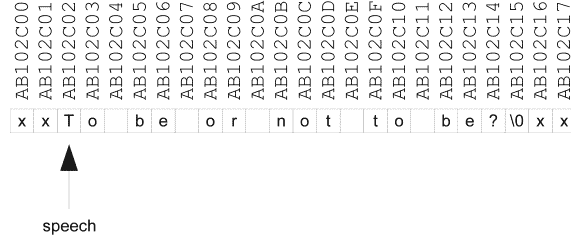

**图 2.1**：存储在内存中的文本以及指向文本开头的指针。内存地址以十六进制显示。

将文本视为指向内存位置的指针是一种相当困难的工作方式。强烈建议在 C++ 中避免这样做。相反，你应该使用数据类型 `string`。要使用它，你需要在文件顶部与其他 `#include` 语句一起有这一行：

```cpp
#include <string>
```

你还应该像往常一样有这一行：

```cpp
using namespace std;
```

然后你可以如下创建一个 `string` 类型的变量：

```cpp
string speech = "To be or not to be?";
```

如果没有其他原因，这比使用 `const char*` 的版本更容易阅读。使用 `string` 作为你存储文本的首选方式。

从技术上讲，`string` 在 C++ 中不是基本数据类型。这就是为什么你必须写 `#include <string>`。默认情况下，C++ 中只有基本数据类型可用，除非你有 `#include` 语句表示你想使用更复杂的数据类型。

我们将在本书中详细讨论复杂数据类型。事实上，在某种程度上，这本书是关于在 C++ 中创建你自己的高级数据类型的。我们将创建数据对象来表示期权和市场数据等事物。

### 2.5 运算符

#### 2.5.1 `sizeof` 运算符

你可以使用 `sizeof` 运算符来查找数据类型的大小（以字节为单位）。例如，代码

```cpp
size_t charSize = sizeof(char);
cout << "A char takes up ";
cout << charSize << " byte\n";
```

可以用来确认 `char` 占用一个字节，如声称的那样。

#### 2.5.2 数学运算

你可以对数字执行各种运算。我们已经讨论了 `+`、`*`、`-` 和 `/`。

你可能不会想到的另一个数学运算符是 `%`。这被称为取模运算符。它计算除法后的余数。因此，例如，`13 % 5` 是 3。

我们还已经看到，你不能使用 `^` 运算符将数字提升到给定的幂。相反，你必须使用函数 `pow`。

这个函数定义在名为 `cmath` 的库中。在所有程序开头的语句

```cpp
#include <cmath>
```

意味着“我们想要能够使用 cmath 库中的函数”。

`cmath` 库中还有许多其他函数，如 `sin`、`cos` 等。在 C 中调用函数的语法与在数学中相同。

```cpp
double x = 2.345;
```

```cpp
double y = sin(x) + cos(1.234);
cout << "The answer is " << y << "\n";
```

如果一个函数需要两个参数，那么就像在数学中一样，你用逗号分隔参数。

```cpp
cout << "The 32nd power of 2 is ";
cout << pow(2, 32);
cout << "\n";
```

`cmath` 库中可用的函数列在这里：http://www.cplusplus.com/reference/cmath/。

#### 2.5.3 比较运算符

C++ 还包含用于执行比较的运算符。我们已经见过 `>`、`<`、`>=` 和 `<=`。还可以使用 `==`（两个等号）来测试两个数字是否相等，以及 `!=` 来测试两个数字是否不同。

> **危险！**
>
> 使用两个等号 `==` 来比较数字，而不是一个等号。一个等号用于`赋值`

#### 2.5.4 逻辑运算符

比较运算的结果是一个表示 `true` 或 `false` 的 `bool`。然后你可以使用运算符 `&&`、`||` 和 `!` 来组合 `bool` 值，分别表示与、或和非。

因此，例如，`true && false` 的评估结果为 `false`。

#### 2.5.5 位运算符

运算符 `&`、`|`、`~`、`<<` 和 `>>` 将整数视为简单的二进制数据，并对这些位进行操作。

- `~` 是按位取反运算符。因此，`~x` 包含 $x$ 的二进制表示，但所有 1 和 0 都被切换。
- `<<` 将数字中的所有位向左移动给定的量。因此，`x<<3` 将所有位向左移动 3 步。
- `>>` 将数字中的所有位向右移动给定的量。因此，`x>>3` 将所有位向右移动 3 步。
- `&` 是按位与运算符。如果 $a$ 的第 $n$ 位为 1 且 $b$ 的第 $n$ 位也为 1，则 `a&b` 的第 $n$ 位等于 1。
- `|` 是按位或运算符。如果 $a$ 的第 $n$ 位为 1 或 $b$ 的第 $n$ 位为 1，则 `a|b` 的第 $n$ 位等于 1。
- `^` 是按位异或运算符 (XOR)。如果 $a$ 的第 $n$ 位为 1 或 $b$ 的第 $n$ 位为 1，则 `a^b` 的第 $n$ 位等于 1，但如果两者都为 1，则结果为 0。

本书中我们将不会关注这些运算符，但如果你从事计算机图形学工作，它们会非常有用。例如，你可以使用 NOT 运算符来生成黑白图像的负片。

你需要记住的唯一一点是，想要表示“与”请使用 `&&`，而不是 `&`。

> **危险！**
运算符 `^` 并不表示求幂，它表示异或 (XOR)。

### 2.5.6 组合运算符

通过组合各种运算符，你可以构建复杂的表达式。但是，你应该小心使用括号来明确你期望的含义。

一些运算符的优先级是众所周知的。你可能知道算术运算中的 BODMAS 规则，该规则规定括号优先，其次是除法、乘法、加法和减法。我们已对构成 BODMAS 规则名称的字母加了下划线。

其他运算符的优先级则相对模糊。`&&` 和 `||` 哪个优先级更高？这并不明显。如果有疑问，请添加括号。我建议不要*死记硬背* BODMAS 规则之外的运算符优先级规则。为了更好地造福那些没有记忆这些规则的人，最好使用括号。

### 2.5.7 赋值运算符

我们一直在讨论的 `*` 和 `+` 等运算符仅计算一个值。我们也已经见过 `=` 运算符。该运算符将值赋给变量，如代码所示：

```c
int i;
i = 3;
```

正如我们之前提到的，要在表达式中使用变量，必须在某个时刻声明该变量的类型。这就是为什么我们需要在使用赋值语句之前声明变量的类型的原因。

作为一种便捷的简写方式，C++ 允许你将赋值与算术运算结合为单个运算符。例如，假设你想将 3 加到一个名为 `i` 的整型变量上，那么与其输入 `i=i+3`，你只需要输入 `i+=3`。

还有用于将赋值与减法结合的赋值运算符 `-=`，类似地，还有 `*=` 和 `/=` 运算符。

以下代码是有效的 C++：

```cpp
int i = 3; 
int j = 0; 
j = (i += 4); 
cout << "The value of i is " << i << "\n"; 
cout << "The value of j is " << j << "\n";
```

它打印出 `i` 的值为 7，`j` 的值也为 7。这段代码的工作原理是：表达式 `i+=4` 将 4 加到 `i` 的值上以计算得到 7。然后表达式 `i+=4` 本身被认为取值 7，该值被赋给 `j`。

下面是一个稍微复杂一点的例子：

```cpp
int i = 3; 
int j = 0; 
j = 3 * (i += 4); 
cout << "The value of i is " << i << "\n"; 
cout << "The value of j is " << j << "\n";
```

这次 `i` 的值为 7，而 `j` 的值为 21。

一般来说，赋值表达式既*赋予*一个值，又*拥有一个值*，该值可用于进一步计算。

话虽如此，以这种方式使用赋值表达式的值会使你的代码变得非常混乱，因此你实际上不应该这样做。不幸的是，你有时会无意中这样做。考虑以下代码：

```cpp
bool i = false; 
bool j = true; 
bool areIAndJEqual = (i = j); 
cout << "The value of areIAndJEqual is "; 
cout << areIAndJEqual << "\n"; 
cout << "The value of i is "; 
cout << i << "\n";
```

这里的问题是代码包含一个细微的 bug。表达式 `i=j` 可能本应写为 `i==j`，这个微小的差异改变了代码的含义！

下一个赋值运算符是 `++`。它将 1 加到一个变量上。例如，请尝试以下代码：

```cpp
int c = 5;
c++;
cout << c << "\n";  
```

它应该打印出 6。这就是为什么 C++ 被称为 C++。它是继 C 之后的下一代语言。我说过吗？程序员喜欢冷笑话？

你也可以写 `++c` 来递增变量 `c`。`c++` 和 `++c` 的区别在于：`c++` 取的是 `c` 递增*之前*的值，而 `++c` 取的是 `c` 递增*之后*的值。

换句话说，代码：

```cpp
int c = 5;  
int d = c++;  
cout << "c=" << c << "\n";  
cout << "d=" << d << "\n";  
```

给出的结果是 `c=6` 和 `d=5`。而：

```cpp
int c = 5;  
int d = ++c;  
cout << "c=" << c << "\n";  
cout << "d=" << d << "\n";  
```

给出的结果是 `c=6` 和 `d=6`。

> **危险！**
将赋值运算符 `=`、`+=`、`++` 等作为更复杂表达式的一部分使用是非常令人困惑的。不要这样做。

### 2.5.8 重新审视 if 语句

回顾一下，`if` 语句的语法是：

```cpp
if (expression) {
    statements
} else if (expression) {
    statements
} else if (expression) {
    statements
} else {
    statements
}
```

`expression` 可以是任何基本数据类型。值 `0` 被解释为 `false`（假），其他值被解释为 `true`（真）。

因此，例如，以下代码片段打印出测试通过。

```cpp
if (-1.743) {
    cout << "Test passed\n";
}
```

问题发生在你无意中在测试中使用 `=` 而不是 `==` 时。以下代码是合法的 C++：

```cpp
int i = 1;
int j = 3;
if (i = j) {
    cout << "i is equal to j\n";
}
```

在 `if` 语句中，代码将值 3 赋给变量 `i`，然后观察到 3 是非零值，打印出 `i` 等于 `j` 这一错误声明。

> **危险！**
不要在 `if` 语句中使用 `=`。请改用 `==`。将编译器警告视为错误以防止此问题。

# 练习

**提示：让代码运行起来**

如果你的代码无法编译，请查看上一章中关于消除编译器错误的建议。

初学者程序中一些常见的错误包括：

- 忘记分号字符；
- 括号不匹配；
- 在 `if` 语句中忘记大括号或圆括号；
- 忘记启用将警告视为错误。

2.5.1. 写下或计算以下表达式的值：

- `true || false`
- `(true && false) || true`
- `true && (false || true)`
- `true && false || true`
- `3*5==15 && (7*8==21 || true!=false)`

这个练习的寓意是，你应该使用大量的括号，并将复杂的表达式拆分为小的部分。

2.5.2. 创建一个表格，列出所有不同的基本数据类型以及每种类型使用的字节数。使用 `sizeof` 来寻找答案。尝试 `long` 和 `unsigned` 等各种组合。

2.5.3. 将 `char` 值转换为 `int` 值，以找出字符 'a', 'z', 'A', 'Z', '0' 和 '9' 使用的代码。回车符、换行符和制表符使用什么代码？

2.5.4. 如果你从 `unsigned int` 3 中减去 `unsigned int` 5，你会得到什么值？尝试将涉及的数字写成二进制以解释正在发生的事情。

2.5.5. 编写一个程序，读取单个 `char` 输入，然后以大写形式打印出该字符。为此，将 `char` 转换为整数，并据此判断它是否是小写字母。如果是，将其转换为大写字母对应的代码。然后将此结果转换回整型。

2.5.6. 编写一个程序，用户输入一个小数，代码打印出最接近的整数。你应该使用强制类型转换作为解决方案的一部分。使用 `cmath` 库编写第二个更容易实现的版本。

2.5.7. 以下代码包含多个 bug。请修复它们。

```cpp
#include <iostream>
#include <cmath>
using namespace std;

int main() {
    cout<<"Type 0 for stone, ";
    cout<<"1 for scissors, 2 for paper\n";
    cout<<"Enter player 1's move\n";
    cin>>player1;
    cout<<"Enter player 2's move\n";
    cin>>player2;
    if (player1=player2) {
```

### 2.5.8 以下程序输出什么，为什么？

```cpp
#include <iostream>
#include <cmath>
using namespace std;

int main() {
    int a = -1;
    unsigned int b = 0;
    if (a < b) {
        cout << "a is smaller\n";
    }
    else {
        cout << "a is bigger\n";
    }
    cout << "Because we're interpreting a to equal ";
    unsigned int castValue = (unsigned int)a;
    cout << castValue;
    cout << "\n";
}
```

### 2.5.9 将 bell 字符写入 cout。如果你的电脑扬声器正在工作，它应该会发出蜂鸣声。

# 2.6 小结

我们学习了有用的数据类型 `int`、`double`、`char` 和 `bool`。我们还了解了一些关于其他数据类型的技术事实，但在本书中我们不会经常使用它们。

我们学习了如何在数据类型之间进行类型转换，以及潜在的陷阱。

我们学习了各种 C++ 运算符，包括算术运算符、比较运算符、逻辑运算符和赋值运算符。

我们了解了启用编译器警告的极端重要性。如果你不这样做，你将编写出需要花费你一辈子时间才能找到的 bug。

# 第 3 章 函数

C++ 中的函数是可以调用来执行某些任务的一段代码。我们之前已经看到了函数 `pow`，它计算一个数的给定次幂。`cmath` 库（`http://www.cplusplus.com/reference/cmath/`）包含其他各种数学函数。


我们将看到，C++ 中的函数用途远不止计算数学公式。在 C++ 中，所有软件都应分解为函数，每个函数执行特定任务。通过调用较简单的函数来构建复杂的函数。例如，你将编写一个 `blackScholesCallPrice` 函数，该函数使用 Black-Scholes 公式（公式 (A.6)）对看涨期权进行定价。这反过来又会调用一个 `normcdf` 函数来计算正态分布的累积分布函数。

在更大尺度上，银行的交易系统将包含一个对银行投资组合进行估值的函数。该函数将调用其他函数来：从数据库读取当前交易头寸；从彭博（Bloomberg）或路透社（Reuters）等来源提取当前市场数据；对多种不同类型的交易产品进行定价。其中每个任务本身都非常复杂，通过将其分解为许多小的专业函数来进行编码。

在本书的介绍部分，我们讨论了编写可扩展且可维护程序的需求。关键要素之一是将问题分解为更简单部分的技巧，每个部分由自己的函数表示。

## 3.1 C++ 函数语法

考虑以下数学函数：

$compoundInterest : \mathbb{R} \times \mathbb{R} \times \mathbb{Z} \rightarrow \mathbb{R}$

其定义为

$compoundInterest(P, i, n) = P (1 + i/100)^n - P.$

这里 *P* 是本金，*i* 是年利率百分比，*n* 是年数。要正式规范一个数学函数，你需要提供定义域和陪域，以及使用的公式。

在编写 C++ 函数时，我们提供非常类似的信息。首先，给出函数的名称，并描述它可以应用的数据类型和它返回的数据类型。接下来，指定函数所需的实际公式。

在 C++ 中，我们将 `compoundInterest` 函数编写如下。

```cpp
double compoundInterest(double P, double i, int n) {
    double interest = P * pow(1 + 0.01*i, n) - P;
    return interest;
}
```

在第一行，我们首先提供函数计算的数据类型。在这种情况下，它计算一个 `double`。接下来，我们给出函数的名称。在这种情况下，名称是 `compoundInterest`。然后，我们列出所有参数的名称及其类型。在这个例子中，我们说明函数的名称是 `compoundInterest`。我们说明它接受 3 个参数，分别命名为 $P$、$i$ 和 $n$。我们说明变量 $P$ 的类型是 `double`。$i$ 也是 `double` 类型，$n$ 是整数。

函数的实际代码写在一对花括号之间。你可以在花括号内写入任意数量的语句——例如，分配几个变量和一些 `if` 语句。当计算完成时，代码使用 `return` 关键字来说明计算结果是什么。

总之，定义函数的语法是：

```cpp
ReturnType functionName( ParameterType1 parameterName1,
                        ParameterType1 parameterName2,
                        ...
                        ParameterTypeN parameterNameN ) {
    ... statements ...
}
```

在此函数定义之后的任何代码中，你可以像调用 `sin` 或 `pow` 这样的内置函数一样调用该函数。因此，例如，我们可以将第一个示例程序重写为如下形式：

```cpp
#include <iostream>
#include <cmath>
using namespace std;

double compoundInterest(double P, double i, int n) {
    double interest = P * pow(1 + 0.01*i, n) - P;
    return interest;
}

int main() {
    int principal;
    double interestRate;
    int numberOfYears;
    cout << "How much are you investing ?\n";
    cin >> principal;
    cout << " What’s the annual interest rate(%)?\n";
    cin >> interestRate;
    cout << "How long for ( years )?\n";
    cin >> numberOfYears;
    double interest
        = compoundInterest(principal,
            interestRate,
        numberOfYears);
    cout << "You will earn ";
    cout << interest;
    cout << "\n";
    return 0;
}
```

在这个例子中，我们用对 `compoundInterest` 函数的调用替代了复利的计算。

请注意，该文件包含两个函数定义，一个是名为 `compoundInterest` 的函数，另一个是名为 `main` 的函数。事实上，我们最初编写的程序也包含一个名为 `main` 的函数，只是当时我们没有讨论它。

每个 C++ “控制台”应用程序都必须包含一个名为 `main` 的函数。控制台应用程序只是一个程序，它像 1973 年那样向屏幕读取和写入文本。当用户要求运行你的程序时，操作系统会确保调用 `main` 函数。还有其他许多种类的应用程序，例如，Web 应用程序、窗口应用程序和手机应用。如果你正在编写控制台应用程序，你需要一个 `main` 函数。其他种类应用程序的规则不同，超出了本书的范围。

在我们的例子中，这里有一些值得注意的地方：

- 函数定义在文件中按顺序编写。我们首先完整定义 `compoundInterest`，然后完整定义 `main`。
- 当我们调用函数时使用的变量名称可以与函数定义中使用的名称完全不同。当我们选择函数中参数和变量的名称时，这些名称在函数外部没有意义。
- 每个函数的末尾都有一个 `return` 语句。当函数计算出所需的值时，它使用 `return` 关键字将其返回给调用者。

使用函数实际上给我们带来了什么？在这种情况下，代码比以前稍微长一点，但做的事情完全相同。那么优点是什么？

- 重用。每次我们要计算复利时，只需简单地调用 `compoundInterest` 函数。我们永远不需要再次编写它。
- 劳动分工。编写代码主体的程序员只需要是向用户请求输入和输出的专家。他们不需要理解 `compoundInterest` 实际上是如何计算的来编写主要代码部分。如果你将此扩展到为敲出期权（knock-out option）定价的 iPad 用户界面，你会意识到为什么可能需要将任务分配给不同的团队成员。
- 模块化。我们将问题分解为不同的更简单的部分。正如一个定理分解为引理时更容易理解一样，程序分解为函数时更容易理解。
- 可测试性。在第 6 章中，我们将看到使用函数如何使我们的代码更容易测试。

# 提示：一次且仅一次

你绝不应两次编写相同的代码。如果你想执行同一任务两次，编写一个执行该任务的函数。

优秀的程序员会避免使用剪切和粘贴。如果你将代码从一个地方复制到另一个地方，你只是在增加程序中的代码行数，从而增加需要调试的代码量。

**示例 1：** 编写一个函数，使用公式 *E* = 1/2 *mv*² 计算给定质量和速度的物体的动能。

*解答：*

```cpp
double kineticEnergy(double mass, double velocity) {
    return 0.5 * mass * velocity * velocity;
}
```

正如这个例子所示，你可以返回复杂的表达式，也可以返回单个变量的值。

要注意的一点是，这个函数不使用 `cout` 打印任何东西。相反，它使用 `return` 安静地返回答案。使用 `cout` 打印内容对于你最初编写的几个程序很棒，但现在我们开始编写静默操作的函数。例如，考虑内置函数

`sin` 函数会返回一个值，但它不会输出任何内容。仔细想想，如果它输出任何内容的话，其实会很烦人。当被要求编写一个函数来计算某个值时，你应该编写一个返回给定值的函数，而不是一个打印该值的函数。如果练习要求你打印某些内容，它会明确说明。

## 3.2 递归

函数可以调用其他函数。例如，我们的 `compoundInterest` 函数调用了函数 `pow`。

一个更有趣的特性是，函数可以调用自身。这种编程技术被称为递归。

作为示例，考虑以下递归定义的序列：

$$

\begin{gathered}

x_n = n x_{n-1} \quad n \geq 1 \\

x_0 = 1 .

\end{gathered}

$$

显然 $x_n = n!$。

可以按如下方式定义一个函数来计算 $x_n$：

```cpp
int factorial(int n) {
    if (n == 0) {
        return 1;
    }
    return n * factorial(n - 1);
}
```

如果以值 $n = 0$ 调用此函数，它将返回 1；否则它将返回 $n * \texttt{factorial}(n-1)$。通过归纳法，它确实计算的是 $n!$。

这个例子还说明了 C++ 的另一个特性：一个函数可以包含任意复杂的语句，组合使用 `if` 语句和 `return` 语句。事实上，一个函数可以有多个 `return` 语句。一旦执行了 `return` 语句，函数的处理就完成了，后续所有代码行都将被忽略。

递归可以是一种强大的编程技术，某些算法在使用递归时更易于编写。虽然递归是计算机科学课程中的热门话题，但我们在这本书中不会过多使用递归。练习会给你一些关于使用递归可能实现的功能以及一些潜在陷阱的提示。

递归既可以有效地用于构建悖论和蹩脚的笑话，也可以用于编写软件。例如，在 Unix 计算机上广泛使用的 GNU 软件系统的名称就是一个 *递归缩写*。GNU 代表 “GNU’s Not Unix”（GNU 不是 Unix）。它甚至不值得让人倒抽一口气，对吧？

## 3.3 库

正如我们看到的，一个 C++ 控制台应用程序需要一个 `main` 方法。然而，还有其他许多类型的程序，例如 Windows 程序、Web 应用程序等等。其中一类特别重要的程序是 *库*。库是一组软件例程的集合，设计用于在其他计算机程序内部使用。

在实践中，你编写库的可能性比编写独立应用程序的可能性更大。例如，你的工作可能是编写用于对个别类型的金融衍生品进行定价的例程。然后，将由其他人与其他人编写的库组合你的库，以编写例如一个交易应用程序。

因此，我们实际上对我们的程序的 `main` 方法并不太感兴趣。我们会保留一个 `main` 方法用于测试目的，但你应该停止以编写程序的方式来思考。从现在开始，你应该想象我们在本书中编写的软件是一个用于定价的库，而不是一个独立的程序。我们的目标是编写有用的函数，而不是编写单一的程序。

## 3.4 声明和定义函数

在我们的示例代码中，我们在 `main` 函数之前定义了函数 `compoundInterest`。我们这样做是因为 `main` 函数使用了 `compoundInterest` 函数。

在更复杂的递归代码中，你可能希望编写相互调用的函数。为了支持这一点，C++ 允许你 *声明* 一个函数，然后在后面 *定义* 它。

当你 *声明* 一个函数时，你说明它的名称以及它所需参数的类型。当你 *定义* 一个函数时，你说明该函数实际执行的操作。

在我们迄今为止的所有函数定义中，我们将声明和定义放在一起。但如果你愿意，你可以将声明和定义分开。

下面是一个独立的复利函数的 *声明*。

```c
double compoundInterest(double P, double i, int n);
```

请注意，这与函数定义的第一行完全相同，只是大括号被替换成了分号。

然后可以将 *定义* 放在代码的任何位置。*定义* 就是我们之前看到的所有代码：

```c
double compoundInterest(double P, double i, int n) {
    double interest = P * pow(1 + 0.01*i, n) - P;
    return interest;
}
```

因此，C++ 的定义实际上在开头包含了声明。

以下是我们重写的示例程序，其中 *main* 方法在 *compoundInterest* 函数之前被 *定义*。请注意，*compoundInterest* 函数仍然先被 *声明*。

```c
#include <iostream>
#include <cmath>
using namespace std;

double compoundInterest(double P, double i, int n);

int main() {
    int principal;
    double interestRate;
    int numberOfYears;
    cout << "How much are you investing ?\n";
    cin >> principal;
    cout << " What’s the annual interest rate(%)?\n";
    cin >> interestRate;
    cout << "How long for ( years )?\n";
    cin >> numberOfYears;
    double interest = compoundInterest(principal,
        interestRate,
        numberOfYears);
    cout << "You will earn ";
    cout << interest;
    cout << "\n";
    return 0;
}

double compoundInterest(double P, double i, int n) {
    double interest = P * pow(1 + 0.01*i, n) - P;
    return interest;
}
```

从技术上讲，你实际上可以将函数声明精简，以排除参数名称。这是一个完全有效的函数声明：

`double compoundInterest( double, double, int );`

注意这与数学陈述之间的类比：

compoundInterest : R × R × Z → R.

函数声明中的参数名称会被计算机忽略，因此它们不必与定义中的参数名称匹配。

可以将声明和定义分开的想法在 C++ 中经常出现。另一个例子发生在变量上。你可以声明它们的类型，并单独为它们赋值。或者，如果你愿意，可以在一个语句中同时声明和定义它们。

例如：

`double principal;`

声明了一个变量，而该行：

`principal = 1000.0;`

为变量赋值。该行：

`double principal = 1000.0;`

在一步中执行了声明和赋值。

### 提示：声明在定义之前

当你编写 C++ 文件时，将所有函数声明放在第一个定义之前。

由于函数声明不包含任何代码（因此不能使用其他函数），所以不同函数声明的顺序并不重要。你应该先声明最有趣的函数，这样阅读你文件的人可以迅速理解代码的意图。

抵制那种试图重新排列函数顺序以便代码无需单独声明即可编译的冲动。

## 3.5 不返回值的函数

除了计算数值，C++ 函数还可以执行诸如将文本写入屏幕、通过网络发送数据、打印文件等任务。这是计算机函数与纯数学函数概念之间的重要区别。

通常你希望函数执行一项任务，而实际上并不希望它计算出一个值。为此，你使用特殊关键字 `void` 来描述返回类型。

例如，下面给出的函数 `printHello` 仅仅打印消息 “Hello” 然后返回。

```cpp
void printHello() {
    cout << "Hello\n";
}
```

**危险！**

如果还不够明显的话，在这段代码片段中，我们省略了提到你需要 `#include <iostream>` 和 `using namespace std;` 这两行。我们经常会省略 `#include` 语句和 `using namespace std;` 语句。

## 3.6 指定默认值

有时你可能希望为参数指定默认值。例如，下面是声明一个函数，该函数允许你对派息股票的看涨期权进行定价，但如果未提供股息率，则假设股息率为零。

```cpp
double computePrice(double strike,
                double timeToMaturity,
                double spot,
                double riskFreeRate,
                double volatility,
                double dividendRate = 0.0);
```

如果你有单独的声明和定义，应该像这里所做的那样，将默认值放在声明中。

## 3.7 函数重载

在 C++ 中，可以拥有两个名称相同但参数数量或类型不同的函数。

例如，你可能会编写以下两个都名为 `average`（平均值）的函数。

```
double average(double a, double b) {
    return 0.5 * (a + b);
}

double average(double a, double b, double c) {
    return (a + b + c) / 3.0;
}
```

虽然这些函数具有相同的名称，但它们接受的参数数量不同，因此当你输入 `average(1.0, 2.0, 3.0)` 时，C++ 编译器可以推断出你希望调用第二个函数。


类似地，这里有两个可能的 `max`（最大值）函数，一个操作整数，另一个操作实数。

```cpp
int max(int a, int b) {
    if (a>b)
        return a;
    return b;
}

double max(double a, double b) {
    if (a>b)
        return a;
    return b;
}
```

同样，编译器可以判断出你调用的是哪一个。代码 `max(1, 2)` 将调用第一个版本，而代码 `max(1.0, 2.0)` 将调用第二个版本。这是我们所期望的，因为我们避免了将 `int` 变量不必要地转换为 `double` 变量。

由于函数的身份由名称和参数类型共同决定，这种组合被称为函数的*签名*（signature）。其理念是，如果两个人拥有相同的签名，则他们是同一个人；类似地，如果两个函数拥有相同的签名，则它们是相同的函数。

当你调用一个函数时，如果没有正好匹配所需签名的版本，C++ 将在必要时执行自动类型转换。例如，你可以输入 `max(1, 2.0)`，它将调用将所有参数视为 `double` 类型的代码版本。

## 3.8 全局变量和局部变量

到目前为止，我们编写的函数通过传递参数和返回值进行交互。

有时你可能认为在函数之间共享变量是个好主意。

作为一个例子，C++ 中没有标准定义来表示圆周率 π。因此，你可能想要编写以下代码。

```cpp
const double PI = 3.141592653589793;

double computeArea(int r) {
  double answer = 0.5 * PI * r * r;
  return answer;
}

double computeCircumference(int r) {
  double answer = 2.0 * PI * r;
  return answer;
}
```

第一个定义了一个名为 `PI` 的 `double` 变量，赋予其指定的数值。它使用 `const` 关键字表明该值不允许被修改。

由于 `PI` 在任何函数外部声明，它被称为*全局*变量。相比之下，每个函数中的变量 `r` 被称为*局部*变量。

你在函数内部使用的局部变量名称与你在另一个函数中使用的名称没有关系。例如，我们在两个不同的函数中重用了变量名“answer”来引用不同的量。因为这些变量是局部变量，它们不会互相干扰。

变量的*作用域*（scope）指的是该变量可以被使用的代码部分。因此，我们说 `PI` 具有全局作用域，而 `r` 具有局部作用域。在 C++ 中，花括号决定了变量的作用域。如果一个变量首次出现在一组花括号内，那么它只能在这些括号内被引用。一旦代码执行离开这些括号，该变量即被删除。我们将在第 4.7 节中进一步讨论作用域。

**提示：除了常量外，避免使用全局变量**

随着时间推移，计算机程序员们已认识到使用全局变量会使代码难以理解。编写程序时，你应尝试将事物划分为小的独立部分。使用全局变量会阻止这些部分真正独立。当你修改某个其他你未知的代码所使用的某个全局变量时，可能会意外地破坏该代码。

**危险！**

在第 20 章中，我们将学习如何编写可以同时执行多个函数的代码。这被称为多线程代码。如果你在线程代码中使用全局变量，可能会出现两段代码试图同时修改相同变量的情况。这被称为*竞态条件*（race condition）。为了防止这种情况发生，你需要使用一种称为锁的技术。有关如何执行此操作的详细信息，请参阅第 20 章。

## 3.9 命名空间

我们在上一节编写了一个名为 `average` 的函数。在某些方面，这不是一个好主意，因为“average”这个词具有歧义。我们是指数值平均（mean）、众数（mode）还是中位数（median）？

这看起来可能不是一个很大的问题。现在我们已经注意到歧义，我们可以简单地重命名该函数。

然而，假设我们使用了由其他团队（或完全不同的公司）编写的两个库。在一个库中，他们使用单词 `average` 来表示**平均数**（mean）。在另一个库中，他们使用单词 `average` 来表示**中位数**（median）。这些函数不是由我们编写的，所以我们无法更改它们。这意味着这些库不兼容吗？

此外，更改函数的名称并不总是听起来那么容易。如果我们编写了一个别人正在使用的库，我们不能在不更改他们代码的情况下更改函数的名称。出于这个原因，一旦将库发布给客户，通常不能重新命名库中的函数。

如果两个库使用相同名称的全局变量，也会发生同样的问题。

为了解决这些问题，C++ 拥有一种称为*命名空间*（namespaces）的机制。所有全局变量和函数都有一个关联的命名空间，可以在必要时用于更精确地标识函数。除非你为你的函数指定了命名空间，否则它们将被放入*全局命名空间*（global namespace）。

类似地，英国人有一个你可以用来指代他们的名字和一个你可以用来帮助解决歧义的第二名字。

作为一个例子，我们大量使用的 `cin` 和 `cout` 全局变量实际上是在一个名为 `std` 的命名空间中声明的。如果你创建拥有相同名称的变量，你仍然可以使用限定名称 `std::cin` 和 `std::cout` 来引用熟悉的变量。

事实上，除非你明确使用 `using namespace` 命令声明你要使用某个命名空间，否则你必须完全限定名称。这就是为什么我们的所有程序都以这一行开头

```
using namespace std;
```

上面的行意味着我们想要使用 C++ 标准库中的任何代码，而无需限定名称。可以去除这一行，但代价是需要完全限定变量名，如下所示：

```
#include <iostream>
int main() {
    std::cout << "Hello World\n";
}
```

你可以按如下方式将自己的函数放入命名空间中。

```
namespace geometry {

    double computeArea(int r) {
        double answer = 0.5 * PI * r * r;
        return answer;
    }

    double computeCircumference(int r) {
        double answer = 2.0 * PI * r;
        return answer;
    }
}
```

这段代码创建了两个函数，并将它们都放在一个名为 `geometry` 的命名空间中。

我们不会在这本书中编写自己的命名空间，因为这样做会使我们的代码示例稍微变长。然而，在实际中期望使用并与他人共享的真实代码中，你应该始终使用命名空间以避免潜在的命名冲突。

### 练习

在下面的问题中编写大量的函数（每个问题至少一个），但只编写一个 `main` 函数，该函数应依次运行你的每个函数以检查它们是否正常工作。注意，问题只关心你编写的函数，而不关心测试它们的 `main` 方法。因此，没有必要编写交互式程序，只需检查你的函数对几个输入值是否有效即可。

- 3.9.1. 编写一个递归函数来计算 1 到 $n$ 之间数字的和。

- 3.9.2. 编写一个接受两个整数参数 $a$ 和 $b$ 的递归函数，并打印出从 $a$ 到 $b$ 的所有数字。

- 3.9.3. 第 $n$ 个斐波那契数可以由 $x_n = x_{n-1} + x_{n-2}$ 定义，如果 $n \geq 2$。我们定义 $x_0 = 1$ 和 $x_1 = 1$。编写一个函数 `fibonacci`，通过递归来计算第 $n$ 个斐波那契数。为了计算 $x_2, x_3, x_4$ 以及一般的 $x_n$，函数 `fibonacci` 被调用了多少次？别担心，我们将在下一章找到一种计算斐波那契数的效率更高得多的方法。

- 3.9.4. 金融数学中常见的一种函数是累积正态分布函数，其定义为：

$$\mathbf{normcdf}(\mathbf{x}) = N(x) = \frac{1}{\sqrt{2\pi}} \int_{-\infty}^{x} \exp(-t^2/2) \mathrm{d}t$$

如果 $x >= 0$，我们定义：

$$k = 1/(1 + 0.2316419x)$$

$N(x)$ 的一个良好近似值由下式给出：

$$1 - \frac{1}{\sqrt{2\pi}} \exp(-x^2/2)k(0.319381530 + k(-0.356563782 + k(1.781477937 + k(-1.821255978 + 1.330274429k))))$$.

对于 $x <= 0$，你可以使用相同的公式来评估 $1 - N(-x)$。

该公式可以通过选择一般函数形式然后找到给出最佳拟合的系数来推导。对于这个题目，你只需按面值接受该公式即可。

编写一个名为 `normcdf` 的函数来评估累积正态分布函数。为什么 `N` 不是一个好的函数名称？

- 3.9.5. 每次使用 `normcdf` 函数时，$\sqrt{2\pi}$ 都会被重新计算吗？使用全局变量来改进这一点。

3.9.6. 对于每个 $n \in N$，按如下方式定义一个数学函数 $h_n$

$h_0(x, a_0) = a_0$

$h_n(x, a_0, a_1, a_2, \dots, a_n) = a_0 + xh_{n-1}(x, a_1, a_2, \dots, a_n)$。

我们将把这些函数称为“Horner 函数”，因为它们使用 Horner 方法来求多项式的值。任何关于 $x$ 的多项式都可以重写为

$h_n(x, a_0, a_1, a_2, \dots, a_n)$

其中 $a_i$ 为适当的常数。使用 $h$ 来求多项式值的优点在于，你无需计算 $x$ 的高次幂。

请用 C++ 实现前几个 Horner 函数。将你所有的函数命名为相同的重载名 `hornerFunction`。使用 Horner 函数来简化你的 `normcdf` 函数。

> **注意：** 这道题需要一些繁琐的剪切和粘贴。希望你会对这种做法感到反感，并寻找比单纯剪切粘贴更好的解题方式！然而，在这种情况下，进行一些繁琐的剪切和粘贴确实是正确的做法。这是一个你应该违反“一次性且唯一一次”原则的罕见时刻。原始的 `normcdf` 代码应该非常快，因为它不包含循环等复杂代码（将在第 4 章中涵盖）。我们引入 `hornerFunction` 是为了提高可读性，但我们不希望速度受到太大影响。这就是我们不想太聪明的原因。

3.9.7. 实现用于累积正态分布反函数的 Moro 算法。将得到的函数命名为 `norminv`。

Moro 算法的流程如下：

假设 $x \in [0, 1]$。定义 $y = x - 0.5$。如果 $|y| < 0.42$，定义 $r = y^2$，并用以下公式近似 `norminv`：

$y\frac{h_3(r, a_0, a_1, a_2, a_3)}{h_4(r, 1.0, b_1, b_2, b_3, b_4)}$。

我们将稍后定义常数 $a_i$ 和 $b_i$。

假设 $|y| >= 0.42$。如果 $y$ 为负，令 $r = x$。否则令 $r = 1 - x$。定义 $s = \log(-\log(r))$。通过以下公式定义 $t$：

$t = h_8(s, c_0, c_1, \dots, c_8)$。

如果 $x > 0.5$，`norminv` 由 $t$ 近似，否则由 $-t$ 近似。

以下是这些常数值表：

| 常数 | 值 |

| :--- | :--- |

| a0 | 2.50662832884 |

| a1 | -18.61500062529 |

| a2 | 41.39119773534 |

| a3 | -25.44106049637 |

| b1 | -8.47351093090 |

| b2 | 23.08336743743 |

| b3 | -21.06224101826 |

| b4 | 3.13082909833 |

| c0 | 0.3374754822726147 |

| c1 | 0.9761690190917186 |

| c2 | 0.1607979714918209 |

| c3 | 0.0276438810333863 |

| c4 | 0.0038405729373609 |

| c5 | 0.0003951896511919 |

| c6 | 0.0000321767881768 |

| c7 | 0.000002888167364 |

| c8 | 0.0000003960315187 |

3.9.8. 编写一个函数 `blackScholesCallPrice`，该函数接收五个参数（执行价格、到期时间、现货价格、波动率和无风险利率），并使用 Black-Scholes 公式计算看涨期权价格。该公式在附录中的公式 (A.6) 中给出。

3.9.9. 为了使用 `norminv` 函数，你需要了解 Moro 算法或 Horner 方法吗？解释这与可扩展性和可维护性问题之间的联系。

3.9.10. 你是如何测试你的代码的？

3.9.11. 使用 C++ 的在线文档了解函数 `erfc`。使用此函数需要包含什么？你如何使用此函数来简化我们在前面练习中编写的部分代码？

## 3.10 总结

我们已经看到，使用函数允许我们将代码分解为可重用的较小部分。

在练习中，我们编写了一个函数 `blackScholesCallPrice`，它依赖于函数 `normcdf`，而 `normcdf` 又依赖于函数 `hornerFunction`。通过组合函数，我们可以构建高度复杂的程序。通过让不同的程序员编写不同的函数，我们可以在团队中分配知识。

我们已经看到 C++ 允许你编写递归函数。

我们已经看到每个 C++ 函数都有一个命名空间、名称和签名。我们已经看到 C++ 如何使用命名空间和类型来解决命名冲突。

我们学习了局部变量和全局变量之间的区别。我们学习了如何定义 `const` 变量。


# 第 4 章

### 控制流

我们已经大量使用了控制流语句 `if` 和 `else`。在本章中，我们将学习 C++ 提供的其他控制流语句。

### 4.1 while 循环

在 C++ 中重复执行任务主要有三种方式：`for` 循环、`while` 循环和 `do-while` 循环。最容易理解的是 `while` 循环。

```cpp
void launchRocket() {
  int count = 10;
  while (count>0) {
    cout << count;
    cout << "\n";
    count--;
  }
  cout << "Blast off!\n";
}
```

要查看此代码的作用，只需从 `main` 函数中调用 `launchRocket` 函数即可。

控制流如图 4.1 中的流程图所示。

`while` 循环的*主体*是花括号之间的语句集合。

```cpp
count++;
cout << "\n";
count--;
```

此代码会重复执行，直到条件 `count>0` 不再为真。请记住，指令 `count--` 意味着“将 count 减一”。因此，`while` 循环将从 10 倒数到 1，此时程序继续执行 while 循环后的第一行。这一行是：

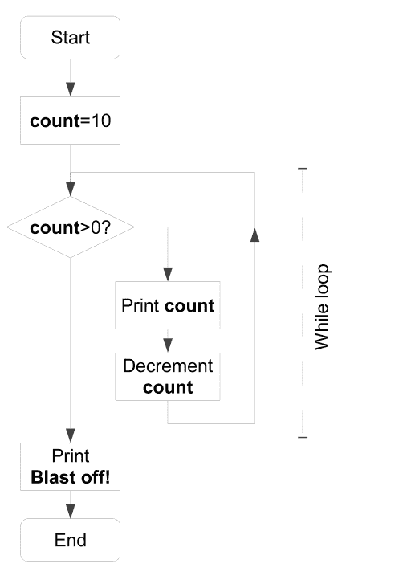

**图 4.1：** `launchRocket` 函数中的控制流。

```cpp
cout << "Blast off!\n";
```

`while` 循环的一般语法如下。

```cpp
while (<表达式>) {
    <语句>
}
```

严格来说，如果 `while` 循环中只有一条语句，你可以省略花括号。然而，始终包含花括号被认为是良好的编程风格。

让我们再给出一个 `while` 循环的例子。这次我们打印出小于 1000 的 2 的幂。

```cpp
void printPowersOf2() {
int count = 0;
int currentPower = 1;
while (currentPower<1000) {
cout << "2^" << count << "=";
cout << currentPower;
cout << "\n";
currentPower *= 2;
count++;
}
```

这里我们使用了简化的赋值运算符 `*=`.

作为另一个示例，考虑以下函数：

```cpp
void loopForever() {
while (true) {
cout << "Still looping\n";
}
}
```

此程序将永远循环。如果你运行该程序，可以在程序运行的控制台窗口中通过输入 **CTRL+C**（在 Windows 和 Unix 上）或 **CMD + .**（在 Mac 上）来停止它。

### 4.2 do-while 循环

它们与 while 循环非常相似，区别在于是否在继续循环的测试在循环末尾执行。例如：

```cpp
void launchRocket_DoWhileVersion() {
int count = 10;
do {
cout << count;
cout << "\n";
count--;
} while (count >= 1);
cout << "Blast off!\n";
}
```

`do-while` 循环的一般语法是

```cpp
do {
<语句>;
} while (<表达式>);
```

由于测试仅在 `do-while` 循环的末尾执行，循环的主体至少会执行一次。

通常认为 `do-while` 循环难以阅读，因此它们不常被使用。其他循环结构更受青睐。

### 4.3 for 循环


C 的设计者注意到，大多数 `while` 语句在轮廓上看起来像这样：

```cpp
<初始化循环变量>;
while (<测试循环变量>) {
  <执行代码主要步骤>
  <更新循环变量>
}
```

为了在代码中使这种重复的设计更明显，他们引入了 `for` 循环。其一般形式如下：

```cpp
for (<初始化循环变量>;
    <测试循环变量>;
    <更新循环变量>) {
    <执行代码主要步骤>
}
```

要编写 `for` 循环，只需拿一个上述形式的 `while` 循环，并移动代码以匹配 `for` 循环的语法即可。

例如，我们发射火箭的代码变为：

```cpp
for (int i = 10; i > 0; i--) {
  cout << i;
  cout << "\n";
}
cout << "Blast off!\n";
```

对于 C++ 的新手来说，这看起来并没有多大改进。唯一的明显优势是它占用的行数比等效的 `while` 循环少。然而，它的可读性不如 `while` 循环像英语。如果你是 C 和 C++ 的新手，你可能会觉得 `while` 循环更容易理解。

随着熟悉度的提高，你会开始更喜欢 `for` 循环。不是因为阅读代码时它更容易理解，而是因为你认出了其一般形状，从而可以在不看细节的情况下猜测其含义。很快，你只需扫一眼 `for` 循环就能立即看看它正在做什么，而使用 `while` 循环时，你需要实际阅读代码。

以下是从 0 计数到 9（包含 9）的代码。你应该将这段代码牢记于心：

```
for (int i = 0; i<10; i++) {
    cout << i;
    cout << "\\n";
}
```

将其与通用语法进行对比，我们可以看到“初始化循环变量”的代码是：

```
int i=0
```

因此，这段代码初始化了一个名为 `i` 的变量，并将其初始值设置为 0。

“测试循环变量”的代码是 `i<10`。因此，循环体将重复执行，直到 `i` 等于 10。请注意，值 10 本身不会被打印出来。

“更新循环变量”的代码是 `i++`。因此，每次循环后，`i` 都会递增。

“执行代码主要步骤”是

```
cout << i;
cout << "\\n";
```

这些主要步骤总共将重复 10 次。

以下是从 0 计数到 90（包含 90）的代码，步长为 10。

```
for (int i = 0; i < 100; i += 10) {
    cout << i;
    cout << "\\n";
}
```

### 提示：从 0 开始计数

C++ 程序员从 0 开始计数。这是一种惯例。C++ 中所有标准数据结构都以 0 为标签起点。

一开始你可能不习惯，但我强烈建议在使用 C++ 编程时从 0 开始计数，并因此使用 `<` 符号而不是 `<=` 符号来进行补偿。

从 0 开始计数有一些相当好的理由，因为某些公式写起来更简单。例如，假设你按以下方式标记矩阵中的元素：

```
(  0   1   2   3  )
(  4   5   6   7  )
(  8   9  10  11  )
( 12  13  14  15  )
```

假设你用索引 `$i \in \{0, 1, 2, 3\}$` 标记行，用索引 `$j \in \{0, 1, 2, 3\}$` 标记列——那么 `$(i, j)$` 处的元素就是 `4i + j`。很明显，这个公式如何推广到比矩阵更高维度的数据结构。

让我们重复练习，现在从 1 开始计数。我们会标记矩阵中的元素为：

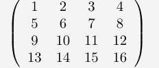

现在我们用索引 `$i' \in \{1, 2, 3, 4\}$` 标记行，同样用 `$j \in \{1, 2, 3, 4\}$` 标记列。`$(i, j)$` 处的元素现在是 `4(i' - 1) + (j' - 1) + 1 = 4i' + j' - 3`。这与之前的公式相比，优雅程度大大降低，并且不能如此直接地推广到更高维度。

请注意，C++ 中还有另一种 `for` 循环，它的语法更简单，但相应地灵活性也更低。详见第 18 章。

## 4.4 break, continue, return

在循环中间，你可以决定跳出循环并开始执行循环后面的语句，使用 `break` 关键字即可实现。

例如，这段代码会不断累加用户输入的数字，直到他们输入一个负数为止。此时，软件会打印出所有正数的总和。

```
cout << "Enter positive numbers followed ";
cout << "by a negative number to quit\n";
int total = 0;
while (true) {
    int next;
    cin >> next;
    if (next<0) {
        break;
    }
    total += next;
}
cout << "The total is " << total << "\n";
```

`continue` 关键字意味着跳过循环体中剩余的部分代码，进入下一个测试语句，并决定是否继续循环。因此 `continue` 意味着“继续循环”，而 `break` 意味着“跳出循环”。

这是一个 `continue` 语句的例子：

```cpp
cout << "Enter positive numbers ";
cout << "Type CTRL+C to quit\n";
int total = 0;
while (true) {
    int next;
    cin >> next;
    if (next<0) {
        continue;
    }
    total += next;
    cout << "Positive total is " << total<< "\n";
}
```

你也可以在循环中间使用 `return` 语句。这会停止所有循环，并将执行返回到函数被调用的地方。

这是一个在循环内部使用 `return` 的例子：

```cpp
void countdown() {
    int i = 10;
    while (true) {
        if (i == 0) {
            return;
        }
        cout << i << "\n";
        i--;
    }
}
```

虽然 `break` 和 `continue` 有时能使代码更清晰，但它们通常使代码更难跟踪。因此，建议 C++ 初学者避免使用这些语句。

## 4.5 throw 语句

很多时候，你会希望函数突然停止并指示发生了错误。为此，你使用 `throw` 语句。

要使用 `throw` 语句，你需要在代码开头的其他 `#include` 语句旁边添加以下文本：

```cpp
#include <stdexcept>
```

要指示发生了错误，请使用以下格式：

```
throw logic_error("You can't do that");
```

你可以在引号之间包含几乎任何你想要的文本。尽量提供关于问题原因的一些线索。当我们讨论了第 7.5 节的字符串操作后，你将能够创建更有帮助的错误消息。

这是一个使用 `throw` 语句的例子：

```
double debitAccount(double balance, double amount) {
    double newAmount = balance - amount;
    if (newAmount < 0.0) {
        throw logic_error("No overdraft agreed");
    }
    return newAmount;
}
```

程序 `throw` 出一个错误并终止，比打印出错误消息并试图继续运行要好得多。这有几个原因：

- 没有人会阅读这些消息！许多用于金融领域的代码运行在服务器上，而不是在用户的计算机上。如果你将消息写入服务器的日志文件，那么很可能永远没有人会阅读它。
- 明显地失败比微妙地失败要好。你不希望某人认为交易已经完成，而实际上它已经失败。
- 如果错误立即抛出，就很容易看到错误发生在哪里以及发生错误时正在做什么。如果你一天后查看日志文件，你可能根本无法弄清楚当时发生了什么。

你可能会想尝试以更复杂的方式处理错误，而不仅仅是终止程序，但事实是你可能做不到。如果在我们编写的代码类型中发生错误，那很可能是一个编程错误，无论让用户稍后重试多少次都无法修复这个问题。除了报告错误并修复代码外，别无他法。

在软件中处理错误是计算机科学中的高级主题。如果你正在编写操作系统，关键在于单个程序的 bug 不应导致整个计算机崩溃。如果你正在编写网络浏览器，重要的是单个恶意网页不会导致网络浏览器崩溃。然而，编写网络浏览器和操作系统是那些领域专家的任务，而不是金融数学专家的任务。

如果你希望以更复杂的方式（不仅仅是终止程序）来处理错误，你需要使用 `try` 和 `catch` 语句。此外，你可能希望抛出不同类型的错误，而不仅仅是 `logic_error`，以便你可以区分不同类型的错误。你可以在任何 C++ 参考书中找到更多信息。本书不需要这些技术。

## 4.6 switch 语句

比 `if` 语句更复杂的替代方案是 `switch` 语句。这是一个例子：

```cpp
void printMessage(int score) {
    switch (score){
    case 0:
    case 1:
    case 2:
    case 3:
    case 4:
        cout << "You have failed.\n";
        break;
    case 5:
    case 6:
        cout << "You have passed.\n";
        break;
    case 7:
        cout << "Merit.\n";
        break;
    case 8:
    case 9:
        cout << "Distinction.\n";
        break;
    default:
        cout << "Invalid score.\n";
        break;
    }
    cout << "Good luck in your future career.\n";
}
```

该程序根据你的分数打印出考试的等级。分数 0-4 为不及格，5 或 6 为及格，7 为优秀，8 或 9 为卓越。其通用语法是：

```cpp
switch (<expression>) {
```

`switch` 语句的主体是花括号之间的代码。它由一系列可能的 `case` 和一些要执行的代码组成。当执行这个 `switch` 语句时，计算机首先评估 `expression`。然后它寻找第一个匹配的 `case` 语句，并执行从那里开始直到第一个 `break` 语句或 `switch` 语句结束的所有代码。

如果没有匹配项，计算机寻找 `default` 语句，并评估从那里到 `switch` 语句结束的所有代码。

在执行完 `switch` 语句主体所需的语句后，程序移动到 `switch` 语句之后的下一条语句。在我们的示例中，这意味着它将祝你在职业生涯中好运。

注意，你必须小心地在 `switch` 语句中插入 `break` 或 `return` 语句，以确保代码不会执行比你想要的更多的语句。

例如，如果你移除我们示例中的所有 `break` 语句，那么 0 分会得到以下回应：

```
You have failed.
You have passed.
Merit.
Distinction.
Invalid score.
Good luck in your future career.
```

如果你喜欢 `switch` 语句的语法，你并不孤单。幸运的是，在现代 C++ 代码中它们并不是非常有用的。在现代 C++ 中，应该使用面向对象编程技术 `多态性` 代替。我们将在第 10 章中深入讨论这个主题。如果你发现自己想写一个 `switch` 语句，那是你没有充分利用面向对象编程的迹象。

### 提示：始终包含一个 default 分支

如果你必须写一个 `switch` 语句，请务必包含一个 `default` 分支。通常你的 `default` 分支会通过使用 `throw` 语句来生成错误。简单地打印错误（如我们的示例中发生的那样）是一个坏主意。

## 4.7 作用域

上述控制流语句都使用花括号。如果你在花括号内定义一个变量，它只能在那些括号内使用。一旦程序执行离开括号，该变量就被删除。你可以引用变量的代码部分称为该变量的*作用域*。

下面是一个计算前 10 个整数（从 0 开始，当然）平方和的代码片段示例。

```
int n=0;
int total;
for (int i=0; i<10; i++) {
    int squareValue = i*i;
    total += squareValue;
}
std::cout << n;
// std::cout << squareValue;
// std::cout << i;
```

变量 `squareValue` 仅在花括号内有效。变量 `i` 仅在 `for` 语句本身和花括号内有效。如果你试图移除最后两行中的注释字符 `//`，代码将无法编译。

变量的作用域用于控制 C++ 中内存的使用。当变量超出作用域时，内存可以安全地重新使用。通常你不需要考虑 C++ 中的内存管理。然而，有时你会想自己控制内存管理。我们将在第 11 章讨论这一点。

## 4.8 运算符中的控制流

一个技术要点是 C++ 中的某些运算符实际上以微妙的方式控制程序的流程。

### 4.8.1 短路求值

表达式 `lhs && rhs` 在 `lhs` 和 `rhs` 都评估为 true 时评估为 true。为了提高效率，如果 `lhs` 不为 true，C++ 甚至不会麻烦去评估表达式 `rhs`。这通常正是你希望发生的事。但是，如果评估表达式 `rhs` 实际上调用了另一个函数，你可能会惊讶地发现这个函数并不总是被调用。

类似地，如果已知 `lhs` 为 true，`lhs || rhs` 也不会评估 `rhs`。

作为一个例子，尝试以下代码：

```
c++
bool test1() {
    cout << "In test1\n";
    return false;
}

bool test2() {
    cout << "In test2\n";
    return true;
}

int main() {
    bool value = test1() && test2();
    cout << "Value " << value << "\n";
    return 0;
}
```

你会看到函数 `test2` 从未被调用。

### 4.8.2 三元运算符

表达式 `a*b` 中的运算符 `*` 被称为二元运算符，因为它接受两个参数。另一方面，运算符 `++` 被称为单位运算符。

C++ 还包含一个接受三个参数的运算符，因此被称为*三元运算符*。

三元运算符本质上是编写 `if` 语句的快捷方式。语法是：

```
<test expression> ? <value if true> : <value if false>
```

作为一个例子，下面是一个使用三元运算符计算两个数最大值的程序：

```
c++
int max(int a, int b) {
    return a>b ? a : b;
}
```

这里有一些使用 `if` 语句的等价代码。

```
int max(int a, int b) {
    if (a > b) {
        return a;
    } else {
        return b;
    }
}
```

太懒打字的人喜欢三元运算符，但它会导致代码非常难以理解。不要使用它。

### 4.8.3 逗号运算符

在 `for` 语句的圆括号内，总是有三个由分号分隔的表达式。这是一个例子：

```
for (int i = 0; i < 100; i++) {
    cout << i << "\n";
}
```

如果你愿意，可以使用所谓的“逗号运算符”在每个循环末尾执行多个计算和多个初始化。这是一个打印 2 的前 10 个幂的例子：

```
for (int count = 0, power = 1;
     count < 10;
     count++, power *= 2) {
    cout << power << "\n";
}
```

在这段代码中，我们维护两个循环变量 `count` 和 `power`，每个都在每次迭代中更新。

逗号运算符的正式定义是，表达式 `lhs, rhs` 评估 `lhs` 并丢弃结果，然后评估 `rhs`。因此，如果你愿意，可以使用逗号运算符将表达式串联起来，作为以常规方式使用分号的替代方案。

不要自己使用逗号运算符。它导致难以阅读的代码（正如我们的例子所证明的那样）。我们之前写了一个程序（第 56 页），使用 `while` 循环打印 2 的幂，这更容易理解。

## 练习

- 4.8.1. 使用 `while` 循环、`for` 循环和 `do-while` 循环为 `factorial` 函数提供不同的实现。
- 4.8.2. 给定一个函数 `$f: \mathbb{R} \to \mathbb{R}$`，我们可以近似积分

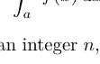

使用*矩形法*。给定一个整数 `$n$`，该积分的矩形法近似值为：

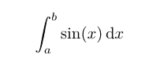

其中 `$h=\frac{b-a}{n}$`。编写一个函数，计算以下积分的矩形法近似值：


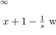

对于给定的 $a$，$b$ 和 $n$。

### 4.8.3. 我们希望计算积分

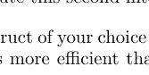

通过替换 $t=x+1-\frac{1}{s}$，我们可以看到它等于积分

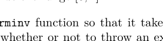

然后可以使用矩形法估算该积分。编写一个函数，使用 `for` 循环和矩形法计算这个第二个积分。

### 4.8.4. 使用你选择的循环结构计算第 $n$ 个斐波那契数。解释为什么这比练习 3.9.3 中考虑的使用递归的方法更有效。

### 4.8.5. 改进 `norminv` 函数，使其在要求评估范围 $[0,1]$ 之外的数字时抛出错误。

### 4.8.6. 改进 `norminv` 函数，使其接受一个额外的布尔参数，指示当输入超出 0 和 1 的范围时是否抛出异常。这个参数的良好默认值是什么？

### 4.8.7. 确保你能编写一个 `for` 循环，按升序打印从 0 到 9 的数字，而无需查阅本书任何内容。这相当于你在外语中不需要借助短语手册也能数到十。

## 4.9 总结

我们学习了如何使用以下关键字在 C++ 中控制执行流程：

- `for`
- `while`
- `do`
- `break`
- `continue`
- `return`
- `switch`
- `case`
- `default`
- `throw`

迄今为止，最有用流程控制语句是 `for`、`while` 和 `throw`。

### 提示：使用哪种控制语句

- 对于简单的循环，例如从 0 计数到 99，请使用 `for` 语句。
- 对于更复杂的循环逻辑，请使用 `while` 语句。不寻常的 `while` 语句比不寻常的 `for` 语句更容易阅读。
- 当发生错误时使用 `throw`。不要只是打印一条消息然后继续。


# 第 5 章

## 处理多个文件

一个现实的 C++ 项目将分布在许多文件中。这有助于你将代码逻辑地组织成可管理的单元。这使得能够跟进大型软件项目而无需理解每一个细节。

### 5.1 项目 FMLib

如果你已完成前几章中的所有练习，你应该已经积累了相当多的函数集合。

特别是，在练习中，我们编写了 `normcdf` 用于计算正态分布的累积密度和 `norminv` 用于计算其逆函数函数。我们将希望反复使用这些函数。

这意味着是时候开始为我们的项目创建更好的结构了。我们将停止丢弃代码，并开始在一个名为 `FMLib` 的长期项目上工作。

目标是让 `FMLib` 成为一个有用的金融数学函数库。`FM` 代表金融数学 `financial maths`。

我们不是第一个想到为金融数学编写 C++ 代码的人。已经有许多可用的库，你可以直接下载。然而，在这本书中，我们将假装除了内置于 C++ 标准中的库之外，没有其他库存在。我们将从头开始自己构建其他所有内容。

这是学习 C++ 的好方法，但不是构建现实世界交易平台智能方式。当然，你应该充分利用其他人在编写库方面所做的工作以及他们为设计、测试和调试这些库所投入的更多重要工作。你可能希望考虑使用的一些库包括 `Boost`、`GSL` 和 `Quantlib`。`Boost` 是一个通用的 C++ 库，填补了 C++ 标准中的许多空白。`GSL` 是一个用 C 编写的科学计算库，包含许多有用的算法。`QuantLib` 是一个用于金融数学的 C++ 库。

在此阶段，你可能会发现这些库的文档无法理解。这是因为文档假定读者在 C++ 语言方面具备相当的专业知识。

这就是为什么在这本书的其余部分，我们将研究如何编写自己的金融数学库 `FMLib`。一旦你掌握了这本书，你应该忘记 `FMLib`，转而学习使用这些其他库。

在这本书的网站，你可以找到一个名为 `FMLib5` 的下载项。它包含与第 5 章相关的 `FMLib` 版本。随着书的进展，有相应的版本 `FMLib6`、`FMLib7` 等。这些包含越来越复杂的代码。到书的结尾，我们将开发出一个成熟的库。

本书的一个目标是向你展示软件项目如何从简单的开始发展为庞大而复杂。通过了解软件项目如何分阶段组合，你将学习如何以可管理的片段开发你的项目。它还将向你展示如何*重构*你的代码。这 simply 意味着如何随着经验逐渐修改你的代码，从而逐步改进软件设计。

为了本章的目的，你应该下载 `FMLib5`。解压它并查看其内容。

- 文件 `main.cpp` 包含一个用于测试的 `main` 方法。
- 文件 `matlib.cpp` 包含各种有用金融数学函数的定义。我们将你可能在 MATLAB 中期望看到的许多标准函数组合到这个文件中。例如，`normcdf` 和 `norminv` 在这个文件中定义。
- 文件 `stdafx.h` 提供了一个集中列出我们将在整个项目中使用的库的地方。
- 文件 `matlib.h` 是一个头文件，包含函数 `normcdf` 和 `norminv` 的声明。

正如你所见，它包含多个 `.cpp` 文件和一些 `.h` 文件。本章的目的是解释如何使用不同的文件安排 C++ 代码，以开发更大的项目和有用的库。我们将使用 `FMLib5` 作为我们的例子。

### 5.2 头文件

在 C++ 中，你无法直接调用定义在其他 `.cpp` 文件中的函数。要使用定义在其他文件中的函数，你必须首先使用 `#include` 命令加载包含该函数声明的“头文件”。

如果你忘了的话，我们在 3.4 节讨论了*声明*函数和*定义*函数的区别。简而言之，声明说明了*函数做什么*，而定义说明了*它怎么做*。

C++ 中的规则是，在你可以使用一个函数之前，它*必须*已经被声明。因此，如果你想使用一个函数，你必须总是**#include** 声明了该函数的文件。

你可以将 `.cpp` 文件视为通过它们包含的 `.h` 文件进行通信。如果两个 `.cpp` 文件都 `#include` 相同的函数声明，那么该函数只需要在这两个 `.cpp` 文件之一中定义。相同的定义在多个文件间共享。如果两个 `.cpp` 文件没有提及特定函数的公共 `.h` 文件，那么它们不能共享该函数。

作为惯例，每当我们编写一个 `.cpp` 文件时，我们通常会编写另一个具有相同名称但扩展名为 `.h` 的文件。这个头文件包含我们希望在该 `.cpp` 文件外部可用的所有函数的声明。

有些人更喜欢使用文件扩展名 `.hpp` 作为 C++ 头文件，而保留 `.h` 用于 C 头文件。

### 5.3 创建我们的项目

让我们通过一个详细的例子来学习如何创建一个多文件项目。

首先，创建一个名为 **MyLib** 的新 C++ 项目。这是为了将其与网站上的模型代码 **FMLib** 区分开来。当这一节完成时，这两个项目实际上应该是相同的。

我们的目标是编写一个小库，使 **normcdf** 函数和 **norminv** 函数可用，它们分别计算正态分布的累积分布函数及其逆函数。我们还希望使标准常量 `PI` 可用。

在一个单独的文件中，我们想要编写一个小的 `main` 函数，以展示如何使用该库。

#### 5.3.1 创建第一个头文件

为了让其他文件可以使用这些函数，我们需要在*头文件*中声明它们。这是一个文件扩展名为 `.h` 的 C++ 文件。

你现在应该按照下面针对你的开发环境的说明，创建一个名为 **matlib.h** 的头文件：

- 如果你使用 Visual Studio 创建 C++ 项目，你应该通过右键点击 **Header Files** 文件夹来创建所有的 `.h` 文件。
- 如果你使用 Unix，只需在你的 `.cpp` 文件所在的同一文件夹中创建头文件，但给予它们 `.h` 扩展名。
- 如果你使用 XCode，请按 **CMD + N** 并选择头文件。

现在编辑你刚刚创建的文件并输入第一行：

```c
#pragma once
```

然后输入我们希望从我们的库中使所有函数可用的*声明*。在我们的例子中，所需的完整代码是：

```c
#pragma once

const double PI = 3.14159265358979;

/**
 *  Computes the cumulative
 *  distribution function of the
 *  normal distribution
 */
double normcdf( double x );

/**
 *  Computes the inverse of normcdf
 */
double norminv( double x );
```

这包含了我们希望使所有函数可用的声明。它同时包含 `PI` 的声明和定义。

通常，你应该在你的头文件中放置以下内容：

- (i) 第一行 `#pragma once`。我们稍后解释原因。
- (ii) 你希望从你的库中使可用的函数声明。
- (iii) 你希望使可用的全局变量声明。
- (iv) 常量全局变量的定义。

而在你的源文件中，你应该放置：

- (i) 头文件中声明的函数定义。
- (ii) 头文件中缺失的全局变量定义。

随着我们遇到更多类型的声明和定义，我们将在整本书中扩展这些规则。

常量被不同对待的原因是 C++ 编译器可以“内联”它们。这意味着将常量的每次使用替换为实际值。这带来了轻微的性能提升。然而，其结果是，定义需要在头文件中，以便每个文件都知道要内联的正确值。

#### 5.3.2 使用这些函数的代码示例

在一个名为 `main.cpp` 的源文件中，写下以下代码

```cpp
#include <iostream>
#include "matlib.h"
using namespace std;

int main() {
    cout << "normcdf(1.96)="
         << normcdf(1.96) << "\n";
    cout << "norminv(0.975)="
         << norminv(0.975) << "\n";
    return 0;
}
```

注意，我们使用 `#include` 来加载库中所有的定义。在加载标准库时，我们使用尖括号；而对于我们自己的库，则使用引号。

这样做的原因是，我们自己的库时刻都在变化，而标准库则不会。通过使用尖括号，我们在告诉编译器，某个文件自上次编译以来没有发生变化。这允许编译器运行得稍快一些。

此时，你应该尝试构建代码，但你应该预料到它会失败。毕竟，我们还没有提供任何函数的*定义*。

尝试构建代码，看看当我们忘记编写某个函数的定义时会遇到什么错误信息——或者当定义和声明不精确匹配时会发生什么。

当我在 Visual Studio 上尝试运行这段代码时，我得到了以下错误：

```text
main.obj : error LNK2019:
   unresolved external symbol "double __cdecl
norminv(double)" (?norminv@@YANN@Z)
referenced
in function _main
```

这被称为*链接器错误* `linker error`。“未解析的外部符号” `unresolved external` 这种说法很不直观，它实际上意味着以下情况之一：

- (i) 你完全忘记了定义；
- (ii) 定义中的类型信息没有精确匹配声明中的类型信息；
- (iii) 你没有正确安装库；
- (iv) 发生了更细微的问题。例如，在 Visual Studio 中，你需要检查 `cpp` 文件是否确实列在你的项目的“Source Files”下。

如果你仔细查看错误信息，你会发现函数的名称 **norminv** 隐藏在文本中。你只需要愿意忽略错误信息中你无法理解的部分即可。值得试着记住在你的开发环境中这类错误信息长什么样，这样当下次发生类似的链接器错误时，你能够找出问题所在。

将 C++ 源文件转换为可执行文件的过程被称为“构建” `building` 代码。这是一个三阶段过程。

- (1) *预处理器* `pre-processor` 对 **cpp** 文件执行简单的文本操作，例如 `#include` 语句。例如，`#include` 语句的意思只是读取另一个文件的副本，以便我们可以使用该文件中的所有声明。
- (2) 生成的 **cpp** 文件被编译。
- (3) 所有文件和所有库的编译版本被*链接* `linked` 在一起。每次对函数的使用都*链接*到其定义所在的地方。

函数声明在编译阶段使用，所有函数定义都会被编译。然而，直到链接器阶段，才会检查所有内容是否连贯地粘合在一起。这就是为什么声明和定义之间的不匹配会在链接器阶段被发现。

#### 5.3.3 编写定义

创建一个名为 **matlib.cpp** 的文件来包含函数定义。以 `#include matlib.h` 这一行开始该文件。

通常，你的头文件和源文件之间应该有清晰的对应关系。例外情况是：在 Windows 上，约定俗成地有一个名为 **stdafx.h** 的文件，其中仅包含你希望使用的库的 `#include` 语句；你应该有一个 **main.cpp** 用于测试。我们将遵循这些约定，不仅限于 Windows，而是在所有操作系统上。

每次你编写 `.h` 文件时，确保对应的 `.cpp` 文件的第一行包含该 `.h` 文件。这是测试你的 `.h` 文件是否正确且包含所需所有内容的重要测试。

在文件的其余部分，你应该编写函数定义所需的代码。如果你在练习中成功编写了这些代码，你可以使用自己的代码。如果没有，使用下面的代码可能更快。

```c
double norminv( double x ) {
    return 1234.0; // TODO fix this
}

double normcdf( double x ) {
    return 1234.0; // TODO fix this
}
```

此时你应该会发现一切都能正确构建。

作为一个实验，修改其中一个函数定义中的类型，如下所示。

```cpp
// change double to float
double norminv( float x ) {
    return 1234.0; // TODO fix this
}
```

你会发现你遇到了一个链接器错误，通过恢复到原始代码可以轻松修复。

### 5.4 头文件的工作原理

#### 5.4.1 include 的含义

在 C++ 中，你必须遵循关于函数声明和定义的以下规则：

- 每个使用某函数的 `.cpp` 文件都必须包含该函数的声明。
- 每个被使用的函数必须在恰好一个 `.cpp` 文件或库中定义。

表面上看，这意味着我们要进行大量的重复输入。我们将不得不在每个使用该函数的每个文件中不断声明该函数。幸运的是，C++ 有 `#include` 命令，它可以加载 `.h` 文件中的所有命令。这样，我们就能用一个 `#include` 语句加载许多声明。

头文件没有什么其他作用，它们只是节省重复输入。原则上，你可以使用 `#include` 加载任何东西，但在实践中它仅用于加载声明。

同样地，原则上，你可以通过在自己的 `.cpp` 文件中直接键入声明，使用在其他文件中声明的函数。从技术角度来看，完全不需要使用头文件。然而，这样做被视为不良的编码实践。C++ 函数的作者使用头文件作为指示他们允许你使用哪些函数以及他们打算在未来维护哪些函数的一种手段。

#### 5.4.2 Pragma once

如前所述，每个头文件都应以 `#pragma once` 开头。

你应该在每个文件开头使用 `#pragma once` 的原因是，它阻止同一个文件被**\#include**两次。在我们的例子中，如果你去掉了**\#pragma once** 然后**\#include**头文件两次，你可能会收到一个编译器错误，提示你试图两次定义 `PI`。

你应该遵循的另一条规则是，永远不要通过**\#include**产生循环依赖。例如，两个头文件不应该相互**\#include**。

从技术上讲，**\#pragma once**不是 C++ 标准的一部分。然而，大多数编译器都理解此命令，我建议你使用它。

短语**\#pragma once**可能很难记住，因为英语中没有“pragma”这个词。它实际上是单词“pragmatic” `pragmatic` 的缩写，而“pragmatic”本身只是“practical” `practical` 的委婉说法。所以**\#pragma once**只是一个实用的修复方法，并不是 C++ 标准真正的一部分。

如果你是 C++ 标准的严格遵循者，解决同一问题的替代方法是使用以下配方：为每个头文件选择一个独特的随机名称，例如，`G4569327457263475698023452376519876247`，然后按照以下方式开始和结束头文件：

```cpp
#define G4569327457263475698023452376519876247
#ifndef G4569327457263475698023452376519876247
#define G4569327457263475698023452376519876247
... rest of code ...
#endif
```

你会看到这种技术被称为*包含保护* `include guard` 在许多 C++ 库中使用。自然地，许多库作者希望编写尽可能可移植的代码，因此他们严格遵守 C++ 标准。这就是为什么他们使用这种更繁琐的技术，而你只需使用更容易的**\#pragma once**即可。

#### 5.4.3 信息隐藏

你不应该在头文件中声明*所有*函数。你应该只声明你希望其他人使用的函数。

编写许多小的辅助函数是一个好习惯。然而，将这些函数作为库的一部分会使库的用户感到困惑。你的用户会将你编写的 `.h` 文件视为定义你的库做什么的地方。通过限制该文件中的信息量，你使用户的生活更轻松。

这还有其他一些优点。一旦你发布了一个作为库一部分的函数，你就永远不能更改它，除非是为了修复 bug！这是因为其他人可能已经在用它。你在头文件中给出的东西越少，你需要在未来十年内支持编写的函数的潜在可能性就越少。

**示例 1：** 如果你在库中拼错了函数名称并将其交给用户，你就必须永远使用那个拼写错误的名称。


如果你是唯一使用自己代码的人，这个问题就不那么紧迫；但如果你在团队中工作，那么这一点就绝对至关重要。

作为一个非常实际的问题，如果你的工作是编写软件，而你的软件因某种原因出现了问题，那么你很可能被要求修复它。因此，使用你代码的人越多，你就越有可能在半夜接到电话，被要求调试那段代码！这意味着，你必须确保只让其他人使用那些质量足够高、可以与团队共享的代码。也就是说，这些代码应该运行完美、文档齐全，并经过充分测试。在实践中，你不可能将所有代码都写到这个标准，因此，明确区分哪些代码可以共享、哪些代码仅供个人使用至关重要。如果你在头文件中不声明你的函数，那么这些代码就无法被其他文件共享，因此*无法*被使用。这意味着，如果你将头文件的内容保持在最少，你就更有可能获得一夜安眠！

> **老笑话：** 编程就像性。一旦犯一个错误，你就得一辈子为之负责。

虽然不将某些内容包含在头文件中是实现信息隐藏的主要方式，但你还可以进一步使用 `static` 关键字。

你应该尝试对所有*不在*你的头文件中的变量和函数使用 `static` 关键字。例如，人们可能会在 `.cpp` 文件中编写如下代码：

```cpp
static const double SQRТ_2_PI = 2.507;
```

这是一段有缺陷的代码，因为它是 $\sqrt{2\pi}$ 的一个精度非常低的估计值。这可能对某个特定应用不成大问题，但你并不希望其他人将其用于计算中。这类事情会导致半夜的电话。

通过将此函数标记为 `static`，我们表示它只能在当前源文件中被使用。这意味着，如果需要，我们可以在其他源文件中重用该名称。从技术上讲（尽管不太可能），某人可以在不在头文件中声明的情况下，使用在另一个文件中定义的函数。使用 `static` 关键字可以完全阻止这种小把戏。

> **危险！**

如果你是 Java 程序员，请注意，这与 Java 关键字 `static` 毫无关系。

### 5.4.4 内联

一般来说，优秀的程序员从不编写两次相同的代码。你应该编写可重用的函数。这样可以最大限度地减少你在测试代码时所需付出的努力。

新手程序员常常犯的错误是将开发环境中的剪切和粘贴功能作为编写函数的替代方案。这是一个非常糟糕的主意。它会导致代码难以阅读且难以测试。如果你发现某段被手动复制粘贴到另外 100 个文件中的代码存在错误，你就不得不在大量文件中追踪该错误。

> **提示：编写函数。不要使用剪切和粘贴。**

然而，从性能的角度来看，运行被剪切和粘贴的代码比运行被分成函数的代码要稍微快一点点。原因在于汇编语言层面，函数调用会被转换为机器代码中的 CALL 指令。因此，调用函数的性能开销等于运行该函数代码的成本加上一条 CALL 语句的成本。

大多数时候，使用函数的这种额外开销是微不足道的，不值得考虑。但偶尔，值得思考一下。解决方案不是停止编写函数：而是告诉编译器“内联”这些函数。这意味着你希望使用函数来编写代码，但你正在告诉编译器生成机器代码时，要表现得好像你使用了剪切和粘贴。最终效果是，你的函数的机器代码被编译器“复制粘贴”到整个程序中，因此不需要 CALL 语句。换句话说，你最终会得到比剪切和粘贴更快的代码，但不必牺牲函数带来的好处。

练习 3.9.6 中讨论的 `hornerFunction` 示例最适合内联。以下是其中一个添加了 `inline` 关键字的 `hornerFunctions`：

```cpp
static inline double hornerFunction(
    double x,
    double a0,
    double a1) {
    return a0 + x*a1;
}
```

在这种特殊情况下，这种优化是合理的，因为我们使用 `hornerFunction` 来计算 `norminv`，而在我们的蒙特卡洛模拟中会大量调用 `norminv`。因此，让这些函数尽可能快是有价值的。

你可能会想让每个函数都 **内联**，但这实际上可能会让你的程序性能变差。原因是，如果这样做，机器代码的所有重复会使你的程序变大得多，从而占用更多内存。这意味着你的程序启动时间会更长，并且在运行过程中可用于操作的内存也会更少。

现代编译器包含一些非常复杂的优化例程，因此通常最好不要 **内联** 任何内容，除非是非常短的、你确定对性能至关重要的函数。

顺便说一下，请注意 `hornerFunction` 也是 **static** 的，因为我们不希望它是库的一部分。它是一个实现细节，我们不希望最终用户知道它。

我们在关于将代码分成多个文件的章节中讨论内联函数的原因是，内联函数不能有独立的定义和声明。这意味着，如果你希望在不同的文件之间共享内联函数，你*必须*将定义放入头文件中。对于所有其他函数，你*必须不*将定义放入头文件¹。

这有一定的道理。如果编译器要复制相关的代码，它需要知道该代码应该是什么。因此，该代码必须包含在 `.cpp` 文件中，或者从头文件中包含进来。另一方面，对于非内联代码，代码应该只编写一次。因此，该代码应该只在一个 `.cpp` 文件中，并且永远不应从头文件中包含进来。

### 5.5 一个完整的例子

我们将在这本书的网站上提供许多版本的 **FMLib**，按章节编号。例如，**FMLib5** 包含理解本章所需的代码。

你应该下载这个库并将其解压到一个名为 **FMLib5** 的文件夹中。然后，你应该检查是否可以编译和运行该工程。

浏览一下代码，并注意以下几点：

- `hornerFunction` 函数*不*在头文件中。我们认为我们的库用户不想知道它们。

- `hornerFunction` 函数是 **static**。

- 我们在计算中使用的常量 a1、a2 等全部是 **static**。

- `hornerFunction` 函数是 **inline**。

¹ 在第 17 章中，我们将为模板函数添加一条额外规则来覆盖此规则。

## 练习

5.5.1. 编写一个名为 `geometry.cpp` 的新文件，其中包含一个根据半径计算圆面积和周长的函数。确保你的函数可以从 `main.cpp` 调用。你的新函数应该被标记为 `static` 吗？

5.5.2. 哪个文件能更好地概括我们的 matlib 函数，`matlib.cpp` 还是 `matlib.h`？

5.5.3. 如果在头文件中标记函数 `normcdf` 为 static，后果是什么？在 `cpp` 文件中呢？在两者中呢？如果你不将 `hornerFunction` 标记为 `static` 会怎样？

5.5.4. 你认为哪个文件应该包含 PI 的定义？

### 5.6 总结

我们已经看到，通过将*声明*放入头文件，将*定义*放入 cpp 文件，头文件使我们能够编写使用多个文件的工程。唯一的例外是 `inline` 函数。

在正常情况下，两个 `cpp` 文件只有在通过头文件共享相同的声明时，才能共享相同的函数定义。

我们学到了*信息隐藏*的重要性，这解释了为什么并非所有声明都应该放在头文件中。

如果你有其他编程语言的经验，你可能会好奇为什么你根本需要使用头文件。答案是历史。现代语言没有头文件——它们提供了信息隐藏的其他机制，需要更少的输入。

除了遵循 C++ 语言的规则外，我们在本章中还遵循了一些重要的约定。强烈建议你在头文件使用时遵循以下提示。

**提示：头文件的规则**

- 在每个 `.h` 文件的开头加上 `#pragma once`。

- 除非必须，否则不要将函数放入头文件中。尝试隐藏信息。

-   请记得对不在头文件中的函数和变量使用 `static`。

-   每个 `.h` 文件应有一个对应的 `.cpp` 文件，用于定义 `.h` 文件声明的所有内容。

-   此外，你应该有一个名为 `stdafx.h` 的头文件，其中包含你正在使用的标准库。将大部分 `#include` 语句放入一个文件中可以节省输入工作。你还可以使用特殊的编译器设置来“预编译”这个共享头文件，从而更快地编译你的代码。按照 Windows 上的惯例，这个文件被命名为 `stdafx.h`，为了简单起见，我们决定在所有操作系统上采用相同的惯例。

-   你应该有一个用于测试的 `main.cpp` 文件。

-   `.cpp` 文件的第一行应 `#include` 对应的 `.h` 文件。

-   不要在头文件中写 `using namespace`。你不想强迫库的使用者使用特定的命名空间，这应该是他们的选择。如果你违反这条规则并在头文件中使用某个命名空间，那么该库的所有使用者都将不得不使用该命名空间。这将违背使用命名空间的全部初衷。


## 第 6 章

### 单元测试

20 世纪 90 年代末，计算机编程领域发生了一场革命（一些银行至今仍在努力追赶这一进程）。这种革命性的理念是，你应该为所有代码编写自动化测试。

实际上，这并非一个全新的想法。资深的计算机程序员告诉我，在 20 世纪 60 年代和 70 年代初，对代码进行测试是非常普遍的。但不知为何，许多开发团队忘记了这一点。在没有自动化测试的情况下编写代码变得相当正常。这类代码通常维护成本极高（需要一支庞大的手动测试团队），而且非常容易产生 bug。

如果你足够大，记得 20 世纪 90 年代的软件，你可能会注意到，软件不像以前那样频繁崩溃了。我至少部分地将其归因于自动化测试的兴起。

单元测试的基本理念如下：

-   (i) 每个函数（大致上）应至少有一个测试。

-   (ii) 所有测试应完全自动化。

-   (iii) 你应假定未测试的代码无法正常工作。

-   (iv) 你应永久保留你的测试。

当然，一些手动测试也是必需的，但这应更侧重于验收测试和可用性测试。例如，要找出你的音乐下载应用是否*易于使用*，就需要一些手动测试。而测试你的音乐下载应用是否确实*能工作*则应是自动化的。

如果你尝试编写任何超过几行的 C++ 代码，你很可能会写出 bug。部分原因是你刚接触 C++，但主要原因是你是人类，而人类不断犯错。正如你可以相当确定你的微积分计算有误（除非你已双重检查过）一样，你也能相当确定 C++ 代码有误，除非它有单元测试。

测试代码的一种可能方法是编写一个 main 方法来测试你正在处理的部分。问题在于，当你需要修复 bug 时，你会发现自己在不断重新创建以前写过的测试。

解决方案是：

-   将所有测试写为函数；

-   永远不要丢弃任何测试；

-   每次编译代码时都运行所有测试。

## 6.1 C++ 测试框架

由于 C++ 没有内置的单元测试支持，我们必须自己编写。有人认为，使用别人编写的测试框架可能更合理。有很多选择，例如 Boost Test Library (`http://www.boost.org`)、Google Test（用 Google 搜一下！）、cppunit 以及许多其他框架。

不幸的是，这些测试框架是为那些已经能编写 C++ 程序且不会被其怪异语法吓退的人设计的。这使得它们不适合用于入门级 C++ 课程。

相反，我为本书编写了一个非常简单的测试框架。到本书结束时，你将能够轻松地下载并使用你选择的测试框架。

下载 FMIbib6，你会发现它包含一个名为 `testing.h` 的头文件。目前，由于该文件包含各种 C++ 宏，你可能无法理解它。

## 6.2 宏

宏是 C++ 预处理器的一条特殊命令，允许你避免重复输入。一个经典的例子是 MAX 宏：

```cpp
#define MAX(a,b) (((a)>(b)) ? (a) : (b))
```

这个定义意味着，每当代码中出现文本 `MAX(a,b)` 时，它都应被替换为 `(((a)>(b)) ? (a) : (b))`。该表达式使用三元运算符计算最大值（关于三元运算符的回顾，请参见第 4.8.2 节）。该表达式包含许多看起来多余的括号，但它们之所以存在，是因为允许你输入像 `MAX(3*7, 3+5)` 这样的复杂表达式。加上括号可确保一切按预期行为运行。

预处理器盲目地展开宏定义。这意味着你可以编写像 `MAX` 这样的“假函数”，它们实际上只是编写重复代码块的简写方式。

总的来说，宏完全浪费时间。你可以使用函数编写可重用代码，然后使用 `inline` 关键字确保其速度与伦宏代码一样快。

然而，偶尔宏也有其用处，因为它们赋予你访问特殊变量（如当前文件名或当前行号）的能力。这些特殊功能在编写开发工具（如测试框架）时有用。除非你正在编写此类框架，否则不要学习如何编写宏。

## 6.3 testing.h 中的宏

### 6.3.1 ASSERT 宏

```cpp
ASSERT( test );
```

这检查一个布尔值测试是否为真，如果为假则抛出错误。

为了加快真实系统的性能，在运行发布版本时，所有 ASSERT 检查都会被跳过。

这必须是一个宏，因为它会打印断言失败所在的行。函数无法做到这一点。

下面是一个使用 ASSERT 来验证函数输入参数是否有效的例子。如果你尝试对负数开平方根，下面的函数将立即失败。

```cpp
double safeSqrt( double x) {
ASSERT( x >= 0);
return sqrt( x);
}
```

### 6.3.2 ASSERT_APPROX_EQUAL 宏

在编写数值方法时，你通常不想检查两个数字是否完全相等。你通常想检查它们是否大致相等。这是因为数值方法只是近似的，计算总是涉及舍入误差。

`ASSERT_APPROX_EQUAL(x,y,tol)` 在 x 和 y 之间的差值超过 tol 时抛出错误。下面是一个使用 `ASSERT_APPROX_EQUAL` 测试 `norminv` 输出的例子

```cpp
static void testNormInv() {
ASSERT_APPROX_EQUAL(norminv(0.975), 1.96, 0.01);
}
```

这个测试例子利用了这样一个众所周知的事实：正态分布的概率密度大约有 95% 位于均值加减 $\pm1.96$ 个标准差之间。因此，标准正态分布的 2.5% 和 97.5% 百分位数分别为 $-1.96$ 和 $1.96$。我们的测试只是确认 $\operatorname{norminv}(0.975) \approx 1.96$。我们将在第 6.6 节讨论如何在你不知道正确答案的情况下仍然可以测试代码这一重要主题。

### 6.3.3 INFO 宏

除非你正在编写控制台应用程序，否则使用 `std::cout` 没有太大意义。实际程序通常写入日志文件，以便在发生故障时进行检查，但在日常生活中通常被忽略。

**INFO** 宏提供了一种方便的方法，用于打印一条消息以及打印该消息的文件名和行号。通过修改宏定义，你可以轻松改变这种日志记录的方式，而无需更改实际执行日志记录的所有代码。

**INFO** 还有一个小优点，你不需要记住每行末尾的 `\n`。

```cpp
double priceOptionByMonteCarlo( int numScenarios ) {
    if (numScenarios>1000000) {
        INFO(
            "Embarking upon a calculation with "
            <<numScenarios<<
            " scenarios");
    }
    ... /* length calculation goes here */ ...
}
```

注意 **INFO** 宏允许你使用 `<<` 的方式。

在实践中，你应该使用更高级的日志记录框架。参见第 15 章。

### 6.3.4 DEBUG_PRINT 宏

其行为与 **INFO** 宏完全相同，只是你可以控制何时打印消息。

它仅在以下情况下打印消息：

-   你正在运行调试版本。

-   你通过调用 `setDebugEnabled(true)` 启用了调试。

这种方法的优点是，你的发布代码不会被大量的 `DEBUG_PRINT` 消息拖慢速度。此外，你会很快发现来自你当前未在处理代码中的 `DEBUG_PRINT` 消息非常烦人。不要删除所有消息，只需调用 `setDebugEnabled(false)` 即可将它们静音。

以下是使用示例：

```c
double max(double a, double b) {
  DEBUG_PRINT("Entering max(" << a << ", " << b << ")");
  double ret = a>b ? a : b;
  DEBUG_PRINT("Returning " << ret);
  return ret;
}
```

严肃的日志框架允许你对哪些函数和文件启用日志记录进行相当精细的控制。它们还提供了用户界面，以便你可以交互式地启用和禁用日志记录。

我们的 `DEBUG_PRINT` 宏只是朝正确方向迈出的一步。

### 6.3.5 TEST 宏

该宏会打印即将运行的测试事实，运行测试，然后打印测试通过还是失败。

以下是使用示例：

```c
void testMatlib() {
  TEST( testNormInv );
  TEST( testNormCdf );
}
```

这段代码简单地运行 `testNormInv` 函数，然后运行 `testNormCdf` 函数。

虽然语句 `TEST( testNormInv )` 看起来有点像函数调用，但它严格来说并不是函数调用。这是宏的典型特征。它们看起来误导性地像函数，但行为上有细微的不同。这就是为什么通常避免使用宏的原因，因为这很容易导致混淆。

## 6.4 使用 testing.h

要使用测试框架，你应该在所有 `.cpp` 文件中 `#include "testing.h"`。

对于你想执行的每个测试，编写一个以 `test` 开头的函数。示例如下：

```c
#include "testing.h"

... /*此处为非测试代码*/ ...

static void testNormCdf() {
    ASSERT_APPROX_EQUAL( normcdf( 1.96 ), 0.975, 0.001 );
}

static void testNormInv() {
    ASSERT_APPROX_EQUAL( norminv( 0.975 ), 1.96, 0.01 );
}
```


在每个 `.cpp` 文件中，你还应该编写一个函数，依次调用所有其他测试函数。使用 `TEST` 宏来做到这一点。这将确保你总是能得到输出，告诉你当前正在运行哪个函数。

你应该根据 `.cpp` 文件命名此函数，在 `.cpp` 文件中定义它，并在相应的头文件中声明它。

例如，在 `matlib.cpp` 中我们有：

```c
void testMatlib() {
    TEST( testNormInv );
    TEST( testNormCdf );
}
```

而在 `matlib.h` 中我们有：

```c
void testMatlib();
```

最后，在你的 `main` 方法中，你应该调用头文件中定义的所有测试函数。

```c
int main() {
    testMatlib();
    ... /* 运行其他测试 */ ...
}
```

当你试图理解你的函数行为时，你可以插入 `DEBUG_PRINT` 语句来帮助你跟踪正在发生的事情。它们不会在被调用，直到你调用 `setDebugEnabled( true )`。以下是如何在运行 `testNormInv` 时临时启用调试消息：

```c
void testMatlib() {
    // 切换打开 DEBUG_PRINT 语句
    setDebugEnabled(true);
    TEST( testNormInv );
    setDebugEnabled(false);
    // 再次切换关闭它们
}
TEST( testNormCdf );
```

## 6.5 我们获得了什么？

- 我们不再需要不断编写 `main` 方法。为了回答本书中的练习，不再需要创建新项目。相反，我们可以简单地为每个练习编写一个新的单元测试，并拥有一个包含单个 `main` 方法的单个项目。

- 在尝试我们的代码时，我们不需要不断更改 `main` 方法来检查我们的代码是否正确。

- 我们拥有了所有执行过的测试的记录。

- 每当我们更改代码时，我们可以立即进行测试。

- 我们知道我们的代码总是有效的！（只要我们拥有足够的测试）。

- 我们有有用的 `DEBUG_PRINT` 语句，如果我们在将来发现 bug，它们将帮助我们弄清楚正在发生的事情。

这些优势是巨大的。如此之大，以至于许多程序员提倡*测试驱动开发*。这个短语是由极具影响力的软件开发者 Kent Beck 引入的，作为一套称为*极端编程*的通用编程原则的一部分 [1]。

测试驱动开发的想法很简单：你应该在编写代码之前编写测试。为什么这是个好主意？

首先，它迫使你编写测试。一旦你有了一个看起来已经有效的函数，你编写测试的动力就会下降。其次，它会迫使你弄清楚你到底试图解决什么问题，然后再去解决它。第三，它会防止你编写不可测试的代码。第四，它测试你的测试。编写实际上没有测试任何东西的测试相当容易，所以看到它们在代码编写完成之前失败是件好事。

编写测试是一项重要技能，也是通过阅读本书你应该培养的最重要的技能之一。一个学会了编写单元测试的好处且不会在没有测试的情况下编写代码的程序员有时被称为*测试感染*。听起来像是一种侮辱，但这是一种赞美。我希望你成为测试感染者。

# 类型安全与测试

从现代角度来看，对 C++ 语言的一个主要批评是，它声称旨在使编写大型项目变得容易，但它根本没有内置的测试支持！从现代角度来看，这简直令人惊讶。幸运的是，现在有大量的良好测试框架可用，以填补这一空白。

C++ 一直做得很好的是确保你的代码不包含任何严重错误，比如错误地将包含字符串的内存位置当作包含 `double` 类型。C++ 通过让编译器检查代码中所有的类型定义是否匹配来实现这一点。然而，让代码工作不仅仅是确保类型定义正确。

许多现代语言根本不费心进行类型安全。这是因为如果你的代码通过单元测试进行了全面测试，那么就不会有类型安全问题。换句话说，如果你有良好的单元测试，你就不需要依赖编译器为你测试代码。

## 6.6 测试 normcdf

测试你的代码的最大挑战不是编写测试的 C++ 代码。挑战在于想出要运行的测试。想出好的测试需要一些创造力。

**示例 1：** 你该如何测试函数 `normcdf`，它旨在计算正态分布的累积分布函数？

*解决方案：* 以下是你可以对 `normcdf` 运行的一些测试：

1. 对于任何值 *x*（例如 *x* = 0.3），`normcdf(x)` > 0 且 `normcdf(x)` < 1 应为真。这些性质适用于任何累积分布函数。

2. 对于 *x* 的非常小的值，`normcdf(x)` 应接近 0。

3. 对于 *x* 的非常大的值，`normcdf(x)` 应接近 1。

4. `normcdf` 应该是递增的

5. 由于正态分布的对称性，`normcdf(x)` 应等于 $1 - \text{normcdf}(-x)$。

6. `normcdf(0)` 应等于 0.5。

7. `normcdf(norminv(x))` 应等于 x。

8. `normcdf(1.96)` \approx 0.975。这只是一个众所周知的事实：值得记住，因为它使您可以快速计算 95% 置信区间。

9. $\mathrm{normcdf}(x)=\int_{-\infty}^{x} \frac{1}{\sqrt{2 \pi}} \exp \left(-\frac{x^{2}}{2}\right) \mathrm{d} x$。因此，通过直接计算积分（使用数值积分）来测试 `normcdf` 的值应该是可能的。

以下是运行除最后一个外所有这些测试的代码：

```c
static void testNormCdf() {
  // 测试边界
  ASSERT(normcdf(0.3)>0);
  ASSERT(normcdf(0.3)<1);
  // 测试极端值
  ASSERT_APPROX_EQUAL(normcdf(-1e10), 0, 0.001);
  ASSERT_APPROX_EQUAL(normcdf(1e10), 1.0, 0.001);
  // 测试递增
  ASSERT(normcdf(0.3)<normcdf(0.5));
  // 测试对称性
  ASSERT_APPROX_EQUAL(normcdf(0.3),
                      1 - normcdf(-0.3), 0.0001);
  ASSERT_APPROX_EQUAL(normcdf(0.0), 0.5, 0.0001);
  // 测试逆
  ASSERT_APPROX_EQUAL(normcdf(norminv(0.3)),
                      0.3, 0.0001);
  // 测试已知值
  ASSERT_APPROX_EQUAL(normcdf(1.96), 0.975, 0.001);
}
```

正如所示，编写测试代码通常比首先想到测试要容易得多。尽管如此，某些测试（例如，通过积分计算 **normcdf**）可能需要相当多的工作。然而，如果你计划基于你的代码产生的答案投入真金白银，或者如果你计划基于你的计算发表期刊文章，你总是应该确保尽可能彻底地测试它们。

如果你查看测试代码，你会发现我们只测试了断言 `normcdf(x) > 0` 的几个具体情况。这就是所需的全部。尽管我们远未证明它在所有情况下都有效，但我们的测试使我们对代码有了很大的信心。当你编写测试时，你应该试图编写快速简单的检查，而不是数学证明。

这些关于如何测试 `normcdf` 的不同想法可以推广到测试许多其他函数。最后一种选择是最明显的，但也是，在某些

感官，欺骗。如果你是历史上第一个编写 `normcdf` 函数的人，你还不知道 `normcdf(1.96)` 的值应该是多少。

当你开始编写复杂的代码，例如为某些奇异衍生品定价时，你可能无法查阅到正确的答案。因此，你必须想出更巧妙的测试方法。以下是一些通用思路：

- 是否存在你的答案应满足的数学性质？如果有，测试它们是否成立。

- 你能否想出计算答案的其他方法？如果能，实现这两种方法。

- 在极端参数值下，你的问题是否简化？如果是，检查这些极端值下的情况。

- 你能否将计算分解为可以单独测试的独立函数？如果能，这样做。

## 练习

- 6.6.1. 为计算圆面积和周长的函数编写单元测试。确保它们实际运行。

- 6.6.2. 在计算圆面积和周长的函数中插入 `DEBUG_PRINT` 语句。检查你能否启用这些 `DEBUG_PRINT` 语句。

- 6.6.3. 单元测试函数 `testNormcdf` 被标记为 `static void`。为什么？函数 `testMatlib` 被标记为 `void` 但不是 `static`。为什么不标记为 `static`？

- 6.6.4. 编写一个函数，使用 Black-Scholes 公式（公式 A.7）计算看跌期权的价值。为该函数编写测试。

## 6.7 总结

我们已经了解了如何使用 `testing.h` 测试框架。在生产系统中，人们可能会使用更复杂的工具。

编写 C++ 时，要编写许多带有各自测试的小型函数。不断编译和运行你的代码，确保在出错时能立即发现错误。

你应该尝试测试驱动开发，并希望自己染上“测试瘾”。

在这本书中，我们将看到许多可用于测试代码的技术。


# 第 7 章

## 使用 C++ 类

`double` 和 `int` 等类型限制太多。复数、字符串、矩阵……该怎么办？为了在 C++ 中取得重大进展，我们需要使用更复杂的数据类型。事实上，正如你将在本章中发现的，只要多几种数据类型，我们就能够编写极其复杂的程序。例如，在本章中我们将编写代码来生成一个非常吸引人的饼图。作为练习，你将能够编写自己的函数来生成折线图和直方图。

为了使用这些新数据类型，我们需要一些 `#include` 语句。正确的 `#include` 语句是：

- `#include <string>` 以使用字符串。

- `#include <sstream>` 以高效地使用字符串。

- `#include <vector>` 以处理向量。

- `#include <fstream>` 以处理文件。

- 矩阵？C++ 中没有内置的矩阵类型。你可以使用 Eigen、Boost 或 Quantlib 这样的库。或者你可以编写自己的矩阵类型。我们将在第 16 章中这样做。

我们假设相关的 `#include` 语句已全部添加到文件 `stdafx.h` 中，这样我们可以轻松使用所有库。我们还假设你在所有 `.cpp` 文件的顶部都写了 `using namespace std;`。

从现在开始，我们将不再对这类假设进行评论。

## 7.1 向量

C++ 中的向量是给定数据类型元素的编号列表数据结构的一个名称。`double` 数据的向量对应数学上向量的概念。该类型在 C++ 中的名称写为 `vector<double>`。

我们现在将查看一些操作向量的示例。

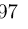

```cpp
// create a vector
vector<double> myVector;

// add three elements to the end
myVector.push_back( 12.0 );
myVector.push_back( 13.0 );
myVector.push_back( 14.0 );

// read the first, second and third elements
cout << myVector[0] <<"\n";
cout << myVector[1] <<"\n";
cout << myVector[2] <<"\n";
```

从这个示例中我们可以看到，你使用 `push_back` 函数将数据添加到向量的末尾。注意我们在函数名前使用 `.` 的方式。这是向量一个*成员函数*的示例。它是“属于”向量本身的函数，执行特定于该向量的功能。这是*面向对象编程*的典型特征。对象将数据和处理这些数据的功能聚集在一起。因此，`vector<double>` 是一种存储数字并提供 `push_back` 函数的对象类型。

调用成员函数时，你总是这样使用 `.`。你可以将 `.` 理解为类似英语中的“所有格撇号 s”。我们是在调用 `myVector` 的 `push_back` 函数。

要从向量中读取数据，我们使用索引符号 `myVector[i]` 来访问索引 `i` 处的元素。注意在 C++ 中向量的索引从 0 开始。这是 C++ 程序员在编写 `for` 循环时从 0 开始计数的原因之一。

我们还可以使用索引符号 `myVector[i]` 来更改向量的元素，如下所示。

```cpp
// change the values of a vector
myVector[0] = 0.1;
myVector[1] = 0.2;
myVector[2] = 0.3;
```

你可以使用索引符号开始使用 `for` 循环编写更复杂的程序。下面是一个简单的示例，使用 `for` 循环打印向量的元素。

```cpp
// loop through a vector
int n = myVector.size();
for (int i=0; i<n; i++) {
    cout << myVector[i] <<"\n";
}
```

同样，注意我们从零开始计数，并使用小于号停止计数。如果你在编写 C++ 代码时养成了这种习惯，你将避免许多错误！

**提示：** C++ 程序员从 0 开始计数

由于向量的第一个索引是 0，你的 `for` 循环中应始终从 0 开始计数。

我们刚刚在上一个示例中看到了 `vector<double>` 的另一个成员函数。我们使用成员函数 `size()` 来计算向量的大小。

你可能会被诱惑编写如下代码：

```cpp
for (int i=0; i<myVector.size(); i++) {
...
}
```

而不是单独计算大小。这在技术上是正确的 C++，但某些编译器（例如 Visual Studio）如果你这样做会发出警告。原因是 `vector.size()` 的类型是无符号整数，编译器担心你在比较有符号和无符号数据类型。解决此问题的方法很简单，只需编写：

```cpp
for (int i=0; i<(int)myVector.size(); i++) {
...
}
```

通过将大小强制转换为有符号 `int`，我们阻止编译器担心。同样，如果尝试使用 64 位 Windows 进行编译，你需要在尝试将 `size()` 的返回值存储在 `int` 中之前将其强制转换，因为编译器担心你试图使用仅 32 位来存储一个可能是 64 位的数字。实际上，我们不会创建包含 $2^{31}$ 或更多元素的向量！作为替代方案，我们可以自己使用类型为 `size_t` 的变量。如前所述，处理无符号整数可能会引起混淆，这就是为什么我们更喜欢将值强制转换为 `int` 的选项。

让我们看一些我们可以用向量做的更多示例。

- 我们可以将其初始化为特定大小和特定固定值。

- 我们可以将向量初始化为另一个向量的副本。

- 我们可以将一个向量的内容替换为另一个向量的内容。

这些操作在下方的代码中展示：

```cpp
// Create a vector of length 10
// consisting entirely of 3.0's
vector<double> ten3s(10, 3.0 );

// Create a vector which is a copy of another
vector<double> copy( ten3s );
ASSERT( ten3s.size() == copy.size());

// replace it with myVector
copy = myVector;
ASSERT( myVector.size() == copy.size());
```

你不仅限于 `double` 值的向量。如果你想要一个整数值向量，只需使用 `vector<int>`。如果你想要一个有序字符串列表，只需使用 `vector<string>`。下面的示例展示了如何使用值列表初始化一个整数向量。

```cpp
vector<int> threeInts({ 2, 3, 4 });
```

## 7.2 按引用传递和 const

当你编写一个接受向量参数的函数时，你应该像这样编写它：

```cpp
double sum( const vector<double>& v ) {
    double total = 0.0;
    int n = v.size();
    for (int i=0; i<n; i++) {
        total += v[i];
    }
    return total;
}
```

注意那些悄悄溜进来的奇怪的 `const` 和 `&` 符号。这些额外符号的目的是使传递大型对象更快，我们将在 7.2.1 节中解释。

我建议你将上述函数背下来，作为以下语法的提醒：

- 向量

- For 循环

- 按引用传递（使用 `&`）

- `const` 关键字。

### 7.2.1 按引用传递

考虑以下简短的程序。你认为它会输出什么？

```cpp
void printNextValue( int x ) {
  x = x + 1;
  cout << "B: Value of x is "<<x<<"\n";
}

void main() {
  int x = 10;
  cout << "A: Value of x is "<<x<<"\n";
  printNextValue( x );
  cout << "C: Value of x is "<<x<<"\n";
  return 0;
}
```

答案是它输出：

A: Value of x is 10

B: Value of x is 11

C: Value of x is 10

原因是，当你通常调用一个函数时，你的数据会被复制一份，而这个副本被传递给函数。在这种情况下，变量 `x` 的一个*副本*被传递给了 `printNextValue`。这意味着当副本被递增时，原始变量 `x` 保持不变。


另一方面，非常相似的程序：

```cpp
void printNextValue2( int& x ) {
  x = x + 1;
  cout << "B: Value of x is "<<x<<"\n";
}

void main() {
  int x = 10;
  cout << "A: Value of x is "<<x<<"\n";
  printNextValue2( x );
  cout << "C: Value of x is "<<x<<"\n";
  return 0;
}
```

输出的结果有所不同。它输出：

A: Value of x is 10

B: Value of x is 11

C: Value of x is 11

唯一重要的区别是在 `printNextValue2` 的定义中使用了 `&` 符号。在这种情况下，参数 `x` 是*按引用传递*的。这意味着函数 `main` 中的变量 `x` 实际上被 `printNextValue2` 修改了。函数接收的不是变量的副本，而是被要求修改变量本身。

我们说使用按值传递的函数 `printNextValue` 没有*副作用*，因为该函数只是执行了你预期的计算。另一方面，`printNextValue2` 具有意外改变 `x` 的值的副作用。

正如我们将在下一节中看到，有时你实际上希望函数能够改变你作为参数传递的数据值。当这种情况发生时，良好的做法是确保这一点从函数名称中显而易见。如果 `printNextValue2` 改名为 `incrementAndPrint`，它就不会是一个如此令人困惑的函数。其名称将使其行为清晰。一般来说，程序员假设函数不会改变传递给它的参数，除非文档非常明确地指出了这一点。因此，就像在医学中一样，不想要的副作用通常被认为是一件坏事。

这似乎表明你应该很少使用按引用传递。然而，当你传递大型对象时，按引用传递数据可能比按值传递副本快得多。这是因为创建大型对象的副本可能需要大量时间。通过按引用传递，不需要任何复制。按引用传递的工作原理是告诉被调用的函数你的数据在内存中的位置。你的数据被读取，并可能在原地被修改。

**提示：何时使用按引用传递 (&)**

在传递对象时，默认选择按引用传递。

在传递基本数据类型 `double`、`int` 和 `bool` 时，按值传递或许略微快一点，因此对于这些数据类型，惯例是使用按值传递。

### 7.2.2 const 关键字

我们似乎陷入了两个选择之间：按引用传递很快但可能令人困惑；按值传递较慢但不应该引起困惑。

有两种可能的解决方案。

- 使用按引用传递，但要注意实际上不要修改传递给函数的参数。这看起来可能是对这个问题的滑稽解决方案，但这是一个非常实用的方法。
- 使用按引用传递，并要求编译器*证明*函数没有修改传入的参数。你可以通过使用 `const` 关键字来实现这一点。

当你将一个参数作为 `const` 参数传递时，这意味着你调用的函数不允许改变该参数的值。例如，如果你修改我们示例中的代码，使其现在读取为：

```cpp
void printNextValue( const int& x ) {
    x = x + 1;
    cout << "B: Value of x is "<<x<<"\n";
}
```

你将无法再编译该代码。这是因为函数试图修改变量 `x`，这与 `const` 关键字的使用相矛盾。

你也可以在变量上使用 `const` 关键字。我们已经看到它用于全局变量，但你也可以将其用于局部变量。无论在哪里使用，它都意味着变量的值不得改变。

> **提示：一致使用 const 或完全不用**

正如我们讨论过的，使用 `const` 关键字意味着编译器将检查你的函数，以确保它们没有任何副作用。

这有一些优点，但它有一个明显的缺点，即你需要输入 `const`！如果你选择使用 `const` 关键字，你会很快发现，为了避免编译错误，你必须在整个代码中一致地使用 `const` 关键字。结果证明，这意味着你将*非常*频繁地输入 `const`。

你需要决定是否要在代码中使用 `const`。在这本书中，我们将演示如何使用 `const` 关键字编写代码，因此会大量使用 `const`。

如果你正在处理一个现有的 C++ 项目，关于是否在该项目中使用 `const` 已经做出了决定。在这种情况下，你应该顺应这个决定。

如果你正在编写自己的软件项目，也许是为学生论文，我个人建议*不*使用 `const` 关键字。我认为你花在理解由 `const` 引起的编译器错误上的时间会被浪费，这些时间本可以更好地用于编写单元测试。然而，这种观点存在争议，许多项目确实选择使用 `const` 关键字。

### 7.2.3 无 const 的按引用传递

我们已经看到，没有 `const` 关键字的按引用传递可能导致不想要的副作用。尽管如此，确实有时你希望函数改变其参数。

一个例子是，C++ 不允许你返回多个值。你可以使用按引用传递来绕过这一点。

例如，假设我们要编写一个函数，将极坐标 $(r, \theta)$ 转换为笛卡尔坐标 $(x, y)$。我们不能编写一个返回两个 `double` 值的函数，因此我们编写一个不返回任何值的函数，但修改两个按引用传入的变量 `x` 和 `y`。

```cpp
void polarToCartesian( double r, double theta,
                    double& x, double& y ) {
  x = r*cos(theta);
  y = r*sin(theta);
}
```

下面是如何使用此函数的示例：

```cpp
static void testPolarToCartesian() {
  double r = 2.0;
  double theta = PI/2;
  double x=0.0,y=0.0;
  polarToCartesian(r,theta,x,y);
  ASSERT_APPROX_EQUAL( x,0.0,0.001 );
  ASSERT_APPROX_EQUAL( y,2.0,0.001 );
}
```

正如我们将在下一章中看到的，用户定义类型提供了返回多个值的另一种方式。

## 7.3 使用 ostream

另一个非常有用的数据类型是 `ostream`。这代表“输出文件流”（Output File Stream）。“输出流”这个短语是你可以将数据写入的某处的通用术语。

例如，你可以将数据写入文件、屏幕、打印机、互联网等。所有这些给出了输出流的例子。在 C++ 中，你可以以非常相似的方式使用所有这些流。

下面是如何使用 `ostream` 的示例：

```cpp
// 创建一个 ostream
ofstream out;

// 选择写入位置
out.open("myfile.txt");

out << "The first line\n";
out << "The second line\n";
out << "The third line\n";

// 完成时总是关闭
out.close();
```

如你所见，除了打开和关闭文件外，它的工作方式与 `std::cout` 类似。使用 `ofstream` 时，你必须调用 `open` 指定要写入的文件。完成写入后必须调用 `close`。

你必须调用 `close`，因为 C++ 执行一些“缓冲”，这意味着你的数据实际上可能在你调用 `close` 之前没有被写入。缓冲是一种在将数据写入网络和文件时常用的性能增强技术。一次性向文件写入 100 个字符通常比为每个字符进行单独的调用更快。因此，当你向文件写入时，C++ 会默默地批量处理你的所有写入，直到认为有足够的值得发送给文件的数据。调用 `close` 表示是时候结束数据写入了。

此外，调用 `close` 向其他正在运行的程序表明你不再试图写入该文件——你通常希望防止两个不同的程序试图写入同一个文件。

在传递 `ofstream` 时，传递一个 `ostream` 的引用。仔细阅读最后一句：`ostream` 中没有 `f`。它代表“输出流”，可用于指代你希望写入程序输出的*任何*类型的流。

```cpp
void writeHaiku( ostream& out ) {
out << "The wren\n";
out << "Earns his living\n";
out << "Noiselessly.\n";
}

void testWriteHaiku() {
// 将一首俳句写入 cout
writeHaiku( cout );
// 将一首俳句写入文件
ofstream out;
out.open("haiku.txt");
writeHaiku( out );
out.close();
}
```

请注意，我们以引用方式传递 `ofstream`，而不是以 `const` 引用方式传递。这是因为我们希望能够通过向其写入数据来修改流。

你可以向函数 `writeHaiku` 传递任何类型的 `ofstream`。我们通过将俳句写入 `cout` 和文件来说明了这一点。但该函数同样可以很好地用于向打印机或互联网进行写入。这使得该函数变得更加强大。这是“多态性”的一个例子，我们将在第10章中详细讨论。多态性仅仅是希腊语“多种形态”的意思：输出流有许多不同的形式，但我们可以编写能与其中任何一种形式配合工作的函数。

## 7.4 处理字符串

`string` 类让你能够方便地操纵字符数据。以下是一些使用字符串的示例。

```cpp
// Create a string
string s("Some text.");

// Write it to a stream
cout << s << "\n";
cout << "Contains "
     << s.size() <<
     " characters \n";

// Change it
s.insert( 5, "more ");
cout << s << "\n";

// Append to it with +
s += " Yet more text.";
cout << s << "\n";

// Test equality
ASSERT( s=="Some more text. Yet more text.");
```

我们可以使用引号内的文本构造一个字符串。我们可以使用成员函数 `.size` 来计算其长度。我们可以使用成员函数 `.insert` 在给定位置插入额外文本。我们可以使用 `+` 将文本添加到字符串的末尾。

为了效率，你应该使用 `const` 引用来传递 `string` 对象。

你可能还记得在2.4节中提到，当你在双引号中书写一些文本时，这实际上并没有创建一个 `string` 类型的对象。它创建的是 `char*` 类型的数据。这意味着“指向包含一系列字符的内存地址的指针”。你需要告诉C++你想将此转换为 `string`。

`char*` 与 `string` 有何不同？关键区别在于，`char*` 仅由数据组成。而 `string` 将数据和许多有用的函数组合成一个单一的包。

因此，例如，以下代码在C++中没有意义：

```cpp
int a = "Quick brown fox".size();
```

你必须先将 `"Quick brown fox"` 的原始数据转换为一个 `string` 对象，然后才能调用 `size`。

```cpp
string s("Quick brown fox");
int a = s.size();
```

通常，我们更倾向于使用 `string` 而不是直接处理原始数据，因为这些函数非常有帮助。此外，使用 `string` 效率更高，因为它不仅存储实际字符，还存储字符串的长度。

在我们讨论在双引号中书写原始字符字符串时，我们注意到你可以像转义单引号中的字符一样转义双引号中的字符。使用 `\"` 表示一个单引号，使用 `\\` 表示一个反斜杠。

你经常会发现，某个函数需要的是 `char*` 参数而不是 `string`。在这种情况下，请使用函数 `c_str()` 将 `string` 转换回 `char*`。

`string` 数据类型与 `char*` 数据类型之间的这种混淆可以追溯到C编程语言。C从来没有一个合适的字符串数据类型。程序员历史上一直使用指向包含字符的内存位置的指针来表示字符串。因此，出于历史原因，许多函数仍然期望你传递一个 `char*`。

`string` 应该是你表示字符数据的首选。我们将在第11章中更彻底地讨论 `char*` 数据类型。

# 7.5 高效构建字符串

使用 `+` 通过在末尾添加来构建字符串是相当慢的。因此，你应该避免像这样的代码：

```cpp
string s("");
for (int i=0; i<100; i++) {
  s+="blah ";
}
cout << s<<"\n";
```

通过不断调整字符串对象的大小，我们浪费了计算机资源。相反，最好写入一个 `stringstream`。`stringstream` 是一种输出流，用于存储你写入的字符。

```cpp
stringstream ss;
for (int i=0; i<100; i++) {
    ss<<"blah ";
}
string s1 =ss.str();
cout << s1 <<"\n";
```

一旦你构建了你想要的字符串，调用成员函数 `.str()` 将 `stringstream` 转换为 `string`。

在这本书中我们不会进行太多的字符串操纵，性能对我们来说也不会是一个大问题。但使用 `stringstream` 对于测试也非常有用。如果你有一个向 `ostream` 写入的函数，你可以通过查看它是否正确写入 `stringstream` 来测试它是否工作正常。然后你可以确信当你使用 `ofstream` 写入文件时它也会正常工作。你甚至可以在你写入某种更奇特的流（例如代表互联网连接）时确信它会正常工作。

这是多态性的另一个例子，显示了多态性如何使测试变得更加容易。

# 7.6 编写饼图

了解我们现在已经掌握了足够的C++来生成一些图表，这可能会让你惊讶。诚然有一个技巧：我们将实际上在C++中生成图表的数据，然后使用外部程序来生成图表本身。

基于这个想法，在C++中制作图表最简单的方法是简单地将其数据写入文件，然后使用电子表格程序（如Excel或OpenOffice Calc）来创建图表。

以下是将图表写成电子表格程序容易理解的格式所需的代码。

```cpp
void writeCSVChartData( ostream& out,
    const vector<double>& x,
    const vector<double>& y ) {
    ASSERT( x.size() == y.size());
    int n = x.size();
    for (int i=0; i<n; i++) {
    out << x[i] <<","<<y[i] <<"\n";
}
}

void writeCSVChart( const string& filename,
	const vector<double>& x,
	const vector<double>& y ) {
	ofstream out;
	out.open( filename.c_str() );
	writeCSVChartData( out, x, y );
	out.close();
}
```

为了使这部分成为库的一部分，我们需要在头文件中声明它：

```cpp
void writeCSVChart( const std::string& filename,
	const std::vector<double>& x,
	const std::vector<double>& y );
```

头文件中的函数声明大量使用了 `std::` 限定。我们不得不对每个类型名称进行完全限定。原因是你绝不应在头文件中写入 `using namespace std;`，因此不幸的是需要所有这些枯燥的 `std::` 前缀。

这两个函数共同提供了一个在C++中编写图表的非常合理的解决方案。然而，这感觉并不令人非常满意，因为人们仍然必须手动使用电子表格程序将数据转换为图表。我们可以做得稍微好一点。

### 7.6.1 基于Web的图表

创建一个包含饼图的网页出奇地容易。步骤如下：

- 创建一个名为 `myPieChart.html` 的文件。用文本编辑器打开它。
- 将以下代码复制到你的文件中。你也可以从网站下载基本等效的代码：`https://google-developers.appspot.com/chart/`。
- 保存该文件。
- 在Web浏览器中打开该文件。


```html
<html>
  <head>
    <!--Load the AJAX API-->
    <script type="text/javascript"
            src="https://www.google.com/jsapi"></script>
    <script type="text/javascript">

      // Load the Visualization API
      // and the piechart package.
      google.load('visualization', '1.0', {'packages':['corechart']});

      // Set a callback to run when the
      // Google Visualization API is loaded.
      google.setOnLoadCallback(drawChart);

      // Callback that creates and populates a data table,
      // instantiates the pie chart, passes in the data and
      // draws it.
      function drawChart() {

        // Create the data table.
        var data = new google.visualization.DataTable();
        data.addColumn('string', 'Topping');
        data.addColumn('number', 'Slices');
        data.addRows([
          ['Mushrooms', 4],
          ['Salami', 2],
          ['Spinach', 3]
        ]);

        // Set chart options
        var options = {'title':'Pizza Toppings',
                       'width':400,
                       'height':300};

        // Instantiate and draw our chart, passing in some options.
        var chart =
            new google.visualization.PieChart(
                document.getElementById('chart_div')
            );
        chart.draw(data, options);
      }
    </script>
  </head>

  <body>
    <!--Div that will hold the pie chart-->
    <div id="chart_div"></div>
  </body>
</html>
```

如果你所做的一切都是正确的，当你双击该文件时，它应该会显示一个如图7.1所示的饼图。

你可能会想知道这是如何工作的。简而言之，它使用了Google的基于Web的图表库，这使得在Web文档（`.html`文件）中创建图表变得容易。我们没有时间学习HTML和Javascript，即创建此图表所涉及的两种语言。然而，这并不是一个大问题。我们可以简单地利用我们的智能想出如何修改示例代码以打印我们选择的饼图。

这个示例代码直接来自Google为Google Charts提供的官方文档。如果你查阅他们的在线文档，它会为你提供很多关于如何修改图表以满足你需求的想法。

我们一直在自下而上地学习C++编程。也就是说，我们一直在一步步学习所有的技术细节。另一条路径是

# 披萨配料


**图 7.1：** 一个饼图示例

学习一门语言是靠沉浸式学习：你通过观察示例并进行修改来学习。你可能永远无法学会这门语言的所有严格规则，但仅凭有限的知识也能完成很多工作。所以现在，我们正在通过沉浸式方式学习 HTML 和 JavaScript。

作为一个练习，请修改饼图示例，使其生成你任意选择的饼图。万一这点不明显，代码中你唯一需要关注的部分是以下几行：

```javascript
data.addRows([
  ['Mushrooms', 4],
  ['Salami', 2],
  ['Spinach', 3]
]);
```

最终结果是，编写一个饼图程序并不会比生成一个包含数据的文件更难。只是文件的顶部和底部有一些额外的样板代码，这些我们不需要深入理解。

让我们逐步创建一个用于生成饼图的函数的完整过程。

## 7.6.2 创建头文件

- 创建一个新头文件。
- 将文件命名为 `charts.h`
- 所有头文件应以 `#pragma once` 开头
- 使用 `#include "stdafx.h"` 包含标准库
- （测试内容稍后介绍）

```cpp
#pragma once
#include "stdafx.h"
```

## 7.6.3 编写源文件

- 创建一个新的源文件
- 将文件命名为 `charts.cpp`
- 所有源文件都应 `#include` 相关的头文件
- （测试内容稍后介绍）

```cpp
#include "charts.h"
```

## 7.6.4 在你的文件中启用测试

在 `charts.h` 中

```cpp
void testCharts();
```

在 `main.cpp` 中

```cpp
int main() {
  testMatlib();
  testGeometry();
  testCharts();
  testUsageExamples();
}
```

在 `charts.cpp` 中

```cpp
void testCharts() {
}
```

## 7.6.5 编写函数以生成样板代码

- 我们将一个 `ostream&` 引用传递给函数
- 我们使用 `\"` 来转义引号内的引号。
- HTML 文件中的间距并不重要，因此此函数不会精确复现 Google 示例饼图的间距。这样做是为了让代码能够显示在页面上。

```cpp
static void writeTopBoilerPlateOfPieChart( ostream& out ) {
  out<<"<html>\n";
  out<<"<head>\n";
  out<<"<!--Load the AJAX API-->\n";
  out<<"<script type=\'text/javascript\'>";
  out<<"src=\"https://www.google.com/jsapi\">";
  out<<"></script>\n";
  out<<"<script type=\'text/javascript\'>\n";
  out<<"google.load('visualization', '1.0',";
  out<<" {'packages':['corechart']});\n";
  out<<"google.setOnLoadCallback(drawChart);\n";
  out<<"function drawChart() {\n";
  out<<"var data=new google.visualization.DataTable();";
  out<<"\n";
  out<<"data.addColumn('string', 'Label');\n";
  out<<"data.addColumn('number', 'Value');\n";
}
```

编写底部样板代码的函数同样简单。

```cpp
static void writeBottomBoilerPlateOfPieChart(
    ostream & out ) {
  out<<"var options = {'title':'A Pie Chart',\n";
  out<<"width':400,\n";
  out<<"'height':300\n";
  out<<"};\n";
  out<<"var chart = new google.visualization.PieChart(";
  out<<"document.getElementById('chart_div')));\n";
  out<<"chart.draw(data, options);\n";
  out<<"}\n";
  out<<"</script>\n";
  out<<"</head>\n";
  out<<"<body>\n";
  out<<"<div id='chart_div'>\n";
  out<<"</body>\n";
  out<<"</html>";
}
```

## 7.6.6 编写图表数据的简单版本

最难的部分将是编写饼图数据。暂时我们“作弊”，只编写一个简化函数，输出一些固定文本，希望它能正常工作。

这不算真正的作弊，而是一种明智的做法。我们要分小块工作。解决了一个简单问题后，再下一个简单问题。

```cpp
static void writeFixedPieChartData( ostream& out ) {
    out<<"data.addRows([\n";
    out<<"['Bananas', 100],\n";
    out<<"['Apples', 200],\n";
    out<<"['Kumquats', 150]\n";
    out<<"]);\n";
}
```

## 7.6.7 测试我们目前完成的内容

```cpp
static void testFixedPieChart() {
    ofstream out;
    out.open("FixedPieChart.html");
    writeTopBoilerPlateOfPieChart(out);
    writeFixedPieChartData( out );
    writeBottomBoilerPlateOfPieChart( out );
    out.close();
}

void testCharts() {
    TEST( testFixedPieChart );
}
```

我们已经编写了足够多的代码来进行测试，所以让我们运行它。当你使用标准开发环境设置运行此测试时，它将在与 `main.cpp` 相同的文件夹中创建该文件。

## 7.6.8 编写有趣的核心代码

让我们明确有趣的核心代码必须做什么。给定一个标签字符串，它应该生成如下所示的输出：

```javascript
data.addRows([
['Bananas', 100],
['Apples', 200],
['Kumquats', 150]
]);
```

最后一行是特殊的——没有逗号。除此之外，看起来都很简单。

```cpp
static void writeDataOfPieChart( ostream& out,
const vector<string>& labels, const vector<double>& values) {
out << "data.addRow(\n";
int nLabels = labels.size();
for (int i=0; i<nLabels; i++) {
    string label = labels[i];
    double value = values[i];
    out << "[" << label << ", " << value << "]";
    if (i!=nLabels-1) {
        out << ",";
    }
    out << "\n";
}
out << "];\n";
}
```

有一个微妙的问题。为了简单起见，我们假设标签不包含引号或其他特殊字符。修复这个问题留作练习。

### 危险！

在生产软件中修复特殊字符问题非常重要。黑客喜欢基于引号的漏洞。例如，在使用 Web 应用程序时，他们可能会尝试选择一个特殊的用户名

`Dave'); DELETE FROM Users; --`

这里，黑客猜测你正在使用 SQL 数据库，并希望诱骗你在你的数据库上执行以下 SQL 代码

```sql
INSERT INTO Users VALUES ('Dave'); DELETE FROM Users; --)
```

这段代码将首先创建一个名为“Dave”的新用户，但随后会删除整个数据库表 `Users`！问题是 `'` 字符在 SQL 中具有特殊含义，就像在 C++ 中一样，因此当它作为字符串的一部分使用时需要转义。

## 7.6.9 测试有趣的核心代码

为了测试函数 `writeDataOfPieChart`，我们编写一个测试，找到函数 `writeDataOfPieChart` 输出的文本，然后将其与预期值进行比较。为此，我们首先为我们的饼图设置一些虚拟数据。然后调用 `writeDataOfPieChart`，并使用 `stringstream` 存储输出。

```cpp
static void testPieChartData() { // 此测试自动化检查过程
    stringstream out;
    vector<string> labels(3);
    vector<double> vals(3);
    for (int i=0; i<3; i++) {
        stringstream ss;
        ss<<"A Label "<<i;
        labels[i] =ss.str();
        INFO( labels[i] );
        vals[i]=(double)i;
    }
    writeDataOfPieChart( out, labels, vals );
    string asString = out.str();
```

现在我们可以将 *writeDataOfPieChart* 的输出与我们预期的输出进行比较。

```cpp
stringstream expected;
expected<<"data.addRows([\n";
expected<<"['A Label 0', 0],\n";
expected<<"['A Label 1', 1],\n";
expected<<"['A Label 2', 2]\n";
expected<<"]);\n";
string expectedStr = expected.str();
ASSERT( asString==expectedStr );
}
```

这提供了一种测试，证明 *writeDataOfPieChart* 按照我们期望的方式运行。

- 由于 *fstream* 和 *stringstream* 都是 *ostream* 的类型，有趣的核心代码很容易测试。
- 你可能认为对于生成图表的代码来说，编写有用的测试是不可能的。许多人会争辩说，测试代码需要有人类查看图表。然而，我们刚刚表明，编写几乎任何代码的有意义测试都是完全可能的。如果你无法测试它，说明你设计代码不当或没有正确理解问题。

## 7.6.10 将其全部包装到一个函数中

下面的函数定义使得从 C++ 创建具有给定标签和数值的饼图变得很容易。饼图将保存在给定的文件中。

```cpp
void pieChart( const string& file,
const vector<string>& labels,
const vector<double>& values ) {
ofstream out;
out.open(file.c_str());
writeTopBoilerPlateOfPieChart(out);
writeDataOfPieChart( out, labels, values );
writeBottomBoilerPlateOfPieChart( out );
out.close();
}
```

希望你会同意，这个函数非常简洁。我们使用函数将代码划分为易于管理的片段，这些片段共同产生了一个有趣的结果。

如果我们希望该函数在其他文件中可用，就需要在头文件中放入以下声明：

```cpp
void pieChart( std::string& file,
std::vector<std::string>& labels,
std::vector<double>& values );
```

这是从 `.cpp` 文件中的代码复制过来的，但由于在头文件中不应使用 `using namespace std;`，所以我们不得不添加许多 `std::` 语句。

## 7.7 万维网的架构

互联网和万维网是略有不同的事物。互联网包含互联网上的一切，包括 Skype、电子邮件和 Netflix。万维网则是你在网页浏览器中可以看到的内容。

因此，万维网只是运行在互联网上的一个特别流行的应用程序。

我们将图表编写为基于文本的文件这一“技巧”依赖于万维网的架构。万维网基于发送文本文件。服务器接收文本数据（例如，来自用户填写表单和输入 URL）。服务器发送文本数据（例如，像我们图表这样的 HTML 文件）。

即使不了解 HTML，编写生成网页的服务器也很简单。我们刚刚就是这样做的。即使不使用网页浏览器，测试服务器代码也很简单。

这是一种你应该模仿的“设计模式”。使用人类可读的数据在应用程序之间进行通信。编写小的、简单的应用程序，通过文本文件进行通信。这将允许你使用 C++ 做 C++ 擅长的事，使用其他语言做它们更擅长的事情（例如，用户界面和原型设计）。

这是本书中关于*软件架构*的第一个重要示例。开发软件可能需要你执行以下任何操作：

- 在给定语言中编写代码；
- 在该语言中设计函数和数据类型，以产生方便且有用的库；
- 使用多台计算机和多种语言编写系统，以创建有用的最终产品。


这些任务分别被称为编码、软件设计和软件架构。蒂姆·伯纳斯-李在构思万维网时，正扮演着软件架构师的角色。正如万维网所证明的，良好的架构对于应用程序的成功至关重要。

像这样关于 `C++` 编程的入门书籍，不可避免地侧重于编码和软件设计。然而，值得记住的是，优秀的软件开发人员愿意使用多个相互交互的程序和多种语言来实现他们的目标。

最后，你可能会想知道如何从 `C++` 代码中生成可以包含在出版物中的图表。可以使用 `GNU plot` 等工具来生成非常高质量的图表。基本思想类似：使用 `C++` 编写 `GNU plot` 能理解的文本文件；运行 `GNU plot` 将此文本文件转换为适合出版的 `pdf` 文件。

## 练习

7.7.1. 编写一个函数 `solveQuadratic`，它接受参数 `a`、`b` 和 `c`，并使用二次公式找到 `$ax^{2} + bx + c = 0$` 的两个根。它应该返回根的个数，并使用引用传递返回根的值。编写这个函数的一个替代版本，使用 `vector` 返回结果。

7.7.2. 编写一个函数 `mean`，计算 `double` 类型向量的平均值。为这个函数编写测试。

7.7.3. 编写一个函数 `standardDeviation`，计算 `double` 类型向量的标准差。使其接受两个参数：向量本身和一个布尔值，指示计算总体标准差还是样本标准差。默认值设为计算样本标准差。为这个函数编写测试。为什么 `std` 是一个糟糕的函数名选择？

7.7.4. 编写一个函数 `min` 和一个函数 `max`，它们各自接受一个 `double` 类型的向量，分别返回最大值和最小值。为这些函数编写测试。你编写过一个用于创建测试向量的辅助函数吗？

7.7.5. 编写一个函数 `randuniform(int n)`，返回一个包含范围 `(0,1)` 内均匀分布随机数的向量。使用函数 `rand()`（你需要从 `cstdlib` 中 `#include` 它（在此处查看文档：`http://www.cplusplus.com/reference/cstdlib/rand/`））来完成这个练习。你还需要使用也在 `cstdlib` 中定义的常数 `RAND_MAX`。为这个函数编写测试。

请注意，在本书中我们不会试图告诉你每个可能想使用的函数，因此开始熟悉如何使用在线文档是个好主意。

7.7.6. 编写一个函数 `randn(int n)`，返回一个包含均值为 `0`、标准差为 `1` 的正态分布随机数的向量。为这个函数编写测试。

7.7.7. 生成正态分布随机数的另一种方法是使用 Box–Müller 算法。为此，先生成两个在区间 `(0,1)` 内均匀分布的随机变量 `$u_1$` 和 `$u_2$`。定义：

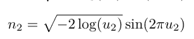

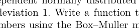

`n_1` 和 `n_2` 将是独立的、均值为 `0`、标准差为 `1` 的正态分布随机数。编写一个函数，使用 Box–Müller 方法生成 `N` 个正态分布随机数，并为你的答案编写测试。

7.7.8. 使用 Google Line Chart 示例，了解如何创建包含折线图的网页。使用此方法编写一个函数 `plot`，它接受一个字符串、一个 `x` 坐标向量、一个 `y` 坐标向量，并生成一个包含 `$y$` 对 `$x$` 的折线图。通过绘制 `$y = x^2$` 的图形来测试你的代码。

使用方程 `(A.6)` 绘制看涨期权价格随当前股价变化的图形。假设波动率为 `0.2`，执行价格为 `100`，到期时间为 `1.0`，无风险利率为 `0.05`。

7.7.9. 你可以使用标准库函数 `sort` 对 `double` 类型向量进行排序。如果 `v` 是一个向量，你可以使用以下代码对其进行排序：

```cpp
sort( v.begin(), v.end() );
```

你还需要 `#include <algorithm>` 并使用命名空间 `std`。上述代码实际上会改变向量 `v`，因此你可能更喜欢创建排序后的副本，如下所示：

```cpp
vector<double> copy = v;
sort( copy.begin(), copy.end() );
```

使用此方法编写一个函数 `prctile`，它接受一个 `double` 类型向量 `$v$` 和一个百分位数 `$p$` 作为输入，并输出第 `$p$` 个百分位数。

请注意，关于百分位数的精确定义并没有达成共识。你需要选择一个精确定义来回答问题。本练习参考答案中使用的定义在图 7.2 中针对样本向量 `$(1\ 3\ 4\ 7)$` 进行了说明。在这个百分位数定义中，如果 `v` 包含 `n` 个点，则 `v` 的排序值确定了等于以下 `p` 值的百分位数：

$$ 100 \times \frac{1}{2n}, 100 \times \frac{3}{2n}, 100 \times \frac{5}{2n}, \dots, 100 \times \frac{2n-1}{2n} . $$

第 `0` 个百分位数始终等于样本中的最小值。第 `100` 个百分位数是样本中的最大值。所有其他百分位数由线性插值确定。

**7.7.10. （更具挑战性）** 你会发现，Google Line Chart 可以用来绘制不仅仅是函数图形的曲线。这是因为 `x` 坐标向量不需要按升序排列，甚至可以包含重复项。利用这个想法编写一个函数 `hist`，它接受一个数值向量和桶的数量 `$n$`，并绘制一个包含 `$n$` 个条形并显示不同数值频率的直方图。你的代码应该只创建绘制折线图所需的数据，然后使用上一个问题的答案。另一种方法是使用 Google charts 提供的直方图功能。对于非常大的样本，这种第二种方法会有什么问题？

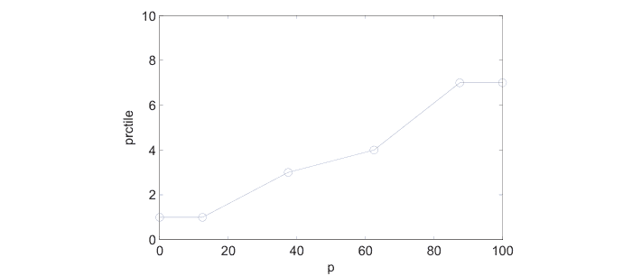

FIGURE 7.2: 向量 `$(1\ 3\ 4\ 7)$` 的百分位数

7.7.11. （更有挑战性）修改代码，使其能够处理标签中像 `` ` `` 这样的特殊字符。你需要在 `string` 的在线文档中查找如何逐字符检查字符串，你可以在 `cplusplus.com` 上找到这些文档。

7.7.12. 在上面的问题中，你是否通过引用传递了向量和字符串？你是否在可能的地方使用了 `const` 关键字？你是否在可能的地方使用了 `static` 关键字？

# 7.8 摘要

本章标志着我们 `C++` 编程技能发生了一定的转变。通过整合我们所学的一切，我们可以编写出非常复杂的程序。

我们学到的具体技能包括：

- 通过引用传递和通过值传递。
- 如果我们希望编译器协助避免副作用，就使用 `const` 关键字。
- 使用 `vector<double>` 来表示数学向量。将其作为 `const vector<double>&` 类型传递。
- 使用 `string` 来表示字符串。将其作为 `const string&` 传递。
- 使用 `stringstream` 来构建复杂的字符串。
- 使用 `fstream` 写入文件。
- 使用 `ostream` 以任何类型的流互换地写入。
- 使用文本文件在不同程序之间通信的架构设计模式。


# 第 8 章

## 用户定义类型

在上一章中，我们学习了如何使用：

- `vector<double>`，
- `string`，
- `ofstream`，
- `stringstream`。

使用这些新类型使我们成为生产力更高的 `C++` 程序员。下一步是学习编写我们自己的类型，我们希望这同样能提升我们的生产力。

正如你将要学到的，在面向对象语言中，程序员的主要工作是编写自己的类型。

在本章中，我们将假设你已在开发环境中打开 `FMLib8`，以便你可以查看代码并进行实验。

### 8.1 术语

我们已经知道以下内容。

- `C++` 中的每个变量都有一个类型（例如，`double`）。
- 你可以拥有大量给定类型的变量。

我们要开始学习一种称为“面向对象编程”的编程风格，在这种风格中，习惯性地对相同的概念使用略微不同的词汇。

- `C++` 中的每个*对象*都有一个*类*。
- 你可以拥有同一个类的许多*实例*。

**示例 1：**

```
string s("To be, or not to be?");
```

在上面的代码中，`s` 是 `string` 类型的一个对象。它是 `string` 类的一个实例。

在面向对象编程中，术语对象指的是一种由一系列数据以及处理这些数据有用的函数组成的数据类型。

因此，`vector<double>` 是一个对象，因为它包含向量的数据以及像 `size()` 这样的有用函数。类似地，`string` 也是一个对象。

另一方面，`double`、`int` 和原始数据类型 `char*` 不是面向对象类型，因为它们完全由数据组成，没有特殊的辅助函数。

对象支持的数据和函数类型仅取决于其类。同一类的所有实例具有相同的函数和相同的数据类型。

示例 2：`string` 类的一个实例由以下部分组成：

- 由字符序列组成的数据；
- 用于处理这些数据的功能，如 `size`、`insert`、`erase`。

`string` 类定义了所有这些函数和数据类型。

最后，与对象相关的函数通常被称为方法。功能（function）和方法（method）这两个词之间没有有意义的区别。一些作者更喜欢使用方法（method）一词，因为功能（function）一词可能会让非数学家感到恐惧。我们将同时使用这两个术语。

# 8.2 编写自己的类

## 8.2.1 编写声明

为了展示如何编写自己的类，让我们创建一个表示二维空间中点的数据类型。

```
class CartesianPoint {
public:
     double x;
     double y;
};
```

上面的代码被称为类声明。你可以选择将类声明放在 `.h` 文件或 `.cpp` 文件中。如果你希望它是你库的一部分，就把它放在头文件中。如果你是在实现库时使用它，但不希望其他人使用它，就把它放在 `.cpp` 文件中。

在这种情况下，我们希望该类对我们库的用户可用，因此我们已在 `.h` 文件**geometry.h**中声明了它。

在上面的示例中：

- 我们的类名为**CartesianPoint**。
- 笛卡尔点包含两个名为 `x` 和 `y` 的 **double** 值。这些被称为类的*成员变量*。
- 库的用户被允许在他们自己的代码中使用 `x` 和 `y` 的值，因此这些被标记为**public**。

编写类时，类声明使用以下通用语法：

```
class CLASS_NAME {
public:
    DATA AND FUNCTION DECLARATIONS
private:
    DATA AND FUNCTION DECLARATIONS
};
```

在标记为 **public:** 的部分中声明的数据和函数将对你的库用户可用。标记为 **private:** 的数据和函数对你的库用户不可用。这允许你隐藏关于你的类如何工作的信息。这将使你的库更容易使用和维护。

需要注意的几点是：

- 你可以在头文件或 `cpp` 文件中定义类。如果你希望库用户使用你的类，请使用头文件。
- 你必须在末尾记得分号。如果你省略它，可能会得到非常令人困惑的编译器错误。
- 与变量名一样，类名不应包含空格或奇怪的字符，并且应以字母开头。使用命名约定是个好主意，以便轻松区分类名和变量名。在这本书中，我们将使用驼峰命名法（以大写字母开头）的命名约定来编写类名。例如，我们有类名**CartesianPoint**。

## 8.2.2 使用类

让我们看看某人将如何使用 `CartesianPoint` 类。我们的示例代码包含一个测试，展示该类如何使用。

```
1     CartesianPoint p;
2     p.x = 100;
3     p.y = 150;
4     cout << "Coordinates (";
5     cout << p.x ;
6     cout << ",";
7     cout << p.y ;
8     cout << ")\n";
9
10    p.x *= 2;
11    p.y *= 2;
12    cout << "Rescaled coordinates (";
13    cout << p.x ;
14    cout << ",";
15    cout << p.y ;
16    cout << ")\n";
```

这创建了一个点，并将坐标设置为 `(100,150)`。然后它打印出坐标。接着它将所有坐标值加倍，并第二次打印出它们。

为了更详细地理解这一点，在第 1 行，我们创建了 `CartesianPoint` 类的一个实例。我们只需声明一个类型为 `CartesianPoint` 的变量来做到这一点。

```
CartesianPoint p;
```

我们现在创建了一个名为 `p` 的变量，它表示空间中的一个点。然后我们设置表示 `x` 坐标和 `y` 坐标的成员变量。我们选择值，使 `p` 表示点 `(100,150)`。

```
p.x = 100;
p.y = 150;
```

当你想要访问类内部的数据时，使用点号 `.` 后跟成员变量的名称。

你只能访问这些变量，因为它们被标记为 `public`：尝试删除单词 `public`，看看你会得到什么编译器错误。这将有助于你理解编译器错误，以防你将来不小心忘记将数据标记为 `public`。

### 8.2.3 在函数之间传递对象

让我们编写一个新的类，称为**PolarPoint**，表示极坐标中的点。因此，它将具有对应于极坐标 (`$r$`, `$\theta$`) 的成员变量。

```
class PolarPoint {
public:
    double r;
    double theta;
};
```

我们可以使用这个类来说明如何在函数之间传递对象。让我们编写一个新的函数**polarToCartesian**，它接受极坐标中的一个点，并返回对应的**CartesianPoint**。

```cpp
CartesianPoint polarToCartesian( const PolarPoint& p) {
    CartesianPoint c;
    c.x = p.r*cos( p.theta );
    c.y = p.r*sin( p.theta );
    return c;
}
```

正如我们在 7.2.1 节中讨论的，当向函数传递对象时，你应该使用通过引用传递。这解释了**const** 关键字和 **&** 符号的使用。通常，任何自定义数据类型都应通过引用传递。通过值传递通常仅保留给 **double**、**int** 和 **bool**。

### 8.2.4 类如何帮助我们？

值得暂停一下，看看使用类如何提高我们的代码。让我们检查测试我们的新**polarToCartesian**函数所需的代码：

```cpp
static void testPolarToCartesian() {
    PolarPoint p;
    p.r = 2.0;
    p.theta = PI/2;
    CartesianPoint c = polarToCartesian( p );
    ASSERT_APPROX_EQUAL( c.x,0.0,0.001 );
    ASSERT_APPROX_EQUAL( c.y,2.0,0.001 );
}
```

并将其与我们之前的测试代码进行比较：

```cpp
static void testPolarToCartesian() {
    double r = 2.0;
    double theta = PI/2;
    double x=0.0,y=0.0;
```

`polarToCartesian(r,theta,x,y);`

`ASSERT_APPROX_EQUAL( x,0.0,0.001 );`

`ASSERT_APPROX_EQUAL( y,2.0,0.001 );`

}

使用类带来的第一个优势是，它们确立了一个明确的约定，即`$x$`坐标被称为`x`，`$y$`坐标被称为`y`。这使得使用`CartesianPoint`编写的代码比那些有时用`x`、有时用`X`、其余时间用`xcoord`的代码更清晰。

使用类带来的第二个优势是，我们的代码不再如此严重地依赖参数的顺序。在原始代码中，必须非常小心地确保每个参数都按正确的顺序传递，而且编译器不会提供任何帮助。使用类后，顺序错误变得不可能发生。当例如需要向一个函数传递5个参数来对看涨期权进行定价时，这一点变得尤为重要。此时，很容易将参数传递顺序弄错。

第三个优势是我们不再使用引用传递来返回多个值。大多数人觉得返回单个对象比通过引用修改参数在概念上更简单。这意味着使用类的代码版本对大多数人来说更容易理解。

因此，使用类为我们带来了一致性、可读性和可靠性。这些优势目前可能看起来微不足道，但随着我们的示例变得越来越复杂，这些优势将变得越来越明显。

然而，这也存在权衡。我们不得不编写代码来表示这些类。我们应该问自己这种权衡是否值得。库设计的哲学认为，我们的目标应该始终是让用户使用库变得容易，即使这意味着库作者需要做更多的工作。这是因为一个好的库会被广泛使用，但只编写一次。因此，投入额外的努力使库尽可能好是值得的。根据这种哲学，这种权衡是值得的。

在这个示例中，面向对象的优势相对较小。随着我们学习`C++`更多面向特性的内容，这种编程风格的优势将会增加。

## 8.3 向类中添加函数

当我们在类中添加*成员函数*时，面向对象的价值变得更加明显。让我们用`Circle`类来说明这一点。我们的`Circle`类只有一个相关的数据，即圆的半径。但它还将包含各种用于处理该数据的函数。

我们将编写一个**area()**函数来计算圆的面积，以及一个**circumference()**函数来计算其周长。

```text
class Circle {
public:
   double radius;
   double area();
   double circumference();
};
```


我们将`area`和`circumference`函数的声明放在类`Circle`的声明内部。它们被标记为`public`，因为我们希望它们对库的用户可用。这些声明看起来像普通的函数声明。请注意，它们根本不接收任何参数。

在我们尝试实现这些函数之前，让我们作为测试驱动开发者为它们编写测试。这将使我们能够演示如何在对象上调用函数。

```text
static void testAreaOfCircle() {
   Circle c;
   c.radius = 4;
   ASSERT_APPROX_EQUAL( c.area(), 16*PI, 0.01 );
}

static void testCircumferenceOfCircle() {
   Circle c;
   c.radius = 2;
   ASSERT_APPROX_EQUAL(c.circumference(),4*PI,0.01);
}
```

如上例所示，你使用点号来调用对象上的函数。例如，`c.area()`计算圆`c`的面积。

我们在特定的圆`c`上调用`area`函数，因此函数`area`应返回该特定圆`c`的面积。这就是你不需要向成员函数`area`传递半径的原因。

既然我们知道函数将如何被使用，让我们看看如何为这些函数提供定义。与C++函数通常的做法一样，我们在`.cpp`文件中编写定义。

```text
double Circle::area() {
   return PI*radius*radius;
}
```

```text
double Circle::circumference() {
   return 2*Pi*radius;
}
```

关于这些函数定义，有几点需要注意。

- (i) 当你定义类的成员函数时，必须始终在定义中指定类名。语法是：`CLASS_NAME::FUNCTION_NAME`。如果你忘记这样做，你会得到链接器错误，提示你忘记定义该函数。必须指定类名的原因是许多类可能具有同名的函数。例如，我们可能有一个类`Square`，它也有一个`area`函数。这就是你需要说明实际正在实现的是哪个类的方法的原因。

- (ii) `Circle`类的成员函数能够访问成员变量`radius`和全局变量`PI`。

### 8.3.1 在成员函数上使用 const

正如我们在第7.2节引入`const`关键字时提到的，如果你要使用`const`，必须在整个代码中一致地使用它。如果你决定使用`const`，那么如果一个成员函数不改变对象，你应该将其标记为`const`。你通过在声明和定义的末尾写`const`来实现这一点。

```cpp
class Circle {
public:
    double radius;
    double area() const;
    double circumference() const;
};

/**
 *  计算圆的面积
 */
double Circle::area() const {
    return PI*radius*radius;
}
```

在这个示例中，我们注意到测量圆的面积不会以任何方式改变圆。这就是我们在`area`函数的声明中添加了`const`的原因。

我们也在定义中添加了它，因为函数声明和定义中`const`和`&`的使用必须完全匹配。如果它们不完全匹配，你会得到链接器错误。尝试实验一下，看看如果你没有匹配的`const`语句会发生什么实际错误，这是值得的。

当你将一个指向`const Circle`的引用作为参数传递给函数时，编译器会坚持该函数不得修改该圆。这意味着你无法调用圆上的任何函数，除了那些标记为`const`的函数。这就是为什么，如果你打算使用`const`，你必须在每个不改变对象的函数上使用它。

## 8.4 一个金融示例

为了看到引入类所带来的好处，让我们通过一个涉及金融数学的更复杂的示例来进行讲解。首先我们定义一个名为`BlackScholesModel`的类。

```cpp
class BlackScholesModel {
public:
	double stockPrice;
	double volatility;
	double riskFreeRate;
	double date;
};
```

这个类中成员变量的选择是精心考量的。这个类只包含与模型相关的变量，而不包含与金融合约相关的变量。我们将在稍后的不同类中指定不同的期权合约。

我们将在后续章节中为这个类添加功能。例如，我们将添加函数来执行如模拟期权价格等操作。

请注意，我们将日期指定为`double`。我们将以自公元0年以来的年份来衡量日期。因此，2014年1月1日将表示为2014.0。在实际代码中你不会这样做，但我们不想在闰年以及九月有多少天这类问题上浪费精力。当你开始对真实的期权合约进行定价时，你需要更加小心。那时你会希望使用包含适当日期类的库。

我们现在定义一个单独的类用于期权合约。我们将创建一个类`CallOption`，它包含行权价和到期日，但不包含任何关于当前市场数据的信息。这种设计背后的理念是，我们可以使用相同的`BlackScholesModel`来对`CallOption`或`PutOption`进行定价。请注意，`CallOption`不会随着市场数据的变化而变化。这反映了现实情况：看涨期权*合约*不受市场变化的影响，尽管其价格可能会波动。

```cpp
class CallOption {
public:
	double strike;
	double maturity;

	double payoff( double stockAtMaturity ) const;
```

## 8.4.1 我们获得了什么？

这些好处与引入 `CartesianPoint` 和 `PolarPoint` 类时获得的好处类似，但现在它们显得更加显著。

- 编程更简单。如果我们有一个接受 5 个 `double` 参数的单个函数 `blackScholesPrice`，几乎不可能记住参数的正确顺序。

- 调试更简单。如果你有一个接受 5 个 `double` 参数的函数，几乎不可能发现有人是否不小心将参数的顺序搞错了。

- 一致性。如果我们使用相同的 `BlackScholesModel` 类对看跌期权、亚式期权、障碍期权等进行定价，我们将拥有一个更容易使用的库。

在后续章节中，我们将应用更高级的面向对象技术，这将带来更显著的优势。

## 8.5 关于编写类的建议

在编写类时，关于类的名称以及将其定义在哪个文件中等事务，你有许多选择。拥有一些约定是好的。在本书中，我们选择遵循以下指南。

1. 只要可能，不要把类声明放在头文件中，而应放在 `cpp` 文件中。这源于一个普遍原则，即你应该尽可能隐藏信息。

2. 如果你决定将类放在头文件中，每个头文件只定义一个类。

3. 将该类的命名与头文件相同。

4. 给类使用名词作为名称：例如 `CartesianPoint` 或 `BlackScholesModel`。

5. 类名的首字母使用大写。

文件 `BlackScholesModel.h` 和 `CallOption.h` 展示了这些约定。

文件 `geometry.h` 违反了这些约定，但这仅仅是因为我们要避免用许多与金融数学无关的文件来杂乱项目。如果我们真的在编写一个几何库，为了可读性，我们会将所有点类放入各自的头文件中。

需要考虑的第二个问题是 `const` 关键字。在本章中，我们尝试一致地使用 `const` 关键字。然而，`const` 关键字是 C++ 中的可选特性。你可以选择使用它，如果希望编译器保证你永远不会在不小心的情况下修改对象，但即使你完全不用 `const`，你的代码也能工作。

这意味着你可以为你的项目做出一个软件架构决策：是使用 `const` 还是不使用？这是一个针对整个项目的决策，因为事实证明，如果你想使用 `const` 关键字，你真的需要在所有地方使用它。这是因为如果某人传递给你一个 `const` 引用，你只能将其传递给本身声明为接受 `const` 引用的函数。

在实践中，这意味着你无法选择是否使用 `const`。你需要询问你的老板是否希望使用它。

即使你自己不喜欢 `const` 关键字，如果你正在编写一个库，如果库用户希望使用 `const` 关键字，你就需要使用该关键字。

在本书中，我们将使用 `const`，以便你可以理解所提出的问题，但你可能更愿意在自己的代码中避免使用它。

## 8.6 封装

现在让我们尝试更详细地理解 `public` 关键字。为此，让我们编写一个面向对象版本的饼图代码。我们从一个名为 `PieChart` 的类声明开始。

```cpp
class PieChart {
public:
    void setTitle( const std::string& title );
    void addEntry( const std::string& label,
                    double value );
    void writeAsHTML( std::ostream& out ) const;
    void writeAsHTML( const std::string& file ) const;
private:
    std::string title;
    std::vector<std::string> labels;
    std::vector<double> values;
};
```

遵循我们的约定，你可以在 `PieChart.h` 中找到这个类。

我们现在将数据变量标记为 `private`。这意味着只有 `PieChart` 的成员函数可以看到这些变量。

唯一修改标题的成员函数是 `setTitle`。唯一修改标签列表和数据点列表的函数是 `addEntry`。以下是它们的定义：

```cpp
void PieChart::setTitle( const std::string& t ) {
    title = t;
}

void PieChart::addEntry( const std::string& label,
                          double value ) {
    labels.push_back( label );
    values.push_back( value );
}
```

有趣的一点是，现在 `labels` 和 `values` 永远不可能包含不同数量的元素。这是因为唯一修改它们的代码是 `addEntry`，而该函数维护了一个保证，即两个向量始终具有相同的长度。我们知道项目中其他地方不可能有任何代码破坏这一保证，因为这些变量是 `private` 的。因为我们使用了 `private` 关键字，我们只需要检查成员函数是否行为良好，就可以确定 `labels` 和 `values` 具有相同数量的元素。

将所有成员变量设为 `private` 被认为是一种良好的编程风格。这样做允许你保证对象始终保持一致的状态。此外，它还允许你将来改变关于实现细节（即数据存储方式）的想法，而不会以任何方式影响你类的用户。

总而言之，`private` 关键字允许你执行比仅仅选择在头文件中放什么更高级的信息隐藏。

不把类放在头文件中比将事物设为 `private` 提供了更多的信息隐藏，所以这应该始终是你的首选。然而，如果你必须将类提供给库的用户，你应该尽量将其所有数据以及尽可能多的成员函数设为 `private`。

我们给 `BlackScholesModel` 和 `CallOption` 公有数据成员仅仅是为了简洁。我们想在解释 `private` 数据之前演示公有的使用。在实践中，通过修改这些类可以改善库。

使用 `private` 关键字隐藏数据的思想通常称为封装。封装这个词实际上指两件事：

- 将相关项目捆绑到一个单一对象中；

- 防止直接操纵对象的内部数据。

封装在现实世界设计中以及面向对象软件设计中都很常见。例如，考虑汽车的设计。

在汽车中，所有灯光控制都放在仪表板上，并且与窗户和座椅的控制明显分离。汽车控制中功能的这种分组对应于软件设计中功能分组到不同的类中。

此外，你可以通过标准功能（左转、右转等）控制汽车，但汽车的内部运作对用户完全隐藏（它们被保留在引擎盖下）。这对应于软件设计原则，即拥有少量提供给用户的公有函数，但将大多数细节保留为 `private`。

由于使用了封装，汽车更容易使用。你可以驾驶汽车而不必是经过训练的机械师，这是一件好事。正如这些设计原则使汽车更容易使用一样，同样的原则使面向对象程序中的对象易于使用。

为了进一步说明这一点，考虑 `vector<double>` 类如何存储其数据的问题，鉴于它不能自己使用 `vector<double>`。你不知道这是如何做到的，而且很合理的是你大概也不太关心。你不需要知道这一点，不必思考这件事让你的生活变得更轻松。

C++ 库的设计者通过使 `vector` 的内部数据变为 `private` 来尝试让你的生活更轻松。你也应该以同样的方式帮助库的用户。

## 8.6.1 实现 PieChart

你可以在 `PieChart.cpp` 中找到 `PieChart` 类的完整实现。它只是对我们在第 7.6 节中编写的非面向对象代码进行重组。你可以将我们新的 `PieChart` 类看作是对现有代码的一个面向对象封装，使其更易于使用。

## 8.6.2 使用 PieChart

面向对象编程的一个核心理念是，人类发现以下代码易于理解：

```cpp
static void testPieChartClass() {
    // just checks that the class compiles etc.
    PieChart pieChart;
    pieChart.addEntry("Mushrooms",200);
    pieChart.addEntry("Salami",100);
    pieChart.addEntry("Spinach",150);
    pieChart.setTitle("Pizza Toppings");

    pieChart.writeAsHTML ( "PizzaPie.html" );
}
```

这真正概括了面向对象的一个关键点。面向对象软件应当让我们的库的用户生活更轻松。

### 练习

- 8.6.1 编写一个类 `PutOption`，使其行为类似于 `CallOption`。确保你编写了适当的测试，并遵循文件命名约定。

- 8.6.2 编写一个类 `LineChart`，使其允许你创建折线图。添加一个设置图表标题的功能。

- 8.6.3 向 `CartesianPoint` 类添加一个 `distanceTo` 函数。它应该接受一个参数，即另一个 `CartesianPoint`，并计算这两个点之间的距离。以下是一个合适的测试函数：

```cpp
static void testDistanceTo() {
    CartesianPoint p1;
    p1.x = 1;
    p1.y = 1;
    CartesianPoint p2;
    p2.x = 4;
    p2.y = 5;
    double d = p1.distanceTo( p2 );
    ASSERT_APPROX_EQUAL( d, 5.0, 0.0001);
}
```

你在声明中使用了两次 `const` 关键字，在定义中也使用了两次吗？

- 8.6.4 编写一个普通的函数 `perimeter`，它接受三个 `CartesianPoint` 的 `const` 引用，并计算所形成的三角形的周长。`perimeter` 函数应该调用 `distanceTo`。使用 3, 4, 5 三角形测试你的 `perimeter` 函数。

如果你从 `distanceTo` 的定义中移除 `const` 关键字中的任意一个，但在 `perimeter` 的定义中保留它们，会发生什么？解释为什么“如果你使用 `const` 关键字，就必须到处都使用它”。

## 8.7 构造函数

如果你在 C++ 中创建一个 `double` 类型的变量但没有设置其值，C++ 并不保证分配什么值。在实践中，计算机只会获取一些空闲内存，并使用那里碰巧存在的任何值。

例如，下面的程序是有效的 C++，但无法预先确定它会输出什么。

```cpp
int main() {
  double d;
  cout << "What is the value of d?\n";
  cout << d;
  return 0;
}
```

之前这还不是一个问题，因为我们一直在关注警告信息，尽管这是技术上有效的 C++ 代码，但它肯定会引发编译器警告。

出于类似原因，以下代码也会导致编译器警告。

```cpp
class Point {
public:
  double x;
  double y;
};
```

```cpp
int main() {
    Point p;
    cout << "What is the value of x?\n";
    cout << p.x;
    return 0;
}
```

如果所有的 `double` 值和所有的 `int` 值默认都为 0，C++ 的使用将会稍微容易一些。我们无法修改 C++ 使事情变得更容易，但我们可以通过为类提供构造函数来使我们的类更易于使用。构造函数执行对象的初始化，使其处于合理状态。

我们已经使用过构造函数。例如，为了构造一个长度为 100 且初始化为零的向量，我们知道应该这样写：

```cpp
vector<double> v(100,0.0);
```

同样地，为了构造一个包含文本“Some text”的字符串，我们知道应该这样写：

```cpp
string s("Some text");
```

大多数类更进一步，拥有一个默认构造函数，使对象处于合理的默认状态。例如，为了创建一个空向量，只需写：

```cpp
vector<double> v;
```

默认构造函数会被自动调用。同样地，为了创建一个空字符串，写：

```cpp
string s;
```

当你编写类时，几乎总是应该给它一个默认构造函数，以便人们能够正确使用它。你可能还想提供更具专用性的构造函数，以便将对象初始化为特定状态。

## 8.7.1 编写默认构造函数


让我们编写一个名为 `Point` 的类，它旨在完全像我们的 `CartesianPoint` 示例那样工作，但现在拥有了构造函数。

```cpp
class Point {
public:
    Point(); // declare default constructor
    double x;
    double y;
};

Point::Point() {
    x=0.0;
    y=0.0;
}

int main() {
    Point p;
    cout << "What is the value of x?\n";
    cout << p.x;
    return 0;
}
```

在类声明中，我们现在在第 3 行有了声明 `Point();`。这声明了构造函数。

构造函数声明看起来像函数声明，除了：

- (i) 没有返回类型；
- (ii) 在函数名称的位置，你有类的名称。

同样地，构造函数定义看起来像函数定义，具有相同的差异。在上面的示例中，构造函数定义从第 8 行开始。

在我们的示例中，构造函数看起来像一个不接受参数的函数。正如我们将看到的，构造函数可以接受参数。默认构造函数只是一个不接受参数的构造函数。

你可以将构造函数视为一个在任何人被允许查看对象之前自动调用的函数。从技术上讲，它实际上不是一个函数，因为它*只能*在对象初始化时被调用，并且因为它没有返回值。

在构造函数的定义内部，你应该将所有 `int`、`double` 等字段设置为合理的默认值。更一般地说，你应该确保在任何人看到对象之前，对象处于一致的状态，并执行达到此状态所需的任何处理。

## 8.7.2 一种替代且更优的语法

这里是另一种我们可以编写 *Point* 构造函数的方法：

```cpp
class Point {
public:
   Point(); // declare default constructor
   double x;
   double y;
};

Point::Point() :
    x(0.0),
    y(0.0) {
}

int main() {
    Point p;
    cout << "What is the value of x?\n";
    cout << p.x;
    return 0;
}
```

在 `Point` 构造函数的定义中，你可以看到一个语句列表：

```cpp
x(0.0),
y(0.0)
```

这被称为初始化列表。这调用了 `x` 和 `y` 的构造函数以初始化数据。这与我们之前使用 `=` 语句初始化变量的代码略有不同。

带初始化列表的构造函数的通用语法是：

```cpp
CLASS_NAME::CLASS_NAME( PARAMETER_LIST) :
INITIALISATION_LIST {
... NORMAL CODE ...
}
```

注意初始化列表前的冒号。

经验丰富的 C++ 程序员更喜欢初始化列表，因为它稍微快一点。这是因为调用默认构造函数然后执行赋值操作比第一次就使用正确的值要慢。

此外，一旦你熟悉了这种语法，它更可读，因为很明显没有任何花哨的操作。所做的只是数据正在被初始化。这意味着你可以猜到，如果大括号之间有一些代码，它将相对有趣。

## 8.8 带参数的构造函数

编写接受参数的构造函数很简单。以下是如何向 `CallOption` 类添加一个接受行权价（strike）和到期日（maturity）作为参数的构造函数。

```cpp
class CallOption {
public:
    double strike;
    double maturity;
    CallOption(); // default constructor
    CallOption(double strike, double maturity);//alternative
};

// default constructor implementation
CallOption::CallOption():
    strike(0.0),
    maturity(0.0){
}

// alternative constructor implementation
CallOption::CallOption(
    double s,
    double m ):
    strike(s),
    maturity(m){
}
```

为了创建一个行权价为 100 且到期日为 2.0 的期权，我们可以这样写

```cpp
CallOption myOption( 100, 2.0 );
```

这似乎是一个非常方便的系统，但这可能不是一个很好的设计。原因是通过引入类，我们消除了在调用函数时记住参数顺序的问题。通过拥有一个带多个参数的构造函数，我们重新引入了这个问题！

这并不意味着带参数的构造函数总是坏的，只是你不应该过度使用它们。当然，能够构造给定大小和默认值的 `vector` *是*构造函数的一个良好用途。

有一个关于带参数构造函数的奇怪技巧你应该试着记住。考虑类 `string`。它有一个接受原始文本数据的构造函数：

```cpp
string s("Some raw text");
```

C++ 使用这个构造函数自动将原始文本数据转换为 `string`，而无需你思考。例如，代码：

```cpp
plot( "myPlot.txt", xVec, yVec );
```

即使 `plot` 的第一个参数被声明为 `const string&` 而不是 `char*`，它也能正常工作。

一般来说，如果你的类有一个接受单一参数构造函数的类，C++ 将执行类似的自动转换。虽然这对于 `string` 数据类型非常好，但通常会导致非常不自然的代码。

例如，假设你在 `BlackScholesModel` 中添加了构造函数，其中你只提供股票价格：

```cpp
class BlackScholesModel {
public:
 double stockPrice;
 double data;
 double volatility;
 double riskFreeRate;
 BlackScholesModel();
 BlackScholesModel( double stockPrice ); // 关键行
};
```

这样做意味着 C++ 将自动把 `double` 类型转换为 `BlackScholesModel` 的实例。这是一种非常奇怪的做法，通常是不希望出现的。为了防止这种非预期的行为，你应该将接受单个参数的构造函数标记为 `explicit`。

```cpp
class BlackScholesModel {
public:
 double stockPrice;
 double data;
 double volatility;
 double riskFreeRate;
 BlackScholesModel();
 explicit BlackScholesModel( double stockPrice ); // 关键行
};
```

上面的代码阻止了自动类型转换。只有在极少数自动转换有用的情况下（例如对于字符串），才可以省略 `explicit`。

如果你忘记了使用 `explicit`，也不是世界末日。在实践中，因忘记使用 `explicit` 而导致的困惑是相当罕见的。

## 练习

- 8.8.1 为你迄今创建的每个类编写一个默认构造函数。使用构造函数的两种语法形式，以便熟悉这些选项。
- 8.8.2 编写一个类 `Polynomial`，表示多项式 $a_{0}+a_{1}x+a_{2}x^{2}+...+x^{n}.$ 其中系数 $a_{i}$ 是与多项式本身关联的双精度浮点数，但 $x$ 是未知数。

类 `Polynomial` 应具备以下特性：

- 它应使用 `vector` 存储系数 $a_i$。
- 它应有一个函数 **evaluate**，该函数以 $x$ 为参数，计算多项式在 $x$ 处的值。
- 它应有一个构造函数，接受一个系数向量作为参数。
- 它应有一个函数 **add**，可用于将两个多项式相加。
- 它应有一个默认构造函数，生成常数零多项式。
- 它应有一个构造函数，接受单个双精度浮点数 $c$ 作为参数，生成常数多项式，其中 $a_0 = c$，且其他所有系数为 0。

## 8.9 摘要

- 我们学习了如何编写将数据聚合在一起的类。
- 我们学习了如何为我们的类添加成员函数。
- 我们看到使用类可以使库用户的操作变得更简单。
- 我们学习了如何使用关键字 **public** 和 **private** 来向库用户隐藏数据。
- 我们学习了术语“封装”。
- 我们学习了如何使用 `const` 关键字来指示对象是否会被调用其某个成员函数而改变。
- 我们了解到，类通常应有构造函数来初始化数据。

# 第 9 章

# C++ 中的蒙特卡洛定价

在本章中，我们将暂时从扩展我们的 C++ 知识中抽身出来，转而深入探讨一个金融示例的细节，该示例阐明了我们迄今为止所学的一切。基于此，让我们回顾一下所学内容的要点。在练习中，我们在文件 `matlib.cpp` 中编写了大量基础数学功能。特别是我们可以：

- i) 使用 `randUniform` 和 `randn` 生成随机数（练习 7.7.5 和 7.7.6）
- ii) 使用 `plot` 和 `hist` 生成图表（练习 7.7.8 和 7.7.10）。
- iii) 使用 `min`、`mean`、`prctile` 等计算向量的统计量（练习 7.7.2、7.7.4 和 7.7.9）

我们还学习了如何编写简单的类。

如果你尚未完成这些练习，应该尝试去做。你可以在 `FMLib9` 中找到文件 `matlib.cpp`，其中包含所有这些函数的可用版本。

在本章中，我们将执行以下操作：

- i) 为 `BlackScholesModel` 添加一个模拟股价的函数。
- ii) 使用 `mean` 等测试我们的模拟结果，并使用 `plot` 绘制图表。
- iii) 编写一个类 `MonteCarloPricer`，该使用 `BlackScholesModel` 模拟股价，然后使用无风险定价法通过蒙特卡洛方法对 `CallOption` 进行定价。

通过这样做，我们将看到所学习的所有 C++ 知识如何应用于解决实际的金融数学问题。

当然，使用蒙特卡洛方法对欧式看涨期权进行定价是不必要的，因为人们已经知道 Black–Scholes 公式。然而，这是一个有价值的练习，因为它阐明了蒙特卡洛定价的一般思想。在练习中，你将稍微扩展这些思想，以对没有解析公式的路径依赖型期权进行定价。

在开始编写代码之前，让我们回顾附录 A 中论证过的蒙特卡洛定价算法。

**算法 1.** 要计算期权在无风险利率下的价格，该期权的收益由时间点 $t_1, t_2, \dots, t_n$ 的价格给出，应按以下步骤进行：

1. 在 $\mathbb{Q}$ 测度下模拟股价路径。所谓股价路径，指的仅仅是股价在时间 $t_i$ 的一种可能实现。典型的股价路径如图 9.1 所示。
2. 计算每条价格路径的收益。
3. 计算折现平均值。这给出了真实无风险价格的无偏估计。

在本章中，我们将首先编写一个函数来模拟遵循几何布朗运动的股价。该过程由方程 (A.8) 描述。当该几何布朗运动的漂移率 $\mu$ 设置为等于无风险利率 $r$ 时，我们将生成无风险测度下的股价，如方程 (A.5) 所述。在编写完此类之后，我们将编写一些测试以确认我们的模拟是正确的。

接下来，我们将使用这些股价路径通过蒙特卡洛方法计算欧式看涨期权的价格。同样，我们将编写测试以确认我们的答案是正确的。

## 9.1 模拟股价的函数

我们希望编写一个函数 **generatePricePath** 来生成模拟的股价路径。它将接收最终日期 **toDate** 和步数 **nSteps** 作为参数。

由于我们要根据 Black–Scholes 模型的离散时间版本生成价格路径，我们选择使函数 **generatePricePath** 成为名为 **BlackScholesModel** 的类的成员函数。这是合乎逻辑的，因为我们需要生成价格路径的关键数据是漂移率 $\mu$ 和波动率 $\sigma$。这些已经是 **BlackScholesModel** 的成员变量。此外，通过将该函数作为 **BlackScholesModel** 的成员添加，可以立即看出 **generatePricePath** 函数将生成遵循几何布朗运动的价格，这是 Black–Scholes 模型所要求的。

该函数的规范实际上告诉我们需要在头文件中编写什么。

```cpp
class BlackScholesModel {
    public:
        ... other members of BlackScholesModel ...

std::vector<double> generatePricePath(
 double toDate,
 int nSteps) const;
};
```

如本例所示，类声明描述了类的功能，而没有详细描述其实现方式。如果你选择好的函数名和变量名，就不需要太多的注释。设计良好的类几乎可以自我文档化。

我们还需要一个函数 `generateRiskNeutralPricePath`，其行为相同，只是它使用 $\mathbb{Q}$ 测度来计算路径。因此，我们向 `BlackScholesModel` 添加以下声明

```cpp
class BlackScholesModel {
public:
... other members of BlackScholesModel ...

std::vector<double> generateRiskNeutralPricePath(
 double toDate,
 int nSteps) const;
};
```

为了实现这些函数，我们引入一个 *private* 函数，允许你在价格路径模拟中选择漂移率。

```cpp
class BlackScholesModel {
... other members of BlackScholesModel ...
private:
std::vector<double> generateRiskNeutralPricePath(
 double toDate,
 int nSteps,
 double drift) const;
};
```

该函数是 *private* 的，因为我们创建它只是为了简化实现。类的用户不需要（甚至不想要）知道它。

为了实现该函数，我们需要知道要使用什么算法。相关的数学推导如下给出（并在附录 A 中给出动机）。

**算法 2.** *要模拟遵循离散时间几何布朗运动的股价，其漂移率为 $\mu$，波动率为 $\sigma$，在离散时间 $t_0, t_1, \dots t_n$，应按以下步骤进行：*

(i) *定义*

$$\delta t_i = t_i - t_{i-1}.$$ 

(ii) *选择独立的正态分布 $\epsilon_i$，其均值为 0，标准差为 1。*

(iii) 定义

$$s_{t_i} = s_{t_{i-1}} + \left(\mu - \frac{1}{2}\sigma^2\right)\delta t_i + \sigma\sqrt{\delta t_i}\epsilon_i.$$ 

(iv) 定义 $S_{t_i} = \exp(s_{t_i})$.

在 $S_{t_i}$ 处生成的股票价格将与 Black-Scholes 模型给出的具有相同的联合概率分布。

基于该算法的数学表述，实现我们的辅助函数是 straightforward（直接明了的）的。你可以在 `BlackScholesModel.cpp` 中找到代码。

```cpp
vector<double> BlackScholesModel::generatePricePath(
	double toDate,
	int nSteps,
	double drift ) const {
vector<double> path(nSteps,0.0);
vector<double> epsilon = randn( nSteps );
double dt = (toDate-date)/nSteps;
double a = (drift-volatility*volatility*0.5)*dt;
double b = volatility*sqrt(dt);
double currentLogS = log( stockPrice );
for (int i=0; i<nSteps; i++) {
	double dLogS = a + b*epsilon[i];
	double logS = currentLogS + dLogS;
	path[i] = exp( logS );
	currentLogS = logS;
}
	return path;
}
```

我们只实现了等间隔时间点的算法。将其推广到任意时间点是很简单的。

在实现了该私有函数之后，公共函数非常简单。这些实现同样放置在 `BlackScholesModel.cpp` 中。

```cpp
vector<double> BlackScholesModel::generatePricePath(
	double toDate,
	int nSteps ) const {
	return generatePricePath(toDate, nSteps, drift );
}

vector<double> BlackScholesModel::
	generateRiskNeutralPricePath(
	double toDate,
	int nSteps ) const {
	return generatePricePath(
    toDate, nSteps, riskFreeRate );
}
```

需要注意的是，通过使用一种带有**私有**辅助函数的设计，我们避免了两次编写相同的复杂代码。

测试这段代码很重要。第一个测试是视觉上的，我们想检查这是否真的看起来像一条价格路径。我们可以使用 `LineChart` 类来做到这一点。


```cpp
void testVisually() {
    BlackScholesModel bsm;
    bsm.riskFreeRate = 0.05;
    bsm.volatility = 0.1;
    bsm.stockPrice = 100.0;
    bsm.date = 2.0;
    
    int nSteps = 1000;
    double maturity = 4.0;
    
    vector<double> path =
        bsm.generatePricePath( maturity, nSteps );
    double dt = (maturity-bsm.date)/nSteps;
    vector<double> times =
        linspace(dt,maturity,nSteps);
    LineChart lineChart;
    lineChart.setTitle("Stock price path");
    lineChart.setSeries(times, path);
    lineChart.writeAsHTML("examplePricePath.html");
}
```

这个函数使用了一个添加到 matlib 库中的辅助函数 `linspace`。调用 `linspace(a,b,n)` 生成 $a$ 和 $b$ 值之间 $n$ 个均匀分布的数字。输出图表如图 9.1 所示。视觉检查仅仅是观察它是否合理地像真实股票价格的历史记录。

你可以使用 FMLib9 运行此测试以获取相关代码。希望你认同，在 C++ 中生成如此复杂的图表是我们对 C++ 理解程度大幅提升的有力证据。

视觉测试很有用，但我们始终应确保对代码进行完全自动化的测试。原因是，一旦有了大量代码，就需要定期测试，以防我们不小心写入了 bug。如果我们的测试是完全自动化的，我们可以每次修改代码时都运行它们。

一个简单的测试是，如果我们的风险中性价格路径函数是正确的，那么最终股票价格的折现平均值应等于初始价格。我们在下面的代码中测试这一点：


**图 9.1：** 一条模拟的股票价格路径。底部轴是以年为单位的时，垂直轴是以美元为单位的价格。

```cpp
void testRiskNeutralPricePath() {
    rng("default");
    
    BlackScholesModel bsm;
    bsm.riskFreeRate = 0.05;
    bsm.volatility = 0.1;
    bsm.stockPrice = 100.0;
    bsm.date = 2.0;
    
    int nPaths = 10000;
    int nsteps = 5;
    double maturity = 4.0;
    vector<double> finalPrices(nPaths, 0.0);
for (int i=0; i<nPaths; i++) {
    vector<double> path =
        bsm.generateRiskNeutralPricePath(
            maturity, nsteps );
    finalPrices[i] = path.back();
}
ASSERT_APPROX_EQUAL( mean( finalPrices ),
    exp( bsm.riskFreeRate*2.0)*bsm.stockPrice,
    0.5);
}
```

我们在下面这一行中引入了一个新特性：

```cpp
rng("default");
```

这不是对标准 C++ 函数的调用，而是 FM-Lib 库中的一个函数，它将随机数生成器的状态重置回其原始的“默认”状态。对 `randUniform` 和 `randn` 的调用每次将随机数生成器重置为默认状态时，总是生成完全相同的“随机数”序列。我们将“随机数”一词加上引号，因为生成的随机数并非真正随机。计算机生成的随机数仅在外表上*看似*随机，这与数字 $\pi$ 的小数位数看起来随机的方式非常相似。更准确地说，它们被称为*伪随机数*。

重置随机数生成器的状态对于测试非常有用，因为它保证了每次运行测试时，我们都使用相同的伪随机数。这意味着如果测试通过一次，它将永远通过；同样，如果失败一次，它将永远失败。在调试代码时，如果一个测试有时通过有时失败是非常令人沮丧的——尤其是当你每次更改代码都运行所有测试时。

**提示：依赖于随机数的测试**

在运行涉及随机数的测试之前，始终将随机数生成器重置为已知状态。

## 9.2 编写蒙特卡洛定价器

我们要编写一个名为 `MonteCarloPricer` 的类，该类配置有 `nScenarios`，即要生成的场景数量。这将默认为 10000。

`MonteCarloPricer` 还将有一个函数 `price`，它接受一个 `Call-Option` 和一个 `BlackScholesModel`。然后它应该通过蒙特卡洛方法计算 `CallOption` 的价格。

`MonteCarloPricer` 的 C++ 声明与上述自然语言规范所述基本相同。

```cpp
#pragma once
#include "stdafx.h"
#include "CallOption.h"
#include "BlackScholesModel.h"
class MonteCarloPricer {
public:
    /* 构造函数 */
    MonteCarloPricer();
    /* 场景数量 */
    int nScenarios;
    /* 给看涨期权定价 */
    double price( const CallOption& option,
                  const BlackScholesModel& model );
};
void testMonteCarloPricer();
```

注意那些现在熟悉的模式。头文件名为 `MonteCarloPricer.h`。它以 `#pragma once` 开头。我们 `#include "stdafx.h"`。构造函数看起来像一个名为 `MonteCarloPricer` 的函数声明，但没有返回类型。我们通过 `const` 引用传递 `option` 和 `model`。有一个函数用于启用代码测试。

C++ 文件的开头同样平凡：

```cpp
#include "MonteCarloPricer.h"
#include "matlib.h"
using namespace std;
MonteCarloPricer::MonteCarloPricer() :
    nScenarios(10000) {
}
```

C++ 文件名为 `MonteCarloPricer.cpp`。它包含 `MonteCarloPricer.h`。`MonteCarloPricer` 有一个默认构造函数，该构造函数为默认使用的场景数量选择一个值。

为了编写有趣的代码，我们提供了 `price` 函数的实现。这遵循算法 1。

```cpp
double MonteCarloPricer::price(
    const CallOption& callOption,
    const BlackScholesModel& model ) {
  double total= 0.0;
  for (int i=0; i<nScenarios; i++) {
    vector<double> path= model.
      generateRiskNeutralPricePath(
        callOption.maturity,
        1 );
    double stockPrice = path.back();
    double payoff=callOption.payoff(stockPrice);
    total+= payoff;
  }
  double mean = total/nScenarios;
  double r = model.riskFreeRate;
  double T = callOption.maturity - model.date;
  return exp(-r*T)*mean;
}
```

由于我们正在对仅依赖到期时股票价格的 `CallOption` 进行定价，我们计算中只需要一个时间步。

当然，我们也需要对此功能进行测试。我们可以将其与解析 Black-Scholes 公式进行比较。

```cpp
static void testPriceCallOption() {
  rng("default");

  CallOption c;
  c.strike = 110;
  c.maturity = 2;

  BlackScholesModel m;
  m.volatility = 0.1;
  m.riskFreeRate = 0.05;
  m.stockPrice = 100.0;
  m.drift = 0.1;
  m.date = 1;

  MonteCarloPricer pricer;
  double price = pricer.price( c, m );
  double expected = c.price( m );
  ASSERT_APPROX_EQUAL( price, expected, 0.1 );
}
```

## 9.3 为蒙特卡洛方法生成随机数

如上文简要讨论的那样，传统计算机无法生成真正的随机数，只能生成伪随机数。

练习 7.7.5 要求使用 C++ 内置的 `rand` 函数编写一个生成均匀分布随机数的函数。你当时应该写了一些类似这样的代码：

```
vector<double> randuniformOld( int n ) {
    vector<double> ret(n, 0.0);
    for (int i=0; i<n; i++) {
        int randInt = rand();
        ret[i] = (randInt + 0.5)/(RAND_MAX+1.0);
    }
    return ret;
}
```

我们将此函数命名为 `randuniformOld`，因为它使用的是旧的 C 随机数生成器 `rand`。对于蒙特卡洛算法来说，这不是一个好的选择，因为它生成的伪随机数序列很快就会开始重复。

幸运的是，计算机随机数生成领域的专家已经研发出许多更优的伪随机数生成算法。*梅森旋转器（Mersenne Twister）*算法是蒙特卡洛模拟中常用的一种随机数生成器，它利用所谓的*梅森素数（Mersenne primes）*的特性来生成伪随机数。对于本书的目的而言，其详细机制并不重要。C++ 类 `mt19937` 允许你使用梅森旋转器算法，其难度与使用旧的 `rand` 函数差不多。诚然，类名 `mt19937` 比旧函数名 `rand` 显得更令人生畏得多，但这几乎是唯一的重大区别。该名称的由来是：在生成的随机数序列重复之前，该随机数生成器需要调用 $2^{19937}-1$ 次（这是一个极其庞大的数字）。

使用 `mt19937` 类生成随机数的代码如下所示。它使用了几种我们尚未见过的 C++ 特性。首先，我们创建一个类型为 `mt19937` 的全局变量，命名为 `mersenneTwister`。

```
static mt19937 mersenneTwister;
```

`mt19937` 类是现代 C++ 版本中的一个标准类。要使用它，必须 `#include <random>`。

对象 `mersenneTwister` 就是我们的随机数生成器。我们在 `matlib.cpp` 中重写了 `randuniform` 函数，使其使用这个随机数生成器。

```
vector<double> randuniform( int n ) {
vector<double> ret( n, 0.0 );
for( int i=0; i<n; i++ ) {
ret[ i] = (mersenneTwister() +0.5) /
(mersenneTwister.max() +1.0);
}
return ret;
}
```

要生成随机整数，我们编写 `mersenneTwister()`。此调用返回 `mersenneTwister.min()=0` 到 `mersenneTwister.max()` 范围内的随机整数。我们试图确保数值 0 和 1 实际上永远不会被取到，这就是为什么我们加上了 +0.5 和 +1.0。然而，这段代码与使用旧随机数生成器的代码并没有太大区别。

一个新特性是，类 `mt19937` 重载了 `()` 的含义。当我们编写 `mersenneTwister()` 时，看起来好像我们在调用一个名为 `mersenneTwister` 的函数。但 `mersenneTwister` 是一个对象而不是函数，所以这不对。实际情况是，`mt19937` 重新定义了括号的意义，因此 `mersenneTwister()` 意味着“生成一个随机数”。

在 C++ 中，你可以重载大多数符号的含义，第 16 章将详细讨论这一点。例如，我们将展示如何重载 `+` 和 `*` 以允许你执行矩阵乘法。

在 C++ 中，重载 `()` 的含义是非常常见的，以便你的对象可以像函数一样使用。这被称为编写仿函数（functor），将在第 19 章讨论。

我们还需要一个函数来重置随机数生成器的状态。代码给出如下。我们简单地调用 `seed` 并传入种子（seed）的默认值。

```
void rng( const string& description ) {
ASSERT( description==" default" );
mersenneTwister.seed(mt19937::default_seed);
}
```

这里的一个新特性是你可以将数据与整个类关联起来。梅森旋转器算法种子的默认值是一个常量，因此让 `mt19937` 类的每个实例都拥有自己的一份默认值副本没有意义。那会浪费计算机内存。因此，我们将默认值与整个类 `mt19937` 关联起来。要访问类的成员变量，需使用如上所示的 `::` 符号。我们访问的是定义在类 `mt19937` 上的变量 `default_seed`。我们将在第 12.8 节进一步讨论这个概念。

上面的 `rng` 函数设计为以类似 MATLAB 中对应函数的方式工作。总体而言，我们已努力使我们的库与 MATLAB 库非常相似。这是为了让熟悉 MATLAB 的用户更容易使用我们的库。

请注意，C++ 已经包含内置的类，以帮助生成具有给定分布的随机数。在实践中，使用内置函数比自行开发显然更合理。我们编写自己的 `randn` 函数主要是出于教育目的。要了解生成随机数的内置方法，请参阅标准库 `<random>` 的文档。

### 练习

- 9.3.1. 为 `MonteCarloPricer` 添加一个新函数，用于为看跌期权（`PutOption`）定价。你认为你的答案中有哪些方面不尽如人意？

- 9.3.2. 根据 Black–Scholes 模型，你在时间 `T` 时期望的价格分布是什么？利用此分布对生成的股票价格路径运行视觉和自动化测试。

- 9.3.3. 行权价为 `K`，障碍为 `B`，到期日为 `T` 的连续时间敲出看涨期权（knock-out call option）是一种期权，其支付为：

  $$\begin{cases} \max \{S_T - K, 0\} & \text{if } S_t < B \text{ for all } t \in [0, T] \\ 0 & \text{otherwise} \end{cases}$$

  换言之，除非股票价格在到期前触及障碍水平 `B`，否则其支付与行权价为 `K` 的看涨期权相同；如果触及，则支付为零（即“被敲出”）。

  更实用的合约是离散时间敲出看涨期权。这本质上与连续时间版本相同，不同之处在于你只在某些固定时间点测试股票价格是否低于障碍。

  编写一个代表此类期权的类 `UpAndOutOption`。为其提供一个 `computePayoff` 函数，该函数接受在固定时间点获取的股票价格向量，并返回相应离散时间敲出期权的支付。

  为 `MonteCarloPricer` 添加一个新函数，通过模拟长度为 `nSteps` 的价格路径并计算这些步骤的支付，来对离散时间敲出期权进行定价。通过采用大量步骤，同一函数也可用于对连续时间敲出期权进行定价。

- 9.3.4. 为你上一题的答案编写一些测试。挑战在于想出好的测试用例。

- 9.3.5. 要通过蒙特卡洛方法计算期权的 Delta 值（Δ），你可以使用以下算法。

  - 为 `h` 选择一个较小的值，例如 `h = S_0 × 10^{-6}`。

  - 生成 `N` 条股票价格路径。

  - 使用蒙特卡洛方法计算当初始股票价格视为 `S_0 + h` 时，该期权的价格。

  - 使用 *相同的价格路径* 的蒙特卡洛方法计算当初始股票价格视为 `S_0 - h` 时，该期权的价格。

  - 使用导数的中心差分估计法来估计 Delta

    $$f'(x) \approx \frac{f(x + h) - f(x - h)}{2h}.$$

  使用此算法计算看涨期权的 Delta，并为你的计算编写测试。你需要对 **`BlackScholesModel`** 类稍作修改以实现这一点。

  解释为什么在计算股票价格时必须使用相同的随机数。

- 9.3.6. 你可以使用中心极限定理来估计我们蒙特卡洛估计的误差。在蒙特卡洛方法中，我们生成了 `N` 个折现支付样本并取平均值，以计算真实期望的估计值。根据中心极限定理，该样本均值围绕真实期望呈正态分布，标准差为 `sN^{-1/2}`，其中 `s` 是折现支付的标准差。我们可以通过取样本的标准差来估计 `s`。利用此方法计算蒙特卡洛价格的 95% 置信区间。


### 9.3.7
有许多*方差缩减技术（variance reduction techniques）*可用于改进蒙特卡洛计算。一种方法称为*对偶抽样（antithetic sampling）*。我们首先使用我们的 Q-测度模型公式 `(A.4)` 模拟 `N` 条股票价格路径。我们回顾公式

$$
\log(S_{t + \delta t}) = \log(S_t) + \left(\mu - \frac{1}{2}\sigma^2\right) \delta t + \sigma(\delta t)^{1/2}\epsilon_t.
$$

然后我们使用相同的随机值 `ε_t`，但现在使用以下公式进一步模拟 `N` 条股票价格路径：

$$
\log(S_{t + \delta t}) = \log(S_t) + \left(\mu - \frac{1}{2}\sigma^2\right) \delta t - \sigma(\delta t)^{1/2}\epsilon_t.
$$

我们可以通过计算所有 `2N` 条路径的折现平均支付来计算风险中性价格的估计值。事实证明，对于许多期权，这比模拟 `2N` 条独立股票路径得到的结果更准确。实现基于对偶抽样的看涨期权定价。

你应该查阅有关蒙特卡洛方法的文献，以获取关于此及其他方差缩减技术的更多信息。

## 9.4 总结

表 9.1 总结了在 `FMLib9` 中您将找到的所有文件。它说明了哪些文件是您应该完全理解的，哪些文件是您只需使用而不必理解的。

### 金融和数学功能：

| 文件 | 描述 |
| :--- | :--- |
| `matlib` | 基本数学函数 |
| `BlackScholesModel` | 表示 Black-Scholes 模型 |
| `CallOption` | 表示看涨期权合约 |
| `PutOption` | 表示看跌期权合约 |
| `MonteCarloPricer` | 使用蒙特卡洛方法为期权定价 |

### 非金融功能：

| 文件 | 描述 |
| :--- | :--- |
| `LineChart` | 绘制折线图 |
| `Histogram` | 绘制直方图 |
| `PieChart` | 绘制饼图 |
| `geometry` | 一些基础数学示例 |

### 您可以使用但无法完全理解的代码：

| 文件 | 描述 |
| :--- | :--- |
| `testing` | 使测试不那么枯燥的宏 |

**表 9.1：** `FMLib9` 中文件的总结

请花一点时间思考一下我们取得了什么成就。我们证明了通过编写使用许多小类和函数的代码，您可以用最少的东西构建出非常复杂的内容。我们还展示了自动测试大型项目有多容易。

# 第十章

## 接口

为了完成上一章练习 `9.3.1` 中为期权 `PutOption` 定价，您应该编写了一个函数，该函数仅仅是 `CallOption` 代码的复制，但期权类型有所不同。这违反了“一次且仅一次”原则（参见第 `3.1` 节）。

在本章中，我们将学习如何编写一个函数，可以使用蒙特卡洛方法为无限种期权合约定价。它同样适用于看跌期权、看涨期权、数字看跌期权、数字看涨期权，甚至是我们尚未想到的收益函数期权。可能性是无限的。

### 10.1 期权定价接口

无路径依赖期权是指其收益完全由到期日的股价决定的期权。例如，看跌期权、看涨期权、数字看跌期权和数字看涨期权都是无路径依赖期权的例子。相比之下，敲出期权不仅取决于最终股价，还取决于股价的整个历史。这就是为什么敲出期权被称为有路径依赖期权。

我们希望编写一个 `price` 函数，它接受两个参数：

- 一个无路径依赖期权，
- 一个 `BlackScholesModel` 对象，

并返回该期权的无风险价格。该函数将使用以下程序计算无风险价格。

- 计算期权到期日大量可能的股价情景。
- 计算每个情景下期权的收益。
- 计算平均收益并按无风险利率折现，以得到期权的当前价格。

由于我们只模拟到期日的股价，而不模拟中间时间的股价，因此该程序仅适用于无路径依赖期权。

我们刚刚给出了一个为任何无路径依赖期权定价的食谱，人类可以轻松遵循。问题是如何以 C++ 能理解的方式编写这个食谱。暂时让我们猜测一下代码可能长什么样。

```cpp
double MonteCarloPricer::price(
    const PathIndependentOption& option,
    const BlackScholesModel& model ) {
    double total = 0.0;
    for (int i=0; i<nScenarios; i++) {
        vector<double> path = model.
            generateRiskNeutralPricePath(
                option.getMaturity(),
                1 );

        double stockPrice = path.back();
        double payoff = option.payoff( stockPrice );
        total+= payoff;
    }
    double mean = total/nScenarios;
    double r = model.riskFreeRate;
    double T = option.getMaturity() - model.date;
    return exp(-r*T)*mean;
}
```

代码基本上与我们编写的为期权 `Call-Option` 定价的代码相同。唯一的区别是它接受一个 `PathIndependentOption` 作为参数。当然，代码目前还无法编译。这是因为我们还没有定义类型 `PathIndependentOption`。正如我必须向您解释什么是一个无路径依赖期权，以便您能够理解算法一样，您必须向 C++ 解释 `PathIndependentOption` 的含义。

C++ 编译器需要知道的是，`PathIndependentOption` 是一个对象，它：

- 有一个固定的到期日；
- 有一个收益，该收益仅取决于到期日的股价。

我们不能用普通英语向 C++ 编译器解释这一点。我们必须采取更结构化的方法。因此，我们将告诉编译器，`PathIndependentOption` 是一个对象，它：

- 具有签名为：

```cpp
double getMaturity()
```

- 具有签名为：

```cpp
double getPayoff(double stockPrice)
```

在这里，我们用一组我们期望在任何 **PathIndependentOption** 对象上可用的函数列表，替代了我们对无路径依赖期权的普通英语描述。请注意，在上述 **MonteCarloPricer::price** 的实现中，这些是实际上仅使用的该选项的两个函数。

这种描述被称为无路径依赖期权的*接口*。它描述了我们如何在代码中*使用*无路径依赖期权，但完全没有描述如何*实现*无路径依赖期权。实际上，讨论如何实现这些函数中的任何一个都没有意义，因为没有唯一的正确实现。看涨期权和数字看跌期权的实现应该完全不同。然而，它们都应该具有函数 **getMaturity** 和 **getPayoff**。

您可以将接口视为无路径依赖期权必须履行的*合同*或*规范*。如果类是按照此规范编写的，我们就可以使用蒙特卡洛方法对其进行定价。

## 10.2 在 C++ 中描述接口

我们如何告诉 C++，**PathIndependentOption** 是一个具有收益和 **getMaturity** 函数的东西？通过示例来看最容易理解。**PathIndependentOption** 的 C++ 定义如下：

```cpp
class PathIndependentOption {
public:
    /* 虚拟析构函数 */
    virtual ~PathIndependentOption() {}
    /* 返回到期日的收益 */
    virtual double payoff(double finalStockPrice) const = 0;
    /* 返回期权到期日 */
    virtual double getMaturity() const = 0;
};
```

语法确实很奇怪。您的眼睛可能注意到了关键字 *virtual* 和 `= 0` 的使用。然而，您应该关注的是它与更熟悉的类定义的相似之处。

该类名为 **PathIndependentOption**。有一个名为 **payoff** 的函数和一个名为 **getMaturity** 的函数。它们各自接受并返回正确的类型。其定义中的奇怪之处在于它们被声明为 `virtual` 并带有 `=0` 标记。

`"=0"` 告诉 C++，我们不打算立即为这些函数提供定义。它们有声明但没有定义。不可能编写一个适用于*所有*可能类型的 `PathIndependentOption` 的 `payoff` 函数，因此我们告诉 C++ 我们甚至不打算尝试。我们将编写其他类，如 `PutOption` 和 `CallOption`，每个类将定义自己特定的 `payoff` 函数。

通常，当您编写接口时，您心中不会有一个特定的实现，因此您会写 `=0` 表示您不打算立即提供定义。

`virtual` 关键字更难解释。暂时让我们说，它是每当您编写没有定义的函数时必须说出的魔语。我们将在第 `12.3` 节解释 `virtual` 的真实含义。

您可能还在想这种奇怪的符号意味着什么：

```cpp
/* 虚拟析构函数 */
virtual ~PathIndependentOption() {}
```

暂时让我们假装写这段代码是为了求好运！它被称为*虚拟析构函数*，一旦我们到了解释析构函数是什么以及 `virtual` 实际含义的时候，我们将解释其意义。这不会直到第 `16.2` 节。暂时让我们简单地说，您编写的每个接口都应该有一个虚拟析构函数，并且虚拟析构函数的语法是：

```cpp
virtual ~CLASS_NAME() {}
```

您应该仔细注意所有标点符号，包括 `~` 字符。

### 提示：编写接口的食谱

- 为您的类想一个合适的名字，如 `PathIndependentOption`。这通常是困难的部分。为一个抽象概念起一个好的名字总是很棘手的。
- 添加一个*虚拟析构函数*。
- 添加您接口中的所有方法。用 `virtual` 和 `=0` 标记它们。

目前，我确信您觉得这种符号很乖张且过于复杂。您是正确的。确实如此。许多在 C++ 之后发明的计算机语言有更简单的符号，但在 C++ 中，我们必须凑合使用

这种略显奇怪的符号表示法。我们只需要接受它即可。我们学习 C++ 并不是因为它很漂亮，而是因为许多银行都使用 C++ 进行编程。

许多关于 C++ 编程的入门书籍没有尽早提到虚拟析构函数，理由是它们难以解释。然而，它们确实需要在早期被引入。本书的哲学是让你从一开始就学会正确的做法。这是因为学习你应该输入什么比学习你为什么应该输入它要容易得多。真正的 C++ 程序员不会思考他们所输入的每一个细节。相反，他们有一些习惯，并做出一些默认的选择。本书旨在尽早（而非过晚）教你这些好习惯。打个比方，你很可能知道在法语中多使用“s’il vous plaît”是好的做法，即使你可能难以准确解释为什么法国人会说这个特定的音节组合，或者为什么字母 'i' 上面有个帽子。

现在我们已经指定了接口，我们可以告诉 C++ 我们的类 `CallOption` 和 `PutOption` 实现了该接口。这是通过使用以下构造完成的：

```
class CallOption : public PathIndependentOption {
```

上面的行取代了通常的类声明。你应该将其理解为：`CallOption` 是一个 `PathIndependentOption`。你可以将 `: public` 视为 C++ 中“是一个”的表达方式。

此外，你还需要实际实现这些函数。因此，我们必须以通常的方式为 `payoff` 和 `getMaturity` 编写声明和定义。事实上，我们已经实现了 `payoff` 函数。实现 `getMaturity` 很简单。

通过这些更改，我们的 `MonteCarloPricer` 现在同样适用于看跌期权和看涨期权。

```
static void testPutAndCall() {
    rng("default");

    BlackScholesModel m;
    m.volatility = 0.1;
    m.riskFreeRate = 0.05;
    m.stockPrice = 100.0;
    m.drift = 0.1;

    CallOption c;
    c.strike = 110;
    c.maturity = 2;

    PutOption p;
    p.strike = c.strike;
    p.maturity = c.maturity;

    // our pricer can price puts and calls
    MonteCarloPricer pricer;
    double priceC = pricer.price(c, m);
    ASSERT_APPROX_EQUAL(priceC, c.price(m), 0.1);
    double priceP = pricer.price(p, m);
    ASSERT_APPROX_EQUAL(priceP, p.price(m), 0.1);
}
```

你现在应该下载 `FMIlib10`，并检查是否可以编译和运行该代码。看看你是否能在本章末尾完成练习 `10.6.1`。

## 实现接口的配方

```
class CLASS_NAME : public INTERFACE_NAME {
... declarations for CLASS_NAME ...
};
```

- 你需要为接口 `INTERFACE_NAME` 中定义的每个函数提供新的声明和定义。
- 它们必须具有完全相同的类型、`const` 声明等等。

## 10.3 接口的示例

让我们回顾一下：

- 我们有两个类，`PutOption` 和 `CallOption`。
- 这些类可以以非常相似的方式使用，因此为它们定价的代码几乎相同。
- 为了避免代码重复，我们仔细观察了 `PutOption` 和 `CallOption` 共有哪些函数。
- 我们设计了一个*接口*，它简单地列出了这些公共函数，尽管使用了一些不寻常的语法。
- 我们指明 `PutOption` 和 `CallOption` 实现了该接口。
- 通过告诉 C++ 编译器关于该接口的信息，我们能够编写一个适用于任何路径无关期权的 **priceByMonteCarlo** 函数。

如果两种不同类型的对象具有相似的函数，那么我们可以通过使用接口编写能同时适用于这两种类型对象的算法。这是一种避免代码重复的强大方式。

两种不同类型的对象拥有相似函数的情况有多普遍？答案是*极其普遍*。以下是一些示例：

1. 由不同制造商提供的两台打印机在许多方面会有所不同，但制造商应该提供对象，以便我们能够在不同的打印机上打印文件而不必重复代码。他们可以通过就所有打印机通用的接口达成一致来实现这一点。这相当于说，他们应该就所有打印机保证支持的一套通用打印函数达成一致。
2. 电脑游戏中的两个怪物（比如精灵和龙）会有许多共同的函数。例如，它们将具有返回其重量、高度、名称以及在屏幕上绘制它们的函数。游戏作者会引入一个接口 **Monster** 以避免代码重复。
3. 所有股价模型都应该有一个 **generatePrices** 函数。我们可以编写一个标准接口 **StockPriceModel**，并包含各种实现，例如 **BlackScholesModel**、**StudentTModel**、**HestonModel** 和 **JumpDiffusionModel**。后三者只是在数学金融文献中提出的一些股价模型的名称。然后我们可以修改我们的蒙特卡洛定价代码，使其能够适用于任何模型。这样做留作练习，见练习 `14.4.5`。最终结果是一个功能非常强大的定价函数，可以使用任何关于 T 时刻股价的模型来为任何路径无关期权定价。
4. 所有交易策略都应该有一个 **selectPortfolio** 函数，该函数决定在特定时间点如何进行投资。我们可以拥有一个通用接口 **TradingStrategy** 以及具体子类 **Delta-HedgingStrategy** 和 **BuyAndHoldStrategy**。参见练习 `14.4.6`。
5. 任何加密算法都应该有 **encrypt** 和 **decrypt** 方法。这可以表示为一个名为 **Cipher** 的接口。然后可以提供加密算法的不同实现，它们以不同的方式工作。例如，你可以编写一个将 a 替换为 d、b 替换为 e、c 替换为 f 等的 **CaesarCipher**，或者编写一个将 a 替换为 z、b 替换为 y 等的 **ReverseCipher**。然后你可以编写发送加密消息的软件，并且该软件能够与任何 **Cipher** 协同工作。
6. 任何类型为 GroupElement 的对象都应该有 inverse 和 multiply 方法。然后你可以通过提供 GroupElement 的适当实现来在 C++ 中表示任何数学群。

实际上，我们之前已经接触过接口的概念。`ostream` 是一个通用数据类型。我们可以向任何流写入数据，仅仅因为它有一个 `<<` 函数。我们不需要担心它是文件流还是写入屏幕的流。我们在本章中描述的是如何编写自己的通用类型，使其具有与 `ostream` 类相同的灵活性。

虽然上述示例都集中在计算机软件的接口上，但你也可以在现实世界的设计中看到接口。一个例子是汽车：所有汽车都有行为方式相同的方向盘。你可以驾驶任何品牌或型号的汽车，因为它们都做出了同样的基本承诺：当你顺时针旋转方向盘时，车会向右转。另一个例子是电源插座。所有电器具有相同的接口，因此它们都可以插入相同的电源插座中。


无论我们在现实世界设计还是软件中使用接口，收益都是相同的。在一个例子中，我们可以同时学会驾驶所有汽车，因为它们具有相同的接口。在另一个例子中，我们可以同时为所有路径无关期权定价，因为它们具有相同的接口。

我们提供了许多例子，因为接口的概念是面向对象编程中最重要的想法。你可能一开始会觉得很难想到接口在哪些方式下是有用的。如果是这样，你并不孤单。大多数程序员发现充分利用接口是很困难的。在实践中，学习如何使用接口的唯一方法就是看很多例子。在软件行话中，使用接口的例子被称为“设计模式”，这一术语源自著名的书籍《设计模式：可重用面向对象软件的基础》 [4]。本书旨在向你展示金融数学中最重要的设计模式。

另一个有用的软件行话是“多态性”这个词，它在希腊语中简单意味着“多种形式”。多态软件是能够同样良好地适用于各种不同数据类型的软件。因此，使用 `ostream` 的函数将是多态的，因为它可以用来写入文件、字符串、网络和屏幕。我们的蒙特卡洛定价器是多态的，因为它可以用于为许多种类的期权定价。

## 10.4 面向对象编程中的接口

在 C++ 中，一个对象由两部分组成：

- 与对象相关的数据。
- 你可以对该对象使用的所有函数。

## 10.5 条件语句有什么问题？

一个有用的思维模型是将对象想象为一些数据以及一份说明书，这份说明书解释了如何理解这些数据。

当我们想要对期权进行定价时，我们需要知道执行价格、到期日，以及关于如何计算到期收益的指令。这些指令的形式是一个被称为 `payoff` 的函数。

当我们在 `MonteCarloPricer` 上调用 `price` 函数时，我们会传递一个期权对象作为第一个参数。这个对象包含我们需要的所有数据以及所有必要的指令。当给定一个需要定价的期权时，`price` 函数会在说明书的索引中查找 `getMaturity` 和 `payoff` 函数，并利用这些指令来执行计算。实现一个接口 simply 就是清晰地声明当需要时，`getMaturity` 和 `payoff` 函数将会在那里。

这个简单的比喻是面向对象编程的核心。在编写软件时，你应该传递的不仅仅是数据，还有操作这些数据的说明书。对象无非就是数据加上说明书。这就是为什么我们将对象作为参数传递。这就是为什么我们编写面向对象的程序。

除了 C++ 之外，还有许多其他面向对象编程语言。在金融行业流行的其他例子包括 Java 和 C#。面向对象编程原则在不同语言中是相同的。出于这个原因，发明了一套简单的图示系统，允许你绘制软件设计的基本特征，而不必担心语言特定的细节。这套图示系统称为 UML（统一建模语言）。图 10.1 展示了我们的 `CallOption`、`PutOption` 和 `PathIndependentOption` 类的 UML 图。

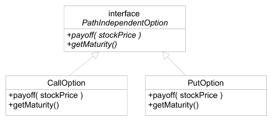

**图 10.1**：`PathIndependentOption` 的 UML 图

图 10.1 中的虚线箭头告诉我们，`CallOption` 和 `PutOption` 类实现了该接口。*斜体* 表明 `PathIndependentOption` 是一个接口，且其方法仅由 `PathIndependentOption` 声明而未定义。

UML 图的优势在于它剥离了一些 C++ 中较为丑陋的语法，例如 `virtual destructor` 和 `virtual` 关键字，让你能看到主要要点。这些主要要点是：

- 所有 `PathIndependentOption` 对象必须具有 `getMaturity` 和 `payoff` 函数。
- `CallOption` 和 `PutOption` 是 `PathIndependentOption` 的两种类型。

UML 规范提供了绘制类图的官方标准。例如，+ 号用于指示方法是公有的。在绘制类的图示时，不要对这种小细节过于吹毛求疵。目的是制作有助于总结所发生之事的图示。只需使用你认为有帮助的 UML 部分即可。

你可能已经注意到，使用接口有一种替代方案。我们难道不能编写一个像下面给出的 `GeneralOption` 这样的类吗？

```cpp
class GeneralOption {
public:
    bool isPut;
    bool isDigital;
    double strike;
    double maturity;

    double payoff( double stockPrice );
};
```

你是对的。`payoff` 函数会有些复杂，但写起来不会太难。这将解决编写一个能够定价看涨期权、看跌期权、数字化看跌期权和数字化看涨期权的单一函数的问题。

然而，使用接口的真正好处在于，我们的 `MonteCarloPricer` 已经能够定价任何路径独立期权。它并不局限于数字化看跌期权和看涨期权。我们将能够使用我们的 `MonteCarloPricer` 来定价你从未想过期权：例如，收益由股价的十次方根给出的期权。

更有趣的是，请注意，即使你想到了一个想要定价的新期权，`MonteCarloPricer` 代码和所有现有的期权类将保持完全不变。这使得 `MonteCarloPricer` 具有可插拔性。你只需插入新期权即可扩展其功能。再次值得注意的是，电气插头之所以是“可插拔的”，正是因为它们具有定义良好的接口。

在编写金融软件的背景下，使用接口意味着你可以用新类型的金融合约扩展交易系统，而无需重写并测试整个交易系统。接口是解决编写真实金融软件复杂性问题的关键。

## 10.6 用于积分的接口

接口的难点不在于语法或概念本身，而在于发现何时可以使用接口来解决一个问题。例如，我们可以使用接口来执行数值积分，但也许积分与接口之间的联系并不明显。

如果你尝试用 C++ 编写数值积分代码，你会遇到与我们在蒙特卡洛定价器中遇到的非常相似的问题。例如，你应该不难写一个使用矩形法则从 $a$ 到 $b$ 积分 $e^{-x^2}$ 的函数。但你如何编写一个可以从 $a$ 到 $b$ 使用矩形法则积分任意实值函数的函数？接口解决了这个问题。

让我们沿用上一个示例的方法，编写我们的幻想代码。代码如下：

```cpp
double integral( RealFunction& f, double a, double b, int nPoints ) {
    double h = (b-a)/nPoints;
    double x = a + 0.5*h;
    double total = 0.0;
    for (int i=0; i<nPoints; i++) {
        double y = f.evaluate(x);
        total+=y;
        x+=h;
    }
    return h*total;
}
```

我们的幻想代码涉及一种称为 `RealFunction` 的类型。这个名字描述了我们可以对哪些对象进行积分。我们需要编写正式的 C++ 接口定义。

```cpp
class RealFunction {
public:
    /* A virtual destructor */
    virtual ~RealFunction() {};
    /* This method is abstract, there is no definition */
    virtual double evaluate( double x ) = 0;
};
```

这段代码包含了必要的 `virtual` 和 `=0` 魔法咒语，但更重要的是，它声明了一个 `RealFunction` 有一个 `evaluate` 方法。

我们的 `integrate` 函数可以积分任何提供 `evaluate` 方法的对象。以下是我们幻想接口具体实现的一个例子：

```cpp
class SinFunction : public RealFunction {
   double evaluate( double x );
};

double SinFunction::evaluate( double x ) {
   return sin(x);
}
```

类 `SinFunction` 通过其 `evaluate` 方法代表了数学上的 sin 函数。我们可以使用我们的 `integrate` 函数对其积分，因为我们的 `integrate` 函数除了使用 `evaluate` 方法外不使用其他任何东西。

结合我们的 `integrate` 函数、`RealFunction` 接口及其实现，我们现在可以编写代码来积分 sin。以下是一个测试，以确保所有部分都能配合工作：

```cpp
static void testIntegral() {
   SinFunction integrand;
   double actual = integral(integrand, 1, 3, 1000 );
   double expected = -cos(3.0)+cos(1.0);
   ASSERT_APPROX_EQUAL( actual, expected, 0.000001);
}
```

这段代码包含在 `FMLib10` 中。你应该检查是否能够编译并运行该测试。

每次我们想要积分一个实值函数时，都需要编写一个新的实现类，如 `SinFunction`。我们不想每次想要积分一个函数时都创建一个新的 `cpp` 文件和一个新的 `h` 文件，因此 C++ 给了我们一种简写符号，允许我们在函数内部定义一个类。以下是使用 *局部类* 测试 sin 积分的另一种方式。

```cpp
static void testIntegralVersion2() {
   class Sin : public RealFunction {
   public:
      double evaluate( double x ) {
         return sin(x);
        }
    };

        Sin integrand;
        double actual = integral(integrand, 1, 3, 1000 );
        double expected = -cos(3.0)+cos(1.0);
        ASSERT_APPROX_EQUAL(actual, expected, 0.000001);
}
```

以这种方式定义的局部类是“一次性”的。它们只能在该函数内部使用。局部类的优点是编写速度更快。请注意，在局部类声明中，我们实际上也提供了所有函数的定义，而不仅仅是声明。还要注意，这个定义不包含独立类所需的通常的 `SinFunction::` 限定。

下面是一个更复杂的例子，其中局部类使用成员变量来访问传入包含函数的参数。

```cpp
static double integratePayoff(
    double a,
    double b,
    const PathIndependentOption& option) {

    class PayoffFunction : public RealFunction {
    public:
        /*  Member variable */
        const PathIndependentOption& option;

        /*  Constructor */
        PayoffFunction(
            const PathIndependentOption& option)
        : option( option ) {
        }

        /**
         *  Overriding function
         */
        double evaluate(double x) {
            return option.payoff(x);
        }
    };

    PayoffFunction integrand(option);
    return integral (integrand, a, b, 1000);
}
```

### 10.6 集成（续）

上述函数计算了期权收益函数在范围 $a$ 到 $b$ 之间的积分。我们必须使用引用存储成员变量，因为你不能按值存储多态变量。通过引用在成员变量中存储数据可能很危险，因为所引用的数据可能在持有该引用的对象被删除之前就被删除了。这会导致程序行为异常甚至崩溃。在这种情况下，代码会在 `integratePayoff` 返回的瞬间从内存中删除变量 `integrand`。因此，`option` 在 `integrand` 被删除之前被删除的危险是不存在的。

还有一种更简洁的语法叫做*lambda 函数*，可用于创建局部类。我们将在第 19 章中回顾编写积分器的例子，并展示如何使用 lambda 类来简化代码。

我们还应该补充说明，矩形法并不是最佳的积分方法。你可能已经知道辛普森法（Simpson's rule）。一种用于一维数值积分的更有趣的技术称为高斯求积法。像 GNU 科学库（GNU Scientific Library）这样的数值库包含复杂的积分例程，在实践中你应使用这些例程。

## 练习

- 10.6.1. 编写类 `DigitalCallOption` 和 `DigitalPutOption`。使用 `MonteCarloPricer` 对它们进行定价。如果你不记得什么是数字期权，请参见附录 A。
- 10.6.2. 编写类 `NormalPDF` 并计算其从 $-1.96$ 到 $1.96$ 的积分。
- 10.6.3. 编写函数 `integralToInfinity`，该函数使用换元积分法将无限积分转换为函数 `integral` 可以计算的积分。
- 10.6.4. 使用正态分布概率密度函数的数值积分来测试 `normcdf` 函数。
- 10.6.5. 编写函数 `differentiateNumerically`，它可以对任何 `RealFunction` 求导。
- 10.6.6. 编写接口 `Cipher` 并提供至少两种你选择的实现。编写单个函数 `void testCipher(Cipher& toTest)`，该函数可以测试任何 `Cipher` 是否正确工作。
- 10.6.7. 为你的 `Cipher` 类绘制 UML 图。
- 10.6.8. 编写类 `RectangleRulePricer`，它可以使用先前练习中编写的数值积分例程对 `PathDependentOption` 进行定价。使用公式 (A.3) 计算股票价格对数的概率密度函数。用 `CallOption` 检查你的解决方案是否有效。这是对公式 (A.6) 推导的数值测试。
- 10.6.9. 设计一个名为 `ContinuousTimeOption` 的接口。它应有一个函数 `payoff`，该函数接受一个股票价格向量和价格发生的时间向量。如果股票价格在时间点之间线性变化，此函数应返回本可能发生的收益。（显然，我们无法提供无限多个点的股票价格）。`ContinuousTimeOption` 还应有一个名为 `getMaturity()` 的函数。

  编写一个名为 `KnockOutCallOption` 的 `ContinuousTimeOption` 实现。在 `MonteCarloPricer` 中添加一个函数，该函数给定有限的时间步长，可以近似计算任何 `ContinuousTimeOption` 的价格。
- 10.6.10. 展示你可以使用 `if` 语句编写一个 `integrate` 函数，该函数可以数值积分以下特定函数之一（但不包括其他函数）：

  - sin(x)
  - cos(x)
  - exp(x)

  解释为什么这不是一个好的设计。利用这一点解释为什么使用 `if` 语句来决定如何以对敲入和敲出期权不同的方式进行定价，不如使用接口强大。

## 10.7 总结

- 通过定义接口，我们可以编写代码，使其能够处理我们尚未想到的输入。
- 这对于为金融部门编写实际代码至关重要，因为每天都有新的产品被发明。
- 接口在日常生活中很常见。汽车、门、吉他和插孔都是易于使用的熟悉示例，因为它们实现了众所周知的接口。
- 学习如何使用接口是面向对象设计中最重要的技能。


# 第 11 章

## 数组、字符串和指针

查看 C++ 的一种有用方式是将其视为一组语言：

- (i) C 语言；
- (ii) 面向对象编程语言；
- (iii) 模板编程语言。

本章介绍了 C++ 中的一些 C 语言特性。我们此前忽略了这些特性，因为你应该将精力集中在 C++ 的面向对象特性上。类似地，我们不会在第 17 章之前讨论模板编程特性。

指针是 C 语言的核心特性。它们是一种直接操作计算机内存的工具。在像 Java 这样的更现代、更纯粹的面向对象编程语言中，你不会发现它们。其他语言省略了这一特性，因为基于指针的程序通常比面向对象程序更难理解。

你在本章中学到的大部分内容，你应该永远不要直接去使用。你需要使用的唯一东西是 `shared_ptr`。我们将在本章结尾讨论这个。不幸的是，要理解 `shared_ptr`，你必须首先理解普通指针。

研究本章内容还有另外三个动机。

- (i) 第一个是 C++ 最初是为具有 C 编程经验的人设计的。因此，如果你熟悉 C 指针，一些 C++ 代码的设计旨在直观易用。如果你不研究指针，你会发现像 C++ 标准库这样的东西非常不直观。
- (ii) 第二个是面试官可能假设你知道 C，因此可能会问一些关于指针的刁钻问题，所以做好准备总是好的！
- (iii) 第三个是编写最高效的 C++ 程序时，有意识地管理内存会很有帮助。指针是直接操作内存的工具。


因为本章和下一章更多地是关于 C 编程而不是面向对象编程，所以我们暂时放弃了为 FMLib 的开发。相反，项目 `PointerExamples.zip` 包含本章的所有代码。

你会看到，只有一个大的 `main.cpp` 文件，其中按顺序包含各种示例。主方法只是按顺序调用各种测试函数。一些测试被注释掉了，因为它们说明了你*不应该*做什么。如果你包含它们，程序可能会崩溃。

# 11.1 数组，C 中 vector 的替代方案

下面的代码展示了如何在 C++ 中创建一个由 5 个整数组成的数组。数组有点类似 `vector`，因为它包含一个值序列，但正如我们将看到的，数组不如 `vector` 有用。

```cpp
// Create an uninitialised array of length 5
int myArray[5];
for (int i=0; i<5; i++) {
    cout<<"Entry "<<i<<"=";
    cout<<myArray[i];
    cout<<"\n";
}
```

这段代码创建了一个由 5 个整数组成的数组，而没有进行初始化。然后它遍历条目并打印它们。由于我们没有初始化值，它会打印出一些随机整数。

注意与 `vector` 的相似之处。与 `vector` 一样，我们使用 `[]` 来访问条目。与 `vector` 一样，条目从 0 开始。

你注意到的唯一不同是我们没有使用 `size()` 函数。这是因为 C 数组没有 size 函数。实际上，你可以使用 `sizeof` 运算符并写 `sizeof(myArray)/sizeof(int)`，替换我们写 5 的地方。这是更好的编程风格，但为了初学者阅读数组时的可读性，我避免了这样做。

要创建一个已初始化的数组，过程如下：

```cpp
// Create an initialised array
int myArray[] = {1, 1, 2, 3, 5};
for (int i=0; i<5; i++) {
    cout<<"Entry "<<i<<"=";
    cout<<myArray[i];
    cout<<"\n";
}
```

只需在花括号之间用逗号分隔列表指定值即可。注意，如果我们提供值列表，在创建数组时就不再需要指定数组的长度。

想要初始化一个数组使所有值都为零，这是非常自然的想法。以下是相关代码。

```cpp
// 创建一个已初始化的数组
int myArray[5] = {};
for (int i=0; i<5; i++) {
    cout<<"Entry "<<i<<"=";
    cout<<myArray[i];
    cout<<"\n";
}
```

在这里，我们指定数组的大小，并写入 `={}` 来表示“将所有内容设为零”。实际上，这只是数组初始化更通用方法的一个特殊情况。

```cpp
int myArray[5] = {1,2,3};
for (int i=0; i<5; i++) {
    cout<<"Entry "<<i<<"=";
    cout<<myArray[i];
    cout<<"\n";
}
```

这里我们指定了长度和前几个值。其余的值会用零填充。因此，上面的代码将输出 1, 2, 3, 0, 0。

数组的一个问题是，由于它们没有*size*函数，当我们把数组传递给另一个函数时，必须同时传递它们的长度和值。

```cpp
int sumArray( int toSum[], int length ) {
    int sum = 0;
    for (int i=0; i<length; i++) {
        sum+=toSum[i];
    }
    return sum;
}
```

遗憾的是，我之前提到的 *sizeof* 技巧一旦将数组传递给其他函数就失效了。因此，你确实需要同时传递长度和数组。

尽管我们可以将数组传递给函数，但我们*绝不能从函数中返回它们*。当你返回如 `double` 或 `vector` 等其他数据类型时，返回值会被复制。但对于数组，这种情况不会发生。你可以将它们视为是按引用返回的。

这会导致问题，因为当函数返回时，它创建的所有变量都会从内存中移除。如果你尝试返回一个数组，函数的调用者只会获得指向该数组*曾经*所在的内存地址的指针。计算机可能已经将该内存重新用于几乎任何用途。结果是，程序的行为变得完全不可预测。通常它会崩溃，有时非常惨烈。如果你试图按引用返回局部变量，也会发生同样的情况，但你不太可能那样做。

如果你愿意，可以创建多维数组。语法应该不言自明。唯一奇怪的地方是，除了第一个维度外，你必须手动指定其他所有维度。

```cpp
// 创建一个已初始化的 3x5 数组
int myArray[][5] = {{1, 2, 3, 4, 5},
                    {2, 0, 0, 0, 0},
                    {3, 0, 0, 0, 0}};

for (int i=0; i<3; i++) {
    for (int j=0; j<5; j++) {
        cout<<"Entry ("<<i<<","<<j<<")=";
        cout<<myArray[i][j];
        cout<<"\n";
    }
}
```

让我们不要再花更多时间去深入了解数组了，因为我们永远不使用它们！

数组对我们来说并不是非常有用的数据结构，因为*你不能改变数组的长度*。你不能插入新项或在末尾添加一些项。更糟糕的是，数组的大小在编译时固定。这意味着当你编写程序时，必须选择数组的大小，它无法根据用户输入而增长。此外，在每个函数调用中传递长度也很烦人。

只有在代码编译时已知数组大小的情况下，数组才值得关注。例如，在处理 3D 计算机图形时，长度为 3 的数组可能有用。

> **提示：不要使用数组**

`Vector`（向量）可以做你想用数组做的所有事情，甚至更多。

## 11.2 指针

### 11.2.1 new 和 delete

由于数组不够灵活，C 语言还包含指针的概念。这允许 C 程序员处理长度可变的数据序列。

```cpp
int n = 5;
int* myArray = new int[n];
for (int i=0; i<n; i++) {
    cout<<"Entry "<<i<<"=";
    cout << myArray[i];
    cout << "\n";
}
delete [] myArray;
```

上面的代码使用 `new...[]` 运算符来分配一块内存。在这种情况下，我们在内存中创建了一个 `int` 数据类型序列，但你也可以使用其他数据类型。

好消息是，你可以选择在运行时内存块的大小。与数组不同，你不必在编写程序时提前选择大小。

使用 `new []` 的缺点是，当变量超出作用域时，内存*不会*自动释放（有关 *scope*（作用域）一词的含义，请参见第 4.7 节）。你必须使用 `delete []` 来释放通过 `new[]` 运算符创建的内存。这既是好事也是坏事。对于数组，我们无法返回数组，因为内存会被自动删除；但另一方面，我们不需要记得调用 `delete []`。对于使用 `new[]` 创建的内存，我们必须记得手动释放内存，但可以安全地返回数据。

`new int[n]` 返回的值称为*指针*。它的类型是 `int*`，意思是“指向 `int` 的指针”。事实上，上一节讨论的数组类型也是 `int*`。只是 C 中数组的记法掩盖了数组值变量只是指向内存位置这一事实。`int* myArray` 只包含数组开始的内存地址。因此，我们必须自己记住该内存块的长度为 `n`。

你可以像使用数组和向量一样，使用 `[]` 与指针结合来查找给定偏移量处的整数。我们在上面的示例中使用了这一点来打印数组中的值。

如果你运行上面的代码示例，你会发现数组中的项取任意值。正如类型为 `int` 的局部变量具有不可预测的初始值一样，用 `new` 创建的 `int` 数据也是如此。

你也可以使用其他数据类型的 `new[]`。为了说明这一点，让我们引入一个简单的类，`Pair`。

```cpp
class Pair {
public:
    double x;
    double y;
    Pair();
    Pair( double x, double y );
};
```

我们假设 `Pair` 的默认构造函数将 $x$ 和 $y$ 初始化为零。给定这个类，下面的代码创建了一块包含对的内存。这次，每对都初始化为 (0,0)，因为 `Pair` 有一个默认构造函数。

```cpp
int n = 5;
Pair* myPairs = new Pair[n];
for ( int i=0; i<n; i++ ) {
    double xValue = myPairs[i].x;
    double yValue = myPairs[i].y;
    
    cout<<"Pair (";
    cout<< xValue;
    cout<<",";
    cout<< yValue;
    cout<<")\n";
}
delete[] myPairs;
```

类型是 `Pair*`。这应读作“指向 `Pair` 的指针”。

### 11.2.2 指针运算符

指针只是内存中某些数据的地址。在 32 位计算机上，指针长度为 4 字节。在 64 位计算机上，长度为 8 字节。这意味着 32 位计算机最多可以有 $2^{32}$ 字节 $\approx$ 2Gb 内存。64 位计算机原则上可以有更多的内存。通常将内存地址写为十六进制数；例如，`9ABF0132` 是一个典型的内存地址。

考虑以下代码：

```cpp
int* fivePrimes = new int[5];
fivePrimes[0] = 2;
fivePrimes[1] = 3;
fivePrimes[2] = 5;
fivePrimes[3] = 7;
fivePrimes[4] = 11;
```

运行代码后，将有一块内存区域如图 11.1 所示。在该图中，每个框表示一个 int 大小的内存单元。x 标记了我们不知道其值的内存位置。我们知道的是有五个连续的条目，包含数字 2, 3, 5, 7, 和 11。指针 `fivePrimes` 包含这些数字中第一个的内存地址。

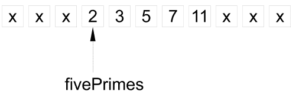

**图 11.1：** 指向包含前五个素数的数组的内存位置的指针。

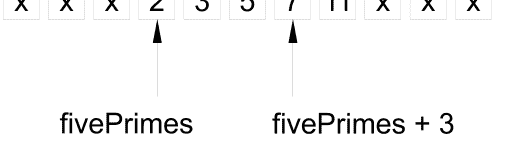

**图 11.2：** 指针算术。

即使变量不是用 new 创建的，你也可以提取任何变量的内存地址。你使用运算符 `&` 来完成此操作。然后，你可以将该内存地址存储在另一个变量中，只要该变量被声明为指针类型。给定一个指针，你可以使用 `*` 访问它所指向的内容。以下代码说明了这些概念：

```cpp
int myVariable = 10;
int* pointerToMyVariable = &myVariable;

cout << "Memory location of myVariable ";
cout << pointerToMyVariable;
cout << "\n";

cout << "Value of myVariable ";
cout << (*pointerToMyVariable);
cout << "\n";
```

我在 32 位计算机上运行了上述代码，得到了以下输出：

```
Memory location of myVariable 0013FE78
Value of myVariable 10
```

请注意，`pointerToMyVariable` 是一个指向 `int` 的指针，因此它的类型是 `int*`。由于 `myVariable` 是一个 `int`，所以 `&myVariable` 是一个指向 `int` 的指针。

因为 `pointerToMyVariable` 是一个指向 `int` 的指针，所以 `*pointerToMyVariable` 是一个 `int`。

值得强调的是，我们在两种完全不同的方式中使用了 `&`。我们之前使用过这个符号来表示按引用传递。现在我们用它来将变量转换为指针。这些用途完全无关。它恰好是同一个字符而已。当作为类型定义的一部分时，`&` 意味着“引用”。当作为运算符时，`&` 意味着“...的内存位置”。

我们还以三种不同的方式使用 `*`。我们在类型定义中使用它，意为“这是一个指针”。我们使用它将指针转换回引用。而且（万一你忘了）我们还用它来表示乘法！

另一个处理指针时非常有用的运算符是 `->`。你可以使用 `->` 通过指针访问对象的字段。

```
Pair p;
Pair * pointerToP = &p;

// Use -> to access fields via a pointer
pointerToP->x = 123.0;
pointerToP->y = 456.0;

// We check that c has changed
ASSERT( p.x==123.0 );
ASSERT( p.y==456.0 );

// You could use * and .
ASSERT( (*pointerToP).x==123.0 );
ASSERT( (*pointerToP).y==456.0 );
```

使用 `->` 等同于组合使用 `*` 和 `.`，但可读性更好。

你还可以对指针加法和减法整数。例如，如果 `p` 是指向某个内存位置的指针，那么 `p+1` 是指向下一个内存位置的指针，而 `p+3` 是指向沿指针方向第三个内存位置的指针。图 11.2 对此进行了说明。要向指针加 1，你可以写 `p++`。以这种方式处理指针被称为*指针算术*。

### 11.2.3 使用指针循环

我们可以将指针传递给函数，就像我们将数组传递给函数一样。事实上，接受数组作为参数的函数和接受指针作为参数的函数之间并没有真正的区别。下面是一个函数，它累加从内存位置 `toSum` 开始的一组 `length` 个数字。

```
int sumUsingPointer( int* toSum, int length ) {
    int sum = 0;
    for (int i=0; i<length; i++) {
        sum+=toSum[i];
    }
    return sum;
}
```

这里的代码与使用数组的代码相同，只是我们在声明类型时使用 `*` 而不是 `[]`。特别注意的是，除了指针，你还需要传递长度。

这段代码并没有太大的问题。然而，经验丰富的 C++ 程序员可能会选择这样写：

```
int sumUsingForAndPlusPlus(int* begin, int n) {
    int sum = 0;
    int* end = begin + n;
    for (int* ptr = begin; ptr != end; ptr++) {
        sum += *ptr;
    }
    return sum;
}
```

如果你是 C++ 新手，这段代码很难看懂。但由于它遵循某些编程约定，只要稍加练习，就会变得易于理解。

我们将第一个内存位置称为 `begin`。我们将最后一个元素紧随其后的内存位置称为 `end`。在 `for` 循环中，我们将变量 `ptr` 从 `begin` 移动到但不包括 `end` 的值。在循环的每个阶段，我们将 `ptr` 指向的值加到 `sum` 中。

经验丰富的程序员可能更喜欢这种代码版本有两个原因：

-   (i) 代码完全标准化，因此一旦习惯就容易阅读。`begin` 是指针的标准命名，`end` 也是。这意味着读者可以一眼理解 `for` 循环。这就是 for 循环的目的：它大声宣称“枯燥的循环代码”，让你可以专注于循环中间的有趣部分，而忽略其余部分。本书稍后我们将讨论一个名为迭代器（iterators）的 C++ 概念，它允许将此指针代码推广到许多不同的数据结构。参见第 18 章。

-   (ii) 此代码可能会稍快一些。我们每个循环只执行一次加法，即 `ptr++`。原始代码包含加法 `i++`，以及当我们写 `toSum[i]` 时的隐式加法。为了计算这个值，我们需要将 `i` 加到指针 `toSum` 上，然后读取内存地址。如果我们使用指针算术重写第一版代码中的 `[]`，可以更清楚地看到这一点。

```
int sumUsingPointerArithmetic( int* toSum,
                               int length ) {
    int sum = 0;
    for (int i=0; i<length; i++) {
        int* ithElement = toSum + i;
        int valueOfIthElement = *ithElement;
        sum+= valueOfIthElement;
    }
    return sum;
}
```

### 提示：避免编写烧脑题

适度使用指针算术会非常有帮助。例如，在第 16 章中，当我们编写一个表示矩阵的类时，将利用指针算术。然而，你应该尽量避免编写让人挠头的代码。过度使用指针和指针算术是编写不可读代码的一个绝佳方式。

作为一个例子，请注意，一个内存位置本身可能包含一个指针。指向指向 int 指针的指针是 `int**` 类型。如果你喜欢把自己和同事搞糊涂，那里就没有理由止步于此。`int***` 在技术上也没有问题。这里是一个利用此特性的真实面试问题。

**问题：** 指向数组元素 `a[i][j][k][1]` 的等效指针表达式是什么？

-   A. `(((a+i)+j)+k)+1`

-   B. `*(*( *(*(a+i)+j)+k)+1)`

-   C. `(((a+i)+j)+k+1)`

-   D. `*((a+i)+j+k+1)`

**答案：** 如果你还想得到这份工作，正确答案是 B。实际上，正确的答案是避免这种愚蠢的代码。

## 11.2.4 在实践中使用指针


由于我们总是需要元素数量以及指针，引入一个类似乎是个明智之举，例如：

```
class IntArray {
public:
    int* firstElement;
    int length;
};
```

似乎给这个类添加一个有用的函数 `size` 也是个好主意。

在继续之前，我们应该停下来意识到这个类已经存在了。它就是一个 `vector<int>`。

因此，虽然我们现在痛苦地介绍了指针，但我们本可以使用 `vector` 来完成想要做的所有事情！

> **提示：避免使用 `new []`**
>
> 你应该避免使用 `new []`，而简单使用 `vectors` 代替。唯一的例外可能你认为自己是一个足够好的程序员，能够通过访问原始内存获得一点更多的性能。这在实际中不太可能成立。

## 11.3 指向文本的指针

在 C 语言中，你没有类，这包括 `string` 类。因此，在 C 语言中，标准惯例是使用由字符代码 0 终止的字符内存块来表示文本。

回想一下，`char` 只是一个 8 位数字。标准编码是 ASCII，其中 “A” 编码为 65，符号 “1” 编码为 49，符号 “0” 编码为 48。另一方面，代码数字 0 没有用于任何字符符号，因此可以安全地用来标记内存块的结尾。你可以使用反斜杠来创建代码数字为 0 的特殊字符，如下所示代码所示。

```
char charArray1 [] =
{'H', 'e', 'l', 'l', 'o', '\0'};
for (int i=0; i<6; i++) {
    cout << "ASCII VALUE ";
    char c = charArray1[i];
    cout << ((int)c);
    cout << "\n";
}
```

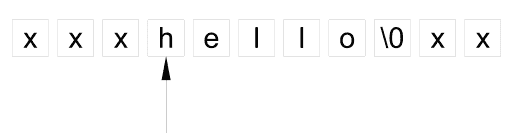

**图 11.3：** 指向包含以 null 结尾的字符串 Hello 的内存位置的指针。

C 提供了创建以零代码结尾的字符序列的快捷方式，只需将所需的字符放在双引号中即可。你不需要在结尾包含零，它是自动包含的。

```
const char* charArray2 = "Hello";
for (int i=0; i<6; i++) {
    cout << "ASCII VALUE ";
    char c = charArray2[i];
    cout << ((int)c);
    cout << "\n";
}
```

这种数据格式被称为“C 风格字符串”或“以 null 结尾的字符串”。图 11.3 以图形方式说明了这一点。注意，我们说过 `charArray2` 的类型是 `const char*`。这意味着字符串的内容是固定的。

书的前面我们通过在引号中写入文本来创建字符串，但我们尽量避免使用 `char*` 数据类型。这是因为你应该总是尽早将 `char*` 转换为 `string`。

由于在 C 中不可能这样做，C 包含各种函数来帮助处理以 null 结尾的字符串，例如 `strlen`，它计算长度（不包括终止零字符）和 `strcpy`，它将一个字符串复制到另一个字符串中。

下面的代码展示了如何直接使用指针来模拟 `strlen` 函数的行为。

```
int computeLengthOfString( const char* s ) {
    int length = 0;
    while ((**s) != 0) {
        s++;
        length++;
    }
    return length;
}
```

```
void testComputeLengthOfString() {

    const char* quotation = "To be or not to be";

    int l1 = computeLengthOfString( quotation );

    int l2 = strlen( quotation ); // 内置函数

    ASSERT( l1==l2 );

}
```

在使用数组和内存段时，你必须非常小心，切勿尝试访问超出数组边界的数据。例如，下面的代码行为不可预测，且可能会崩溃。

```cpp
char* shortText = new char [20];
for (int i=0; i<1000; i++) {
    shortText[i] = 'x';
}
delete[] shortText;
```

如果你已经下载了项目 `PointerExamples`，你可以取消注释 `main` 方法中的 `testOverrunning` 测试来运行此测试。我预计你会收到一条非常严重的错误信息。

当你在调试模式下使用 `string` 和 `vector` 等类时，会包含各种额外的检查，以便你获得更有用的错误信息。你可以尝试使用 `vector<char>` 重写此代码，并比较获得的错误信息。这是使用类而不是直接指针的另一个非常有说服力的理由。

### 提示：避免使用 char*

`string` 旨在解决程序员过去在 `char*` 方面遇到的许多问题。如果你正在进行严肃的字符串操作，例如编写网络服务器，即使是 `string` 也不适合该任务，因为它无法处理国际字符。

## 11.4 通过指针传递

我们之前已经介绍了 *值传递* 和 *引用传递* 的概念（参见 `7.2.1` 节）。原则上，你也可以使用 *指针传递* 将数据传递给函数。

```cpp
void polarToCartesian(double r, double theta,
            double* x, double* y) {
            *x = r*cos(theta);
            *y = r*sin(theta);
        }

        void testPolarToCartesian() {
            double r = 2;
            double theta = atan(1);
            double x;
            double y;

            polarToCartesian(r, theta, &x, &y);
            ASSERT_APPROX_EQUAL(x, sqrt(2), 0.0001);
            ASSERT_APPROX_EQUAL(y, sqrt(2), 0.0001);
        }
```

这段代码以通常的方式按值传递参数 `r` 和 `theta`，但传递了指向参数 `x` 和 `y` 的指针。这些是测试函数的局部变量。当调用 `polarToCartesian` 时，它直接修改这些局部变量。它能够这样做，是因为它接收了变量 `x` 和 `y` 存储位置的内存地址。

使用指针传递数据和使用引用传递数据之间几乎没有实际差异。在 C 语言中，因为引用的概念不存在，所以你必须使用指针传递。

在 C++ 语言中，使用引用传递是首选方法。最实际的差异是，`polarToCartesian` 函数的用户被迫使用 `&` 符号来获取变量 `x` 和 `y` 的指针。从某些角度来看，这是一件好事，因为它清楚地表明 `x` 和 `y` 可能会被函数调用修改。另一方面，使用指针确实增加了一层概念上的难度。

使用指针和引用所能实现的结果之间唯一的实际区别是，如果你传递的是指针，并不完全清楚是否可以使用指针运算符，例如使用 `++` 递增指针或调用 `delete`。另一方面，如果使用引用传递，则很清楚该对象不会被删除，并且不会调用 `++` 运算符，因为你根本无法将这些运算符应用于引用。这就是为什么在 C++ 中引用传递是首选方法的原因。

就像使用引用一样，你可以使用关键字 `const` 与指针一起使用。将关键字 `const` 与指针结合有两种可能的方式。在 `*` 的右侧写 `const` 意味着指针本身不能被修改。在 `*` 的左侧写 `const` 意味着 *被指向的数据* 不能被修改，而不是指针本身。下面的代码说明了这一区别。如果你去掉注释字符，代码将无法编译。

```cpp
            void constPointerExamples() {
            const char* ptr = "A string";
            ptr++;
            std::cout << (*ptr);
            // (*ptr)='a'; // 你不能使用 const char* 修改数据

            char* fiveChars = new char [5];
            char *const constPtr = fiveChars;
            // constPtr++; // 你不能修改 char *const
            (*constPtr) = ‘h’; // 但你可以修改
            // 它指向的内容
            }
```

如果你发现 `const char*` 和 `char *const` 之间的区别令人困惑，那么你不是唯一一个这么认为的人。有人可能会认为，使用 `const` 引入的概念难度超过了编译时检查带来的好处。正如我们之前所说的，项目的主要开发人员应该对此持有一种观点，即要么一致地使用 `const`，要么完全避免使用它。

如果你计划使用 `const`，那么这段讨论提供了偏好引用传递而非指针传递的另一个原因：只有使用 `const` 与引用结合的一种方法，因此少了一件事需要考虑。请注意，这可能有助于你在处理指针时记住将 `const` 放在哪里。`*` 左侧的 `const` 意味着与 `&` 左侧的 `const` 相同。你甚至不能将 `const` 写在 `&` 的右侧，因为你不能使用 `++` 等运算符作用于引用。

## 11.5 不要返回指向局部变量的指针

就像使用数组一样，你必须确保在返回指针时，没有返回一个即将被删除的局部变量的指针。例如，这段代码是不正确的：

```cpp
char* thisFunctionReturnsAnArray() {
    /* 这会产生编译器警告 */
    char text[] = "Don’t do this";
    return text;
}

void someOtherFunction() {
    char text[] = "Alternative text\n";
    cout << text;
    cout << "\n";
}

void testDontReturnArrays() {
    char* text = thisFunctionReturnsAnArray();
    someOtherFunction();
    cout << text;
    cout << "\n";
}
```

这里的 `text` 是一个 `char` 数组，因此函数退出时就会立即被删除。这意味着代码的行为将不可预测。运行它时，它可能会打印一些垃圾数据。

你可以毫无问题地返回一个字符串，因为它按值返回：字符串的新副本会交给调用者。返回 `vector` 的情况也是如此。

允许返回使用 `new []` 创建的数据的指针。然而，你需要确保调用者知道他们是否需要在某个点调用 `delete[]`。

按照 C 和 C++ 的惯例，如果函数返回指针，调用者不需要调用 `delete[]`。例如，如果你对 `string` 调用 `c_str()`，你不应该 `delete[]` 它返回的内容。当你调用 `c_str` 时，它会在内存中创建一个临时 C 风格字符串，该字符串可能会在字符串被修改或删除时被删除。这是 C++ 中推荐的标准模式。如果你创建了某些东西，删除它是你的责任。

作为一个例子，下面的代码和测试在技术上是有效的，但违反了不应删除由另一个函数返回的指针的惯例。因此，大多数 C++ 程序员都会同意这是糟糕的代码。

```cpp
char* thisFunctionReturnsAPointer() {
    char text[] = "This works";
    int n = strlen(text);
    char* ret = new char[n+1];
    /* 这里现在会产生编译器警告 */
    strcpy( ret, text );
    return ret;
}

void testReturnPointerJustAboutOK() {
    char* text = thisFunctionReturnsAPointer();
    someOtherFunction();
    cout << text;
    cout << "\n";
    // 不要忘记释放内存
    delete[] text;
}
```

### 提示：返回指针

永远不要返回指向局部变量的指针。如果需要，你可以返回指向对象成员变量的指针。在这种情况下，确保数据被删除是对象的责任，而不是调用者的责任。（有关如何使用 *析构函数* 实现此目的的信息，请参见第 `16.2` 节）

## 11.6 使用指针共享数据

下面是一个我们现在希望解决的问题类型的示例：

**示例 1：** 我们有一个类 `Instrument`。它包含关于交易工具的许多数据。例如，工具类型、彭博代码、路透社代码等。你应该想象每个 `Instrument` 占用相当多的内存。

我们有另一个类，`Position`，它仅由一个工具、持有该工具的数量以及已建立该头寸的Trader名称组成。

我们通过重用相同的 `Instrument` 实例来节省内存。这在图 11.4 中进行了说明。

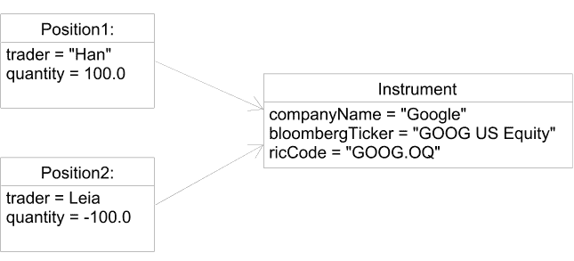

**图 11.4：** 两个 Position 对象共享一个 `Instrument`。

### 11.5 内存管理

到目前为止，我们使用的数据都存储在局部变量或成员变量中。

局部变量不适合长期存储，因为当变量超出作用域时，其数据会立即被删除。

成员变量仅持续存在于包含该变量的对象存续期间。因此，一旦对象被删除，存储在成员变量中的数据就会丢失。使用 `new`，我们可以为数据创建长期存储。这些数据不会被自动删除，因此我们必须通过调用 `delete` 来手动删除它们。`new` 和 `delete` 类似于 `new[]` 和 `delete[]`，区别在于它们创建和删除的是单个对象而非数组。在使用了 `new []` 时必须非常小心地使用 `delete[]`，而在使用了 `new` 时必须使用 `delete`。

下面是一个使用 `new` 创建单个 `Pair` 实例的示例。请注意对 `delete` 的调用以及 `->` 的使用。

```cpp
Pair* myPair = new Pair;
myPair->x = 1.3;
myPair->y = 2.5;

cout << "Pair (";
cout << (myPair->x);
cout << ", ";
cout << (myPair->y);
cout << ")\n";

delete myPair;
```

让我们看看如何使用以这种方式创建的数据，在两个头寸之间共享 Instrument 数据。

首先，我们定义 Position 和 Instrument 类：

```cpp
class Instrument {
public:
   string bloombergTicker;
   string ricCode;
   string companyName;
   Instrument() {}
};

class Position {
public:
   string trader;
   double quantity;
   Instrument* instrument;
   explicit Position( Instrument * instrument );
};

Position::Position( Instrument* instrument ) :
    instrument( instrument ) {
}
```

你应该注意到，Position 包含指向一个 Instrument 的指针，而不是一个实际的 Instrument 对象。你可以从字段 `instrument` 的类型为 `Instrument*` 看出这一点。

下面的代码初始化了一个由 Position 对象组成的 `vector`，这些对象都指向同一个 Instrument。这实现了我们共享数据的目标。

```cpp
vector<Position> constructPositions() {
    // 调用此函数的用户
    // 在不再需要所有头寸时
    // 应该对 instrument 调用 delete
    vector<Position> positions;

    Instrument* instrument = new Instrument;
    instrument->companyName = "Google";
    instrument->bloombergTicker = "GOOG US Equity";
    instrument->ricCode = "GOOG.OQ";

    Position p1(instrument);
    p1.trader = "Han";
    p1.quantity = 100.00;
    positions.push_back( p1 );

    Position p2(instrument);
    p2.trader = "Leia";
    p2.quantity = -100.00;
    p2.instrument = instrument;
    positions.push_back( p2 );

    return positions;
}
```


然而，有个问题：该函数的调用者被赋予了删除 `instrument` 的任务。

```cpp
void testConstructPositions() {
    vector<Position> r = constructPositions();
    int n = r.size();
    for (int i=0; i<n; i++) {
        cout << "Position "<<i<<"\n";
        Position& p=r[i];
        cout << "Trader "<<p.trader<<"\n";
        cout << "Quantity "<<p.quantity<<"\n";
        cout << "Instrument ";
        cout << p.instrument->companyName<<"\n";
        cout << "\n";
    }
    delete r[0].instrument;
}
```

`constructPositions` 的调用者必须确切知道如何调用 `delete`。这违反了信息隐藏原则——你需要知道 `constructPositions` 是如何实际工作的，才能安全地使用它。

### 危险！

- **初始化你的指针。** 我们在构造函数中初始化了字段 `instrument`。如果你不初始化指针，当试图使用它时，程序将严重出错。

```cpp
// 不要这样做
Instrument* instrument;
cout << instrument->companyName << "\n";
```

有时你希望指定指针尚未指向任何对象，在这种情况下，你将其初始化为 `nullptr`。以下是检查指针是否为 `nullptr` 后再使用的代码。

```cpp
string getCompanyName( Position& position ) {
	if (position.instrument==nullptr) {
		return "Name not set";
	} else {
		return position.instrument->companyName;
	}
}
```

使用 `nullptr` 的危险在于，如果你忘记了检查，将会得到一个糟糕的错误。

## 11.6.1 使用 shared_ptr 共享

类 `shared_ptr` 解决了 `delete` 问题。要使用 `shared_ptr`，你需要 `#include <memory>`。

`shared_ptr` 是所谓“智能指针”的一个例子。这是一个 C++ 类，其行为类似于指针，但会在后台处理何时调用 `delete`。事实上，`shared_ptr` 是最多功能的智能指针类，也是本书中我们将唯一使用的类型。

`shared_ptr` 的工作方式是每个共享指针都会跟踪其被复制的次数。当存在的智能指针副本数量降至零时，所指向的数据将被为你删除。具体如何实现这一点，要等到我们在第 16.2 节讨论析构函数时再说明。

为了使用 `shared_ptr` 所做的更改非常简单。以下是使用 `shared_ptr` 的新版 `Position` 类。

```cpp
class PositionV2 {
public:
	string trader;
	double quantity;
	shared_ptr<Instrument> instrument;
	explicit PositionV2(shared_ptr<Instrument> ins );
};

PositionV2::PositionV2(shared_ptr<Instrument> ins ) :
	instrument( ins ) {
}
```

区别在于它现在包含的是一个 `shared_ptr<Instrument>` 而不是一个 `Instrument*`。前者意味着“指向 instrument 的共享指针”，后者意味着“指向 instrument 的指针”。前者实际上更容易阅读，尽管不可否认它更难输入。

当我们使用 `shared_ptr` 时，我们可以像操作普通指针一样使用运算符 `->` 和 `*`。

```cpp
vector<PositionV2> constructPositionsV2() {
	vector<PositionV2> positions;

	shared_ptr<Instrument> ins
		= make_shared<Instrument>();
	ins->companyName = "Google";
	ins->bloombergTicker = "GOOG US Equity";
	ins->ricCode = "GOOG.OQ";

	PositionV2 p1(ins);
	p1.trader = "Han";
	p1.quantity = 100.00;
	positions.push_back( p1 );

	PositionV2 p2(ins);
	p2.trader = "Leia";
	p2.quantity = -100.00;
	p2.instrument = ins;
	positions.push_back( p2 );

	return positions;
}
```

关键区别在于，我们使用函数 `make_shared` 而不是 `new` 来创建 `shared_ptr`。

```cpp
shared_ptr<Instrument> ins
    = make_shared<Instrument>();
```

`make_shared` 定义在 `<memory>` 中，并且是命名空间 `std` 的一部分。

引入 `shared_ptr` 的好处可以在调用函数中看到。

```cpp
void testConstructPositionsV2() {
    vector<PositionV2> r = constructConstructPositionsV2();
    int n = r.size();
    for (int i=0; i<n; i++) {
        cout << "Position "<<i<<"\n";
        PositionV2& p=r[i];
        cout << "Trader "<<p.trader<<"\n";
        cout << "Quantity "<<p.quantity<<"\n";
        cout << "Instrument ";
        cout << p.instrument->companyName<<"\n";
        cout << "\n";
    }
}
```

核心要点是我们不再需要调用 `delete`，因此信息隐藏已恢复。

### 危险！

使用原始指针进行编程很困难。你可能会觉得自己永远不会忘记调用 `delete`，因此你可以不使用 `shared_ptr` 而直接使用指针，从而编写更快的代码。如果是这样，这里有一个可能会让你措手不及的问题示例。

```cpp
int* a = new int [10];
int* b = new int[20000000];
cout << "Arrays created";
delete[] a;
delete[] b;
```

这段代码有什么问题？好吧，如果由于内存不足导致第二个 `new` 调用失败并抛出错误，会发生什么？那么第一个对象将永远不会被删除。因此，当你的程序内存已经不足时，它刚刚泄漏了内存。它很快就会崩溃。

`shared_ptr` 在大多数实际用途中表现良好，但它确实存在一个问题：如果你的数据对象之间存在循环引用，那么它们将永远不会被删除。解决这个问题的方法是要么避免循环引用，要么使用更聪明的指针库。在本书中，我们选择简单地避免循环引用。

## 11.7 使用引用共享数据

你可以用指针做的很多事情，也可以用引用做。例如，你可以拥有一个引用类型的成员变量。如果你通过引用来存储数据，节省内存的效果与通过指针存储数据相同。

使用引用而不是指针的一个优点是，你必须在构造函数中初始化引用类型的成员变量。这意味着，由空指针和未初始化指针导致的错误在使用引用时是不可能发生的。

然而，使用引用类型的成员变量通常不如选择 `shared_ptr` 成员变量有用。原因是拥有对象的 `shared_ptr` 意味着你得到保证，该对象不会在你不再需要它之前被删除。另一方面，如果你使用引用，存在别人可能会删除你的对象的风险。

让我们举一个为什么通常不应使用引用作为成员变量的例子。首先，我们定义一个新的 Position 类，其中包含对 Instrument 的引用。

```cpp
class PositionV3 {
public:
    string trader;
    double quantity;
    Instrument& instrument;
    explicit PositionV3( Instrument& instrument );
};

PositionV3::PositionV3( Instrument& instrument ) :
    instrument(instrument) {
}
```

这段代码在技术上是正确的。特别要注意，我们按照要求初始化了构造函数中的引用类型成员变量。

这种设计的问题在于，Position 类无法控制 instrument 何时被删除。以下代码乍一看似乎能工作，它确实能编译：

```cpp
PositionV3 constructPositionV3() {
    // 此函数不起作用，因为 instrument
    // 被删除了，所以返回的所有头寸
```

## 11.8 C++ 内存模型

C 和 C++ 吸引计算机程序员的一个主要特性是，你可以直接操作计算机内存。对于金融数学家来说，这往往更多是一种麻烦而非福音，因为计算机内存并不是他们的专长领域。然而，如果你想有效地使用指针并调试使用指针的代码，理解计算机内存会有所帮助。

你可以将计算机内存想象成分为四个部分：

-   (i) 其他程序使用的内存。你不允许访问这部分内存。如果你尝试访问，操作系统会使你的程序崩溃。这种类型的错误被称为**段错误**（segmentation fault）或**通用保护错误**（general protection fault）。在 C++ 中，你只需将一个指针初始化为一个随机的十六进制值，然后尝试使用该指针访问内存，就可以轻松产生此类错误。

-   (ii) 包含你程序计算机代码的内存。你可以从此内存中读取，但不能写入。如果你尝试写入此内存，你的程序将会崩溃。

-   (iii) 称为*栈*（stack）的内存区域。这用于计算的短期存储。你可以把栈想象成一叠纸，上面写着粗略的笔记然后迅速被丢弃。你在函数中使用的局部变量存储在栈上。我们将在 11.8.1 节中描述栈。

-   (iv) 称为*堆*（heap）的内存区域。这用于较大数据结构的长期存储。你可以把它想象成一个文件柜，里面装着那些你预计需要反复查阅的记录。使用 `new` 创建的数据存储在堆上。我们将在 11.8.2 节中描述堆。

### 11.8.1 栈

考虑以下测试 `factorial`（阶乘）函数的程序。

```cpp
int factorial(int n) {
    int ret = 1;
    for (int i = 1; i <= n; i++) {
        ret *= i;
    }
    return ret;
}

void testFactorial() {
    int n = 3;
    int nFactorial = factorial(n);
    assert(nFactorial == 6);
}

int main() {
    testFactorial();
    return 0;
}
```

函数 `main` 调用函数 `testFactorial`，后者进而调用函数 `factorial`。当此函数执行时，所有数据都存储在*栈*上。你可以看到这一点，因为没有调用 `new`，而且我们没有调用任何可能会调用 new 的函数（除了可能涉及 assert 的情况）。

当执行第 6 行时，栈的样子将如图 11.5 所示：

| 函数 | 变量 | 备注 |

| :--- | :--- | :--- |

| factorial | int n, int ret | 由 testFactorial 在第 11 行调用。 |

| testFactorial | int n, int nFactorial | 由 main 在第 16 行调用 |

| main | int n, int nFactorial | 由操作系统调用。 |

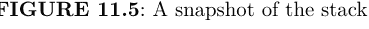

对于每个正在执行的函数，栈都存储所有的参数和局部变量。它还包含对该函数调用位置的引用。计算机需要记录代码在哪里被调用，以便在返回时能将处理流程移回正确的位置。

一旦 testFactorial 返回，该函数使用的内存就可以被删除。testFactorial 的局部变量 n 和 ret 简单地从栈中丢弃。栈现在将如图 11.6 所示：

| 函数 | 变量 | 备注 |

| :--- | :--- | :--- |

| testFactorial | int n, int nFactorial | 由 main 在第 16 行调用 |

| main | int n, int nFactorial | 由操作系统调用。 |

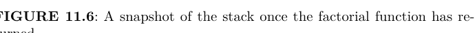

这种使用单一内存块进行所有函数调用，并在新函数被调用及返回时简单地添加和移除顶部数据的简单系统极其高效。这是 C++ 代码可以特别快速的原因之一。

然而，栈并不足以解决所有问题。例如，分配在栈上的数据始终具有在程序编译时已知的固定大小。这就是为什么 C 数组的大小是固定的，且在程序编译前就已确定。正如我们讨论过的，这使得 C 数组对大多数目的而言过于不灵活，因此通常最好使用 vector 类。虽然这对最终用户来说可能不明显，但 vector 必须将其数据存储在堆上。

### 11.8.2 堆

堆是一个比栈组织程度较低的内存区域。如图 11.7 所示，栈是排列整齐的内存块，而堆则包含以杂乱无章方式排列的对象。

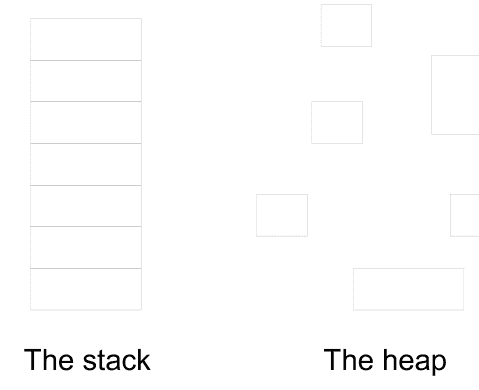

**图 11.7：** 栈和堆

当你调用 `new` 时，一个巧妙的内存管理算法会寻找堆中一块足够大、满足你需求的未使用区域。当你调用 `delete` 时，该内存管理算法会收到通知，表明它现在可以重新利用那部分计算机内存。

堆的主要优点是，你可以随时调用 `new` 和 `delete`，并且你可以选择在运行时而非编译时确定分配内存的大小。

许多数学问题可以在完全没有意识使用堆的情况下解决。当你创建如 `string` 或 `vector` 这样的数据对象时，它们会代表你在堆上创建数据，但你通常不需要详细思考这一点。然而，有时你需要自己使用堆的灵活性。

对我们来说，一个关键的例子是在对期权组合进行定价时。我们并不期望在程序编译时就知道我们的组合确切是什么样子。我们不知道我们将持有多少期权，甚至不知道我们将持有什么类型的期权。由于栈使用的内存是在编译时固定的，它不能用于存储未知大小的期权组合。在第 13 章中，我们将展示如何编写一个 Portfolio 类，该类使用 `shared_ptr` 将 Portfolio 的数据存储在堆上。

## 指针相关的 Bug

使用指针会在我们的代码中引入许多新的潜在错误类型。

-   **空指针错误**。当你试图访问内存地址 `nullptr` 或 `0` 处的数据时，就会发生这种情况。

-   **一般保护故障 (GP)**，也被称为**段错误 (SEGV)**。当你使用无效指针试图访问不允许访问的内存时，就会发生这种情况。

-   **内存泄漏**。当你调用了 `new` 但从未调用 `delete` 时，就会发生这种情况。内存泄漏通常不会立即被察觉。它们通常表现为程序运行得越来越慢，直到你不得不关闭并重新打开它。使用 `shared_ptr` 是避免内存泄漏的最佳方式。还有一些工具，如 `INSURE++`，可以帮助你检测内存泄漏。

这些问题在 C++ 代码中极为常见，你迟早会遇到它们。

## 练习

- 11.8.1. 编写一个函数 `sumDoubles`，该函数接收一个指向双精度浮点数列表的指针和列表的长度，并返回总和。为该函数编写测试。

- 11.8.2. 编写一个函数 `reverseDoubles`，该函数接收一个指向双精度浮点数列表的指针和列表的长度，并反转该列表。例如，(1, 2, 3, 4) 应该变为 (4, 3, 2, 1)。为该函数编写测试。

- 11.8.3. 编写一个函数 `meanDistance`，该函数接收一个指向 Pair 对象列表的指针，并计算 $(x, y)$ 到原点的平均距离。

- 11.8.4. 编写一个函数 `polarToCartesian`，它接收四个参数：`r`、`theta`、`x` 和 `y`。`x` 和 `y` 应通过指针传递。该函数应将 $r\cos(\theta)$ 和 $r\sin(\theta)$ 的值填入 `x` 和 `y` 指向的位置。为该函数编写测试。

在 C 语言中，没有引用，因此通过指针传递是 C 语言中通过引用传递的等价方式。

- 11.8.5. 编写一个函数 `reverseString`，该函数接收一个 `char*` 字符串并将其反转。这应与你的 `reverseDoubles` 函数类似，只是你需要考虑终止零。为你的函数编写测试。


### 11.8.6. 编写一个函数 `concatenate`，将一个以空字符终止的字符串追加到另一个字符串之后。我故意没有告诉你参数或返回类型，这是留给你的设计问题。当你得出自己的解决方案后，请查看标准库函数 `strcat` 和 `strcat_s`，看看其他人是如何解决这个问题的。当然，你应该使用库函数，而不是自己编写。

### 11.8.7. 编写一个函数 `search`，它接收两个 `char*` 字符串作为输入。第一个应该是 `phrase`，即要搜索的短语；第二个应该是 `text`，即要扫描的文本。它应返回 `phrase` 在 `text` 中出现的次数。例如，`search("be","to be or not to be")` 应返回 `"2"`。

### 11.9 总结

指针是 C 程序员的必备工具，但对于 C++ 程序员来说则没那么重要。尽管如此，如果你想处理可变大小的数据或长生命周期数据，你在一定程度上必须使用指针。使用指针最简单的方法，莫过于使用 `shared_ptr` 类。

- 指针、引用和 `shared_ptr` 可以用于实现类似的功能。
- 使用 `vector` 和 `string`，而不是数组或 `char*`。
- 引用比指针稍微安全一些，例如，你不能在引用上调用 `delete`，而且你*必须*初始化引用变量。因此，通过引用传递比通过指针传递更受青睐。
- 一个 `shared_ptr` 比引用或指针稍慢，但如果你想避免内存泄漏，对于长生命周期数据来说，它实际上是唯一可行的选择。

# 第 12 章

## 更复杂的类

在本章中，我们将讨论 C++ 提供的多种额外特性，这些特性允许你编写更复杂、更有趣的类。

### 12.1 内联成员函数

我们在 5.4.4 节中讨论过，你可以使用关键字 `inline` 与函数配合使用，作为给编译器的提示，表示你希望该函数的机器代码在每次使用时都被复制。这样做有一个优点，即稍微快一些，因为调用方法需要消耗少量的计算机算力。例如，我们选择将用于定义 `norminv` 的函数 `hornerFunction` 设为内联。

你也可以内联类的成员函数。步骤很简单，只需将定义放在类内部，替代声明的位置即可。

```cpp
class Point {
public:
 double getX() const {
 return x;
 }
 // other members of Point
private:
 double x;
 double y;
};
```

在这个例子中，`getX` 被内联了。这意味着使用这个函数生成的代码速度不会慢于直接访问 `x` 的代码。使用方法的优点在于，如果我们改变了对 `Point` 如何存储数据的看法，我们可以这样做而不需要重写使用 `Point` 的代码。

你可能已经注意到，编写内联函数比编写独立的声明和定义要轻松得多。不幸的是，仅仅为了避免打字而使用内联函数是不明智的。只有当你确实希望函数被内联时，才应该编写独立的定义。

### 12.2 this 关键字

为了隐藏信息，最好不要有**公共**变量是个好主意。我们刚刚看到了如何编写一个 `get` 方法以提供变量的读取访问。在下面的例子中，我们展示了如何编写一个 `set` 方法以提供写入访问。

```cpp
class Point {
public:
  double getX() const {
      return x;
  }
  void setX(double x) {
      this->x = x;
  }
  // other members of Point
private:
  double x;
  double y;
};
```

我们使用了新的关键字 `this`。在实现成员函数时，变量 `this` 总是包含指向当前对象的指针。因此，你可以使用 `this->` 来访问当前对象的字段。我们刚刚通过 `set` 方法演示了这一点。

你也可以使用 `*this` 来获取当前对象的引用。要理解为什么你可能希望这样做，假设我们想给类 `UpAndOutOption` 添加一个 *price* 方法。我们决定要实现这个方法，只需将必要的数据传递给我们现有的 `MonteCarloPricer` 类，并让它执行计算。然而，`MonteCarloPricer` 类要求你传递给它一个期权对象。我们在哪里找到适当的期权对象的引用呢？`*this` 正是我们需要传递给定价器的东西。

```cpp
double UpAndOutOption::price(
    const BlackScholesModel& model ) const {
  MonteCarloPricer pricer;
  return pricer.price( *this, model );
}
```

### 12.3 继承

继承是 C++ 中一种强大的代码重用技术。它是一种专门设计用于使接口实现更容易的技术。为了举例说明继承如何有用，让我们考虑一个乍一看似乎实现起来相当耗时的接口示例。

以下接口定义了一个 *ContinuousTimeOption*。

```cpp
class ContinuousTimeOption {
public:
    /* Virtual destructor */
    virtual ~ContinuousTimeOption() {};
    /* The maturity of the option */
    virtual double getMaturity() const = 0;
    /* Calculate the payoff of the option given
    a history of prices */
    virtual double payoff(
        const std::vector<double>& stockPrices
    ) const = 0;
    /* Is the option path-dependent?*/
    virtual bool isPathDependent() const = 0;
};
```

连续时间期权有一个到期日，我们可以通过查看到期前的价格路径来计算到期时的收益。这就是 *ContinuousTimeOption* 接口所体现的思想。

*ContinuousTimeOption* 中有三个函数需要实现。对于 *PutOption*、*CallOption*、*DigitalPutOption* 等，大部分实现将是相同的。*继承* 提供了一种同时为多个类实现方法的方式。

要使用继承，首先需要定义一个所谓的“基类”，该基类定义了我们要重用的函数。我们将我们的基类称为 *ContinuousTimeOptionBase*。下面是一个适当基类的声明。我们在这里使用内联技术来实现适当的获取和设置方法。

```cpp
class ContinuousTimeOptionBase :
    public ContinuousTimeOption {
public:
    virtual ~ContinuousTimeOptionBase() {}
    double getMaturity() const {
        return maturity;
    }
    void setMaturity(double maturity) {
        this->maturity = maturity;
    }
};
```

```cpp
}
double getStrike() const {
return strike;
}
void setStrike(double strike) {
this->strike = strike;
}
// ... more methods ...
private:
double maturity;
double strike;
};
```

请注意，我们的基类有一个虚析构函数。

```cpp
virtual ~ContinuousTimeOptionBase() {}
```

我们之前在与接口类相关的部分已经见过这种用法。正如接口类一样，任何用作基类的类都必须有一个虚析构函数。

现在我们可以编写一个继承自基类的 `PutOption` 类。它将自动“继承”所有函数。

```cpp
class PutOption : public ContinuousTimeOptionBase {
public:
/* Calculate the payoff of the option given
a history of prices */
double payoff(
const std::vector<double>& stockPrices
) const;
double price( const BlackScholesModel& bsm )
const;
bool isPathDependent() const {
return false;
};
};
```

代码的第一行说明 `PutOption` 类继承（扩展）自 `ContinuousTimeOptionBase` 类。

```cpp
class PutOption : public ContinuousTimeOptionBase {
```

这意味着在 `ContinuousTimeOptionBase` 中定义的所有方法都自动提供给 `PutOption`，因此我们不需要再次编写它们。

特别是，`PutOption` 继承了诸如 `getMaturity`、`getStrike` 等函数，以及数据成员 `maturity` 和 `strike`。无需重新声明或重新定义这些成员。

此外，`PutOption` 从 `ContinuousTimeOptionBase` 继承了接口 `ContinuousTimeOption`。因此，`PutOption` 自动成为 `ContinuousTimeOption` 的一个实例。

```cpp
class ContinuousTimeOptionBase :
public ContinuousTimeOption {
```

请注意，我们在 C++ 中使用相同的语法来表示继承类或实现接口。

### 12.3.1 我们获得了什么？

到目前为止，我们似乎只是让事情变得更复杂了。但现在我们可以轻松编写以下类：

- 看涨期权（`CallOption`），
- 数码看涨期权（`DigitalCallOption`），
- 数码看跌期权（`DigitalPutOption`），
- 上行敲出期权（`UpAndOutOption`）。

如果它们都继承自 `ContinuousTimeOptionBase`，我们就无需为其中任何一个编写 `getMaturity`、`getStrike` 等方法。

这消除了一大批重复代码。请注意，接口的概念（拥有一组所有类都必须实现的方法）自然会导致一定程度的重复代码。你应该使用继承来避免这种代码重复。

### 12.3.2 术语

有各种术语用来描述 `PutOption` 和 `ContinuousTimeOptionBase` 之间的关系。

- `ContinuousTimeOptionBase` 被称为 `PutOption` 的超类或父类。
- `PutOption` 被称为 `ContinuousTimeOptionBase` 的子类。
- `PutOption` 扩展自 `ContinuousTimeOptionBase`。
- `PutOption` 继承自 `ContinuousTimeOptionBase`。

## 12.4 重写方法——virtual 关键字

让我们向 `ContinuousTimeOptionBase` 添加一个新方法，用于根据定价模型对期权进行定价。

```cpp
class ContinuousTimeOptionBase
: public ContinuousTimeOption {
public:
/* Price the option, by Monte Carlo or otherwise*/
double price(
const BlackScholesModel& model) const;
// ... other members ...
};
```

若要使用蒙特卡洛方法实现该方法，我们只需使用以下代码：

```cpp
double ContinuousTimeOptionBase::price(
const BlackScholesModel& model ) const {
MonteCarloPricer pricer;
return pricer.price( *this, model );
}
```

这种实现对所有类型的期权都相当适用，但未必是最优的。例如，看跌期权最好通过解析方法而非蒙特卡洛方法进行定价。

因此，我们希望能够重写默认实现。关键字 `virtual` 意味着函数可以在子类中被重写。因此，我们必须在 `price` 的声明中添加它。

```cpp
class ContinuousTimeOptionBase
: public ContinuousTimeOption {
public:
/* Price the option, by Monte Carlo or otherwise*/
virtual double price(
const BlackScholesModel& model) const;
// ... other members ...
};
```

如果你希望在子类中重写某个方法，你应该这样做：

- 检查该超类中是否将其声明为 `virtual`。
- 在你的子类中，以完全相同的参数和返回类型（以及 `const` 的使用方式）声明它。可选地，你可以使用关键字 `override`，以便编译器检查你是否正确执行了此操作。
- 你必须提供新的实现，以覆盖默认行为。

以下是 `PutOption` 类的一个示例。

```cpp
class PutOption : public ContinuousTimeOptionBase { 
public: 
double price(const BlackScholesModel& bsm) const override; 
// ... other members ... 
};
```

这意味着 `PutOption` 拥有一个与默认不同的 `price` 函数。此方法的实现就是之前见过的常规 Black–Scholes 定价公式。

`override` 关键字不会影响程序运行时的行为。它只是表明你的意图是重写某个函数。如果你不使用这个关键字，并且在函数参数类型列表中犯了小错误，编译器可能不会注意到你的错误。这可能导致难以发现的 bug。因此，建议你在使用重写函数时使用 `override`。

当你对期权调用 `price` 时，适当的 `price` 方法将根据期权的类型自动选择。这将允许我们在下一章编写一个能够对期权组合进行整体定价的类。

### 12.4.1 关于 virtual 关键字的说明

关键字 `virtual` 意味着“可以被重写”。

当你编写接口类时，方法没有定义，因此我们必须始终将它们声明为 `virtual`，因为它们*必须*被重写。

所有类都有析构函数。这是对象被销毁时调用的一个特殊函数。在任何可能被继承的类中，这必须被声明为 `virtual`，以便调用的重写后的析构函数。

这解释了我们为什么在定义接口类时多次使用了 `virtual` 关键字。

#### **危险！**

**虚析构函数：** 任何设计用于被继承的类都应该有一个虚析构函数。不幸的是，如果你忘记编写，大多数编译器不会检测到这一点。

## 12.5 抽象函数 = 0

你可以通过编写 `= 0` 来表示一个函数没有实现。这仅仅意味着没有默认实现，子类必须提供自己的实现。这样的函数被称为抽象函数。显然，没有定义的函数必须声明为 *virtual*，以便它们可以被重写。

*接口类* 是仅包含*抽象*函数的类。如前所示，你可以编写包含已实现和未实现函数混合的类。*抽象类* 是包含至少一个抽象函数的类。例如，`ContinuousTimeOptionBase` 是一个抽象类，因为它继承了抽象的 `payoff` 函数但没有实现它。

## 12.6 多层级

我们不仅限于父类和子类。我们可以构建复杂的类层次结构。

例如，一个类可以有一个祖父类。事实上，我们已经见过这种情况，`PutOption` 的父类是 `ContinuousTimeOptionBase`，祖父类是 `ContinuousTimeOption`。

你可以无限地继续下去。例如，我们（并且应该）引入一个新的类 `PathIndependentOption`，它包含看涨期权和看跌期权共有的代码，但不用于敲出期权和亚洲期权。以下是 `PathIndependentOption` 的一个适当声明：

```cpp
class PathIndependentOption :public ContinuousTimeOptionBase {
public:
    /* A virtual destructor */
    virtual ~PathIndependentOption() {}
    /* Returns the payoff at maturity */
    virtual double payoff(double endStockPrice) const = 0;
    /* Compute the payoff from a price path */
    double payoff(
        const std::vector<double>& stockPrices ) const {
            return payoff(stockPrices.back());
    }
    /* Is the option path dependent? */
```


```cpp
bool isPathDependent() const {
    return false;
};
};
```

**`PathIndependentOption`** 的实现执行以下操作。

- 它提供了 `isPathDependent` 的实现。
- 它有一个抽象函数，用于仅根据最终股价计算收益。根据“路径无关”的定义，路径无关的期权应该能够提供该函数的实现。
- 这意味着我们可以实现 `payoff` 函数，该函数接收整个股价路径。我们只需要查看最后一个价格。

一旦我们编写了 **`PathIndependentOption`** 类，就可以使用它来编写一个继承自该类的 **`CallOption`** 类。

```cpp
class CallOption : public PathIndependentOption {
public:

    double payoff( double stockAtMaturity ) const;

    double price( const BlackScholesModel& bsm )
        const;
};
```

为了实现 **`CallOption`**，我们必须编写一个函数来计算到期时的收益。因此，上面提到的 `payoff` 函数必须被声明。

我们还选择提供 `price` 的重写。这是因为我们知道，使用 Black–Scholes 公式来定价看涨期权比使用默认的蒙特卡洛实现要好得多。

请注意，所有函数 `getMaturity`、`getStrike` 等，都是由祖父类 **`ContinuousTimeOptionBase`** 实现的。

同样，**`ContinuousTimeOption`** 的方法 `payoff` 由父类 **`PathIndependentOption`** 实现，因此我们只需要实现一个更简单的方法，该方法使用到期价格来计算收益。

我们可以以类似的方式编写 **`PutOption`**、**`DigitalCallOption`** 和 **`DigitalPutOption`**，只需增加极少的代码。这留作练习。

### 12.6.1 UML

图 12.1 展示了 FMLlib12 中期权类层级的 UML 图。实际上，**`DigitalPutOption`** 和 **`DigitalCallOption`** 并不存在。你应该自己编写它们作为练习。

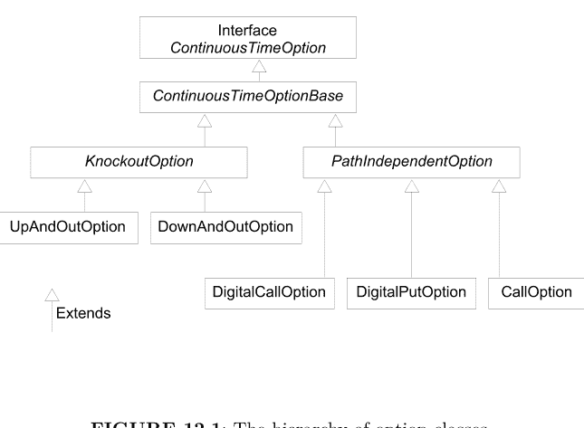

箭头表示“继承”。方框表示类。UML 使用其他类型的箭头来表示类之间的其他关系。我们稍后会看到示例。我们遵循了 UML 的标准做法，使用*斜体*表示抽象类，使用罗马字体（正体）表示具体类。

这个 UML 图异常复杂。类层级通常要简单得多。我们试图通过省略类中所有成员函数和变量的细节来简化该图。

我们的复杂层级结构是合理的，因为它表示了期权之间的“真实”关系。`CallOptions` 确实是 `PathIndependentOptions`，而这些确实是 `ContinuousTimeOptions`。这是你应该普遍遵循的模式。你应该只将子类化用于表示“是”的关系。我们 UML 图中的所有箭头都可以读作“是”。

# 良好的软件长什么样

你更喜欢哪位艺术家，马克·罗斯科还是耶罗尼米斯·博斯？如果你不熟悉他们的画作，他们都是伟大的画家，而且在风格上截然相反。罗斯科以其具有惊人简洁性的抽象画而闻名。博斯以其充满奇幻意象的详细风景画而闻名。

在艺术方面，你实际上不必选择一个最爱的。但在软件设计中，对于任何问题，你都应始终首选最简单的解决方案。

这意味着，当你设计你的类时，应该追求一个更像罗斯科而非博斯的 UML 图。

### 12.6.2 另一个对象层级

为了给出另一个层级示例，**`geometry`** 库已更新，包含了一个有趣的对象层级。它包含以下内容。

- 一个类 **`Shape`**，表示平面上的任何有限形状。它具有以下方法。
    - 一个方法 **`area`**，用于计算面积。
    - 一个方法 **`contains`**，用于测试点是否在形状内。
    - 一个方法 **`boundingRectangle`**，返回一个包含整个形状的 **`Rectangle`**（矩形）。
- 类 **`Circle`**（圆）是 **`Shape`** 的一种实现。
- 类 **`Rectangle`**（矩形）是 **`Shape`** 的另一种实现。
- 类 **`HyperCircle`**（超圆，即形状 $x^4+y^4<1$）是 **`Shape`** 的又一种实现。
- 类 **`Shape`** 有一个默认实现 **`area`**，使用蒙特卡洛方法。
- **`Circle`** 和 **`Rectangle`** 重写了 **`area`**。

这些类在图形库中会有用。

请注意抽象函数和重写的重要性。没有人想要一个无法扩展的 **`Shape`** 类的图形库。同样，没有人想要一个无法定义新类型期权的定价库。

这些例子直击面向对象的编程核心。抽象方法和重写方法允许你编写“可插拔”的系统。

### 12.6.3 多重继承

在 C++ 中，一个类可以继承多个基类。这被称为*多重继承*。

多重继承用于表示一个类实现了多个接口时很有用。

举个例子，拥有一个接口 **`DerivativeWithStrike`**（具有行权价的衍生品）可能是有用的，该接口适用于具有相关行权价的衍生品，如看涨期权和看跌期权（但不包括期货）。该接口将简单地返回行权价，如下所示：

```cpp
class DerivativeWithStrike {
public:
    ~DerivativeWithStrike();
    virtual double getStrike() const = 0;
};
```

为了声明 `ContinuousTimeOptionBase` 同时实现 `ContinuousTimeOption` 和 `DerivativeWithStrike`，可以这样写：

```cpp
class ContinuousTimeOptionBase :
    public ContinuousTimeOption,
    public DerivativeWithStrike {
};
```

在使用多重继承时，我建议你确保至多只有一个父类是非接口类。这不是 C++ 强制执行的规则，但如果你违反它，你就必须理解 C++ 中多重继承的详细规则。这会使你的代码更难理解，因此也更难维护。

**提示：多重继承**
仅使用多重继承来显示一个类实现了多个接口。

我们只展示了如何公开继承自另一个类。这就是为什么我们在继承类时使用关键字 `public`。也可以私有继承类，但这不是一个非常有用的特性。我建议你不要使用它。

**危险！**
C++ 是一门复杂的语言，具有许多高级特性。其他面向对象编程语言（如 Java）不允许多重继承（接口除外），也没有私有继承的概念。这证明这些 C++ 特性并不被普遍认为特别有益。最好避免使用它们。

### 12.6.4 调用父类方法

有时能够调用父类的方法很有用。例如，考虑一个 `UpAndOutOption`（上行跳出期权）。如果障碍低于当前价格，该期权毫无价值，因此不应该使用缓慢的蒙特卡洛方法进行定价。然而，在其他时候，人们希望使用父类 `KnockoutOption` 的默认行为，即使用蒙特卡洛方法为期权定价。

实现此功能所需的代码如下：

```cpp
double price(
    const BlackScholesModel& model) const {
    if (model.stockPrice >= getBarrier())
        return 0;
    return KnockoutOption::price(model);
}
```

关键行是最后一行，我们用父类 `KnockoutOption` 的名称限定了对函数 `price` 的调用。如果我们没有指定希望调用父类的 `price` 函数，该函数将递归调用自身。程序随后会因为堆栈溢出错误而崩溃。

## 12.7 前向声明和 cpp 文件的结构

类 `Shape` 有一个方法 `boundingRectangle`。该方法返回一个 `Rectangle`。这意味着，如果不首先告知编译器关于类 `Rectangle` 的信息，就不可能编写类 `Shape`。

另一方面，`Rectangle` 本身就是一个 `Shape`，所以我们遇到了循环依赖。这似乎使得声明 `Rectangle` 或 `Shape` 变得不可能。

为了解决这个问题，你可以使用类 `Rectangle` 的前向声明。以下是如何创建前向声明的示例：

```cpp
class CartesianPoint;
class Rectangle;

class Shape {
public:
    /* 点是否在形状内 */
    virtual bool contains(const CartesianPoint& point)
        const = 0;
    /* 包围形状的一个矩形 */
    virtual Rectangle boundingRectangle() const = 0;
    /* 默认情况下，面积由蒙特卡洛方法计算 */
    virtual double area() const;
};
```

前向声明：

```cpp
class CartesianPoint;
```

```cpp
class Rectangle;
```

这是对编译器的承诺，表明我们最终会声明这些类。编译器随后会允许将它们用作参数类型和返回类型。但是，在类完全声明之前，无法将其用作成员变量或超类。

这就引出了一个问题：在 C++ 文件中，放置所有声明、定义等的正确顺序是什么？以下是我的建议。你应该按照以下顺序编写 cpp 文件。

1.  Include 语句。
2.  using namespace 语句。
3.  类的前向声明。
4.  类声明和函数声明。
5.  函数定义和成员定义。
6.  测试（其他项目可能有不同的测试约定）。

## 12.8 static 关键字

有时，你可能希望将一个函数与类关联，而不是与特定实例关联。以下是你可能希望这样做的几个原因。

- 该函数旨在构造实例——即所谓的工厂方法。我们将在下一章中看到这一点的详细示例。
- 该函数操作于实例向量，因此无法合理地将其与特定实例关联。
- 该函数旨在同时更改每个实例的行为。例如，你可能希望为类启用额外的日志信息以帮助调试。
- 该函数旨在管理你类的所有实例。例如，由于首次连接数据库很慢，你可能希望维护一个包含给定数据库的 10 个连接的池。然后，你可以将函数与 **`DatabaseConnection`** 类关联，允许你从这个池中获得和返回连接。

如果你想将一个函数与类关联，但不与任何实例关联，你应该使用关键字 **`static`**。你还可以声明一个成员变量是 **`static`**，这意味着它由该类的所有实例共享。

作为一个稍显牵强的例子，假设我们在代码中发现了一个性能问题。我们怀疑这与`evaluate`函数有关，这是我们编写的用于计算`sin`函数的类。作为调试的一部分，我们想要统计这个方法被调用的频率。以下是我们可以执行此操作的一种方式：

```cpp
class CallCountedSin : public RealFunction {

  public:

    static int getNumberOfCalls();

    double evaluate(double x) {

      numCalls++;

      return sin(x);

    }

  private:

    static int numCalls;

};
```

我们的类 `CallCountedSin` 的行为类似于 `sin` 函数，但它还统计在*任何*实例上调用 `evaluate` 的次数。我们有一个 `static` 成员变量来保存调用次数，以及一个 `static` 成员函数来读取该值。

该函数的定义看起来与普通成员函数无异。

```cpp
int CallCountedSin::getNumberOfCalls() {

  return numCalls;

}
```

请注意，此函数不允许访问除 `static` 之外的任何变量。

以下是如何初始化静态变量 `numCalls`：

```cpp
int CallCountedSin::numCalls = 0;
```

这看起来几乎就像一个全局变量定义。从某种意义上说，这正是它的全局性质。区别在于我们将变量 `numCalls` 与类 `CallCountedSin` 关联。这比拥有一个名为 `numCalls` 的全局变量要好，因为静态变量可以声明为私有。这意味着其他类中的任何函数都无法使用它。

以下是一个实际调用静态函数的示例：

```cpp
void testCallCountedSin() {

  CallCountedSin instance1;

  CallCountedSin instance2;

  integral(instance1, 0, 1, 1000);

  integral(instance2, 0, 1, 1000);

  int numCalls = CallCountedSin::getNumberOfCalls();

  ASSERT(numCalls == 2000);

}
```

需要观察的要点是，调用该函数时，我们必须用类名限定其名称。

```cpp
int numCalls = CallCountedSin::getNumberOfCalls();
```

由于我们可能有许多具有相同名称静态方法的类，因此限定名称是有意义的。

我们在第 9.3 节中已经见过静态变量的示例。你可能记得，我们使用以下代码重置随机数生成器的种子：

```cpp
mersenneTwister.seed(mt19937::default_seed);
```


这段代码访问了在类 `mt19937` 中定义的静态变量 `default_seed`。由于 `default_seed` 对所有实例都是相同的，将其与类关联而不是与任何实例关联是合乎逻辑的。对于比单个整数更复杂的数据对象，对于由所有实例共享的变量，只保留一份副本可以节省大量内存。

总之，静态函数和静态变量的行为与全局函数和全局变量完全相同，除了以下几点。

- 它们可以设为私有，并且拥有对私有数据的特权访问权。这增加了封装性。
- 它们与类关联。调用静态函数时需要用类名限定。这防止了命名冲突。

令人困惑的是，C++ 还使用 `static` 关键字来处理未定义在任何类中的函数。在这种上下文中，`static` 意味着“不能在当前文件之外使用”。不幸的是，C++ 使用同一个关键字来实现两个完全不同的目的。

就像其他全局变量一样，如果你使用多线程代码，那么在处理非常量静态变量时必须小心使用锁。请参阅第 20 章。

## 12.9 protected 关键字

我们已经知道可以使用关键字 `public` 或 `private` 进行信息隐藏。`public` 意味着每个人都可以使用方法和变量。`private` 意味着没有人可以使用方法/变量，包括子类。

既然我们使用了子类，值得说明的是你也可以使用关键字 `protected`。这意味着只有子类可以使用这些方法/变量。实际上，我建议你暂时忽略 `protected`，因为它并不是特别有用。

### 练习题

1. 12.9.1. 编写 `DigitalCallOption` 和 `DigitalPutOption` 类。重构 `PutOption` 使其继承自 `PathIndependentOption`。
2. 12.9.2. 编写一个代表亚式期权的 `AsianOption`。展示这个新类在期权 UML 图中的位置。
3. 12.9.3. 创建类层级的 UML 图，基类为 `Shape`。
4. 12.9.4. 我们的不同图表类之间有大量相同的代码。特别是，它们都有一个标题和两个名为 `writeAsHTML` 的函数。设计一个基类并为每个图表扩展它。绘制由此产生的层级的 UML 图。使用 `getter` 和 `setter` 方法来访问标题。
5. 12.9.5. 你能使用本章的技术来改进为练习 10.6.6 编写的 `Cipher` 类吗？
6. 12.9.6. 本练习测试静态变量和函数的使用。
   (i) 编写一个接口类 `RandomNumberGenerator`，其中包含一个生成均匀分布随机数的函数。
   (ii) 编写一个 `RandomNumberGenerator` 的实现，它使用 `mt19937` 类。这种通过简单调用另一个类来完成所有工作来实现接口的设计模式被称为*委托*。
   (iii) 在 `RandomNumberGenerator` 类上编写一个名为 `setDefault` 的静态函数，用于设置当前的默认 `RandomNumberGenerator` 实例。注意，你应该使用 `shared_ptr<RandomNumberGenerator>` 作为 `setDefault` 的参数。
   (iv) 在 `RandomNumberGenerator` 上编写一个静态函数 `randUniform`，允许用户生成均匀分布的随机数，而无需创建 `RandomNumberGenerator`。
   (v) 在 `RandomNumberGenerator` 中添加一个非静态的 `setAsDefault` 函数，用于将当前随机数生成器设置为默认随机数生成器。你需要使用 `this` 关键字。
   (vi) 你认为这在哪些方面（如果有）比 *matlib* 中现有的函数更好？

## 12.10 总结

本章涵盖了相当多的不同主题。以下是简要回顾。

- 尽可能编写 `getter` 和 `setter`，并使用 `private` 数据。
- 通过在类中编写定义，你可以内联函数。
- `this` 指针使得编写 `setter` 变得容易。如果你需要当前实例的引用，可以使用它。
- 构建类层次结构以继承功能。
- 使用 `virtual` 关键字表示方法可以被重写。
- 编写 `=0` 表示函数没有实现，从而创建抽象类。
- 接口类是继承的一个特例。
- 使用前向声明来处理循环类声明。
- 在类中使用 `static` 变量代替全局变量。在类中使用 `static` 函数来编写与类整体相关而非与类的任何特定实例相关的函数。

## 第 13 章 组合类

本书的一个关键目标是展示如何使用 C++ 对包含各种不同期权的投资组合进行定价。我们将在本章中实现这一目标。

如果没有面向对象编程，这将很难实现。但由于我们的所有期权类都有一个接受 `BlackScholesModel` 作为参数的 `price` 函数，所以实际上这将变得极其简单。

我们不会在本章中介绍 C++ 的任何新语言特性。本章唯一的想法是一个简单的称为*工厂模式*（factory pattern）的设计模式，它可用于增加信息隐藏。

### 13.1 Priceable 接口

从金融角度来看，投资组合只是一系列证券的集合，例如股票、债券和各种数量的期权。投资者的投资组合描述了他们在所有证券中的总持仓。

要在 C++ 中建模投资组合，我们将编写一个类，该类存储不同证券的向量以及持有量的向量。

我们需要决定使用哪个类来表示每种证券。这可能是股票、债券、衍生品等。这些不同证券唯一的共同特征是它们可以被定价。这促使我们引入一个新的接口 `Priceable`。以下是我们将使用的接口：

```cpp
class Priceable {
public:
    /* Compute the price of the security in the
       Black--Scholes world */
    virtual double price( const BlackScholesModel& model ) const = 0;
};
```

在编写实际的金融系统时，传递给 `price` 函数的参数不仅仅是 `BlackScholesModel`。实际上，人们会传递一个更复杂的参数，其中包含关于整个金融市场的数据，而不仅仅是关于单只股票的数据。通过为我们的证券使用此接口，我们将系统限制为仅对涉及单一股票价格和固定利率 `$r$` 的证券进行定价。这足以突出显示关键思想，但显然，如果在编写实际的交易系统，则需要重新考虑。

通过让 `ContinuousTimeOption` 继承 `Priceable`，我们可以确保我们的所有期权类都实现 `Priceable`。我们将编写额外的类 `Stock` 和 `ZeroCouponBond` 作为读者的练习（零息债券的定义见练习 13.5.1）。

### 13.2 Portfolio 接口与实现

既然我们已经设计了 `Priceable` 类，那么设计 `Portfolio` 的关键函数就容易了。`Portfolio` 类必须具有以下关键功能：

- (i) 一个函数用于添加 `Priceable` 实例及其相关数量；
- (ii) 一个函数用于更改给定证券的持有量；
- (iii) 一个函数 `price` 用于计算 `Portfolio` 的价值。

最后一项表明，`Portfolio` 本身应该实现接口 `Priceable`。这意味着可以创建一个本身就包含 `Portfolio` 的 `Portfolio`。这准确反映了银行管理其头寸的方式。他们首先按业务线，然后按交易台，再按交易员将持仓组织成多个不同的投资组合。每个交易员随后将维护多个单独的投资组合，仅作为一种组织他们工作的方式。

可以看出，我们的 `Portfolio` 实现需要一种方法来存储类型为 `Priceable` 的对象，以便跟踪投资者的持仓。`Portfolio` 实现不可能拥有类型为 `Priceable` 的成员变量，因为 `Priceable` 是一个抽象类。出于同样的原因，拥有 `Priceable` 对象的向量也是不可能的。这样做的根本原因是成员变量和向量元素必须具有相同的大小。不同的 `Priceable` 对象将根据其包含的变量占用不同大小的内存。

解决此问题的方法是让 `Portfolio` 使用 `shared_ptr` 存储数据。这种不可避免的指针使用是我们在第 11 章中引入指针主题的原因。

这导致我们就 `Portfolio` 类的设计做出以下决定。

- (i) 我们的 `Portfolio` 实现将持有指向 `Priceable` 实例的 `shared_ptr` 对象向量。
- (ii) 它还将拥有一个数量向量。
- (iii) 由于我们需要存储 `shared_ptr` 对象，添加证券的方法将接受指向证券的 `shared_ptr`，而不是对证券的引用。

在最终确定我们的设计之前，我们增加了另一个考虑因素。`Portfolio` 类的用户不需要知道我们选择如何存储 `Portfolio` 的数据。因此，最好将所有这些非必需的细节排除在头文件之外。

考虑到所有这些，我们现在可以设计我们的 `Portfolio` 类。

```cpp
class Portfolio : public Priceable {
public:
    /* Virtual destructor */
    virtual ~Portfolio() {};
    /* Returns the number of items in the portfolio*/
    virtual int size() const = 0;
    /* Add a new security to the portfolio,
    returns the index at which it was added */
    virtual int add( double quantity,
    std::shared_ptr<Priceable> security ) = 0;
    /* Update the quantity at a given index */
    virtual void setQuantity( int index,
    double quantity ) = 0;
    /* Compute the current price */
    virtual double price(
    const BlackScholesModel& model ) const = 0;
    /* Creates a Portfolio */
    static std::shared_ptr<Portfolio> newInstance();
};
```

`Portfolio` 类是一个抽象类。要创建 `Portfolio`，该类的用户必须调用*工厂方法* `newInstance`。此函数保证返回某种 `Portfolio` 接口的实现，但用户不知道确切返回的是什么类。由于我们甚至不想让用户知道我们返回的 `Portfolio` 对象的成员变量，因此我们的工厂方法必须返回指向 `Portfolio` 的指针。像往常一样，我们使用 `shared_ptr` 来简化内存管理。

这样做的优点是*所有实现细节都隐藏在 C++* 文件中。*私有字段和方法* 的信息未提供给用户。这意味着我们可以更改所有这些实现细节，而用户甚至无需重新编译，他们只需链接到最新的库即可。

实现全部位于文件 `Portfolio.cpp` 中。

```cpp
class PortfolioImpl : public Portfolio {
public:
    /* Returns the number of items in the portfolio*/
    int size( ) const;
    /*  Add a new security to the portfolio,
        returns the index at which it was added */
    int add( double quantity,
            shared_ptr<Priceable> security );
    /* Update the quantity at a given index */
    void setQuantity( int index, double quantity );
    /* Compute the current price */
    double price( const BlackScholesModel& model ) const;
    vector<double> quantities;
    vector< shared_ptr<Priceable> > securities;
};
```

将所有实现细节放在 cpp 文件中还有其他一些优势。让我们现在描述其中的一些。

- (i) 我们的实现类 `PortfolioImpl` 有一个成员变量，其类型相当复杂

```cpp
vector< shared_ptr< Priceable > >
```

这种类型是指向 `Priceable` 对象的指针向量。这正是我们所需的用于存储投资组合包含的不同证券详细信息的数据结构。如果我们头文件中声明了实现细节，类型细节将更难阅读：

```cpp
std::vector< std::shared_ptr< Priceable> >
```

这是因为你不应该在头文件中写 `using namespace`。因此，将实现细节放在 `cpp` 文件中使我们能够更充分地利用 `using namespace` 声明。

- (ii) 在头文件中，所有类的字段通常被声明为 `private` 以增加封装性。不幸的是，这使得测试变得笨拙。`PortfolioImpl` 的字段是公开的就没关系。我们无需使用 `private` 关键字就实现了完美的信息隐藏。

- (iii) 头文件要简单得多。由于每个使用 `Portfolio` 的文件都需要 `#include` 我们的头文件，这将减少使用 `Portfolio` 的类的编译时间。对于这一个类来说，这是一个小细节，但跨项目的累积效果可能非常大。你在头文件中放入的代码越少，编译速度就越快。

这种通过工厂方法 `newInstance` 提供实现以增强封装性的技术被称为工厂设计模式。由于允许将接口与实现清晰分离，它具有诸多优势。可以说，这将接口与实现解耦了。程序中不同类之间的依赖关系称为耦合。降低耦合度会产生更具可维护性的代码。

#### 13.2.1 PortfolioImpl 的实现

所有的繁重工作都在于类 `Portfolio` 和 `PortfolioImpl` 的设计中。提供方法的实现非常简单。

首先，我们必须实现工厂方法 `newInstance`。它只需要返回一个新的 `PortfolioImpl` 实例即可。

```cpp
shared_ptr<Portfolio> Portfolio::newInstance() {
    shared_ptr<Portfolio> ret =
        make_shared<PortfolioImpl>();
    return ret;
}
```

`add` 的实现很容易：

```cpp
int PortfolioImpl::add(double quantity,
    shared_ptr<Priceable> security) {
    quantities.push_back(quantity);
    securities.push_back(security);
    return quantities.size();
}
```

实现 `size` 也同样简单：

```cpp
int PortfolioImpl::size() const {
    return quantities.size();
}
```

以及 `setQuantity` 的实现：

```cpp
void PortfolioImpl::setQuantity(int index,
    double quantity) {
    quantities[index] = quantity;
}
```

我们所有努力的最终结果是，我们可以轻松地为 `Portfolio` 编写一个 `price` 函数：

```cpp
double PortfolioImpl::price(
    const BlackScholesModel& model) const {
    double ret = 0;
    int n = size();
    for (int i = 0; i < n; i++) {
        ret += quantities[i]
            * securities[i]->price(model);
    }
    return ret;
}
```


所有这些实现代码都非常简单。然而，请停下来思考一下，我们的 `Portfolio` 实现现在可以存储任何类型的股票衍生品并对其定价的事实。它将始终根据所含衍生品的类型选择最高效的定价方法。看涨期权将使用看涨期权的 Black-Scholes 公式进行定价。看跌期权将使用看跌期权公式进行定价。其他期权将通过蒙特卡洛方法进行定价。同样，股票和无息债券的持仓将通过调用相应的定价函数进行定价。最终结果是一个极其通用且有用的类。

此外，我们的 `Portfolio` 也能同样适用于我们尚未实现的证券！如果我们库的使用者决定销售新型金融产品，他们可以提供我们类自己的实现。能够在无需重写所有软件的情况下应对快速变化的业务需求，是商业软件的一个基本特征。正是这种“可插拔性”使面向对象软件在金融行业中如此重要。

## 13.3 测试

正如我们在本书中一直强调的那样，软件开发的一个关键部分是测试您的代码是否正常工作。

在这个测试中，我们检查了看跌-看涨平价公式，我们将对此进行推导。一个由 1 单位看涨期权和 $-1$ 单位看跌期权组成的投资组合 $\mathbf{P}$（两者的执行价格均为 $K$），在到期时将支付等于

$$\max\{S_T - K, 0\} - \max\{K - S_T, 0\}$$

的金额（其中 $S_T$ 是到期时的股票价格）。通过分别考虑 $S_T < K$ 和 $S_T \geq K$ 的情况，可以看出该表达式简化为：

$$S_T - K.$$

因此，$\mathbf{P}$ 的价值等于 $S_T - K$ 的折现期望值。在 $\mathbb{Q}$-测度下，$S_T$ 的折现期望值必须为 $S_0$。我们推断出 $S_T - K$ 的折现期望值为：

$$ S_0 - e^{-rT} K. $$

这是 $\mathcal{P}$ 在时间 0 的价值。

下面的测试证实了当 $r=0$ 时，这对我们的 `Portfolio` 类成立。

```cpp
static void testPutCallParity() {
    shared_ptr<Portfolio> portfolio
        = Portfolio::newInstance();
    shared_ptr<CallOption> c
        = make_shared<CallOption>();
    c->setStrike(110);
    c->setMaturity(1.0);
    shared_ptr<PutOption> p = make_shared<PutOption>();
    p->setStrike(110);
    p->setMaturity(1.0);
    portfolio->add(100, c);
    portfolio->add(-100, p);
    BlackScholesModel bsm;
    bsm.volatility = 0.1;
    bsm.stockPrice = 100;
    bsm.riskFreeRate = 0;
    double expected = bsm.stockPrice - c->getStrike();
    double portfolioPrice = portfolio->price(bsm);
    ASSERT_APPROX_EQUAL(100 * expected,
        portfolioPrice, 0.0001);
}
```

人们可能会觉得我们应该为我们的 `Portfolio` 类编写更多测试，以测试它是否正确地为更复杂的投资组合定价。我们设计的一个核心好处是，为 **Portfolio** 类编写大量测试实际上并不是很有必要。我们已经有一套测试来确认各种不同类型的期权被正确定价。 **Portfolio** 类有一个非常简单的 *price* 方法，该方法的每一行都已经由我们的看跌-看涨平价测试覆盖。测试 **Portfolio** 是否能处理由复杂期权组成的投资组合不会带来任何新的东西。

## 13.4 UML

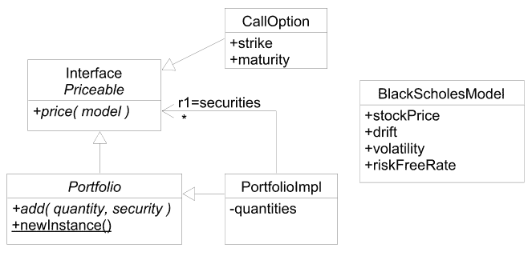

**图 13.1：** Portfolio 类的设计。

图 13.1 总结了我们在本章中介绍的类，以 UML 图的形式呈现。

该图表明 **PortfolioImpl** 实现了接口 **Portfolio**，而 **Portfolio** 又继承了接口 *Priceable*。 *Priceable* 也由类 *CallOption* 实现。

另一方面，**PortfolioImpl** 包含一个 *Priceable* 对象的向量；这由标记为 *securities* 的箭头表示。这种关系是一种 *has a* 关系。**PortfolioImpl** 拥有一些相关的证券。所有这些关系都是 *is a* 关系，并通过类继承来实现。

箭头上的 `*` 符号表示 **PortfolioImpl** 可以拥有任意数量的相关证券。在 UML 中，你可以用数字或数字范围来标记任何关系的 *multiplicity*（重数）。例如，人类与其父母之间的“parents”关系可以标记为 multiplicity 2。`*` 仅仅表示重数没有限制。

`newInstance` 函数下方有下划线，以表示它是一个静态函数。

我们特意从图中省略了期权的完整层级结构，以保持其可读性。我们还表明 `CallOption` 拥有公共成员变量 *strike* 和 *maturity*，即使这些变量只能通过 get 和 set 方法访问。我们没有提到 **PortfolioImpl** 使用共享指针的向量来存储对 *Priceable* 对象的引用。因此，我们的图是对类的一种轻微简化。它的目的是阐明设计，而不是精确地反映代码。

## 13.5 局限性

我们并不声称本章中的代码是对期权投资组合定价的最终定论。以下是一些重要的局限性。

- (i) 我们在蒙特卡洛计算中使用了固定的情景数和步数，这应该是可配置的。
- (ii) 我们并没有尝试优化我们的代码。
- (iii) 我们没有利用现代计算机可用的多核 CPU。
- (iv) 我们的 ContinuousTimeOption 和 Priceable 接口不够通用。例如，它们无法处理离散时间期权和基于多个基础股票的期权。
- (v) 通过蒙特卡洛方法为投资组合定价时，持续生成随机数不是一个好主意。最好一次性生成所有风险因子，然后使用相同的情景来为每个元素定价。这既减少了随机数的生成，又确保了套期保值能精确地对冲。

这些局限性中的许多将在后续章节中解决。

## 练习

1. 13.5.1. 无息债券是一种金融工具，保证在到期日 T 支付价值 1。这些工具在实际中并不经常交易，但作为表示无风险银行账户的数学抽象是非常有用的。在时间 T 之前将资金存入无风险银行账户等同于投资于到期日为 T 的无息债券。风险中性定价理论告诉我们，无息债券在时间 0 的风险中性价格为 $\exp(-rT)$。

利用这一事实，为股票和无息债券创建 Priceable 接口的实现。

13.5.2. 实现 `UpAndInOption` 和 `DownAndInOption`。包含一个 `UpAndInOption` 和一个 `UpAndOutOption` 的组合应与包含一个 `CallOption` 的组合价值相同。使用 `Portfolio` 类验证这一点。对结果的准确性进行评论。

# 13.6 总结

在开发 `Portfolio` 的过程中，我们并没有遇到任何新的 C++ 语言特性，只是了解了一些用于有效使用 C++ 的设计模式。

- 使用 `shared_ptr` 来构建复杂的数据结构，以长期存储对象。
- 使用*静态工厂方法*设计模式来最大限度地隐藏信息并减少文件之间的依赖关系。
- 利用面向对象编程来实现可插拔的代码，即使出现新的需求也无需修改。

# 第 14 章
## 德尔塔对冲

在本章中，我们将展示如何将 C++ 应用于超越简单无风险定价的金融数学问题。特别是，练习将向你展示如何将面向对象编程技术应用于解决广泛的问题。

我们要解决的一个问题是，从数值上证明附录 A 中描述的*德尔塔对冲*策略是一种有效的交易策略。

在文献 [2] 中，已证明只要使用对现实的各种近似，德尔塔对冲策略就是完全无风险的。这些假设包括：必须在连续时间内重新调整仓位；股票价格必须在 ℙ 测度下遵循几何布朗运动；没有交易成本；市场必须是无限流动的；利率必须固定在水平 *r* ；等等。

我们将在本章中证明，如果将连续交易时间的假设弱化为在固定时间点交易，德尔塔对冲仍然是一种相当有效的策略。该策略不再完全无风险，但通过频繁地重新对冲，可以将风险降低到可接受的水平。

我们开发的软件可以轻松地增强，以测试削弱其他假设的影响。此外，可以轻松地改编软件，以测试其他对冲和投资策略的有效性。

## 14.1 离散时间德尔塔对冲

我们将模拟一只股票的交易，该股票按照 Black–Scholes ℙ-测度模型演变。这意味着我们可以使用现有的 **BlackScholesModel** 及其函数 *generatePricePath* 来模拟给定时间区间内的股票价格。时间 *t* 时的股票价格表示为 *S*_*t*。

在时间 0，一名交易员向客户出售了一只针对该股票的欧式看涨期权，执行价为 *K*，到期日为 *T*，价格为 Black–Scholes 价格。这意味着，作为价格 *P* 的交换，交易员承诺在时间 *T* 向客户支付如下金额：

$$\max\{S_{T} - K, 0\}$$

交易员的策略是对这一负债进行德尔塔对冲。他们在 $N$ 个离散时间步长中进行德尔塔对冲。因此，每个时间步长的长度为 $\delta t = \frac{T}{N}$。我们用整数 $i \in \{0, N - 1\}$ 来标记交易员进行对冲的时间点。因此，时间点 $i$ 发生在时间 $i\delta t$。在时间点 $i$，交易员将确保持有恰好 $\Delta_{i}$ 单位的股票，其中 $\Delta_{i}$ 是时间点 $i$ 时看涨期权的 Black–Scholes 德尔塔值。剩余的资金投资于无风险账户，该账户以固定利率 $r$ 增长。

我们用 $b_{i}$ 表示交易员在每个时间点 $i$ 的银行存款余额。在时间点 0，交易员将

$$ b_{0} = P - \Delta_{0} S_{0} \tag{14.1} $$

存入其无风险账户，并将其余本金 $\Delta_{0} S_{0}$ 投资于股票。然后，我们可以使用差分方程计算交易员在后续时间点 $i$ 的银行存款余额：

$$ b_{i} = e^{r \delta t} b_{i-1} - (\Delta_{i} - \Delta_{i-1}) S_{i \delta t}. \tag{14.2} $$

该方程之所以成立，是因为他们银行中的资金以利率 $r$ 增长，从而产生项 $e^{r \delta t} b_{i-1}$，代表交易员重新平衡其投资组合之前银行中的金额。然后，交易员需要重新平衡其投资组合，以确保持有 $\Delta_{i}$ 单位的股票。这意味着他们需要购买 $\left(\Delta_{i} - \Delta_{i-1}\right)$ 单位的股票。这解释了 $-\left(\Delta_{i} - \Delta_{i-1}\right) S_{i \delta t}$ 项。

在时间点 $N$，期权达到到期日。交易员不进行德尔塔对冲。相反，他们卖出剩余的股票持仓并支付负债。这告诉我们

$$ b_{N} = e^{r \delta t} b_{N-1} + \Delta_{N-1} S_{T} - \max\{S - K, 0\}. \tag{14.3} $$

这个最终的银行存款余额代表了交易员的盈亏。公式 (14.1) 到 (14.3) 的推导没有使用比德尔塔对冲策略的定义和基本会计计算更复杂的东西。这些计算并不比您用来理解自己个人账户和购物消费的计算更复杂。

我们可以使用差分方程 (14.1) 到 (14.3) 在给定的模拟股票价格集合下计算交易员的盈亏。我们需要的额外要素是 $\Delta_{i}$ 的显式公式。根据定义，$\Delta = \frac{\partial C}{\partial S}$，其中 $C$ 是看涨期权的价格，$S$ 是当前股票价格。这意味着只需对看涨期权价格的 Black–Scholes 公式 (A.6) 进行微分即可计算 $\Delta$。结果是

$$ \Delta = N(d_{1}) \tag{14.4} $$

其中 $N$ 和 $d_{1}$ 的定义如公式 (A.6) 所示。本节中的公式共同允许我们明确计算特定场景下交易员的盈亏。通过生成多个场景，我们可以计算交易员盈亏 (PnL) 的统计数据。最有趣的是，我们可以绘制交易员 PnL 的直方图。我们将在下一节中查看执行此操作所需的 C++ 代码。

## 14.2 在 C++ 中实现德尔塔对冲策略

鉴于前一节中的显式公式，实现德尔塔对冲策略是 straightforward 的。然而，如果直接将这些方程复制到 C++ 中，最终得到的代码将包含诸如 **b** 这样毫无助益名称的变量，对于没有文档可查的人来说，这些变量毫无意义。

编程中的惯例是使用长的变量名，以清楚地解释正在发生的事情。这与数学中使用单字母变量名的惯例相反。

你会看到下面的代码对所有变量使用英文名称，这清楚地展示了所有项是如何推导出来的。其优势在于，仅通过查看代码本身就可以理解，无需阅读另一个文件中的说明文档。

### 14.2.1 类声明

我们的第一步是声明一个用于运行我们对冲模拟的类。我们将该类命名为 **HedgingSimulator**。它将是一个可配置的类，允许用户设置要对冲的期权值、用于模拟的模型等。我们的设计包含一定的灵活性，允许用户设置一个用于生成股票价格的模型（`simulationModel`）和另一个用于计算向客户收取的金额以及每个时间点应持有的股票数量的模型（`pricingModel`）。通过拥有两个独立的模型，我们将能够测试如果交易员对市场的信念不正确会发生什么。

这些想法促使我们定义了一个名为 HedgingSimulator 的类的以下私有成员变量：

```cpp
private:
  /* The option that has been written */
  std::shared_ptr<CallOption> toHedge;
  /* The model used to simulate stock prices */
  std::shared_ptr<BlackScholesModel> simulationModel;
  /* The model used to compute prices and deltas */
  std::shared_ptr<BlackScholesModel> pricingModel;
  /* The number of steps to use */
```

# 14.4.2 `runSimulation` 的实现

变量 `nSteps` 对应于差分方程推导过程中使用的数学变量 $N$。

我们决定使用 `shared_ptr` 来存储所有配置对象。当一个类需要引用另一个类的数据时，这应该是你的默认选择。另一种选择是使用类型为 `CallOption` 的成员变量，但这只能存储确切的 `CallOption` 类，而无法存储未来可能编写的子类。事实上，使用更通用类型的成员变量可能更好，这样我们可以模拟对冲其他类型的期权。参见练习 14.4.4。

## 技巧：使用 shared_ptr 引用其他类

通过指针存储对象更加灵活。因为这样在需要时可以持有对子类的引用。在构建引用其他类的类时，这应该是你的默认设计选择。

由于 `HedgingSimulator` 类的所有成员都是私有的，我们需要设置方法以便用户配置该类。我们还希望有一个构造函数，将数据初始化为合理的值。以下是相关的公共声明：

```cpp
void setToHedge(std::shared_ptr<CallOption> toHedge) {
    this->toHedge = toHedge;
}
void setSimulationModel(std::shared_ptr<BlackScholesModel> model) {
    this->simulationModel = model;
}
void setPricingModel(std::shared_ptr<BlackScholesModel> model) {
    this->pricingModel = model;
}
void setNSteps(int nSteps) {
    this->nSteps = nSteps;
}
/* 默认构造函数 */
HedgingSimulator();
```

我们期望该类的使用者设置要对冲的期权、选择要使用的模型和步数，然后要求我们的类运行模拟。我们提供了以下公共方法来执行此操作：

```cpp
/* 运行多次模拟并返回盈亏的向量 */
std::vector<double> runSimulations(int nSimulations) const;
```

为了实现此方法，我们希望使用三个辅助方法。这些是私有方法。声明如下所示：

```cpp
/* 运行一次模拟并计算盈亏 */
double runSimulation() const;
/* 我们应该向客户收取多少费用 */
double chooseCharge(double stockPrice) const;
/* 我们应该持有多少股票 */
double selectStockQuantity(double date, double stockPrice) const;
```


引入这些辅助方法仅仅是为了确保每个函数简短且易于阅读。例如，函数 `runSimulations` 只是多次调用 `runSimulation` 并将结果存储在向量中。

这就完成了 `HedgingSimulator` 类的成员变量和成员函数的列表。完整的类声明可以在文件 `HedgingSimulator.h` 中找到。

# 14.4.2 `runSimulation` 的实现

最有趣的代码是函数 `runSimulation` 的实现。它开始如下：

```cpp
double HedgingSimulator::runSimulation() const {
    double T = toHedge->getMaturity();
    double S0 = simulationModel->stockPrice;
    vector<double> pricePath = simulationModel->generatePricePath(T, nSteps);
    double dt = T / nSteps;
    double charge = chooseCharge(S0);
    double stockQuantity = selectStockQuantity(0, S0);
    double bankBalance = charge - stockQuantity * S0;
}
```

这段代码首先模拟 $\mathbb{P}$ 测度下的价格路径。然后计算交易者在时间 0 时的银行账户余额。这段代码本质上等价于推导公式 (14.1) 时使用的论证。最明显的变化是我们用更长的变量名重写了所有内容。另一个细节是我们调用了函数 `selectStockQuantity`，该函数决定我们在每个时间点需要持有多少股票。我们还调用了函数 `chooseCharge`，该函数决定向客户收取多少费用。通过将计算对冲所需股票数量的过程分离到自己的函数中，我们突出了 $\Delta$ 对冲策略与其他股票对冲策略相比的基本特征。此外，这将使代码易于增强，以便找出如果交易者决定追求另一种投资策略会发生什么。

接下来是一个循环，我们在每个中间时间点对模拟交易。

```cpp
for (int i = 0; i < nSteps - 1; i++) {
    double balanceWithInterest = bankBalance * exp(simulationModel->riskFreeRate * dt);
    double S = pricePath[i];
    double date = dt * (i + 1);
    double newStockQuantity = selectStockQuantity(date, S);
    double costs = (newStockQuantity - stockQuantity) * S;
    bankBalance = balanceWithInterest - costs;
    stockQuantity = newStockQuantity;
}
```

这段代码对应于公式 (14.2)。

最后，我们需要考虑到期时发生的情况。以下代码解决了这个问题，并完成了 `runSimulation` 的定义。

```cpp
double balanceWithInterest = bankBalance * exp(simulationModel->riskFreeRate * dt);
double S = pricePath[nSteps - 1];
double stockValue = stockQuantity * S;
double payout = toHedge->payoff(S);
return balanceWithInterest + stockValue - payout;
}
```

这段代码对应于公式 (14.3)。

# 14.4.3 实现 HedgingSimulator 的其他方法

我们的 `HedgingSimulator` 类实现的剩余细节极其简单明了。

`runSimulations` 只是多次调用 `runSimulation` 并将结果存储在向量中：

```cpp
std::vector<double> HedgingSimulator::runSimulations(int nSimulations) const {
    std::vector<double> ret(nSimulations);
    for (int i = 0; i < nSimulations; i++) {
        ret[i] = runSimulation();
    }
    return ret;
}
```

默认构造函数确保新创建的 `HedgingSimulator` 为各种参数设置了合理的值。我们选择这些值，以便我们可以创建一个 `HedgingSimulator` 用于测试目的，而无需进行太多配置。

```cpp
HedgingSimulator::HedgingSimulator() {
    // 选择默认模型和期权
    shared_ptr<BlackScholesModel> model(new BlackScholesModel());
    model->stockPrice = 1;
    model->date = 0;
    model->riskFreeRate = 0.05;
    model->volatility = 0.2;
    model->drift = 0.10;
    shared_ptr<CallOption> option = make_shared<CallOption>();
    option->setStrike(model->stockPrice);
    option->setMaturity(1);
    setToHedge(option);
    setSimulationModel(model);
    setPricingModel(model);
    nSteps = 10;
}
```

函数 `selectStockQuantity` 将其工作委托给 `CallOption` 类上的一个函数 `delta`。该函数使用公式 (14.4) 计算看涨期权的 $\Delta$。将 $\Delta$ 的计算放入 `CallOption` 类中是合理的，因为我们经常需要计算期权的 $\Delta$。理想情况下，应该在整个期权层级中添加一个计算 $\Delta$ 的方法（参见练习 14.4.4）。

```cpp
double HedgingSimulator::selectStockQuantity(double date, double stockPrice) const {
    // 创建定价模型的副本
    BlackScholesModel pm = *pricingModel;
    pm.stockPrice = stockPrice;
    pm.date = date;
    return toHedge->delta(pm);
}
```

在上述代码中，这一行

```cpp
BlackScholesModel pm = *pricingModel;
```

很有趣。我们需要改变我们的定价模型，使其状态反映当前时间步的市场状态。成员变量 `pricingModel` 仅反映模拟开始时市场的状态。

我们不希望改变我们 `HedgingSimulator` 的实际配置，因此我们不希望改变成员变量 `pricingModel`。因此，我们创建一个全新的变量 `pm`，并将 `pricingModel` 的值复制到该变量中。然后我们可以设置变量 `pm` 的当前股票价格和日期，而无需改变变量 `pricingModel`。由于成员变量 `pricingModel` 使用指针存储数据，我们必须使用 `*` 将指针转换为我们随后复制的引用。

确定向客户收取金额 的代码类似。它利用了我们已经为看涨期权编写的价格函数。

```cpp
double HedgingSimulator::chooseCharge(double stockPrice) const {
    // 创建定价模型的副本
    BlackScholesModel pm = *pricingModel;
    pm.stockPrice = stockPrice;
    return toHedge->price(pm);
}
```

# 14.4.4 对 CallOption 的修改

我们需要向 `CallOption` 类添加一个新的公共函数来计算 Black-Scholes $\Delta$。以下是该函数的定义。

```cpp
double CallOption::delta(const BlackScholesModel& bsm) const {
    double S = bsm.stockPrice;
    double K = getStrike();
    double sigma = bsm.volatility;
    double r = bsm.riskFreeRate;
    double T = getMaturity() - bsm.date;
    double numerator = log(S/K) + (r + sigma * sigma * 0.5) * T;
    double denominator = sigma * sqrt(T);
    double d1 = numerator / denominator;
    return normcdf(d1);
}
```

## 14.3 测试模拟

根据文献 [2] 中的理论，如果交易者以连续时间遵循 **德尔塔对冲** 策略，且股价遵循 **布莱克-舒尔斯** 模型，那么交易者的盈亏将恰好为零。在实践中，我们选择一个非常大的 $N$ 值，使得交易者极其频繁地重新对冲。然后我们检查交易者的盈亏是否接近于零。以下是运行此测试所需的代码。

```cpp
static void testDeltaHedgingMeanPayoff() {
  rng("default");
  HedgingSimulator simulator;
  simulator.setNSteps(1000);
  vector<double> result = simulator.runSimulations(1);
  ASSERT_APPROX_EQUAL(result[0], 0.0, 0.01);
}
```

像往常一样，我们通过运行 `rng("default")` 为随机数生成器设置种子，以确保测试的可靠性。这就是 `rng("default")` 的目的。

这可以被视为对我们代码的测试，也可以被视为支持德尔塔对冲理论的数值证据。

## 14.4 解释和扩展我们的模拟

我们可以使用代码来观察德尔塔对冲在实践中是如何运作的。特别是，如果交易者不频繁地重新对冲，我们可以绘制其盈亏的直方图。基于我们开发的库，这很容易做到。

```cpp
static void testPlotDeltaHedgingHistogram() {
  rng("default");
  HedgingSimulator simulator;
  simulator.setNSteps(100);
  vector<double> result = simulator.runSimulations(10000);
  hist("deltaHedgingPNL.html", result, 20);
}
```


生成的直方图显示在图 14.1 中。这表明，尽管该策略的预期盈亏约为 0，但存在相当大的方差。我们得出结论，在实践中，德尔塔对冲策略并非无风险。这并不意味着德尔塔对冲不是一个有用的策略。它只是表明，为了补偿实际交易中需要承担的风险，应该收取略高于布莱克-舒尔斯价格的费用。

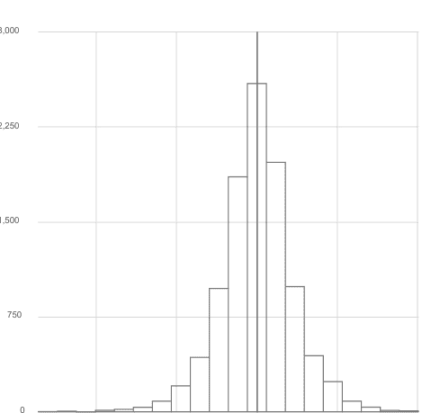

**图 14.1：** 德尔塔对冲的盈亏直方图，包含 100 个时间步长和 100,000 个情景。

通过增强我们的 `HedgingSimulator`，可以看到布莱克-舒尔斯模型的其他假设如何影响其结论。例如，如果考虑交易成本会发生什么？如果利率不是常数会发生什么？如果交易者对波动率的看法不正确会发生什么？这些有趣的问题被作为练习提出。其中一些练习特别有趣，因为它们将要求你开发新的类层次结构来回答它们。

## 练习

- 14.4.1. 计算德尔塔对冲策略盈亏的平均绝对值。生成一个双对数图，显示盈亏的平均绝对值与交易者重新对冲的时间点数量之间的关系。
- 14.4.2. 为什么我们在模拟器中调用 `generatePricePath` 而不是 `generateRiskNeutralPricePath`？
- 14.4.3. 如果存在买卖价差（bid–ask spread）会发生什么？卖价（ask price）是你必须支付以购买资产的费用。买价（bid price）是你出售资产时收到的金额。在现实中，这些价格是不同的，其差异被称为买卖价差。

在这个问题中，你应该像以前一样使用过程 `$S_{t}$` 来模拟购买 1 单位股票所需的价格，但你应该将出售 1 单位股票所得到的价格模拟为 `$p S_{t}$`，其中 `$p$` 是某个满足 `$0 \leq p \leq 1$` 的固定比例。公式 `(14.2)` 需要如何修改才能考虑这种买卖价差？修改对冲模拟器，使其可以通过一个参数 `$p$` 进行配置，该参数决定买卖价差。重复练习 14.4.1，但包含一个 `$p = 0.001$` 的买卖价差。

我们在 `HedgingSimulator` 中添加了一个成员变量 `bidProportion`，并创建了一个函数 `computePrice`，该函数计算在考虑固定买卖价差的情况下买入和卖出股票时的支付金额/接收金额。然后，`simulate` 函数在计算买入和卖出股票产生的现金流时使用这个 `computePrice` 函数。

- 14.4.4. 如果 `HedgingSimulator` 能够模拟德尔塔对冲看跌期权就好了。

第一步是在 `ContinuousTimeBaseOption` 中添加一个函数 `delta`。提供默认实现有两种合理的方法。懒惰的选项是简单地抛出异常，说明没有默认实现。通过更多的努力，你可以使用练习 9.3.5 中描述的蒙特卡洛方法。无论如何，你还应该为 `PutOption` 提供一个专门的实现，该实现使用以下公式：

$$\Delta = N(d_{1}) - 1$$

这对欧式看跌期权成立。$N$ 和 $d_{1}$ 的定义如公式 `(A.6)` 所示。

完成这一步后，你会如何修改 `HedgingSimulator` 以便可以模拟对冲看跌期权？编写一个测试来检查你的解决方案是否正确。

- 14.4.5. 如果交易者猜错了会发生什么？股价实际遵循的路径可能根本不符合几何布朗运动，或者它可能遵循几何布朗运动但具有不同的波动率。

引入一个新的接口 `StockPriceModel`，该接口可用于在 $\mathbb{P}$ 测度下生成股价。你应该确保 `BlackScholesModel` 实现了该接口。提供 `StockPriceModel` 的另一种实现，称为 `TwoLevelModel`，它类似于布莱克-舒尔斯模型，只是波动率 sigma 取两个不同的值。在时间 $T/2$ 之前，波动率应等于某个值 $\sigma_1$，在随后的时间它应等于 $\sigma_2$。

你会如何修改 `HedgingSimulator` 以便它能够适应不同的模型？

- 14.4.6. 考虑如果遵循除德尔塔对冲以外的对冲策略，盈亏会是多少，这是很有趣的。创建一个名为 `Strategy` 的接口，该接口提供函数来选择向客户收取多少费用，并决定在每个时刻持有多少股票。

你应该提供 `Strategy` 接口的四种实现。

- (i) 类 `BondsOnlyStrategy` 应模拟一个决定收取布莱克-舒尔斯价格并将所有钱放入无风险账户的交易者。他们从不进行对冲。
- (ii) 类 `StockOnlyStrategy` 应模拟一个决定收取布莱克-舒尔斯价格并将所有钱放入股票的交易者。他们从不进行对冲。
- (iii) 类 `DeltaHedgingStrategy` 应模拟一个遵循德尔塔对冲策略的交易者。

修改 `HedgingSimulator`，以便你可以选择你的策略。在编写看跌期权时，绘制这些对冲策略结果的直方图，使用以下参数值集合：

- (i) $N = 100, \sigma = 0.5, \mu = 0.01, T = 1, S_0 = 1, K = 1, r = 0$。
- (ii) $N = 100, \sigma = 0.01, \mu = 0.5, T = 1, S_0 = 1, K = 1, r = 0$。

解释你的结果。

## 14.5 总结

我们开发了一个 C++ 交易模拟器，以测试德尔塔对冲策略的有效性。我们的结果提供了数值证据，证明附录 A 中的理论是正确的。

在练习中，我们展示了如何使用面向对象编程技术使我们的交易模拟器极具通用性。

# 第 15 章
## 调试和开发工具

我们的软件项目现在已经变得庞大和复杂。它仍然远不如银行实际的交易系统复杂，但它已经跨越了数千行代码和数十个文件。需要一些额外的开发工具来帮助我们高效工作这一点正变得显而易见。

由于开发工具并不标准化，我们无法详细描述如何使用所有你可能发现有用的不同开发工具。我们将重点介绍一种标准工具，称为“调试器”。调试器是任何 C++ 开发者工具包中必不可少的一部分。它的主要目的是让你快速定位代码中错误发生的位置。我们将说明如何使用 Windows 上标准的 Visual Studio 调试器和 Unix 上标准的 gdb 工具来帮助查找代码中的 bug。其他调试器的工作方式大致相似，但你需要查阅它们的文档以获取更多详细信息。

为了展示如何使用调试器查找 bug，FMLib15 可以编译但不能正确工作。我们将展示如何找到故意引入的 bug。

调试器绝不是你应该使用的唯一开发工具。我们将以描述一些其他开发工具结束本章，你可能想使用这些工具来提高生产力。我们还将讨论一些重要的软件开发最佳实践，这些实践对于处理大型软件项目至关重要。

### 15.1 调试策略

在解释如何使用调试器之前，让我们描述一些你可以用来调试代码的策略和技术。

#### 15.1.1 单元测试

你的代码应该包含大量的单元测试。单元测试是你拥有的最有价值的调试工具。

这意味着，每当引入一个 bug 时，你的测试应该会

#### 15.1.1 让你的代码做正确的事

迅速告知你。这一点非常重要，因为在你编写代码后不久修复bug要容易得多。你可能会发现，几个小时过去后，你甚至很难准确记住自己做了哪些代码更改。这显然会使调试变得更加困难。为了帮助解决这一问题，编写大量的单元测试并确保每次更改代码时都运行所有测试（参见第15.4.5节）。

单元测试不仅告诉你哪些代码部分当前不起作用，同样重要的是它还告诉你哪些代码部分是正常工作的。如果你有百万行代码，知道哪些代码部分需要关注是极其重要的。

每当发现代码中有一个未被单元测试捕获的bug时，你就应该编写一个单元测试以确保它永远不会再次发生。除非你也为它编写测试，否则永远不要编写新代码。

> **提示：写一点，测一点。**

不要在一次会话中编写大量代码。编写少量代码。编写一些测试。确保一切编译通过且所有测试成功。然后通过你的版本控制系统备份代码（参见第15.4.1节）。这样，当发生错误时，你应该有一个清晰的概念，知道你可能正在做的哪些事情导致了该问题。

### 15.1.2 阅读你的代码

通常，发现代码中bug的最快方法是通读代码。这种方法只有在你知道哪个函数包含错误时才有效，因为你不可能在每次发生bug时都重新阅读所有代码。然而，如果你遵循“写一点，测一点”的策略，你通常可以猜到bug就在你刚刚编写的代码中。

向别人解释你的代码往往会有所帮助。一种非常有效的开发实践是与同事一起编写代码。这被称为结对编程 [1]。你会发现你和同事都能从彼此那里学到东西，并且在代码执行之前就会发现许多bug。

有些人建议一种称为代码审查（code-review）的替代实践，开发者阅读并评论彼此的代码。据称，正如文献 [1] 中所讨论的，这比结对编程令人愉快程度低得多，且效率也低得多。

### 15.1.3 日志语句

你可能已经自己发现了在代码中插入日志语句的策略。通过打印每一行中不同变量的值，通常可以很快找出问题所在。

你可能会发现，随着bug被发现和修复，你经常需要在代码中插入和删除日志语句。我们测试框架中的 `DEBUG_PRINT` 宏旨在帮助解决这一问题，因为它允许你切换调试的开启和关闭，而无需实际删除这些行。有关其他日志框架的简要讨论，请参见第15.4.6节。

### 15.1.4 使用调试器

C++ 运行时产生的错误信息可能毫无帮助。有时程序会崩溃，但不提供任何关于问题在代码中发生位置的线索。

*调试器* 是一种有助于缓解这一问题的工具。

回想一下，编译器将你的 C++ 代码转换为机器代码。在这个过程中，代码从你编写并理解的东西变成了你没写且无法理解的东西。这是一个严重的问题。为了解决这个问题，你可以使用额外的调试信息编译代码，从而将你的源代码与正在执行的机器代码关联起来。

如果你使用必要的调试信息编译了程序，就可以在调试器内运行你的程序。调试器将允许你逐行执行代码以查看发生了什么。它还将机器代码与你的源代码进行转换，以便你可以理解正在发生的事情。此外，你可以告诉调试器在检测到错误时暂停执行。这允许你收集有关错误原因的详细信息。我们将在第15.2节中描述如何在 Windows 上使用 Visual Studio 调试器，在第15.3节中描述如何在 Unix 上使用 GDB 调试器。其他调试器的工作方式类似。你应该查阅它们的文档。

### 15.1.5 分治法

如果你有一个难以修复的bug，了解以下调试代码的算法可能非常有用。

- (i) 通过考虑哪些单元测试通过，哪些失败，决定代码的哪个区域包含错误。
- (ii) 考虑如何包含bug的代码分割成两个大致相等的部分。你可以运行哪些测试来确定这两个部分中哪一个实际包含错误？
- (iii) 编写测试。重复此过程，直到你修复了bug。

重要的一点是，不应该查看并阅读你所有的代码。这种方法非常耗时且不太可能奏效。相反，这种方法采用*分治*策略。在每一步中，我们将问题规模减半。

为了看到差异，想象你的程序包含一百万行代码。通读代码显然需要一百万步。老实说，你会睡着并漏掉bug。分治策略可能需要在找到问题之前编写 $\log_2(1000000) \approx$ 20 个测试。这显然要好得多。它的额外优势在于，随着你的工作，你的测试套件规模会增加。这意味着下次发生bug时，你应该能够更快地找到它。

# 15.2 使用 Visual Studio 进行调试

本节描述了如何使用 Visual Studio 内置的调试器。如果你使用 Unix 上的命令行工具进行开发，则应该阅读第15.3节。

如果你使用的是其他调试器，你应该查阅其文档以了解调试代码的具体细节。尽管如此，本节对于了解调试时需要关注的关键事项可能对你有用。

在 Visual Studio 中调试代码时，你应该从工具栏上的下拉菜单中选择“Debug”。这个下拉菜单提供了编译和运行软件“Debug”或“Release”版本的选项。顾名思义，Debug 版本对于开发目的非常有用。Release 版本消除了大部分有助于调试的代码，结果是软件运行速度快得多。

在启动调试器之前，你应该配置调试器，使其在我们代码抛出异常时暂停程序执行。为此，请从主菜单中选择 Debug → Exceptions… 。然后单击复选框，指示调试器在抛出 C++ 异常时应暂停执行。

现在，你可以通过按 F5 在调试器中编译并运行程序。如果你以这种方式编译和运行 FMLib，将会发生错误，并且程序执行将暂停。重要的是要知道，当你按 F5 启动调试器时，Visual Studio 将作为调试器而非编译器运行，直到你的程序退出。这意味着在程序停止之前，你不应该尝试编辑或编译代码。如果你想在任何时间点停止调试，请按 Shift + F5 或从主菜单中选择 Debug → Stop debugging 。然而，我们暂时不想停止调试。相反，让我们阅读错误信息并使用调试器。

### 15.2.1 在 Visual Studio 中获取调用堆栈

你会看到类似图15.1所示的错误消息。该错误消息告诉你，错误是在文件 vector 的第1201行检测到的。文件 `vector` 是 C++ 库的一部分，因此我们可以确信 bug 并没有实际*发生*在 `vector` 类中，而是被 `vector` 类*检测到*。一个有用的经验法则是，如果发生错误，出错的是你的代码，而不是你正在使用的库。

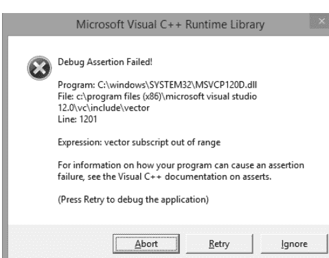

**图15.1：** 在 Windows 上生成的断言失败消息。

如果你点击 **Retry**，会出现另一个窗口，询问你是要中断还是继续。“中断”（To break）意味着简单地暂停你的代码执行，以便你可以在调试器中查看它。这正是我们要做的，所以选择 **Break**。

你的程序执行现在已暂停，你可以使用 Visual Studio 找出导致错误的原因。显示中最有趣的部分是一个标记为 **Call Stack**（调用堆栈）的窗口。它应该看起来像图15.2所示。


**图15.2：** FMLib 中第一个 bug 时的调用堆栈。

调用堆栈显示了哪些函数正在执行。调用堆栈的倒数第二行告诉我们，函数 `main` 正在执行。它目前位于第44行，此时它调用了 `testHedgingSimulator`。你可以看到

因为这位于调用栈的倒数第三行。函数 `testHedgingSimulator` 调用了 `testDeltaHedgingMeanPayoff`。以此类推，我们可以看到所有在检测到错误时尚未完成处理的函数。

调用栈的最顶端以灰色显示。这是因为这些代码行没有可用的调试信息。原因是这些代码位于一个未在调试模式下编译的库中，具体来说是 `vector` 库。

分析堆栈跟踪最有效的方式是从上到下。你应该沿着调用栈向下查找，直到看到一些你自己编写的代码。那里就是 bug 最可能发生的位置。在这种情况下，它是 `HedgingSimulator` 中 `runSimulation` 函数的第 64 行。

如果你在调用栈中双击相关行，它会为你展示该行代码以便检查。

```cpp
double S = pricePath[nSteps];
```

通过查看邻近的代码，问题的原因应该相当明显。我们试图访问 `pricePath` 中索引为 `nSteps` 的元素，但实际上价格路径的长度只有 `nSteps`。我们可以看到代码实际上应该写成：

```cpp
double S = pricePath[nSteps - 1];
```

要修复这个问题，首先通过按 Shift + F5 停止调试器。然后更正代码并按 F5 再次运行。你会发现现在出现了另一个错误。这是因为我们在 FMLib 中修复了第一个 bug，但还有两个 bug 需要找到。

### 15.5.2 在 Visual Studio 中设置断点和单步执行

在调试器暂停程序于我们的第二个 bug 之前，控制台窗口中出现的打印输出应类似于以下内容：

```text
Calling testDeltaHedgingMeanPayoff()
ASSERTION FAILED
Expected -5.90148e+300
Actual 0
hedgingsimulator.cpp:106:
```

除了最后一行，所有这些打印输出都是由我们的测试库生成的。它告诉我们，`ASSERT_APPROX_EQUAL` 语句在 `HedgingSimulator.cpp` 的第 106 行失败了。

如果我们在文本编辑器中查看那段代码，我们会发现运行 `testDeltaHedgingMeanPayoff` 时出现了问题。

```cpp
static void testDeltaHedgingMeanPayoff() {
  rng("default");
  HedgingSimulator simulator;
  simulator.setNSteps(1000);
  vector<double> result
      = simulator.runSimulations(1);
  ASSERT_APPROX_EQUAL(result[0], 0.0, 0.01);
}
```

我们可以看到，我们期望对冲模拟的损益（PnL）大约为零，但实际上是一个大得荒谬的数字 $-5.90148 \times 10^{300}$。显然，`HedgingSimulator` 类中的 `runSimulations` 函数存在数学错误。在这种情况下，如果你使用调试器在此处中断执行并查看调用栈，你会发现它并没有揭示任何我们之前无法推断出的信息。

为了取得进一步进展，首先要做的是阅读 `runSimulations` 代码，看看是否有明显的问题。代码如下：

```cpp
std::vector<double>
HedgingSimulator::runSimulations(int nSimulations)
const {
    std::vector<double> ret(nSimulations);
    for (int i = 0; i < nSimulations; i++) {


```cpp
ret[i] = runSimulation();
}

return ret;

}
```

这段代码中没有实际的数学计算，所以问题似乎不在此处。猜测 `runSimulation` 方法有问题是个合理的假设。你可以在第 265 页的图 15.4 中看到该方法的代码。

即使你逐行阅读代码，你可能也会发现很难在这个代码中找到 bug。调试器可以通过允许你在任何点暂停执行并打印出你感兴趣的任何变量的值来帮助你。

为此，你应该退出调试器。在重启之前，我们插入一个新的“断点”。这仅仅是一个我们希望调试器暂停程序执行的地方，以便我们可以查看正在发生的事情。

你应该打开文件 `HedgingSimulator.cpp`，并点击窗口右侧边缘，靠近 `HedgingSimulator` 开始的第 39 行处。你需要点击图 15.3 中显示球体的边缘位置。如果在正确的位置点击，会出现一个代表断点的红色球体。

创建断点后，当你按下 **F5** 再次运行代码时，调试器将在断点处暂停执行。

现在，你可以通过按下 **F10** 来逐行跟踪代码中正在发生的事情。你可以在菜单中找到此命令：**Debug** → **Step Over**。

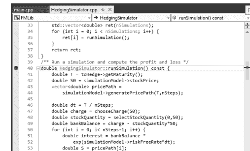

图 15.3：插入断点。断点以源代码边缘的球体显示。你可以看到第 40 行的球体。点击边缘以添加和删除断点。

每次按下 `F10` 时，下一行代码将执行。你可以通过查看显示区域中标记为 `Locals` 的部分来观察局部变量值的变化。

如果你逐行执行代码，你应该能够看到利息计算是不正确的。找到问题后，你应该停止调试器并重新测试代码，直到 `testDeltaHedgingMeanPayoff` 通过。

完成这些后，代码中仍将保留一个故意留下的 bug。修复它留作练习。

## 15.3 使用 GDB 进行调试

`GDB`（Gnu 调试器）是一个免费的调试器，是 Unix 系统上使用的标准调试器。如果你在 Windows 上工作，应该跳过这一节，阅读第 15.4 节。

`GDB` 有一个命令行界面，对用户不太友好。实际上，如果你在 Unix 上开发 C++，你可能需要考虑使用某种形式的“GDB 前端”来使其更容易使用。例如，你可以将 `GDB` 与 `vim` 和 `emacs` 等流行文本编辑器集成。也有可用的集成开发环境，如 `Eclipse`。然而，我们将只讨论如何从命令行使用 `GDB`。

要使用 `GDB`，你必须做的第一件事是确保使用 `gcc` 的调试选项编译了你的代码。如果你使用的是我们的标准 `Makefile`，这将自动完成。`Makefile` 中的 `CFLAGS` 变量为此使用了 `-g` 和 `-D_GLIBCXX_DEBUG` 标志。如果你不关心调试，而是希望代码运行得尽可能快，你应该移除这些选项并替换为适当的优化选项。

### 15.3.1 使用 GDB 获取堆栈跟踪

`GDB` 最重要的用途是找到包含错误的代码行。`FMLib15` 包含一些故意的 bug。让我们看看如何使用 `GDB` 快速找到第一个 bug 的原因。

编译 `FMLib15` 后，你应该通过在 Unix shell 中输入以下命令在调试器中运行它。

```bash
gdb FMLib
```

注意，我们假设 `gdb` 在你的路径上，且当前工作目录包含 `FMLib15`。

`GDB` 将启动到一个状态，你可以输入命令来告诉 `GDB` 你希望它在此调试会话中如何表现。例如，你可能想输入命令让它暂停程序执行到特定行，或在特定错误发生时暂停执行。输入这些命令后，你将输入命令 `run`，你的程序将在调试器中执行。

我建议在输入 `run` 命令执行之前，至少给调试器以下指令：

1. 告诉调试器，如果任何代码调用终止 C++ 程序执行的 `abort` 函数时，暂停执行。通过输入以下内容做到这一点：

```bash
break abort
```

2. 告诉调试器，如果执行 `throw` 语句时，暂停执行。通过输入以下内容做到这一点：

```bash
catch throw
```

除了在这些事件发生之一时暂停外，当代码中出现某些错误时，`GDB` 也会暂停。例如，如果你试图访问程序没有访问权限的内存，会发生段错误。当这种情况发生时，`GDB` 会自动暂停，无需你进一步配置 `GDB`。

输入上述命令后，键入 `run`。这将执行 `FMLib` 直到发现第一个 bug 的位置。执行将在此时暂停。

以下是使用 `gdb` 在我的计算机上运行 `FMLib` 时出现的打印输出的末尾：

## 15.3.2 使用 GDB 设置断点和单步调试

```
Calling testPutCallParity()
testPutCallParity() passed.
Calling testDeltaHedgingMeanPayoff()
/usr/lib/gcc/x86_64-pc-cygwin/5.3.0/include/c++/debug/vector
        :406:error:
        attempt to subscript container with out-of-bounds index
        1000, but
        container only holds 1000 elements.
Objects involved in the operation:
sequence "this" @ 0x0xffffc7a0 {
    type = NSt7__debug6vectorIsAIdEEE;
}
Breakpoint 1, 0x000000018012c574 in abort () from /usr/bin/
cygwin1.dll
(gdb) backtrace
#0  0x000000018012c574 in abort () from /usr/bin/cygwin1.dll
```

前三行是由 `FMLib` 本身打印输出的。它们告诉我们函数 `testPutCallParity` 运行正常。但在函数 `testDeltaHedgingMeanPayoff` 中发生了一个问题。要看出这一点，只需注意我们有一条日志语句说 `testPutCallParity` 已通过，但没有针对 `testDeltaHedgingMeanPayoff` 的对应语句。

下一个错误告诉我们，错误是在名为 `vector` 的 C++ 文件的 `406` 行检测到的。这并不意味着 bug 在 `vector` 文件中，只是说它在那里被检测到。由于 `vector` 是标准 C++ 库的一部分，它包含 bug 的可能性极低。我们可以猜测，是我们自己的代码在使用有问题的 `vector`。

接下来的几行极难解释，对我们目前来说也没太大用处。让我们忽略它们，继续看最后一行。这告诉我们执行已停止在 `Breakpoint 1`。这意味着它是由于我们之前输入的命令 `break abort` 而停止的。有帮助的是，最后一行提到它停止在函数 `abort()` 中。不太有帮助的是，该行还告诉我们要哪个库包含 `abort` 函数及其内存地址。

要了解正在发生的事情，请输入命令

```
backtrace
```

该命令告诉调试器打印当前堆栈的状态。这只是一个列出当前正在运行哪些函数的列表。在堆栈的底部，你会看到程序的 `main` 方法；在顶部，你看到的是正在执行的当前函数。以下是 `backtrace` 在我的计算机上运行时的打印输出。

```
#0  0x000000018012c574 in abort () from /usr/bin/cygwin1.dll
#1  0x00000003f508a005 in cygstdc++-6!
_ZNK11__gnu_debug16_Error_formatter8_M_errorEv () from /usr/
bin/cygstdc++-6.dll
#2  0x00000001004246be in std::__debug::vector<double, std:::
allocator<double> >::operator[] (this=0xffffca0, __n=1000)
at /usr/lib/gcc/x86_64-pc-cygwin/5.3.0/include/c++/debug/
vector:406
#3  0x000000010041650f in HedgingSimulator::runSimulation (this
=0xffffcac0)
at HedgingSimulator.cpp:64
#4  0x0000000100416289 in HedgingSimulator::runSimulations (this
=0xffffcac0,
nsimulations=1) at HedgingSimulator.cpp:35
#5  0x0000000100416770 in testDeltaHedgingMeanPayoff ()
at HedgingSimulator.cpp:105
#6  0x0000000100416bd3 in testHedgingSimulator () at
HedgingSimulator.cpp:118
#7  0x0000000100402466 in main () at main.cpp:43
```

最后一行告诉我们，当执行 `main` 函数时发生了错误。错误实际上是在执行 `main.cpp` 的第 43 行时发生的。你可以从 `main.cpp:43` 的文本中看出这一点。

看倒数第二行，我们可以看到该行必须调用了 `testHedgingSimulator`。后者又调用了 `testDeltaHedgingMeanPayoff`。通过这种方式遍历堆栈，你可以看到所有当前正在执行的函数。

一般来说，堆栈的底部不会揭示太多关于问题成因的信息。要分析 bug，你应该从顶部开始向下查找，直到到达你编写的第一行代码。

在上面的例子中，第 #0 行是对函数 `abort()` 的调用。第 #1 行很难解释，但我们可以说的是，它不指涉我们编写的任何代码。第 #2 行正在执行 `vector` 的第 406 行。最后，在第 #3 行，我们到达了一些我们自己编写的代码。是 `HedgingSimulator.cpp` 的第 64 行包含问题。

让我们看看那行代码。

```
double S = pricePath[nSteps];
```

如果你查看相邻的代码，问题的原因应该相当明显。我们正在访问 `pricePath` 中索引为 `nSteps` 的元素，但实际上价格路径长度仅为 `nSteps`。我们可以看到代码实际上应该写成：

```
double S = pricePath[nSteps - 1];
```

既然我们知道如何修复这个 bug，我们应该结束调试会话。输入 `quit` 退出调试器。然后你可以终止正在运行的进程并退出调试器。

现在你应该修正代码，重新编译，并在调试器中再次运行它。代码仍然会失败，但堆栈跟踪应该会有所不同，表明 bug 在其他地方。

在调试器暂停程序之前的打印输出现在应该如下所示：

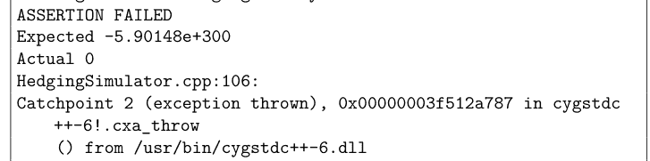

除了最后一行外，所有打印输出都是由我们的测试库生成的。它告诉我们 `HedgingSimulator.cpp` 第 106 行处的一个 `ASSERT_APPROX_EQUAL` 语句已失败。

如果我们在文本编辑器中查看该代码，我们会发现在运行 `testDeltaHedgingMeanPayoff` 时出现了问题。

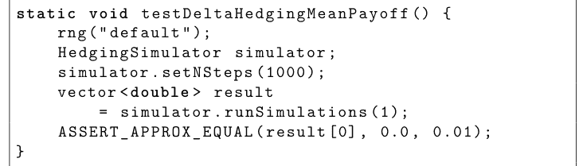

我们可以看到，我们期望对冲模拟的损益（PnL）大约为零，但实际上它是一个荒谬的大数 $-5.90148 \times 10^{300}$。显然，我们的 `HedgingSimulator` 类中的 `runSimulations` 函数存在数学错误。不幸的是，在这种情况下，如果在 `gdb` 中运行 `backtrace` 命令，它不会提供太多额外信息。

为了进一步取得进展，首先要做的是通读 `runSimulations` 代码，看看是否有明显的问题。以下是代码：

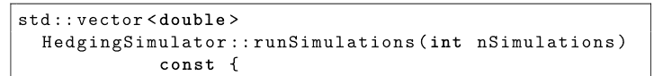

```
std::vector<double> ret(nSimulations);
for (int i = 0; i < nSimulations; i++) {
    ret[i] = runSimulation();
}
return ret;
```

这段代码中没有实际的数学计算，所以这似乎不太可能是问题所在。看来 `runSimulation` 方法才是问题所在。你可以在第 265 页的图 15.4 中看到该方法的代码。

即使你逐行阅读，可能也很难发现这段代码中的 bug。调试器可以通过允许你在任何点暂停执行并打印你感兴趣的任何变量的值来帮助你。

为此，你应该退出调试器并重启。但这次在执行 `run` 命令之前输入命令

```
break HedgingSimulator::runSimulation
```

这将在 `runSimulation` 函数的开头暂停执行。

当程序暂停时，你会看到类似于以下输出。

```
Calling testDeltaHedgingMeanPayoff()
Breakpoint 5, HedgingSimulator::runSimulation (this=0xffffc920)
    at HedgingSimulator.cpp:41
41      double T = toHedge->getMaturity();
```

这表明执行已暂停在 `HedgingSimulator.cpp` 的第 41 行。给定的代码行尚未执行。要执行它，请输入 `next`。

这应该已经为局部变量 `T` 分配了一个值。要查看被分配的值，请输入 `print T`。

现在你可以逐行单步执行 `runSimulation` 函数，同时检查变量的值。你应该能够确认 `runSimulation` 函数中利息的计算存在问题，然后你可以修复它。

代码中仍剩下一个 bug。修复它留作练习。

### 15.3.3 其他命令和特性

让我们简要提及一些我们尚未涵盖的有用的 `GDB` 特性。

- 1. 可以使用命令 `help` 来查找其他有用命令的名称。
- 2. 命令 `step` 可用于跟踪代码进入其他函数的执行过程。相比之下，`next` 始终在单个函数内移动。
- 3. 你可以在主目录中创建一个名为 `.gdbinit` 的文件，其中包含在 `gdb` 启动时应始终执行的命令。下面显示了一个简单的示例文件，该文件可确保 `gdb` 在调用 `abort` 和 `throw` 语句时始终暂停：

```
set breakpoint pending on
break abort
catch throw
```


当然，`GDB` 还有许多其他有趣的特性，我们没有涵盖。你应该查阅文档。

## 15.4 其他开发工具和实践

调试器绝不是你应该使用的帮助开发和维护代码的唯一工具。在本节中，我们将简要回顾一些可用的重要类型的开发工具，你应该考虑使用它们。

### 15.4.1 版本控制

备份项目的源文件至关重要。如果我们丢失了项目的所有代码，那就是一场灾难！

源控制系统用于保留所有源文件的副本，以确保你永远不会丢失它们。此外，源控制系统具有一些对严肃软件开发至关重要的特性：

- (i) 你对每个文件所做更改的历史记录。这意味着如果你不小心引入了 bug，你始终应该有一个记录，说明代码之前的样子。
- (ii) 一种对特定版本的代码进行标记的系统。如果你曾经打算把软件的副本交给别人，你会想知道他们运行的是什么代码。通过标记每个版本的源代码，你可以确定你的用户实际运行的是哪些代码。
- (iii) 一种工具，使不同的开发人员能够协作处理同一个项目，甚至处理相同的文件，而不会相互干扰。通常开发人员

在代码的独立副本上进行开发，并定期`集成`其他开发者的更改。版本控制系统提供工具，可以自动合并文件，并生成报告以显示不同开发者代码副本之间的差异。

- iv) 工具，使你能够创建针对系统的补丁。开发者通常致力于添加新功能，但当出现错误时，他们需要在不测试所有新功能的情况下快速修复这些错误。
- v) 安全性，确保只有授权用户才能查看和编辑你的代码。

任何严肃的软件项目都会使用版本控制。你应该在项目中以某种形式使用版本控制，这样你至少拥有更改的完整历史记录，并定期备份。

一个流行且免费的版本控制系统名为 `Git`。它允许你使用 `GitHub` 和 `Bitbucket` 等服务将数据存储到云端。这样做的好处是，数据备份等问题将由这些服务代为处理。

令人尴尬的是，一些大型银行竟然忘记在项目中使用的版本控制！早在 2012 年，我就知道有一家主要银行拥有一个正在运行的系统，但他们丢失了源代码，因此无法修改或理解该系统。除了令人尴尬外，这也是一种巨大的运营风险。如果发生错误，银行该怎么办？

### 15.4.2 错误跟踪

当在任何实际系统中发生错误时，应在错误跟踪数据库中记录下来。除了记录错误，你还应记录增强软件的请求。

错误跟踪系统会记录系统中的错误、修复时间、测试人员等信息。

在简单项目中，人们可能认为应在发现错误时立即修复，但实践中这并非总是可行。例如，发生在客户计算机上的错误可能难以复现，在这种情况下，你可能别无选择，只能记录详细信息并表示将密切关注该问题。

对于大型系统，记录错误的工具是必不可少的。特别是，它允许你确定工作优先级，并专注于最紧迫的问题。错误数据库对于保持客户满意也是必不可少的。客户可以使用它来记录投诉并监控你修复他们问题的进度。

### 15.4.3 测试框架

在本书中，我们强调了测试代码的重要性。

我们介绍了一个用于单元测试代码的简单测试框架。在实践中，你可能需要考虑使用更复杂的测试框架。例如，你可能希望使用与调试器紧密集成的测试框架，这样每当发生错误时，你就可以跳转到正确的代码行。另一个有用的功能可能是在线报告，显示在任何给定时刻运行了多少测试以及通过和失败的情况。

你可以考虑的一些测试框架包括 `Unit Test++`、`Boost` 库的测试框架 `Boost.Test`，或 `Microsoft` 的 `Visual Studio` 单元测试框架。

### 15.4.4 自动化构建

应该能够使用单个命令构建、测试和部署所有代码。

在本书中，我们已经为你自动化了编译代码和运行测试的过程。

如果你使用 `Visual Studio`，我们展示了如何配置项目，以便通过按 `CTRL+F5` 进行编译和运行。如果你在 Unix 上工作，可以通过输入 `make` 来构建项目，然后输入项目名称来执行它。

在处理大型项目时，你应确保维持相似的简洁性水平。对于大型项目，这并不那么直接，因为它们通常被划分为多个库。你将希望确保可以单独构建每个库或一次性构建所有库。你将希望能够构建代码以运行于你的代码所在的所有操作系统。你将希望能够构建代码的调试版本和发布版本。此外，你的一些代码实际上可能由你编写的其他程序自动生成。

然而，由于以下原因，拥有简单的流程至关重要。

- i) 从源代码重新创建你的软件应该是一个基本上自动化的过程。如果存在需要某人遵循的书面说明，那么就有这些说明未被正确遵循的风险，你将发布无法重新创建的软件。
- ii) 测试你的系统应该快速且简单。新接触你系统的开发者应该能够轻松地构建和测试它。如果测试你的系统很困难，你就不会经常测试它。这意味着它将充满错误。

在 Windows 上，`Visual Studio` 包含各种帮助自动化构建的工具。还有许多开源工具可以与任何操作系统一起使用，例如 `make`、`Boost build`、`cmake` 和 `Ant`。

### 15.4.5 持续集成

持续集成是一种开发实践，其中参与软件项目的每个人都定期（通常每天多次）将他们自己的代码与其他开发者的工作集成在一起。这样做的优点是，由不同人之间工作交互引起的任何问题都能尽早被发现。即使只过了几个小时，要记住你如何改变了软件也很难，因此如果你不定期集成，合并代码可能会变得非常具有挑战性。

为了使持续集成发挥作用，必须拥有一个完全自动化的构建，并在每次进行更改时运行。为此，你可以使用持续集成服务器。持续集成服务器将：

- 检查你的版本控制系统，查看何时进行更改；
- 自动运行构建；
- 如果构建停止工作，则发送邮件，说明是谁的更改导致了这种情况。

即使对于正在独自开发项目的开发者，拥有一个每次进行更改时都检查所有代码是否正常的系统也非常有用。在你引入错误时就发现它们要好得多。

### 15.4.6 日志记录

日志语句是理解代码中发生什么的一种非常有用方式。然而，如果你有太多日志语句，就很难看清全貌。此外，过多的日志确实会大大减慢程序速度。

在代码中使用大量日志语句是一个好主意，但要有一些机制来增加或减少程序运行时的日志量。除了能够记录在开发代码过程中发生的情况日志外，在代码每次运行时记录代码正在做什么的某种日志也是一个好主意。这样，如果有人发现错误，他们可以发送日志文件给你，帮助你开始调试。

一个非常有用的功能是能够点击日志文件中的一行，然后跳转到源代码中的那一行。许多文本编辑器和集成开发环境都能做到这一点，只要你就使用你的环境理解的格式输出错误消息即可。你应该查阅你选定的开发环境的文档。

你可以用来执行日志记录的工具包括 `Boost` 库的 `Boost.Log` 和 `Apache` 的 `log4cxx`。

### 15.4.7 静态分析

许多可以在 `C++` 代码中自动检测到的错误。

我们使用的构建配置除了 `C++` 所要求的检查外，还对我们代码执行一些额外的检查。

特别是，我们配置了构建，以便如果存在编译器警告则构建失败。我们还设置了警告级别，以便许多常见的 `C++` 错误能被自动捕获。

查找代码中错误的过程称为`静态分析`。相比之下，`动态分析`将检查代码实际运行时发生什么。

你可能希望使用比我们在本书中使用的更多静态分析。可以要求编译器执行比我们所做的更高水平的静态分析。危险在于编译器会发现一些假阳性。换句话说，编译器可能拒绝接受你知道不包含任何错误的代码。当这种情况发生时，所有编译器都提供一种临时禁用警告的方法，以便你可以忽略这些假阳性。在实践中，使用更多警告并在必要时禁用警告是一个好主意。

例如，编写一个没有虚析构函数的类是有效的 `C++` 代码。因此，如果你省略了虚析构函数，编译器不会抱怨。然而，在实践中，如果你扩展了一个没有虚析构函数的类，你的代码很可能会包含内存泄漏。因此，如果你的编译器允许这样做，你应该要求它在扩展没有虚析构函数的类时发出警告。在你知道这不是问题的罕见情况下，你可以抑制该警告。

### 15.4.8 内存泄漏检测

使用普通单元测试很难检测内存泄漏。原因是内存泄漏通常只有在软件运行相当长的时间后才会成为问题。

好的 `C++` 单元测试框架应该能够通过检查每个测试前后使用的总内存是否保持相同来协助解决此问题。此外，有许多工具可以帮助你检测软件中的内存泄漏。

### 15.4.9 性能剖析工具

如果你的软件存在性能问题，那么`性能剖析`工具可以提供帮助。这些工具可以让你了解计算机在执行代码不同部分时花费了多少时间。这使你能够将改进性能的努力集中在实际导致问题的代码区域。

许多初学者程序员犯的一个错误是假设所有代码都是性能敏感的。这完全不是事实。如果你使用性能剖析工具，你会发现大部分（也许 99% 或更多）的 CPU 工作量是花在执行少数几个性能关键功能上。这意味着如果你

几乎任何其他函数的性能优化，你的努力都将白费！

在对代码进行任何严肃的优化尝试之前，建议你先对代码进行性能分析（profile）。

除非你的性能要求非常精确，否则你未必需要购买单独的软件来分析代码性能。一种简单的方法是执行那段较慢的代码，然后随机停止处理十次，并记录当时正在发生什么。你很可能发现，每次停止时代码做的事情都差不多。你可以安全地推断出性能问题就出在这里。

必须指出，这本书是关于编写高质量 `C++` 代码的，但并不是关于编写具有绝对最优性能的 `C++` 代码。对于大多数问题来说，代码能够正确执行比它以人类可能的最快速度执行要重要得多。大多数时候，为了代码的其他良好品质——如易于理解、阅读和扩展——而牺牲一些速度是值得的。

唐纳德·克努斯（Donald Knuth），图灵奖得主，著名的编程专家，曾名言：“过早优化是万恶之源”（Premature optimisation is the root of all evil）。

## 15.4.10 示例

这本书拥有一个复杂的构建流程。文本使用 `LaTeX` 编写，并引用了众多不同项目中的各种 `C++` 文件。每当这本书做出任何更改时，所有的 `C++` 代码都会经过编译，并在 Windows 和 Unix 上进行测试。此外，还有测试用于检查 `LaTeX` 文档中显示的所有代码是否与计算机项目中的 `C++` 代码相匹配。最后，将所有代码示例和文本放到网站上的过程完全是自动化的。

如果没有自动构建，这本书将布满（甚至更多）错误。所有代码都包含 bug，毫无疑问这本书也包含许多错误。尽管如此，自动构建确保了最严重的问题能被迅速消除。

## 练习

- 15.4.1. 找出并修复 `FMLib15` 中的所有 bug。
- 15.4.2. 尝试在调试信息关闭并替换为优化后的机器代码的情况下运行 `FMLib`。你可以在 `Visual Studio` 中通过从菜单栏选择 `Release` 选项来实现这一点。此外，对于专家而言，项目配置选项让你可以访问大量的配置参数，其中许多可用于调整性能。

在 Unix 上，你应该从 `Makefile` 中移除调试选项 `-g` 和 `-D_GLIBCXX_DEBUG`，并用 `-O` 代替以进行优化。然后你应该运行 `make clean`。每次你更改 `Make` 文件中的选项时，都应该运行 `make clean`。还有各种更复杂的优化选项可供使用。请参见 `gcc` 的文档。

这对程序运行的速度有多大影响？你可能需要更改 `testPlotDeltaHedding-Histogram` 中的步数，使代码运行得更慢，以便更容易看到差异。

## 15.5 总结

调试器是寻找代码错误所在的一个有用工具。调试器的两个重要用途是：

- 在错误发生时获取堆栈跟踪；
- 逐行单步执行代码，以查看正在发生的事情。

虽然调试器是一个有用的工具，但它不能替代单元测试。相反，它是一种互补的开发技术。

在编写软件时，你应该使用一些工具和技术。这些包括版本控制和 bug 数据库。调试和维护代码的技能至少与编写代码本身的技能同等重要。虽然我们并未试图深入探讨这些问题，但书 [5] 和 [1] 讨论了软件开发中超越简单编码的重要方面。

```cpp
double HedgingSimulator::runSimulation() const {
    double T = toHedge->getMaturity();
    double S0 = simulationModel->stockPrice;
    vector<double> pricePath = simulationModel->generatePricePath(T,nSteps);
    double dt = T / nSteps;
    double charge = chooseCharge(S0);
    double stockQuantity = selectStockQuantity(0,S0);
    double bankBalance = charge - stockQuantity*S0;
    for (int i = 0; i< nSteps-1; i++) {
        double interest = bankBalance * exp(simulationModel->riskFreeRate*dt);
        double S = pricePath[i];
        double date = dt*(i + 1);
        double newStockQuantity = selectStockQuantity(date, S);
        double costs = (newStockQuantity - stockQuantity)*S;
        bankBalance = bankBalance + interest - costs;
        stockQuantity = newStockQuantity;
    }
    double interest = bankBalance * exp(simulationModel->riskFreeRate*dt);
    double S = pricePath[nSteps];
    double stockValue = stockQuantity*S;
    double payout = toHedge->payoff(S);
    return bankBalance +interest +stockValue - payout;
}
```

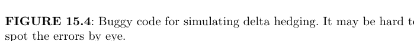


# 第 16 章 矩阵类

`C++` 没有内置的表示实数矩阵的类。我们将在本章中编写我们自己的类。

在编写 `Matrix` 类的过程中，我们将涵盖一些有趣的 `C++` 主题。具体包括：

- 构造器和析构器，
- 运算符重载，
- 三法则，
- 返回引用，
- 使用 `const` 进行重载。

## 16.1 Matrix 的基本功能

让我们开始设计矩阵类的基本行为。`Matrix` 类将存储一个双精度浮点数的二维数组，并具有以下数据成员（均为私有的）。

- (i) `int nrows`。行数。
- (ii) `int ncols`。列数。
- (iii) `double* data`。指向第一个单元格的指针。
- (iv) `double* endPointer`。指向最后一个单元格之后位置的指针。

指针 `data` 将指向一块长度为 $\text{nrows} \times \text{ncols}$ 的连续内存块。单元格 $(i, j)$ 将存储在位置 `data+(j*nRows)+i`。请注意，我们在最后这个表达式中使用了指针算术。

我们决定使用指针和 `new []` 运算符，而不是 `vector`，因为最终，如果你想要使用特殊的 CPU 优化（如我们将在 16.7 节中讨论的那样），你需要有一个指向数据的指针，而不仅仅是一个 `vector` 对象。此外，这使得这个 `Matrix` 类成为测试你指针编程技能的一个良好工具。

以下是 `Matrix` 数据成员的声明。

```cpp
private:
    /* The number of rows in the matrix */
    int nrows;
    /* The number of columns */
    int ncols;
    /* The data in the matrix */
    double* data;
    /* Pointer to one after the end of the data */
    double* endPointer;
```

我们的矩阵类允许用户读取行数和列数，但不能更改它们。因此，我们在头文件中添加了以下数据访问方法：

```cpp
    /* The number of rows in the matrix */
    int nRows() const {
        return nrows;
    }
    /* The number of columns in the matrix */
    int nCols() const {
        return ncols;
    }
```

这些方法是内联的——也就是说，我们在类声明内部写函数定义。由于我们将大量使用 `Matrix` 类，利用一些内联优化是很重要的。

我们已经指出，单元格 $(i,j)$ 的值存储在内存位置 `data + (j * nRows) + i`。让我们提供获取和设置函数，以便用户可以读取给定单元格的值并更改单元格的值。

```cpp
    /* Retrieve the value at the given index */
    double get( int i, int j ) const {
        return data[ offset( i, j ) ];
    }
    /* Set the value at the given index */
    void set( int i, int j, double value ) {
        data[ offset( i, j ) ] = value;
    }
```


这两个函数都利用了 `offset` 函数。该函数执行计算，确定单元格 `$(i,j)$` 相对于 `data` 指针在内存中的存储位置。

```c++
int offset( int i, int j ) const {
    ASSERT( i >=0 && i<nrows && j>=0 && j<ncols );
    return j*nrows + i;
}
```

你会注意到，此代码执行了一个 `ASSERT` 语句，用于检查坐标是否在矩阵范围内。这对调试非常有用，因为它能迅速发现许多错误。然而，如果你确信代码没有错误，为了获得最大速度，你希望确保该 `ASSERT` 语句永远不会被调用。我们的测试宏 `ASSERT` 的设计初衷是仅在调试模式下才被调用。

### 16.2 矩阵的构造函数和析构函数

`Matrix` 类最重要的构造函数声明如下：

```c++
Matrix( int nrows, int ncols, bool zeros=1 );
```

如我们将看到的，初始化 `Matrix` 的内容往往是一种徒劳的努力。另一方面，忘记初始化变量是一个常见的错误。出于这个原因，我们允许用户指定是否希望我们的 `Matrix` 初始化为零。默认情况下，它会被初始化为零。这可以防止意外的错误，同时允许在需要时对代码进行优化。

以下是我们构造函数的定义：

```c++
Matrix::Matrix( int nrows, int ncols, bool zeros )
: nrows( nrows ), ncols( ncols ) {
    int size = nrows*ncols;
    data = new double[size];
    endPointer = data+size;
    if (zeros) {
        // memset 是一个经过优化的底层函数
        // 通常比循环更快
        memset( data, 0, sizeof( double )*size );
    }
};
```

这是我们在构造函数中进行大量实质工作的第一个例子。最重要的特性是我们使用 `new[]` 创建内存存储。如果需要，我们随后使用 `memset` 将其初始化为零。

`memset` 是一个标准的 C 函数，可用于将大量数据初始化为相同的值。调用它可能比编写循环更快，因为 CPU 通常为此类重复任务拥有特殊的指令。我们将在第 16.7 节中详细讨论这个问题。

使用 `new[]` 运算符引发了一个问题。什么时候调用 `delete[]`？我们需要确保当我们的 `Matrix` 本身从内存中移除时，有人调用了 `delete[]`。

我们的 `Matrix` 会在以下情况下从内存中移除：

- (i) 如果 `Matrix` 是由 `new` 创建的，当调用 `delete` 时，它将从内存中移除。
- (ii) 如果 `Matrix` 是由 `new []` 创建的，当调用 `delete[]` 时，它将从内存中移除。
- (iii) 如果 `Matrix` 作为局部变量在栈上创建，当局部变量不再需要时（即，当它离开作用域时），它将从内存中移除。
- (iv) 如果 `Matrix` 是另一个对象的成员变量，当包含它的对象被删除时，这种情况会发生。

我们需要一个恰好在这些情况下被调用的函数。这就是析构函数。

要为你的类编写析构函数，必须遵守以下规则。

- (i) 析构函数的声明和定义与函数相同，除了...
- (ii) 它的名称必须与类名相同，但需添加波浪号 `~`。
- (iii) 它必须没有返回值（即使是 `void` 也不行）。
- (iv) 它必须没有参数。
- (v) 它必须不是 `const`。

以下是 `Matrix` 的析构函数。它是内联的，因此我们在头文件中既声明了它也定义了它。

```c++
~Matrix() {
    delete[] data;
}
```

你不必内联析构函数，如果偏好，你可以分别编写声明和定义，如下所示：

```c++
// 声明
class Matrix {
public:
    ...
    ~Matrix();
};

// 定义
Matrix::~Matrix() {
    delete[] data;
}
```

在使用析构函数时，你必须遵守某些规则。

**危险！**

你希望进行子类化的所有类都应该有一个虚析构函数。¹

**危险！**

只要你编写的析构函数不是空的虚析构函数，你就必须遵守*三法则*。我们将在第 16.5 节中详细讨论这一点。

你会注意到，我们的 `Matrix` 类没有 `virtual` 析构函数，因此你不应该对其进行子类化。同样的道理也适用于许多标准类。例如，无论多么诱人，你永远不应该子类化 `vector<double>`！

#### 16.2.1 虚析构函数

每个 C++ 类都有一个自动编写的析构函数。令人恼火的是，这个默认析构函数不是虚函数。如果你的析构函数不是 `virtual`，当有人试图通过基类指针 `delete` 子类时，可能会错误地调用析构函数，从而存在危险。

要看出这是如何发生的，回想一下 `CallOption` 是 `Priceable` 的子类。这意味着以下代码是有效的。

```c++
Priceable* option=new CallOption;
delete option;
```

这里我们使用指向 `Priceable` 的指针来删除一个 `CallOption`。如果 `Priceable` 没有虚析构函数，C++ 将不会如我们期望的那样调用 `CallOption` 的析构函数。

虽然你可能不太可能编写上面的代码，但你很可能会在一个 `shared_ptr<Priceable>` 中保存指向 `CallOption` 的指针。例如，我们的 `Portfolio` 类就是这样做的。`shared_ptr` 类只知道它持有一个 `Priceable` 引用，因此当它调用 `delete` 时，它调用的是定义在 `Priceable` 上的函数。

因此，如果你创建一个没有虚析构函数的类的子类，由 `shared_ptr` 使用导致的 `delete` 调用将会引发问题。

遗憾的是，在 C++ 中虚析构函数并不是默认选项。如果你给所有类都提供虚析构函数，你不会遇到太多麻烦。

拥有一些虚函数会使对象在汇编语言中稍微复杂一点。这是因为你需要同时在内存中携带对象的数据及其类型信息。因此，没有任何虚函数的类会比有的类略快一些。所以，如果你的类并非设计用于被子类化，没有虚析构函数会使其略微更快。对于大多数类来说，这种优化并不显著。

**提示：虚析构函数**

如果有疑虑，请给你的类提供一个虚析构函数。

#### 16.2.2 何时需要析构函数？

正如我们已多次指出的，每当你编写一个设计用于被继承的类时，你都需要编写一个虚析构函数。

但何时你需要编写一个更复杂的析构函数呢？

一种情况是每当你在构造函数中调用 `new` 或 `new[]` 而没有使用 `shared_ptr` 存储结果时。更一般地，当你在构造函数中获取资源，并必须在析构函数中释放该资源时，你应该编写一个析构函数。

“资源”这个词相当模糊，但以下是一些资源的例子：

- 一块内存；
- 阻止其他人写入文件的文件锁；
- 你已启动的一个打印作业；
- 到数据库的一个连接。

资源是你在使用完后必须显式归还给计算机的东西。

在数学代码中，使用资源是相当罕见的。所以大多数时候你根本不需要编写析构函数（除了空的虚析构函数）。特别是：

- 按值持有的成员变量会自动删除；
- 由 `shared_ptr` 持有的成员变量会自动删除。

这意味着，除非你忽视避免使用指针的建议，否则你很可能不需要编写析构函数，除非你试图与那些强制你手动管理资源的代码进行交互。在实践中，这意味着你只有在希望直接与 C 库交互时，才可能需要编写析构函数。

例如，如果我们没有决定将 `Matrix` 编写为使用原始指针，我们就不需要给它一个析构函数。

#### 16.2.3 额外的构造函数

到目前为止，我们只讨论了 `Matrix` 的一个构造函数。`Matrix` 类旨在真正有用，因此它具有其他几个构造函数：

- 一个创建包含数字零的 `$1 \times 1$` 矩阵的默认构造函数。
- 一个接受 `std::vector<double>` 并构建相应列向量的构造函数。它有一个可选的额外参数，如果你想要创建行向量，可以使用它。
- 一个接受单个标量并创建 `$1 \times 1$` 矩阵的构造函数。
- 一个接受描述矩阵内容的字符串的构造函数。

最后一个构造函数很有趣，不仅因为实现它很有挑战性，还因为它是一个值得模仿的有用设计模式。以下是如何使用字符串初始化矩阵的方法：

```c++
Matrix m("1,2,3;4,5,6");
ASSERT( m.nRows() ==2 );
ASSERT( m.nCols() ==3 );
```

这使得构建新的矩阵用于编写测试变得容易。让你的类能够轻松初始化和配置以便进行测试是个好主意。

另一种可用于使矩阵创建更容易的 C++ 特性是使用*初始化列表*。我们将在第 18.8 节中讨论这些。

我们没有展示这些额外的有趣构造函数所需的代码，因为它们不需要任何新的 C++ 语言特性。

虽然我们可能有许多构造函数，但该类只有一个析构函数。

---

¹ 一个挑剔者实际上会说，任何你可能希望通过指向基类的指针删除的类都应该有虚析构函数，否则虚析构函数并非必要。如果你遵循“所有打算被子类化的类都应该有虚析构函数”的建议，你将自动遵守此规则。

## 16.3 常量指针

`Matrix` 类拥有方法 `begin()` 和 `end()`，它们分别返回指向数据区域开头和结尾的指针。

```cpp
/*  获取指向第一个元素的指针  */
const double* begin() const {
    return data;
}
/*  获取指向最后一个元素之后元素的指针  */
const double* end() const {
    return endPointer;
}
/*  获取指向第一个元素的指针  */
double* begin() {
    return data;
}
/*  获取指向最后一个元素之后元素的指针  */
double* end() {
    return endPointer;
}
```

其中一些方法返回“常量指针”。回忆第 11 章的内容，你可以像使用引用那样，将 `const` 与指针一起使用。`const double*` p 意味着 p 指向一个 `double`，但你无法通过 p 修改变所指的值。因此，你可以将其视为与 `const` 引用非常相似。

我们的 `Matrix` 类有两个名为 `begin()` 的成员函数。对于 `const` `Matrix`，我们希望 `begin()` 返回指向数据的 `const` 指针。对于普通的 `Matrix`，我们希望 `begin()` 返回指向数据的普通指针。这将确保你无法通过获取 `Matrix` 内部数据的非 `const` 引用来绕过 `const` `Matrix` 的 `const` 特性。

为了确保 `begin` 函数返回正确类型的指针，我们需要两个 `begin` 函数。一个用于 `const` `Matrix`，另一个用于普通 `Matrix`。

在使用 `const` 时，通常需要进行此类额外的工作。不得不承认，这是那种你会怀疑自己是在为编译器工作而不是让编译器为你工作的场合之一。

## 16.4 运算符重载

### 16.4.1 重载 + 运算符

如果你可以创建两个矩阵并像这样将它们相加，那该多好啊？

```cpp
Matrix m1("1,2,3;4,5,6");
Matrix m2("2,3,4;5,6,7");
Matrix actual = m1 + m2;
Matrix expected("3,5,7;9,11,13");
expected.assertEquals( actual , 0.001 );
```

通过重载 `+` 运算符，我们可以让这段代码编译通过。事实上，我们可以重载几乎每一个 C++ 运算符，使 `matrix` 类更易于使用。

（顺便提一下，`assertEquals` 是 `Matrix` 上的一个辅助函数，用于检查两个矩阵在给定的容差范围内是否相等。）

运算符重载的主要挑战在于写出正确的函数声明。

要重载 `+` 运算符，首先注意到 `+` 运算符需要接受两个参数，这两个参数都是 `Matrix`。更准确地说，这些参数必须是 `Matrix` 的 `const` 引用。

其次，注意到 `+` 运算符本身将返回一个包含矩阵加法结果的 `Matrix`。

因此，要重载 `+` 运算符，我们需要编写一个函数，该函数使用给定的参数和返回类型执行必要的计算。这个函数唯一特殊的地方是它必须命名为 `operator+`。

以下是来自 `Matrix.h` 的函数声明。

```cpp
/* 将两个矩阵相加
   注意 - 这不是成员函数  */
Matrix operator+(const Matrix& x, const Matrix& y);
```

请注意，这是一个顶层函数，而不是 `Matrix` 的成员函数。在本章中，当我们为运算符重载定义函数时，我们会用注释明确标记那些是顶层函数的。所有成员函数都将不带注释。

定义相当直接：

```cpp
Matrix operator+(const Matrix& x, const Matrix& y) {
  ASSERT( x.nRows() == y.nRows() && x.nCols() == y.nCols());
  Matrix ret(x.nRows(), x.nCols(), 0 );
  ... // 函数的其余部分
    double* dest = ret.begin();
    const double* s1 = x.begin();
    const double* s2 = y.begin();
    const double* end = x.end();
    while (s1!=end) {
        *(dest++) = *(s1++) + *(s2++);
    }
    return ret;
}
```

你在理解这段代码时可能遇到的唯一问题是其非常典型的指针用法。传统上，C 程序员在处理内存时会编写像这样非常密集的代码。让我们尝试理解它。

首先，回忆 `*s1` 表示 `s1` 所指的值。

其次，注意 `*(s1++)` 意味着计算 `s1` 所指的值，然后递增 `s1`。

因此，以下代码：

```cpp
*(dest++) = *(s1++) + *(s2++);
```

意味着将 `s1` 和 `s2` 所指的值相加，并将值存储在 `dest` 中。然后，递增 `dest`、`s1` 和 `s2`。你觉得这段代码很难阅读吗？嗯，它可以写成更易于理解的形式：

```cpp
*(dest) = *(s1) + *(s2);
dest++;
s1++;
s2++;
```

但是，以非常密集（且不可读？）的形式编写指针代码是相当标准的。使用你喜欢的任何一种方式。

另一个额外的评论是，由于我们作为 `operator+` 的参数接收一个 `const Matrix`，我们必须使用 `const double*` 来存储 `begin()` 的返回值。从本章现在起，我们将让该章节中 `const` 指针的所有其他用法都无需评论地通过。

作为另一个例子，我们将希望实现标量加法。这将相同的标量加到矩阵的每个单元中。以下是声明：

```cpp
/* 将标量加到矩阵的每个元素上
 注意 - 这不是成员函数 */
Matrix operator+(const Matrix& m, double scalar );
```

以下是相应的实现。

```cpp
Matrix operator+(const Matrix& m, double scalar ) {
    Matrix ret(m.nRows(), m.nCols(), 0 );
    double* dest = ret.begin();
    const double* source = m.begin();
    const double* end = m.end();
    while (source!=end) {
        *(dest++) = *(source++) + scalar;
    }
    return ret;
}
```

事实上，我们也希望能够将矩阵加到标量上，因此我们还需要声明和定义这个版本的 `operator+`

```cpp
/* 将标量加到矩阵的每个元素上
    注意 - 这不是成员函数 */
inline Matrix operator+(double scalar,
                       const Matrix& m ) {
    return m+scalar;
}
```


实现运算符重载所需的所有功能可能耗时，但它可以使类变得非常易于使用。

### 16.4.2 重载其他算术运算符

我们不必止步于重载 `$+$`，你也可以重载其他运算符。重载 `$-$` 与重载 `$+$` 非常相似。重载 `$*$` 也是直接明了的，除了实现它有两种可能的选择这一事实。

关于如何重载 `$*$` 的选择是一个设计问题，而不是 C++ 语言本身的问题。对于 `$*$` 的含义，我们有两个选择：它是应该表示矩阵乘法还是逐元素乘法？

让我们定义这些术语。设 `$a_{ij}$` 是 `$m \times r$` 矩阵 `$a$` 的分量，`$b_{jk}$` 是 `$r \times n$` 矩阵 `$b$` 的分量。矩阵乘法的标准定义是乘积 `$ab$` 是一个 `$m \times n$` 矩阵，其分量为

$$
($ab$)_{ik}^{matrix} = \sum_{j=1}^{r} a_{ij}b_{jk}.
$$

另一种定义矩阵乘法形式的方法是，如果 `$a_{ij}$` 现在是一个 `$m \times n$` 矩阵，`$b_{ij}$` 也是一个 `$m \times n$` 矩阵，那么逐元素乘积也是一个 `$m \times n$` 矩阵，由下式给出：

$$
($ab$)_{ij}^{entrywise} = a_{ij}b_{ij}.
$$

这种运算有时也被称为 Hadamard 乘积或 Schur 乘积。

如果你的某个矩阵表示一个线性变换，矩阵乘法是有用的。

如果你的矩阵只是表示数据点的集合，并且你想对某些数据点的值进行乘法运算，那么逐元素乘法是有用的。

我们应该使用 `*` 来表示逐元素乘法还是矩阵乘法？这个问题没有正确的答案。这是个人口味问题。在 `FMLib16` 中，`Matrix` 有一个函数 `times`，所以 `a.times(b)` 表示逐元素乘法。我们将 `*` 保留给矩阵乘法。我们实际上没有在 `FMLib16` 中实现矩阵乘法，因为我们暂时不需要它。实现它作为练习留给读者。我们暂时不需要矩阵乘法的原因是我们希望存储在矩阵中的蒙特卡罗模拟的数据代表简单数据点。由于我们的矩阵不表示线性变换，普通的矩阵乘法并没有你想象的那么有用。

**提示：明智地使用运算符重载**

如果运用得当，运算符重载可以使代码更易读。运用不当，则会导致困惑。

C++ 在明智地使用运算符重载方面并没有良好的记录。例如，C++ 重载整数 `/` 运算符表示除法和向下取整。大多数人对此感到困惑。即使是经验丰富的程序员也可能被骗。类似地，C++ 重载 `^` 运算符表示按位异或，而大多数人可能期望它表示幂运算。更糟糕的是，符号 `*` 和 `&` 在 C++ 中有许多可能的含义。这些问题都为学习 C++ 增加了不必要的障碍。

相比之下，带有名称的函数可以使其含义立即可明。

### 16.4.3 重载比较运算符

重载 `>`, `>=`, `==`, `!=`, `<`, `<=` 很直接。这是一个典型的声明。它接受两个 `const` 引用，并返回一个由 0 和 1 组成的 `Matrix`。

```cpp
/* 比较运算符
   注意 - 这不是成员函数 */
Matrix operator>(const Matrix& x, const Matrix& s );
```

以下是使用该运算符的示例

```cpp
Matrix test1("1,2,3,4");
Matrix test2("3,3;3,3");
Matrix expected("0.0,0.0;1.0,1.0");
expected.assertEquals( test1>=test2, 0.001);
```

同样，我们为 `operator>` 有许多不同的定义，以处理矩阵与标量以及矩阵与矩阵的比较。

### 16.4.4 重载 << 运算符

众所周知，内置类型（如 `double`）可以使用 `<<` 运算符写入流中。我们希望 `Matrix` 对象也能如此简单地打印出来。这可以通过重载 `<<` 运算符来实现。以下是所需的声明：

```cpp
/* Write a matrix to a stream NB - not a member function */
std::ostream& operator<<(std::ostream& out,
                         const Matrix& m );
```

`operator<<` 总是将 `ostream` 作为其第一个输入参数。这是因为在 `<<` 的左侧始终有一个流。

第二个参数在这种情况下是 `Matrix`。这是因为这是我们希望打印的数据类型。

函数 `operator<<` 返回一个指向 `ostream` 的引用，我们可以继续对其进行更多写入。实际上，这始终是我们作为参数传入的同一个 `out` 流。

为了了解为什么返回相同的流是有用的，请考虑以下代码：

```cpp
cout << "To be " << "or not to be";
```

我们之前已经写过几次类似的代码。这段代码实际上等价于以下内容：

```cpp
(cout << "To be ") << "or not to be";
```

我们只是为了清晰起见添加了括号。现在你可以明白为什么 `operator<<` 返回一个流是有用的。我们返回的是一个流，准备再次应用 `<<` 运算符。

`operator<<` 的实现很简单。唯一需要注意的是我们返回 `out`。

```cpp
ostream& operator<<(ostream& out, const Matrix& m ) {
    int nRow = m.nRows();
    int nCol = m.nCols();
    out << "[";
    for (int i=0; i<nRow; i++) {
        for (int j=0; j<nCol; j++) {
            out << m(i,j);
            if (j!=nCol-1) {
                out << ",";
            }
        }
        if (i!=nRow-1) {
            out << ";";
        }
    }
    out << "]" << std::endl;
    out << "]";
    return out;
}
```

#### 16.4.4.1 关于引用返回的备注

我们已经看到 `operator<<` 通过引用返回一个值。到目前为止，我们一直避免引用返回。

只要你没有返回指向局部变量的引用，引用返回是可以接受的。引用返回节省了复制，因此比值返回更高效。因此，只要安全，就有理由使用引用返回。此外，当你不知道如何复制数据时（例如，对于像 `ostream` 这样的多态类），引用返回是唯一的选择。

返回引用的一个影响是，接收该引用的人可以使用该引用来修改其所指向的内容。因此，有时你可能希望返回一个 `const` 引用，而不是一个简单的引用。

正如我们将在下一个小节中看到的那样，有时我们使用引用返回，恰恰是因为它允许调用者修改引用所指向的内容。

### 16.4.5 重载 ( ) 运算符

我们希望能够像修改 `vector` 的单元格一样轻松地修改 `Matrix` 的单元格。为了实现这一点，我们可以重载 `()` 运算符，以便你可以输入如 `m(1,2)` 这样的表达式来访问矩阵 `m` 中指定的行和列。以下是我们希望如何使用 `()` 运算符的一个示例：

```cpp
Matrix m("1,2,3;4,5,6");
ASSERT( m(1,2)==6 ); // read a value
m(1,2)=0; // change the value
```

当你重载 `()` 运算符时，必须编写成员函数，而不是顶层函数。以下是重载 `Matrix` 类中 `()` 运算符所需的定义：

```cpp
double& operator() (int i, int j ) {
    return data[ offset(i,j) ];
}
const double& operator() (int i, int j ) const {
    return data[ offset(i,j) ];
}
```

为了速度，我们将这些编写为内联函数。

由于 `operator()` 返回一个引用，你可以使用返回的引用来更改值。这使得这行代码能够工作：

```cpp
m(1,2)=0; // change the value
```

当然，你不应该能够以这种方式修改一个 **`const`** `Matrix`，因此我们需要编写 **`operator()`** 的两个版本：一个作用于 `Matrix`，另一个作用于 `const Matrix`。

### 16.4.6 重载 +=

我们已经重载了 `+` 运算符。那么简化的赋值运算符 `+=` 呢？你也可以重载它。以下是必要的声明：

```cpp
Matrix& operator+=( const Matrix& other );
```

与 **`operator()`** 类似，**`operator+=`** 必须声明为成员函数。当你重载此类赋值运算符时，应该始终返回 ***`this`*** 的引用。例如，在我们的 `Matrix` 示例中，`+=` 返回你刚在其上调用 `+=` 的 `Matrix`，这与 `<<` 返回你提供的 **`ostream`** 的方式相同。

这一惯例的原因是它允许你编写如下的代码：

```cpp
Matrix a("1,2");
Matrix b("1,2");
(a+=b)+=b;
```

你可能认为一开始就不想写这样的代码！然而，在 C++ 中，当重载赋值运算符时，这样的构造应该能够正常工作才是惯例。在编写代码时，最好遵循惯例。

以下是 **`operator+=`** 的实现：

```cpp
Matrix& Matrix::operator+=( const Matrix& other ) {
    ASSERT( nRows()==other.nRows()
        && nCols()==other.nCols());
    double* p1=begin();
    const double* p2=other.begin();
    while (p1!=end()) {
        *p1=(*p1) + (*p2);
        p1++;
        p2++;
    }
    return *this;
}
```

这段代码中主要关注点在于我们返回 ***`this`***，这与在实现 `<<` 时返回传入的 **`ostream`** 类似。

## 16.5 三法则

我们在第 16.2 节中曾提到，当你编写析构函数时，必须遵守三法则。当时我们无法实际陈述三法则，因为它涉及重载赋值运算符。然而，我们现在已经知道了所需的一切。

### 提示：三法则

每次你编写析构函数（除了空的虚析构函数外）时，你必须：

- 重载赋值运算符 `=`；
- 编写一个拷贝构造函数。

事实上，如果你编写了以下三者中的任意一个：

- 一个非平凡的析构函数；
- 一个拷贝构造函数；
- 一个赋值运算符 `=`；

那么你就应该编写全部三者。虽然三法则并不是 C++ 语言的严格规则，但它是一个非常有用的经验法则。

### 16.5.1 重载赋值运算符

假设我们有两个类型为 `Matrix` 的变量，分别名为 `a` 和 `b`。如果我们编写如下行：

```cpp
a = b;
```

我们希望 `a` 和 `b` 表示同一个矩阵。运算符 `=` 被称为赋值运算符，因为它用于将值分配给变量。

C++ 自动为你的所有类提供赋值运算符。三法则的重点在于，如果你的类需要析构函数，那么 C++ 编写的默认赋值运算符将是错误的，因此必须被重载。

默认的赋值运算符只是将 `a` 的所有变量复制到 `b` 中。对于矩阵类而言，这意味着矩阵 `a` 和 `b` 将有一个指向*相同*内存位置的成员变量 `data`。如果随后删除了变量 `a` 而没有删除 `b`，那么由 `a` 指向的数据将被删除。这将导致 `b` 指向一个无效的内存地址。

以下是我们在 `Matrix` 类中重载赋值运算符 `operator=` 的方法：

```cpp
Matrix& operator=( const Matrix& other ) {
    delete[] data;
    assign( other );
    return *this;
}
```

请注意关于 `=` 运算符的以下规则：

- `=` 运算符应定义为成员函数。
- 它应接受一个 `const` 引用并返回一个引用。
- 你应该始终返回 `*this`。
- 你应该遵守三法则。

在我们的示例中，`operator=` 首先删除数据，然后通过调用一个名为 `assign` 的辅助函数来重新初始化我们的所有成员变量（如 `nrows`、`ncols` 和 `data`），使其匹配另一个矩阵。

以下是 `assign` 的实际实现：

```cpp
void Matrix::assign( const Matrix& other ) {
    nrows = other.nrows;
    ncols = other.ncols;
    int size = nrows*ncols;
    data = new double[size];
    endPointer = data+size;
    memcpy( data, other.data, sizeof( double )*size );
}
```

请注意，我们不想让 `data` 等于 `other.data`。相反，我们希望从 `other` 复制所有数据，以便我们在内存中拥有两个独立的、可以单独修改的重复矩阵。

### 16.5.2 编写拷贝构造函数

正如 C++ 中每个类自动获得一个赋值运算符一样，每个类也自动获得一个拷贝构造函数。如果你的类需要一个非平凡的析构函数，这个自动的拷贝构造函数将是错误的。因此需要三法则。

当你根据另一个同类型对象中的值构造对象时，会使用拷贝构造函数。例如，下面的代码第二行调用了拷贝构造函数：

```cpp
Matrix a("1,2;3,4");
Matrix b(a); // copy a
```

在需要按值传递复制数据时，C++ 也会使用拷贝构造函数。这意味着拷贝构造函数实际上被调用的频率非常高，而你可能根本没有察觉到。

以下是 `Matrix` 类的拷贝构造函数声明。我们选择内联其定义。

```cpp
Matrix( const Matrix& other ) {
    assign( other );
}
```


其语法基本上与其他所有构造函数相同。拷贝构造函数的规则如下。

- 拷贝构造函数接受单个参数，即指向另一个实例的 `const` 引用。
- 尽管它只接受一个参数，但未被标记为 `explicit`。
- 它执行必要任务，以从其他引用中复制数据。

在我们的示例中，`assign` 函数被拷贝构造函数和赋值运算符共同使用。这是一种常见的模式，你会发现 `operator=` 的实现与拷贝构造函数之间有许多公共代码。

## 16.5.3 遵守三法则的简单方法

除非我们显式调用，或者使用我们类实例的按值传递，否则不会调用拷贝构造函数和赋值 `=` 运算符。

然而，我们通常通过引用传递大型对象，那么是否真的需要拷贝构造函数和赋值运算符？通常情况下，答案是否定的。

因此，与其编写一个永远不会被使用的复杂函数实现，更明智的方法是实现一个 `private` 私有的拷贝构造函数和一个 `private` 私有的赋值运算符。不必让这些函数的实现做任何事情，它们可以简单地 `ASSERT` 断言它们从未被调用。如果你愿意，甚至可以不提供这些函数的实现。代码仍然可以编译和运行，因为你实际上只需要实现你调用的函数。

如果你遵循此方法，你将创建一个完全无法被拷贝的类。对于许多类来说，这是理想的。例如，对于像 `ostream` 这样的类，在一个给定的文件上应该只有一个实例在写入，因此允许人们创建 `ostream` 的副本没有意义。

虽然我们的 `Matrix` 示例表明编写拷贝构造函数并实现 `operator=` 可能很有用，但我建议一般从“懒惰”方法开始，只在确实需要时才提供 `public` 公共的拷贝方法。

## 16.5.4 移动运算符

在 `$C++11$` 中，`C++` 得到改进，使得在按值返回数据时可以减少内存复制量。这是一种名为 `RValue` 引用的性能增强技术。因此，为了编写尽可能高效的 `Matrix` 实现，应当使用此技术。这需要编写一个 *move constructor* 移动构造函数 和一个 *move assignment* 移动赋值 运算符。

每当你编写一个管理自身内存的类时，你可能需要考虑是否应该编写移动构造函数和移动赋值运算符以获得最大效率。因此，在 `$C++11$` 中，可以说存在“五法则”。

实际上，作为一名金融数学家，你的专长可能在于编写数学算法，而不是编写数据结构。因此，本书不会讨论如何实现移动构造函数和移动赋值运算符。

## 16.6 完善 `Matrix` 类

我们没有列出 `Matrix` 类的每个成员函数或 `FMLib16` 中用于操纵它们的每个函数。以下是 `FMLib16` 中实现的一些附加功能。

- 成员函数 `exp`、`log`、`sqrt`、`pow`、`times` 用于将矩阵的每个单元格进行指数运算*等*。这些操作修改矩阵本身，而不是返回一个修改后的副本。这比创建副本潜在更高效，因为可能需要更少的内存。
- 函数 `setCol` 和 `setRow` 用于将一个矩阵中的单个行和列复制到另一个矩阵。
- 函数 `row` 和 `col` 用于提取行或列。
- 成员函数 `positivePart` 返回每个单元格 $x$ 的 $(x)^+$。这对于看涨期权很有用。
- `matlib` 已经全面重写，以便与 `Matrix` 而不是 `std::vector` 配合使用。
- `matlib` 增加了新函数，以便于操作矩阵，例如 `ones` 用于创建所有条目值均为 1 的矩阵，`zeros` 用于创建全零矩阵，`randn` 用于创建正态分布随机数矩阵，等等。
- 像 `meanRows` 和 `meanCols` 这样的函数已被添加以替代 `mean`。长远来看，强制用户说明他们希望计算行均值还是列均值，而不是根据向量的维度进行猜测，是一种更好的设计。

如果你熟悉 GNU Octave 或 MATLAB，你会发现 `matlib` 库的设计使其可以以非常相似的方式使用。

像 `Matrix` 这样的类是一个高度可复用类的典型例子，因此花很多功夫使其尽可能有用是值得的。

# 16.7 数组编程

## 16.7.1 实现高效的矩阵类

我们并未尝试编写尽可能高效的矩阵类。我们编写的是最可能可行的最简 C++ 代码。在实践中，可能可以编写更快的矩阵类，但这需要使用特定于你使用的操作系统技术。自然，最快的类会根据可用的硬件进行仔细调整。

让我们列出一些可以使矩阵类更快的技术。

- *(i) 向量化。* 大多数 CPU 包含用于执行线性代数和蒙特卡洛定价中常见的重复任务的特殊指令。如果我们的代码利用这些指令，它可能会运行得更快。这项技术称为向量化。例如，`memset` 函数可能比直接使用这些特殊 CPU 指令设置内存值的简单循环运行得更快。现代编译器可以自动对大量代码进行向量化。然而，为了获得最佳性能，你可能希望使用汇编语言或特殊编译器指令来利用向量化。
- *(ii) 细致的内存管理。* 仔细思考计算机如何操作内存是有回报的。现代计算机上内存的实际布局是复杂的。一些数据存储在硬盘上，一些数据存储在只读存储器中，一些数据存储在 CPU 的缓存或寄存器中。CPU 上的数据访问速度远快于存储在 RAM 中的数据。而 RAM 数据的访问速度又远快于存储在硬盘上的数据。我们通常让编译器决定关于如何将内存从一处移动到另一处的细节。原则上，如果我们仔细思考这一点，我们可能会显著提高性能。
- *(iii) 并行* 处理。计算机能够同时执行多个任务。这被称为并行处理，因为多个任务是并行执行的。如果你使用的是多 CPU 计算机，每个 CPU 都可以并行执行计算。因此，你应该利用这一点以在你的计算机上获得最大性能。我们将在第 20 章中更详细地讨论这个话题。
- *(iv) GPU。* 图形处理单元 `GPU` 是专门为处理图像数据设计的芯片。例如，它们被设计用于执行好莱坞动画所需的高强度计算机处理。`GPU` 的设计与传统 CPU 有很大不同。`GPU` 被设计用于高速且并行地执行高度重复的任务。CPU 是用于通用计算的。因此，对于线性代数或蒙特卡洛定价所需的高度重复任务，`GPU` 可能会比同等价位的 CPU 表现更好。多家银行已成功使用 `GPU` 进行衍生品定价。

这些问题非常专业化，且细节根据可用硬件不同而有很大差异。此外，随着计算机技术的进步，实现代码的最佳方式可能会发生变化。

这使得编写高性能矩阵库极具挑战性。幸运的是，没有必要这样做，因为既有商业版本也有开源的卓越矩阵库可用。我们将简要列出一些可能的库，尽管你可以考虑其他许多选择。

- `Eigen` 是一个开源库，具有易用的接口，旨在在多种架构上表现良好。
- Intel 数学内核库专为 Intel 处理器设计。它是商业软件。
- `cuBLAS` 是一个专为与 NVIDIA 显卡配合使用的线性代数库。

## 16.7.2 数组编程

正如上一节所述，编写高性能矩阵库极具挑战性。然而，使用它一点也不困难。

在编写任何高性能数值库，例如蒙特卡洛定价器时，都会产生类似的考量。这表明，编写一个高性能的蒙特卡洛定价器需要付出类似的工作量。

数组编程的思想是利用他人已经完成的矩阵库编写工作，以便在不付出太多努力的情况下使数值代码更加高效。

在数组编程中，人们试图用矩阵计算来替代重复性操作。例如，在进行包含 10000 个情景的蒙特卡洛模拟时，我们可以将每个长度为 $n$ 的向量替换为一个 $10000 \times n$ 的矩阵。通过编写能够一次性处理代表所有情景的矩阵的代码，我们可以从代码中删除大部分的 for 循环，并将计算中所有耗时的部分转换为矩阵操作。期望是，如果我们随后使用高性能的矩阵库，我们的蒙特卡洛定价器也应该表现良好。

数组编程语言，如 MATLAB 将这种思想发挥到了极致。这些语言鼓励你使用矩阵编写所有计算。实际上，MATLAB 代表“矩阵实验室” `"Matrix laboratory"`。另一个流行的例子是 Python 及其数值库 `numpy`。

由于矩阵语言鼓励你处理大型矩阵，因此它们能够极其快速地进行数值计算。流行的一种迷思认为 C++ 代码总是比其他语言编写的代码更快。事实上，用 MATLAB 或 Python 编写的数值代码往往比写得糟糕的 C++ 代码快得多。这是因为使用了数组编程技术。

将数组编程引入 `FMLib` 很容易，尽管承认这有点繁琐。在 `FMLib16` 中，我们编写了 `matlib` 中所有函数的新版本，这些版本现在操作的是矩阵而不是向量。例如，我们现在有了如 `sumRows` 和 `sumCols` 这样的函数，而以前我们只有一个函数 `sum`。

通过从 `matlib` 中移除向量相关的功能，我们强迫自己在所有代码中工作于潜在的更高效 `Matrix` 类。

### 16.7.3 期权类中的数组编程

类 `ContinuousTimeOption` 中的 `payoff` 需要修改，以接受一个矩阵，其行对应于不同的情景，列对应于不同的时间。它返回一个列向量，每行包含不同时间点的 `payoff`。

作为一个例子，这里是 `UpAndOutOption` 的 `payoff` 函数的一种实现。

```cpp
Matrix UpAndOutOption::payoff(
    const Matrix& prices ) const {
    Matrix max = maxOverRows( prices );
    Matrix didntHit = max < getBarrier();
    Matrix p = prices.col( prices.nCols()-1);
    p -= getStrike();
    p.positivePart();
    p.times(didntHit);
    return p;
}
```

由于此方法现在操作于整个价格 `Matrix`，它将自动受益于矩阵库所做的任何性能改进。例如，仅仅通过使用矩阵库，我们的代码现在可能正在利用 `GPU` 计算。

所有期权类都需要类似的向量化处理。

### 16.7.4 BlackScholesModel 的数组编程

```cpp
Matrix BlackScholesModel::generatePricePaths(
 double toDate,
 int nPaths,
 int nSteps,
 double drift ) const {
 // nSteps = 100;
 // no.of steps to expiry;
 // e.g. 5 days of hourly steps;
 // in this case, nPaths = 100000;
 Matrix path(nPaths, nSteps,0);
 double dt = (toDate - date)/nSteps;
 double a = (drift - volatility*volatility*0.5)*dt;
 double b = volatility*sqrt(dt);
 Matrix currentLogS=log(stockPrice)*ones(nPaths,1);
 for (int i=0; i<nSteps; i++) {
 Matrix vals = randn( nPaths,1 ); // vals contains epsilon
 vals*=b;
 vals+=a; // vals now contains dLogS
 vals+=currentLogS; // vals now contains logS
 currentLogS = vals;
 vals.exp(); // vals now contains S
 path.setCol( i, vals, 0 );
 }
 return path;
}
```

`generatePricePaths` 的这个数组编程版本比原始版本稍难阅读。

回想一下，我们的定价由以下差分方程决定：

$$ s_{i} = s_{i - 1} + \bigg ( \mu - \frac { 1 } { 2 } \sigma ^ { 2 } \bigg ) \delta t + \sigma \sqrt { \delta t } \epsilon _ { i} $$

$$ S _ { i } = \exp ( s _ { i } ) $$

我们可以将其分解为以下较小的部分：

$$
\begin{align*}
a &= \left(\mu - \frac{1}{2}\sigma^{2}\right) \delta t \\
b &= \sigma \sqrt{\delta t} \\
v_{1} &= \epsilon_{1} \\
v_{2} &= b \epsilon_{1} \\
v_{3} &= a + b \epsilon_{1} \\
v_{4} &= s_{i-1} + a + b \epsilon_{1} = s_{i} \\
v_{5} &= \exp(s_{i-1} + a + b \epsilon_{1}) = S_{i}.
\end{align*}
$$

在我们的代码中，我们使用相同的变量 `vals` 来存储不同的值 $v_{1}$、$v_{2}$、$v_{3}$、$v_{4}$ 和 $v_{5}$。通过重用同一个向量，我们避免了对即将被立即删除的临时变量不断分配内存。

注意数组编程如何自然地让我们减少了计算 `dt` 平方根的次数。以前我们为每个情景重新计算这个值。这个简单的例子具体暗示了为什么数组编程可能导致更快的代码。

### 16.7.5 蒙特卡洛定价器的数组编程

将蒙特卡洛定价器重写为使用数组编程非常容易。然而，存在一个问题：如果希望使用非常大量的情景，所涉及的矩阵大小可能变得太大，无法舒适地放入内存中。必须在数组编程带来的效率提升与使用过多内存带来的性能惩罚之间取得平衡。

因此，Monte Carlo Pricer 类被编写为分批处理其数据。每个批次使用一个合理大小的情景矩阵。由于代码不需要任何新的编程技术，我们将不在此处展示。

`FMLib16` 是我们的金融数学库的一个版本，它在整个库中使用了数组编程。

### 16.7.6 性能

我们进行了一些数值实验，发现使用数组编程的 `FMLib16` 实际上表现比原始代码稍差。然而，当我们在第 18 章中引入包含多种股票的更复杂市场模型时，数组编程开始显示出优势。对于多种股票模型，我们的数组编程结果代码比朴素代码快了好几倍。这些实验是在不使用任何并行处理的情况下进行的。如果利用多个 CPU 或 `GPU`，应该可以获得更大的改进。

总之，获得数值算法的*最优*性能极具挑战性。数组编程是一种可以通过相对较少的努力实现良好，尽管可能不是最优 性能的方法。

## 练习

1. **16.7.1.** 为我们的所有非抽象期权类重载操作符 `<<`。这将为我们提供有用的调试方法。每个期权应打印其期权类型以及各种参数，如障碍和行权价。使用继承以尽可能避免重复代码。

2. **16.7.2.** 在我们的 `RealFunction` 接口中重载操作符 `()`，这样你只需写 `f(x)` 即可评估函数，而不是写 `f.evaluate(x)`。你更喜欢哪个版本的类 `RealFunction`？每个版本的优缺点是什么？

3. **16.7.3.** 编写一个类，将以下信息打印到 `cout`：
    - 每当它使用默认构造函数创建时；
    - 每当它调用析构函数时；
    - 每当它调用赋值运算符时；
    - 每当它调用拷贝构造函数时。

    使用此来检查以下声明：
    - 当局部变量不再需要时，析构函数会被调用。
    - 当对象按值传递时，拷贝构造函数会被调用。
    - 当对象按值返回时，拷贝构造函数会被调用。
    - 当对象按引用传递时，拷贝构造函数不会被调用。
    - 在以下代码中：

    ```cpp
    MyObject a;
    MyObject b=a;
    ```

    尽管这看起来像赋值，但拷贝构造函数会被调用。

    - 在这种版本的代码中：

    ```cpp
    MyObject a;
    MyObject b;
    b=a;
    ```


### 16.7.4. 重载 `*` 运算符以执行矩阵乘法。

### 16.7.5. 让我们定义一些术语。如果 \( L \) 满足 \( A = LL^{T} \)，则称其为矩阵 \( A \) 的伪平方根。

对于所有非零向量 \( v \)，若满足 \( v^{T}Av > 0 \)，则称 \( n \times n \) 矩阵 \( A \) 为正定矩阵。

事实证明，所有正定对称矩阵 \( A \) 都有伪平方根。存在唯一的下三角伪平方根，称为 \( A \) 的 *Cholesky 分解*。

如 18.11 节所述，Cholesky 分解在模拟多维随机过程中非常有用。现在我们将描述如何在数学上计算 Cholesky 分解。你应该编写代码来数值计算它。

矩阵 \( L \) 可以通过以下方程计算：

\[
L_{i,j} = 
\begin{cases} 
\sqrt{A_{j,j} - \sum_{k=1}^{j-1} L_{j,k}^{2}} & i = j \\
\frac{1}{L_{j,j}} \left( A_{i,j} - \sum_{k=1}^{j-1} L_{i,k}L_{j,k} \right) & i < j \\
0 & i > j .
\end{cases}
\]

虽然 \( L \) 出现在方程的两侧，但请注意，如果你按行计算矩阵 \( L \) 的项，然后在每一行内从左到右计算，你会发现这些方程右侧所需的每一项都已经计算出来了。

## 16.8 总结

就 C++ 语言而言，我们学习了以下主题：

- `const` 指针。
- 如何编写两个成员函数：一个用于处理 `const` 实例；另一个用于处理标准实例。
- 如何重载诸如 `+`、``*` 和 `>=` 等运算符。
- 如何重载 `<<` 运算符以使对象更容易打印。
- 如何重载 `+=`、`-= `。注意关于这些函数接受什么参数以及返回 `*this` 的特殊规则。大多数 C++ 运算符都可以重载。对于每个运算符，都有标准的最佳实践规定其应如何实现、返回类型应是什么，以及是否应编写为成员函数。详情请参阅参考文献 [13]。
- 如何为管理内存和其他资源的类编写析构函数。注意大多数类都不需要析构函数。
- 三法则：每当编写析构函数时，都要编写拷贝构造函数并重写 `=`.

虽然我们在本章实现了一个复杂的 `Matrix` 类，但我们这样做纯粹是为了说明 C++ 技术。包含更好 `Matrix` 实现的库已经存在。

### 提示：谨慎使用指针和运算符重载

- 对于 `Matrix` 类，使用指针和运算符重载是合理的，因为我们会经常使用它。
- 在我们的实现中，指针仅在教育目的下才真正合理。如果我们使用 `vector`，我们编写的代码性能也会同样好。如果这样做，我们就不需要编写析构函数、拷贝构造函数或赋值运算符。
- 运算符重载之所以合理，是因为我们对如何相加和相乘矩阵有既定预期。不要重载运算符以赋予它们奇怪的语义。这只会使代码难以阅读。
- 现实地说，像 `Matrix` 这样的数据结构是你应该期望在库中找到的类，而不是花时间自己编写。

# 第 17 章

## 模板概述

我们已经见过涉及尖括号的数据类型，例如

```cpp
vector<double> v;
```

涉及尖括号的代码是使用一种名为模板的 C++ 语言特性编写的。在本章中，我们将简要介绍如何编写模板函数和类。

模板在实践中是一个相当困难的主题。我们已经说过，你可以将 C++ 视为由三种语言组成：C、面向对象语言以及模板语言。学习一门新语言是一项艰巨的任务。因此，我们将在本章中仅描述模板编程的基本思想。如果你希望编写自己的模板库，应查阅其他参考文献，如 [17]。

## 17.1 模板函数

考虑以下代码来计算一对数字的最大值。

```cpp
inline double findMax( double x, double y ) {
    if (x<y) {
        return x;
    } else {
        return y;
    }
}
inline float findMax( float x, float y ) {
    if (x<y) {
        return x;
    } else {
        return y;
    }
}
```

这段代码违反了“一次且仅一次”原则，因为我们实际上编写了两次本质相同的函数，唯一的区别是不同的函数声明中类型不同。

模板提供了解决这一问题的方案。以下单个模板函数允许我们寻找 `double` 或 `float` 的最大值。

```cpp
template <typename T>
inline T findMax(T x, T y) {
    if (x < y) {
        return y;
    }
    else {
        return x;
    }
}
```

当你编写模板函数时，你不需要指定函数参数的所有类型。相反，你提供一组称为模板参数的虚拟变量，这些变量可以按需替换为所需的类型。在这个例子中，我们有一个模板参数，名为 `T`。

在我们的例子中，我们通过编写以下内容来指定我们在编写模板函数，且它有一个名为 `T` 的模板参数：

```cpp
template <typename T>
```

模板函数中的其余代码则是用于计算最大值的期望代码的副本，但使用虚拟变量 `T` 来表示类型。

然后我们可以像使用任何提供了 `<` 实现的类型一样良好地使用我们的 `findMax` 函数。这包括 `float`、`double`，但也包括 `int` 甚至 `string`。使用以下代码对其进行测试：

```cpp
void testMax() {
    ASSERT(findMax(3, 1)==3); // ints
    ASSERT(findMax(2.0, 3.0) == 3.0); // doubles
    ASSERT(findMax(string("ant"),
    string("zoo")) == string("zoo"));
}
```

模板函数的一个不寻常特征是，其定义通常放在头文件中，而不是 `.cpp` 文件中。实际规则是任何声明和定义应在同一个文件中。因此，如果你正在编写库函数，定义必须在头文件中，因为声明必须在那里。

这条规则的原因是，模板函数的代码直到模板实际被使用时才完全编译。在模板被使用前无法编译，因为类型尚未确定。这意味着你的库用户需要能够访问定义所有模板函数所需的代码。这意味着这些定义需要在头文件中。

### 危险！

如果你正在编写模板库函数，定义和声明必须在头文件中。

## 17.2 模板类

C++ 中模板类最明显的使用是在 `vector<double>` 等数据类型中。模板类的语法与模板函数使用的语法非常相似。

假设我们要编写一个非常简单的数据结构类，称为 `SimpleVector`，它存储一个固定大小 `n` 的向量，并允许用户通过函数 `set` 和 `get` 访问索引 `i` 处的值。我们还希望能够使用同一个类来存储任意类型的值。

为此，我们以通常方式编写该类，只是使用模板参数 `T` 作为存储数据类型占位符。以下是我们的 `SimpleVector` 类的代码。

```cpp
template <typename T>
class SimpleVector {
 public:
   /* Constructor */
   SimpleVector(int size);
   /* Destructor */
   ~SimpleVector() {
     delete[] data;
   }
   /* Access data */
   T get(int index) {
     return data[index];
   }
   /* Access data */
   void set(int index, T value) {
     data[index] = value;
   }
}
```

### 17.2 SimpleVector

```cpp
private:
    T* data;
    /*  三法则 - 我们使这些成员为私有 */
    SimpleVector(const SimpleVector& o);
    SimpleVector& operator=(const SimpleVector& o);
};
```

除了 `SimpleVector` 的构造函数之外，我们提供了所有方法的内联实现。

与模板函数一样，所有定义都应随声明一起提供在头文件中。不幸的是，对于每个函数定义，你需要重复声明你正在使用的模板参数类型的行。此外，你必须在你定义的所有函数的名称限定符中包含模板参数。例如，以下是我们为 `SimpleVector` 定义构造函数的方法。

```cpp
template <typename T>
SimpleVector<T>::SimpleVector( int size ) {
    data = new T[size];
}
```

如下面的单元测试所示，我们现在可以使用 `SimpleVector` 来存储各种不同数据类型。

```cpp
void testSimpleVector() {
    SimpleVector<double> v1(3);
    v1.set(1, 2.0);
    ASSERT(v1.get(1) == 2.0);
    SimpleVector<int> v2(3);
    v2.set(1, 2);
    ASSERT(v2.get(1) == 2);
    SimpleVector<string> v3(3);
    v3.set(1, "Test string");
    ASSERT(v3.get(1) == "Test string");
}
```

在模板中使用多个参数是可能的。使用某些简单数据类型（例如常量整数）作为模板参数也是可能的。库 `<array>` 中的 `array` 类型就是一个例子，它类似于向量，但是固定长度的。当你创建 `array` 的实例时，必须指定数据类型和长度。以下是使用该类型的一个示例。

```cpp
void testArray() {
    array<int, 3> a;
    a[2] = 1;
    ASSERT(a[2] == 1);
}
```

### 提示：你暂时不需要它（YAGNI）

极限编程的口号之一是“你暂时不需要它”。许多程序员倾向于编写尽可能通用的软件。然而，这样做会使你的设计更复杂且更难使用。通常，额外的通用性并未被使用。显然，编写永远不会被使用的代码是没有意义的。

你可能会想编写我们 `matrix` 类的模板版本，以便我们可以存储 `double`、`float` 或更有用的复数矩阵。然而，YAGNI 口号建议你不要去折腾，除非你实际上需要使用这些类。

总的来说，每当你想要使用模板时，请记住 YAGNI 口号，并问自己是否真的值得付出这样的努力和复杂性。

## 17.3 作为接口的替代方案的模板

回顾一下，我们引入了接口类，以便我们可以泛化我们的蒙特卡洛定价器，使其能够同样很好地适用于任何期权。我们可以使用模板以略有不同的方式解决这个问题。

我们可以编写一个使用模板的 `monteCarloPricer` 函数，只要满足以下条件，就可以使用任何模型对任何类的期权进行定价：

- (i) 期权有一个名为 `maturity` 的 `double` 类型字段。
- (ii) 期权有一个 `payoff` 函数，该函数接受到期时的股价作为参数，并返回该期权的收益。
- (iii) 模型有一个 `generateRiskNeutralPricePath` 函数，该函数返回一个表示风险中性度量下模拟股价路径的向量。该函数必须接受以下参数：我们想要模拟股价路径的时间；步数。

只要满足所有这些要求，以下代码就可以使用给定的模型对期权进行定价。

```cpp
template <typename Option, typename Model>
double monteCarloPrice(
		const Option& option,
		const Model& model,
		int nScenarios = 10000) {
	double total = 0.0;
	for (int i = 0; i<nScenarios; i++) {
		std::vector<double> path = model.
			generateRiskNeutralPricePath(
				option.maturity,
				1);
		double stockPrice = path.back();
		double payoff = option.payoff(stockPrice);
		total += payoff;
	}
	double mean = total / nScenarios;
	double r = model.riskFreeRate;
	double T = option.maturity - model.date;
	return exp(-r*T)*mean;
}
```

这段代码简单地*假设*表示期权和模型的实际类遵守上述所有要求。

例如，类 `CallOption` 和 `BlackScholesModel` 满足这些要求。因此，此测试将编译并运行。

```cpp
void testMonteCarloPricer() {
	CallOption c;
	c.strike = 110;
	c.maturity = 1;
	BlackScholesModel model;
	model.stockPrice = 100;
	model.drift = 0;
	model.riskFreeRate = 0.1;
	model.volatility = 0.2;
	model.date = 0;
	double price = monteCarloPrice(c, model);
	ASSERT_APPROX_EQUAL(price, c.price(model), 0.1);
}
```


请注意，即使 **CallOption** 没有实现任何接口，代码仍然可以运行。重要的是它拥有的方法，而不是它实现的接口。例如，**BlackScholesModel** 没有实现任何特定接口，我们只是假设传递给我们模板函数的模型类具有 **generateRiskNeutralPricePath** 方法。

与使用多态性给出的解决方案相比，此解决方案可能看起来更简单。然而，它存在几个严重的问题。

- 你需要编写清晰的文档来说明如何使用你的模板类。在这些文档中，你需要列出你期望在模板参数类中存在的所有函数及其返回类型。相比之下，接口类会自动记录这些信息。此外，编译器会检查接口是否正确。
- 所有代码必须放在头文件中。这使得封装更具挑战性，并增加了文件之间的耦合。一个实际的后果是，你的代码构建时间会更长。
- 当你在模板中犯错时出现的编译器错误消息非常令人困惑。特别是，编译器通常会告诉你错误在库文件中，而实际上错误在你的代码中。参见练习 17.3.1 中的一个例子。
- 当你使用模板时，编译器只在模板实际被使用时才找到错误。而在面向对象中，错误在代码编写时就会被发现。

模板在成熟、稳定且经过仔细设计和文档化的库中效果很好，例如 C++ 标准库和 Boost。它们在与必须不断适应变化的业务需求的金融软件中效果较差。

### 练习

17.3.1. 修改我们模板示例库中的 `CallOption` 类，使 `payoff` 这个词拼写错误。编译器说哪个文件包含错误？

17.3.2. 编写一个模板类 `ComplexNumber`，它可以用来存储形式为 $x + iy$ 的复数，其中 $x$ 和 $y$ 都可以是 doubles、floats 或 ints。该类应有一个接受单个实数参数的构造函数和一个默认构造函数。应该能够使用 `+` 将两个复数相加。

17.3.3. 重写第 10.6 节中的积分示例，不使用多态性，而是使用模板。

## 17.4 总结

模板为“一次且仅一次”原则提供了解决方案，这对于编写数据结构类非常有用。另一方面，使用模板编写不必要的通用代码违反了 YAGNI 原则（你暂时不需要它）。

模板可以作为虚函数的替代方案，但虚函数通常是更好的方法。

对于金融数学问题，利用使用模板构建的库类是一个好主意，但应避免编写自己的模板库。

# 第 18 章

# 标准模板库

我们在第 13 章开发的 `Portfolio` 类只能用于存储单只股票的期权。这是一个重大限制。在本章中，我们希望增强我们的类，以便能够处理包含多只股票的市场。

为此，我们需要使用比向量和矩阵更有趣的数据结构。特别是，我们将使用一种称为 `map` 的数据结构，它允许你按某种键存储数据。例如，假设你编写了一个名为 `CompanyInfo` 的类，其中包含大量关于公司的实用信息，例如总部地址和董事姓名。然后，你将希望为每只股票存储一个 `CompanyInfo` 对象，以便仅通过关联股票名称就能快速查找 `CompanyInfo`。`map` 类允许你高效地做到这一点。

在练习 18.12.3 中，相同的理念将使你能够应对对我们的 `Portfolio` 类的另一项批评。如果 `Portfolio` 中的多个期权具有相同的到期日和基础股票，那么我们可以使用同一组市场模拟来一次性为所有这些期权定价。`map` 类允许你方便地对数据分组，因此是开发更复杂算法的有用工具。

C++ 具有许多内置数据结构。`map` 是一个，`vector` 也是一个。这些标准数据结构被称为*容器*。包含这些数据结构的完整库称为标准模板库 `STL`。之所以称为标准模板库，是因为所有这些数据结构都是使用模板编写的。

在本章中，我们将研究如何使用标准模板库，并查看标准模板库中的数据如何被用来对包含多只股票的市场进行建模。

## 18.1 typedef

我们已经看到，C++ 中的类型名称可能会变得非常长。例如，我们之前已经不得不处理 `PortfolioImpl` 类的以下成员变量。

```cpp
vector<shared_ptr<Priceable>> securities;
```

C++ 包含一些有助于处理长类型名称的特性。其中一个就是 `typedef`，我们现在将讨论它；另一个是 `auto`，我们将在下一节中讨论。

`typedef` 允许你为复杂类型定义缩写。例如，我们可以如下定义 `shared_ptr` 指向 `Priceable` 的缩写。

```cpp
typedef std::shared_ptr<Priceable> SPPriceable;
```

这种语法看起来像是在声明一个名为 `SPPriceable`、类型为 `shared_ptr<Priceable>` 的变量，只是前面多了个关键字 `typedef`。换句话说，其语法是：

```cpp
typedef <<复杂类型>> <<缩写名>>;
```

定义了这个缩写后，我们现在可以将成员变量 `securities` 的声明重写为：

```cpp
vector<SPPriceable> securities;
```

`typedef` 在减少输入量方面的优势显而易见。通过使代码更短，它也使其更具可读性。然而，过度使用 `typedef` 会使你的代码更难理解和调试。每个 `typedef` 的使用都为代码阅读者引入了额外的记忆负担。

就个人而言，我发现使用 `SP` 开头表示 `shared_ptr` 的类型命名约定既方便又容易记忆。我也使用前缀 `SPC` 来表示 `const` 指针，例如：

```cpp
typedef std::shared_ptr<const Priceable> SPCPriceable;
```

从现在开始，我们将不再评论地沿用这些约定，尽管它们并非 C++ 的标准约定。

除非你有如此清晰的约定，否则最好避免在头文件中的顶层放置 `typedef` 声明。这是因为这往往比帮助更大的是一种困惑。在 `cpp` 文件内部，你可以允许自己更多的自由，因为你只需要记住在该文件内使用的缩写。

一种替代方案是将 `typedef` 放在类声明内部。通过将 `typedef` 明确地与另一个类关联，通常可以使其含义更清晰。这样做时，你正在创建所谓的 *成员类型*。例如，我们可以在类 `Priceable` 中添加成员类型 `sp`，以便于引用指向 `Priceable` 的共享指针。然后我们可以使用它来添加成员类型 `spVec`，这使得引用指向 `Priceable` 的共享指针的向量变得更加容易。随后，我们将能够使用缩写 `Priceable::spVec` 在其他类中引用该类型，如下所示。

```cpp
class Priceable {
public:
   typedef shared_ptr<Priceable> sp;
   typedef vector< sp > spVec;
   // ... 更多代码 ...
};

class Portfolio {
private:
   Priceable::spVec securities;
   // ... 更多代码 ...
};
```

有一种替代语法，有时是必要的，以帮助编译器判断诸如 `Priceable::spVec` 这样的术语是指静态成员变量还是成员类型。替代语法只是在前面添加单词 `typename`。

```cpp
typename Priceable::spVec securities;
```

在处理模板时，包含 `typename` 是一个好习惯，以确保你的代码能够无歧义地编译。

拥有 `SPPriceable` 这样类型名称的约定与拥有名为 `sp` 的成员类型的约定之间没有太多实际区别。你应该遵循你正在工作的项目的约定。

成员类型在标准模板库中被大量使用。这并不是因为它们提供了方便的缩写，而是因为它们让你更容易编写模板函数。

假设你想编写一个模板化的 `sumVector` 函数，该函数接受某种数值向量并计算总和。我们希望该函数能够累加整数向量、实数向量、复数向量，甚至矩阵向量的值。

我们的模板函数将有一个模板参数 `V`，它将是某种向量类。我们的函数 `sumVector` 将接受类型为 `V` 的向量的引用作为其参数。但是它的返回类型是什么？返回类型将取决于 `V` 的类型。对于复数向量，返回类型应该是复数；对于实数向量，它应该是实数。如果我们只知道 `V`，如何推导返回类型？

解决方案是 C++ 中的向量拥有成员类型 `value_type`，其中仅包含我们需要的信息。因此，我们的 `sumVector` 函数的返回类型应该是 `V::value_type`。由于可能存在导致编译器问题的歧义，我们在处理模板时必须完整写成 `typename V::value_type`。

完整的 `sumVector` 函数代码如下：

```cpp
template <typename V>
typename V::value_type sumVector(const V& vector) {
    typename V::value_type total = 0;
    for (int i = 0; i < (int)vector.size(); i++) {
        total += vector[i];
    }
    return total;
}
```

## 18.2 auto

`auto` 关键字允许你在可以自动推导类型时避免键入类型的完整名称。例如，如果你想在类型为 `double` 的变量中存储函数的返回值，你可以使用 `auto`。在下面的代码中，编译器可以推断出 `s` 必须是 `double` 类型，因此我们可以使用 `auto`。

```cpp
double d = 4.0;
auto s = sqrt(d);
```

你可以将 `auto` 与 `&` 和 `const` 结合使用，以表明你是否想要数据的副本还是引用，以及你是否希望修改数据。以下是一些示例：

```cpp
vector<double> vec(10, 0.0);
auto& dRef = vec[5];
dRef = -1.0;
ASSERT(vec[5] == -1.0);
auto d = vec[6];
d = -1.0;
ASSERT(vec[6] == 0.0);
const auto& dRef2 = vec[7];
ASSERT(dRef2 == 0.0);
```

在这个例子中，我们利用了 `vector` 的 `[]` 运算符实际上返回向量中单元格的引用这一事实。因此 `dRef` 包含一个引用，可用于修改变量。另一方面，`d` 包含向量中数据的副本，因此不能用于修改变量。最后，`dRef2` 是一个引用，但是 `const` 的，所以它只能用于向量的读取访问。

这些示例相当刻意，因为 `auto` 在输入速度上仅略快于 `double`。然而，如下面所示，`auto` 关键字可以节省大量的输入和脑力。你应该在代码中广泛使用它。

## 18.3 在向量中使用迭代器

到目前为止，在这本书中我们一直使用 `for` 循环递增整数索引 `i` 来遍历向量。

遍历向量元素的另一种方法，对于标准模板库中的所有数据存储类同样有效。这种方法就是使用 *迭代器*。

当你对向量调用 `begin()` 时，它会返回一个称为迭代器的对象。迭代器是行为很像指针的类，你通过诸如 `*`、`++` 和 `==` 这样的运算符来处理它们。下面是一个使用迭代器对向量所有元素求和的示例。

```cpp
vector<double> v({ 1.0, 2.0, 3.0 });
double sum = 0.0;
vector<double>::iterator i = v.begin();
while (i != v.end()) {
    sum += *i;
    i++;
}
ASSERT(sum == 6.0);
```

代码 *看起来* 就像 `begin` 返回指向向量第一个元素的指针，而 `end` 返回指向向量最后一个元素之后的指针。我们使用 `*` 访问迭代器引用的数据，就像处理指针一样。我们使用 `++` 增加迭代器，就像处理指针一样。我们通过将指针与 `end` 比较来决定何时终止循环，就像我们在第 16 章处理指针时所做的那样。我们实际上不是在处理指针的唯一线索是类型声明 `vector<double>::iterator`。

使用迭代器的优势在于它们可以与其他所有类一起用于标准模板库。这意味着你为一种容器编写的代码可以用于其他容器。这使得使用模板编写通用的算法成为可能，这些算法可以与任何容器一起工作。

你可以使用向量上的 `iterator` 来修改数据，如下例所示。这个函数使用迭代器将向量的每个元素设置为零。

```cpp
void setZero(vector<double>& v) {
    vector<double>::iterator i = v.begin();
    while (i != v.end()) {
        *i = 0;
        i++;
    }
}
```

如果你只想查看数据，可以使用 `const_iterator` 代替，如下例所示。

```cpp
double sumVector( const vector<double>& v ) {
    double sum = 0.0;
    vector<double>::const_iterator i = v.begin();
    while (i != v.end()) {
        sum += *i;
        i++;
    }
    return sum;
}
```

如果你在一个 `const` 引用上调用 `begin`，它将返回一个 `const_iterator`。因此，在上述代码中，必须指定 `i` 的类型为 `const_iterator`，否则代码将无法编译。

`iterator` 和 `const_iterator` 之间的区别有点令人困惑，而且确实很难记住。这正是 `auto` 大显身手的地方。下面的代码与上一个示例等效，但更容易理解且输入更快。

```cpp
double sumWithAuto(const vector<double>& v) {
    double sum = 0.0;
    auto i = v.begin();
    while (i != v.end()) {
        sum += *i;
        i++;
    }
    return sum;
}
```

## 18.4 for 循环与容器

容器只是一个存储数据并遵循标准库约定的类。至少，它应提供 `begin` 和 `end` 方法，这些方法返回迭代器，正如 `vector` 所做的那样。

这意味着我们已经编写了一个容器！第 16 章中的类 `Matrix` 具有返回指针的 `begin` 和 `end` 函数。指针定义了 `++`、`==` 和 `*` 等运算符，因此它们可以被视为迭代器。

C++ 包含一种遍历容器元素的特殊语法。例如，以下代码对 `Matrix` 的所有元素求和。

```cpp
Matrix matrix("1,3;2,4");
double total = 0.0;
for (auto d : matrix) {
  total += d;
}
ASSERT_APPROX_EQUAL(total, 10.0, 0.001);
```

这种 `for` 循环语法意味着，对于矩阵中的每个元素，我们将其值赋值给 `d`，然后执行循环体。虽然最终结果基本上相同，但这种语法通常比使用迭代器编写循环更方便得多。

拥有 `begin` 和 `end` 函数只是容器的最低要求。应遵循标准模板库中适用于您的容器的所有约定。

因此，我们在 `Matrix` 类中添加了一些成员类型，这些类型与 `vector` 中对应的成员具有完全相同的名称。

```cpp
typedef double value_type;
typedef double* iterator;
typedef const double* const_iterator;
```

如果我们遵循容器类的相同命名约定，就可以编写能同样适用于 `vector` 和我们 `Matrix` 类的函数。例如，这里有一个模板函数，可用于计算 `vector` 或 `Matrix` 中元素的总和。

```cpp
template <typename C>
typename C::value_type sumContainer(const C& c) {
  typename C::value_type total = 0;
  for (auto v : c) {
    total += v;
  }
  return total;
}
```

## 18.5 容器 set

`set` 是一个有用的容器类。要使用它，必须 `#include <set>`。

`set` 和 `vector` 之间的一个关键区别是，`set` 不包含重复元素（就像数学中的 set 概念一样）。另一个区别是，存储在 `set` 中的数据始终是排序的。

因此，你不能在 `set` 中存储任意数据，你必须能够使用 `<` 运算符比较两个元素。如果既非 `a<b` 也非 `b<a`，则两个元素 `a` 和 `b` 被视为相同。

如果你想在 `set` 中存储特定的数据类型，你需要重载 `<` 运算符。实际上，这并不完全正确。你可以选择告诉 `set` 使用除了 `<` 以外的其他函数来进行比较，但我们只讨论重载 `<` 的标准情况。

幸运的是，人们最常想在 `set` 中存储的数据类型，即数值类型和 `string`，已经具备了适当的 `<` 实现。

下面是一个示例，展示了如何使用 `insert` 向 `set` 中插入元素，确认 `set` 不包含重复项，并使用 `for` 语法打印 `set` 的内容。

```cpp
set<int> ints;
ints.insert(1);
ints.insert(3);
ints.insert(2);
ints.insert(3); // 重复项被忽略
ASSERT(ints.size() == 3);
for (auto i : ints) {
    std::cout << "Item " << i << "\n";
}
```


注意，如果你不介意 `set` 中的元素是否排序，可以使用 `unordered_set`。通常使用 `unordered_set` 速度更快。有关 `unordered_set` 的更多信息，请参见第 18.9.2 节。

## 18.6 容器 vector

我们已经熟悉了容器 `vector`，但我们尚未详细介绍何时应使用它以及何时应使用其他容器。

`vector` 在内存中以其数据存储于单一连续区域的方式存储，正如使用 `new[]` 创建内存块时发生的那样。`vector` 在以下几个方面改进了自行使用 `new[]` 创建内存的方式。

- (i) `vector` 不仅存储指针，还存储内存块的大小。
- (ii) 当你向 `vector` 添加元素时，它会判断是否需要分配更多内存，如果需要，它将分配一个新的内存块并复制数据。`vector` 有一个 `capacity`（容量），即其已分配内存的大小，以及一个 `size`（大小），即其包含的元素数量。`vector` 会始终通过根据需要分配新内存来确保容量大于大小。
- (iii) 在调试模式下，迭代器和 `[]` 运算符包含额外的检查，确保你只访问位于 `vector` 内部的数据。这对调试非常有帮助。
- (iv) `vector` 遵循标准模板库的所有约定，因此比原始指针更容易使用。

如前所述，`vector` 很容易使用。它们还非常快，因为它们使用计算机易于处理的连续内存块。特别是，你可以极快地访问 `vector` 的第 $i$ 个元素。访问时间并不会显著长于访问第一个元素的时间。

`vector` 的缺点是在 `vector` 中间插入新项目非常慢。最坏的情况是你希望在 `vector` 的开头插入单个项目。那时，你需要在插入新元素之前将 `vector` 的所有旧内容复制到新的内存位置。这在图 18.1 中有说明。

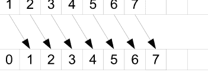

**图 18.1：** 向 `vector` 插入是 $O(N)$。空白方块表示未使用的容量。

这意味着 `vector` 不是存储电子表格文档中字符的正确数据类型。没有人希望插入文档开头的单个字符需要很长时间。

我们说向 `vector` 插入元素所需的时间是 $O(N)$，其中 $N$ 是 `vector` 的长度。另一方面，读取指定索引处的单个元素是 $O(1)$。换句话说，读取 `vector` 中的单个项目与 `vector` 的长度无关。向 `vector` 末尾添加元素通常是 $O(1)$，除非你不幸地遇到 `vector` 需要扩展其容量的情况，此时它是 $O(N)$，因为必须复制整个 `vector`。

`set` 在插入数据方面比 `vector` 快。插入是 $O(\log N)$。我们在第 18.9.1 节讨论非常相似的 `map` 容器时会解释原因。

## 18.7 容器 list

`list` 与 `vector` 非常相似，但它的设计使得在 $O(1)$ 时间内在任意位置插入数据变得容易。特别是，你可以有效地将数据添加到 `list` 的前部或后部。相比之下，使用 `vector` 时，你只能有效地在末尾添加数据。

这意味着 `list` 类对于组织优先级列表非常有用。你可以将高优先级项目放在列表的前部，将低优先级项目放在末尾。

在底层，`list` 中的每个元素都使用看起来像这样的数据类型存储：

```cpp

class Link {

    Data d;

    Link* next;

    Link* previous;

};

```

每个 `Link` 存储在内存中的任意位置，但通过跟随指针 `next`，你总是可以快速找到列表中的下一个项目。如果你希望向后移动，可以跟随指针 `prev`。实际的 `list` 类本身需要存储指向第一个和最后一个元素的指针。这种情况在图 18.2 中有描述。

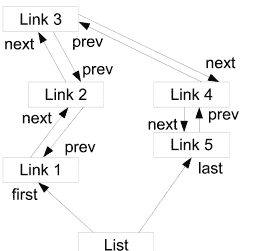

这种数据结构称为双向链表。你可以通过创建一个新 `Link` 并重新路由几个指针来快速插入新元素。图 18.3 中需要进行的更改使用加粗和虚线箭头表示。重要的一点是，更改的数量与列表的长度无关。这意味着插入需要 $O(1)$。

然而，如果你想要找到列表中的第 $i$ 个元素，你只能按顺序遍历每个元素。这需要 $O(i)$。

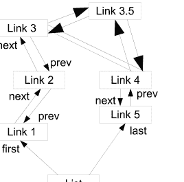

这里是一个代码示例，展示了如何使用 `push_front` 和 `push_back` 在列表的开头和末尾插入一些项目。然后我们打印出该列表。

```cpp

// 使用 list 按优先级顺序存储项目

list<string> list;

list.push_back("Drinking");

list.push_back("Dancing");

list.push_front("Exam");

list.push_front("Revision");

std::cout << "Todo list\n";

for (auto item : list) {

    std::cout << "Item " << item << "\n";

}

```

然后它会打印出以下内容：

```
Todo list
Item Revision
Item Exam
Item Drinking
Item Dancing
```

假设我们现在希望在“Exam”之前插入一个元素。`list` 类有一个 `insert` 函数，但它接受两个参数。第一个是迭代器，必须指向我们想要插入的位置，第二个是我们想要插入的数据。因此，我们首先需要遍历列表直到期望的位置，然后调用 `insert`。代码如下所示。

```cpp

    auto i = list.begin();

    while (i != list.end()) {

        if (*i == "Exam") {

            list.insert(i, "Dentist");

            break;

        }

        i++;

    }

    std::cout << "Todo list\n";

    for (auto item : list) {

        std::cout << "Item " << item << "\n";

    }

```

正如预期的那样，这段代码将打印出相同的列表，但在“Exam”之前插入了元素“Dentist”。

自然地，你会认为这段代码比必要的要长，并且希望编写一个辅助函数来简化插入元素的操作。实际上，C++ 已经包含了一个名为 `find` 的函数，这使得上述代码变得相当简单。

```cpp

    auto iter = find(list.begin(), list.end(), "Exam");

    list.insert(iter, "Dentist");

```

函数 `find` 会在给定范围的数值中搜索特定元素，并返回指向该位置的迭代器。要指定数值范围，你需要提供一个指向搜索区域起始位置的迭代器和一个指向结尾的迭代器（即最后一个元素之后的位置）。

函数 `find` 定义在库 `<algorithm>` 中。类 `list` 定义在 `<list>` 中。

`<algorithm>` 包含了许多用于执行任务的有用函数，例如从容器中移除指定元素、对容器元素排序、查找容器中的最小元素等等。

## 18.8 容器 initializer_list

在 C++11 中引入了一种名为 `initializer_list` 的新容器类型。它们很有用，因为创建它们并用一系列数值填充它们非常容易。它们不 intended 用于长期数据存储。下面是一个示例，展示了如何使用初始化列表创建一个 double 列表并打印出来。

```cpp

std::initializer_list<double> list = { 1, 2, 3, 4 };

for (auto d : list) {

    std::cout << "Value " << d << "\n";

}

```

初始化列表是只读数据结构，因此主要用作其他容器的构造函数参数。例如，如果你想创建一个包含一些固定指定值的 `vector`，可以使用如下所示的代码。

```cpp

std::vector<double> v({ 1, 2, 3, 4 });

```

这段代码创建了一个包含值 1、2、3 和 4 的 `vector`。现在它可以像其他任何 `vector` 一样使用。

大多数集合类都有一个构造函数，它接受 `initializer_list` 作为参数，以便可以使用这种方便的表示法。

## 18.9 容器 map 和 unordered_map

到目前为止，我们的容器只是存储值的序列或集合。另一大类数据结构用于存储从键到关联数据的映射。举个例子，字典可以被视为一种数据结构，它将键（单词）映射到值（单词的含义）。

在 C++ 中，可用于存储此类映射的两个类是 `map` 和 `unordered_map` 类。它们分别位于 `<map>` 和 `<unordered_map>` 中。

这两个类在使用方式上几乎无法区分。关键区别在于：

- `map` 中的元素按键排序，正如字典中的条目是按顺序排列的；
- `unordered_map` 通常比 `map` 更快。

因此，除非排序对你很重要，否则通常应该使用 `unordered_map`。请注意，你在 `map` 中用作键的元素必须重载 `<`，以便 `map` 知道如何正确排序它们。

以下是如何将数据插入 `map` 并遍历它以打印内容的示例。

```cpp

map<string, string> fruitToCol;

fruitToCol["apples"] = "green";

fruitToCol["bananas"] = "yellow";

fruitToCol["plums"] = "purple";

fruitToCol["oranges"] = "orange";

for (const pair<string, string>& p : fruitToCol) {

    cout << "The color of ";

    cout << p.first;

    cout << " is ";

    cout << p.second;

    cout << "\n";

}

```

你会看到，当我们遍历 `map` 时，我们获取的是类型为 `const pair<string, string>&` 的对象。`Map` 中的每个条目都是一个键值对。第一个条目是键，第二个条目是值。通常我们会写 `auto` 作为 p 的类型，而不是如此详细地写出所有细节。

`Map` 结构的主要优势在于我们可以非常快速地获取与给定键关联的值。

```cpp

auto i = fruitToCol.find("plums");

cout << "Plums are " << (i->second) << "\n";

```

在这个示例中，我们恰好知道键“plums”确实存储在 `map` 中，因此我们可以确定 i 是一个有效的迭代器，因此调用 `i->second` 将包含李子的颜色（紫色）。有时你不知道某个键是否存储在 `map` 中。下面的代码测试键是否在 `map` 中，并相应地采取行动。

```cpp

string fruit = "jackfruit";

auto iter = fruitToCol.find(fruit);

if (iter == fruitToCol.end()) {

    cout << "The color of " << fruit;

    cout << " is unknown\n";

} else {

    cout << fruit << " are " << (iter->second) << "\n";

}
```


因此，要查看 `map` 中是否存在某个元素，我们将 `find` 返回的迭代器与 `end` 返回的迭代器进行比较。

虽然我们的所有示例都使用了 `map`，但 `unordered_map` 的代码是完全相同的。

### 18.9.1 Map 的工作原理

`map` 通常将数据存储在由多个节点组成的树结构中。每个节点存储一个键、一个值以及指向左侧和右侧节点的指针。如果没有相邻节点，则使用空指针来表示。这在图 18.4 中进行了说明，其中黑色圆圈表示空指针。

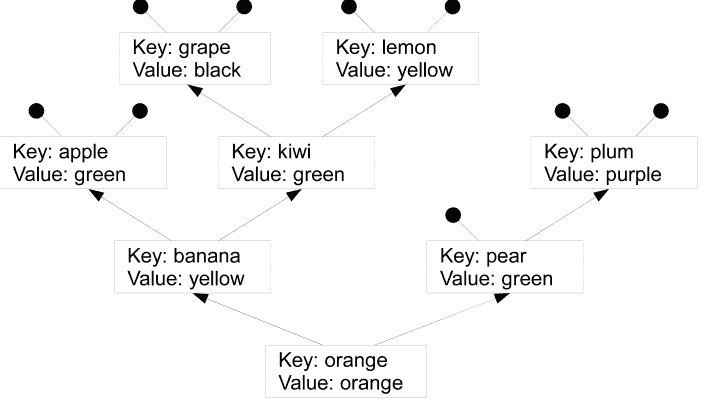

图 18.4：`map` 中节点的一种可能排列方式。

`map` 类确保节点键始终大于其左侧节点的键，且小于其右侧节点的键。

这意味着，当我们希望搜索与给定键关联的数据时，很容易快速向上遍历树，根据当前查看的节点键大于或小于你的键来选择左分支或右分支。通常，树的深度高度期望为 $O(\log_{2}(N))$，因此查找具有给定键的元素只需要 $O(\log_{2}(N))$ 步。

插入和删除数据比搜索数据稍微棘手一些。当你插入和删除节点时，需要确保保持有序属性。你还希望确保树的深度始终保持在 $\log_{2}(N)$ 的数量级。有标准算法来做到这一点。红黑树算法是一种著名的方法。细节对于本书来说并不重要，但可以在任何关于算法和数据结构书中找到。

最终结果是，`map` 可以用于在 $O(\log(N))$ 时间内搜索数据，并且在 $O(\log(N))$ 时间内插入和删除数据。

正如从这种讨论中应该清楚的那样，`map` 关键依赖于键的顺序。使用 `map` 时，你必须有 $<$ 的实现，否则必须告诉 `map` 使用什么函数代替。

`set` 的实现基本上与 `map` 相同，只是不需要存储 `value`。这解释了我们之前在 18.5 节中提到的类 `set` 的性能特征。

### 18.9.2 Unordered_map 的工作原理

让我们假设你要存储大约 100 个键值对，以便尽可能快地根据键查找值。如果你能以某种方式快速地为每个键分配 0 到 99 之间的唯一数字，那么你可以将数据存储在一个 `vector` 中而不是 `map` 中。只需获取一个键，找到关联的数字，然后读取 `vector` 中给定索引处的元素。

问题是我们无法以简单的方式为键分配唯一的数字。然而，对于字符串来说，有一个*几乎*可行的想法是将字符串中所有字符的编码相加。这将为每个字符串给出一个数字，我们称之为*哈希码*。哈希码在某种程度上几乎是唯一的，因为两个随机字符串不太可能具有相同的哈希码。

如果你然后取哈希码除以 100 的余数，你将得到一个 0 到 99 之间的数字。让我们称之为字符串的*桶 id*。

我们现在可以将我们要使用的所有键分组到*桶*中。如果两个字符串具有相同的桶 id，则它们在同一个桶中。

在一个无序映射中，存储的是桶对象的 `vector`。每个桶 id 都有一个桶。桶对象包含一个列表，其中所有键值对的键恰好具有给定的桶 id。这种情况在图 18.5 中描绘。这显示了一个具有 10 个桶的无序映射，因此桶 id 是通过取哈希码除以 10 的余数计算得出的。换句话说，桶 id 只是哈希码的最后一位。哈希码是通过如前所述将键中每个字母的字符编码相加来计算的。

要在无序映射中根据键搜索元素，请按以下步骤操作。

1. 计算键的哈希码。
2. 通过用桶的数量除哈希码并取余数来计算桶 id。

3. 从桶向量中读取正确的桶。
4. 遍历该桶中的所有键值对，直到找到正确的元素。

其基本原理是，由于每个键的哈希码本质上都是随机的，因此每个桶中通常只会有很少的元素。如果需要存储 \( N \) 个项目，我们可以使用一个拥有 \( O(N) \) 个桶的无序映射，这样每个桶中仍然只会有少数几个项目。这意味着查找一个元素的时间大致为 \( O(1) \)，而有序映射所需的时间为 \( O(\log(N)) \)。

插入新元素和删除元素的过程类似。找到正确的桶后，将元素插入列表或从列表中删除即可。唯一的额外复杂性在于，如果无序映射的大小超过一定限度，就需要增加桶的数量并重新计算所有桶的 ID。这个过程称为重新哈希（re-hashing）。

因此，粗略地说，无序映射允许我们以大约 *O*(1) 的时间复杂度插入、删除和查询数据，因此通常比 `map` 更快。

无序映射需要在键上执行的关键函数是计算哈希码以及检查两个键是否相等。对于字符串和数值类型，无序映射会采用合理的哈希码选择，并使用 `==` 测试相等性。对于用户定义的类型，默认行为是：当且仅当两个键是对象的精确相同实例时，它们才被视为相等。如果你希望使用更精细的相等性概念来处理你的键，请查阅 `unordered_map` 的文档。

请注意，C++ 中用于字符串的实际哈希码是采用一种比简单累加字符串中所有字符码更巧妙的算法计算得出的，该算法更可能产生唯一的哈希码。

## 18.10 在容器中存储复杂类型

> **提示：使用共享指针存储大型对象**

在容器中使用 `shared_ptr` 存储大型对象是更好的做法。例如，使用 `vector< shared_ptr<Matrix>>` 存储矩阵列表比使用 `vector<Matrix>` 更好。

重要的是要明白，当你在 C++ 容器中存储数据时，容器存储的是数据的副本。同样，当你从容器中提取数据时，你获得的也是数据的副本。

对于 `int` 或 `double` 这样的小型数据类型或小 `string` 对象来说，这种合理的行为是可以接受的。然而，如果你要在容器中存储大型对象，这将非常低效。解决方案是始终使用 `shared_ptr` 来存储大型对象。

## 18.11 多股票数学模型

STL 类在将我们的投资组合定价代码推广到包含多只股票的模型中将是无价的。在描述该问题的计算方面之前，让我们简要描述一个可用于此类市场的数学模型。

我们的模型将是布朗运动最直观的多维推广。这是编写多维模型的自然首次尝试，但绝非对建模更复杂股票市场的最终结论。

我们假设在每一个时间间隔 $\delta t$ 内，股价的变化由 $R$ 个独立的正态分布风险因子 $c^{j}$ 决定，其中 $j$ 在 1 到 $R$ 之间变化。我们用 $\underline{c}_{t}$ 表示时间 $t$ 时的 $R$ 维风险因子向量。

我们在每个时间 $t$ 都有 $n$ 个股价 $S_{i}^{t}$，其中 $i$ 在 1 到 $n$ 之间。我们定义 $z_{i}^{t} := \log(S_{i}^{t})$，并用 $\underline{z}_{t}$ 表示时间 $t$ 时的对数股价向量。

我们的模型是对数股价遵循以下差分方程演化：

$$\underline{z}_{t+\delta t} = \underline{z}_{t} + \underline{\eta}\delta t + (\delta t)^{\frac{1}{2}}L\underline{c}_{t}$$

其中 $\underline{\eta}$ 是一个 $n$ 维向量，$L$ 是一个 $n \times R$ 矩阵。模拟这个多维模型与模拟一维模型相比，难度并没有显著增加。

给定 $\underline{z}_{t}$ 的值，在时间 $t+\delta t$ 时 $\underline{z}$ 的值将服从一个多维正态分布，其协方差矩阵为 $(\delta t)L L^{\mathrm{T}}$，其中上标 $\mathrm{T}$ 表示矩阵转置。我们将一年的协方差矩阵记为 $A = L L^{\mathrm{T}}$。两个具有相同 $\underline{\eta}$ 的形式为 (18.1) 的模型，如果它们的协方差矩阵 $A$ 值相同，则应被视为等价。

通常，选择该模型的矩阵 $L$ 的方法是先选择一个协方差矩阵 $A$，然后找到一个矩阵 $L$ 使得 $L L^{\mathrm{T}} = A$。这样的矩阵被称为 $A$ 的 *伪平方根*。练习 16.7.5 中给出了一个寻找协方差矩阵伪平方根的算法，称为“Cholesky 分解”。

使用的 $R$ 值越大，计算模型 (18.1) 中每一项所需的时间就越长。计算 (18.1) 中的每一个后续项需要 $n \times R^{2}$ 次计算。因此，当股票数量很大时，人们可能会尝试用比股票数量更少的风险因子来模拟市场。为此，可以使用协方差矩阵的低维近似伪平方根，而不是真正的伪平方根。这可以通过寻找协方差矩阵的特征向量基，并仅使用具有最大特征值的特征向量来创建矩阵 $L$ 来实现。这使得人们可以使用中等数量的风险因子来模拟一个大型市场。

然而，为了简单起见，从现在开始我们假设 $L$ 是给定的协方差矩阵 $A$ 的 Cholesky 分解。这是我们将在软件中模拟的情况。

如果我们考察对数股价向量 $\underline{z}_{t}$ 的第 $i$ 个分量的行为，我们可以看到它服从方差为 $(\delta t)A_{(i, i)}$、均值为 $(\delta t)\underline{\eta}_{i}$ 的正态分布。因此，每只股票单独来看都遵循具有漂移 $\underline{\eta}_{i} + \frac{1}{2} A_{(i, i)}$ 和波动率 $\sqrt{A_{(i, i)}}$ 的几何布朗运动。

我们推断，在固定利率为 $r$ 的世界中，这是股票价格的无风险模型当且仅当

$$\underline{\eta}_{(i)} = r - \frac{1}{2} A_{(i,i)} .$$

此外，我们看到向量 $\underline{\eta}$ 可以从每只股票各自的漂移中计算得出。

## 18.12 在 FMLib 中使用标准模板库

我们希望增强 FMLib，使其能够对包含多只股票期权的投资组合进行定价。此外，我们还希望能够对像 Margrabe 期权这样涉及两只股票交互作用的期权进行定价（参见练习 18.12.2）。

我们需要对 FMLib 进行的关键更改总结如下，见图 18.6。让我们也用文字解释一下。

- `ContinuousTimeOption` 接口被更改，其收益函数现在接受一个 `MarketSimulation` 对象作为参数。此函数之前的版本接受一个股价路径矩阵作为参数。
- `MarketSimulation` 类是一个简单的类，它存储股票名称与股价路径矩阵之间的映射。它存储我们对股票市场的所有模拟。为了计算多股期权的收益，需要向 `MarketSimulation` 查询期权合同中涉及的每只股票的股价路径。然后可以根据期权合同计算期权的收益。
- 除了更改收益函数外，`ContinuousTimeOption` 现在还有一个 `getStocks` 方法，可用于查询期权依赖于哪些股票。为了确保该方法不返回重复项，其返回类型是 `set<string>`。
- 大多数期权只涉及单只股票，因此我们的基类 `ContinuousTimeOptionBase` 已被增强，使其存储单只股票的名称。它通过返回此名称来实现 `getStocks`。如果 `ContinuousTimeOptionBase` 也实现了一个接受 `MarketSimulation` 作为参数的收益函数，它是通过提取该单只股票的股价路径矩阵，然后调用另一个也称为 `payoff` 但接受单个 `Matrix` 作为参数的抽象函数来实现的。由于我们现有的所有 `ContinuousTimeOptionBase` 子类已经实现了第二种版本的收益函数，它们现在将自动实现修改后的 `ContinuousTimeOption` 接口。
- 为了生成 `MarketSimulation` 对象，我们使用一个名为 `MultiStockModel` 的类。该类表示上述描述的多股票数学模型。它有函数 `generatePricePaths` 和 `generateRisk-`

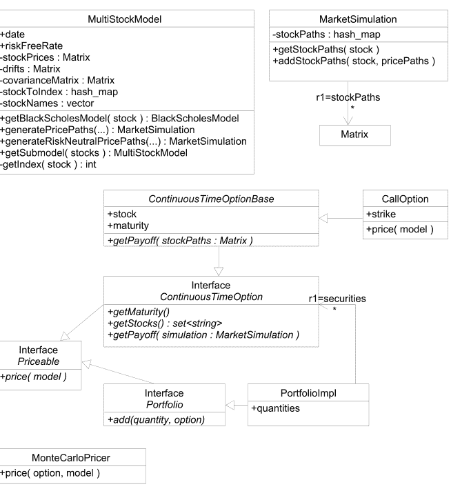

## 图 18.6: FMLib 变更的 UML 摘要

`NeutralPricePaths` 根据模型配置创建 `MarketSimulation` 对象。

`MultiStockModel` 内部使用矩阵存储大部分数据。例如，当前股价存储为 $n \times 1$ 矩阵——即列向量。这些股价中的每一个都对应市场中某只股票的价格。股票名称与该列向量中股票索引之间的映射以两种方式存储。首先，它们存储在一个名为 `stockToIndex` 的 `unordered_map` 中，该映射将股票名称映射到索引。其次，名称按索引顺序存储在一个名为 `stockNames` 的 `vector` 中。这些数据结构共同使得可以在股票名称和索引之间快速映射，反之亦然。为了辅助这种映射，`MarketSimulation` 有一个私有函数 `getIndex`，它将股票名称映射到其索引。

`MarketSimulation` 中的其他数据也使用相同索引的矩阵存储。特别是有一个漂移列向量和一个协方差矩阵，该矩阵描述了所有股票的波动率及其相关性。

由于我们经常需要对不涉及整个市场的期权和投资组合进行定价，`MultiStockModel` 类有一个 `getSubModel` 函数。该函数接收股票列表作为参数，并返回一个新的 `MultiStockModel`，其规模已缩减至仅涉及所需的股票。为了方便，它还有一个函数，在给定单只股票的情况下返回一个 `BlackScholesModel` 对象。

`MonteCarloPricer` 类现在可以在给定多股票模型的情况下对 `ContinuousTimeOption` 实例进行定价。它首先使用期权的 `getStocks` 函数创建一个合适的子模型，然后使用模型的 `getSubModel` 函数。接着，它使用此子模型生成风险中性价格路径。期权能够计算所有这些价格路径的收益。蒙特卡洛价格则是折现后的平均收益。

还有两个值得提及的小改动：

- (i) `Priceable` 接口已更改，使得 `price` 方法接收 `MultiStockModel` 作为参数。它以前接收的是 `BlackScholesModel`。该 `price` 方法的所有实现都相应地进行了更改。
- (ii) `Portfolio` 类现在只允许添加 `ContinuousTimeOption` 对象，而之前可以添加任何 `Priceable`。这样做的原因是它使完成练习 18.12.3 变得更加容易。

大多数方法的实际实现并不具有挑战性。让我们展示几个例子。

首先，这是类 `MultiStockModel` 中 `getIndex` 的实现。我们选择将该函数内联化。它只是使用上面给出的在映射中搜索的配方。我们决定如果用户传入无效的股票代码，我们就简单地报告一个错误。

```cpp
int getIndex(const std::string& stockCode) const {
    auto pos = stockToIndex.find(stockCode);
    ASSERT(pos != stockToIndex.end());
    int idx = pos->second;
    return idx;
}
```

`MarketSimulation` 上的 `getStockPaths` 函数本质上相同。

```cpp
SPCMatrix getStockPaths( const std::string& stock) const {
    auto pos = stockPaths.find(stock);
    ASSERT(pos != stockPaths.end());
    return pos->second;
}
```

这段代码清楚地表明，我们的 `MarketSimulation` 类使用 `shared_ptr` 来存储矩阵。如前所述，由于容器会复制其存储的数据，直接在该容器中存储 `Matrix` 将非常低效。这段代码还展示了我们的约定，即使用 `typedef` 创建一个指向 `const` 的 `shared_ptr`，其名称以 “SPC” 开头。你可以看到这一约定在函数 `getStockPaths` 的返回类型中得到了使用。

作为一个更复杂的例子，这是给定你想要包含在子模型中的股票名称，创建 `MultiStockModel` 子模型所需的代码。代码必须找到这些股票的相应索引，然后从成员变量 `drifts`、`stockPrices` 和 `covarianceMatrix` 中提取必要的子矩阵。

```cpp
MultiStockModel MultiStockModel::getSubmodel(
              set<string> stocks) const {
    int n = stocks.size();
    Matrix drifts(n, 1);
    Matrix stockPrices(n, 1);
    vector<string> newStocks(stocks.begin(),
                    stocks.end());
    Matrix cov(n, n);
    int newIndex = 0;
    for (auto& stock : stocks) {
        int idx = getIndex(stock);
        drifts(newIndex) = this->drifts(idx);
        stockPrices(newIndex) = this->stockPrices(idx);
        newIndex++;
    }
    int i = 0;
    for (auto& stockI : stocks) {
        int j = 0;
        for (auto& stockJ : stocks) {
            int oldI = getIndex(stockI);
            int oldJ = getIndex(stockJ);
```


```cpp
cov(i, j) = covarianceMatrix(oldI, oldJ);

j++;

}

i++;

}

MultiStockModel ret(newStocks, stockPrices,

                drifts, cov);

ret.setDate(getDate());

ret.setRiskFreeRate(getRiskFreeRate());

return ret;

}
```

这段代码展示了使用容器专用的 **for** 语法进行循环的便利性。有一点值得注意的是，我们可以构造一个新的向量，其中包含现有集合中的数据，如下所示：

```cpp
vector<string> newStocks(stocks.begin(),
                stocks.end());
```

容器类通常具有接收两个迭代器的构造函数，并将迭代器之间的所有数据复制到新创建的容器中。十有八九的情况下，人们使用这种方式来复制现有容器的全部数据，但偶尔仅复制部分数据也是有用的。

最后，我们注意到类 `MultiStockModel` 使用第 18.11 节中描述的模型生成价格路径。这段代码并不比模拟单个股价所需的代码复杂多少。

## 练习

**18.12.1.** 在练习 3.9.3 中，我们看到递归是计算斐波那契数的低效方法。然而，如果我们使用值 *缓存*，递归可以变得高效。缓存只是一个存储先前计算结果的数据结构。你可以使用包含 `map` 的全局变量来缓存已经计算过的斐波那契数列值。实现这个想法并确认它优于没有缓存的递归。

**18.12.2.** 编写一个 `ContinuousTimeOption` 的实现，用于表示 *Margrabe 期权*。这是关于两只股票 `$S^{1}$` 和 `$S^{2}$` 的期权。在到期日 `$T$`，它支付等于 `$\max\{S_{T}^{1}-S_{T}^{2}, 0\}$` 的金额。确认你可以通过蒙特卡洛方法对其进行定价，并且其价格与文献 [10] 中给出的解析公式相匹配。

**18.12.3.** 向类 `Portfolio` 添加一个新方法 `priceByMonteCarlo`，该方法将期权按到期日分组，然后使用一组模拟对具有相同到期日的期权进行定价。为此，你需要编写一个 `ContinuousTimeOption` 的实现，它代表一个由多种股票期权组成的投资组合，这些期权都具有单一的到期日。

实际上，你可能希望使用一种复杂的算法，该算法仅分组那些需要蒙特卡洛定价的期权，并以之前类似的方式对可以解析处理的期权进行定价。你可能还希望生成跨越投资组合中所有到期日的单一股价模拟。

**18.12.4.** 编写一个模板函数 `mapGet`，该函数根据键从映射中获取值。如果映射中不存在该值，它应该抛出异常。你的函数应能同样适用于 `map` 和 `unordered_map`。

**18.12.5.** 编写你自己的简单版哈希映射。你应该只实现一个 `store` 函数，允许你存储键值对，以及一个 `get` 函数，该函数返回与键关联的值或抛出异常。你可以假设键和值都是字符串。你也应该只使用固定数量的桶。你可以使用 `vector` 和 `list` 类，但你不能使用 `map` 或 `unordered_map`。检查你的哈希映射是否按预期运行。

## 18.13 总结

标准模板库是一个强大的工具，它将使你能够轻松编写更复杂的程序。我们涵盖的关键点包括：

- `typedef` 关键字允许我们缩写复杂的类型名称。为 `shared_ptr` 类型命名的一种约定特别方便。
- `auto` 关键字允许你在编译器可以为你推导类型时避免输入类的完整名称。可以将 `auto` 与 `const` 和 `&` 组合使用。
- 类可以包含成员类型。这在编写模板算法时特别有用。
- 容器是任何存储数据并在调用 `begin` 和 `end` 时返回迭代器的类。使用 `for` 遍历容器有一种特殊的语法。
- C++ 包含许多使数据存储变得容易的容器类。它们还可以作为实现高效算法的构建模块。所有容器的行为都大致相似。诸如 `size`、`insert`、`remove`、`begin` 和 `end` 等函数的命名有明确的约定。

库 `<algorithm>` 包含了许多对处理 `find` 等容器非常有用的函数。

- 不同的数据结构具有不同的性能特征。你应根据访问和更新数据的方式来选择数据结构。
- 不应在容器中存储大型对象。应使用 `shared_ptr` 通过引用存储它们。

我们需要补充说明，尽管标准模板库非常强大，但它学习起来也相当困难。不幸的是，它大量使用了模板和运算符重载等复杂概念。迭代器的语法也假定你非常熟悉指针操作，因此你会发现使用 `*` 和 `++` 很自然且方便。

标准模板库刚发明时，实验性质较强。时间证明，面向对象编程风格相当直观。因此，许多计算机语言都包含某种形式的面向对象特性。另一方面，标准模板库对于新程序员来说相当难以掌握。因此，模板的使用在许多其他语言中并未被采用。

> **提示：使用标准模板库，但不要照搬其设计。**

你应该知道如何使用标准模板库，因为它包含无价之宝的工具。然而，你不应该急于照搬标准模板库的设计。在使用模板之前，先看看是否能为问题找到面向对象的解决方案。

# 第 19 章

## 函数对象与 Lambda 函数

在第 10.6 节中，我们设计了一个接口 `RealFunction` 来表示将实数映射到实数的数学函数概念。这解决了编写能够积分任意实函数的积分程序的问题。

然而，在 C++ 中有一个更好的解决方案，称为编写 *函数对象*。函数对象仅仅是重载了运算符 `()` 的类的一个实例。函数对象有时也被称为 *仿函数（functors）*。使用函数对象的最大优势在于，编写函数对象有一种特殊的语法，称为 *lambda 函数*。这使得编写函数对象比编写普通类更快。

### 19.1 函数对象

这里是一个积分函数的示例，它接受一个函数对象 `f` 作为参数。这段代码简单地重复了我们在第 10.6 节中使用矩形规则进行积分的函数，但这次我们使用的是函数对象，而不是接口 `RealFunction`。

```cpp
double integrate(
    function<double(double)> f,
    double a,
    double b,
    int nSteps) {
 double total = 0.0;
 double h = (b - a) / nSteps;
 for (int i = 0; i<nSteps; i++) {
    double x = a + i*h + 0.5*h;
    total += h*f(x);
 }
 return total;
}
```

首先需要注意的是，`f` 的类型声明为

```cpp
function<double(double)> f
```

这里 `function` 是定义在库 `<functional>` 和命名空间 `std` 中的一个类。有趣的部分是模板类型。此示例意味着 `f` 代表一个函数，它返回一个 double 并接收单个 `double` 作为参数。如果你希望使用具有不同返回类型和参数类型的函数对象，通用语法是：

```cpp
function<ReturnType(ParameterType1,ParameterType2,...)> f
```

声明函数类型是使用函数对象的唯一复杂部分。当我们使用函数对象 `f` 时，它与使用普通函数完全相同，因为它重载了运算符 `()`。下面是使用 `f` 的代码行：

```cpp
total += h*f(x);
```

要编写一个函数对象，你必须编写一个重载 `()` 运算符的类。下面是一个计算数学函数 `$\sin(x)$` 的类的示例。

```cpp
class SinFunction {
public:
	double operator()(double x) {
		return sin(x);
	}
};
```

把所有东西放在一起，这里是一个测试，验证我们的积分函数是否按预期工作。

```cpp
void testIntegrateSin() {
	SinFunction integrand;
	double value = integrate(integrand, 0, 1, 1000);
	ASSERT_APPROX_EQUAL(-cos(1.0) + cos(0.0),
		value, 0.01);
}
```

### 19.2 Lambda 函数

使用函数对象而不是自己编写接口的最大优势在于，你可以使用 *lambda 函数* 非常快速地编写函数对象。

举个例子，假设我们要编写一个函数，它接受参数 `$a$`、`$b$` 和 `$c$`，然后使用梯形法计算

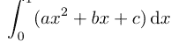

我们首先需要编写一个函数对象来计算被积函数 `$ax^{2}+bx+c$`。然后我们可以使用我们的 `integrate` 函数计算积分。

这里是不使用 lambda 函数的冗长答案：

```cpp
class QuadraticFunction {
public:
    /* Members */
    double a;
    double b;
    double c;
    /* Constructor */
    QuadraticFunction(double a,
                      double b,
                      double c) :
        a(a), b(b), c(c) {}
    /* Operator */
    double operator()(double x) {
        return a*x*x+b*x+c;
    }
};
double integrateQuadratic(double a,
                          double b,
                          double c) {
    QuadraticFunction integrand(a, b, c);
    return integrate(integrand, 0, 1, 1000);
}
```

我们必须定义一个类，为其指定适当的成员变量和构造函数，并重载运算符 `()`。然后我们需要构造该类的一个实例并将其传递给 `integrate`。lambda 函数允许我们仅用几行代码完成所有这些操作。

```cpp
double integrateQuadratic2(double a,
                           double b,
                           double c) {
    auto lambda =
        [a, b, c](double x) {
            return a*x*x + b*x + c;
        };
    return integrate(lambda, 0, 1, 1000);
}
```

变量 `lambda` 仍然是一个函数对象，就像代码中更冗长版本中的 `integrand` 一样。新的语法是 lambda 函数的声明：

```cpp
[a, b, c](double x) {
    return a*x*x + b*x + c;
};
```

这是一种极其简洁的语法，其含义如下：

- 生成一个类，我们不在乎它叫什么。
- 我们要 *捕获* `integrateQuadratic2` 的局部变量 `a`、`b` 和 `c`，并将它们作为我们类的成员变量。在编写 lambda 函数时，你在方括号中列出捕获的变量。
- 我们要编写一个 `()` 运算符的重载，它接受一个名为 `x` 的单个 `double` 参数。在编写 lambda 函数时，你在圆括号中列出参数类型和参数名称。
- 函数的实际计算写在花括号内，可以使用捕获的变量和参数。

总之，lambda 函数的语法为：

```
[捕获参数] (函数参数) {函数实现}
```

lambda 函数很棒的地方在于，除了编写速度更快之外，它们还更容易阅读（至少当你习惯这种语法时）。这是因为定义新类所需的所有冗长且分散注意力的样板代码都被隐藏了。

编写捕获参数的方式具有很大的灵活性。

1. 通过在参数名称前使用 `&` 符号，你可以指定希望通过引用捕获局部变量。
2. 只需指定 `&`，你就可以指定希望通过引用捕获所有变量。
3. 只需指定 `=`，你就可以指定希望通过值捕获所有变量。
4. 如果你的 lambda 函数写在类的成员函数内部，你可以通过指定 `this` 来捕获该类的成员函数和成员变量。

举个例子，这里是如何在 `$a$` 和 `$b$` 之间对无路径依赖期权的收益进行积分。

```cpp
double integratePayoff (PathIndependentOption& o,
                        double a,
                        double b) {
  auto lambda =
    [&o](double x) {
        return o.payoff(x);
    };
  return integrate(lambda, a, b, 1000);
}
```

由于类 `PathIndependentOption` 是抽象类，我们必须通过引用捕获变量 `o`。这就是为什么捕获参数列表表示我们在捕获 `&o`。

同一个问题在第 10.6 节中也有考虑。如你所见，使用 lambda 函数使解决方案简短得多。

请注意，当你通过引用存储捕获参数时，你必须始终小心确保在捕获的任何参数之前删除该函数对象。原因与确保在通过引用存储的任何成员变量之前删除类实例的原因完全相同。

### 19.3 函数指针

可以将实际函数作为参数传递，并不总是绝对需要编写函数对象。例如，要积分

$$
\int_0^1 (x^2 + 2x + 1) dx
$$

我们可以编写一个表示被积函数的普通函数，如下所示：

```cpp
static double integrand(double x) {
  return x*x + 2 * x + 1;
}
```

然后我们可以如下将该被积函数传递给我们的 `integrate` 函数。

```cpp
double testIntegrateFunctionPointer() {
  double value = integrate(&integrand, 2, 1);
  ASSERT_APPROX_EQUAL(
    value,
```

```cpp
2.3333, 0.01);
}
```

注意被积函数前的 `&` 符号。`&integrand` 被称为函数指针。C 语言没有面向对象特性。特别是你不能编写函数对象。你能做到的最接近的方式是编写函数并使用函数指针传递它们。如果你使用用 C 编写的库，你会发现它们经常使用函数指针。然而，C++ 程序员通常更喜欢使用函数对象来编写他们的库，因为它们既更强大又更方便。

### 19.4 使用 lambda 函数进行排序

我们已使用 lambda 函数来表示定义在实数域上的实值函数。然而，lambda 函数可用于许多不同类型的函数，而不仅仅是数学函数。本节将给出一个示例，展示如何使用 lambda 函数来自定义 `sort` 函数的排序顺序。

默认情况下，针对字符串的 `<` 函数基于 ASCII 字符代码，因此 `"A" < "B" < ... < "Z" < "a"`。这意味着直接对字符串向量使用 `sort` 函数不会使列表按字母顺序排列。所有以大写字母开头的字符串将排在所有以小写字母开头的字符串之前。幸运的是，`sort` 允许你指定一个比较函数，该函数将用于决定 `$x$` 是否应排在 `$y$` 之前。

```cpp
void sortExample() {
    vector<string> list({ "Z", "x", "a", "B" });
    sort(list.begin(), list.end(),
         [](string& x, string& y) {
             return uppercase(x) < uppercase(y);
         });
}
```


在这个例子中，我们创建一个`lambda`函数，用于比较两个字符串`x`和`y`，并返回`x`在字母顺序中是否位于`y`之前。为此，它只需将每个字符串转换为大写，然后进行比较。函数`uppercase`并非 C++ 内置，它是我们为这一目的编写的辅助函数。

C++ 库经常大量使用函数对象。如果你想充分利用 C++，使用它们是必不可少的。

## 练习

19.4.1. 使用`lambda`函数计算

$$\int_0^{\pi} \sqrt{1+\sin^2(x)} \, dx.$$

19.4.2. 编写一个函数，计算在 Black–Scholes 模型中具有任意到期收益 $f(S)$ 且在到期日 $T$ 到期的期权价格。你的代码应通过计算期望收益并求积分来实现，使用公式 (A.3)。

19.4.3. 假设 $f: [a, b] \rightarrow \mathbb{R}$ 是一个连续函数，我们想解方程 $f(x) = y$，其中 $y$ 是介于 $f(a)$ 和 $f(b)$ 之间的某个值。显然存在解，并且它必须位于两个子区间 $[a, (a + b)/2]$ 或 $[(a + b)/2, b]$ 之一。根据 $f$ 在 $(a + b)/2$ 处的值，我们可以确定需要在哪个子区间中查找以解方程：只需选择那个使得 $y$ 介于该区间端点处 $f$ 值之间的区间。

这给出了一个递归算法，用于在给定容差 $\epsilon$ 内数值求解方程 $f(x) = y$。要在 $[a, b]$ 上解方程：

- (i) 检查任一端点是否在期望容差范围内成为解，如果是，则完成。
- (ii) 否则，决定哪个子区间 $[a, (a + b)/2]$ 或 $[(a + b)/2, b]$ 必须包含解。使用递归将算法应用于较小的区间。

此算法称为二分法。请实现它。（有许多其他算法可以解这类方程，例如牛顿–拉夫逊法。你可以在 GSL、GNU 科学库等库中找到这些实现。）

19.4.4. 校准 Black–Scholes 公式中的所有参数到市场很容易，除了波动率 $\sigma$。

例如，原始股价通常取为市场报价中买入和卖出股票的买价和卖价的平均值。类似地，无风险利率可以取为某个特定的市场利率，例如 LIBOR 利率。

然而，波动率参数并没有以如此明确的方式对应于任何市场数据。相反，人们通常通过反转 Black–Scholes 公式并使用市场上看涨期权的来推导波动率，从而尝试将 Black–Scholes 模型校准到市场。以此方式计算出的波动率被称为*隐含波动率*。

使用你在上一练习中的答案，编写一个 **implied-Volatility**（隐含波动率）函数，该函数：

- 接受参数 $S$、$r$、$K$、$T$ 以及执行价格为 $K$ 且到期日为 $T$ 的看涨期权价格
- 计算相应的 $\sigma$ 值，使得公式 (A.6) 成立。

19.4.5. 查找标普 500 指数看涨期权的市场当前数据，并绘制隐含波动率随执行价格变化的曲线图。如果 Black–Scholes 模型完全准确，隐含波动率将与执行价格无关。由于 Black–Scholes 模型做出了一些不现实的假设，你反而会发现隐含波动率随执行价格而变化。这表明，虽然 Black–Scholes 模型有用，但它还不够准确以复制实际市场价格，必须使用更复杂的模型。

## 19.5 摘要

将函数作为参数传递是 C++ 中的常见需求。使用类 `std::function` 将函数作为参数传递。这允许你使用 `lambda` 函数根据需要快速创建新函数。

# 第 20 章

# 线程

计算机能够同时执行多于一件事。除了可以同时运行多个程序外，每个程序也可以同时在执行多个任务。每个正在运行的独立程序称为一个*进程*。在每个进程中，每个正在运行的独立任务称为一个*线程*。我们迄今为止编写的程序都只包含单个线程。本章关于编写同时执行多个线程的程序。

如果计算机有多个 CPU，每个 CPU 都可以管理自己的执行线程，因此可以并行运行多个线程。现代处理器通常包含多个*核心*。你可以将每个核心视为实际上是一个独立的处理器。每个核心都可以执行一个独立的线程。

然而，即使你只有一个处理器，你仍然可以运行多个线程。这些线程看起来像是同时运行的，但实际上操作系统只是轮流分配少量时间给每个线程。更一般地说，你可以运行比处理器更多的线程。操作系统的任务之一是在任意时刻确定运行哪些线程。例如，操作系统可能会给予图形用户界面更高的优先级，而给予后台计算较低的优先级。

多线程程序仅仅是一个包含多于一个线程的程序。以下是编写多线程程序可能希望获得的一些潜在好处简短列表。

- (i) **CPU 性能**：为了利用你所有的处理器或核心，你必须运行多个线程，因此多线程对于充分利用计算机资源至关重要。
- (ii) **网络性能**：当你在等待网络操作完成（例如下载网页）时，你不妨利用处理器做其他事情。
- (iii) **公平性**：如果你正在编写 Web 服务器，希望查看某一页面的用户不应该因为另一个用户的巨大下载而等待半小时。
- (iv) **易用性**：当程序正在执行长时间计算时，用户欣赏能够在处理“在后台”进行时执行其他任务。
- (v) **更自然的编程**：*非常偶尔地*，如果你使用多个线程，程序会更容易编写。

然而，所有这些正面好处都需要付出代价。以下是决定编写多线程程序之前必须考虑的一些陷阱。

- (i) **复杂性**：多线程代码比单线程代码更难编写和理解。
- (ii) **可测试性**：多线程代码比单线程代码更难测试。
- (iii) **CPU 性能**：如果使用多个线程实际上会减慢你的计算机，如果代码写得不好。这是因为在线程之间发送数据有一些开销。如果你的代码大部分时间都在将一个线程的数据移动到另一个线程，它的表现会很差。
- (iv) **难度**：人脑似乎难以处理并行处理。我们在多任务处理方面都很糟糕，我们在编写多线程代码方面也都做得不好。

## 20.1 C++ 中的并发编程

### 20.1.1 创建线程

要创建一个线程，构造一个 `thread` 对象，传入线程执行时要调用的函数指针以及该函数所需的任何参数。`thread` 定义在库 `<thread>` 中。

下面的代码包含一个函数 `primalityTest`，它接受单个参数，即指向 `int` 的指针。函数 `primalityTest` 只是尝试被引用 `int` 的所有可能除数，看看是否能找到因子。如果找到非平凡因子，它打印出被引用的 `int` 不是质数。否则，它打印出被引用的 `int` 是质数的事实。

```cpp
void primalityTest( int* pointerToInt ) {
 int toTest = *pointerToInt;
 for (int i=2; i<toTest; i++) {
 if ((toTest % i)==0) {
 INFO( toTest << " is not prime");
 return;
 }
 }
}
```

```cpp
void testPrimes() {
    int values[3] = {1299817,1299821,1299827};
    thread t1( &primalityTest, &values[0] );
    thread t2( &primalityTest, &values[1] );
    thread t3( &primalityTest, &values[2] );
    t1.join();
    t2.join();
    t3.join();
}
```

我们希望使用三个独立的线程来运行函数 `primalityTest`。函数 `testPrimes` 通过创建三个 `thread` 对象实现了这一点。如您所见，我们使用表达式 `&primalityTest` 获取指向素数测试函数的指针。

在创建每个线程后，我们通过调用 `join` 等待它们完成。线程的 `join` 函数会*阻塞*（即不执行任何处理），直到被连接的线程完成。

### 20.1.2 互斥

为了了解编写多线程代码时可能出现的问题，请考虑当两个线程同时执行以下代码时会发生什么：

```cpp
cout << "The answer to calculation "<<i<<" is "<<j<<"\n";
```

首先值得注意的是，这段代码实际上等价于：

```cpp
cout << "The answer to calculation ";
cout << i;
cout <<" is ";
cout <<j;
cout <<"\n";
```

如果两个线程同时执行这段代码，无法保证哪个线程会先打印出消息的特定一行。因此，打印出的消息可能会以*重叠*的方式混淆显示。以下是可能出现的一类输出示例。

```
The answer to calculation The answer to calculation 1 2 is 19
is 18
```

当向 `cout` 写入数据时，这些问题非常显眼，但当多个线程访问相同的数据或相同的对象时，细微的问题也很容易发生。例如，考虑以下代码：

```cpp
bool debitAccount(Account& account, double amount) {
    if (account.balance >= amount) {
        account.balance -= amount;
        return true;
    }
    return false;
}
```

要理解为什么这段代码是危险的，假设初始时账户中有 100 美元。假设两个线程都试图从该账户中扣除 100 美元。由于运气不佳，可能会出现这种情况：两个线程同时检查余额并发现资金充足。此时可能发生的情况是，一个线程将余额改为零，然后第二个线程将其改为 -100 美元。最终结果将是账户透支，尽管乍一看我们的 if 语句似乎会防止这种情况发生。

这是一个竞态条件的示例。竞态条件是任何两个线程试图访问同一资源且结果取决于事件顺序的情况。在我们的例子中，可以想象两个线程正在“竞争”从账户中扣款。

除非我们找到一种方法来确保两个线程不能同时读写相同的数据，否则竞态条件不可避免。互斥锁提供了一种确保这一点的方法。

类 `mutex` 代表互斥锁。它有两个关键方法：`lock` 和 `unlock`。我们说当函数 `lock` 返回时，线程已获取锁。当调用 `unlock` 时，线程释放了锁。一次只能有一个线程获取锁。如果线程 A 获取了锁，然后线程 B 尝试调用 `lock`，那么对 `lock` 的调用在线程 A 调用 `unlock` 之前不会返回。这保证了只有一个线程持有锁。它被称为互斥锁，是因为每个线程可以通过持有锁来排除其他线程运行。它们互相排除运行。

在小说《蝇王》中，一群男孩被困在一个荒岛上。男孩们在海滩上发现了一个海螺壳，并对自己施加了一条“海螺规则”。他们同意，除非手持海螺，否则任何人都不能说话。这意味着男孩们使用海螺作为互斥锁，以防止他们互相打断说话。

以下是如何在表示银行账户的类 `Account` 中使用互斥锁的示例。我们赋予它一个作为成员变量的 `mutex`，并使用它来确保没有两个线程可以同时从同一账户中扣款：

```cpp
bool debitAccount(Account& account,
                  double amount) {
    account.mtx.lock();
    bool ret = false;
    if (account.balance >= amount) {
        account.balance -= amount;
        ret = true;
    }
    account.mtx.unlock(); // don't do this
    return ret;
}
```

虽然这段代码可以工作，但你实际上不应该直接使用 `lock` 和 `unlock` 方法在 `mutex` 上。这样做的原因是，如果你 `lock` 了一个 `mutex`，你需要确保无论发生什么，最终都会调用 `unlock`。特别是，即使发生错误，也应该调用 `unlock`。

`mutex` 是一种资源，即使在抛出错误后也必须释放的示例。这远不是唯一的例子。内存也是一种最终需要释放的资源。数据库连接和文件系统上的锁也是如此。

解决这类所有问题的方法是创建一个管理资源的类，并使用析构函数确保资源被释放。即使发生错误，当局部变量被删除时也会调用析构函数。

对于 `mutex`，我们需要管理 `mutex` 的类已经存在，被称为 `lock_guard<mutex>`。(*mutex* 不是唯一可锁定的资源。你可以创建其他类型的 `lock_guard` 来管理其他类型的可锁定资源。这就是 `lock_guard` 是模板的原因。）

`lock_guard<mutex>` 在其构造函数中对 `mutex` 调用 `lock`，然后在析构函数中调用 `unlock`。特别是，这意味着如果使用 `lock_guard<mutex>` 如下所示，即使发生错误，`mutex` 也会被解锁。

```cpp
bool debitAccount(Account& account,
double amount) {
lock_guard<mutex> lock(account.mtx);
if (account.balance >= amount) {
account.balance -= amount;
return true;
}
return false;
}
```

### 提示：资源获取即初始化 (RAII)

每当你的方法末尾*必须*进行某些清理工作时，使用具有执行清理工作的析构函数的适当类。这可以总结为：

- 资源获取即初始化；
- 资源释放即删除。

当我们在第 16.2 节中引入析构函数时，我们要管理的资源是内存。在本节中，我们将持有锁视为资源获取的另一种形式。在这两种情况下，资源都是有限的，需要管理：计算机有有限的内存；只有一个线程可以持有锁。

如果你不使用互斥锁，你几乎没有保证代码执行（或看似执行）的顺序。当不使用互斥锁时，需要考虑的两个问题是：编译器可能会通过重新排序某些部分来优化代码；处理器有缓存，其中包含的数据可能在一段时间内不会写入主内存。C++ 确实包含一些类，使您可以编写无需使用互斥锁的多线程代码，但这是一个超出本书范围的专门主题。

### 危险！

编译器可以将你的代码重新排序作为优化过程的一部分。如果你不使用锁，你对代码执行顺序几乎没有保证。换句话说，如果你不使用锁，会发生一些非常奇怪的 bug。

### 20.1.3 全局变量和竞态条件

每当你使用全局变量时，如果你的代码用于多线程程序中，潜在的竞态条件就会存在。

例如，输出流 `cout` 和 `cerr` 是全局变量，我们已经看到在编写多线程代码时使用这些是有问题的。在 FM Lib20 中，宏 `INFO` 和 `DEBUG_PRINT` 已更新为使用互斥锁，以确保消息不重叠。

这不是我们代码中使用全局变量的唯一地方。函数 `randuniform` 使用全局变量来存储随机数生成器的当前状态。因此，我们必须向 `randuniform` 的实现添加互斥锁以防止竞态条件：

```cpp
/* MersenneTwister random number generator */
static mt19937 mersenneTwister;
/* Mutex to protect static var */
```

# 20.1.4 锁定的问题

```cpp
static mutex rngMutex;
/* 重置随机数生成器。
我们忽略描述字符串 */
void rng(const string& description) {
    ASSERT(description == "default");
    lock_guard<mutex> lock(rngMutex);
    mersenneTwister.seed(mt19937::default_seed);
}
/* 生成随机数 */
Matrix randuniform(int rows, int cols) {
    lock_guard<mutex> lock(rngMutex);
    return randuniform(mersenneTwister, rows, cols);
}
```


我们使用了封装来确保随机数生成器和互斥锁只能从 `matlib.cpp` 中访问。这让我们能够确保不可能在未先锁定互斥锁的情况下使用随机数生成器。

使用互斥锁类可能看似一个简单的解决方案。然而，在实践中，编写用于线程间锁定的正确代码可能相当困难。

问题的第一个来源是，如果遗漏了正确的锁定代码，很难注意到存在这个问题。通常，你会发现程序大多数时候看起来运行正常，但偶尔会间歇性地失败。在很多方面，这比直接失败更糟糕。你如何能信任一个偶尔会犯错的程序的答案？

更糟糕的是，编写单元测试帮助不大。锁定错误发生在线程以意外方式交错时。很难编写测试来强制这种情况发生。

除了这些与竞态条件相关的实际问题外，一旦在一个程序中使用多个锁，还必须考虑死锁问题。

为了理解死锁的含义，假设有两个线程 A 和 B，以及两个互斥锁 a 和 b。现在假设以下事件按给定顺序发生：

- 1) 线程 A 锁定互斥锁 a。
- 2) 线程 B 现在锁定互斥锁 b。
- 3) 在持有互斥锁 a 的同时，线程 A 试图锁定互斥锁 b。
- 4) 在持有互斥锁 b 的同时，线程 B 试图锁定互斥锁 a。
- 5) 线程 A 和线程 B 都无法继续，因为它们各自都在等待对方完成。

这种情况被称为死锁。当两个或更多线程因为互相持有其他线程所需的资源而无法继续时，就会发生死锁。

死锁的一个著名例子是哲学家就餐问题。这个问题通常表述如下：

- 一群哲学家围坐在圆桌旁吃面条。
- 每位哲学家的左边和右边各有一双筷子。
- 不幸的是，他们与邻居共用筷子。
- 每位哲学家会在随机时刻决定：
    - 拿起左边或右边空闲的筷子；
    - 当第二双筷子可用时拿起它；
    - 吃些面条；
    - 放下两双筷子。

这种情况容易发生死锁。例如，如果每位哲学家都拿起左边的筷子，他们就会发现右边没有筷子可拿。最终结果是所有哲学家都会饿死。

一个更平凡的例子是账户之间的资金转账。考虑以下方法。

```cpp
bool transferMoney(Account& from,
    Account& to,
    double quantity) {
    lock_guard<std::mutex> lock1(from.mtx);
    if (from.balance < quantity) {
        return false;
    }
    lock_guard<std::mutex> lock2(to.mtx);
    from.balance -= quantity;
    to.balance += quantity;
    return true;
}
```

这段代码试图确保在从一个账户向另一个账户转账时，我们同时持有两个账户的锁。

但假设两个线程尝试同时在这两个账户（账户 A 和账户 B）之间转账。假设线程 1 从 A 转到 B，而线程 2 从 B 转到 A。可能会出现线程 1 获得 A 的互斥锁，线程 2 获得 B 的互斥锁，然后两个线程都无法继续的情况。

可以使用各种技术来尝试解决此问题。例如，你可以：

- (i) 改为编写单线程代码。
- (ii) 仅为所有账户使用一个锁。
- (iii) 给锁分配一个顺序，并坚持（例如）锁 A 总是在锁 B 之前获取。
- (iv) 包含一个超时机制，如果在合理的时间范围内未能获取锁，则应释放你持有的所有锁。
- (v) 在你的锁类中集成某种死锁检测和解决算法。

所有这些对于死锁问题来说都是合理的可能解决方案。哪个是正确的选择取决于你在编写系统时的优先级。例如，如果你重视编程的简便性而不太关心性能，那么第一个选项可能最好。

## 提示：多线程代码准则

- 不要使用全局变量。如果你必须拥有常量之外的全局变量，你将需要使用锁来保护它们。
- 最小化线程之间共享的数据。共享得越少，需要的锁定就越少。
- 在可能的情况下，在线程之间使用 const 数据，因为这不需要锁定。
- 将你的代码分为简单的顺序算法和线程通信的小独立部分。
- 使用标准的、已建立的设计模式和类来处理多线程代码。
- 除非有明显的益处，否则不要编写多线程代码。即使如此，你的代码中只有一小部分应涉及线程。

例如，编写多线程代码的一个重要设计模式是使用数据库在线程之间进行通信。标准数据库软件专门用于并发使用。商业数据库支持复杂的“事务”，这是一种允许多个用户执行复杂交互的方式，同时产生使用普通顺序代码的错觉。结果是你使用数据库在线程之间通信时，数据库会完成所有繁重的工作，你就不必做了。缺点是，与数据库通信比在内存中工作并使用互斥锁要慢得多。然而，如果你拥有分布式进程，数据库是非常好的选择。

我们不会进一步探讨这种设计模式，但在实践中，它是最重要的软件设计模式之一。在本章中，我们将看到一些可以完全在一个 C++ 程序内使用的其他多线程模式。

# 20.2 命令设计模式

虽然可以直接使用 `thread` 类，但 *command* 设计模式提供了一种更具面向对象特性的替代方案。

只要你希望指示其他代码代表你执行某个“命令”，就可以使用命令设计模式。例如，在编写用户界面时，你可能希望配置按钮，使其在用户按下时执行特定命令。

在命令设计模式中，有两个类：表示要执行的命令的 `Task` 类，以及执行命令执行的 `Executor` 类。

下面是我们将使用的 `Task` 接口：

```cpp
class Task {
public:
    virtual ~Task() {}
    virtual void execute() = 0;
};
```

下面是我们的 `Executor` 类：

```cpp
class Executor {
public:
    /* 析构函数 */
    virtual ~Executor() {}
    /* 向执行器添加任务 */
    virtual void addTask(
        std::shared_ptr<Task> task ) = 0;
    /* 等待所有任务完成 */
    virtual void join() = 0;
    /* 工厂方法 */
    static std::shared_ptr<Executor> newInstance();
    /* 工厂方法 */
    static std::shared_ptr<Executor> newInstance(
        int maxThreads );
};
```

当你希望执行某些任务时，你会创建 `Task` 的子类。你将该任务传递给一个 `Executor`，由它决定何时执行任务。通过调用 `addTask` 将任务传递给 `Executor`。可以通过调用 `join` 等待所有任务完成。

这种模式的优势在于，它将决定需要执行哪些任务与决定如何实际执行它们的决策分离开来。例如，你可以为不同的架构或性能需求编写不同的 `Executors`。你甚至可以决定编写一个 `Executor` 版本，它在午夜计算机不那么繁忙时等待后再执行任务。

在我们的示例类中，由 `newInstance` 返回的 `Executor` 管理一组线程，每个线程都可以执行任务。这样重用线程可能比为每个任务创建新线程更有效率。这是因为设置线程及其相关的堆栈和安全属性是一个相对昂贵的过程。很容易看出你可以编写执行更复杂调度的替代 `Executors`。

请注意，实现 `Task` 和 `Executor` 的编程任务实际上很不一样。编写 `Task` 涉及解决业务问题，而编写 `Executor` 则更多是计算机科学问题。在现实项目中，任务和执行器将由不同的人编写。事实上，我们的金融数学库也是如此：我将详细解释如何实现你自己的 `Task` 类，但我会让感兴趣的读者查看代码并弄清楚我如何实现 `Executor`。

# 20.3 蒙特卡洛定价

作为使用我们调度器的例子，让我们看看如何编写一个多线程蒙特卡洛定价器。

使用多线程加速蒙特卡洛定价应该很容易。每个线程可以独立执行其定价。然后我们只需取平均结果。最棘手的一点是我们必须小心随机数生成。

### 20.3.1 使用多线程生成随机数

一种朴素的随机数生成器使用全局变量来存储随机数生成器的当前状态。要在多线程程序中使用它，我们需要添加互斥锁来保护这个全局变量。由于多个线程会不断地对同一把互斥锁进行加锁和解锁，这在潜在上是低效的。这意味着每个处理器的缓存会频繁地将数据写入主内存。

更好的方法是为每个线程使用单独的随机数生成器。只要我们为随机数生成器获取适当的种子，就应该能够确保为每个线程生成的数字是独立的。

为了实现这种方法，我们希望每当调用生成随机场景的函数时，都传递我们要使用的随机数生成器。你可能记得，我们用来生成随机数的类名是 `mt19937`。

因此，`matlib` 中诸如 `randn` 和 `randuniform` 等函数已被更新，允许你传入你想要使用的随机数生成器：

```cpp
/* Create uniformly distributed random numbers */
Matrix randuniform ( int rows, int cols );
/* Create normally distributed random numbers */
Matrix randn( int rows, int cols );
/* Create uniformly distributed random numbers */
Matrix randuniform(std::mt19937& random,
                   int rows, int cols);
/* Create normally distributed random numbers */
Matrix randn(std::mt19937& random,
             int rows, int cols);
```

同样，我们需要更新各种 `generatePricePaths` 函数，使它们接收一个 `mt19937` 实例。以下是 `MultiStockModel` 中这样一个方法的声明所做的更改。

```cpp
MarketSimulation generatePricePaths(
    std::mt19937& rng,
    double toDate,
    int nPaths,
    int nSteps) const;
```

此外，`MultiStockModel` 有一个函数可以告诉我们需要生成多少个随机数来生成给定的股票价格。

```cpp
/* How many random numbers are needed
   to generate the given paths? */
long long randSize(long long nPaths,
                   long long nSteps) {
    return stockNames.size()*nPaths*nSteps;
}
```

这很有用，因为 `mt19937` 有一个 `discard` 函数，它可以快速更新随机数生成器的状态，就好像我们生成了给定数量的随机数，但不需要实际生成那么多随机数的开销。利用这一点，我们可以启动 $n$ 个线程，这些线程拥有的随机数生成器能够生成我们在计算中所需的任意数量的独立随机数。请注意，我们使用 `long long` 作为返回类型，仅仅是因为乘积可能会大到无法存储在普通的 `int` 中。

### 20.3.2 多线程定价器

我们想要修改我们的 `MonteCarloPricer`，使其价格方法使用多个线程。作为第一步，我们应该重命名现有的 `price` 方法。让我们将其重命名为 `singleThreadedPrice`

```cpp
double singleThreadedPrice(
 int taskNumber,
 int nScenarios,
 int nSteps,
 const ContinuousTimeOption& option,
 const MultiStockModel& model ) {
```

我们仍然希望调用这个方法，只是我们的新 `price` 函数将在单独的线程上多次调用 `singleThreadedPrice`。然后它将计算所有线程的平均结果。

请注意，我们同时做了另一个小改动。函数 `singleThreadedPrice` 接受一个参数 `taskNumber`。这两个值一起用于初始化随机数生成器。以下是 `singleThreadedPrice` 实现内部的相关代码片段：

```cpp
MultiStockModel subModel = model.getSubmodel(
 option.getStocks());
 long long randSize = subModel.randSize(nScenarios,
 nSteps);
 mt19937 rng;
 rng.discard(randSize*taskNumber);
```

这种 `discard` 的用法保证，如果我们创建 $n$ 个任务并赋予它们从 0 到 $n-1$ 的连续任务编号，那么用于蒙特卡洛计算的随机数集合将与创建一个单独任务时使用的完全相同。特别地，使用的所有随机数将是独立的。

### 20.3.3 实现 Task

如果我们希望使用我们的 `Executor` 类，我们需要编写一个 `Task` 的实现来执行蒙特卡洛定价。我们将创建多个相同的任务，将它们交给执行器，然后计算平均结果。我们的任务实例需要的主要工作是调用 `singleThreadedPrice`。

```cpp
class PriceTask : public Task {
    public:
        /* Amount of random numbers to skip */
        int taskNumber;
        int nScenarios, nSteps;
        const ContinuousTimeOption& option;
        const MultiStockModel& model;
        /* Output data */
        double result;
        PriceTask(
            int taskNumber,
            int nScenarios,
            int nSteps,
            const ContinuousTimeOption& option,
            const MultiStockModel& model)
            :
            taskNumber(taskNumber),
            nScenarios(nScenarios),
            nSteps(nSteps),
            option(option),
            model(model) {
        }
        void execute() {
            result = singleThreadedPrice(taskNumber,
                nScenarios, nSteps, option, model);
        }
};
```

关于我们设计的一个值得注意的地方是，我们的任务除了 `const` 引用之外，不与其他任务共享数据。因此，我们遵循了前面给出的设计建议，以最小化线程之间的通信量。

编写这个 `Task` 类相当繁琐。使用 lambda 函数代替将会更好。这样做留作练习。

### 20.3.4 使用 Executor

我们现在需要创建一批任务并运行它们。为了确定创建任务的最合适数量，我们只需向 `MonteCarloPricer` 类添加一个新的配置参数 `nTasks`。

我们现在可以编写一个多线程的 `price` 函数，它：创建所需数量的任务；运行它们以获得蒙特卡洛价格的估计值；并组合结果以获得更优的价格估计。

```cpp
double MonteCarloPricer::price(
    const ContinuousTimeOption& option,
    const MultiStockModel& model) const {
  ASSERT(nTasks >= 1);
  vector< shared_ptr<PriceTask> > tasks;
  shared_ptr<Executor> executor =
      Executor::newInstance(nTasks);
  for (int i = 0; i<nTasks; i++) {
    shared_ptr<PriceTask> task(new PriceTask(
        i, nScenarios/nTasks,
        nSteps, option, model));
    tasks.push_back(task);
    executor->addTask(task);
  }
  executor->join();
  double total = 0.0;
  for (int i = 0; i<nTasks; i++) {
    total += tasks[i]->result;
  }
  return total / nTasks;
}
```


最后，我们更新测试以确认使用多个线程对期权进行定价的结果与使用单个线程获得的结果相同。由于计算顺序略有不同，可能会有极微小的差异，因此人们不期望得到完全相同的 `double` 值。尽管如此，计算中使用的随机数是完全相同的，所以这应该是唯一的差异来源。

### 20.3.5 关于设计的备注

首先，请注意 `Executor` 类是使用静态工厂方法设计模式编写的。我们不需要知道它是如何实现就可以使用它。事实上，如果你查看 `Executor.cpp` 中的代码，你会发现它非常复杂。另一方面，每个 `Task` 都很容易编写。

其次，请注意与 `Task` 实例的交互只发生在它们运行之前和之后：

- 我们在构造函数中设置参数
- 我们在对 *Executor* 调用 *join* 之后访问结果

这种直接的方法比使用共享内存和互斥锁在线程之间发送数据要简单得多。请注意，执行金融计算的算法与处理线程的代码之间是完全分离的。这是一个使用良好设计模式可以简化代码的示例。

## 20.4 线程协调

### 20.4.1 管道模式

命令设计模式使我们可以非常容易地编写一个多线程定价器。该模式特别有效，因为线程之间没有任何通信。

然而，有时你希望线程以更复杂的方式相互交互。在本节中，我们将描述一种设计模式，它以稍复杂的方式将两个线程连接在一起。

考虑以下称为 *Pipeline* 的类：

```cpp
class Pipeline {
public:
 Pipeline();
 void write( double value );
 double read();
private:
 bool empty;
 double value;
 /* Mutex to coordinate threads */
 std::mutex mtx;
 /* Condition variable to signal between threads */
 std::condition_variable cv;
};
```

你可以使用 *Pipeline* 类将两个线程连接在一起。

两个线程共享一个 *Pipeline* 对象。一个线程，即写线程，在 *Pipeline* 上调用 *write* 来存储一个值，然后等待另一个线程调用 *read*。与此同时，*read* 线程调用 *read*。*read* 方法将等待，直到有数据可供 *read*。

其思想是，写线程应该执行计算的一部分，然后将结果存储在 *Pipeline* 中。*read* 线程随后可以读取部分计算的结果并完成其余处理。如果两个线程都在循环中重复其计算，这将导致两个线程同时执行整体计算。

作为编写代码使用的示例，这里有一个**写入任务（Write-Task）**的示例：

```cpp
class WriteTask : public Task {
public:
    Pipeline& pipeline;
    void execute() {
        for (int i=0; i<100; i++) {
            pipeline.write(i);
        }
    }
    WriteTask( Pipeline& pipeline ) :
        pipeline( pipeline ) {
    }
};
```

以类似的方式，我们可以编写一个 ReadTask：

```cpp
class ReadTask : public Task {
public:
    Pipeline& pipeline;
    double total;
    void execute() {
        for (int i=0; i<100; i++) {
            total+=pipeline.read();
        }
    }
    ReadTask( Pipeline& pipeline ) :
        pipeline( pipeline ),
        total(0.0 ) {
    }
};
```

使用**执行器（Executor）**，我们可以同时运行这两个任务。

```cpp
static void testTwoThreads() {
    Pipeline pipeline;
    auto w = make_shared<WriteTask>( pipeline );
    auto r = make_shared<ReadTask>( pipeline );
    SPExecutor executor = Executor::newInstance(2);
    executor->addTask( r );
    executor->addTask( w );
    executor->join();
    ASSERT_APPROX_EQUAL( r->total, 99.0*50.0, 0.1);
}
```

虽然这个简单的示例相当抽象，但该模式可以有效应用。例如，考虑以下代码：

```cpp
void priceByMonteCarlo() {
	double total = 0.0;
	for(int i=0; i<nScenarios; i++) {
		vector<double> path = generatePricePath();
		double payoff = computePayoff( path );
		total += payoff;
	}
	return total/nScenarios;
}
```

看起来由于 `generatePricePath` 函数似乎不是线程安全的，因此无法使用**命令（Command）**模式对此进行并行化。这是因为它不要求将随机数生成器作为参数传入，因此它肯定要么不是线程安全的，要么效率低下。

尽管如此，我们可以使用**流水线（Pipeline）**设计来并行化这段代码。写入线程可以反复调用 `generatePricePath`，而读取线程则可以反复对生成的路径对象调用 `computePayoff`。当然，必须使用一个新的 **Pipeline** 类，该类使用 `vector<double>` 来存储中间结果，而不是简单的 `double`。注意，使用模板是实现这一目标的好方法。

这是否能带来显著的性能提升，很大程度上取决于 `generatePricePath` 和 `computePayoff` 方法的耗时程度。重要的是，使用多处理器带来的收益必须超过协调线程的成本。如果一个或多个函数需要跨网络进行通信，这种设计特别有用。网络通信通常相当缓慢，但完全不需要消耗大量 CPU。因此，如果你在等待下载数据的同时能让 CPU 保持忙碌状态，这将在充分利用硬件方面产生巨大差异。

流水线设计在计算领域被广泛使用。Unix 用户会认识到通过管道在进程之间进行通信是流水线理念的一个例子。许多银行使用消息架构，其中不同的组件执行小任务，然后将消息转发给其他组件。这可以看作是基本流水线架构的一种高级形式。

### 20.4.2 Pipeline 的实现

`Pipeline` 并不是一个 C++ 标准类。但是，它是使用标准的 `condition_variable` 类实现的。

`condition_variable` 类旨在使两个线程能够互相发送信号，以告知何时应该开始处理。如果一个线程发现没有工作要做，它应该调用条件变量的 `wait`。这个方法调用不会返回，直到另一个线程在相同的条件变量上调用 `notify_all`。这种基本机制允许一个线程在等待另一个线程完成任务期间暂停其执行。

使用 `condition_variable` 的通常方式是测试某个变量的值，看看是否有工作要做。如果没有工作要做，就调用 `wait`；否则执行必要的工作。

与此同时，另一个线程会更新变量以指示有工作要做，然后调用 `notify_all`。这会唤醒等待的线程，这些线程再次检查变量，发现有工作了，然后继续进行必要的工作。

为了使这种模式起作用，我们需要使用 `mutex` 来确保我们正确地同步任何共享变量 `workAvailable` 的使用。通常，每当使用 `condition_variable` 时，都会有一个关联的 `mutex`。每当调用 `wait` 或 `notify_all` 时，都应该持有 `unique_lock<mutex>`。在使用用于在两个线程之间发送工作的变量时，也应该持有这样的锁。

完整的过程如图 20.1 所示。在该图中，线程 1 必须等待线程 2 完成一些有趣任务后才能开始自己的工作。线程 2 通过将一个名为 `workAvailable` 的布尔变量的值从 false 更改为 true，来传达工作已完成的消息。锁和条件变量如上所述使用，以确保线程 1 会暂停其执行，直到有工作可用，然后才开始处理。

这张图确实很复杂。在实践中，情况并不像看起来那样难以处理。这是因为条件变量始终基本上以相同的方式、相同的调用顺序使用。以下是如何使用 `condition_variable` 的摘要。

- 每当使用 `condition_variable` 时，还应该创建一个 `mutex` 来保护数据。
- 在 `while` 循环中测试条件是否满足。在测试条件时，想要锁定 `mutex`。
- 在调用 `notify_all` 之前，更改决定条件是否通过的数据。在修改数据时保持锁定：你应该一直持有锁，直到调用 `notify_all` 为止。
- 如果在调用 `wait` 之前释放锁，有可能条件会在开始等待之前发生改变。因此，你必须使用 `unique_lock<mutex>` 持有锁，并且在调用 `wait` 时传递锁作为参数。
- `condition_variable` 会作为一个原子操作释放锁并开始等待。

`Pipeline` 的实现完全遵循这种模式。

```cpp
void Pipeline::write( double value ) {
  unique_lock<mutex> lock(mtX);
  while (!empty) {
    cv.wait(lock);
  }
  empty = false;
  this->value = value;
  cv.notify_all();
}
double Pipeline::read() {
  unique_lock<mutex> lock(mtX);
  while (empty) {
    cv.wait(lock);
  }
  empty = true;
  cv.notify_all();
  return value;
}
```


可以看出，条件变量比 `Pipeline` 类本身更难理解。

C++ 中提供的如 `thread` 和 `condition_variable` 之类的类，实际上是设计用来允许你构建更易于使用的线程类，例如 `Pipeline`。我们再次强调，在编写多线程代码时，应始终使用既定的设计模式和库。

## 练习

- 20.4.1. 修改 `Executor`，使其能够运行函数对象以及 `Task` 实现。
- 20.4.2. 编写一个多线程函数，使用给定数量的线程计算向量的平均值。
- 20.4.3. 更改流水线类，以便可以使用任意类型的数据代替 `double`。
- 20.4.4. 编写一个函数 `integrate2d`，它接收一个双变量函数，并使用蒙特卡洛方法在矩形区域上进行积分。
- 20.4.5. 编写 `integrate2d` 的多线程版本。

## 20.5 总结

我们学习了 C++ 线程库。特别是，我们学习了以下 C++ 线程类：

1. thread
2. mutex
3. condition_variable
4. lock_guard（与 `mutex` 一起使用）
5. `unique_lock`（与 `condition_variable` 一起使用）

我们还学习了一些重要的设计模式。

- 资源获取是初始化（RAII）模式。
- 命令模式
- 流水线模式

我们使用这些技术来提高我们的蒙特卡洛定价器的性能。我们了解到，在这种情况下，多线程代码值得付出额外的努力，但这并非总是如此。多线程代码更难编写和测试。存在竞争条件和死锁的风险。

## 第 21 章

### 后续步骤

本章提供了一些建议，关于你接下来可以采取哪些步骤来提升你的量化技能。

#### 21.1 编程

##### 21.1.1 库

你作为 C++ 程序员的发展已经到达了一个阶段，从零开始编写一切已不再合理。是时候学习一些 C++ 库了。适用于金融数学的实用库包括：

1. **标准库。** 我们在第 18 章介绍了一些最有用的功能，但熟悉整个库是值得的。除了优秀的在线资源，还有诸如 [8] 这样的书籍。
2. **Boost。** Boost 库是一系列通用库的集合，对许多 C++ 应用非常有用。它们以高标准编写。许多较新的标准 C++ 库最初都是 Boost 库的一部分。参见 http://www.boost.org。
3. **Quantlib。** 这是一个专门为金融数学设计的 C++ 库。参见 http://quantlib.org。
4. **GNU 科学库。** GNU 科学库包含许多用于数值计算的有用例程。参见 http://www.gnu.org/software/gsl/。

##### 21.1.2 软件开发

编写软件不仅仅是学习编程那么简单。
你的代码需要易于理解、易于测试和易于调试。诸如 [5] 之类的书籍可以提升你的编程方法。
你需要学习如何最大限度地利用程序员团队，以及如何交付客户想要的成果。[1] 是一份关于如何做到这一点的发人深省的经验记录。

你需要从其他程序员的经验中学习。[4] 描述了一系列经过验证和测试的设计模式，你可以应用这些模式。

##### 21.1.3 C++ 语言特性

在这本书中，我们远未涵盖 C++ 语言的全部内容。要了解 C++ 中的 C 语言特性，经典参考书是 [9]。学习 C 作为一种独立的语言也是有用的，因为许多库（如 GNU 科学库）是用 C 编写的。如果知道如何在没有 C++ 的情况下用 C 编程，就更容易理解它们的设计。

我们涵盖了 C++ 最重要的面向对象特性，但没有给出全面的概述。相反，你应该参考一本 C++ 教科书，例如 [16]。当你学习 C++ 中更晦涩的特性时，记得一个好程序员编写的代码是易于理解的。这可能意味着选择不使用某些语言特性，因为它们晦涩或困难。阅读一本像 [13] 这样的书是个好主意，它提供了关于哪些 C++ 特性有效以及哪些应避免的建议。

我们仅触及了 C++ 中模板编程的表面。同样，C++ 教科书会告诉你更多关于语言的内容，但你应该使用像 [17] 这样的书来学习如何很好地使用它们。

**提示：少即是多**

“少即是多”这个口号最初是由建筑师密斯·凡·德·罗（Mies van der Rohe）提出的。他用它来解释他在建筑和设计方面的精简方法。这个口号在许多设计领域同样适用。大多数人更喜欢 iPad 的时尚简单界面，而不是标准 PC 的复杂界面。

“少即是多”在编程中特别适用。使用语言的每一个可用特性可能会使你的软件更难理解。Java 语言被刻意设计得比 C++ 特性更少，因此更容易学习和调试。同样，Linux 操作系统的内核是用 C 而不是 C++ 编写的，因为 C 程序比 C++ 程序更容易推理。

增加你对 C++ 语言的了解是个好主意。但决定使用 C++ 哪些特性时表现出克制也是个好主意。

##### 21.1.4 其他语言

如果 C++ 是你唯一知道的计算机语言，那么你应该再学习一些其他语言。对于许多用途来说，C++ 并不是最佳的语言选择。许多金融机构使用的其他语言包括：Python、MATLAB、R、C#、Visual Basic 和 Excel。例如，如果你需要测试一个数学算法是否有效，使用 MATLAB 或 Python 原型化代码可能比用 C++ 编写更快。

#### 21.2 金融数学

我们在附录 A 中对金融数学的介绍极其简略。书籍 [14]、[15] 和 [6] 是该主题非常通俗易懂的入门读物。

为了将我们的金融数学先决条件降至最低，我们没有涵盖一些有趣的主题，例如：

- 使用树形结构进行定价及相关的偏微分方程（PDE）方法，
- 美式期权定价，
- 利率产品定价，
- 信用产品定价，
- 改进蒙特卡洛方法的收敛性，
- 超越 Black-Scholes 模型的股票模型。

提升你的 C++ 技能的最佳方式可能是学习这些方法背后的数学，然后自己用 C++ 实现它们。用 C++ 实现上述任何内容都会是一个优秀的学生项目。例如，[14] 详细说明了如何使用基于树的定价方法来对许多不同的衍生品进行定价。你能用 C++ 编写它们吗？

了解其他人如何处理编写金融数学 C++ 库的问题也很有价值。例如，参见 [7] 或 [3]。


## 附录 A

### *风险中性定价*

在本附录中，我们将快速回顾风险中性定价理论，这是许多金融数学的核心。如果读者希望学习金融数学，不应局限于本章。他们应首先参考许多优秀且通俗易懂的教科书之一，例如，[14]、[15] 和 [6]。

然而，收集本书所需的结果将是有益的。此外，我们将采取与这些书籍略有不同的方法。我们将描述金融数学的核心理念，而不需要任何高深的数学概念。我们不证明定理，而是简单地引用可以执行的数值实验来在实践中验证这些定理。希望读者发现我们的呈现方式是标准呈现方式的有趣补充。

#### A.1 金融市场中的参与者

要理解金融数学，了解金融市场中不同的参与者是谁以及他们使用的交易策略是有帮助的。

金融市场上最明显的参与者可能是*投机者*。投机者是那些对未来会发生什么有理论，并基于此进行投资以赚取利润的人。他们承担很大的风险，但希望凭借其判断力能够获得高额回报。沃伦·巴菲特（Warren Buffett）是一位著名的投机者。通过仔细分析市场和公司基本面，他成功赚了数十亿美元，并在 2008 年被*福布斯*（*Forbes*）杂志评为世界上最富有的人。

然而，金融市场上还有许多其他参与者和许多盈利策略。传统上，一个重要的角色是*股票经纪人*。他们在不同方之间充当经纪人，其中一些方想买入股票，另一些方想卖出股票并安排交易。随着电子交易的出现，这个角色现在主要由电子证券交易所自动执行。这些证券交易所仅通过对个人交易收费来获利。收费通常很小，常被认为微不足道。尽管如此，证券交易所是金融市场中的重要参与者。他们在不形成对股票价格未来方向任何观点的情况下赚钱。

金融市场上的另一个重要参与者是普通的养老金投资者。每个个人都是微不足道的参与者，但养老金市场整体巨大。大多数人没有资格或兴趣去制定基于仔细分析公司业绩的投资策略。相反，他们雇佣其他人代表他们管理投资：养老金基金经理。养老金基金经理是*金融服务*行业的一员。他们通过为其他投资者提供服务，特别是代表养老金基金成员处理所有复杂的投资问题来赚钱。

事实上，养老金基金经理会使用金融服务行业的其他成员来帮助他们。例如，一种标准的投资策略是将财富“分散”投资于大量股票，期望财富将随整个股票市场增长。这应该比投资个股风险更低。这种投资方法很大程度上基于 Markowitz [11] 的数学理论。养老金基金经理可能会将资金投入投资于大量股票并跟踪市场指数的投资基金。管理这些追踪基金的人当然会对他们的服务收取费用。

请注意，对于大多数人来说，如果没有金融服务行业的帮助来管理他们的养老金基金是不切实际的。遵循分散投资策略，选择数百只不同的股票进行投资并监控基金表现，本身就是一份全职工作。大多数人很乐意付钱让别人为他们做这件事。

除了为退休投资的普通个人外，还有高净值个人。这些人包括互联网百万富翁和皇室成员，他们拥有大量可投资资金，但既没有经验也没有意愿自己去股市操作。他们也支付金融服务费用，并经常使用如投资对冲基金等策略来管理资金。对冲基金只是使用比基本分散投资更复杂的投资策略的投资基金。他们旨在产生希望对其客户有吸引力的投资。投机者、养老金投资者、高净值个人、投资基金和对冲基金都在从事明智投资以获取高回报的业务。根据他们愿意承担的风险量以及他们对未来可能发生什么的不同理论，他们会遵循截然不同的策略。这些市场参与者被称为*买方*（buy side）。这个名字有点误导，因为这些参与者既买入也卖出金融 products。然而，银行将这些市场参与者视为他们的客户，因此将他们视为其金融服务的买家。

另一方面，追踪基金经理提供的是纯粹的服务。他们承诺（以一定成本）投资你的资金，使其跟踪特定的股票市场指数，如 FTSE 100 或 S&P 500。是否

无论这些指数上涨还是下跌，做市商基金经理都能获利。他们纯粹致力于向买方投资者销售金融产品。因此，做市商基金经理可以被视为*卖方*的一部分。

银行属于卖方。其业务的一部分是为客户维护存款账户并提供贷款。这部分业务在那些希望储蓄的人和那些希望借款的人之间充当经纪角色，同时也涉及贷款风险的管理。银行的另一项业务是在公司决定在股票市场上市时，协助公司进行估值、宣传等工作。正如从这些例子中可以看出，银行的重点在于提供服务，而非投机。

本书关注的是银行销售衍生品的业务，通常面向金融服务行业的其他成员。衍生品是旨在使风险管理更便捷的金融产品。

一个简单的衍生品例子是*看涨期权*。看涨期权是一种金融产品，它承诺在某个固定时间 $T$ 支付金额为

$$
\max\{S_T - K, 0\}
$$

其中 $S_T$ 是股票在时间 $T$ 的价格，$K$ 是预先约定的金额，称为*执行价格*。如果你完全相信股价不会跌破 $100，那么投资于执行价格为 $100 的看涨期权所获得的收益将高于仅投资股票。然而，如果事实证明你错了，股价确实跌破了 $100，你将失去一切。因此，购买看涨期权是一种比投资股票风险更大的策略，但潜在回报也更高。风险厌恶程度较低的投资者可能更愿意投资看涨期权而非股票本身。

银行提供大量金融衍生品，使投资者能够非常精确地根据其信念和风险偏好来定制投资。银行希望做的是向客户销售此类产品，自身不承担重大风险。他们希望从费用中获利，或者等价地，通过在所有报价上增加少量利润边来获取收益。

如果你承诺在一年后的时间支付等于标准普尔 500 指数价值的金额，对冲这种风险的方法是显而易见的：只需按照标准普尔 500 指数的比例投资股市。由此可以很容易地计算出，如果你希望保证不亏损，向客户收取的最低费用是多少。请注意，对冲风险仅意味着找到一种可用于抵消该风险的投资策略。

事实证明，遵循某些较为复杂的策略也可以有效地对冲期权等衍生品的风险。这意味着银行可以向客户销售衍生品，而无需承担重大风险。客户乐意购买衍生品，因为他们没有时间、专业知识、意愿或规模去自行执行所需的风险对冲策略。银行乐意承担这项工作，因为它们知道可以在对冲策略成本之上收取少量利润边从而获利。

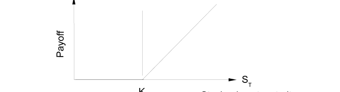

**图 A.1：** 看涨期权的收益。

### A.2 衍生品合约

衍生品合约不过是一种明确陈述的赌注。通常，这些赌注是以金融市场走势为条件表述的，但也可以购买与天气相关的衍生品。

在股票 $S$ 上，具有*到期日* $T$ 和*执行价* $K$ 的*欧式看涨期权*，是对股票在时间 $T$ 时的价格 $S_T$ 的一种赌注。如果你拥有这样一个期权，那么在时间 $T$ 你将收到以下金额：

$$
\max\{S_T - K, 0\}.
$$

图 A.1 展示了该看涨期权收益随价值 $S_T$ 变化的情况。

在股票 $S$ 上，具有*到期日* $T$ 和*执行价* $K$ 的*欧式看跌期权*，是对股票在时间 $T$ 时的价格 $S_T$ 的一种赌注。如果你拥有这样一个期权，那么在时间 $T$ 你将收到以下金额：

$$
\max\{K - S_T, 0\}.
$$

图 A.2 展示了该看跌期权收益随价值 $S_T$ 变化的情况。

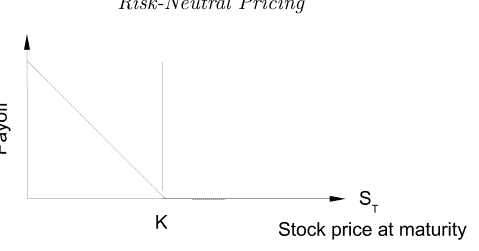

**图 A.2：** 看跌期权的收益。

这些看似奇怪的合约被称为期权，是因为你可以用以下方式表述该合约。在股票 $S$ 上，到期日为 $T$ 的欧式看涨期权，是在时间 $T$ 以执行价格 $K$ 购买该股票的*权利*，而非*义务*。因此，客户在时间 $T$ 拥有是否*行使*该期权并购买股票的*选择权*。

为了理解为什么这些表述是等价的，请注意，如果在时间 $T$ 股票价格 $S_T$ 大于 $K$，合约持有者肯定会抓住机会以价格 $K$ 购买股票。这意味着他们获得了一份价值 $S_T$ 的股票，但支出了 $K$ 的现金。因此，在时间 $T$，其投资价值为

$$
S_T - K.
$$

另一方面，如果在时间 $T$ 股票价格小于 $K$，那么以高于市场价的价格购买股票就没有意义了。因此在这种情况下，他们不行使该期权，其财富保持不变。考虑到这两种可能性，可以看出他们最终获得的金额为

$$
\max\{S_T - K, 0\}.
$$

“欧式”一词指的是股票持有者只允许在到期日 $T$ 行使该期权。当衍生品最初进行交易时，这是欧洲市场期权合约的惯例。而在美国市场，惯例是可以在到期前任何时间选择是否行使期权。由于美式期权比欧式期权给予更多的选择权，美式期权合约的价格至少与欧式期权相同。

如今，典型的市场惯例并不那么严格地按大洲划分。通常，单只股票的期权是美式的，而股票指数期权是欧式的。在本书中，我们将主要关注欧式期权，因为它们的定价更简单。因此，有时我们会省略“欧式”一词，仅谈论看跌和看涨期权。

关于衍生品合约*可以*是什么，实际上没有硬性规定。如果你能构思出一份合约并找到愿意购买的人，你就发明了一种新的衍生品。你可能还需要为你的新衍生品构思一个交易策略，以免破产！构思有趣的金融新合约是*结构设计师*的角色。结构设计师在银行内部工作，设计新颖的合约，银行认为他们能成功对冲这些合约的风险，并且银行的客户会认为这是管理风险的诱人工具，从而愿意购买。

以下是我们将在本书中讨论的其他一些衍生品合约。术语很多，但概念都不复杂。

-   到期日为 $T$、执行价为 $K$ 的亚洲期权。其收益通过取 $\max(\text{avg}(S) - K)$ 确定，其中 $\text{avg}(S)$ 是从时间 0 到到期日的平均股价。在实践中，不会对所有时间取平均值，而是会在某些固定时间取有限平均值。这类期权最早在亚洲市场交易，因此得名。

-   百慕大期权。这种期权允许你在到期前的某些固定时间选择行使期权。它比欧式期权提供了更大的灵活性，但不如美式期权灵活。之所以称为百慕大期权，是因为百慕大群岛位于欧洲和美洲之间。

-   到期日为 $T$、执行价为 $K$ 的数字看涨期权。如果到期时股价大于 $K$，其收益等于 1；否则等于 0。“二元期权”甚至“布尔期权”可能是更合乎逻辑的名称，但“数字期权”是标准术语。数字期权也有欧式、美式等版本。

-   数字看跌期权的收益为：如果到期时股价小于 $K$，则等于 1；否则等于 0。

-   到期日为 $T$、执行价为 $K$、障碍水平为 $B$ 的向上敲出式看涨期权，其收益定义为：

$$
\begin{cases}
\max \{S_T - K, 0\} & \text{if } S_t < B \text{ for all times } t \in [0, T] \\
0 & \text{otherwise.}
\end{cases}
$$

该期权的名称源于以下事实：如果股票任何时候达到或超过障碍水平 $B$，该期权将变得毫无价值。在这种情况下，我们称该期权已“敲出”（knocked out）。如果股票价格超过障碍水平，期权就会敲出，因此被称为向上敲出期权。类似地，可以通过以下方式定义向上敲入式看涨期权：

$$
\begin{cases}
\max \{S_T - K, 0\} & \text{if } S_t > B \text{ for some time } t \in [0, T] \\
0 & \text{otherwise.}
\end{cases}
$$

询问为什么有人想购买这些金融产品是合理的。通常的答案是，它允许人们根据自己的风险偏好和信念来管理风险。

让我们通过一个例子来说明这一点。

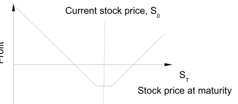

**图 A.3：由一个看跌期权和一个看涨期权组成的“跨式组合（Strangle）”。**

该图展示的是总利润而非仅仅是期权的收益，因为我们在计算中已经考虑了购买期权的成本。

如果股价保持不变，投机者将会亏损（即购买期权所花费的金额），但如果股价大幅上涨或大幅下跌，投机者就会获利。通过交易期权，投机者能够构建一个与其信念高度匹配的赌注。预测一只股票何时会出现大幅波动远比预测其是上涨还是下跌容易得多，因此这种策略是交易员的一个有力工具。这种特定的策略被称为“跨式组合（Strangle）”。

值得注意的是，通过买卖具有不同执行价的看涨和看跌期权的组合，可以近似实现几乎任何形状的收益曲线。图 A.3 只是一个简单的例子。这解释了为什么简单的看涨和看跌期权如此受欢迎；它们可以用来构建对股市未来走势非常精准定向的赌注。

另一个重要观点是，尽管“赌注”一词听起来有些负面，但赌注也可以用于保险。衍生工具经常被用于保险目的。

**例 2：** 考虑一位即将退休的养老金投资者。由于股票市场风险过高，他们不太可能希望将所有财富都投资于股市。另一方面，他们也不希望将所有财富都锁定在政府债券中，因为利率太低。一个显而易见的解决方案是将部分资金投入股票，部分投入债券。这种方法的缺点是，如果你想最优化地投资，结果发现你必须频繁地在股票和债券之间重新平衡投资组合（这个问题曾被梅顿 [12] 深入研究过）。频繁地重新平衡投资组合需要对养老金进行主动管理。此外，重新平衡投资组合会产生巨额交易成本。一种替代方法是使用衍生工具创建一个风险介于股票和债券之间的投资组合。如果你假设在所有可能的执行价上都可以获得看跌和看涨期权，那么事实证明，你可以通过在时间 0 交易衍生工具，然后简单地等待到期，来复制梅顿的策略。

重要的是，当涉及到这些策略的实际实施时，购买衍生工具可以允许你降低交易成本，并在很大程度上消除对主动管理的需求。

## A.3 无风险中性定价

银行希望提供其客户所期望的金融产品。为了使客户满意并确保其金融产品具有流动性的市场，银行通常愿意买入或卖出相同的金融产品。由于市场竞争激烈，银行对买卖同一产品只能收取略有不同的金额。当然，它们在买卖时确实总是收取略有不同的金额。这种差异反映了银行盈利的需求。这种以相似价格既愿意买入又愿意卖出的意愿，也许是银行与投机者之间最显而易见的区别。

银行的行为非常像博彩公司，因为它们愿意接受赌注的任一侧。因此，它们以与博彩公司非常相似的方式对金融产品进行定价。

关于博彩公司提供的赔率，有一个非常有趣的事实是，这些赔率并不一定反映特定事件发生的概率。相反，博彩公司的赔率更多告诉你哪些赌注卖得火爆，哪些卖得惨淡。

举个例子，许多人出于情感原因而非真正相信获胜而愿意为他们最喜欢的足球队下注。他们押注于他们*想要*发生的结果，而不是他们认为*将会*发生的结果。类似地，许多人不喜欢押注于大热门。这是因为即使他们的马匹获胜，他们可能也赚不到足够的钱来让自己兴奋。大多数人下注既是为了娱乐也是为了利润。从金融市场角度来看，一天内投资回报率为 1% 已经是很高的回报率了。然而，如果你在赛马场，押 100 英镑在一匹只有一匹马参赛的比赛中，希望赚 1 英镑，那么你可能不会觉得观看比赛特别有趣。

因此，博彩公司在选择提供什么赔率时，并不会费心去仔细研究马匹的体格和血统。相反，它们只是以某种方式匹配不同方之间的赌注，从而保证获利。这种利润来自博彩公司在接受特定赌注的不同方时提供的微小价差。

银行的衍生业务部门运作方式几乎完全相同。

衍生工具交易员在很大程度上对股票是上涨还是下跌漠不关心，正如博彩公司对哪匹马赢得比赛漠不关心一样。

由于博彩公司和银行的买价与卖价之间的差价都非常小，它们发现将自己视为以单一价格进行买卖的近似是一种有用的方法。在实践中，银行和博彩公司都可以首先选择一套自洽的价格，愿意以这些价格进行买卖。然后，当客户要求购买某特定产品时，它们报价略高；当客户希望卖出时，报价略低。通过这种方式，它们期望从客户下注的每一个事件中获得微薄利润。

银行或博彩公司提供的价格必须在某种程度上自洽至关重要。它们不希望发生的情况是客户能够下注一个复杂的赌注，而客户知道自己是稳赢的。这样的赌注被称为套利。

为了确保这种赌注不可能发生，博彩公司*仿佛*赌注的成本是由某种概率模型中的预期收益决定那样对赌注进行定价。如大家所知，博彩公司提供的赔率*看起来*像是由每匹马获胜的概率推导出来的。然而，正如我们所讨论的，这些价格是通过考虑赌注市场推导出来的，而不是通过考虑这些事件发生的实际概率推导出来的。

衍生工具交易员的工作方式完全相同。一个细微的区别是，衍生工具交易员提供的赌注周期比博彩公司更长，因此他们将在计算中考虑利息的收取和支付。

博彩公司和衍生工具交易员使用的概率模型被称为 $\mathbb{Q}$ 测度模型。这是一个看起来与普通概率模型完全相同的模型，但它计算出的值是价格的度量，而不是事件发生可能性的度量。试图衡量事件发生可能性的经典概率模型被称为 $\mathbb{P}$ 测度模型。

如果无风险银行账户的利率保持在恒定水平 *r*，使得在时间 0 投资本金 *P* 在时间 *t* 的价值为 *Pe* ${}^{rt}$，那么衍生工具交易员对一项在时间 *T* 支付 *f*(*S* ${}_{T}$) 的期权收取的金额由以下公式给出：

风险中性价格 $: = e^{-rT} \mathbb{E}_{\mathbb{Q}}(f(S_T))$。

这里 $\mathbb{E}_{\mathbb{Q}}$ 表示使用 $\mathbb{Q}$ 测度模型计算的期望值。因子 *e* ${}^{-rT}$ 是一个折现因子，用于考虑利息支付。称此价格为“风险中性价格”的动机稍后将解释。

请注意，如果你在无风险银行账户中投入初始资金 *P*，那么收益将是 *Pe* ${}^{rT}$，且独立于股价。因此，其在 $\mathbb{Q}$ 测度模型中的期望值也将是 *Pe* ${}^{rT}$。所以，一个在时间 0 投入 *P* 的银行账户的“风险中性”估值为：

*e* ${}^{-rT}\ \mathbb{E}_{\mathbb{Q}}(Pe^{rT}) = P$。

这提供了无风险估值公式一致性的基本测试：它能够正确地对无风险投资进行估值。

## 科尔莫哥洛夫公理

对于纯数学家而言，“几率”等直觉概念没有意义。为了进行严格的数学研究，需要概率论公理来严格推导结果。科尔莫哥洛夫公理提供了这一基础。数学方法解决问题的一个优势在于，同一数学模型通常可以应用于不同的现象。例如，引力理论和电力理论都遵循平方反比定律，因此可以用相同的方式进行建模。将概率的数学理论视为一种纯抽象理论是有用的，然后可以将其应用于模拟随机事件（使用概率作为 $\mathbb{P}$ 测度）或模拟价格（使用概率作为 $\mathbb{Q}$ 测度）。概率论还可以应用于研究与“几率”似乎毫无关系的研究领域。例如，概率论可用于研究积分。

科尔莫哥洛夫公理的数学细节可以在任何严格的概率论入门书籍中找到。宽泛地说，概率模型被定义为从事件集到区间 [0, 1] 的函数，该函数将“概率”分配给每个事件。需要注意的是，在数学上，这个模型只是一个函数。在几率或定价方面解释该函数超出了严格数学的范围。该函数可以被视为事件集“大小”的测度，较大的集合对应于发生概率较高的事件。使这一概念精确化的数学理论称为测度论，科尔莫哥洛夫公理就是以测度论的形式陈述的。这就是我们在讨论 $\mathbb{P}$ 测度和 $\mathbb{Q}$ 测度时“测度”一词的来源。

## A.4 股票价格建模

什么是良好的股票价格 $\mathbb{Q}$ 测度概率模型，什么是良好的 $\mathbb{P}$ 测度模型？

一种想法是假设在每个时间步长，股票价格上下波动的幅度服从正态分布。如果我们选择时间步长 $\delta t$，我们可以通过假设股票价格在 0 时刻处于给定水平 $S_0$，然后使用以下方程模拟其在后续时间 $\delta t$、$2\delta t$、$3\delta t$ 等的值，来对股票价格进行建模：

$$ S_{t+\delta t}=S_{t}+X_{t} $$

其中随机变量 $X_t$ 相互独立且服从正态分布，具有固定的均值和标准差。该模型以金融数学先驱之一路易斯·巴舍利耶（Louis Bachelier）的名字命名，称为离散的*巴舍利耶模型*。（之所以称为离散模型，是因为它只在离散的时间步长 $\delta t$ 上模拟股票价格。）

巴舍利耶模型的问题在于，如果股价为 10 美元，1 美元的变动幅度相当大；而如果股价为 1000 美元，1 美元的变动则相对较小。巴舍利耶模型假设增量的大小与当前股价无关，因此它不具备正确的标度行为。为了解决这个问题，我们简单地假设股价的对数具有相互独立的正态分布增量，且具有固定的均值和标准差。因此，我们写成

$$ \log(S_{t+\delta t}) = \log(S_t) + Y_t \quad \text{(A.1)} $$

其中 $Y_t$ 是相互独立的正态分布随机变量，具有固定的均值和标准差。

我们现在可以将每个 $Y_t$ 表示为某些其他正态分布随机变量 $\epsilon_t$ 的函数，这些随机变量具有均值 0 和标准差 1。如果 $A$ 是每个 $Y_t$ 的均值，$B$ 是标准差，则有

$$ Y_t = A + B \epsilon_t. $$

假设从 0 到 1 有 $N = \frac{1}{\delta t}$ 个时间步。利用随机变量和的期望和方差的公式，我们可以如下计算 $\log S_t$ 的均值和方差。

$$ \mathbb{E}(\log(S_1) - \log(S_0)) = N \mathbb{E}(Y_t) = \frac{A}{\delta t}. $$

$$ \mathrm{Var}(\log(S_1) - \log(S_0)) = N \mathrm{Var}(Y_t) = \frac{B^2}{\delta t}. $$

在金融学中，我们使用年为单位来衡量时间。因此，第一个公式表明，股价的对数平均每年增长 $\frac{A}{\delta t}$。第二个公式可以类似地解释为一年内标准差。

让我们用 $\bar{\mu}$ 表示股价对数一年内预期增长率，用 $\sigma$ 表示股价对数一年内增长率的方差。

然后我们可以用 $\bar{\mu}$ 和 $\sigma$ 来表示 $A$ 和 $B$。我们有：

$$ A = \bar{\mu} \delta t, \quad B = \sigma \sqrt{\delta t}. $$

这允许我们将模型 (A.1) 重写如下：

$$ \log(S_{t+\delta t}) = \log(S_t) + \bar{\mu} \delta t + \sigma \sqrt{\delta t} \epsilon_t \quad \text{(A.2)} $$

以这种形式重新表述模型的好处是，我们清楚地说明了常数 $\tilde{\mu}$ 和 $\sigma$ 如何根据股价对数在一年内的变化进行解释。相比之下，$A$ 和 $B$ 的选择取决于时间间隔 $\delta t$ 的选择，因此没有如此自然的解释。

独立正态分布随机变量之和也是正态分布随机变量，因此在我们的模型中，股价的对数在所有时间都服从正态分布。我们可以像上面计算 1 时刻的均值和方差一样，计算任何后续时间 $T$ 的均值和方差。我们得出结论，根据此模型，在任何时间 $t$，股价的对数服从均值 $\log S_{0}+\tilde{\mu} t$ 和标准差 $\sigma \sqrt{t}$ 的正态分布。我们写为：

$$ \log S_{t} \sim N(\log S_{0}+\tilde{\mu} t, \sigma^2 t). $$

*（注：原文中标准差项为 $\sigma \sqrt{t}$，对应方差为 $\sigma^2 t$。原始 OCR 在 N 的参数中使用了 $\sigma \sqrt{t}$，这在技术上是方差参数。标准记法 $N(\mu, \sigma^2)$ 接受方差。然而，遵循提供的内容：）*

$$ \log S_{t} \sim N(\log S_{0}+\tilde{\mu} t, \sigma^2 t) $$

这意味着我们还可以计算每个时刻 $S_{t}$ 的分布。由于 $\log S_{t}$ 服从正态分布，我们称 $S_{t}$ 服从对数正态分布。

让我们根据此模型计算 $S_{t}$ 的概率密度函数。我们可以写下 $z_{t} := \log S_{t}$ 的概率密度。它是

$$ p_{z_{t}}(x)=\frac{1}{\sigma \sqrt{2 \pi} t} \exp \left(-\frac{\left(x-\log \left(S_{0}\right)-\tilde{\mu} t\right)^{2}}{2 \sigma^{2} t}\right) \quad \text{(A.3)} $$

我们可以使用它来计算 $S_{t}=\exp \left(z_{t}\right)$ 的期望值。所需的积分留作练习。结果是

$$ \mathrm{E}\left(S_{t}\right)=S_{0} \exp \left(\left(\tilde{\mu}+\frac{1}{2} \sigma^{2}\right) t\right). $$

因为右边等同于本金 $S_{0}$ 以 $\tilde{\mu}+\frac{1}{2} \sigma^{2}$ 的连续复利利率投资的增长，引入一个变量 $\mu := \tilde{\mu}+\frac{1}{2} \sigma^{2}$ 称为漂移（drift）是自然的。由于投资者已经非常理解利率的概念，对于经验丰富的投资者来说，漂移比 $\tilde{\mu}$ 是一个更直观的概念。因此，让我们用 $\mu$ 重写我们的模型。

### 定义。离散时间几何布朗运动

$$ \log \left(S_{t+\delta t}\right)=\log \left(S_{t}\right)+\left(\mu-\frac{1}{2} \sigma^{2}\right) \delta t+\sigma(\delta t)^{\frac{1}{2}} \epsilon_{t} \quad \text{(A.4)} $$

> *我们将此模型称为离散时间几何布朗运动模型。由于本书很少使用连续时间随机过程的数学理论，我们有时会简单地将此模型称为几何布朗运动。参数 $\mu$ 是漂移，可以解释为如上所述的利率的一种形式。参数 $\sigma$ 称为波动率。它衡量股票市场随机波动的大小。*

在文献 [2] 中，布莱克（Black）和肖尔斯（Scholes）提出该模型的连续时间版本可作为股票价格的 $\mathbb{P}$ 测度模型。因此，我们有时将此模型称为股票价格的布莱克-肖尔斯模型。

要回答这是否是一个良好的 $\mathbb{P}$ 测度模型，需要进行统计检验，看看模型与实际数据拟合的程度。数据表明，这仅是对股票价格实际行为的粗略近似。模型的一个显著缺陷是它低估了股价发生重大变化的概率。模型的另一个显著缺陷是波动率是常数，但看起来它随时间变化。因此，对于实际的金融应用，离散时间几何布朗运动可能不是股票价格 $\mathbb{P}$ 测度模型的良好选择。然而，对于教学目的，它是一个良好的选择，因为它相对容易写出和分析。

离散时间几何布朗运动是股票价格 $\mathbb{Q}$ 测度模型的良好选择吗？通常不是，因为它会提供不一致的价格信息。回想一下，在 $\mathbb{Q}$ 测度模型中，金融产品的价格由金融产品的折现期望值给出。我们可以利用这一点计算出 0 时刻的股票价格由下式给出：

$$ S_0 \exp((\mu - r)t). $$

另一方面，根据定义，0 时刻的股票价格是 $S_0$。因此，离散时间几何布朗运动只有在我们有 $\mu = r$ 时才能是 $\mathbb{Q}$ 测度模型。我们做如下定义。

**定义。** 股票价格的 $\mathbb{Q}$ 测度几何布朗运动模型由下式给出：

$$ \log \left( \frac{S_{t+ \delta t}}{S_t} \right) = \left( r - \frac{1}{2} \sigma^2 \right) \delta t + \sigma(\delta t)^{ \frac{1}{2}} \epsilon_t \quad \text{(A.5)} $$

重要的是要意识到，大多数人会立即认为这不可能是一个合理的 $\mathbb{P}$ 测度模型。大多数投资者投资股市的动机是他们期望股票的回报率高于无风险投资。对于这些投资者来说，立即得出的结论是他们们的 $\mathbb{P}$ 测度模型不能是 $\mathbb{Q}$ 测度模型。对于模型 (A.4) 的情况，人们会期望 $\mathbb{P}$ 测度模型具有 $\mu > r$。这就是*无风险定价*短语的来源。$\mathbb{P}$ 测度和 $\mathbb{Q}$ 测度只对极少数对投资是否有风险无所谓的异常投资者重合。这样的投资者被称为*风险中性*投资者。典型的养老金投资者是*风险厌恶*的。赌徒是*风险寻求*的。

虽然我们看到了公式 (A.5) 对于除风险中性投资者以外的任何人来说都不是一个好的 $\mathbb{P}$ 测度模型，但它是否是 $\mathbb{Q}$ 测度模型的良好选择？它肯定是一个给出正确初始值的概率模型

...

## 定理 1. Black–Scholes 公式
如果利用 Q 测度几何布朗运动模型 (A.5) 对股票期权进行定价，则在 $0$ 时刻，到期日为 $T$，执行价为 $K$ 的欧式看涨期权价格为：

$$ C = N(d_1)S_0 - N(d_2)K\exp(-rT) \tag{A.6} $$

其中 $N$ 是标准正态分布的累积分布函数，

$$ d_1 = \frac{1}{\sigma\sqrt{T}}\left(\log\left(\frac{S}{K}\right) + \left(r + \frac{\sigma^2}{2}\right)\sqrt{T}\right), $$

且

$$ d_2 = \frac{1}{\sigma\sqrt{T}}\left(\log\left(\frac{S}{K}\right) + \left(r - \frac{\sigma^2}{2}\right)\sqrt{T}\right). $$

*相应的欧式看跌期权公式为：*

$$ P = N(-d_2)K\exp(-rT) - N(-d_1)S. \tag{A.7} $$

为了检验我们的 Q 测度模型是否能准确拟合市场数据，我们应该查看能否找到参数值，使得上述公式给出的价格与期权的市场实际价格相匹配。这将作为一项相当有挑战性的练习留给读者，尝试使用本书中发展的 C++ 技能来完成（练习 19.4.5）。答案是，我们的 Q 模型对期权市场数据提供了基本的粗略拟合，但在实践中需要更复杂的模型。

我们应当强调，Black 和 Scholes 在其开创性论文 [2] 中基于 P 测度模型，使用了更为详尽的论证来推导这些公式。我们仅仅假设定价模型具有特定形式，然后计算了一些积分。当我们讨论对冲时，会更详细地讨论 Black 和 Scholes 的原始论证。

## 提示：量纲分析
在金融计算中，惯例是以年作为时间单位。在书写金融公式时，常常省略单位。例如，人们可能会提到 5% 的利率，而或许应该更清晰地说明这是 5% 的年利率。因此，利率的量纲是 $T^{-1}$，其中 $T$ 代表时间量纲。漂移参数 $\mu$ 的量纲也是 $T^{-1}$。从上方的公式可以看出，波动率参数 $\sigma$ 的量纲必须是 $T^{-\frac{1}{2}}$。这表明，对数股价变化的标准差以与时间平方根成正比的比率增长。这仅仅是计算独立增量方差公式的一个结果。波动率通常以百分比表示，因此 20% 的波动率意味着 $\sigma=0.2$。

你可以利用这种量纲分析来检查金融数学中的各种公式。例如，我们可以将离散时间 Black–Scholes 模型 (A.4) 重写为：

$$ \log \left( \frac{S_{t+\delta t}}{S_{t}} \right)=\left(\mu-\frac{1}{2} \sigma^{2}\right) \delta t+\sigma(\delta t)^{\frac{1}{2}} \epsilon_{t}. $$

在这个公式中，股价的单位为（例如）美元，但这些单位在计算 $\frac{S_{t+\delta t}}{S_{t}}$ 时相互抵消，从而得到一个无量纲量。同样地，等式右边的所有项都是无量纲的。

如果你听说过*分形*及其相关的分数维理论，你可能会感兴趣地注意到，波动率的分数维与股价是分形这一事实有关。

## A.5 蒙特卡洛定价
为了计算更复杂衍生品的无风险价格，可以使用蒙特卡洛定价算法。该算法如下：

- *使用你的 Q 测度模型模拟 N 个资产价格情景。*
  情景仅仅是资产价格的一种可能未来集合。这些资产价格只需在与衍生品合约相关的时间点计算。对于欧式期权，这意味着你只需在到期日计算价格。对于离散时间敲出期权，你需要在中间时间点计算价格，以查看期权是否被敲出。你的模拟应具有与你的 Q 测度模型相同的概率分布。
- 计算衍生品收益的平均最终值。
- 将平均收益进行折现，以考虑利率。这是衍生品价格的估计值。

支撑这种方法的一个数学定理是中心极限定理。它告诉我们，以此种方式计算的期望价格等于无风险价格。此外，它还告诉我们，该估计的标准误与 $1/\sqrt{N}$ 成正比。因此，通过增加模拟中的情景数量，可以获得越来越精确的衍生品价格估计。我们还可以利用中心极限定理计算误差的置信界。

如果衍生品的收益仅依赖于单一时间点的单一股价，则不需要使用蒙特卡洛定价。回顾一下，无风险价格被定义为期望，而期望又定义为积分。如果衍生品的价格仅依赖于单一时间点的股价，则只需计算一维积分。使用辛普森法则比使用蒙特卡洛算法更高效。

如果衍生品的收益依赖于多个时间点的股价或依赖于多个风险因素，则相关积分将是高维积分。通常，高维积分很难高效执行，需要某种形式的蒙特卡洛算法。我们在上面给出的用于衍生品定价的蒙特卡洛算法只是蒙特卡洛积分公式的一个应用。

尽管这仅是中心极限定理的一个特殊情况，让我们明确陈述这一结果。

> **定理 2.** 设 $f : [0,1]^d \to \mathbb{R}$ 为可积且平方可积函数。则可以通过以下方式估计 $d$ 维积分 $\int f$：
>
> $$ \frac{1}{N} \sum_{j=1}^{N} f((x_1^j, x_2^j, \dots, x_d^j)) $$
>
> 其中 $x_i^j$ 是区间 $[0, 1]$ 上均匀分布的随机变量。我们的意思是，右边求和的期望值等于 $\int f$，且
>
> $$ \sqrt{N} \left( \frac{1}{N} \left( \sum_{j=1}^{N} f((x_1^j, x_2^j, \dots, x_d^j)) \right) - \int f \right) $$
>
> 依分布收敛于正态分布 $N(0, \sigma^2)$。

重要的是要知道，本节仅描述了蒙特卡洛定价的最基本形式。有许多可能的改进。关于一个简单的例子，参见练习 9.3.7。应查阅专门介绍蒙特卡洛定价的书籍以了解最新技术。实现更复杂的蒙特卡洛算法将是检验你通过阅读本书所发展的 C++ 技能的绝佳测试。

我们补充说明，蒙特卡洛技术可用于许多其他目的，而不仅仅是计算无风险价格。蒙特卡洛方法也可用于计算风险指标、制定最优交易策略以及测试交易策略的有效性。

我们还注意到，蒙特卡洛方法并不是衍生品的唯一定价方法。我们将在练习中看到，简单的衍生品可以使用矩形法则或辛普森法则等熟悉的积分规则进行定价。也有基于树状结构和偏微分方程的定价方法。

## A.6 对冲
我们描述了交易者如何使用无风险定价方法论来产生保证无套利的价格。然而，这远不足以保证收取这些价格的交易者能赚钱。

这一点在考虑博彩公司时是显而易见的。博彩公司需要产生一组一致的愿意买卖不同赌注的价格。但这并非他们必须做的全部。他们需要找出如何*对冲*他们的赌注。这是在平衡不同客户赌注的过程中，以确保博彩公司不会赔钱。注意，对冲赌注的另一种方式是与另一家博彩公司进行相反的对冲赌注，因此不必等待合适的客户到来就可以开始对冲赌注。

一般来说，对于每个你可能面临的风险来源，你至少需要放置一个对冲。在一个包含单一股票的简单股票市场模型中，遵循几何布朗运动 (A.4) 且具有固定无风险利率，唯一的风险来源是股价。因此，出售衍生品的交易者将希望至少放置一个赌注，以降低其对股价变化的风险。

衡量你的投资组合对股价变化风险程度的一种方法是计算其对股价变化的敏感度。如果 $P$ 是你的投资组合价值，敏感度：

$$ \frac{\partial P}{\partial S} $$

给出了如果股价发生变化，其他因素保持不变时，你的投资组合价值会变化多少的度量。这种敏感度被称为投资组合的 Delta，记作 $\Delta$。

显然，仅由 $n$ 股股票组成的投资组合的 Delta 简单地是 $n$，而仅由无风险投资组成的投资组合的 Delta 是 0。这意味着，通过借钱卖股票，或者通过卖股票并将资金投入无风险投资，可以改变一个人投资组合的 Delta。我们假设在任何给定价格下，都可以买卖任意数量的股票

类似地，在无风险银行账户中也可以存入任意金额，并且可以以相同的利率借出任意金额。这意味着，通过在无风险账户和股票之间转移资金，可以将投资组合的德尔塔值（delta）调整为任意期望值。

可以买卖任意数量的股票，并且可以无限制地以相同利率进行借贷，这只是一个简化的假设。该假设的本质是，个体是大型市场中的一名小玩家，且交易成本可以忽略不计。请注意，我们允许卖出自己未持有的股票，从而获得一个包含负数量股票的投资组合。这仅仅是一种数学上的简写，类似于负数银行账户是负债的简写，它指的是以相同的方式向他人借入股票。

在此假设下，总是可以通过交易股票来确保投资组合的德尔塔值为 0。这意味着，在一阶近似下，当股票价格变动时，投资组合的价值不会发生变化。这是在任意时刻能够做出的最佳对冲。德尔塔对冲的交易策略是定期交易股票，以确保投资组合的德尔塔值始终接近零。这种交易策略是风险中性定价成功的关键。

追求这种策略的交易员会对衍生品产品收取风险中性价格，然后遵循德尔塔对冲的交易策略。其思想在于，由于对股票价格变动的敏感度保持在 0，该策略应当接近无风险（至少在使用 Q 概率衡量风险时）。该策略的有效性取决于交易频率，以将德尔塔值保持在零附近。当趋近于连续时间下的德尔塔对冲时，该策略的实际风险确实会降至零。我们将不会在数学上证明这一点。相反，在第 14 章中，我们通过绘制这种投资策略的损益直方图并观察其随时间间隔缩短而变化的情况，来从数值上验证这一理论。此外请注意，该方法可以推广到多个风险因子；为了进行对冲，需要以某种方式投资于金融产品，使得对每个风险因子的整体敏感度为零。

对这种策略最明显的反对意见在于，它是使用 Q 概率来衡量投资风险的。然而，如果认为反映市场价格的 Q 概率与事件实际发生的 P 概率相差不大，那么人们就有理由希望，即使使用 P 概率来衡量风险，该策略的风险仍然很低。

这就引出了一个关于如果使用一组特定的 Q 概率进行德尔塔对冲，而股票价格实际上根据另一组 P 概率演化的情况下，德尔塔对冲策略表现如何的问题。回答这个问题的一种方法是进行数值实验。我们在第 14 章中采用了这种方法。实际上，人们可以对德尔塔对冲策略在各种约束条件下的表现进行相当复杂的测试。例如，人们可以研究如果遵循使用 Q 模型 (A.5) 推导出的德尔塔对冲策略，但股票价格实际上使用完全不同的模型演化（可能包括肥尾效应和交易成本等特征），会发生什么情况。这些数值结果足以解释交易衍生品并采用德尔塔对冲策略投资是否是一种有利可图的策略。这些结果还可以表明，面对诸如交易成本等问题时，应该收取多少费用才能获得可接受的利润。

尽管这些数值实验执行起来很简单，但这并不能反映风险中性定价理论发展的历史。在文献 [2] 中，从数学上证明，如果股票价格遵循 P 测度模型 (A.4)，那么只要使用 Q 测度模型 (A.5)，连续时间下的德尔塔对冲策略就是无风险的。这一结果的推论是，如果相信 P 测度模型 (A.4) 的连续时间版本是股票价格的完美模型，那么对衍生品进行定价的唯一一致方式就是使用 Q 测度模型 (A.5)。

这一数学结果对金融市场产生了深远的影响。它为银行如何通过交易衍生品来获利提供了一种类于数学上的解释。

然而，该数学结果需要许多不切实际的假设。具体来说：

-   可以按此价格买卖无限数量的股票，并且不受限于购买整数股（我们称其为具有无限流动性）。
-   没有交易成本。
-   可以进行连续时间交易。
-   股票价格遵循模型 (A.5) 的连续时间极限。
-   可以以固定的无风险利率 $ r $ 投资或借贷任意金额。
-   股票不支付股息。

可以使用更复杂的建模来解决最后三个问题，并仍然获得类似的数学结果，但前三个假设对于论证至关重要。

因此，在某些方面，第 14 章的数值结果比数学结果更有说服力，因为人们可以很容易地用更现实的市场模型来测试该策略的表现。

经验证据清楚地表明，诸如无交易成本、无限流动性、恒定波动率以及股票价格服从对数正态分布等假设是不切实际的。更微妙的是，假设交易员对市场可能的演化有自己的看法（即固定的 P 测度模型）通常也是错误的。正如赛马博彩商对赛马表现几乎没有或没有任何看法一样，衍生品交易员也不需要形成对股票市场的细致观点。在实践中，衍生品交易员选择 $\mathbb{Q}$-测度模型的基本形式，然后根据实际的看跌和看涨期权价格数据来拟合参数。这个过程被称为校准。交易员随后简单地假设 $\mathbb{P}$-测度模型与其定价模型之间的差异足够小，使得他们的对冲策略和定价政策仍然能够以可接受的风险获得可接受的利润。

尽管 Black-Scholes 模型和德尔塔对冲策略的数学推导严重依赖于一些不太可信的假设，但只要选择良好的 $\mathbb{Q}$-测度模型，德尔塔对冲的实际策略在实践中就能有效运作。对此最有说服力的证明是银行衍生品交易台在金融上的成功。

重要的是要注意，风险中性定价方法加上德尔塔对冲只是众多可能的投资策略中的一种。

另一种数学方法是使用期望效用的概念来对金融产品进行定价。效用函数为投资者的未来财富赋予一个数值，以衡量投资者对该结果的满意程度。然后，可以通过假设投机者试图在与该投资者信念相匹配的 $\mathbb{P}$ 模型中最大化其期望效用，来建模投机者的行为。利用该模型，投机者试图通过形成比其他人更准确的信念，从而超越市场表现来获取利润。这与简单跟随市场、通过向买家收取略高于向卖家支付价格的利润的方法截然不同。特别是，投机者愿意承担巨大风险以期望获得巨大收益。而德尔塔对冲者则试图完全避免风险，转而通过提供有价值的服务来获得利润。

## A.7 总结

我们描述了银行使用的德尔塔对冲策略。该策略实际上是通过向客户出售风险管理服务来使银行获利。风险中性定价是德尔塔对冲策略的关键组成部分。风险中性定价告诉你在遵循德尔塔对冲策略时应该向客户收取多少费用。此外，风险中性价格的偏导数告诉你在遵循德尔塔对冲策略时如何对冲风险。

其他类型的投资者使用其他的交易策略，因此也使用其他的定价方法。

## 参考文献

- [1] K. Beck.《极限编程详解：拥抱变化》。Addison-Wesley Professional，2000。
- [2] F. Black 和 M. Scholes. 期权与公司负债的定价。《政治经济学杂志》，第637–654页，1973年。
- [3] D. J. Duffy.《使用 C++ 进行金融工具定价》。John Wiley & Sons，2013。
- [4] R. Gamma, R. Helm, R. Johnson 和 J. Vlissides.《设计模式：可复用面向对象软件的基础》。Pearson Education India，1995。
- [5] A. Hunt 和 D. Thomas.《程序员修炼之道：从新手到高手》。Addison-Wesley Professional，2000。
- [6] M. S. Joshi.《数学金融的概念与实践》，第1卷。Cambridge University Press，2003。
- [7] M. S. Joshi.《C++ 设计模式与衍生品定价》，第2卷。Cambridge University Press，2008。
- [8] N. M. Josuttis.《C++ 标准库：教程与参考》。Addison-Wesley，2012。
- [9] B. W. Kernighan, D. M. Ritchie 和 P. Jensen.《C 编程语言》，第2卷。Prentice-Hall，1988。
- [10] W. Margrabe. 兑换一种资产为另一种资产的期权价值。《金融学杂志》，33(1):177–186，1978。
- [11] H. Markowitz. 投资组合选择。《金融学杂志》，7(1):77–91，1952。
- [12] R. C. Merton. 不确定性下的终身投资组合选择：连续时间情形。《经济评论与统计》，第247–257页，1969。
- [13] S. Meyers.《高效 C++：提高程序与设计质量的55个具体方法》。Pearson Education，2005。
- [14] S. E. Shreve. *《金融随机 calculus I：二元资产定价模型》*。Springer Science & Business Media，2004。
- [15] S. E. Shreve. *《金融随机 calculus II：连续时间模型》*，第11卷。Springer Science & Business Media，2004。
- [16] B. Stroustrup. *《编程：使用 C++ 的原则与实践》*。Pearson Education，2014。
- [17] D. Vandevoorde 和 D. M. Josuttis. *《C++ 模板》*。Addison-Wesley Longman Publishing Co., Inc.，2002。

## 索引

- `/*…*/`，多行注释，8
- `//`，单行注释，8
- `&`，按位与，29
- `&`，获取内存地址，181
- `&`，引用，101
- `&&`，逻辑与，29
- `->`，指针运算符，182
- `\a`，响铃字符，22
- `\n`，换行符，9
- `\r`，回车符，22
- `\t`，制表符，22
- `~`，按位异或（XOR），29
- $\Delta$，股价德尔塔，379
- `.`，点运算符，126, 129
- `=`，赋值运算符，29
- `= 0`，抽象方法，162
- `==`，比较运算符，29
- `|`，按位或，29
- `||`，逻辑或，29
- `!=`，不等于运算符，29
- `? :`，三元运算符，66
- `*`，指针运算符，181
- `*`，类型修饰符，182
- `-`，非运算符（按位或非逻辑，视上下文而定，此处译作“取反/非”或保留原意“非运算符”），29
- 抽象函数，212
- 美式期权，367
- 对偶抽样法，157
- 套利，371
- 数组编程，286
- 数组，176
- ASCII，22
- 亚式期权，368
- 卖价（Ask price），243
- 汇编语言，3
- `ASSERT`，87
- 断言，87
- 赋值运算符，282
- 赋值操作符，30
- `auto`，306
- Bachelier 模型，373
- 基类，207
- 百慕大式期权，368
- 买卖价差（Bid ask spread），243
- 买价（Bid price），243
- 位（bit），18
- 布莱克-舒尔斯公式，376
- 布莱克-舒尔斯模型，375
- 样板代码，8
- `bool`，20
- 布尔值，20
- `break`，60
- 断点，250, 256
- 缺陷跟踪，259
- 构建，260
- 字节，18
- 看涨期权（Call option），365, 366
- 捕获变量，332
- 强制类型转换，22
- `catch`，63
- 中心极限定理，378
- `char`，20
- `char*`，C 风格字符串，27, 185
- 字符，20
- 派生类，209
- 乔莱斯基分解，292, 321
- `cin`，9
- 类，124
- class 关键字，125
- 代码审查，246
- 逗号运算符，67
- 命令模式，346
- 注释，8
- 编译型语言，3
- 编译器，3
- 并发编程，338
- `condition_variable`，355
- 控制台，39
- `const`，47, 102, 130, 188, 274
- 构造函数，138
- `continue`，60
- 持续集成，261
- 拷贝构造函数，283
- `cout`，9
- 中央处理器（CPU），17
- 数据库，345
- 死锁，343
- `DEBUG_PRINT`，88
- 调试器，247
- 声明，42, 125, 296
- `default`，63
- 默认构造函数，139
- 定义，42, 80, 130, 296
- `delete`，192
- `delete []`，179
- 德尔塔（Delta），157, 379
- 德尔塔对冲，233, 380
- 衍生品，366
- 析构函数，269
- 开发环境，1
- 数字化期权（Digital option），368
- `do`，57
- `double`，9, 20
- 下障碍敲出期权，368
- `else`，13
- 封装，135
- 错误处理，61
- 转义，22, 115
- 欧式期权，366
- 继承（extends 在 Java 中，C++ 中通常用 public 继承表示，此处保留原词语境或译为“扩展”），208
- 极限编程，91
- 工厂设计模式，227
- `false`，20
- `float`，9, 20
- `for`，58, 309
- 前向声明，217
- 函数，37
- 函数对象，329
- 函数指针，333
- 仿函数，329
- 通用保护性故障，203
- 几何布朗运动，375
- 全局变量，47
- 图形处理器（GPU），287
- 头文件，72, 77
- 堆，200, 202
- 对冲，379
- 十六进制，18
- HTML，117
- `if`，13, 32
- `include`，28, 72, 77
- 无差异定价，382
- `INFO`，88
- 信息隐藏，78
- 继承，207
- 初始化列表，140
- `initializer_list`，315
- `inline`，80
- 成员函数内联，205
- `instance`，124
- `int`，9, 18
- 接口，159
- 解释型语言，3
- 迭代器，307
- 千字节，18
- 敲入期权，368
- 敲出期权，368
- 科尔莫哥洛夫公理，372
- Lambda 函数，330
- 库，359
- 流动性，381
- `list`，312
- 局部类，171
- 局部变量，47
- 日志记录，246, 261
- `long`，19
- 机器码，3
- 宏，86
- **main**，39
- Makefile，6
- make_shared，196
- map，315
- 玛格勒布期权，326
- 矩阵，267
- 到期日，366
- 测度论，372
- 兆字节，18
- 成员函数，129
- 成员变量，125
- 内存地址，26
- 内存泄漏，203, 262
- 梅森旋转随机数生成器，154
- 默顿问题，370
- 消息架构，354
- 方法，124
- 模块化，40
- 蒙特卡洛定价，145, 377
- 移动运算符，285
- mt19937，154
- 多重继承，215
- 互斥锁，340
- 互斥，339
- **namespace**，48
- **new**，192
- **new []**，179
- 半字节，18
- 空指针异常，203
- 以 null 结尾的字符串，185
- **nullptr**，194
- 对象，124
- **ofstream**，104
- 一次且仅一次，40
- 运算符重载，275
- 运算符，28
- **ostream**，104
- 函数重载，46
- **override**，211
- 结对编程，246
- 参数，38
- 父类，209
- 引用传递，101
- 值传递，101
- 管道，352
- F-度量，371
- 指针，27, 179
- 指针算术，182
- 多态，166
- **#pragma once**，77
- **private**，135
- 私有继承，215
- 进程，337
- 性能分析，262
- **protected**，220
- 伪平方根，321
- **public**，125
- 看跌期权，366
- Q-度量，371
- 竞态条件，340
- 随机数，154
- 递归，41
- 引用，101
- 发布，12
- 资源获取即初始化（RAII），341
- **return**，38, 60
- 引用返回，280
- 风险中性定价，370
- 三法则，282
- 作用域，47, 65
- 种子，155
- SEGV（段错误），203
- 集合，310
- shared_ptr，194
- **short**，19
- 短路求值，66
- **sizeof**，28
- size_t，20
- 智能指针，194
- 栈，200
- 堆栈跟踪，248, 253
- 标准模板库（STL），303
- **static**，79, 218
- 静态分析，261
- 静态成员，218
- 静态类型，17
- static_cast，26
- stdafx.h，72
- 行权价，366
- 字符串，106
- stringstream，107
- 结构化产品，367
- 子类，209
- 超类，209
- 超类方法，216
- switch，63
- 模板，295
- 三元运算符，66
- TEST，89
- 测试污染，91
- 测试驱动开发，91
- 测试，85
- this，206
- 线程，337
- throw，61
- true，20
- try，63
- typedef，304
- UML，167, 213, 230
- 单元测试，85, 245
- unordered_map，315
- unsigned，19
- 上障碍敲出期权，368
- 用户定义类型，123
- using，49
- 向量，97, 311
- 向量化，286
- 版本控制，258
- 虚的，162, 210
- 虚析构函数，162, 208, 271
- void，45
- while，55
- 万维网，117
- 你不需要它（YAGNI），299
