# 金融数学的 C++


访问**泰勒与弗朗西斯网站**

http://www.taylorandfrancis.com

以及**查普曼·霍尔出版社网站**

http://www.crcpress.com

## 引言

本书旨在通过金融数学中的实例，从零开始教你 C++。它是对 C++ 特性中对于金融数学家最有用部分的精简介绍。

贯穿全书，我们将关注一个关键且反复出现的例子：如何为一篮子金融衍生品组合定价？我们将利用这个例子来展示：

- 如何在实践中使用 C++ 语言
- 银行面临哪些类型的问题
- 解决这些问题所需的各种技能

这些技能包括 C++ 编程技能和数学技能，但也包括测试、调试、设计和软件架构。

本书所需的金融数学知识已尽可能精简，并在附录 A 中进行了总结。

## 为什么你应该学习 C++？

金融行业有许多工作要求具备高级的数学技能。其中一个角色是“量化开发人员”。量化开发人员的任务是将在实践中实现金融数学思想，以构建用于对复杂金融产品进行定价、交易和风险管理 的实际系统。本书面向那些已经掌握数学知识并希望学习量化开发人员编程技能的人群。

C++ 是一种编程语言。它是可用于执行金融计算的众多语言之一。当银行开始开发其交易和风险管理平台时，许多银行决定使用 C++ 来编写。因此，C++ 是量化开发人员职位中最受追捧的编程技能之一。

然而，如果你希望成为一名量化开发人员，说 C++ 是唯一值得掌握的编程语言则是错误的。C#、Java、MATLAB® 和 Python 等语言在金融行业中也得到了大量使用。对于编程新手来说，C++ 与其他这些语言之间最大的实际区别在于，学习 C++ 要难得多！

但正因如此，C++ 技能也特别受到高度重视。此外，一旦你掌握了 C++，你会发现学习其他这些语言变得轻而易举。

总而言之，如果你希望在量化开发人员角色中获得最大的就业机会，C++ 是你应该学习的语言。当然，随着技术的演变，这种情况可能不会永远持续。因此，在购买本书之前，请在线搜索你梦想中的职位。如果 C++ 是所需的技能之一，请继续阅读。

## 组合定价

本书将始终专注于金融案例。在介绍 C++ 的功能时，我们将展示如何运用这些功能来解决实际的金融问题。实际上，我们将聚焦于一个重要的金融问题：如何计算一组复杂金融产品的价格和风险？这仅是银行对其整个持仓进行估值和衡量风险时所面临的实际问题的简化版本。

理解这个问题究竟有多复杂至关重要。因此，让我们更详细地审视它。

任何大型银行都会在许多不同的交易所进行交易。著名的例子包括纽约证券交易所和伦敦证券交易所。然而，世界各地还有许多其他不那么知名的交易所。

每个证券交易所都有自己独特的交易规则。显然，人们试图在国家层面和国际层面上进行标准化，但合约和惯例确实且确实会因市场而异。

当然，人们交易的不仅仅是股票。还可以交易股票衍生品、货币、货币衍生品、政府债券、市政债券、大宗商品、电力等。

现在让我们再次回到计算银行整体头寸当前价值及该头寸风险的问题上。鉴于银行整体头寸的复杂性以及其所签署所有合约中包含的详细信息总量，人们会意识到这是一项艰巨的任务。没有任何个人能够理解计算的每一个细节。

- **问题 1.** 如何编写软件，使得没有任何个人需要理解所有正在发生的事情？
- **问题 2.** 如何编写软件，使得一个由数百人组成的团队可以同时处理该软件而不陷入混乱？
- **问题 3.** 如何编写让他人易于理解的代码？

另一个重要的考量是，计算机错误在金融应用中的后果可能是灾难性的。如果 Adobe Acrobat 崩溃，你可能会低声咒骂几句。当巴克莱银行的 ATM 网络崩溃时，这在英国成为了头条新闻。如果你的交易算法损失了五亿美元，你不太可能获得你期望的大额奖金。

- **问题 4.** *如何编写不含 bug（缺陷）的代码？如何确保由数百人组成的团队编写的代码中没有 bug？*
- **问题 5.** *鉴于你很可能无法保证没有 bug，如何确保 bug 的影响不那么具有破坏性？*

每一天，新的金融产品都在被发明，富有创意的新金融合约被设计并出售。银行用于反映这些新合约的软件必须能够快速更新。虽然微软只定期发布其操作系统的新版本，但银行几乎每天都在更新其软件。

- **问题 6.** *如何编写易于快速扩展的代码？*
- **问题 7.** *鉴于你计划几乎每天发布新版本，如何确保没有 bug 潜入你代码的最新版本中？*
- **问题 8.** *当所有软件必须保持 24 × 7 运行状态时，你如何发布新代码？*

如果一家银行经营良好，其业务应该会扩张。银行将进军新市场，而现有市场的数据量将呈指数级增长。没有人想要增长率低于指数级的投资！

- **问题 9.** *你如何确保你的软件能够继续应对呈指数级增长的数据量？*

我们可以将所有这些问题大致归类为 **可扩展性** 和 **可维护性** 问题。这些问题是银行面临的最大 IT 挑战。正是这些问题解释了为什么金融行业中如此大比例的雇员实际上是在 IT 部门工作，而不是在金融部门工作。而且，正是这类问题促使 *面向对象编程* 被设计出来加以解决。

在本书中，我们将向你展示如何利用 C++ 的面向对象特性来解决这些问题。此外，我们还将向你展示如何使用其他重要的编程技术，如测试、调试和设计，这些都是构建复杂金融软件所必需的。

## 银行为什么使用 C++？

我们已经讨论过为什么要学习 C++。万一你忘了，是为了在金融行业找到工作。但银行为什么选择使用 C++？

早在 1969 年，计算机语言 C 的开发就已经开始。它迅速流行起来，因为它允许你相对容易地编写非常快速的代码。不幸的是，那种代码可能很难维护。

C++ 最早出现在 1983 年。它承诺将 C 的速度与面向对象编程技术的可扩展性和可维护性结合起来。到 1990 年代，C++ 已成为一门成熟的语言，似乎持有解决大型金融机构所面临的软件问题的希望。这就是银行 *开始* 使用 C++ 进行 *开发* 的原因。

银行 *继续* 使用 C++ 进行开发的原因是，一旦你用一种语言编写了大量代码（并培训你的团队使用该语言编程），在不同的语言中重新开始代价非常高昂。

如今，有许多其他语言可用于开发金融软件。其中一些，如 Python、Mathematica 和 MATLAB，允许你快速对数学概念进行原型设计，但在编写大型高性能系统方面表现不佳。其他如 C# 和 Java 常用于高性能系统，只是在银行开始开发时，这些技术还不够成熟。尽管如此，许多新机构，如对冲基金，选择使用这些较新的语言而不是 C++。发明这些较新语言的人更专注于使这些语言易于学习。

有一点值得强调，许多人认为使用 C++ 是因为它是速度最快的语言。虽然 C++ 代码 *有可能* 匹配或超越其他代码，但实现这种潜力可能需要高超的技巧和努力。使用 C++ 的原因涉及许多细微的考量，而不仅仅是速度。

事实上，如果许多银行今天重新开始编写代码，他们可能不会选择使用 C++。他们继续使用 C++，因为对于他们的业务来说，这是最务实的选择。以同样的方式，如果你想从事银行业，选择 C++ 学习很可能是最务实的语言选择。

## 示例：Slang

并非所有银行都选择使用 C++ 进行量化开发。高盛大量使用一种名为 *Slang* 的语言。没听说过？那是因为高盛自己发明了这种语言。

决定使用哪种语言编写软件是一个重大决策。它不仅影响系统编写和维护的难易程度，还有更细微的影响，例如招聘人员的难易程度以及他们的就业前景。你认为招聘 Slang 开发人员容易吗？你认为在 Goldman Sachs 之外，Slang 开发人员是否备受关注？

一旦你选择了语言并构建了系统，转向新语言的成本将非常高。无论是好事还是坏事，许多银行被困在 C++ 中，而无论是好事还是坏事，高盛被困在 Slang 中。

重点要强调的是，C++ 并不一定是金融数学的“最佳语言”。优秀的量化开发人员可能会决定使用 R 进行统计分析，使用 Python 进行原型设计，使用 C# 开发用户界面，使用 Excel 报税，并仅使用 C++ 开发遗留交易系统的代码。本书专注于 C++，但不要对其他语言视而不见。

## 如何使用本书

本书的配套网站¹ 包含你可以下载和运行的 C++ 代码。这由一系列软件项目组成，它们从简单的开始，最终形成一个复杂的金融数学库。这具体展示了如何通过测试和重构的增量过程开发复杂软件。你会发现下载每一章的代码很有帮助，这样你可以轻松参考。

C++ 是一种计算机语言。如果不尝试使用它，几乎不可能学会一门语言！因此，为了从本书中获得最大收益，尽可能多地完成练习题至关重要。许多练习的解答构成了本书开发的软件的组成部分。因此，通过查看后续章节的代码，可以找到许多练习的解答。本书的配套网站包含一份解答指南，指示你在哪里可以找到这些关键练习的答案。

章节的顺序经过精心挑选，以便首先教授 C++ 最有用的方面。因此，如果你正在使用本书进行自学，我建议你按顺序完成各章节，并在过程中完成练习。如果你使用本书作为授课课程的基础，那么材料应按顺序教授。第 14 章和第 15 章可以省略而不影响连贯性。第 14 章展示了如何在 C++ 中模拟 Delta 对冲。它在数学上具有相当大的兴趣，但编程兴趣主要在于练习。这些练习挑战读者设计自己的多态类。第 15 章讨论调试器和其他开发工具。这是非常实用的信息，但或许更适合互动课程而非正式讲座课程。

¹ http://www.routledge.com/cw/armstrong

这本书是为英国金融数学硕士课程为期 12 周的教学而设计的。如果是较短的课程，自然可以在以下任一里程碑处结束。

- 在第 9 章中，我们使用蒙特卡洛方法对看涨期权进行定价。这展示了前几章所学的过程式编程技能的实用演示。
- 在第 13 章中，我们使用蒙特卡洛方法对一个衍生品投资组合进行定价。由于投资组合中可能包含的衍生品不应有任何限制，因此这里大量使用了面向对象编程。
- 在第 18 章中，我们将模型扩展到包含多只股票的市场。这要求我们使用一些更有趣的数据结构，并展示了模板和运算符重载等更高级的技术。
- 在第 20 章中，我们展示了如何利用多个线程来加速蒙特卡洛计算。这演示了如何将书中描述的 C++ 技术结合使用，以构建一个复杂的项目。

最后，在第 21 章中，我们给出了一些进一步阅读的推荐，并提供了一些一般性的建议，介绍如何利用你通过本书掌握的技能来构建可能的编程项目。

## 致谢

我非常感谢 Plamen Turkedjiev、Sohel Rahman 和 Alice Sullivan，他们为这本书做出了许多贡献。

## 摘要

本书提供了 C++ 语言以及如何在该语言中编写高质量代码的入门指南。

我们将通过金融示例来阐述这些计算机技能，具体来说是衍生品投资组合的定价问题。

# 第 1 章

## 入门

我们通过学习和运行一个用于计算复利的简单示例程序开始。首先，我们需要安装并配置编写 C++ 程序所需的软件。接下来，我们将学习如何编写一个简单程序。

### 1.1 安装你的开发环境

你需要在电脑上安装某种*开发环境*，以便编写 C++ 程序。开发环境与文字处理器相当类似，区别在于它允许你编写软件而不是文档。就像文字处理器一样，有许多不同的开发环境可供选择。我们将提供一些推荐，这些推荐已经过测试，确认可以与本课程配合使用。

#### 1.1.1 适用于 Windows

你需要下载 Microsoft Visual Studio Express for Windows Desktop[^1]。此软件免费获取。

#### 1.1.2 适用于 Unix

如果你使用的是 Unix，你需要一个文本编辑器以及 `g++` 和 `make` 程序。如果它们尚未安装，请按照你的 Unix 发行版的说明进行操作，你应该能轻松在网上找到这些说明。另一个你应该安装的程序是 `gdb`，我们将在第 15 章中讨论它。

#### 1.1.3 适用于 Mac OS X

安装 Apple 的 XCode[^2] 开发环境。

[^1]: `https://www.visualstudio.com/en-us/products/visual-studio-express-vs.aspx`
[^2]: `http://developer.apple.com/technology/xcode.html`

### 1.2 运行示例程序

让我们从一个示例程序开始。

暂时不用担心它做什么。我们需要做的第一件事是弄清楚如何运行它。

```cpp
#include <iostream>
#include <cmath>
using namespace std;

int main() {
    // Interesting code starts
    int principal;
    double interestRate;
    int numberOfYears;

    cout << "How much are you investing?\n";
    cin >> principal;
    cout << "What's the annual interest rate (%)?\n";
    cin >> interestRate;
    cout << "How long for (years)?\n";
    cin >> numberOfYears;

    double finalBalance =
        pow(1.0 + interestRate * 0.01, numberOfYears)
        * principal;
    double interest = finalBalance - principal;

    cout << "You will earn ";
    cout << interest;
    cout << "\n";
    /* Interesting code ends */
    return 0;
}
```

你也可以在本书的网站[^3]上找到这段代码。请遵循指向第 1 章中“InterestCalculator”项目的链接。

[^3]: (参见本书网站)

### 1.3 编译和运行代码

运行 C++ 代码并不像你想象的那样简单。

原因是 C++ 是一种被称为“编译语言”的语言。

计算机内部负责大部分工作的芯片被称为 CPU（中央处理器）。它不懂 C++ 语言，也不懂任何易于编程的计算机语言。CPU 使用一种称为*汇编语言*的语言，也被称为*机器代码*。在机器代码中，所有指令都编码为一系列数字。每个数字都是 CPU 应执行的某个操作的代码词。直接使用机器代码编程是完全无法忍受的。更糟糕的是，不同的 CPU 可能使用不同版本的汇编语言，因此你必须为不同的计算机重写你的代码。

为了解决这个问题，人们使用“高级语言”进行编程，这些语言以人类可以理解的方式编写。在某个时刻，程序的指令需要转换为机器代码。

在“解释型”语言中，指令每次执行时都会转换为机器代码。MATLAB 和 Python 是解释型语言的例子。

在“编译型”语言中，指令在程序运行之前就被转换为机器代码。这个过程称为*编译*。C++ 是一种编译型语言，因此你必须在运行代码之前对其进行编译。

从历史上看，编译型语言的优势在于它们运行速度更快。原因在于将代码转换为机器代码需要时间。如果你每次运行代码时都这样做，程序必然运行得较慢。其主要的缺点是，如果你想更换运行代码的计算机类型，你就必须重新编译你的代码。

如今，计算机速度极快，这一优势已不再真正相关。现代语言可以非常快速地编译，甚至可以使用“即时编译器”（JIT），它们观察软件如何被用户使用并据此进行优化。这是认为 C++ 比 Java 和 C# 等语言更快的说法有点神话色彩的原因之一。

良好的开发环境允许你一键编译并运行代码。但在做到这一点之前，我们需要将代码导入开发环境。

我们将描述编译示例代码所需的步骤。请跳转到适用于你计算机的相关部分，并*逐字*按照说明操作。请注意，关于在 Mac 上编译的指南可以在伴随本书的网站中找到。

你需要完全正确地设置一切。如果你无法让代码正常工作，可以在本书网站上找到一个名为 InterestCalculator 的压缩文件。其中包含可以使用的工作版本代码。

#### 1.3.1 在 Windows 上编译

- 打开 Visual Studio。
- 选择 `File→New→Project…`。
- 选择 `Empty→Project`。
- 输入名称 `InterestCalculator` 并按 `OK`。
- 记下保存项目的文件夹名称。
- 注意屏幕右侧有一个标记为 `Solution Explorer` 的区域，其中有一个标记为 `Source Files` 的文件夹图片。右键单击它并选择 `Add→New item…`。
- 选择“C++ file”选项，输入名称 `main.cpp` 并按 `Add`。
- 这将创建一个名为 `main.cpp` 的文件，我们将用它来存储代码。在屏幕右侧，你会看到一个文本编辑器窗口，你可以在其中编辑 `main.cpp` 的代码。
- 将示例代码[^4]从网站复制并粘贴到编辑器窗口中。
- 选择 `Project→Interest Calculator Properties…`，然后选择 `Linker→System`，并使用下拉菜单将 `SubSystem` 设置为 `Console (/SUBSYSTEM:CONSOLE)`。
- 按 `OK`。
- 按 `CTRL + F5` 来编译并运行你的程序。

如果你能准确无误地遵循每一条指令，这应该已经成功了。如果失败，请关闭 Visual Studio，删除你记录目录中的所有文件，然后重试！但这次要更小心。

设置你第一个项目可能是你在本书中要执行的最繁琐和枯燥的任务。

为什么创建项目有这么多步骤？

首先，典型的 C++ 项目包含许多不同的文件，因此在实践中你通常不会经常经历如此复杂的过程。上述大多数步骤只在创建新项目时才需要。上述步骤中，你很可能反复执行的两个步骤是：

- 通过右键单击 `Source Files` 文件夹来创建新的 C++ 源文件；
- 按 `CTRL` 和 `F5` 来编译并运行你的程序。

[^4]: `http://www.routledge.com/cw/armstrong`

## 1.2.1 在 Windows 上编译


“`project`”将所有文件集合在一起，并允许你在一个地方为所有文件设置配置选项。这就是为什么除了 C++ 文件外，还需要一个“项目”是合理的。

其次，你可以在 Windows 上编写不同类型的程序。大多数程序都有 Windows 用户界面，但非常老式的程序通过“控制台”（`console`）进行文本输入。控制台程序编写起来更简单，但不是 Windows 的默认选项。因此，我们必须告诉 Windows 我们想要的是哪种类型的程序。这就是我们必须设置 `SubSystem`（子系统）的原因。

## 危险！

不要仅按 F5 或工具栏中的“播放”按钮来编译和运行你的程序。请按 `CTRL+F5` 来运行你的程序。如果你只按 F5，程序的输出会在程序运行结束时立即消失，这在初学时会令人困惑。此外，仅按 F5 会使用 Visual Studio 调试器执行你的程序，而我们在第 15 章之前不会解释如何使用调试器。

让我们检查一下已创建的所有文件。

如果你打开 Windows 资源管理器（按 Windows 键和 E），你应该能够浏览到项目保存的位置，你会发现创建了许多不同的文件。

其中大多数是 Visual Studio 内部使用的，因此没有太大兴趣。然而，以下几个文件很有趣。

- `InterestCalculator/main.cpp` 包含我们编写的代码。
- `Debug/InterestCalculator.exe` 包含编译过程生成的机器代码。你可以将这种可执行文件给其他拥有 Windows 计算机的人，他们可以在不使用 Visual Studio 的情况下运行你的程序。
- `InterestCalculator.sln` 你可以双击此文件在 Visual Studio 中查看项目。

编译语言的一个问题是，当程序运行并出现问题时，原始源代码可能不再可用。这使得程序很难报告代码中错误发生的具体位置。进而，这使得调试编译代码变得非常困难。

为了解决这个问题，Visual Studio 可以为你创建可执行文件，其中不仅包含机器代码，还包含关于该机器代码如何对应原始源代码的信息。这些被称为调试可执行文件（`debug executables`）。默认情况下，Visual Studio 会创建调试可执行文件。这解释了为什么可执行文件位于一个名为 `Debug`（调试）的文件夹中。

添加调试信息会使你的程序更大、更慢。

当你最终要将其发布给用户时，你可能希望编译所谓的`发布`（`release`）可执行文件，而不包含所有这些调试信息。要做到这一点，请转到工具栏上标记为 `Debug`（调试）的下拉菜单，并选择 `Release`（发布）代替。然后返回设置项目属性的页面，并使用 `SubSystem`（子系统）选项指示发布构建也是一个控制台应用程序。

你需要记住为发布构建和调试构建都设置属性，这很麻烦，但这在某种程度上是合理的，因为你可能希望在两者之间使用不同的选项。

暂时，我们只使用 `Debug` 可执行文件。只需记住，当你想要查看你的代码实际有多快时，你需要使用 `Release` 可执行文件。

### 1.3.2 在 Unix 上编译

在 Unix 上编译和运行代码的步骤如下：

首先创建一个新目录来存储项目的文件。

接下来，在此目录中创建一个名为 `main.cpp` 的文件。使用你的文本编辑器，从第 1.2 节复制我们示例程序的代码。你可以直接从本书的网站复制粘贴代码。

在同一目录中创建一个名为 `Makefile` 的文件。使用你的文本编辑器，复制以下文本。

```
# Automated Makefile

CC = g++
CFLAGS = -Wall -Werror -D_GLIBCXX_DEBUG -std=c++11 -g
COMPILE = $(CC) $(CFLAGS) -c
OBJFILES = $(patsubst %.cpp,% .o,$(wildcard *.cpp))
PROG_NAME = InterestCalculator

all: myprog

myprog: $(OBJFILES)
	$(CC) -o $(PROG_NAME) $(OBJFILES)

%.o: %.cpp
	$(COMPILE) -o $@ $<

clean:
	rm -f *.o *.html $(PROG_NAME)
```

请注意，你不需要理解这段文本，你可以直接将其复制粘贴到其他项目中。在运行本书中的其他程序时，唯一需要修改的是 `PROG_NAME` 变量的名称。这就是你想要创建的可执行文件的名称。值得提及的一个方面是以下行：

```
CFLAGS = -Wall -Werror -D_GLIBCXX_DEBUG -std=c++11 -g
```

在这里，我们配置了一些编译器选项以辅助调试。例如，我们指定要显示所有可能的警告消息（`-Wall`），并且希望任何警告都导致编译失败（`-Werror`）。标志 `-std=c++11` 表示我们使用的是相对较新的 C++ 标准，称为 C++11。我们在第 15 章中进一步讨论可能的编译器选项。

## 危险！

请注意，该文件左侧的制表符必须是实际的制表符字符，而不是空格！

现在，你可以通过从命令 shell 运行以下命令来编译代码：

```
make clean all
```

然后，你可以通过输入以下内容来运行代码：

```
./InterestCalculator
```

`make` 命令是 Unix 的一个标准工具，用于更轻松地编译 C++ 程序。它本身几乎什么都不做，除了调用另一个名为 `g++` 的 Unix 程序，该程序实际上将你的文件编译为汇编代码。`make` 的主要优点相比于直接使用 `g++` 有：

- 你不需要输入想要编译的每个文件的名称。这对于大型项目是一个巨大的帮助。
- 如果只有一个文件发生了变化，`make` 不会重新编译所有内容。

运行 `make clean` 会删除编译过程中创建的任何代码。运行 `make all` 会对已更改的文件进行增量编译。运行 `make clean all` 首先删除所有代码，然后从头开始进行完整编译。

### 1.4 理解示例代码

如果你运行了第 6 页的示例代码，它会要求你提供本金、利率和投资期限。然后它计算累积的利息。

数学原理就是复利。如果本金是 P，年利率是 i，投资期限是 T，那么累积的利息将是 $P(1+i)^T - P$。请注意，这里我们使用 i 表示每年复利一次的利率。

代码的前几行都是所谓的“样板”代码。这是一个术语，指那些因技术原因必须编写但实际上没什么作用的枯燥代码。它被称为“样板”是因为锅炉通常附带一块钢板，上面写着制造商是谁，可能还包含一些关于如何操作锅炉的警告。没人会读这些，但出于“法律原因”它必须在那里。我们代码的前几行也是如此。它很乏味，暂时我们先跳过它。

第一个有趣的代码行是：

```cpp
// Interesting code starts
```

这是一个`注释`的例子。一旦你写了 `//`，C++ 会忽略该行的其余部分。这允许你添加有用的注释来引导他人理解你的代码。

最后一个有趣的代码行是：

```cpp
/* Interesting code ends */
```

C++ 也会忽略夹在 `/*` 和 `*/` 字符组合之间的任何文本。它甚至忽略换行。因此，这被称为多行注释。

真正执行操作的第一个几行是：

```cpp
int principal;
double interestRate;
int numberOfYears;
```

这些行告诉计算机在内存中为三个名为 `principal`、`interestRate` 和 `numberOfYears` 的变量预留空间。

为了计算出存储数据需要多少空间，C++ 需要知道我们将在这三个变量中存储什么类型的数据。我们将在变量 `principal` 和 `numberOfYears` 中存储整数。我们将在变量 `interestRate` 中存储实数。

短语“`int principal;`”的意思是：“请在内存中为一个名为 `principal` 且将存储整数的变量预留空间”。

语句 `double interestRate;` 的含义是：“请在内存中为名为 `interestRate` 的变量预留空间，该变量将存储一个实数”。在 C++ 中，有两个关键字可用于存储实数。你可以使用 `float`，它以特定的精度存储浮点数；或者使用 `double`，它使用两倍的内存，但精度要高得多。如今计算机内存比 1969 年时便宜得多，因此 `float` 已不再常用。`double` 这个奇怪的名字为了向后兼容性而保留了下来。如果你将 `double` 理解为“实数”，就不会出什么大问题。

请注意语句 `int principal;` 末尾的分号。C++ 中的每个语句都以分号结尾。你可以将其视为英语中句号在 C++ 中的对应物。然而，C++ 比英语语言更挑剔——如果你漏掉一个分号，程序就无法运行。

下面的代码行

```cpp
cout << "How much are you investing?\n";
```

将文本 “How much are you investing?” 打印到屏幕上，然后开始新的一行。任何用引号括起来的内容在 C++ 中都被解释为文本而非计算机代码。特殊字符序列 `\n` 表示插入一个新行。

下面的代码行

```cpp
cin >> principal;
```

意思是读取用户输入的一个数字，并将其存储在变量 `principal` 中。

接下来的几行代码行为与此类似。

我们计算的数学核心由以下代码行给出：

```cpp
double finalBalance = 
        pow(1.0 + interestRate * 0.01, numberOfYears)
        * principal;
double interest = finalBalance - principal;
```

这些代码在内存中为名为 `finalBalance` 和 `interest` 的两个变量预留空间，并立即为这些变量赋值。

利息的计算很简单。它只是 `finalBalance` 减去 `principal`。

最终余额使用公式 $P(1 + i)^T$ 计算，其中 $P$ 代表 `principal`，等等。我们的代码只是扩展了变量名，用 `*` 替换乘法，并使用函数 `pow` 将数字提升到给定幂次。通常 `pow(a,b) = a^b`。

请注意，C++ 并不关心你的语句是否跨越多行。如果你想写一个长公式，这非常方便。代价是你必须以分号结束所有语句，因为 C++ 不会通过查看代码的空格来猜测一个语句在哪里结束、另一个语句在哪里开始。我们对代码进行了缩进，以表明前三行应作为一个整体来阅读。你应始终仔细排列代码的空格，使其易于阅读。

与许多其他语言不同，C++ 没有用于将数字提升到给定幂次的特殊符号。你可能认为符号 ^ 是一个很好的选择，但 C++ 出于某种“智慧”将其用于其他目的。

请注意，在数学中我们通常使用单个字母作为变量名，例如公式 $P(1 + i)^T$。在编写软件时，通常最好使用较长的变量名。这样你就可以直接阅读代码，而无需去别处查找所有字母代表什么。

接下来的几行代码现在应该不言自明。它们打印出答案。

```cpp
cout << "You will earn ";
cout << interest;
cout << "\n";
```

这个例子说明了为什么 C++ 要求你手动指定换行符：有时打印出部分行是很有用的。

最后几行是更多的样板代码：

```cpp
    return 0;
}
```

如果你好奇这些样板代码的含义，不用担心。很快就会得到解释。

## 练习

学习 C++ 最难的部分之一就是学习如何应对编译器错误。因此，这一部分非常重要。我建议每当代码中出现错误时，都回头参考这一部分。

下面的练习展示了如果我们在代码中犯一些小错误，实际会发生什么。

1. **1.4.1.** 在代码行

    ```cpp
    int principal;
    ```

    中，删除分号，然后编译代码（请记住，在 Visual Studio 中这意味着按 `CTRL F5`，而在 Unix 中你应该输入 `make all`）。报告了什么错误信息？你觉得这个错误信息有帮助吗？

    请注意，如果你在 Windows 上工作，你将需要使用滚动条将 `Output` 窗口中的文本向右移动。更好的做法是，找到 `Output window` 工具栏上的按钮以启用自动换行。查看错误信息。你觉得哪部分最有帮助？你能看出编译器是如何报告哪一行包含错误的吗？它报告正确了吗？

    把分号放回去，确保你能够再次编译和运行代码。

2. **1.4.2.** 重复上面的练习，但改为在计算最终余额时删除 `)` 符号。在进行下一个练习之前，确保一切都能正常工作。

3. **1.4.3.** 重复上面的练习，但改为删除代码行末尾的 `{` 符号

    ```cpp
    int main() {
    ```

    别惊慌！只需修复问题即可。

4. **1.4.4.** 重复上面的练习，但这次不是删除一个字符，而是插入一个完整的新第一行代码，该代码仅包含字母 x。因此代码应以以下内容开头：

    ```cpp
    x
    #include <iostream>
    ```

    别惊慌！只需修复问题即可。

5. **1.4.5.** 除了编译错误外，代码还可能包含编译器未能发现的编程错误。可以说我们的例子中已经包含了一个。如果你输入 “1000$” 作为你想投资的金额，会发生什么？这是因为我们的代码假设你只会输入数字。

6. **1.4.6.** 如果你完全删除代码行 `int principal;`，你会得到什么错误？这是因为在 C++ 中使用变量之前，你必须告诉编译器该变量的类型。

### 提示：处理编译错误

C++ 对微小的标点错误非常敏感。当你看到满屏的错误时，不要惊慌，只需：**滚动到第一个错误，修复它，然后重试。**

一旦 C++ 感到困惑，它开始完全错误地解释你的所有代码。

因此，一个微小的错误看起来可能像一场灾难。这就是为什么你应该一次只尝试修复一个错误。

你应该将错误信息视为编译器对你所犯错误的最佳猜测。如上例所示，它可能同时搞错行号和错误描述。

特别是，行号可能略低于实际包含错误的行，或者如果你真的不幸，它可能认为错误在另一个文件中。报告为包含错误的行号实际上标记的是编译器*意识到*存在错误的位置。这就是为什么它们通常低于实际发生错误的位置。

如果编译器告诉你错误不在你的代码中，而是在某个库中，那么它肯定搞错了！

你会发现很难找出你在代码中哪里犯了错误。因此，始终一次写几行代码，并不断测试它们是否能编译和运行。这样你就*知道*任何出现的错误必然位于你刚写的那几行中。

如果你犯了错误，写了一大堆代码却找不到错误在哪里，那就全部删除（或将其注释掉），然后一点一点地放回去。从你的错误中吸取教训，开始一点一点地编写代码。

### 1.5 配置编译器

我们提供了详细的步骤，说明如何配置编译器以运行一个简单的程序。如果你在 Windows 上工作，你会发现有许多可用选项，而我们忽略了它们。同样，在 Unix 上，我们的 `Makefile` 设置了一些基本的编译器选项，但还有其他可用选项。

在这本书中，我们不会过多关注编译器配置，因为这是一个高级主题，只有在你构建使用不同库的大型程序，或者你想确保代码完全优化时，它才变得重要。

我们选择配置编译器，使得如果程序运行时发生错误，错误信息会稍微有帮助一些。我们称之为“调试模式”。或者，也可以配置编译器使其运行尽可能快。在开发代码时，或第一次学习编程时，优先考虑有用的错误信息是个好主意。一旦你对代码满意了，你可能希望用不同的设置再次编译它，使其运行更快。这个最终版本的代码被称为代码的“发布”版本，因为这是你会发布给任何用户的版本。

### 1.6 做出决策

让我们编写一个新程序。执行与上述类似的过程，但这次让我们将项目命名为`ExamCalculator`（考试计算器）。相应地修改所有文件夹。该项目中`main.cpp`文件的代码应如下所示：

```cpp
#include <iostream>
#include <cmath>
using namespace std;

int main() {
    int mark;
    cout << "What was your average mark?\n";
    cin >> mark;

    if (mark >= 70) {
        cout << "Congratulations!\n";
        cout << "You got a distinction.\n";
    }
    else if (mark >= 60) {
        cout << "Well done!\n";
        cout << "You got a merit!\n";
    }
    else if (mark >= 50) {
        cout << "You passed.\n";
    }
    else {
        cout << "You failed :-(\n";
    }

    return 0;
}
```

首先要注意，所有的样板代码与上一个示例完全相同。这就是为什么我称其为样板代码。暂时你可以直接复制它，无需过多思考。

更值得注意的一点是，我们使用`if`语句来决定代码接下来应该做什么。在每种不同情况下要执行的代码都分组包含在一组花括号中。

请注意要测试的条件中的圆括号。

语句中的`else if`部分是可选的，`else`也是。你可以随意使用尽可能多的`else if`语句。

严格来说，当一组中只有一个语句时，你可以省略花括号。例如，你可以仅用以下代码结束：

```cpp
} else
    cout << "You failed :-\n";
return 0;
```

然而，通常公认使用花括号的代码更容易阅读。因此，你应该始终包含它们。

C++不太在意你在代码中放置空格的位置。然而，如果你妥善安排空格，代码会更容易阅读。不同的作者对如何格式化花括号有不同的偏好。我们将编写花括号，使得\{出现在行末，\}出现在行首，并且花括号内的所有内容都进行缩进。你会在其他书中看到不同的约定。无论选择哪种约定都没关系，但如果你选择一个约定并坚持使用，你的代码可读性会更高。


### 1.7 练习

1.7.1 如果一家公司的收入为$r$，成本为$c$，则其毛利润$g$由$g = r - c$给出。如果它获得了正的毛利润，假设必须支付税额$tg$，其中$t$是税率。另一方面，如果公司发生亏损，则无需缴税。净利润等于扣除税款后的毛利润。

编写一个名为**`ProfitCalculator`**（利润计算器）的程序，提示用户输入收入、成本和税率，然后输出毛利润和净利润。

编写两个版本，一个使用单字母变量名，另一个使用长变量名，例如**`grossProfit`**（毛利润）。请注意，在 C++ 中变量名不能包含空格。这就是为什么我们这样使用大写字母。这种将所有变量名写为一个单词并在中间使用大写字母的命名方式称为*驼峰式命名法*（camel case）。这是因为该词现在像骆驼一样有了驼峰。

你更喜欢使用长变量名的代码还是单字母变量名的代码？对于其他人来说，哪个版本更容易理解？

### **1.8 总结**

我们查看了一个 C++ 程序示例，并学习了如何编译和运行它。我们学习了如何处理编译器生成的错误信息。

http://taylorandfrancis.com

# 第 2 章

## 基本数据类型和运算符

在 C++ 中使用变量时，必须指定存储在该变量中的数据类型。此外，一旦选定某个变量要存储的数据类型，你就不能更改它。术语上称之为*静态类型语言*（statically typed language）。这使得 C++ 区别于那些对指定数据类型态度较为宽松的其他计算机语言。

指定数据类型之所以重要，归根结底是因为计算机中的数据是以 1 和 0 的字符串形式存储的。整数被编码为二进制数。字母被编码为用二进制表示的数字。浮点数以科学记数法的二进制版本存储。

问题在于，如果你只看 1 和 0，而不知道数据的类型，这些数据就完全没有意义。驱动计算机处理的核心芯片（CPU 或中央处理单元）盲目地处理数据，并不关心数据类型。这意味着，如果你要求它，CPU 愿意执行一些相当荒谬的计算。例如，你可以要求 CPU 将代表字符“w”的整数乘以数字 7。你可能会这样做的唯一原因，可能是因为你的代码中存在 bug，并且错误地对数字和字母使用了同一个变量。如果你使用静态类型语言，这些类型的 bug 甚至可以在运行代码之前就被发现。

C++ 语言是从 C 语言演化而来的。C 语言也是静态类型的。

C 语言最初获得普及的原因之一就是它是静态类型的。在 C 出现之前，大家使用的机器代码不是静态类型的。程序员很快发现，C 编译器通过检查类型能够自动发现许多 bug。这意味着他们可以将更多时间花在编写新代码上，而花费更少的时间修复 bug。

### **2.1** 内存术语

由于计算机使用 1 和 0 存储数据，使用二进制存储整数是很自然的。

- 单个二进制位称为位（bit）。这仅仅是短语 binary digit（二进制位）的缩写。

- 8 个二进制位称为字节（byte）。这只是一个烂笑话。

- 1024 字节构成一个千字节（kilobyte）（1024 = 2^10，所以通常表示 1000 的“kilo”被微调以更好地适应二进制）。

- 1048576 = 2^20 字节构成一个兆字节（megabyte）。

- 表示内存位置的数字通常用十六进制书写。这是基数 16。使用 16 个字符 0, 1, 2, . . . , 9, A, B, C, D, E 和 F 来表示十六进制数字。因此 A 等价于十进制数 10，F 等价于十进制数 15。十六进制数 10 可以写成十进制数 16。四个二进制位等价于一个十六进制数字。因此，一个十六进制数字被称为半字节（nibble）。

显然，计算机程序员特别缺乏幽默感。

> 老笑话：世界上有 10 种人。那些理解二进制的人，和不理解二进制的人。

### 2.2 基本数据类型

#### 2.2.1 整数

你可以使用 `=` 运算符为 `int` 类型的变量分配固定值，如下所示。

```cpp
int numberOfPlatonicSolids = 5;
```

当你输入一个整数时，不应包含任何逗号或空格。所以不要写 1,000,000，直接写 1000000。

如果你愿意，可以使用不同的数字基数来指定整数。例如，如果你更喜欢用十六进制（基数 16）计数，你可以输入 `0xFF` 而不是 255。前缀 `0x` 意味着“这个数字是十六进制”。

令人困惑的是，单独的前缀 `0` 意味着“这个数字是八进制”（基数 8）。所以代码

```cpp
int numberOfPlanets = 08;
```

无法编译。不幸的是，你记住这一事实的可能性微乎其微！幸运的是，你犯这个错误的可能性也相对较低。

当你将两个整数相加时，当然得到的是整数。同样，如果你相乘或相减。然而……

# 危险！

在 C++ 中，当你除以两个整数时，得到的是另一个整数。C++ 简单地向下取整（如果需要的话）。C++ 代码 `3/5` 的计算结果为 `0`。

实际上，C++ 为你提供了多种存储整数数据的选项，具体取决于你的变量可能采取的值域范围。以下是一些可用的其他数据类型说明符，它们都表示某种形式的整数：

- `short`

- `int`

- `long`

- `long long`

- `unsigned short`

- `unsigned int`

- `unsigned long`

- `unsigned long long`

- `size_t`

每种数据类型可存储的值范围在不同的 C++ 编译器之间有所不同。正如你可能猜测的那样，`short` 可以存储的数字比 `long long` 小。你可以确信的是，你可以在 `int` 变量中存储 −2^31 到 2^31 − 1 之间的值，并在 `long long` 变量中存储 −2^63 到 2^63 − 1 之间的值。

通过指定变量为 `unsigned`（无符号），你是说它是非负的。指定数字的符号占用了 1 位内存，因此无符号整数可以有符号整数的两倍大小。

如果你将一个整数值加 1，而该值已经是该数据类型的最大可能值，C++ 会将值回绕，使其现在成为该数据类型的最小可能值。换句话说，C++ 以二进制进行计算，如果整数溢出可能的范围，它简单地丢弃最高位的数字。

在实际应用中，这通常不是问题，除非你决定使用 `unsigned` 数据类型。对于这些数据类型，你会发现计算 `0 - 1` 会得到一个大于 0 的数。这极其令人困惑，并导致大量 bug。因此，我建议避免使用 `unsigned` 数据类型。

`size_t` 类型用于存储存储在内存中的数据结构的大小。由于你在 32 位系统上可访问的最大内存量是

在 32 位计算机上，`size_t` 的长度为 32 位；`size_t` 在 32 位计算机上为 32 位，在 64 位计算机上为 64 位¹。

总结来说：大多数用途使用 `int` 或 `long long`；使用 `size_t` 来表示数据结构的大小；无需关注其他选项。

#### 2.2.2 浮点数

使用 `double` 来存储实数。输入实数的数值时，只需输入带有小数点字符 `.` 的十进制展开形式即可。

请注意，C++ 认为数字 `1.0` 和 `1` 具有不同的数据类型，因此被视为不同。

如果愿意，你可以为实数选择多种数据类型。你可以使用 `float`、`double` 或 `long double`。我们不会详细描述实数的二进制表示方法。但是，了解以下内容是值得的。

- 大多数实数只能被计算机近似表示。在计算机代码中，使用实数进行计算会产生小的舍入误差。特别地，在测试你的答案时，永远不要测试两个小数是否相等，而只应测试它们是否近似相等。

- 小数的编码允许存在一些特殊的 `double` 值：`Inf`、`-Inf`、`NaN`、`-0.0`。前三个分别代表 $\infty$、$-\infty$ 和非数（例如，$\sqrt{-1}$ 不是实数）。`-0.0` 这个概念没有特殊用途，但有时计算结果会给出这个值。由于你应该只检查两个小数是否近似相等，这种区别不应引起问题。

#### 2.2.3 布尔值

`bool` 是一种可以取 `true` 或 `false` 值的变量。这些是 C++ 中的特殊关键字。

在正式场合，`bool` 变量被称为布尔变量。它们是以英国数学家乔治·布尔的名字命名的。

当你使用 `cout <<` 打印 `bool` 时，值 `true` 显示为 `1`，值 `false` 显示为 `0`。

#### 2.2.4 字符

`char` 是一种旨在存储单个字符的数据类型。

¹ 为了向后兼容，64 位计算机也可以运行 32 位程序。当它们运行在 32 位兼容模式下时，其行为与 32 位计算机完全相同。

| 十六进制 | 字符 | 十六进制 | 字符 | 十六进制 | 字符 |

| :--- | :--- | :--- | :--- | :--- | :--- |

| 20 | 空格 | 40 | @ | 60 | < |

| 21 | ! | 41 | A | 61 | a |

| 22 | " | 42 | B | 62 | b |

| 23 | # | 43 | C | 63 | c |

| 24 | $ | 44 | D | 64 | d |

| 25 | % | 45 | E | 65 | e |

| 26 | & | 46 | F | 66 | f |

| 27 | ' | 47 | G | 67 | g |

| 28 | ( | 48 | H | 68 | h |

| 29 | ) | 49 | I | 69 | i |

| 2A | * | 4A | J | 6A | j |

| 2B | + | 4B | K | 6B | k |

| 2C | , | 4C | L | 6C | l |

| 2D | - | 4D | M | 6D | m |

| 2E | . | 4E | N | 6E | n |

| 2F | / | 4F | O | 6F | o |

| 30 | 0 | 50 | P | 70 | p |

| 31 | 1 | 51 | Q | 71 | q |

| 32 | 2 | 52 | R | 72 | r |

| 33 | 3 | 53 | S | 73 | s |

| 34 | 4 | 54 | T | 74 | t |

| 35 | 5 | 55 | U | 75 | u |

| 36 | 6 | 56 | V | 76 | v |

| 37 | 7 | 57 | W | 77 | w |

| 38 | 8 | 58 | X | 78 | x |

| 39 | 9 | 59 | Y | 79 | y |

| 3A | : | 5A | Z | 7A | z |

| 3B | ; | 5B | [ | 7B | { |

| 3C | < | 5C | \ | 7C | \| |

| 3D | = | 5D | ] | 7D | } |

| 3E | > | 5E | ^ | 7E | (delete) |

| 3F | ? | 5F | _ | 7F | (delete) |

表 2.1：十六进制字符代码到可见字符代码的 ASCII 映射

在内存中，**`char`** 存储为 0 到 255 之间的数字，或者以十六进制表示，为 00 到 FF 之间。换句话说，**`char`** 恰好占一个字节。表 2.1 中给出了一些数值与字符之间的映射。

不幸的是，C++ 旨在与 C 保持兼容，而 C 语言是由美国人在 1960 年代编写的。C 语言的作者显然认为 256 个字符的字母表对任何人来说都绰绰有余，但对于中文等语言来说，这远远不够。因此，**`char`** 是存储英文字符字符串（可能包含一些数字和标点符号）的合适数据类型。然而，对于面向国际受众的严肃程序，使用 **`char`** 数据类型是不合适的。由于我们更关注数值操作而非文本操作，本书将 largely 忽略这些问题。

有趣的是，在 C 语言设计之初，并非每个人都有计算机屏幕。一些计算机只是将输出打印在纸上。因此，**`char`** 的可能值集不仅仅由字母、数字和标点组成，还包含一些电报打印机的指令。电报打印机是一种原始打印机，其行为更像打字机而非现代打印机。结果，有一个特殊的字符值 `\n`，表示“新行”的指令。`\r` 表示回车。`\t` 表示制表符。甚至还有 `\a`，意思是发出提示音以提醒用户打印完成！

通过用引号括起字符来指定 **`char`**。例如：

```cpp
char theLetterW = 'W';
```

请注意，**`char`** 代表单个字符，而不是字符序列。

如果你非常敏锐，你会想知道如何书写 `'` 和 `\`，它们似乎具有特殊含义。答案是书写 `\'` 和 `\\`。计算机术语中，`\` 被称为转义字符，插入 `\` 字符的过程称为转义。

你可以使用 **`cin`** 和 **`cout`** 以及 `<<` 和 `>>` 读写单个字符，正如我们之前处理数字那样。

### 2.3 类型转换

有时你希望在一种数据类型和另一种数据类型之间进行转换。这被称为*类型转换*。

一些不会导致信息显著丢失的类型转换会自动进行且没有问题。例如，你可以毫无顾虑地将 **`int`** 转换为 **`double`**。

```cpp
int anInt = 123;
double aDouble = anInt;
cout << aDouble << "\n";
```

正如你预期的那样，这打印出 123。

如果你正确配置了编译器，代码

```cpp
double x = 123.6;
int y = x;
cout << x << "\n";
```

不应该能编译通过。

C++ 规范指出，这段代码在技术上是合法的，但应该发出警告。你遵循的编译器配置说明应包含指示编译器在出现任何警告时失败。在 Visual Studio 中，这是通过选择将警告视为错误的选项来实现的。在 Unix 上，我们的 Makefile 包含一些对编译器的指令，形式为 `-Werror` 和 `-Wall`，意思大致相同。

多年的编程经验表明，无论通过向上还是向下舍入，自动将 double 值转换为 int 值都会导致代码中的 bug。很容易无意中丢弃信息。因此，当运行这段代码时，编译器会打印出警告，你应该将其视为编译失败。

我的编译器发出的警告是：

> conversion from 'double' to 'int', possible loss of data

**提示：关注编译器警告**

如果编译器就你的代码发出警告，你应该修复它。

原因有两个。首先，这几乎肯定是你的代码中的一个 bug。其次，如果你的构建输出中充满了警告，将很难找到第一个错误。（这很重要。你可能还记得，当编译失败时，你应该始终关注第一个错误消息）。

因此，你应该配置你的项目，使得在发生错误时构建失败。

如果你确定想要通过向下舍入将 double 转换为整数，这里是你该做的：

```cpp
double a = 3.141;
int b = (int)a;
cout << b;
```

这称为类型转换。注意 `(int)`，意思是将 a 转换为整数。

将 `double` 转换为 `int` 可能会丢失信息，即小数部分。另一方面，将 `int` 转换为 `double` 没有问题。然而，将 `int` 转换为 `float` 是存在风险的，因为 `float` 数据类型使用二进制科学计数法，且只有少量的有效数字。因此，`int` 无法使用 `float` 精确表示。

将 `bool` 转换为 `int` 会将 `true` 转换为 1，`false` 转换为 0。将 `int` 转换为 `bool` 也是可能的，但通常会导致信息丢失。

将 `char` 转换为 `int` 会将字符转换为在系统上表示该字符的数字。除非你对执行文本处理感兴趣，否则这不是一个非常有用的功能。本章末尾的一个练习建议你利用此功能将文本转换为大写。

非常 often，C++ 编译器会自动为你在一种数据类型和另一种数据类型之间进行转换。例如，以下代码按预期工作，无需转换语句：

```cpp
int a = 5;
double b = a;
cout << b;
```

它打印出数字 5。然而，以下代码的行为相当糟糕。

```cpp
int pi = 3.141;
double r = 4;
double area = 0.5 * pi * r * r;
cout << area;
```

如果你运行编译器并将所有警告视为错误（你应该这样做），编译器会发现似乎存在类型错误。变量 pi 应该是 double 而不是 int。然而，C++ 标准在技术上指出上述代码是可接受的，因此可以编译它、运行它，并得到具有误导性的答案。

> **危险！** 始终将警告视为错误。

虽然类型转换经常自动发生，但你有时想要执行手动类型转换。一个常见的情况是你想将两个整数相除以得到 double。这段代码的行为出乎意料：

```cpp
int a = 3;
int b = 5;
double c = a / b;
```

编译器确实会执行一些自动转换，但执行的位置不对！它推测你希望将数据转换如下所示：

```cpp
int a = 3;
int b = 5;
double c = (double)(a / b);
cout << c;
```

为了理解这一点，最好将其分为两部分：计算，然后是类型转换。上述代码等价于：

```cpp
int a = 3;
int b = 5;
int divisionResult = 3 / 5;
double c = (double)divisionResult;
cout << c;
```

现在应该很清楚代码为何会失败。为了使代码实现你想要的功能，有两种编写方式：

```cpp
int a = 3;
int b = 5;
double c = ((double)a) / b;
cout << c;
```

以及

```cpp
int a = 3;
int b = 5;
double aAsDouble = (double)a;
double c = aAsDouble / b;
cout << c;
```

我们在这里使用的类型转换语法源自 C 语言，因此被称为 C 风格转换或旧式转换。在 C++ 中，你可以使用另一种转换表示法，这被称为 C++ 风格转换或新式转换。下面是一个转换为整数的 C 风格转换示例：


```cpp
double pi = 3.141;
int piRoundedDown = (int)pi;
cout << piRoundedDown;
```

下面是一个 C++ 风格转换的示例：

```cpp
double pi = 3.141;
int piRoundedDown = static_cast<int>(pi);
cout << piRoundedDown;
```

在我看来，C++ 风格的语法输入起来很冗长，且难以阅读。然而，许多作者建议使用 C++ 风格转换。在这本书中，我们将使用 C 风格转换，哪怕只是为了节省打印篇幅。

### 2.4 内存地址

C 语言中另一种重要的数据类型是内存地址，更常见的称呼是指针。直接操作内存正是 CPU 擅长的事情。C 语言的目标是使编写在性能上类似于机器代码、但更易于人类阅读和编写的代码成为可能。因此，指针是 C 语言中的一种基本数据类型。由于 C++ 包含 C，指针也是 C++ 中的一种基本数据类型。

然而，我们的目标是进行数学运算，而不是直接操作计算机内存。因此，我们将尽量避免使用指针，只要有可能就避免。我们只会在第 11 章中认真讨论它们。大多数 C++ 课程都会很早地介绍指针。结果就是新程序员认为他们也应该在代码中大量使用指针。然而，经验丰富的 C++ 程序员知道，指针仅仅是解决涉及直接内存访问问题的合适工具。我们将很少使用它们。

尽管如此，为了完整性，我们现在将简要概述一下这个概念。

如果你有一台 32 位计算机，你可以将内存想象为包含多达 $2^{32}$ 字节的数据。对于 64 位计算机，只需将 32 替换为 64 即可。在剩余的讨论中，我们将假设使用 32 位计算机。

这 $2^{32}$ 个字节中的每一个都存储在一个内存位置中。每个可能的位置本身都用一个数字标记。这个数字称为内存地址，其取值在 0 和 $2^{32} - 1$ 之间。通常，人类对内存地址的具体数值不太感兴趣，因此很少将其写下来。但当人们确实写出来时，通常以十六进制表示。在十六进制中，我们可以说内存位置是一个介于 00000000 和 FFFFFFFF 之间的数字。这有助于清楚地区分内存位置和“普通”数字。

在 C 或 C++ 中，内存地址使用指针数据类型存储。为了知道该内存地址存储的是什么类型的数据，指针数据类型由两部分组成：被指向的数据类型名称和一个 `*` 字符。例如，如果我们写：

```cpp
double* dPointer = 0x00000000;
```

那么我们就声明了一个类型为 `double*` 的变量，这意味着“指向 double 的指针”或等价于“包含 double 的内存位置”。我们指定了它指向的具体位置，尽管直接这样做非常不常见。

初学者最有可能遇到指针的地方是在所谓的 C 字符串中。请看下面的代码：

```cpp
const char* speech = "To be or not to be?";
```

这创建了一个名为 `speech` 的变量，其类型为 `const char*`。`char*` 表示它是包含字符的内存位置的指针。前面的 `const` 意味着你不能用变量 `speech` 来更改文本，只能读取它。

`speech` 指向的内存位置包含演讲的第一个字母 "T"。序列中的下一个内存位置包含字母 "o"。演讲的文本存储在连续的内存位置中。为了标记演讲的结尾，使用字符码 0。这在图 2.1 中有所说明。在这个例子中，与文本相关的内存位置是 AB102C02，因为这是文本开始的地方。


**图 2.1**：存储在内存中的文本以及指向文本起始位置的指针。内存地址以十六进制显示。

将文本视为指向内存位置的指针是一种相当困难的工作方式。强烈建议在 C++ 中避免这样做。相反，你应该使用数据类型 `string`。要使用它，你需要在文件顶部与其他 `#include` 语句附近有以下行：

```cpp
#include <string>
```

你也应该像往常一样拥有以下行：

```cpp
using namespace std;
```

然后你可以按以下方式创建类型为 `string` 的变量：

```cpp
string speech = "To be or not to be?";
```

如果没有其他原因，这比使用 `const char*` 的版本更容易阅读。请使用 *string* 作为你存储文本的首选方式。

从技术上讲，*string* 在 C++ 中不是基本数据类型。这就是为什么你必须写 `#include <string>`。默认情况下，除非你有 `#include` 语句表明你要使用更复杂的数据类型，否则在 C++ 中只有基本数据类型可用。

我们将在这本书中详细讨论复杂数据类型。事实上，在某种程度上，这本书是关于在 C++ 中创建你自己的复杂数据类型。我们将创建数据对象来表示诸如期权和市场数据之类的事物。

### 2.5 运算符

#### 2.5.1 sizeof 运算符

你可以使用 `sizeof` 运算符找到数据类型的大小（以字节为单位）。例如，代码

```cpp
size_t charSize = sizeof(char);
cout << "A char takes up ";
cout << charSize << " byte\n";
```

可用于确认 `char` 确实占据一个字节。

#### 2.5.2 数学运算

你可以对数字执行各种运算。我们已经讨论过 `+`、`*`、`−` 和 `/`。

另一个你可能不会想到的数学运算符是 `%`。这被称为取模运算符。它计算除法的余数。因此，例如，`13 % 5` 是 3。

我们还已经看到，你不能使用 `^` 运算符将数字提升到给定的幂。相反，你必须使用函数 `pow`。

该函数定义在名为 `cmath` 的库中。所有程序开头的语句

```cpp
#include <cmath>
```

意味着“我们想要能够使用 `cmath` 库中的函数”。

`cmath` 库中还有许多其他函数，例如 `sin`、`cos` 等。在 C 中调用函数的语法与在数学中相同。

```cpp
double x = 2.345;
```

```cpp
double y = sin(x) + cos(1.234);
cout << "The answer is " << y << "\n";
```

如果函数需要两个参数，那么就像在数学中一样，你用逗号分隔参数。

```cpp
cout << "The 32nd power of 2 is ";
cout << pow(2, 32);
cout << "\n";
```

`cmath` 库中可用的函数列表在此处：[http://www.cplusplus.com/reference/cmath/](http://www.cplusplus.com/reference/cmath/)。

#### 2.5.3 比较运算符

C++ 还包含用于执行比较的运算符。我们已经遇到了 `>`、`<`、`>=` 和 `<=`。还有 `==`（两个等号），用于测试两个数字是否相等，以及 `!=`，用于测试两个数字是否不同。

**危险！**

使用两个等号 `==` 来比较数字，而不是一个等号。一个等号用于 `赋值`。

#### 2.5.4 逻辑运算符

比较操作的结果是一个 `bool`，表示 `true` 或 `false`。然后你可以使用运算符 `&&`、`||` 和 `!` 组合 `bool` 值，它们分别表示 and（与）、or（或）和 not（非）。

因此，例如，`true && false` 的求值结果为 `false`。

#### 2.5.5 按位运算符

运算符 `&`、`|`、`~`、`<<` 和 `>>` 将整数视为简单的二进制数据，并对这些位执行操作。

- `~` 是按位取反运算符。因此 `~x` 包含 *x* 的二进制表示，但所有 1 和 0 互换。

- `<<` 将数字中的所有位向左移动给定数量。因此 `x<<3` 将所有位向左移动 3 步。

- `>>` 将数字中的所有位向右移动给定数量。因此 `x>>3` 将所有位向右移动 3 步。

#### 2.5.6 组合运算符

你可以通过组合各种运算符来构建复杂的表达式。不过，你应当小心地使用括号，以清晰地表达你的意图。

一些运算符的优先级是众所周知的。你可能熟悉算术中的 BODMAS 规则，该规则规定首先处理括号，然后是除法、乘法、加法和减法。我们在 BODMAS 规则中用于命名的大写字母下面加了下划线。

其他运算符的优先级则相对晦涩。例如，`&&` 和 `||` 哪个优先级更高？这并不显而易见。如果不确定，请添加括号。我建议你*不要*去记忆 BODMAS 规则之外的运算符优先级规则。为了惠及所有没有记忆这些规则的人，使用括号是更好的选择。

### 按位运算符

- `&` 是按位与运算符。如果 `a` 的对应位为 1 且 `b` 的对应位为 1，则 `a&b` 的第 `n` 位等于 1。

- `|` 是按位或运算符。如果 `a` 的对应位为 1 或 `b` 的对应位为 1，则 `a|b` 的第 `n` 位等于 1。

- `^` 是按位异或运算符（XOR）。如果 `a` 的对应位为 1 或 `b` 的对应位为 1，但两者不同时为 1，则 `a^b` 的第 `n` 位等于 1。

这些运算符在本书中不会引起我们的兴趣，但如果你从事计算机图形学工作，它们会非常有用。例如，你可以使用 NOT 运算符生成黑白图像的负片。

你唯一需要记住的是，如果你想表达“与”的意思，请使用 `&&`，而不是 `&`。

> **危险！**

> 运算符 `^` 并不表示乘方，它表示异或（XOR）。

#### 2.5.7 赋值运算符

我们之前讨论的 `*` 和 `+` 等运算符仅仅是计算一个值。我们还见过 `=` 运算符。它将值赋给变量，如代码所示：

```cpp
int i;
i = 3;
```

正如我们已经评论过的，要在表达式中使用变量，必须在某个时间点声明该变量的类型。这就是为什么我们需要在使用赋值语句使用变量之前声明变量的类型。

作为一种方便的简写方式，C++ 允许你将赋值与算术运算结合在一个运算符中。例如，假设你想给一个名为 `i` 的整数变量加 3，你不需要输入 `i=i+3`，只需输入 `i+=3` 即可。

还有一个赋值运算符 `-=` 用于将赋值与减法结合，类似地，还有运算符 `*=` 和 `/=`。

以下代码是有效的 C++ 代码：

```cpp
int i = 3;
int j = 0;
j = (i += 4);
cout << "The value of i is " << i << "\n";
cout << "The value of j is " << j << "\n";
```

它输出 `i` 的值为 7，`j` 的值也为 7。这段代码的工作方式是：表达式 `i+=4` 将 4 加到 `i` 的值上，计算出 7。然后表达式 `i+=4` 本身被视为取值为 7，该值被赋给 `j`。

下面是一个稍微复杂一点的例子：

```cpp
int i = 3;
int j = 0;
j = 3 * (i += 4);
cout << "The value of i is " << i << "\n";
cout << "The value of j is " << j << "\n";
```

这次 `i` 的结果为 7，`j` 的结果为 21。

一般来说，赋值表达式既*分配*了一个值，又*具有*一个值，该值可用于进一步的计算。

话虽如此，以这种方式使用赋值表达式的值会使你的代码变得非常混乱，因此你实际上不应该这样做。不幸的是，你有时会不小心这么做。考虑以下代码：

```cpp
bool i = false;
bool j = true;
bool areIAndJEqual = (i = j);
cout << "The value of areIAndJEqual is ";
cout << areIAndJEqual << "\n";
cout << "The value of i is ";
cout << i << "\n";
```

这里的问题是，代码包含一个细微的错误。表达式 `i=j` 应该很可能是 `i==j`，而这一微小差异改变了代码的含义！

下一个赋值运算符是 `++`。它将 1 加到一个变量上。例如，尝试以下代码：

```cpp
int c = 5;
c++;
cout << c << "\n";
```

它应该输出 6。这就是 `C++` 被称为 C++ 的原因。它是继 C 之后的下一个东西。我提到计算机程序员喜欢冷笑话了吗？

你也可以写 `++c` 来使变量 `c` 自增 1。`c++` 和 `++c` 之间的区别在于，`c++` 取的是 `c` 自增前的值，而 `++c` 取的是 `c` 自增后的值。

换句话说，代码：

```cpp
int c = 5;
int d = c++;
cout << "c=" << c << "\n";
cout << "d=" << d << "\n";
```

将得到结果 `c=6` 和 `d=5`。而

```cpp
int c = 5;
int d = ++c;
cout << "c=" << c << "\n";
cout << "d=" << d << "\n";
```

将得到结果 `c=6` 和 `d=5`。

**危险！**

在更复杂的表达式中作为部分使用赋值运算符 `=`、`+=`、`++` 等是非常令人困惑的。不要这么做。

#### 2.5.8 重新审视 if 语句

回忆一下，`if` 语句的语法是：

```cpp
if (expression) {
   statements
} else if (expression) {
   statements
} else if (expression) {
   statements
} else {
   statements
}
```

`expression`（表达式）允许是任何基本数据类型。值 0 被解释为 `false`（假），其他值被解释为 `true`（真）。

因此，例如，以下代码片段打印出测试通过的信息。

```cpp
if (-1.743) {
    cout << "Test passed\n";
}
```

问题发生在你不小心在测试中使用 `=` 而不是 `==` 时。以下代码是合法的 C++：

```cpp
int i = 1;
int j = 3;
if (i = j) {
    cout << "i is equal to j\n";
}
```

在 if 语句中，代码将值 3 赋给变量 `i`，然后观察到 3 是非零值，打印出 `i` 等于 `j` 这一错误的声明。

**危险！**

不要在 if 语句中使用 `=`。请改用 `==`。让编译器将警告视为错误以防止此问题。

## 练习

### 提示：让你的代码运行起来

如果你的代码无法编译，请查看上一章中关于移除编译器错误的建议。

初学者程序中常见的一些错误包括：

- 忘记分号字符；

- 括号不匹配；

- 在 if 语句中忘记大括号或圆括号；

- 忘记启用将警告视为错误的选项。

1.  **2.5.1.** 写出或计算以下表达式的值：

    - `true || false`

    - `(true && false) || true`

    - `true && (false || true)`

    - `true && false || true`

    - `3*5==15 && (7*8==21 || true!=false)`

    这个练习的寓意是你应该使用大量的括号，并将复杂的表达式拆分成小的表达式。

2.  **2.5.2.** 创建一个包含所有不同基本数据类型及其使用字节数的表格。使用 `sizeof` 来找到答案。尝试 `long` 和 `unsigned` 等各种组合。

3.  **2.5.3.** 将 `char` 值转换为 `int` 值，以找出字符 'a', 'z', 'A', 'Z', '0' 和 '9' 使用的编码。回车符、换行符和制表符使用什么编码？

4.  **2.5.4.** 如果你从 `unsigned int` 3 中减去 `unsigned int` 5，得到的值是多少？尝试将涉及的数字写成二进制来解释这里发生了什么。

5.  **2.5.5.** 编写一个程序，读取单个 `char` 输入，然后以大写形式打印该字符。为此，将 `char` 转换为整数，并使用它来判断它是否是小写字母。如果是，将其转换为大写字母的编码。然后再将其转回为整数。

6.  **2.5.6.** 编写一个程序，用户输入一个十进制数，代码打印出最接近的整数。你应该在解决方案中使用转换（casting）。使用 `cmath` 库编写第二个简单的版本。

7.  **2.5.7.** 以下代码包含几个错误。请修复它们。

```cpp
#include <iostream>
#include <cmath>
using namespace std;

int main() {
    cout<<"Type 0 for stone, ";
    cout<<"1 for scissors, 2 for paper\n";
    cout<<"Enter player 1's move\n";
    cin>>player1;
    cout<<"Enter player 2's move\n";
    cin>>player2;
    if (player1=player2) {
```

2.5.8. 以下程序输出什么，为什么？


```cpp
#include <iostream>
#include <cmath>
using namespace std;

int main() {
    int a = -1;
    unsigned int b = 0;
    if (a<b) {
        cout << "a is smaller\n";
    }
    else {
        cout << "a is bigger\n";
    }
    cout << "Because we're interpreting a to equal ";
    unsigned int castValue = (unsigned int)a;
    cout << castValue;
    cout << "\n";
}
```

### 2.5.9. 将铃字符写入 `cout`。如果你的电脑扬声器正常工作，它会发出蜂鸣声。

### 2.6 摘要

我们学习了有用的数据类型 `int`、`double`、`char` 和 `bool`。我们还学习了一些关于其他数据类型的技术事实，这些在本书中不会经常用到。

我们学习了如何在数据类型之间进行强制转换以及潜在的风险。

我们学习了各种 C++ 运算符，包括算术运算符、比较运算符、逻辑运算符和赋值运算符。

我们学习了启用编译器警告的极端重要性。如果你没有这样做，你会编写出需要花费很长时间才能找到的错误。

# 第 3 章

## 函数

C++ 中的函数是一段你可以调用来执行某些任务的代码。我们已经看到了函数 `pow`，它计算一个数的给定次幂。`cmath` 库（`http://www.cplusplus.com/reference/cmath/`）包含各种其他数学函数。

我们将看到，C++ 中的函数不仅仅用于计算数学公式。在 C++ 中，所有软件都应该被划分为函数，每个函数执行特定的任务。通过调用更简单的函数来构建复杂的函数。例如，你将编写一个 `blackScholesCallPrice` 函数，使用 Black-Scholes 公式（公式 A.6）对看涨期权进行定价。这反过来又会调用 `normcdf` 函数来计算正态分布的累积分布函数。

在更大规模上，银行的交易系统将包含一个用于对银行投资组合进行估值的函数。该函数将调用以下函数：

- 从数据库读取当前交易头寸；
- 从彭博（Bloomberg）或路透社（Reuters）等来源提取当前市场数据；
- 对多种不同类型的交易产品进行定价。

这些任务中的每一个本身都非常复杂，并通过将其分解为许多小型的专业函数来编码。

在本书的引言中，我们讨论了编写可扩展且可维护程序的需求。关键要素之一是将问题分解为更简单的部分的技术，每一部分都由其自身的函数表示。

### 3.1 C++ 函数语法

考虑以下数学函数：

```
compoundInterest : ℝ × ℝ × ℤ → ℝ
```

其定义为：

```
compoundInterest(P, i, n) = P (1 + i/100)^n − P.
```

这里 `$P$` 是本金，`$i$` 是年利率，`$n$` 是年数。为了形式化地指定一个数学函数，你需要提供定义域和陪域，以及使用的公式。

编写 C++ 函数时提供的信息非常相似。首先给出函数的名称，并描述它可以应用于的数据类型以及它返回的数据类型。接下来指定函数所需的实际公式。

在 C++ 中，复合利息函数可以写成如下形式。

```cpp
double compoundInterest(double P, double i, int n) {
   double interest = P * pow(1 + 0.01*i, n) - P;
   return interest;
}
```

在第一行，我们首先提供函数计算的数据类型。在这种情况下，它计算一个 `double`。接下来我们给出函数的名称。在这种情况下，名称是 `compoundInterest`。然后我们列出所有参数的名称及其类型。在这个例子中，我们说明了函数名为 `compoundInterest`。我们说明了它接受 3 个名为 `P`、`i` 和 `n` 的参数。我们说明了变量 `P` 的类型为 `double`。`i` 的类型也是 `double`，而 `n` 是一个整数。

函数的实际代码写在一对花括号之间。你可以在花括号内编写任何语句集合——例如，分配几个变量和一些 `if` 语句。当计算完成时，代码使用 `return` 关键字说明计算结果是什么。

总之，定义函数的语法是：

```cpp
ReturnType functionName( ParameterType1 parameterName1,
                 ParameterType1 parameterName2,
                 ...
                 ParameterTypeN parameterNameN ) {
... statements ...}
```

在该函数定义之后的任何代码中，你可以像调用内置函数如 `sin` 或 `pow` 一样调用该函数。例如，我们可以重写我们的第一个示例程序如下：

```cpp
#include <iostream>
#include <cmath>
using namespace std;

double compoundInterest(double P, double i, int n) {
   double interest = P * pow(1 + 0.01*i, n) - P;
   return interest;
}

int main() {
   int principal;
   double interestRate;
   int numberOfYears;
   cout << "How much are you investing ?\n";
   cin >> principal;
   cout << " What's the annual interest rate(%)?\n";
   cin >> interestRate;
   cout << "How long for ( years )?\n";
   cin >> numberOfYears;
   double interest
        = compoundInterest(principal,
            interestRate,
            numberOfYears);
   cout << "You will earn ";
   cout << interest;
   cout << "\n";
   return 0;
}
```

在这个例子中，我们将复合利息的计算替换为对 `compoundInterest` 函数的调用。

请注意，该文件包含两个函数定义，一个是名为 `compoundInterest` 的函数，另一个是名为 `main` 的函数。事实上，我们的第一个程序也包含一个名为 `main` 的函数，当时我们只是没有讨论它。

每个 C++ “控制台”应用程序都必须包含一个名为 `main` 的函数。控制台应用程序只是一个程序，它向屏幕读写文本，就像它还是 1973 年一样。当用户请求运行你的程序时，操作系统会确保调用 `main` 函数。还有其他许多种类的应用程序，例如 web 应用程序、windows 应用程序和手机应用程序。如果你正在编写一个控制台应用程序，你需要一个 `main` 函数。其他种类应用程序的规则不同，且超出了本书的范围。

以下是我们在示例中需要注意的一些事项：

- 函数定义按顺序写在文件中。我们首先完全定义 `compoundInterest`，然后完全定义 `main`。
- 调用函数时使用的变量名可以与函数定义中使用的变量名完全不同。当我们在函数中为参数和变量选择名称时，这些名称在函数外部没有意义。
- 每个函数的末尾都有一个 `return` 语句。当函数计算出所需的值时，它使用 `return` 关键字将其发回给调用者。

使用函数到底为我们带来了什么？在这种情况下，代码比之前稍微长一点，但执行完全相同的事情。那么优点是什么？

- 重用。每次我们想要计算复合利息时，我们都可以简单地调用 `compoundInterest` 函数。我们永远不需要再次编写它。
- 分工。编写代码主体的人只需要成为请求用户输入和输出的专家。他们不需要理解 `compoundInterest` 实际是如何计算出来编写主要代码块。如果将此扩展到 iPad 用户界面对敲出期权进行定价，你会明白为什么可能需要将任务分配给不同的团队成员。
- 模块化。我们将问题分解为不同的更简单的部分。就像定理分解为引理时更容易理解一样，程序分解为函数时也更容易理解。
- 可测试性。在第 6 章中，我们将看到使用函数如何使我们的代码更容易测试。

**提示：一次且仅一次**

你永远不应该编写两次相同的代码。如果你想两次执行相同的任务，请编写一个执行该任务的函数。

一个好的程序员会避免使用复制粘贴。如果你将代码从一个地方复制到另一个地方，你只是增加了程序中代码的行数，从而增加了你需要调试的代码量。

**示例 1：** 编写一个函数，使用公式 `$E = \frac{1}{2} mv^2$` 计算给定质量和速度的物体的动能。

*解答：*

```cpp
double kineticEnergy(double mass, double velocity) {
    return 0.5 * mass * velocity * velocity;
}
```

正如这个例子所示，你可以返回复杂表达式，也可以返回单个变量的值。

需要观察的一点是这个函数不使用 `cout` 打印任何东西。相反，它使用 `return` 悄悄地返回答案。使用 `cout` 打印内容对于你最初几个程序来说是很好的，但现在我们要开始编写静默操作的函数。例如，考虑内置函数 `sin`。它返回一个值，但不会输出任何内容。想一想，如果它输出任何东西会很烦人。当要求你编写一个函数来计算某些东西时，你应该编写一个返回给定值的函数，而不是一个输出给定值的函数。如果练习要求你输出某些内容，它会明确说明。

### 3.2 递归

函数可以调用其他函数。例如，我们的 `compoundInterest` 函数调用了 `pow` 函数。

一个更有趣的功能是函数可以调用自身。这种编程技术称为递归。

作为一个例子，考虑以下递归定义的序列：

$$x_n = n x_{n-1} \quad n >= 1$$

$$x_0 = 1$$

显然 `$x_n = n!$`。

可以定义一个函数来计算 `$x_n$`，如下所示：

```cpp
int factorial(int n) {
    if (n == 0) {
        return 1;
    }
    return n * factorial(n - 1);
}
```

如果用值 `$n = 0$` 调用此函数，它将返回 1；否则，它将返回 `n * factorial(n - 1)`。通过归纳法，它确实计算了 `n!`。

这个例子说明的 C++ 的另一个特性是，函数可以包含任意复杂的语句，这些语句将 `if` 语句和 `return` 语句结合在一起。事实上，函数可以有多个 `return` 语句。一旦执行了 `return` 语句，函数的处理就完成了，所有后续的代码行都会被忽略。

递归可以是一种强大的编程技术，如果使用递归，一些算法会更容易编写。虽然递归是计算机科学课程中的一个热门话题，但我们在本书中不会大量使用递归。练习应该给你一些关于使用递归可以实现什么以及其中一些陷阱的提示。

> 递归同样可以有效地用于构建悖论和拙劣的笑话，以及软件。作为一个例子，在 Unix 计算机上广泛使用的 GNU 软件系统的名称是一个*递归首字母缩略词*。GNU 代表“GNU 不是 Unix”。它甚至不值得让人叹息，不是吗？

### 3.3 库

正如我们所见，C++ 控制台应用程序需要一个 `main` 方法。然而，还有许多其他类型的程序，如 Windows 程序、Web 应用程序等等。一种特别重要的程序类型是*库*。库是一组软件例程的集合，旨在被用于其他计算机程序中。

在实践中，你编写库的可能性比编写独立应用程序的可能性更大。例如，你的工作可能是编写例程来对单个类型的金融衍生品进行定价。然后，由别人负责将你的库与其他人编写的库组装起来，以编写交易应用程序等。

因此，我们实际上对程序的 `main` 方法并不怎么感兴趣。我们将保留一个 `main` 方法用于测试目的，但你应该停止以编写程序的方式思考。从现在开始，你应该想象我们在本书中编写的软件是一个定价库，而不是一个独立程序。我们的目标是编写有用的函数，而不是编写单个程序。

### 3.4 声明和定义函数

在我们的示例代码中，我们在 `main` 函数之前定义了函数 `compoundInterest`。我们这样做是因为 `main` 函数使用了 `compoundInterest` 函数。

在更复杂的递归代码中，你可能希望编写相互调用的函数。为了支持这一点，C++ 允许你*声明*一个函数，然后稍后*定义*它。

当你*声明*一个函数时，你说明它的名称以及它所需的参数类型。当你*定义*一个函数时，你说明该函数实际执行的操作。

在我们所有的函数定义中，之前我们都将声明和定义放在一起。但如果你愿意，可以将声明和定义分开。

这里是一个独立的复利函数的*声明*。

```cpp
double compoundInterest(double P, double i, int n);
```

请注意，这与函数定义的第一行完全相同，只是大括号被分号替换了。

然后将*定义*放在代码中的任何你喜欢的位置。*定义*就是我们之前看到的所有代码：

```cpp
double compoundInterest(double P, double i, int n) {
    double interest = P * pow(1 + 0.01*i, n) - P;
    return interest;
}
```

因此，C++ 的定义实际上在开头包含了声明。

以下是我们的示例程序，重写后使得 `main` 方法在 `compoundInterest` 函数之前被*定义*。请注意，`compoundInterest` 函数仍然是先*声明*的。

```cpp
#include <iostream>
#include <cmath>
using namespace std;

double compoundInterest(double P, double i, int n);

int main() {
    int principal;
    double interestRate;
    int numberOfYears;
    cout << "How much are you investing ?\n";
    cin >> principal;
    cout << " What's the annual interest rate(%)?\n";
    cin >> interestRate;
    cout << "How long for ( years )?\n";
    cin >> numberOfYears;
    double interest = compoundInterest(principal, interestRate, numberOfYears);
    cout << "You will earn ";
    cout << interest;
    cout << "\n";
    return 0;
}

double compoundInterest(double P, double i, int n) {
    double interest = P * pow(1 + 0.01*i, n) - P;
    return interest;
}
```

从技术上讲，你实际上可以简化函数声明以排除参数名称。这是一个完全有效的函数声明：

```cpp
double compoundInterest(double, double, int);
```

注意它与数学陈述的类比：

$$\text{compoundInterest} : \mathbb {R} \times \mathbb {R} \times \mathbb {Z} \longrightarrow \mathbb {R} .$$

计算机忽略函数声明中的参数名称，因此它们不必与定义中的参数名称匹配。

在 C++ 中，你可以分离声明和定义的想法经常出现。另一个例子发生在变量上。你可以声明它们的类型，并单独为它们赋值。或者，如果你愿意，可以在一个语句中同时声明和定义它们。

例如：

```cpp
double principal;
```

声明了一个变量，而下面这行：

```cpp
principal = 1000.0;
```

为变量赋值。下面这行

```cpp
double principal = 1000.0;
```

在一步中执行声明和赋值。

#### 提示：声明在定义之前

当你编写 C++ 文件时，将所有函数声明放在第一个定义之前。

由于函数声明不包含任何代码（因此不能使用其他函数），不同函数声明的顺序并不重要。你应该先声明最有趣的函数，以便阅读你文件的某人能迅速理解代码的意图。

抵制尝试重新排序函数以使代码在没有单独声明的情况下编译的冲动。

### 3.5 不返回值的函数

除了计算值之外，C++ 函数还可以执行诸如向屏幕写入文本、通过网络发送数据、打印文件等任务。这是计算机函数与纯粹数学上的函数概念之间的重要区别。

你经常希望函数执行一项任务，而实际上并不希望它计算一个值。为此，你使用特殊的关键词 `void` 来描述返回类型。

例如，下面给出的函数 `printHello` 简单地打印消息“Hello”然后返回。

```cpp
void printHello() {
    cout << "Hello\n";
}
```

### 危险！

如果还没有明显的话，在这段代码片段中，我们省略了需要 `#include <iostream>` 行和 `using namespace std;` 行的说明。我们通常会省略 `#include` 语句和 `using namespace std;` 语句。

### 3.6 指定默认值


有时你可能希望为参数指定默认值。例如，这里是一个函数的声明，它允许你对分红股票的看涨期权进行定价，但如果未提供，则假设分红率为零。

```cpp
double computePrice(double strike,
                    double timeToMaturity,
                    double spot,
                    double riskFreeRate,
                    double volatility,
                    double dividendRate = 0.0);
```

如果你有单独的声明和定义，你应该像这里一样将默认值放入声明中。

### 3.7 函数重载

在 C++ 中，可以定义两个名称相同但接受不同数量或类型参数的函数。

例如，你可能会编写下面两个都名为 `average` 的函数。

```cpp
double average(double a, double b) {
    return 0.5 * (a + b);
}

double average(double a, double b, double c) {
    return (a + b + c) / 3.0;
}
```

尽管这些函数名称相同，但它们接受的不同数量的参数，因此当你输入 `average(1.0, 2.0, 3.0)` 时，C++ 编译器能够推断出你必定想要调用第二个函数。

同样地，这里有两个可能的 `max` 函数，一个操作整数，另一个操作实数。

```cpp
int max(int a, int b) {
    if (a>b)
        return a;
    return b;
}

double max(double a, double b) {
    if (a>b)
        return a;
    return b;
}
```

再次地，编译器能够推断出你正在调用哪一个。代码 `max(1, 2)` 将调用第一个版本，而代码 `max(1.0, 2.0)` 将调用第二个版本。这是期望的行为，因为我们避免了从 `int` 变量到 `double` 变量的不必要转换。

由于函数的标识由名称和参数类型共同决定，这种组合被称为函数的*签名*。其想法是，如果两个人具有相同的签名，则他们是同一个人；同样，如果两个函数具有相同的签名，则它们是同一个函数。

当你调用一个函数时，如果没有恰好合适签名的版本可用，C++ 将在必要时执行自动类型转换。例如，你可以输入 `max(1, 2.0)`，它将调用将所有参数视为 `double` 的代码版本。

### 3.8 全局变量和局部变量

我们目前编写的函数通过传递参数和返回值进行交互。

有时你可能会认为在函数之间共享变量是个好主意。

作为一个例子，C++ 中并没有 π 的标准定义。因此，你可能会想要编写以下代码。

```cpp
const double PI = 3.141592653589793;

double computeArea(int r) {
    double answer = 0.5 * PI * r * r;
    return answer;
}

double computeCircumference(int r) {
    double answer = 2.0 * PI * r;
    return answer;
}
```

第一行定义了一个名为 `PI` 的 `double` 变量，值为给定的数字。它使用 `const` 关键字来指示该值不允许改变。

由于 `PI` 声明在任何函数之外，因此被称为*全局*变量。相比之下，每个函数中的变量 `r` 被称为*局部*变量。

你在函数内部使用的局部变量名称与你在另一个函数中使用的名称没有关系。例如，我们在两个不同的函数中重复使用了变量名“`answer`”来表示不同的量。因为这些变量是局部变量，所以它们不会相互干扰。

变量的*作用域*指该变量可以被使用的代码部分。因此，我们说 `PI` 具有全局作用域，而 `r` 具有局部作用域。在 C++ 中，花括号决定了变量的作用域。如果一个变量首次出现在一组花括号内，那么它只能在这些花括号内被引用。一旦代码执行离开这些花括号，变量就会被删除。我们将在第 4.7 节中进一步讨论作用域。

> **提示：避免使用除常量以外的全局变量**
>
> 随着时间的推移，计算机程序员们了解到使用全局变量会使代码难以理解。在编写程序时，你应该尝试将事物划分为小的独立部分。使用全局变量会阻止这些部分真正独立。当你更改某个其他你不知道的代码片段使用的全局变量时，可能会意外地破坏那段代码。

**危险！**

在第 20 章中，我们将学习如何编写可以同时执行多个函数的代码。这被称为多线程代码。如果你在线程代码中使用全局变量，可能会出现两块代码试图同时修改相同变量的情况。这被称为竞态条件。为了防止这种情况发生，你需要使用一种称为锁定的技术。有关如何执行此操作的详细信息，请参阅第 20 章。

### 3.9 命名空间

我们在上一节中编写了一个名为 `average` 的函数。在某些方面，这不是一个很好的想法，因为单词 `average` 具有歧义。我们是指平均值（mean）、众数（mode）还是中位数（median）？

这似乎并不是一个大问题。既然我们已经注意到了歧义，我们可以简单地重命名该函数。

然而，假设我们正在使用两个由其他团队（或可能完全不同公司）编写的库。在一个库中，他们使用单词 `average` 来表示平均值。在另一个库中，他们使用单词 `average` 来表示中位数。这些函数不是由我们编写的，因此我们无法更改它们。这意味着这些库不兼容吗？

此外，更改函数名称并不总是听起来那么简单。如果我们编写了一个别人正在使用的库，我们无法在不更改他们代码的情况下更改函数名称。因此，一旦你将库发布给客户，通常就不能更改库中函数的名称。

如果两个库使用相同名称的全局变量，也会出现同样的问题。

为了解决这些问题，C++ 提供了一种称为命名空间的机制。所有全局变量和函数都有一个相关的命名空间，可以在必要时用于更精确地识别函数。除非你为你的函数指定命名空间，否则它们将被放在全局命名空间中。

以类似的方式，英国人有你可以用来指代他们的名字，以及你可以用来帮助解决歧义的姓氏。

例如，我们广泛使用的全局变量 `cin` 和 `cout` 实际上是在一个名为 `std` 的命名空间中声明的。如果你创建自己的同名变量，你仍然可以使用限定名称 `std::cin` 和 `std::cout` 来引用熟悉的变量。

实际上，除非你显式声明使用某个命名空间（使用 `using namespace` 命令），否则你需要完全限定名称。这就是为什么我们的所有程序都以这一行开头的原因：

```cpp
using namespace std;
```

上面这行代码意味着我们想使用 C++ 标准库中的任何代码，而无需限定名称。可以去掉这一行，但代价是需要完全限定变量名称，如下所示：

```cpp
#include <iostream>
int main() {
    std::cout << "Hello World\n";
}
```

你可以将自己的函数放入命名空间，如下所示。

```cpp
namespace geometry {

    double computeArea(int r) {
        double answer = 0.5 * PI * r * r;
        return answer;
    }

    double computeCircumference(int r) {
        double answer = 2.0 * PI * r;
        return answer;
    }
}
```

此代码创建了两个函数，并将它们都放入一个名为 `geometry` 的命名空间中。

我们不会在这本书中编写自己的命名空间，因为这样做会使我们的代码示例稍微长一些。然而，在你在实践中期望使用并与其他人共享的真实代码中，你应该始终使用命名空间以避免潜在的命名冲突。

## 练习

在下面的问题中，编写大量的函数（每个问题至少一个），但只有一个 `main` 函数，该函数应依次运行你的每个函数以检查它们是否正常工作。请注意，问题只关注你编写的函数，而不是测试它们的 `main` 方法。因此，没有必要编写交互式程序，只需检查你的函数对几个输入值是否工作正常。

- 3.9.1. 编写一个递归函数来计算 *n* 和 1 之间的数字之和。
- 3.9.2. 编写一个递归函数，接受两个整数参数 *a* 和 *b*，并打印出从 *a* 到 *b* 的所有数字。
- 3.9.3. 第 *n* 个斐波那契数可以通过 $x_n = x_{n-1} + x_{n-2}$ 来定义，如果 $n \geq 2$。我们定义 $x_0 = 1$ 和 $x_1 = 1$。编写一个函数 `fibonacci`，通过递归来计算第 *n* 个斐波那契数。为了计算 $x_2$、$x_3$、$x_4$ 以及一般情况下的 $x_n$，函数 `fibonacci` 被调用了多少次？别担心，我们将在下一章找到一种计算斐波那契数的高效方法。
- 3.9.4. 在金融数学中常见的一个函数是累积正态函数，定义为：
  $$\mathbf{normcdf}(\mathbf{x}) = N(x) = \frac{1}{\sqrt{2\pi}} \int_{-\infty}^{x} \exp(-t^2/2) \mathrm{d}t$$
  如果 $x >= 0$，我们定义：
  $$k = 1/(1+0.2316419x)$$
  $N(x)$ 的一个良好近似值由以下公式给出：
  $$1 - \frac{1}{\sqrt{2\pi}} \exp(-x^2/2)k(0.319381530 + k(-0.356563782 + k(1.781477937 + k(-1.821255978 + 1.330274429k))))).$$
  对于 $x <= 0$，你可以使用相同的公式来评估 $1 - N(-x)$。该公式可以通过选择一般函数形式并找到产生最佳拟合的系数来推导。对于这个问题，你只需接受该公式即可。
  编写一个名为 `normcdf` 的函数来评估累积正态函数。为什么 `N` 作为函数名不好？
- 3.9.5. 每次使用你的 `normcdf` 函数时，$\sqrt{2\pi}$ 都会被重新计算吗？使用全局变量来改进这一点。
- 3.9.6. 对于每个 $n \in N$，定义一个数学函数 $h_n$ 如下：
  $$
  \begin{align*}h_0(x, a_0) &= a_0\\h_n(x, a_0, a_1, a_2, \dots, a_n) &= a_0 + x h_{n-1}(x, a_1, a_2, \dots, a_n).\end{align*}
  $$
  我们将这些函数称为“霍纳函数”，因为它们使用了霍纳法来求多项式的值。任何关于 $x$ 的多项式都可以重写为
  $$
  h_n(x, a_0, a_1, a_2, \dots, a_n)
  $$
  的形式，其中 $a_i$ 为适当的常数。使用 $h$ 来求多项式值的优势在于你不需要计算 $x$ 的高次幂。
  用 C++ 实现前几个霍纳函数。赋予所有你的函数相同的重载名称 **hornerFunction**。使用一个霍纳函数来简化你的 **normcdf** 函数。
  > **注意：** 这道题需要一些繁琐的剪切和粘贴。希望你不会就此止步，而是想要反抗这种繁琐，寻找比单纯剪切粘贴更好的解决问题方法！然而，在这种情况下，进行一些繁琐的剪切和粘贴确实是正确的做法。这是一个罕见的时刻，你应该违反“一次性且唯一一次”原则。原来的 **normcdf** 代码应该非常快速，因为它不包含复杂的代码（如循环，这将在第 4 章涵盖）。我们引入 **hornerFunction** 是为了提高可读性，但我们不希望速度受损太多。这就是为什么我们不想过于聪明。
- 3.9.7. 实现 Moro 算法，用于累计正态分布的逆函数。调用生成的函数 **norminv**。
  Moro 算法的过程如下：
  假设 $x \in [0, 1]$。定义 $y = x - 0.5$。如果 $|y| < 0.42$，定义 $r = y^2$ 并用以下公式近似 **norminv**：
  $$
  y \frac{h_3(r, a_0, a_1, a_2, a_3)}{h_4(r, 1.0, b_1, b_2, b_3, b_4)}.
  $$
  我们将很快定义常数 $a_i$ 和 $b_i$。
  假设 $|y| >= 0.42$。如果 $y$ 为负，设 $r = x$。否则设 $r = 1 - x$。定义 $s = \log(-\log(r))$。通过以下方式定义 $t$：
  $$
  t = h_8(s, c_0, c_1, \dots, c_8).
  $$
  如果 $x > 0.5$，**norminv** 由 $t$ 近似，否则由 $-t$ 近似。
  以下是常数的值表：
  | 常数 | 值 |
  | :--- | :--- |
  | a0 | 2.50662832884 |
  | a1 | -18.61500062529 |
  | a2 | 41.39119773534 |
  | a3 | -25.44106049637 |
  | b1 | -8.47351039090 |
  | b2 | 23.08336743743 |
  | b3 | -21.06224101826 |
  | b4 | 3.13082909833 |
  | c0 | 0.3374754822726147 |
  | c1 | 0.9761690190917186 |
  | c2 | 0.1607979714918209 |
  | c3 | 0.0276438810333863 |
  | c4 | 0.0038405729373609 |
  | c5 | 0.0003951896511919 |
  | c6 | 0.0000321767881768 |
  | c7 | 0.000002888167364 |
  | c8 | 0.0000003960315187 |
- 3.9.8. 编写一个函数 `blackScholesCallPrice`，该函数接受五个参数（执行价格、到期时间、现货价格、波动率和无风险利率），并使用 Black-Scholes 公式计算看涨期权价格。该公式在附录的公式 (A.6) 中给出。
- 3.9.9. 你在使用 `norminv` 函数时需要了解 Moro 算法或霍纳法吗？解释一下这与可扩展性和可维护性问题之间的联系。
- 3.9.10. 你是如何测试你的代码的？
- 3.9.11. 使用 C++ 在线文档查找关于函数 `erfc` 的信息。使用该函数需要包含什么？你可以如何使用此函数来简化我们在前面的练习中编写的一些代码？

### 3.10 总结

我们已经看到了使用函数如何允许我们将代码分解为可重用的小片段。

在练习中，我们编写了一个函数 `blackScholesCallPrice`，它依赖于函数 `normcdf`，而 `normcdf` 又依赖于函数 `hornerFunction`。通过组合函数，我们可以构建非常复杂的程序。通过让不同的程序员编写不同的函数，我们可以将知识分配给团队中的成员。

我们已经看到 C++ 允许你编写递归函数。我们看到每个 C++ 函数都有命名空间、名称和签名。我们看到 C++ 如何使用命名空间和类型来解决命名冲突。我们学习了局部变量和全局变量之间的区别。我们学习了如何定义 `const` 变量。

http://taylorandfrancis.com

# 第 4 章 控制流

我们已经广泛使用了控制流语句 **if** 和 **else**。在本章中，我们将学习 C++ 提供的其他控制流语句。

#### 4.1 while 循环

在 C++ 中重复执行任务主要有三种方式：**for** 循环、**while** 循环和 **do-while** 循环。最容易理解的是 **while** 循环。

```cpp
void launchRocket() {
 int count = 10;
 while (count>0) {
  cout << count;
  cout << "\n";
  count--;
 }
 cout << "Blast off!\n";
}
```

要查看这段代码的作用，只需从 **main** 函数调用 **launchRocket** 函数即可。

控制流如流程图（图 4.1）所示。

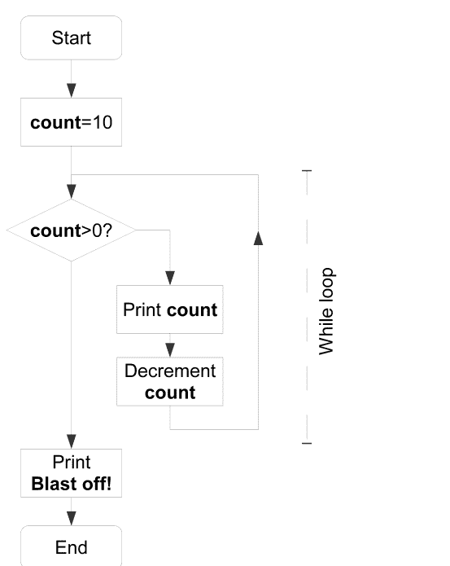

**图 4.1：** launchRocket 函数中的控制流。

`while` 循环的*主体*是花括号之间的一组语句：

```cpp
 cout << count;
 cout << "\n";
 count--;
```

这段代码会被重复执行，直到条件 `count>0` 不再为真。请记住，指令 `count--` 意味着“从 count 中减去一”。因此，**while** 循环将从 10 倒数到 1，此时程序将转到 while 循环后的第一行。

这一行是：

```cpp
cout << "Blast off!\n";
```

`while` 循环的一般语法是：

```cpp
while (<表达式>) {
 <语句>
}
```

从技术上讲，如果 `while` 循环中只有一条语句，你可以省略花括号。然而，始终包含花括号被认为是良好的编程风格。

让我们再举一个 `while` 循环的例子。这次我们打印出小于 1000 的 2 的幂。

```cpp
void printPowersOf2() {
 int count = 0;
 int currentPower = 1;
 while (currentPower < 1000) {
  cout << "2^" << count << " = ";
  cout << currentPower;
  cout << "\n";
  currentPower *= 2;
  count++;
 }
}
```

这里我们使用了简化的赋值运算符 `*=`.

作为另一个示例，考虑以下函数：

```cpp
void loopForever() {
 while (true) {
  cout << "Still looping\n";
 }
}
```


这个程序将永远循环。如果你运行程序，可以通过在程序运行的控制台窗口中输入 `CTRL+C`（在 Windows 和 Unix 上）或 `CMD + .`（在 Mac 上）来停止它。

### 4.2 do-while 循环

它们与 while 循环非常相似，区别在于是否继续执行的测试是在循环的末尾进行的。例如：

```cpp
void launchRocket_DoWhileVersion() {
 int count = 10;
 do {
  cout << count;
  cout << "\n";
  count--;
 } while (count >= 1);
 cout << "Blast off!\n";
}
```

do-while 循环的一般语法是：

```cpp
do {
 <语句>;
} while (<表达式>);
```

因为测试只在 do-while 循环的末尾进行，循环主体至少会被执行一次。通常认为 do-while 循环难以阅读，因此它们使用的并不频繁。其他循环结构更受青睐。

### 4.3 for 循环

C 语言的设计者注意到，大多数 while 语句在轮廓上看起来像这样：

```cpp
<初始化循环变量>;
while (<测试循环变量>) {
 <执行代码的主要步骤>
 <更新循环变量>
}
```

为了使这种重复的设计在代码中更明显，他们引入了 for 循环。其一般形式如下：

```cpp
for (<初始化循环变量>;
 <测试循环变量>;
 <更新循环变量>) {
 <执行代码的主要步骤>
}
```

要编写一个 for 循环，只需取上述形式的 while 循环，并移动代码以匹配 for 循环的语法。例如，我们发射火箭的代码变为：

```cpp
for (int i = 10; i > 0; i--) {
 cout << i;
 cout << "\n";
}
cout << "Blast off!\n";
```

对于 C++ 的新手来说，这看起来并没有多大改进。唯一明显的优势是，这比等效的 while 循环占用更少的行数。然而，它读起来不如 while 循环像英语。如果你是 C 和 C++ 的新手，你可能会觉得 while 循环更容易跟踪。随着熟悉度的增加，你会开始更喜欢 for 循环。并不是因为它在你实际阅读代码时更容易理解，而是因为你能识别出一般形状，从而可以在不查看细节的情况下猜测其含义。很快，你只需瞥一眼 for 循环就能立即可以看到它正在做什么，而使用 `while` 循环时，你需要实际阅读代码才能理解。

以下是从 0 数到 9（包含 9）的代码。你应该将这段代码牢记在心：

```
    for ( int i = 0; i < 10; i++) {
        cout << i;
        cout << "\n";
    }
```

将其与通用语法进行对照，我们看到“初始化循环变量”的代码是：

```
int i = 0
```

因此，这段代码初始化了一个名为 `i` 的变量，并将其初始值设置为 0。

“测试循环变量”的代码是 `i < 10`。因此，循环体将重复执行，直到 `i` 等于 10。请注意，值 10 本身不会被打印出来。

“更新循环变量”的代码是 `i++`。因此，在每次循环之后，`i` 都会递增。

“执行代码主要步骤”是

```
    cout << i;
    cout << "\n";
```

这些主要步骤总共会重复 10 次。

以下是以 10 为步长从 0 数到 90（包含 90）的代码。

```
    for ( int i = 0; i < 100; i += 10) {
        cout << i;
        cout << "\n";
    }
```

# 提示：从 0 开始计数

C++ 程序员从 0 开始计数。这是一个约定。C++ 中所有的标准数据结构都以 0 作为起始标签。

一开始你可能不习惯，但我强烈建议你在编写 C++ 程序时从 0 开始计数，并因此使用 `<` 符号而不是 `<=` 符号作为补偿。

从 0 开始计数有一些相当好的理由，因为这样一些公式编写起来更简单。例如，假设你按如下方式标记矩阵的条目：

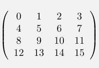

假设你用索引 `$i \in \{0, 1, 2, 3\}$` 标记行，用索引 `$j \in \{0, 1, 2, 3\}$` 标记列——那么 `$(i, j)$` 处的条目是 `$4i + j$`。显而易见，这个公式如何推广到比矩阵更高维的数据结构。

让我们重复一次练习，这次我们从 1 开始计数。我们会按以下方式标记矩阵的条目：

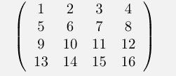

现在，我们用索引 `$i' \in \{1, 2, 3, 4\}$` 标记行，并类似地用 `$j' \in \{1, 2, 3, 4\}$` 标记列。`$(i, j)$` 处的条目现在是 `$4(i' - 1) + (j' - 1) + 1 = 4i' + j' - 3$`。与之前相比，这是一个优雅程度低得多的公式，并且它不能像以前那样直接推广到更高维度。

注意，C++ 中还有另一种 `for` 循环，其语法更简单，但相应地灵活性较低。详见第 18 章。

### 4.4 break, continue, return

在循环中间，你可以决定跳出循环并开始执行循环之后的语句，使用 `break` 关键字即可做到这一点。

例如，这段代码不断累加用户输入的数字，直到他们输入一个负数为止。此时，软件会打印出所有正数的总和。

```
cout << "Enter positive numbers followed ";
cout << "by a negative number to quit\n";
int total = 0;
while (true) {
    int next;
    cin >> next;
    if (next < 0) {
        break;
    }
    total += next;
}
cout << "The total is " << total << "\n";
```

`continue` 关键字的意思是跳过循环体内剩余的代码，转到下一个测试语句，并决定是否继续循环。因此，`continue` 意味着“继续循环”，而 `break` 意味着“跳出循环”。

以下是 continue 语句的一个示例：

```
        cout << "Enter positive numbers ";
        cout << "Type CTRL+C to quit\n";
        int total = 0;
        while (true) {
            int next;
            cin >> next;
            if (next < 0) {
                continue;
            }
            total += next;
            cout << "Positive total is " << total << "\n";
        }
```

你也可以在循环中间使用 `return` 语句。这会停止所有循环，并将执行返回到函数被调用的位置。

以下是从循环内部返回的一个示例：

```
void countdown() {
    int i = 10;
    while (true) {
        if (i == 0) {
            return;
        }
        cout << i << "\n";
        i--;
    }
}
```

虽然 `break` 和 `continue` 有时可以使代码更清晰，但它们通常使代码更难追踪。因此，建议 C++ 新手避免使用这些语句。

### 4.5 throw 语句

很多时候，你会希望函数突然停止并指示发生了错误。为此，你需要使用 `throw` 语句。

要使用 throw 语句，你需要在代码开头与其他 `#include` 语句并排添加以下文本：

```
#include <stdexcept>
```

要指示发生了错误，请使用以下形式：

```c
throw logic_error("You can't do that");
```

你可以在引号之间包含几乎任何你喜欢的文本。尽量提供一些线索来说明是什么导致了问题。当我们讨论第 7.5 节的字符串操作时，你将能够创建更有用的错误消息。

以下是如何可能使用 `throw` 语句的一个示例：

```cpp
double debitAccount(double balance, double amount) {
    double newAmount = balance - amount;
    if (newAmount < 0.0) {
        throw logic_error("No overdraft agreed");
    }
    return newAmount;
}
```

程序最好通过 `throw` 一个错误并终止，而不是打印出错误消息并试图继续运行。这有几个原因：

- 没有人阅读消息！金融领域使用的许多代码是在服务器上运行的，而不是在用户的计算机上。如果你将消息写入服务器的日志文件，很可能从来没有人会阅读它。

- 明显失败比微妙失败更好。你不希望有人以为交易已经成功，而实际上它失败了。

- 如果错误立即抛出，很容易看到错误发生的位置以及错误发生时正在发生的事情。如果你一天后再查看日志文件，你可能无法弄清楚当时发生了什么。

你可能想尝试用比仅仅终止程序更精致的方式来处理错误，但事实是你可能做不到。如果发生在我们编写的这类代码中的错误，很可能是一个编程错误，无论让用户多久后再试都无法解决这个问题。除此之外，没有别的办法，只能报告错误并修复代码。

在软件中处理错误是计算机科学中的一个高级主题。如果你在编写操作系统，至关重要的一点是单个程序的 bug 不会导致整个计算机崩溃。如果你在编写 web 浏览器，重要的是单个流氓 web 页面不会导致 web 浏览器崩溃。然而，编写 web 浏览器和操作系统是这些领域专家的任务，而不是金融数学专家的任务。

如果你希望用比简单终止程序更精致的方式来处理错误，你需要使用 `try` 和 `catch` 语句。此外，你可能希望抛出除了 `logic_error` 之外不同类型的错误，以便你可以区分不同类型的错误。你可以在任何 C++ 参考书中找到更多信息。本书中不需要这些技术。

### 4.6 switch 语句

if 语句的一种更复杂的替代方案是 `switch` 语句。以下是一个示例：

```c++
void printMessage(int score) {
 switch (score){
 case 0:
 case 1:
 case 2:
 case 3:
 case 4:
 cout << "You have failed.\n";
 break;
 case 5:
 case 6:
 cout << "You have passed.\n";
 break;
 case 7:
 cout << "Merit.\n";
 break;
 case 8:
 case 9:
 cout << "Distinction.\n";
 break;
 default:
 cout << "Invalid score.\n";
 break;
 }
 cout << "Good luck in your future career.\n";
}
```

这个程序根据你的分数打印出考试的等级。0-4 分不及格，5 或 6 分及格，7 分为优秀（Merit），8 或 9 分为卓越（Distinction）。

通用语法是：

```
switch (<expression>) {
```

case <possible value>:

    <statements>

case <possible value>:

    <statements>

...

case <possible value>:

    <statements>

default:

    <statements>

}
switch 语句的主体是位于花括号之间的代码。它由一系列可能的 case（分支）和执行代码组成。当执行这个 switch 语句时，计算机首先会评估 `expression`（表达式）。然后，它会寻找第一个匹配的 case 语句，并执行从该处到第一个 break 语句或 switch 语句结束的所有代码。

如果没有匹配项，计算机将寻找 `default`（默认）语句，并评估从该处到 switch 语句结束的所有代码。

在执行完 switch 语句主体中所需的语句后，程序将继续执行 switch 语句之后的下一条语句。在我们的示例中，这意味着它将祝你在职业生涯中好运。

请注意，你必须小心地在 `switch` 语句中插入 `break` 或 `return` 语句，以确保代码不会执行比你想要的更多的语句。

例如，如果你从我们的示例中移除所有的 `break` 语句，那么得分为 0 时将得到如下响应：

```
You have failed.
You have passed.
Merit.
Distinction.
Invalid score.
Good luck in your future career.
```

如果你不喜欢 `switch` 语句的语法，你不是一个人。幸运的是，在现代 C++ 代码中，它们并不非常有用。在现代 C++ 中，应该使用面向对象的编程技术 `polymorphism`（多态性）来代替。我们将在第 10 章中深入探讨这一主题。如果你发现自己倾向于编写 `switch` 语句，这表明你还没有充分利用面向对象编程的优势。

## 提示：始终包含一个默认情况（default case）

如果你必须编写 `switch` 语句，请务必始终包含一个 `default` 分支。通常，你的默认分支会通过使用 `throw` 语句来生成错误。简单地打印一个错误（如我们的示例中那样）是一个坏主意。

### 4.7 作用域

上述控制流语句使用了花括号。如果你在花括号内定义一个变量，它只能在这些花括号内使用。一旦程序的执行离开花括号，该变量就会被删除。你可以引用变量的代码部分被称为该变量的 `scope`（作用域）。

下面是一个示例代码片段，它计算前 10 个整数（当然从 0 开始）的平方和。

```cpp
int n=0;
int total;
for (int i=0; i<10; i++) {
    int squareValue = i*i;
    total += squareValue;
}
std::cout << n;
// std::cout << squareValue;
// std::cout << i;
```

变量 `squareValue` 仅在花括号内有效。变量 `i` 仅在 for 语句本身及花括号内有效。如果你尝试移除最后两行中的注释字符 `//`，代码将无法编译。

变量的作用域用于控制 C++ 中的内存使用。当变量超出作用域时，内存可以被安全地重用。通常你不需要考虑 C++ 中的内存管理。然而，有时你会想要自己控制内存管理。我们将在第 11 章中讨论这个问题。

### 4.8 运算符中的控制流

一个技术要点是，C++ 中的某些运算符实际上以微妙的方式控制着程序的流程。

#### 4.8.1 短路求值（Short circuit evaluation）

表达式 `lhs && rhs` 如果 `lhs` 和 `rhs` 都求值为 true，则结果为 true。为了提高效率，如果 `lhs` 不为 true，C++ 甚至不会费心去评估表达式 `rhs`。这通常正是你希望发生的情况。然而，如果评估表达式 `rhs` 实际上调用了另一个函数，你可能会惊讶地发现这个函数并不总是被调用。

类似地，如果已知 `lhs` 为 true，`lhs || rhs` 就不会评估 `rhs`。

作为示例，请尝试以下代码：

```cpp
bool test1() {
    cout << "In test1\n";
    return false;
}
bool test2() {
    cout << "In test2\n";
    return true;
}
int main() {
    bool value = test1() && test2();
    cout << "Value " << value << "\n";
    return 0;
}
```

你会发现函数 `test2` 从未被调用。

#### 4.8.2 三元运算符（The ternary operator）

表达式 `a*b` 中的 `*` 运算符被称为二元运算符，因为它接受两个参数。另一方面，`++` 运算符被称为一元运算符。

C++ 还包含一个接受三个参数的运算符，因此被称为三元运算符。

三元运算符本质上是一种编写 if 语句的快捷方式。其语法如下：

`<test expression> ? <value if true> : <value if false>`

作为示例，这里是一个使用三元运算符计算两个数字最大值的程序：

```cpp
int max(int a, int b) {
    return a>b ? a : b;
}
```

这里有一些使用 if 语句的等效代码。

```cpp
int max(int a, int b) {
  if (a > b) {
    return a;
  } else {
    return b;
  }
}
```

那些懒得打字的人喜欢三元运算符，但它会导致代码非常难以理解。不要使用它。

#### 4.8.3 逗号运算符（The comma operator）

在 for 语句的圆括号之间，始终有三个用分号分隔的表达式。这是一个示例：

```cpp
for (int i = 0; i < 100; i++) {
  cout << i << "\n";
}
```


如果你愿意，可以使用所谓的“逗号运算符”在每个循环末尾执行多个计算并进行多个初始化。这是一个打印出 2 的前 10 个幂的示例：

```cpp
for (int count = 0, power = 1;
     count < 10;
     count++, power *= 2) {
  cout << power << "\n";
}
```

在这段代码中，我们维护了两个循环变量 `count` 和 `power`，每个变量在每次迭代中都会更新。

逗号运算符的正式定义是，表达式 `lhs, rhs` 先评估 `lhs` 并丢弃结果，然后评估 `rhs`。因此，如果你愿意，可以使用逗号运算符将表达式串联起来，作为常规使用分号的替代方案。

不要自己使用逗号运算符。它会导致代码难以阅读（正如我们的示例所示）。我们之前编写了一个程序（第 56 页），使用 `while` 循环打印 2 的幂，那个程序更容易理解。

## 练习

- 4.8.1. 使用 `while` 循环、`for` 循环和 `do-while` 循环为 `factorial` 函数提供不同的实现。

- 4.8.2. 给定一个函数 $f : \mathbb{R} \rightarrow \mathbb{R}$，我们可以使用 *rectangle rule*（矩形法则）来近似积分

$$ \int_{a}^{b} f(x) \, dx $$

给定一个整数 $n$，该积分的矩形法则近似值为：

$$ \frac{1}{n} \sum_{i=0}^{n-1} f \left( a + i h + \frac{1}{2} h \right) $$

其中 $h = \frac{b-a}{n}$。编写一个函数，计算以下积分的矩形法则近似值：

$$ \int_{a}^{b} \sin(x) \, dx $$

给定 $a$、$b$ 和 $n$。

- 4.8.3. 我们希望计算积分

$$ \int_{-\infty}^{x} \exp(-t^{2}/2) \, dt. $$

通过代换 $t = x + 1 - \frac{1}{s}$，我们可以看到这等于积分

$$ \int_{0}^{1} \frac{1}{s^{2}} \exp \left( -\frac{(x+1-\frac{1}{s})^{2}}{2} \right) \, ds. $$

然后可以使用矩形法则估计这个积分。编写一个函数，使用 `for` 循环和矩形法则计算这个第二个积分。

- 4.8.4. 使用你选择的循环结构计算第 $n$ 个斐波那契数。解释为什么这比练习 3.9.3 中考虑的递归方法更高效。

- 4.8.5. 改进 `norminv` 函数，使得当要求评估范围 $[0, 1]$ 之外的数字时抛出错误。

- 4.8.6. 改进 `norminv` 函数，使其接受一个额外的布尔参数，该参数指示当给定 0 和 1 范围之外的输入时是否抛出异常。这个参数的良好默认值是什么？

- 4.8.7. 确保你能写出一个**for**循环，按递增顺序打印从 0 到 9 的数字，而不必查阅本书中的任何内容。这相当于在一个不使用短语手册的情况下，用外语数到十的能力。

### 4.9 摘要

我们已经学习如何使用以下关键字在 C++ 中控制执行流程：

- `for`
- `while`
- `do`
- `break`
- `continue`
- `return`
- `switch`
- `case`
- `default`
- `throw`

迄今为止，最有用的流程控制语句是 `for`、`while` 和 `throw`。

#### 提示：使用哪种控制语句

- 对于简单的循环，例如从 0 计数到 99，请使用 `for` 语句。
- 对于更复杂的循环逻辑，请使用 `while` 语句。不寻常的 `while` 语句比不寻常的 `for` 语句更易于阅读。
- 当发生错误时请使用 `throw`。不要只是打印一条消息然后继续。

# 第 5 章

## 使用多个文件

一个现实的 C++ 项目将被划分到多个文件中。这有助于你将代码在逻辑上组织成可管理的单元。这使得跟踪大型软件项目成为可能，而无需理解每一个细节。

### 5.1 FMLib 项目

如果你完成了前面章节中的所有练习，那么你现在应该已经积累了相当数量的函数。

特别是，在练习中我们编写了函数 `normcdf`（用于计算正态分布的累积密度）和 `norminv`（用于计算其逆）。我们将希望重复使用这些函数。

这意味着是时候开始为我们的项目创建一个更好的结构了。我们将停止丢弃代码，并开始在一个名为 `FMLib` 的长期项目上工作。

目标是让 `FMLib` 成为一个有用的金融数学函数库。FM 代表金融数学（financial maths）。

我们不是第一个想到为金融数学编写 C++ 代码的人。有许多现成的库你可以下载。然而，在这本书中，我们将假设除了 C++ 标准内置的库外，不存在其他库。我们将自己从零开始构建其他所有内容。

这是学习 C++ 的好方法，但不是构建现实世界交易平台明智的方式。当然，你应该充分利用其他人编写库所做的工作（以及更重要地，他们投入设计、测试和调试这些库的工作）。一些你可能想要考虑使用的库包括 Boost、GSL 和 Quantlib。Boost 是一个通用的 C++ 库，填补了 C++ 标准中的许多空白。GSL 是一个用 C 语言编写的科学计算库，包含许多有用的算法。QuantLib 是一个用于金融数学的 C++ 库。

在此阶段，你可能会发现这些库的文档难以理解。这是因为文档假设读者具备相当丰富的 C++ 语言专业知识。

这就是为什么在本书的其余部分，我们将研究如何编写我们自己的金融数学库 `FMLib`。一旦你精通了这本书，你应该忘记 `FMLib` 并转而学习使用这些其他库。

在本书的网站上，你可以找到一个名为 `FMLib5` 的下载包。它包含与第 5 章相关的 `FMLib` 版本。随着书籍的进展，有相应的版本 `FMLib6`、`FMLib7` 等等。这些包含越来越复杂的代码。到本书结束时，我们将开发出一个成熟的库。

本书的一个目标是向你展示软件项目如何从简单的开端演变得庞大和复杂。通过观察软件项目如何分阶段组装，你将学会如何将项目开发成可管理的部分。它还将向你展示如何*重构*你的代码。这仅意味着如何随着你从经验中学习，逐步改进你的软件设计。

为了本章的目的，你应该下载 `FMLib5`。解压它并查看其内容。

- 文件 `main.cpp` 包含用于测试的 `main` 方法。
- 文件 `matlib.cpp` 包含各种有用的金融数学函数的定义。我们将许多你在 MATLAB 中可能预期的标准函数分组到这个文件中。例如，`normcdf` 和 `norminv` 在此文件中定义。
- 文件 `stdafx.h` 提供了一个单一的位置，列出我们在整个项目中想要使用的库。
- 文件 `matlib.h` 是一个头文件，包含函数 `normcdf` 和 `norminv` 的声明。

正如你所见，它包含一个以上的 `.cpp` 文件和几个 `.h` 文件。本章的目的是解释 C++ 代码应如何使用不同的文件进行组织，以开发更大的项目和有用的库。我们将使用 `FMLib5` 作为我们的示例。

### 5.2 头文件

在 C++ 中，你不能直接调用定义在其他 `.cpp` 文件中的函数。要使用定义在另一个文件中的函数，你必须首先使用 `#include` 命令加载包含该函数声明的“头文件”。

如果你忘记了，我们在 3.4 节中讨论了函数的*声明*与函数的*定义*之间的区别。简而言之，声明说明*函数做什么*，而定义说明*它是如何做的*。

C++ 中的规则是，在你使用一个函数之前，它*必须*已被声明。因此，如果你想使用一个函数，你必须始终 `#include` 声明该函数的文件。

你可以认为 `.cpp` 文件通过它们包含的 `.h` 文件进行通信。如果两个 `.cpp` 文件都 `#include` 相同的函数声明，那么该函数只需要在两个 `.cpp` 文件中的一个中定义。同一个*定义*在多个文件中共享。如果两个 `.cpp` 文件没有一个共同的提及特定函数的 `.h` 文件，那么它们不能共享该函数。

作为一种约定，每当我们编写一个 `.cpp` 文件时，我们通常会编写另一个同名但扩展名为 `.h` 的文件。这个头文件包含所有我们希望在该 `.cpp` 文件外部可用的函数的声明。

有些人更喜欢使用文件名扩展名 `.hpp` 来表示 C++ 头文件，而将 `.h` 留给 C 头文件。

### 5.3 创建我们的项目

让我们通过一个详细的示例来看看如何创建多文件项目。

首先创建一个名为 `MyLib` 的新 C++ 项目。这是为了将其与网站上的模型代码 `FMLib` 区分开来。当本节完成时，项目实际上应该是相同的。

我们的目标是编写一个小库，使 `normcdf` 函数和 `norminv` 函数可用，它们分别计算正态分布的累积分布函数及其逆。我们还希望使标准常数 `PI` 可用。

在一个单独的文件中，我们希望编写一个小的 `main` 函数来展示如何使用该库。

#### 5.3.1 创建第一个头文件

为了使其他文件能够使用这些函数，我们需要在一个*头文件*中声明它们。这是一个文件扩展名为 `.h` 的 C++ 文件。

你应该按照下面的说明，针对你的开发环境创建一个名为 `matlib.h` 的头文件：

- 如果你使用 Visual Studio 创建 C++ 项目，你应该通过右键单击文件夹 **Header Files** 来创建所有 `.h` 文件。
- 如果你使用 Unix，只需在包含 `.cpp` 文件的同一文件夹中创建头文件，但给予它们扩展名 `.h`。
- 如果你使用 XCode，按 **CMD + N** 并选择头文件。

现在编辑你刚刚创建的文件，输入第一行：

```cpp
#pragma once
```

然后输入我们要从库中提供的所有函数的*声明*。在我们的例子中，需要的完整代码是：

```cpp
#pragma once

const double PI = 3.14159265358979;

/**
 * 计算正态分布的
 * 累积分布函数
 */
double normcdf( double x );

/**
 * 计算 normcdf 的逆
 */
double norminv( double x );
```

这包含我们要提供的所有函数的声明。它包含 `PI` 的声明和定义。

通常，你应该在头文件中放置以下内容：

- (i) 第一行 `#pragma once`。我们稍后会解释原因。
- (ii) 你希望从库中提供的函数的声明。
- (iii) 你希望提供的全局变量的声明。
- (iv) 常量全局变量的定义。

而在你的源文件中应该放置：

- (i) 头文件中声明的函数的定义。
- (ii) 头文件中缺失的全局变量的定义。

随着我们遇到更多种类的声明和定义，我们将在本书中扩展这些规则。

常量被不同处理的原因是 C++ 编译器可以“内联”它们。这意味着用实际值替换常数的每次使用。这带来轻微的性能提升。然而，结果是定义需要在头文件中，以便每个文件都知道要内联的正确值。

#### 5.3.2 一些使用这些函数的代码

在一个名为 `main.cpp` 的源文件中，编写以下代码：

```cpp
#include <iostream>
#include "matlib.h"
using namespace std;

int main() {
    cout << "normcdf(1.96)="
         << normcdf(1.96) << "\n";
    cout << "norminv(0.975)="
         << norminv(0.975) << "\n";
    return 0;
}
```

请注意，我们使用 `#include` 来加载库中的所有定义。加载标准库时使用尖括号，而加载我们自己的库时使用引号。

这样做的原因是，我们自己的库时刻都在变化，而标准库则不会。通过使用尖括号，我们告诉编译器，某个给定的文件自上次编译以来没有发生变化。这允许编译器运行得稍快一些。

此时，你应该尝试构建代码，但预计它会失败。毕竟，我们还没有提供任何函数的*定义*。

尝试构建代码，看看当我们忘记编写某个函数的定义时会遇到什么错误信息——或者当定义和声明不完全匹配时会发生什么。

当我尝试在 Visual Studio 上运行这段代码时，我得到了以下错误：

```
main.obj : error LNK2019:
unresolved external symbol "double __cdecl norminv(double)" (?norminv@@YANN@Z) referenced in function _main
```

这被称为*链接器错误*。“未解决的外部符号”（unresolved external）是一种无助于理解的说法，其含义可能是：

- (i) 你完全忘记了定义；
- (ii) 定义中的类型信息与声明中的类型信息不完全匹配；
- (iii) 你没有正确安装库；
- (iv) 发生了某种更微妙的问题。例如，在 Visual Studio 中，你需要检查 `cpp` 文件是否确实列在项目的 "Source Files"（源文件）下。

如果你仔细查看错误信息，你会发现函数的名称（`norminv`）隐藏在文本中。你只需要愿意忽略错误信息中所有你不理解的部分即可。值得记住在你的开发环境中这种错误信息长什么样，这样当类似的链接器错误发生时，你就能弄清楚问题所在。

将 C++ 源文件转换为可执行文件的过程被称为“构建”代码。这是一个三阶段过程。

- (1) *预处理器* 对 `cpp` 文件执行简单的文本操作，例如 `#include` 语句。例如，`#include` 语句的意思只是读取另一个文件的副本，以便我们可以使用该文件中的所有声明。
- (2) 生成的 `cpp` 文件被编译。
- (3) 所有文件的编译版本和所有库被*链接*在一起。每个函数的使用都被*链接*到其定义所在的位置。

函数声明在编译阶段使用，所有函数定义都被编译。然而，直到链接器阶段，才检查所有部分是否连贯地粘合在一起。这就是为什么声明和定义之间的不匹配是在链接器阶段发现的。

#### 5.3.3 编写定义

创建一个名为 `matlib.cpp` 的文件来包含函数定义。在文件开头加上 `#include matlib.h` 这一行。

通常，你的头文件（header files）和源文件（source files）之间应该有清晰的对应关系。例外情况是：在 Windows 上，惯例是有一个名为 `stdafx.h` 的文件，其中仅包含你想使用的库的 `#include` 语句；你应该有一个用于测试的 `main.cpp`。我们将在所有操作系统上遵循这些惯例，而不仅仅是 Windows。

每当你编写 `.h` 文件时，请确保对应的 `.cpp` 文件的第一行包含该 `.h` 文件。这是测试你的 `.h` 文件是否正确且包含其所需一切的重要测试。

在文件的其余部分，你应该编写函数定义所需的代码。如果你成功地在练习中编写了这些代码，可以使用你自己的代码。如果没有，使用下面的代码可能更快。

```
double norminv( double x ) {
    return 1234.0; // TODO fix this
}

double normcdf( double x ) {
    return 1234.0; // TODO fix this
}
```

你现在应该发现所有代码都能正确构建。

作为一个实验，按照以下方式修改其中一个函数定义中的类型。

```
// change double to float
double norminv( float x ) {
    return 1234.0; // TODO fix this
}
```

你会发现得到一个链接器错误，通过恢复到原始代码就可以轻松修复它。

### 5.4 头文件如何工作

#### 5.4.1 include 的含义

在 C++ 中，你必须遵循关于函数声明和定义的以下规则：

- 每个使用某个函数的 `.cpp` 文件必须包含该函数的声明。
- 每个被使用的函数必须恰好在一个 `.cpp` 文件或一个库中定义。

乍一看，这意味着我们要进行大量的重复输入。我们将不得不在每个使用它的文件中反复声明每个函数。幸运的是，C++ 有 `#include` 命令，它可以加载 `.h` 文件中的所有命令。这样，我们就可以用一个 `#include` 语句加载许多声明。

头文件仅此而已：它们节省了重复输入。原则上，你可以使用 `#include` 加载任何东西，但在实践中它仅用于加载声明。

同样地，原则上你可以通过直接在自己的 `.cpp` 文件中键入声明来使用在另一个文件中声明的函数。从头文件到根本不使用头文件没有技术上的必要。然而，这样做被视为不良编码实践。C++ 函数的作者使用头文件作为一种方式来表明他们希望你使用哪些函数，以及他们打算在未来维护哪些函数。

#### 5.4.2 Pragma once

正如我们之前所说，每个头文件应以 `#pragma once` 开头。你应该在每个文件开头使用 `#pragma once` 的原因是，它防止同一文件被 `#include` 两次。在我们的例子中，如果你去掉了 `#pragma once` 然后两次 `#include` 该头文件，你可能会得到一个编译器错误，提示你试图两次定义 `PI`。

你应该遵循的另一条规则是，永远不要通过 `#include` 产生循环依赖。例如，两个头文件不应该相互 `#include`。

技术上，`#pragma once` 不是 C++ 标准的一部分。然而，大多数编译器都理解这个命令，我建议你使用它。

短语 `#pragma once` 可能很难记住，因为英语中没有 "pragma" 这个词。它实际上是 "pragmatic" 的缩写，而 "pragmatic" 本身只是 "practical"（实用）的一个更花哨的词。因此，`#pragma once` 只是一个实用的修复方法，并不是 C++ 标准真正的一部分。


如果你是 C++ 标准的严格遵循者，解决同一问题的另一种替代方法是使用以下方法：为每个头文件选择一个唯一的随机名称（例如，`G4569327457263475698023452376519876247`），然后按照以下方式开始和结束头文件：

```c
#ifndef G4569327457263475698023452376519876247
#define G4569327457263475698023452376519876247
. . . rest of code . . .
#endif
```

你会在许多 C++ 库中看到这种技术（称为 `include guard`，头文件保护）。自然，许多库作者希望编写尽可能可移植的代码，因此他们严格遵守 C++ 标准。这就是为什么他们使用这种更繁琐的技术，而你可以通过使用更简单的 `#pragma once` 来逃脱这种麻烦。

### 5.4.3 信息隐藏

你不应该在头文件中声明所有函数。你应该只声明你希望其他人使用的函数。
编写许多小的辅助函数是好的实践。然而，将这些函数作为你库的一部分会让你的库用户感到困惑。你的用户会将你编写的 `.h` 文件视为你的库做什么的定义。通过限制该文件中的信息量，你使你的用户的生活更轻松。
这也带来了一些其他优势。一旦你将一个函数作为库的一部分发布，你就永远不能更改它，除了修复 bug！这是因为其他人可能已经在使用它。你在头文件中给出的东西越少，你就越不可能编写出需要未来十年都要支持的功能。
示例 1：如果你在库中拼错了一个函数的名称，然后将其交给你的用户，你就必须永远使用那个拼写错误。
如果你是唯一使用你代码的人，那么这个问题并不那么紧迫，但如果你在一个团队中工作，那么这绝对是必不可少的。
从非常实际的角度来看，如果你的工作是编写软件，而你的软件因某种原因出了问题，那么你很可能会被告知去修复它。因此，使用你代码的人越多，你就越有可能在半夜被电话叫醒，要求调试该代码！这意味着你必须确保只有足够质量、可以与团队共享的代码才能让人们使用。这意味着代码应该完美运行、文档齐全并经过充分测试。在实践中，你不可能将所有代码都写到这个标准，因此至关重要的是要明确哪些部分代码已准备好共享，哪些部分仅供个人使用。如果你不在头文件中声明你的函数，那么这些代码就不能被其他文件共享，因此*无法*使用。这意味着，如果你将头文件的内容减到最少，你就有可能提高整夜安睡的机会！

> **老笑话：** 编程就像性生活。犯一次错误，你就不得不为它负责一辈子。

虽然简单地不在头文件中包含某些内容是实现信息隐藏的主要方式，但你还可以更进一步，使用*static*关键字。
你应该尝试对所有*不在*头文件中的变量和函数使用*static*关键字。例如，人们可以在`.cpp`文件中编写如下代码：

```cpp
static const double SQR_T_2_PI = 2.507;
```

这段代码有缺陷，因为它是 $\sqrt{2\pi}$ 的非常低精度的估算值。这对你的特定应用可能不是大问题，但你不希望其他人使用这个值进行计算。这种事会导致半夜接到电话。
通过将此函数标记为*static*，我们表示它只能在当前源文件中使用。这意味着如果需要，我们可以在其他源文件中重用该名称。从技术上讲，某人使用另一个文件中定义的函数而不在头文件中声明它是可能的（但可能性极小）。使用*static*关键字可以完全防止这种技巧。

> **危险！**
> 如果你是 Java 程序员，请注意这与 Java 关键字 *static* 毫无关系。

### 5.4.4 内联

作为一般规则，优秀的程序员从不编写两遍相同的代码。你应该编写可重用的函数。这样可以最小化你在测试代码时所需付出的努力。
初学者程序员常常犯的一个错误是，使用开发环境的剪切和粘贴功能作为编写函数的替代方案。这是一个非常糟糕的主意。这会导致代码难以阅读且难以测试。如果你发现某个被手动剪切和粘贴到 100 个其他文件中的代码中存在错误，你就需要在许多文件中追踪该错误。

> 提示：编写函数。不要使用剪切和粘贴。

然而，从性能角度来看，运行经过剪切和粘贴的代码比运行划分为函数的代码要稍微快一点点。原因是，在汇编语言层面，函数调用会被转换为机器代码 CALL 指令。因此，调用函数的性能成本等于运行函数代码的成本加上 CALL 语句的成本。
大多数时候，使用函数带来的额外开销绝对微不足道，不值得考虑。但偶尔，考虑它是值得的。解决方案不是停止编写函数：而是告诉编译器“内联”函数。这意味着你希望使用函数来编写代码，但你告诉编译器生成的机器代码就好像你使用了剪切和粘贴一样。净效果是，你的函数的机器代码由编译器在你的程序中“复制和粘贴”，因此不需要 CALL 语句。换句话说，你最终得到了通过剪切和粘贴获得的更快代码，而不必牺牲函数的优势。
练习 3.9.6 中讨论的 **hornerFunction** 示例最适合内联。以下是其中一个 **hornerFunctions**，并添加了 **inline** 关键字。

```cpp
static inline double hornerFunction(
    double x,
    double a0,
    double a1) {
    return a0 + x*a1;
}
```

在这个特殊情况下，优化是有道理的，因为我们使用 **hornerFunction** 来计算 **norminv**，并且我们在蒙特卡罗模拟中会大量调用 **norminv**。因此，使这些函数尽可能快是值得的。
你可能会倾向于将每个函数都标记为 **inline**，但这实际上可能会使你的程序性能变差。原因是，这样做会导致机器代码的大量重复，使你的程序变大，因此占用更多内存。这意味着你的程序启动时间会更长，并且在运行过程中可用的内存更少。
现代编译器包含一些非常复杂的优化例程，因此通常最好不要**内联**任何内容，除了你确定对性能至关重要的非常短的函数。
**顺便提一下**，请注意 `hornerFunction` 也是 **static** 的，因为我们不希望它是库的一部分。这是一个实现细节，我们不希望我们的最终用户知道。
我们在关于将代码划分为多个文件的章节中讨论内联函数的原因是，内联函数不能有独立的定义和声明。这意味着，如果你希望在不同文件之间共享一个内联函数，你*必须*将定义放入头文件。对于所有其他函数，你*不得*将定义放入头文件¹。
这确实有些道理。如果编译器要复制相关的代码，它需要知道该代码应该是什么。因此，该代码必须包含在 `.cpp` 文件中或从头文件中包含。另一方面，对于非内联代码，代码应该只编写一次。因此，该代码应该只在一个 `.cpp` 文件中，并且绝不应从头文件中包含。
¹在第 17 章中，我们将为模板函数向此规则添加一项额外内容。

#### 5.5 一个完整的例子

我们将在本书网站上提供多个版本的 FMLib，按章节编号。例如，`FMLib5` 包含理解本章所需的代码。
你应该下载这个库并将其解压到一个名为 `FMLib5` 的文件夹中。然后你应该检查你是否可以编译并运行该项目。
浏览代码并观察以下几点：
- `hornerFunction` 函数*不在*头文件中。我们认为我们的库用户不希望了解它们。
- `hornerFunction` 函数是 **static** 的。
- 我们计算中使用的常数 `a1`、`a2` 等全部是 **static** 的。
- `hornerFunction` 函数是 **inline** 的。

## 练习

5.5.1. 编写一个新文件 `geometry.cpp`，其中包含一个函数，根据给定半径计算圆的面积和周长。确保你的函数可以从 `main.cpp` 中调用。你的新函数应该标记为 *static* 吗？
5.5.2. 哪个文件能更好地概述我们的 matlab 函数，`matlib.cpp` 还是 `matlib.h`？
5.5.3. 如果你在头文件中将函数 `normcdf` 标记为 *static*，后果是什么？在 `cpp` 文件中？在两者中？如果你不将 `hornerFunction` 标记为 *static* 会怎样？
5.5.4. 你认为哪个文件应该包含 PI 的定义？

#### 5.6 总结

我们已经看到如何通过将*声明*放入头文件并将*定义*放入 `cpp` 文件来编写使用多个文件的项目。唯一的例外是*内联*函数。
在正常情况下，两个 `cpp` 文件只有通过头文件共享相同的声明，才能共享相同的函数定义。
我们学到了*信息隐藏*的重要性，这解释了为什么并非所有声明都应该在头文件中。
如果你有其他语言的编程经验，你可能会质疑为什么要使用头文件。答案是历史原因。现代语言不使用头文件——它们提供了信息隐藏的替代机制，需要更少的打字。
除了遵循 C++ 语言的规则外，我们在本章还遵循了一些重要的约定。强烈建议你在头文件中使用以下提示。

> 提示：头文件的规则
> - 每个 `.h` 文件开头都加 `#pragma once`。
> - 除非必要，否则不要将函数放入头文件中。尝试隐藏信息。
> - 请记得对不在头文件中声明的函数和变量使用 **static**。
> - 每个 **.h** 文件都应有一个对应的 **.cpp** 文件，用于定义该 **.h** 文件所声明的所有内容。
> - 此外，你应该有一个名为 **stdafx.h** 的头文件，其中包含你正在使用的标准库。将大部分 **#include** 语句集中到一个文件中可以节省输入。还可以使用特殊的编译器设置来“预编译”这个共享头文件，从而让你更快地编译代码。按照 Windows 上的惯例，这个文件被称为 **stdafx.h**，为了简化，我们决定在所有操作系统上都采用相同的惯例。
> - 你应该有一个 **main.cpp** 文件用于测试。
> - **.cpp** 文件的第一行应该 **#include** 对应的 **.h** 文件。
> - 不要在头文件中编写 **using namespace**。你不希望强迫库的用户使用特定的命名空间，这应该是他们的选择。如果你违反这一规则并在头文件中使用某个命名空间，那么该库的所有用户都将不得不使用该命名空间。这将使命名空间的初衷完全落空。

http://taylorandfrancis.com

### 第 6 章

#### 单元测试

20 世纪 90 年代末，计算机编程发生了一场革命（一些银行至今仍在努力赶上）。革命性的观点是，你应当为你所有的代码编写自动化测试。
实际上，这个想法并不是那么新颖。老派的计算机程序员告诉我，在 20 世纪 60 年代和 70 年代初，测试代码是非常普遍的做法。但不知怎的，许多开发团队忘记了这一点。编写没有自动化测试的代码变得相当正常。这类代码通常维护成本极高（需要一支庞大的手动测试团队），而且非常容易出错。
如果你足够年长，记得 90 年代的软件，你可能会注意到现在的软件不像以前那样容易崩溃了。我认为，至少部分原因是自动化测试的兴起。
单元测试的基本思想如下。
- (i) 每个函数（大致上）应该至少有一个测试。
- (ii) 所有测试都应该是完全自动化的。
- (iii) 你应该假设未经测试的代码是不能正常工作的。
- (iv) 你应该永久保留你的测试。
当然，也需要一些手动测试，但这更应该侧重于验收测试和可用性测试。例如，判断你的音乐下载应用是否*易于使用*需要一些手动测试。测试你的音乐下载应用是否实际*工作正常*应该是自动化的。
如果你尝试编写超过几行的 C++ 代码，你很可能会写出 bug。部分原因是你是 C++ 的新手，但更多的是因为你是人类，而人类会不断犯错。正如你可以比较确定你的微积分计算是错误的（除非你重新检查过），你也很可以确定 C++ 代码是错误的（除非它有单元测试）。
测试代码的一种可能方法是编写一个 **main** 方法来测试你正在处理的部分。问题在于，当你需要修复 bug 时，你会发现自己不断重新创建以前写过的测试。
解决方案是：
- 将所有测试编写为函数；
- 永远不要丢弃任何测试；
- 每次编译代码时都运行所有测试。

#### 6.1 C++ 的测试框架

由于 C++ 没有内置的单元测试支持，我们将不得不编写自己的框架。有人可能会争辩说，使用别人编写好的测试框架更为明智。有很多选择，例如 Boost Test 库 (`http://www.boost.org`)、Google Test（自己搜一搜！）、cppunit 以及许多其他。
不幸的是，这些测试框架是为已经会 C++ 编程且不会被其奇特语法吓退的人设计的。这使得它们不适合用于 C++ 入门课程。
相反，我为这本书编写了一个非常简单的测试框架。读完本书后，你将能够下载并使用你选择的测试框架，而不会遇到太大困难。
下载 `FMLib6`，你会发现它包含一个名为 `testing.h` 的头文件。目前这个文件对你来说应该是无法理解的，因为它包含各种 C++ 宏。

#### 6.2 宏

宏是 C++ 预处理器的一个特殊命令，允许你避免重复输入。一个经典的例子是 MAX 宏：

```cpp
#define MAX(a,b) (((a)>(b)) ? (a) : (b))
```

这个定义意味着代码中每出现一次文本 `MAX(a,b)`，就应该被替换为 `(((a)>(b)) ? (a) : (b))`。这个表达式使用三元运算符计算最大值（关于三元运算符的回顾见 4.8.2 节）。表达式中包含许多看起来不必要的括号，但它们的存在是因为允许输入复杂的表达式，如 `MAX( 3*7, 3+5 )`。加上括号可以确保一切按预期工作。
预处理器盲目地展开宏定义。这意味着你可以编写像 `MAX` 这样的“伪函数”，它们实际上只是编写重复代码块的简写方式。
一般来说，宏完全是浪费时间。你可以使用函数来编写可重用的代码，并使用 `inline` 关键字来确保其速度与大代码一样快。
然而，偶尔宏有其用途，因为它们让你可以访问特殊变量，如当前文件名或当前行号。这些特殊功能在编写开发者工具（如测试框架）时很有用。除非你正在编写此类框架，否则不要学习如何编写宏。

#### 6.3 testing.h 中的宏

##### 6.3.1 ASSERT 宏

```cpp
ASSERT( test );
```

这检查布尔值的测试是否为真，如果不是真则抛出错误。
为了加速真实系统的性能，在运行发布版构建时会跳过所有 ASSERT 检查。
这需要是一个宏，因为它会打印断言失败所在的行。用函数无法做到这一点。
下面是一个使用 ASSERT 验证函数输入参数是否有效的例子。如果你尝试对负数开平方根，下面的函数会立即失败。

```cpp
double safeSqrt(double x) {
ASSERT(x >= 0);
return sqrt(x);
}
```

##### 6.3.2 ASSERT_APPROX_EQUAL 宏

在编写数值方法时，你通常不想检查两个数字是否完全相等。你通常想检查它们是否近似相等。这是因为数值方法只是近似的，并且计算总是涉及舍入误差。
如果 `x` 和 `y` 不在 `tol` 范围内，`ASSERT_APPROX_EQUAL(x, y, tol)` 会抛出错误。这里是一个使用 `ASSERT_APPROX_EQUAL` 测试 `norminv` 输出的例子

```cpp
static void testNormInv() {
ASSERT_APPROX_EQUAL(norminv(0.975), 1.96, 0.01);
```

这个例子测试利用了这样一个众所周知的事实：正态分布的概率密度的 95% 大致位于均值 \(+1.96\) 个标准差之间。因此，标准正态分布的第 2.5 百分位数和第 97.5 百分位数分别是 \(-1.96\) 和 \(1.96\)。我们的测试只是确认 `norminv(0.975) ≈ 0.975`。我们将在 6.6 节讨论当你不知道正确答案时如何测试代码这一重要话题。

##### 6.3.3 INFO 宏

除非你正在编写控制台应用程序，否则使用 `std::cout` 并没有太大意义。真实程序通常写入日志文件，以便在发生故障时进行检查，但在日常使用中通常被忽略。
`INFO` 宏提供了一种方便的方式来打印消息，同时显示该消息打印所在的文件名和行号。通过修改宏定义，你可以轻松地更改这种日志记录方式，而无需更改实际执行日志记录的所有代码。
`INFO` 还有一个小优点，你不必记得在每行末尾加上 `\n`。

```cpp
double priceOptionByMonteCarlo( int numScenarios ) {
 if (numScenarios>1000000) {
 INFO(
 "Embarking upon a calculation with "
 <<numScenarios<<
 " scenarios");
 }
 ... /* length calculation goes here */ ...
}
```

注意 `INFO` 宏允许你使用 `<<` 的方式。
在实践中，你应该使用更高级的日志框架。参见第 15 章。

##### 6.3.4 DEBUG_PRINT 宏

这的行为与 `INFO` 宏完全相同，除了你可以控制何时打印消息。
只有在以下情况下才会打印消息：
- 你正在运行调试版构建。
- 你已通过调用 `setDebugEnabled(true)` 启用了调试。
这种方法的优点在于，你的发布代码不会因大量的 `DEBUG_PRINT` 消息而变慢。此外，你很快就会发现，来自你当前未正在处理的代码的 `DEBUG_PRINT` 消息非常烦人。与其删除所有消息，不如简单地调用 `setDebugEnabled(false)` 来使它们静默。
下面是使用示例：

```cpp
double max(double a, double b) {
    DEBUG_PRINT("Entering max(" << a << ", " << b << ")");
    double ret = a>b ? a : b;
    DEBUG_PRINT("Returning " << ret);
    return ret;
}
```

专业的日志框架允许你对哪些函数和文件启用日志记录进行精细控制。它们还提供用户界面，让你可以交互式地启用和禁用日志记录。
我们的 `DEBUG_PRINT` 宏只是朝着正确方向迈出的一步。

##### 6.3.5 TEST 宏


此宏会打印出即将运行的测试事实，运行该测试，然后打印测试是通过还是失败。

下面是使用示例：

```cpp
void testMatlib() {
    TEST( testNormInv );
    TEST( testNormCdf );
}
```

这段代码只是运行 `testNormInv` 函数，然后运行 `testNormCdf` 函数。

虽然语句 `TEST( testNormInv )` 看起来有点像函数调用，但它并不严格是一个函数调用。这是宏的典型特征。它们看似误导性地像函数，但行为上却有细微差别。这就是为什么人们通常避免使用宏，因为它们很容易导致混淆。

### 6.4 使用 testing.h

要使用测试框架，你应该在所有 `.cpp` 文件中 `#include "testing.h"`。

对于每个你想要执行的测试，编写一个以 `test` 开头的函数。这里有一个示例：

```cpp
#include "testing.h"

... /*非测试代码在这里*/ ...

static void testNormCdf() {
    ASSERT_APPROX_EQUAL( normcdf( 1.96 ), 0.975, 0.001 );
}

static void testNormInv() {
    ASSERT_APPROX_EQUAL( norminv( 0.975 ), 1.96, 0.01 );
}
```

在每个 `.cpp` 文件中，你还应该编写一个函数，依次调用其他所有测试函数。使用 `TEST` 宏来做到这一点。这将确保你始终获得输出，告诉你当前正在运行哪个函数。

你应该根据 `.cpp` 文件命名这个函数，在 `.cpp` 文件中定义它，并在对应的头文件中声明它。

例如，在 `matlib.cpp` 中我们有

```cpp
void testMatlib() {
    TEST( testNormInv );
    TEST( testNormCdf );
}
```

在 `matlib.h` 中我们有

```cpp
void testMatlib();
```

最后，在你的 `main` 方法中，你应该调用头文件中定义的所有测试函数。

```cpp
int main() {
    testMatlib();
    ... /* 运行其他测试 */ ...
}
```

当你试图理解你的函数行为时，可以插入 `DEBUG_PRINT` 语句来帮助你追踪发生了什么。这些语句不会在你调用 `setDebugEnabled( true )` 之前被调用。以下是你在运行 `testNormInv` 时临时启用调试消息的方法。

```cpp
void testMatlib() {
    // 打开 DEBUG_PRINT 语句
    setDebugEnabled(true);
    TEST( testNormInv );
    setDebugEnabled(false);
    // 再次关闭它们
    TEST(testNormCdf);
}
```

### 6.5 我们获得了什么？

- 我们不再需要不断编写 `main` 方法。不再需要创建新项目来解答书中的练习。相反，我们只需为每个练习编写一个新的单元测试，并拥有单个项目和单个 `main` 方法。
- 在尝试我们的代码时，我们不必不断更改 `main` 方法来检查代码是否正确。
- 我们拥有了所有已执行测试的记录。
- 每当我们修改代码时，都可以立即进行测试。
- 我们知道我们的代码始终有效！（只要我们拥有足够的测试）。
- 我们有有用的 `DEBUG_PRINT` 语句，如果将来发现 bug，它们将帮助我们弄清楚发生了什么。

这些优势是巨大的。如此之大，以至于许多程序员提倡*测试驱动开发*。这个术语由极具影响力的软件开发人员 Kent Beck 作为一组称为*极端编程*的一般编程原则的一部分而引入 [1]。

测试驱动开发的想法很简单：你应该在编写代码之前先编写测试。为什么这是个好主意？

首先，它迫使你编写测试。一旦你拥有一个看起来已经正常工作的函数，编写测试的动力就会下降。其次，它会在你去解决问题之前强迫你思考你实际上要解决的是什么问题。第三，它会防止你编写不可测试的代码。第四，它测试你的测试。很容易编写实际上什么也没测的测试，所以看到它们在代码编写完成前失败是很好的事情。

编写测试是一项重要技能，也是阅读这本书时你应该培养的最重要技能之一。一个学会了编写单元测试好处且没有单元测试就不写代码的程序员有时被称为*测试感染*。听起来像是侮辱，但其实是一种赞美。我希望你也被测试感染。

#### 类型安全与测试

从现代角度来看，对 C++ 语言的一个重大批评是，它声称旨在使大型项目易于编写，但它根本没有任何内置的测试支持！从现代角度来看，这简直令人震惊。幸运的是，现在有大量的优秀测试框架可用，以填补这一空白。

C++ 一直做得很好的是确保你的代码不包含任何严重错误，例如意外地将包含字符串的内存位置当作包含 `double` 型数据。C++ 通过让编译器检查代码中的所有类型定义是否匹配来做到这一点。然而，让代码工作远不止确保类型定义正确这么简单。

许多现代语言根本不在意类型安全。这是因为如果你的代码被单元测试完全测试过，那么就不会有类型安全问题。换句话说，如果你有好的单元测试，你就不需要依赖编译器为你测试代码。

### 6.6 测试 normcdf

测试代码最大的挑战并不是编写测试的 C++ 代码。挑战在于想出要运行哪些测试。想出好的测试需要一些创造力。

**示例 1：** 你应该如何测试函数 `normcdf`，它旨在计算正态分布的累积分布函数？

*解答：* 这里有一些你可以对 `normcdf` 运行的测试：

1. 对于任何值 `$x$`（例如 `$x=0.3$`），`normcdf(x) > 0` 且 `normcdf(x) < 1` 应该为真。这些属性适用于任何累积分布函数。
2. 对于非常小的 `$x$` 值，`normcdf(x)` 应该接近 0。
3. 对于非常大的 `$x$` 值，`normcdf(x)` 应该接近 1。
4. `normcdf` 应该是递增的
5. 由于正态分布的对称性，`normcdf(x)` 应该等于 `1-normcdf(-x)`。
6. `normcdf(0)` 应该等于 0.5。
7. `normcdf(norminv(x))` 应该等于 `x`。
8. `normcdf(1.96)` $\approx$ 0.975。这是一个众所周知的事实：值得记住，因为它允许你快速计算 95% 置信区间。
9. `normcdf(x) = $\int_{-\infty}^{x} \frac{1}{\sqrt{2 \pi}} \exp \left(-\frac{x^2}{2}\right) dx$`。因此，应该可以通过使用数值积分直接计算积分来测试 `normcdf` 的值。

这里是运行所有这些测试（除了最后一个）的代码：

```cpp
static void testNormCdf() {
    // 测试边界
    ASSERT(normcdf(0.3)>0);
    ASSERT(normcdf(0.3)<1);
    // 测试极端值
    ASSERT_APPROX_EQUAL(normcdf(-1e10), 0, 0.001);
    ASSERT_APPROX_EQUAL(normcdf(1e10), 1.0, 0.001);
    // 测试递增性
    ASSERT(normcdf(0.3)<normcdf(0.5));
    // 测试对称性
    ASSERT_APPROX_EQUAL(normcdf(0.3), 1 - normcdf(-0.3), 0.0001);
    ASSERT_APPROX_EQUAL(normcdf(0.0), 0.5, 0.0001);
    // 测试逆函数
    ASSERT_APPROX_EQUAL(normcdf(norminv(0.3)), 0.3, 0.0001);
    // 测试已知值
    ASSERT_APPROX_EQUAL(normcdf(1.96), 0.975, 0.001);
}
```

正如所示，编写测试代码通常比最初想出测试要容易得多。尽管如此，一些测试（例如通过积分计算 `normcdf`）可能需要大量的工作。然而，如果你计划基于代码生成的答案投入真金白银，或者计划基于你的计算发表期刊文章，你总是应该尽可能彻底地测试它们。

如果你查看测试代码，你会发现我们只测试了声明 `normcdf(x) > 0` 的少数具体案例。这就足够了。尽管我们远未证明代码在所有情况下都能工作，但我们的测试给了我们极大的信心。当你编写测试时，你应该尝试编写快速简单的检查，而不是数学证明。

关于如何测试 `normcdf` 的这些不同想法可以推广以测试许多其他函数。最后一个选项是最明显的，但也是某些感知，作弊。如果你是历史上第一个编写 `normcdf` 函数的人，你还不知道 `normcdf(1.96)` 的值应该是多少。

当你开始编写复杂代码，例如为某些奇异衍生品定价时，你可能无法查阅到正确的答案。因此，你必须想出更巧妙的测试方法。以下是一些通用思路。

- 你的答案应该满足哪些数学性质？测试这些性质是否成立。
- 你能想到计算答案的替代方法吗？那么实现这两种方法。
- 当参数取极端值时，你的问题是否简化？如果是，检查这些极端值下的情况。
- 你能将计算分解为可以单独测试的独立函数吗？如果是，请这样做。

## 练习

6.6.1. 为你计算圆的面积和周长的函数编写单元测试。确保它们实际运行。

6.6.2. 在计算圆的面积和周长的函数中插入 `DEBUG_PRINT` 语句。检查是否可以启用 `DEBUG_PRINT` 语句。

6.6.3. 单元测试函数 `testNormcdf` 被标记为 `static void`。为什么？函数 `testMatlib` 被标记为 `void` 但没有标记为 `static`。为什么？

6.6.4. 编写一个函数，使用 Black–Scholes 公式（公式 A.7）计算看跌期权的价值。为此函数编写测试。

### 6.7 摘要

我们已经了解了如何使用 `testing.h` 测试框架。在生产系统中，人们通常会使用更复杂的工具。

编写 `C++` 代码时，编写许多带有测试的小型函数。不断编译和运行代码，以确保在你犯错误时尽早发现它们。

你应该尝试测试驱动开发，并希望你会感染“测试病毒”（即养成习惯）。

在本书中，我们将看到许多可用于测试代码的技术。

http://taylorandfrancis.com

# 第 7 章

### 使用 C++ 类

`double` 和 `int` 等类型过于有限。那么复数、字符串、矩阵等怎么办？要在 C++ 中取得显著进展，我们需要使用更复杂的数据类型。事实上，如本章所示，只需多几种数据类型，我们就能编写极其复杂的程序。例如，在本章中我们将编写代码来生成一个非常漂亮的饼图。在练习中，你将能够编写自己的函数来生成折线图和历史图。

为了使用新的数据类型，我们需要一些 `#include` 语句。正确的 `#include` 语句是：

- `#include <string>` 用于使用字符串。
- `#include <sstream>` 用于高效使用字符串。
- `#include <vector>` 用于处理向量。
- `#include <fstream>` 用于处理文件。
- 矩阵？C++ 中没有内置的矩阵类型。你可以使用 Eigen、Boost 或 Quantlib 等库。或者你可以编写自己的矩阵类型。我们将在第 16 章这样做。

我们将假设相关的 `#include` 语句都已添加到 `stdafx.h` 文件中，以便我们可以轻松使用所有库。我们也假设你在所有 `cpp` 文件的顶部写了 `using namespace std;`

从现在开始，我们将不再对此类假设进行评论。

#### 7.1 向量

C++ 中的向量是一种数据结构，它包含给定数据类型的编号元素列表。双精度浮点数 `double` 向量对应于数学中的向量概念。该类型在 C++ 中的名称写作 `vector<double>`。

我们现在将看一些关于如何操作向量的示例。

```cpp
// create a vector
vector<double> myVector;

// add three elements to the end
myVector.push_back( 12.0 );
myVector.push_back( 13.0 );
myVector.push_back( 14.0 );

// read the first, second and third elements
cout << myVector[0] <<"\n";
cout << myVector[1] <<"\n";
cout << myVector[2] <<"\n";
```

从这个例子中我们可以看到，你使用 `.push_back` 函数在向量末尾添加数据。请注意我们在函数名称前使用 `.` 的方式。这是向量*成员函数*的一个示例。它是一个“属于”向量本身并执行特定于该向量功能的函数。这是*面向对象编程*的典型特征。对象将数据和处理该数据的功能聚集在一起。因此，`vector<double>` 是一种存储数字并提供 `push_back` 函数的对象类型。

在调用成员函数时，你总是以这种方式使用 `.`。你可以把 `.` 理解为类似于英语中的“所有格撇号”（apostrophe s）。我们在调用 `myVector` 的 `push_back` 函数。

为了从向量中读取数据，我们使用索引表示法 `myVector[i]` 来访问索引为 `i` 的元素。请注意，在 C++ 中，向量的索引从 0 开始。这是 C++ 程序员在编写 `for` 循环时从 0 开始计数的原因之一。

我们还可以使用索引表示法 `myVector[i]` 来修改向量的元素，如下所示。

```cpp
// change the values of a vector
myVector[0] = 0.1;
myVector[1] = 0.2;
myVector[2] = 0.3;
```

你可以使用索引表示法配合 `for` 循环开始编写更复杂的程序。这是一个使用 `for` 循环打印向量元素的简单示例。

```cpp
// loop through a vector
int n = myVector.size();
for (int i=0; i<n; i++) {
    cout << myVector[i] <<"\n";
}
```

同样，请注意我们是从零开始计数，并使用小于号停止计数。如果你养成在编写 C++ 代码时这样做的习惯，你将避免许多错误！

> **提示：C++ 程序员从 0 开始计数**
>
> 因为向量的第一个索引是 0，所以你总是在 `for` 循环中从 0 开始计数。

在最后一个示例中，我们刚刚看到了 `vector<double>` 的另一个成员函数。我们使用成员函数 `size()` 来计算向量的大小。

你可能会想写这样的代码：

```cpp
for (int i=0; i<myVector.size(); i++) {
...
}
```

而不是在单独的行上计算大小。这在技术上是正确的 C++，但某些编译器（例如 Visual Studio）如果你这样做会发出警告。原因是 `vector.size()` 的类型是无符号整数，编译器担心你在比较有符号和无符号数据类型。解决这个问题的简单方法就是写：

```cpp
for (int i=0; i<(int)myVector.size(); i++) {
...
}
```

通过将其大小强制转换为有符号 `int`，我们阻止了编译器的焦虑。类似地，如果尝试在 64 位 Windows 上编译，你需要在尝试将 `size()` 的返回值存储在 `int` 中之前对其进行强制转换，因为编译器担心你试图仅用 32 位存储一个潜在的 64 位数字。实际上，我们不会创建具有 2³¹ 或更多元素的向量！作为替代方案，我们可以使用我们自己定义的 `size_t` 类型变量。正如我们讨论过的，处理无符号整数可能会造成混淆，这就是为什么我们更喜欢强制转换为 `int` 的选项。

让我们看看关于向量的更多示例。

- 我们可以将其初始化为特定大小和特定的固定值。
- 我们可以将一个向量初始化为另一个向量的副本。
- 我们可以将一个向量的内容替换为另一个向量的内容。

这些操作在下面的代码中演示：

```cpp
// Create a vector of length 10
// consisting entirely of 3.0's
vector<double> ten3s(10, 3.0 );

// Create a vector which is a copy of another
vector<double> copy( ten3s );
ASSERT( ten3s.size() == copy.size());

// replace it with myVector
copy = myVector;
ASSERT( myVector.size() == copy.size());
```

你并不局限于只有双精度值的向量。如果你想要整数值向量，只需使用 `vector<int>`。如果你想要字符串的顺序列表，只需使用 `vector<string>`。下面的示例展示了如何使用值列表初始化整型向量。

```cpp
vector<int> threeInts({ 2, 3, 4 });
```

#### 7.2 引用传递和 const

当你编写接受向量参数的函数时，你应该这样写：

```cpp
double sum( const vector<double>& v ) {
   double total = 0.0;
   int n = v.size();
   for (int i=0; i<n; i++) {
      total += v[i];
   }
   return total;
}
```

注意那些混入的奇怪符号 `const` 和 `&`。这些额外符号的目的是使大型对象的传递速度更快，我们将在 7.2.1 节中稍作解释。

我建议你记住上面函数的语法，作为对以下内容的提醒：

- 向量
- `for` 循环

##### 7.2.1 引用传递

考虑以下简短的程序。你认为它会输出什么？


```cpp
void printNextValue( int x ) {
    x = x + 1;
    cout << "B: Value of x is "<<x<<"\n";
}
void main() {
    int x = 10;
    cout << "A: Value of x is "<<x<<"\n";
    printNextValue( x );
    cout << "C: Value of x is "<<x<<"\n";
    return 0;
}
```

答案是它会输出：

```text
A: Value of x is 10
B: Value of x is 11
C: Value of x is 10
```

原因是当你常规地调用函数时，你的数据的一个副本会被创建，并且该副本被传递给函数。在这种情况下，变量 `x` 的一个副本被传递给 `printNextValue`。这意味着当副本被递增时，原始的变量 `x` 保持不变。

另一方面，非常相似的程序：

```cpp
void printNextValue2( int& x ) {
    x = x + 1;
    cout << "B: Value of x is "<<x<<"\n";
}
void main() {
    int x = 10;
    cout << "A: Value of x is "<<x<<"\n";
    printNextValue2( x );
    cout << "C: Value of x is "<<x<<"\n";
    return 0;
}
```

输出的是不同的结果。它输出：

```text
A: Value of x is 10
B: Value of x is 11
C: Value of x is 11
```

唯一重要的区别是 `printNextValue2` 定义中使用的 `&` 符号。在这种情况下，参数 `x` 是按引用传递的。这意味着 `main` 函数中的变量 `x` 实际上被 `printNextValue2` 修改了。传递给函数的不是变量的副本，而是要求函数修改变量本身。

我们说使用值传递的函数 `printNextValue` 没有副作用，因为该函数仅仅执行了你预期的计算。另一方面，`printNextValue2` 具有意外改变 `x` 值的副作用。

正如我们将在下一节中看到的，有时候你可能确实希望函数改变你作为参数传递的数据的值。当这种情况发生时，良好的做法是确保从函数的名称中可以看出这一点。如果 `printNextValue2` 被称为 `incrementAndPrint`，那它就不会是一个令人困惑的函数了。它的名称会使其行为变得清晰。通常，除非文档明确说明，程序员会假设函数不会改变传递给它的参数。因此，就像在医学中一样，不需要的副作用通常被认为是一件坏事。

这似乎表明你很少应该使用引用传递。然而，当传递大型对象时，通过引用传递数据可能比通过值传递副本快得多。这是因为创建大型对象的副本可能需要大量的时间。通过引用传递不需要任何复制。引用传递通过告诉被调用的函数你的数据在内存中的位置起作用。你的数据在原地被读取，并可能被修改。

### 提示：何时使用引用传递（&）

- 当传递对象时，请将引用传递作为你的默认选择。

- 当传递原始数据类型 `double`、`int` 和 `bool` 时，值传递可能稍微快一点，因此对于这些数据类型，惯例是使用值传递。

### 7.2.2 const 关键字

我们似乎被困在两个选择之间：引用传递很快，但可能会令人困惑；值传递较慢，但不应引起混淆。有两种可能的解决方案。

- 使用引用传递，但注意不要实际修改传递给函数的参数。这似乎是对问题的讽刺性解决方案，但这是一个非常实用的方法。

- 使用引用传递，并要求编译器证明函数没有修改传入的参数。你可以通过使用 `const` 关键字来实现。

当你将一个参数作为 `const` 参数传递时，这意味着你调用的函数不允许更改该参数的值。例如，如果你更改我们示例中的代码，使其现在变为：

```cpp
void printNextValue( const int& x ) {
    x = x + 1;
    cout << "B: Value of x is "<<x<<"\n";
}
```

你将无法再编译该代码。这是因为函数试图修改变量 `x`，这与 `const` 关键字的使用相矛盾。

你也可以在变量上使用 `const` 关键字。我们见过它用于全局变量，但你可以在局部变量上使用它。无论在哪里使用，它意味着变量的值必须保持不变。

### 提示：一致地或不使用 const

如前所述，使用 `const` 关键字意味着编译器将检查你的函数，以确保它们没有任何副作用。

这有一些优点，但它有一个明显的缺点，就是你需要键入 `const`！如果你选择使用 `const` 关键字，你会很快发现，为了避免编译错误，必须在整个代码中一致地使用 `const` 关键字。事实证明，这意味着你需要*非常*频繁地键入 `const`。

你需要决定是否要在代码中使用 `const`。在这本书中，我们将展示如何使用 `const` 关键字编写代码，因此会使用大量 `const`。

如果你正在处理现有的 C++ 项目，关于是否在该项目中使用 `const` 的决定已经做出。在这种情况下，你应该遵循这一决定。

如果你正在编写自己的软件项目，也许是用于学生论文，我个人建议*不要*使用 `const` 关键字。我相信你会浪费时间试图理解由 `const` 引发的编译器错误，而这些时间可以更好地用于编写单元测试。然而，这种观点是有争议的，许多项目确实选择使用 `const` 关键字。

### 7.2.3 无 const 的引用传递

我们已经看到，没有 `const` 关键字的引用传递可能会导致不需要的副作用。然而，有时候你确实希望函数改变其参数。

一个例子是，C++ 不允许返回多个值。你可以使用引用传递来绕过这个问题。

举个例子，假设我们要编写一个函数，将极坐标 $(r, \theta)$ 转换为笛卡尔坐标 $(x, y)$。我们不能编写一个返回两个 `double` 的函数，因此我们编写了一个不返回任何东西，但修改了两个通过引用传入的变量 `$x$` 和 `$y$` 的函数。

```cpp
void polarToCartesian( double r, double theta,
                       double& x, double& y ) {
  x = r*cos(theta);
  y = r*sin(theta);
}
```

以下是如何使用此函数的示例：

```cpp
static void testPolarToCartesian() {
  double r = 2.0;
  double theta = PI/2;
  double x=0.0, y=0.0;
  polarToCartesian(r, theta, x, y);
  ASSERT_APPROX_EQUAL( x, 0.0, 0.001 );
  ASSERT_APPROX_EQUAL( y, 2.0, 0.001 );
}
```

我们将在下一章中看到，用户定义类型提供了返回多个值的另一种手段。

### 7.3 使用 ofstream

另一种非常有用的数据类型是 `ofstream`。这代表“输出文件流”（Output File Stream）。“输出流”（Output Stream）这个短语是一个通用术语，指你可以写入数据的地方。

例如，你可以将数据写入文件、屏幕、打印机、通过互联网等。所有这些都可以作为输出流的例子。在 C++ 中，你可以以非常相似的方式使用所有这些流。

以下是如何使用 `ofstream` 的示例：

```cpp
// 创建一个 ofstream
ofstream out;

// 选择写入位置
out.open( "myfile.txt" );

out << "第一行\n";
out << "第二行\n";
out << "第三行\n";

// 完成后始终关闭
out.close();
```

如你所见，它的工作原理与 `std::cout` 类似，除了文件的打开和关闭。在使用 `ofstream` 时，你必须调用 `open` 来指定你要写入哪个文件。当你完成写入时，你必须调用 `close`。

你必须调用 `close`，因为 C++ 执行一些“缓冲”，这意味着你的数据可能直到你调用 `close` 时才实际写入。缓冲是一种常见的性能增强技术，用于向网络和文件写入数据。一次性向文件写入 100 个字符通常比为每个字符进行单独的调用更快。因此，当你向文件写入时，C++ 会静默地批量处理你的所有写入，直到它认为有足够的数据值得发送到文件。调用 `close` 表示现在是结束写入数据的时候。

此外，调用 `close` 向你正在运行的其他程序表明你不再尝试写入该文件——你通常希望防止两个不同的程序尝试写入同一个文件。

当传递 `ofstream` 时，传递 `ostream` 的引用。仔细阅读最后一句话：`ostream` 中没有 `f`。它代表“输出流”（output stream），可用于指代你希望写入程序输出的任何类型的流。

```cpp
void writeHaiku( ostream& out ) {
out << "Wren\n";
out << "Earns his living\n";
out << "Noiselessly.\n";
}

void testWriteHaiku() {
// 将一首俳句写入 cout
writeHaiku( cout );
// 将一首俳句写入文件
ofstream out;
out.open( "haiku.txt" );
writeHaiku( out );
out.close();
}
```

### 7.4 处理 `string`

请注意，我们通过引用传递 `ofstream`，但不是通过 `const` 引用。这是因为我们需要能够通过向其写入数据来改变流的内容。

你可以将任何类型的 `ostream` 传递给函数 `writeHaiku`。我们通过将俳句写入 `cout` 和写入文件来说明了这一点。但该函数同样可以很好地用于向打印机写入数据或通过互联网传输。这使得该函数强大得多。这是“多态性”的一个例子，我们将在第 10 章中详细讨论。多态性仅仅是希腊语中“多种形式”的意思：输出流有很多不同的形式，但我们可以编写能与它们中任意一个一起工作的函数。

`string` 类允许你方便地操作字符数据。以下是一些使用 `string` 的示例。

```cpp
// Create a string
string s("Some text.");
// Write it to a stream
cout << s << "\n";
cout << "Contains "
     << s.size()
     << " characters\n";
// Change it
s.insert(5, "more ");
cout << s << "\n";
// Append to it with +
s += " Yet more text.";
cout << s << "\n";
// Test equality
ASSERT( s == "Some more text. Yet more text.");
```

我们可以使用引号中的文本构造一个 `string`。我们可以使用成员函数 `.size` 计算其长度。我们可以使用成员函数 `.insert` 在给定位置插入额外文本。我们可以使用 `+` 在 `string` 的末尾添加文本。

为了效率，你应该通过 `const` 引用传递 `string` 对象。

你可能记得在第 2.4 节中提到，当你在双引号中写入一些文本时，这实际上并没有创建一个类型为 `string` 的对象。它创建的是 `char*` 类型的数据。这意味着“指向包含字符序列的内存地址的指针”。你需要告诉 C++ 你想将其转换为 *string*。

**char\*** 与 *string* 有何不同？关键区别在于 **char\*** 仅由数据组成。*string* 将数据和许多有用的功能组合在一个单一的包中。

因此，例如，以下代码在 C++ 中没有意义：

```cpp
int a = "Quick brown fox".size();
```

你必须先将 "Quick brown fox" 的原始数据转换为 *string* 对象，然后才能调用 *size*。

```cpp
string s("Quick brown fox");
int a = s.size();
```

一般来说，由于这些函数非常有帮助，我们更倾向于使用 *string*，而不是直接处理原始数据。此外，使用 *string* 更有效率，因为它不仅存储实际的字符，还存储字符串的长度。

既然我们正在讨论在引号中写入原始字符字符串，我们注意到你可以通过与单引号转义字符相似的方式在双引号中转义字符。使用 `\"` 表示双引号，使用 `\\` 表示反斜杠。

你会发现，有时函数需要 **char\*** 参数而不是 *string*。在这种情况下，使用函数 *c_str()* 将 *string* 转换回 **char\***。

*string* 数据类型和 **char\*** 数据类型之间的这种混淆可以追溯到 C 编程语言。C 语言从未拥有合适的字符串数据类型。历史上，程序员一直使用指向包含字符的内存位置的指针来表示字符串。因此，由于历史原因，许多函数仍然期望你传入 **char\***。

*string* 应该是你表示字符数据的首选。我们将在第 11 章中更详细地讨论 **char\*** 数据类型。

### 7.5 高效构建字符串

使用 `+` 通过在末尾添加来构建字符串相当慢。因此，你应该避免像这样的代码：

```cpp
string s("");
for (int i = 0; i < 100; i++) {
    s += "blah ";
}
cout << s << "\n";
```

通过不断调整字符串对象的大小，我们浪费了计算机资源。相反，最好写入 `stringstream`。`stringstream` 是一个输出流，它存储你写入的字符。

```cpp
stringstream ss;
for (int i = 0; i < 100; i++) {
    ss << "blah ";
}
string s1 = ss.str();
cout << s1 << "\n";
```

一旦你构建好你想要的字符串，调用成员函数 `.str()` 将 `stringstream` 转换为 `string`。

在这本书中，我们不会进行太多字符串操作，性能对我们来说不会是一个大问题。但是使用 `stringstream` 对测试也非常有益。如果你有一个向 `ostream` 写入的函数，你可以通过观察它是否正确地写入 `stringstream` 来测试它是否正常工作。然后你可以确信，当你使用 `ofstream` 向文件写入时，它也会正常工作。你甚至可以确信，当你向代表互联网连接的更奇特的流类型写入时，它也会正常工作。

这是多态性的另一个例子，展示了多态性如何使测试更容易。

### 7.6 绘制饼图

你可能会惊讶地发现，我们现在掌握的 C++ 知识已经足以生成一些图表。当然有一个技巧：我们将使用 C++ 实际生成图表的数据，然后使用外部程序生成图表本身。

基于这一想法，在 C++ 中绘制图表最简单的方法就是简单地将数据写入文件，然后使用 Excel 或 OpenOffice Calc 等电子表格程序创建图表。

以下是以电子表格程序可以轻松理解的格式写入图表所需的代码。

```cpp
void writeCSVChartData( ostream& out,
                       const vector<double>& x,
                       const vector<double>& y ) {
    ASSERT( x.size() == y.size());
    int n = x.size();
    for (int i = 0; i < n; i++) {
        out << x[i] << "," << y[i] << "\n";
    }
}

void writeCSVChart( const string& filename,
                    const vector<double>& x,
                    const vector<double>& y ) {
    ofstream out;
    out.open( filename.c_str() );
    writeCSVChartData( out, x, y );
    out.close();
}
```

为了使这部分成为库的一部分，我们需要在头文件中声明它：

```cpp
void writeCSVChart( const std::string& filename,
                    const std::vector<double>& x,
                    const std::vector<double>& y );
```

头文件中的函数声明大量使用了限定符 `std::`。我们不得不完全限定每个类型名称。原因是你绝不应该在头文件中写入 `using namespace std;`，所以遗憾的是所有无聊的 `std::` 前缀都是必需的。

这两个函数共同提供了在 C++ 中绘制图表的合理解决方案。然而，感觉不是很令人满意，因为仍然必须手动使用电子表格程序将数据转换为图表。我们可以做得更好一点。

#### 7.6.1 基于 Web 的图表

创建一个包含饼图的网页出奇地容易。以下是步骤：

- 创建一个名为 `myPieChart.html` 的文件。使用文本编辑器打开它。

- 将下面的代码复制到你的文件中¹。你也可以从网站 `https://google-developers.appspot.com/chart/` 下载基本上等效的代码。

- 保存文件。

- 在 Web 浏览器中打开该文件。


```html
<html>
  <head>
    <!--Load the AJAX API-->
    <script type="text/javascript"
            src="https://www.google.com/jsapi"></script>
    <script type="text/javascript">

        // Load the Visualization API
        // and the piechart package.
        google.load('visualization', '1.0', {'packages':['corechart']});

        // Set a callback to run when the
        // Google Visualization API is loaded.
        google.setOnLoadCallback(drawChart);

        // Callback that creates and populates a data table,
        // instantiates the pie chart, passes in the data and
        // draws it.
        function drawChart() {

            // Create the data table.
            var data = new google.visualization.DataTable();
            data.addColumn('string', 'Topping');
            data.addColumn('number', 'Slices');
            data.addRows([
              ['Mushrooms', 4],
              ['Salami', 2],
              ['Spinach', 3]
            ]);

            // Set chart options
            var options = {'title':'Pizza Toppings',
                           'width':400,
                           'height':300};

            // Instantiate and draw our chart, passing in some options.
            var chart =
                new google.visualization.PieChart(
                    document.getElementById('chart_div'));
            chart.draw(data, options);
        }
    </script>
  </head>

  <body>
      <!--Div that will hold the pie chart-->
      <div id="chart_div"></div>
  </body>
</html>
```

¹ 这段代码取自 Google Charts 的在线文档并稍作修改以适应该页面。代码遵循 Apache 2.0 许可协议分发。`http://www.apache.org/licenses/LICENSE-2.0`

如果你做的一切都正确，双击该文件时，它应该显示一个如图 7.1 所示的饼图。

你可能会想知道这是如何工作的。简而言之，它使用了 Google 的基于 Web 的图表库，这使得在 Web 文档（`.html` 文件）中创建图表变得容易。我们没有时间学习创建此图表所涉及的两个语言 HTML 和 Javascript。但这并不是一个重大问题。我们可以简单地利用我们的智能来弄清楚如何修改示例代码以打印出我们选择的饼图。

这个示例代码直接来自 Google Charts 的官方文档。如果你浏览他们的在线文档，它会给你很多关于如何修改图表以满足你需求的想法。

我们从底层学习 C++ 编程。换句话说，我们一直在逐步学习所有技术细节。另一条路线是


**图 7.1：** 一个示例饼图

学习一门语言最好的方式是通过沉浸：你观察示例并对其进行修改。你可能永远不会学会这门语言所有严格的规则，但你用有限的知识也能做很多事情。所以，现在我们正通过沉浸的方式学习 HTML 和 JavaScript。

作为一个练习，请修改饼图示例，使其生成你选择的饼图。以防这一点不明显，指出代码中你需要关注的部分就是下面这几行：

```
data.addRows([
	['Mushrooms', 4],
	['Salami', 2],
	['Spinach', 3]
	]);
```

最终的结果是，编写一个饼图并不会比生成一个包含数据的文件难多少。只是在文件的顶部和底部有一些额外的样板代码，而我们不需要理解它们。

让我们一步步走创建生成饼图函数的整个过程。

### 7.6.2 创建头文件

- 创建一个新头文件。
- 将该文件命名为 `charts.h`
- 所有头文件应以 `#pragma once` 开头
- 使用 `#include "stdafx.h"` 包含标准库
- （我们稍后会涵盖测试）

```
#pragma once

#include "stdafx.h"
```

### 7.6.3 编写源文件

- 创建一个新的源文件
- 将该文件命名为 `charts.cpp`
- 所有源文件都应 `#include` 相关的头文件
- （我们稍后会涵盖测试）

```
#include "charts.h"
```

### 7.6.4 在文件中启用测试

在 `charts.h` 中

```
void testCharts();
```

在 `main.cpp` 中

```
int main() {
    testMatlib();
    testGeometry();
    testCharts();
    testUsageExamples();
}
```

在 `charts.cpp` 中

```
void testCharts() {
}
```

### 7.6.5 编写函数以生成样板代码

- 我们向函数传递一个 `ostream&` 引用
- 我们使用 `\"` 来转义引号内的引号。
- HTML 文件中的间距并不非常重要，因此该函数没有精确复现 Google 示例饼图的间距。这样做是为了让我们能把代码展示在页面上。

```cpp
static void writeTopBoilerPlateOfPieChart( ostream& out ) {
out<<"<html>\n";
out<<"<head>\n";
out<<"<!--Load the AJAX API-->\n";
out<<"<script type=\\'text/javascript\\'\n";
out<<"src=\\'https://www.google.com/jsapi\\'>\n";
out<<"</script>\n";
out<<"<script type=\\'text/javascript\\'>\n";
out<<"google.load('visualization', '1.0',\n";
out<<" {packages: ['corechart']});\n";
out<<"google.setOnLoadCallback(drawChart);\n";
out<<"function drawChart() {\n";
out<<"var data=new google.visualization.DataTable();\n";
out<<"\n";
out<<"data.addColumn(' string', 'Label');\n";
out<<"data.addColumn(' number', 'Value');\n";
}
```

编写底部样板代码的函数同样简单。

```cpp
static void writeBottomBoilerPlateOfPieChart(
    ostream & out ) {
out<<"var options = {title:'A Pie Chart',\n";
out<<"width:400,\n";
out<<"height:300\n";
out<<"};\n";
out<<"var chart = new google.visualization.PieChart("
out<<"document.getElementById('chart_div')));\n";
out<<"chart.draw(data, options);\n";
out<<"}\n";
out<<"</script>\n";
out<<"</head>\n";
out<<"<body>\n";
out<<"<div id='chart_div'>\n";
out<<"</body>\n";
out<<"</html>";
}
```

### 7.6.6 编写简单的图表数据版本

最困难的代码部分是写出饼图数据。暂时我们“作弊”并只写一个简单的函数，它会输出一些我们认为能正常工作的固定文本。

这并不算真正的作弊，只是一种明智的做法。我们分小块工作。一旦你解决了一个简单问题，就继续下一个简单问题。

```
static void writeFixedPieChartData( ostream& out) {
    out<<"data.addRows([\n";
    out<<"['Bananas', 100],\n";
    out<<"['Apples', 200],\n";
    out<<"['Kumquats', 150]\n";
    out<<"] );\n";
}
```

### 7.6.7 测试我们到目前为止所做的工作

```
static void testFixedPieChart() {
    ofstream out;
    out.open("FixedPieChart.html");
    writeTopBoilerPlateOfPieChart(out);
    writeFixedPieChartData( out );
    writeBottomBoilerPlateOfPieChart( out );
    out.close();
}
```

```
void testCharts() {
    TEST( testFixedPieChart );
}
```

我们已经写了足够多可以测试的代码，所以让我们运行它。当使用标准开发环境设置运行此测试时，它会在 `main.cpp` 所在的同一文件夹中创建该文件。

### 7.6.8 编写有趣的部分代码

让我们明确有趣部分的代码必须做什么。给定一个标签字符串，它应产生如下外观的输出：

```
data.addRows([
['Bananas', 100],
['Apples', 200],
['Kumquats', 150]
]);
```

最后一行是特殊的——没有逗号。除此之外，它看起来都很直接明了。

```
static void writeDataOfPieChart( ostream& out, const vector<string>& labels, const vector<double>& values) {  
	out << "data.addRow(\n";  
	int nLabels = labels.size();  
	for (int i=0; i<nLabels; i++) {  
		string label = labels[i];  
		double value = values[i];  
		out << "[" <<label<<"' , "<<value<<"]";  
		if (i!=nLabels-1) {  
			out<<" ,";  
		}  
		out <<"\n";  
	}  
	out << ""]);\n";
}
```

这里有一个微妙的问题。为了简单起见，我们假设标签中不包含引号或其他特殊字符。我们将其修复这个问题留作练习。

# 危险！

在生产软件中修复特殊字符问题是重要的。黑客喜欢围绕引号的漏洞。例如，在使用 Web 应用程序时，他们可能会尝试选择奇怪的用户名

```
Dave'); DELETE FROM Users; --
```

在这里，黑客猜测你在使用 SQL 数据库，并且他们希望你误执行以下 SQL 代码在你的数据库[^2]：

```
INSERT INTO Users VALUES ('Dave'); DELETE FROM Users; --')
```

这段代码首先会创建一个名为 "Dave" 的新用户，然后会删除整个 Users 数据库表！问题在于 `'` 字符在 SQL 中具有特殊含义，正如它在 C++ 中一样，因此当它作为字符串的一部分使用时需要被转义。

### 7.6.9 测试有趣的部分代码

为了测试函数 `writeDataOfPieChart`，我们编写了一个测试，它查找该函数输出的文本，然后将其与期望值进行比较。为此，我们首先为我们的饼图设置一些虚拟数据。然后我们调用 `writeDataOfPieChart`，并使用 `stringstream` 存储输出。

```c++
static void testPieChartData() {
    // this test automates the checking
    stringstream out;
    vector<string> labels(3);
    vector<double> vals(3);
    for (int i=0; i<3; i++) {
        stringstream ss;
        ss<<"A Label "<<i;
        labels[i]=ss.str();
        INFO( labels[i] );
        vals[i]=(double)i;
    }
    writeDataOfPieChart( out,
        labels,
        vals );
    string asString = out.str();

    stringstream expected;
    expected<<"data.addRows([\n";
    expected<<"['A Label 0', 0],\n";
    expected<<"['A Label 1', 1],\n";
    expected<<"['A Label 2', 2]\n";
    expected<<"]\n";
    string expectedStr = expected.str();
    ASSERT( asString==expectedStr );
}
```

这提供了一个测试，证明 `writeDataOfPieChart` 按我们期望的方式工作。

- 由于 `fstream` 和 `stringstream` 都是 `ostream` 类型，测试有趣的部分代码变得很容易。
- 你可能曾认为为生成图表的代码编写有用测试是不可能的。许多人会争辩说你需要的是一种人工查看图表来测试代码的方法。然而，我们刚刚证明了编写几乎任何有意义代码的测试是完全可能的。如果你无法测试它，要么你的代码设计错误，要么你未正确理解问题。

### 7.6.10 将所有内容包装进单一函数

下面的函数定义使得在 C++ 中轻松创建具有给定标签和数值的饼图变得容易。该饼图将保存在给定文件中。

```c++
void pieChart( const string& file,
               const vector<string>& labels,
               const vector<double>& values ) {
  ofstream out;
  out.open(file.c_str());
  writeTopBoilerPlateOfPieChart(out);
  writeDataOfPieChart( out, labels, values );
  writeBottomBoilerPlateOfPieChart( out );
  out.close();
}
```

希望你能同意该函数非常简单。我们使用函数将代码划分为可管理的部分，这些部分共同产生有趣的结果。

如果我们要让其他文件可以使用我们的函数，需要在头文件中放置如下声明：

```c++
void pieChart( std::string& file,
               std::vector<std::string>& labels,
               std::vector<double>& values );
```

这是从 `.cpp` 文件中的代码复制而来的，但由于你不应在头文件中写 `using namespace std;`，因此不得不加入许多 `std::` 语句。

#### 7.7 万维网架构

互联网和万维网略有不同。互联网包含互联网上的一切，包括 Skype、电子邮件和 Netflix。万维网是你能在 Web 浏览器中看到的内容。

所以，万维网只是在互联网上运行的一款特别流行的应用程序。

我们的“技巧”是将图表写成文本文件，依赖于万维网的架构。万维网基于发送文本文件。服务器接收文本数据（来自用户填写的表单和输入的 URL）。服务器发出文本数据（如我们的图表那样的 HTML 文件）。

编写生成网页的服务器很容易，甚至不需要理解 HTML。我们刚才自己就做到了。不借助 Web 浏览器来测试你的服务器代码也同样容易。


这是一种你应当模仿的“设计模式”。在应用程序之间用人类可读的数据通信。编写通过文本文件通信的小型简单应用程序。这将允许你用 `C++` 去做 `C++`

[^2]: 这似乎是原文中的脚注参考标记。

（`C++`）擅长处理其他在特定场景下表现更好的语言（例如用户界面和原型开发）。

这是本书中关于*软件架构*的第一个重要实例。开发软件可能需要你执行以下任一任务：

- 使用给定语言编写代码；
- 在该语言中设计函数和数据类型，以创建便捷且实用的库；
- 使用多台计算机和多种语言编写系统，以创建有用的最终产品。

这些任务分别被称为编码、软件设计和软件架构。蒂姆·伯纳斯-李在构思万维网时，实际上就是在担任软件架构师的角色。正如万维网所展示的那样，优秀的架构对于应用程序的成功与否具有决定性影响。

像这样的一本 `C++` 编程入门书籍，不可避免地会侧重于编码和软件设计。然而，值得铭记的是，优秀的软件开发人员愿意使用多个相互交互的程序和多种语言来实现其目标。

最后，你可能会想知道如何生成可以包含在出版物中的图表，从你的 `C++` 代码中。可以使用 `GNU plot` 这样的工具来生成非常高质量的图表。核心思想类似：使用 `C++` 编写一个 `GNU plot` 能理解的文本文件；运行 `GNU plot` 将此文本文件转换为可供发布的 `PDF` 文件。

# 练习题

### 7.7.1
编写一个函数 `solveQuadratic`，该函数接受参数 `a`, `b` 和 `c`，并使用二次方程求根公式找出 `$ax^2 + bx + c = 0$` 的两个根。它应返回根的数量，并使用引用传递返回根的值。编写该函数的替代版本，使用 `vector` 返回结果。

### 7.7.2
编写一个函数 `mean`，用于计算 `double` 类型向量的平均值。为该函数编写测试。

### 7.7.3
编写一个函数 `standardDeviation`，用于计算 `double` 类型向量的标准差。使其接受两个参数，向量本身以及一个布尔值，指示是计算总体标准差还是样本标准差。将默认值设置为计算样本标准差。为该函数编写测试。为什么 `std` 不适合作为此函数的名称？

### 7.7.4
编写函数 `min` 和 `max`，它们分别接受一个 `double` 类型向量并返回最大值和最小值。为这些函数编写测试。你编写了一个创建测试向量的辅助函数了吗？

### 7.7.5
编写函数 `randuniform(int n)`，该函数返回一个在区间 `$(0, 1)$` 内均匀分布的随机数向量。使用函数 `rand()` 来完成此练习，你需要从 `cstdlib` 中 `#include` 它（在此处查阅文档：`http://www.cplusplus.com/reference/cstdlib/rand/`）。你还需要使用同样在 `cstdlib` 中定义的常量 `RAND_MAX`。为该函数编写测试。

请注意，在本书中我们不会试图告诉你所有可能想使用的函数，因此开始熟悉如何使用在线文档是个好主意。

### 7.7.6
编写函数 `randn(int n)`，该函数返回一个均值为 `0`，标准差为 `1` 的正态分布随机数向量。为该函数编写测试。

### 7.7.7
生成正态分布随机数的另一种方法是使用 Box–Muller 算法。为此，首先生成两个在区间 `$(0, 1)$` 内均匀分布的随机变量 `$u_1$` 和 `$u_2$`。定义：

$$n_1 = \sqrt{-2 \log(u_1)} \cos(2\pi u_2)$$

$$n_2 = \sqrt{-2 \log(u_2)} \sin(2\pi u_2)$$

`$n_1$` 和 `$n_2$` 将是相互独立的正态分布随机变量，均值为 `0`，标准差为 `1`。编写一个函数，使用 Box–Muller 方法生成 `$N$` 个正态分布随机数，并为你的答案编写测试。

### 7.7.8
使用 Google 折线图示例来了解如何创建包含折线图的网页。利用这一点编写一个函数 `plot`，该函数接受一个字符串、一个 `x` 坐标向量和一个 `y` 坐标向量，并生成一个包含 `$y$` 对 `$x$` 的图的折线图。通过绘制 `$y = x^2$` 的图来测试你的代码。

使用公式 `(A.6)` 绘制看涨期权价格随当前股价变化的图表。假设波动率为 `0.2`，执行价格为 `100`，到期时间为 `1.0`，无风险利率为 `0.05`。

### 7.7.9
你可以使用标准库函数 `sort` 对 `double` 类型向量进行排序。如果 `v` 是一个向量，你可以使用以下代码对其进行排序：

```cpp
sort( v.begin(), v.end() );
```

你还需要 `#include <algorithm>` 并使用命名空间 `std`。上面的代码实际上会修改向量 `v`，因此你可能更喜欢创建一个排序后的副本，如下所示：

```cpp
vector<double> copy = v;
sort( copy.begin(), copy.end() );
```

利用此编写一个函数 `pctile`，该函数接受 `double` 类型向量 `v` 和百分位数 `p` 作为输入，并输出第 `p` 百分位数。

请注意，关于百分位数的精确定义并没有统一的标准。你需要选择一个精确定义来回答问题。本节练习参考答案中使用的定义在图 `7.2` 中对样本向量 `(1347)` 进行了说明。在此百分位数定义中，如果 `v` 包含 `n`

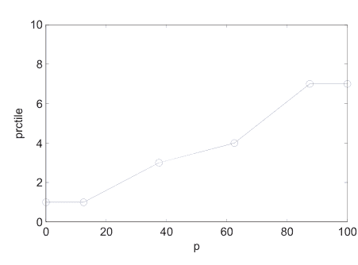

个点，那么 `v` 的排序值决定了等于以下 `p` 值的百分位数：

`100 × 1/(2n)`, `100 × 3/(2n)`, `100 × 5/(2n)`, ..., `100 × (2n - 1)/(2n).`

第 `0` 百分位数始终等于样本中的最小值。第 `100` 百分位数是样本中的最大值。所有其他百分位数通过线性插值确定。

#### 7.7.10. （更具挑战性）
你会发现，Google 折线图可用于绘制曲线，而不仅仅是函数的图形。这是因为 `x` 坐标向量不需要按升序排列，甚至可能包含重复项。利用这个想法编写一个函数 `hist`，该函数接受一个数值向量和一个桶数 `n`，并绘制一个包含 `n` 个柱状图的直方图，显示不同值的频率。你的代码只需创建绘制折线图所需的数据，然后使用上一问的答案。另一种方法是使用 Google 图表提供的直方图功能。对于非常大的样本，这种第二种方法会有什么潜在问题？

#### 7.7.11. （更具挑战性）
修改代码，使其能够处理标签中的特殊字符，如 `'`.你需要查阅 `string` 的在线文档，了解如何逐个字符地查看字符串，你可以在 `cplusplus.com` 上找到该文档。

#### 7.7.12
在上述问题中，你通过引用传递向量和字符串了吗？你在可能的地方使用了 `const` 关键字吗？你在可能的地方使用了 `static` 关键字吗？

##### 7.8 摘要

本章标志着我们 `C++` 编程技能发生了某种转变。通过整合我们所学的一切，我们可以编写出非常复杂的东西。

我们学到的具体技能包括：

- 引用传递和值传递。
- 如果我们希望编译器帮助避免副作用，则使用 `const` 关键字。
- 使用 `vector<double>` 来表示数学向量。作为类型 `const vector<double>&` 传递它们。
- 使用 `string` 来表示字符串。作为 `const string&` 传递它们。
- 使用 `stringstream` 来构建复杂的字符串。
- 使用 `fstream` 来写入文件。
- 使用 `ostream` 来互换地写入任何类型的流。
- 使用通过文本文件在不同程序之间通信的架构设计模式。

# 第 8 章

## 用户自定义类型

在前一章中，我们学习了如何使用：

- `vector<double>`,
- `string`,
- `ofstream`,
- `stringstream`.

使用这些新类型使我们成为更高效的生产力 `C++` 程序员。下一步是学习如何编写我们自己的类型，希望这同样能提高我们的生产力。正如你将学到的，在面向对象语言中，程序设计师的主要工作是编写他们自己的类型。在本章中，我们将假设你已经在开发环境中打开了 `FMLib8`，以便你可以查看代码并对其进行实验。

### 8.1 术语

我们已经知道以下几点。

- `C++` 中的每个变量都有一个类型（例如，`double`）。
- 你可以有许多给定类型的变量。

我们即将开始学习一种称为“面向对象编程”的编程风格，在这种风格中，惯例上对相同的概念使用略有不同的词汇。

- `C++` 中的每个对象都有一个类。
- 你可以拥有同一个类的许多实例。

例 1：

```cpp
string s("To be, or not to be?");
```

在上述代码中，`s` 是一个类型为 `string` 的 *对象*。它是 *类* `string` 的一个 *实例*。

*对象*（object）一词在面向对象编程中指的是一种数据类型，它由一组数据以及处理这些数据的有用函数组成。

因此，`vector<double>` 是一个对象，因为它包含向量的数据以及像 `size()` 这样有用的函数。同样，`string` 也是一个对象。

另一方面，`double`、`int` 以及原始数据类型 `char*` 不是面向对象类型，因为它们仅由数据组成，没有特殊的辅助函数。

对象支持的数据类型和函数仅取决于其 *类*。同一个类的所有实例都具有相同的函数和相同类型的数据。

**示例 2**：`string` 类的一个实例由以下内容组成：

- 由字符序列组成的数据；
- 用于处理这些数据的功能，例如 `size`、`insert`、`erase`。

*类* `string` 定义了所有这些函数和数据类型。

最后，与对象相关联的函数通常被称为 *方法*。*函数*（function）和 *方法*（method）这两个词之间没有实质性的区别。有些作者更喜欢使用 *方法* 这个词，因为 *函数* 一词可能会让非数学专业人士感到畏惧。我们将同时使用这两个术语。

### 8.2 编写自己的类

#### 8.2.1 编写声明

为了展示如何编写自己的类，让我们创建一个表示二维空间中点的数据类型。

```cpp
class CartesianPoint {
public:
    double x;
    double y;
};
```

上面的代码被称为类声明。你可以选择将类声明放在 `.h` 文件或 `.cpp` 文件中。如果你希望它是你库的一部分，请将其放在头文件中。如果你使用它来实现你的库，但不希望其他人使用它，请将其放在 `.cpp` 文件中。在这种情况下，我们希望该类对我们库的用户可用，因此我们在头文件 `geometry.h` 中声明了它。

在上面的示例中：

- 我们的类名为 `CartesianPoint`。
- 笛卡尔点包含两个名为 `x` 和 `y` 的 `double` 值。这些被称为该类的 *成员变量*。
- 库用户被允许在自己的代码中使用 `x` 和 `y` 的值，因此这些被标记为 `public`。

在编写类时，类声明使用以下通用语法：

```cpp
class CLASS_NAME {
    public:
        DATA AND FUNCTION DECLARATIONS
    private:
        DATA AND FUNCTION DECLARATIONS
};
```

你在标记为 `public:` 部分中声明的数据和函数将可供你库的用户使用。标记为 `private:` 的数据和函数不可供你库的用户使用。这允许你隐藏关于你的类如何工作的信息。这将使你的库更容易使用和维护。

需要注意的是以下几点：

- 你可以在头文件或 `cpp` 文件中定义类。如果你希望库用户使用你的类，请使用头文件。
- 你必须记得在末尾加上分号。如果省略它，你可能会得到非常令人困惑的编译器错误。
- 与变量名一样，类名不应包含空格或奇怪的字符，并且应以字母开头。使用命名约定是一个好主意，以便轻松区分类名和变量名。在这本书中，我们将使用驼峰式命名约定（以大写开头的类名）。例如，我们使用了类名 `CartesianPoint`。

#### 8.2.2 使用类

让我们看看如何使用 `CartesianPoint` 类。我们的示例代码包含一个测试，展示该类的用法。

```cpp
1 CartesianPoint p;
2 p.x = 100;
3 p.y = 150;
4 cout << "Coordinates (";
5 cout << p.x ;
6 cout << ", ";
7 cout << p.y ;
8 cout << ")\n";

10 p.x *= 2;
11 p.y *= 2;
12 cout << "Rescaled coordinates (";
13 cout << p.x ;
14 cout << ", ";
15 cout << p.y ;
16 cout << ")\n";
```

这创建了一个点并将坐标设置为 `$(100, 150)$`。然后它打印出坐标。接下来它将所有坐标值加倍，并第二次打印它们。

为了更详细地理解这一点，在第 1 行我们创建了一个 `CartesianPoint` 类的实例。我们只需声明一个类型为 `CartesianPoint` 的变量来做到这一点。

```cpp
CartesianPoint p;
```

现在我们创建了一个名为 `p` 的变量，它表示空间中的一个点。然后我们设置表示 `$x$` 坐标和 `$y$` 坐标的成员变量。我们选择数值使得 `p` 表示点 `$(100, 150)$`。

```cpp
p.x = 100;
p.y = 150;
```

当你想要访问类内部的数据时，使用点号 `.` 后跟成员变量的名称。

你只能访问这些变量，因为它们被标记为 `public`。尝试去掉单词 `public`；并查看你得到的编译器错误。这将有助于你未来理解编译器错误，万一你忘记将数据标记为公开时。

#### 8.2.3 在函数之间传递对象

让我们编写一个新的类，称为 `PolarPoint`，它表示极坐标中的点。因此，它将具有对应于极坐标 `(r, θ)` 的成员变量。

```cpp
class PolarPoint {
public:
    double r;
    double theta;
};
```

我们可以使用这个类来说明如何向函数传递对象以及从函数返回对象。让我们编写一个新函数 `polarToCartesian`，它接受一个极坐标点并返回对应的 `CartesianPoint`。

```cpp
CartesianPoint polarToCartesian(const PolarPoint& p) {
    CartesianPoint c;
    c.x = p.r*cos( p.theta );
    c.y = p.r*sin( p.theta );
    return c;
}
```

正如我们在 `7.2.1` 节中讨论的那样，在向函数传递对象时，你应该使用引用传递。这解释了 `const` 关键字和 `&` 符号的使用。通常，任何自定义数据类型都应通过引用传递。按值传递通常仅保留给 `double`、`int` 和 `bool`。

#### 8.2.4 类如何帮助了？

值得暂停一下，看看使用类如何改善了我们的代码。让我们检查测试我们的新 `polarToCartesian` 函数所需的代码：

```cpp
static void testPolarToCartesian() {
    PolarPoint p;
    p.r = 2.0;
    p.theta = PI/2;
    CartesianPoint c = polarToCartesian( p );
    ASSERT_APPROX_EQUAL( c.x,0.0,0.001 );
    ASSERT_APPROX_EQUAL( c.y,2.0,0.001 );
}
```

并将其与我们之前的测试代码进行比较：

```cpp
static void testPolarToCartesian() {
    double r = 2.0;
    double theta = PI/2;
    double x=0.0, y=0.0;
    polarToCartesian(r, theta, x, y);
    ASSERT_APPROX_EQUAL( x,0.0,0.001 );
    ASSERT_APPROX_EQUAL( y,2.0,0.001 );
}
```

使用类带来的第一个优势是，它们确立了一个明确的约定：`$x$` 坐标被称为 `x`，`$y$` 坐标被称为 `y`。这将使使用 `CartesianPoint` 编写的代码比那些有时使用 `x`、有时使用 `X`、其余时间使用 `xcoord` 的代码更清晰。

使用类带来的第二个优势是，我们的代码不再如此依赖于参数的顺序。在原始代码中，必须非常小心地确保每个参数都以正确的顺序传递，而编译器不会提供任何帮助。使用类使得顺序出错变得不可能。当例如向函数传递 `5` 个参数来对看涨期权定价时，这一点就变得尤为重要。此时，按错误的顺序传递参数非常容易。

第三个优势是我们不再使用引用传递来返回多个值。大多数人觉得返回单个对象在概念上比通过引用修改参数更简单。这意味着使用类的代码版本对大多数人来说更容易理解。

因此，使用类为我们提供了一致性、可读性和可靠性。目前这些优势可能看似微不足道，但随着我们的示例变得越来越复杂，这些优势将越来越明显。

然而，存在一种权衡。我们必须编写代表这些类的代码。我们应该询问这种权衡是否值得。库设计的哲学说，我们的目标始终是让用户的生活变得容易，即使以库作者做更多工作为代价。这是因为一个好的库会被大量使用，但只编写一次。因此，投入额外的工作来使库尽可能好是值得的。因此，根据这一哲学，这种权衡是值得的。

在这个例子中，面向对象的优势相当小。随着我们学习更多关于 `C++` 的面向对象特性，这种编程风格的优势将会增加。

### 8.3 向类添加函数


当我们向类中添加 *成员函数* 时，面向对象的价值变得更加明显。让我们用 `Circle` 类来说明这一点。我们的圆类将只有一项与之相关的数据，即圆的半径。但它还将具有用于处理这些数据的各种函数。

### 8.3.1 在成员函数上使用 const

我们将编写一个函数 `area()` 来计算圆的面积，以及一个函数 `circumference()` 来计算其周长。

```cpp
class Circle {
public:
    double radius;
    double area();
    double circumference();
};
```

我们将 `area` 和 `circumference` 函数的声明放在类 `Circle` 的声明内部。它们被标记为 `public`（公有），因为我们希望库的使用者能够访问它们。这些声明看起来就像普通的函数声明。请注意，它们完全不接受任何参数。

在我们尝试实现这些函数之前，让我们践行测试驱动开发，为它们编写测试。这将让我们能够展示如何在对象上调用函数。

```cpp
static void testAreaOfCircle() {
    Circle c;
    c.radius = 4;
    ASSERT_APPROX_EQUAL( c.area(), 16*PI, 0.01 );
}
static void testCircumferenceOfCircle() {
    Circle c;
    c.radius = 2;
    ASSERT_APPROX_EQUAL(c.circumference(), 4*PI, 0.01);
}
```

如上例所示，使用点号（dot）在对象上调用函数。例如，`c.area()` 计算圆 `c` 的面积。

我们是在特定的圆 `c` 上调用 `area` 函数，因此 `area` 函数应该返回那个特定的圆 `c` 的面积。这就是为什么你不需要向成员函数 `area` 传递半径的原因。

既然我们知道了这些函数将如何被使用，让我们来看看如何为这些函数提供定义。与 C++ 函数通常做法一样，我们在 .cpp 文件中编写定义。

```cpp
double Circle::area() {
    return PI*radius*radius;
}
```

```cpp
double Circle::circumference() {
    return 2*PI*radius;
}
```

关于这些函数定义，有几点值得观察。

- (i) 当你定义一个类的成员函数时，必须始终在定义中指定类的名称。语法是：`类名`:: `函数名`。如果你忘记了这样做，你会得到链接错误，提示你忘记定义该函数。必须指定名称的原因是许多类可能拥有同名的函数。例如，我们可能会有一个类 `Square`（正方形），它也有一个 `area`（面积）函数。这就是为什么你需要说明你实际实现的是哪个类的方法。

- (ii) `Circle` 类的成员函数能够访问成员变量 `radius`（半径）和全局变量 `PI`。

正如我们在第 7.2 节介绍 `const` 关键字时所提到的，如果你打算使用 `const`，必须在整个代码中保持一致的使用。如果你决定使用 `const`，那么如果成员函数不改变对象，你应该将其标记为 `const`。通过在声明和定义的末尾写上 `const` 来实现。

```cpp
class Circle {
public:
    double radius;
    double area() const;
    double circumference() const;
};

/**
 * 计算圆的面积
 */
double Circle::area() const {
    return PI*radius*radius;
}
```

在这个例子中，我们注意到测量圆的面积不会以任何方式改变圆。这就是为什么我们在 `area` 函数的声明中添加了 `const`。

然后我们也在定义中添加了它，因为 `const` 和 & 在函数声明和定义之间必须完全匹配。如果不完全匹配，你会遇到链接错误。尝试实验一下，看看如果不具备匹配的 `const` 语句实际上会发生什么错误是值得的。

当你将 `const Circle` 的引用作为参数传递给函数时，编译器会坚持该函数不修改该圆。这意味着除了标记为 const 的函数外，你无法调用该圆上的任何函数。这就是为什么，如果你打算使用 const，就必须在不改变对象的每个函数上使用它。

### 8.4 一个金融示例

为了看看从引入类中获得的益处，让我们通过一个更复杂的涉及金融数学的例子来进行演练。首先我们定义一个叫做 `BlackScholesModel` 的类。

```cpp
class BlackScholesModel {
 public:
   double stockPrice;
   double volatility;
   double riskFreeRate;
   double date;
};
```

这个类中成员变量的选择是经过仔细考虑的。该类仅包含与模型相关的变量，而不包含与金融合约相关的变量。我们稍后将在不同的类中指定不同的期权合约。

我们将在后续章节中为这个类添加功能。例如，我们将添加函数来执行模拟期权价格等操作。

请注意，我们将日期指定为 double。我们将以自公元 0 年以来的年数来衡量日期。因此，2014 年 1 月 1 日将表示为 2014.0。在实际代码中你不会这样做，但我们不想把精力浪费在思考闰年和九月有多少天的问题上。当你开始对实际期权合约进行定价时，你会希望更加小心。那时你会想要使用一个包含正确日期类的库。

我们现在为一个期权合约定义一个单独的类。我们将创建一个包含行权价（strike）和到期日（maturity）但不包含当前市场数据详情的类 `CallOption`。这种设计背后的想法是我们可以使用相同的 `BlackScholesModel` 来对 `CallOption` 或 `PutOption` 进行定价。注意 `CallOption` 不随市场数据的变化而变化。这反映了现实情况：看涨期权合约本身不因市场而改变，尽管其价格可能会波动。

```cpp
class CallOption {
 public:
   double strike;
   double maturity;

   double payoff( double stockAtMaturity ) const;
   double price( const BlackScholesModel& bsm ) const;
};
```

`CallOption` 有两个函数。其中一个函数 `payoff` 计算到期时的收益。另一个 `price` 根据以 `BlackScholesModel` 形式给出的假设市场数据计算价格。

我们在 `const` 语句的使用上很小心。对 `CallOption` 进行定价不会改变它，也不会改变用于对该期权进行定价的模型。

让我们现在检查 `payoff` 函数的实现代码：

```cpp
double CallOption::payoff(
double stockAtMaturity ) const {
if (stockAtMaturity>strike) {
return stockAtMaturity-strike;
} else {
return 0.0;
}
}
```

请注意，所有的 `const` 关键字都与声明完全匹配。如果不一致，代码将无法正确链接。除了 `const` 关键字和 `CallOption::` 之外，这段代码相当直观。函数的定义直接源自 `CallOption` 合约的定义。

下一个函数更加复杂，因为它使用 `BlackScholes` 公式对 `CallOption` 进行定价。

```cpp
double CallOption::price(
const BlackScholesModel& bsm ) const {
double S = bsm.stockPrice;
double K = strike;
double sigma = bsm.volatility;
double r = bsm.riskFreeRate;
double T = maturity - bsm.date;

double numerator =
log( S/K ) + ( r + sigma*sigma*0.5)*T;
double denominator = sigma * sqrt( T );
double d1 = numerator/denominator;
double d2 = d1 - denominator;
return S*normcdf(d1) - exp(-r*T)*K*normcdf(d2);
}
```

再次注意，我们使用 `CallOption::` 指定这是 `CallOption` 的 `price` 函数。我们根据通常的效率原因，按照函数声明中指定的方式以 `const` 引用传递 `BlackScholesModel`。

类似地，我们使用 const 关键字指定该函数不改变 CallOption 本身，正如声明中那样。

最后但同样重要的是，我们需要一个单元测试。除了检查代码，这还提供了一个如何使用我们的类的有用示例。

```cpp
static void testCallOptionPrice() {
    CallOption callOption;
    callOption.strike = 105.0;
    callOption.maturity = 2.0;

    BlackScholesModel bsm;
    bsm.date = 1.0;
    bsm.volatility = 0.1;
    bsm.riskFreeRate = 0.05;
    bsm.stockPrice = 100.0;

    double price = callOption.price( bsm );
    ASSERT_APPROX_EQUAL( price, 4.046, 0.01 );
}
```

#### 8.4.1 我们获得了什么？

这些益处类似于引入 `CartesianPoint`（笛卡尔点）和 `PolarPoint`（极坐标点）类带来的益处，但现在它们显得更加显著。

- **编程更简单。** 如果我们有一个单独的函数 `blackScholesPrice`，它接受 5 个 double 参数，那么几乎不可能记住参数的正确顺序。

- **调试更简单。** 如果你有一个接受 5 个 double 参数的函数，几乎不可能发现某人是否不小心将参数放错了顺序。

- **一致性。** 如果我们使用相同的 `BlackScholesModel` 类来对看跌期权、亚式期权、敲出式期权等进行定价，我们将拥有一个更容易使用的库。

在后续章节中，我们将应用更高级的面向对象技术，这将带来更显著的益处。

### 8.5 关于编写类的建议

在编写类时，关于类名以及将其定义在哪个文件等事宜，您有很多选择。拥有一些约定是很好的。在本书中，我们选择遵循以下准则。

- 1) 在可能的情况下，不要在头文件中放置类声明，而是放在 cpp 文件中。这遵循了“如果可能，应尝试隐藏信息”的一般原则。

- 2) 如果您决定将某个类放在头文件中，则每个头文件只定义一个类。

- 3) 将该类的名称与其头文件名称保持一致。

- 4) 类的命名应使用名词：例如 `CartesianPoint`（笛卡尔点）或 `BlackScholesModel`（布莱克-斯科尔斯模型）。

- 5) 类名的首字母使用大写。

文件 `BlackScholesModel.h` 和 `CallOption.h` 展示了这些约定。

文件 `geometry.h` 打破了这些约定，但这仅仅是因为我们不想用太多与金融数学无关的文件来使项目杂乱无章。如果我们真的在编写一个几何库，为了可读性，我们会将所有点类放在它们自己的头文件中。

需要考虑的第二个问题是 `const` 关键字。在本章中，我们一直尝试一致地使用 `const` 关键字。然而，`const` 关键字在 C++ 中是一个可选特性。如果您希望编译器保证您在无意的情况下永远不会意外更改对象，您可以选择使用它，但如果您完全不用 `const`，您的代码也能运行。

这意味着您可以为您的项目做出软件架构决策。您打算使用 `const` 还是不打算？这是整个项目的决策，因为事实证明，如果您想使用 `const` 关键字，实际上您需要到处都使用它。这是因为如果有人将 `const` 引用传递给您，您只能将其传递给那些本身声明为接受 `const` 引用的函数。

在实践中，这意味着您无法选择是否使用 `const`。您需要询问您的老板是否希望您使用它。

即使您个人不喜欢 `const` 关键字，如果您正在编写库，而您的库用户希望使用 `const` 关键字，您将需要使用 `const` 关键字。

在本书中，我们将使用 `const` 以便您可以理解所涉及的问题，但您可能更倾向于在您自己的代码中避免使用它。

### 8.6 封装

现在让我们尝试更深入地理解 `public` 关键字。为此，让我们编写我们饼图代码的面向对象版本。我们从名为 `PieChart` 的类声明开始。

```cpp
class PieChart {
public:
    void setTitle( const std::string& title );
    void addEntry( const std::string& label,
                   double value ) ;
    void writeAsHTML( std::ostream& out ) const;
    void writeAsHTML(const std::string& file ) const;
private:
    std::string title;
    std::vector<std::string> labels;
    std::vector<double> values;
};
```

根据我们的约定，您可以在 `PieChart.h` 中找到它。

现在我们已将数据变量标记为*私有*（private）。这意味着只有 `PieChart` 的成员函数才能看到这些变量。

唯一修改标题的成员函数是 `setTitle`。唯一修改标签列表和数据点列表的函数是 `addEntry`。以下是它们的定义：

```cpp
void PieChart::setTitle( const std::string& t ) {
    title = t;
}

void PieChart::addEntry( const string& label,
                         double value ) {
    labels.push_back( label );
    values.push_back( value );
}
```

有趣的一点是，`labels` 和 `values` 现在永远不可能包含不同数量的元素。这是因为修改它们的唯一代码是 `addEntry`，该函数维护了两个向量长度始终相同这一保证。我们知道项目中其他任何代码都不会破坏这一保证，因为这些变量是*私有*的。由于我们使用了*私有*（private）关键字，我们只需检查成员函数的行为良好，即可确定 `labels` 和 `values` 具有相同数量的元素。

在类中将*所有*成员变量设为私有被认为是良好的编程风格。这样做可以确保您的对象始终处于一致的状态。此外，它还允许您将来更改实现细节（即数据如何存储）而不影响您类的任何用户。

总之，`private` 关键字允许您执行比仅仅选择在头文件中放置什么更复杂的信息隐藏。

不将类放在头文件中比将事物设为 `private` 提供了更多的信息隐藏，因此那应该总是您的首选。然而，如果您必须让类对您库的用户可用，您应尝试将其所有数据以及尽可能多的成员函数设为 `private`。

我们之所以赋予 `BlackScholesModel` 和 `CallOption` 公共数据成员，仅仅是为了简单起见。我们希望在解释 `private` 数据之前说明 `public` 数据的用法。在实践中，可以通过修改这些类来改进该库。

使用 `private` 关键字隐藏数据的概念通常被称为`封装`（encapsulation）。封装这个词实际上指的是两件事：

- (i) 将相关项目捆绑到一个单一对象中；

- (ii) 防止直接干扰对象的内部数据。

封装在现实世界设计中以及面向对象软件设计中都很常见。例如，考虑汽车的设计。

在汽车中，所有灯光控制都放在仪表板上，并与车窗和座椅的控制明显分开。这种功能在汽车控制上的分组对应于软件设计中功能在不同类中的分组。

此外，您可以通过标准功能（左转、右转等）控制汽车，但汽车的内部工作原理对用户完全隐藏（它们被保留在引擎盖下）。这对应于软件设计原则，即向用户提供少量公共功能，但将大部分细节保持私有。

由于封装的使用，汽车变得更加易于使用。能够驾驶汽车而不需要成为熟练的机械师是一件好事。正如这些设计原则使汽车更易于使用一样，相同的使面向对象程序中的对象更易于使用。

为了进一步说明这一点，考虑 `vector<double>` 类如何存储其数据，因为它不能本身使用 `vector<double>`。您不知道这是如何实现的，并且很合理地，您可能不太关心这一点。您不需要知道，而无需思考这一事实使您的生活变得更加容易。

`C++` 库的设计者试图使您的生活更容易，通过将 `vector` 的内部数据设为 `private`。您应该以同样的方式帮助您库的用户。

#### 8.6.1 实现 PieChart

您可以在 `PieChart.cpp` 中找到 `PieChart` 类的完整实现。它只是我们在 7.6 节中编写的非面向对象代码的重构。您可以将我们新的 `PieChart` 类视为围绕现有代码的面向对象*包装器*，使其更易于使用。

#### 8.6.2 使用 PieChart

面向对象编程的一个核心信念是，人类发现以下代码易于理解：


```cpp
static void testPieChartClass() {
    // just checks that the class compiles etc.
    PieChart pieChart;
    pieChart.addEntry("Mushrooms",200);
    pieChart.addEntry("Salami",100);
    pieChart.addEntry("Spinach",150);
    pieChart.setTitle("Pizza Toppings");

    pieChart.writeAsHTML( "PizzaPie.html" );
}
```

这真的概括了面向对象的一个关键点。面向对象软件应使我们的库用户的生活更轻松。

## 练习

- 8.6.1 编写一个类 `PutOption`，其行为类似于 `CallOption`。确保您编写适当的测试并遵循文件命名约定。

- 8.6.2 编写一个类 `LineChart`，允许您创建线图。添加一个功能来设置图的标题。

- 8.6.3 向 `CartesianPoint` 类添加一个函数 `distanceTo`。它应该接受一个参数，该参数是另一个 `CartesianPoint`，并计算两个点之间的距离。这里是一个合适的测试函数：

```cpp
static void testDistanceTo() {
    CartesianPoint p1;
    p1.x = 1;
    p1.y = 1;
    CartesianPoint p2;
```

8.6.4. 编写一个普通的函数 `perimeter`，它接受三个 `const` 引用的 `CartesianPoints` 作为参数，并计算由此产生的三角形的周长。`perimeter` 函数应调用 `distanceTo`。使用 3, 4, 5 三角形测试你的 `perimeter` 函数。

如果你从 `distanceTo` 的定义中移除任一个 `const` 关键字，但在 `perimeter` 的定义中保留它们，会发生什么？请解释为什么“如果你在任何地方使用 `const` 关键字，你就必须在所有地方使用它”。

### 8.7 构造函数

如果在 C++ 中创建一个 `double` 类型的变量但自己未设置其值，C++ 不会保证该变量会被赋予什么值。在实践中，计算机只会获取一些空闲内存，并使用其中碰巧存在的任何值。

例如，下面的程序是有效的 C++，但不可能提前预知它会打印什么内容。

```cpp
int main() {
	double d;
	cout << "What is the value of d?\n";
	cout << d;
	return 0;
}
```

由于我们一直注意警告信息，这尚未成为一个问题，尽管这是技术上有效的 C++ 代码，但它肯定会触发编译器警告。

由于类似的原因，以下代码也会导致编译器警告。

```cpp
class Point {
public:
	double x;
	double y;
};

int main() {
    Point p;
    cout << "What is the value of x?\n";
    cout << p.x;
    return 0;
}
```

如果所有 `double` 值和所有 `int` 值默认都为 0，C++ 将更易于使用。我们无法修改 C++ 以使事情更容易，但我们可以通过为类提供构造函数来使我们的类更易于使用。构造函数执行对象的初始化，使其处于合理状态。

我们已经使用过构造函数。例如，要构建一个长度为 100 且初始化为零的向量，我们知道应该编写：

```cpp
vector<double> v(100,0.0);
```

类似地，要构建一个包含 Some text 字符的字符串，我们知道应编写：

```cpp
string s("Some text");
```

大多数类更进一步，拥有一个默认构造函数，将对象初始化为合理的默认状态。例如，要创建一个空向量，只需简单地编写：

```cpp
vector<double> v;
```

默认构造函数会被自动调用。类似地，要创建一个空字符串，人们会编写：

```cpp
string s;
```

当你编写一个类时，几乎总是应该给它一个默认构造函数，以便人们能够正确使用它。你可能还想提供更专业化的构造函数来将对象初始化为特定状态。

#### 8.7.1 编写默认构造函数

让我们编写一个名为 `Point` 的类，它旨在完全像我们的 `CartesianPoint` 示例那样工作，但现在拥有一个构造函数。

```cpp
class Point {
public:
    Point(); // 声明默认构造函数
    double x;
    double y;
};

Point::Point() {
    x=0.0;
    y=0.0;
}

int main() {
    Point p;
    cout << "What is the value of x?\n";
    cout << p.x;
    return 0;
}
```

在类声明中，我们在第 3 行有声明 `Point();`。这声明了构造函数。

构造函数声明看起来像函数声明，除了：

- (i) 没有返回类型；
- (ii) 使用类名代替函数名。

类似地，构造函数定义看起来像函数定义，具有相同的差异。在上面的示例中，构造函数定义从第 8 行开始。

在我们的示例中，构造函数看起来像一个不接收参数的函数。正如我们将看到的，构造函数可以接收参数。默认构造函数只是一个不接收参数的构造函数。

你可以将构造函数视为一个函数，它在任何人被允许查看对象之前自动被调用。从技术上讲，它实际上不是一个函数，因为它*只能*在对象被初始化时调用，并且它没有返回值。

在构造函数定义内部，你应该将所有 `int`、`double` 等字段设置为合理的默认值。更一般地说，在任何人看到对象之前，你应确保对象处于一致状态，并执行达成此目的所需的任何处理。

#### 8.7.2 另一种更优越的语法

这里是我们可以编写 `Point` 构造函数的另一种方式：

```cpp
class Point {
public:
    Point(); // 声明默认构造函数
    double x;
    double y;
};

Point::Point() :
x(0.0),
y(0.0) {
}

int main() {
  Point p;
  cout << "What is the value of x?\n";
  cout << p.x;
  return 0;
}
```

在 `Point` 构造函数的定义中，你可以看到一系列语句：

```cpp
x(0.0),
y(0.0)
```

这被称为初始化列表。这调用了 `x` 和 `y` 的构造函数以初始化数据。这与我们之前使用 `=` 语句初始化变量的代码略有不同。

带有初始化列表的构造函数的一般语法是：

```cpp
CLASS_NAME::CLASS_NAME( PARAMETER_LIST ) :
    INITIALISATION_LIST {
      ... NORMAL CODE ...
}
```

注意初始化列表前面的冒号。

经验丰富的 C++ 程序员更喜欢使用初始化列表，因为它稍微快一点。这是因为调用默认构造函数然后执行赋值会比第一次就使用正确的值更慢。

此外，一旦你熟悉了这种语法，它的可读性更好，因为很明显没有任何复杂的地方。所有正在发生的事情只是数据被初始化。这意味着你可以猜测，如果花括号之间有一些代码，它会相对有趣。

### 8.8 带参数的构造函数

编写接收参数的构造函数很直接。以下是如何在 `CallOption` 类中添加一个接收 *strike* 和 *maturity* 作为参数的构造函数的方法。

```cpp
class CallOption {
public:
    double strike;  
    double maturity;  
    CallOption(); // 默认构造函数
    CallOption(double strike, double maturity); // 替代
};

// 默认构造函数实现
CallOption::CallOption() :  
   strike(0.0),
   maturity(0.0) {
}

// 替代构造函数实现
CallOption::CallOption(
      double s,
      double m ) :  
   strike(s),
   maturity(m) {  
}
```

要创建一个 `strike` 为 100 且 `maturity` 为 2.0 的期权，人们随后会编写

```cpp
CallOption myOption( 100, 2.0 );
```

这似乎是一个非常方便的系统，但这可能不是一个很好的设计。原因在于，通过引入类，我们消除了调用函数时记住参数顺序的问题。通过拥有一个具有多个参数的构造函数，我们重新引入了这个问题！

这并不意味着带参数的构造函数总是坏的，只是你不应该过度使用它们。当然，能够构建给定大小和默认值的向量是构造函数的良好用途。

带参数构造函数有一个奇怪的技巧，你应该尝试记住。考虑类 `string`。它有一个接收原始文本数据的构造函数：

```cpp
string s("Some raw text");
```

C++ 使用这个构造函数自动将原始文本数据转换为字符串，而你无需考虑。例如，代码：

```cpp
plot("myPlot.txt", xVec, yVec );
```

将起作用，尽管 `plot` 的第一个参数声明为 `const string&` 而不是 `char*`。

一般来说，如果你的类有一个接收单个参数进行构造的构造函数，C++ 将执行类似的自动转换。虽然这对于 `string` 数据类型非常好，但通常它会导致非常不自然的代码。例如，假设你在 `BlackScholesModel` 中添加了一个构造函数，其中你只提供股票价格：

### 8.8 构造函数与 explicit 关键字

#### 显式构造函数

这样做意味着 C++ 现在会自动将双精度浮点数（`double`）转换为 `BlackScholesModel` 的实例。这是一种非常奇怪且不可取的行为。为了防止这种不想要的行为，你应该将那些只有一个参数的构造函数标记为 `explicit`。

```cpp
class BlackScholesModel {
public:
  double stockPrice;
  double data;
  double volatility;
  double riskFreeRate;
  BlackScholesModel();
  explicit BlackScholesModel( double stockPrice ); // 关键行
};
```

上面的代码阻止了自动转换。在极少数自动转换有用的情况下（例如对于 `strings`），你可以省略 `explicit`。

如果你忘记了 `explicit`，世界也不会因此毁灭。在实际中，因忘记使用它而产生的混淆情况是相当罕见的。

## 练习题

- 8.8.1. 为你迄今为止创建的每个类编写一个默认构造函数。使用构造函数的两种形式语法来熟悉这些选项。

- 8.8.2. 编写一个类 `Polynomial`，用于表示多项式 $a_0 + a_1x + a_2x^2 + . . . + x^n$。这里的系数 $a_i$ 是与多项式本身关联的双精度浮点数，而 $x$ 是一个未知数。类 `Polynomial` 应具有以下特性。

  - 它应使用向量存储系数 $a_i`。
  - 它应有一个函数 `evaluate`，该函数接收 $x$ 作为参数，并在 $x$ 处评估多项式的值。
  - 它应有一个构造函数，接收一个系数向量作为参数。
  - 它应有一个函数 `add`，可用于将两个多项式相加。
  - 它应有一个默认构造函数，生成常数零多项式。
  - 它应有一个构造函数，接收单个双精度浮点数 $c$ 作为参数，并生成常数多项式，其中 $a_0 = c$ 且所有其他系数为 0。

### 8.9 总结

- 我们学习了如何编写将数据聚集在一起的类。
- 我们学习了如何向我们的类添加成员函数。
- 我们看到，使用类使我们的库用户的生活更轻松。
- 我们学习了如何使用关键字 `public` 和 `private` 向库用户隐藏数据。
- 我们学习了时髦词汇“封装”。
- 我们学习了如何使用 `const` 关键字来指示通过调用其成员函数之一时对象是否会被修改。
- 我们已经了解到，类通常应有一个构造函数来初始化数据。

# 第 9 章

## C++ 中的蒙特卡洛定价

在这一章中，我们暂停扩展我们的 C++ 知识，转而深入研究一个详细的金融示例，该示例阐明了我们到目前为止所学的一切。考虑到这一点，让我们回顾一下我们所学的一些亮点。在练习题中，我们在文件 `matlib.cpp` 中编写了大量的基础数学功能。特别是我们可以：

- i) 使用 `randUniform` 和 `randn` 生成随机数（练习题 7.7.5 和 7.7.6）
- ii) 使用 `plot` 和 `hist` 生成绘图（练习题 7.7.8 和 7.7.10）。
- iii) 使用 `min`、`mean`、`pctile` 等计算向量的统计量（练习题 7.7.2、7.7.4 和 7.7.9）

我们还学习了如何编写简单的类。

如果你尚未完成这些练习题，你应该尝试完成它们。你可以在 `FMLib9` 中找到的文件 `matlib.cpp` 包含所有这些函数的可工作版本。

在本章中，我们将执行以下操作：

- i) 向 `BlackScholesModel` 添加一个函数以模拟股价。
- ii) 使用 `mean` 等测试我们的模拟，并使用 `plot` 绘制它们的图像。
- iii) 编写一个类 `MonteCarloPricer`，该使用 `BlackScholesModel` 模拟股价，然后使用风险中性定价通过蒙特卡洛方法对 `CallOption` 进行定价。

通过这样做，我们将看到我们所学习的所有 C++ 如何应用于解决实际的金融数学问题。

当然，使用蒙特卡洛对欧式看涨期权进行定价是不必要的，因为人们已经知道 Black–Scholes 公式。然而，这是一个有价值的练习，因为它阐明了蒙特卡洛定价的一般思想。在练习题中，你将稍作扩展这些思想，以对没有给出解析公式的路径依赖型期权进行定价。

在我们开始编写代码之前，让我们回顾一下在附录 A 中论证过的蒙特卡洛定价算法。

## 算法 1

要计算一个期权的风险中性价格，其收益以时间点 $t_1, t_2, \dots, t_n$ 的价格表示，应遵循以下步骤：

1. 在 $\mathbb{Q}$ 测度下模拟股价路径。我们所说的股价路径仅仅是指股价在时间点 $t_i$ 的一种可能实现。典型的股价路径如图 9.1 所示。
2. 计算每条价格路径的收益。
3. 计算折现均值。这给出了真实风险中性价格的无偏估计。

在本章中，我们将首先编写一个函数来模拟遵循几何布朗运动的股价。该过程由方程 (A.8) 描述。当将此几何布朗运动的漂移 $\mu$ 设置为等于无风险利率 $r$ 时，我们将生成如方程 (A.5) 所述的风险中性测度下的股价。在编写完这个类之后，我们将编写一些测试以确认我们的模拟是正确的。

接下来，我们将使用这些股价路径通过蒙特卡洛方法计算欧式看涨期权的价格。同样，我们将编写测试以确认我们的答案是正确的。

### 9.1 一个模拟股价的函数

我们希望编写一个函数 `generatePricePath`，它生成模拟的股价路径。它将接收最终日期 `toDate` 和步数 `nSteps` 作为参数。

由于我们要根据 Black–Scholes 模型的离散时间版本生成价格路径，我们选择将函数 `generatePricePath` 设为名为 `BlackScholesModel` 的类的成员函数。这是合乎逻辑的，因为生成价格路径所需的关键数据是漂移 $\mu$ 和波动率 $\sigma$。这些已经是 `BlackScholesModel` 的成员变量。此外，通过将该函数添加为 `BlackScholesModel` 的成员，立即就清楚地表明 `generatePricePath` 函数将生成遵循几何布朗运动的价格，这是 Black–Scholes 模型所要求的。

该函数的这个规格实际上告诉我们需要在头文件中编写什么。

```cpp
class BlackScholesModel {
public:
  ... BlackScholesModel 的其他成员 ...
  std::vector<double> generatePricePath(
      double toDate,
      int nSteps) const;
};
```

正如这个例子所示，类声明描述了类的功能，而没有详细描述其实现方式。如果你选择了好的函数和变量名，你就不需要太多的注释。设计良好的类几乎可以自我文档化。

我们还需要一个函数 `generateRiskNeutralPricePath`，它的行为相同，只是它使用 $\mathbb{Q}$ 测度来计算路径。因此，我们将以下声明添加到 `BlackScholesModel` 中。

```cpp
class BlackScholesModel {
public:
  ... BlackScholesModel 的其他成员 ...
  std::vector<double> generateRiskNeutralPricePath(
      double toDate,
      int nSteps) const;
};
```

为了实现这些函数，我们引入了一个*私有*函数，允许你选择在价格路径模拟中的漂移。


```cpp
class BlackScholesModel {
  ... BlackScholesModel 的其他成员 ...
private:
  std::vector<double> generateRiskNeutralPricePath(
      double toDate,
      int nSteps,
      double drift) const;
};
```

这个函数是私有的，因为我们只是创建它以使实现更容易。类的用户不需要（甚至不想要）知道它的存在。

为了实现该函数，我们需要知道使用什么算法。相关的数学公式如下给出（并在附录 A 中进行了论证）。

## 算法 2

要模拟在离散时间点 $t_0$，$t_1$，$\ldots$ $t_n$ 遵循离散时间几何布朗运动且漂移为 $\mu$ 和波动率为 $\sigma$ 的股价，应遵循以下步骤：

(i) *定义*

$$\delta t_i = t_i - t_{i-1}.$$

(ii) *选择独立的正态分布* $\epsilon_i$ *，均值为 0，标准差为 1。*

(iii) 定义

$s_{t_{i}}=s_{t_{i-1}}+\left(\mu-\frac{1}{2}\sigma^{2}\right)\delta t_{i}+\sigma\sqrt{\delta t_{i}}\epsilon_{i}.$

(iv) 定义 $S_{t_{i}}=\exp(s_{t_{i}}).$

生成的 $S_{t_{i}}$ 处的股价将与 Black-Scholes 模型给出的股价具有相同的联合概率分布。

鉴于该算法的数学表述，实现我们的辅助函数就变得很直接了。你可以在 `BlackScholesModel.cpp` 中找到代码。

```cpp
vector<double> BlackScholesModel::generatePricePath(
    double toDate,
    int nSteps,
    double drift ) const {
  vector<double> path(nSteps,0.0);
  vector<double> epsilon = randn( nSteps );
  double dt = (toDate-date)/nSteps;
  double a = (drift-volatility*volatility*0.5)*dt;
  double b = volatility*sqrt(dt);
  double currentLogS = log( stockPrice );
  for (int i=0; i<nSteps; i++) {
    double dLogS = a + b*epsilon[i];
    double  logS = currentLogS + dLogS;
    path[i] = exp( logS );
    currentLogS = logS;
  }
  return path;
}
```

我们只为等间距的时间点实现了该算法。推广到任意时间点是很简单的。

实现了私有函数之后，公共函数变得非常简单。同样，这些实现也位于 `BlackScholesModel.cpp` 中。

```cpp
vector<double> BlackScholesModel::generatePricePath(
    double toDate,
    int nSteps ) const {
  return generatePricePath(toDate, nSteps, drift );
}

vector<double> BlackScholesModel::
    generateRiskNeutralPricePath(
    double toDate,
    int nSteps ) const {
  return generatePricePath(
    toDate , nSteps , riskFreeRate );
}
```

值得注意的是，通过使用带有私有辅助函数的设计，我们避免了编写两遍相同的复杂代码。

测试这段代码很重要。第一个测试是视觉上的，我们要检查这是否看起来像一条真实的价格路径。我们可以使用 `LineChart` 类来做到这一点。

```cpp
void testVisually() {
  BlackScholesModel bsm;
  bsm.riskFreeRate = 0.05;
  bsm.volatility = 0.1;
  bsm.stockPrice = 100.0;
  bsm.date = 2.0;
  int nSteps = 1000;
  double maturity = 4.0;
  vector<double> path = bsm.generatePricePath(maturity, nSteps);
  double dt = (maturity - bsm.date) / nSteps;
  vector<double> times = linspace(dt, maturity, nSteps);
  LineChart lineChart;
  lineChart.setTitle("Stock price path");
  lineChart.setSeries(times, path);
  lineChart.writeAsHTML("examplePricePath.html");
}
```

此函数使用了已添加到 matlib 库中的辅助函数 `linspace`。调用 `linspace(a,b,n)` 会在值 $a$ 和 $b$ 之间生成 $n$ 个等间距的数字。输出的图表如图 9.1 所示。视觉检查只是观察其是否合理地看起来像真实股价的历史记录。

你可以使用 FMLib9 运行此测试以获取相关代码。我希望你同意，在 C++ 中生成如此复杂的图表是证明我们在理解 C++ 方面取得了多大进步的有力证据。

视觉测试很有用，但我们总是应该确保对代码进行完全自动化的测试。原因在于，一旦拥有大量代码，就需要定期测试，以防我们不小心写入了 bug。如果我们的测试是完全自动化的，我们可以在每次修改代码时运行它们。

一个简单的测试是，如果我们的风险中性价格路径函数是正确的，那么最终股价的折现平均值应等于初始价格。我们在下面的代码中进行了测试：


**图 9.1：** 模拟的股价路径。底部轴是以年为单位的时间，垂直轴是以美元为单位的价格。

```cpp
void testRiskNeutralPricePath() {
    rng("default");

    BlackScholesModel bsm;
    bsm.riskFreeRate = 0.05;
    bsm.volatility = 0.1;
    bsm.stockPrice = 100.0;
    bsm.date = 2.0;

    int nPaths = 10000;
    int nsteps = 5;
    double maturity = 4.0;

    vector<double> finalPrices(nPaths,0.0);
    for (int i=0; i<nPaths; i++) {
        vector<double> path =
                bsm.generateRiskNeutralPricePath(
                     maturity, nsteps );
        finalPrices[i] = path.back();
    }
    ASSERT_APPROX_EQUAL( mean( finalPrices ),
        exp( bsm.riskFreeRate*2.0)*bsm.stockPrice ,
                  0.5 );
}
```

我们在以下一行中引入了一个新特性：

```cpp
rng("default");
```

这不是对标准 C++ 函数的调用，而是 Fm-Lib 库中的一个函数，它将随机数生成器的状态重置回其原始的“默认”状态。每次将随机数生成器重置为其默认状态时，对 `randUniform` 和 `randn` 的调用都将生成完全相同的“随机数”序列。我们将“随机数”放在引号中，是因为生成的随机数并不真正是随机的。计算机生成的随机数看起来只是随机的，就像数字 $\pi$ 的小数部分看起来是随机的。更准确地说，它们被称为伪随机数。

重置随机数生成器的状态对于测试非常有用，因为它保证了每次运行测试时，我们使用相同的伪随机数。这意味着如果测试通过一次，它将永远通过；同样，如果它失败一次，它将永远失败。在调试代码时，拥有一个有时通过有时失败的测试是非常令人沮丧的——尤其是当你在每次更改代码时都运行所有测试时。

> **提示：依赖于随机数的测试**
>
> 在运行涉及随机数的测试之前，始终将随机数生成器重置为已知状态。

### 9.2 编写蒙特卡洛定价器

我们希望编写一个名为 `MonteCarloPricer` 的类，它通过 `nScenarios`（要生成的情景数量）进行配置。这默认为 10000。

`MonteCarloPricer` 还将拥有一个 `price` 函数，它接受一个 `Call-Option` 和一个 `BlackScholesModel`。然后它应该通过蒙特卡洛方法计算 `CallOption` 的价格。

`MonteCarloPricer` 的 C++ 声明基本上与上面的英文规范说的是同一回事。

```cpp
#pragma once

#include "stdafx.h"
#include "CallOption.h"
#include "BlackScholesModel.h"

class MonteCarloPricer {
public:
    /* Constructor */
    MonteCarloPricer();
    /* Number of scenarios */
    int nScenarios;
    /* Price a call option */
    double price( const CallOption& option,
                  const BlackScholesModel& model );
};

void testMonteCarloPricer();
```

注意那些熟悉的模式。头文件名为 `MonteCarloPricer.h`。它以 `#pragma once` 开头。我们 `#include "stdafx.h"`。构造函数的外观类似于名为 `MonteCarloPricer` 的函数声明，只是没有返回类型。我们通过 `const` 引用传递期权和模型。有一个函数用于启用测试代码。

C++ 文件的开头同样平淡无奇：

```cpp
#include "MonteCarloPricer.h"

#include "matlib.h"

using namespace std;

MonteCarloPricer::MonteCarloPricer() :
    nScenarios(10000) {
}
```

C++ 文件名为 `MonteCarloPricer.cpp`。它包含了 `MonteCarloPricer.h`。`MonteCarloPricer` 有一个默认构造函数，它选择默认使用的情景数量的值。

为了编写有趣的代码，我们提供 `price` 函数的实现。这遵循算法 1。

```cpp
double MonteCarloPricer::price(
    const CallOption& callOption,
    const BlackScholesModel& model ) {  
   double total = 0.0;
   for ( int i=0; i<nScenarios; i++ ) {
       vector<double> path= model.
              generateRiskNeutralPricePath(
                  callOption.maturity,
                  1 );

       double stockPrice = path.back();
       double payoff=callOption.payoff(stockPrice);
       total+= payoff;
   }
   double mean = total/nScenarios;
   double r = model.riskFreeRate;
   double T = callOption.maturity - model.date;
   return exp(-r*T)*mean;
}
```

由于我们要对损益仅取决于到期时股价的 `CallOption` 进行定价，我们的计算只需要一个时间步。

当然，我们还需要对该功能进行测试。我们可以将其与解析的 Black–Scholes 公式进行比较。

```cpp
static void testPriceCallOption() {  
    rng("default");

    CallOption c;
    c.strike  = 110;
    c.maturity = 2;

    BlackScholesModel m;
    m.volatility = 0.1;
    m.riskFreeRate = 0.05;
    m.stockPrice = 100.0;
    m.drift = 0.1;
    m.date = 1;

    MonteCarloPricer pricer;
    double price = pricer.price( c, m );
    double expected = c.price( m );
    ASSERT_APPROX_EQUAL( price, expected, 0.1 );
}
```

### 9.3 为蒙特卡洛生成随机数

如上所述，传统计算机无法生成真正的随机数，它们只能生成*伪随机数*。

练习 7.7.5 要求编写一个函数，使用 C++ 内置的 **rand** 函数生成均匀分布的随机数。你应该编写了类似这样的代码：

```cpp
vector<double> randomuniformOld( int n ) {
    vector<double> ret(n, 0.0);
    for ( int i=0; i<n; i++ ) {
        int randint = rand();
        ret[i] = (randint + 0.5)/(RAND_MAX+1.0);
    }
    return ret;
}
```

我们将此函数命名为 **randomuniformOld**，因为它使用的是旧的 C 语言随机数生成器 **rand**。对于蒙特卡洛算法而言，这是一个不错的选择，因为它生成的伪随机数序列很快就会开始重复。

幸运的是，计算机随机数生成领域的专家已经发明了更好的算法来生成伪随机数。*梅森扭转*（Mersenne Twister）算法是一种常用于蒙特卡洛模拟的随机数生成器，它利用所谓的*梅森素数*的特性来生成伪随机数。对于本书的目的来说，这些细节并不重要。C++ 类 **mt19937** 让你能够使用梅森扭转算法，其难度与使用旧的 **rand** 函数相比并没有增加多少。承认吧，类名 **mt19937** 确实比旧函数名 **rand** 要让人望而却步得多，但这主要区别仅此而已。之所以叫这个名字，是因为在生成的随机数序列重复之前，需要对随机数生成器进行惊人的 $2^{19937}-1$ 次调用。

下面展示了使用 **mt19937** 类生成随机数的代码。它使用了一些我们之前未见过的新 C++ 特性。首先，我们创建一个类型为 **mt19937** 的全局变量，名为 **mersenneTwister**。

```cpp
static mt19937 mersenneTwister;
```

**mt19937** 类是现代 C++ 版本中的标准类。要使用它，必须 **#include <random>**。

对象 **mersenneTwister** 就是我们的随机数生成器。我们在 **matlib.cpp** 中重写了 **randomuniform** 函数，使其使用这个随机数生成器。

```cpp
vector<double> randuniform( int n ) {
  vector<double> ret(n, 0.0);
  for (int i=0; i<n; i++) {
    ret[i] = (mersenneTwister()+0.5)/
             (mersenneTwister.max()+1.0);
  }
  return ret;
}
```

要生成一个随机整数，我们编写 mersenneTwister()。此调用返回一个范围在 mersenneTwister.min()=0 到 mersenneTwister.max() 之间的随机整数。我们尽量确保值 0 和 1 永远不会被实际达到，这就是为什么我们添加了 +0.5 和 +1.0。然而，这段代码与使用旧随机数生成器的代码实际上并没有太大区别。

一个新特性是，类 mt19937 重载了 () 的含义。当我们编写 mersenneTwister() 时，看起来好像我们在调用一个名为 mersenneTwister 的函数。但 mersenneTwister 是一个对象而不是函数，所以这不对。实际上发生的情况是，mt19937 重新定义了括号的含义，因此 mersenneTwister() 意味着“生成一个随机数”。

你可以重载 C++ 中大多数符号的含义，这在第 16 章中有详细讨论。例如，我们将展示如何重载 + 和 * 以便执行矩阵乘法。


在 C++ 中重载 `()` 的含义非常常见，这使得你的对象可以像函数一样被使用。这被称为编写一个仿函数（functor），并在第 19 章中进行了讨论。

我们还需要一个函数来重置随机数生成器的状态。代码如下。我们简单地调用 `seed` 并传入种子的默认值。

```cpp
void rng( const string& description ) {
  ASSERT( description=="default" );
  mersenneTwister.seed(mt19937::default_seed);
}
```

这里的一个新特性是，你可以将整个类与数据关联起来。梅森扭转算法的种子默认值是一个常量，因此为 `mt19937` 类的每个实例提供其默认值的副本没有意义。那会是计算机内存的浪费。因此，我们将默认值与整个 `mt19937` 类关联起来。要访问类的成员变量，如上所示，使用 `::` 表示法。我们正在访问定义在 `mt19937` 类上的变量 `default_seed`。我们将在第 12.8 节中进一步讨论这个概念。

上面的函数 `rng` 设计成与 MATLAB 中相应的函数以类似的方式工作。通常，我们试图使我们的库 `matlib` 与 MATLAB 库非常相似。这旨在让熟悉 MATLAB 的用户更容易使用我们的库。

请注意，C++ 已经包含内置的类来帮助生成具有特定分布的随机数。在实践中，使用内置函数比开发自己的函数显然更合理。我们编写了自己的 `randn` 函数主要是出于教育目的。要了解生成随机数的内置方法，请参阅标准库 `<random>` 的文档。

## 练习

- 9.3.1. 向 `MonteCarloPricer` 添加一个新函数，以对 `PutOption` 进行定价。你觉得你的答案有哪些方面令人不满意？

- 9.3.2. 根据 Black–Scholes 模型，你期望在时间 $T$ 的价格分布是什么？利用这一点，对我们生成的股价路径运行可视化测试和自动化测试。

- 9.3.3. 具有执行价格 $K$、障碍价格 $B$ 和到期日 $T$ 的连续时间敲出看涨期权，是一个在以下情况支付的期权：

```
max { S_T - K, 0 }   如果对所有 t in [0, T] 都有 S_t < B

0                   否则
```

换句话说，它具有与执行价格为 $K$ 的看涨期权相同的收益，除非股价在到期前触及障碍价格 $B$，在这种情况下它支付零（即被认为已敲出）。

一种更实用的合约是离散时间敲出看涨期权。这本质上与连续时间版本相同，只是你仅在固定的时间点测试股价是否低于障碍价格。

编写一个类 `UpAndOutOption` 来表示此类期权。为其提供一个函数 `computePayoff`，该函数接收在固定时间点采集的股价向量，并返回相应离散时间敲出期权的收益。

向 `MonteCarloPricer` 添加一个新函数，通过模拟长度为 `nSteps` 的价格路径并计算这些步骤的收益，对离散时间敲出期权进行定价。通过取大量步骤，同一函数也可用于对连续时间敲出期权进行定价。

- 9.3.4. 为上一个问题的答案编写一些测试。挑战在于想出好的测试方法。

- 9.3.5. 要通过蒙特卡洛法计算期权，$\Delta$，你可以使用以下算法。

    - 选择一个小的 $h$ 值，例如 $h = S_0 \times 10^{-6}$。
    - 生成 $N$ 条股价路径。
    - 使用蒙特卡洛方法计算当初始股价取为 $S_0 + h$ 时期权的价值。
    - 使用*相同的价格路径*的蒙特卡洛方法计算当初始股价取为 $S_0 - h$ 时期权的价值。
    - 使用导数的中心差分估计来估计 Delta

    $$
    f'(x) \approx \frac{f(x + h) - f(x - h)}{2h}.
    $$

    使用此算法计算看涨期权的 Delta，并为你的计算编写测试。你需要稍微修改类 `BlackScholesModel` 来实现这一点。

    解释为什么在计算股价时必不可少使用相同的随机数。

- 9.3.6. 你可以使用中心极限定理来估计我们蒙特卡洛估计的误差。在蒙特卡洛方法中，我们生成了 $N$ 个折现支付的样本，并取其均值来计算对真实期望的估计。根据中心极限定理，这个样本均值围绕真实期望呈正态分布，标准差为 $s N^{-0.5}$，其中 $s$ 是折现支付的标准差。我们可以通过取样本的标准差来估计 $s$。利用这一点计算蒙特卡洛价格的 95% 置信区间。

- 9.3.7. 有许多方差缩减技术可用于改进蒙特卡洛计算。一种方法称为对偶变量法（antithetic sampling）。我们首先使用我们的 Q-测度模型公式 (A.4) 模拟 $N$ 条股价路径。我们回顾公式

    $$
    \log(S_{t + \delta t}) = \log(S_t) + \left(\mu - \frac{1}{2}\sigma^2\right)\delta t + \sigma(\delta t)^{\frac{1}{2}}\epsilon_t.
    $$

    然后我们使用相同的随机值 $\epsilon_t$ 模拟另外 $N$ 条股价路径，但现在使用公式

    $$
    \log(S_{t + \delta t}) = \log(S_t) + \left(\mu - \frac{1}{2}\sigma^2\right)\delta t - \sigma(\delta t)^{\frac{1}{2}}\epsilon_t.
    $$

    我们可以通过计算所有 $2N$ 条路径的折现平均收益来计算无风险价格的估计值。事实证明，对于许多期权，这比模拟 $2N$ 条独立股价路径得到的答案更准确。实现对偶变量法以对看涨期权进行定价。

    你应该查阅蒙特卡洛方法的文献，以获取更多关于此和其他方差缩减技术的信息。

### 9.4 总结

表 9.1 总结了你在 FMLib9 中会找到的所有文件。它说明了哪些文件是你需要完全理解的，哪些文件你应该直接使用而无需理解其内部原理。

| 文件 | 描述 |
| :--- | :--- |
| **财务与数学功能：** | |
| `matlib` | 基础数学函数 |
| `BlackScholesModel` | 表示 Black-Scholes 模型 |
| `CallOption` | 表示看涨期权合约 |
| `PutOption` | 表示看跌期权合约 |
| `MonteCarloPricer` | 通过蒙特卡洛方法对期权进行定价 |
| **非财务功能：** | |
| `LineChart` | 绘制折线图 |
| `Histogram` | 绘制直方图 |
| `PieChart` | 绘制饼图 |
| `geometry` | 一些基础数学示例 |
| **你可以使用但不必完全理解：** | |
| `testing` | 使测试更有趣（减少枯燥感）的宏 |

**表 9.1：** FMLib9 中文件的汇总

请花一点时间思考一下我们已取得的成就。我们证明了，通过编写使用许多小类和函数的代码，你可以用很少的东西构建出非常复杂的东西。我们还展示了自动测试大型项目是多么容易。

## 第 10 章

### 接口

为了完成上一章的练习 9.3.1（对 **PutOption** 进行定价），你应该编写了一个函数，该函数基本上只是 **CallOption** 代码的副本，除了期权类型有所变化。这违反了“一次且仅一次”原则（参见第 3.1 节）。

在本章中，我们将看到如何编写一个函数，该函数可以使用蒙特卡洛方法对无限多种期权合约进行定价。它对看跌期权、看涨期权、数字看跌期权、数字看涨期权，甚至我们尚未想到的具有支付函数的期权同样适用。可能性是无限的。

#### 10.1 期权定价接口

*路径无关期权* 是指其收益完全由到期时的股票价格决定的期权。例如，看跌期权、看涨期权、数字看跌期权和数字看涨期权都是路径无关期权的例子。相比之下，敲出期权不仅取决于最终股票价格，还取决于股票价格的全部历史路径。这就是为什么敲出期权被称为*路径相关期权*。

我们希望编写一个函数 **price**，它接受两个参数：

- 一个路径无关期权，
- 一个 **BlackScholesModel** 对象，

并返回该期权的无风险价格。

该函数将使用以下程序计算无风险价格。

- 计算期权到期时大量可能的股票价格情景。
- 计算每种情景下期权的收益。
- 计算平均收益，并按无风险利率折现，以期得到期权当前的价格。

该程序仅适用于路径无关期权，因为我们只模拟到期时的股票价格，而不模拟中间时点的价格。

我们刚刚给出了一个对任何路径无关期权进行定价的食谱，人类可以轻松地遵循它。问题是，如何以一种 C++ 能理解的方式编写这个食谱。暂时让我们先猜测一下代码可能看起来什么样。

```cpp
double MonteCarloPricer::price(
    const PathIndependentOption& option,
    const BlackScholesModel& model ) {
    double total = 0.0;
    for (int i=0; i<nScenarios; i++) {
        vector<double> path = model
            .generateRiskNeutralPricePath(
                option.getMaturity(),
                1 );
        double stockPrice = path.back();
        double payoff = option.payoff( stockPrice );
        total+= payoff;
    }
    double mean = total/nScenarios;
    double r = model.riskFreeRate;
    double T = option.getMaturity() - model.date;
    return exp(-r*T)*mean;
}
```

这段代码基本上与我们编写用于对看涨期权进行定价的代码相同。唯一的区别在于它接受一个 `PathIndependentOption`（路径无关期权）作为参数。当然，代码目前还无法编译。这是因为我们还没有定义类型 `PathIndependentOption`。正如我之前必须向你解释什么是路径无关期权以便你能理解该算法一样，你也必须向 C++ 解释 `PathIndependentOption` 是什么意思。

C++ 编译器需要知道的是，`PathIndependentOption` 是一个对象，它：

- 具有固定的到期日；
- 具有仅取决于到期时股票价格的收益。

我们不能用普通的英语向 C++ 编译器解释这一点。我们必须采取一种更结构化的方法。因此，我们将告诉编译器，`PathIndependentOption` 是一个对象，它：

- 具有签名为 `double getMaturity()` 的函数
- 具有签名为

```cpp
double getPayoff(double stockPrice)
```

在这里，我们用一组我们期望在任何 `PathIndependentOption` 对象上可用的函数列表，取代了我们对路径无关期权的普通英语描述。请注意，在上述提供的 `MonteCarloPricer::price` 实现中，这些是我们实际使用的仅有的两个期权函数。

这种描述被称为路径无关期权的接口。它描述了我们在代码中如何使用路径无关期权，但完全没有描述如何实现路径无关期权。事实上，讨论如何实现这些函数中的任何一个都没有意义，因为没有唯一正确的实现方式。看涨期权和数字看跌期权的实现应该完全不同。然而，它们都应该具有 `getMaturity` 和 `getPayoff` 函数。

你可以将接口视为路径无关期权必须履行的合同或规范。如果类是按照此规范编写的，我们就可以通过蒙特卡洛方法对其进行定价。

#### 10.2 在 C++ 中描述接口

我们如何告诉 C++，`PathIndependentOption` 是具有收益函数和 `getMaturity` 函数的东西？通过示例来看是最容易理解的。`PathIndependentOption` 的 C++ 定义如下所示：

```cpp
class PathIndependentOption {
  public:
    /* A virtual destructor */
    virtual ~PathIndependentOption() {}
    /* Returns the payoff at maturity */
    virtual double payoff(
      double finalStockPrice) const = 0;
    /* Returns the maturity of the option */
    virtual double getMaturity() const
      = 0;
};
```

语法肯定很奇怪。你的眼睛可能被关键字 `virtual` 和 `= 0` 的使用所吸引。然而，你应该关注的是与更熟悉的类定义的相似之处。

这个类被称为 `PathIndependentOption`。有一个名为 `payoff` 的函数和一个名为 `getMaturity` 的函数。它们分别接受和返回正确的类型。它们定义中的奇怪之处在于它们被声明为 **virtual**（虚的），并且标记有文本 `=0`。

`"=0"` 告诉 C++ 我们不打算立即为这些函数提供定义。它们有声明但没有定义。不可能编写一个适用于*所有*可能类型的 `PathIndependentOption` 的 **payoff** 函数，所以我们告诉 C++ 我们甚至不打算尝试。我们将编写其他类，名称类似于 `PutOption` 和 `CallOption`，它们将各自定义自己特定的 `payoff` 函数。

通常，当你编写接口时，你不会在脑海中有一个特定的实现，因此你会写 `=0` 来表示你不打算现在提供定义。

**virtual**（虚）关键字更难解释。暂时让我们只说它是一个魔语，每当你编写没有定义的函数时，你必须说它。我们将在第 12.3 节解释 **virtual** 的真实含义。

你可能还会想知道这个奇怪的符号表示什么意思：

```cpp
/* A virtual destructor */
virtual ~PathIndependentOption() {}
```

暂时让我们假装编写这段代码只是为了讨个好彩头！这被称为*虚析构函数*，当我们解释到什么是析构函数以及 **virtual** 实际上意味着什么时，我们会解释其含义。这要到第 16.2 节才会发生。暂时让我们只说，你编写的每个接口都应该有一个虚析构函数，并且虚析构函数的语法是：

```cpp
virtual ~CLASS_NAME() {}
```

你应该仔细注意所有的标点符号，包括 `~` 字符。

**提示：编写接口的食谱**

- 为你的类想出一个合适的名字，例如 `PathIndependentOption`。这通常是最难的部分。为一个抽象概念想出一个好名字总是很棘手的。
- 添加一个*虚析构函数*。
- 添加你接口中的所有方法。将它们标记为 **virtual** 和 `=0`。

此刻我确信你觉得这些符号是令人困惑且过度复杂的。你说得对。确实如此。许多在 C++ 之后发明的计算机语言有更简单的符号表示法，但在 C++ 中，我们必须勉强应付

这种略微奇怪的记法。我们只能接受这一点。我们学习 C++ 并不是因为它看起来很漂亮，而是因为许多银行使用 C++ 进行编程。

许多 C++ 编程入门书籍在早期都没有提及虚析构函数，理由是很难解释清楚。然而，它们确实需要出现在早期。本书的哲学是让你从一开始就了解正确的做法。这是因为学习应该输入什么比学习为什么要输入要容易得多。真正的 C++ 程序员不会思考他们输入的每个细节。相反，他们养成某些习惯并做出某些默认选择。本书旨在尽早培养你良好的习惯。打个比方，你很可能知道在法语中频繁使用“s'il vous plaît”（请）是一种良好的做法，即使你可能很难确切解释为什么法语使用者要发出这种特定的音节组合，或者为什么字母‘i’上面有个重音符号。

既然我们指定了接口，我们就能告诉 C++ 我们的类 `CallOption` 和 `PutOption` 实现了该接口。这是通过以下结构完成的：

```
class CallOption : public PathIndependentOption {
```

上面这行代码取代了通常的类声明。你应将其读作：`CallOption` *是一个* `PathIndependentOption`。你可以将 `: public` 视为 C++ 中“*是一个*”的表达方式。

此外，你还需要实际实现这些函数。因此，我们必须以常规方式编写 `payoff` 和 `getMaturity` 的声明和定义。实际上，我们已经实现了 `payoff` 函数。实现 `getMaturity` 非常简单。

通过这些更改，我们的 `MonteCarloPricer` 现在同样适用于看跌期权和看涨期权。

```
static void testPutAndCall() {
    rng("default");
    BlackScholesModel m;
    m.volatility = 0.1;
    m.riskFreeRate = 0.05;
    m.stockPrice = 100.0;
    m.drift = 0.1;
    CallOption c;
    c.strike = 110;
    c.maturity = 2;
    PutOption p;
    p.strike = c.strike;
    p.maturity = c.maturity;
    // our pricer can price puts and calls
    MonteCarloPricer pricer;
    double priceC = pricer.price(c, m);
```


```cpp
ASSERT_APPROX_EQUAL(priceC, c.price(m), 0.1);

double priceP = pricer.price(p, m);

ASSERT_APPROX_EQUAL(priceP, p.price(m), 0.1);

}
```

你现在应该下载 `FMIlib10` 并检查是否能编译和运行代码。看看你能否完成本章末尾的练习 `10.6.1`。

## 实现接口的配方

```cpp
class CLASS_NAME : public INTERFACE_NAME {

... declarations for CLASS_NAME ... 

};
```

- 你需要为接口 `INTERFACE_NAME` 中定义的每个函数提供新的声明和定义。
- 它们必须具有完全相同的类型、`const` 声明等。

### 10.3 接口示例

让我们回顾一下：

- 我们有两个类，`PutOption` 和 `CallOption`。
- 这些类可以以非常相似的方式使用，因此对它们进行定价的代码几乎相同。
- 为了避免代码重复，我们仔细观察了 `PutOption` 和 `CallOption` 共有哪些函数。
- 我们设计了一个*接口*，它只列出这些共同函数，尽管使用了一些不寻常的语法。
- 我们表明 `PutOption` 和 `CallOption` 实现了该接口。
- 通过告知 C++ 编译器关于接口的信息，我们能够编写一个适用于任何路径独立期权的 `priceByMonteCarlo` 函数。

如果两种不同类型的对象具有相似的函数，那么我们可以通过使用接口来编写适用于这两种类型对象的算法。这是一种避免代码重复的强大方法。

两种不同类型的对象具有相似函数这一现象有多常见？答案是*极其常见*。以下是一些示例：

- 1. 由不同制造商提供的两台打印机在许多方面会有所不同，但制造商应提供对象，允许我们在不同的打印机上打印文件而无需重复代码。他们可以通过为所有打印机约定一个通用接口来实现这一点。这与说他们应该约定一套所有打印机都保证支持的通用打印函数是同一回事。
- 2. 计算机游戏中的两个怪物（例如一个精灵和一个龙）将有许多共同函数。例如，它们将有函数来返回它们的体重、高度、名称并在屏幕上绘制它们。游戏的作者将引入一个接口 `Monster` 来避免代码重复。
- 3. 所有股票价格模型都应该有一个 `generatePrices` 函数。我们可以编写一个标准接口 `StockPriceModel`，并拥有各种实现，如 `BlackScholesModel`、`StudentTModel`、`HestonModel` 和 `JumpDiffusionModel`。后三个只是数学金融文献中提出的一些股票价格模型的名称。然后我们可以修改我们的蒙特卡洛定价代码，使其适用于任何模型。这作为练习保留，参见练习 `14.4.5`。最终结果是一个非常强大的定价函数，可以使用任何 T 时刻股票价格模型来定价任何路径独立期权。
- 4. 所有交易策略都应该有一个 `selectPortfolio` 函数，该函数决定在特定时刻如何投资。我们可以有一个通用接口 `TradingStrategy` 和具体的子类 `Delta-HedgingStrategy` 和 `BuyAndHoldStrategy`。参见练习 `14.4.6`。
- 5. 任何加密算法都应该有 `encrypt` 和 `decrypt` 方法。这可以表示为一个称为 `Cipher` 的接口。然后可以以不同方式工作来提供不同的加密算法实现。例如，你可以编写一个将 a 替换为 d、b 替换为 e、c 替换为 f 等的 `CaesarCipher`，或者编写一个将 a 替换为 z、b 替换为 y 等的 `ReverseCipher`。然后你可以编写软件来发送加密消息，并且能够使用任何 `Cipher`。
- 6. 任何类型为 `GroupElement` 的对象都应该有 `inverse` 和 `multiply` 方法。那么你可以通过提供 `GroupElement` 的适当实现，在 C++ 中表示任何数学群。

事实上，我们之前已经接触到了接口的概念。`ostream` 是一种通用数据类型。我们可以将数据写入任何流，仅仅是因为它有一个 `<<` 函数。我们不必担心它是文件流还是写入屏幕的流。我们在本章中描述的内容是如何编写你自己的通用类型，使其像 `ostream` 类一样灵活。

虽然上述示例都关注计算机软件中的接口，但你可以在现实世界的设计中看到接口。一个例子是汽车：所有汽车的方向盘行为方式都相同。你可以驾驶任何品牌或型号的汽车，因为它们都做出了相同的基本承诺：当你顺时针旋转方向盘时向右转。另一个例子是电源插座。所有电器具有相同的接口，因此它们都可以插入相同的电源插座。

无论我们是在现实世界设计还是软件中使用接口，其回报都是一样的。在一个例子中，我们可以一次性学会驾驶所有汽车，因为它们具有相同的接口。在另一个例子中，我们可以一次性定价所有路径独立期权，因为它们具有相同的接口。

我们给出了很多例子，因为接口的概念是面向对象编程中最重要的思想。你最初可能会发现很难想到接口可能有用的方式。如果是这样，你并不孤单。大多数程序员发现很难充分利用接口。实际上，学习如何使用接口的唯一方法就是查看大量示例。在软件行话中，接口使用示例被称为“设计模式”，这源自著名书籍《设计模式：可复用面向对象软件的基础》[4]。本书的目的是向你展示金融数学中最重要的设计模式。

另一个有用的软件行话是“多态性”一词，它在希腊语中简单地意味着“多种形式”。多态性软件是可以同等良好地处理多种不同数据类型的软件。因此，使用 `ostream` 的函数将是多态的，因为它可用于写入文件、字符串、网络和屏幕。我们的蒙特卡洛定价器是多态的，因为它可用于定价许多种类型的期权。

### 10.4 面向对象编程中的接口

在 C++ 中，一个对象由两部分组成：

- 与对象关联的数据，
- 你可以对该对象使用的的所有函数。

一个有用的心理模型是将对象想象为一些数据以及一份说明书，解释如何理解这些数据。

当我们想要对期权进行定价时，我们需要知道行权价、到期日，以及如何计算到期收益的说明。这些说明的形式是一个称为 **payoff（收益函数）** 的函数。

当我们在 `MonteCarloPricer`（蒙特卡洛定价器）上调用 `price`（定价）函数时，我们将期权对象作为第一个参数传递。该对象包含了我们需要的所有数据以及所有必要的说明。在获得要定价的期权后，`price` 函数在说明书的索引中查找 `getMaturity`（获取到期日）和 `payoff`（收益）函数，并使用这些说明来执行计算。实现一个接口（interface）只是一种明确声明在需要时 `getMaturity` 和 `payoff` 函数将存在的方法。

这个简单的隐喻是面向对象编程的核心。在编写软件时，你应该传递的不仅是数据，还有操作该数据的说明书。对象不过是一些数据和一份说明书。这就是为什么我们将对象作为参数传递。这就是为什么我们编写面向对象的程序。

除了 C++ 之外，还有许多其他面向对象编程语言。金融行业中流行的其他示例包括 Java 和 C#。不同语言中的面向对象编程原则是相同的。因此，发明了一种简单的图形系统，允许你绘制软件设计的基本特征，而无需担心特定语言的细节。这种图形系统称为 UML（统一建模语言）。图 10.1 展示了我们的 `CallOption`（看涨期权）、`PutOption`（看跌期权）和 `PathIndependentOption`（路径无关期权）类的 UML 图。

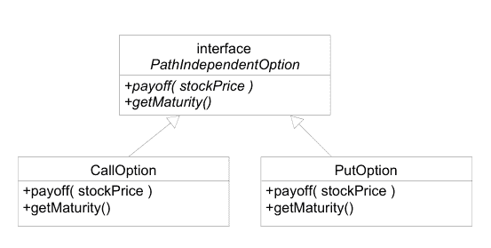

**图 10.1：** `PathIndependentOption`（路径无关期权）的 UML 图

图 10.1 中的虚线箭头告诉我们 `CallOption`（看涨期权）和 `PutOption`（看跌期权）类实现了该接口。*斜体字* 告诉我们 `PathIndependentOption`（路径无关期权）是一个接口，并且方法只是由 `PathIndependentOption`（路径无关期权）声明但未定义。

UML 图的优势在于它剥离了一些丑陋的 C++ 语法，例如 **虚析构函数** 和 **virtual**（虚）关键字，让你能看到主要观点。这些主要观点是：

- 所有 **PathIndependentOption**（路径无关期权）对象必须具有 **getMaturity**（获取到期日）和 **payoff**（收益）函数。
- **CallOption**（看涨期权）和 **PutOption**（看跌期权）是两种 **PathIndependentOption**（路径无关期权）。

UML 规范为绘制类图提供了官方标准。例如，加号（+）用于指示方法是公有的。在绘制类的图表时，不要对这类小细节过于挑剔。目标是制作有助于总结正在发生什么的图表。只需使用你觉得有帮助的 UML 部分即可。

#### 10.5 **if** 语句有什么问题？

你可能已经意识到，使用接口存在替代方案。我们难道不能编写像下面给出的 **GeneralOption**（通用期权）这样的类吗？

```cpp
class GeneralOption {
public:
    bool isPut;
    bool isDigital;
    double strike;
    double maturity;
    double payoff( double stockPrice );
};
```

你说得对。收益函数可能会稍微复杂一些，但写起来不会太难。这将解决编写一个函数来定价看跌期权、看涨期权、数字看跌期权和数字看涨期权的问题。

然而，使用接口的真正好处在于我们的 **MonteCarloPricer**（蒙特卡洛定价器）已经可以对 *任何* 路径无关期权进行定价。它并不局限于数字看跌期权和看涨期权。我们将能够使用我们的 **MonteCarloPricer**（蒙特卡洛定价器）来对你从未想到的期权进行定价：例如，收益由股票价格的十次方根给出的期权。

更有趣的是，请注意，即使你想到了想要定价的新期权，**MonteCarloPricer**（蒙特卡洛定价器）代码和所有现存的期权类都将完全保持不变。这使得 **MonteCarloPricer**（蒙特卡洛定价器）具有 *可插拔性*。你只需插入新的期权即可扩展其功能。再次值得注意的是，电气插头之所以“可插拔”，正是因为它们具有明确定义的接口。

在编写金融软件的背景下，使用接口意味着你可以使用新型金融合约扩展交易系统，而无需重写和测试整个交易系统。接口是解决编写真实金融软件复杂性问题的关键。

#### 10.6 用于积分的接口

接口的难点不在于语法或概念本身，而在于发现何时可以使用接口来解决问题的能力。例如，我们可以使用接口执行数值积分，但积分和接口之间的联系可能并不明显。

如果你尝试在 C++ 中编写数值积分代码，你将遇到与我们在蒙特卡洛定价器中遇到的非常相似的问题。例如，你应该很容易写出一个函数，使用矩形法则将 \( exp(-x^2) \) 从 $a$ 积分到 $b$。但你如何编写一个函数，可以使用矩形法则将 *任何* 实值函数从 $a$ 积分到 $b$？接口解决了这个问题。

让我们按照上一个示例的方式，编写我们的幻想代码。如下所示：

```cpp
double integral( RealFunction& f, 
                  double a, 
                  double b, 
                  int nPoints ) { 
  double h = (b-a)/nPoints; 
  double x = a + 0.5*h; 
  double total = 0.0; 
  for (int i=0; i<nPoints; i++) { 
    double y = f.evaluate(x); 
    total+=y; 
    x+=h; 
  } 
  return h*total; 
}
```

我们的幻想代码涉及一种称为 *RealFunction*（实函数）的类型。这个名称描述了我们 *可以* 积分的对象类型。我们需要编写正式的 C++ 接口定义。

```cpp
class RealFunction { 
 public: 
   /* A virtual destructor */ 
   virtual ~RealFunction() {}; 
   /* This method is abstract, there is */
   virtual double evaluate( double x ) = 0; 
};
```

这段代码包含了必要的 **virtual** 和 **=0** 魔法咒语，但更重要的是，它说明了一个 **RealFunction**（实函数）具有 **evaluate**（评估）方法。  
我们的 **integrate**（积分）函数可以积分任何提供 **evaluate**（评估）方法的对象。以下是我们幻想接口的一个具体实现示例：

```cpp
class SinFunction : public RealFunction {
	double evaluate( double x );
};
double SinFunction::evaluate( double x ) {
	return sin(x);
}
```

类 **SinFunction**（正弦函数）通过其 **evaluate**（评估）方法代表数学上的 **sin**（正弦）函数。我们可以使用我们的 **integrate**（积分）函数来积分它，因为我们的 **integrate**（积分）函数除了使用 **evaluate**（评估）方法外不使用其他任何方法。

结合我们的 **integrate**（积分）函数、**RealFunction**（实函数）接口及其实现，我们现在可以编写积分 **sin**（正弦）的代码。这是一个测试所有部分是否配合良好的示例：

```cpp
static void testIntegral() {
	SinFunction integrand;
	double actual = integral(integrand, 1, 3, 1000 );
	double expected = -cos(3.0)+cos(1.0);
	ASSERT_APPROX_EQUAL( actual, expected, 0.000001);
}
```

这段代码包含在 **FMLib10** 中。你应该检查是否可以编译并运行该测试。

每次我们要积分一个实值函数时，都需要编写一个新的实现类，例如 **SinFunction**（正弦函数）。我们不希望每次要积分一个函数时都创建一个新的 **cpp** 文件和一个新的 **h** 文件，所以 **C++** 提供了一种简写符号，允许我们在函数内部定义类。以下是使用 *局部类* 测试 **sin**（正弦）积分的另一种方式。

```cpp
static void testIntegralVersion2() {
	class Sin : public RealFunction {
	public:
		double evaluate( double x ) {
			return sin(x);
		}
	};
	Sin integrand;
	double actual = integral( integrand, 1, 3, 1000 );
	double expected = -cos(3.0)+cos(1.0);
	ASSERT_APPROX_EQUAL( actual, expected, 0.000001 );
}
```

以这种方式定义的局部类是“一次性”的。它们只能在那一个函数内部使用。局部类的优点是编写起来更快。请注意，在局部类声明中，我们实际上提供了所有函数的定义，而不仅仅是声明。还要注意，这个定义不包含独立类所需的通常的 `SinFunction::` 限定符。

下面是一个更复杂的示例，其中局部类使用成员变量来访问传递给包含函数的参数。

```cpp
static double integratePayoff(
double a,
double b,
const PathIndependentOption& option) {
class PayoffFunction : public RealFunction {
public:
 /* Member variable */
 const PathIndependentOption& option;
 /* Constructor */
 PayoffFunction(
 const PathIndependentOption& option)
 : option( option ) {
 }
 /**
 * Overriding function
 */
 double evaluate(double x) {
 return option.payoff(x);
 }
};
PayoffFunction integrand(option);
return integral( integrand, a, b, 1000 );
}
```


上述函数在区间 `a` 和 `b` 之间积分了期权的收益函数。我们必须使用引用存储成员变量，因为无法按值存储多态变量。通过引用在成员变量中存储数据是危险的，因为所引用的数据可能在持有该引用的对象被删除之前就被删除了。这将导致程序行为异常，甚至可能崩溃。在这种情况下，代码会在 `integratePayoff` 返回的瞬间从内存中删除变量 `integrand`。因此，`option` 不会在 `integrand` 被删除之前就被删除，不存在危险。

有一种更简洁的表示法称为 `lambda 函数`（lambda 表达式），它可以用于创建局部类。我们将在第 19 章重新审视编写积分器的例子，并展示使用 lambda 类如何简化代码。

我们还应该补充一点，矩形法则并不是最好的积分方法。你可能已经知道辛普森法则。一种用于一维数值积分的更有趣的技术称为高斯求积。像 GNU 科学库（Gnu Scientific Library）这样的数值库包含你在实践中应当使用的成熟积分例程。

## 练习题

- 10.6.1. 编写类 `DigitalCallOption` 和 `DigitalPutOption`。使用 `MonteCarloPricer` 对它们进行定价。如果你不记得什么是数字期权（digital option），请参阅附录 A。
- 10.6.2. 编写一个类 `NormalPDF`，并计算其从 -1.96 到 1.96 的积分。
- 10.6.3. 编写一个函数 `integralToInfinite`，使用换元积分法将无穷积分转换为函数 `integral` 可以计算的积分。
- 10.6.4. 将 `normcdf` 函数与正态分布概率密度函数的数值积分进行对比测试。
- 10.6.5. 编写一个函数 `differentiateNumerically`，用于对任意 `RealFunction` 进行数值求导。
- 10.6.6. 编写一个接口 `Cipher`，并提供至少两种你选择的实现方式。编写一个单一的函数 `void testCipher(Cipher& toTest)`，该函数可以测试任意 Cipher 是否工作正常。
- 10.6.7. 为你的 Cipher 类绘制 UML 图。
- 10.6.8. 编写一个类 `RectangleRulePricer`，使用之前练习中编写的数值积分例程来对路径依赖期权（Path-DependentOption）进行定价。使用公式 (A.3) 计算对数股票价格的概率密度函数。使用 **CallOption** 检查你的解决方案是否有效。这为公式 (A.6) 的推导提供了数值验证。
- 10.6.9. 设计一个名为 `ContinuousTimeOption` 的接口。它应该有一个函数 `payoff`，该函数接收一个股票价格向量和一个记录价格发生时间的向量。该函数应返回如果股票价格在这些时间点之间线性变化时将会产生的收益。（显然，我们无法实际提供无穷多个点的股票价格）。`ContinuousTimeOption` 还应该有一个名为 `getMaturity()` 的函数。编写 `ContinuousTimeOption` 的一个实现，称为 `KnockOutCallOption`。在 `MonteCarloPricer` 中添加一个函数，该函数在给定有限个时间步的情况下，可以近似计算任何 `ContinuousTimeOption` 的价格。
- 10.6.10. 证明你可以使用 `if` 语句编写一个 `integrate` 函数，该函数可以数值积分以下特定函数中的任意一个（但不包括其他函数）：
  - $\sin(x)$
  - $\cos(x)$
  - $\exp(x)$
  
  解释为什么这不是一个好的设计。利用这一点解释为什么使用 `if` 语句来决定如何对看涨期权和看跌期权进行不同定价，不如使用接口强大。

### 10.7 总结

- 通过定义接口，我们可以编写能够处理我们尚未想到的输入的代码。
- 这对编写金融行业的实际代码至关重要，因为每天都有新产品被发明出来。
- 接口在日常生活中很常见。汽车、门、吉他和插插座都是易于使用的熟悉示例，因为它们实现了众所周知的接口。
- 学习如何使用接口是面向对象设计中最重要的技能。

# 第 11 章

## 数组、字符串和指针

看待 C++ 的一种有用方式是将其视为一组语言：

- (i) C 语言；
- (ii) 面向对象编程语言；
- (iii) 模板编程语言。

本章主要介绍 C++ 中 C 语言方面的一些内容。我们之前忽略了这些内容，因为你应该专注于 C++ 的面向对象特性。同样，我们也不会讨论模板编程特性，直到第 17 章。

指针是 C 语言的一个核心特性。它是一种直接操作计算机内存的工具。你不会在像 Java 这样更现代、纯的面向对象编程语言中找到指针。其他语言省略了这一特性，因为基于指针的程序通常比面向对象程序更难理解。

你在本章学到的大部分内容，实际上都不应该直接使用。你需要使用的唯一内容是 `shared_ptr`。我们将在本章末尾讨论它。不幸的是，要理解 `shared_ptr`，你必须先理解普通指针。

研究本章材料还有另外三个动机。

- (i) 第一个是 C++ 最初是为具有 C 编程经验的人设计的。因此，如果你有关于 C 指针的经验，某些 C++ 代码在设计上会使用起来更直观。如果你不学习指针，你会发现诸如 C++ 标准库这样的东西非常不直观。
- (ii) 第二个是面试官可能会假设你懂 C，因此可能会问一些关于指针的脑筋急转弯问题，所以做好准备是好事！
- (iii) 第三个是编写最高效的 C++ 程序时，有意识地管理内存可能很有帮助。指针是直接内存操作的工具。

由于本章和下一章更多涉及 C 编程而非面向对象编程，我们暂时放弃了在本章开发 FM-Lib。相反，项目 `PointerExamples.zip` 包含了本章的所有代码。

你会看到，只有一个大的 main.cpp 文件，按顺序包含了各种示例。main 方法按顺序调用各种测试函数。一些测试已被注释掉，因为它们说明了你*不应该*做的事情。如果你包含它们，程序很可能会崩溃。

### 11.1 数组，C 语言中 vector 的替代方案

下面的代码展示了如何在 C++ 中创建一个由 5 个整数组成的数组。数组有点像向量，因为它们都包含一系列值，但正如我们将看到的，数组不如向量有用。

```cpp
// Create an uninitialised array of length 5
int myArray[5];
for (int i=0; i<5; i++) {
    cout<<"Entry "<<i<<"=";
    cout<<myArray[i];
    cout<<"\n";
}
```

这段代码创建了一个包含 5 个整数的数组，未对其进行初始化。然后遍历条目并打印它们。由于我们未初始化这些值，它将打印出一些随机整数。

注意它与 vector 的相似之处。就像使用 vector 一样，我们使用 [] 来访问条目。就像使用 vector 一样，条目从 0 开始。

你可以看出的一点区别是我们没有使用 `size()` 函数。这是因为 C 数组没有 size 函数。实际上，你可以使用 `sizeof` 运算符，并将我们写的 5 替换为 `sizeof(myArray)/sizeof(int)`。这样写会是更好的编程风格，但我避免了这种做法，因为对于初学数组的人来说，这样写可读性较差。

要创建一个已初始化的数组，操作如下：

```cpp
// Create an initialised array
int myArray[] = {1, 1, 2, 3, 5};
for (int i=0; i<5; i++) {
    cout<<"Entry "<<i<<"=";
    cout<<myArray[i];
    cout<<"\n";
}
```

只需在花括号之间指定逗号分隔的值列表即可。请注意，如果我们提供了值列表，我们在创建数组时就不再需要指定数组的长度了。

想要初始化数组使所有值都为零，这是非常自然的需求。下面是相关的代码。

```cpp
// 创建一个已初始化的数组
int myArray[5] = {};
for (int i = 0; i < 5; i++) {
    cout << "Entry " << i << "=";
    cout << myArray[i];
    cout << "\n";
}
```

这里我们指定了数组的大小，并写入 `={}` 来表示“将一切都设为零”。实际上，这只是初始化数组的更通用方法的一个特例。

```cpp
int myArray[5] = {1, 2, 3};
for (int i = 0; i < 5; i++) {
    cout << "Entry " << i << "=";
    cout << myArray[i];
    cout << "\n";
}
```

这里我们指定了长度和前几个值。其余的值将用零填充。因此，上面的代码将输出数值 1, 2, 3, 0, 0。

数组的一个问题在于，因为它们没有 `size` 函数，所以在将数组传递给另一个函数时，我们必须同时传递其长度和值。

```cpp
int sumArray(int toSum[], int length) {
    int sum = 0;
    for (int i = 0; i < length; i++) {
        sum += toSum[i];
    }
    return sum;
}
```

不幸的是，我前面提到的 `sizeof` 技巧在你将数组传递给其他函数时就不再起作用了。因此，你确实需要同时传递长度和数组。

虽然我们可以将数组传递给函数，但我们必须 *永远不要从函数中返回它们*。当你返回其他数据类型，例如 `double` 或 `vector` 时，返回值时值会被复制。但这对数组并不适用。你可以认为它们是通过引用返回的。

这会导致问题，因为当函数返回时，它创建的所有变量都会从内存中移除。如果你尝试返回一个数组，你的函数的调用者只会获得一个指向数组 *曾经* 所在的内存地址的指针。计算机可能已经将该内存重新用于几乎任何事情。结果，程序的行为变得完全不可预测。通常它会崩溃，有时会很糟糕。如果你尝试按引用返回局部变量，也会发生同样的情况，但你较少会尝试这样做。

如果你愿意，可以创建多维数组。语法应该是不言自明的。唯一奇怪的是，除了第一个维度外，其他维度都需要手动指定。

```cpp
// 创建一个已初始化的 3x5 数组
int myArray[3][5] = {{1, 2, 3, 4, 5},
                     {2, 0, 0, 0, 0},
                     {3, 0, 0, 0, 0}};
for (int i = 0; i < 3; i++) {
    for (int j = 0; j < 5; j++) {
        cout << "Entry (" << i << "," << j << ") = ";
        cout << myArray[i][j];
        cout << "\n";
    }
}
```

让我们不要再花更多时间深入了解数组的细节了，因为我们永远不会使用它们！

数组对我们来说不是很有用的数据结构，因为 *你不能改变数组的长度*。你无法插入新项或在末尾添加一些项。更糟糕的是，数组的大小在编译时是固定的。这意味着当你编写程序时，你必须选择数组的大小，它无法根据用户输入而增长。此外，在每个函数调用中来回传递长度也很烦人。

只有当你在代码编译时知道数组的大小时，数组才值得关注。例如，在处理 3D 计算机图形时，长度为 3 的数组可能很有用。

> **提示：不要使用数组**

向量可以做你想对数组做的所有事情，还能做更多。

## 11.2 指针

### 11.2.1 new 和 delete

由于数组不够灵活，C 语言还包含了指针的概念。这允许 C 程序员处理长度可变的数据序列。

```cpp
int n = 5;
int* myArray = new int[n];
for (int i = 0; i < n; i++) {
    cout << "Entry " << i << "=";
    cout << myArray[i];
    cout << "\n";
}
delete[] myArray;
```

上面的代码使用 `new ...[]` 运算符分配一块内存。在这种情况下，我们是在内存中创建一系列 int 数据类型，但你也可以改用其他数据类型。

好消息是你可以在运行时选择内存块的大小。与数组不同，你不需要在编写程序时预先选择大小。

使用 `new []` 的缺点是，当变量超出作用域时，内存 *不会* 自动删除（关于“作用域”一词的含义，参见第 4.7 节）。你必须使用 `delete []` 来释放使用 `new []` 运算符创建的内存。这是利也是弊。对于数组，我们不能返回数组，因为内存会被自动删除，但另一方面，我们不需要记得调用 `delete []`。对于使用 `new []` 创建的内存，我们必须记得手动删除内存，但你可以安全地返回数据。

`new int[n]` 返回的值称为 *指针*。它的类型是 `int*`，意思是“指向 int 的指针”。实际上，前一节讨论的数组类型也是 `int*`。只是 C 中数组的表示法掩盖了数组值变量只是一个指向内存位置的指针这一事实。`int* myArray` 中包含的仅仅是数组开始的内存地址。因此，我们必须自己记住这块内存的长度为 n。

你可以像使用数组和向量使用 `[]` 一样，使用 `[]` 与指针来查找给定偏移处的整数。我们在上面的例子中使用了这一点来打印数组中的值。

如果你运行上面的代码示例，你会发现数组中的条目取任意值。就像局部 int 类型变量的初始值不可预测一样，使用 `new` 创建的 int 数据也是如此。

你 *可以* 使用 `new[]` 与其他数据类型。为了说明这一点，让我们介绍一个简单的类，Pair。

```cpp
class Pair {
public:
    double x;
    double y;
    Pair();
    Pair(double x, double y);
};
```

我们假设 Pair 的默认构造函数将 x 和 y 初始化为零。给定这个类，下面的代码创建了一个包含配对的内存块。这次每个配对都初始化为 (0,0)，因为 Pair 有一个默认构造函数。

```cpp
int n = 5;
Pair* myPairs = new Pair[n];
for (int i = 0; i < n; i++) {
    double xValue = myPairs[i].x;
    double yValue = myPairs[i].y;
    cout << "Pair (";
    cout << xValue;
    cout << ",";
    cout << yValue;
    cout << ")\n";
}
delete[] myPairs;
```

类型是 `Pair*`。这应该读作“指向 Pair 的指针”。

### 11.2.2 指针运算符

指针只是某些数据在内存中的地址。在 32 位计算机上，指针长度为 4 字节。在 64 位计算机上，它长度为 8 字节。这意味着 32 位计算机最多可以有 $2^{32}$ 字节 $\approx 2$ Gb 的内存。64 位计算机在原则上可以有更多的内存。通常以十六进制数字表示内存地址；例如，**9ABF0132** 是一个典型的内存地址。

考虑以下代码：

```cpp
int* fivePrimes = new int[5];
fivePrimes[0] = 2;
fivePrimes[1] = 3;
fivePrimes[2] = 5;
fivePrimes[3] = 7;
fivePrimes[4] = 11;
```

运行代码后，会有一个内存区域看起来如图 11.1 所示。在此图中，每个方框表示一个 **int** 大小的内存单元。x 标记了我们对其值一无所知的内存位置。我们知道的是，有五个连续的条目包含数字 2, 3, 5, 7, 和 11。指针 *fivePrimes* 包含这些数字中第一个的内存地址。


**图 11.1**：指向包含前五个素数数组的内存位置的指针。


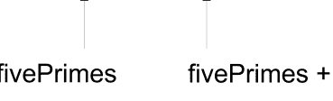

**图 11.2**：指针算术。

你可以提取任何变量的内存地址，即使它不是用 **new** 创建的。你使用 & 运算符来做到这一点。只要该变量被声明为指针类型，你就可以将这个内存地址存储在另一个变量中。给定一个指针，你可以使用 * 访问它指向的内容。以下代码说明了这些想法：

```cpp
int myVariable = 10;
int* pointerToMyVariable = &myVariable;
cout << "Memory location of myVariable ";
cout << pointerToMyVariable;
cout << "\n";
cout << "Value of myVariable ";
cout << (*pointerToMyVariable);
cout << "\n";
```


我在 32 位计算机上运行了上面的代码，得到以下输出：

`myVariable` 的内存位置 0013FE78
`myVariable` 的值 10

请注意，`pointerToMyVariable` 是一个指向 int 的指针，因此它的类型是 `int*`。由于 `myVariable` 是一个 int，所以 `&myVariable` 是一个指向 int 的指针。

由于 `pointerToMyVariable` 是一个指向 int 的指针，`*pointerToMyVariable` 是一个 int。

值得强调的是，我们以两种完全不同的方式使用 `&`。我们之前用过这个符号来表示引用传递。现在我们用它来将变量转换为指针。这些用法完全是独立的。只是碰巧是同一个字符。当作为类型定义的一部分使用时，`&` 表示“引用”。当作为运算符使用时，`&` 表示“...的内存位置”。

我们还以三种不同的方式使用 `*`。我们在类型定义中用它来表示“这是一个指针”。我们用它将指针转换回引用。而且（如果你忘了的话）我们也用它表示乘法！

另一个在处理指针时非常有用的运算符是 `->`。你可以使用 `->` 通过指针访问对象的字段。

```cpp
Pair p;
Pair* pointerToP = &p;
// Use -> to access fields via a pointer
pointerToP->x = 123.0;
pointerToP->y = 456.0;
// We check that c has changed
ASSERT( p.x==123.0 );
ASSERT( p.y==456.0 );
// You could use * and .
ASSERT( (*pointerToP).x==123.0 );
ASSERT( (*pointerToP).y==456.0 );
```

使用 `->` 等效于组合使用 `*` 和 `.`，但更容易阅读。

你还可以对指针进行整数加法和减法运算。例如，如果 `p` 是指向某个内存位置的指针，那么 `p+1` 是指向下一个内存位置的指针，而 `p+3` 是指向后三个内存位置的指针。这在图 11.2 中进行了说明。要对指针加 1，你可以写 `p++`。以这种方式处理指针被称为*指针运算*。

### 11.2.3 使用指针进行循环

我们可以将一个指针传递给函数，就像我们将数组传递给函数一样。实际上，接受数组作为参数的函数和接受指针作为参数的函数之间没有真正的区别。下面是一个函数，它对从内存位置 `toSum` 开始的连续 `length` 个数字求和。

```cpp
int sumUsingPointer( int* toSum, int length ) {
    int sum = 0;
    for (int i=0; i<length; i++) {
        sum+=toSum[i];
    }
    return sum;
}
```

这里的代码与使用数组的代码完全相同，只是我们用 `*` 而不是 `[]` 来声明类型。特别是，请注意除了指针外，你还必须传递长度。

这段代码没有什么大问题。然而，经验丰富的 C++ 程序员可能会选择这样写：

```cpp
int sumUsingForAndPlusPlus (int* begin, int n ) {
    int sum = 0;
    int* end = begin + n;
    for (int* ptr = begin; ptr != end; ptr++) {
        sum += *ptr;
    }
    return sum;
}
```

如果你是 C++ 新手，这段代码很难理解。但由于它遵循某些编程约定，经过一点练习后就会变得容易理解。

我们将第一个内存位置称为 `begin`。我们将最后一个元素紧接着的内存位置称为 `end`。在 `for` 循环中，我们移动变量 `ptr`，遍历从 `begin` 到但不包括 `end` 的值。在循环的每个阶段，我们将 `ptr` 所指向的值加到 `sum` 中。

经验丰富的程序员更喜欢这个版本的代码有两个原因：

- (i) 代码完全标准化，因此一旦习惯了就容易阅读。`begin` 是指针的标准名称，`end` 也是。这意味着读者可以一眼看懂 `for` 循环。这就是 for 循环的目的：它们大声呼喊“无聊的循环代码”，以便你可以专注于循环中间有趣的部分，忽略其他部分。稍后在书中我们会讨论一个称为`迭代器`的 C++ 概念，它允许将这种指针代码泛化到许多不同的数据结构中。见第 18 章。
- (ii) 这段代码可能稍快一些。我们每个循环只执行一次加法，即 `ptr++`。原始代码包含加法 `i++` 以及编写 `toSum[i]` 时的隐式加法。要计算这个值，我们需要将 `i` 加到指针 `toSum` 上，然后读取内存地址。如果我们重写第一版代码，使用指针运算而不是 `[]`，可以更清楚地看到这一点。

```cpp
int sumUsingPointerArithmetic( int* toSum, int length ) {
    int sum = 0;
    for (int i=0; i<length; i++) {
        int* ithElement = toSum + i;
        int valueOfIthElement = *ithElement;
        sum+= valueOfIthElement;
    }
    return sum;
}
```

### 提示：避免编写脑筋急转弯

适度使用指针运算会非常有帮助。例如，在编写用于表示矩阵的类时（第 16 章），我们将利用指针运算。但是，你应该尽量避免编写让人摸不着头脑的代码。过度使用指针和指针运算是编写不可理解代码的绝佳途径。

作为一个例子，请注意一个内存位置本身可以包含一个指针。指向指向 `int` 的指针的指针的类型是 `int**`。如果你喜欢迷惑自己和你同事的话，没有理由止步于此。`int***` 在*技术上*也没有任何错误。下面是一个利用这一点的真实面试问题。

**问题：** 用于引用数组元素 `a[i] [j] [k] [1]` 的等效指针表达式是什么？

- A. `(((a+i)+j)+k)+1`
- B. `*(*(*(* (a+i)+j)+k)+1)`
- C. `((a+i)+j)+k+1)`
- D. `*((a+i)+j+k+1)`

**答案：** 如果你还想要这份工作的话，正确答案是 B。实际上正确答案是避免这种愚蠢的代码。

### 11.2.4 在实践中使用指针

由于我们总是需要元素数量以及指针，引入像下面这样的类似乎是明智的：

```cpp
class IntArray {
public:
    int* firstElement;
    int  length;
};
```

让该类拥有一个有用的 `size` 函数似乎也是一个好主意。

在继续前进之前，我们应该停下来意识到这个类已经存在了。它是一个 `vector<int>`。

因此，尽管我们现在痛苦地引入了指针，但我们已经可以用 `vector` 完成我们想要做的一切了！

### 提示：避免使用 new []

你应该避免使用 `new []`，而是直接使用 `vector`。唯一可能的例外是你认为你是一个如此优秀的程序员，能够通过访问原始内存获得一点点更多的性能。这在实践中不太可能成立。

### 11.3 指向文本的指针

在 C 语言中没有类，这包括 `string` 类。结果，在 C 语言中，标准约定是使用包含字符块来表示文本，并以字符代码 0 结尾。

回想一下，`char` 只是一个 8 位数字。标准编码是 ASCII，其中“A”编码为 65，符号“1”编码为 49，符号“0”编码为 48。另一方面，代码编号 0 不用于任何字符符号，因此可以安全地用于标记内存块的结束。你使用反斜杠来创建代码编号为 0 的特殊字符，如下面的代码所示。

```cpp
char charArray1[] =
    {'H', 'e', 'l', 'l', 'o', '\0'};
for (int i=0; i<6; i++) {
    cout << "ASCII VALUE ";
    char c = charArray1[i];
    cout << ((int)c);
```

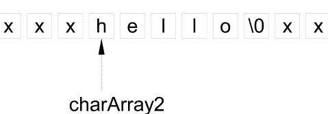

**图 11.3：** 指向包含以 null 结尾的字符串 Hello 的内存位置的指针。

```cpp
    cout << "\n";
}
```

C 语言提供了一种创建以零代码结尾的字符序列的快捷方式，只需将所需字符放在双引号中即可。你不需要在末尾包含零，它是自动包含的。

```cpp
const char* charArray2 = "Hello";
for (int i=0; i<6; i++) {
    cout << "ASCII VALUE ";
    char c = charArray2[i];
    cout << ((int)c);
    cout << "\n";
}
```

这种数据格式称为“C 风格字符串”或“以 null 结尾的字符串”。图 11.3 对其进行了图形化说明。注意，我们说过 `charArray2` 的类型是 `const char*`。这意味着字符串的内容是固定的。

在书的前面，我们通过将文本写在引号中创建字符串，但我们尽量避免了 `char*` 数据类型。这是因为你应该总是尽量尽快将 `char*` 转换为 `string`。

由于这在 C 语言中是不可能的，因此 C 语言包含各种函数来帮助处理以 null 结尾的字符串，例如计算长度（不包括终止零字符）的 `strlen` 和将一个字符串复制到另一个字符串的 `strcpy`。

下面的代码展示了如何直接使用指针来复制 `strlen` 函数的行为。

```cpp
int computeLengthOfString( const char* s ) {
    int length = 0;
    while ((**s)!=0) {
        s++;
        length++;
    }
    return length;
}
```


```cpp
void testComputeLengthOfString() {
  const char* quotation="To be or not to be";
  int l1 = computeLengthOfString( quotation );
  int l2 = strlen( quotation ); // built in
  ASSERT( l1==l2 );
}
```

在处理数组和内存段时，必须非常小心，切勿试图访问数组边界之外的数据。例如，下面的代码行为将是不可预测的，并且很可能导致严重崩溃。

```cpp
char* shortText = new char [20];
for (int i=0; i<1000; i++) {
  shortText[i] = 'x';
}
delete[] shortText;
```

如果您下载了项目 **PointerExamples**，可以通过取消注释 `main` 方法中的 `testOverrunning` 测试来运行此测试。我预计您会得到一条相当糟糕的错误信息。

在调试模式下使用 `string` 和 `vector` 等类时，会包含各种额外的检查，以便您获得更有用的错误信息。您可以尝试使用 `vector<char>` 重写此代码，并比较获得的错误信息。这是使用类而不是直接使用指针的另一个非常有说服力的理由。

## 提示：避免使用 `char*`

`string` 的设计初衷是为了解决程序员历史上在 `char*` 方面遇到的诸多问题。如果您正在进行复杂的字符串操作，例如编写 Web 服务器，即使使用 `string` 也无法胜任，因为它无法处理国际字符。

## 11.4 按指针传递

我们已经了解了*按值传递*和*按引用传递*的概念（见第 7.2.1 节）。原则上，您也可以使用*按指针传递*的方式将数据传递给函数。

```cpp
void polarToCartesian(double r, double theta,
double* x, double* y) {
    *x = r*cos(theta);
    *y = r*sin(theta);
}
```

```cpp
void testPolarToCartesian() {
    double r = 2;
    double theta = atan(1);
    double x;
    double y;
    polarToCartesian(r, theta, &x, &y);
    ASSERT_APPROX_EQUAL(x, sqrt(2), 0.0001);
    ASSERT_APPROX_EQUAL(y, sqrt(2), 0.0001);
}
```

这段代码以通常的方式按值传递参数 `r` 和 `theta`，但将参数 `x` 和 `y` 的指针传递过去。这些是测试函数的局部变量。当调用 `polarToCartesian` 时，它直接修改这些局部变量。之所以能够这样做，是因为它获取了存储变量 `x` 和 `y` 的内存地址。

使用指针传递数据和使用引用传递数据之间几乎没有实际区别。在 C 语言中，由于不存在引用的概念，因此必须使用按指针传递。

在 C++ 语言中，使用按引用传递是首选的方法。

最实际的差异在于，函数 `polarToCartesian` 的使用者被迫使用 `&` 符号来获取变量 `x` 和 `y` 的指针。在某些方面，这是一件好事，因为它清楚地表明 `x` 和 `y` 可能会被函数调用修改。另一方面，使用指针确实增加了一层概念上的难度。

在使用指针和引用时能实现的事情之间唯一的真正区别在于：如果你传递的是一个指针，那么是否可以使用指针运算符（例如使用 `++` 递增指针或调用 `delete`）并不完全清楚。另一方面，如果使用按引用传递，则很清楚对象不会被删除，`++` 运算符也不会被调用，因为你根本不能将这些运算符应用于引用。这就是为什么在 C++ 中按引用传递是首选方法的原因。

与引用一样，你可以在指针中使用关键字 `const`。将关键字 `const` 与指针结合使用有两种可能的方式。在 `*` 的右侧书写 `const` 意味着指针本身不能被修改。在 `*` 的左侧书写 `const` 意味着*被指向的数据*不能被修改，而不是指针本身。下面的代码说明了这种区别。如果你去掉注释字符，代码将无法编译。

```cpp
void constPointerExamples() {
    const char* ptr = "A string";
    ptr++;
    std::cout << (*ptr);
    // (*ptr)='a';  // You can't change the data
    // using a const char*
    
    char* fiveChars = new char[5];
    char *const constPtr = fiveChars;
    // constPtr++;  // You can't change a char *const
    (*constPtr) = 'h'; // but you can change
    // what it points to
}
```

如果你觉得 `const char*` 和 `char *const` 之间的区别令人困惑，那么你不是唯一这样想的人。有人可能会认为，使用 `const` 引入的概念难度超过了编译时检查带来的好处。正如我们之前所说，项目的主开发者应该对此持有观点，因为应该一致地使用 `const` 或完全避免使用它。

如果你计划使用 `const`，那么这段讨论给出了另一个偏好按引用传递而非按指针传递的理由：将 `const` 与引用结合使用只有一种方式，因此少了一些需要思考的事情。注意，这也许可以帮助你记住在使用指针时 `const` 应该放在哪里。`*` 左侧的 `const` 等同于 `&` 左侧的 `const`。你甚至不能将 `const` 写在 `&` 的右侧，因为不能对引用使用 `++` 等运算。

## 11.5 不要返回指向局部变量的指针

与数组一样，你必须确保在返回指针时，没有返回一个即将被删除的局部变量的指针。例如，下面的代码是不正确的：

```cpp
char* thisFunctionReturnsAnArray() {
    /* This produces a compiler warning */
    char text[] = "Don't do this";
    return text;
}
```

```cpp
void someOtherFunction() {
    char text[] = "Alternative text\n";
    cout << text;
    cout << "\n";
}
```

```cpp
void testDontReturnArrays() {
  char* text = thisFunctionReturnsAnArray();
  someOtherFunction();
  cout << text;
  cout << "\n";
}
```

这里的 `text` 是一个 `char` 数组，因此在函数退出的那一刻就会被删除。这意味着代码的行为将是不可预测的。运行它时，它很可能会打印出一些垃圾数据。

你可以毫无问题地返回一个 `string`，因为它是按值返回的：字符串的新副本会提供给调用者。返回 `vector` 的情况也是如此。

允许返回通过 `new []` 创建的数据的指针。然而，届时你必须确保调用者知道他们是否被期望在某个时间点调用 `delete[]`。

在 C 和 C++ 中约定俗成的做法是，如果函数返回一个指针，调用者不被期望调用 `delete[]`。例如，如果你在 `string` 上调用 `c_str()`，你不应该对返回值调用 `delete[]`。当你调用 `c_str` 时，它会在内存中创建一个临时的 C 风格字符串，该字符串可能会在字符串被修改或被删除时被删除。这是 C++ 中推荐的标准模式。如果你创建了某样东西，删除它是你的责任。

作为一个例子，下面的代码及其测试在技术上是有效的，但违反了你不应该删除由其他函数返回的指针的约定。因此，大多数 C++ 程序员都会认为这是糟糕的代码。

```cpp
char* thisFunctionReturnsAPointer() {
  char text[] = "This works";
  int n = strlen(text);
  char* ret = new char[n+1];
  /* We now get a compiler warning here */
  strcpy( ret, text );
  return ret;
}
```

```cpp
void testReturnPointerJustAboutOK() {
  char* text = thisFunctionReturnsAPointer();
  someOtherFunction();
  cout << text;
  cout << "\n";
  // don't forget to free the memory
  delete[] text;
}
```

### 提示：返回指针

切勿返回指向局部变量的指针。如果愿意，你可以返回指向对象成员变量的指针。在这种情况下，确保数据被删除是对象的职责，而不是调用者的职责。（有关如何使用*析构函数*实现此功能的信息，请参阅第 16.2 节）

## 11.6 使用指针共享数据

下面是我们现在希望解决的此类问题的一个示例：

**示例 1：** 我们有一个类 `Instrument`。它包含关于交易工具的许多数据。例如，工具的类型、彭博代码、路透代码等。你应该想象每个 `Instrument` 都占用相当多的内存。

我们还有另一个类，`Position`，它仅由工具、持有该工具的数量以及持有该头寸的交易员名称组成。

我们希望通过重用相同的 `Instrument` 实例来节省内存。图 11.4 对此进行了说明。

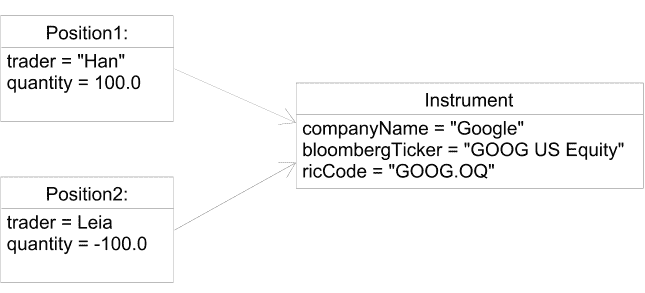

**图 11.4：** 两个 `Position` 对象共享一个 `Instrument`。

到目前为止，我们使用的数据都存储在当地变量或成员变量中。

局部变量不适合长期存储，因为它们的数据在变量超出作用域的瞬间就会被删除。

成员变量的存续时间仅与其包含该变量的对象相同。因此，存储在成员变量中的数据会在对象被删除后立即丢失。

使用 `new`，我们可以为数据创建长期存储。这些数据不会被自动删除，因此我们必须通过调用 `delete` 来手动删除它们。`new` 和 `delete` 就像是 `new[]` 和 `delete[]`，只不过它们创建和删除的是单个对象而非数组。当你使用了 `new[]` 时必须非常小心地使用 `delete[]`，当你使用了 `new` 时则必须使用 `delete`。

下面是一个使用 `new` 创建单独的 `Pair` 实例的示例。请注意对 `delete` 的调用以及 `->` 的使用。

```cpp
Pair* myPair = new Pair;

myPair->x = 1.3;

myPair->y = 2.5;

cout << "Pair (";

cout << (myPair->x);

cout << ", ";

cout << (myPair->y);

cout << ")\n";

delete myPair;
```

让我们看看如何使用以这种方式创建的数据在两个位置之间共享 `Instrument` 数据。

首先，我们为 `Position` 和 `Instrument` 定义类：

```cpp
class Instrument {

public:

    string bloombergTicker;

    string ricCode;

    string companyName;

    Instrument() {}

};

class Position {

public:

    string trader;

    double quantity;

    Instrument* instrument;

    explicit Position( Instrument* instrument );

};
```

```cpp
Position::Position( Instrument* instrument ) :

instrument( instrument ) {

}
```

你应该注意到，`Position` 包含一个指向 `Instrument` 的指针，而不是一个实际的 `Instrument`。你可以从字段 `Instrument` 的类型为 `Instrument*` 这一事实看出这一点。下面的代码初始化了一个由 `Position` 对象组成的向量，这些对象都指向同一个 `Instrument`。这就实现了我们共享数据的目标。

```cpp
vector<Position> constructPositions() {

// 该函数的调用者

// 在处理完所有位置后

// 应该对 instrument 调用 delete

vector<Position> positions;

Instrument* instrument = new Instrument;

instrument->companyName = "Google";

instrument->bloombergTicker = "GOOG US Equity";

instrument->ricCode = "GOOG.OQ";

Position p1(instrument);

p1.trader = "Han";

p1.quantity = 100.00;

positions.push_back( p1 );

Position p2(instrument);

p2.trader = "Leia";

p2.quantity = -100.00;

p2.instrument = instrument;

positions.push_back( p2 );

return positions;

}
```

然而，这里有一个陷阱，该函数的调用者被赋予了删除 instruments 的任务。

```cpp
void testConstructPositions() {

vector<Position> r = constructPositions();

int n = r.size();

for( int i=0; i<n; i++) {

cout << "Position "<<i<<"\n";

Position& p=r[i];

cout << "Trader "<<p.trader<<"\n";

cout << "Quantity "<<p.quantity<<"\n";

cout << "Instrument ";

cout << p.instrument->companyName<<"\n";

cout << "\n";

}

delete r[0].instrument;

}
```

`constructPositions` 的调用者必须精确知道如何调用 `delete`。这违反了信息隐藏原则——你需要了解 `constructPositions` 的实际工作方式才能安全地使用它。

## 危险！

初始化你的指针。我们在构造函数中初始化了字段 `instrument`。如果你不初始化指针，当你尝试使用它时，它将会灾难性地失败。

```cpp
// 不要这样做

Instrument* instrument;

cout << instrument->companyName << "\n";
```

有时你希望指定一个指针尚未指向任何对象，在这种情况下，你将其初始化为 `nullptr`。这里有一段代码，它在使用指针之前检查该指针是否为 `nullptr`。

```cpp
string getCompanyName( Position& position ) {

    if (position.instrument==nullptr) {

        return "Name not set";

    } else {

        return position.instrument->companyName;

    }

}
```

使用 `nullptr` 的危险在于，如果你忘记检查，你将遇到一个棘手的错误。

### 11.6.1 使用 `shared_ptr` 进行共享

类 `shared_ptr` 解决了删除问题。要使用 `shared_ptr`，你需要 `#include <memory>`。

`shared_ptr` 是一种所谓的“智能指针”的示例。这是一个 C++ 类，其行为像指针，但它可以代表你处理何时调用 `delete` 的问题。事实上，`shared_ptr` 是最通用的智能指针类，也是我们将在本书中唯一使用的类。

`shared_ptr` 的工作方式是，每个共享指针都会记录它被复制的次数。一旦现有的智能指针副本数量降为零，所指向的数据将被为你删除。具体如何实现这一点，我们要等到在第 16.2 节讨论析构函数时再介绍。

为了使用 `shared_ptr` 所做的改动非常简单。这里是一个新版本使用 `shared_ptr` 的 `Position` 类。

```cpp
class PositionV2 {

public:

    string trader;

    double quantity;

    shared_ptr<Instrument> instrument;

    explicit PositionV2(shared_ptr<Instrument> ins);

};

PositionV2::PositionV2(shared_ptr<Instrument> ins) :

    instrument( ins ) {

}
```


区别在于，它现在包含的是一个 `shared_ptr<Instrument>` 而不是 `Instrument*`。前者意味着“指向一个 instrument 的共享指针”，后者意味着“指向一个 instrument 的指针”。前者实际上更容易阅读，虽然不可否认的是它更难输入。

当我们使用 `shared_ptr` 时，我们可以像操作普通指针一样使用运算符 `->` 和 `*`。

```cpp
vector<PositionV2> constructPositionsV2() {
    vector<PositionV2> positions;
    shared_ptr<Instrument> ins = make_shared<Instrument>();
    ins->companyName = "Google";
    ins->bloombergTicker = "GOOG US Equity";
    ins->ricCode = "GOOG.OQ";
    PositionV2 p1(ins);
    p1.trader = "Han";
    p1.quantity = 100.00;
    positions.push_back( p1 );
    PositionV2 p2(ins);
    p2.trader = "Leia";
    p2.quantity = -100.00;
    p2.instrument = ins;
    positions.push_back( p2 );
    return positions;
}
```

关键的区别在于，我们使用函数 `make_shared` 而不是 `new` 来创建一个 `shared_ptr`。

```cpp
shared_ptr<Instrument> ins = make_shared<Instrument>();
```

`make_shared` 定义在 `<memory>` 中，是命名空间 `std` 的一部分。

引入 `shared_ptr` 的好处可以在调用函数中体现出来。

```cpp
void testConstructPositionsV2() {
   vector<PositionV2> r = constructPositionsV2();
   int n = r.size();
   for (int i=0; i<n; i++) {
     cout << "Position "<<i<<"\n";
     PositionV2& p=r[i];
     cout << "Trader "<<p.trader<<"\n";
     cout << "Quantity "<<p.quantity<<"\n";
     cout << "Instrument ";
     cout << p.instrument->companyName<<"\n";
     cout << "\n";
   }
 }
```

核心要点是我们不再需要调用 `delete`，因此信息隐藏原则已经恢复。

## 危险！

使用原始指针进行编程很难。你可能觉得你永远都不会忘记调用 `delete`，因此你可以不使用 `shared_ptr` 而使用指针，从而编写更快的代码。如果是这样，下面是一个可能会让你陷入困境的问题示例。

```cpp
int* a = new int[10];
int* b = new int[20000000];
cout << "Arrays created";
delete[] a;
delete[] b;
```

这段代码有什么错误？好吧，如果第二次调用 `new` 失败，因为我们内存不足并抛出错误怎么办？那么第一个对象将永远不会被删除。因此，当你的程序内存已经不足时，它刚刚泄漏了内存。它很快就会崩溃。

`shared_ptr` 对于大多数实际用途都工作得很好，但它确实存在一个问题：如果你的数据对象之间存在循环引用，那么它们将永远不会被删除。解决这个问题的方法要么避免循环引用，要么使用更智能的指针库。在本书中，我们选择简单地避免循环引用。

## 11.7 使用引用共享数据

你可以用指针做的很多事情，也可以用引用来做。例如，你可以拥有一个成员变量是引用。如果你通过引用存储数据，就像通过指针存储数据一样，可以节省内存。

使用引用而不是指针的一个优点是，你*必须*在构造函数中初始化作为引用的成员变量。这意味着由空指针和未初始化指针引起的错误在引用中是*不可能*发生的。

然而，使用引用成员变量通常不如选择 `shared_ptr` 成员变量有用。原因是，拥有一个对象的 `shared_ptr` 意味着你得到保证，对象不会在你不再需要它之前被删除。另一方面，如果你使用引用，存在别人可能会删除你的对象的风险。

让我们举一个例子，说明为什么通常不应该将引用用作成员变量。首先，我们定义一个新的 `Position` 类，其中包含一个指向 `Instrument` 的引用。

```cpp
class PositionV3 {
public:
   string trader;
   double quantity;
   Instrument& instrument;
   explicit PositionV3( Instrument& instrument );
};
PositionV3::PositionV3( Instrument& instrument ) : instrument(instrument) {
}
```

这段代码在技术上是正确的。特别要注意的是，我们在构造函数中初始化了成员变量引用，这是所必需的。

这种设计的问题在于，`Position` 类无法控制 `instrument` 何时被删除。以下代码起初似乎可以工作，它确实能编译：

```cpp
PositionV3 constructPositionV3() {
   // *这个函数不起作用，instrument*
   // *已被删除，因此所有返回的位置*
```

```cpp
// contain broken references
vector<PositionV3> positions;
Instrument instrument;
instrument.companyName = "Google";
instrument.bloombergTicker = "G00G US Equity";
instrument.ricCode = "G00G.0Q";
PositionV3 position(instrument);
position.trader = "Han";
position.quantity = 100.00;
return position;
}
```

这段代码的问题是，我们创建了一个 `Position` 对象，它看起来似乎已经初始化完成，但随后却立即删除了它所引用的 `Instrument`。我们并非有意识地删除该 `instrument`，它只是在方法退出时作为自动清理过程的一部分被删除了。这意味着，后续使用返回的 position 的代码将会失败。

```cpp
void testConstructPositionV3() {
 // This will fail horribly
 PositionV3 p = constructPositionV3();
 cout << "Trader "<<p.trader<<"\n";
 cout << "Quantity "<<p.quantity<<"\n";
 cout << "Instrument ";
 cout << p.instrument.companyName<<"\n";
 cout << "\n";
}
```

你可以通过取消注释 `main` 方法中相应的行来运行这段代码。它将崩溃。

这并不意味着使用引用成员变量是被完全禁止的。事实上，你应该已经在上一章的练习中这样做过了。下面是一个 C++ 函数，它可以将无穷积分转换为有界积分，然后进行积分计算。

```cpp
double integrateToInfinity(RealFunction& f, double lowerLimit, int nPoints) {
class DefiniteIntegrand : public RealFunction {
public:
RealFunction& g;
double lowerLimit;
DefiniteIntegrand(RealFunction& g, double lowerLimit) : g(g), lowerLimit(lowerLimit) {
}
double evaluate(double x) {
    return (1/(x*x)) * g.evaluate(lowerLimit - 1 + (1/x));
}
};
DefiniteIntegrand integrand(f, lowerLimit);
return integral(integrand, 0, 1, nPoints);
}
```

这段代码是完全合法的 C++，因为我们知道我们的 `DefiniteIntegrand` 实例在内存中仅保留到 `integrateToInfinity` 方法返回为止。我们也知道传入 `integrateToInfinity` 的函数在 `integrateToInfinity` 返回之前不会被删除。因此，我们可以安全地将其作为成员变量存储为引用。

### 提示：在使用引用成员变量或返回引用前请仔细思考

你可以返回引用，也可以按引用存储数据，但你必须确定引用何时会被删除。你绝不应返回对局部变量的引用，因为局部变量总是会被删除的。当返回指向成员变量的引用时，你需要仔细思考。

仔细思考需要消耗精力，如果你没有多余的精力，请使用 `shared_ptr`。

### 11.8 C++ 内存模型

C 和 C++ 让计算机程序员感兴趣的一个主要特性是，你可以直接操作计算机内存。对于金融数学家来说，这通常更像是一种困扰而非恩赐，因为计算机内存并非他们的专长领域。然而，如果你希望有效地使用指针并调试使用指针的代码，理解计算机内存会有所帮助。

你可以将计算机内存想象为分为四个区域：

- (i) 其他程序使用的内存。你不被允许访问这部分内存。如果你尝试这样做，操作系统会让你的程序崩溃。这种类型的错误被称为*段错误*或*一般保护错误*。在 C++ 中，你可以很容易地通过将一个指针初始化为随机的十六进制值，然后尝试使用该指针访问内存来产生这种错误。
- (ii) 包含你程序计算机代码的内存。你可以从这部分内存中读取，但不能写入。如果你尝试向这部分内存写入，你的程序将会崩溃。
- (iii) 一个称为*栈*的内存区域。它用于计算的短期存储。你可以把栈想象成一叠纸，上面做着粗略的笔记，然后很快被丢弃。你在函数中使用的局部变量存储在栈上。我们将在第 11.8.1 节中描述栈。
- (iv) 一个称为*堆*的内存区域。它用于较大数据结构的长期存储。你可以把它想象成一个文件柜，里面存放着你认为需要反复查阅的记录。使用 `new` 创建的数据存储在堆上。我们将在第 11.8.2 节中描述堆。

#### 11.8.1 栈

考虑以下测试*阶乘*函数的程序。

```cpp
int factorial(int n) {
    int ret = 1;
    for (int i = 0; i<n; i++) {
        ret *= (i + 1);
    }
    return ret;
}

void testFactorial() {
    int n = 3;
    int nFactorial = factorial(n);
    assert(nFactorial == 6);
}

int main() {
    testFactorial();
    return 0;
}
```


`main` 函数调用 `testFactorial` 函数，后者进而调用 `factorial` 函数。在此函数执行期间，所有数据都存储在栈上。你可以看出这一点，因为没有调用 `new`，我们也并未调用任何可能在未知晓的情况下调用 `new` 的函数（除了可能的 `assert`）。

当执行第 6 行时，栈将如图 11.5 所示：

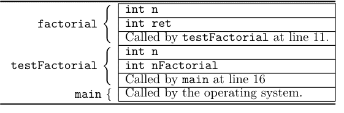

图 11.5：栈的快照。

对于每个正在执行的函数，栈存储了所有的参数和局部变量。它还包含该函数被调用位置的引用。计算机需要记录代码被调用的位置，以便在返回时能够将处理移回到正确的位置。

一旦 `testFactorial` 返回，该函数使用的内存就可以被删除了。`testFactorial` 的局部变量 `n` 和 `ret` 只是简单地从栈中被丢弃。此时栈将如图 11.6 所示。

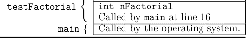

图 11.6：阶乘函数返回后栈的快照。

这种使用单块内存进行所有函数调用，并在新函数被调用和返回时仅在顶部添加和移除数据的简单系统极其高效。这是 C++ 代码可以特别快的原因之一。

然而，栈不足以解决所有问题。例如，栈上分配的数据始终是固定大小的，该大小在程序编译时已知。这就是为什么 C 数组是固定大小的，并且在程序编译前就确定了。正如我们讨论过的，这使得 C 数组对大多数用途来说太不灵活，因此通常最好使用 `vector` 类代替。虽然对于最终用户来说并不明显，但 `vector` 必须在堆上存储其数据。

### 11.8.2 堆

堆是一个组织程度低于栈的内存区域。如图 11.7 所示，栈是一个排列整齐的内存块，而堆则以杂乱无章的方式包含对象。

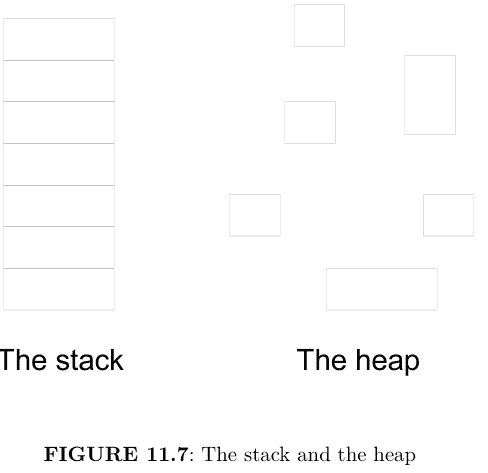

当你调用 `new` 时，一个巧妙的内存管理算法会寻找堆中足够大的未使用区域来满足你的需求。当你调用 `delete` 时，该内存管理算法会被告知现在可以重新使用那块计算机内存了。

堆的一个主要优势是，你可以随时调用 `new` 和 `delete`，并且可以选择在运行时而非编译时确定分配的内存大小。

许多数学问题可以在完全不自觉使用堆的情况下解决。当你创建一个数据对象（如 `string` 或 `vector`）时，它会代表你在堆上创建数据，但你通常不需要详细思考这一点。然而，有些时候你需要自己利用堆的灵活性。

对我们来说，一个关键的例子是对期权投资组合进行定价。我们预计在程序编译时无法确切知道投资组合的样子。我们不知道将持有多少期权，甚至不知道持有什么类型的期权。由于栈使用的内存在编译时是固定的，因此不能用来存储未知的期权组合。在第 13 章中，我们将展示如何编写一个使用 `shared_ptr` 将投资组合数据存储堆上的 `Portfolio` 类。

#### 11.8 指针引发的错误

使用指针会给我们的代码引入许多新的潜在错误类型。

- 空指针错误（A *null pointer error*）。这是指你试图访问内存地址 `nullptr` 或 0 处的数据。
- 一般保护故障（A *general protection fault* (GP)，也被称为*段错误（segmentation violation）*（SEGV））。这是指你试图访问你无权访问的内存，因为你是使用了一个无效指针。
- 内存泄漏（A *memory leak*）。这是指你调用了 `new` 但从未调用 `delete`。内存泄漏通常不会立即显现。它们通常表现为程序逐渐开始变得越来越慢，直到你不得不关闭并重新打开它。使用 `shared_ptr` 是避免内存泄漏的最佳方式。还有一些工具如 `INSURE++` 可以帮助你检测内存泄漏。

这些是 C++ 代码中极其常见的问题，你迟早会遇到它们。

# 练习

- 11.8.1. 编写一个函数 `sumDoubles`，它接受一个指向 double 列表的指针和该列表的长度，并返回总和。为此编写一个测试。
- 11.8.2. 编写一个函数 `reverseDoubles`，它接受一个指向 double 列表的指针和该列表的长度，并反转该列表。例如，$(1,2,3,4)$ 应变为 $(4,3,2,1)$。为此编写一个测试。
- 11.8.3. 编写一个函数 `meanDistance`，它接受一个指向 `Pair` 对象列表的指针，并计算 $(x,y)$ 到原点的平均距离。
- 11.8.4. 编写一个函数 `polarToCartesian`，它接受四个参数：r, theta, x 和 y。x 和 y 应通过指针传递。该函数应使用 $r\cos(\theta)$ 和 $r\sin(\theta)$ 填充 x 和 y 指向的值。为此编写一个测试。

在 C 语言中，没有引用（references），因此通过指针传递是 C 语言中通过引用传递的等价操作。

- 11.8.5. 编写一个函数 `reverseString`，它接受一个 `char*` 字符串并反转它。这应与你的 `reverseDoubles` 函数类似，但你需要考虑终止零字符。为你的函数编写一个测试。
- 11.8.6. 编写一个函数 `concatenate`，将一个以 null 结尾的字符串附加到另一个字符串后面。我故意没有告诉你参数或返回类型，这是由你来解决的设计问题。当你想出你自己的解决方案后，查看标准库函数 `strcat` 和 `strcat_s`，看看其他人是如何解决这个问题的。当然，你应该使用库函数而不是自己编写。
- 11.8.7. 编写一个函数 `search`，它接受两个 `char*` 字符串作为输入。第一个应该是 `phrase`，即要搜索的短语；第二个应该是 `text`，即要扫描的文本。它应返回 `phrase` 在 `text` 中出现的次数。例如，`search("be", "to be or not to be")` 应返回 "2"。

### 11.9 摘要

指针是 C 程序员不可或缺的工具，但对于 C++ 程序员来说没有那么重要。然而，如果你希望处理可变大小的数据或长生命周期数据，你必须在一定程度上使用指针。使用指针最容易的方式是使用 `shared_ptr` 类。

- 指针、引用和 `shared_ptr` 可以实现类似的效果。
- 使用 `vector` 和 `string` 而不是数组或 `char *`。
- 引用比指针稍微安全一些，例如你无法对引用调用 `delete`，并且你`必须`初始化引用变量。因此，通过引用传递优于通过指针传递。
- `shared_ptr` 比引用或指针稍慢，但如果你想避免内存泄漏，它是长生命周期数据真正可行的唯一选择。

# 第 12 章

## 更复杂的类

在本章中，我们将讨论 C++ 提供的各种附加功能，这些功能允许你编写更复杂和有趣的类。

### 12.1 内联成员函数

我们在 5.4.4 节中讨论过，你可以使用关键字 `inline` 来标记函数，作为给编译器的提示，表示你希望函数的机器代码在每次使用时被复制。这样做的好处是速度稍快，因为调用方法会消耗少量的计算机资源。例如，我们选择内联 `norminv` 定义中使用的函数 `hornerFunction`。

你也可以内联类的成员函数。方法很简单，将定义放在类内部以替代声明。

```cpp
class Point {
public:
    double getX() const {
        return x;
    }
    // other members of Point
private:
    double x;
    double y;
};
```

在这个例子中，`getX` 被内联了。这意味着使用该函数所产生的代码速度不会慢于直接访问 `x` 的代码。使用方法的优点在于，如果我们改变了关于 `Point` 如何存储数据的想法，我们可以做到这一点，而不需要重写使用 `Point` 的代码。

你很可能已经注意到，编写内联函数比编写单独的声明和定义要繁琐得多。不幸的是，不建议仅仅为了避免打字而使用内联函数。只有在你确实希望函数被内联时，才应编写单独的函数定义。

### 12.2 this 关键字

为了隐藏信息，最好不要有 `public` 变量是一个好主意。我们刚才看了如何编写一个 `get` 方法以提供变量的读取访问。在下例中，我们展示了如何编写一个 `set` 方法以提供写入访问。

```cpp
class Point {
    public:
        double getX() const {
            return x;
        }
        void setX(double x) {
            this->x = x;
        }
        // other members of Point
    private:
        double x;
        double y;
};
```

我们使用了新的关键字 `this`。在实现成员函数时，变量 `this` 总是包含指向当前对象的指针。因此，你可以使用 `this->` 来访问当前对象的字段。我们刚刚用 `set` 方法演示了这一点。

你还可以使用 `*this` 来获取当前对象的引用。要理解为什么你可能想要这样做，假设我们要为类 `UpAndOutOption` 添加一个 `price` 方法。我们决定通过向现有的 `MonteCarloPricer` 类传递必要的数据并要求其执行计算来实现这一点。然而，类 `MonteCarloPricer` 要求你传递一个期权对象。我们在哪里找到适当期权对象的引用？`*this` 正是我们需要传递给定价器的东西。

```cpp
double UpAndOutOption::price(
    const BlackScholesModel& model ) const {
    MonteCarloPricer pricer;
    return pricer.price( *this, model );
}
```

继承是 C++ 中复用代码的一种强大技术。它是一种专门设计的技术，旨在使实现接口变得更加容易。为了说明继承如何有用，让我考虑一个看似耗时的接口示例。

以下接口定义了一个 ContinuousTimeOption。

```cpp
class ContinuousTimeOption {
public:
    /* Virtual destructor */
    virtual ~ContinuousTimeOption() {};
    /* The maturity of the option */
    virtual double getMaturity() const = 0;
    /* Calculate the payoff of the option given
       a history of prices */
    virtual double payoff(
        const std::vector<double>& stockPrices
        ) const = 0;
    /* Is the option path-dependent?*/
    virtual bool isPathDependent() const = 0;
};
```

连续时间期权有一个到期日，我们可以通过查看到期前的价格路径来计算到期时的收益。这是 ContinuousTimeOption 接口捕捉到的思想。

ContinuousTimeOption 中有三个函数需要实现。对于 PutOption、CallOption、DigitalPutOption 等，大多数实现将是相同的。继承提供了一种为多个类同时实现方法的方式。

要使用继承，首先定义一个所谓的“基类”，该基类定义了我们希望重用的函数。我们将把我们的基类称为 ContinuousTimeOptionBase。以下是适当基类的声明。我们在这里使用内联技术来实现适当的 get 和 set 方法。

```cpp
class ContinuousTimeOptionBase :
    public ContinuousTimeOption {
public:
    virtual ~ContinuousTimeOptionBase() {}
    double getMaturity() const {
        return maturity;
    }
    void setMaturity(double maturity) {
        this->maturity = maturity;
    }
```


```cpp
double getStrike() const {
    return strike;
}
void setStrike(double strike) {
    this->strike = strike;
}
// ... more methods ...
private:
double maturity;
double strike;
};
```

注意我们的基类有一个虚析构函数。

```cpp
virtual ~ContinuousTimeOptionBase() {}
```

我们之前曾在接口类中见过这种用法。正如接口类一样，任何用作基类的类都必须拥有虚析构函数。

现在我们可以编写一个“继承”自基类的 `PutOption` 类。它将自动“继承”所有函数。

```cpp
class PutOption : public ContinuousTimeOptionBase {
public:

    /* Calculate the payoff of the option given
       a history of prices */
    double payoff(
        const std::vector<double>& stockPrices
    ) const;

    double price( const BlackScholesModel& bsm )
        const;

    bool isPathDependent() const {
        return false;
    };
};
```

代码的第一行表明 `PutOption` 类扩展了 `ContinuousTimeOptionBase` 类。

```cpp
class PutOption : public ContinuousTimeOptionBase {
```

这意味着在 `ContinuousTimeOptionBase` 中定义的所有方法都会自动提供给 `PutOption`，因此我们无需再次编写它们。

特别是，`PutOption` 继承了 `getMaturity`、`getStrike` 等函数，以及数据 `maturity` 和 `strike`。没有必要重新声明或重新定义这些内容。

此外，`PutOption` 从 `ContinuousTimeOptionBase` 继承了 `ContinuousTimeOption` 接口。因此，`PutOption` 将自动成为 `ContinuousTimeOption` 的一个实例。

```cpp
class ContinuousTimeOptionBase :
    public ContinuousTimeOption {
```

请注意，我们在 C++ 中使用相同的记号来表示扩展类或实现接口。

## 12.3.1 我们获得了什么？

到目前为止，我们似乎只是让事情变得更复杂了。但现在我们可以轻松编写以下类：

- `CallOption`,
- `DigitalCallOption`,
- `DigitalPutOption`,
- `UpAndOutOption`.

如果它们都扩展 `ContinuousTimeOptionBase`，我们就不需要为其中任何一个编写 `getMaturity`、`getStrike` 等方法了。

这消除了一大量重复代码。请注意，接口概念本身（即一组必须由所有类实现的固定方法）自然会导致某种程度的代码重复。你应该使用继承来避免这种代码重复。

### 12.3.2 术语

各种术语用来描述 `PutOption` 和 `ContinuousTimeOptionBase` 之间的关系。

- `ContinuousTimeOptionBase` 被称为 `PutOption` 的*超类*或*父类*。
- `PutOption` 被称为 `ContinuousTimeOptionBase` 的*子类*或*子*类*。
- `PutOption` *扩展*自 `ContinuousTimeOptionBase`。
- `PutOption` *继承*自 `ContinuousTimeOptionBase`。

## 12.4 重写方法 — virtual 关键字

让我们向 `ContinuousTimeOptionBase` 添加一个新方法，用于根据定价模型对期权进行定价。

```cpp
class ContinuousTimeOptionBase
    : public ContinuousTimeOption {
public:
    /* Price the option, by Monte Carlo or otherwise */
    double price(
        const BlackScholesModel& model) const;
    // ... other members ...
};
```

若使用蒙特卡洛方法实现该方法，我们只需使用以下代码：

```cpp
double ContinuousTimeOptionBase::price(
    const BlackScholesModel& model ) const {
    MonteCarloPricer pricer;
    return pricer.price( *this, model );
}
```

这种实现对于所有期权类型都相当适用，但并非一定是最优的。例如，`PutOption` 最好通过解析法而非蒙特卡洛法进行定价。

因此，我们希望能够*重写*默认实现。关键字 `virtual` 意味着函数可以在子类中被重写。因此，我们必须将其添加到 `price` 的声明中。

```cpp
class ContinuousTimeOptionBase
    : public ContinuousTimeOption {
public:
    /* Price the option, by Monte Carlo or otherwise */
    virtual double price(
        const BlackScholesModel& model) const;
    // ... other members ...
};
```

如果你希望在子类中重写某个方法，你应该执行以下操作：

- (i) 检查该超类中是否将其声明为 *virtual*。
- (ii) 在你的子类中使用完全相同的参数和返回类型（以及 *const* 的使用）进行声明。可选地，你可以使用 *override* 关键字，以便编译器检查你是否正确执行了此操作。
- (iii) 你必须提供新的实现，以覆盖默认行为。

以下是 `PutOption` 类的一个示例。

```cpp
class PutOption : public ContinuousTimeOptionBase {
public:
    double price(const BlackScholesModel& bsm)
        const override;
    // ... other members ...
};
```

这意味着 `PutOption` 拥有一个不同于默认 `price` 函数的 `price` 函数。该方法的实现就是我们要看过的常规 Black–Scholes 定价公式。

`override` 关键字不会影响程序运行时的行为。它只是一种表明你意图是重写某个函数的方式。如果你不使用这个关键字并且在函数的参数类型列表中犯了小错误，编译器可能不会注意到你的错误。这可能导致难以发现的 bug。因此，当你希望重写函数时，使用 `override` 是明智之举。

当你在期权上调用 `price` 时，会根据期权的类型自动选择合适的 `price` 方法。这将允许我们在下一章中编写一个类来对整个期权投资组合（`Portfolio`）进行定价。

### 12.4.1 关于 virtual 关键字的说明

`virtual` 关键字意味着“可以被重写”。

当你编写接口类时，方法没有定义，因此我们必须始终将它们声明为 `virtual`，因为它们必须被重写。

所有类都有析构函数。这是一个在对象销毁时调用的特殊函数。在可能被继承的任何类中，析构函数都必须声明为 `virtual`，以便调用电被重写的析构函数。

这解释了我们为什么在接口类的定义中需要使用几次 `virtual` 关键字。

**危险！**

**虚析构函数：** 任何设计为可被继承的类都应该拥有虚析构函数。不幸的是，如果你忘记编写它，大多数编译器并不会报错。

## 12.5 抽象函数 =0

你可以通过写 `=0` 来说明某个函数没有实现。这仅仅意味着没有默认实现，子类必须提供自己的实现。这样的函数被称为抽象函数。显然，没有定义的函数必须声明为 `virtual`，以便它们可以被重写。

接口类是只有*抽象*函数的类。正如我们之前所示，你可以编写混合了已实现和未实现函数的类。抽象类是包含至少一个抽象函数的类。例如，`ContinuousTimeOptionBase` 是一个抽象类，因为它继承了抽象的 `payoff` 函数但没有实现它。

## 12.6 多层级

我们并不局限于父类和子类。我们可以构建复杂的类层次结构。

例如，一个类可以有祖父母类（grandparent）。事实上，我们已经见过这种情况，`PutOption` 的父类是 `ContinuousTimeOptionBase`，祖父母类是 `ContinuousTimeOption`。

你可以无限地继续下去。例如，我们可以（并且应该）引入一个新类 `PathIndependentOption`，其中包含看涨和看跌期权共有的代码，但不包括敲出期权和亚式期权使用的代码。

以下是 `PathIndependentOption` 的一个适当声明：

```cpp
class PathIndependentOption :
           public ContinuousTimeOptionBase {
 public:
 /*  A virtual destructor */
 virtual ~PathIndependentOption() {}
 /*  Returns the payoff at maturity */
 virtual double payoff(double endStockPrice) const
 = 0;
 /*  Compute the payoff from a price path */
 double payoff(
  const std::vector<double>& stockPrices ) const {
   return payoff(stockPrices.back());
}
 /*  Is the option path dependent? */
}
```

```cpp
bool isPathDependent() const {
    return false;
};
};
```

**`PathIndependentOption`**（路径无关期权）的实现执行了以下操作。

- 它提供了 *isPathDependent* 的实现。
- 它包含一个抽象函数，用于仅根据最终股票价格计算收益。根据“路径无关”的定义，路径无关期权应能够提供此函数的实现。
- 这意味着我们可以实现接受整个股票价格路径的 **payoff**（收益）函数。我们只需要查看最后一个价格。

一旦编写了 **PathIndependentOption** 类，我们就可以使用它来编写继承自该类的 **CallOption**（看涨期权）类。

```cpp
class CallOption : public PathIndependentOption {
public:
double payoff( double stockAtMaturity ) const;
double price( const BlackScholesModel& bsm )
    const;
};
```

为了实现 **CallOption**，我们必须编写一个函数来计算到期时的收益。因此，上面声明的 **payoff** 函数必须被声明。

我们还选择提供了对 *price* 的重写。这是因为我们知道，对于看涨期权，使用 Black–Scholes 公式进行定价比使用默认的蒙特卡洛实现更好。

请注意，所有函数如 *getMaturity*、*getStrike* 等，都是由祖父类 **ContinuousTimeOptionBase** 实现的。

类似地，**ContinuousTimeOption** 的 **payoff** 方法由父类 **PathIndependentOption** 实现，因此我们只需要实现一个更简单的方法，该方法使用到期价格来计算收益。

我们可以以类似的方式编写 **PutOption**、**DigitalCallOption** 和 **DigitalPutOption**，只需增加极少的代码。这留作练习。

### 12.6.1 UML

图 12.1 展示了 FM-lib12 中期权类层级的 UML 图。实际上，**DigitalPutOption** 和 **DigitalCallOption** 并不存在。你应该将其作为练习自行编写。

图 12.1 中的箭头（带有特定箭头形状）

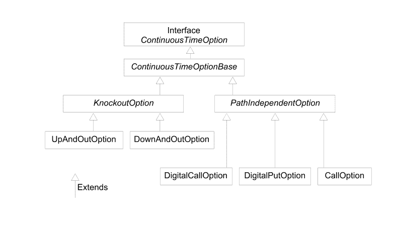

**图 12.1**：期权类的层级结构。

表示“extends”（继承）。方框代表类。UML 使用其他类型的箭头来指示类之间的其他关系。我们将稍后看到示例。我们遵循了 UML 的标准做法，使用斜体表示抽象类，使用罗马字体表示具体类。

这个 UML 图异常复杂。类层级通常要简单得多。我们试图通过省略关于类成员函数和变量的所有细节来简化该图。

我们的复杂层级结构是合理的，因为它表示期权之间的“真实”关系。看涨期权（CallOptions）确实是路径无关期权（PathIndependentOptions），而路径无关期权确实是连续时间期权（ContinuousTimeOptions）。这是你通常应该遵循的模式。你应该仅使用子类化来表示“是一个”（is a）。我们 UML 图中的所有箭头都可以读作“是一个”。

# **良好的软件是什么样的**

你更喜欢哪位艺术家，马克·罗斯科（Mark Rothko）还是希罗尼穆斯·博斯（Hieronymus Bosch）？如果你不熟悉他们的画作，他们都是伟大的画家，而且风格截然相反。罗斯科以其具有惊人简洁性的抽象画闻名。博斯以其充满奇幻意象的详细风景画闻名。

在艺术方面，你实际上不必选择最喜欢的一位。但在软件设计中，对于问题，你应始终偏好最简单的解决方案。

这意味着在设计类时，你应追求一个看起来更像罗斯科作品而非博斯作品的 UML 图。

### 12.6.2 另一个对象层级

为了给出另一个示例层级，**geometry**（几何）库已更新为一个包含有趣对象层级的版本。它包含以下内容。

- 一个表示平面上任意有限形状的 **Shape**（形状）类。它具有以下方法。
    - 计算面积的 **area** 方法。
    - 测试点是否在形状内的 **contains** 方法。
    - 返回包含整个形状的 **Rectangle**（矩形）的 **boundingRectangle** 方法。
- **Circle**（圆）类是 *Shape* 的一个实现。
- **Rectangle**（矩形）类是 *Shape* 的另一个实现。
- **HyperCircle**（形状 $x^4 + y^4 < 1$）类是 *Shape* 的另一个实现。
- **Shape** 类有一个用于 **area** 的默认实现，使用蒙特卡洛方法。
    - **Circle** 和 **Rectangle** 重写了 area。

这些类在图形库中会很有用。

注意抽象函数和重写的重要性。没有人会想要一个 *Shape* 类无法扩展的图形库。同样，没有人会想要一个无法定义新类型期权的定价库。

这些例子触及了面向对象编程的核心。抽象方法和重写方法允许你编写“可插拔”的系统。

### 12.6.3 多重继承

在 C++ 中，一个类可以继承多个基类。这被称为 *multiple inheritance*（多重继承）。

多重继承对于表明一个类实现了多个接口很有用。

作为一个例子，对于具有相关执行价（如看涨期权和看跌期权，但不包括期货）的衍生品，拥有一个 **DerivativeWithStrike**（带执行价的衍生品）接口可能是有用的。该接口将简单地返回执行价，如下所示：

```cpp
class DerivativeWithStrike {
public:
~DerivativeWithStrike();
virtual double getStrike() const = 0;
};
```

要声明 `ContinuousTimeOptionBase` 同时实现 `ContinuousTimeOption` 和 `DerivativeWithStrike`，可以这样写：

```cpp
class ContinuousTimeOptionBase :
public ContinuousTimeOption,
public DerivativeWithStrike {
```

在使用多重继承时，我建议确保至多只有一个父类是非接口类。这不是 C++ 强制执行的规定，但如果你违反它，你就必须理解 C++ 中多重继承的详细规则。这会使你的代码更难理解，因此更难维护。

**提示：多重继承**
仅使用多重继承来显示一个类实现了多个接口。

我们只展示了如何公共继承自另一个类。这就是为什么我们在继承类时总是使用关键字 `public`。虽然也可以私有继承，但这不是一个非常有用的特性。我建议不要使用它。

**危险！**
C++ 是一种拥有许多高级特性的困难语言。其他面向对象编程语言（如 Java）不允许多重继承（接口除外），并且没有私有继承的概念。这提供了证据，表明 C++ 的这些特性并未被广泛认为特别有益。最好避免使用它们。

### 12.6.4 调用父类方法

有时能够调用父类的方法是很有用的。例如，考虑一个 `UpAndOutOption`（上行出局期权）。如果障碍价低于当前价格，期权毫无价值，因此不应使用缓慢的蒙特卡洛方法进行定价。然而，在其他时间，人们希望使用父类 `KnockoutOption`（敲出期权）的默认行为，即通过蒙特卡洛方法对期权进行定价。

执行此操作所需的代码如下：

```cpp
double price(
    const BlackScholesModel& model) const {
```


```cpp
if (model.stockPrice >= getBarrier())
    return 0;
return KnockoutOption::price(model);
```

关键行是最后一行，其中我们用父类 `KnockoutOption` 的名称来限定对 `price` 函数的调用。如果我们不指定要调用父类的 `price` 函数，该函数将递归调用自身。程序随后将因栈溢出错误而崩溃。

### 12.7 前向声明和 cpp 文件的结构

类 `Shape` 有一个方法 `boundingRectangle`。该方法返回一个 `Rectangle`。这意味着在告诉编译器关于 `Rectangle` 类之前，编写类 `Shape` 是不可能的。

另一方面，`Rectangle` 本身是一个 `Shape`，因此存在循环性。这似乎使得声明 `Rectangle` 或 `Shape` 都变得不可能。

为了解决这个问题，你可以使用类 `Rectangle` 的 *forward declaration*（前向声明）。以下是如何创建前向声明的示例：

```cpp
class CartesianPoint;
class Rectangle;
class Shape {
public:
    /* 点是否在形状内 */
    virtual bool contains(const CartesianPoint& point) const = 0;
    /* 包围形状的矩形 */
    virtual Rectangle boundingRectangle() const = 0;
    /* 默认情况下，面积通过蒙特卡洛计算 */
    virtual double area() const;
};
```

前向声明：

```cpp
class CartesianPoint;
```
`class Rectangle;`

这是对编译器的承诺，表明我们最终会声明这些类。随后，编译器将允许将它们用作参数和返回类型。但是，在类被完整声明之前，无法将其用作成员变量或超类。

这就引出了一个问题：在 `C++` 文件中，按照什么正确的顺序来放置所有的声明、定义等。以下是我的建议。你应该按照以下顺序编写 `cpp` 文件。

1. 包含语句（Include statements）。
2. `using namespace` 语句。
3. 类的前向声明。
4. 类声明和函数声明。
5. 函数定义和成员定义。
6. 测试（其他项目可能有不同的测试惯例）。

### 12.8 static 关键字

有时你可能希望将一个函数与类关联，但不与特定的实例关联。以下是你这样做的一些原因。

- 该函数旨在构造实例——所谓的*工厂方法*。我们将在下一章中看到一个详细的示例。
- 该函数操作于实例的向量，因此你无法合理地将其与特定实例关联。
- 该函数旨在一次性改变所有实例的行为。例如，你可能希望为一个类启用额外的日志信息以帮助调试。
- 该函数旨在管理你类的所有实例。例如，由于第一次连接数据库很慢，你可能希望维护一个包含到给定数据库的十个连接的池。然后你可以将函数与 `DatabaseConnection` 类关联，允许你从这个池中获取和返回连接。

如果你希望将一个函数与类关联，而不是与任何实例关联，你应该使用关键字 `static`。你还可以声明一个成员变量是 `static`，这意味着它被该类的所有实例共享。

作为一个略显牵强的例子，假设我们发现了代码中的一个性能问题。我们怀疑它与 `sin` 函数相关，这是我们在一个计算 `sin` 函数的类中编写的 `evaluate` 函数的一部分。作为调试的一部分，我们想要计算该方法被调用的确切次数。以下是我们可以做到的一点方法：

```cpp
class CallCountedSin : public RealFunction {
public:
    static int getNumberOfCalls();
    double evaluate(double x) {
        numCalls++;
        return sin(x);
    }
private:
    static int numCalls;
};
```

我们的类 `CallCountedSin` 表现得像 `sin` 函数，但还统计在 `any` 实例上调用 `evaluate` 的次数。我们有一个 `static` 成员变量来保存调用次数，以及一个 `static` 成员函数来读取该值。

函数的定义看起来就像普通的成员函数一样。

```cpp
int CallCountedSin::getNumberOfCalls() {
    return numCalls;
}
```

请注意，此函数不允许访问除 `static` 变量以外的任何变量。

以下是如何初始化静态变量 `numCalls`：

```cpp
int CallCountedSin::numCalls = 0;
```

这看起来很像全局变量定义。在某种意义上，它确实就是。区别在于我们将变量 `numCalls` 与类 `CallCountedSin` 关联了起来。这比拥有一个名为 `numCalls` 的全局变量要好，因为静态变量可以声明为私有。这意味着它不可能被其他类中的任何函数使用。

以下是如何实际调用静态函数的示例：

```cpp
void testCallCountedSin() {
    CallCountedSin instance1;
    CallCountedSin instance2;
    integral(instance1, 0, 1, 1000);
    integral(instance2, 0, 1, 1000);
    int numCalls=CallCountedSin::getNumberOfCalls();
    ASSERT(numCalls == 2000);
}
```

要注意的一点是，要调用该函数，我们必须用类名限定其名称。

```cpp
int numCalls=CallCountedSin::getNumberOfCalls();
```

由于我们可能有多个类具有相同命名的静态方法，因此需要限定名称是有意义的。

我们在第 9.3 节中已经看到了一个静态变量的例子。你可能记得我们用以下代码重置了随机数发生器的种子：

```cpp
mersenneTwister.seed(mt19937::default_seed);
```

这段代码正在访问定义在类 `mt19937` 中的静态变量 `default_seed`。由于 `default_seed` 对所有实例都是相同的，因此将其与类而不是任何实例关联是合乎逻辑的。对于比单个整数更复杂的数据对象，让所有实例共享的一个变量只保留一份副本可能会节省大量内存。

总之，静态函数和静态变量完全像全局函数和全局变量一样工作，除了以下几点。

- 它们可以被设为私有，并拥有对私有数据的特权访问权限。这增加了封装性。
- 它们与类相关联。调用静态函数需要用类名进行限定。这防止了名称冲突。

令人困惑的是，`C++` 还使用 `static` 关键字用于未定义在任何类中的函数。在此上下文中，`static` 意味着“不能在当前文件之外使用”。不幸的是，`C++` 使用相同的关键词服务于两个完全不同的目的。

## 危险！

与其他全局变量一样，如果你正在使用多线程代码，那么在使用非常量静态变量时必须小心使用锁。参见第 20 章。

### 12.9 protected 关键字

我们已经知道可以使用关键字 `public` 或 `private` 进行信息隐藏。`public` 意味着每个人都可以使用方法和变量。`private` 意味着没有人可以使用方法/变量，包括子类。

既然我们正在使用子类，值得提到的是你也可以使用关键字 `protected`。这意味着只有子类可以使用方法/变量。在实践中，我建议你暂时忽略 `protected`，因为它并不特别有用。

### 练习

1. 12.9.1. 编写 `DigitalCallOption` 和 `DigitalPutOption` 类。重构 `PutOption` 使其继承自 `PathIndependentOption`。
2. 12.9.2. 编写一个代表亚洲期权的 `AsianOption`。展示这个新类在期权 UML 图中的位置。
3. 12.9.3. 为以 `Shape` 为基类的类层次结构创建一个 UML 图。
4. 12.9.4. 我们不同的图表类之间有很多相同的代码。特别是它们都有一个标题和两个名为 `writeAsHTML` 的函数。设计一个基类并为每个图表扩展它。绘制 resulting 层次的 UML 图。使用 getter 和 setter 方法访问标题。
5. 12.9.5. 你能使用本章的技术来改进为练习 10.6.6 编写的 `Cipher` 类吗？
6. 12.9.6. 这个练习测试静态变量和函数的使用。
    1. 编写一个接口类 `RandomNumberGenerator`，它具有生成均匀分布随机数的函数。
    2. 编写一个使用 `mt19937` 类的 `RandomNumberGenerator` 实现。这种通过简单地调用另一个类来完成所有工作来实现接口的设计模式被称为*委托*。
    3. 在 `RandomNumberGenerator` 类上编写一个名为 `setDefault` 的静态函数，用于设置当前的默认 `RandomNumberGenerator` 实例。注意，你应该使用 `shared_ptr<RandomNumberGenerator>` 作为 `setDefault` 的参数。
    4. 在 `RandomNumberGenerator` 上编写一个静态函数 `randUniform`，允许用户生成均匀分布的随机数，而无需创建 `RandomNumberGenerator`。
    5. 在 `RandomNumberGenerator` 中添加一个非静态的 `setDefault` 函数，将当前使用的随机数发生器设置为默认的随机数发生器。你需要使用 `this` 关键字。
    6. 你认为这在哪些方面（如果有的话）改进了 `matlib` 中现有的函数？

### 12.10 摘要

本章涵盖了相当多的不同主题。以下是简要回顾。

- 尽可能编写 getter 和 setter，并使用私有数据。
- 通过在类内部编写定义，你可以内联函数。
- `this` 指针使编写 setter 变得简单。如果你需要当前实例的引用，可以使用它。
- 构建类层次结构以继承功能。
- 使用 `virtual` 关键字表示方法可以被重写。
- 编写 `=0` 表示函数没有实现，从而创建一个抽象类。
- 接口类是继承的一个特例。
- 使用前向声明来处理循环类声明。
- 在类中使用静态变量代替全局变量。在类中使用静态函数来编写与类整体相关联而非类某个特定实例相关联的函数。

### 第 13 章

#### 投资组合类

本书的一个关键目标是展示如何使用 `C++` 对包含多种不同期权的投资组合进行定价。我们将在本章实现这一目标。

如果没有面向对象，这将很难实现。但由于我们的所有期权类都有一个以 `BlackScholes-Model` 为参数的 `price` 函数，因此实际上这将极其简单。

本章不会引入 `C++` 的任何新语言特性。本章唯一的的新想法是一个称为*工厂模式*的简单设计模式，可用于增加信息隐藏。

##### 13.1 Priceable 接口

在金融领域，投资组合仅仅是一系列证券的集合，例如股票、债券和期权，且数量各异。投资者的投资组合描述了其在所有证券上的总仓位。

为了在 `C++` 中建模投资组合，我们将编写一个类，该类存储不同证券的向量以及持有数量的向量。

我们需要决定使用哪个类来表示每种证券。这可能是股票、债券、衍生品等。这些不同证券的唯一共同特征是它们可以被定价。这促使我们引入一个新接口 `Priceable`。我们将使用的接口如下：

```cpp
class Priceable {
public:
    /* Compute the price of the security in the
       Black--Scholes world */
    virtual double price(
        const BlackScholesModel& model ) const = 0;
};
```

在编写实际的金融系统时，传递给 `price` 函数的参数将不仅仅是 `BlackScholesModel`。实际上，人们会传递一个更复杂的参数，其中包含整个金融市场的数据，而不是单只股票的数据。通过使用此接口来描述我们的证券，我们将系统限制为仅对涉及单一股价和固定利率 `r` 的证券进行定价。这足以突出关键思想，但显然，如果在编写真实的交易系统，则需要重新考虑这一点。

通过让 `ContinuousTimeOption` 继承 `Priceable`，我们可以确保我们所有的期权类都实现了 `Priceable`。我们将把编写额外的类 `Stock` 和 `ZeroCouponBond` 留作读者的练习（零息债券的定义见练习 13.5.1）。

##### 13.2 投资组合接口和实现

既然我们已经设计了 `Priceable` 类，设计 `Portfolio` 的关键函数就很容易了。`Portfolio` 类必须具有以下关键功能：

- (i) 一个函数，用于添加一个 `Priceable` 实例及其关联数量；
- (ii) 一个函数，用于更改给定证券的持有数量；
- (iii) 一个函数 `price`，用于计算 `Portfolio` 的价值。

最后一项建议表明，`Portfolio` 本身应该实现接口 `Priceable`。这意味着可以创建一个本身包含 `Portfolio` 的 `Portfolio`。这准确地反映了银行管理其账簿的方式。他们首先按业务线，然后按交易台，再按交易员将持仓组织成多个不同的投资组合。每位交易员随后会维护多个独立的投资组合，仅仅作为一种组织其工作的方式。

可以看出，我们的 `Portfolio` 实现需要一种方法来存储 `Priceable` 类型的对象，以便跟踪投资者的仓位。`Portfolio` 实现不可能拥有 `Priceable` 类型的成员变量，因为 `Priceable` 是一个抽象类。出于同样的原因，也不可能拥有一个由 `Priceable` 对象组成的向量。其根本原因是，成员变量和向量元素必须具有相同的大小。不同的 `Priceable` 对象将根据其包含的变量占用不同大小的内存。

解决这个问题的方法是让 `Portfolio` 使用 `shared_ptr` 存储数据。这种不可避免的指针使用是我们必须在第 11 章引入指针主题的原因。

这导致我们做出了关于 `Portfolio` 类设计的以下决定。

- (i) 我们的 `Portfolio` 实现将持有一个由指向 `Priceable` 实例的 `shared_ptr` 对象组成的向量。
- (ii) 它还将有一个数量向量。
- (iii) 由于我们需要存储 `shared_ptr` 对象，添加证券的方法将接受指向证券的 `shared_ptr`，而不是证券的引用。

在最终确定设计之前，我们增加了进一步的考虑。`Portfolio` 类的用户无需了解我们将如何存储 `Portfolio` 的数据。因此，最好将所有这些次要细节排除在头文件之外。

考虑到所有这些因素，我们现在可以设计我们的 `Portfolio` 类。

```cpp
class Portfolio : public Priceable {
public:
    /* Virtual destructor */
    virtual ~Portfolio() {};
    /* Returns the number of items in the portfolio */
    virtual int size() const = 0;
    /* Add a new security to the portfolio, returns the index at which it was added */
    virtual int add( double quantity,
    std::shared_ptr<Priceable> security ) = 0;
    /* Update the quantity at a given index */
    virtual void setQuantity( int index,
    double quantity ) = 0;
    /* Compute the current price */
    virtual double price(
    const BlackScholesModel& model ) const = 0;
    /* Creates a Portfolio */
    static std::shared_ptr<Portfolio> newInstance();
};
```

`Portfolio` 类是一个抽象类。要创建 `Portfolio`，该类的用户必须调用*工厂方法* `newInstance`。此函数保证返回 `Portfolio` 接口的某种实现，但用户不知道具体返回的是哪个类。因为我们不希望用户甚至知道我们返回的 `Portfolio` 对象的成员变量，所以我们的工厂方法必须返回指向 `Portfolio` 的指针。照例，我们使用 `shared_ptr` 来简化内存管理。

这样做的好处是*所有*实现细节都隐藏在 C++ 文件中。关于*私有*字段和方法的信息不会提供给用户。这意味着我们可以更改所有这些实现细节，而用户甚至不需要重新编译，只需链接到最新的库即可。

实现全部放在文件 `Portfolio.cpp` 中。

```cpp
```


```cpp
class PortfolioImpl : public Portfolio {

public:

    /* Returns the number of items in the portfolio*/

    int size( ) const;

    /* Add a new security to the portfolio,
       returns the index at which it was added */

    int add( double quantity,
             shared_ptr<Priceable> security );

    /* Update the quantity at a given index */

    void setQuantity( int index, double quantity );

    /* Compute the current price */

    double price( const BlackScholesModel& model ) const;

    vector<double> quantities;

    vector< shared_ptr<Priceable> > securities;

};
```

将所有实现细节放在 `cpp` 文件中还有其他一些优势。让我们现在描述其中的一些。

- (i) 我们的实现类 `PortfolioImpl` 具有类型相当复杂的成员变量

```cpp
vector< shared_ptr< Priceable > >
```

这种类型是指向 `Priceable` 对象的指针的向量。这正是我们需要存储投资组合中包含的不同证券详情的数据结构。如果在头文件中声明实现细节，类型细节将更难阅读：

```cpp
std::vector< std::shared_ptr< Priceable> >
```

这是因为不应在头文件中使用 `using namespace`。因此，将实现细节放在 `cpp` 文件中允许我们更充分地利用 `using namespace` 声明。

- (ii) 在头文件中，所有类的字段通常声明为 `private` 以增加封装性。不幸的是，这使得测试变得麻烦。`PortfolioImpl` 的字段是 `public` 的也没关系。我们已经实现了完美的信息隐藏，而无需使用 `private` 关键字。

- (iii) 头文件变得不那么复杂。由于每个使用 `Portfolio` 的文件都需要 `#include` 我们的头文件，这将减少使用 `Portfolio` 的类的编译时间。对于这个单一类来说，这是一个小细节，但在整个项目中累积效应可能非常大。你在头文件中放的代码越少，编译就越快。

这种通过工厂方法 `newInstance` 提供实现类，从而增加封装性的技术被称为 *工厂设计模式*。由于它允许清晰地分离接口和实现，因此具有许多优势。人们常说这种模式 *解耦* 了接口和实现。程序中不同类之间的依赖关系被称为耦合。减少耦合将带来更具可维护性的代码。

### 13.2.1 PortfolioImpl 的实现

`Portfolio` 和 `PortfolioImpl` 类的类设计已经完成了大部分繁重的工作。提供方法的实现非常简单。

首先，我们必须实现工厂方法 `newInstance`。它只需要返回一个新的 `PortfolioImpl` 实例。

```cpp
shared_ptr<Portfolio> Portfolio::newInstance() {
    shared_ptr<Portfolio> ret = make_shared<PortfolioImpl>();
    return ret;
}
```

`add` 的实现很容易：

```cpp
int PortfolioImpl::add(double quantity, shared_ptr<Priceable> security) {
    quantities.push_back(quantity);
    securities.push_back(security);
    return quantities.size();
}
```

`size` 的实现也是如此：

```cpp
int PortfolioImpl::size() const {
    return quantities.size();
}
```

以及 `setQuantity` 的实现。

```cpp
void PortfolioImpl::setQuantity(int index, double quantity) {
    quantities[index] = quantity;
}
```

我们所有努力的最终成果是，我们可以轻松地为 `Portfolio` 编写一个 `price` 函数：

```cpp
double PortfolioImpl::price(const BlackScholesModel& model) const {
    double ret = 0;
    int n = size();
    for (int i = 0; i < n; i++) {
        ret += quantities[i] * securities[i]->price(model);
    }
    return ret;
}
```

所有这些实现代码都非常简单。然而，请停下来考虑一下这一事实：我们的 `Portfolio` 实现现在可以存储任何类型的股票衍生品并对其进行定价。它将根据所包含的衍生品类型，始终选择最高效的定价方法。看涨期权将使用看涨期权的 Black–Scholes 公式进行定价。看跌期权将使用看跌期权公式进行定价。其他期权将通过蒙特卡洛方法定价。同样，股票持有和零息债券的持有将通过调用适当的定价函数来定价。最终结果是一个极其通用且有用的类。

更重要的是，我们的 `Portfolio` 也能同样很好地处理我们尚未实现的证券！如果用户决定销售新型金融衍生品，他们可以为我们类提供自己的实现。能够应对快速变化的业务需求而无需重写所有软件，是商业软件的一个基本特性。正是这种“可插拔性”使得面向对象软件在金融行业中如此重要。

#### 13.3 测试

正如我们在本书中试图强调的那样，软件开发的一个重要部分是测试你的代码是否正常工作。

在这个测试中，我们将检查 *看涨-看跌平价* 公式，并现在推导它。

一个由 1 单位看涨期权和 $-1$ 单位看跌期权组成的投资组合 $P$，两者行权价均为 $K$，到期时将支付等于

$$
\max \{S_{T} - K, 0\} - \max \{K - S_{T}, 0\}
$$

的数额（其中 $S_{T}$ 是到期时的股票价格）。通过分别考虑 $S_{T} \geq K$ 和 $S_{T} < K$ 的情况，可以看出该表达式简化为：

$$
S_{T} - K.
$$

因此，$P$ 的价值等于 $S_{T} - K$ 的折现期望值。在 Q 测度下，$S_T$ 的折现期望值必须等于 $S_0$。我们推断出 $S_T - K$ 的折现期望值是：

$$
S_0 - e^{-rT}K.
$$

这是时间 0 时 $P$ 的价值。

下面的测试证实了当 $r=0$ 时，这一结论对我们的 `Portfolio` 类成立。

```cpp
static void testPutCallParity() {
    shared_ptr<Portfolio> portfolio = Portfolio::newInstance();
    shared_ptr<CallOption> c = make_shared<CallOption>();
    c->setStrike(110);
    c->setMaturity(1.0);
    shared_ptr<PutOption> p = make_shared<PutOption>();
    p->setStrike(110);
    p->setMaturity(1.0);
    portfolio->add(100, c);
    portfolio->add(-100, p);
    BlackScholesModel bsm;
    bsm.volatility = 0.1;
    bsm.stockPrice = 100;
    bsm.riskFreeRate = 0;
    double expected = bsm.stockPrice - c->getStrike();
    double portfolioPrice = portfolio->price(bsm);
    ASSERT_APPROX_EQUAL(100 * expected, portfolioPrice, 0.0001);
}
```


人们可能觉得我们应该为我们的 `Portfolio` 类编写更多的测试，以测试它是否正确地为更复杂的投资组合定价。我们设计的一个核心优势在于，为 `Portfolio` 类编写大量测试并不是真正必要的。我们已经有一套测试来确认不同类型的期权被正确定价。`Portfolio` 类具有非常简单的 `price` 方法，而该方法中的每一行都已经被我们的看涨-看跌平价测试所覆盖。测试 `Portfolio` 是否适用于包含复杂期权的投资组合不会带来任何新东西。

### 13.4 UML

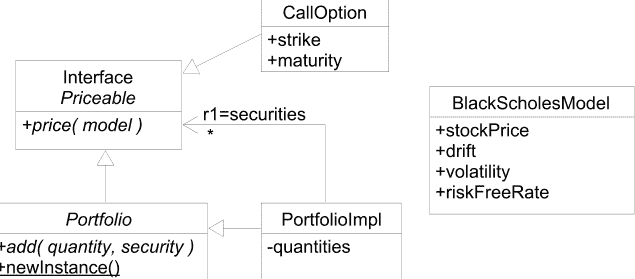

图 13.1：*Portfolio* 类的设计。

图 13.1 以 UML 图的形式总结了我们在本章中引入的类。

该图表明 **`PortfolioImpl`** 实现了接口 – **`Portfolio`**，后者反过来扩展了接口 *Priceable*。*Priceable* 也由类 **`CallOption`** 实现。

另一方面，**`PortfolioImpl`** 包含一个 *Priceable* 对象的向量；这由标记为 *securities* 的箭头表示。这种关系是一种 *has a* 关系。**`PortfolioImpl`** 拥有多个相关证券。所有这些关系都是 *is a* 关系，并通过类扩展实现。

箭头上的 `*` 符号表示 **`PortfolioImpl`** 可以拥有任意数量的相关证券。在 UML 中，你可以用数字或数字范围来标记任何关系的 *重数*。例如，人与其父母之间的“父母”关系可以标记为重数 2。`*` simply 表示重数没有限制。

**`newInstance`** 函数带有下划线，以表示它是一个静态函数。

我们有意省略了图中的期权完整层次结构，以保持其可读性。我们还表示 **`CallOption`** 拥有公共成员变量 **`strike`** 和 **`maturity`**，尽管这些变量只能通过 *get* 和 *set* 方法访问。我们没有提到 **`PortfolioImpl`** 使用共享指针向量来存储 *Priceable* 对象的引用。因此，我们的图是对我们类的一个轻微简化。它旨在阐明设计，而不是精确地镜像代码。

### 13.5 局限性

我们不声称本章中的代码是期权投资组合定价的最终定论。以下是一些重要的局限性。

- (i) 我们在蒙特卡洛计算中使用固定数量的场景和步骤，这应该是可配置的。
- (ii) 我们未尝试优化代码。
- (iii) 我们未利用现代计算机可用的多 CPU。
- (iv) 我们的 `ContinuousTimeOption` 和 `Priceable` 接口不够通用。例如，它们无法处理离散时间期权和基于多种基础股票的期权。
- (v) 在使用蒙特卡洛方法为投资组合定价时，不断生成随机数并不是一个好主意。最好是一次性生成所有风险因子，然后使用相同的场景来对每个元素进行定价。这既减少了随机数生成，又能确保对冲准确地相互抵消。

这些局限性中的许多将在后续章节中解决。

### 练习题

1. **13.5.1.** *零息债券* 是一种保证在到期日 $T$ 支付价值 1 的金融工具。这些工具在实践中不常交易，但作为表示无风险银行账户的有用数学抽象。将资金投入无风险银行账户直至时间 $T$ 等同于投资到期日为 $T$ 的零息债券。无风险定价理论告诉我们，零息债券在时间 0 的无风险价格为
$$
\exp(-rT).
$$
利用这一事实，为股票和零息债券创建 `Priceable` 接口的实现。

13.5.2. 实现`UpAndInOption`和`DownAndInOption`。包含一个`UpAndInOption`和一个`UpAndOutOption`的投资组合，其价值应与包含一个`CallOption`的投资组合相同。请使用`Portfolio`类来验证这一点。并对结果的准确性进行评论。

##### 13.6 总结

在开发`Portfolio`时，我们并未使用任何新的C++语言特性，只是使用了一些设计模式来有效利用C++。

- 使用`shared_ptr`来构建复杂的数据结构，以便长期存储对象。
- 使用*静态工厂方法*设计模式来最大限度地隐藏信息并减少文件之间的依赖关系。
- 使用面向对象来实现可插拔的代码，即使出现新需求也不需要进行修改。

### 第14章

#### Delta对冲

在本章中，我们将展示如何应用C++来解决超越简单无风险定价的金融数学问题。特别是，练习将展示如何应用面向对象编程技术来解决广泛的问题。

我们要解决的问题是，通过数值证明附录A中描述的delta对冲策略是一种有效的交易策略。

在文献[2]中，已证明delta对冲策略在采用对现实的各种近似假设下是完全无风险的。这些假设包括：必须能够以连续时间重新调整头寸；股票价格必须在P测度下遵循几何布朗运动；没有交易成本；市场必须具有无限的流动性；利率必须固定在水平$r$；等等。

我们将在本章中展示，如果将连续时间交易的假设弱化为在固定时间点点交易，delta对冲仍然是一个相当有效的策略。该策略不再完全无风险，但通过相当频繁地重新对冲，可以将风险降低到可接受的水平。

我们开发的软件可以轻松地增强以测试弱化其他假设的影响。此外，可以轻易地调整软件以测试其他对冲和投资策略的有效性。

##### 14.1 离散时间delta对冲

我们将模拟根据Black-Scholes P测度模型演化的股票交易。这意味着我们可以使用现有的`BlackScholesModel`及其函数`generatePricePath`来模拟给定时间间隔内的股价。$t$时刻的股价表示为$S_{t}$。

在0时刻，交易员以Black-Scholes价格向客户出售该股票的欧式看涨期权，执行价为$K$，到期日为$T$。这意味着，作为换取价格$P$的对价，交易员承诺在$T$时刻向客户支付金额

$$ \mathrm{max}\{S_{T}-K, 0\} $$

交易员的策略是对冲这一负债。他们在N个离散时间步长进行delta对冲。因此，每个时间步长的长度为$\delta t = T/N$。

我们用整数$i \in \{0, N - 1\}$标记交易员进行对冲的时刻。因此，时间点$i$发生在时间$i\delta t$。在时间点$i$，交易员将确保持有正好$\Delta_i$单位的股票，其中$\Delta_i$是时间点$i$时该看涨期权的Black–Scholes delta。剩余的资金投资于一个无风险账户，该账户以固定利率$r$增长。

我们将交易员在每个时间点$i$的银行余额记为$b_i$。在时间点0，交易员将

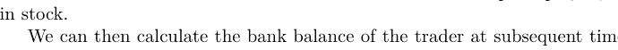

存入其无风险账户，并将其余本金$\Delta_0 S_0$投资于股票。

然后，我们可以使用差分方程计算交易员在后续时间点$i$的银行余额

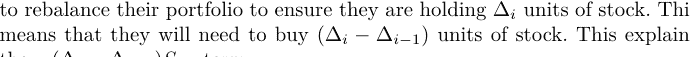

该方程成立，因为他们在银行中的钱以利率$r$增长，产生项$e^{r\delta t}b_{i-1}$，代表交易员重新平衡投资组合前银行中的金额。然后，交易员需要重新平衡其投资组合，以确保持有$\Delta_i$单位的股票。这意味着他们需要购买$(\Delta_i - \Delta_{i-1})$单位的股票。这解释了$-(\Delta_i - \Delta_{i-1})S_{i\delta t}$项。

在时间点$N$，期权到期。交易员不进行delta对冲。相反，他们卖出剩余的股票头寸并清偿负债。这告诉我们

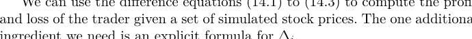

这个最终银行余额代表交易员的损益。方程(14.1)到(14.3)的推导没有比delta对冲策略的定义和基本会计核算更复杂的概念。这些计算并不比理解个人银行账户和购物消费所用的计算更复杂。

我们可以使用差分方程(14.1)到(14.3)来计算在给定模拟股票价格下交易员的损益。我们需要的另一个额外要素是$\Delta_i$的显式公式。

根据定义，$\Delta = \partial C/\partial S$，其中$C$是看涨期权的价格，$S$是当前股价。这意味着只需对看涨期权的Black–Scholes公式(A.6)进行微分即可计算$\Delta$。结果为


其中$N$和$d_1$如公式(A.6)所定义。

本节中的公式共同使我们能够显式计算交易员在给定情景下的损益。通过生成多个情景

我们可以计算交易员损益（PnL）的统计数据。最有趣的是，我们可以绘制交易员PnL的直方图。我们将在下一节中看到执行此操作所需的C++代码。

##### 14.2 在C++中实现delta对冲策略

鉴于上一节中的显式公式，实现delta对冲策略很简单。然而，如果仅仅将方程复制到C++中，最终会得到包含无帮助变量名（如**b**）的代码，这对于没有文档参考的人来说毫无意义。

编程中的惯例是使用能够清楚解释正在发生什么的长变量名。这与数学中使用单字母变量名的惯例相反。

你将看到下面的代码对所有变量使用英文名称，这使得所有项的推导过程都很清晰。其优点在于，仅通过查看代码本身即可理解，无需阅读另一个文件中的说明文档。

###### 14.2.1 类声明

我们的第一步是声明一个类来运行我们的对冲模拟。我们将该类命名为**HedgingSimulator**。它将是可配置的，以便用户可以设置要对冲的期权价值、模拟中要使用的模型等。我们的设计包含一些灵活性，允许用户设置一个用于生成股价的模型（*simulationModel*）和另一个由交易员用于计算向客户收取的费用和每个时间点持有的股票数量的模型（*pricingModel*）。通过拥有两个单独的模型，我们将能够测试如果交易员对市场信念错误的情况下会发生什么。

这些想法导致我们为名为**HedgingSimulator**的类定义以下私有成员变量：

```cpp
private:
/*  The option that has been written  */
std::shared_ptr<CallOption> toHedge;
/*  The model used to simulate stock prices  */
std::shared_ptr<BlackScholesModel> simulationModel;
/*  The model used to compute prices and deltas  */
std::shared_ptr<BlackScholesModel> pricingModel;
/*  The number of steps to use  */
int nSteps;
```

变量`nSteps`对应于差分方程推导中使用的数学变量N。

我们决定使用`shared_ptr`存储所有配置对象。当一个类需要引用另一个类的数据时，这应该是你的默认选择。另一种选择是使用类型为`CallOption`的成员变量，但这只能存储确切的类`CallOption`，而不能存储未来可能编写的子类。实际上，使用更通用类型的成员变量可能更好，这样我们可以模拟对冲其他类型的期权。参见练习14.4.4。

> **提示：使用shared_ptr引用其他类**
>
> 通过指针存储对象更具通用性。因为如果你需要，你可以持有子类的引用。在构建引用其他类的类时，这应该是你的默认设计选择。

由于我们`HedgingSimulator`类的所有成员都是私有的，我们将需要设置方法，以便用户可以配置该类。我们还需要一个构造函数来将数据初始化为合理的值。以下是相关的公有声明：

```cpp
void setToHedge(
    std::shared_ptr<CallOption> toHedge) {
    this->toHedge = toHedge;
}
void setSimulationModel(
    std::shared_ptr<BlackScholesModel> model) {
    this->simulationModel = model;
}
void setPricingModel(
    std::shared_ptr<BlackScholesModel> model) {
    this->pricingModel = model;
}
void setNSteps(int nSteps) {
    this->nSteps = nSteps;
}
/* Default constructor */
HedgingSimulator();
```

我们期望我们类的用户设置要对冲的期权，选择使用的模型和步数，然后要求我们的类运行模拟。我们提供以下公有方法来实现此功能：

```cpp
/* Runs a number of simulations and returns */
```

###### 14.2.2 `runSimulation` 的实现

最有趣的代码是函数 `runSimulation` 的实现。其开头如下：

```cpp
/* 一个损益向量 */
std::vector<double> runSimulations(
    int nSimulations ) const;
```

为了实现这个方法，我们将使用三个辅助方法。这些是私有方法。其声明如下所示：

```cpp
/* 运行模拟并计算
   损益 */
double runSimulation() const;
/* 应向客户收取多少费用 */
double chooseCharge( double stockPrice ) const;
/* 应持有多少股票 */
double selectStockQuantity(
    double date,
    double stockPrice ) const;
```

引入这些辅助方法仅仅是为了确保每个函数简短且易于阅读。例如，函数 `runSimulations` 只是多次调用 `runSimulation` 并将结果存储在一个向量中。

这就完成了 `HedgingSimulator` 类成员变量和成员函数的列表。完整的类声明可以在文件 `HedgingSimulator.h` 中找到。

最有趣的代码是函数 `runSimulation` 的实现。其开头如下：

```cpp
double HedgingSimulator::runSimulation() const {
    double T = toHedge->getMaturity();
    double S0 = simulationModel->stockPrice;
    vector<double> pricePath = simulationModel->generatePricePath(T, nSteps);
    double dt = T / nSteps;
    double charge = chooseCharge(S0);
    double stockQuantity = selectStockQuantity(0, S0);
    double bankBalance = charge - stockQuantity * S0;
```

这段代码首先模拟了 $\mathbb{P}$ 测度下的价格路径。然后计算交易者在时间 0 时的银行余额。这段代码本质上等同于用于推导公式 (14.1) 的参数。最明显的变化是我们将所有内容重写为使用更长的变量名。另一个细节是我们调用了函数 `selectStockQuantity`，该函数决定我们在每个时间点需要持有多少股票。我们还调用了函数 `chooseCharge`，该函数决定向客户收取多少费用。通过将所需对冲股票数量的计算分离到其自身的函数中，我们突出了相对于其他股票对冲策略而言，德尔塔对冲策略的核心特征。此外，这使得扩展代码以了解如果交易者决定追求另一种投资策略会发生什么变得容易。

接下来是一个循环，我们在每个中间时间点模拟交易。

```cpp
for (int i = 0; i< nSteps-1; i++) {
    double balanceWithInterest = bankBalance *
            exp(simulationModel->riskFreeRate * dt);
    double S = pricePath[i];
    double date = dt * (i + 1);
    double newStockQuantity =
            selectStockQuantity(date, S);
    double costs =
            (newStockQuantity - stockQuantity) * S;
    bankBalance = balanceWithInterest - costs;
    stockQuantity = newStockQuantity;
}
```

这段代码对应于公式 (14.2)。

最后，我们需要考虑到期时发生什么。以下代码解决了这个问题，并完成了 `runSimulation` 的定义。

```cpp
double balanceWithInterest = bankBalance *
        exp(simulationModel->riskFreeRate * dt);
double S = pricePath[nSteps - 1];
double stockValue = stockQuantity * S;
double payout = toHedge->payoff(S);
return balanceWithInterest + stockValue - payout;
}
```


这段代码对应于公式 (14.3)。

### 14.2.3 实现 HedgingSimulator 的其他方法

我们的 `HedgingSimulator` 类实现的其余细节极其简单明了。

`runSimulations` 只是多次调用 `runSimulation` 并将结果存储在一个向量中：

```cpp
std::vector<double>
    HedgingSimulator::runSimulations(
                    int nSimulations) const {
    std::vector<double> ret(nSimulations);
    for (int i = 0; i < nSimulations; i++) {
        ret[i] = runSimulation();
    }
    return ret;
}
```

默认构造函数确保新创建的 `HedgingSimulator` 为各个参数设置了一些合理的值。我们选择这些值，以便我们可以创建一个用于测试目的的 `HedgingSimulator`，而不需要进行大量的配置。

```cpp
HedgingSimulator::HedgingSimulator() {
    // 选择默认模型和期权
    shared_ptr<BlackScholesModel> model(
        new BlackScholesModel());
    model->stockPrice = 1;
    model->date = 0;
    model->riskFreeRate = 0.05;
    model->volatility = 0.2;
    model->drift = 0.10;
    shared_ptr<CallOption> option =
        make_shared<CallOption>();
    option->setStrike(model->stockPrice);
    option->setMaturity(1);
    setToHedge(option);
    setSimulationModel(model);
    setPricingModel(model);
    nSteps = 10;
}
```

函数 `selectStockQuantity` 将其工作委托给 `CallOption` 类上的一个名为 `delta` 的函数。该函数使用公式 (14.4) 计算看涨期权的德尔塔值。将德尔塔值的计算放入 `CallOption` 类中是合理的，因为我们经常想要计算期权的德尔塔值。理想情况下，应该在我们的整个期权层次结构中添加一个方法来计算德尔塔值（参见练习 14.4.4）。

```cpp
double HedgingSimulator::selectStockQuantity(
    double date,
    double stockPrice) const {
    // 创建定价模型的副本
    BlackScholesModel pm = *pricingModel;
    pm.stockPrice = stockPrice;
    pm.date = date;
    return toHedge->delta(pm);
}
```

在上述代码中，这一行：

```cpp
BlackScholesModel pm = *pricingModel;
```

很有趣。我们需要修改我们的定价模型，使其状态反映当前时间步的市场状态。成员变量 `pricingModel` 仅反映模拟开始时市场的状态。我们不希望改变实际的 `HedgingSimulator` 配置，因此我们不希望改变成员变量 `pricingModel`。因此，我们创建一个全新的变量 `pm`，并将 `pricingModel` 的值复制到该变量中。然后，我们可以设置变量 `pm` 上的当前股票价格和日期，而不改变变量 `pricingModel`。由于成员变量 `pricingModel` 使用指针存储数据，我们必须使用 `*` 将指针转换为我们随后复制的引用。

确定向客户收取多少费用的代码类似。它利用了 `price` 函数，该函数我们已经为看涨期权编写好了。

```cpp
double HedgingSimulator::chooseCharge(
    double stockPrice) const {
    // 创建定价模型的副本
    BlackScholesModel pm = *pricingModel;
    pm.stockPrice = stockPrice;
    return toHedge->price(pm);
}
```

### 14.2.4 对 CallOption 的更改

我们需要向 `CallOption` 类添加一个新的公共函数来计算 Black--Scholes 德尔塔值。以下是该函数的定义。

```cpp
double CallOption::delta(
    const BlackScholesModel& bsm) const {
    double S = bsm.stockPrice;
    double K = getStrike();
    double sigma = bsm.volatility;
    double r = bsm.riskFreeRate;
    double T = getMaturity() - bsm.date;
    double numerator=log(S/K)+(r+sigma*sigma*0.5)*T;
    double denominator = sigma * sqrt(T);
    double d1 = numerator / denominator;
    return normcdf(d1);
}
```

## 14.3 测试模拟

根据 [2] 中的理论，如果交易者在连续时间内遵循德尔塔对冲策略，并且股票价格遵循 Black-Scholes 模型，那么交易者的损益将恰好为零。在实践中，我们为 $N$ 选择一个非常大的值，以便交易者以极高的频率重新对冲。然后我们检查交易者的 PnL（损益）是否接近于零。以下是运行此测试所需的代码。

```cpp
static void testDeltaHedgingMeanPayout() {
    rng("default");
    HedgingSimulator simulator;
    simulator.setNSteps(1000);
    vector<double> result=simulator.runSimulations(1);
    ASSERT_APPROX_EQUAL(result[0], 0.0, 0.01);
}
```

通常，我们通过对随机数生成器进行种子设置来运行，以确保我们的测试是可靠的。这就是 `rng("default")` 的目的。

人们可以将这视为对我们代码的测试，也可以将其视为支持德尔塔对冲理论的数值证据。

## 14.4 解释和扩展我们的模拟

我们可以使用我们的代码来看德尔塔对冲在实践中是如何工作的。特别是，如果交易者不频繁地重新对冲，我们可以绘制其损益直方图。鉴于我们开发的库，这是很容易的。

```cpp
static void testPlotDeltaHedgingHistogram() {
    rng("default");
    HedgingSimulator simulator;
    simulator.setNSteps(100);
    vector<double> result =
            simulator.runSimulations(10000);
    hist("deltaHedgingPnL.html", result, 20);
}
```


生成的直方图显示在图 14.1 中。这表明，虽然该策略的预期损益大约为 0，但存在相当大的方差。我们得出结论，在实际中，德尔塔对冲策略并不是无风险的。这并不意味着德尔塔对冲不是一个有用的策略。它

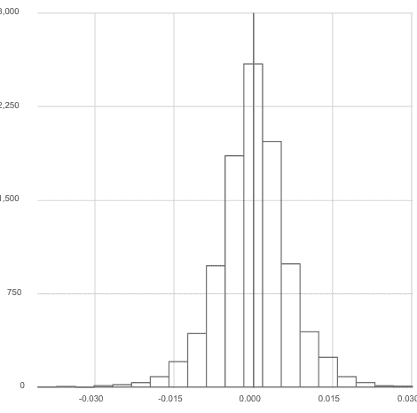

**图 14.1：** 采用 100 个时间步和 100,000 个情景的 Delta 对冲损益直方图。

这表明，为了补偿实践中需要承担的风险，定价应略高于 Black–Scholes 价格。

通过增强我们的 `HedgingSimulator`，可以看到 Black–Scholes 模型的其他假设如何影响其结论。例如，如果考虑交易成本会怎样？如果利率不恒定会怎样？如果交易者对波动率的看法不正确会怎样？这些有趣的问题作为练习给出。其中一些练习特别有趣，因为它们将要求你开发新的类层次结构来回答它们。

## 练习

### 14.4.1
计算 Delta 对冲策略损益的绝对值均值。生成一个双对数图（log-log plot），展示损益绝对值均值随交易者重新对冲的时间点数变化的情况。

### 14.4.2
为什么我们在模拟器中将其命名为 `generatePricePath` 而不是 `generateRisk-NeutralPricePath`？

### 14.4.3
如果存在买卖价差（bid-ask spread）会怎样？卖价（ask price）是你购买资产时必须支付的金额。买价（bid price）是你卖出资产时收到的金额。在现实中，这两个价格是不同的，其差额称为买卖价差。

在这个问题中，你应该像以前一样使用过程 `$S_t$` 来模拟购买 1 单位股票所需的资金，但你应该模拟卖出 1 单位股票获得的资金为 `pS_t`，其中 `p` 是一个满足 `0 ≤ p ≤ 1` 的固定比例。为了考虑这个买卖价差，公式 (14.2) 需要如何修改？修改对冲模拟器，使其可以配置参数 `p` 来确定买卖价差。重复练习 14.4.1，但包含 `p = 0.001` 的买卖价差。

我们在 `HedgingSimulator` 中添加了一个成员变量 `bidProportion`，并创建了一个函数 `computePrice`，该函数在考虑固定的买卖价差的情况下计算买卖股票时的资金支付/接收金额。`simulate` 函数然后在计算买卖股票的现金流时使用这个 `computePrice` 函数。

### 14.4.4
如果 `HedgingSimulator` 能够模拟认沽期权（put options）的 Delta 对冲，那将非常好。

第一步是在 `ContinuousTimeOptionBase` 中添加一个 `delta` 函数。提供默认实现有两种合理的方法。懒惰的选择是简单地抛出一个异常，说没有默认实现。如果付出更多努力，你可以使用练习 9.3.5 中描述的蒙特卡洛方法。无论如何，你还应该为 `PutOption` 提供一个专用实现，该实现使用公式

$$ \Delta = N(d_1) - 1 $$

该公式适用于欧式认沽期权。$N$ 和 $d_1$ 的定义如公式 (A.6) 所示。

一旦完成上述工作，你会如何修改 `HedgingSimulator` 以便模拟认沽期权的对冲？编写一个测试来检查你的解决方案是否正确。

### 14.4.5
如果交易者判断错误会怎样？股价实际遵循的路径可能完全不符合几何布朗运动，或者它可能遵循几何布朗运动但具有不同的波动率。

引入一个新的接口 `StockPriceModel`，用于在 P 测度下生成股价。你应该确保 `BlackScholesModel` 实现了该接口。提供一种名为 `TwoLevelModel` 的 `StockPriceModel` 的替代实现，该模型类似于 Black-Scholes 模型，但波动率 $\sigma$ 取两个不同的值。在时间 `T/2` 之前，波动率应等于某个值 \( \sigma_1 \)，在随后的时间应等于 \( \sigma_2 \)。你会如何修改 `HedgingSimulator` 以便它能够处理不同的模型？

### 14.4.6
考虑如果遵循除 Delta 对冲之外的其他对冲策略，损益会如何，这是很有趣的。创建一个名为 `Strategy` 的接口，该接口提供函数来选择向客户收费多少，以及决定在每个时刻持有多少股票。
你应该提供 `Strategy` 接口的四种实现。

- (i) 类 `BondsOnlyStrategy` 应模拟一个决定收取 Black–Scholes 价格并将所有资金投入无风险账户的交易者。他们从不重新对冲。
- (ii) 类 `StockOnlyStrategy` 应模拟一个决定收取 Black–Scholes 价格并将所有资金投入股票的交易者。他们从不重新对冲。
- (iii) 类 `DeltaHedgingStrategy` 应模拟遵循 Delta 对冲策略的交易者。

修改 `HedgingSimulator`，使你可以选择你的策略。在编写以下参数集合的认沽期权时，绘制这些对冲策略结果的直方图：

- (i) \( N = 100 \), \( \sigma = 0.5 \), \( \mu = 0.01 \), \( T = 1 \), \( S_0 = 1 \), \( K = 1 \), \( r = 0 \)。
- (ii) \( N = 100 \), \( \sigma = 0.01 \), \( \mu = 0.5 \), \( T = 1 \), \( S_0 = 1 \), \( K = 1 \), \( r = 0 \)。

解释你的结果。

##### 14.5 总结

我们开发了一个 C++ 交易模拟器，用于测试 Delta 对冲策略的有效性。我们的结果提供了数值证据，证明附录 A 中的理论是正确的。
在练习中，我们展示了如何使用面向对象编程技术使我们的交易模拟器变得极其通用。

### 第 15 章

#### 调试和开发工具

我们的软件项目现在变得庞大而复杂。它仍然远不如银行实际的交易系统复杂，但它已经跨越了数千行代码和几十个文件。显然，我们需要一些额外的开发工具来帮助我们高效工作。

由于开发工具没有标准化，我们无法详细描述如何使用所有你可能发现有用的不同开发工具。我们将专注于一个名为“调试器”的标准工具。调试器是任何 C++ 开发者工具包中必不可少的一部分。它的主要目的是允许你快速定位代码中发生错误的位置。我们将展示如何使用 Windows 上标准的 Visual Studio 调试器和 Unix 上标准的 `gdb` 工具来帮助查找代码中的错误。其他调试器的工作方式大体相似，但你需要查阅它们的文档以获取更详细的说明。

为了展示如何使用调试器查找错误，FMLib15 可以编译但不能正确工作。我们将展示如何找到那些故意引入的错误。

调试器绝不是你应该使用的唯一开发工具。我们以描述一些其他可能想用来提高生产力的开发工具来结束本章。我们还将讨论一些重要的软件开发最佳实践，这对于处理大型软件项目至关重要。

##### 15.1 调试策略

在解释如何使用调试器之前，让我们描述一些你可以用来调试代码的策略和技术。

###### 15.1.1 单元测试

你的代码应该包含大量单元测试。单元测试是你拥有的最有价值的调试工具。

这意味着，每当你引入一个错误时，你的测试应该很快地告诉你。这很重要，因为在你编写错误后不久修复它要容易得多。你甚至可能会发现，在几个小时过去之后，你几乎记不清自己具体做了哪些代码更改。这显然会使调试变得更加困难。为了帮助解决这个问题，编写大量的单元测试，并确保每次更改代码时运行所有测试（参见第 15.4.5 节）。

除了告诉你代码中哪些部分当前不起作用，单元测试还告诉你哪些部分 *正在工作*。如果你有一百万行代码，知道需要考虑哪些部分代码是极其重要的。

每当发现代码中存在 *未被* 单元测试捕获的错误时，你应该编写一个单元测试以确保它永远不会再次发生。除非同时也为它编写测试，否则永远不要编写新代码。

**提示：写一点，测一点。**

不要一次性编写大量代码。编写少量代码。编写一些测试。确保所有代码编译通过且所有测试通过。然后使用你的版本控制系统备份你的代码（参见第 15.4.1 节）。这样，当发生错误时，你应该清楚知道自己刚刚做了什么可能导致了错误。

###### 15.1.2 阅读你的代码

通常，查找代码中错误的 quickest（最快）方法是通读它。这种方法只有在你已经知道哪个函数包含错误时才有效，因为你不可能每次发生错误时都重新阅读所有代码。然而，如果你遵循“写一点，测一点”的策略，你通常可以猜测错误在你刚刚编写的代码中。

向其他人解释你的代码经常会有帮助。一种非常有效的开发实践是与同事一起编写代码。这被称为结对编程 [1]。你会发现你和同事都能从彼此那里学到东西，而且许多错误在代码执行之前就被发现了。

有些人建议另一种称为代码审查（code-review）的实践，即开发人员阅读并评论彼此代码。相比结对编程，这要乏味得多，据 [1] 论证，效率也低得多。

###### 15.1.3 日志语句

你很可能已经自己发现了在代码中插入日志语句的策略。通过打印每行代码中不同变量的值，通常可以快速找出哪里出了错。

你可能会发现你经常插入和删除日志语

...当你发现并修复 bug 时，从代码中移除这些片段。我们测试框架中的 `DEBUG_PRINT` 宏旨在帮助你完成这一工作，因为它允许你无需实际删除代码行即可开启或关闭调试。有关其他日志框架的简要讨论，请参见第 15.4.6 节。

###### 15.1.4 使用调试器

C++ 在运行时产生的错误信息可能毫无帮助。有时程序会崩溃，而不提供任何关于问题在代码何处发生的线索。

`调试器` 是一种帮助缓解这一问题的工具。回想一下，编译器将你的 C++ 代码转换为机器代码。在这个过程中，代码变成了你未编写且无法理解的东西，尽管它最初是你编写并理解的内容。这是一个严重的问题。为了缓解这个问题，你可以编译代码并添加额外的调试信息，这些信息将你的源代码与正在执行的机器代码联系起来。

如果你已经用必要的调试信息编译了程序，那么就可以在调试器中运行该程序。调试器将允许你逐行执行代码以查看正在发生的事情。它还可以在机器代码和你的源代码之间进行转换，以便你理解正在发生的情况。此外，你还可以指示调试器在检测到错误时暂停执行。这使你能够收集有关错误原因的详细信息。我们将在第 15.2 节中描述如何在 Windows 上使用 Visual Studio 调试器，在第 15.3 节中描述如何在 Unix 上使用 GDB 调试器。其他调试器的工作方式类似。你应该查阅它们的文档。

###### 15.1.5 分而治之

如果你有一个难以修复的 bug，了解以下用于调试代码的算法会非常有用。

- 通过考虑你的单元测试中哪些通过、哪些失败，确定代码中包含错误的区域。
- 考虑如何将包含 bug 的代码分成两个大致相等的部分。你可以运行哪些测试来确定这两个部分中哪一个实际包含错误？
- 编写这些测试。重复此过程，直到你修复了 bug。

重点在于，你不应该查看所有的代码并逐一阅读。这种方法非常耗时，而且不太可能奏效。相反，这种方法使用一种*分而治之*策略。在每一个阶段，我们将问题的大小减半。

为了看出差异，假设你的程序包含一百万行代码。显然，阅读完这些代码需要一百万步。老实说，你会睡着并漏掉那个 bug。分而治之策略可能只需要编写 $\log_2(1000000) \approx 20$ 个测试就能找到问题。这显然好得多。它的额外优势在于，随着你的工作进展，你会增加测试套件的规模。这意味着下次当 bug 出现时，你应该能够更快地找到它。

##### 15.2 使用 Visual Studio 进行调试

本节描述了如何使用 Visual Studio 内置的调试器。如果你在 Unix 上使用命令行工具进行开发，应阅读第 15.3 节。

如果你使用的是其他调试器，应查阅其文档以获取有关如何调试代码的具体细节。然而，本节可能对你有用，作为调试时应关注关键事项的指导。

在 Visual Studio 中调试代码时，你应从工具栏的下拉菜单中选择“Debug”（调试）。此下拉菜单提供编译和运行软件“Debug”（调试）版本或“Release”（发布）版本的选择。顾名思义，调试版本对开发目的非常有用。发布版本消除了大多数有助于调试的代码，从而生成运行速度明显更快的软件。

在启动调试器之前，应配置调试器，使其在我们代码抛出异常时暂停程序的执行。为此，请从主菜单中选择 `Debug` → `Exceptions`...（调试 → 异常...）。然后单击复选框，指示每当抛出 C++ 异常时调试器应暂停执行。

现在你可以通过按 `F5` 在调试器中编译并运行程序。如果以这种方式编译和运行 FMLib，将发生错误，程序执行将被暂停。重要的是要知道，当你通过按 `F5` 启动调试器时，Visual Studio 将作为调试器而非编译器运行，直到你的程序退出。这意味着在程序停止之前，你不应该尝试编辑或编译代码。如果你想在任何时候停止调试，请按 `Shift + F5` 或从主菜单中选择 `Debug` → `Stop debugging`（调试 → 停止调试）。但是，你暂不想停止调试。相反，让我们读取错误信息并使用调试器。

###### 15.2.1 在 Visual Studio 中获取堆栈跟踪

你将看到一个类似于图 15.1 所示的错误信息。此错误信息告诉你，错误是在文件 `vector` 的第 1201 行检测到的。文件 `vector` 是 C++ 库的一部分，因此我们可以确信 bug 实际上并不是在 `vector` 类中*发生*的，而是被 `vector` 类*检测*到的。一个有用的经验法则是，如果发生错误，通常是你的代码有问题，而不是你使用的库有问题。

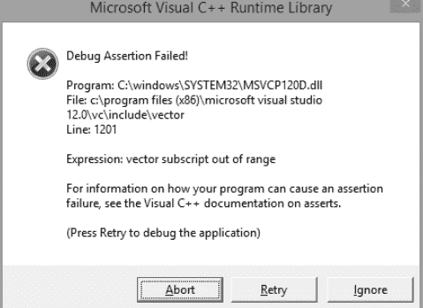

**图 15.1：** 在 Windows 上生成的断言失败消息。

如果你单击 `Retry`（重试），将弹出另一个窗口，询问你是否要中断或继续。“中断”仅意味着暂停代码的执行，以便你可以在调试器中查看它。这正是我们要做的，所以选择 `Break`（中断）。

现在你的程序执行已暂停，你可以使用 Visual Studio 查找导致错误的原因。显示中最有趣的部分是一个标记为 `Call Stack`（调用堆栈）的窗口。它应该如图 15.2 所示。

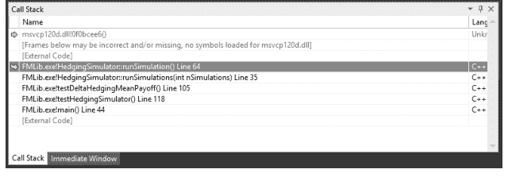

**图 15.2：** FMLib 中第一个 bug 处的调用堆栈。

调用堆栈显示了哪些函数正在执行。调用堆栈的倒数第二行告诉我们函数 `main` 正在执行。它当前位于第 44 行，此时调用了 `testHedgingSimulator`。你可以看到这一点，因为这在调用堆栈的倒数第三行。函数 `testHedgingSimulator` 调用了 `testDeltaHedgingMeanPayoff`。以此类推，可以看到在检测到错误时所有尚未完成处理的函数。

调用堆栈的最顶部显示为灰色。这是因为这些代码行没有可用的调试信息。原因是这些代码位于一个未以调试模式编译的库中，具体来说是 `vector` 库。

分析堆栈跟踪的最有效方法是从上到下。你应该向下查看调用堆栈，直到看到一些你编写的代码。那里就是 bug 最可能发生的位置。在这种情况下，它是 `HedgingSimulator` 中 `runSimulation` 函数的第 64 行。

如果你在调用堆栈中双击相关行，它会调出该行代码供你检查。

```c++
double S = pricePath[nSteps];
```

通过查看相邻代码，问题的原因应该变得相当明显。我们正在访问 `pricePath` 在索引 `nSteps` 处的元素，但实际上价格路径长度仅为 `nSteps`。我们看到代码实际上应该写为：

```c++
double S = pricePath[nSteps - 1];
```

要修复此问题，首先按 `Shift + F5` 停止调试器。现在修正代码并通过按 `F5` 再次运行。你会发现现在发生了另一个错误。这是因为我们修复了 FMLib 中的第一个 bug，但还有两个 bug 需要找到。

###### 15.2.2 Visual Studio 中的断点和单步执行

在调试器因我们的第二个 bug 暂停程序之前，控制台窗口中出现的打印输出应类似于以下内容：

```
Calling testDeltaHedgingMeanPayoff()

ASSERTION FAILED

Expected -5.90148e+300

Actual 0

hedging simulator.cpp:106:
```

除最后一行外，所有这些打印输出都是由我们的测试库生成的。它告诉我们，`ASSERT_APPROX_EQUAL` 语句在 `HedgingSimulator.cpp` 的第 106 行失败。

如果我们在文本编辑器中查看该代码，我们会看到在运行 `testDeltaHedgingMeanPayoff` 时出现了问题。

```c++
static void testDeltaHedgingMeanPayoff() {
    rng("default");
```


```cpp
HedgingSimulator simulator;
simulator.setNSteps(1000);
vector<double> result
        = simulator.runSimulations(1);
ASSERT_APPROX_EQUAL(result[0], 0.0, 0.01);
}
```

我们可以看到，尽管预期对冲模拟的损益（PnL）大约为零，但实际上却是一个荒谬的大数 $-5.90148 \times 10^{300}$。显然，我们 `HedgingSimulator` 类中的 `runSimulations` 函数存在数学错误。在这种情况下，如果你使用调试器在此处中断执行并查看调用栈，你会发现它并没有揭示任何我们此前未能推断出的新信息。

为了进一步取得进展，首先要做的是通读 `runSimulations` 的代码，看看是否存在明显的问题。代码如下：

```cpp
std::vector<double>
HedgingSimulator::runSimulations(int nSimulations)
    const {
    std::vector<double> ret(nSimulations);
    for (int i = 0; i < nSimulations; i++) {
        ret[i] = runSimulation();
    }
    return ret;
}
```

这段代码中没有实际的数学计算，因此问题似乎不太可能出在这里。看起来 `runSimulation` 方法才是问题的根源。你可以在第 265 页的图 15.4 中看到该方法代码。

即使你逐行阅读这段代码，也很难发现其中的错误。调试器可以帮助解决这一问题，因为它允许你在任何位置暂停执行，并打印出你感兴趣的任何变量的值。

为了做到这一点，你应该先退出调试器。在重新运行之前，我们需要插入一个新的“断点”。这只是一个希望调试器暂停程序执行的位置，以便我们可以观察正在发生的事情。

你应该打开文件 `HedgingSimulator.cpp`，并在窗口右侧边缘第 39 行 `HedgingSimulator` 开始的地方点击。你需要点击图 15.3 中边缘显示球体的那个位置。如果你点击了正确的位置，一个代表断点的红色球体会出现。

创建断点后，当你下次通过按 `F5` 运行代码时，调试器将在断点处暂停执行。

现在，你可以通过按 `F10` 逐行跟踪代码中的执行过程。你可以在菜单中找到此命令，即“调试 → 单步过（Step Over）”。

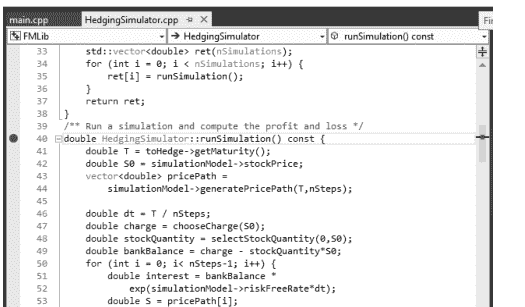

**图 15.3**：插入断点。断点在源代码边缘显示为一个球体。你可以看到第 40 行的球体。在边缘点击即可添加或移除断点。

每次按 **F10** 时，下一行代码将被执行。通过查看显示屏上标记为 *Locals*（本地变量）的区域，你可以看到这对局部变量值的影响。

如果你逐行单步执行代码，你应该能看到利息计算是不正确的。一旦找到问题，你应该停止调试器并重新测试代码，直到 `testDeltaHedging-MeanPayoff` 通过为止。

完成上述步骤后，代码中仍会留下一个故意设计的错误。修复这个错误将留作练习。

### 15.3 使用 GDB 进行调试

`GDB`（Gnu Debugger）是一个免费的调试器，也是 Unix 系统上使用的标准调试器。如果你在 Windows 上工作，应该跳过本节并阅读第 15.4 节。

`GDB` 拥有命令行界面，其用户友好性并不特别高。实际上，如果你在 Unix 上开发 C++，可能会考虑使用某种“GDB 前端”，以使其更易于使用。例如，你可以将 `GDB` 与流行的文本编辑器（如 `vim` 和 `emacs`）集成。也有可用的集成开发环境，例如 `Eclipse`。然而，我们将只讨论如何从命令行使用 `GDB`。

要使用 `GDB`，你必须做的第一件事是确保使用 `gcc` 的调试选项编译了你的代码。如果你使用的是我们的标准 `Makefile`，这将自动完成。`CFLAGS` 变量在 `Makefile` 中使用了 `-g` 和 `-D_GLIBCXX_DEBUG` 标志，正是出于这个原因。如果你对调试不感兴趣，而是希望代码运行得尽可能快，你应该移除这些选项，并替换为适当的优化选项。

#### 15.3.1 使用 GDB 获取堆栈跟踪

使用 `GDB` 最重要的用途是找到包含错误的代码行。`FMLib15` 包含一些故意的错误。让我们看看如何使用 `GDB` 快速找到这些第一个错误的根本原因。

一旦你编译了 `FMLib15`，你应该在 Unix shell 中输入以下命令，在调试器中运行它。

```bash
gdb FMLib
```

注意，我们假设 `gdb` 在你的路径中，并且当前工作目录包含 `FMLib15`。

`GDB` 将启动并进入一种你可以输入命令来告知 `GDB` 你希望它在本次调试会话中如何操作的状态。例如，你可能想要输入命令来告诉它在程序的特定行暂停执行，或者在特定错误发生时暂停执行。一旦你输入了这些命令，你将输入命令 `run`，你的程序将在调试器中执行。

我建议至少在执行 `run` 命令之前，给调试器输入以下指令：

- (i) 告诉调试器，如果任何代码调用了 `abort` 函数（该函数终止 C++ 程序的执行），则暂停执行。通过输入以下命令完成：

```bash
break abort
```

- (ii) 告诉调试器，如果执行了 `throw` 语句，则暂停执行。通过输入以下命令完成：

```bash
catch throw
```

除了在这些事件发生其中之一时暂停外，当你的代码发生某些错误时，`GDB` 也会暂停。例如，如果你尝试访问程序没有权限访问的内存，将会发生段错误（segmentation fault）。当这种情况发生时，`GDB` 会自动暂停，无需你进一步配置 `GDB`。

输入上述命令后，键入 `run`。这将执行 `FMLib`，直到发现第一个错误为止。随后执行将暂停。

以下是我在我的电脑上使用 `gdb` 运行 `FMLib` 时出现的打印输出的末尾部分：

```
Calling testPutCallParity()
testPutCallParity() passed.
Calling testDeltaHedgingMeanPayoff()
/usr/lib/gcc/x86_64-pc-cygwin/5.3.0/include/c++/debug/vector :406:error:
	 attempt to subscript container with out-of-bounds index 1000, but container only holds 1000 elements.
Objects involved in the operation:
sequence "this" @ 0x0xfffffc7a0 {
    type = NSt7__debug6vectorIsaIdEEE;
}

Breakpoint 1, 0x000000018012c574 in abort () from /usr/bin/cygwin1.dll
(gdb) backtrace
#0  0x000000018012c574 in abort () from /usr/bin/cygwin1.dll
```

前三行是由 `FMLib` 本身打印的。它们告诉我们，函数 `testPutCallParity` 运行正常，但函数 `testDeltaHedgingMeanPayoff` 中发生了问题。要看出这一点，只需注意到我们有一条日志语句表明 `testPutCallParity` 已通过，但没有对应的语句表明 `testDeltaHedgingMeanPayoff` 通过。

下一个错误告诉我们，该错误是在名为 `vector` 的 C++ 文件的第 406 行检测到的。这并不意味着 bug 在 `vector` 文件中，只是它在那里被检测到。由于 `vector` 是标准 C++ 库的一部分，它包含 bug 的可能性极小。我们可以猜测，是我们的代码中使用的 `vector` 出了问题。

接下来的几行非常难以解读，对目前而言也没什么太大用处。让我们忽略它们，转向最后一行。这告诉我们执行停止在了 `Breakpoint 1`。这意味着它是由于我们之前输入的 `break abort` 命令而停止的。有帮助的是，最后一行提到它停止在函数 `abort()` 中。不太有帮助的是，该行还告诉了我们 `abort` 函数所在的库及其内存地址。

要了解正在发生的事情的更多细节，输入命令

```bash
backtrace
```

此命令告诉调试器打印当前堆栈的状态。这只是一个当前正在运行的函数列表。在堆栈底部你会看到程序的 `main` 方法，在顶部你会看到当前正在执行的函数。以下是我在我的电脑上运行 `backtrace` 时的打印输出。

#### 15.3.2 使用 GDB 进行断点和单步调试

在调试器暂停程序之前，打印输出现在应该如下所示：

```
Calling testDeltaHedgingMeanPayoff()

ASSERTION FAILED

Expected -5.90148e+300

Actual 0

HedgingSimulator.cpp:106:

Catchpoint 2 (exception thrown), 0x00000003f512a787 in cygstdc++-6!
_ZNSt15__exception_ptr9operator()EPSt0
() from /usr/bin/cygstdc++-6.dll
```

除了最后一行以外的所有打印输出都是由我们的测试库生成的。它告诉我们，在 `HedgingSimulator.cpp` 的第 106 行，一个 **ASSERT_APPROX_EQUAL** 语句失败了。

如果我们在文本编辑器中查看该代码，我们会发现运行 **testDeltaHedgingMeanPayoff** 时出现了一个问题。

```cpp
static void testDeltaHedgingMeanPayoff() {
rng("default");
HedgingSimulator simulator;
simulator.setNSteps(1000);
vector<double> result
= simulator.runSimulations(1);
ASSERT_APPROX_EQUAL(result[0], 0.0, 0.01);
}
```

我们可以看到，我们期望对冲模拟的损益（PnL）大约为零，但事实上它却是一个极其大的数值 $-5.90148 \times 10^{300}$。显然，我们 `HedgingSimulator` 类中的 **runSimulations** 函数存在数学错误。不幸的是，在这种情况下，如果在 **gdb** 中运行 **backtrace** 命令，它不会提供太多额外信息。

为了进一步取得进展，首先要做的是通读 **runSimulations** 代码，看看是否有明显的问题。以下是代码：

```cpp
std::vector<double>
HedgingSimulator::runSimulations(int nSimulations)
const {
     std::vector<double> ret(nSimulations);
     for(int i = 0; i < nSimulations; i++) {
         ret[i] = runSimulation();
     }
     return ret;
}
```

这段代码中没有实际的数学计算，因此这似乎不太可能是问题所在。`runSimulation` 方法似乎是一个不错的猜测，它是问题所在。你可以在第 265 页的图 15.4 中看到该方法代码。

你可能会发现很难在这段代码中找出 bug，即使你逐行阅读。调试器可以帮助你，它允许你在任意点暂停执行并打印出你感兴趣的任何变量的值。

为此，你应该退出调试器并重新启动。但这次在执行运行命令之前，请输入命令

```bash
break HedgingSimulator::runSimulation
```

这将在 `runSimulation` 函数的开始处暂停执行。

当程序暂停时，你会看到类似以下的输出。

```
Calling testDeltaHedgingMeanPayoff()
Breakpoint 5, HedgingSimulator::runSimulation (this=0xffffc920)
 at HedgingSimulator.cpp:41
 41     double T = toHedge->getMaturity();
```

这表明执行已暂停在 `HedgingSimulator.cpp` 的第 41 行。给定的代码行尚未执行。要执行它，请输入 `next`。

这应该已经为局部变量 `T` 分配了一个值。要查看分配的值，请输入 `print T`。

现在你可以逐行单步执行 `runSimulation` 函数，检查沿途变量的值。你应该能够确认 `runSimulation` 函数中的利息计算存在问题，然后你应该能够修复它。

代码中仍然有一个 bug 未解决。修复它留作练习。

#### 15.3.3 其他命令和功能

让我们简要介绍一些我们没有涵盖的有用 `GDB` 功能。

1. 可以使用命令 `help` 来查找其他有用命令的名称。
2. 可以使用命令 `step` 来跟踪代码执行进入其他函数。相比之下，`next` 始终在单个函数内部移动。
3. 你可以在主目录中创建一个名为 `.gdbinit` 的文件，其中包含 `gdb` 启动时应始终执行的命令。下面展示了一个简单的示例文件，它确保 `gdb` 总是在调用 `abort` 和 `throw` 语句时暂停：

```
set breakpoint pending on
break abort
catch throw
```


当然，GDB 还有许多其他有趣的功能，我们没有涵盖。你应该查阅文档。

## 15.4 其他开发工具和实践

调试器绝非你唯一应该用来帮助开发和维护代码的工具。在本节中，我们将简要回顾一些可用的重要开发工具类型，你应该考虑使用它们。

### 15.4.1 版本控制

备份项目的源文件是必不可少的。如果我们丢失了项目的所有代码，那将是一场灾难！

源控制系统用于保存所有源文件的副本，以确保你永远不丢失它们。此外，源控制系统具有一些对于严肃软件开发至关重要的功能：

- (i) 你对每个文件所做更改的历史记录。这意味着如果你不小心引入了一个 bug，你应该总是有代码之前样子的记录。
- (ii) 用于标记代码特定版本的系统。如果你要给别人一个你软件的副本，你会确切地知道他们运行的是什么代码。通过标记源代码的每个版本，你可以确定你的用户实际运行的是什么代码。
- (iii) 工具使不同的开发人员可以在同一个项目甚至同一个文件上工作，而不会互相妨碍。通常开发人员各自在其代码副本上进行开发，并定期与其他开发者的更改进行整合。版本控制系统提供了工具，用于自动合并文件，并生成不同开发者代码副本之间差异的报告。
- (iv) 工具，以便能够为你的系统创建补丁。开发者通常致力于添加新功能，但当出现错误时，他们需要快速打补丁，而无需测试所有新功能。
- (v) 安全性，确保只有授权用户才能查看和编辑你的代码。

任何严肃的软件项目都会使用版本控制。你应该在项目中采用某种形式的版本控制，这样你至少拥有变更的完整历史记录，并能定期备份。

一个流行且免费的版本控制系统叫做 `Git`。它允许你使用 `GitHub` 和 `Bitbucket` 等服务将数据存储到云端。其优势在于，数据备份等问题将由这些服务为你处理。

令一些大型银行感到尴尬的是，他们在项目中竟然忘记使用版本控制！就在 2012 年，我还知道有一家大型银行拥有一个正在运行的系统，由于丢失了源代码，他们无法修改或理解该系统。这不仅是令人尴尬的，更是一个巨大的运营风险。如果发生错误，该银行该怎么办？

### 15.4.2 Bug 跟踪

在任何现实系统中发生错误时，都应将它们记录在 bug 跟踪数据库中。除了记录 bug，你还应记录增强软件的请求。

Bug 跟踪系统会记录系统中的 bug、修复时间、谁测试了它们等信息。

在简单的项目中，人们可能认为一发现 bug 就应该立即修复，但实际上并不总是可行。例如，发生在客户计算机上的 bug 可能很难复现，在这种情况下，你除了记录详细信息并表示将持续关注该问题外，别无选择。

对于较大的系统，用于帮助记录 bug 的工具是必不可少的。特别是，它允许你确定工作的优先级，并专注于最紧迫的问题。Bug 数据库对于保持客户满意也至关重要。客户可以使用它来记录投诉，并监视你解决他们问题的进展。

### 15.4.3 测试框架

在这本书中，我们强调了测试代码的重要性。

我们引入了一个简单的单元测试框架。在实践中，你可能会考虑使用更复杂的测试框架。例如，你可能希望使用与调试器紧密集成的测试框架，这样每当发生错误时，你就可以跳转到正确的代码行。另一个有用的功能可能是一个在线报告，显示当前有多少测试正在运行，以及有多少通过和失败。

一些你可能考虑的测试框架包括 `Unit Test++`、`Boost` 库的测试框架 `Boost.Test`，以及微软为 `Visual Studio` 提供的单元测试框架。

### 15.4.4 自动化构建

你应该能够使用一条命令来构建、测试和部署所有代码。

在这本书中，我们为你自动化了编译代码和运行测试的过程。

如果你使用的是 `Visual Studio`，我们已经向你展示了如何配置项目，以便你可以按 `CTRL+F5` 编译并运行它。如果你在 Unix 上工作，你可以通过输入 `make` 来构建项目，然后输入项目名称来执行它。

在处理较大的项目时，你应确保保持类似程度的简单性。对于较大的项目，这一点并不容易，因为它们通常被划分为多个库。你将需要确保可以单独构建每个库，或者一次性构建所有库。你将希望能够为代码运行的每个操作系统构建代码。你还将希望能够构建所有代码的调试版本和发布版本。此外，你的一些代码实际上可能由你编写的其他程序自动生成。

然而，拥有一套简单的流程至关重要，原因如下。

- 重新从源代码重建软件应基本上是一个自动过程。如果存在必须有人遵循的书面说明，就有风险它们不会被正确执行，最终你会发布无法重建的软件。
- 测试系统应该快速且容易。新加入你系统的开发者应该能够轻松构建并测试它。如果测试你的系统很困难，你就不会经常测试它。这意味着它将充满 bug。

在 Windows 上，`Visual Studio` 包含各种工具来帮助自动化构建。还有许多开源工具可用于任何操作系统，例如 `make`、`Boost build`、`cmake` 和 `Ant`。

### 15.4.5 持续集成

持续集成是一种开发实践，其中参与软件项目的每个人都定期（通常每天多次）将其代码与其他开发者的工作进行整合。这样做的优势在于，由不同人的工作交互引起的问题能被及早发现。即使是在几个小时前改变软件的方式都很难记住，因此如果不定期整合代码，合并代码会变得非常具有挑战性。

为了让持续集成发挥作用，完全自动化构建并在每次更改时运行是至关重要的。为此，你可以使用持续集成服务器。持续集成服务器将会：

- 检查你的版本控制系统，查看何时发生了更改；
- 自动运行构建；
- 如果构建停止工作，发送电子邮件，说明是谁的更改导致了此问题。

即使对于自己项目的开发者，拥有一个系统来检查每次更改后所有代码是否正常工作也是非常有用的。在你引入错误时立即发现它们，远好于事后发现。

### 15.4.6 日志记录

日志语句是理解代码中发生情况的一种非常有用方式。然而，如果你有太多的日志语句，就很难看清全貌（“只见树木，不见森林”）。此外，过多的日志记录会极大地拖慢程序速度。

在代码中使用大量日志语句是个好主意，但需要有一些机制来增加或减少程序运行期间发生的日志记录量。除了能够记录开发代码时发生的情况日志外，在你的代码运行时记录一些代码正在做什么的日志也是一个好主意。这样，如果有人发现 bug，他们可以发送日志文件给你，帮助你开始调试。

一个非常有用的功能是能够单击日志文件中的一行，然后跳转到源代码中的那一行。只要使用你的环境能够理解的格式输出错误消息，许多文本编辑器和集成开发环境都可以做到这一点。你应该查阅所选开发环境的文档。

你可以用于执行日志记录的工具包括 `Boost` 库的 `Boost.Log` 和 Apache 的 `log4cxx`。

### 15.4.7 静态分析

`C++` 代码中有很多 bug 可以自动检测。

我们使用的构建配置除了 `C++` 要求的检查外，还对我们的代码进行额外的检查。特别是，我们配置了构建，如果存在编译器警告则构建失败。我们还设置了警告级别，以便自动捕获许多常见的 `C++` bug。

通过查看代码来寻找 bug 的过程称为*静态分析*。相比之下，*动态分析*将检查代码实际运行时会发生什么。

你可能希望使用比本书中更多的静态分析。可以让编译器执行比我们所做更高水平的静态分析。危险在于编译器可能会发现一些误报。换句话说，编译器可能会拒绝接受你明知不含任何 bug 的代码。当这种情况发生时，所有编译器都提供暂时禁用警告的方法，以便你可以忽略这些误报。在实践中，使用更多警告并在必要时禁用它们是的好主意。

例如，编写一个没有虚析构函数的类是合法的 `C++` 代码。因此，编译器不会在你省略虚析构函数时提出警告。然而，在实践中，如果你扩展了一个没有虚析构函数的类，你的代码很可能包含内存泄漏。因此，如果你的编译器允许这样做，你应该要求它在每次扩展没有虚析构函数的类时发出警告。在极少数你知道这不是问题的情况下，你可以抑制该警告。

### 15.4.8 内存泄漏检测

使用普通的单元测试很难检测内存泄漏。原因是，内存泄漏通常只在软件运行相当长的时间后才会成为问题。

一个良好的 `C++` 单元测试框架应该通过检查每个测试前后使用的总内存是否保持不变来帮助解决此问题。此外，还有许多工具可以帮助检测你软件中的内存泄漏。

### 15.4.9 性能分析工具

如果你的软件存在性能问题，那么*性能分析*工具可以帮助你。这些工具允许你了解计算机在执行代码的不同部分时花费了多少时间。然后，你可以将提高性能的努力集中在实际造成问题的代码区域。

许多初学者程序员犯的一个错误是假设所有代码都对性能敏感。这完全不正确。如果你使用性能分析器，你会发现大部分（或许 99% 或更多）的 CPU 努力都只花在执行少数几个对性能至关重要的函数上。这意味着如果你几乎优化任何其他函数的性能，你的努力都将白费！

在进行任何认真的代码优化之前，建议你先对代码进行性能分析（profile）。

除非你的性能需求非常精确，否则你可能不需要购买单独的软件来对代码进行性能分析。一种简单的方法是执行那段慢速代码，然后随机停止处理十次并记录当时正在发生的事情。你很可能发现每次停止时，代码都在做几乎相同的事情。你可以安全地推断出这就是性能问题所在。

重要的是要说明，本书关于编写高质量 `C++` 代码，但并非关于编写绝对最优性能的 `C++` 代码。对于大多数问题，代码正确执行比以人类极限速度执行更为重要。在大多数情况下，牺牲一些速度以换取良好代码的其他品质（如易于理解、阅读和扩展）是值得的。

唐纳德·克努斯（Donald Knuth），这位荣获 prestigious 图灵奖（Turing Prize）的著名编程专家，曾说过一句名言：“过早优化是万恶之源。”

### 15.4.10 示例

本书的构建过程很复杂。文本使用 `LaTeX` 编写，并引用了多个不同项目中的各种 `C++` 文件。每次对该书进行修改时，所有 `C++` 代码都会在 Windows 和 Unix 上进行编译和测试。此外，还有测试用于检查 `LaTeX` 文档中显示的所有代码是否与计算机项目中的 `C++` 代码匹配。最后，将所有代码示例和文本发布到网站的过程是完全自动化的。

如果没有自动构建，这本书将充斥着（更多）错误。所有代码都包含 bug，毫无疑问，这本书也包含许多错误。然而，自动构建确保了最严重的问题能被快速消除。

## 练习

1. 找出并修复 `FMLib15` 中的所有 bug。
2. 尝试在没有调试信息的情况下运行 `FMLib`，并使用优化后的机器代码代替。

你可以通过在 `Visual Studio` 的菜单栏中选择 `Release`（发布）选项来实现这一点。此外，对于专家而言，项目配置选项提供了大量配置参数，其中许多可用于调整性能。

在 Unix 上，你应该从 `Makefile` 中移除调试选项 `-g` 和 `-D_GLIBCXX_DEBUG`，并将它们替换为 `-O` 以进行优化。然后你应该运行 `make clean`。每次你更改 `make` 文件中的选项时，都应该运行 `make clean`。还有各种更复杂的优化选项可以使用。请参阅 `gcc` 的文档。

这对程序运行速度有多大影响？你可能希望更改 `testPlotDeltaHedgingHistogram` 中的步数，使代码变慢，以便更容易看出任何差异。

### 15.5 摘要

调试器是一个寻找代码中错误位置的有用工具。调试器的两个重要用途是：

- 在发生错误时获取堆栈跟踪；
- 逐行单步执行代码以查看发生的情况。

虽然调试器是有用的工具，但它们不能替代单元测试。相反，它们是一种互补的开发技术。

在编写软件时，你应该使用一些工具和技术。其中包括版本控制和 bug 数据库。调试和维护代码的技能至少与最初编写代码的技能同样重要。虽然我们尚未深入探讨这些问题，但书籍 [5] 和 [1] 讨论了软件开发中超越简单编码的重要方面。

```cpp
double HedgingSimulator::runSimulation() const {
    double T = toHedge->getMaturity();
    double S0 = simulationModel->stockPrice;
    vector<double> pricePath = simulationModel->generatePricePath(T, nSteps);
    double dt = T / nSteps;
    double charge = chooseCharge(S0);
    double stockQuantity = selectStockQuantity(0, S0);
    double bankBalance = charge - stockQuantity*S0;
    for (int i = 0; i< nSteps-1; i++) {
        double interest = bankBalance * exp(simulationModel->riskFreeRate*dt);
        double S = pricePath[i];
        double date = dt*(i + 1);
        double newStockQuantity = selectStockQuantity(date, S);
        double costs = (newStockQuantity - stockQuantity)*S;
        bankBalance = bankBalance + interest - costs;
        stockQuantity = newStockQuantity;
    }
    double interest = bankBalance * exp(simulationModel->riskFreeRate*dt);
    double S = pricePath[nSteps];
    double stockValue = stockQuantity*S;
    double payout = toHedge->payoff(S);
    return bankBalance +interest +stockValue - payout;
}
```

**图 15.4：** 模拟 delta 对冲的有 bug 代码。肉眼可能很难发现其中的错误。

http://taylorandfrancis.com

# 第 16 章

## 矩阵类

`C++` 没有内置的表示实数矩阵的类。我们将在本章中编写自己的类。

在编写 `Matrix` 类的过程中，我们将涵盖一些有趣的 `C++` 主题。具体包括：

- 构造函数和析构函数，
- 运算符重载，
- 规则三（rule of three），
- 返回引用，
- 使用 `const` 进行重载。

### 16.1 矩阵的基本功能

让我们开始设计矩阵类的基本行为。`Matrix` 类将存储一个二维 `double` 数组，并具有以下数据成员（均为私有）。

- (i) `int` `nrows`。行数。
- (ii) `int` `ncols`。列数。
- (iii) `double*` `data`。指向第一个单元格的指针。
- (iv) `double*` `endPointer`。指向最后一个单元格之后的指针。

指针 `data` 将指向一个长度为 `nrows×ncols` 的单个内存块。单元格 `$(i,j)$` 将存储在位置 `data+(j*nRows)+i`。注意我们在最后一个表达式中使用了指针算术。

我们决定使用指针和 `new` [] 运算符而不是 `vector`，因为最终如果你想使用特殊的 CPU 优化（我们将在 16.7 节中讨论），你需要一个指向数据的指针，而不仅仅是一个 `vector` 对象。此外，这使得该 `Matrix` 类成为测试你指针编程技能的好方法。

以下是 `Matrix` 数据成员的声明。

```cpp
private:
/* 矩阵中的行数 */
int nrows;
/* 列数 */
int ncols;
/* 矩阵中的数据 */
double* data;
/* 指向数据结束位置之后的指针 */
double* endPointer;
```

我们的矩阵类将允许用户读取行数和列数，但不允许修改它们。因此，我们在头文件中添加以下数据访问方法：

```cpp
/* 矩阵中的行数 */
int nRows() const {
    return nrows;
}
/* 矩阵中的列数 */
int nCols() const {
    return ncols;
}
```

这些方法是内联的——也就是说，我们在类声明内部编写函数定义。由于我们将大量使用 `Matrix` 类，充分利用一些内联化是很重要的。

我们已经说过，单元格 `$(i, j)$` 的值存储在内存位置 `data+(j*nRows)+i` 中。让我们提供 `get` 和 `set` 函数，以便用户可以读取给定单元格的值并更改单元格的值。

```cpp
/* 检索给定索引处的值 */
double get( int i, int j ) const {
    return data[ offset(i, j) ];
}
/* 设置给定索引处的值 */
void set( int i, int j, double value){
    data[ offset(i, j) ] = value;
}
```

这两个函数都利用了函数 `offset`。该函数计算相对于 `data` 点，单元格 `$(i, j)$` 在内存中存储的位置。

```cpp
int offset( int i, int j ) const {
    ASSERT( i >=0 && i<nrows && j>=0 && j<ncols );
    return j*nrows + i;
}
```


你会注意到，这段代码执行了一个 `ASSERT` 语句，检查坐标是否在矩阵范围内。这对于调试非常有用，因为它可以快速发现许多 bug。然而，如果你知道你的代码没有 bug，为了获得最大速度，你希望确保这个 `ASSERT` 语句永远不会被调用。我们的测试宏 `ASSERT` 设计为仅在调试模式下被调用。

### 16.2 矩阵的构造函数和析构函数

`Matrix` 最重要的构造函数具有以下声明：

```cpp
Matrix( int nrows, int ncols, bool zeros=1 );
```

正如我们将看到的，初始化 `Matrix` 的内容往往是浪费精力。另一方面，不初始化变量是一个常见的 bug。因此，我们允许用户声明是否希望我们的 `Matrix` 初始化为零。默认情况下，它初始化为零。这应该可以防止意外 bug，但允许在需要时对代码进行优化。

以下是构造函数的定义：

```cpp
Matrix::Matrix( int nrows, int ncols, bool zeros )
    : nrows( nrows ), ncols( ncols ) {
    int size = nrows*ncols;
    data = new double[size];
    endPointer = data+size;
    if (zeros) {
        // memset 是一个优化的底层函数
        // 应该比循环更快
        memset( data, 0, sizeof( double )*size );
    }
};
```

这是我们在构造函数中需要进行大量工作的第一个示例。最重要的特性是我们使用 `new []` 创建内存存储。然后根据需要将其初始化为零，使用 `memset`。

`memset` 是一个标准 C 函数，可用于将大量数据初始化为相同的值。调用它可能比写循环更快，因为 CPU 通常有针对此类重复任务的特殊指令。我们将在 16.7 节中对此进行更多讨论。

使用 `new[]` 运算符会带来一个问题。`delete[]` 何时会被调用？我们需要确保当 `Matrix` 本身从内存中移除时，有人调用 `delete[]`。

我们的 `Matrix` 会在以下情况下从内存中移除：
- (i) 如果 `Matrix` 是由 `new` 创建的，那么当调用 `delete` 时，它将从内存中移除。
- (ii) 如果 `Matrix` 是由 `new[]` 创建的，那么当调用 `delete[]` 时，它将从内存中移除。
- (iii) 如果 `Matrix` 是在栈上作为局部变量创建的，那么当该局部变量不再需要时（即超出作用域时），它将从内存中移除。
- (iv) 如果 `Matrix` 是另一个对象的成员变量，那么当包含它的对象被删除时，这种情况会发生。

我们需要一个在这些精确情况下被调用的函数。这就是析构函数（Destructor）的作用。

要为你的类编写析构函数，必须遵循以下规则。
- (i) 析构函数的声明和定义方式与函数类似，除了...
- (ii) 它的名称必须与类名相同，只是多了一个波浪号 `~`。
- (iii) 它必须没有返回值（甚至不能是 `void`）。
- (iv) 它必须没有参数。
- (v) 它不能是 `const`。

以下是 `Matrix` 的析构函数。它是内联的（inline），因此我们在头文件中既声明了它也定义了它。

```cpp
~Matrix() {
    delete[] data;
}
```

你不必让析构函数内联，如果愿意，你可以编写单独的声明和定义，例如：

```cpp
// declaration
class Matrix {
public:
    ...
    ~Matrix();
};
```

```cpp
// definition
Matrix::~Matrix() {
    delete[] data;
}
```

在使用析构函数时，你必须遵守某些规则。

> **危险！**
> 你希望作为子类化的所有类都应该有一个虚析构函数。¹

> **危险！**
> 只要编写了除空的虚析构函数之外的任何析构函数，你就必须遵守*三法则*（rule of three）。我们将在第 16.5 节中介绍这一点。

你会注意到，我们的 `Matrix` 类没有 `virtual`（虚）析构函数，因此你不应该对其进行子类化。同样的规则也适用于许多标准类。例如，无论多么诱人，你都不应该子类化 `vector<double>`！

#### 16.2.1 虚析构函数

每个 C++ 类都有一个自动编写的析构函数。令人恼火的是，这个默认析构函数不是虚的。如果你的析构函数不是虚的，那么当某人尝试删除一个子类时，可能会调用错误的析构函数，从而产生危险。

要看看这是如何发生的，请回想一下 `CallOption` 是 `Priceable` 的子类。这意味着以下代码是有效的。

```cpp
Priceable* option = new CallOption;
delete option;
```

这里我们使用指向 `Priceable` 的指针来删除一个 `CallOption`。如果 `Priceable` 没有虚析构函数，C++ 就不会按照我们的意愿调用 `CallOption` 的析构函数。

虽然你不太可能编写上面的代码，但你很可能会将一个指向 `CallOption` 的指针保存在 `shared_ptr<Priceable>` 中。例如，我们的 `Portfolio` 类就是这样做的。`shared_ptr` 类只知道它持有一个 `Priceable` 引用，因此当它调用 delete 时，它调用的是定义在 `Priceable` 上的函数。

因此，如果你创建了一个没有虚析构函数的类的子类，由使用 `shared_ptr` 引发的 `delete` 调用将会导致问题。

不幸的是，在 C++ 中虚析构函数并不是默认行为。如果你给所有类都加上虚析构函数，你不会遇到太多麻烦。

拥有任何 `virtual`（虚）函数会使对象在汇编语言中更难编写。这是因为你需要同时在内存中携带对象的数据和关于其类型的信息。因此，没有任何 `virtual`（虚）函数的类会比有的类稍微快一点。所以，如果你的类不是设计用于子类化的，如果没有虚析构函数，它会稍微快一点。对于大多数类来说，这种优化并不显著。

> **提示：虚析构函数**
> 如果拿不准，就给类加上一个虚析构函数。

#### 16.2.2 何时需要析构函数？

正如我们反复强调的，每当编写一个设计用于子类化的类时，你都需要编写一个 `virtual`（虚）析构函数。

但是，何时需要编写一个更有意义的析构函数？

一种情况是，当你在构造函数中调用了 `new` 或 `new[]` 而没有使用 `shared_ptr` 来存储结果时。更一般地说，当你在构造函数中获取了一个资源，并且必须在析构函数中释放它时，你应该编写一个析构函数。

“资源”这个词相当模糊，但这里有一些资源的例子：
- 一块内存；
- 文件的锁定，防止其他人写入该文件；
- 一个你启动的打印作业；
- 一个数据库连接。

资源是你在使用完毕后必须显式归还给计算机的东西。

在数学代码中，使用资源是相当罕见的。因此，大多数时候你根本不需要编写析构函数（除了一个空的虚析构函数）。特别是：
- 按值持有的成员变量会自动删除；
- 由 `shared_ptr` 持有的成员变量会自动删除。

这意味着，除非你无视避免使用指针的建议，否则你可能不需要编写析构函数，除非你试图与某些强制你手动管理资源的代码交互。实际上，这意味着你可能只有在希望直接与 C 库交互时才需要编写析构函数。

例如，如果我们没有决定编写使用原始指针的 `Matrix`，我们就没有必要给它一个析构函数。

#### 16.2.3 额外的构造函数

到目前为止，我们只讨论了 `Matrix` 的一个构造函数。`Matrix` 类旨在真正实用，因此它有多个其他构造函数：
- 一个默认构造函数，创建一个包含数字零的 `$1 \times 1$` 矩阵。
- 一个接受 `std::vector<double>` 并构建相应列向量的构造函数。它有一个可选的额外参数，如果你想要创建一个行向量，可以使用它。
- 一个接受单个标量并创建 `$1 \times 1$` 矩阵的构造函数。
- 一个接受描述矩阵内容的字符串的构造函数。

最后一个构造函数很有趣，不是因为实现它具有挑战性，而是因为它是一种值得借鉴的有用设计模式。以下是如何使用字符串初始化矩阵的方法：

```cpp
Matrix m("1,2,3,4,5,6");
ASSERT( m.nRows() == 2 );
ASSERT( m.nCols() == 3 );
```

这使得构建新的矩阵以用于编写测试变得容易。这是一个好主意，让你的类可以容易地初始化和配置以便进行测试。

C++ 的另一个可以用来使创建矩阵更容易的功能是使用初始化列表。我们将在第 18.8 节中讨论这些内容。

我们没有展示这些额外的有趣构造函数所需的代码，因为它们不需要任何新的 C++ 语言特性。

虽然我们可能有很多构造函数，但类只有一个析构函数。

### 16.3 常量子指针

`Matrix` 类有 `begin()` 和 `end()` 方法，它们返回指向数据区域开始和结束的指针。

```cpp
/* Access a pointer to the first element */
const double* begin() const {
    return data;
}
/* Access a pointer to the element after last */
const double* end() const {
    return endPointer;
}
/* Access a pointer to the first element */
double* begin() {
    return data;
}
/* Access a pointer to the element after last */
double* end() {
    return endPointer;
}
```

其中一些方法返回“常量子指针”。回想第 11 章，你可以像使用引用一样在指针上使用 `const`。`const double* p` 意味着 `p` 指向一个 `double`，但你不能通过 `p` 改变所指向的值。因此，你可以把它想象成一个非常像 `const` 引用的东西。

我们的 `Matrix` 类有两个名为 `begin()` 的成员函数。对于 `const` `Matrix`，我们希望 `begin()` 返回指向数据的 `const` 指针。对于普通的 `Matrix`，我们希望 `begin()` 返回指向数据的普通指针。这将确保你不能通过获取 `Matrix` 内部数据的非 `const` 引用来绕过 `const` `Matrix` 的 `const` 特性。

为了确保 `begin` 函数返回正确类型的指针，我们需要两个 `begin` 函数。一个在 `const` `Matrix` 上调用，另一个在普通 `Matrix` 上调用。

像这样额外的工作在处理 `const` 时经常是必需的。不得不说，这是那种让你怀疑自己是在为编译器工作而不是编译器为你工作的场合之一。

¹ 一个吹毛求疵者实际上会说，任何你可能希望使用指向基类的指针来删除的类都应该有一个虚析构函数，否则就不需要虚析构函数。如果你遵循“所有打算子类化的类都应该有虚析构函数”的建议，你将自动遵循这条规则。

### 16.4 运算符重载

#### 16.4.1 重载 +

如果你能创建两个矩阵并像这样将它们相加，那岂不是太好了？

```cpp
Matrix m1("1,2,3;4,5,6");
Matrix m2("2,3,4;5,6,7");
Matrix actual = m1 + m2;
Matrix expected("3,5,7;9,11,13");
expected.assertEqual( actual, 0.001 );
```

通过重载 `+` 运算符，我们可以使这段代码编译通过。事实上，我们可以重载几乎每一个 C++ 运算符，从而让矩阵类更容易使用。

（顺便提一下，`assertEquals` 是 `Matrix` 上的一个辅助函数，用于检查两个矩阵是否在给定容差范围内相等。）

运算符重载的主要挑战在于写下正确的函数声明。

要重载 `+` 运算符，首先要注意，`+` 运算符需要接收两个参数，它们都是 `Matrix`。更准确地说，这些参数必须是 `Matrix` 的 `const` 引用。

其次，要注意 `+` 运算符本身返回一个包含矩阵加法结果的 `Matrix`。

因此，为了重载 `+` 运算符，我们需要编写一个函数，使用给定的参数和返回类型执行必要的计算。这个函数唯一特别之处在于它必须名为 `operator+`。

以下是来自 `Matrix.h` 的函数声明。

```cpp
/* Add two matrices
   NB - not a member function */
Matrix operator+(const Matrix& x, const Matrix& y );
```

请注意，这是一个顶层函数，而不是 `Matrix` 的成员函数。在本章中，当我们为运算符重载定义函数时，我们将通过注释明确标记那些是顶层函数的。所有成员函数将不附带注释。

定义相当直观：

```cpp
Matrix operator+(const Matrix& x, const Matrix& y ) {
   ASSERT( x.nRows()==y.nRows() && x.nCols()==y.nCols() );
   Matrix ret(x.nRows(), x.nCols(), 0 );
   double* dest = ret.begin();
   const double* s1 = x.begin();
   const double* s2 = y.begin();
   const double* end = x.end();
   while (s1!=end) {
      *(dest++) = *(s1++) + *(s2++);
   }
   return ret;
}
```

在理解这段代码时，你可能唯一会遇到的问题是关于指针惯用法的非常地道的用法。传统上，C 程序员在处理内存时编写此类非常紧凑的代码。让我们试着理解一下。

首先，回想一下 `*s1` 表示 `s1` 所指向的值。

接下来，注意 `*(s1++)` 表示计算 `s1` 所指向的值，*然后* 对 `s1` 进行自增。

因此，以下代码：

```cpp
*(dest++) = *(s1++) + *(s2++);
```

意味着将 `s1` 和 `s2` 所指向的值相加，并将结果存储在 `dest` 中。接下来，对 `dest`、`s1` 和 `s2` 进行自增。你觉得这段代码难以理解吗？嗯，它可以以更易于理解的方式编写为：

```cpp
*(dest) = *(s1) + *(s2);
dest++;
s1++;
s2++;
```

但以非常紧凑（且不可读？）的格式编写指针代码是相当标准的。使用你喜欢的任何一种方式即可。

额外的评论是，由于我们接收一个 `const Matrix` 作为 `operator+` 的参数，我们必须使用 `const double*` 来存储 `begin()` 的返回值。从现在开始，我们将不注释本章中所有其他 `const` 指针的使用。

作为另一个例子，我们将希望实现标量加法。这会将相同的标量添加到矩阵的每个单元格。以下是声明：

```cpp
/*  Add a scalar to every element of a matrix
    NB - not a member function */
Matrix operator+(const Matrix& m, double scalar );
```

以下是相应的实现。

```cpp
Matrix operator+(const Matrix& m, double scalar ) {
    Matrix ret(m.nRows(), m.nCols(), 0 );
    double* dest = ret.begin();
    const double* source = m.begin();
    const double* end = m.end();
    while (source!=end) {
        *(dest++) = *(source++) + scalar;
    }
    return ret;
}
```

事实上，我们也希望能够将矩阵加到标量上，因此我们还需要声明和定义 `operator+` 的这个版本。

```cpp
/* Add a scalar to every element of a matrix NB - not a member function */
inline Matrix operator+(double scalar, const Matrix& m ) {
    return m+scalar;
}
```


实现运算符重载所需的所有内容可能耗时，但它可以使类变得非常容易使用。

## 16.4.2 重载其他算术运算符

我们不必局限于重载 `+`，你还可以重载其他运算符。重载 `-` 与重载 `+` 非常相似。重载 `*` 也很简单，除了有两个可能的实现选择外。

如何重载 `*` 的选择是一个设计问题，而不是 C++ 语言的问题。对于 `*` 的含义，我们有两个选择：它应该表示矩阵乘法还是逐元素乘法？

让我们定义这些术语。设 $a_{ij}$ 是 $m \times r$ 矩阵 $a$ 的组件，$b_{jk}$ 是 $r \times n$ 矩阵 $b$ 的组件。$matrix\ multiplication$（矩阵乘法）的标准定义是，乘积 $ab$ 是一个 $m \times n$ 矩阵，其组件为

$$
(ab)^{\mathrm{matrix}}_{ik} = \sum_{j=1}^{n} a_{ij}b_{jk}.
$$

定义矩阵乘法形式的另一种可能方式是，如果 $a_{ij}$ 现在是 $m \times n$ 矩阵，$b_{ij}$ 也是 $m \times n$ 矩阵，那么 $entrywise\ product$（逐元素乘积）也是一个 $m \times n$ 矩阵，由以下公式给出：

$$
(ab)^{\mathrm{entrywise}}_{ij} = a_{ij}b_{ij}.
$$

此运算有时也被称为 Hadamard 乘积或 Schur 乘积。

如果你的矩阵之一表示线性变换，则矩阵乘法很有用。

如果你的矩阵仅代表数据点的集合，并且你想乘以某些数据点的值，则逐元素乘法很有用。

我们应该使用 `*` 来表示逐元素乘法还是矩阵乘法？这个问题没有正确答案。这是一个个人口味的问题。在 `FMLib16` 中，**Matrix** 有一个函数 `times`，因此 `a.times(b)` 表示逐元素乘法。我们将 `*` 保留用于矩阵乘法。我们实际上尚未在 `FMLib16` 中实现矩阵乘法，因为我们目前不需要它。实现它留作练习。我们目前不需要矩阵乘法的原因是因为我们希望在蒙特卡洛模拟中存储在矩阵中的数据表示简单的数据点。由于我们的矩阵不代表线性变换，普通的矩阵乘法没有你想象的那么有用。

**提示：明智地使用运算符重载**

如果得当使用，运算符重载可以使你的代码更容易阅读。如果滥用，会导致混淆。

C++ 在明智使用运算符重载方面并没有良好的记录。例如，C++ 重载了整数除法的 `/` 运算符，使其含义为除法并向下取整。大多数人觉得这令人困惑。即使是经验丰富的程序员也可能被此困扰。同样，C++ 重载了 `~` 运算符，使其含义为按位异或，而大多数人可能期望它表示幂运算。更糟糕的是，符号 `*` 和 `&` 在 C++ 中有许多可能的含义。这些问题都增加了学习 C++ 的不必要的障碍。

相比之下，带有名称的函数可以立即清楚地表达其含义。

## 16.4.3 重载比较运算符

重载 `>`, `>=`, `==`, `!=`, `<`, `<=` 很简单。以下是一个典型的声明。它接收两个 `const` 引用并返回一个由 0 和 1 组成的 `Matrix`。

```cpp
/* Comparison operator

 NB - not a member function */
Matrix operator>(const Matrix& x, const Matrix& s );
```

以下是使用此运算符的一个示例

```cpp
Matrix test1("1,2,3,4");
Matrix test2("3,3,3,3");
Matrix expected("0.0,0.0;1.0,1.0");
expected.assertEquals( test1>=test2, 0.001 );
```

同样，我们为 `operator>` 有许多不同的定义，以处理矩阵与标量的比较以及矩阵与矩阵的比较。

## 16.4.4 重载 `<<` 运算符

正如我们所知，像 `double` 这样的内置类型可以使用 `<<` 写入流。我们希望 `Matrix` 对象也能同样容易地打印出来。这可以通过重载 `<<` 运算符来实现。以下是所需的声明：

```cpp
/* Write a matrix to a stream NB - not a member function */
std::ostream& operator<<(std::ostream& out, const Matrix& m );
```

`operator<<` 始终将 `ostream` 作为其第一个输入。这是因为 `<<` 的左侧始终有一个流。

第二个参数在此情况下是一个 `Matrix`。这是因为这是我们想要打印的数据类型。

函数 `operator<<` 返回对 `ostream` 的引用，我们可以对其进行更多的写入。实际上，这将始终是我们作为参数 `out` 传入的同一个 `ostream`。

要了解为什么返回同一个流是有用的，请考虑以下代码：

```cpp
cout << "To be " << "or not to be";
```

我们已经多次编写过这样的代码。这段代码实际上等价于以下代码：

```cpp
(cout << "To be ") << "or not to be";
```

我们只是为了清晰起见添加了括号。你现在可以看到为什么 `operator<<` 返回流是有用的。我们返回一个流，准备好再次应用 `<<` 运算符。

`operator<<` 的实现很简单。唯一需要注意的是我们返回 `out`。

```cpp
ostream& operator<<(ostream& out, const Matrix& m ) {
    int nRow = m.nRows();
    int nCol = m.nCols();
    out <<"[";
    for (int i=0; i<nRow; i++) {
        for (int j=0; j<nCol; j++) {
            out << m(i,j);
            if (j!=nCol-1) {
                out << ",";
            }
        }
        if (i!=nRow-1) {
            out << ";";
        }
    }
    return out;
}
```

### 16.4.4.1 关于按引用返回的说明

我们已经看到，`operator<<` 通过引用返回一个值。到目前为止，我们一直避免按引用返回。

只要你不返回对局部变量的引用，按引用返回是可以接受的。按引用返回可以节省复制的开销，因此比按值返回更高效。因此，只要这样做是安全的，使用按引用返回就很有意义。此外，当你不知道如何复制数据时（例如对于多态类如 `ostream`），按引用返回是唯一的选择。

返回引用的一个影响是，接收该引用的人可以使用该引用来修改其所指向的内容。因此，有时你可能希望返回一个 `const` 引用，而不仅仅是一个简单的引用。

正如我们将在下一小节中看到的，有时我们特意使用按引用返回，正是因为允许调用者修改引用所指向的内容。

## 16.4.5 重载 `()` 运算符

我们希望能够像修改 `vector` 的元素一样轻松地修改 `Matrix` 的元素。为了实现这一点，我们可以重载 `()` 运算符，使你可以输入诸如 `m(1,2)` 这样的表达式来访问矩阵 `m` 中的指定行和列。下面是我们希望如何使用 `()` 运算符的一个示例：

```cpp
Matrix m("1,2,3;4,5,6");
ASSERT( m(1,2)==6 );  // 读取值
m(1,2)=0;  // 修改值
```

当你重载 `()` 运算符时，必须编写成员函数，而不是顶级函数。以下是重载 `Matrix` 类上的 `()` 运算符所需的定义。

```cpp
double& operator() (int i, int j ) {
    return data[ offset(i,j) ];
}
const double& operator() (int i, int j ) const {
    return data[ offset(i,j) ];
}
```

为了提高速度，我们把这些编写为内联函数。

由于 `operator()` 返回一个引用，你可以使用返回的引用来改变值。这就是使这行代码能够工作的原因：

```cpp
m(1,2)=0;  // 修改值
```

当然，你不应该能够以这种方式修改一个 `const Matrix`，因此我们需要编写两个版本的 `operator()`：一个作用于 `Matrix`，另一个作用于 `const Matrix`。

## 16.4.6 重载 `+=`

我们已经重载了 `+` 运算符。那么快捷赋值运算符 `+=` 呢？你也可以重载它。以下是必要的声明：

```cpp
Matrix& operator+=( const Matrix& other );
```

与 `operator()` 一样，`operator+=` 必须被声明为成员函数。当你重载如这样的赋值运算符时，你应该始终返回对 `*this` 的引用。例如，在我们的 `Matrix` 示例中，`+=` 返回你刚刚对其调用 `+=` 的 `Matrix`，方式与 `<<` 返回你传入的 `ostream` 完全相同。

这种约定的原因是它允许你编写如下的代码：

```cpp
Matrix a("1,2");
Matrix b("1,2");
(a+=b)+=b;
```

你可能会争辩说，你一开始就不想编写这样的代码！然而，在 C++ 中，当你重载赋值运算符时，这类构造应当是可行的约定俗成的做法。在编写代码时，最好遵循惯例。

以下是 `operator+=` 的实现：

```cpp
Matrix& Matrix::operator+=( const Matrix& other ) {
    ASSERT( nRows()==other.nRows()
          && nCols()==other.nCols());
    double* p1=begin();
    const double* p2=other.begin();
    while (p1!=end()) {
        *p1=(*p1) + (*p2);
        p1++;
        p2++;
    }
    return *this;
}
```

这段代码中值得注意的主要一点是，我们返回 `*this`，正如在实现 `<<` 时返回传入的 `ostream` 一样。

## 16.5 三法则

我们在第 16.2 节中较早地提到，当你编写析构函数时，必须遵守三法则。当时我们实际上无法陈述三法则，因为它涉及重载赋值运算符。然而，我们现在已经知道了所需的一切。

**提示：三法则**

每当你编写析构函数（除了空的虚析构函数）时，你必须：

- 重载赋值运算符 `=`；
- 编写拷贝构造函数。

事实上，如果你编写了以下三者中的任何一个：

- 一个非平凡的析构函数；
- 一个拷贝构造函数；
- 一个赋值运算符 `=`；

那么你就应该编写全部三个。虽然三法则不是 C++ 语言的严格规则，但它是一个非常实用的经验法则。

### 16.5.1 重载赋值运算符

假设我们有两个类型为 `Matrix` 的变量，分别称为 `a` 和 `b`。如果我们编写以下行：

```cpp
a = b;
```

我们希望 `a` 和 `b` 表示相同的矩阵。运算符 `=` 被称为赋值运算符，因为它被用于将值赋给变量。

C++ 自动为你的所有类提供一个赋值运算符。三法则的要点在于，如果你的类需要析构函数，那么 C++ 编写的默认赋值运算符将是错误的，因此必须被重载。

默认的赋值运算符只是将 `a` 的所有变量复制到 `b` 中。对于矩阵类来说，这意味着矩阵 `a` 和 `b` 将有一个指向同一内存位置的成员变量 `data`。如果随后变量 `a` 被删除而 `b` 没有，那么 `a` 指向的数据将被删除。这将使 `b` 指向一个无效的内存地址。

以下是我们在 `Matrix` 类中重载赋值运算符 `operator=` 的方式。

```cpp
Matrix& operator=( const Matrix& other ) {
    delete[] data;
    assign( other );
    return *this;
}
```

请注意关于 `=` 运算符的以下规则：

- `=` 运算符应定义为成员函数。
- 它应接受 `const` 引用并返回引用。
- 你应该始终返回 `*this`。
- 你应该遵守三法则。

在我们的示例中，`operator=` 首先删除数据，然后通过调用一个名为 `assign` 的辅助函数来重新初始化我们的所有成员变量，如 `nrows`、`ncols` 和 `data`，以匹配另一个矩阵。

以下是 `assign` 的实际实现。

```cpp
void Matrix::assign( const Matrix& other ) {
    nrows = other.nrows;
    ncols = other.ncols;
    int size = nrows*ncols;
    data = new double[size];
    endPointer = data+size;
    memcpy( data, other.data, sizeof( double )*size );
}
```

请注意，我们并不希望将 `data` 设置为等于 `other.data`。相反，我们希望复制 `other` 中的所有数据，这样我们在内存中就有两个重复的矩阵，可以独立修改。

### 16.5.2 编写拷贝构造函数

正如 C++ 中每个类自动获得一个赋值运算符一样，每个类也自动获得一个拷贝构造函数。如果你的类需要一个非平凡的析构函数，那么这个自动拷贝构造函数将是不正确的。因此需要三法则。

当基于同类型另一个对象的值构建对象时，会使用拷贝构造函数。例如，下面的代码在第二行调用了拷贝构造函数：

```cpp
Matrix a("1,2;3,4");
Matrix b(a); // 复制 a
```

如果 C++ 需要为按值传递复制数据，它也会使用拷贝构造函数。这意味着你常常在没有察觉的情况下频繁调用拷贝构造函数。

以下是 `Matrix` 的拷贝构造函数声明。我们选择将定义内联。

```cpp
Matrix( const Matrix& other ) {
    assign( other );
}
```

其语法本质上与其他所有构造函数相同。拷贝构造函数的规则如下。

- 拷贝构造函数接受单个参数，即对另一个实例的 **const** 引用。
- 尽管只接受一个参数，但它不被标记为 **explicit**。
- 它执行将数据从另一个引用复制过来所需的任何任务。

在我们的示例中，`assign` 函数被拷贝构造函数和赋值运算符共同使用。这是一个常见的模式，你经常会发现 `operator=` 的实现和拷贝构造函数有很多共同的代码。

### 16.5.3 遵守三法则的简便方法

除非我们显式调用它们，或者使用我们类实例的按值传递，否则拷贝构造函数和赋值（`=`）运算符不会被调用。

然而，我们通常按引用传递大型对象，因此我们真的需要拷贝构造函数和赋值运算符吗？通常答案是否定的。

因此，与其编写复杂的、永远不会被使用的函数实现，一种明智的方法是实现一个 **private** 拷贝构造函数和一个 **private** 赋值运算符。与其让这些函数的实现执行任何操作，它们可以简单地 `ASSERT` 它们永远不会被调用。如果你愿意，甚至可以不提供这些函数的实现。代码仍然可以编译和运行，因为实际上你只需要实现你调用的函数。

如果你遵循这个配方，你将创建一个完全不能被复制的类。对于许多类来说，这是可取的。例如，对于像 `ostream` 实现这样的类，应该始终只有一个实例写入到

……针对给定的文件，因此允许人们创建 `ostream` 的副本没有意义。

尽管我们的 `Matrix` 示例表明编写拷贝构造函数并实现 `operator=` 可能很有用，但一般而言，我建议你首先采用懒惰策略，只有在确有需要时才提供**公开**的拷贝方法。

### 16.5.4 移动运算符

在 C++11 中，C++ 得到改进，使你能够减少按值返回数据时执行的内存拷贝量。这是一种称为**RValue** 引用的性能增强技术。因此，为了尽可能高效地编写 `Matrix` 实现，应当使用此技术。这涉及编写一个*移动构造函数*和一个*移动赋值*运算符。

每当你编写一个管理自身内存的类时，你可能需要考虑是否应该编写移动构造函数和移动赋值运算符以实现最大效率。因此，在 C++11 中可以说有一条“五法则”。

在实践中，作为一名金融数学家，你的专长可能在于编写数学算法，而不是编写数据结构。因此，本书将不讨论如何实现移动构造函数和移动赋值运算符。

## 16.6 完善 Matrix 类

我们并未列出 `Matrix` 类的每个成员函数，也没有列出 `FMLib16` 中用于操作矩阵的所有函数。以下是 `FMLib16` 中实现的一些附加功能。

- 成员函数 `exp`、`log`、`sqrt`、`pow`、`times`，用于对矩阵的每个单元格进行指数运算等。这些函数会改变矩阵本身，而不是返回一个修改后的副本。这比创建副本更具潜在效率，因为可能需要更少的内存。
- 函数 `setCol` 和 `setRow`，用于将一个矩阵的单独行和列复制到另一个矩阵。
- 函数 `row` 和 `col`，用于提取一行或一列。
- 成员函数 `positivePart`，为每个单元格 $x$ 返回 $(x)^{+}$。这对看涨期权很有用。
- **matlib** 已被全面重写，现在它与 **Matrix** 配合使用，而不是与 `std::vector` 配合使用。


- `matlib` 新增了一些函数，使矩阵操作更加便捷，例如用于创建所有元素值均为 1 的矩阵的 `ones`，用于创建全零矩阵的 `zeros`，以及用于创建服从正态分布随机数矩阵的 `randn`，等等。

- 类似于 `meanRows` 和 `meanCols` 的函数已被添加，以取代 `mean`。从长远的设计角度来看，强制用户明确说明希望计算行均值还是列均值，比根据向量维度进行猜测是更好的设计。

如果你熟悉 GNU Octave 或 MATLAB，你会发现 `matlib` 库的设计使其可以以非常相似的方式使用。

像 `Matrix` 这样的类是一个高度可复用类的典型例子，因此值得付出大量努力使其尽可能有用。

### 16.7 数组编程

#### 16.7.1 实现高效的矩阵类

我们并未尝试编写尽可能高效的矩阵类。我们编写的是最有可能正常工作的最简单 C++ 代码。在实践中，编写更快的矩阵类是可能的，但这需要使用针对你所使用操作系统的具体技术。显然，最快可能的类将针对可用硬件进行仔细调整。

让我们列出一些可用于使矩阵类更快的技术。

- (i) *向量化。* 大多数 CPU 包含用于执行线性代数和蒙特卡洛定价中常见的重复性任务的特殊指令。如果我们的代码利用这些指令，它可能运行得更快。这种技术称为向量化。例如，`memset` 函数通过利用这些特殊的 CPU 指令直接设置内存值，可能比简单的循环运行得更快。现代编译器可以自动向量化你的许多代码。然而，为了获得最佳性能，你可能希望使用汇编语言或特殊的编译器指令来利用向量化。

- (ii) *仔细的记忆管理。* 仔细思考计算机如何操作内存可能会有回报。现代计算机上内存的实际布局是复杂的。一些数据存储在硬盘上，一些数据存储在只读存储器中，一些数据存储在 CPU 上的缓存或寄存器中。CPU 上的数据可以比存储在 RAM 中的数据更快地访问。而 RAM 中的数据又比存储在硬盘上的数据更快地访问。我们通常让编译器决定如何在不同位置之间移动内存的细节。原则上，如果我们仔细思考这一点，我们可能会显著改进性能。

- (iii) 并行处理。计算机能够同时执行多个任务。这被称为并行处理，因为多个任务并行执行。如果你使用的是具有多个 CPU 的计算机，每个 CPU 都可以并行执行计算。因此，你应该利用这一点以在计算机上获得最大性能。我们将在第 20 章中更详细地讨论这个主题。

- (iv) GPU。图形处理单元（GPU）是专门设计用于处理图像数据的芯片。它们例如被设计用于执行好莱坞动画所需的高强度计算机处理。GPU 的设计与传统 CPU 截然不同。GPU 旨在高速并行执行高度重复的任务。CPU 旨在进行通用计算。因此，对于线性代数或蒙特卡洛定价所需的高度重复任务，GPU 的性能可能优于价格相似的 CPU。一些银行已成功使用 GPU 进行衍生品定价。

这些问题非常专业，具体细节因可用硬件而异。此外，随着计算机技术的进步，实现代码的最佳方式可能会发生变化。

这使得编写高性能矩阵库极具挑战性。幸运的是，没有必要这样做，因为商业和开源软件中都有出色的矩阵库可用。我们将简要列出一些可能的库，尽管你可能还会考虑许多其他选项。

- Eigen 是一个开源库，具有易于使用的接口，旨在跨多种架构表现良好。

- Intel 数学核心库专门针对 Intel 处理器设计。它是商业软件。

- cuBLAS 是一个线性代数库，设计用于与 NVIDIA 显卡配合使用。

#### 16.7.2 数组编程

正如前一节所述，编写高性能矩阵库极具挑战性。然而，使用这些库一点也不困难。

在编写任何高性能数值库（如蒙特卡洛定价器）时，都会产生类似的考量。这表明，编写高性能蒙特卡洛定价器将需要相似水平的工作量。

*数组编程* 的想法是利用他人已经完成的矩阵库工作，以在不投入太多工作的情况下使你的数值代码更高效。

在数组编程中，我们尝试用矩阵计算来替换重复操作。例如，当执行具有 10000 个情景的蒙特卡洛模拟时，我们可以将每个长度为 $n$ 的向量替换为 $10000 \times n$ 的矩阵。通过编写针对同时表示所有情景的矩阵的代码，我们可以从代码中移除大多数 for 循环，并将计算中所有耗时的部分转变为矩阵操作。希望是，如果我们使用高性能 Matrix 库，我们的蒙特卡洛定价器也应该表现良好。

这个想法在*数组编程语言*（如 MATLAB）中变得极端。这些语言鼓励你使用矩阵编写所有计算。事实上，MATLAB 代表 "Matrix laboratory"（矩阵实验室）。另一个流行的例子是 Python 及其数值库 `numpy`。

由于矩阵语言鼓励你处理大型矩阵，它们能够极其快速地执行数值计算。有一种流行的误解认为 C++ 代码总是比其他语言编写的代码快。事实上，用 MATLAB 或 Python 编写的数值代码往往比写得糟糕的 C++ 代码快得多。这是因为使用了数组编程技术。

引入数组编程到 FMLib 中很容易，尽管承认这有点繁琐。在 FMLib16 中，我们编写了 `matLib` 中所有函数的新版本，现在它们操作矩阵而不是向量。例如，我们现在有了诸如 `sumRows` 和 `sumCols` 的函数，而以前我们只有一个 `sum` 函数。

通过从 `matLib` 中移除与 `vector` 相关的功能，我们迫使我们自己在所有代码中都使用潜在更高效的 `Matrix` 类。

#### 16.7.3 期权类中的数组编程

类 `ContinuousTimeOption` 中的 `payoff` 需要修改，以接受行对应于不同情景、列对应于时间的矩阵。它返回一个列向量，每一行包含不同时间的收益。

作为一个例子，以下是 `UpAndOutOption` 的 `payoff` 函数实现。

```cpp
Matrix UpAndOutOption::payoff(
        const Matrix& prices ) const {
  Matrix max = maxOverRows( prices );
  Matrix didntHit = max < getBarrier();
```

Matrix p = prices.col( prices.nCols()-1);

p -= getStrike();

p.positivePart();

p.times(didntHit);

return p;

}
```

由于该方法现在操作的是整个价格的 Matrix，因此它会自动受益于对矩阵库所做的任何性能改进。例如，仅仅通过使用该矩阵库，我们的代码现在可能就利用了 GPU 计算。

所有的期权类都需要类似的向量化操作。

#### 16.7.4 用于 BlackScholesModel 的数组编程

```cpp
Matrix BlackScholesModel::generatePricePaths(

   double toDate,

   int nPaths,

   int nSteps,

   double drift ) const {

  Matrix path(nPaths, nSteps,0);

  double dt = (toDate-date)/nSteps;

  double a = (drift - volatility*volatility*0.5)*dt;

  double b = volatility*sqrt(dt);

  Matrix currentLogS=log(stockPrice)*ones(nPaths,1);

  for (int i=0; i<nSteps; i++) {

    Matrix vals = randn( nPaths,1 );

    // vals contains epsilon

    vals*=b;

    vals+=a;    // vals now contains dlogS

    vals+=currentLogS; // vals now contains logS

    currentLogS = vals;

    vals.exp(); // vals now contains S

    path.setCol( i, vals, 0 );

  }

  return path;

}
```

这种数组编程版本的 generatePricePaths 比原始版本稍难阅读。

回想一下，我们的定价由以下差分方程决定：

$$

s_i = s_{i-1} + \bigg( \mu - \frac{1}{2}\sigma^2 \bigg) \delta t + \sigma \sqrt{\delta t} \epsilon_i,

$$

$$

S_i = \exp(S_i).

$$

我们可以将其分解为以下更小的部分：

$$

\begin{aligned}

a &= \left( \mu - \frac{1}{2}\sigma^2 \right)\delta t \\

b &= \sigma\sqrt{\delta t} \\

v_1 &= \epsilon_1 \\

v_2 &= b \epsilon_1 \\

v_3 &= a + b \epsilon_1 \\

v_4 &= s_{i-1} + a + b \epsilon_1 = s_i \\

v_5 &= \exp(s_{i-1} + a + b \epsilon_1) = S_i.

\end{aligned}

$$

在我们的代码中，我们使用相同的变量 `vals` 来存储不同的值 $v_1$、$v_2$、$v_3$、$v_4$ 和 $v_5$。通过重用相同的向量，我们避免了对临时变量不断分配内存（这些变量几乎立即被删除）。

注意数组编程如何自然地促使我们减少了计算 $\delta t$ 平方根的次数。以前我们为每个情景都重新计算了这一点。这个简单的例子具体提示了我们为什么数组编程可能会导致更快的代码。

#### 16.7.5 蒙特卡洛定价器的数组编程

将蒙特卡洛定价器重写为使用数组编程非常容易。然而，如果希望使用非常大的情景数量，涉及的矩阵大小可能会变得太大，无法舒适地放入内存中。需要在数组编程带来的效率增益和因使用过多内存而产生的性能惩罚之间取得平衡。

因此，蒙特卡洛定价器类被编写为按批次进行处理。每个批次使用大小适中的情景矩阵。由于该代码不需要任何新的编程技巧，我们将不在这里展示它。

FMLib16 是我们的金融数学库的一个版本，它在整个过程中都使用数组编程。

#### 16.7.6 性能

我们进行了一些数值实验，发现使用数组编程的 FMLib16 实际上表现比原始代码*稍差*。然而，当我们引入第 18 章中更复杂的多股票市场模型时，数组编程开始发挥作用。对于多股票模型，我们的数组编程产生的代码比朴素代码快好几倍。这些实验是在不使用任何并行处理的情况下进行的。如果能利用多个 CPU 或 GPU，应该可以实现更大的提升。

总之，获得数值算法的*最优*性能极具挑战性。数组编程是一种以相对较少的努力获得良好（尽管可能并非最优）性能的方法。

## 练习

**16.7.1.** 为我们的所有非抽象期权类重载运算符 `<<`。这将为我们提供有用的调试方法。每个期权应该打印它是哪种类型的期权以及各种参数，如屏障和行权价。使用继承来避免尽可能多的重复代码。

**16.7.2.** 重载我们在 `RealFunction` 接口中的运算符 `()`，使得你无需写 `f.evaluate(x)`，只需写 `f(x)` 即可评估函数。你更喜欢 `RealFunction` 类的哪个版本？每个版本的优缺点是什么？

**16.7.3.** 编写一个类，在以下情况下向 `cout` 打印信息：

- 当使用其默认构造函数创建它时；

- 当调用其析构函数时；

- 当调用其赋值运算符时；

- 当调用其拷贝构造函数时。

使用它来检查以下说法：

- 一旦本地变量不再被需要，其析构函数就会被调用。

- 当对象按值传递时，会调用拷贝构造函数。

- 当对象按值返回时，会调用拷贝构造函数。

- 当对象按引用传递时，不会调用拷贝构造函数。

- 在以下代码中：

MyObject a;

MyObject b=a;

尽管这看起来像赋值，但调用了拷贝构造函数。

- 在这个版本的代码中：

MyObject a;

MyObject b;

b=a;

先调用默认构造函数，然后调用赋值运算符。

**16.7.4.** 重载 `*` 运算符以执行矩阵乘法。

**16.7.5.** 让我们定义一些术语。$L$ 是矩阵 $A$ 的伪平方根，如果 $A = LL^{T}.$

如果一个 $n \times n$ 矩阵 $A$ 对于所有非零向量 $v$ 满足 $v^{T}Av > 0.$，则称该矩阵为**正定**的。

事实证明，所有正定对称矩阵 $A$ 都有伪平方根。存在唯一的下三角伪平方根，称为 $A$ 的*Cholesky 分解*。

Cholesky 分解对于模拟第 18.11 节中描述的多维随机过程非常有用。我们现在将描述如何在数学上计算 Cholesky 分解。你应该编写代码来在数值上计算它。

矩阵 $L$ 可以使用以下方程计算：

$$

\begin{eqnarray} L_{i, j} = {\begin{cases} \sqrt{A_{j,j} - \sum_{k = 1}^{j - 1}{L^2_{j,k}}} & {i = j} \\ \frac{1}{L_{j,j}} \left( {A_{i,j} - \sum_{k = 1}^{j - 1}{L_{i,k}L_{j,k}}} \right) & {i < j} \\ 0 & {i > j}. \end{cases}}\end{eqnarray}

$$

虽然 $L$ 出现在方程的两侧，但请注意，如果你逐行然后从左到右计算矩阵 $L$ 的项，你会发现这些方程右侧所需的每一项都已经被计算过了。

### 16.8 总结

就 `C++` 语言而言，我们研究了以下主题：

- `const` 指针。

- 如何编写两个成员函数：一个用于 `const` 实例；另一个用于标准实例。

- 如何重载诸如 `+ , * , and >= .` 这样的运算符。

- 如何重载 `<<` 运算符以使对象易于打印。

- 如何重载 `+`、`+=` 和 `-=`。注意关于这些参数接收什么以及返回 `*this` 的特殊规则。大多数 `C++` 运算符都可以重载。对于每个运算符，关于如何实现、返回类型应是什么以及是否应作为成员函数编写都有标准的最佳实践。有关详细信息，请咨询诸如 [13] 之类的文本。

- 如何为管理内存和其他资源的类编写析构函数。注意大多数类不需要析构函数。

- 三条规则：每当我们编写析构函数时，就编写一个拷贝构造函数并重载 `=`。

虽然我们在本章中实现了一个复杂的 Matrix 类，但这纯粹是为了说明 C++ 技术。已经存在包含更好 Matrix 实现的库。

## 提示：谨慎使用指针和运算符重载

- 使用指针和运算符重载对于 Matrix 类是合理的，因为我们将非常频繁地使用它。

- 指针在我们的实现中仅在教育目的下才是真正合理的。如果我们使用 vector，我们编写的代码表现同样好。如果是这样，我们就不需要编写析构函数、拷贝构造函数或赋值运算符。

- 运算符重载只有在我们对矩阵加法和乘法有期望时才是合理的。不要重载运算符来赋予它们奇怪的含义。这使得代码难以阅读。

- 现实地说，像 Matrix 这样的数据结构是你期望在库中找到的类，而不是花时间去自己编写的类型。

### 第 17 章：模板概述

我们已经见过涉及尖括号的数据类型，例如 `vector<double> v;`。涉及尖括号的代码是使用一种名为模板（templates）的 C++ 语言特性编写的。在本章中，我们将简要概述如何编写模板函数和类。

在实践中，模板是一个相当困难的课题。我们已经说过，你可以将 C++ 视为由三种语言组成：C、面向对象语言以及模板语言。学习一门新语言是一项艰巨的任务。因此，在本章中，我们仅描述模板编程的基本思想。如果你希望编写自己的模板库，应查阅其他参考资料，如 [17]。

#### 17.1 模板函数

考虑以下用于计算两个数最大值的代码。

```cpp
inline double findMax( double x, double y ) {
if (x<y) {
return x;
} else {
return y;
}
}
inline float findMax( float x, float y ) {
if (x<y) {
return x;
} else {
return y;
}
}
```

这段代码违反了“一次且仅一次”（Once and Only Once）原则，因为我们基本上写了两次相同的函数，唯一的区别在于不同函数声明中的类型不同。

模板为这个问题提供了解决方案。以下单个模板函数允许我们查找 double 或 float 类型的最大值。

```cpp
template <typename T>
inline T findMax(T x, T y) {
    if (x < y) {
        return y;
    } else {
        return x;
    }
}
```

当你编写模板函数时，你不需要指定函数的所有参数类型。相反，你提供一组虚变量列表，称为模板参数，这些参数可以根据需要用所需的类型替换。在这个例子中，我们有一个模板参数，称为 T。

在我们的例子中，我们通过编写以下代码来指定我们正在编写一个模板函数，并且它有一个名为 T 的模板参数：

```cpp
template <typename T>
```

我们模板函数中的其余代码则是期望用于计算最大值的代码的副本，但使用虚变量 T 来表示类型。

然后，我们可以用任何提供了 `<` 实现类型的 `findMax` 函数来同等地使用。这包括 float、double，甚至 int 和 string。这通过以下代码进行测试：


```cpp
void testMax() {
    ASSERT( findMax(3, 1)==3); // ints
    ASSERT( findMax(2.0, 3.0) == 3.0); // doubles
    ASSERT( findMax( string("ant"), string("zoo")== string("zoo"));
}
```

模板函数的一个不寻常特性是，定义通常放在头文件中，而不是 `cpp` 文件中。实际的规则是，任何声明和定义都应该在同一个文件中。因此，如果你在编写库函数，定义必须在头文件中，因为声明必须在那里。

这样做的规则原因是，模板函数的代码只有在模板实际被使用时才会被完全编译。在模板被使用之前无法编译，因为类型尚未确定。这意味着你的库的用户需要能够访问定义所有模板函数所需的代码。进而，这些定义需要放在头文件中。

**危险！**

如果你在编写模板化的库函数，定义和声明必须都在头文件中。

### 17.2 模板类

C++ 中模板类最显著的使用是在 `vector<double>` 等数据类型中。模板类的语法与用于模板函数的语法非常相似。

假设我们要编写一个简单的数据结构类，称为 `SimpleVector`，它存储一个固定大小 `n` 的向量，并允许用户使用函数 `set` 和 `get` 访问索引 `i` 处的值。我们还希望能够使用同一个类来存储任意类型的值。

为了做到这一点，我们以通常的方式编写类，只是使用模板参数 `T` 作为所存储数据类型的占位符。以下是我们的 `SimpleVector` 类的代码。

```cpp
template <typename T>
class SimpleVector {
public:
    /* Constructor */
    SimpleVector(int size);
    /* Destructor */
    ~SimpleVector() {
        delete[] data;
    }
    /* Access data */
    T get(int index) {
        return data[index];
    }
    /* Access data */
    void set(int index, T value) {
        data[index] = value;
    }
private:
    T* data;
    /* Rule of three - we make these private */
    SimpleVector(const SimpleVector& o);
    SimpleVector& operator=(const SimpleVector& o);
};
```

我们提供了 `SimpleVector` 所有方法的联内实现，除了构造函数。

与模板函数一样，所有定义都应该与声明一起提供在头文件中。不幸的是，你只需要为每个函数定义重复声明你正在使用的模板参数的那一行。此外，你必须在所有定义函数的名称限定符中包含模板参数。例如，以下是我们为 `SimpleVector` 定义构造函数的方式。

```cpp
template <typename T>
SimpleVector<T>::SimpleVector( int size ) {
data = new T[size];
}
```

如下面的单元测试所示，我们现在可以使用 `SimpleVector` 来存储各种不同类型的数据。

```cpp
void testSimpleVector() {
SimpleVector<double> v1(3);
v1.set(1, 2.0);
ASSERT(v1.get(1) == 2.0);

SimpleVector<int> v2(3);
v2.set(1, 2);
ASSERT(v2.get(1) == 2);

SimpleVector<string> v3(3);
v3.set(1, "Test string");
ASSERT(v3.get(1) == "Test string");
}
```

你可以在模板中使用多个参数。也可以使用某些简单数据类型（如常量整数）作为模板参数。`<array>` 库中的 `array` 类型就是一个例子，它类似于 `vector` 但长度固定。创建 `array` 实例时，必须指定数据类型和长度。以下是如何使用此类型的示例。

```cpp
void testArray() {
array<int, 3> a;
    a[2] = 1;
    ASSERT(a[2] == 1);
}
```

**提示：你不需要它（YAGNI）**

极限编程的一个口号是“你不需要它”（You Aren't Going to Need It）。许多程序员倾向于编写尽可能通用的软件。然而，这样做可能会使设计更复杂，更难使用。通常额外的通用性未被使用。编写永远不会使用的代码显然没有意义。

你可能会被诱惑去编写我们矩阵类的模板版本，以便我们可以存储 `double`、`float` 或更有用的复数矩阵。然而，YAGNI 口号建议，在你真正需要这些类的用途之前，不要费心去做这件事。

一般来说，每当你被诱惑使用模板时，记住 YAGNI 口号，并问自己这是否真的值得付出麻烦和复杂性的代价。

### 17.3 模板作为接口的替代方案

回想一下，我们引入接口类是为了能够推广我们的蒙特卡洛定价器，使其同样适用于任何期权。我们可以使用模板以略微不同的方式解决这个问题。

我们可以编写一个使用模板的 `monteCarloPricer` 函数，该函数可以使用任何模型对任何类的期权进行定价，只要满足以下条件：

- (i) 期权有一个名为 `maturity` 的 `double` 值字段。
- (ii) 期权有一个 `payoff` 函数，该函数以到期时的股票价格作为参数，并返回该期权的收益。
- (iii) 模型有一个 `generateRiskNeutralPricePath` 函数，返回一个表示风险中性度量下的模拟股票路径的向量。该函数必须接受以下参数：我们要模拟股票价格路径的时间上限；步骤数。

只要满足所有这些要求，以下代码就能够使用给定的模型对期权进行定价。

### 17.3 摘要

#### 17.4 摘要

模板为“一次且仅一次”原则提供了一种非常实用的解决方案，尤其适用于编写数据结构类。另一方面，使用模板编写不必要的通用代码违反了 YAGNI 原则（You Aren't Going to Need It）。

模板可以作为虚函数的替代方案，但虚函数通常是一种更好的方法。

对于金融数学问题，利用使用模板构建的库类是一个好主意，但应避免编写自己的模板库。

## 第 18 章

### 标准模板库 (STL)

我们在第 13 章中开发的 `Portfolio` 类只能用于存储关于单只股票的期权。这是一个重要的限制。在本章中，我们希望增强我们的类，以便能够处理包含多只股票的市場。

为此，我们将需要使用比向量和矩阵更有趣的数据结构。特别是，我们将使用一种称为 **map**（映射）的数据结构，它允许您以某种键为索引来存储数据。例如，假设您编写了一个名为 `CompanyInfo` 的类，其中包含关于公司的许多实用信息，例如其总部地址和董事姓名。您会希望以这样的方式存储每只股票的 `CompanyInfo` 对象，使得仅通过相关股票名称就可以快速查找 `CompanyInfo`。**map** 类允许您高效地做到这一点。

在练习 18.12.3 中，相同的想法将允许您解决对 `Portfolio` 类的另一个批评。如果 `Portfolio` 中的多个期权具有相同的到期日和基础股票，那么我们可以使用相同的一组市场模拟来一次性为所有这些期权定价。**map** 类允许您方便地对数据进行分组，因此是开发更复杂算法的有用工具。

C++ 具有许多内置数据结构。**map** 之一是，`vector` 也是。这些标准数据结构被称为 *容器*。包含这些数据结构的完整库称为标准模板库 (STL)。之所以称为标准模板库，是因为所有这些数据结构都是使用模板编写的。

在本章中，我们将看看如何使用标准模板库，并了解标准模板库中的数据结构的如何用于建模多只股票的市場。

#### 18.1 typedef

我们已经看到，C++ 中的类型名称可能会变得非常长。例如，我们已经不得不处理 `PortfolioImpl` 类的以下成员变量。

```cpp
vector< shared_ptr<Priceable> > securities;
```

C++ 包含一些有助于处理长类型名的功能。一个是 `typedef`，我们现在将讨论它；另一个是 `auto`，我们将在下一节讨论。

`typedef` 允许您为复杂类型定义缩写。例如，我们可以为指向 `Priceable` 的共享指针定义缩写如下。

```cpp
typedef std::shared_ptr<Priceable> SPPriceable;
```

该语法看起来像是在声明一个名为 `SPPriceable`、类型为 `shared_ptr<Priceable>` 的变量，除了前面的 `typedef` 关键字外。换句话说，语法是：

```cpp
typedef <<复杂类型>> <<缩写>>;
```

定义了这个缩写后，我们现在可以将成员变量 `securities` 的声明重写为：

```cpp
vector<SPPriceable> securities;
```

`typedef` 在减少打字量方面的优势是显而易见的。通过使代码更短，它也使代码更易于阅读。然而，过度使用 `typedef` 会使代码更难理解和调试。每次使用 `typedef` 都会为代码的读者引入额外的记忆负担。

就个人而言，我发现使用以 SP 开头的类型名称来缩写 `shared_ptr` 既方便又容易记住。我也使用 SPC 前缀来表示 const 指针，例如：

```cpp
typedef std::shared_ptr<const Priceable> SPConstPriceable;
```

从现在开始，我们将不加注释地使用这些约定，尽管它们绝不是 C++ 中的标准约定。

除非你有如此清晰的约定，否则最好避免在头文件顶层放置 `typedef` 声明。这是因为这往往比有帮助更令人困惑。在 `cpp` 文件中，你可以允许自己更多的自由，因为你只需要记住在该文件内使用的缩写。

### 练习

- 17.3.1. 修改模板示例库中的 `CallOption` 类，使单词 `payoff` 拼写错误。编译器说哪个文件包含错误？
- 17.3.2. 编写一个模板类 `ComplexNumber`，它可以用于存储形式为 $x+iy$ 的复数，其中 $x$ 和 $y$ 可以是 `double`、`float` 或 `int`。该类应具有一个接受单个实数参数的构造函数和一个默认构造函数。应该能够使用 `+` 将两个复数相加。
- 17.3.3. 重写第 10.6 节的积分示例，使其不再使用多态性，而是使用模板。

另一种选择是将 `typedef` 放在类声明内部。通过将 `typedef` 明确地与另一个类关联，通常可以使其含义更加清晰。当你这样做时，你正在创建所谓的 *成员类型*（member type）。例如，我们可以向 `Pricable` 类添加一个成员类型 **sp**，以便更容易地引用指向 `Pricable` 的共享指针。然后，我们可以使用它来添加一个成员类型 **spVec**，这使得引用指向 `Pricable` 的共享指针的向量变得更加容易。这样，我们就能使用缩写 `Pricable::spVec` 在其他类中引用此类型，如下所示。

```cpp
class Pricable {
public:
    typedef shared_ptr<Pricable> sp;
    typedef vector< sp > spVec;
    // ... more code ...
};

class Portfolio {
private:
    Pricable::spVec securities;
    // ... more code ...
};
```

存在一种替代的表示法，有时是必要的，以帮助编译器确定像 `Pricable::spVec` 这样的项是指向静态成员变量还是成员类型。这种替代表示法仅仅是在前面加上 **typename** 一词。

```cpp
typename Pricable::spVec securities;
```

在处理模板时，包含 **typename** 是一种良好的实践，以确保你的代码可以无歧义地编译。

`SPPricable` 这样的类型命名约定与名为 **sp** 的成员类型约定之间，在实际使用中并没有太大差别。你应该遵循你正在参与的项目的约定。

成员类型在标准模板库中被大量使用。这并不是因为它们提供了便捷的缩写，而是因为它们让你更容易编写模板函数。

假设你想编写一个模板化的 **sumVector** 函数，该函数接受某种类型的数字向量并计算总和。我们希望我们的函数能够累加整数向量、实数向量、复数向量，甚至矩阵向量中的值。

我们的模板函数将有一个模板参数 **V**，它将是某种类型的向量类。我们的函数 **sumVector** 将接受一个类型为 **V** 的向量引用作为其参数。但是它的返回类型是什么？返回类型将取决于 **V** 的类型。对于复数向量，返回类型应该是复数；对于实数向量，它应该是实数。如果我们只知道 V，该如何推导返回类型？

解决方案是，C++ 中的向量具有一个成员类型 *value_type*，其中正好包含我们所需的信息。因此，我们的 `sumVector` 函数的返回类型应该是 `V::value_type`。由于可能的歧义可能会给编译器带来问题，在使用模板时，我们必须将其完整写为 `typename V::value_type`。

我们的 `sumVector` 函数所需的完整代码如下：

```cpp
template <typename V>
typename V::value_type sumVector(const V& vector) {
    typename V::value_type total = 0;
    for (int i = 0; i < (int)vector.size(); i++) {
        total += vector[i];
    }
    return total;
}
```

#### 18.2 auto

*auto* 关键字允许你在可以自动推导类型时避免输入类型的完整名称。例如，如果你想要将函数的返回值存储在相同类型的变量中，你可以使用 *auto*。在下图中，编译器可以推断出 *s* 必须是 *double* 类型，因此我们可以使用 *auto*。

```cpp
double d = 4.0;
auto s = sqrt(d);
```

你可以将 *auto* 与 *&* 和 *const* 结合使用，以指示你是想要数据的副本还是引用，以及你是否希望能够修改数据。以下是一些示例：

```cpp
vector<double> vec(10,0.0);
auto& dRef = vec[5];
dRef = -1.0;
ASSERT(vec[5] == -1.0);

auto d = vec[6];
d = -1.0;
ASSERT(vec[6] == 0.0);

const auto& dRef2 = vec[7];
ASSERT(dRef2 == 0.0);
```

在这个例子中，我们利用了向量上 [] 运算符实际上返回指向向量中单元格的引用这一事实。因此，**dRef** 包含一个引用，可用于修改向量。另一方面，**d** 包含向量中数据的副本，因此不能用于修改向量。最后，**dRef2** 是一个引用，但它是 *const* 的，因此只能用于对向量的只读访问。

这些例子显得有些人为凑巧，因为 *auto* 仅仅比输入 **double** 稍微快一点。然而，如下文所示，*auto* 关键字可以节省大量的打字和精神能量。你应该在代码中大量使用它。

#### 18.3 使用迭代器处理向量

到目前为止，在这本书中，我们使用 *for* 循环通过增加整数索引 *i* 来遍历向量。

还有另一种遍历向量元素的方法，它对于标准模板库中的所有数据存储类都同样有效。这种方法就是使用 *迭代器*（iterator）。

当你在向量上调用 *begin()* 时，它会返回一个称为迭代器的对象。迭代器是表现得非常像指针的类，你通过诸如 *, ++ 和 == 等运算符来操作它们。下面是一个使用迭代器对向量中所有元素求和的示例。

```cpp
vector<double> v({ 1.0, 2.0, 3.0 });

double sum = 0.0;
vector<double>::iterator i = v.begin();
while (i != v.end()) {
  sum += *i;
  i++;
}

ASSERT(sum == 6.0);
```

这段代码 *看起来* *begin* 返回指向向量第一个元素的指针，而 *end* 返回指向最后一个元素之后位置的指针。我们使用 * 访问迭代器引用的数据，正如我们使用指针时所做的那样。我们使用 ++ 递增迭代器，正如我们处理指针时所做的那样。我们通过将指针与 *end* 比较来决定何时终止循环，就像我们在第 16 章处理指针时所做的那样。唯一的线索表明我们实际上并不是在处理指针，是类型声明 `vector<double>::iterator`。

使用迭代器的优点在于，它们可以与标准模板库中的所有类一起使用。这意味着你为一个容器编写的代码可以与其他容器一起使用。这使得使用模板编写可以适用于任何容器的通用算法成为可能。

你可以使用向量上的迭代器来修改数据，如下例所示。此函数使用迭代器将向量的每个元素设置为零。

```cpp
void setZero(vector<double>& v) {
 vector<double>::iterator i = v.begin();
 while (i != v.end()) {
 *i=0;
 i++;
 }
}
```

如果你只想查看数据，可以使用 `const_iterator` 代替，如下例所示。


```cpp
double sumVector( const vector<double>& v ) {
 double sum = 0.0;
 vector<double>::const_iterator i = v.begin();
 while (i != v.end()) {
 sum += *i;
 i++;
 }
 return sum;
}
```

如果你在 `const` 引用上调用 `begin`，它将返回一个 `const_iterator`。因此，在上面的代码中，指定 `i` 的类型为 `const_iterator` 是必不可少的，否则代码将无法编译。

迭代器和 `const_iterator` 之间的区别有点令人困惑，记住它确实非常繁琐。这正是 `auto` 发挥作用的地方。下面的代码与最后一个示例等效，但它既更容易理解，又更快书写。

```cpp
double sumWithAuto(const vector<double>& v) {
 double sum = 0.0;
 auto i = v.begin();
 while (i != v.end()) {
 sum += *i;
 i++;
 }
 return sum;
}
```

### 18.4 循环和容器

容器只是一个存储数据并遵循标准库约定的类。至少，它应该提供 `begin` 和 `end` 方法，就像 `vector` 那样返回迭代器。

这意味着我们已经编写了一个容器！第 16 章中的类 `Matrix` 具有 `begin` 和 `end` 函数，它们返回指针。指针定义了 `++`、`=` 和 `*` 等操作符，因此它们算作迭代器。

C++ 包含用于遍历容器元素的一种特殊语法。例如，以下代码计算所有 `Matrix` 元素的和。

```cpp
Matrix matrix("1,3;2,4");
double total = 0.0;
for (auto d : matrix) {
    total += d;
}
ASSERT_APPROX_EQUAL(total, 10.0, 0.001);
```

这种 `for` 循环语法意味着对于矩阵中的每个元素，我们将把该值赋给 `d`，然后执行循环体。这种语法通常比使用迭代器编写循环更方便，尽管最终结果本质上是相同的。

拥有 `begin` 和 `end` 函数只是容器的最低要求。人们应该遵循标准模板库中使用的所有适用于你的容器的约定。

因此，我们在 `Matrix` 类中添加了一些成员类型，它们具有与 `vector` 中对应成员完全相同的名称。

```cpp
typedef double value_type;
typedef double* iterator;
typedef const double* const_iterator;
```

如果我们的容器类遵循相同的命名约定，就可以编写能同样适用于向量和我们的 `Matrix` 类的函数。例如，下面是一个模板函数，可用于计算 `vector` 或 `Matrix` 中元素的和。

```cpp
template <typename C>
typename C::value_type sumContainer(const C& c) {
    typename C::value_type total = 0;
}
```

### 18.5 集合容器

一种有用的容器类是 `set`。要使用它，必须 `#include <set>`。

`set` 与 `vector` 之间的一个主要区别是，`set` 不包含重复元素。另一个区别是，`set` 中存储的数据始终是排序的。

因此，你无法在 `set` 中存储任意数据，你必须能够使用 `<` 运算符比较两个元素。如果既不是 `a<b` 也不是 `b<a`，则两个元素 `a` 和 `b` 被视为相同。

如果你想在 `set` 中存储特定的数据类型，你需要重载 `<` 运算符。实际上，这并不完全准确。你可以选择告诉 `set` 使用除 `<` 之外的其他函数来执行比较，但我们只讨论重载 `<` 的标准情况。

幸运的是，人们最常想在 `set` 中存储的数据类型，即数值类型和 `string`，已经有了 `<` 的适当实现。

下面是一个示例，展示了如何使用 `insert` 向 `set` 中插入元素，确认 `set` 不包含重复项，并使用 `for` 语法打印出 `set` 的内容。

```cpp
set<int> ints;

ints.insert(1);

ints.insert(3);

ints.insert(2);

ints.insert(3);  // 重复项被忽略

ASSERT(ints.size() == 3);

for (auto i : ints) {
    std::cout << "Item " << i <<"\n";
}
```

请注意，如果你不介意 `set` 中的元素是否排序，可以使用 `unordered_set`。通常使用 `unordered_set` 速度更快。有关 `unordered_set` 的更多信息，请参阅第 18.9.2 节。

### 18.6 向量容器

我们已经熟悉了容器 `vector`，但我们尚未详细说明何时应使用它以及何时应使用其他容器。

`vector` 在内存中以其数据为单一连续区域进行存储，这就像使用 `new []` 创建一块内存所发生的情况一样。`vector` 在以下方面改进了自行使用 `new []` 创建内存的方式：

- (i) `vector` 不仅存储指针，还存储内存块的大小。
- (ii) 当你向 `vector` 添加元素时，它会判断是否需要分配更多内存，如果需要，它将分配新的内存块并复制其中的数据。`vector` 有一个 `capacity`，即其已分配内存的大小，以及一个 `size`，即其包含的元素数量。`vector` 会通过按需分配新内存来始终确保容量大于大小。
- (iii) 在调试模式下，迭代器和运算符 `[]` 包含额外的检查，以确保你仅访问位于 `vector` 内部的数据。这对调试非常有帮助。
- (iv) `vector` 遵守标准模板库的所有约定，因此比原始指针更容易使用。

如前所述，`vector` 很容易使用。由于它们使用计算机易于处理的连续内存块，因此它们也非常快。特别是，你可以极快地访问 `vector` 的第 $i$ 个元素。访问第一个元素所花的时间并没有显著增加。

`vector` 的缺点是，在 `vector` 中间插入新项非常慢。最坏的情况是，如果你希望在 `vector` 的开头插入单个项。在这种情况下，你需要在插入新元素之前将 `vector` 的所有旧内容复制到新的内存位置。这在图 18.1 中进行了说明。

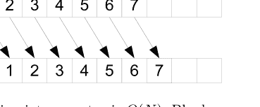

**图 18.1：** 向 `vector` 插入是 $O(N)$ 的。空白方块表示未使用的容量。

这意味着 `vector` 不是用于存储电子表格文档中字符的合适数据类型。没有人希望插入文档开头的单个字符花费很长时间。

我们说将元素插入 `vector` 所花费的时间是 $O(N)$，其中 $N$ 是 `vector` 的长度。另一方面，读取指定索引处的单个元素是 $O(1)$。换句话说，读取 `vector` 中的单个项与 `vector` 的长度无关。向 `vector` 末尾添加元素通常是 $O(1)$，除非你不幸遇到了 `vector` 需要扩展容量的情况，此时它是 $O(N)$，因为整个 `vector` 必须被复制。

`set` 在插入数据方面比 `vector` 更快。插入是 $O(\log N)$。当我们讨论与 `set` 非常相似的 `map` 容器时，我们将在第 18.9.1 节中解释原因。

### 18.7 列表容器

`list` 与 `vector` 非常相似，但它的设计使得在 $O(1)$ 时间内在任意位置插入数据变得很容易。特别是，你可以高效地将数据添加到 `list` 的前端或后端。相比之下，使用 `vector` 时，你只能高效地在末尾添加数据。

这意味着 `list` 类对于组织优先级列表非常有用。你可以将高优先级项放在列表的前面，低优先级项放在末尾。

在底层，`list` 中的每个元素都使用类似以下的数据类型进行存储：

```cpp
class Link {
  Data d;
  Link* next;
  Link* previous;
};
```

每个 `Link` 存储在内存中的任意位置，但通过跟随指针 `next`，你始终可以很快找到列表中的下一个项。如果你想向后移动，可以跟随指针 `prev`。实际的 `list` 类本身需要存储指向第一个和最后一个元素的指针。这种情况在图 18.2 中进行了描绘。

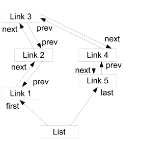

**图 18.2：** 存储数字 1 到 5 的双向链表。

这种数据结构称为双向链表。你可以通过创建一个新的 `Link` 并重定向几个指针来快速插入新元素。需要进行更改的地方在图 18.3 中用粗体和虚线箭头表示。重要的一点是，更改的数量与列表的长度无关。这意味着插入需要 $O(1)$ 时间。

**图 18.3：** 向列表插入数字 3.5 所需的更改。

下面是一个代码示例，展示了如何使用 `push_front` 和 `push_back` 在列表的开头和结尾插入一些项目。然后我们打印出列表。

```cpp
// 使用 list 按优先级顺序存储项目
list<string> list;
list.push_back("Drinking");
list.push_back("Dancing");
list.push_front("Exam");
list.push_front("Revision");
std::cout << "Todo list\n";
for (auto item : list) {
    std::cout << "Item " << item << "\n";
}
```

这将打印出：

```
Todo list
Item Revision
Item Exam
Item Drinking
Item Dancing
```

假设我们现在希望将一项插入到“Exam”之前。`list` 类有一个 `insert` 函数，但它接受两个参数。第一个是指向你要插入位置的迭代器，第二个是要插入的数据。因此，我们将首先希望遍历列表直到所需点，然后调用 `insert`。代码如下：

```cpp
auto i = list.begin();
while (i != list.end()) {
    if (*i == "Exam") {
        list.insert(i, "Dentist");
        break;
    }
    i++;
}
std::cout << "Todo list\n";
for (auto item : list) {
    std::cout << "Item " << item << "\n";
}
```

正如预期的那样，这段代码将打印出相同的列表，但在“Exam”之前插入了“Dentist”。

自然，你会觉得这段代码比必要长度更长，并会想要编写一个辅助函数来使插入元素变得更容易。事实上，C++ 已经包含了一个使这段代码变得相当简单的函数 `find`。

```cpp
auto iter = find(list.begin(), list.end(), "Exam");
list.insert(iter, "Dentist");
```

函数 `find` 将在一系列值中搜索特定项并返回指向该位置的迭代器。要指定值的范围，你需要提供一个指向搜索区域开始的迭代器和一个指向末尾的迭代器。

函数 `find` 定义在库 `<algorithm>` 中。类 `list` 定义在 `<list>` 中。

`<algorithm>` 包含许多有助于执行诸如从容器中移除指定项、对容器元素排序、查找容器中的最小元素等任务的有用函数。

### 18.8 容器 initializer_list

C++11 引入了一种名为 `initializer_list` 的新容器类型。这些类型很有用，因为它们很容易创建并填充值列表。它们不打算用于数据的长期存储。以下是一个使用初始化列表创建双精度数列表并打印它们的示例。

```cpp
std::initializer_list<double>
list = { 1, 2, 3, 4 };
for (auto d : list) {
    std::cout << "Value " << d << "\n";
}
```

初始化列表是只读数据结构，因此主要用作另一个容器的构造函数参数。例如，如果你希望创建一个包含某些固定指定值的 `vector`，你可以使用如下所示的代码。

```cpp
std::vector<double> v({ 1, 2, 3, 4 });
```

这段代码创建了一个包含值 1、2、3 和 4 的 `vector`。现在它就可以像任何其他 `vector` 一样使用了。

大多数集合类都有一个以 `initializer_list` 为参数的构造函数，以便可以使用这种方便的表示法。

### 18.9 容器 map 和 unordered_map

到目前为止，我们的容器只是存储值序列或值集合。另一类广泛使用的数据结构用于存储从键到关联数据的映射。举个例子，词典可以被视为一种数据结构，它将一个键映射到一个值。

C++ 中可用于存储此类映射的两个类是 `map` 和 `unordered_map`。它们分别位于 `<map>` 和 `<unordered_map>` 中。

这两个类在使用方式上几乎无法区分。关键区别在于：

- (i) `map` 中的元素按键排序，就像词典中的条目一样有序；
- (ii) `unordered_map` 通常比 `map` 更快。

因此，除非排序对你很重要，否则你通常应该使用 `unordered_map`。请注意，你在 `map` 中用作键的项目必须重载 `<`，以便 `map` 知道如何按正确顺序对它们进行排序。

以下是如何向 `map` 插入数据，然后遍历它以打印内容的方法。

```cpp
map<string, string> fruitToCol;
fruitToCol["apples"] = "green";
fruitToCol["bananas"] = "yellow";
fruitToCol["plums"] = "purple";
fruitToCol["oranges"] = "orange";
for (const pair<string,string>& p : fruitToCol) {
    cout << "The color of ";
    cout << p.first;
    cout << " is ";
    cout << p.second;
    cout << "\n";
}
```

你会发现，当我们遍历 `map` 时，我们获得的是 `const pair<string,string>&` 类型的对象。`Map` 中的每个条目都是一个键值对。第一个条目是键，第二个条目是值。我们通常会为 `p` 的类型写 `auto`，而不是如此详细地写出所有内容。

`Map` 结构的主要优势在于我们可以非常快速地获得与给定键关联的值。

```cpp
auto i = fruitToCol.find("plums");
cout << "Plums are " << (i->second) << "\n";
```

在这个例子中，我们恰好知道键 `"plums"` 确实存储在 `map` 中，因此可以确定 `i` 将是一个有效的迭代器，因此调用 `i->second` 将包含李子的颜色。 有时你不知道键是否存储在 `map` 中。下面的代码测试键是否在 `map` 中并相应地操作。

```cpp
string fruit = "jackfruit";
auto iter = fruitToCol.find(fruit);
if (iter == fruitToCol.end()) {
    cout << "The color of " << fruit;
    cout << " is unknown\n";
} else {
    cout << fruit << " are " << (iter->second) << "\n";
}
```


因此，要查看元素是否存在于 map 中，我们将 `find` 返回的迭代器与 `end` 返回的迭代器进行比较。

虽然我们所有的示例都使用了 **map**，但 **unordered_map** 的代码是完全相同的。

### 18.9.1 Map 的工作原理

`map` 通常将其数据存储在一个由多个节点组成的树结构中。每个节点存储一个键、一个值以及指向左侧和右侧节点的指针。在没有相邻节点的地方，使用空指针来指示这一点。图 18.4 说明了这一点，其中黑色圆圈表示空指针。

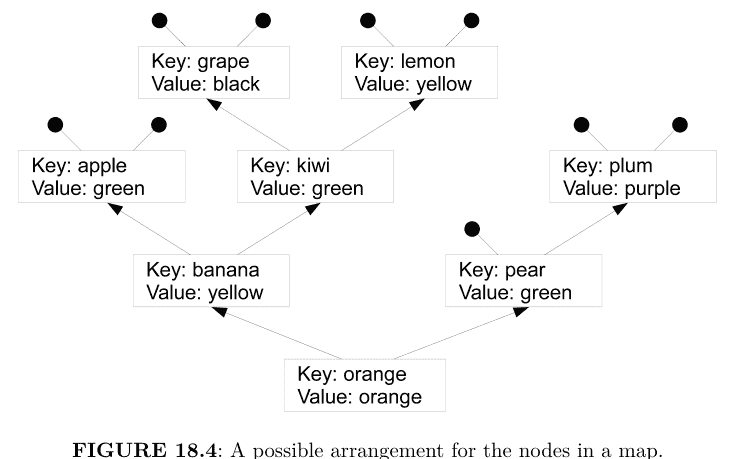

**图 18.4：** Map 中节点的一种可能排列。

`map` 类确保在任何时候，节点键总是大于其左侧节点的键，并且小于其右侧节点的键。

这意味着，当我们希望搜索与给定键关联的数据时，很容易快速导航树，根据你当前查看的节点的键是大于还是小于你的键，选择左分支或右分支。通常你期望树的深度高度为 $O(\log_{2}(N))$，因此查找具有给定键的元素只需要 $O(\log_{2}(N))$ 步。

插入数据和删除数据比搜索数据稍微棘手一些。当你插入和删除节点时，你需要确保顺序属性得到保留。你还希望确保树的深度始终保持在 $\log_{2}(N)$ 量级。有标准的算法来做到这一点。红黑树算法是其中一个众所周知的方法。细节对于这本书来说并不重要，但可以在任何关于算法和数据结构的书中找到。

最终结果是，`map` 可以用于在 $O(\log(N))$ 时间内搜索数据，并且你可以在 $O(\log(N))$ 时间内插入和删除数据。

从讨论中应该清楚的是，`map` 关键依赖于键的顺序。使用 `map` 时必须有 $<$ 的实现，否则你必须告诉 `map` 使用什么函数代替。

`set` 的实现本质上与 `map` 相同，除了不需要存储 `value`。这解释了我们在 18.5 节中提到的类 `set` 的性能特性。

### 18.9.2 Unordered_map 的工作原理

让我们假设你希望存储大约 100 个键值对，以便我们尽可能快地根据键查找值。如果你能以某种方式快速为每个键关联 0 到 99 之间的唯一数字，那么你可以将数据存储在与 `vector` 而不是 `map` 中。只需取一个键，找到关联的数字，然后读取向量中给定索引处的元素。

问题是我们无法以直接的方式将唯一数字关联到键。然而，对于字符串，有一个*几乎*可行的想法是取字符串中所有字符代码并相加。这将为每个字符串提供一个数字，我们称之为*哈希码*。哈希码几乎是唯一的，因为两个随机字符串不太可能有相同的哈希码。

如果你取哈希码除以 100 后的余数，你会有一个 0 到 99 之间的数字。让我们把这个称为字符串的*桶 ID*。

我们现在可以我们将要使用的所有键分组到*桶*中。两个字符串在同一桶中当且仅当它们具有相同的桶 ID。

在无序映射中，存储桶对象的向量。每个桶 ID 有一个桶。桶对象包含所有恰好具有给定桶 ID 的键值对的列表。这种情况如图 18.5 所示。这显示了一个具有 10 个桶的无序映射，因此桶 ID 是通过取哈希码除以 10 的余数计算得出的。换句话说，桶 ID 只是哈希码的最后一位。哈希码是通过如上所述将键中每个字母的字符代码相加计算得出的。

要在无序映射中根据键搜索元素，你按以下步骤进行。

1. 计算键的哈希码。
2. 通过将哈希码除以桶的数量并取余数来计算桶 ID。
3. 从桶向量中读取正确的桶。
4. 遍历桶中的所有键值对，直到找到正确的元素。

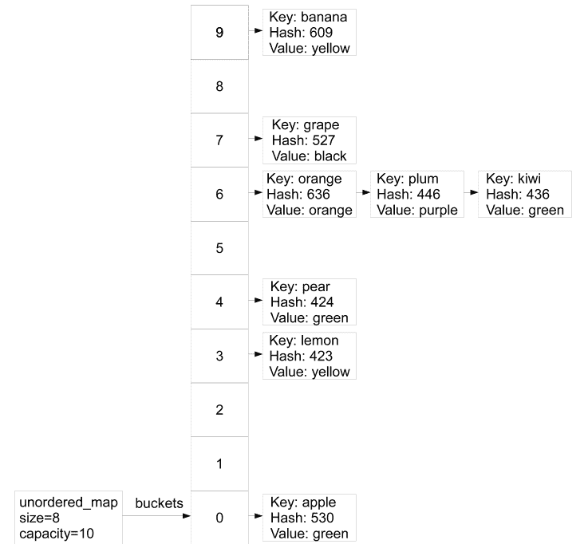

**图 18.5：** 具有 10 个桶的无序映射。

其想法是每个桶中通常只有很少的元素，因为每个键的哈希码本质上是随机的。如果我们存储 $N$ 个项目，我们可以使用具有 $O(N)$ 个桶的无序映射，这样每个桶中仍然只有少数几个项目。这意味着我们可以以大约 $O(1)$ 的时间查找元素，而 map 需要的时间是 $O(\log(N))$。

插入新元素和删除元素类似。人们找到正确的桶并从列表中插入或删除元素。唯一的额外复杂性是如果无序映射的大小超过

如果达到了一定数量，就应该增加桶的数量并重新计算所有桶的 ID。这个过程称为重新哈希（re-hashing）。

因此，大致来说，无序映射允许以大约 O(1) 的时间复杂度插入、删除和查询数据，因此通常比有序映射更快。

无序映射需要在键上执行的关键功能包括计算哈希码以及检查两个键是否相等。对于字符串和数值类型，无序映射会使用合理的哈希码选择，并使用 `==` 来测试相等性。对于用户定义的类型，默认行为是两个键当且仅当它们是对象的同一精确实例时才被视为相等。如果你希望使用更细致的键相等概念，那么你应该查阅 `unordered_map` 的文档。

需要注意的是，在 C++ 中用于字符串的实际哈希码是使用一种比简单累加字符串中所有字符代码更巧妙的算法计算的，这种算法更有可能产生唯一的哈希码。

### 18.10 在容器中存储复杂类型

**提示：使用共享指针存储大型对象**

使用 `shared_ptr` 在容器中存储大型对象是更好的做法。例如，使用 `vector< shared_ptr<Matrix>>` 来存储矩阵列表比使用 `vector<Matrix>` 更好。

重要的是要知道，当你在 C++ 容器中存储数据时，容器存储的是数据的副本。同样，当你从容器中提取数据时，你获得的也是数据的副本。

对于像 `int` 或 `double` 或小型 `string` 对象这样的小型数据类型，这种行为是合理的。然而，如果你在容器中存储大型对象，这将非常低效。解决方案是始终使用 `shared_ptr` 来存储大型对象。

### 18.11 多只股票的数学模型

STL 类在将我们的投资组合定价代码推广到包含多只股票的模型时将变得非常有价值。在描述该问题的计算方面之前，让我们简要描述一种可用于此类市场的数学模型。

我们的模型将是布朗运动最直接的多维推广。它是编写多维模型的自然首次尝试，但绝非对建模更复杂股票市场问题的最终定论。

我们假设每个时间间隔 $\delta t$ 内的股价变化由 $R$ 个独立的正态分布风险因子 $e^{j}$ 决定，其中 $j$ 在 1 到 $R$ 之间变化。我们将 $\underline{\epsilon}_{t}$ 表示为时间 $t$ 时 $R$ 维风险因子向量。

我们在每个时间 $t$ 有 $n$ 个股价 $S_{i}^{t}$，其中 $i$ 在 1 到 $n$ 之间。我们写 $z_{i}^{t}:=\log(S_{i}^{t})$ 并将 $\underline{z}_{t}$ 表示为时间 $t$ 的对数股价向量。

我们的模型是股价的对数根据以下差分方程演变：

```
z_{t+\delta t} = z_{t} + \eta \delta t + (\delta t)^{\frac{1}{2}} L \epsilon_{t} \qquad (18.1)
```

其中 $\eta$ 是一个 $n$ 维向量，$L$ 是一个 $n \times R$ 矩阵。模拟这个多维模型并不比模拟一维模型困难多少。

给定 $z_{t}$ 处的值，$z$ 在时间 $z_{t+\delta t}$ 处的值将具有多维正态分布，其协方差矩阵为 $(\delta t) L L^{T}$，其中上标 $T$ 表示矩阵转置。我们将 $A = L L^{T}$ 写为一年内的协方差矩阵。具有相同 $\eta$ 的两种形式为 (18.1) 的模型，如果它们具有相同的协方差矩阵 $A$ 值，则应被视为等效。

通常，通过首先选择协方差矩阵 $A$，然后找到满足 $L L^{T}=A$ 的矩阵 $L$ 来为此模型选择矩阵 $L$。这样的矩阵被称为 $A$ 的伪平方根。在练习 16.7.5 中给出了一个用于寻找协方差矩阵伪平方根的算法，称为“Cholesky 分解”。

使用的 $R$ 值越大，计算模型 (18.1) 中每一项所需的时间就越长。计算 (18.1) 中每个后续项需要 $n \times R^{2}$ 次计算。因此，当有大量股票时，人们可能会尝试用比股票数量少的风险因子来建模市场。为了做到这一点，人们使用较低维度的近似伪平方根代替真实的伪平方根来近似协方差矩阵。这可以通过寻找协方差矩阵的特征向量基，并使用具有最大特征值的特征向量来创建矩阵 $L$ 来实现。这使得人们可以使用适中的风险因子数量来建模大型市场。

然而，为了简单起见，从现在起我们将假设 $L$ 是给定的协方差矩阵 $A$ 的 Cholesky 分解。这是我们在软件中将要建模的情况。

如果我们考虑对数股价向量 $\underline{z}_{t}$ 的第 $i$ 个分量的行为，我们会发现它是正态分布的，方差为 $(\delta t) A_{(i, i)}$，均值为 $(\delta t) \eta_{i}$。因此，每只股票单独遵循几何布朗运动，漂移为 $\eta_{i} + \frac{1}{2} A_{(i, i)}$，波动率为 $\sqrt{A_{(i, i)}}$。

我们推断，在世界具有固定利率 $ r $ 的情况下，当且仅当满足以下条件时，这是一个针对股价的无风险模型：

$$ \underline{\eta}_{(i)} = r - \frac{1}{2} A_{(i, i)}. $$

此外，我们可以看到向量 $ \underline{\eta} $ 可以通过每只股票的个体漂移来计算。

### 18.12 在 FMLib 中使用标准模板库

我们希望对 FMLib 进行增强，使其能够定价包含多只股票期权的投资组合。此外，我们还希望能够定价像 Margrabe 期权这样的期权，其合约涉及两只股票的相互作用（参见练习 18.12.2）。

我们需要对 FMLib 进行的关键更改在图 18.6 中总结。让我们也通过文字来解释它们。

`ContinuousTimeOption` 接口被更改，使其 `payoff` 函数现在接受一个 `MarketSimulation` 对象作为参数。该函数的先前版本接受一个股价路径矩阵作为参数。

`MarketSimulation` 类是一个简单的类，它存储了股票名称与股价路径矩阵之间的映射。它存储了我们所有的股票市场模拟。为了计算多只股票期权的收益，人们查询 `MarketSimulation` 以获取期权合约中涉及的每只股票的股价路径。现在可以根据期权合约计算期权的收益。

除了更改 `payoff` 函数外，`ContinuousTimeOption` 现在还有一个方法 `getStocks`，可用于查询期权依赖于哪些股票。为了确保该方法不返回重复项，其返回类型为 `set<string>`。

大多数期权仅涉及单只股票，因此我们的基类 `ContinuousTimeOptionBase` 已被增强，使其存储单只股票的名字。它通过返回此名称来实现 `getStocks`。`ContinuousTimeOptionBase` 还实现了接受 `MarketSimulation` 作为参数的 `payoff` 函数，通过提取此单只股票的股价路径矩阵，然后调用一个抽象函数，该函数也称为 `payoff`，但接受单个 `Matrix` 作为参数。由于我们现有的所有 `ContinuousTimeOptionBase` 子类已经实现了 `payoff` 函数的这个第二个版本，它们现在将自动实现修改后的 `ContinuousTimeOption` 接口。

为了生成 `MarketSimulation` 对象，我们使用一个名为 `MultiStockModel` 的类。该类表示上面描述的多只股票数学模型。它具有函数 `generatePricePaths` 和 `generateRiskNeutralPricePaths`，根据模型配置创建 `MarketSimulation` 对象。

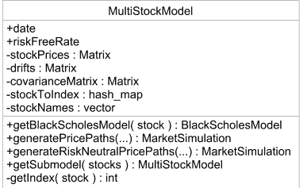
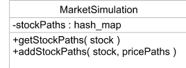
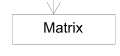
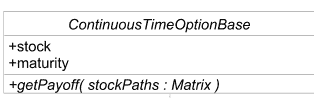
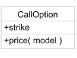
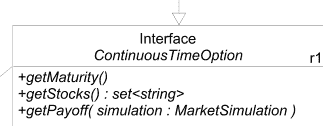
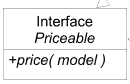
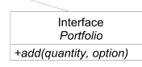
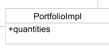
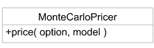

**图 18.6：** FMLib 更改的 UML 摘要

内部上，`MultiStockModel` 使用矩阵存储其大部分数据。例如，当前股价存储为 $n \times 1$ 矩阵---即列向量。这些股价中的每一个对应于市场中某只股票的价格。股票名称与此列向量中股票索引之间的映射以两种方式存储。首先，它们存储在一个名为 `stockToIndex` 的 `unordered_map` 中，该映射将股票名称映射到索引。其次，名称按索引顺序存储在一个名为 `stockNames` 的 `vector` 中。这些数据结合同允许快速在股票名称和索引之间映射，反之亦然。为了协助此映射，

`MarketSimulation` 拥有一个私有函数 `getIndex`，它用于将股票名称映射到其索引。

`MarketSimulation` 中的其他数据使用具有相同索引的矩阵存储。具体来说，有一个漂移的列向量和一个协方差矩阵，它们描述了所有股票的波动率及其相关性。

由于我们经常需要定价不涉及整个市场的期权和投资组合，`MultiStockModel` 类提供了一个 `getSubModel` 函数。该函数接收一个股票列表作为参数，并返回一个新的 `MultiStockModel`，其规模已缩减为仅包含所需的股票。为了方便，它还提供了一个函数，可以在给定单只股票的情况下返回一个 `BlackScholesModel` 对象。

`MonteCarloPricer` 类现在可以使用多股票模型对 `ContinuousTimeOption` 实例进行定价。它首先使用期权的 `getStocks` 函数和模型的 `getSubModel` 函数创建一个适当的子模型。然后，它使用这个子模型生成风险中性价格路径。期权能够计算所有这些价格路径的收益。蒙特卡洛价格则是折现后的平均收益。

还有两个值得提及的小型变更：

- (i) `Priceable` 接口已更改，使得 `price` 方法接受 `MultiStockModel` 作为参数。以前它接受的是 `BlackScholesModel`。该 `price` 方法的所有实现都已相应更改。
- (ii) `Portfolio` 类现在仅允许添加 `ContinuousTimeOption` 对象，而以前任何 `Priceable` 都可以添加。原因是这使完成练习 18.12.3 变得更容易。

大多数方法的具体实现并不具有挑战性。让我们展示几个示例。

首先，这是类 `MultiStockModel` 中 `getIndex` 的实现。我们选择将此函数内联。它简单地使用上面给出的在映射中搜索的方法。我们已经决定，如果用户传递了无效的股票代码，我们只需报告一个错误。

```cpp
int getIndex(const std::string& stockCode) const {
    auto pos = stockToIndex.find(stockCode);
    ASSERT(pos != stockToIndex.end());
    int idx = pos->second;
    return idx;
}
```

`MarketSimulation` 上的 `getStockPaths` 函数本质上与此相同。

```cpp
SPCMatrix getStockPaths(const std::string& stock) const {
    auto pos = stockPaths.find(stock);
    ASSERT(pos != stockPaths.end());
    return pos->second;
}
```

这段代码清楚地表明，我们的 `MarketSimulation` 类使用 `shared_ptr` 存储矩阵。如上所述，由于容器会复制它们存储的数据，直接在容器中存储 Matrix 将非常低效。这段代码还展示了我们使用 *typedef* 创建指向 `const` 的 `shared_ptr` 的约定，名称以 “SPC” 开头。你可以在函数 `getStockPaths` 的返回类型中看到这一约定的使用。

作为一个更复杂的例子，以下是根据你想包含在子模型中的股票名称，创建 `MultiStockModel` 子模型所需的代码。代码需要找到这些股票的正确索引，然后从成员变量 `drifts`、`stockPrices` 和 `covarianceMatrix` 中提取必要的子矩阵。

```cpp
MultiStockModel MultiStockModel::getSubmodel(set<string> stocks) const {
    int n = stocks.size();
    Matrix drifts(n, 1);
    Matrix stockPrices(n, 1);
    vector<string> newStocks(stocks.begin(), stocks.end());
    Matrix cov(n, n);
    int newIndex = 0;
    for (auto& stock : stocks) {
```


```cpp
int idx = getIndex(stock);

drifts(newIndex) = this->drifts(idx);

stockPrices(newIndex) = this->stockPrices(idx);

newIndex++;

}

int i = 0;

for (auto& stockI : stocks) {

    int j = 0;

    for (auto& stockJ : stocks) {

        int oldI = getIndex(stockI);

        int oldJ = getIndex(stockJ);

        cov(i, j) = covarianceMatrix(oldI, oldJ);

        j++;

    }

    i++;

}

MultiStockModel ret(newStocks, stockPrices, drifts, cov);

ret.setDate(getDate());

ret.setRiskFreeRate(getRiskFreeRate());

return ret;

}
```

这段代码展示了使用容器特殊 `for` 语法进行循环的便利性。值得注意的是，我们可以如下构造一个包含现有集合数据的新 `vector`：

```cpp
vector<string> newStocks(stocks.begin(), stocks.end());
```

容器类通常有构造函数，接受两个迭代器并将两个迭代器之间的所有数据复制到新创建的容器中。十有八九，人们使用它是为了复制现有容器的所有内容，但偶尔仅复制一部分也是有用的。

最后，我们注意到类 `MultiStockModel` 使用第 18.11 节中描述的模型生成价格路径。该代码比模拟单只股票价格的代码复杂不了多少。

## 练习

**18.12.1.** 在练习 3.9.3 中，我们看到递归是计算斐波那契数的一种低效方法。然而，如果我们使用值的*缓存*，递归就可以很高效。缓存只是一个数据结构，你在那里存储先前计算的结果。你可以使用包含一个 `map` 的全局变量来缓存你已经计算过的斐波那契数列的值。实现这个想法并确认它比没有缓存的递归性能更好。

**18.12.2.** 编写一个 `ContinuousTimeOption` 的实现，代表一个*Margrabe 期权*。这是针对两只股票 $S^1$ 和 $S^2$ 的期权。在到期日 $T$，它支付金额为 max{$S^1_T - S^2_T$, 0}。确认你可以使用蒙特卡洛方法对其进行定价，并且其价格与 [10] 中给出的解析公式相匹配。

**18.12.3.** 向类 `Portfolio` 添加一个新方法 `priceByMonteCarlo`，该方法将根据到期日对期权进行分组，然后使用一组模拟对具有相同到期日的期权进行定价。为了做到这一点，你需要编写一个 `ContinuousTimeOption` 的实现，它代表一个由各种股票组成的期权投资组合，且所有股票都有单一的到期日。

实际上，你可能想使用一种复杂的算法，仅将需要蒙特卡洛定价的期权分组在一起，并像以前一样对可以解析处理的期权进行定价。你可能还想对投资组合中所有到期日的股价进行单一模拟。

**18.12.4.** 编写一个模板函数 `mapGet`，它根据键从映射中获取值。如果映射中不存在该值，它应该抛出一个异常。你的函数应该同样适用于 `map` 和 `unordered_map`。

**18.12.5.** 编写你自己的简单版本哈希映射。你应该只实现一个函数 `store`，允许你存储键值对，以及 `get`，它返回与键关联的值，否则抛出一个异常。你可以假设键和值都是字符串。你也应该只使用固定数量的桶。你可以使用 `vector` 和 `list` 类，但不得使用 `map` 或 `unordered_map`。检查你的哈希映射是否按预期工作。

### 18.13 总结

标准模板库是一个强大的工具，可以让你轻松编写更复杂的程序。我们涵盖的关键点是：

- `typedef` 关键字允许我们缩写复杂的类型名称。为 `shared_ptr` 类型命名的一种约定特别方便。
- `auto` 关键字允许你在编译器可以为你推导时避免键入类的完整名称。可以将 `auto` 与 `const` 和 `&` 组合使用。
- 类可以包含成员类型。这在编写模板算法时特别有用。
- 容器是任何存储数据并在你调用 `begin` 和 `end` 时返回迭代器的类。使用 `for` 遍历容器有一种特殊语法。
- C++ 包含许多使存储数据变得容易的容器类。它们还可以作为实现高效算法的构建模块。所有容器的行为大致相似。对于诸如 `size`、`insert`、`remove`、`begin` 和 `end` 之类的函数命名有明确的约定。

- 库 `<algorithm>` 包含许多在处理容器时非常有用的函数，例如 `find`。
- 不同的数据结构具有不同的性能特征。你应该根据访问和更新数据的方式来选择数据结构。
- 不应在容器中存储大型对象。应使用 `shared_ptr` 通过引用存储它们。

我们需要补充说明的是，尽管标准模板库非常强大，但学习起来相当困难。不幸的是，它大量使用了模板和运算符重载等复杂概念。为迭代器选择的语法也假设你非常习惯处理指针，因此你会觉得使用 `*` 和 `++` 是自然且方便的。

标准模板库最初发明时具有一定的实验性质。事实证明，面向对象编程风格相当直观。因此，许多计算机语言都包含某种形式的面向对象特性。另一方面，标准模板库对于新程序员来说相当难以掌握。结果，模板的使用并未被许多其他语言所采纳。

> 提示：使用标准模板库，但不要照搬其设计。

你应该知道如何使用标准模板库，因为它包含无价之宝的工具。然而，你不应该急于照搬标准模板库的设计。在使用模板之前，先看看你是否能为问题找到面向对象解决方案。

# 第 19 章

## 函数对象与 Lambda 函数

在第 10.6 节中，我们设计了一个接口 `RealFunction` 来表示将实数映射到实数的函数这一数学概念。这解决了编写能积分任意实数函数的积分例程的问题。

然而，C++ 中有一个更好的解决方案，即编写*函数对象*。函数对象只不过是重载了 `()` 运算符的类的一个实例。函数对象有时也被称为*仿函数*。使用函数对象的一个巨大优势是，有一种特殊的语法用于编写函数对象，称为*lambda 函数*。这使得编写函数对象比编写普通类更快。

### 19.1 函数对象

下面是一个积分函数的示例，该函数接收一个函数对象 `f` 作为参数。这段代码简单地重复了我们在第 10.6 节中用于使用矩形法则进行积分的函数，但这次我们使用的是函数对象，而不是接口 `RealFunction`。

```cpp
double integrate(
    function<double(double)> f,
    double a,
    double b,
    int nSteps) {
    double total = 0.0;
    double h = (b - a) / nSteps;
    for (int i = 0; i<nSteps; i++) {
        double x = a + i*h + 0.5*h;
        total += h*f(x);
    }
    return total;
}
```

首先要注意的是，`f` 的类型声明为

```cpp
function<double(double)> f
```

这里 `function` 是在库 `<functional>` 和命名空间 `std` 中定义的一个类。有趣的是模板类型。这个例子意味着 `f` 表示一个返回 `double` 并接受单个 `double` 作为参数的函数。如果你希望使用具有不同返回类型和参数类型的函数对象，通用语法如下：

```cpp
function<ReturnType(ParameterType1,ParameterType2,...)> f
```

声明函数的类型是使用函数对象的唯一复杂部分。当我们使用函数对象 `f` 时，它与使用普通函数完全相同，因为它重载了运算符 `()`。以下是使用 `f` 的代码行：

```cpp
total += h*f(x);
```

要编写一个函数对象，必须编写一个重载 `()` 运算符的类。以下是评估数学函数 $\sin(x)$ 的类的一个示例。

```cpp
class SinFunction {
public:
    double operator()(double x) {
        return sin(x);
    }
};
```

将所有内容组合起来，这里是我们积分函数按预期工作的测试。

```cpp
void testIntegrateSin() {
    SinFunction integrand;
    double value = integrate(integrand, 0, 1, 1000);
    ASSERT_APPROX_EQUAL(-cos(1.0) + cos(0.0),
                       value, 0.01);
}
```

### 19.2 Lambda 函数

使用函数对象而非编写自己的接口的巨大优势在于，你可以使用*lambda 函数*非常迅速地编写函数对象。

作为一个例子，假设我们要编写一个函数，该函数接受参数 $a$、$b$ 和 $c$，然后使用梯形法则计算

$$\int_{0}^{1}(ax^{2}+bx+c)\mathrm{d}x$$

我们首先需要编写一个函数对象来计算被积函数 $ax^{2}+bx+c$。然后我们可以使用我们的 `integrate` 函数计算积分。

以下是没有使用 lambda 函数的冗长答案：

```cpp
class QuadraticFunction {
public:
/* Members */
double a;
double b;
double c;
/* Constructor */
QuadraticFunction(double a,
double b,
double c) :
a(a), b(b), c(c) {}
/* Operator */
double operator()(double x) {
return a*x*x+b*x+c;
}
};
double integrateQuadratic(double a,
double b,
double c) {
QuadraticFunction integrand(a, b, c);
return integrate(integrand, 0, 1, 1000);
}
```

我们必须定义一个类，赋予其适当的成员变量和构造函数，并重载运算符 $()$。然后我们需要构造这个类的一个实例并将其传递给 `integrate`。Lambda 函数允许我们仅用几行代码完成所有这些工作。

```cpp
double integrateQuadratic2(double a,
double b,
double c) {
auto lambda =
[a, b, c](double x) {
return a*x*x + b*x + c;
};
return integrate(lambda, 0, 1, 1000);
}
```

变量 `lambda` 仍然是一个函数对象，就像代码更冗长版本中的 `integrand` 一样。新的语法是 lambda 函数的声明：

```cpp
[a, b, c](double x) {
    return a*x*x + b*x + c;
};
```

这是一种极其简洁的语法，其含义是：

- 生成一个类，我们不在乎它叫什么名字。
- 我们希望*捕获* `integrateQuadratic2` 的局部变量 `a`、`b` 和 `c`，并将它们作为类的成员变量。在编写 lambda 函数时，你在方括号中列出捕获的变量。
- 我们希望编写一个重载的运算符 `()`，它接受单个 `double` 参数，我们将将其称为 `x`。在编写 lambda 函数时，你在圆括号中列出参数类型和参数名称。
- 函数的实际计算写在花括号内，可以使用捕获的变量和参数。

总之，lambda 函数的语法是：

```cpp
[CaptureParameters] (FunctionParameters) {FunctionImplementation}
```

Lambda 函数的伟大之处在于，除了编写更快之外，它们还更容易阅读（至少在你习惯了这种语法之后）。这是因为定义新类所需的冗长且分散注意力的样板代码都被隐藏了。

在如何编写捕获参数方面有很大的灵活性。

- 你可以使用参数名称前的 `&` 符号来指定你希望按引用捕获局部变量。
- 你可以通过仅指定 `&` 来指定你希望按引用捕获所有变量。
- 你可以通过仅指定 `=` 来指定你希望按值捕获所有变量。
- 如果你的 lambda 函数写在类的成员函数内部，你可以通过指定 `this` 来捕获该类的成员函数和成员变量。

例如，以下是如何积分路径无关期权在 `a` 和 `b` 边界之间的收益。

```cpp
double integratePayoff(PathIndependentOption& o,
                      double a,
                      double b) {
    auto lambda =
        [&o](double x) {
            return o.payoff(x);
        };
    return integrate(lambda, a, b, 1000);
}
```

由于类 `PathIndependentOption` 是抽象类，我们必须按引用捕获变量 `o`。这就是为什么捕获参数列表说我们要捕获 `&o`。

这个问题在第 10.6 节中也被考虑过。如你所见，使用 lambda 函数使解决方案短得多。

请注意，当你按引用存储捕获参数时，你必须始终小心确保该函数对象会在其捕获的任何参数之前被删除。这与需要确保类的实例在存储按引用的任何成员变量之前被删除的原因完全相同。

### 19.3 函数指针

可以将实际函数作为参数传递，并不总是绝对有必要编写函数对象。例如，为了积分

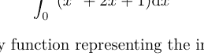

我们可以编写一个表示被积函数的普通函数，如下所示：

```cpp
static double integrand(double x) {
    return x*x + 2 * x + x;
}
```

然后我们可以将这个被积函数传递给我们的 `integrate` 函数，如下所示。

```cpp
double testIntegrateFunctionPointer() {
    double value = integrate(&integrand, 2, 1);
    ASSERT_APPROX_EQUAL(
        value,
```


2.3333, 0.01);
}
```

注意被积函数前的 `&` 符号。`&integrand` 被称为函数指针。

C 语言不具备面向对象特性。特别是，你无法编写函数对象。你能做到的最接近的方式是编写函数并通过函数指针传递它们。如果你使用用 C 语言编写的库，你会发现它们经常使用函数指针。然而，C++ 程序员通常更喜欢使用函数对象来编写他们的库，因为它们既更强大又更方便。

### 19.4 使用 lambda 函数进行排序

我们曾使用 lambda 函数来表示定义在实数集上的实值函数。然而，lambda 函数可用于许多不同类型的函数，而不仅仅是数学函数。本节将给出一个示例，展示如何使用 lambda 函数来定制 sort 函数的排序顺序。

默认情况下，字符串的 `<` 函数基于 ASCII 字符代码，因此 "A" < "B" < ... < "Z" < "a"。这意味着直接在字符串向量上使用 sort 函数将无法使列表按字母顺序排列。所有以大写开头的字符串都会排在所有以小写开头的字符串之前。幸运的是，sort 允许你指定一个比较函数，用于决定 x 是否应排在 y 之前。

```cpp
void sortExample() {
    vector<string> list({ "Z", "x", "a", "B" });
    sort(list.begin(), list.end(),
         [](string& x, string& y) {
            return uppercase(x) < uppercase(y);
         });
}
```


在这个例子中，我们创建了一个 lambda 函数，该函数比较两个字符串 `x` 和 `y`，并返回 `x` 是否在字母顺序上位于 `y` 之前。为此，它只需将每个字符串转换为大写，然后进行比较。函数 `uppercase` 并非 C++ 内置功能，而是我们为达到此目的而编写的辅助函数。

C++ 库经常大量使用函数对象。如果你想要充分利用 C++，使用它们至关重要。

### 19.4.1. 使用 lambda 函数计算
$$ \int_0^{\pi} \sqrt{1 + \sin^2(x)} \, \mathrm{d}x. $$

### 19.4.2. 编写一个函数来计算在 Black–Scholes 模型中具有任意到期收益 $f(S)$ 且到期时间为 $T$ 的期权价格。你的代码应通过利用公式 (A.3) 通过积分计算期望收益来实现。

### 19.4.3. 假设 $f: [a, b] \to \mathbb{R}$ 是一个连续函数，我们希望在某个位于 $f(a)$ 和 $f(b)$ 之间的值 $y$ 处求解方程 $f(x) = y$。显然存在一个解，且该解必须位于两个子区间 $[a, (a+b)/2]$ 或 $[(a+b)/2, b]$ 之一中。根据 $f$ 在 $(a+b)/2$ 处的值，我们可以确定需要查看这两个子区间中的哪一个来求解方程：只需选择 $y$ 位于区间端点 $f$ 值之间的那个区间。

这给出了一个数值求解方程 $f(x) = y$ 在给定容差 $\epsilon$ 内的递归算法。要在 $[a, b]$ 上求解方程：

- 1. 检查任一端点是否在所需容差内是解，如果是，则完成。
- 2. 否则，确定哪个子区间 $[a, (a+b)/2]$ 或 $[(a+b)/2, b]$ 必须包含解。使用递归将算法应用于较小的区间。

该算法被称为二分法。请实现它。（还有许多其他算法可以求解此类方程，例如牛顿-拉夫逊方法。你可以在诸如 `GSL`（GNU 科学库）等库中找到实现。）

### 19.4.4. 在 Black–Scholes 公式中，校准所有参数到市场数据很容易，除了波动率 $\sigma$。
例如，原始股价通常取自市场上报价的买卖价差平均值。同样，无风险利率可以取为某个特定的市场利率，例如 `LIBOR` 利率。
然而，波动率参数并不以如此明确的方式对应于任何市场数据。相反，人们通常尝试通过反转 Black–Scholes 公式并利用市场上看涨期权的价格来推导波动率，从而将 Black–Scholes 模型校准到市场。通过这种方式计算出的波动率被称为*隐含波动率*。

使用你对上一练习的答案编写一个函数 `implied-Volatility`，该函数应：

- 接收参数 $S, r, K, T$ 以及执行价格为 $K$ 且到期时间为 $T$ 的看涨期权价格
- 计算相应的 $\sigma$ 值，使得公式 (A.6) 成立。

### 19.4.5. 查找 S&P 500 指数看涨期权的当前市场数据，并绘制隐含波动率随执行价格变化的曲线图。如果 Black–Scholes 模型完全准确，隐含波动率将与执行价格无关。由于 Black–Scholes 模型做出了一些不切实际的假设，你会发现隐含波动率实际上随执行价格变化。这证明虽然 Black–Scholes 模型很有用，但它不够精确以复制实际市场价格，必须使用更复杂的模型。

#### 19.5 总结

将函数作为参数传递是 C++ 中的常见需求。使用类 `std::function` 将函数作为参数传递。这允许你使用 lambda 函数根据需要快速创建新函数。

## 第 20 章

### 线程

计算机能够同时做不止一件事。除了同时运行多个程序外，每个程序在每次运行时也可以执行多个任务。每个正在运行的独立程序被称为*进程*。在每个进程中，每个独立运行的任务被称为*线程*。我们迄今为止编写的程序都包含单个线程。本章是关于编写同时执行多个线程的程序。

如果计算机拥有多个 CPU，每个 CPU 都可以管理自己的执行线程，因此可以并行运行多个线程。现代处理器通常包含多个*核心*。你可以将每个核心视为实际上是一个独立的处理器。每个核心可以执行一个独立的线程。

然而，即使你只有一个处理器，你仍然可以运行多个线程。线程看起来是同时运行的，但实际上操作系统只会依次分配少量时间给每个线程。更普遍地说，你可以运行比处理器更多的线程。操作系统的主要任务之一是确定在任一时刻运行哪些线程。例如，操作系统可能会给图形用户界面更高优先级，而给后台计算较低优先级。

多线程程序只是包含多个线程的程序。以下是一个简短列表，列出了编写多线程程序可能希望获得的一些潜在好处。

- (i) **CPU 性能**：为了使用你的所有处理器或核心，必须运行多个线程，因此多线程对于充分利用你的计算机资源至关重要。
- (ii) **网络性能**：当你等待网络操作完成时（例如，下载网页），你不妨利用处理器做其他事情。
- (iii) **公平性**：如果你在编写 Web 服务器，想查看一个页面的用户不应该被迫等待半小时让另一个用户的巨大下载完成。
- (iv) **可用性**：当程序正在进行漫长计算时，用户很高兴能在处理发生在“后台”时执行其他任务。
- (v) **更自然的编程**：*偶尔*使用多个线程可以简化程序编写。

然而，为所有这些正面好处需要付出代价。以下是决定编写多线程程序之前必须考虑的一些陷阱。

- (i) **复杂性**：多线程代码比单线程代码更难编写和理解。
- (ii) **可测试性**：多线程代码比单线程代码更难测试。
- (iii) **CPU 性能**：如果代码写得不好，使用多个线程实际上可能会让你的计算机变慢。这是因为线程之间发送数据有一些开销。如果你的代码大部分时间都在将数据从一个线程移动到另一个线程，它的性能会很差。
- (iv) **难度**：人脑似乎难以处理并行处理。我们在多任务方面都相当糟糕，我们在编写多线程代码方面也都相当糟糕。

#### 20.1 C++ 中的并发编程

##### 20.1.1 创建线程

要创建一个线程，需构建一个 `thread` 对象，传入线程执行时调用的函数的指针以及该函数所需的任何参数。`thread` 定义在库 `<thread>` 中。

下面的代码包含一个函数 `primalityTest`，它接受单个参数，即指向 `int` 的指针。函数 `primalityTest` 只是尝试被引用的 `int` 的所有可能除数，看是否能找到因子。如果找到非平凡因子，它打印出被引用的 `int` 不是质数。否则，它打印出被引用的 `int` 是质数的事实。

```cpp
void primalityTest( int* pointerToInt ) {
    int toTest = *pointerToInt;
    for( int i=2; i<toTest; i++ ) {
        if( (toTest % i)==0) {
            INFO( toTest << " is not prime" );
            return;
        }
    }
}
```

```cpp
void testPrimes() {
    int values[3] = {1299817,1299821,1299827};
    thread t1( &primalityTest, &values[0] );
    thread t2( &primalityTest, &values[1] );
    thread t3( &primalityTest, &values[2] );
    t1.join();
    t2.join();
    t3.join();
}
```

我们希望使用三个独立的线程来运行函数 `primalityTest`。函数 `testPrimes` 通过创建三个线程对象来实现这一点。如你所见，我们使用表达式 `&primalityTest` 来获取指向素数测试函数的指针。

创建每个线程后，我们通过调用 `join` 等待它们完成。线程的 `join` 函数会阻塞（即不进行任何处理），直到被连接的线程完成为止。

##### 20.1.2 互斥

为了了解编写多线程代码时可能出现的问题，请考虑如果两个线程同时执行以下代码会发生什么：

`cout << "The answer to calculation "<<i<<" is "<<j<<"\n";`

首先要注意到的是，这段代码实际上等价于以下代码：

`cout << "The answer to calculation ";`

`cout << i;`

`cout <<" is ";`

`cout <<j;`

`cout <<"\n";`

如果两个线程同时执行此代码，无法保证哪个线程会先打印出给定的一行消息。因此，打印出来的消息可能会混乱地叠加在一起。以下是可能出现的输出类型示例。

The answer to calculation The answer to calculation 1 2 is 19 is 18

当向 `cout` 写入数据时，这些问题非常明显，但在多个线程访问相同数据或相同对象时，细微的问题也很容易发生。例如，考虑以下代码：

`bool debitAccount(Account& account, double amount) {`

`    if (account.balance >= amount) {`

`        account.balance -= amount;`

`        return true;`

`    }`

`    return false;`

`}`

为了理解为什么这段代码是危险的，假设账户初始余额为 100 美元。假设两个线程都试图从该账户中扣除 100 美元。

由于运气不佳，两个线程可能同时检查余额并看到资金充足。此时可能发生的情况是，一个线程将余额更改为零，然后第二个线程将其更改为 -100 美元。最终结果将是账户透支，尽管乍看之下我们的 `if` 语句似乎能防止这种情况发生。

这是一个*竞态条件*的例子。竞态条件是任何两个线程尝试访问同一资源且结果取决于事件发生顺序的情况。在我们的例子中，可以想象两个线程正在“竞争”从账户中扣款。

除非我们找到某种方法确保两个线程不能同时读写相同的数据，否则竞态条件不可避免。*互斥锁*提供了一种确保这一点的方法。

类 `mutex` 表示互斥锁。它有两个关键方法，`lock` 和 `unlock`。当函数 `lock` 返回时，我们说该线程已*获取*了锁。当调用 `unlock` 时，该线程已*释放*了锁。

一次只有一个线程可以获取锁。如果线程 A 获取了锁，然后线程 B 试图调用 `lock`，那么对 `lock` 的调用在线程 A 调用 `unlock` 之前不会返回。这保证只有一个线程持有锁。它被称为*互斥锁*，是因为每个线程都可以通过持有锁来排除其他线程运行。它们相互排除对方运行。

在小说 *Lord of the Flies*（《蝇王》）中，一群男孩被困在一个荒岛上。男孩们在海滩上发现了一个海螺壳，并对自己施加了“海螺规则”。他们同意，除非持有海螺，否则任何人不得说话。这意味着男孩们正在使用海螺作为互斥锁，以防止彼此抢话。

下面是一个示例，展示了我们如何在代表银行账户的类 `Account` 中使用互斥锁。我们为其添加一个成员变量，该变量是一个 mutex，并使用它来确保没有两个线程可以同时从同一账户中扣款：

`bool debitAccount(Account& account,`

`                  double amount) {`

`    account.mtx.lock();`

`    bool ret = false;`

`    if (account.balance >= amount) {`

`        account.balance -= amount;`

`        ret = true;`

`    }`

`    account.mtx.unlock(); // don't do this`

`    return ret;`

`}`

虽然这段代码可以工作，但你实际上不应该直接使用 mutex 的 `lock` 和 `unlock` 方法。原因是，如果你锁定了 mutex，你需要确保无论发生什么情况，最终都会调用 `unlock`。特别是，即使发生错误，也应该调用 `unlock`。

Mutex 是一个在获取后必须释放的资源的一个例子，即使抛出了错误也是如此。这远不是唯一的例子。内存也是一种最终应该释放的资源。数据库连接和文件系统上的锁也是如此。

解决此类所有问题的方法是创建一个管理资源并确保通过析构函数释放它的类。即使发生错误，当局部变量被删除时也会调用析构函数。

对于 mutex，我们需要管理它的类已经存在，称为 `lock_guard<mutex>`。（mutex 不是唯一的可锁定资源。你可以创建其他类型的 `lock_guard` 来管理其他类型的可锁定资源。这就是 `lock_guard` 是一个模板的原因。）

`lock_guard<mutex>` 在其构造函数中调用 mutex 的 `lock`，然后在其析构函数中调用 `unlock`。特别是，这意味着如果按照下面所示使用 `lock_guard<mutex>`，即使发生错误，mutex 也会被解锁。

`bool debitAccount(Account& account,`

`                  double amount) {`

`    lock_guard<mutex> lock(account.mtx);`

`    if (account.balance >= amount) {`

`        account.balance -= amount;`

`        return true;`

`    }`

`    return false;`

`}`

### 提示：资源获取即初始化 (RAII)

每当你的方法末尾必须发生某些清理工作时，请使用具有执行清理工作的析构函数的适当类。这可以总结为：

- 资源获取即初始化；
- 资源释放即删除。

当我们在第 16.2 节介绍析构函数时，我们要管理的资源是内存。在本节中，我们将持有锁视为另一种形式的资源获取。在这两种情况下，都需要管理有限供应的资源：计算机内存有限；只有一个线程可以持有锁。

如果你不使用互斥锁，你对代码执行（或看似执行）的顺序就没有多少保证。如果不使用互斥锁，需要考虑的两个问题是：编译器可能会通过重新排列某些部分来决定优化代码；处理器有缓存，其中包含的数据可能在一段时间内不会写入主内存。C++ 确实包含一些类，允许你编写不使用互斥锁的多线程代码，但这是一个超出本书范围的专业主题。

### 危险！

编译器可以作为优化过程的一部分重新排列你的代码。如果你不使用锁，你对代码执行顺序的保证非常少。换句话说，如果你不使用锁，会出现一些非常奇怪的错误。

##### 20.1.3 全局变量和竞态条件

每当你使用全局变量时，如果你的代码用于多线程程序中，都会存在潜在的竞态条件。

例如，输出流 `cout` 和 `cerr` 是全局变量，我们已经看到在编写多线程代码时使用它们是有问题的。在 `FMLib20` 中，宏 `INFO` 和 `DEBUG_PRINT` 已更新为使用 `mutex`，以防止消息重叠。

这不仅仅是代码中全局变量的唯一用途。函数 `randuniform` 使用全局变量来存储随机数生成器的当前状态。因此，我们必须在 `randuniform` 的实现中添加 `mutex` 以防止竞态条件：

`/* MersenneTwister random number generator */`

`static mt19937 mersenneTwister;`

`/* Mutex to protect static var */`

```cpp
static mutex rngMutex;

/* Reset the random number generator.
We ignore the description string */
void rng(const string& description) {
    ASSERT(description == "default");
    lock_guard<mutex> lock(rngMutex);
    mersenneTwister.seed(mt19937::default_seed);
}

/* Generate random numbers */
Matrix randuniform(int rows, int cols) {
    lock_guard<mutex> lock(rngMutex);
    return randuniform(mersenneTwister, rows, cols);
}
```

我们通过封装确保随机数生成器和互斥锁只能从 `matlib.cpp` 中访问。这使我们能够确保在不首先锁定互斥锁的情况下使用随机数生成器是不可能的。

##### 20.1.4 锁定中的问题

使用 `mutex` 类可能看似一个简单的解决方案。然而，在实践中编写线程间锁定的正确代码可能相当困难。

问题的第一个来源是，如果遗漏了正确的锁定代码，很难注意到存在问题。通常，你会发现程序大多数时候似乎都能正常工作，然后间歇性地失败。在许多方面，这比直接失败更糟糕。你会信任一个偶尔犯错的程序给出的答案吗？

更糟糕的是，编写单元测试帮助不大。锁定中的错误发生在线程以意外方式交错运行时。很难编写测试来强制这种情况发生。

除了这些与竞争条件相关的实际问题外，还必须考虑一旦在程序中使用多个锁时可能出现的 *死锁* 问题。

为了理解死锁的含义，假设有两个线程 A 和 B，以及两个互斥锁 a 和 b。假设按以下顺序发生事件：

- 1) 线程 A 锁定互斥锁 a。
- 2) 线程 B 现在锁定互斥锁 b。
- 3) 在持有互斥锁 a 的同时，线程 A 尝试锁定互斥锁 b。
- 4) 在持有互斥锁 b 的同时，线程 B 尝试锁定互斥锁 a。
- 5) 线程 A 和线程 B 都无法继续，因为它们彼此等待对方完成。

这种情况称为死锁。每当两个或多个线程无法继续，因为它们相互持有其他线程所需的资源时，就会发生这种情况。

一个著名的死锁例子是哲学家就餐问题。该问题通常表述如下：

- 一群哲学家围坐在圆桌旁吃面条。


每个哲学家的左边有一双筷子，右边也有一双筷子。

不幸的是，他们与邻居共享筷子。

每个哲学家随机决定：

- 拿起左手或右手空闲的筷子；
- 然后在第二双筷子可用时拿起它；
- 吃些面条；
- 放下两双筷子。

这种情况容易导致死锁。例如，如果每个哲学家都拿起左边的筷子，他们会发现右边没有筷子可拿。最终结果是所有哲学家都会饿死。

一个更平凡的例子是在账户之间转账。考虑以下方法。

```cpp
bool transferMoney(Account& from,
    Account& to,
    double quantity) {
    lock_guard<mutex> lock1(from.mtx);
    if (from.balance < quantity) {
        return false;
    }
    lock_guard<mutex> lock2(to.mtx);
    from.balance -= quantity;
    to.balance += quantity;
    return true;
}
```

这段代码试图确保在从一个账户向另一个账户转账时，我们同时持有两个账户的锁。

但假设有两个线程试图同时在两个账户（账户 A 和账户 B）之间转账。假设线程 1 从 A 转到 B，而线程 2 从 B 转到 A。可能出现这种情况：线程 1 获取 A 的互斥锁，线程 2 获取 B 的互斥锁，然后两个线程都无法继续。

有各种技术可以用来尝试解决这个问题。例如，你可以：

- (i) 改为编写单线程代码。
- (ii) 只为所有账户使用一个锁。
- (iii) 为锁建立顺序，并坚持（例如）锁 A 总是在锁 B 之前获取。
- (iv) 包含超时机制，如果在合理时间内未获取锁，则应释放你持有的所有锁。
- (v) 在你的锁定类中引入某种死锁检测和解决算法。

所有这些对于死锁问题来说都是合理的可行解决方案。正确的选择取决于你在编写系统时的优先级。例如，如果编程的简便性对你很重要而性能不重要，那么第一个选项可能是最好的。

## 提示：多线程代码准则

- 不要使用全局变量。如果你必须有除常量之外的全局变量，你需要使用锁来保护它们。
- 最小化线程之间共享的数据。共享得越少，所需的锁定就越少。
- 尽可能在线程之间使用 `const` 数据，因为这不需要锁定。
- 将你的代码分成简单的顺序算法和线程通信的小型独立部分。
- 使用标准的既定设计模式和类来编写多线程代码。
- 除非有明确的益处，否则不要编写多线程代码。即使那样，也只应让你的代码中极小一部分涉及线程。

例如，编写多线程代码的一个重要设计模式是使用数据库在线程之间进行通信。标准数据库软件是专门为并发使用设计的。商业数据库支持复杂的“事务”，这是一种允许多个用户执行复杂交互的方式，同时营造出他们在使用普通顺序代码的错觉。结果是，如果你使用数据库在线程之间进行通信，那么数据库会完成所有繁重的工作，你不需要这样做。这是一个缺点。与数据库通信比在内存中工作并使用互斥锁慢得多。然而，如果你有分布式进程，数据库是很棒的。

我们不会进一步探讨这个设计模式，但在实践中，它是最重要的软件设计模式之一。在本章中，我们将看到一些可以完全在一个 C++ 程序内使用的其他多线程模式。

## 20.2 命令设计模式

虽然直接使用类 `thread` 是可能的，但命令设计模式提供了一种更面向对象的选择。

当你有一些“命令”，希望指示其他代码代表你执行时，你可以使用命令设计模式。例如，在编写用户界面时，你可能希望配置按钮，使得当用户按下按钮时执行特定命令。

在命令设计模式中，有两个类，一个 `Task` 类表示要执行的命令，和一个 `Executor` 类执行命令的执行。

这是我们将使用的 `Task` 接口：

```cpp
class Task {
 public:
    virtual ~Task() {}
    virtual void execute() = 0;
};
```

这是我们的 `Executor` 类：

```cpp
class Executor {
 public:
    /* Destructor */
    virtual ~Executor() {}
    /* Add a task to the executor */
    virtual void addTask(
        std::shared_ptr<Task> task ) = 0;
    /* Wait until all tasks are complete */
    virtual void join() = 0;
    /* Factory method */
    static std::shared_ptr<Executor> newInstance();
    /* Factory method */
    static std::shared_ptr<Executor> newInstance(
        int maxThreads);
};
```

每当你需要执行某些任务时，你就创建一个 `Task` 的子类。你将该任务传递给一个 `Executor`，由它决定任务何时执行。通过调用 `addTask` 将任务传递给 `Executor`。通过调用 `join` 等待所有任务完成。

这种模式的优势在于，它将决定需要执行哪些任务的决定与决定如何实际运行它们的决定分离开来。例如，你可以为不同的架构或性能要求编写不同的 `Executor`。例如，你可能会决定编写一个 `Executor` 版本，它在午夜电脑不那么忙的时候等待，然后再执行任务。

在我们的示例类中，由 `new_instance` 返回的 `Executor` 管理一组线程，每个线程都可以执行任务。以这种方式重用线程可能比为每个单独的任务创建新线程更高效。这是因为设置线程及其相关的堆栈和安全属性是一个相对昂贵的过程。很容易看出，你可以编写执行更复杂调度的替代 `Executor`。

请注意，实现 `Task` 和 `Executor` 的编程任务实际上是截然不同的。编写 `Task` 涉及解决业务问题，而编写 `Executor` 更多是一个计算机科学问题。在一个现实的项目中，任务和执行器将由不同的人编写。事实上，我们的金融数学库也是如此：我会详细解释如何实现你自己的 `Task` 类，但我会留给感兴趣的读者查看代码并弄清楚我是如何实现 `Executor` 的。

## 20.3 蒙特卡洛定价

作为如何使用我们调度器的一个例子，让我们看看如何编写一个多线程蒙特卡洛定价器。

使用多线程应该可以很容易地加速蒙特卡洛定价。每个线程可以独立执行其定价。然后我们只需取平均结果。最棘手的一点是，我们需要小心随机数生成。

### 20.3.1 使用多线程生成随机数

朴素的随机数生成器使用一个全局变量来存储随机数生成器的当前状态。要在多线程程序中使用它，我们需要添加一个互斥锁来保护这个全局变量。这可能会效率低下，因为多个线程会不断锁定和解锁同一个互斥锁。这意味着每个处理器的缓存会频繁地被写入主内存。

一种更好的方法是为每个线程使用独立的随机数生成器。只要我们为随机数生成器获取到合适的种子，应该就能够确保为每个线程生成的数字是独立的。

为了实现这种方法，我们希望在任何调用生成随机数的函数时，传递要使用的随机数生成器。你可能记得，我们用来生成随机数的类名是类 `mt19937`。

因此，`matlib` 中的诸如 `randn` 和 `randuniform` 等函数已经更新，允许你传入想要使用的随机数生成器：

```c
/* Create uniformly distributed random numbers */
Matrix randuniform( int rows, int cols );
/* Create normally distributed random numbers */
Matrix randn( int rows, int cols );
/* Create uniformly distributed random numbers */
Matrix randuniform(std::mt19937& random,
        int rows, int cols);
/* Create normally distributed random numbers */
Matrix randn(std::mt19937& random,
        int rows, int cols);
```

类似地，我们需要更新各种 `generatePricePaths` 函数，使它们接收一个 `mt19937` 实例。以下是 `MultiStockModel` 中此类方法之一的声明所做的更改。

```c
MarketSimulation generatePricePaths(
        std::mt19937& rng,
        double toDate,
        int nPaths,
        int nSteps) const;
```

此外，`MultiStockModel` 有一个函数，告诉我们生成给定的股票价格需要多少个随机数。

```c
/* How many random numbers are needed to generate the given paths? */
long long randSize(long long nPaths, long long nSteps) {
    return stockNames.size() * nPaths * nSteps;
}
```

这很有用，因为 `mt19937` 有一个 **discard** 函数，它可以用来快速更新随机数生成器的状态，就好像我们生成了给定数量的随机数，而不必承担生成那么多随机数的开销。利用这一点，我们可以启动 *n* 个线程，这些线程拥有能够生成计算所需数量的独立随机数的随机数生成器。注意，我们使用 *long long* 作为返回类型，仅仅是因为乘积理论上可能太大，无法保存在普通的 *int* 中。

### 20.3.2 多线程定价器

我们希望修改我们的 `MonteCarloPricer`，使 `price` 方法使用多个线程。作为第一步，我们应该重命名现有的 `price` 方法。让我们将其重命名为 `singleThreadedPrice`。

```c
double singleThreadedPrice(
    int taskNumber,
    int nScenarios,
    int nSteps,
    const ContinuousTimeOption& option,
    const MultiStockModel& model ) {
```

我们仍然希望调用这个方法，只是新的 `price` 函数将在单独的线程上多次调用 `singleThreadedPrice`。然后它将计算所有线程的平均结果。

注意，我们同时做了另一个小改动。函数 `singleThreadedPrice` 接受一个参数 `taskNumber`。这些一起用于初始化随机数生成器。以下是 `singleThreadedPrice` 实现内部的相关代码段：

```c
MultiStockModel subModel = model.getSubmodel(
      option.getStocks());

long long randSize = subModel.randSize(nScenarios,
                                        nSteps);

mt19937 rng;
rng.discard(randSize * taskNumber);
```

使用 `discard` 保证了如果我们创建 *n* 个任务并赋予它们从 0 到 *n* 的连续任务编号，那么用于蒙特卡洛计算的随机数集将与创建单个任务时使用的完全相同。特别是，使用的所有随机数都是独立的。

### 20.3.3 实现 Task

如果我们希望使用我们的 `Executor` 类，就需要编写一个 `Task` 的实现来执行蒙特卡洛定价。我们将创建多个相同的任务，将它们交给执行器，然后计算平均结果。我们的任务实例需要的主要工作是调用 `singleThreadedPrice`。

```c
class PriceTask : public Task {
public:
    /* Amount of random numbers to skip */
    int taskNumber;
    int nScenarios, nSteps;
    const ContinuousTimeOption& option;
    const MultiStockModel& model;
    /* Output data */
    double result;

    PriceTask(
              int taskNumber,
              int nScenarios,
              int nSteps,
              const ContinuousTimeOption& option,
              const MultiStockModel& model)
    :
        taskNumber(taskNumber),
        nScenarios(nScenarios),
        nSteps(nSteps),
        option(option),
        model(model) {}

    void execute() {
        result = singleThreadedPrice( taskNumber,
            nScenarios, nSteps, option, model);
    }
};
```

关于我们设计的一个值得注意的地方是，除了 `const` 引用外，我们的任务不与其他任务共享数据。因此，我们遵循了之前给出的设计建议，以最小化线程之间的通信量。

编写这个 `Task` 类相当繁琐。使用 lambda 函数会更好。如何实现这一点留作练习。

### 20.3.4 使用 Executor

现在我们需要创建并运行一定数量的任务。为了确定创建的最合适任务数量，我们简单地给 `MonteCarloPricer` 类添加一个新的配置参数 `nTasks`。

我们现在可以编写一个多线程 `price` 函数，该函数：

- 创建所需数量的任务；
- 运行它们以获得蒙特卡洛价格的估计值；并且
- 组合结果以获得更好的价格估计。

```c
double MonteCarloPricer::price(
    const ContinuousTimeOption& option,
    const MultiStockModel& model) const {
    ASSERT(nTasks >= 1);
    vector< shared_ptr<PriceTask> > tasks;
    shared_ptr<Executor> executor =
        Executor::newInstance(nTasks);
    for (int i = 0; i<nTasks; i++) {
        shared_ptr<PriceTask> task(new PriceTask(
            i, nScenarios/nTasks,
            nSteps, option, model));
        tasks.push_back(task);
        executor->addTask(task);
    }
    executor->join();
    double total = 0.0;
    for (int i = 0; i<nTasks; i++) {
        total += tasks[i]->result;
    }
    return total / nTasks;
}
```

最后，我们更新测试，以确认使用多线程定价期权的结果与使用单线程获得的结果相同。由于计算顺序略有不同，可能会存在非常微小的差异，因此不能期望得到完全相同的 double 值。然而，计算中使用了完全相同的随机数，因此这应该是唯一的差异来源。

### 20.3.5 关于设计的备注

首先，请注意 `Executor` 类是用静态工厂方法设计模式编写的。我们不需要知道它是如何实现的就可以使用它。事实上，如果你查看 `Executor.cpp` 中的代码，你会发现它非常精密。另一方面，每个 `Task` 都很容易编写。

其次，请注意与 `Task` 实例的唯一交互发生在它们运行之前和之后：

- 我们在构造函数中设置参数
- 我们在对 `Executor` 调用 `join` 之后访问结果

这种直接的方法比使用共享内存和互斥锁在线程之间发送数据要简单得多。注意执行金融计算的算法和处理线程的代码之间的完全分离。这是一个使用好的设计模式如何简化代码的例子。

## 20.4 协调线程

### 20.4.1 Pipeline 模式

命令设计模式允许我们非常轻松地编写多线程定价器。该模式之所以特别有效，是因为线程之间没有任何通信。

然而，有时你确实希望线程以更复杂的方式相互交互。在本节中，我们将描述一种设计模式，它允许两个线程以稍微复杂的方式协同工作。

考虑下面一个名为 `Pipeline` 的类：

```c
class Pipeline {
public:
    Pipeline();
    void write( double value );
    double read();
private:
    bool empty;
    double value;
    /* Mutex to coordinate threads */
    std::mutex mtx;
    /* Condition variable to signal between threads */
    std::condition_variable cv;
};
```


你可以使用 `Pipeline` 类将两个线程连接起来。

两个线程共享单个 `Pipeline` 对象。一个线程，即写线程，调用 `Pipeline` 上的 `write` 来存储一个值，然后等待直到另一个线程调用了 `read`。同时，读线程调用 `read`。读方法会等待直到数据可供 `read` 使用。

其理念是写线程应该执行计算的一部分，然后将结果存储在 `Pipeline` 中。读线程然后可以读取部分计算的结果并完成其余处理。

两个线程在循环中重复进行计算，这将导致两个线程同时执行整体计算。

以下是编写代码所用的一个示例，此处展示了一个写入任务 `Write-Task` 的示例：

```cpp
class WriteTask : public Task {
public:
Pipeline& pipeline;
void execute() {
for (int i=0; i<100; i++) {
pipeline.write(i);
}
}
WriteTask( Pipeline& pipeline ) :
pipeline( pipeline ) {
}
};
```

类似地，可以编写一个读取任务 `ReadTask`：

```cpp
class ReadTask : public Task {
public:
Pipeline& pipeline;
double total;
void execute() {
for (int i=0; i<100; i++) {
total+=pipeline.read();
}
}
ReadTask( Pipeline& pipeline ) :
pipeline( pipeline ),
total(0.0 ) {
}
};
```

使用执行器 `Executor` 可以并行运行这两个任务。

```cpp
static void testTwoThreads() {
Pipeline pipeline;
auto w = make_shared<WriteTask>( pipeline );
auto r = make_shared<ReadTask>( pipeline );
SPExecutor executor = Executor::newInstance(2);
executor->addTask( r );
executor->addTask( w );
executor->join();

ASSERT_APPROX_EQUAL( r->total, 99.0*50.0, 0.1);
}
```

尽管这个简单的示例比较抽象，但该模式可以非常有效地应用。例如，考虑以下代码：

```cpp
void priceByMonteCarlo() {
    double total = 0.0;
    for(int i=0; i<nScenarios; i++) {
        vector<double> path = generatePricePath();
        double payoff = computePayoff( path );
        total += payoff;
    }
    return total/nScenarios;
}
```

看似无法使用 `命令` 模式来并行化这段代码，因为 `generatePricePath` 函数似乎不是线程安全的。这是因为该函数不需要传入随机数生成器作为参数，因此它肯定要么不是线程安全的，要么效率低下。

尽管如此，我们仍然可以使用 `流水线` 设计来并行化这段代码。写入线程可以反复调用 `generatePricePath`，而读取线程则可以反复调用 `computePayoff` 来处理生成的 `path` 对象。当然，必须使用一个新的 `Pipeline` 类，该类使用 `vector<double>` 来存储中间结果，而不是简单的 `double`。 （注意，使用模板是实现这一目标的好方法）。

这是否能带来显著的性能提升，在很大程度上取决于 `generatePricePath` 和 `computePayoff` 方法耗时多少。重要的是，使用多处理器带来的收益要超过协调线程的成本。如果一个或多个函数需要通过网络进行通信，那么这种设计特别有用。网络通信通常比较慢，但完全不消耗 CPU。因此，如果在等待下载数据时能让 CPU 保持忙碌状态，这将充分利用硬件资源，产生巨大的差异。

流水线设计在计算领域中应用广泛。Unix 用户会认出通过管道 `pipes` 在不同进程间进行的通信是流水线思想的一个例子。许多银行使用消息架构，其中不同的组件执行小任务，然后将消息转发给其他组件。这可以被视为基本流水线架构的一种高级形式。

### 20.4.2 流水线的实现

`Pipeline` 不是 C++ 标准类。但是，它是使用标准的 `condition_variable` 类实现的。

`condition_variable` 类旨在使两个线程能够相互发送信号，告知对方何时开始处理。如果一个线程发现没有工作需要执行，它应该调用条件变量的 `wait`。此方法调用不会返回，直到另一个线程在同一条件变量上调用 `notifyAll`。这种基本机制允许一个线程暂停其执行，直到另一个线程完成某个任务。

使用 `condition_variable` 的通常方式是测试某个变量的值，以查看是否有工作需要执行。如果没有工作需要执行，则调用 `wait`；否则，执行必要的处理工作。

与此同时，另一个线程将更新该变量以指示有工作需要执行，然后调用 `notifyAll`。这会唤醒等待的线程，这些线程再次检查变量，发现现在有工作需要执行，于是继续执行必要的处理工作。

为了让这种模式正常工作，我们需要使用互斥锁 `mutex` 来确保正确使用共享变量 `workAvailable` 进行同步。通常，每当你使用 `condition_variable` 时，都会有一个关联的互斥锁。在调用 `wait` 或 `notify_all` 时，你应该持有 `unique_lock<mutex>`。在使用用于在两个线程之间传递工作的变量时，你也应该持有这样的锁。

图 20.1 展示了完整的流程。在此图中，线程 1 必须等待线程 2 完成某项有趣任务后，才能开始自己的工作。线程 2 通过将一个名为 `workAvailable` 的布尔变量的值从 `false` 更改为 `true` 来通信工作已完成。锁和条件变量按上述方式使用，以确保线程 1 在工作可用前暂停执行，然后在有工作可用时开始处理。

这个图表当然很复杂。在实践中，情况并没有看起来那么难以处理。这是因为使用条件变量时，基本上总是以相同的方式和相同的调用顺序进行。以下是使用 `condition_variable` 的总结：

- (a) 每当你使用 `condition_variable` 时，也应该创建一个互斥锁来保护数据。
- (b) 在一个 `while` 循环中测试条件是否满足。在测试条件时，你需要锁定互斥锁。
- (c) 在调用 `notifyAll` 之前，改变决定条件是否通过的数据。在修改数据时保持锁定：你应该一直持有锁，直到调用 `notify_all`。
- (d) 如果在调用 `wait` 之前释放锁，条件可能会在你开始等待前一刻发生变化。因此，你必须使用 `unique_lock<mutex>` 持有锁，并且在调用 `wait` 时将锁作为参数传递。
- (e) `condition_variable` 会以一个原子操作释放你的锁并开始等待。

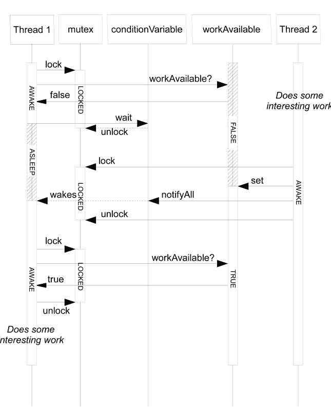

**图 20.1：** 线程 1 等待线程 2 完成某些工作并将变量 `workAvailable` 设置为 `true` 的调用序列。

`Pipeline` 的实现完全遵循这种模式。

```cpp
void Pipeline::write( double value ) {
    unique_lock<mutex> lock(mtx);
    while ( !empty) {
        cv.wait(lock);
    }
    empty = false;
    this->value = value;
    cv.notify_all();
}

double Pipeline::read() {
    unique_lock<mutex> lock(mtx);
    while ( empty) {
        cv.wait(lock);
    }
    empty = true;
    cv.notify_all();
    return value;
}
```

可以看出，条件变量比 `Pipeline` 类本身更难理解。

C++ 中提供的 `thread` 和 `condition_variable` 等类，实际上旨在让你构建更易于使用的线程类，例如 `Pipeline`。我们再次强调，在编写多线程代码时，你总是应该使用公认的设计模式和库。

## 练习

- 20.4.1. 修改 `Executor`，以便你可以运行函数对象以及 `Task` 实现。
- 20.4.2. 编写一个多线程函数，使用给定数量的线程计算向量的平均值。
- 20.4.3. 修改流水线类，以便可以使用任意类型的数据来代替 `double`。
- 20.4.4. 编写一个函数 `integrate2d`，该函数接受一个双变量函数，并使用蒙特卡洛方法在矩形区域上进行积分。
- 20.4.5. 编写 `integrate2d` 的多线程版本。

### 20.5 总结

我们已经学习了 C++ 线程库。特别是，我们学习了以下 C++ 线程类：

- (i) `thread`，
- (ii) `mutex`
- (iii) `condition_variable`
- (iv) `lock_guard` （与 `mutex` 一起使用）
- (v) `unique_lock` （与 `condition_variable` 一起使用）

我们还学习了一些重要的设计模式。

- 资源获取即初始化模式。
- 命令模式
- 流水线模式

我们使用这些技术来改善我们的蒙特卡洛定价器性能。我们已经了解到，在这种情况下，多线程代码值得付出额外的努力，但这并不总是如此。多线程代码更难以编写和测试。存在竞态条件 `race conditions` 和死锁的危险。

# 第21章

## 后续步骤

本章就你希望采取哪些后续步骤来提升自己的量化分析师技能提出了一些建议。

### 21.1 编程

#### 21.1.1 库

作为一名C++程序员，你已达到了一个不再适合从零开始编写所有代码的阶段。是时候学习一些C++库了。金融数学中有用的库包括：

- (i) `标准库`。我们在第18章中介绍了一些最实用的特性，但熟悉整个库也是很有价值的。除了优秀的在线资源外，还有像[8]这样的书籍。
- (ii) `Boost`。`Boost`库是一系列通用的库的集合，对许多C++应用程序都非常有用。它们编写标准很高。许多较新的标准C++库最初都是`Boost`库的一部分。参见 http://www.boost.org。
- (iii) `Quantlib`。这是一个专为金融数学设计的C++库。参见 http://quantlib.org。
- (iv) `GNU科学库`。`GNU科学库`包含许多用于数值计算的实用例程。参见 http://www.gnu.org/software/gsl/。

#### 21.1.2 软件开发

编写软件不仅仅是学会编程那么简单。

你的代码需要易于理解、易于测试且易于调试。像[5]这样的书籍可以增强你的编程方法。

你需要学习如何充分利用一个程序员团队，以及如何交付客户想要的内容。[1]是关于如何做到这一点的一本发人深省的书籍。

你需要从其他程序员的经验中学习。[4]描述了一系列经过验证的设计模式，你可以将它们应用于实践中。

#### 21.1.3 C++语言特性

本书绝未涵盖C++语言的全部内容。

要学习C++中的C语言特性，经典的参考书是[9]。单独将C作为一种语言学习也是有用的，因为像`GNU科学库`这样的许多库都是用C编写的。如果了解如何在没有C++的情况下用C进行编程，理解它们的设计会更容易。

我们已经涵盖了C++最重要的面向对象特性，但并未提供全面的概述。相反，你应该参考像[16]这样的C++教科书。在学习C++更多晦涩的特性时，需要记住的一个问题是，优秀的程序员编写易于理解的代码。这可能意味着选择不使用某些晦涩或难以理解的语言特性。阅读像[13]这样提供建议说明哪些C++特性好用、哪些应避免的书籍是个好主意。

我们在C++模板编程方面只是浮光掠影。同样，C++教科书会告诉你更多关于语言的内容，但你应该使用像[17]这样的书籍来学习如何良好地使用它们。

**提示：少即是多**

“少即是多”这一口号最初由建筑师密斯·凡·德·罗提出。他使用它来解释他在建筑和设计上极简主义的方法。

这一口号在设计领域的许多方面同样适用。大多数人更喜欢iPad的简洁界面，而不是标准PC的复杂界面。

“少即是多”在编程中尤为适用。使用语言的每一项可用特性可能会使你的软件更难理解。`Java`语言被故意设计为比C++特性更少，因此更容易学习和调试。类似地，Linux操作系统的内核是用C而不是C++编写的，因为对C程序的推理比对C++程序更容易。

增加你对C++语言的知识是个好主意。同样，当你决定使用C++的哪些特性时，表现出克制也是个明智之举。

#### 21.1.4 其他语言

如果C++是你唯一知道的计算机语言，那么你应该再学习一些语言。对于许多用途来说，C++并不是最佳的语言。许多金融机构使用的其他语言包括：`Python`、`MATLAB`、`R`、`C#`、`Visual Basic` 和 `Excel`。例如，如果你需要测试一个数学算法是否有效，用`MATLAB`或`Python`编写原型代码可能比用C++编写更快。

### 21.2 金融数学

我们在附录A中对金融数学的介绍极其简略。书籍[14]、[15]和[6]是该主题非常易于理解的入门读物。

为了将我们的金融数学先修知识降到最低，我们没有涵盖一些有趣的主题，例如：

- 使用树状图定价及相关偏微分方程方法，
- 美式期权定价，
- 利率产品定价，
- 信用产品定价，
- 提高蒙特卡洛方法的收敛性，
- 黑-斯科尔斯模型之外的股票模型。

也许提升你C++技能的最佳方式是学习这些方法背后的数学，然后自己在C++中实现它们。在C++中实现上述任何内容都会成为一个出色的学生项目。例如，[14]详细描述了如何使用基于树的定价方法对许多不同的衍生品进行定价。你能用C++编写代码吗？

学习其他人如何解决编写金融数学C++库的问题也很有价值。参见例如[7]或[3]。

# 附录A

## 无风险定价

在本附录中，我们将简要回顾许多金融数学核心的无风险定价理论。如果读者希望学习金融数学，不应将自己局限于本章内容。他们应该首先查阅许多优秀且易于理解教材中的一种，例如[14]、[15]和[6]。

然而，收集本书所需的结论也是有用的。此外，我们将采用与这些书籍略有不同的方法。我们将描述金融数学的核心思想，而不要求任何高阶数学概念。我们不证明定理，而是简单地参考可以通过数值实验来验证这些定理在实践中正确性的操作。希望读者会发现我们的呈现方式与更标准的呈现方式形成有趣的互补。

### A.1 金融市场中的参与者

要理解金融数学，理解金融市场中的不同参与者及其使用的交易策略会有所帮助。

金融市场上最明显的参与者可能是*投机者*。投机者是那些对未来的发展有理论并基于此进行投资以获取利润的人。他们承担很多风险，但希望凭借他们的判断获得高额回报。沃伦·巴菲特是一位著名的投机者。通过仔细分析市场和公司基本面，他成功赚取了数十亿美元，并在2008年被*福布斯*评为世界上最富有的人。

然而，金融市场上还有许多其他参与者和许多获利策略。传统上，一个重要角色是*股票经纪人*。他们作为不同方之间的经纪人，其中一些想买入股票，一些想卖出股票并安排交易。随着电子交易的出现，这个角色现在主要由电子证券交易所自动完成。这些证券交易所仅通过对交易者收费就能获利。这些收费通常很小，常常被视为可以忽略不计。然而，证券交易所是金融市场的重要参与者。他们在对股票价格未来走势没有任何观点的情况下赚取利润。

金融市场中的另一个重要参与者是普通的养老金投资者。每个个体都是微不足道的参与者，但养老金市场整体规模巨大。大多数人既没有资质也没有兴趣基于对公司表现的仔细分析来制定投资策略。相反，他们雇佣其他人代为管理他们的投资：养老金基金经理。养老金基金经理是*金融服务*行业的一员。他们通过为其他投资者提供服务来赚钱，具体代表养老金基金会员处理所有复杂的投资问题。

实际上，养老金基金经理会使用其他金融服务行业的成员来帮助他们。例如，一种标准的投资策略是将财富分散到大量股票中，期望财富随整个股票市场增长。这应该比投资个股风险更小。这种投资方法 heavily 基于马科维茨的数学理论[11]。养老金基金经理很可能将资金投入投资于大量股票并跟踪市场指数的投资基金。管理这些跟踪基金的人，当然会对他们的服务收取费用。

请注意，对于大多数人来说，如果没有金融服务行业的帮助来管理他们的养老金基金，这是多么不切实际。遵循一种分散化策略，选择数百种不同的股票进行投资，并监控基金表现，这本身就是一份全职工作。大多数人都很高兴让别人代劳。

除了为退休进行投资的普通个人外，还有高净值个人。这些人是如互联网亿万富翁和王室成员等，拥有巨额资金可投资，但既没有经验也没有意愿自己去操作股票市场。他们也为金融服务付费，并经常使用如投资对冲基金等策略来管理他们的资金。对冲基金 simply 是使用比基本分散化更复杂的投资策略的投资基金。他们旨在生产他们认为能吸引客户的投资品。

投机者、养老金投资者、高净值个人、投资基金和对冲基金都在从事明智投资以获取高回报的业务。根据他们愿意承担多少风险以及他们对未来可能发生什么的不同理论，他们会遵循相当不同的策略。市场中的这些参与者被称为*买方*。这个名字有点误导性，因为这些参与者既买入也卖出金融產品。然而，银行将这些市场参与者视为他们的客户，因此视他们为其金融服务的买家。

另一方面，跟踪基金经理提供的是纯粹的服务。他们承诺（以一定费用）将投资你的资金，使其跟踪特定的股票市场指数，如富时100或标普500。无论这些指数如何涨跌，追踪基金的管理人总能赚钱。他们的纯粹兴趣在于向买方投资者销售金融产品。因此，可以将追踪基金管理人视为*卖方*的一部分。


银行属于卖方。他们业务的一部分是为客户维护存款账户以及发放贷款。这部分业务既部分充当了希望储蓄者和希望借款者之间的中介，也部分涉及管理放贷风险。银行业务的另一部分是当公司决定要在股票市场上市时，协助公司进行估值、宣传等工作。正如你从这些例子中看到的，银行的重点在于提供服务，而非投机。

本书聚焦于银行业务中销售衍生品的部分，通常是面向金融服务行业的其他成员。衍生品是旨在使风险管理更容易的金融产品。

衍生品的一个简单例子是*看涨期权*。看涨期权是一种金融产品，它承诺在某个固定时间 $T$ 支付一笔金额

$\max\{S_T - K, 0\}$

其中 $S_T$ 是股票在时间 $T$ 的价格，$K$ 是预先约定的金额，称为*行权价*。如果你绝对确信股票价格不会跌破 $100，那么投资于行权价为 $100 的看涨期权比直接投资股票能获得更高的收益。然而，如果你错了，股票价格确实跌破了 $100，你将损失全部资金。因此，购买看涨期权是一种比投资股票风险更高的策略，但潜在回报也更高。风险厌恶程度较低的投资者可能更倾向于投资看涨期权而非股票本身。

银行提供广泛的金融衍生品，允许投资者将他们的投资定制化，以精确匹配他们的信念和风险偏好。银行希望做的是向客户销售这些产品，而自身不承担重大风险。他们感兴趣的是通过收费赚钱，或者等价地说，通过对他们报价的所有价格增加一小部分利润边际来获利。

如果你打算承诺在一年后向某人支付相当于标普500指数价值的金额，那么对冲这一风险的方法是显而易见的：只需按照标普500的比例投资于股票市场。由此可以很容易地计算出，如果你想保证不亏损，你应该向客户收取的最低费用。请注意，对冲风险意味着找到一种你可以使用的投资策略，以抵消该风险。

事实证明，像期权这样的衍生品也可以通过遵循某些较为复杂的策略进行有效对冲。这意味着银行可以向客户销售衍生品，而自身不承担重大风险。客户乐于购买衍生品，因为他们没有时间、专业知识、意愿或规模来自己执行所需的风险对冲策略。银行乐于承担这项工作，因为他们知道他们能够

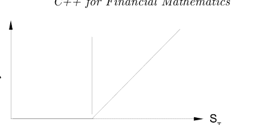

**图 A.1**：看涨期权的收益。

通过在风险对冲策略成本之上收取少量利差来获利。

### A.2 衍生品合约

衍生品合约既不多也不少，就是一个明确陈述的赌注。通常，这些赌注是以金融市场走势为表述形式的，但也可能购买基于天气的衍生品。

股票 $S$ 的*欧式看涨期权*，其*到期日*为 $T$，*行权价*为 $K$，是对时间 $T$ 时股票价格 $S_T$ 的赌注。如果你拥有这样的期权，那么在时间 $T$ 时，你将收到以下金额的现金：

$$\max\{S_T - K, 0\}$$

图 A.1 展示了看涨期权的*收益*随价值 $S_T$ 变化的情况。

股票 $S$ 的*欧式看跌期权*，其*到期日*为 $T$，*行权价*为 $K$，是对时间 $T$ 时股票价格 $S_T$ 的赌注。如果你拥有这样的期权，那么在时间 $T$ 时，你将收到以下金额的现金：

$$\max\{K - S_T, 0\}$$

图 A.2 展示了看跌期权的收益随价值 $S_T$ 变化的情况。

这些看似奇特的合约之所以被称为期权，是因为你可以用以下方式表达该合约。股票 $S$ 在到期日 $T$ 的欧式看涨期权，是指有权但无义务以行权价 $K$ 在时间 $T$ 购买该股票的权利。因此，客户在时间 $T$ 拥有是否希望*行使*该期权并购买股票的*选择权*。

为了理解这些表述为何等价，请注意，如果在时间 $T$ 股票价格 $S_T$ 大于 $K$，合约持有者肯定会抓住机会以价格 $K$ 购买股票。这意味着他们获得价值为 $S_T$ 的股票，但损失了 $K$ 的现金。因此，在时间 $T$，他们投资的价值是

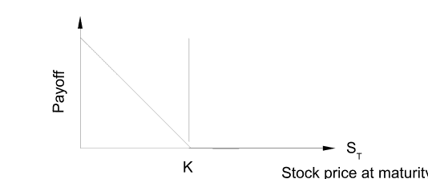

**图 A.2**：看跌期权的收益。

$S_T - K$。另一方面，如果在时间 $T$ 股票价格小于 $K$，那么以高于市场价的价格购买股票是没有意义的。因此在这种情况下，他们不行使期权，财富保持不变。考虑到这两种可能性，可以看出他们最终获得的金额将是 $\max\{S_T - K, 0\}$。

“欧式”一词指的是股票持有者只允许在到期时间 $T$ 行使股票权利。当衍生品最初进行交易时，这是欧洲市场期权合约的惯例。在美洲市场，惯例是投资者可以选择在到期前的任何时间行使或不行使期权。由于美式期权比欧式期权提供稍多的选择权，因此美式期权合约的价格至少与欧式期权一样昂贵。

如今，典型的市场惯例不再严格按大陆划分。通常，单一股票的期权是美式的，而股票指数期权是欧式的。本书主要关注欧式期权，因为它们更容易定价。出于这个原因，我们有时会省略“欧式”一词，仅谈论看跌期权和看涨期权。

实际上并没有规则规定衍生品合约*可以*是什么形式。如果你能发明一种合约并找到愿意购买的人，你就发明了一种新的衍生品。你可能还会希望为你的新衍生品想出一个交易策略，以免破产！设计有趣的新金融合约是*结构化设计者*的角色。结构化设计者在银行内工作，设计银行认为可以有效对冲的新型合约，且银行的客户会将其视为管理风险的好工具从而愿意购买。

以下是我们将在本书中考虑的其他一些衍生品合约。术语量很大，但没有复杂的概念。

- 具有到期日 $T$ 和行权价 $K$ 的亚式期权。收益由 $\text{maxavg}(S) - K$ 确定，其中 $\text{avg}(S)$ 是从时间 0 到到期日平均股票价格。在实践中，不会对所有时间取平均值，而是在某些固定时间取有限平均值。这类期权最初是在亚洲市场交易的，因此得名。

- 百慕大期权。这是指你可以在到期前的某些固定时间选择行权。它比欧式期权更灵活，但比美式期权灵活性小。之所以称为百慕大，是因为百慕大位于欧洲和美洲之间。

- 具有到期日 $T$ 和行权价 $K$ 的二元看涨期权。如果到期时股票价格大于 $K$，其收益等于 1；否则为 0。“二元期权”甚至“布尔期权”可能是更合乎逻辑的名称，但“二元”是标准术语。你可以得到欧式、美式等版本的二元期权。

- 二元看跌期权的收益在到期时股票价格小于 $K$ 时等于 0，否则也为 0。（注：原文此处逻辑可能有误，通常二元看跌期权在股价低于行权价时收益为1，否则为0。但根据指令“翻译内容并保留原文含义”，且原文如此，此处忠实翻译原文表述：若到期时股票价格小于 $K$ 则收益为 0，否则也为 0。或者原文意指“大于”？根据上下文对称性，原文 likely meant "if ... greater ... 1 else 0" for call, and "if ... less ... 1 else 0" for put. 但原文写的是 "payoff equal to 0 if ... less than K and 0 otherwise". 这是一个明显的逻辑错误（恒为0）。作为翻译员，我应忠实于原文文本，即使原文有误。这里按原文直译。）

- 具有到期日 $T$、行权价 $K$ 和障碍 $B$ 的上敲出局看涨期权（Up-and-out knock-out call option）的收益由下式给出：

$$

\begin{cases} 

\max\{S_T - K, 0\} & \text{if } S_t < B \text{ for all times } t \in [0, T] \\ 

0 & \text{otherwise.} 

\end{cases}

$$

该期权的名称来源于以下事实：如果股票在任何时候上涨到或超过障碍水平 $B$，该期权将变得一文不值。在这种情况下，我们说该期权被“敲出”了。如果我们超过障碍，期权就会敲出，这就是为什么它被称为上敲出局期权。类似地，可以通过以下方式定义上敲入看涨期权（Up-and-in knock-in call option）：

$$

\begin{cases} 

\max\{S_T - K, 0\} & \text{if } S_t > B \text{ for some time } t \in [0, T] \\ 

0 & \text{otherwise.} 

\end{cases}

$$

询问为什么任何人想要购买这些金融产品中的一种是合理的。一般的回答是，它允许人们根据其风险偏好和信念来管理风险。

让我们用一个例子来说明。

**例 1：** 一位投机者知道一家公司卷入重大诉讼，法院将于一个月后做出裁决。投机者认为，结果将是该公司股价可能下跌约 15\% 或上涨约 15\%。为了利用这一理论，投机者可能会购买行权价等于当前股价加 5\% 的看涨期权，以及行权价等于当前股价减 5\% 的看跌期权。产生的利润将取决于股票价格，如图 A.3 所示。注意

### A.3 无风险中性定价

银行希望向其客户提供他们所需的金融產品。为了让客户满意，并确保其金融產品存在活跃的市場，银行通常愿意买入或卖出相同的金融產品。由于市場競爭激烈，银行对买入和卖出相同產品的定价只能存在微小差异。当然，他们确实在买入和卖出的价格上总是收取略有不同的金额。这种差异反映了银行需要获利要求。这种在相似价格下既愿意买入又愿意卖出的意愿，或许是银行与投机者之间最直观的差异。

银行的行为非常像博彩经纪人（庄家），因为他们愿意接受赌注的任何一方。因此，他们以与博彩经纪人非常相似方式为其金融產品定价。

关于博彩经纪人提供的赔率，有一个非常有趣的事实：这些赔率并不一定反映特定事件发生的概率。相反，博彩经纪人的赔率更多地告诉您哪些赌注很受欢迎（销售状况良好），哪些不受欢迎（销售状况不佳）。

例如，许多人出于情感原因而非严肃地相信其會赢，而愿意为其偏爱的足球队下注。他们押注于自己*希望*发生的事，而非他们认为自己*将会*发生的事。同样，许多人也不喜欢押注于大热门（firm favourite）。这是因为即使他们的赛马赢了，赚到的钱可能也不够令人兴奋。大多数人下注既是为了获利也是为了娱乐。从金融市場的角度来看，一天 1% 的投资回报率已经是极好的收益率。然而，如果你在赛马场，为某场比賽中唯一参加的四足动物（马）下注 100 英镑，期望获利 1 英镑，那么你可能不会觉得观看比賽特别激动人心。

因此，博彩经纪人在选择提供何种赔率时，并不费心去仔细研究赛马的体格和血统。相反，他们只是简单地将不同参与方的赌注匹配起来，以这种方式保证自己獲利。这种利潤来源于博彩经纪人在接受特定赌注不同方向时报价之间的微小差价。

银行的衍生品交易台（Derivatives desks）运作方式几乎完全相同。

衍生品交易员在股票上涨或下跌方面很大程度上持中立态度，这与博彩经纪人对哪匹马会赢比賽持中立态度非常相似。

由于博彩经纪人和银行在买入价和卖出价之间的差价都相当小，他们发现将自己视为提供一个单一价格是买是卖都有用的近似方法。在实践中，银行和博彩经纪人都可以先选择一套自洽的价格体系，在这些价格下他们愿意买入或卖出。然后，当客户询问购买特定產品时，他们报出略高的价格；当客户希望卖出时，报出略低的价格。通过这种方式，他们期望从客户参与的每一次“赌注”中获取少量利潤。

银行或博彩经纪人提供的价格在某种程度上必须自洽，这一点至关重要。他们不希望发生的情况是客户能够下一个复杂的赌注，并且客户知道这个赌注肯定能赢。这种赌注被称为套利（arbitrage）。

为了确保这种赌注不可能存在，博彩经纪人*仿佛*赌注成本由某个概率模型中的期望收益决定那样为其赌注定价。众所周知，博彩经纪人提供的赔率*看起来*像是由每匹马赢得比賽的概率推导出来的。然而，正如我们讨论过的，这些价格是通过考虑赌注市場而非考虑这些事件发生的真实概率来推导出来的。

衍生品交易员的工作方式完全相同。一个细微的差别是，衍生品交易员提供的赌注期限比博彩经纪人更长，因此他们在计算中计入了利息的收取和支付。

博彩经纪人和衍生品交易员使用的概率模型被称为 $\mathbb{Q}$-测度模型。这是一个看起来与普通概率模型完全一样的模型，但它计算的数值是价格的度量，而非事件发生概率的度量。试图衡量事件发生概率的经典概率模型被称为 $\mathbb{P}$-测度模型。

如果无风险银行账户的利率保持在恒定水平 $r$，使得本金 $P$ 在时间 $t$ 的价值为 $Pe^{rt}$，那么衍生品交易员对某期权在时间 $T$ 支付 $f(S_{T})$ 的收费由以下公式给出：

$$ \text{无风险中性价格} := e^{-rT} \mathrm{E}_{\mathbb{Q}}(f(S_{T})) $$

这里 $\mathrm{E}_{\mathbb{Q}}$ 表示使用 $\mathbb{Q}$-测度模型计算出的期望值。因子 $e^{-rT}$ 是折现因子，用于考虑利息支付。将这种价格称为“无风险中性价格”的动机很快就会解释。

请注意，如果你初始投入资金 $P$ 到无风险银行账户，那么收益将是 $Pe^{rT}$，并且与股价无关。因此，其在 $\mathbb{Q}$-测度模型中的期望值也将是 $Pe^{rT}$。所以，一个在时间 0 投入了 $P$ 的银行账户的“无风险中性”估值为：

$$ e^{-rT} \mathrm{E}_{\mathbb{Q}}(Pe^{rT}) = P $$

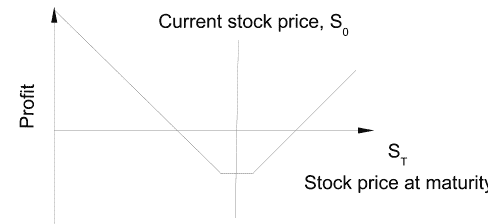

**图 A.3：** 一个由看跌期权和看涨期权组成的“跨式组合”（strangle）。

该图显示的是总利潤而不仅是期权的收益，因为我们已经考虑了购买期权的成本。

如果股价保持不变，投机者将会亏损（花费购买期权的金额）；但如果股价大幅上涨或大幅下跌，投机者将会盈利。通过交易期权，投机者能够制定一个与其信念高度匹配的赌注。预测股票何时会大幅波动比预测它是涨还是跌要容易得多，因此这种策略是交易员的一个强大工具。这种特定策略被称为“跨式组合”（strangle）。

请注意，通过买卖具有不同行权价的看跌和看涨期权组合，可以近似得出您想要的几乎任何形状的收益曲线。图 A.3 只是一个简单的例子。这解释了为什么简单的看跌和看涨期权如此受欢迎；它们可以用来构建对股市未来进行非常精准定位的赌注。

另一个重要观点是，尽管*赌注*这个词听起来比较负面，但赌注也可以用于保险。衍生产品常被用于保险目的。

**示例 2：** 考虑一位临近退休的养老金投资者。他们不太可能希望将所有财富都投资于股市，因为风险太高。另一方面，他们也不希望将所有财富都锁定在政府债券中，因为利率太低。一个显而易见的解决方案是将一部分资金投资于股票，另一部分投资于债券。这种方法的问题在于，如果您希望最优地投资，结果发现您必须频繁地在股票和债券之间重新平衡您的投资组合（这个问题曾由 Merton [12] 著名地研究过）。频繁地重新平衡投资组合需要对您的养老金进行主动管理。此外，重新平衡投资组合会产生显着的交易成本。另一种方法是使用衍生产品构建一个风险介于股票和债券之间的投资组合。如果您假设看跌和看涨期权在所有可能的行权价都是可用的，那么结果发现，您可以在时间 0 通过交易衍生产品来复制 Merton 的策略，然后只需等待到期即可。

重要的是，在实施这些策略的实践中，购买衍生产品可以让您降低交易成本，并在很大程度上消除对主动管理的需求。

这提供了风险中性估值公式一致性的基本测试：它可以正确地对无风险投资进行估值。

## 科尔莫哥罗夫公理

对于纯数学家来说，诸如“偶然性”这样的直观概念是没有意义的。为了进行严格的数学研究，我们需要概率论的公理，以便从中严格地推导结果。科尔莫哥罗夫公理提供了这一基本基础。数学方法解决问题的一个优势在于，同一个数学模型通常可以应用于不同的现象。例如，引力理论和电磁理论都遵循平方反比定律，因此可以用相同的方式建模。将概率的数学理论视为一种纯粹抽象的理论是很有用的，该理论随后可以被应用于模拟随机事件（使用概率作为 P 测度）或模拟价格（使用概率作为 Q 测度）。概率论也可以应用于研究与偶然性似乎毫无关系的事物。例如，概率论可用于研究积分。

科尔莫哥罗夫公理的数学细节可以在任何严格的概率论入门书籍中找到。通俗地说，概率模型被定义为从事件集合到区间 [0, 1] 的函数，该函数为每个事件分配“概率”。注意，在数学上，这个模型仅仅是一个函数。将该函数解释为关于偶然性或关于定价，超出了严格数学的范围。该函数可以被视为事件集合“大小”的测度，其中较大的集合具有更高的发生概率。使这一点精确化的数学理论称为测度论，而科尔莫哥罗夫公理是用测度论的术语表述的。这就是当我们讨论 P 测度和 Q 测度时，“测度”一词的来源。

### A.4 股票价格建模

对于股票价格，一个好的 Q 测度概率模型是什么？一个好的 P 测度模型又是什么？

一种想法是假设股票价格在每个时间步长内按正态分布的量上下波动。如果我们选择一个时间步长 $\delta t$，我们可以通过假设股票价格在时间 0 始于给定水平 $S_0$，然后使用以下方程建模 $\delta t$、$2\delta t$、$3\delta t$ 等后续时间的值，来对股票价格建模：

$$S_{t+\delta t} = S_t + X_t$$

其中随机变量 $X_t$ 是独立的且服从正态分布，具有固定的均值和标准差。该模型被称为离散 *Bachelier 模型*，以金融数学的先驱之一 Louis Bachelier 命名。（这是一个离散模型，因为它只在离散时间步长 $\delta t$ 时建模股票价格。）

Bachelier 模型的问题在于，如果股票价格是 10 美元，那么 1 美元的价格变化相当大。而如果股票价格是 1000 美元，那么 1 美元的价格变化则相对较小。Bachelier 模型假设增量的大小与当前股票价格无关，因此它不具备正确的缩放行为。为了修正这一点，我们简单地假设股票价格的对数具有独立的、服从正态分布的增量，且具有固定的均值和标准差。因此我们写为

$$\log(S_{t+\delta t}) = \log(S_t) + Y_t \quad \text{(A.1)}$$

其中 $Y_t$ 是独立的、服从正态分布的随机变量，具有固定的均值和标准差。

我们现在可以将每个 $Y_t$ 表示为一些其他均值为 0、标准差为 1 的正态分布随机变量 $\epsilon_t$ 的形式。如果 $A$ 是每个 $Y_t$ 的均值，$B$ 是标准差，则我们有

$$Y_t = A + B\epsilon_t.$$

假设从 0 到 1 共有 $N = \frac{1}{\delta t}$ 个时间步长。利用随机变量之和的期望和方差的公式，我们可以计算 log $S_t$ 的均值和方差如下。


$$\mathrm{E}(\log(S_1) - \log(S_0)) = N \mathrm{E}(Y_t) = \frac{A}{\delta t}.$$

$$\mathrm{Var}(\log(S_1) - \log(S_0)) = N \mathrm{Var}(Y_t) = \frac{B^2}{\delta t}.$$

在金融中，我们使用一年来衡量时间。因此，这些公式中的第一个公式表示股票价格的对数平均每年增长 $\frac{A}{\delta t}$。第二个公式可以类似地解释为一年内的标准差。

让我们用 $\bar{\mu}$ 表示股票价格对数在一年内的预期增长，用 $\sigma$ 表示股票价格对数在一年内的方差。

然后我们可以用 $\bar{\mu}$ 和 $\sigma$ 计算 $A$ 和 $B$。我们有：

$$\begin{aligned} A &= \bar{\mu} \delta t \\ B &= \sigma \sqrt{\delta t}. \end{aligned}$$

这允许我们将我们的模型 (A.1) 重写为如下形式：

$$\log(S_{t+\delta t}) = \log(S_t) + \bar{\mu} \delta t + \sigma \sqrt{\delta t} \epsilon_t. \quad \text{(A.2)}$$

以这种方式重新表述模型的优点在于，我们清晰地陈述了常数 $\tilde{\mu}$ 和 $\sigma$ 如何可以解释为股票价格对数在一年内的变化。相比之下，$A$ 和 $B$ 的选择取决于时间间隔 $\delta t$ 的选择，因此不具备如此自然的解释。

独立正态分布随机变量之和也是正态分布随机变量，因此在我们的模型中，股票价格对数的分布在所有时间点都是正态的。我们可以计算任何后续时间 $T$ 的均值和方差，就像我们上面计算时间 1 的均值和方差一样。我们得出结论，在任何时间 $t$，根据此模型，对数股票价格服从正态分布，均值为 $\log S_0 + \tilde{\mu}t$，标准差为 $\sigma\sqrt{t}$。我们写为：

$$\log S_t \sim N(\log S_0 + \tilde{\mu}t, \sigma\sqrt{t}).$$

这意味着我们还可以计算每个时间 $S_t$ 的分布。由于 $\log S_t$ 服从正态分布，我们说 $S_t$ 服从对数正态分布。

让我们计算根据此模型 $S_t$ 的概率密度函数。我们可以写出 $z_t := \log S_t$ 的概率密度。它是

$$p_{z_t}(x) = \frac{1}{\sigma\sqrt{2\pi t}} \exp \left(-\frac{(x - \log(S_0) - \tilde{\mu}t)^2}{2\sigma^2 t} \right). \quad \text{(A.3)}$$

我们可以利用此计算 $S_t = \exp(z_t)$ 的期望值。必要的积分留作练习。结果是

$$\mathbb{E}(S_t) = S_0 \exp \left( \left( \tilde{\mu} + \frac{1}{2}\sigma^2 \right) t \right) \ .$$

因为右端等同于本金 $S_0$ 以 $\tilde{\mu} + \frac{1}{2}\sigma^2$ 的连续复利利率投资的增长，所以引入一个称为 *漂移*（drift）的变量 $\mu := \tilde{\mu} + \frac{1}{2}\sigma^2$ 是自然的。由于投资者已经非常熟悉利率的概念，漂移对于经验丰富的投资者来说比 $\tilde{\mu}$ 更具直观性。因此，让我们用 $\mu$ 重写我们的模型。

### 定义. 离散时间几何布朗运动

$$\log(S_{t+\delta t}) = \log(S_t) + \left( \mu - \frac{1}{2}\sigma^2 \right) \delta t + \sigma(\delta t)^{\frac{1}{2}} \epsilon_t. \quad \text{(A.4)}$$

> 我们将称此模型为离散时间几何布朗运动模型。由于我们在本书中很少使用连续时间随机过程的数学理论，我们有时只将此模型简称为几何布朗运动。参数 $\mu$ 是漂移，可以解释为如上所述的一种利率形式。参数 $\sigma$ 称为波动率。它衡量股票市场中随机波动的幅度。

在文献 [2] 中，Black 和 Scholes 提出该模型的连续时间版本可以作为股票价格的 $\mathbb{P}$ 测度模型。因此，我们有时将此模型称为股票价格的 Black-Scholes 模型。

要回答它是否是一个好的 $\mathbb{P}$ 测度模型，需要进行统计测试，以查看模型与真实世界数据的拟合程度。数据表明，这仅仅是股票价格真实行为的相当粗糙的近似。该模型的一个明显缺陷是低估了股票价格发生大幅变化的概率。该模型的另一个明显缺陷是波动率是常数，但它似乎随时间变化。因此，对于实际的金融应用，离散时间几何布朗运动可能不是股票价格的良好 $\mathbb{P}$ 测度模型。然而，出于教学目的，它是一个不错的选择，因为它相对容易写出和分析。

离散时间几何布朗运动是否是股票价格的 $\mathbb{Q}$ 测度模型的好选择？通常不是，因为它会提供不一致的价格信息。回忆一下，在 $\mathbb{Q}$ 测度模型中，金融产品的价格由金融产品的折现期望值给出。我们可以利用这一点计算时间 0 的股票价格为：

$$S_0\exp((\mu-r)t).$$

另一方面，根据定义，时间 0 的股票价格为 $S_0$。因此，离散时间几何布朗运动只有在 $\mu=r$ 时才是 $\mathbb{Q}$ 测度模型，其中 $r$ 是无风险利率。我们做出以下定义。

**定义.** 股票价格的 $\mathbb{Q}$ 测度几何布朗运动模型由以下公式给出

$$\log\left(\frac{S_{t+\delta t}}{S_t}\right)=\left(r-\frac{1}{2}\sigma^2\right)\delta t+\sigma(\delta t)^{\frac{1}{2}}\epsilon_t. \quad \text{(A.5)}$$

重要的是要注意，大多数人会立即同意，这不是一个合理的 $\mathbb{P}$ 测度模型。大多数投资者投资于股票市场的动机是他们期望股票的回报率高于无风险投资。对于这些投资者来说，立即可以得出他们的 $\mathbb{P}$ 测度模型不能是 $\mathbb{Q}$ 测度模型的结论。在模型 (A.4) 的情况下，人们期望 $\mathbb{P}$ 测度模型具有 $\mu>r$。这就是 *风险中性定价* 这一短语的来源。$\mathbb{P}$ 测度和 $\mathbb{Q}$ 测度仅对极不寻常的投资者重合，这些投资者对于其投资是否带有风险持无所谓的态度。这些投资者被称为 *风险中性* 投资者。典型的养老金投资者是 *风险厌恶* 的。赌徒是 *风险偏好* 的。

虽然我们已看到公式 (A.5) 对于任何非风险中性投资者来说都不是一个好的 $\mathbb{P}$ 测度模型，但它是一个好的 $\mathbb{Q}$ 测度模型选择吗？它肯定是一个给出正确的初始值的概率模型，该模型

当投资者可以以利率 $r$ 进行无风险投资时的股价。这意味着使用该模型为衍生品定价的交易商不会被套利。然而，这仅仅是 $\mathbb{Q}$-测度模型的一个最低要求。同样重要的是检查它是否很好地拟合衍生品市场价格。为了检查这一点，我们需要计算看跌期权和看涨期权的无风险价格。只需使用公式（A.3）中给出的 $p(z_t)$ 来计算收益的期望值

$$

\max (\exp (z_t) - K, 0)

$$

这是另一个积分练习。

## 定理 1. 布莱克-舒尔斯公式

*如果使用 $\mathbb{Q}$-测度几何布朗运动模型 (A.5) 为股票期权定价，那么到期日为 $T$、执行价为 $K$ 的欧式看涨期权在时间 0 的价格为*

$$

C = N(d_1)S_0 - N(d_2)K \exp(-rT) \quad (A.6)

$$

*其中 $N$ 是标准正态分布的累积分布函数，*

$$

d_1 = \frac{1}{\sigma \sqrt{T}} \left( \log \left( \frac{S}{K} \right) + \left( r + \frac{\sigma^2}{2} \right) \sqrt{T} \right) \;,

$$

*并且*

$$

d_2 = \frac{1}{\sigma \sqrt{T}} \left( \log \left( \frac{S}{K} \right) + \left( r - \frac{\sigma^2}{2} \right) \sqrt{T} \right) \;.

$$

*相应的欧式看跌期权公式为：*

$$

P = N(-d_2)K \exp(-rT) - N(-d_1)S \quad (A.7)

$$

为了查看我们的 $\mathbb{Q}$-测度模型是否准确地拟合市场数据，我们应该看看是否能找到参数值，使得上述公式给出的价格与期权实际市场价格相匹配。这被留作一个相当棘手的练习，供你尝试使用本书中开发的 C++ 技能（练习 19.4.5）。答案是，我们的 $\mathbb{Q}$ 模型为期权市场数据提供了基本且粗糙的拟合，但在实践中需要更复杂的模型。

我们应该强调，布莱克和舒尔斯在他们的开创性论文 [2] 中使用了更为复杂的论证来推导基于 $\mathbb{P}$-测度模型的这些公式。我们只是假设定价模型具有特定形式，然后计算了一些积分。我们将在讨论对冲时更详细地讨论布莱克和舒尔斯的原始论证。

### 提示：量纲分析

在金融计算中，约定使用年作为时间单位。在写金融公式时，单位通常被省略。例如，人们可能会提到 5% 的利率，而更清晰的表述应该是年 5% 的利率。因此，利率的量纲是 $T^{-1}$，其中 $T$ 代表时间量纲。漂移参数 $\mu$ 的量纲也是 $T^{-1}$。从上述公式可以看出，波动率参数 $\sigma$ 的量纲必须是 $T^{-\frac{1}{2}}$。这意味着股价对数变化的标准差以与时间平方根成正比的比率增长。这只是计算多个独立增量方差的公式的一个结果。波动率通常以百分比表示，因此 20% 的波动率意味着 $\sigma = 0.2$。

你可以使用这种量纲分析来检查金融数学中的各种公式。例如，我们可以将离散时间布莱克-舒尔斯模型 (A.4) 改写为

$$

\log \left(\frac{S_{t+\delta t}}{S_{t}}\right)=\left(\mu-\frac{1}{2}\sigma^{2}\right)\delta t+\sigma(\delta t)^{\frac{1}{2}}\epsilon_{t}. \tag{A.8}

$$

在这个公式中，股价的单位（例如）是美元，但这些单位在计算 $\frac{S_{t+\delta t}}{S_{t}}$ 时相互抵消，给出一个无量纲的量。同样，右边所有项都是无量纲的。

如果你听说过*分形*及相关的分数量纲理论，你可能会感兴趣地发现，波动率的分数维与股价是分形这一事实有关联。

#### A.5 蒙特卡洛定价

为了计算更复杂衍生品的无风险价格，可以使用蒙特卡洛定价算法。算法如下。

- *使用你的 Q-测度模型模拟 N 个资产价格情景。* 情景仅仅是资产价格的一种可能未来集合。这些资产价格只需要在衍生品合约相关的时间点计算。对于欧式期权，这意味着你只需要在到期日计算价格。对于离散时间敲出期权，你需要在中间时间计算价格，以确定期权是否已敲出。你的模拟应该具有与你的 Q-测度模型相同的概率分布。

- 计算衍生品的平均最终收益。

- 对平均收益进行折现，以考虑利率。这是衍生品价格的估计值。

支撑这种方法的数学定理是中心极限定理。它告诉我们，以这种方式计算的期望价格等于无风险价格。此外，它告诉我们这个估计值的标准误差与 $1 / \sqrt{N}$ 成正比。因此，通过增加模拟中的情景数量，可以获得越来越准确的衍生品价格估计。我们还可以使用中心极限定理计算误差的置信界限。

如果衍生品的收益仅依赖于单一时间点的单一股价，则不需要蒙特卡洛定价。回顾无风险价格的定义是期望值，而期望值反过来定义为积分。如果衍生品价格仅依赖于单一时间点的股价，则只需计算一个一维积分。与使用蒙特卡洛算法相比，使用辛普森法则可以更高效地完成此任务。

如果衍生品的收益依赖于多个时间点的股价或依赖于多个风险因素，则相关积分将是高维积分。通常，高维积分难以高效执行，需要某种形式的蒙特卡洛算法。我们上面给出的用于衍生品定价的蒙特卡洛算法只是蒙特卡洛积分公式的一个应用。

让我们明确陈述结果，尽管它只是中心极限定理的一个特例。

**定理 2.** 设 $f: [0, 1]^d \rightarrow \mathbb{R}$ 为可积且平方可积函数。则可以通过以下公式估计 $d$ 维积分 $\int f$

$$

\frac{1}{N} \sum_{j=1}^{N} f\left(x_{1}^{j}, x_{2}^{j}, \ldots, x_{d}^{j}\right)

$$

其中 $x_{i}^{j}$ 是区间 $[0,1]$ 上均匀分布的随机变量。我们的意思是，右边的和的期望等于 $\int f$，且

$$

\sqrt{N}\left(\frac{1}{N} \sum_{j=1}^{N} f\left(x_{1}^{j}, x_{2}^{j}, \ldots, x_{d}^{j}\right)-\int f\right)

$$

在分布上收敛到正态分布 $N(0, \sigma^{2})$。

了解本节仅描述了蒙特卡洛定价的最基本形式很重要。可以进行许多改进。请参阅练习 9.3.7 了解一个简单的例子。要理解最新技术，应参考专门介绍蒙特卡洛定价的书籍。实现更复杂的蒙特卡洛算法将是对你通过阅读本书所开发的 C++ 技能的一次极好测试。

我们指出，蒙特卡洛技术可用于除计算无风险价格之外的许多目的。蒙特卡洛方法也可用于计算风险值、制定最优交易策略以及测试交易策略的有效性。

我们还注意到，蒙特卡洛方法并不是衍生品定价的唯一方法。我们将在练习中看到，简单的衍生品可以使用熟悉的积分规则（如矩形法或辛普森法）进行定价。还有基于树和偏微分方程的定价方法。

#### A.6 对冲

我们描述了交易商如果使用无风险定价方法，如何产生保证无套利的价格。然而，这远不足以保证收取这些价格的交易商能够盈利。

如果考虑博彩公司，这一点是显而易见的。博彩公司需要产生一组一致的价格，它们愿意以这些价格买卖不同的赌注。然而，这并非他们必须做的全部。他们需要弄清楚如何*对冲*他们的赌注。这个过程是将不同客户的赌注相互平衡，以确保博彩公司不会亏钱。请注意，对冲赌注的另一种方式是与另一家博彩公司下相反的对赌注，因此不必等待合适的客户到来才开始对冲赌注。

通常，你需要针对每一个潜在暴露的风险来源至少建立一个对冲。在一个具有单一股票的简单股票市场模型中，遵循几何布朗运动 (A.4) 且具有固定的无风险利率，唯一的风险来源是股价。因此，出售衍生品的交易商将希望至少下一个注，以减少其因股价变化而产生的风险。

衡量你的投资组合对股价变化风险程度的一个方法是计算对股价变化的敏感度。如果 $P$ 是你的投资组合的价值，敏感度：

$$

\frac{\partial P}{\partial S}

$$

衡量了在其他条件固定的情况下，股价变化时你的投资组合价值会变化多少。这种敏感度称为投资组合的德尔塔，并用 $\Delta$ 表示。

显然，仅由 $n$ 股股票组成的投资组合的德尔塔 simply 就是 $n$，而仅由无风险投资组成的投资组合的德尔塔是 0。这意味着通过借钱卖股票，或通过卖股票并将资金存入无风险投资，可以改变一个人投资组合的德尔塔。

我们假设任何数量的股票都可以按给定价格买入或卖出

同样，任意金额都可以存入无风险银行账户，并且可以以相同利率借入任意金额。这意味着，只需在无风险账户和股票之间转移资金，即可轻松地将投资组合的 delta 值调整到任何期望的数值。

假设可以买卖任意数量的股票，并且可以以相同利率借出或借入无限金额，这是一个简化假设。该假设的本质在于：个体在大市场中是微不足道的参与者，且交易成本可以忽略不计。请注意，我们允许卖出自己并不持有的股票，从而构建一个包含负数量股票的投资组合。这只是一个数学简写，意指向他人借入股票，正如负银行账户余额简写为负债一样。

在此假设下，始终可以通过交易股票来确保投资组合的 delta 值为 0。这意味着，在一阶近似下，当股价变动时，投资组合的价值不会发生变化。这是在任一时刻所能做出的最佳对冲。*delta 对冲交易策略*就是定期交易股票，以确保投资组合的 delta 值始终接近于零。这种交易策略是风险中性定价成功的关键。

执行此策略的交易员会对衍生品收取风险中性价格，然后遵循 delta 对冲交易策略。其理念在于：由于对股价变动的敏感度被保持在 0，该策略应当是无风险的（至少在使用 $\mathbb{Q}$ 概率来衡量风险时是这样）。该策略的有效性取决于为了保持 delta 接近于零而进行交易的频率。当趋向于连续时间内的 delta 对冲时，该策略的风险实际上会降为零。我们不会试图在数学上证明这一点。相反，在第 14 章中，我们通过绘制该投资策略损益（P&L）的直方图，并观察其随时间间隔缩短而发生的变化，在数值上验证了这一理论。此外请注意，该方法可以推广到多个风险因子，为了进行对冲，需要以这样一种方式投资于金融产品，使得对每个风险因子的总体敏感度为零。

对这一策略的明显异议在于，它使用 $\mathbb{Q}$ 概率来衡量投资风险。然而，如果认为反映市场价格的 $\mathbb{Q}$ 概率与事件实际发生的 $\mathbb{P}$ 概率差别并不大，那么即使使用 $\mathbb{P}$ 概率来衡量风险，人们也有理由希望该策略的风险仍然较低。


这引出了这样一个问题：如果使用一组特定的 $\mathbb{Q}$ 概率进行 delta 对冲，但股价实际上是根据另一组 $\mathbb{P}$ 概率演化的，那么 delta 对冲策略表现如何？回答这个问题的一个方法是进行数值实验。我们在第 14 章中采用了这种方法。事实上，可以对 delta 对冲策略在多种约束条件下的表现进行相当精细的测试。例如，可以研究如果使用基于 $\mathbb{Q}$ 模型 (A.5) 导出的 delta 对冲策略，但股价实际上遵循一个完全不同的模型（例如包含肥尾效应和交易成本等特征）时会发生什么。这些数值结果足以说明交易衍生品并使用 delta 对冲策略进行投资是否可能是一种有利可图的策略。这些结果还可以表明，为了在面临交易成本等问题时仍获得可接受的利润，应当收取多少费用。

尽管这些数值实验的操作很简单，但这并不能反映风险中性定价理论发展的历史。在 [2] 中，数学上证明了如果股价遵循 $\mathbb{P}$-测度模型 (A.4)，那么只要使用 $\mathbb{Q}$-测度模型 (A.5)，连续时间内的 delta 对冲策略就是无风险的。其结果是，如果你认为 $\mathbb{P}$-测度模型 (A.4) 的连续时间版本是股价的完美模型，那么对衍生品进行定价的唯一自洽方式就是使用 $\mathbb{Q}$-测度模型 (A.5)。

这一数学结果对金融市场产生了深远的影响。它提供了一种数学解释，说明银行如何通过交易衍生品获利。

然而，该数学结果需要许多不切实际的假设。特别是：

- 可以无限买卖股票，且不限于购买整数股（我们称之为无限流动性）。
- 没有交易成本。
- 可以进行连续时间的交易。
- 股价遵循模型 (A.5) 的连续时间极限。
- 任意金额的资金都可以以固定的无风险利率 $r$ 进行投资或借贷。
- 股票不支付股息。

可以使用更复杂的模型来弥补后三个问题，并仍获得类似的数学结果，但前三个假设对于论证而言是不可或缺的。

因此，在某些方面，第 14 章中的数值结果比该数学结果更具说服力，因为可以很容易地使用更现实的市场模型来测试策略的表现。

从经验上看，诸如无交易成本、无限流动性、恒定波动率以及对数正态分布的股价等假设都是不现实的。更微妙的是，假设交易员最初对市场可能演化路径有自己的看法（即固定的 $\mathbb{P}$-测度模型）通常也是错误的。正如博彩商对赛马状态几乎没有或完全没有看法一样，衍生品交易员也不需要形成对股票市场的细致观点。在实践中，衍生品交易员选择 $\mathbb{Q}$-测度模型的基本形式，然后将参数拟合到看跌和看涨期权价格的实际市场数据中。这个过程称为*校准*。随后，交易员只需假设 $\mathbb{P}$-测度模型与其定价模型之间的差异足够小，使得其对冲策略和定价政策仍能带来可接受的利润和风险。

尽管 Black-Scholes 模型和 delta 对冲策略的数学推导严重依赖于许多不太可能的假设，但只要选择好的 $\mathbb{Q}$-测度模型，实际上 delta 对冲策略在实务中是有效的。最有力的证明就是银行衍生品交易台在财务上的成功。

重要的是要注意，风险中性定价方法与 delta 对冲相结合，只是众多可能的投资策略之一。

另一种数学方法是使用期望效用的概念对金融产品进行定价。效用函数为投资者的未来财富分配一个数值，以衡量该投资者对结果的满意程度。然后，可以通过假设投机者试图在与该投资者信念匹配的 $\mathbb{P}$ 模型中最大化其期望效用来模拟投机者的行为。利用该模型，投机者试图通过形成比他人更准确的信念，从而超越市场来获取利润。这与简单地跟随市场并通过向买家收取略高于向卖家支付的价格来获利的策略完全不同。特别是，投机者愿意承担巨大风险以期望获得巨额利润。而 delta 对冲则试图完全避免风险，并旨在通过提供有价值的服务来获利。

### A.7 摘要

我们描述了银行使用的 delta 对冲策略。该策略使银行能够通过实际上向客户出售风险管理服务来获利。风险中性定价是 delta 对冲策略的关键组成部分。如果你遵循 delta 对冲策略，风险中性定价告诉你应该向客户收取多少费用。此外，风险中性价格的偏导数告诉你在遵循 delta 对冲策略时如何对冲你的风险。

其他类型的投资者使用其他交易策略，因此也使用其他定价方法。

## 参考文献

- [1] K. Beck. 《极致编程：拥抱变化》. Addison-Wesley Professional, 2000.
- [2] F. Black and M. Scholes. 期权与企业负债的定价. 政治经济学杂志，第 637–654 页, 1973.
- [3] D. J. Duffy. 使用 C++ 进行金融工具定价. John Wiley & Sons, 2013.
- [4] E. Gamma, R. Helm, R. Johnson, and J. Vlissides. 《设计模式：可复用面向对象软件的基础》. Pearson Education India, 1995.
- [5] A. Hunt and D. Thomas. 《程序员修炼之道：从菜鸟到高手的转变》. Addison-Wesley Professional, 2000.
- [6] M. S. Joshi. 数学金融的概念与实践，第 1 卷. Cambridge University Press, 2003.
- [7] M. S. Joshi. C++ 设计模式与衍生品定价，第 2 卷. Cambridge University Press, 2008.
- [8] N. M. Josuttis. 《C++ 标准库教程与参考手册》. Addison-Wesley, 2012.
- [9] B. W. Kernighan, D. M. Ritchie, and P. Eikliint. 《C 程序设计语言》，第 2 卷. Prentice-Hall, 1988.
- [10] W. Margrabe. 交换一种资产为另一种资产的期权价值. 金融杂志，33(1):177–186, 1978.
- [11] H. Markowitz. 投资组合选择. 金融杂志，7(1):77–91, 1952.
- [12] R. C. Merton. 不确定情况下的终身投资组合选择：连续时间案例. 经济与统计评论，第 247–257 页, 1969.
- [13] S. Meyers. 《高质量 C++ 编程：改善你的程序与设计 55 个具体技巧》. Pearson Education, 2005.
- [14] S. E. Shreve. *金融随机微积分 I：二叉树资产定价模型*. Springer Science & Business Media, 2004.
- [15] S. E. Shreve. *金融随机微积分 II：连续时间模型*，第 11 卷. Springer Science & Business Media, 2004.
- [16] B. Stroustrup. *C++ 程序设计：原理与实践*. Pearson Education, 2014.
- [17] D. Vandevoorde and D. M. Josuttis. *C++ 模板*. Addison-Wesley Longman Publishing Co., Inc., 2002.

## 索引

`/*...*/`，多行注释，8

`//`，单行注释，8

`&`，按位与，29

`&`，获取内存地址，181

`&`，引用，101

`&&`，逻辑与，29

`->`，指针运算符，182

`\a`，铃字符，22

`\n`，换行符，9

`\r`，回车符，22

`\t`，制表符，22

`^`，异或，29

Δ，股价 Delta 值，379

`.`，点运算符，126, 129

`=`，赋值运算符，29

`=0`，抽象方法，162

`==`，比较运算符，29

`|`，按位或，29

`||`，逻辑或，29

`!=`，不等于运算符，29

`?:`，三目运算符，66

`*`，指针运算符，181

`*`，类型修饰符，182

`-`，非运算符，29

抽象函数，212

美式期权，367

对偶抽样，157

套利，371

数组编程，286

数组，176

ASCII，22

亚式期权，368

买价（Ask Price），243

汇编语言，3

ASSERT，87

断言，87

赋值运算符，282

赋值运算符，30

auto，306

Bachelier 模型，373

基类，207

Bernudan 期权，368

买卖价差（Bid-Ask Spread），243

卖价（Bid Price），243

比特（Bit），18

Black-Scholes 公式，376

Black-Scholes 模型，375

样板代码（Boiler plate），8

bool，20

布尔值，20

break，60

断点，250, 256

Bug 跟踪，259

构建（Build），260

字节，18

看涨期权（Call Option），365, 366

捕获变量，332

类型转换，22

catch，63

中心极限定理，378

char，20

char*，C 风格字符串，27, 185

字符，20

子类，209

Cholesky 分解，292, 321

cin，9

类，124

class 关键字，125

代码审查（Code-review），246

逗号运算符，67

命令模式，346

注释，8

编译型语言，3

编译器，3

并发编程，338

`condition_variable`，355

控制台，39

const，47, 102, 130, 188, 274

构造函数，138

`continue`，60

持续集成，261

拷贝构造函数，283

`cout`，9

CPU，17

数据库，345

死锁，343

`DEBUG_PRINT`，88

调试器，247

声明，42, 125, 296

`default`，63

默认构造函数，139

定义，42, 80, 130, 296

`delete`，192

`delete []`，179

Delta 值，157, 379

Delta 对冲，233, 380

衍生品，366

析构函数，269

开发环境，1

数字期权，368

`do`，57

`double`，9, 20

敲出期权（Down-and-out option），368

`else`，13

封装，135

错误处理，61

转义，22, 115

欧式期权，366

extends，208

极限编程（Extreme programming），91

工厂设计模式，227

`false`，20

`float`，9, 20

`for`，58, 309

前置声明，217

函数，37

函数对象，329

函数指针，333

仿函数（Functor），329

通用保护故障，203

几何布朗运动，375

全局变量，47

GPU，287

头文件，72, 77

堆，200, 202

对冲，379

十六进制，18

HTML，117

`if`，13, 32

`include`，28, 72, 77

无差异定价，382

`INFO`，88

信息隐藏，78

继承，207

初始化列表，140

`initializer_list`，315

`inline`，80

内联成员函数，205

实例，124

`int`，9, 18

接口，159

解释型语言，3

迭代器，307

千字节，18

敲入期权（Knock-in option），368

敲出期权（Knock-out option），368

Kolmogorov 公理，372

Lambda 函数，330

库，359

流动性，381

`list`，312

局部类，171

局部变量，47

日志记录，246, 261

`long`，19

机器码，3

宏，86

main，39

Makefile，6

make_shared，196

map，315

Margrabe 期权，326

矩阵（Matrix），267

到期日（Maturity），366

测度论，372

兆字节，18

成员函数，129

成员变量，125

内存地址，26

内存泄漏，203, 262

梅森旋转随机数发生器（Mersenne Twister），154

Merton 问题，370

消息架构，354

方法，124

模块化，40

蒙特卡洛定价，145, 377

移动运算符，285

mt19937，154

多重继承，215

互斥锁（Mutex），340

互斥，339

命名空间，48

new，192

new []，179

半字节（Nibble），18

空指针异常，203

空终止字符串，185

nullptr，194

对象，124

ofstream，104

一次且仅一次（Once and only once），40

运算符重载，275

运算符，28

ostream，104

函数重载，46

override，211

结对编程，246

参数，38

父类，209

引用传递，101

值传递，101

管道，352

F 度量，371

指针，27, 179

指针算术，182

多态，166

#pragma once，77

private，135

私有继承，215

进程，337

性能分析（Profiling），262

protected，220

伪平方根，321

public，125

看跌期权（Put option），366

Q 度量，371

竞态条件，340

随机数，154

递归，41

引用，101

发布（Release），12

资源获取即初始化（RAII），341

return，38, 60

引用返回，280

无风险定价，370

三条法则，282

作用域，47, 65

种子（Seed），155

段错误（SEGV），203

集合（Set），310

共享指针（Shared_ptr），194

short，19

短路求值，66

sizeof，28

size_t，20

智能指针，194

栈，200

堆栈跟踪，248, 253

标准模板库（STL），303

static，79, 218

静态分析，261

静态成员，218

静态类型，17

static_cast，26

stdafx.h，72

执行价（Strike），366

字符串（String），106

字符串流（Stringstream），107

结构化（Structurer），367

子类，209

超类，209

超类方法，216

switch，63

模板，295

三目运算符，66

TEST，89

测试感染，91

测试驱动开发，91

测试，85

this，206

线程，337

throw，61

true，20

try，63

typedef，304

UML，167, 213, 230

单元测试，85, 245

无序映射（Unordered_map），315

无符号整数，19

升敲出期权（Up-and-out option），368

用户定义类型，123

using，49

向量（Vector），97, 311

向量化，286

版本控制，258

virtual，162, 210

虚析构函数，162, 208, 271

void，45

while，55

万维网（World Wide Web），117

你不需要它（YAGNI），299
