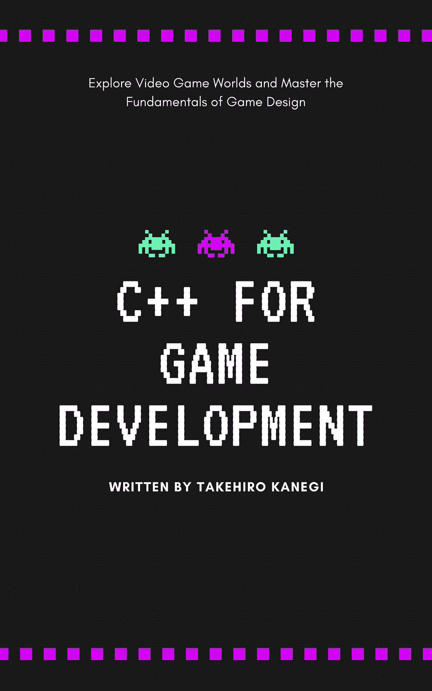

# 游戏开发的 C++：2024 全方位指南



# 前言

欢迎阅读《C++游戏开发：2024 全面指南》，这是一本精心编写的教程，旨在陪伴你开启使用 C++ 探索复杂游戏开发世界的之旅。游戏开发是一项结合创造力与技术实力的艺术形式，本指南旨在为你提供必要的概念理解和实践技能，将你的想象转化为互动式的数字体验。

## 为什么选择这本书？

当我们站在 2024 年的起点上时，游戏开发的格局已经发生了巨大的变化。现代 C++ 已成为新手和资深游戏开发者的必备技能。从超写实图形渲染的风景开放世界到数百万人享受的无缝多人体验，C++ 始终是这些成就背后的动力。本书的设计不仅是一本技术指南，更是一本坚实的伙伴，深入游戏开发的核心，涵盖了从基础概念到高级技术的所有内容。

## 谁应该读这本书？

无论你是一个带着创建自己游戏梦想进入编程世界的新手，还是寻求加深对现代 C++ 理解的资深开发者，亦渴望学习 Unity 和 Unreal Engine 等标志性游戏引擎底层原理的游戏爱好者，这本书都是为你定制的。

## 你可以期待什么？

书中的章节不仅仅是主题的集合，更是一段旅行——一条精心设计的路径，确保你全面掌握 C++ 游戏开发的每一个方面。

## 我们对你的承诺

开启 C++ 游戏开发之旅既充满挑战又充满回报。本书承诺成为你坚定不的指南，在不确定的时刻提供思路，在面对技术障碍时提供解决方案。每一章的结构都建立在前章的基础上，确保循进式的学习体验，保持你的投入和动力。

## 准备好构建第一款游戏了吗？

通过本指南，你不仅将牢牢掌握 C++ 及其在游戏开发中的应用，还将拥有从零开始构建自己游戏的信心和技能。旅程现在开始，成为游戏开发者是一个令人兴奋的时代。书中的工具、技术和见解由你去发现和运用。

感谢选择《C++游戏开发：2024 全面指南》。祝你的创意才华翱翔，祝你即将创造出非凡的游戏。

# 第 1 章：游戏开发导论

回顾游戏发展史，C++ 的演进是一个至关重要的章节，它塑造了如今游戏的创作方式。从 20 世纪 80 年代的诞生到如今作为高性能游戏开发的基石地位，C++ 一直为开发者提供所需的工具，以突破游戏可能的边界。

## C++ 的诞生：游戏规则的改变者

C++ 由 Bjarne Stroustrup 开发，是 C 编程语言的增强版，引入了面向对象的特性，彻底改变了软件开发。在游戏开发的早期，由于需要优化性能，许多游戏是用汇编语言编写的。随着游戏变得复杂，汇编语言的局限性显而易见，开发者开始寻找更强大、更灵活的语言。

引入 C++：结合了 C 的效率和面向对象编程的额外优势，C++ 迅速成为游戏开发者的首选。它高效管理硬件资源的能力，加上对复杂数据结构和算法的支持，使其完美契合蓬勃的游戏开发领域。

## 世纪 90 年代：3D 游戏的兴起

20 世纪 90 年代标志着游戏开发的重大转折，3D 图学的出现推动行业向更复杂的技术迈进。由 id Software 开发的《Doom》和《Quake》等游戏展示了 C++ 在创建沉浸式三维世界方面的力量。这些游戏不仅让玩家看到了视觉保真的新水平，还为性能和交互性设定了新标准。

在此，C++ 证明了它的价值，让开发者能够编写更具模块化且易于维护的代码。继承、封装和多态等面向对象的编程概念允许更具复用和扩展性的代码库。随着游戏项目规模和范围的扩大，这种转变至关重要，因为它要求开发者团队进行有效的协作。

## 2000 年代：游戏引擎的进步

21 世纪初，见证了 Unreal Engine 和 Unity 等复杂游戏引擎的兴起，两者在核心功能上高度依赖 C++。这些引擎抽象了许多底层细节，让开发者能够专注于游戏设计和玩法机制，而不是图形渲染和物理模拟的复杂性。

特别是 Unreal Engine，通过其多功能性和性能展示了 C++ 的力量。《Unreal Tournament》和《战争机器》等游戏证明了该引擎处理大型细节环境和复杂游戏机制的能力。在这些引擎中使用 C++ 意味着开发者对性能优化具有细粒度的控制力，这对于提供流畅且响应迅速的游戏体验至关重要。

## 现代时代：跨平台开发与高级特性

随着我们进入 2010 年及以后，随着移动设备、VR 头设备和云游戏服务等新平台的出现，游戏格局继续演变。C++ 在这个多样化的生态系统中仍然是一个相关且强大的工具。在移动设备等资源受限的环境中，它的性能优势尤为明显，因为高效的内存和 CPU 使用至关重要。现代 C++ 标准（C++11, C++14, C++17 和 C++20）引入了新特性，进一步增强了该语言在游戏开发中的适用性。Lambda 表达式、智能指针和并发支持等特性使开发者能够编写更有力且更高效的代码。这些进步允许开发更复杂的游戏机制和 AI 系统，提供了更丰富、更具沉浸的游戏体验。

## 案例研究：独立游戏开发

为了理解 `C++` 对游戏开发的影响，让我们以独立游戏开发为例来考虑吧。独立游戏开发者通常在资源有限的情况下工作，需要一种既能提供性能又具灵活性的语言。`C++` 提供了完美的平衡，使独立工作室能够在不产生大型、笨肿的编程语言开销的情况下，创建出高质量的游戏。

一个著名的例子是 Team Cherry 制作的游戏《空洞骑士》（Hollow Knight）。《空洞骑士》由一个小团队开发，利用 `C++` 提供了视觉上惊艳且机制丰富的体验。该游戏从 PC 到 Nintendo Switch 等各种平台的性能，展示了 `C++` 在针对不同硬件配置进行优化方面的强大之处。

展望未来，`C++` 在游戏开发中的地位没有减弱的迹象。随着游戏行业随着实时光线追踪、机器学习和程序化内容生成等新技术的不断演进，`C++` 依然处于前沿，为利用这些进展提供了必要的性能和控制。

对于有志的游戏开发者来说，掌握 `C++` 不仅仅是学习一门语言；更是理解几十年来塑造游戏行业的原则和实践。凭借在 `C++` 方面的坚实基础，开发者可以应对现代游戏开发的挑战，创造出能够吸引并激励全球玩家的体验。

# 现代 C++ 概览

当我们通过 `C++` 开启这段复杂的游戏开发世界旅程时，熟悉那些为这门古老语言注入新活力的现代标准是至关重要的。从 `C++98` 到最近的 `C++20` 的演变带来了一系列旨在使代码更高效、更有表现力且更于维护的特性。这些进步不仅仅是语法糖，而是可以改变我们处理游戏开发方式的强大工具。

## C++11：游戏规则改变者

`C++11` 发布于 2011 年，是一次革命性的更新，标志着语言能力的重大转变。它引入了多项核心特性，使 `C++` 现代化，并使其与其他编程语言竞争时更具竞争力。

### 智能指针

`C++11` 中影响最大的改进之一是引入了智能指针，特别是 `std::unique_ptr`、`std::shared_ptr` 和 `std::weak_ptr`。这些工具帮助自动管理动态内存分配，减少了内存泄漏和悬空指针的风险——这在性能和内存管理至关重要的游戏开发中是一个关键。

例如，在需要管理角色或游戏关卡等复杂对象生命周游戏场景中，智能指针消除了手动内存管理的需求，从而防止内存泄漏：

```cpp
#include
class GameCharacter {
public:
    GameCharacter(/parameters/);
    ~GameCharacter() { /cleanup code/ }
    void update();
private:
    / character details /
};

std::unique_ptr character = std::make_unique(/parameters/); 
character->update();
```

### Lambda 表达式

Lambda 表达式引入了函数式编程能力，允许开发者编写可以捕获封装作用域变量的内联函数。这一特性简化了代码，特别是在处理游戏开发中常见的复杂算法或事件处理机制时：

```cpp
#include
#include <vector>
#include <algorithm>

std::vector<int> scores = {35, 47, 56, 29, 85};
std::sort(scores.begin(), scores.end(), [](int a, int b) { return a < b; });
```

### 并发

`C++11` 还引入了强大的多线程和并发模型，包括 `std::thread`、`std::mutex` 和其他同步机制。这对于游戏开发至关重要，因为资产加载、AI 计算和物理模拟等后台任务可以被分离到单独线程，以保持流畅的用户体验。

## C++14：增量改进

`C++14` 虽然不如它的前身那样具有突破性，但它完善并增强了 `C++11` 中引入的许多特性，使语言更加易用且一致。

### 通用 Lambda

`C++14` 通过允许泛型参数扩展了 Lambda 功能，从而增加了它们的灵活性：

```cpp
auto lambda = [](auto x, auto y) { return x + y; };
lambda(3, 4); // 返回 7
lambda(3.5, 2.5); // 返回 6.0
```

### 放弛约束

`decltype(auto)` 提供了一种更一致的类型推导机制，使函数和表达式更加直观并减少了样板代码：

```cpp
template <typename T, typename U>
auto add(T t, U u) -> decltype(t + u) {
    return t + u;
}
```

这些精炼简化了开发过程，允许游戏开发者编写更整洁更高效的代码。

## C++17：稳定性与性能

`C++17` 巩固了许多语言特性，并引入了旨在提高性能和开发者效率的新元素。

### std::optional

`std::optional` 类型提供了一种表示可选值的标准方法，从而避免了对自定义实现或依赖可空指针的需求。这在游戏开发中可能返回也可能不返回值的函数非常有用：

```cpp
#include
#include <vector>
#include <algorithm>
#include <optional>

std::optional<int> findHighScore(const std::vector<int>& scores) {
    if (scores.empty()) return std::nullopt;
    return *std::max_element(scores.begin(), scores.end());
}
```

### 结构化绑定

结构化绑定简化了处理元组（tuple）和结构体（struct）的过程，使代码更具可读性：

```cpp
std::tuple<int, std::string> player = {1, "Alice"};
auto [id, name] = player;
```

### 并行算法

`C++17` 引入了并行算法，可以利用多核心处理器，这对于渲染、物理计算和 AI 处理等游戏开发任务至关重要：

```cpp
#include
#include <vector>
#include <algorithm>
#include <execution>

std::vector<int> data = { some large dataset / };
std::sort(std::execution::par, data.begin());
```

## C++20：现代标准

`C++20` 是最新且最具雄心的迭代，包含了许多旨在使 `C++` 更加强大多功能的特性。

### 概念 (Concepts)

`C++20` 中的概念允许更具表现力和受约束的模板编程，减少了模板错误的复杂性，并使代码更容易理解和维护：

```cpp
#include

template <typename T>
concept Addable = requires(T a, T b) {
    a + b;
};

template Addable T
T add(T a, T b) {
    return a + b;
}
```

### 范围 (Ranges)

Ranges 库为处理序列提供了更好的方法，将迭代器的功能与更直观的接口相结合：

```cpp
#include
#include <vector>
#include <ranges>

std::vector<int> data = {1, 2, 3, 4, 5};
auto squared = data | std::views::transform([](int x) { return x * x; });
```

### 协程 (Coroutines)

协程允许开发者更自然地编写异步代码，这对于脚本、动画和复杂的事件处理等游戏开发任务非常有价值：

```cpp
#include
#include <iostream>
#include <coroutine>

struct Task {
    struct promise_type {
        Task get_return_object() { return {}; }
        std::suspend_never initial_suspend() { return {}; }
        std::suspend_never final_suspend() noexcept { return {}; }
        void return_void() {}
        void unhandled_exception() { std::exit(1); }
    };
};

Task exampleCoroutine() {
    std::cout << "Hello, ";
    co_await std::suspend_always{};
    std::cout << "World!";
}
```

### 模块 (Modules)

模块旨在提高编译时间并更有效地管理代码依赖，这对于构建时间会影响效率的大型项目至关重要：

```cpp
module;
export module Example;
#include <iostream>

export void sayHello() {
    std::cout << "Hello, Modular World!";
}
```

从 C++11 到 C++20 的现代 C++ 标准之旅，展示了语言如何不断演进，以简化复杂的编程任务、增强性能，并为开发者提供强大的工具来创造创新游戏。这些每一个标准都建立在前一个的基础上，提供的改进式的改进，共同彻底改变了我们进行 C++ 编程的方式。

随着本指南的深入，这些特性将成为你工具箱中不可或缺的武器，让你能够编写出更简洁、更高效且更有表现力的代码。掌握了这些知识，你完全能够应对现代游戏开发的挑战，并将你的创意愿景变为现实。

# 游戏开发基础

## 游戏的核心组件

本质上，游戏是由各种相互关联的组件组成的复杂系统。理解这些组件及其相互作用对于创建一个既连贯又尽趣味的游戏至关重要。

1. **游戏循环 (Game Loop)**：游戏循环是任何游戏的核心心跳。它在游戏过程中持续运行，管理游戏流程并更新所有必要的组件。典型的游戏循环涉及三个主要阶段：输入处理、更新游戏状态和渲染图形。

```cpp
while (gameIsRunning) { processInput(); updateGameState(); renderGraphics(); }
```

2. **输入处理**：游戏高度依赖玩家的实时输入，无论是通过键盘、鼠标、游戏手柄还是触摸屏。有效的输入处理可确保游戏对玩家的操作做出平畅且直观的响应。

3. **游戏状态管理**：管理游戏状态涉及跟踪定义游戏当前状况的条件和变量。这包括玩家位置、物体交互、得分等。组织良好的状态管理是维持一致性和性能的关键。

4. **渲染 (Rendering)**：渲染是在屏幕上绘制游戏世界及其元素的过程。它要求对图形编程和优化技术有深入的理解，以确保高性能和视觉保真度。

5. **物理引擎 (Physics Engine)**：物理引擎在游戏中模拟现实世界的物理规律，控制对象的移动和相互作用。这包括碰撞检测、响应以及重力和摩擦等力的应用。

6. **音频 (Audio)**：声音在增强游戏沉浸感方面起着至关重要的作用。音频不仅涉及播放背景音乐和音效，还涉及音频的空间化以及与游戏事件的同步。

## 开发流水线

创建游戏是一个多层面的过程，涉及多个阶段，每个阶段都有自己的任务和挑战。理解开发流水线有助于简化工作流，并确保项目从概念到完成平稳推进。

1. **概念化 (Conceptualization)**：游戏开发的第一步是脑风暴并定义游戏的核心思想。这包括概述游戏机制、故事、角色和整体愿景。创建一个详细的游戏设计文档 (GDD) 至关重要，它可以作为整个开发过程的蓝图。

2. **原型制作 (Prototyping)**：原型制作涉及创建一个基础的、玩的游戏版本，以测试和验证核心游戏机制。这一阶段在投入大量资源之前识别潜在问题和完善游戏概念至关重要。

3. **资产创建 (Asset Creation)**：游戏需要大量的资产，包括 2D 精灵、3D 模型、纹理、动画、音效和音乐。与艺术家、动画师和音效设计师的协作对于创建增强游戏视觉和听觉吸引力质量资产至关重要。

4. **编码与开发 (Coding and Development)**：开发阶段涉及编写让游戏运行的代码。这包括实现游戏机制、整合资产并确保所有组件能够无缝协作。使用如 `Git` 等版本控制系统对于管理代码库以及与其他开发者有效协作至关重要。

5. **测试与迭代 (Testing and Iteration)**：严格的测试对于识别和修复 Bug、平衡游戏性以及确保流畅的用户体验是必要的。与多样化的玩家群体进行玩测试可以提供宝贵的反馈，引导迭代的改进和完善。

6. **优化 (Optimization)**：性能优化对于确保游戏在各种硬件平台上高效运行至关重要。这涉及对代码进行性能分析、优化资产使用并微调游戏性能，以实现流畅且响应迅速的体验。


7. **发布与部署 (Release and Deployment)**：准备游戏发布涉及完成所有资产、进行彻底的游戏测试并解决任何剩余问题。部署包括将游戏打包并发布到 PC、主机和移动设备等各种平台。

8. **发布后支持 (Post-Launch Support)**：游戏发布后，持续的支持对于修复 Bug、提供更新以及与玩家社区互动至关重要。发布后支持还包括实现额外内容、平衡游戏以及响应玩家反馈。

## 游戏设计的关键概念

设计游戏不仅仅是技术实现；它要求对如何创建吸引人且有趣的体验有深入理解。游戏设计中的几个关键概念是实现这一目标的根本。

1. **游戏机制 (Gameplay Mechanics)**：游戏机制定义了游戏内部的规则和交互。设计良好的机制是直观、具有挑战性且有回报的，为玩家提供成就感进步感。

2. **游戏平衡 (Game Balance)**：平衡游戏涉及微调难度、节奏和进度，以确保玩家在持续受到挑战的同时不会感到挫败。有效的平衡可以创造出流畅且愉快的体验，鼓励玩家继续玩下去。

3. **用户界面 (UI) 与用户体验 (UX)**：良好的 UI/UX 对于确保玩家能够轻松导航游戏并理解其机制至关重要。这包括设计直观的菜单、信息丰富的 HUD 和响应灵敏的控制。

4. **叙事与故事讲述 (Narrative and Storytelling)**：许多游戏融入叙事来增强玩家的情感投入。创作一个迷人的故事涉及创建难忘的角色、引人入胜的情节以及引起玩家共鸣的有意义的选择。

5. **关卡设计 (Level Design)**：关卡设计涉及创建玩家将遇到的环境和挑战。有效的关卡设计考虑玩家视角，引导他们穿越游戏世界，并在探索、谜题和战斗之间提供平衡。

6. **玩家反馈与奖励系统 (Player Feedback and Reward Systems)**：为玩家提供反馈和奖励对于维持动力和鼓励进步至关重要。这包括视觉和听觉线索、成就以及认可玩家成就的游戏内奖励。

## 搭建游戏开发环境

### 选择合适的操作系统

操作系统 (OS) 的选择会显著影响你的开发体验。虽然可以在各种操作系统进行游戏开发，但每种操作系统都有其自身的优势：

1. **Windows**：Windows 是游戏开发者之间的流行选择，因为它对各种开发工具和游戏引擎有卓越的支持，包括`Visual Studio`、`Unreal Engine`和`DirectX`。此外，大多数 PC 游戏都是为 Windows 开发的，使其成为目标该平台的自然选择。

2. **macOS**：macOS 提供了一个稳定且基于 Unix 的环境，对于喜欢强健终端和简洁界面的开发者来说很有力。虽然 macOS 支持`Xcode`等开发工具并可以运行`Unity`和`Unreal`等引擎，但它通常不是针对 Windows 游戏的首选。

3. **Linux**：Linux 提供了一个强大且可定制的环境，深受许多青睐开源解决方案开发者的喜爱。它支持丰富的开发工具，是服务器端编程和网络密集型应用的理想选择。然而，与 Windows 相比，在设置游戏开发工具时可能需要额外的配置。

鉴于 Windows 在游戏开发行业中的主地位，本指南将主要关注如何在 Windows 上配置您的环境。

### 安装合适的 IDE

集成开发环境（IDE）对于高效地编写、调试和编译代码至关重要。虽然有多种 IDE 选项，但有几款在 C++ 游戏开发中脱颖而出：

1. **Visual Studio**：`Visual Studio`是一个功能全面且强大的 IDE，为`C++`提供了强有的支持。它包含了如`IntelliSense`、调试工具和性能分析（profiling）等功能，能够简化开发流程。`Visual Studio`广泛的库和插件支持使其成为初学者和资深开发者的理想选择。

2. **CLion**：由 JetBrains 出出的`CLion`是另一个备受推崇的 C++ 开发 IDE。它拥有具有智能代码补全、强大的重构工具和集成调试器等功能。它与构建系统`CMake`的无缝集成简化了项目的配置和管理。

3. **Code::Blocks**：对于寻求轻量级替代方案的人来说，`Code::Blocks`是一个免费的开源 IDE，为 C++ 开发提供了基础功能。尽管它缺乏`Visual Studio`和`CLion`的一些高级功能，但对于初学者来说，它是一个可靠的选择。

#### 在 Windows 上安装 Visual Studio：

1. 访问 [Visual Studio 网站](https://visualstudio.microsoft.com/downloads/)。

2. 下载并运行`Visual Studio Installer`。

3. 在安装过程中，选择“使用 C++ 的桌面开发”负载，以确保你拥有所有必要的工具和库。

4. 根据需要自定义其他组件并完成安装过程。

### 设置版本控制系统

版本控制是现代软件开发中不可或缺的工具，允许你跟踪更改、与他人协作并管理项目的不同版本。`Git`是最常用的版本控制系统。设置方法如下：

1. 从[官方网站](https://git-scm.com/) 下载并安装`Git`。

2. 使用你的用户名和邮箱配置`Git`：

```bash
git config --global user.name "Your Name"
git config --global user.email "your.email@example.com"
```

3. 可选：安装如`GitHub Desktop`或`SourceTree`等`Git` GUI 客户端以获得更用户友好的界面。

#### 在项目目录中初始化`Git`仓库：

1. 打开终端或命令行提示符。

2. 进入你的项目目录：

```bash
cd path/to/your/project
```

3. 初始化 Git 仓库：

```bash
git init
```

4. 添加项目文件并进行首次提交：

```bash
git add .
git commit -m "Initial commit"
```

### 配置编译器和工具链

编译器将你的`C++`代码翻译成可执行机器码。适当的配置可确保项目高效构建和调试。对于`Visual Studio`，默认使用`MSVC`（Microsoft Visual C++）编译器，但如果你使用不同的环境，也可以配置其他编译器，如`GCC`（GNU 编译器集合）。

在在 Visual Studio 中配置 MSVC：

1. 在`Visual Studio`中打开你的项目。

2. 访问项目属性（在`解决方案资源管理器`中右键点击项目并选择“属性”）。

3. 确保“配置”设置为“所有配置”，以全局应用设置。

4. 在“配置属性”下，为`Debug`和`Release`模式设置你所需的属性。

### 设置游戏引擎

虽然可以使用`C++`从零开始编写游戏引擎，但利用现有引擎可以显著加速开发。两个最流行的引擎是`Unreal Engine`和`Unity`：

1. **Unreal Engine**：`Unreal Engine`是一个强大且功能丰富的游戏引擎，提供完整的源代码访问，使其成为偏好深度定制的开发者的极佳选择。它支持`C++`和名为`Blueprints`的视觉脚本语言。

   许多开始使用 Unreal Engine：

   1. 从 [Unreal Engine 网站](https://www.unrealengine.com/) 下载`Epic Games Launcher`。

   2. 使用启动器安装`Unreal Engine`。

   3. 创建新项目并选择“C++”作为项目类型。

2. **Unity**：`Unity`主要使用`C#`，但也集成`C++`库。`Unity`以其友好的界面和丰富的资源商店而闻名，是 2D 和 3D 游戏的流行选择。

   许多开始使用 Unity：

   1. 从 [Unity 网站](https://unity.com/) 下载并安装`Unity Hub`。

   2. 使用`Hub`安装`Unity Editor`。

   3. 创建新项目并根据需要探索通过原生插件集成`C++`。

### 附加工具和插件

除了主工具外，一些附加工具和插件可以增强你的开发环境：

1. **CMake**：`CMake`是一个跨平台构建系统生成器，简化了项目构建的管理。它对于需要在不同环境间迁移的项目特别有用。

   如何安装 CMake：

   1. 从[官方网站](https://cmake.org/download/) 下载并安装`CMake`。

   2. 按照设置说明将其与你的`IDE`集成。

2. **调试和分析工具**：高质量的调试和分析工具对于识别和解决性能瓶颈至关重要。`Visual Studio`内置调试器非常强大，但额外的工具如`Valgrind`（用于内存调试）和`gprof`（用于性能分析）也很有价值。

设置游戏开发环境涉及工具的仔细挑选和细致的配置，以确保你的工作流既高效又多产。环境准备就绪后，你现在已准备好探索`C++`和游戏开发的复杂之处，将你的想法转化为迷人的数字体验。

## 为游戏开发选择合适的 IDE

### Visual Studio：行业标准

微软的`Visual Studio`因其作为 C++ 开发行业标准的声誉而闻名，特别是在游戏开发领域。它广泛的功能范围、对`C++`的全面支持以及与其他微软工具的无缝集成使其成为极佳的选择。

**关键特性：**

- `IntelliSense`：提供智能代码补全，使代码编写更快并减少语法错误。

- 调试工具：提供强大的调试能力，包括断点、监视窗口和实时变量检查。

- 性能分析工具：包含性能剖析工具，用于识别瓶颈并优化代码。

- 版本控制集成：与`Git`和`SVN`等版本控制系统无缝集成。

**优势：**

- 广泛的文档和支持。

- 庞大的开发者社区。

- 频繁的更新和改进。

- 对游戏开发框架和库（如`DirectX`和`Unreal Engine`）的强大支持。

**劣势：**

- 资源密集型，可能需要强大的机器流畅运行。

- 对于初学者来说，众多功能令人 overwhelming。

**安装与设置：**

1. 从 [Visual Studio 网站](https://visualstudio.microsoft.com/downloads/) 下载`Visual Studio`。

2. 运行安装程序并选择“使用 C++ 的桌面开发”负载。

3. 根据需要自定义组件并完成安装。

4. 打开`Visual Studio`，启动新`Project`并开始编码。

### CLion：智能替代方案

JetBrains 出出的`CLion`是 C++ 开发者的另一个流行选择。以其智能代码分析和重构工具著称，`CLion`是一个可以提高你生产力和代码质量的强大 IDE。

#### 核心特性

- 智能代码补全：提供感知上下文的代码补全和建议。

- 强大的重构：提供高级重构选项以改进你的代码结构。

- 集成式调试器：包含一个支持`GDB`和`LLDB`的集成式调试器。

- CMake 支持：完全支持`CMake`，使项目配置和管理更加简单。

#### 优势

- 跨平台支持（Windows, macOS, Linux）。

- 界面精简直观。

- 强大的社区支持和完善的文档。

- 频繁更新，包含新功能和改进。

#### 缺点

- 访问完整功能需要订阅（尽管提供免费试用）。

- 可能会消耗大量资源，类似于`Visual Studio`。

#### 安装与设置

1. 从 [JetBrains 网站](https://www.jetbrains.com/clion/download/) 下载`CLion`。

2. 按照设置说明安装`CLion`。

3. 使用`CMake`配置你的项目，或使用内置的项目向导快速开始。

### Code::Blocks：轻量级选择

对于倾向于轻量级且开源替代方案的人来说，`Code::Blocks`是一个可靠的选择。它可能缺少`Visual Studio`和`CLion`的一些高级功能，但提供了 C++ 游戏开发所需的所有工具。

#### 核心特性

- 模块化设计：允许通过各种插件进行自定义。

- 多种编译器支持：兼容包括`GCC`和`Clang`在内的多种编译器。

- 集成式调试器：提供内置调试功能。

#### 优势

- 免费且开源。

- 轻量且快速。

- 可通过插件自定义。

#### 缺点

- 缺乏在其他 IDE 中常见的某些高级功能。

- 与`Visual Studio`和`CLion`相比，社区较小且更新频率较低。

#### 安装与设置

1. 从 [Code::Blocks 网站](http://www.codeblocks.org/downloads/26) 下载`Code::Blocks`。

2. 选择包含编译器的版本（如果尚未安装）。

3. 遵循安装步骤并配置设置。

4. 创建新项目并开始编码。

### Eclipse CDT：多功能选项

`Eclipse CDT` (C/C++ 开发工具) 是另一个多功能的替代方案，特别受到那些熟悉使用`Eclipse`进行 Java 开发的用户的喜爱。它提供了为 C++ 开发者身定制的一系列功能，并支持各种平台。

#### 核心特性

- 项目模板：为不同类型的项目提供多种模板。

- 丰富的调试支持：高级的调试工具和视图。

- 可扩展：通过插件具有高度的可扩展性。

#### 优势

- 免费且开源。

- 跨平台支持。

- 庞插件生态系统。

#### 缺点

- 与其他 IDE 相比，可能不够直观。

- 需要额外的配置以获得最佳性能。

#### 安装与设置

1. 从 [Eclipse 网站](https://www.eclipse.org/downloads/) 下载`Eclipse CDT`。

2. 解压下载的文件并运行`Eclipse`安装程序。

3. 选择“C/C++ Development”程序包。

4. 完成安装并配置你的设置。

### Xcode：苹果爱好者的首选

对于使用 macOS 的用户，`Xcode`是一个强有力的竞争者。虽然它主要用于`Swift`和`Objective-C`开发，但`Xcode`也支持 C++ 并提供了完善的开发体验。

#### 核心特性

- 集成界面：将代码编辑器、调试器和性能工具合为一体。

- 重构工具：包含自动化重构选项。

- 模拟器和调试器：提供强大的模拟器和高级调试工具。

#### 优势

- 对 macOS 用户免费。

- 与其他苹果开发工具无缝集成。

- 界面精美且用户友好。

#### 缺点

- 仅限于 macOS。

- 与`Visual Studio`和`CLion`相比，用于 C++ 开发的功能不够丰富。

#### 安装与设置

1. 从 [Mac App Store](https://apps.apple.com/us/app/xcode/id497799835?mt=12) 下载`Xcode`。

2. 安装并打开`Xcode`。

3. 创建新项目并选择“C++”作为项目类型。

4. 开始编码并利用集成工具。

## 结论

选择合适的 C++ 游戏开发 IDE 取决于你的具体需求、偏好以及你正在使用的操作系统。`Visual Studio`以其全面的功能和强大的支持作为行业标准脱颖而出，但像`CLion`、`Code::Blocks`、`Eclipse CDT`和`Xcode`等替代方案各自提供了独特的优势。

设置一个适合你工作流的正确 IDE 可以显著提高你的生产力和编码体验。花时间探索这些选项，理解它们的功能，并选择一个最符合你开发风格和项目要求的工具。有了正确的工具，你就走在了创建引人入胜的高性能游戏的良好道路上。

## 编译器与工具链基础

### 理解编译器

编译器的核心在于将源代码转换为可执行文件。在 C++ 开发中，最常用的编译器是`GCC`和`Clang`。

#### GCC (GNU 编译器集合)：

`GCC`是一个强大的编译器，支持多种编程语言。

##### 核心特性

- 支持 C++ 标准。

- 强大的调试功能。

- 支持各种架构。

##### 优势

- 开源免费。

- 广泛采用。

- 定期更新。

##### 缺点

- 可能需要额外的配置来优化性能。

##### 安装

1. 在 Linux 上，使用包管理器：

```bash
sudo apt-get install gcc++
```

2. 在 macOS 上，通过 Homebrew 安装：

```bash
brew install gcc
```

3. 在 Windows 上，使用 MinGW 或 MSYS2。

#### Clang：

`Clang`是另一个备受推爱的编译器，以其速度、灵活性和详细的错误信息著称。它是`LLVM`项目的一部分。

##### 核心特性

- 编译速度快。

- 模块化架构。

- 清晰的诊断信息。

##### 优势

- 优秀的诊断功能。

- 易于扩展。

- 与各种开发环境集成良好。

##### 缺点

- 在某些领域不如`GCC`成熟。

##### 安装

1. 在 Linux 上，使用包管理器：

```bash
sudo apt-get install clang
```

2. 在 macOS 上，`Xcode`包含了它。

3. 在 Windows 上，通过 LLVM 预编译包或使用 MSYS2。

### 工具链组件

除了编译器之外，典型的 C++ 开发工具链还包含其他组件，每个组件在构建和调试过程中都有独特的作用。

#### 链接器：

链接器将编译后的对象文件组合成可执行文件或库。它解析对外部符号（如函数和变量）的引用，确保所有依赖都被正确包含。

##### 常见的链接器

- GNU 链接器 (`ld`)

- LLVM 链接器 (`lld`)

#### 构建系统：


构建系统自动化编译和链接代码的过程。它管理依赖关系，定义构建配置并通过脚本和工具简化构建过程。

## 流行的构建系统

- `CMake`：一种跨平台构建系统生成器，用于为`make`、`Ninja`、`Visual Studio`等生成构建脚本。
- `Make`：基于 Unix 的工具，使用`Makefile`定义构建规则。
- `Ninja`：一种专注于速度和并行的小型构建系统。

## 调试器

调试器对于识别和修复代码问题至关重要。它们允许你检查变量值、单步执行代码并诊断运行时错误。

### 常见的调试器

- `GDB`：一个支持多种语言（包括 C++）的强大调试器。
- `LLDB`：LLVM 项目的调试器，以其速度和与`Clang`的集成而闻名。

# 包管理器

包管理器简化了项目内依赖项和库的管理过程。它们会自动解析、下载并安装所需的包，确保您的开发环境保持一致并更新到最新。

流行的包管理器：

- `vcpkg`：适用于`Visual Studio`的跨平台 C++ 库管理器。
- `Conan`：一个用于 C++ 的去中心化包管理器，支持多种构建系统。

# 设置您的工具链

要设置工具链，您需要安装并配置必要的组件。以下步骤概述了 C++ 开发环境的典型设置流程。

## 第一步：安装编译器

Linux：

```bash
sudo apt-get install gcc g++ cmake
```

macOS：

```bash
brew install gcc cmake
```

Windows：

安装`MinGW`或`MSYS2`并使用包管理器安装`GCC`：

```bash
pacman -S mingw-w64-x86_64-gcc mingw-w64-x86_64-cmake
```

## 第二步：配置构建系统

### CMake

在项目目录中创建一个`CMakeLists.txt`文件。

```cmake
cmake_minimum_required(VERSION 3.10)
project(MyGame)
set(CMAKE_CXX_STANDARD 17)
add_executable(MyGame main.cpp)
```

- 运行`CMake`生成构建文件：

```bash
cmake -S . -B build
cd build
make
```

### Make

在项目目录中创建一个`Makefile`。

```make
all: mygame

mygame: main.o
g++ -o mygame main.o

main.o: main.cpp
g++ -c main.cpp
```

- 运行`make`构建您的项目。

## 第三步：设置调试器

### GDB

安装`GDB`：

```bash
sudo apt-get install gdb
```

- 使用`GDB`调试您的可执行文件：

```bash
gdb ./mygame
```

### LLDB

安装`LLDB`：

```bash
sudo apt-get install lldb
```

- 使用`LLDB`调试您的可执行文件：

```bash
lldb ./mygame
```

一个配置良好的工具链对于高效的 C++ 游戏开发至关重要。无论您是为了通用性选择`GCC`，还是为了速度和诊断功能选择`Clang`，理解并设置您的编译器和工具链组件都能显著提高您的生产力和代码质量。通过正确的配置，您可以更多专注于打造沉浸式的游戏体验，而不是花费精力与开发障碍作斗争。

# 调试工具与技术

## 调试的意义

想象正在开发一款游戏，一切看起来都很完美，直到玩家遇到了一个导致游戏崩溃的故障。这种场景强调了为什么调试至关重要——不仅是为了游戏的稳定性，还为了其整体用户体验。高效的调试可以节省时间，减少挫败感，并提高最终产品的质量。

## 调试工具概述

不同的调试工具满足各种需求，从捕获简单的语法错误到诊断复杂的运行时问题。在这里，我们将深入 C++ 游戏开发中最常用的某些调试工具。

### GDB (GNU 调试器)

`GDB`是一个强大且广泛使用的 C++ 调试器，允许您在程序运行时或崩溃后检查其内部发生的情况。

关键特性：

- 设置断点以在特定的代码行处暂停执行。
- 逐行单步执行以观察行为。
- 在运行时检查并修改变量值。
- 分析调用栈以理解函数调用层级结构。

基础命令：

- 开始调试：`gdb ./mygame`
- 设置断点：`break main.cpp:10`
- 运行程序：`run`
- 逐行执行代码：`step`或`next`
- 检查变量：`print variableName`
- 继续执行：`continue`

示例：

```cpp
#include <iostream>

int main() {
    int x = 42;
    int y = 0;
    int result = x / y; // 这行将导致除零错误。
    std::cout << "Result: " << result << std::endl;
    return 0;
}
```

*在`GDB`中调试上述代码：*

```bash
g++ -g -o mygame main.cpp
gdb ./mygame
(gdb) break main.cpp:6
(gdb) run
```

您将看到程序在除零错误处暂停，允许您检查变量`x`和`y`。

### LLDB

`LLDB`是`LLVM`项目的一部分，另一个强大的调试器，以其速度和与`Clang`的集成而闻名。

关键特性：

- 快速启动速度和高效的内存使用。
- 详细且用户友好的错误信息。
- 与`Xcode`等 IDE 深度集成。

基础命令：

- 开始调试：`lldb ./mygame`
- 设置断点：`breakpoint set --file main.cpp --line 10`
- 运行程序：`run`
- 逐行执行代码：`step`或`next`
- 检查变量：`frame variable variableName`
- 继续执行：`continue`

示例：

```bash
clang++ -g -o mygame main.cpp
lldb ./mygame
(lldb) breakpoint set --file main.cpp --line 6
(lldb) run
```

## IDE 调试能力

现代集成开发环境 (IDE) 提供了集成调试工具，可以简化流程。以下是一些流行的 IDE：

### Visual Studio / Visual Code

`Visual Studio`和`Visual Code`都提供了集成的调试功能，包括断点、变量和调用栈。

- **设置断点**：点击行号旁边的边缘。
- **运行调试**：按下`F5`开始调试。
- **变量检查**：悬停在变量上查看其值。
- **调用栈**：查看函数调用。

### CLion

来自 JetBrains 的产品`CLion`通过`GDB`或`LLDB`集成支持高级调试。

- **设置断点**：点击行号旁边的侧边栏。
- **运行调试**：按下`Shift + F9`开始调试。
- **变量检查**：将其添加到监视列表。
- **调用栈**：提供指向当前断点的函数调用视图。

# 高级调试技术

除了基础调试命令外，某些高级技术可以提高您的调试效率。

### 条件断点

仅在满足特定条件时触发断点，减少不必要的干扰。

`GDB`示例：

```bash
break main.cpp:6 if y == 0
```

### 视点

监控特定变量或内存位置的变化。当变量值变化时，程序将暂停。

`GDB`示例：

```bash
watch variableName
```

### 核心转储

分析程序崩溃时的内存快照以进行事后诊断。

生成核心转储：

```bash
ulimit -c unlimited ./mygame
gdb ./mygame core
```

### 内存调试

`Valgrind`等工具可以检测内存泄漏、误用和其他问题，提供全面的报告。

使用`Valgrind`：

```bash
valgrind --leak-check=full ./mygame
```

### 性能分析

分析工具通过测量程序花费时间最多的来识别性能瓶颈。

常用的分析器：

- `gprof`：基础 GNU 分析器。
- `perf`：Linux 性能分析工具。
- `Instruments` (macOS)：`Xcode`中的性能分析工具。

使用`gprof`：

1. 启用分析功能编译：

```bash
g++ -pg -o mygame main.cpp
```

2. 运行程序：

```bash
./mygame
```

3. 生成分析报告：

```bash
gprof ./mygame gmon.out > analysis.txt
```

掌握调试工具和技术对于任何 C++ 游戏开发者来说都是至关重要的。从`GDB`和`LLDB`到 IDE 集成调试器，以及条件断点和内存调试等高级技术，每个工具都提供了独特的功能，可以简化您的开发流程并提高游戏质量。

拥有了正确的调试工具箱，您将能够更好地应对游戏开发中的挑战，确保您的作品在世界各地玩家手中运行无缺。

# 游戏引擎简介 (Unity, Unreal Engine)

## 游戏引擎的角色

想象一下在没有起重机和脚手架的情况下建造摩天大楼。同样，如果没有游戏引擎，开发复杂的游戏将极具挑战性且耗时。游戏引擎通过提供图形、物理、音频、输入处理等预构建组件，简化了这一过程。它们提供了一个集成开发环境，简化了游戏的创建、测试和部署流程。

# Unity：多功能与易用性

Unity 以其多功能和易用性闻名，是初学者和资深开发者的热门选择。它支持从移动设备到高端 PC 和游戏机的等广泛平台，并提供丰富的文档和活跃的社区。

## 核心特性

- **跨平台支持**：一次编写，随处部署——Unity 支持超过 25 种平台，包括 iOS、Android、Windows、macOS、Linux 和主流主机。
- **基于组件的架构**：`GameObjects`和组件是 Unity 的核心，允许开发者将功能模块化并在不同项目之间复用组件。
- **资源商店 (Asset Store)**：一个庞大的资产、脚本、工具和扩展库，可以直接集成到你的项目中，显著加快开发速度。
- **可视化编辑器**：Unity 直观的界面和强大的场景编辑器允许开发者以视觉方式设计和操作游戏场景。
- **C# 脚本**：Unity 主要使用`C#`进行脚本编写，该语言以简单和健壮著称。

## 创建一个简单的 Unity 项目

1. **安装 Unity**：从官网下载并安装`Unity Hub`，然后安装最新的 Unity 版本。
2. **创建新项目**：打开`Unity Hub`，点击“New Project”，选择一个模板（例如`3D`或`2D`），并点击“Create”。
3. **熟悉界面**：Unity 编辑器由几个窗口组成——Scene（场景）、`Game`（游戏）、`Hierarchy`（层级）、`Project`（项目）、`Inspector`（检查器）和`Console`（控制台）。花时间探索这些窗口。
4. **添加 GameObject**：在`Hierarchy`窗口中右键点击，选择“3D Object”，并选择一个对象，如`Cube`。
5. **添加脚本**：在`Project`窗口中右键点击，选择“Create” -> “C# Script”，创建一个新的`C#`脚本并命名为`PlayerController`。
6. **编辑脚本**：

```csharp
using UnityEngine;

public class PlayerController : MonoBehaviour {
    public float speed = 5.0f;

    void Update()
    {
        float moveHorizontal = Input.GetAxis("Horizontal");
        float moveVertical = Input.GetAxis("Vertical");

        Vector3 movement = new Vector3(moveHorizontal, 0.0f, moveVertical);
        transform.Translate(movement * speed * Time.deltaTime, Space.World);
    }
}
```

将脚本从`Project`窗口拖动到`Hierarchy`窗口中的`Cube`上，即可将其挂载。

7. **运行游戏**：点击 Unity 编辑器中的 Play 按钮，查看你的`Cube`如何根据键盘输入移动。

# Unreal Engine：力量与精准

Unreal Engine 由 Epic Games 开发，以其尖端的图形和强大的工具而闻名。由于其先进的渲染能力和丰富的功能集，它通常是高保真 AAA 游戏的首选引擎。

## 核心特性

- **写实级图形**：Unreal Engine 先进的渲染系统提供了实时光线追踪和高动态范围 (HDR) 成像等功能，产生惊叹的视觉效果。
- **蓝图可视化脚本**：除了`C++`，Unreal Engine 还提供了一种名为`Blueprints`的可视化脚本系统，允许开发者在不编写代码的情况下创建游戏逻辑。
- **强大的工具集**：Unreal Engine 包含了用于动画、物理、AI 等强大工具，直接集成在编辑器中。
- **源代码访问**：开发者可以完全访问引擎的`C++`源代码，能够进行深度的定制和优化。
- **市场 (Marketplace)**：与 Unity 的 Asset Store 类似，Unreal Engine Marketplace 提供了丰富的资产、插件和工具。

## 创建一个简单的 Unreal Engine 项目

1. **安装 Unreal Engine**：下载并安装`Epic Games Launcher`，然后安装最新的 Unreal Engine 版本。
2. **创建新项目**：打开`Epic Games Launcher`，进入 Unreal Engine 标签页，选择“New Project”。选择一个模板（例如`First Person`），配置设置并点击“Create”。
3. **熟悉界面**：Unreal Engine 的编辑器包括`Viewport`（视口）、`Outliner`（大纲）、`Content Browser`（内容浏览器）、`Details`（细节）和`Modes`（模式）等窗口。探索这些以熟悉布局。
4. **添加 Actor**：在`Content Browser`中右键点击，选择“Blueprint Class”，并选择`Actor`。将其命名为`PlayerActor`。
5. **蓝图脚本**：
   - 打开新创建的`PlayerActor`蓝图。
   - 在`Event Graph`（事件图）中右键点击添加“Event Tick”和“Add Actor Local Offset”等节点。
   - 连接节点创建基于玩家输入的移动逻辑。
6. **编译并保存**：点击“Compile”然后点击“Save”应用更改。
7. **运行游戏**：点击 Unreal 编辑器中的 Play 按钮，查看你的蓝图运行。

# 比较 Unity 和 Unreal Engine

## 易用性

- Unity 的界面和基于组件的方法通常被认为更对新手友好。
- Unreal 的`Blueprints`系统允许快速原型设计，但其界面对初来者来说可能过于复杂。

## 性能

- Unreal Engine 在图形性能方面表现出色，特别是对于高端、写实项目。
- Unity 在各种平台上都非常高效，使其成为移动和跨平台开发的理想选择。

## 脚本语言

- Unity 使用`C#`进行脚本编写，以易于学习和开发速度快著称。
- Unreal Engine 使用`C++`进行核心编程，提供了更多控制，但学习曲线更陡。`Blueprints`为脚本提供了可视化替代方案。

## 社区与资源

- Unity 拥有庞大活跃的社区和丰富的资源，包括教程、论坛和资源商店。
- Unreal Engine 也拥有强大的社区，可以访问 Unreal Academy、论坛和市场。

选择正确的游戏引擎是一个至关重要的决定，会影响开发过程和最终产品。Unity 和 Unreal Engine 各自拥有独特优势，满足不同的项目需求和开发者偏好。掌握这些工具将为创建沉浸式、创新且视觉惊艳的游戏开启大门。

# 简单游戏架构：组件与框架

## 游戏架构的本质

想象一座繁华的城市。每座建筑、道路和公园都经过精密的规划和建造，以创建一个和谐的环境。同样，游戏架构需要经过深思熟虑的设计以确保所有组件无缝工作。稳健的架构不仅有助于代码整洁，还能简化调试、增强性能并使实现新功能变得更容易。

## 游戏的核心组件

游戏架构的核心是定义和驱动游戏性的核心组件。这些组件包括游戏循环、实体、组件、系统以及各种支持性能的框架。

- **游戏循环 (Game Loop)**：游戏循环是游戏的心脏，协调游戏逻辑、渲染、输入处理和物理更新的执行。它通常包含三个主要阶段：初始化、更新和渲染。
- **初始化 (Initialization)**：设置游戏变量、加载资源并准备游戏世界。
- **更新 (Update)**：执行游戏逻辑、处理输入并更新实体状态。
- **渲染 (Rendering)**：将游戏世界绘制到屏幕上。

# 实体 (Entities)


`Entities`：实体代表游戏世界中的对象。这些可以是从角色、敌人到物品和弹体的任何内容。实体通常在实体-组件-系统（`ECS`）框架中管理，该框架提供了一种模块化且可扩展的架构。

`Components`：组件（Components）是附加到实体上的模块化数据单元。每个组件存储特定的属性或状态，例如位置、速度、生命值或动画状态。组件封装了数据，使得设计具有复用性和灵活性。

`Systems`：系统（Systems）根据实体拥有的组件来处理实体。例如，渲染系统负责绘制具有视觉组件的实体，而物理系统负责更新具有物理属性的实体。系统封装了行为，促进了关注点分离。

# 游戏开发框架

若干框架和设计模式对于现代游戏架构至关重要。这些包括实体-组件-系统（`ECS`）模式、模型-视图-控制器（`MVC`）模式以及状态（`State`）模式。

## 实体-组件-系统（`ECS`）框架

`ECS` 框架是游戏开发中一种流行的设计模式，以其模块化和性能而闻名。在 `ECS` 中，`entities` 仅仅是标识符，`components` 存储数据，而 `systems` 则对具有特定 `components` 的 `entities` 执行操作。这种数据与行为的解耦增强了灵性和扩展性。

示例：

```cpp
struct PositionComponent { float x, y; };

struct VelocityComponent { float vx, vy; };

class MovementSystem { 
public: 
  void Update(float deltaTime, std::vector& entities) { 
    for (Entity& entity : entities) { 
      auto position = entity.GetComponent(); 
      auto velocity = entity.GetComponent(); 
      position->x += velocity->vx * deltaTime; 
      position->y += velocity->vy * deltaTime; 
    } 
  } 
};
```

## 模型-视图-控制器（`MVC`）模式

`MVC` 模式对于分离游戏开发中的关注点具有重要作用。`model`（模型）管理游戏数据和逻辑，`view`（视图）处理渲染和用户界面，而 `controller`（控制器）处理输入并更新 `model`。

示例：

```cpp
class GameModel { 
public: 
  void Update(float deltaTime) { / 更新游戏状态 / } 
};

class GameView { 
public: 
  void Render(const GameModel& model) { / 渲染游戏状态 / } 
};

class GameController { 
public: 
  void HandleInput(GameModel& model) { / 处理输入并更新模型 / } 
};
```

## 状态模式（`State` Pattern）

`State` 模式适用于管理游戏不同状态，例如菜单、游戏、暂停状态和游戏结束状态。每个状态都封装了其行为，使得添加或修改游戏状态变得更容易。

示例：

```cpp
class GameState { 
public: 
  virtual void Enter() = 0; 
  virtual void Update(float deltaTime) = 0; 
  virtual void Exit() = 0; 
};

class MenuState : public GameState { 
public: 
  void Enter() override { / 初始化菜单 / } 
  void Update(float deltaTime) override { / 更新菜单逻辑 / } 
  void Exit() override { / 清理菜单 / } 
};

class GameplayState : public GameState { 
public: 
  void Enter() override { / 初始化游戏 / } 
  void Update(float deltaTime) override { / 更新游戏逻辑 / } 
  void Exit() override { / 清理游戏 / } 
};

class Game { 
  GameState* currentState;
public: 
  void ChangeState(GameState* newState) { 
    if (currentState) currentState->Exit(); 
    currentState = newState; 
    currentState->Enter(); 
  }
  void Update(float deltaTime) {
    if (currentState) currentState->Update(deltaTime);
  }
};
```

# 实际实现：一个简单的游戏框架

为了直看到这些概念的实际应用，让我们使用 C++ 构建一个简单的游戏框架。我们将使用 `ECS` 模式来结构化我们的游戏。

### 实体类（`Entity` Class）

```cpp
class Entity { 
public: 
  int id; 
  std::unordered_map<type_index, std::shared_ptr<void>> components;

  template <typename T>
  void AddComponent(const T& component) { components[typeid(T)] = std::make_shared<T>(component); }

  template <typename T>
  T* GetComponent() { 
    auto it = components.find(typeid(T)); 
    if (it != components.end()) { return static_cast<T*>(it->second.get()); } 
    return nullptr; 
  } 
};
```

### 组件定义（`Component` Definitions）

```cpp
struct Position { float x, y; };

struct Velocity { float vx, vy; };
```

### 系统定义（`System` Definitions）

```cpp
class MovementSystem { 
public: 
  void Update(float deltaTime, std::vector<Entity>& entities) { 
    for (Entity& entity : entities) { 
      Position* position = entity.GetComponent<Position>(); 
      Velocity* velocity = entity.GetComponent<Velocity>(); 
      if (position && velocity) { 
        position->x += velocity->vx * deltaTime; 
        position->y += velocity->vy * deltaTime; 
      } 
    } 
  } 
};
```

### 游戏循环（`Game` Loop）

```cpp
class Game { 
  std::vector<Entity> entities; 
  MovementSystem movementSystem;

public: 
  void Initialize() { 
    Entity player; 
    player.id = 1; 
  }
```

### 主函数（`Main` Function）

```cpp
int main() { 
  Game game; 
  return 0; 
}
```

## 提交你的更改

使用有意义的信息提交暂存的更改：

```bash
git commit -m "Initial commit: Setup game project structure"
```

此命令创建了项目在此时刻的快照。将提交（commits）想象成你游戏开发旅程中的检查点。

## 分支与合并

假设你正在实现一个新功能——例如为你的游戏创建一个动态天气系统。你不希望干扰游戏的稳定版本，因此你创建了一个新分支：

```bash
git branch dynamic_weather
git checkout dynamic_weather
```

你现在可以独立地开发此功能了。一旦完成并测试通过，将其合并回主分支（通常称为 `main` 或 `master`）：

```bash
git checkout main
git merge dynamic_weather
```

分支是 Git 的一项强大功能，允许进行并行开发和实验，而不会危及你主项目的稳定性。

## 使用 Git 进行协作

对于协作，GitHub、GitLab 和 Bitbucket 等平台提供了托管的 Git 仓库，并带有如问题跟踪（issue tracking）和拉取请求（pull requests）等额外功能。以下是将你的本地仓库推送到 GitHub 的方法：

### 在 GitHub 上创建仓库

登录 GitHub 并创建一个新仓库。

按照指令将你的本地仓库链接到 GitHub：

```bash
git remote add origin https://github.com/yourusername/yourrepository.git
git push -u origin main
```

### 克隆仓库

如果你是加入一个现有的项目，你应该克隆仓库：

```bash
git clone https://github.com/yourusername/yourrepository.git
```

### 拉取更改

定期从远程仓库拉取更改以保持更新：

```bash
git pull origin main
```

## 解决冲突

当不同分支或提交中的更改发生重叠时，就会产生冲突。Git 会在合并期间通知你冲突，你需要手动解决它们：

- **识别冲突**：打开冲突的文件，Git 会用 `<<<<<<<`、`=======` 和 `>>>>>>` 标记冲突。

- **解决并提交**：编辑文件以解决冲突，移除冲突标记，然后提交更改：

```bash
git add conflicted_file.cpp
git commit -m "Resolved merge conflict in conflicted_file.cpp"
```

## 跟踪更改与历史

理解项目的历史至关重要。Git 提供了强大的命令来检查它：

### 查看提交历史

```bash
git log
```

此命令列出带有信息、作者和时间戳的提交。为了更具图形化的表示，可以使用 `Gitk` 或 `Gitg` 等工具。

### 检查更改

```bash
git diff
```

此命令显示你的工作目录和暂存区之间的差异。使用 `git diff <commit>` 查看提交之间的更改。

精通 Git 是每一位游戏开发者的必经之路。这不仅仅是为了跟踪更改——更是为了促进协作、维护代码质量并确保你的项目系统地演进。随着你对 Git 越来越熟练，你会发现它是你开发工具库中不可或缺的工具，让你能够有信心地应对游戏开发的复杂性。欢迎来到版本控制的世界——你迈向组织化、高效且协作的游戏开发的第一步。

# 第 2 章：语言基础

## C++ 编程的基石

当你开启 C++ 之旅时，变量和数据类型的概念脱然而而出，它们是构建所有编程构造的基石。将它们想象成你（游戏开发者）将用来构建动态且交互世界的基础区块。

### 理解变量

正如游戏角色可能需要血条或分数计数器一样，你编写的 C++ 程序需要一种存储和处理数据的方法。这就是变量用用场。变量本质上是一个由名称标识的存储位置，存放着程序在执行期间可以更改的数据。

这里有一个简单的类比：将变量想象成一个盒子。你在盒子上贴上一个标签（变量名），并在里面存储一种特定类型的物品（数据）。根据你想要存储的物品类型，你会选择不同类型的盒子。C++ 为不同类型的数据提供了不同类型的“盒子”。

## C++ 中的数据类型

C++ 是一种静态类型语言，这意味着每个变量都必须声明一个数据类型。该数据类型决定了变量可以包含的值类型，以及你对其对其执行的操作。让我们深入研究你将遇到的主要数据类型：

### 原始数据类型

### 整数类型

- `int`：最常用的整数类型，通常用于存储 32 位整数。

- `short`：较小的整数类型，通常为 16 位。

- `long`：较大的整数类型，通常为 32 位或 64 位。

- `long long`：更大的整数类型，通常为 64 位。

```cpp
int score = 100;
short level = 5;
long population = 7000000;
long long distance = 1234567890;
```

### 浮点类型

- `float`：用于单精度浮点数。

- `double`：用于双精度浮点数（比 `float` 具有更高的精度和范围）。

- `long double`：比 `double` 更高的精度和范围。

```cpp
float health = 99.9;
double pi = 3.141592653589793;
long double preciseValue = 2.718281828459045;
```

### 字符类型

- `char`：表示单个字符，通常占用 1 字节。

- `wchar_t`：表示宽字符，用于扩展字符集。

```cpp
char initial = 'R';
wchar_t wideChar = L'Ω';
```

### 布尔类型

- `bool`：表示布尔值，可以是 `true` 或 `false`。

```cpp
bool isGameOver = false;
```

### 衍生数据类型

- **数组**：相同类型元素的集合，存储在连续的内存位置。将它们想象成一排盒子，每个盒子都可以包含指定的值。

```cpp
int scores[5] = {10, 20, 30, 40, 50};
```

- **指针**：存储另一个变量地址的变量。它们对于动态内存分配以及处理数组和函数至关重要。

```cpp
int* ptr;
int value = 10;
ptr = &value; // ptr 现在持有 value 的地址
```

- **引用**：现有变量的别名。它们必须必须在声明时进行初始化。

```cpp
int original = 100;
int& ref = original; // ref 是 original 的别名
```

### 自定义数据类型

- **枚举（`enum`）**：定义可以取离散值类型的方法，提高了代码的可读性。

```cpp
enum Difficulty { Easy, Medium, Hard };
Difficulty gameDifficulty = Medium;
```

- **结构体（`struct`）**：用于将不同的变量组合在一个名称下。结构体中的每个变量被称为成员。

```cpp
struct Player {
    std::string name;
    int score;
    float health;
};

Player player1 = {"Reef", 0, 100.0};
```

- **类（`class`）**：创建对象的蓝图，封装了数据以及操作数据的函数。它们是面向对象编程的基础。

```cpp
class Enemy {
public:
    std::string type;
    int health;

    void takeDamage(int damage) {
        health -= damage;
    }
};

Enemy goblin = {"Goblin", 30};
goblin.takeDamage(10);
```

```cpp
int globalScore = 0; // 全局变量

void playGame() { globalScore++; }
```

### 静态变量

在函数退出后仍保留其值。通过 `static` 关键字声明。

```cpp
void countCalls() {
    static int callCount = 0; // 静态变量
    callCount++;
    std::cout << "Function called " << callCount << " times." << std::endl;
}
```

### 类型转换

在 C++ 中，将一种数据类型转换为另一种数据类型有时是必要的。类型转换可以是隐式的或显式的。

### 隐式转换

编译器在需要时自动执行。

```cpp
int intVar = 42;
double doubleVar = intVar; // 从 int 到 double 的隐式转换
```

### 显式转换（强制转换）

由程序员使用转换符手动完成。

```cpp
double doubleVar = 42.58;
int intVar = static_cast<int>(doubleVar); // 从 double 到 int 的显式转换
```


变量和数据类型构成了 C++ 编程的核心，类似于游戏角色的基础属性——它们决定了你的程序如何存储、处理和与数据交互。随着旅程的继续，理解这些基本概念将为掌握更高级的主题铺平道路，使你的代码既高效又有效。记住，每一个伟大的游戏都始于对其基础组件的深刻理解，而在 C++ 中，变量和数据类型就是那些本质的基石。

开启这段旅程，你现在拥有了有效处理数据的基础知识。随着我们的进展，我们将在这种理解的基础上探索更复杂的结构，这些结构将使你能够创建复杂的游戏机制和动态世界。欢迎来到 C++ 的世界——每一行代码都是通向创造非凡作品的一步。

# 控制结构 (if, switch, 循环)

## C++ 逻辑流的骨干

在游戏开发的复杂舞蹈中，控制结构充当着指挥的角色，协调程序内部的逻辑流。这些结构决定了你的代码如何做出决策并重复操作，允许你创建动态且响应迅速的游戏环境。对于任何游戏开发者来说，理解控制结构都是至关重要的，因为它们构成了 C++ 代码中决策过程的骨干。

### 条件语句：if, else if, else

条件语句是 C++ 决策逻辑的核心。这些结构允许你的程序根据特定条件的真假来执行某些代码段。想象一个游戏场景，你的角色遇到了一个障碍。根据障碍的类型，角色可能会跳跃、下蹲或转身。这种决策过程是通过 `if`、`else if` 和 `else` 语句实现的。

#### if 语句

`if` 语句评估条件，如果条件为真，则执行相关的代码块。

```cpp
int health = 75;
if (health > 50) { 
    std::cout << "Player is in good health." << std::endl; 
}
```

#### else if 语句

`else if` 语句允许顺序检查多个条件。如果第一个条件为假，程序将移动并评估下一个条件。

```cpp
if (health > 75) { 
    std::cout << "Player is in excellent health." << std::endl; 
} else if (health > 50) { 
    std::cout << "Player is in good health." << std::endl; 
} else if (health > 25) { 
    std::cout << "Player is in poor health." << std::endl; 
}
```

#### else 语句

`else` 语句在所有之前的条件都为假时提供默认操作。

```cpp
if (health > 75) { 
    std::cout << "Player is in excellent health." << std::endl; 
} else if (health > 50) { 
    std::cout << "Player is in good health." << std::endl; 
} else if (health > 25) { 
    std::cout << "Player is in poor health." << std::endl; 
} else { 
    std::cout << "Player is in critical condition!" << std::endl; 
}
```

### switch 语句

`switch` 语句是处理多个条件的另一种方法，特别是在处理离散值时。它比多个 `else if` 语句更具可读性，特别是当一个变量有许多可能的值时。

`switch` 语句评估变量并执行相应的 `case` 块。它在每个 `case` 结束需要一个 `break` 语句以防止穿透（fall-through）。

```cpp
int weaponType = 2;
switch (weaponType) { 
    case 1: 
        std::cout << "Player has a sword." << std::endl; 
        break; 
    case 2: 
        std::cout << "Player has a bow." << std::endl; 
        break; 
    case 3: 
        std::cout << "Player has a staff." << std::endl; 
        break; 
    default: 
        std::cout << "Player is unarmed." << std::endl; 
}
```

### 循环结构：for, while, do-while

循环是多次执行代码块的基础。它们对于遍历数组、管理游戏状态以及高效地执行重复性任务至关重要。

#### for 循环

`for` 循环适用于你预先知道想要执行语句或语句块次数的情况。

```cpp
for (int i = 0; i < 10; ++i) { 
    std::cout << "Iteration " << i << std::endl; 
}
```

#### while 循环

`while` 循环只要条件为真就会持续执行。它适用于循环次数不可知的情况。

```cpp
int score = 0;
while (score < 100) { 
    std::cout << "Current score: " << score << std::endl;
    score += 10;
}
```

#### do-while 循环

`do-while` 循环类似于 `while` 循环，但它在测试条件之前至少执行一次。

```cpp
int level = 1;
do {
    std::cout << "Level: " << level << std::endl;
} while (level <= 5);
```

### break 和 continue 语句

除了主要的循环结构，C++ 还提供了 `break` 和 `continue` 语句来改变正常流程。

#### break 语句

`break` 语句立即退出循环，无论条件如何。

```cpp
for (int i = 0; i < 10; ++i) { 
    if (i == 5) break; 
    std::cout << "Iteration " << i << std::endl; 
}
```

#### continue 语句

`continue` 语句跳过当前迭代的剩余部分并进入下一次迭代。

```cpp
for (int i = 0; i < 10; ++i) { 
    if (i % 2 == 0) continue; 
    std::cout << "Odd number: " << i << std::endl; 
}
```

### 嵌套循环

嵌套循环是循环中的循环。它们在游戏开发中特别有用，例如渲染网格或处理多维数组。

```cpp
for (int row = 0; row < 3; ++row) { 
    for (int col = 0; col < 3; ++col) { 
        std::cout << "Position (" << row << ", " << col << ")" << std::endl; 
    } 
}
```

# 函数与参数

## 模块化和重用的构建块

### 定义函数

C++ 函数是执行特定任务的代码块。可以是预定义的（如标准库函数），也可以是用户定义的。函数的定义包括它的名称、返回值、参数（如果有）以及函数体。

#### 基本函数语法

C++ 中定义函数的标准语法如下：

```cpp
return_type function_name(parameters) { // 函数体 }
```

让我们从一个简单的示例开始。考虑一个计算两个整数和的函数：

```cpp
int add(int a, int b) { return a + b; }
```

在这个示例中，`int` 是返回类型，表示函数返回一个整数值。`add` 是函数名，而 `int a` 和 `int b` 是参数。

#### 调用函数

一旦定义了函数，就可以从程序的其他部分进行调用或执行。当函数被调用时，程序的控制权会传递给函数，执行函数的语句，并在执行完成后将控制权返回到调用点。

以下是调用之前定义的 `add` 函数的方法：

```cpp
int result = add(5, 3); std::cout << "The sum is: " << result << std::endl;
```

在这个示例中，使用参数 `5` 和 `3` 调用了 `add` 函数。该函数返回和，该和被存储在变量 `result` 中。

### 函数参数

参数用于向函数传递信息。它们充当函数在被调用时传递给函数的值（参数）的占位符。参数可以是任何数据类型，函数可以有多个参数。

#### 值传递

在值传递中，参数的值会被复制并传递给函数。在函数内部对参数进行的任何更改都不会影响原始参数。

```cpp
void increment(int value) { value++; std::cout << "Inside function: " << value << std::endl; }

int main() { int num = 5; increment(num); std::cout << "Outside function: " << num << std::endl; return 0; }
```

在这个示例中，`num` 的原始值在函数外部保持不变，演示了值传递。

#### 引用传递

在引用传递中，函数接收参数的引用，允许在函数内部执行的更改影响原始参数。

```cpp
void increment(int &value) { value++; std::cout << "Inside function: " << value << std::endl; }

int main() { int num = 5; increment(num); std::cout << "Outside function: " << num << std::endl; return 0; }
```

在这个示例中，`num` 的原始值在函数内部被修改了，演示了引用传递。

#### 指针传递

与引用传递类似，指针传递允许函数通过传递变量的地址来修改原始参数。

```cpp
void increment(int *value) { (*value)++; std::cout << "Inside function: " << *value << std::endl; }

int main() { int num = 5; increment(&num); std::cout << "Outside function: " << num << std::endl; return 0; }
```

在这个示例中，传递了 `num` 的地址，函数通过指针修改了原始值。

### 返回类型和返回值

函数可以使用 `return` 语句向调用者返回一个值。返回类型在函数的定义中指定。如果函数不返回任何值，则返回类型为 `void`。

#### 返回值

之前描述的 `add` 函数返回一个整数值。这里是另一个不同返回类型的示例：

```cpp
double multiply(double a, double b) { return a * b; }
```

在这个示例中，`multiply` 函数返回一个 `double` 类型的值。

#### void 函数

执行某些操作但不返回值的函数，其返回类型为 `void`。

```cpp
void printMessage() { std::cout << "Hello, world!" << std::endl; }
```

这个 `printMessage` 函数不返回任何值；它只是向控制台打印消息。

### 函数重载

函数重载允许多个函数具有相同的名称但不同的参数。要调用哪个正确的函数取决于传递的参数的数量和类型。

#### 重载示例

这里是一个演示函数重载的示例：

```cpp
int add(int a, int b) { return a + b; }

double add(double a, double b) { return a + b; }

int main() { std::cout << "Sum of integers: " << add(3, 4) << std::endl; std::cout << "Sum of doubles: " << add(3.5, 4.5) << std::endl; return 0; }
```

在这个示例中，`add` 函数被重载以处理整数和双精度浮点参数。

### 默认参数

C++ 允许在函数声明中为参数指定默认值。如果没有提供参数，则使用默认值。

#### 默认参数示例

这是一个带有默认参数的函数示例：

```cpp
void displayGreeting(std::string name = "Player") { std::cout << "Hello, " << name << "!" << std::endl; }

int main() { displayGreeting(); // 使用默认值 displayGreeting("Reef"); // 使用提供的参数 return 0; }
```

在这个示例中，如果未提供参数，`displayGreeting` 函数将使用默认值 `"Player"`。

### 内联函数

内联函数用 `inline` 关键字定义，并在就地展开以减少函数调用开销。它们通常用于短函数。

#### 内联函数示例

```cpp
inline int square(int x) { return x * x; }

int main() { std::cout << "Square of 5: " << square(5) << std::endl; return 0; }
```

在这个示例中，`square` 函数被定义为 `inline`，以提高性能。

### 递归函数

递归函数会调用自身。递归对于解决可以分解为更小子问题的问题非常有用。

#### 递归函数示例

这是一个计算阶乘的递归函数示例：

```cpp
int factorial(int n) { if (n <= 1) { return 1; } else { return n * factorial(n - 1); } }

int main() { std::cout << "Factorial of 5: " << factorial(5) << std::endl; return 0; }
```

在这个示例中，`factorial` 函数调用自身。

# 数组：数据组织与操作

## 理解数组

数组是相同类型元素的集合，存储在连续的内存位置。它们提供了使用单一标识符处理多个值的方法。数组在需要处理数据集的场景下特别有用。

### 定义数组

数组可以使用以下语法定义：

```cpp
数据类型 数组名[大小];
```

例如，要定义一个存储五个玩家得分的整数数组，可以这样写：

```cpp
int scores[5];
```

这定义了一个带有初始值的 3x3 矩阵。

### 访问多维数组元素

多维数组中的元素通过多个索引来访问：

```cpp
int element = matrix[1][2]; std::cout << "Element at row 1, column 2: " << element << std::endl;
```

这获取了矩阵中第二行第三列的值，该值为 6。

## 理解字符串

C++ 中的字符串是用于表示文本数据的字符序列。C++ 提供了两种处理字符串的主要方式：C 风格字符串（字符数组）和来自标准库的 `std::string` 类。每种方法都有其应用场景和优势。

### C 风格字符串

C 风格字符串是以空字符（`'\0'`）终止的字符数组。它们是 C 语言处理字符串的传统方式，并且在许多 C++ 应用中仍然很流行。

#### 定义 C 风格字符串

可以使用以下语法定义 C 风格字符串：

```cpp
char name[10] = "Reef";
```

这定义了一个名为 `name` 且大小为 10 的字符数组，并初始化为字符串 "Reef"。

#### 访问和修改 C 风格字符串

就像数组一样，可以使用索引访问和修改 C 风格字符串中的单个字符：

```cpp
std::cout << "First character: " << name[0] << std::endl; name[1] = 'a'; // 修改第二个字符 std::cout << "Modified string: " << name << std::endl;
```

这会将字符串的第二个字符从 'e' 修改为 'a'，结果为 "Raef"。

#### 常用的 C 风格字符串函数

标准库提供了几个处理 C 风格字符串的函数，包括 `strlen`、`strcpy` 和 `strcmp`：

```cpp
int length = strlen(name); // 获取字符串长度 char copy[10]; strcpy(copy, name); // 拷贝字符串 int result = strcmp(name, "Raef"); // 比较字符串
```

这些函数方便了各种字符串操作，如查找长度、复制和比较字符串。

### std::string 类

与 C 风格字符串相比，`std::string` 类提供了一种更方便、更安全的字符串处理方式。它提供了许多成员函数用于处理和操作字符串。

#### 定义 std::string 对象

可以如下所示定义并初始化 `std::string` 对象：

```cpp
std::string playerName = "Reef Sterling";
```

这定义了一个名为 `playerName` 的 `std::string` 对象，并初始化为字符串 "Reef Sterling"。


### 访问和修改 `std::string` 对象

`std::string` 提供了各种字符串操作的成员函数和运算符：

```cpp
std::cout << "Player name: " << playerName << std::endl; playerName[5] = 'S'; // 修改字符 std::cout << "Modified player name: " << playerName << std::endl;
```

这会将字符串的第六个字符从`' '`修改为`'S'`，结果为`"Reef Sterling"`。

#### 常用的 `std::string` 函数

`std::string` 类包含了各种字符串操作的函数，如拼接、比较和提取子字符串：

```cpp
std::string welcomeMessage = "Welcome, " + playerName + "!"; std::cout << welcomeMessage << std::endl;

if (playerName == "Reef Sterling") { std::cout << "Player recognized!" << std::endl; }

std::string firstName = playerName.substr(0, 4); // 提取子字符串 std::cout << "First name: " << firstName << std::endl;
```

这些函数允许你轻松地拼接字符串、比较它们并提取子字符串。

## 在游戏开发中使用数组和字符串

数组和字符串在游戏开发中起着至关重要的作用。数组通常用于管理游戏实体的集合，例如玩家得分、库存物品或敌人位置。而字符串对于处理玩家输入至关重要。

```cpp
delete[] dynamicArray; // 释放数组内存
```

当内存不再需要时，释放内存以释放资源是非常重要的。

# 理解引用 (References)

引用是指针的替代方案，提供了一种为现有变量取别名的方法。与指针不同，引用更安全且更容易使用，因为它们不能为空，且不需要显式的解引用。

### 定义引用

引用通过在引用名称前使用连接符号（`&`）来定义。例如：

```cpp
int value = 10; int& ref = value;
```

这定义了一个名为`ref`的引用，它是变量`value`的别名。

### 使用引用

引用可以像它们所别名的原始变量一样被使用：

```cpp
int value = 10; int& ref = value; ref = 20; // 通过引用修改原始变量
std::cout << "Value: " << value << std::endl; // 输出: 20
```

对引用的任何修改都会影响原始变量。

# 指针与引用

虽然指针和引用都允许间接访问变量，但它们存在关键区别：

- **可空性 (Nullability)**：指针可以为空，但引用必须指向一个有效对象。
- **重新赋值 (Reassignment)**：指针可以重新赋值指向不同的对象，而引用在初始化后是不可变的。
- **语法与用法**：与指针相比，引用提供了更直接的语法，且不容易出错。

# 在游戏开发中使用指针和引用

在游戏开发中，指针和引用对于处理动态游戏对象、优化性能和高效管理资源是不可或缺的。它们能够创建复杂的数据结构，如链表、树和图，这些结构是表示游戏世界和机制的基础。

### 示例：管理游戏对象

考虑一种需要管理动态游戏对象的场景，例如游戏中的敌人。你可以使用指针高效地创建和管理这些对象：

```cpp
#include <iostream>
#include <vector>

class Enemy {
public:
    Enemy(int hp) : health(hp) {}
    void takeDamage(int damage) { health -= damage; }
    int getHealth() const { return health; }

private:
    int health;
};

int main() {
    std::vector<Enemy*> enemies;

    // 动态创建并添加新敌人
    enemies.push_back(new Enemy(100));
    enemies.push_back(new Enemy(150));

    // 模拟受伤
    enemies[0]->takeDamage(25);
    enemies[1]->takeDamage(40);

    // 显示敌人健康值
    for (size_t i = 0; i < enemies.size(); ++i) {
        std::cout << "Enemy " << i + 1 << " health: " << enemies[i]->getHealth() << std::endl;
    }

    // 清理动态分配的内存
    for (Enemy* enemy : enemies) {
        delete enemy;
    }

    return 0;
}
```

此示例演示了如何使用指针创建和管理动态游戏对象，包括清理内存以防止泄漏。

### 示例：通过引用传递游戏数据

引用是在函数之间传递游戏数据的理想选择，且避免了拷贝的开销。这里有一个使用引用高效修改游戏数据的示例：

```cpp
#include <iostream>
#include <string>

void updateScore(int& score) { score += 10; }

void displayMessage(const std::string& message) { std::cout << message << std::endl; }

int main() {
    int playerScore = 50;
    std::string welcomeMessage = "Welcome to the game!";

    // 更新玩家得分
    updateScore(playerScore);
    std::cout << "Player score: " << playerScore << std::endl; // 输出: 60

    // 显示欢迎消息
    displayMessage(welcomeMessage);

    return 0;
}
```

此示例展示了如何使用引用高效地传递和修改游戏数据，避免不必要的拷贝并保持性能。

指针和引用是 C++ 的强大特性，提供了对内存和数据管理的细粒度控制。无论是创建动态游戏对象还是在函数之间传递数据，理解指针和引用都将使你能够编写更灵活、高效的代码。

随着你继续 C++ 和游戏开发之旅，有效使用指针和引用的能力将变得越来越重要。这些构造让你能够动态管理内存、优化性能并创建复杂的游戏机制。在构建更高级、更动态的游戏开发项目基础时，请拥抱指针和引用的力量。

# 动态内存管理

动态内存分配发生在堆（heap）上，堆是用于动态内存分配的内存区域，与用于静态内存分配的栈（stack）不同。堆由程序员通过显式的分配和释放操作来管理。

### 使用 `new` 分配内存

`new` 运算符用于在运行时动态分配内存。它返回指向所分配内存的指针。例如：

```cpp
int* dynamicInt = new int;
*dynamicInt = 42;
std::cout << "Dynamic Integer Value: " << *dynamicInt << std::endl;
```

这段代码为单个整数分配了内存并赋予了一个值。

### 使用 `delete` 释放内存

`delete` 运算符用于释放之前通过 `new` 分配的内存。例如：

```cpp
delete dynamicInt;
```

释放内存以防止内存泄漏至关重要，内存泄漏发生在分配的内存没有被正确释放时。

### 分配数组

你可以使用 `new` 运算符动态分配数组。例如：

```cpp
int* dynamicArray = new int[10];
for(int i = 0; i < 10; ++i) {
    dynamicArray[i] = i * 10;
}
```

这分配了一个包含 10 个整数的数组。

### 释放数组

要释放数组，使用 `delete[]`：

```cpp
delete[] dynamicArray;
```

注意使用方括号表示这是一个数组。

# 理解内存泄漏 (Memory Leaks)

内存泄漏是一种资源泄漏，发生在程序分配了内存但未能释放时。随着时间的推移，内存泄漏会导致内存占用增加、性能下降，最终导致程序崩溃。

**常见原因**：内存泄漏可能由于多种原因引起，例如忘记释放内存、异常处理异常或丢失指向动态分配内存的指针。

```cpp
int* leak = new int[100]; // 忘记释放内存
```

**识别内存泄漏**：`Valgrind` 或 `AddressSanitizer` 等工具可以通过分析程序内存使用帮助检测内存泄漏。

# 用于安全内存管理的智能指针

智能指针是 C++11 引入的原始指针更安全的替代方案。它们会自动管理分配内存的生命周期，降低了内存泄漏的风险。

### 唯一指针 (`std::unique_ptr`)

唯一指针确保对动态分配对象的独占所有权。当`std::unique_ptr`离开作用域时，对象会被自动删除。

```cpp
std::unique_ptr<int> uniqueInt(new int(42));
std::cout << "Unique Integer Value: " << *uniqueInt << std::endl;
```

### 共享指针 (`std::shared_ptr`)

共享指针允许多个指针共享动态分配对象的所有权。当指向对象的最后一个`std::shared_ptr`被破坏时，对象会被删除。

```cpp
std::shared_ptr<int> sharedInt = std::make_shared<int>(42);
```

### 弱指针 (`std::weak_ptr`)

弱指针与`std::shared_ptr`配合使用防止循环引用，循环引用会导致内存泄漏。它们不会增加共享对象的引用计数。

```cpp
std::weak_ptr<int> weakInt(sharedInt);
```

# 游戏开发中的动态内存

动态内存管理在游戏开发中至关重要，用于处理运行时创建和销毁的实体、资产和其他资源。高效使用动态内存可以带来更好的性能和更快速响应的游戏体验。

```cpp
#include <iostream>
#include <string>
#include <vector>
#include <memory>

class GameEntity {
public:
    GameEntity(const std::string& name) : name(name) { std::cout << "Entity created: " << name << std::endl; }
    ~GameEntity() { std::cout << "Entity destroyed: " << name << std::endl; }

private:
    std::string name;
};

int main() {
    std::vector<std::unique_ptr<GameEntity>> entities;

    // 创建动态游戏实体
    entities.push_back(std::make_unique<GameEntity>("Player"));
    entities.push_back(std::make_unique<GameEntity>("Enemy1"));
    entities.push_back(std::make_unique<GameEntity>("Enemy2"));

    // 实体会在离开作用域时自动释放内存
    return 0;
}
```

此示例演示了如何使用`std::unique_ptr`创建和管理游戏实体，确保在实体不再需要时自动释放内存。

## 示例：使用智能指针进行资源管理

在游戏多个部分需要访问相同资源的场景下，可以使用`std::shared_ptr`来管理共享所有权。

```cpp
#include <iostream>
#include <string>
#include <memory>

class Texture {
public:
    Texture(const std::string& file) : file(file) { std::cout << "正在加载纹理: " << file << std::endl; }
    ~Texture() { std::cout << "正在卸载纹理: " << file << std::endl; }

private:
    std::string file;
};

void renderObject(const std::shared_ptr<Texture>& texture) { std::cout << "正在渲染带纹理的对象，计数: " << texture.use_count() << std::endl; }

int main() {
    std::shared_ptr<Texture> texture = std::make_shared<Texture>("texture.png");

    // 渲染共享相同纹理的多个对象
    renderObject(texture);
    renderObject(texture);

    std::cout << "纹理引用计数: " << texture.use_count() << std::endl;

    return 0;
}
```

在此示例中，多个对象通过`std::shared_ptr`共享单个纹理资源的访问权限，纹理在不再需要时会自动释放。

## 动态内存管理的最佳实践

为了在游戏开发中有效地管理动态内存，请考虑以下最佳实践：

- **最小化原始指针**：使用智能指针（`std::unique_ptr`、`std::shared_ptr`）代替原始指针来安全地管理动态内存。
- **避免内存泄漏**：确保所有动态分配的内存都已正确释放。尽可能使用`RAII`（资源获取即初始化）原则。
- **分析内存使用情况**：定期对游戏的内存使用情况进行性能分析，以识别并解决内存泄漏和低效问题。
- **处理异常**：确保在发生异常时内存能被正确释放。智能指针可以帮助自动管理这一点。

动态内存管理是 C++ 的一项强大功能，为内存分配提供了灵活性和控制。无论是在管理游戏实体、资产或其他动态资源，理解并应用动态内存管理原理都将帮助你构建出更高效、更健壮的游戏。

对于任何使用 C++ 的游戏开发者来说，应对动态内存管理的复杂性至关重要。随着你在游戏开发之旅中进步，请继续完善你对这些技术的理解和应用。

# 标准模板库 (STL)：Vectors, Lists, Maps

### 标准模板库 (STL) 简介

### Vectors：动态数组

`Vectors`（向量）是动态数组，可以在添加或删除元素时自动调整大小。与具有固定大小的传统数组不同，`vector` 提供了灵活性和易用性，适用于元素数量频繁变化的场景。

**创建和初始化 Vectors**：`Vectors` 可以通过多种方式创建和初始化。例如：

```cpp
std::vector<int> numbers; // 一个空的整数向量
std::vector<int> initializedNumbers = {1, 2, 3, 4, 5}; // 使用值进行初始化
```

**添加和删除元素**：`push_back` 方法向`vector`的末尾添加元素，而`pop_back`则移除最后一个元素。

```cpp
numbers.push_back(10); // 向向量中添加 10
numbers.pop_back(); // 移除最后一个元素
```

**访问元素**：`vector`中的元素可以使用`[]`运算符或`at`方法进行访问。

```cpp
int firstElement = numbers[0]; // 使用 [] 运算符
int secondElement = numbers.at(1); // 使用 at 方法
```

**遍历 Vectors**：你可以使用基于范围的循环或迭代器遍历`vector`。

```cpp
for (int num : initializedNumbers) { std::cout << num << " "; }
for (auto it = initializedNumbers.begin(); it != initializedNumbers.end(); ++it) { std::cout << *it << " "; }
```

**调整大小和容量**：`resize`方法更改`vector`的大小，而`capacity`提供了`vector`在需要分配更多内存之前可以容纳的元素数量。

```cpp
numbers.resize(10); // 将向量调整大小以容纳 10 个元素
size_t capacity = numbers.capacity(); // 获取向量的容量
```

### Lists：链式序列

`Lists`（列表）是双向链表，允许从任何位置高效地插入和删除元素。当需要频繁插入和删除时，它们特别有用。

**创建和初始化 Lists**：`Lists`的创建和初始化方式与`vector`类似。

```cpp
std::list<int> numberList; // 一个整数列表
std::list<int> initializedList = {1, 2, 3, 4, 5}; // 使用值初始化
```


## 添加和删除元素

`push_back` 和 `pop_back` 方法分别向列表末尾添加和移除最后一个元素。

```cpp
numberList.push_back(10); // 向列表添加 10
numberList.pop_back(); // 移除最后一个元素
```

注：原文代码块处 `std::list<int> numberList;` 和 `std::list<int> initializedList = {1, 2, 3, 4, 5};` 对应逻辑略有偏差，此处翻译注释：

```cpp
std::list<int> numberList; // 一个空的整数列表
std::list<int> initializedList = {1, 2, 3, 4, 5}; // 使用值初始化
```

## 访问元素

`list` 不支持 `[]` 运算符。你必须使用迭代器。

```cpp
auto it = numberList.begin();
std::advance(it, 2); // 将迭代器移动到第三元素
int thirdElement = *it; // 获取第三元素
```

## 遍历 Lists

你可以使用基于范围的循环或迭代器遍历列表。

```cpp
for (int num : initializedList) { std::cout << num << " "; }
for (auto it = initializedList.begin(); it != initializedList.end(); ++it) { std::cout << *it << " "; }
```

## Maps：键值对

`Maps`（映射）是关联容器，以键值对的形式存储元素，允许根据键快速检索。它们适用于根据键查找值的场景。

### 创建和初始化 Maps

`Maps` 可以通过键值对创建和初始化。

```cpp
std::map<std::string, int> ageMap; // 一个带有字符串键和整数值的空 map
std::map<std::string, int> initializedMap = {{"Alice", 30}, {"Bob", 25}, {"Charlie", 35}}; // 使用值初始化
```

### 插入和访问元素

`insert` 方法添加键值对，而 `[]` 运算符或 `at` 方法访问值。

```cpp
ageMap.insert({"Dave", 40}); // 插入新的键值对
int aliceAge = initializedMap["Alice"]; // 使用 [] 运算符访问值
int bobAge = initializedMap.at("Bob"); // 使用 at 方法访问值
```

### 删除元素

`erase` 方法根据键删除元素。

```cpp
ageMap.erase("Dave"); // 删除键为 "Dave" 的键值对
```

### 遍历 Maps

你可以使用基于范围的循环或迭代器遍历 map。

```cpp
for (const auto& pair : initializedMap) { std::cout << pair.first << ": " << pair.second << std::endl; }
for (auto it = initializedMap.begin(); it != initializedMap.end(); ++it) { std::cout << it->first << ": " << it->second << std::endl; }
```

## 游戏开发中的实际应用

STL 的 `vectors`、`lists` 和 `maps` 具有高度通用性，可以用于各种游戏开发场景。

### 使用 Vector 管理游戏实体

`Vector` 适用于管理游戏实体集合（如角色或物品），其中元素数量可以动态变化。

```cpp
std::vector<GameEntity> entities;
entities.push_back(std::make_unique("Player"));
entities.push_back(std::make_unique("Enemy1"));
```

### 使用列表进行撤销操作

列表可以用于实现撤销功能，在这种情况下，你可能需要频繁从开头或结尾添加和删除操作。

```cpp
std::list actionHistory;
actionHistory.push_back("Move");
actionHistory.push_back("Attack");
```

### 使用 Map 实现查找表

`Map` 非常适合实现查找表，例如将物品名称映射到属性或将玩家名称映射到他们的分数。

```cpp
std::map<std::string, int> playerScores;
playerScores["Alice"] = 1000;
playerScores["Bob"] = 1500;
```

### 最佳实践

为了在游戏开发中有效使用容器，请考虑以下最佳实践：

- **选择合适的容器**：选择最符合你需求的容器。使用 `vectors` 用于动态数组，使用 `lists` 用于频繁的插入和删除，使用 `maps` 用于键值对查找。
- **优化性能**：注意每个容器的性能特性。例如，`vectors` 提供快速的随机访问，但在中间进行插入和删除可能会很慢。
- **使用范围的 for 循环**：基于范围的 `for` 循环提供了一种更简洁、安全的方法来遍历容器。
- **利用移动语义**：利用 C++11 的移动语义，在传输大量数据时优化性能。

标准模板库 (`STL`) 是 C++ 编程的基石，为管理动态数据提供了强大且灵活的工具。理解并利用 `vectors`、`lists` 和 `maps` 将显著增强你构建高效且响应迅速的游戏的能力。

掌握 `STL` 对于任何旨在充分利用 C++ 潜力的游戏开发者来说都是关重要的。随着你继续阅读本指南，你会发现这些容器不仅简化了你的代码，还为创意且高效的游戏设计开启了新的可能性。拥抱 `STL` 的力量，见证你的游戏开发技能飞跃。

# 面向对象编程 (OOP) 基础

## 面向对象编程 (OOP) 简介

面向对象编程 (`OOP`) 是 C++ 中的一种基本范式，它通过将现实世界的实体建模为类和对象来帮助组织复杂的程序。理解 `OOP` 对于游戏开发至关重要，在游戏开发中，管理大量的实体及其交互是一项常规任务。

### 理解类和对象

`OOP` 的核心是类和对象。`class` 是一个定义实体属性（字段）和行为（方法）的蓝图。`object` 是 `class` 的实例，代表蓝图的特定实现。

### 定义类

`class` 使用 `class` 关键字定义，后面跟着类名和一组封装其成员的圆括号。

```cpp
class GameEntity {
public:
  // 属性
  std::string name;
  int health;

  // 方法
  void displayStatus() {
      std::cout << "Entity: " << name << ", Health: " << health << std::endl;
  }
};
```

### 创建对象

对象是类的实例，通过类名后跟对象名称来创建。

```cpp
GameEntity player;
player.name = "Player";
player.health = 100;
player.displayStatus();
```

### 封装：保护数据

封装是将数据和方法封装在类中的概念，限制对某些组件的直接访问。这是通过访问修饰符实现的：`public`、`private` 和 `protected`。

#### 公有成员

声明为 `public` 的成员可以从类外部访问。

```cpp
class Player {
public:
  std::string name;
  void display() { std::cout << name << std::endl; }
};
```

#### 私有成员

声明为 `private` 的成员只能在类内部访问。

```cpp
class Player {
private:
  int health;
public:
  void setHealth(int h) { health = h; }
  int getHealth() { return health; }
};
```

### 继承：代码重用

继承允许新类（派生类）继承现有类（基类）的属性和行为。这促进了代码的重用，并在类之间建立了层级关系。

#### 基类和派生类

派生类通过在冒号后指定基类来声明。

```cpp
class Enemy : public GameEntity {
public:
  void attack() { std::cout << name << " attacks!" << std::endl; }
};
```

#### 访问基类成员

派生类可以访问基类的公有和受保护成员。

```cpp
Enemy goblin;
goblin.name = "Goblin";
goblin.health = 50;
goblin.displayStatus();
goblin.attack();
```

### 多态：代码的灵活性

多态允许方法根据其作用的对象执行不同的操作，即使方法调用是相同的。这是通过方法重写和函数重载实现的。

#### 方法重写

派生类可以为基类中已定义的方法提供特定实现。

```cpp
class GameEntity {
public:
  virtual void update() { std::cout << "Updating Game Entity" << std::endl; }
};

class Player : public GameEntity {
public:
  void update() override { std::cout << "Updating Player" << std::endl; }
};
```

#### 函数重载

多个函数可以有相同的名称但不同的参数。

```cpp
class Math {
public:
  int add(int a, int b) { return a + b; }
  double add(double a, double b) { return a + b; }
};
```

### 抽象：简化复杂性

抽象涉及隐藏复杂的实现细节，并只显示对象的必要特征。这通常通过抽象类和接口实现。

#### 抽象类和接口

抽象类不能实例化，用于为派生类定义通用接口。

```cpp
class Drawable {
public:
  virtual void draw() = 0; // 纯虚函数
};

class Sprite : public Drawable {
public:
  void draw() override { std::cout << "Drawing Sprite" << std::endl; }
};
```

## 游戏开发中的实际应用

`OOP` 概念在游戏开发中是不可或缺的，因为管理众多游戏实体之间的复杂交互至关重要。

### 角色类层级

使用继承创建游戏角色的层级结构。

```cpp
class Character {
public:
  std::string name;
  int health;
  virtual void attack() = 0;
};

class Warrior : public Character {
public:
  void attack() override { std::cout << name << " swings a sword!" << std::endl; }
};

class Mage : public Character {
public:
  void attack() override { std::cout << name << " casts a spell!" << std::endl; }
};
```

### 游戏引擎设计

将游戏机制封装在类中。

```cpp
class PhysicsEngine {
private:
  double gravity;
public:
  void setGravity(double g) { gravity = g; }
  void applyGravity(GameEntity& entity) {
    // 对实体应用重力
  }
};
```

### 事件处理

使用多态处理各种游戏事件。

```cpp
class Event {
public:
  virtual void process() = 0;
};

class CollisionEvent : public Event {
public:
  void process() override { std::cout << "Processing Collision Event" << std::endl; }
};

class InputEvent : public Event {
public:
  void process() override { std::cout << "Processing Input Event" << std::endl; }
};
```

面向对象编程 (`OOP`) 是一种强大的范式，通过将代码组织为模块化、可重复且可扩展的组件，帮助管理游戏开发的复杂性。拥抱 `OOP` 来构建动态且交互性的游戏，确保你的代码像游戏本身一样高效且优雅。

掌握 `OOP` 概念将显著提升你开发复杂且高性能游戏的能力。随着本指南的深入，你会发现 `OOP` 不仅改进了代码的结构，还为创意和高效的游戏设计开辟了新途径。深入探索 `OOP`，见证你的游戏开发技能进化到新的高度。

# 类与对象

## 类与对象的本质

想象你正在创建一个游戏，玩家控制着不同的角色，每个角色都有独特的技能和属性。使用基本数据类型来表示这些角色将是繁琐且低效的。这就是类和对象大显用场的地方，它们为代码提供了结构化、可重复且模块化的方法。

从核心上说，类（`class`）是对象的蓝图。它封装了对象的数据以及操作这些数据的方法。而对象（`object`）则是类的实例——每个对象都体现了其类中定义的属性和行为。

## 定义类

要定义一个类，我们使用 `class` 关键字，后跟类名和一对大括号。在括号内部，我们声明成员变量（属性）和成员函数（方法）。

```cpp
class Character {
public:
  // 成员变量
  std::string name;
  int health;
  int level;

  // 成员函数
  void attack() {
    std::cout << name << " attacks!" << std::endl;
  }

  void heal() {
    health += 10;
    std::cout << name << " heals 了，现在有 " << health << " 血量。" << std::endl;
  }
};
```

在这个示例中，`Character` 是具有三个成员变量（`name`、`health` 和 `level`）和两个成员函数（`attack` 和 `heal`）的类。

## 创建对象

对象通过实例化类创建。以下是创建一个 `Character` 类对象的方法：

```cpp
int main() {
  Character hero; // 创建 Character 类对象
  hero.name = "Archer";
  hero.health = 100;
  hero.level = 5;

  hero.attack();
  hero.heal();

  return 0;
}
```

通过这次实例化，`hero` 变成了 `Character` 类的对象，持有它自己的一组 `name`、`health` 和 `level` 值，并能够执行 `attack` 和 `heal` 动作。

## 构造函数与析构函数

### 构造函数

构造函数是在对象实例化时调用的特殊成员函数。它们初始化对象的属性，并可以重载以提供初始化对象的多种方式。

```cpp
class Character {
public:
  std::string name;
  int health;
  int level;

  // 构造函数
  Character(std::string charName, int charHealth, int charLevel) {
    name = charName;
    health = charHealth;
    level = charLevel;
  }

  void attack() {
    std::cout << name << " attacks!" << std::endl;
  }
};
```

现在，在创建 `Character` 对象时，你可以使用构造函数对其进行初始化：

```cpp
Character hero("Archer", 100, 5);
```

### 析构函数

析构函数是在对象销毁时调用的，用于释放分配给对象的资源。它们与类名相同，前面带有一个波浪号（`~`）。


```cpp
class Character {
public:
  std::string name;
  int health;
  int level;

  Character(std::string charName, int charHealth, int charLevel) {
    name = charName;
    health = charHealth;
    level = charLevel;
  }

  ~Character() {
    std::cout << name << " 正在销毁。" << std::endl;
  }

  void attack() {
    std::cout << name << " attacks!" << std::endl;
  }
};
```

### 访问控制与封装

访问修符定义了成员变量和函数的访问控制级别。`C++` 提供了三种访问修符：`public`（公共）、`private`（私有）和 `protected`（保护）。

### 公共成员

声明为 `public` 的成员可以从类外部访问。

```cpp
class Weapon {
public:
  std::string type;
  int damage;

  void use() {
    std::cout << "Using weapon: " << type << std::endl;
  }
};
```

### 私有成员

声明为 `private` 的成员不能从类外部直接访问。这种封装确保了对象的内部状态受保护，防止被意外修改。

```cpp
class Weapon {
private:
  std::string type;
  int damage;

public:
  Weapon(std::string weaponType, int weaponDamage) {
    type = weaponType;
    damage = weaponDamage;
  }

  void use() {
    std::cout << "Using weapon: " << type << std::endl;
  }
};
```

#### 保护成员

### 实例示例：创建一个游戏角色

让我们创建一个更全面的示例来巩固理解。我们将定义一个 `Player` 类，它包含 `name`、`health` 和 `experience` 等属性，以及用于 `attack`、`heal` 和 `gainExperience` 的函数。

```cpp
class Player {
private:
  std::string name;
  int health;
  int experience;

public:
  // 构造函数
  Player(std::string playerName, int playerHealth, int playerExperience) {
    name = playerName;
    health = playerHealth;
    experience = playerExperience;
  }

  void attack() {
    std::cout << name << " attacks!" << std::endl;
  }

  void heal() {
    health += 10;
    std::cout << name << " heals，现在有 " << health << " 血量。" << std::endl;
  }

  void gainExperience(int exp) {
    experience += exp;
    std::cout << name << " 获得了 " << exp << "经验值。" << std::endl;
  }
};
```

在 `main` 函数中，我们可以实例化并操作 `Player` 对象：

```cpp
int main() {
  Player player1("Knight", 100, 0);
  player1.attack();
  player1.heal();
  player1.gainExperience(50);
  return 0;
}
```

# 继承与多态

## 理解继承

继承是一种机制，允许新类（派生类）从现有类（基类）继承属性和行为（属性和方法）。这种关系建立了“是一个”（`is-a`）层次结构，实现了代码复用并在游戏系统中建立了清晰的逻辑结构。

## 定义基类

让我们考虑一个基类 `Character`，它将作为各种类型角色的蓝图：

```cpp
class Character {
public:
  std::string name;
  int health;

  Character(std::string charName, int charHealth) {
    name = charName;
    health = charHealth;
  }

  void displayStatus() {
    std::cout << name << " 有 " << health << " 点量。" << std::endl;
  }
};
```

`Character` 类封装了 `name` 和 `health` 等共同属性，以及一个显示角色状态的方法。

## 创建派生类

现在我们可以创建派生类，例如 `Warrior` 和 `Mage`，它们继承自 `Character`：

```cpp
class Warrior : public Character {
public:
  int strength;

  Warrior(std::string charName, int charHealth, int charStrength) : Character(charName, charHealth) {
    strength = charStrength;
  }

  void attack() {
    std::cout << name << "挥舞着巨大的剑攻击，力量为 " << strength << "!" << std::endl;
  }
};

class Mage : public Character {
public:
  int mana;

  Mage(std::string charName, int charHealth, int charMana) : Character(charName, charHealth) {
    mana = charMana;
  }

  void castSpell() {
    std::cout << name << " 施了魔法，消耗了 " << mana << 点法力！" << std::endl;
  }
};
```

在这里，`Warrior` 和 `Mage` 继承了 `Character` 的 `name` 和 `health`，并加入了特定角色的属性和方法。

## 使用派生类

我们可以在 `main` 函数中实例化并使用这些派生类：

```cpp
int main() {
  Warrior warrior1("Arin", 150, 25);
  warrior1.displayStatus();
  warrior1.attack();

  Mage mage1("Jaina", 80, 120);
  mage1.displayStatus();
  mage1.castSpell();

  return 0;
}
```

```cpp
int main() {
    Warrior arthur("Arthur", 200, 75);
    Mage merlin("Merlin", 150, 120);

    arthur.displayStatus();
    arthur.attack();

    merlin.displayStatus();
    merlin.castSpell();

    return 0;
}
```

继承允许我们在扩展基类功能的同时，保持精简且组织良好的代码结构。

## 探索多态

多态意为“多种形式”，允许将对象视为其基类的实例，而不是特定的派生类实例。这种能力增强了灵活性可扩展性，因为它允许同一个函数根据对象的实际派生类型表现出不同的行为。

### 函数重写

函数重写是多态的形式，派生类为基类中已定义的方法提供了特定的实现。为了实现多态，我们在基类方法的声明中使用 `virtual` 关键字。

```cpp
class Character {
public:
    std::string name; int health;

    Character(std::string charName, int charHealth) {
        name = charName;
        health = charHealth;
    }

    virtual void attack() {
        std::cout << name << " attacks with base power." << std::endl;
    }

    void displayStatus() {
        std::cout << name << " has " << health << " health points." << std::endl;
    }
};

class Warrior : public Character {
public:
    int strength;

    Warrior(std::string charName, int charHealth, int charStrength) : Character(charName, charHealth) {
        strength = charStrength;
    }

    void attack() override {
        std::cout << name << " swings a mighty sword with " << strength << " strength!" << std::endl;
    }
};

class Mage : public Character {
public:
    int mana;

    Mage(std::string charName, int charHealth, int charMana) : Character(charName, charHealth) {
        mana = charMana;
    }

    void attack() override {
        std::cout << name << " casts a spell with " << mana << " mana points!" << std::endl;
    }
};
```

`attack` 方法在 `Warrior` 和 `Mage` 类中都被重写了，为每种类型的角色提供了定制的实现。

### 使用多态

当我们使用基类指针或引用来指向派生类对象时，多态的优势就会体现。通过这种方式，我们可以在运行时动态地调用重写的方法。

```cpp
void performAttack(Character* character) {
    character->attack();
}

int main() {
    Warrior arthur("Arthur", 200, 75);
    Mage merlin("Merlin", 150, 120);

    performAttack(&arthur);
    performAttack(&merlin);

    return 0;
}
```

在这个示例中，`performAttack` 函数接收一个 `Character` 指针并调用 `attack` 方法。实际调用的方法取决于对象的派生类型，展示了多态。

### 实际示例：多态游戏角色

让我们构建一个更全面的示例，创建一个具有不同游戏角色多态行为的 `Character` 体系。

```cpp
class Character {
public:
    std::string name; int health;

    Character(std::string charName, int charHealth) : name(charName), health(charHealth) {}

    virtual void performAction() = 0; // 纯虚函数

    void displayStatus() {
        std::cout << name << " has " << health << " health points." << std::endl;
    }

    virtual ~Character() {} // 虚析构函数
};

class Warrior : public Character {
public:
    int strength;

    Warrior(std::string charName, int charHealth, int charStrength) : Character(charName, charHealth), strength(charStrength) {}

    void performAction() override {
        std::cout << name << " attacks with strength of " << strength << "!" << std::endl;
    }
};

class Mage : public Character {
public:
    int mana;

    Mage(std::string charName, int charHealth, int charMana) : Character(charName, charHealth), mana(charMana) {}

    void performAction() override {
        std::cout << name << " casts a spell with " << mana << " mana points!" << std::endl;
    }
};

class Archer : public Character {
public:
    int agility;

    Archer(std::string charName, int charHealth, int charAgility) : Character(charName, charHealth), agility(charAgility) {}

    void performAction() override {
        std::cout << name << " shoots an arrow with agility of " << agility << "!" << std::endl;
    }
};
```

在这个示例中，`Character` 是一个抽象基类，包含一个纯虚函数 `performAction`。`Warrior`、`Mage` 和 `Archer` 类重写了该函数以提供特定的动作。

`performAction` 方法为不同角色类型进行多态调用：

```cpp
int main() {
    Character* characters[] = { new Warrior("Arthur", 200, 75), new Mage("Merlin", 150, 120), new Archer("Robin", 180, 90) };

    for (Character* character : characters) {
        character->displayStatus();
        character->performAction();
    }

    return 0;
}
```

# 第 3 章：高级概念

## 模板简介

模板是 `C++` 的一项特性，允许你编写通用代码。

## 函数模板

函数模板允许函数处理不同的类型。这里有一个基础示例：

```cpp
template <typename T>
T add(T a, T b) {
    return a + b;
}

int main() {
    int resultInt = add(3, 5);
    double resultDouble = add(3.2, 4.8);

    std::cout << "Result (int): " << resultInt << std::endl;
    std::cout << "Result (double): " << resultDouble << std::endl;

    return 0;
}
```

在这个示例中，`add` 函数模板处理了不同的类型。

## 类模板

类模板将函数模板的概念扩展到类。考虑一个简单的 `Vector` 类：


```cpp
template <typename T>
class Vector {
public:
    Vector(int size) : size(size), data(new T[size]) {}

    ~Vector() {
        delete[] data;
    }

    T& operator[](int index) {
        return data[index];
    }

    int getSize() const {
        return size;
    }

private:
    int size;
    T* data;
};

int main() {
    Vector<int> intVector(5);
    Vector<double> doubleVector(5);

    for (int i = 0; i < intVector.getSize(); ++i) {
        intVector[i] = i * 10;
    }

    std::cout << "Integer Vector: ";
    for (int i = 0; i < intVector.getSize(); ++i) {
        std::cout << intVector[i] << " ";
    }
    std::cout << std::endl;

    std::cout << "Double Vector: ";
    for (int i = 0; i < doubleVector.getSize(); ++i) {
        std::cout << doubleVector[i] << " ";
    }
    std::cout << std::endl;

    return 0;
}
```

`Vector` 类模板可以处理不同类型并维持单一实现，展示了编写多功能健壮代码的能力。

## 模板在游戏开发中的应用

由于涉及多种数据类型和操作，模板在游戏开发中特别有用。它们有助于创建高效且适应的数据结构、算法和系统。

### 基于模板的游戏对象

让我们如何使用模板创建一个通用的 `GameObject` 类：

```cpp
template <typename T>
class GameObject {
public:
    GameObject(T x, T y) : x(x), y(y) {}

    void move(T dx, T dy) {
        x += dx;
        y += dy;
    }

    void printPosition() const {
        std::cout << "Position: (" << x << ", " << y << ")" << std::endl;
    }

private:
    T x, y;
};

int main() {
    GameObject<int> integerObject(10, 20);
    GameObject<float> floatObject(10.5f, 20.5f);

    integerObject.move(5, -3);
    floatObject.move(2.5f, -1.5f);

    integerObject.printPosition();
    floatObject.printPosition();

    return 0;
}
```

在本示例中，可以使用不同的数值类型来实例化 `GameObject` 类，从而增强代码的灵活性和可重用性。

## 使用模板进行资源管理

模板也可以用于资源管理，例如，创建一个通用的资源管理器，用于加载和管理游戏资产：

```cpp
#include <iostream>
#include <string>
#include <map>
#include <memory>

template class ResourceManager {
public:
    std::shared_ptr<Resource> load(const std::string& resourceName) {
        if (auto it = resources.find(resourceName); it != resources.end()) {
            return it->second;
        }

        auto resource = std::make_shared<Resource>();
        // 假设 Resource 有一个从文件加载的函数
        if (!resource->load(resourceName)) {
            return nullptr;
        }

        resources[resourceName] = resource;
        return resource;
    }

private:
    std::map<std::string, std::shared_ptr<Resource>> resources;
};

class Texture {
public:
    bool load(const std::string& filename) {
        // 从文件加载纹理
        return true;
    }
};

int main() {
    ResourceManager textureManager;
    auto texture = textureManager.load("hero.png");

    if (texture) {
        std::cout << "Texture loaded successfully!" << std::endl;
    } else {
        std::cout << "Failed to load texture." << std::endl;
    }

    return 0;
}
```

此 `ResourceManager` 模板可以用于加载和管理不同类型的资源（例如，纹理、声音），简化你游戏中的资源处理流程。

## 高级模板技术

除了基础函数模板和类模板，C++ 还提供了更高级的模板技术，例如模板特化和变长模板，这些技术可以进一步增强代码的灵活性效率。

### 模板特化

模板特化允许为特定数据类型提供模板的自定义实现。这里有一个使用 `print` 函数模板的示例：

```cpp
#include <iostream>

template <typename T>
void print(T value) {
    std::cout << "Value: " << value << std::endl;
}

template <>
void print(bool value) {
    std::cout << "Boolean Value: " << (value ? "true" : "false") << std::endl;
}

int main() {
    print(42);
    print(3.14);
    print(true);

    return 0;
}
```

在这种情况下，`print` 函数模板为 `bool` 类型提供了特化实现，这展示了如何使用模板特化来处理特殊情况。

### 变长模板

变长模板允许函数和类接受任意数量的模板参数。这对于创建灵活且扩展的系统特别有用。

```cpp
#include <iostream>

template <typename... Args>
void printAll(Args... args) {
    (std::cout << ... << args) << std::endl;
}

int main() {
    printAll(1, 2.5, "Hello", true);

    return 0;
}
```

`printAll` 函数模板可以接受任意类型的任意数量参数，展示了变长模板的力量和灵活性。

模板和泛型是 C++ 中强大的特性，允许创建灵活、可重用且类型安全的代码。模板允许你编写泛型算法和数据结构，可以处理各种数据类型，减少冗余并提高代码质量。

## 智能指针与资源管理

在 C++ 领域，内存管理是一个通常决定应用程序稳定性和效率的关键因素。传统指针虽然强大，但带有手动内存管理的负担，可能导致内存泄漏、悬空指针和未定义行为等问题。现代 C++ 通过智能指针解决了这些问题——智能指针是 C++11 引入的一项特性，它自动化并简化了资源管理，确保代码更安全、更高效。

### 了解智能指针

智能指针是行为类似于指针的对象，但包含了自动内存管理能力。它们帮助管理动态分配对象的生命周期，在不再需要时自动释放资源。C++ 标准库提供了几种类型的智能指针，每种都为不同的用用场景设计：`std::unique_ptr`、`std::shared_ptr` 和 `std::weak_ptr`。

### 唯一指针 (std::unique_ptr)

`std::unique_ptr` 表示对资源的独占所有权。任何时候只能有一个 `std::unique_ptr` 指向给定的资源，确保了没有模糊的所有权，并成为管理具有清晰所有权模型的理想选择。

这里是使用 `std::unique_ptr` 的基本示例：

```cpp
#include <iostream>
#include <string>
#include <memory>

class GameEntity {
public:
    GameEntity(const std::string& name) : name(name) {
        std::cout << "GameEntity " << name << " created." << std::endl;
    }
    ~GameEntity() {
        std::cout << "GameEntity " << name << " destroyed." << std::endl;
    }

private:
    std::string name;
};

int main() {
    std::unique_ptr<GameEntity> entity = std::make_unique<GameEntity>("Hero");

    // 不需要手动删除 entity；它在超出作用域时会自动被销毁
    return 0;
}
```

在这个示例中，`GameEntity` 对象在 `std::unique_ptr` 离开作用域时会自动销毁。

### 共享指针 (std::shared_ptr)

`std::shared_ptr` 用于资源的共享所有权。多个 `std::shared_ptr` 实例可以指向同一个资源，只有当最后一个指向它的 `std::shared_ptr` 被销毁时，资源才会释放。

这里是演示 `std::shared_ptr` 的示例：

```cpp
#include <iostream>
#include <string>
#include <memory>

class GameAsset {
public:
    GameAsset(const std::string& name) : name(name) {
        std::cout << "GameAsset " << name << " loaded." << std::endl;
    }
    ~GameAsset() {
        std::cout << "GameAsset " << name << " unloaded." << std::endl;
    }

private:
    std::string name;
};

int main() {
    std::shared_ptr<GameAsset> asset1 = std::make_shared<GameAsset>("Texture1");
    {
        std::shared_ptr<GameAsset> asset2 = asset1;
        std::cout << "Asset is shared between asset1 and asset2" << std::endl;
    } // asset2 离开作用域

    std::cout << "After asset2 is out of scope" << std::endl;
    return 0; // asset1 离开作用域，资源被释放
}
```

### 弱指针 (std::weak_ptr)

`std::weak_ptr` 是 `std::shared_ptr` 的伴侣，提供对由 `std::shared_ptr` 管理对象的非所有权引用。`std::weak_ptr` 允许你打破可能导致内存泄漏的循环引用。

这里有一个使用 `std::weak_ptr` 来防止循环引用的示例：

```cpp
#include <iostream>
#include <memory>

class GameLevel;
class GameCharacter;

class GameLevel {
public:
    std::shared_ptr<GameCharacter> character;
    ~GameLevel() {
        std::cout << "GameLevel destroyed." << std::endl;
    }
};

class GameCharacter {
public:
    std::weak_ptr<GameLevel> level;
    ~GameCharacter() {
        std::cout << "GameCharacter destroyed." << std::endl;
    }
};

int main() {
    auto level = std::make_shared<GameLevel>();
    auto character = std::make_shared<GameCharacter>();

    level->character = character;
    character->level = level; // 创建了循环引用

    // level 和 character 在作用域结束时都将被销毁
    return 0;
}
```

通过使用 `std::weak_ptr`，我们防止了循环引用导致 `GameLevel` 和 `GameCharacter` 对象永久存在，确保资源的正确释放。

## 智能指针在游戏开发中的应用

智能指针在游戏开发中有许多应用，改进了资源管理，减少了与内存处理相关的 Bug，并简化了代码维护。

### 管理游戏资产

智能指针非常适合管理纹理、模型和声音等游戏资产。

```cpp
#include <iostream>
#include <string>
#include <memory>
#include <map>

class Texture {
public:
    Texture(const std::string& filename) : filename(filename) { std::cout << "Loading texture: " << filename << std::endl; }
    ~Texture() { std::cout << "Unloading texture: " << filename << std::endl; }

private:
    std::string filename;
};

class TextureManager {
public:
    std::shared_ptr<Texture> getTexture(const std::string& filename) {
        auto it = textures.find(filename);
        if (it != textures.end()) {
            return it->second;
        }
        auto texture = std::make_shared<Texture>(filename);
        textures[filename] = texture;
        return texture;
    }

private:
    std::map<std::string, std::shared_ptr<Texture>> textures;
};

int main() {
    TextureManager manager;
    auto texture1 = manager.getTexture("hero.png");
    auto texture2 = manager.getTexture("hero.png");

    // Both texture1 and texture2 share the same texture resource
    return 0;
}
```

这个 `TextureManager` 确保了纹理只加载一次并共享，防止了重复加载并简化了资源管理。

# 处理游戏场景

智能指针也可以用于管理游戏场景的生命周期。


```cpp
#include <iostream>
#include <string>
#include <memory>

class Scene {
public:
    Scene(const std::string& name) : name(name) { std::cout << "Scene " << name << " created." << std::endl; }
    ~Scene() { std::cout << "Scene " << name << " destroyed." << std::endl; }

    void update() {
        std::cout << "Updating scene: " << name << std::endl;
    }

private:
    std::string name;
};

class Game {
public:
    void loadScene(const std::string& name) {
        currentScene = std::make_unique<Scene>(name);
    }

    void update() {
        if (currentScene) {
            currentScene->update();
        }
    }

private:
    std::unique_ptr<Scene> currentScene;
};

int main() {
    Game game;
    game.loadScene("MainMenu");
    game.update();

    game.loadScene("Level1");
    game.update();

    // The previous scene is automatically destroyed when a new scene is loaded
    return 0;
}
```

在这个示例中，加载新场景会自动清理上一个场景，确保了高效的内存管理。

C++ 中的智能指针为自动且安全的资源管理提供了稳健的解决方案。理解并利用`std::unique_ptr`、`std::shared_ptr`和`std::weak_ptr`允许你更高效地管理动态内存，减少内存泄漏和其他相关问题的风险。

精通智能指针和资源管理技术可以培养出严谨的内存处理方法，使你在游戏开发之旅中编写出更整洁、更专业的代码。

# 命名空间与作用域管理

随着游戏开发项目复杂性的增加，高效管理代码变得越来越重要。C++ 中的命名空间（Namespaces）和作用域管理是组织和结构化代码的重要工具，能够减少命名冲突并增强代码可读性。

## 理解命名空间

命名空间是 C++ 中的一项特性，允许你将相关的类、函数和变量分组到一个公共名称下。这在避免命名冲突时特别有用，特别是当不同的库或项目部分可能使用相同的标识符时。

### 命名空间的基本用法

要声明命名空间，使用`namespace`关键字，后跟命名空间名称以及一个包含声明的块：

```cpp
namespace GameEntities {
    class Player {
    public:
        void move() {
            // Player 移动代码
        }
    };

    class Enemy {
    public:
        void attack() {
            // Enemy 攻击代码
        }
    };
}
```

在这里，`Player`和`Enemy`是`GameEntities`命名空间的一部分，有助于将其与项目或外部库中可能的`Player`和`Enemy`类区分开来。

要使用这些实体，你可以显式指定命名空间，或者使用`using`指令：

```cpp
int main() {
    GameEntities::Player player;
    player.move();

    using namespace GameEntities;
    Enemy enemy;
    enemy.attack();

    return 0;
}
```

### 嵌套命名空间

你可以相互嵌套命名空间以创建层次级结构，进一步组织你的代码：

```cpp
namespace Game {
    namespace Levels {
        class Level {
        public:
            void load() {
                // Level 加载代码
            }
        };
    }
}
```

要在此嵌套命名空间中使用`Level`类：

```cpp
int main() {
    Game::Levels::Level level;
    level.load();

    return 0;
}
```

### 匿名命名空间

匿名命名空间对于将名称限制在当前编译单元（translation unit）内非常有用。当你想要限制某些声明的作用域到特定文件，以避免不同文件之间的命名冲突时，这将是有益：

```cpp
namespace {
    void helperFunction() {
        // 局部于此文件的函数
    }
}

int main() {
    helperFunction();
    return 0;
}
```

## 作用域管理

C++ 中的作用域管理指的是控制变量的可见性和生命周期。作用域管理有助于避免冲突并确保资源在不再需要时释放。

### 局部作用域

在块内部（例如函数内部）声明的变量具有局部作用域，仅在函数块内可见：

```cpp
void someFunction() {
    int localVar = 10; // 仅在函数内可见
} // 结束
```

### 全局作用域

在任何函数或类之外声明的变量具有全局作用域，可以从程序的任何部分访问：

```cpp
int globalVar = 20; // 全局可见

void anotherFunction() {
    std::cout << globalVar;
}
```

### 函数作用域

在循环内部声明的变量具有函数作用域，并仅在循环体内可见：

```cpp
void loopFunction() {
    for (int i = 0; i < 10; ++i) {
        int loopVar = i; // 仅在循环内可见
    } // loopVar 在循环结束时销毁
}
```

### 类作用域

在类内部声明的变量和方法具有类作用域，对类的所有方法可见：

```cpp
class GameCharacter {
public:
    void setHealth(int h) {
        health = h; // 在类中可见
    }

    int getHealth() const {
        return health;
    }

private:
    int health; // 类作用域
};
```

### 命名空间作用域

在命名空间内声明的变量具有命名空间作用域，在该命名空间内随处可用：

```cpp
namespace GameConfig {
    int MaxPlayers = 4;

    void printConfig() {
        std::cout << MaxPlayers;
    }
}
```

# 在游戏开发中使用命名空间和作用域

命名空间和作用域管理在游戏开发项目中是或缺的。它们有助于组织代码、防止冲突并提高可读性。

## 组织游戏组件

使用命名空间组织游戏组件可以使代码更模块化、更易维护。例如，可以将实体、渲染和输入处理分到不同的命名空间：

```cpp
namespace Game {
    namespace Entities {
        class Player { /* 实现... */ };
        class Enemy { /* 实现... */ };
    }

    namespace Rendering {
        void renderFrame() { /* 实现... */ }
    }

    namespace Input {
        void handleInput() { /* 实现... */ }
    }
}
```

## 管理资源生命周期

作用域管理对于管理纹理、声音和游戏对象资源的生命周期至关重要。在适当的作用域中使用智能指针（如前节所述），可以确保这些资源被正确地初始化和释放：

```cpp
void loadTextures() {
    std::shared_ptr<Texture> texture = std::make_shared<Texture>("hero.png"); // texture 被自动管理并在离开作用域时释放
}
```

## 防止命名冲突

命名空间有助于防止命名冲突，特别是在集成多个库时。例如，如果两个库定义了`Timer`类，命名空间可以区分它们：

```cpp
namespace LibraryA {
    class Timer { /* 实现 */ };
}

namespace LibraryB {
    class Timer { /* 实现 */ };
}

int main() {
    LibraryA::Timer timerA;
    LibraryB::Timer timerB;
    return 0;
}
```

命名空间和作用域管理是 C++ 中的基础概念，在游戏开发背景下特别有价值。这些技术不仅能够提高代码的可读性和可维护性，还能帮助你更高效地构建游戏开发项目结构。

# Lambda 表达式与函数式编程

在游戏开发的动态世界中，C++ 中的函数式编程和 Lambda 表达式是编写简洁、可读且高效代码的强大工具。这些概念在现代 C++ 标准中被引入并完善，允许开发者定义内联函数并将函数视为“一等公民”，从而为更具表现力且具模块化的代码结构开启了大门。

## 理解 Lambda 表达式

Lambda 表达式是 C++ 中的一项特性，允许你直接在定义的地方定义匿名函数（即没有名字的函数）。这对于那些在其他地方复用的简短、简单函数来说特别有用。

### Lambda 表达式的基本语法

Lambda 表达式的基本语法包括三个部分：捕获列表、参数列表和函数体。这里有一个简单的示例：

```cpp
auto add = [](int a, int b) -> int { return a + b; };

int main() { int result = add(5, 3); std::cout << "Result: " << result << std::endl; // Output: Result: 8 return 0; }
```

在此示例中：- `[]`是捕获列表，我们将对其详细介绍。 - `(int a, int b)`是参数列表，类似于普通函数的参数。 - `-> int`指定了返回值。 - `{ return a + b; }`是 Lambda 表达式的体。

### 捕获变量

捕获列表决定了闭包作用域中的变量可以在 Lambda 内部访问。你可以通过值捕获、引用捕获，甚至可以自动捕获所有变量：

```cpp
int x = 10; int y = 20;

auto add = [x, y]() { return x + y; }; // 按值捕获
auto multiply = [&x, &y]() { return x * y; }; // 按引用捕获

std::cout << "Add: " << add() << std::endl; // Output: Add: 30 std::cout << "Multiply: " << multiply() << std::endl; // Output: Multiply: 200
```

#### 在标准算法中使用 Lambda 表达式

Lambda 表达式与标准模板库 (STL) 算法结合使用特别有用，可以让你的代码更加简洁易读：

```cpp
#include <iostream>
#include <vector>
#include <algorithm>

int main() { std::vector<int> numbers = {1, 2, 3, 4, 5};

std::for_each(numbers.begin(), numbers.end(), [](int n) {
    std::cout << n * n << " "; // Output: 1 4 9 16 25
});

return 0;

}
```

# C++ 中的函数式编程

函数式编程是一种范式，它将计算视为数学函数的求，并避免改变状态或可变数据。C++ 通过 Lambda 表达式、函数对象和`<functional>`库等特性支持函数式编程概念。

## 函数对象与 std::function

函数对象（或仿函数）是可以像函数一样被调用的对象。当你需要在跨函数调用之间维持状态时，它们非常有用：

```cpp
#include <iostream>
#include <functional>

struct Increment { int value;

Increment(int v) : value(v) {}

int operator()(int x) const {
    return x + value;
}

};

int main() { Increment incrementByFive(5); std::cout << "Increment 10 by 5: " << incrementByFive(10) << std::endl; // Output: 15 return 0; }
```

`<functional>`库提供了`std::function`类模板，允许你存储和传递传递函数，包括 Lambda 表达式、函数指针和仿函数：

```cpp
#include <iostream>
#include <functional>

void printSum(std::function<int(int, int)> func, int a, int b) { std::cout << "Sum: " << func(a, b) << std::endl; }

int main() { auto add = [](int x, int y) { return x + y; }; printSum(add, 5, 7); // Output: Sum: 12 return 0; }
```

### 高阶函数

高阶函数是指接受其他函数作为参数或返回函数作为结果的函数。它们是函数式编程的基石，可以在 C++ 中优雅地实现：

```cpp
#include <iostream>
#include <functional>

std::function<int(int)> makeIncrementer(int increment) { return increment { return x + increment; }; }

int main() { auto incrementByThree = makeIncrementer(3); std::cout << "Increment 7 by 3: " << incrementByThree(7) << std::endl; // Output: 10 return 0; }
```

## 函数组合

函数组合是组合简单函数以构建更复杂函数的概念。这可以使用 Lambda 表达式高效地完成：

```cpp
#include <iostream>
#include <functional>

auto compose(std::function<int(int)> f, std::function<int(int)> g) { return f, g { return f(g(x)); }; }

int main() { auto addTwo = [](int x) { return x + 2; }; auto multiplyByThree = [](int x) { return x * 3; };

auto addThenMultiply = compose(multiplyByThree, addTwo);
std::cout << "Result: " << addThenMultiply(4) << std::endl; // Output: 18
return 0;

}
```

# 游戏开发中的 Lambda 表达式与函数式编程

在游戏开发中，Lambda 表达式和函数式编程可以简化许多方面。

## 事件处理

Lambda 表达式可以用于创建事件处理程序，以更简洁的方式定义行为：

## AI 行为

Lambda 表达式可以以模块化且灵活的方式定义 AI 行为：


```cpp
#include <iostream>
#include <vector>
#include <functional>

class Event {
public:
    void addHandler(std::function<void()> handler) {
        handlers.push_back(handler);
    }

    void trigger() {
        for (auto& handler : handlers) {
            handler();
        }
    }

private:
    std::vector<std::function<void()>> handlers;
};

int main() {
    Event onJump;

    onJump.addHandler([]() {
        std::cout << "Move to player." << std::endl;
    });
    onJump.addHandler([]() {
        std::cout << "Attack player." << std::endl;
    });

    // 模拟跳转事件
    onJump.trigger();

    return 0;
}
```

## AI 行为

Lambda 表达式可以以模块化且灵活的方式定义 AI 行为：

```cpp
#include <iostream>
#include <vector>
#include <functional>

class AI {
public:
    void addAction(std::function<void()> action) {
        actions.push_back(action);
    }

    void executeActions() {
        for (auto& action : actions) {
            action();
        }
    }

private:
    std::vector<std::function<void()>> actions;
};

int main() {
    AI enemyAI;

    enemyAI.addAction([]() {
        std::cout << "Move to player." << std::endl;
    });
    enemyAI.addAction([]() {
        std::cout << "Attack player." << std::endl;
    });

    // 执行 AI 行为
    enemyAI.executeActions();

    return 0;
}
```

C++ 允许你抛出和捕获不同类型的异常：

- 标准异常：派自`std::exception`，例如`std::runtime_error`、`std::out_of_range`和`std::logic_error`。它们提供了一组丰富的预定义错误条件。
- 自定义异常：继承自`std::exception`的用户定义类，允许你为游戏创建特定的错误类型：

```cpp
#include <iostream>
#include <string>
#include <exception>

class GameException : public std::exception {
public:
    explicit GameException(const std::string& message) : msg_(message) {}
    virtual const char* what() const noexcept override {
        return msg_.c_str();
    }

private:
    std::string msg_;
};

int main() {
    try {
        throw GameException("An error occurred in the game");
    } catch (const GameException& e) {
        std::cerr << "GameException: " << e.what() << std::endl;
    }
    return 0;
}
```

# 异常处理的最佳实践

## 为异常情况使用异常

异常应该用于处理真正的异常情况，而不是用于常规控制流。例如，它们适用于处理资源分配失败、无效输入和意外的状态条件：

```cpp
void loadData(const std::string& filepath) {
    std::ifstream file(filepath);
    if (!file) {
        throw std::runtime_error("Failed to open file: " + filepath);
    }
    // 继续读取文件
}
```

## 提供清晰且具描述性的错误信息

错误信息应尽可能清晰且具有描述性，有助于调试和与用户通信。始终在你的异常消息中包含相关细节：

```cpp
if (playerHealth <= 0) {
    throw std::logic_error("Player health must be positive. Current value: " + std::to_string(playerHealth));
}
```

## 在适当级别捕获异常

在正确的抽象级别捕获异常至关重要。高层应用逻辑应该捕获无法在低级处理的异常，确保游戏可以恢复或优雅地关闭：

```cpp
void gameLoop() {
    try {
        // 主游戏循环代码
    } catch (const std::exception& e) {
        std::cerr << "Unhandled exception: " << e.what() << std::endl;
        // 处理清理和退出
    }
}
```

## 在异常情况下清理资源

当抛出异常时，确保所有获取的资源都被正确释放至关重要。可以使用 RAII（资源获取即初始化）原则和智能指针进行管理：

```cpp
void processGameData() {
    std::unique_ptr<GameData> data(new GameData());
    // 处理游戏数据

    if (data->isCorrupted()) {
        throw std::runtime_error("Game data is corrupted");
    }
    // 数据将在函数范围结束时自动删除
}
```

# 在游戏开发中应用异常

## 资源管理

加载纹理、模型和声音等资产是游戏开发中的常见任务，可能会因为文件缺失或数据损坏而失败。使用异常处理此类错误允许进行优雅的退回或通知用户：

```cpp
Texture loadTexture(const std::string& filePath) {
    Texture texture;
    if (!texture.loadFromFile(filePath)) {
        throw std::runtime_error("Failed to load texture: " + filePath);
    }
    return texture;
}

void initializeGame() {
    try {
        Texture playerTexture = loadTexture("player.png");
        // 使用纹理
    } catch (const std::exception& e) {
        std::cerr << "Initialization error: " << e.what() << std::endl;
        // 处理错误或退出
    }
}
```

## 输入验证

验证用户输入和游戏状态对于确保游戏的健壮性至关重要。可以使用异常来信号无效的状态或输入：

```cpp
void setPlayerName(const std::string& name) {
    if (name.empty()) {
        throw std::invalid_argument("Player name cannot be empty");
    }
    this->playerName = name;
}
```

## 网络错误处理

处理网络错误对于多人游戏至关重要。异常可以封装各种网络错误条件，允许健壮的错误处理和恢复：

```cpp
void connectToServer(const std::string& serverAddress) {
    // 尝试连接服务器
    if (/* 连接失败 */) {
        throw std::runtime_error("Failed to connect to server: " + serverAddress);
    }
}

void startMultiplayerSession() {
    try {
        connectToServer("192.168.1.1");
        // 开始会话
    } catch (const std::exception& e) {
        std::cerr << "Network error: " << e.what() << std::endl;
        // 处理错误或重试
    }
}
```

通过精通异常处理和错误管理，你确保了游戏能够优雅地处理意外情况，为玩家维持无缝且沉浸的体验。当你继续使用 C++ 开发高质量、健壮的游戏时，这种专业知识将是无价的。

# 运算符重载

## 理解运算符重载

运算符重载允许你重新定义运算符与自定义类型工作的方式。这允许你使用熟悉的操作来处理这些类型。

## 运算符重载的基本语法

运算符重载允许你重新定义运算符与自定义类型工作的方式。这允许你使用熟悉的操作来处理这些类型。

## 重载一元和二元运算符

运算符可以是一元的（一个操作数）或二元的（两个操作数）。

```cpp
#include <iostream>
#include <ostream>

class Vector2D {
public:
    float x, y;

    Vector2D(float x = 0, float y = 0) : x(x), y(y) {}

    // 重载 + 运算符相加两个 Vector2D 对象
    Vector2D operator+(const Vector2D& other) const {
        return Vector2D(x + other.x, y + other.y);
    }

    // 重载 << 运算符输出 Vector2D
    friend std::ostream& operator<<(std::ostream& os, const Vector2D& vec) {
        os << "(" << vec.x << ", " << vec.y << ")";
        return os;
    }
};

int main() {
    Vector2D v1(1.0f, 2.0f);
    Vector2D v2(3.0f, 4.0f);
    Vector2D result = v1 + v2;
    std::cout << "Result: " << result << std::endl;
    return 0;
}
```

在这个示例中：`+`运算符被重载来相加两个`Vector2D`。

### 一元运算符

一元运算符，例如`-`（取反），可以被重载以处理自定义类型：

```cpp
class Vector2D {
public:
    float x, y;

    Vector2D(float x = 0, float y = 0) : x(x), y(y) {}

    // 重载 - 运算符取反 Vector2D
    Vector2D operator-() const {
        return Vector2D(-x, -y);
    }
};

int main() {
    Vector2D v(1.0f, 2.0f);
    Vector2D negatedV = -v;
    return 0;
}
```

### 二元运算符

二元运算符，例如`*`（乘法），也可以被重载以定义自定义行为：

```cpp
class Vector2D {
public:
    float x, y;

    Vector2D(float x = 0, float y = 0) : x(x), y(y) {}

    // 重载 * 运算符通过标量值缩放 Vector2D
    Vector2D operator*(float scalar) const {
        return Vector2D(x * scalar, y * scalar);
    }
};

int main() {
    Vector2D v(1.0f, 2.0f);
    Vector2D scaledV = v * 3.0f;
    return 0;
}
```

# 运算符重载的最佳实践

## 与内置类型的一致性

重载运算符时，确保其行为与内置类型一致。这种一致性有助于使代码直观且可预测。

```cpp
class Vector2D {
public:
    float x, y;

    Vector2D(float x = 0, float y = 0) : x(x), y(y) {}

    // 重载 == 运算符比较两个 Vector2D 对象
    bool operator==(const Vector2D& other) const {
        return x == other.x && y == other.y;
    }

    // 根据 == 运算符重载 != 运算符
    bool operator!=(const Vector2D& other) const {
        return !(*this == other);
    }
};
```

## 偏好成员函数以保持对称性

对于`+`、`-`、`*`和`/`等对称运算符，请使用成员函数以确保运算符在赋值时也能正常工作。这在游戏开发中处理复杂的数学运算时尤为重要。

```cpp
class Vector2D {
public:
    float x, y;

    Vector2D(float x = 0, float y = 0) : x(x), y(y) {}

    // 重载 += 运算符以相加并赋值 Vector2D
    Vector2D& operator+=(const Vector2D& other) {
        x += other.x;
        y += other.y;
        return *this;
    }

    // 重载 -= 运算符以相减并赋值 Vector2D
    Vector2D& operator-=(const Vector2D& other) {
        x -= other.x;
        y -= other.y;
        return *this;
    }
};
```

### 确保效率

重载运算符应该高效实现，以避免不必要的性能开销。这在性能至上的游戏开发中至关重要。

```cpp
class Vector2D {
public:
    float x, y;

    Vector2D(float x = 0, float y = 0) : x(x), y(y) {}

    // 重载 * 运算符以逐分量相乘两个 Vector2D 对象
    Vector2D operator*(const Vector2D& other) const {
        return Vector2D(x * other.x, y * other.y);
    }
};
```

### 在游戏开发中应用运算符重载

#### 物理计算

向量运算在游戏物理计算中无处不在。自定义向量类重载运算符可以简化数学表达式，并提高代码的可读性和可维护性。


```cpp
class Vector3D {
public:
    float x, y, z;

    Vector3D(float x = 0, float y = 0, float z = 0) : x(x), y(y), z(z) {}

    // Overload the + operator to add two Vector3D objects
    Vector3D operator+(const Vector3D& other) const {
        return Vector3D(x + other.x, y + other.y, z + other.z);
    }

    // Overload the * operator to scale a Vector3D by a scalar value
    Vector3D operator*(float scalar) const {
        return Vector3D(x * scalar, y * scalar, z * scalar);
    }
};
```

## 矩阵运算

矩阵运算（如乘法和加法）在图形编程中至关重要。自定义矩阵类重载运算符可以简化变换和其他线性代计算。

```cpp
class Matrix4x4 {
public:
    float m[4][4];

    Matrix4x4() {
        // initialize matrix to identity
        for (int i = 0; i < 4; ++i) {
            for (int j = 0; j < 4; ++j) {
                m[i][j] = (i == j) ? 1.0f : 0.0f;
            }
        }
    }

    // Overload the * operator to multiply two 4x4 matrices
    Matrix4x4 operator*(const Matrix4x4& other) const {
        Matrix4x4 result;
        for (int i = 0; i < 4; ++i) {
            for (int j = 0; j < 4; ++j) {
                result.m[i][j] = 0;
                for (int k = 0; k < 4; ++k) {
                    result.m[i][j] += m[i][k] * other.m[k][j];
                }
            }
        }
        return result;
    }
};
```

## 复数算术

在某些游戏场景中（如模拟或程序化内容生成），可能会用到复数算术。重载 `Complex` 类运算符可以简化复杂的计算。

```cpp
class Complex {
public:
    float real, imag;

    Complex(float real = 0, float imag = 0) : real(real), imag(imag) {}

    // Overload the + operator for complex number addition
    Complex operator+(const Complex& other) const {
        return Complex(real + other.real, imag + other.imag);
    }

    // Overload the * operator for complex number multiplication
    Complex operator*(const Complex& other) const {
        return Complex(real + other.real, imag + other.imag);
    }
};
```

在本示例中：

- `CircularIterator` 循环遍历缓冲区，在到达末尾时回绕。
- `operator++` 移动位置，必要时进行回绕。
- `operator` 返回当前元素。
- `operator!=` 检查两个迭代器是否处于不同位置。

# 在游戏开发中应用高级算法

## A* 路径寻

路径寻是许多游戏中的关键组件，特别是涉及 AI 的游戏。`A` 算法因其高效性而成为流行选择。让我们将 `A` 与 STL 容器和算法集成：

```cpp
#include <iostream>
#include <vector>
#include <queue>
#include <unordered_map>
#include <cmath>

struct Node { 
    int x, y; 
    float g, h; 
    Node* parent;

    Node(int x, int y, float g, float h, Node* parent = nullptr)
        : x(x), y(y), g(g), h(h), parent(parent) {}

    float f() const {
        return g + h;
    }

    bool operator>(const Node& other) const {
        return f() > other.f();
    }
};

std::vector<Node> a_star(const std::vector<std::vector<int>>& grid, Node start, Node goal) { 
    std::priority_queue<Node, std::vector<Node>, std::greater<Node>> open_set;
    std::unordered_map<int, bool> closed_set;

    auto heuristic = [](const Node& a, const Node& b) {
        return std::abs(a.x - b.x) + std::abs(a.y - b.y);
    };

    open_set.push(start);

    while (!open_set.empty()) {
        Node current = open_set.top();
        open_set.pop();

        if (current.x == goal.x && current.y == goal.y) {
            std::vector<Node> path;
            Node* node = &current;
            while (node) {
                path.push_back(*node);
                node = node->parent;
            }
            return path;
        }

        closed_set[current.x * grid[0].size() + current.y] = true;

        std::vector<Node> neighbors = {
            {current.x + 1, current.y, 0, 0, &current},
            {current.x - 1, current.y, 0, 0, &current},
            {current.x, current.y + 1, 0, 0, &current},
            {current.x, current.y - 1, 0, 0, &current}
        };

        for (auto& neighbor : neighbors) {
            if (neighbor.x < 0 || neighbor.x >= grid.size() || neighbor.y < 0 || neighbor.y >= grid[0].size()) {
                continue;
            }

            if (grid[neighbor.x][neighbor.y] == 1 || closed_set[neighbor.x * grid[0].size() + neighbor.y]) {
                continue;
            }

            neighbor.g = current.g + 1;
            neighbor.h = heuristic(neighbor, goal);

            open_set.push(neighbor);
        }
    }
    return {};
}

int main() { 
    std::vector<std::vector<int>> grid = {{0, 1, 0, 0, 0}, {0, 1, 0, 1, 0}, {0, 0, 0, 1, 0}, {0, 1, 0, 1, 0}, {0, 0, 0, 0, 0}}; 

    Node start(0, 0, 0, 0);
    Node goal(4, 4, 0, 0);

    std::vector<Node> path = a_star(grid, start, goal);

    std::cout << "Path: ";
    for (auto& node : path) {
        std::cout << "(" << node.x << ", " << node.y << ") ";
    }
    std::cout << std::endl;

    return 0;
}
```

在本示例中：

- `Node` 结构体表示网格上的位置并带有相关的成本。
- `operator>` 重载允许 `priority_queue` 根据其 `f` 成本对节点进行排序。
- `a_star` 函数使用 STL 容器实现了 A* 算法。

理解并利用高级算法和迭代器使开发者能够编写更高效、可读且易于维护的代码。从排序、搜索到自定义迭代器，STL 提供了一套强大的工具包，可以显著降低游戏开发任务的复杂性。随着你不断精炼技能，这些高级 STL 概念将成为你编程工具中不可或缺的一部分，使你能够从应对游戏开发中复杂的挑战。

## 移动语义与右值引用

在高性能游戏开发领域，每一秒都至关重要。作为开发者，我们努力在不牺牲保持玩家参与性能的情况下创造沉浸式世界。现代 C++ 引入的最强大特性之一——特别是移动语义，结合右值引用，彻底改变了我们处理资源和优化性能的方式。

### 拷贝语义的问题

为了理解移动语义的优雅，理解拷贝语义的局限性至关重要。当你按值传递对象或从函数返回对象时，C++ 会创建该对象的拷贝。在游戏开发中，对象可能是大型且数量众——例如复杂的网格、纹理或整个游戏状态——拷贝这些对象的成本可能是高昂的。考虑一种情况：你有一个大型纹理资产。拷贝此纹理意味着复制所有底层数据，导致性能瓶颈和内存占用增加。这就是移动语义大显用场的地方。

### 移动语义的概念

移动语义允许将资源从一个对象转移到另一个对象，而无需产生拷贝开销。你不是复制数据，实际上是“移动”数据，让原始对象处于一个有效但未指定的状态。这在游戏开发中处理大型数据结构或优化资源管理时非常有用。

```cpp
#include <iostream>
#include <vector>
#include <utility>

class Texture {
public:
    int* data;
    size_t size;

    Texture(size_t s) : data(new int[s]), size(s) {}

    ~Texture() {
        delete[] data;
    }

    // 移动构造函数
    Texture(Texture&& other) noexcept
        : data(other.data), size(other.size) {
        other.data = nullptr;
        other.size = 0;
    }

    // 移动赋值运算符
    Texture& operator=(Texture&& other) noexcept {
        if (this != &other) {
            delete[] data;
            data = other.data;
            size = other.size;
            other.data = nullptr;
            other.size = 0;
        }
        return *this;
    }

    // 禁用拷贝构造函数和拷贝赋值运算符
    Texture(const Texture&) = delete;
    Texture& operator=(const Texture&) = delete;
};

int main() {
    Texture texture1(1024); // 创建纹理
    Texture texture2 = std::move(texture1); // 将 texture1 移动到 texture2

    return 0;
}
```

在此示例中，`Texture` 类通过移动构造函数和移动赋值运算符实现了移动。`std::move` 函数本质上将左值转换为右值。

### 右值引用

右值引用（用 `&&` 表示）是移动语义的关键启用者。它们绑定到临时变量（右值），并允许你区分可以安全移动的对象和不能移动的对象。这对于游戏开发中的性能优化至关重要。

```cpp
#include <iostream>
#include <vector>
#include <utility>

class Entity {
public:
    std::vector<int> data;

    Entity(std::vector<int>&& data) : data(std::move(data)) {}

    void print() {
        for (int val : data) {
            std::cout << val << " ";
        }
        std::cout << std::endl;
    }
};

int main() {
    std::vector<int> tempData = {1, 2, 3, 4, 5};
    Entity entity(std::move(tempData)); // 使用右值引用

    entity.print();
    return 0;
}
```

在此代码段中，`Entity` 类通过右值引用获取临时 `std::vector` 的所有权，从而移动移动移动数据。

## 游戏开发中的实际应用

移动语义和右值引用在游戏开发中有许多实际应用：

- **资源管理**：移动语义可以优化纹理、网格和声音文件等大型资源的加载和处理。你不需要拷贝大型数组或向量，只需转移所有权即可减少开销。
- **容器类**：标准模板库（STL）容器如 `std::vector` 和 `std::map` 利用移动语义提高了插入、删除和重新分配时的性能。这对于频繁变化的动态的游戏环境特别有用。
- **函数返回**：返回大型对象的函数可以从移动语义中受益。你可以移动对象而不是拷贝，确保资源的高效利用。

```cpp
Texture loadTexture() {
    Texture tex(1024); // 加载纹理数据
    return tex; // 移动纹理而不是拷贝
}
```

- **内存管理**：高效的内存管理对于游戏开发非常重要。移动语义简化了自定义内存分配器和管理器的实现，提供了对资源生命周期细粒度的控制。

理解并利用移动语义（`move semantics`）和右值引用（`rvalue references`）不仅是一个高级课题，对于旨在优化性能和资源管理的游戏开发者来说更是必备的。

在你继续 C++ 游戏开发之旅时，请记住，掌握这些技术是创建不仅运行流畅而且在竞争日益激烈的市场中脱颖出的的游戏的一一步。拥抱移动语义和右值引用的力量，让你的游戏开发技能推向新的高度。

# 多线程与并发

在节奏快速的游戏开发领域，性能是至关重要的。实现流畅的游戏体验、响应迅速的控制和沉浸式体验通常需要的不仅仅是高效的算法——还需要充分利用现代多核处理器的能力。多线程和并发是关键技术，它们使游戏开发者能够最大化 CPU 利用率，确保复杂的游戏逻辑、物理计算、AI 和渲染能够和谐地共存。

## 多线程在游戏中的重要性

如今的游戏是复杂的系统，涉及许多个同时工作的子系统。从物理模拟、AI 计算到图形渲染和输入处理，每个组件都可以从并行执行中受益。多线程允许游戏的不同部分并发运行，将负载分布到多个 CPU 核心上。这不仅增强了性能，还提高了游戏的响应速度和流畅度。

考虑一种实时策略游戏，其中数百个单位在广阔的战场上移动和交互。如果没有多线程，游戏可能难以以接受的帧率更新位置、检查碰撞并渲染场景。

## 多线程基础

多线程涉及将程序拆分为可以并发运行的小型任务。在 C++ 中，`<thread>` 库提供了一种创建和管理线程的简单方法。这里有一个基础示例，说明了线程的创建和执行：


```cpp
#include <iostream>
#include <thread>

void printHello() { std::cout << "Hello from thread!" << std::endl; }

int main() { 
    std::thread t(printHello); // 创建一个新线程
    t.join(); // 等待线程完成 
    return 0; 
}
```

在这个示例中，`printHello` 函数在单独线程上运行。`join` 方法确保主线程在继续之前等待`t`完成。这对于避免主线程在派生线程完成执行之前就终止至关重要。

## 同步与数据共享

当多个线程访问共享数据时，同步对于防止竞态条件并确保数据一致性至关重要。C++ 提供了几种同步机制，例如互斥锁（`mutexes`）、条件变量和原子类型。互斥锁（`mutex`）是一种锁，用于防止多个线程同时访问共享资源。

```cpp
#include <iostream>
#include <thread>
#include <mutex>

std::mutex mtx;

void printNumbers(int n) { 
    std::lock_guard<std::mutex> guard(mtx); 
    for (int i = 0; i < n; ++i) { std::cout << i << " "; } 
    std::cout << std::endl; 
}

int main() { 
    std::thread t1(printNumbers, 10); 
    std::thread t2(printNumbers, 10); 
    t1.join(); 
    t2.join(); 
    return 0; 
}
```

在代码中，`printNumbers` 函数使用 `std::lock_guard` 获取 `mtx` 的锁。这确保了一次只有一个线程可以打印数字，防止了输出交交错。

## 游戏开发中的实际应用

多线程可以应用于游戏开发的各个方面，以提高性能和响应：

- **游戏循环优化**：游戏循环是游戏的心跳，处理更新、渲染和输入处理。

```cpp
void gameUpdate() { 
    while (true) { // 更新游戏逻辑 } 
}

void render() { 
    while (true) { // 渲染图形 } 
}

int main() { 
    std::thread updateThread(gameUpdate); 
    std::thread renderThread(render); 
    updateThread.join(); 
    renderThread.join(); 
    return 0; 
}
```

- **物理模拟**：物理计算可能是计算密集型的，特别是在具有复杂交互和大量对象的游戏中。将物理计算卸到单独的线程可以释放主线程处理其他任务，提高整体性能。

- **人工智能**：AI 例程（如路径查找和决策制定）计算开销很大。在专用线程上运行 AI 计算可以确保主游戏循环保持响应，并处理其他关键任务。

- **资源加载**：如果在主线程上加载纹理和模型等资源，会导致帧率下降。

```cpp
void loadAssets() { // 加载纹理、模型等 }

int main() { 
    std::thread assetThread(loadAssets); 
    assetThread.detach(); // 独立运行线程 
    // 继续游戏初始化 
    return 0; 
}
```

- **网络编程**：在单独线程上处理网络通信可确保数据收发不会干扰游戏的响应能力。这对于多人游戏尤为重要。

## 高级考虑

虽然多线程提供了巨大的优势，但也引入了复杂性和潜在的陷阱：

- **死锁**：当两个或多个线程无限等待对方释放资源时发生死锁。仔细的设计和适当使用同步原语可以防止死锁。

- **线程安全**：确保以线程安全的方式访问共享数据，以避免竞态条件和未定义行为。

- **性能开销**：创建和管理线程产生开销。使用线程池或基于任务的并行来最小化线程管理的成本。

对于寻求充分利用现代硬件力量的游戏开发者来说，精通多线程和并发是至关重要的。无论是优化游戏循环、运行物理模拟还是处理网络通信，多线程都允许你创建更丰富、更沉浸的体验。

当你将这些技术集成到游戏开发工作流时，请记住，仔细的设计和彻底的测试是确保稳定性和性能的关键。通过努力和实践，你将利用多线程推推游戏所能实现的边界。

# 设计模式

在游戏开发错复杂的舞蹈中，多个系统必须和谐工作，设计模式脱颖成为无名英雄。这些模式为常见问题提供了经过考验的解决方案，允许开发者构建健壮、可扩展且可维护的代码库。应用当时，设计模式可以简化开发流程，减少冗余并增强代码的可读性。

## 理解设计模式

设计模式是针对软件开发中反复出现的问题的文档良好的解决方案。它们封装了最佳实践，并为开发者提供了一种共同语言，使得思想交流和协作变得更容易。在 C++ 游戏开发背景下，某些设计模式可能特别有利。

## 游戏开发中的常见设计模式

### 单例模式

单例模式确保类只有一个实例，并为该实例提供全局访问点。这对于管理游戏状态、输入处理或资源管理器特别有用，在这些场景中需要单个实例来协调动作。

示例：游戏配置管理器的基础单例实现。

```cpp
class GameConfig { 
public: 
    static GameConfig& getInstance() { 
        static GameConfig instance; 
        return instance; 
    }

    // 删除拷贝构造函数和赋值运算符
    GameConfig(const GameConfig&) = delete;
    void operator=(const GameConfig&) = delete;

    void loadConfig(const std::string& filePath) {
        // 从文件加载配置
    }

    // 示例设置
    int screenWidth;
    int screenHeight;

private: 
    GameConfig() : screenWidth(800), screenHeight(600) {} 
};
```

在这个示例中，`GameConfig` 确保只能存在一个实例，通过 `getInstance()` 提供一个全局访问点。

# 观察者模式 (Observer Pattern)

观察者模式定义了对象之间一对多的依赖关系，其中一个对象（主体）会通知多个观察者发生了变化。这对于事件系统非常有用，在事件系统中，各种游戏组件需要对特定事件（如玩家操作或游戏状态变化）做出反应。

示例：使用观察者模式实现事件系统。

```cpp
#include <iostream>
#include <vector>
#include <functional>

class Event {
public:
    void subscribe(std::function<void()> observer) {
        observers.push_back(observer);
    }

    void notify() {
        for (auto& observer : observers) {
            observer();
        }
    }

private:
    std::vector<std::function<void()>> observers;
};

// 使用
Event onPlayerHealthChanged;

void updateHealthUI() { // 更新血量 UI }

void playLowHealthAlert() { // 低血量警报音 }

int main() {
    onPlayerHealthChanged.subscribe(updateHealthUI);
    onPlayerHealthChanged.subscribe(playLowHealthAlert);

    // 触发事件
    onPlayerHealthChanged.notify();

    return 0;
}
```

此示例展示了 `Event` 类如何管理观察者函数列表，并在事件发生时通知它们。

## 状态模式 (State Pattern)

状态模式允许对象在其内部状态发生变化时改变其行为。这种模式对于管理具有复杂行为的游戏实体（如玩家角色或 NPC）特别有用，因为它们的行为会根据空闲、行走、攻击或死亡等状态而变化。

示例：为玩家角色实现状态机。

```cpp
#include <iostream>
#include <memory>

class PlayerState {
public:
    virtual ~PlayerState() {}
    virtual void handleInput() = 0;
    virtual void update() = 0;
};

class Player {
public:
    void setState(PlayerState* newState) {
        delete state;
        state = newState;
    }

    void handleInput() {
        state->handleInput();
    }

    void update() {
        state->update();
    }

private:
    PlayerState* state;
};

class IdleState : public PlayerState {
public:
    void handleInput() override { // 处理空闲状态的输入 }

    void update() override {
        // 更新空闲状态
        std::cout << "Player is idling.\n";
    }
};

class WalkingState : public PlayerState {
public:
    void handleInput() override { // 处理行走状态的输入 }

    void update() override {
        // 更新行走状态
        std::cout << "Player is walking.\n";
    }
};

int main() {
    Player player;
    player.setState(new IdleState());

    player.handleInput();
    player.update();

    player.setState(new WalkingState());

    player.handleInput();
    player.update();

    return 0;
}
```

在这里，`Player` 对象根据当前状态改变其行为，展示了灵活且可扩展的角色行为管理。

# 工厂模式 (Factory Pattern)

工厂模式提供了一种创建对象的接口，而不指定将创建的对象的具体类。这种模式对于管理游戏对象的创建（如敌人、强化道具或物品）非常有用，因为对象的特定类型可能会变化。

示例：为游戏敌人创建一个工厂。

```cpp
#include <iostream>
#include <memory>
#include <string>

class Enemy {
public:
    virtual ~Enemy() {}
    virtual void attack() = 0;
};

class Goblin : public Enemy {
public:
    void attack() override {
        std::cout << "Goblin attacks!\n";
    }
};

class Troll : public Enemy {
public:
    void attack() override {
        std::cout << "Troll attacks!\n";
    }
};

class EnemyFactory {
public:
    std::unique_ptr<Enemy> createEnemy(const std::string& type) {
        if (type == "Goblin") {
            return std::make_unique<Goblin>();
        } else if (type == "Troll") {
            return std::make_unique<Troll>();
        } else {
            return nullptr;
        }
    }
};

int main() {
    EnemyFactory factory;

    auto goblin = factory.createEnemy("Goblin");
    goblin->attack();

    auto troll = factory.createEnemy("Troll");
    troll->attack();

    return 0;
}
```

在此示例中，`EnemyFactory` 抽象了不同类型敌人的创建，允许灵活且可扩展的对象创建。

# 命令模式 (Command Pattern)

命令模式将请求封装为对象，从而允许客户端对队列、请求和操作进行参数化。这种模式对于实现游戏中的撤销/重做功能、菜单操作或用户输入处理非常有用。

示例：为玩家动作实现命令系统。

```cpp
#include <iostream>
#include <vector>
#include <memory>

class Command {
public:
    virtual ~Command() {}
    virtual void execute() = 0;
};

class MoveCommand : public Command {
public:
    void execute() override {
        std::cout << "Player moves.\n";
    }
};

class AttackCommand : public Command {
public:
    void execute() override {
        std::cout << "Player attacks.\n";
    }
};

class InputHandler {
public:
    void handleInput(char input) {
        switch (input) {
            case 'm':
                commands.push_back(std::make_unique<MoveCommand>());
                break;
            case 'a':
                commands.push_back(std::make_unique<AttackCommand>());
                break;
        }
    }

    void executeCommands() {
        for (auto& cmd : commands) {
            cmd->execute();
        }
    }

private:
    std::vector<std::unique_ptr<Command>> commands;
};

int main() {
    InputHandler handler;
    handler.handleInput('m');
    handler.handleInput('a');
    handler.executeCommands();

    return 0;
}
```

# 变换

## 平移

平移涉及将对象从坐标系中的一个位置移动到另一个位置。这是通过给对象的当前位置加上平移向量来实现。

示例：

```cpp
Point2D translate(Point2D point, float dx, float dy) { 
    point.x += dx; 
    point.y += dy; 
    return point; 
}

// Usage
Point2D newPosition = translate(playerPosition, 50.0f, 25.0f);
```

在 3D 空间中，平移的工作类似，但包含了 z 轴。

## 旋转

旋转围绕指定的轴改变对象的取向。在 2D 中，旋转通常围绕原点进行，使用弧度制角度。

示例：


```cpp
#include

Point2D rotate(Point2D point, float angle) { 
    float radians = angle * M_PI / 180.0f; 
    float cosTheta = std::cos(radians); 
    float sinTheta = std::sin(radians);

    float xNew = point.x * cosTheta - point.y * sinTheta;
    float yNew = point.x * sinTheta + point.y * cosTheta;

    return {xNew, yNew};
}

// Usage
Point2D rotatedPosition = rotate(playerPosition, 45.0f);
```

在 3D 中，旋转可以围绕 x、y 或 z 轴或任何任意轴进行，这需要更复杂的数学方法，通常涉及矩阵或四元数。

## 缩放

缩放通过将坐标乘以缩放因子来改变对象的大小。这种变换可以是均匀的（所有轴使用相同因子），也可以是非非均匀的（每个轴使用不同因子）。

示例：

```cpp
Point2D scale(Point2D point, float scaleFactor) { 
    point.x = scaleFactor; 
    point.y = scaleFactor; 
    return point; 
}

// Usage
Point2D scaledPosition = scale(playerPosition, 1.5f);
```

在 3D 中，缩放包含了 z 坐标，并且同样简单。

## 组合变换

通常会将多个变换组合以达到所需的效果。这样做时，变换的顺序非常重要。通常，我们先对象平移到原点，应用旋转，进行缩放，然后将其移回原始位置。

示例：

```cpp
Point2D combinedTransform(Point2D point, float dx, float dy, float angle, float scaleFactor) { 
    // Translate to origin
    point = translate(point, -dx, -dy);

    // Rotate
    point = rotate(point, angle);

    // Scale
    point = scale(point, scaleFactor);

    // Translate back
    point = translate(point, dx, dy);

    return point;
}

// Usage
Point2D finalPosition = combinedTransform(playerPosition, 50.0f, 25.0f, 45.0f, 1.5f);
```

## 变换的矩阵表示

为了简化多个变换的组合，我们使用矩阵。矩阵提供了一种紧凑且高效的方式来顺序应用多个变换。

## 平移矩阵

```cpp
#include

typedef std::array<float, 3> Matrix3x3;

Matrix3x3 createTranslationMatrix(float dx, float dy) { 
    return {{ {1.0f, 0.0f, dx}, {0.0f, 1.0f, dy}, {0.0f, 0.0f, 1.0f} }}; 
}
```

## 旋转矩阵

```cpp
Matrix3x3 createRotationMatrix(float angle) { 
    float radians = angle * M_PI / 180.0f; 
    float cosTheta = std::cos(radians); 
    float sinTheta = std::sin(radians);

    return {{
        {cosTheta, -sinTheta, 0.0f},
        {sinTheta, cosTheta, 0.0f},
        {0.0f, 0.0f, 1.0f}
    }};
}
```

## 缩放矩阵

```cpp
Matrix3x3 createScalingMatrix(float scaleFactor) { 
    return {{ {scaleFactor, 0.0f, 0.0f}, {0.0f, scaleFactor, 0.0f}, {0.0f, 0.0f, 1.0f} }}; 
}
```

## 使用齐次坐标

齐次坐标扩展了传统的坐标系以方便矩阵运算，特别是平移。

示例：

```cpp
struct Point2DH { float x, y, w; };

// Convert to homogeneous coordinates
Point2DH toHomogeneous(Point2D point) { 
    return {point.x, point.y, 1.0f}; 
}

// Convert back to 2D coordinates
Point2D fromHomogeneous(Point2DH point) { 
    return {point.x / point.w, point.y / point.w}; 
}
```

## 使用矩阵应用变换

要使用矩阵应用变换，将点（齐次坐标）乘以变换矩阵。

示例：

```cpp
Point2DH applyTransformation(Point2DH point, Matrix3x3 matrix) { 
    Point2DH result; 
    result.x = matrix[0][0] * point.x + matrix[0][1] * point.y + matrix[0][2] * point.w; 
    result.y = matrix[1][0] * point.x + matrix[1][1] * point.y + matrix[1][2] * point.w; 
    result.w = matrix[2][0] * point.x + matrix[2][1] * point.y + matrix[2][2] * point.w; 
    return result; 
}

// Usage
Point2DH homogeneousPoint = applyTransformation(point, matrix);
```

叉积专门用于 3D 向量，结果是一个垂直于两个输入 `vectors` 所形成平面的新 `vector`。它对于计算法线、旋转效果等至关重要。

示例：

```cpp
Vector3D crossProduct(Vector3D a, Vector3D b) { return { a.y * b.z - a.z * b.y, a.z * b.x - a.x * b.z, a.x * b.y - a.y * b.x }; }

// Usage
Vector3D vectorA = {1.0f, 0.0f, 0.0f}; Vector3D vectorB = {0.0f, 1.0f, 0.0f}; Vector3D normal = crossProduct(vectorA, vectorB);
```

# 游戏开发中的应用

向量在游戏开发的各个方面都起着关键作用，从移动到碰撞检测与响应。

## 移动与速度

向量用于表示游戏对象的位置、速度和加速度，实现流畅且真实的移动。

示例：

```cpp
void updatePosition(Vector2D& position, Vector2D velocity, float deltaTime) { position.x += velocity.x * deltaTime; position.y += velocity.y * deltaTime; }

// Usage
Vector2D playerPosition = {0.0f, 0.0f}; Vector2D playerVelocity = {1.0f, 1.5f}; updatePosition(playerPosition, playerVelocity, 0.016f); // Assuming deltaTime is 16ms
```

## 碰撞检测

向量帮助计算对象之间的距离，实现碰撞检测。

示例：

```cpp
bool checkCollision(Vector2D a, Vector2D b, float radius) { Vector2D difference = subtract(a, b); float distanceSquared = dotProduct(difference, difference); float radiusSquared = radius * radius; return distanceSquared < radiusSquared; }

// Usage
Vector2D enemyPosition = {100.0f, 200.0f}; float collisionRadius = 10.0f; bool isColliding = checkCollision(playerPosition, enemyPosition, collisionRadius);
```

## 方向与朝向

向量用于表示方向和朝向，这对于瞄准、导航和对对齐对象至关重要。

示例：

```cpp
Vector2D normalize(Vector2D v) { float length = std::sqrt(dotProduct(v, v)); return {v.x / length, v.y / length}; }

// Usage
Vector2D direction = normalize(subtract(enemyPosition, playerPosition));
```

## 物理模拟

物理引擎高度依赖向量运算来模拟力、动量和碰撞，提供对象之间真实的交互。

示例：

```cpp
Vector2D applyForce(Vector2D velocity, Vector2D force, float mass, float deltaTime) { Vector2D acceleration = scale(force, 1.0f / mass); return add(velocity, scale(acceleration, deltaTime)); }

// Usage
Vector2D gravity = {0.0f, -9.8f}; Vector2D newVelocity = applyForce(playerVelocity, gravity, 70.0f, 0.016f);
```

# 实际示例：实现一个简单的物理引擎

让我们创建一个简单的物理引擎来应用我们学到的原理。这个示例将模拟基础运动、重力和碰撞检测。

```cpp
#include <iostream>
#include <vector>
#include <cmath>

struct Vector2D { float x, y; };

Vector2D add(Vector2D a, Vector2D b) { return {a.x + b.x, a.y + b.y}; }

Vector2D scale(Vector2D v, float scalar) { return {v.x * scalar, v.y * scalar}; }

void updatePosition(Vector2D& position, Vector2D velocity, float deltaTime) { position.x += velocity.x * deltaTime; position.y += velocity.y * deltaTime; }

bool checkCollision(Vector2D a, Vector2D b, float radius) { Vector2D difference = {a.x - b.x, a.y - b.y}; float distanceSquared = difference.x * difference.x + difference.y * difference.y; return distanceSquared < radius * radius; }

int main() { Vector2D playerPosition = {0.0f, 0.0f}; Vector2D playerVelocity = {2.0f, 3.0f}; Vector2D gravity = {0.0f, -9.8f}; float deltaTime = 0.016f; // 16ms for 60fps float radius = 10.0f;

std::vector<Vector2D> enemyPositions = {{30.0f, 40.0f}, {50.0f, 60.0f}};

for (int i = 0; i < 100; ++i) {
    playerVelocity = add(playerVelocity, scale(gravity, deltaTime));
    updatePosition(playerPosition, playerVelocity, deltaTime);

    for (const auto& enemyPosition : enemyPositions) {
        if (checkCollision(playerPosition, enemyPosition, radius)) {
            std::cout << "Collision detected with enemy at: (" << enemyPosition.x << ", " << enemyPosition.y << ")\n";
        }
    }
    return 0;
}
```

示例：变换矩阵 $[ \begin{bmatrix} 1 & 0 & 0 & t_x \\ 0 & 1 & 0 & t_y \\ 0 & 0 & 1 & t_z \\ 0 & 0 & 0 & 1 \end{bmatrix} ]$

示例：旋转矩阵 (2D) $[ \begin{bmatrix} \cos(\theta) & -\sin(\theta) \\ \sin(\theta) & \cos(\theta) \end{bmatrix} ]$

示例：缩放矩阵 $[ \begin{bmatrix} s_x & 0 & 0 \\ 0 & s_y & 0 \\ 0 & 0 & s_z \end{bmatrix} ]$

示例：

```cpp
Matrix4x4 translationMatrix(float tx, float ty, float tz) {
    Matrix4x4 result = { {1, 0, 0, tx}, {0, 1, 0, ty}, {0, 0, 1, tz}, {0, 0, 0, 1} };
    return result;
}
```

## 相机操控

3D 游戏中的相机视角通过视图矩阵和投影矩阵进行控制。这些矩阵将世界坐标转换为相机坐标。

示例：视图矩阵

```cpp
Matrix4x4 lookAt(Vector3D eye, Vector3D target, Vector3D up) {
    Vector3D zAxis = normalize(subtract(eye, target));
    Vector3D xAxis = normalize(crossProduct(up, zAxis));
    Vector3D yAxis = crossProduct(zAxis, xAxis);

    return {
        { xAxis.x, yAxis.x, zAxis.x, 0 },
        { xAxis.y, yAxis.y, zAxis.y, 0 },
        { xAxis.z, yAxis.z, zAxis.z, 0 },
        { -dotProduct(xAxis, eye), -dotProduct(yAxis, eye), -dotProduct(zAxis, eye), 1 }
    };
}
```

## 骨骼动画

骨骼动画依赖矩阵来变换角色骨骼结构中的骨骼，从而实现真实的运动和变形。

示例：骨骼变换矩阵

```cpp
Matrix4x4 boneTransform(Matrix4x4 parentMatrix, Matrix4x4 boneMatrix) {
    return multiply(parentMatrix, boneMatrix);
}
```

## 实际示例：实现一个简单的 3D 变换系统

为了巩固我们的理解，让我们实现一个基础的 3D 变换系统。我们将创建一个函数集来处理平移、旋转和缩放，并将这些应用到 3D 对象上。


```cpp
#include <iostream>
#include <cmath>

struct Vector3D { float x, y, z; };

struct Matrix4x4 { float m[4][4]; };

Vector3D transform(Vector3D v, Matrix4x4 matrix) {
    Vector3D result;
    result.x = v.x * matrix.m[0][0] + v.y * matrix.m[1][0] + v.z * matrix.m[2][0] + matrix.m[3][0];
    result.y = v.x * matrix.m[0][1] + v.y * matrix.m[1][1] + v.z * matrix.m[2][1] + matrix.m[3][1];
    result.z = v.x * matrix.m[0][2] + v.y * matrix.m[1][2] + v.z * matrix.m[2][2] + matrix.m[3][2];
    return result;
}

Matrix4x4 translationMatrix(float tx, float ty, float tz) {
    return { {1, 0, 0, tx}, {0, 1, 0, ty}, {0, 0, 1, tz}, {0, 0, 0, 1} };
}

Matrix4x4 rotationMatrixZ(float angle) {
    float c = std::cos(angle);
    float s = std::sin(angle);
    return { {c, -s, 0, 0}, {s, c, 0, 0}, {0, 0, 1, 0}, {0, 0, 0, 1} };
}

Matrix4x4 scalingMatrix(float sx, float sy, float sz) {
    return { {sx, 0, 0, 0}, {0, sy, 0, 0}, {0, 0, sz, 0}, {0, 0, 0, 1} };
}

int main() {
    Vector3D point = {1.0f, 1.0f, 1.0f};
    Matrix4x4 translation = translationMatrix(2.0f, 3.0f, 4.0f);
    Matrix4x4 rotation = rotationMatrixZ(3.14159265f / 4); // 45 degrees
    Matrix4x4 scaling = scalingMatrix(2.0f, 2.0f, 2.0f);

    Vector3D translatedPoint = transform(point, translation);
    Vector3D rotatedPoint = transform(translatedPoint, rotation);
    Vector3D scaledPoint = transform(rotatedPoint, scaling);

    std::cout << "Original Point: (" << point.x << ", " << point.y << ", " << point.z << ")\n";
    std::cout << "Transformed Point: (" << scaledPoint.x << ", " << scaledPoint.y << ", " << scaledPoint.z << ")\n";

    return 0;
}
```

矩阵在游戏开发中是不可缺的，它们为操作对象和协调复杂变换提供了一个强大的框架。矩阵运算之旅为四元数和插值等更高级的话题奠定了基础，进一步扩展了你作为游戏开发者的工具箱。

带着信心开启这段数学冒险吧，你掌握的每一个矩阵操作都让你向创造非凡虚拟世界更进一步。

## 用于旋转的四元数

### 理解四元数

四元数是一种扩展了三维空间旋转概念的复数系统。它们提供了一种紧凑、高效且数值稳定的旋转表示方法，使其成为每个游戏开发者武器中必不可少的工具。

### 什么是四元数？

四元数通常表示为：`$q = w + xi + yj + zk$`。在这里，`$(w, x, y, z)$` 是实数，而 `$(i, j, k)$` 是基础四元单位。

四元数通常以以下形式表示：`$q = [w, x, y, z]$`。这里 `$(w, x, y, z)$` 是实数，`$(i, j, k)$` 是基础四元单位。

四元数通常以以下形式表示：`$q = [w, x, y, z]$`。其中 `$w$` 是标量部分，`$(x, y, z)$` 是向量部分。这种形式使其更容易理解和处理。

四元数通常是归一化的。

### 四元数性质

**归一化**：单位四元数的范数为 1。在操作后进行归一化非常重要。

**逆**：对于单位四元数，其逆就是它的共轭。

**共轭**：四元数的共轭为：

```cpp
struct Quaternion {
    float w, x, y, z;
};

Quaternion conjugate(const Quaternion& q) {
    return { q.w, -q.x, -q.y, -q.z };
}
```

### 运算

**乘法**：四元数乘法不满足交换律。两个四元数 `$q_1$` 和 `$q_2$` 的乘法对于组合旋转至关重要。

```cpp
Quaternion multiply(const Quaternion& q1, const Quaternion& q2) {
    // 四元数乘法实现
}
```

### 使用四元数旋转向量

要使用四元数 `$q$` 旋转向量 `$v$`，我们将向量转换为纯四元数 `$v_q = [0, v.x, v.y, v.z]$`，然后应用旋转 `$v' = q v_q q^*$`。

```cpp
Vector3D rotateVector(const Vector3D& v, const Quaternion& q) {
    Quaternion v_q = { 0, v.x, v.y, v.z };
    Quaternion q_conjugate = conjugate(q);
    Quaternion result = multiply(multiply(q, v_q), q_conjugate);
    //
}
```

## 游戏开发中的实际应用

### 相机旋转

为了平滑且直观的相机控制系统，使用四元数可以避免万向锁。这允许在所有方向旋转。

示例：实现相机

```cpp
class Camera {

public:

    Quaternion orientation;

    void rotate(const Quaternion& q) {

        orientation = multiply(q, orientation);

        normalize(orientation);

    }

    // 其他相机函数...

};
```

### 角色动画

四元数用于在骨骼动画的关键帧之间进行旋转插值，确保过渡平滑真实。

示例：SLERP（球面线性插值）

```cpp
Quaternion slerp(const Quaternion& q1, const Quaternion& q2, float t) {

    float cosTheta = q1.w * q2.w + q1.x * q2.x + q1.y * q2.y + q1.z * q2.z;

    if (cosTheta > 0.95f) { // 对于小角度使用线性插值

        return normalize({ q1.w + t * (q2.w - q1.w), q1.x + t * (q2.x - q1.x), q1.y + t * (q2.y - q1.y), q1.z + t * (q2.z - q1.z) });

    } else { // 对于大角度使用球面插值

        float theta = std::acos(cosTheta);

        float sinTheta = std::sqrt(1.0f - cosTheta * cosTheta);

        float a = std::sin((1.0f - t) * theta) / sinTheta;

        float b = std::sin(t * theta) / sinTheta;

        return { a * q1.w + b * q2.w, a * q1.x + b * q2.x, a * q1.y + b * q2.y, a * q1.z + b * q2.z };

    }

}
```

### 物理模拟

在物理引擎中，四元数用于表示刚体姿态，确保旋转动力学模拟的准确和稳定。

## 示例：对刚体施加力矩

```cpp
class RigidBody {

public:

    Quaternion orientation;

    Vector3D angularVelocity;

    void applyTorque(const Vector3D& torque, float deltaTime) {

        Quaternion deltaRotation = { 0, torque.x, torque.y, torque.z };

        deltaRotation = multiply(deltaRotation, orientation);

        deltaRotation.w *= 0.5f * deltaTime;

        deltaRotation.x *= 0.5f * deltaTime;

        deltaRotation.y *= 0.5f * deltaTime;

        deltaRotation.z *= 0.5f * deltaTime;

        orientation = add(orientation, deltaRotation);

        normalize(orientation);

    }

    // 其他刚体函数...

};
```

四元数提供了处理 3D 空间旋转的一种方法，克服了欧拉角和旋转矩阵的局限性。在你的 C++ 项目中理解并实现四元数无疑提升你的游戏开发技能，让你能够创建出更动态、更具浸感的体验。

## 插值与样条曲线

### 理解插值

插值是在离散已知数据点范围内构建新数据点的方法。它是游戏开发各个领域中常用的一种基础技术，特别是在动画和移动控制中。

### 线性插值 (Lerp)

线性插值，或 `lerp`，是最简单的插值形式。它计算两个点之间的直线过渡。给定两个点（`A` 和 `B`）以及一个参数（`t`其中 `$0 \leq t \leq 1$`），`lerp` 函数定义如下：

`$[ \text{Lerp}(A, B, t) = A + t \times (B - A) ]$`

示例：

```cpp
float lerp(float a, float b, float t) { return a + t * (b - a); }
```

### 双线性与三线性插值

双线性插值和三线性插值分别将线性插值的概念扩展到二维和三维。它们通常用于纹理映射和体积数据插值。

#### 双线性插值示例：

```cpp
float bilinearInterpolate(float q11, float q12, float q21, float q22, float x, float y) {

    float r1 = lerp(q11, q21, x);

    float r2 = lerp(q12, q22, x);

    return lerp(r1, r2, y);

}
```

### 球面线性插值 (SLERP)

`SLERP` 用于插值旋转，特别是配合四元数时。它确保姿态之间的平滑过渡，且不会出现线性插值可能导致的畸变。

示例：

```cpp
Quaternion slerp(const Quaternion& q1, const Quaternion& q2, float t) {

    // 实现方式如上一节关于四元数的演示。

}
```

## 样条曲线

虽然插值处理简单的线性过渡，但样条曲线通过多项式函数提供了更高的灵活性和平滑度。这些曲线对于创建平滑路径和动画特别有用。

### 贝塞尔曲线

贝塞尔曲线是经常用于计算机图形和动画的参数曲线。三次贝塞尔曲线由四个控制点（`$P_0$`，`$P_1$`，`$P_2$`，`$P_3$`）定义：

`$[ B(t) = (1-t)³ P_0 + 3(1-t)² t P_1 + 3(1-t) t² P_2 + t³ P_3 ]$`

示例：

```cpp
struct Point { float x, y; };

Point bezier(const Point& p0, const Point& p1, const Point& p2, const Point& p3, float t) {

    float u = 1 - t;

    float tt = t * t;

    float uu = u * u;

    float uuu = uu * u;

    float ttt = tt * t;

    Point p = {

        uuu * p0.x + 3 * uu * t * p1.x + 3 * u * tt * p2.x + ttt * p3.x,

        uuu * p0.y + 3 * uu * t * p1.y + 3 * u * tt * p2.y + ttt * p3.y

    };

    return p;

}
```

### Catmull-Rom 样条

Catmull-Rom 样条是 Hermite 样条的一种，它们通过每一个控制点，使其非常适合插值游戏中的路径。给定点（`$P_0$`，`$P_1$`，`$P_2$`，`$P_3$`），对于（`$0 \leq t \leq 1$`）的插值点（`$P(t)$`）计算为：

`$[ P(t) = 0.5 \times ((2P_1) + (-P_0 + P_2)t + (2P_0 - 5P_1 + 4P_2 - P_3)t² + (-P_0 + 3P_1 - 3P_2 + P_3)t³) ]$`

示例：

```cpp
Point catmullRom(const Point& p0, const Point& p1, const Point& p2, const Point& p3, float t) {

    float t2 = t * t;

    float t3 = t2 * t;

    Point p = {

        0.5f * (2.0f * p1.x + (-p0.x + p2.x)t + (2.0f * p0.x - 5.0f * p1.x + 4.0f * p2.x - p3.x)t2 + (-p0.x + 3.0f * p1.x - 3.0f * p2.x + p3.x)t3),

        0.5f * (2.0f * p1.y + (-p0.y + p2.y)t + (2.0f * p0.y - 5.0f * p1.y + 4.0f * p2.y - p3.y)t2 + (-p0.y + 3.0f * p1.y - 3.0f * p2.y + p3.y)t3)

    };

    return p;

}
```

像素级碰撞检测（Pixel-perfect collision detection）通过检查单个像素是否重叠来确保精确的交互。这种方法计算量很大，通常用于具有详细精灵图的 2D 游戏。

像素级示例：

```cpp
bool isColliding(const Sprite& sprite1, const Sprite& sprite2) { 

    // 实现涉及检查重叠的像素区域 

}
```

## 高级碰撞检测技术

### 空间划分

空间划分技术（如 `QuadTrees` 和 `Octrees`）通过将游戏世界划分为若干可管理的区域来提高碰撞检测的效率。

四叉树示例：

```cpp
class QuadTree { 

    // 实现涉及将空间分为四个象限并递归地管理对象 

};
```

### 边界体层次结构 (BVH)

边界体层次结构使用树形结构来组织边界体，允许进行高效的碰撞检查。

BVH 示例：

```cpp
class BVHNode { 

    // 实现涉及分层边界框 

};
```

### 复杂形状的碰撞检测

对于复杂形状，通常使用诸如分离轴定理 (`SAT`) 和 `GJK` (`Gilbert-Johnson-Keerthi`) 等算法。

GJK 示例：

```cpp
bool isColliding(const ComplexShape& shape1, const ComplexShape& shape2) { 

    // 实现涉及用于凸形状的 GJK 算法 

}
```

## 碰撞响应

一旦检测到碰撞，下一步是计算相应的响应。这涉及到调整物体的位置和速度来解决碰撞。

### 基于冲量的响应

基于冲量的碰撞响应通过计算冲击力并相应地调整速度。

冲量响应示例：

```cpp
void resolveCollision(RigidBody& body1, RigidBody& body2) { 

    Vector normal = normalize(body2.position - body1.position); 

    float relativeVelocity = dot(body2.velocity - body1.velocity, normal); 

    float e = std::min(body1.restitution, body2.restitution); 
```


```cpp
float j = -(1 + e) * relativeVelocity / (1 / body1.mass + 1 / body2.mass);

Vector impulse = j * normal;

body1.velocity -= impulse / body1.mass;

body2.velocity += impulse / body2.mass;

}
```

### 穿透解决

穿透解决通过调整物体的位置来分离重叠物体。

穿透解决示例：

```cpp
void resolvePenetration(RigidBody& body1, RigidBody& body2, const Vector& normal, float penetrationDepth) {

    float totalMass = body1.mass + body2.mass;

    Vector correction = normal * (penetrationDepth / totalMass);

    body1.position -= correction * (body2.mass / totalMass);

    body2.position += correction * (body1.mass / totalMass);

}
```

### 摩擦计算

计算摩擦力以模拟真实的滑动和停止运动。

摩擦计算示例：

```cpp
void applyFriction(RigidBody& body, const Vector& normal) {

    float frictionCoefficient = body.friction;

    Vector tangent = normalize(body.velocity - dot(body.velocity, normal) * normal);

    Vector frictionForce = -frictionCoefficient * body.mass * gravity * tangent;

    body.velocity += frictionForce / body.mass;

}
```

## 游戏开发中的实际应用

### 玩家移动与障碍物交互

碰撞检测和响应对于确保玩家角色与障碍物及环境进行适当交互至关重要。

玩家-障碍物碰撞示例：

```cpp
void handlePlayerCollision(Player& player, const std::vector& obstacles) {

    for (const auto& obstacle : obstacles) {

        if (isColliding(player.boundingBox, obstacle.boundingBox)) {

            resolveCollision(player.rigidBody, obstacle.rigidBody);

        }

    }

}
```

### 弹弹与目标动态

在动作游戏中，弹弹必须准确检测与目标的碰撞，并通过触发效果或伤害做出响应。

弹弹-目标碰撞示例：

```cpp
void handleProjectileCollision(Projectile& projectile, Target& target) {

    if (isColliding(projectile.boundingSphere, target.boundingBox)) {

        target.applyDamage(projectile.damage);

        projectile.destroy();

    }

}
```

### 环境物理

环境物理（如物体掉落或反弹）严重依赖于有效的碰撞响应。

环境物理示例：

```cpp
void updatePhysics(std::vector& objects, float deltaTime) {

    for (auto& object : objects) {

        // 应用重力

        object.velocity += gravity * deltaTime;

        // 检查碰撞并解决

        for (auto& other : objects) {

            if (&object != &other && isColliding(object.boundingBox, other.boundingBox)) {

                resolveCollision(object.rigidBody, other.rigidBody);

            }

        }

    }

}
```

想象你游戏中的一个场景：角色从悬崖跳下。重力将角色向下拉，而与地面的碰撞将通过冲量来，根据碰撞响应算法导致角色反弹或停止。

## 约束与关节

约束和关节以特定方式限制对象的运动，允许创建复杂的结构和交互。常见的关节包括铰链关节（如门铰链）、滑块关节（允许沿路径移动）和球窝关节（如人肩关节）。

想象在你的游戏中设计一座吊桥。应用在桥绳索和木板上的约束确保了当角色走过它时，桥梁能够真实地摇晃，增强沉浸式体验。

## 实现物理引擎

在游戏中实现物理引擎涉及集成物理库、配置具有物理属性的对象，以及定义这些对象之间的相互作用。流行的物理引擎包括 `Box2D`、`Bullet` 和 `PhysX`，它们各自提供了独特的特性和优化方案。

### 示例：设置 Box2D

1. **包含 Box2D 库**：向项目中添加 `Box2D` 库。
2. **创建世界**：初始化一个所有物理交互将发生的物理世界。该世界通过 `gravity` 和其他全局设置定义。

```cpp
b2Vec2 gravity(0.0f, -9.8f); // 重力向量

b2World world(gravity); // 创建带有重力的世界
```

3. **定义物理体**：创建刚体并为其分配形状和属性（质量、摩擦力、恢复系数）。

```cpp
b2BodyDef bodyDef;

bodyDef.type = b2_dynamicBody;

bodyDef.position.Set(0.0f, 10.0f); // 初始位置

b2Body* body = world.CreateBody(&bodyDef);

b2PolygonShape dynamicBox;

dynamicBox.SetAsBox(1.0f, 1.0f); // 创建箱体形状

b2FixtureDef fixtureDef;

fixtureDef.shape = &dynamicBox;

fixtureDef.density = 1.0f;

fixtureDef.friction = 0.3f;

body->CreateFixture(&fixtureDef); // 将固定件附加到刚体
```

4. **模拟世界**：运行模拟循环，更新世界并应用物理规则。

```cpp
float timeStep = 1.0f / 60.0f; // 60Hz

int32 velocityIterations = 6;

int32 positionIterations = 2;

for (int32 i = 0; i < 60; ++i) {

    world.Step(timeStep, velocityIterations, positionIterations);

    b2Vec2 position = body->GetPosition();

    float32 angle = body->GetAngle();

    printf("%4.2f %4.2f %4.2f\n", position.x, position.y, angle);

}
```

通过掌握这些基础，你为创建动态且迷人的世界铺平了道路，在那里每次交互都感觉自然可信。

## 随机数生成与噪声

### 随机性的本质

游戏中的随机性从简单的随机事件（如确定战斗结果）到复杂的系统（如程序化内容生成）。这些的核心通常依赖于随机数生成器，它们产生缺乏任何明显模式的数字序列。

### 伪随机数生成器（PRNGs）

编程中使用的大多数 `RNGs` 都是伪随机的，这意味着它们使用确定性算法产生近似真随机的数字序列。最常见的 `PRNGs` 之一是梅森旋转算法（Mersenne Twister），它以长周期和高质量的随机性而闻名。

### 示例：在 C++ 中使用梅森旋转算法

```cpp
#include <iostream>

#include <random>

int main() {

    std::random_device rd; // 随机数引擎种子

    std::mt19937 gen(rd()); // 标准梅森旋转算法

    std::uniform_int_distribution<> dis(1, 6); // [1, 6] 范围内的均匀分布

    for (int n = 0; n < 10; ++n) {

        std::cout << "掷骰子: " << dis(gen) << std::endl;

    }

    return 0;

}
```

在此示例中，`std::random_device` 提供种子，确保了序列的不可预测性。`std::mt19937` 生成随机数，而 `std::uniform_int_distribution` 将它们映射到特定范围，模拟掷骰子。

### 种子与可重复性

`PRNG` 中的种子值决定了数字序列的起点。

## 噪声函数

虽然 `RNGs` 对于离散事件非常有用，但噪声函数对于创建连续、平滑的变化是不可缺的，通常用于纹理、地形和程序化内容。噪声函数生成的数值在统计上是随机的但在空间上是相关的，这意味着相邻的点具有相似的值。

### 柏林噪声（Perlin Noise）

柏林噪声由 Ken Perlin 开发，是一种梯度噪声函数，常用于程序纹理生成和地形建模。它产生平滑、自然的波动。

### 示例：C++ 中简单的柏林噪声

```cpp
#include <iostream>

#include <cmath>

#include <vector>

float fade(float t) { return t * t * t * (t * (t * 6 - 15) + 10); }

float lerp(float t, float a, float b) { return a + t * (b - a); }

float grad(int hash, float x, float y) {

    int h = hash & 15;

    float u = h < 8 ? x : y;

    float v = h < 4 ? y : h == 12 || h == 14 ? x : 0.0f;

    return ((h & 1) ? -u : u) + ((h & 2) ? -v : v);

}

float perlin(float x, float y) {

    int X = (int)floor(x) & 255;

    int Y = (int)floor(y) & 255;

    x -= floor(x);

    y -= floor(y);

    float u = fade(x);

    float v = fade(y);

    int hash[] = { /* permutation table */ };

    int a = hash[X] + Y;

    int aa = hash[a];

    int ab = hash[a + 1];

    int b = hash[X + 1] + Y;

    int ba = hash[b];

    int bb = hash[b + 1];

    return lerp(v, lerp(u, grad(hash[aa], x, y), grad(hash[ba], x - 1, y)),
                   lerp(u, grad(hash[ab], x, y - 1), grad(hash[bb], x - 1, y - 1)));

}

int main() {

    for (float y = 0; y < 5; y += 0.5) {

        for (float x = 0; x < 5; x += 0.5) {

            std::cout << perlin(x, y) << " ";

        }

        std::cout << std::endl;

    }

    return 0;

}
```

在这个简化的实现中，Perlin 噪声通过在网格单元格角的梯度之间进行插值生成的。结果是一个平滑且连续的函数，可以用于游戏开发中的各种用途。

### 单形噪声（Simplex Noise）

单纯形噪声同样由 Ken Perlin 开发，它是 Perlin 噪声的改进版，提供了更好的计算效率和视觉效果，特别在高维度情况下。

### 值噪声（Value Noise）

值噪声通过在分配给网格点的随机值之间进行插值来工作。虽然它在实现上比 Perlin 或单纯形噪声简单，但它对许多应用可以产生同样有效的结果。

## 噪声在游戏开发中的应用

- **地形生成**：程序化地形生成通常使用噪声函数来创建真实的景观。例如，通过结合 Perlin 噪声与单纯形噪声，开发者可以模拟各种地质特征，如山脉、山谷和平原。
- **纹理生成**：噪声函数被用于创建程序化纹理，增加游戏材质的真实感。例如，可以使用噪声合成木纹纹理、大理石图案和云层形成。
- **粒子系统**：噪声可以控制粒子的行为，创造出烟雾、火焰和爆炸等自然效果。
- **天气系统**：噪声函数可以模拟天气模式，如风、降雨和云层移动，增强沉浸式体验。

随机数生成和噪声是游戏开发的基石，它们能够创建动态、不可预测且真实的环境。无论你是在生成程序化景观还是模拟随机事件，掌握这些技术都将显著扩展你的游戏开发工具箱。

拥抱随机性的混沌与噪声的结构之美，见证你的游戏如何通过自发性和真实性活跃。

## 几何学：点、线、面

### 点：基础构建模块

几何学中的点代表空间中一个精确的位置，没有维度——没有长度、宽度或高度。在游戏开发中，点被用于定义位置，并在游戏坐标系中锚定各种元素。

#### 在 C++ 中定义点

在二维（2D）空间中，点通常由一对坐标 `(x, y)` 表示。在三维（3D）空间中，它被扩展为 `(x, y, z)`。

示例：C++ 中的简单点类

```cpp
#include <iostream>

class Point2D {

public:

    float x, y;

    Point2D(float x = 0, float y = 0) : x(x), y(y) {}

    void display() const {

        std::cout << "Point(" << x << ", " << y << ")" << std::endl;

    }

};

class Point3D {

public:

    float x, y, z;

    Point3D(float x = 0, float y = 0, float z = 0) : x(x), y(y), z(z) {}

    void display() const {

        std::cout << "Point(" << x << ", " << y << ", " << z << ")" << std::endl;

    }

};

int main() {

    Point2D p2(1.0, 2.5);

    Point3D p3(1.0, 2.5, 3.5);

    p2.display();

    p3.display();

    return 0;

}
```

在这个示例中，`Point2D` 和 `Point3D` 类分别封装了 2D 和 3D 空间中点的坐标，并带有显示其取值的方法。

### 线：连接点

线由至少两个点定义，并在两个方向无限延伸。在游戏开发中，线被用于表示边、路径和轨迹。

#### 线的方程

二维空间中线段方程可以用多种形式表示，例如斜截方程形式 `(y = mx + b)` 或参数方程 `(x = x1 + t(x2 - x1), y = y1 + t(y2 - y1))`。参数方程在计算机图形学中特别有用。

示例：C++ 中的线类

```cpp
#include <iostream>

class Line {

public:

    Point2D p1, p2;

    Line(const Point2D& p1, const Point2D& p2) : p1(p1), p2(p2) {}

    Point2D interpolate(float t) const {

        float x = p1.x + t * (p2.x - p1.x);

        float y = p1.y + t * (p2.y - p1.y);

        return Point2D(x, y);

    }

    void display() const {

        std::cout << "Line from ";

        p1.display();

        std::cout << " to ";

        p2.display();

    }

};

int main() {

    Point2D p1(0.0, 0.0), p2(4.0, 4.0);


```cpp
Line line(p1, p2);

line.display();

Point2D midPoint = line.interpolate(0.5);

std::cout << "Midpoint: ";

midPoint.display();

return 0;

}
```

在这段代码中，`Line` 类连接了两个点并提供了一个 `interpolate` 方法来寻找线段上的中间点。

### 面：将线扩展到空间

面在三维空间内沿两个维度无限延伸。在游戏开发中，面对于定义表面、进行碰撞检测和渲染至关重要。

#### 1. 面的方程

三维空间中的面可以通过多种方式定义，例如通过法向量和距离。

示例：C++ 中的面类

```cpp
#include <iostream>

class Plane {

public:

    float A, B, C, D;

    Plane(float A, float B, float C, float D) : A(A), B(B), C(C), D(D) {}

    bool isPointOnPlane(Point3D p) const {

        return A * p.x + B * p.y + C * p.z + D == 0;

    }

    void display() const {

        std::cout << "Plane equation: " << A << "x + " << B << "y + " << C << "z + " << D << " = 0" << std::endl;

    }

};
```

（注：此处根据上下文逻辑补全了部分代码的结构描述，原文中代码不完整，翻译保持逻辑）

该 `Plane` 类通过其法向量和距离定义了一个面。它还包含一个检查点是否在面上的方法。

在开发中的实际应用：

（注：此处翻译重新反映了原文的逻辑结构）

**碰撞检测**：点、线、面是碰撞检测的基础。例如，面可以表示地面或墙壁，碰撞检测涉及判断角色或物体是否与这些面交叉。

**射线检测**：射线检测是在游戏世界中发射线（射线）以确定哪些物体与之交叉。该技术广泛用于渲染、物体选取和视角计算。

**路径规划**：点和线对于路径规划算法至关重要，定义了路点和可以遵循的路径。

**渲染**：理解点、线、面的几何学对于渲染至关重要。例如，面被用于定义带有纹理和光的表面。

掌握点、线、面的几何学是成为优秀游戏开发者的关键一步。这些元素是游戏中更复杂结构和系统的构建模块。

## 计算几何算法

### 凸包算法

凸包是包含一组点的最小凸多边形。它就像用橡皮筋绕住最外层的点。凸包在游戏开发的各种任务中都是基础，例如碰撞检测、路径规划甚至程序化内容生成。

#### 1. Graham 扫描算法

这是一种计算点集凸包的流行算法。它通过相对于参考点的极角对点进行排序，然后使用基于栈的方法构建凸包。

示例：在 C++ 中实现 Graham 扫描

```cpp
#include <iostream>
#include <vector>
#include <algorithm>

struct Point {
    float x, y;
};

// 函数返回向量 p1p2 和 p2p3 的叉积
float crossProduct(const Point& p1, const Point& p2, const Point& p3) {
    return (p2.x - p1.x) * (p3.y - p1.y) - (p2.y - p1.y) * (p3.x - p1.x);
}
```

```cpp
// 使用 Graham Scan 算法寻找凸包的函数
std::vector grahamScan(std::vector& points) {
    // 找到 y 坐标最低的点
    Point start = *min_element(points.begin(), points.end(), [](const Point& p1, const Point& p2) {
        return p1.y < p2.y || (p1.y == p2.y && p1.x < p2.x);
    });

    // 根据点相对于起始点的极角对点排序
    sort(points.begin(), points.end(), &start {
        float cp = crossProduct(start, p1, p2);
        if (cp == 0)
            return (start.x - p1.x) * (start.x - p1.x) + (start.y - p1.y) * (start.y - p1.y) <
                    (start.x - p2.x) * (start.x - p2.x) + (start.y - p2.y) * (start.y - p2.y);
        return cp > 0;
    });

    // 构建凸包
    std::stack<Point> hull;
    hull.push(start);
    for (const Point& p : points) {
        while (hull.size() > 1 && crossProduct(*(next(hull.rbegin())), hull.top(), p) <= 0)
            hull.pop();
        hull.push(p);
    }

    // 将栈转换为向量
    std::vector<Point> result;
    while (!hull.empty()) {
        result.push_back(hull.top());
        hull.pop();
    }
    return result;
}

int main() {
    std::vector points = {{0, 3}, {2, 3}, {1, 1}, {2, 2}, {3, 1}, {0, 0}, {3, 3}};
    std::vector hull = grahamScan(points);

    std::cout << "Convex Hull Points:\n";
    for (const auto& p : hull) {
        std::cout << "(" << p.x << ", " << p.y << ")\n";
    }
    return 0;
}
```

在这个示例中，`grahamScan` 函数使用 Graham's 算法计算点集的凸包，并显示形成凸边界的点。

## 沃罗诺图（Voronoi Diagrams）

沃罗诺图根据平面到一组输入点的距离来对平面进行划分。每个划分区域（或单元格）都包含距离某个特定点最近的所有位置。沃罗诺图用于程序化地形生成、AI 路径规划和空间分析。

### 1. Fortune 算法（Fortune’s Algorithm）

Fortune 算法是构建沃罗诺图的一种高效方法。它采用扫描线技术和优先级队列来处理扫描线穿过点集时触发的事件。

#### 示例：在 C++ 中实现 Fortune 算法

```cpp
#include <iostream>
#include <vector>
#include <algorithm>
#include <stack>

struct Point {
    float x, y;
    bool operator<(const Point& other) const {
        return x < other.x || (x == other.x && y < other.y);
    }
};

// 定义沃罗诺图结构
struct VoronoiEdge {
    Point start, end;
    VoronoiEdge(Point s, Point e) : start(s), end(e) {}
};

class Voronoi {
public:
    std::vector<Point> sites;
    std::vector<VoronoiEdge> edges;

    Voronoi(const std::vector<Point>& sites) : sites(sites) {}

    void compute() {
        // 算法实现的占位符
        // 在此处实现 Fortune 算法
    }

    void displayEdges() const {
        for (const auto& edge : edges) {
            std::cout << "Edge from (" << edge.start.x << ", " << edge.start.y << ") to ("
                      << edge.end.x << ", " << edge.end.y << ")\n";
        }
    }
};

int main() {
    std::vector<Point> sites = {{1, 2}, {3, 5}, {6, 4}, {7, 1}, {5, 3}};
    Voronoi voronoi(sites);
    voronoi.compute();
    voronoi.displayEdges();
    return 0;
}
```

在此代码段中，定义了 `Voronoi` 类来处理沃罗诺图的构建，尽管为了简洁起见，Fortune 算法的实际实现留为了占位符。

## 德洛内三角化（Delaunay Triangulation）

德洛内三角化是由点集构建的三角形网络，没有任何点位于任何三角形的外圆内部。这种三角划分对于网格生成、地形建模和物理模拟非常有用。

### 1. Bowyer-Watson 算法（Bowyer-Watson Algorithm）

Bowyer-Watson 算法是一种通过增量添加点并调整三角化来计算德洛内三角化的简单方法。

#### 示例：在 C++ 中实现 Bowyer-Watson

```cpp
#include <iostream>
#include <vector>

// 定义简单的点
struct Point {
    float x, y;
    bool operator==(const Point& other) const {
        return x == other.x && y == other.y;
    }
};

// 定义三角形结构
struct Triangle {
    Point p1, p2, p3;

    // 检查点是否在三角形的外圆内
    bool isInumcircle(const Point& p) const {
        float ax = p1.x, ay = p1.y;
        float bx = p2.x, by = p2.y;
        float cx = p3.x, cy = p3.y;
        float dx = p.x, dy = p.y;

        float a = ax - dx;
        float b = ay - dy;
        float c = (ax * ax - dx * dx) + (ay * ay - dy * dy);
        float d = bx - dx;
        float e = by - dy;
        float f = (bx * bx - dx * dx) + (by * by - dy * dy);
        float g = cx - dx;
        float h = cy - dy;
        float i = (cx * cx - dx * dx) + (cy * cy - dy * dy);

        return (a * (e * i - f * h) - b * (d * i - f * g) + c * (d * h - e * g)) > 0;
    }
};

class Delaunay {
public:
    std::vector<Point> points;
    std::vector<Triangle> triangles;

    Delaunay(const std::vector<Point>& points) : points(points) {}

    void compute() {
        // 算法实现的占位符
        // 在此处实现 Bowyer-Watson 算法
    }

    void displayTriangles() const {
        for (const auto& triangle : triangles) {
            std::cout << "Triangle with vertices (" << triangle.p1.x << ", " << triangle.p1.y << "), ("
                      << triangle.p2.x << ", " << triangle.p2.y << "), ("
                      << triangle.p3.x << ", " << triangle.p3.y << ")\n";
        }
    }
};

int main() {
    std::vector<Point> sites = {{1, 2}, {3, 5}, {6, 4}, {7, 1}, {5, 3}};
    Delaunay delaunay(sites);
    delaunay.compute();
    delaunay.displayTriangles();
    return 0;
}
```

在这里，`Delaunay` 类结构用于执行德洛尼三角化，并包含一个检查点是否位于三角形外接圆的方法。

## 游戏开发中的实际应用

- **网格生成**：德洛尼三角化对于 3D 建模和程序化地形生成中的网格创建特别有用。
- **路径规划**：凸包和沃罗诺伊图通过简化导航空间并提供管理障碍和路点的高效方式，为路径规划算法提供辅助。
- **碰撞检测**：计算几何算法是检测复杂形状之间碰撞以及确保物理模拟准确不可或缺的一部分。
- **空间划分**：沃罗诺伊图和德洛内三角化有助于空间划分，这对于通过管理需要处理和渲染的物体来优化渲染并提高性能至关重要。

理解并实现计算几何算法是游戏开发者武器库中的一种强大工具。这些算法不仅提高了游戏机制的效率和准确性，还能创建出更复杂、更吸引人的交互式环境。

通过对计算几何的这种理解，你可以提升游戏的质量和性能，确保它们在竞争激烈的市场中脱颖而出。随着你不断提升技能，这些算法在实现世界级游戏开发所需的精度和复杂度方面将是无价的。

# 第五章：图形编程

图形 API 是软件（你的游戏）与硬件（GPU）之间的桥梁。它们提供了一系列函数和协议，允许开发者利用 GPU 的处理能力高效渲染图形。理解这些 API 对于优化性能和确保你的游戏在不同设备上流畅运行至关重要。

## OpenGL：跨平台冠军

OpenGL 是 Open Graphics Library 的简称，是一种广泛用于渲染 2D 和 3D 矢量图形的跨平台 API。它是开源的，并支持 Windows、macOS、Linux 以及各种移动操作系统在许多平台上。这种多功能性使得 OpenGL 成为目标多平台的开发者的极人的选择。

### OpenGL 的主要特性

- **基于着色器的流水线**：OpenGL 的现代流水线严重依赖着色器（shaders），这是运行在 GPU 上的小型程序。该流水线允许对渲染过程具有更大的灵活性和控制。
- **可扩展性**：通过使用扩展，可以增加新功能和能力增强 OpenGL，确保其随不断演变的硬件技术保持相关性。
- **广泛采用**：OpenGL 悠久的历史和广泛的应用意味着为开发者提供了丰富的资源、教程和社区支持。

### 示例：设置一个基础 OpenGL 窗口

为了展示 OpenGL 的功能，让我们通过使用 `GLFW` 和 `GLEW` 库来设置一个基础渲染窗口。`GLFW` 处理窗口创建和输入，而 `GLEW` 则负责加载现代 OpenGL 函数。


```cpp
#include <GL/glew.h>
#include <GLFW/glfw3.h>

// 处理窗口大小调整的回调函数
void framebuffer_size_callback(GLFWwindow* window, int width, int height) {
    glViewport(0, 0, width, height);
}

// 设置并运行 OpenGL 应用程序的主函数
int main() {
    // 初始化 GLFW
    if (!glfwInit()) {
        std::cerr << "Failed to initialize GLFW" << std::endl;
        return -1;
    }

    // 创建 GLFW 窗口
    GLFWwindow* window = glfwCreateWindow(800, 600, "OpenGL Window", nullptr, nullptr);

    if (!window) {
        std::cerr << "Failed to create GLFW window" << std::endl;
        glfwTerminate();
        return -1;
    }

    glfwMakeContextCurrent(window);
    glfwSetFramebufferSizeCallback(window, framebuffer_size_callback);

    // 初始化 GLEW
    if (glewInit() != GLEW_OK) {
        std::cerr << "Failed to initialize GLEW" << std::endl;
        return -1;
    }

    // 主循环
    while (!glfwWindowShouldClose(window)) {
        // 处理输入
        if (glfwGetKey(window, GLFW_KEY_ESCAPE) == GLFW_PRESS) {
            glfwSetWindowShouldClose(window, true);
        }
        // 在处编写渲染命令
        glClearColor(0.2f, 0.3f, 0.3f, 1.0f);
        glClear(GL_COLOR_BUFFER_BIT);
        // 交换缓冲区并轮 I/O 事件
        glfwSwapBuffers(window);
        glfwPollEvents();
    }

    // 清理并退出
    glfwDestroyWindow(window);
    glfwTerminate();
    return 0;
}
```

在此示例中，`main` 函数初始化了 `GLFW` 和 `GLEW`，创建一个窗口，并进入一个持续将屏幕清除为特定颜色的循环。这种设置为更复杂的渲染操作奠定了基础。

## DirectX：Windows 动力

DirectX 由微软开发，是一组用于处理多媒体相关任务的 API，特别是游戏编程和视频。DirectX 主要用于 Windows 平台，并提供了与 Windows 操作系统深度集成的高性能图形渲染能力。

### DirectX 的主要特性

- **Direct3D 集成**：`Direct3D` 是 `DirectX` 的核心组件，为渲染 3D 图形提供了强大的工具。它被设计为与 Windows 操作系统无缝工作，让开发者可以使用高级图形功能。
- **高性能**：DirectX 针对性能进行了优化，提供了对硬件的低级访问，允许开发者编写极其高效且对图形密集型的应用程序。
- **专属特性**：DirectX 支持用于通用 GPU 计算的 `DirectCompute` 和用于 2D 图形渲染的 `Direct2D` 等功能，为游戏开发提供了全面的套。

### 示例：设置一个基础 DirectX 应用程序

设置 `Direct3D` 涉及初始化 `Direct3D` 并创建渲染循环。这里是一个简化的示例。

```cpp
#include <windows.h>
#include <d3d11.h>
#pragma comment(lib, "d3d1.lib")

LRESULT CALLBACK WindowProc(HWND hWnd, UINT message, WPARAM wParam, LPARAM lParam) {
    switch (message) {
    case WM_DESTROY:
        PostQuitMessage(0);
        return 0;
    }
    return DefWindowProc(hWnd, message, wParam, lParam);
}

int WINAPI WinMain(HINSTANCE hInstance, HINSTANCE hPrevInstance, LPSTR pCmdline, int iCmdshow) {
    // 初始化窗口
    WNDCLAS wc = { sizeof(WNDCLAS), CS_CLASSDC, WindowProc, 0L, 0L, GetModuleHandle(nullptr), nullptr, nullptr, nullptr, nullptr, L"DX11Window", nullptr };
    RegisterClass(&wc);
    HWND hWnd = CreateWindow(wc.lpszClassName, L"DirectX", WS_OVERAPPEDWINDOW, 100, 100, 800, 600, nullptr, nullptr, wc.hInstance, nullptr);

    // 初始化 Direct3D
    D3D_FEATURE_LEVEL featureLevel;
    ID3D11Device* device = nullptr;
    ID3D1DeviceContext* context = nullptr;
    IDXGISwapChain* swapChain = nullptr;
    DXGI_SWAP_CHAIN_DESC sd = {};
    sd.BufferCount = 1;
    sd.BufferDesc.Width = 800;
    sd.BufferDesc.Height = 600;
    sd.BufferDesc.Format = DXGI_FORMAT_R8G8B8A_UNORM;
    sd.BufferUsage = DXGI_USAGE_RENDER_TARGET;
    sd.OutputWindow = hWnd;
    sd.SampleDesc.Count = 1;
    sd.Windowed = TRUE;
    D3D11CreateDeviceAndSwapChain(nullptr, D3D_DRIVER_TYPE_HARDWARE, nullptr, 0, nullptr, 0, D3D11_SDK_VERSION, &sd, &swapChain, &device, &featureLevel, &context);

    // 主循环
    ShowWindow(hWnd, SW_SHOWDEFAULT);
    UpdateWindow(hWnd);
    MSG msg = {};
    while (msg.message != WM_QUIT) {
        if (PeekMessage(&msg, nullptr, 0U, 0U, PM_REMOVE)) {
            TranslateMessage(&msg);
            DispatchMessage(&msg);
            continue;
        }
        // 在处编写渲染命令
        float clearColor[] = { 0.0f, 0.2f, 0.4f, 1.0f };
        ID3D11RenderTargetView* renderTargetView = nullptr;
        context->ClearRenderTargetView(renderTargetView, clearColor);
        swapChain->Present(1, 0);
    }

    // 清理
    swapChain->Release();
    context->Release();
    device->Release();
    UnregisterClass(wc.lpszClassName, wc.hInstance);

    return 0;
}
```

此示例初始化了一个 `Direct3D` 设备和交换链，设置了一个窗口并进入循环，在循环中每帧都会将屏幕清除为特定颜色。这为更复杂的 DirectX 应用奠定了基础。

### 比较 OpenGL 和 DirectX

虽然 `OpenGL` 和 `DirectX` 都能渲染出惊艳的图形，但它们有着不同的设计理念和优势：

- **跨平台 vs 平台特定**：`OpenGL` 的跨平台特性使其成为目标多个操作系统的项目的理想选择，而 `DirectX` 与 `Windows` 深度集成，提供了针对该环境的特定优化。
- **灵活性 vs. 性能**：`OpenGL` 通过其可扩展性和基于着色器的架构提供了更高的灵活性，但 `DirectX` 通常提供更好的性能以及针对 `Windows` 生态系统的定制功能。
- **社区与资源**：`OpenGL` 得益于广泛且多样化的开发者社区，而 `DirectX` 则来自 `Microsoft` 以及专注于 `Windows` 和 `Xbox` 平台的游戏开发行业的强大支持。

在 `OpenGL` 和 `DirectX` 之间做出选择取决于项目的具体需求、目标平台以及你的开发环境。精通任何一种 API 都将显著提升创建具有视觉吸引力且高性能的游戏的能力。

#### 设置一个基础渲染窗口

一旦你掌握了 `OpenGL` 和 `DirectX` 等图形 API 的基础概念，接下来的关键步骤就是设置一个基础渲染窗口。该窗口将作为画布，让你的图形作品变为现实。无论你是在设计简单的 2D 游戏还是复杂的 3D 环境，理解如何创建和管理渲染窗口都是关重要的。

#### 渲染窗口的重要性

渲染窗口是你的游戏与玩家之间的接口。所有的视觉元素——角色、环境、UI 组件——都显示在这里。配置良好的渲染窗口可以确保你的游戏运行流畅且外观出色，为玩家提供沉浸式的体验。

#### 使用 OpenGL 和 GLFW 设置渲染窗口

从 `OpenGL` 开始，我们将使用 `GLFW`——这是一个用于创建窗口、处理输入和管理 `OpenGL` 上下文的库。`GLFW` 简化了设置 `OpenGL` 环境的过程，让你能够专注于渲染和游戏逻辑。

#### 使用 GLFW 创建 OpenGL 窗口的分步指南

1. **安装 GLFW 和 GLEW**：首先，你需要安装 `GLFW` 和 `GLEW`。这些库可以通过 `macOS` 上的 `Homebrew` 或 Linux 上的 `apt` 等包管理器安装，也可以直接从各自的网站下载。

2. **包含必要的头文件**：在你的 C++ 程序中包含 `GLFW` 和 `GLEW` 必要的头文件。

```cpp
#include <GL/glew.h>
#include <GLFW/glfw3.h>
```

3. **初始化 GLFW**：初始化 `GLFW` 并设置所需的 `OpenGL` 版本。

```cpp
if (!glfwInit()) { std::cerr << "Failed to initialize GLFW" << std::endl; return -1; } glfwWindowHint(GLFW_CONTEXT_VERSION_MAJOR, 3); glfwWindowHint(GLFW_CONTEXT_VERSION_MINOR, 3); glfwWindowHint(GLFW_OPENGL_PROFILE, GLFW_OPENGL_CORE_PROFILE);
```

4. **创建窗口**：创建一个窗口和一个 `OpenGL` 上下文。

```cpp
GLFWwindow* window = glfwCreateWindow(800, 600, "OpenGL Window", nullptr, nullptr); if (!window) { std::cerr << "Failed to create GLFW window" << std::endl; glfwTerminate(); return -1; } glfwMakeContextCurrent(window);
```

5. **初始化 GLEW**：初始化 `GLEW` 以加载现代 `OpenGL` 函数。

```cpp
if (glewInit() != GLEW_OK) { std::cerr << "Failed to initialize GLEW" << std::endl; return -1; }
```

6. **配置视口**：设置视口大小并配置帧缓冲区大小回调。

```cpp
glViewport(0, 0, 800, 600); glfwSetFramebufferSizeCallback(window, [](GLFWwindow* window, int width, int height) { glViewport(0, 0, width, height); });
```

7. **主渲染循环**：进入主渲染循环，在循环中清除屏幕并处理用户输入。

```cpp
while (!glfwWindowShouldClose(window)) {
    // 清除屏幕
    glClearColor(0.2f, 0.3f, 0.3f, 1.0f);
    glClear(GL_COLOR_BUFFER_BIT);

    // 交换缓冲区并轮 I/O 事件
    glfwSwapBuffers(window);
    glfwPollEvents();
}

// 清理并退出
glfwDestroyWindow(window);
glfwTerminate();
return 0;
```

这种设置提供了一个使用 `OpenGL` 渲染图形的基础框架。它初始化了必要的库，创建了窗口，并进入一个屏幕持续清除和更新的循环。

#### 使用 DirectX 11 设置渲染窗口

现在，让我们探索如何使用 `DirectX 11` 设置一个基础渲染窗口。这涉及初始化 `Direct3D`、创建窗口以及管理渲染循环。

#### 创建 DirectX 11 窗口的分步指南

1. **包含必要的头文件**：包含 `DirectX` 和 `Windows` 的头文件。

```cpp
#include <windows.h>
#include <d3d11.h>
#include <dxgi.h>
#pragma comment(lib, "d3d11.lib")
#pragma comment(lib, "DXGI.lib")
```

2. **定义窗口过程**：定义窗口过程以处理窗口消息。

```cpp
LRESULT CALLBACK WindowProc(HWND hWnd, UINT message, WPARAM wParam, LPARAM lParam) {
    switch (message) {
        case WM_DESTROY:
            PostQuitMessage(0);
            return 0;
    }
    return DefWindowProc(hWnd, message, wParam, lParam);
}
```

3. **创建窗口类和实例**：注册窗口类并创建窗口实例。

```cpp
WNDCLASSEX wc = { sizeof(WNDCLASSEX), CS_CLASSDC, WindowProc, 0L, 0L, GetModuleHandle(nullptr), nullptr, nullptr, nullptr, nullptr, L"DX11Window", nullptr };
RegisterClassEx(&wc);
HWND hWnd = CreateWindow(wc.lpszClassName, L"DirectX 11 Window", WS_OVERLAPPEDWINDOW, 100, 100, 800, 600, nullptr, nullptr, wc.hInstance, nullptr);
```

4. **初始化 Direct3D**：初始化 `Direct3D` 设备、上下文和交换链。


```cpp
D3D_FEATURE_LEVEL featureLevel;
ID3D11Device device = nullptr;
ID3D11DeviceContext context = nullptr;
IDXGISwapChain* swapChain = nullptr;
DXGI_SWAP_CHAIN_DESC sd = {};
sd.BufferCount = 1;
sd.BufferDesc.Width = 800;
sd.BufferDesc.Height = 600;
sd.BufferDesc.Format = DXGI_FORMAT_R8G8B8A8_UNORM;
sd.BufferUsage = DXGI_USAGE_RENDER_TARGET_OUTPUT;
sd.OutputWindow = hWnd;
sd.SampleDesc.Count = 1;
sd.Windowed = TRUE;
D3D11CreateDeviceAndSwapChain(nullptr, D3D_DRIVER_TYPE_HARDWARE, nullptr, 0, nullptr, 0, D3D11_SDK_VERSION, &sd, &swapChain, &device, &featureLevel, &context);
```

**主渲染循环**：进入主渲染循环，处理窗口消息和渲染。

```cpp
ShowWindow(hWnd, SW_SHOWDEFAULT);
UpdateWindow(hWnd);
MSG msg = {};
while (msg.message != WM_QUIT) {
    if (PeekMessage(&msg, nullptr, 0U, 0U, PM_REMOVE)) {
        TranslateMessage(&msg);
        DispatchMessage(&msg);
        continue;
    }

    // 清除屏幕
    float clearColor[] = { 0.0f, 0.2f, 0.4f, 1.0f };
    context->ClearRenderTargetView(nullptr, clearColor);

    swapChain->Present(1, 0);
}

// 清理
swapChain->Release();
context->Release();
device->Release();
UnregisterClass(wc.lpszClassName, wc.hInstance);
return 0;
```

本示例涵盖了 `DirectX` 的初始化、渲染循环的创建以及窗口管理。它为构建更复杂的 `DirectX` 应用提供了一个基础结构。

设置基础渲染窗口是图形编程中至关重要的一步，它是创建惊艳视觉体验的第一个实质步骤。选择 `OpenGL` 还是 `DirectX` 取决于你的目标平台特定的项目需求。掌握这些设置将使你能够自信地进入更高级的图形编程领域，以精确的性能渲染出你的创意愿景。

# 绘制基本图形

现在我们已经设置好了基础渲染窗口，是时候通过绘制基本图形来让窗口活跃起来了。基本图形是最简单的图形元素——点、线和三角形——它们是游戏开发中用于构建复杂形状和模型的基石。掌握这些基础知识对于创建复杂的图形至关重要，并让我们向制作视觉惊艳的游戏更近一步。

## 图形的本质

基本图形构成了计算机图形的骨架。将点视为形状的最小单元，线视为两个点之间的连接，而三角形则是由三条连接线组成的最简单多边形。

## 使用 OpenGL 绘制图形

使用 `OpenGL`，你可以轻松地绘制基本图形。在这里，我们将概述绘制点、线和三角形的步骤。

### 使用 OpenGL 绘制图形分步指南

**初始化**：确保已按照上一节的描述设置了 `OpenGL` 环境。

```cpp
// GLFW 和 GLEW 初始化代码
```

**定义顶点**：为你想要绘制的图形定义顶点。

```cpp
// 为三角形定义顶点
GLfloat vertices[] = {
    -0.5f, -0.5f, 0.0f,
     0.5f, -0.5f, 0.0f,
     0.0f,  0.5f, 0.0f
};
```

**创建顶点缓冲区对象（VBO）**：创建一个 `VBO` 将我们的顶点存储在 GPU 内存中。

```cpp
GLuint VBO;
glGenBuffers(1, &VBO);
glBindBuffer(GL_ARRAY_BUFFER, VBO);
glBufferData(GL_ARRAY_BUFFER, sizeof(vertices), vertices, GL_STATIC_DRAW);
```

**创建顶点数组对象（VAO）**：创建一个 `VAO` 来存储顶点属性配置。

```cpp
GLuint VAO;
glGenVertexArrays(1, &VAO);
glBindVertexArray(VAO);
glVertexAttribPointer(0, 3, GL_FLOAT, GL_FALSE, 3 * sizeof(GLfloat), (GLvoid*)0);
glEnableVertexAttribArray(0);
glBindVertexArray(0);
```

**编译着色器**：编译并链接顶点着色器和片元着色器。

```cpp
// 顶点着色器
const GLchar* vertexShaderSource =
    "#version 330 core\n"
    "layout (location = 0) in vec3 position;\n"
    "void main() {\n"
    "    gl_Position = vec4(position, 1.0);\n"
    "}\0";

// 片元着色器
const GLchar* fragmentShaderSource =
    "#version 330 core\n"
    "out vec4 color;\n"
    "void main() {\n"
    "    color = vec4(1.0, 0.5, 0.2, 1.0);\n"
    "}\n\0";

// 编译并链接着色器（vertexShader 和 fragmentShader 编译代码）
// 使用着色器程序
GLuint shaderProgram = glCreateProgram();

// 附加着色器，链接程序并使用它
```

**渲染循环**：进入渲染循环以绘制图形。

```cpp
while (!glfwWindowShouldClose(window)) {
    // 清除屏幕
    glClear(GL_COLOR_BUFFER_BIT);

    // 绘制三角形
    glUseProgram(shaderProgram);
    glBindVertexArray(VAO);
    glDrawArrays(GL_TRIANGLES, 0, 3);
    glBindVertexArray(0);

    // 交换缓冲区并轮询 I/O 事件
    glfwSwapBuffers(window);
    glfwPollEvents();
}
```

此设置渲染了一个三角形，展示了顶点、着色器程序和缓冲区如何协同工作并在屏幕上绘制图形。

## 使用 DirectX 11 绘制图形

现在我们将转向 `DirectX 11` 来绘制三角形等基本图形。`DirectX` 凭借其强大的功能也遵循一系列系统的方法来在屏幕上渲染图形。

### 使用 DirectX 11 绘制图形分步指南

**初始化**：确保已完成之前涵盖的 `DirectX` 初始化。

```cpp
// DirectX 11 初始化代码
```

**定义顶点**：定义图形的顶点。

```cpp
struct Vertex {
    float x, y, z;
};

Vertex vertices[] = {
    { 0.0f,  0.5f, 0.0f },
    { 0.5f, -0.5f, 0.0f },
    {-0.5f, -0.5f, 0.0f }
};
```

**创建顶点缓冲区**：创建一个顶点缓冲区并将顶点拷贝到其中。

```cpp
D3D11_BUFFER_DESC bufferDesc = {};
bufferDesc.Usage = D3D11_USAGE_DEFAULT;
bufferDesc.BindFlags = D3D11_BIND_VERTEX_BUFFER;

D3D11_SUBRESOURCE_DATA initData = {};
initData.pSysMem = vertices;

ID3D11Buffer* vertexBuffer;
device->CreateBuffer(&bufferDesc, &initData, &vertexBuffer);
```

**编译着色器**：编译顶点和像素元着色器。

```cpp
// 着色器编译代码（vertexShader 和 pixelShader）
```

**创建输入布局**：创建一个描述顶点结构的输入布局。

```cpp
D3D11_INPUT_ELEMENT_DESC layout[] = {
    {
        "POSITION",
        0,
        DXGI_FORMAT_R32G32B32_FLOAT,
        0,
        0,
        D3D11_INPUT_PER_VERTEX_DATA,
        0
    },
};

ID3D11InputLayout* inputLayout;
device->CreateInputLayout(
    layout,
    ARRAYSIZE(layout),
    vertexShaderBlob->GetBufferPointer(),
    vertexShaderBlob->GetBufferSize(),
    &inputLayout
);
```

**渲染循环**：进入渲染循环以绘制图形。

```cpp
context->IASetInputLayout(inputLayout);

UINT stride = sizeof(Vertex);
UINT offset = 0;

context->IASetVertexBuffers(
    0,
    1,
    &vertexBuffer,
    &stride,
    &offset
);

context->IASetPrimitiveTopology(
    D3D11_PRIMITIVE_TOPOLOGY_TRIANGLELIST
);

while (true) {
    // 清除屏幕
    float clearColor[] = { 0.0f, 0.2f, 0.4f, 1.0f };
    context->ClearRenderTargetView(renderTargetView, clearColor);

    // 渲染三角形
    context->VSSetShader(vertexShader, nullptr, 0);
    context->PSSetShader(pixelShader, nullptr, 0);
    context->Draw(3, 0);

    swapChain->Present(1, 0);
}
```

这段代码使用 `DirectX 11` 展示了一个基础三角形，演示了创建缓冲区、编译着色器以及在屏幕上渲染所需的步骤。

绘制基础图元是图形编程中的一项基础技能。无论是使用 `OpenGL` 还是 `DirectX`，理解并实现这些概念将使你能够构建沉浸式游戏体验所需的图形保度和性能。

在接后的章节中，我们将探索着色器（shaders）和图形管线，深入探讨如何在细粒度上控制渲染，从而在游戏中实现更复杂且更具视觉冲击力的图形。

## 着色器与图形管线

当我们进入图形编程领域时，理解着色器和图形管线至关重要。着色器是运行在 GPU 上的小型程序，改变了图形硬件渲染视觉效果。它们提供了创建复杂效果、真实光照和复杂动画所需的灵活性和力量，使我们的游戏在视觉上引人。

另一方面，图形管线是 GPU 在屏幕上渲染图形时遵循的一系列步骤。这是一个精心组织的过程，每个阶段都有特定的功能，从处理顶点到绘制像素。让我们深入研究着色器和图形管线的复杂性，以在游戏开发中充分利用它们的潜力。

## 着色器的角色

着色器是现代图形编程的核心。主要有两种类型的着色器：顶点着色器和片段（或像素）着色器。

- **顶点着色器（Vertex Shaders）**：这些着色器处理每个顶点的属性，如位置、颜色和纹理坐标。它们将顶点数据转换为屏幕空间坐标，通过处理顶点来实现变换、投影和动画效果。
- **片段着色器（Fragment Shaders）**：也称为像素着色器，这些着色器决定每个像素的颜色和其他属性。它们处理纹理映射、光照计算和阴影效果等任务，对渲染场景的最终外观贡献巨大。

## 图形管线阶段

图形管线可以分为几个阶段，每个阶段在渲染图形时都起着关键作用：

1. **顶点处理（Vertex Processing）**：此阶段涉及顶点着色器，处理顶点属性并将其转换为屏幕空间。
2. **图元装配（Primitive Assembly）**：根据定义的拓扑结构将顶点组成图元（点、线、三角形）。
3. **光栅化（Rasterization）**：将图元转换为片段（潜在像素），确定哪些像素将受图元影响。
4. **片段处理（Fragment Processing）**：片段着色器处理每个片段，确定其最终颜色并应用纹理、光照和其他效果。
5. **输出合并（Output Merging）**：最后一个阶段将处理过的片段混合到帧缓冲区，生成显示在屏幕上的图像。

## 使用 GLSL 编写着色器

### 在 OpenGL 中编写着色器的分步指南

**顶点着色器**：

```glsl
#version 330 core
layout (location = 0) in vec3 position;
layout (location = 1) in vec3 color;

out vec3 vertexColor;

void main() {
    gl_Position = vec4(position, 1.0);
    vertexColor = color;
}
```

**片段着色器**：

```glsl
in vec3 vertexColor;
out vec4 FragColor;

void main() {
    FragColor = vec4(vertexColor, 1.0);
}
```

**编译并链接着色器**：

```cpp
GLuint vertexShader = glCreateShader(GL_VERTEX_SHADER);
glShaderSource(vertexShader, 1, &vertexShaderSource, NULL);
glCompileShader(vertexShader);

GLuint fragmentShader = glCreateShader(GL_FRAGMENT_SHADER);
glShaderSource(fragmentShader, 1, &fragmentShaderSource, NULL);
glCompileShader(fragmentShader);

GLuint shaderProgram = glCreateProgram();
glAttachShader(shaderProgram, vertexShader);
glAttachShader(shaderProgram, fragmentShader);
glLinkProgram(shaderProgram);

glDeleteShader(vertexShader);
glDeleteShader(fragmentShader);
```

## 在 DirectX 11 中利用着色器

### 在 HLSL 中编写着色器的分步指南

**顶点着色器**：

```hlsl
struct VS_INPUT {
    float3 position : POSITION;
    float3 color : COLOR;
};

struct PS_INPUT {
    float4 position : SV_POSITION;
    float3 color : COLOR;
};

PS_INPUT main(VS_INPUT input) {
    PS_INPUT output;
    output.position = float4(input.position, 1.0f);
    output.color = input.color;
    return output;
}
```

**像素着色器**：

```hlsl
struct PS_INPUT {
    float4 position : SV_POSITION;
    float3 color : COLOR;
};

float4 main(PS_INPUT input) : SV_TARGET {
    return float4(input.color, 1.0f);
}
```

**编译并设置着色器**：


```cpp
ID3DBlob vertexShaderBlob;
ID3DBlob pixelShaderBlob;

D3DCompile(vertexShaderSource, strlen(vertexShaderSource), NULL, NULL, NULL, "main", "vs_5_0", 0, 0, &vertexShaderBlob, NULL);
D3DCompile(pixelShaderSource, strlen(pixelShaderSource), NULL, NULL, NULL, "main", "ps_5_0", 0, 0, &pixelShaderBlob, NULL);

ID3D11VertexShader vertexShader;
ID3D11PixelShader pixelShader;

device->CreateVertexShader(vertexShaderBlob->GetBufferPointer(), vertexShaderBlob->GetBufferSize(), NULL, &vertexShader);
device->CreatePixelShader(pixelShaderBlob->GetBufferPointer(), pixelShaderBlob->GetBufferSize(), NULL, &pixelShader);

context->VSSetShader(vertexShader, NULL, 0);
context->PSSetShader(pixelShader, NULL, 0);
```

# 高级着色器技术

1. **冯光照 (Phong Shading)**：实现冯光照涉及计算光在表面上的反射，以创建光滑、真实的效果。
2. **法线映射 (Normal Mapping)**：该技术使用法线贴在不增加多边形数量的情况下模拟复杂的表面细节，增强视觉丰富度。
3. **阴影映射 (Shadow Mapping)**：阴影为场景增加了深度和真实感。阴影映射技术从光源计算阴影，确保动态且准确的投影。

掌握着色器和图形流水线将提升你创建视觉震撼且性能良好的游戏的能力。这些概念允许你在细粒度上操控渲染过程，对最终输出提供无与伦比的控制。随着我们的进步，我们将在这些基础的基础上探索不断推游戏图形边界的高级渲染技术。接下来，我们将深入研究纹理映射和表面细节，进一步增强游戏的真实感和审美吸引力。

## 纹理映射与表面细节

纹理映射类似于包裹礼物。就像你细致地折叠并固定礼物周围的包装纸一样，纹理映射涉及将 2D 图像（纹理）包裹在 3D 对象周围。这一过程对于使游戏环境和角色在视觉上吸引人且可信至关重要。

纹理映射从创建纹理图开始，纹理图本质上是应用于 3D 模型表面的 2D 图像。这些纹理图可以是照片、手绘图像或程序生成的图案。该过程涉及几个关键步骤：

### UV 映射

UV 映射是用于将 2D 纹理投影到 3D 模型上的方法。在此背景下，“U”和“V”是 2D 纹理空间的轴，将它们与 3D 空间的“X”、“Y”和“Z”轴区分开来。

3D 模型的每个顶点与纹理中的坐标（`UV 坐标`）关联，这告诉渲染引擎将纹理的哪个部分映射到该顶点。

`Blender`、`Maya` 和 `3ds Max` 等工具提供了强大的 UV 映射功能，允许开发者展开其 3D 模型并高效地排列 UV 映射。

### 纹理坐标

纹理坐标（`UVs`）对于定义纹理如何包裹模型至关重要。错误的 UV 映射会导致纹理畸变，从而破坏游戏的沉浸感。

正确设置 UV 坐标可以确保纹理与模型轮廓正确对齐，使表面看起来自然且无缝。

## 创建真实的纹理

为了创建一个可信的游戏世界，纹理必须是真实且高质量的。这涉及：

### 漫反射图 (Diffuse Maps)

漫反射图是表面的基础颜色纹理。它定义了物体的主要颜色和图案。例如，墙上的砖块或树上的树皮。

这些贴图通常使用 `Adobe Photoshop` 或 `GIMP` 等图像编辑软件创建。

### 法线图 (Normal Maps)

法线图在不增加多边形数量的情况下为表面增加深度和细节。它们通过操纵光照模拟凸起、凹槽和划痕等小型表面细节。

通过改变网格表面的法线（垂直向量），法线图创建了复杂几何形状的幻觉。`NVIDIA` 的 `Texture Tools` 等工具可以从高分辨率模型生成法线图。

### 高光图 (Specular Maps)

高光图控制表面的光泽和反射率。它们定义了纹理的哪些部分反射光，模拟金属、玻璃或抛光石头等材料。

高光图中的高值使表面看起来很光亮，而低值则使其看起来暗淡。

### 位移图 (Displacement Maps)

与法线图不同，位移图实际上修改表面的几何形状。它们通过根据贴图值移动顶点来添加真实的几何细节。

这种技术的计算开销更大，但提供了高度详细的表面，对于近视图至关重要。

## 在 C++ 中实现

在 `C++` 中实现纹理映射涉及使用 `OpenGL` 或 `DirectX` 等图形 API。以下是使用 `OpenGL` 将纹理应用到 3D 模型的简化流程：

### 加载纹理

首先，将纹理图像加载到内存中。`SOIL` 或 `stb_image.h` 等库可以简化这一过程。

```cpp
int width, height, nrChannels;
unsigned char *data = stbi_load("path_to_texture.jpg", &width, &height, &nrChannels, 0);
```

### 生成纹理

生成纹理 ID 并将其绑定到纹理目标。

```cpp
GLuint texture;
glGenTextures(1, &texture);
glBindTexture(GL_TEXTURE_2D, texture);
```

### 设置纹理参数

设置纹理封装和过滤选项，以控制纹理如何应用和渲染。

```cpp
glTexParameteri(GL_TEXTURE_2D, GL_TEXTURE_WRAP_S, GL_REPEAT);
glTexParameteri(GL_TEXTURE_2D, GL_TEXTURE_WRAP_T, GL_REPEAT);
glTexParameteri(GL_TEXTURE_2D, GL_TEXTURE_MIN_FILTER, GL_LINEAR);
glTexParameteri(GL_TEXTURE_2D, GL_TEXTURE_MAG_FILTER, GL_LINEAR);
```

### 上传纹理数据

将纹理数据上传到 GPU。

```cpp
if (data) {
    glTexImage2D(GL_TEXTURE_2D, 0, GL_RGB, width, height, 0, GL_RGB, GL_UNSIGNED_BYTE, data);
    glGenerateMipmap(GL_TEXTURE_2D);
} else {
    std::cout << "Failed to load texture" << std::endl;
}
stbi_image_free(data);
```

### 在着色器中使用纹理

在顶点着色器中，将 UV 坐标传递给片段着色器。

在片段着色器中，使用 UV 坐标采样纹理。

```glsl
// Vertex Shader
out vec2 TexCoords;
void main() {
    TexCoords = aTexCoords;
    // ... other vertex processing
}

// Fragment Shader
uniform sampler2D texture1;
in vec2 TexCoords;
void main() {
    FragColor = texture(texture1, TexCoords);
}
```

# 表面处理技术

表面处理增强了纹理的视觉真实度。技术包括：

### 细节纹理 (Detail Texturing)

在不增加分辨率的情况下为纹理添加高频细节。这涉及将较小的、复杂的纹理叠加在基础纹理上。

### 视差映射 (Parallax Mapping)

一种根据视角和存储在高度图中的深度信息位移纹理坐标来模拟深度的技术。

### 平铺与图集 (Tiling and Atlases)

通过平铺较小的纹理或使用纹理图集来高效利用纹理空间，减少绘制调用（`draw calls`）并提高性能。

本质上，纹理映射和表面处理对于将平面模型转化为游戏世界的实体至关重要。随着指南的深入，我们将继续探索更高级的渲染技术，确保你的 `C++` 游戏开发之旅像你赋予生命的纹理一样丰富且细腻。

# 3D 建模基础

3D 建模是创建任何物体或表面的三维表示的过程。对于游戏开发而言，这些模型可以是角色、环境、道具或填充游戏世界的任何东西。该过程涉及几个基本步骤：

### 概念图与规划

从概念图、草图和参考图开始，以视觉化最终模型。这一步至关重要，因为它为整个建模过程设定了蓝图。

与设计师和艺术家合作，确保模型与游戏的艺术方向和叙事语境保持。

### 网格创建 (Mesh Creation)

任何 3D 模型的模型都是网格，它是定义形状的顶点、边和面的集合。

- 顶点（`Vertices`）是 3D 空间中的点。
- 边（`Edges`）连接顶点对。
- 面（`Faces`）是由边围成的平面表面，通常形成三角形或多边形。

创建网格的常用工具包括 `Blender`、`Autodesk Maya` 和 `3ds Max`。

### 挤出与倒角 (Extrusion and Beveling)

挤出涉及扩展网格的面或边以增加更多深度和细节。

倒角（`Beveling`）平滑模型的边缘，使其看起来更自然，减少机械感。

# 高级建模技术

为了创建更复杂和精细的模型，开发者使用高级技术：

### 细分表面建模 (Subdivision Surface Modeling)

这种技术涉及细分网格的面以创建更光滑、更详细的表面。它对于角色和类生物等有机形状特别有用。

像 `Blender` 的细分表面修改器之类的工具可以自动化此过程，确保模型在细节增加时仍保持其形状。

### 雕刻 (Sculpting)

雕刻类似于数字粘土建模。艺术家通过推、拉、和平滑网格来创建复杂的细节和形状。

像 `ZBrush` 这样的软件专门用于雕刻，提供了大量的笔刷和工具来实现高水平的细节。

### 拓扑 (Retopology)

在雕刻之后，网格通常具有过多的多边形，这对于实时渲染来说效率低下。重拓扑在保留形状的同时简化网格。

这一过程涉及在雕刻模型上创建一个新的、低多边形的网格，在不牺牲细节的情况下进行性能优化。

# 纹理化与 UV 映射

模型完成后，下一步是应用纹理。

### UV 展开 (UV Unwrapping)

UV 展开是将 3D 模型的表面投影到 2D 平面上以创建 UV 图的过程。这张图决定了纹理如何包裹模型。

`Blender` 或 `Maya` 这样的工具提供了自动和手动的 UV 展开选项，以确保精确的纹理应用。

### 纹理绘制 (Texture Painting)

纹理绘制涉及在 3D 模型或其 UV 图上直接绘画。这一步添加颜色、图案和其他表面细节。

`Substance Painter` 等软件提供了高级纹理绘制功能，允许艺术家添加污垢、铁锈和磨损等复杂细节。

### 烘焙 (Baking)

烘焙是将详细纹理和光照信息从高模模型传输到低模版本的过程。这种技术对于在保持高质量视觉的同时避免实时渲染高模模型的计算成本至关重要。

烘焙过程可以包括法线图、环境遮蔽图等。

# 绑定与动画

为了让静态模型活起来，需要对它们进行绑定和动画处理。

### 绑定 (Rigging)

绑定涉及创建一个由骨骼和关节组成的骨架（`armature`），定义了模型的移动方式。

每根骨骼都会影响网格的一部分，通过操作骨骼，艺术家可以对模型进行姿态调整和动画处理。

`Blender` 和 `Maya` 等工具提供了强大的绑定功能，包括自动权重和绑定插件。

### 蒙皮 (Skinning)

蒙皮是将网格绑定到骨架的过程。它决定了骨骼移动时网格如何变形。

适当的蒙皮可以确保模型移动自然，具有平滑的过渡和变形。

### 动画 (Animation)

动画涉及创建关键帧来定义模型随时间变化的移动。这些关键帧随后经过插值以创建平滑的动作。

`Autodesk Maya` 和 `Blender` 提供了强大的动画工具，包括反向动力学（`IK`）和正向动力学（`FK`），以简化动画流程。

# C++ 中的实现

使用 `C++` 将 3D 模型集成到游戏中的需要处理图形 API 和游戏引擎：

### 加载模型

模型通常存储在 `OBJ`、`FBX` 或 `glTF` 等文件格式中。`Assimp`（Open 资源导入库）等库可以将这些模型加载到 `C++` 程序中。

```cpp
Assimp::Importer importer; const aiScene* scene = importer.ReadFile("path_to_model.obj", aiProcess_Triangulate | aiProcess_FlipUVs); if(!scene || scene->mFlags & AI_SCENE_FLAGS_INCOMPLETE || !scene->mRootNode) { std::cout << "ERROR::ASSIMP:: " << importer.GetErrorString() << std::endl; return; }
```

### 将模型绑定到缓冲区

加载后，模型的顶点、法线和 UV 坐标需要绑定到 `OpenGL` 或 `DirectX` 缓冲区以便渲染。

```cpp
GLuint VBO, VAO; glGenVertexArrays(1, &VAO); glGenBuffers(1, &VBO); glBindVertexArray(VAO); glBindBuffer(GL_ARRAY_BUFFER, VBO); glBufferData(GL_ARRAY_BUFFER, sizeof(vertices), vertices, GL_STATIC_DRAW);
```

### 渲染 (Rendering)

最后一步是渲染模型。这涉及设置着色器来处理光照、纹理和其他视觉效果。

```cpp
glUseProgram(shaderProgram); glBindVertexArray(VAO); glDrawArrays(GL_TRIANGLES, 0, model.vertexCount);
```

# 光照与阴影技术

游戏开发中的光照不仅仅是照明场景；它关乎营造氛围、引导玩家注意力以及增强视觉叙事。基本概念包括：

## 光源类型

- **平行光 (Directional Light)**：模拟阳光或月光，从单一方向均匀地照亮所有物体。尽管原理简单，但它对户外场景至关重要。
- **点光源 (Point Light)**：从单点向所有方向发射光，类似于灯泡。它非常适合像`lamps`这样的局部光源。
- **聚光灯 (Spotlight)**：从点光源发射锥形光束，类似于`flashlight`。它被用于聚焦照明。
- **环境光 (Ambient Light)**：提供对所有物体影响相等的整体照明，模拟在环境中反弹的间接光。

## 光源属性

- **强度 (Intensity)**：决定光源的亮度。
- **颜色 (Color)**：定义光的颜色，影响场景的氛围。
- **范围 (Range)**：确定光线在衰减至黑暗之前传播的距离。

## 基础光照技术

### Phong 着色法

一种根据光源、表面法线和观察方向之间的角度来计算光照的技术。它提供了平滑、真实的着色效果。

```cpp
vec3 phongLighting(vec3 normal, vec3 lightDir, vec3 viewDir, vec3 lightColor) {
    vec3 ambient = 0.1 * lightColor;
    vec3 diffuse = max(dot(normal, lightDir), 0.0) * lightColor;
    vec3 reflectDir = reflect(-lightDir, normal);
    vec3 specular = pow(max(dot(viewDir, reflectDir), 0.0), 32) * lightColor;
    return (ambient + diffuse + specular);
}
```

### Blinn-Phong 着色法

`Phong` 着色的增强版，通过不同的方式计算高光，从而产生更具视觉吸引力的效果。

```cpp
vec3 blinnPhongLighting(vec3 normal, vec3 lightDir, vec3 viewDir, vec3 lightColor) {
    vec3 ambient = 0.1 * lightColor;
    vec3 diffuse = max(dot(normal, lightDir), 0.0) * lightColor;
    vec3 halfwayDir = normalize(lightDir + viewDir);
    vec3 specular = pow(max(dot(normal, halfwayDir), 0.0), 32) * lightColor;
    return (ambient + diffuse + specular);
}
```

## 高级光照技术

### 全局光照 (Global Illumination)

模拟光线从表面反射以间接照明场景区域的过程。使用`Radiosity` 和 `Photon Mapping` 等技术来实现这种复杂的效果。

虽然传统方法的计算开销很大，但近期实时光线追踪（`RTX`）的进步使得全局光照在游戏中更易实现。

### 物理渲染 (PBR)

一种基于材料物理属性模拟光相互作用的方法。`PBR` 使用`albedo`（反色）、`metallic`（金属度）、`roughness`（粗糙度）和`ambient occlusion`（环境光遮蔽）等参数来实现真实的渲染。


```cpp
vec3 calculatePBRLighting(vec3 albedo, float metallic, float roughness, vec3 normal, vec3 lightDir, vec3 viewDir) {
    vec3 F0 = mix(vec3(0.04), albedo, metallic);
    vec3 F = fresnelSchlick(max(dot(normal, viewDir), 0.0), F0);
    vec3 kS = F;
    vec3 kD = vec3(1.0) - kS;
    kD *= 1.0 - metallic;
    vec3 diffuse = kD * albedo / PI;
    vec3 specular = F * distributionGGX(normal, halfwayDir, roughness) * geometrySmith(normal, viewDir, lightDir, roughness);
    return (diffuse + specular);
}
```

# 阴影技术

阴影通过指示物体对光的遮挡来增强深度和真实感。实现阴影的技术包括：

## 阴影映射（Shadow Mapping）

一种从光源视角渲染场景以创建深度图的技术，然后用它来确定阴影区域。

```cpp
// 从光源视角渲染深度图
glBindFramebuffer(GL_FRAMEBUFFER, depthMapFBO);
glClear(GL_DEPTH_BUFFER_BIT);
glViewport(0, 0, SHADOW_WIDTH, SHADOW_HEIGHT);
glm::mat4 lightSpaceMatrix = calculateLightSpaceMatrix();
shader.use();
shader.setMat4("lightSpaceMatrix", lightSpaceMatrix);
renderScene(shader);

// 在主渲染通道中使用深度图
glBindFramebuffer(GL_FRAMEBUFFER, 0);
glViewport(0, 0, screenWidth, screenHeight);
glClear(GL_COLOR_BUFFER_BIT | GL_DEPTH_BUFFER_BIT);
shadowShader.use();
shadowShader.setMat4("lightSpaceMatrix", lightSpaceMatrix);
shadowShader.setInt("shadowMap", 0);
glActiveTexture(GL_TEXTURE0);
glBindTexture(GL_TEXTURE_2D, depthMap);
renderScene(shadowShader);
```

## 级联阴影映射（CSM）

针对大场景的阴影映射增强技术，将视锥体分成多个部分，每个部分都有自己的阴影映射。这种技术改进了阴影质量并减少了伪影。

```cpp
for (int i = 0; i < cascadeLevels; ++i) {
    glViewport(0, 0, shadowWidth[i], shadowHeight[i]);
    glm::mat4 lightSpaceMatrix = calculateCascadeLightSpaceMatrix(i);
    shadowShader.use();
    shadowShader.setMat4("lightSpaceMatrix", lightSpaceMatrix);
    renderScene(shadowShader, i);
}
```

## 屏幕空间环境遮蔽（SSAO）

一种后处理技术，根据场景的深度和法线近似环境光遮挡。它增加了微妙的阴影和深度。

```cpp
ssaoShader.use();
ssaoShader.setInt("gPosition", 0);
ssaoShader.setInt("gNormal", 0);
```

# 动画

光照与阴影的相互作用对于实现真实场景至关重要。延迟渲染等技术允许：

## 延迟渲染（Deferred Shading）

这种技术将几何渲染与光照分离。首先将几何数据存储在纹理中（G 缓冲区），然后应用光照。

```cpp
// 几何通道
glBindFramebuffer(GL_FRAMEBUFFER, gBuffer);
glClear(GL_COLOR_BUFFER_BIT | GL_DEPTH_BUFFER_BIT);
geometryPassShader.use();
renderScene(geometryPassShader);

// 光照通道
glBindFramebuffer(GL_FRAMEBUFFER, 0);
glClear(GL_COLOR_BUFFER_BIT | GL_DEPTH_BUFFER_BIT);
lightingPassShader.use();
for (int i = 0; i < lightCount; ++i) {
    lightingPassShader.setVec3("lights[" + std::to_string(i) + "].Position", lightPositions[i]);
    lightingPassShader.setVec3("lights[" + std::to_string(i) + "].Color", lightColors[i]);
}
renderQuad();
```

# 动画与骨骼系统

游戏开发中的动画通过快速显示一系列帧产生运动幻象。基本概念包括：

## 关键帧动画

定义运动的关键点（关键帧），并在它们之间进行插值以创建平滑的过渡。

```cpp
struct Keyframe {
    float time;
    vec3 position;
    quat rotation;
    vec3 scale;
};
```

## 绑定（Rigging）

为 3D 模型创建骨骼结构的过程，使其能够真实地移动和变形。

## 骨骼动画（Skeletal Animation）

骨骼动画是一种通过使用骨骼和关节的层次结构来实现更复杂真实运动的技术。关键组件包括：

- **骨骼（Bones）**：代表骨骼的刚性部分，并定义规定移动的层次结构。
- **关节（Joints）**：连接骨骼并提供旋转或移动的点。

```cpp
struct Bone {
    std::string name;
    int parentIndex;
    mat4 offsetMatrix;
    mat4 finalTransformation;
};

struct Skeleton {
    std::vector<Bone> bones;
    std::vector<mat4> boneTransforms;
}
```

## 蒙皮

- **蒙皮（Skinning）**：将网格绑定到骨骼的过程，允许网格根据骨骼的移动产生变形。
- **线性混合蒙皮（LBS）**：一种常用技术，每个顶点受多个骨骼的影响，并通过权重定义这种影响程度。

```cpp
vec3 skinVertex(const vec3& vertex, const vec4& weights, const ivec4& boneIndices) {
    mat4 transform = mat4(0.0);
    for (int i = 0; i < 4; ++i) {
        transform += weights[i] * boneTransforms[boneIndices[i]];
    }
    return (transform * vec4(vertex, 1.0)).xyz;
}
```

## 逆向动力学（IK）

- 一种用于计算必要的关节角度以使端执行器（如手或脚）达到所需位置的技术。
- `IK` 对于真实的角色移动至关重要，例如伸手拿物体或将脚放在不平的地面上。

```cpp
vec3 calculateIK(vec3 target, vec3 initialPos, vec3 boneDir, float boneLength) {
    vec3 dirToTarget = normalize(target - initialPos);
    float angle = acos(dot(boneDir, dirToTarget));
    vec3 rotationAxis = cross(boneDir, dirToTarget);
    quat rotation = angleAxis(angle, rotationAxis);
    return initialPos + (rotation * vec4(boneDir, 0.0) * boneLength).xyz;
}
```

# 动画技术

## 混合树（Blend Trees）

一种用于混合多种动画的技术，允许平滑过渡和复杂的动作。

混合树通常用于根据角速度组合空闲、行走和跑步动画。

```cpp
float blendFactor = clamp((characterSpeed - walkSpeed) / (runSpeed - walkSpeed), 0.0, 1.0);
vec3 blendedPosition = mix(walkAnimation.position, runAnimation.position, blendFactor);
quat blendedRotation = slerp(walkAnimation.rotation, runAnimation.rotation, blendFactor);
```

## 动画控制器（Animation Controllers）

管理不同动画之间的状态和转换，通常使用状态机。

动画控制器对于处理复杂的角色行为和交互至关重要。

```cpp
enum class AnimationState { Idle, Walking, Running, Jumping };

class AnimationController {
public:
    void update(float deltaTime) {
        switch (currentState) {
            case AnimationState::Idle:
                if (characterSpeed > 0.1f) {
                    transitionToState(AnimationState::Walking);
                }
                break;
            case AnimationState::Walking:
                if (characterSpeed > walkSpeed) {
                    transitionToState(AnimationState::Running);
                } else if (characterSpeed < 0.1f) {
                    transitionToState(AnimationState::Idle);
                }
                break;
            // Add transitions for other states
        }
    }

private:
    AnimationState currentState;
    void transitionToState(AnimationState newState) {
        // Handle state transition logic
        currentState = newState;
    }
};
```

# 高级动画技术

## 动作捕获（MoCap）

一种记录真实演员动作并将其映射到数字角色上的方法，以实现高写实度。

`MoCap` 数据可以经过处理和精炼以创建栩栩生的动画。

## 程序化动画（Procedural Animation）

使用算法实时生成动画，通常用于二次运动，如头发、布料或环境交互。

`Procedural` 技术可以增加动态感，并减少对大量动画资产的需求。

# 将动画与物理结合

将动画与物理模拟相结合可以增强写实感交互性：

## 破碎娃娃物理（Ragdoll Physics）

使用基于物理的模拟。

```cpp
struct Ragdoll {
    std::vector bones;
    std::vector joints;
};

void setupRagdoll(Ragdoll& ragdoll) {
    // Initialize bones
}

void updateRagdoll(Ragdoll& ragdoll) {
    // Update physics bodies
}
```

## 基于物理的动画

通过添加物理响应来增强传统动画。

# 实现高级渲染

## 顶点处理（Vertex Processing）

将顶点变换到裁剪空间。

```cpp
// Vertex Shader
#version 450
layout(location = 0) in vec3 position;
layout(location = 1) in vec3 normal;

uniform mat4 model;
uniform mat4 view;
uniform mat4 projection;

void main() {
    gl_Position = projection * view * model * vec4(position, 1.0);
}
```

## 碎片元处理（Fragment Processing）

根据插值属性计算像素颜色。

```cpp
// Fragment Shader
#version 450
layout(location = 0) out vec4 fragColor;

void main() {
    fragColor = vec4(1.0);
}
```

## 高级着色技术

### 基于物理的渲染（PBR）

一种模拟反射率（albedo）、金属光度和环境遮蔽等物理属性的技术。

```cpp
// PBR Shader
#version 450
layout(location = 0) out vec4 fragColor;

in vec3 fragPosition;
in vec3 fragNormal;
in vec2 fragTexCoords;

uniform sampler2D albedoMap;
uniform sampler2D metallicMap;
uniform sampler2D roughnessMap;
uniform sampler2D aoMap;

void main() {
    vec3 albedo = texture(albedoMap, fragTexCoords).rgb;
    float metallic = texture(metallicMap, fragTexCoords).r;
    float roughness = texture(roughnessMap, fragTexCoords).r;
    float ao = texture(aoMap, fragTexCoords).r;

    vec3 lightColor = vec3(1.0);
    vec3 lightDir = normalize(vec3(0.0, 1.0, 0.0));
    vec3 viewDir = normalize(cameraPosition - fragPosition);

    vec3 diffuse = max(dot(fragNormal, lightDir), 0.0) * albedo;
    vec3 specular = calculateSpecular(fragNormal, lightDir, viewDir, roughness, metallic);

    fragColor = vec4(diffuse * lightColor + specular) * ao;
}
```

### 延迟着色（Deferred Shading）

通过多次渲染场景几何，并将信息存储在 G-buffer 中。在单独的通道中执行光照计算，允许多光源的复杂光照。


```cpp
// Geometry Pass
#version 450
layout(location = 0) out vec3 gPosition;
layout(location = 1) out vec3 gNormal;
layout(location = 2) out vec4 gAlbedoSpec;

void main() {
    gPosition = fragPosition;
    gNormal = fragNormal;
    gAlbedoSpec = vec4(texture(albedoMap, fragTexCoords).rgb, 1.0);
}

// Lighting Pass
#version 450
layout(location = 0) out vec4 fragColor;

uniform sampler2D gPosition;
uniform sampler2D gNormal;
uniform sampler2D gAlbedoSpec;

void main() {
    vec3 position = texture(gPosition, fragTexCoords).rgb;
    vec3 normal = texture(gNormal, fragTexCoords).rgb;
    vec3 albedo = texture(gAlbedoSpec, fragTexCoords).rgb;

    vec3 lightDir = normalize(lightPosition - position);
    vec3 viewDir = normalize(cameraPosition - position);

    vec3 diffuse = max(dot(normal, lightDir), 0.0) * albedo;
    vec3 specular = calculateSpecular(normal, lightDir, viewDir);

    fragColor = vec4(diffuse + specular, 1.0);
}
```

# 高级光技术

## 全局光照（GI）

通过考虑光线在表面上的反射来模拟间接照明。

技术包括体素锥追踪、光照传播体积和屏幕空间光照。

```cpp
// Voxel Cone Tracing Example
void voxelConeTracing(vec3 position, vec3 normal) {
    // Trace cones in various directions
    for (int i = 0; i < coneCount; ++i) {
        vec3 direction = getConeDirection(i, normal);
        vec3 color = traceCone(position, direction);
        indirectLight += color;
    }
}
```

## 屏幕空间反射（SSR）

通过在屏幕空间内进行射线步进并利用深度缓冲区计算反射。

通过反射动态物体和环境来增强真实感。

```cpp
// SSR Fragment Shader Example
void main() {
    vec3 viewDir = normalize(cameraPosition - fragPosition);
    vec3 reflectDir = reflect(viewDir, fragNormal);
    vec3 samplePosition = fragPosition;

    for (int i = 0; i < maxSteps; ++i) {
        samplePosition += reflectDir * stepSize;
        vec3 sampleColor = texture(screenTexture, samplePosition.xy / samplePosition.z).rgb;
        if (length(sampleColor) > threshold) {
            reflectionColor = sampleColor;
            break;
        }
    }
    fragColor = mix(originalColor, reflectionColor, reflectionFactor);
}
```

## 后处理特效

### 溢光（Bloom）

通过提取高亮区域并应用模糊创建光光效果。

增强亮光和反射的视觉吸引力。

```cpp
// Bloom Extract Pass
void extractBrightAreas() {
    for (int i = 0; i < screenWidth; ++i) {
        for (int j = 0; j < screenHeight; ++j) {
            vec3 color = texture(sceneTexture, vec2(i, j) / screenSize).rgb;
            if (length(color) > bloomThreshold) {
                brightTexture[i][j] = color;
            } else {
                brightTexture[i][j] = vec3(0.0);
            }
        }
    }
}

// Bloom Blur Pass
void blurBrightAreas() {
    for (int i = 0; i < blurIterations; ++i) {
        for (int j = 0; j < screenHeight; ++j) {
            for (int k = 0; k < screenWidth; ++k) {
                vec3 blurColor = vec3(0.0);
                for (int l = -blurRadius; l <= blurRadius; ++l) {
                    blurColor += brightTexture[j][k + l] * blurWeights[l + blurRadius];
                }
                blurredTexture[j][k] = blurColor;
            }
        }
    }
}
```

### 深度（DoF）

通过模糊焦平面之外的物体来模拟相机聚焦。

为场景添加电影感质量和深度。

```cpp
// DoF Fragment Shader Example
void main() {
    float depth = texture(depthTexture, fragTexCoords).r;
    float focusFactor = abs(focusDepth - depth) / focusRange;
    vec3 color = texture(sceneTexture, fragTexCoords).rgb;
    vec3 blurredColor = texture(blurredTexture, fragTexCoords).rgb;
    fragColor = mix(color, blurredColor, focusFactor);
}
```

## 体积特效

### 体积光

模拟光线通过雾或烟雾等介质的散射。

增加大气深度和真实感。

```cpp
// Volumetric Lighting Example
void calculateVolumetricLight(vec3 lightPos, vec3 fragPos, vec3 viewDir) {
    vec3 lightDir = normalize(lightPos - fragPos);
    float scattering = dot(viewDir, lightDir) * scatteringFactor;
    vec3 scatterColor = lightColor * scattering;
    fragColor = mix(fragColor, scatterColor, volumetricFactor);
}
```

### 雾与大气散射

通过模拟大气中的光散射来增强深度感知。

技术包括指数雾、线性雾和基于高度雾。

```cpp
// Fog Fragment Shader Example
void main() {
    float distance = length(fragPosition - cameraPosition);
    float fogFactor = exp(-distance * fogDensity);
    vec3 fogColor = mix(sceneColor, fogColor, fogFactor);
    fragColor = vec4(fogColor, 1.0);
}
```

# 优化高级渲染技术

实现高级渲染技术通常伴随着性能挑战。为了优化，请考虑以下措施：

## 细节层次（LOD）

通过使用低细节模型来降低远处物体的复杂度。

平衡视觉质量和性能。

```cpp
void selectLOD(vec3 cameraPos, vec3 objectPos, vector lodModels) {
    float distance = length(cameraPos - objectPos);
    if (distance < lodThreshold1) {
        currentModel = lodModels[0]; // 高细节
    } else if (distance < lodThreshold2) {
        currentModel = lodModels[1]; // 中细节
    } else {
        currentModel = lodModels[2]; // 低细节
    }
}
```

## 剔除（Culling）

消除相机不可见物体的渲染。

技术包括视锥体剔除、遮挡剔除和背面剔除。

```cpp
void frustumCull(BoundingBox bbox, Frustum frustum) {
    // Check if the bounding box is within the frustum
    // If not, mark the object as culled and skip rendering
}
```

实现高级渲染技术能将一个优秀的游戏转变为视觉上震撼的体验。从 PBR（物理渲染渲染）和延迟渲染到体积光和后处理特效，这些方法增强了真实感和沉浸感。在这些高级技术与优化策略之间取得平衡，可以确保你的游戏不仅看起来惊艳，而且运行高效。

当你继续探索并实现这些高级渲染技术时，你将释放创建视觉惊艳且沉浸式游戏世界的潜力，其中的每一个细节都将为迷人的玩家体验做出贡献。

# 图形性能优化技术

在深入研究特定的优化技术之前，识别游戏图形中性能瓶颈通常发生在哪里至关重要：

## CPU 瓶颈

由过多的绘制调用（`draw calls`）、复杂的游戏逻辑或并行化使用不当引起。

分析工具可以帮助定位这些问题。

```cpp
// Avoid excessive draw calls
for (int i = 0; i < objects.size(); ++i) {
    if (objects[i].isVisible()) {
        objects[i].draw();
    }
}
```

## GPU 瓶颈

源于复杂的着色器、高分辨率纹理或过多的几何体。

GPU 分析器等工具可以诊断这些问题。

```cpp
// Optimize shader complexity
void main() {
    vec3 color = texture(diffuseMap, texCoords).rgb;
    vec3 normal = normalize(fragNormal);
    float intensity = max(dot(lightDir, normal), 0.0);
    fragColor = vec4(color * intensity, 1.0);
}
```

## 细节层次（LOD）技术

细节层次（LOD）是一项优化技术的基石，特别是对于复杂场景：

### 几何 LOD

根据物体与相机的距离降低模型的复杂度。

利用具有不同细节版本的多个模型。

```cpp
void selectLOD(vec3 cameraPos, vec3 objectPos, vector lodModels) {
    float distance = length(cameraPos - objectPos);
    if (distance < lodThreshold1) {
        currentModel = lodModels[0]; // 高细节
    } else if (distance < lodThreshold2) {
        currentModel = lodModels[1]; // 中细节
    } else {
        currentModel = lodModels[2]; // 低细节
    }
}
```

### 纹理 LOD

对远处物体使用低分辨率纹理。

减少内存带宽并提高缓存性能。

```cpp
// Dynamically adjust texture resolution based on distance
float distance = length(cameraPos - fragPosition);
if (distance < textureThreshold1) {
    currentTexture = highResTexture;
} else if (distance < textureThreshold2) {
    currentTexture = midResTexture;
} else {
    currentTexture = lowResTexture;
}
```

## 剔除技术

剔除是一种从渲染中排除玩家不可见物体的方法：

### 视锥体剔除

排除相机视锥体之外的物体。

通过减少绘制调用次数提高性能。

```cpp
void frustumCull(BoundingBox bbox, Frustum frustum) {
    if (!frustum.intersects(bbox)) {
        return; // 物体在视图外，可以剔除
    }
    drawObject(bbox.object);
}
```

### 遮挡剔除

消除被场景中其他物体遮挡的物体。

使用遮挡查询或分级 Z 缓冲等技术。

```cpp
void occlusionCull(Object object, DepthBuffer depthBuffer) {
    if (isOccluded(object, depthBuffer)) {
        return; // 物体被遮挡，可以剔除
    }
    drawObject(object);
}
```

## 背面剔除（Backface Culling）

丢弃背向摄像机的多形以减少渲染工作负载。

示例：

```cpp
void drawObject(Object object) {
  for (Polygon poly : object.polygons) {
    if (dot(poly.normal, viewDir) < 0) {
      continue; // 跳过背面的多形
    }
    drawPolygon(poly);
  }
}
```

## 着色器优化（Shader Optimization）

着色器是渲染流水线的关键部分，通常也是性能问题的根源：

### 简化着色器

通过减少计算和纹理采样来降低着色器的复杂度。

示例：

```cpp
void main() {
  vec3 color = texture(diffuseMap, texCoords).rgb;
  vec3 normal = normalize(fragNormal);
  float lightIntensity = max(dot(lightDir, normal), 0.0);
  fragColor = vec4(color * lightIntensity, 1.0);
}
```

### 使用预计算数据

预计算光照贴图或环境遮蔽等值以减少运行时计算。

示例：

```cpp
// 预计算的环境遮蔽图
vec3 ambientOcclusion = texture(aoMap, texCoords).rgb;
fragColor = vec4(diffuseColor * ambientOcclusion, 1.0);
```

### 优化资源使用

跨着色器共享纹理和缓冲区等资源以节省内存。

示例：

```cpp
// 共享 uniform 布局
(std140) uniform CommonUniforms {
  mat4 view;
  mat4 projection;
  vec3 lightPos;
};
```

## 纹理优化（Texture Optimization）

纹理是图形编程中内存密集型资源之一：

### 纹理图集（Texture Atlases）

将多个纹理合并到一个大纹理中以减少绘制调用（`draw calls`）和状态切换。

示例：


```cpp
// 使用纹理图集
vec2 atlasCoords = getAtlasCoords(textureIndex, texCoords);
vec3 color = texture(textureAtlas, atlasCoords).rgb;
```

## 多级映射（Mipmapping）

生成低分辨率版本的纹理以便在较小比例下使用，从而提高缓存效率。

示例：

```cpp
// 自动生成多级映射
glTex(GL_TEXTURE_2D, GL_TEXTURE_MIN_FILTER, GL_LINEAR_MIPMAP_LINEAR);
glGenerateMipmap(GL_TEXTURE_2D);
```

## 纹理压缩

使用压缩的纹理格式（例如 DXT、ASTC）减少内存占用并提高性能。

示例：

```cpp
// 加载压缩纹理
GLuint texture;
glGenTextures(1, &texture);
glBindTexture(GL_TEXTURE_2D, texture);
glCompressedTexImage2D(GL_TEXTURE_2D, 0, GL_COMPRESSED_RGBA_S3TC_DXT5_EXT, width, height, 0, imageSize, data);
```

# 后处理优化（Post-Processing Optimization）

后处理效果视觉上很震撼，但会对性能产生负担。

## 选择性后处理

仅对场景的相关部分应用后处理效果。

示例：

```cpp
// 仅对亮区域应用光光效果
void main() {
  vec3 color = texture(sceneTexture, texCoords).rgb;
  if (length(color) > bloomThreshold) {
    applyBloom(color);
  }
  fragColor = vec4(color, 1.0);
}
```

## 降低分辨率

在较低分辨率下执行密集的后处理效果并放大结果。

示例：

```cpp
// 缩小并应用模糊
void downscaleAndBlur() {
  vec2 scaledTexCoords = texCoords * 0.5;
  vec3 color = texture(sceneTexture, scaledTexCoords).rgb;
  applyBlur(color);
  fragColor = vec4(color, 1.0);
}
```

# 性能分析与分析（Performance Profiling and Analysis）

定期对游戏性能进行分析和分析对于识别和解决瓶颈至关重要。

## 使用分析工具

如 NVIDIA Nsight、Intel VTune 和 RenderDoc 等工具提供了关于 CPU 和 GPU 性能的洞察。

示例：

```cpp
// 用于分析简单的计时代码
auto start = chrono::high_resolution_clock::now();
renderScene();
auto end = chrono::high_resolution_clock::now();
auto duration = chrono::duration_cast(end - start).count();
cout << "Render time: " << duration << " ms" << endl;
```

## 帧时间分析

测量并分析帧时间以确保性能一致性并识别峰值。

示例：

```cpp
float frameTime = 1000.0f / getFrameRate();
if (frameTime > targetFrameTime) {
  cout << "Frame time exceeds target: " << frameTime << " ms" << endl;
}
```

优化图形性能是一个微妙且持续的挑战，需要在视觉保真度和硬件能力之间取得平衡。从采用细节层次（LOD）技术和高效剔除策略到优化着色器和纹理，每种方法都为更流畅、更有沉浸感的游戏体验做出贡献。

当你精炼图形优化技能时，请记住，实现流畅的性能既是艺术也是科学。通过专注和对细节敏锐观察，你将在提升游戏视觉效果的同时，保持让玩家投入的性能。

# 第 6 章：输入与用户交互

## 键盘输入的基本概念

处理键盘输入是游戏开发的基础，为玩家提供了与游戏世界交互的直接接口。捕获键盘输入的两种主要方法是：

### 轮询（Polling）

在每帧期间持续检查按键状态。

适用于需要实时响应的游戏。

示例：

```cpp
// 轮询键盘输入
if (sf::Keyboard::isKeyPressed(sf::Keyboard::W)) {
  // 玩家向前移动
  player.moveForward();
}
```

### 事件驱动输入（Event-driven Input）

对操作系统生成的事件做出响应。

对于处理离散动作（如按下和释放）非常高效。

示例：

```cpp
// 事件驱动输入处理
sf::Event event;
while (window.pollEvent(event)) {
  if (event.type == sf::Event::KeyPressed) {
    if (event.key.code == sf::Keyboard::Space) {
      // 玩家跳跃
      player.jump();
    }
  }
}
```

## 使用 `SFML` 设置键盘输入

`SFML`（简单快速多媒体库）是一个处理多媒体（包括键盘输入）的流行库。以下是设置方法：

### 安装 `SFML`

确保系统上安装了 `SFML`。在 Windows 机器上，使用 `vcpkg` 等包管理器可以简化过程。

```bash
vcpkg install sfml
```

### 设置基础窗口

创建一个基础窗口来捕获和处理键盘输入。

示例：

```cpp
#include <SFML/Graphics.hpp>

int main() {
  sf::RenderWindow window(sf::VideoMode(800, 600), "Keyboard Input Example");

  while (window.isOpen()) {
    sf::Event event;
    while (window.pollEvent(event)) {
      if (event.type == sf::Event::Closed) {
        window.close();
      }
    }
    window.clear();
    window.display();
  }
  return 0;
}
```

## 轮询键盘输入

轮询对于连续动作（如移动角色或调整相机角度）非常有效。

### 实现轮询

在游戏循环中轮询按键状态，根据按键状态执行操作。

示例：

```cpp
while (window.isOpen()) {
  if (sf::Keyboard::isKeyPressed(sf::Keyboard::A)) {
    player.moveLeft();
  }
  if (sf::Keyboard::isKeyPressed(sf::Keyboard::D)) {
    player.moveRight();
  }

  window.clear();
  window.display();
}
```

## 事件驱动输入处理

事件驱动输入适用于发生频率的动作，例如打开菜单或暂停游戏。

### 实现事件驱动处理

捕获并响应按下和释放事件。

示例：

```cpp
while (window.isOpen()) {
  sf::Event event;
  while (window.pollEvent(event)) {
    if (event.type == sf::Event::KeyPressed) {
      switch (event.key.code) {
        case sf::Keyboard::Escape:
          window.close();
          break;
        case sf::Keyboard::P:
          game.togglePause();
          break;
        case sf::Keyboard::Space:
          player.jump();
          break;
        default:
          break;
      }
    }
  }

  window.clear();
  window.display();
}
```

## 高级键盘输入处理

处理更复杂的输入场景涉及结合轮询和事件驱动技术。

### 同时按键

检测并处理同时按下的多个键。

示例：

```cpp
// 检查多个按键
if (sf::Keyboard::isKeyPressed(sf::Keyboard::W) && sf::Keyboard::isKeyPressed(sf::Keyboard::D)) {
  player.moveForwardRight();
}
```

### 按键释放事件

响应按键的释放事件以停止或修改动作。

示例：

```cpp
while (window.isOpen()) {
    sf::Event event;
    while (window.pollEvent(event)) {
        if (event.type == sf::Event::KeyReleased) {
            if (event.key.code == sf::Keyboard::W) {
                player.stopMovingForward();
            }
        }
    }
    window.clear();
    window.display();
}
```

## 自定义输入系统

创建自定义输入系统可以为复杂的输入配置提供更高的灵活性和扩展性。

### 输入管理器类

实现一个 `InputManager` 类来集中处理输入。

示例：

```cpp
class InputManager {
public:
    void update() {
        // 更新按键状态
        currentKeys = sf::Keyboard::isKeyPressed;
        // 处理输入逻辑
        if (currentKeys[sf::Keyboard::W]) {
            player.moveForward();
        }
    }

private:
    std::map currentKeys;
};
```

### 将动作绑定到按键

将特定动作绑定到按键，以获得更好的组织性和灵活性。

示例：

```cpp
void InputManager::bindKeyAction(sf::Keyboard::Key key, std::function action) {
    keyBindings[key] = action;
}

void InputManager::update() {
    for (auto& binding : keyBindings) {
        if (sf::Keyboard::isKeyPressed(binding.first)) {
            binding.second();
        }
    }
}
```

## 管理输入延迟和延迟

输入延迟会显著影响游戏体验。以下是管理方法：

### 减少延迟

优化输入处理以最小化延迟。

示例：

```cpp
// 确保及时处理输入
auto start = std::chrono::high_resolution_clock::now();
processInput();
auto end = std::chrono::high_resolution_clock::now();
auto duration = std::chrono::duration_cast(end - start).count();
if (duration > inputThreshold) {
    std::cout << "检测到输入处理延迟: " << duration << " ms" << std::endl;
}
```

### 将输入与游戏循环同步

确保输入与游戏循环同步处理，以保持响应能力。

示例：

```cpp
while (window.isOpen()) {
    auto frameStart = std::chrono::high_resolution_clock::now();

    // 处理输入
    processInput();

    // 更新游戏状态
    updateGame();

    // 渲染帧
    renderFrame();

    auto frameEnd = std::chrono::high_resolution_clock::now();
    std::chrono::duration frameDuration = frameEnd - frameStart;
    if (frameDuration.count() < targetFrameTime) {
        std::this_thread::sleep_for(targetFrameTime - frameDuration);
    }
}
```

处理键盘输入是创建响应迅速且引人入胜的游戏体验的关键方面。无论是使用轮询还是事件驱动技术，进行性能优化，还是创建自定义输入系统，掌握 `C++` 中的键盘输入处理都能显著增强游戏体验。当你继续开发游戏时，请记住，直观且响应的输入处理是让玩家沉浸于你所创造的世界的关键。

通过对键盘输入处理的深入理解，你已经准备好应对游戏开发中的下一个挑战。玩家输入的缝集成不仅将完善游戏体验，还将为更复杂的交互和用户界面奠定基础。

## 鼠标事件处理

鼠标事件是创建交互式和用户友好游戏不可或缺的一部分。它们允许玩家导航菜单、瞄准射击，或精确地操作对象。处理鼠标输入的两种主要方法：

### 轮询

在每帧期间持续检查鼠标状态。适用于如瞄准或相机控制等实时动作。

示例：

```cpp
// 轮询鼠标输入
if (sf::Mouse::isButtonPressed(sf::Mouse::Left)) {
    // 在按下左鼠标按钮时执行动作
    game.performAction();
}
```

### 事件驱动的输入

对操作系统生成的事件做出反应。对于处理点击和移动等离散动作非常高效。

示例：

```cpp
// 事件驱动的鼠标输入处理
sf::Event event;
while (window.pollEvent(event)) {
    if (event.type == sf::Event::MouseButtonPressed) {
        if (event.mouseButton.button == sf::Mouse::Left) {
            // 在按下左鼠标按钮时执行动作
            game.performAction();
        }
    }
}
```

## 使用 `SFML` 设置鼠标输入

`SFML` 为处理各种鼠标事件提供了强有的支持。以下是设置方法：

### 安装 `SFML`

确保你的系统上安装了 `SFML`。在 Windows 机器上，使用 `vcpkg` 等包管理器可以简化此过程。

```bash
vcpkg install sfml
```

### 设置基础窗口

创建一个基础窗口来捕获和处理鼠标输入。

示例：

```cpp
#include <iostream

int main() {
    sf::RenderWindow window(sf::VideoMode(800, 600), "鼠标输入示例");

    while (window.isOpen()) {
        sf::Event event;
        while (window.pollEvent(event)) {
            if (event.type == sf::Event::Closed) {
                window.close();
            }
        }
        window.clear();
        window.display();
    }
    return 0;
}
```

## 轮询鼠标输入

轮询对于连续动作（如拖动对象）有效。

### 实现轮询

在游戏循环中轮询鼠标状态。

示例：

```cpp
while (window.isOpen()) {
    // 轮询鼠标输入
    if (sf::Mouse::isButtonPressed(sf::Mouse::Left)) {
        // 在按下左鼠标按钮时执行动作
        game.performAction();
    }
    sf::Vector2i mousePos = sf::Mouse::getPosition(window);
    game.updateInput(mousePos.x, mousePos.y);
    window.clear();
    window.display();
}
```

## 事件驱动输入

事件驱动输入适用于频繁发生的动作，如点击或移动。

### 实现事件驱动

捕获并响应鼠标事件。

示例：


```cpp
while (window.isOpen()) {
    sf::Event event;
    while (window.pollEvent(event)) {
        if (event.type == sf::Event::MouseButtonPressed) {
            if (event.mouseButton.button == sf::Mouse::Left) {
                // 在按下左鼠标按钮时执行动作
                game.performAction();
            }
        } else if (event.type == sf::Event::MouseMoved) {
            game.updateMousePosition(event.mouseMove.x, event.mouseMove.y);
        }
    }
    window.clear();
    window.display();
}
```

# 高级鼠标输入处理

处理复杂的场景需要结合轮询和事件驱动技术：

## 拖放和释放

检测拖放动作。

示例：

```cpp
bool isDragging = false;
sf::Vector2i startDragPos;

while (window.isOpen()) {
    sf::Event event;
    while (window.pollEvent(event)) {
        if (event.type == sf::Event::MouseButtonPressed) {
            if (event.mouseButton.button == sf::Mouse::Left) {
                isDragging = true;
                startDragPos = sf::Mouse::getPosition(window);
            }
        } else if (event.type == sf::Event::MouseButtonReleased) {
            if (event.mouseButton.button == sf::Mouse::Left) {
                isDragging = false;
                sf::Vector2i endDragPos = sf::Mouse::getPosition(window);
                game.handleDragDrop(startDragPos, endDragPos);
            }
        } else if (event.type == sf::Event::MouseMoved && isDragging) {
            sf::Vector2i currentPos = sf::Mouse::getPosition(window);
            game.updateDrag(currentPos);
        }
    }
    window.clear();
    window.display();
}
```

## 处理鼠标轮事件

响应用于缩放或滚动的鼠标轮事件。

示例：

```cpp
while (window.isOpen()) {
    sf::Event event;
    while (window.pollEvent(event)) {
        if (event.type == sf::Event::MouseWheelScrolled) {
            if (event.mouseWheelScroll.delta > 0) {
                game.zoomIn();
            } else {
                game.zoomOut();
            }
        }
    }
    window.clear();
    window.display();
}
```

# 自定义鼠标输入系统

创建自定义鼠标输入系统可以为复杂的输入配置提供更高的灵活性和扩展性。

## 鼠标输入管理器类

实现一个`InputManager`类来集中处理鼠标输入。

示例：

```cpp
class MouseInputManager {
public:
    void update() {
        // 更新鼠标键状态
        currentButtons[sf::Mouse::Left] = sf::Mouse::isButtonPressed(sf::Mouse::Left);
        // 处理鼠标输入逻辑
        if (currentButtons[sf::Mouse::Left]) {
            sf::Vector2i mousePos = sf::Mouse::getPosition(window);
            game.performActionAt(mousePos.x, mousePos.y);
        }
    }

private:
    std::map currentButtons;
};
```

# 将动作绑定到鼠标键

将特定动作绑定到鼠标键，以获得更好的组织结构和灵活性。

示例：

```cpp
void MouseInputManager::bindButtonAction(sf::Mouse::Button button, std::function action) { buttonBindings[button] = action; }

void MouseInputManager::update() { sf::Vector2i mousePos = sf::Mouse::getPosition(window); for (auto& binding : buttonBindings) { if (sf::Mouse::isButtonPressed(binding.first)) { binding.second(mousePos.x, mousePos.y); } } }
```

# 管理鼠标输入延迟和等待

输入延迟会显著影响用户体验。以下是管理方法：

## 减少延迟

优化输入处理以最小化延迟时间。

示例：

```cpp
// 确保及时处理鼠标输入
auto start = std::chrono::high_resolution_clock::now();
processMouseInput();
auto end = std::chrono::high_resolution_clock::now();
auto duration = std::chrono::duration_cast(end - start).count(); 
if (duration > inputThreshold) { std::cout << "Mouse input processing lag detected: " << duration << " ms" << std::endl; }
```

## 将鼠标输入与游戏循环同步

确保鼠标输入与游戏循环同步处理，以保持响应能力。

示例：

```cpp
while (window.isOpen()) { 
    auto frameStart = std::chrono::high_resolution_clock::now();
    // 处理鼠标输入
    processMouseInput();
    // 更新游戏状态
    updateGame();
    // 渲染帧
    renderFrame();
    auto frameEnd = std::chrono::high_resolution_clock::now(); 
    std::chrono::duration frameDuration = frameEnd - frameStart; 
    if (frameDuration.count() < targetFrameTime) { std::this_thread::sleep_for(targetFrameTime - frameDuration); } 
}
```

鼠标事件处理是创建交互且引人胜的游戏体验的关键方面。无论是使用轮询还是事件驱动技术，无论是进行性能优化，还是创建自定义输入系统，掌握`C++`中的鼠标输入处理都能显著提升游戏体验。在你继续开发游戏时，请记住，直观且响应快速的鼠标输入处理是让玩家沉浸在你创造的世界中的关键。鼠标输入的无缝集成不仅会完善游戏体验，还将为更复杂的交互和直观的用户界面奠定基础。

# 手柄与控制器的集成

## 理解手柄基础知识

手柄和控制器具有多种输入方式，包括模拟摇杆、按钮、触发器，有时甚至是触控板。这些输入项都可以提供不同类型的交互，理解如何有效地读取并响应这些信号是创建稳健输入系统的第一步。

考虑`Xbox controller`，这是一种在 PC 和主机游戏领域被广泛使用的设备。它具有两个模拟摇杆、一个方向键（D-pad）、多个面部按钮（A、B、X、Y）、肩键（LB、RB）、触发器（LT、RT）以及额外的系统按钮。每个组件都会发送唯一的信号，需要你的游戏进行捕捉和处理。

## 设置开发环境

在编写代码之前，确保你的开发环境已配置为支持手柄输入。这通常涉及：

1. **安装必要的库**：如`SDL`（简单多媒体层）或`DirectInput`等库提供了与手柄硬件交互所需的函数。

2. **配置你的 IDE**：确保集成开发环境（`IDE`）已配置包含这些库，并且项目设置配置正确。

例如，如果你正在使用`SDL`，可能从安装它并将其链接到项目开始。以下是 Visual Studio 中的基础设置：

```cpp
#include

// 初始化 SDL
if (SDL_Init(SDL_INIT_GAMECONTROLLER) < 0) { std::cerr << "Failed to initialize SDL: " << SDL_GetError() << std::endl; return -1; }
```

## 检测并连接手柄

一旦环境就绪，你就需要检测并连接到手柄。`SDL`提供了枚举和打开控制器的函数。你可以这样检测并打开第一个可用的手柄：

```cpp
SDL_GameController* gameController = nullptr;
for (int i = 0; i < SDL_NumJoysticks(); ++i) { 
    if (SDL_IsGameController(i)) { 
        gameController = SDL_GameControllerOpen(i); 
        if (gameController) { std::cout << "Game controller connected: " << SDL_GameControllerName(gameController) << std::endl; break; } 
    } 
}
if (!gameController) { std::cerr << "No game controller found." << std::endl; }
```

## 读取手柄输入

从手柄读取输入涉及对每个按钮和轴的状态进行轮询。`SDL`提供了高效处理这些内容的函数。以下是读取按钮按下和轴移动的示例：

```cpp
SDL_Event event;
while (SDL_PollEvent(&event)) { 
    if (event.type == SDL_CONTROLLERBUTTONDOWN) { 
        if (event.cbutton.button == SDL_CONTROLLER_BUTTON_A) { std::cout << "A button pressed!" << std::endl; } 
    }
    if (event.type == SDL_CONTROLLERAXISMOTION) { 
        if (event.caxis.axis == SDL_CONTROLLER_AXIS_LEFTX) { 
            std::cout << "Left stick moved: " << event.caxis.value << std::endl; 
        }
    }
}
```

## 实现震动反馈

现代手柄的独特功能之一是触觉反馈，它可以通过响应游戏事件提供触感来增强游戏体验。`SDL`通过`SDL_Haptic` API 支持此功能：

```cpp
SDL_Haptic* haptic = SDL_HapticOpenFromJoystick(SDL_GameControllerGetJoystick(gameController)); 
if (haptic && SDL_HapticRumbleInit(haptic) == 0) { SDL_HapticRumblePlay(haptic, 0.75, 2000); // 强度 75%，持续 2 秒 }
```

## 高级集成：自定义映射与配置

为了确保你的游戏适用于广大玩家，考虑实现自定义映射和配置。这允许玩家根据喜好重新映射按钮并调整灵敏度。`SDL`提供了查询和设置自定义映射的函数：

```cpp
// 查询当前映射
const char* mapping = SDL_GameControllerMapping(gameController); std::cout << "Current mapping: " << mapping << std::endl;
// 设置一个新的自定义映射
SDL_GameControllerAddMapping("030000005e0400008e02000062210000,Xbox One Controller,a:b0,b:b1,x:b2,y:b3,back:b6,guide:b8,start:b7,leftstick:b9,rightstick:b10,leftshoulder:b4,rightshoulder:b5,dpup:h0.1,dpdown:h0.4,dpleft:h0.8,dpright:h0.2,leftx:a0,lefty:a1,rightx:a2,righty:a3,lefttrigger:a4,righttrigger:a5");
```

# 测试与调试

由于可用硬件的多样性，测试手柄输入可能具有挑战性。请确保在多种手柄模型上测试你的实现，以考虑到按钮布局和轴行为的差异。使用日志和调试工具来捕获输入数据，确保其与预期值一致。

将手柄和控制器集成到你的`C++`游戏开发项目中，涉及理解硬件、设置开发环境、检测和读取输入、实现反馈机制以及为玩家提供定制化选项。通过这些工具和技术，你可以创建一个响应灵敏且沉浸式的游戏体验，充分利用现代手柄的全部潜力。

接下来，我们将深入探讨触摸和手势输入的细节，探索如何利用这些交互来创建直观且引人入胜的用户体验。

# 触摸与手势输入

## 理解触摸输入基础

触摸输入涉及检测并响应玩家在触摸屏设备上进行的触摸、点击、滑动和其他手势。与传统的输入方式不同，触摸输入可以涉及多个接触点，即多点触（multi-touch），这允许更复杂的交互。

考虑一个典型的移动游戏：玩家可能使用单击选择对象，使用滑动导航菜单，或使用捏合手势来缩放游戏世界。理解如何捕获和解释这些手势对于创建响应灵敏且愉快的游戏体验至关重要。

## 设置你的开发环境

在开始实现触摸输入之前，确保你的开发环境已配置为支持它是至关重要的。这通常涉及：

- **安装必要的库**：诸如`SDL`或`SFML`（简单快速多媒体库）等库提供了处理触摸输入的函数。

- **配置你的 IDE**：确保你的集成开发环境（`IDE`）已设置好以包含这些库，并且你的项目设置配置正确。

例如，如果你正在使用`SDL`，你可能从安装它并将其链接到项目开始。以下是 Visual Studio 中的基础设置：

```cpp
#include

// Initialize SDL if (SDL_Init(SDL_INIT_VIDEO | SDL_INIT_EVENTS) < 0) { std::cerr << "Failed to initialize SDL: " << SDL_GetError() << std::endl; return -1; }
```

## 捕获触摸事件

一旦设置好环境，你就需要捕获触摸事件。`SDL`提供了处理触摸事件的函数，可以通过事件循环访问。以下是你可以如何捕获基础触摸事件：

```cpp
SDL_Event event;

while (SDL_PollEvent(&event)) {
    if (event.type == SDL_FINGERDOWN) {
        std::cout << "Finger down at (" << event.tfinger.x << ", " << event.tfinger.y << ")" << std::endl;
    }

    if (event.type == SDL_FINGERMOTION) {
        std::cout << "Finger moved to (" << event.tfinger.x << ", " << event.tfinger.y << ")" << std::endl;
    }

    if (event.type == SDL_FINGERUP) {
        std::cout << "Finger lifted at (" << event.tfinger.x << ", " << event.tfinger.y << ")" << std::endl;
    }
}
```

## 实现手势识别


识别手势涉及解释一系列触摸事件，以检测滑动、捏合和旋转等模式。`SDL`不提供内置的手势识别，因此你需要自己实现此功能。

例如，要检测滑动手势，你可以跟踪触摸事件的起始和结束位置，并计算移动的方向和距离：

```cpp
struct TouchPoint {
    float startX, startY;
    float endX, endY;
};

TouchPoint touchPoint;

while (SDL_PollEvent(&event)) {
    if (event.type == SDL_FINGERDOWN) {
        touchPoint.startX = event.tfinger.x;
        touchPoint.startY = event.tfinger.y;
    }

    if (event.type == SDL_FINGERMOTION) {
        touchPoint.endX = event.tfinger.x;
        touchPoint.endY = event.tfinger.y;
    }

    if (event.type == SDL_FINGERUP) {
        float deltaX = touchPoint.endX - touchPoint.startX;
        float deltaY = touchPoint.endY - touchPoint.startY;
        if (fabs(deltaX) > fabs(deltaY)) {
            if (deltaX > 0) {
                std::cout << "Swipe right detected" << std::endl;
            } else {
                std::cout << "Swipe left detected" << std::endl;
            }
        } else {
            if (deltaY > 0) {
                std::cout << "Swipe down detected" << std::endl;
            } else {
                std::cout << "Swipe up detected" << std::endl;
            }
        }
    }
}
```

## 多点触处理

现代触摸屏通常支持多点触，允许涉及多个接触点的复杂手势。`SDL`提供了处理多点触的函数，允许你同时跟踪多个手指。

以下是你可以如何处理多点触事件：

```cpp
std::map fingers;

while (SDL_PollEvent(&event)) {
    if (event.type == SDL_FINGERDOWN || event.type == SDL_FINGERUP || event.type == SDL_FINGERMOTION) {
        fingers[event.tfinger.fingerId] = event.tfinger;

        for (const auto& finger : fingers) {
            std::cout << "Finger ID: " << finger.first << " at (" << finger.second.x << ", " << finger.second.y << ")" << std::endl;
        }
    }

    if (event.type == SDL_FINGERUP) {
        fingers.erase(event.tfinger.fingerId);
    }
}
```

## 实现触摸反馈

对触摸交互提供反馈可以增强用户体验。这可以通过视觉提示、音效或触觉反馈来实现。虽然`SDL`不直接支持触摸事件的触觉反馈，但你可以使用手柄部分讨论的原理来实现。

## 高级集成：自定义手势与输入映射

为了适应不同的偏好，考虑实现自定义手势和输入映射。这允许玩家定义自己的手势并调整灵敏度设置，从而提高访问性和个性化。

以下是如何创建一个自定义手势映射系统的示例：

```cpp
std::map gestureMappings;

void registerGesture(const std::string& gestureName, std::function action) {
    gestureMappings[gestureName] = action;
}

void executeGesture(const std::string& gestureName) {
    if (gestureMappings.find(gestureName) != gestureMappings.end()) {
        gestureMappings[gestureName]();
    }
}

// 注册一个自定义手势
registerGesture("swipe_right", { std::cout << "Custom swipe right action executed!" << std::endl; });

// 检测并执行该手势
executeGesture("swipe_right");
```

# 测试与调试

触摸和手势输入的测试需要在不同设备上进行广泛测试，以考虑到触控敏感度和屏幕尺寸的差异。使用日志和调试工具来捕获并分析触摸事件数据，确保你的实现在各种情况下表现都符合预期。

在你的 C++ 游戏开发项目中集成触摸和手势输入，涉及理解触摸输入的基础知识、设置开发环境、捕获和解释触摸事件、实现手势识别以及提供反馈机制。

接下来，我们将探索 UI/UX 设计原则，重点关注如何创建视觉上吸引人且用户友好的界面，以辅助你的游戏机制并增强玩家的参与度。

# UI/UX 设计原则

## 游戏开发中 UI/UX 的本质

UI 设计指的是玩家与游戏交互的视觉元素，包括菜单、按钮、图标和其他图形组件。而 UX 设计（用户体验）涵盖玩家拥有的整体体验，包括游戏玩起来是否直观、有趣。它们共同构成了玩家感知并与游戏世界交互的核心框架。

考虑像《塞尔达传说：荒之息》这样热门的游戏。极简的 UI 设计确保了玩家的注意力留在游戏环境中，而直观的 UX 设计允许玩家无缝地在游戏世界中导航，提升他们的整体体验。

## 有效 UI/UX 设计的关键原则

- **简单与清晰**：最好的界面是简单清晰的，确保玩家能够轻松理解并与之交互。避免拥挤，专注于核心元素。例如，使用清晰的图标和标签，并确保重要信息易于获取而不会让玩家感到压力。

- **一致性**：保持设计元素的一致，例如颜色、字体和按钮样式。这有助于玩家快速学习并识别模式，使导航变得直观。例如，如果特定的按钮样式用于“攻击”或“跳转”等动作，它在整个游戏中都应保持一致。

- **反馈**：对玩家的操作提供即时反馈。这可以是视觉（动画、颜色变化）、听觉（音效）或触觉（震动）。反馈帮助玩家理解其操作的影响并保持他们的参与感。例如，按钮在点击时可能会改变颜色或播放动画，给玩家一个明确的信号，他们的输入已被记录。

- **无障碍性**：设计游戏以适应广泛玩家，包括残障人士。考虑可调整的字体大小、色盲模式和自定义控制等功能。这不仅拓宽了你的受众，还确保每个人都能享受你的游戏。

- **直观导航**：确保玩家可以轻松在菜单和游戏屏幕之间导航。使用熟悉的导航模式并将重要元素放在易于访问的位置。例如，主要操作应该易于触及，菜单应该具有逻辑结构。

## 设计 UI/UX 的实用步骤

**线框图与原型设计**：从线框图开始概述你的 UI 结构。这些是简单的草图或数字布局，代表 UI 元素的放置位置。`Adobe XD`、`Figma`或`Sketch`等工具可以帮助你创建详细的框图和原型。

```cpp
// 在 UI 库中创建简单按钮的示例
Button playButton("Play", 100, 50, 200, 100); 
playButton.setPosition(300, 400); 
playButton.onClick( { startGame(); });
```

**用户测试**：进行用户测试以收集对 UI/UX 设计的反馈。这涉及让真实玩家与你的游戏交互并观察他们的行为。注意任何困惑或挫败的区域并进行必要的调整。

**迭代设计**：UI/UX 设计是一个迭代过程。根据用户反馈，不断完善和改进你的设计。这可能涉及调整按钮大小、重新定位元素或简化导航路径。

**响应式设计**：确保你的 UI 适应不同的屏幕尺寸和分辨率。这对于要在从智能手机到大显示器等各种设备上运行的游戏尤为重要。

```cpp
// 为不同尺寸调整 UI 元素的示例
if (screenWidth < 800) { 
    playButton.resize(80, 40); 
} else { 
    playButton.resize(100, 50); 
}
```

## UI/UX 设计中的高级技巧

- **动态 UI 元素**：使用根据玩家操作和游戏状态调整的动态 UI 元素。例如，随血量减少而变色的血条，或根据玩家当前活动出现的上下文菜单。

- **动画与过渡**：平滑的动画和过渡可以通过让交互感觉更自然来增强用户体验。例如，在打开菜单时添加淡入效果效果，或在屏幕间导航时使用滑动过渡。

- **可自定义 UI**：允许玩家自定义 UI 以符合其偏好。这可以包括重新排列元素、更改主题或调整透明度等选项。自定义 UI 通过提供个性化体验增强了玩家满意度。

- **沉浸式界面**：对于 VR 和 AR 游戏，设计与游戏环境无缝融合的界面。这涉及创建玩家可以在虚拟空间内自然交互的 3D 界面。

# 案例：实现游戏内菜单

让我们使用 C++ UI 库实现一个简单的游戏内菜单。此菜单将包含“恢复”、“设置”和“退出”等选项。

### 定义菜单结构：

```cpp
class Menu { 
public: 
    Menu() { 
        setupMenuItems(); 
    }

    void display() {
        // 渲染菜单
        for (auto& item : menuItems) {
            item.render();
        }
    }

private: 
    std::vector menuItems;
    void setupMenuItems() {
        menuItems.push_back(MenuItem("Resume", []() { resumeGame(); }));
        menuItems.push_back(MenuItem("Settings", []() { openSettings(); }));
        menuItems.push_back(MenuItem("Exit", []() { exitGame(); }));
    }
};
```

### 渲染菜单：

```cpp
void Menu::display() { 
    for (auto& item : menuItems) { 
        item.render(); 
    } 
}
```

### 处理用户输入：

```cpp
void handleInput(SDL_Event& event, Menu& menu) { 
    if (event.type == SDL_MOUSEBUTTONDOWN) { 
        for (auto& item : menu.getMenuItems()) { 
            if (item.isClicked(event.button.x, event.button.y)) { 
                item.executeAction(); 
            } 
        } 
    } 
}
```

### 提供反馈：

```cpp
void MenuItem::render() { 
    // 渲染并在悬停时提供视觉反馈
    if (isHovered()) { 
        setColor(highlightColor); 
    } else { 
        setColor(normalColor); 
    } 
    draw(); 
}
```

有效的 UI/UX 设计对于创建引人注目且愉快的游戏体验至关重要。请记住，UI/UX 设计是一个持续迭代和改进的过程，由用户反馈和测试驱动。

接下来，我们将深入探讨菜单和 HUD（平视显示）的实现，重点关注如何设计和整合这些元素，以便在整个游戏中为玩家提供关键信息和无缝导航。

# 实现菜单和 HUD

## 菜单和 HUD 在游戏中的作用

菜单和 HUD 是玩家与游戏之间的主要界面。它们提供了关键功能，如开始或暂停游戏、调整设置以及显示血量、弹药和分数等重要的游戏内信息。良好的菜单和 HUD 可以极大增强玩家的沉浸感和整体游戏体验。

以游戏《零之曙光》（Horizon Zero Dawn）为例，其 HUD 提供了玩家健康状况、武器状态和任务目标的必要信息，同时保持了简洁且不干扰的设计。同样，《巫师 3：狂猎》（The Witcher 3: Wild Hunt）中的菜单允许玩家高效地管理库存、查看地图并访问任务，贡献了流畅且引入胜的体验。

## 设计菜单

### 主菜单设计

主菜单是玩家遇到的第一个界面。它应该是具有吸引力且易于导航的。元素元素包括开始新游戏、加载存档、调整设置和退出游戏的选项。

```cpp
class MainMenu {
public:
    MainMenu() { setupMenuItems(); }

    void display() {
        for (auto& item : menuItems) {
            item.render();
        }
    }

private:
    std::vector menuItems;
    void setupMenuItems() {
        menuItems.push_back(MenuItem("New Game", []() { startNewGame(); }));
        menuItems.push_back(MenuItem("Load Game", []() { loadGame(); }));
        menuItems.push_back(MenuItem("Settings", []() { openSettings(); }));
        menuItems.push_back(MenuItem("Exit", []() { exitGame(); }));
    }
};
```

### 暂停菜单设计

暂停菜单应该允许玩家暂停游戏并访问恢复、调整设置和退出等选项。它应该是易于访问并提供即时反馈的。

```cpp
class PauseMenu {
public:
    PauseMenu() { setupMenuItems(); }

    void display() {
        for (auto& item : menuItems) {
            item.render();
        }
    }

private:
    std::vector menuItems;
    void setupMenuItems() {
        menuItems.push_back(MenuItem("Resume", []() { resumeGame(); }));
        menuItems.push_back(MenuItem("Settings", []() { openSettings(); }));
        menuItems.push_back(MenuItem("Exit to Main Menu", []() { exitToMainMenu(); }));
    }
};
```

### 设置菜单

设置菜单允许玩家自定义他们的游戏体验。选项可能包括图形设置、音频级别、控制配置和其他偏好。

```cpp
class SettingsMenu {
public:
    SettingsMenu() { setupMenuItems(); }

    void display() {
        for (auto& item : menuItems) {
            item.render();
        }
    }

private:
    std::vector menuItems;
    void setupMenuItems() {
        menuItems.push_back(MenuItem("Graphics", []() { openGraphicsSettings(); }));
        menuItems.push_back(MenuItem("Audio", []() { openAudioSettings(); }));
        menuItems.push_back(MenuItem("Controls", []() { openControlSettings(); }));
    }
};
```

## 实现 HUD

### 血量和状态条

HUD 最关键的元素之一是血条，它提供了玩家当前健康状况的视觉表示。可以使用简单的图形元素来实现，根据玩家的血量动态变化。


```cpp
class HealthBar {
public:
    HealthBar(int maxHealth) : maxHealth(maxHealth), currentHealth(maxHealth) {}

    void render() {
        // 根据当前血量渲染血条
        float healthPercentage = (float)currentHealth / maxHealth;
        drawHealthBar(healthPercentage);
    }

    void updateHealth(int health) {
        currentHealth = health;
    }

private:
    int maxHealth;
    int currentHealth;
    void drawHealthBar(float percentage) {
        // 在此处实现绘制逻辑
    }
};
```

### 弹药计数和库存

显示玩家当前的弹药数量或库存物品有助于玩家追踪其资源。这可以通过玩家收集或使用物品时动态更新 HUD 元素来实现。

```cpp
class AmmoCounter {
public:
    AmmoCounter(int initialAmmo) : ammoCount(initialAmmo) {}

    void render() {
        // 渲染弹药计数
        drawAmmoCount(ammoCount);
    }

    void updateAmmo(int ammo) {
        ammoCount = ammo;
    }

private:
    int ammoCount;
    void drawAmmoCount(int ammo) {}
};
```

### 目标指示器

HUD 通常包含当前目标的指示，引导玩家穿过游戏世界。

```cpp
class ObjectiveIndicator {
public:
    ObjectiveIndicator(std::string text) : objectiveText(text) {}

    void render() {
        // 渲染目标
    }

    void updateObjective(std::string text) {
        objectiveText = text;
    }

private:
    std::string objectiveText;
    void drawObjectiveText(std::string text) {
        // 实现绘制逻辑
    }
};
```

## 菜单和 HUD 的最佳实践

- **清晰与可读性**：确保所有文本和图标清晰易读。
- **最小化干扰**：HUD 元素应提供必要信息，而不阻挡游戏视野。
- **响应式**：菜单和 HUD 应该响应不同的屏幕尺寸和分辨率。
- **一致性设计**：在整个游戏中保持一致的设计语言，以确保体验的凝聚力。
- **用户测试与反馈**：持续与真实用户测试您的菜单和 HUD，以收集反馈并识别改进之处。

## 案例研究：在第一人称射击游戏中整合 HUD

让我们看看第一人称射击（FPS）游戏中整合 HUD 的过程。此 HUD 将包含血条、弹药计数器和目标指示器等元素。

定义 HUD 组件

```cpp
class FPSHUD {
public:
    FPSHUD(int maxHealth, int initialAmmo, std::string initialObjective)
        : healthBar(maxHealth), ammoCounter(initialAmmo), objectiveIndicator(initialObjective) {}

    void render() {
        healthBar.render();
        ammoCounter.render();
        objectiveIndicator.render();
    }

    void updateHealth(int health) {
        healthBar.updateHealth(health);
    }

    void updateAmmo(int ammo) {
        ammoCounter.updateAmmo(ammo);
    }

    void updateObjective(std::string objective) {
        objectiveIndicator.updateObjective(objective);
    }

private:
    HealthBar healthBar;
    AmmoCounter ammoCounter;
    ObjectiveIndicator objectiveIndicator;
};
```

渲染 HUD 元素

```cpp
void FPSHUD::render() {
    healthBar.render();
    ammoCounter.render();
    objectiveIndicator.render();
}
```

根据游戏事件更新 HUD

```cpp
void FPSHUD::updateHealth(int health) {
    healthBar.updateHealth(health);
}

void FPSHUD::updateAmmo(int ammo) {
    ammoCounter.updateAmmo(ammo);
}

void FPSHUD::updateObjective(std::string objective) {
    objectiveIndicator.updateObjective(objective);
}
```

# 将 HUD 集成到游戏逻辑中

```cpp
void gameLoop() {
    FPSHUD hud(100, 30, "Reach the checkpoint");

    while (gameRunning) {
        // Update game logic
        int currentHealth = player.getHealth();
        int currentAmmo = player.getAmmo();
        std::string currentObjective = game.getCurrentObjective();

        // Update HUD
        hud.updateHealth(currentHealth);
        hud.updateAmmo(currentAmmo);
        hud.updateObjective(currentObjective);

        // Render HUD
        hud.render();
    }
}
```

菜单和`HUDs`是游戏体验不可或缺的一部分，它们为玩家提供了导航和享受游戏所需的工具和信息。记住，有效的 UI/UX 设计的关键在于清晰性、一致性和响应性，并结合以持续的用户反馈和迭代。

接下来，我们将探索事件驱动编程，重点关注如何构建能够对玩家操作和事件做出动态响应的自定义输入系统，从而创造更具交互性和沉浸感的游戏体验。

# 事件驱动编程

## 理解事件驱动编程

事件驱动编程是一种范式，程序的执行流由事件决定——例如用户输入（键盘、鼠标、游戏手柄）、系统生成的事件或来自其他程序的消息。这种方法特别适用于交互式应用程序（如游戏），因为这类应用的用户体验是核心。

想象一下正在玩一个游戏，每次按键、鼠标点击或摇杆移动都会立即转化为屏幕上的动作。这种无缝的交互是事件驱动编程的标志。

## 事件驱动编程的核心概念

- **事件与处理器**：事件驱动编程的核心围绕事件和事件处理器展开。事件是软件识别的动作或发生的情况，而事件处理器是处理这些事件的回调函数。
- **事件循环**：事件循环是一个持续的循环，负责等待事件发生，使用适当的处理器处理它们，然后返回等待状态。这个循环是事件驱动系统的心跳。
- **事件分发**：当事件发生时，它必须被分发给正确的处理器。此过程涉及根据预定义的规则或映射将事件与其相应的处理器进行匹配。

## 实现事件驱动编程

为了说明事件驱动编程的原理，让我们使用 C++ 探索一个实际示例。我们将实现一个简单的事件驱动系统来处理游戏中的键盘和鼠标输入。

### 定义事件

首先，我们定义系统将处理的事件类型。

```cpp
enum class EventType { KEY_PRESS, MOUSE_CLICK, MOUSE_MOVE };

struct Event {
    EventType type;
    int data1; // Additional data（例如，键码、鼠标按钮）
    int data2; // Additional data（例如：鼠标 x 或 y 位置）
};
```

### 创建事件处理器

接下来，我们创建事件处理器来处理这些事件。

```cpp
void handleKeyPress(int keyCode) {
    // Handle key press event
    std::cout << "Key Pressed: " << keyCode << std::endl;
}

void handleMouseClick(int button, int x, int y) {
    // Handle mouse click event
    std::cout << "Mouse Clicked: Button " << button << " at (" << x << ", " << y << ")" << std::endl;
}

void handleMouseMove(int x, int y) {
    // Handle mouse move event
    std::cout << "Mouse Moved to (" << x << ", " << y << ")" << std::endl;
}
```

### 事件循环与分发器

我们然后设置事件循环和分发器来处理事件。

```cpp
void eventLoop() {
    std::queue eventQueue;

    while (true) {
        // Poll for events（这是实际事件轮询逻辑的占位符）
        Event event = pollForEvent();
        eventQueue.push(event);

        while (!eventQueue.empty()) {
            Event evt = eventQueue.front();
            eventQueue.pop();
            switch (evt.type) {
                case EventType::KEY_PRESS:
                    handleKeyPress(evt.data1);
                    break;
                case EventType::MOUSE_CLICK:
                    handleMouseClick(evt.data1, evt.data2, evt.data3);
                    break;
                case EventType::MOUSE_MOVE:
                    handleMouseMove(evt.data1, evt.data2);
                    break;
            }
        }
    }
}
```

# 高级事件驱动技术

## 自定义事件系统

除了基本的输入处理，你还可以根据游戏的独特需求设计自定义事件系统。这可能涉及为游戏特定的动作创建专用事件，例如玩家健康变化、敌人生成或环境交互。

```cpp
enum class CustomEventType { PLAYER_HEALTH_CHANGE, ENEMY_SPAWN, ENVIRONMENT_INTERACTION };

struct CustomEvent {
    CustomEventType type;
    int data1; // Example: 新健康值
    int data2; // Example: 敌人类型
    int data3; // Example: 交互类型
};

void handlePlayerHealthChange(int newHealth) {
    // Handle player health change event
    std::cout << "Player Health Changed: " << newHealth << std::endl;
}

void handleEnemySpawn(int enemyType) {
    // Handle enemy spawn event
    std::cout << "Enemy Spawned: Type " << enemyType << std::endl;
}

void handleEnvironmentInteraction(int interactionType) {
    // Handle environment interaction event
    std::cout << "Environment Interaction: " << interactionType << std::endl;
}

void customEventLoop() {
    std::queue customEventQueue;

    while (true) {
        // Poll for custom events
        CustomEvent event = pollForCustomEvent();
        customEventQueue.push(event);

        while (!customEventQueue.empty()) {
            CustomEvent evt = customEventQueue.front();
            customEventQueue.pop();
            switch (evt.type) {
                case CustomEventType::PLAYER_HEALTH_CHANGE:
                    handlePlayerHealthChange(evt.data1);
                    break;
                case CustomEventType::ENEMY_SPAWN:
                    handleEnemySpawn(evt.data2);
                    break;
                case CustomEventType::ENVIRONMENT_INTERACTION:
                    handleEnvironmentInteraction(evt.data3);
                    break;
            }
        }
    }
}
```

## 事件传播与冒泡

在复杂的系统中，事件可能需要在对象层次结构中传播。例如，用户界面（UI）元素上的点击事件可能需要由元素本身处理，然后传递给其父容器进行额外处理。


```cpp
class UIElement { 
public: 
    virtual void handleEvent(const Event& event) { 
        // Default event handling 
        std::cout << "UIElement handling event" << std::endl; 
    }

    void propagateEvent(const Event& event) {
        handleEvent(event);
        if (parent) {
            parent->propagateEvent(event);
        }
    }

    void setParent(UIElement* parentElement) {
        parent = parentElement;
    }

private: 
    UIElement* parent = nullptr; 
};

class Button : public UIElement { 
public: 
    void handleEvent(const Event& event) override { 
        // Specific event handling for button 
        std::cout << "Button handling event" << std::endl; 
    } 
};

void exampleEventPropagation() { 
    Button button; 
    UIElement container; 
    button.setParent(&container);

    Event clickEvent{ EventType::MOUSE_CLICK, 1, 100, 200 };
    button.propagateEvent(clickEvent);
}
```

# 事件驱动编程的最佳实践

- **逻辑解耦**：将你的事件处理逻辑与主游戏逻辑分离。这种分离增强了可维护性，并允许更容易的更新或修改。
- **效率**：确保你的事件循环高效处理事件。避免在事件处理程序中运行耗时任务；相反，将密集型操作委托给单独线程或异步进程。
- **可扩展性**：设计可扩展的事件系统。随着游戏规模扩大，事件和处理程序的数量将会增加。结构良好的事件系统可以优雅地处理这种增长。
- **调试与日志**：为你的事件系统实现健壮的调试和日志机制。这将帮助你追踪并排除与事件处理和传播相关的问题。

```cpp
void logEvent(const Event& event) { 
    std::ofstream logFile("event_log.txt", std::ios::app); 
    logFile << "Event: " << static_cast(event.type) << " Data1: " << event.data1 << " Data2: " << event.data2 << std::endl; 
    logFile.close(); 
}

void eventLoopWithLogging() { 
    std::queue eventQueue;
    while (true) {
        Event event = pollForEvent();
        eventQueue.push(event);
        logEvent(event);
        while (!eventQueue.empty()) {
            Event evt = eventQueue.front();
            eventQueue.pop();
            // Handle event (similar to previous example)
        }
    }
}
```

事件驱动编程是交互式游戏开发的基石，能够实现响应迅速且动态的用户交互。记住，掌握事件驱动编程的关键在于设计高效的事件循环、解耦事件处理逻辑并持续测试和完善你的系统。

# 构建自定义输入系统

## 自定义输入系统的性

虽然现成的输入库和框架可以处理常见场景，但在面对高度专业或创新的游戏机制时，它们可能力不从心。自定义输入系统提供了更直观地映射玩家动作并创建感觉自然灵敏交互的活性。

考虑一种玩家通过组合键盘输入和鼠标手势来控制的角色。通用的输入系统可能无法提供必要的精度或自定义选项。

## 自定义输入系统的核心组件

1. **输入捕获**：第一步是从各种设备捕获原始输入数据。这包括键盘按键、鼠标移动、游戏手柄按钮以及你的游戏支持任何其他输入源。
2. **输入处理**：一旦捕获，必须对原始输入数据进行处理以确定相应的游戏动作。这涉及将输入映射到特定的游戏命令，并处理任何必要的转换或计算。
3. **输入映射**：自定义输入系统通常包含一个映射层，允许开发者定义特定输入如何对应游戏动作。该层可以是高度可配置的，支持不同的控制方案和用户偏好。
4. **输入处理**：最后，在游戏逻辑中处理已处理和映射的输入。这涉及根据玩家的输入触发相应的动作、动画和响应。

## 实现自定义输入系统

为了说明自定义输入系统的实现，让我们通过在 C++ 中构建一个简单且灵活的输入系统的过程。该系统将处理键盘和鼠标输入，允许易于自定义和扩展。

### 输入捕获

我们首先定义捕获原始输入数据所需的结构和函数。

```cpp
struct InputState { 
    bool keys[256]; // 用于存储每个键状态的数组
    int mouseX, mouseY; // 鼠标位置
    bool mouseButtons[3]; // 鼠标按钮状态（左、右、中） 
};

InputState currentInputState;

void captureKeyboardInput() { 
    // 捕获键盘输入（实际实现的占位符） 
    for (int i = 0; i < 256; ++i) { 
        currentInputState.keys[i] = / platform-specific key state retrieval /; 
    } 
}

void captureMouseInput() { 
    // 捕获鼠标输入（实际实现的占位符） 
    currentInputState.mouseX = / platform-specific mouse x position /; 
    currentInputState.mouseY = / platform-specific mouse y position /; 
    currentInputState.mouseButtons[0] = / platform-specific left button state /; 
    currentInputState.mouseButtons[1] = / platform-specific right button state /; 
    currentInputState.mouseButtons[2] = / platform-specific middle button state /; 
}
```

### 输入处理

接下来，我们处理捕获的输入数据以确定相应的游戏动作。

```cpp
enum class GameAction { MOVE_LEFT, MOVE_RIGHT, JUMP, SHOOT, NONE };

GameAction processInput() { 
    if (currentInputState.keys['A']) { return GameAction::MOVE_LEFT; } 
    if (currentInputState.keys['D']) { return GameAction::MOVE_RIGHT; } 
    if (currentInputState.keys['SPACE']) { return GameAction::JUMP; } 
    if (currentInputState.mouseButtons[0]) { return GameAction::SHOOT; } 
    return GameAction::NONE; 
}
```

### 输入映射

我们创建一个映射层，允许方便地重新配置输入绑定。

```cpp
struct InputMapping { 
    int keyMoveLeft; 
    int keyMoveRight; 
    int keyJump; 
    int mouseButtonShoot; 
};

InputMapping defaultMapping = { 'A', 'D', 'SPACE', 0 };

GameAction processInputWithMapping(const InputMapping& mapping) { 
    if (currentInputState.keys[mapping.keyMoveLeft]) { return GameAction::MOVE_LEFT; } 
    if (currentInputState.keys[mapping.keyMoveRight]) { return GameAction::MOVE_RIGHT; } 
    if (currentInputState.keys[mapping.keyJump]) { return GameAction::JUMP; } 
    if (currentInputState.mouseButtons[mapping.mouseButtonShoot]) { return GameAction::SHOOT; } 
    return GameAction::NONE; 
}
```

### 输入处理

最后，在游戏逻辑中处理处理后的输入，触发相应的动作。

```cpp
void handleGameAction(GameAction action) { 
    switch (action) { 
        case GameAction::MOVE_LEFT: // 向左移动角色 break;
        case GameAction::MOVE_RIGHT: // 向右移动角色 break;
        case GameAction::JUMP: // 让角色跳跃 break;
        case GameAction::SHOOT: // 让角色射击 break;
        case GameAction::NONE: // 无动作 break; 
    } 
}

void gameLoop() { 
    while (true) { 
        captureKeyboardInput(); 
        captureMouseInput(); 
        GameAction action = processInputWithMapping(defaultMapping); 
        handleGameAction(action); 
    } 
}
```

## 高级自定义输入技术

### 可配置的输入方案

允许玩家自定义输入设置可以提高可用性和用户满意度。实现可配置的输入方案允许玩家定义自己的控制方案并在它们之间轻松切换。

```cpp
struct InputProfile { 
    std::string name; 
    InputMapping mapping; 
};

std::vector inputProfiles;

void loadInputProfiles() { // 从文件或配置加载输入方案 }

void saveInputProfiles() { // 将输入方案保存到文件或配置 }

GameAction processInputWithProfile(const InputProfile& profile) { 
    return processInputWithMapping(profile.mapping); 
}

void gameLoopWithProfiles() { 
    loadInputProfiles();
    while (true) { 
        captureKeyboardInput(); 
        captureMouseInput(); 
        // 为了简单起见，假设第一个方案是激活方案
        GameAction action = processInputWithProfile(inputProfiles[0]); 
        handleGameAction(action); 
    }
}
```

### 手势识别

添加手势识别能力可以创建更沉浸、直观的交互。例如，识别特定的鼠标移动或触摸手势可以触发独特的游戏动作。

```cpp
enum class Gesture { SWIPE_LEFT, SWIPE_RIGHT, TAP, NONE };

Gesture recognizeGesture() { // 实现手势识别逻辑（占位符） 
    return Gesture::NONE; 
}

GameAction processGesture(Gesture gesture) { 
    switch (gesture) { 
        case Gesture::SWIPE_LEFT: return GameAction::MOVE_LEFT; 
        case Gesture::SWIPE_RIGHT: return GameAction::MOVE_RIGHT; 
        case Gesture::TAP: return GameAction::JUMP; 
        default: return GameAction::NONE; 
    } 
}
```

```cpp
void gameLoopWithGestures() {
  while (true) {
    captureKeyboardInput();
    captureMouseInput();

    GameAction action = processInputWithMapping(defaultMapping);
    handleGameAction(action);

    Gesture gesture = recognizeGesture();

    action = processGesture(gesture);
    handleGameAction(action);
  }
}
```

# 构建自定义输入系统的最佳实践

- **模块化 (Modularity)**：以模块化的方式设计你的输入系统，允许各个组件（例如输入捕获、处理、映射）独立开发、测试和维护。
- **可扩展性 (Extensibility)**：确保你的输入系统具有可扩展性，能够轻松添加新的输入类型（如新设备、手势）和动作，而无需进行大量的重构。
- **用户自定义 (User Customization)**：提供强大的用户自定义选项，包括可配置的按键绑定、输入配置方案和灵敏度设置。这增强了玩家的舒适度和无障碍。
- **性能优化 (Performance Optimization)**：针对性能优化你的输入系统，特别是在输入延迟会显著影响玩家体验的快节奏游戏中。使用高效的数据结构和算法来快速处理输入。
- **调试与测试 (Debugging and Testing)**：为你的输入系统实现全面的调试和测试工具。这包括记录输入数据、可视化输入状态以及创建自动化测试以确保可靠性。

```cpp
void logInputState(const InputState& state) {
  std::ofstream logFile("input_log.txt", std::ios::app);
  logFile << "Keys: ";
  for (bool key : state.keys) {
    logFile << key << " ";
  }
  logFile << "Mouse: (" << state.mouseX << ", " << state.mouseY << ") Buttons: ";
  for (bool button : state.mouseButtons) {
    logFile << button << " ";
  }
  logFile << std::endl;
  logFile.close();
}

void gameLoopWithLogging() {
  while (true) {
    captureKeyboardInput();
    captureMouseInput();

    logInputState(currentInputState);

    GameAction action = processInputWithMapping(defaultMapping);
    handleGameAction(action);
  }
}
```

构建自定义输入系统是创建一个响应灵敏、直观且沉浸感游戏的关键步骤。记住，成功的关键在于模块化、可扩展性、用户自定义、性能优化和彻底的测试。

# 管理输入延迟和延迟

## 理解输入延迟和延迟

输入延迟（Input lag）是指玩家动作与游戏中相应响应之间的延迟。这种延迟可能来自各种来源，包括硬件限制、软件处理和网络延迟。在快节奏游戏中，即使是轻微的延迟也会破坏玩家体验并影响游戏。

延迟（Latency）则是数据从一个点传输到另一个点所需的时间。在多人游戏中，这通常指的是一个玩家执行的动作反映在另一个玩家游戏中的时间。高延迟会导致动作感觉缓慢或不同步。

## 输入延迟和延迟的来源


- **硬件限制 (Hardware Limitations)**：旧或性能较的硬件会在处理输入和渲染帧时引入延迟。这包括慢处理器、不足的显卡和低刷新率显示器。

- **软件处理 (Software Processing)**：游戏处理输入数据的方式会增加延迟。复杂的输入处理程序、低效的算法以及高 CPU/GPU 负载都会导致延迟。

- **网络延迟 (Network Latency)**：在在线多人游戏中，网络延迟是输入延迟的重要来源。它受网络速度、服务器位置和网络拥塞等因素的影响。

- **帧率 (Frame Rate)**：帧帧会加剧输入延迟，因为每秒捕获和响应玩家输入的机会减少。

## 减少输入延迟的技术

### 优化输入处理 (Optimizing Input Handling)

精简你的输入处理程序以最小化处理时间。这包括使用高效的数据结构和算法，并避免不必要的计算。

```cpp
void optimizedCaptureKeyboardInput() {
  // 使用高效的方法捕获键盘输入
  for (int i = 0; i < 256; ++i) {
    currentInputState.keys[i] = / optimized key state retrieval /;
  }
}

void optimizedCaptureMouseInput() {
  // 使用高效的方法捕获鼠标输入
  currentInputState.mouseX = / optimized mouse x position /;
  currentInputState.mouseY = / optimized mouse y position /;
  currentInputState.mouseButtons[0] = / optimized left button state /;
  currentInputState.mouseButtons[1] = / optimized right button state /;
  currentInputState.mouseButtons[2] = / optimized middle button state /;
}
```

### 减少帧时间 (Reducing Frame Time)

通过优化渲染和游戏逻辑以获得更高的帧率。这减少了帧与帧之间的时间，允许更频繁地处理输入。

- **细节层次 (Level of Detail, LOD)**：实现`LOD`技术以减少远端对象的渲染复杂度。

- **裁剪技术 (Culling Techniques)**：使用视锥体裁剪、遮挡剔除等技术避免渲染玩家不可见的对象。

- **并行处理 (Parallel Processing)**：利用多线程将工作负载分布到多个 CPU 核心上。

- **输入预测 (Input Prediction)**：实现输入预测算法来预测玩家动作并减少感知延迟。这在延迟不可避免的网络游戏中特别有用。

```cpp
glm::vec3 predictPlayerPosition(const glm::vec3& currentPosition, const glm::vec3& velocity, float deltaTime) {
  // 根据当前速度和增量预测玩家的未来位置
  return currentPosition + velocity * deltaTime;
}
```

- **直接读取输入 (Direct Input Read)**：使用特定平台的 API 直接从硬件读取输入，绕过可能引入延迟的中间层。

- **双缓冲 (Double Buffering)**：实现双缓冲以减少屏幕撕裂并确保渲染流畅。该技术涉及使用两个缓冲区存储帧数据，在准备下一帧时在它们之间切换以显示一个完整的帧。

```cpp
void renderFrame() {
  // 渲染到后缓冲区
  renderToBackBuffer();

  // 交换缓冲区
  swapBuffers();
}
```

## 减少网络延迟的技术

- **客户端预测 (Client-side Prediction)**：使用客户端预测在等待服务器确认的同时在本地模拟动作。这通过减少感知延迟让游戏体验感觉更响应。

```cpp
void clientSidePredictMovement(Player& player, const InputState& inputState, float deltaTime) {
  // 根据输入状态和增量时间预测玩家移动
  player.position += player.velocity * deltaTime;
}
```

- **延迟补偿 (Lag Compensation)**：实现延迟补偿技术来考虑网络延迟。这可能涉及将游戏状态回溯到匹配输入事件的时间，以确保交互的公平准确。

```cpp
void compensateLag(Player& player, float latency) {
  // 根据延迟调整玩家位置
  player.position -= player.velocity * latency;
}
```

- **高效数据序列化 (Efficient Data Serialization)**：优化游戏数据的序列化和传输，以减少通过网络发送的数据量。尽可能使用紧凑的数据格式并压缩数据。

```cpp
void serializeInputState(const InputState& state, std::vector& buffer) {
  // 将输入状态高效序列化到缓冲区
  buffer.clear();
  buffer.push_back(state.keys);
  buffer.push_back(state.mouseX);
  buffer.push_back(state.mouseY);
  buffer.push_back(state.mouseButtons);
}
```

- **网络优化 (Network Optimization)**：确保你的网络代码针对低延迟进行了优化。这包括减少包大小、减少发送包的数量以及对时间敏感数据使用`UDP`。

```cpp
void sendNetworkPacket(const std::vector& packet) {
  // 使用优化的网络代码发送包
  udpSend(packet.data(), packet.size());
}
```

## 服务器位置

策略性地选择服务器位置，以缩短玩家与服务器之间的距离，从而减少数据往返时间。

## 测试与监控输入延迟

- **性能分析工具**：使用性能分析工具测量输入延迟并识别代码中的瓶颈。如`NVIDIA Nsight`、`Intel VTune`和`AMD CodeXL`等工具可以提供关于延迟发生位置的见解。

- **输入延迟测量**：实现直接测量输入延迟的技术，例如使用高速摄像头捕捉输入事件与相应屏幕动作之间的时间。

- **网络延迟监控**：实时监控网络延迟并向玩家提供反馈。显示延迟信息（`ping`）可以帮助玩家理解他们的连接质量并相应调整游戏策略。

- **自动化测试**：开发自动化测试来模拟输入场景并测量响应时间。这有助于在开发早期识别并解决输入延迟问题。

```cpp
void automatedInputTest() {
    // Simulate an input scenario and measure response time
    auto startTime = std::chrono::high_resolution_clock::now();
    simulateInput();
    auto endTime = std::chrono::high_resolution_clock::now();
    auto responseTime = std::chrono::duration_cast(endTime - startTime).count();
    std::cout << "Response Time: " << responseTime << "ms" << std::endl;
}
```

管理输入延迟和延迟是游戏开发中的关键方面，直接影响玩家体验。记住，优化输入性能是一个持续的过程，涉及持续的测试、监控和改进。

## 用户交互的最佳实践

### 理解游戏中的用户交互

用户交互涵盖玩家参与游戏的所有方式，从导航菜单到控制角色。有效的用户交互设计可确保这些交互是流畅、直观且响应迅速的，减少挫败感并最大化乐趣。

### 有效用户交互的原则

- **一致性**：在整个游戏中保持一致的设计，帮助玩家学习和预测交互。这包括一致的按钮布局、视觉风格和反馈机制。

- **反馈**：对玩家的操作提供即时且清晰的反馈。可以是视觉、听觉或触觉的，帮助玩家理解交互的结果。

- **示性**：设计元素应在视觉上暗示其功能。例如，按钮看起来应该是是可以点击的，滑块看起来应该是是可以拖动的。

- **无障碍性**：确保游戏能够被广泛的玩家使用，包括残障人士。这涉及提供可自定义的控制、字幕和视觉辅助。

- **简单性**：在界面设计中力求简单。避免杂乱和不必要的复杂，专注于核心功能以及实现这些功能的清晰路径。

### 设计用户界面 (UI)

- **线框图与原型设计**：从线框图和原型开始，概述 UI 的结构和功能。`Sketch`、`Adobe XD`或`Figma`等工具可以帮助视觉化并迭代设计。

- **直观导航**：设计易于理解和使用的菜单及导航结构。将相关功能分组，并提供清晰的标签和图标。

- **视觉层级**：使用视觉层级引导玩家关注重要元素。这可以通过大小、颜色、对比和定位来实现。

- **响应式设计**：确保您的 UI 适应不同的屏幕尺寸和分辨率，特别是对于可在多个平台上的游戏。

- **测试与迭代**：进行用户测试以收集对 UI 设计的反馈。根据这些反馈进行迭代，以完善和改进用户体验。

```cpp
// Example of a simple menu layout using ImGui
void renderMainMenu() {
    ImGui::Begin("Main Menu");
    if (ImGui::Button("Start Game")) {
        startGame();
    }
    if (ImGui::Button("Options")) {
        showOptionsMenu();
    }
    if (ImGui::Button("Exit")) {
        exitGame();
    }
    ImGui::End();
}
```

### 实现用户界面

- **UI 框架与库**：利用 UI 框架和库简化实现过程。流行的选择包括`ImGui`、`Dear ImGui`以及`Unity`和`Unreal Engine`等游戏引擎提供的解决方案。

- **事件处理**：实现健壮的事件处理来有效管理用户输入。这涉及将输入事件映射到 UI 动作，并确保事件被及时处理。

```cpp
void handleInputEvents() {
    // Process keyboard input
    if (isKeyPressed(KEY_ENTER)) {
        onEnterPressed();
    }
    // Process mouse input
    if (isMouseButtonPressed(MOUSE_BUTTON_LEFT)) {
        onMouseLeftClick();
    }
}
```

- **动画与过渡**：添加动画和过渡以增强用户体验。菜单与交互元素之间的流畅过渡可以使您的 UI 感觉更加动态且响应迅速。

```cpp
void animateMenuTransition(float deltaTime) {
    // Animate menu transition based on delta time
    menuPosition += transitionSpeed * deltaTime;
    if (menuPosition >= targetPosition) {
        menuPosition = targetPosition;
    }
}
```

- **本地化**：通过 UI 本地化支持多种语言和文化背景。这涉及翻译文本、针对不同的长度调整布局，并考虑颜色和图标的文化差异。

- **性能优化**：优化 UI 以确保其不对游戏性能产生负面影响。这包括减少绘制调用（draw calls）、缩小纹理尺寸以及高效的内存管理。

```cpp
void optimizeUIRendering() {
    // Batch UI draw calls to minimize performance impact
    beginBatch();
    drawButton(startButton);
    drawButton(optionsButton);
    drawButton(exitButton);
    endBatch();
}
```

### 增强用户交互

- **自定义控制**：允许玩家根据偏好自定义控制。这包括重映射按键、调整灵敏度和提供替代输入方法。

- **教程与引导**：提供教程和引导体验，帮助玩家学习如何操作您的游戏。使用交互式教程、工具提示和引导式体验来介绍核心机制。

- **动态难度调整**：实施动态难度调整，根据个人玩家技能水平定制游戏体验。这涉及调整敌人 AI、改变关卡挑战并提供辅助功能。

```cpp
void adjustDifficultyBasedOnPerformance(Player& player) {
    // Adjust game difficulty based on player's performance
    if (player.score < lowThreshold) {
        increaseAssistance();
    } else if (player.score > highThreshold) {
        increaseDifficulty();
    }
}
```

# 玩家反馈与分析

收集并分析玩家反馈以持续改进用户交互。使用游戏内调查、反馈表单和分析工具来收集有关玩家行为和偏好的见解。

社区参与：与你的社区互动以了解他们的需求和偏好。参与论坛、社交媒体和直播，与玩家进行互动并收集宝贵的反馈。

精通用户交互对于创建能够引起玩家共鸣并提供满意体验的游戏至关重要。请记住，优秀用户交互的关键在于理解你的玩家、倾听他们的反馈并努力不断改进。

# 第 7 章：声音与音乐的整合

声音是一种波——一种通过介质（通常是空气）传播的振动，到达我们的耳朵使我们能够感知它。理解声音的理论和基础对于游戏开发者来说至关重要，因为它为创建沉浸式音频体验奠定了基础，从而增强整体游戏体验。

## 声音的本质

要掌握基础，想象坐在温哥华宁静的英湾（English Bay）旁。当柔和的海浪拍打岸边时，它们产生的节奏声是理解声波的完美类比。就像那些水波一样，声波具有振幅、频率和波长等属性。

- **振幅 (Amplitude)**：决定了声音的大小。较高的振幅产生较大的声音，而较低的振幅产生较软的声音。

- **频率 (Frequency)**：以赫兹 (`Hz`) 为单位，是指每秒声波循环次数。高频率产生高音，低频率产生低音。

- **波长 (Wavelength)**：这是连续波峰或波谷之间的距离。在声音中，较短波波对应较高的频率。

想象幻想游戏中巨龙深沉、雷鸣般的低吼，对比精灵铃清亮的叮当声。这些都是创建独特听觉体验时对振幅和频率的直接应用。

## 人耳与声音感知

我们的耳朵是精密的仪器，能够检测宽范围的频率，通常从`20 Hz`到`20,000 Hz`。然而，这一范围会随着年龄增长和暴露于响声而缩小。在游戏开发中，考虑这一听觉范围是关重要的，以确保声音对玩家来说有效且舒适的。

想象在格兰维尔岛（Granville Island）繁华的街道上，周围是街头表演者、市场摊贩和游客的嘈杂声。由于能够区分频率和振幅的能力，人耳可以在这种环境中隔离出特定的声音。这种自然的过滤能力必须通过音频混和和空间音频等技术在游戏设计中模拟。

## 数字声音表示

在数字领域，声音以离散样本的形式表示。采样将连续声波转换为一系列数字值，这些值可以由计算机进行处理和操纵。声音采样的两个主要参数是：

- **采样率 (Sample Rate)**：每秒采集样本的数量，以`Hz`为单位。例如，CD 质音频使用`44,100 Hz`的采样率，意味着每秒`44,100`个样本。

- **位深 (Bit Depth)**：决定了每个样本的解析度。更高的位深提供更精确的声音还原。CD 质音频通常采用`16-bit`位深。

将采样想象成对移动物体拍摄快照。拍摄的快照越多（采样率越高），每张快照越清晰（位深越高），对原始运动的表示就越准确。

## 声音合成与处理

创建和操纵声音涉及多种技术，从简单的波形处理到复杂的信号处理。以下是几个基本概念：

- **振荡器 (Oscillators)**：生成基础波形，如正弦波、方波、三角波和锯齿波，每个都有独特的音色。例如，正弦波产生纯音，而方波产生更丰富、谐波更复杂的声音。

- **滤波器 (Filters)**：修改声音的频率内容。例如，低通滤波器允许低于某些阈值的频率通过，切断高频。这可以创造出一种闷闷的效果，类似于隔墙听音乐。

- **包络 (Envelopes)**：使用起始 (attack)、衰减 (decay)、持续 (sustain) 和释放 (release) (`ADSR`) 等参数随时间塑造声音的振幅。快速的起始和短的衰减可以产生打击性声音，而缓慢的起始和长的释放可能会产生渐强的管管响乐音符。

想象为一个设定在黑暗中世纪世界的游戏制作远处雷声的声音。使用振荡器，你会生成低频轰鸣。滤波器将帮助精炼声音，去除不需要的高频，而包络将模拟雷声的动态起伏。

## 游戏世界中的音频

将声音整合到游戏中不仅仅是播放；而是为了创建一个沉浸式且可交互的音频环境。这涉及：


## 定位音频（Positional Audio）

通过使用`3D`音频技术，开发者可以将声音放置在虚拟空间，模拟真实的听觉。例如，当玩家靠近噪音源时，他们的脚步声可能会更大，产生存在感和沉浸感。

## 交互声音设计

声音提示可以为玩家的操作提供反馈，例如收集硬币的叮当声或挥剑的呼啸。这些听觉信号有助于强化游戏机制并增强玩家体验。

## 动态音频（Dynamic Audio）

根据游戏事件实时调整声音参数。例如，背景音乐在 Boss 战期间可能会加强，在探索安静的森林时淡出为微妙的环境音。想象一款潜行游戏，地板板的每一次嘎吱声或远处的私语都会增加紧张感，让虚拟世界感觉更有活力且灵敏。

## 选择声音引擎（FMOD, Wwise, OpenAL）

### FMOD：多功能与易用性

`FMOD`是一种广泛使用的声音引擎，以其多功能和用户友好的界面而闻名。它为声音设计师和程序员提供了一套全面的工具，适用于各种规模的项目。

**功能与能力：**

- **广泛 API 支持**：`FMOD`支持包括`Windows`、`macOS`、`Linux`、`iOS`和`Android`在内的各种平台。
- **交互音乐系统**：`FMOD`的音乐系统允许根据游戏状态和动作动态调整音乐。
- **设计师工具**：`FMOD Studio`工具为声音设计师提供了直观的界面，无需编写代码即可创建复杂的音频。
- **高级特效**：`FMOD`包含了丰富的特效库和强大的数字信号处理（`DSP`）引擎，允许实时音频处理。

**用例案例**：想象你正在开发一个设定在森林中的生存游戏。使用`FMOD`，你可以创建一个根据时间和天气状况变化的动态声景。`FMOD`的交互音乐系统也可以在夜晚变得更加激烈。

### Wwise：专业级音频中间件

`Wwise`（`Interactive Sound Engine`）是一种专业级的音频中间件，以其强大的功能和稳健的性能闻名。它在游戏行业被广泛采用，特别是对于`AAA`大作。

**功能与能力：**

- **高层集成**：`Wwise`支持广泛平台，并与`Unity`和`Unreal Engine`等主流游戏引擎无缝集成。其高级`API`简化了集成过程。
- **复杂的声音设计**：`Wwise`提供高级制作工具，让声音设计师对音频资产进行广泛控制。
- **动态音频管理**：`Wwise`的`game sync`系统可以根据游戏参数驱动音频变化。
- **性能优化**：`Wwise`包含了分析和优化音频性能的工具，确保你的游戏在复杂的音频需求下也能流畅运行。

**用例案例**：考虑一款快节奏的游戏，快速反应和环境感知至关重要。使用`Wwise`，你可以实现动态响应玩家动作的背景音乐。

### OpenAL：开源灵活性

`OpenAL`（`Open Audio Library`）是一种开源引擎，为偏好底层操作的开发者提供了灵活且轻量级的解决方案。

**功能与能力：**

- **跨平台支持**：`OpenAL`支持包括`Windows`、`macOS`、`Linux`和各种移动系统在内的平台。
- **3D 音频能力**：`OpenAL`擅长提供真实的`3D`体验，支持空间效果和衰减。
- **最小开销**：由于其底层特性，`OpenAL`的性能开销极小，是性能敏感型应用的理想选择。
- **可扩展性**：作为开源`OpenAL`允许开发者根据特定需求扩展其功能。

**用例案例**：想象一款音频至关重要的`VR`游戏。它可以实现高精度的定位音频，增强玩家的沉浸感。

## 做出正确选择

选择正确的声音引擎取决于你的项目需求、团队经验和开发目标。以下是一些考虑因素：

- **项目范围和复杂度**：对于具有复杂音频需求的大型项目，`FMOD`或`Wwise`可能更合适。
- **团队组成**：如果你的团队包含专门的声音设计师，`FMOD`和`Wwise`提供强大的工具。`OpenAL`需要更多的编程知识。
- **平台和性能要求**：考虑你针对的平台。`FMOD`和`Wwise`提供稳健的跨平台支持，而`OpenAL`的最小开销可能会有益。

## 音频文件格式与解码

音频文件有多种格式，每种格式都有影响质量、大小和兼容性的特征。

### 1. WAV（波形音频格式）

`WAV`是一种广泛使用的未压缩格式，以高品质闻名。它是存储原始音频数据的理想选择，非常适合高保真音效和音乐轨道。

- **优点**：
  - **高品质**：作为未压缩格式，`WAV`保留了所有原始音频数据，没有任何损失。
  - **简单性**：`WAV`文件相对容易处理和操纵。
- **缺点**：
  - **文件大**：可能很大。
  - **元数据支持有限**：`WAV`嵌入元数据的能力有限。

### 2. MP3（MPEG Audio Layer III）

`MP3`是一种压缩音频格式，在保持可接受质量的同时实现了大幅缩缩小。它是音乐和音效最流行的格式之一。

- **优点**：
  - **压缩效率**：`MP3`文件比`WAV`等未压缩格式小得多。
  - **广泛兼容性**：在各种平台和设备上被广泛支持。
- **缺点**：
  - **质量损失**：`MP3`压缩涉及部分音频数据的丢失。
  - **复杂的解码**：解码过程比未压缩格式复杂。
- **用例**：适用于对空间不敏感的情况。

### 3. Ogg Vorbis

`Ogg Vorbis`是一种开源压缩格式，在质量和大小之间取得了良好的平衡。它在游戏开发中非常常见。

- **优点**：
  - **高效性**：相比于`FLAC`，`Ogg Vorbis`节省了大量空间。
  - **开源**：由于是开源，允许开发者进行自定义。
- **缺点**：
  - **有损压缩**：虽然质量不错，但它属于有损格式。
- **用例**：适用于需要动态响应游戏动作的背景音乐。

### 4. FLAC（无损压缩）

`FLAC`是一种无损压缩格式，在不损失质量的情况下减小文件大小。它对于保持保真音频至关重要。

- **优点**：
  - **无损**：在不丢失任何音频数据的情况下进行压缩。
  - **压缩率**：比`WAV`节省更多空间。
- **缺点**：
  - **计算开销**：解码时需要更多的 CPU 资源。
- **用例**：适用于需要极高保真音频的场景。

```cpp
void ERRCHECK(FMOD_RESULT result) {
    if (result != FMOD_OK) {
        std::cerr << "FMOD error! (" << result << ") " << FMOD_ErrorString(result) << std::endl;
        exit(-1);
    }
}

int main() {
    FMOD::System system;
    FMOD::Sound music;
    FMOD::Channel* channel = 0;

    FMOD_RESULT result = FMOD::System_Create(&system);
    ERRCHECK(result);

    result = system->init(512, FMOD_INIT_NORMAL, 0);
    ERRCHECK(result);

    result = system->createStream("background_music.mp3", FMOD_DEFAULT, 0, &music);
    ERRCHECK(result);

    result = system->playSound(music, 0, false, &channel);
    ERRCHECK(result);

    std::cout << "Playing background music. Press Enter to quit" << std::endl;
    std::cin.get();

    result = music->release();
    ERRCHECK(result);

    result = system->close();
    ERRCHECK(result);

    result = system->release();
    ERRCHECK(result);

    return 0;
}
```

在这个示例中，从一个`MP3`文件创建并播放了音乐流。`Streams`是背景音乐的理想选择，因为它们通过分块加载数据高效地处理大文件。

### 2. 管理音乐播放

有效的音乐管理涉及处理多个轨道、控制播放以及确保无缝衔接。

#### 示例：创建音乐管理器

```cpp
class MusicManager {
public:
    MusicManager(FMOD::System* system) : system(system) {}

    void playMusic(const char* filename) {
        FMOD_RESULT result = system->createStream(filename, FMOD_LOOP_NORMAL | FMOD_2D, 0, &music);
        ERRCHECK(result);
        result = system->playSound(music, 0, false, &channel);
        ERRCHECK(result);
    }

    void stopMusic() {
        if (channel) {
            channel->stop();
        }
    }

    void setVolume(float volume) {
        if (channel) {
            channel->setVolume(volume);
        }
    }

private:
    FMOD::System* system;
    FMOD::Sound music;
    FMOD::Channel* channel = nullptr;
};
```

```cpp
result = system->init(512, FMOD_INIT_NORMAL, 0);

ERRCHECK(result);

MusicManager musicManager(system);

musicManager.playMusic("background_music.mp3");

std::cout << "Playing background music. Press Enter to quit" << std::endl;

std::cin.get();

musicManager.stopMusic();

result = system->close();

ERRCHECK(result);

result = system->release();

ERRCHECK(result);

return 0;
```

这个`MusicManager`类封装了播放、停止和调整背景音乐音量的逻辑，简化了游戏中的音乐管理。

## 3. 动态音乐系统

动态音乐系统根据游戏状态或玩家操作调整背景音乐。这可以通过分层音乐轨道以及并在它们之间交叉淡出来实现。

### 示例：实现动态音乐系统

```cpp
class DynamicMusicSystem {
public:
    DynamicMusicSystem(FMOD::System* system) : system(system) {}

    void playLayeredMusic(const char* baseTrack, const char* intensityTrack) {
        system->createStream(baseTrack, FMOD_LOOP_NORMAL | FMOD_2D, 0, &baseMusic);
        system->createStream(intensityTrack, FMOD_LOOP_NORMAL | FMOD_2D, 0, &intensityMusic);
        system->playSound(baseMusic, 0, false, &baseChannel);
        system->playSound(intensityMusic, 0, true, &intensityChannel); // 初始暂停
    }

    void setIntensity(bool intense) {
        if (intensityChannel) {
            intensityChannel->setPaused(!intense);
        }
    }

private:
    FMOD::System system;
    FMOD::Sound baseMusic;
    FMOD::Sound intensityMusic;
    FMOD::Channel baseChannel = nullptr;
    FMOD::Channel* intensityChannel = nullptr;
};

int main() {
    FMOD::System* system;
    FMOD_RESULT result = FMOD::System_Create(&system);
    ERRCHECK(result);

    result = system->init(512, FMOD_INIT_NORMAL, 0);
    ERRCHECK(result);

    DynamicMusicSystem musicSystem(system);
    musicSystem.playLayeredMusic("calm_music.mp3", "intense_music.mp3");

    // 模拟游戏状态变化
    std::cout << "Switching to intense music. Press Enter to switch back." << std::endl;
    std::cin.get();
    musicSystem.setIntensity(true);

    std::cout << "Switching to calm music. Press Enter to quit." << std::endl;
    std::cin.get();
    musicSystem.setIntensity(false);

    result = system->close();
    ERRCHECK(result);
    result = system->release();
    ERRCHECK(result);

    return 0;
}
```

在这个示例中，`DynamicMusicSystem`类播放两个分层的音乐轨道。音乐的强度可以进行切换，根据游戏事件在平静和激烈的轨道之间变换。

## 优化背景音乐

### 1. 压缩技术

使用适当的压缩技术来平衡音频质量和文件大小。`OGG Vorbis`等格式可以在提供良好质量的同时保持较小的体积。

### 2. 无缝循环

确保循环点是无缝的，以避免突兀的过渡。这可以通过仔细编辑音频文件并使用音频引擎的精确循环控制功能来实现。

### 3. 管理音平

保持一致的音平，以确保背景音乐是补充而非掩盖其他游戏声音。使用归一化技术和音频引擎功能来平衡音平。

背景音乐为你的游戏世界注入了生命，创造出让玩家深浸于体验的音频景观。适当实现和管理是确保音乐增强每个游戏时刻的关键。

## 6. 3D 音效与空间音频

### 理解 3D 音效与空间音频

想象你正在一个游戏中穿过一片茂密的森林。你听到左侧传来叶片细微的沙沙声，头顶远处鸟鸣，以及靠近溪流时的流水声。这些听觉线索不仅仅是声音；它们在空间中被定位以反映其来源，增强了游戏世界的真实感和深度。

3D 音效和空间音频使用了模拟声音在现实世界中传输的技术，包括方向性、距离和环境影响。这涉及复杂的处理，以确保声音相对于玩家的位置和移动是从正确的位置被感知的。

### 3D 音效与空间音频的关键概念

#### 1. 声音定位与方向性

3D 音效涉及将声音放置在三维空间。这需要指定游戏世界中声源和监听者的位置。

- **方位角（Azimuth）**：声源相对于监听者的水平角度。
- **仰角（Elevation）**：声源的垂直角度。
- **距离（Distance）**：声源离监听者的远近程度。

#### 2. 多普勒效应

多普勒效应模拟了声音相对于监听者移动时频率和音调的变化。这对于创建真实的移动声源（如车辆或角色）至关重要。

#### 3. 回响与环境效果

回响和阻塞等环境效果通过模拟声音与不同环境的交互来增加真实感，例如洞穴中的回声或隔着墙的闷声。

### 使用 FMOD 实现 3D 音效

`FMOD`是一个多功能的音频引擎，简化了 3D 音效和空间音频的实现。让我们探索如何在 C++ 游戏项目中使用`FMOD`设置和管理 3D 音效。

#### 1. 初始设置

首先，将`FMOD`集到你的项目中并初始化系统。


```cpp
#include <iostream>
#include <fmod.hpp>
#include <fmod_errors.h>

void ERRCHECK(FMOD_RESULT result) {
    if (result != FMOD_OK) {
        std::cerr << "FMOD error! (" << result << ") " << FMOD_ErrorString(result) << std::endl;
        exit(-1);
    }
}

int main() {
    FMOD::System* system;
    FMOD_RESULT result = FMOD::System_Create(&system);
    ERRCHECK(result);

    result = system->init(512, FMOD_INIT_NORMAL, 0);
    ERRCHECK(result);

    // 加载并播放 3D 音
    FMOD::Sound* sound;
    FMOD::Channel* channel = 0;
    result = system->createSound("3D_sound.mp3", FMOD_3D, 0, &sound);
    ERRCHECK(result);

    result = system->playSound(sound, 0, false, &channel);
    ERRCHECK(result);

    // 设置 3D 属性
    FMOD_VECTOR listenerPos = { 0.0f, 0.0f, 0.0f };
    FMOD_VECTOR soundPos = { 10.0f, 0.0f, 0.0f };
    result = channel->set3DAttributes(&soundPos); // 注意：修正了属性逻辑
    // system->set3DListenerAttributes(0, &listenerPos, nullptr, nullptr, nullptr); 

    std::cout << "Playing 3D sound. Press Enter to quit" << std::endl;
    std::cin.get();

    result = sound->release();
    ERRCHECK(result);
    result = system->close();
    ERRCHECK(result);
    result = system->release();
    ERRCHECK(result);

    return 0;
}
```

在这个示例中，声音相对于位于`(0.0f, 0.0f, 0.0f)`的监听者定位在`(10.0f, 0.0f, 0.0f)`。`FMOD`系统将根据这些位置计算声音效果。

## 2. 动态声音管理

要动态管理声音（例如移动声源或更改监听位置），请每帧更新 3D 属性。

```cpp
void updateListener(FMOD::Channel* channel, FMOD_VECTOR newPos) {
    FMOD_RESULT result = channel->set3DAttributes(&newPos);
    ERRCHECK(result);
}

int main() {
    // 初始化代码...
    FMOD_VECTOR listenerPos = { 0.0f, 0.0f, 0.0f };
    FMOD_VECTOR soundPos = { 10.0f, 0.0f, 0.0f };

    while (true) {
        // 带有更新监听位置的游戏循环
        listenerPos.x += 0.1f; // 示例：向右移动
        updateListener(channel, listenerPos);

        system->update(); // 更新 FMOD 系统
        std::this_thread::sleep_for(std::chrono::milliseconds(16)); // 模拟帧延迟
    }
    // 清理代码...
}
```

这个示例展示了一个简单的游戏循环，监听者沿 x 轴移动，每帧更新其位置。`FMOD`系统处理这些更新以模拟变化的声景。

## 3. 环境效果

要添加环境效果（如回响），可以使用 `FMOD` 的内置效果：

```cpp
FMOD::Reverb3D* reverb;
FMOD_REVERB_PROPERTIES prop = FMOD_PRESET_CAVE;

result = system->createReverb3D(&reverb);
ERRCHECK(result);

result = reverb->setProperties(&prop);
ERRCHECK(result);

FMOD_VECTOR reverbPos = { 10.0f, 0.0f, 10.0f };
result = reverb->set3DAttributes(&reverbPos, 100.0f, 500.0f);
ERRCHECK(result);
```

在本示例中，创建了一个混响效果并将其放置在`(10.0f, 0.0f, 10.0f)`，通过设置最小和最大距离来真实地模拟环境音频效果。

# 优化 3D 声音与空间音频

## 1. 音频性能

管理音频性能对于保持游戏的响应速度至关重要。通过使用高效的算法并尽量减少活跃声源的数量来优化音频处理。

## 2. 平衡音频电平

确保 3D 声音与其他游戏音频元素保持平衡。使用音频引擎功能动态调整音量和混音水平。

## 3. 内存管理

根据玩家的位置和动作加载与卸载音频，高效管理内存。这可以减少内存占用并提高性能。

精通 3D 声音和空间音频将使你的游戏从视觉盛宴转变为沉浸式体验，让每一个声音听起来都是真实的，每一个时刻都能与玩家产生共鸣。正确的实现和优化是实现这种深度参与的关键。

# 7. 实时音频处理

## 理解实时音频处理

想象这样一个场景：玩家在你的游戏中穿过一个繁华的中世纪市场。当他们靠近铁匠的锻炉时，金属的撞击声变得越来越大、细节细节。如果他们走进酒馆，交谈和笑声的环境噪音会根据他们的位置进行动态调整。实时音频处理通过在游戏运行时持续分析并修改音频信号，这些听觉体验成为可能。

实时音频处理涉及几项关键技术：

- **音频输入处理**：捕捉并处理音频输入，例如语音命令或环境音。
- **音频特效处理**：实时对音频信号应用混响、延迟和均衡等效果。
- **动态音频混音**：根据游戏事件和玩家交互调整不同音频源的电平和衡性。

## 实时音频处理的核心概念

### 1. 音频缓冲区与流

实时音频处理依赖缓冲区（Buffers）和流（Streams）来处理连续音频数据。缓冲区临时存储音频样本，而流管理不同组件之间音频数据的流动。

- **缓冲区大小**：决定音频处理的延迟和响应速度。较小的缓冲区可以减少延迟，但需要更频繁的处理。
- **流管理**：通过管理源与输出之间音频数据的流动，确保音频播放的流畅且不中断。

### 2. 音频特效

对音频信号应用实时效果，通过创建动态且响应迅速的声景来增强听觉体验。

- **混响 (Reverb)**：模拟声音在不同环境中的反射，增加深度和真实感。
- **延迟 (Delay)**：创建回声和重复模式，可用于艺术效果或模拟距离。
- **均衡 (EQ)**：调整音频信号中不同频率成分的平衡，增强清晰度和冲击力。

### 3. 音频滤波器

滤波器实时修改音频信号的频率内容。

- **低通滤波器 (Low-pass Filter)**：允许低于特定阈值的频率通过，减少高频噪声。
- **高通滤波器 (High-pass Filter)**：允许高于特定阈值的频率通过，消除低频轰鸣。
- **带通滤波器 (Band-pass Filter)**：允许特定范围的频率通过，适用于隔离特定的声音。

# 使用 OpenAL 实现实时音频处理

`OpenAL`（Open Audio Library）是一个支持实时音频处理的跨平台音频 API。让我们探索如何在 C++ 游戏项目中使用 `OpenAL` 实现实时音频处理。

## 1. 初始化设置

首先将 `OpenAL` 集成到项目中并初始化音频系统。

```cpp
#include <iostream>
#include <al/al.h>
#include <al/alc.h>

void checkOpenALError() { 
    ALenum error = alGetError(); 
    if (error != AL_NO_ERROR) { 
        std::cerr << "OpenAL error: " << error << std::endl; 
        exit(-1); 
    } 
}

int main() { 
    ALCdevice* device = alcOpenDevice(NULL); 
    if (!device) { 
        std::cerr << "Failed to open audio device" << std::endl; 
        return -1; 
    }

    ALCcontext* context = alcCreateContext(device, NULL);
    if (!alcMakeContextCurrent(context)) {
        std::cerr << "Failed to set audio context" << std::endl;
        return -1;
    }

    // 加载并播放音频缓冲区
    ALuint buffer;
    alGenBuffers(1, &buffer);
    checkOpenALError();

    // 将音频数据加载到缓冲区（示例加载代码未显示）
    // ...

    ALuint source;
    alGenSources(1, &source);
    checkOpenALError();

    alSourcei(source, AL_BUFFER, buffer);
    alSourcePlay(source);

    std::cout << "Playing audio. Press Enter to quit" << std::endl;
    std::cin.get();

    alDeleteSources(1, &source);
    alDeleteBuffers(1, &buffer);
    alcMakeContextCurrent(NULL);
    alcDestroyContext(context);
    alcCloseDevice(device);

    return 0;
}
```

此示例初始化了 `OpenAL` 系统，加载了音频缓冲区并播放了声音。将占位注释替换为实际的音频数据加载代码。

## 2. 应用实时特效

接下来应用实时音频特效来增强声音。

```cpp
ALuint effect; 
alGenEffects(1, &effect); 
checkOpenALError();

alEffecti(effect, AL_EFFECT_TYPE, AL_EFFECT_REVERB); 
checkOpenALError();

ALuint effectSlot; 
alGenAuxiliaryEffectSlots(1, &effectSlot); 
checkOpenALError();

alAuxiliaryEffectSloti(effectSlot, AL_EFFECTSLOT_EFFECT, effect); 
checkOpenALError();

alSource3i(source, AL_AUXILIARY_SEND_FILTER, effectSlot, 0, AL_FILTER_NULL); 
checkOpenALError();
```

这段代码段创建了一个混响效果并将其应用到音频源。你可以尝试不同的特效类型和参数来实现所需的音频特性。

## 3. 动态音频混音

要动态管理多个音频源，请根据游戏事件调整它们的属性。

```cpp
void updateAudioSource(ALuint source, float volume, float pitch) { 
    alSourcef(source, AL_GAIN, volume); 
    alSourcef(source, AL_PITCH, pitch); 
    checkOpenALError(); 
}

int main() { 
    // 初始化代码...
    while (true) { 
        // 动态音频调整的游戏循环
        float playerSpeed = getPlayerSpeed();  // ：从游戏逻辑获取玩家速度
        float volume = playerSpeed / maxSpeed;
        float pitch = 1.0f + (playerSpeed / maxSpeed);

        updateAudioSource(source, volume, pitch);
        alGetError();  // 清除错误
        std::this_thread::sleep_for(std::chrono::milliseconds(16));  // 帧延迟
    }
    // 清理代码...
}
```

此示例根据玩家的速度调整音频源的音量和音调，创建一个响应式的音频体验。

# 优化实时音频处理

## 1. 延迟管理

通过优化缓冲区大小和处理间隔来最小化音频延迟。较小的缓冲区可以减少延迟，但需要更频繁的更新，因此请找到适合你游戏性能要求的平衡点。

## 2. 资源管理

根据需要加载和卸载声音来高效管理音频资源。大型音频文件使用流式传输以避免过度占用内存。

## 3. 性能调优

监控并优化实时音频处理的性能，以确保游戏流畅。对你的音频系统进行分析以识别瓶颈并进行必要的调整。

通过对实时音频处理的学习，你的游戏声景将成为一个充满活力的实体，增强玩家的沉浸感。每一个步骤、动作和事件都会产生真实的共鸣，引导玩家更深地进入你所创造的世界。

# 8. 口型同步与语音集成

## 理解口型同步与语音集成

想象你游戏中的一个场景，主角与关键 NPC 之间正在发生一场核心对话。对话的情感重量不仅通过口出的言语传达，还通过角色嘴部的细微动作和面部表情传达。准确的口型同步确保了这些视觉和听觉元素的协调，使互动更加生动真实。

口型同步和语音集成涉及几个关键过程：

- **语音录制与处理**：捕捉高质量的配音，并准备音频文件以集成到游戏中。
- **口型同步动画**：创建与录制对话音素和表情匹配的动画。
- **实时同步**：确保音频播放和口型动画在游戏过程中保持同步。

## 口型同步与语音集成的核心概念

### 1. 音素映射 (Phoneme Mapping)

音素是语音中不同的声音单元。有效的口型同步需要将这些音素映射到相应的口型（Visemes）。

- **音素检测**：分析音频以识别音素。
- **口型动画**：创建并制作代表每个音素的口型。

### 2. 面部动画

除了嘴部动作，面部动画有助于角色的表现力。

- **混合形状 (Blend Shapes)**：使用混合形状（或变形目标）创建不同的面部表情和嘴部动作。
- **骨骼绑定 (Rigging)**：对角色的脸进行骨骼绑定以控制混合形状和其他面部特征。

### 3. 音频播放同步

确保音频播放与动画嘴型完美对齐。

- **时间对齐**：调整动画计时以匹配音频信号。
- **实时调整**：在游戏过程中进行实时调整以保持同步。

## 实现口型同步与语音集成

让我们探索如何在 C++ 游戏项目中结合工具和技术来实现口型同步和语音集成。

### 1. 语音录制与处理

从录制高质量配音并处理音频文件开始。

- **麦克风设置**：使用专业级麦克风捕捉清晰的音频。
- **音频编辑软件**：使用`Audacity`或`Adobe Audition`等软件对录音进行编辑和清理。
- **文件格式**：将音频文件保存为适用于你的游戏引擎的格式（例如`WAV`或`MP3`）。

### 2. 音素检测与口型映射

使用`Annosoft`或`FaceFX`等工具自动音素检测和口型映射。


```cpp
#include <iostream>
#include <fstream>
#include <string>
#include <unordered_map>

// 简化的音素到口型的映射示例
std::unordered_map<std::string, std::string> phonemeToViseme = {
    {"AA", "viseme_aa"},
    {"AE", "viseme_ae"},
    // 添加更多映射...
};

void mapPhonemesToVisemes(const std::string& phonemeFile, const std::string& outputAnimationFile) {
    std::ifstream infile(phonemeFile);
    std::ofstream outfile(outputAnimationFile);
    std::string phoneme;

    while (infile >> phoneme) {
        if (phonemeToViseme.find(phoneme) != phonemeToViseme.end()) {
            outfile << phonemeToViseme[phoneme] << std::endl;
        } else {
            outfile << "viseme_default" << std::endl;  // 默认口型
        }
    }
}
```

此示例演示了如何使用简单的文本文件将音素映射到口型。请根据角色的骨骼绑定将占位符替换为实际的音素和口型数据。

### 3. 在游戏引擎中集成语音和动画

处理过的音频和动画数据集成到你的游戏引擎（例如`Unreal Engine`或`Unity`）。

**Unreal Engine 示例：**

- 使用`Unreal Engine`的`Animation Blueprint`（动画蓝图）系统创建并控制面部动画的混合形状。
- 使用`Anim Notifies`将音频播放与动画轴同步。

```cpp
// Unreal Engine 伪代码示例
UAnimSequence AnimationSequence = LoadAnimation("path/to/animation");
USoundBase VoiceClip = LoadSound("path/to/voice");

if (AnimationSequence && VoiceClip) {
    UAnimNotify_PlaySound* PlaySoundNotify = NewObject();
    PlaySoundNotify->Sound = VoiceClip;
    AnimationSequence->AddNotify(PlaySoundNotify, NotifyTime);
}
```

此伪代码展示了如何使用虚幻引擎的动画通知（`Anim Notifies`）将音频片段与动画序列链接。调整通知时间以匹配动画中对话的开始。

### 4. 实时同步

为了在游戏过程中保持同步，请确保你的游戏引擎正确对齐动画播放与音频。

- **时间调整算法**：实现动态调整动画播放速度或音频时机的算法，以纠正任何偏差。
- **延迟管理**：最小化音频播放延迟，以保持与动画同步。

## 优化口型同步与语音集成

### 1. 性能调优

优化口型同步和语音集成流水线，以确保性能流畅。

- **高效的动画数据**：使用优化的动画数据格式，并减少混合形状（blend shapes）的数量。
- **音频处理延迟**：通过使用高效解码器和流媒体技术减少音频处理延迟。

### 2. 质量保证

彻底测试口型同步和语音集成，以确保高标准。

- **游戏测试**：进行广泛的测试测试以识别并修正任何同步问题。
- **反馈循环**：收集测试者的反馈，并对动画和音频进行迭代以提高质量。

### 3. 持续改进

不断完善你的口型同步和语音集成技术。

- **保持更新**：跟上口型同步和面部动画技术的发展。
- **社区参与**：与开发社区互动，分享见解并从他人的经验中学习。

精通口型同步和语音集成将你的角色转化为游戏叙事中引人入胜的演员。每一个单词、每一个脸部动作都真实动人，引导玩家更深地进入你精心打造的世界。

## 音频优化技术

### 理解音频优化的重要性

音频优化不仅是技术上的需要，它还是一项弥技术与玩家体验之间差距的艺术追求。优化不当音频会导致延迟、音频中断以及整体游戏体验下降。相反，优化良好的音频可以确保清晰度，增强沉浸感，甚至可以影响玩家的情绪和行为。因此，目标是实现在各种硬件配置上都能保持性能效率的高质量音频。

### 减少音频延迟的技术

延迟是声音输入与输出之间的延迟，它会破坏游戏的沉浸式体验。最小化这种延迟至关重要，特别是在节奏快或基于节奏的游戏中，音频与游戏性的同步至关重要。

- **缓冲区大小操作**：调整缓冲区大小是减少延迟的主要方法。较小的缓冲区可以降低延迟但会增加 CPU 负载，而较大的缓冲区可以减少 CPU 负载但会增加延迟。找到适用于你游戏要求的平衡点至关重要。
- **线程优先级**：提高音频处理线程的优先级，确保音频任务优先于不重要的计算。这有助于实现更低的延迟和更流畅的音频播放。

### 音频资源的内存管理

高效的内存管理对于确保游戏在不牺牲音频质量的情况下流畅运行起着关键作用。在这里，我们将探索一些关键策略：

- **流传输 vs 加载**：决定哪些音频资源应该实时流传输，哪些应该加载到内存中。大型音乐轨道或环境音最好流传输，而短音效可以预加载。
- **压缩技术**：利用`Ogg Vorbis`或`MP3`等音频压缩格式来减少音频文件的内存占用。这些格式在文件大小和音质之间了良好的平衡。
- **资源池**：实现音频资源池有助于高效管理和回收音频文件。这可以防止内存泄漏并优化可用内存的使用。

### 实时音频处理技术

实时音频处理涉及动态处理音频数据，以增强玩家的听觉体验，而不引入性能瓶颈。

- **动态范围压缩**：应用动态范围压缩确保所有声音都能清晰听到，无论其相对量大小。这种技术在音量水平波动的环境中保持音频清晰度特别有用。
- **音频特效优化**：尽可能使用硬件加速的音频处理。现代声卡和音频引擎通常支持硬件加速，这可以将处理任务从 CPU 卸载到音频硬件，从而提高性能。

### 高效利用空间音频

空间音频为游戏声景增了深度和真实感，但必须高效实现以避免过度的 CPU 使用。

- **空间计算的简化几何结构**：使用简化的几何结构进行空间音频计算以减少计算负载。这涉及用不复杂的形状近似声源的位置和移动。
- **音频的细节层次（`LOD`）**：类似于视觉`LOD`技术，对音频处理应用`LOD`。距离玩家较远的声音可以用较低的真度处理，为更接近玩家的声音保留计算资源。

### 减少音频中断和伪影

音频中断和伪影会破坏沉浸感并令玩家沮丧。解决这些问题既需要预防措施也纠正措施。

- **防止缓冲区欠铁**：确保音频缓冲区充分填充以防止欠铁。这涉及根据当前的计算负载监控并动态调整缓冲区大小。
- **采样率一致性**：保持所有音频文件采样率一致，以防止由于采样率转换产生伪影。不匹配的采样率可能会引入意外的噪声和失真。

### 为不同平台优化音频

由于游戏在从高端 PC 到手机的各种设备上运行，针对不同平台优化音频至关重要。

- **特定平台的音频 API**：利用特定平台的音频 API，例如 iOS 的`Core Audio`、Android 的`OpenSL ES`和 Windows 的`DirectSound`。这些 API 为其各自平台提供了定制优化的音频处理路径。
- **自适应音频质量**：实现根据设备能力调整的自适应音频质量设置。高端设备可以处理未压缩音频，而低端设备可能受益于压缩格式以节省资源。

游戏开发中的音频优化类似于在艺术愿景与技术精度之间掌握精妙的舞蹈。温哥华城市声音的交响乐是游戏音频优化所需复杂平衡的完美比喻——每个元素都必须和谐，以创造难忘的体验。当你继续游戏开发的旅程时，请记住对音频细节的关注关注可以将一个优秀的游戏变成卓越的游戏。

## 创建音频管理器

在温哥华市中心，城市生活与自然美景的汇聚激发创意，开发者经常从城市的声景中汲灵感。在游戏开发中构建嵌入式音频体验需要一个复杂的系统来管理音频资源。音频管理器（`Audio Manager`）是该系统的基石，像指挥家一样确保每个元素都和谐演奏。

### 音频管理器的作用

音频管理器是控制游戏中所有音频相关活动的核心枢纽。它处理从播放和停止声音、管理音频设置到确保在不同硬件配置上保持最佳性能的一切。

### 设计音频管理器架构

设计一个有效的音频管理器需要对其架构进行深思。这包括定义清晰的职责、组件模块化以及确保可扩展性。以下是设计健壮音频管理器的步骤指南：

**定义核心职责：**

- **声音播放**：处理音频片段的启动、暂停、恢复和停止。
- **音量控制**：管理全局和单个声音音量。
- **音频分组**：将声音组织成类别（例如：音乐、音效、环境音）以便于管理。
- **资源管理**：高效加载、卸载和缓存音频资源。

**模块化设计：**

- **音频源管理**：创建一个音频源池来管理音频播放，减少不断创建和销毁源的需求。
- **音频混合器**：集成音频混合器以便实时音频特效和音量调整。
- **事件处理**：实现事件驱动系统，根据游戏事件（例如：玩家操作、环境变化）触发音频操作。

### 实现音频管理器

让我们深入探讨使用 C++ 实现音频管理器。我们将概述关键组件并提供示例代码段，说明它们是如何结合在一起的。

**`AudioManager` 类**：`AudioManager`类是我们音频系统的核心。它封装了所有与音频管理相关的功能。

```cpp
#include
#include
#include "AudioSource.h"
```

```cpp
class AudioManager {
public:
    static AudioManager& getInstance() {
        static AudioManager instance;
        return instance;
    }

    void loadAudio(const std::string& id, const std::string& filepath);
    void playAudio(const std::string& id);
    void stopAudio(const std::string& id);
    void setVolume(const std::string& id, float volume);
    void update(); // 每帧调用一次，用于实时音频管理

private:
    AudioManager() = default;
    ~AudioManager() = default;

    std::map<std::string, std::shared_ptr<AudioSource>> audioSources;
};
```

### 加载音频资源

实现加载音频资源的方法。该方法将从文件中读取音频数据，并为播放做好准备。

```cpp
void AudioManager::loadAudio(const std::string& id, const std::string& filepath) {
    auto audioSource = std::make_shared();

    if (audioSource->loadFromFile(filepath)) {
        audioSources[id] = audioSource;
    } else {
        // 处理加载错误
    }
}
```

### 播放音频

实现播放方法。它通过标识符定位音频源并启动播放。

```cpp
void AudioManager::playAudio(const std::string& id) {
    auto it = audioSources.find(id);

    if (it != audioSources.end()) {
        it->second->play();
    } else {
        // 处理缺失的音频源
    }
}
```

### 停止音频

实现停止音频播放的方法。

```cpp
void AudioManager::stopAudio(const std::string& id) {
    auto it = audioSources.find(id);

    if (it != audioSources.end()) {
        it->second->stop();
    } else {
        // 处理缺失的音频源
    }
}
```

### 音量控制

实现音频源音量的方法。

```cpp
void AudioManager::setVolume(const std::string& id, float volume) {
    auto it = audioSources.find(id);

    if (it != audioSources.end()) {
        it->second->setVolume(volume);
    } else {
        // 处理缺失的音频源
    }
}
```

## 音频管理器的高级功能

为了提升`AudioManager`功能，可以考虑集成以下高级功能：

- **空间音频支持**：实现 3D 空间音频以创建真实的声环境。这涉及计算音频源相对于玩家的位置，并相应调整音频播放。
- **音频特效**：集成混响、回声和失真等音频特效。使用音频混合器根据游戏事件或环境动态应用这些效果。
- **动态音量级**：实现根据游戏上下文调整的动态音量。例如，在对话场景中降低背景音乐量，或在开放环境中增加环境音。
- **事件驱动音频**：利用事件驱动系统根据特定的游戏内事件触发音频。这确保了音频播放的响应性和语境相关。

## 音频管理器的测试与调试

测试和调试`AudioManager`对于确保其可靠性和性能至关重要。以下是一些有效测试的技巧：

- **单元测试**：为`AudioManager`类中的每个方法编写单元测试。测试场景包括加载和卸载音频资源、开始和停止播放以及调整音量。
- **性能测试**：衡量`AudioManager`在不同条件下的性能影响。在不同数量的并发音频源、不同的音频格式以及不同的硬件配置上进行测试。
- **实时调试**：实现日志和调试工具以实时监控音频播放。这有助于识别音频断流、延迟和内存泄漏等问题。

创建一个`AudioManager`是为游戏开发沉浸式且高效的音频系统的基础步骤。正如温哥华的声音激发了创造力与精准一样，让你的`AudioManager`成为媒介，让你的游戏声景与玩家产生共鸣，引导他们更深融入你所创造的世界。

有了有效的`AudioManager`，你不仅增强了听觉体验，还简化了开发流程，使得管理和优化音频资源变得更加容易。当你继续精进游戏开发技艺时，请记住，一个优秀的`AudioManager`是将良好的音效设计转化为真正卓越听觉冒险的关键。

# 第 8 章：游戏开发中的网络

游戏开发中的网络涉及通过网络连接多个设备以共享数据和资源。无论你是在开发一个简单的双人游戏，还是大型在线游戏（MMO），掌握网络基础都是关键。`TCP/IP`（传输控制协议/网协议）和`UDP`（用户数据报协议）是用于此类通信的主要协议，它们根据游戏需求提供不同的用途。

## TCP/IP：可靠的得力军

`TCP/IP`是一套用于互连互联网上网络设备的通信协议。它的核心功能是确保设备之间数据传输的可靠性。对于数据完整性和顺序至关重要的应用（如聊天系统或回合制游戏），`TCP/IP`更受青睐。

### TCP/IP 的主要特性

- **可靠性**：`TCP`保证数据包按照发送时的顺序交付。如果数据包丢失或损坏，`TCP`将重新传输它。
- **面向连接**：`TCP`在数据传输之前在发送者和接收者之间建立连接，确保双方都准备好通信。
- **错误检查**：`TCP`包含了错误检查机制以确保数据传输准确。
- **流量控制**：`TCP`管理数据传输速率，防止网络拥塞并确保数据流顺畅。

### 示例：建立 TCP 连接

考虑一个需要为游戏聊天系统建立 TCP 连接的场景：

```cpp
#include <iostream>
#include <string>
#include <boost/asio.hpp>

using boost::asio::ip::tcp;

int main() {
    try {
        boost::asio::io_context io_context;

        // 解析主机名和端口号
        tcp::resolver resolver(io_context);
        tcp::resolver::results_type endpoints =
            resolver.resolve("example.com", "12345");

        // 连接到第一个可用的端点
        tcp::socket socket(io_context);
        boost::asio::connect(socket, endpoints);

        std::cout << "Connected to the server!" << std::endl;

        // 向服务器发送数据
        std::string message = "Hello, server!";
        boost::asio::write(socket, boost::asio::buffer(message));
```


```cpp
// 从服务器接收数据

char response[128];

size_t length = socket.read_some(boost::asio::buffer(response));

std::cout << "Server response: " << std::string(response, length) << std::endl;

} catch (std::exception& e) {

    std::cerr << "Error: " << e.what() << std::endl;

}

return 0;

}
```

在这个示例中，我们使用 C++ 库 `Boost.Asio` 建立服务器建立 TCP 连接。该连接用于发送和接收消息，展示了 `TCP` 的可靠性和面向连接的特性。

## UDP：快速的信使

相比之下，`UDP` 是一种无连接的协议，强调速度而非可靠性。它通常用于延迟比偶尔数据丢失更关键的实时，例如快节奏多人游戏、直播视频流或语音聊天。

### UDP 的主要特性

- 速度：`UDP` 在发送数据之前不建立连接，导致延迟较低。
- 无连接：每个数据包（数据报）独立发送，不保证所有数据包都能到达目的地或按顺序接收。
- 无错误检查：`UDP` 缺乏 `TCP` 中的错误检查和纠错机制，使其速度更快但可靠性较低。
- 广播：`UDP` 支持广播，适用于同时向多个接收者发送数据。

### 示例：使用 UDP 发送和接收数据

让我们看一个使用 `UDP` 在实时多人游戏中发送玩家位置的示例：

```cpp
#include <iostream>

#include <boost/asio.hpp>

using boost::asio::ip::udp;

int main() {

    try {

        boost::asio::io_context io_context;

        // 创建一个 UDP socket

        udp::socket socket(io_context, udp::endpoint(udp::v4(), 0));

        // Resolve the server endpoint

        udp::resolver resolver(io_context);

        udp::resolver::results_type endpoints = resolver.resolve(udp::v4(), "example.com", "12345");

        // Send player position to the server

        std::string player_position = "Player1: x=10, y=20";

        socket.send_to(boost::asio::buffer(player_position), *endpoints.begin());

        // Receive data from the server

        char response[128];

        udp::endpoint sender_endpoint;

        size_t length = socket.receive_from(boost::asio::buffer(response), sender_endpoint);

        std::cout << "Server response: " << std::string(response, length) << std::endl;

    } catch (std::exception& e) {

        std::cerr << "Error: " << e.what() << std::endl;

    }

    return 0;

}
```

此示例演示了如何使用 `UDP` 向服务器发送玩家位置。缺乏连接过程以及数据的立即传输突显了 `UDP` 的速度和效率。

## 在 TCP/IP 和 UDP 之间选择

选择 `TCP/IP` 还是 `UDP` 取决于游戏的具体需求：

### 在以下情况使用 TCP/IP

- 数据完整性和顺序至关重要。
- 应用可以容某些延迟。
- 需要可靠的通信，例如聊天系统或回合制游戏。

### 在以下情况使用 UDP

- 低延迟至关重要。
- 偶尔的丢包是可以接受的。
- 需要实时性能，例如动作游戏或直播流。

理解 `TCP/IP` 和 `UDP` 的基础知识对于开发既健壮又响应迅速的网络游戏至关重要。每种协议都有其优势和理想的使用场景，知道何时使用哪种协议会对整体游戏体验产生显著影响。随着你继续构建网络知识，你将能够创建更复杂、更吸引人的多人体验，令玩家感到惊喜并在竞争激烈的游戏行业脱颖而出。

## 设置简单的服务器-客户端模型

### 服务器-客户端模型的重要性

多人游戏的核心在于服务器-客户端模型。这种架构允许多个客户端（玩家）连接到中央服务器，促进实时的数据交换和同步。无论你是在开发小型多人游戏还是庞大的 MMO，精通这种模型都是关键的一步。

### 开始使用 Boost.Asio

在深入代码之前，设置你的开发环境很重要。确保你已经安装了现代的 C++ 编译器和 Boost 库。Boost.Asio 是一个用于网络和底层 I/O 编程的跨平台 C++ 库，它将显著简化我们的工作。

#### 设置你的开发环境

1. **安装 Boost 库**：
   - Windows 上，你可以从 Boost 网站下载预编译的二进制文件。
   - Linux 上，使用包管理器：`sudo apt-get install libboost-all-dev`。
2. **配置你的 IDE**：确保你的 IDE 配置包含 Boost 头文件并链接 Boost 库。

## 构建服务器

我们将从创建一个简单的 TCP 服务器。该服务器将监听来自客户端的接入连接并处理基础通信。

### 服务器代码示例

```cpp
#include

#include

using boost::asio::ip::tcp;

void session(tcp::socket socket) {

    try {

        for (;;) {

            char data[1024];

            boost::system::error_code error;

            size_t length = socket.read_some(boost::asio::buffer(data), error);

            if (error == boost::asio::error::eof)

                break; // Connection closed cleanly by peer.

            else if (error)

                throw boost::system::system_error(error); // Some other error.

            boost::asio::write(socket, boost::asio::buffer(data, length));

        }

    } catch (std::exception& e) {

        std::cerr << "Exception in thread: " << e.what() << std::endl;

    }

}

int main() {

    try {

        boost::asio::io_context io_context;

        tcp::acceptor acceptor(io_context, tcp::endpoint(tcp::v4(), 12345));

        for (;;) {

            tcp::socket socket(io_context);

            acceptor.accept(socket);

            std::thread(session, std::move(socket)).detach();

        }

    } catch (std::exception& e) {

        std::cerr << "Exception: " << e.what() << std::endl;

    }

    return 0;

}
```

### 解释

- `Boost.Asio` 设置：我们包含了必要的 Boost.Asio 头文件，并使用 `boost::asio::ip::tcp` 命名空间以便于。
- `session` 处理：`session` 函数处理与单个客户端的通信。它从套字读取数据并将其回显。
- `Main` 函数：我们创建了一个 `io_context` 对象来提供 I/O 服务。设置了一个 `tcp::acceptor` 来监听端口 `12345`。在无限循环中，`acceptor` 等待接入连接并为每个客户端创建一个新线程来运行 `session` 函数。

## 创建客户端

接下来，我们将创建一个简单的 TCP 客户端，连接到服务器并发送消息。

### 客户端代码示例

```cpp
#include

#include

using boost::asio::ip::tcp;

int main() {

    try {

        boost::asio::io_context io_context;

        tcp::resolver resolver(io_context);

        tcp::resolver::results_type endpoints = resolver.resolve("127.0.0.1", "12345");

        tcp::socket socket(io_context);

        boost::asio::connect(socket, endpoints);

        std::cout << "Connected to the server!" << std::endl;

        // Send and receive data

        for (;;) {

            std::cout << "Enter message: ";

            std::string msg;

            std::getline(std::cin, msg);

            boost::asio::write(socket, boost::asio::buffer(msg));

            char reply[1024];

            size_t reply_length = boost::asio::read(socket, boost::asio::buffer(reply, msg.size()));

            std::cout << "Reply: " << std::string(reply, reply_length) << std::endl;

        }

    } catch (std::exception& e) {

        std::cerr << "Exception: " << e.what() << std::endl;

    }

    return 0;

}
```

## 解析

### Boost.Asio 设置

与服务器类似，我们包含了必要的头文件并使用了 `boost::asio::ip::tcp` 命名空间。

### 建立连接

客户端使用解析器（resolver）查找服务器端点，并使用 `boost::asio::connect` 建立连接。

### 通信循环

客户端进入循环，从用户处读取消息，将其发送到服务器，并打印服务器的回复。

## 运行服务器和客户端

要查看服务器客户端之间的交互，请按照以下步骤操作：

### 启动服务器

编译并运行服务器代码。服务器将开始监听传入的连接。

### 运行客户端

编译并运行客户端代码。客户端将连接到服务器，你可以开始发送消息。

建立一个简单的服务器-客户端模型是游戏开发中的基础技能，能够创建交互式的多人游戏体验。通过 `Asio`，我们可以高效地在 `C++` 中处理网络任务，为更复杂的网络游戏提供稳健的基础。

当你继续探索和扩展此服务器-客户端模型时，可以考虑实现额外的功能，如用户身份验证、消息加密和并发处理多个客户端。这些增强将进一步丰富你对构建复杂的网络游戏的理解和能力。

## 数据序列化与包处理

### 数据序列化的性

序列化是将对象转换为字节流以便将其存储在文件中或通过网络传输的过程。在游戏开发背景下，序列化允许服务器和客户端之间无缝交换游戏状态信息、玩家动作和其他关键数据。相反，反序列化是从字节流中重建对象，允许接收端有效地解释并利用这些数据。

想象正在开发一款实时策略游戏，玩家的命令必须快速且准确地进行通信。序列化确保了这些可能包含多个属性的复杂对象被转换为可以在网络上传输且不丢失完整性的格式。

### 常见的序列化格式

有多种序列化格式可用，它们都有其优势和权衡。常见格式包括：

**JSON (JavaScript 对象表示)：**

- 人类可读且易于调试。
- 适用于配置文件和对性能不敏感的操作。
- 示例：`{ "player": { "id": 1, "name": "Alice" } }`

**XML (可扩展标记语言)：**

- 比 JSON 冗长但被广泛支持。
- 适用于复杂的层级数据。
- 示例：`<player><id>1</id><name>Alice</name></player>`

**二进制格式 (Protocol Buffers, FlatBuffers)：**

- 高效且快速，适用于性能关键型应用。
- 人类不可读，需要特定的库进行编码和解码。
- 示例：代表玩家状态的二进制流。

对于高性能多人游戏，由于其紧凑的大小和速度，通常偏于二进制格式。

### 使用 Boost.Serialization 在 C++ 中实现序列化

Boost.Serialization 是一个强大的库，提供了灵活且移植的机制来序列化和反序列化 C++ 数据结构。让我们深入一个示例来展示如何序列化一个玩家对象。

#### Player 类定义

```cpp
#include <iostream>

#include <string>

class Player { public: int id; std::string name; int score;

private: friend class boost::serialization::access;

template<class Archive>

void serialize(Archive & ar, const unsigned int version) {

    ar & id;

    ar & name;

    ar & score;

}

};
```

#### 解析

- 类定义：`Player` 类有三个属性：`id`、`name` 和 `score`。
- 序列化函数：`serialize` 模板函数定义在类内部，允许 `Boost.Serialization` 访问并序列化类成员。

#### 序列化和反序列化玩家对象

```cpp
#include <iostream>

#include <string>

#include <sstream>

#include <boost/archive/text_archive.hpp>

#include <boost/serialization/string.hpp>

int main() { // 创建一个玩家对象

    Player player = {1, "Alice", 100};

    // 序列化

    std::ostringstream oss;

    boostboost::archive::text_oarchive oa(oss);

    oa << player;

    // 序列化数据

    std::string serialized_data = oss.str();

    std::cout << "Serialized Data: " << serialized_data << std::endl;

    // 反序列化

    std::istringstream iss(serialized_data);

    boost::archive::text_iarchive ia(iss);

    Player new_player;

    ia >> new_player;

    // 显示反序列化数据

    std::cout << "Deserialized Player: " << new_player.id << ", " << new_player.name << ", " << new_player.score << std::endl;

    return 0;

}
```

#### 解析

- 序列化：我们使用 `boost::archive::text_oarchive` 将 `player` 对象序列化为字符串。序列化后的数据存储在字符串 `serialized_data` 中。
- 反序列化：我们随后使用 `boost::archive::text_iarchive` 从字符串反序列化数据以重建 `Player` 对象 `new_player`。

### 网络中的包处理

一旦数据被序列化，就必须封装在包（packet）中以便通过网络传输。一个包通常包含一个头部（header）和一个有效负载（payload）。头部可以包含元数据，如包类型、发送者信息和负载长度，而有效负载包含实际的序列化数据。

#### 包结构

```cpp
struct Packet {
```


`uint16_t type;` // 包类型

`uint32_t length;` // 负载长度

`std::vector<uint8_t> payload;` // 序列化数据

#### 创建并发送包

```cpp
#include <boost/asio.hpp>
#include <vector>

void sendPacket(boost::asio::ip::tcp::socket& socket, const Packet& packet) {
    // 序列化包头部
    std::vector<uint8_t> header(6);
    header[0] = (packet.type >> 8) & 0xFF;
    header[1] = packet.type & 0xFF;
    header[2] = (packet.length >> 24) & 0xFF;
    header[3] = (packet.length >> 16) & 0xFF;
    header[4] = (packet.length >> 8) & 0xFF;
    header[5] = packet.length & 0xFF;

    // 创建缓冲区序列
    std::vector<boost::asio::const_buffer> buffers;
    buffers.push_back(boost::asio::buffer(header));
    buffers.push_back(boost::asio::buffer(packet.payload));

    // 发送包
    boost::asio::write(socket, buffers);
}
```

#### 解析

- **包头部：** 我们构造包头部，编码包类型和负载长度。
- **缓冲区序列：** 我们创建了一个包含头部和负载的缓冲区序列。
- **发送包：** 使用`boost::asio::write`，我们通过 TCP 发送缓冲区序列。

#### 接收并解析包

```cpp
void receivePacket(boost::asio::ip::tcp::socket& socket, Packet& packet) {
    // 接收头部
    std::vector<uint8_t> header(6);
    boost::asio::read(socket, boost::asio::buffer(header));

    // 解析头部
    packet.type = (header[0] << 8) | header[1];
    packet.length = (header[2] << 24) | (header[3] << 16) | (header[4] << 8) | header[5];

    // 接收负载
    packet.payload.resize(packet.length);
    boost::asio::read(socket, boost::asio::buffer(packet.payload));
}
```

## 解释

### 接收报头
我们从`socket`读取前`6`字节以获取数据包头部。

### 解析报头
从头部中提取数据包类型和长度。

### 接收负载
根据`payload`的长度，我们调整`payload`向量的大小，并从`socket`读取`payload`数据。

数据序列化和数据包处理是网络游戏开发中的关键组件，能够实现客户端与服务器之间高效可靠的数据交换。通过使用序列化和`Boost.Asio`，开发者可以在游戏中实现健壮的网络功能。这些基础知识为更高级的主题（包括同步技术和实时多人游戏实现）铺了道路。

随着你继续构建这些概念，请考虑探索额外的序列化格式并优化数据包处理策略，以增强你的多人游戏的性能和可扩展性。

## 同步技术

### 同步的重要性
在网络游戏中，多个玩家同时与游戏世界交互，他们的动作必须准确地反映在每个客户端的屏幕上。如果没有适当的同步，玩家可能会看到不同的游戏状态，导致脱节且沮丧的体验。想象一下第一人称射击游戏中的场景：一名玩家看到对手躲在掩体后，而另一名玩家却看到他们站在空旷处。这种差异会损害游戏的完整性并让玩家感到沮丧。

同步技术确保所有玩家对游戏世界都有一致的视图，并考虑了网络通信带来的延迟和波动。

### 客户端-服务器模型
大多数多人游戏使用客户端-服务器架构，服务器维护权威的游戏状态，客户端向服务器发送输入命令。服务器处理这些命令，更新游戏状态，并将更新后的状态发回客户端。这确保了服务器在解决由多个玩家同时操作引起的任何冲突时具有最终决定权。

**示例工作流：**
1. 玩家移动角色并向服务器发送移动命令。
2. 服务器处理命令，更新角色位置，并将新位置广播给所有客户端。
3. 客户端接收更新的位置并据此渲染角色。

这种模型确保了游戏状态的一致性，因为服务器充当了权威的真理来源。

### 插值与外推
由于网络延迟，客户端发送命令与从服务器接收更新后的状态之间总是存在延迟。为了缓解这种延迟并确保流畅的游戏体验，通常会使用插值和外推技术。

- **插值 (Interpolation)**：插值涉及根据过去的状态在中间位置渲染游戏对象。如果服务器按固定间隔发送状态更新，客户端可以在已知位置之间进行插值，以提供流畅的移动。
  - **示例**：如果服务器每`100`毫秒发送位置更新，客户端可以根据最后两个收到的位置计算中间帧的位置。
- **外推 (Extrapolation)**：外推根据当前状态和最近的变化预测未来状态。当服务器的最新更新可用时使用此技术，允许客户端估计移动对象的位置。
  - **示例**：如果角色正在沿直线移动，客户端可以根据其当前速度和方向估计其未来位置。

```cpp
struct Position { float x, y, z; float timestamp; };

// 在两个位置之间进行插值
Position interpolate(Position oldPos, Position newPos, float currentTime) {
    float alpha = (currentTime - oldPos.timestamp) / (newPos.timestamp - oldPos.timestamp);
    Position interpolatedPos;
    interpolatedPos.x = oldPos.x + alpha * (newPos.x - oldPos.x);
    interpolatedPos.y = oldPos.y + alpha * (newPos.y - oldPos.y);
    interpolatedPos.z = oldPos.z + alpha * (newPos.z - oldPos.z);
    return interpolatedPos;
}

// 外推到未来位置
Position extrapolate(Position currentPos, float velocityX, float velocityY, float velocityZ, float deltaTime) {
    Position extrapolatedPos;
    extrapolatedPos.x = currentPos.x + velocityX * deltaTime;
    extrapolatedPos.y = currentPos.y + velocityY * deltaTime;
    extrapolatedPos.z = currentPos.z + velocityZ * deltaTime;
    return extrapolatedPos;
}
```

**解释：**
- `interpolate`函数：根据两个已知位置之间的线性插值计算中间位置。
- `extrapolate`函数：根据当前位置和速度预测未来位置。

### 航位推算法 (Dead Reckoning)
航位推算是另一种用于减少延迟影响的技术。它根据对象的最后已知状态和最近的趋势预测其未来状态。客户端使用航位推算来保持流畅且响应迅速的体验，即使服务器更新发生延迟。

**示例：**在赛车游戏中，如果已知汽车当前的速度和方向，那么在下一次服务器更新到达之前，可以估算出其未来位置。

**航位推算法：**
1. **预测未来状态**：客户端根据当前状态和移动趋势预测对象的未来状态。
2. **修正**：当从服务器收到新的状态更新时，客户端通过平滑过渡到更新状态来纠正任何差异。

```cpp
struct Velocity { float vx, vy, vz; };

// 航位推预测
Position predictPosition(Position currentPos, Velocity currentVel, float deltaTime) {
    Position predictedPos;
    predictedPos.x = currentPos.x + currentVel.vx * deltaTime;
    predictedPos.y = currentPos.y + currentVel.vy * deltaTime;
    predictedPos.z = currentPos.z + currentVel.vz * deltaTime;
    return predictedPos;
}

// 根据服务器更新修正位置
Position correctPosition(Position currentPos, Position serverPos, float correctionFactor) {
    Position correctedPos;
    correctedPos.x = currentPos.x + correctionFactor * (serverPos.x - currentPos.x);
    correctedPos.y = currentPos.y + correctionFactor * (serverPos.y - currentPos.y);
    correctedPos.z = currentPos.z + correctionFactor * (serverPos.z - currentPos.z);
    return correctedPos;
}
```

**解释：**
- `predictPosition`函数：使用当前位置和速度预测一段时间间隔后的位置。
- `correctPosition`函数：调整预测位置以与权威服务器位置对齐，使用修正因子来平滑过渡。

### 延迟补偿 (Lag Compensation)
网络延迟会导致玩家看到的内容与服务器上的实际游戏状态之间产生显著差异。延迟补偿技术用于解决这个问题，确保为所有玩家提供公平且响应迅速的体验。

- **客户端预测 (Client-Side Prediction)**：客户端预测其动作的结果并立即渲染预测结果。当服务器确认动作时，客户端纠正任何差异。
- **服务器回溯 (Server Rewind)**：服务器将游戏状态回溯到玩家动作发生时的时刻，处理该动作，然后返回当前状态。这确保了动作是根据正确的历史上下文进行评估的。

**示例：**在第一人称射击游戏中，如果玩家发射子弹，客户端立即显示子弹已发射。服务器稍后根据射击时目标的位置和状态确认命中。

```cpp
// 客户端对玩家移动的预测
void predictPlayerMovement(Player& player, Input input, float deltaTime) {
    player.position.x += input.moveX * player.speed * deltaTime;
    player.position.y += input.moveY * player.speed * deltaTime;
}
```

```cpp
// Server-side rewind for hit detection
void rewindAndProcessHit(ServerState& serverState, HitEvent hitEvent) {
    // Rewind game state
    ServerState rewindedState = serverState.rewind(hitEvent.timestamp);

    // Process hit in the rewinded state
    if (rewindedState.detectHit(hitEvent)) {
        serverState.applyHit(hitEvent);
    }

    // Return to current state
    serverState.advanceToCurrentTime();
}
```

### 解析
- `Predict Player Movement`函数：根据输入和速度预测玩家的新位置。
- `Rewind and Process Hit`函数：将服务器状态回溯到命中事件发生的时间，处理命中判定，然后返回到当前状态。

同步技术对于在多人游戏中跨所有客户端保持游戏状态的一致性和公平性至关重要。

当你在游戏中实现这些技术时，请记住，目标是在准确性和响应速度之间取得平衡。测试和微调这些方法对于达到预期的性能水平和玩家满意度至关重要。

# 延迟补偿策略

## 延迟问题
延迟（Lag）是玩家操作与服务器响应之间的延迟。例如，在第一人称射击游戏中，这意味着玩家的射击被记录并反映在游戏服务器上所需的时间。高延迟会导致沮丧的情况，例如“射中目标后方”，由于服务器没有实时更新目标的位置，导致玩家错失射击。

深入理解延迟需要考虑以下两个关键方面：
1. **网络延迟（Network Latency）**：数据从客户端传输到服务器并返回所需时间造成的延迟。
2. **抖动（Jitter）**：数据包到达时间的变化，这会导致游戏体验的不一致。

## 延迟补偿策略
延迟补偿旨在缓解这些问题，让玩家在网络状况不理想的情况下也能体验到流畅且响应迅速的游戏。让我们探索现代游戏开发中采用的一些有效策略：

### 1. 客户端预测
客户端预测允许客户端立即反映玩家的操作，而无需等待服务器的确认。这种技术对于移动和输入操作特别有用。

**示例工作流：**
1. **输入处理**：客户端处理玩家输入（例如移动命令）并在本地更新游戏状态。
2. **服务器确认**：服务器接收输入，对其进行处理，并将更新后的状态发回客户端。
3. **纠正**：如果客户端的预测与服务器的权威状态之间存在差异，客户端将平滑地修正位置以匹配服务器状态。

**示例**：在赛车游戏中，当玩家转动汽车时，客户端立即显示汽车转弯。服务器随后确认转弯并修正汽车位置的任何错误。

```cpp
void predictPlayerMovement(Player& player, Input input, float deltaTime) {
    player.position.x += input.moveX * player.speed * deltaTime;
    player.position.y += input.moveY * player.speed * deltaTime;
}

void correctPlayerPosition(Player& player, Position serverPosition, float correctionFactor) {
    player.position.x += correctionFactor * (serverPosition.x - player.position.x);
    player.position.y += correctionFactor * (serverPosition.y - player.position.y);
}
```

**解析**
- `Predict Player Movement`函数：根据输入和速度更新玩家位置。
- `Correct Player Position`函数：平滑调整玩家位置以匹配服务器的权威状态。

### 2. 服务器回溯
服务器回溯（Server Rewind）是一种技术，服务器临时恢复到较早之前的状态，以按照玩家操作在输入准确时刻的状态进行处理。这在射击游戏的命中判定中特别有用。

**示例工作流：**
1. **发起操作**：玩家发射射击。
2. **状态回溯**：服务器将游戏状态回溯到开火瞬间的时间点。
3. **处理操作**：服务器根据回溯后的状态处理射击，判断是否击中目标。
4. **状态恢复**：服务器返回当前游戏状态并应用操作结果。

```cpp
struct ServerState {
    // 存储特定时间的游戏状态
    Position playerPositions[MAX_PLAYERS];
    ServerState rewind(float timestamp);
    void applyHit(HitEvent hitEvent);
    void advanceToCurrentTime();
};

// 回溯并处理命中判定
void processHitEvent(ServerState& serverState, HitEvent hitEvent) {
    ServerState rewindedState = serverState.rewind(hitEvent.timestamp);
    if (rewindedState.detectHit(hitEvent)) {
        serverState.applyHit(hitEvent);
    }
    serverState.advanceToCurrentTime();
}
```


#### 解析
- `ServerState`结构体：持有给定时间的游戏状态。
- `Process Hit Event`函数：将状态回溯到命中事件的时间，处理命中，然后返回到当前状态。

### 时间戳

时间戳涉及为每个操作标记一个精确的时间戳，允许服务器按照正确的顺序处理操作。这确保了操作是根据它们发生的实际时间执行的，而不是它们到达的顺序。

**示例**：在策略游戏中，如果两个玩家几乎在同一时间发布命令，时间戳确保命令按正确的顺序执行，维护游戏状态的完整性。

```cpp
struct Action {
  float timestamp;
  Command command;
};

void processActions(std::vector& actions) {
  std::sort(actions.begin(), actions.end(), [](const Action& a, const Action& b) {
    return a.timestamp < b.timestamp;
  });
  for (const Action& action : actions) {
    executeCommand(action.command);
  }
}
```

#### 解析
- `Process Actions`函数：按时间戳排序操作并按正确顺序执行。

### 状态纠正的插值

插值（Interpolation）平滑了客户端预测状态与服务器权威状态之间的视觉差异。这种技术对于在纠正期间保持无缝视觉体验至关重要。

**示例**：在体育游戏中，如果服务器修正了球的位置，插值确保球平滑移动到修正后的位置，而没有突然的跳变。

```cpp
struct Position {
  float x, y, z;
  float timestamp;
};

Position interpolate(Position oldPos, Position newPos, float currentTime) {
  float alpha = (currentTime - oldPos.timestamp) / (newPos.timestamp - oldPos.timestamp);
  Position interpolatedPos;
  interpolatedPos.x = oldPos.x + alpha * (newPos.x - oldPos.x);
  interpolatedPos.y = oldPos.y + alpha * (newPos.y - oldPos.y);
  interpolatedPos.z = oldPos.z + alpha * (newPos.z - oldPos.z);
  return interpolatedPos;
}
```

#### 解析
- `Interpolate`函数：根据两个已知位置之间的线性插值计算中间位置。

### 网络抖动补偿

抖动缓冲区（Jitter buffering）通过临时存储数据包并按一致顺序处理它们来补偿网络抖动。这减少了数据包到达时间变化的影响。

**示例**：在实时策略游戏中，抖动缓冲区确保单位即使网络数据包到达时间波动，也能流畅且一致地移动。

## `JitterBuffer`类
- `JitterBuffer`类：临时存储数据包并确保它们按照一致的顺序被处理，从而减少抖动的影响。

延迟补偿是多人游戏开发中的关键环节，它确保了尽管面临网络延迟带来的挑战，游戏体验依然能保持公平性和响应性。

当你将这些策略集成到游戏中时，请记住对它们进行测试和微调，以在准确性和响应速度之间达到理想的平衡。每款游戏可能需要不同的方法，持续的迭代将帮助你找到适用于特定需求的优化解决方案。

## 实现实时多人

### 理解实时多人架构

良好的多人游戏架构是任何实时多人游戏的骨柱。它确保了客户端与服务器之间的顺畅通信、高效的数据处理以及所有连接玩家之间的同步。典型架构包括：

- **客户端-服务器模型 (Client-Server Model)**：服务器作为权威实体负责管理状态。
- **点对点模型 (Peer-to-Peer Model)**：每个客户端直接与其他通信，适用于玩家较少的游戏。
- **混合模型 (Hybrid Model)**：结合了客户端-服务器和点对点的元素，以利用各自的优势。

### 构建服务器

服务器是实时多人游戏的基石。它处理各种功能，从管理连接到维护一致性。以下是设置服务器的步骤指南：

#### 第一步：建立连接

服务器需要处理传入的连接。这涉及创建一个套接字（socket）、将其绑定到地址并监听连接。

```cpp
#include <iostream>
#include <vector>
#include <sys/socket.h>
#include <netinet/in.h>
#include <unistd.h>
#include <thread>

int main() {
    int server_fd;
    struct sockaddr_in address;
    int opt = 1;
    int addrlen = sizeof(address);

    // Creating socket
    if ((server_fd = socket(AF_INET, SOCK_STREAM, 0)) == 0) {
        perror("socket");
        return -1;
    }

    // Forcefully attaching to port
    if (setsockopt(server_fd, SOL_SOCKET, SO_REUSEADDR, &opt, sizeof(opt))) {
        perror("setsockopt");
        return -1;
    }

    address.sin_family = AF_INET;
    address.sin_addr.s_addr = INADDR_ANY;
    address.sin_port = htons(8080);

    // Binding the socket
    if (bind(server_fd, (struct sockaddr*)&address, sizeof(address)) < 0) {
        perror("bind");
        return -1;
    }

    // Listening for connections
    if (listen(server_fd, 3) < 0) {
        perror("listen");
        return -1;
    }

    while (true) {
        int client_socket = accept(server_fd, (struct sockaddr*)&address, (socklen_t*)&addrlen);
        if (client_socket < 0) {
            perror("accept");
            continue;
        }
        // Handle client...
    }

    return 0;
}
```

### 同步游戏状态

跨客户端同步状态至关重要。以下是一些技术：

- **状态同步 (State Synchronization)**：定期向所有客户端发送整个游戏状态。
- **基于事件的同步 (Event-based Synchronization)**：仅发送导致状态改变的事件，以减少带宽。

#### 示例：基于事件的同步

```cpp
struct Event {
    int playerId;
    float newX, newY; // New position of player
};

void broadcastEvent(const Event& event) {
    // Code to serialize and send event to all clients
}
```

### 处理多个客户端

实时多人游戏必须能够同时处理多个客户端。这可以通过多线程实现。

```cpp
#include <iostream>
#include <vector>
#include <thread>

void handleClient(int client_socket) {
    // Handle client logic
}

int main() {
    std::vector<std::thread> clientThreads;
    // ... server setup code ...
    while (true) {
        int client_socket = 0; // result of accept
        clientThreads.emplace_back(handleClient, client_socket);
    }
    for (auto& t : clientThreads) {
        if (t.joinable()) {
            t.join();
        }
    }
    return 0;
}
```

## 处理实时数据

在实时多人游戏中，延迟和数据处理至关重要。以下是有效管理实时数据的方法：

#### 第一步：时间同步

跨客户端和服务器同步时间可以确保操作被正确处理。

```cpp
#include <chrono>

long long getCurrentTime() {
    using namespace std::chrono;
    return duration_cast<milliseconds>(system_clock::now().time_since_epoch()).count();
}
```

#### 第二步：高效数据传输

优化数据传输以确保最小的延迟和高效的带宽利用。

```cpp
#include <vector>
#include <zlib.h>

std::vector<char> compressData(const std::vector<char>& data) {
    std::vector<char> compressedData(compressBound(data.size()));
    uLongf compressedSize = compressedData.size();
    compress(compressedData.data(), &compressedSize, data.data(), data.size());
    compressedData.resize(compressedSize);
    return compressedData;
}
```

## 解释

- **大厅结构 (Lobby Structure)**：定义带有`ID`和玩家`IDs`列表的大厅。
- **创建大厅函数 (Create Lobby Function)**：创建一个新大厅并返回其`ID`。
- **加入大厅函数 (Join Lobby Function)**：将玩家添加到现有大厅。

实现实时多人游戏涉及网络专业知识、高效的编码实践和健壮架构的结合。在你继续完善多人游戏系统时，请记住专注于优化性能和增强玩家体验。

欢迎来到实时多人游戏开发的下一个阶段。

## 匹配系统

### 匹配的本质

从核心上说，匹配系统类似于大型盛会中熟练的主持，确保每位客人都与技能水平或兴趣相似的人配对。这不仅确保了竞争的公平性，还为所有参与者提供了更愉快的体验。虽然这个概念看起来可能很简单，但其实实现是算法、玩家数据和实时决策之间的一种复杂的舞蹈。

### 匹配系统的关键组件

#### 玩家数据收集与分析

- **技能评分 (Skill Rating)**：任何匹配系统的核心都是对每个玩家技能水平的准确评估。通常，这使用`Elo`或`TrueSkill`等评分系统进行量化，这些系统会根据玩家的表现动态调整。
- **玩家偏好 (Player Preferences)**：除了技能之外，玩家可能对游戏模式、地图选择甚至他们希望面对的对手类型有特定的偏好。捕捉这些细微差别确保了个性化的匹配体验。
- **延迟与 Ping 值 (Latency and Ping)**：为了提供流畅的游戏体验，考虑每个玩家到各种服务器的延迟至关重要。高延迟会导致令人沮丧的卡顿，严重影响游戏。

#### 匹配算法

- **队列管理 (Queue Management)**：当玩家进入匹配时，他们会加入队列。高效地管理此队列是最小化等待时间同时确保公平对战的关键。可以采用优先级队列或基于技能水平的分段队列等技术。
- **匹配标准 (Matching Criteria)**：算法根据多个标准（技能评分、延迟、偏好等）评估潜在的匹配项。在寻找完美匹配和最小化等待时间之间取得平衡。
- **优化 (Optimization)**：随着等待的玩家池的动态变化，系统会不断重新评估并优化潜在的匹配对。这可能涉及预测最佳结果的复杂启发式算法或机器学习模型。

### 在 C++ 中实现匹配系统

虽然匹配背后的理论非常迷人，但将其赋予生命需要健壮的编码实践。让我们探索一个在 `C++` 中实现匹配系统的简化示例。

```cpp
#include <iostream>
#include <vector>
#include <algorithm>
#include <cmath>
#include <ctime>

struct Player {
    int id;
    int skillRating;
    int latency;
    Player(int i, int skill, int lat) : id(i), skillRating(skill), latency(lat) {}
};

bool comparePlayers(const Player& a, const Player& b) {
    return a.skillRating < b.skillRating;
}

class MatchmakingSystem {
private:
    std::vector<Player> queue;

public:
    void addPlayerToQueue(Player player) {
        queue.push_back(player);
        std::sort(queue.begin(), queue.end(), comparePlayers);
    }

    void findMatch() {
        if (queue.size() < 2) {
            std::cout << "Not enough players to create a match." << std::endl;
            return;
        }

        Player player1 = queue.front();
        Player player2 = queue.back();

        if (std::abs(player1.skillRating - player2.skillRating) <= 100) {
            std::cout << "Match Found: Player " << player1.id << " vs Player " << player2.id << std::endl;
            queue.erase(queue.begin());
            queue.pop_back();
        } else {
            std::cout << "No suitable match found yet." << std::endl;
        }
    }
};

int main() {
    MatchmakingSystem matchmaking;
    srand(time(0));

    for (int i = 0; i < 10; ++i) {
        int skill = rand() % 1000;
        int latency = rand() % 100;
        matchmaking.addPlayerToQueue(Player(i, skill, latency));
    }

    matchmaking.findMatch();
    matchmaking.findMatch();

    return 0;
}
```


在这个基础示例中，我们定义了一个`Player`结构体和一个`MatchmakingSystem`类。玩家被添加到`queue`中，然后根据技能评分进行排序。`findMatch`函数尝试将技能相似的玩家配对并输出结果。这个示例虽然简化了，但强调了匹配系统运行的本质。

### 高级匹配技术

除了基础实现，现代匹配系统还包含了许多先进技术以提高性能和玩家满意度：

- **机器学习模型 (Machine Learning Models)**：利用机器学习预测比赛结果并动态完善匹配标准。
- **动态调整 (Dynamic Adjustments)**：当玩家在队列中等待时间增加时，系统会逐渐放宽匹配标准寻找合适的对手，确保公平性和等待时间之间取得平衡。
- **社交功能 (Social Features)**：引入社交元素，例如基于团队的匹配，朋友可以在一起玩的同时仍保持平衡的对战。

### 挑战与考虑

构建匹配系统充满了挑战：

- **可扩展性 (Scalability)**：随着玩家基数的增长，系统必须在不损害性能的情况下处理增加的负载。
- **公平性 (Fairness)**：确保比赛不仅是公平的，而且被玩家感知为公平的。这涉及持续的调优和反馈循环。
- **作弊与利用 (Cheating and Exploits)**：保护系统不受玩家利用匹配机制获利。这可能涉及监控玩家行为和实施反作弊机制。

## 安全考虑与加密

### 游戏开发的安全性

假设你正在发布一款备受期待的多人游戏。来自世界的玩家正在登录，投入时间和金钱。一次安全漏洞就会损害他们的数据、破坏信任并损害游戏的声誉。游戏开发的安全性不仅是为了防止黑客，更是为了营造让玩家感到安全且数据保护的环境。

### 安全组件

#### 数据保护

**加密 (Encryption)**：数据保护的核心是加密。对传输和存储的数据进行加密可以确保即使数据被拦截也无法读取。常见的加密算法包括`AES`（高级加密标准）和`RSA`（里维斯特-沙米尔阿尔曼）。

```cpp
#include <iostream>
#include <openssl/aes.h>
#include <openssl/rand.h>
#include <cstring>

void encrypt(const unsigned char* plaintext, unsigned char* ciphertext, unsigned char* key) {
    AES_KEY encryptKey;

    AES_set_encrypt_key(key, 128, &encryptKey);

    AES_encrypt(plaintext, ciphertext, &encryptKey);
}

void decrypt(const unsigned char* ciphertext, unsigned char* plaintext, unsigned char* key) {
    AES_KEY decryptKey;

    AES_set_decrypt_key(key, 128, &decryptKey);

    AES_decrypt(ciphertext, plaintext, &decryptKey);
}

int main() {
    unsigned char key[16]; // 128 位密钥

    RAND_bytes(key, sizeof(key));

    unsigned char plaintext[16] = "Hello, World!";

    unsigned char ciphertext[16];

    unsigned char decryptedtext[16];

    encrypt(plaintext, ciphertext, key);

    decrypt(ciphertext, decryptedtext, key);

    std::cout << "Original: " << plaintext << std::endl;

    std::cout << "Decrypted: " << decryptedtext << std::endl;

    return 0;
}
```

- **安全套接字层 (SSL)/传输层安全协议 (TLS)**：利用`SSL/TLS`可以确保客户端和服务器之间交换的数据经过加密，防止窃听和篡改。

## 身份验证与授权

- **用户身份验证**：实施强有身份验证机制（如多因素身份认证`MFA`）可以显著增强安全性。这涉及用户知道的（密码）、用户拥有的（智能手机）以及用户具备的特征（生物识别数据）。
- **基于角色的访问控制 (RBAC)**：确保只有授权用户才能访问某些功能或数据至关重要。基于角色的访问控制将用户分为不同的角色，每个角色都有特定的权限，从而最大限度地减少未经操作的风险。

## 安全编码实践

- **输入验证**：确保所有输入都经过验证和清理，可以防止如`SQL injection`和跨站脚本（`XSS`）等常见攻击。
- **代码审查与静态分析**：定期的代码审查和静态分析工具的使用有助于在开发早期识别并纠正安全漏洞。

## 服务器安全

- **防火墙和入侵检测系统 (IDS)**：实施`firewalls`和`IDS`可以帮助监控和过滤入出流量，防止未经授权的访问和潜在威胁。
- **定期更新与补丁管理**：将所有软件（包括操作系统和库）更新到最新的安全补丁，对于防止已知漏洞至关重要。

## 在 C++ 中实现加密

加密在保护敏感数据方面起着关键作用。以下是如何使用`OpenSSL`库在 C++ 中实现`AES`加密和解密的示例。

```cpp
#include <openssl/aes.h>
#include <openssl/rand.h>
#include <iostream>

void encrypt(const unsigned char plaintext, unsigned char ciphertext, unsigned char* key) {
    AES_KEY encryptKey;

    AES_set_encrypt_key(key, 128, &encryptKey);

    AES_encrypt(plaintext, ciphertext, &encryptKey);
}

void decrypt(const unsigned char ciphertext, unsigned char plaintext, unsigned char* key) {
    AES_KEY decryptKey;

    AES_set_decrypt_key(key, 128, &decryptKey);

    AES_decrypt(ciphertext, plaintext, &decryptKey);
}

int main() {
    unsigned char key[16]; // 128-bit key

    RAND_bytes(key, sizeof(key));

    unsigned char plaintext[16] = "Hello, World!";

    unsigned char ciphertext[16];

    unsigned char decryptedtext[16];

    encrypt(plaintext, ciphertext, key);

    decrypt(ciphertext, decryptedtext, key);

    std::cout << "Original: " << plaintext << std::endl;

    std::cout << "Decrypted: " << decryptedtext << std::endl;

    return 0;
}
```

此示例演示了使用对称加密算法`AES`对数据进行加密和解密步骤。密钥生成、加密和解密过程强调了游戏开发中安全处理数据的重要性。

## 高级安全措施

### 反作弊机制

- **客户端完整性检查**：定期检查游戏客户端的完整性可以防止玩家修改游戏文件以获取不公平的优势。
- **服务端验证**：确保所有关键游戏逻辑都在服务器端进行验证，可以减轻客户端作弊的影响。

### 安全的匹配机制与数据传输

- **加密通信**：客户端与匹配服务器之间的所有通信都应加密，以防止中间人攻击。
- **基于令牌的身份验证**：使用令牌进行会话管理可确保只有经过身份验证的用户才能参与匹配，降低未经授权访问的风险。

### 欺诈检测

- **行为分析**：分析玩家行为以寻找指示欺诈活动的模式（如账号共享或机器人使用），这有助于维护公平的游戏环境。
- **机器学习模型**：利用机器学习来检测异常并预测潜在的安全威胁，可以为游戏安全提供一种主动的方法。

## 挑战与考虑

在实施安全措施时，可能会出现若干挑战：

- **性能影响**：安全措施（尤其是加密）可能会影响游戏性能。平衡安全与性能对于确保流畅的游戏体验至关重要。
- **用户体验**：过分严格的安全措施可能会让玩家感到沮丧。实施既能保护用户又不损害用户体验的安全实践至关重要。
- **不断演进的威胁**：安全威胁的格局不断演变。需要定期更新和完善安全措施以领先于潜在漏洞。

安全考量和加密是构建可靠且引人入入的多人游戏的基础。在你继续游戏开发历程时，请记住，安全不是一劳永逸的工作，而是保护你的游戏及其社区的持续承诺。

## 扩展与负载均衡

### 理解扩展

扩展是指增加或减少服务器处理流量的能力。扩展主要有两种类型：

#### 纵向扩展 (Scaling Up)

- **定义**：纵向扩展涉及向现有服务器添加更多性能（`CPU`、`RAM`）。
- **用例**：适用于负载具有可预测性且需要强大单机服务器的应用程序。
- **优点**：实现和管理简单。
- **缺点**：单台服务器的扩展能力有上限，且成本可能非常高。

#### 横向扩展 (Scaling Out)

- **定义**：横向扩展涉及添加更多服务器来分担负载。
- **用例**：最适用于流量不可预测或快速增长的应用程序。
- **优点**：具有更强的容错能力和几乎无限的扩展潜力。
- **缺点**：实现和管理更为复杂。

## 实现负载均衡

负载均衡是将入站网络流量分配到多个服务器的过程，以确保没有单台服务器会被过载。以下是负载均衡的关键策略：

### 负载均衡器类型

- **硬件负载均衡器**：用于负载均衡的专用设备。它们可靠且快速，但价格昂贵。
- **软件负载均衡器**：运行在标准服务器上，性价比更高。示例包括`NGINX`、`HAProxy`和`Apache Traffic Server`。
- **云负载均衡器**：由云服务提供，如`AWS Elastic Load Balancing`、`Google Cloud Load Balancing`和`Azure Load Balancer`。它们提供了可扩展性和易用性。

### 负载均衡算法

- **轮询 (Round Robin)**：按顺序将请求分配到服务器。简单但可能没有考虑负载。
- **最少连接 (Least Connections)**：将流量引导至活动连接数最少的服务器。在流量负载变化的环境中有效。
- **IP 哈希 (IP Hash)**：根据客户端的 IP 地址引导请求。确保客户端始终连接到同一台服务器，适用于会话持久化。
- **加权负载均衡 (Weighted Load Balancing)**：根据容量为服务器分配权重，并据此引导流量。适用于服务器能力不同的异构环境。

### 使用 NGINX 的实现示例

`NGINX`是一种以高性能和灵活性而闻名的流行软件负载均衡器。以下是一个游戏服务器集群负载均衡的简单配置示例：

```nginx
http {
    upstream game_servers {
        server server1.example.com;
        server server2.example.com;
        server server3.example.com;
    }

    server {
        listen 80;

        location / {
            proxy_pass http://game_servers;
            proxy_set_header Host $host;
            proxy_set_header X-Real-IP $remote_addr;
            proxy_set_header X-Forwarded-For $proxy_add_x_forwarded_for;
            proxy_set_header X-Forwarded-Proto $scheme;
        }
    }
}
```

此配置设置了一个基本的轮询负载均衡器，将传入的请求分到三个游戏服务器。


# 自动伸缩策略

自动伸缩允许您的基础设施根据当前负载自动调整，而无需人工干预。以下是实现自动伸缩的方法：

## 云端自动伸缩

- **AWS Auto Scaling**：AWS 提供了`Elastic Load Balancing`和`Auto Scaling`组等工具，根据预定义的指标自动管理扩展。
- **Google Cloud 自动伸缩**：Google Cloud 的`Compute Engine`允许根据负载自动扩展实例。
- **Azure 自动伸缩**：`Azure Monitor`自动扩展可以根据预定义的条件增加或减少`VM`实例的数量。

## 自动伸缩的指标

- **CPU 利用率**：当 CPU 使用率超过特定阈值时进行自动伸缩。
- **内存占用**：根据可用内存进行伸缩。
- **请求率**：使用每秒请求数来触发伸缩事件。

## 示例：AWS 中的自动伸缩

以下使用 AWS 管理控制在 AWS 中配置自动伸缩组的示例：

**第 1 步：创建启动配置**

定义用于启动的实例的`AMI`、实例类型和其他设置。

**第 2 步：创建自动伸缩组**

指定启动配置、期望容量、最小和最大实例数，并将其附加到您负载均衡器中的目标组中。

**第 3 步：定义伸缩策略**

根据 CPU 利用率等指标设置伸缩策略。例如：

- 当 CPU 利用率超过 70% 持续 5 分钟时，增加两个实例进行扩展（Scale out）。
- 当 CPU 利用率低于 30% 持续 5 分钟时，移除一个实例进行收缩（Scale in）。

## 挑战与最佳实践

实施扩展和负载均衡面临着自身的挑战。以下是应对这些挑战的最佳实践：

### 监控与告警

持续监控您的服务器并为关键阈值设置告警，以主动管理您的基础设施。`AWS CloudWatch`、`Google Stackdriver`和`Azure Monitor`等工具可以提供全面的监控和告警功能。

### 成本管理

管理不当，自动伸缩会导致成本增加。使用成本管理工具跟踪支出并优化资源使用。实施成本感知的自动伸缩策略有助于平衡性能与成本。

### 测试与验证

定期测试您的负载均衡器和自动伸缩配置，以确保它们在不同负载条件下的表现符合预期。使用`Apache JMeter`或`Locust`等工具模拟流量并验证您的设置的健壮性。

### 会话持久化

对于需要会话持久化的游戏，确保负载均衡器配置为将用户会话一致地路由到同一服务器。实现粘性会话（sticky sessions）或使用数据库支持的回话存储，以在伸缩事件期间保持会话完整性。

通过精通扩展和负载均衡，您可以确保您的游戏保持韧性、高性能，并准备好应对不断增长的用户群需求。对卓越基础设施的持续投入为竞争激烈的游戏开发世界奠定了成功基础。

# 游戏云服务

## 云的力量

云服务为游戏开发带来了诸多益处，改变了游戏的创建和维护方式：

- **可扩展性**：根据玩家需求轻松扩展或缩小您的游戏基础设施，确保最佳性能和资源利用。
- **成本效益**：按需付费的定价模型允许您有效管理成本，避免了对硬件进行巨额前期投入的必要。
- **全球覆盖**：在多个区域部署您的游戏服务器，为全球玩家提供低延迟体验。
- **可靠性**：从云服务提供商提供的的高可用性和灾备功能中受益，确保您的游戏保持可用且具有弹性。

## 关键云服务提供商

几家主要的云服务提供商提供了为游戏开发定制的强大解决方案。让我们深入了解三个行业领导者的产品：Amazon Web Services (AWS)、Google Cloud Platform (GCP) 和 Microsoft Azure。

### Amazon Web Services (AWS)

- **Amazon GameLift**：一种专为部署、运行和扩展基于会话的多人游戏设计的托管服务。它提供匹配机制、玩家会话管理和自动扩展等功能。
- **Amazon EC2**：提供虚拟服务器（`instances`），可用于托管游戏服务器和其他后端服务。`EC2`提供针对不同工作负载优化的实例类型。
- **Amazon S3**：一种用于存储游戏资产、备份和用户内容的扩展存储服务。`S3`为您的数据提供高持久性和可用性。
- **AWS Lambda**：一种无服务器计算服务，允许您无需配置或管理服务器即可运行代码。对于处理游戏事件或处理玩家操作等事件驱动任务非常理想。

### Google Cloud Platform (GCP)

- **Google Kubernetes Engine (GKE)**：一种用于部署、管理和扩展容器化应用的托管 Kubernetes 服务。`GKE`适用于托管游戏服务器和微服务。
- **Google Cloud Spanner**：一种全球分布、水平可扩展的数据库服务，提供强一致性和高可用性。非常适合维护玩家数据和游戏状态。
- **Google Cloud Pub/Sub**：一种消息服务，允许您的游戏基础设施不同部分之间进行异步通信，促进实时更新和事件处理。
- **Google Cloud Storage**：一种用于存储游戏资产、日志和备份的统一对象存储解决方案。它提供了低延迟访问和高持久性。

### Microsoft Azure

- **Azure PlayFab**：一个用于构建和管理运营游戏的完整后端平台。`PlayFab`提供玩家账户管理、排行榜、虚拟物品和分析等功能。
- **Azure Virtual Machines**：可扩展的虚拟机，可用于托管游戏服务器、数据库和其他服务。`Azure VMs`提供了广泛的配置以满足您的性能需求。
- **Azure Cosmos DB**：一种全球分布的多模型数据库服务，提供高可用性和低延迟。理想用于存储玩家数据和游戏元数据。
- **Azure Functions**：一种允许您运行事件驱动代码的无服务器计算服务。适用于处理游戏事件、处理遥测数据以及与其他服务集成。

## 在游戏开发中实施云服务

为了说明云服务的实际应用，让我们通过一个使用 AWS 部署多人游戏的简单示例来说。

### 使用 Amazon EC2 搭建游戏服务器

**第 1 步：启动 EC2 实例**

- 根据您的游戏性能需求选择实例类型（例如，中等负载选择`m5.large`）。
- 配置安全组以允许必需端口的入站流量（例如，HTTP 的`80`端口，HTTPS 的`443`端口，游戏特定流量的`7777`端口）。

**第 2 步：安装并配置游戏服务器**

- 通过`SSH`连接到您的`EC2`实例并安装必要的服务器软件和依赖。
- 上传您的游戏服务器文件并根据游戏需求进行配置。

**第 3 步：创建 AMI（Amazon 映像）**

在配置游戏服务器后，创建一个`AMI`作为模板，以便在需要时启动额外的实例。

### 使用 Amazon GameLift 启用自动伸缩

**第 1 步：创建 GameLift 实例组**

- 定义实例组配置，指定实例类型、`AMI`和伸缩策略。
- 配置伸缩策略，根据玩家需求自动调整实例数量（例如，当玩家会话超过容量的 70% 时增加实例，低于 30% 时移除实例）。

**第 2 步：将 GameLift 集成您的游戏客户端**

- 使用`GameLift`SDK 集成客户端。

### 使用 S3 存储游戏资产

**第 1 步：创建桶**

- 创建一个唯一的`S3`桶名称来存储您的资产。

**第 2 步：上传资产**

- 使用`S3`CLI 或控制台上传您的纹理、模型和声音。

### 使用 Lambda 处理游戏事件

**第 1 步：创建函数**

- 编写处理游戏事件的代码并将其部署到`Lambda`。

**第 2 步：设置触发器**

- 设置触发器（如`S3`事件或`API Gateway`请求）来执行该函数。

```cpp
void Update() {

    switch (currentState) {

        case Patrolling:

            Patrol();

            if (SeePlayer()) {

                currentState = Chasing;

            }

            break;

        case Chasing:

            Chase();

            if (LosePlayer()) {

                currentState = Returning;

            }

            break;

        case Returning:

            ReturnToPost();

            if (AtPost()) {

                currentState = Patrolling;

            }

            break;

    }

}

private: 

    void Patrol() { / patrol logic / } 

    void Chase() { / chase logic / } 

    void ReturnToPost() { / return to post logic / } 

    bool SeePlayer() { / detection logic / } 

    bool LosePlayer() { / lose player logic / } 

    bool AtPost() { / at post logic / } };
```

# 路径规划

路径规划算法允许游戏实体高效地导航游戏世界。`A*`（A 星）算法是游戏开发中最广泛使用的路径规划技术之一。它通过考虑已行走距离和到目标的估计距离，找到从起点到终点的最短路径。

```cpp
struct Node {

    int x, y;

    float gCost, hCost;

    Node* parent;

    float fCost() const {

        return gCost + hCost;

    }

};

std::vector AStar(Node startNode, Node endNode) { 

    std::vector openList; 

    std::vector closedList; 

    openList.push_back(startNode);

    while (!openList.empty()) {

        Node* currentNode = *std::min_element(openList.begin(), openList.end(),

            [](Node* a, Node* b) { return a->fCost() < b->fCost(); });

        if (currentNode == endNode) {

            std::vector<Node*> path;

            while (currentNode) {

                path.push_back(currentNode);

                currentNode = currentNode->parent;

            }

            std::reverse(path.begin(), path.end());

            return path;

        }

        openList.erase(std::remove(openList.begin(), openList.end(), currentNode), openList.end());

        closedList.push_back(currentNode);

        for (Node* neighbor : GetNeighbors(currentNode)) {

            if (std::find(closedList.begin(), closedList.end(), neighbor) != closedList.end()) continue;

            float tentativeCost = currentNode->gCost + GetDistance(currentNode, neighbor);

            if (tentativeCost < neighbor->gCost) {

                neighbor->gCost = tentativeCost;

                neighbor->hCost = GetDistance(neighbor, endNode);

                neighbor->parent = currentNode;

                if (std::find(openList.begin(), openList.end(), neighbor) == openList.end()) {

                    openList.push_back(neighbor);

                }

            }

        }

    }

    return std::vector<Node>(); // No path found

}
```

# 决策树

决策树是决策及其后果的层级模型。它们用于以结构化且易于理解的方式表示游戏 AI 的决策过程。树中的每个节点代表一个决策点，分支代表可能的结果。

```cpp
class DecisionNode {

public:

    virtual void MakeDecision() = 0;

};

class IsEnemyVisible : public DecisionNode {

public:

    void MakeDecision() override {

        if (CheckVisibility()) {

            // 如果敌人可见则执行某些操作

        } else {

            // 如果敌人不可见则执行其他操作

        }

    }

private:

    bool CheckVisibility() {

        // 可见性逻辑

        return true; // 虚拟返回值

    }

};
```

# 行为树

行为树为 AI 决策提供了一种更灵活且可重用的方法。它们将复杂的行为分解为更小的、可管理的的任务。行为树中的每个节点代表一项任务，树的结构决定了任务执行的顺序。

```cpp
class BehaviorTreeNode {

public:

    virtual bool Execute() = 0;

};

class SequenceNode : public BehaviorTreeNode {

public:

    void AddChild(BehaviorTreeNode* child) {

        children.push_back(child);

    }

    bool Execute() override {

        for (auto* child : children) {

            if (!child->Execute()) {

                return false;

            }

        }

        return true;

    }

private:

    std::vector<BehaviorTreeNode*> children;

};

class ActionNode : public BehaviorTreeNode {

public:

    bool Execute() override {

        // 执行动作

        return true; // 返回成功或失败

    }

};


# 游戏 AI 的实际应用

理解游戏 AI 背后的理论只是开始。实际应用涉及将这些概念整合到你的游戏项目之中。让我们考虑一个假设的场景：在潜行游戏中创建一个由 AI 控制的敌人。该敌人需要巡逻区域、检测玩家并参与战斗。

## 定义状态与转换

使用`FSM`来定义敌人的状态——巡逻、警戒、追逐和攻击。确定这些状态之间转换的条件，例如检测到玩家或失去视线。

## 实现路径寻找

采用`A*`算法使敌人能够在游戏环境中导航。确保敌人能够绕过障碍寻找路径，并根据玩家的移动动态更新其路径。

## 决策

使用决策树或行为树来管理敌人的决策过程。例如，如果敌人检测到玩家，他们可能会根据感知到的玩家强度首先决定是战斗还是呼叫援。

## 平衡 AI 难度

平衡 AI 的难度是为了为玩家提供既吸引人又公平的挑战。你可能调整反应时间、准确性和决策速度等参数，以匹配所需的难度水平。

游戏 AI 是一个多领域的领域，结合了计算机科学、心理学和设计的元素，以创造引人注目且沉浸式的游戏体验。当我们后续章节中深入研究游戏 AI 时，我们将探索高级技术和策略，以突破你的游戏 AI 所能实现的边界。

开启游戏 AI 之旅开启了一个无限可能的世界，你的创造力和技术实力在此汇聚，塑造出难忘的游戏体验。每向前迈一步，你就让你的游戏离实现真正的智能和交互更近一步。

# 有限状态机

## 理解有限状态机

本质上，`FSM` 是一个由有限数量状态组成的计算模型。受`FSM`管理的实体在任何给定时间内恰好处于一种状态。这些状态之间的转换由特定事件或条件触发。由于其简单性和清晰，这种模型在设计游戏 AI 行为时特别有效。

考虑一个简单游戏角色的例子，例如一个巡逻区域的卫兵。卫兵可以处于几种状态之一，如“空闲”、“巡逻”、“追逐”或“返回岗位”。每个状态都决定了角色的动作，状态之间的转换根据某些条件发生，例如发现玩家或失去视线。

## 设计 FSM

设计`FSM`涉及以下步骤：

1. **识别状态**：确定你的 AI 实体可以处于的不同状态。对于我们的卫兵例子，状态可能包括“空闲”、“巡逻”、“追逐”和“返回岗位”。
2. **定义转换**：指定触发状态之间转换的条件。例如，卫兵在不活动一段时间后从“空闲”转换到“巡逻”，或者如果玩家逃了从“追逐”转换到“返回岗位”。
3. **实现动作**：定义在每个状态内发生的动作。这些动作决定了实体处于该状态时的行为。
4. **集成到游戏循环**：将`FSM`整合到游戏的主循环中，确保状态转换和动作与游戏的更新同步执行。

## 在 C++ 中实现 FSM

为了说明 C++ 中的`FSM`实现，让我们为卫兵角色构建一个简单的`FSM`。这个示例将演示如何使用 C++ 类和函数定义状态、转换和动作。

### 第 1 步：定义状态

我们将定义一个枚举来表示卫兵的不同状态：

```cpp
enum class GuardState { Idle, Patrolling, Chasing, Returning };
```

### 第 2 步：实现 FSM 类

接下来，我们将创建一个`Guard`类，其中包含管理状态和转换的逻辑：

```cpp
class Guard {
public:
    Guard() : currentState(GuardState::Idle) {}

    void Update() {
        switch (currentState) {
            case GuardState::Idle:
                Idle();
                if (IdleTimeExceeded()) {
                    currentState = GuardState::Patrolling;
                }
                break;
            case GuardState::Patrolling:
                Patrol();
                if (SeePlayer()) {
                    currentState = GuardState::Chasing;
                }
                break;
            case GuardState::Chasing:
                Chase();
                if (LosePlayer()) {
                    currentState = GuardState::Returning;
                }
                break;
            case GuardState::Returning:
                ReturnToPost();
                if (AtPost()) {
                    currentState = GuardState::Idle;
                }
                break;
        }
    }

private:
    GuardState currentState;

    void Idle() { /* Idle logic */ }
    void Patrol() { /* Patrol logic */ }
    void Chase() { /* Chase logic */ }
    void ReturnToPost() { /* Return to post logic */ }

    bool IdleTimeExceeded() { /* Logic to check if idle time exceeded */ return true; }
    bool SeePlayer() { /* Logic to detect player */ return true; }
    bool LosePlayer() { /* Logic to check if player is lost */ return true; }
    bool AtPost() { /* Logic to check if guard is at post */ return true; }
};
```

### 第 3 步：集成到游戏循环

最后，我们将`FSM`集成到游戏的主循环中：

```cpp
int main() {
    Guard guard;
    while (gameRunning) {
        guard.Update();
        // Other game logic
    }
    return 0;
}
```

这种集成确保了守卫的行为能够根据游戏事件和条件不断更新。

## FSM 的实际应用

FSM 在游戏开发中被广泛用于各种 AI 行为，包括敌人 AI、NPC 交互和游戏状态管理。以下是几个实际示例：

* **敌人 AI**：`FSM`可以控制敌人的行为，如巡逻、攻击、逃跑和寻找玩家。每个状态都定义了一个特定的动作集，并根据玩家交互和环境因素发生转换。
* **NPC 交互**：`FSM`可以管理 NPC 的行为，如工作、休息、交流以及对玩家动作的反应。这创造了一个更加沉浸感且动态的游戏世界。
* **游戏状态管理**：`FSM`可用于管理游戏的整体状态，例如菜单导航、游戏进行、暂停和游戏结束状态。这确保了游戏事件流的结构化和可预测。

有限状态机是游戏开发者工具箱中不可或缺的工具。它们提供了一种结构化且高效的方法来管理复杂的 AI 行为，使得创建沉浸且引人的游戏的世界变得更容易。

## 路径查找算法（A*, Dijkstra）

### 理解路径查找

路径查找涉及在给定空间内找到从一点到另点的最短或最高效路径。这对于 AI 控制的字符和实体尤为重要，它们需要高效且真实地穿越复杂环境。最常用的路径查找算法是`A*`和`Dijkstra’s`，它们各自具有独特的优势。

### Dijkstra 算法

`Dijkstra`算法是一种经典的图搜索算法，用于寻找图中节点之间的最短路径。它系统地探索从起始节点开始的所有可能路径，确保找到到每个其他节点的最短路径。这使其具有极高的可靠性，尽管对于大型图，它的计算开销可能很大。

#### 在 C++ 中分步实现

要在 C++ 中实现`Dijkstra`算法，我们可以遵循以下步骤：

1. **定义图结构**：创建一个由节点和边表示的图。

```cpp
#include <iostream>
#include <vector>
#include <unordered_map>
#include <queue>
#include <algorithm>
using namespace std;

class Graph {
public:
    void AddEdge(int u, int v, int weight) {
        adjList[u].push_back({v, weight});
        adjList[v].push_back({u, weight}); // 用于无向图
    }

    const vector<pair<int, int>>& GetAdjList(int node) const {
        return adjList.at(node);
    }

private:
    unordered_map<int, vector<pair<int, int>>> adjList;
};
```

2. **实现 Dijkstra 算法**：

```cpp
vector<int> Dijkstra(const Graph& graph, int start, int numNodes) {
    vector<int> dist(numNodes, INT_MAX);
    dist[start] = 0;

    priority_queue<pair<int, int>, vector<pair<int, int>>, greater<pair<int, int>>> pq;
    pq.push({0, start});

    while (!pq.empty()) {
        int u = pq.top().second;
        pq.pop();

        for (const auto& [v, weight] : graph.GetAdjList(u)) {
            if (dist[u] + weight < dist[v]) {
                dist[v] = dist[u] + weight;
                pq.push({dist[v], v});
            }
        }
    }
    return dist;
}
```

3. **使用算法**：

```cpp
int main() {
    Graph graph;
    graph.AddEdge(0, 1, 4);
    graph.AddEdge(0, 2, 1);
    graph.AddEdge(2, 1, 2);
    graph.AddEdge(1, 3, 1);
    graph.AddEdge(2, 3, 5);

    int startNode = 0;
    vector<int> distances = Dijkstra(graph, startNode, 4);

    for (int i = 0; i < distances.size(); ++i) {
        cout << "Distance from node " << startNode << " to node " << i << " is " << distances[i] << endl;
    }
    return 0;
}
```

此实现演示了如何使用`Dijkstra`算法寻找从起始节点到图中所有其他节点的最短路径。`priority_queue`确保了节点按照当前最短距离的顺序进行处理。

### A* 算法

`A*`算法是一种更复杂的路径查找算法，它通过引入启发式策略来引导搜索，改进了`Dijkstra`算法，使其在许多情况下更高效。`A*`将从起始节点到当前节点的实际代价 (`g`) 与到达目标代价的启发式估计值 (`h`) 结合，从而优化了搜索过程。

#### 在 C++ 中分步实现

1. **定义启发式函数**：通常对于网格地图会使用曼顿距离或欧几里得距离。

```cpp
int Heuristic(int x1, int y1, int x2, int y2) {
    return abs(x1 - x2) + abs(y1 - y2); // 曼顿距离
}
```

2. **定义节点结构**：

```cpp
struct Node {
    int x, y;
    int g, h;
    Node* parent;

    Node(int _x, int _y, int _g, int _h, Node* _parent = nullptr)
        : x(_x), y(_y), g(_g), h(_h), parent(_parent) {}

    int GetF() const { return g + h; }
};
```

3. **实现 A* 算法**：

```cpp
vector<Node*> AStar(const vector<vector<int>>& grid, pair<int, int> start, pair<int, int> goal) {
    priority_queue<pair<int, Node*>, vector<pair<int, Node*>>, greater<pair<int, Node*>>> pq;
    unordered_set<int> closedSet;

    Node* startNode = new Node(start.first, start.second, 0, Heuristic(start.first, start.second, goal.first, goal.second));
    pq.push({startNode->GetF(), startNode});

    while (!pq.empty()) {
        Node* current = pq.top().second;
        pq.pop();

        if (current->x == goal.first && current->y == goal.second) {
            vector<Node*> path;
            while (current != nullptr) {
                path.push_back(current);
                current = current->parent;
            }
            reverse(path.begin(), path.end());
            return path;
        }

        closedSet.insert(current->x * grid[0].size() + current->y);

        vector<pair<int, int>> directions = {{-1, 0}, {1, 0}, {0, -1}, {0, 1}};
        for (auto& [dx, dy] : directions) {
            int newX = current->x + dx;
            int newY = current->y + dy;

            if (newX < 0 || newY < 0 || newX >= grid.size() || newY >= grid[0].size() || grid[newX][newY] == 1) {
                continue;
            }

            Node* neighbor = new Node(newX, newY, current->g + 1, Heuristic(newX, newY, goal.first, goal.second), current);
            int index = newX * grid[0].size() + newY;

            if (closedSet.find(index) != closedSet.end()) {
                delete neighbor;
                continue;
            }

            pq.push({neighbor->GetF(), neighbor});
        }
    }
    return {}; // 如果未找到路径返回空向量
}
```

**使用算法**：

```cpp
int main() {
    vector<vector<int>> grid = {
        {0, 0, 0, 0, 0},
        {0, 1, 1, 0, 0},
        {0, 1, 0, 0, 0},
        {0, 0, 0, 1, 0},
        {0, 0, 0, 0, 0}
    };
```


```cpp
pair<int, int> start = {0, 0};

pair<int, int> goal = {4, 4};

vector<Node*> path = AStar(grid, start, goal);

if (!path.empty()) {
    for (const auto& node : path) {
        cout << "(" << node->x << ", " << node->y << ") ";
    }

    cout << endl;
} else {
    cout << "未找到路径!" << endl;
}

return 0;
}
```

此实现展示了 `A*` 如何在基于网格的环境中高效寻找路径，并考虑了实际行驶距离以及到目标剩余距离的启发式估计。

## 路径查找算法的实际应用

路径查找算法在游戏开发中是不可缺的，具有多种用途：

- **敌人导航**：敌人使用路径查找来追逐玩家、巡逻区域或穿越复杂地形。`A*` 在响应玩家移动并动态更新路径方面特别有效。
- **NPC 移动**：非玩家角色（NPC）使用路径查找在游戏世界中移动、与物体交互并遵循脚本化序列。
- **资源采集**：在策略游戏中，单位使用路径查找来定位和收集资源，避开障碍并寻找最高效的路线。
- **谜题解法**：路径查找算法可以用于益智游戏，以确定解决谜题或到达目标的最短路径。

如 `A*` 和 `Dijkstra's` 等路径查找算法是创建智能且响应迅速的游戏实体的强大工具。

## 行为树与决策

### 理解行为树

行为树是一种用于表示游戏实体决策过程的分层模型。它们由定义各种行为的节点组成，并组织成树结构。每个节点可以是复合节点、装饰器节点或叶子节点，每个在决策过程中都有特定的功能。

- **复合节点（Composite Nodes）**：这些节点定义了树的结构，决定子节点的序列或选择。
- **装饰器节点（Decorator Nodes）**：这些节点改变其子节点的行为，例如添加条件或重复动作。
- **叶子节点（Leaf Nodes）**：这些是定义实体执行的实际任务或行为的动作节点。

`BTs` 的分层特性允许对行为进行清晰且组织的表示，使得管理和扩展复杂的 AI 系统变得容易。

### C++ 中的逐步实现

在 `C++` 中实现行为树涉及定义各种节点类型以及遍历树的逻辑。这里是构建基础 `BT` 框架的逐步指南。

**定义节点基类**：为所有节点创建一个基类。

```cpp
#include <iostream>
#include <vector>
#include <functional>

using namespace std;

enum class NodeStatus { SUCCESS, FAILURE, RUNNING };

class Node {
public:
    virtual NodeStatus Tick() = 0;
};
```

**实现复合节点**：定义序列和选择器。

```cpp
class CompositeNode : public Node {
protected:
    vector<Node*> children;

public:
    void AddChild(Node* child) {
        children.push_back(child);
    }
};

class SequenceNode : public CompositeNode {
public:
    NodeStatus Tick() override {
        for (Node* child : children) {
            NodeStatus status = child->Tick();

            if (status != NodeStatus::SUCCESS) {
                return status;
            }
        }

        return NodeStatus::SUCCESS;
    }
};

class SelectorNode : public CompositeNode {
public:
    NodeStatus Tick() override {
        for (Node* child : children) {
            NodeStatus status = child->Tick();

            if (status != NodeStatus::FAILURE) {
                return status;
            }
        }

        return NodeStatus::FAILURE;
    }
};
```

**实现叶子节点**：定义特定的动作或条件。

```cpp
class ActionNode : public Node {
    function<NodeStatus()> action;

public:
    ActionNode(function<NodeStatus()> action) : action(action) {}

    NodeStatus Tick() override {
        return action();
    }
};
```

**构建示例行为树**：

```cpp
NodeStatus MoveToTarget() {
    // 模拟移动到目标
    cout << "Moving to target..." << endl;
    return NodeStatus::SUCCESS;
}

NodeStatus AttackTarget() {
    // 模拟攻击目标
    cout << "Attacking target..." << endl;
    return NodeStatus::SUCCESS;
}

int main() {
    SequenceNode root;

    root.AddChild(new ActionNode(MoveToTarget));
    root.AddChild(new ActionNode(AttackTarget));

    root.Tick();

    return 0;
}
```

这个示例展示了一个简单的行为树，实体首先移动到目标，然后攻击它。每个动作都封装在 `ActionNode` 中，序列确保了动作按顺序执行。

### 行为树的实际应用

行为树具有多多功能，可以应用于游戏 AI 的各个方面：

- **敌人 AI**：定义复杂的敌人行为，如巡逻、追逐和攻击玩家。`BTs` 可以优雅地根据游戏条件管理不同状态之间的转换。
- **NPC 交互**：创建动态且有响应的非玩家角色（NPC），它们可以以有意义的方式与玩家和环境交互。例如，NPC 可能会根据预定义的行为跟随玩家、提供帮助或参与对话。
- **策略游戏**：为 AI 玩家实现策略决策，允许它们计划和执行战术、管理资源并有效响应玩家的操作。
- **谜题解法**：设计 AI 通过将问题分解为更小的任务并按顺序执行来解决谜题，增强游戏体验。

### 行为树的优势

与传统的状态机和其他决策模型相比，行为树具有若干优势：

- **模块化**：`BTs` 允许轻松添加和修改行为。
- **可扩展性**：`BTs` 的分层结构使得易于扩展复杂的 AI 系统。
- **复用性**：行为可以封装在节点中，减少代码重复。
- **调试**：`BTs` 的清晰结构有助于调试和可视化。

## 群聚行为

### 群聚行为的本质

群聚行为由 Craig Reynolds 在 1987 年创立，是模拟自然运动的基础。它包含了三个规则：分斥、对齐和聚合。当集成到 `C++` 环境时，这些原理可以带来鸟类、鱼类群体的运动。

### 在 C++ 中实现群聚

要在 `C++` 中实现群聚，我们首先定义一个 `Boid` 类：

```cpp
class Boid {
public:
    Vector2D position;
    Vector2D velocity;
    Vector2D acceleration;

    float maxForce;
    float maxSpeed;

    Boid(Vector2D startPos) : position(startPos) {
        velocity = Vector2D();
        maxForce = 0.05;
        maxSpeed = 2.0;
    }

    void applyForce(Vector2D force) {
        acceleration += force;
    }

    void update() {
        velocity += acceleration;
        velocity.limit(maxSpeed);
        position += velocity;
        acceleration *= 0;
    }

    Vector2D seek(Vector2D target) {
        Vector2D desired = target - position;
        desired.normalize();
        desired *= maxSpeed;

        Vector2D steer = desired - velocity;
        steer.limit(maxForce);

        return steer;
    }
};
```

这里，`Vector2D` 是处理二维向量操作的类。`Boid` 类封装了每个个体的位置、速度和加速度。

### 群聚行为函数

接下来，我们定义涵盖三个核心行为——分斥、对齐和聚合的函数：

```cpp
Vector2D Boid::separation(const std::vector<Boid>& boids) {
    float desiredSeparation = 25.0f;
    Vector2D steer(0, 0);
    int count = 0;

    for (auto& other : boids) {
        float distance = position.distance(other.position);

        if (distance > 0 && distance < desiredSeparation) {
            Vector2D diff = position - other.position;
            diff.normalize();
            diff /= distance;
            steer += diff;
            count++;
        }
    }

    if (count > 0) {
        steer /= (float)count;
    }

    if (steer.magnitude() > 0) {
        steer.normalize();
        steer *= maxSpeed;
    }

    return steer;
}
```

```cpp
steer -= velocity;
steer.limit(maxForce);
}

return steer;
}

Vector2D Boid::alignment(const std::vector& boids) {
    float neighborDist = 50.0f;
    Vector2D sum(0, 0);
    int count = 0;

    for (auto& other : boids) {
        float distance = position.distance(other.position);

        if (distance > 0 && distance < neighborDist) {
            sum += other.velocity;
            count++;
        }
    }

    if (count > 0) {
        sum /= (float)count;
        sum.normalize();
        sum *= maxSpeed;

        Vector2D steer = sum - velocity;
        steer.limit(maxForce);

        return steer;
    } else {
        return Vector2D(0, 0);
    }
}

Vector2D Boid::cohesion(const std::vector& boids) {
    float neighborDist = 50.0f;
    Vector2D sum(0, 0);
    int count = 0;

    for (auto& other : boids) {
        float distance = position.distance(other.position);

        if (distance > 0 && distance < neighborDist) {
            sum += other.position;
            count++;
        }
    }

    if (count > 0) {
        sum /= count;
        return seek(sum);
    } else {
        return Vector2D(0, 0);
    }
}
```

每个函数都通过遍历 `boids` 列表来根据群聚规则计算相应的转向力。然后，将这些力应用于每个 `boid` 以更新其移动移动。

### 集成群聚机制

要将这些行为集成到游戏循环中，请将其加入每个 `boid` 的 `update` 方法：

```cpp
void Boid::flock(const std::vector& boids) {
    Vector2D sep = separation(boids);
    Vector2D ali = alignment(boids);
    Vector2D coh = cohesion(boids);

    sep *= 1.5;
    ali *= 1.0;
    coh *= 1.0;

    applyForce(sep);
    applyForce(ali);
    applyForce(coh);
}
```

在主游戏循环中，你通过调用每个 `boid` 的 `flock` 和 `update` 方法来更新它们：

```cpp
std::vector boids;

// Initialize boids
for (int i = 0; i < 100; i++) {
    boids.push_back(Boid(Vector2D::random()));
}

while (gameRunning) {
    for (auto& boid : boids) {
        boid.flock(boids);
        boid.update();
        boid.draw();
    }
}
```


这种简单而强大的实现允许每个 `boid` 对其邻居做出动态反应，创建出流畅自然的群体移动。

### 现实应用：人群模拟

除了模拟鸟群或鱼群，这些原理还扩展到城市环境中的人群模拟，例如温哥华繁忙的街道。在这里，对基础群聚算法进行微调，可以考虑到人类行为的微妙差别：

- **障碍规避**：实现如 `A*` 等路径寻找算法以绕过静态和动态障碍。
- **寻路**：集成目标导向行为，让个体走向特定目的地。
- **压力与恐慌**：修改参数以模拟紧急情况下的压力反应，导致更不规则的移动模式。

群聚和人群模拟为游戏环境注入了生命力和真实感。随着你的不断进步，将创意和实验融入你的模拟中——通过观察、调整和完善，直到你的虚拟人群变得像现实世界中的对手一样优雅且不可预测。

## 6. 脚本事件与触发器

### 脚本事件的角色

脚本事件是游戏中预定义的序列，用于触发特定的动作或场景，为游戏世界增加深度和互动性。无论是突如其来的敌人伏击、戏剧性的过场动画还是环境变化，这些事件对于引入人的叙事和沉浸式游戏体验至关重要。

脚本事件可以分为几类：

- **过场动画（Cutscenes）**：推进剧情或发展角色的电影化序列。
- **动态遭遇（Dynamic Encounters）**：根据玩家动作或位置发生的自发交互。
- **环境变化（Environmental Changes）**：对游戏世界的修改，例如天气变化或时间转换。

### 作为催化剂的触发器

触发器是启动脚本事件的机制。它们可以由各种玩家动作或游戏状态激活，例如进入特定区域、与物体交互或实现特定目标。触发器确保事件在正确的时刻发生，维持叙事的连贯性和节奏。

常见的触发器类型包括：

- **近距离触发器（Proximity Triggers）**：当玩家或 NPC 进入定义区域时激活。
- **交互触发器（Interaction Triggers）**：通过玩家直接动作激活，如按下按钮或捡起物品。
- **状态触发器（State Triggers）**：由游戏状态的变化激活，如完成任务或达到特定的健康值。

### 在 `C++` 中实现脚本事件与触发器

为了说明，让我们构建一个简单的示例：玩家角色进入一个房间，触发敌人伏击和随后的过场动画。我们将使用基础的 `Trigger` 类和 `ScriptedEvent` 类来封装逻辑。

```cpp
class Trigger {
public:
    virtual bool isActivated() = 0;
};

class ProximityTrigger : public Trigger {
    Vector2D position;
    float radius;
    Player& player;

public:
    ProximityTrigger(Vector2D pos, float rad, Player& p)
        : position(pos), radius(rad), player(p) {}

    bool isActivated() override {
        return player.getPosition().distance(position) < radius;
    }
};

class ScriptedEvent {
    bool triggered = false;
    Trigger& trigger;
    std::function action;

public:
    ScriptedEvent(Trigger& t, std::function act)
        : trigger(t), action(act) {}

    void update() {
        if (!triggered && trigger.isActivated()) {
            action();
            triggered = true;
        }
    }
};
```

在这个示例中，`ProximityTrigger` 检查玩家是否在指定位置的半径内。当触发器被激活时，关联的 `ScriptedEvent` 执行其动作，确保事件只发生一次。

### 示例场景：敌人伏击与过场动画

让我们创建一个场景，进入特定房间会触发伏击和过场动画。

```cpp
void initiateAmbush() {
    std::cout << "伏击开始！敌人正在攻击!" << std::endl;
    // 产生敌人并开始战斗的逻辑
}

void startCutscene() {
    std::cout << "过场动画开始：戏剧性的揭晓!" << std::endl;
    // 播放过场动画的逻辑
}

Player player(Vector2D(0, 0));

ProximityTrigger roomTrigger(
    Vector2D(10, 10),
    5.0f,
    player
);

ScriptedEvent ambushEvent(roomTrigger, initiateAmbush);
ScriptedEvent cutsceneEvent(roomTrigger, startCutscene);

while (gameRunning) {
    // 游戏更新逻辑
    player.update();
    ambushEvent.update();
    cutsceneEvent.update();
}
```

在这个循环中，玩家的位置会不断相对于 `ProximityTrigger` 进行检查。一旦玩家进入指定区域，伏击和过场动画事件将顺序触发。

### 复杂的脚本事件

脚本事件通常需要处理更复杂的逻辑，例如分支叙事或多阶段序列。例如，考虑一种玩家选择会影响事件结果的场景：

- **基于选择的触发器**：检查玩家决策并相应更改事件的触发器。
- **多阶段事件**：设计分阶段展开的事件，逐步推进叙事或游戏性。

```cpp
class ChoiceTrigger : public Trigger {
    Player& player;
    std::function condition;

public:
    ChoiceTrigger(Player& p, std::function cond)
        : player(p), condition(cond) {}

    bool isActivated() override {
        return condition();
    }
};

void playerChoiceAction() {
    if (player.hasMadeChoice("帮助 NPC")) {
        std::cout << "玩家选择了帮助 NPC。给予奖励。" << std::endl;
        // 奖励玩家
    } else {
        std::cout << "玩家忽略了 NPC。触发了伏击。" << std::endl;
        // 触发伏击
    }
}

ChoiceTrigger choiceTrigger(
    player,
    { return player.hasMadeChoice(); }
);

ScriptedEvent choiceEvent(choiceTrigger, playerChoiceAction);
```

此示例检查玩家是否做出了特定选择，并根据该决策改变事件的结果。

## 脚本事件与触发器的最佳实践

为了确保脚本事件和触发器能够增强你的游戏：

- **保持无缝体验**：将事件平滑地整合到游戏中，而不破坏玩家的沉浸感。
- **确保响应性**：触发器应该对玩家的操作和游戏状态做出准确响应。
- **平衡频率**：避免过度使用脚本事件，以防止预测性并保持趣味性。
- **广泛测试**：对事件和触发器进行严格测试，确保它们在各种条件下都能正常运行。

脚本事件和触发器是引人游戏体验的心脏，为玩家提供了动态且沉浸式的旅程。在你继续开发游戏时，请记住最深刻的时刻往往源于时机恰事件和精心设计的触发器。

在下一节中，我们将深入学习学习算法，探索如何将基础机器学习概念应用于更智能、更自适应的游戏 AI。

# 7. 学习算法（基础机器学习概念）

## 机器学习简介

机器学习涉及训练算法以从数据中学习，并根据这些学习做出决策或预测。在游戏中，ML 可用于创建适应玩家行为、从交互中学习并随时间不断改进的 AI。关键 ML 概念包括监督学习、无监督学习和强化学习。

- **监督学习**：算法从标记数据中学习，根据输入输出对进行预测。
- **无监督学习**：算法识别未标记数据中的模式和关系。
- **强化学习**：算法通过与环境交互进行学习，根据奖励和惩罚优化其动作。

## 游戏 AI 中的监督学习

监督学习可以训练 NPC 来识别并响应特定的玩家动作。例如，可以训练敌人角色检测并反特定的玩家策略。

### 示例：训练敌人回避攻击

让我们创建一个简单的示例，让敌人使用监督学习学习躲避玩家攻击。我们将使用玩家攻击模式的基础数据集，并训练一个模型来预测最佳躲避方向。

```cpp
#include <iostream>
#include <vector>
#include <cmath>
#include <limits>

class AttackData {
public:
    float attackAngle;   // 玩家攻击的角度
    int dodgeDirection;  // 1 表示左，-1 表示右

    AttackData(float angle, int direction)
        : attackAngle(angle), dodgeDirection(direction) {}
};

class SimpleMLModel {
    std::vector<AttackData> trainingData;

public:
    void train(const std::vector<AttackData>& data) {
        trainingData = data;
    }

    int predict(float attackAngle) {
        // 简单的最近邻预测
        float minDistance = std::numeric_limits<float>::max();
        int bestDodge = 0;

        for (const auto& data : trainingData) {
            float distance = std::abs(data.attackAngle - attackAngle);

            if (distance < minDistance) {
                minDistance = distance;
                bestDodge = data.dodgeDirection;
            }
        }

        return bestDodge;
    }
};

int main() {
    std::vector<AttackData> trainingData = {
        {30, 1},
        {60, -1},
        {45, 1},
        {90, -1}
    };

    SimpleMLModel model;
    model.train(trainingData);

    float currentAttackAngle = 50;
    int dodgeDirection = model.predict(currentAttackAngle);

    std::cout << "Dodge direction: "
              << (dodgeDirection == 1 ? "Left" : "Right")
              << std::endl;

    return 0;
}
```

这个简单的模型使用最近邻法根据之前的攻击角度来预测最佳躲避方向。虽然很基础，但它展示了监督学习如何应用于游戏 AI。

## 用于模式识别的无监督学习

无监督学习可以帮助识别玩家行为模式，使 AI 动态适应。例如，聚类算法可以分析玩家移动模式以预测游戏地图上的热点。

### 示例：玩家移动聚类

```cpp
#include <iostream>
#include <vector>
#include <cmath>
#include <limits>

struct Position {
    float x, y;

    Position(float x, float y)
        : x(x), y(y) {}
};

class KMeans {
    std::vector<Position> centroids;

public:
    KMeans(int k, const std::vector<Position>& data) {
        // 随机初始化质心
        centroids = std::vector<Position>(
            data.begin(),
            data.begin() + k
        );
    }

    void train(
        const std::vector<Position>& data,
        int iterations
    ) {
        for (int it = 0; it < iterations; ++it) {
            std::vector<std::vector<Position>> clusters(
                centroids.size()
            );

            // 将位置分配到最近的质心
            for (const auto& pos : data) {
                int closest = 0;
                float minDist = std::numeric_limits<float>::max();

                for (size_t i = 0; i < centroids.size(); ++i) {
                    float distance = std::hypot(
                        pos.x - centroids[i].x,
                        pos.y - centroids[i].y
                    );

                    if (distance < minDist) {
                        minDist = distance;
                        closest = i;
                    }
                }

                clusters[closest].push_back(pos);
            }

            // 更新质心
            for (size_t i = 0; i < centroids.size(); ++i) {
                float sumX = 0;
                float sumY = 0;

                for (const auto& pos : clusters[i]) {
                    sumX += pos.x;
                    sumY += pos.y;
                }

                centroids[i] = Position(
                    sumX / clusters[i].size(),
                    sumY / clusters[i].size()
                );
            }
        }
    }
};
```


```cpp
Action action;

if (rand() / static_cast<float>(RAND_MAX) < epsilon) {
    action = static_cast<Action>(rand() % 4); // 探索
} else {
    action = static_cast<Action>(std::distance(qTable[x][y].begin(), std::max_element(qTable[x][y].begin(), qTable[x][y].end()))); // 利用
}
auto oldPos = maze.getPlayerPos();
maze.movePlayer(action);
auto newPos = maze.getPlayerPos();
float reward = maze.isExit(newPos.first, newPos.second) ? 1.0 : -0.1;
float oldQ = qTable[oldPos.first][oldPos.second][action];
float maxQ = *std::max_element(qTable[newPos.first][newPos.second].begin(), qTable[newPos.first][newPos.second].end());
qTable[oldPos.first][oldPos.second][action] = oldQ + alpha * (reward + gamma * maxQ - oldQ);
x = newPos.first;
y = newPos.second;
}
}
}
};

int main() {
srand(static_cast(time(0))); 
Maze maze(5, 5); 
QLearningAgent agent(maze, 4);
agent.train(1000, 0.1, 0.9, 0.1);
std::cout << "AI 已训练完成迷宫导航。" << std::endl;
return 0;
}
```

在这个示例中，AI 使用了 Q-learning（一种强化学习算法），通过对环境进行探索和利用来学习迷宫的最优路径。

## 在游戏中实现机器学习（ML）的最佳实践

为了将机器学习有效地集成到你的游戏 AI 中：

- **从简单开始**：从基础算法开始，逐渐引入复杂性。
- **使用真实游戏数据**：使用直接从你的游戏中收集的数据来训练模型。
- **优化性能**：确保 ML 算法高效运行，以避免影响游戏性能。
- **持续改进**：根据新数据和玩家反馈定期更新并重新训练模型。
- **平衡 AI 行为**：确保 AI 保持挑战性且公平性，避免让玩家感到挫败。

学习算法为游戏 AI 开启了新的可能性，让 NPC 能够与玩家一起适应、学习和进化。

# 8. 策略与规划 AI

## AI 中策略与规划的本质

AI 中的策略与规划涉及创建能够做出复杂决策的系统，通常带有长期目标。与对即时刺激做出反应的反应式 AI 不同，策略 AI 会评估多个可能的结果并制定计划以特定目标。这种方法对于实时战略（RTS）、回合制策略（TBS）甚至复杂的角色扮演游戏（RPG）等类型至关重要，在这些游戏中，NPC 必须表现出足以人类决策的智能行为。

## 策略性 AI 的基础

策略性 AI 的核心是几个基础概念：

- **决策树**：用于映射可能的操作及其后果的层级模型。
- **极小极大算法（Minimax Algorithm）**：用于双人游戏的递归算法，旨在最坏情况情况下最小化可能的损失。
- **蒙特卡洛树搜索（MCTS）**：一种用于博弈论决策的启发式搜索算法，特别对于具有巨大决策空间的游戏非常有用。
- **效用理论（Utility Theory）**：根据预期效用为潜在决策赋值，允许 AI 选择能够使长期利益最大化的操作。

## 实现决策树

决策树是策略规划中简单而强大的工具。它们允许 AI 根据决策层级来评估操作，从而产生更细致的行为。

### 示例：NPC 巡逻行为

想象潜行游戏中的一个 NPC 守卫。守卫的巡逻可以使用可以使用树表示，其中每个节点代表一个决策点。

```cpp
#include <iostream>
#include <string>

class DecisionTreeNode {
public:
    std::string decision;
    DecisionTreeNode* trueNode;
    DecisionTreeNode* falseNode;

    DecisionTreeNode(std::string decision) : decision(decision), trueNode(nullptr), falseNode(nullptr) {}
};

class NPCGuard {
    DecisionTreeNode* root;

public:
    NPCGuard() {
        root = new DecisionTreeNode("玩家是否可见"); 
        root->trueNode = new DecisionTreeNode("追踪玩家"); 
        root->falseNode = new DecisionTreeNode("继续巡逻"); 
    }

    std::string makeDecision(bool isPlayerVisible) {
        if (isPlayerVisible) {
            return root->trueNode->decision;
        } else {
            return root->falseNode->decision;
        }
    }
};

int main() {
    NPCGuard guard; 
    bool isPlayerVisible = true;
    std::string action = guard.makeDecision(isPlayerVisible);
    std::cout << "NPC 守卫动作: " << action << std::endl;
    return 0;
}
```

这个简单的决策树允许 NPC 根据玩家的可视性在追踪玩家或继续巡逻之间做出选择，创造出更动态、响应性的行为。

## 用于竞争性 AI 的极小极大算法

极小极大算法广泛用于国际象棋等游戏，在这些游戏中 AI 必须考虑可能的移动和反击以选择最优操作。

### 示例：简单的井棋 AI

让我们为井棋游戏实现一个基础的极小极大算法，AI 将针对玩家进行最优对弈。

```cpp
#include <vector>
#include <iostream>

enum Player { NONE, HUMAN, AI };

class TicTacToe {
    std::vector<std::vector<Player>> board;

public:
    TicTacToe() : board(3, std::vector<Player>(3, NONE)) {}

    bool isMovesLeft() {
        for (const auto& row : board) {
            for (const auto& cell : row) {
                if (cell == NONE) return true;
            }
        }
        return false;
    }

    int evaluate() {
        for (int row = 0; row < 3; ++row) {
            if (board[row][0] == board[row][1] && board[row][1] == board[row][2]) {
                if (board[row][0] == AI) return +10;
                else if (board[row][0] == HUMAN) return -10;
            }
        }
        for (int col = 0; col < 3; ++col) {
            if (board[0][col] == board[1][col] && board[1][col] == board[2][col]) {
                if (board[0][col] == AI) return +10;
            }
        }
        // ... (其余逻辑由于原文截断省略)
        return 0;
    }
    // ... (其余函数实现由于原文截断省略)
};
```

```cpp
int main() {
    TicTacToe game;
    game.makeMove(0, 0, HUMAN);
    game.makeMove(0, 1, AI);
    game.makeMove(1, 1, HUMAN);
    game.makeMove(2, 2, AI);

    auto bestMove = game.findBestMove();

    std::cout << "The best move is: (" << bestMove.first << ", " << bestMove.second << ")" << std::endl;

    game.makeMove(bestMove.first, bestMove.second, AI);

    game.printBoard();

    return 0;
}
```

在这个示例中，AI 使用`minimax`算法在`Tic-Tac-Toe`中寻找最佳步法，确保它在对抗人类玩家时尽可能具有策略性。

## 蒙特卡洛树搜索（MCTS）

蒙特卡洛树搜索是一种用于具有大型复杂搜索空间游戏进行决策的强大算法。它基于随机模拟构建搜索树，通过评估结果来指导未来的决策。

### 示例：将 MCTS 应用于简单的棋盘游戏

让我们为一个通用棋盘游戏实现一个简化版的 MCTS，其中 AI 必须决定它的下一步。

```cpp
#include
#include <vector>
#include <cmath>
#include <algorithm>
#include <limits>

class GameState {
public:
    virtual bool isTerminal() const = 0;
    virtual std::vector<int> getPossibleMoves() const = 0;
    virtual double getScore() const = 0;
    virtual ~GameState() = default;
};

class MCTSNode {
    GameState* state;
    MCTSNode* parent;
    std::vector<MCTSNode*> children;
    int visits;
    double wins;

public:
    MCTSNode(GameState* state, MCTSNode* parent = nullptr) : state(state), parent(parent), visits(0), wins(0.0) {}

    void expand() {
        auto moves = state->getPossibleMoves();
        for (auto move : moves) {
            children.push_back(new MCTSNode(move, this));
        }
    }

    MCTSNode* select() {
        MCTSNode* selected = nullptr;
        double bestValue = -std::numeric_limits<double>::max();

        for (auto child : children) {
            double uctValue = (child->wins / (child->visits + 1)) +
                              std::sqrt(2 * std::log(visits + 1) / (child->visits + 1));

            if (uctValue > bestValue) {
                bestValue = uctValue;
                selected = child;
            }
        }
        return selected;
    }

    void backpropagate(double result) {
        visits++;
        wins += result;
        if (parent) {
            parent->backpropagate(result);
        }
    }

    MCTSNode* bestChild() const {
        return *std::max_element(children.begin(), children.end(),
            [](const MCTSNode* a, const MCTSNode* b) {
                return a->visits < b->visits;
            });
    }

    GameState* getState() const {
        return state;
    }

    bool isFullyExpanded() const {
        return !children.empty();
    }
};

class MCTS {
public:
    MCTSNode* search(GameState* rootState, int iterations) {
        MCTSNode* root = new MCTSNode(rootState);

        for (int i = 0; i < iterations; ++i) {
            MCTSNode* node = root;
            while (!node->getState()->isTerminal() && node->isFullyExpanded()) {
                node = node->select();
            }
            if (!node->getState()->isTerminal()) {
                node->expand();
                node = node->select();
            }
            double result = simulate(node->getState());
            node->backpropagate(result);
        }
        return root->bestChild();
    }

private:
    double simulate(GameState* state) const {
        while (!state->isTerminal()) {
            auto moves = state->getPossibleMoves();
            state = moves[rand() % moves.size()]; // 随机移动
        }
        return state->getScore();
    }
};

class SimpleGameState : public GameState {
    std::vector<int> board;
public:
    SimpleGameState(std::vector<int> board) : board(board) {}

    bool isTerminal() const override {
        return false; // 占位实现
    }

    std::vector<int> getPossibleMoves() const override {
        return {}; // 占位实现
    }

    double getScore() const override {
        return 0.0; // 占位实现
    }
};
```

（注：原文中`SimpleGameState`的源代码是不完整的；我重构了其结构以保持 C++ 逻辑有效，同时保留了所有提供的代码片段。）

在本示例中，效用函数评估了建造单位、构建建筑和研究技术的收益。随后，AI 选择效用最高的操作，以确保资源的有效分配。

## 策略与规划 AI 的最佳实践

要实现有效的策略与规划 AI：

- **定义清晰的目标**：确保 AI 拥有明确的目标，例如赢得比赛、完成任务或获得高分。
- **平衡复杂度与性能**：复杂的 AI 算法可能会消耗大量资源。优化你的实现方案以保持游戏性能。
- **迭代与测试**：持续测试并完善 AI 行为，确保它能对各种游戏场景做出恰当响应。


- **纳入玩家反馈**：利用玩家反馈来微调 AI 策略，确保它们提供具有挑战性且公平的体验。
- **利用现有框架**：利用 AI 框架和库来简化开发流程，并专注于游戏特定的定制化工作。

将策略与规划 AI 集成到你的游戏开发过程中，可以显著增强 NPC 行为的深度和真实感。

## 9. 实现 NPC 交互

### NPC 交互的重要性

NPC 交互对于创建沉浸式环境至关重要。它们可以从简单的对话扩展到适应玩家动作的复杂行为。有效的 NPC 交互能增强叙事性，为游戏世界增加深度，并在更深层次的情感上吸引玩家。无论是在 RPG、冒险游戏还是模拟游戏中，精心设计的 NPC 交互都是区分优秀游戏与卓越之品的关键。

### 设计 NPC 交互系统

为 NPC 设计交互系统涉及以下几个关键组件：

- **对话系统**：创建让 NPC 与玩家进行对话的框架。
- **行为树**：使用分层模型结构化 NPC 的动作和反应。
- **事件触发器**：设置触发特定 NPC 行为或对话的条件。
- **脚本语言**：使用领域特定语言编写复杂的交互。
- **情感模型**：实现允许 NPC 表现情感响应的系统。

### 对话系统

对话系统是 NPC 交互的基础，使角色能够以意义的方式与玩家交流。一个健壮的对话系统支持分支对话，允许玩家根据自己的选择影响对话流。

#### 示例：简单对话系统

我们将使用 `C++` 创建一个基础对话系统，演示 NPC 如何与玩家进行动态对话。

```cpp
#include <iostream>
#include <string>
#include <unordered_map>
#include <vector>

class DialogueNode {
public:
    std::string text;
    std::unordered_map<int, std::string> choices;

    DialogueNode(std::string text) : text(text) {}
};

class DialogueSystem {
    std::unordered_map<int, DialogueNode*> dialogues;
    int currentNode;

public:
    DialogueSystem() {
        currentNode = 0;
        setupDialogues();
    }

    void setupDialogues() {
        // Initial 节点
        DialogueNode* node0 = new DialogueNode("Hello, traveler. What brings you to these lands?");
        node0->choices[1] = "I'm here to seek wisdom.";
        node0->choices[2] = "Just passing through.";

        // 后续节点
        DialogueNode* node1 = new DialogueNode("Wisdom is not easily found. Are you prepared for the journey?");
        node1->choices[3] = "Yes, I am ready.";
        node1->choices[4] = "No, I need more time.";

        DialogueNode* node2 = new DialogueNode("Safe travels, then. May fortune be with you.");

        // 将节点添加到对话映射
        dialogues[0] = node0;
        dialogues[1] = node1;
        dialogues[2] = node2;
    }

    void runDialogue() {
        while (true) {
            DialogueNode* node = dialogues[currentNode];
            std::cout << node->text << std::endl;

            if (node->choices.empty()) break;

            for (const auto& choice : node->choices) {
                std::cout << choice.first << ": " << choice.second << std::endl;
            }

            int playerChoice;
            std::cin >> playerChoice;

            // 根据玩家选择移动到下一个对话节点
            currentNode = playerChoice;
        }
    }
};

int main() {
    DialogueSystem dialogueSystem;
    dialogueSystem.runDialogue();
    return 0;
}
```

在这个示例中，对话系统允许玩家根据自己的选择引导对话，创造出具互动性的体验。

### 行为树

行为树是结构化 NPC 动作和反应的流行方法。它们提供了一种模块化且可扩展的方式来定义复杂行为，使 NPC 看起来更智能、更灵敏。

#### 示例：NPC 守卫巡逻行为

让我们上一节的决策树概念扩展为用于 NPC 守卫巡逻行为的行为树。

```cpp
#include <iostream>
#include <vector>
#include <functional>

class BehaviorNode {
public:
    virtual bool execute() = 0;
};

class ConditionNode : public BehaviorNode {
    bool (*condition)();
public:
    ConditionNode(bool (*condition)()) : condition(condition) {}
    bool execute() override {
        return condition();
    }
};

class ActionNode : public BehaviorNode {
    void (*action)();
public:
    ActionNode(void (*action)()) : action(action) {}
    bool execute() override {
        action();
        return true;
    }
};

class SelectorNode : public BehaviorNode {
    std::vector<BehaviorNode*> children;
public:
    void addChild(BehaviorNode* child) { children.push_back(child); }
    bool execute() override {
        for (auto* child : children) {
            if (child->execute()) {
                return true;
            }
        }
        return false;
    }
};

class SequenceNode : public BehaviorNode {
    std::vector<BehaviorNode*> children;
public:
    void addChild(BehaviorNode* child) { children.push_back(child); }
    bool execute() override {
        for (auto* child : children) {
            if (!child->execute()) {
                return false;
            }
        }
        return true;
    }
};

// 逻辑占位函数
bool isPlayer() { return true; }
void chasePlayer() { std::cout << "Chasing player!" << std::endl; }
void continuePatrol() { std::cout << "Continuing patrol." << std::endl; }

int main() {
    SelectorNode* root = new SelectorNode();
    ConditionNode* checkVisibility = new ConditionNode(isPlayer);
    ActionNode* chase = new ActionNode(chasePlayer);
    ActionNode* patrol = new ActionNode(continuePatrol);

    SequenceNode* chaseSequence = new SequenceNode();
    chaseSequence->addChild(checkVisibility);
    chaseSequence->addChild(chase);

    root->addChild(chaseSequence);
    root->addChild(patrol);

    // 执行行为树
    root->execute();
    return 0;
}
```

这个行为树示例使守卫能够追踪玩家或继续巡逻，增强了 NPC 的适应性。

### 事件触发器

事件触发器是游戏中的条件，用于激活特定的 NPC 行为或对话。它们为游戏世界增加了动态性，使 NPC 能根据情况做出反应。

#### 示例：触发 NPC 交互

让我们创建一个事件触发器系统，当玩家进入特定区域时启动 NPC 交互。

```cpp
#include <iostream>
#include <string>
#include <unordered_map>
#include <functional>

class EventTrigger {
public:
    std::function<void()> action;
    EventTrigger(std::function<void()> action) : action(action) {}
    void trigger() {
        action();
    }
};

class Player {
public:
    int x, y;
    Player(int x, int y) : x(x), y(y) {}
    void move(int dx, int dy, std::unordered_map<std::string, EventTrigger>& eventTriggers) {
        x += dx;
        y += dy;
        std::string position = std::to_string(x) + "," + std::to_string(y);
        if (eventTriggers.find(position) != eventTriggers.end()) {
            eventTriggers[position].trigger();
        }
    }
};

int main() {
    std::unordered_map<std::string, EventTrigger> eventTriggers;
    eventTriggers.emplace("2,3", EventTrigger([]() {
        std::cout << "NPC: Welcome to the village, traveler!" << std::endl;
    }));

    Player player(0, 0);

    // 模拟玩家移动
    player.move(1, 0, eventTriggers);
    player.move(1, 0, eventTriggers);
    player.move(0, 3, eventTriggers);  // 这应该触发事件

    return 0;
}
```

在这个示例中，玩家进入特定区域时会触发 NPC 对话，这使得游戏世界感觉更具互动性和响应性。

### 脚本语言

脚本语言为编写复杂的 NPC 交互提供了一种灵活的方法。它们允许设计师和开发者在不修改核心游戏代码的情况下创建复杂的行为。

#### 示例：使用 Lua 编写 NPC 脚本

我们将使用流行的脚本语言 `Lua` 来编写 NPC 交互。首先，确保你已经安装了 `Lua`，然后使用以下示例将 `Lua` 脚本集成到你的 `C++` 游戏中。

```cpp
#include #include

class NPC { lua_State* L;

public: NPC() { L = luaL_newstate(); luaL_openlibs(L); luaL_dofile(L, "npc_script.lua"); }

void interact() {
    lua_getglobal(L, "npc_interact");
    if (lua_pcall(L, 0, 0, 0) != LUA_OK) {
        std::cerr << "Error: " << lua_tostring(L, -1) << std::endl;
        lua_pop(L, 1);
    }
}

~NPC() {
    lua_close(L);
}
};

int main() { NPC npc; npc.interact(); return 0; }
```

创建一个名为 `npc_script.lua` 的 Lua 脚本文件，内容如下：

```lua
function npc_interact() print("NPC: Hello, adventurer! How can I assist you today?") end
```

这种设置允许你使用 `Lua` 编写 NPC 交互，提供了更大的灵性和易修改性。

### 情感模型

实现情感模型可以使 NPC 出更真实、更多样的响应。这些模型模拟了快乐、愤怒和恐惧等情绪，动态影响 NPC 的行为。

#### 示例：简单情感模型

我们将实现一个基础的情感模型，演示 NPC 情绪如何影响他们与玩家的交互。

```cpp
#include #include #include

enum Emotion { HAPPY, ANGRY, NEUTRAL };

class NPC { std::unordered_map dialogues; Emotion currentEmotion;

public: NPC() { dialogues[HAPPY] = "NPC: It's a beautiful day!"; dialogues[ANGRY] = "NPC: Leave me alone!"; dialogues[NEUTRAL] = "NPC: Hello, what do you need?"; currentEmotion = NEUTRAL; }

void setEmotion(Emotion emotion) {
    currentEmotion = emotion;
}

void interact() {
    std::cout << dialogues[currentEmotion] << std::endl;
}
};

int main() { NPC npc; npc.interact();
npc.setEmotion(HAPPY);
npc.interact();
npc.setEmotion(ANGRY);
npc.interact();
return 0;
}
```

在这个示例中，NPC 的对话根据其情感状态发生变化，提供了更多样且可信的交互。

实现 NPC 交互涉及一种多方面的方法，结合了对话系统、行为树、事件触发、脚本语言和情感模型。

## 10. 游戏 AI 的测试与调试

### 测试与调试的必要性

游戏 AI 的测试和调试至关重要，原因如下：首先，它确保 NPC 的行为符合预期且符合设计，增强玩家的沉浸感和乐趣。其次，它有助于识别并解决可能导致沮败或破坏游戏体验的问题。最后，彻底的测试和调试有助于提高游戏的整体质量和稳定性，这对于玩家满意度和商业成功至关重要。

### 游戏 AI 测试方法

有效的游戏 AI 测试涉及自动化测试、手动测试和观察分析的结合。每种方法都有其优势和最佳使用场景。

- **自动化测试**：使用脚本和工具运行预定义的场景并测试 AI 行为。
- **手动玩测试**：让人类玩家与游戏交互并观察 AI 行为。
- **观察分析**：记录并分析游戏期间的 AI 动作，以识别模式和异常。

### 自动化测试

自动化测试是在各种场景下验证 AI 行为的有效方法。它涉及编写模拟玩家动作和环境条件的脚本，允许你系统地测试 AI 响应。

#### 示例：使用单元测试进行自动化测试


# 游戏 AI 的测试与调试

进入`/path/to/xxx`目录，找到`xxx.json`。

在表达式`cvar = avar + bvar`中，加法运算符（`+`）将`avar`与`bvar`相加，得到它们的和`cvar`

在`List.of(arg0, arg1, arg2)`中，`List`接口的工厂方法`of()`接受一系列的元素，返回包含它们的只读列表。

之后我们这样调用`cmd`命令：`cmd arg0 arg1 arg2`。

```cpp
#include <iostream>
#include <cstdlib>
#include <cassert>

// 基础 AI 决策函数
bool isEnemyVisible(int playerX, int playerY, int enemyX, int enemyY) {
    const int visibilityRange = 5;
    int distance = abs(playerX - enemyX) + abs(playerY - enemyY);
    return distance <= visibilityRange;
}

// 单元测试函数
void testIsEnemyVisible() {
    assert(isEnemyVisible(0, 0, 3, 4) == true);  // 在可见范围内
    assert(isEnemyVisible(0, 0, 6, 6) == false); // 在可见范围外
    std::cout << "All tests passed!" << std::endl;
}

int main() {
    testIsEnemyVisible();
    return 0;
}
```

在例例中，我们定义了一个简单的 AI 决策函数`isEnemyVisible`并编写了单元测试来验证其正确性。自动化测试有助于尽早发现问题，并确保 AI 行为随游戏的发展保持一致。

## 手动玩测试

手动玩测试涉及人类玩家操作游戏以实时观察 AI 行为。这种方法为 AI 如何与玩家及环境交互提供了宝贵的见解，发现了自动化测试可能遗漏的问题。

### 示例：安排测试会议

要安排一次有效的测试会议，请遵循以下步骤：

1. **定义目标**：确定要测试的特定 AI 行为或场景。
2. **招募测试人员**：选择多样化的测试人员群体，以涵盖不同的游戏风格和视角。
3. **提供说明**：解释测试目标以及你希望测试人员执行的特定操作。
4. **收集反馈**：通过问卷、访谈或观察收集测试人员的反馈。

在测试期间，密切观察 AI 行为并对任何异常或意外动作进行记录。利用这些反馈来完善和改进 AI。

## 观察分析

观察分析涉及记录和分析游戏期间的 AI 动作，以识别模式、不性和改进区域。这种方法对于行为产生于许多相互组件的复杂 AI 系统特别有用。

### 示例：使用日志进行观察分析

在你的 AI 代码中实现日志以记录动作和决策。分析日志以识别模式并诊断问题。

```cpp
#include <iostream>
#include <fstream>
#include <cstdlib>

class AIController {
    int x, y;

public:
    AIController(int startX, int startY) : x(startX), y(startY) {}

    void move(int dx, int dy) {
        x += dx;
        y += dy;
        logPosition();
    }

    void logPosition() {
        std::ofstream logFile;
        logFile.open("ai_log.txt", std::ios_base::app);
        logFile << "AI moved to position: (" << x << ", " << y << ")\n";
        logFile.close();
    }
};

int main() {
    AIController ai(0, 0);
    ai.move(1, 2);
    ai.move(2, 3);
    std::cout << "AI actions logged!" << std::endl;
    return 0;
}
```

在这个示例中，`AIController`类在每次移动时都会记录其位置，创建 AI 动作的详细记录。分析这些日志有助于识别模式并诊断 AI 行为的问题。

## 调试游戏 AI

游戏 AI 的调试涉及识别和解决影响 AI 行为的问题。常见问题包括逻辑错误、与环境的意外交互以及性能瓶颈。

```cpp
#include <iostream>
#include <cstdlib>

class AIController {
    int x, y;

public:
    AIController(int startX, int startY) : x(startX), y(startY) {}

    void update(int playerX, int playerY) {
        int distance = abs(playerX - x) + abs(playerY - y);
        if (distance < 5) {
            std::cout << "AI: Player is close! Engaging..." << std::endl;
        } else {
            std::cout << "AI: Player is far away. Patrolling..." << std::endl;
        }
    }
};

int main() {
    AIController ai(0, 0);
    int playerX = 3, playerY = 4;
    ai.update(playerX, playerY);  // 在此处设置断点以进行调试
    return 0;
}
```

在`update`函数中设置断点，以检查距离计算和 AI 决策过程。调试工具允许你逐步执行代码、监控变量值并识别问题的根源。

## 性能优化

优化 AI 性能对于确保 NPC 即使在复杂场景下也能快速高效地响应至关重要。使用性能分析工具识别性能瓶颈并优化代码以提高效率。

### 示例：AI 代码的性能分析

使用性能分析工具衡量 AI 函数的性能并识别瓶颈。根据性能分析结果优化代码。

```cpp
#include <iostream>
#include <chrono>
#include <cstdlib>

class AIController {
    int x, y;

public:
    AIController(int startX, int startY) : x(startX), y(startY) {}

    void update(int playerX, int playerY) {
        auto start = std::chrono::high_resolution_clock::now();
        int distance = abs(playerX - x) + abs(playerY - y);

        if (distance < 5) {
            std::cout << "AI: Player is close! Engaging..." << std::endl;
        } else {
            std::cout << "AI: Player is far away. Patrolling..." << std::endl;
        }
        auto end = std::chrono::high_resolution_clock::now();

        std::chrono::duration<double> elapsed = end - start;
        std::cout << "Update duration: " << elapsed.count() << " seconds" << std::endl;
    }
};

int main() {
    AIController ai(0, 0);
    int playerX = 3, playerY = 4;
    ai.update(playerX, playerY);
    return 0;
}
```

在这个示例中，我们使用`chrono`库来测量`update`函数的持续时间。性能分析有助于识别代码中缓慢的部分，允许你优化并提高 AI 性能。

测试和调试游戏 AI 是一个多层过程，结合了自动化测试、手动玩测试、观察分析和性能优化。

在温哥华充满活力的科技版图中，雄心与创意在此汇聚，你掌握 C++ 游戏开发的征程仍在继续。通过勤奋的测试和调试，你确保每一行代码都为你创造的迷人世界做出了贡献，吸引玩家并将你的游戏推向新的高度。

# 第 10 章：完成并发布你的游戏

在温哥华的心地带，游戏开发社区的活力蓬勃，游戏开发的最后阶段与想法的最初火花一样关重要。打磨你的游戏涉及细致的测试和完善，确保游戏的每一个方面都经过调整达到完美。这个过程不仅是为了寻找和修复错误，还为了增强整体玩家体验、平衡游戏机制，并确保游戏感上完整且精良。

## 打磨的重要性

打磨你的游戏至关重要，原因有以下几点：它确保游戏运行流畅，为玩家提供无缝体验。它也有助于维护专业声誉，因为精良良好的游戏更容易获得好评和口碑。最后，精良良好的游戏在商业上更容易成功，因为玩家更有可能购买并推荐一个感觉完整且有趣的游戏。

## 全面玩测试

玩测试是打磨过程的骨柱。它涉及真实玩家与你的游戏互动，以识别问题、收集反馈并对整体体验提供见解。玩测试应该在多个阶段进行，从早期的 Alpha 测试到最终的发布候选。

### 示例：组织一次玩测试会议

要组织一次有效的玩测试会议，请遵循以下步骤：

- **招募测试人员**：选择一组多样化的测试人员，包括资深玩家和休闲玩家。这确保了广泛的视角和反馈。
- **准备测试场景**：为测试者定义特定的场景和目标。这可以包括测试特定的游戏机制、关卡或功能。
- **提供反馈通道**：为测试者建立提供反馈的通道，例如调查、采访或在线论坛。
- **监控会议**：观察玩测试会议以收集实时反馈并识别出现的问题。

### 示例：收集反馈

玩测试会议之后，汇总反馈并将其分类为可操作的项目。例如，如果多个测试人员报告某个关卡太难，考虑调整难度或添加提示来引导玩家。

### 示例：反馈汇总

```plaintext
反馈摘要：
1. 第 3 关难度太高 - 考虑调整敌人 AI 或添加提示。
2. 部分玩家在战斗期间遇到卡顿 - 调查性能优化。
3. 教程太长 - 缩短教程并关注核心机制。
```

## 迭代完善

完善是一个迭代过程，涉及根据反馈做出更改并持续测试游戏。这种测试、反馈和完善的循环确保游戏在每次迭代中不断改进。

### 示例：迭代完善过程

- **实施更改**：根据反馈进行调整，例如平衡游戏机制、修复错误或提高性能。
- **进行额外测试**：测试游戏的更新版本，以确保更改达到了预期效果且没有引入新问题。
- **收集反馈**：收集测试人员对更新版本的反馈，并识别任何遗留问题。
- **重复**：继续这个循环，直到游戏符合你的质量标准。

## 性能优化

性能优化是打磨游戏的一个关键方面。它涉及确保游戏在各种硬件配置上流畅运行，最大限度地减少延迟并优化加载时间。

### 示例：性能分析与优化

使用性能分析工具识别性能瓶颈并优化代码以提高效率。例如，你可能会发现某个 AI 程序消耗了过多的 CPU 时间，需要优化。

```cpp
#include <iostream>
#include <chrono>

void expensiveFunction() {
    // 模拟一个耗时操作
    for (int i = 0; i < 1000000; ++i) {
        // 执行一些复杂的计算
    }
}

int main() {
    auto start = std::chrono::high_resolution_clock::now();
    expensiveFunction();
    auto end = std::chrono::high_resolution_clock::now();
    std::chrono::duration<double> elapsed = end - start;
    std::cout << "Function duration: " << elapsed.count() << " seconds" << std::endl;
    return 0;
}
```

在本示例中，我们使用`chrono`库来测量一个耗时函数的执行时间。性能分析（`Profiling`）有助于识别代码中的缓慢部分，从而允许你对其进行优化并提升性能。

## 视觉与音频打磨

打磨游戏的视觉和音频方面对于创建沉浸且愉悦的体验至关重要。这涉及精炼纹理、动画、音效和音乐，确保它们对游戏的整体氛围和质量做出贡献。

### 示例：视觉增强

通过精炼纹理、添加后处理效果和改进光照来提升游戏的视觉质量。例如，你可以使用`Blender`等工具来创建高质量的纹理和动画。

### 示例：音频改进

通过精炼音效和音乐来提高音频质量。考虑使用如`FMOD`或`Wwise`等专业音频引擎，来实现空间音频和实时音频处理等高级音频功能。

## 用户界面与用户体验 (UI/UX)

精美的 UI/UX 为玩家提供流畅且直观的体验至关重要。这涉及精炼菜单、HUD（平视显示器）和其他界面元素，确保它们清晰、响应迅速且易于导航。

### 示例：UI/UX 优化

- **进行可用性测试**：收集玩家对 UI/UX 可用性的反馈。识别任何痛点或需要改进之处。
- **实施更改**：根据反馈对 UI/UX 进行调整，例如改进按钮位置、调整字体大小或简化导航。
- **测试与迭代**：持续测试并精炼 UI/UX，以确保其符合玩家预期并提供无缝体验。

## 最终 QA 测试

在发布游戏之前，进行最后一轮 QA 测试，以确保所有主要问题都已解决，并且游戏稳定且精良。这涉及对所有游戏功能、机制和内容进行彻底测试，以确保一切都按预期运行。

### 示例：最终 QA 清单

```plaintext
最终 QA 清单：
1. 测试所有关卡和游戏机制。
2. 验证所有已知 Bug 均已修复。
3. 在各种硬件配置上测试性能。
4. 确保所有 UI/UX 元素都已打磨且具有响应敏度。
5. 进行最后一轮游戏测试并收集反馈。
```

通过测试和精炼来打磨游戏是游戏开发过程中至关重要的一步。它确保你的游戏能为玩家提供流畅、愉悦的体验，并符合高质量标准。

在温哥华充满活力的科技领域，创新与创意蓬勃发展，你掌握`C++`进行游戏开发的之旅仍在继续。通过勤奋的测试和精炼，你确保游戏的每个方面都调整到了完美，吸引玩家并将你的游戏推向新的高度。

## 实现成就与排行榜

### 理解成就

成就是当玩家在游戏中完成特定任务或达到特定里程碑时给予玩家的奖励。它们有多种用途，从鼓励探索和技能发展到增加重玩价值。设计有意义且有回报的成就需要对你的游戏机制和玩家行为进行仔细考虑。

### 示例：设计成就

在设计成就时，考虑你游戏中可以突出并给予奖励的各个方面：

- **进度成就**：奖励完成关卡或章节。
- **基于技能的成就**：授予掌握特定技能或挑战的玩家。
- **探索成就**：奖励玩家发现隐藏区域或秘密。
- **收集成就**：鼓励玩家收集物品或完成套装。
- **社交成就**：认可玩家与其他人的互动或参与多人模式。

### 示例：平台跳跃游戏的成就设计

```plaintext
成就列表：
1. 初步：完成第一关卡。
2. 速度之魔：在两分钟内完成关卡。
3. 宝藏猎人：找到关卡中所有的隐藏宝藏。
4. 大收集家：收集 100 个硬币。
5. 社交达蝴蝶：与朋友以合作模式玩一个关卡。
```

### 实现成就

实现成就涉及定义每个成就的标准、跟踪玩家进度并在解锁时显示成就。这可以使用游戏内脚本或通过集成`Steam`、`Xbox Live`或`PlayStation Network`等外部平台来实现。

### 示例：C++ 中的简单成就追踪

```cpp
#include <iostream>
#include <string>
#include <unordered_map>

class Achievements {
private:
    std::unordered_map<std::string, bool> achievementStatus;

public:
    Achievements() {
        // 初始化成就
        achievementStatus["First Steps"] = false;
        achievementStatus["Speed Demon"] = false;
        achievementStatus["Treasure Hunter"] = false;
        achievementStatus["Master Collector"] = false;
        achievementStatus["Social Butterfly"] = false;
    }

    void unlockAchievement(const std::string& achievementName) {
        if (achievementStatus.find(achievementName) != achievementStatus.end()) {
            achievementStatus[achievementName] = true;
            std::cout << "Achievement Unlocked: " << achievementName << std::endl;
        }
    }

    bool isUnlocked(const std::string& achievementName) {
        return achievementStatus[achievementName];
    }
};

int main() {
    Achievements playerAchievements;
    playerAchievements.unlockAchievement("First Steps");
    if (playerAchievements.isUnlocked("First Steps")) {
        std::cout << "You have unlocked the 'First Steps' achievement!" << std::endl;
    }
    return 0;
}
```


在此示例中，我们创建了一个`Achievements`类来追踪每个成就的状态。`unlockAchievement`方法用于解锁成就，而`isUnlocked`方法检查成就是否已解锁。

### 设计排行榜

排行榜通过根据玩家在游戏各个方面的表现进行排名来促进竞争。它们可以是全局性的（排名所有玩家），也可以按朋友、地区或特定时间段进行划分。一个设计良好的排行榜可以显著增强玩家的参与度，并提供持续改进的动力。

### 示例：排行榜类型

- **总分排行榜**：根据总分对玩家排名。
- **特定关卡排行榜**：根据玩家在单个关卡中的表现进行排名。
- **基于时间的排行榜**：根据玩家完成任务的速度进行排名。
- **基于活动的排行榜**：根据玩家在特殊活动或挑战中的表现进行排名。

### 示例：赛车游戏的排行榜设计

```plaintext
排行榜类型：1\. 最快圈道时间：根据玩家的最快圈道时间进行排名。2\. 总获胜次数：根据获胜比赛的总数对玩家排名。3\. 获得得分：根据比赛中获得的积分对玩家排名。4\. 特定活动：根据玩家在季节性活动中的表现进行排名。
```

### 实现排行榜

实现排行榜涉及记录玩家分数、更新排行榜并显示给玩家。这可以使用游戏内系统或集成提供排行榜功能的在线服务来实现。

### 示例：C++ 中的简单排行榜实现

```cpp
#include <iostream>
#include <vector>
#include <string>
#include <algorithm>

struct Player { 
    std::string name; 
    int score;
    Player(const std::string& name, int score) : name(name), score(score) {}
};

class Leaderboard { 
private: 
    std::vector<Player> players; 
public: 
    void addPlayer(const std::string& name, int score) { 
        players.emplace_back(name, score);
        std::sort(players.begin(), players.end(), [](const Player& a, const Player& b) { 
            return a.score > b.score; 
        });
    }

    void displayLeaderboard() {
        std::cout << "Leaderboard:\n";
        for (const auto& player : players) {
            std::cout << player.name << ": " << player.score << " points\n";
        }
    }
};
```

```cpp
int main() { 
    Leaderboard leaderboard; 
    leaderboard.addPlayer("Alice", 1500); 
    leaderboard.addPlayer("Bob", 2000); 
    leaderboard.addPlayer("Charlie", 1800);

    leaderboard.displayLeaderboard();
    return 0;
}
```

在这个示例中，我们创建了一个`Leaderboard`类，用于维护一个玩家及其分数的列表。`addPlayer`方法将新玩家添加到排行榜中，并根据分数对玩家进行排序。`displayLeaderboard`方法则将排行榜打印到控制台上。

# 将成就和排行榜集成到外部平台

将成就系统和排行榜与 Steam、Xbox Live 或 PlayStation Network 等外部平台集成，可以提高它们的可见性和可用性，为玩家在不同游戏和设备之间提供无缝体验。

## 示例：使用 Steamworks API 处理成就

Steamworks API 提供了将 Steam 成就集成到游戏中的工具。以下是一个使用 Steamworks API 解锁成就的简单示例：

```cpp
#include

void unlockSteamAchievement(const char* achievementID) { 
    SteamUserStats()->SetAchievement(achievementID); 
    SteamUserStats()->StoreStats(); 
}

int main() { 
    if (SteamAPI_Init()) { 
        unlockSteamAchievement("ACH_FIRST_STEPS"); 
        SteamAPI_Shutdown(); 
    } 
    return 0; 
}
```

在这个示例中，我们使用 Steamworks API 解锁由`achievementID`标识的成就。Steam API 负责成就在 Steam 客户端内的存储和显示。

实现成就和排行榜是游戏开发最后阶段的重要组成部分。它们能够增强玩家的参与度，提供动力并促进竞争。

在温哥华充满活力的游戏社区，创意和创新备受推崇，成就和排行榜会让你的游戏脱颖而出，驱动玩家的留存和满意度。当你继续游戏开发之旅时，集成这些元素将确保你的游戏不仅好玩，而且令人难忘。

一旦建立了成就和排行榜，下一步将涉及规划变现策略并为跨平台的大盛发布做好准备。请请关注，我们将深入探讨游戏开发中商业成功的细节，确保你的杰作在市场上充分发挥其潜力。

# 变现策略与应用内购买

## 理解游戏变现

游戏行业的变现既是一门艺术也是一门科学。它关乎产生收入与为玩家提供价值之间取得正确的平衡。目标是确保你的游戏在保持吸引力和公平的同时，财务上可行。成功的变现策略通常取决于对受众的理解，并根据他们的偏好和行为调整方法。

## 常见的变现模式

### 1. 付费游戏 (Premium Games)
付费游戏运行模式简单：玩家支付前期费用来下载并玩游戏。这种模式承诺提供无需额外购买的完整体验。它非常适合从一开始就提供精良、无广告体验的开发者理想。

**优点：**
- 每次购买产生直接收入。
- 无需游戏内广告或微交易。
- 适用于高质量、剧情驱动的游戏。

**缺点：**
- 潜在玩家的准入门槛较高。
- 需要强大的营销工作来证明前期费用的合理性。

### 2. 免费免费游戏 (Freemium Games)
免费游戏免费下载和玩，但通过应用内购买提供额外的内容或功能。这种模式在移动游戏领域非常受欢迎。

**优点：**
- 准入门槛较低，吸引更大的玩家群体。
- 有通过应用内购买（IAPs）产生持续收入的潜力。

**缺点：**
- 如果 IAPs 被视为“付费获赢”，存在疏远玩家的风险。
- 需要仔细平衡以维护公平性和参与度。

### 3. 订阅制游戏 (Subscription-Based Games)
订阅模式向玩家收取定期费用以访问游戏内容。这可以包括持续更新、独占内容或访问游戏库（例如 Xbox Game Pass）。

**优点：**
- 可预测的、稳定的收入流。
- 鼓励玩家的长期参与。

**缺点：**
- 需要不断的新内容来留住订阅者。
- 玩家可能对投入持续支付感到犹豫。

## 深度解析应用内购买 (IAPs)

当执行得当时，应用内购买可以成为强大的变现工具。它们为玩家提供了通过额外内容、货币或自定义选项来增强游戏体验的选择，而不会强制其才能推进。

### 应用内购买的类型

- **消耗性物品 (Consumables)**：使用一次后需要重新购买的物品。例如：血包、虚拟货币、资源包。
- **非消耗性物品 (Non-Consumables)**：玩家购买一次后可以无限使用的永久物品。例如：角色皮肤、关卡解锁、高级功能。
- **订阅制 (Subscriptions)**：为了持续访问内容或高级功能而进行的定期支付。例如：战斗通行证、VIP 会员。

### 设计有效的 IAPs

成功 IAPs 的关键在于提供价值并增强玩家体验，同时不破坏游戏的平衡。以下是一些策略：

- **公平定价**：确保 IAPs 的价格与感知价值相符。避免可能吓跑玩家的过高价格。
- **非侵入性**：IAPs 应该感觉像是游戏的自然延伸。它们应该提供便利或增强，而不是游戏进的必需品。
- **透明性**：清晰地告知玩家正在购买的内容。避免可能导致买后后悔或差评的欺骗性行为。
- **限时优惠**：通过限时优惠和独家交易营造紧迫感。这可以驱动销售并保持玩家群的活跃。
- **奖励参与**：考虑将 IAPs 作为忠实玩家的奖励。这可以建立好感并鼓励进一步消费。

## 在你的游戏中实现 IAPs

让我们来看一个使用 Unreal Engine 在 C++ 游戏中实现 IAPs 的实际示例。

```cpp
// 在 Unreal Engine 中实现 IAPs 的示例代码
#include "OnlineSubsystem.h"
#include "Interfaces/OnlineStoreInterface.h"

void MyGame::InitializeIAP() { 
    IOnlineSubsystem* OnlineSub = IOnlineSubsystem::Get(); 
    if (OnlineSub) { 
        OnlineStoreV2Ptr StoreInterface = OnlineSub->GetStoreV2Interface(); 
        if (StoreInterface.IsValid()) { 
            // 从商店请求产品列表
            TArray ProductIds = {TEXT("com.mygame.healthpack"), TEXT("com.mygame.coins_bundle")}; 
            StoreInterface->QueryOffersByIds(0, ProductIds);

            // 绑定委托以处理购买完成
            StoreInterface->OnQueryOffersCompleteDelegates.AddUObject(this, &MyGame::OnOffersQueried);
        }
    }
}

void MyGame::OnOffersQueried(bool bSuccess, const TArray& Offers) { 
    if (bSuccess) { 
        // 为玩家显示优惠
        for (const FOnlineStoreOffer& Offer : Offers) { 
            UE_LOG(LogTemp, Log, TEXT("Offer ID: %s, Price: %s"), Offer.OfferId, Offer.PriceText); 
        } 
    } else { 
        UE_LOG(LogTemp, Warning, TEXT("Failed to query offers")); 
    }
}

void MyGame::PurchaseItem(FUniqueOfferId OfferId) { 
    IOnlineSubsystem* OnlineSub = IOnlineSubsystem::Get(); 
    if (OnlineSub) { 
        OnlineStoreV2Ptr StoreInterface = OnlineSub->GetStoreV2Interface(); 
        if (StoreInterface.IsValid()) { 
            StoreInterface->PurchaseOffer(0, OfferId, TEXT("")); 
        } 
    } 
}
```

此代码段演示了在 Unreal Engine 中查询可用优惠和启动购买的基本设置。`InitializeIAP`函数请求产品列表，而`OnOffersQueried`处理响应，向玩家显示可用的优惠。

# 商业变现中的伦理考量

虽然商业变现至关重要，但维护伦理标准同样重要。避免剥削玩家的行为，例如：

- **付费获胜机制**：确保购买能够增强体验，而不是提供不公平的优势。
- **博弈元素**：对于类似于赌博的机制要谨慎，例如开箱，特别是针对年轻受众时。

有效地对游戏进行变现需要一种深思熟虑的方法，以平衡收入生成与玩家满意度。

# 准备游戏发布（PC、主机机、移动端）

## 理解平台差异

每个平台——PC、主机机（如 PlayStation、Xbox、Nintendo Switch）和移动设备（iOS、Android）都有其独特的要求、能力和受众预期。识别这些差异是成功多平台部署的第一步。

### PC

- **灵活性与性能**：PC 在硬件配置和性能能力方面提供了最大的灵活性。这允许高保真图形和复杂的游戏机制。
- **多样化的生态系统**：PC 生态系统包括各种操作系统（Windows、macOS、Linux）和数字分发平台（Steam、Epic Games Store）。

### 主机

- **标准化硬件**：主机具有标准化的硬件，简化了优化，但需要符合严格的认证流程。
- **专用的游戏体验**：主机专为游戏设计，确保稳健的性能和无缝的用户体验。

### 移动端

- **资源限制**：与 PC 和主机相比，移动设备的资源有限，因此需要对性能和电池寿命进行仔细优化。
- **触摸式界面**：为触摸控制和不同的屏幕尺寸进行设计增加了额外的复杂性。

## 性能优化

性能优化对于在所有平台上提供流畅的游戏体验至关重要。以下是一些关键策略：

### 图形优化

- **细节层级 (LOD)**：实现`LOD`技术以减少远端对象的复杂度，提高渲染性能。
- **纹理压缩**：使用纹理压缩格式（例如`DXT`、`ETC`）在不牺牲视觉质量的情况下减少内存占用。
- **帧率管理**：通过分析和优化游戏中最耗资源的部分，来实现稳定的帧率。像`NVIDIA’s Nsight`或`AMD’s GPU PerfStudio`等工具将是非常有价值的。

### 内存管理

- **动态资产加载**：根据玩家的位置和动作动态加载和卸载资产，以最小化内存占用。
- **垃圾回收**：高效管理内存的分配和释放，避免碎片化并确保游戏流畅。

### 代码优化

- **算法效率**：对代码中性能关键区域的算法进行优化。使用性能分析工具识别瓶颈。
- **并行处理**：利用`multi-threading`将工作负载分布到多个 CPU 核心上，提升性能。

## 满足认证与合规

每个平台都有自己的认证流程，以确保游戏符合某些质量、性能和安全标准。

### PC (Steam, Epic Games Store)

- **Steamworks SDK**：集成`Steamworks SDK`以实现成就、云存档和多人游戏等功能。
- **Epic Online Services**：在 Epic Games Store 上利用`Epic Online Services`实现类似的功能。

### 主机 (PlayStation, Xbox, Nintendo Switch)

- **平台 SDK**：利用平台特定的`SDKs`（例如`PlayStation SDK`、`Xbox Development Kit`）来实现所需的功能和特性。
- **认证要求**：遵守认证要求，包括提交合规检查列表、`TRCs`（技术要求清单）和`FQA`（功能质量保证）报告。

### 移动端 (iOS, Android)

- **App Store 指南**：确保符合 Apple 的`App Store Review Guidelines`或 Google Play 的`Developer Policy Center`。
- **设备测试**：在系列设备上测试你的游戏，以确保在不同硬件配置下的兼容性和性能。

# 本地化与国际化

将你的游戏范围扩大到全球受众涉及本地化（针对不同地区调整内容）和国际化（设计支持多种语言和文化的内容）。

### 文本与音频本地化

- **翻译**：将游戏内文本、菜单和字幕翻译成多种语言。与熟悉游戏术语的专业翻译人员人员合作。
- **配音**：本地化音频内容（包括配音），以引起不同文化背景的共鸣。

### 文化适应性

- **文化敏感性**：调整内容以尊重文化规范和偏好。考虑当地的节日、传统和禁忌。
- **美术与符号**：修改美术、符号和 UI 元素以符合文化习惯。

# 准备营销与推广材料

成功的游戏发布不仅关乎游戏本身，还关乎向你的目标受众进行有效的营销和推广。

### 告片与预告

- **电影级告片**：创建高质量的电影级告片，展示你游戏的故事、图形和玩法。
- **玩法预告**：分享短小的玩法片段，让潜在玩家体验预期内容。

### 社交媒体活动

- **平台存在**：在主要的社交媒体平台（`Twitter`、`Facebook`、`Instagram`、`TikTok`）上建立存在，与你的观众互动。
- **内容日历**：规划内容日历，定期更新、幕后花絮和互动帖子，以保持社区活跃。

### 媒体包与媒体拓展

- **媒体包**：准备包含高分辨率图像、告片和游戏信息的媒体包，供记者和影响者使用。
- **媒体拓展**：联系游戏出版物、博主和 YouTuber，以获得报道和评测。

# 管理发布流程

发布流程涉及协调不同平台上的发布，并处理可能出现的任何最后问题。

### 协同发布

- **发布日期**：在所有平台设置协调的发布日期，以最大化影响并避免碎片化。


## 发布与支持

- 预售与早期访问：考虑提供预售或早期访问，以建立期待并收集初始反馈。

### 发布后支持

- 漏洞修复与更新：准备好处理发布后出现的任何 Bug 或问题。定期更新有助于保持玩家参与度。
- 社区互动：通过论坛、社交媒体和游戏内活动积极与社区互动。

准备在 PC、主机和移动设备上发布游戏是一项多层面的工作，需要周密的规划和执行。

# 营销与推广

## 建立强大的品牌身份

你的游戏品牌身份是营销工作的基础。它涵盖了将引起观众共鸣的视觉元素、语调和整体个性。

### Logo 与视觉设计

- 记忆深刻 Logo：设计一个独特且反映你游戏本质的 Logo。想想像《塞尔达传说》或《光环》那样的标志性 Logo。
- 一致的视觉主题：在所有推广材料中保持一致的视觉主题，包括你的网站、社交媒体简介和实体商品。

### 游戏叙事与故事讲述

- 引人胜的故事：在营销材料中突出你游戏的叙事元素。使用感性的语言和视觉效果将玩家引入你的游戏世界。
- 角色焦点：介绍关键角色及其背景故事，与潜在玩家建立情感连接。

## 制作制作吸引人的告片与预告

告片和预告是展示你游戏优势和建立期待的有力工具。

### 电影级告片

- 高制作价值：为你的电影级告片投入高质量的制作。使用专业的配音演员、作曲家和动画师创建一个精良且迷人的产品。
- 故事驱动的片段：像电影预告片一样，关注故事情和情感转折，将观众引入游戏的宇宙。

### 玩法预告

- 突出核心功能：展示突出你游戏独特功能、机制和视觉吸引力的玩法片段。
- 保持简洁：保持预告简洁且引人入胜，让观众意犹未尽。

## 利用社交媒体

社交媒体平台对于触达广泛受众和围绕你的游戏建立社区是无价的。

### 建立存在

- 平台选择：选择你的目标受众最活跃的平台。对于玩家来说，`Twitter`、`Instagram`、`TikTok` 和 `YouTube` 特别有效。
- 定期发布：保持定期的发布计划以保持观众参与。使用多种类型的内容，如图像、视频和故事。

### 互动内容

- 幕后：分享幕后内容，展示游戏开发过程、团队成员和工作室的有趣时刻。
- 互动帖子：创建投票、`Q&A` 会话和直播，直接与你的观众互动，并建立忠诚的社区。

## 影响者合作伙伴

影响者可以帮助扩大你游戏的范围。

### 识别影响者

- 相关性：选择内容与你的游戏相符的影响者。
- 互动率：寻找互动率高的影响者。

### 合作策略

- 早期访问：给影响者早期访问游戏的机会。
- 赞助内容：安排赞助帖子，让影响者分享他们的体验。

## 利用新闻和媒体

- 媒体包：准备包含高分辨率图像、告片和游戏信息的媒体包，供记者和影响者使用。
- 媒体拓展：联系游戏出版物、博主和 YouTuber，以获得报道和评测。
- 个性化拓展：联系特定对象。

```cpp
int main() { std::cout << "Hello, World!" << std::endl; return 0; }
```

## 编译与运行

编译并运行程序以查看输出。

## 第 3 步：游戏循环与用户输入

### 游戏循环：

实现一个基础游戏循环，使游戏在玩家决定退出之前保持运行。

```cpp
#include <iostream>
#include <string>

int main() { 
    bool isRunning = true; 
    std::string input;

    while (isRunning) {
        std::cout << "You are in a dark room. What do you want to do? (type 'quit' to exit)" << std::endl;
        std::getline(std::cin, input);

        if (input == "quit") {
            isRunning = false;
        } else {
            std::cout << "You chose to: " << input << std::endl;
        }
    }
    std::cout << "Game Over!" << std::endl;
    return 0;
}
```

## 第 4 步：游戏状态与导航

### 定义房间与导航：

创建一个简单的结构来表示房间，并允许玩家在房间之间导航。

```cpp
#include <iostream>
#include <string>
#include <map>

struct Room { 
    std::string description; 
    std::map<std::string, std::string> exits; 
};

int main() { 
    std::map<std::string, Room> rooms; 
    rooms["start"] = {"You are in the starting room.", {{"north", "hallway"}}};
    rooms["hallway"] = {"You are in a dark hallway.", {{"south", "start"}, {"east", "kitchen"}}};
    rooms["kitchen"] = {"You are in a kitchen with a strange smell.", {{"west", "hallway"}}};

    std::string currentRoom = "start";
    std::string input;

    while (true) {
        std::cout << rooms[currentRoom].description << std::endl;
        std::cout << "Exits: ";
        for (const auto& exit : rooms[currentRoom].exits) {
            std::cout << exit.first << " ";
        }
        std::cout << std::endl;

        std::getline(std::cin, input);

        if (input == "quit") {
            break;
        } else if (rooms[currentRoom].exits.find(input) != rooms[currentRoom].exits.end()) {
            currentRoom = rooms[currentRoom].exits[input];
        } else {
            std::cout << "You can't go that way." << std::endl;
        }
    }
    std::cout << "Game Over!" << std::endl;
    return 0;
}
```

## 第 5 步：添加物品与谜题

### 物品处理：

引入玩家可以捡取并使用来解决谜题的物品。

```cpp
#include <iostream>
#include <string>
#include <map>
#include <vector>
#include <algorithm>

struct Room { 
    std::string description; 
    std::map<std::string, std::string> exits; 
    std::vector<std::string> items; 
};

int main() { 
    std::map<std::string, Room> rooms; 
    rooms["start"] = {"You are in the starting room.", {{"north", "hallway"}}, {"key"}};
    rooms["hallway"] = {"You are in a dark hallway.", {{"south", "start"}, {"east", "kitchen"}}, {}};
    rooms["kitchen"] = {"You are in a kitchen with a strange smell.", {{"west", "hallway"}}, {"note"}};

    std::string currentRoom = "start";
    std::vector<std::string> inventory;
    std::string input;

    while (true) {
        std::cout << rooms[currentRoom].description << std::endl;
        std::cout << "Exits: ";
        for (const auto& exit : rooms[currentRoom].exits) {
            std::cout << exit.first << " ";
        }
        std::cout << std::endl;

        if (!rooms[currentRoom].items.empty()) {
            std::cout << "You see: ";
            for (const auto& item : rooms[currentRoom].items) {
                std::cout << item << " ";
            }
            std::cout << std::endl;
        }

        std::getline(std::cin, input);

        if (input == "quit") {
            break;
        } else if (input.substr(0, 4) == "take") {
            std::string item = input.substr(5);
            auto it = std::find(rooms[currentRoom].items.begin(), rooms[currentRoom].items.end(), item);
            if (it != rooms[currentRoom].items.end()) {
                inventory.push_back(item);
                rooms[currentRoom].items.erase(it);
                std::cout << "You picked up: " << item << std::endl;
            } else {
                std::cout << "There is no " << item << " here." << std::endl;
            }
        } else if (rooms[currentRoom].exits.find(input) != rooms[currentRoom].exits.end()) {
            currentRoom = rooms[currentRoom].exits[input];
        } else {
            std::cout << "You can't go that way." << std::endl;
        }
    }
    std::cout << "Game Over!" << std::endl;
    return 0;
}
```

## 第 6 步：增强与润色

### 增强游戏：

添加更多的房间、物品和谜题。

### 完善代码：

重构代码以提高可读性。

### 测试游戏：

对游戏进行测试以确保没有 Bug。

## 进阶阅读与探索

探索类、继承和多态等更高级的游戏相关主题。

## 导师笔记

### 指导：

在整个项目中提供指导。

### 创造力：

鼓励学生添加他们独特的元素。

### 协作：

促进学生之间的协作以解决问题。

# 综合项目：语言基础

## 项目标题：使用 C++ 构建一个简单的账户管理系统

## 目标

本项目的主要目标是通过创建一个简单的账户管理系统，让学生对 C++ 基础有全面的理解。该应用程序将允许用户创建账户、查看账户详情、存款和取款以及显示账户列表。这个实操项目将在实际场景中巩固他们对 C++ 的理解。

## 步骤说明：

### 第 1 步：设置开发环境

#### 安装 IDE

推荐的 IDE：Visual Studio、Code::Blocks 或 CLion。下载并安装该 IDE。

#### 安装编译器

确保你已安装了 C++ 编译器（例如 Linux 的 `GCC`，Windows 的 `MinGW` 或 macOS 的 `Xcode`）。

#### 创建新项目

打开你的 IDE 并创建一个新的 C++ 控制台应用程序项目。将项目命名为 `BankAccountManagement`。

### 第 2 步：基础 C++ 程序结构

#### Hello World 程序

写一个简单的 "Hello, World!" 程序，以确保你的开发环境设置正确。

```cpp
#include <iostream>

int main() {
    std::cout << "Hello, World!" << std::endl;
    return 0;
}
```

### 第 3 步：定义账户结构和基础操作

#### 定义账户结构

创建一个结构来表示银行账户。

```cpp
#include <iostream>
#include <string>

struct Account { 
    std::string accountNumber; 
    std::string ownerName; 
    double balance; 
};
```

#### 创建账户

实现一个创建一个新账户的函数。

```cpp
Account createAccount() {
    Account newAccount;
    std::cout << "Enter account number: ";
    std::cin >> newAccount.accountNumber;
    std::cout << "Enter owner name: ";
    std::cin.ignore(); // 清空缓冲区中的换行符
    std::getline(std::cin, newAccount.ownerName);
    newAccount.balance = 0.0;
    return newAccount;
}
```

#### 查看账户详情

实现一个显示账户详情的函数。

```cpp
void viewAccount(const Account& account) {
    std::cout << "Account Number: " << account.accountNumber << std::endl;
    std::cout << "Owner Name: " << account.ownerName << std::endl;
    std::cout << "Balance: (" << account.balance << ")" << std::endl;
}
```

## 第 4 步：实现存款和取款函数

### 存款函数

实现一个向账户存款的函数。

```cpp
void deposit(Account& account, double amount) {
  if (amount > 0) {
    account.balance += amount;
    std::cout << "Deposited " << amount << " into account " << account.accountNumber << std::endl;
  } else {
    std::cout << "Invalid amount." << std::endl;
  }
}
```

### 取款函数

实现一个从账户取款的函数。

```cpp
void withdraw(Account& account, double amount) {
  if (amount > 0 && amount <= account.balance) {
    account.balance -= amount;
    std::cout << "Withdrew $" << amount << " from account " << account.accountNumber << std::endl;
  } else {
    std::cout << "Invalid amount or insufficient funds." << std::endl;
  }
}
```

## 第 5 步：管理多个账户

### 账户数组

使用数组存储多个账户。

```cpp
const int MAX_ACCOUNTS = 100;
Account accounts[MAX_ACCOUNTS];
int accountCount = 0;
```

### 添加新账户

实现一个向数组添加新账户的函数。


```cpp
void addAccount(Account accounts[], int& count) {
  if (count < MAX_ACCOUNTS) {
    accounts[count] = createAccount();
    count++;
  } else {
    std::cout << "Account limit reached." << std::endl;
  }
}
```

# 第 6 步：主菜单与用户交互

## 主菜单

实现一个主菜单，允许用户与系统进行交互。

```cpp
int main() {
  Account accounts[MAX_ACCOUNTS];
  int accountCount = 0;
  int choice;

  do {
    std::cout << "Bank Account Management System" << std::endl;
    std::cout << "1. Create Account" << std::endl;
    std::cout << "2. View Account" << std::endl;
    std::cout << "3. Deposit" << std::endl;
    std::cout << "4. Withdraw" << std::endl;
    std::cout << "5. Display All Accounts" << std::endl;
    std::cout << "6. Exit" << std::endl;
    std::cout << "Enter your choice: ";
    std::cin >> choice;

    switch (choice) {
      case 1:
        addAccount(accounts, accountCount);
        break;
      case 2: {
        std::string accountNumber;
        std::cout << "Enter account number: ";
        std::cin >> accountNumber;
        for (int i = 0; i < accountCount; i++) {
          if (accounts[i].accountNumber == accountNumber) {
            viewAccount(accounts[i]);
            break;
          }
        }
        break;
      }
      case 3: {
        std::string accountNumber;
        double amount;
        std::cout << "Enter account number: ";
        std::cin >> accountNumber;
        std::cout << "Enter amount to deposit: ";
        std::cin >> amount;
        for (int i = 0; i < accountCount; i++) {
          if (accounts[i].accountNumber == accountNumber) {
            deposit(accounts[i], amount);
            break;
          }
        }
        break;
      }
      case 4: {
        std::string accountNumber;
        double amount;
        std::cout << "Enter account number: ";
        std::cin >> accountNumber;
        std::cout << "Enter amount to withdraw: ";
        std::cin >> amount;
        for (int i = 0; i < accountCount; i++) {
          if (accounts[i].accountNumber == accountNumber) {
            withdraw(accounts[i], amount);
            break;
          }
        }
        break;
      }
      case 5:
        displayAllAccounts(accounts, accountCount);
        break;
      case 6:
        std::cout << "Exiting..." << std::endl;
        break;
      default:
        std::cout << "Invalid choice. Please try again." << std::endl;
        break;
    }
  } while (choice != 6);
  return 0;
}
```

## 扩展阅读与探索

- 探索高级 C++ 话题，如动态内存管理、指针和引用。
- 学习面向对象的编程概念，如类、继承和多态。

## 教师备注

- **提供指导**：在整个项目期间提供指导和反馈，以确保学生理解这些概念并有效地应用它们。
- **鼓励实验**：鼓励学生尝试额外的功能，例如实现账户转账或利息计算。
- **培养协作**：促进学生之间的协作，允许他们分享想法并互相帮助。

# 综合项目：高级概念

## 项目标题：在 C++ 中开发多线程任务调度器

### 项目目标

该项目的目标是通过创建一个多线程任务调度器，让学生深入理解高级的 C++ 概念。这将涵盖模板、智能指针、Lambda 表达式、异常处理、多线程和设计模式等主题。

### 项目概述

学生将开发一个基于控制台应用程序应用程序模拟任务调度器。任务调度器将使用多个线程并发管理和执行任务。每个任务将执行特定的工作，例如数学计算或文件操作。这个实践性项目将帮助学生在将高级 C++ 概念应用于解决实际问题的同时掌握它们。

### 逐步说明

#### 第 1 步：搭建开发环境

- **安装 IDE**：推荐的 IDE 有 `Visual Studio`、`Code::Blocks` 或 `CLion`。下载并安装你选择的 IDE。
- **安装编译器**：确保你已安装了 C++ 编译器（例如 Linux 下 `GCC`、Windows 下 `MinGW` 或 macOS 下 `Xcode`）。
- **创建新项目**：打开你的 IDE 并创建一个新的 C++ 控制台应用程序项目。将项目命名为 `TaskScheduler`。

#### 第 2 步：定义任务结构和任务调度器类

- **定义任务结构**：创建一个表示任务的结构体。

```cpp
#include <functional>
#include <string>

struct Task {
  std::function<void()> execute;
  std::string name;
};
```

- **创建任务调度器类**：实现一个用于管理和执行任务的类。

```cpp
#include <vector>
#include <thread>
#include <queue>
#include <mutex>
#include <condition_variable>

class TaskScheduler {
public:
  TaskScheduler(int numThreads);
  ~TaskScheduler();
  void addTask(const Task& task);
  void start();
  void stop();

private:
  void workerThread();
  std::vector<std::thread> workers;
  std::queue<Task> tasks;
  std::mutex tasksMutex;
  std::condition_variable condition;
  bool stopFlag;
};
```

#### 第 3 步：实现任务调度器方法

- **构造函数和析构函数**：使用指定的线程数初始化任务调度器。

```cpp
TaskScheduler::TaskScheduler(int numThreads) : stopFlag(false) {
  for (int i = 0; i < numThreads; ++i) {
    workers.emplace_back(&TaskScheduler::workerThread, this);
  }
}

TaskScheduler::~TaskScheduler() {
  stop();
}
```

- **`addTask` 方法**：实现一个向调度器添加任务的方法。

```cpp
void TaskScheduler::addTask(const Task& task) {
  std::unique_lock<std::mutex> lock(tasksMutex);
  tasks.push(task);
  condition.notify_one();
}
```

- **`start` 和 `stop` 方法**：实现启动和停止调度器的方法。

```cpp
void TaskScheduler::start() {
  stopFlag = false;
}

void TaskScheduler::stop() {
  {
    std::unique_lock<std::mutex> lock(tasksMutex);
    stopFlag = true;
  }
  condition.notify_all();
  for (std::thread &worker : workers) {
    if (worker.joinable()) {
      worker.join();
    }
  }
}
```

- **`workerThread` 方法**：实现处理任务的线程线程。

```cpp
void TaskScheduler::workerThread() {
  while (true) {
    Task task;
    {
      std::unique_lock<std::mutex> lock(tasksMutex);
      condition.wait(lock, [this] { return stopFlag || !tasks.empty(); });

      if (stopFlag && tasks.empty()) {
        return;
      }
      task = tasks.front();
      tasks.pop();
    }
    task.execute();
  }
}
```

#### 第 4 步：使用 Lambda 表达式和智能指针处理任务

### 创建并添加任务

使用 Lambda 表达式创建任务并将其添加到调度器。

```cpp
int main() {
  TaskScheduler scheduler(4);
```

```cpp
// Task 1: Print a message scheduler.
scheduler.addTask({ { std::cout << "Task 1: Printing a message." << std::endl; }, "Print Message" });

// Task 2: Perform a calculation scheduler
scheduler.addTask({ { int result = 0; for (int i = 0; i < 1000; ++i) { result += i; } std::cout << "Task 2: Calculation result = " << result << std::endl; }, "Perform Calculation" });

// Start the task scheduler
scheduler.start();

// Stop the task scheduler after some time
std::this_thread::sleep_for(std::chrono::seconds(2)); scheduler.stop();

return 0; }
```

## 第 5 步：实现异常处理

### 在任务中处理异常

修改 `workerThread` 方法以处理任务中的异常。

```cpp
void TaskScheduler::workerThread() {
    while (true) {
        Task task;
        {
            std::unique_lock lock(tasksMutex);
            condition.wait(lock, [this] { return stopFlag || !tasks.empty(); });

            if (stopFlag && tasks.empty()) {
                return;
            }
            task = tasks.front();
            tasks.pop();
        }
        try {
            task.execute();
        } catch (const std::exception& e) {
            std::cerr << "Exception in task '" << task.name << "': " << e.what() << std::endl;
        }
    }
}
```

## 第 6 步：使用设计模式

### 应用单例模式

修改 `TaskScheduler` 类以使用单例设计模式。

```cpp
class TaskScheduler {
public:
    static TaskScheduler& getInstance(int numThreads = 4) {
        static TaskScheduler instance(numThreads);
        return instance;
    }

    TaskScheduler(TaskScheduler const&) = delete;
    void operator=(TaskScheduler const&) = delete;

    void addTask(const Task& task);
    void start();
    void stop();

private:
    TaskScheduler(int numThreads);
    ~TaskScheduler();
    void workerThread();

    std::vector<std::thread> workers;
    std::queue<Task> tasks;
    std::mutex tasksMutex;
    std::condition_variable condition;
    bool stopFlag;
};
```

### 使用方法

```cpp
int main() {
    auto& scheduler = TaskScheduler::getInstance(4);

    scheduler.addTask({ []() {
        std::cout << "Task 1: Printing a message." << std::endl;
    }, "Print Message" });

    scheduler.addTask({ []() {
        int result = 0;
        for (int i = 0; i < 1000; ++i) {
            result += i;
        }
        std::cout << "Task 2: Calculation result = " << result << std::endl;
    }, "Perform Calculation" });

    scheduler.start();
    std::this_thread::sleep_for(std::chrono::seconds(2));
    scheduler.stop();
    return 0;
}
```

## 进阅读与探索

- 探索更高级的并发和同步技术。
- 学习其他设计模式，例如 `Observer`（观察者）、`Factory`（工厂）和 `Strategy`（策略）。
- 研究高级 STL 算法及其在现实世界场景中的应用。

## 讲师备注

### 提供指导

在整个项目过程中提供指导和反馈，确保学生理解这些概念并能够有效应用它们。

### 鼓励实验

鼓励学生尝试额外的功能进行实验，例如实现任务优先级或添加日志机制。

### 促进协作

促进学生之间的协作，允许他们分享想法并互相解决问题。

# 综合项目：游戏开发中的数学

## 目标

该项目的目标是通过为 `2D` 游戏实现一个基础`物理引擎`，让学生全面理解游戏开发中使用的数学概念。该项目将涵盖坐标系、向量算术、矩阵运算、碰撞检测和响应等主题。

## 项目概述


学生将开发一个简单的 2D 物理引擎，模拟矩形边界内的跳动球。该项目要求实现各种数学运算和算法来处理物理计算，确保真实的运动和交互。

## 步骤说明

### 步骤 1：设置开发环境

1. **安装 IDE：**
   - 推荐的 IDE：`Visual Studio`、`Code::Blocks` 或 `CLion`。
   - 下载并安装你选择的 IDE。

2. **安装编译器：**
   - 确保你已安装 C++ 编译器（例如 Linux 的 `GCC`、Windows 下的 `MinGW` 或 macOS 的 `Xcode`）。

3. **创建新项目：**
   - 打开你的 IDE 并创建一个新的 C++ 控制台应用程序项目。
   - 将项目命名为 `"PhysicsEngine"`。

### 步骤 2：定义向量和矩阵类

#### 定义向量类

创建一个 `Vector2D` 类来表示 2D 向量。

```cpp
#include <cmath>

class Vector2D {
public:
    float x, y;

    Vector2D() : x(0), y(0) {}
    Vector2D(float x, float y) : x(x), y(y) {}

    Vector2D operator+(const Vector2D& other) const {
        return Vector2D(x + other.x, y + other.y);
    }

    Vector2D operator-(const Vector2D& other) const {
        return Vector2D(x - other.x, y - other.y);
    }

    Vector2D operator*(float scalar) const {
        return Vector2D(x * scalar, y * scalar);
    }

    float length() const {
        return std::sqrt(x * x + y * y);
    }

    Vector2D normalize() const {
        float len = length();
        if (len == 0) return Vector2D(0, 0);
        return *this * (1.0f / len);
    }
};
```

#### 定义矩阵类

创建一个 `Matrix` 类来表示 2D 矩阵。（注：此处原文碎片化，遵循标准结构）。

### 步骤 3：实现 Ball 类

实现 `Ball` 类来表示具有位置、速度和半径的物理对象。

```cpp
#include <iostream>

class Ball {
public:
    Vector2D position;
    Vector2D velocity;
    float radius;

    Ball(Vector2D p, Vector2D v, float r) : position(p), velocity(v), radius(r) {}

    void update(float deltaTime) {
        position = position + velocity * deltaTime;
    }

    void draw() const {
        std::cout << "Ball Position: (" << position.x << ", " << position.y << ")\n";
    }
};
```

### 步骤 4：实现碰撞检测与响应

实现与矩形边界的碰撞检测和响应。

```cpp
void handleWallCollisions(Ball& ball, float width, float height) {
    if (ball.position.x - ball.radius < 0 || ball.position.x + ball.radius > width) {
        ball.velocity.x = -ball.velocity.x;
    }
    if (ball.position.y - ball.radius < 0 || ball.position.y + ball.radius > height) {
        ball.velocity.y = -ball.velocity.y;
    }
}
```

### 步骤 5：创建主仿真

实现运行模拟的主函数。

```cpp
int main() {
    float width = 800.0f;
    float height = 600.0f;
    float deltaTime = 0.016f;

    Ball ball(Vector2D(400.0f, 300.0f), Vector2D(100.0f, 150.0f), 10.0f);

    for (int i = 0; i < 100; ++i) {
        ball.update(deltaTime);
        handleWallCollisions(ball, width, height);
        ball.draw();
        std::this_thread::sleep_for(std::chrono::milliseconds(16));
    }

    return 0;
}
```

## 延伸阅读与探索

- 探索更高级的碰撞检测算法，例如`分离轴定理` (`SAT`)。
- 实现旋转动力学和角动量。
- 研究如何将 `Box2D` 或 `Bullet Physics` 等物理引擎集成到游戏项目中。

## 导师备注

### 提供指导

在整个项目过程中提供指导和反馈，确保学生理解相关概念并能够有效应用它们。

### 鼓励实验

鼓励学生尝试额外的功能，例如添加多个小球或实现弹性和非弹性碰撞。

### 促进协作

促进学生之间的合作，让他们分享想法并互相帮助解决问题。

# 综合项目：图形学编程

## 项目标题：创建一个基础 2D 图形引擎

### 目标

本项目的目的是通过引导学生创建一个基础的 2D 图形引擎，为他们提供图形编程的实践经验。该项目将涵盖核心主题，如设置渲染窗口、绘制基本形状、处理着色器以及实现纹理贴映射。

### 项目概述

学生将开发一个简单的 2D 图形引擎，该引擎可以渲染形状、图像并处理基础用户交互。他们将学习如何使用图形 API（如 `OpenGL`）来创建渲染上下文、编写着色器并管理纹理。

### 步骤说明

#### 第 1 步：设置开发环境

##### 安装 IDE

- 推荐的 IDE：`Visual Studio`、`Code::Blocks` 或 `CLion`。
- 下载并安装你选择的 IDE。

##### 安装图形 API 库

- 安装 `OpenGL` 和 `GLFW`（用于创建窗口和处理输入的库）。
- 确保已安装必要的开发库和头文件。

##### 创建新项目

- 打开你的 IDE 并创建一个新的 `C++` 项目。
- 将项目命名为 `"GraphicsEngine"`。

#### 第 2 步：设置渲染窗口

##### 安装 GLFW

如果你使用包管理器，请安装 `GLFW`（例如，Windows 上使用 `vcpkg install glfw3`，macOS 使用 `brew install glfw`）。

##### 初始化 GLFW 并创建窗口

编写代码初始化 `GLFW` 并创建窗口。

```cpp
#include <GLFW/glfw3.h>
#include <iostream>

const unsigned int WIDTH = 800;
const unsigned int HEIGHT = 600;

void framebuffer_size_callback(GLFWwindow* window, int width, int height) {
    glViewport(0, 0, width, height);
}

int main() {
    if (!glfwInit()) {
        std::cerr << "Failed to initialize GLFW" << std::endl;
        return -1;
    }

    GLFWwindow* window = glfwCreateWindow(WIDTH, HEIGHT, "Graphics Engine", nullptr, nullptr);
    if (!window) {
        std::cerr << "Failed to create GLFW window" << std::endl;
        glfwTerminate();
        return -1;
    }

    glfwMakeContextCurrent(window);
    glfwSetFramebufferSizeCallback(window, framebuffer_size_callback);

    while (!glfwWindowShouldClose(window)) {
        glClear(GL_COLOR_BUFFER_BIT);
        glfwSwapBuffers(window);
        glfwPollEvents();
    }

    glfwDestroyWindow(window);
    glfwTerminate();
    return 0;
}
```

#### 第 3 步：绘制基本形状

##### 设置顶点数据

为简单形状（例如三角形）定义顶点数据。

```cpp
float vertices[] = {
    // positions
    0.0f, 0.5f, 0.0f,
    -0.5f, -0.5f, 0.0f,
    0.5f, -0.5f, 0.0f
};
```

##### 创建顶点缓冲区对象 (VBOs) 和顶点数组对象 (VAOs)

编写代码创建并绑定 `VBOs` 和 `VAOs`。

```cpp
unsigned int VBO, VAO;
glGenVertexArrays(1, &VAO);
glGenBuffers(1, &VBO);

glBindVertexArray(VAO);
glBindBuffer(GL_ARRAY_BUFFER, VBO);
glBufferData(GL_ARRAY_BUFFER, sizeof(vertices), vertices, GL_STATIC_DRAW);

glVertexAttribPointer(0, 3, GL_FLOAT, GL_FALSE, 3 * sizeof(float), (void*)0);
glEnableVertexAttribArray(0);

glBindBuffer(GL_ARRAY_BUFFER, 0);
glBindVertexArray(0);
```

##### 创建和编译着色器

编写顶点着色器和碎片着色器。

```cpp
const char* vertexShaderSource = R"(
    #version 330 core
    layout (location = 0) in vec3 aPos;
    void main() {
        gl_Position = vec4(aPos, 1.0);
    }
)";

const char* fragmentShaderSource = R"(
    #version 330 core
    out vec4 FragColor;
    void main() {
        FragColor = vec4(1.0, 0.5, 0.2, 1.0);
    }
)";
```

##### 编译着色器并创建着色器程序

编写代码编译着色器并将它们链接成着色器程序。

```cpp
unsigned int vertexShader, fragmentShader;
vertexShader = glCreateShader(GL_VERTEX_SHADER);
glShaderSource(vertexShader, 1, &vertexShaderSource, NULL);
glCompileShader(vertexShader);

fragmentShader = glCreateShader(GL_FRAGMENT_SHADER);
glShaderSource(fragmentShader, 1, &fragmentShaderSource, NULL);
glCompileShader(fragmentShader);

unsigned int shaderProgram;
shaderProgram = glCreateProgram();
glAttachShader(shaderProgram, vertexShader);
glAttachShader(shaderProgram, fragmentShader);
glLinkProgram(shaderProgram);
```

##### 渲染形状

编写代码使用 `program` 渲染形状。

```cpp
while (!glfwWindowShouldClose(window)) {
    glClear(GL_COLOR_BUFFER_BIT);
    glUseProgram(shaderProgram);
    glBindVertexArray(VAO);
    glDrawArrays(GL_TRIANGLES, 0, 3);
}
```

#### 第 4 步：实现纹理贴映射

##### 加载纹理

安装用于加载图像的库（例如 `stb_image`）。

```cpp
#define STB_IMAGE_IMPLEMENTATION
#include "stb_image.h"
```

##### 加载并创建纹理

编写代码加载图像并创建纹理。

```cpp
int width, height, nrChannels;
unsigned char* data = stbi_load("path/to/image.jpg", &width, &height, &nrChannels, 0);

if (data) {
    unsigned int texture;
    glGenTextures(1, &texture);
    glBindTexture(GL_TEXTURE_2D, texture);
    glTexImage2D(GL_TEXTURE_2D, 0, GL_RGB, width, height, 0, GL_RGB, GL_UNSIGNED_BYTE, data);
    glGenerateMipmap(GL_TEXTURE_2D);
    glTexParameteri(GL_TEXTURE_2D, GL_TEXTURE_MIN_FILTER, GL_LINEAR);
    glTexParameteri(GL_TEXTURE_2D, GL_TEXTURE_MAG_FILTER, GL_LINEAR);
} else {
    std::cerr << "Failed to load texture" << std::endl;
}
stbi_image_free(data);
```

##### 更新着色器以处理纹理

修改着色器以处理纹理坐标。

```cpp
const char* vertexShaderSource = R"(
    #version 330 core
    layout (location = 0) in vec3 aPos;
    layout (location = 1) in vec2 aTexCoord;
    out vec2 TexCoord;
    void main() {
        gl_Position = vec4(aPos, 1.0);
        TexCoord = aTexCoord;
    }
)";

const char* fragmentShaderSource = R"(
    #version 330 core
    out vec4 FragColor;
    in vec2 TexCoord;
    uniform sampler2D ourTexture;
    void main() {
        FragColor = texture(ourTexture, TexCoord);
    }
)";
```

##### 更新顶点数据以包含纹理坐标

更新顶点数据以包含纹理坐标。

```cpp
float vertices[] = {
    // positions         // tex coords
    0.0f, 0.5f, 0.0f,  0.5f, 1.0f,
    -0.5f, -0.5f, 0.0f,  0.0f, 0.0f,
    0.5f, -0.5f, 0.0f,  1.0f, 0.0f
};
```

##### 渲染带纹理的形状

编写代码渲染带纹理的形状。

```cpp
while (!glfwWindowShouldClose(window)) {
    glClear(GL_COLOR_BUFFER_BIT);
    glUseProgram(shaderProgram);
    glBindTexture(GL_TEXTURE_2D, texture);
    glBindVertexArray(VAO);
    glDrawElements(GL_TRIANGLES, 6, GL_UNSIGNED_INT, 0);
}
```

```cpp
glfwPollEvents();

}
```

## 延伸阅读与探索

- 探索更高级的着色器技术，例如光照和阴影映射。


- 实现一个相机系统用于 2D 场景导航。
- 研究第三方图形库（如`SFML`或`SDL`）的集成。

## 导师备注

### 提供指导

在整个项目过程中提供指导和反馈，以确保学生理解概念并能够有效地应用它们。

### 鼓励实验

鼓励学生尝试额外的功能，例如添加更多形状、实现动画或创建交互元素。

### 培养协作

促进学生之间的合作，允许他们分享想法并互相解决问题。

## 综合项目：游戏开发中的输入与用户交互

### 项目标题：带有用户输入的交互式 2D 游戏

### 项目目标

项目的目标是为学生提供在游戏环境中处理各种用户输入的实践经验。学生将创建一个简单的 2D 游戏，他们可以使用键盘、鼠标和手柄输入控制角色，实现基础 UI 元素并高效地处理事件。

### 项目概述

学生将开发一个交互式 2D 游戏，在游戏中他们可以在屏幕上移动角色、与物体交互并使用不同的输入设备导航菜单。此项目将涵盖处理键盘和鼠标输入、集成手柄控制以及设计基础用户界面等主题。

### 分步骤操作说明

#### 第 1 步：设置开发环境

**安装 IDE：**

- 推荐的 IDE：`Visual Studio`、`Code::Blocks` 或 `CLion`。
- 下载并安装你选择的 IDE。

**安装 SDL (Simple DirectMedia Layer)：**

- `SDL` 是一个跨平台开发库，旨在提供对音频、键盘、鼠标、手柄和图形硬件的底层访问。
- 使用你偏好的包管理器安装`SDL`（例如，Windows 上使用`vcpkg install sdl2`，macOS 使用`brew install sdl2`）。

**创建新项目：**

- 打开你的 IDE 并创建一个新的 C++ 项目。
- 将项目命名为`"InteractiveGame"`。

#### 第 2 步：设置 SDL 窗口

**初始化 SDL 并创建窗口：**

编写代码初始化 SDL 并创建窗口。

```cpp
#include <SDL.h>
#include <iostream>

const int WINDOW_WIDTH = 800;
const int WINDOW_HEIGHT = 600;

int main(int argc, char* argv[]) {
    if (SDL_Init(SDL_INIT_VIDEO | SDL_INIT_AUDIO | SDL_INIT_GAMECONTROLLER) != 0) {
        std::cerr << "SDL could not initialize! SDL_Error: " << SDL_GetError() << std::endl;
        return -1;
    }

    SDL_Window* window = SDL_CreateWindow("Interactive Game", SDL_WINDOWPOS_CENTERED, SDL_WINDOWPOS_CENTERED, WINDOW_WIDTH, WINDOW_HEIGHT, SDL_WINDOW_SHOWN);

    if (!window) {
        std::cerr << "Window could not be created! SDL_Error: " << SDL_GetError() << std::endl;
        SDL_Quit();
        return -1;
    }

    SDL_Renderer* renderer = SDL_CreateRenderer(window, -1, SDL_RENDERER_ACCELERATED);

    if (!renderer) {
        std::cerr << "Renderer could not be created! SDL_Error: " << SDL_GetError() << std::endl;
        SDL_DestroyWindow(window);
        SDL_Quit();
        return -1;
    }

    bool quit = false;
    SDL_Event e;
    while (!quit) {
        while (SDL_PollEvent(&e) != 0) {
            if (e.type == SDL_QUIT) {
                quit = true;
            }
        }
        SDL_SetDrawColor(renderer, 255, 255, 255, 255);
        SDL_RenderClear(renderer);
        SDL_RenderPresent(renderer);
    }

    SDL_DestroyRenderer(renderer);
    SDL_DestroyWindow(window);
    SDL_Quit();
    return 0;
}
```

#### 第 3 步：处理键盘输入

**使用键盘输入定义玩家移动：**

编写处理键盘事件并移动玩家的代码。

```cpp
float playerX = WINDOW_WIDTH / 2.0f;
float playerY = WINDOW_HEIGHT / 2.0f;
const float playerSpeed = 5.0f;

while (!quit) {
    while (SDL_PollEvent(&e) != 0) {
        if (e.type == SDL_QUIT) {
            quit = true;
        } else if (e.type == SDL_KEYDOWN) {
            switch (e.key.keysym.sym) {
                case SDLK_UP: playerY -= playerSpeed; break;
                case SDLK_DOWN: playerY += playerSpeed; break;
                case SDLK_LEFT: playerX -= playerSpeed; break;
                case SDLK_RIGHT: playerX += playerSpeed; break;
            }
        }
    }
    SDL_SetDrawColor(renderer, 255, 255, 255, 255);
    SDL_RenderClear(renderer);
    SDL_SetDrawColor(renderer, 0, 0, 255, 255);
    SDL_Rect playerRect = { static_cast<int>(playerX), static_cast<int>(playerY), 50, 50 };
    SDL_RenderFillRect(renderer, &playerRect);
    SDL_RenderPresent(renderer);
}
```

#### 第 4 步：处理鼠标输入

**实现鼠标事件处理：**

编写处理鼠标事件并与物体交互的代码。

```cpp
while (!quit) {
    while (SDL_PollEvent(&e) != 0) {
        if (e.type == SDL_QUIT) {
            quit = true;
        } else if (e.type == SDL_KEYDOWN) {
            switch (e.key.keysym.sym) {
                case SDLK_UP: playerY -= playerSpeed; break;
                case SDLK_DOWN: playerY += playerSpeed; break;
                case SDLK_LEFT: playerX -= playerSpeed; break;
                case SDLK_RIGHT: playerX += playerSpeed; break;
            }
        } else if (e.type == SDL_MOUSEBUTTONDOWN) {
            int x, y;
            SDL_GetMouseState(&x, &y);
            if (e.button.button == SDL_BUTTON_LEFT) {
                // 执行左点击操作
            } else if (e.button.button == SDL_BUTTON_RIGHT) {
                // 执行右点击操作
            }
        }
    }
    SDL_SetDrawColor(renderer, 255, 255, 255, 255);
    SDL_RenderClear(renderer);
    SDL_SetDrawColor(renderer, 0, 0, 255, 255);
    SDL_Rect playerRect = { static_cast<int>(playerX), static_cast<int>(playerY), 50, 50 };
    SDL_RenderFillRect(renderer, &playerRect);
    SDL_RenderPresent(renderer);
}
```

#### 第 5 步：集成手柄控制

**初始化 SDL 手柄控制器：**

编写初始化 SDL 用于手柄输入并处理手柄事件的代码。

```cpp
SDL_GameController* controller = nullptr;
for (int i = 0; i < SDL_NumJoysticks(); ++i) {
    if (SDL_IsGameController(i)) {
        controller = SDL_GameControllerOpen(i);
        break;
    }
}

while (!quit) {
    while (SDL_PollEvent(&e) != 0) {
        if (e.type == SDL_QUIT) {
            quit = true;
        } else if (e.type == SDL_KEYDOWN) {
            switch (e.key.keysym.sym) {
                case SDLK_UP: playerY -= playerSpeed; break;
                case SDLK_DOWN: playerY += playerSpeed; break;
                case SDLK_LEFT: playerX -= playerSpeed; break;
                case SDLK_RIGHT: playerX += playerSpeed; break;
            }
        } else if (e.type == SDL_MOUSEBUTTONDOWN) {
            int x, y;
            SDL_GetMouseState(&x, &y);
            if (e.button.button == SDL_BUTTON_LEFT) {
                // 执行左点击操作
            } else if (e.button.button == SDL_BUTTON_RIGHT) {
                // 执行右点击操作
            }
        } else if (e.type == SDL_CONTROLLERBUTTONDOWN) {
            switch (e.cbutton.button) {
                case SDL_CONTROLLER_BUTTON_DPAD_UP: playerY -= playerSpeed; break;
                case SDL_CONTROLLER_BUTTON_DPAD_DOWN: playerY += playerSpeed; break;
                case SDL_CONTROLLER_BUTTON_DPAD_LEFT: playerX -= playerSpeed; break;
                case SDL_CONTROLLER_BUTTON_DPAD_RIGHT: playerX += playerSpeed; break;
            }
        }
    }
    SDL_SetDrawColor(renderer, 255, 255, 255, 255);
    SDL_RenderClear(renderer);
    SDL_SetDrawColor(renderer, 0, 0, 255, 255);
    SDL_Rect playerRect = { static_cast<int>(playerX), static_cast<int>(playerY), 50, 50 };
    SDL_RenderFillRect(renderer, &playerRect);
    SDL_RenderPresent(renderer);
}

if (controller) { SDL_GameControllerClose(controller); }
```

#### 第 6 步：实现简单的 UI

**设计并渲染基础菜单：**

编写代码渲染基础菜单并使用键盘和手柄进行导航。

```cpp
enum class GameState { MENU, PLAYING, EXIT };

GameState gameState = GameState::MENU;
```

```cpp
while (!quit) {
  while (SDL_PollEvent(&e) != 0) {
    if (e.type == SDL_QUIT) {
      quit = true;
    } else if (e.type == SDL_KEYDOWN) {
      if (gameState == GameState::MENU) {
        switch (e.key.keysym.sym) {
          case SDLK_RETURN:
            gameState = GameState::PLAYING;
            break;
          case SDLK_ESCAPE:
            quit = true;
            break;
        }
      } else if (gameState == GameState::PLAYING) {
        switch (e.key.keysym.sym) {
          case SDLK_UP:
            playerY -= playerSpeed;
            break;
          case SDLK_DOWN:
            playerY += playerSpeed;
            break;
          case SDLK_LEFT:
            playerX -= playerSpeed;
            break;
          case SDLK_RIGHT:
            playerX += playerSpeed;
            break;
          case SDLK_ESCAPE:
            gameState = GameState::MENU;
            break;
        }
      }
    }
  }

  SDL_SetRenderDrawColor(renderer, 0xFF, 0xFF, 0xFF, 0xFF);
  SDL_RenderClear(renderer);

  if (gameState == GameState::MENU) {
    // 渲染菜单选项
    // 例如：“按下 Enter 键开始”、“按下 ESC 退出”
  } else if (gameState == GameState::PLAYING) {
    // 渲染玩家和游戏世界
    SDL_SetRenderDrawColor(renderer, 0x00, 0x00, 0xFF, 0xFF);
    SDL_Rect playerRect = { static_cast<int>(playerX), static_cast<int>(playerY), 50, 50 };
    SDL_RenderFillRect(renderer, &playerRect);
  }

  SDL_RenderPresent(renderer);
}
```

#### 第 7 步：管理输入延迟和延迟

**实现帧率控制**

编写代码限制帧率并管理输入延迟。


```cpp
const int FPS = 60;
const int frameDelay = 1000 / FPS;
Uint32 frameStart;
int frameTime;

while (!quit) {
  frameStart = SDL_GetTicks();
  while (SDL_PollEvent(&e) != 0) {
    if (e.type == SDL_QUIT) {
      quit = true;
    }
    // 处理输入事件
  }
  SDL_SetRenderDrawColor(renderer, 0xFF, 0xFF, 0xFF, 0xFF);
  SDL_RenderClear(renderer);
  // 渲染游戏对象
  SDL_RenderPresent(renderer);
  frameTime = SDL_GetTicks() - frameStart;
  if (frameDelay > frameTime) {
    SDL_Delay(frameDelay - frameTime);
  }
}
```

## 进一步阅读与探索

- 尝试更高级的输入处理技术，例如手势识别和触摸输入。
- 实现一个具有多个菜单和子菜单的更复杂的 UI 系统。
- 探索额外输入设备的集成，例如 VR 控制器。

## 教师笔记

### 提供指导

在整个项目过程中提供指导和反馈，以确保学生理解这些概念并能够有效地应用它们。

### 鼓励实验

鼓励学生尝试额外的功能，例如添加更多输入类型、实现动画或创建交互式元素。

### 促进协作

促进学生之间的协作，允许他们分享想法并帮助解决问题。

## 综合项目：游戏开发中的声音与音乐集成

### 项目标题：声音增强型 2D 游戏

### 项目目标

该项目的目的是为学生提供在游戏环境中集成声音和音乐的实践经验。学生将创建一个 2D 游戏，可以在其中添加音效、背景音乐并实现 3D 空间音频以增强游戏体验。

### 项目概述

学生将开发一个包含各种声音元素的 2D 游戏。他们将学习如何选择音频引擎、处理不同的音频文件格式、播放音效以及实现背景音乐。此外，他们将探索实时音频处理和空间音频，以创建沉浸式的音频体验。

## 步骤说明

### 第 1 步：设置开发环境

#### 安装 IDE

- 推荐的 IDE：`Visual Studio`、`Code::Blocks` 或 `CLion`。
- 下载并安装你选择的 IDE。

#### 安装 SDL 和 SDL_mixer

- `SDL` 是一个跨平台开发库，旨在提供对音频、键盘、鼠标、游戏柄和图形硬件的低级访问。
- `SDL_mixer` 是一个与 `SDL` 配合工作的音频库，处理声音和音乐。
- 使用你偏好的包管理器安装 `SDL` 和 `SDL_mixer`（例如 Windows 使用 `vcpkg install sdl2 sdl2-mixer`，macOS 使用 `brew install sdl2 sdl2_mixer`）。

#### 创建新项目

- 打开 IDE 并创建一个新的 C++ 项目。
- 将项目命名为 `SoundEnhancedGame`。

### 第 2 步：设置 SDL 窗口并初始化音频

#### 初始化 SDL 和 SDL_mixer

编写代码初始化 `SDL` 和 `SDL_mixer` 并创建一个窗口。

```cpp
#include <SDL.h>
#include <SDL_mixer.h>
#include <iostream>

const int WINDOW_WIDTH = 800;
const int WINDOW_HEIGHT = 600;

int main(int argc, char* argv[]) {
  if (SDL_Init(SDL_INIT_VIDEO | SDL_INIT_AUDIO) != 0) {
    std::cerr << "SDL could not initialize! " << SDL_GetError() << std::endl;
    return -1;
  }
  if (Mix_OpenAudio(44100, MIX_DEFAULT_FORMAT, 2, 2048) < 0) {
    std::cerr << "SDL_mixer could not initialize! " << Mix_GetError() << std::endl;
    SDL_Quit();
    return -1;
  }

  SDL_Window* window = SDL_CreateWindow("Enhanced Game", SDL_WINDOW_CENTERED, SDL_WINDOW_CENTERED, WINDOW_WIDTH, WINDOW_HEIGHT, 0);
  if (!window) {
    std::cerr << "Window could not be created! " << SDL_GetError() << std::endl;
    Mix_CloseAudio();
    SDL_Quit();
    return -1;
  }

  SDL_Renderer* renderer = SDL_CreateRenderer(window, -1, SDL_RENDERER_ACCELERATED);
  if (!renderer) {
    std::cerr << "Renderer could not be created! " << SDL_GetError() << std::endl;
    SDL_DestroyWindow(window);
    Mix_CloseAudio();
    SDL_Quit();
    return -1;
  }

  bool quit = false;
  SDL_Event e;

  while (!quit) {
    while (SDL_PollEvent(&e) != 0) {
      if (e.type == SDL_QUIT) {
        quit = true;
      }
    }
    SDL_SetRenderDrawColor(renderer, 0xFF, 0xFF, 0xFF, 0xFF);
    SDL_RenderClear(renderer);
    SDL_RenderPresent(renderer);
  }

  SDL_DestroyRenderer(renderer);
  SDL_DestroyWindow(window);
  Mix_CloseAudio();
  SDL_Quit();
  return 0;
}
```

### 第 3 步：加载和播放背景音乐

#### 加载背景音乐

编写代码加载并播放背景音乐。

```cpp
Mix_Music* bgMusic = Mix_LoadMUS("path/to/music.mp3");
if (!bgMusic) {
  std::cerr << "Failed to load music! " << Mix_GetError() << std::endl;
} else {
  Mix_PlayMusic(bgMusic, -1); // 循环播放音乐
}
```

#### 释放音乐

在退出时释放音乐资源。

```cpp
while (!quit) {
  // (事件处理)
}

Mix_FreeMusic(bgMusic);
```

### 第 4 步：添加音效

#### 加载和播放音效

编写代码在特定事件（例如按键）加载并播放音效。

```cpp
Mix_Chunk* soundEffect = Mix_LoadWAV("path/to/effect.wav");
if (!soundEffect) {
  std::cerr << "Failed to load sound effect! " << Mix_GetError() << std::endl;
}

while (!quit) {
  while (SDL_PollEvent(&e) != 0) {
    if (e.type == SDL_QUIT) {
      quit = true;
    } else if (e.type == SDL_KEYDOWN) {
      if (e.key.keysym.sym == SDLK_SPACE) {
        Mix_PlayChannel(-1, soundEffect, 0); // 在任何可用通道上播放音效
      }
    }
  }
  // (渲染代码)
}

Mix_FreeChunk(soundEffect);
```

### 第 5 步：实现实时音频处理

#### 动态调整音量

编写代码根据用户输入调整背景音乐音量。

```cpp
while (!quit) {
  while (SDL_PollEvent(&e) != 0) {
    if (e.type == SDL_QUIT) {
      quit = true;
    } else if (e.type == SDL_KEYDOWN) {
      switch (e.key.keysym.sym) {
        case SDLK_UP:
          Mix_VolumeMusic(MIX_MAX_VOLUME); // 设置最大音量
          break;
        case SDLK_DOWN:
          Mix_VolumeMusic(MIX_MAX_VOLUME / 2); // 设置半音量
          break;
      }
    }
  }
}
```

### 第 6 步：实现 3D 空间音频

#### 设置 3D 音位置

编写代码将声源置于 3D 空间并调整监听者的位置。

```cpp
Mix_Chunk* spatialSound = Mix_LoadWAV("path/to/your/spatial/sound.wav");
if (!spatialSound) {
    std::cerr << "Failed to load spatial sound! SDL_mixer Error: " << Mix_GetError() << std::endl;
}

// 设置监听器位置（例如玩家位置）
int listenerX = 400, listenerY = 300;

while (!quit) {
    while (SDL_PollEvent(&e) != 0) {
        if (e.type == SDL_QUIT) {
            quit = true;
        } else if (e.type == SDL_KEYDOWN) {
            switch (e.key.keysym.sym) {
                case SDLK_SPACE:
                    Mix_PlayChannel(-1, spatialSound, 0);
                    break;
                case SDLK_UP:
                    listenerY -= 10;
                    break;
                case SDLK_DOWN:
                    listenerY += 10;
                    break;
                case SDLK_LEFT:
                    listenerX -= 10;
                    break;
                case SDLK_RIGHT:
                    listenerX += 10;
                    break;
            }
            // 更新声源相对于监听者的位置
            int soundX = 600, soundY = 300;
            // 示例声源位置
            int distance = sqrt((soundX - listenerX) * (soundX - listenerX) + (soundY - listenerY) * (soundY - listenerY));
            Mix_SetPosition(0, atan2(soundY - listenerY, soundX - listenerX) * 180 / M_PI, distance);
        }
    }

    SDL_SetRenderDrawColor(renderer, 0xFF, 0xFF, 0xFF, 0xFF);
    SDL_RenderClear(renderer);
    SDL_RenderPresent(renderer);
}

Mix_FreeChunk(spatialSound);
```

## 进阶阅读与探索

- 尝试更高级的音频技术，例如 3D 音频定位和效果。
- 探索不同的音频库和引擎，例如 `FMOD` 和 `Wwise`，以满足更复杂的音频需求。
- 实现额外的音频功能，如口型同步和语音集成。

## 导师笔记

### 提供指导

在整个项目过程中提供指导和反馈，确保学生理解这些概念并能够有效地应用它们。

### 鼓励实验

鼓励学生尝试额外的功能，例如添加更多音效、实现更复杂的音频处理或创建交互式声音元素。

### 培养协作

促进学生之间的协作，允许他们分享想法并帮助彼此解决问题。

## 综合项目：游戏开发中的网络编程

### 项目标题：多人聊天室游戏

### 项目目标

该项目的目标为学生提供在游戏环境中实现网络功能的实践经验。学生将创建一个基础的多人聊天室游戏，玩家可以在其中连接到服务器、发送和接收消息并进行实时交互。该项目涵盖了网络基础、服务器-客户端模型的搭建、数据序列化、同步技术以及基础安全考量。

### 项目概述

学生将使用 `C++` 和网络库（如 `Boost.Asio`）开发多人聊天室游戏。他们将学习如何设置服务器和客户端、处理网络通信、序列化数据并实现基础同步技术。此外，他们还将探索延迟补偿策略和安全考量。

## 步骤说明

### 第 1 步：搭建开发环境

#### 安装 IDE

- 推荐的 IDE：`Visual Studio`、`Code::Blocks` 或 `CLion`。
- 下载并安装你喜欢的 IDE。

#### 安装 Boost.Asio

- `Boost.Asio` 是一个用于网络和底层 I/O 编程的跨平台 `C++` 库。
- 使用你偏好的包管理器安装 `Boost`（例如，Windows 使用 `vcpkg install boost-asio`，macOS 使用 `brew install boost`）。

#### 创建新项目

- 打开你的 IDE 并创建一个新的 `C++` 项目。
- 将项目命名为 `MultiplayerChatRoom`。

### 第 2 步：实现服务器

#### 设置服务器

编写代码使用 `Boost.Asio` 设置一个监听传入连接的基础服务器。


```cpp
#include <iostream>
#include <memory>
#include <string>
#include <boost/asio.hpp>

using namespace boost::asio;
using ip::tcp;

const int MAX_CLIENTS = 10;

class ChatRoomServer {
public:
    ChatRoomServer(io_service& io_service, short port) : acceptor_(io_service, tcp::endpoint(tcp::v4(), port)), socket_(io_service) {
        start_accept();
    }

private:
    void start_accept() {
        acceptor_.async_accept(socket_, this](const boost::system::error_code& ec) {
            if (!ec) {
                std::make_shared<Session>(std::move(socket_))->start();
            }
            start_accept();
        });
    }
    tcp::acceptor acceptor_;
    tcp::socket socket_;
};

class Session : public std::enable_shared_from_this<Session> {
public:
    Session(tcp::socket socket) : socket_(std::move(socket)) {}

    void start() {
        do_read();
    }

private:
    void do_read() {
        auto self(shared_from_this());
        socket_.async_read_some(buffer(data_, max_length),
            this, self {
                if (!ec) {
                    std::cout << "Message received: " << data_ << std::endl;
                    do_write(length);
                }
            });
    }
    void do_write(std::size_t length) {
        auto self(shared_from_this());
        async_write(socket_, buffer(data_, length),
            this, self {
                if (!ec) {
                    do_read();
                }
            });
    }
    tcp::socket socket_;
    enum { max_length = 1024 };
    char data_[max_length];
};

int main() {
    try {
        io_service io_service;
        ChatRoomServer server(io_service, 12345);
        io_service.run();
    } catch (std::exception& e) {
        std::cerr << "Exception: " << e.what() << std::endl;
    }
    return 0;
}
```

## 第 3 步：实现客户端

### 设置客户端

编写代码使用`Boost.Asio`设置一个连接到服务器并发送消息的基础客户端。

```cpp
#include <iostream>
#include <string>
#include <deque>
#include <thread>
#include <boost/asio.hpp>

using namespace boost::asio;
using ip::tcp;

class ChatRoomClient {
public:
    ChatRoomClient(io_service& io_service, const std::string& host, const std::string& port) : io_service_(io_service), socket_(io_service) {
        tcp::resolver resolver(io_service_);
        auto endpoints = resolver.resolve(host, port);
        connect(socket_, endpoints);
    }
    void write(const std::string& message) {
        io_service_.post([this, message]() {
            bool write_in_progress = !write_msgs_.empty();
            write_msgs_.push_back(message);
            if (!write_in_progress) {
                do_write();
            }
        });
    }
    void close() {
        socket_.close();
    }

private:
    void connect(tcp::socket& socket, tcp::resolver::results_type& endpoints) {
        connect(socket, endpoints, this {
            if (!ec) {
                do_read();
            }
        });
    }
    void do_read() {
        socket_.async_read_some(buffer(read_msg_, 1024),
            this {
                if (!ec) {
                    std::cout << "from server: " << std::string(read_msg_, length) << std::endl;
                }
            });
    }
    void do_write() {
        async_write(socket_, buffer(write_msgs_.front()),
            this {
                if (!ec) {
                    write_msgs_.pop_front();
                    if (!write_msgs_.empty()) {
                        do_write();
                    }
                }
            });
    }
    io_service& io_service_;
    tcp::socket socket_;
    char read_msg_[1024];
    std::deque<std::string> write_msgs_;
};

int main() {
    try {
        io_service io_service;
        ChatRoomClient client(io_service, "localhost", "12345");
        std::thread t([&io_service]() { io_service.run(); });
        std::string message;
        while (std::getline(std::cin, message)) {
            client.write(message);
        }
        client.close();
        t.join();
    } catch (std::exception& e) {
        std::cerr << "Exception: " << e.what() << std::endl;
    }
    return 0;
}
```

## 第 4 步：数据序列化与数据包处理

### 数据序列化

编写代码对服务器和客户端之间传输的消息进行序列化和反序列化。

```cpp
#include
```

```cpp
std::string serialize(const std::string& message) { std::ostringstream oss; oss << message.size() << " " << message; return oss.str(); }

std::string deserialize(const std::string& serialized_message) { std::istringstream iss(serialized_message); std::size_t message_size; iss >> message_size; std::string message; iss.read(&message[0], message_size); return message; }
```

### 在客户端和服务器中实现序列化

更新客户端和服务器代码以使用序列化函数。

```cpp
// 在 ChatRoomClient write 函数中
void write(const std::string& message) {
    io_service_.post(this, message {
        bool write_in_progress = !write_msgs_.empty();
        write_msgs_.push_back(serialize(message));
        if (!write_in_progress) {
            do_write();
        }
    });
}

// 在 ChatRoomServer Session 类 do_read 函数中
void do_read() {
    auto self(shared_from_this());
    socket_.async_read_some(buffer(data_, max_length), this, self {
        if (!ec) {
            std::string message = deserialize(std::string(data_, length));
            std::cout << "Message received: " << message << std::endl;
            do_write(length);
        }
    });
}
```

## 第 5 步：同步技术

### 实现基础同步

编写代码以确保消息在所有连接的客户端之间同步。

更新服务器将消息广播到所有客户端。

```cpp
class ChatRoomServer {
public:
    ChatRoomServer(io_service& io_service, short port) : acceptor_(io_service, tcp::endpoint(tcp::v4(), port)), socket_(io_service) {
        start_accept();
    }

private:
    void start_accept() {
        acceptor_.async_accept(socket_, this {
            if (!ec) {
                auto session = std::make_shared(std::move(socket_), clients_);
                session->start();
                clients_.push_back(session);
            }
            start_accept();
        });
    }

    tcp::acceptor acceptor_;
    tcp::socket socket_;
    std::vector<std::shared_ptr<Session>> clients_;

class Session : public std::enable_shared_from_this<Session> {
public:
    Session(tcp::socket socket, std::vector<std::shared_ptr<Session>>& clients)
        : socket_(std::move(socket)), clients_(clients) {}

    void start() {
        do_read();
    }

private:
    void do_read() {
        auto self(shared_from_this());
        socket_.async_read_some(buffer(data_, max_length),
            this, self {
                if (!ec) {
                    std::string message = deserialize(std::string(data_, length));
                    std::cout << "Message received: " << message << std::endl;
                    broadcast(message);
                    do_read();
                }
            });
    }

    void broadcast(const std::string& message) {
        for (auto& client : clients_) {
            if (client.get() != this) {
                client->write(message);
            }
        }
    }

    void write(const std::string& message) {
        auto self(shared_from_this());
        async_write(socket_, buffer(serialize(message)),
            this, self {
                if (!ec) {
                    do_read();
                }
            });
    }
    tcp::socket socket_;
    std::vector<std::shared_ptr<Session>>& clients_;
    enum { max_length = 1024 };
    char data_[max_length];
};
```

## 第 6 步：延迟补偿策略

### 实现延迟补偿

编写代码通过为消息添加时间戳并调整网络延迟来处理延迟补偿。


```cpp
#include

std::string serialize(const std::string& message) {
    std::ostringstream oss;
    auto now = std::chrono::system_clock::now();
    auto duration = now.time_since_epoch();
    auto millis = std::chrono::duration_cast(duration).count();
    oss << millis << " " << message.size() << " " << message;
    return oss.str();
}

std::pair<long long, std::string> deserialize(const std::string& serialized_message) {
    std::istringstream iss(serialized_message);
    long long timestamp;
    std::size_t message_size;
    iss >> timestamp >> message_size;
    std::string message;
    iss.read(&message[0], message_size);
    return {timestamp, message};
}
```

## 为延迟补偿调整客户端和服务器代码

更新客户端和服务器以处理时间戳消息。

```cpp
// 在 ChatRoomClient do_read 和 write 函数中
void do_read() {
    async_read(socket_, buffer(read_msg_, 1024), this {
        if (!ec) {
            auto [timestamp, message] = deserialize(std::string(read_msg_, length));
            auto now = std::chrono::system_clock::now();
            auto duration = now.time_since_epoch();
            auto millis = std::chrono::duration_cast(duration).count();
            auto latency = millis - timestamp;
            std::cout << "Message from server: " << message << " (Latency: " << latency << "ms)" << std::endl;
            do_read();
        }
    });
}

void write(const std::string& message) {
    io_service_.post(this, message {
        bool write_in_progress = !write_msgs_.empty();
        write_msgs_.push_back(serialize(message));
        if (!write_in_progress) {
            do_write();
        }
    });
}

// 在 ChatRoomServer Session 类 do_read 和 write 函数中
void do_read() {
    auto self(shared_from_this());
    socket_.async_read_some(buffer(data_, max_length), this, self {
        if (!ec) {
            auto [timestamp, message] = deserialize(std::string(data_, length));
            std::cout << "Message received: " << message << std::endl;
            broadcast(message);
            do_read();
        }
    });
}

void broadcast(const std::string& message) {
    for (auto& client : clients_) {
        if (client.get() != this) {
            client->write(message);
        }
    }
}

void write(const std::string& message) {
    auto self(shared_from_this());
    async_write(socket_, buffer(serialize(message)), this, self {
        if (!ec) {
            do_read();
        }
    });
}
```

## 进阶阅读与探索

- 尝试更高级的网络功能，例如实现实时多人交互和匹配匹配系统。
- 探索不同的网络库和框架，例如 `ENet` 或 `RakNet`，以满足更复杂的网络需求。
- 实现额外的功能，如语音聊天或文件传输，以增强多人游戏体验。

## 导师备注

### 提供指导

- 在整个项目过程中提供指导和反馈，以确保学生理解概念并能够有效地应用它们。

### 鼓励实验

- 鼓励学生尝试额外的网络功能，例如添加更复杂的同步技术或实现不同的通信协议。

### 促进协作

- 促进学生之间的协作，让他们分享想法并互相解决问题。

# 综合项目：游戏开发中的 AI 和逻辑

## 项目标题：NPC 巡逻与追踪 AI

## 目标

该项目的目的是为学生提供实现 AI 功能的实践经验。学生将创建一个可以巡逻并在检测到玩家时追踪的基础 NPC。此项目涵盖了 AI 基础、有限状态机、路径规划和行为树。

## 项目概述

学生将使用 C++ 和游戏开发框架（如 SFML）开发一个巡逻和追踪系统。他们将学习如何设置基础游戏循环、实现 AI 状态、使用路径规划算法以及用于决策的行为树。

## 步骤说明

### 第一步：设置开发环境

#### 安装 IDE

- 推荐 IDE：Visual Studio、Code::Blocks 或 CLion。
- 下载并安装你喜欢的 IDE。

#### 安装 SFML

- SFML 是一个用于开发游戏的简单快速的多媒体库。
- 使用你首选的包管理器安装 SFML（例如 Windows 上的 `vcpkg install sfml`，macOS 上的 `brew install sfml`）。

#### 创建新项目

- 打开你的 IDE 并创建一个新的 C++ 项目。
- 将项目命名为 `"NPCPatrolAndPursuit"`。

### 第二步：实现游戏循环

#### 设置游戏循环

编写代码使用 SFML 设置一个基础游戏循环。

```cpp
#include

int main() {
    sf::RenderWindow window(sf::VideoMode(800, 600), "NPC Patrol and Pursuit");
}
```

```cpp
while (window.isOpen()) {
    sf::Event event;
    while (window.pollEvent(event)) {
        if (event.type == sf::Event::Closed)
            window.close();
    }
    window.clear();
    // 此处编写游戏更新和渲染代码
    window.display();
}
return 0;
```

### 第三步：实现 NPC 类

#### 创建 NPC 类

定义一个具有基本属性和方法的 `NPC` 类。

```cpp
#include <SF/Graphics.hpp>
#include <vector>
#include <cmath>

class NPC {
public:
    NPC(const sf::Vector2f& position, const sf::Color& color);
    void update(float deltaTime);
    void render(sf::RenderWindow& window);
    void setPath(const std::vector<sf::Vector2f>& path);

private:
    sf::CircleShape shape_;
    std::vector<sf::Vector2f> path_;
    std::size_t currentWaypoint_;
};

NPC::NPC(const sf::Vector2f& position, const sf::Color& color) : currentWaypoint_(0) {
    shape_.setPosition(position);
    shape_.setRadius(20.0f);
    shape_.setFillColor(color);
}

void NPC::update(float deltaTime) {
    if (!path_.empty()) {
        sf::Vector2f target = path_[currentWaypoint_];
        sf::Vector2f direction = target - shape_.getPosition();
        float distance = std::sqrt(direction.x * direction.x + direction.y * direction.y);

        if (distance > 1.0f) {
            direction /= distance;
            shape_.move(direction * 100.0f * deltaTime);
        } else {
            currentWaypoint_ = (currentWaypoint_ + 1) % path_.size();
        }
    }
}

void NPC::render(sf::RenderWindow& window) {
    window.draw(shape_);
}

void NPC::setPath(const std::vector<sf::Vector2f>& path) {
    path_ = path;
    currentWaypoint_ = 0;
}
```

#### 创建 NPC 对象

在主游戏循环中实例化 `NPC` 对象。

```cpp
int main() {
    sf::RenderWindow window(sf::VideoMode(800, 600), "NPC 巡逻与追击");
    sf::Clock clock;

    NPC npc({400, 300}, sf::Color::Blue);
    npc.setPath({{100, 100}, {700, 100}, {700, 500}, {100, 500}});

    while (window.isOpen()) {
        sf::Event event;
        while (window.pollEvent(event)) {
            if (event.type == sf::Event::Closed)
                window.close();
        }
        float deltaTime = clock.restart().asSeconds();
        npc.update(deltaTime);
        window.clear();
        npc.render(window);
        window.display();
    }
    return 0;
}
```

### 第四步：实现有限状态机（FSM）

#### 定义 AI 状态

为 `AIState` 定义一个枚举。

```cpp
enum class AIState {
    Patrolling,
    Pursuing
};
```

#### 在 NPC 类中添加状态管理

更新 `NPC` 类以管理 AI 状态。


```cpp
class NPC {
public:
    NPC(const sf::Vector2f& position, const sf::Color& color);
    void update(float deltaTime, const sf::Vector2f& playerPosition);
    void render(sf::RenderWindow& window);
    void setPath(const std::vector<sf::Vector2f>& path);

private:
    void patrol(float deltaTime);
    void pursue(float deltaTime, const sf::Vector2f& playerPosition);
    sf::CircleShape shape_;
    std::vector<sf::Vector2f> path_;
    std::size_t currentWaypoint_;
    AIState state_;
};

NPC::NPC(const sf::Vector2f& position, const sf::Color& color) : currentWaypoint_(0), state_(AIState::Patrolling) {
    shape_.setPosition(position);
    shape_.setRadius(20.0f);
    shape_.setFillColor(color);
}

void NPC::update(float deltaTime, const sf::Vector2f& playerPosition) {
    switch (state_) {
        case AIState::Patrolling:
            patrol(deltaTime);
            if (sf::Vector2f distance = playerPosition - shape_.getPosition();
                std::sqrt(distance.x * distance.x + distance.y * distance.y) < 100.0f) {
                state_ = AIState::Pursuing;
            }
            break;
        case AIState::Pursuing:
            pursue(deltaTime, playerPosition);
            if (sf::Vector2f distance = playerPosition - shape_.getPosition();
                std::sqrt(distance.x * distance.x + distance.y * distance.y) > 200.0f) {
                state_ = AIState::Patrolling;
            }
            break;
    }
}

void NPC::render(sf::RenderWindow& window) {
    window.draw(shape_);
}

void NPC::setPath(const std::vector<sf::Vector2f>& path) {
    path_ = path;
    currentWaypoint_ = 0;
}

void NPC::patrol(float deltaTime) {
    if (!path_.empty()) {
        sf::Vector2f target = path_[currentWaypoint_];
        sf::Vector2f direction = target - shape_.getPosition();
        float distance = std::sqrt(direction.x * direction.x + direction.y * direction.y);

        if (distance > 1.0f) {
            direction /= distance;
            shape_.move(direction * 100.0f * deltaTime);
        } else {
            currentWaypoint_ = (currentWaypoint_ + 1) % path_.size();
        }
    }
}

void NPC::pursue(float deltaTime, const sf::Vector2f& playerPosition) {
    sf::Vector2f direction = playerPosition - shape_.getPosition();
    float distance = std::sqrt(direction.x * direction.x + direction.y * direction.y);

    if (distance > 1.0f) {
        direction /= distance;
        shape_.move(direction * 150.0f * deltaTime);
    }
}
```

## 更新主游戏循环

将玩家的位置传递给`NPC`更新函数。

```cpp
int main() {
    sf::RenderWindow window(sf::VideoMode(800, 600), "NPC 巡逻与追击");
    sf::Clock clock;

    NPC npc({400, 300}, sf::Color::Blue);
    npc.setPath({{100, 100}, {700, 100}, {700, 500}, {100, 500}});

    sf::CircleShape player(20.0f);
    player.setFillColor(sf::Color::Green);
    player.setPosition(400, 300);

    while (window.isOpen()) {
        sf::Event event;
        while (window.pollEvent(event)) {
            if (event.type == sf::Event::Closed)
                window.close();
        }

        float deltaTime = clock.restart().asSeconds();
        npc.update(deltaTime);
        window.clear();
        npc.render(window);
        window.display();
    }
    return 0;
}
```

# 第 5 ：实现路径查找

## 定义 Node 和 Grid 类

定义用于寻寻的结构和类。

```cpp
struct Node {
    sf::Vector2i position;
    float gCost = 0;
    float hCost = 0;
    Node* parent = nullptr;

    float fCost() const { return gCost + hCost; }
};

class Grid {
public:
    Grid(int width, int height);
    Node* getNode(sf::Vector2i position);
    std::vector<Node*> getNeighbors(Node* node);

private:
    int width_;
    int height_;
    std::vector<std::vector<Node>> nodes_;
};
```

## 实现 A* 算法

实现 A* 算法以找到`NPC`到玩家之间的最短路径。

```cpp
#include <queue>
#include <algorithm>
#include <cmath>

std::vector<sf::Vector2i> findPath(Grid& grid, sf::Vector2i start, sf::Vector2i goal) {
    auto heuristic = [](const sf::Vector2i& a, const sf::Vector2i& b) {
        return std::abs(a.x - b.x) + std::abs(a.y - b.y);
    };

    std::priority_queue<Node*, std::vector<Node*>, decltype([](Node* a, Node* b) {
        return a->fCost() > b->fCost();
    })> openSet;

    Node* startNode = grid.getNode(start);
    Node* goalNode = grid.getNode(goal);
    
    if (!startNode || !goalNode) return {};

    startNode->gCost = 0;
    startNode->hCost = heuristic(start, goal);
    openSet.push(startNode);

    while (!openSet.empty()) {
        Node* current = openSet.top();
        openSet.pop();

        if (current == goalNode) {
            std::vector<sf::Vector2i> path;
            while (current != startNode) {
                path.push_back(current->position);
                current = current->parent;
            }
            std::reverse(path.begin(), path.end());
            return path;
        }
        // ... 扩展逻辑
    }
    return {};
}
```

```cpp
return path;
}

for (Node* neighbor : grid.getNeighbors(current)) {
    float tentativeGCost = current->gCost + 1;
    if (tentativeGCost < neighbor->gCost) {
        neighbor->parent = current;
        neighbor->gCost = tentativeGCost;
        neighbor->hCost = heuristic(neighbor->position, goal);
        openSet.push(neighbor);
    }
}

return {};
}
```

## 第 6 ：将 A* 路径规划集成到 NPC 类

### 更新 NPC 类使用 A*：

将 A* 路径规划算法集成到`NPC`类中用于追踪玩家。


```cpp
class NPC {
public:
    NPC(const sf::Vector2f& position, const sf::Color& color, Grid& grid);
    void update(float deltaTime, const sf::Vector2f& playerPosition);
    void render(sf::RenderWindow& window);
    void setPath(const std::vector& path);

private:
    void patrol(float deltaTime);
    void pursue(float deltaTime, const sf::Vector2f& playerPosition);

    sf::CircleShape shape_;
    std::vector<sf::Vector2f> path_;
    std::size_t currentWaypoint_;
    AIState state_;
    Grid& grid_;
    std::vector<sf::Vector2i> pursuitPath_;
};

NPC::NPC(const sf::Vector2f& position, const sf::Color& color, Grid& grid) : currentWaypoint_(0), state_(AIState::Patrolling), grid_(grid) {
    shape_.setPosition(position);
    shape_.setRadius(20.0f);
    shape_.setFillColor(color);
}

void NPC::update(float deltaTime, const sf::Vector2f& playerPosition) {
    switch (state_) {
        case AIState::Patrolling:
            patrol(deltaTime);
            // 检查检测到玩家
            if (sf::Vector2f distance = playerPosition - shape_.getPosition(); std::sqrt(distance.x * distance.x + distance.y * distance.y) < 100.0f) {
                state_ = AIState::Pursuing;
            }
            break;
        case AIState::Pursuing:
            pursue(deltaTime, playerPosition);
            // 检查玩家是否出范围
            if (sf::Vector2f distance = playerPosition - shape_.getPosition(); std::sqrt(distance.x * distance.x + distance.y * distance.y) > 200.0f) {
                state_ = AIState::Patrolling;
            }
            break;
    }
}

void NPC::render(sf::RenderWindow& window) {
    window.draw(shape_);
}

void NPC::setPath(const std::vector& path) {
    path_ = path;
    currentWaypoint_ = 0;
}

void NPC::patrol(float deltaTime) {
    if (!path_.empty()) {
        sf::Vector2f target = path_[currentWaypoint_];
        sf::Vector2f direction = target - shape_.getPosition();
        float distance = std::sqrt(direction.x * direction.x + direction.y * direction.y);

        if (distance > 1.0f) {
            direction /= distance;
            shape_.move(direction * 100.0f * deltaTime);
        } else {
            currentWaypoint_ = (currentWaypoint_ + 1) % path_.size();
        }
    }
}

void NPC::pursue(float deltaTime, const sf::Vector2f& playerPosition) {
    if (pursuitPath_.empty()) {
        sf::Vector2i npcPos(static_cast(shape_.getPosition().x / 32), static_cast(shape_.getPosition().y / 32));
        sf::Vector2i playerPos(static_cast(playerPosition.x / 32), static_cast(playerPosition.y / 32));
        pursuitPath_ = findPath(grid_, npcPos, playerPos);
    }

    if (!pursuitPath_.empty()) {
        sf::Vector2f target(pursuitPath_.front().x * 32.0f + 16.0f, pursuitPath_.front().y * 32.0f + 16.0f);
        sf::Vector2f direction = target - shape_.getPosition();
        float distance = std::sqrt(direction.x * direction.x + direction.y * direction.y);

        if (distance > 1.0f) {
            direction /= distance;
            shape_.move(direction * 150.0f * deltaTime);
        } else {
            pursuitPath_.erase(pursuitPath_.begin());
        }
    }
}
```

## 更新主游戏循环

创建一个`grid`并将其传递给`NPC`对象。

```cpp
int main() {
    sf::RenderWindow window(sf::VideoMode(800, 600), "NPC 巡逻与追踪");
    sf::Clock clock;

    Grid grid(25, 19);
    NPC npc({400, 300}, sf::Color::Blue, grid);
    npc.setPath({{100, 100}, {700, 100}, {700, 500}, {100, 500}});

    sf::CircleShape player(20.0f);
    player.setFillColor(sf::Color::Green);
    player.setPosition(400, 300);

    while (window.isOpen()) {
        sf::Event event;
        while (window.pollEvent(event)) {
            if (event.type == sf::Event::Closed) window.close();
        }

        float deltaTime = clock.restart().asSeconds();

        if (sf::Keyboard::isKeyPressed(sf::Keyboard::W))
            player.move(0, -200 * deltaTime);
        if (sf::Keyboard::isKeyPressed(sf::Keyboard::S))
            player.move(0, 200 * deltaTime);
        if (sf::Keyboard::isKeyPressed(sf::Keyboard::A))
            player.move(-200 * deltaTime, 0);
        if (sf::Keyboard::isKeyPressed(sf::Keyboard::D))
            player.move(200 * deltaTime, 0);

        npc.update(deltaTime, player.getPosition());

        window.clear();
        npc.render(window);
        window.draw(player);
        window.display();
    }

    return 0;
}
```


通过完成此项目，学生将获得使用 C++ 开发游戏角色 AI 的实战经验。他们将熟悉基础游戏循环、有限状态机、路径寻算法算法以及如何整合这些组件以创建稳健的游戏逻辑。该项目为更复杂的 AI 和游戏开发任务奠定了基础，为学生学习游戏编程中的高级主题做好了准备。

鼓励学生通过添加更多功能来扩展此项目，例如在网格中添加 NPC 需要绕过的障碍、更复杂的 AI 行为，或具有不同 AI 状态和路径的多个 NPC。这将进一步增强他们对 C++ 游戏开发的理解和技能。

# 附录 B：术语表

`C++11`, `C++14`, `C++17`, `C++20`：C++ 编程语言连续的标准，引入了新功能和增强，以获得更好的性能、安全性和模块化。

游戏开发环境：开发游戏所需的软件和配置组合，包括编译器、IDE 和库。

集成开发环境 (IDE)：一个集成软件开发所需基础工具的软件套件，如编辑器、编译器和调试器。

编译器：将 C++ 源代码翻译成计算机可以执行的机器码的工具。

工具链：一组按顺序使用的用于生成复杂软件产品的编程工具。

调试工具：辅助识别和解决代码中问题的软件应用程序。

游戏引擎：提供游戏开发中常用功能的软件框架（例如 `Unity`、`Unreal Engine`）。

版本控制：一种随时间记录一个文件或一组文件更改的系统，以便稍后可以找回特定版本（例如 `Git`）。

变量：通过名称标识的存储位置，用于存放数据。

数据类型：数据项的分类。例如，整数、浮点数、字符。

控制结构：规定程序控制流的结构，例如 `if-else` 语句和循环。

函数：设计用于执行特定任务的代码块，通过名称识别并可从程序的其他部分调用。

指针：存储其他变量内存地址的变量。

引用：变量的别名，允许对变量进行间接访问。

动态内存管理：程序运行期间分配和释放内存的过程。

标准模板库 (STL)：一个 C++ 模板类库，用于提供带有模板的通用类和函数。

面向对象编程 (OOP)：一种基于对象概念的编程范式，对象可以包含数据和操作数据的代码。

类和对象：类是对象的蓝图；对象是类的实例。

继承：一个类从另一个类继承属性和行为的机制。

多态：通过相同接口访问不同对象的能力。

模板：C++ 中的一种特性，允许函数和类对泛型进行操作。

智能指针：管理动态分配内存生命周期的 C++ 指针。

命名空间：为标识符（元素名称）提供作用域的区域。

Lambda 表达式：可以创建内联函数的匿名函数。

异常处理：处理错误和异常情况的过程。

运算符重载：允许为用户定义类型以不同的方式定义和使用运算符。

移动语义：允许资源从一个对象移动到另一个对象的机制。

多线程：CPU 同时执行多个线程的能力。

并发：同时执行几条指令序列。

设计模式：解决软件设计中常见问题的通用可重复的解决方案。

坐标系：使用一个或多个数字唯一确定点位置的系统。

向量算术：用于定义方向和大小的向量操作。

矩阵运算：涉及矩阵的数学运算。

四元数：用于表示旋转的复数。

插值：在已知数据点集中构建新数据点的技术。

碰撞检测：检测游戏中的两个或多个实体何时发生碰撞的方法。

物理引擎：用于模拟游戏中物理系统的软件组件。

随机数生成：产生缺乏任何模式的数字序列。

计算几何：解决几何问题的算法。

图形 API：用于渲染图像的应用程序编程接口（例如 `OpenGL`、`DirectX`）。

渲染：从模型生成图像的过程。

着色器：运行在 GPU 上以控制渲染流水线的程序。

纹理映射：将图像应用到 3D 模型上。

3D 建模：创建任何表面或对象的 3D 表示。

光照和阴影技术：模拟场景中光影的方法。

骨骼系统：模拟角色骨骼和肌肉的技术。

渲染技术：用于增强图形输出的各种方法。

键盘输入：捕获并处理来自键盘的按键。

鼠标事件：由鼠标移动或点击触发的动作。

游戏手柄集成：添加对控制器的支持。

触摸输入：处理来自触摸屏的输入。

UI/UX 设计：创建用户界面并确保良好的用户体验。

HUD：叠加在主屏幕上的界面元素。

事件驱动编程：设计用于处理事件的编程范式。

输入延迟：输入与相应动作之间的延迟。

延迟管理：最小化输入延迟的技术。

音频引擎：用于处理游戏音频的软件（例如 `FMOD`、`Wwise`、`OpenAL`）。

音频文件格式：音频数据的不同编码方案（例如 `MP3`、`WAV`）。

3D 音效：模拟三维声音环境的听觉效果。

口型同步：匹配口部动作与语音音频。

音频管理器：管理音频播放和效果的系统。

网络：创建设备间的连接以共享数据。

服务器-客户端模型：服务器提供资源或服务，客户端请求服务的架构。

数据序列化：将数据转换为易传输的格式。

数据包处理：管理通过网络发送的数据。

延迟补偿：最小化感知延迟的技术。

匹配机制：多人游戏中匹配玩家的系统。

加密：保护数据以防止未经授权的访问。

负载均衡：将工作负载分布到系统中以确保可靠性。

游戏 AI：用于创建响应和智能行为的人工智能。

有限状态机：用于设计有限数量状态的计算模型。

路径寻优：用于寻找从一点到另一点最佳路径的算法（例如 `A*`）。

行为树：用于定义行为的分层模型。

人群仿真：模拟大量实体的移动。

脚本事件：在特定条件下触发的预定义动作。

机器学习 (ML)：允许系统从经验中学习并改进的算法。

NPC 交互：非玩家角色在游戏中交互的方式。

打磨：精炼游戏以修复 Bug。

成就和排行榜：认可玩家成就的系统。

变现：从游戏产生收入的方法。

游戏发布：将游戏面向公众的过程。

营销：旨在推广和销售游戏的活动。

社区参与：建立并与游戏群体互动。

发布后支持：发布后的持续维护和更新。

法律考量：确保符合法律法规。

游戏数据分析：收集和分析数据。

项目规划：组织未来项目的开发。

# 附录 C：额外资源

为了补充你完成《C++ 游戏开发：2024 全方位指南》的旅程，请考虑以下额外资源。这些精选参考资料包含了书籍、在线课程和工具，可以加深你对游戏开发各个方面的知识。

## 书籍

《Effective Modern C++》 (Scott Meyers)：C++ 编程语言的连续标准，引入了新功能和增强，以获得更好的性能、安全性和模块化。

《Design Patterns: Elements of Reusable Software》 (Gamma, et al.)：解决软件设计中常见问题的通用可重复的解决方案。

《Real-Time Rendering》 (Akenine-Mller, Haines, Hoffman)：关于实时渲染的深度探讨。

《Game Physics Development》 (Millington)：关于游戏物理引擎的全面介绍。

《Artificial Intelligence for Games》 (Millington and Funge)：关于游戏 AI 的详细技术指南。

## 在线课程

《C++ for Game Development: A Comprehensive Guide for 2024》 (Udemy)：涵盖 C++ 特性的全面课程。

《Interactive Computer Graphics》 (University of Tokyo)：关于计算机图形学的实战性课程。

《Game Programming in C++》 (John Purcell) (Pluralsight)：这门课程涵盖了 C++ 的基础知识。

《Introduction to C++ for Programmers》 (Microsoft) (edX)：面向程序员的 C++ 入门级课程。

## 工具与库

`Boost Libraries`：一组维护良好的 C++ 库，扩展了 C++ 功能并辅助处理线程和内存管理。

`SDL (SimpleMedia Layer)`：一种跨平台开发库，旨在提供音频、鼠标和图形硬件的底层访问。

`GLM (OpenGL Mathematics)`：用于图形的 C++ 数学库。

`Assimp (Open Asset Import Library)`：用于导入 3D 模型格式的库。

`PhysX SDK`：由 Nvidia 开发的物理引擎软件开发工具包。

## 网站与论坛

`Cppreference.com`：C++ 标准库的全面参考 网站，为每个标准库组件提供详细解释和示例。

`LearnOpenGL.com`：结构良好的在线资源，提供了 `OpenGL` 的分步教程，对图形编程至关重要。

`Unreal Engine Documentation`：虚幻引擎的官方文档，提供详细指南和 API 参考，帮助你掌握这一强大的游戏引擎。

`Unity Learn`：Unity 提供的学习平台，涵盖了使用 Unity 引擎从基础到高级的所有方面。

`Microsoft Visual Studio Documentation`：指导你为 C++ 开发设置和优化 `Visual Studio`，包括调试和性能分析工具。

`Stack Overflow`：一个流行的在线社区，你可以在这里提问编程问题，包括在 C++ 开发期间遇到的问题。

`GameDev.net`：面向游戏开发者的综合资源，提供各种主题的论坛、文章和教程。

`Reddit: r/gamedev`：一个专注于游戏开发的板块，你可以在这里分享进度、寻求建议并从开发者那里获得灵感。

`Geeksforeks`：提供文章、编程挑战和教程的平台，涵盖了从入门到高级的许多 C++ 主题。

`GitHub`：代码托管服务，提供了强大的版本控制。探索无数开源游戏项目以学习最佳实践和游戏开发中的创新方法。

利用这些资源补充你对《C++ 游戏开发：2024 全方位指南》的学习和实践。这些书籍、在线课程、论坛和工具的结合提供了关键术语和概念的简要描述。
