# 少儿 C++：基础编程语言的趣味视觉化入门指南（少儿编程基础）


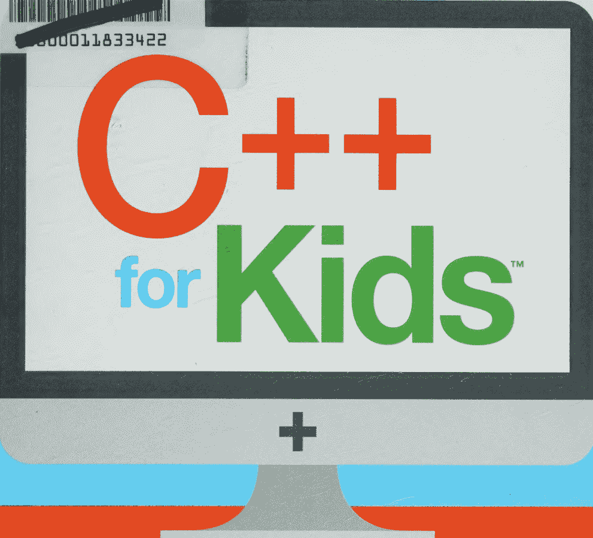


```cpp
// 孩子的第一个 C++ 程序
#include <iostream>
using namespace std;

int main()
{
    cout << "Hello Little Coder!";
}
```

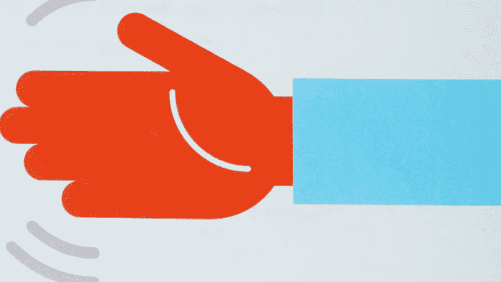

## 输出

Hello Little Coder!

绿色的字是虚假的。
其余是我们的朋友。
蓝色的字是特殊的。
红色的字是被说出来的。

```cpp
// 3 个输出语句
#include <iostream>
using namespace std;

int main()
{
    cout << "Hello Little Coder!" << endl;
    cout << "I love you.\n";
    cout << "Goodbye.";
}
```

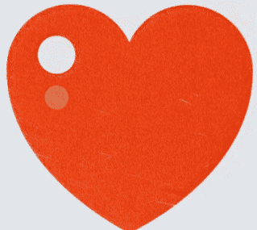

## 输出

Hello Little Coder!
I love you.
Goodbye.

红色的字越多，说的话越多。
绿色的字仍然永远看不见。
要创建新行使用 << endl。
你也可以使用 '\n'。

```cpp
// 输出输出程序
#include <iostream>
using namespace std;

int main() {
    cout << " ____________________" << endl;
    cout << " -=\c..................." << endl;
    cout << " `~~~~~~/ ~~ " << endl;
    cout << " -==/ / " << endl;
    cout << " -'" << endl;
    cout << endl << "\n";
    cout << " ._" << endl;
    cout << " (_)_" << endl;
    cout << " (_ _(_)," << endl;
}
```

## 输出

```
\
   __________
-=\c~~~~~~~~~~ )
   '~~~~~~/ ~~~
      -==/ / !
        _/

   ':.
  ( _ )_
 (_ _ )(_ ,)
```

**main()** 是最好的，它负责所有的其他工作。
没有 **main()** 就没有飞机。
**<<endl** 每次都会结束一行。

```cpp
// 如何在 C++ 中相加
#include <iostream>
using namespace std;

int main()
{
    int a;
    int b;
    int c;

    a = 1;
    b = 2;
    c = a + b;

    cout << c;
}
```

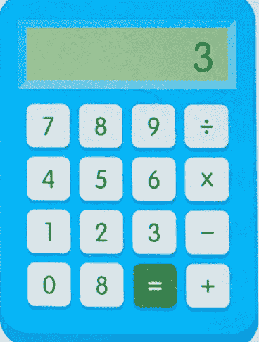

## 输出

3

数字也会被出来，

但它们不是红色的。

cout<<c 意味着电脑说了 3。


## 输出

变量 a 是 1
数组 b[4] 是 5

- 像 'a' 这样的变量只保存一个东西。
这个东西可以是一个数字、
一个字母或字符串。

- 像 b[ ] 这样的数组可以包含很多。
b[ ] 有 5 个槽位。

```cpp
// 什么是字符串？
#include <iostream>
#include <string>
using namespace std;

int main() {
    string bird;
    bird = "Polly";

    cout << bird << "wants a cracker?";
}
```

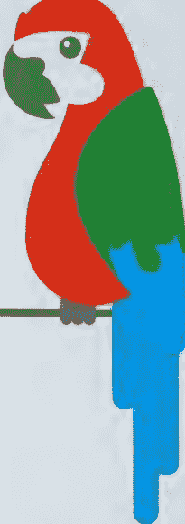

## 输出

Polly wants a cracker?

把 string 想象成一根
长绳子
可以系任何东西。

string bird 可以包含字母、
数字和单词。

```cpp
// 第一次使用 cin
#include <iostream>
using namespace std;

int main() {
    string name;
    cout << "Let's play a game,\n";
    cout << "type in your name:\n";
    cin >> name;
}
```

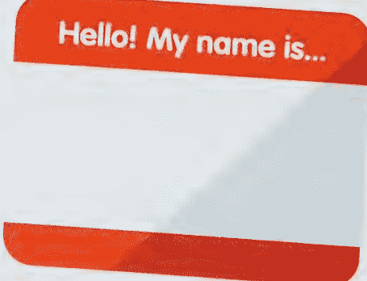

## 输出

Let’s play a game,
type in your name:

> 电脑用 cout<< 说话
用 cin>> 倾听
当你看到 cin>> 时
那就是你输入名字的时候
说出你的名字
结束游戏！
```

```cpp
// 孩子的第一个函数
#include <iostream>
using namespace std;
void train ();
int main()
{
    train();
}

void train()
{
    cout << "      ______" << endl;
    cout << "     |  __  _" << endl;
    cout << "     |  | |___V_" << endl;
    cout << "     | || ||   \"" << endl;
    cout << "     |  |   |    \"" << endl;
    cout << "     / \\|_ /\| /\\" << endl;
    cout << "      \\   /" << endl;
```

## 输出

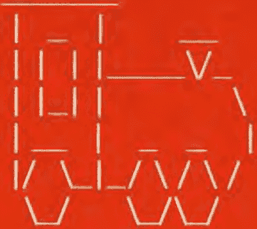

main() 是一个函数，train() 也是。

train() 在 main() 内部

train() 使用 main() 作为连接点
这就是我们调用函数的方式。

```cpp
// 如何使用 if 语句
#include <iostream>
using namespace std;

int main() {
    if ( 1 > 2 )
        cout << "1 is larger than 2" << endl;
    if ( 2 > 1)
        cout << "2 is larger than 1" << endl;
}
```

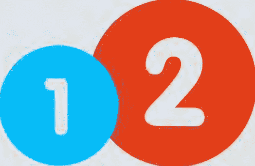

## 输出

2 is larger than 1

if 后面总是跟着一个条件。
if 也是蓝色的。
电脑将做出决定。
1 并不比2 大。

```cpp
// 使用 while 循环重复
#include <iostream>
using namespace std;

int main() {
    int age=1;
    while (age < 5) {
        cout << "Jack is " << age << " years old.";
        cout << "Jack doesn’t go to school." << endl;
        age++; //age= age+1;
    }
    cout << "Jack is now " << age << " years old and can go to school!";
}
```

## 输出

Jack is 1 years old. Jack doesn't go to school.
Jack is 2 years old. Jack doesn't go to school.
Jack is 3 years old. Jack doesn't go to school.
Jack is 4 years old. Jack doesn't go to school.
Jack is now 5 years old and can go to school!

while 也有一个条件并且是一个循环，
{ } 中的所有内容都在同一个组内。

当条件为真时，
组内的所有内容都会重新执行。

当条件为假时，
组跳过。

```cpp
// 使用 for 循环重复
#include <iostream>
using namespace std;

int main() {
    // for 循环 j
    for (int j = 1; j < 6; j++) {
        cout << j;
    }
    cout << endl;

    // for 循环 k
    for (int k = 1; k < 6; k++) {
        cout << k;
    }
    cout << endl;
}
```

## 输出

```
*
*
*
```

for 是另一种类型的循环，
j 和 k 之间唯一的区别在于它们


- using namespace std: 用在 cout 和 cin 之前。
- <<: 插入运算符。配合 cout 用于显示文本或值。
- >>: 提取运算符。配合 cin 用于获取值或其他输入。
- //: 将之前的任何信息标记为注释，它们会被编译器忽略。
- ;: 结束一个 C++ 语句。非常类似于句号结束句子的方式。
- "": 用于 cout 输出引号内的文本。


我们非常期待听到你的反馈！
在下方打个招呼吧 :-
codebabies.com
Facebook.com/CodeBabiesBooks
Twitter: @codebabies

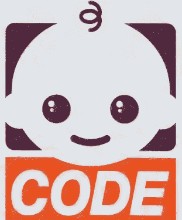

美国制造
特拉华州，米德尔敦
2016年1月20日

## 学习编程越早越好！

电脑并不聪明。
必须由人告诉它们该做什么。
而孩子们是聪明的。

通过《少儿 C++》，让孩子们学习数组、函数、if 语句、循环等知识，让他们从正确的起点开始学习。

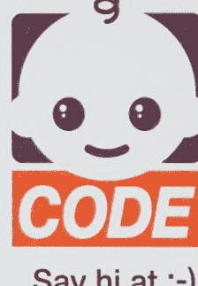

在下方打个招呼吧 :-)
codebabies.com
Facebook.com/CodeBabiesBooks
Twitter: @codebabies

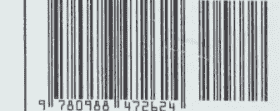
