# 程序员的 C++

Paul J. Deitel

*Deitel & Associates, Inc.*

Harvey M. Deitel

*Deitel & Associates, Inc.*

## 商标

DEITEL、双拇指竖起的小虫标识和 Dive Into 是 Deitel & Associates, Inc. 的注册商标。

Microsoft、Windows、Visual Studio 和 Visual C++ 是 Microsoft Corporation 在美国和/或其他国家的注册商标或商标。

Object Management Group、OMG、Unified Modeling Language 和 UML 是 Object Management Group, Inc. 的商标或注册商标。

Rational Unified Process 和 RUP 是 IBM Corporation 的注册商标。

Unicode 是 Unicode Consortium 的注册商标。

纪念 Joseph Weizenbaum

麻省理工学院计算机科学荣休教授：

感谢他让我们思考。

Paul 和 Harvey Deitel

## Deitel 资源中心

我们的资源中心汇集了海量在线免费内容。您可以找到有关当今最热门的编程和技术主题的资源、下载、教程、文档、书籍、电子书、期刊、文章、博客、RSS 订阅等等。查看我们资源中心的最新列表，请访问：

`www.deitel.com/ResourceCenters.html`

如果您希望看到其他资源中心，请告诉我们！另外，请在以下网址注册免费的 *Deitel® Buzz Online* 电子邮件通讯：

`www.deitel.com/newsletter/subscribe.html`

- **计算机科学**
  - 函数式编程
  - 正则表达式
- **编程**
  - ASP.NET 3.5
  - Adobe Flex
  - Ajax
  - Apex
  - ASP.NET Ajax
  - ASP.NET
  - C
  - C++
  - C++ Boost 库
  - C++ 游戏编程
  - C#
  - 代码搜索引擎与代码站点
  - 计算机游戏编程
  - CSS 2.1
  - Dojo
  - Facebook 开发者平台
  - Flash 9
  - 函数式编程
  - Java
  - Java 认证与评估测试
  - Java 设计模式
  - Java EE 5
  - Java SE 6
  - Java SE 7（Dolphin）资源中心
  - JavaFX
  - JavaScript
  - JSON
  - Microsoft LINQ
  - Microsoft Popfly
  - .NET
  - .NET 3.0
  - .NET 3.5
  - OpenGL
  - Perl
  - PHP
  - 编程项目
  - Python
  - 正则表达式
  - Ruby
  - Ruby on Rails
  - Silverlight
  - Visual Basic
  - Visual C++
  - Visual Studio Team System
  - Web 3D 技术
  - Web 服务
  - Windows 表示基础
  - XHTML
  - XML
- **游戏与游戏编程**
  - 计算机游戏编程
  - 计算机游戏
  - 移动游戏
  - 数独
- **互联网商务**
  - 联盟计划
  - 竞争分析
  - Facebook 社交广告
  - Google AdSense
  - Google Analytics
  - Google 服务
  - 互联网广告
  - 互联网商业计划
  - 互联网公共关系
  - 链接建设
  - 基于位置的服务
  - 在线潜在客户开发
  - 播客
  - 搜索引擎优化
  - 数字内容销售
  - 站点地图
  - 网络分析
  - 网站变现
  - YouTube 与 AdSense
- **Java**
  - Java
  - Java 认证与评估测试
  - Java 设计模式
  - Java EE 5
  - Java SE 6
  - Java SE 7（Dolphin）资源中心
  - JavaFX
- **Microsoft**
  - ASP.NET
  - ASP.NET 3.5
  - ASP.NET Ajax
  - C#
  - DotNetNuke (DNN)
  - Internet Explorer 7 (IE7)
  - Microsoft LINQ
  - .NET
  - .NET 3.0
  - .NET 3.5
  - SharePoint
  - Silverlight
  - Visual Basic
  - Visual C++
  - Visual Studio Team System
  - Windows 表示基础
  - Windows Vista
  - Microsoft Popfly
- **开源与 LAMP 技术栈**
  - Apache
  - DotNetNuke (DNN)
  - Eclipse
  - Firefox
  - Linux
  - MySQL
  - 开源
  - Perl
  - PHP
  - Python
  - Ruby
- **软件**
  - Apache
  - DotNetNuke (DNN)
  - Eclipse
  - Firefox
  - Internet Explorer 7 (IE7)
  - Linux
  - MySQL
  - 开源
  - 搜索引擎
  - SharePoint
  - Skype
  - Web 服务器
  - Wiki
  - Windows Vista
- **Web 2.0**
  - 提醒服务
  - 注意力经济
  - 博客
  - 构建 Web 社区
  - 社区生成内容
  - Facebook 开发者平台
  - Facebook 社交广告
  - Google Base
  - Google Video
  - Google Web Toolkit (GWT)
  - 互联网视频
  - Joost
  - 基于位置的服务
  - 混搭
  - 微格式
  - 推荐系统
  - RSS
  - 社交图谱
  - 社交媒体
  - 社交网络
  - 软件即服务（SaaS）
  - 虚拟世界
  - Web 2.0
  - Web 3.0
  - 小部件
- **Dive Into Web 2.0 电子书**
  - Web 2 电子书
- **其他主题**
  - 计算机游戏
  - 计算相关职业
  - 小玩意与新奇装置
  - 手机铃声
  - 数独

# 前言

> “语言的主要优点是清晰性......”
> —盖伦

欢迎阅读《面向程序员的 C++》！在 Deitel & Associates，我们为 Prentice Hall 出版编程语言专业书籍和教材，在全球各地的组织中提供编程语言企业培训课程，并开发互联网业务。本书面向尚未掌握 C++ 的程序员，可能已了解或未了解面向对象编程。

# 《面向程序员的 C++》的特色

本书的“书籍导览”部分将让您了解《面向程序员的 C++》对 C++ 和面向对象编程的覆盖范围。以下是本书的一些主要特色：

- 早期类和对象方法。我们在适当的地方从开始并贯穿全文介绍面向对象编程。
- 集成案例研究。我们在第 3–7 章开发 `GradeBook` 类，在第 9–10 章的多个部分开发 `Time` 类，在第 12–13 章开发 `Employee` 类，以及在第 1–7 章、第 9 章、第 13 章和附录 E 中开发可选的 OOD/UML ATM 案例研究。
- 统一建模语言™ 2 (`UML 2`)。统一建模语言 (`UML`) 已成为面向对象系统设计者首选的图形建模语言。我们使用 UML 类图直观表示类及其继承关系，并使用 UML 活动图演示 C++ 每个控制语句中的控制流。我们在可选的 OOD/UML ATM 案例研究中强调 UML。
- 可选 OOD/UML ATM 案例研究。我们介绍 UML 2 的简明子集，然后指导您进行一次面向初学者的面向对象设计/编程体验。案例研究由一支杰出的 OOD/UML 行业专业人士和学者团队审阅。案例研究不是练习；它是一个完全开发的端到端学习体验，以对完整的 877 行 C++ 代码实现的详细讲解结束。我们在前言后面详细介绍了本案例研究的九个部分。
- 函数调用栈解释。在第 6 章中，我们提供了函数调用栈和激活记录的详细讨论（附图示），以解释 C++ 如何跟踪当前正在执行的函数、函数的自动变量如何在内存中维护以及函数完成执行后如何知道返回的位置。
- **类 `string`。** 我们在全书的大部分字符串操作中使用类 `string` 而不是 C 风格的基于指针的 `char *` 字符串。我们在第 8、10、11 和 19 章中讨论了 `char *` 字符串，以便让你练习指针操作，说明使用 `new` 和 `delete` 进行动态内存分配，构建我们自己的 `String` 类，并为你在 C 和 C++ 遗留代码中处理 `char *` 字符串做好准备。
- **类模板 `vector`。** 我们在全书中都使用类模板 `vector` 而不是 C 风格的基于指针的数组操作。然而，我们在第 7 章开始讨论 C 风格的基于指针的数组，以便让你为处理 C 和 C++ 遗留代码做好准备，并作为在第 11 章构建我们自己的定制 `Array` 类的基础。
- **继承和多态的处理。** 第 12–13 章包含一个 `Employee` 类层次结构，使继承和多态的处理对刚接触 OOP 的程序员来说清晰易懂。
- **多态“幕后”工作原理的讨论和说明。** 第 13 章包含 C++ 如何在内部实现多态、虚函数和动态绑定的详细图表和解释。这让你对这些功能真正的工作原理有了扎实的理解。更重要的是，它帮助你认识到多态的开销——以额外的内存消耗和处理器时间为代价。这有助于你判断何时使用多态、何时避免它。
- **标准模板库（STL）。** 从软件重用的角度来看，这可能是本书最重要的主题之一。STL 定义了功能强大的、基于模板的、可重用的组件，实现了用于处理这些数据结构的大量常见数据结构和算法。第 20 章介绍 STL 并讨论其三个关键组件——容器、迭代器和算法。使用 STL 组件提供了巨大的表达能力，通常可以将许多行非 STL 代码简化为单个语句。
- **ISO/IEC C++ 标准兼容性。** 我们已根据最新的 ISO/IEC C++ 标准文档对我们的内容进行了审核，以确保完整性和准确性。[注：C++ 标准（文件编号 INCITS/ISO/IEC 14882-2003）的 PDF 副本可从 `webstore.ansi.org/ansidocstore/default.asp.` 购买。]
- **C++ 的未来。** 在第 21 章讨论 C++ 的未来时，我们介绍了 Boost C++ 库、技术报告 1（TR1）和 C++0x。免费的 Boost 开源库由 C++ 社区成员创建。技术报告 1 描述了对 C++ 标准库的拟议更改，其中许多基于当前的 Boost 库。C++ 标准委员会正在修订 C++ 标准。新标准的主要目标是使 C++ 更易于学习、改进库构建能力并提高与 C 编程语言的兼容性。上一个标准于 1998 年发布。对新标准的工作，目前称为 C++0x，于 2003 年开始。新标准可能在 2009 年发布。它将包括对核心语言的更改，以及很可能包括 TR1 中的许多库。我们概述了 TR1

*使用字体强调。* 我们将关键术语和索引中每个定义出现的页码引用放在 *粗斜体* 文本中以便于参考。我们在 **粗体 Helvetica** 字体中强调屏幕组件（例如 File 菜单），并在 Lucida 字体中强调 C++ 程序文本（例如 `int x = 5`）。

*网络访问。* *C++ for Programmers* 的所有源代码示例均可从 `www.deitel.com/books/cppfp/` 下载。

*目标。* 每章都以目标陈述开始。这让你知道可以期待什么，并在阅读章节后有机会确定是否已达到目标。

*引言。* 学习目标后面跟着引言。有些幽默；有些哲学；其他则提供有趣的见解。我们希望你能喜欢将引言与章节内容联系起来。

*大纲。* 章节大纲帮助你以自上而下的方法处理材料，以便你能预见到即将发生的事情并设定舒适有效的学习节奏。

*插图/图表。* 包含丰富的图表、表格、线图、程序和程序输出。我们使用 UML 活动图来模拟控制语句中的控制流。UML 类图模拟类的字段、构造函数和方法。我们在可选的 OOD/UML 2 ATM 案例研究中大量使用了六种主要的 UML 图类型。

*编程技巧。* 我们包含编程技巧来帮助你关注程序开发的重要方面。这些技巧和实践代表了我们从合计七十年的编程经验中提炼出的精华——它们为构建优秀软件提供了基础。

# 良好的编程实践

良好的编程实践会引起你对有助于编写更清晰、更易理解和更易维护的程序的技术注意。

# 常见编程错误

指出这些常见编程错误可以降低你犯相同错误的可能性。

# 错误预防提示

这些提示包含有关暴露错误并将其从程序中删除的建议；其中许多描述了 C++ 的方面，这些方面可以防止错误首先进入程序。

# 性能提示

这些提示突出了使程序运行更快或减少其占用的内存量的机会。

# 可移植性提示

我们包含可移植性提示来帮助你编写可在各种平台上运行的代码，并解释 C++ 如何实现其高度可移植性。

# 软件工程观察

*软件工程观察突出了影响软件系统构建，特别是大规模系统的架构和设计问题。*

*总结部分。* 每章都以简短的“总结”部分结束，回顾章节内容并过渡到下一章。

*数千个索引条目。* 我们包含了一个非常详细的索引，当你将本书用作参考时尤其有用。

*“双索引”C++ 实时代码示例。* 对于书中的每个源代码程序，我们都按字母顺序索引图表标题，并在“Examples”下作为子索引项进行索引。这使得更容易找到使用特定功能的示例。

# 书籍导览

你现在将参观你在 *C++ for Programmers* 中将学习的 C++ 功能。图 1 说明了各章之间的依赖关系。我们建议按照箭头指示的顺序学习主题，尽管其他顺序也是可能的。

*第 1 章，导论，* 讨论 C++ 编程语言的起源，并介绍典型的 C++ 编程环境。我们在 Windows 和 Linux 平台上演示典型 C++ 应用程序的“试用”。我们还介绍基本对象技术概念和术语，以及统一建模语言。

*第 2 章，C++ 编程导论，* 提供了在 C++ 中编程应用程序的轻量级介绍。本章中的程序说明了如何在屏幕上显示数据、从键盘获取数据、做出决策和执行算术运算。

*第 3 章，类和对象导论，* 提供了对类和对象的友好早期介绍。我们使用一系列简单的现实世界示例介绍类、对象、成员函数、构造函数和数据成员。我们在 C++ 中开发了一个设计良好的框架，用于组织面向对象的程序。我们用一个简单的示例来激发类的概念。然后我们展示一个精心安排的七个完整工作程序的序列，以演示创建和使用自己的类。这些示例开始了我们关于开发成绩簿类的综合案例研究，该类可供教师用来维护学生成绩。此案例研究在接下来的几章中得到增强，并在第 7 章达到顶峰。`GradeBook` 类案例研究描述了如何定义一个类以及如何使用它来创建对象。案例研究讨论了如何声明和定义成员函数以实现类的行为，如何声明数据成员以实现类的属性，以及如何调用对象的成员函数使其执行其任务。我们介绍 C++ 标准库类 `string` 并创建 `string` 对象来存储 `GradeBook` 对象所代表的课程名称。我们解释了类的成员数据与函数的局部变量之间的区别，以及如何使用构造函数确保对象的数据在对象创建时初始化。我们展示了如何通过将类定义与使用该类的客户端代码（例如函数 `main`）分离来促进软件重用。我们还介绍了另一个良好的软件工程基本原则——将接口与实现分离。

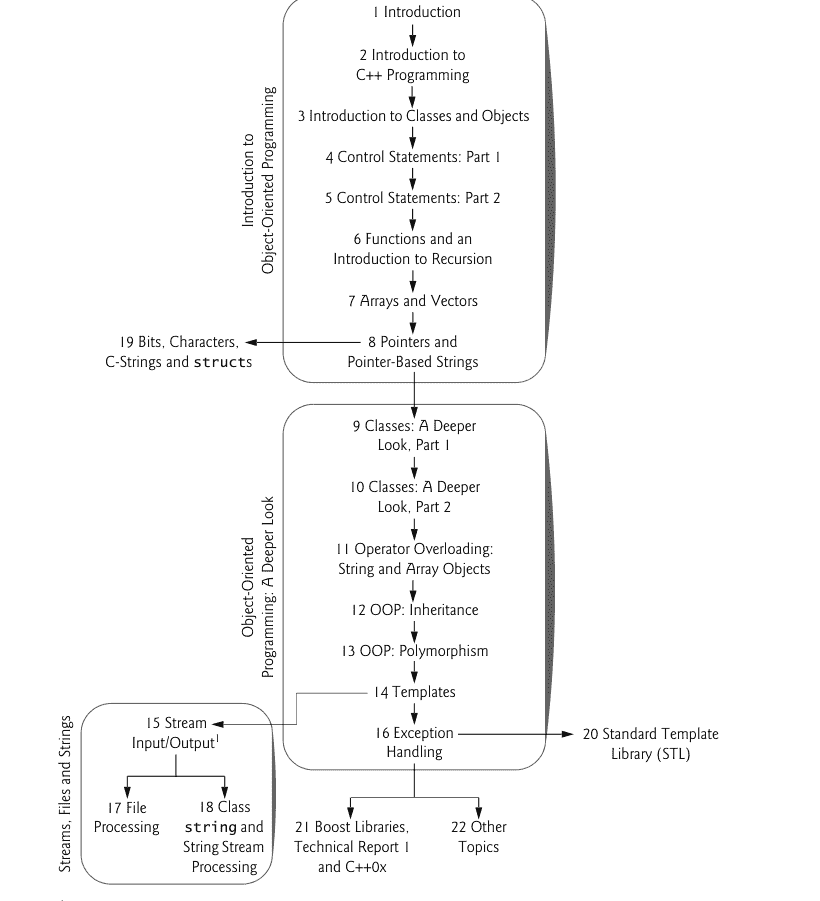

图 1 |《C++ 程序员教程》章节依赖图。

第 4 章 控制语句：第 1 部分重点介绍创建有用类所涉及的程序开发过程。本章介绍一些用于决策（`if` 和 `if...else`）和循环（`while`）的控制语句。我们使用第 3 章中的 `GradeBook` 类研究计数器控制和哨兵控制循环，并介绍 C++ 的自增、自减和赋值运算符。本章内容包括：

如何使用 `const` 与指针来实施最小权限原则，以构建更健壮的软件。我们讨论在程序编译期间使用 `sizeof` 运算符来确定数据类型或数据项的大小（以字节为单位）。在 C++ 中，指针、数组和 C 风格字符串之间有着密切的关系，因此我们介绍基本的 C 风格字符串操作概念，并讨论一些最流行的 C 风格字符串处理函数，例如 `getline`（输入一行文本）、`strcpy` 和 `strncpy`（复制字符串）、`strcat` 和 `strncat`（拼接两个字符串）、`strcmp` 和 `strncmp`（比较两个字符串）、`strtok`（将字符串“切分”成多个片段）和 `strlen`（返回字符串的长度）。我们经常使用第 3 章介绍的 `string` 对象来代替基于 C 风格、`char *` 指针的字符串。然而，我们在第 8 章中包含 `char *` 字符串，以帮助你掌握指针，并为专业领域做好准备，在那里你会看到大量在过去三十年中实现的 C 语言遗留代码。在 C 和“原始 C++”中，数组和字符串是指向内存中数组和字符串内容的指针（甚至函数名也是指针）。

## 第 9 章 类：深入剖析，第 1 部分

继续我们对面向对象编程的讨论。本章使用一个内容丰富的 `Time` 类案例研究来说明访问类成员、将接口与实现分离、使用访问函数和工具函数、使用构造函数初始化对象、使用析构函数销毁对象、默认逐成员复制赋值以及软件复用性。我们讨论在对象生命周期中构造函数和析构函数的调用顺序。对 `Time` 案例研究的一个修改展示了当成员函数返回对私有数据成员的引用时可能出现的问题，这会破坏类的封装。


## 第 10 章 类：深入剖析，第 2 部分

继续对类的研究，并介绍更多的面向对象编程概念。本章讨论常量对象的声明与使用、常量成员函数、组合（构建以其他类的对象为成员的类的过程）、友元函数和友元类（它们对类的私有成员和保护成员拥有特殊访问权）、`this` 指针（它使对象能够知道自己的地址）、动态内存分配、用于保存和操作类级数据的静态类成员、常见抽象数据类型（数组、字符串和队列）的示例、容器类和迭代器。在关于 `const` 对象的讨论中，我们提到了关键字 `mutable`，它以一种巧妙的方式用于允许修改 `const` 对象中“不可见”的实现。我们讨论使用 `new` 和 `delete` 进行动态内存分配。当 `new` 失败时，程序默认会终止，因为在标准 C++ 中 `new` 会“抛出异常”。我们通过一个基于视频游戏的场景引出对静态类成员的讨论。我们强调向类的客户隐藏实现细节的重要性；然后我们讨论代理类，它提供了一种向类的客户隐藏实现（包括类头文件中的私有数据）的手段。

## 第 11 章 运算符重载；String 和 Array 对象

介绍我们 C++ 课程中最受欢迎的主题之一。专业人士非常喜欢这部分内容。他们认为它是对第 9 章和第 10 章中关于设计有价值类的详细讨论的完美补充。运算符重载使你可以告诉编译器如何将现有运算符用于新类型的对象。C++ 已经知道如何将这些运算符用于内置类型，例如整数、浮点数和字符。但是假设我们创建一个新的 `String` 类——加号用在 `String` 对象之间会是什么意思？许多程序员使用加号（`+`）表示字符串拼接。在第 11 章中，你将看到如何“重载”加号，因此当它在表达式中出现在两个 `String` 对象之间时，编译器将生成对“运算符函数”的函数调用，该函数将拼接这两个 `String`。本章讨论运算符重载的基本原理、运算符重载的限制、使用类成员函数与使用非成员函数进行重载、重载一元和二元运算符以及类型之间的转换。第 11 章包含一系列内容充实的案例研究，包括 `Array` 类、`String` 类和 `Date` 类。明智地使用运算符重载有助于为你的类增添额外的“光彩”。

## 第 12 章 面向对象编程：继承

介绍面向对象编程语言最基本的能力之一——继承：一种软件复用形式，通过吸收现有类的功能并添加适当的新功能，可以快速轻松地开发新类。在 `Employee` 层次结构案例研究的背景下，本章展示了一个由五个示例组成的序列，演示私有数据、保护数据以及利用继承的良好软件工程。本章讨论基类和派生类的概念、保护成员、公有继承、保护继承、私有继承、直接基类、间接基类、基类和派生类中的构造函数和析构函数，以及利用继承的软件工程。本章还比较了继承（*is-a*，即“是一种”关系）与组合（*has-a*，即“有一个”关系），并介绍了 *uses-a*（“使用一个”）和 *knows-a*（“知道一个”）关系。

## 第 13 章 面向对象编程：多态

涉及面向对象编程的另一个基本能力：多态行为。第 13 章以第 12 章介绍的继承概念为基础，重点讨论类层次结构中类之间的关系，以及这些关系所支持的强大处理能力。当许多类通过继承与一个公共基类相关联时，每个派生类对象都可以被视为基类对象。这使得程序能够以简单而通用的方式编写，而不依赖于派生类对象的具体类型。同一程序可以处理新类型的对象，从而使系统更具扩展性。本章讨论通过虚函数实现多态行为的机制。它区分了抽象类（无法从中实例化对象）和具体类（可以从中实例化对象）。抽象类对于向整个层次结构中的类提供可继承的接口非常有用。我们提供了 C++ 编译器为支持多态而自动构建的 *vtables*（虚函数表）的图示和精确解释。最后，我们介绍运行时类型信息（RTTI）和动态转换，它们使程序能够在执行时确定对象的类型，然后对该对象采取相应行动。

## 第 14 章 模板

讨论 C++ 更强大的软件复用特性之一，即模板。函数模板和类模板使你可以用单个代码段指定一整组相关的重载函数（称为函数模板特化）或一整组相关的类（称为类模板特化）。这种技术称为泛型编程。我们可以为一个栈类编写一个类模板，然后让 C++ 生成独立的类模板特化，例如“`int` 栈”类、“`float` 栈”类、“`string` 栈”类等。本章讨论类模板的类型参数、非类型参数和默认类型的使用。我们还讨论模板与 C++ 其他特性（如重载、继承、友元和静态成员）之间的关系。我们极大地增强了 The treatment of templates in our discussion of the Standard Template Library (STL) containers, iterators and algorithms in Chapter 20.

## Chapter 15, Stream Input/Output

本章对标准 C++ 输入/输出功能进行了全面论述。本章讨论了一系列足以执行大多数常见 I/O 操作的功能，并概述了剩余功能。许多 I/O 特性是面向对象的。C++ 的各种 I/O 能力包括使用流插入运算符 (`<<`) 进行输出，使用流提取运算符 (`>>`) 进行输入，类型安全 I/O，格式化 I/O，未格式化 I/O（用于性能）。用户可以通过重载流插入运算符 (`<<`) 和流提取运算符 (`>>`) 来指定如何对用户定义类型对象执行 I/O。C++ 提供了各种流操纵符来执行格式化任务。本章讨论的流操纵符提供了诸如以各种进制显示整数、控制浮点精度、设置字段宽度、显示小数点和尾随零、对齐输出、设置和取消格式状态、设置字段中的填充字符等功能。我们还展示了一个创建用户定义输出流操纵符的示例。

## Chapter 16, Exception Handling

本章讨论异常处理如何使您能够编写健壮、容错且适用于业务关键型和任务关键型环境的程序。本章讨论异常处理何时适用；介绍异常处理的基本功能，包括 `try` 块、`throw` 语句和 `catch` 处理程序；说明如何以及何时重新抛出异常；解释如何编写异常规范并处理未预期的异常；并讨论异常与构造函数、析构函数和继承之间的重要联系。我们讨论重新抛出异常，并举例说明当内存耗尽时 `new` 如何失败。许多旧的 C++ 编译器在 `new` 失败时默认返回 0。我们展示了 `new` 失败时抛出 `bad_alloc`（不良分配）异常的新风格。我们举例说明如何使用函数 `set_new_handler` 指定在内存耗尽情况下调用的自定义函数。我们讨论如何使用 `auto_ptr` 类模板隐式删除动态分配的内存，从而避免内存泄漏。为结束本章，我们介绍了标准库异常层次结构。

## Chapter 17, File Processing

本章讨论创建和处理顺序文件和随机访问文件的技术。本章首先介绍从位到字节、到字段、到记录再到文件的层次结构。接下来，我们介绍了 C++ 对文件和流的看法。我们讨论顺序文件并构建程序，展示如何打开和关闭文件，如何将数据顺序存储到文件中以及如何从文件中顺序读取数据。然后我们讨论随机访问文件并构建程序，展示如何为随机访问创建文件，如何使用随机访问向文件读写数据以及如何从随机访问的文件中顺序读取数据。案例研究将顺序和随机访问文件的技术结合起来，形成一个完整的事务处理程序。

## Chapter 18, Class `string` and String Stream Processing

本章讨论 C++ 将内存中的字符串作为输入并将数据输出到内存中的字符串的能力；这些能力通常被称为内存内格式化或字符串流处理。类 `string` 是标准库的必备组件。我们在第 8 章及以后保留了 C 风格、基于指针的字符串的处理，原因有几个。首先，它加强了您对指针的理解。其次，在未来十年左右，C++ 程序员需要能够阅读和修改在过去四分之一世纪里积累的海量 C 遗留代码——这些代码将字符串作为指针处理，而在过去多年里在工业界编写的大部分 C++ 代码也是如此。在第 18 章中，我们讨论字符串赋值、连接和比较。我们展示如何确定各种字符串特征，例如字符串的大小、容量以及是否为空。我们讨论如何调整字符串大小。我们考虑各种“查找”函数，使我们能够在字符串中查找子字符串（向前或向后搜索字符串），并展示如何查找从一组字符中选出的字符在字符串中的第一次出现或最后一次出现，以及如何查找不在选定字符字符串中的字符的第一次出现或最后一次出现。我们展示如何在字符串中替换、删除和插入字符，以及如何将字符串对象转换为 C 风格的 `char * string`。

## Chapter 19, Bits, Characters, C Strings and `structs`

本章首先比较 C++ 结构与类，然后定义和使用 C 风格的结构。我们展示如何声明结构、初始化结构以及将结构传递给函数。C++ 强大的位操作能力使您能够编写利用底层硬件能力的程序。这有助于程序处理位串、设置单个位并更紧凑地存储信息。这种能力通常只在低级汇编语言中找到，对编写系统软件（如操作系统和网络软件）的程序员很有价值。我们在第 8 章讨论了 C 风格 `char * string` 的操作，在那里我们介绍了最流行的字符串操作函数。在第 19 章中，我们继续介绍字符和 C 风格 `char * strings`。我们介绍了 `<cctype>` 库的各种字符操作能力——例如测试字符以确定它是否为数字、字母字符、字母数字字符、十六进制数字、小写字母或大写字母。我们介绍了各种字符串相关库的剩余字符串操作函数。

## Chapter 20, Standard Template Library (STL)

本章讨论 STL 强大的、基于模板的、可重用的组件，这些组件实现了用于处理这些数据结构的许多常见数据结构和算法。STL 为使用模板的泛型编程提供了概念验证——在第 14 章引入。本章讨论 STL 的三个关键组件——容器（模板化数据结构）、迭代器和算法。容器是能够存储任何类型对象的结构。我们将看到有三类容器——一级容器、适配器和近容器。迭代器具有与指针相似的属性，用于程序操作容器元素。事实上，标准数组可以用指针作为迭代器作为 STL 容器进行操作。使用迭代器操作容器很方便，并且与 STL 算法结合时具有巨大的表达能力——在某些情况下，将许多行代码减少为单条语句。STL 算法是执行常见数据操作（如搜索、排序和比较元素（或整个容器））的函数。大多数这些使用迭代器访问容器元素。

## Chapter 21, Boost Libraries, Technical Report 1 and C++0x

本章关注 C++ 的未来。我们介绍了 Boost 库，一个免费的、开源的 C++ 库集合。Boost 库经过精心设计，可与 C++ 标准库良好配合。然后我们讨论技术报告 1（TR1），即对标准库的拟议更改和补充的描述。TR1 中的许多库源自目前 Boost 中的库。本章简要描述了 TR1 库。我们为两个最有用的库提供了深入的代码示例，`Boost.Regex` 和 `Boost.Smart_ptr`。`Boost.Regex` 库提供正则表达式支持。我们演示如何使用该库在字符串中搜索与正则表达式匹配的内容、验证数据、替换字符串的部分并将字符串拆分为标记。`Boost.Smart_ptr` 库提供智能指针以帮助管理动态分配的内存。我们讨论了 TR1 中包含的两种智能指针类型——`shared_ptr` 和 `weak_ptr`。我们提供示例来演示如何使用它们避免常见的内存管理错误。本章还讨论了 C++ 新标准的即将发布的版本。

## Chapter 22, Other Topics

本章是 C++ 杂项主题的集合。我们讨论另一个强制转换运算符——`const_cast`。这些运算符——`static_cast`（第 5 章）、`dynamic_cast`（第 13 章）、`reinterpret_cast`（第 17 章）和 `const_cast`——提供了比 C++ 从 C 继承的原始强制转换运算符（现已弃用）更强大的类型转换机制。我们讨论命名空间，这对于构建大型系统的软件开发人员来说尤其重要。命名空间可防止命名冲突，这可能阻碍此类大型软件工作。我们讨论关键字 `mutable`，它允许 `const` 对象的成员被更改。以前，这是通过“去掉 `const`-ness”来实现的，这被认为是一种危险的做法。我们还讨论指针到成员运算符 `.*` 和 `->*`、多重继承（包括“菱形继承”问题）和虚基类。

## Appendix A, Operator Precedence and Associativity Chart

本附录列出了 C++ 运算符符号的完整集合，其中每个运算符单独占一行，并附有其运算符符号、名称和结合性。

## Appendix B, ASCII Character Set

本书中的所有程序都使用 ASCII 字符集，该字符集在本附录中呈现。

## Appendix C, Fundamental Types

本附录列出了 C++ 的基本类型。

## Appendix D, Preprocessor

本附录讨论预处理器的指令。附录包括对 `#include` 指令的更完整信息，该指令在文件编译前将指定文件的副本包含在指令位置，以及创建符号常量和宏的 `#define` 指令。附录解释了条件编译，它使您能够控制预处理器指令的执行和程序代码的编译。`#` 运算符将操作数转换为字符串以及 `##` 运算符连接两个标记进行了讨论。各种预定义预处理器符号常量（`__LINE__`、`__FILE__`、`__DATE__`、`__STDC__`、`__TIME__` 和 `__TIMESTAMP__`）被列出。最后，讨论了头文件 `<cassert>` 的 `assert` 宏，该宏在程序测试、调试、验证和确认中很有价值。

## Appendix E, ATM Case Study Code

本附录包含我们关于 UML 的面向对象设计的案例研究的实现。本附录在案例研究的巡览中讨论（稍后呈现）。

## Appendix F, UML 2: Additional Diagram Types

本附录概述了在 OOD/UML 案例研究中未找到的 UML 2 图表类型。

## Appendix G, Using the Visual Studio Debugger

本附录演示了 Visual Studio 调试器的关键功能，该调试器允许程序员监控应用程序的执行以定位和删除逻辑错误。附录提供了逐步说明，以便您以实践方式学习如何使用调试器。

## Appendix H, Using the GNU C++ Debugger

本附录演示了 GNU C++ 调试器的关键功能。附录提供了逐步说明，以便您以实践方式学习如何使用调试器。

**参考书目。** 参考书目列出了许多关于C++和面向对象编程的书籍和文章，供进一步阅读。

**索引。** 综合索引使您能够通过关键词在整个文本中定位任何术语或概念。

## 使用UML的ATM面向对象设计：可选软件工程案例研究之旅

在本节中，我们将浏览书中可选的面向对象设计案例研究，该研究使用UML。本预览将介绍九个软件工程案例研究部分（位于第1–7章、第9章和第13章）的内容。完成本案例研究后，您将深入熟悉一个经过精心设计和评审的面向对象设计与实现，用于一个重要的C++应用程序。

ATM案例研究中的设计由Deitel & Associates公司开发，并经过了一个由行业专业人士和学者组成的杰出开发评审团队的仔细审查。全球银行及其客户使用的真实ATM系统基于更复杂的设计，这些设计考虑的问题比我们在这里讨论的多得多。我们在整个设计过程中的主要目标是创建一个简单的设计，使面向对象设计和UML的初学者能够理解，同时仍然展示关键的面向对象设计概念和相关的UML建模技术。

**第1.10节，软件工程案例研究：对象技术与UML入门**——介绍了使用UML的面向对象设计案例研究。本节介绍对象技术的基本概念和术语，包括类、对象、封装、继承和多态。我们讨论了UML的历史。这是案例研究中唯一必需的部分。

**第2.7节，（可选）软件工程案例研究：检查ATM需求规格说明**——讨论了一个*需求规格说明*，它规定了我们将设计和实现的系统（一个简单的自动取款机（ATM）软件）的需求。我们研究一般面向对象系统的结构和行为。我们讨论UML如何通过提供几种额外的图类型来建模我们的系统，从而促进后续软件工程案例研究部分的设计过程。我们讨论了需求规格说明所规定的ATM系统与其用户之间的交互。具体来说，我们研究用户与系统本身之间可能发生的场景——这些场景称为*用例*。我们使用UML的*用例图*对这些交互进行建模。

**第3.11节，（可选）软件工程案例研究：识别ATM需求规格说明中的类**——开始设计ATM系统。我们通过从需求规格说明中提取名词和名词短语来识别其类，即“构建块”。我们将这些类安排到一个描述我们模拟的类结构的UML类图中。该类图还描述了类之间的关系，称为*关联*。

**第4.11节，（可选）软件工程案例研究：识别ATM系统中的类属性**——重点关注第3.11节所讨论的类的属性。类同时包含*属性*（数据）和*操作*（行为）。正如我们将在后续章节中看到的，对象属性的变化常常影响对象的行为。为了确定案例研究中类的属性，我们从需求规格说明中提取描述名词和名词短语（这些名词和名词短语定义了我们的类）的形容词，然后将属性放置到我们在第3.11节创建的类图中。

**第5.10节，（可选）软件工程案例研究：识别ATM系统中对象的状态和活动**——讨论对象在任意给定时间如何处于一种称为状态的具体情况。当对象收到改变状态的消息时，就会发生状态转换。UML提供状态机图，它标识对象可能处于的一组可能状态，并对该对象的状态转换进行建模。对象还有一个活动——它在生命周期中执行的工作。UML提供活动图——一种对对象活动进行建模的流程图。在本节中，我们使用这两种图开始对ATM系统的特定行为方面进行建模，例如ATM如何执行取款交易以及当用户通过身份验证时ATM如何响应。

**第6.22节，（可选）软件工程案例研究：识别ATM系统中的类操作**——识别我们类的操作或服务。我们从需求规格说明中提取指定每个类操作的动词和动词短语。然后我们修改第3.11节的类图，以包含每个操作及其关联的类。在案例研究的这一点上，我们将已经从需求规格说明中收集了所有可能的信息。然而，随着后续章节引入继承等主题，我们将修改我们的类和图。


# 第7.12节，（可选）软件工程案例研究：ATM系统中对象间的协作
为我们的ATM系统模型提供了“粗略草图”。在本节中，我们了解它如何工作。我们通过讨论协作——对象之间为了通信而相互发送的消息——来研究模拟的行为。我们在第6.22节中发现的类操作实际上就是系统中对象间的协作。我们确定这些协作，然后将它们收集到通信图——用于建模协作的UML图。该图揭示了哪些对象在何时进行协作。我们展示了一个对象间协作以执行ATM余额查询的通信图。然后我们展示用于对系统中交互进行建模的UML顺序图。该图强调消息的时间顺序。顺序图对系统中对象如何交互以执行取款和存款交易进行建模。

# 第9.11节，（可选）软件工程案例研究：开始编写ATM系统的类
暂时停止设计系统的行为。我们开始实现过程，以强调第9章讨论的内容。使用第3.11节的UML类图以及第4.11节和第6.22节讨论的属性和操作，我们展示如何根据设计用C++实现一个类。我们并不实现所有类——因为我们尚未完成设计过程。根据我们的UML图，我们为`Withdrawal`类创建代码。

# 第13.10节，（可选）软件工程案例研究：将继承融入ATM系统
继续我们关于面向对象编程的讨论。我们考虑继承——共享公共特征的类可以从“基”类继承属性和操作。在本节中，我们研究ATM系统如何从使用继承中受益。我们将发现记录在建模继承关系的类图中——UML将这些关系称为泛化。

我们使用继承对具有相似特征的类进行分组，从而修改第3.11节的类图。本节结束我们模拟模型部分的设计。我们在附录E中以877行C++代码完全实现了此模型。

# 附录E，ATM案例研究代码
案例研究的大部分涉及设计ATM系统的模型（即数据和逻辑）。在本附录中，我们用C++实现该模型。使用我们创建的所有UML图，我们给出实现该模型所需的C++类。我们应用你在各章中学到的使用UML进行面向对象设计以及C++面向对象编程的概念。到本附录结束时，你将完成一个真实系统的设计和实现，并应该有信心处理更大的系统。

# 附录F，UML 2：附加图类型
概述了在面向对象设计（OOD）/UML案例研究中未出现的UML 2图类型。

## 编译器和其他资源
许多C++开发工具可用。我们编写《C++ for Programmers》时，主要使用了Microsoft免费的Visual C++ Express Edition（`www.microsoft.com/express/vc/`）和`gcc.gnu.org`上的免费GNU C++，后者已安装在大多数Linux系统上，也可以安装在Mac OS X系统上。Apple在其Xcode开发工具中包含GNU C++，Mac OS X用户可以从`developer.apple.com/tools/xcode`下载。

其他资源和软件下载可在我们的C++资源中心获取：

```
www.deitel.com/cplusplus/
```

以及本书的网站：

```
www.deitel.com/books/cppfp/
```

有关其他可免费下载的C++编译器的列表，请访问：

```
www.thefreecountry.com/developercity/ccompilers.shtml
www.compilers.net
```

## 旧版C++编译器上的警告和错误消息
本书中的程序设计用于支持标准C++的编译器。然而，不同编译器之间存在差异，可能会导致偶尔的警告或错误。此外，虽然标准规定了需要生成错误的各种情况，但它并未规定编译器应发出的消息。警告和错误消息因编译器而异。

一些旧版C++编译器会在新编译器不会产生警告或错误的地方生成错误或警告消息。虽然本书中的大多数示例都能在这些旧版编译器上工作，但有少数示例需要稍作修改才能兼容旧版编译器。

## 关于使用声明和C标准库函数的说明
C++标准库包含C标准库中的函数。根据C++标准文档，来自C标准库的头文件的内容。

标准库是 `std` 命名空间的一部分。有些编译器（无论是老版本还是新版本）在遇到为 C 函数使用声明时会产生错误信息。

## Deitel 在线资源中心
我们的网站提供了关于各种主题的资源中心（`www.deitel.com/ResourceCenters.html`），涵盖编程语言、软件、Web 2.0、互联网业务和开源项目等。这些资源中心源自我们为撰写书籍和开展业务所做的研究。我们发现了许多（大部分是免费的）优秀资源，包括教程、文档、软件下载、文章、博客、视频、代码示例、书籍、电子书等等。我们通过提供最有价值资源的链接，帮助您在浩瀚的互联网内容中披沙拣金。每周我们都会在通讯《Deitel® Buzz Online》（`www.deitel.com/newsletter/subscribe.html`）中发布最新的资源中心。在阅读《C++ for Programmers》时，以下资源中心可能会对您有所帮助：

- C++
- Visual C++ 2008
- C++ Boost 库
- C++ 游戏编程
- 代码搜索引擎与代码站点
- 计算机游戏编程
- 计算类工作
- 开源
- 编程项目
- Eclipse
- Linux
- .NET
- Windows Vista

## Deitel® Buzz Online 免费电子邮件通讯
每周，《Deitel® Buzz Online》通讯都会发布我们最新的资源中心，并包含对行业趋势和发展的评论、我们已出版书籍和即将出版书籍中的免费文章和资源链接、产品发布计划、勘误、挑战、轶事、我们企业内部讲师指导培训课程的信息等等。这也是您及时了解与《C++ for Programmers》相关问题的好方法。要订阅，请访问

```
www.deitel.com/newsletter/subscribe.html
```

## Deitel® LiveLessons 自定进度视频培训
Deitel® LiveLessons 产品是自定进度的视频培训。每个系列提供约 14 小时以上的讲师指导编程培训。您的讲师 Paul Deitel 曾在从 IBM 到 Sun Microsystems 再到 NASA 等各类组织中亲自教授编程。通过 LiveLessons 产品中包含的强大视频，您可以在 Paul 的指导下按照自己的节奏学习编程基础、面向对象编程及其他主题。Deitel® LiveLessons 产品基于相应的畅销书以及 Paul 在数百场企业培训研讨会中积累的丰富经验。要查看示例视频，请访问

```
www.deitel.com/books/livelessons/
```

*Java 基础 I 和 II LiveLessons* 现已推出。要了解即将推出的 Deitel *LiveLessons* 产品（包括 *C++ 基础*、*C# 2008 基础*和 *JavaScript 基础*）的公告，请在 `www.deitel.com/newsletter/subscribe.html` 订阅 *Deitel® Buzz Online* 电子邮件通讯。

## Deitel® Dive-Into® 系列讲师指导培训
通过我们的企业现场讲师指导 *Dive-Into® 系列*编程培训课程（图 2），专业人士可以向 Deitel & Associates, Inc. 的国际知名专家学习 C++、Java、C、Visual Basic、Visual C#、Visual C++、Python 以及互联网和 Web 编程。我们的作者、教学人员和签约讲师已经通过以下方式在 100 多个国家向超过 1,000,000 人传授了几乎所有主要编程语言的编程知识：

- *Deitel Developer Series* 专业书籍
- *How to Program Series* 教材
- 大学教学
- 专业研讨会
- 交互式多媒体 CD-ROM 网络教室、完整培训课程和 *LiveLessons* 视频培训
- 卫星广播

我们具备独特的资质，能够将非程序员培养成程序员，并帮助专业程序员掌握新的编程语言。有关我们现场讲师指导 *Dive-Into® 系列*编程培训的更多信息，请访问

```
www.deitel.com/training/
```

| Deitel Dive Into® 系列编程培训课程 |
| --- |
| *Java* |
| 非程序员 Java 入门：第 1 部分 |
| 非程序员 Java 入门：第 2 部分 |
| 面向 Visual Basic、C 或 COBOL 程序员的 Java |
| 面向 C++ 或 C# 程序员的 Java |
| 高级 Java |
| *C++* |
| 非程序员 C++ 入门：第 1 部分 |
| 非程序员 C++ 入门：第 2 部分 |
| C++ 与面向对象编程 |
| *C* |
| 非程序员 C 入门：第 1 部分 |
| 非程序员 C 入门：第 2 部分 |
| 面向程序员的 C |

图 2 | Deitel Dive Into® 系列编程培训课程。（第 1 部分，共 2 部分。）

## Deitel Dive Into® 系列编程培训课程

### Visual C# 2008
- 非程序员 Visual C# 2008 入门：第 1 部分
- 非程序员 Visual C# 2008 入门：第 2 部分
- 面向 Visual Basic、C 或 COBOL 程序员的 Visual C# 2008
- 面向 Java 或 C++ 程序员的 Visual C# 2008
- 高级 Visual C# 2008

### Visual Basic 2008
- 非程序员 Visual Basic 2008 入门：第 1 部分
- 非程序员 Visual Basic 2008 入门：第 2 部分
- 面向 VB6、C 或 COBOL 程序员的 Visual Basic 2008
- 面向 Java、C# 或 C++ 程序员的 Visual Basic 2008
- 高级 Visual Basic 2008

### Visual C++ 2008
- 非程序员 Visual C++ 2008 入门：第 1 部分
- 非程序员 Visual C++ 2008 入门：第 2 部分
- Visual C++ 2008 与面向对象编程

### 互联网与 Web 编程
- 客户端互联网与 Web 编程
- 富互联网应用（RIA）开发
- 服务器端互联网与 Web 编程

图 2 | Deitel Dive Into® 系列编程培训课程。（第 2 部分，共 2 部分。）

## 致谢
我们非常荣幸地感谢许多人的努力，他们的名字虽然没有出现在封面上，但他们的辛勤工作、合作、友谊和理解对本书的出版至关重要。Deitel & Associates, Inc. 的许多人为这个项目投入了大量时间——特别感谢 Abbey Deitel 和 Barbara Deitel。

我们还要感谢参与我们荣誉实习项目的参与者之一——东北大学计算机科学专业的 Greg Ayer，他对本出版物做出了贡献。

我们有幸与 Prentice Hall 才华横溢且敬业的出版团队合作完成了这个项目。我们感谢 Prentice Hall 工程与计算机科学部编辑总监 Marcia Horton、Prentice Hall Professional 主编 Mark Taub 以及 Prentice Hall Professional 常务编辑 John Fuller 的非凡努力。Carole Snyder、Lisa Bailey 和 Dolores Mars 在招募本书庞大的评审团队和管理评审过程中表现出色。Sandra Schroeder 设计了本书封面。Scott Disanno 和 Robert Engelhardt 负责本书的制作。

本书改编自我们的著作《C++ How to Program, 6/e》。我们要感谢该书的评审人员所做的努力。他们严格遵守紧凑的时间安排，仔细审查了文本和程序，为提高内容的准确性和完整性提供了无数建议。

## 《C++ How to Program, 6/e》评审人员
行业与学术评审人员：Richard Albright 博士（Goldey-Beacom 学院）、William B. Higdon（Indianapolis 大学）、Howard Hinnant（Apple）、Anne B. Horton（Lockheed Martin）、Terrell Hull（Logicalis Integration Solutions）、Rex Jaeschke（独立顾问）、Maria Jump（德克萨斯大学奥斯汀分校）、Geoffrey S. Knauth（GNU）、Don Kostuch（独立顾问）、Colin Laplace（自由软件顾问）、Stephan T. Lavavej（Microsoft）、Amar Raheja（加州州立理工大学波莫纳分校）、G. Anthony Reina（马里兰大学大学学院欧洲分校）、Daveed Vandevoorde（C++ 标准委员会）、Jeffrey Wiener（DEKA Research & Development Corporation、新罕布什尔社区技术学院）和 Chad Willwerth（华盛顿大学塔科马分校）。Boost/C++Ox 评审人员：Edward Brey（Kohler Co.）、Jeff Garland（Boost.org）、Douglas Gregor（印第安纳大学）和 Björn Karlsson（《Beyond the C++ Standard Library: An Introduction to Boost》作者，Addison-Wesley/Readsoft, Inc.）。

这些评审人员仔细检查了文本的每一个方面，为提高内容的准确性和完整性提出了无数建议。

好了，就是这些！欢迎来到激动人心的 C++ 和面向对象编程世界。我们希望您喜欢这本关于当代计算机编程的读物。

在您阅读本书时，我们衷心感谢您的评论、批评、更正和改进文本的建议。请将所有通信发送至：

```
deitel@deitel.com
```

我们将及时回复，并在以下网址发布更正和澄清：

```
www.deitel.com/books/cppfp/
```

我们希望您喜欢阅读《C++ for Programmers》一书，就像我们喜欢撰写它一样！

Paul J. Deitel

Dr. Harvey M. Deitel

## 关于作者
Paul J. Deitel，Deitel & Associates, Inc. 的首席执行官兼首席技术官，毕业于麻省理工学院斯隆管理学院，主修信息技术。通过 Deitel & Associates, Inc.，他已为包括 Cisco、IBM、Sun Microsystems、Dell、Lucent Technologies、Fidelity、NASA 肯尼迪航天中心、白沙导弹靶场、国家强风暴实验室、Rogue Wave Software、Boeing、Stratus、Hyperion Software、Adra Systems、Entergy、CableData Systems、Nortel Networks、Puma、iRobot、Invensys 等在内的行业、政府和军事客户讲授了 C++、Java、C、C# 和 Visual Basic 课程。他曾为波士顿计算机协会分会讲授 C++ 和 Java，并在墨西哥蒙特雷的 ITESM 讲授 .NET 技术。他与其父亲 Dr. Harvey M. Deitel 是世界上畅销的编程语言教科书作者。

Dr. Harvey M. Deitel，Deitel & Associates, Inc. 的董事长兼首席战略官，在计算机领域拥有 47 年的学术和行业经验。Deitel 博士在麻省理工学院获得理学学士和理学硕士学位，并在波士顿大学获得博士学位。他拥有 20 年的大学教学经验，包括获得终身教职并担任波士顿学院计算机科学系主任，随后与他的儿子 Paul J. Deitel 一起创立了 Deitel & Associates, Inc.。他和 Paul 是数十本图书和多媒体产品的合著者，并且还在撰写更多作品。Deitel 的教材获得了国际认可，已翻译成日语、德语、俄语、西班牙语、繁体中文、简体中文、韩语、法语、波兰语、意大利语、葡萄牙语、希腊语、乌尔都语和土耳其语出版。Deitel 博士为众多大型企业、学术机构、政府组织和军队举办了数百场专业研讨会。

## 关于 Deitel & Associates, Inc.
Deitel & Associates, Inc. 是一家国际公认的企业培训和内容创作机构，专注于计算机编程语言、互联网和网络软件技术、面向对象技术教育以及通过其互联网业务倡议进行的互联网业务开发。该公司提供针对主要编程语言和平台的讲师主导的专业课程，如 C++、Java、C、C#、Visual C++、Visual Basic、XML、Perl、Python、面向对象技术以及互联网和网络编程。Deitel & Associates, Inc. 的创始人是 Paul J. Deitel 和 Harvey M. Deitel 博士。该公司的客户包括世界上许多最大的公司、政府机构、军队分支机构和学术机构。通过与 Prentice Hall 长达 32 年的出版合作，Deitel & Associates, Inc. 出版领先的编程专业书籍、教科书、LiveLessons 视频课程、交互式多媒体 Cyber Classrooms、基于网络的培训课程以及适用于流行课程管理系统的电子内容。Deitel & Associates, Inc. 和作者可通过电子邮件联系：

```
deitel@deitel.com
```

要了解更多关于 Deitel & Associates, Inc.、其出版物以及其 Dive-Into® 系列企业培训课程的信息，该课程在全球客户现场提供，请访问：

```
www.deitel.com
```

并在以下地址订阅免费的 Deitel® Buzz Online 电子邮件通讯：

```
www.deitel.com/newsletter/subscribe.html
```

请查看不断增长的在线 Deitel 资源中心列表：

```
www.deitel.com/resourcecenters.html
```

希望购买 Deitel 出版物的个人可以通过以下方式进行：


```
www.deitel.com/books/index.html
```

企业、政府、军队和学术机构的大批量订单应直接向 Prentice Hall 下单。欲了解更多信息，请访问

```
www.prenhall.com/mischtm/support.html#order
```

## 开始之前

请遵循本节中的说明，在开始使用本书之前下载本书的示例。

## 下载 C++ for Programmers 示例代码

*C++ for Programmers* 的示例可以作为 ZIP 归档文件从 `www.deitel.com/books/cppfp/` 下载。注册并登录后，点击“Download Code Examples and Other Premium Content for Registered Users”下的示例链接。将 ZIP 文件保存到您能记住的位置。使用 ZIP 文件提取程序（如 WinZip，`www.winzip.com`）将示例文件提取到您的硬盘上。

## 安装/选择编译器

如果您的计算机运行的是 Windows XP 或 Windows Vista，您可以安装 Visual C++ Express（`www.microsoft.com/express/vc/`）来编辑、编译、执行、调试和修改您的程序。按照屏幕上的说明安装 Visual C++ Express。我们建议您使用默认安装选项并选择同时安装文档。

如果您的计算机使用 Linux 或 Mac OS X，则您可能已经安装了 GNU C++ 命令行编译器。还有许多其他 C++ 编译器和 IDE。我们在 C++ 资源中心提供了指向适用于 Windows、Linux 和 Mac OS X 平台的各种免费 C++ 开发工具的链接，网址为

```
www.deitel.com/cplusplus/
```

该资源中心还链接到在线教程，可帮助您开始使用各种 C++ 开发工具。

您现在准备好开始使用 *C++ for Programmers* 了。我们希望您喜欢这本书！如果您有任何问题，请随时发送电子邮件至 `deitel@deitel.com`。我们会及时回复。

### 引言

> 语言的主要优点是清晰。
>
> —Galen

> 我们的人生被琐事消磨殆尽。……简化，简化。
>
> —Henry David Thoreau

> 他有一种美妙的天赋，能够紧凑地打包思想，使其便携。
>
> —Thomas B. Macaulay

> 人仍然是最神奇的计算机。
>
> —John F. Kennedy

### OBJECTIVES

在本章中你将学习：

- 面向对象技术概念，如类、对象、属性、行为、封装和继承。
- 典型的 C++ 程序开发环境。
- 行业标准面向对象系统建模语言 UML 的历史。
- 互联网和万维网的历史，以及 Web 2.0 现象。
- 在两个流行的 C++ 环境中测试驱动 C++ 应用程序——在 Linux 上运行的 GNU C++ 和在 Windows® 上运行的 Microsoft 的 Visual C++®。
- 什么是开源，以及两个流行的 C++ 开源库——用于图形和游戏编程的 Ogre，以及用于广泛增强 C++ 标准库功能的 Boost。

## 1.1 引言

### 大纲

- 1.1 引言
- 1.2 C 和 C++ 的历史
- 1.3 C++ 标准库
- 1.4 关键软件趋势：面向对象技术
- 1.5 典型的 C++ 开发环境
- 1.6 关于 C++ 和 C++ *for Programmers* 的说明
- 1.7 测试驱动 C++ 应用程序
- 1.8 软件技术
- 1.9 C++ 的未来：开源 Boost 库、TR1 和 C++0x
- 1.10 软件工程案例研究：面向对象技术和 UML 简介
- 1.11 总结
- 1.12 网络资源

欢迎来到 C++！我们付出了艰苦努力，创造了我们希望您会觉得信息丰富、有趣且具有挑战性的学习体验。C++ 是一种功能强大的计算机编程语言，适合有经验的程序员用于构建实质性的信息系统。*C++ for Programmers* 是这些受众的有效学习工具。

本书强调通过经过验证的面向对象编程技术实现程序清晰度。这是一本“早期类和对象”书籍。我们在完整的工作 C++ 程序的上下文中教授 C++ 特性，并展示在计算机上运行这些程序时产生的输出——我们称之为 *live-code approach*。您可以从 `www.deitel.com/books/cppfp/` 下载示例程序。

早期章节介绍了 C++ 的基础知识，为后续章节中对 C++ 的深入处理奠定了坚实的基础。有经验的程序员往往快速阅读早期章节，然后发现本书其余部分对 C++ 的处理严谨且富有挑战性。

C++ 是当今最流行的软件开发语言之一。本书讨论的是在美国通过 *American National Standards Institute (ANSI)* 和在全球通过 *International Organization for Standardization (ISO)* 标准化版本的 C++。

要及时了解 Deitel & Associates 的 C++ 发展动态，请注册我们的免费电子邮件通讯 *Deitel® Buzz Online*，网址为

```
www.deitel.com/newsletter/subscribe.html
```

请查看我们不断增长的 C++ 及相关资源中心列表，网址为

```
www.deitel.com/ResourceCenters.html
```

在阅读本书时对您有价值的资源中心包括 C++、C++ 游戏编程、C++ Boost 库、代码搜索引擎和代码站点、计算机游戏编程、编程项目、Eclipse、Linux、开源和 Windows Vista。每周我们都会在新闻通讯中宣布我们最新的资源中心。本书的勘误和更新发布在 `www.deitel.com/books/cppfp/`。

你正踏上一条充满挑战且收获颇丰的道路。在你学习的过程中，如果有任何问题，请发送电子邮件至 `deitel@deitel.com`。我们会及时回复。我们希望你能通过《C++程序员指南》愉快地学习。

## 1.2 C 和 C++ 的历史

C++ 由 C 演变而来，而 C 又由两种之前的编程语言 BCPL 和 B 演变而来。BCPL 由 Martin Richards 于 1967 年开发，作为编写操作系统软件和操作系统编译器的语言。Ken Thompson 在他的语言 B 中模仿了 BCPL 的许多特性，并于 1970 年在贝尔实验室使用 B 创建了 UNIX 操作系统的早期版本。

C 语言由 Dennis Ritchie 在贝尔实验室从 B 演变而来。C 使用了 BCPL 和 B 的许多重要概念。C 最初因成为 UNIX 操作系统的开发语言而广为人知。如今，大多数操作系统都是用 C 和/或 C++ 编写的。C 可用于大多数计算机并且与硬件无关。通过仔细设计，可以编写可在大多数计算机上移植的 C 程序。

C 在各种硬件平台上的广泛使用不幸导致了许多变体。这对需要编写可在多个平台上运行的可移植程序的程序员来说是一个严重问题。需要一个标准的 C 版本。美国国家标准学会（ANSI）与国际标准化组织（ISO）合作，将 C 在全球标准化；联合标准文件于 1990 年发布，被称为 ANSI/ISO 9899: 1990。

C99 是最新的 C 标准。它是为了使 C 语言能够跟上当今强大的硬件以及日益苛刻的用户需求而发展的。C99 标准比早期 C 标准更能与 Fortran 等语言在数学应用方面竞争。C99 的功能包括用于 64 位机器的 `long long` 类型、用于工程应用的复数以及对浮点运算的更大支持。C99 还通过启用多态的类型通用数学函数以及创建定义良好的布尔类型，使 C 更符合 C++。有关 C 和 C99 的更多信息，请参阅我们的书籍《C How to Program, 第五版》以及我们的 C 资源中心（位于 `www.deitel.com/C/`）。

C++ 是 C 的扩展，由 Bjarne Stroustrup 于 20 世纪 80 年代初在贝尔实验室开发。C++ 提供了许多“美化”C 语言的功能，但更重要的是，它提供了面向对象编程的能力。

你将在第 1.10 节中介绍对象技术的基本概念和术语。对象本质上是可重用的软件组件，用于模拟现实世界中的事物。软件开发人员发现，模块化、面向对象的设计和实现方法可以使他们比以前流行的编程技术更具生产力。面向对象的程序更容易理解、纠正和修改。你将在第 3 章《类和对象的介绍》中开始开发自定义的、可重用的类和对象。本书从开始到全文都以面向对象的方式呈现，适当时采用面向对象的方法。这让你立即“开始思考对象”并更全面地掌握这些概念。

我们还在第 1–7 章、第 9 章和第 13 章的软件工程案例研究部分以及包含完整 C++ 实现的附录 E 中提供了可选的自动取款机（ATM）案例研究。该案例研究使用 UML——一种用于开发面向对象系统的行业标准图形建模语言——提供了对面向对象设计的循序渐进的介绍。我们引导你进行第一次设计体验，面向初学者的面向对象设计师/程序员。我们的目标是帮助你开发面向对象的设计，以补充你在本章中学习并在第 3 章开始实现的面向对象编程概念。

## 1.3 C++ 标准库

C++ 程序由称为 *类* 和 *函数* 的部分组成。你可以为可能需要的每个部分编程以形成 C++ 程序。然而，大多数 C++ 程序员利用 *C++ 标准库* 中丰富的现有类和函数集合。因此，学习 C++“世界”实际上有两个部分。第一部分是学习 C++ 语言本身；第二部分是学习如何使用 C++ 标准库中的类和函数。在整本书中，我们讨论了其中的许多类和函数。P. J. Plauger 的书籍 *The Standard C Library*（Upper Saddle River, NJ: Prentice Hall PTR, 1992）是程序员必须阅读的书籍，他们需要深入了解包含在 C++ 中的 ANSI C 库函数、如何实现它们以及如何使用它们来编写可移植代码。标准类库通常由编译器供应商提供。许多特殊用途的类库由独立软件供应商提供。

### 软件工程观察 1.1

> 在 C++ 编程中，你通常会使用以下构建块：来自 C++ 标准库的类和函数、你和你的同事创建的类和函数以及来自各种流行的第三方库的类和函数。

我们将在整本书中包含许多 *软件工程观察*，以解释影响和改善软件系统整体架构和质量的概念。我们还强调了其他类型的提示，包括 *良好的编程实践*（帮助你编写更清晰、更易理解、更易维护、更易测试和 *调试*——或删除编程错误的程序）、*常见编程错误*（需要留意和避免的问题）、*性能提示*（编写运行更快、内存使用更少的程序的技术）、*可移植性提示*（帮助你编写可在各种计算机上几乎无需修改即可运行的程序的技术——这些提示还包括关于 C++ 如何实现其高度可移植性的一般观察）以及 *错误预防提示*（从程序中删除编程错误（也称为 bug）的技术，更重要的是，编写一开始就无 bug 程序的技术）。

### 性能提示 1.1

> 使用 C++ 标准库函数和类而不是自己编写版本可以提高程序性能，因为它们经过精心编写以高效运行。此技术还可以缩短程序开发时间。

### 可移植性提示 1.1

> 使用 C++ 标准库函数和类而不是自己编写可以提高程序可移植性，因为它们包含在每个 C++ 实现中。

## 1.4 关键软件趋势：对象技术

作者之一 Harvey Deitel 回忆起 1960 年代软件开发组织，尤其是从事大型项目的人们所感受到的巨大挫败感。在他本科期间，他有幸在暑假期间在一家领先的计算机厂商从事分时、虚拟内存操作系统的开发团队工作。这对大学生来说是一次很棒的经历。但在 1967 年夏天，现实出现了，当公司“撤资”不再作为商业产品生产数百人工作了多年的特定系统时。很难让这个软件正确——软件是“复杂的东西”。

软件技术的改进确实出现了，随着结构化编程（以及相关的结构化系统分析和设计学科）的益处在 1970 年代得到实现。然而，直到 1990 年代面向对象编程被广泛使用，软件开发人员才觉得他们拥有在软件开发过程中取得重大进展所需的工具。

实际上，对象技术可以追溯到 1960 年代中期。C++ 编程语言由 AT&T 的 Bjarne Stroustrup 于 20 世纪 80 年代初开发，基于两种语言——C，最初由 AT&T 于 1970 年代初开发用于实现 UNIX 操作系统，以及 Simula 67，一种于 1967 年在欧洲开发并发布的模拟编程语言。C++ 吸收了 C 的特性并增加了 Simula 创建和操作对象的能力。C 和 C++ 最初都无意在 AT&T 研究实验室之外广泛使用。但草根支持迅速为两者发展起来。

对象是什么以及它们为什么特别？实际上，对象技术是一种打包方案，帮助我们创建有意义的软件单元。这些可以很大并且高度专注于特定应用领域。有日期对象、时间对象、工资单对象、发票对象、音频对象、视频对象、文件对象、记录对象等等。事实上，几乎任何名词都可以合理地表示为对象。

我们生活在一个由对象组成的世界。只要环顾四周。就有汽车、飞机、人、动物、建筑物、交通灯、电梯等等。在面向对象语言出现之前，过程式编程语言（如 Fortran、COBOL、Pascal、BASIC 和 C）专注于动作（动词）而不是事物或对象（名词）。生活在对象世界中的程序员主要使用动词编程。这使得编写程序变得 awkward。现在，随着 C++ 和 Java 等流行面向对象语言的出现，程序员继续生活在面向对象的世界中并且可以以面向对象的方式编程。这是一种比过程式编程更自然的过程，并带来了显著的生产力提升。

过程式编程的一个关键问题是程序单元不能有效地反映现实世界的实体，因此这些单元的可重用性不强。程序员在每个新项目上“从头开始”并不得不“从头开始”编写类似软件的情况并不少见。这浪费了时间和金钱，因为人们反复“重新发明轮子”。有了对象技术，如果设计得当，所创建的软件实体（称为类）往往可以在未来的项目中重用。使用可重用组件库可以大大减少实现某些类型系统所需的工作量（与在新项目上重新发明这些能力所需的工作量相比）。

### 软件工程观察 1.2

> *互联网上有大量可复用的软件组件类库，其中许多是免费的。*

一些组织报告称，面向对象编程带给他们的关键好处并非软件复用，而是他们生产的软件更易于理解、组织得更好，并且更易于维护、修改和调试。这一点意义重大，因为软件成本中也许有高达80%并非与最初的软件开发工作相关，而是与软件在其整个生命周期中的持续演进和维护相关。

无论感知到的好处是什么，很明显，面向对象编程将在未来几十年内成为关键的编程方法论。

## 1.5 典型的 C++ 开发环境

让我们考虑使用C++开发环境创建和执行C++应用程序的步骤（如图1.1所示）。C++系统由三部分组成：程序开发环境、语言和C++标准库。C++程序通常经历六个阶段：*编辑、预处理、编译、链接、加载*和*执行*。以下讨论解释了一个典型的C++程序开发环境。

### 阶段1：创建程序

阶段1包括使用*编辑器*编辑文件。你使用编辑器输入C++程序，进行必要的更正，并将程序保存到辅助存储设备（如硬盘）上。C++源代码文件名通常以 `.cpp`、`.cxx`、`.cc` 或 `.C` 扩展名结尾（注意 `C` 是大写），表示该文件包含C++源代码。有关文件扩展名的更多信息，请参阅你的C++编译器文档。

UNIX系统上广泛使用的两种编辑器是 `vi` 和 `emacs`。Microsoft Windows的C++软件包（如Microsoft Visual C++）和跨平台工具（如Eclipse）都将编辑器集成到编程环境中。你也可以使用简单的文本编辑器（如Windows中的记事本）来编写C++代码。

### 阶段2和3：预处理和编译C++程序


在阶段2中，你发出编译程序的命令。在C++系统中，*预处理器*程序在编译器的翻译阶段开始之前自动执行（因此我们将预处理称为阶段2，编译称为阶段3）。C++预处理器遵循称为*预处理指令*的命令，这些指令指示在编译之前要对程序执行某些操作。这些操作通常包括要编译的其他文本文件，并执行各种文本替换。最常见的预处理指令将在前几章中讨论；预处理功能的详细讨论见附录D“预处理器”。在阶段3中，编译器将C++程序翻译成目标代码。

## 阶段4：链接

阶段4称为*链接*。C++程序通常包含对其他地方定义的函数和数据的引用，例如在标准库中或从事特定项目的程序员组的私有库中。C++编译器生成的目标代码通常会因这些缺失部分而包含“空洞”。链接器将目标代码与缺失函数的代码链接起来，以生成可执行映像（没有缺失部分）。如果程序编译和链接正确，则生成可执行映像。

### 图1.1 | 典型的C++环境。

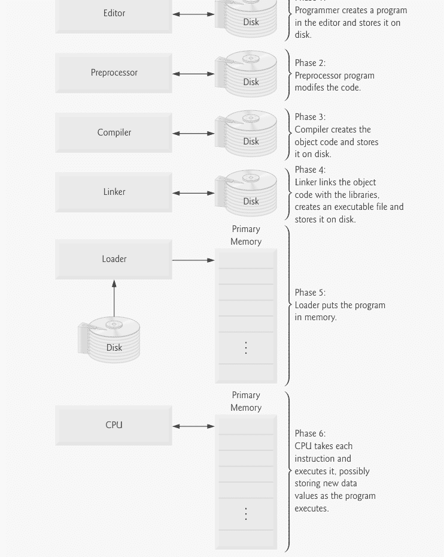

## 阶段5：加载

在程序可以执行之前，必须首先将其放入内存中。这是由加载器完成的，加载器从磁盘获取可执行映像并将其传输到内存中。还加载支持程序的共享库中的其他组件。

## 阶段6：执行

最后，计算机执行程序。

## 执行时可能出现的问题

上述每个阶段都可能因我们将在本书中讨论的各种错误而失败。这将导致C++程序显示错误消息。如果发生这种情况，你必须返回编辑阶段，进行必要的更正，并再次经历其余阶段，以确定更正解决了问题。

大多数C++程序会输入和/或输出数据。某些C++函数从`cin`（标准输入流；发音为“see-in”）获取输入，`cin`通常是键盘，但`cin`可以重定向到其他设备。数据通常输出到`cout`（标准输出流；发音为“see-out”），`cout`通常是计算机屏幕，但`cout`可以重定向到其他设备。当我们说程序打印结果时，通常意味着结果显示在屏幕上。数据可以输出到其他设备，例如磁盘和硬拷贝打印机。还有一个标准错误流称为`cerr`。`cerr`流（通常连接到屏幕）用于显示错误消息。用户通常将`cout`分配给屏幕以外的设备，同时保持`cerr`分配给屏幕，以便正常输出与错误分开。

## 常见编程错误 1.1

诸如除以零之类的错误在程序运行时发生，因此它们被称为运行时错误或执行时错误。致命的运行时错误导致程序立即终止而未能成功完成其工作。非致命的运行时错误允许程序运行完成，但通常会产生不正确的结果。[注意：在某些系统上，除零不是致命错误。请参阅你的系统文档。]

## 1.6 关于C++和面向程序员的C++的说明

经验丰富的C++程序员有时会为能够创造怪异、扭曲、复杂的语言用法而感到自豪。这是一种不良的编程实践。它使程序更难阅读，更可能行为异常，更难测试和调试，并且更难适应不断变化的需求。以下是我们第一条良好编程实践。

## 良好编程实践 1.1

以简单直接的方式编写C++程序。这有时被称为KIS（“保持简单”）。不要试图通过奇怪的用法来“拉伸”语言。

## 可移植性提示 1.2

尽管编写可移植的程序是可能的，但不同的C和C++编译器以及不同的计算机之间存在许多问题，可能使可移植性难以实现。用C和C++编写程序并不能保证可移植性。你通常需要直接处理编译器和计算机的差异。作为一个整体，这些有时被称为平台差异。

我们已经根据ISO/IEC C++标准文档对我们的表述进行了完整性和准确性的审核。然而，C++是一门丰富的语言，有些功能我们尚未涵盖。如果你需要有关C++的更多技术细节，你可能想阅读C++标准文档，可以从ANSI订购，网址为：

```
webstore.ansi.org
```

该文档的标题是“信息技术——编程语言——C++”，文档编号为INCITS/ISO/IEC 14882-2003。

我们包含了关于C++和面向对象编程的大量书籍和论文参考书目。我们还在`www.deitel.com/cp1usplus/`的C++资源中心列出了许多与C++和面向对象编程相关的网站。我们在第1.12节中列出了几个网站，包括免费C++编译器、资源网站、一些有趣的C++游戏和游戏编程教程的链接。

## 1.7 测试运行C++应用程序

在本节中，你将运行并交互你的第一个C++应用程序。你将从运行一个有趣的猜数字游戏开始，该游戏从1到1000中选取一个数字，并提示你猜测它。如果你的猜测正确，游戏结束。如果你的猜测不正确，应用程序会指示你的猜测是高于还是低于正确的数字。你可以猜测的次数没有限制。[注意：此应用程序每次执行时使用相同的正确答案（尽管这可能因编译器而异），因此你可以使用我们本节中使用的相同猜测，并在我们引导你与第一个C++应用程序交互时看到相同的结果。]

我们将演示两种运行C++应用程序的方式——使用Windows XP命令提示符和使用Linux上的shell（类似于Windows命令提示符）。该应用程序在两个平台上的运行方式类似。有许多可用的开发环境，读者可以在其中编译、构建和运行C++应用程序，例如Eclipse、GNU C++、Microsoft Visual C++等。

在以下步骤中，你将运行应用程序并输入各种数字来猜测正确的数字。在整本书中，我们使用字体来区分你在屏幕上看到的功能（例如命令提示符）和与屏幕不直接相关的元素。我们的惯例是用半粗体无衬线Helvetica字体强调屏幕功能，如标题和菜单（例如“文件”菜单），并用无衬线Lucida字体强调文件名、应用程序显示的文本以及你应在应用程序中输入的值（例如`GuessNumber`或500）。正如你已经注意到的，每个关键术语的定义出现处都设置为粗斜体。对于本节的图，我们突出显示每个步骤所需的用户输入，并指出应用程序的重要部分。为了使这些功能更可见，我们修改了命令提示符窗口的背景颜色（仅用于Windows测试运行）。要修改命令提示符颜色，在你的系统上，打开一个命令提示符，然后右键单击标题栏并选择属性。出现的“命令提示符”属性对话框中，单击颜色选项卡，并选择你偏好的文本和背景颜色。

### 从 Windows XP 命令提示符运行 C++ 应用程序

- 1. 检查你的设置。阅读本书开头 Before You Begin 部分，以确保你已将本书的示例复制到你的硬盘上。

- 2. 定位已完成的应用程序。打开一个命令提示符窗口。对于使用 Windows 95、98 或 2000 的读者，请选择 开始 > 程序 > 附件 > 命令提示符。对于 Windows XP 用户，请选择 开始 > 所有程序 > 附件 > 命令提示符。要更改到已完成的 `GuessNumber` 应用程序目录，输入 `cd C:\examples\ch01\GuessNumber\Windows`，然后按 Enter。`cd` 命令用于更改目录。

   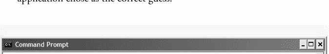

   图 1.2 | 打开命令提示符窗口并更改目录。

- 3. 运行 `GuessNumber` 应用程序。现在你已进入包含 `GuessNumber` 应用程序的目录，输入命令 `GuessNumber` 并按 Enter。[注意：`GuessNumber.exe` 是应用程序的实际名称；然而，Windows 默认会假设 `.exe` 扩展名。]

   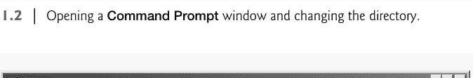

   图 1.3 | 运行 GuessNumber 应用程序。

- 4. 输入你的第一次猜测。应用程序显示“Please type your first guess.”，然后在下一行显示问号（?）作为提示。在提示符处，输入 500（图 1.4）

   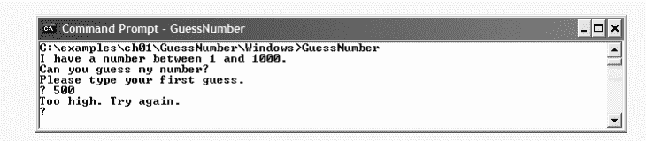

   图 1.4 | 输入你的第一次猜测。

- 5. 输入另一次猜测。应用程序显示“Too high. Try again.”，意味着你输入的值大于应用程序选作正确答案的数字。因此，你应该为下一次猜测输入一个更小的数字。在提示符处，输入 250（图 1.5）。应用程序再次显示“Too high. Try again.”，因为你输入的值仍然大于应用程序选作正确答案的数字。

   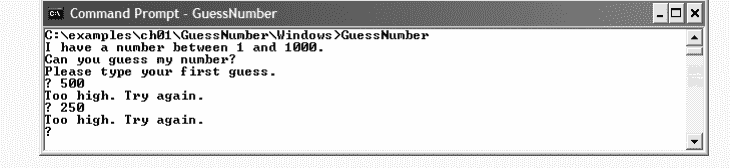

   图 1.5 | 输入第二次猜测并接收反馈。

- 6. 输入额外的猜测。继续玩游戏，输入值直到猜中正确数字。应用程序将显示“Excellent! You guessed the number!”（图 1.6）。

   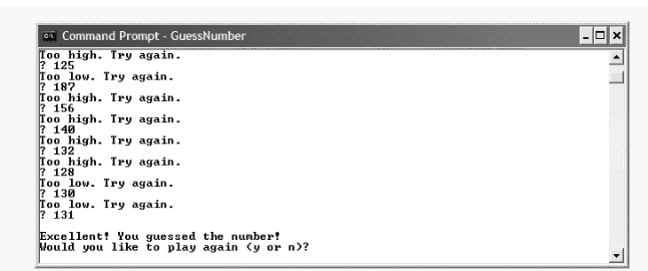

   图 1.6 | 输入额外的猜测并猜中正确数字。

- 7. 再次玩游戏或退出应用程序。猜对后，应用程序会询问你是否想再玩一局。在“Would you like to play again (y or n)?”提示符处，输入单个字符 y 会使应用程序选择一个新数字并显示消息“Please type your first guess.”，随后出现问号提示（图 1.7），以便你在新游戏中进行第一次猜测。输入字符 n 会结束应用程序并将你返回到命令提示符下的应用程序目录（图 1.8）。每次从头开始执行此应用程序（即步骤 3），它都会为你选择相同的数字进行猜测。

   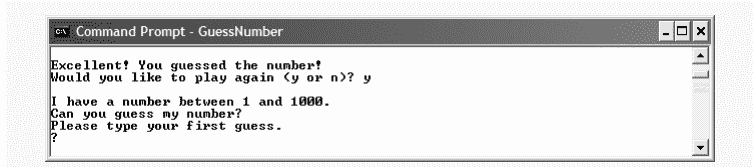

   图 1.7 | 再次玩游戏。

   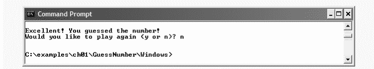

   图 1.8 | 退出游戏。

- 8. 关闭命令提示符窗口。

### 使用 GNU C++ 在 Linux 上运行 C++ 应用程序

在本节的图中，我们使用粗体高亮来指出每一步所需的用户输入。我们系统上的 shell 提示符使用波浪号（~）字符来表示主目录，并且每个提示符以美元符号（$）字符结尾。提示符在不同的 Linux 系统中会有所不同。

- 1. 定位已完成的应用程序。从 Linux shell 中，更改到已完成的 `GuessNumber` 应用程序目录（图 1.9），输入

```
cd Examples/ch01/GuessNumber/GNU_Linux
```

然后按 Enter。命令 `cd` 用于更改目录。

```
~$ cd examples/ch01/GuessNumber/GNU_Linux
~/examples/ch01/GuessNumber/GNU_Linux$
```

图 1.9 | 登录到你的账户后更改到 GuessNumber 应用程序的目录。

- 2. 编译 `GuessNumber` 应用程序。要在 GNU C++ 编译器上运行应用程序，你必须先通过输入以下命令进行编译

```
g++ GuessNumber.cpp -o GuessNumber
```

此命令编译应用程序并生成名为 `GuessNumber` 的可执行文件。

```
~/examples/ch01/GuessNumber/GNU_Linux$ g++ GuessNumber.cpp -o GuessNumber
~/examples/ch01/GuessNumber/GNU_Linux$
```

图 1.10 | 使用 g++ 命令编译 GuessNumber 应用程序。

```
Too low. Try again.
? 375
Too low. Try again.
? 437
Too high. Try again.
? 406
Too high. Try again.
? 391
Too high. Try again.
? 383
Too low. Try again.
? 387
Too high. Try again.
? 385
Too high. Try again.
? 384

Excellent! You guessed the number.
Would you like to play again (y or n)?
```

图 I.14 | 输入额外的猜测并猜中正确数字。

- 7. 再次玩游戏或退出应用程序。猜中正确数字后，应用程序会询问你是否想再玩一局。在“Would you like to play again (y or n)?”提示符处，输入单个字符 y 会使应用程序选择一个新数字并显示消息“Please type your first guess.”，随后出现问号提示（图 I.15），以便你在新游戏中进行第一次猜测。输入字符 n 会结束应用程序并将你返回到 shell 中的应用程序目录（图 I.16）。每次从头开始执行此应用程序（即步骤 3），它都会为你选择相同的数字进行猜测。

```
Excellent! You guessed the number.
Would you like to play again (y or n)? y

I have a number between 1 and 1000.
Can you guess my number?
Please type your first guess.
?
```

图 I.15 | 再次玩游戏。

```
Excellent! You guessed the number.
Would you like to play again (y or n)? n

~/examples/ch01/GuessNumber/GNU_Linux$
```

图 I.16 | 退出游戏。

## 1.8 软件技术

在本节中，我们讨论了你在软件开发社区中会听到的一些软件工程流行语。我们已在其中大多数主题上创建了资源中心，还有更多正在制作中。你可以在`www.deitel.com/ResourceCenters.html`找到我们完整的资源中心列表。

敏捷软件开发是一组方法论，试图以比以往方法论更少的资源更快地实现软件。查看 Agile Alliance（`www.agilealliance.org`）和 Agile Manifesto（`www.agilemanifesto.org`）。

重构涉及在保留其功能的同时重新处理代码以使其更清晰、更易于维护。它在敏捷开发方法论中被广泛采用。有许多重构工具可自动完成大部分重构工作。查看我们关于重构的资源中心。

设计模式是构建灵活且可维护面向对象软件的经过验证的架构。设计模式领域试图枚举这些反复出现的模式，鼓励软件设计师重用它们以用更少的时间、金钱和精力开发更高质量的软件。

游戏编程。计算机游戏业务比首映电影业务更大。大学课程甚至专业现在都致力于游戏编程中使用的复杂软件技术。查看我们关于游戏编程、C++ 游戏编程和编程项目的资源中心。

开源软件是一种开发软件的风格，与主导软件早期年的专有开发形成对比。在开源开发中，个人和公司为开发、维护和演进软件做出贡献，以换取使用该软件为自己目的的权利，通常是免费的。开源代码通常会被比专有软件大得多的受众审查，因此错误会被更快地删除。开源也鼓励更多的创新。Sun 最近宣布它正在开源 Java。你在开源社区会经常听到一些组织，例如 Eclipse Foundation（Eclipse IDE 在 C++ 和 Java 软件开发中很受欢迎）、Mozilla Foundation（Firefox 浏览器的创建者）、Apache Software Foundation（Apache Web 服务器的创建者）和 SourceForge（为管理开源项目提供工具，目前有超过 150,000 个开源项目正在开发中）。

Linux 是一种开源操作系统，也是开源运动最伟大的成功之一。MySQL 是一种开源数据库管理系统。PHP 是用于开发基于互联网的应用程序的最流行的开源服务器端“脚本”语言。LAMP 是许多开发人员用于构建 Web 应用程序的一组开源技术的缩写——它代表 Linux、Apache、MySQL 和 PHP（或 Perl 或 Python——用于类似目的的另外两种语言）。

软件通常被视为一种产品；大多数软件仍然以这种方式提供。如果你想运行一个应用程序，你从软件供应商那里购买一个软件包。然后你将该软件安装在你的计算机上并按需运行。随着新版本的软件出现，你升级你的软件，通常花费很大。对于必须在多样化的计算机设备上维护数万台系统的组织来说，这个过程可能变得繁琐。使用软件即服务（SaaS），软件在互联网上的其他地方的服务器上运行。当这些服务器更新时，全球所有客户端都会看到新功能；无需本地安装。你可以访问service through a browser—these are quite portable, so you can run the same applications on different kinds of computers from anywhere in the world. Salesforce.com, Google, and Microsoft’s Office Live and Windows Live all offer SaaS.

## 1.9 Future of C++: Open Source Boost Libraries, TR1 and C++0x

Bjarne Stroustrup, the creator of C++, has expressed his vision for the future of C++. The main goals for the new standard are to make C++ easier to learn, improve library building capabilities, and increase compatibility with the C programming language.


# Chapter 21

Chapter 21 considers the future of C++—we introduce the `Boost C++ Libraries`, `Technical Report 1` (`TR1`) and `C++0x`. The `Boost C++ Libraries` are free, open source libraries created by members of the C++ community. Boost has grown to over 70 libraries, with more being added regularly. Today there are thousands of programmers in the Boost open source community. Boost provides C++ programmers with useful, well-designed libraries that work well with the existing C++ Standard Library. The Boost libraries can be used by C++ programmers working on a wide variety of platforms with many different compilers. We overview the libraries included in TR1 and provide code examples for the “regular expression” and “smart pointer” libraries.

`Regular expressions` are used to match specific character patterns in text. They can be used to validate data to ensure that it is in a particular format, to replace parts of one string with another, or to split a string.

Many common bugs in C and C++ code are related to pointers, which we present in Chapter 8, Pointers and Pointer-Based Strings. `Smart pointers` help you avoid errors by providing additional functionality to standard pointers. This functionality typically strengthens the process of memory allocation and deallocation.

`Technical Report 1` describes the proposed changes to the C++ Standard Library, many of which are based on current Boost libraries. These libraries add useful functionality to C++. The C++ Standards Committee is currently revising the C++ Standard. The last standard was published in 1998. Work on the new standard, currently referred to as `C++0x`, began in 2003. The new standard is likely to be released in 2009. It will include changes to the core language and, most likely, many of the libraries in TR1.

## 1.10 Software Engineering Case Study: Introduction to Object Technology and the UML

Now we begin our study of object orientation. Chapters 1–7, 9 and 13 all end with a brief Software Engineering Case Study section in which we present a carefully paced introduction to object orientation. Our goal here is to help you develop an object-oriented way of thinking and to introduce you to the `Unified Modeling Language`™ (`UML`®)—a graphical language that allows people who design object-oriented software systems to use an industry-standard notation to represent them.

In this required section, we introduce basic object-oriented concepts and terminology. The optional sections in Chapters 2–7, 9 and 13 present an object-oriented design and implementation of the software for a simple automated teller machine (ATM) system. The Software Engineering Case Study sections at the ends of Chapters 2–7
- analyze a typical requirements specification that describes a software system (the ATM) to be built
- determine the objects required to implement that system
- determine the attributes the objects will have
- determine the behaviors these objects will exhibit
- specify how the objects interact with one another to meet the system requirements

The Software Engineering Case Study sections at the ends of Chapters 9 and 13 modify and enhance the design presented in Chapters 2–7. Appendix E contains a complete, working C++ implementation of the object-oriented ATM system.

Although our case study is a scaled-down version of an industry-level problem, we nevertheless cover many common industry practices. You’ll experience a solid introduction to object-oriented design with the UML. Also, you’ll sharpen your code-reading skills by touring the complete, carefully written and well-documented C++ implementation of the ATM.

### Basic Object Technology Concepts

We begin our introduction to object orientation with some key terminology. Everywhere you look in the real world you see objects—people, animals, plants, cars, planes, buildings, computers, monitors and so on. Humans think in terms of objects. Telephones, houses, traffic lights, microwave ovens and water coolers are just a few more objects we see around us every day.

We sometimes divide objects into two categories: animate and inanimate. Animate objects are “alive” in some sense—they move around and do things. Inanimate objects do not move on their own. Objects of both types, however, have some things in common. They all have attributes (e.g., size, shape, color and weight), and they all exhibit behaviors (e.g., a ball rolls, bounces, inflates and deflates; a baby cries, sleeps, crawls, walks and blinks; a car accelerates, brakes and turns; a towel absorbs water). We’ll study the kinds of attributes and behaviors that software objects have.

Humans learn about existing objects by studying their attributes and observing their behaviors. Different objects can have similar attributes and can exhibit similar behaviors. Comparisons can be made, for example, between babies and adults, and between humans and chimpanzees.

Object-oriented design (OOD) models software in terms similar to those that people use to describe real-world objects. It takes advantage of class relationships, where objects of a certain class, such as a class of vehicles, have the same characteristics—cars, trucks, little red wagons and roller skates have much in common. OOD takes advantage of inheritance relationships, where new classes of objects are derived by absorbing characteristics of existing classes and adding unique characteristics of their own. An object of class “convertible” certainly has the characteristics of the more general class “automobile,” but more specifically, the roof goes up and down.

to stand at attention), objects also communicate via messages. A bank account object may receive a message to decrease its balance by a certain amount because the customer has withdrawn that amount of money.

OOD `encapsulates` (i.e., wraps) attributes and `operations` (behaviors) into objects—an object’s attributes and operations are intimately tied together. Objects have the property of `information hiding`. This means that objects may know how to communicate with one another across well-defined `interfaces`, but normally they are not allowed to know how other objects are implemented—implementation details are hidden within the objects themselves. We can drive a car effectively, for instance, without knowing the details of how engines, transmissions, brakes and exhaust systems work internally—as long as we know how to use the accelerator pedal, the brake pedal, the steering wheel and so on. Information hiding, as we’ll see, is crucial to good software engineering.

Languages like C++ are `object oriented`. Programming in such a language is called `object-oriented programming (OOP)`, and it allows computer programmers to implement object-oriented designs as working software systems. Languages like C, on the other hand, are `procedural`, so programming tends to be `action oriented`. In C, the unit of programming is the `function`. In C++, the unit of programming is the `class` from which objects are eventually `instantiated` (an OOP term for “created”). C++ classes contain functions that implement operations and data that implements attributes.

C programmers concentrate on writing functions. Programmers group actions that perform some common task into functions, and group functions to form programs. Data is certainly important in C, but the view is that data exists primarily in support of the actions that functions perform. The `verbs` in a system specification help the C programmer determine the set of functions that will work together to implement the system.

### Classes, Data Members and Member Functions


C++ 程序员专注于创建自己的 `user-defined types` 称为 `classes`。每个 `class` 包含数据以及操作该数据并向 `clients`（即使用该类的其他类或函数）提供服务的函数集。类的 `data members` 数据组件称为 `data members`。例如，银行账户类可能包括账户号码和余额。类的函数组件称为 `member functions`（通常在其他面向对象编程语言（如 Java）中称为 `methods`）。例如，银行账户类可能包括存款（增加余额）、取款（减少余额）和查询当前余额的成员函数。你使用内置类型（和其他用户定义类型）作为构建新用户定义类型（类）的“构建块”。系统规范中的 `nouns` 有助于 C++ 程序员确定创建对象以协同实现系统的类集。

类与对象如同蓝图与房屋——类是构建类对象的“计划”。正如我们可以用一个蓝图建造许多房屋一样，我们可以从一个类实例化（创建）许多对象。你不能在蓝图的厨房里做饭；你可以在房屋的厨房里做饭。你不能睡在蓝图的卧室里；你可以在房屋的卧室里睡觉。

类可以与其他类具有关系。例如，在银行的面向对象设计中，“银行出纳员”类需要与其他类相关，例如“客户”类、“现金抽屉”类、“保险箱”类等。这些关系称为 `associations`。

将软件打包成类，使得未来的软件系统能够 `复用` 这些类成为可能。相关的类通常打包成可复用的 `组件`。正如房地产经纪人常说，影响房地产价格的三个最重要因素是“地段、地段、还是地段”，软件开发界的一些人也常说，影响软件开发未来的三个最重要因素是“复用、复用、还是复用”。

## 软件工程观察 1.3

> 在构建新类和程序时复用现有类，可以节省时间、金钱和精力。复用还有助于程序员构建更可靠、更有效的系统，因为现有的类和组件通常已经经过了广泛的测试、调试和性能调优。

事实上，借助对象技术，你可以通过组合现有类来构建所需的大部分新软件，就像汽车制造商组合可互换的零件一样。你创建的每个新类都有可能成为有价值的软件资产，你和其他的程序员都可以复用这些资产，以加快未来软件开发工作的速度并提高其质量。

## 面向对象分析与设计（OOAD）简介

为了创建最佳的解决方案，你应该遵循一个详细的过程来 `分析` 项目的 `需求`（即确定系统应该 `做什么`），并开发一个满足这些需求的 `设计`（即决定系统应该 `如何做`）。理想情况下，你会在编写任何代码之前经历这一过程，并仔细审查设计（或让其他软件专业人员审查你的设计）。如果这个过程涉及从面向对象的观点来分析和设计你的系统，那么它被称为 `面向对象分析与设计（OOAD）` 过程。经验丰富的程序员知道，分析和设计可以帮助他们避免采用计划不周、在实施过程中不得不放弃的系统开发方法，从而节省大量时间，避免可能浪费的大量时间、金钱和精力。

理想情况下，团队成员应就解决其问题的严格定义的过程，以及彼此之间交流该过程结果的统一方式达成一致。尽管存在许多不同的OOAD过程，但一种用于交流 `任何` OOAD过程结果的单一图形语言已被广泛使用。这种语言被称为统一建模语言（UML），于20世纪90年代中期在三位软件方法学家——Grady Booch、James Rumbaugh和Ivar Jacobson——的初步指导下开发出来。

## UML的历史

在20世纪80年代，越来越多的组织开始使用OOP来构建他们的应用程序，因此产生了对标准化OOAD过程的需求。许多方法学家——包括Booch、Rumbaugh和Jacobson——各自独立地提出并推广了不同的过程来满足这一需求。每个过程都有自己的一套表示法，或“语言”（以图形图的形式），来传达分析和设计的结果。

到20世纪90年代初，不同的组织，甚至同一组织内的不同部门，都在使用自己独特的过程和表示法。与此同时，这些组织还希望使用支持其特定过程的软件工具。软件供应商发现，要为这么多过程提供工具是困难的。因此，需要一种标准的表示法和标准的过程。

1994年，James Rumbaugh加入了Rational软件公司（现为IBM的一个部门）中的Grady Booch，两人开始致力于统一他们广受欢迎的过程。不久后，Ivar Jacobson也加入了他们。1996年，该团队向软件工程界发布了UML的早期版本，并征求反馈意见。大约在同一时间，一个名为 `对象管理组™（OMG™）` 的组织邀请各方提交一种通用建模语言的提案。OMG（www.omg.org）是一个非营利组织，通过发布指导方针和规范（如UML）来促进面向对象技术的标准化。几家大公司——其中包括HP、IBM、Microsoft、Oracle和Rational Software——已经认识到对通用建模语言的需求。为了响应OMG的提案请求，这些公司组成了 `UML Partners`——这个联盟开发了UML 1.1版并将其提交给了OMG。OMG接受了该提案，并于1997年承担起持续维护和修订UML的责任。现在可用的UML 2.0版本标志着自1997年1.1版标准以来UML的第一次重大修订。在本书中，我们使用UML 2的术语和表示法。

## 什么是UML？

UML现在是用于建模面向对象系统的最广泛使用的图形表示方案。它确实统一了各种流行的表示方案。设计系统的人员使用这种语言（以图的形式）来建模他们的系统。

UML的一个吸引人的特点是其灵活性。UML是 `可扩展的`（即能够通过添加新特性来增强），并且独立于任何特定的OOAD过程。UML建模者可以自由地使用各种过程来设计系统，但所有开发人员现在都可以使用一套标准的图形表示法来表达他们的设计。

在我们的软件工程案例研究部分，我们提出了UML的一个简单、简洁的子集。然后我们使用这个子集，引导你用UML完成一次完整的面向对象设计体验。

## UML网络资源

有关UML的更多信息，请参考下面列出的网站。有关更多的UML网站，请参阅第2.7节末尾列出的网络资源。

www.uml.org

这是对象管理组（OMG）提供的UML资源页面，提供UML和其他面向对象技术的规范文档。

www.ibm.com/software/rational/uml

这是IBM Rational的UML资源页面——IBM Rational是Rational软件公司（创建UML的公司）的继承者。

## 推荐阅读

以下书籍提供了使用UML进行面向对象设计的信息：

Ambler, S. *The Object Primer: Agile Model-Driven Development with UML 2.0, Third Edition.* New York: Cambridge University Press, 2005.

Arlow, J., and I. Neustadt. *UML and the Unified Process: Practical Object-Oriented Analysis and Design, Second Edition.* Boston: Addison-Wesley Professional, 2006.

Fowler, M. *UML Distilled, Third Edition: A Brief Guide to the Standard Object Modeling Language.* Boston: Addison-Wesley Professional, 2004.

Rumbaugh, J., I. Jacobson and G. Booch. *The Unified Modeling Language User Guide, Second Edition.* Boston: Addison-Wesley Professional, 2006.

## 第1.10节 自我复习练习

- 1.1 列出我们未提及的三个真实世界对象的例子。对于每个对象，列出几个属性和行为。

- 1.2 伪代码是________。

  - a) OOAD的另一个术语

  - b) 用于显示UML图的一种编程语言

  - c) 表达程序逻辑的一种非正式方法

  - d) 用于建模面向对象系统的一种图形表示方案

- 1.3 UML主要用于________。

  - a) 测试面向对象系统

  - b) 设计面向对象系统

  - c) 实现面向对象系统

  - d) a和b都是

## 第1.10节 自我复习练习答案

1.1 [注意：答案可能有所不同。] a) 电视的属性包括屏幕尺寸、能显示的颜色数量、当前频道和当前音量。电视可以打开和关闭、更换频道、显示视频和播放声音。b) 咖啡机的属性包括能装的最大水量、煮一壶咖啡所需的时间以及咖啡壶下方加热板的温度。咖啡机可以打开和关闭、煮咖啡和加热咖啡。c) 乌龟的属性包括年龄、壳的大小和体重。乌龟可以行走、缩进壳里、从壳里出来以及吃植物。

1.2 c。

1.3 b。

## 1.11 总结

本章讨论了C++的历史。我们讨论了不同类型的编程语言、它们的历史以及哪些编程语言被最广泛地使用。我们还讨论了C++标准库，其中包含可复用的类和函数，帮助C++程序员创建可移植的C++程序。

我们介绍了基本的对象技术概念，包括类、对象、属性、行为、封装和继承。你还了解了UML的历史和用途——UML是用于建模面向对象软件系统的行业标准图形语言。

你学习了创建和执行C++应用程序的典型步骤。你“试驾”了一个示例C++应用程序。

我们讨论了几个关键的软件技术和概念，包括开源，并展望了C++的未来。在后面的章节中，我们将介绍两个开源库——用于图形和游戏编程的Ogre，以及用于广泛增强C++标准库功能的Boost。

在下一章中，你将创建你的第一个C++应用程序。你将看到几个示例，演示程序如何在屏幕上显示消息以及从键盘获取用户信息进行处理。

## 1.12 Web 资源

本节提供了许多在学习 C++ 时对你有用的网络资源。这些网站包括 C++ 资源、C++ 开发工具以及一些使用 C++ 构建的有趣游戏的链接。本节还列出了我们自己的网站，你可以在那里找到与本书相关的下载和资源。

### Deitel & Associates 网站

www.deitel.com/books/cppfp/

Deitel & Associates *C++ for Programmers* 网站。在这里你会找到指向本书示例和其他资源的链接，例如我们的 *Dive Into™* 指南，帮助你开始使用几种 C++ 集成开发环境（IDE）。

+   www.deitel.com/cplusplus/

+   www.deitel.com/cplusplusgameprogramming/

+   www.deitel.com/cplusplusbookslibraries/

+   www.deitel.com/codesearchengines/

+   www.deitel.com/programmingprojects/

+   www.deitel.com/visualcplusplus/

我们在 www.deitel.com 上的 C++ 及相关资源中心。从这里开始搜索资源、下载、教程、文档、书籍、电子书、期刊、文章、博客、RSS 源等，以帮助你开发 C++ 应用程序。

www.deitel.com

请查看 Deitel & Associates 网站以获取所有 Deitel 出版物的更新、勘误和额外资源。

www.deitel.com/newsletter/subscribe.html

请访问此网站订阅 *Deitel® Buzz Online* 电子邮件新闻通讯，以跟进 Deitel & Associates 出版计划，包括对 *C++ for Programmers* 的更新和勘误。

### 编译器和开发工具

www.thefreecountry.com/development/compilers.shtml

该网站列出了适用于多种操作系统的免费 C 和 C++ 编译器。

msdn.microsoft.com/vstudio/express/visualc/default.aspx

*Microsoft Visual C++ Express* 网站提供 *Visual C++ Express* 版的免费下载、产品信息、概述和补充材料。

www.codegear.com/products/cppbuilder

这是指向 *Code Gear C++Builder* 网站的链接。

www.compilers.net

*Compilers.net* 旨在帮助用户查找编译器。

developer.intel.com/software/products/compilers/cwin/index.htm

可在该网站下载 *Intel C++ compiler* 的评估版。

### 资源

www.hal9k.com/cug

*C/C++ Users Group (CUG)* 网站包含 C++ 资源、期刊、共享软件和免费软件。

www.devx.com

*DevX* 是面向程序员的综合资源，提供各种编程语言的最新新闻、工具和技术。*C++ Zone* 提供技巧、讨论论坛、技术帮助和在线新闻通讯。

www.acm.org/crossroads/xrds3-2/ovp32.html

*Association for Computing Machinery (ACM) 网站提供全面的 C++ 资源列表，包括推荐的书籍、期刊和杂志、已发布的标准、新闻通讯、常见问题解答和新闻组。*

www.accu.informika.ru/resources/public/terse/cpp.htm

*Association of C & C++ Users (ACCU) 网站包含指向 C++ 教程、文章、开发人员信息、讨论和书评的链接。*

www.cuj.com

*C/C++ User’s Journal 是一个在线杂志，包含文章、教程和下载。该网站提供 C++ 新闻、论坛以及有关开发工具的信息链接。*

www.research.att.com/~bs/homepage.html

这是 C++ 编程语言设计者 Bjarne Stroustrup 的网站。该网站提供 C++ 资源列表、常见问题解答和其他有用的 C++ 信息。

### 游戏和游戏编程

www.codearchive.com/list.php?go=0708

该网站有多个可供下载的 C++ 游戏。

www.mathtools.net/C_C__/Games/

该网站包含指向大量使用 C++ 构建的游戏的链接。大多数游戏的源代码可供下载。

www.gametutorials.com/qtstore/c-3-c--tutorials.aspx

该网站提供 C++ 游戏编程教程。每个教程都包含游戏的描述以及教程中使用的方法和函数列表。

## 2

### 引言

C++ 编程

### 目标

在本章中你将学习：

+   - 编写简单的 C++ 计算机程序。

+   - 编写简单的输入和输出语句。

+   - 使用基本类型。

+   - 使用算术运算符。

+   - 算术运算符的优先级。

+   - 编写简单的决策语句。

> 名字里有什么？

> 我们称之为玫瑰

> 用任何其他名字

> 也会闻起来一样甜。

> —威廉·莎士比亚

> 面对决定时，

> 我总是问，“什么

> 会更有趣？”

> —佩吉·沃克

> “再喝点茶吧，” 

> 柴郡猫对爱丽丝

> 非常认真地说。“我还没喝过呢，”爱丽丝

> 用冒犯的语气回答

> ：“所以我不能喝更多。”“你意思是

> 你不能喝更少，”帽子先生说：“喝

> 比没有多一点很容易。”

> —刘易斯·卡罗尔

> 高尚的思想必须有

> 高尚的语言。

> —阿里斯托芬

### 2.1 引言


在本章中，我们展示了五个示例，演示了你的程序如何显示消息并从用户那里获取信息进行处理。前三个示例在屏幕上显示消息。下一个从用户获取两个数字，计算它们的和并显示结果。随附的讨论展示了如何执行各种算术计算并保存其结果以供以后使用。第五个示例通过比较两个数字，然后根据比较结果显示消息来演示决策制定的基础。

### 2.2 C++ 中的第一个程序：打印一行文本

C++ 使用可能对非程序员来说很奇怪的记号。我们现在考虑一个打印一行文本的简单程序（图 2.1）。

第 1 行和第 2 行

```
// Fig. 2.1: fig02_01.cpp
// Text-printing program.
```

每行都以 `//` 开头，表示该行的其余部分是注释。以 `//` 开头的注释称为*单行注释*，因为它在当前行结束时终止。[*注意：* 你也可以使用 C 的风格，其中注释——可能包含多行——以 `/*` 开始并以 `*/` 结束。]

```
// Fig. 2.1: fig02_01.cpp
// Text-printing program.
#include <iostream> // allows program to output data to the screen

// function main begins program execution
int main()
{
    std::cout << "Welcome to C++!\n"; // display message

    return 0; // indicate that program ended successfully
} // end function main
```

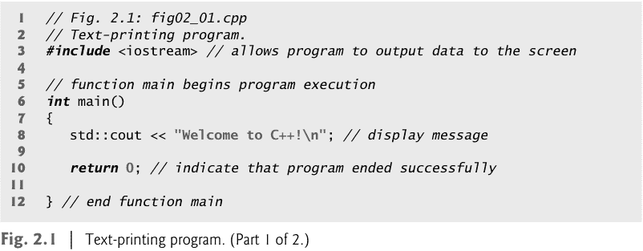

### 概要

- 2.1 引言
- 2.2 C++ 中的第一个程序：打印一行文本
- 2.3 修改我们的第一个 C++ 程序
- 2.4 另一个 C++ 程序：加整数
- 2.5 算术
- 2.6 决策制定：相等和关系运算符
- 2.7 （可选）软件工程案例研究：检查 ATM 需求规范
- 2.8 总结

```
Welcome to C++!
```

图 2.1 | 文本打印程序。（第 2 部分，共 2 部分。）

第 3 行

```
#include <iostream> // allows program to output data to the screen
```

是一个预处理器指令，它是向 C++ 预处理器发送的消息（在第 1.5 节中介绍）。以 `#` 开头的行在程序编译前由预处理器处理。该行通知预处理器将输入/输出流头文件 `<iostream>` 的内容包含到程序中。任何输出数据到屏幕或使用 C++ 风格流输入/输出从键盘输入数据的程序都必须包含此文件。我们将在第 6 章《函数与递归简介》中更详细地讨论头文件，并在第 15 章《流输入/输出》中解释 `<iostream>` 的内容。

#### Common Programming Error 2.1

> 在输出数据到屏幕或从键盘输入数据的程序中忘记包含 `<iostream>` 头文件会导致编译器发出错误消息，因为它无法识别流组件（例如 `cout`）的引用。

第 4 行只是一个空行。你使用空行、空格字符和制表符（即“制表符”）使程序更易于阅读。这些字符统称为空白。空白字符通常会被编译器忽略。

第 5 行

```
// function main begins program execution
```

是另一个单行注释。

第 6 行

```
int main()
```

是每个 C++ 程序的一部分。`main` 后的括号表示 `main` 是一个函数。C++ 程序通常由一个或多个函数和类组成（你将在第 3 章中看到）。每个程序中必须恰好有一个函数是 `main`。图 2.1 仅包含一个函数。C++ 程序在函数 `main` 处开始执行，即使 `main` 不是程序中的第一个函数。`main` 左侧的关键字 `int` 表示 `main` 返回一个整数值。完整的 C++ 关键字列表可以在图 4.2 中找到。你将在第 3.5 节看到如何创建自己的函数。我们将在第 6 章更深入地讨论函数。现在，只需在每个程序中在 `main` 左侧包含 `int` 即可。

左大括号，`{`，（第 7 行）必须开始每个函数的函数体。相应的右大括号，`}`，（第 12 行）必须结束每个函数的函数体。第 8 行

```
std::cout << "Welcome to C++!\n"; // display message
```

打印双引号之间包含的字符串。字符串中的空白字符不会被编译器忽略。

整行第 8 行，包括 `std::cout`、`<<` 运算符、字符串 `"Welcome to C++!\n"` 和分号（`;`），称为语句。每个 C++ 语句必须以分号（也称为*语句终止符*）。预处理器指令（如 `#include`）后面不加分号。C++ 中的输入输出是通过字符*流*来完成的。因此，当前述语句被执行时，它会将字符流 `Welcome to C++!\n` 发送到标准输出流对象—`std::cout`，该对象通常“连接”到屏幕。我们将在第 15 章详细讨论 `std::cout` 的诸多特性。

请注意我们放置了 `std::` 在 `cout` 之前。当我们使用预处理器指令 `#include <iostream>` 引入的名称时，这是必需的。记号 `std::cout` 指定我们正在使用一个属于“命名空间” `std` 的名称，在本例中为 `cout`。名称 `cin`（标准输入流）和 `cerr`（标准错误流）——在第 1 章中引入——也属于命名空间 `std`。命名空间是 C++ 的高级特性，我们将在第 22 章 Other Topics 中深入讨论。对于现在，你只需记住在程序中每次提到 `cout`、`cin` 和 `cerr` 时都要加上 `std::`。这可能会很繁琐——在图 2.9 中，我们介绍了 `using` 声明，它将使我们能够在 `std` 命名空间中使用名称时省略 `std::`。

`<<` 运算符被称为*流插入运算符*。当此程序执行时，运算符右侧的值，即右侧*操作数*，会被插入到输出流中。请注意运算符指向数据流向的方向。右侧操作数的字符通常按双引号之间出现的原样打印。然而，字符 `\n` 并不会在屏幕上打印（图 2.1）。反斜杠（`\`）称为*转义字符*。它表示将输出“特殊”字符。当在字符串中遇到反斜杠时，下一个字符会与反斜杠组合形成*转义序列*。转义序列 `\n` 表示*换行*。它使光标移动到屏幕下一行的开头。一些常见的转义序列列在图 2.2 中。

#### Common Programming Error 2.2

在 C++ 语句末尾省略分号是语法错误。（同样，预处理器指令后面不加分号。）

| Escape sequence | Description |
|---|---|
| `\n` | Newline. Position the screen cursor to the beginning of the next line. |
| `\t` | Horizontal tab. Move the screen cursor to the next tab stop. |
| `\r` | Carriage return. Position the screen cursor to the beginning of the current line; do not advance to the next line. |
| `\a` | Alert. Sound the system bell. |
| `\\` | Backslash. Used to print a backslash character. |
| `\'` | Single quote. Use to print a single quote character. |
| `\"` | Double quote. Used to print a double quote character. |

Fig. 2.2 | Escape sequences.

第 10 行

```
return 0; // indicate that program ended successfully
```

是我们将用来退出函数的方式之一。当 `return` 语句在 `main` 的末尾使用时，如此处所示，值 0 表示程序已成功终止。在第 6 章我们将详细讨论函数，以及包含此语句的原因。现在，只需在每个程序中包含此语句，否则在某些系统上编译器可能会产生警告。右大括号，`}`，（第 12 行）表示函数 `main` 的结束。

#### Good Programming Practice 2.1

> 许多程序员使函数打印的最后一个字符为换行符（`\n`）。这可确保函数会将屏幕光标定位在新行的开头。这种性质的约定鼓励软件可重用性——软件开发中的一个关键目标。

#### Good Programming Practice 2.2

> 将每个函数的整个主体缩进一级，位于限定函数主体的花括号内。这使得程序的功能结构突出，并使程序更易于阅读。

#### Good Programming Practice 2.3

> 为你偏好的缩进大小设定一个约定，然后统一应用。制表符键可用于创建缩进，但制表符停靠点可能不同。我们建议使用 1/4 英寸制表符停靠点或（最好）三个空格来形成一级缩进。

### 2.3 修改我们的第一个 C++ 程序

本节继续介绍 C++ 编程，使用两个示例，展示如何修改图 2.1 中的程序，通过使用多个语句在一行上打印文本，以及通过使用单个语句在多行上打印文本。

#### 使用多个语句打印单行文本

Welcome to C++! 可以通过多种方式打印。例如，图 2.3 在多个语句中（第 8–9 行）执行流插入，但产生的输出与图 2.1 的程序相同。[注意：从此点开始，我们在代码表中使用白色背景来突出每个程序引入的关键特性。] 每次流插入都从上一次停止的地方继续打印。第一次流插入（第 8 行）打印 `Welcome` 后跟一个空格，第二次流插入（第 9 行）在空格后立即在同一行开始打印。

```
1 // Fig. 2.3: fig02_03.cpp
2 // Printing a line of text with multiple statements.
3 #include <iostream> // allows program to output data to the screen
4 
5 // function main begins program execution
6 int main()
7 {
8    std::cout << "Welcome ";
9    std::cout << "to C++!\n";
10
11   return 0; // indicate that program ended successfully
12
13 } // end function main
```

**Fig. 2.3** | Printing a line of text with multiple statements.


#### 使用单个语句打印多行文本

单个语句可以通过使用换行符来打印多行，如图 2.4 第 8 行所示。每次在输出流中遇到 `\n`（换行）转义序列时，屏幕光标都会定位到下一行的开头。要在输出中得到一个空行，将两个换行符背靠背放置，如第 8 行所示。

```
// Fig. 2.4: fig02_04.cpp
// Printing multiple lines of text with a single statement.
#include <iostream> // allows program to output data to the screen

// function main begins program execution
int main()
{
    std::cout << "Welcome\nto\n\nC++!\n";
    return 0; // indicate that program ended successfully
} // end function main
```

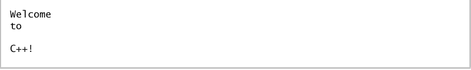

**Fig. 2.4** | Printing multiple lines of text with a single statement.

### 2.4 另一个 C++ 程序：整数相加

我们的下一个程序使用输入流对象 `std::cin` 和*流提取运算符*，`>>`，从键盘获取用户输入的两个整数，计算这些值的和并使用 `std::cout` 输出结果。图 2.5 显示了程序以及示例输入和输出。请注意，我们用粗体突出显示用户的输入。

第 1 行和第 2 行的注释说明了文件名和程序的目的。C++ 预处理器指令

```
#include <iostream> // allows program to perform input and output
```

在第 3 行中包含了 `<iostream>` 头文件的内容到程序中。

```
// Fig. 2.5: fig02_05.cpp
// Addition program that displays the sum of two integers.
#include <iostream> // allows program to perform input and output

// function main begins program execution
int main()
{
    // variable declarations
    int number1; // first integer to add
    int number2; // second integer to add
    int sum; // sum of number1 and number2

    std::cout << "Enter first integer: "; // prompt user for data
    std::cin >> number1; // read first integer from user into number1

    std::cout << "Enter second integer: "; // prompt user for data
    std::cin >> number2; // read second integer from user into number2

    sum = number1 + number2; // add the numbers; store result in sum

    std::cout << "Sum is " << sum << std::endl; // display sum; end line

    return 0; // indicate that program ended successfully
} // end function main
```

```
Enter first integer: 45
Enter second integer: 72
Sum is 117
```

### Fig. 2.5 | Addition program that displays the sum of two integers entered at the keyboard.

程序以函数 `main`（第 6 行）开始执行。左大括号（第 7 行）标记 `main` 主体的开始，对应的右大括号（第 25 行）标记 `main` 的结束。

第 9–11 行

```
int number1; // first integer to add
int number2; // second integer to add
int sum; // sum of number1 and number2
```

是声明。标识符 `number1`、`number2` 和 `sum` 是变量的名称。这些声明指定变量 `number1`、`number2` 和 `sum` 的数据类型为 `int`，意味着这些变量将保存整数值，即 7、−11、0 和 31914 等整数。所有变量在使用前必须先用名称和数据类型声明。可以在一个声明中或多个声明中声明同一类型的多个变量。我们也可以将三个变量在一个声明中声明如下：

```
int number1, number2, sum;
```

这使得程序的可读性降低，并阻止我们提供描述每个变量用途的注释。

我们很快将讨论用于指定实数的数据类型 `double`，以及用于指定字符数据的数据类型 `char`。实数是带有小数点的数字，例如 3.4、0.0 和 −11.19。`char` 变量只能保存单个小写字母、单个大写字母、单个数字或单个特殊字符（例如 `$` 或 `*`）。`int`、`double` 和 `char` 等类型通常称为基本类型或内置类型。基本类型的名称是关键字，因此必须全部以小写字母出现。附录 C 包含基本类型的完整列表。

变量名（如 `number1`）是任何不是关键字的有效标识符。标识符是由字母、数字和下划线（`_`）组成的字符序列，且不能以数字开头。C++ 是区分大小写的——大写和小写字母不同，因此 `a1` 和 `A1` 是不同的标识符。

#### Portability Tip 2.1

> C++ 允许任意长度的标识符，但你的 C++ 实现可能对标识符的长度施加某些限制。为确保可移植性，请使用 31 个字符或更少的标识符。

#### Good Programming Practice 2.4

> 避免使用以下划线（`_`）和双下划线（`__`）开头的标识符，因为 C++ 编译器可能将其用于内部用途。这将防止你选择的名称与编译器选择的名称混淆。

#### Error-Prevention Tip 2.1


> 类似 C++ 的语言是“移动目标”。随着其演进，可能会向语言中添加更多关键字。避免使用“`object`”等“负载”词作为标识符。即使“`object`”目前不是 C++ 中的关键字，它也可能成为关键字；因此，使用新编译器进行未来编译可能会破坏现有代码。

变量的声明可以放在程序的几乎任何位置，但它们必须在其对应的变量在程序中使用之前出现。例如，在图 2.5 的程序中，第 9 行的声明

```
int number1; // first integer to add
```

本可以放在第 14 行之前

```
std::cin >> number1; // read first integer from user into number1
```

第 13 行

```
std::cout << "Enter first integer: "; // prompt user for data
```

在屏幕上打印字符串`Enter first integer:`。我们喜欢将前面的语句读作“`std::cout` 获取字符字符串 `"Enter first integer: "`。”第 14 行

```
std::cin >> number1; // read first integer from user into number1
```

使用输入流对象`cin`（属于命名空间`std`）和流提取运算符`>>`从键盘获取值。使用流提取运算符与`std::cin`从标准输入流获取字符输入，通常是键盘。我们喜欢将前面的语句读作，“`std::cin`将值赋给`number1`”或简单地说“`std::cin`给`number1`。”

### Error-Prevention Tip 2.2

程序应验证所有输入值的正确性，以防止错误信息影响程序的计算。

当计算机执行前面的语句时，它会等待用户输入变量`number1`的值。用户通过输入整数（作为字符），然后按 Enter 键（有时称为 Return 键）将字符发送给计算机来响应。计算机将数字的字符表示形式转换为整数并分配（即复制）该数字（或值）给变量`number1`。此程序中对`number1`的任何后续引用都将使用此相同的值。

第 16 行

```
std::cout << "Enter second integer: "; // prompt user for data
```

在屏幕上打印`Enter second integer:`，提示用户采取行动。第 17 行

```
std::cin >> number2; // read second integer from user into number2
```

从用户处获取变量`number2`的值。

第 19 行的赋值语句

```
sum = number1 + number2; // add the numbers; store result in sum
```

计算变量`number1`和`number2`的和，并使用赋值运算符`=`将结果赋给变量`sum`。`=`运算符和`+`运算符称为二元运算符，因为每个运算符都有两个操作数。在`+`运算符的情况下，操作数是`number1`和`number2`。在前面的`=`运算符的情况下，操作数是`sum`和表达式`number1 + number2`的值。

第 21 行

```
std::cout << "Sum is " << sum << std::endl; // display sum; end line
```

显示字符字符串`Sum is`，然后是变量`sum`的数值，然后是`std::endl`——一种所谓的流操纵符。名称`endl`是“end line”的缩写，属于命名空间`std`。`std::endl`流操纵符输出换行符，然后“刷新输出缓冲区”。这仅意味着，在某些输出在机器中累积直到“值得”在屏幕上显示的系统上，`std::endl`会强制在那一刻显示任何累积的输出。当输出提示用户执行操作（例如输入数据）时，这可能很重要。

请注意，前面的语句输出多种不同类型的值。流插入运算符“知道”如何输出每种类型的数据。在单个语句中使用多个流插入运算符（`<<`）被称为连接、链接或级联流插入操作。输出多个数据块不需要多个语句。

计算也可以在输出语句中执行。我们本可以将第 19 行和第 21 行的语句合并为语句

```
std::cout << "Sum is " << number1 + number2 << std::endl;
```

从而消除对变量`sum`的需求。

C++ 的一个强大功能是你可以创建自己的数据类型，称为类（我们在第 3 章介绍此功能，并在第 9 章和第 10 章深入探讨）。然后你可以使用`>>`和`<<`运算符“教”C++ 如何输入和输出这些新数据类型的数值（这称为*运算符重载*——我们在第 11 章探讨此主题）。

### 2.5 Arithmetic

图 2.6 总结了 C++ 的*算术运算符*。*星号*（`*`）表示乘法，*百分号*（`%`）是稍后将讨论的取模运算符。图 2.6 中的算术运算符都是二元运算符。

*整数除法*（即分子和分母都是整数）产生整数商；例如，表达式`7 / 4`的值为 1，表达式`17 / 5`的值为 3。请注意，整数除法中任何小数部分都会被丢弃（即截断）——不会进行舍入。

C++ 提供了*取模运算符*`%`，它产生整数除法后的余数。取模运算符只能与整数操作数一起使用。表达式`x % y`产生`x`除以`y`后的余数。因此，`7 % 4`产生 3，`17 % 5`产生 2。在后面的章节中，我们将讨论取模运算符的许多有趣应用，例如确定一个数是否为另一个数的倍数（其特例是确定一个数是奇数还是偶数）。


> **Common Programming Error 2.3**
>
> 尝试对非整数操作数使用取模运算符（`%`）是编译错误。

| C++ operation | C++ arithmetic operator | Algebraic expression | C++ expression |
|---|---|---|---|
| Addition | `+` | f + 7 | `f + 7` |
| Subtraction | `-` | p − c | `p - c` |
| Multiplication | `*` | bm or b · m | `b * m` |
| Division | `/` | x / y or x ÷ y | `x / y` |
| Modulus | `%` | r mod s | `r % s` |

**Fig. 2.6**  |  Arithmetic operators.

### Parentheses for Grouping Subexpressions

括号在 C++ 表达式中的使用方式与代数表达式相同。例如，要将`a`乘以`b + c`，我们写成`a * ( b + c )`。

### Rules of Operator Precedence

C++ 以精确的顺序应用算术表达式中的运算符，该顺序由以下*运算符优先级规则*决定，这些规则通常与代数中遵循的规则相同：

1. 表达式中包含在一对括号内的运算符最先求值。括号被称为“最高优先级”。在*嵌套*或*嵌入*括号的情况下，例如

   ```
   ( ( a + b ) + c )
   ```

   最内层一对括号中的运算符最先应用。[*注：与代数一样，允许在表达式中放置不必要的括号以使表达式更清晰。这些称为*冗余括号*。]

2. 乘法、除法和取模运算随后应用。如果表达式包含多个乘法、除法和取模运算，则运算符从左到右应用。乘法、除法和取模被认为处于同一优先级级别。

3. 加法和减法运算最后应用。如果表达式包含多个加法和减法运算，则运算符从左到右应用。加法和减法也具有相同的优先级级别。

运算符优先级的规则集定义了 C++ 应用运算符的顺序。当我们说某些运算符从左到右应用时，我们指的是运算符的*结合性*。例如，在表达式

```
a + b + c
```

中，加法运算符（`+`）从左到右结合，因此先计算`a + b`，然后将`c`加到该和上以确定整个表达式的值。我们将看到某些运算符从右到左结合。图 2.7 总结了这些运算符优先级的规则。随着引入更多 C++ 运算符，该表将被扩展。完整的优先级图表包含在附录 A 中。

### 良好的编程实践 2.5

在复杂算术表达式中使用冗余括号可以使表达式更清晰。

| 运算符 | 操作 | 求值顺序（优先级） |
|---|---|---|
| `( )` | 括号 | 最先求值。如果括号嵌套，则最内层一对中的表达式最先求值。如果有若干对“同一级别”的括号（即未嵌套），则从左到右求值。 |
| `*` | 乘法 | 第二求值。如果有若干个，则从左到右求值。 |
| `/` | 除法 | |
| `%` | 取模 | |
| `+` | 加法 | 最后求值。如果有若干个，则从左到右求值。 |
| `-` | 减法 | |

图 2.7 | 算术运算符的优先级。

### 2.6 决策：相等与关系运算符

本节介绍 C++ 的 if 语句的一个简单版本，允许程序根据某个条件的真假采取不同的行动。如果条件满足，即条件为真，则 if 语句体中的语句被执行。如果条件不满足，即条件为假，则体语句不被执行。我们很快会看到一个例子。

if 语句中的条件可以通过使用图 2.8 中总结的相等运算符和关系运算符来形成。所有关系运算符具有相同的优先级级别并从左到右结合。两个相等运算符具有相同的优先级级别，该级别低于关系运算符的优先级，并从左到右结合。

> **常见编程错误 2.4**
>
> 将相等运算符`==`与赋值运算符`=`混淆会导致逻辑错误。相等运算符应读作“等于”，赋值运算符应读作“得到”或“得到的值”或“被赋值为”。有些人喜欢将相等运算符读作“双等号”。正如我们在第 5.9 节中讨论的那样，混淆这些运算符可能不一定会导致易于识别的语法错误，但可能导致极其微妙的逻辑错误。

以下示例使用六个 if 语句比较用户输入的两个数字。如果这些 if 语句中的任何一个的条件得到满足，则与该 if 语句关联的输出语句将被执行。图 2.9 显示了该程序以及三次示例执行的输入/输出对话框。

第 6–8 行

```
using std::cout;  // program uses cout
using std::cin;   // program uses cin
using std::endl; // program uses endl
```

是使用声明，消除了在早期程序中重复`std::`前缀的需要。一旦我们插入这些使用声明，我们就可以在程序的其余部分中写`cout`而不是`std::cout`，`cin`而不是`std::cin`以及`endl`而不是`std::endl`，分别在程序的其余部分中。[注：从本书此点起，每个示例都包含一个或多个使用声明。]

| 标准代数相等或关系运算符 | C++ 相等或关系运算符 | C++ 条件示例 | C++ 条件含义 |
|---|---|---|---|
| *关系运算符* |  |  |  |
| > | `>` | `x > y` | x 大于 y |
| < | `<` | `x < y` | x 小于 y |
| ≥ | `>=` | `x >= y` | x 大于或等于 y |
| ≤ | `<=` | `x <= y` | x 小于或等于 y |
| *相等运算符* |  |  |  |
| = | `==` | `x == y` | x 等于 y |
| ≠ | `!=` | `x != y` | x 不等于 y |

**图 2.8** | 相等和关系运算符。

```
// Fig. 2.9: fig02_09.cpp
// Comparing integers using if statements, relational operators
// and equality operators.
#include <iostream> // allows program to perform input and output

using std::cout; // program uses cout
using std::cin; // program uses cin
using std::endl; // program uses endl

// function main begins program execution
int main()
{
    int number1; // first integer to compare
    int number2; // second integer to compare

    cout << "Enter two integers to compare: "; // prompt user for data
    cin >> number1 >> number2; // read two integers from user

    if ( number1 == number2 )
        cout << number1 << " == " << number2 << endl;

    if ( number1 != number2 )
        cout << number1 << " != " << number2 << endl;

    if ( number1 < number2 )
        cout << number1 << " < " << number2 << endl;

    if ( number1 > number2 )
        cout << number1 << " > " << number2 << endl;

    if ( number1 <= number2 )
        cout << number1 << " <= " << number2 << endl;

    if ( number1 >= number2 )
        cout << number1 << " >= " << number2 << endl;

    return 0; // indicate that program ended successfully
} // end function main
```

```
Enter two integers to compare: 3 7
3 != 7
3 < 7
3 <= 7
```

图 2.9 | 使用 if 语句、关系运算符和相等运算符比较整数。（第 1 部分，共 2 部分。）

```
Enter two integers to compare: 22 12
22 != 12
22 > 12
22 >= 12
```

图 2.9 | 使用 if 语句、关系运算符和相等运算符比较整数。（第 1 部分，共 2 部分。）

```
Enter two integers to compare: 7 7
7 == 7
7 <= 7
7 >= 7
```

图 2.9 | 使用 if 语句、关系运算符和相等运算符比较整数。

（第 2 部分，共 2 部分。）

### 良好的编程实践 2.6

> 将使用声明放在引用的`#include`之后立即放置。

第 13–14 行

```
int number1; // first integer to compare
int number2; // second integer to compare
```

声明程序中使用的变量。请记住，变量可以在一个声明中声明，也可以在单独的声明中声明。

程序使用级联流提取操作（第 17 行）输入两个整数。请记住，由于第 7 行，我们可以使用`cin`（而不是`std::cin`）。首先将值读入变量`number1`，然后将值读入变量`number2`。

第 19–20 行的 if 语句

```
if ( number1 == number2 )
    cout << number1 << " == " << number2 << endl;
```

比较变量`number1`和`number2`的值以测试相等性。如果值相等，则第 20 行的语句显示一行文本，表明数字相等。如果从第 22、25、28、31 和 34 行开始的 if 语句中的一个或多个条件为真，则相应的体语句显示适当的文本行。

请注意，图 2.9 中的每个 if 语句在其体中只有一个语句，并且每个体语句都是缩进的。在第 4 章中，我们将展示如何指定具有多语句体的 if 语句（通过将体语句括在一对大括号`{ }`中，创建所谓的复合语句或块）。

### 常见编程错误 2.5

> 在 if 语句中条件后的右括号后立即放置分号通常是逻辑错误（尽管不是语法错误）。分号导致 if 语句的体为空，因此无论其条件是否为真，if 语句都不执行任何操作。更糟糕的是，if 语句的原始体语句现在成为与 if 语句顺序排列的语句，并且始终执行，这通常会导致程序产生错误的结果。

图 2.10 显示了本章中介绍的运算符的优先级和结合性。运算符按从上到下递减的优先级顺序显示。请注意：

所有这些运算符，除了赋值运算符`=`之外，都从左到右结合。加法是左结合的，因此像`x + y + z`这样的表达式会被求值，就好像它被写成`(x + y) + z`一样。赋值运算符`=`从右到左结合，因此像`x = y = 0`这样的表达式会被求值，就好像它被写成`x = (y = 0)`一样，正如我们很快就会看到的那样，它首先将`0`赋给`y`，然后将该赋值的結果——`0`——赋给`x`。

| Operators | Associativity | Type |
|---|---|---|
| `()` | left to right | parentheses |
| `*   /   %` | left to right | multiplicative |
| `+   −` | left to right | additive |
| `<<   >>` | left to right | stream insertion/extraction |
| `<   <=   >   >=` | left to right | relational |
| `==   !=` | left to right | equality |
| `=` | right to left | assignment |


**Fig. 2.10** | Precedence and associativity of the operators discussed so far.

### 2.7 （可选）软件工程案例研究：检查 ATM 需求规格说明书

现在我们开始我们的可选面向对象设计和实现案例研究。本章及接下来几章末尾的软件工程案例研究部分将帮助你逐步进入面向对象。我们将为一个简单的自动取款机（`ATM`）系统开发软件，为你提供一个简洁、节奏合理、完整的设计和实现体验。在第 3–7 章、第 9 章和第 13 章中，我们将使用 `UML` 执行面向对象设计（`OOD`）过程的各个步骤，同时将这些步骤与各章中讨论的面向对象概念联系起来。附录 E 使用 `C++` 中面向对象编程（`OOP`）技术实现了 `ATM`。我们呈现完整的案例研究解决方案。这不是一个练习；而是一个端到端的学习体验，以我们设计实现的 `C++` 代码的详细讲解作为结尾。它将使你熟悉工业界遇到的各种实质性问题及其潜在解决方案。

我们通过呈现一份**需求规格说明书**来开始设计过程，该说明书规定了 `ATM` 系统的总体目的以及它*必须*做什么。在整个案例研究中，我们参考需求规格说明书来精确确定系统必须包含哪些功能。

### Requirements Specification

一家当地银行打算安装一台新的自动取款机（`ATM`），以允许用户（即银行客户）执行基本的金融交易（图 2.11）。每个用户在该银行只能拥有一个账户。`ATM` 用户应能够查看其账户余额、取款（即从账户中取出钱）和存款（即向账户中存入钱）。

自动取款机的用户界面包含以下硬件组件：

- 显示消息给用户的屏幕
- 接收用户数字输入的键盘
- 向用户发放现金的现金 dispenser 和
- 接收用户存款信封的存款槽。

现金 dispenser 每天开始时装有 500 张 20 美元钞票。[注：由于本案例研究的范围有限，这里描述的 `ATM` 的某些元素并不准确地模仿真实 `ATM`。例如，真实的 `ATM` 通常包含一个从 `ATM` 卡读取用户账号的设备，而本 `ATM` 要求用户使用键盘输入账号。真实的 `ATM` 通常在会话结束时打印收据，但本 `ATM` 的所有输出都显示在屏幕上。]

银行希望你开发软件来执行银行客户通过 `ATM` 发起的金融交易。银行将在稍后将软件与 `ATM` 的硬件集成。软件应将硬件设备的功能（例如，现金 dispenser、存款槽）封装在软件组件中，但它不必关心这些设备如何执行其职责。`ATM` 硬件尚未开发，因此，与其将你的软件编写为在 `ATM` 上运行，你应该开发软件的第一个版本在个人计算机上运行。此版本应使用计算机的显示器来模拟 `ATM` 的屏幕，并使用计算机的键盘来模拟 `ATM` 的键盘。

一次 `ATM` 会话包括基于账号和个人识别码（`PIN`）对用户进行身份验证（即证明用户的身份），然后创建和执行金融交易。为了对用户进行身份验证并执行交易，`ATM` 必须与银行的账户信息数据库交互。[注：数据库是存储在计算机上的有组织的数据集合。] 对于每个银行账户，数据库存储一个账号、一个 `PIN` 和一个余额，表示账户中的金额。[注：为简单起见，我们假设银行计划只建立一台 `ATM`，因此我们不必担心多个 `ATM` 同时访问此数据库。 此外，我们假设在用户访问 `ATM` 时，银行不会对数据库中的信息进行任何更改。 此外，像 `ATM` 这样任何业务系统都面临着相当复杂的超出第一或第二学期计算机科学课程范围的安全问题。然而，我们做出简化假设，即银行信任 `ATM` 在没有重大安全措施的情况下访问和操作数据库中的信息。]

用户首次接近 `ATM` 时，应经历以下事件序列（图 2.11 所示）：

- 1. 屏幕显示欢迎消息并提示用户输入账号。
- 2. 用户使用键盘输入五位账号。
- 3. 屏幕提示用户输入与指定账号关联的 `PIN`（个人识别码）。
- 4. 用户使用键盘输入五位 `PIN`。
- 5. 如果用户输入了有效的账号并且该账号的正确 `PIN`，屏幕将显示主菜单（图 2.12）。如果用户输入了无效的账号或错误的 `PIN`，屏幕将显示适当的提示，然后 `ATM` 返回步骤 1 重新开始身份验证过程。

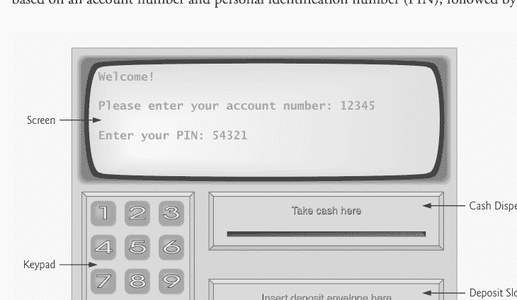

Fig. 2.11 | Automated teller machine user interface.

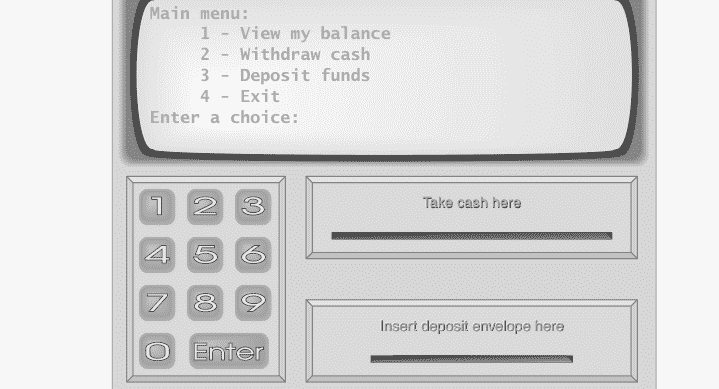

Fig. 2.12 | ATM main menu.

在 `ATM` 对用户进行身份验证后，主菜单（图 2.12）为三种类型的交易中的每一种显示一个编号选项：余额查询（选项 1）、取款（选项 2）和存款（选项 3）。主菜单还显示一个允许用户退出系统的选项（选项 4）。用户然后选择执行交易（输入 1、2 或 3）或退出系统（输入 4）。如果用户输入了无效选项，屏幕将显示错误消息，然后重新显示主菜单。

如果用户输入 1 进行余额查询，屏幕将显示用户的账户余额。为此，`ATM` 必须从银行的数据库中检索余额。

当用户输入 2 进行取款时，发生以下操作：

- 1. 屏幕显示一个菜单（图 2.13 所示），包含标准取款金额：$20（选项 1）、$40（选项 2）、$60（选项 3）、$100（选项 4）和 $200（选项 5）。菜单还包含允许用户取消交易的选项（选项 6）。
- 2. 用户使用键盘输入菜单选择（1–6）。
- 3. 如果所选取款金额大于用户的账户余额，屏幕将显示一条消息，说明这一点并告知用户选择较小的金额。`ATM` 然后返回步骤 1。如果所选取款金额小于或等于用户的账户余额（即可接受的取款金额），`ATM` 将继续执行步骤 4。如果用户选择取消交易（选项 6），`ATM` 将显示主菜单（图 2.12）并等待用户输入。
- 4. 如果现金 dispenser 包含足够的现金来满足请求，`ATM` 将继续执行步骤 5。否则，屏幕将显示一条消息，指出问题并告知用户选择较小的取款金额。`ATM` 然后返回步骤 1。

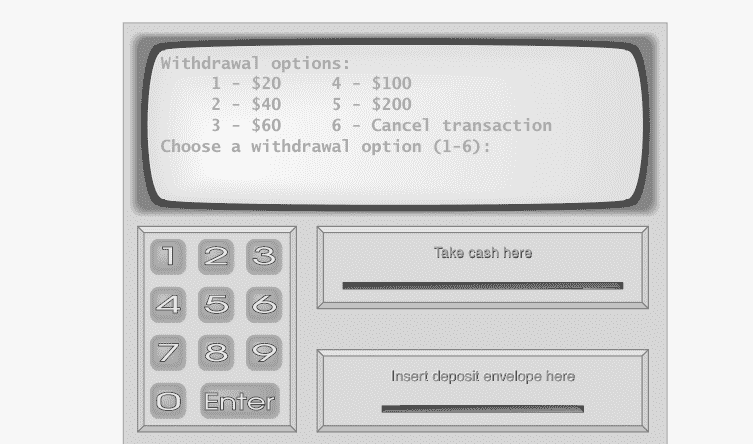

+   5. `ATM` 从银行数据库中用户的账户余额中扣除（即减去）取款金额。
+   6. 现金 dispenser 将所需金额的现金 dispenses 给用户。
+   7. 屏幕显示提醒用户取钱的消息。

当用户在主菜单显示时输入 3 以进行存款时，会发生以下操作：

- 1. 屏幕提示用户输入存款金额或输入 0（零）以取消交易。
- 2. 用户使用键盘输入存款金额或 0。 [注意：键盘不包含小数点或美元符号，因此用户无法输入实际的美元金额（例如 $1.25）。相反，用户必须以美分的数量输入存款金额（例如 125）。`ATM` 然后将该数字除以 100 以获得代表美元金额的数字（例如 125 ÷ 100 = 1.25）。]
- 3. 如果用户指定了存款金额，`ATM` 将继续执行步骤 4。如果用户选择取消交易（通过输入 0），`ATM` 将显示主菜单（图 2.12）并等待用户输入。
- 4. 屏幕显示一条消息，告知用户将存款信封插入存款槽。
- 5. 如果在两分钟内存款槽接收到存款信封，`ATM` 将存款金额计入（即增加到）银行数据库中用户的账户余额。 [注意：这笔钱不能立即用于取款。银行首先必须实物核实存款信封中的现金金额，并且信封中的任何支票都必须清算（即资金必须从支票开出者账户转移到支票收款人账户）。当发生其中任一事件时，银行会相应地更新其数据库中存储的用户余额。这与 `ATM` 系统无关。] 如果在此时间段内存款槽未接收到存款信封，屏幕将显示一条消息，说明系统已因不活动而取消交易。然后 `ATM` 显示主菜单并等待用户输入。

系统成功执行交易后，系统应重新显示主菜单（图 2.12），以便用户可以执行其他交易。如果用户选择退出系统（选项 4），屏幕应显示感谢信息，然后为下一位用户显示欢迎信息。

### 分析 ATM 系统

前述说明是需求规格说明的简化示例。通常，此类文档是需求收集详细过程的结果，该过程可能包括对系统潜在用户和与系统相关领域的专家的访谈。例如，受聘准备银行软件（例如本文所述的 `ATM` 系统）需求规格说明的系统分析师可能会采访金融专家，以更好地了解软件必须执行的功能。分析师将利用获得的信息编制系统需求列表，以指导系统设计师。

需求收集过程是软件生命周期第一阶段的关键任务。软件生命周期指定了软件从构思之初到退役使用期间所经历的阶段。这些阶段通常包括：分析、设计、实现、测试和调试、部署、维护和退役。存在多种软件生命周期模型，每个模型对软件工程师何时以及多频繁地执行这些阶段都有自己的偏好和规范。瀑布模型按顺序执行每个阶段一次，而迭代模型可能在产品生命周期中多次重复一个或多个阶段。

软件生命周期的分析阶段侧重于定义要解决的问题。在设计任何系统时，人们当然必须正确地解决问题，但同样重要的是，必须解决正确的问题。系统分析师收集指示要解决的具体问题的需求。我们的需求规格说明以足够的细节描述了我们的 `ATM` 系统，因此您无需进行广泛的分析阶段——它已为您完成。

为了捕捉拟议系统应该做什么，开发人员经常采用一种称为用例建模的技术。此过程识别系统的用例，每个用例代表系统为其客户提供的不同功能。例如，`ATM` 通常有几个用例，例如“查看账户余额”、“取款”、“存款”、“账户间转账”和“购买邮票”。我们在本案例研究中构建的简化 `ATM` 系统仅允许其中前三种用例（图 2.14）。

每个用例描述了用户使用系统的典型场景。您已经在需求规格说明中阅读了 `ATM` 系统用例的描述；执行每种类型交易（即余额查询、取款和存款）所需的步骤列表实际上描述了我们 `ATM` 的三个用例——“查看账户余额”、“取款”和“存款”。

### 用例图

我们现在介绍 `ATM` 案例研究中几个 `UML` 图中的第一个。我们创建用例图来建模系统客户（在本案例研究中为银行客户）与系统之间的交互。目标是显示用户与系统交互的类型，而不提供细节——这些细节在其他 `UML` 图中提供（我们在案例研究中介绍）。用例图通常伴随非正式文本，该文本更详细地描述用例——就像需求规格说明中出现的文本一样。用例图是在软件生命周期的分析阶段产生的。在较大的系统中，用例图是简单但不可或缺的工具，有助于系统设计师保持关注满足用户需求。

图 2.14 显示了我们 `ATM` 系统的用例图。棒状人形代表参与者，它定义了外部实体——例如人或其他系统——与系统交互时扮演的角色。对于我们的自动取款机，参与者是用户，可以查看账户余额、取款和从 `ATM` 存款。用户不是真人，而是真实的人在扮演用户角色时与 `ATM` 交互时可以扮演的角色的集合。请注意，用例图可以包含多个参与者。例如，真实银行 `ATM` 系统的用例图还可能包含名为管理员的参与者，该参与者每天为现金 dispenser 补充现金。

我们通过检查需求规格说明来识别系统中的参与者，其中写道：“`ATM` 用户应能够查看其账户余额、取款和存款。”三个用例中的参与者都是与 `ATM` 交互的用户。一个外部实体——真人——扮演用户的角色来执行金融交易。图 2.14 显示了一个参与者，其名称用户出现在图中参与者下方。`UML` 将每个用例建模为与参与者用实线连接的椭圆。

软件工程师（更准确地说，系统分析师）必须分析需求规格说明或一组用例并设计系统，然后程序员才能实现它。在分析阶段，系统分析师专注于理解需求规格说明，以生成高级规格说明，描述系统*应该做什么*。设计阶段的输出——*设计规格说明*——应清楚地指定*如何*构建系统以满足这些需求。在接下来的几个软件工程案例研究部分中，我们对 `ATM` 系统执行简单的面向对象设计（`OOD`）过程的步骤，以生成包含一组 `UML` 图和支持文本的设计规格说明。请记住，`UML` 旨在与任何 `OOD` 过程一起使用。存在许多此类过程，其中最著名的是 Rational Software Corporation（现为 IBM 的一个部门）开发的 Rational Unified Process™（`RUP`）。`RUP` 是一种丰富的流程，旨在设计“工业强度”应用程序。对于本案例研究，我们介绍我们自己的简化设计流程。

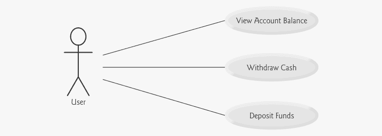

**图 2.14** | 从用户角度看的 `ATM` 系统用例图。

### 设计 ATM 系统

我们现在开始 `ATM` 系统的设计阶段。*系统*是一组为解决问题而交互的组件。例如，为了执行 `ATM` 系统指定的任务，我们的 `ATM` 系统具有用户界面（图 2.11），包含执行金融交易的软件并与银行账户信息数据库交互。*系统结构*描述系统的对象及其相互关系。*系统行为*描述系统随着其对象相互交互而如何变化。每个系统都有结构和行为——设计师必须指定两者。存在几种不同的系统结构和行为类型。例如，系统中对象之间的交互与用户与系统之间的交互不同，但两者都构成系统行为的一部分。

`UML 2` 规定了 13 种用于记录系统模型的图表类型。每种图表都对系统的结构或行为的特定特征进行建模——六个图表与系统结构相关；其余七个与系统行为相关。我们在此仅列出案例研究中使用的六种图表类型——其中一种（类图）建模系统结构——其余五种建模系统行为。我们在附录 F、UML 2：其他图表类型中概述其余七种 `UML` 图表类型。

1. *用例图*，例如图 2.14 所示，描述系统与其外部实体（参与者）在用例（系统能力，例如“查看账户余额”、“取款”和“存款”）方面的交互。
2. *类图*，你将在第 3.11 节学习，描述系统中使用的类，或“构建块”。需求规格说明书中描述的每个名词或“事物”都是系统中类的候选（例如，“账户”、“键盘”）。类图帮助我们指定系统各部分之间的结构关系。例如，`ATM` 系统类图将指定 `ATM` 在物理上由屏幕、键盘、现金 dispenser 和存款槽组成。
3. *状态机图*，你将在第 5.10 节学习，描述对象状态变化的方式。对象的*状态*由对象所有属性在给定时间的值指示。当对象状态发生变化时，该对象在系统中的行为可能不同。例如，在验证用户 `PIN` 后，`ATM` 从“用户未认证”状态转换到“用户已认证”状态，此时 `ATM` 允许用户执行金融交易（例如，查看账户余额、取款、存款）。
4. *活动图*，你也将在第 5.10 节学习，描述对象的*活动*——程序执行期间对象的 workflow（事件序列）。活动图描述对象执行的操作并指定执行这些操作的顺序。例如，活动图显示 `ATM` 必须先获取用户账户的余额（来自银行的账户信息数据库），屏幕才能向用户显示余额。
5. *通信图*（在 `UML` 早期版本中称为*协作图*）描述系统中对象之间的交互，重点在于*发生*了哪些交互。你将在第 7.12 节看到，这些图显示执行 `ATM` 交易时必须交互哪些对象。例如，`ATM` 必须与银行的账户信息数据库通信以检索账户余额。
6. *序列图*也描述系统中对象之间的交互，但与通信图不同，它们强调交互发生的*时间*。你将在第 7.12 节看到，这些图有助于显示执行金融交易时交互发生的顺序。例如，屏幕在现金 dispenser 前提示用户输入取款金额。

在第 3.11 节，我们通过从需求规格说明书中提取关键名词和名词短语来继续设计我们的 `ATM` 系统，从而识别出需求规格说明书中的类。利用这些类，我们开发了 `ATM` 系统结构的第一版类图。

### Web Resources

以下 URL 提供有关使用 `UML` 进行面向对象设计的信息。

www.objectsbydesign.com/books/booklist.html

列出有关 `UML` 和面向对象设计的书籍。

www-306.ibm.com/software/rational/offerings/design.html

提供有关 IBM Rational 软件用于设计系统的信息。提供 30 天试用版产品的下载，例如 IBM Rational Application Developer。

- b) Sequence diagrams
- c) Communication diagrams
- d) Activity diagrams

### 2.3 Which of the following choices lists stages of a typical software life cycle in sequential order?

- a) design, analysis, implementation, testing
- b) design, analysis, testing, implementation
- c) analysis, design, testing, implementation
- d) analysis, design, implementation, testing

### Answers to Software Engineering Case Study Self-Review Exercises

2.1 Figure 2.15 shows a use case diagram for a modified version of our `ATM` system that also allows users to transfer money between accounts.

2.2 b.

2.3 d.

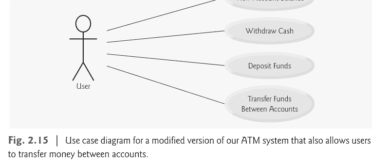

Fig. 2.15 | Use case diagram for a modified version of our `ATM` system that also allows users to transfer money between accounts.

### 2.8 Wrap-Up


You learned many important basic features of C++ in this chapter, including displaying data on the screen, inputting data from the keyboard and declaring variables of fundamental types. In particular, you learned to use the output stream object `cout` and the input stream object `cin` to build simple interactive programs. We explained how variables are stored in and retrieved from memory. You also learned how to use arithmetic operators to perform calculations. We discussed the order in which C++ applies operators (i.e., the rules of operator precedence), as well as the associativity of the operators. You also learned how C++’s `if` statement allows a program to make decisions. Finally, we introduced the equality and relational operators, which you use to form conditions in `if` statements.

The non-object-oriented applications presented here introduced you to basic programming concepts. As you’ll see in Chapter 3, C++ applications typically contain just a few lines of code in function `main`—these statements normally create the objects that perform the work of the application, then the objects “take over from there.” In Chapter 3, you’ll see how to implement your own classes and use objects of those classes in applications.

## 3 Introduction to Classes and Objects

### Objectives

In this chapter you’ll learn:

- What classes, objects, member functions and data members are.
- How to define a class and use it to create an object.
- How to define member functions in a class to implement the class’s behaviors.
- How to declare data members in a class to implement the class’s attributes.
- How to call a member function of an object to make that member function perform its task.
- The differences between data members of a class and local variables of a function.
- How to use a constructor to ensure that an object’s data is initialized when the object is created.
- How to engineer a class to separate its interface from its implementation and encourage reuse.

> Nothing can have value without being an object of utility.
>
> —Karl Marx
>
> Your public servants serve you right!
>
> —Adlai E. Stevenson
>
> Knowing how to answer one who speaks, To reply to one who sends a message.
>
> —Amenemope
>
> You’ll see something new. Two things. And I call them Thing One and Thing Two.
>
> —Dr. Theodore Seuss Geisel

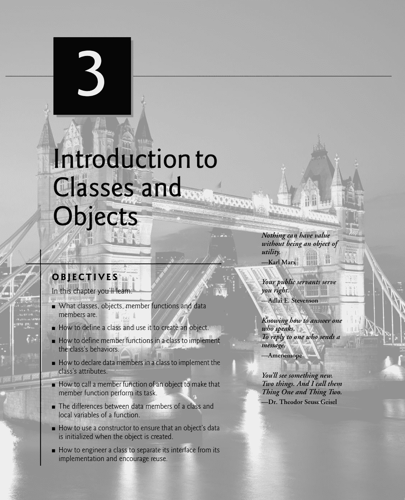

- 3.1 Introduction
- 3.2 Classes, Objects, Member Functions and Data Members
- 3.3 Overview of the Chapter Examples
- 3.4 Defining a Class with a Member Function
- 3.5 Defining a Member Function with a Parameter
- 3.6 Data Members, set Functions and get Functions
- 3.7 Initializing Objects with Constructors
- 3.8 Placing a Class in a Separate File for Reusability
- 3.9 Separating Interface from Implementation
- 3.10 Validating Data with set Functions
- 3.11 (Optional) Software Engineering Case Study: Identifying the Classes in the ATM Requirements Specification
- 3.12 Wrap-Up

### 3.1 Introduction

In Chapter 2, you created simple programs that displayed messages to the user, obtained information from the user, performed calculations and made decisions. In this chapter, you'll begin writing programs that employ the basic concepts of object-oriented programming that we introduced in Section 1.10. One common feature of every program in Chapter 2 was that all the statements that performed tasks were located in function `main`. Typically, the programs you develop in this book will consist of function `main` and one or more classes, each containing data members and member functions. If you become part of a development team in industry, you might work on software systems that contain hundreds, or even thousands, of classes. In this chapter, we develop a simple, well-engineered framework for organizing object-oriented programs in C++.

First, we motivate the notion of classes with a real-world example. Then we present a carefully paced sequence of seven complete working programs to demonstrate creating and using your own classes. These examples begin our integrated case study on developing a grade-book class that instructors can use to maintain student test scores. This case study is enhanced over the next several chapters, culminating with the version presented in Chapter 7, Arrays and Vectors. We also introduce the C++ standard library class `string` in this chapter.

### 3.2 Classes, Objects, Member Functions and Data Members

Let’s begin with a simple analogy to help you reinforce your understanding from Section 1.10 of classes and their contents. Suppose you want to drive a car and make it go faster by pressing down on its accelerator pedal. What must happen before you can do this? Well, before you can drive a car, someone has to design it and build it. A car typically begins as engineering drawings, similar to the blueprints used to design a house. These drawings include the design for an accelerator pedal that the driver will use to make the car go 更快。从某种意义上说，油门踏板“隐藏”了真正让汽车加速的复杂机制，就像制动踏板“隐藏”了让汽车减速的机制、方向盘“隐藏”了让汽车转向的机制等等。这使得对汽车工程几乎一无所知的人也能轻松驾驶汽车，只需使用油门踏板、制动踏板、方向盘、变速换挡机构以及其他类似简单且用户友好的“界面”来操作汽车复杂的内部机制。

不幸的是，你无法驾驶汽车的工程图纸——在你能驾驶汽车之前，必须先根据描述它的工程图纸把汽车制造出来。一辆完成的汽车会有一个实际的油门踏板来让汽车加速。但即便如此也还不够——汽车不会自己加速，所以驾驶员必须踩下油门踏板来告诉汽车加速。

#### 类与成员函数

现在让我们用汽车的示例来介绍本节中关键的面向对象编程概念。在程序中执行任务需要函数（例如第2章中描述的`main`函数）。函数描述了实际执行其任务的机制。函数向使用者隐藏了它所执行的复杂任务，就像汽车的油门踏板向驾驶员隐藏了让汽车加速的复杂机制一样。在C++中，我们首先创建一个称为类的程序单元来容纳函数，就像汽车的工程图纸容纳了油门踏板的设计一样。回顾第1.10节，属于类的函数称为成员函数。在类中，你提供一个或多个设计用于执行该类任务的成员函数。例如，一个表示银行账户的类可能包含一个用于向账户存钱的成员函数、另一个用于从账户取钱的成员函数，以及第三个用于查询当前账户余额的成员函数。

#### 对象

就像你不能驾驶汽车的工程图纸一样，你也不能“驾驶”一个类。就像必须有人根据工程图纸造出汽车你才能真正驾驶它一样，你必须创建一个类的对象，然后才能让程序执行该类所描述的任务。这也是C++被称为面向对象编程语言的原因之一。还要注意，就像从同一张工程图纸可以造出许多辆汽车一样，从同一个类也可以创建许多个对象。

#### 通过成员函数调用请求对象的服务

当你驾驶汽车时，踩下油门踏板会向汽车发送一条消息来执行任务——即让汽车加速。类似地，你向对象发送消息——每条消息称为一次成员函数调用，它告诉对象的一个成员函数执行其任务。这通常被称为向对象请求服务。

#### 属性与数据成员

到目前为止，我们已经用汽车的类比来介绍类、对象和成员函数。除了汽车提供的能力之外，它还有许多属性，例如颜色、车门数量、油箱中的油量、当前速度以及总行驶里程（即里程表读数）。和汽车的能力一样，这些属性在工程图纸中被表示为汽车设计的一部分。当你驾驶汽车时，这些属性始终与汽车相关联。每辆汽车都维护着自己的属性。例如，每辆汽车都知道自己油箱里有多少油，但不知道其他汽车油箱里有多少油。类似地，对象在程序中使用时，也具有随对象携带的属性。这些属性被指定为对象类的一部分。例如，银行账户对象有一个余额属性，表示账户中的金额。每个银行账户对象都知道它所代表的账户的余额，但不知道银行中其他账户的余额。属性由类的数据成员来指定。

### 3.3 本章示例概述

本章的其余部分介绍了七个简单的示例，它们演示了我们在汽车类比中引入的概念。这些示例总结如下，它们逐步构建一个`GradeBook`类来演示这些概念：

- 1. 第一个示例展示了一个`GradeBook`类，其中包含一个成员函数，该函数在被调用时仅显示一条欢迎消息。我们将展示如何创建该类的对象并调用成员函数，使其显示欢迎消息。
- 2. 第二个示例修改了第一个示例，允许成员函数接收一个所谓的自变量形式的课程名称。然后，该成员函数将课程名称作为欢迎消息的一部分显示出来。
- 3. 第三个示例展示了如何将课程名称存储在`GradeBook`对象中。对于这个版本的类，我们还展示了如何使用成员函数在对象中设置课程名称以及从对象中获取课程名称。
- 4. 第四个示例演示了如何在创建对象时初始化`GradeBook`对象中的数据——该初始化由一个称为类的构造函数的特殊成员函数执行。该示例还演示了每个`GradeBook`对象都维护自己的课程名称数据成员。
- 5. 第五个示例修改了第四个示例，演示了如何将`GradeBook`类放入单独的文件中，以实现软件可重用性。
- 6. 第六个示例修改了第五个示例，演示了将类的接口与实现分离的良好软件工程原则。这使得类更容易修改，而不会影响对象类的任何客户端——即从对象外部调用对象类的成员函数的任何类或函数。
- 7. 最后一个示例通过引入数据验证增强了`GradeBook`类，数据验证确保对象中的数据符合特定格式或处于适当的值范围内。例如，`Date`对象将要求月份值在1到12的范围内。在本`GradeBook`示例中，为`GradeBook`对象设置课程名称的成员函数确保课程名称不超过25个字符。如果不满足此条件，该成员函数将只使用课程名称的前25个字符，并显示一条警告消息。

请注意，本章中的`GradeBook`示例实际上并不处理或存储成绩。我们将在第4章开始使用`GradeBook`类处理成绩，并在第7章“数组与向量”中将成绩存储在`GradeBook`对象中。

### 3.4 使用成员函数定义类

我们从一个示例（图3.1）开始，该示例由`GradeBook`类（第9-17行）和一个`main`函数（第20-25行）组成，`GradeBook`类表示教师可以用来维护学生考试成绩的记分册，而`main`函数创建一个`GradeBook`对象。函数`main`使用该对象及其成员函数在屏幕上显示一条欢迎教师使用记分册程序的消息。

首先，我们描述如何定义类和成员函数。然后，我们解释如何创建对象以及如何调用对象的成员函数。前几个示例将函数`main`和它使用的`GradeBook`类放在同一个文件中。在后面的章节中，我们将介绍更复杂的方法来组织程序，以实现更好的软件工程。

```cpp
1  // 图 3.1: fig03_01.cpp
2  // 定义带有成员函数displayMessage的GradeBook类，
3  // 创建一个GradeBook对象，并调用其displayMessage函数。
4  #include <iostream>
5  using std::cout;
6  using std::endl;
7
8  // GradeBook类定义
9  class GradeBook
10 {
11 public:
12     // 向GradeBook用户显示欢迎消息的函数
13     void displayMessage()
14     {
15         cout << "Welcome to the Grade Book!" << endl;
16     } // 函数displayMessage结束
17 }; // 类GradeBook结束
18
19 // 函数main开始程序执行
20 int main()
21 {
22     GradeBook myGradeBook; // 创建一个名为myGradeBook的GradeBook对象
23     myGradeBook.displayMessage(); // 调用对象的displayMessage函数
24     return 0; // 指示成功终止
25 } // main结束
```

欢迎使用记分册！


图 3.1 | 使用成员函数`displayMessage`定义`GradeBook`类，创建`GradeBook`对象，并调用其`displayMessage`函数。

### GradeBook类

在函数`main`（第20-25行）能够创建`GradeBook`类的对象之前，我们必须告诉编译器该类有哪些成员函数和数据成员。`GradeBook`类定义（第9-17行）包含一个名为`displayMessage`的成员函数（第13-16行），该函数在屏幕上显示一条消息（第15行）。回顾一下，类就像一个蓝图——因此我们需要创建一个`GradeBook`类的对象（第22行）并调用其`dis-`

第23行的 `displayMessage` 成员函数调用使第15行执行并显示欢迎消息。我们很快将详细解释第22～23行。

类定义从第9行开始，首先是关键字 `class`，后跟类名 `GradeBook`。按照惯例，用户自定义类的名称以大写字母开头，并且为了可读性，类名中每个后续单词也以大写字母开头。这种大小写风格通常被称为驼峰式大小写（camel case），因为大写和小写字母的排列模式类似于骆驼的轮廓。

每个类的类体都用一对左右花括号（{ 和 }）括起来，如第10行和第17行所示。类定义以分号结束（第17行）。

### 常见编程错误 3.1

> 忘记在类定义末尾加上分号是语法错误。

回想一下，`main` 在执行程序时会被自动调用。你很快就会看到，必须显式调用成员函数 `displayMessage`，告诉它执行其任务。

第11行包含访问说明符标签 `public:`。关键字 `public` 是一个访问说明符。第13～16行定义了成员函数 `displayMessage`。该成员函数出现在访问说明符 `public:` 之后，表示该函数“可公开使用”——它可以被程序中的其他函数（如 `main`）以及其他类的成员函数调用。访问说明符后面总是跟着冒号（:）。在本文后续部分，当提到访问说明符 `public` 时，我们会像本句一样省略冒号。第3.6节将介绍第二个访问说明符 `private`。

程序中的每个函数都执行一项任务，并且可能在完成任务时返回一个值——例如，函数可能执行计算，然后返回计算的结果。定义函数时，必须指定返回类型，以指示函数完成任务时返回的值类型。在第13行中，函数名 `displayMessage` 左侧的关键字 `void` 就是该函数的返回类型。返回类型 `void` 表示 `displayMessage` 完成任务时不会向调用它的函数（在此例中为 `main`，我们稍后将看到）返回任何数据。在图3.5中，你将看到一个返回值的函数示例。

成员函数名 `displayMessage` 位于返回类型之后。按照惯例，函数名以小写字母开头，名称中后续单词均以大写字母开头。成员函数名后面的圆括号表示这是一个函数。一组空圆括号（如第13行所示）表示该成员函数不需要额外数据即可执行其任务。你将在第3.5节中看到一个确实需要额外数据的成员函数示例。第13行通常称为函数头。每个函数体都用左右花括号（{ 和 }）界定，如第14行和第16行所示。

函数体包含执行函数任务的语句。在本例中，成员函数 `displayMessage` 包含一条语句（第15行），用于显示消息"Welcome to the Grade Book!"。该语句执行完毕后，函数就完成了任务。

### 常见编程错误 3.2

> 从返回类型已声明为 `void` 的函数中返回值是编译错误。

### 常见编程错误 3.3

在另一个函数内部定义函数是语法错误。

### 测试 GradeBook 类

接下来，我们要在程序中使用 `GradeBook` 类。正如你在第2章中学到的，`main` 函数（第20～25行）开始每个程序的执行。

在这个程序中，我们想调用 `GradeBook` 类的 `displayMessage` 成员函数来显示欢迎消息。通常，在创建类的对象之前，不能调用该类的成员函数。（正如你将在第10.7节中看到的，静态成员函数是个例外。）第22行创建一个名为 `myGradeBook` 的 `GradeBook` 类对象。注意，该变量的类型是 `GradeBook`——即我们在第9～17行定义的类。当我们声明 `int` 类型的变量时（如第2章所做的那样），编译器知道 `int` 是什么——它是一种基本类型。然而在第22行，编译器不会自动知道 `GradeBook` 是什么类型——它是一种用户自定义类型。我们通过包含类定义（第9～17行）来告诉编译器 `GradeBook` 是什么。如果省略这些行，编译器将发出错误消息（例如 Microsoft Visual C++ 中的“‘GradeBook’: undeclared identifier”或 GNU C++ 中的“‘GradeBook’: undeclared”）。你创建的每个类都成为一种可用于创建对象的新类型。你可以根据需要定义新的类类型；这也是 C++ 被称为可扩展语言的原因之一。

第23行使用变量 `myGradeBook` 后跟点运算符（.）、函数名 `displayMessage` 和一组空圆括号来调用成员函数 `displayMessage`（在第13～16行定义）。该调用使 `displayMessage` 函数执行其任务。在第23行开头的“myGradeBook.”表示 `main` 应使用在第22行创建的 `GradeBook` 对象。第13行中的空圆括号表示成员函数 `displayMessage` 不需要额外数据即可执行其任务。（在第3.5节中，你将看到如何向函数传递数据。）当 `displayMessage` 完成任务后，`main` 函数继续执行第24行，这表明 `main` 成功完成了任务。这是 `main` 的结尾，因此程序终止。

### GradeBook 类的 UML 类图

在 UML 中，每个类都在 UML 类图中建模为一个带有三个分隔栏的矩形。图3.2给出了 `GradeBook` 类的类图（图3.1）。顶部栏包含类名，水平居中并以粗体显示。中间栏包含类的属性，这些属性对应于 C++ 中的数据成员。该栏当前为空，因为 `GradeBook` 类没有任何属性。（第3.6节将介绍带有一个属性的 `GradeBook` 类版本。）底部栏包含类的操作，这些操作对应于 C++ 中的成员函数。UML 通过列出操作名后跟一组圆括号来建模操作。`GradeBook` 类只有一个成员函数 `displayMessage`，因此图3.2的底部栏只列出该名称的一个操作。成员函数 `displayMessage` 不需要额外信息即可执行其任务，因此类图中 `displayMessage` 后面的圆括号为空，就像图3.1第13行中该成员函数头部的圆括号一样。操作名称前面的加号（+）表示 `displayMessage` 是 UML 中的公有操作（即 C++ 中的公有成员函数）。

```
public:
    // function that displays a welcome message to the GradeBook user
    void displayMessage( string courseName )
    {
        cout << "Welcome to the grade book for\n" << courseName << "!"
            << endl;
    } // end function displayMessage
}; // end class GradeBook

// function main begins program execution
int main()
{
    string nameOfCourse; // string of characters to store the course name
    GradeBook myGradeBook; // create a GradeBook object named myGradeBook

    // prompt for and input course name
    cout << "Please enter the course name:" << endl;
    getline( cin, nameOfCourse ); // read a course name with blanks
    cout << endl; // output a blank line

    // call myGradeBook's displayMessage function
    // and pass nameOfCourse as an argument
    myGradeBook.displayMessage( nameOfCourse );
    return 0; // indicate successful termination
} // end main
```

```
Please enter the course name:
CS101 Introduction to C++ Programming

Welcome to the grade book for
CS101 Introduction to C++ Programming!
```

图3.3 | 定义一个包含带参数成员函数的 `GradeBook` 类，创建 `GradeBook` 对象并调用其 `displayMessage` 函数。（第2部分，共2部分。）

在讨论 `GradeBook` 类的新特性之前，让我们看看这个新类是如何在 `main` 中使用（第26～40行）。第28行创建了一个名为 `nameOfCourse` 的 `string` 类型变量，用于存储用户输入的课程名称。`string` 类型的变量表示字符串，例如 "CS101 Introduction to C++ Programming"。`string` 实际上是 C++ 标准库中 `string` 类的对象。该类定义在头文件 `<string>` 中，名称 `string` 与 `cout` 一样属于命名空间 `std`。为了使第28行能够编译，第9行包含了 `<string>` 头文件。注意，第10行中的 `using` 声明允许我们在第28行直接写 `string` 而不是 `std::string`。目前，你可以把 `string` 变量看作像 `int` 等其他类型的变量。你将在第3.10节中看到更多 `string` 的功能。

第29行创建一个名为 `myGradeBook` 的 `GradeBook` 类对象。第32行提示用户输入课程名称。第33行使用库函数 `getline` 执行输入，从用户处读取名称并将其赋给 `nameOfCourse` 变量。在解释这行代码之前，让我们先解释为什么不能简单地写成

```
cin >> nameOfCourse;
```

### 常见编程错误 3.4

> 在函数定义的形参列表右括号后放置分号是语法错误。

### 常见编程错误 3.5

> 在函数中将函数形参再次定义为局部变量是编译错误。

### 类 GradeBook 的更新 UML 类图

图 3.4 的 UML 类图对图 3.3 的类 `GradeBook` 进行了建模。与图 3.1 中定义的类 `GradeBook` 类似，此 `GradeBook` 类包含公共成员函数 `displayMessage`。然而，此版本的 `displayMessage` 有一个参数。UML 通过在操作名之后括号内列出参数名，后跟冒号和参数类型来建模参数。UML 有自己的数据类型，与 C++ 相似。UML 是语言无关的——它与许多不同的编程语言一起使用——因此其术语并不完全匹配 C++。例如，UML 类型 `String` 对应于 C++ 类型 `string`。类 `GradeBook` 的成员函数 `displayMessage`（图 3.3，第 18–22 行）有一个名为 `courseName` 的 `string` 参数，因此图 3.4 在操作名 `displayMessage` 之后括号内列出了 `courseName : String`。请注意，此版本的 `GradeBook` 类仍然没有任何数据成员。


**图 3.4**  |  UML 类图表明类 `GradeBook` 具有 `displayMessage` 操作，其 `courseName` 参数的 UML 类型为 `String`。

### 3.6 数据成员、set 函数和 get 函数

在第 2 章中，我们在 `main` 函数中声明了程序的所有变量。在函数定义体中声明的变量称为局部变量，只能从函数中声明该变量的行使用到紧随其后的闭右括号（}）。局部变量必须在函数中使用之前声明。局部变量不能在声明它的函数之外访问。当函数终止时，其局部变量的值会丢失。（你将在第 6 章讨论静态局部变量时看到一个例外。）回顾第 3.2 节，一个对象具有随其在程序中使用而携带的属性。这样的属性在对象的整个生命周期中都存在。

一个类通常包含一个或多个操作属于特定类对象的属性的成员函数。属性在类定义中表示为变量。这样的变量称为数据成员，并在类定义内部但在类的成员函数定义体之外声明。每个类对象在内存中维护其属性的自己的副本。本节中的示例演示了一个包含 `courseName` 数据成员以表示特定 `GradeBook` 对象的课程名称的 `GradeBook` 类。

### 具有数据成员、set 函数和 get 函数的 GradeBook 类

在我们的下一个示例中，类 `GradeBook`（图 3.5）将课程名称维护为数据成员，以便在程序执行期间的任何时间使用或修改它。类包含成员函数 `setCourseName`、`getCourseName` 和 `displayMessage`。成员函数 `setCourseName` 将课程名称存储在 `GradeBook` 数据成员中。成员函数 `getCourseName` 从该数据成员获取课程名称。成员函数 `displayMessage`——现在不指定参数——仍然显示包含课程名称的欢迎消息。然而，正如你将看到的，该函数现在通过调用同一类中的另一个函数——`getCourseName`——来获取课程名称。

### 良好编程实践 3.1

在成员函数定义之间放置一个空行以增强程序的可读性。

```
// Fig. 3.5: fig03_05.cpp
// Define class GradeBook that contains a courseName data member
// and member functions to set and get its value;
// Create and manipulate a GradeBook object with these functions.
#include <iostream>
using std::cout;
using std::cin;
using std::endl;

#include <string> // program uses C++ standard string class
using std::string;
using std::getline;

// GradeBook class definition
class GradeBook
{
public:
    // function that sets the course name
    void setCourseName( string name )
    {
        courseName = name; // store the course name in the object
    } // end function setCourseName

    // function that gets the course name
    string getCourseName()
    {
        return courseName; // return the object's courseName
    } // end function getCourseName

    // function that displays a welcome message
    void displayMessage()
    {
```

图 3.5 | 使用数据成员和 set 与 get 函数定义和测试类 `GradeBook`。（第 1 部分，共 2 部分。）


```cpp
33      // this statement calls getCourseName to get the
34      // name of the course this GradeBook represents
35      cout << "Welcome to the grade book for\n" << getCourseName() << "!"
36      << endl;
37  } // end function displayMessage
38 private:
39     string courseName; // course name for this GradeBook
40 }; // end class GradeBook
41
42 // function main begins program execution
43 int main()
44 {
45     string nameOfCourse; // string of characters to store the course name
46     GradeBook myGradeBook; // create a GradeBook object named myGradeBook
47
48     // display initial value of courseName
49     cout << "Initial course name is: " << myGradeBook.getCourseName()
50     << endl;
51
52     // prompt for, input and set course name
53     cout << "\nPlease enter the course name:" << endl;
54     getline( cin, nameOfCourse ); // read a course name with blanks
55     myGradeBook.setCourseName( nameOfCourse ); // set the course name
56
57     cout << endl; // outputs a blank line
58     myGradeBook.displayMessage(); // display message with new course name
59     return 0; // indicate successful termination
60 } // end main
```

```
Initial course name is:

Please enter the course name:

CS101 Introduction to C++ Programming

Welcome to the grade book for

CS101 Introduction to C++ Programming!
```

图 3.5 | 使用数据成员和`set`与`get`函数定义和测试类`GradeBook`。（第 2 部分，共 2 部分。）

典型的讲师教授多门课程，每门课程都有自己的课程名称。第 39 行声明`courseName`是`string`类型。因为变量在类定义（第 15–40 行）中声明但在类的成员函数定义体之外（第 19–22 行、25–28 行和 31–37 行），所以该变量是数据成员。类的每个实例（即对象）都包含类的数据成员的一个副本——如果有两个`GradeBook`对象，每个对象都有自己的`courseName`副本（每个对象一个），正如你在图 3.7 的示例中看到的那样。使`courseName`成为数据成员的好处是，类的所有成员函数（在本例中为类`GradeBook`）都可以操作在类定义中出现的任何数据成员（在本例中为`courseName`）。

### 访问说明符`public`和`private`

大多数数据成员声明出现在访问说明符标签`private:`（第 38 行）之后。与`public`一样，关键字`private`也是一个访问说明符。在访问说明符`private`之后（并且在下一个访问说明符之前）声明的变量或函数只能由为其声明的类的成员函数访问。因此，数据成员`courseName`只能在（每个对象）类`GradeBook`的成员函数`setCourseName`、`getCourseName`和`displayMessage`中使用。数据成员`courseName`因为是私有的，不能被类外的函数（如`main`）或程序中其他类的成员函数访问。尝试在这些程序位置之一中使用`myGradeBook.courseName`这样的表达式访问数据成员`courseName`将导致编译错误，消息类似于

```
cannot access private member declared in class 'GradeBook'
```

### 软件工程观察 3.1

> 作为经验法则，数据成员应声明为`private`，成员函数应声明为`public`。（我们将看到，如果成员函数仅供类的其他成员函数访问，则声明某些成员函数为`private`是合适的。）

### 常见编程错误 3.6

> 非特定类的成员（或该类的友元，如我们在第 10 章《类：更深入的探讨，第 2 部分》中将看到的那样）的函数尝试访问该类的私有成员是编译错误。

类成员的默认访问是`private`，因此类头之后和第一个访问说明符之前的成员都是`private`。访问说明符`public`和`private`可以重复，但这是不必要的且可能令人困惑。

### 良好编程实践 3.2

> 尽管`public`和`private`访问说明符可以重复和混合使用，但先将类的所有公共成员作为一组列出，然后再将所有私有成员作为另一组列出。这使客户端关注类的公共接口，而不是类的实现。

### 良好编程实践 3.3

> 如果你选择先在类定义中列出私有成员，则即使`private`默认假设，也要显式使用`private`访问说明符。这提高了程序的清晰度。

使用访问说明符`private`声明数据成员称为数据隐藏。当程序创建（实例化）`GradeBook`对象时，数据成员`courseName`被封装（隐藏）在对象中，并且只能由对象类的成员函数访问。在类`GradeBook`中，成员函数`setCourseName`和`getCourseName`直接操作数据成员`courseName`（并且`displayMessage`如有必要也可以这样做）。

### 软件工程观察 3.2

> 你将在第 10 章看到，由类声明为友元的函数和类可以访问该类的私有成员。

### 错误预防提示 3.1

> 使类的私有数据成员和类的公共成员函数便于调试，因为数据操作的问题局限于类的成员函数或类的友元。

### 成员函数`setCourseName`和`getCourseName`

成员函数`setCourseName`（定义在第 19–22 行）在完成任务时不返回任何数据，因此其返回类型为`void`。成员函数接收一个参数——`name`——它代表将作为参数传递给它的课程名称（正如我们在`main`的第 55 行看到的那样）。第 21 行将`name`赋给数据成员`courseName`。在此示例中，`setCourseName`并未尝试验证课程名称——即函数不会检查课程名称是否遵循任何特定格式或关于“有效”课程名称的其他规则。例如，假设一所大学可以打印包含课程名称不超过 25 个字符的学生成绩单。在这种情况下，我们可能希望类`GradeBook`确保其数据成员`courseName`从不包含超过 25 个字符。我们将在第 3.10 节讨论基本的验证技术。

成员函数`getCourseName`（定义在第 25–28 行）返回特定`GradeBook`对象的`courseName`。成员函数具有空的参数列表，因此它不需要额外的信息来执行其任务。函数指定它返回一个`string`。当一个指定返回类型不为`void`的函数被调用并完成其任务时，函数会向其调用函数返回一个结果。例如，当你去自动取款机（ATM）并请求你的账户余额时，你期望 ATM 给你返回一个代表你余额的值。类似地，当一条语句在`GradeBook`对象上调用成员函数`getCourseName`时，该语句期望接收`GradeBook`的课程名称（在这种情况下是一个`string`，正如函数返回类型所指定的）。如果你有一个返回其参数平方的函数`square`，那么语句

```
result = square( 2 );
```

会从函数`square`返回 4 并将值 4 赋给变量`result`。如果你有一个返回三个整数参数中最大值的函数`maximum`，那么语句

```
biggest = maximum( 27, 114, 51 );
```

会从函数`maximum`返回 114 并将值 114 赋给变量`biggest`。

#### 常见编程错误 3.7

> 忘记从本应返回值的函数中返回值是编译错误。

请注意，第 21 行和第 27 行中的语句各自使用变量`courseName`（第 39 行），即使它未在任何成员函数中声明。我们可以在类`GradeBook`的成员函数中使用`courseName`，因为`courseName`是该类的一个数据成员。还请注意，成员函数的定义顺序并不决定它们在执行时被调用的时间。因此，成员函数`getCourseName`可以在成员函数`setCourseName`之前定义。

### 成员函数`displayMessage`

成员函数`displayMessage`（第 31–37 行）在完成任务时不返回任何数据，因此其返回类型为`void`。函数不接收参数，因此其参数列表为空。第 35–36 行输出包含数据成员`courseName`值的欢迎消息。第 35 行调用成员函数`getCourseName`以获取`courseName`的值。请注意，成员函数`displayMessage`也可以直接访问数据成员`courseName`，就像成员函数`setCourseName`和`getCourseName`所做的那样。我们稍后会解释为什么我们选择调用成员函数`getCourseName`来获取`courseName`的值。

### 测试类`GradeBook`

`main`函数（第 43–60 行）创建一个`GradeBook`类的对象并使用其每个成员函数。第 46 行创建一个名为`myGradeBook`的`GradeBook`对象。第 49–50 行通过调用对象的`getCourseName`成员函数来显示初始课程名称。请注意，输出的第一行不会显示课程名称，因为对象的`courseName`数据成员（即一个`string`）初始为空——默认情况下，`string`的初始值是所谓的空`string`，即不包含任何字符的字符串。当显示空字符串时，屏幕上不会出现任何内容。

第 53 行提示用户输入课程名称。局部`string`变量`nameOfCourse`（在第 45 行声明）被设置为用户输入的课程名称，该名称由对`getline`函数的调用（第 54 行）获得。第 55 行调用对象`myGradeBook`的`setCourseName`成员函数并提供`nameOfCourse`作为函数的参数。当函数被调用时，参数的值被复制到成员函数`setCourseName`（第 19–22 行）的参数`name`（第 19 行）。然后参数的值被赋给数据成员`courseName`（第 21 行）。第 57 行在输出中跳过一行；然后第 58 行调用对象`myGradeBook`的`displayMessage`成员函数以显示包含课程名称的欢迎消息。

### 使用`Set`和`Get`函数进行软件工程

类的私有数据成员只能由该类的成员函数（以及我们在第 10 章中会看到的类的“友元”）操作。因此，对象的客户端——即从对象外部调用对象成员函数的任何类或函数——调用类的公共成员函数以请求该类为特定对象提供服务。这就是为什么函数`main`（图 3.5，第 43–60 行）中的语句在`GradeBook`对象上调用成员函数`setCourseName`、`getCourseName`和`displayMessage`的原因。

类通常提供公共成员函数以允许类的客户端设置（即为其赋值）或获取（即获得值）私有数据成员。这些成员函数的名称不必以`set`或`get`开头，但这种命名约定很常见。在此示例中，设置`courseName`数据成员的成员函数称为`setCourseName`，而获取`courseName`数据成员值的成员函数称为`getCourseName`。请注意，`set`函数有时也称为 mutators（因为它们会改变值），而`get`函数有时也称为 accessors（因为它们访问值）。

请记住，用访问说明符`private`声明数据成员会强制执行数据隐藏。提供公共`set`和`get`函数允许类的客户端间接访问隐藏的数据。客户端知道它正在尝试修改或获取对象的数据，但客户端不知道对象如何执行这些操作。在某些情况下，类可能以一种方式在内部表示数据，但以另一种方式向客户端公开该数据。例如，假设`Clock`类将一天中的时间表示为私有`int`数据成员`time`，该成员存储午夜以来的秒数。然而，当客户端调用`Clock`对象的`getTime`成员函数时，对象可以以字符串形式返回时间，格式为小时、分钟和秒，格式为 `"HH:MM:SS"`。类似地，假设`Clock`类提供一个名为`setTime`的`set`函数，该函数接受格式为 `"HH:MM:SS"` 的字符串参数。利用第 18 章介绍的字符串功能，`setTime`函数可以将此字符串转换为秒数，并将该函数存储在其私有数据成员中。`set`函数还可以检查接收到的值是否代表有效的时间（例如，`"12:30:45"` 有效但 `"42:85:70"` 无效）。`set`和`get`函数允许客户端与对象交互，但对象的私有数据仍然安全地封装（即隐藏）在对象本身中。

类的`set`和`get`函数也应由类内的其他成员函数用来操作类的私有数据，尽管这些成员函数可以直接访问私有数据。在图 3.5 中，成员函数`setCourseName`和`getCourseName`是公共成员函数，因此它们可供类的客户端以及类本身访问。成员函数`displayMessage`调用成员函数`getCourseName`来获取数据成员`courseName`的值以供显示，即使`displayMessage`可以直接访问`courseName`——通过其`get`函数访问数据成员可以创建更好的、更健壮的类（即更易于维护且不太可能停止工作的类）。如果我们决定以某种方式更改数据成员`courseName`，`displayMessage`的定义将不需要修改——只有直接操作数据成员的`get`和`set`函数的主体需要更改。例如，假设我们决定希望将课程名称表示为两个单独的数据成员——`courseNumber`（例如，`"CS101"`）和`courseTitle`（例如，`"Introduction to C++ Programming"`）。成员函数`displayMessage`仍然可以对成员函数`getCourseName`进行一次调用以获取要作为欢迎消息一部分显示的完整课程名称。在这种情况下，`getCourseName`需要构建并返回一个包含`courseNumber`后跟`courseTitle`的字符串。成员函数`displayMessage`将继续显示完整的课程标题 `"CS101 Introduction to C++ Programming"`，因为它不受类数据成员更改的影响。调用类中另一个成员函数的`set`函数的好处将在我们讨论第 3.10 节中的验证时变得清晰。

#### 良好编程实践 3.4

> 始终尝试通过其`get`和`set`函数访问和操作类的数据成员，以使对类数据成员的更改的影响局部化。对数据成员名称或用于存储数据成员的数据类型的更改然后只会影响相应的`get`和`set`函数，而不会影响这些函数的调用者。

#### 软件工程观察 3.3

> 类设计者不必为每个私有数据项提供`set`或`get`函数；这些功能应仅在适当时提供。如果一项服务对客户端代码有用，该服务通常应在类的公共接口中提供。

### 带有数据成员和`set`和`get`函数的`GradeBook`的UML类图

图 3.6 包含图 3.5 中`GradeBook`类版本的更新 UML 类图。该图将`GradeBook`的数据成员`courseName`建模为中间隔间中的属性。UML 通过列出属性名称，后跟冒号和属性类型来表示数据成员作为属性。属性`courseName`的 UML 类型是`String`，对应于 C++ 中的`string`。数据成员`courseName`在 C++ 中是私有的，因此类图在相应属性的名称前面列出一个减号（–）。UML 中的减号等同于`private`访问说明符。

在C++中，`GradeBook`类包含三个公有成员函数，因此类图在第三个分隔区中列出了三个操作。回想一下，每个操作名称前的加号（+）表示该操作在C++中是公有的。操作`setCourseName`有一个名为`name`的`String`参数。UML通过在操作名称后的括号后面放置冒号和返回类型来表示操作的返回类型。`GradeBook`类（图3.5）的成员函数`getCourseName`在C++中具有`string`返回类型，因此类图在UML中显示`String`返回类型。注意，操作`setCourseName`和`displayMessage`不返回值（即它们返回`void`），因此UML类图在这些操作的括号后面没有指定返回类型。当函数不返回值时，UML不像C++那样使用`void`。


图3.6 | 类`GradeBook`的UML类图，包含私有`courseName`属性和公有操作`setCourseName`、`getCourseName`和`displayMessage`。

### 3.7 使用构造函数初始化对象


如3.6节所述，当`GradeBook`类（图3.5）的对象被创建时，其数据成员`courseName`默认被初始化为空字符串。如果你希望在创建`GradeBook`对象时提供课程名称，该怎么办？你声明的每个类都可以提供一个构造函数，用于在创建对象时初始化该类的对象。构造函数是一种特殊的成员函数，必须定义为与类相同的名称，以便编译器能够将其与类的其他成员函数区分开来。构造函数与其他函数的一个重要区别是，构造函数不能返回值，因此它们不能指定返回类型（甚至不能是`void`）。通常，构造函数被声明为公有。在文献中，“构造函数”一词常被缩写为“ctor”——我们通常避免使用缩写。

C++要求为每个创建的对象调用构造函数，这有助于确保每个对象在程序中使用之前被初始化。构造函数调用在对象创建时隐式发生。如果类没有显式包含构造函数，编译器会提供一个默认构造函数——即没有参数的构造函数。例如，当图3.5中的第46行创建一个`GradeBook`对象时，会调用默认构造函数。编译器提供的默认构造函数创建一个`GradeBook`对象，但不会给对象的基本类型数据成员提供任何初始值。[注意：对于作为其他类对象的数据成员，默认构造函数会隐式调用每个数据成员的默认构造函数，以确保该数据成员被正确初始化。这就是为什么`string`数据成员`courseName`（在图3.5中）被初始化为空字符串——`string`类的默认构造函数将字符串的值设置为空字符串。你将在10.3节中了解更多关于初始化作为其他类对象的数据成员的内容。]

在图3.7的示例中，我们在创建`GradeBook`对象时为其指定课程名称（第49行）。在这种情况下，参数`"CS101 Introduction to C++ Programming"`被传递给`GradeBook`对象的构造函数（第17-20行），并用于初始化`courseName`。图3.7定义了一个修改后的`GradeBook`类，其中包含一个带`string`参数的构造函数，该参数接收初始课程名称。

```
// Fig. 3.7: fig03_07.cpp
// Instantiating multiple objects of the GradeBook class and using
// the GradeBook constructor to specify the course name
// when each GradeBook object is created.
#include <iostream>
using std::cout;
using std::endl;

#include <string> // program uses C++ standard string class
using std::string;

// GradeBook class definition
class GradeBook
{
public:
    // constructor initializes courseName with string supplied as argument
    GradeBook( string name )
    {
        setCourseName( name ); // call set function to initialize courseName
    } // end GradeBook constructor

    // function to set the course name
    void setCourseName( string name )
    {
        courseName = name; // store the course name in the object
    } // end function setCourseName

    // function to get the course name
    string getCourseName()
    {
        return courseName; // return object's courseName
    } // end function getCourseName

    // display a welcome message to the GradeBook user
    void displayMessage()
    {
        // call getCourseName to get the courseName
        cout << "Welcome to the grade book for\n" << getCourseName()
            << "!" << endl;
    } // end function displayMessage
private:
    string courseName; // course name for this GradeBook
}; // end class GradeBook
```

图3.7 | 实例化`GradeBook`类的多个对象，并使用`GradeBook`构造函数在每个`GradeBook`对象创建时指定课程名称。（第1部分，共2部分。）

```
45 // function main begins program execution
46 int main()
47 {
48     // create two GradeBook objects
49     GradeBook gradeBook1( "CS101 Introduction to C++ Programming" );
50     GradeBook gradeBook2( "CS102 Data Structures in C++" );
51
52     // display initial value of courseName for each GradeBook
53     cout << "gradeBook1 created for course: " << gradeBook1.getCourseName()
54         << "\n gradeBook2 created for course: " << gradeBook2.getCourseName()
55         << endl;
56     return 0; // indicate successful termination
57 } // end main
```

```
gradeBook1 created for course: CS101 Introduction to C++ Programming
gradeBook2 created for course: CS102 Data Structures in C++
```

图3.7 | 实例化`GradeBook`类的多个对象，并使用`GradeBook`构造函数在每个`GradeBook`对象创建时指定课程名称。（第2部分，共2部分。）

### 定义构造函数

图3.7的第17-20行定义了`GradeBook`类的构造函数。注意，构造函数与其类`GradeBook`同名。构造函数在其参数列表中指定执行其任务所需的数据。创建新对象时，你将此数据放在对象名称后面的括号中（如我们在第49-50行所做的那样）。第17行表明`GradeBook`类的构造函数有一个名为`name`的`string`参数。注意，第17行没有指定返回类型，因为构造函数不能返回值（甚至不能是`void`）。

构造函数体中的第19行将构造函数的参数`name`传递给成员函数`setCourseName`，后者将值赋给数据成员`courseName`。`setCourseName`成员函数（第23-26行）只是将其参数`name`赋给数据成员`courseName`，因此你可能想知道为什么我们要在第19行调用`setCourseName`——构造函数当然可以执行赋值`courseName = name`。在3.10节中，我们将修改`setCourseName`以执行验证（确保在这种情况下`courseName`的长度不超过25个字符）。到那时，从构造函数调用`setCourseName`的好处将会变得清晰。注意，构造函数（第17行）和`setCourseName`函数（第23行）都使用名为`name`的参数。你可以在不同的函数中使用相同的参数名，因为参数对于每个函数是局部的；它们互不干扰。

### 测试GradeBook类

图3.7的第46-57行定义了测试`GradeBook`类的主函数，并演示了使用构造函数初始化`GradeBook`对象。`main`函数中的第49行创建并初始化名为`gradeBook1`的`GradeBook`对象。当该行执行时，C++隐式调用`GradeBook`构造函数（第17-20行），参数为`"CS101 Introduction to C++ Programming"`，以初始化`gradeBook1`的课程名称。第50行对名为`gradeBook2`的`GradeBook`对象重复此过程，此次传递参数`"CS102 Data Structures in C++"`来初始化`gradeBook2`的课程名称。第53-54行使用每个对象的`getCourseName`成员函数获取课程名称，并表明它们确实在对象创建时被初始化。输出证实每个`GradeBook`对象都维护着自己的一份`courseName`数据成员的拷贝。

### 为类提供默认构造函数的两种方式

任何不带参数的构造函数都称为默认构造函数。一个类可以通过以下两种方式获得默认构造函数：

- 1. 编译器会在未定义构造函数的类中隐式创建默认构造函数。这样的默认构造函数不会初始化类的成员数据，但会调用每个作为另一类对象的成员数据的默认构造函数。[注意：未初始化的变量通常包含“垃圾”值（例如，未初始化的`int`变量可能包含`-858993460`，这在大多数程序中很可能是该变量的不正确值）。]

- 2. 你显式定义一个不带参数的构造函数。这样的默认构造函数将执行你指定的初始化，并调用每个作为另一类对象的成员数据的默认构造函数。

如果你定义了一个带参数的构造函数，C++将不会为该类隐式创建默认构造函数。请注意，对于图3.1、图3.3和图3.5中的每个版本的类`GradeBook`，编译器都隐式定义了一个默认构造函数。

### 错误预防提示 3.2

除非你的类的数据成员无需初始化（几乎从不如此），请提供一个构造函数，以确保在创建类的每个新对象时，类的数据成员都使用有意义的值进行初始化。

### 软件工程观察 3.4

数据成员可以在类的构造函数中初始化，也可以在对象创建后稍后设置其值。然而，确保对象在客户端代码调用其成员函数之前已完全初始化，是一种良好的软件工程实践。通常，你不应依赖客户端代码来确保对象得到正确初始化。

### 将构造函数添加到类 GradeBook 的 UML 类图

图3.8的UML类图对图3.7的类`GradeBook`进行了建模，该类具有一个名为`name`的`string`类型参数的构造函数（在UML中表示为`String`类型）。与操作一样，UML在类图中类的第三个区段中对构造函数进行建模。为了区分构造函数和类的操作，UML在构造函数名称前放置“constructor”一词，位于尖括号（`«` 和 `»`）之间。习惯上在第三个区段中将类的构造函数列在其他操作之前。


图3.8 | UML类图指示类`GradeBook`具有一个参数为UML类型`String`的`name`的构造函数。

### 3.8 将类放在单独的文件中以实现可重用性

从编程角度来看，我们已经将类`GradeBook`开发到目前所需的程度，因此让我们考虑一些软件工程问题。创建类定义的一个好处是，当正确打包时，我们的类可以被程序员重用——可能遍及全球。例如，我们可以通过在程序中包含头文件`<string>`来在任何C++程序中重用C++标准库类型`string`（并且，如我们将看到的，能够链接到库的对象代码）。

不幸的是，希望使用我们的`GradeBook`类的程序员不能简单地将图3.7中的文件包含到另一个程序中。正如你在第2章中学到的，函数`main`开始每个程序的执行，并且每个程序必须恰好有一个`main`函数。如果其他程序员包含图3.7中的代码，他们会得到额外的负担——我们的`main`函数——他们的程序将有两个`main`函数。当他们尝试编译程序时，编译器会指示错误。例如，在Microsoft Visual C++ 2008中尝试编译包含两个`main`函数的程序会产生错误

```
error C2084: function 'int main(void)' already has a body
```

当编译器尝试编译它遇到的第二个`main`函数时。同样，GNU C++编译器会产生错误

```
redefinition of 'int main()'
```

这些错误表明程序已经有一个`main`函数。因此，将`main`与类定义放在同一个文件中会阻止该类被其他程序重用。在本节中，我们演示了如何通过将类`GradeBook`与`main`函数分离到另一个文件中使其可重用。

#### 头文件

本章中之前的每个示例都由一个`.cpp`文件组成，也称为源代码文件，其中包含`GradeBook`类定义和`main`函数。在构建面向对象的C++程序时，通常将可重用的源代码（例如类）定义在按惯例具有`.h`文件名扩展名的文件中——称为头文件。程序使用`#include`预处理器指令包含头文件并利用可重用的软件组件，例如C++标准库提供的类型`string`和用户定义的类型如类`GradeBook`。

在下一个示例中，我们将图3.7中的代码分离到两个文件——`GradeBook.h`（图3.9）和`fig03_10.cpp`（图3.10）。当你查看图3.9中的头文件时，注意它只包含`GradeBook`类定义（第11–41行）和第3–8行，这些行允许类`GradeBook`使用`cout`、`endl`和类型`string`。使用类`GradeBook`的`main`函数在源代码文件`fig03_10.cpp`（图3.10）第10–21行中定义。为了帮助你为本书记载的更大程序以及工业界的程序做好准备，我们经常使用包含函数`main`的单独源代码文件来测试我们的类（这称为驱动程序）。你很快就会看到，包含`main`的源代码文件如何使用头文件中找到的类定义来创建类的对象。

### 包含包含用户定义类的头文件

像`GradeBook.h`（图3.9）这样的头文件不能用于开始程序执行，因为它不包含`main`函数。如果你尝试单独编译和链接`GradeBook.h`以创建可执行应用程序，Microsoft Visual C++ 2005会产生链接错误消息：

```
error LNK2019: unresolved external symbol _main referenced in
function _mainCRTStartup
```

要在Linux上使用GNU C++编译和链接，你必须先将头文件包含在`.cpp`源代码文件中，然后GNU C++会产生包含以下内容的链接错误消息：

```
undefined reference to 'main'
```

此错误表明链接器无法找到程序的`main`函数。为了测试类`GradeBook`（定义在图3.9中），你必须编写一个包含`main`函数的单独源代码文件（例如图3.10），该文件实例化并使用该类的对象。

```
// Fig. 3.9: GradeBook.h
// GradeBook class definition in a separate file from main.

#include <iostream>
using std::cout;
using std::endl;

#include <string> // class GradeBook uses C++ standard string class
using std::string;

// GradeBook class definition
class GradeBook
{
public:
    // constructor initializes courseName with string supplied as argument
    GradeBook( string name )
    {
        setCourseName( name ); // call set function to initialize courseName
    } // end GradeBook constructor

    // function to set the course name
    void setCourseName( string name )
    {
        courseName = name; // store the course name in the object
    } // end function setCourseName

    // function to get the course name
    string getCourseName()
    {
        return courseName; // return object's courseName
    } // end function getCourseName

    // display a welcome message to the GradeBook user
    void displayMessage()
    {
```


```
35      // call getCourseName to get the courseName
36      cout << "Welcome to the grade book for\n" << getCourseName()
37          << "!" << endl;
38  } // end function displayMessage
39 private:
40      string courseName; // course name for this GradeBook
41 }; // end class GradeBook
```

图 3.9 | `GradeBook` 类定义。（第 2 部分，共 2 部分。）

```
1  // Fig. 3.10: fig03_10.cpp
2  // Including class GradeBook from file GradeBook.h for use in main.
3  #include <iostream>
4  using std::cout;
5  using std::endl;
6
7  #include "GradeBook.h" // include definition of class GradeBook
8
9  // function main begins program execution
10 int main()
11 {
12     // create two GradeBook objects
13     GradeBook gradeBook1( "CS101 Introduction to C++ Programming" );
14     GradeBook gradeBook2( "CS102 Data Structures in C++" );
15
16     // display initial value of courseName for each GradeBook
17     cout << "gradeBook1 created for course: " << gradeBook1.getCourseName()
18         << "\ngradeBook2 created for course: " << gradeBook2.getCourseName()
19         << endl;
20     return 0; // indicate successful termination
21 } // end main
```

```
gradeBook1 created for course: CS101 Introduction to C++ Programming
gradeBook2 created for course: CS102 Data Structures in C++
```

图 3.10 | 从文件 `GradeBook.h` 包含类 `GradeBook` 以供 `main` 使用。

回想一下第 3.4 节，虽然编译器知道 `int` 等基本数据类型是什么，但编译器不知道 `GradeBook` 是什么，因为它是一个用户定义的类型。事实上，编译器甚至不知道 C++ 标准库中的类。为了帮助它理解如何使用一个类，我们必须明确地向编译器提供该类的定义——这就是为什么例如，要使用类型 `string`，程序必须包含 `<string>` 头文件。这使编译器能够确定为每个类对象保留多少内存，并确保程序正确调用类的成员函数。

要在图 3.10 第 13–14 行创建 `GradeBook` 对象 `gradeBook1` 和 `gradeBook2`，编译器必须知道 `GradeBook` 对象的大小。虽然对象在概念上包含数据成员和成员函数，但 C++ 对象只包含数据。编译器只为类的成员函数创建一份拷贝，并在所有类的对象之间共享该拷贝。当然，每个对象都需要自己的一份类的数据成员的拷贝，因为其内容可能因对象而异（例如两个不同的 `BankAccount` 对象可能拥有两个不同的 `balance` 数据成员）。然而，成员函数的代码是不可修改的，因此它可以被该类的所有对象共享。因此，对象的大小取决于存储类的数据成员所需的内存量。通过在第 7 行包含 `GradeBook.h`，我们向编译器提供了所需的信息（图 3.9 第 40 行），以便确定 `GradeBook` 对象的大小，并判断该类的对象是否被正确使用（图 3.10 的第 13–14 行和第 17–18 行）。

第 7 行指示 C++ 预处理器在程序编译之前将该指令替换为 `GradeBook.h` 内容的副本（即 `GradeBook` 类定义）。当源文件 `fig03_10.cpp` 被编译时，它现在就包含了 `GradeBook` 类定义（因为 `#include`），编译器能够确定如何创建 `GradeBook` 对象，并确保它们的成员函数被正确调用。既然类定义已经放在头文件中（没有 `main` 函数），我们就可以在任何需要复用 `GradeBook` 类的程序中包含该头文件。

### 头文件的定位方式

注意，图 3.10 第 7 行中 `GradeBook.h` 头文件的名称是放在引号（" "）中，而不是尖括号（< >）中。通常，程序的源文件与用户自定义头文件放在同一个目录中。当预处理器遇到用引号括起来的头文件名（如 `"GradeBook.h"`）时，它会尝试在与 `#include` 指令所在文件相同的目录中查找该头文件。如果预处理器在该目录中找不到该头文件，它会在与 C++ 标准库头文件相同的位置中查找。当预处理器遇到用尖括号括起来的头文件名（如 `<iostream>`）时，它假定该头文件是 C++ 标准库的一部分，并且不会在正在预处理的程序所在目录中查找。

### 错误预防提示 3.3

> 为了确保预处理器能够正确定位头文件，`#include` 预处理指令应将用户自定义头文件的名称放在引号中（如 `"GradeBook.h"`），并将 C++ 标准库头文件的名称放在尖括号中（如 `<iostream>`）。

### 其他软件工程问题

现在 `GradeBook` 类定义在头文件中，该类可以被复用了。不幸的是，像图 3.9 那样将类定义放在头文件中，仍然会将类的完整实现暴露给类的使用者——`GradeBook.h` 只是一个任何人都可以打开阅读的文本文件。传统的软件工程经验告诉我们，要使用一个类的对象，客户端代码只需要知道调用哪些成员函数、每个成员函数需要提供哪些参数以及每个成员函数应返回什么类型。客户端代码不需要知道这些函数是如何实现的。

如果客户端代码确实知道一个类是如何实现的，那么客户端代码的程序员可能会基于类的实现细节来编写客户端代码。理想情况下，如果实现发生了变化，类的使用者不应该被迫更改代码。隐藏类的实现细节使得更改类的实现更加容易，同时可以最小化、并希望是消除对客户端代码的更改。

在第 3.9 节中，我们将展示如何将 `GradeBook` 类拆分成两个文件，以便：

1. 该类可以被复用，
2. 类的使用者知道该类提供了哪些成员函数、如何调用它们以及期望的返回类型，
3. 类的使用者不知道类的成员函数是如何实现的。

### 3.9 将接口与实现分离

在上一节中，我们展示了如何通过将类定义与使用该类的客户端代码（如 `main` 函数）分离来提升软件可复用性。我们现在引入另一个良好软件工程的基本原则——*将接口与实现分离*。

#### 类的接口

*接口*定义并标准化了人与系统等事物之间相互交互的方式。例如，收音机的控制按钮就是收音机用户与内部组件之间的接口。这些控制按钮允许用户执行一组有限的操作（如更换电台、调节音量、在 AM 和 FM 之间选择）。不同的收音机可能以不同的方式实现这些操作——有些提供按钮，有些提供旋钮，还有一些支持语音命令。接口指定了收音机允许用户执行*什么*操作，但不指定这些操作在收音机内部*如何*实现。

类似地，*类的接口*描述了类的使用者可以使用的*服务*，以及如何*请求*这些服务，但不说明类*如何*实现这些服务。类的接口由类的公共成员函数（也称为类的*公共服务*）组成。例如，`GradeBook` 类的接口（图 3.9）包含一个构造函数以及成员函数 `setCourseName`、`getCourseName` 和 `displayMessage`。`GradeBook` 类的使用者（例如图 3.10 中的 `main`）使用这些函数来请求类的服务。你很快就会看到，可以通过编写一个只列出成员函数名称、返回类型和参数类型的类定义来指定类的接口。

#### 将接口与实现分离

在之前的示例中，每个类定义都包含了类的公共成员函数的完整定义以及私有数据成员的声明。但是，更好的软件工程做法是在类定义之外定义成员函数，以便其实现细节可以对客户端代码隐藏。这种做法可以确保程序员不会编写依赖于类实现细节的客户端代码。如果他们这样做了，一旦类的实现发生变化，客户端代码就更有可能“出错”。

图 3.11–3.13 中的程序通过将图 3.9 的类定义拆分成两个文件，将 `GradeBook` 类的接口与实现分离开来——头文件 `GradeBook.h`（图 3.11）中定义了类 `GradeBook`，源文件 `GradeBook.cpp`（图 3.12）中定义了 `GradeBook` 的成员函数。按照惯例，成员函数定义放在与类头文件同名的源文件中（如 `GradeBook`），但扩展名为 `.cpp`。源文件 `fig03_13.cpp`（图 3.13）定义了函数 `main`（客户端代码）。图 3.13 的代码和输出与图 3.10 完全相同。图 3.14 从 `GradeBook` 类程序员和客户端代码程序员的角度展示了这个三文件程序是如何编译的——我们将详细解释该图。

### `GradeBook.h`：使用函数原型定义类的接口

头文件 `GradeBook.h`（图 3.11）包含了 `GradeBook` 类定义的另一个版本（第 9–18 行）。该版本与图 3.9 中的版本类似，但图 3.9 中的函数定义在这里被替换为函数原型（第 12–15 行），这些原型描述了类的公共接口，但不会暴露类的成员函数实现。函数原型是函数的声明，它告诉编译器函数的名称、返回类型和参数类型。注意，头文件仍然指定了类的私有数据成员（第 17 行）。同样，编译器必须知道类的数据成员，才能确定要为类的每个对象预留多少内存。在客户端代码中包含头文件 `GradeBook.h`（图 3.13 第 8 行），为编译器提供了所需的信息，以确保客户端代码正确调用 `GradeBook` 类的成员函数。

第 12 行的函数原型（图 3.11）表明构造函数需要一个 `string` 参数。回想一下，构造函数没有返回类型，因此函数原型中不出现返回类型。成员函数 `setCourseName` 的函数原型（第 13 行）表明 `setCourseName` 需要一个 `string` 参数，并且不返回任何值（即其返回类型为 `void`）。成员函数 `getCourseName` 的函数原型（第 14 行）表明该函数不需要参数，并返回一个 `string`。最后，成员函数 `displayMessage` 的函数原型（第 15 行）规定 `displayMessage` 不需要参数，也不返回值。这些函数原型与图 3.9 中相应的函数头相同，只是没有包含参数名称（参数名称在原型中是可选的），并且每个函数原型必须以分号结尾。

> **常见编程错误 3.8**
>
> *在函数原型末尾忘记分号是一个语法错误。*

```
// Fig. 3.11: GradeBook.h
// GradeBook class definition. This file presents GradeBook's public
// interface without revealing the implementations of GradeBook's member
// functions, which are defined in GradeBook.cpp.
#include <string> // class GradeBook uses C++ standard string class
using std::string;

// GradeBook class definition
class GradeBook
{
public:
   GradeBook( string ); // constructor that initializes courseName
   void setCourseName( string ); // function that sets the course name
   string getCourseName(); // function that gets the course name
   void displayMessage(); // function that displays a welcome message
private:
   string courseName; // course name for this GradeBook
}; // end class GradeBook
```

**图 3.11** | 包含函数原型的 `GradeBook` 类定义，这些原型指定了该类的接口。

### 良好的编程实践 3.5

尽管函数原型中的参数名是可选的（编译器会忽略它们），但许多程序员会使用这些名称来进行文档说明。

### 错误预防提示 3.4

函数原型中的参数名（同样会被编译器忽略）如果使用错误或令人困惑的名称可能会具有误导性。因此，许多程序员会通过复制对应函数定义的第 1 行来创建函数原型（当函数的源代码可用时），然后在每个原型的末尾加上分号。

### `GradeBook.cpp`: 在单独的源代码文件中定义成员函数

`GradeBook.cpp`（图 3.12）定义了类 `GradeBook` 的成员函数，这些函数已在图 3.11 的第 12–15 行声明。成员函数定义出现在第 11–34 行，与图 3.9 第 15–38 行中的成员函数定义几乎相同。

```
// Fig. 3.12: GradeBook.cpp
// GradeBook member-function definitions. This file contains
// implementations of the member functions prototyped in GradeBook.h.
#include <iostream>
using std::cout;
using std::endl;

#include "GradeBook.h" // include definition of class GradeBook

// constructor initializes courseName with string supplied as argument
GradeBook::GradeBook( string name )
{
   setCourseName( name ); // call set function to initialize courseName
} // end GradeBook constructor

// function to set the course name
void GradeBook::setCourseName( string name )
{
   courseName = name; // store the course name in the object
} // end function setCourseName

// function to get the course name
string GradeBook::getCourseName()
{
   return courseName; // return object's courseName
} // end function getCourseName

// display a welcome message to the GradeBook user
void GradeBook::displayMessage()
{
   // call getCourseName to get the coursename
   cout << "Welcome to the grade book for\n" << getCourseName()
        << "!" << endl;
} // end function displayMessage
```

**Fig. 3.12** | `GradeBook` 成员函数定义代表了类 `GradeBook` 的实现。

请注意，每个成员函数名在其函数头中（第 11、17、23 和 29 行）前面都加上了类名和 `::`，这被称为 *二进制作用域解析运算符*。这将每个成员函数“绑定”到（现在已分离的）`GradeBook` 类定义（图 3.11），该定义声明了类的成员函数和数据成员。如果没有在每个函数名前加上 “`GradeBook::`”，这些函数就不会被编译器识别为类 `GradeBook` 的成员函数——编译器会将它们视为“自由”或“松散”函数，像 `main` 一样。这样的函数如果不指定对象，就无法访问 `GradeBook` 的私有数据或调用类的成员函数。因此，编译器将无法编译这些函数。例如，第 19 行和第 25 行访问变量 `courseName` 将导致编译错误，因为 `courseName` 并未在每个函数中声明为局部变量——编译器不会知道 `courseName` 已作为类 `GradeBook` 的数据成员声明。

> **常见编程错误 3.9**
>
> 在类外部定义类的成员函数时，如果省略了函数名前面的类名和二进制作用域解析运算符（`::`），会导致编译错误。

为了表明 `GradeBook.cpp` 中的成员函数属于类 `GradeBook`，我们必须首先包含 `GradeBook.h` 头文件（图 3.12 的第 8 行）。这使我们能够在 `GradeBook.cpp` 文件中访问类名 `GradeBook`。编译 `GradeBook.cpp` 时，编译器会使用 `GradeBook.h` 中的信息来确保

1. 每个成员函数的第 1 行（第 11、17、23 和 29 行）与其在 `GradeBook.h` 文件中的原型匹配——例如，编译器确保 `getCourseName` 不接受参数并返回一个 `string`，并且
2. 每个成员函数都知道类的

要创建供教师使用的可执行的 `GradeBook` 应用程序，最后一步是链接：


1. `main`函数的对象代码（即客户端代码）

2. 类`GradeBook`成员函数实现的对象代码

3. 类实现程序员和客户端程序员所使用的 C++ 类（如`string`）的 C++ 标准库对象代码。

链接器的输出是可执行的`GradeBook`应用程序，教师可以使用它来管理学生的成绩。

有关编译多源文件程序的更多信息，请参阅编译器的文档。我们在`www.deitel.com/cplusplus/`的 C++ 资源中心提供了各种 C++ 编译器的链接。

### 3.10 使用`set`函数验证数据

在 3.6 节中，我们引入了`set`函数，用于允许类的客户端修改私有数据成员的值。在图 3.5 中，类`GradeBook`定义成员函数`setCourseName`，它简单地将参数`name`接收的值赋给数据成员`courseName`。该成员函数并不确保课程名称符合任何特定格式，也不遵循关于“有效”课程名称外观的任何其他规则。如前所述，假设一所大学只能打印包含 25 个或更少字符课程名称的学生成绩单。如果该大学使用包含`GradeBook`对象的系统来生成成绩单，我们可能希望类`GradeBook`确保其数据成员`courseName`永远不会超过 25 个字符。图 3.15–3.17 中的程序增强了类`GradeBook`的成员函数`setCourseName`以执行此验证。

### `GradeBook`类定义

请注意，`GradeBook`的类定义（图 3.15）——以及它的接口——与图 3.11 的完全相同。由于接口保持不变，当成员函数`setCourseName`的定义被修改时，该类的客户端无需更改。这使得客户端只需将客户端代码链接到更新后的`GradeBook`对象代码，即可利用改进后的`GradeBook`类。

```cpp
1  // Fig. 3.15: GradeBook.h
2  // GradeBook class definition presents the public interface of
3  // the class. Member-function definitions appear in GradeBook.cpp.
4  #include <string> // program uses C++ standard string class
5  using std::string;
6
7  // GradeBook class definition
8  class GradeBook
9  {
10 public:
11     GradeBook( string ); // constructor that initializes a GradeBook object
12     void setCourseName( string ); // function that sets the course name
13      string getCourseName(); // function that gets the course name
14      void displayMessage(); // function that displays a welcome message
15  private:
16      string courseName; // course name for this GradeBook
17  }; // end class GradeBook
```

图 3.15 | `GradeBook`类定义。（共 2 部分中的第 2 部分。）

### 使用`GradeBook`成员函数`setCourseName`验证课程名称

对类`GradeBook`的增强体现在`setCourseName`的定义中（图 3.16，第 18–31 行）。第 20–21 行的`if`语句判断参数`name`是否包含有效的课程名称（即长度不超过 25 个字符的字符串）。如果课程名称有效，第 21 行将课程名称存储到数据成员`courseName`中。注意第 20 行中的表达式`name.length()`。这是一个成员函数调用，就像`myGradeBook.displayMessage()`一样。C++ 标准库的`string`类定义了一个成员函数`length`，它返回字符串对象中的字符数。参数`name`是一个`string`对象，

```cpp
1  // Fig. 3.16: GradeBook.cpp
2  // Implementations of the GradeBook member-function definitions.
3  // The setCourseName function performs validation.
4  #include <iostream>
5  using std::cout;
6  using std::endl;
7
8  #include "GradeBook.h" // include definition of class GradeBook
9
10 // constructor initializes courseName with string supplied as argument
11 GradeBook::GradeBook( string name )
12 {
13     setCourseName( name ); // validate and store courseName
14 } // end GradeBook constructor
15
16 // function that sets the course name;
17 // ensures that the course name has at most 25 characters
18 void GradeBook::setCourseName( string name )
19 {
20     if ( name.length() <= 25 ) // if name has 25 or fewer characters
21         courseName = name; // store the course name in the object
22
23     if ( name.length() > 25 ) // if name has more than 25 characters
24     {
25         // set courseName to first 25 characters of parameter name
26         courseName = name.substr( 0, 25 ); // start at 0, length of 25
27
28         cout << "Name \"" << name << "\" exceeds maximum length (25).\n"
29             << "Limiting courseName to first 25 characters.\n" << endl;
30     } // end if
31 } // end function setCourseName
```

图 3.16 | 带有验证数据成员`courseName`长度的`set`函数的`GradeBook`类成员函数定义。（第 1 部分，共 2 部分。）

```cpp
32
33 // function to get the course name
34 string GradeBook::getCourseName()
35 {
36     return courseName; // return object's courseName
37 } // end function getCourseName
38
39 // display a welcome message to the GradeBook user
40 void GradeBook::displayMessage()
41 {
42     // call getCourseName to get the courseName
43     cout << "Welcome to the grade book for\n" << getCourseName()
44         << "!" << endl;
45 } // end function displayMessage
```

图 3.16 | 带有验证数据成员`courseName`长度的`set`函数的`GradeBook`类成员函数定义。（第 2 部分，共 2 部分。）

因此，调用`name.length()`返回`name`中的字符数。如果该值小于或等于 25，则`name`有效，并执行第 21 行。

第 23–30 行的`if`语句处理`setCourseName`收到无效课程名称（即长度超过 25 个字符的名称）的情况。即使参数`name`太长，我们仍然希望使`GradeBook`对象保持一致性状态——即对象的数据成员`courseName`包含有效值（即不超过 25 个字符的字符串）的状态。因此，我们截断（即缩短）指定的课程名称，并将`name`的前 25 个字符赋给`courseName`数据成员（不幸的是，这可能会使课程名称被生硬地截断）。标准`string`类提供了成员函数`substr`（“substring”的缩写），它通过复制现有字符串对象的一部分来返回一个新的字符串对象。第 26 行中的调用（即`name.substr( 0, 25 )`）向`name`的成员函数`substr`传递两个整数（0 和 25）。这些参数指示`substr`应返回字符串`name`的哪个部分。第一个参数指定从原字符串中开始复制字符的起始位置——每个字符串的第一个字符被认为位于位置 0。第二个参数指定要复制的字符数。因此，第 26 行中的调用返回从位置 0 开始的`name`的 25 个字符的子字符串（即`name`的前 25 个字符）。例如，如果`name`的值为`"CS101 Introduction to Programming in C++"`，则`substr`返回`"CS101 Introduction to Pro"`。调用`substr`后，第 26 行将`substr`返回的子字符串赋给数据成员`courseName`。这样，成员函数`setCourseName`确保`courseName`总是被赋值为包含 25 个或更少字符的字符串。如果成员函数必须截断课程名称以使其有效，则第 28–29 行显示警告消息。

请注意，第 23–30 行的`if`语句包含两个主体语句——一个用于将`courseName`设置为参数`name`的前 25 个字符，另一个用于向用户打印相应的消息。当`name`太长时，我们希望这两个语句都执行，因此将它们放在一对花括号`{ }`中。回顾第 2 章，这创建了一个块。你将在第 4 章中学习更多关于将多个语句放置在控制语句主体中的内容。

请注意，第 28–29 行的语句也可以不在语句第二行开头使用流插入运算符，如下所示：

```cpp
cout << "Name \"" << name << "\" exceeds maximum length (25).\n"
     "Limiting courseName to first 25 characters.\n" << endl;
```

C++ 编译器会合并相邻的字符串字面量，即使它们出现在程序的不同行中。因此，在上述语句中，C++ 编译器会将字符串字面量`"\" exceeds maximum length (25).\n"`和`"Limiting courseName to first 25 characters.\n"`合并为单个字符串字面量，生成的输出与图 3.16 中第 28–29 行的输出完全相同。这一行为让你可以在程序中跨行拆分长字符串进行打印，而无需添加额外的流插入操作。

### 测试`GradeBook`类

图 3.17 演示了带有验证功能的`GradeBook`类的修改版本（图 3.15–3.16）。第 14 行创建了一个名为`gradeBook1`的`GradeBook`对象。回想一下，`GradeBook`构造函数会调用`setCourseName`来初始化数据成员`courseName`。在该类的先前版本中，在构造函数中调用`setCourseName`的好处并不明显。然而现在，构造函数利用了`setCourseName`提供的验证功能。构造函数只是调用`setCourseName`，而不是重复其验证代码。当图 3.17 中的第 14 行将初始课程名`"CS101 Introduction to Programming in C++"`传递给`GradeBook`构造函数时，构造函数会将该值传递给`setCourseName`，实际初始化在此发生。由于该课程名包含超过 25 个字符，第二个`if`语句的语句体执行，导致`courseName`被初始化为截断后的 25 字符课程名`"CS101 Introduction to Pro"`（截断部分在第 14 行中以粗体黑色突出显示）。请注意，图 3.17 中的输出包含图 3.16 中成员函数`setCourseName`在第 28–29 行输出的警告消息。第 15 行创建了另一个名为`gradeBook2`的`GradeBook`对象——传递给构造函数的有效课程名恰好为 25 个字符。

```cpp
// Fig. 3.17: fig03_17.cpp
// Create and manipulate a GradeBook object; illustrate validation.
#include <iostream>
using std::cout;
using std::endl;

#include "GradeBook.h" // include definition of class GradeBook

// function main begins program execution
int main()
{
   // create two GradeBook objects;
   // initial course name of gradeBook1 is too long
   GradeBook gradeBook1("CS101 Introduction to Programming in C++");
   GradeBook gradeBook2("CS102 C++ Data Structures");

   // display each GradeBook's courseName
   cout << "gradeBook1's initial course name is: "
       << gradeBook1.getCourseName()
       << "\ngradeBook2's initial course name is: "
       << gradeBook2.getCourseName() << endl;

   // modify myGradeBook's courseName (with a valid-length string)
   gradeBook1.setCourseName( "CS101 C++ Programming" );

   // display each GradeBook's courseName
   cout << "\ngradeBook1's course name is: "
       << gradeBook1.getCourseName()
       << "\ngradeBook2's course name is: "
       << gradeBook2.getCourseName() << endl;
   return 0; // indicate successful termination
} // end main
```

```text
Name "CS101 Introduction to Programming in C++" exceeds maximum length (25). Limiting courseName to first 25 characters.

gradeBook1's initial course name is: CS101 Introduction to Pro
gradeBook2's initial course name is: CS102 C++ Data Structures

gradeBook1's course name is: CS101 C++ Programming
gradeBook2's course name is: CS102 C++ Data Structures
```

**图 3.17** | 创建并操作一个课程名长度被限制为 25 个字符的`GradeBook`对象。

图 3.17 的第 18–21 行显示`gradeBook1`截断后的课程名（我们在程序输出中以粗体黑色突出显示）以及`gradeBook2`的课程名。第 24 行直接调用`gradeBook1`的`setCourseName`成员函数，将`GradeBook`对象中的课程名改为无需截断的较短名称。然后，第 27–30 行再次输出这些`GradeBook`对象的课程名。

### 关于`set`函数的补充说明

公有`set`函数（如`setCourseName`）应仔细审查任何修改数据成员（例如`courseName`）值的尝试，以确保新值对该数据项是合适的。例如，将月份中的某一天设置为 37 的尝试应被拒绝，将某人的体重设置为零或负值的尝试应被拒绝，将考试分数设置为 185（当正确范围为 0 到 100 时）的尝试应被拒绝，等等。

#### 软件工程经验 3.5

将数据成员设为私有，并通过公有成员函数控制对这些数据成员的访问（尤其是写访问），有助于确保数据完整性。

#### 错误预防提示 3.5

数据完整性的好处并不会仅仅因为数据成员被设为私有就自动实现——你必须提供适当的有效性检查并报告错误。

#### 软件工程经验 3.6

> 设置私有数据值的成员函数应验证预期的新值是否恰当；如果新值不恰当，`set`函数应将私有数据成员置于适当的状态。

类的`set`函数可以向类的客户返回值，指示有人试图为类的对象赋予无效数据。类的客户可以测试`set`函数的返回值，以确定客户修改对象的尝试是否成功，并采取适当的措施。在第 16 章中，我们将演示当试图用不合适的值修改对象时，如何通过异常处理机制通知类的客户。为了在本书的早期阶段保持图 3.15–3.17 中的程序简洁，图 3.16 中的`setCourseName`只是在屏幕上打印一条适当的消息。


### 3.11（可选）软件工程案例研究：识别 ATM 需求规格说明中的类

现在我们开始设计在第 2 章中介绍的 ATM 系统。在本节中，我们通过分析需求规格说明中出现的名词和名词短语来识别构建 ATM 系统所需的类。我们引入 UML 类图来对这些类之间的关系进行建模。这是定义系统结构的重要第一步。

#### 识别系统中的类

我们通过识别构建 ATM 系统所需的类来开始我们的面向对象设计（OOD）过程。我们最终将使用 UML 类图来描述这些类，并用 C++ 实现这些类。首先，我们回顾第 2.7 节的需求规格说明，找出关键的名词和名词短语，以帮助我们识别构成 ATM 系统的类。我们可能会认为其中一些名词和名词短语是系统中其他类的属性。我们也可能得出结论：有些名词与系统的组成部分不对应，因此根本不应建模。随着设计过程的推进，可能会有更多类显现出来。

图 3.18 列出了需求规格说明中的名词和名词短语。我们按照它们在需求规格说明中出现的顺序从左到右列出。我们只列出每个名词或名词短语的单数形式。

我们只为在 ATM 系统中具有重要意义的那些名词和名词短语创建类。我们不需要将“bank”建模为一个类，因为银行不是 ATM 系统的一部分——银行只是希望我们构建 ATM。“Customer”和“user”也代表了系统之外的实体——它们很重要，因为它们与我们的 ATM 系统交互，但我们不需要在 ATM 软件中将它们建模为类。回想一下，我们在图 2.14 的用例图中将 ATM 用户（即银行客户）建模为参与者。

我们不将“$20 bill”或“deposit envelope”建模为类。这些是现实世界中的物理对象，但它们并不属于被自动化的部分。我们可以使用对现金出钞器建模的类的一个属性来充分表示系统中纸币的存在。（我们将在第 4.11 节中将属性分配给类。）例如，现金出钞器

- bank, money / fund, account number
- ATM, screen, PIN
- user, keypad, bank database
- customer, cash dispenser, balance inquiry
- transaction, $20 bill / cash, withdrawal
- account, deposit slot, deposit
- balance, deposit envelope

Fig. 3.18 | 需求规格说明书中的名词和名词短语。

maintains a count of the number of bills it contains. The requirements specification doesn’t say anything about what the system should do with deposit envelopes after it receives them. We can assume that acknowledging the receipt of an envelope—an operation performed by the class that models the deposit slot—is sufficient to represent the presence of an envelope in the system. (We assign operations to classes in Section 6.22.)

在我们简化的 ATM 系统中，将各种“money”以及账户的“balance”等表示为其他类的属性似乎是最合适的。同样，名词“account number”和“PIN”在 ATM 系统中代表重要的信息。它们是银行账户的重要属性。它们并不表现出行为。因此，我们最合适的建模方式是将其作为`account`类的属性。

尽管需求规格说明书经常以一般意义描述“transaction”，但我们目前不建模金融交易的宽泛概念。相反，我们将三种类型的交易（即“balance inquiry”、“withdrawal”和“deposit”）建模为独立的类。这些类拥有执行其所代表的交易所需的特定属性。例如，`withdrawal`需要知道用户想要取款的金额。而`balance inquiry`则不需要任何额外数据。此外，这三个交易类表现出独特的行为。`withdrawal`包括向用户 dispensing 现金，而`deposit`涉及从用户接收 deposit envelopes。 [Note: In Section 13.10, we “factor out” common features of all transactions into a general “transaction” class using the object-oriented concepts of abstract classes and inheritance.]

我们根据图 3.18 中剩余的名词和名词短语确定系统的类。每个都指以下之一：

- ATM
- screen
- keypad
- cash dispenser
- deposit slot
- account
- bank database
- balance inquiry
- withdrawal
- deposit

此列表中的元素很可能是我们实现系统时需要的类。

我们现在可以根据所创建的列表对系统中的类进行建模。我们在设计过程中将类名大写——这是 UML 的约定——正如我们在编写实现设计的实际 C++ 代码时所做的那样。如果类名包含多个单词，我们将单词合并并将每个单词的首字母大写（例如`MultipleWordName`）。使用此约定，我们创建类`ATM`、`Screen`、`Keypad`、`CashDispenser`、`DepositSlot`、`Account`、`BankDatabase`、`BalanceInquiry`、`Withdrawal`和`Deposit`。我们使用所有这些类作为构建块来构建系统。然而，在开始构建系统之前，我们必须更好地了解类之间的关系。

### Modeling Classes

UML 使我们能够通过类图对 ATM 系统中的类及其相互关系进行建模。图 3.19 表示类`ATM`。在 UML 中，每个类都被建模为具有三个隔间的矩形。顶部隔间包含类的名称，水平居中且以粗体显示。中间隔间包含类的属性。 （我们在第 4.11 节和第 5.10 节讨论属性。）底部隔间包含类的操作（在第 6.22 节讨论）。在图 3.19 中，中间和底部隔间为空，因为我们尚未确定该类的属性和操作。

类图还显示了系统类之间的关系。图 3.20 显示了我们的类`ATM`和`Withdrawal`如何相互关联。暂时出于简单起见，我们只选择建模这一子集的类；我们将在本节后面呈现更完整的类图。请注意，此图中的类矩形未细分为隔间。UML 允许以这种方式抑制类属性和操作，当合适时，以创建更易读的图表。这样的图表被称为 elided diagram——其中某些信息，例如第二和第三隔间的内容，未被建模。我们将在第 4.11 节和第 6.22 节中将信息放在这些隔间中。

在图 3.20 中，连接两个类的实线表示关联——类之间的关系。线两端附近的数字是 multiplicity 值，表示每个类中有多少对象参与关联。在这种情况下，沿着线从一端到另一端可以看出，在任何给定时刻，一个`ATM`对象参与与零个或一个`Withdrawal`对象的关联——零


Fig. 3.19 | 使用类图在 UML 中表示类。

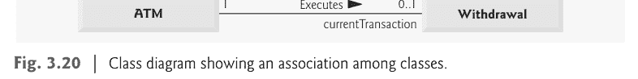

Fig. 3.20 | 显示类之间关联的类图。

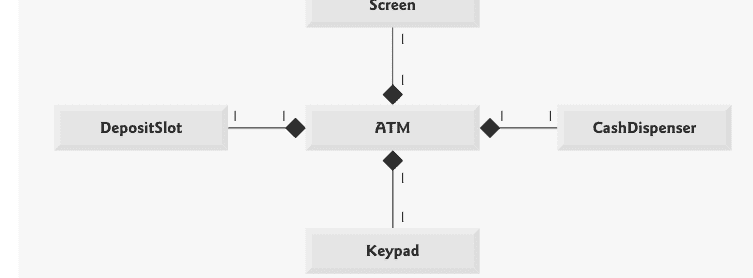

Fig. 3.22 | 显示组合关系的类图。

composition symbol (the solid diamond) on its end of the association line is the whole (in this case, `ATM`), and the classes on the other end of the association lines are the parts—in this case, classes `Screen`, `Keypad`, `CashDispenser` and `DepositSlot`. The compositions in Fig. 3.22 indicate that an object of class `ATM` is formed from one object of class `Screen`, one object of class `CashDispenser`, one object of class `Keypad` and one object of class `DepositSlot`. The `ATM` “has a” screen, a keypad, a cash dispenser and a deposit slot. The has-a relationship defines composition. (We’ll see in the Software Engineering Case Study section in Chapter 13 that the is-a relationship defines inheritance.)

根据 UML 规范，组合关系具有以下属性：

- 1. 关系中只有一个类可以代表整体（即菱形只能放在关联线的某一端）。例如，要么屏幕是`ATM`的一部分，要么`ATM`是屏幕的一部分，但屏幕和`ATM`不能在关系中同时代表整体。

- 2. 组合关系中的部件仅在整体存在时存在，并且整体负责其部件的创建和销毁。例如，构建`ATM`的行为包括制造其部件。此外，如果`ATM`被销毁，其屏幕、键盘、现金 dispenser 和 deposit slot 也将被销毁。

- 3. 一个部件一次只能属于一个整体，尽管部件可以被移除并附加到另一个整体，后者然后承担对该部件的责任。

我们类图中的实心菱形表示满足这三个属性的组合关系。如果 has-a 关系不满足其中一个或多个标准，UML 规定将空心菱形附加到关联线的末端以表示聚合——一种较弱的组合形式。例如，个人电脑和电脑显示器参与聚合关系——电脑有一个显示器，但这两个部件可以独立存在，并且同一个显示器可以同时连接到多台电脑，从而违反了组合的第二和第三属性。

图 3.23 显示了 ATM 系统的类图。此图建模了我们在本节前面识别的大多数类，以及我们可以从需求规格说明书推断出的它们之间的关联。 [Note: Classes `BalanceInquiry` and `Deposit` participate in associations similar to those of class `Withdrawal`, so we have chosen to omit them from this diagram to keep it simple. In Chapter 13, we expand our class diagram to include all the classes in the ATM system.]

图 3.23 呈现了 ATM 系统结构的图形模型。此类图包括类 `BankDatabase` 和 `Account` 以及图 3.20 或图 3.22 中均不存在的几个关联。类图显示类 `ATM` 与类 `BankDatabase` 具有 **一对一关系**——一个 `ATM` 对象针对一个 `BankDatabase` 对象对用户进行身份验证。在图 3.23 中，我们还建模了银行数据库包含有关许多账户的信息这一事实——一个 `BankDatabase` 类的对象参与与零个或多个 `Account` 类对象的组合关系。回想一下图 3.21，`BankDatabase` 类与 `Account` 类之间的关联在 `Account` 端的 multiplicity 值 `0..*` 表示零个或多个 `Account` 对象参与关联。类 `BankDatabase` 与类 `Account` 具有 **一对多关系**——`BankDatabase` 包含许多 Accounts。同样，类 `Account` 与类 `BankDatabase` 具有 **多对一关系**——可以有许多 Accounts 包含在 `BankDatabase` 中。 [Note: Recall from Fig. 3.21 that the multiplicity value `*` is identical to `0..*`. We include `0..*` in our class diagrams for clarity.]

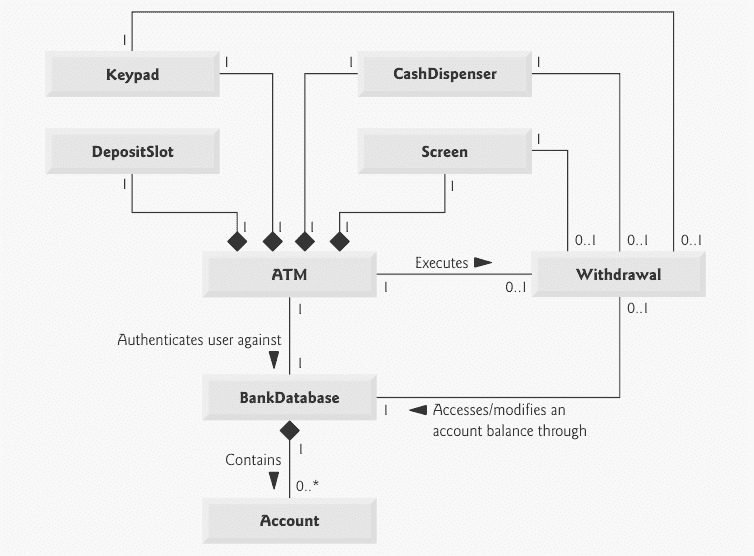

**Fig. 3.23** | ATM 系统模型的类图。

图 3.23 还表明，如果用户正在进行取款，“一个 `Withdrawal` 类的对象通过一个 `BankDatabase` 类的对象访问/修改账户余额。” 我们本可以直接在类 `Withdrawal` 和类 `Account` 之间创建关联。然而需求规范指出，“ATM 必须与银行的账户信息数据库交互”以执行交易。银行账户包含敏感信息，系统工程师在设计系统时必须始终考虑个人数据的安全性。因此，只有 `BankDatabase` 才能直接访问和操作账户。系统的其他所有部分都必须与数据库交互以检索或更新账户信息（例如账户余额）。

图 3.23 中的类图还对类 `Withdrawal` 与类 `Screen`、`CashDispenser` 和 `Keypad` 之间的关联进行了建模。取款交易包括提示用户选择取款金额并接收数字输入。这些操作分别需要使用屏幕和键盘。此外，向用户 dispensing 现金需要访问现金 dispenser。

类 `BalanceInquiry` 和 `Deposit` 虽然未在图 3.23 中显示，但参与了与 ATM 系统其他类的多个关联。与类 `Withdrawal` 类似，这两个类都与类 `ATM` 和 `BankDatabase` 关联。类 `BalanceInquiry` 的对象还与类 `Screen` 的对象关联，以向用户显示账户余额。类 `Deposit` 与类 `Screen`、`Keypad` 和 `DepositSlot` 关联。与取款类似，存款交易需要使用屏幕和键盘分别显示提示并接收输入。为了接收存款信封，类 `Deposit` 的对象访问存款槽。

我们现在已经确定了 ATM 系统中的类（尽管在设计和实现过程中我们可能会发现其他类）。在第 4.11 节中，我们确定每个类的属性，并在第 5.10 节中，我们使用这些属性来检查系统随时间的变化。在第 6.22 节中，我们确定我们系统中类的操作。

### 软件工程案例研究 自我复习练习

- 3.1 假设我们有一个类 `Car` 代表一辆汽车。想想制造商会把哪些不同的部件组合起来生产一辆完整的汽车。创建一个类图（类似于图 3.22），对类 `Car` 的一些组合关系进行建模。

- 3.2 假设我们有一个类 `File` 代表一台独立的、非联网计算机中代表的电子文档，该计算机由类 `Computer` 表示。类 `Computer` 与类 `File` 之间存在什么类型的关联？

    a) 类 `Computer` 与类 `File` 之间是一对一关系。

    b) 类 `Computer` 与类 `File` 之间是多对一关系。

    c) 类 `Computer` 与类 `File` 之间是一对多关系。

    d) 类 `Computer` 与类 `File` 之间是多对多关系。

- 3.3 判断以下陈述是真还是假，如果为假，请说明原因：一个 UML 图中类的第二和第三个区隔未被建模，则称该图为省略图。

- 3.4 修改图 3.23 的类图以包含类 `Deposit` 而不是类 `Withdrawal`。

### 软件工程案例研究自我复习练习的答案

3.1  [注：答案可能有所不同。] 图 3.24 展示了一个类图，显示了类 `Car` 的一些组合关系。

3.2 c. [注：在计算机网络中，这种关系可能是多对多的。]

3.3 真。

3.4 图 3.25 展示了 ATM 的类图，其中包含类 `Deposit` 而不是类 `Withdrawal`（与图 3.23 中类似）。请注意，`Deposit` 不访问 `CashDispenser`，但确实访问 `DepositSlot`。

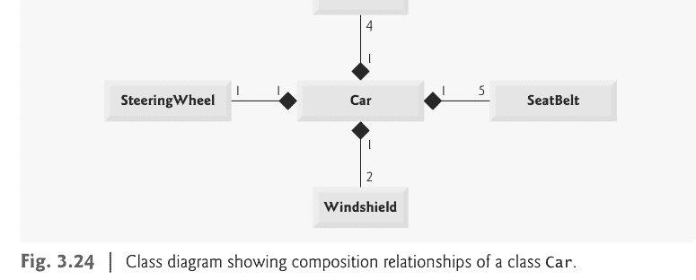

图 3.24 | 显示类 `Car` 的组合关系的类图。

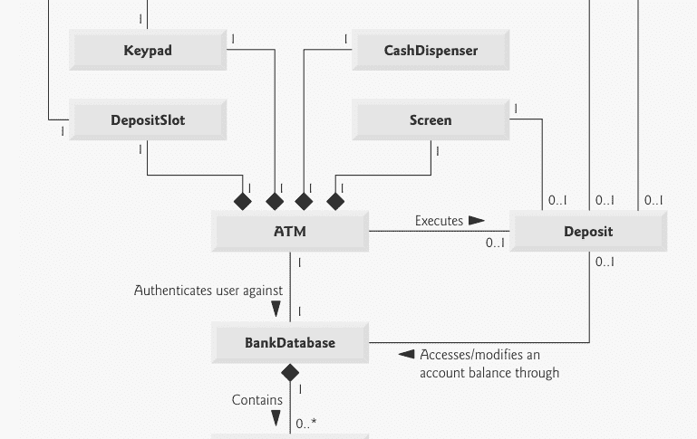

图 3.25 | 包含类 `Deposit` 的 ATM 系统模型类图。

### 3.12 总结

在本章中，你学习了如何创建用户定义的类，以及如何创建和使用这些类的对象。我们声明了类的成员变量以维护每个对象的数据。我们还定义了在该数据上操作的方法。你学习了如何调用对象的成员函数以请求对象提供的服务，以及如何将数据作为参数传递给这些成员函数。我们讨论了成员函数的局部变量与类的成员变量之间的区别。我们还展示了如何使用构造函数为对象的数据成员指定初始值。你学习了如何将类的接口与其实现分离以促进良好的软件工程。我们展示了一张图表，显示类实现程序员和客户端代码程序员在编译他们编写的代码时需要的文件。我们演示了如何使用 `set` 函数来验证对象的数据并确保对象保持一致状态。此外，UML 类图被用来建模类及其构造函数、成员函数和数据成员。在下一章中，我们开始介绍控制语句，它指定函数的操作执行的顺序。

## 4 控制语句：第 1 部分

> Let's all move one place on.

> —Lewis Carroll


> The wheel is come full circle.
> —William Shakespeare
> How many apples fell on
> Newton's head before he took
> the hint!
> —Robert Frost
> All the evolution we know of
> proceeds from the vague to
> the definite.
> —Charles Sanders Peirce

## OBJECTIVES

在本章中你将学习：

- 使用 `if` 和 `if...else` 选择语句在备选操作中进行选择。
- 使用 `while` 重复语句重复执行程序中的语句。
- 计数控制重复和哨兵控制重复。
- 使用增量、减量和赋值运算符。

## 4.1 引言

在本章中，我们介绍 C++ 的 `if`、`if...else` 和 `while` 语句，这三者是允许你指定成员函数执行其任务所需逻辑的构建块之一。我们在本章（以及第 5 章和第 7 章）中用一部分内容进一步开发第 3 章中介绍的 `GradeBook` 类。特别是，我们向 `GradeBook` 类添加一个成员函数，该函数使用控制语句计算一组学生成绩的平均值。另一个示例演示了如何以额外的方式组合控制语句来解决类似问题。我们介绍 C++ 的赋值运算符，并探讨 C++ 的增量和减量运算符。这些额外的运算符缩短并简化了许多程序语句。

## 4.2 控制结构

Böhm 和 Jacopini 的研究表明，所有程序都可以用仅三种控制结构来编写，即顺序结构、选择结构和重复结构。术语“控制结构”来自计算机科学领域。当我们介绍 C++ 对控制结构的实现时，我们将按照 C++ 标准文档² 的术语将其称为“控制语句”。

### C++ 中的顺序结构

顺序结构是 C++ 内置的。除非另有指示，否则 C++ 语句按其编写的顺序一个接一个执行——即按顺序执行。图 4.1 的统一建模语言（UML）活动图说明了典型的顺序结构，其中两个计算按顺序执行。C++ 允许我们在顺序结构中拥有任意多的操作。正如我们很快会看到的，在可以放置单个操作的地方，我们可以按顺序放置多个操作。

1. Böhm, C., and G. Jacopini, “Flow Diagrams, Turing Machines, and Languages with Only Two Formation Rules,” *Communications of the ACM*, Vol. 9, No. 5, May 1966, pp. 366–371.
2. 该文档更具体地称为 INCITS/ISO/IEC 14882-2003 *Programming languages—C++*，可在以下网址付费下载：`webstore.ansi.org`。

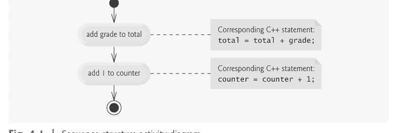

**图4.1** | 顺序结构活动图。

在此图中，两条语句涉及将成绩加到总分变量上，以及将计数器变量加1。此类语句可能出现在对学生若干成绩求平均值的程序中。要计算平均值，需要将成绩总和除以成绩个数。计数器变量用于跟踪被平均的数值个数。你将在4.6节的程序中看到类似的语句。

活动图是UML的一部分。活动图对软件系统某一部分的工作流（也称为活动）进行建模。此类工作流可能包含算法的某一部分，例如图4.1中的顺序结构。活动图由专用符号组成，如动作状态符号（左右两侧替换为向外弯曲弧线的矩形）、菱形和小圆圈；这些符号通过转换箭头连接，转换箭头表示活动的流向。活动图帮助你开发和表示算法。如你将看到的，活动图清晰地展示了控制结构如何运作。

考虑图4.1的顺序结构活动图。它包含两个表示要执行动作的动作状态。每个动作状态包含一个动作表达式——例如“将成绩加到总分”或“计数器加1”——该表达式指定要执行的特定动作。其他动作可能包括计算或输入/输出操作。活动图中的箭头称为转换箭头。这些箭头表示转换，指明动作状态所表示的动作发生的顺序——实现图4.1活动图所示活动的程序首先将成绩加到总分，然后将计数器加1。

位于活动图顶部的实心圆表示活动的初始状态——程序执行所建模活动之前工作流的起点。活动图底部出现的带空心圆环绕的实心圆表示最终状态——程序执行其活动之后工作流的终点。

图4.1还包括右上角折叠的矩形。在UML中这些称为注释。注释是描述图中符号用途的解释性说明。注释可用于任何UML图，而不仅是活动图。图4.1使用UML注释来显示与活动图中每个动作状态相关联的C++代码。虚线将每条注释与注释所描述的元素连接起来。活动图通常不显示实现活动的C++代码。我们在此使用注释是为了说明该图如何与C++代码相关联。有关UML的更多信息，请参阅我们可选的案例研究，该案例研究出现在第1–7章、第9章和第13章末尾的软件工程案例研究部分，或访问`www.uml.org`。

### C++中的选择语句

C++提供三种类型的选择语句（本章和第5章讨论）。`if`选择语句在条件（谓词）为真时执行（选择）一个动作，在条件为假时跳过该动作。`if...else`选择语句在条件为真时执行一个动作，在条件为假时执行另一个不同的动作。`switch`选择语句（第5章）根据整数表达式的值执行许多不同动作之一。

`if`选择语句是*单选择语句*，因为它选择或忽略单个动作（或者，我们很快会看到，单个动作组）。`if...else`语句被称为*双选择语句*，因为它在两个不同动作（或动作组）之间进行选择。`switch`选择语句被称为*多选择语句*，因为它在许多不同动作（或动作组）中进行选择。

### C++中的重复语句

C++提供三种类型的重复语句，使程序能够在条件保持为真时重复执行语句。重复语句是*while*、*do...while*和*for*语句。（第5章介绍`do...while`和`for`语句。）`while`和`for`语句执行其主体中的动作（或动作组）零次或多次——如果循环继续条件最初为假，则动作（或动作组）不会执行。`do...while`语句至少执行其主体中的动作（或动作组）一次。

`if`、`else`、`switch`、`while`、`do`和`for`每个词都是C++关键字。这些词被C++编程语言保留用于实现各种功能，例如C++的控制语句。关键字不得用作标识符，例如变量名。图4.2提供了C++关键字的完整列表。

> **常见编程错误4.1**
> 使用关键字作为标识符是语法错误。

#### C++关键字

*C和C++编程语言共有的关键字*

| **auto** | **break** | **case** | **char** | **const** |
| **continue** | **default** | **do** | **double** | **else** |
| **enum** | **extern** | **float** | **for** | **goto** |
| **if** | **int** | **long** | **register** | **return** |
| **short** | **signed** | **sizeof** | **static** | **struct** |
| **switch** | **typedef** | **union** | **unsigned** | **void** |
| **volatile** | **while** |   |   |   |

**图4.2** | C++关键字。（第1部分，共2部分。）

**仅C++关键字**

| and | and_eq | asm | bitand | bitor |
| bool | catch | class | compl | const_cast |
| delete | dynamic_cast | explicit | export | false |
| friend | inline | mutable | namespace | new |
| not | not_eq | operator | or | or_eq |
| private | protected | public | reinterpret_cast | static_cast |
| template | this | throw | true | try |
| typeid | typename | using | virtual | wchar_t |
| xor | xor_eq |   |   |   |

**图4.2** | C++关键字。（第2部分，共2部分。）

> **常见编程错误4.2**
> 用任何大写字母拼写关键字都是语法错误。C++的所有关键字仅包含小写字母。

### C++控制语句小结

C++只有三种控制结构，从现在起我们称之为控制语句：顺序语句、选择语句（三种类型——`if`、`if...else`和`switch`）和重复语句（三种类型——`while`、`for`和`do...while`）。与图4.1的顺序语句一样，我们可以将每个控制语句建模为活动图。每个图都包含一个初始状态和一个最终状态，分别表示控制语句的入口点和出口点。这些单入口/单出口的控制语句通过将一个的出口点连接到下一个的入口点来相互连接。我们称之为控制语句堆叠。连接控制语句只有另一种方式——称为控制语句嵌套，即一个控制语句包含在另一个控制语句内部。

> **软件工程观察4.1**
> 我们将构建的任何C++程序都可以仅由七种不同类型的控制语句（顺序、`if`、`if...else`、`switch`、`while`、`do...while`和`for`）以仅两种方式（控制语句堆叠和控制语句嵌套）组合而成。这就是简洁性的本质。

## 4.3 if选择语句

程序使用选择语句在备选行动方案中进行选择。例如，假设考试及格分数为60。语句

```cpp
if ( grade >= 60 )
    cout << "Passed";
```

确定条件 `grade >= 60` 为真还是为假。如果为真，则打印“Passed”，并执行顺序中的下一条语句。如果条件为假，则忽略打印，并执行顺序中的下一条语句。注意此选择语句的第二行是缩进的。这种缩进是可选的，但建议使用。

### 良好编程实践 4.1

对 `if...else` 语句的两个主体语句进行缩进。

图4.4演示了 `if...else` 语句中的控制流。再次注意，（除了初始状态、转换箭头和最终状态之外）活动图中仅有的其他符号表示动作状态和决策。

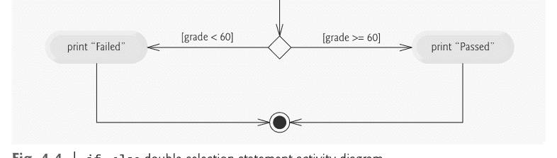

图4.4 | `if...else` 双选择语句活动图。

### 条件运算符 (?:)

C++ 提供了条件运算符 (`?`)，它与 `if...else` 语句密切相关。条件运算符是 C++ 中唯一的三元运算符——它接受三个操作数。操作数与条件运算符一起构成条件表达式。第一个操作数是条件，第二个操作数是条件为真时整个条件表达式的值，第三个操作数是条件为假时整个条件表达式的值。例如，语句

```
cout << ( grade >= 60 ? "Passed" : "Failed" );
```

包含一个条件表达式 `grade >= 60 ? "Passed" : "Failed"`，当条件 `grade >= 60` 为真时，其值为 `"Passed"`；当条件为假时，其值为 `"Failed"`。因此，使用条件运算符的语句在本质上与前面的 `if...else` 语句执行相同的操作。我们稍后将看到，条件运算符的优先级较低，因此前面的表达式中的括号是必需的。

### 错误预防提示 4.1

为避免优先级问题（并保持清晰），请将条件表达式（出现在更大表达式中时）放在括号内。

条件表达式中的值也可以是待执行的动作。例如，下面的条件表达式也会打印 `"Passed"` 或 `"Failed"`：

```
grade >= 60 ? cout << "Passed" : cout << "Failed";
```

上面的条件表达式可理解为：“如果 `grade` 大于或等于 60，则 `cout << "Passed"`；否则，`cout << "Failed"`。” 这也与前面的 `if...else` 语句类似。条件表达式可以出现在一些 `if...else` 语句无法出现的上下文中。

### 嵌套 if...else 语句

嵌套 `if...else` 语句通过将 `if...else` 选择语句放置在其他的 `if...else` 选择语句内部来测试多种情况。例如，下面的 `if...else` 语句为大于或等于 90 分的考试成绩打印 A，为 80 到 89 分打印 B，为 70 到 79 分打印 C，为 60 到 69 分打印 D，为所有其他分数打印 F：

```
if ( studentGrade >= 90 ) // 90 and above gets "A"
    cout << "A";
else
    if ( studentGrade >= 80 ) // 80-89 gets "B"
        cout << "B";
    else
        if ( studentGrade >= 70 ) // 70-79 gets "C"
            cout << "C";
        else
            if ( studentGrade >= 60 ) // 60-69 gets "D"
                cout << "D";
            else // less than 60 gets "F"
                cout << "F";
```

如果 `studentGrade` 大于或等于 90，前四个条件都为真，但只有第一个测试之后的输出语句会执行。在该语句执行之后，程序会跳过“最外层” `if...else` 语句的 `else` 部分。大多数 C++ 程序员更倾向于将前面的 `if...else` 语句写成：

```
if ( studentGrade >= 90 ) // 90 and above gets "A"
    cout << "A";
else if ( studentGrade >= 80 ) // 80-89 gets "B"
    cout << "B";
else if ( studentGrade >= 70 ) // 70-79 gets "C"
    cout << "C";
else if ( studentGrade >= 60 ) // 60-69 gets "D"
    cout << "D";
else // less than 60 gets "F"
    cout << "F";
```

这两种形式除了空格和缩进之外完全相同，编译器会忽略这些空格和缩进。后一种形式很流行，因为它避免了代码向右深度缩进，深度缩进可能会使一行剩余空间不足，从而强制换行并降低程序可读性。

### 性能提示 4.1

嵌套 `if...else` 语句可以比一系列单选择 `if` 语句执行得快得多，因为在其中一个条件满足后有可能提前退出。

### 性能提示 4.2

在嵌套 `if...else` 语句中，应在嵌套 `if...else` 语句的开头测试更有可能为真的条件。这将使嵌套 `if...else` 语句更早退出，从而比先测试不常发生的情况运行得更快。

### 悬空 else 问题

C++ 编译器总是将 `else` 与紧邻的前一个 `if` 关联，除非通过放置花括号（`{` 和 `}`）来另行指示。这种行为可能会导致所谓的悬空 `else` 问题。例如，

```
if ( x > 5 )
    if ( y > 5 )
        cout << "x and y are > 5";
else
    cout << "x is <= 5";
```

看起来似乎表示，如果 `x` 大于 5，嵌套的 `if` 语句将判断 `y` 是否也大于 5。如果是，则输出 `"x and y are > 5"`。否则，似乎如果 `x` 不大于 5，`if...else` 的 `else` 部分将输出 `"x is <= 5"`。

请注意！这个嵌套的 `if...else` 语句并不会按它表面上看起来的样子执行。编译器实际上将这条语句解释为：

```
if ( x > 5 )
    if ( y > 5 )
        cout << "x and y are > 5";
    else
        cout << "x is <= 5";
```

其中第一个 `if` 的主体是一个嵌套的 `if...else`。外层 `if` 语句测试 `x` 是否大于 5。如果大于，执行将继续测试 `y` 是否也大于 5。如果第二个条件为真，则显示正确的字符串——`"x and y are > 5"`。但是，如果第二个条件为假，则会显示字符串 `"x is <= 5"`，即使我们知道 `x` 大于 5。

为了强制嵌套的 `if...else` 语句按最初的意图执行，我们可以将其编写如下：

```
if ( x > 5 )
{
    if ( y > 5 )
        cout << "x and y are > 5";
}
else
    cout << "x is <= 5";
```

花括号（`{}`）向编译器表明第二个 `if` 语句位于第一个 `if` 的主体中，并且 `else` 与第一个 `if` 关联。

### 块

`if` 选择语句的主体中只期望一条语句。类似地，`if...else` 语句的 `if` 部分和 `else` 部分各自也只期望一条主体语句。要在 `if` 的主体或 `if...else` 的任一部分中包含多条语句，请将这些语句用花括号（`{` 和 `}`）括起来。包含在一对花括号内的一组语句称为复合语句或块。从现在起，我们使用术语“块”。

### 软件工程观察 4.2

在程序中，单个语句可以放置的任何地方，都可以放置一个块。

下面的示例在 `if...else` 语句的 `else` 部分中包含了一个块。

```
if ( studentGrade >= 60 )
    cout << "Passed.\n";
else
{
    cout << "Failed.\n";
    cout << "You must take this course again.\n";
}
```


在这种情况下，如果 `studentGrade` 小于 60，程序将执行 `else` 主体中的两条语句并打印：

```
Failed.
You must take this course again.
```

请注意 `else` 子句中包围这两条语句的花括号。这些花括号很重要。如果没有花括号，语句

```
cout << "You must take this course again.\n";
```

将位于 `if` 的 `else` 部分主体之外，并且无论成绩是否小于 60 都会执行。

## 常见编程错误 4.3

> 忘记用于界定块的一个或两个花括号可能导致程序中的语法错误或逻辑错误。

正如块可以放置在单个语句可以放置的任何地方，也可能完全没有语句——称为空语句（或空语句）。空语句通过在通常放置语句的位置放置一个分号 (`;`) 来表示。

## 常见编程错误 4.4

> 在 `if` 语句的条件后放置分号会导致单选择 `if` 语句出现逻辑错误，并导致双选择 `if...else` 语句出现语法错误（当 `if` 部分包含实际主体语句时）。

## 4.5 `while` 重复语句

重复语句（也称为循环语句或循环）允许你指定程序在某个条件保持为真时重复执行某个操作。

作为 C++ 的 `while` 重复语句的一个示例，考虑一个旨在查找第一个大于 100 的 3 的幂次的程序段。假设整型变量 `product` 已初始化为 3。当下面的 `while` 重复语句执行完成时，`product` 中包含了结果：

```
int product = 3;

while ( product <= 100 )
    product = 3 * product;
```

当 `while` 语句开始执行时，`product` 的值为 3。`while` 语句每次重复都会将 `product` 乘以 3，因此 `product` 依次取值 9、27、81 和 243，……

依次执行。当 `product` 变为 243 时，条件——`product <= 100`——变为 `false`。这终止了重复，因此 `product` 的最终值为 243。此时，程序继续执行 `while` 语句之后的下一条语句。

### 常见编程错误 4.5

> 如果在 `while` 语句的循环体中，没有提供最终使 `while` 中的条件变为 `false` 的操作，通常会导致无限循环，即循环语句永远无法终止。

图4.5 的 UML 活动图说明了与前面 `while` 语句对应的控制流。同样，图中的符号（除初始状态、转换箭头、最终状态和三个注释外）表示一个动作状态和一个决策。该图还引入了 UML 的合并符号，它将两个活动流合并为一个活动流。UML 将合并符号和决策符号都表示为菱形。在此图中，合并符号连接来自初始状态和动作状态的转换，因此两者都流入决策，该决策确定循环是否应开始（或继续）执行。决策符号和合并符号可以通过“传入”和“传出”转换箭头的数量来区分。决策符号有一条指向菱形的转换箭头，并有两条或更多条从菱形指出的转换箭头，以表示从该点可能的转换。此外，每条从决策符号指出的转换箭头旁边都有一个守卫条件。合并符号有两条或更多条指向菱形的转换箭头，且只有一条从菱形指出的转换箭头，表示多个活动流合并后继续活动。请注意，与决策符号不同，合并符号在 C++ 代码中没有对应物。与合并符号关联的任何转换箭头都没有守卫条件。

图4.5 的图清楚地显示了本节前面讨论的 `while` 语句的重复。从动作状态出现的转换箭头指向合并，合并再转换回决策，每次循环时都会测试该决策，直到守卫条件 `product > 100` 变为 `true`。然后 `while` 语句退出（到达其最终状态），控制传递给程序中按顺序排列的下一条语句。

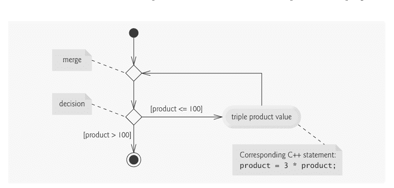

图4.5 | `while` 循环语句的 UML 活动图。

## 4.6 计数器控制循环

本节和第4.7节解决班级平均分问题的两个变体。考虑以下问题描述：

> 一个班有十名学生参加了一次测验。本次测验的成绩（0 到 100 范围内的整数）可供你使用。计算并显示所有学生成绩的总和以及本次测验的班级平均分。

班级平均分等于成绩总和除以学生人数。解决这个问题的程序必须输入每个成绩，计算平均分并打印结果。我们使用计数器控制循环来逐个输入成绩。

本节展示了一个 `GradeBook` 类版本（图4.6–图4.7），它在 C++ 成员函数中实现了班级平均分算法，以及一个应用程序（图4.8），该程序演示了算法的实际运行。

```cpp
// Fig. 4.6: GradeBook.h
// Definition of class GradeBook that determines a class average.
// Member functions are defined in GradeBook.cpp
#include <string> // program uses C++ standard string class
using std::string;

// GradeBook class definition
class GradeBook
{
public:
    GradeBook( string ); // constructor initializes course name
    void setCourseName( string ); // function to set the course name
    string getCourseName(); // function to retrieve the course name
    void displayMessage(); // display a welcome message
    void determineClassAverage(); // averages grades entered by the user
private:
    string courseName; // course name for this GradeBook
}; // end class GradeBook
```

图4.6 | 使用计数器控制循环的班级平均分问题：`GradeBook` 头文件。

```cpp
// Fig. 4.7: GradeBook.cpp
// Member-function definitions for class GradeBook that solves the
// class average program with counter-controlled repetition.
#include <iostream>
using std::cout;
using std::cin;
using std::endl;

#include "GradeBook.h" // include definition of class GradeBook

// constructor initializes courseName with string supplied as argument
GradeBook::GradeBook( string name )
{
    setCourseName( name ); // validate and store courseName
} // end GradeBook constructor

// function to set the course name;
// ensures that the course name has at most 25 characters
void GradeBook::setCourseName( string name )
{
    if ( name.length() <= 25 ) // if name has 25 or fewer characters
        courseName = name; // store the course name in the object
    else // if name is longer than 25 characters
    { // set courseName to first 25 characters of parameter name
        courseName = name.substr( 0, 25 ); // select first 25 characters
        cout << "Name \"" << name << "\" exceeds maximum length (25).\n"
            << "Limiting courseName to first 25 characters.\n" << endl;
    } // end if...else
} // end function setCourseName

// function to retrieve the course name
string GradeBook::getCourseName()
{
    return courseName;
} // end function getCourseName

// display a welcome message to the GradeBook user
void GradeBook::displayMessage()
{
    cout << "Welcome to the grade book for\n" << getCourseName() << "!\n"
        << endl;
} // end function displayMessage

// determine class average based on 10 grades entered by user
void GradeBook::determineClassAverage()
{
    int total; // sum of grades entered by user
    int gradeCounter; // number of the grade to be entered next
    int grade; // grade value entered by user
    int average; // average of grades

    // initialization phase
    total = 0; // initialize total
    gradeCounter = 1; // initialize loop counter

    // processing phase
    while ( gradeCounter <= 10 ) // loop 10 times
    {
        cout << "Enter grade: "; // prompt for input
        cin >> grade; // input next grade
        total = total + grade; // add grade to total
        gradeCounter = gradeCounter + 1; // increment counter by 1
    } // end while
```

图4.7 | 使用计数器控制循环的班级平均分问题：`GradeBook` 源代码文件。

第59行显示提示信息 `"Enter grade: "`。第60行读取用户输入的成绩并将其赋给变量 `grade`。第61行将用户输入的新成绩加到 `total` 上，并将结果赋给 `total`，从而替换其先前的值。

第62行将 `gradeCounter` 加 1，以表示程序已处理一个成绩并准备输入用户的下一个成绩。递增 `gradeCounter` 最终会使 `gradeCounter` 超过 10。此时，`while` 循环终止，因为其条件（第57行）变为 `false`。

当循环终止时，第66行执行平均分计算并将结果赋给变量 `average`。第69行显示文本 `"Total of all 10 grades is "`，后面跟变量 `total` 的值。第70行接着显示文本 `"Class average is "`，后面跟变量 `average` 的值。然后，成员函数 `determineClassAverage()` 将控制权返回给调用函数（即图4.8中的 `main()`）。

### 演示 `GradeBook` 类

图4.8 包含此应用程序的 `main()` 函数，该函数创建一个 `GradeBook` 类对象并演示其功能。图4.8 的第9行创建一个名为 `myGradeBook` 的新 `GradeBook` 对象。第9行中的字符串被传递给 `GradeBook` 构造函数（图4.7 的第12–15行）。图4.8 的第11行调用 `myGradeBook` 的 `displayMessage()` 成员函数，向用户显示欢迎消息。第12行接着调用 `myGradeBook` 的 `determineClassAverage()` 成员函数，允许用户输入10个成绩，然后该成员函数计算并打印平均分。

```cpp
// Fig. 4.8: fig04_08.cpp
// Create GradeBook object and invoke its determineClassAverage function.
#include "GradeBook.h" // include definition of class GradeBook

int main()
{
    // create GradeBook object myGradeBook and
    // pass course name to constructor
    GradeBook myGradeBook( "CS101 C++ Programming" );

    myGradeBook.displayMessage(); // display welcome message
    myGradeBook.determineClassAverage(); // find average of 10 grades
    return 0; // indicate successful termination
} // end main
```

```
Welcome to the grade book for
CS101 C++ Programming

Enter grade: 67
Enter grade: 78
Enter grade: 89
Enter grade: 67
Enter grade: 87
```

图4.8 | 使用计数器控制循环的班级平均分问题：创建一个 `GradeBook` 类对象（图4.6–图4.7）并调用其 `determineClassAverage()` 函数。（第1部分，共2部分。）

```
Enter grade: 98
Enter grade: 93
Enter grade: 85
Enter grade: 82
Enter grade: 100

Total of all 10 grades is 846
Class average is 84
```

图4.8 | 使用计数器控制循环的班级平均分问题：创建 `GradeBook` 类的对象（图4.6–图4.7）并调用其 `determineClassAverage()` 函数。（第2部分，共2部分。）

## 关于整数除法与截断的说明

成员函数 `determineClassAverage()` 响应图4.8中第12行的函数调用所执行的平均值计算产生了一个整数结果。程序的输出表明，示例执行中成绩值的总和为846，除以10应得到84.6——一个带小数点的数字。然而，`total / 10`（图4.7的第66行）的计算结果是整数84，因为 `total` 和10都是整数。两个整数相除会进行整数除法——计算中的任何小数部分都会丢失（即被截断）。我们将在下一节看到如何从平均值计算中获得包含小数点的结果。

### 常见编程错误 4.6

> 假设整数除法会四舍五入（而不是截断）可能导致错误的结果。例如，7 ÷ 4 在常规算术中结果为1.75，在整数算术中被截断为1，而不是四舍五入为2。

在图4.7中，如果第66行使用 `gradeCounter` 而不是10进行计算，该程序的输出将显示错误的值76。这是因为在 `while` 语句的最后一次迭代中，`gradeCounter` 在第62行被递增到了11。

## 4.7 哨兵控制循环

让我们推广班级平均分问题。考虑以下问题：

> 开发一个班级平均分程序，每次运行时处理任意数量学生的成绩。

在之前的班级平均分示例中，问题陈述指定了学生人数，因此成绩数量（10）是预先已知的。在本例中，没有说明用户在程序执行期间将输入多少个成绩。程序必须处理任意数量的成绩。程序如何确定何时停止输入成绩？它如何知道何时计算并打印班级平均分？

解决此问题的一种方法是使用一个称为哨兵值（也称为信号值、哑值或标志值）的特殊值来表示“数据输入结束”。用户输入成绩，直到所有合法成绩都已输入。然后用户输入哨兵值以表示最后一个成绩已输入。

显然，必须选择哨兵值，使其不能与可接受的输入值混淆。测验成绩通常是非负整数，因此`-1`是一个


```
9
10 #include <iomanip> // parameterized stream manipulators
11 using std::setprecision; // sets numeric output precision
12
13 // include definition of class GradeBook from GradeBook.h
14 #include "GradeBook.h"
15
16 // constructor initializes courseName with string supplied as argument
17 GradeBook::GradeBook( string name )
18 {
19     setCourseName( name ); // validate and store courseName
20 } // end GradeBook constructor
21
22 // function to set the course name;
23 // ensures that the course name has at most 25 characters
24 void GradeBook::setCourseName( string name )
25 {
26     if ( name.length() <= 25 ) // if name has 25 or fewer characters
27         courseName = name; // store the course name in the object
28     else // if name is longer than 25 characters
29     { // set courseName to first 25 characters of parameter name
30         courseName = name.substr( 0, 25 ); // select first 25 characters
31         cout << "Name \"" << name << "\" exceeds maximum length (25).\n"
32             << "Limiting courseName to first 25 characters.\n" << endl;
33     } // end if...else
34 } // end function setCourseName
35
36 // function to retrieve the course name
37 string GradeBook::getCourseName()
38 {
39     return courseName;
40 } // end function getCourseName
41
42 // display a welcome message to the GradeBook user
43 void GradeBook::displayMessage()
44 {
45     cout << "Welcome to the grade book for\n" << getCourseName() << "!\n"
46         << endl;
47 } // end function displayMessage
48
49 // determine class average based on 10 grades entered by user
50 void GradeBook::determineClassAverage()
51 {
52     int total; // sum of grades entered by user
53     int gradeCounter; // number of grades entered
54     int grade; // grade value
55     double average; // number with decimal point for average
56
57     // initialization phase
58     total = 0; // initialize total
59     gradeCounter = 0; // initialize loop counter
```

图4.10 | 使用哨兵控制循环的班级平均分问题：GradeBook源代码文件。（第2部分，共3部分。）

```
60
61   // processing phase
62   // prompt for input and read grade from user
63   cout << "Enter grade or -1 to quit: ";
64   cin >> grade; // input grade or sentinel value
65
66   // loop until sentinel value read from user
67   while ( grade != -1 ) // while grade is not -1
68   {
69     total = total + grade; // add grade to total
70     gradeCounter = gradeCounter + 1; // increment counter
71
72     // prompt for input and read next grade from user
73     cout << "Enter grade or -1 to quit: ";
74     cin >> grade; // input grade or sentinel value
75   } // end while
76
77   // termination phase
78   if ( gradeCounter != 0 ) // if user entered at least one grade...
79   {
80     // calculate average of all grades entered
81     average = static_cast< double >( total ) / gradeCounter;
82
83     // display total and average (with two digits of precision)
84     cout << "\nTotal of all " << gradeCounter << " grades entered is "
85         << total << endl;
86     cout << "Class average is " << setprecision( 2 ) << fixed << average
87         << endl;
88   } // end if
89   else // no grades were entered, so output appropriate message
90     cout << "No grades were entered" << endl;
91 } // end function determineClassAverage
```

图4.10 | 使用哨兵控制循环的班级平均分问题：GradeBook源代码文件。（第3部分，共3部分。）

```
1  // Fig. 4.11: fig04_14.cpp
2  // Create GradeBook object and invoke its determineClassAverage function.
3
4  // include definition of class GradeBook from GradeBook.h
5  #include "GradeBook.h"
6
7  int main()
8  {
9    // create GradeBook object myGradeBook and
10    // pass course name to constructor
11    GradeBook myGradeBook( "CS101 C++ Programming" );
12
```

图4.11 | 使用哨兵控制循环的班级平均分问题：创建GradeBook类的对象（图4.9–图4.10）并调用其determineClassAverage成员函数。（第1部分，共2部分。）

```
13      myGradeBook.displayMessage(); // display welcome message
14      myGradeBook.determineClassAverage(); // find average of 10 grades
15      return 0; // indicate successful termination
16  } // end main
```

```
Welcome to the grade book for
CS101 C++ Programming

Enter grade or -1 to quit: 97
Enter grade or -1 to quit: 88
Enter grade or -1 to quit: 72
Enter grade or -1 to quit: -1

Total of all 3 grades entered is 257
Class average is 85.67
```

图4.11 | 使用哨兵控制循环的班级平均分问题：创建GradeBook类的对象（图4.9–图4.10）并调用其determineClassAverage成员函数。（第2部分，共2部分。）

在本例中，我们看到控制语句可以堆叠。`while`语句（图4.10的第67–75行）之后紧接着是一个`if...else`语句（第78–90行）。该程序中的大部分代码与图4.7中的代码相同，因此我们重点关注新的特性和问题。

图4.10的第55行声明了`double`变量`average`。回想一下，在前面的示例中，我们使用`int`变量来存储班级平均分。在当前示例中使用`double`类型，使我们能够将班级平均分计算的结果存储为浮点数。第59行将变量`gradeCounter`初始化为0，因为尚未输入任何成绩。请记住，该程序使用哨兵控制循环。为了准确记录输入的成绩数量，程序仅在用户输入有效成绩值（即不是哨兵值）并完成对该成绩的处理后，才递增变量`gradeCounter`。最后，注意两个输入语句（第64行和第74行）之前都有一个提示用户输入的输出语句。

### 良好编程实践 4.2

> 为每次键盘输入提示用户。提示应说明输入的形式以及任何特殊的输入值。例如，在哨兵控制循环中，请求数据输入的提示应明确提醒用户哨兵值是什么。

## 浮点数精度与内存需求

`float`类型的变量表示单精度浮点数，在大多数32位系统上具有7位有效数字。`double`类型的变量表示双精度浮点数。它们所需的内存是`float`的两倍，在大多数32位系统上提供15位有效数字——大约是`float`精度的两倍。对于大多数程序所需的值范围，`float`变量应该足够了，但你可以使用`double`来“稳妥起见”。在某些程序中，即使是`double`类型的变量也不够用——这类程序超出了本书的范围。大多数程序员使用`double`类型表示浮点数。事实上，C++将你在程序源代码中键入的所有浮点数（如7.33和0.0975）都视为`double`值

默认情况下。源代码中的此类值称为 *浮点常量*。有关 `float` 和 `double` 的取值范围，请参阅附录 C，基本类型。

## 显式和隐式地在基本类型之间转换

变量 `average` 被声明为 `double` 类型（图 4.10 的第 55 行），以捕获我们计算结果的小数部分。然而，`total` 和 `gradeCounter` 都是整数变量。请回忆，两个整数相除会得到整数除法，其中计算结果的小数部分会被丢失（即 *截断*）。在以下语句中：

```
average = total / gradeCounter;
```

除法计算先执行，因此结果的小数部分在赋值给 `average` 之前就丢失了。要使用整数值执行浮点计算，我们必须创建用于计算的临时浮点数值。C++ 提供了 *一元强制转换运算符* 来完成此任务。第 81 行使用强制转换运算符 `static_cast<double>(total)` 来创建其括号中操作数——`total` 的 *临时* 浮点副本。以这种方式使用强制转换运算符称为 *显式转换*。存储在 `total` 中的值仍然是整数。

现在计算由一个浮点值（`total` 的临时 `double` 版本）除以整数 `gradeCounter` 组成。C++ 编译器只知道如何计算操作数数据类型相同的情况下的表达式。为了确保操作数是相同类型，编译器会对选定的操作数执行称为 *提升*（也称为 *隐式转换*）的操作。例如，在包含 `int` 和 `double` 数据类型值的表达式中，C++ 会将 `int` 操作数 *提升* 为 `double` 值。在我们的示例中，我们将 `total` 视为 `double`（通过使用一元强制转换运算符），因此编译器将 `gradeCounter` 提升为 `double`，从而允许执行计算——浮点除法的结果被赋给 `average`。在第 6 章，函数与递归简介中，我们将讨论所有基本数据类型及其提升顺序。

> **常见编程错误 4.7**
>
> 强制转换运算符可用于在基本数值类型之间转换，例如 `int` 和 `double`，以及在相关类类型之间转换（我们在第 13 章，面向对象编程：多态性中讨论）。转换到错误的类型可能会导致编译错误或运行时错误。

> **常见编程错误 4.8**
>
> 尝试除以零通常会导致致命的运行时错误。

> **错误预防提示 4.2**
>
> 当执行除法运算且被除表达式的值可能为零时，应显式测试这种可能性并在程序中适当处理（例如打印错误消息），而不是允许致命错误发生。

强制转换运算符可用于每种数据类型以及类类型。`static_cast` 运算符由关键字 `static_cast` 后跟数据类型名称周围的尖括号（`<` 和 `>`）形成。强制转换运算符是一个 *一元运算符*——只取一个操作数的运算符。在第 2 章中，我们研究了二元算术运算符。C++ 还支持加号 (`+`) 和减号 (`-`) 运算符的一元版本，因此您可以编写诸如 `-7` 或 `+5` 这样的表达式。强制转换运算符的优先级高于其他一元运算符，例如一元 `+` 和一元 `-`。该优先级高于 *乘法运算符* `*, /, %`，低于圆括号。我们在优先级图表中用 `static_cast< type >()` 的记法表示强制转换运算符（例如，参见图 4.18）。

## 浮点数的格式化

图 4.10 中的格式化功能在此简要讨论，并在第 15 章，流输入/输出中深入解释。第 86 行对 `setprecision` 的调用（参数为 2）表示 `double` 变量 `average` 应打印为小数点右侧两位精度的数字（例如，92.37）。此调用称为参数化流操纵符（因为括号中的 2）。使用这些调用的程序必须包含预处理器指令（第 10 行）

```
#include <iomanip>
```

第 11 行指定了在此程序中使用的 `<iomanip>` 头文件中的名称。请注意，`endl` 是一个非参数化流操纵符（因为它后面没有值或表达式的括号），并且不需要 `<iomanip>` 头文件。如果未指定精度，浮点值通常以六位精度输出（即大多数 32 位系统今天的默认精度），尽管我们稍后会看到一个例外。

流操纵符 `fixed`（第 86 行）表示浮点值应以所谓的定点格式输出，而不是科学计数法。科学计数法是将数字显示为 1.0 到 10.0 之间的浮点数乘以 10 的幂的方式。例如，值 3,100.0 将以科学计数法显示为 3.1 × 10³。科学计数法在显示非常大或非常小的数值时很有用。科学计数法的格式化将在第 15 章进一步讨论。另一方面，定点格式化用于强制浮点数显示特定数量的位数。指定定点格式化还强制打印小数点和尾随零，即使该值是整数金额，例如 88.00。没有定点格式化选项，这种值在 C++ 中会打印为 88，没有尾随零，也没有小数点。当程序中使用流操纵符 `fixed` 和 `setprecision` 时，打印的值会四舍五入到 `setprecision` 传递的值指示的小数位数（例如，第 86 行中的值 2），尽管内存中的值保持不变。例如，值 87.946 和 67.543 分别输出为 87.95 和 67.54。请注意，也可以使用流操纵符 `showpoint` 来强制显示小数点。如果指定 `showpoint` 而不使用 `fixed`，则尾随零将不会打印。与 `endl` 一样，流操纵符 `fixed` 和 `showpoint` 是非参数化的，不需要 `<iomanip>` 头文件。两者都可以在头文件 `<iostream>` 中找到。

图 4.10 的第 86 行和第 87 行输出班级平均值。在此示例中，我们将班级平均值四舍五入到最接近的百分位，并以小数点右侧恰好两位数字输出。参数化流操纵符（第 86 行）表示变量 `average` 的值应以小数点右侧两位精度显示——由 `setprecision(2)` 表示。图 4.11 中程序示例执行期间输入的三个成绩总计为 257，得出平均值 85.66666.... 参数化流操纵符 `setprecision` 导致值四舍五入到指定的位数。在此程序中，平均值四舍五入到百分位并显示为 85.67。

## 4.8 嵌套控制语句

在本案例研究中，我们检查控制语句连接的唯一其他结构化方式，即在一个控制语句内嵌套另一个控制语句。

考虑以下问题陈述：

> 一所大学开设了一门课程，为学生准备房地产经纪人州执照考试。去年，完成该课程的十名学生参加了考试。学院想知道其学生在考试中的表现如何。你已被要求编写一个程序来总结结果。你已获得这 10 名学生的名单。在每个姓名旁边写着 1 表示学生通过了考试，或 2 表示学生未通过。
>
> 你的程序应按如下方式分析考试结果：
>
> - 1. 输入每个考试结果（即 1 或 2）。每次程序请求另一个考试结果时，显示提示消息“Enter result”。
> - 2. 统计每种考试结果的数量。


- 3. 显示考试结果摘要，指出通过的学生人数和未通过的学生人数。

- 4. 如果通过考试的学生超过八人，打印消息“Raise tuition。”

仔细阅读问题陈述后，我们做出以下观察：

- 1. 程序必须处理 10 名学生的考试结果。可以使用计数控制循环，因为考试结果的数量事先已知。

- 2. 每个考试结果都是一个数字——要么是 1，要么是 2。每次程序读取考试结果时，程序必须确定该数字是 1 还是 2。

- 3. 使用两个计数器来跟踪考试结果——一个用于统计通过考试的学生人数，一个用于统计未通过考试的学生人数。

- 4. 程序处理完所有结果后，必须决定是否有超过八名学生通过了考试。

### 转换为类分析

图 4.12–图 4.13 中的 C++ 类 `Analysis` 解决了考试结果问题——图 4.14 中出现了两个示例执行。

```
1  // Fig. 4.12: Analysis.h
2  // Definition of class Analysis that analyzes examination results.
3  // Member function is defined in Analysis.cpp
4
5  // Analysis class definition
6  class Analysis
7  {
```

**图 4.12** | 考试成绩问题：分析头文件。 (第 2 部分，共 2 部分。)

```cpp
8  public:
9      void processExamResults(); // process 10 students' examination results
10 }; // end class Analysis
```

**图 4.13** | 考试成绩问题：Analysis 源代码文件中的嵌套控制语句。

```cpp
1  // Fig. 4.13: Analysis.cpp
2  // Member-function definitions for class Analysis that
3  // analyzes examination results.
4  #include <iostream>
5  using std::cout;
6  using std::cin;
7  using std::endl;
8  
9  // include definition of class Analysis from Analysis.h
10 #include "Analysis.h"
11 
12 // process the examination results of 10 students
13 void Analysis::processExamResults()
14 {
15     // initializing variables in declarations
16     int passes = 0; // number of passes
17     int failures = 0; // number of failures
18     int studentCounter = 1; // student counter
19     int result; // one exam result (1 = pass, 2 = fail)
20 
21     // process 10 students using counter-controlled loop
22     while ( studentCounter <= 10 )
23     {
24         // prompt user for input and obtain value from user
25         cout << "Enter result (1 = pass, 2 = fail): ";
26         cin >> result; // input result
27 
28         // if...else nested in while
29         if ( result == 1 )      // if result is 1,
30             passes = passes + 1;    // increment passes;
31         else                    // else result is not 1, so
32             failures = failures + 1; // increment failures
33 
34         // increment studentCounter so loop eventually terminates
35         studentCounter = studentCounter + 1;
36     } // end while
37 
38     // termination phase; display number of passes and failures
39     cout << "Passed " << passes << "\nFailed " << failures << endl;
40 
41     // determine whether more than eight students passed
42     if ( passes > 8 )
43         cout << "Raise tuition " << endl;
44 } // end function processExamResults
```

图 4.13 中第 16–18 行声明了类 `Analysis` 的成员函数 `processExamResults` 用于处理考试成绩的变量。注意，我们利用了 C++ 的一个特性，允许在声明中进行变量初始化（`passes` 初始化为 0，`failures` 初始化为 0 且 `studentCounter` 初始化为 1）。循环程序可能需要在每次重复开始时进行初始化；这种重新初始化通常会通过赋值语句而不是在声明中或将声明移入循环体内部来执行。

`while` 语句（第 22–36 行）循环 10 次。在每次迭代中，循环输入并处理一个考试成绩。注意，用于处理每个成绩的 `if…else` 语句（第 29–32 行）嵌套在 `while` 语句中。如果成绩为 1，`if…else` 语句会递增 `passes`；否则，它假设成绩为 2 并递增 `failures`。第 35 行在第 22 行再次测试循环条件之前递增 `studentCounter`。在输入 10 个值后，循环终止，第 39 行显示通过人数和失败人数。第 42–43 行的 `if` 语句确定是否有超过八名学生通过考试，如果是，则输出消息 "Raise tuition"。

## 演示类 Analysis

图 4.14 创建一个 `Analysis` 对象（第 7 行）并调用该对象的 `processExamResults` 成员函数（第 8 行）以处理用户输入的一组考试成绩。图 4.14 显示了程序两次示例执行的输入和输出。在第一次示例执行结束时，图 4.13 中成员函数 `processExamResults` 的第 42 行的条件为真——超过八名学生通过了考试，因此程序输出一条消息，指出应提高学费。

```cpp
// Fig. 4.14: fig04_14.cpp
// Test program for class Analysis.
#include "Analysis.h" // include definition of class Analysis

int main()
{
    Analysis application; // create Analysis object
    application.processExamResults(); // call function to process results
    return 0; // indicate successful termination
} // end main
```

```text
Enter result (1 = pass, 2 = fail): 1
Enter result (1 = pass, 2 = fail): 1
Enter result (1 = pass, 2 = fail): 1
Enter result (1 = pass, 2 = fail): 1
Enter result (1 = pass, 2 = fail): 2
Enter result (1 = pass, 2 = fail): 1
Enter result (1 = pass, 2 = fail): 1
Enter result (1 = pass, 2 = fail): 1
Enter result (1 = pass, 2 = fail): 1
Enter result (1 = pass, 2 = fail): 1
Passed 9
Failed 1
Raise tuition
```

**图 4.14** | 用于类 `Analysis` 的测试程序。 (第 1 部分，共 2 部分。)

```text
Enter result (1 = pass, 2 = fail): 1
Enter result (1 = pass, 2 = fail): 2
Enter result (1 = pass, 2 = fail): 2
Enter result (1 = pass, 2 = fail): 1
Enter result (1 = pass, 2 = fail): 1
Enter result (1 = pass, 2 = fail): 1
Enter result (1 = pass, 2 = fail): 2
Enter result (1 = pass, 2 = fail): 1
Enter result (1 = pass, 2 = fail): 1
Enter result (1 = pass, 2 = fail): 2
Passed 6
Failed 4
```

**图 4.14** | 用于类 `Analysis` 的测试程序。 (第 2 部分，共 2 部分。)

## 4.9 赋值运算符

C++ 提供了几个 *赋值运算符* 用于缩写赋值表达式。例如，语句

```cpp
c = c + 3;
```

可以用 *加法赋值运算符 +=* 缩写为

```cpp
c += 3;
```

`+=` 运算符将运算符右侧表达式的值加到运算符左侧变量的值上，并将结果存储在运算符左侧的变量中。任何形式为

```
variable = variable operator expression;
```

的语句，其中相同的 *variable* 同时出现在赋值运算符两侧且 *operator* 是二元运算符 `+`、`-`、`*`、 `/` 或 `%`（或我们在正文中稍后讨论的其他运算符）之一，可以写成形式

```
variable operator= expression;
```

因此赋值 `c += 3` 将 3 加到 `c` 上。图 4.15 显示了算术赋值运算符、使用这些运算符的示例表达式以及解释。

| 赋值运算符 | 示例表达式 | 解释 | 赋给 |

|---|---|---|---|

| *假设：`int c = 3, d = 5, e = 4, f = 6, g = 12;`* |  |  |  |

| `+=` | `c += 7` | `c = c + 7` | 10 给 `c` |

| `-=` | `d -= 4` | `d = d - 4` | 1 给 `d` |

| `*=` | `e *= 5` | `e = e * 5` | 20 给 `e` |

| `/=` | `f /= 3` | `f = f / 3` | 2 给 `f` |

| `%=` | `g %= 9` | `g = g % 9` | 3 给 `g` |

**图 4.15** | 算术赋值运算符。

## 4.10 自增和自减运算符

除了算术赋值运算符之外，C++ 还提供了两个一元运算符用于将数值变量的值加 1 或减 1。这些是 unary 自增运算符 `++` 和 unary 自减运算符 `--`，总结于图 4.16。程序可以使用自增运算符 `++` 而不是表达式 `c = c + 1` 或 `c += 1` 来将变量 `c` 的值递增 1。将自增或自减运算符前缀于（置于）变量之前称为前缀自增或前缀自减运算符，分别。 postfix 于（置于）变量之后称为后缀自增或后缀自减运算符，分别。

使用前缀自增（或自减）运算符将变量加（或减）1 称为预自增（或预自减）变量。预自增（或预自减）会使变量递增（递减）1，然后变量的新值在出现的表达式中使用。使用后缀自增（或自减）运算符将变量加（或减）1 称为后自增（或后自减）变量。后自增（或后自减）会使变量的当前值在出现的表达式中使用，然后变量的值递增（递减）1。

图 4.17 演示了前缀自增和后缀自增版本 `++` 自增运算符之间的差异。自减运算符（`--`）的工作方式类似。请注意，此示例不包含类，而只是一个源代码文件，其中函数 `main` 执行应用程序的所有工作。在本章和第 3 章中，您已经看到由一个类（包括该类的头文件和源代码文件）以及另一个测试该类的源代码文件组成的示例。该源代码文件包含函数 `main`，它创建类的对象并调用其成员函数。在此示例中，我们只是想展示 `++` 运算符的机制，因此我们仅使用一个包含函数 `main` 的源代码文件。有时，当试图创建一个可重用的类来演示一个简单概念没有意义时，我们会使用完全包含在单个源代码文件的 `main` 函数中的机械示例。

| 运算符 | 称为 | 示例表达式 | 解释 |

|---|---|---|---|

| `++` | 预自增 | `++a` | 将 `a` 递增 1，然后在 `a` 所在的表达式中使用 `a` 的新值。 |

| `++` | 后自增 | `a++` | 在 `a` 所在的表达式中使用 `a` 的当前值，然后将 `a` 递增 1。 |

| `--` | 预自减 | `--b` | 将 `b` 递减 1，然后在 `b` 所在的表达式中使用 `b` 的新值。 |

| `--` | 后自减 | `b--` | 在 `b` 所在的表达式中使用 `b` 的当前值，然后将 `b` 递减 1。 |

**图 4.16** | 自增和自减运算符。

可以更简洁地使用赋值运算符写成这样：

```
passes += 1;
failures += 1;
studentCounter += 1;
```

使用前缀递增运算符写成这样：

```
++passes;
++failures;
++studentCounter;
```

或者使用后缀递增运算符写成这样：

```
passes++;
failures++;
studentCounter++;
```

注意，当递增（`++`）或递减（`--`）一个变量在一条语句中单独出现时，前缀递增和后缀递增的形式具有相同的效果，前缀递减和后缀递减的形式也具有相同的效果。只有当变量出现在更大的表达式中时，前缀递增和后缀递增才会产生不同的效果（前缀递减和后缀递减同理）。

## 常见编程错误 4.9

> 试图对除可修改变量名或引用以外的表达式使用递增或递减运算符，例如编写 `++(x + 1)`，是一种语法错误。

图 4.18 显示了到目前为止介绍的操作符的优先级和结合性。操作符按优先级从高到低从上到下排列。第二列表示每一优先级级别上操作符的结合性。

| 操作符 | 结合性 | 类型 |

|---|---|---|

| `::` | 从左到右 | 作用域解析 |

| `()` | 从左到右 | 圆括号 |

| `++` `--` `static_cast< type >()` | 从左到右 | 一元（后缀） |

| `++` `--` `+` `-` | 从右到左 | 一元（前缀） |

| `*` `/` `%` | 从左到右 | 乘法 |

| `+` `-` | 从左到右 | 加法 |

| `<<` `>>` | 从左到右 | 插入/提取 |

| `<` `<=` `>` `>=` | 从左到右 | 关系 |

| `==` `!=` | 从左到右 | 相等 |

| `?:` | 从右到左 | 条件 |

| `=` `+=` `-=` `*=` `/=` `%=` | 从右到左 | 赋值 |

图 4.18 | 到目前为止文本中遇到的操作符优先级。

注意条件运算符（`?:`）、一元运算符前缀递增（`++`）、前缀递减（`--`）、正号（`+`）和负号（`-`），以及赋值运算符 `=`、`+=`、`-=`、`*=`、`/=` 和 `%=` 都是从右到左结合。图 4.18 操作符优先级表中的所有其他操作符都是从左到右结合。第三列列出了各类操作符组的名称。

## 4.11 （可选）软件工程案例研究：确定 ATM 系统中的类属性

在 3.11 节中，我们开始了 ATM 系统面向对象设计（OOD）的第一阶段——分析需求规格说明并识别实现系统所需的类。我们列出了需求规格说明中的名词和名词短语，并为每一个在 ATM 系统中扮演重要角色的名词确定了一个单独的类。然后我们在 UML 类图（图 3.23）中对这些类及其关系进行了建模。类具有属性（数据）和操作（行为）。类的属性在 C++ 程序中作为数据成员实现，类的操作作为成员函数实现。在本节中，我们确定 ATM 系统中所需的许多属性。在第 5 章中，我们将研究这些属性如何表示对象的状态。在第 6 章中，我们确定类的操作。

### 识别属性

考虑一些真实世界对象的属性：人的属性包括身高、体重，以及这个人是左撇子、右撇子还是双利手。收音机的属性包括电台设置、音量设置以及 AM 或 FM 设置。汽车的属性包括车速表和里程表读数、油箱中的油量以及当前挡位。个人计算机的属性包括制造商（如 Dell、Sun、Apple 或 IBM）、屏幕类型（如 LCD 或 CRT）、主存大小和硬盘大小。


我们可以通过查找需求规格说明中的描述性词语和短语来识别系统中类的许多属性。对于找到的每一个在 `ATM` 系统中起重要作用的词语或短语，我们创建一个属性并将其分配给 3.11 节中识别的一个或多个类。我们还会创建属性来表示类可能需要的任何附加数据，因为在设计过程中这些需求会变得明显。

图 4.19 列出了需求规格说明中描述每个类的词语或短语。我们通过阅读需求规格说明并识别任何涉及系统类特征的词语或短语来形成这个列表。例如，需求规格说明描述了获取“取款金额”的步骤，因此我们在 `Withdrawal` 类旁边列出“金额”。

| 类 | 描述性词语和短语 |
| --- | --- |
| `ATM` | 用户已通过身份验证 |
| `BalanceInquiry` | 账号 |
| `Withdrawal` | 账号<br>金额 |

图 4.19 | 来自 `ATM` 需求规格说明的描述性词语和短语。（第 1 部分，共 2 部分）

| 类 | 描述性词语和短语 |
| --- | --- |
| `Deposit` | 账号<br>金额 |
| `BankDatabase` | [无描述性词语或短语] |
| `Account` | 账号<br>PIN<br>余额 |
| `Screen` | [无描述性词语或短语] |
| `Keypad` | [无描述性词语或短语] |
| `CashDispenser` | 每天开始时装载 500 张 20 美元纸币 |
| `DepositSlot` | [无描述性词语或短语] |

图 4.19 | 来自 `ATM` 需求规格说明的描述性词语和短语。（第 2 部分，共 2 部分）

图 4.19 引导我们为 `ATM` 类创建一个属性。`ATM` 类维护有关 `ATM` 状态的信息。短语“用户已通过身份验证”描述了 `ATM` 的一种状态（我们将在 5.10 节介绍状态），因此我们将 `userAuthenticated` 作为布尔属性（即值为 `true` 或 `false` 的属性）包含进来。UML 布尔类型等同于 C++ 中的 `bool` 类型。该属性指示 `ATM` 是否已成功认证当前用户——要让系统允许用户执行交易并访问账户信息，`userAuthenticated` 必须为 `true`。该属性有助于确保系统中数据的安全。

类 `BalanceInquiry`、`Withdrawal` 和 `Deposit` 共享一个属性。每笔交易都涉及一个“账号”，该账号对应于执行交易的用户的账户。我们为每个交易类分配一个整数属性 `accountNumber`，以标识该类对象所适用的账户。

需求规格说明中的描述性词语和短语也表明了每个交易类所需属性的一些差异。需求规格说明指出，要取出现金或存入资金，用户必须分别输入要取出或存入的特定“金额”。因此，我们为 `Withdrawal` 和 `Deposit` 类分配一个属性 `amount` 来存储用户提供的值。与取款和存款相关的金额是这些交易的定义特征，是系统执行交易所需的。然而，`BalanceInquiry` 类执行其任务不需要额外数据——它只需要一个账号来指示应检索余额的账户。

类 `Account` 有几个属性。需求规格说明指出，每个银行账户都有一个“账号”和“PIN”，系统使用它们来识别账户和验证用户身份。我们为 `Account` 类分配两个整数属性：`accountNumber` 和 `pin`。需求规格说明还指定账户维护账户中金额的“余额”，并且用户存入的资金在银行验证存款信封中的现金金额以及信封中的任何支票结清之前，不能用于取款。然而，账户仍必须记录用户存入的金额。因此，我们决定账户应使用两个 UML `Double` 类型的属性来表示余额：`availableBalance` 和 `totalBalance`。属性 `availableBalance` 跟踪用户可以从账户中取出的金额。属性 `totalBalance` 指用户“已存入”的总金额（即可用金额加上等待验证或结清的金额）。例如，假设 `ATM` 用户向一个空账户存入 50.00 美元。`totalBalance` 属性将增加到 50.00 美元以记录存款，但 `availableBalance` 将保持在 0 美元。[注意：我们假设银行在 `ATM` 交易发生后不久更新 `Account` 的 `availableBalance` 属性，以响应确认在存款信封中发现了价值 50 美元的现金或支票。我们假设此更新是通过银行员工使用某种非 `ATM` 的银行软件执行的交易完成的。因此，我们在案例研究中不讨论这笔交易。]

类 `CashDispenser` 有一个属性。需求规格说明指出，现金出钞机“每天开始时装载 500 张 20 美元纸币。”现金出钞机必须跟踪其包含的纸币数量，以确定手头是否有足够的现金来满足取款请求。我们为 `CashDispenser` 类分配一个整数属性 `count`，其初始值设置为 500。

对于工业界的实际问题，无法保证需求规格说明足够丰富和精确，使面向对象系统设计者能够确定所有属性甚至所有类。随着设计过程的推进，对额外（或更少）类、属性和行为的需求可能会变得明显。随着我们继续推进本案例研究，我们也将不断添加、修改和删除有关系统中类的信息。

### 对属性建模

图 4.20 中的类图列出了我们系统中类的部分属性——图 4.19 中的描述性词语和短语帮助我们识别了这些属性。为简单起见，图 4.20 没有显示类之间的关联——我们在图 3.23 中显示了这些关联。这是系统设计者在设计开发过程中的常见做法。回顾 3.11 节，在 UML 中，类的属性放在类矩形的中间栏中。我们列出每个属性的名称和类型，用冒号（`:`）分隔，在某些情况下后跟等号（`=`）和初始值。

考虑 `ATM` 类的 `userAuthenticated` 属性：

```
userAuthenticated : Boolean = false
```

该属性声明包含关于该属性的三条信息。属性名为 `userAuthenticated`。属性类型为 `Boolean`。在 C++ 中，属性可以由基本类型（如 `bool`、`int` 或 `double`）或类类型表示——如第 3 章所述。我们选择仅在图 4.20 中对基本类型属性建模——稍后我们将讨论这个决定背后的原因。[注意：图 4.20 列出了属性的 UML 数据类型。当我们实现系统时，我们将把 UML 类型 `Boolean`、`Integer` 和 `Double` 分别与 C++ 基本类型 `bool`、`int` 和 `double` 关联。]

我们还可以指示属性的初始值。`ATM` 类中的 `userAuthenticated` 属性的初始值为 `false`。这表明系统最初确实

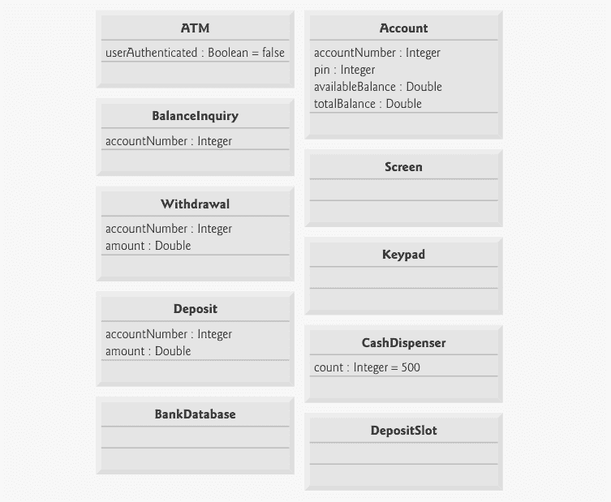

图 4.20 | 带属性的类。

不认为用户已通过身份验证。如果某个属性未指定初始值，则仅显示其名称和类型（用冒号分隔）。例如，类 `BalanceInquiry` 的 `accountNumber` 属性是一个 `Integer`。这里我们没有显示初始值，因为该属性的值是一个我们尚不了解的数字——它将在执行时根据当前 `ATM` 用户输入的账号确定。

图 4.20 未为类 `Screen`、`Keypad` 和 `DepositSlot` 包含任何属性。这些是我们系统中的重要组件，但我们的设计过程迄今尚未揭示它们的任何属性。我们仍可能在剩余的设计阶段或在 C++ 中实现这些类时发现一些属性。对于软件工程的迭代过程而言，这完全正常。

> **软件工程观察 4.3**

> 

> *在设计过程的早期阶段，类通常缺乏属性（和操作）。然而，不应因此消除这些类，因为属性（和操作）可能在设计和实现的后期阶段变得明显。*

请注意，图 4.20 也未为类 `BankDatabase` 包含属性。回顾第 3 章，在 C++ 中，属性可以由基本类型或类类型表示。我们选择仅在图 4.20 的类图中（以及案例研究中类似的类图中）包含基本类型属性。类类型属性更清晰地建模为类与该属性所实例化对象的类之间的关联（特别是组合）。例如，图 3.23 中的类图表明类 `BankDatabase` 参与与零个或多个 `Account` 对象的组合关系。从该组合关系中，我们可以确定在 C++ 中实现 `ATM` 系统时，我们需要为类 `BankDatabase` 创建一个属性来保存零个或多个 `Account` 对象。同样，我们将为类 `ATM` 分配与其实体 `Screen`、`Keypad`、`CashDispenser` 和 `DepositSlot` 的组合关系相对应的属性。如果在图 4.20 中建模这些基于组合的属性将是冗余的，因为图 3.23 中建模的组合已经传达了数据库包含有关零个或多个账户的信息以及 `ATM` 由屏幕、键盘、现金分配器和存款槽组成的事实。软件开发人员通常将这些整体/部分关系建模为组合而不是作为实现关系所需属性。

图 4.20 中的类图为我们模型的结构提供了坚实的基础，但该图并不完整。在第 5.10 节中，我们确定模型中对象的状态和活动，并在第 6.22 节中确定对象执行的操作。随着我们介绍更多 UML 和面向对象设计的内容，我们将继续加强我们模型的结构。

### 软件工程案例研究 自我复习练习

4.1 我们通常通过分析需求规范中的 ______ 来识别系统中类的属性。

- a) 名词和名词短语
- b) 描述性词语和短语
- c) 动词和动词短语
- d) 以上全部。

4.2 以下哪项不是飞机的属性？

- a) 长度
- b) 翼展
- c) 飞行
- d) 座位数

4.3 描述类图图 4.20 中类 `CashDispenser` 的以下属性声明的含义：

```
count : Integer = 500
```

### 软件工程案例研究自我复习练习的答案

4.1 b.

4.2 c. Fly 是飞机的操作或行为，而不是属性。

4.3 这表明 `count` 是一个 `Integer`，其初始值为 500。该属性用于跟踪 `CashDispenser` 在任何给定时间可用的钞票数量。

# 4.12 总结

你学习到只有三种类型的控制结构——顺序、选择和重复——是开发任何算法所必需的。我们演示了 C++ 的两种选择语句——`if` 单选语句和 `if...else` 双选语句

# 5 控制语句：第2部分

## 目标

在本章你将学习：

- 使用 `for` 和 `do...while` 重复语句重复执行程序中的语句。
- 使用 `switch` 选择语句实现多重选择。
- 使用 `break` 和 `continue` 程序控制语句改变控制流。
- 使用逻辑运算符在控制语句中形成复杂的条件表达式。
- 避免混淆相等和赋值运算符的后果。

> 并非所有能计数的东西都重要，并非所有重要的东西都能计数。

> ——阿尔伯特·爱因斯坦

> 谁能控制自己的命运？

> ——威廉·莎士比亚

> 使用过的钥匙总是明亮的。

> ——本杰明·富兰克林

> 智力……是制造人工物体的能力，尤其是制造工具来制造工具。

> ——亨利·伯格森

> 过去的一切优势都以最终结果为依据来评判。

> ——德摩斯梯尼

## 大纲

- 5.1 引言
- 5.2 计数器控制重复的要点
- 5.3 `for` 重复语句
- 5.4 使用 `for` 语句的示例
- 5.5 `do...while` 重复语句
- 5.6 `switch` 多重选择语句
- 5.7 `break` 和 `continue` 语句
- 5.8 逻辑运算符
- 5.9 混淆相等 (`==`) 和赋值 (`=`) 运算符
- 5.10 （可选）软件工程案例研究：在 `ATM` 系统中识别对象的状态和活动
- 5.11 总结

## 5.1 引言

在本章中，我们介绍 C++ 的剩余控制语句。我们在本章和第 4 章中研究的控制语句将帮助我们构建和操作对象。我们继续在第 1 章讨论基本概念以及第 3-4 章的广泛面向对象代码示例的基础上，强调面向对象编程。

在本章中，我们演示了 `for`、`do...while` 和 `switch` 语句。通过使用 `while` 和 `for` 的一系列简短示例，我们探讨了计数器控制重复的要点。我们扩展了第 3-4 章中介绍的 `GradeBook` 类。特别是，我们创建了类 `GradeBook` 的一个版本，该版本使用 `switch` 语句统计用户输入的一组字母等级中的 A、B、C、D 和 F 等级数量。我们介绍了 `break` 和 `continue` 程序控制语句。我们讨论了逻辑运算符，它使你能够在控制语句中使用更强大的条件表达式。我们还研究了混淆相等 (`==`) 和赋值 (`=`) 运算符的常见错误，以及如何避免它。

## 5.2 计数器控制重复的要点

本节使用第 4 章中介绍的 `while` 重复语句来形式化执行计数器控制重复所需的元素。计数器控制重复需要

1. 控制变量（或循环计数器）的名称
2. 控制变量的初始值
3. 测试控制变量最终值的循环继续条件（即是否应继续循环）
4. 每次循环时控制变量的增量（或减量）。

考虑图 5.1 中打印 1 到 10 的数字的简单程序。第 9 行的声明命名控制变量（`counter`），声明其为整数，为其在内存中保留空间并将其设置为初始值 1。需要初始化的声明在效果上是可执行语句。在 C++ 中，更精确地称同时保留内存的声明——如前述声明那样——为定义。因为定义也是声明，所以我们将使用术语“声明”，除非区别很重要。

`counter` 的声明和初始化（第 9 行）也可以通过以下语句完成

```
int counter; // 声明控制变量
counter = 1; // 将控制变量初始化为 1
```

我们使用这两种初始化变量的方法。

第 14 行在每次执行循环体时将循环计数器递增 1。`while` 语句中的循环继续条件（第 11 行）确定控制变量的值是否小于或等于 10（条件为真的最终值）。请注意，当控制变量为 10 时，此 `while` 的主体也会执行。循环在控制变量大于 10 时终止（即 `counter` 变为 11 时）。

图 5.1 可以通过将 `counter` 初始化为 0 并用以下内容替换 `while` 语句来使其更简洁

```
while ( ++counter <= 10 ) // 循环继续条件
    cout << counter << " ";
```

此代码节省了一个语句，因为递增是在 `while` 条件中直接在条件测试之前完成的。此外，代码消除了 `while` 主体周围的大括号，因为 `while` 现在只包含一个语句。以这种方式编码

```
// Fig. 5.1: fig05_01.cpp
// Counter-controlled repetition.
#include <iostream>
using std::cout;
using std::endl;

int main()
{
    int counter = 1; // declare and initialize control variable
    while ( counter <= 10 ) // loop-continuation condition
    {
        cout << counter << " ";
        counter++; // increment control variable by 1
    } // end while

    cout << endl; // output a newline
    return 0; // successful termination
} // end main
```

1 2 3 4 5 6 7 8 9 10

Fig. 5.1 | Counter-controlled repetition.

densed fashion takes some practice and can lead to programs that are more difficult to read, debug, modify and maintain.

### Common Programming Error 5.1

> 浮点值是近似的，因此使用浮点变量控制计数循环可能导致计数器值不精确以及终止测试不准确。

### Error-Prevention Tip 5.1

> 使用整数值控制计数循环。

## 5.3 `for` Repetition Statement

第 5.2 节介绍了计数控制重复的基本概念。`while` 语句可用于实现任何计数控制循环。C++ 还提供了 `for` 重复语句，它在一行代码中指定计数控制重复的细节。为了说明 `for` 的强大功能，让我们重写图 5.1 中的程序。结果显示在图 5.2 中。

当 `for` 语句（第 11–12 行）开始执行时，控制变量 `counter` 被声明并初始化为 1。然后，检查循环继续条件（第 11 行分号之间）`counter <= 10`。`counter` 的初始值为 1，因此条件满足，主体语句（第 12 行）打印 `counter` 的值，即 1。然后，表达式 `counter++` 增加控制变量 `counter`，循环再次开始进行循环继续测试。控制变量现在等于 2，因此最终值未被超过，程序再次执行主体语句。此过程一直持续到循环体执行 10 次且控制变量 `counter` 增加到 11 为止——这会导致循环继续测试失败并终止重复。程序继续执行 `for` 语句之后的第一个语句（在本例中为第 14 行的输出语句）。

```
1  // Fig. 5.2: fig05_02.cpp
2  // Counter-controlled repetition with the for statement.
3  #include <iostream>
4  using std::cout;
5  using std::endl;
6
7  int main()
8  {
9    // for statement header includes initialization,
10   // loop-continuation condition and increment.
11   for ( int counter = 1; counter <= 10; counter++ )
12     cout << counter << " ";
13
14   cout << endl; // output a newline
15   return 0; // indicate successful termination
16 } // end main
```


# 1 2 3 4 5 6 7 8 9 10

Fig. 5.2 | Counter-controlled repetition with the `for` statement.

## for Statement Header Components

图 5.3 更详细地展示了图 5.2 中`for`语句头（第 11 行）。请注意，`for`语句头“包办一切”——它指定了使用控制变量进行计数控制重复所需的所有项目。如果`for`的主体中有多个语句，则需要用大括号括起循环体。

请注意，图 5.2 使用了循环继续条件`counter <= 10`。如果你错误地写成`counter < 10`，则循环只会执行 9 次。这是常见的差一错误。

> **Common Programming Error 5.2**
>
> 在`while`或`for`语句的条件中使用不正确的关系运算符或使用循环计数器的不正确的最终值会导致差一错误。

`for`语句的一般形式为

```
for ( initialization; loopContinuationCondition; increment )
    statement
```

其中初始化表达式初始化循环的控制变量，`loopContinuationCondition`确定循环是否应继续执行（该条件通常包含控制变量为真的最终值），而`increment`增加控制变量。在大多数情况下，`for`语句可以用等效的`while`语句表示，如下所示：

```
initialization;

while ( loopContinuationCondition )
{
    statement
    increment;
}
```

对此规则有一个例外，我们将在第 5.7 节中讨论。

如果`for`语句头中的初始化表达式声明了控制变量（即在变量名之前指定了控制变量的类型），则控制变量只能在`for`语句的主体中使用——在`for`语句之外控制变量将未知。这种对控制变量名称的受限使用称为

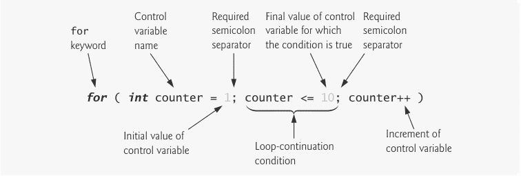

变量的作用域。作用域指定变量可在程序中使用的位置。作用域将在第 6 章《函数与递归简介》中详细讨论。

## Common Programming Error 5.3

> 当`for`语句的控制变量在`for`语句头的初始化部分声明时，在语句主体之后使用控制变量是编译错误。

## Portability Tip 5.1

> 在 C++ 标准中，在`for`语句的初始化部分声明的控制变量的作用域与旧版 C++ 编译器中的作用域不同。在预标准编译器中，控制变量的作用域并不在定义`for`语句主体的块结束时终止；而是在包含`for`语句的块结束时终止。使用预标准 C++ 编译器创建的 C++ 代码在标准兼容编译器上编译时可能会中断。如果你正在使用预标准编译器，并且希望确保你的代码能在标准兼容编译器上运行，可以使用两种防御性编程策略：要么在每个`for`语句中为控制变量声明不同的名称，要么，如果你希望在多个`for`语句中使用相同的控制变量名称，则在第一个`for`语句之前声明控制变量。

正如我们将看到的，初始化和增量表达式可以是逗号分隔的表达式列表。这些表达式中使用的逗号是逗号运算符，它保证表达式列表从左到右求值。逗号运算符是所有 C++ 运算符中优先级最低的。逗号分隔的表达式列表的值和类型是列表中最后一个表达式的值和类型。逗号运算符最常用于`for`语句。其主要应用是让你能够使用多个初始化表达式和/或多个增量表达式。例如，单个`for`语句中可能有多个控制变量，必须对其进行初始化和递增。

## Good Programming Practice 5.1

> 仅在`for`语句的初始化和增量部分放置涉及控制变量的表达式。对其他变量的操纵应出现在循环之前（如果它们应仅执行一次，如初始化语句）或在循环体中（如果它们应每重复一次执行一次，如递增或递减语句）。

`for`语句头中的三个表达式是可选的（但两个分号分隔符是必需的）。如果省略`loopContinuationCondition`，C++ 假定条件为真，从而创建无限循环。可以省略初始化表达式，如果控制变量已在程序中更早初始化。可以省略增量表达式，如果增量由`for`的主体中的语句计算，或者不需要增量。`for`语句中的增量表达式在`for`的主体末尾充当独立语句。因此，表达式

```
counter = counter + 1
counter += 1
++counter
counter++
```

在`for`语句的递增部分中（当其中没有其他代码时）都是等效的。许多程序员更喜欢形式`counter++`，因为`for`循环在循环体执行后才评估增量表达式。后递增形式因此看起来更自然。这里被递增的变量不出现在更大的表达式中，因此预递增和后递增实际上具有相同的效果。

> **Common Programming Error 5.4**
>
> 在`for`头中使用逗号代替两个必需的分号是语法错误。

> **Common Programming Error 5.5**
>
> 在`for`头的右括号后立即放置分号会使该`for`语句的主体成为空语句。这通常是逻辑错误。

`for`语句的初始化、循环继续条件和增量表达式可以包含算术表达式。例如，如果`x = 2`且`y = 10`，并且`x`和`y`在循环体中未被修改，则`for`头

```
for ( int j = x; j <= 4 * x * y; j += y / x )
```

等价于

```
for ( int j = 2; j <= 80; j += 5 )
```

`for`语句的“增量”可以为负数，在这种情况下它实际上是递减，循环实际上向下计数（如第 5.4 节所示）。

如果循环继续条件初始为假，则不会执行`for`语句的主体。相反，执行将继续进行`for`之后的语句。

经常在`for`语句的主体中打印控制变量或在计算中使用它，但这不是必需的。常见的做法是使用控制变量来控制重复，而在`for`语句的主体中从不提及它。

> **Error-Prevention Tip 5.2**
>
> 尽管可以在`for`语句的主体中更改控制变量的值，但应避免这样做，因为这种做法可能导致微妙的逻辑错误。

## for Statement UML Activity Diagram

`for`语句的 UML 活动图与`while`语句（图 4.5）相似。图 5.4 显示了图 5.2 中`for`语句的活动图。该图清楚地表明初始化在循环继续测试第一次被评估之前仅执行一次，并且递增在每次通过循环时在主体语句执行后发生。请注意（除了初始状态、转换箭头、合并、最终状态和几个注释之外），该图仅包含动作状态和一个决策。

## 5.4 Examples Using the for Statement

以下示例展示了在`for`语句中改变控制变量的方法。在每种情况下，我们编写适当的`for`语句头。请注意递减控制变量的循环中关系运算符的变化。

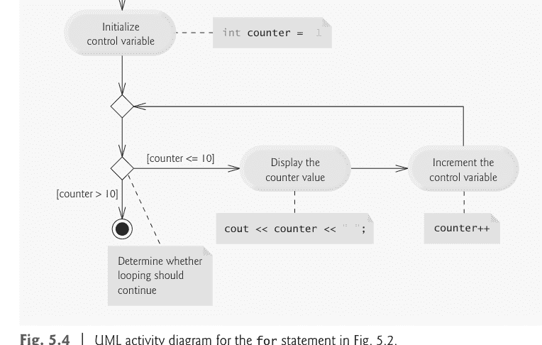

- a) 将控制变量从 1 变到 100，每次递增 1。

  ```
  for ( int i = 1; i <= 100; i++ )
  ```

- b) 将控制变量从 100 变到 1，每次递增 -1（即每次递减 1）。

  ```
  for ( int i = 100; i >= 1; i-- )
  ```

- c) 将控制变量从 7 变到 77，步长为 7。

  ```
  for ( int i = 7; i <= 77; i += 7 )
  ```

- d) 将控制变量从 20 变到 2，步长为 -2。

  ```
  for ( int i = 20; i >= 2; i -= 2 )
  ```

- e) 将控制变量按以下值序列变化：2, 5, 8, 11, 14, 17, 20。

  ```
  for ( int i = 2; i <= 20; i += 3 )
  ```

- f) 将控制变量按以下值序列变化：99, 88, 77, 66, 55, 44, 33, 22, 11, 0。

  ```
  for ( int i = 99; i >= 0; i -= 11 )
  ```

## 常见编程错误 5.6

> 在向下计数的循环的循环继续条件中使用不正确的关系运算符（例如在向下计数到 1 的循环中错误地使用`i <= 1`而不是`i >= 1`）通常是逻辑错误，会导致程序运行时产生不正确的结果。

## 应用：对从 2 到 20 的偶数求和

接下来的两个示例提供了`for`语句的简单应用。图 5.5 中的程序使用`for`语句将从 2 到 20 的偶数相加。循环的每次迭代（第 12–13 行）将控制变量`number`的当前值加到变量`total`上。

请注意，图 5.5 中`for`语句的循环体实际上可以通过逗号运算符合并到`for`头的增量部分中，如下所示：

```
for ( int number = 2; // initialization
      number <= 20; // loop continuation condition
      total += number, number += 2 ) // total and increment
; // empty body
```

## 良好编程实践 5.2

> 虽然`for`之前的语句和`for`循环体中的语句通常可以合并到`for`头中，但这样做可能会使程序更难阅读、维护、修改和调试。

## 良好编程实践 5.3

> 尽可能将控制语句头限制为一行。

```
1  // Fig. 5.5: fig05_05.cpp
2  // Summing integers with the for statement.
3  #include <iostream>
4  using std::cout;
5  using std::endl;
6
7  int main()
8  {
9      int total = 0; // initialize total
10
11     // total even integers from 2 through 20
12     for ( int number = 2; number <= 20; number += 2 )
13         total += number;
14
15     cout << "Sum is " << total << endl; // display results
16     return 0; // successful termination
17  } // end main
```

```
Sum is 110
```

图 5.5 | 使用`for`语句对整数求和。

## 应用：复利计算

下一个示例使用`for`语句计算复利。请考虑以下问题陈述：

某人将 1000.00 美元存入一个年利率为 5% 的储蓄账户。假设所有利息都留在账户中，计算并打印 10 年中每年年底账户中的金额。使用以下公式确定这些金额：

\[a = p(1+r)^n\]

其中

- \(p\) 是原始投资金额（即本金），
- \(r\) 是年利率，
- \(n\) 是年数，
- \(a\) 是第 n 年年底的存款金额。

这个问题涉及一个循环，该循环在资金存续的 10 年中每年执行一次指定的计算。解决方案如图 5.6 所示。

```
// Fig. 5.6: fig05_06.cpp
// Compound interest calculations with for.
#include <iostream>
using std::cout;
using std::endl;
using std::fixed;

#include <iomanip>
using std::setw; // enables program to set a field width
using std::setprecision;

#include <cmath> // standard C++ math library
using std::pow; // enables program to use function pow

int main()
{
   double amount;   // amount on deposit at end of each year
   double principal = 1000.0; // initial amount before interest
   double rate = .05; // interest rate

   // display headers
   cout << "Year" << setw( 21 ) << "Amount on deposit" << endl;

   // set floating-point number format
   cout << fixed << setprecision( 2 );

   // calculate amount on deposit for each of ten years
   for ( int year = 1; year <= 10; year++ )
   {
      // calculate new amount for specified year
      amount = principal * pow( 1.0 + rate, year );

      // display the year and the amount
      cout << setw( 4 ) << year << setw( 21 ) << amount << endl;
   } // end for

   return 0; // indicate successful termination
} // end main
```

**图 5.6** | 使用`for`进行复利计算。（第 1 部分，共 2 部分。）

| 年份 | 存款金额 |
|------|-------------------|
| 1 | 1050.00 |
| 2 | 1102.50 |
| 3 | 1157.63 |
| 4 | 1215.51 |
| 5 | 1276.28 |
| 6 | 1340.10 |
| 7 | 1407.10 |
| 8 | 1477.46 |
| 9 | 1551.33 |
| 10 | 1628.89 |

图 5.6 | 使用`for`进行复利计算。（第 2 部分，共 2 部分。）

`for`语句（第 28–35 行）执行其循环体 10 次，将控制变量从 1 变到 10，每次递增 1。C++ 没有指数运算符，因此我们使用标准库函数`pow`（第 31 行）来实现此目的。函数`pow(x, y)`计算`x`的`y`次幂的值。在此示例中，代数表达式`(1 + r)^n`被写为`pow(1.0 + rate, year)`，其中变量`rate`表示`r`，变量`year`表示`n`。函数`pow`接受两个`double`类型的参数，并返回一个`double`值。

如果不包含头文件`<cmath>`（第 12 行），此程序将无法编译。函数`pow`需要两个`double`参数。请注意，`year`是一个整数。头文件`<cmath>`包含的信息告诉编译器在调用函数之前将`year`的值转换为临时的`double`表示形式。此信息包含在`pow`的函数原型中。第 6 章总结了其他数学库函数。

## 常见编程错误 5.7

> 一般来说，使用标准库函数时忘记包含相应的头文件（例如，在使用了数学库函数的程序中忘记包含`<cmath>`）是一个编译错误。

## 关于使用 float 或 double 类型表示货币金额的告诫

请注意，第 17–19 行声明了`double`变量`amount`、`principal`和`rate`。我们这样做是为了简单起见，因为我们处理的是美元的小数部分，并且需要一种允许其值包含小数点的类型。不幸的是，这可能会带来麻烦。下面简要解释使用`float`或`double`表示美元金额时可能出现的问题（假设使用`setprecision(2)`在打印时指定两位精度）：机器中存储的两个美元金额可能是 14.234（打印为 14.23）和 18.673（打印为 18.67）。当这些金额相加时，内部和为 32.907，打印为 32.91。因此，你的打印输出可能如下所示：

```
14.23
+ 18.67
------
32.91
```

但是，人们将打印出的各个数字相加时会期望得到 32.90！你已经受到警告了！

## 良好编程实践 5.4

> 不要使用`float`或`double`类型的变量进行货币计算。浮点数的不精确性会导致错误，从而产生不正确的货币值。[注意：一些第三方供应商销售可执行精确货币计算的 C++ 类库。]

## 使用流操纵符格式化数值输出

`for`循环之前的第 25 行输出语句和`for`循环中的第 34 行输出语句联合起来，按照参数化流操纵符`setprecision`和`setw`以及非参数化流操纵符`fixed`指定的格式打印变量`year`和`amount`的值。流操纵符`setw(4)`指定下一个输出值应出现在宽度为 4 的字段中——即`cout`打印该值时至少占 4 个字符位置。如果要输出的值宽度小于 4 个字符位置，则默认情况下该值在字段中右对齐。如果要输出的值宽度大于 4 个字符位置，字段宽度会扩展以容纳整个值。若要指示值应左对齐输出，只需输出非参数化流操纵符`left`（位于头文件`<iostream>`中）。输出非参数化流操纵符`right`可恢复右对齐。


输出语句中的其他格式设置表示变量 `amount` 以带小数点的定点值形式打印（在第 25 行使用流操纵符 `fixed` 指定），在 21 个字符位置的字段中右对齐（在第 34 行使用 `setw( 21 )` 指定），小数点右侧有两位精度（在第 25 行使用操纵符 `setprecision( 2 )` 指定）。我们在 `for` 循环之前将流操纵符 `fixed` 和 `setprecision` 应用于输出流（即 `cout`），因为这些格式设置在被更改之前一直有效——此类设置称为粘性设置（sticky settings），无需在每次循环迭代时都应用。但是，使用 `setw` 指定的字段宽度仅适用于下一个输出值。我们将在第 15 章“流输入/输出”中讨论 C++ 强大的输入/输出格式化功能。

请注意，作为 `pow` 函数参数出现的计算 `1.0 + rate` 位于 `for` 语句的循环体内。实际上，这个计算在每次循环迭代中都会产生相同的结果，因此重复执行它是浪费的——它应该在循环之前执行一次。

## 性能提示 5.1

> 避免将值不变的表达式放在循环内——不过，即使你放了，当今许多复杂的优化编译器也会在生成的机器语言代码中自动将这些表达式移到循环外。

## 性能提示 5.2

> 许多编译器包含可提高你编写的代码性能的优化功能，但最好还是一开始就编写良好的代码。

## 5.5 do...while 重复语句

`do...while` 重复语句与 `while` 语句类似。在 `while` 语句中，循环继续条件的测试发生在循环体执行之前的循环开头。`do...while` 语句在循环体执行之后测试循环继续条件；因此，循环体至少执行一次。当 `do...while` 终止时，执行将继续执行 `while` 后面的语句。

`clause.` 请注意，如果 `do...while` 语句的主体中只有一个语句，则不需要使用大括号；然而，大多数程序员会包含大括号以避免 `while` 语句和 `do...while` 语句之间的混淆。例如，

```
while ( condition )
```

通常被视为 `while` 语句的头部。没有用大括号括起单个语句主体的 `do...while` 语句显示为

```
do
    statement
while ( condition );
```

这可能会造成混淆。你可能会错误地将最后一行——`while( condition );`——解释为一个 `while` 语句，其主体为空语句。因此，为了避免混淆，包含一个语句的 `do...while` 通常写成如下形式：

```
do
{
    statement
} while ( condition );
```

## 良好的编程实践 5.5

> 在 `do...while` 语句中始终包含大括号有助于消除 `while` 语句与包含一个语句的 `do...while` 语句之间的歧义。

图 5.7 使用 `do...while` 语句打印数字 1–10。进入 `do...while` 语句后，行 13 输出 `counter` 的值，行 14 增加 `counter`。然后程序在循环底部评估循环继续测试（行 15）。如果条件为真，循环将从 `do...while` 中的第一个主体语句（行 13）继续。如果条件为假，循环终止，程序将继续执行循环后的下一条语句（行 17）。

```
1  // Fig. 5.7: fig05_07.cpp
2  // do...while repetition statement.
3  #include <iostream>
4  using std::cout;
5  using std::endl;
6
7  int main()
8  {
9      int counter = 1; // initialize counter
10
11     do
12     {
13         cout << counter << " "; // display counter
14         counter++; // increment counter
15     } while ( counter <= 10 ); // end do...while
16
17     cout << endl; // output a newline
18     return 0; // indicate successful termination
19  } // end main
```

图 5.7 | `do...while` 重复语句。 （第 1 部分，共 2 部分。）

```
1 2 3 4 5 6 7 8 9 10
```

图 5.7 | `do...while` 重复语句。 （第 2 部分，共 2 部分。）

## do...while 语句 UML 活动图

图 5.8 包含 `do...while` 语句的 UML 活动图。该图清楚地表明，循环继续条件是在循环至少执行一次循环主体动作状态之后才进行评估的。将此活动图与 `while` 语句的活动图（图 4.5）进行比较。再次注意，除了初始状态、转换箭头、合并、最终状态和若干注释之外，该图仅包含动作状态和一个决策。想象一下，你可以获得任意数量的空白 `do...while` 语句 UML 活动图——只要你需要与其它控制语句的活动图堆叠和嵌套即可，以形成算法的结构化实现。你用适合算法的动作表达式和守卫条件填充动作状态和决策符号。

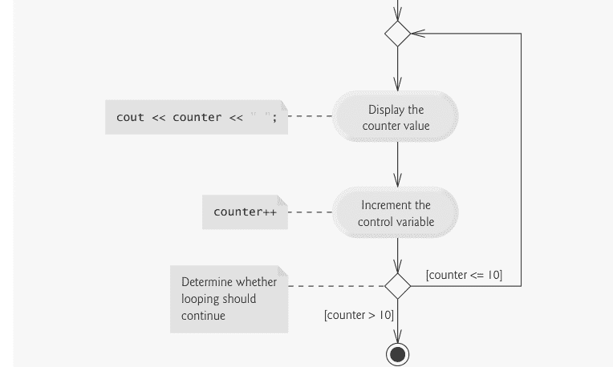

图 5.8 | 图 5.7 的 `do...while` 重复语句的 UML 活动图。

## 5.6 switch 多重选择语句

我们在第 4 章中讨论了 `if` 单一选择语句和 `if...else` 双重选择语句。C++ 提供了 `switch` 多重选择语句，根据变量或表达式的可能取值执行许多不同的操作。每个操作都与常量积分表达式的值相关联，即变量或表达式可能求值到的常量整数值（即字符常量和整数常量的任何组合，求值结果为常量整数值）。

## 使用 switch 语句统计 A、B、C、D 和 F 等级的 GradeBook 类

我们现在介绍 `GradeBook` 类的增强版本，该类在第 3 章中引入，并在第 4 章中进一步开发。新版本类要求用户输入一组字母等级，然后显示获得每个等级的学生人数摘要。该类使用 `switch` 确定输入的每个等级是否为 A、B、C、D 或 F，并增加适当的等级计数器。类 `GradeBook` 定义在图 5.9 中，其成员函数定义出现在图 5.10 中。图 5.11 显示了使用类 `GradeBook` 处理一组等级的主程序的示例输入和输出。

与类定义早期版本一样，`GradeBook` 类定义（图 5.9）包含成员函数 `setCourseName`（行 13）、`getCourseName`（行 14）和 `displayMessage`（行 15）的函数原型，以及类的构造函数（行 12）。类定义还声明了私有数据成员 `courseName`（行 19）。

类 `GradeBook`（图 5.9）现在包含五个额外的私有数据成员（行 20–24）——每个等级类别（即 A、B、C、D 和 F）的计数器变量。类还包含两个额外的公共成员函数——`inputGrades` 和 `displayGradeReport`。成员函数 `inputGrades`（在行 16 声明）使用哨兵控制重复从用户读取任意数量的字母等级，并为每个输入的等级更新适当的等级计数器。成员函数 `displayGradeReport`（在行 17 声明）输出包含获得每个字母等级的学生人数的报告。

```
// Fig. 5.9: GradeBook.h
// Definition of class GradeBook that counts A, B, C, D and F grades.
// Member functions are defined in GradeBook.cpp

#include <string> // program uses C++ standard string class
using std::string;

// GradeBook class definition
class GradeBook
{
public:
   GradeBook( string ); // constructor initializes course name
   void setCourseName( string ); // function to set the course name
   string getCourseName(); // function to retrieve the course name
   void displayMessage(); // display a welcome message
   void inputGrades(); // input arbitrary number of grades from user
   void displayGradeReport(); // display a report based on the grades
private:
   string courseName; // course name for this GradeBook
   int aCount; // count of A grades
   int bCount; // count of B grades
   int cCount; // count of C grades
   int dCount; // count of D grades
   int fCount; // count of F grades
}; // end class GradeBook
```

**图 5.9** | `GradeBook` 类定义。

源代码文件 `GradeBook.cpp`（图 5.10）包含类 `GradeBook` 的成员函数定义。请注意，构造函数中行 16–20 将五个等级计数器初始化为 0——当首次创建 `GradeBook` 对象时，尚未输入任何等级。正如你很快就会看到的，这些计数器在成员函数 `inputGrades` 中随着用户输入等级而递增。成员函数 `setCourseName`、`getCourseName` 和 `displayMessage` 的定义与类 `GradeBook` 早期版本中的定义相同。让我们详细考虑新的 `GradeBook` 成员函数。

```
// Fig. 5.10: GradeBook.cpp
// Member-function definitions for class GradeBook that
// uses a switch statement to count A, B, C, D and F grades.
#include <iostream>
using std::cout;
using std::cin;
using std::endl;

#include "GradeBook.h" // include definition of class GradeBook

// constructor initializes courseName with string supplied as argument;
// initializes counter data members to 0
GradeBook::GradeBook( string name )
{
    setCourseName( name ); // validate and store courseName
    aCount = 0; // initialize count of A grades to 0
    bCount = 0; // initialize count of B grades to 0
    cCount = 0; // initialize count of C grades to 0
    dCount = 0; // initialize count of D grades to 0
    fCount = 0; // initialize count of F grades to 0
} // end GradeBook constructor

// function to set the course name; limits name to 25 or fewer characters
void GradeBook::setCourseName( string name )
{
    if ( name.length() <= 25 ) // if name has 25 or fewer characters
        courseName = name; // store the course name in the object
    else // if name is longer than 25 characters
    { // set courseName to first 25 characters of parameter name
        courseName = name.substr( 0, 25 ); // select first 25 characters
        cout << "Name \"" << name << "\" exceeds maximum length (25).\n"
            << "Limiting courseName to first 25 characters.\n" << endl;
    } // end if...else
} // end function setCourseName

// function to retrieve the course name
string GradeBook::getCourseName()
{
    return courseName;
} // end function getCourseName
```

图 5.10 | `GradeBook` 类使用 `switch` 语句统计字母等级 A、B、C、D 和 F。 （第 1 部分，共 3 部分。）


```cpp
// display a welcome message to the GradeBook user
void GradeBook::displayMessage()
{
   // this statement calls getCourseName to get the
   // name of the course this GradeBook represents
   cout << "Welcome to the grade book for\n" << getCourseName() << "!\n"
        << endl;
} // end function displayMessage

// input arbitrary number of grades from user; update grade counter
void GradeBook::inputGrades()
{
   int grade; // grade entered by user

   cout << "Enter the letter grades." << endl
        << "Enter the EOF character to end input." << endl;

   // loop until user types end-of-file key sequence
   while ( ( grade = cin.get() ) != EOF )
   {
      // determine which grade was entered
      switch ( grade ) // switch statement nested in while
      {
         case 'A': // grade was uppercase A
         case 'a': // or lowercase a
            aCount++; // increment aCount
            break; // necessary to exit switch

         case 'B': // grade was uppercase B
         case 'b': // or lowercase b
            bCount++; // increment bCount
            break; // exit switch

         case 'C': // grade was uppercase C
         case 'c': // or lowercase c
            cCount++; // increment cCount
            break; // exit switch

         case 'D': // grade was uppercase D
         case 'd': // or lowercase d
            dCount++; // increment dCount
            break; // exit switch

         case 'F': // grade was uppercase F
         case 'f': // or lowercase f
            fCount++; // increment fCount
            break; // exit switch

         case '\n': // ignore newlines,
         case '\t': // tabs,
         case ' ': // and spaces in input
            break; // exit switch

         default: // catch all other characters
            cout << "Incorrect letter grade entered."
                 << " Enter a new grade." << endl;
            break; // optional; will exit switch anyway
      } // end switch
   } // end while
} // end function inputGrades

// display a report based on the grades entered by user
void GradeBook::displayGradeReport()
{
   // output summary of results
   cout << "\n\nNumber of students who received each letter grade:"
        << "\nA: " << aCount // display number of A grades
        << "\nB: " << bCount // display number of B grades
        << "\nC: " << cCount // display number of C grades
        << "\nD: " << dCount // display number of D grades
        << "\nF: " << fCount // display number of F grades
        << endl;
} // end function displayGradeReport
```

**图 5.10** | `GradeBook` 类使用 `switch` 语句统计字母等级 A、B、C、D 和 F。

## 读取字符输入

用户在成员函数 `inputGrades`（第 52–101 行）中输入课程的字母等级。在 `while` 头部中，第 60 行的括号内赋值表达式 `( grade = cin.get() )` 首先执行。`cin.get()` 函数从键盘读取一个字符，并将该字符存储在整型变量 `grade` 中（在第 54 行声明）。字符通常存储在 `char` 类型的变量中；但是，字符可以存储在任何整数数据类型中，因为 `short`、`int` 和 `long` 类型保证至少与 `char` 类型一样大。因此，我们可以根据用途将字符视为整数或字符。例如，语句

```cpp
cout << "The character (" << 'a' << ") has the value "
    << static_cast< int >( 'a' ) << endl;
```

打印字符 `a` 及其整数值，如下所示：

```
The character (a) has the value 97
```

整数 97 是该字符在计算机中的数值表示。如今大多数计算机使用 ASCII（美国信息交换标准码）字符集，其中 97 表示小写字母 `'a'`。ASCII 字符及其十进制等值表见附录 B，ASCII 字符集。

赋值语句作为一个整体，其值等于赋给 `=` 左侧变量的值。因此，赋值表达式 `grade = cin.get()` 的值与 `cin.get()` 返回并赋给变量 `grade` 的值相同。

赋值表达式具有值这一性质可用于将同一个值赋给多个变量。例如，

```cpp
a = b = c = 0;
```

首先计算赋值 `c = 0`（因为 `=` 运算符从右向左结合）。然后将变量 `b` 赋值为赋值表达式 `c = 0` 的值（即 0）。接着，变量 `a` 被赋值为赋值表达式 `b = (c = 0)` 的值（也是 0）。在程序中，赋值表达式 `grade = cin.get()` 的值与 `EOF`（其缩写代表“end-of-file”，即“文件结束”）的值进行比较。我们使用 `EOF`（通常值为 −1）作为哨兵值。但是，你不需要输入值 −1，也不需要用字母 `EOF` 作为哨兵值。相反，你需要输入一个系统相关的按键组合，该组合表示“文件结束”，以表明没有更多数据要输入。`EOF` 是定义在 `<iostream>` 头文件中的符号整型常量。如果赋给 `grade` 的值等于 `EOF`，则 `while` 循环（第 60–100 行）终止。我们选择将此程序中输入的字符表示为 `int`，因为 `EOF` 的类型是 `int`。

在 UNIX/Linux 系统以及许多其他系统上，可通过键入以下内容输入文件结束符：

```
<Ctrl> d
```

单独在一行输入。这种表示法表示按住 Ctrl 键，然后按 d 键。在其他系统（如 Microsoft Windows）上，可通过键入以下内容输入文件结束符：

```
<Ctrl> z
```

> [注意：在某些情况下，你必须在上述按键序列后按 Enter 键。此外，屏幕上有时会出现字符 ^Z 来表示文件结束，如图 5.11 所示。]

**可移植性提示 5.2**

> 输入文件结束符的按键组合与系统相关。

**可移植性提示 5.3**

> 测试符号常量 `EOF` 而不是 −1 会使程序更具可移植性。ANSI/ISO C 标准（C++ 采用了该标准中 `EOF` 的定义）规定 `EOF` 是一个负整数值（但不一定是 −1），因此 `EOF` 在不同系统上可能具有不同的值。

在此程序中，用户通过键盘输入等级。当用户按下 Enter（或 Return）键时，字符由 `cin.get()` 函数逐个读取。如果输入的字符不是文件结束符，则控制流进入 `switch` 语句（第 63–99 行），该语句根据输入的等级递增相应的字母等级计数器。

## switch 语句详解

`switch` 语句由一系列 `case` 标签和一个可选的 `default` 情况组成。在此示例中，它们用于根据等级确定要递增哪个计数器。当控制流到达 `switch` 时，程序计算关键字 `switch`（第 63 行）后面括号中的表达式（即 `grade`）。这称为控制表达式。`switch` 语句将控制表达式的值与每个 `case` 标签进行比较。假设用户输入字母 C 作为等级。程序将 C 与 `switch` 中的每个 `case` 进行比较。如果发生匹配（第 75 行的 `case 'C':`），程序执行该 `case` 的语句。对于字母 C，第 77 行将 `cCount` 递增 1。`break` 语句（第 78 行）使程序控制继续执行 `switch` 之后的第一条语句——在此程序中，控制转移到第 100 行。这一行标志着输入等级的 `while` 循环体（第 60–100 行）结束，因此控制流转向 `while` 的条件（第 60 行）以确定循环是否应继续执行。

我们的 `switch` 中的 `case` 明确测试了 A、B、C、D 和 F 字母的小写和大写版本。注意第 65–66 行的 `case` 测试值 `'A'` 和 `'a'`（两者都表示等级 A）。以这种方式连续列出 `case`，且它们之间没有语句，使得这些 `case` 执行同一组语句——当控制表达式的值为 `'A'` 或 `'a'` 时，第 67–68 行的语句将执行。注意，每个 `case` 可以有多个语句。`switch` 选择语句与其他控制语句的不同之处在于，它不要求将每个 `case` 中的多条语句用花括号括起来。

如果没有 `break` 语句，则每次在 `switch` 中发生匹配时，该 `case` 及其后续 `case` 的语句都会执行，直到遇到 `break` 语句或 `switch` 结束。这通常被称为“贯穿”到后续 `case` 的语句。

**常见编程错误 5.8**

> 在 `switch` 语句中，需要 `break` 语句时忘记使用它是一个逻辑错误。


**常见编程错误 5.9**

> 在 `switch` 语句中，省略单词 `case` 与要测试的整数值之间的空格会导致逻辑错误。例如，编写 `case3:` 而不是 `case 3:` 只是创建了一个未使用的标签。在这种情况下，当 `switch` 的控制表达式的值为 3 时，`switch` 语句不会执行相应的操作。

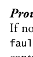

### 提供 default 情况

如果控制表达式的值与某个 `case` 标签之间没有匹配，则执行 `default` 情况（第 95–98 行）。在此示例中，我们使用 `default` 情况来处理所有既不是有效等级，也不是换行符、制表符或空格字符的控制表达式值（我们稍后将讨论程序如何处理这些空白字符）。如果没有匹配，则执行 `default` 情况，第 96–97 行打印一条错误消息，指出输入了不正确的字母等级。如果在不包含 `default` 情况的 `switch` 语句中没有匹配，程序控制只是继续执行 `switch` 之后的第一条语句。

**良好编程实践 5.6**

> 在 `switch` 语句中提供 `default` 情况。在没有 `default` 情况的 `switch` 语句中，未显式测试的 `case` 会被忽略。包含 `default` 情况会促使你关注处理异常情况的需要。有些情况不需要默认处理。虽然 `switch` 语句中的 `case` 子句和 `default` 情况子句可以按任意顺序出现，但通常的做法是将 `default` 子句放在最后。


**良好编程实践 5.7**

> `switch` 语句中的最后一个 `case` 不需要 `break` 语句。为了清晰和与其他 `case` 对称，一些程序员会加上这个 `break`。


### 在输入中忽略换行符、制表符和空白字符

请注意，图 5.10 中 `switch` 语句的第 90–93 行导致程序跳过换行符、制表符和空白字符。一次读取一个字符可能会导致一些问题。为了让程序读取字符，我们必须通过在键盘上按 Enter 键将它们发送到计算机。这会在我们希望处理的字符之后在输入中放置一个换行符。通常，这个换行符必须被特殊处理才能使程序正确工作。通过在 `switch` 语句中包含前面的 `case`，我们可以防止在输入中遇到换行符、制表符或空格时每次都打印 `default` case 中的错误消息。

### 常见编程错误 5.10

> 在一次读取一个字符时未处理输入中的换行符和其他空白字符可能会导致逻辑错误。

### 测试类 GradeBook

图 5.11 创建了一个 `GradeBook` 对象（第 9 行）。第 11 行调用其 `displayMessage` 成员函数向用户输出欢迎消息。第 12 行调用对象的 `inputGrades` 成员函数从用户读取一组成绩并跟踪每个成绩的学生人数。请注意，图 5.11 中的输出窗口显示了在输入无效成绩（即 E）时显示的错误消息。第 13 行调用 `GradeBook` 成员函数 `displayGradeReport`（在图 5.10 的第 104–114 行定义），该函数根据输入的成绩输出报告（如图 5.11 中的输出所示）。

```cpp
// Fig. 5.11: fig05_11.cpp
// Create GradeBook object, input grades and display grade report.

#include "GradeBook.h" // include definition of class GradeBook

int main()
{
    // create GradeBook object
    GradeBook myGradeBook( "CS101 C++ Programming" );

    myGradeBook.displayMessage(); // display welcome message
    myGradeBook.inputGrades(); // read grades from user
    myGradeBook.displayGradeReport(); // display report based on grades
    return 0; // indicate successful termination
} // end main
```

```text
Welcome to the grade book for
CS101 C++ Programming!

Enter the letter grades.
Enter the EOF character to end input.
a
B
c
C
A
d
f
C
E
Incorrect letter grade entered. Enter a new grade.
D
A
b
^Z

Number of students who received each letter grade:
A: 3
B: 2
C: 3
D: 2
F: 1
```

**图 5.11** | 创建一个 `GradeBook` 对象并调用其成员函数。

### switch 语句 UML 活动图

图 5.12 显示了通用 `switch` 多重选择语句的 UML 活动图。大多数 `switch` 语句在每个 `case` 中使用 `break` 来在处理完该 `case` 后终止 `switch` 语句。图 5.12 通过在活动图中包含 `break` 语句来强调这一点。如果没有 `break` 语句，控制就不会在处理完一个 `case` 后转移到 `switch` 语句之后的第一个语句。相反，控制会转移到下一个 `case` 的操作。

该图清楚地表明，`case` 末尾的 `break` 语句会导致控制立即退出 `switch` 语句。再次注意，除了初始状态、转换箭头、最终状态和几个注释外，该图还包含动作状态和决策。另请注意，该图使用合并符号将来自 `break` 语句的转换合并到最终状态。

再次想象，你有一个空的 `switch` 语句 UML 活动图箱——数量足以与其它控制语句的活动图堆叠和嵌套，以形成算法的结构化实现。你用适合算法的动作表达式和守卫条件填充动作状态和决策符号。请注意，虽然嵌套控制语句很常见，但在程序中很少能找到嵌套的 `switch` 语句。


在使用 `switch` 语句时，请记住，每个 `case` 只能测试一个常量整型表达式——任何由字符常量和整数常量组合而成并求值为常量整数值的表达式。字符常量表示为单引号中的特定字符，例如 `'A'`。整数常量只是整数值。此外，每个 `case` 标签只能指定一个常量整型表达式。

### 常见编程错误 5.11

> 在 `switch` 语句的 `case` 标签中指定非常量整型表达式是语法错误。

整数且不超过 `long` 整数的范围。数据类型 `char` 可用于表示计算机字符集中的任何字符。它也可以用于表示小整数。

### 可移植性提示 5.4

> 因为 `ints` 在不同系统之间的大小可能不同，如果你期望处理超出 −32,768 到 32,767 范围的整数并且希望程序在多个不同的计算机系统上运行，请使用 `long` 整数。

### 性能提示 5.3

> 如果内存很紧张，使用较小的整数大小可能是可取的。

### 性能提示 5.4

> 使用较小的整数大小可能会导致程序变慢，如果机器对它们的操纵指令不如对自然大小整数的指令高效——即整数的大小等于机器的字长（例如 32 位机器上的 32 位，64 位机器上的 64 位）。始终测试提出的效率“升级”，以确保它们确实提高了性能。

## 5.7 break 和 continue 语句

除了选择和重复语句外，C++ 还提供了语句 `break` 和 `continue` 来改变控制流。前一节展示了如何使用 `break` 终止 `switch` 语句的执行。本节讨论如何在重复语句中使用 `break`。

### break 语句

`break` 语句在 `while`、`for`、`do...while` 或 `switch` 语句中执行时，会导致立即退出该语句。程序执行继续执行下一个语句。`break` 语句的常见用途是提前从循环中退出或跳过 `switch` 语句的剩余部分（如图 5.10 所示）。图 5.13 演示了 `break` 语句（第 14 行）退出 `for` 重复语句。

当 `if` 语句检测到 `count` 为 5 时，`break` 语句执行。这终止了 `for` 语句，程序继续执行第 19 行（`for` 语句之后立即），该行显示终止循环的控制变量值。`for` 语句仅完全执行其主体四次，而不是 10 次。请注意，控制变量 `count` 在 `for` 语句头之外定义，以便我们可以在循环的主体中以及循环执行完成后使用控制变量。

```cpp
// Fig. 5.13: fig05_13.cpp
// break statement exiting a for statement.
#include <iostream>
using std::cout;
using std::endl;

int main()
{
    int count; // control variable also used after loop terminates

    for ( count = 1; count <= 10; count++ ) // loop 10 times
    {
        if ( count == 5 )
            break; // break loop only if count is 5

        cout << count << " ";
    } // end for

    cout << "\nBroke out of loop at count = " << count << endl;
    return 0; // indicate successful termination
} // end main
```

```text
1 2 3 4
Broke out of loop at count = 5
```

**图 5.13** | `break` 语句退出 `for` 语句。

### continue 语句

`continue` 语句在 `while`、`for` 或 `do...while` 语句中执行时，会跳过该语句主体中剩余的语句并继续下一次循环迭代。在 `while` 和 `do...while` 语句中，循环继续测试会在 `continue` 语句执行后立即求值。在 `for` 语句中，先执行增量表达式，然后求值循环继续测试。

图 5.14 在 `for` 语句中使用 `continue` 语句（第 12 行）在嵌套的 `if`（第 11–12 行）确定 `count` 的值为 5 时跳过输出语句（第 14 行）。当 `continue` 语句执行时，程序控制继续执行 `for` 头中的控制变量增量（第 9 行）并再循环五次。

```cpp
// Fig. 5.14: fig05_14.cpp
// continue statement terminating an iteration of a for statement.
#include <iostream>
using std::cout;
using std::endl;

int main()
{
    for ( int count = 1; count <= 10; count++ ) // loop 10 times
    {
        if ( count == 5 ) // if count is 5,
            continue;     // skip remaining code in loop

        cout << count << " ";
    } // end for

    cout << "\nUsed continue to skip printing 5" << endl;
    return 0; // indicate successful termination
} // end main
```

**图 5.14** | `continue` 语句终止 `for` 语句的单次迭代。（第 1 部分，共 2 部分。）

```
1 2 3 4 6 7 8 9 10
Used continue to skip printing 5
```

Fig. 5.14 | `continue` statement terminating a single iteration of a `for` statement. (Part 2 of 2.)

In Section 5.3, we stated that the `while` statement could be used in most cases to represent the `for` statement. The one exception occurs when the increment expression in the `while` statement follows the `continue` statement. In this case, the increment does not execute before the program tests the loop-continuation condition, and the `while` does not execute in the same manner as the `for`.

### Good Programming Practice 5.8

> Some programmers feel that `break` and `continue` violate structured programming. The effects of these statements can be achieved by structured programming techniques we soon will see, so these programmers do not use `break` and `continue`. Most programmers consider the use of `break` in `switch` statements acceptable.

### Performance Tip 5.5

> The `break` and `continue` statements, when used properly, perform faster than do the corresponding structured techniques.

### Software Engineering Observation 5.1

> There is a tension between achieving quality software engineering and achieving the best-performing software. Often, one of these goals is achieved at the expense of the other. For all but the most performance-intensive situations, apply the following rule of thumb: First, make your code simple and correct; then make it fast and small, but only if necessary.

## 5.8 Logical Operators

So far we have studied only simple conditions, such as `counter <= 10`, `total > 1000` and `number != sentinelValue`. We expressed these conditions in terms of the relational operators `>`, `<`, `>=` and `<=`, and the equality operators `==` and `!=`. Each decision tested precisely one condition. To test multiple conditions while making a decision, we performed these tests in separate statements or in nested `if` or `if...else` statements.

C++ provides logical operators that are used to form more complex conditions by combining simple conditions. The logical operators are `&&` (logical AND), `||` (logical OR) and `!` (logical NOT, also called logical negation).

### Logical AND (&&) Operator

Suppose that we wish to ensure that two conditions are both true before we choose a certain path of execution. In this case, we can use the `&&` (logical AND) operator, as follows:

```
if ( gender == 1 && age >= 65 )
    seniorFemales++;
```

This `if` statement contains two simple conditions. The condition `gender == 1` is used here to determine whether a person is a female. The condition `age >= 65` determines whether a person is a senior citizen. The simple condition to the left of the `&&` operator evaluates first. If necessary, the simple condition to the right of the `&&` operator evaluates next. As we’ll discuss shortly, the right side of a logical AND expression is evaluated only if the left side is true. The `if` statement then considers the combined condition

```
gender == 1 && age >= 65
```

This condition is true if and only if both of the simple conditions are true. Finally, if this combined condition is indeed true, the statement in the `if` statement’s body increments the count of `seniorFemales`. If either of the simple conditions is false (or both are), then the program skips the incrementing and proceeds to the statement following the `if`. The preceding combined condition can be made more readable by adding redundant parentheses:

```
( gender == 1 ) && ( age >= 65 )
```

### Common Programming Error 5.13

Although `3 < x < 7` is a mathematically correct condition, it does not evaluate as you might expect in C++. Use `( 3 < x && x < 7 )` to get the proper evaluation in C++.

Figure 5.15 summarizes the `&&` operator. The table shows all four possible combinations of false and true values for `expression1` and `expression2`. Such tables are often called truth tables. C++ evaluates to false or true all expressions that include relational operators, equality operators and/or logical operators.

| expression1 | expression2 | expression1 && expression2 |
|---|---|---|
| false | false | false |
| false | true | false |
| true | false | false |
| true | true | true |

Fig. 5.15 | `&&` (logical AND) operator truth table.

### Logical OR (||) Operator

Now let us consider the `||` (logical OR) operator. Suppose we wish to ensure at some point in a program that either or both of two conditions are true before we choose a certain path of execution. In this case, we use the `||` operator, as in the following program segment:

```
if ( ( semesterAverage >= 90 ) || ( finalExam >= 90 ) )
    cout << "Student grade is A" << endl;
```

This preceding condition also contains two simple conditions. The simple condition `semesterAverage >= 90` evaluates to determine whether the student deserves an “A” in the course because of a solid performance throughout the semester. The simple condition `finalExam >= 90` evaluates to determine whether the student deserves an “A” in the course because of an outstanding performance on the final exam. The `if` statement then considers the combined condition

```
( semesterAverage >= 90 ) || ( finalExam >= 90 )
```

and awards the student an “A” if either or both of the simple conditions are true. Note that the message “Student grade is A” prints unless both of the simple conditions are false. Figure 5.16 is a truth table for the logical OR operator (`||`).


The `&&` operator has a higher precedence than the `||` operator. Both operators associate from left to right. An expression containing `&&` or `||` operators evaluates only until the truth or falsehood of the expression is known. Thus, evaluation of the expression

```
( gender == 1 ) && ( age >= 65 )
```

stops immediately if `gender` is not equal to `1` (i.e., the entire expression is false) and continues if `gender` is equal to `1` (i.e., the entire expression could still be true if the condition `age >= 65` is true). This performance feature for the evaluation of logical AND and logical OR expressions is called short-circuit evaluation.

## Performance Tip 5.6

> In expressions using operator `&&`, if the separate conditions are independent of one another, make the condition most likely to be false the leftmost condition. In expressions using operator `||`, make the condition most likely to be true the leftmost condition. This use of short-circuit evaluation can reduce a program’s execution time.

| expression1 | expression2 | expression1 || expression2 |
|---|---|---|

| false | false | false |
| false | true | true |
| true | false | true |
| true | true | true |

Fig. 5.16 | `||` (logical OR) operator truth table.

## Logical Negation (!) Operator

C++ provides the `!` (logical NOT, also called logical negation) operator to enable a programmer to “reverse” the meaning of a condition. Unlike the `&&` and `||` binary operators, which combine two conditions, the unary logical negation operator has only a single condition as an operand. The unary logical negation operator is placed before a condition when we are interested in choosing a path of execution if the original condition (without the logical negation operator) is false, such as in the following program segment:

```
if ( ! ( grade == sentinelValue ) )
    cout << "The next grade is " << grade << endl;
```

The parentheses around the condition `grade == sentinelValue` are needed because the logical negation operator has a higher precedence than the equality operator.

In most cases, you can avoid using logical negation by expressing the condition with an appropriate relational or equality operator. For example, the preceding `if` statement also can be written as follows:

```
if ( grade != sentinelValue )
    cout << "The next grade is " << grade << endl;
```

This flexibility often can help a programmer express a condition in a more “natural” or convenient manner. Figure 5.17 is a truth table for the logical negation operator (`!`).

| expression | !expression |
|------------|-------------|
| false      | true        |
| true       | false       |

Fig. 5.17 | `!` (logical negation) operator truth table.

## Logical Operators Example

Figure 5.18 demonstrates the logical operators by producing their truth tables. The output shows each expression that is evaluated and its `bool` result. By default, `bool` values `true` and `false` are displayed by `cout` and the stream insertion operator as `1` and `0`, respectively. We use stream manipulator `boolalpha` (a sticky manipulator) in line 11 to specify that the value of each `bool` expression should be displayed as either the word “true” or the word “false.” For example, the result of the expression `false && false` in line 12 is `false`, so the second line of output includes the word “false.” Lines 11–15 produce the truth table for `&&`. Lines 18–22 produce the truth table for `||`. Lines 25–27 produce the truth table for `!`.

```
1  // Fig. 5.18: fig05_18.cpp
2  // Logical operators.
3  #include <iostream>
4  using std::cout;
5  using std::endl;
6  using std::boolalpha; // causes bool values to print as "true" or "false"
7
8  int main()
9  {
10     // create truth table for && (logical AND) operator
11     cout << boolalpha << "Logical AND (&&)"
12         << "\nfalse && false: " << ( false && false )
13         << "\nfalse && true: " << ( false && true )
14         << "\ntrue && false: " << ( true && false )
15         << "\ntrue && true: " << ( true && true ) << "\n\n";
16
17     // create truth table for || (logical OR) operator
18     cout << "Logical OR (||)"
19         << "\nfalse || false: " << ( false || false )
20         << "\nfalse || true: " << ( false || true )
21         << "\ntrue || false: " << ( true || false )
22         << "\ntrue || true: " << ( true || true ) << "\n\n";
```

```
24    // 为 !（逻辑非）运算符创建真值表
25    cout << "Logical NOT (!)"
26        << "\n!false: " << ( !false )
27        << "\n!true: " << ( !true ) << endl;
28    return 0; // 指示成功终止
29 } // 结束 main
```

Logical AND (`&&`)

false && false: false

false && true: false

true && false: false

true && true: true

Logical OR (`||`)

false || false: false

false || true: true

true || false: true

true || true: true

Logical NOT (`!`)

!false: true

!true: false

图5.18 | 逻辑运算符。（第2部分，共2部分。）

## 运算符优先级与结合性小结

图5.19将逻辑运算符添加到运算符优先级和结合性图表中。这些运算符从上到下按优先级递减顺序排列。

| 运算符 | 结合性 | 类型 |
|---|---|---|

| :: | 从左到右 | 作用域解析 |
| () | 从左到右 | 圆括号 |
| ++ -- static_cast< type >() | 从左到右 | 一元（后缀） |
| ++ -- + - ! | 从右到左 | 一元（前缀） |
| * / % | 从左到右 | 乘法 |
| + - | 从左到右 | 加法 |
| << >> | 从左到右 | 插入/提取 |
| < <= > >= | 从左到右 | 关系 |
| == != | 从左到右 | 相等 |
| && | 从左到右 | 逻辑与 |
| \|\| | 从左到右 | 逻辑或 |
| ?: | 从右到左 | 条件 |
| = += -= *= /= %= | 从右到左 | 赋值 |
| , | 从左到右 | 逗号 |

图5.19 | 运算符优先级和结合性。

## 5.9 混淆相等（==）和赋值（=）运算符

有一种错误类型是C++程序员无论多么有经验都容易犯的，而且频繁到我们认为有必要单独用一节来讨论。这种错误是不小心将`==`（相等）和`=`（赋值）运算符互换。这种互换之所以危害巨大，是因为它们通常不会引起语法错误。相反，带有这些错误的语句往往能正确编译，程序也能运行到底，却经常通过运行时逻辑错误产生错误结果。[注意：有些编译器在`=`用于通常应使用`==`的上下文中时会发出警告。]

C++的两个方面导致了这些问题。其一，任何产生值的表达式都可以用在任何控制语句的判定部分。如果表达式的值为零，则被视为假；如果值非零，则被视为真。其二，赋值会产生一个值——即赋值给赋值运算符左侧变量的值。例如，假设我们本意要写

```
if ( payCode == 4 )
    cout << "You get a bonus!" << endl;
```

但意外地写了

```
if ( payCode = 4 )
    cout << "You get a bonus!" << endl;
```

第一个`if`语句正确地给`payCode`等于`4`的人发放奖金。第二个`if`语句——即带有错误的那条——将`if`条件中的赋值表达式求值为常量`4`。任何非零值都被解释为真，因此这条`if`语句中的条件始终为真，不管实际`paycode`是什么，这个人总是会得到奖金！更糟糕的是，`paycode`本来只应被检查，现在却被修改了！

### 常见编程错误 5.14

> 使用运算符`==`进行赋值和使用运算符`=`进行相等性判断都是逻辑错误。

### 错误预防提示 5.3

> 程序员通常编写诸如`x == 7`这样的条件，变量名在左，常量在右。如果反过来，让常量在左、变量名在右，例如`7 == x`，那么当你意外地将`==`运算符替换为`=`时，编译器会保护你。编译器会将其视为编译错误，因为你无法改变常量的值。这将防止运行时逻辑错误的潜在破坏。

变量名被称为左值（`lvalue`，意为“左边的值”），因为它们可以用在赋值运算符的左侧。常量被称为右值（`rvalue`，意为“右边的值”），因为它们只能用在赋值运算符的右侧。注意，左值也可以用作右值，但反之则不然。

还有一种同样令人不愉快的情况。假设你想要用如下简单语句给变量赋值：

```
x = 1;
```

但反而写了

```
x == 1;
```

这里，同样也不是语法错误。相反，编译器只是计算这个条件表达式。如果`x`等于`1`，条件为真，表达式求值为`true`。如果`x`不等于`1`，条件为假，表达式求值为`false`。无论表达式的值是什么，因为没有赋值运算符，所以该值就丢失了。`x`的值保持不变，这可能导致执行时的逻辑错误。不幸的是，我们没有一个现成的技巧来帮助你解决这个问题！

### 错误预防提示 5.4

> 使用文本编辑器搜索程序中所有出现的`= `，并检查在每个位置使用的是正确的赋值运算符还是逻辑运算符。

## 5.10 （可选）软件工程案例研究：识别ATM系统中对象的状态和活动

在4.11节中，我们确定了实现ATM系统所需的许多类属性，并将它们添加到图4.20的类图中。在本节中，我们展示这些属性如何表示对象的状态。我们确定对象可能占据的一些关键状态，并讨论对象如何响应系统发生的各种事件而改变状态。我们还讨论对象在ATM系统中执行的工作流程或活动。本节介绍`BalanceInquiry`和`Withdrawal`交易对象的活动，因为它们代表了ATM系统中的两个关键活动。

### 状态机图

系统中的每个对象都会经历一系列离散状态。对象的当前状态由对象在给定时刻的属性值指示。状态机图（通常称为状态图）对对象的关键状态建模，并显示对象在什么情况下改变状态。与之前案例研究部分中主要关注系统结构的类图不同，状态图对系统的某些行为进行建模。

图5.20是建模ATM类对象某些状态的简单状态图。UML在状态图中将每个状态表示为圆角矩形，状态名称放在其中。一个带有附着杆状箭头的实心圆表示初始状态。回顾我们在图4.20的类图中将这个状态信息建模为布尔属性`userAuthenticated`。根据状态图，该属性初始化为`false`，即“用户未认证”状态。


图5.20 | ATM对象的状态图。

带有杆状箭头的箭头表示状态之间的*转换*。对象可以响应系统中发生的各种事件而从一个状态转换到另一个状态。引起转换的事件的名称或描述写在对应转换线附近。例如，在数据库认证用户之后，ATM对象从“用户未认证”状态转换为“用户已认证”状态。回顾需求规格说明，数据库通过将用户输入的账号和PIN与数据库中相应账户的账号和PIN进行比较来认证用户。如果数据库指示用户输入了有效的账号和正确的PIN，ATM对象就转换到“用户已认证”状态，并将其`userAuthenticated`属性改为`true`。当用户从主菜单中选择“退出”选项退出系统时，ATM对象返回到“用户未认证”状态，为下一个ATM用户做准备。

> **软件工程观察 5.2**
>
> *软件设计者通常不会创建显示所有属性所有可能状态和状态转换的状态图——它们实在太多了。状态图通常只显示最重要或最复杂的状态和状态转换。*

### 活动图

与状态图类似，活动图对系统行为的某些方面进行建模。与状态图不同，活动图对对象在程序执行期间的工作流程（事件序列）进行建模。活动图对对象将执行的操作及其顺序进行建模。回顾我们曾使用UML活动图来说明第4章和本章中控制语句的控制流。

图5.21中的活动图对执行`BalanceInquiry`交易所涉及的操作进行建模。我们假设`BalanceInquiry`对象已经初始化并被赋予一个有效的账号（当前用户的账号），因此该对象知道要检索哪个余额。该图包括在用户从主菜单中选择余额查询之后、ATM将用户返回到主菜单之前发生的操作——`BalanceInquiry`对象不执行或发起这些操作，因此我们不

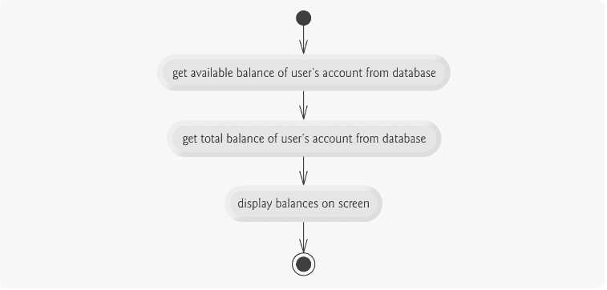

**图5.21** | `BalanceInquiry` 交易的活动图。

在此处对它们进行建模。活动图首先从数据库中检索用户账户的可用余额。接下来，`BalanceInquiry`检索账户的总余额。最后，该交易在屏幕上显示余额。此操作完成交易执行。


UML将活动图中的动作表示为动作状态，用矩形建模，其左右两侧替换为向外弯曲的弧线。每个动作状态包含一个动作表达式——例如，“get available balance of user’s account from database”——该表达式指定要执行的动作。带实心箭头的箭头连接两个动作状态，指示动作状态所表示的动作发生的顺序。实心圆（图5.21顶部）表示活动的初始状态——即对象执行所建模动作之前工作流的开始。在此场景中，交易首先执行“从数据库获取用户账户的可用余额”动作表达式。其次，交易检索总余额。最后，交易在屏幕上显示两个余额。包含在空心圆中的实心圆（图5.21底部）表示最终状态——即对象执行完所建模动作之后工作流的结束。

图5.22展示了`Withdrawal`交易的活动图。我们假设一个`Withdrawal`对象已被分配了有效的账户号码。我们不建模用户从主菜单中选择取款或ATM将用户返回主菜单的过程，因为这些不是由`Withdrawal`对象执行的动作。交易首先显示标准取款金额菜单（图2.13）以及取消交易的选项。然后交易输入用户的菜单选择。活动流现在到达一个决策符号。此点根据相关的监护条件确定下一个动作。如果用户取消交易，系统显示适当的消息。接下来，取消流到达一个合并符号，此处该活动流与交易的其他可能活动流汇合（我们稍后讨论）。注意，合并可以有任意数量的传入转换箭头，但只能有一个传出转换箭头。图底部的决策确定交易是否应从开始处重复。当用户已取消交易时，监护条件“cash dispensed or user canceled transaction”为真，因此控制转换到活动的最终状态。

如果用户从菜单中选择取款金额，交易将`amount`（最初在图4.20中建模的`Withdrawal`类的一个属性）设置为用户选择的值。交易接下来从数据库获取用户账户的可用余额（即用户`Account`对象的`availableBalance`属性）。活动流随后到达另一个决策。如果请求的取款金额超过用户的可用余额，系统显示适当的错误消息，告知用户该问题。控制随后与其他活动流合并，然后到达图底部的决策。监护决策“cash not dispensed and user did not cancel”为真，因此活动流返回到图顶部，交易提示用户输入新金额。

如果请求的取款金额小于或等于用户的可用余额，交易测试现金分配器是否有足够的现金来满足取款请求。如果没有，交易显示适当的错误消息，并通过合并，然后到达最终决策。由于现金未被分配，活动流返回到活动图的开始处，交易提示

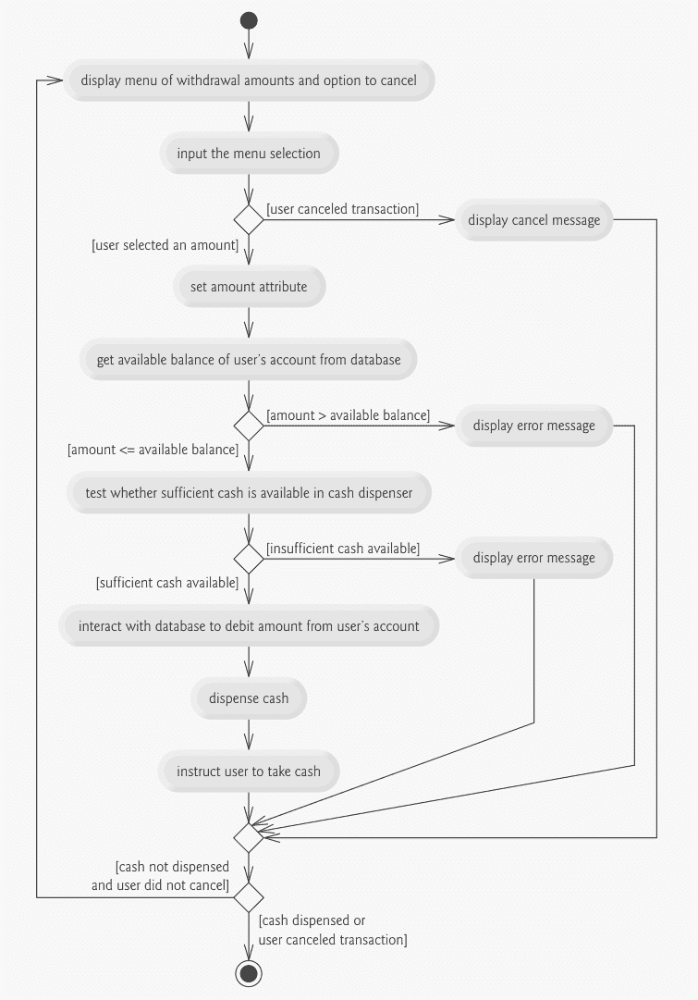

**图5.22** | `Withdrawal`交易的活动图。

用户选择新金额。如果有足够的现金，交易与数据库交互，从用户账户中借记取款金额（即从用户`Account`对象的`availableBalance`和`totalBalance`属性中减去该金额）。随后交易分配所需金额的现金，并指示用户取走所分配的现金。主活动流接下来与两个错误流和取消流合并。在此情况下，现金已被分配，因此活动流到达最终状态。

我们已迈出对ATM系统行为建模的第一步，并展示了对象的属性如何参与对象的活动。在6.22节中，我们将研究类的操作，以构建更完整的系统行为模型。

## 软件工程案例研究自测练习

5.1 判断以下陈述为真还是假，如果为假，请解释原因：状态图建模系统的结构方面。

5.2 活动图建模对象执行的__________及其执行顺序。

- a) 动作
- b) 属性
- c) 状态
- d) 状态转换

5.3 根据需求规格说明，为存款交易创建一个活动图。

## 软件工程案例研究自测练习答案

5.1 假。状态图建模系统的某些行为。

5.2 a.

5.3 图5.23展示了存款交易的活动图。该图建模了用户从主菜单中选择存款选项之后、ATM将用户返回主菜单之前发生的动作。回想一下，从用户处接收存款金额的一部分涉及将整数分的金额转换为美元金额。还要注意，将存款金额记入账户仅涉及增加用户`Account`对象的`totalBalance`属性。银行仅在确认存款信封中的现金金额以及所附支票结清后，才更新用户`Account`对象的`availableBalance`属性——这独立于ATM系统发生。

## 5.11 小结

在本章中，我们完成了对C++控制语句的介绍，这些语句使您能够控制函数中的执行流程。第4章讨论了`if`、`if...else`和`while`语句。本章演示了C++其余的控制语句——`for`、`do...while`和`switch`。我们已经表明，任何算法都可以使用顺序结构（即按执行顺序列出的语句）、三种类型的选择语句——`if`、`if...else`和`switch`——以及三种类型的重复语句——`while`、`do...while`和`for`——的组合来开发。在本章和第4章中，我们讨论了如何组合这些构建块以利用经过验证的程序构造和问题解决技术。本章还介绍

## 6

## 函数

与

递归入门

> 形式永远追随功能。
> —路易斯·亨利·沙利文
> 合众为一。
> （由众多组成的一个。）
> —维吉尔
> 啊！召回昨天，让时间倒流。
> —威廉·莎士比亚
> 叫我以实玛利。
> —赫尔曼·梅尔维尔
> 你这样叫我时，请微笑！
> —欧文·威斯特
> 用一句话回答我。
> —威廉·莎士比亚
> 有一个点，方法会吞噬自身。
> —弗朗茨·法农
> 生活只能向后理解；但它必须向前生活。
> —索伦·克尔凯郭尔

### 目标

在本章中，您将学习：

- 从函数模块化地构造程序。
- 使用C++标准库中可用的常用数学函数。
- 创建具有多个参数的函数。
- 在函数之间传递信息和返回结果的机制。
- 函数调用栈和激活记录如何支持函数调用/返回机制。
- 使用随机数生成来实现游戏应用程序。
- 标识符的可见性如何限制在程序的特定区域。
- 编写和使用递归函数，即调用自身的函数。

- 6.1 引言
- 6.2 C++ 程序的组成
- 6.3 数学库函数
- 6.4 多参数函数定义
- 6.5 函数原型与实参强制转换
- 6.6 C++ 标准库头文件
- 6.7 案例研究：随机数生成
- 6.8 案例研究：机会游戏；引入 enum
- 6.9 存储类别
- 6.10 作用域规则
- 6.11 函数调用栈与活动记录
- 6.12 空参数列表的函数
- 6.13 内联函数
- 6.14 引用与引用参数
- 6.15 默认实参
- 6.16 一元作用域解析运算符
- 6.17 函数重载
- 6.18 函数模板
- 6.19 递归
- 6.20 递归示例：斐波那契数列
- 6.21 递归与迭代
- 6.22（可选）软件工程案例研究：识别 ATM 系统中的类的操作
- 6.23 小结

## 6.1 引言

在本章中，我们将更深入地研究函数。我们强调如何声明和使用函数，以方便大型程序的设计、实现、运行和维护。

我们将简要介绍 C++ 标准库数学函数的一部分，其中一些函数需要多个参数。接下来，你将看到如何声明具有多个参数的函数。我们还将介绍函数原型的更多信息，以及编译器如何使用它们在必要时将函数调用中实参的类型转换为函数形参列表中指定的类型。

接下来，我们会稍微岔开话题，讨论使用随机数生成的模拟技术，并开发一个名为 `craps` 的赌场骰子游戏版本，其中使用了你到目前为止在本书中学到的大部分 C++ 功能。

然后我们介绍 C++ 的存储类别和作用域规则。它们决定了对象在内存中存在的时间段，以及其标识符在程序中可以被引用的位置。你还将看到 C++ 如何跟踪当前正在执行的函数、函数的形参和其他局部变量如何在内存中维护，以及函数在执行完成后如何知道返回到哪里。我们讨论两个有助于提高程序性能的主题——内联函数（可消除函数调用的开销）和引用参数（可用于将大数据项高效地传递给函数）。

你开发的许多应用程序都会包含多个同名函数。这种技术称为函数重载，程序员用它来实现对不同类型的实参或不同数量的实参执行类似任务的函数。我们还将讨论函数模板——一种定义一族重载函数的机制。本章最后讨论直接或间接（通过另一个函数）调用自身的函数——这一主题称为递归。

## 6.2 C++ 程序的组成

C++ 程序通常是通过将你编写的新函数和类与 C++ 标准库中“预打包”的函数和类组合而成。在本章中，我们专注于函数。

C++ 标准库提供了丰富的函数集合，用于执行常见的数学计算、字符串处理、字符处理、输入/输出、错误检查以及许多其他有用的操作。这使你的工作更轻松，因为这些函数提供了程序员所需的许多功能。C++ 标准库函数作为 C++ 编程环境的一部分提供。

### 软件工程观察 6.1

> 请阅读编译器的文档，以熟悉 C++ 标准库中的函数和类。

## 6.3 数学库函数

如你所知，类可以提供成员函数来执行类的服务。例如，在第 3 章到第 5 章中，你调用了不同版本 `GradeBook` 对象的成员函数来显示 `GradeBook` 的欢迎消息、设置课程名称、获取一组成绩并计算这些成绩的平均值。

有时函数不是类的成员。这样的函数称为全局函数。与类的成员函数类似，全局函数的函数原型放在头文件中，这样任何包含该头文件并能链接到函数目标代码的程序都可以重用这些全局函数。例如，回想一下，在示例 5.6 中，我们使用了 `<cmath>` 头文件中的 `pow` 函数将一个值提升到某次幂。这里我们介绍 `<cmath>` 头文件中的各种函数，以展示不属于特定类的全局函数的概念。在本章及后续章节中，我们将结合使用全局函数（如 `main`）和带成员函数的类来实现示例程序。

`<cmath>` 头文件提供了一组函数，使你能够执行常见的数学计算。例如，你可以通过函数调用计算 900.0 的平方根

```
sqrt( 900.0 )
```

前面的表达式计算结果为 30.0。函数 `sqrt` 接受一个 `double` 类型的实参并返回一个 `double` 类型的结果。请注意，在调用函数 `sqrt` 之前不需要创建任何对象。还要注意，`<cmath>` 头文件中的所有函数都是全局函数——因此，只需指定函数名称，后跟包含函数实参的圆括号即可调用每个函数。

函数实参可以是常量、变量或更复杂的表达式。如果 `c = 13.0`、`d = 3.0` 且 `f = 4.0`，则以下语句

```
cout << sqrt( c + d * f ) << endl;
```

将计算并打印 13.0 + 3.0 * 4.0 = 25.0 的平方根，即 5.0。图 6.1 总结了一些数学库函数（变量 `x` 和 `y` 为 `double` 类型）。

| 函数 | 描述 | 示例 |
|---|---|---|
| `ceil( x )` | 将 `x` 向上舍入为不小于 `x` 的最小整数 | `ceil( 9.2 )` 为 10.0<br>`ceil( -9.8 )` 为 -9.0 |
| `cos( x )` | `x` 的三角余弦（`x` 以弧度为单位） | `cos( 0.0 )` 为 1.0 |
| `exp( x )` | 指数函数 `e^x` | `exp( 1.0 )` 为 2.71828<br>`exp( 2.0 )` 为 7.38906 |
| `fabs( x )` | `x` 的绝对值 | `fabs( 5.1 )` 为 5.1<br>`fabs( 0.0 )` 为 0.0<br>`fabs( -8.76 )` 为 8.76 |
| `floor( x )` | 将 `x` 向下舍入为不大于 `x` 的最大整数 | `floor( 9.2 )` 为 9.0<br>`floor( -9.8 )` 为 -10.0 |
| `fmod( x, y )` | `x/y` 的浮点数余数 | `fmod( 2.6, 1.2 )` 为 0.2 |
| `log( x )` | `x` 的自然对数（以 `e` 为底） | `log( 2.718282 )` 为 1.0<br>`log( 7.389056 )` 为 2.0 |
| `log10( x )` | `x` 的常用对数（以 10 为底） | `log10( 10.0 )` 为 1.0<br>`log10( 100.0 )` 为 2.0 |
| `pow( x, y )` | `x` 的 `y` 次幂（`x^y`） | `pow( 2, 7 )` 为 128<br>`pow( 9, .5 )` 为 3 |
| `sin( x )` | `x` 的三角正弦（`x` 以弧度为单位） | `sin( 0.0 )` 为 0 |
| `sqrt( x )` | `x` 的平方根（`x` 为非负值） | `sqrt( 9.0 )` 为 3.0 |
| `tan( x )` | `x` 的三角正切（`x` 以弧度为单位） | `tan( 0.0 )` 为 0 |

图 6.1 | 数学库函数。

## 6.4 多参数函数定义

图 6.2–6.4 中的程序修改了我们的 `GradeBook` 类，包含一个名为 `maximum` 的用户自定义函数，该函数确定并返回三个 `int` 值中的最大值。当应用程序开始执行时，`main` 函数（图 6.4 的第 5–14 行）创建一个 `GradeBook` 类对象（第 8 行），并调用该对象的 `inputGrades` 成员函数（第 11 行）从用户那里读取三个整数成绩。在 `GradeBook` 类的实现文件（图 6.3）中，成员函数 `inputGrades` 的第 54–55 行提示用户输入三个整数值并从用户处读取它们。第 58 行调用成员函数 `maximum`（定义在第 62–75 行）。函数 `maximum` 确定最大值，然后 `return` 语句（第 74 行）将该值返回到函数 `inputGrades` 调用 `maximum` 的位置（第 58 行）。成员函数 `inputGrades` 随后将 `maximum` 的返回值存储在数据成员 `maximumGrade` 中。然后通过调用函数 `displayGradeReport`（图 6.4 的第 12 行）输出该值。[注意：我们将此函数命名为 `displayGradeReport`，因为后续版本的 `GradeBook` 类将使用此函数显示完整的成绩报告，包括最高分和最低分。] 在第 7 章“数组与向量”中，我们将增强 `GradeBook` 以处理任意数量的成绩。

```
// Fig. 6.2: GradeBook.h
// Definition of class GradeBook that finds the maximum of three grades.
// Member functions are defined in GradeBook.cpp
#include <string> // program uses C++ standard string class
using std::string;

// GradeBook class definition
class GradeBook
{
public:
    GradeBook( string ); // constructor initializes course name
    void setCourseName( string ); // function to set the course name
    string getCourseName(); // function to retrieve the course name
    void displayMessage(); // display a welcome message
    void inputGrades(); // input three grades from user
    void displayGradeReport(); // display a report based on the grades
    int maximum( int, int, int ); // determine max of 3 values
private:
    string courseName; // course name for this GradeBook
    int maximumGrade; // maximum of three grades
}; // end class GradeBook
```

图 6.2 | `GradeBook` 头文件。

```
// Fig. 6.3: GradeBook.cpp
// Member-function definitions for class GradeBook that
// determines the maximum of three grades.
#include <iostream>
using std::cout;
using std::cin;
using std::endl;

#include "GradeBook.h" // include definition of class GradeBook
```

图 6.3 | `GradeBook` 类定义函数 `maximum`。（第 1 部分，共 3 部分。）

```
// constructor initializes courseName with string supplied as argument;
// initializes maximumGrade to 0
GradeBook::GradeBook( string name )
{
    setCourseName( name ); // validate and store courseName
    maximumGrade = 0; // this value will be replaced by the maximum grade
} // end GradeBook constructor

// function to set the course name; limits name to 25 or fewer characters
void GradeBook::setCourseName( string name )
{
    if ( name.length() <= 25 ) // if name has 25 or fewer characters
        courseName = name; // store the course name in the object
    else // if name is longer than 25 characters


{ // set courseName to first 25 characters of parameter name

    courseName = name.substr( 0, 25 ); // select first 25 characters

    cout << "Name \"" << name << "\" exceeds maximum length (25).\n"

         << "Limiting courseName to first 25 characters.\n" << endl;

} // end if...else

} // end function setCourseName

// function to retrieve the course name

string GradeBook::getCourseName()

{

    return courseName;

} // end function getCourseName

// display a welcome message to the GradeBook user

void GradeBook::displayMessage()

{

    // this statement calls getCourseName to get the

    // name of the course this GradeBook represents

    cout << "Welcome to the grade book for\n" << getCourseName() << "!\n"

         << endl;

} // end function displayMessage

// input three grades from user; determine maximum

void GradeBook::inputGrades()

{

    int grade1; // first grade entered by user

    int grade2; // second grade entered by user

    int grade3; // third grade entered by user

    cout << "Enter three integer grades: ";

    cin >> grade1 >> grade2 >> grade3;

    // store maximum in member maximumGrade

    maximumGrade = maximum( grade1, grade2, grade3 );

} // end function inputGrades

// returns the maximum of its three integer parameters
int GradeBook::maximum( int x, int y, int z )
{

64  int maximumValue = x; // assume x is the largest to start

65

66  // determine whether y is greater than maximumValue
67  if ( y > maximumValue )
68      maximumValue = y; // make y the new maximumValue

69

70  // determine whether z is greater than maximumValue
71  if ( z > maximumValue )
72      maximumValue = z; // make z the new maximumValue

73

74  return maximumValue;
75 } // end function maximum
76

77  // display a report based on the grades entered by user
78 void GradeBook::displayGradeReport()
79 {

80     // output maximum of grades entered
81     cout << "Maximum of grades entered: " << maximumGrade << endl;
82 } // end function displayGradeReport

图 6.3 | `GradeBook` 类定义函数 `maximum`。 (第 3 部分，共 3 部分。)

```cpp
// Fig. 6.4: fig06_04.cpp
// Create GradeBook object, input grades and display grade report.
#include "GradeBook.h" // include definition of class GradeBook

int main()
{
    // create GradeBook object
    GradeBook myGradeBook( "CS101 C++ Programming" );

    myGradeBook.displayMessage(); // display welcome message
    myGradeBook.inputGrades(); // read grades from user
    myGradeBook.displayGradeReport(); // display report based on grades
    return 0; // indicate successful termination
} // end main
```

```
Welcome to the grade book for
CS101 C++ Programming!

Enter three integer grades: 86 67 75
Maximum of grades entered: 86
```

```
Welcome to the grade book for
CS101 C++ Programming!

Enter three integer grades: 67 86 75
Maximum of grades entered: 86
```

图 6.4 | 演示函数 `maximum`。 (第 1 部分，共 2 部分。)

```
Welcome to the grade book for
CS101 C++ Programming!

Enter three integer grades: 67 75 86
Maximum of grades entered: 86
```

图 6.4 | 演示函数 `maximum`。 (第 2 部分，共 2 部分。)

## 软件工程观察 6.2

图 6.3 第 58 行中用于分隔函数 `maximum` 参数的逗号并不是第 5.3 节中讨论的逗号运算符。逗号运算符保证其操作数按从左到右的顺序求值。然而，函数参数的求值顺序并未由 C++ 标准指定。因此，不同的编译器可以以不同的顺序求值函数参数。C++ 标准确实要求在调用的函数执行之前，必须先求值函数调用中的所有参数。

## 可移植性提示 6.1

有时当函数的参数是更复杂的表达式时，例如包含对其他函数的调用，编译器求值参数的顺序可能会影响一个或多个参数的值。如果不同编译器之间的求值顺序发生变化，则传递给函数参数的值可能会有所不同，从而导致微妙的逻辑错误。

## 错误预防提示 6.1

如果您对函数参数的求值顺序以及该顺序是否会影响传递给函数的值存在疑问，请在函数调用之前在单独的赋值语句中求值参数，将每个表达式的结果赋给局部变量，然后将这些变量作为参数传递给函数。

成员函数 `maximum` 的原型 (图 6.2，第 17 行) 表明该函数返回一个整数值，函数名为 `maximum`，并且该函数需要三个整数参数来完成其任务。函数 `maximum` 的头 (图 6.3，第 62 行) 与函数原型匹配，并表明参数名称为 `x`、`y` 和 `z`。当调用 `maximum` 时 (图 6.3，第 58 行)，参数 `x` 用参数 `grade1` 的值初始化，参数 `y` 用参数 `grade2` 的值初始化，参数 `z` 用参数 `grade3` 的值初始化。函数调用中必须为每个参数提供一个参数 (也称为形式参数)。

请注意，函数原型和函数头中都以逗号分隔的列表形式指定了多个参数。编译器参考函数原型来检查对 `maximum` 的调用是否包含正确数量和类型的参数，以及参数类型的顺序是否正确。此外，编译器使用原型来确保函数返回的值可以在调用该函数的表达式中正确使用 (例如，返回类型为 `void` 的函数调用不能用作赋值语句的右侧)。每个参数必须与相应参数的类型一致。例如，类型为 `double` 的参数可以接收像 `7.35`、`22` 或 `−0.03456` 这样值，但不能接收像 `"hello"` 这样的字符串。如果传递给函数的参数与函数原型中指定的类型不匹配，编译器会尝试将参数转换为这些类型。第 6.5 节讨论了这种转换。

## 常见编程错误 6.1

将具有相同类型的多个方法参数声明为 `double x, y` 而不是 `double x, double y` 是语法错误——参数列表中每个参数都需要显式类型。

## 常见编程错误 6.2

如果函数原型、函数头和函数调用在参数和参数的数量、类型和顺序以及返回类型上不一致，则会发生编译错误。

## 软件工程观察 6.3

具有许多参数的函数可能执行了太多任务。考虑将函数分解为执行单独任务的更小函数。如果可能，请将函数头限制为一行。

为了确定最大值 (图 6.3 第 62–75 行)，我们首先假设参数 `x` 包含最大值的，因此函数 `maximum` 的第 64 行声明局部变量 `maximumValue` 并用参数 `x` 的值初始化它。当然，参数 `y` 或 `z` 可能包含实际的最大值，因此我们必须将这些值与 `maximumValue` 进行比较。第 67–68 行的 `if` 语句确定 `y` 是否大于 `maximumValue`，如果是，则将 `y` 赋给 `maximumValue`。第 71–72 行的 `if` 语句确定 `z` 是否大于 `maximumValue`，如果是，则将 `z` 赋给 `maximumValue`。此时，三者中最大的值在 `maximumValue` 中，因此第 74 行将该值返回给第 58 行的调用。当程序控制返回到程序中调用 `maximum` 的点时，`maximum` 的参数 `x`、`y` 和 `z` 不再可供程序访问。我们将在下一节看到原因。

有三种方法可以将控制权返回到函数被调用的位置。如果函数不返回结果 (即函数具有 `void` 返回类型)，则当程序到达函数结束的右大括号时控制权返回，或通过执行语句

```
return;
```

返回。如果函数确实返回结果，则语句

```
return expression;
```

计算 `expression` 并将 `expression` 的值返回给调用者。

## 6.5 函数原型和参数强制转换

函数原型 (也称为函数声明) 告诉编译器函数的名称、函数返回的数据类型、函数期望接收的参数数量、这些参数的类型以及期望这些类型参数的顺序。

## 软件工程观察 6.4

C++ 要求使用函数原型。使用 `#include` 预处理器指令从适当的库的头文件中获取 C++ 标准库函数的函数原型 (例如，数学函数 `sqrt` 的原型在头文件 `<cmath>` 中；C++ 标准库头文件部分列表出现在第 6.6 节)。还使用 `#include` 来获取您或您的小组成员编写的包含函数原型的头文件。

## 常见编程错误 6.3

> 如果在函数被调用之前定义了该函数，则该函数的定义本身也充当函数的原型，因此不需要单独的原型。如果在函数被定义之前调用了该函数，并且该函数没有函数原型，则会发生编译错误。

## 软件工程观察 6.5

> 始终提供函数原型，即使在函数在使用前定义的情况下可以省略它们（此时函数头本身也充当函数原型）。提供原型可以避免将代码绑定到函数定义的顺序（随着程序的演进，该顺序很容易发生变化）。

## 函数签名

函数原型中包含函数名及其参数类型的部分称为 **函数签名** 或简称为 **签名**。函数签名不指定函数的返回类型。同一作用域中的函数必须具有唯一的签名。函数的范围是函数在其中已知且可访问的程序区域。我们将在第 6.10 节中进一步讨论作用域。

## 常见编程错误 6.4

> 如果同一作用域中的两个函数具有相同的签名但返回类型不同，则为编译错误。

在图 6.2 中，如果第 17 行的函数原型被写成

```
void maximum( int, int, int );
```

编译器会报告错误，因为函数原型中的 `void` 返回类型与函数头中的 `int` 返回类型不同。同样，此类原型也会导致语句

```
cout << maximum( 6, 7, 0 );
```

生成编译错误，因为该语句依赖于 `maximum` 返回一个值以供显示。

## 参数强制转换

函数原型的一个重要特性是 **参数强制转换**——即强制参数为参数声明中指定的适当类型。例如，程序可以用整数参数调用一个函数，即使函数原型指定了 `double` 参数——函数仍然可以正确工作。

## 参数提升规则

有时，参数值与函数原型中的参数类型不完全对应，可以由编译器在函数被调用之前转换为适当的类型。这些转换是按照 C++ 的 **提升规则** 指定的。提升规则说明如何在不丢失数据的情况下在类型之间转换。`int` 可以转换为 `double` 而不会改变其值。但是，`double` 转换为 `int` 会截断 `double` 值的分数部分。请记住，`double` 变量可以保存比 `int` 变量大得多的数量级数字，因此数据丢失可能相当大。在将大整数类型转换为小整数类型（例如 `long` 到 `short`）、有符号到无符号或无符号到有符号时，值也可能被修改。

提升规则适用于包含两种或更多数据类型的表达式；此类表达式也称为 *混合类型表达式*。混合类型表达式中每个值的类型都会提升为表达式中的“最高”类型（实际上为表达式创建并使用每个值的临时版本——原始值保持不变）。当函数参数的类型与函数定义或原型中指定的参数类型不匹配时也会发生提升。图 6.5 按从“最高类型”到“最低类型”的顺序列出了基本数据类型。

将值转换为较低的基本类型可能会导致错误的值。因此，只能通过显式将值赋给较低类型的变量（某些编译器在此情况下会发出警告）或使用强制转换运算符（参见第 4.7 节）将值转换为较低的基本类型。函数参数值被转换为函数原型中的参数类型，就好像它们被直接赋给这些类型的变量一样。如果使用整数参数的 `square` 函数被浮点参数调用，则参数将被转换为 `int`（较低类型），并且 `square` 可能会返回错误的值。例如，`square(4.5)` 返回 16，而不是 20.25。

## 常见编程错误 6.5

从提升层次结构中的较高数据类型转换为较低类型，或在有符号和无符号之间转换，可能会损坏数据值，导致信息丢失。

## 常见编程错误 6.6

如果函数调用中的参数与相应函数原型中声明的参数数量和类型不匹配，则为编译错误。如果调用中的参数数量匹配，但参数无法隐式转换为预期类型，也是错误。

| Data types |
|---|
| *long double* |
| *double* |
| *float* |
| *unsigned long int* (synonymous with *unsigned long*) |
| *long int* (synonymous with *long*) |
| *unsigned int* (synonymous with *unsigned*) |
| *int* |
| *unsigned short int* (synonymous with *unsigned short*) |
| *short int* (synonymous with *short*) |
| *unsigned char* |
| *char* |
| *bool* |

**Fig. 6.5** | Promotion hierarchy for fundamental data types.

## 6.6 C++ 标准库头文件

C++ 标准库分为许多部分，每部分都有自己的头文件。头文件包含构成库每个部分的 related 函数的函数原型。头文件还包含各种类类型和函数的定义，以及这些函数所需的常量。头文件“指示”编译器如何与库和用户编写的组件进行接口。

图 6.6 列出了一些常见的 C++ 标准库头文件，其中大多数将在本书后面讨论。图 6.6 中多次使用的术语“宏”将在附录 D、预处理器中详细讨论。以 `.h` 结尾的头文件名是已被 C++ 标准库头文件取代的“旧式”头文件。我们在本书中仅使用 C++ 标准库版本的每个头文件，以确保我们的示例可在大多数标准 C++ 编译器上运行。

| C++ Standard Library header file | Explanation |
|---|---|
| <iostream> | Contains function prototypes for the C++ standard input and standard output functions, introduced in Chapter 2, and is covered in more detail in Chapter 15, Stream Input/Output. This header file replaces header file <iostream.h>. |
| <iomanip> | Contains function prototypes for stream manipulators that format streams of data. This header file is first used in Section 4.7 and is discussed in more detail in Chapter 15, Stream Input/Output. This header file replaces header file <iomanip.h>. |


| `<cmath>` | Contains function prototypes for math library functions (discussed in Section 6.3). This header file replaces header file `<math.h>`. |

| `<cstdlib>` | Contains function prototypes for conversions of numbers to text, text to numbers, memory allocation, random numbers and various other utility functions. Portions of the header file are covered in Section 6.7; Chapter 11, Operator Overloading: String and Array Objects; Chapter 16, Exception Handling; and Chapter 19, Bits, Characters, C Strings and structs. This header file replaces header file `<stdlib.h>`. |

| `<ctime>` | Contains function prototypes and types for manipulating the time and date. This header file replaces header file `<time.h>`. This header file is used in Section 6.7. |

| `<vector>` `<list>` `<deque>` `<queue>` `<stack>` `<map>` `<set>` `<bitset>` | These header files contain classes that implement the C++ Standard Library containers. Containers store data during a program’s execution. The `<vector>` header is first introduced in Chapter 7, Arrays and Vectors. We discuss all these header files in Chapter 20, Standard Template Library (STL). |

| `<cctype>` | Contains function prototypes for functions that test characters for certain properties (such as whether the character is a digit or a punctuation), and function prototypes for functions that can be used to convert lowercase letters to uppercase letters and vice versa. This header file replaces header file `<ctype.h>`. These topics are discussed in Chapter 8, Pointers and Pointer-Based Strings, and Chapter 19, Bits, Characters, C Strings and structs. |

| `<cstring>` | Contains function prototypes for C-style string-processing functions. This header file replaces header file `<string.h>`. This header file is used in Chapter 11, Operator Overloading; String and Array Objects. |

| `<typeinfo>` | Contains classes for runtime type identification (determining data types at execution time). This header file is discussed in Section 13.8. |

| `<exception>` `<stdexcept>` | These header files contain classes that are used for exception handling (discussed in Chapter 16, Exception Handling). |

| `<memory>` | Contains classes and functions used by the C++ Standard Library to allocate memory to the C++ Standard Library containers. This header is used in Chapter 16, Exception Handling. |

| `<fstream>` | Contains function prototypes for functions that perform input from files on disk and output to files on disk (discussed in Chapter 17, File Processing). This header file replaces header file `<fstream.h>`. |

| `<string>` | Contains the definition of class `string` from the C++ Standard Library (discussed in Chapter 18, Class string and String Stream Processing). |

| `<sstream>` | Contains function prototypes for functions that perform input from strings in memory and output to strings in memory (discussed in Chapter 18, Class string and String Stream Processing). |

| `<functional>` | Contains classes and functions used by C++ Standard Library algorithms. This header file is used in Chapter 20, Standard Template Library (STL). |

| `<iterator>` | Contains classes for accessing data in the C++ Standard Library containers. This header file is used in Chapter 20. |

| `<algorithm>` | Contains functions for manipulating data in C++ Standard Library containers. This header file is used in Chapter 20. |

| `<cassert>` | Contains macros for adding diagnostics that aid program debugging. This replaces header file `<assert.h>` from pre-standard C++. This header file is used in Appendix D, Preprocessor. |

| `<cfloat>` | Contains the floating-point size limits of the system. This header file replaces header file `<float.h>`. |

| `<climits>` | Contains the integral size limits of the system. This header file replaces header file `<limits.h>`. |

| C++ 标准库头文件 | 说明 |

|---|---|

| `<cstdio>` | 包含 C 风格标准输入/输出库函数的函数原型以及它们所使用信息。此头文件取代头文件 `<stdio.h>`。 |

| `<locale>` | 包含类和函数，通常由流处理使用，以对不同语言的自然形式处理数据（例如货币格式、排序字符串、字符呈现等）。 |

| `<limits>` | 包含用于在每个计算机平台上定义数值数据类型限制的类。 |

| `<utility>` | 包含许多 C++ 标准库头文件所使用的类和函数。 |

Fig. 6.6 | C++ 标准库头文件。（第 3 部分，共 3 部分。）

## 6.7 案例研究：随机数生成

我们现在对一个流行的编程应用，即模拟和游戏进行简短而 hopefully 有趣的探讨。在本节和下一节中，我们开发一个包含多个函数的游戏程序。该程序使用了到目前为止讨论的许多控制语句和概念。

可以通过使用 C++ 标准库函数 `rand` 在计算机应用中引入随机性。

考虑以下语句：

```cpp
i = rand();
```

函数 `rand` 生成一个介于 0 和 `RAND_MAX` 之间的无符号整数（符号常量在 `<cstdlib>` 头文件中定义）。`RAND_MAX` 的值必须至少为 32767——这是两字节（16 位）整数的最大正值。对于 GNU C++，`RAND_MAX` 的值为 2147483647；对于 Visual Studio，`RAND_MAX` 的值为 32767。如果 `rand` 真正产生随机整数，则每次调用 `rand` 时，0 到 `RAND_MAX` 之间的每个数字都有相同的机会（或概率）被选中。

函数 `rand` 直接产生的取值范围通常与特定应用程序所需的不同。例如，模拟抛硬币的程序可能只需要 0 表示“正面”和 1 表示“反面”。模拟掷六面骰子的程序需要 1 到 6 范围内的随机整数。随机预测视频游戏中将横穿地平线的下一艘太空船类型（共四种可能）的程序可能需要 1 到 4 范围内的随机整数。

### 掷六面骰子

为了演示 `rand`，让我们开发一个程序（图 6.7）来模拟掷六面骰子 20 次并打印每次掷出的值。`rand` 函数的函数原型在 `<cstdlib>` 中。为了产生 0 到 5 范围内的整数，我们使用 `rand` 和取模运算符（`%`）如下：

```cpp
rand() % 6
```

这称为 *缩放*。数字 6 称为 *缩放因子*。我们随后通过将 1 加到之前的结果来 *平移* 产生的数字范围。图 6.7 确认结果在 1 到 6 范围内。

```cpp
// Fig. 6.7: fig06_07.cpp
// Shifted and scaled random integers.
#include <iostream>
using std::cout;
using std::endl;

#include <iomanip>
using std::setw;

#include <cstdlib> // contains function prototype for rand
using std::rand;

int main()
{
    // loop 20 times
    for ( int counter = 1; counter <= 20; counter++ )
    {
        // pick random number from 1 to 6 and output it
        cout << setw( 10 ) << ( 1 + rand() % 6 );

        // if counter is divisible by 5, start a new line of output
        if ( counter % 5 == 0 )
            cout << endl;
    } // end for

    return 0; // indicates successful termination
} // end main
```

```text
6    6    5    5    6
5    1    1    5    3
6    6    2    4    2
6    2    3    4    1
```

Fig. 6.7 | 由 `1 + rand() % 6` 产生的平移、缩放整数。

### 掷六面骰子 6,000,000 次

为了表明函数 `rand` 产生的数字以近似相等的可能性出现，图 6.8 模拟掷骰子 6,000,000 次。1 到 6 范围内的每个整数应大约出现 1,000,000 次。这由图 6.8 末尾的输出窗口得到证实。

正如程序输出所示，我们可以通过缩放和平移 `rand` 产生的值来模拟掷六面骰子。请注意，程序永远不应进入 `switch` 结构中提供的 `default` 分支（第 50–51 行），因为 `switch` 的控制表达式（`face`）始终具有 1–6 范围的值；然而，我们出于良好的编程实践提供 `default` 分支。在第 7 章学习数组后，我们将展示如何优雅地用单行语句替换图 6.8 中的整个 `switch` 结构。


```cpp
// Fig. 6.8: fig06_08.cpp
// Roll a six-sided die 6,000,000 times.
#include <iostream>
using std::cout;
using std::endl;

#include <iomanip>
using std::setw;

#include <cstdlib> // contains function prototype for rand
using std::rand;

int main()
{
    int frequency1 = 0; // count of 1s rolled
    int frequency2 = 0; // count of 2s rolled
    int frequency3 = 0; // count of 3s rolled
    int frequency4 = 0; // count of 4s rolled
    int frequency5 = 0; // count of 5s rolled
    int frequency6 = 0; // count of 6s rolled

    int face; // stores most recently rolled value

    // summarize results of 6,000,000 rolls of a die
    for ( int roll = 1; roll <= 6000000; roll++ )
    {
        face = 1 + rand() % 6; // random number from 1 to 6

        // determine roll value 1-6 and increment appropriate counter
        switch ( face )
        {
            case 1:
                ++frequency1; // increment the 1s counter
                break;
            case 2:
                ++frequency2; // increment the 2s counter
                break;
            case 3:
                ++frequency3; // increment the 3s counter
                break;
            case 4:
                ++frequency4; // increment the 4s counter
                break;
            case 5:
                ++frequency5; // increment the 5s counter
                break;
            case 6:
                ++frequency6; // increment the 6s counter
                break;
            default: // invalid value
                cout << "Program should never get here!";
        } // end switch
    } // end for

    cout << "Face" << setw( 13 ) << "Frequency" << endl; // output headers
    cout << "    1" << setw( 13 ) << frequency1
        << "\n    2" << setw( 13 ) << frequency2
        << "\n    3" << setw( 13 ) << frequency3
        << "\n    4" << setw( 13 ) << frequency4
        << "\n    5" << setw( 13 ) << frequency5
        << "\n    6" << setw( 13 ) << frequency6 << endl;
    return 0; // indicates successful termination
} // end main
```

| Face | Frequency |
|------|-----------|
| 1    | 999702    |
| 2    | 1000823   |
| 3    | 999378    |
| 4    | 998898    |
| 5    | 1000777   |
| 6    | 1000422   |

Fig. 6.8 | 掷六面骰子 6,000,000 次。

### 错误预防提示 6.2

> 在 `switch` 中提供 `default` 分支以捕获错误，即使你绝对、肯定确定没有 bug！

### 随机化随机数生成器

再次执行图 6.7 的程序会产生以下输出：

```text
6    6    5    5    6
5    1    1    5    3
6    6    2    4    2
6    2    3    4    1
```

请注意，程序打印的正是图 6.7 中显示的完全相同的数值序列。这些怎么会是随机数呢？具有讽刺意味的是，这种可重复性是 `rand` 函数的一个重要特性。在调试模拟程序时，这种可重复性对于证明对程序的修正工作正常至关重要。

函数 `rand` 实际上生成伪随机数。反复调用 `rand` 会产生看似随机的数字序列。然而，该序列在每次程序执行时都会重复。一旦程序经过彻底调试，就可以通过使其产生每次执行不同的随机数序列来对其进行条件设置。这称为随机化，并通过 C++ 标准库函数 `srand` 实现。函数 `srand` 接受一个无符号整数参数，并为 `rand` 函数设置种子，以便在每次程序执行时产生不同的随机数序列。

图6.9演示了函数`srand`。该程序使用了数据类型`unsigned`，它是`unsigned int`的缩写。一个`int`至少占用两个字节的内存（在当今流行的32位系统上通常占用四个字节），并且可以有正负值。一个`unsigned int`类型的变量也至少占用两个字节的内存。一个双字节的`unsigned int`只能有0–65535范围内的非负值。一个四字节的`unsigned int`只能有0–4294967295范围内的非负值。函数`srand`接受一个`unsigned int`值作为参数。`srand`函数的函数原型位于头文件`<cstdlib>`中。

让我们多次运行该程序并观察结果。注意，只要用户输入不同的种子，程序每次执行时都会产生不同的随机数序列。我们在第一和第三组示例输出中使用了相同的种子，因此这两组输出中显示了相同的10个数字序列。

```
// Fig. 6.9: fig06_09.cpp
// Randomizing die-rolling program.
#include <iostream>
using std::cout;
using std::cin;
using std::endl;

#include <iomanip>
using std::setw;

#include <cstdlib> // contains prototypes for functions srand and rand
using std::rand;
using std::srand;

int main()
{
    unsigned seed; // stores the seed entered by the user

    cout << "Enter seed: ";
    cin >> seed;
    srand( seed ); // seed random number generator

    // loop 10 times
    for ( int counter = 1; counter <= 10; counter++ )
    {
        // pick random number from 1 to 6 and output it
        cout << setw( 10 ) << ( 1 + rand() % 6 );

        // if counter is divisible by 5, start a new line of output
        if ( counter % 5 == 0 )
            cout << endl;
    } // end for

    return 0; // indicates successful termination
} // end main
```

输入种子：67

      6       1       4       6       2

      1       6       1       6       4

```
输入种子：432
    4      6      3      1      6
    3      1      5      4      2
```

```
输入种子：67
    6      1      4      6      2
    1      6      1      6      4
```

图6.9 | 随机化掷骰子程序。（第2部分，共2部分。）

为了无需每次输入种子即可实现随机化，我们可以使用如下语句：

```
srand( time( 0 ) );
```

这会使计算机读取其时钟以获取种子的值。函数`time`（如上一条语句中的参数0所示）返回自1970年1月1日格林尼治标准时间（GMT）午夜以来经过的秒数。该值被转换为无符号整数，并用作随机数生成器的种子。函数`time`的函数原型位于`<ctime>`中。

## 常见编程错误 6.7

> 在程序中多次调用函数`srand`会重新启动伪随机数序列，并可能影响`rand`所产生数字的随机性。

## 随机数的一般化缩放与平移

之前，我们演示了如何用一条语句模拟六面骰子的滚动：

```
face = 1 + rand() % 6;
```

该语句总是将一个大范围内的整数（随机地）赋给变量`face`，满足1 ≤ face ≤ 6。注意，该范围（即范围内连续整数的个数）的宽度为6，范围的起始数字为1。参考前面的语句，我们可以看到范围的宽度由用于缩放`rand`的取模数（即6）决定，而范围的起始数字等于加到表达式`rand % 6`上的数字（即1）。我们可以将此结果一般化为：

```
number = shiftingValue + rand() % scalingFactor;
```

其中，`shiftingValue`等于所需连续整数范围中的第一个数字，`scalingFactor`等于所需连续整数范围的宽度。

## 常见编程错误 6.8

> 使用`srand`代替`rand`来尝试生成随机数是编译错误——函数`srand`不返回值。

## 6.8 案例研究：机会游戏；引入enum

最流行的机会游戏之一是被称为“掷双骰”（craps）的骰子游戏，全球各地的赌场和后巷都在玩。游戏规则很简单：

> 玩家掷两颗骰子。每颗骰子有六个面。这些面上分别有1、2、3、4、5和6个点。骰子静止后，计算两个朝上的面上的点数之和。如果第一次掷出的和是7或11，玩家获胜。如果第一次掷出的和是2、3或12（称为“craps”），玩家失败（即“庄家”获胜）。如果第一次掷出的和是4、5、6、8、9或10，那么这个和就成为玩家的“点数”。要获胜，你必须继续掷骰子，直到“掷出你的点数”。如果玩家在掷出点数之前掷出7，则失败。

图6.10中的程序模拟了掷双骰游戏。

在游戏规则中，注意玩家在第一次掷骰及所有后续掷骰中都必须掷两颗骰子。我们定义了函数`rollDice`（第71–83行）来掷骰子、计算并打印它们的和。函数`rollDice`只定义了一次，但在程序中的两处（第27行和第51行）被调用。有趣的是，`rollDice`不带任何参数，因此我们在原型（第14行）和函数头（第71行）中标明了空参数列表。函数`rollDice`确实返回两颗骰子的和，因此返回类型`int`在函数原型和函数头中都已标明。


# Fig. 6.10: fig06_10.cpp Craps simulation

```cpp
// Fig. 6.10: fig06_10.cpp
// Craps simulation.
#include <iostream>
using std::cout;
using std::endl;

#include <cstdlib> // contains prototypes for functions srand and rand
using std::rand;
using std::srand;

#include <ctime> // contains prototype for function time
using std::time;

int rollDice(); // rolls dice, calculates and displays sum

int main()
{
    // enumeration with constants that represent the game status
    enum Status { CONTINUE, WON, LOST }; // all caps in constants

    int myPoint; // point if no win or loss on first roll
    Status gameStatus; // can contain CONTINUE, WON or LOST

    // randomize random number generator using current time
    srand( time( 0 ) );

    int sumOfDice = rollDice(); // first roll of the dice

    // determine game status and point (if needed) based on first roll
    switch ( sumOfDice )
    {
        case 7: // win with 7 on first roll
        case 11: // win with 11 on first roll
            gameStatus = WON;
            break;
        case 2: // lose with 2 on first roll
        case 3: // lose with 3 on first roll
        case 12: // lose with 12 on first roll
            gameStatus = LOST;
            break;
        default: // did not win or lose, so remember point
            gameStatus = CONTINUE; // game is not over
            myPoint = sumOfDice; // remember the point
            cout << "Point is " << myPoint << endl;
            break; // optional at end of switch
    } // end switch

    // while game is not complete
    while ( gameStatus == CONTINUE ) // not WON or LOST
    {
        sumOfDice = rollDice(); // roll dice again

        // determine game status
        if ( sumOfDice == myPoint ) // win by making point
            gameStatus = WON;
        else
            if ( sumOfDice == 7 ) // lose by rolling 7 before point
                gameStatus = LOST;
    } // end while

    // display won or lost message
    if ( gameStatus == WON )
        cout << "Player wins" << endl;
    else
        cout << "Player loses" << endl;

    return 0; // indicates successful termination
} // end main

// roll dice, calculate sum and display results
int rollDice()
{
    // pick random die values
    int die1 = 1 + rand() % 6; // first die roll
    int die2 = 1 + rand() % 6; // second die roll

    int sum = die1 + die2; // compute sum of die values

    // display results of this roll
    cout << "Player rolled " << die1 << " + " << die2
         << " = " << sum << endl;

    return sum; // end function rollDice
} // end function rollDice
```

## 运行示例

玩家掷出 2 + 5 = 7

玩家获胜

玩家掷出 6 + 6 = 12

玩家失败

玩家掷出 3 + 3 = 6

点数是 6

玩家掷出 5 + 3 = 8

玩家掷出 4 + 5 = 9

玩家掷出 2 + 1 = 3

玩家掷出 1 + 5 = 6

玩家获胜

玩家掷出 1 + 3 = 4

点数是 4

玩家掷出 4 + 6 = 10

玩家掷出 2 + 4 = 6

玩家掷出 6 + 4 = 10

玩家掷出 2 + 3 = 5

玩家掷出 2 + 4 = 6

玩家掷出 1 + 1 = 2

玩家掷出 4 + 4 = 8

玩家掷出 4 + 3 = 7

玩家失败

图6.10 | 掷双骰游戏模拟。（第3部分，共3部分。）

这个游戏相当复杂。玩家可能在第一次掷骰或任何后续掷骰中获胜或失败。程序使用变量`gameStatus`来跟踪这一点。变量`gameStatus`被声明为新的类型`Status`。第19行声明了一个用户自定义类型，称为枚举。枚举由关键字`enum`引入，后跟一个类型名（此处为`Status`），是一组由标识符表示的整数常量。除非另有指定，这些枚举常量的值从0开始，并逐个递增1。在前面的枚举中，常量`CONTINUE`的值为0，`WON`的值为1，`LOST`的值为2。枚举中的标识符必须是唯一的，但不同的枚举常量可以具有相同的整数值（我们稍后会演示如何实现这一点）。

### 良好编程实践 6.1

将用作用户自定义类型名的标识符的首字母大写。

### 良好编程实践 6.2

在枚举常量的名称中只使用大写字母。这会使这些常量在程序中脱颖而出，并提醒你枚举常量不是变量。

用户自定义类型 `Status` 的变量只能被赋予枚举中声明的三个值之一。当游戏获胜时，程序将变量 `gameStatus` 设置为 `WON`（第 34 行和第 55 行）。当游戏失败时，程序将变量 `gameStatus` 设置为 `LOST`（第 39 行和第 58 行）。否则，程序将变量 `gameStatus` 设置为 `CONTINUE`（第 42 行），以表示必须再次掷骰子。

另一个常见的枚举是

```
enum Months { JAN = 1, FEB, MAR, APR, MAY, JUN, JUL, AUG,
    SEP, OCT, NOV, DEC };
```

它创建了用户自定义类型 `Months`，其枚举常量表示一年中的各个月份。前一个枚举中的第一个值被显式设置为 1，因此其余值从 1 开始递增，结果为 1 到 12。在枚举定义中，任何枚举常量都可以被赋值为一个整数值，并且后续的每个枚举常量的值都比列表中的前一个常量高 1，直到下一个显式设置。

第一次掷骰子后，如果游戏获胜或失败，程序将跳过 `while` 语句的主体（第 49–59 行），因为 `gameStatus` 不等于 `CONTINUE`。程序继续执行第 62–65 行的 `if...else` 语句，如果 `gameStatus` 等于 `WON`，则打印“Player wins”；如果 `gameStatus` 等于 `LOST`，则打印“Player loses”。

第一次掷骰子后，如果游戏尚未结束，程序将总和保存在 `myPoint` 中（第 43 行）。由于 `gameStatus` 等于 `CONTINUE`，程序继续执行 `while` 语句。在 `while` 的每次迭代中，程序调用 `rollDice` 产生一个新的总和。如果总和与 `myPoint` 匹配，程序将 `gameStatus` 设置为 `WON`（第 55 行），`while` 测试失败，`if...else` 语句打印“Player wins”，执行终止。如果总和等于 7，程序将 `gameStatus` 设置为 `LOST`（第 58 行），`while` 测试失败，`if...else` 语句打印“Player loses”，执行终止。

注意我们讨论过的各种程序控制机制的有趣用法。craps 程序使用了两个函数——`main` 和 `rollDice`——以及 `switch`、`while`、`if...else`、嵌套 `if...else` 和嵌套 `if` 语句。

### 良好编程实践 6.3

使用枚举而不是整型常量可以使程序更清晰、更易于维护。你可以在枚举声明中一次性地设置枚举常量的值。

### 常见编程错误 6.9

将枚举常量的整型等价物（而不是枚举常量本身）赋给枚举类型的变量是一个编译错误。

### 常见编程错误 6.10

在枚举常量被定义之后，试图为该枚举常量赋另一个值是一个编译错误。

## 6.9 存储类

到目前为止，你所见过的程序都使用标识符作为变量名。变量的属性包括名称、类型、大小和值。本章还使用标识符作为用户自定义函数的名称。实际上，程序中的每个标识符还有其他属性，包括存储类、作用域和链接。

C++ 提供了五种存储类说明符：`auto`、`register`、`extern`、`mutable` 和 `static`。本节讨论存储类说明符 `auto`、`register`、`extern` 和 `static`。存储类说明符 `mutable`（将在第 22 章“其他主题”中详细讨论）专门用于类。

### 存储类、作用域和链接

标识符的存储类决定了该标识符在内存中存在的时间段。有些标识符只存在很短的时间，有些会被反复创建和销毁，而另一些则在整个程序执行期间都存在。首先我们讨论存储类 `static` 和 `automatic`。

标识符的作用域是标识符在程序中可以被引用的位置。有些标识符可以在整个程序中被引用；另一些只能在程序的有限部分中被引用。6.10 节讨论标识符的作用域。

标识符的链接决定了它仅在声明它的源文件中可见，还是在多个被编译后链接在一起的文件中可见。标识符的存储类说明符有助于确定其存储类和链接。

### 存储类类别

存储类说明符可以分为两种存储类：自动存储类和静态存储类。关键字 `auto` 和 `register` 用于声明自动存储类的变量。当程序执行进入定义这些变量的块时，这些变量被创建；当块处于活动状态时它们存在；当程序退出该块时它们被销毁。

### 局部变量

只有函数的局部变量可以是自动存储类。函数的局部变量和参数通常属于自动存储类。存储类说明符 `auto` 显式声明自动存储类的变量。例如，下面的声明表明 `double` 变量 `x` 是自动存储类的局部变量——它只存在于定义所在函数体内最近的一对花括号中：

```
auto double x;
```

局部变量默认属于自动存储类，因此关键字 `auto` 很少被使用。在本书的其余部分，我们将自动存储类的变量简称为自动变量。

### 性能提示 6.1

> 自动存储是一种节约内存的方式，因为自动存储类变量只在定义它们的块执行时才存在于内存中。

### 软件工程观察 6.6

> 自动存储是最小特权原则的一个例子，该原则是良好软件工程的基础。在应用程序的上下文中，该原则指出，代码只应被授予完成其指定任务所需的特权和访问量，而不是更多。当变量不再需要时，为什么还要将它们存储在内存中并使其可访问呢？

### 寄存器变量

程序机器语言版本中的数据通常被加载到寄存器中以进行计算和其他处理。

### 性能提示 6.2

> 存储类说明符 `register` 可以放在自动变量声明之前，以建议编译器将该变量保存在计算机的高速硬件寄存器中而不是内存中。如果频繁使用的变量（如计数器或总计）保存在硬件寄存器中，就可以消除反复将变量从内存加载到寄存器并将结果存回内存的开销。

### 常见编程错误 6.11

> 对标识符使用多个存储类说明符是一个语法错误。一个标识符只能应用一个存储类说明符。例如，如果包含了 `register`，就不要再包含 `auto`。

编译器可能会忽略 `register` 声明。例如，可能没有足够数量的寄存器可供编译器使用。下面的定义建议将整型变量 `counter` 放在计算机的一个寄存器中；无论编译器是否这样做，`counter` 都被初始化为 1：

```
register int counter = 1;
```

`register` 关键字只能用于局部变量和函数参数。

### 性能提示 6.3

> 通常，`register` 是不必要的。优化编译器可以识别频繁使用的变量，并可能在不需 `register` 声明的情况下将它们放入寄存器中。

### 静态存储类

关键字 `extern` 和 `static` 为静态存储类的变量和函数声明标识符。静态存储类的变量从程序开始执行时起就存在，并持续整个程序的运行期间。静态存储类变量的存储空间在程序开始执行时分配。这样的变量在其声明被遇到时被初始化一次。对于函数而言，函数名在程序开始执行时就存在，就像所有其他函数一样。但是，即使变量和函数名从程序执行开始时起就存在，这并不意味着这些标识符可以在整个程序中使用。存储类和作用域（名称可以在哪里使用）是两个不同的问题，我们将在 6.10 节中看到。

### 具有静态存储类的标识符

具有静态存储类的标识符有两种类型——外部标识符（如全局变量和全局函数名）以及使用存储类说明符 `static` 声明的局部变量。全局变量是通过将变量声明放在任何类或函数定义之外来创建的。全局变量在整个程序执行期间保持其值。全局变量和全局函数可以被源文件中位于其声明或定义之后的任何函数引用。

### 软件工程观察 6.7

> 将变量声明为全局变量而非局部变量，会在不需要访问该变量的函数意外或恶意修改它时导致非预期的副作用发生。这是最小权限原则的另一个例子。通常，除了真正意义上的全局资源如 `cin` 和 `cout` 外，应避免使用全局变量，除非在某些具有独特性能要求的特殊情况下。

### 软件工程观察 6.8

> 仅在特定函数中使用的变量应在此函数中声明为局部变量，而非声明为全局变量。

使用关键字 `static` 声明的局部变量仍然仅在声明它的函数中已知，但与自动变量不同，`static` 局部变量在函数返回给调用者时仍保留其值。下一次调用该函数时，`static` 局部变量包含上次函数执行完成时所具有的值。下面的语句将局部变量 `count` 声明为 `static` 并初始化为 1：

```
static int count = 1;
```

如果未显式初始化它们，所有 `static` 存储类的数值变量都将被初始化为零，但最好仍然显式初始化所有变量。

存储类说明符 `extern` 和 `static` 在显式应用于外部标识符（如全局变量和全局函数名）时具有特殊含义。

## 6.10 作用域规则

程序中可以使用的标识符的范围称为其作用域。例如，当我们在一个块中声明局部变量时，它只能在该块中以及嵌套在该块内的块中引用。本节讨论标识符的四种作用域——函数作用域、文件作用域、块作用域和函数原型作用域。稍后我们将看到另外两种作用域——类作用域（第 9 章）和命名空间作用域（第 22 章）。

在任何函数或类之外声明的标识符具有文件作用域。这样的标识符在从声明点开始到文件末尾的所有函数中都是“已知”的。全局变量、函数定义和放置在函数外部的函数原型都具有文件作用域。

标签（以冒号结尾的标识符，如 `start:`）是唯一具有函数作用域的标识符。标签可以在它们出现的函数中的任何位置使用，但不能在函数体外引用。标签用于 `goto` 语句，我们在本书中不涉及。标签是函数彼此隐藏的实现细节。

在块内声明的标识符具有块作用域。块作用域从标识符的声明处开始，到声明该标识符的块的终止右大括号（`}`）处结束。局部变量具有块作用域，函数参数也是如此，它们也是函数的局部变量。任何块都可以包含变量声明。当块嵌套且外层块中的标识符与内层块中的标识符同名时，外层块中的标识符在内层块终止前会被“隐藏”。在内层块中执行时，内层块会看到其自己的局部标识符的值，而非封闭块中同名标识符的值。声明为 `static` 的局部变量仍然具有块作用域，即使它们从程序开始执行时就存在。存储持续时间不影响标识符的作用域。

唯一具有函数原型作用域的标识符是函数原型参数列表中使用的那些标识符。如前所述，函数原型在参数列表中不需要名称——只需要类型。函数原型参数列表中出现的名称会被编译器忽略。函数原型中使用的标识符可以在程序的其他位置无歧义地重用。在单个原型中，特定标识符只能使用一次。

### 常见编程错误 6.12

> 意外地在内层块中使用与外层块标识符相同的名称用于标识符，而实际上你希望外层块的标识符在内层块持续期间保持活动，通常是一个逻辑错误。

### 良好编程实践 6.4

> 避免使用隐藏外层作用域名称的变量名。这可以通过避免在程序中使用重复的标识符来实现。

图 6.11 的程序演示了全局变量、自动局部变量和 `static` 局部变量的作用域问题。


第 11 行声明并初始化全局变量 `x` 为 1。任何声明了名为 `x` 的变量的块（或函数）中都会隐藏此全局变量。在 `main` 中，第 15 行显示全局变量 `x` 的值。第 17 行声明局部变量 `x` 并初始化为 5。第 19 行输出此变量以显示全局 `x` 在 `main` 中被隐藏。接下来，第 21–25 行在 `main` 中定义一个新的块，其中另一个局部变量 `x` 被初始化为 7（第 22 行）。第 24 行输出此变量以显示它隐藏了 `main` 外层块中的 `x`。当块退出时，值为 7 的变量 `x` 会自动销毁。接下来，第 27 行输出 `main` 外层块中的局部变量 `x`，以显示它不再被隐藏。

``` 
1  // Fig. 6.11: fig06_11.cpp
2  // A scoping example.
3  #include <iostream>
4  using std::cout;
5  using std::endl;
6
7  void useLocal(); // function prototype
8  void useStaticLocal(); // function prototype
9  void useGlobal(); // function prototype
10
11 int x = 1; // global variable
12
13 int main()
14 {
15     cout << "global x in main is " << x << endl;
16
17     int x = 5; // local variable to main
18
19 cout << "local x in main's outer scope is " << x << endl;
20
21 { // start new scope
22     int x = 7; // hides both x in outer scope and global x
23
24     cout << "local x in main's inner scope is " << x << endl;
25 } // end new scope
26
27 cout << "local x in main's outer scope is " << x << endl;
28
29 useLocal(); // useLocal has local x
30 useStaticLocal(); // useStaticLocal has static local x
31 useGlobal(); // useGlobal uses global x
32 useLocal(); // useLocal reinitializes its local x
33 useStaticLocal(); // static local x retains its prior value
34 useGlobal(); // global x also retains its prior value
35
36 cout << "\nlocal x in main is " << x << endl;
37 return 0; // indicates successful termination
38 } // end main
39
40 // useLocal reinitializes local variable x during each call
41 void useLocal()
42 {
43     int x = 25; // initialized each time useLocal is called
44
45     cout << "\nlocal x is " << x << " on entering useLocal" << endl;
46     x++;
47     cout << "local x is " << x << " on exiting useLocal" << endl;
48 } // end function useLocal
49
50 // useStaticLocal initializes static local variable x only the
51 // first time the function is called; value of x is saved
52 // between calls to this function
53 void useStaticLocal()
54 {
55     static int x = 50; // initialized first time useStaticLocal is called
56
57     cout << "\nlocal static x is " << x << " on entering useStaticLocal"
58         << endl;
59     x++;
60     cout << "local static x is " << x << " on exiting useStaticLocal"
61         << endl;
62 } // end function useStaticLocal
63
64 // useGlobal modifies global variable x during each call
65 void useGlobal()
66 {
67     cout << "\nglobal x is " << x << " on entering useGlobal" << endl;
68     x *= 10;
69     cout << "global x is " << x << " on exiting useGlobal" << endl;
70 } // end function useGlobal
```

```
global x in main is 1
local x in main's outer scope is 5
local x in main's inner scope is 7
local x in main's outer scope is 5

local x is 25 on entering useLocal
local x is 26 on exiting useLocal

local static x is 50 on entering useStaticLocal
local static x is 51 on exiting useStaticLocal

global x is 1 on entering useGlobal
global x is 10 on exiting useGlobal

local x is 25 on entering useLocal
local x is 26 on exiting useLocal

local static x is 51 on entering useStaticLocal
local static x is 52 on exiting useStaticLocal

global x is 10 on entering useGlobal
global x is 100 on exiting useGlobal

local x in main is 5
```

图 6.11 | 作用域示例。（第 3 部分，共 3 部分。）

为了演示其他作用域，程序定义了三个函数，每个函数都不带参数也不返回任何内容。函数 `useLocal`（第 41–48 行）声明自动变量 `x`（第 43 行）并将其初始化为 25。当程序调用 `useLocal` 时，函数打印该变量，递增它，并在函数返回程序控制权给调用者之前再次打印它。每次程序调用此函数时，函数都会重新创建自动变量 `x` 并将其重新初始化为 25。

函数 `useStaticLocal`（第 53–62 行）声明 `static` 变量 `x` 并将其初始化为 50。声明为 `static` 的局部变量即使超出作用域（即声明它们的函数未在执行）也会保留其值。当程序调用 `useStaticLocal` 时，函数打印 `x`，递增它，并在函数返回程序控制权给调用者之前再次打印它。在对该函数的下一次调用中，`static` 局部变量 `x` 包含值 51。第 55 行的初始化只发生一次——`useStaticLocal` 第一次被调用时。

函数 `useGlobal`（第 65–70 行）未声明任何变量。因此，当它引用变量 `x` 时，使用的是全局 `x`（第 11 行，在 `main` 之前）。当程序调用 `useGlobal` 时，函数打印全局变量 `x`，将其乘以 10，并在函数返回程序控制权给调用者之前再次打印它。下一次程序调用 `useGlobal` 时，全局变量具有其修改后的值 10。执行 `useLocal`、`useStaticLocal` 和 `useGlobal` 各两次后，程序再次打印 `main` 中的局部变量 `x`，以显示没有任何函数调用修改了 `main` 中 `x` 的值，因为函数都引用了其他作用域中的变量。

## 6.11 函数调用栈和激活记录

要理解 C++ 如何执行函数调用，请考虑一种称为栈的数据结构（即相关数据项的集合）。栈是后进先出（LIFO）数据结构——最后压入（插入）栈中的项是第一个弹出（移除）的项。

*函数调用栈*（有时也称为*程序执行栈*）——在“幕后”工作——支持函数调用/返回机制。它还支持每个被调用函数的自动变量的创建、维护和销毁。正如我们在图 6.13–6.15 中看到的，这种后进先出行为正是函数在返回调用它的函数时所做的。

随着每个函数的被调用，它可能会依次调用其他函数，而这些函数又可能会依次调用其他函数——所有这些都在任何函数返回之前。每个函数最终必须将控制权返回给调用它的函数。因此，我们必须以某种方式跟踪每个函数需要返回给其调用者的返回地址。函数调用栈是处理此信息的完美数据结构。每次调用函数时，都会将一个条目压入栈中。该条目称为*栈帧*或*激活记录*，包含被调用函数需要返回给调用函数的返回地址。当被调用函数返回时，该函数调用的栈帧会被弹出，并且控制权转移到弹出的栈帧中的返回地址。

调用栈的美妙之处在于，每个被调用函数总能在调用栈顶部找到返回给其调用者所需的信息。而且，如果一个函数调用了另一个函数，只需简单地将新函数调用的栈帧压入调用栈。因此，新被调用函数返回给其调用者所需的返回地址现在位于栈顶。

栈帧还有另一个重要的职责。大多数函数都有自动变量——参数以及函数声明的任何局部变量。自动变量需要在函数执行期间存在。如果函数调用了其他函数，它们需要保持活动状态。但当被调用函数返回给其调用者时，被调用函数的自动变量需要“消失”。被调用函数的栈帧是存储函数自动变量的完美位置。只要被调用函数处于活动状态，该栈帧就存在。当该函数返回并且不再需要其局部自动变量时，其栈帧会从栈中弹出，并且那些局部自动变量对程序来说不再为人所知。

当然，计算机中的内存是有限的，因此只能使用一定量的内存来存储函数调用栈上的激活记录。如果发生的函数调用多于其激活记录能够存储在函数调用栈上的数量，就会发生称为*栈溢出*的错误。

### 函数调用栈的实际操作

因此，正如我们所见，调用栈和激活记录支持函数调用/返回机制以及自动变量的创建和销毁。现在让我们考虑调用栈如何支持由 `main` 调用的 `square` 函数的操作（图 6.12 的第 11–17 行）。首先操作系统调用 `main`——这会将一个激活记录压入栈中（图 6.13 所示）。该激活记录告诉 `main` 如何返回到

```
1  // Fig. 6.12: fig06_12.cpp
2  // square function used to demonstrate the function
3  // call stack and activation records.
4  #include <iostream>
```

Fig. 6.12 | `square` function used to demonstrate the function call stack and activation records. (Part 1 of 2.)

```
using std::cin;
using std::cout;
using std::endl;

int square( int ); // prototype for function square

int main()
{
    int a = 10; // value to square (local automatic variable in main)
    cout << a << " squared: " << square( a ) << endl; // display a squared
    return 0; // indicate successful termination
} // end main

// returns the square of an integer
int square( int x ) // x is a local variable
{
    return x * x; // calculate square and return result
} // end function square
```

10 squared: 100

Fig. 6.12 | `square` function used to demonstrate the function call stack and activation records. (Part 2 of 2.)

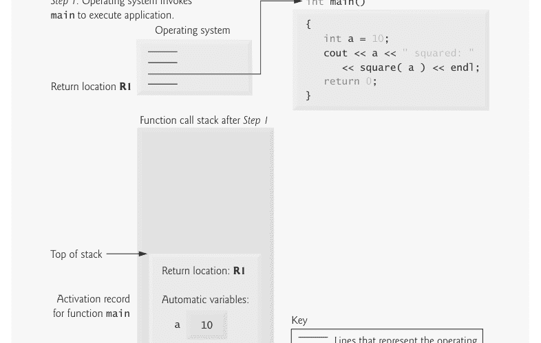

Fig. 6.13 | Function call stack after the operating system invokes `main`.

操作系统（即转移到返回地址 `R1`）并包含 `main` 的自动变量的空间（即 `a`，初始化为 10）。

函数 `main`——在返回操作系统之前——现在在图 6.12 的第 15 行调用函数 `square`。这会导致 `square` 的栈帧（第 20–23 行）被压入函数调用栈（图 6.14）。该栈帧包含 `square` 需要返回给 `main` 的返回地址（即 `R2`）以及 `square` 自动变量（即 `x`）的内存。

在 `square` 计算其参数的平方后，函数需要返回给 `main`——并且不再需要其自动变量 `x` 的内存。因此栈被弹出——给 `square` `main` 中的返回位置（即 `R2`）并丢失 `square` 的自动变量。图 6.15 显示了在 `square` 的激活记录被弹出后函数调用栈。

函数 `main` 现在显示调用 `square` 的结果（第 15 行），然后执行 `return` 语句（第 16 行）。这会导致 `main` 的激活记录从栈中弹出。这给 `main` 它需要返回到操作系统的地址（即图 6.13 中的 `R1`）并导致 `main` 的自动变量（即 `a`）的内存变得不可用。

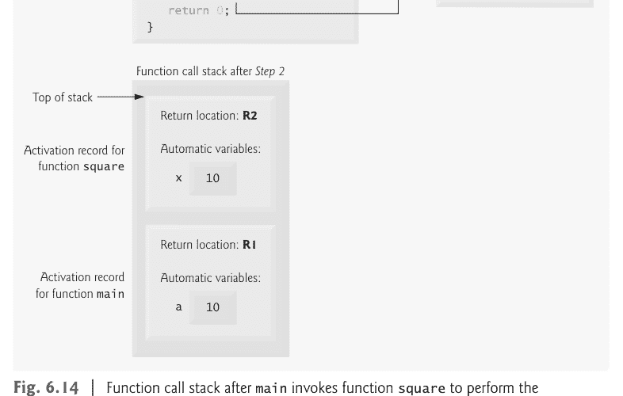

Fig. 6.14 | Function call stack after `main` invokes function `square` to perform the calculation.

Fig. 6.15 | Function call stack after function `square` returns to `main`.

## 6.12 空参数列表的函数

在 C++ 中，空参数列表是通过在括号中写入 `void` 或什么都不写来指定的。原型

```
void print();
```

指定函数 `print` 不接受参数且不返回值。图 6.16 演示了声明和使用空参数列表函数的两种方法。

```
1  // Fig. 6.16: fig06_16.cpp
2  // Functions that take no arguments.
3  #include <iostream>
4  using std::cout;
5  using std::endl;
6
7  void function1(); // function that takes no arguments
8  void function2( void ); // function that takes no arguments
```

Fig. 6.16 | Functions that take no arguments. (Part 1 of 2.)

```
9
10 int main()
11 {
12     function1(); // call function1 with no arguments
13     function2(); // call function2 with no arguments
14     return 0; // indicates successful termination
15 } // end main
16
17 // function1 uses an empty parameter list to specify that
18 // the function receives no arguments
19 void function1()
20 {
21     cout << "function1 takes no arguments" << endl;
22 } // end function1
23
24 // function2 uses a void parameter list to specify that
25 // the function receives no arguments
26 void function2( void )
27 {
28     cout << "function2 also takes no arguments" << endl;
29 } // end function2
```

```
function1 takes no arguments
function2 also takes no arguments
```

Fig. 6.16 | Functions that take no arguments. (Part 2 of 2.)

### Portability Tip 6.2


> C++ 中空函数参数列表的含义与 C 中截然不同。在 C 中，它意味着所有参数检查都被禁用（即函数调用可以传递任何参数）。在 C++ 中，它意味着函数明确不接受参数。因此，使用此功能的 C 程序在用 C++ 编译时可能会导致编译错误。

### Common Programming Error 6.13

> 除非为每个函数提供函数原型或每个函数在被调用前已定义，否则 C++ 程序不会编译。

## 6.13 内联函数

从软件工程的角度来看，将程序实现为一组函数是好的，但函数调用涉及执行时开销。C++ 提供了内联函数来帮助减少函数调用开销——尤其是对于小型函数。在函数定义中将限定符 `inline` 放在函数的返回类型之前，“建议”编译器在适当时在原地生成函数代码的副本以避免函数调用。权衡是程序中插入了函数的多个代码副本（通常使程序变大），而不是每次调用函数时都传递控制权到函数的单个副本。编译器可以忽略 `inline` 限定符，并且通常对除最小函数之外的所有函数都这样做。

```
22    // calculate cube of sideValue and display result
23    cout << "Volume of cube with side "
24        << sideValue << " is " << cube( sideValue ) << endl;
25    return 0; // indicates successful termination
26 } // end main
```

```
Enter the side length of your cube: 3.5
Volume of cube with side 3.5 is 42.875
```

Fig. 6.17 | `inline` function that calculates the volume of a cube. (Part 2 of 2.)

## 6.14 References and Reference Parameters

Two ways to pass arguments to functions in many programming languages are pass-by-value and pass-by-reference. When an argument is passed by value, a copy of the argument’s value is made and passed (on the function call stack) to the called function. Changes to the copy do not affect the original variable’s value in the caller. This prevents the accidental side effects that so greatly hinder the development of correct and reliable software systems. Each argument that has been passed in the programs in this chapter so far has been passed by value.

### Performance Tip 6.5

One disadvantage of pass-by-value is that, if a large data item is being passed, copying that data can take a considerable amount of execution time and memory space.

### Reference Parameters

This section introduces reference parameters—the first of the two means C++ provides for performing pass-by-reference. With pass-by-reference, the caller gives the called function the ability to access the caller’s data directly, and to modify that data if the called function chooses to do so.

### Performance Tip 6.6

Pass-by-reference is good for performance reasons, because it can eliminate the pass-by-value overhead of copying large amounts of data.

### Software Engineering Observation 6.11

Pass-by-reference can weaken security, because the called function can corrupt the caller’s data.

Later, we’ll show how to achieve the performance advantage of pass-by-reference while simultaneously achieving the software engineering advantage of protecting the caller’s data from corruption.

A reference parameter is an alias for its corresponding argument in a function call. To indicate that a function parameter is passed by reference, simply follow the parameter’s type in the function prototype by an ampersand (`&`); use the same convention when listing the parameter’s type in the function header. For example, the following declaration in a function header

```
int &count
```

when read from right to left is pronounced “`count` is a reference to an `int`.” In the function call, simply mention the variable by name to pass it by reference. Then, mentioning the variable by its parameter name in the body of the called function actually refers to the original variable in the calling function, and the original variable can be modified directly by the called function. As always, the function prototype and header must agree.

### Passing Arguments by Value and by Reference

Figure 6.18 compares pass-by-value and pass-by-reference with reference parameters. The “styles” of the arguments in the calls to function `squareByValue` and function `squareByReference` are identical—both variables are simply mentioned by name in the function calls. Without checking the function prototypes or function definitions, it is not possible to tell from the calls alone whether either function can modify its arguments. Because function prototypes are mandatory, the compiler has no trouble resolving the ambiguity.

```
// Fig. 6.18: fig06_18.cpp
// Comparing pass-by-value and pass-by-reference with references.
#include <iostream>
using std::cout;
using std::endl;

int squareByValue( int ); // function prototype (value pass)
void squareByReference( int & ); // function prototype (reference pass)

int main()
{
    int x = 2; // value to square using squareByValue
    int z = 4; // value to square using squareByReference

    // demonstrate squareByValue
    cout << "x = " << x << " before squareByValue\n";
    cout << "Value returned by squareByValue: "
         << squareByValue( x ) << endl;
    cout << "x = " << x << " after squareByValue\n" << endl;

    // demonstrate squareByReference
    cout << "z = " << z << " before squareByReference" << endl;
    squareByReference( z );
    cout << "z = " << z << " after squareByReference" << endl;
    return 0; // indicates successful termination
} // end main

// squareByValue multiplies number by itself, stores the
// result in number and returns the new value of number
int squareByValue( int number )
{
    return number *= number; // caller's argument not modified
} // end function squareByValue
```

```
int count = 1; // declare integer variable count
int &cRef = count; // create cRef as an alias for count
cRef++; // increment count (using its alias cRef)
```

increments variable `count` by using its alias `cRef`. Reference variables must be initialized in their declarations (see Fig. 6.19 and Fig. 6.20) and cannot be reassigned as aliases to other variables. Once a reference is declared as an alias for another variable, all operations supposedly performed on the alias (i.e., the reference) are actually performed on the original variable. The alias is simply another name for the original variable. Taking the address of a reference and comparing references do not cause syntax errors; rather, each operation actually occurs on the variable for which the reference is an alias. Unless it is a reference to a constant, a reference argument must be an `lvalue` (e.g., a variable name), not a constant or expression that returns an `rvalue` (e.g., the result of a calculation). See Section 5.9 for definitions of the terms `lvalue` and `rvalue`.

```
1  // Fig. 6.19: fig06_19.cpp
2  // References must be initialized.
3  #include <iostream>
4  using std::cout;
5  using std::endl;
6
7  int main()
8  {
9      int x = 3;
10     int &y = x; // y refers to (is an alias for) x
11
12     cout << "x = " << x << endl << "y = " << y << endl;
13     y = 7; // actually modifies x
14     cout << "x = " << x << endl << "y = " << y << endl;
15     return 0; // indicates successful termination
16 } // end main
```

```
x = 3
y = 3
x = 7
y = 7
```

Fig. 6.19 | Initializing and using a reference.

```
1  // Fig. 6.20: fig06_20.cpp
2  // References must be initialized.
3  #include <iostream>
4  using std::cout;
5  using std::endl;
6
7  int main()
8  {
9      int x = 3;
10     int &y; // Error: y must be initialized
11
12     cout << "x = " << x << endl << "y = " << y << endl;
13     y = 7;
14     cout << "x = " << x << endl << "y = " << y << endl;
15     return 0; // indicates successful termination
16 } // end main
```

*Borland C++ command-line compiler error message:*

```
Error E2304 C:\cppfp_examples\ch06\Fig06_20\fig06_20.cpp 10:
    Reference variable 'y' must be initialized in function main()
```

*Microsoft Visual C++ compiler error message:*

```
C:\cppfp_examples\ch06\Fig06_20\fig06_20.cpp(10) : error C2530: 'y' :
    references must be initialized
```

*GNU C++ compiler error message:*

```
fig06_20.cpp:10: error: 'y' declared as a reference but not initialized
```

**Fig. 6.20** | Uninitialized reference causes a syntax error. (Part 2 of 2.)

## Returning a Reference from a Function


Functions can return references, but this can be dangerous. When returning a reference to a variable declared in the called function, the variable should be declared `static` within that function. Otherwise, the reference refers to an automatic variable that is discarded when the function terminates; such a variable is said to be “undefined,” and the program’s behavior is unpredictable. References to undefined variables are called **dangling references**.


### Common Programming Error 6.15

> Not initializing a reference variable when it is declared is a compilation error, unless the declaration is part of a function’s parameter list. Reference parameters are initialized when the function in which they are declared is called.


### Common Programming Error 6.16

> Attempting to reassign a previously declared reference to be an alias to another variable is a logic error. The value of the other variable is simply assigned to the variable for which the reference is already an alias.


### Common Programming Error 6.17

> Returning a reference to an automatic variable in a called function is a logic error. Some compilers issue a warning when this occurs.

## Error Messages for Uninitialized References

The C++ standard does not specify the error messages that compilers use to indicate particular errors. For this reason, Fig. 6.20 shows the error messages produced by the Borland C++ command-line compiler, Microsoft Visual C++ compiler and GNU C++ compiler when a reference is not initialized.

## 6.15 默认实参

程序对特定形参反复使用同一实参值来调用函数的情况并不少见。在这种情况下，你可以指定该形参具有默认实参，即传递给该形参的默认值。当程序在函数调用中省略具有默认实参的某个参数时，编译器会重写该函数调用，并插入该参数的默认值。

默认实参必须是函数形参列表中最右边（末尾）的实参。当调用具有两个或更多默认实参的函数时，如果省略的实参并非实参列表中最右边的实参，那么该实参右边的所有实参也必须一并省略。默认实参必须在函数名首次出现时指定——通常是在函数原型中。如果由于函数定义本身兼作原型而省略了函数原型，则应在函数头中指定默认实参。默认值可以是任何表达式，包括常量、全局变量或函数调用。默认实参也可以用于内联函数。

图 6.21 演示了在计算盒子的体积时如何使用默认实参。`boxVolume` 的函数原型（第 8 行）指定所有三个形参的默认值都为 1。请注意，为了可读性，我们在函数原型中提供了变量名。和往常一样，函数原型中并不需要变量名。

### 常见编程错误 6.18

> 在函数原型和函数头中同时指定默认实参是编译错误。

```
// Fig. 6.21: fig06_21.cpp
// Using default arguments.
#include <iostream>
using std::cout;
using std::endl;

// function prototype that specifies default arguments
int boxVolume( int length = 1, int width = 1, int height = 1 );

int main()
{
    // no arguments--use default values for all dimensions
    cout << "The default box volume is: " << boxVolume();

    // specify length; default width and height
    cout << "\n\nThe volume of a box with length 10,\n"
         << "width 1 and height 1 is: " << boxVolume( 10 );

    // specify length and width; default height
    cout << "\n\nThe volume of a box with length 10,\n"
         << "width 5 and height 1 is: " << boxVolume( 10, 5 );
```

```
// specify all arguments
cout << "\n\nThe volume of a box with length 10,\n"
    << "width 5 and height 2 is: " << boxVolume( 10, 5, 2 )
    << endl;
return 0; // indicates successful termination
} // end main

// function boxVolume calculates the volume of a box
int boxVolume( int length, int width, int height )
{
    return length * width * height;
} // end function boxVolume
```

默认盒体积为：1

长度为 10、

宽度为 1 且高度为 1 的盒子的体积为：10

长度为 10、

宽度为 5 且高度为 1 的盒子的体积为：50

长度为 10、

宽度为 5 且高度为 2 的盒子的体积为：100

图 6.21 | 函数的默认实参。（第 2 部分，共 2 部分）

对 `boxVolume` 的第一次调用（第 13 行）未指定任何实参，因此使用了全部三个默认值 1。第二次调用（第 17 行）只传递了长度实参，因此宽度和高度实参使用默认值 1。第三次调用（第 21 行）只为长度和宽度传递了实参，因此高度实参使用默认值 1。最后一次调用（第 25 行）为长度、宽度和高度都传递了实参，因此没有使用默认值。请注意，显式传递给函数的任何实参都按从左到右的顺序赋给函数的形参。因此，当 `boxVolume` 接收到一个实参时，函数会将该实参的值赋给其长度形参（即形参列表中最左边的形参）。当 `boxVolume` 接收到两个实参时，函数按顺序将这些实参的值赋给其长度和宽度形参。最后，当 `boxVolume` 接收到全部三个实参时，函数将这些实参的值分别赋给其长度、宽度和高度形参。

### 良好编程习惯 6.6

使用默认实参可以简化函数调用的编写。然而，有些程序员认为显式指定所有实参更清晰。

### 软件工程观察 6.14

如果函数的默认值发生更改，则所有使用该函数的客户端代码都必须重新编译。

### 常见编程错误 6.19

指定并试图使用一个不是最右边（末尾）实参的默认实参（同时未将所有最右边的实参都设默认值）是语法错误。

## 6.16 一元作用域解析运算符

可以声明同名局部变量和全局变量。C++ 提供了*一元作用域解析运算符（::）*来在存在同名局部变量的作用域中访问全局变量。一元作用域解析运算符不能用于访问外层块中同名的局部变量。如果全局变量的名字与作用域中的局部变量名不同，则可以直接访问全局变量，而无需使用一元作用域解析运算符。

图 6.22 演示了带有同名局部变量和全局变量的一元作用域解析运算符（第 7 行和第 11 行）。为了强调变量 `number` 的局部版本和全局版本是不同的，程序声明了一个 `int` 类型变量和一个 `double` 类型变量。

当某个变量名唯一的变量是全局变量时，对该变量名使用一元作用域解析运算符（::）是可选的。

### 常见编程错误 6.20

> 试图使用一元作用域解析运算符（::）访问外层块中的非全局变量是错误的。如果不存在同名的全局变量，则会发生编译错误。如果存在同名的全局变量，则这是逻辑错误，因为当你打算访问外层块中的非全局变量时，程序将引用全局变量。

### 良好编程习惯 6.7

> 始终使用一元作用域解析运算符（::）来引用全局变量，可以使程序更易于阅读和理解，因为这清楚地表明你意在访问全局变量，而非非全局变量。

```
// Fig. 6.22: fig06_22.cpp
// Using the unary scope resolution operator.
#include <iostream>
using std::cout;
using std::endl;

int number = 7; // global variable named number

int main()
{
    double number = 10.5; // local variable named number

    // display values of local and global variables
    cout << "Local double value of number = " << number
        << "\nGlobal int value of number = " << ::number << endl;
    return 0; // indicates successful termination
} // end main
```

局部变量 `number` 的 `double` 值 = 10.5  

全局变量 `number` 的 `int` 值 = 7

图 6.22 | 一元作用域解析运算符。

### 软件工程观察 6.15

始终使用一元作用域解析运算符（::）来引用全局变量，可以通过减少与非全局变量发生名称冲突的风险，使程序更容易修改。

### 错误预防提示 6.3

始终使用一元作用域解析运算符（::）来引用全局变量，可以消除可能因非全局变量隐藏全局变量而出现的逻辑错误。

### 错误预防提示 6.4

避免在程序中将同名变量用于不同用途。尽管在某些情况下允许这样做，但它可能导致错误。

## 6.17 函数重载

C++ 允许定义多个同名函数，只要这些函数具有不同的签名。这种能力称为函数重载。当调用一个重载函数时，C++ 编译器通过检查调用中实参的数量、类型和顺序来选择适当的函数。函数重载通常用于创建几个同名函数，它们执行类似的任务，但针对不同的数据类型。例如，数学库中的许多函数针对不同的数值数据类型进行了重载——C++ 标准要求第 6.3 节讨论的数学库函数具有 `float`、`double` 和 `long double` 重载版本。

### 良好编程习惯 6.8

对执行密切关联任务的功能进行重载，可以使程序更具可读性和易于理解。

### 重载的 square 函数

图 6.23 使用重载的 `square` 函数来计算 `int` 的平方（第 8–12 行）和 `double` 的平方（第 15–19 行）。第 23 行通过传递整型字面值 7 来调用函数 `square` 的 `int` 版本。默认情况下，C++ 将整数字面值视为 `int` 类型。类似地，第 25 行通过传递字面值 7.5 来调用函数 `square` 的 `double` 版本，C++ 默认将其视为 `double` 值。在每种情况下，编译器都根据实参的类型选择合适的函数进行调用。输出窗口的最后两行证实了在每种情况下都调用了正确的函数。

```
// Fig. 6.23: fig06_23.cpp
// Overloaded functions.
#include <iostream>
using std::cout;
using std::endl;

// function square for int values
int square( int x )
{
```

图 6.23 | 重载的 `square` 函数。（第 1 部分，共 2 部分）

```
cout << "square of integer " << x << " is ";
return x * x;
} // end function square with int argument

// function square for double values
double square( double y )
{
cout << "square of double " << y << " is ";
return y * y;
} // end function square with double argument

int main()
{
cout << square( 7 ); // calls int version
cout << endl;
cout << square( 7.5 ); // calls double version
cout << endl;
return 0; // indicates successful termination
} // end main
```

`square of integer 7 is 49`

`square of double 7.5 is 56.25`

Fig. 6.23 | Overloaded square functions. (Part 2 of 2.)

## How the Compiler Differentiates Overloaded Functions

重载函数通过其签名来区分。签名是函数名称与其参数类型（按顺序）的组合。编译器使用其参数的数量和类型对每个函数标识符进行编码（有时称为名称改编或名称修饰），以实现类型安全的链接。类型安全链接确保调用正确的重载函数，并且参数的类型符合参数的类型。

图 6.24 是使用 Borland C++ 5.6.4 命令行编译器编译的。与我们通常的做法不同，我们没有显示程序的执行输出，而是显示了 Borland C++ 在汇编语言中产生的改编函数名。每个改编名称以 @ 开头，后跟函数名。函数名随后与改编的参数列表由 `$q` 分隔。在函数 `nothing2` 的参数列表中（第 25 行；参见第四行输出），`c` 代表 `char`，`i` 代表 `int`，`rf` 代表 `float &`（即 `float` 的引用）而 `rd` 代表 `double &`（即 `double` 的引用）。在函数 `nothing1` 的参数列表中，`i` 代表 `int`，`f` 代表 `float`，`c` 代表 `char` 而 `ri` 代表 `int &`。两个 `square` 函数通过其参数列表区分；一个指定 `d` 代表 `double`，另一个指定 `i` 代表 `int`。函数的返回类型未在改编名称中指定。重载函数可以具有不同的返回类型，但如果有，它们也必须具有不同的参数列表。再次强调，你不能有两个具有相同签名但返回类型不同的函数。请注意，函数名称改编是编译器特定的。另请注意，函数 `main` 未被改编，因为它不能被重载。

```
// Fig. 6.24: fig06_24.cpp
// Name mangling.

// function square for int values
int square( int x )
{
return x * x;
} // end function square

// function square for double values
double square( double y )
{
return y * y;
} // end function square

// function that receives arguments of types
// int, float, char and int &
void nothing1( int a, float b, char c, int &d )
{
// empty function body
} // end function nothing1

// function that receives arguments of types
// char, int, float & and double &
```


```
int nothing2( char a, int b, float &c, double &d )

{

    return 0;

} // end function nothing2

int main()

{

    return 0; // indicates successful termination

} // end main

@square$qi
@square$qd
@nothing1$gifcri
@nothing2$qcifr d
_main
```

Fig. 6.24 | Name mangling to enable type-safe linkage.

## Common Programming Error 6.21

创建具有相同参数列表但返回类型不同的重载函数是编译错误。

编译器仅使用参数列表来区分同名函数。重载函数不必具有相同数量的参数。在使用默认参数重载函数时应谨慎，因为这可能导致歧义。

## Common Programming Error 6.22

> 一个省略了默认参数的函数可能与另一个重载函数被相同地调用；这是编译错误。例如，在程序中同时存在一个显式不接受参数的函数和一个同名且所有参数都有默认值的函数，当尝试使用该函数名在不传递参数的调用中使用时会导致编译错误。编译器不知道选择哪个版本的函数。

## Overloaded Operators

在第 11 章中，我们讨论如何重载运算符以定义它们在用户定义数据类型对象上的操作方式。（事实上，到目前为止我们一直在使用许多重负载运算符，包括流插入运算符 `<<` 和流提取运算符 `>>`，两者都被重载以能够显示所有基本类型的数据。我们将在第 11 章中更详细地讨论重载 `<<` 和 `>>` 以处理用户定义类型对象。）第 6.18 节介绍了函数模板，用于自动生成在不同数据类型上执行相同任务的重载函数。

## 6.18 Function Templates

重载函数通常用于执行涉及不同程序逻辑的相似操作，针对不同数据类型。如果程序逻辑和操作对每种数据类型都相同，则可以使用函数模板更紧凑、更方便地进行重载。你编写单个函数模板定义。给定对该函数调用提供的参数类型，C++ 会自动生成单独的函数模板特化，以适当处理每种类型的调用。因此，定义单个函数模板本质上定义了一组重载函数。

图 6.25 包含一个函数模板的定义（第 4–18 行），用于确定三个值中最大值的 `maximum` 函数。所有函数模板定义都以 `template` 关键字开头（第 4 行），后跟用尖括号（`<` 和 `>`）括起来的函数模板的参数列表。模板参数列表中的每个参数（通常称为 *形式类型参数*）前面都有关键字 `type-name` 或关键字 `class`（两者是同义词）。形式类型参数是基本类型或用户定义类型的占位符。这些占位符用于指定函数的参数类型（第 5 行）、指定函数的返回类型（第 5 行）以及在函数定义体内部声明变量（第 7 行）。函数模板像任何其他函数一样定义，但使用形式类型参数作为实际数据类型的占位符。

图 6.25 中的函数模板声明单个形式类型参数 `T`（第 4 行），作为 `maximum` 要测试的数据类型的占位符。类型参数的名称必须在特定模板定义的模板参数列表中唯一。当编译器在程序源代码中检测到 `maximum` 调用时，传递给 `maximum` 的数据的类型将被替换为模板定义中所有的 `T`，并且 C++ 会创建一个用于确定指定数据类型三个值的最大值的完整函数。然后编译新创建的函数。因此，模板是代码生成的手段。

## Common Programming Error 6.23

> 未在函数模板的每个形式类型参数前放置关键字 `class` 或关键字 `typename`（例如，写成 `<class S, T>` 而不是 `<class S, class T>`）是语法错误。

图 6.26 使用 `maximum` 函数模板（第 20、30 和 40 行）分别确定三个 `int` 值、三个 `double` 值和三个 `char` 值中的最大值。

```
// Fig. 6.25: maximum.h
// Definition of function template maximum.

template < class T > // or template< typename T >
T maximum( T value1, T value2, T value3 )
{
    T maximumValue = value1; // assume value1 is maximum

    // determine whether value2 is greater than maximumValue
    if ( value2 > maximumValue )
        maximumValue = value2;

    // determine whether value3 is greater than maximumValue
    if ( value3 > maximumValue )
        maximumValue = value3;

    return maximumValue;
} // end function template maximum
```

Fig. 6.25 | Function template `maximum` header file.

## Common Programming Error 6.23

> Not placing keyword `class` or keyword `typename` before every formal type parameter of a function template (e.g., writing `<class S, T>` instead of `<class S, class T>`) is a syntax error.

Figure 6.26 uses the `maximum` function template (lines 20, 30 and 40) to determine the largest of three `int` values, three `double` values and three `char` values, respectively.

```
// Fig. 6.26: fig06_26.cpp
// Function template maximum test program.
#include <iostream>
using std::cout;
using std::cin;
using std::endl;

#include "maximum.h" // include definition of function template maximum

int main()
{
   // demonstrate maximum with int values
   int int1, int2, int3;

   cout << "Input three integer values: ";
   cin >> int1 >> int2 >> int3;

   // invoke int version of maximum
   cout << "The maximum integer value is: "
        << maximum( int1, int2, int3 );

   // demonstrate maximum with double values
   double double1, double2, double3;

   cout << "\n\nInput three double values: ";
   cin >> double1 >> double2 >> double3;
```

**Fig. 6.26** | Demonstrating function template `maximum`. (Part 1 of 2.)

```
27
28 // invoke double version of maximum
29 cout << "The maximum double value is: "
30     << maximum( double1, double2, double3 );
31
32 // demonstrate maximum with char values
33 char char1, char2, char3;
34
35 cout << "\n\nInput three characters: ";
36 cin >> char1 >> char2 >> char3;
37
38 // invoke char version of maximum
39 cout << "The maximum character value is: "
40     << maximum( char1, char2, char3 ) << endl;
41   return 0; // indicates successful termination
42 } // end main
```

```
Input three integer values: 1 2 3
The maximum integer value is: 3

Input three double values: 3.3 2.2 1.1
The maximum double value is: 3.3

Input three characters: A C B
The maximum character value is: C
```

Fig. 6.26 | Demonstrating function template `maximum`. (Part 2 of 2.)

在图 6.26 中，行 20、30 和 40 中的调用会创建三个函数——分别期望三个 `int` 值、三个 `double` 值和三个 `char` 值。为类型 `int` 创建的函数模板特化将 `T` 的每个出现替换为 `int`，如下所示：

```
int maximum( int value1, int value2, int value3 )
{
    int maximumValue = value1;

    // determine whether value2 is greater than maximumValue
    if ( value2 > maximumValue )
        maximumValue = value2;

    // determine whether value3 is greater than maximumValue
    if ( value3 > maximumValue )
        maximumValue = value3;

    return maximumValue;
} // end function template maximum
```

## 6.19 Recursion

我们讨论过的程序通常被结构化为以有纪律、分层的方式相互调用的函数。对于某些问题，让函数调用自身是有用的。**递归函数**是直接或间接通过另一个函数调用自身的函数。[*注意：尽管许多编译器允许函数 `main` 调用自身，但 C++ 标准文档第 3.6.1 节第 3 段和第 5.2.2 节第 9 段指出 `main` 不应在程序中被调用或递归调用。其唯一目的是作为程序执行的起点。*] 本节和下一节介绍了递归的简单示例。

我们首先从概念上考虑递归，然后检查包含递归函数的两个程序。递归问题求解方法有许多共同的元素。调用递归函数来解决一个问题。该函数实际上只知道如何解决最简单的情况，即所谓的 *基本情况*。如果函数被调用时为基本情况，函数只需返回一个结果。如果函数被调用时为更复杂的问题，它通常会将问题分为两个概念部分——函数知道如何处理的部分和不知道如何处理的部分。为了使递归可行，后一部分必须类似于原始问题，但是一个稍微简单或稍微小一点的版本。这个新问题看起来像原始问题，因此函数启动（调用）一个全新的自身副本来处理较小的问题——这被称为**递归调用**，也称为**递归步骤**。递归步骤通常包含关键字 `return`，因为其结果将与函数已知如何解决的问题部分结合，形成一个结果，该结果将被传回给原始调用者，可能为 `main`。

递归步骤在对函数的原始调用仍“开放”时执行，即尚未完成执行。递归步骤可能导致许多更多此类递归调用，因为函数不断将每次新子问题划分为两个概念部分。为了使递归最终终止，每次函数用原始问题的稍微简单版本调用自身时，这个越来越小的序列必须最终收敛于基本情况。在那一点，函数识别出基本情况并向前一个函数副本返回结果，随后一系列返回会一直延续到链的顶端，直到原始函数调用最终向 `main` 返回最终结果。所有这一切听起来与我们到目前为止使用的“常规”问题求解相比相当奇特。作为这些概念的示例，让我们编写一个递归程序来执行一个流行的数学计算。

非负整数 *n* 的阶乘，写为 *n!*（读作“*n* 阶乘”），是乘积

$$n \cdot (n - 1) \cdot (n - 2) \cdot \ldots \cdot 1$$

其中 1! 等于 1，且 0! 定义为 1。例如，5! 是乘积 5 · 4 · 3 · 2 · 1，等于 120。

大于或等于 0 的整数 `number` 的阶乘可以通过使用 `for` 语句以 *迭代*（非递归）方式计算，如下所示：

```cpp
factorial = 1;

for ( int counter = number; counter >= 1; counter-- )

    factorial *= counter;
```

阶乘函数的递归定义是通过观察以下代数关系得到的：

$n! = n \cdot (n - 1)!$

例如，5! 显然等于 5 · 4!，如下所示：

```
5! = 5 · 4 · 3 · 2 · 1
5! = 5 · (4 · 3 · 2 · 1)
5! = 5 · (4!)
```

5! 的求值过程如 Fig. 6.27 所示。图 6.27(a) 显示了递归调用的连续过程，直到 1! 被求值为 1，从而终止递归。图 6.27(b) 显示了从每次递归调用返回给其调用者的值，直到计算出最终值并返回。

图 6.28 的程序使用递归计算并打印 0–10 的整数阶乘。（数据类型 `unsigned long` 的选择稍后会解释。）递归函数 `factorial`（行 23–29）首先确定终止条件 `number <= 1`（行 25）是否为真。如果 `number` 小于或等于 1，`factorial` 返回 1（行 26），无需进一步递归，函数终止。如果 `number` 大于 1，行 28 将问题表达为 `number` 与对 `factorial` 的递归调用的乘积，该调用计算 `number − 1` 的阶乘。请注意，`factorial(number − 1)` 是比原始计算 `factorial(number)` 稍微简单的问题。

函数 `factorial` 已声明为接收类型为 `unsigned long` 的参数并返回类型为 `unsigned long` 的结果。这是 unsigned long

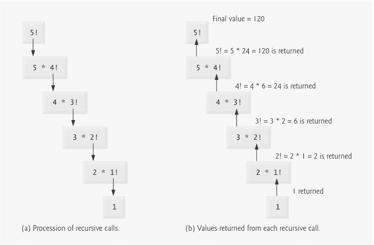

**Fig. 6.27** | Recursive evaluation of 5!.

```
// Fig. 6.28: fig06_28.cpp
// Demonstrating the recursive function factorial.
#include <iostream>
using std::cout;
using std::endl;
#include <iomanip>
using std::setw;

unsigned long factorial( unsigned long ); // function prototype

int main()
{
    // calculate the factorials of 0 through 10
    for ( int counter = 0; counter <= 10; counter++ )
        cout << setw( 2 ) << counter << "! = " << factorial( counter )
            << endl;

    return 0; // indicates successful termination
} // end main

// recursive definition of function factorial
unsigned long factorial( unsigned long number )
{
    if ( number <= 1 ) // test for base case
        return 1; // base cases: 0! = 1 and 1! = 1
    else // recursion step
        return number * factorial( number - 1 );
} // end function factorial
```

```
0! = 1
1! = 1
2! = 2
3! = 6
4! = 24
5! = 120
6! = 720
7! = 5040
8! = 40320
9! = 362880
10! = 3628800
```


## Fig. 6.28 | Demonstrating the recursive function `factorial`

`int` 的简写。C++ 标准要求类型为 `unsigned long int` 的变量至少与 `int` 一样大。通常，`unsigned long int` 存储在至少四个字节（32 位）中；这样的变量可以保存 0 到至少 4294967295 范围内的值。（数据类型 `long int` 也存储在至少四个字节中，可以保存至少在范围 −2147483648 到 2147483647 的值。）

如 Fig. 6.28 所见，阶乘值增长得非常快。我们选择数据类型 `unsigned long`，以便程序可以在具有小（例如两字节）整数的计算机上计算大于 `7!` 的阶乘。不幸的是，`factorial` 函数产生的数值增长得如此之快，以至于即使是 `unsigned long` 也无法帮助我们在超过 `unsigned long` 变量大小之前计算出许多阶乘值。

```cpp
// Fig. 6.29: fig06_29.cpp
// Testing the recursive fibonacci function.
#include <iostream>
using std::cout;
using std::cin;
using std::endl;

unsigned long fibonacci( unsigned long ); // function prototype

int main()
{
    // calculate the fibonacci values of 0 through 10
    for ( int counter = 0; counter <= 10; counter++ )
        cout << "fibonacci( " << counter << " ) = "
             << fibonacci( counter ) << endl;

    // display higher fibonacci values
    cout << "fibonacci( 20 ) = " << fibonacci( 20 ) << endl;
    cout << "fibonacci( 30 ) = " << fibonacci( 30 ) << endl;
    cout << "fibonacci( 35 ) = " << fibonacci( 35 ) << endl;
    return 0; // indicates successful termination
} // end main

// recursive method fibonacci
unsigned long fibonacci( unsigned long number )
{
    if ( ( number == 0 ) || ( number == 1 ) ) // base cases
        return number;
    else // recursion step
        return fibonacci( number - 1 ) + fibonacci( number - 2 );
} // end function fibonacci
```

```text
fibonacci( 0 ) = 0
fibonacci( 1 ) = 1
fibonacci( 2 ) = 1
fibonacci( 3 ) = 2
fibonacci( 4 ) = 3
fibonacci( 5 ) = 5
fibonacci( 6 ) = 8
fibonacci( 7 ) = 13
fibonacci( 8 ) = 21
fibonacci( 9 ) = 34
fibonacci( 10 ) = 55
fibonacci( 20 ) = 6765
fibonacci( 30 ) = 832040
fibonacci( 35 ) = 9227465
```

**Fig. 6.29 |** Demonstrating function `fibonacci`.

本图提出了关于 C++ 编译器将如何计算运算符操作数的顺序的一些有趣问题。这与运算符应用于其操作数的顺序是不同的问题，即由运算符优先级和结合性规则所规定的顺序。图 6.30 显示了计算 `fibonacci( 3 )` 会导致两次递归调用，即 `fibonacci(2)` 和 `fibonacci(1)`。但这些调用的顺序是什么？

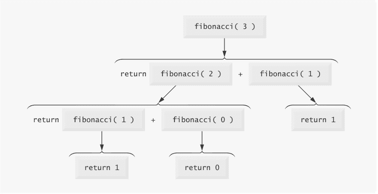

**Fig. 6.30 |** Set of recursive calls to function `fibonacci`.

大多数程序员简单地假设操作数按从左到右的顺序计算。C++ 并未规定大多数运算符（包括 `+`）的操作数应按何种顺序计算。因此，你不能对这些调用执行的顺序做出任何假设。调用实际上可能先执行 `fibonacci(2)`，然后执行 `fibonacci(1)`，或者按相反顺序执行：`fibonacci(1)`，然后 `fibonacci(2)`。在此程序以及大多数其他程序中，最终结果会相同。然而，在某些程序中，操作数的求值可能会产生副作用（对数据值进行更改），这可能会影响表达式的最终结果。

C++ 仅规定了四个运算符的操作数求值顺序——即 `&&`、`||`、逗号（`,`）运算符和 `?:`。前三个是保证其两个操作数按从左到右求值的二元运算符。最后一个运算符是 C++ 唯一的 ternary 运算符。其最左操作数总是首先求值；如果求值为非零（真），则接下来求值中间操作数，最后一个操作数被忽略；如果最左操作数求值为零（假），则接下来求值第三个操作数，中间操作数被忽略。

> **Common Programming Error 6.25**
>
> 编写依赖于除 `&&`、`||`、`?:` 和逗号（`,`）运算符之外的运算符操作数求值顺序的程序可能会导致逻辑错误。

> **Portability Tip 6.3**
>
> 依赖于除 `&&`、`||`、`?:` 和逗号（`,`）运算符之外的运算符操作数求值顺序的程序在不同编译器的系统上可能会以不同的方式运行。

需要谨慎的是，递归程序如我们在此用来生成斐波那契数的程序。函数 `fibonacci` 中的每个递归层级对函数调用的数量都有倍增效应；即，计算第 *n* 个斐波那契数所需的递归调用数量的数量级为 `2^n`。这很快就会失控。仅计算第 20 个斐波那契数就需要数量级为 `2^20` 或约一百万次调用，计算第 30 个斐波那契数就需要数量级为 `2^30` 或约十亿次调用，等等。计算机科学家将此称为**指数复杂度**。此类问题甚至会让世界上最强大的计算机也感到谦卑！

> **Performance Tip 6.8**
>
> 避免导致调用“爆炸”的斐波那契式递归程序，即指数级增长。

# 6.21 Recursion vs. Iteration

在前两个小节中，我们研究了两种函数，它们可以很容易地以递归或迭代方式实现。本节比较了两种方法，并讨论了在特定情况下为何你可能会选择一种方法而非另一种。

迭代和递归都基于控制语句：迭代使用重复结构；递归使用选择结构。迭代和递归都涉及重复：迭代显式使用重复结构；递归通过重复的函数调用实现重复。迭代和递归都涉及终止测试：迭代在循环继续条件失败时终止；递归在识别到基本情况时终止。

带计数器控制重复的迭代和递归都逐渐接近终止：迭代修改计数器，直到计数器假设一个使循环继续条件失败的值；递归产生原始问题的更简单版本，直到达到基本情况。迭代和递归都可能无限进行：迭代如果循环继续测试永远不为假，则会发生无限循环；如果递归步骤在每次递归调用中没有以收敛于基本情况的方式减小问题，则会发生无限递归。

为了说明迭代和递归之间的差异，让我们检查阶乘问题的迭代解法（图 6.31）。请注意，使用了重复语句（图 6.31 的第 28–29 行），而不是递归解法的选择语句（图 6.28 的第 24–27 行）。请注意，两种解法都使用终止测试。在递归解法中，第 24 行测试基本情况。在迭代解法中，第 28 行测试循环继续条件——如果测试失败，循环终止。最后，请注意，迭代解法不是产生原始问题的更简单版本，而是使用一个在循环继续条件变为假之前被修改的计数器。

```cpp
// Fig. 6.31: fig06_31.cpp

// Testing the iterative factorial function.

#include <iostream>

using std::cout;

using std::endl;

#include <iomanip>

using std::setw;
```

**Fig. 6.31 |** Iterative factorial solution. (Part 1 of 2.)

```cpp
unsigned long factorial( unsigned long ); // function prototype

int main()
{
   // calculate the factorials of 0 through 10
   for ( int counter = 0; counter <= 10; counter++ )
      cout << setw( 2 ) << counter << "! = " << factorial( counter )
           << endl;

   return 0;

} // end main

// iterative function factorial

unsigned long factorial( unsigned long number )
{
   unsigned long result = 1;

   // iterative factorial calculation
   for ( unsigned long i = number; i >= 1; i-- )
      result *= i;

   return result;

} // end function factorial
```

```text
0! = 1
1! = 1
2! = 2
3! = 6
4! = 24
5! = 120
6! = 720
7! = 5040
8! = 40320
9! = 362880
10! = 3628800
```

**Fig. 6.31 |** Iterative factorial solution. (Part 2 of 2.)

递归有很多负面因素。它反复调用函数调用的机制，因而产生开销。这在处理器时间和内存空间方面都可能很昂贵。每次递归调用都会创建函数的另一个副本（实际上只是函数变量）；这可能会消耗大量内存。迭代通常发生在函数内部，因此重复函数调用和额外内存分配的开销被省略了。那么为什么选择递归呢？


# Software Engineering Observation 6.16

> 任何可以用递归解决的问题也可以用迭代（非递归）解决。通常在递归方法更自然地映射问题并导致更容易理解和调试的程序时，会优先选择递归方法而不是迭代方法。选择递归解的另一个原因是迭代解并不明显。

## Performance Tip 6.9

避免在性能关键情况下使用递归。递归调用会花费时间并消耗额外的内存。

## Common Programming Error 6.26

意外地让一个非递归函数调用自身，无论是直接还是间接地通过另一个函数，都是逻辑错误。

# 6.22 （可选）软件工程案例研究：在 ATM 系统中识别类操作

在第 3 章、第 4 章和第 5 章末尾的软件工程案例研究部分，我们对 ATM 系统进行了面向对象设计的最初几个步骤。在第 3 章中，我们确定了需要实现的类并创建了第一个类图。在第 4 章中，我们描述了一些类的属性。在第 5 章中，我们检查了对象状态并对对象状态转换和活动进行了建模。现在，我们确定实现 ATM 系统所需的某些类操作（或行为）。

## Identifying Operations

操作是类的对象为该类的客户端提供的服务。考虑一些现实世界对象的操作。收音机的操作包括设置其电台和音量（通常由人调节收音机的控件来调用）。汽车的操作包括加速（由驾驶员踩下油门踏板调用）、减速（由驾驶员踩下刹车踏板或松开油门踏板调用）、转弯和换挡。

软件对象也可以提供操作——例如，一个软件图形对象可能提供绘制圆、绘制线、绘制正方形等操作。电子表格软件对象可能提供打印电子表格、对行或列中的元素求和以及将电子表格中的信息作为条形图或饼图绘制等操作。

我们可以通过检查需求规范中的关键动词和动词短语来推导出每个类的许多操作。然后我们将这些与系统中特定的类相关联（图 6.32）。图 6.32 中的动词短语帮助我们确定每个类的操作。

| Class | Verbs and verb phrases |
| --- | --- |
| ATM | executes financial transactions |
| BalanceInquiry | [none in the requirements specification] |
| Withdrawal | [none in the requirements specification] |
| Deposit | [none in the requirements specification] |
| BankDatabase | authenticates a user, retrieves an account balance, credits a deposit amount to an account, debits a withdrawal amount from an account |
| Account | retrieves an account balance, credits a deposit amount to an account, debits a withdrawal amount from an account |
| Screen | displays a message to the user |
| Keypad | receives numeric input from the user |
| CashDispenser | dispenses cash, indicates whether it contains enough cash to satisfy a withdrawal request |
| DepositSlot | receives a deposit envelope |

**Fig. 6.32 |** Verbs and verb phrases for each class in the ATM system. (Part 1 of 2.)

**Fig. 6.32 |** Verbs and verb phrases for each class in the ATM system. (Part 2 of 2.)

## Modeling Operations

要创建图 6.33 的更新类图，我们首先通过检查图 6.32 中为每个类列出的动词短语来识别操作。与类 `ATM` 关联的“executes financial transactions”短语意味着类 `ATM` 指示交易执行。

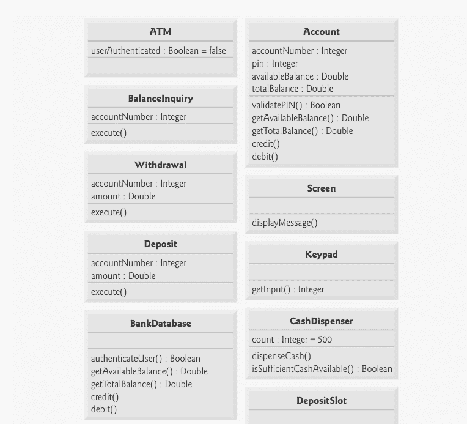

**Fig. 6.33 |** Classes in the ATM system with attributes and operations.

因此，类 `BalanceInquiry`、`Withdrawal` 和 `Deposit` 各自需要一个操作来向 `ATM` 提供此服务。我们将此操作（我们将其命名为 `execute`）放在图 6.33 的类图中三个交易类的第三个隔间中。在一次 ATM 会话期间，`ATM` 对象将调用每个交易对象的 `execute` 操作来告诉它执行。

UML 通过列出操作名，后跟括号中的以逗号分隔的参数列表、冒号和返回类型来表示操作（在 C++ 中实现为成员函数）：

```text
operationName( parameter1, parameter2, ..., parameterN ) : return type
```

以逗号分隔的参数列表中的每个参数由参数名、冒号和参数类型组成：

```text
parameterName : parameterType
```


目前，我们不列出操作的参数——我们稍后会识别并建模某些操作的参数。对于某些操作，我们尚不知道返回类型，因此我们也将其从图中省略。这种省略在此阶段是完全正常的。随着设计和实现的进行，我们将添加剩余的返回类型。

## Operations of Class `BankDatabase` and Class `Account`

图 6.32 在类 `BankDatabase` 旁边列出了短语“authenticates a user”——数据库是包含确定用户输入的账号和 PIN 是否与银行持有的账号匹配所需的账户信息的对象。因此，类 `BankDatabase` 需要一个操作来向 `ATM` 提供身份验证服务。我们将操作 `authenticateUser` 放在类 `BankDatabase` 的第三个隔间中（图 6.33）。然而，类 `Account` 的对象，而不是类 `BankDatabase` 的对象，存储了必须访问以验证用户的账号和 PIN，因此类 `Account` 必须提供一项服务来验证通过用户输入获得的 PIN 与 `Account` 对象中存储的 PIN 是否匹配。因此，我们向类 `Account` 添加一个 `validatePIN` 操作。请注意，我们为 `authenticateUser` 和 `validatePIN` 操作指定了 `Boolean` 的返回类型。每个操作返回一个值，指示操作是否成功执行其任务（即返回值为 `true`）或未成功（即返回值为 `false`）。

图 6.32 为类 `BankDatabase` 列出了几个额外的动词短语：“retrieves an account balance”、“credits a deposit amount to an account” 和 “debits a withdrawal amount from an account”。与“authenticates a user”一样，这些剩余的短语指的是数据库必须向 `ATM` 提供的服务，因为数据库保存了用于验证用户和执行 ATM 交易的所有账户数据。然而，类 `Account` 的对象实际上执行与这些短语相关的操作。因此，我们为类 `BankDatabase` 和类 `Account` 分别分配一个与这些短语对应的操作。回想一下第 3.11 节，由于银行账户包含敏感信息，我们不允许 `ATM` 直接访问账户。数据库充当 `ATM` 与账户数据之间的中介，从而防止未经授权的访问。正如我们在第 7.12 节中看到的，类 `ATM` 调用类 `BankDatabase` 的操作，每个操作又调用类 `Account` 中同名的操作。

短语“retrieves an account balance” 表明类 `BankDatabase` 和类 `Account` 各自需要一个 `getBalance` 操作。然而，请记住，我们在类 `Account` 中创建了两个属性来表示余额——`availableBalance` 和 `totalBalance`。余额查询需要访问这两个余额属性，以便将其显示给用户，但取款只需要检查 `availableBalance` 的值。为了允许系统中的对象单独获取每个余额属性，我们向类 `BankDatabase` 和类 `Account` 的第三个隔间添加了操作 `getAvailableBalance` 和 `getTotalBalance`（图 6.33）。我们为每个操作指定 `Double` 的返回类型，因为它们检索的余额属性的类型为 `Double`。

短语“credits a deposit amount to an account” 和 “debits a withdrawal amount from an account” 表明类 `BankDatabase` 和类 `Account` 必须在存款和取款期间分别执行更新账户的操作。因此，我们为类 `BankDatabase` 和类 `Account` 分配 `credit` 和 `debit` 操作。你可能记得，记入账户（例如存款）仅将金额添加到 `totalBalance` 属性。相反，借记账户（例如取款）会从两个余额属性中减去该金额。我们将这些实现细节隐藏在类 `Account` 内部。这是一个封装和信息隐藏的良好示例。

如果这是一个真正的 ATM 系统，类 `BankDatabase` 和类 `Account` 还将提供一组操作，允许另一个银行系统在确认或拒绝全部或部分存款后更新用户的账户余额。例如，操作 `confirmDepositAmount` 将向 `availableBalance` 属性添加一个金额，从而使存款资金可供取款。操作 `rejectDepositAmount` 将从 `totalBalance` 属性中减去一个金额，以指示最近通过 ATM 存款并添加到 `totalBalance` 的指定金额未在存款信封中找到。银行在确定用户未包含正确的现金金额或任何支票未兑现（即“跳票”）后会调用此操作。虽然添加这些操作会使我们的系统更完整，但我们并未将其包含在我们的类图中或我们的实现中，因为它们超出了案例研究的范围。

## Operations of Class `Screen`

类 `Screen` 在 ATM 会话的各个时间点“displays a message to the user”。所有视觉输出都通过 ATM 的屏幕进行。需求规范描述了屏幕向用户显示的许多类型的消息（例如欢迎消息、错误消息、感谢消息）。需求规范还指出屏幕向用户显示提示和菜单。然而，提示实际上只是描述用户接下来应输入内容的消息，而菜单本质上是一种由一系列连续显示的消息（即菜单选项）组成的提示。因此，而不是为类 `Screen` 分配单独的操作来显示每种类型的消息、提示和菜单，我们只需创建一个可以显示由参数指定的任何消息的操作。我们将此操作（`displayMessage`）放在我们的类图中类 `Screen` 的第三个隔间中（图 6.33）。请注意，我们目前不担心此操作的参数——我们稍后在本节中对参数进行建模。

## Operations of Class `Keypad`

从图 6.32 中类 `Keypad` 列出的短语“receives numeric input from the user” 中，我们得出结论，类 `Keypad` 应执行 `getInput` 操作。因为 ATM 的键盘与计算机键盘不同，只包含数字 0–9，因此我们规定此操作返回一个整数值。回顾需求规范可知，在不同情况下，用户可能需要输入不同类型的数据（例如，账号、PIN、菜单选项编号、以分为单位的存款金额）。类 `Keypad` 只是为该类的客户端获取一个数值——它并不判断该值是否满足任何特定条件。任何使用此操作的类都必须验证用户是否输入了适当的数据，如果没有，则通过类 `Screen` 显示错误信息。[注：当我们实现系统时，我们用计算机键盘模拟 ATM 的键盘，并且为简单起见，我们假设用户不会使用计算机键盘上未出现在 ATM 键盘上的键输入非数字输入。书中后面你会看到如何检查输入以确定其是否为特定类型。]

## 类 `CashDispenser` 和类 `DepositSlot` 的操作

图 6.32 为类 `CashDispenser` 列出了“dispenses cash”。因此，我们创建操作 `dispenseCash` 并将其列在图 6.33 中类 `CashDispenser` 下。类 `CashDispenser` 还“指示其是否包含足够的现金来满足取款请求”。因此，我们在类 `CashDispenser` 中包含 `isSufficientCashAvailable`，该操作返回 UML 类型 `Boolean` 的值。图 6.32 还为类 `DepositSlot` 列出了“receives a deposit envelope”。存款槽必须指示是否收到信封，因此我们在类 `DepositSlot` 的第三个区隔中放置一个操作 `isEnvelopeReceived`，该操作返回 `Boolean` 值。[注：真实的硬件存款槽很可能会向 `ATM` 发送信号以指示已收到信封。我们模拟此行为时，类 `ATM` 可以调用类 `DepositSlot` 中的一个操作来确定存款槽是否收到信封。]

## 类 `ATM` 的操作

我们目前不对类 `ATM` 列出任何操作。我们尚未意识到类 `ATM` 为系统中的其他类提供任何服务。当我们用 C++ 代码实现系统时，此类的操作，以及系统中其他类的附加操作，可能会出现。

## 识别和建模操作参数

到目前为止，我们尚未关注操作的参数——我们只是试图对每个类的操作有一个基本的了解。现在让我们更仔细地看看一些操作参数。我们通过检查操作执行其指定任务所需的数据来识别操作的参数。

考虑类 `BankDatabase` 的 `authenticateUser` 操作。为了验证用户身份，此操作必须知道用户提供的账号和 PIN。因此我们规定操作 `authenticateUser` 采用整数参数 `userAccountNumber` 和 `userPIN`，该操作必须将其与数据库中 `Account` 对象的账号和 PIN 进行比较。我们在参数名称前加上“user”前缀，以避免操作的参数名称与类 `Account` 所属的属性名称混淆。我们在图 6.34 中列出这些参数，该图仅对类 `BankDatabase` 建模。[注：在类图中仅建模一个类是完全正常的。在这种情况下，我们最关心的是检查这个特定类的参数，因此我们省略了其他类。]

在案例研究后面的类图中，图 6.36 用参数对类 `Screen` 的操作 `displayMessage` 进行建模。此操作只需要一个 `String` 参数 `message`，用来指示要显示的文本。请记住，我们在类图中列出的参数类型采用 UML 记法，因此图 6.36 中列出的 `String` 类型指的是 UML 类型。当我们在 C++ 中实现系统时，我们实际上会使用 C++ 字符串对象来表示此参数。


图 6.36 | 带有操作参数的类 `Screen`。

图 6.37 中的类图规定，类 `CashDispenser` 的操作 `dispenseCash` 采用 `Double` 参数 `amount`，用来指示要 dispensed 的现金金额（以美元计）。操作 `isSufficientCashAvailable` 也采用 `Double` 参数 `amount`，用来指示所讨论的现金金额。

请注意，我们未讨论类 `BalanceInquiry`、`Withdrawal` 和 `Deposit` 的操作 `execute`、类 `Keypad` 的操作 `getInput` 以及类 `DepositSlot` 的操作 `isEnvelopeReceived` 的参数。在我们设计过程的这个阶段，我们无法确定这些操作是否需要额外数据来执行其任务，因此我们将其参数列表留空。随着我们推进案例研究，我们可能会决定为这些操作添加参数。

在本节中，我们已确定 ATM 系统中各类执行的大多数操作。我们已识别出其中一些操作的参数和返回类型。随着我们继续设计过程，每个类所属的操作数量可能会发生变化——我们可能会发现需要新的操作，或者某些当前操作是不必要的——并且我们可能会确定某些类操作需要额外的参数和不同的返回类型。

### 软件工程案例研究 自我复习练习

- 6.1 以下哪项不是行为？
  - a) 从文件读取数据
  - b) 打印输出
  - c) 文本输出
  - d) 从用户获取输入

- 6.2 如果要在 ATM 系统中添加一个返回类 `Withdrawal` 的 `amount` 属性的操作，你将在图 6.33 的类图中如何以及在何处指定此操作？

- 6.3 描述以下可能出现在面向对象设计计算器类图中的操作列表的含义：

``` 
add( x : Integer, y : Integer ) : Integer
```

### 软件工程案例研究 自我复习练习的答案

- 6.1 c.

- 6.2 为了指定检索类 `Withdrawal` 的 `amount` 属性的操作，以下操作应放置在类 `Withdrawal` 的操作（即第三）区隔中：

``` 
getAmount( ) : Double
```

- 6.3 这是一个名为 `add` 的操作，它以整数 `x` 和 `y` 作为参数并返回一个整数值。

## 6.23 总结

在本章中，你了解了函数声明的更多细节。函数有不同的部分，例如函数原型、函数签名、函数头和函数体。你了解了参数强制，或将参数强制为函数参数声明指定的适当类型。我们演示了如何使用函数 `rand` 和 `srand` 生成可用于模拟的随机数集。你还了解了变量的作用域，或标识符可在程序中使用的部分。介绍了向函数传递参数的两种不同方式——按值传递和按引用传递。对于按引用传递，引用用作变量的别名。你了解到一个类中的多个函数可以通过提供同名但签名不同的函数来重载。这样的函数可用于执行相同或相似的任务，使用不同类型或不同数量的参数。然后我们演示了使用函数模板重载函数的更简单方法，其中函数只定义一次，但可用于多种不同类型。你随后被介绍到递归的概念，其中函数调用自身来解决问题。

在第 7 章中，你将看到如何在数组中维护数据列表和表格。你将看到基于数组的掷骰子应用的更优雅实现，以及我们将在第 3–5 章中研究的 `GradeBook` 案例研究的两个增强版本，它们将使用数组存储实际输入的成绩。

# 7 数组与向量

## 目标

在本章中，你将学习：

- 使用数组数据结构表示一组相关数据项。
- 使用数组存储、排序和搜索值列表与值表。
- 声明数组、初始化数组以及引用数组的各个元素。
- 将数组传递给函数。
- 基本的搜索和排序技术。
- 声明和操作多维数组。
- 使用 C++ 标准库类模板 `vector`。

> 现在去吧，将这话写在它们面前的板上，记在书上。
> ——以赛亚书 30:8

> 从开头开始……一直进行到结束；然后停止。
> ——刘易斯·卡罗尔

> 过犹不及。
> ——孔子

- 7.1 引言
- 7.2 数组
- 7.3 声明数组
- 7.4 使用数组的示例
  - 7.4.1 声明数组并使用循环初始化数组元素
  - 7.4.2 在声明中使用初始化列表初始化数组
  - 7.4.3 用常量变量指定数组大小并通过计算设置数组元素
  - 7.4.4 对数组元素求和
  - 7.4.5 使用柱状图以图形方式显示数组数据
  - 7.4.6 使用数组元素作为计数器
  - 7.4.7 使用数组汇总调查结果
  - 7.4.8 使用字符数组存储和操作字符串
  - 7.4.9 静态局部数组和自动局部数组
- 7.5 将数组传递给函数
- 7.6 案例研究：使用数组存储成绩的 `GradeBook` 类
- 7.7 使用线性搜索搜索数组
- 7.8 使用插入排序对数组排序
- 7.9 多维数组
- 7.10 案例研究：使用二维数组的 `GradeBook` 类
- 7.11 C++ 标准库类模板 `vector` 简介
- 7.12 （可选）软件工程案例研究：ATM 系统中对象间的协作
- 7.13 小结

## 7.1 引言

本章介绍重要的*数据结构*主题——相关数据项的集合。*数组*是由相同类型的相关数据项组成的数据结构。我们在第 3 章中介绍了类。在第 19 章“位、字符、C 字符串和结构体”中，我们讨论*结构体*的概念。结构体和类都可以保存可能不同类型的数据项。数组、结构体和类是“静态”实体，它们在程序执行期间大小保持不变。（当然，它们可能是自动存储类，因此每次进入和退出定义它们的代码块时都会被创建和销毁。）

在讨论如何声明、创建和初始化数组之后，我们展示一系列实际示例，演示常见的数组操作。然后我们解释字符数组如何表示字符串（到目前为止由 `string` 对象表示）。我们给出一个搜索数组以查找特定元素的示例。本章还介绍最重要的计算应用之一——数据排序（即将数据按某种特定顺序排列）。本章有两节增强了第 3–6 章中 `GradeBook` 类的案例研究。特别是，我们使用数组使该类能够在内存中维护一组成绩，并分析学生在学期中多次考试的成绩——这是先前版本的 `GradeBook` 类所不具备的两项能力。这些和其他章节示例演示了数组如何让程序员组织并操作数据。

我们在本章大部分内容中使用的数组风格是 C 风格的基于指针的数组。（我们将在第 8 章中研究指针。）在本章的最后一节以及第 20 章“标准模板库（STL）”中，我们将数组作为称为 `vector` 的完整对象来介绍。我们将发现这些基于对象的数组比我们在本章前半部分讨论的 C 风格、基于指针的数组更安全、更通用。

## 7.2 数组

数组是连续的一组内存位置，所有这些位置都有相同的类型。要引用数组中的特定位置或元素，我们指定数组的名称以及该特定元素在数组中的位置编号。

图 7.1 显示了一个名为 `c` 的整数数组。该数组包含 12 个元素。程序通过给出数组名称后跟方括号（[]）中特定元素的位置编号来引用其中任何一个元素。位置编号在形式上称为下标或索引（该数字指定从数组开头算起的元素个数）。每个数组的第一个元素的下标为 0（零），有时称为第零个元素。因此，数组 `c` 的元素是 `c[ 0 ]`（读作“`c` sub zero”）、`c[ 1 ]`、`c[ 2 ]` 等等。数组 `c` 中的最高下标是 11，比数组中的元素个数（12）少 1。数组名称遵循与其他变量名称相同的约定，即它们必须是标识符。

下标必须是整数或整数表达式（使用任何整型类型）。如果程序使用表达式作为下标，则程序计算该表达式以确定下标。例如，如果我们假设变量 `a` 等于 5，变量 `b` 等于 6，那么语句

```
c[ a + b ] += 2;
```

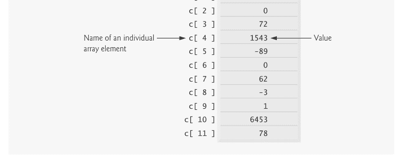

图 7.1 | 具有 12 个元素的数组。

## 7.3 声明数组

数组占用内存空间。要指定元素类型和数组所需的元素个数，请使用如下形式的声明：

```
type arrayName[ arraySize ];
```

编译器保留适当数量的内存。（回想一下，在 C++ 中，保留内存的声明更准确地称为定义。）`arraySize` 必须是大于零的整数常量。例如，要告诉编译器为整数数组 `c` 保留 12 个元素，请使用声明

```
int c[ 12 ]; // c 是一个包含 12 个整数的数组
```


可以在单个声明中为多个数组保留内存。以下声明为整数数组 `b` 保留 100 个元素，为整数数组 `x` 保留 27 个元素。

``` 
int b[ 100 ]; // b 是一个包含 100 个整数的数组
    x[ 27 ]; // x 是一个包含 27 个整数的数组
```

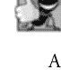

# 良好编程实践 7.1

> 为了可读性、可修改性和便于注释，我们每个声明只声明一个数组。

数组可以声明为包含任何非引用数据类型。例如，`char` 类型的数组可用于存储字符串。到目前为止，我们使用 `string` 对象来存储字符串。第 7.4 节介绍使用字符数组存储字符串。字符字符串及其与数组的相似性（C++ 从 C 继承的关系），以及指针和数组之间的关系，将在第 8 章中讨论。

## 7.4 使用数组的示例

本节展示许多示例，演示如何声明数组、如何初始化数组以及如何执行常见的数组操作。

### 7.4.1 声明数组并使用循环初始化数组元素

图 7.3 中的程序声明了 10 个元素的整数数组 `n`（第 12 行）。第 15–16 行使用 `for` 语句将数组元素初始化为零。与其他自动变量一样，自动数组不会隐式初始化为零，尽管静态数组会。第一个输出语句（第 18 行）显示随后 `for` 语句（第 21–22 行）中打印的列标题，该语句以表格格式打印数组。请记住，`setw` 指定字段宽度，其中仅下一个值以该宽度输出。

```
1  // 图 7.3: fig07_03.cpp
2  // 初始化数组。
3  #include <iostream>
4  using std::cout;
5  using std::endl;
```

图 7.3 | 将数组元素初始化为零并打印数组。（第 1 部分，共 2 部分。）

```
#include <iomanip>
using std::setw;
int main()
{
    int n[ 10 ]; // n 是一个包含 10 个整数的数组
    // 将数组 n 的元素初始化为 0
    for ( int i = 0; i < 10; i++ )
        n[ i ] = 0; // 将位置 i 处的元素设置为 0
    cout << "Element" << setw( 13 ) << "Value" << endl;
    // 输出每个数组元素的值
    for ( int j = 0; j < 10; j++ )
        cout << setw( 7 ) << j << setw( 13 ) << n[ j ] << endl;
    return 0; // 表示成功终止
} // 结束 main
```

| 元素 | 值 |
|---------|-------|
| 0 | 0 |
| 1 | 0 |
| 2 | 0 |
| 3 | 0 |
| 4 | 0 |
| 5 | 0 |
| 6 | 0 |
| 7 | 0 |
| 8 | 0 |
| 9 | 0 |

图 7.3 | 将数组元素初始化为零并打印数组。（第 2 部分，共 2 部分。）

### 7.4.2 在声明中使用初始化列表初始化数组

数组的元素也可以在数组声明中初始化，方法是在数组名称后面加上等号和用花括号括起来的逗号分隔的初始化器列表。图 7.4 中的程序使用初始化列表将整数数组初始化为 10 个值（第 13 行），并以表格格式打印该数组（第 15–19 行）。

```
// 图 7.4: fig07_04.cpp
// 在声明中初始化数组。
#include <iostream>
using std::cout;
using std::endl;
#include <iomanip>
using std::setw;
```

图 7.4 | 在其声明中初始化数组的元素。（第 1 部分，共 2 部分。）

```
10  int main()
11  {
12    // use initializer list to initialize array n
13    int n[ 10 ] = { 32, 27, 64, 18, 95, 14, 90, 70, 60, 37 };
14
15    cout << "Element" << setw( 13 ) << "Value" << endl;
16
17    // output each array element's value
18    for ( int i = 0; i < 10; i++ )
19        cout << setw( 7 ) << i << setw( 13 ) << n[ i ] << endl;
20
21    return 0; // indicates successful termination
22  } // end main
```

| Element | Value |
|---------|-------|
| 0 | 32 |
| 1 | 27 |
| 2 | 64 |
| 3 | 18 |
| 4 | 95 |
| 5 | 14 |
| 6 | 90 |
| 7 | 70 |
| 8 | 60 |
| 9 | 37 |

Fig. 7.4 | 在其声明中初始化数组元素。 (第 2 部分，共 2 部分.)

如果初始化器少于数组中的元素，则剩余的数组元素初始化为零。例如，图 7.3 中数组 `n` 的元素可以用声明初始化为零

```
int n[ 10 ] = {}; // initialize elements of array n to 0
```

该声明隐式将元素初始化为零，因为初始化器少于数组中的元素（本例中为无）。此技术只能在数组的声明中使用，而图 7.3 中显示的初始化技术可在程序执行期间重复使用，以“重新初始化”数组的元素。

如果在带有初始化器列表的声明中省略数组大小，则编译器通过计算初始化器列表中的元素数量来确定数组中的元素数量。例如，

```
int n[] = { 1, 2, 3, 4, 5 };
```

创建一个包含五个元素的数组。

如果在数组声明中同时指定了数组大小和初始化器列表，则初始化器的数量必须小于或等于数组大小。数组声明

```
int n[ 5 ] = { 32, 27, 64, 18, 95, 14 };
```

会导致编译错误，因为有六个初始化器而只有五个数组元素。

## 常见编程错误 7.2

在数组初始化器列表中提供比数组元素更多的初始化器是编译错误。

## 常见编程错误 7.3

忘记初始化应被初始化的数组元素是逻辑错误。

## 7.4.3 使用常量变量指定数组大小并使用计算设置数组元素

图 7.5 将 10 个元素的数组 `s` 设置为偶整数 2, 4, 6, ..., 20（第 17–18 行）并以表格格式打印数组（第 20–24 行）。这些数字是通过将循环计数器的每个连续值乘以 2 并加 2 生成的（第 18 行）。

第 13 行使用 `const` 限定符声明所谓的常量变量 `arraySize`，其值为 10。常量变量必须在声明时用常量表达式初始化，此后不能修改（如下图 7.6 和图 7.7 所示）。常量变量也称为命名常量或只读变量。

## 常见编程错误 7.4

在声明时未为常量变量赋值是编译错误。

```
1  // Fig. 7.5: fig07_05.cpp
2  // Set array s to the even integers from 2 to 20.
3  #include <iostream>
4  using std::cout;
5  using std::endl;
6
7  #include <iomanip>
8  using std::setw;
9
10 int main()
11 {
12     // constant variable can be used to specify array size
13     const int arraySize = 10;
14
15     int s[ arraySize ]; // array s has 10 elements
16
17     for ( int i = 0; i < arraySize; i++ ) // set the values
18         s[ i ] = 2 + 2 * i;
19
20     cout << "Element" << setw( 13 ) << "Value" << endl;
21
22     // output contents of array s in tabular format
23     for ( int j = 0; j < arraySize; j++ )
24         cout << setw( 7 ) << j << setw( 13 ) << s[ j ] << endl;
25
26     return 0; // indicates successful termination
27 } // end main
```

Fig. 7.5 | 生成要放入数组元素的值。 (第 1 部分，共 2 部分.)

| Element | Value |
| --- | --- |
| 0 | 2 |
| 1 | 4 |
| 2 | 6 |
| 3 | 8 |
| 4 | 10 |
| 5 | 12 |
| 6 | 14 |
| 7 | 16 |
| 8 | 18 |
| 9 | 20 |

Fig. 7.5 | 生成要放入数组元素的值。 (第 2 部分，共 2 部分.)

```
1  // Fig. 7.6: fig07_06.cpp
2  // Using a properly initialized constant variable.
3  #include <iostream>
4  using std::cout;
5  using std::endl;
6
7  int main()
8  {
9      const int x = 7; // initialized constant variable
10
11     cout << "The value of constant variable x is: " << x << endl;
12
13     return 0; // indicates successful termination
14 } // end main
```

The value of constant variable x is: 7

Fig. 7.6 | 初始化和使用常量变量。

```
1  // Fig. 7.7: fig07_07.cpp
2  // A const variable must be initialized.
3
4  int main()
5  {
6      const int x; // Error: x must be initialized
7
8      x = 7; // Error: cannot modify a const variable
9
10     return 0; // indicates successful termination
11 } // end main
Borland C++ command-line compiler error message:
```

Error E2304 fig07_07.cpp 6: Constant variable 'x' must be initialized
    in function main()
Error E2024 fig07_07.cpp 8: Cannot modify a const object in function main()

Fig. 7.7 | const 变量必须初始化。 (第 1 部分，共 2 部分.)

数组元素并使用该总和计算考试的班级平均分。本章后面使用类 `GradeBook` 的示例，即图 7.16–7.17 和图 7.23–7.24，使用此技术。

图 7.8 中的程序对 10 个元素的整数数组 `a` 中包含的值求和。程序在第 10 行声明、创建并初始化数组。`for` 语句（第 14–15 行）执行计算。作为数组 `a` 的初始化器的值也可以从键盘上的用户读取，或从磁盘上的文件读取（参见第 17 章，文件处理）。例如，`for` 语句

```
for ( int j = 0; j < arraySize; j++ )
    cin >> a[ j ];
```

一次从键盘读取一个值并将该值存储在元素 `a[ j ]` 中。

```
// Fig. 7.8: fig07_08.cpp
// Compute the sum of the elements of the array.
#include <iostream>
using std::cout;
using std::endl;
int main()
{
    const int arraySize = 10; // constant variable indicating size of array
    int a[ arraySize ] = { 87, 68, 94, 100, 83, 78, 85, 91, 76, 87 };
    int total = 0;
    // sum contents of array a
    for ( int i = 0; i < arraySize; i++ )
        total += a[ i ];
    cout << "Total of array elements: " << total << endl;
    return 0; // indicates successful termination
} // end main
```

Total of array elements: 849

Fig. 7.8 | 计算数组元素的总和。

## 7.4.5 使用条形图以图形方式显示数组数据

许多程序以图形方式向用户呈现数据。例如，数值通常以条形图中的条形显示。在这样的图表中，更长的条形代表成比例更大的数值。显示数值数据的简单方法之一是使用条形图，其中每个数值显示为星号 (*) 的条形。

教授们通常喜欢检查考试成绩的分布情况。教授可能会绘制每个类别中的成绩数量，以可视化成绩分布。假设成绩为 87、68、94、100、83、78、85、91、76 和 87。注意，有一个 100 分，90 分段有两个，80 分段有四个，70 分段有两个，60 分段有一个，60 分以下没有。我们下一个程序（图 7.9）将此成绩分布数据存储在包含 11 个元素的数组中，每个元素对应一个类别

```
// Fig. 7.9: fig07_09.cpp
// Bar chart printing program.
#include <iostream>
using std::cout;
using std::endl;
#include <iomanip>
using std::setw;
int main()
{
    const int arraySize = 11;
    int n[ arraySize ] = { 0, 0, 0, 0, 0, 0, 1, 2, 4, 2, 1 };
    cout << "Grade distribution:" << endl;
    // for each element of array n, output a bar of the chart
    for ( int i = 0; i < arraySize; i++ )
    {
        // output bar labels ("0-9:", ..., "90-99:", "100: ")
        if ( i == 0 )
            cout << "    0-9: ";
        else if ( i == 10 )
            cout << "  100: ";
        else
            cout << i * 10 << "-" << ( i * 10 ) + 9 << ": ";
        // print bar of asterisks
        for ( int stars = 0; stars < n[ i ]; stars++ )
            cout << '*';
        cout << endl; // start a new line of output
    } // end outer for
    return 0; // indicates successful termination
} // end main
```

```
Grade distribution:
    0-9:
10-19:
20-29:
30-39:
40-49:
50-59:
60-69: *
70-79: **
80-89: ****
90-99: **
  100: *
```


Fig. 7.9 | 条形图打印程序。

成绩。例如，`n[0]` 表示 0–9 范围内的成绩数量，`n[7]` 表示 70–79 范围内的成绩数量，`n[10]` 表示成绩 of 100。 第 7 章后面类 `GradeBook` 的两个版本（图 7.16–7.17 和图 7.23–7.24）包含基于一组成绩计算这些成绩频率的代码。现在，我们通过查看成绩集合手动创建数组。

程序从数组中读取数字并以条形图形式显示信息，显示每个成绩范围后跟一串星号，表示该范围内成绩的数量。为了标记每个条形，行 21–26 根据计数器变量 `i` 的当前值输出一个成绩范围（例如，“70-79: ”）。嵌套的 `for` 语句（行 29–30）输出条形。请注意行 29 中的循环继续条件（`stars < n[i]`）。每次程序到达内部 `for` 时，循环从 0 数到 `n[i]`，因此使用数组 `n` 中的值来确定要显示的星号数量。在此示例中，`n[0]`–`n[5]` 包含零，因为没有学生获得低于 60 的成绩。因此，程序在前六个成绩范围旁边不显示任何星号。

## Common Programming Error 7.7

> 尽管可以在 `for` 语句中使用相同的控制变量，并在其中嵌套的第二个 `for` 语句中使用它，但这会令人困惑，并可能导致逻辑错误。

## 7.4.6 Using the Elements of an Array as Counters

有时，程序使用计数器变量来汇总数据，例如调查结果。在图 6.8 中，我们在掷骰子程序中使用了单独的计数器来跟踪程序掷骰 6,000,000 次时每个骰子点数出现的次数。图 7.10 显示了此程序的数组版本。

图 7.10 使用数组 `frequency`（行 20）来计算每个骰子点数出现的次数。此程序第 26 行的单个语句取代了图 6.8 中行 30–52 的 `switch` 语句。第 26 行使用随机值来确定在循环的每次迭代中要递增哪个 `frequency` 元素。第 26 行的计算产生 1 到 6 之间的随机下标，因此数组 `frequency` 必须足够大以存储六个计数器。然而，我们使用一个七元素数组，其中忽略 `frequency[0]`——让骰子点数值 1 递增 `frequency[1]` 比递增 `frequency[0]` 更合乎逻辑。因此，每个点数值都用作数组 `frequency` 的下标。我们还通过循环遍历数组 `frequency` 来输出结果（行 31–33），从而取代了图 6.8 的行 56–61。

Fig. 7.10 | Die-rolling program using an array instead of switch. (Part 1 of 2.)

Fig. 7.10 | Die-rolling program using an array instead of switch. (Part 2 of 2.)

```
1  // Fig. 7.10: fig07_10.cpp
2  // Roll a six-sided die 6,000,000 times.
3  #include <iostream>
4  using std::cout;
5  using std::endl;
6
7  #include <iomanip>
8  using std::setw;
9
10 #include <cstdlib>
11 using std::rand;
12 using std::srand;
13
14 #include <ctime>
15  using std::time;
16
17  int main()
18  {
19      const int arraySize = 7; // ignore element zero
20      int frequency[ arraySize ] = {}; // initialize elements to 0
21
22      srand( time( 0 ) ); // seed random number generator
23
24      // roll die 6,000,000 times; use die value as frequency index
25      for ( int roll = 1; roll <= 6000000; roll++ )
26          frequency[ 1 + rand() % 6 ]++;
27
28      cout << "Face" << setw( 13 ) << "Frequency" << endl;
29
30      // output each array element's value
31      for ( int face = 1; face < arraySize; face++ )
32          cout << setw( 4 ) << face << setw( 13 ) << frequency[ face ]
33              << endl;
34
35      return 0; // indicates successful termination
36  } // end main
```

| Face | Frequency |
|------|-----------|
| 1    | 1000167   |
| 2    | 1000149   |
| 3    | 1000152   |
| 4    | 998748    |
| 5    | 999626    |
| 6    | 1001158   |

## 7.4.7 Using Arrays to Summarize Survey Results

我们下一个示例（图 7.11）使用数组来汇总调查中收集的数据的汇总结果。考虑以下问题陈述：

> 四十名学生被要求在 1 到 10 的范围内对学生食堂的食物质量进行评分（1 表示糟糕，10 表示优秀）。将 40 个响应放入整数数组中并汇总民意调查结果。

这是一个典型的数组处理应用。我们希望汇总每种类型响应的数量（即 1 到 10）。数组 `responses`（行 17–19）是学生对调查的响应的 40 个元素整数数组。请注意数组 `responses` 被声明为 `const`，因为其值不会（也不应该）改变。我们使用一个 11 元素数组 `frequency`（行 22）来计算每个响应的出现次数。数组的每个元素用作其中一个调查响应的计数器，并初始化为零。如图 7.10 所示，我们忽略 `frequency[0]`。

## Software Engineering Observation 7.2

> `const` 限定符应用于强制执行最小权限原则。正确使用最小权限原则来设计软件可以大大减少调试时间和不当的副作用，并使程序更易于修改和维护。

到 `frequency[10]`）。循环中的关键语句是第 27 行，它根据 `responses[answer]` 的值递增适当的频率计数器。

让我们考虑 `for` 循环的几次迭代。当控制变量 `answer` 为 0 时，`responses[answer]` 的值是 `responses[0]` 的值（即第 17 行中的 1），因此程序将 `frequency[responses[answer]]++` 解释为

```
frequency[ 1 ]++
```

它递增数组元素 1 中的值。要评估表达式，首先从最内层的方括号开始（`answer`）。一旦知道 `answer` 的值（即第 26 行循环控制变量的值），将其代入表达式并评估下一个外层方括号（即 `responses[answer]`，它是从第 17–19 行的 `responses` 数组中选择的值）。然后使用结果值作为 `frequency` 数组的下标以指定要递增哪个计数器。

当 `answer` 为 1 时，`responses[answer]` 是 `responses[1]` 的值，即 2，因此程序将 `frequency[responses[answer]]++` 解释为

```
frequency[ 2 ]++
```

它递增数组元素 2。

当 `answer` 为 2 时，`responses[answer]` 是 `responses[2]` 的值，即 6，因此程序将 `frequency[responses[answer]]++` 解释为

```
frequency[ 6 ]++
```

它递增数组元素 6，依此类推。无论调查中处理的响应数量如何，程序只需要一个 11 元素数组（忽略零元素）来汇总结果，因为所有响应值都在 1 到 10 之间，而 11 元素数组的下标值是从 0 到 10。

如果 `responses` 数组中的数据包含无效值，例如 13，程序将尝试将 1 加到 `frequency[13]` 上，而该值超出了数组的边界。C++ 没有数组边界检查来防止计算机引用不存在的元素。因此，正在执行的程序可以在没有任何警告的情况下“走出”数组的两端。你应该确保所有数组引用都保持在数组边界内。

## Common Programming Error 7.8

> 引用数组边界之外的元素是执行时逻辑错误。它不是语法错误。

## Error-Prevention Tip 7.1

> 在遍历数组时，数组下标绝不能低于 0，并且始终应小于数组中的元素总数（数组大小减一）。确保循环终止条件可以防止访问此范围之外的元素。

## Portability Tip 7.1

> 引用数组边界之外元素的（通常是严重的）影响取决于系统。经常这会导致无关变量的值发生变化或导致致命错误从而终止程序执行。

C++ 是一种可扩展的语言。第 7.11 节介绍了 C++ 标准库类模板 `vector`，它使程序员能够执行 C++ 内置数组不可用的许多操作。例如，我们将能够直接比较向量并将一个向量赋给另一个向量。在第 11 章中，我们通过实现我们自己的用户定义类来进一步扩展 C++。这个新的数组定义将使我们能够使用 `cin` 和 `cout` 输入和输出整个数组，在创建时初始化数组，防止访问超出范围的数组元素，并更改下标的范围（甚至它们的下标类型），以便数组的第一个元素不必是元素 0。我们甚至能够使用非整数下标。

## Error-Prevention Tip 7.2

> 在第 11 章中，我们将看到如何开发一个代表“智能数组”的类，该类在运行时检查所有下标引用是否在边界内。使用此类智能数据类型有助于消除错误。

## 7.4.8 Using Character Arrays to Store and Manipulate Strings

到目前为止，我们只讨论了整数数组。然而，数组可以是任何类型。我们现在介绍在字符数组中存储字符字符串。回想一下，从第 3 章开始，我们一直在使用 `string` 对象来存储字符字符串，例如我们的 `GradeBook` 类中的课程名称。诸如 `"hello"` 之类的字符串实际上是一个字符数组。虽然 `string` 对象使用方便且减少了出错的可能性，但表示字符串的字符数组有几个独特的功能，我们将在本节中讨论。随着你继续学习 C++，你可能会遇到需要你优先使用字符数组而不是 `string` 对象的 C++ 功能。你也可能被要求更新使用字符数组的现有代码。

字符数组可以使用字符串字面量进行初始化。例如，声明

```
char string1[] = "first";
```

将数组 `string1` 的元素初始化为字符串字面量 `"first"` 中的各个字符。前述声明中数组 `string1` 的大小由编译器根据字符串的长度确定。重要的是要注意，字符串 `"first"` 包含五个字符加上一个特殊的字符串终止字符，即空字符。因此，数组 `string1` 实际上包含六个元素。表示空字符的字符常量是 `'\0'`（反斜杠后跟零）。所有由字符数组表示的字符串都以此字符结尾。表示字符串的字符数组应始终声明为足够大以容纳字符串中的字符数和终止空字符。

字符数组也可以使用初始化列表中的单个字符常量进行初始化。前述声明等同于更繁琐的形式

```
char string1[] = { 'f', 'i', 'r', 's', 't', '\0' };
```

注意使用单引号来界定每个字符常量。还要注意，我们明确提供了终止空字符作为最后一个初始化值。如果没有它，这个数组就只是一个字符数组，而不是一个字符串。正如我们在第 8 章中讨论的那样，未为字符串提供终止空字符可能会导致逻辑错误。

由于字符串是一个字符数组，我们可以直接使用数组下标表示法访问字符串中的单个字符。例如，`string1[0]` 是字符 `'f'`，`string1[3]` 是字符 `'s'`，而 `string1[5]` 是空字符。

我们可以使用 `cin` 和 `>>` 直接从键盘将字符串输入到字符数组中。例如，声明

```
char string2[ 20 ];
```

创建了一个可存储最多 19 个字符的字符串以及一个终止空字符的字符数组。语句

```
cin >> string2;
```

从键盘读取一个字符串到 `string2` 中，并在用户输入的字符串末尾附加空字符。注意，前面的语句只提供了数组的名称，并未提供有关数组大小的任何信息。你有责任确保用于读取字符串的数组能够容纳用户在键盘上输入的任何字符串。默认情况下，`cin` 从键盘读取字符，直到遇到第一个空白字符为止——而不考虑数组大小。因此，使用 `cin` 和 `>>` 输入数据可能会在数组末尾之外插入数据（请参阅第 8.13 节，了解防止在 char 数组末尾之外插入的信息）。

### 常见编程错误 7.9

> 如果未为 `cin >>` 提供足够大的字符数组来存储在键盘上输入的字符串，则可能导致程序中数据丢失和其他严重的运行时错误。

表示以空字符结尾的字符串的字符数组可以用 `cout` 和 `<<` 输出。语句

```
cout << string2;
```

打印数组 `string2`。注意，`cout <<` 与 `cin >>` 一样，不关心字符数组有多大。字符串的字符会一直输出，直到遇到终止空字符；空字符不会被打印。[注意：`cin` 和 `cout` 假定字符数组应作为以空字符结尾的字符串进行处理；`cin` 和 `cout` 不为其他数组类型提供类似的输入和输出处理功能。]

图 7.12 演示了使用字符串字面量初始化字符数组、将字符串读入字符数组、将字符数组作为字符串打印以及访问字符串的单个字符。

图 7.12 的第 23–24 行使用 `for` 语句遍历 `string1` 数组并打印其字符，字符之间用空格分隔。`for` 语句中的条件 `string1[i] != '\0'` 在循环遇到字符串的终止空字符之前一直为真。

```
// Fig. 7.12: fig07_12.cpp
// Treating character arrays as strings.
#include <iostream>
using std::cout;
using std::cin;
using std::endl;
int main()
{
    char string1[ 20 ]; // reserves 20 characters
    char string2[] = "string literal"; // reserves 15 characters
    // read string from user into array string1
    cout << "Enter the string \"hello there\": ";
    cin >> string1; // reads "hello"
    // output strings
    cout << "string1 is: " << string1 << "\nstring2 is: " << string2;
    cout << "\nstring1 with spaces between characters is:\n";
    // output characters until null character is reached
    for ( int i = 0; string1[ i ] != '\0'; i++ )
        cout << string1[ i ] << ' ';
    cin >> string1; // reads "there"
    cout << "\nstring1 is: " << string1 << endl;
    return 0; // indicates successful termination
} // end main
```

```
Enter the string "hello there": hello there
string1 is: hello
string2 is: string literal
string1 with spaces between characters is:
h e l l o
string1 is: there
```

**图 7.12：字符数组作为字符串处理。**

## 7.4.9 静态局部数组和自动局部数组

第 6 章讨论了存储类说明符 `static`。函数定义中的静态局部变量在程序持续期间存在，但仅在函数体中可见。

### 性能提示 7.1

> 我们可以将 `static` 应用于局部数组声明，以便数组在程序调用函数时不会每次都创建和初始化，也不会在函数终止时每次都被销毁。这可以提高性能，尤其是在使用大型数组时。

程序在首次遇到其声明时初始化静态局部数组。如果未由你显式初始化静态数组，则该数组的每个元素在数组创建时都会由编译器初始化为零。请记住，C++ 不会对自动变量执行此类默认初始化。

图 7.13 演示了具有静态局部数组（第 28 行）的函数 `staticArrayInit`（第 25–41 行）以及具有自动局部数组（第 47 行）的函数 `automaticArrayInit`（第 44–60 行）。

```
// Fig. 7.13: fig07_13.cpp
// Static arrays are initialized to zero.
#include <iostream>
```


```cpp
using std::cout;
using std::endl;

void staticArrayInit( void ); // function prototype
void automaticArrayInit( void ); // function prototype

int main()
{
    cout << "First call to each function:\n";
    staticArrayInit();
    automaticArrayInit();

    cout << "\n\nSecond call to each function:\n";
    staticArrayInit();
    automaticArrayInit();

    cout << endl;
    return 0; // indicates successful termination
} // end main

// function to demonstrate a static local array
void staticArrayInit( void )
{
    // initializes elements to 0 first time function is called
    static int array1[ 3 ]; // static local array

    cout << "\nValues on entering staticArrayInit:\n";

    // output contents of array1
    for ( int i = 0; i < 3; i++ )
        cout << "array1[" << i << "] = " << array1[ i ] << "  ";

    cout << "\nValues on exiting staticArrayInit:\n";

    // modify and output contents of array1
    for ( int j = 0; j < 3; j++ )
        cout << "array1[" << j << "] = " << ( array1[ j ] += 5 ) << "  ";

} // end function staticArrayInit

// function to demonstrate an automatic local array
void automaticArrayInit( void )
{
    // initializes elements each time function is called
    int array2[ 3 ] = { 1, 2, 3 }; // automatic local array

    cout << "\n\nValues on entering automaticArrayInit:\n";

    // output contents of array2
    for ( int i = 0; i < 3; i++ )
        cout << "array2[" << i << "] = " << array2[ i ] << "  ";

    cout << "\nValues on exiting automaticArrayInit:\n";

    // modify and output contents of array2
    for ( int j = 0; j < 3; j++ )
        cout << "array2[" << j << "] = " << ( array2[ j ] += 5 ) << " ";

} // end function automaticArrayInit
```

```
First call to each function:

Values on entering staticArrayInit:
array1[0] = 0  array1[1] = 0  array1[2] = 0
Values on exiting staticArrayInit:
array1[0] = 5  array1[1] = 5  array1[2] = 5

Values on entering automaticArrayInit:
array2[0] = 1  array2[1] = 2  array2[2] = 3
Values on exiting automaticArrayInit:
array2[0] = 6  array2[1] = 7  array2[2] = 8

Second call to each function:

Values on entering staticArrayInit:
array1[0] = 5  array1[1] = 5  array1[2] = 5
Values on exiting staticArrayInit:
array1[0] = 10  array1[1] = 10  array1[2] = 10

Values on entering automaticArrayInit:
array2[0] = 1  array2[1] = 2  array2[2] = 3
Values on exiting automaticArrayInit:
array2[0] = 6  array2[1] = 7  array2[2] = 8
```

**图 7.13：静态数组初始化和自动数组初始化。**

函数 `staticArrayInit` 被调用了两次（第 13 行和第 17 行）。静态局部数组在函数首次被调用时由编译器初始化为零。该函数打印数组，将每个元素加 5，然后再次打印数组。函数第二次被调用时，静态数组包含在第一次函数调用期间存储的修改值。函数 `automaticArrayInit` 也被调用了两次（第 14 行和第 18 行）。自动局部数组的元素使用值 1、2 和 3 进行初始化（第 47 行）。该函数打印数组，将每个元素加 5，然后再次打印数组。函数第二次被调用时，数组元素被重新初始化为 1、2 和 3。数组具有自动存储类，因此在每次调用 `automaticArrayInit` 时，数组都会被重新创建并重新初始化。

### 常见编程错误 7.10

> 假设函数的局部静态数组的元素在每次调用函数时都会被初始化，可能会导致程序中出现逻辑错误。

## 7.5 向函数传递数组

要将数组参数传递给函数，请指定数组的名称而不带任何方括号。例如，如果数组 `hourlyTemperatures` 已声明为

```cpp
int hourlyTemperatures[ 24 ];
```

函数调用

```cpp
modifyArray( hourlyTemperatures, 24 );
```

将数组 `hourlyTemperatures` 及其大小传递给函数 `modifyArray`。向函数传递数组时，通常也会传递数组大小，这样函数就能处理数组中特定数量的元素。否则，我们需要将这一信息内置到被调用函数本身，或者更糟，将数组大小放在全局变量中。在第 7.11 节中，当我们介绍 C++ 标准库类模板 `vector` 来表示一种更健壮的数组类型时，你会看到 `vector` 的大小是内置的——每个 `vector` 对象“知道”自己的大小，可以通过调用 `vector` 对象的 `size` 成员函数获得。因此，将 `vector` 对象传入函数时，我们不必将 `vector` 的大小作为实参传递。

C++ 按引用将数组传递给函数——被调用函数可以修改调用者原始数组中元素的值。数组名的值是数组第一个元素在计算机内存中的地址。由于传递的是数组的起始地址，被调用函数能精确地知道数组在内存中的存储位置。因此，当被调用函数在其函数体内修改数组元素时，它修改的是数组中位于原内存位置的实际元素。

### 性能提示 7.2

> 出于性能方面的考虑，按引用传递数组是有意义的。如果按值传递数组，那么每个元素都会被复制一份。对于大型且频繁传递的数组，这会非常耗时，并且需要大量存储空间来存放数组元素的副本。

### 软件工程观察 7.3

> 可以通过值传递数组（借助我们在第 19 章中解释的一个简单技巧）——但是很少这样做。

虽然整个数组是按引用传递的，但单个数组元素与普通变量完全一样，是按值传递的。这种简单、单一的数据称为标量（scalar）或标量数量（scalar quantity）。要将数组元素传递给函数，可在函数调用中使用该数组元素带下标的名字作为实参。在第 6 章中，我们展示了如何使用引用将标量（即单个变量和数组元素）按引用传递。在第 8 章中，我们将展示如何使用指针将标量按引用传递。

要使函数通过函数调用接收数组，函数的参数列表必须指定该函数预期接收一个数组。例如，函数 `modifyArray` 的函数头可以写成

```cpp
void modifyArray( int b[], int arraySize )
```

这表示 `modifyArray` 预期在形参 `b` 中接收一个整数数组的地址，并在形参 `arraySize` 中接收数组元素的个数。数组方括号中不需要给出数组大小。如果写出了大小，编译器会忽略它；因此，任何大小的数组都可以传递给该函数。C++ 按引用将数组传递给函数——当被调用函数使用数组名 `b` 时，它引用的是调用者中的实际数组（即本节开头讨论的数组 `hourlyTemperatures`）。

注意 `modifyArray` 的函数原型看起来有些奇怪：

```cpp
void modifyArray( int [], int );
```

这个原型本来也可以写成

```cpp
void modifyArray( int anyArrayName[], int anyVariableName );
```

但正如我们在第 3 章中所见，C++ 编译器会忽略原型中的变量名。请记住，原型告诉编译器实参的个数以及每个实参的类型（按照实参预期出现的顺序）。

图 7.14 中的程序演示了传递整个数组与传递数组元素之间的区别。第 22–23 行打印整数数组 `a` 的五个原始元素。第 28 行将 `a` 及其大小传递给函数 `modifyArray`（第 45–50 行），该函数通过形参 `b` 将 `a` 的每个元素乘以 2。然后，第 32–33 行在 `main` 中再次打印数组 `a`。如输出所示，`modifyArray` 确实修改了 `a` 的元素。接下来，第 36 行打印标量 `a[ 3 ]` 的值，然后第 38 行将元素 `a[ 3 ]` 传递给函数 `modifyElement`（第 54–58 行），该函数将其形参乘以 2 并打印新值。注意，当第 39 行在 `main` 中再次打印 `a[ 3 ]` 时，该值没有被修改，因为单个数组元素是按值传递的。

```cpp
1  // Fig. 7.14: fig07_14.cpp
2  // Passing arrays and individual array elements to functions.
3  #include <iostream>
4  using std::cout;
5  using std::endl;
6
7  #include <iomanip>
8  using std::setw;
9
10 void modifyArray( int [], int ); // appears strange; array and size
11 void modifyElement( int ); // receive array element value
12
13 int main()
14 {
15     const int arraySize = 5; // size of array a
16     int a[ arraySize ] = { 0, 1, 2, 3, 4 }; // initialize array a
17
18     cout << "Effects of passing entire array by reference:"
19         << "\n\nThe values of the original array are:\n";
20
21     // output original array elements
22     for ( int i = 0; i < arraySize; i++ )
23         cout << setw( 3 ) << a[ i ];
24
25     cout << endl;
26
27     // pass array a to modifyArray by reference
28     modifyArray( a, arraySize );
29     cout << "The values of the modified array are:\n";
30
31     // output modified array elements
32     for ( int j = 0; j < arraySize; j++ )
33         cout << setw( 3 ) << a[ j ];
```

*图 7.14 | 将数组和单个数组元素传递给函数。（第 1 部分，共 2 部分。）*

这条消息指出，对于基本数据类型以及类实例（也就是我们一直称之为对象的东西），将 `const` 对象（例如 `b[ 0 ]`）用作左值是一个错误——你不能通过把 `const` 对象放在赋值运算符左侧来为其赋新值。注意，不同编译器的错误消息各不相同（如图 7.15 所示）。第 10 章将再次讨论 `const` 限定符。

### 常见编程错误 7.11

> 忘记调用者中的数组是按引用传递的，因而可能在被调用函数中被修改，这可能会导致逻辑错误。

### 软件工程观察 7.4

> 在函数定义中对数组参数应用 `const` 类型限定符，以防止原始数组在函数体中被修改，这是最小特权原则的又一例证。除非绝对必要，否则不应赋予函数修改数组的能力。

```cpp
// Fig. 7.15: fig07_15.cpp
// Demonstrating the const type qualifier.
#include <iostream>
using std::cout;
using std::endl;

void tryToModifyArray( const int [] ); // function prototype

int main()
{
    int a[] = { 10, 20, 30 };
    tryToModifyArray( a );
    cout << a[ 0 ] << ' ' << a[ 1 ] << ' ' << a[ 2 ] << '\n';
    return 0; // indicates successful termination
} // end main

// In function tryToModifyArray, "b" cannot be used
// to modify the original array "a" in main.
void tryToModifyArray( const int b[] )
{
    b[ 0 ] /= 2; // compilation error
    b[ 1 ] /= 2; // compilation error
    b[ 2 ] /= 2; // compilation error
} // end function tryToModifyArray
```

Borland C++ 命令行编译器错误消息：

```cpp
Error E2024 fig07_15.cpp 23: Cannot modify a const object
    in function tryToModifyArray(const int * const)
Error E2024 fig07_15.cpp 24: Cannot modify a const object
    in function tryToModifyArray(const int * const)
Error E2024 fig07_15.cpp 25: Cannot modify a const object
    in function tryToModifyArray(const int * const)
```

Microsoft Visual C++ 编译器错误消息：

```cpp
c:\cppfp_examples\ch07\fig07_15\fig07_15.cpp(23) : error C3892: 'b' : you
cannot assign to a variable that is const
c:\cppfp_examples\ch07\fig07_15\fig07_15.cpp(24) : error C3892: 'b' : you
cannot assign to a variable that is const
c:\cppfp_examples\ch07\fig07_15\fig07_15.cpp(25) : error C3892: 'b' : you
cannot assign to a variable that is const
```

GNU C++ 编译器错误消息：

```cpp
fig07_15.cpp:23: error: assignment of read-only location
fig07_15.cpp:24: error: assignment of read-only location
fig07_15.cpp:25: error: assignment of read-only location
```


图 7.15 | 将 `const` 类型限定符应用于数组参数。（第 2 部分，共 2 部分。）

## 7.6 案例研究：使用数组存储成绩的 GradeBook 类

本节将进一步演化第 3 章引入并在第 4–6 章扩展的 `GradeBook` 类。回想一下，该类表示教授用来存储和分析学生成绩的成绩册。该类以前的版本处理用户输入的成绩，但不会在类的数据成员中保留各个成绩值。因此，重复计算需要用户重新输入成绩。解决此问题的一种方法是将输入的每个成绩存储在类的单独数据成员中。例如，我们可以在 `GradeBook` 类中创建数据成员 `grade1`、`grade2`、…、`grade10` 来存储 10 个学生的成绩。但是，对成绩求和并计算班级平均分的代码会十分繁琐。在本节中，我们通过将成绩存储在数组中来解决这个问题。

### 在 GradeBook 类中使用数组存储学生成绩

这里展示的 `GradeBook` 类版本（图 7.16–7.17）使用整数数组来存储若干学生一次考试的成绩。这就不必重复输入同一组成绩。数组 `grades` 在图 7.16 的第 29 行被声明为数据成员——因此，每个 `GradeBook` 对象都维护自己的一组成绩。

```
1 // Fig. 7.16: GradeBook.h
2 // Definition of class GradeBook that uses an array to store test grades.
3 // Member functions are defined in GradeBook.cpp
4
5 #include <string> // program uses C++ Standard Library string class
6 using std::string;
7
8 // GradeBook class definition
9 class GradeBook
10 {
11 public:
12     // constant -- number of students who took the test
13     const static int students = 10; // note public data
```

图 7.16 | 使用数组存储考试成绩的 `GradeBook` 类定义。（第 1 部分，共 2 部分。）

```cpp
// constructor initializes course name and array of grades
GradeBook( string, const int [] );
void setCourseName( string ); // function to set the course name
string getCourseName(); // function to retrieve the course name
void displayMessage(); // display a welcome message
void processGrades(); // perform various operations on the grade data
int getMinimum(); // find the minimum grade for the test
int getMaximum(); // find the maximum grade for the test
double getAverage(); // determine the average grade for the test
void outputBarChart(); // output bar chart of grade distribution
void outputGrades(); // output the contents of the grades array
private:
    string courseName; // course name for this grade book
    int grades[ students ]; // array of student grades
}; // end class GradeBook
```

**图 7.16** | 使用数组存储考试成绩的 `GradeBook` 类定义。 （第 2 部分，共 2 部分。）

```cpp
// Fig. 7.17: GradeBook.cpp
// Member-function definitions for class GradeBook that
// uses an array to store test grades.
#include <iostream>
using std::cout;
using std::cin;
using std::endl;
using std::fixed;
#include <iomanip>
using std::setprecision;
using std::setw;
#include "GradeBook.h" // GradeBook class definition
// constructor initializes courseName and grades array
GradeBook::GradeBook( string name, const int gradesArray[] )
{
    setCourseName( name ); // initialize courseName
    // copy grades from gradesArray to grades data member
    for ( int grade = 0; grade < students; grade++ )
        grades[ grade ] = gradesArray[ grade ];
} // end GradeBook constructor
// function to set the course name
void GradeBook::setCourseName( string name )
{
    courseName = name; // store the course name
} // end function setCourseName
```

**图 7.17** | 操作成绩数组的 `GradeBook` 类成员函数。 （第 1 部分，共 4 部分。）

```cpp
// function to retrieve the course name
string GradeBook::getCourseName()
{
    return courseName;
} // end function getCourseName
// display a welcome message to the GradeBook user
void GradeBook::displayMessage()
{
    // this statement calls getCourseName to get the
    // name of the course this GradeBook represents
    cout << "Welcome to the grade book for\n" << getCourseName() << "!"
        << endl;
} // end function displayMessage
// perform various operations on the data
void GradeBook::processGrades()
{
    // output grades array
    outputGrades();
    // call function getAverage to calculate the average grade
    cout << "\nClass average is " << setprecision( 2 ) << fixed <<
        getAverage() << endl;
    // call functions getMinimum and getMaximum
    cout << "Lowest grade is " << getMinimum() << "\nHighest grade is "
        << getMaximum() << endl;
    // call function outputBarChart to print grade distribution chart
    outputBarChart();
} // end function processGrades
// find minimum grade
int GradeBook::getMinimum()
{
    int lowGrade = 100; // assume lowest grade is 100
    // loop through grades array
    for ( int grade = 0; grade < students; grade++ )
    {
        // if current grade lower than lowGrade, assign it to lowGrade
        if ( grades[ grade ] < lowGrade )
            lowGrade = grades[ grade ]; // new lowest grade
    } // end for
    return lowGrade; // return lowest grade
} // end function getMinimum
// find maximum grade
int GradeBook::getMaximum()
{
    int highGrade = 0; // assume highest grade is 0
```

```cpp
  // loop through grades array
  for ( int grade = 0; grade < students; grade++ )
  {
    // if current grade higher than highGrade, assign it to highGrade
    if ( grades[ grade ] > highGrade )
      highGrade = grades[ grade ]; // new highest grade
  } // end for
  return highGrade; // return highest grade
} // end function getMaximum
  // determine average grade for test
  double GradeBook::getAverage()
  {
   int total = 0; // initialize total
   // sum grades in array
   for ( int grade = 0; grade < students; grade++ )
     total += grades[ grade ];
   // return average of grades
   return static_cast< double >( total ) / students;
 } // end function getAverage
  // output bar chart displaying grade distribution
  void GradeBook::outputBarChart()
  {
    cout << "\nGrade distribution:" << endl;
    // stores frequency of grades in each range of 10 grades
    const int frequencySize = 11;
    int frequency[ frequencySize ] = {}; // initialize elements to 0
    // for each grade, increment the appropriate frequency
    for ( int grade = 0; grade < students; grade++ )
      frequency[ grades[ grade ] / 10 ]++;
    // for each grade frequency, print bar in chart
    for ( int count = 0; count < frequencySize; count++ )
    {
      // output bar labels ("0-9:", ..., "90-99:", "100:" )
      if ( count == 0 )
        cout << "   0-9: ";
      else if ( count == 10 )
        cout << "  100: ";
      else
        cout << count * 10 << "-" << ( count * 10 ) + 9 << ": ";
      // print bar of asterisks
      for ( int stars = 0; stars < frequency[ count ]; stars++ )
        cout << '*';
```

```cpp
    cout << endl; // start a new line of output
  } // end outer for
} // end function outputBarChart
// output the contents of the grades array
void GradeBook::outputGrades()
{
    cout << "\nThe grades are:\n\n";
    // output each student's grade
    for ( int student = 0; student < students; student++ )
        cout << "Student " << setw( 2 ) << student + 1 << ": " << setw( 3 )
            << grades[ student ] << endl;
} // end function outputGrades
```


图 7.17 | 操作成绩数组的 GradeBook 类成员函数。 （第 4 部分，共 4 部分。）

请注意，图 7.16 第 29 行中数组的大小由 public `const static` 数据成员 `students` 指定（在第 13 行声明）。该数据成员是 `public`，因此可供类的客户端访问。我们很快将看到一个使用此常量的客户端程序的示例。用 `const` 限定符声明 `students` 表明该数据成员是常量——其值在初始化后不能更改。变量声明中的 `static` 关键字表示该数据成员由类的所有对象共享——所有 `GradeBook` 对象都为相同数量的学生存储成绩。回想一下第 3.6 节的内容，当类的每个对象都维护其属性的自己的副本时，表示该属性的变量称为数据成员——类的每个对象（实例）在内存中都有该变量的单独副本。存在每个类的对象没有单独副本的变量。那就是 `static` 数据成员的情况，也称为类变量。当包含 `static` 数据成员的类的对象被创建时，所有对象共享类的 `static` 数据成员的一个副本。`static` 数据成员可以在类定义和成员函数定义中像其他数据成员一样访问。正如你很快会看到的，`public static` 数据成员也可以在类之外访问，即使不存在类的对象，也可以使用类名后跟二进制作用域解析运算符（`::`）和数据成员的名称来访问。你将在第 10 章了解更多关于 `static` 数据成员的内容。

类的构造函数（在图 7.16 第 16 行声明，并在图 7.17 第 17–24 行定义）有两个参数——课程名称和成绩数组。当程序创建一个 `GradeBook` 对象时（例如 `fig07_18.cpp` 第 13 行），程序将现有的 `int` 数组传递给构造函数，构造函数将该数组的值复制到数据成员 `grades` 中（图 7.17 第 22–23 行）。传递数组中的成绩值可能来自用户输入或从磁盘上的文件读取（如我们在第 17 章文件处理中讨论的）。在我们的测试程序中，我们只需用一组成绩值初始化一个数组（图 7.18，第 10–11 行）。一旦成绩存储在 `GradeBook` 类的数据成员 `grades` 中，类的所有成员函数都可以按需访问 `grades` 数组以执行各种计算。

成员函数 `processGrades`（在图 7.16 第 21 行声明，并在图 7.17 第 48–63 行定义）包含一系列成员函数调用，用于输出总结成绩的报告。第 51 行调用成员函数 `outputGrades` 以打印数组 `grades` 的内容。第 148–150 行在成员函数 `outputGrades` 中使用 `for` statement to output each student’s grade. Although array indices start at 0, a professor would typically number students starting at 1. Thus, lines 149–150 output `student + 1` as the student number to produce grade labels "Student 1: ", "Student 2: ", and so on.

Member function `processGrades` next calls member function `getAverage` (lines 54–55) to obtain the average of the grades in the array. Member function `getAverage` (declared in line 24 of Fig. 7.16 and defined in lines 98–108 of Fig. 7.17) uses a `for` statement to total the values in array `grades` before calculating the average. Note that the averaging calculation in line 107 uses `const static` data member `students` to determine the number of grades being averaged.

Lines 58–59 in member function `processGrades` call member functions `getMinimum` and `getMaximum` to determine the lowest and highest grades of any student on the exam, respectively. Let’s examine how member function `getMinimum` finds the lowest grade. Because the highest grade allowed is 100, we begin by assuming that 100 is the lowest grade (line 68). Then, we compare each of the elements in the array to the lowest grade, looking for smaller values. Lines 71–76 in member function `getMinimum` loop through the array, and lines 74–75 compare each grade to `lowGrade`. If a grade is less than `lowGrade`, `lowGrade` is set to that grade. When line 78 executes, `lowGrade` contains the lowest grade in the array. Member function `getMaximum` (lines 82–95) works similarly to member function `getMinimum`.

Finally, line 62 in member function `processGrades` calls member function `outputBarChart` to print a distribution chart of the grade data using a technique similar to that in Fig. 7.9. In that example, we manually calculated the number of grades in each category (i.e., 0–9, 10–19, …, 90–99 and 100) by simply looking at a set of grades. In this example, lines 120–121 use a technique similar to that in Fig. 7.10 and Fig. 7.11 to calculate the frequency of grades in each category. Line 117 declares and creates array `frequency` of 11 `ints` to store the frequency of grades in each grade category. For each grade in array `grades`, lines 120–121 increment the appropriate element of the `frequency` array. To determine which element to increment, line 121 divides the current grade by 10 using integer division. For example, if `grade` is 85, line 121 increments `frequency[ 8 ]` to update the count of grades in the range 80–89. Lines 124–139 next print the bar chart (see Fig. 7.18) based on the values in array `frequency`. Like lines 29–30 of Fig. 7.9, lines 135–136 of Fig. 7.17 use a value in array `frequency` to determine the number of asterisks to display in each bar.

## Testing Class GradeBook

The program of Fig. 7.18 creates an object of class `GradeBook` (Figs. 7.16–7.17) using the `int` array `gradesArray` (declared and initialized in lines 10–11). Note that we use the binary scope resolution operator (`::`) in the expression "`GradeBook::students`" (line 10) to

```
1  // Fig. 7.18: fig07_18.cpp
2  // Creates GradeBook object using an array of grades.
3
4  #include "GradeBook.h" // GradeBook class definition
```

Fig. 7.18 | Creates a GradeBook object using an array of grades, then invokes member function processGrades to analyze them. (Part 1 of 2.)

```
// function main begins program execution
int main()
{
  // array of student grades
  int gradesArray[ GradeBook::students ] =
    { 87, 68, 94, 100, 83, 78, 85, 91, 76, 87 };

  GradeBook myGradeBook(
    "CS101 Introduction to C++ Programming", gradesArray );
  myGradeBook.displayMessage();
  myGradeBook.processGrades();
  return 0;
} // end main
```

Welcome to the grade book for
CS101 Introduction to C++ Programming!

The grades are:

Student 1: 87
Student 2: 68
Student 3: 94
Student 4: 100
Student 5: 83
Student 6: 78
Student 7: 85
Student 8: 91
Student 9: 76
Student 10: 87

Class average is 84.90
Lowest grade is 68
Highest grade is 100

Grade distribution:
0-9:
10-19:
20-29:
30-39:
40-49:
50-59:
60-69: *
70-79: **
80-89: ****
90-99: **
100: *

Fig. 7.18 | Creates a GradeBook object using an array of grades, then invokes member function processGrades to analyze them. (Part 2 of 2.)

access class `GradeBook`’s static constant `students`. We use this constant here to create an array that is the same size as array `grades` stored as a data member in class `GradeBook`. Lines 13–14 pass a course name and `gradesArray` to the `GradeBook` constructor. Line 15 displays a welcome message, and line 16 invokes the `GradeBook` object’s `processGrades` member function. The output reveals the summary of the 10 grades in `myGradeBook`.

## 7.7 Searching Arrays with Linear Search

Often a programmer will be working with large amounts of data stored in arrays. It may be necessary to determine whether an array contains a value that matches a certain key value. The process of finding a particular element of an array is called searching. In this section we discuss the simple linear search.

### Linear Search

The linear search (Fig. 7.19, lines 37–44) compares each element of an array with a search key (line 40). Because the array is not in any particular order, it is just as likely that the value will be found in the first element as the last. On average, therefore, the program must compare the search key with half the elements of the array. To determine that a value is not in the array, the program must compare the search key to every element of the array.

The linear searching method works well for small arrays or for unsorted arrays (i.e., arrays whose elements are in no particular order). However, for large arrays, linear searching is inefficient.

```
// Fig. 7.19: fig07_19.cpp
// Linear search of an array.
#include <iostream>
using std::cout;
using std::cin;
using std::endl;
int linearSearch( const int [], int, int ); // prototype
int main()
{
    const int arraySize = 100; // size of array a
    int a[ arraySize ]; // create array a
    int searchKey; // value to locate in array a
    for ( int i = 0; i < arraySize; i++ )
        a[ i ] = 2 * i; // create some data
    cout << "Enter integer search key: ";
    cin >> searchKey;
    // attempt to locate searchKey in array a
    int element = linearSearch( a, searchKey, arraySize );
    // display results
    if ( element != -1 )
        cout << "Found value in element " << element << endl;
    else
        cout << "Value not found" << endl;
    return 0; // indicates successful termination
} // end main
```

```
// compare key to every element of array until location is
// found or until end of array is reached; return subscript of
// element if key or -1 if key not found
int linearSearch( const int array[], int key, int sizeOfArray )
{
  for ( int j = 0; j < sizeOfArray; j++ )
```


```
40     if ( array[ j ] == key ) // if found,
41       return j; // return location of key
42
43   return -1; // key not found
44 } // end function linearSearch
```

Enter integer search key: 36
Found value in element 18

Enter integer search key: 37
Value not found

Fig. 7.19 | Linear search of an array. (Part 2 of 2.)

## 7.8 Sorting Arrays with Insertion Sort

Sorting data (i.e., placing the data into some particular order such as ascending or descending) is one of the most important computing applications.

### Insertion Sort

The program in Fig. 7.20 sorts the values of the 10-element array `data` into ascending order. The technique we use is called insertion sort—a simple, but inefficient, sorting algorithm. The first iteration of this algorithm takes the second element and, if it is less than the first element, swaps it with the first element (i.e., the program inserts the second element in front of the first element). The second iteration looks at the third element and inserts it into the correct position with respect to the first two elements, so all three elements are in order. At the iᵗʰ iteration of this algorithm, the first i elements in the original array will be sorted.

```
1 // Fig. 7.20: fig07_20.cpp
2 // This program sorts an array's values into ascending order.
3 #include <iostream>
4 using std::cout;
5 using std::endl;
6
7 #include <iomanip>
8 using std::setw;
9
10 int main()
11 {
12   const int arraySize = 10; // size of array a
```

Fig. 7.20 | Sorting an array with insertion sort. (Part 1 of 2.)

```
13  int data[ arraySize ] = { 34, 56, 4, 10, 77, 51, 93, 30, 5, 52 };
14  int insert; // temporary variable to hold element to insert
15
16  cout << "Unsorted array:\n";
17
18  // output original array
19  for ( int i = 0; i < arraySize; i++ )
20      cout << setw( 4 ) << data[ i ];
21
22  // insertion sort
23  // loop over the elements of the array
24  for ( int next = 1; next < arraySize; next++ )
25  {
26      insert = data[ next ]; // store the value in the current element
27
28      int moveItem = next; // initialize location to place element
29
30      // search for the location in which to put the current element
31      while ( ( moveItem > 0 ) && ( data[ moveItem - 1 ] > insert ) )
32      {
33          // shift element one slot to the right
34          data[ moveItem ] = data[ moveItem - 1 ];
35          moveItem--;
36      } // end while
37
38      data[ moveItem ] = insert; // place inserted element into the array
39  } // end for
40
41  cout << "\nSorted array:\n";
42
43  // output sorted array
44  for ( int i = 0; i < arraySize; i++ )
45      cout << setw( 4 ) << data[ i ];
46
47  cout << endl;
48  return 0; // indicates successful termination
49  } // end main
```

Unsorted array:
  34   56    4   10   77   51   93   30    5   52
Sorted array:
  4    5   10   30   34   51   52   56   77   93

Fig. 7.20 | Sorting an array with insertion sort. (Part 2 of 2.)

第 7.20 图的第 13 行声明并初始化数组 `data`，其值为：

34   56    4   10   77   51   93   30    5   52

程序首先查看 `data[ 0 ]` 和 `data[ 1 ]`，其值分别为 34 和 56。这两个元素已经有序，因此程序继续——如果它们顺序错误，程序会交换它们。

在第二次迭代中，程序查看 `data[ 2 ]` 的值，4。该值小于 56，因此程序将 4 存储在临时变量中并将 56 向右移动一个元素。程序随后检查并确定 4 小于 34，于是将 34 向右移动一个元素。程序现在已到达数组开头，因此将 4 放入 `data[ 0 ]`。数组现在为

4   34   56   10   77   51   93   30   5   52

在第三次迭代中，程序将 `data[ 3 ]` 的值 10 存储在临时变量中。然后程序将 10 与 56 比较，因为它大于 10，所以将 56 向右移动一个元素。程序随后将 10 与 34 比较，将 34 向右移动一个元素。当程序将 10 与 4 比较时，它观察到 10 大于 4 并将 10 放入 `data[ 1 ]`。数组现在为

4   10   34   56   77   51   93   30   5   52

使用此算法，在第 i 次迭代时，原数组的前 i 个元素已排序。它们可能尚未处于最终位置，因为较小的数值可能位于数组的后面。

排序由第 24–39 行的 `for` 语句执行，该语句遍历数组的元素。在每次迭代中，第 26 行将元素的值暂时存储在变量 `insert` 中，该变量在第 14 行声明，用于插入到数组已排序部分。 第 28 行声明并初始化变量 `moveItem`，用于跟踪元素的插入位置。第 31–36 行循环以找到元素应插入的正确位置。循环在程序到达数组前端或到达小于待插入值的元素时终止。第 34 行将元素向右移动，第 35 行递减下一次插入的位置。`while` 循环结束后，第 38 行将元素插入到位。当第 24–39 行的 `for` 语句终止时，数组的元素已排序。

插入排序的主要优点是易于编程；然而，它运行缓慢。当对大型数组进行排序时，这一点变得明显。

## 7.9 多维数组

具有两个或更多维度的数组称为 *多维数组*。具有两个维度的数组通常表示由 *行* 和 *列* 排列的信息组成的 *数值表*。为了标识特定的表元素，我们必须指定两个下标。按惯例，第一个标识元素的行，第二个标识元素的列。需要两个下标来标识特定元素的数组称为 *二维数组* 或 *2-D 数组*。请注意，多维数组可以有超过两个维度（即下标）。图 7.21 说明了二维数组 `a`。该数组包含三行四列，因此称为 3×4 数组。一般来说，具有 m 行和 n 列的数组称为 *m×n 数组*。

图 7.21 中数组 `a` 中的每个元素都由元素名 `a[ i ][ j ]` 标识，其中 `a` 是数组名，`i` 和 `j` 是唯一标识 `a` 中每个元素的下标。请注意，第 0 行中元素的名称第一个下标均为 0；第 3 列中元素的名称第二个下标均为 3。

### 常见编程错误 7.12

> 错误地将二维数组元素 `a[ x ][ y ]` 引用为 `a[ x, y ]` 是错误。实际上，`a[ x, y ]` 被视为 `a[ y ]`，因为 C++ 将表达式 `x, y`（包含逗号运算符）简单地求值为 `y`（逗号分隔表达式中的最后一个）。

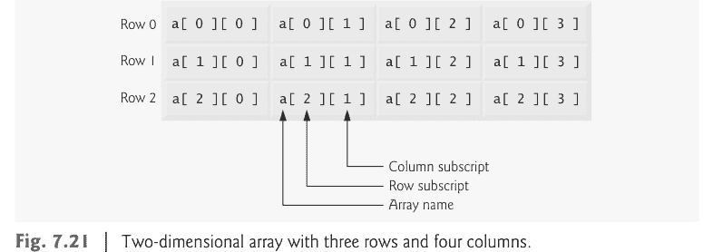

Fig. 7.21 | Two-dimensional array with three rows and four columns.

多维数组可以在其声明中像一维数组一样初始化。例如，具有行 0 元素值为 1 和 2、行 1 元素值为 3 和 4 的二维数组 `b` 可以用

```
int b[ 2 ][ 2 ] = { { 1, 2 }, { 3, 4 } };
```

进行声明和初始化。值按行分组在大括号中。因此，1 和 2 分别初始化 `b[ 0 ][ 0 ]` 和 `b[ 0 ][ 1 ]`，3 和 4 分别初始化 `b[ 1 ][ 0 ]` 和 `b[ 1 ][ 1 ]`。如果某行的初始值不足，则该行的剩余元素初始化为 0。因此，声明

```
int b[ 2 ][ 2 ] = { { 1 }, { 3, 4 } };
```

将 `b[ 0 ][ 0 ]` 初始化为 1，`b[ 0 ][ 1 ]` 初始化为 0，`b[ 1 ][ 0 ]` 初始化为 3，`b[ 1 ][ 1 ]` 初始化为 4。

图 7.22 演示了在声明中初始化二维数组。第 11–13 行声明了三个数组，每个数组有两行三列。

```
1  // Fig. 7.22: fig07_22.cpp
2  // Initializing multidimensional arrays.
3  #include <iostream>
4  using std::cout;
5  using std::endl;
6
7  void printArray( const int [] [ 3 ] ); // prototype
8
9  int main()
10 {
11     int array1[ 2 ][ 3 ] = { { 1, 2, 3 }, { 4, 5, 6 } };
12     int array2[ 2 ][ 3 ] = { 1, 2, 3, 4, 5 };
13     int array3[ 2 ][ 3 ] = { { 1, 2 }, { 4 } };
14
15     cout << "Values in array1 by row are:" << endl;
16     printArray( array1 );
17
18     cout << "\nValues in array2 by row are:" << endl;
19     printArray( array2 );
```

```
cout << "\nValues in array3 by row are:" << endl;
printArray( array3 );
return 0; // indicates successful termination
} // end main
// output array with two rows and three columns
void printArray( const int a[][ 3 ] )
{
   // loop through array's rows
   for ( int i = 0; i < 2; i++ )
   {
      // loop through columns of current row
      for ( int j = 0; j < 3; j++ )
         cout << a[ i ][ j ] << ' ';
      cout << endl; // start new line of output
   } // end outer for
} // end function printArray
```

```
Values in array1 by row are:
1 2 3
4 5 6
Values in array2 by row are:
1 2 3
4 5 0
Values in array3 by row are:
1 2 0
4 0 0
```

`array1` 的声明（第 11 行）提供了两个子列表中的六个初始值。第一个子列表将数组的行 0 初始化为值 1、2 和 3；第二个子列表将数组的行 1 初始化为值 4、5 和 6。如果从 `array1` 初始值列表中删除每个子列表的大括号，编译器将按行 0 的元素然后行 1 的元素初始化元素，得到相同的结果。

`array2` 的声明（第 12 行）仅提供五个初始值。初始值先分配给行 0，然后分配给行 1。任何没有显式初始值的元素都初始化为零，因此 `array2[ 1 ][ 2 ]` 初始化为零。

`array3` 的声明（第 13 行）提供了两个子列表中的三个初始值。行 0 的子列表显式将行 0 的前两个元素初始化为 1 和 2；第三个元素隐式初始化为零。行 1 的子列表显式将第一个元素初始化为 4，并隐式将最后两个元素初始化为零。

程序调用函数 `printArray` 输出每个数组的元素。请注意，函数定义（第 27–38 行）指定了参数 `const int a[][ 3 ]`。当函数接收一维数组作为参数时，函数参数列表中的数组括号为空。同样，二维数组的第一个维度大小（即行数）也不需要，但所有后续维度大小都是

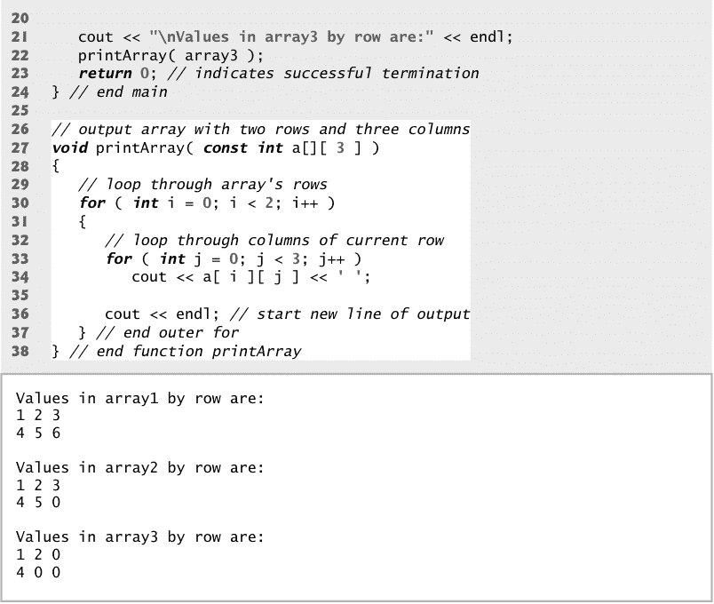

required. 编译器使用这些大小来确定多维数组中元素在内存中的位置。所有数组元素无论维度数多少都连续存储在内存中。在二维数组中，行 0 存储在内存中后跟行 1。在二维数组中，每一行都是一个一维数组。要定位某一行中的元素，函数必须确切知道每一行中有多少个元素，以便在访问数组时跳过适当数量的内存位置。因此，在访问 `a[ 1 ][ 2 ]` 时，函数知道要跳过行 0 在内存中的三个元素以到达行 1。然后，函数访问该行的元素 2。

许多常见的数组操作使用 `for` 重复语句。例如，以下 `for` 语句将图 7.21 中数组 `a` 的第 2 行的所有元素设为零：

```cpp
for ( column = 0; column < 4; column++ )
    a[ 2 ][ column ] = 0;
```

该 `for` 语句仅改变第二个下标（即列下标）。前面的 `for` 语句等价于以下赋值语句：

```cpp
a[ 2 ][ 0 ] = 0;
a[ 2 ][ 1 ] = 0;
a[ 2 ][ 2 ] = 0;
a[ 2 ][ 3 ] = 0;
```

以下嵌套的 `for` 语句确定数组 `a` 中所有元素的总和：

```cpp
total = 0;
for ( row = 0; row < 3; row++ )
    for ( column = 0; column < 4; column++ )
        total += a[ row ][ column ];
```


该 `for` 语句一次对数组的一行元素求和。外层 `for` 语句首先将 `row`（即行下标）设为 0，以便内层 `for` 语句可以对第 0 行的元素求和。外层 `for` 语句随后将 `row` 增加到 1，以便可以对第 1 行的元素求和。然后，外层 `for` 语句将 `row` 增加到 2，以便可以对第 2 行的元素求和。当嵌套的 `for` 语句终止时，`total` 包含所有数组元素的和。

## 7.10 案例研究：使用二维数组的类 `GradeBook`

在第 7.6 节中，我们介绍了类 `GradeBook`（图 7.16–7.17），它使用一维数组存储学生在一次考试上的成绩。在大多数学期中，学生会参加多场考试。教授很可能希望在整个学期内对成绩进行分析，既针对单个学生，也针对整个班级。

### 在类 `GradeBook` 中使用二维数组存储学生成绩

图 7.23–7.24 包含了一个使用二维数组 `grades` 存储多名学生在多场考试上的成绩的类 `GradeBook` 版本。数组的每一行代表一名学生在整个课程中的成绩，每一列代表学生在某一特定考试中获得的所有成绩。客户端程序，例如 `fig07_25.cpp`，将数组作为参数传递给 `GradeBook` 构造函数。在此示例中，我们使用一个十乘三的数组，包含十名学生在三场考试上的成绩。

```cpp

// Fig. 7.23: GradeBook.h

// Definition of class GradeBook that uses a

// two-dimensional array to store test grades.

// Member functions are defined in GradeBook.cpp

#include <string> // program uses C++ Standard Library string class

using std::string;

// GradeBook class definition

class GradeBook

{

public:

   // constants

   const static int students = 10; // number of students

   const static int tests = 3; // number of tests

   // constructor initializes course name and array of grades

   GradeBook( string, const int [][ tests ] );

   void setCourseName( string ); // function to set the course name

   string getCourseName(); // function to retrieve the course name

   void displayMessage(); // display a welcome message

   void processGrades(); // perform various operations on the grade data

   int getMinimum(); // find the minimum grade in the grade book

   int getMaximum(); // find the maximum grade in the grade book

   double getAverage( const int [], const int ); // get student’s average

   void outputBarChart(); // output bar chart of grade distribution

   void outputGrades(); // output the contents of the grades array

private:

   string courseName; // course name for this grade book

   int grades[ students ][ tests ]; // two-dimensional array of grades

}; // end class GradeBook

```

**Fig. 7.23** | Definition of class `GradeBook` with a two-dimensional array to store grades.

```cpp

// Fig. 7.24: GradeBook.cpp

// Member-function definitions for class GradeBook that

// uses a two-dimensional array to store grades.

#include <iostream>

using std::cout;

using std::cin;

using std::endl;

using std::fixed;

#include <iomanip> // parameterized stream manipulators

using std::setprecision; // sets numeric output precision

using std::setw; // sets field width

// include definition of class GradeBook from GradeBook.h

#include "GradeBook.h"

// two-argument constructor initializes courseName and grades array

GradeBook::GradeBook( string name, const int gradesArray[][ tests ] )

{

   setCourseName( name ); // initialize courseName

   // copy grades from gradesArray to grades

   for ( int student = 0; student < students; student++ )

   {

      for ( int test = 0; test < tests; test++ )

         grades[ student ][ test ] = gradesArray[ student ][ test ];

   } // end two-argument GradeBook constructor

// function to set the course name

void GradeBook::setCourseName( string name )

{

   courseName = name; // store the course name

} // end function setCourseName

// function to retrieve the course name

string GradeBook::getCourseName()

{

   return courseName;

} // end function getCourseName

// display a welcome message to the GradeBook user

void GradeBook::displayMessage()

{

   // this statement calls getCourseName to get the

   // name of the course this GradeBook represents

   cout << "Welcome to the grade book for\n" << getCourseName() << "!"

      << endl;

} // end function displayMessage

// perform various operations on the data

void GradeBook::processGrades()

{

   // output grades array

   outputGrades();

   // call functions getMinimum and getMaximum

   cout << "\nLowest grade in the grade book is " << getMinimum()

      << "\nHighest grade in the grade book is " << getMaximum() << endl;

   // output grade distribution chart of all grades on all tests

   outputBarChart();

} // end function processGrades

// find minimum grade in the entire gradebook

int GradeBook::getMinimum()

{

   int lowGrade = 100; // assume lowest grade is 100

   // loop through rows of grades array

   for ( int student = 0; student < students; student++ )

   {

      // loop through columns of current row

      for ( int test = 0; test < tests; test++ )

      {

         // if current grade less than lowGrade, assign it to lowGrade

         if ( grades[ student ][ test ] < lowGrade )

            lowGrade = grades[ student ][ test ]; // new lowest grade

      } // end inner for

   } // end outer for

   return lowGrade; // return lowest grade

} // end function getMinimum

// find maximum grade in the entire gradebook

int GradeBook::getMaximum()

{

   int highGrade = 0; // assume highest grade is 0

   // loop through rows of grades array

   for ( int student = 0; student < students; student++ )

   {

      // loop through columns of current row

      for ( int test = 0; test < tests; test++ )

      {

         // if current grade greater than highGrade, assign it to highGrade

         if ( grades[ student ][ test ] > highGrade )

            highGrade = grades[ student ][ test ]; // new highest grade

      } // end inner for

   } // end outer for

   return highGrade; // return highest grade

} // end function getMaximum

// determine average grade for particular set of grades

double GradeBook::getAverage( const int setOfGrades[], const int grades )

{

   int total = 0; // initialize total

   // sum grades in array

   for ( int grade = 0; grade < grades; grade++ )

      total += setOfGrades[ grade ];

   // return average of grades

   return static_cast< double >( total ) / grades;

} // end function getAverage

```


# Fig. 7.24 | GradeBook class member-function definitions manipulating a two-dimensional array of grades. (Part 1 of 5.)

# Fig. 7.24 | GradeBook class member-function definitions manipulating a two-dimensional array of grades. (Part 2 of 5.)

# Fig. 7.24 | GradeBook class member-function definitions manipulating a two-dimensional array of grades. (Part 3 of 5.)

116
117 // output bar chart displaying grade distribution
118 void GradeBook::outputBarChart()
119 {
120     cout << "\nOverall grade distribution:" << endl;
121
122     // stores frequency of grades in each range of 10 grades
123     const int frequencySize = 11;
124     int frequency[ frequencySize ] = {}; // initialize elements to 0
125
126     // for each grade, increment the appropriate frequency
127     for ( int student = 0; student < students; student++ )
128     {
129         for ( int test = 0; test < tests; test++ )
130             ++frequency[ grades[ student ][ test ] / 10 ];
131     }
132
133     // for each grade frequency, print bar in chart
134     for ( int count = 0; count < frequencySize; count++ )
135     {
136         // output bar label ("0-9:", ..., "90-99:", "100:" )
137         if ( count == 0 )
138             cout << "   0-9: ";
139         else if ( count == 10 )
140             cout << "  100: ";
141         else
142             cout << count * 10 << "-" << ( count * 10 ) + 9 << ": ";
143
144         // print bar of asterisks
145         for ( int stars = 0; stars < frequency[ count ]; stars++ )
146             cout << '*';
147
148         cout << endl; // start a new line of output
149     } // end outer for
150 } // end function outputBarChart

// output the contents of the grades array
void GradeBook::outputGrades()
{
    cout << "\nThe grades are:\n\n";
    cout << "               "; // align column heads

    // create a column heading for each of the tests
    for ( int test = 0; test < tests; test++ )
        cout << "Test " << test + 1 << "   ";

    cout << "Average" << endl; // student average column heading

    // create rows/columns of text representing array grades
    for ( int student = 0; student < students; student++ )
    { 
        cout << "Student " << setw( 2 ) << student + 1;

    // output student's grades
    for ( int test = 0; test < tests; test++ )
        cout << setw( 8 ) << grades[ student ][ test ];

    // call member function getAverage to calculate student's average;
    // pass row of grades and the value of tests as the arguments
    double average = getAverage( grades[ student ], tests );
    cout << setw( 9 ) << setprecision( 2 ) << fixed << average << endl;
} // end outer for
} // end function outputGrades

# Fig. 7.24 | GradeBook class member-function definitions manipulating a two-dimensional array of grades. (Part 4 of 5.)

# Fig. 7.24 | GradeBook class member-function definitions manipulating a two-dimensional array of grades. (Part 5 of 5.)

Five member functions (declared in lines 23–27 of Fig. 7.23) perform array manipulations to process the grades. Each of these member functions is similar to its counterpart in the earlier one-dimensional array version of class `GradeBook` (Figs. 7.16–7.17). Member function `getMinimum` (defined in lines 65–82 of Fig. 7.24) determines the lowest grade of any student for the semester. Member function `getMaximum` (defined in lines 85–102 of Fig. 7.24) determines the highest grade of any student for the semester. Member function `getAverage` (lines 105–115 of Fig. 7.24) determines a particular student's semester average. Member function `outputBarChart` (lines 118–149 of Fig. 7.24) outputs a bar chart of the distribution of all student grades for the semester. Member function `outputGrades` (lines 152–177 of Fig. 7.24) outputs the two-dimensional array in a tabular format, along with each student's semester average.

Member functions `getMinimum`, `getMaximum`, `outputBarChart` and `outputGrades` each loop through array `grades` by using nested `for` statements. For example, consider the nested `for` statement in member function `getMinimum` (lines 70–79). The outer `for` statement begins by setting `student` (i.e., the row subscript) to 0, so the elements of row 0 can be compared with variable `lowGrade` in the body of the inner `for` statement. The inner `for` statement loops through the grades of a particular row and compares each grade with `lowGrade`. If a grade is less than `lowGrade`, `lowGrade` is set to that grade. The outer `for` statement then increments the row subscript to 1. The elements of row 1 are compared with variable `lowGrade`. The outer `for` statement then increments the row subscript to 2, and the elements of row 2 are compared with variable `lowGrade`. This repeats until all rows of grades have been traversed. When execution of the nested statement is complete, `lowGrade` contains the smallest grade in the two-dimensional array. Member function `getMaximum` works similarly to member function `getMinimum`.

Member function `outputBarChart` in Fig. 7.24 is nearly identical to the one in Fig. 7.17. However, to output the overall grade distribution for a whole semester, the member function uses a nested `for` statement (lines 127–130) to create the one-dimensional array `frequency` based on all the grades in the two-dimensional array. The rest of the code in each of the two `outputBarChart` member functions that displays the chart is identical.

Member function `outputGrades` (lines 152–177) also uses nested `for` statements to output values of the array `grades`, in addition to each student's semester average. The output in Fig. 7.25 shows the result, which resembles the tabular format of a professor's

physical grade book. Lines 158–159 print the column headings for each test. We use a counter-controlled `for` statement so that we can identify each test with a number. Similarly, the `for` statement in lines 164–176 first outputs a row label using a counter variable to identify each student (line 166). Although array indices start at 0, note that lines 159 and 166 output `test + 1` and `student + 1`, respectively, to produce test and student numbers starting at 1 (see Fig. 7.25). The inner `for` statement in lines 169–170 uses the outer `for` statement’s counter variable `student` to loop through a specific row of array `grades` and output each student's test grade. Finally, line 174 obtains each student's semester average by passing the current row of grades (i.e., `grades[student]`) to member function `getAverage`.

Member function `getAverage` (lines 105–115) takes two arguments—a one-dimensional array of test results for a particular student and the number of test results in the array. When line 174 calls `getAverage`, the first argument is `grades[student]`, which specifies that a particular row of the two-dimensional array `grades` should be passed to `getAverage`. For example, based on the array created in Fig. 7.25, the argument `grades[1]` represents the three values (a one-dimensional array of grades) stored in row 1 of the two-dimensional array `grades`. A two-dimensional array can be considered an array whose elements are one-dimensional arrays. Member function `getAverage` calculates the sum of the array elements, divides the total by the number of test results and returns the floating-point result as a `double` value (line 114).

## Testing Class GradeBook

The program in Fig. 7.25 creates an object of class `GradeBook` (Figs. 7.23–7.24) using the two-dimensional array of `int`s named `gradesArray` (declared and initialized in lines 10–20). Note that line 10 accesses class `GradeBook`’s static constants `students` and `tests` to indicate the size of each dimension of array `gradesArray`. Lines 22–23 pass a course name and `gradesArray` to the `GradeBook` constructor. Lines 24–25 then invoke `myGradeBook`’s `displayMessage` and `processGrades` member functions to display a welcome message and obtain a report summarizing the students’ grades for the semester, respectively.

```cpp
```


## Fig. 7.25: `fig07_25.cpp`

// Creates GradeBook object using a two-dimensional array of grades.

```cpp
#include "GradeBook.h" // GradeBook class definition

// function main begins program execution

int main()
{
   // two-dimensional array of student grades
   int gradesArray[GradeBook::students][GradeBook::tests] =
      { { 87, 96, 70 },
        { 68, 87, 90 },
        { 94, 100, 90 },
        { 100, 81, 82 },
        { 83, 65, 85 },
        { 78, 87, 65 },
        { 85, 75, 83 },
        { 91, 94, 100 },
        { 76, 72, 84 },
        { 87, 93, 73 } };

    GradeBook myGradeBook(
    "CS101 Introduction to C++ Programming", gradesArray );
    myGradeBook.displayMessage();
    myGradeBook.processGrades();
    return 0; // indicates successful termination
} // end main
```

**Fig. 7.25** | Creates a GradeBook object using a two-dimensional array of grades, then invokes member function `processGrades` to analyze them. (Part 1 of 2.)

欢迎使用成绩簿
CS101 Introduction to C++ Programming!

成绩如下：

|          | Test 1 | Test 2 | Test 3 | Average |
|----------|--------|--------|--------|---------|
| Student 1| 87     | 96     | 70     | 84.33   |
| Student 2| 68     | 87     | 90     | 81.67   |
| Student 3| 94     | 100    | 90     | 94.67   |
| Student 4| 100    | 81     | 82     | 87.67   |
| Student 5| 83     | 65     | 85     | 77.67   |
| Student 6| 78     | 87     | 65     | 76.67   |
| Student 7| 85     | 75     | 83     | 81.00   |
| Student 8| 91     | 94     | 100    | 95.00   |
| Student 9| 76     | 72     | 84     | 77.33   |
| Student 10| 87    | 93     | 73     | 84.33   |

成绩簿中最低成绩为 65
成绩簿中最高成绩为 100

总体成绩分布：
0-9:
10-19:
20-29:
30-39:
40-49:
50-59:
60-69: ***
70-79: ******
80-89: ************
90-99: *********
100: ***

图 7.25 | 使用二维成绩数组创建 GradeBook 对象，然后调用成员函数 `processGrades` 对其进行分析。 (第 2 部分，共 2 部分。)

## 7.11 C++ 标准库类模板 `vector` 的介绍

我们现在介绍 C++ 标准库类模板 `vector`，它表示一种更强大的数组类型，具有许多额外的功能。正如你在后面的章节中会看到的那样，C 风格的基于指针的数组（即迄今为止介绍的数组类型）存在很大的错误风险。例如，如前所述，程序很容易“走出”数组的两端，因为 C++ 不会检查下标是否超出数组的范围。两个数组不能使用相等运算符或关系运算符有意义地进行比较。正如你在第 8 章中会看到的那样，指针变量（更 commonly 称为指针）包含其值作为内存地址。数组名只是指向内存中数组开始位置的指针，当然，两个数组总是在不同的内存位置。当一个数组被传递给设计用于处理任意大小数组的通用函数时，数组的大小必须作为额外的参数传递。此外，一个数组不能使用赋值运算符赋给另一个数组——数组名是 `const` 指针，正如你在第 8 章中会看到的那样，常量指针不能用作赋值运算符的左侧。这些和其他功能对于处理数组来说似乎是“自然的”，但 C++ 并未提供此类功能。然而，C++ 标准库提供了类模板 `vector`，允许程序员创建比数组更强大且出错率更低的替代方案。在第 11 章《运算符重载；字符串和数组对象》中，我们介绍了实现此类数组功能的方法，如 `vector` 所提供的功能。你将看到如何为自己的类自定义运算符（这种技术称为运算符重载）。

`vector` 类模板可供任何使用 C++ 构建应用程序的人使用。`vector` 示例使用的记法可能对你来说不熟悉，因为 `vector` 使用模板记法。回想一下，第 6.18 节讨论了函数模板。在第 14 章中，我们讨论类模板。目前，你应该能够通过模仿本节中示例的语法来舒适地使用类模板 `vector`。随着我们在第 14 章研究类模板，你的理解会加深。第 20 章详细介绍了类模板 `vector`（以及其他几个标准 C++ 容器类）。

图 7.26 的程序演示了 C++ 标准库类模板 `vector` 提供的功能，这些功能对于 C 风格的基于指针的数组是不可用的。标准类模板 `vector` 提供了与我们在第 11 章《运算符重载；字符串和数组对象》中构建的 `Array` 类相同的许多功能。标准类模板 `vector` 在头文件 `<vector>` 中定义（第 11 行）并属于命名空间 `std`（第 12 行）。第 20 章讨论了标准类模板 `vector` 的完整功能。

第 19-20 行创建了两个存储类型为 `int` 的 `vector` 对象——`integers1` 包含七个元素，`integers2` 包含 10 个元素。默认情况下，每个 `vector` 对象的元素都设置为 0。请注意，`vector` 可以定义为存储任何数据类型，只需将 `vector<int>` 中的 `int` 替换为适当的数据类型即可。这种指定 `vector` 中存储类型的记法与第 6.18 节中用函数模板引入的模板记法类似。再次强调，第 14 章详细讨论了这种语法。

### Fig. 7.26: `fig07_26.cpp`

```cpp
// Demonstrating C++ Standard Library class template vector.
#include <iostream>
using std::cout;
using std::cin;
using std::endl;

#include <iomanip>
using std::setw;

#include <vector>
using std::vector;

void outputVector( const vector< int > & ); // display the vector
void inputVector( vector< int > & ); // input values into the vector

int main()
{
    vector< int > integers1( 7 ); // 7-element vector< int >
    vector< int > integers2( 10 ); // 10-element vector< int >

    // print integers1 size and contents
    cout << "Size of vector integers1 is " << integers1.size()
        << "\nvector after initialization:" << endl;
    outputVector( integers1 );

    // print integers2 size and contents
    cout << "\nSize of vector integers2 is " << integers2.size()
        << "\nvector after initialization:" << endl;
    outputVector( integers2 );

    // input and print integers1 and integers2
    cout << "\nEnter 17 integers:" << endl;
    inputVector( integers1 );
    inputVector( integers2 );

    cout << "\nAfter input, the vectors contain:\n"
        << "integers1:" << endl;
    outputVector( integers1 );
    cout << "integers2:" << endl;
    outputVector( integers2 );

    // use inequality (!=) operator with vector objects
    cout << "\nEvaluating: integers1 != integers2" << endl;

    if ( integers1 != integers2 )
        cout << "integers1 and integers2 are not equal" << endl;

    // create vector integers3 using integers1 as an
    // initializer; print size and contents
    vector< int > integers3( integers1 ); // copy constructor

    cout << "\nSize of vector integers3 is " << integers3.size()
        << "\nvector after initialization:" << endl;
    outputVector( integers3 );

    // use overloaded assignment (=) operator
    cout << "\nAssigning integers2 to integers1:" << endl;
    integers1 = integers2; // assign integers2 to integers1

    cout << "integers1:" << endl;
    outputVector( integers1 );
    cout << "integers2: " << endl;
    outputVector( integers2 );

    // use equality (==) operator with vector objects
    cout << "\nEvaluating: integers1 == integers2" << endl;
    if ( integers1 == integers2 )
       cout << "integers1 and integers2 are equal" << endl;

    // use square brackets to create rvalue
    cout << "\nintegers1[5] is " << integers1[ 5 ];

    // use square brackets to create lvalue
    cout << "\n\nAssigning 1000 to integers1[5]" << endl;
    integers1[ 5 ] = 1000;
    cout << "integers1: " << endl;
    outputVector( integers1 );

    // attempt to use out-of-range subscript
    cout << "\nAttempt to assign 1000 to integers1.at( 15 )" << endl;
    integers1.at( 15 ) = 1000; // ERROR: out of range
    return 0;
} // end main

// output vector contents
void outputVector( const vector< int > &array )
{
   size_t i; // declare control variable
   for ( i = 0; i < array.size(); i++ )
   {
      cout << setw( 12 ) << array[ i ];
      if ( ( i + 1 ) % 4 == 0 ) // 4 numbers per row of output
         cout << endl;
   } // end for
   if ( i % 4 != 0 )
      cout << endl;
} // end function outputVector

// input vector contents
void inputVector( vector< int > &array )
{
   for ( size_t i = 0; i < array.size(); i++ )
      cin >> array[ i ];
} // end function inputVector
```

图 7.26 | C++ 标准库类模板 `vector`。 (第 1 部分，共 4 部分。)

**图 7.26** | C++ 标准库类模板 `vector`。 (第 3 部分，共 4 部分。)

```
Size of vector integers1 is 7
vector after initialization:
             0             0             0             0
             0             0             0
```

```
Size of vector integers2 is 10
vector after initialization:
                 0                 0                 0                 0
                 0                 0                 0                 0
                 0                 0
Enter 17 integers:
1 2 3 4 5 6 7 8 9 10 11 12 13 14 15 16 17
After input, the vectors contain:
integers1:
                 1                 2                 3                 4
                 5                 6                 7
integers2:
                 8                 9                10                11
                12                13                14                15
                16                17
Evaluating: integers1 != integers2
integers1 and integers2 are not equal
Size of vector integers3 is 7
vector after initialization:
                 1                 2                 3                 4
                 5                 6                 7
Assigning integers2 to integers1:
integers1:
                 8                 9                10                11
```


```
                12                13                14                15

                16                17

integers2:

                 8                 9                10                11

                12                13                14                15

                16                17

Evaluating: integers1 == integers2

integers1 and integers2 are equal

integers1[5] is 13

Assigning 1000 to integers1[5]

integers1:

                 8                 9                10                11

                12              1000                14                15

                16                17

Attempt to assign 1000 to integers1.at( 15 )

abnormal program termination
```


第 23 行使用 `vector` 成员函数 `size` 获取 `integers1` 的大小（即元素的个数）。第 25 行将 `integers1` 传递给函数 `outputVector`（第 88–102 行），该函数使用方括号 `[]`（第 94 行）获取 `vector` 中每个元素的值以输出。注意这种记法的相似性与用于访问数组元素值的记法。第 28 行和第 30 行对 `integers2` 执行相同的任务。

类模板 `vector` 的成员函数 `size` 以类型 `size_t` 的值返回 `vector` 中的元素个数（该类型在许多系统上表示 `unsigned int`）。因此，第 90 行将控制变量 `i` 也声明为类型 `size_t`。在某些编译器上，将 `i` 声明为 `int` 会导致编译器发出警告信息，因为循环继续条件（第 92 行）会比较一个有符号值（即 `int i`）和一个无符号值（即函数 `size` 返回的类型为 `size_t` 的值）。

第 34–35 行将 `integers1` 和 `integers2` 传递给函数 `inputVector`（第 105–109 行），以从用户读取每个 `vector` 元素的数值。函数使用方括号 `[]` 形成左值，用于将输入值存储到每个 `vector` 元素中。

第 46 行演示了 `vector` 对象可以使用 `!=` 运算符相互比较。如果两个 `vector` 的内容不相等，运算符返回 `true`；否则返回 `false`。

C++ 标准库类模板 `vector` 允许你创建一个用现有 `vector` 的内容初始化的新 `vector` 对象。第 51 行创建 `vector` 对象 `integers3` 并用 `integers1` 的副本初始化它。这会调用 `vector` 的所谓拷贝构造函数来执行拷贝操作。你将在第 11 章详细了解拷贝构造函数。第 53–55 行输出 `integers3` 的大小和内容，以证明其已正确初始化。

第 59 行将 `integers2` 赋给 `integers1`，演示了赋值（`=`）运算符可用于 `vector` 对象。第 61–64 行输出两个对象的内容，以显示它们现在包含相同的值。第 69 行随后使用相等（`==`）运算符比较 `integers1` 和 `integers2`，以确定在第 59 行赋值后两个对象的内容是否相等（它们相等）。

第 73 行和第 77 行演示了程序可以使用方括号 `[]` 将 `vector` 元素作为右值和左值获取。回顾第 5.9 节，右值不能被修改，但左值可以。与 C 风格的基于指针的数组一样，C++ 在使用方括号访问 `vector` 元素时不执行任何边界检查。因此，你必须确保使用 `[]` 的操作不会意外尝试操作 `vector` 边界之外的元素。标准类模板 `vector` however 在其成员函数 `at` 中提供了边界检查，如果其参数是无效下标，则会“抛出异常”（参见第 16 章异常处理）。默认情况下，这会导致 C++ 程序终止。如果下标有效，函数 `at` 会返回指定位置的元素作为可修改的左值或不可修改的左值，具体取决于调用出现的上下文（非 `const` 或 `const`）。第 83 行演示了使用无效下标调用函数 `at`。resulting 输出因编译器而异。

在本节中，我们演示了 C++ 标准库类模板 `vector`，这是一个健壮、可重用的类，可以替代 C 风格的基于指针的数组。在第 11 章中，你将看到 `vector` 通过“重载”C++ 的内置运算符实现了其许多功能，并且你将看到如何以类似的方式为自己的类自定义运算符。例如，我们创建了一个 `Array` 类，该类与类模板 `vector` 一样改进了基本数组功能。我们的 `Array` 类还提供了额外的功能，例如使用运算符 `>>` 和 `<<` 分别输入和输出整个数组的能力。

## 7.12 （可选）软件工程案例研究：ATM 系统中对象之间的协作

在本节中，我们集中讨论 ATM 系统中对象之间的协作（交互）。当两个对象相互通信以完成一项任务时，它们被称为协作——它们通过调用彼此的操作来实现这一点。协作由一个类的对象向另一个类的对象发送消息组成。消息在 C++ 中通过成员函数调用发送。

在第 6.22 节中，我们确定了系统中类的许多操作。在本节中，我们集中讨论调用这些操作的<|message|> 消息。为了识别系统中的协作，我们回到第 2.7 节中的需求规格说明书。回想一下，该文档指定了 ATM 会话期间发生的活动范围（例如，验证用户、执行交易）。用于描述系统必须如何执行每项任务的步骤是我们系统协作的第一个迹象。随着我们继续本节和剩余的软件工程案例研究部分，我们可能会发现额外的协作。

### 识别系统中的协作

我们通过仔细阅读需求规格说明书中指定 ATM 应如何验证用户以及执行每种交易类型的部分来识别系统中的协作。对于描述的每个动作或步骤，我们决定系统中哪些对象必须交互以实现所需的结果。我们将一个对象识别为发送对象（即发送消息的对象），另一个识别为接收对象（即向客户端提供该操作的类）。然后，我们选择接收对象的其中一个操作（在第 6.22 节中识别），该操作必须由发送对象调用以产生正确的行为。例如，`ATM` 在空闲时显示欢迎消息。我们知道 `Screen` 类的对象通过其 `displayMessage` 操作向用户显示消息。因此，我们决定系统可以通过 `ATM` 与 `Screen` 之间的协作来显示欢迎消息，其中 `ATM` 向 `Screen` 发送 `displayMessage` 消息，通过调用 `Screen` 类的 `displayMessage` 操作。[注意：为了避免重复“一个类…的对象”这一短语，我们仅通过使用其类名前面加上冠词（“a”、“an”或“the”）来指代每个对象——例如，“the `ATM`”指的是 `ATM` 类的一个对象。]

图 7.27 列出了可以从需求规格说明书中得出的协作。对于每个发送对象，我们按需求规格说明书中讨论的顺序列出协作。即使协作在 `ATM` 会话期间可能发生多次，我们也只列出涉及唯一发送者、消息和接收者的每次协作一次。例如，图 7.27 中的第一行表示每当 `ATM` 需要向用户显示消息时，`ATM` 就会与 `Screen` 协作。

让我们考虑图 7.27 中的协作。在允许用户执行任何交易之前，`ATM` 必须提示用户输入账号，然后输入 PIN。它通过向 `Screen` 发送 `displayMessage` 消息来完成这两项任务。这两个操作都指的是 `ATM` 与 `Screen` 之间已在图 7.27 中列出的同一协作。`ATM` 通过向 `Keypad` 发送 `getInput` 消息来获取提示的输入。接下来，`ATM` 必须确定用户指定的账号和 PIN 是否与数据库中的某个账号匹配。它通过向 `BankDatabase` 发送 `authenticateUser` 消息来实现这一点。回想一下，

`BankDatabase` 不能直接对用户进行身份验证——只有用户的 `Account`（即包含用户指定的账号的 `Account`）才能访问用户的 PIN 来对用户进行身份验证。因此图 7.27 列出了 `BankDatabase` 向 `Account` 发送 `validatePIN` 消息的协作。

用户身份验证后，`ATM` 通过向 `Screen` 发送一系列 `displayMessage` 消息来显示主菜单，并通过向 `Keypad` 发送 `getInput` 消息来获取包含菜单选择的输入。我们已经考虑了这些协作。用户选择要执行的操作类型后，`ATM` 通过向适当的交易类对象（即 `BalanceInquiry`、`Withdrawal` 或 `Deposit`）发送 `execute` 消息来执行交易。例如，如果用户选择执行余额查询，`ATM` 会向 `BalanceInquiry` 发送 `execute` 消息。

对需求规范的进一步检查揭示了执行每种交易类型的协作。`BalanceInquiry` 通过向 `BankDatabase` 发送 `getAvailableBalance` 消息来检索用户账户中可用的资金金额，`BankDatabase` 通过向用户的 `Account` 发送 `getAvailableBalance` 消息进行响应。同样，`BalanceInquiry` 通过向 `BankDatabase` 发送 `getTotalBalance` 消息来检索存款金额，`BankDatabase` 将同一消息发送给用户的 `Account`。为了同时显示用户余额的两种度量，`BalanceInquiry` 向 `Screen` 发送 `displayMessage` 消息。

| An object of class... | sends the message... | to an object of class... |
|---|---|---|
| `ATM` | `displayMessage` | `Screen` |
|  | `getInput` | `Keypad` |
|  | `authenticateUser` | `BankDatabase` |
|  | `execute` | `BalanceInquiry` |
|  | `execute` | `Withdrawal` |
|  | `execute` | `Deposit` |
| `BalanceInquiry` | `getAvailableBalance` | `BankDatabase` |
|  | `getTotalBalance` | `BankDatabase` |
|  | `displayMessage` | `Screen` |
| `Withdrawal` | `displayMessage` | `Screen` |
|  | `getInput` | `Keypad` |
|  | `getAvailableBalance` | `BankDatabase` |
|  | `isSufficientCashAvailable` | `CashDispenser` |
|  | `debit` | `BankDatabase` |
|  | `dispenseCash` | `CashDispenser` |
| `Deposit` | `displayMessage` | `Screen` |
|  | `getInput` | `Keypad` |
|  | `isEnvelopeReceived` | `DepositSlot` |
|  | `credit` | `BankDatabase` |
| `BankDatabase` | `validatePIN` | `Account` |
|  | `getAvailableBalance` | `Account` |
|  | `getTotalBalance` | `Account` |
|  | `debit` | `Account` |
|  | `credit` | `Account` |

Fig. 7.27 | Collaborations in the ATM system.

to the user’s `Account`. To display both measures of the user’s balance at the same time, the `BalanceInquiry` sends a `displayMessage` message to the `Screen`.

A `Withdrawal` sends the `Screen` several `displayMessage` messages to display a menu of standard withdrawal amounts (i.e., $20, $40, $60, $100, $200). The `Withdrawal` sends the `Keypad` a `getInput` message to obtain the user’s menu selection, then determines whether the requested withdrawal amount is less than or equal to the user’s account balance. The `Withdrawal` can obtain the amount of money available in the account by sending the `BankDatabase` a `getAvailableBalance` message. The `Withdrawal` then tests whether the cash dispenser contains enough cash by sending the `CashDispenser` an `isSufficientCashAvailable` message. A `Withdrawal` sends the `BankDatabase` a `debit` message to decrease the user’s account balance. The `BankDatabase` sends the same message to the appropriate `Account`. Recall that debiting funds from an `Account` decreases both the `totalBalance` and the `availableBalance`. To dispense the requested amount of cash, the `Withdrawal` sends the `CashDispenser` a `dispenseCash` message. Finally, the `Withdrawal` sends a `displayMessage` message to the `Screen`, instructing the user to take the cash.

A `Deposit` responds to an `execute` message first by sending a `displayMessage` message to the `Screen` to prompt the user for a deposit amount. The `Deposit` sends a `getInput` message to the `Keypad` to obtain the user’s input. The `Deposit` then sends a `displayMessage` message to the `Screen` to tell the user to insert a deposit envelope. To determine whether the deposit slot received an incoming deposit envelope, the `Deposit` sends an `isEnvelopeReceived` message to the `DepositSlot`. The `Deposit` updates the user’s account by sending a `credit` message to the `BankDatabase`, which subsequently sends a `credit` message to the user’s `Account`. Recall that crediting funds to an `Account` increases the `totalBalance` but not the `availableBalance`.

### Interaction Diagrams

Now that we have identified a set of possible collaborations between the objects in our ATM system, let us graphically model these interactions using the UML. The UML provides several types of interaction diagrams that model the behavior of a system by modeling how objects interact with one another. The communication diagram emphasizes which objects participate in collaborations. [Note: Communication diagrams were called collaboration diagrams in earlier versions of the UML.] Like the communication diagram, the sequence diagram shows collaborations among objects, but it emphasizes when messages are sent between objects over time.

#### Communication Diagrams

Figure 7.28 shows a communication diagram that models the `ATM` executing a `BalanceInquiry`. Objects are modeled in the UML as rectangles containing names in the form `objectName : ClassName`. In this example, which involves only one object of each type, we disregard the object name and list only a colon followed by the class name. [Note: Specifying the name of each object in a communication diagram is recommended when

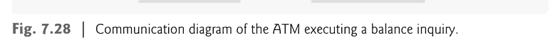

Fig. 7.28 | Communication diagram of the ATM executing a balance inquiry.

`getAvailableBalance` message to the `BankDatabase` (message 1), then sends a `getTotalBalance` message to the `BankDatabase` (message 2). Within the parentheses following a message name, we can specify a comma-separated list of the names of the parameters sent with the message (i.e., arguments in a C++ function call)—the `BalanceInquiry` passes attribute `accountNumber` with its messages to the `BankDatabase` to indicate which `Account`’s balance information to retrieve. Recall from Fig. 6.35 that operations `getAvailableBalance` and `getTotalBalance` of class `BankDatabase` each require a parameter to identify an account. The `BalanceInquiry` next displays the `availableBalance` and the `totalBalance` to the user by passing a `displayMessage` message to the `Screen` (message 3) that includes a parameter indicating the message to be displayed.

Figure 7.29 models two additional messages passing from the `BankDatabase` to an `Account` (message 1.1 and message 2.1). To provide the `ATM` with the two balances of the user’s `Account` (as requested by messages 1 and 2), the `BankDatabase` must pass a `getAvailableBalance` and a `getTotalBalance` message to the user’s `Account`. Messages passed within the handling of another message are called nested messages. The UML recommends using a decimal numbering scheme to indicate nested messages. For example, message 1.1 is the first message nested in message 1—the `BankDatabase` passes a `getAvailableBalance` message while processing `BankDatabase`’s message of the same name. [Note: If the `BankDatabase` needed to pass a second nested message while processing message 1, the second message would be numbered 1.2.] A message may be passed only when all the nested messages from the previous message have been passed—e.g., the `BalanceInquiry` passes message 3 only after messages 2 and 2.1 have been passed, in that order.

The nested numbering scheme used in communication diagrams helps clarify precisely when and in what context each message is passed. For example, if we numbered the messages in Fig. 7.29 using a flat numbering scheme (i.e., 1, 2, 3, 4, 5), someone looking at the diagram might not be able to determine that `BankDatabase` passes the `getAvailableBalance` message (message 1.1) to an `Account` during the `BankDatabase`’s processing of message 1, as opposed to after completing the processing of message 1. The nested decimal numbers make it clear that the second `getAvailableBalance` message (message 1.1) is passed to an `Account` within the handling of the first `getAvailableBalance` message (message 1) by the `BankDatabase`.

#### Sequence Diagrams

Communication diagrams emphasize the participants in collaborations but model their timing a bit awkwardly. A sequence diagram helps model the timing of collaborations more clearly. Figure 7.30 shows a sequence diagram modeling the sequence of interactions that occur when a `Withdrawal` executes. The dotted line extending down from an object’s rectangle is that object’s lifeline, which represents the progression of time. Actions typically occur along an object’s lifeline in chronological order from top to bottom—an action near the top typically happens before one near the bottom.

Message passing in sequence diagrams is similar to message passing in communication diagrams. A solid arrow with a filled arrowhead extending from the sending object to the receiving object represents a message between two objects. The arrowhead points to an activation on the receiving object’s lifeline. An activation, shown as a thin vertical rectangle, indicates that an object is executing. When an object returns control, a return message, represented as a dashed line with a stick arrowhead, extends from the activation of the object returning control to the activation of the object that initially sent the message.

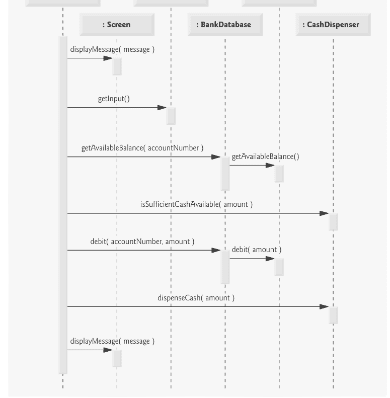

图 7.30 | 模拟 `Withdrawal` 执行的序列图。

为了减少杂乱，我们省略了返回消息箭头——UML 允许这种做法以使图表更易读。与通信图类似，序列图可以在消息名称后的括号中表示消息参数。

图 7.30 中消息的序列始于 `Withdrawal` 通过向 `Screen` 发送 `displayMessage` 消息提示用户选择取款金额。随后 `Withdrawal` 向 `Keypad` 发送 `getInput` 消息，后者从用户获取输入。我们已在图 5.22 的活动图中对 `Withdrawal` 所涉及的控制逻辑进行了建模，因此在图 7.30 的序列图中未显示该逻辑。相反，我们建模了最佳情况，即用户的账户余额大于或等于所选取款金额，并且现金 dispenser 包含足够的现金来满足请求。有关如何在序列图中建模控制逻辑的信息，请参阅第 2.7 节末尾列出的网络资源和推荐阅读。

在获取取款金额后，`Withdrawal` 向 `BankDatabase` 发送 `getAvailableBalance` 消息，后者进而向用户的 `Account` 发送 `getAvailableBalance` 消息。假设用户的账户有足够的资金允许该交易，`Withdrawal` 接下来向 `CashDispenser` 发送 `isSufficientCashAvailable` 消息。假设有足够的现金可用，`Withdrawal` 通过向 `BankDatabase` 发送 `debit` 消息来减少用户账户的余额（即 `totalBalance` 和 `availableBalance`）。`BankDatabase` 通过向用户的 `Account` 发送 `debit` 消息作出响应。最后，`Withdrawal` 向 `CashDispenser` 发送 `dispenseCash` 消息并向 `Screen` 发送 `displayMessage` 消息，告知用户从机器中取出现金。

我们已确定 ATM 系统中对象之间的协作，并使用 UML 交互图——通信图和序列图——对其中一些协作进行了建模。在下一个软件工程案例研究部分（第 9.11 节），我们增强模型的结构以完成初步面向对象设计，然后开始实现 ATM 系统。

### 软件工程案例研究 自我复习练习

7.1 A(n) __________ 由一个类的对象向另一个类的对象发送消息组成。

+ a) association
+ b) aggregation
+ c) collaboration
+ d) composition

7.2 哪种形式的交互图强调发生了哪些协作？哪种形式强调协作发生的时机？

7.3 创建一个序列图，模拟 ATM 系统中 `Deposit` 成功执行时对象之间的交互，并解释该图所建模的消息序列。

### 软件工程案例研究自我复习练习的答案

7.1 c.

7.2 通信图强调发生了哪些协作。序列图强调协作发生的时机。

7.3 图 7.31 展示了一个序列图，该图模拟了 ATM 系统中 `Deposit` 成功执行时对象之间的交互。图 7.31 表明 `Deposit` 首先向 `Screen` 发送 `displayMessage` 消息，要求用户输入存款金额。接下来 `Deposit` 向 `Keypad` 发送 `getInput` 消息以接收用户的输入。`Deposit` 然后通过向 `Screen` 发送 `displayMessage` 消息指示用户输入存款信封。`Deposit` 接下来向 `DepositSlot` 发送 `isEnvelopeReceived` 消息，以确认存款信封已被 ATM 接收。最后，`Deposit` 通过向 `BankDatabase` 发送 `credit` 消息来增加用户 `Account` 的 `totalBalance` 属性（但不增加 `availableBalance` 属性）。`BankDatabase` 通过向用户的 `Account` 发送相同的消息作出响应。

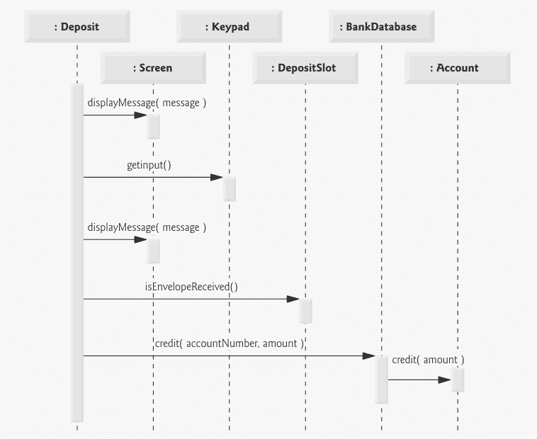

## 7.13 总结

本章开始介绍数据结构，探讨使用数组和向量在值列表和表中存储数据和检索数据。我们还展示了如何声明、初始化和引用数组的单个元素。我们还说明了如何将数组传递给函数以及如何使用 `const` 限定符。我们介绍了基本的搜索和排序技术。你看到了如何声明和操作多维数组。最后，我们演示了 C++ 标准库类模板 `vector`，它提供了比数组更强大的替代方案。

我们在第 14 章《模板》中继续介绍数据结构，在那里我们构建一个栈类模板。第 20 章《标准模板库（STL）》介绍了 C++ 标准库的几个预定义数据结构，你可以使用它们而不是自己构建。第 20 章介绍了更多关于类模板 `vector` 的内容，并讨论了其他数据结构类，包括 `list` 和 `deque`——可随程序存储需求变化而增长和收缩的类数组数据结构。

我们现在已介绍了类、对象、控制语句、函数和数组的基本概念。在第 8 章中，我们介绍 C++ 最强大的功能之一——指针。指针跟踪数据和函数在内存中的存储位置，这使我们能够以有趣的方式操作这些项目。在介绍基本指针概念后，我们将详细研究数组、指针和字符串之间的密切关系。

# 8 指针和基于指针的字符串

> 地址是给我们用来隐藏我们所在位置的。
> —Saki（H. H. Munro）

> 通过间接找到方向。
> —威廉·莎士比亚

> 许多事物，虽有共同的指向
> 却可能产生相反的效果。
> —威廉·莎士比亚

> 你会发现，先生，始终核实你的引用是一个非常好的习惯！
> —Dr. Routh

## 目标

在本章中你将学习：

- 指针是什么。
- 指针和引用之间的相似之处和不同之处，以及何时使用它们。
- 使用指针通过引用向函数传递参数。
- 使用基于指针的 C 风格字符串。
- 指针、数组和 C 风格字符串之间的密切关系。
- 使用函数指针。
- 声明和使用 C 风格字符串的数组。

## 大纲

- 8.1 引言
- 8.2 指针变量声明和初始化
- 8.3 使用 `const` 与指针
- 8.4 使用传引用实现的 selection sort
- 8.5 `sizeof` 运算符
- 8.6 指针表达式和指针算术
- 8.7 指针与数组之间的关系
- 8.8 指针数组
- 8.9 案例研究：洗牌和发牌模拟
- 8.10 函数指针
- 8.11 基于指针的字符串处理的介绍
- 8.12 总结

## 8.1 引言

本章讨论 C++ 编程语言最强大的功能之一，指针。在第 6 章中，我们看到引用可用于执行传引用。指针也能够实现传引用，并且可用于创建和操作动态数据结构（即可增长和收缩的数据结构），例如链表、队列、栈和树。本章解释基本指针概念并强化数组与指针之间的密切关系。将数组视为指针的观点源自 C 编程语言。正如我们在第 7 章中所见，C++ 标准库类 `vector` 提供了将数组作为完整对象的实现。

同样，C++ 实际上提供两种类型的字符串——`string` 类对象（我们自第 3 章以来一直在使用）和 C 风格的 `char *` 基于指针的字符串。本章关于指针的讨论将讨论 `char *` 字符串以加深你对指针的了解。事实上，我们在第 7.4 节中介绍并在图 7.12 中使用的以空字符结尾的字符串就是 `char *` 基于指针的字符串。C 风格的 `char *` 基于指针的字符串在遗留的 C 和 C++ 系统中被广泛使用。因此，如果你使用遗留的 C 或 C++ 系统，你可能需要操作这些 `char *` 基于指针的字符串。

我们将在第 13 章《面向对象编程：多态性》中研究指针与类的使用，在那里我们将看到所谓的面向对象编程的“多态处理”是通过指针和引用执行的。

## 8.2 指针变量声明和初始化

指针变量包含内存地址作为其值。通常，变量直接包含特定值。然而，指针包含变量的内存地址，而该变量反过来包含特定值。在这种意义上，变量名直接引用一个值，而指针间接引用一个值（图 8.1）。通过指针引用一个值

**图 8.1 | 直接和间接引用一个变量。**


通常称为间接寻址。请注意，图表通常将指针表示为从包含地址的变量到内存中该地址处变量的箭头。

指针与其他变量一样，在使用前必须先声明。例如，对于图 8.1 中的指针，声明

```cpp

```


`int *countPtr, count;`

声明变量 `countPtr` 为类型 `int *`（即指向 `int` 值的指针），读作“`countPtr` 指向 `int`”或“`countPtr` 指向类型为 `int` 的对象”。此外，前述声明中的变量 `count` 被声明为 `int`，而不是指向 `int` 的指针。声明中的 `*` 仅适用于 `countPtr`。每个被声明为指针的变量都必须以星号 (`*`) 为前缀。例如，声明

```cpp
double *xPtr, *yPtr;
```

表示 `xPtr` 和 `yPtr` 都是指向 `double` 值的指针。当 `*` 出现在声明中时，它不是运算符；相反，它表示正在声明的变量是指针。指针可以声明为指向任何数据类型。

### 常见编程错误 8.1

> 假设用于声明指针的 `*` 会传播到声明的以逗号分隔的变量列表中的所有变量名可能会导致错误。每个指针都必须用 `*` 前缀其名称进行声明（名称前有或没有空格都可以——编译器会忽略空格）。每个声明只声明一个变量有助于避免此类错误并提高程序的可读性。

### 良好的编程实践 8.1

> 虽然不是必需的，但在指针变量名中包含字母 `Ptr` 可以清楚地表明这些变量是指针，并且必须相应地处理它们。

指针应在声明时或在赋值时进行初始化。指针可以初始化为 `0`、`NULL` 或相应类型的地址。值为 `0` 或 `NULL` 的指针指向空，称为空指针。符号常量 `NULL` 在头文件 `<iostream>` 中定义（也在其他多个标准库头文件中定义）以表示值 `0`。将指针初始化为 `NULL` 等同于将指针初始化为 `0`，但在 C++ 中按惯例使用 `0`。当 `0` 被赋值时，它会被转换为适当类型的指针。`0` 是唯一可以直接赋给指针变量而不先将整数强制转换为指针类型的整数值。将变量的数字地址赋给指针将在第 8.3 节中讨论。

### 防错提示 8.1

> 初始化指针以防止指向内存中未知或未初始化的区域。

## 8.3 指针运算符

地址运算符 (`&`) 是一个一元运算符，用于获取其操作数的内存地址。例如，假设声明

```cpp
int y = 5; // declare variable y
int *yPtr; // declare pointer variable yPtr
```

语句

```cpp
yPtr = &y; // assign address of y to yPtr
```

将变量 `y` 的地址赋给指针变量 `yPtr`。然后变量 `yPtr` 就被称为“指向”`y`。现在，`yPtr` 间接引用变量 `y` 的值。请注意，前述语句中 `&` 的用法与引用变量声明中 `&` 的用法不同，后者始终位于数据类型名称之前。在声明引用时，`&` 是类型的一部分。在像 `&y` 这样的表达式中，`&` 是一个运算符。

图 8.2 显示了前述赋值后内存的示意表示。“指向关系”是通过从内存中表示指针 `yPtr` 的框画一条箭头到内存中表示变量 `y` 的框来指示的。

图 8.3 显示了指针在内存中的另一种表示，假设整数变量 `y` 存储在内存位置 `600000`，指针变量 `yPtr` 存储在内存位置 `500000`。地址运算符的操作数必须是左值（即可以赋值的东西，例如变量名或引用）；地址运算符不能应用于常量或不产生引用的表达式。

**图 8.2 | 指针指向内存中变量的图形表示。**


**图 8.3 | 内存中 `y` 和 `yPtr` 的表示。**


`*` 运算符通常称为间接运算符或解引用运算符，它返回其指针操作数所指向对象的同义词（即别名或昵称）。例如（再次参考图 8.2），语句

```cpp
cout << *yPtr << endl;
```

打印变量 `y` 的值，即 `5`，就像语句

```cpp
cout << y << endl;
```

一样。以这种方式使用 `*` 称为解引用指针。请注意，解引用的指针也可以用于赋值语句的左侧，如

```cpp
*yPtr = 9;
```

这将在图 8.3 中将 `9` 赋给 `y`。解引用的指针也可以用于接收输入值，如

```cpp
cin >> *yPtr;
```

这会将输入值放入 `y` 中。解引用的指针是一个左值。

### 常见编程错误 8.2

> 解引用未正确初始化或未被赋值为指向内存中特定位置的指针可能会导致致命的执行时错误，或者它可能会意外修改重要数据并允许程序完成运行，可能产生错误的结果。

### 常见编程错误 8.3

> 尝试解引用非指针的变量是编译错误。

### 常见编程错误 8.4

> 解引用空指针通常是致命的执行时错误。

图 8.4 中的程序演示了 `&` 和 `*` 指针运算符。在此示例中，内存位置由 `<<` 输出为十六进制（即基数-16）整数。请注意，此程序输出的十六进制内存地址取决于编译器和操作系统，因此您运行程序时可能会得到不同的结果。

### 可移植性提示 8.1

> 指针的输出格式取决于编译器。有些编译器将指针值输出为十六进制整数，有些使用十进制整数，有些使用其他格式。

请注意，`a` 的地址（第 15 行）和 `aPtr` 的值（第 16 行）在输出中是相同的，这证实了 `a` 的地址确实被赋给了指针变量 `aPtr`。`&` 和 `*` 运算符互为逆运算——当它们按任一顺序连续应用于 `aPtr` 时，它们会“相互抵消”，并且打印出相同的结果（`aPtr` 中的值）。

```cpp
// Fig. 8.4: fig08_04.cpp
// Pointer operators & and *.
#include <iostream>
using std::cout;
using std::endl;
int main()
{
    int a; // a is an integer
    int *aPtr; // aPtr is an int * -- pointer to an integer
    a = 7; // assign 7 to a
    aPtr = &a; // assign the address of a to aPtr
    cout << "The address of a is " << &a
         << "\nThe value of aPtr is " << aPtr;
    cout << "\n\nThe value of a is " << a
         << "\nThe value of *aPtr is " << *aPtr;
    cout << "\n\nShowing that * and & are inverses of "
         << "each other.\n&*aPtr = " << &*aPtr
         << "\n*&aPtr = " << *&aPtr << endl;
    return 0; // indicates successful termination
} // end main
```

```
The address of a is 0012F580
The value of aPtr is 0012F580

The value of a is 7
The value of *aPtr is 7

Showing that * and & are inverses of each other.
&*aPtr = 0012F580
*&aPtr = 0012F580
```

**图 8.4 | 指针运算符 & 和 \*。**

图 8.5 列出了到目前为止介绍的运算符的优先级和结合性。请注意，地址运算符 (`&`) 和解引用运算符 (`*`) 是图表中第三优先级级别的一元运算符。

| Operators | Associativity | Type |
|---|---|---|
| `()` `[]` | left to right | highest |
| `++` `--` `static_cast<type>( operand )` | left to right | unary (postfix) |
| `++` `--` `+` `-` `!` `&` `*` | right to left | unary (prefix) |
| `*` `/` `%` | left to right | multiplicative |
| `+` `-` | left to right | additive |

**图 8.5 | 运算符优先级和结合性。 （第 1 部分，共 2 部分。）**

**图 8.5 | 运算符优先级和结合性。（第 2 部分，共 2 部分。）**

| 运算符 | 结合性 | 类型 |
|---|---|---|
| << >> | 从左到右 | 插入/提取 |
| < <= > >= | 从左到右 | 关系 |
| == != | 从左到右 | 相等 |
| && | 从左到右 | 逻辑与 |
| \|\| | 从左到右 | 逻辑或 |
| ?: | 从右到左 | 条件 |
| = += -= *= /= %= | 从右到左 | 赋值 |
| , | 从左到右 | 逗号 |

## 8.4 使用指针按引用向函数传递参数

在 C++ 中，向函数传递参数有三种方式——按值传递、使用引用参数的按引用传递以及使用指针参数的按引用传递。第 6 章比较并对比了按值传递和使用引用参数的按引用传递。在本节中，我们将解释使用指针参数的按引用传递。

正如我们在第 6 章中所看到的，`return` 可用于从被调用函数向调用者返回一个值（或在不返回值的情況下从被调用函数返回控制权）。我们还看到，可以使用引用参数向函数传递参数。此类参数使被调用函数能够修改调用者中参数的原始值。引用参数还使程序能够向函数传递大型数据对象，并避免按值传递对象所带来的开销（当然，按值传递需要复制对象）。指针与引用类似，也可用于修改调用者中的一个或多个变量，或向函数传递指向大型数据对象的指针以避免按值传递对象的开销。

在 C++ 中，程序员可以使用指针和间接运算符 (`*`) 来实现按引用传递（与 C 程序中按引用传递的方式完全相同——C 没有引用）。调用应被修改参数的函数时，会传递该参数的地址。这通常是通过将地址运算符 (`&`) 应用于将被修改变量的名称来实现的。

正如我们在第 7 章中所看到的，数组不会使用运算符 `&` 传递，因为数组的名称是数组在内存中的起始位置（即，数组名称本身就是一个指针）。数组的名称 `arrayName` 等价于 `&arrayName[ 0 ]`。当变量的地址传递给函数时，可以在函数中使用间接运算符 (`*`) 形成变量名称的同义词——进而可用于修改调用者内存中该位置变量的值。

图 8.6 和图 8.7 展示了对整数进行立方运算的函数的两个版本——`cubeByValue` 和 `cubeByReference`。图 8.6 将变量 `number` 按值传递给函数 `cubeByValue`（第 15 行）。函数 `cubeByValue`（第 21–24 行）对参数进行立方运算并使用 `return` 语句（第 23 行）将新值传回 `main`。

```cpp
// Fig. 8.6: fig08_06.cpp
// Pass-by-value used to cube a variable's value.
#include <iostream>
using std::cout;
using std::endl;
int cubeByValue( int ); // prototype
int main()
{
    int number = 5;
    cout << "The original value of number is " << number;
    number = cubeByValue( number ); // pass number by value to cubeByValue
    cout << "\nThe new value of number is " << number << endl;
    return 0; // indicates successful termination
} // end main
// calculate and return cube of integer argument
int cubeByValue( int n )
{
    return n * n * n; // cube local variable n and return result
} // end function cubeByValue
```

```
The original value of number is 5
The new value of number is 125
```

**图 8.6 | 使用按值传递对变量的值进行立方运算。**

新值被赋给 `main` 中的 `number`（第 15 行）。请注意，调用函数有机会在修改变量 `number` 的值之前检查函数调用的结果。例如，在此程序中，我们可以将 `cubeByValue` 的结果存储在另一个变量中，检查其值，并在确定返回的值合理后才将其赋给 `number`。

图 8.7 使用指针参数的按引用传递将变量 `number` 传递给函数 `cubeByReference`（第 16 行）——`number` 的地址被传递给函数。函数 `cubeByReference`（第 23–26 行）指定参数 `nPtr`（指向 `int` 的指针）以接收其参数。函数对指针进行解引用并对 `nPtr` 所指向的值进行立方运算（第 25 行）。这直接改变了 `main` 中 `number` 的值。

### 常见编程错误 8.5

> 当需要通过指针获取指针所指向的值时，未对指针进行解引用是一个错误。

接收地址作为参数的函数必须定义指针参数以接收该地址。例如，函数 `cubeByReference` 的头（第 23 行）指定 `cubeByReference` 接收 `int` 变量的地址（即指向 `int` 的指针）作为参数，将地址本地存储在 `nPtr` 中且不返回值。

`cubeByReference` 的函数原型（第 8 行）包含括号中的 `int *`。与其他变量类型一样，在函数原型中不必包含指针参数的名称。为文档目的而包含的参数名称会被编译器忽略。

```cpp
// Fig. 8.7: fig08_07.cpp
// Pass-by-reference with a pointer argument used to cube a
// variable's value.
#include <iostream>
using std::cout;
using std::endl;
void cubeByReference( int * ); // prototype
int main()
{
    int number = 5;
    cout << "The original value of number is " << number;
    cubeByReference( &number ); // pass number address to cubeByReference
    cout << "\nThe new value of number is " << number << endl;
    return 0; // indicates successful termination
} // end main
// calculate cube of *nPtr; modifies variable number in main
void cubeByReference( int *nPtr )
{
    *nPtr = *nPtr * *nPtr * *nPtr; // cube *nPtr
} // end function cubeByReference
```

```
The original value of number is 5
The new value of number is 125
```

**图 8.7 | 使用指针参数的按引用传递对变量的值进行立方运算。**

图 8.8–8.9 分别图形化分析了图 8.6 和图 8.7 中程序的执行。

### 软件工程观察 8.1

> 除非调用者明确要求被调用函数直接修改调用者中参数变量的值，否则应使用按值传递向函数传递参数。这是最小权限原则的又一例证。

在期望一维数组作为参数的函数的函数头和原型中，可使用 `cubeByReference` 参数列表中的指针表示法。编译器无法区分接收指针的函数和接收一维数组的函数。当然，这意味着函数必须“知道”它接收的是数组还是仅一个通过引用传递的单个变量。当编译器遇到形如 `int b[]` 的一维数组函数参数时，编译器会将其转换为指针表示法 `int *b`（读作“`b` 是指向整数的指针”）。声明函数参数为一维数组的两种形式可以互换。

**步骤 1：在 `main` 调用 `cubeByValue` 之前：**

```cpp
int main()
{
    int number = 5;
    number = cubeByValue( number );
}
```

```cpp
int cubeByValue( int n )
{
    return n * n * n;
}
```

**步骤 2：`cubeByValue` 接收调用之后：**

```cpp
int main()
{
    int number = 5;
    number = cubeByValue( number );
}
```

```cpp
int cubeByValue( int n )
{
    return n * n * n;
}
```

**步骤 3：`cubeByValue` 对参数 `n` 进行立方运算后且在返回 `main` 之前：**

```cpp
int main()
{
    int number = 5;
    number = cubeByValue( number );
}
```

```cpp
int cubeByValue( int n )
{
```


### 步骤 4：`cubeByValue` 返回 `main` 后且在将结果赋给 `number` 之前：

```cpp
int main()
{
    int number = 5;
    number = cubeByValue( number );
}
```

```cpp
int cubeByValue( int n )
{
    return n * n * n;
}
```

### 步骤 5：`main` 完成对 `number` 的赋值之后：

```cpp
int main()
{
    int number = 5;
    number = cubeByValue( number );
}
```

```cpp
int cubeByValue( int n )
{
    return n * n * n;
}
```

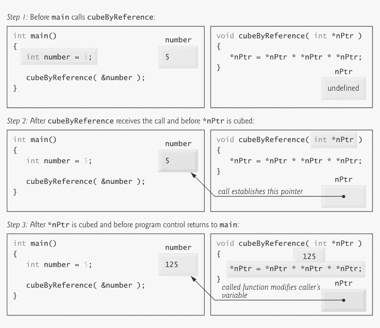

## 8.5 使用 `const` 与指针

回想一下，`const` 限定符使你能够告知编译器某个特定变量的值不应被修改。

多年来，大量遗留代码是在 C 的早期版本中编写的，当时并未使用 `const`，因为它尚不可用。因此，在旧的（也称为“遗留”）C 代码的软件工程方面存在很大的改进机会。此外，许多目前使用 ANSI C 和 C++ 的程序员在程序中不使用 `const`，因为他们是在 C 的早期版本中开始编程的。这些程序员错过了许多良好的软件工程机会。

使用（或不使用）`const` 与函数参数结合存在多种可能性。你如何选择其中最合适的可能性？让最小权限原则来指导你。始终授予函数足够访问其参数中数据的权限以完成其指定的任务，但不要更多。本节讨论如何将 `const` 与指针声明结合起来以强制执行最小权限原则。

第 6 章解释了当使用传值调用函数时，函数调用中的参数（或参数）的副本会被制作并传递给函数。如果在函数中修改了副本，原值在调用者中保持不变。在许多情况下，传递给函数的值会被修改，以便函数能够完成其任务。然而，在某些情况下，即使被调用函数只操作原始值的副本，该值也不应在被调用函数中被更改。

例如，考虑一个函数，它将一维数组及其大小作为参数，随后打印该数组。这样的函数应遍历数组并逐个输出每个数组元素。数组的大小在函数体中用于确定数组的最高下标，以便在打印完成后循环可以终止。数组的大小在函数体中不会改变，因此应声明为 `const`。当然，因为数组只是在被打印，所以它本身也应声明为 `const`。这尤其重要，因为整个数组总是通过引用传递，并且很容易在被调用函数中被更改。

## 软件工程观察 8.2

> 如果一个值在被传递到的函数体中不（或不应）改变，则该参数应声明为 `const` 以确保它不会被意外修改。

如果尝试修改 `const` 值，将会发出警告或错误，具体取决于特定的编译器。

## 错误预防提示 8.2

> 在使用函数之前，检查其函数原型以确定它可以修改的参数。

有四种方法可以将指针传递给函数：指向非常量数据的非常量指针（图 8.10）、指向常量数据的非常量指针（图 8.11 和图 8.12）、指向非常量数据的常量指针（图 8.13）和指向常量数据的常量指针（图 8.14）。每种组合都提供不同的访问权限级别。

## 指向非常量数据的非常量指针

最高访问权限由指向非常量数据的非常量指针授予——数据可以通过解引用的指针被修改，并且指针可以被修改以指向其他数据。这样的指针的声明不包含 `const`。这样的指针可用于在函数中接收以空字符结尾的字符串，该函数更改指针值以处理（并可能修改）字符串中的每个字符。回想一下第 7.4 节，以空字符结尾的字符串可以放在包含字符串的字符和指示字符串结束的空字符的字符数组中。

在图 8.10 中，函数 `convertToUppercase`（第 25–34 行）将参数 `sPtr`（第 25 行）声明为指向非常量数据的非常量指针（再次，`const` 未使用）。该函数一次处理一个字符，从存储在字符数组 `phrase` 中的以空字符结尾的字符串中处理（第 27–33 行）。请记住，字符数组的名称实际上等同于指向数组第一个字符的 `const` 指针，因此将 `phrase` 作为参数传递给 `convertToUppercase` 是可能的。函数 `islower`（第 29 行）接受一个字符参数，如果该字符是小写字母则返回 `true`，否则返回 `false`。字符范围 `'a'` 到 `'z'` 通过函数 `toupper`（第 30 行）转换为其对应的大写字母；其他字符保持不变——函数 `toupper` 接受一个字符作为参数。如果该字符是小写字母，则返回对应的大写字母；否则，返回原始字符。函数 `toupper` 和函数 `islower` 是字符处理库 `<cctype>` 的一部分（参见第 19 章，位、字符、C 字符串和 `structs`）。处理完一个字符后，第 32 行将 `sPtr` 增加 1（如果 `sPtr` 被声明为 `const`，则不可能）。当运算符 `++` 应用于指向数组的指针时，指针中存储的内存地址会被修改以指向数组的下一个元素（在本例中，字符串中的下一个字符）。将一加到指针上是指针算术中的一个有效操作，其详细内容将在第 8.8–8.9 节中介绍。

```cpp
// Fig. 8.10: fig08_10.cpp
// Converting lowercase letters to uppercase letters
// using a nonconstant pointer to nonconstant data.
#include <iostream>
using std::cout;
using std::endl;
#include <cctype> // prototypes for islower and toupper
using std::islower;
using std::toupper;
void convertToUppercase( char * );
int main()
{
    char phrase[] = "characters and $32.98";
    cout << "The phrase before conversion is: " << phrase;
    convertToUppercase( phrase );
    cout << "\nThe phrase after conversion is: " << phrase << endl;
    return 0; // indicates successful termination
} // end main
// convert string to uppercase letters
void convertToUppercase( char *sPtr )
{
    while ( *sPtr != '\0' ) // loop while current character is not '\0'
    {
        if ( islower( *sPtr ) ) // if character is lowercase,
            *sPtr = toupper( *sPtr ); // convert to uppercase
        sPtr++; // move sPtr to next character in string
    } // end while
} // end function convertToUppercase
```

The phrase before conversion is: characters and $32.98
The phrase after conversion is: CHARACTERS AND $32.98

### Fig. 8.10 | Converting a string to uppercase letters using a nonconstant pointer to nonconstant data.

## 指向常量数据的非常量指针

*指向常量数据的非常量指针* 是一个可以被修改以指向任何适当类型的数据项的指针，但它所指向的数据不能通过该指针被修改。这样的指针可能用于接收数组参数传递给一个将处理数组的每个元素但不应被允许修改数据的函数。例如，函数 `printCharacters`（图 8.11 的第 22–26 行）将参数 `sPtr`（第 22 行）声明为类型 `const char *`，以便它可以接收一个基于指针的以空字符结尾的字符串。声明从右到左读作“`sPtr` 是指向字符常量的指针”。函数的体使用 `for` 语句（第 24–25 行）输出字符串中的每个字符，直到遇到空字符。打印每个字符后，指针 `sPtr` 被递增以指向字符串中的下一个字符（这可行，因为指针不是 `const`）。函数 `main` 创建字符数组 `phrase` 以传递给 `printCharacters`。同样，我们可以将数组 `phrase` 传递给 `printCharacters`，因为数组的名称实际上是指向数组中第一个字符的指针。

图 8.12 演示了在尝试编译一个接收指向常量数据的非常量指针然后尝试使用该指针修改数据的函数时产生的编译错误信息。*[注意：回想一下编译器错误信息可能因编译器而异。]*

```cpp
// Fig. 8.11: fig08_11.cpp
// Printing a string one character at a time using
// a nonconstant pointer to constant data.
#include <iostream>
using std::cout;
using std::endl;
void printCharacters( const char * ); // print using pointer to const data
int main()
{
   const char phrase[] = "print characters of a string";
   cout << "The string is:\n";
   printCharacters( phrase ); // print characters in phrase
   cout << endl;
   return 0; // indicates successful termination
} // end main
// sPtr can be modified, but it cannot modify the character to which
// it points, i.e., sPtr is a "read-only" pointer
void printCharacters( const char *sPtr )
{
   for ( ; *sPtr != '\0'; sPtr++ ) // no initialization
      cout << *sPtr; // display character without modification
} // end function printCharacters
```

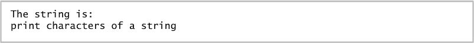

**Fig. 8.11** | Printing a string one character at a time using a nonconstant pointer to constant data.

```cpp
// Fig. 8.12: fig08_12.cpp
// Attempting to modify data through a
// nonconstant pointer to constant data.
void f( const int * ); // prototype
int main()
{
    int y;
    f( &y ); // f attempts illegal modification
    return 0; // indicates successful termination
} // end main
// xPtr cannot modify the value of constant variable to which it points
void f( const int *xPtr )
{
    *xPtr = 100; // error: cannot modify a const object
} // end function f
```

*Borland C++ 命令行编译器错误消息：*

```
Error E2024 fig08_12.cpp 18:
    Cannot modify a const object in function f(const int *)
```

*Microsoft Visual C++ 编译器错误消息：*

```
c:\cppf_examples\ch08\Fig08_12\fig08_12.cpp(18) :
    error C3892: '*xPtr' : you cannot assign to a variable that is const
```

*GNU C++ 编译器错误消息：*

```
fig08_12.cpp: In function `void f(const int*)':
fig08_12.cpp:18: error: assignment of read-only location
```

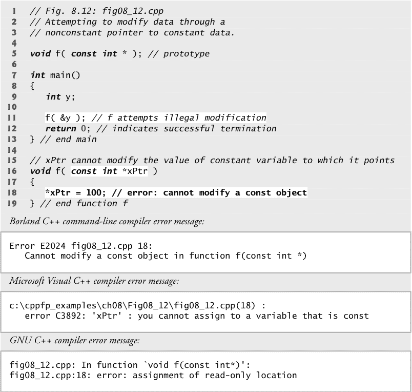

**图 8.12** | 试图通过指向常量数据的非常量指针修改数据。

我们知道，数组是聚合数据类型，它在同一个名字下存储相同类型的相关数据项。当函数以数组作为参数调用时，数组通过引用传递给函数。然而，对象总是按值传递——传递的是整个对象的副本。这需要在运行时产生开销，即复制对象中的每个数据项并将它们存储在函数调用栈上。当必须将对象传递给函数时，可以使用指向常量数据的指针（或指向常量数据的引用）来获得按引用传递的性能和按值传递的保护。当传递指向对象的指针时，只需复制对象的地址——对象本身不被复制。在具有四字节地址的机器上，复制的是四个字节的内存，而不是可能很大的对象的副本。

## 性能提示 8.1

> 如果大型对象不需要被调用函数修改，请使用指向常量数据的指针或指向常量数据的引用来传递，以获得按引用传递的性能优势。

## 软件工程观察 8.3

> 使用指向常量数据的指针或指向常量数据的引用来传递大型对象，以获得按值传递的安全性。

## 指向非常量数据的常量指针

指向非常量数据的常量指针是一种始终指向同一内存位置的指针；该位置的数据可以通过指针修改。这种指针的一个例子是数组名，它是指向数组开头的常量指针。通过数组名和数组下标，可以访问和更改数组中的所有数据。指向非常量数据的常量指针可用于接收数组，作为使用数组下标表示法访问数组元素的函数的参数。声明为 `const` 的指针必须在声明时初始化。（如果指针是函数参数，则用传递给函数的指针进行初始化。）图 8.13 的程序试图修改一个常量指针。第 11 行声明指针 `ptr` 的类型为 `int * const`。图中的声明从右向左读作“`ptr` 是一个指向非常量整数的常量指针。”该指针用整型变量 `x` 的地址初始化。第 14 行试图将 `y` 的地址赋给 `ptr`，但编译器生成了错误消息。注意，第 13 行将值 7 赋给

```cpp
// Fig. 8.13: fig08_13.cpp
// Attempting to modify a constant pointer to nonconstant data.
int main()
{
    int x, y;
    // ptr is a constant pointer to an integer that can
    // be modified through ptr, but ptr always points to the
    // same memory location.
    int * const ptr = &x; // const pointer must be initialized
    *ptr = 7; // allowed: *ptr is not const
    ptr = &y; // error: ptr is const; cannot assign to it a new address
    return 0; // indicates successful termination
} // end main
```

Borland C++ 命令行编译器错误消息：

```
Error E2024 fig08_13.cpp 14: Cannot modify a const object in function main()
```

Microsoft Visual C++ 编译器错误消息：

```
c:\cppfp_examples\ch08\Fig08_13\fig08_13.cpp(14) : error C3892: 'ptr' : you cannot assign to a variable that is const
```

GNU C++ 编译器错误消息：

```
fig08_13.cpp: In function `int main()':
fig08_13.cpp:14: error: assignment of read-only variable `ptr'
```


图 8.13 | 试图修改指向非常量数据的常量指针。

`*ptr`——`ptr` 所指向的非常量值可以通过解引用的 `ptr` 进行修改，即使 `ptr` 本身已被声明为 `const`。

## 常见编程错误 8.6

未初始化声明为 `const` 的指针是一个编译错误。

## 指向常量数据的常量指针

访问权限最小的是指向常量数据的常量指针。这样的指针始终指向同一内存位置，并且不能通过该指针修改该内存位置的数据。这就是当函数只读取数组（使用数组下标表示法）而不修改数组时，应该传递数组的方式。图 8.14 的程序在第 14 行声明指针变量 `ptr` 为 `const int * const` 类型。该声明从右向左读作“`ptr` 是一个指向整型常量的常量指针”。该图展示了当尝试

```cpp
1  // Fig. 8.14: fig08_14.cpp
2  // Attempting to modify a constant pointer to constant data.
3  #include <iostream>
4  using std::cout;
5  using std::endl;
6
7  int main()
8  {
9      int x = 5, y;
10
11     // ptr is a constant pointer to a constant integer.
12     // ptr always points to the same location; the integer
13     // at that location cannot be modified.
14     const int *const ptr = &x;
15
16     cout << *ptr << endl;
17
18     *ptr = 7; // error: "*ptr is const; cannot assign new value"
19     ptr = &y; // error: "ptr is const; cannot assign new address"
20     return 0; // indicates successful termination
21  } // end main
```

Borland C++ 命令行编译器错误消息：

```
Error E2024 fig08_14.cpp 18: Cannot modify a const object in function main()
Error E2024 fig08_14.cpp 19: Cannot modify a const object in function main()
```

Microsoft Visual C++ 编译器错误消息：

```
c:\cppfp_examples\ch08\Fig08_14\fig08_14.cpp(18) : error C3892: 'ptr' :
    you cannot assign to a variable that is const
c:\cppfp_examples\ch08\Fig08_14\fig08_14.cpp(19) : error C3892: 'ptr' :
    you cannot assign to a variable that is const
```

# GNU C++ 编译器错误消息：

```
fig08_14.cpp: In function `int main()':
fig08_14.cpp:18: error: assignment of read-only location
fig08_14.cpp:19: error: assignment of read-only variable `ptr'
```

图 8.14 | 试图修改指向常量数据的常量指针。（第 2 部分，共 2 部分。）

修改 `ptr` 指向的数据（第 18 行）以及尝试修改指针变量中存储的地址（第 19 行）时生成的错误消息。注意，当程序尝试解引用 `ptr` 或尝试输出 `ptr` 所指向的值（第 16 行）时不会发生错误，因为该语句中指针及其指向的数据都没有被修改。

# 8.6 使用按引用传递的选择排序

在本节中，我们定义了一个排序程序，以演示按引用传递数组和单个数组元素。我们使用选择排序算法，这是一种易于编程但效率不高的排序算法。该算法的第一次迭代选择数组中最小的元素，并将其与第一个元素交换。第二次迭代选择第二小的元素（即剩余元素中最小的元素），并将其与第二个元素交换。算法继续执行，直到最后一次迭代选择第二大的元素并将其与倒数第二个索引交换，使最大的元素留在最后一个索引。在第 i 次迭代之后，数组中最小的 i 个元素将按递增顺序排列在数组的前 i 个元素中。

例如，考虑数组

34 56 4 10 77 51 93 30 5 52

实现选择排序的程序首先确定数组中的最小值（4），它位于元素 2 中。程序将 4 与元素 0（34）中的值交换，得到

4 56 34 10 77 51 93 30 5 52

[注意：我们使用粗体高亮交换的值。] 然后程序确定剩余元素（除 4 之外的所有元素）中的最小值，即 5，位于元素 8 中。程序将 5 与元素 1 中的 56 交换，得到

4 5 34 10 77 51 93 30 56 52

在第三次迭代中，程序确定下一个最小值 10，并将其与元素 2（34）中的值交换。

4 5 10 34 77 51 93 30 56 52

该过程持续进行，直到数组完全排序。

4 5 10 30 34 51 52 56 77 93

注意，在第一次迭代之后，最小的元素位于第一个位置。第二次迭代之后，两个最小的元素按顺序位于前两个位置。第三次迭代之后，三个最小的元素按顺序位于前三个位置。

Figure 8.15 implements selection sort using two functions—`selectionSort` and `swap`. Function `selectionSort` (lines 36–53) sorts the array. Line 38 declares the variable `smallest`, which will store the index of the smallest element in the remaining array. Lines 41–52 loop `size - 1` times. Line 43 sets the index of the smallest element to the current index. Lines 46–49 loop over the remaining elements in the array. For each of these elements, line 48 compares its value to the value of the smallest element. If the current element is smaller than the smallest element, line 49 assigns the current element’s index to `smallest`. When this loop finishes, `smallest` will contain the index of the smallest element in the remaining array. Line 51 calls function `swap` (lines 57–62) to place the smallest remaining element in the next spot in the array (i.e., exchange the array elements `array[i]` and `array[smallest]`).

Let us now look more closely at function `swap`. Remember that C++ enforces information hiding between functions, so `swap` does not have access to individual array elements in `selectionSort`. Because `selectionSort` wants `swap` to have access to the array elements to be swapped, `selectionSort` passes each of these elements to `swap` by reference.

```
// Fig. 8.15: fig08_15.cpp
// Selection sort with pass-by-reference. This program puts values into an
// array, sorts them into ascending order and prints the resulting array.
#include <iostream>
using std::cout;
using std::endl;
#include <iomanip>
using std::setw;
void selectionSort( int * const, const int ); // prototype
void swap( int * const, int * const ); // prototype
int main()
{
    const int arraySize = 10;
    int a[ arraySize ] = { 2, 6, 4, 8, 10, 12, 89, 68, 45, 37 };
    cout << "Data items in original order\n";
    for ( int i = 0; i < arraySize; i++ )
        cout << setw( 4 ) << a[ i ];
    selectionSort( a, arraySize ); // sort the array
    cout << "\nData items in ascending order\n";
    for ( int j = 0; j < arraySize; j++ )
        cout << setw( 4 ) << a[ j ];
    cout << endl;
    return 0; // indicates successful termination
} // end main
```

Fig. 8.15 | Selection sort with pass-by-reference. (Part 1 of 2.)

Precisely the same effect is achieved by

```
int hold = *element1Ptr;
*element1Ptr = *element2Ptr;
*element2Ptr = hold;
```

in the `swap` function of Fig. 8.15.

Several features of function `selectionSort` should be noted. The function header (line 36) declares `array` as `int * const array`, rather than `int array[]`, to indicate that the function receives a one-dimensional array as an argument. Both parameter `array`’s pointer and parameter `size` are declared `const` to enforce the principle of least privilege. Although parameter `size` receives a copy of a value in `main` and modifying the copy cannot change the value in `main`, `selectionSort` does not need to alter `size` to accomplish its task—the array size remains fixed during the execution of `selectionSort`. Therefore, `size` is declared `const` to ensure that it is not modified. If the size of the array were to be modified during the sorting process, the sorting algorithm would not run correctly.

Note that function `selectionSort` receives the size of the array as a parameter, because the function must have that information to sort the array. When an array is passed to a function, only the memory address of the first element of the array is received by the function; the array size must be passed separately to the function.

By defining function `selectionSort` to receive the array size as a parameter, we enable the function to be used by any program that sorts one-dimensional `int` arrays of arbitrary size. The size of the array could have been programmed directly into the function, but this would restrict the function to processing an array of a specific size and reduce the function’s reusability—only programs processing one-dimensional `int` arrays of the specific size “hard coded” into the function could use the function.

### Software Engineering Observation 8.4

> When passing an array to a function, also pass the size of the array (rather than building into the function knowledge of the array size)—this makes the function more reusable.

## 8.7 sizeof Operator

C++ provides the unary operator `sizeof` to determine the size of an array (or of any other data type, variable or constant) in bytes during program compilation. When applied to the name of an array, as in Fig. 8.16 (line 14), the `sizeof` operator returns the total number of bytes in the array as a value of type `size_t` (an unsigned integer type that is at least as big as `unsigned int`). Note that this is different from the size of a `vector<int>`, for example, which is the number of integer elements in the vector. The computer we used to compile this program stores variables of type `double` in 8 bytes of memory, and `array` is declared to have 20 elements (line 12), so `array` uses 160 bytes in memory. When applied to a pointer parameter (line 24) in a function that receives an array as an argument, the `sizeof` operator returns the size of the pointer in bytes (4 on the system we used)—not the size of the array.

### Common Programming Error 8.7

> Using the `sizeof` operator in a function to find the size in bytes of an array parameter results in the size in bytes of a pointer, not the size in bytes of the array.

```
// Fig. 8.16: fig08_16.cpp
```


### `sizeof` 运算符在数组名上使用时

```
// Sizeof operator when used on an array name

// returns the number of bytes in the array.

#include <iostream>

using std::cout;

using std::endl;

size_t getSize( double * ); // prototype

int main()

{

    double array[ 20 ]; // 20 doubles; occupies 160 bytes on our system

    cout << "The number of bytes in the array is " << sizeof( array );

    cout << "\nThe number of bytes returned by getSize is "

         << getSize( array ) << endl;

    return 0; // indicates successful termination

} // end main

// return size of ptr

size_t getSize( double *ptr )

{

    return sizeof( ptr );

} // end function getSize
```

The number of bytes in the array is 160
The number of bytes returned by getSize is 4

Fig. 8.16 | `sizeof` operator when applied to an array name returns the number of bytes in the array.

> [Note: When the Borland C++ compiler is used to compile Fig. 8.16, the compiler generates the warning message “Parameter 'ptr' is never used in function `getSize(double *)`.” This warning occurs because `sizeof` is actually a compile-time operator; thus, variable `ptr` is not used in the function’s body at execution time. Many compilers issue warnings like this to let you know that a variable is not being used so that you can either remove it from your code or modify your code to use the variable properly. Similar messages occur in Fig. 8.17 with various compilers.]

The number of elements in an array also can be determined using the results of two `sizeof` operations. For example, consider the following array declaration:

```
double realArray[ 22 ];
```

If variables of data type `double` are stored in eight bytes of memory, array `realArray` contains a total of 176 bytes. To determine the number of elements in the array, the following expression (which is evaluated at compile time) can be used:

```
sizeof realArray / sizeof( double ) // calculate number of elements
```

The expression determines the number of bytes in array `realArray` (176) and divides that value by the number of bytes used in memory to store a `double` value (8)—the result is the number of elements in `realArray` (22).

### Determining the Sizes of the Fundamental Types, an Array and a Pointer

Figure 8.17 uses `sizeof` to calculate the number of bytes used to store most of the standard data types. Notice that, in the output, the types `double` and `long double` have the same size. Types may have different sizes based on the platform running the program. On another system, for example, `double` and `long double` may be of different sizes.

```
// Fig. 8.17: fig08_17.cpp
// Demonstrating the sizeof operator.
#include <iostream>

using std::cout;

using std::endl;

int main()

{

    char c; // variable of type char
    short s; // variable of type short
    int i; // variable of type int
    long l; // variable of type long
    float f; // variable of type float
    double d; // variable of type double
    long double ld; // variable of type long double
    int array[ 20 ]; // array of int
    int *ptr = array; // variable of type int *

    cout << "sizeof c = " << sizeof c
        << "\tsizeof(char) = " << sizeof( char )
        << "\nsizeof s = " << sizeof s
        << "\tsizeof(short) = " << sizeof( short )
        << "\nsizeof i = " << sizeof i
        << "\tsizeof(int) = " << sizeof( int )
        << "\nsizeof l = " << sizeof l
        << "\tsizeof(long) = " << sizeof( long )
        << "\nsizeof f = " << sizeof f
        << "\tsizeof(float) = " << sizeof( float )
        << "\nsizeof d = " << sizeof d
        << "\tsizeof(double) = " << sizeof( double )
        << "\nsizeof ld = " << sizeof ld
        << "\tsizeof(long double) = " << sizeof( long double )
        << "\nsizeof array = " << sizeof array
        << "\nsizeof ptr = " << sizeof ptr << endl;

    return 0; // indicates successful termination

} // end main
```

sizeof c = 1      sizeof(char) = 1
sizeof s = 2      sizeof(short) = 2
sizeof i = 4      sizeof(int) = 4
sizeof l = 4      sizeof(long) = 4
sizeof f = 4      sizeof(float) = 4
sizeof d = 8      sizeof(double) = 8
sizeof ld = 8     sizeof(long double) = 8
sizeof array = 80
sizeof ptr = 4

Fig. 8.17 | `sizeof` operator used to determine standard data type sizes.

## 可移植性提示 8.2

> 用于存储特定数据类型的字节数在不同系统之间可能有所不同。在编写依赖于数据类型大小且将在多台计算机系统上运行的程序时，使用 `sizeof` 来确定用于存储数据类型的字节数。

运算符 `sizeof` 可以应用于任何表达式或类型名。当 `sizeof` 应用于变量名（不是数组名）或其他表达式时，将返回用于存储表达式值特定类型的字节数。请注意，当 `sizeof` 的操作数为类型名（例如 `int`）时，使用括号是必需的。当 `sizeof` 的操作数是表达式时，`sizeof` 的括号不是必需的。请记住 `sizeof` 是一个运算符，而不是函数，并且它在编译时而不是执行时起作用。

## 常见编程错误 8.8

> 当操作数是类型名时，在 `sizeof` 操作中省略括号是编译错误。

## 性能提示 8.2

> 因为 `sizeof` 是一个编译时一元运算符，而不是执行时运算符，使用 `sizeof` 不会负面影响执行性能。

## 错误预防提示 8.3

> 为了避免与省略 `sizeof` 运算符操作数周围的括号相关的错误，许多程序员会在每个 `sizeof` 操作数周围都加上括号。

## 8.8 指针表达式和指针算术

指针是算术表达式、赋值表达式和比较表达式中的有效操作数。然而，这些表达式中通常使用的并非所有运算符都适用于指针变量。本节描述了可以具有指针作为操作数的运算符以及这些运算符如何与指针一起使用。

可以在指针上执行多种算术运算。可以递增（`++`）或递减（`--`）指针，可以将整数加到指针上（`+` 或 `+=`），可以从指针中减去整数（`-` 或 `-=`），也可以从同一类型的另一个指针中减去一个指针。

假设数组 `int v[5]` 已声明，并且其第一个元素位于内存位置 3000。假设指针 `vPtr` 已初始化为指向 `v[0]`（即 `vPtr` 的值为 3000）。图 8.18 对具有四字节整数的机器上的这种情况进行了说明。请注意，`vPtr` 可以通过以下任一语句初始化为指向数组 `v`（因为数组名等同于其第一个元素的地址）：

```
int *vPtr = v;
int *vPtr = &v[0];
```

## 可移植性提示 8.3

> 今天大多数计算机都有两字节或四字节整数。一些较新的机器使用八字节整数。因为指针算术的结果取决于指针指向的对象的大小，所以指针算术是机器相关的。

递增指针以指向数组的下一个元素。以下每个语句

```
--vPtr;
vPtr--;
```

递减指针以指向数组的上一个元素。

指向同一数组的指针变量可以相互相减。例如，如果 `vPtr` 包含地址 3000 且 `v2Ptr` 包含地址 3008，则语句

```
x = v2Ptr - vPtr;
```

会将从 `vPtr` 到 `v2Ptr` 的数组元素数赋给 `x`——在这种情况下为 2。指针算术只有在对指向数组的指针上执行时才有意义。我们不能假设同一类型的两个变量在内存中是连续存储的，除非它们是数组的相邻元素。

## 常见编程错误 8.9

对不引用值数组的指针使用指针算术是逻辑错误。

## 常见编程错误 8.10

减去或比较不引用同一数组元素的两个指针是逻辑错误。

## 常见编程错误 8.11

使用指针算术递增或递减指针使得指针引用数组边界之外的元素通常是逻辑错误。

如果两个指针都是同一类型，则可以将一个指针赋给另一个指针。否则，必须使用强制类型转换运算符将右侧指针的值转换为左侧赋值指针类型。规则的例外是 `void` 指针（即 `void *`），它是一种通用指针，能够表示任何指针类型。所有指针类型都可以不经强制转换就赋给 `void *` 类型的指针。然而，`void *` 类型的指针不能直接赋给其他类型的指针——`void *` 类型的指针必须首先强制转换为正确的指针类型。

## 软件工程观察 8.5

非常量指针参数可以传递给常量指针参数。当程序体使用非常量指针访问数据，但不希望被程序体中调用的函数修改该数据时，这很有帮助。

`void *` 指针不能被解引用。例如，编译器“知道”指向 `int` 的指针在具有四字节整数的机器上引用四字节内存，但指向 `void` 的指针仅包含未知数据类型的内存地址——指针所引用的确切字节数和数据的类型对编译器来说是未知的。编译器必须知道数据类型才能确定要为特定指针解引用的字节数——对于指向 `void` 的指针，这个字节数无法从类型确定。

数组名（隐式为 `const`）可以被视为指针并在指针算术中使用。例如，表达式

```
*( b + 3 )
```

也引用数组元素 `b[3]`。一般来说，所有下标数组表达式都可以用指针和偏移量编写。在这种情况下，使用了数组名作为指针的指针/偏移量表示法。请注意，前面的表达式不会以任何方式修改数组名；`b` 仍然指向数组的第一个元素。

指针可以像数组一样被下标。例如，表达式

```
bPtr[1]
```

引用数组元素 `b[1]`；此表达式使用 **指针/下标表示法**。请记住，数组名是一个常量指针；它始终指向数组的开头。因此，表达式

```
b += 3
```

会导致编译错误，因为它试图通过指针算术修改数组名（常量）的值。


## 常见编程错误 8.14

> 尽管数组名是指向数组开头的指针并且指针可以在算术表达式中被修改，但数组名不能在算术表达式中被修改，因为数组名是常量指针。


## 良好编程实践 8.2

> 为了清晰起见，在操作数组时使用数组表示法而不是指针表示法。

图 8.20 使用本节讨论的四种引用数组元素的方法——数组下标表示法、使用数组名作为指针的指针/偏移量表示法、指针下标表示法和指针/偏移量表示法——来实现相同的任务，即打印整数数组 `b` 的四个元素。

```
// Fig. 8.20: fig08_20.cpp
// Using subscripting and pointer notations with arrays.
#include <iostream>

using std::cout;

using std::endl;

int main()

{

   int b[] = { 10, 20, 30, 40 }; // create 4-element array b
   int *bPtr = b; // set bPtr to point to array b
   // output array b using array subscript notation
   cout << "Array b printed with:\n\nArray subscript notation\n";
```

**图 8.20** | 使用数组名和指针引用数组元素。（第 1 部分，共 2 部分。）

```
14

15    for ( int i = 0; i < 4; i++ )
16        cout << "b[" << i << "] = " << b[ i ] << '\n';

18    // output array b using the array name and pointer/offset notation
19    cout << "\nPointer/offset notation where "
20        << "the pointer is the array name\n";

22    for ( int offset1 = 0; offset1 < 4; offset1++ )
23        cout << "*(b + " << offset1 << ") = " << *( b + offset1 ) << '\n';

25    // output array b using bPtr and array subscript notation
26    cout << "\nPointer subscript notation\n";

28    for ( int j = 0; j < 4; j++ )
29        cout << "bPtr[" << j << "] = " << bPtr[ j ] << '\n';

31    cout << "\nPointer/offset notation\n";

33    // output array b using bPtr and pointer/offset notation
```


`for ( int offset2 = 0; offset2 < 4; offset2++ )`

`cout << "*(bPtr + " << offset2 << ") = "`

`    << *( bPtr + offset2 ) << '\n';`

`return 0; // indicates successful termination`

`} // end main`

Array b printed with:

Array subscript notation
b[0] = 10
b[1] = 20
b[2] = 30
b[3] = 40

Pointer/offset notation where the pointer is the array name
*(b + 0) = 10
*(b + 1) = 20
*(b + 2) = 30
*(b + 3) = 40

Pointer subscript notation
bPtr[0] = 10
bPtr[1] = 20
bPtr[2] = 30
bPtr[3] = 40

Pointer/offset notation
*(bPtr + 0) = 10
*(bPtr + 1) = 20
*(bPtr + 2) = 30
*(bPtr + 3) = 40

为了进一步说明数组和指针的互换性，让我们来看一下图 8.21 程序中的两个字符串拷贝函数——`copy1` 和 `copy2`。两个函数都将一个字符串拷贝到一个字符数组中。在比较了 `copy1` 和 `copy2` 的函数原型之后，这两个函数看起来是相同的（由于数组和指针的互换性）。这些函数完成相同的任务，但实现方式不同。

函数 `copy1`（第 26–31 行）使用数组下标表示法将 `s2` 中的字符串拷贝到字符数组 `s1` 中。该函数声明了一个整数计数器变量 `i` 作为

```
// Fig. 8.21: fig08_21.cpp
// Copying a string using array notation and pointer notation.
#include <iostream>
using std::cout;
using std::endl;
void copy1( char *, const char * ); // prototype
void copy2( char *, const char * ); // prototype
int main()
{
    char string1[ 10 ];
    char *string2 = "Hello";
    char string3[ 10 ];
    char string4[] = "Good Bye";
    copy1( string1, string2 ); // copy string2 into string1
    cout << "string1 = " << string1 << endl;
    copy2( string3, string4 ); // copy string4 into string3
    cout << "string3 = " << string3 << endl;
    return 0; // indicates successful termination
} // end main
// copy s2 to s1 using array notation
void copy1( char * s1, const char * s2 )
{
    // copying occurs in the for header
    for ( int i = 0; ( s1[ i ] = s2[ i ] ) != '\0'; i++ )
        ; // do nothing in body
} // end function copy1
// copy s2 to s1 using pointer notation
void copy2( char *s1, const char *s2 )
{
    // copying occurs in the for header
    for ( ; ( *s1 = *s2 ) != '\0'; s1++, s2++ )
        ; // do nothing in body
} // end function copy2
```

string1 = Hello
string3 = Good Bye

数组下标。`for` 语句头（第 29 行）执行整个拷贝操作——其体为空语句。头指定 `i` 初始化为零，并在每次循环迭代时递增一。`for` 中的条件 `( s1[ i ] = s2[ i ] ) != '\0'` 按字符从 `s2` 向 `s1` 执行拷贝操作。当在 `s2` 中遇到空字符时，它被赋给 `s1`，并且循环终止，因为空字符等于 `'\0'`。请记住，赋值语句的值是赋给其左操作数的值。

函数 `copy2`（第 34–39 行）使用指针和指针算术将 `s2` 中的字符串拷贝到字符数组 `s1` 中。同样，`for` 语句头（第 37 行）执行整个拷贝操作。头不包含任何变量初始化。如函数 `copy1` 中一样，条件 `( *s1 = *s2 ) != '\0'` 执行拷贝操作。指针 `s2` 被解引用，并将所得字符赋给解引用的指针 `s1`。条件中的赋值之后，循环递增两个指针，使它们分别指向数组 `s1` 的下一个元素和字符串 `s2` 的下一个字符。当循环在 `s2` 中遇到空字符时，空字符被赋给解引用的指针 `s1`，循环终止。请注意，此 `for` 语句的“递增部分”包含由逗号运算符分隔的两个递增表达式。

`copy1` 和 `copy2` 的第一个参数必须是足够大的数组，以容纳第二个参数中的字符串。否则，在尝试写入超出数组边界的内存位置时可能会发生错误（请回忆，使用基于指针的数组时没有“内置”边界检查）。此外，每个函数的第二个参数都声明为 `const char *`（指向字符常量的指针——即常量字符串）。在两个函数中，第二个参数都被拷贝到第一个参数——字符一次一个地从第二个参数拷贝，但字符永远不会被修改。因此，第二个参数被声明为指向常量值，以强制执行最小权限原则——两个函数都不需要修改第二个参数，因此两个函数都不允许修改第二个参数。

### 8.10 指针数组

数组可以包含指针。这种数据结构的一种常见用途是形成指针式字符串数组，简称为字符串数组。数组中的每个条目都是一个字符串，但在 C++ 中，字符串本质上是指向其第一个字符的指针，因此字符串数组中的每个条目只是指向字符串第一个字符的指针。考虑可能在表示一副牌时有用的字符串数组 `suit` 的声明：

```
const char *suit[ 4 ] =
    { "Hearts", "Diamonds", "Clubs", "Spades" };
```

声明中的 `suit[4]` 部分表示一个包含四个元素的数组。声明中的 `const char *` 部分表示 `suit` 数组的每个元素都是“指向字符常量数据的指针”类型。要放入数组的四个值是 `"Hearts"`、`"Diamonds"`、`"Clubs"` 和 `"Spades"`。每个值在内存中存储为以空字符结尾的字符字符串，其长度比引号之间的字符数多一个。四个字符串的长度分别为七、九、六和七个字符（包括其终止空字符）。虽然看起来这些字符串被放置在 `suit` 数组中，但实际上只是在数组中存储指针，如图 8.22 所示。每个指针指向其对应字符串的第一个字符。因此，即使 `suit` 数组大小固定，它也能访问任意长度的字符字符串。这种灵活性是 C++ 强大数据结构能力的一个例子。

`suit` 字符串可以放入一个二维数组中，其中每一行代表一个花色，每一列代表花色名称的一个字母。这种数据结构必须每行有固定数量的列，并且该数量必须与最长的字符串一样大。因此，当我们存储大量字符串，其中大多数都短于最长字符串时，会浪费大量内存。我们将在下一节中使用字符串数组来帮助表示一副牌。

字符串数组通常与 *命令行参数* 一起使用，这些参数在程序开始执行时传递给函数 `main`。这样的参数在从命令行执行程序时跟随程序名。命令行参数的典型用途是向程序传递选项。例如，在 Windows 计算机的命令行上，用户可以键入

```
dir /p
```

列出当前目录的内容，并在每屏信息后暂停。当 `dir` 命令执行时，选项 `/p` 会作为命令行参数传递给 `dir`。这样的参数被放置在 `main` 接收的一个字符串数组中。

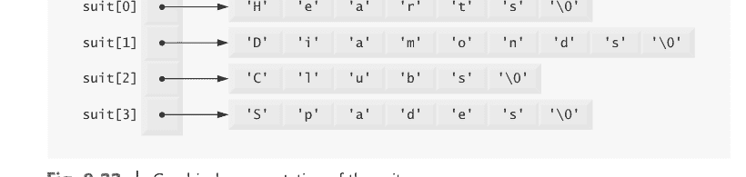

图 8.22 | `suit` 数组的图形表示。

### 8.11 案例研究：洗牌和发牌模拟

本节使用随机数生成来开发一个洗牌和发牌模拟程序。然后该程序可作为实现特定纸牌游戏程序的基础。为了揭示一些微妙的性能问题，我们故意使用了次优的洗牌和发牌算法。

使用自顶向下、分步细化的方法，我们开发一个程序，该程序将洗牌一副 52 张纸牌，然后发完这 52 张牌。自顶向下的方法在处理比早期章节中看到的更大、更复杂的问题时特别有用。

我们使用 4×13 的二维数组 `deck` 来表示一副纸牌（图 8.23）。行对应花色——第 0 行对应红心，第 1 行对应方块，第 2 行对应梅花，第 3 行对应黑桃。列对应牌面值——第 0 到第 9 列分别对应 A 到 10 的牌面，第 10 到第 12 列分别对应 J、Q 和 K。我们将用字符串数组 `suit` 加载表示四个花色的字符字符串（如图 8.22 所示），并用字符串数组 `face` 加载表示 13 个牌面值的字符字符串。

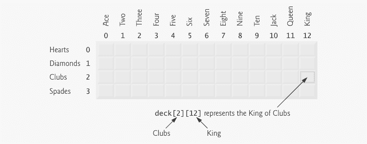

## Fig. 8.23 | 牌堆的二维数组表示。

该模拟牌堆可按如下方式洗牌。首先，52 个元素的数组 `deck` 初始化为零。然后，随机各选择一行 0–3 和一列 0–12。数字 1 插入到数组元素 `deck[row][column]` 中，表示该牌将成为洗好后发出的第一张牌。此过程继续进行，数字 2、3、…、52 被随机插入到 `deck` 数组中，以表示哪些牌应放在洗好牌堆中的第二张、第三张、…、第 52 张位置。随着 `deck` 数组开始填入牌号，可能会出现一张牌被重复选中，即 `deck[row][column]` 在被选中时不为零。这种选择 simply 被忽略，并反复随机选择其他行列组合，直到找到一张未被选中的牌。最终，数字 1 到 52 将占据 `deck` 数组的 52 个槽位。此时，牌堆已完全洗好。

如果反复随机选择已经洗过的牌，该洗牌算法可能会无限期地执行下去。这种现象被称为 **无限期推迟**，也称为 **饥饿**。

## Performance Tip 8.3

> 有时以“自然”方式出现的算法可能包含诸如无限期推迟之类的微妙性能问题。请寻找避免无限期推迟的算法。

要发第一张牌，我们在数组中搜索与 1 匹配的元素 `deck[row][column]`。这是通过嵌套的 `for` 语句实现的，该语句使 `row` 从 0 变到 3，`column` 从 0 变到 12。数组的该槽位对应于哪张牌？`suit` 数组已预先加载了四种花色，因此要获取花色，我们打印字符字符串 `suit[row]`。同样，要获取牌的点数，我们打印字符字符串 `face[column]`。我们还打印字符字符串 `" of "`。以正确的顺序打印这些信息使我们能够以 `"King of Clubs"`、`"Ace of Diamonds"` 等形式打印每张牌。

图 8.24–8.26 包含洗牌和发牌程序以及一个示例执行。注意图 8.25 中函数 `deal` 的输出格式，第 81–83 行。输出语句将 `face` 右对齐输出到宽度为 5 个字符的字段中，并将 `suit` 左对齐输出到宽度为 8 个字符的字段中（图 8.26）。输出以两列格式打印——如果输出的牌在第一列，则在牌后输出一个制表符以移动到第二列（第 83 行）；否则，输出一个换行符。

```
// Fig. 8.24: DeckOfCards.h
// Definition of class DeckOfCards that
// represents a deck of playing cards.
// DeckOfCards class definition
class DeckOfCards
{
public:
    DeckOfCards(); // constructor initializes deck
    void shuffle(); // shuffles cards in deck
    void deal(); // deals cards in deck
private:
    int deck[ 4 ][ 13 ]; // represents deck of cards
}; // end class DeckOfCards
```

Fig. 8.24 | `DeckOfCards` 头文件。

```
// Fig. 8.25: DeckOfCards.cpp
// Member-function definitions for class DeckOfCards that simulates
// the shuffling and dealing of a deck of playing cards.
#include <iostream>
using std::cout;
using std::left;
using std::right;
#include <iomanip>
using std::setw;
#include <cstdlib> // prototypes for rand and srand
using std::rand;
using std::srand;
#include <ctime> // prototype for time
using std::time;
#include "DeckOfCards.h" // DeckOfCards class definition
// DeckOfCards default constructor initializes deck
DeckOfCards::DeckOfCards()
{
    // loop through rows of deck
    for ( int row = 0; row <= 3; row++ )
    {
        // loop through columns of deck for current row
        for ( int column = 0; column <= 12; column++ )
        {
            deck[ row ][ column ] = 0; // initialize slot of deck to 0
        } // end inner for
    } // end outer for
    srand( time( 0 ) ); // seed random number generator
} // end DeckOfCards default constructor
```

Fig. 8.25 | 洗牌和发牌成员函数的定义。 第 1 部分，共 2 部分。


```cpp
// shuffle cards in deck
void DeckOfCards::shuffle()
{
    int row; // represents suit value of card
    int column; // represents face value of card

    // for each of the 52 cards, choose a slot of the deck randomly
    for ( int card = 1; card <= 52; card++ )
    {
        do // choose a new random location until unoccupied slot is found
        {
            row = rand() % 4; // randomly select the row (0 to 3)
            column = rand() % 13; // randomly select the column (0 to 12)
        } while( deck[ row ][ column ] != 0 ); // end do...while

        // place card number in chosen slot of deck
        deck[ row ][ column ] = card;
    } // end for
} // end function shuffle

// deal cards in deck
void DeckOfCards::deal()
{
    // initialize suit array
    static const char *suit[ 4 ] =
        { "Hearts", "Diamonds", "Clubs", "Spades" };

    // initialize face array
    static const char *face[ 13 ] =
        { "Ace", "Deuce", "Three", "Four", "Five", "Six", "Seven",
          "Eight", "Nine", "Ten", "Jack", "Queen", "King" };

    // for each of the 52 cards
    for ( int card = 1; card <= 52; card++ )
    {
        // loop through rows of deck
        for ( int row = 0; row <= 3; row++ )
        {
            // loop through columns of deck for current row
            for ( int column = 0; column <= 12; column++ )
            {
                // if slot contains current card, display card
                if ( deck[ row ][ column ] == card )
                {
                    cout << setw( 5 ) << right << face[ column ]
                         << " of " << setw( 8 ) << left << suit[ row ]
                         << ( card % 2 == 0 ? '\n' : '\t' );
                } // end if
            } // end innermost for
        } // end inner for
    } // end outer for
} // end function deal
```

**Fig. 8.25** | 洗牌和发牌成员函数的定义。 第 2 部分，共 2 部分。

```cpp
// Fig. 8.26: fig08_26.cpp

// Card shuffling and dealing program.

#include "DeckOfCards.h" // DeckOfCards class definition

int main()

{

    DeckOfCards deckOfCards; // create DeckOfCards object

    deckOfCards.shuffle(); // shuffle the cards in the deck

    deckOfCards.deal(); // deal the cards in the deck

    return 0; // indicates successful termination

} // end main
```

Nine of Spades    Seven of Clubs
Five of Spades    Eight of Clubs
Queen of Diamonds Three of Hearts
Jack of Spades    Five of Diamonds
Jack of Diamonds  Three of Diamonds
Three of Clubs    Six of Clubs
Ten of Clubs      Nine of Diamonds
Ace of Hearts     Queen of Hearts
Seven of Spades   Deuce of Spades
Six of Hearts     Deuce of Clubs
Ace of Clubs      Deuce of Diamonds
Nine of Hearts    Seven of Diamonds
Six of Spades     Eight of Diamonds
Ten of Spades     King of Hearts
Four of Clubs     Ace of Spades
Ten of Hearts     Four of Spades
Eight of Hearts   Eight of Spades
Jack of Hearts    Ten of Diamonds
Four of Diamonds  King of Diamonds
Seven of Hearts   King of Spades
Queen of Spades   Four of Hearts
Nine of Clubs     Six of Diamonds
Deuce of Hearts   Jack of Clubs
King of Clubs     Three of Spades
Queen of Clubs    Five of Clubs
Five of Hearts    Ace of Diamonds

Fig. 8.26 | 牌洗牌和发牌程序。

发牌算法存在一个弱点。一旦找到匹配，即使在第一次尝试时找到，两个内部 `for` 语句仍会继续搜索 `deck` 的剩余元素以寻找匹配。

# 8.12 Function Pointers

函数指针包含内存中函数的地址。在第 7 章中，我们看到数组的名称实际上是数组第一个元素在内存中的地址。同样，函数的名称实际上是执行函数任务的代码在内存中的起始地址。函数指针可以传递给函数、从函数返回、存储在数组中、分配给其他函数指针并用于调用底层函数。

## 使用函数指针的多用途选择排序

为了说明指向函数的指针的用法，图 8.27 修改了图 8.15 中的选择排序程序。图 8.27 由 `main`（第 17–55 行）以及函数 `selectionSort`（第 59–76 行）、`swap`（第 80–85 行）、`ascending`（第 89–92 行）和 `descending`（第 96–99 行）组成。函数 `selectionSort` 除了接收要排序的整数数组和数组大小作为参数外，还接收一个指向函数的指针——可以是函数 `ascending` 或函数 `descending`——作为参数。函数 `ascending` 和 `descending` 决定排序顺序。程序提示用户选择数组应按升序还是降序排序（第 24–26 行）。如果用户输入 1，则将指向函数 `ascending` 的指针传递给函数 `selectionSort`（第 37 行），使数组按升序排序。如果用户输入 2，则将指向函数 `descending` 的指针传递给函数 `selectionSort`（第 45 行），使数组按降序排序。

```cpp
// Fig. 8.27: fig08_27.cpp

// Multipurpose sorting program using function pointers.

#include <iostream>

using std::cout;

using std::cin;

using std::endl;

#include <iomanip>

using std::setw;

// prototypes

void selectionSort( int [], const int, bool (*)( int, int ) );

void swap( int * const, int * const );

bool ascending( int, int ); // implements ascending order

bool descending( int, int ); // implements descending order

int main()

{

    const int arraySize = 10;

    int order; // 1 = ascending, 2 = descending

    int counter; // array index

    int a[ arraySize ] = { 2, 6, 4, 8, 10, 12, 89, 68, 45, 37 };

    cout << "Enter 1 to sort in ascending order,\n"

         << "Enter 2 to sort in descending order: ";

    cin >> order;

    cout << "\nData items in original order\n";

    // output original array

    for ( counter = 0; counter < arraySize; counter++ )

        cout << setw( 4 ) << a[ counter ];

    // sort array in ascending order; pass function ascending

    // as an argument to specify ascending sorting order

    if ( order == 1 )

    {

        selectionSort( a, arraySize, ascending );

        cout << "\nData items in ascending order\n";

    } // end if

    // sort array in descending order; pass function descending

    // as an argument to specify descending sorting order

    else

    {

        selectionSort( a, arraySize, descending );

        cout << "\nData items in descending order\n";

    } // end else part of if...else

    // output sorted array

    for ( counter = 0; counter < arraySize; counter++ )

        cout << setw( 4 ) << a[ counter ];

    cout << endl;

    return 0; // indicates successful termination

} // end main

// multipurpose selection sort; the parameter compare is a pointer to

// the comparison function that determines the sorting order

void selectionSort( int work[], const int size,

                    bool (*compare)( int, int ) )

{

    int smallestOrLargest; // index of smallest (or largest) element

    // loop over size - 1 elements

    for ( int i = 0; i < size - 1; i++ )

    {

        smallestOrLargest = i; // first index of remaining vector

        // loop to find index of smallest (or largest) element

        for ( int index = i + 1; index < size; index++ )

            if ( !(*compare)( work[ smallestOrLargest ], work[ index ] ) )

                smallestOrLargest = index;

        swap( &work[ smallestOrLargest ], &work[ i ] );

    } // end if

} // end function selectionSort

// swap values at memory locations to which

// element1Ptr and element2Ptr point

void swap( int * const element1Ptr, int * const element2Ptr )

{

    int hold = *element1Ptr;

    *element1Ptr = *element2Ptr;

    *element2Ptr = hold;

} // end function swap

// determine whether element a is less than

// element b for an ascending order sort

bool ascending( int a, int b )

{

    return a < b; // returns true if a is less than b

} // end function ascending

// determine whether element a is greater than

// element b for a descending order sort

bool descending( int a, int b )

{

    return a > b; // returns true if a is greater than b

} // end function descending
```


输入 1 按升序排序，
输入 2 按降序排序：1

原始顺序的数据项
    2     6     4     8    10    12    89    68    45    37
升序排列的数据项
    2     4     6     8    10    12    37    45    68    89

输入 1 按升序排序，
输入 2 按降序排序：2

原始顺序的数据项
    2     6     4     8    10    12    89    68    45    37
降序排列的数据项
   89    68    45    37    12    10     8     6     4     2

图 8.27 | 使用函数指针的多用途排序程序。（第 3 部分，共 3 部分）

在 `selectionSort` 的函数头的第 60 行出现了以下参数：

```
bool ( *compare )( int, int )
```

该参数指定了一个指向函数的指针。关键字 `bool` 表示被指向的函数返回一个 `bool` 值。文本 `( *compare )` 表示函数指针的名称（其中的 `*` 表明参数 `compare` 是一个指针）。文本 `( int, int )` 表示 `compare` 所指向的函数接收两个整型参数。在 `*compare` 周围需要括号，以表明 `compare` 是指向函数的指针。如果没有括号，声明将是：

```
bool *compare( int, int )
```

该声明声明了一个函数，它接收两个整数作为参数，并返回一个指向 `bool` 值的指针。

`selectionSort` 函数原型中对应的参数是：

```
bool ( * )( int, int )
```

注意这里只包含了类型。和往常一样，为了文档说明的目的，你可以加上编译器会忽略的名称。

传给 `selectionSort` 的函数在第 71 行按如下方式调用：

```
( *compare )( work[ smallestOrLargest ], work[ index ] )
```

正如指向变量的指针需要通过解引用来访问变量的值一样，指向函数的指针也需要通过解引用来执行该函数。`*compare` 周围的括号是必需的——如果省略括号，`*` 运算符将试图对函数调用返回的值进行解引用。对该函数的调用也可以不解引用指针，如下所示：

```
compare( work[ smallestOrLargest ], work[ index ] )
```

这种方式直接将指针用作函数名。我们更倾向于第一种通过指针调用函数的方法，因为它明确说明了 `compare` 是一个指向函数的指针，通过解引用该指针来调用函数。第二种通过指针调用函数的方法看起来像是 `compare` 是程序中一个实际函数的名称。这可能会让程序的用户感到困惑，因为他们想查看函数 `compare` 的定义，却发现该函数并未在该文件中定义。

第 20 章“标准模板库（STL）”介绍了很多函数指针的常见用途。

## 函数指针数组

函数指针的一种用途是在菜单驱动系统中。例如，程序可以提示用户输入一个整数值，从菜单中选择一个选项。用户的选择可用作函数指针数组的下标，然后数组中的指针可用于调用相应函数。

图 8.28 提供了一个演示函数指针数组声明和使用的示例。程序定义了三个函数——`function0`、`function1` 和 `function2`——它们各自接收一个整型参数，且不返回值。第 17 行将指向这三个函数的指针存储在数组 `f` 中。在这种情况下，该数组所指向的所有函数必须具有相同的返回类型和相同的参数类型。第 17 行的声明从左起第一组括号开始读作：“`f` 是一个包含三个函数指针的数组，每个函数接收一个 `int` 参数并返回 `void`。”该数组用这三个函数的名称初始化（同样，函数名即为指针）。程序提示用户输入一个 0 到 2 之间的数字，或输入 3 结束程序。当用户输入 0 到 2 之间的值时，该值被用作函数指针数组的下标。第 29 行调用数组 `f` 中的其中一个函数。在调用中，`f[ choice ]` 选择数组中下标为 `choice` 的指针。对该指针解引用以调用函数，并将 `choice` 作为参数传递给该函数。每个函数都会打印其参数的值和函数名，以表明函数被正确调用。在第 13 章“面向对象编程：多态”中我们将会看到，函数指针数组被编译器开发者用来实现支持虚函数的机制——虚函数正是多态背后的关键技术。

```
// Fig. 8.28: fig08_28.cpp
// Demonstrating an array of pointers to functions.
#include <iostream>
using std::cout;
using std::cin;
using std::endl;
// function prototypes -- each function performs similar actions
void function0( int );
void function1( int );
void function2( int );
int main()
{
    // initialize array of 3 pointers to functions that each
    // take an int argument and return void
    void (*f[ 3 ])( int ) = { function0, function1, function2 };
    int choice;
    cout << "Enter a number between 0 and 2, 3 to end: ";
    cin >> choice;
    // process user's choice
    while ( ( choice >= 0 ) && ( choice < 3 ) )
    {
        // invoke the function at location choice in
        // the array f and pass choice as an argument
        (*f[ choice ])( choice );
        cout << "Enter a number between 0 and 2, 3 to end: ";
        cin >> choice;
    } // end while
    cout << "Program execution completed." << endl;
    return 0; // indicates successful termination
} // end main
void function0( int a )
{
    cout << "You entered " << a << " so function0 was called\n\n";
} // end function function0
void function1( int b )
{
    cout << "You entered " << b << " so function1 was called\n\n";
} // end function function1
void function2( int c )
{
    cout << "You entered " << c << " so function2 was called\n\n";
} // end function function2
```

```
Enter a number between 0 and 2, 3 to end: 0
You entered 0 so function0 was called
Enter a number between 0 and 2, 3 to end: 1
You entered 1 so function1 was called
```

```
Enter a number between 0 and 2, 3 to end: 2
You entered 2 so function2 was called
Enter a number between 0 and 2, 3 to end: 3
Program execution completed.
```

Fig. 8.28 | 函数指针数组。 (第 3 部分，共 3 部分。)

## 8.13 基于指针的字符串处理的介绍

在本节中，我们介绍一些常用的 C++ 标准库函数，这些函数便于字符串处理。这里讨论的技术适用于开发文本编辑器、文字处理器、页面布局软件、计算机排版系统以及其他类型的文本处理软件。我们已经在多个示例中使用了 C++ 标准库字符串类来将字符串表示为完整的对象。例如，第 3 章至第 7 章中的 GradeBook 类案例研究使用字符串对象表示课程名称。在第 18 章中我们将详细介绍类 `string`。尽管使用字符串对象通常很直接，但在本节中我们使用以空字符结尾的基于指针的字符串。许多 C++ 标准库函数仅对以空字符结尾的基于指针的字符串操作，而这些字符串比字符串对象更复杂地使用。此外，如果你处理遗留的 C++ 程序，可能需要操作这些基于指针的字符串。

### 8.13.1 字符和基于指针的字符串的基础知识

字符是 C++ 源程序的基本构建块。每个程序都由一系列字符组成——当有意义地组合在一起时——编译器将其解释为用于完成任务的一系列指令。程序可能包含字符常量。字符常量是用单引号表示的整数值。字符常量的值是机器字符集中该字符的整数值。例如，`'z'` 表示 z 的整数值（ASCII 字符集中为 122；参见附录 B），而 `'\n'` 表示换行符的整数值（ASCII 字符集中为 10）。

字符串是一系列作为单个单元处理的字符。字符串可能包含字母、数字以及各种特殊字符，如 `+`、`-`、`*`、 `/` 和 `$`。C++ 中的字符串字面量或字符串常量写在双引号中，如下所示：

```
"John Q. Doe"          (a name)
"9999 Main Street"     (a street address)
"Maynard, Massachusetts" (a city and state)
"(201) 555-1212"        (a telephone number)
```

C++ 中的基于指针的字符串是以空字符 `'\0'` 结尾的字符数组，该字符标记字符串在内存中的终止位置。字符串通过指向其第一个字符的指针进行访问。字符串的值是其第一个字符的地址，但字符串字面量的 `sizeof` 是字符串的长度，包括终止的空字符。在这种意义上，字符串类似于数组，因为数组名也是指向其第一个元素的指针。

字符串字面量可用作字符数组或类型为 `char *` 的变量声明中的初始化器。声明

```cpp
char color[] = "blue";
const char *colorPtr = "blue";
```

各自将变量初始化为字符串 `"blue"`。第一个声明创建包含字符 `'b'`、`'l'`、`'u'`、`'e'` 和 `'\0'` 的五元素数组 `color`。第二个声明创建指向内存某处字符串 `"blue"`（以 `'\0'` 结尾）中字母 b 的指针变量 `colorPtr`。字符串字面量具有静态存储期（它们在程序持续期间存在），如果程序的多个位置引用相同的字符串字面量，则它们可能共享也可能不共享。根据 C++ 标准（第 2.13.4 节），尝试修改字符串字面量的效果是未定义的；因此，你应始终将指向字符串字面量的指针声明为 `const char *`。

声明 `char color[] = "blue";` 也可以写成

```cpp
char color[] = { 'b', 'l', 'u', 'e', '\0' };
```

在声明字符数组以包含字符串时，数组必须足够大以存储字符串及其终止的空字符。前面的声明根据初始化列表中提供的初始化器数量确定数组的大小。

> **Common Programming Error 8.15**
> 
> *在字符数组中未为终止字符串的空字符分配足够空间是错误。*

> **Common Programming Error 8.16**
> 
> *创建或使用不包含终止空字符的 C 风格字符串可能导致逻辑错误。*

> **Error-Prevention Tip 8.4**
> 
> *将字符字符串存储在字符数组中时，请确保数组足够大以容纳将要存储的最大字符串。C++ 允许存储任意长度的字符串。如果字符串长于要存储它的字符数组，数组末尾之外的字符将覆盖数组后内存中的数据，导致逻辑错误。*

可以使用流提取与 `cin` 将字符串读入字符数组。例如，以下语句可用于将字符串读入字符数组 `word[20]`：

```cpp
cin >> word;
```

用户输入的字符串存储在 `word` 中。前面的语句读取字符，直到遇到空白字符或文件结束指示符为止。请注意，字符串不应长于 19 个字符，以为终止空字符留出空间。`setw` 流操纵符可用于确保读入 `word` 的字符串不会超过数组的大小。例如，语句

```cpp
cin >> setw(20) >> word;
```

指定 `cin` 最多读取 19 个字符到数组 `word` 中，并将第 20 个位置保存用于存储字符串的终止空字符。`setw` 流操纵符仅适用于下一个要输入的值。如果输入超过 19 个字符，多余的字符不会保存在 `word` 中，但会被读取并可存储在另一个变量中。

在某些情况下，希望将整行文本输入到数组中。为此目的，C++ 提供了头文件 `<iostream>` 中的函数 `cin.getline`。在第 3 章中，你已介绍过来自头文件 `<string>` 的类似函数 `getline`，该函数读取输入直到输入换行符，并将输入（不含换行符）存储到作为参数指定的字符串中。`cin.getline` 函数接受三个参数——将存储文本行的字符数组、长度和分隔符字符。例如，程序段

```
char sentence[ 80 ];
cin.getline( sentence, 80, '\n' );
```

声明 80 个字符的数组 `sentence` 并从键盘读取一行文本到该数组中。该函数在遇到分隔符字符 `'\n'`、输入文件结束指示符或已读取的字符数达到指定长度减一时停止读取字符。（数组的最后一个字符保留用于终止空字符。）如果遇到分隔符字符，则会被读取并丢弃。`cin.getline` 的第三个参数的默认值是 `'\n'`，因此前面的函数调用可以写成如下形式：

```
cin.getline( sentence, 80 );
```


第 15 章、流输入/输出 提供了 `cin.getline` 和其他输入/输出函数的详细讨论。

### Common Programming Error 8.17

> 将单个字符作为 `char *` 字符串处理可能导致致命的运行时错误。`char *` 字符串是一个指针——可能是相当大的整数。然而，字符是一个小整数（ASCII 值范围为 0–255）。在许多系统上，取消引用 `char` 值会导致错误，因为低内存地址保留用于特殊用途，如操作系统中断处理程序——因此会发生“内存访问违规”。

### Common Programming Error 8.18

> 当期望字符时将字符串作为参数传递给函数是编译错误。

### 8.13.2 字符串处理库的字符串操作函数

字符串处理库提供了许多有用的函数，用于操作字符串数据、比较字符串、在字符串中搜索字符和其他字符串、标记化字符串（将字符串分离为逻辑片段，如句子中的各个单词）以及确定字符串的长度。本节介绍字符串处理库（来自 C++ 标准库）的一些常用字符串操作函数。函数在图 8.29 中进行了总结；然后每个函数都在实时代码示例中使用。这些函数的原型位于头文件 `<cstring>` 中。

请注意，图 8.29 中的几个函数包含数据类型为 `size_t` 的参数。此类型在头文件 `<cstring>` 中定义为无符号整数类型，如 `unsigned int` 或 `unsigned long`。

### Common Programming Error 8.19

> 使用字符串处理库的函数时忘记包含 `<cstring>` 头文件会导致编译错误。

| 函数原型 | 函数描述 |
|---|---|
| `char *strcpy( char *s1, const char *s2 );` | 将字符串 `s2` 复制到字符数组 `s1` 中。返回 `s1` 的值。 |
| `char *strncpy( char *s1, const char *s2, size_t n );` | 将字符串 `s2` 的最多 `n` 个字符复制到字符数组 `s1` 中。返回 `s1` 的值。 |
| `char *strcat( char *s1, const char *s2 );` | 将字符串 `s2` 追加到 `s1`。`s2` 的第一个字符覆盖 `s1` 的终止空字符。返回 `s1` 的值。 |
| `char *strncat( char *s1, const char *s2, size_t n );` | 将字符串 `s2` 的最多 `n` 个字符追加到字符串 `s1`。`s2` 的第一个字符覆盖 `s1` 的终止空字符。返回 `s1` 的值。 |
| `int strcmp( const char *s1, const char *s2 );` | 比较字符串 `s1` 与字符串 `s2`。函数返回零、小于零或大于零的值，如果 `s1` 分别等于、小于或大于 `s2`。 |
| `int strncmp( const char *s1, const char *s2, size_t n );` | 比较字符串 `s1` 与字符串 `s2` 的最多 `n` 个字符。函数返回零、小于零或大于零，如果 `s1` 的 `n` 个字符部分分别等于、小于或大于 `s2` 的对应 `n` 个字符部分。 |
| `char *strtok( char *s1, const char *s2 );` | 对 `strtok` 的一系列调用将字符串 `s1` 分解为标记，例如文本行中的单词。字符串是基于字符串 `s2` 中包含的字符进行拆分的。例如，如果我们要基于字符 `':'` 将字符串 `"this:is:a:string"` 分解为标记，则得到的标记将为 `"this"`、`"is"`、`"a"` 和 `"string"`。函数 `strtok` 每次只返回一个标记——第一次调用时第一个参数为 `s1`，后续调用以继续对同一字符串进行标记化时第一个参数为 `NULL`。每次调用都返回指向当前标记的指针。如果函数被调用时没有更多标记，则返回 `NULL`。 |
| `size_t strlen( const char *s );` | 确定字符串 `s` 的长度。返回终止空字符之前的字符数。 |

Fig. 8.29 | 字符串处理库的字符串操作函数。

## 使用 `strcpy` 和 `strncpy` 复制字符串

函数 `strcpy` 将其第二个参数——一个字符串——复制到其第一个参数——一个字符数组，该数组必须足够大以存储字符串及其终止空字符，终止空字符也会被复制。函数 `strncpy` 与 `strcpy` 非常相似，只是 `strncpy` 指定要从字符串复制到数组中的字符数。请注意，函数 `strncpy` 不一定复制其第二个参数的终止空字符——只有当要复制的字符数至少比字符串长度多一个时，才会写入终止空字符。例如，如果第二个参数为 `"test"`，则只有当 `strncpy` 的第三个参数至少为 5 时才会写入终止空字符（`"test"` 中有四个字符加上一个终止空字符）。如果第三个参数大于 5，则会在数组中追加空字符，直到写入第三个参数指定的总字符数。

### 常见编程错误 8.20

> 使用 `strncpy` 时，如果 `strncpy` 的第三个参数指定的字符数不大于第二个参数（一个 `char *` 字符串）的长度，则第二个参数的终止空字符将不会被复制。在这种情况下，如果你不手动用空字符终止 resulting `char *` 字符串，则可能会发生致命错误。

图 8.30 使用 `strcpy`（第 17 行）将数组 `x` 中的整个字符串复制到数组 `y`，并使用 `strncpy`（第 23 行）将数组 `x` 的前 14 个字符复制到数组 `z`。第 24 行将空字符（`'\0'`）追加到数组 `z`，因为程序中对 `strncpy` 的调用不会写入终止空字符。（第三个参数小于第二个参数的字符串长度加一。）

```cpp
// Fig. 8.30: fig08_30.cpp
// Using strcpy and strncpy.
#include <iostream>
using std::cout;
using std::endl;

#include <cstring> // prototypes for strcpy and strncpy
using std::strcpy;
using std::strncpy;

int main()
{
    char x[] = "Happy Birthday to You"; // string length 21
    char y[ 25 ];
    char z[ 15 ];

    strcpy( y, x ); // copy contents of x into y

    cout << "The string in array x is: " << x
        << "\nThe string in array y is: " << y << '\n';

    // copy first 14 characters of x into z
    strncpy( z, x, 14 ); // does not copy null character
    z[ 14 ] = '\0'; // append '\0' to z's contents

    cout << "The string in array z is: " << z << endl;
    return 0; // indicates successful termination
} // end main
```

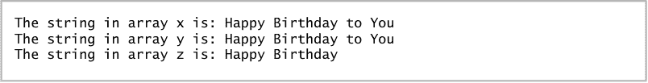

**Fig. 8.30** | `strcpy` 和 `strncpy`。 （第 2 部分，共 2 部分。）

## 使用 `strcat` 和 `strncat` 连接字符串

函数 `strcat` 将其第二个参数（一个字符串）追加到其第一个参数（包含字符串的字符数组）。第二个参数的第一个字符替换终止第一个参数中字符串的空字符（`'\0'`）。你必须确保用于存储第一个字符串的数组足够大，可以存储第一个字符串、第二个字符串和终止空字符（从第二个字符串复制）的组合。函数 `strcat` 将第二个字符串的指定数量的字符追加到第一个字符串，并将终止空字符追加到结果。图 8.31 的程序演示了函数 `strcat`（第 19 行和第 29 行）和函数 `strncat`（第 24 行）。

```cpp
// Fig. 8.31: fig08_31.cpp
// Using strcat and strncat.
#include <iostream>
using std::cout;
using std::endl;
#include <cstring> // prototypes for strcat and strncat
using std::strcat;
using std::strncat;
int main()
{
   char s1[ 20 ] = "Happy "; // length 6
   char s2[] = "New Year "; // length 9
   char s3[ 40 ] = "";
   cout << "s1 = " << s1 << "\\ns2 = " << s2;
   strcat( s1, s2 ); // concatenate s2 to s1 (length 15)
   cout << "\\nAfter strcat(s1, s2):\\ns1 = " << s1 << "\\ns2 = " << s2;
   // concatenate first 6 characters of s1 to s3
   strncat( s3, s1, 6 ); // places '\0' after last character
   cout << "\\nAfter strncat(s3, s1, 6):\\ns1 = " << s1
      << "\\ns3 = " << s3;
   strcat( s3, s1 ); // concatenate s1 to s3
   cout << "\\nAfter strcat(s3, s1):\\ns1 = " << s1
      << "\\ns3 = " << s3 << endl;
   return 0; // indicates successful termination
} // end main
```

**Fig. 8.31** | `strcat` 和 `strncat`。 （第 1 部分，共 2 部分。）

```
s1 = Happy
s2 = New Year
After strcat(s1, s2):
s1 = Happy New Year
s2 = New Year
After strncat(s3, s1, 6):
s1 = Happy New Year
s3 = Happy
After strcat(s3, s1):
s1 = Happy New Year
s3 = Happy Happy New Year
```

Fig. 8.31 | `strcat` 和 `strncat`。 （第 2 部分，共 2 部分。）

## 使用 `strcmp` 和 `strncmp` 比较字符串

图 8.32 使用 `strcmp`（第 21、22 和 23 行）和 `strncmp`（第 26、27 和 28 行）比较三个字符串。函数 `strcmp` 按字符逐个比较其第一个字符串参数与第二个字符串参数。函数如果字符串相等则返回零，如果第一个字符串小于第二个字符串则返回负值，如果第一个字符串大于第二个字符串则返回正值。函数 `strncmp` 与 `strcmp` 等效，只是 `strncmp` 比较指定数量的字符。函数 `strncmp` 在到达其字符串参数之一中的空字符时停止比较字符。程序打印每次函数调用返回的整数值。

```cpp
// Fig. 8.32: fig08_32.cpp
// Using strcmp and strncmp.
#include <iostream>
using std::cout;
using std::endl;

#include <iomanip>
using std::setw;

#include <cstring> // prototypes for strcmp and strncmp
using std::strcmp;
using std::strncmp;

int main()
{
    char *s1 = "Happy New Year";
    char *s2 = "Happy New Year";
    char *s3 = "Happy Holidays";

    cout << "s1 = " << s1 << "\ns2 = " << s2 << "\ns3 = " << s3
        << "\n\nstrcmp(s1, s2) = " << setw(2) << strcmp( s1, s2 )
        << "\nstrcmp(s1, s3) = " << setw(2) << strcmp( s1, s3 )
        << "\nstrcmp(s3, s1) = " << setw(2) << strcmp( s3, s1 );
```

Fig. 8.32 | `strcmp` 和 `strncmp`。 （第 1 部分，共 2 部分。）

```cpp
    cout << "\\nstrncmp(s1, s3, 6) = " << setw( 2 )
         << strncmp( s1, s3, 6 ) << "\\nstrncmp(s1, s3, 7) = " << setw( 2 )
         << strncmp( s1, s3, 7 ) << "\\nstrncmp(s3, s1, 7) = " << setw( 2 )
         << strncmp( s3, s1, 7 ) << endl;
    return 0; // indicates successful termination
} // end main
```

```
s1 = Happy New Year
s2 = Happy New Year
s3 = Happy Holidays
strcmp(s1, s2) =  0
strcmp(s1, s3) =  1
strcmp(s3, s1) = -1
strncmp(s1, s3, 6) =  0
strncmp(s1, s3, 7) =  1
strncmp(s3, s1, 7) = -1
```


**图 8.32** | `strcmp` 和 `strncmp`。（第 2 部分，共 2 部分。）

## 常见编程错误 8.21

> 假设 `strcmp` 和 `strncmp` 在其参数相等时返回一（真值）是一个逻辑错误。这两个函数在相等时返回零（C++ 的 false 值）。因此，在测试两个字符串是否相等时，应将 `strcmp` 或 `strncmp` 函数的结果与零进行比较，以确定字符串是否相等。

要理解一个字符串“大于”或“小于”另一个字符串到底是什么意思，考虑一下对一系列姓氏按字母顺序排列的过程。毫无疑问，你会将“Jones”排在“Smith”之前，因为在字母表中，“Jones”的第一个字母位于“Smith”的第一个字母之前。但字母表不仅仅是 26 个字母的列表——它是一个 *有序* 的字符列表。每个字母在列表中都有一个特定的位置。“Z”不仅仅是字母表中的一个字母；“Z”明确地是字母表中的第 26 个字母。

计算机如何知道一个字母在另一个字母之前呢？所有字符在计算机内部都以数字编码表示；当计算机比较两个字符串时，它实际上是比较字符串中字符的数字编码。

为了标准化字符表示，大多数计算机制造商将其机器设计为使用两种流行的编码方案之一——ASCII 或 *EBCDIC*。请记住，ASCII 代表“美国信息交换标准代码”（American Standard Code for Information Interchange）。EBCDIC 代表“扩展二进制编码十进制交换代码”（Extended Binary Coded Decimal Interchange Code）。还有其他编码方案。

ASCII 和 EBCDIC 被称为 *字符代码*（character codes）或字符集。本书的大多数读者将使用采用 ASCII 字符集的台式机或笔记本电脑。IBM 大型机使用 EBCDIC 字符集。随着互联网和万维网的使用日益普及，较新的 Unicode® 字符集越来越流行（www.unicode.org）。字符串和字符操作实际上涉及的是相应数字编码的操作，而不是字符本身。这解释了为什么在 C++ 中字符和小整数可以互换。由于可以说一个数字编码大于、小于或等于另一个数字编码，因此可以通过引用字符代码来将各种字符或字符串相互关联起来。附录 B 包含了 ASCII 字符代码。

## 可移植性提示 8.4

用于表示字符的内部数字编码在使用不同字符集的不同计算机上可能不同。

## 可移植性提示 8.5

不要显式测试 ASCII 代码，例如 `if ( rating == 65 )`；而应使用相应的字符常量，例如 `if ( rating == 'A' )`。

> [注意：在某些编译器中，函数 `strcmp` 和 `strncmp` 总是返回 -1、0 或 1，如图 8.32 的示例输出所示。在其他编译器中，这些函数返回 0 或两个被比较字符串中第一个不同字符的数字编码之差。例如，当比较 `s1` 和 `s3` 时，它们之间的第一个不同字符是每个字符串中第二个单词的第一个字符——`s1` 中的 N（数字编码 78）和 `s3` 中的 H（数字编码 72）。在这种情况下，返回值将是 6（如果将 `s3` 与 `s1` 比较，则为 -6）。]

## 使用 `strtok` 分割字符串

函数 `strtok` 将字符串分割为一系列标记。标记是由分隔字符（通常是空格或标点符号）分隔的字符序列。例如，在一行文本中，每个单词都可以视为一个标记，而分隔单词的空格可以视为分隔符。

要将字符串分割成标记，需要多次调用 `strtok`（假设字符串包含多个标记）。第一次调用 `strtok` 时包含两个参数：一个要分割的字符串和一个包含分隔标记的字符的字符串（即分隔符）。图 8.33 的第 19 行将指向 `sentence` 中第一个标记的指针赋给 `tokenPtr`。第二个参数 `" "` 表示 `sentence` 中的标记由空格分隔。函数 `strtok` 在 `sentence` 中查找第一个不是分隔字符（空格）的字符，该字符标志着第一个标记的开始。然后函数在字符串中查找下一个分隔字符，并用空字符（`'\0'`）替换它，从而终止当前标记。函数 `strtok` 将一个指向 `sentence` 中标记之后下一个字符的指针保存在一个静态变量中，并返回指向当前标记的指针。

```cpp
1  // Fig. 8.33: fig08_33.cpp
2  // Using strtok to tokenize a string.
3  #include <iostream>
4  using std::cout;
5  using std::endl;
6
7  #include <cstring> // prototype for strtok
8  using std::strtok;
9
10 int main()
11 {
12  char sentence[] = "This is a sentence with 7 tokens";
13  char *tokenPtr;
14
15  cout << "The string to be tokenized is:\n" << sentence
16      << "\n\nThe tokens are:\n\n";
17
18  // begin tokenization of sentence
19  tokenPtr = strtok( sentence, " " );
20
21  // continue tokenizing sentence until tokenPtr becomes NULL
22  while ( tokenPtr != NULL )
23  {
24      cout << tokenPtr << '\n';
25      tokenPtr = strtok( NULL, " " ); // get next token
26  } // end while
27
28  cout << "\nAfter strtok, sentence = " << sentence << endl;
29  return 0; // indicates successful termination
30  } // end main
```

```text
The string to be tokenized is:

This is a sentence with 7 tokens

The tokens are:

This

is

a

sentence

with

7

tokens

After strtok, sentence = This
```

图 8.33 | 使用 `strtok` 分割字符串。（第 2 部分，共 2 部分。）

后续对 `strtok` 的调用继续对 `sentence` 进行分割时，第一个参数为 `NULL`（第 25 行）。`NULL` 参数表示该次 `strtok` 调用应从上次调用 `strtok` 所保存的 `sentence` 位置继续分割。请注意，`strtok` 以对您不可见的方式维护这些保存的信息。如果在调用 `strtok` 时没有剩余标记，`strtok` 返回 `NULL`。图 8.33 的程序使用 `strtok` 将字符串 `"This is a sentence with 7 tokens"` 分割成标记。程序在单独的一行上打印每个标记。第 28 行在分割后输出 `sentence`。请注意，`strtok` 会修改输入字符串；因此，如果程序在调用 `strtok` 之后还需要原始字符串，应复制该字符串。在分割后输出 `sentence` 时，请注意只打印了单词 `"This"`，因为 `strtok` 在分割过程中用空字符（`'\0'`）替换了 `sentence` 中的每个空格。

> 常见编程错误 8.22
> 
> 没有意识到 `strtok` 会修改正在被分割的字符串，然后试图将该字符串当作原始未修改的字符串使用，这是一个逻辑错误。

## 确定字符串长度

函数 `strlen` 接受一个字符串作为参数，并返回字符串中字符的数量——终止的空字符不包含在长度中。该长度也是空字符的索引。图 8.34 中的程序演示了函数 `strlen`。

```cpp
// Fig. 8.34: fig08_34.cpp
// Using strlen.
#include <iostream>
using std::cout;
using std::endl;
#include <cstring> // prototype for strlen
using std::strlen;

int main()
{
    char *string1 = "abcdefghijklmnopqrstuvwxyz";
    char *string2 = "four";
    char *string3 = "Boston";

    cout << "The length of \"" << string1 << "\" is " << strlen( string1 )
        << "\nThe length of \"" << string2 << "\" is " << strlen( string2 )
        << "\nThe length of \"" << string3 << "\" is " << strlen( string3 )
        << endl;

    return 0; // indicates successful termination
} // end main
```

```text
The length of "abcdefghijklmnopqrstuvwxyz" is 26
The length of "four" is 4
The length of "Boston" is 6
```

图 8.34 | `strlen` 返回 `char *` 字符串的长度。

## 8.14 小结

在本章中，我们详细介绍了指针，即以其值为内存地址的变量。我们首先演示了如何声明和初始化指针。你看到了如何使用取地址运算符（`&`）将变量的地址赋给指针，以及如何使用间接引用运算符（`*`）访问由指针间接引用的变量中存储的数据。我们讨论了使用指针参数和引用参数按引用传递参数。

你学习了如何将 `const` 与指针一起使用，以实施最小权限原则。我们演示了使用指向非常量数据的非常量指针、指向常量数据的非常量指针、指向非常量数据的常量指针和指向常量数据的常量指针。然后我们使用选择排序演示了按引用传递数组和单个数组元素。我们讨论了 `sizeof` 运算符，它可以在程序编译期间用于确定数据类型和变量的大小（以字节为单位）。

我们演示了如何在算术和比较表达式中使用指针。你看到了如何使用指针算术从一个数组元素跳转到另一个数组元素。你学习了如何使用指针数组，更具体地说是字符串数组（arrays of strings)。我们讨论了函数指针，它使程序员能够将函数作为参数传递。我们介绍了几个操作基于指针的字符串的 C++ 函数。你学习了字符串处理能力，例如复制字符串、标记化字符串以及确定字符串的长度。

在下一章中，我们开始对类进行更深入的探讨。你将学习类的成员的作用域，以及如何使对象保持一致的状态。你还将学习使用称为构造函数和析构函数的特殊成员函数，它们分别在对象创建和销毁时执行，并且我们将讨论构造函数和析构函数何时被调用。此外，我们将演示使用默认参数的构造函数以及使用默认逐成员赋值将一个类的一个对象赋给同一类的另一个对象。我们还将讨论返回对类私有数据成员的引用的危险。

## 9 类：更深入的探讨，第 I 部分

### 目标

在本章中你将学习：

- 如何使用预处理器包装来防止因源代码文件包含同一头文件的多个副本而导致的多次定义错误。
- 理解类作用域以及通过对象名称、对象引用或对象指针访问类成员。
- 定义带默认参数的构造函数。
- 析构函数如何用于在对象被销毁前对对象执行“终止清理”。
- 构造函数和析构函数何时被调用以及它们被调用的顺序。
- 当类的公共成员函数返回对私有数据的引用时可能发生的逻辑错误。
- 通过默认逐成员赋值将一个对象的数据成员赋给另一个对象。

> 我的目标无比崇高
> 我终将实现它。
> —W. S. Gilbert

> 这是一个隐藏美德的世界吗？
> —威廉·莎士比亚

> 不要“一致”，而要简单真实。
> —奥利弗·温德尔·霍姆斯 Jr.

> 这一切之上：要忠于你自己。
> —威廉·莎士比亚

### 大纲

- 9.1 引言
- 9.2 Time 类案例研究
- 9.3 类作用域和访问类成员
- 9.4 将接口与实现分离
- 9.5 访问函数和实用函数
- 9.6 Time 类案例研究：带默认参数的构造函数
- 9.7 析构函数
- 9.8 何时调用构造函数和析构函数
- 9.9 Time 类案例研究：一个微妙的陷阱——返回对私有数据成员的引用
- 9.10 默认逐成员赋值
- 9.11 （可选）软件工程案例研究：开始编程 ATM 系统的类
- 9.12 总结

### 9.1 引言

在前几章中，我们介绍了 C++ 面向对象编程的许多基本术语和概念。我们还讨论了我们的程序开发方法论：我们为每个类选择适当的属性和行为，并指定我们的类的对象如何与 C++ 标准库类的对象协作以实现每个程序的整体目标。

在本章中，我们对类进行更深入的探讨。我们在本章（三个示例）和第 10 章《类：更深入的探讨，第 2 部分》（两个示例）中使用集成的 `Time` 类案例研究来演示几种类构建能力。我们从一个 `Time` 类开始，该类回顾了前几章中介绍的几个特性。该示例还演示了一个重要的 C++ 软件工程概念——在头文件中使用“预处理器包装”，以防止头文件中的代码被多次包含到同一个源代码文件中。由于一个类只能定义一次，使用此类预处理器指令可防止多次定义错误。

接下来，我们讨论类作用域以及类成员之间的关系。我们还演示了客户端代码如何通过三种类型的“句柄”访问类的公共成员——对象名称、对象引用或对象指针。正如你将看到的，对象名称和引用可以使用点（`.`）成员选择运算符来访问公共成员，而指针可以使用箭头（`->`）成员选择运算符。

我们讨论可以读取或显示对象中数据的访问函数。访问函数的一种常见用途是测试条件的真假——此类函数被称为谓词函数。我们还演示了实用函数（也称为辅助函数）的概念——一个私有成员函数，支持类的公共成员函数的运行，但不打算供类的客户端使用。

`Time` 类案例研究的第二个示例演示了如何将参数传递给构造函数，并展示了如何在构造函数中使用默认参数，使客户端代码能够使用多种参数初始化类的对象。接下来，我们讨论一个称为析构函数的特殊成员函数，它是每个类的组成部分，用于在对象被销毁前对对象执行“终止清理”。然后我们演示构造函数和析构函数被调用的顺序，因为你的程序的正确性取决于使用已正确初始化且尚未被销毁的对象。

本章中 `Time` 类案例研究的最后一个示例展示了一种危险的编程实践，即成员函数返回对私有数据的引用。我们讨论了这如何破坏类的封装，并允许客户端代码直接访问对象的数据。此最后一个示例表明，同一类的对象可以使用默认逐成员赋值相互赋值，该赋值将赋值运算符右侧对象的成员数据复制到左侧对象的相应数据成员中。本章以软件可重用性的讨论结束。

### 9.2 Time 类案例研究

我们的第一个示例（图 9.1–9.3）创建了类 `Time` 和一个测试该类的驱动程序。你已经在本书中创建了许多类。在本节中，我们回顾了第 3 章中介绍的许多概念，并演示了一个重要的 C++ 软件工程概念——在头文件中使用“预处理器包装”，以防止头文件中的代码被多次包含到同一个源代码文件中。由于一个类只能定义一次，使用此类预处理器指令可防止多次定义错误。

#### Time 类定义

类定义（图 9.1）包含成员函数 `Time`、`setTime`、`printUniversal` 和 `printStandard` 的原型（第 13–16 行）。该类包含私有整数成员 `hour`、`minute` 和 `second`（第 18–20 行）。类 `Time` 的私有数据只能由其四个成员函数访问。第 12 章将介绍第三个访问说明符 `protected`，我们在研究继承及其在面向对象编程中的作用时介绍它。

> 良好的编程实践 9.1
> 为了清晰和可读性，在类定义中仅使用一次每个访问说明符。将公共成员放在前面，便于查找。

> 软件工程观察 9.1
> 除非能证明某个类元素需要公共可见性，否则类的每个元素都应具有私有可见性。这是最小权限原则的又一例证。

在图 9.1 中，注意类定义被以下预处理器包装括起来（第 6、7 和 23 行）：

```cpp
// prevent multiple inclusions of header file
#ifndef TIME_H
#define TIME_H
...
#endif
```

当我们构建更大的程序时，其他定义和声明也将被放置在头文件中。上述预处理器包装可防止 `#ifndef`（意为“如果未定义”）和 `#endif` 之间的代码在名称 `TIME_H` 已被定义时被包含。

```cpp
// Fig. 9.1: Time.h
// Declaration of class Time.
// Member functions are defined in Time.cpp
// prevent multiple inclusions of header file
#ifndef TIME_H
#define TIME_H
// Time class definition
class Time
{
public:
    Time(); // constructor
    void setTime( int, int, int ); // set hour, minute and second
    void printUniversal(); // print time in universal-time format
    void printStandard(); // print time in standard-time format
private:
    int hour; // 0 - 23 (24-hour clock format)
    int minute; // 0 - 59
    int second; // 0 - 59
}; // end class Time
#endif
```


图 9.1 | `Time` 类定义。

如果头文件尚未在文件中包含过，则 `#define` 指令定义名称 `TIME_H` 并包含头文件语句。如果头文件已包含过，则 `TIME_H` 已被定义，头文件将不再被包含。尝试多次包含头文件（无意中）通常发生在具有许多头文件的大型程序中，这些头文件本身可能包含其他头文件。[注意：预处理器指令中符号常量名称的常用约定只是头文件名的大写形式，用下划线字符替换句点。]

### 错误预防提示 9.1
使用 `#ifndef`、`#define` 和 `#endif` 预处理器指令形成预处理器包装，以防止头文件在程序中被包含多次。

### 良好的编程实践 9.2
在头文件的 `#ifndef` 和 `#define` 预处理器指令中使用头文件名称的大写形式，并将句点替换为下划线。

### Time 类成员函数
在图 9.2 中，`Time` 构造函数（第 14–17 行）将数据成员初始化为 0（即 12 AM 的通用时间等效值）。这确保对象从一致的状态开始。无效值不能存储在 `Time` 对象的成员数据中，因为构造函数在 `Time` 对象创建时被调用，并且客户端随后对数据成员的所有修改尝试都将由函数 `setTime`（稍后讨论）审查。最后，重要的是要注意，你可以为一个类定义多个重载的构造函数。

函数 `setTime`（第 21–26 行）是一个公有函数，声明了三个 `int` 参数并用它们来设置时间。条件表达式测试每个参数以确定该值是否在指定范围内。例如，小时值（第 23 行）必须大于或等于 0 且小于 24，因为通用时间格式将小时表示为 0 到 23 的整数（例如，下午 1 点是小时 13，下午 11 点是小时 23；午夜是小时 0，中午是小时 12）。同样，分钟和秒值（第 24 行和第 25 行）必须大于或等于 0 且小于 60。任何超出这些范围的值都将被设为零，以确保 `Time` 对象始终包含一致的数据——也就是说，对象的数值始终保持在范围内，即使作为 `setTime` 函数参数提供的值不正确。在此示例中，零是小时、分钟和秒的一个一致值。

传递给 `setTime` 的值如果在要初始化的成员允许的范围内，则为正确值。因此，0–23 范围内的任何数字都是小时的正确值。正确值始终是一致值。然而，一致值不一定是正确值。如果 `setTime` 因为收到的参数超出范围而将小时设为 0，则只有在当前时间恰好是午夜时，小时才是正确的。

函数 `printUniversal`（图 9.2 的第 29–33 行）不带参数并以通用时间格式输出时间，由三个冒号分隔的数字对组成——分别对应小时、分钟和秒。例如，如果时间为下午 1:30:07，函数 `printUniversal` 将返回 13:30:07。请注意，第 31 行使用了参数化流操纵符 `setfill` 来指定当整数在比值本身位数更宽的字段中输出时显示的填充字符。默认情况下，填充字符出现在数字的左侧。在此示例中，如果分钟值为 2，它将显示为 02，因为填充字符被设为零（'0'）。如果输出的数字填满了指定的字段，则不会显示填充字符。请注意，一旦使用 `setfill` 指定了填充字符，它将适用于随后所有在比显示值更宽的字段中显示的值（即 `setfill` 是一个“粘性”设置）。这与 `setw` 形成对比，`setw` 仅适用于下一个显示的值（`setw` 是一个“非粘性”设置）。

### Error-Prevention Tip 9.2
> 每个粘性设置（例如填充字符或浮点精度）都应在不再需要时恢复到其先前设置。未能这样做可能会导致程序后面出现格式错误的输出。第 15 章 Stream Input/Output 讨论了如何重置填充字符和精度。

函数 `printStandard`（第 36–41 行）不带参数并以标准时间格式输出日期，由小时、分钟和秒值用冒号分隔并跟随 AM 或 PM 指示符组成（例如，1:27:06 PM）。与函数 `printUniversal` 类似，函数 `printStandard` 使用 `setfill('0')` 将分钟和秒格式化为两位数字值，如有必要则补前导零。第 38 行使用条件运算符 `(?:)` 来确定要显示的小时值——如果小时为 0 或 12（AM 或 PM），则显示为 12；否则，小时显示为 1 到 11 的值。第 40 行中的条件运算符决定显示 AM 还是 PM。

### Defining Member Functions Outside the Class Definition; Class Scope
即使在类定义中声明的成员函数可以在该类定义之外定义（并通过二进制作用域解析运算符“绑定”到类），该成员函数仍在该类的范围内；即，其名称仅为类的其他成员所知，除非通过类的对象、类的对象的引用、类的对象的指针或二进制作用域解析运算符引用。我们稍后会更多地谈论类作用域。

如果成员函数在类定义的体内定义，编译器会尝试内联对该成员函数的调用。在类定义之外定义的成员函数可以通过显式使用关键字 `inline` 来内联。请记住，编译器保留不内联任何函数的权利。

### Performance Tip 9.1
在类定义内部定义成员函数会内联该成员函数（如果编译器选择这样做）。这可以提高性能。

### Software Engineering Observation 9.2
在类定义内部定义小型成员函数并不利于最佳软件工程，因为类的客户端将能够看到该函数的实现，并且如果函数定义发生变化，客户端代码必须重新编译。

### Software Engineering Observation 9.3
只有最简单且最稳定的成员函数（即其实现不太可能发生变化）才应在类头文件中定义。

### Member Functions vs. Global Functions
有趣的是，`printUniversal` 和 `printStandard` 成员函数不带参数。这是因为这些成员函数隐式知道它们要打印的是调用它们的特定 `Time` 对象的成员数据。这可以使成员函数调用比过程式编程中的常规函数调用更简洁。

### Software Engineering Observation 9.4
使用面向对象编程方法通常可以通过减少需要传递的参数数量来简化函数调用。面向对象编程的这种好处源于将数据成员和成员函数封装在对象中，使成员函数有权访问数据成员。

### Software Engineering Observation 9.5
成员函数通常比非面向对象程序中的函数更短，因为存储在数据成员中的数据理想情况下已由构造函数或存储新数据的成员函数进行验证。由于数据已在对象中，成员函数调用通常没有参数或比非面向对象语言中典型函数调用的参数更少。因此，调用更短，函数定义更短，函数原型也更短。这改善了程序开发的许多方面。

### Error-Prevention Tip 9.3
成员函数调用通常不带参数或比非面向对象语言中的常规函数调用参数少得多，这降低了传递错误参数、错误类型的参数或错误数量参数的可能性。

### Using Class Time
一旦定义了类 `Time`，它就可以用作对象、数组、指针和引用声明中的类型，如下所示：

```
Time sunset; // object of type Time

Time arrayOfTimes[ 5 ]; // array of 5 Time objects

Time &dinnerTime = sunset; // reference to a Time object

Time *timePtr = &dinnerTime; // pointer to a Time object
```

图 9.3 使用了类 `Time`。第 12 行实例化了类 `Time` 的一个对象 `t`。当对象被实例化时，`Time` 构造函数被调用以将每个私有数据成员初始化为 0。然后，第 16 行和第 18 行分别以通用和标准格式打印时间，以确认成员已正确初始化。第 20 行通过调用成员函数 `setTime` 设置新时间，第 24 行和第 26 行再次以两种格式打印时间。第 28 行尝试使用 `setTime` 将数据成员设为无效值——`setTime` 函数识别到这一点并将无效值设为 0 以保持对象处于一致状态。最后，第 33 行和第 35 行再次以两种格式打印时间。

```
1  // Fig. 9.3: fig09_03.cpp
2  // Program to test class Time.
3  // NOTE: This file must be compiled with Time.cpp.
4  #include <iostream>
5  using std::cout;
6  using std::endl;
7
8  #include "Time.h" // include definition of class Time from Time.h
9
10 int main()
11 {
12     Time t; // instantiate object t of class Time
13
14     // output Time object t's initial values
15     cout << "The initial universal time is ";
16     t.printUniversal(); // 00:00:00
17     cout << "\nThe initial standard time is ";
18     t.printStandard(); // 12:00:00 AM
19
20     t.setTime( 13, 27, 6 ); // change time
21
22     // output Time object t's new values
23     cout << "\n\nUniversal time after setTime is ";
24     t.printUniversal(); // 13:27:06
25     cout << "\nStandard time after setTime is ";
26     t.printStandard(); // 1:27:06 PM
27
28     t.setTime( 99, 99, 99 ); // attempt invalid settings
29
30     // output t's values after specifying invalid values
31     cout << "\n\nAfter attempting invalid settings:"
32         << "\nUniversal time: ";
33     t.printUniversal(); // 00:00:00
```

Fig. 9.3 | Program to test class Time. (Part 1 of 2.)

```
34  cout << "\nStandard time: ";
35  t.printStandard(); // 12:00:00 AM
36  cout << endl;
37  return 0;
38  } // end main
```

初始通用时间是 00:00:00
初始标准时间是 12:00:00 AM

setTime 后的通用时间是 13:27:06
setTime 后的标准时间是 1:27:06 PM

尝试无效设置后：
通用时间：00:00:00
标准时间：12:00:00 AM

图 9.3 | 用于测试类 `Time` 的程序。 （第 2 部分，共 2 部分。）

### 展望组合与继承
通常，类不必“从零开始”创建。相反，它们可以包含其他类的对象作为成员，或者可以从提供新类可用的属性和行为的其他类派生。 这种软件重用可以大大提高程序员的生产力并简化代码维护。 将类对象作为其他类的成员包含称为组合（或聚合），将在第 10 章讨论。 从现有类派生新类称为继承，将在第 12 章讨论。

### 对象大小
刚接触面向对象编程的人经常认为对象必须相当大，因为它们包含数据成员和成员函数。 从逻辑上讲，这是正确的——你可以认为对象包含数据和函数（我们的讨论也确实鼓励了这种观点）； 然而，从物理上讲，这是不正确的。

#### 性能提示 9.2
> 对象仅包含数据，因此对象比如果也包含成员函数要小得多。 将 operator `sizeof` 应用于类名或该类的对象将仅报告该类的数据成员的大小。 编译器为成员函数创建一份（仅一份）副本，与该类的所有对象分开。 该类的所有对象共享这一份副本。 当然，每个对象都需要自己的类数据副本，因为数据可能在对象之间有所不同。 函数代码是不可修改的（也称为可重入代码或纯过程），因此可以由该类的所有对象共享。

### 9.3 类作用域和访问类成员
类的 数据成员（在类定义中声明的变量）和成员函数（在类定义中声明的函数）属于该类的作用域。 非成员函数在文件作用域中定义。

在类的作用域内，类的成员可以立即被该类的所有成员函数访问，并可以通过名称引用。 在类的作用域之外，公共类成员通过对象的一个句柄引用——对象名、对象引用或对象指针。 对象的类型、引用或指针指定客户端可访问的接口（即成员函数）。 [我们将在第 10 章看到，编译器在从对象内部引用数据成员或成员函数的每一次引用中插入一个隐式句柄。]

类的成员函数可以重载，但只能由该类的其他成员函数重载。 要重载成员函数，只需在类定义中为重载函数的每个版本提供原型，并为函数的每个版本提供单独的函数定义即可。

在成员函数中声明的变量具有块作用域，仅该函数知道。 如果成员函数定义了一个与类作用域变量同名的变量，则类作用域变量在块作用域中被块作用域变量隐藏。 这种隐藏的变量可以通过在变量名前面加上类名后跟作用域解析运算符（`::`）来访问。 可以使用一元作用域解析运算符访问隐藏的全局变量（参见第 6 章）。

点成员选择运算符（`.`）前面是对象的名称或对对象的引用，以访问对象的成员。 箭头成员选择运算符（`->`）前面是指向对象的指针，以访问对象的成员。

图 9.4 使用一个名为 `Count` 的简单类（第 8–25 行），其私有数据成员 `x` 为 `int` 类型（第 24 行），公共成员函数 `setX`（第 12–15 行）和公共成员函数 `print`（第 18–21 行）来说明使用成员选择运算符访问类的成员。 为了简单起见，我们将这个小型类包含在与使用它的 `main` 函数相同的文件中。 第 29–31 行创建了与类型 `Count` 相关的三个变量——`counter`（一个 `Count` 对象）、`counterPtr`（指向 `Count` 对象的指针）和 `counterRef`（指向 `Count` 对象的引用）。 变量 `counterRef` 引用 `counter`，变量 `counterPtr` 指向 `counter`。 在第 34–35 行和第 38–39 行中，注意程序可以使用点（`.`）成员选择运算符在对象名称（`counter`）或对象引用（`counterRef`，即 `counter` 的别名）前面调用成员函数 `setX` 和 `print`。 同样，第 42–43 行演示了程序可以使用指针（`counterPtr`）和箭头（`->`）成员选择运算符调用成员函数 `setX` 和 `print`。

```
// Fig. 9.4: fig09_04.cpp
// Demonstrating the class member access operators . and ->
#include <iostream>
using std::cout;
using std::endl;

// class Count definition
class Count
{
public: // public data is dangerous
    // sets the value of private data member x
    void setX( int value )
    {
        x = value;
    } // end function setX
```

**图 9.4** | 通过每种类型的对象句柄访问对象的成员函数——对象名称、对象引用和对象指针。 （第 1 部分，共 2 部分。）

```
16
17   // prints the value of private data member x
18   void print()
19   {
20     cout << x << endl;
21   } // end function print
22
23 private:
24   int x;
25 }; // end class Count
26
27 int main()
28 {
29   Count counter; // create counter object
30   Count *counterPtr = &counter; // create pointer to counter
31   Count &counterRef = counter; // create reference to counter
32
33   cout << "Set x to 1 and print using the object's name: ";
34   counter.setX( 1 ); // set data member x to 1
35   counter.print(); // call member function print
36
37   cout << "Set x to 2 and print using a reference to an object: ";
38   counterRef.setX( 2 ); // set data member x to 2
39   counterRef.print(); // call member function print
40
41   cout << "Set x to 3 and print using a pointer to an object: ";
42   counterPtr->setX( 3 ); // set data member x to 3
43   counterPtr->print(); // call member function print
```


`44`   `return` `0`;

`45` } // end main

```

```

Set x to 1 and print using the object's name: 1

Set x to 2 and print using a reference to an object: 2

Set x to 3 and print using a pointer to an object: 3

```

图 9.4 | 通过每种类型的对象句柄访问对象的成员函数——对象名称、对象引用和对象指针。 （第 2 部分，共 2 部分。）

## 9.4 分离接口与实现

在第 3 章中，我们首先将类的定义和成员函数定义包含在一个文件中。 然后我们演示了将此代码分离到两个文件——一个用于类定义（即类的接口）的头文件和一个用于类成员函数定义（即类的实现）的源代码文件。 回想一下，这使得修改程序更容易——就类的客户端而言，只要类最初提供给客户端的接口保持不变，类实现的更改就不会影响客户端。

### 软件工程观察 9.6

> 类的客户端不需要访问类的源代码即可使用该类。 客户端确实需要能够链接到类的目标代码（即类的编译版本）。 这鼓励了独立软件供应商（ISV）提供类库供销售或许可。 ISV 在其产品中仅提供头文件和目标模块。 不会透露任何专有信息——如果提供源代码就会出现这种情况。 C++ 用户社区受益于有更多 ISV 生产的类库可用。

实际上，事情并没有这么美好。 头文件确实包含实现的一部分以及其他部分的提示。 例如，内联成员函数需要放在头文件中，以便在编译器编译客户端时，客户端可以就地包含内联函数定义。 类的私有成员列在头文件中的类定义中，因此这些成员对客户端可见，即使客户端可能无法访问私有成员。 在第 10 章中，我们将展示如何使用“代理类”将类的私有数据甚至从类的客户端隐藏起来。

### 软件工程观察 9.7

> 重要于类接口的信息应包含在头文件中。 仅在类内部使用且客户端不需要的信息应包含在未发布的源文件中。 这又是最小权限原则的又一个例子。

## 9.5 访问函数和实用函数

访问函数可以读取或显示数据。 访问函数的另一个常见用途是测试条件为真或为假——此类函数通常称为谓词函数。 谓词函数的示例是任何容器类的 `isEmpty` 函数——能够容纳许多对象的类——例如链表、堆栈或队列。 程序可能在尝试从容器对象读取另一项之前测试 `isEmpty`。 `isFull` 谓词函数可能会测试容器类对象是否没有剩余空间。 我们 `Time` 类的有用谓词函数可能是 `isAM` 和 `isPM`。

图 9.5–9.7 的程序演示了实用函数（也称为辅助函数）的概念。 实用函数不是类公共接口的一部分； 相反，它是支持类公共成员函数操作的私有成员函数。 实用函数不打算供类的客户端使用（但可以供类的朋友使用，我们将在第 10 章看到）。

类 `SalesPerson`（图 9.5）声明了一个包含 12 个月销售数据的数组（第 16 行）以及类的构造函数和操作数组的成员函数的原型。

```
1  // Fig. 9.5: SalesPerson.h
2  // SalesPerson class definition.
3  // Member functions defined in SalesPerson.cpp.
4  #ifndef SALESP_H
5  #define SALESP_H
6
7  class SalesPerson
8  {
9  public:
10     SalesPerson(); // constructor
11     void getSalesFromUser(); // input sales from keyboard
```

图 9.5 | `SalesPerson` 类定义。 （第 1 部分，共 2 部分。）

```cpp
12     void setSales( int, double ); // set sales for a specific month
13     void printAnnualSales(); // summarize and print sales
14 private:
15     double totalAnnualSales(); // prototype for utility function
16     double sales[ 12 ]; // 12 monthly sales figures
17 }; // end class SalesPerson
18
19 #endif
```

### Fig. 9.5 | `SalesPerson` 类定义。 (第 2 部分，共 2 部分。)

在图 9.6 中，`SalesPerson` 构造函数（第 15–19 行）将数组 `sales` 初始化为零。公有成员函数 `setSales`（第 36–43 行）设置数组 `sales` 中某个月份的销售额。公有成员函数 `printAnnualSales`（第 46–51 行）打印最近 12 个月的总销售额。私有实用函数 `totalAnnualSales`（第 54–62 行）汇总 12 个月销售额以供 `printAnnualSales` 使用。成员函数 `printAnnualSales` 将销售额编辑为货币格式。

```cpp
1  // Fig. 9.6: SalesPerson.cpp
2  // SalesPerson class member-function definitions.
3  #include <iostream>
4  using std::cout;
5  using std::cin;
6  using std::endl;
7  using std::fixed;
8
9  #include <iomanip>
10 using std::setprecision;
11
12 #include "SalesPerson.h" // include SalesPerson class definition
13
// initialize elements of array sales to 0.0
15 SalesPerson::SalesPerson()
16 {
17     for ( int i = 0; i < 12; i++ )
18         sales[ i ] = 0.0;
19 } // end SalesPerson constructor
20
// get 12 sales figures from the user at the keyboard
22 void SalesPerson::getSalesFromUser()
23 {
24     double salesFigure;
25
26     for ( int i = 1; i <= 12; i++ )
27     {
28         cout << "Enter sales amount for month " << i << ": ";
29         cin >> salesFigure;
30         setSales( i, salesFigure );
31     } // end for
32 } // end function getSalesFromUser
```

### Fig. 9.6 | `SalesPerson` 类成员函数定义。 (第 1 部分，共 2 部分。)


### Fig. 9.7 | 实用函数演示。 (第 2 部分，共 2 部分。)

## 9.6 Time 类案例研究：带默认参数的构造函数

图 9.8–9.10 的程序增强了类 `Time`，以演示如何将参数隐式传递给构造函数。图 9.2 中定义的构造函数将 `hour`、`minute` 和 `second` 初始化为 0（即通用时间的午夜）。与其它函数一样，构造函数可以指定默认参数。图 9.8 的第 13 行声明 `Time` 构造函数包含默认参数，为传递给构造函数的每个参数指定默认值零。在图 9.9 中，第 14–17 行定义了 `Time` 构造函数的新的版本，该版本接收参数 `hr`、`min` 和 `sec` 的值，这些值将分别用于初始化私有数据成员 `hour`、`minute` 和 `second`。请注意，类 `Time` 为每个数据成员提供了 `set` 和 `get` 函数。`Time` 构造函数现在调用 `setTime`，后者调用 `setHour`、`setMinute` 和 `setSecond` 函数以验证并为数据成员赋值。构造函数的默认参数确保即使在构造函数调用中未提供值，构造函数仍能初始化数据成员以保持 `Time` 对象处于一致状态。所有参数都默认为默认值 的构造函数也是默认构造函数——即可以用零个参数调用的构造函数。每个类最多只能有一个默认构造函数。

```cpp
// Fig. 9.8: Time.h
// Time class containing a constructor with default arguments.
// Member functions defined in Time.cpp.
// prevent multiple inclusions of header file
#ifndef TIME_H
#define TIME_H
// Time abstract data type definition
class Time
{
public:
    Time( int = 0, int = 0, int = 0 ); // default constructor
```

### Fig. 9.8 | 包含带默认参数的构造函数的 `Time` 类。 (第 1 部分，共 2 部分。)

```cpp
// set functions
void setTime( int, int, int ); // set hour, minute, second
void setHour( int ); // set hour (after validation)
void setMinute( int ); // set minute (after validation)
void setSecond( int ); // set second (after validation)
// get functions
int getHour(); // return hour
int getMinute(); // return minute
int getSecond(); // return second
void printUniversal(); // output time in universal-time format
void printStandard(); // output time in standard-time format
private:
    int hour; // 0 - 23 (24-hour clock format)
    int minute; // 0 - 59
    int second; // 0 - 59
}; // end class Time
#endif
```

### Fig. 9.8 | 包含带默认参数的构造函数的 `Time` 类。 (第 2 部分，共 2 部分。)

```cpp
// Fig. 9.9: Time.cpp
// Member-function definitions for class Time.
#include <iostream>
using std::cout;
#include <iomanip>
using std::setfill;
using std::setw;
#include "Time.h" // include definition of class Time from Time.h
// Time constructor initializes each data member to zero;
// ensures that Time objects start in a consistent state
Time::Time( int hr, int min, int sec )
{
    setTime( hr, min, sec ); // validate and set time
} // end Time constructor
```

### Fig. 9.9 | `Time` 类成员函数定义，包括带参数的构造函数。 (第 1 部分，共 2 部分。)

```cpp
// set hour value
void Time::setHour( int h )
{
    hour = ( h >= 0 && h < 24 ) ? h : 0; // validate hour
} // end function setHour
// set minute value
void Time::setMinute( int m )
{
    minute = ( m >= 0 && m < 60 ) ? m : 0; // validate minute
} // end function setMinute
// set second value
void Time::setSecond( int s )
{
    second = ( s >= 0 && s < 60 ) ? s : 0; // validate second
} // end function setSecond
// return hour value
int Time::getHour()
{
    return hour;
} // end function getHour
// return minute value
int Time::getMinute()
{
    return minute;
} // end function getMinute
// return second value
int Time::getSecond()
{
    return second;
} // end function getSecond
// print Time in universal-time format (HH:MM:SS)
void Time::printUniversal()
{
    cout << setfill( '0' ) << setw( 2 ) << getHour() << ":"
         << setw( 2 ) << getMinute() << ":" << setw( 2 ) << getSecond();
} // end function printUniversal
// print Time in standard-time format (HH:MM:SS AM or PM)
void Time::printStandard()
{
    cout << ( ( getHour() == 0 || getHour() == 12 ) ? 12 : getHour() % 12 )
         << ":" << setfill( '0' ) << setw( 2 ) << getMinute()
         << ":" << setw( 2 ) << getSecond() << ( hour < 12 ? " AM" : " PM" );
} // end function printStandard
```


### Fig. 9.9 | Time 类成员函数定义，包括带参数的构造函数。 (第 2 部分，共 2 部分。)

在图 9.9 中，构造函数的第 16 行使用传递给构造函数的数值（或默认值）调用成员函数 `setTime`。函数 `setTime` 调用 `setHour` 以确保为 `hour` 提供的数值在 0–23 范围内，然后调用 `setMinute` 和 `setSecond` 以确保 `minute` 和 `second` 的值均在 0–59 范围内。如果某个值超出范围，则该值被设为零（以确保每个数据成员保持一致状态）。在第 16 章 异常处理 中，当值超出范围时，我们会抛出异常，而不是简单地赋予一个默认的一致值。

请注意，`Time` 构造函数可以编写为包含与成员函数 `setTime` 相同的语句，甚至是 `setHour`、`setMinute` 和 `setSecond` 函数中的单个语句。从构造函数调用 `setHour`、`setMinute` 和 `setSecond` 可能略微更高效，因为可以消除对 `setTime` 的额外调用。同样，将第 31、37 和 43 行的代码复制到构造函数中可以消除调用 `setTime`、`setHour`、`setMinute` 和 `setSecond` 的开销。将 `Time` 构造函数或成员函数 `setTime` 编写为第 31、37 和 43 行代码的副本会使该类的维护变得更加困难。如果 `setHour`、`setMinute` 和 `setSecond` 的实现发生变化，则任何重复第 31、37 和 43 行的成员函数的实现也必须相应更改。让 `Time` 构造函数调用 `setTime`，并让 `setTime` 调用 `setHour`、`setMinute` 和 `setSecond`，使我们能够将验证 `hour`、`minute` 或 `second` 的代码更改限制在相应的 `set` 函数中。这降低了在修改类实现时出现错误的可能性。此外，还可以通过显式声明 `Time` 构造函数和 `setTime` 为内联，或通过在类定义中定义它们（这会隐式内联函数定义）来增强其性能。

### 软件工程观察 9.8

> 如果类的成员函数已经提供了构造函数（或其他成员函数）所需的所有或部分功能，则应从构造函数（或其他成员函数）中调用该成员函数。这简化了代码的维护并降低了在修改实现时出现错误的可能性。作为一般规则：避免重复代码。

### 软件工程观察 9.9

> 对函数的默认参数值进行任何更改都需要重新编译客户端代码（以确保程序仍能正确运行）。

图 9.10 中函数 `main` 初始化了五个 `Time` 对象——一个在隐式构造函数调用（第 11 行）中将全部三个参数都默认为默认值，一个指定一个参数（第 12 行），一个指定两个参数（第 13 行），一个指定三个参数（第 14 行），一个指定三个无效参数（第 15 行）。然后程序以通用时间和标准时间格式显示每个对象。

```cpp
// Fig. 9.10: fig09_10.cpp
// Demonstrating a default constructor for class Time.
#include <iostream>
using std::cout;
using std::endl;
```

### Fig. 9.10 | 带默认参数的构造函数。 (第 1 部分，共 3 部分。)

```cpp
#include "Time.h" // include definition of class Time from Time.h

int main()
{
    Time t1; // all arguments defaulted
    Time t2( 2 ); // hour specified; minute and second defaulted
    Time t3( 21, 34 ); // hour and minute specified; second defaulted
    Time t4( 12, 25, 42 ); // hour, minute and second specified
    Time t5( 27, 74, 99 ); // all bad values specified

    cout << "Constructed with:\n\nt1: all arguments defaulted\n ";
    t1.printUniversal(); // 00:00:00
    cout << "\n ";
    t1.printStandard(); // 12:00:00 AM

    cout << "\n\nt2: hour specified; minute and second defaulted\n ";
    t2.printUniversal(); // 02:00:00
    cout << "\n ";
    t2.printStandard(); // 2:00:00 AM

    cout << "\n\nt3: hour and minute specified; second defaulted\n ";
    t3.printUniversal(); // 21:34:00
    cout << "\n ";
    t3.printStandard(); // 9:34:00 PM

    cout << "\n\nt4: hour, minute and second specified\n ";
    t4.printUniversal(); // 12:25:42
    cout << "\n ";
    t4.printStandard(); // 12:25:42 PM

    cout << "\n\nt5: all invalid values specified\n ";
    t5.printUniversal(); // 00:00:00
    cout << "\n ";
    t5.printStandard(); // 12:00:00 AM
    cout << endl;
    return 0;
} // end main
```

构造完成：

t1: 所有参数使用默认值
00:00:00
12:00:00 AM

t2: 指定小时；分钟和秒使用默认值
02:00:00
2:00:00 AM

t3: 指定小时和分钟；秒使用默认值
21:34:00
9:34:00 PM

t4: hour, minute and second specified

12:25:42

12:25:42 PM

t5: all invalid values specified

00:00:00

12:00:00 AM

图 9.10 | 带默认参数的构造函数。 （第 3 部分，共 3 部分。）

## 关于类 Time 的 Set 和 Get 函数以及构造函数的说明

`Time` 的 `set` 和 `get` 函数在类的各处被调用。 特别是，函数 `setTime`（图 9.9 的第 21–26 行）调用函数 `setHour`、`setMinute` 和 `setSecond`，而函数 `printUniversal` 和 `printStandard` 分别在第 67–68 行和第 74–76 行调用函数 `getHour`、`getMinute` 和 `getSecond`。 在每种情况下，这些函数本可以直接访问类的私有数据。 然而，考虑将时间的表示从三个 `int` 值（需要 12 字节内存）改为表示午夜以来经过的总秒数的单个 `int` 值（仅需 4 字节内存）。 如果我们做出这样的更改，只有直接访问私有数据的函数的主体需要更改——特别是小时、分钟和秒的各个 `set` 和 `get` 函数。 无需修改函数 `setTime`、`printUniversal` 或 `printStandard` 的主体，因为它们不直接访问数据。 以这种方式设计类可以降低在更改类的实现时出现编程错误的风险。

同样，`Time` 构造函数可以编写为包含函数 `setTime` 的适当语句的副本。 这样做可能更高效，因为消除了额外的构造函数调用和对 `setTime` 的调用。 然而，在多个函数或构造函数中重复语句会使更改类的内部数据表示变得更加困难。 让 `Time` 构造函数直接调用函数 `setTime` 要求对 `setTime` 的实现所做的任何更改只需进行一次。

## 常见编程错误 9.2

> 构造函数可以调用类的其他成员函数，例如 `set` 或 `get` 函数，但由于构造函数正在初始化对象，数据成员可能尚未处于一致状态。 在数据成员尚未正确初始化之前使用它们可能会导致逻辑错误。

## 9.7 析构函数

析构函数是另一种特殊成员函数。 类的析构函数的名称是波浪号字符 `~` 后跟类名。 这种命名约定具有直观的吸引力，因为正如我们将在后面的章节中看到的那样，波浪号运算符是按位取反运算符，而从某种意义上说，析构函数是构造函数的补码。 请注意，析构函数有时在文献中被称为“dtor”。 我们通常避免使用缩写。

当对象被销毁时，类的析构函数会被隐式调用。 例如，当程序执行离开该对象被实例化的作用域时，自动对象会被销毁。 析构函数本身并不实际释放对象的 *memory*——它在对象的内存被回收之前执行 *termination housekeeping*，以便内存可被重用于保存新对象。

析构函数不接收参数也不返回值。 析构函数不得指定返回类型——甚至不能是 `void`。 一个类只能有一个析构函数——不允许重载析构函数。 析构函数必须是 `public`。


## 常见编程错误 9.3

> 尝试向析构函数传递参数、为析构函数指定返回类型（甚至 `void` 也不能指定）、从析构函数返回值或重载析构函数都是语法错误。

即使迄今为止所介绍的类尚未提供析构函数，每个类都有一个析构函数。 如果你没有显式提供析构函数，编译器会创建一个“空”的析构函数。 [*注意：* 我们将看到，这种隐式创建的析构函数实际上对通过组合（第 10 章）和继承（第 12 章）创建的对象执行重要操作。] 在第 11 章中，我们将为其对象包含动态分配的内存（例如数组和字符串）或使用其他系统资源（例如磁盘上的文件，我们在第 17 章研究）的类构建适当的析构函数。 我们在第 10 章讨论如何动态分配和释放内存。


## 软件工程观察 9.10

> 正如我们在本书的其余部分将看到的那样，构造函数和析构函数在 C++ 和面向对象编程中的重要性远大于我们在此简要介绍中所能传达的。

## 9.8 何时调用构造函数和析构函数

构造函数和析构函数由编译器隐式调用。 这些函数调用发生的顺序取决于执行进入和离开对象被实例化的作用域的顺序。 通常，析构函数调用的顺序与相应的构造函数调用顺序相反，但正如我们在图 9.11–9.13 中将看到的那样，对象的存储类别可以改变析构函数被调用的顺序。

在该文件中的任何其他函数（包括 `main`）开始执行之前，在全局作用域中定义的对象的构造函数就会被调用（尽管不同文件之间全局对象构造函数的执行顺序是不确定的）。 相应的析构函数在 `main` 终止时被调用。 函数 `exit` 强制程序立即终止，并且不会执行自动对象的析构函数。 该函数通常用于在检测到输入错误或程序要处理的无法打开的文件时终止程序。 函数 *abort* 与函数 `exit` 类似，但强制程序立即终止，而不允许任何对象的析构函数被调用。 函数 `abort` 通常用于表示程序异常终止。

当执行到达自动局部对象定义的位置时，其构造函数会被调用——相应的析构函数在执行离开对象的作用域时被调用（即定义该对象的块已完成执行）。 每次执行进入和离开对象的作用域时，都会调用自动对象的构造函数和析构函数。 如果程序通过调用函数 `exit` 或函数 `abort` 终止，则不会为自动对象调用析构函数。

静态局部对象的构造函数仅在执行首次到达对象定义的位置时调用一次——对应的析构函数在 `main` 终止或程序调用函数 `exit` 时被调用。全局对象和静态对象以创建的相反顺序销毁。如果程序通过调用函数 `abort` 终止，则不会为静态对象调用析构函数。

图 9.11–9.13 的程序演示了类 `CreateAndDestroy`（图 9.11 和图 9.12）的对象的构造函数和析构函数的调用顺序，这些对象具有各种存储类别并位于多个作用域中。类 `CreateAndDestroy` 的每个对象都包含一个整数（`objectID`）和一个字符串（`message`），用于在程序的输出中标识该对象（图 9.11 行 16–17）。这个机械示例纯粹是为了教学目的。因此，图 9.12 中析构函数的第 23 行判断正在销毁的对象的 `objectID` 值是否为 1 或 6，如果是，则输出换行符。这使得程序的输出更容易跟踪。

```cpp
// Fig. 9.11: CreateAndDestroy.h
// CreateAndDestroy class definition.
// Member functions defined in CreateAndDestroy.cpp.
#include <string>
using std::string;
#ifndef CREATE_H
#define CREATE_H
class CreateAndDestroy
{
public:
    CreateAndDestroy( int, string ); // constructor
    ~CreateAndDestroy(); // destructor
private:
    int objectID; // ID number for object
    string message; // message describing object
}; // end class CreateAndDestroy
#endif
```

图 9.11 | `CreateAndDestroy` 类定义。

```cpp
// Fig. 9.12: CreateAndDestroy.cpp
// CreateAndDestroy class member-function definitions.
#include <iostream>
using std::cout;
using std::endl;
#include "CreateAndDestroy.h" // include CreateAndDestroy class definition
// constructor
CreateAndDestroy::CreateAndDestroy( int ID, string messageString )
{
    objectID = ID; // set object's ID number
```

图 9.12 | `CreateAndDestroy` 类成员函数定义。（第 1 部分，共 2 部分。）

```cpp
// function to create objects
void create( void )
{
    cout << "\nCREATE FUNCTION: EXECUTION BEGINS" << endl;
    CreateAndDestroy fifth( 5, "local automatic in create" );
    static CreateAndDestroy sixth( 6, "local static in create" );
    CreateAndDestroy seventh( 7, "local automatic in create" );
    cout << "\nCREATE FUNCTION: EXECUTION ENDS" << endl;
} // end function create
```

```text
Object 1   constructor runs   (global before main)
MAIN FUNCTION: EXECUTION BEGINS
Object 2   constructor runs   (local automatic in main)
Object 3   constructor runs   (local static in main)
CREATE FUNCTION: EXECUTION BEGINS
Object 5   constructor runs   (local automatic in create)
Object 6   constructor runs   (local static in create)
Object 7   constructor runs   (local automatic in create)
CREATE FUNCTION: EXECUTION ENDS
Object 7   destructor runs    (local automatic in create)
Object 5   destructor runs    (local automatic in create)
MAIN FUNCTION: EXECUTION RESUMES
Object 4   constructor runs   (local automatic in main)
MAIN FUNCTION: EXECUTION ENDS
Object 4   destructor runs    (local automatic in main)
Object 2   destructor runs    (local automatic in main)
Object 6   destructor runs    (local static in create)
Object 3   destructor runs    (local static in main)
```


Object 1   `destructor` runs    (global before main)

```
**图 9.13** | 构造函数和析构函数的调用顺序。（第 2 部分，共 2 部分。）
```

函数 `main`（行 14–26）声明了三个对象。对象 `second`（行 17）和 `fourth`（行 23）是局部自动对象，而对象 `third`（行 18）是静态局部对象。当执行到达声明该对象的位置时，每个对象的构造函数都会被调用。当执行到达 `main` 的末尾时，对象 `fourth` 然后是 `second` 的析构函数会被调用（即与其构造函数调用顺序相反）。由于对象 `third` 是静态的，它一直存在到程序终止。对象 `third` 的析构函数在全局对象 `first` 的析构函数之前被调用，但在所有其他对象销毁之后。

函数 `create`（行 29–36）声明了三个对象——`fifth`（行 32）和 `seventh`（行 34）为局部自动对象，`sixth`（行 33）为静态局部对象。当 `create` 终止时，对象 `seventh` 然后是 `fifth` 的析构函数会被调用（即与其构造函数调用顺序相反）。由于 `sixth` 是静态的，它一直存在到程序终止。`sixth` 的析构函数在 `third` 和 `first` 的析构函数之前被调用，但在所有其他对象销毁之后。

## 9.9 Time 类案例研究：一个微妙的陷阱——返回对私有数据成员的引用

对对象的引用是对象名称的别名，因此可用于赋值语句的左侧。在这种情况下，引用是一个可接收值的左值。使用这种能力的一种方式（不幸的是！）是让类的公共成员函数返回对该类私有数据成员的引用。请注意，如果函数返回 `const` 引用，则该引用不能用作可修改的左值。

图 9.14–9.16 的程序使用简化的 `Time` 类（图 9.14 和图 9.15）来演示使用成员函数 `badSetHour` 返回对私有数据成员的引用（在图 9.14 的第 15 行声明，在图 9.15 的第 29–33 行定义）。这种引用返回实际上使对成员函数 `badSetHour` 的调用成为私有数据成员 `hour` 的别名！函数调用可以用私有数据成员的任何方式使用，包括作为赋值语句中的左值，从而使类的客户端可以随意破坏类的私有数据！请注意，如果函数返回对私有数据的指针，也会发生相同的问题。

```cpp
// Fig. 9.14: Time.h
// Time class declaration.
// Member functions defined in Time.cpp
// prevent multiple inclusions of header file
#ifndef TIME_H
#define TIME_H
class Time
{
public:
    Time( int = 0, int = 0, int = 0 );
    void setTime( int, int, int );
    int getHour();
    int &badSetHour( int ); // DANGEROUS reference return
private:
    int hour;
    int minute;
    int second;
}; // end class Time
#endif
```

图 9.14 | `Time` 类声明。

图 9.15 | `Time` 类成员函数定义。（第 1 部分，共 2 部分。）

```cpp
// Fig. 9.15: Time.cpp
// Time class member-function definitions.
#include "Time.h" // include definition of class Time
// constructor function to initialize private data;
// calls member function setTime to set variables;
// default values are 0 (see class definition)
Time::Time( int hr, int min, int sec )
{
   setTime( hr, min, sec );
} // end Time constructor
// set values of hour, minute and second
void Time::setTime( int h, int m, int s )
{
   hour = ( h >= 0 && h < 24 ) ? h : 0; // validate hour
   minute = ( m >= 0 && m < 60 ) ? m : 0; // validate minute
   second = ( s >= 0 && s < 60 ) ? s : 0; // validate second
} // end function setTime
// return hour value
int Time::getHour()
{
   return hour;
} // end function getHour
// POOR PROGRAMMING PRACTICE:
// Returning a reference to a private data member.
int &Time::badSetHour( int hh )
{
   hour = ( hh >= 0 && hh < 24 ) ? hh : 0;
   return hour; // DANGEROUS reference return
} // end function badSetHour
```

**图 9.15** | `Time` 类成员函数定义。（第 2 部分，共 2 部分。）

图 9.16 声明了 `Time` 对象 `t`（行 12）和引用 `hourRef`（行 15），它用调用 `t.badSetHour(20)` 返回的引用进行初始化。第 17 行显示别名 `hourRef` 的值。这展示了 `hourRef` 如何破坏类的封装——`main` 中的语句不应访问类的私有数据。接下来，第 18 行使用该别名将 `hour` 的值设置为 30（无效值），第 19 行显示函数 `getHour` 返回的值，以表明将值赋给 `hourRef` 实际上修改了 `Time` 对象 `t` 中的私有数据。最后，第 23 行使用 `badSetHour` 函数调用本身作为左值，并将 74（另一个无效值）赋给函数返回的引用。第 28 行再次显示函数 `getHour` 返回的值，以表明将值赋给第 23 行函数调用的结果会修改 `Time` 对象 `t` 中的私有数据。

```cpp
// Fig. 9.16: fig09_16.cpp
// Demonstrating a public member function that
// returns a reference to a private data member.
#include <iostream>
using std::cout;
using std::endl;
#include "Time.h" // include definition of class Time
```

**图 9.16** | 返回对私有数据成员的引用。（第 1 部分，共 2 部分。）

```cpp
int main()
{
    Time t; // create Time object
    // initialize hourRef with the reference returned by badSetHour
    int &hourRef = t.badSetHour( 20 ); // 20 is a valid hour
    cout << "Valid hour before modification: " << hourRef;
    hourRef = 30; // use hourRef to set invalid value in Time object
    cout << "\nInvalid hour after modification: " << t.getHour();
    // Dangerous: Function call that returns
    // a reference can be used as an lvalue!
    t.badSetHour( 12 ) = 74; // assign another invalid value to hour
    cout << "\n\n**************************************************\n"
         << "POOR PROGRAMMING PRACTICE!!!!!!!!!\n"
         << "t.badSetHour( 12 ) as an lvalue, invalid hour: "
         << t.getHour()
         << "\n**************************************************" << endl;
    return 0;
} // end main
```

Valid hour before modification: 20
Invalid hour after modification: 30

**************************************************
POOR PROGRAMMING PRACTICE!!!!!!!!!
t.badSetHour( 12 ) as an lvalue, invalid hour: 74
**************************************************

**Fig. 9.16** | Returning a reference to a `private` data member. (Part 2 of 2.)


# Error-Prevention Tip 9.4

> Returning a reference or a pointer to a private data member breaks the encapsulation of the class and makes the client code dependent on the representation of the class’s data; this is a dangerous practice that should be avoided.

# 9.10 Default Memberwise Assignment

The assignment operator (`=`) can be used to assign an object to another object of the same type. By default, such assignment is performed by *memberwise assignment*—each data member of the object on the right of the assignment operator is assigned individually to the same data member in the object on the left of the assignment operator. Figures 9.17–9.18 define class `Date` for use in this example. Line 20 of Fig. 9.19 uses default memberwise assignment to assign the data members of `Date` object `date1` to the corresponding data members of `Date` object `date2`. In this case, the `month` member of `date1` is assigned to the `month` member of `date2`, the `day` member of `date1` is assigned to the `day` member of `date2` and the `year` member of `date1` is assigned to the `year` member of `date2`. [*Caution:* Memberwise assignment can cause serious problems when used with a class whose data members contain pointers to dynamically allocated memory; we discuss these problems in Chapter 11 and show how to deal with them.] Notice that the `Date` constructor does not contain any error checking; we leave this for you to add on your own.

```cpp
// Fig. 9.17: Date.h
// Date class declaration.
// Member functions are defined in Date.cpp
// prevent multiple inclusions of header file
#ifndef DATE_H
#define DATE_H
// class Date definition
class Date
{
public:
    Date( int = 1, int = 1, int = 2000 ); // default constructor
    void print();
private:
    int month;
    int day;
    int year;
}; // end class Date
#endif
```

Fig. 9.17 | `Date` class declaration.

```cpp
// Fig. 9.18: Date.cpp
// Date class member-function definitions.
#include <iostream>
using std::cout;
using std::endl;
#include "Date.h" // include definition of class Date from Date.h
// Date constructor (should do range checking)
Date::Date( int m, int d, int y )
{
    month = m;
    day = d;
    year = y;
} // end constructor Date
// print Date in the format mm/dd/yyyy
void Date::print()
{
    cout << month << '/' << day << '/' << year;
} // end function print
```

Fig. 9.18 | `Date` class member-function definitions.

```cpp
// Fig. 9.19: fig09_19.cpp
// Demonstrating that class objects can be assigned
to each other using default memberwise assignment.
#include <iostream>
using std::cout;
using std::endl;
#include "Date.h" // include definition of class Date from Date.h
int main()
{
    Date date1( 7, 4, 2004 );
    Date date2; // date2 defaults to 1/1/2000
    cout << "date1 = ";
    date1.print();
    cout << "\ndate2 = ";
    date2.print();
    date2 = date1; // default memberwise assignment
    cout << "\n\nAfter default memberwise assignment, date2 = ";
    date2.print();
    cout << endl;
    return 0;
} // end main
```


`date1 = 7/4/2004`
`date2 = 1/1/2000`

After default memberwise assignment, `date2 = 7/4/2004`

**Fig. 9.19** | Default memberwise assignment.

Objects may be passed as function arguments and may be returned from functions. Such passing and returning is performed using pass by value—a copy of the object is passed or returned. In such cases, C++ creates a new object and uses a `copy constructor` to copy the original object’s values into the new object. For each class, the compiler provides a default `copy constructor` that copies each member of the original object into the corresponding member of the new object. Like memberwise assignment, copy constructors can cause serious problems when used with a class whose data members contain pointers to dynamically allocated memory. Chapter 11 shows how to define customized copy constructors that properly copy objects containing pointers to dynamically allocated memory.


# Performance Tip 9.3

> Passing an object by value is good from a security standpoint, because the called function has no access to the original object in the caller, but pass-by-value can degrade performance when making a copy of a large object. An object can be passed by reference by passing either a pointer or a reference to the object. Pass-by-reference offers good performance but is weaker from a security standpoint, because the called function is given access to the original object. Pass-by-const-reference is a safe, good-performing alternative (this can be implemented with a const reference parameter or with a pointer-to-const-data parameter).

Fig. 9.20 | Class diagram with visibility markers.

associations. Recall from Section 3.11 that `BalanceInquiry` has an association with class `Screen`. We can navigate from class `BalanceInquiry` to class `Screen` along this association, but we cannot navigate from class `Screen` to class `BalanceInquiry`. Thus, if we were to model class `BalanceInquiry` in Fig. 9.21, we would place a navigability arrow at class `Screen`’s end of this association. Also recall that class `Deposit` associates with classes `Screen`, `Keypad` and `DepositSlot`. We can navigate from class `Deposit` to each of these classes, but not vice versa. We therefore would place navigability arrows at the `Screen`, `Keypad` and `DepositSlot` ends of these associations. [Note: We model these additional classes and associations in our final class diagram in Section 13.10, after we have simplified the structure of our system by incorporating the object-oriented concept of inheritance.]

# Implementing the ATM System from Its UML Design

We are now ready to begin implementing the ATM system. We first convert the classes in the diagrams of Fig. 9.20 and Fig. 9.21 into C++ header files. This code will represent the “skeleton” of the system. In Chapter 13, we modify the header files to incorporate the ob-


ject-oriented concept of inheritance. In Appendix E, we present the complete working C++ code for our model.

As an example, we begin to develop the header file for class `Withdrawal` from our design of class `Withdrawal` in Fig. 9.20. We use this figure to determine the attributes and operations of the class. We use the UML model in Fig. 9.21 to determine the associations among classes. We follow the following five guidelines for each class:

+ 1. Use the name located in the first compartment of a class in a class diagram to define the class in a header file (Fig. 9.22). Use `#ifndef`, `#define` and `#endif` preprocessor directives to prevent the header file from being included more than once in a program.

```cpp
// Fig. 9.22: Withdrawal.h
// Definition of class Withdrawal that represents a withdrawal transaction
#ifndef WITHDRAWAL_H
#define WITHDRAWAL_H
class Withdrawal
{
}; // end class Withdrawal
#endif // WITHDRAWAL_H
```

**Fig. 9.22** | Definition of class `Withdrawal` enclosed in preprocessor wrappers.

2. 使用位于类第二隔间中的属性来声明数据成员。例如，类 `Withdrawal` 的私有属性 `accountNumber` 和 `amount` 得出图 9.23 中的代码。

```cpp
// Fig. 9.23: Withdrawal.h
// Definition of class Withdrawal that represents a withdrawal transaction
#ifndef WITHDRAWAL_H
#define WITHDRAWAL_H
class Withdrawal
{
private:
    // attributes
    int accountNumber; // account to withdraw funds from
    double amount; // amount to withdraw
}; // end class Withdrawal
#endif // WITHDRAWAL_H
```

**Fig. 9.23** | 向 `Withdrawal` 类头文件添加属性。

3. 使用类图中描述的关联来声明对其他对象的引用（或指针，如有必要）。例如，根据图 9.21，`Withdrawal` 可以访问一个 `Screen` 类的对象、一个 `Keypad` 类的对象、一个 `CashDispenser` 类的对象和一个 `BankDatabase` 类的对象。类 `Withdrawal` 必须维护对这些对象的句柄以向它们发送消息，因此图 9.24 中第 19–22 行声明了四个引用作为私有数据成员。在附录 E 中类 `Withdrawal` 的实现中，构造函数用对实际对象的引用初始化这些数据成员。请注意，第 6–9 行的 `#include` 包含包含类 `Screen`、`Keypad`、`CashDispenser` 和 `BankDatabase` 定义的头文件，以便我们可以在第 19–22 行声明对这些类的对象的引用。

```cpp
// Fig. 9.24: Withdrawal.h
// Definition of class Withdrawal that represents a withdrawal transaction
#ifndef WITHDRAWAL_H
#define WITHDRAWAL_H
#include "Screen.h" // include definition of class Screen
#include "Keypad.h" // include definition of class Keypad
#include "CashDispenser.h" // include definition of class CashDispenser
#include "BankDatabase.h" // include definition of class BankDatabase
class Withdrawal
{
private:
    // attributes
    int accountNumber; // account to withdraw funds from
```

**Fig. 9.24** | 声明与类 `Withdrawal` 关联的对象的引用。 （第 1 部分，共 2 部分。）

```cpp
16    double amount; // amount to withdraw
17
18    // references to associated objects
19    Screen &screen; // reference to ATM's screen
20    Keypad &keypad; // reference to ATM's keypad
21    CashDispenser &cashDispenser; // reference to ATM's cash dispenser
22    BankDatabase &bankDatabase; // reference to the account info database
23 }; // end class Withdrawal
24
25 #endif // WITHDRAWAL_H
```

Fig. 9.24 | 声明与类 Withdrawal 关联的对象的引用。 （第 2 部分，共 2 部分。）

4. 事实证明，在图 9.24 中包含类 `Screen`、`Keypad`、`CashDispenser` 和 `BankDatabase` 的头文件所做的比必要的要多。类 `Withdrawal` 包含对这些类的对象的引用——它不包含实际对象——并且编译器创建引用所需的信息量与创建对象所需的信息量不同。回想一下，创建对象需要您向编译器提供类的定义，该定义将类的名称引入为新的用户定义类型并指示确定存储对象所需内存量的数据成员。然而，声明对对象的引用（或指针）只需要编译器知道对象的类存在——它不需要知道对象的大小。任何引用（或指针），无论其引用的对象的类如何，只包含实际对象的内存地址。存储地址所需的内存量是计算机硬件的物理特性。因此，编译器知道任何引用（或指针）的大小。因此，在仅声明对该类对象的引用时包含类的完整头文件是不必要的——我们需要引入类的名称，但我们不需要提供对象的内存布局，因为编译器已经知道所有引用的大小。C++ 提供了一种称为前向声明的语句，表明头文件包含对类的引用或指针，但类定义位于头文件之外。我们可以用类 `Screen`、`Keypad`、`CashDispenser` 和 `BankDatabase` 的前向声明（图 9.25 中第 6–9 行）替换图 9.24 中 `Withdrawal` 类定义的 `#includes`。 而不是 `#include` 这些类的每个完整头文件，我们只在类 `Withdrawal` 的头文件中放置每个类的前向声明。请注意，如果类 `Withdrawal` 包含实际对象而不是引用（即，如果第 19–22 行中的 `&` 被省略），那么我们确实需要 `#include` 完整的头文件。

请注意，在可能的情况下使用前向声明而不是包含完整的头文件有助于避免一种称为循环包含的预处理器问题。此问题发生在类 A 的头文件 `#include` 类 B 的头文件，反之亦然时发生。某些预处理器无法解决此类 `#include` 指令，导致编译错误。如果例如类 A 仅使用对类 B 对象的引用，则可以在类 A 的头文件中将 `#include` 替换为类 B 的前向声明以防止循环包含。

```cpp
13 public:
14     // operations
15     void execute(); // perform the transaction
16 private:
17     // attributes
18     int accountNumber; // account to withdraw funds from
19     double amount; // amount to withdraw
20 
21     // references to associated objects
22     Screen &screen; // reference to ATM's screen
23     Keypad &keypad; // reference to ATM's keypad
24     CashDispenser &cashDispenser; // reference to ATM's cash dispenser
25     BankDatabase &bankDatabase; // reference to the account info database
26 }; // end class Withdrawal
27 
28 #endif // WITHDRAWAL_H
```


Fig. 9.26 | 向 `Withdrawal` 类头文件添加操作。 （第 2 部分，共 2 部分。）

## 软件工程观察 9.11

> 几种 UML 建模工具可以将基于 UML 的设计转换为 C++ 代码，极大地加快了实现过程。有关这些“自动”代码生成器的更多信息，请参阅第 2.7 节末尾列出的互联网和网络资源。

这结束了我们关于从 UML 图生成类头文件的基础讨论。在第 13.10 节中，我们演示了如何修改头文件以纳入面向对象概念继承。

## 软件工程案例研究自测练习

- 9.1 判断以下陈述是否正确，如果不正确，请说明原因：如果类图中类的属性标记为减号 `-`，则该属性在类外部不能直接访问。
- 9.2 在图 9.21 中，`ATM` 与 `Screen` 之间的关联表示：
  - a) 我们可以从 `Screen` 导航到 `ATM`
  - b) 我们可以从 `ATM` 导航到 `Screen`
  - c) a 和 b 都可以；关联是双向的
  - d) 以上都不是
- 9.3 编写 C++ 代码以开始实现类 `Account` 的设计。

## 软件工程案例研究自测练习答案

- 9.1 真正。减号 `-` 表示私有可见性。我们提到“友元”是对私有可见性的例外。友元在第 10 章中讨论。
- 9.2 b。
- 9.3 类 `Account` 的设计产生图 9.27 中的头文件。

```
// Fig. 9.27: Account.h
// Account class definition. Represents a bank account.
```

Fig. 9.27 | 基于图 9.20 和图 9.21 的 `Account` 类头文件。 （第 1 部分，共 2 部分。）

```cpp
#ifndef ACCOUNT_H
#define ACCOUNT_H

class Account
{
public:
   bool validatePIN( int ); // is user-specified PIN correct?
   double getAvailableBalance(); // returns available balance
   double getTotalBalance(); // returns total balance
   void credit( double ); // adds an amount to the Account
   void debit( double ); // subtracts an amount from the Account
private:
   int accountNumber; // account number
   int pin; // PIN for authentication
   double availableBalance; // funds available for withdrawal
   double totalBalance; // funds available + funds waiting to clear
}; // end class Account
#endif // ACCOUNT_H
```

**Fig. 9.27** | 基于图 9.20 和图 9.21 的 `Account` 类头文件。 （第 2 部分，共 2 部分）

## 9.12 总结

本章加深了我们对类的介绍，使用丰富的 `Time` 类案例研究引入了类的几个新特性。您看到成员函数通常比全局函数更短，因为成员函数可以直接访问对象的数据成员，因此成员函数接收的参数比过程式编程语言中的函数少。您学习了如何使用箭头运算符通过对象类类型的指针访问对象的成员。

您了解到成员函数具有类作用域——即，除非通过对象的对象、对象的引用、对象的指针或二进制作用域解析运算符引用，否则成员函数的名称仅为类的其他成员所知。我们还讨论了访问函数（通常用于检索数据成员的值或测试条件的真假）和实用函数（支持类公共成员函数操作的私有成员函数）。

您看到构造函数可以指定默认参数，使其可以以多种方式调用。您还看到任何可以用零个参数调用的构造函数都是默认构造函数，并且每个类最多只能有一个默认构造函数。我们讨论了析构函数及其在对象被销毁之前对类的对象执行终止清理工作的目的。我们还演示了对象构造函数和析构函数调用的顺序。

我们演示了当成员函数返回对私有数据成员的引用时可能出现的问题，这破坏了类的封装。我们还展示了同一类型的对象可以使用默认逐成员赋值相互赋值。最后，我们讨论了使用类库来提高代码创建速度并提高软件质量的好处。

第 10 章介绍了额外的类特性。我们将演示如何使用 `const` 来表示成员函数不会修改类的对象。你将看到如何通过组合构建类——该功能允许一个类将其成员作为其他类的对象包含在内。我们将展示一个类如何允许所谓的“友元”函数访问类的非公共成员。我们还将展示类的非静态成员函数如何使用名为 `this` 的特殊指针来访问对象的成员。接下来，我们讨论如何使用 C++ 的 `new` 和 `delete` 运算符，它们使你能够在程序执行期间根据需要获取和释放内存。

## 10
## 类：更深入的探讨，第 2 部分

### 目标

在本章中你将学习：
- 指定 `const`（常量）对象和 `const` 成员函数。
- 创建由其他对象组成的对象。
- 使用友元函数和友元类。
- 使用 `this` 指针。
- 分别使用运算符 `new` 和 `delete` 动态创建和销毁对象。
- 使用静态数据成员和成员函数。
- 容器类的概念。
- 遍历容器类元素的迭代器类的概念。
- 使用代理类将实现细节隐藏在类的客户端之外。

> 但是为了满足我们的私利，
> 欺骗我们的朋友又有什么禁止呢？
> —查尔斯·丘吉尔

> 与其这种荒谬的按性别划分，他们应该把人分为静态和动态。
> —埃velyn Waugh

> 不要与不如你的人交朋友。
> —孔子

- 10.1 引言
- 10.2 `const`（常量）对象和 `const` 成员函数
- 10.3 组合：对象作为类的成员
- 10.4 `friend` 函数和 `friend` 类
- 10.5 使用 `this` 指针
- 10.6 使用运算符 `new` 和 `delete` 进行动态内存管理
- 10.7 `static` 类成员
- 10.8 数据抽象和信息隐藏
- 10.8.1 示例：数组抽象数据类型
- 10.8.2 示例：字符串抽象数据类型
- 10.8.3 示例：队列抽象数据类型
- 10.9 容器类和迭代器
- 10.10 代理类
- 10.11 总结

## 10.1 引言

在本章中，我们继续研究类和数据抽象的几个更高级主题。我们使用 `const` 对象和 `const` 成员函数来防止对象被修改并强制执行最小权限原则。我们讨论组合——一种重用形式，其中一个类可以拥有其他类的对象作为成员。接下来，我们介绍友元关系，它使类设计者能够指定可以访问类非公共成员的非成员函数——该技术通常在运算符重载（第 11 章）中出于性能原因使用。我们讨论一个特殊指针（称为 `this`），它是类每个非静态成员函数的隐式参数。它允许这些成员函数访问正确对象的数据成员和其他非静态成员函数。然后我们讨论动态内存管理并展示如何使用 `new` 和 `delete` 运算符动态创建和销毁对象。接下来，我们说明静态类成员的需求并展示如何在自己的类中使用静态数据成员和成员函数。最后，我们展示如何创建代理类以将类的实现细节（包括其私有数据成员）隐藏在类的客户端之外。

请回忆第 3 章介绍了 C++ 标准库类 `string` 以将字符串表示为完整的类对象。然而在本章中，我们使用第 8 章中介绍的基于指针的字符串来帮助你掌握指针并为专业世界做好准备，在那里你会看到大量在过去几十年中实现的 C 遗留代码。因此，你将熟悉 C++ 中创建和操作字符串的两种最常见方法。

## 10.2 const（常量）对象和 const 成员函数

我们强调最小权限原则是良好软件工程最基本的原则之一。让我们看看该原则如何适用于对象。

有些对象需要可修改，有些则不需要。你可以使用关键字 `const` 指定对象不可修改，并且任何修改对象的尝试都应导致编译错误。语句

```
const Time noon( 12, 0, 0 );
```

声明了类 `Time` 的 `const` 对象 `noon` 并将其初始化为 12 点中午。

### 软件工程观察 10.1

> 将对象声明为 `const` 有助于强制执行最小权限原则。对对象的修改尝试在编译时被捕获，而不是导致执行时错误。正确使用 `const` 对正确的类设计、程序设计和编码至关重要。

### 性能提示 10.1

> 声明变量和对象为 `const` 可以提高性能——当今的复杂优化编译器可以对常量执行某些优化，而对变量则无法执行。

C++ 禁止对 `const` 对象进行成员函数调用，除非成员函数本身也被声明为 `const`。这甚至适用于不修改对象的 `get` 成员函数。此外，编译器不允许声明为 `const` 的成员函数修改对象。

函数在原型中指定为 `const`（图 10.1；第 19–24 行）并在定义中指定（图 10.2；第 47、53、59 和 65 行）通过在函数参数列表之后插入关键字 `const`，并在函数定义的情况下在开始函数体的左大括号之前插入关键字 `const`。

### 常见编程错误 10.1

> 将修改对象数据成员的成员函数定义为 `const` 是编译错误。

### 常见编程错误 10.2

> 将调用同一类实例上的非 `const` 成员函数的成员函数定义为 `const` 是编译错误。

### 常见编程错误 10.3

> 在 `const` 对象上调用非 `const` 成员函数是编译错误。

### 软件工程观察 10.2

> `const` 成员函数可以与非 `const` 版本重载。编译器根据函数被调用的对象选择使用哪个重载成员函数。如果对象是 `const`，编译器使用 `const` 版本。如果对象不是 `const`，编译器使用非 `const` 版本。

对于构造函数和析构函数会出现一个有趣的问题，每个构造函数和析构函数通常都会修改对象。`const` 声明不允许用于构造函数和析构函数。构造函数必须能够修改对象，以便对象能够正确初始化。析构函数必须能够在系统的内存被回收之前执行其终止清理工作。

### 常见编程错误 10.4

> 尝试将构造函数或析构函数声明为 `const` 是编译错误。

### 定义和使用 const 成员函数

图 10.1–10.3 的程序修改了图 9.8–9.9 的类 `Time`，使其 `get` 函数和 `printUniversal` 函数变为 `const`。在头文件 `Time.h`（图 10.1）中，第 19–21 行和第 24 行现在在每个函数参数列表之后包含关键字 `const`。图 10.2 中每个函数的对应定义（分别第 47、53、59 和 65 行）也在每个函数参数列表之后指定关键字 `const`。

图 10.3 实例化了两个 `Time` 对象——非 `const` 对象 `wakeUp`（第 7 行）和 `const` 对象 `noon`（第 8 行）。程序尝试在 `const` 对象 `noon` 上调用非 `const` 成员函数 `setHour`（第 13 行）和 `printStandard`（第 20 行）。在每种情况下，编译器都会生成错误消息。程序还说明了对象上的另外三种成员函数调用组合——非 `const` 对象上的非 `const` 成员函数（第 11 行）、非 `const` 对象上的 `const` 成员函数（第 15 行）以及 `const` 对象上的 `const` 成员函数（第 17–18 行）。生成的错误消息

```cpp
// Fig. 10.1: Time.h
// Time class definition with const member functions.
// Member functions defined in Time.cpp.
#ifndef TIME_H
#define TIME_H

class Time
{
public:
    Time( int = 0, int = 0, int = 0 ); // default constructor

    // set functions
    void setTime( int, int, int ); // set time
    void setHour( int ); // set hour
    void setMinute( int ); // set minute
    void setSecond( int ); // set second

    // get functions (normally declared const)
    int getHour() const; // return hour
    int getMinute() const; // return minute
    int getSecond() const; // return second

    // print functions (normally declared const)
    void printUniversal() const; // print universal time
    void printStandard(); // print standard time (should be const)
private:
    int hour; // 0 - 23 (24-hour clock format)
    int minute; // 0 - 59
    int second; // 0 - 59
}; // end class Time

#endif
```

图 10.1 | 带有 `const` 成员函数的 `Time` 类定义。

for non-const member functions called on a const object are shown in the output window. Notice that, although some current compilers issue only warning messages for lines 13 and 20 (thus allowing this program to be executed), we consider these warnings to be errors—the ISO/IEC C++ standard disallows the invocation of a non-const member function on a const object.

```cpp
// Fig. 10.2: Time.cpp
// Time class member-function definitions.
#include <iostream>
using std::cout;
#include <iomanip>
using std::setfill;
using std::setw;
#include "Time.h" // include definition of class Time

// constructor function to initialize private data;
// calls member function setTime to set variables;
// default values are 0 (see class definition)
Time::Time( int hour, int minute, int second )
{
    setTime( hour, minute, second );
} // end Time constructor

// set hour, minute and second values
void Time::setTime( int hour, int minute, int second )
{
    setHour( hour );
    setMinute( minute );
    setSecond( second );
} // end function setTime

// set hour value
void Time::setHour( int h )
{
    hour = ( h >= 0 && h < 24 ) ? h : 0; // validate hour
} // end function setHour

// set minute value
void Time::setMinute( int m )
{
    minute = ( m >= 0 && m < 60 ) ? m : 0; // validate minute
} // end function setMinute

// set second value
void Time::setSecond( int s )
{
    second = ( s >= 0 && s < 60 ) ? s : 0; // validate second
} // end function setSecond

// return hour value
int Time::getHour() const // get functions should be const
{
   return hour;
} // end function getHour

// return minute value
int Time::getMinute() const
{
   return minute;
} // end function getMinute

// return second value
int Time::getSecond() const
{
   return second;
} // end function getSecond

// print Time in universal-time format (HH:MM:SS)
void Time::printUniversal() const
{
```


`cout << setfill('0') << setw(2) << hour << ":"`

        `<< setw(2) << minute << ":" << setw(2) << second;`

} // end function printUniversal

// print Time in standard-time format (HH:MM:SS AM or PM)

`void Time::printStandard()` // note lack of const declaration

{

   `cout << ( ( hour == 0 || hour == 12 ) ? 12 : hour % 12 )`

        `<< ":" << setfill('0') << setw(2) << minute`

        `<< ":" << setw(2) << second << ( hour < 12 ? " AM" : " PM" );`

} // end function printStandard

```
**Fig. 10.2** | Time 类成员函数定义，包括 const 成员函数。 (第 1 部分，共 2 部分。)

**Fig. 10.2** | Time 类成员函数定义，包括 const 成员函数。 (第 2 部分，共 2 部分。)
```

```cpp
// Fig. 10.3: fig10_03.cpp
// Attempting to access a const object with non-const member functions.
#include "Time.h" // include Time class definition
int main()
{
   Time wakeUp( 6, 45, 0 ); // non-constant object
   const Time noon( 12, 0, 0 ); // constant object
                              // OBJECT       MEMBER FUNCTION
   wakeUp.setHour( 18 );      // non-const    non-const
   noon.setHour( 12 );        // const        non-const
   wakeUp.getHour();          // non-const    const
   noon.getMinute();    // const        const
   noon.printUniversal(); // const        const
   noon.printStandard(); // const        non-const
   return 0;
} // end main
```

**Fig. 10.3** | const 对象和 const 成员函数。 (第 1 部分，共 2 部分。)

Borland C++ command-line compiler error messages:

```text
Warning W8037 fig10_03.cpp 13: Non-const function Time::setHour(int)
    called for const object in function main()
Warning W8037 fig10_03.cpp 20: Non-const function Time::printStandard()
    called for const object in function main()
```

Microsoft Visual C++ 2005 compiler error messages:

```text
C:\cppfp_examples\ch10\Fig10_01_03\fig10_03.cpp(13) : error C2662:
    'Time::setHour' : cannot convert 'this' pointer from 'const Time' to
    'Time &'
    Conversion loses qualifiers
C:\cppfp_examples\ch10\Fig10_01_03\fig10_03.cpp(20) : error C2662:
    'Time::printStandard' : cannot convert 'this' pointer from 'const Time' to
    'Time &'
    Conversion loses qualifiers
```

GNU C++ compiler error messages:

```text
fig10_03.cpp:13: error: passing `const Time' as 'this' argument of
    `void Time::setHour(int)' discards qualifiers
fig10_03.cpp:20: error: passing `const Time' as 'this' argument of
    `void Time::printStandard()' discards qualifiers
```

**Fig. 10.3** | const 对象和 const 成员函数。 (第 2 部分，共 2 部分。)

Notice that even though a constructor must be a non-const member function (Fig. 10.2, lines 15–18), it can still be used to initialize a const object (Fig. 10.3, line 8). The definition of the Time constructor (Fig. 10.2, lines 15–18) shows that it calls another non-const member function—setTime (lines 21–26)—to perform the initialization of a Time object. Invoking a non-const member function from the constructor call as part of the initialization of a const object is allowed. The “constness” of a const object is enforced from the time the constructor completes initialization of the object until that object’s destructor is called.

Also notice that line 20 in Fig. 10.3 generates a compilation error even though member function printStandard of class Time does not modify the object on which it is invoked. The fact that a member function does not modify an object is not sufficient to indicate that the function is a const function—the function must explicitly be declared const.

## Initializing a const Data Member with a Member Initializer

The program of Figs. 10.4–10.6 introduces using member initializer syntax. All data members can be initialized using member initializer syntax, but const data members and

```cpp
// Fig. 10.4: Increment.h
// Definition of class Increment.
#ifndef INCREMENT_H
#define INCREMENT_H
class Increment
{
public:
    Increment( int c = 0, int i = 1 ); // default constructor
    // function addIncrement definition
    void addIncrement()
    {
        count += increment;
    } // end function addIncrement
    void print() const; // prints count and increment
private:
    int count;
    const int increment; // const data member
}; // end class Increment
#endif
```

**Fig. 10.4** | Increment 类定义包含非 const 数据成员 count 和 const 数据成员 increment。

```cpp
// Fig. 10.5: Increment.cpp
// Member-function definitions for class Increment demonstrate using a
// member initializer to initialize a constant of a built-in data type.
#include <iostream>
using std::cout;
using std::endl;
#include "Increment.h" // include definition of class Increment
// constructor
Increment::Increment( int c, int i )
    : count( c ), // initializer for non-const member
      increment( i ) // required initializer for const member
{
    // empty body
} // end constructor Increment
// print count and increment values
void Increment::print() const
{
    cout << "count = " << count << ", increment = " << increment << endl;
} // end function print
```

**Fig. 10.5** | 使用成员初始化器初始化内置数据类型的常量。

## Erroneously Attempting to Initialize a `const` Data Member with an Assignment

The program of Figs. 10.7–10.9 illustrates the compilation errors caused by attempting to initialize const data member increment with an assignment statement (Fig. 10.8, line 14) in the Increment constructor’s body rather than with a member initializer. Note that line 13 of Fig. 10.8 does not generate a compilation error, because count is not declared const.

### Common Programming Error 10.5

> 未为 const 数据成员提供成员初始化器是编译错误。

### Software Engineering Observation 10.4

> 常量数据成员（const 对象和 const 变量）以及声明为引用的数据成员必须使用成员初始化器语法进行初始化；在构造函数体中为这些类型的数据进行赋值是不允许的。

Note that function `print` (Fig. 10.8, lines 18–21) is declared const. It might seem strange to label this function const, because a program probably will never have a const Increment object. However, it is possible that a program will have a const reference to an Increment object or a pointer to const that points to an Increment object. Typically, this occurs when objects of class Increment are passed to functions or returned from functions. In these cases, only class Increment’s const member functions can be called through the reference or pointer. Thus, it is reasonable to declare function print as const—doing so prevents errors in these situations where an Increment object is treated as a const object.

```cpp
// Fig. 10.7: Increment.h
// Definition of class Increment.
#ifndef INCREMENT_H
#define INCREMENT_H
class Increment
{
public:
    Increment( int c = 0, int i = 1 ); // default constructor
    // function addIncrement definition
    void addIncrement()
    {
        count += increment;
    } // end function addIncrement
    void print() const; // prints count and increment
private:
    int count;
    const int increment; // const data member
}; // end class Increment
#endif
```

**Fig. 10.7** | Increment 类定义包含非 const 数据成员 count 和 const 数据成员 increment。

## 错误预防提示 10.1

将类的所有不修改其操作对象的成员函数声明为 const。有时这可能显得并不合适，因为你并不打算创建该类的 const 对象，也不想通过 const 引用或指向 const 的指针来访问该类的对象。不过，将这类成员函数声明为 const 确实有一个好处：如果成员函数被无意中编写成会修改该对象，编译器就会发出错误信息。

```cpp
// Fig. 10.8: Increment.cpp
// Erroneous attempt to initialize a constant of a built-in data
// type by assignment.
#include <iostream>
using std::cout;
using std::endl;
#include "Increment.h" // include definition of class Increment
// constructor; constant member 'increment' is not initialized
Increment::Increment( int c, int i )
{
   count = c; // allowed because count is not constant
   increment = i; // ERROR: Cannot modify a const object
} // end constructor Increment
// print count and increment values
void Increment::print() const
{
   cout << "count = " << count << ", increment = " << increment << endl;
} // end function print
```

**图 10.8** | 通过赋值初始化内置数据类型常量的错误尝试。

```cpp
// Fig. 10.9: fig10_09.cpp
// Program to test class Increment.
#include <iostream>
using std::cout;
```


#include "Increment.h" // include definition of class Increment

int main()

{

   Increment value( 10, 5 );

   cout << "Before incrementing: ";

   value.print();

   for ( int j = 1; j <= 3; j++ )

   {

      value.addIncrement();

      cout << "After increment " << j << ": ";

      value.print();

   } // end for

```

**图 10.9** | 测试类 `Increment` 的程序会产生编译错误。（第 1 部分，共 2 部分。）

```

21

22    return 0;

23 } // end main

```

*Borland C++ 命令行编译器错误信息：*

```

Error E2024 Increment.cpp 14: Cannot modify a const object in function

    Increment::Increment(int,int)

```

*Microsoft Visual C++ 2005 编译器错误信息：*

```

C:\cppfp_examples\ch10\Fig10_07_09\Increment.cpp(12) : error C2758:

    'Increment::increment' : must be initialized in constructor

    base/member initializer list

        C:\cppfp_examples\ch10\Fig10_07_09\Increment.h(20) :

            see declaration of 'Increment::increment'

C:\cppfp_examples\ch10\Fig10_07_09\Increment.cpp(14) : error C2166:

    l-value specifies const object

```

*GNU C++ 编译器错误信息：*

```

Increment.cpp:12: error: uninitialized member 'Increment::increment' with
    'const' type 'const int'
Increment.cpp:14: error: assignment of read-only data-member
    `Increment::increment'

```

**图 10.9** | 测试类 Increment 的程序会产生编译错误。（第 2 部分，共 2 部分。）

## 10.3 组合：对象作为类的成员

`AlarmClock` 对象需要知道应该在什么时候响铃，那么为什么不将一个 `Time` 对象作为 `AlarmClock` 类的成员呢？这种能力称为*组合*，有时也称为*has-a 关系*——一个类可以将其他类的对象作为成员。


**软件工程观察 10.5**

*软件复用的一种常见形式是组合，即一个类拥有其他类的对象作为成员。*

创建对象时，会自动调用其构造函数。之前，我们看到了如何向在 `main` 中创建的对象的构造函数传递实参。本节展示对象的构造函数如何向成员对象的构造函数传递实参，这是通过成员初始化器完成的。


**软件工程观察 10.6**

*成员对象按照它们在类定义中声明的顺序构造（而不是按照它们在构造函数的成员初始化列表中列出的顺序），并且在其外围类对象（有时称为宿主对象）构造之前构造。*

图 10.10–图 10.14 的程序使用类 `Date`（图 10.10–图 10.11）和类 `Employee`（图 10.12–图 10.13）来演示对象作为其他对象的成员。类 `Employee` 的定义（图 10.12）包含私有数据成员 `firstName`、`lastName`、`birthDate` 和 `hireDate`。成员 `birthDate` 和 `hireDate` 是类 `Date` 的 `const` 对象，类 `Date` 包含私有数据成员 `month`、`day` 和 `year`。`Employee` 构造函数的头部（图 10.13，第 18–21 行）指定该构造函数有四个参数（`first`、`last`、`dateOfBirth` 和 `dateOfHire`）。前两个参数在构造函数体中用于初始化字符数组 `firstName` 和 `lastName`。后两个参数通过成员初始化器传递给类 `Date` 的构造函数。头部中的冒号（`:`）将成员初始化器与参数列表分隔开。成员初始化器指定的是要传递给成员 `Date` 对象构造函数的 `Employee` 构造函数参数。参数 `dateOfBirth` 被传递给对象 `birthDate` 的构造函数（图 10.13，第 20 行），参数 `dateOfHire` 被传递给对象 `hireDate` 的构造函数（图 10.13，第 21 行）。同样，成员初始化器之间用逗号分隔。在学习类 `Date`（图 10.10）时，请注意该类没有提供接收 `Date` 类型参数的构造函数。那么，`Employee` 构造函数中的成员初始化列表如何能够通过将 Date 对象传递给它们的 Date 构造函数来初始化 `birthDate` 和 `hireDate` 对象呢？正如第 9 章提到的，编译器为每个类提供一个默认复制构造函数，它会将构造函数实参对象的每个数据成员复制到正在初始化的对象的相应成员中。第 11 章将讨论如何定义定制的复制构造函数。

图 10.14 创建了两个 `Date` 对象（第 11–12 行），并将它们作为实参传递给第 13 行创建的 `Employee` 对象的构造函数。第 16 行输出 `Employee` 对象的数据。当在第 11–12 行创建每个 `Date` 对象时，图 10.11 第 11–28 行定义的 `Date` 构造函数会显示一行输出，以表明该构造函数已被调用（参见示例输出的前两行）。[**注意：** 图 10.14 的第 13 行会导致另外两次 `Date` 构造函数调用，但这两次调用不会出现在程序输出中。当 `Employee` 的每个 `Date` 成员对象在 `Employee` 构造函数的成员初始化列表（图 10.13，第 21–21 行）中被初始化时，都会调用类 `Date` 的默认复制构造函数。该构造函数由编译器隐式定义，不包含任何用于显示其调用时机的输出语句。我们将在第 11 章详细讨论复制构造函数和默认复制构造函数。]

```
// Fig. 10.10: Date.h
// Date class definition; Member functions defined in Date.cpp
#ifndef DATE_H
#define DATE_H

class Date
{
public:
   Date( int = 1, int = 1, int = 1900 ); // default constructor
   void print() const; // print date in month/day/year format
   ~Date(); // provided to confirm destruction order
private:
   int month; // 1-12 (January-December)
   int day; // 1-31 based on month
   int year; // any year
   // utility function to check if day is proper for month and year
   int checkDay( int ) const;
}; // end class Date
#endif
```

## 图 10.10 | Date 类定义。

```
// Fig. 10.11: Date.cpp
// Date class member-function definitions.
#include <iostream>
using std::cout;
using std::endl;
#include "Date.h" // include Date class definition
// constructor confirms proper value for month; calls
// utility function checkDay to confirm proper value for day
Date::Date( int mn, int dy, int yr )
{
    if ( mn > 0 && mn <= 12 ) // validate the month
        month = mn;
    else
    {
        month = 1; // invalid month set to 1
        cout << "Invalid month (" << mn << ") set to 1.\n";
    } // end else
    year = yr; // could validate yr
    day = checkDay( dy ); // validate the day
    // output Date object to show when its constructor is called
    cout << "Date object constructor for date ";
    print();
    cout << endl;
} // end Date constructor
// print Date object in form month/day/year
void Date::print() const
{
    cout << month << '/' << day << '/' << year;
} // end function print
// output Date object to show when its destructor is called
Date::~Date()
{
    cout << "Date object destructor for date ";
    print();
    cout << endl;
} // end ~Date destructor
// utility function to confirm proper day value based on
// month and year; handles leap years, too
int Date::checkDay( int testDay ) const
{
```

图 10.11 | Date 类成员函数定义。（第 1 部分，共 2 部分。）

```
48  static const int daysPerMonth[ 13 ] =
49      { 0, 31, 28, 31, 30, 31, 30, 31, 31, 30, 31, 30, 31 };

51  // determine whether testDay is valid for specified month
52  if ( testDay > 0 && testDay <= daysPerMonth[ month ] )
53      return testDay;

55  // February 29 check for leap year
56  if ( month == 2 && testDay == 29 && ( year % 400 == 0 ||
57      ( year % 4 == 0 && year % 100 != 0 ) ) )
58      return testDay;

60  cout << "Invalid day (" << testDay << ") set to 1.\n";
61      return 1; // leave object in consistent state if bad value
62  } // end function checkDay
```

图 10.11 | Date 类成员函数定义。（第 2 部分，共 2 部分。）

```
// Fig. 10.12: Employee.h
// Employee class definition showing composition.
// Member functions defined in Employee.cpp.
#ifndef EMPLOYEE_H
#define EMPLOYEE_H

#include "Date.h" // include Date class definition

class Employee
{
public:
    Employee( const char * const, const char * const,
        const Date &, const Date & );
    void print() const;
    ~Employee(); // provided to confirm destruction order
private:
    char firstName[ 25 ];
    char lastName[ 25 ];
    const Date birthDate; // composition: member object
    const Date hireDate; // composition: member object
}; // end class Employee

#endif
```

图 10.12 | 显示组合的 Employee 类定义。

`Class Date` 和 `class Employee` 各自包含一个析构函数（图 10.11 的第 37–42 行和图 10.13 的第 51–55 行），该析构函数在所属类的对象被析构时打印一条消息。这使我们能够确认程序输出中对象是从内向外构造、从外向内以相反顺序销毁（即包含它们的 `Employee` 对象在 `Date` 成员对象之后被销毁）。请注意图 10.14 输出中的最后四行。最后两行是 `Date` 析构函数在 `Date` 对象 `hire`（第 12 行）和 `birth`（第 11 行）上运行的输出。这些输出证实了在 `main` 中创建的三个对象以与构造顺序相反的顺序被析构。（`Employee` 析构函数输出在倒数第五行。）输出窗口倒数第四行和倒数第三行显示了 `Employee` 的成员对象 `hireDate`（图 10.12，第 20 行）和 `birthDate`（图 10.12，第 19 行）的析构函数运行。这些输出证实 `Employee` 对象是从外向内析构的——即 `Employee` 析构函数先运行（输出显示在输出窗口倒数第五行），然后成员对象以与构造时相反的顺序被析构。同样，图 10.14 中的输出并未显示这些成员对象的构造函数运行，因为它们是 C++ 编译器提供的默认拷贝构造函数。

```
// Fig. 10.13: Employee.cpp
// Employee class member-function definitions.
#include <iostream>
using std::cout;
using std::endl;

#include <cstring> // strlen and strncpy prototypes
using std::strlen;
using std::strncpy;

#include "Employee.h" // Employee class definition
#include "Date.h" // Date class definition

// constructor uses member initializer list to pass initializer
// values to constructors of member objects birthDate and hireDate
// [Note: This invokes the so-called "default copy constructor" which the
// C++ compiler provides implicitly.]
Employee::Employee( const char * const first, const char * const last,
    const Date &dateOfBirth, const Date &dateOfHire )
  : birthDate( dateOfBirth ), // initialize birthDate
    hireDate( dateOfHire ) // initialize hireDate
{
    // copy first into firstName and be sure that it fits
    int length = strlen( first );
    length = ( length < 25 ? length : 24 );


```c
26     strncpy( firstName, first, length );

27     firstName[ length ] = '\0';

28

29     // copy last into lastName and be sure that it fits

30     length = strlen( last );

31     length = ( length < 25 ? length : 24 );

32     strncpy( lastName, last, length );

33     lastName[ length ] = '\0';

34

35     // output Employee object to show when constructor is called

36     cout << "Employee object constructor: "

37         << firstName << ' ' << lastName << endl;

38 } // end Employee constructor
```

图 10.13 | `Employee` 类成员函数定义，包括带成员初始化列表的构造函数。（第 1 部分，共 2 部分。）

```c
40 // print Employee object
41 void Employee::print() const
42 {
43     cout << lastName << ", " << firstName << "  Hired: ";
44     hireDate.print();
45     cout << "  Birthday: ";
46     birthDate.print();
47     cout << endl;
48 } // end function print

50 // output Employee object to show when its destructor is called
51 Employee::~Employee()
52 {
53     cout << "Employee object destructor: "
54         << lastName << ", " << firstName << endl;
55 } // end ~Employee destructor
```

图 10.13 | `Employee` 类成员函数定义，包括带成员初始化列表的构造函数。（第 2 部分，共 2 部分。）

成员对象无需通过成员初始化器显式初始化。如果未提供成员初始化器，则成员对象的默认构造函数将被隐式调用。默认构造函数建立的任何值都可以通过 `set` 函数被覆盖。然而，对于复杂的初始化，这种方法可能需要额外的大量工作和时间。

```c
1 // Fig. 10.14: fig10_14.cpp
2 // Demonstrating composition--an object with member objects.
3 #include <iostream>
4 using std::cout;
5 using std::endl;
6
7 #include "Employee.h" // Employee class definition
8
9 int main()
10 {
11     Date birth( 7, 24, 1949 );
12     Date hire( 3, 12, 1988 );
13     Employee manager( "Bob", "Blue", birth, hire );
14
15     cout << endl;
16     manager.print();
17
18     cout << "\nTest Date constructor with invalid values:\n";
19     Date lastDayOff( 14, 35, 1994 ); // invalid month and day
20     cout << endl;
21     return 0;
22 } // end main
```

图 10.14 | 演示组合——带成员对象的对象。（第 1 部分，共 2 部分。）

```
Date object constructor for date 7/24/1949
Date object constructor for date 3/12/1988
Employee object constructor: Bob Blue
Blue, Bob  Hired: 3/12/1988  Birthday: 7/24/1949
Test Date constructor with invalid values:
Invalid month (14) set to 1.
Invalid day (35) set to 1.
Date object constructor for date 1/1/1994
Date object destructor for date 1/1/1994
Employee object destructor: Blue, Bob
Date object destructor for date 3/12/1988
Date object destructor for date 7/24/1949
Date object destructor for date 3/12/1988
Date object destructor for date 7/24/1949
```

请注意，当构造一个 `Employee` 时实际上有三次构造函数调用——两次对 `Date` 类默认拷贝构造函数的调用（由图 10.13 的第 20–21 行调用）和对 `Employee` 类构造函数的调用。

## 图 10.14 | 演示组合——带成员对象的对象。（第 2 部分，共 2 部分。）

### 常见编程错误 10.6

如果成员对象未使用成员初始化器初始化，并且成员对象的类未提供默认构造函数（即成员对象的类定义了一个或多个构造函数，但没有默认构造函数），则会发生编译错误。

### 性能提示 10.2

通过成员初始化器显式初始化成员对象。这消除了“双重初始化”成员对象的开销——一次是在调用成员对象的默认构造函数时，另一次是在构造函数体中（或之后）调用 `set` 函数以初始化成员对象时。

### 软件工程观察 10.7

如果类的成员是另一个类的对象，使该成员对象变为 `public` 并不会违反该成员对象私有成员的封装和隐藏。然而，它确实违反了包含类的实现的封装和隐藏，因此类类型的成员对象仍应为 `private`，就像所有其他数据成员一样。

在图 10.11 的第 26 行，注意对 `Date` 成员函数 `print` 的调用。C++ 中类的许多成员函数不需要参数。这是因为每个成员函数都包含一个隐式句柄（以指针形式）指向其操作的那个对象。我们将在第 10.5 节讨论隐式指针，它由关键字 `this` 表示。

`Class Employee` 使用两个 25 字符的数组（图 10.12，第 17–18 行）来表示 `Employee` 的名字和姓氏。这些数组对于短于 24 个字符的名字会浪费空间。（记住，每个数组中的一个字符用于字符串的终止空字符 `'\0'`。）此外，长于 24 个字符的名字必须被截断以适应这些固定大小的字符数组。第 10.7 节介绍了另一个版本的 `Employee` 类，该类动态创建保存名字和姓氏所需的确切空间。

请注意，使用所需确切空间表示 `Employee` 的名字和姓氏的最简单方法是使用两个 `string` 对象（C++ 标准库类

`string` 在第 3 章中引入)。如果我们这样做，`Employee` 构造函数将如下所示

```c
Employee::Employee( const string &first, const string &last,
    const Date &dateOfBirth, const Date &dateOfHire )
  : firstName( first ), // initialize firstName
    lastName( last ), // initialize lastName
    birthDate( dateOfBirth ), // initialize birthDate
    hireDate( dateOfHire ) // initialize hireDate
{
    // output Employee object to show when constructor is called
    cout << "Employee object constructor: "
         << firstName << ' ' << lastName << endl;
} // end Employee constructor
```

请注意，数据成员 `firstName` 和 `lastName`（现在是 `string` 对象）是通过成员初始化器初始化的。第 12–13 章中介绍的 `Employee` 类就是以这种方式使用 `string` 对象的。在本章中，我们使用基于指针的字符串来让你获得更多指针操作的练习。

## 10.4 friend 函数和 friend 类

类的 `friend` 函数是在该类作用域之外定义的，但有权访问该类的非公有（和公有）成员。独立函数或整个类都可以被声明为另一个类的 `friend`。

使用 `friend` 函数可以提高性能。本节提供了一个机械示例来说明 `friend` 函数的工作方式。在第 11 章中，`friend` 函数用于重载用于类对象的运算符。当成员函数不适合某些操作时，使用 `friend` 通常是合适的，正如我们在第 11 章中将看到的那样。

要将函数声明为类的 `friend`，请在类定义中用关键字 `friend` 在函数原型前加上 `friend`。要将类 `ClassTwo` 的所有成员函数声明为类 `ClassOne` 的 `friend`，请在类 `ClassOne` 的定义中放置如下形式的声明

```c
friend class ClassTwo;
```

### 软件工程观察 10.8

> 尽管 `friend` 函数的原型出现在类定义中，但 `friend` 并不是成员函数。

### 软件工程观察 10.9

> `private`、`protected` 和 `public` 的成员访问概念与 `friend` 声明无关，因此 `friend` 声明可以放在类定义的任何位置。

### 良好的编程实践 10.1

> 在类定义体中首先放置所有友元声明，并且不要在它们前面加上任何访问说明符。

友情是授予的，而不是取得的——即，要使类 B 成为类 A 的 `friend`，类 A 必须明确声明类 B 是其 `friend`。此外，友情关系既不是

```c
35  int main()
36  {
37      Count counter; // create Count object
38  
39      cout << "counter.x after instantiation: ";
40      counter.print();
41  
42      setX( counter, 8 ); // set x using a friend function
43      cout << "counter.x after call to setX friend function: ";
44      counter.print();
45      return 0;
46  } // end main
```

`counter.x after instantiation: 0`
`counter.x after call to setX friend function: 8`

# Fig. 10.15 | Friends can access private members of a class. (Part 2 of 2.)

`first`（按惯例）在类定义中，甚至在 `public` 成员函数声明之前。同样，这个 `friend` 声明可以出现在类的任何位置。

函数 `setX`（第 30–33 行）是一个 C 风格的独立函数——它不是类 `Count` 的成员函数。因此，当为对象 `counter` 调用 `setX` 时，第 42 行将 `counter` 作为参数传递给 `setX`，而不是使用句柄（如对象的名称）来调用函数，如

    `counter.setX( 8 );`

正如我们提到的，图 10.15 是使用 `friend` 构造的机械示例。通常更合适的做法是将函数 `setX` 定义为类 `Count` 的成员函数。通常也更合适的做法是将图 10.15 的程序拆分为三个文件：

- 1. 一个头文件（例如 `Count.h`），包含 `Count` 类定义，其中包含 `friend` 函数 `setX` 的原型
- 2. 一个实现文件（例如 `Count.cpp`），包含类 `Count` 成员函数的定义和 `friend` 函数 `setX` 的定义
- 3. 一个测试程序（例如 `fig10_15.cpp`），包含 `main`。

## 尝试用非 friend 函数修改 private 成员而出错

图 10.16 演示了当非 `friend` 函数 `cannotSetX`（第 29–32 行）被调用来修改私有数据成员 `x` 时编译器产生的错误信息。

```c
1  // Fig. 10.16: fig10_16.cpp
2  // Non-friend/non-member functions cannot access private data of a class.
3  #include <iostream>
4  using std::cout;
5  using std::endl;
6
```

# Fig. 10.16 | Non-friend/nonmember functions cannot access private members. (Part 1 of 2.)

```c
7 // Count class definition (note that there is no friendship declaration)
8 class Count
9 {
10 public:
11     // constructor
12     Count()
13         : x(0) // initialize x to 0
14     {
15         // empty body
16     } // end constructor Count
17
18     // output x
19     void print() const
20     {
21         cout << x << endl;
22     } // end function print
23 private:
24     int x; // data member
25 }; // end class Count
26
27 // function cannotSetX tries to modify private data of Count,
28 // but cannot because the function is not a friend of Count
29 void cannotSetX( Count &, int val )
30 {
31     c.x = val; // ERROR: cannot access private member in Count
32 } // end function cannotSetX
33
34 int main()
35 {
36     Count counter; // create Count object
37
38     cannotSetX( counter, 3 ); // cannotSetX is not a friend
39     return 0;
40 } // end main
```

Borland C++ 命令行编译器错误信息：

```
Error E2247 Fig10_16/fig10_16.cpp 31: 'Count::x' is not accessible in
    function cannotSetX(Count &,int)
```

Microsoft Visual C++ 2005 编译器错误信息：

```
C:\cppfp_examples\ch10\Fig10_16\fig10_16.cpp(31) : error C2248: 'Count::x'
    : cannot access private member declared in class 'Count'
        C:\cppfp_examples\ch10\Fig10_16\fig10_16.cpp(24) : see declaration
            of 'Count::x'
        C:\cppfp_examples\ch10\Fig10_16\fig10_16.cpp(9) : see declaration
            of 'Count'
```

GNU C++ 编译器错误信息：

```
fig10_16.cpp:24: error: 'int Count::x' is private
fig10_16.cpp:31: error: within this context
```


可以指定重载函数作为类的 `friend`。每个打算作为 `friend` 的重载函数都必须在类定义中明确声明为该类的 `friend`。

## 10.5 使用 `this` 指针

我们已经看到，对象的成员函数可以操作对象的数据。成员函数如何知道要操作哪个对象的数据成员呢？每个对象都通过一个称为 `this` 的指针访问自己的地址（这是一个 C++ 关键字）。对象的 `this` 指针不是对象本身的一部分——即，`this` 指针占用的内存大小不会反映在对对象进行 `sizeof` 操作的结果中。相反，`this` 指针由编译器作为隐式参数传递给对象的每个非静态成员函数。第 10.7 节介绍了静态类成员，并解释了为什么 `this` 指针不会隐式传递给静态成员函数。

对象使用 `this` 指针隐式地（如我们到目前为止所做的）或显式地引用其数据成员和成员函数。`this` 指针的类型取决于对象的类型以及使用 `this` 的成员函数是否声明为 `const`。例如，在类 `Employee` 的非常量成员函数中，`this` 指针的类型为 `Employee * const`（指向非常量 `Employee` 对象的常量指针）。在类 `Employee` 的常量成员函数中，`this` 指针的数据类型为 `const Employee * const`（指向常量 `Employee` 对象的常量指针）。

下一个示例展示了 `this` 指针的隐式和显式使用；本章后面和第 11 章中，我们将展示一些使用 `this` 的实质性和微妙的示例。

### 隐式和显式使用 `this` 指针访问对象的数据成员

图 10.17 演示了 `this` 指针的隐式和显式使用，以使类 `Test` 的成员函数打印 `Test` 对象的私有数据 `x`。

```
// Fig. 10.17: fig10_17.cpp
// Using the this pointer to refer to object members.
#include <iostream>
using std::cout;
using std::endl;
class Test
{
public:
    Test( int = 0 ); // default constructor
    void print() const;
private:
    int x;
}; // end class Test
// constructor
Test::Test( int value )
    : x( value ) // initialize x to value
{
```

Fig. 10.17 | `this` pointer implicitly and explicitly accessing an object’s members. (Part 1 of 2.)

```cpp
20    // empty body
21 } // end constructor Test
23 // print x using implicit and explicit this pointers;
24 // the parentheses around *this are required
25 void Test::print() const
26 {
27     // implicitly use the this pointer to access the member x
28     cout << "       x = " << x;
30     // explicitly use the this pointer and the arrow operator
31     // to access the member x
32     cout << "\n this->x = " << this->x;
34     // explicitly use the dereferenced this pointer and
35     // the dot operator to access the member x
36     cout << "\n(*this).x = " << (*this).x << endl;
37 } // end function print
39 int main()
40 {
41     Test testObject( 12 ); // instantiate and initialize testObject
43     testObject.print();
44     return 0;
45 } // end main
```

```
       x = 12
   this->x = 12
  (*this).x = 12
```

**图 10.17** | *`this` 指针隐式和显式地访问对象的成员。（第 2 部分，共 2 部分。）

为了便于说明，成员函数 `print`（第 25 至 37 行）首先使用 `this` 指针隐式地打印 `x`（第 28 行）——只指定了数据成员的名字。然后 `print` 使用两种不同的表示法通过 `this` 指针访问 `x`——`this` 指针上的箭头运算符（`->`）（第 32 行）和解除引用的 `this` 指针上的点运算符（`.`）（第 36 行）。

注意当 `*this`（第 36 行）与点成员选择运算符（`.`）一起使用时，其周围的圆括号。这些圆括号是必需的，因为点运算符的优先级高于 `*` 运算符。如果没有圆括号，表达式 `*this.x` 将被求值，就如同加上了圆括号 `*(this.x)`，这是一个编译错误，因为点运算符不能用于指针。

### 常见编程错误 10.7

> 试图对指向对象的指针使用成员选择运算符（`.`）是一个编译错误——点成员选择运算符只能用于左值，例如对象名、对象的引用或指向对象的解引用指针。

`this` 指针的一个有趣用法是防止对象自我赋值。正如我们将在第 11 章看到的，当对象包含指向动态分配存储的指针时，自我赋值会导致严重错误。

```cpp
5
6 #include <iomanip>
7 using std::setfill;
8 using std::setw;
9
10 #include "Time.h" // Time class definition
12 // constructor function to initialize private data;
13 // calls member function setTime to set variables;
14 // default values are 0 (see class definition)
15 Time::Time( int hr, int min, int sec )
16 {
17     setTime( hr, min, sec );
18 } // end Time constructor
19
20 // set values of hour, minute, and second
21 Time &Time::setTime( int h, int m, int s ) // note Time & return
22 {
23     setHour( h );
24     setMinute( m );
25     setSecond( s );
26     return *this; // enables cascading
27 } // end function setTime
28
29 // set hour value
30 Time &Time::setHour( int h ) // note Time & return
31 {
32     hour = ( h >= 0 && h < 24 ) ? h : 0; // validate hour
33     return *this; // enables cascading
34 } // end function setHour
35
36 // set minute value
37 Time &Time::setMinute( int m ) // note Time & return
38 {
39     minute = ( m >= 0 && m < 60 ) ? m : 0; // validate minute
40     return *this; // enables cascading
41 } // end function setMinute
42
43 // set second value
44 Time &Time::setSecond( int s ) // note Time & return
45 {
46     second = ( s >= 0 && s < 60 ) ? s : 0; // validate second
47     return *this; // enables cascading
48 } // end function setSecond
49
50 // get hour value
51 int Time::getHour() const
52 {
53     return hour;
54 } // end function getHour
```

图 10.19 | 为支持级联成员函数调用而修改的 `Time` 类成员函数定义。（第 2 部分，共 3 部分。）

```cpp
56 // get minute value
57 int Time::getMinute() const
58 {
59     return minute;
60 } // end function getMinute
61
62 // get second value
63 int Time::getSecond() const
64 {
65     return second;
66 } // end function getSecond
67
68 // print Time in universal-time format (HH:MM:SS)
69 void Time::printUniversal() const
70 {
71     cout << setfill('0') << setw(2) << hour << ":"
72         << setw(2) << minute << ":" << setw(2) << second;
73 } // end function printUniversal
74
75 // print Time in standard-time format (HH:MM:SS AM or PM)
76 void Time::printStandard() const
77 {
78     cout << ( ( hour == 0 || hour == 12 ) ? 12 : hour % 12 )
79         << ":" << setfill('0') << setw(2) << minute
80         << ":" << setw(2) << second << ( hour < 12 ? " AM" : " PM" );
81 } // end function printStandard
```

图 10.19 | 为支持级联成员函数调用而修改的 `Time` 类成员函数定义。（第 3 部分，共 3 部分。）

```cpp
1 // Fig. 10.20: fig10_20.cpp
2 // Cascading member-function calls with the this pointer.
3 #include <iostream>
4 using std::cout;
5 using std::endl;
6
7 #include "Time.h" // Time class definition
9 int main()
10 {
11     Time t; // create Time object
13     // cascaded function calls
14     t.setHour( 18 ).setMinute( 30 ).setSecond( 22 );
16     // output time in universal and standard formats
17     cout << "Universal time: ";
18     t.printUniversal();
20     cout << "\nStandard time: ";
21     t.printStandard();
```

图 10.20 | 使用 `this` 指针的级联成员函数调用。（第 1 部分，共 2 部分。）

```cpp
22
23     cout << "\n\nNew standard time: ";
25     // cascaded function calls
26     t.setTime( 20, 20, 20 ).printStandard();
27     cout << endl;
28     return 0;
29 } // end main
```

```
Universal time: 18:30:22
Standard time: 6:30:22 PM

New standard time: 8:20:20 PM
```

图 10.20 | 使用 `this` 指针的级联成员函数调用。（第 2 部分，共 2 部分。）

图 10.20 的程序创建了 `Time` 对象 `t`（第 11 行），然后在级联成员函数调用（第 14 和 26 行）中使用它。为什么返回 `*this` 作为引用的技术是可行的？点运算符（`.`）从左到右结合，所以第 14 行首先求值 `t.setHour( 18 )`，然后返回对对象 `t` 的引用作为这次函数调用的值。剩余表达式接着被解释为

`t.setMinute( 30 ).setSecond( 22 );`

`t.setMinute( 30 )` 调用执行并返回对对象 `t` 的引用。剩余表达式被解释为

`t.setSecond( 22 );`

第 26 行也使用了级联。调用必须按照第 26 行中显示的顺序出现，因为类中定义的 `printStandard` 不返回对 `t` 的引用。在第 26 行中将对 `printStandard` 的调用放在对 `setTime` 的调用之前会导致编译错误。第 11 章将介绍若干使用级联函数调用的实际示例。其中一个示例在一条语句中使用多个 `<<` 运算符与 `cout` 来输出多个值。

## 10.6 使用 `new` 和 `delete` 运算符的动态内存管理

C++ 使程序员能够控制程序中任何内置或用户定义类型的内存的分配和释放。这被称为动态内存管理，并通过 `new` 和 `delete` 运算符执行。回顾一下，`Employee` 类（图 10.12 至 10.13）使用两个 25 字符的数组来表示 `Employee` 的名和姓。`Employee` 类定义（图 10.12）在将这两个数组声明为数据成员时必须指定每个数组的元素个数，因为数据成员的大小决定了存储一个 `Employee` 对象所需的内存量。正如我们之前讨论的，对于少于 24 个字符的名字，这些数组可能会浪费空间。此外，超过 24 个字符的名字必须被截断以适合这些固定大小的数组。

如果我们可以使用正好包含存储 `Employee` 的名和姓所需元素个数的数组，那岂不是很好？动态内存管理让我们能够做到这一点。正如你将在 10.7 节的示例中看到的，如果我们用指向 `char` 的指针替换数组数据成员 `firstName` 和 `lastName`，就可以使用 `new` 运算符在运行时动态分配（即保留）恰好容纳每个名字所需的内存量。以这种方式动态分配内存会使数组（或任何其他内置或用户定义类型）在自由存储区（有时称为堆）中创建——自由存储区是分配给每个程序用于存储动态分配对象的内存区域。一旦数组的内存被分配到自由存储区，我们可以通过将指针指向数组的第一个元素来访问它。当我们不再需要该数组时，可以使用 `delete` 运算符释放（即归还）内存，这些内存随后可被未来的 `new` 操作复用。

同样，我们将在 10.7 节的示例中介绍如前所述的修改后的 `Employee` 类。首先，我们介绍使用 `new` 和 `delete` 运算符动态分配内存以存储对象、基本类型和数组的细节。

考虑下面的声明和语句：

```cpp
Time *timePtr;
timePtr = new Time;
```

`new` 运算符为 `Time` 类型的对象分配适当大小的存储空间，调用默认构造函数初始化该对象，并返回一个指向 `new` 运算符右侧指定类型的指针（即 `Time *`）。注意，`new` 可用于动态分配任何基本类型（如 `int` 或 `double`）或类类型。如果 `new` 无法在内存中找到足够的空间来容纳该对象，它会通过“抛出异常”来指示发生了错误。第 16 章“异常处理”将讨论在 ISO/IEC C++ 标准环境下如何处理 `new` 失败。特别是，我们将展示如何“捕获” `new` 抛出的异常并加以处理。当程序没有“捕获”异常时，程序会立即终止。

### 可移植性提示 10.1

> 在 ISO/IEC 标准之前的 C++ 版本中，`new` 运算符在失败时返回 0 指针。本书始终使用标准版本的运算符 `new`。

要销毁动态分配的对象并释放该对象的空间，请使用 `delete` 运算符，如下所示：

```cpp
delete timePtr;
```

这条语句首先调用 `timePtr` 所指向对象的析构函数，然后释放与该对象关联的内存。执行完上述语句后，系统可以重用该内存来分配其他对象。

### 常见编程错误 10.8

> 不再需要时未释放动态分配的内存可能导致系统过早耗尽内存。这有时被称为“内存泄漏”。

你可以为新创建的基本类型变量提供初始值，例如

```cpp
double *ptr = new double( 3.14159 );
```

这将新创建的 `double` 初始化为 `3.14159`，并将结果指针赋给 `ptr`。同样的语法可用于指定传递给对象构造函数的以逗号分隔的参数列表。例如，


`Time *timePtr = new Time( 12, 45, 0 );`

将新创建的 `Time` 对象初始化为 12:45 PM 并将 resulting 指针赋给 `timePtr`。

如前所述，`new` 运算符可用于动态分配数组。例如，10 个元素的整数数组可以分配并赋给 `gradesArray` 如下：

```
int *gradesArray = new int[ 10 ];
```

它声明 `int` 指针 `gradesArray` 并将其赋值为动态分配的 10 个元素 `int` 数组的第一个元素的指针。回想一下，在编译时创建的数组的大小必须使用常量积分表达式指定。然而，动态分配的数组的大小可以使用可在执行时求值的任何非负积分表达式指定。另请注意，在动态分配对象数组时，不能向每个对象的构造函数传递参数。相反，数组中的每个对象都由其默认构造函数初始化。要删除 `gradesArray` 指向的动态分配的数组，请使用语句

```
delete [] gradesArray;
```

前述语句释放 `gradesArray` 指向的数组。如果前述语句中的指针指向对象数组，则该语句首先为数组中的每个对象调用析构函数，然后释放内存。如果前述语句未包含方括号 `([])`，并且 `gradesArray` 指向对象数组，则结果未定义。某些编译器仅为数组中的第一个对象调用析构函数。对空指针（即值为 0 的指针）使用 `delete` 没有任何效果。


## Common Programming Error 10.9

> 对对象数组使用 `delete` 而不是 `delete []` 可能导致运行时逻辑错误。为了确保数组中的每个对象都收到析构函数调用，请始终使用运算符 `delete []` 删除作为数组分配的内存。同样，始终使用运算符 `delete` 删除作为单个元素分配的内存；否则，操作的结果是未定义的。

## 10.7 static 类成员

每个类的对象都有其所有数据成员的自己的副本，这条规则有一个重要的例外。在某些情况下，所有类的对象应共享一个变量的唯一副本。`static` 数据成员用于这些及其他原因。此类变量表示“类范围”信息（即类的属性由所有实例共享，而不是特定对象的属性）。`static` 成员的声明以关键字 `static` 开头。回想一下，第 7 章中 `GradeBook` 类的版本使用 `static` 数据成员来存储表示所有 `GradeBook` 对象可以容纳的成绩数量的常量。

让我们通过一个示例进一步说明需要 `static` 类范围数据的需求。假设我们有一个包含火星人和其它太空生物的电子游戏。每个火星人倾向于勇敢并在火星人意识到至少有五个火星人在场时愿意攻击其他太空生物。如果少于五个，则每个火星人变得懦弱。因此每个火星人需要知道 `martianCount`。我们可以为 `Martian` 类的每个实例赋予 `martianCount` 作为数据成员。如果这样做，每个火星人将拥有该数据成员的单独副本。每次创建新的火星人时，我们都必须更新所有火星对象中的数据成员 `martianCount`。这样做需要每个火星对象拥有或访问内存中所有其他火星对象的句柄。这会浪费空间用于冗余副本，并在更新单独副本时浪费时间。相反，我们将 `martianCount` 声明为 `static`。这使得 `martianCount` 成为类范围数据。每个火星人都可以像它是 `Martian` 的数据成员一样访问 `martianCount`，但 C++ 只维护 `static` 变量 `martianCount` 的一个副本。这节省了空间。我们通过让 `Martian` 构造函数递增 `static` 变量 `martianCount` 并让 `Martian` 析构函数递减 `martianCount` 来节省时间。因为只有一个副本，所以我们不必为每个 `Martian` 对象递增或递减 `martianCount` 的单独副本。

### Performance Tip 10.3

> 当所有类的对象的单个数据副本就足够时，使用 `static` 数据成员以节省存储空间。

尽管它们看起来像全局变量，但类的 `static` 数据成员具有类作用域。此外，`static` 成员可以声明为 `public`、`private` 或 `protected`。基本类型的 `static` 数据成员默认初始化为 0。如果想要不同的初始值，`static` 数据成员只能初始化一次（且仅一次）。`int` 或 `enum` 类型的 `const static` 数据成员可以在类定义中的声明中初始化。然而，所有其他 `static` 数据成员必须在文件作用域（即在类定义体之外）定义，并且只能在这些定义中初始化。请注意，具有默认构造函数的类类型的 `static` 数据成员对象（即 `static` 成员对象）无需初始化，因为它们的默认构造函数将被调用。

类的 `private` 和 `protected static` 成员通常通过类的 `public` 成员函数或类的友元访问。（在第 12 章中，我们将看到类的 `private` 和 `protected static` 成员也可以通过类的 `protected` 成员函数访问。）类的 `static` 成员即使在不存在该类的对象时也存在。要在不存在类的对象时访问 `public static` 类成员，只需将类名和二进制作用域解析运算符 `(::)` 前缀到数据成员的名称。例如，如果我们之前的变量 `martianCount` 是 `public` 的，它可以用表达式 `Martian::martianCount` 访问，而没有 `Martian` 对象。（当然，使用 `public` 数据是不鼓励的。）

类的 `public static` 类成员也可以通过该类的任何对象使用对象的名称、点运算符和成员的名称访问（例如，`myMartian.martianCount`）。要在不存在类的对象时访问 `private` 或 `protected static` 类成员，请提供一个 `public static` 成员函数并通过将函数名与类名和二进制作用域解析运算符前缀来调用该函数。（正如我们在第 12 章中将看到的那样，`protected static` 成员函数也可以用于此目的。）`static` 成员函数是类的服务，而不是特定对象的服务。

### Software Engineering Observation 10.11

> 类的 `static` 数据成员和 `static` 成员函数存在并且可以在没有实例化该类的对象时使用。

图 10.21–10.23 的程序演示了一个名为 `count` 的 `private static` 数据成员（图 10.21，第 21 行）和一个名为 `getCount` 的 `public static` 成员函数（图 10.21，第 15 行）。在图 10.22 中，第 14 行定义并初始化数据成员 `count`

```
#include <cstring> // strlen and strcpy prototypes

using std::strlen;

using std::strcpy;

#include "Employee.h" // Employee class definition

// define and initialize static data member at file scope
int Employee::count = 0; // cannot include keyword static

// define static member function that returns number of
// Employee objects instantiated (declared static in Employee.h)
int Employee::getCount()
{
    return count;
} // end static function getCount

// constructor dynamically allocates space for first and last name and
// uses strcpy to copy first and last names into the object
Employee::Employee( const char * const first, const char * const last )
{
    firstName = new char[ strlen( first ) + 1 ]; // create space
    strcpy( firstName, first ); // copy first into object
    lastName = new char[ strlen( last ) + 1 ]; // create space
    strcpy( lastName, last ); // copy last into object
    count++; // increment static count of employees
    cout << "Employee constructor for " << firstName
         << ' ' << lastName << " called." << endl;
} // end Employee constructor

// destructor deallocates dynamically allocated memory
Employee::~Employee()
{
    cout << "~Employee() called for " << firstName
         << ' ' << lastName << endl;
    delete [] firstName; // release memory
    delete [] lastName; // release memory
    count--; // decrement static count of employees
} // end ~Employee destructor

// return first name of employee
const char *Employee::getFirstName() const
{
    // const before return type prevents client from modifying
    // private data; client should copy returned string before
    // destructor deletes storage to prevent undefined pointer
    return firstName;
} // end function getFirstName
```

```cpp
// return last name of employee
const char *Employee::getLastName() const
{
    // const before return type prevents client from modifying
    // private data; client should copy returned string before
    // destructor deletes storage to prevent undefined pointer
    return lastName;
} // end function getLastName
```

**图 10.22** | `Employee` 类成员函数定义。（第 3 部分，共 3 部分。）

在图 10.22 中，注意在 `Employee` 构造函数中使用 `new` 运算符（第 27 行和第 30 行）来为成员 `firstName` 和 `lastName` 动态分配正确数量的内存。如果 `new` 运算符无法满足其中一个或两个字符数组的内存请求，程序将立即终止。在第 16 章中，我们将提供更好的机制来处理 `new` 无法分配内存的情况。

还要注意，在图 10.22 中，`getFirstName`（第 52–58 行）和 `getLastName`（第 61–67 行）的实现返回指向 `const` 字符数据的指针。在这种实现中，如果客户希望保留名字或姓氏的副本，客户有责任在从对象获得指向 `const` 字符数据的指针后，复制 `Employee` 对象中动态分配的内存。也可以实现 `getFirstName` 和 `getLastName`，要求客户向每个函数传递一个字符数组以及该数组的大小。然后，函数可以将名字或姓氏复制到客户提供的字符数组中。同样要注意，我们原本可以在这里使用类 `string` 向调用者返回 `string` 对象的副本，而不是返回指向私有数据的指针。

图 10.23 使用静态成员函数 `getCount` 来确定当前已实例化的 `Employee` 对象数量。注意，当程序中未实例化任何对象时，会调用 `Employee::getCount()` 函数（第 14 行和第 38 行）。然而，当对象被实例化后，可以通过任一对象调用函数 `getCount`，如第 22–23 行的语句所示，该语句使用指针 `e1Ptr` 来调用函数 `getCount`。注意，在第 23 行使用 `e2Ptr->getCount()` 或 `Employee::getCount()` 会产生相同的结果，因为 `getCount` 总是访问同一个静态成员 `count`。

```cpp
// Fig. 10.23: fig10_23.cpp
// static data member tracking the number of objects of a class.
#include <iostream>
using std::cout;
using std::endl;
#include "Employee.h" // Employee class definition
int main()
{
```

**图 10.23** | 跟踪类的对象数量的静态数据成员。（第 1 部分，共 2 部分。）

```
  // use class name and binary scope resolution operator to
  // access static number function getCount
  cout << "Number of employees before instantiation of any objects is "
      << Employee::getCount() << endl; // use class name

  // use new to dynamically create two new Employees
  // operator new also calls the object's constructor
  Employee *e1Ptr = new Employee( "Susan", "Baker" );
  Employee *e2Ptr = new Employee( "Robert", "Jones" );

  // call getCount on first Employee object
  cout << "Number of employees after objects are instantiated is "
      << e1Ptr->getCount();

  cout << "\n\nEmployee 1: "
      << e1Ptr->getFirstName() << " " << e1Ptr->getLastName()
      << "\nEmployee 2: "
      << e2Ptr->getFirstName() << " " << e2Ptr->getLastName() << "\n\n";

  delete e1Ptr; // deallocate memory
  e1Ptr = 0; // disconnect pointer from free-store space
  delete e2Ptr; // deallocate memory
  e2Ptr = 0; // disconnect pointer from free-store space

  // no objects exist, so call static member function getCount again
  // using the class name and the binary scope resolution operator
  cout << "Number of employees after objects are deleted is "
      << Employee::getCount() << endl;
  return 0;
} // end main
```

```
Number of employees before instantiation of any objects is 0
Employee constructor for Susan Baker called.
Employee constructor for Robert Jones called.
Number of employees after objects are instantiated is 2
Employee 1: Susan Baker
Employee 2: Robert Jones
~Employee() called for Susan Baker
~Employee() called for Robert Jones
Number of employees after objects are deleted is 0
```


图 10.23 | 跟踪类的对象数量的静态数据成员。（第 2 部分，共 2 部分。）

## 软件工程观察 10.12

> 一些组织在其软件工程标准中规定，所有对静态成员函数的调用都应使用类名，而不是对象句柄。

如果一个成员函数不访问类的非静态数据成员或非静态成员函数，则应将此成员函数声明为静态。与非静态成员函数不同，静态成员函数没有`this`指针，因为静态数据成员和静态成员函数独立于类的任何对象而存在。`this`指针必须引用类的特定对象，而在调用静态成员函数时，内存中可能不存在任何该类的对象。

## 常见编程错误 10.11

> 在静态成员函数中使用`this`指针是一个编译错误。

## 常见编程错误 10.12

> 将静态成员函数声明为`const`是编译错误。`const`限定符表示函数不能修改其操作对象的内容，但静态成员函数独立于类的任何对象存在和操作。

图 10.23 的第 18–19 行使用`new`运算符动态分配两个`Employee`对象。请记住，如果程序无法分配其中一个或两个对象，它将立即终止。当每个`Employee`对象被分配时，都会调用其构造函数。当第 30 行和第 32 行使用`delete`释放`Employee`对象时，会调用每个对象的析构函数。

## 错误预防提示 10.2

> 删除动态分配的内存后，应将指向该内存的指针设置为 0。这会断开指针与自由存储区上先前分配的空间的连接。内存中的这一空间即使已被删除，仍可能包含信息。通过将指针设置为 0，程序将失去对该自由存储区空间的任何访问，而该空间实际上可能已被重新分配用于其他目的。如果你没有将指针设置为 0，你的代码可能会无意中访问这些新信息，导致极其隐蔽、不可重现的逻辑错误。

## 10.8 数据抽象与信息隐藏

类通常向其客户隐藏其实现细节。这称为信息隐藏。作为信息隐藏的一个示例，让我们考虑第 6.11 节中引入的栈数据结构。

栈可以用数组和其他数据结构（如链表）来实现。栈类的客户无需关心栈的实现。客户只知道，当数据项放入栈时，它们将以后进先出的顺序被取出。客户关心的是栈提供了什么功能，而不是这些功能是如何实现的。这个概念称为数据抽象。尽管程序员可能知道类实现的细节，但不应编写依赖于这些细节的代码。这使得某个特定的类（例如实现栈及其操作`push()`和`pop()`的类）可以被另一个版本替换，而不影响系统的其余部分。只要类的公共服务不变（即，新的类定义中每个原始公共成员函数仍然具有相同的原型），系统的其余部分就不会受到影响。

许多编程语言强调操作。在这些语言中，数据的存在是为了支持程序必须执行的操作。数据不像操作那样“有趣”。数据是“粗糙的”。只存在少数内置数据类型，程序员很难创建自己的类型。C++ 和面向对象的编程风格提升了数据的重要性。C++ 中面向对象编程的主要活动是创建类型（即类）以及表示这些类型的对象之间的交互。为了创建强调数据的语言，编程语言社区需要将一些关于数据的概念形式化。我们在这里讨论的形式化就是*抽象数据类型（ADTs）*的概念，它可以改进程序开发过程。

什么是抽象数据类型？考虑内置类型`int`，大多数人会把它与数学中的整数联系起来。实际上，`int`是整数的一种抽象表示。与数学整数不同，计算机中的`int`大小是固定的。例如，在当今流行的 32 位机器上，`int`类型通常被限制在 −2,147,483,648 到 +2,147,483,647 的范围内。如果计算结果超出此范围，就会发生“溢出”错误，计算机以某种依赖于机器的方式作出响应。例如，它可能会“悄悄”产生一个不正确的结果，比如某个值太大而无法放入`int`变量（通常称为*算术溢出*）。数学整数没有这个问题。因此，计算机`int`的概念只是现实世界中整数概念的近似。`double`也是如此。

即使是`char`也是一种近似；`char`值通常是 1 和 0 构成的八位模式；这些模式看起来完全不像它们所代表的字符，例如大写字母 Z、小写字母 z、美元符号（$）、数字（5）等等。在大多数计算机上，`char`类型的值与现实世界字符的范围相比非常有限。七位 ASCII 字符集（附录 B）提供了 128 个不同的字符值。这对于表示日语和中文等需要数千个字符的语言来说是不够的。随着互联网和万维网的使用日益普及，较新的 Unicode 字符集正迅速普及，因为它能够表示大多数语言的字符。有关 Unicode 的更多信息，请访问 www.unicode.org。

关键在于，即使是 C++ 等编程语言提供的内置数据类型，实际上也只是现实世界概念和行为的近似或不完美模型。在此之前，我们一直认为`int`是理所当然的，但现在你有了新的视角值得考虑。像`int`、`double`、`char`等类型都是抽象数据类型的例子。它们本质上是在计算机系统中以某种令人满意的精度水平来表示现实世界概念的方式。

抽象数据类型实际上包含两个概念：*数据表示*和可对这些数据执行的*操作*。例如，在 C++ 中，`int`包含一个整数值（数据），并提供加法、减法、乘法、除法和取模运算（以及其他运算）——除以零是未定义的。这些允许的操作以对机器参数敏感的方式执行，例如底层计算机系统的固定字长。另一个例子是负整数的概念，其操作和数据表示都是清晰的，但对负整数取平方根的操作是未定义的。在 C++ 中，你可以使用类来实现抽象数据类型及其服务。例如，为了实现栈 ADT，我们在第 14 章创建自己的`stack`类，并在第 20 章（标准模板库（STL））中学习标准库`stack`类。

### 10.8.1 示例：数组抽象数据类型

我们在第 7 章讨论了数组。正如那里所描述的，数组不过是一个指针加上内存中的一些空间。如果你谨慎且要求不高，这种原始能力足以用于执行数组操作。有许多我们希望用数组执行的操作，但 C++ 并未内置这些操作。借助 C++ 类，你可以开发一个比“原始”数组更可取的数组 ADT。该数组类可以提供许多有用的新功能，例如

- 下标范围检查
- 下标可以是任意范围，而不必从 0 开始
- 数组赋值
- 数组比较
- 数组输入/输出
- 能知道自身大小的数组
- 能动态扩展以容纳更多元素的数组
- 能以整洁的表格格式打印自身的数组

我们在第 11 章创建自己的数组类，其中包含许多这样的功能。回顾一下，C++ 标准库类模板`vector`（第 7 章中介绍过）也提供了许多这些功能。第 20 章将详细解释类模板`vector`。C++ 有一小组内置类型。类用新类型扩展了基础编程语言。

#### 软件工程观察 10.13

> 你可以通过类机制创建新类型。这些新类型可以被设计得像内置类型一样便于使用。因此，C++ 是一种可扩展的语言。虽然用这些新类型可以很容易地扩展该语言，但基础语言本身不能被改变。

在 C++ 环境中创建的新类可以归个人、小团体或公司专有。类也可以放在面向广泛发布的标准类库中。C++ 标准包含一个标准类库。一旦学会了 C++ 和面向对象编程，你就能利用日益丰富、强大的库所带来的新型快速、面向组件的软件开发。

### 10.8.2 示例：字符串抽象数据类型

C++ 是一种刻意精简的语言，只为程序员提供构建各种系统所需的原始能力（可以把它看作制造工具的工具）。该语言的设计目标是将性能负担降到最低。C++ 既适用于应用程序编程，也适用于系统编程——后者对程序提出了极高的性能要求。当然，C++ 本来完全可以将字符串数据类型包含在其内置数据类型中。然而，该语言被设计为包含通过类来创建和实现字符串抽象数据类型的机制。我们在第 3 章介绍了 C++ 标准库中的`string`类，并在第 11 章开发我们自己的`String` ADT。我们将在第 18 章详细讨论`string`类。

### 10.8.3 示例：队列抽象数据类型

我们每个人都会不时排队。等待的队伍也叫队列。我们在超市排队结账，排队加油，排队上公交车，排队交高速公路通行费。计算机系统在内部也使用等待队列，因此我们需要编写程序来模拟队列是什么以及它如何运作。

队列是抽象数据类型的另一个例子。队列向客户提供易于理解的行为。客户一次将一项放入队列——通过调用队列的*入队*操作——并按需一次取回这些项——通过调用队列的*出队*操作。从概念上讲，队列可以变得无限长。当然，真实的队列是有限的。队列中的项按*先进先出（FIFO）*顺序返回——第一个插入队列的项最先从队列中移除。

队列隐藏了跟踪当前排队项的内部数据表示，并向其客户提供一组操作，即*入队*和*出队*。客户不关心队列的实现，他们只希望队列“按说明”运作。当客户将一个新项入队时，队列应接受该项，并在内部将其放入某种先进先出的数据结构中。当客户想要队列前端的下一项时，队列应从其内部表示中移除该项，并按 FIFO 顺序（即在队列中停留最久的项应是下一次*出队*操作返回的下一项）将其交付给外部世界（即队列的客户）。

队列 ADT 保证其内部数据结构的完整性。客户不得直接操作该数据结构，只有队列的成员函数才能访问其内部数据。客户只能对数据表示执行允许的操作；ADT 公共接口中未提供的操作将以某种适当的方式被拒绝。这可能意味着发出错误消息、抛出异常（见第 16 章）、终止执行或干脆忽略操作请求。我们将在第 20 章学习标准库中的`queue`类。

## 10.9 容器类与迭代器

最流行的类类型中包括*容器类*（也称为*集合类*），即设计用于持有对象集合的类。容器类通常提供插入、删除、搜索、排序以及测试某一项是否为集合成员等服务。数组、栈、队列、树和链表都是容器类的例子；我们在第 7 章学习了数组，并将在第 20 章学习其他几种数据结构。

通常会将*迭代器对象*——或更简单地说*迭代器*——与容器类关联起来。迭代器是“遍历”集合的对象，返回下一项（或在下一项上执行某个操作）。一旦为某个类编写了迭代器，从该类获取下一个元素就可以简单地表达。就像一本多人共享的书可以同时夹有几枚书签一样，一个容器类可以同时有多个迭代器在操作它。每个迭代器都维护自己的“位置”信息。我们将在第 20 章详细讨论容器和迭代器。

## 10.10 代理类

回顾一下，优秀软件工程的两个基本原则是：将接口与实现分离，以及隐藏实现细节。我们努力通过在头文件中定义类并实现其成员函数于一个单独的实现文件，来达到这些目标。

正如我们在第 9 章中所指出的那样，头文件确实包含了一个类的实现的一部分以及其他实现的提示。例如，一个类的私有成员在头文件中的类定义中列出，因此这些成员对客户端可见，即使客户端可能无法访问私有成员。以这种方式公开类的私有数据可能会将专有信息暴露给类的客户端。我们现在引入代理类的概念，该代理类允许您将类的私有数据也隐藏起来，使其对类的客户端不可见。为类的客户端提供一个仅了解您类公共接口的代理类，使客户端能够使用您类的服务，而无需向客户端提供您类实现细节的访问权限。

实现代理类需要几个步骤，我们在图 10.24–10.27 中演示了这些步骤。首先，我们创建包含我们希望隐藏的专有实现的类的类定义。我们的示例类名为`Implementation`，显示在图 10.24 中。代理类`Interface`显示在图 10.25–10.26 中。测试程序和示例输出显示在图 10.27 中。

类`Implementation`（图 10.24）提供了一个名为`value`的单个私有数据成员（我们希望从客户端隐藏的数据）、一个用于初始化`value`的构造函数以及函数`setValue()`和`getValue()`。

```cpp
// Fig. 10.24: Implementation.h
// Implementation class definition.
class Implementation
{
public:
   // constructor
   Implementation( int v )
      : value( v ) // initialize value with v
   {
      // empty body
   } // end constructor Implementation

   // set value to v
   void setValue( int v )
   {
      value = v; // should validate v
   } // end function setValue

   // return value
   int getValue() const
   {
      return value;
   } // end function getValue
private:
   int value; // data that we would like to hide from the client
}; // end class Implementation
```

**Fig. 10.24** | Implementation class definition.

我们定义了一个名为`Interface`的代理类（图 10.25），其公共接口与类`Implementation`相同（构造函数和析构函数名称除外）。代理类的唯一私有成员是指向类`Implementation`对象的指针。

```cpp
// Fig. 10.25: Interface.h
// Proxy Class Interface definition.
// Client sees this source code, but the source code does not reveal
// the data layout of class Implementation.
class Implementation; // forward class declaration required by line 17
class Interface
{
public:
   Interface( int ); // constructor
   void setValue( int ); // same public interface as
   int getValue() const; // class Implementation has
   ~Interface(); // destructor
private:
   // requires previous forward declaration (line 6)
   Implementation *ptr;
}; // end class Interface
```

以这种方式使用指针允许我们将类`Implementation`的实现细节隐藏在客户端之外。请注意，在类`Interface`中对专有`Implementation`类的唯一提及是在指针声明（第 17 行）和第 6 行的 *前向类声明* 中。当一个类定义（例如类`Interface`）仅使用指向另一个类对象的指针或引用（例如指向类`Implementation`对象的指针或引用）时，该另一个类的类头文件（通常会公开该类的私有数据）不需要使用`#include`包含。这是因为编译器不需要为该类的对象保留空间。编译器确实需要为指针或引用保留空间。指针和引用的大小是编译器运行的硬件平台的特征，因此编译器已经知道这些大小。您只需在该类型在文件中被使用之前通过前向类声明（第 6 行）声明该其他类作为数据类型即可。

代理类`Interface`的成员函数实现文件（图 10.26）是唯一包含类`Implementation`的头文件`Implementation.h`（第 5 行）的文件。文件`Interface.cpp`（图 10.26）连同包含代理类提供的服务函数原型的头文件`Interface.h`一起作为预编译的目标代码文件提供给客户端。因为文件`Interface.cpp`仅作为目标代码提供给客户端，所以客户端无法看到代理类与专有类之间的交互（第 9、17、23 和 29 行）。请注意，代理类在隐藏类`Implementation`的私有数据方面引入了一个额外的“层”函数调用，这是“付出的代价”。鉴于当今计算机的速度以及许多编译器可以自动内联简单函数调用的事实，这些额外函数调用对性能的影响通常可以忽略不计。

```cpp
// Fig. 10.26: Interface.cpp
// Implementation of class Interface--client receives this file only
// as precompiled object code, keeping the implementation hidden.
#include "Interface.h" // Interface class definition
#include "Implementation.h" // Implementation class definition

// constructor
Interface::Interface( int v )
    : ptr ( new Implementation( v ) ) // initialize ptr to point to
                                      // a new Implementation object
{   // empty body
} // end Interface constructor

// call Implementation's setValue function
void Interface::setValue( int v )
{
    ptr->setValue( v );
} // end function setValue

// call Implementation's getValue function
int Interface::getValue() const
{
    return ptr->getValue();
} // end function getValue

// destructor
```

图 10.27 测试类`Interface`。请注意，客户端代码中仅包含`Interface`的头文件（第 7 行）——没有提到存在一个名为`Implementation`的单独类。因此，客户端永远看不到类`Implementation`的私有数据，客户端代码也不能依赖于`Implementation`代码。


`Interface::~Interface()`

```
{
    delete ptr;
} // end ~Interface destructor
```

**Fig. 10.26** | Interface class member-function definitions.

### Software Engineering Observation 10.14

> 一个代理类使客户端代码与实现更改隔离开来。

```cpp
// Fig. 10.27: fig10_27.cpp
// Hiding a class’s private data with a proxy class.
#include <iostream>
using std::cout;
using std::endl;
#include "Interface.h" // Interface class definition
int main()
{
    Interface i( 5 ); // create Interface object
    cout << "Interface contains: " << i.getValue()
         << " before setValue" << endl;
    i.setValue( 10 );
    cout << "Interface contains: " << i.getValue()
        << " after setValue" << endl;
    return 0;
} // end main
```

**Fig. 10.27** | Implementing a proxy class. (Part 1 of 2.)

`Interface contains: 5 before setValue`
`Interface contains: 10 after setValue`

Fig. 10.27 | Implementing a proxy class. (Part 2 of 2.)

## 10.11 Wrap-Up

在本章中，我们介绍了与类和数据抽象相关的几个高级主题。您学习了如何指定 `const` 对象和 `const` 成员函数以防止对象被修改，从而强制执行最小权限原则。您还了解到，通过组合，一个类可以拥有其他类的对象作为成员。我们介绍了友元的概念并提供了演示如何使用友元函数的示例。

您了解到 `this` 指针作为隐式参数传递给类的每个非静态成员函数，使函数能够访问正确对象的数据成员和其他非静态成员函数。您还看到了 `this` 指针的显式使用，以访问类的成员并启用级联成员函数调用。

我们介绍了动态内存管理的概念。您了解到，可以使用 `new` 和 `delete` 运算符分别创建和销毁对象。我们说明了静态数据成员的需求，并演示了如何在自己的类中声明和使用静态数据成员和静态成员函数。

您了解了数据抽象和信息隐藏——面向对象编程的两个基本概念。我们讨论了抽象数据类型——在计算机系统中以令人满意的精度表示现实世界或概念性概念的方式。然后您学习了三种示例抽象数据类型——数组、字符串和队列。我们介绍了容器类概念，该类保存对象的集合，以及迭代器类概念，该类遍历容器类的元素。最后，您学习了如何创建代理类以将类的实现细节（包括私有数据成员）隐藏在类的客户端之外。

在第 11 章中，我们将继续研究类和对象，展示如何使 C++ 的运算符能够与对象一起工作——这一过程称为运算符重载。例如，您将看到如何“重载” `<<` 运算符，使其能够在不显式使用重复语句的情况下输出完整的数组。

- 11.1 引言
- 11.2 运算符重载的基础
- 11.3 运算符重载的限制
- 11.4 运算符函数作为类成员 vs 全局函数
- 11.5 重载流插入和流提取运算符
- 11.6 重载一元运算符
- 11.7 重载二元运算符
- 11.8 案例研究：数组类
- 11.9 类型之间的转换
- 11.10 案例研究：字符串类
- 11.11 重载 ++ 和 --
- 11.12 案例研究：日期类
- 11.13 标准库类 string
- 11.14 explicit 构造函数
- 11.15 总结

## 11.1 引言

第 9–10 章介绍了 C++ 类的基础知识。通过向对象发送消息（以成员函数调用的形式）来从对象获取服务。这种函数调用记法对于某些类型的类（例如数学类）来说很繁琐。此外，许多常见操作都是使用运算符执行的（例如输入和输出）。我们可以使用 C++ 丰富的内置运算符集合来指定常见对象的操作。本章展示了如何使 C++ 的运算符与对象一起工作——这一过程称为运算符重载。以这种方式扩展 C++ 是直接且自然的，但必须谨慎进行。

C++ 内置的一个重载运算符的例子是 `<<`，它既用作流插入运算符，也用作按位左移运算符（在第 19 章 位、字符、字符串和 struct 中讨论）。同样，`>>` 也被重载；它既用作流提取运算符，也用作按位右移运算符。这两个运算符都在 C++ 标准库中被重载。

尽管运算符重载听起来像是一种奇特的功能，但大多数程序员隐式地经常使用重载运算符。例如，C++ 语言本身重载了加法运算符 (`+`) 和减法运算符 (`-`)。这些运算符根据其在整数算术、浮点算术和指针算术中的上下文执行不同的操作。

C++ 使你能够重载大多数运算符，使其对使用它们的上下文敏感——编译器根据上下文（特别是操作数的类型）生成适当的代码。一些运算符被频繁重载，尤其是赋值、关系和各种算术运算符，如 `+` 和 `-`。重载运算符执行的任务也可以通过显式函数调用来完成，但运算符记法通常对程序员来说更清晰、更熟悉。

我们讨论何时使用运算符重载以及何时不使用运算符重载。我们实现用户定义的类 `PhoneNumber`、`Array`、`String` 和 `Date` 来演示如何重载运算符，包括流插入、流提取、赋值、相等、关系、下标、逻辑否定、圆括号和自增运算符。本章以 C++ 标准库类 `string` 的示例结束，该类提供了许多与我们本章前面介绍的 `String` 类类似的重载运算符。

## 11.2 运算符重载的基础

C++ 编程是一个类型敏感且以类型为重点的过程。程序员可以使用基本类型并定义新类型。基本类型可以使用 C++ 丰富的运算符集合。运算符为程序员提供了对基本类型数据的操作的简洁记法。

程序员也可以使用运算符与用户定义的类型一起使用。尽管 C++ 不允许创建新运算符，但它确实允许大多数现有运算符被重载，以便当这些运算符与对象一起使用时，运算符对这些对象具有适当的含义。这是一种强大的功能。

### 软件工程观察 11.1

> 运算符重载有助于 C++ 的可扩展性——这是该语言最具吸引力的属性之一。

### 良好的编程实践 11.1

> 当使用运算符重载比使用函数调用完成相同的操作使程序更清晰时，使用运算符重载。

### 良好的编程实践 11.2

> 重载的运算符应模仿其内置对应项的功能——例如，`+` 运算符应被重载以执行加法，而不是减法。避免过度或不一致地使用运算符重载，因为这会使程序晦涩难懂且难以阅读。

运算符是通过编写非静态成员函数定义或全局函数定义来重载的，就像你通常会做的那样，只是函数名现在变为关键字 `operator` 后跟要重载的运算符的符号。例如，函数名 `operator+` 将用于重载加法运算符（`+`）。当运算符作为成员函数重载时，它们必须是 `non-static`，因为它们必须在类的对象上调用并对该对象进行操作。

要对类对象使用运算符，该运算符必须被重载——有三个例外。赋值运算符（`=`）可与每个类一起使用，以执行类的成员的逐成员赋值——每个数据成员都从赋值的“源”对象赋给“目标”对象。我们很快就会看到，对于具有指针成员的类，这种默认的逐成员赋值是危险的；我们将为此类类显式重载赋值运算符。地址（`&`）和逗号（`,`）运算符也可以在不重载的情况下与任何类的对象一起使用。地址运算符返回对象在内存中的地址。逗号运算符先计算其左侧的表达式，然后计算其右侧的表达式。这两个运算符也可以被重载。

数学类在现实世界中的处理方式。例如，对于复数类，仅重载加法是不寻常的，因为其他算术运算符也常与复数一起使用。

运算符重载为用户定义的类型提供了与 C++ 为基本类型提供的丰富运算符集合相同的简洁和熟悉的表达式。运算符重载不是自动的——你必须编写运算符重载函数来执行所需的操作。有时这些函数最好作为成员函数；有时它们最好作为友元函数；偶尔它们可以作为全局非友元函数。我们展示了这些可能性的示例。

## 11.3 运算符重载的限制

C++ 的大多数运算符可以被重载。这些在图 11.1 中显示。图 11.2 显示了不能被重载的运算符。

### 常见编程错误 11.1

> 尝试重载不可重载的运算符是语法错误。

### 优先级、结合性和操作数个数

运算符的优先级不能通过重载来改变。这可能导致运算符以其固定优先级不合适的方式被重载的情况。然而，括号可用于强制重载运算符在表达式中求值的顺序。

| 可以重载的运算符 |
|---|---|---|---|---|---|---|---|
| `+` | `-` | `*` | `/` | `%` | `^` | `&` | `|` |
| `~` | `!` | `=` | `<` | `>` | `+=` | `-=` | `*=` |
| `/=` | `%=` | `^=` | `&=` | `|=` | `<<` | `>>` | `>>=` |
| `<<=` | `==` | `!=` | `<=` | `>=` | `&&` | `||` | `++` |
| `--` | `->*` | `,` | `->` | `[]` | `()` | `new` | `delete` |
| `new[]` | `delete[]` | | | | | | |

图 11.1 | 可以重载的运算符。

| 不能重载的运算符 |
|---|---|---|---|
| `.` | `.*` | `::` | `?:` |

图 11.2 | 不能重载的运算符。

运算符的结合性（即运算符是右到左还是左到右应用）不能通过重载来改变。

不可能改变运算符的“元数”（即运算符接受的操作数个数）：重载的一元运算符仍然是一元运算符；重载的二元运算符仍然是二元运算符。C++ 的唯一三元运算符（`?:`）不能被重载。运算符 `&`、` *`、`+` 和 `-` 都有 一元和二元版本；这些一元和二元版本可以分别被重载。

### 常见编程错误 11.2

> 尝试通过运算符重载改变运算符的“元数”是编译错误。

### 创建新运算符

不可能创建新运算符；只能重载现有运算符。不幸的是，这阻止了你使用某些其他编程语言中用于指数运算的 `**` 等流行记法。[注意：你可以通过重载现有运算符来执行指数运算。]

### 常见编程错误 11.3

> 尝试通过运算符重载创建新运算符是语法错误。

### 基本类型的运算符

运算符对基本类型对象的工作方式的含义不能通过运算符重载来改变。你不能，例如，改变 `+` 如何将两个整数相加的含义。运算符重载仅适用于用户定义类型的对象，或用户定义类型对象与基本类型对象的混合。

### 软件工程观察 11.2

> 运算符函数的至少一个参数必须是用户定义类型对象或引用。这防止程序员改变运算符对基本类型的工作方式。

### 常见编程错误 11.4

> 尝试修改运算符对基本类型对象的工作方式是编译错误。

### 相关运算符

重载赋值运算符和加法运算符以允许语句如

```
object2 = object2 + object1;
```

并不意味着 `+=` 运算符也被重载以允许语句如

```
object2 += object1;
```

只有显式为该类重载 `operator +=` 才能实现这种行为。

### 常见编程错误 11.5

> 假设重载 `+` 等运算符会重载相关的运算符如 `+=` 或重载 `==` 会重载相关的运算符如 `!=` 会导致错误。运算符只能显式重载；没有隐式重载。

# 11.4 运算符函数作为类成员与全局函数

运算符函数可以是成员函数或全局函数；出于性能原因，全局函数通常被设为友元。成员函数隐式使用 `this` 指针来获取其类对象参数之一（二元运算符的左操作数）。在全局函数调用中，二元运算符的两个操作数的参数都必须显式列出。

# 必须重载为成员函数的运算符

重载 `()`、`[]`、`->` 或任何赋值运算符时，运算符重载函数必须声明为类成员。对于其他运算符，运算符重载函数可以是类成员或全局函数。

# 运算符作为成员函数和全局函数

无论运算符函数实现为成员函数还是全局函数，表达式中运算符的使用方式仍然相同。那么哪种实现最好呢？

当运算符函数实现为成员函数时，最左边的（或唯一的）操作数必须是运算符类的对象（或对象引用）。如果左操作数必须是不同类的对象或基本类型，则该运算符函数必须实现为全局函数（我们在第 11.5 节中重载 `<<` 和 `>>` 作为流插入和流提取运算符时就会这样做）。如果全局运算符函数必须直接访问类的私有或受保护成员，则可以将其设为该类的友元。

特定类的运算符成员函数（由编译器隐式调用）只有在二元运算符的左操作数 specifically 是该类的对象时，或当一元运算符的唯一操作数是该类的对象时才会被调用。

# 为什么重载的流插入和流提取运算符被重载为全局函数

重载的流插入运算符（`<<`）在左操作数类型为 `ostream &` 的表达式中使用，例如 `cout << classObject`。为了以这种方式使用运算符，其中右操作数是用户定义类的对象，它必须被重载为全局函数。要成为成员函数，运算符 `<<` 必须成为 `ostream` 类的成员。对于用户定义类来说这是不可能的，因为我们不允许修改 C++ 标准库类。类似地，重载的流提取运算符（`>>`）在左操作数类型为 `istream &` 的表达式中使用，例如 `cin >> classObject`，右操作数是用户定义类的对象，因此它也必须是一个全局函数。此外，这些重载的运算符函数可能需要访问正在输出或输入的类对象的私有数据成员，因此这些重载的运算符函数可以被设为类的友元函数以提高性能。

> **性能提示 11.1**
> 
> 可以将运算符重载为全局非友元函数，但如果此类函数需要访问类的私有或受保护数据，则需要使用该类公共接口提供的 set 或 get 函数。调用这些函数的开销可能导致性能不佳，因此这些函数可以内联以提高性能。

```
20      string line; // 4-digit line
21 }; // end class PhoneNumber
22
23 #endif
```

Fig. 11.3 | PhoneNumber class with overloaded stream insertion and stream extraction operators as friend functions. (Part 2 of 2.)

```cpp
// Fig. 11.4: PhoneNumber.cpp
// Overloaded stream insertion and stream extraction operators
// for class PhoneNumber.
#include <iomanip>
using std::setw;
#include "PhoneNumber.h"
// overloaded stream insertion operator; cannot be
// a member function if we would like to invoke it with
// cout << somePhoneNumber;
ostream &operator<<( ostream &output, const PhoneNumber &number )
{
    output << "(" << number.areaCode << ") "
        << number.exchange << "-" << number.line;
    return output; // enables cout << a << b << c;
} // end function operator<<
// overloaded stream extraction operator; cannot be
// a member function if we would like to invoke it with
// cin >> somePhoneNumber;
istream &operator>>( istream &input, PhoneNumber &number )
{
    input.ignore(); // skip (
    input >> setw( 3 ) >> number.areaCode; // input area code
    input.ignore( 2 ); // skip ) and space
    input >> setw( 3 ) >> number.exchange; // input exchange
    input.ignore(); // skip dash (-)
    input >> setw( 4 ) >> number.line; // input line
    return input; // enables cin >> a >> b >> c;
} // end function operator>>
```

Fig. 11.4 | Overloaded stream insertion and stream extraction operators for class PhoneNumber.

```cpp
// Fig. 11.5: fig11_05.cpp
// Demonstrating class PhoneNumber's overloaded stream insertion
// and stream extraction operators.
#include <iostream>
using std::cout;
using std::cin;
using std::endl;
```


Fig. 11.5 | Overloaded stream insertion and stream extraction operators. (Part 1 of 2.)

`PhoneNumber` 对象可以与对其他 `PhoneNumber` 对象或其他数据类型对象的输入操作一起级联。例如，程序可以在一个语句中输入两个 `PhoneNumber` 对象，如下所示：

```
cin >> phone1 >> phone2;
```

首先，表达式 `cin >> phone1` 通过进行全局函数调用执行

```
operator>>( cin, phone1 );
```

此调用然后将对 `cin` 的引用作为 `cin >> phone1` 的值返回，因此表达式的剩余部分被简单地解释为 `cin >> phone2`。这通过进行全局函数调用执行

```
operator>>( cin, phone2 );
```

流插入运算符函数（图 11.4，第 12–17 行）接受一个 `ostream` 引用（output）和一个 `const PhoneNumber` 引用（number）作为参数并返回一个 `ostream` 引用。函数 `operator<<` 显示 `PhoneNumber` 类型的对象。当编译器看到图 11.5 第 25 行的表达式

```
cout << phone
```

时，编译器会生成全局函数调用

```
operator<<( cout, phone );
```

函数 `operator<<` 将电话号码的各部分作为字符串显示，因为它们存储为字符串对象。

# 错误预防提示 11.1

> 从重载的 `<<` 或 `>>` 运算符函数返回引用通常是成功的，因为 `cout`、`cin` 和大多数流对象都是全局的，或至少是长寿命的。返回对自动变量或其他临时对象的引用是危险的——这会创建指向不存在对象的“悬空引用”。

请注意，函数 `operator>>` 和 `operator<<` 在 `PhoneNumber` 中声明为全局友元函数（图 11.3，第 15–16 行）。它们是全局函数，因为 `PhoneNumber` 类的对象在每种情况下都作为运算符的右操作数出现。记住，二元运算符的重载运算符函数只有当左操作数是函数所属类的对象时才能是成员函数。重载的输入和输出运算符如果需要直接访问非公共类成员以提高性能或因为类可能没有提供适当的 get 函数，则声明为友元。此外，请注意函数 `operator<<` 的参数列表中的 `PhoneNumber` 引用（图 11.4，第 12 行）是 `const`，因为 `PhoneNumber` 只会被输出，而函数 `operator>>` 的参数列表中的 `PhoneNumber` 引用（第 22 行）是非 `const` 的，因为 `PhoneNumber` 对象必须被修改以将输入的电话号码存储在对象中。

# 软件工程观察 11.3

> 在不修改标准输入/输出库类的情况下，为用户定义类型添加新的输入/输出功能。这是 C++ 可扩展性的又一例证。

## 11.6 重载一元运算符

类的一个一元运算符可以重载为无参数的非静态成员函数，或重载为一个参数的全局函数；该参数必须是类的对象或对类的对象的引用。实现重载运算符的成员函数必须是非静态的，以便它们可以访问类的每个对象的非静态数据。记住，静态成员函数只能访问类的静态成员。

本章后面，我们将重载一元运算符 `!` 来测试我们创建的 `String` 类（第 11.10 节）的对象是否为空并返回一个 `bool` 结果。考虑表达式 `!s`，其中 `s` 是 `String` 类的对象。当一元运算符如 `!` 被重载为无参数的成员函数时，编译器看到表达式 `!s` 时，会生成函数调用 `s.operator!()`。操作数 `s` 是调用 `String` 类成员函数 `operator!` 的类对象。函数在类定义中声明如下：

```
class String
{
public:
   bool operator!() const;
   ...
}; // end class String
```

一元运算符如 `!` 可以重载为一个参数的全局函数，有两种不同的方式——参数可以是对象（这需要对象的拷贝，因此函数的副作用不会应用于原始对象），或参数可以是对对象的引用（不会对原始对象进行拷贝，因此该函数的任何副作用都会应用于原始对象）。如果 `s` 是 `String` 类对象（或对 `String` 类对象的引用），则 `!s` 被视为已编写调用 `operator!()`，调用声明如下的全局 `operator!` 函数：

```
bool operator!( const String & );
```

## 11.7 重载二元运算符

二元运算符可以重载为一个参数的非静态成员函数，或重载为两个参数的全局函数（其中一个参数必须是类对象或对类对象的引用）。

本章后面，我们将重载 `<` 来比较两个 `String` 对象。当将二元运算符 `<` 重载为 `String` 类的一个参数的非静态成员函数时，如果 `y` 和 `z` 是 `String` 类对象，则 `y < z` 被视为已编写 `y.operator<(z)`，调用下面声明的 `operator<` 成员函数

```
class String
public:
   bool operator<( const String & ) const;
}; // end class String
```

如果二元运算符 `<` 要重载为全局函数，它必须采用两个参数——其中一个必须是类对象或对类对象的引用。如果 `y` 和 `z` 是

`String`-class objects or references to `String`-class objects, then `v < z` is treated as if the call `operator<( y, z )` had been written in the program, invoking global-function `operator<` declared as follows:

```
bool operator<( const String &, const String & );
```

## 11.8 Case Study: Array Class

基于指针的数组存在许多问题。例如，程序很容易“走出”数组的两端，因为 C++ 不会检查下标是否超出数组范围（你仍然可以显式地这样做）。大小为 *n* 的数组必须将元素编号为 0, …, *n* − 1；不允许使用其他下标范围。整个非字符数组不能一次输入或输出；每个数组元素必须单独读取或写入。两个数组不能通过相等运算符或关系运算符进行有意义的比较（因为数组名只是指向内存中数组开始位置的指针，当然两个数组总是在不同的内存位置）。当数组传递给设计用于处理任意大小数组的通用函数时，数组的大小必须作为额外参数传递。一个数组不能用赋值运算符赋给另一个数组（因为数组名是 const 指针，常量指针不能用在赋值运算符的左侧）。这些和其他功能对于处理数组来说似乎是“自然的”，但基于指针的数组不提供此类功能。然而，C++ 通过使用类和运算符重载提供了实现此类数组功能的方法。

在此示例中，我们创建了一个功能强大的数组类，该类执行范围检查以确保下标保持在 `Array` 的边界内。该类允许使用赋值运算符将一个数组对象赋给另一个数组。`Array` 类的对象知道自己的大小，因此在将 `Array` 传递给函数时，无需将大小单独作为参数传递。整个数组都可以用流提取运算符和流插入运算符分别进行输入或输出。可以使用相等运算符 `==` 和 `!=` 对数组进行比较。

此示例将加深你对数据抽象的理解。你可能希望建议对此 `Array` 类的其他增强。类开发是一项有趣、富有创造性且智力上具有挑战性的活动——始终以“打造有价值的类”为目标。

图 11.6–11.8 的程序演示了类 `Array` 及其重载的运算符。首先我们遍历 main（图 11.8）。然后我们考虑类定义（图 11.6）以及类的每个成员函数和友元函数定义（图 11.7）。

### Fig. 11.6 | Array class definition with overloaded operators. (Part 1 of 2.)

// Fig. 11.6: Array.h
// Array class definition with overloaded operators.
#ifndef ARRAY_H
#define ARRAY_H

```
#include <iostream>
using std::ostream;
using std::istream;
class Array
{
    friend ostream &operator<<( ostream &, const Array & );
    friend istream &operator>>( istream &, Array & );
public:
    Array( int = 10 ); // default constructor
    Array( const Array & ); // copy constructor
    ~Array(); // destructor
    int getSize() const; // return size
    const Array &operator=( const Array & ); // assignment operator
    bool operator==( const Array & ) const; // equality operator
    // inequality operator; returns opposite of == operator
    bool operator!=( const Array &right ) const
    {
        return ! ( *this == right ); // invokes Array::operator==
    } // end function operator!=
    // subscript operator for non-const objects returns modifiable lvalue
    int &operator[]( int );
    // subscript operator for const objects returns rvalue
    int operator[]( int ) const;
private:
    int size; // pointer-based array size
    int *ptr; // pointer to first element of pointer-based array
}; // end class Array
#endif
```

Fig. 11.6 | Array class definition with overloaded operators. (Part 2 of 2.)

### Fig. 11.7 | Array class member- and friend-function definitions. (Part 1 of 4.)

// Fig 11.7: Array.cpp
// Array class member- and friend-function definitions.
#include <iostream>
using std::cerr;
using std::cout;
using std::cin;
using std::endl;

#include <iomanip>
using std::setw;

#include <cstdlib> // exit function prototype
using std::exit;

Fig. 11.7 | Array class member- and friend-function definitions. (Part 1 of 4.)

```
65      for ( int i = 0; i < size; i++ )
66          ptr[ i ] = right.ptr[ i ]; // copy array into object
67      } // end outer if
68
69      return *this; // enables x = y = z, for example
70  } // end function operator=
71
72  // determine if two Arrays are equal and
73  // return true, otherwise return false
74  bool Array::operator==( const Array &right ) const
75  {
76      if ( size != right.size )
77          return false; // arrays of different number of elements
78
79      for ( int i = 0; i < size; i++ )
80          if ( ptr[ i ] != right.ptr[ i ] )
81              return false; // Array contents are not equal
82
83      return true; // Arrays are equal
84  } // end function operator==
85
86  // overloaded subscript operator for non-const Arrays;
87  // reference return creates a modifiable lvalue
88  int &Array::operator[]( int subscript )
89  {
90      // check for subscript out-of-range error
91      if ( subscript < 0 || subscript >= size )
92      {
93          cerr << "\nError: Subscript " << subscript
94              << " out of range" << endl;
95          exit( 1 ); // terminate program; subscript out of range
96      } // end if
97
98      return ptr[ subscript ]; // reference return
99  } // end function operator[]
100
101  // overloaded subscript operator for const Arrays
102  // const reference return creates an rvalue
103  int Array::operator[]( int subscript ) const
104  {
105      // check for subscript out-of-range error
106      if ( subscript < 0 || subscript >= size )
107      {
108          cerr << "\nError: Subscript " << subscript
109              << " out of range" << endl;
110          exit( 1 ); // terminate program; subscript out of range
111      } // end if
112
113      return ptr[ subscript ]; // returns copy of this element
114  } // end function operator[]
115
```

Fig. 11.7 | Array class member- and friend-function definitions. (Part 3 of 4.)

```
// overloaded input operator for class Array;
// inputs values for entire Array
istream &operator>>( istream &input, Array &a )
{
   for ( int i = 0; i < a.size; i++ )
      input >> a.ptr[ i ];
   return input; // enables cin >> x >> y;
} // end function
// overloaded output operator for class Array
ostream &operator<<( ostream &output, const Array &a )
{
   int i;
   // output private ptr-based array
   for ( i = 0; i < a.size; i++ )
   {
      output << setw( 12 ) << a.ptr[ i ];
      if ( ( i + 1 ) % 4 == 0 ) // 4 numbers per row of output
         output << endl;
   } // end for
   if ( i % 4 != 0 ) // end last line of output
      output << endl;


```cpp
   return output; // enables cout << x << y;

} // end function operator<<
```

### Fig. 11.7 | Array class member- and friend-function definitions. (Part 4 of 4.)

### Fig. 11.8 | Array class test program. (Part 1 of 3.)

```cpp
// Fig. 11.8: fig11_08.cpp
// Array class test program.
#include <iostream>
using std::cout;
using std::cin;
using std::endl;

#include "Array.h"

int main()
{
   Array integers1( 7 ); // seven-element Array
   Array integers2;      // 10-element Array by default

   // print integers1 size and contents
   cout << "Size of Array integers1 is "
        << integers1.getSize()
        << "\nArray after initialization:\n" << integers1;
}
```

```cpp
20  // print integers2 size and contents
21  cout << "\nSize of Array integers2 is "
22      << integers2.getSize()
23      << "\nArray after initialization:\n" << integers2;
24
25  // input and print integers1 and integers2
26  cout << "\nEnter 17 integers:" << endl;
27  cin >> integers1 >> integers2;
28
29  cout << "\nAfter input, the Arrays contain:\n"
30      << "integers1:\n" << integers1
31      << "integers2:\n" << integers2;
32
33  // use overloaded inequality (!=) operator
34  cout << "\nEvaluating: integers1 != integers2" << endl;
35
36  if ( integers1 != integers2 )
37      cout << "integers1 and integers2 are not equal" << endl;
38
39  // create Array integers3 using integers1 as an
40  // initializer; print size and contents
41  Array integers3( integers1 ); // invokes copy constructor
42
43  cout << "\nSize of Array integers3 is "
44      << integers3.getSize()
45      << "\nArray after initialization:\n" << integers3;
46
47  // use overloaded assignment (=) operator
48  cout << "\nAssigning integers2 to integers1:" << endl;
49  integers1 = integers2; // note target Array is smaller
50
51  cout << "integers1:\n" << integers1
52      << "integers2:\n" << integers2;
53
54  // use overloaded equality (==) operator
55  cout << "\nEvaluating: integers1 == integers2" << endl;
56
57  if ( integers1 == integers2 )
58      cout << "integers1 and integers2 are equal" << endl;
59
60  // use overloaded subscript operator to create rvalue
61  cout << "\nintegers1[5] is " << integers1[ 5 ];
62
63  // use overloaded subscript operator to create lvalue
64  cout << "\n\nAssigning 1000 to integers1[5]" << endl;
65  integers1[ 5 ] = 1000;
66  cout << "integers1:\n" << integers1;
67
68  // attempt to use out-of-range subscript
69  cout << "\nAttempt to assign 1000 to integers1[15]" << endl;
70  integers1[ 15 ] = 1000; // ERROR: out of range
71  return 0;
72 } // end main
```

### Fig. 11.8 | Array class test program. (Part 2 of 3.)

## 创建数组、输出其大小并显示其内容

程序开始时实例化了类`Array`的两个对象——`integers1`（图 11.8，第 12 行）包含七个元素，以及`integers2`（图 11.8，第 13 行）使用默认的`Array`大小——10 个元素（由图 11.6 第 15 行中`Array`默认构造函数的原型指定）。第 16–18 行使用成员函数`getSize`确定`integers1`的大小并输出`integers1`，使用`Array`重载的流插入运算符。示例输出证实了`Array`元素已被构造函数正确设置为零。接下来，第 21–23 行输出`Array integers2`的大小并输出`integers2`，使用`Array`重载的流插入运算符。

## 使用重载的流插入运算符填充数组

第 26 行提示用户输入 17 个整数。第 27 行使用`Array`重载的流提取运算符将这些值读入两个数组。前七个值存储在`integers1`中，剩余的 10 个值存储在`integers2`中。第 29–31 行使用重载的`Array`流插入运算符输出两个数组，以确认输入已正确执行。

## 使用重载的不等运算符

第 36 行通过求值条件测试重载的不等运算符

```
integers1 != integers2
```

程序输出显示数组不相等。

## 使用现有数组的内容初始化新数组

第 41 行实例化第三个`Array integers3`并用`Array integers1`的副本初始化它。这会调用`Array`拷贝构造函数将`integers1`的元素复制到`integers3`中。我们稍后会讨论拷贝构造函数的细节。请注意，拷贝构造函数也可以通过以下方式调用第 41 行：

```
Array integers3 = integers1;
```

前述语句中的等号不是赋值运算符。当等号出现在对象的声明中时，它会调用该对象的构造函数。此形式可用于向构造函数传递单个参数。

第 43–45 行输出`integers3`的大小并输出`integers3`，使用`Array`重载的流插入运算符，以确认`Array`元素已被拷贝构造函数正确设置。

## 使用重载的赋值运算符

接下来，第 49 行通过将`integers2`赋给`integers1`测试重载的赋值运算符（`=`）。第 51–52 行打印两个`Array`对象以确认赋值成功。请注意，`integers1`原本保存 7 个整数，并被调整大小以保存`integers2`中的 10 个元素的副本。正如我们将看到的，重载的赋值运算符以对客户端代码透明的方式执行此调整大小操作。

## 使用重载的相等运算符

接下来，第 57 行使用重载的相等运算符（`==`）确认赋值后对象`integers1`和`integers2`确实相同。

## 使用重载的下标运算符

第 61 行使用重载的下标运算符引用`integers1[ 5 ]`——`integers1`的一个在范围内的元素。此下标名称用作右值以打印存储在`integers1[ 5 ]`中的值。第 65 行将`integers1[ 5 ]`用作赋值语句左侧的可修改左值，将新值 1000 分配给`integers1`的元素 5。我们将看到`operator[]`返回一个引用以用作可修改的左值，在此之后运算符确认 5 是`integers1`的有效下标。

第 70 行尝试将值 1000 分配给`integers1[ 15 ]`——一个超出范围的元素。在此示例中，`operator[]`确定下标超出范围，打印一条消息并终止程序。请注意，我们用粗体黑色突出显示了程序的第 70 行，以强调访问超出范围的元素是错误的。这是运行时逻辑错误。

有趣的是，数组下标运算符`[]`不仅限于仅用于数组；它也可以用于例如从其他类型的容器类中选择元素，例如链表、字符串和字典。此外，当定义`operator[]`函数时，下标不再必须是整数——字符、字符串、浮点数甚至用户定义类的对象也可以使用。在第 20 章，标准模板库（STL）中，我们讨论了允许非整数下标的 STL `map`类。

## Array 类定义

现在我们已经了解了此程序的运行方式，让我们逐步介绍类头文件（图 11.6）。在我们引用头文件中的每个成员函数时，我们将在图 11.7 中讨论该函数的实现。在图 11.6 中，第 35–36 行代表类`Array`的私有数据成员。每个`Array`对象由一个`size`成员组成，表示`Array`中的元素数量，以及一个`int`指针——`ptr`——指向由`Array`对象管理的动态分配的基于指针的整数数组。

## 将流插入和流提取运算符重载为友元

图 11.6 的第 12–13 行声明重载的流插入运算符和重载的流提取运算符为类`Array`的友元。当编译器看到像`cout << arrayObject`这样的表达式时，它会调用全局函数`operator<<`，调用方式为

```
operator<<( cout, arrayObject )
```

当编译器看到像`cin >> arrayObject`这样的表达式时，它会调用全局函数`operator>>`，调用方式为

```
operator>>( cin, arrayObject )
```

我们再次注意到，这些流插入和流提取运算符函数不能是类`Array`的成员，因为`Array`对象始终出现在流插入运算符和流提取运算符的右侧。如果这些运算符函数是类`Array`的成员，则必须使用以下笨拙的语句来输出和输入`Array`：

```
arrayObject << cout;

arrayObject >> cin;
```

对于大多数熟悉`cout`和`cin`分别作为`<<`和`>>`的左操作数的 C++ 程序员来说，这样的语句会令人困惑。

函数`operator<<`（定义在图 11.7，第 127–144 行）打印由`size`指示的元素的数量，从`ptr`指向的整数数组中打印。函数`operator>>`（定义在图 11.7，第 118–124 行）直接输入到`ptr`指向的数组中。这两个运算符函数都返回适当的引用，以便分别启用级联输出或输入语句。请注意，由于这些函数被声明为类`Array`的友元，因此它们可以访问`Array`的私有数据。此外，类`Array`的`getSize`和`operator[]`函数可以被`operator<<`和`operator>>`使用，在这种情况下，这些运算符函数不需要是类`Array`的友元。但是，额外的函数调用可能会增加执行时间开销。

## Array 默认构造函数

图 11.6 的第 15 行声明类的默认构造函数，并指定默认大小为 10 个元素。当编译器看到图 11.8 中第 13 行的声明时，它会调用类`Array`的默认构造函数（请记住，在此示例中，默认构造函数实际上接收一个具有默认值 10 的单个`int`参数）。默认构造函数（定义在图 11.7，第 18–25 行）验证并将参数分配给数据成员`size`，使用`new`获取此数组的内部基于指针表示的内存，并将`new`返回的指针分配给数据成员`ptr`。然后构造函数使用`for`语句将数组的所有元素设置为零。可以有一个不初始化其成员的`Array`类，例如，如果这些成员将在稍后读取；但这被认为是不良的编程实践。数组和对象通常应正确初始化并保持一致状态。

## Array 拷贝构造函数

图 11.6 的第 16 行声明拷贝构造函数（定义在图 11.7，第 29–36 行），它通过复制现有`Array`对象来初始化`Array`。这样的复制必须谨慎进行，以避免两个`Array`对象指向同一块动态分配内存的陷阱。这正是如果编译器被允许为此类定义默认拷贝构造函数时，使用默认的逐成员复制将会发生的确切问题。拷贝构造函数在需要对象副本时被调用，例如按值将对象传递给函数、按值从函数返回对象或用同一类的另一个对象的副本初始化对象。拷贝构造函数在声明中被调用，当类`Array`的对象被实例化并用类`Array`的另一个对象初始化时，如图 11.8 第 41 行的声明。

### 软件工程观察 11.4

> 拷贝构造函数的参数应为`const`引用，以便可以复制`const`对象。

### 常见编程错误 11.6

> 请注意，拷贝构造函数必须通过引用接收其参数，而不是按值接收。否则，拷贝构造函数调用会导致无限递归（致命逻辑错误），因为按值接收对象需要拷贝构造函数复制参数对象。请记住，每当需要对象的副本时，都会调用类的拷贝构造函数。如果拷贝构造函数按值接收其参数，拷贝构造函数将递归调用自身以复制其参数！

`erator=`未对这种情况进行测试，`operator=`会在赋值完成之前删除与`Array`对象关联的动态内存。这会导致`ptr`指向已被释放的内存，可能引发致命的运行时错误。

## 软件工程观察 11.5

> 任何使用动态分配内存的类，通常会作为一组提供拷贝构造函数、析构函数和重载的赋值运算符。

## 常见编程错误 11.8

> 当类的对象包含指向动态分配内存的指针时，若未为该类提供重载的赋值运算符和拷贝构造函数，则属于逻辑错误。

## 软件工程观察 11.6

> 可以防止类的一个对象被赋给另一个对象。这可通过将赋值运算符声明为类的私有成员来实现。

## 软件工程观察 11.7

> 可以防止类对象被拷贝；为此，只需将该类的重载赋值运算符和拷贝构造函数设为私有即可。

## 重载相等和不等运算符

图 11.6 的第 21 行声明了类的重载相等运算符（`==`）。当编译器看到图 11.8 第 57 行的表达式`integers1 == integers2`时，编译器会调用成员函数`operator==`，调用形式为

```
integers1.operator==( integers2 )
```

成员函数`operator==`（定义于图 11.7 第 74–84 行）在数组的`size`成员不相等时立即返回`false`。否则，`operator==`会比较每一对元素。如果全部相等，函数返回`true`。第一个不同的元素对会使函数立即返回`false`。

头文件第 24–27 行定义了类的重载不等运算符（`!=`）。成员函数`operator!=`使用重载的`operator==`函数来判断一个`Array`是否等于另一个`Array`，然后返回相反的结果。以这种方式编写`operator!=`使你能够重用`operator==`，从而减少类中必须编写的代码量。此外，请注意`operator!=`的完整函数定义位于`Array`头文件中。这允许编译器内联`operator!=`的定义，以消除额外函数调用的开销。

## 重载下标运算符

图 11.6 的第 30 行和第 33 行声明了两个重载的下标运算符（分别在图 11.7 的第 88–99 行和第 103–114 行中定义）。当编译器看到表达式`integers1[5]`（图 11.8 第 61 行）时，编译器会通过生成调用来调用适当的重载`operator[]`成员函数

```
integers1.operator[]( 5 )
```

当下标运算符用于`const Array`对象时，编译器会创建对`operator[]`的`const`版本的调用（图 11.7 第 103–114 行）。例如，如果`const`对象`z`通过语句实例化

```
const Array z(5);
```

则执行如下语句时需要`const`版本的`operator[]`

```
cout << z[3] << endl;
```


记住，程序只能调用 `const` 对象的 `const` 成员函数。

每个 `operator[]` 的定义都会判断作为参数收到的下标是否在范围内。如果不在范围内，每个函数都会打印错误消息并通过调用函数 `exit`（头文件 `<cstdlib>`）终止程序。³ 如果下标在范围内，非 `const` 版本的 `operator[]` 会以引用的形式返回适当的数组元素，以便其可作为可修改的左值使用（例如，在赋值语句的左侧）。如果下标在范围内，`const` 版本的 `operator[]` 会返回数组相应元素的副本。返回的字符是一个右值。

## 11.9 在类型之间转换

大多数程序处理多种类型的信息。有时所有操作都“在一种类型内进行”。例如，将 `int` 加到 `int` 上会产生 `int`（只要结果不太大而无法表示为 `int`）。然而，通常有必要将一种类型的数据转换为另一种类型的数据。这可能发生在赋值、计算、向函数传递值以及从函数返回值时。编译器知道如何在基本类型之间执行某些转换（我们在第 6 章中讨论过）。你可以使用强制类型转换运算符来强制基本类型之间的转换。

但对于用户定义的类型呢？编译器事先无法知道如何在用户定义的类型之间以及用户定义类型与基本类型之间进行转换，因此你必须指定如何执行此操作。这样的转换可以使用转换构造函数来执行——单参数构造函数，可将其他类型（包括基本类型）的对象转换为特定类的对象。在第 11.10 节中，我们使用转换构造函数将普通的 `char *` 字符串转换为 `String` 类对象。

转换运算符（也称为强制类型转换运算符）可用于将一个类的对象转换为另一个类的对象或基本类型的对象。这样的转换运算符必须是 `non-static` 成员函数。函数原型

```
A::operator char *() const;
```

声明了用于将用户定义类型 `A` 的对象转换为临时 `char *` 对象的重载强制类型转换函数。运算符函数被声明为 `const`，因为它不会修改原始对象。重载的强制类型转换函数不指定返回类型——返回类型是对象被转换成的类型。如果 `s` 是一个类对象，当编译器看到表达式 `static_cast<char *>(s)` 时，编译器会生成调用

```
s.operator char *()
```

操作数 `s` 是调用成员函数 `operator char *` 的类对象 `s`。

> 3. 请注意，当下标超出范围时，更合适的做法是“抛出异常”以指示下标超出范围。然后程序可以“捕获”该异常，处理它并可能继续执行。有关异常的更多信息，请参阅第 16 章。

可以定义重载的强制类型转换函数来将用户定义类型的对象转换为基本类型或其它用户定义类型的对象。原型

```
A::operator int() const;
A::operator OtherClass() const;
```

分别声明了可将用户定义类型 `A` 的对象转换为整数或用户定义类型 `OtherClass` 的对象的重载强制类型转换函数。

强制类型转换运算符和转换构造函数的优点之一是，当必要时，编译器可以隐式调用这些函数来创建临时对象。例如，如果用户定义 `String` 类的对象 `s` 在程序中出现在期望普通 `char *` 的位置，例如

```
cout << s;
```

编译器可以调用重载的强制类型转换函数 `operator char *` 将对象转换为 `char *`，并在表达式中使用 resulting `char *`。有了为 `String` 类提供的此强制类型转换运算符，流插入运算符就不必重载以使用 `cout` 输出 `String`。

## 11.10 案例研究：String 类

作为我们对重载研究的收官，我们将构建自己的 `String` 类来处理字符串的创建和操作（图 11.9–11.11）。C++ 标准库也提供了类似的、更健壮的类 `string`。我们在第 11.13 节中展示了标准类 `string` 的示例，并在第 18 章详细研究类 `string`。现在，我们将大量使用运算符重载来打造我们自己的类 `String`。

首先，我们展示类 `String` 的头文件。我们讨论用于表示 `String` 对象的私有数据。然后我们遍历类的公共接口，讨论类提供的每项服务。我们讨论类 `String` 的成员函数定义。对于每个重载的运算符函数，我们展示调用该重载运算符函数的程序代码，并提供关于重载运算符函数如何工作的解释。

## String 类定义

现在让我们遍历图 11.9 中的 `String` 类头文件。我们首先从 `String` 的基于指针的内部表示开始。第 55–56 行声明了类的私有数据成员。我们的 `String` 类有一个 `length` 字段，表示字符串中的字符数，不包括末尾的空字符，并且有一个指针 `sPtr` 指向表示字符字符串的动态分配内存。

```
// Fig. 11.9: String.h
// String class definition with operator overloading.
#ifndef STRING_H
#define STRING_H

#include <iostream>
using std::ostream;
using std::istream;
```


# 图 11.9 | String 类定义，使用运算符重载。（第 1 部分，共 2 部分。）

```cpp
9
10 class String
11 {
12     friend ostream &operator<<( ostream &, const String & );
13     friend istream &operator>>( istream &, String & );
14 public:
15     String( const char * = "" ); // 转换/默认构造函数
16     String( const String & ); // 拷贝构造函数
17     ~String(); // 析构函数
18
19     const String &operator=( const String & ); // 赋值运算符
20     const String &operator+=( const String & ); // 拼接运算符
21
22     bool operator!() const; // String 是否为空？
23     bool operator==( const String & ) const; // 测试 s1 == s2
24     bool operator<( const String & ) const; // 测试 s1 < s2
25
26     // 测试 s1 != s2
27     bool operator!=( const String &right ) const
28     {
29         return !( *this == right );
30     } // 结束函数 operator!=
31
32     // 测试 s1 > s2
33     bool operator>( const String &right ) const
34     {
35         return right < *this;
36     } // 结束函数 operator>
37
38     // 测试 s1 <= s2
39     bool operator<=( const String &right ) const
40     {
41         return !( right < *this );
42     } // 结束函数 operator <=
43
44     // 测试 s1 >= s2
45     bool operator>=( const String &right ) const
46     {
47         return !( *this < right );
48     } // 结束函数 operator>=
49
50     char &operator[]( int ); // 下标运算符（可修改的左值）
51     char operator[]( int ) const; // 下标运算符（右值）
52     String operator()( int, int = 0 ) const; // 返回子串
53     int getLength() const; // 返回字符串长度
54 private:
55     int length; // 字符串长度（不计空终止符）
56     char *sPtr; // 指向基于指针的字符串的起始位置的指针
57
58     void setString( const char * ); // 实用函数
59 }; // 结束类 String
60
61 #endif
```

Fig. 11.9 | 带运算符重载的 String 类定义。 (第 2 部分，共 2 部分。)

# Fig. 11.10: String.cpp
## String 类成员函数和友元函数定义。

```cpp
#include <iostream>
using std::cerr;
using std::cout;
using std::endl;

#include <iomanip>
using std::setw;

#include <cstring> // strcpy 和 strcat 原型
using std::strcmp;
using std::strcpy;
using std::strcat;

#include <cstdlib> // exit 原型
using std::exit;

#include "String.h" // String 类定义
```

### 转换（和默认）构造函数将 char * 转换为 String
```cpp
String::String( const char *s )
  : length( ( s != 0 ) ? strlen( s ) : 0 )
{
    cout << "Conversion (and default) constructor: " << s << endl;
    setString( s ); // 调用实用函数
} // 结束 String 转换构造函数
```

### 拷贝构造函数
```cpp
String::String( const String &copy )
  : length( copy.length )
{
    cout << "Copy constructor: " << copy.sPtr << endl;
    setString( copy.sPtr ); // 调用实用函数
} // 结束 String 拷贝构造函数
```

### 析构函数
```cpp
String::~String()
{
    cout << "Destructor: " << sPtr << endl;
    delete [] sPtr; // 释放基于指针的字符串内存
} // 结束 ~String 析构函数
```

### 重载 = 运算符；避免自我赋值
```cpp
const String &String::operator=( const String &right )
{
    cout << "operator= called" << endl;
    if ( &right != this ) // 避免自我赋值
    {
        delete [] sPtr; // 防止内存泄漏
        length = right.length; // 新 String 长度
    setString( right.sPtr ); // 调用实用函数
} // 结束 if
else
    cout << "Attempted assignment of a String to itself" << endl;

return *this; // 启用级联赋值
} // 结束函数 operator=
```

### 将右操作数连接到此对象并存储在此对象中
```cpp
const String &String::operator+=( const String &right )
{
    size_t newLength = length + right.length; // 新长度
    char *tempPtr = new char[ newLength + 1 ]; // 创建内存

    strcpy( tempPtr, sPtr ); // 拷贝 sPtr
    strcpy( tempPtr + length, right.sPtr ); // 拷贝 right.sPtr

    delete [] sPtr; // 重新获取旧空间
    sPtr = tempPtr; // 将新数组赋给 sPtr
    length = newLength; // 将新长度赋给 length
    return *this; // 启用级联调用
} // 结束函数 operator+=
```

### 此 String 是否为空？
```cpp
bool String::operator!() const
{
    return length == 0;
} // 结束函数 operator!
```

### 此 String 是否等于右 String？
```cpp
bool String::operator==( const String &right ) const
{
    return strcmp( sPtr, right.sPtr ) == 0;
} // 结束函数 operator==
```

### 此 String 是否小于右 String？
```cpp
bool String::operator<( const String &right ) const
{
    return strcmp( sPtr, right.sPtr ) < 0;
} // 结束函数 operator<
```

### 返回 String 中字符的引用作为可修改的左值
```cpp
char &String::operator[]( int subscript )
{
    // 测试下标是否越界
    if ( subscript < 0 || subscript >= length )
    {
       cerr << "Error: Subscript " << subscript
            << " out of range" << endl;
       exit( 1 ); // 终止程序
    } // 结束 if

    return sPtr[ subscript ]; // 非 const 返回；可修改的左值
} // 结束函数 operator[]
```

Fig. 11.10 | String 类成员函数和友元函数定义。 (第 2 部分，共 4 部分.)

### 返回 String 中字符的引用作为右值
```cpp
char String::operator[]( int subscript ) const
{
    // 测试下标是否越界
    if ( subscript < 0 || subscript >= length )
    {
        cerr << "Error: Subscript " << subscript
             << " out of range" << endl;
        exit( 1 ); // 终止程序
    } // 结束 if

    return sPtr[ subscript ]; // 返回此元素的拷贝
} // 结束函数 operator[]
```

### 返回从 index 开始、长度为 subLength 的子串
```cpp
String String::operator()( int index, int subLength ) const
{
    // 如果 index 越界或子串长度 < 0，
    // 返回一个空的 String 对象
    if ( index < 0 || index >= length || subLength < 0 )
        return ""; // 自动转换为 String 对象

    // 确定子串的长度
    int len;

    if ( ( subLength == 0 ) || ( index + subLength > length ) )
        len = length - index;
    else
        len = subLength;

    // 为子串和终止空字符分配临时数组
    char *tempPtr = new char[ len + 1 ];

    // 将子串拷贝到字符数组并终止字符串
    strncpy( tempPtr, &sPtr[ index ], len );
    tempPtr[ len ] = '\0';

    // 创建包含子串的临时 String 对象
    String tempString( tempPtr );
    delete [] tempPtr; // 删除临时数组
    return tempString; // 返回临时 String 的拷贝
} // 结束函数 operator()
```

### 返回字符串长度
```cpp
int String::getLength() const
{
    return length;
} // 结束函数 getLength
```

Fig. 11.10 | String 类成员函数和友元函数定义。 (第 3 部分，共 4 部分.)

### 由构造函数和 operator= 调用的实用函数
```cpp
void String::setString( const char *string2 )
{
    sPtr = new char[ length + 1 ]; // 分配内存

    if ( string2 != 0 ) // 如果 string2 不是空指针，则拷贝内容
        strcpy( sPtr, string2 ); // 将字面量拷贝到对象
    else // 如果 string2 是空指针，则使此为空字符串
        sPtr[ 0 ] = '\0'; // 空字符串
} // 结束函数 setString
```

### 重载输出运算符
```cpp
ostream &operator<<( ostream &output, const String &s )
{
    output << s.sPtr;
    return output; // 启用级联
} // 结束函数 operator<<
```

### 重载输入运算符
```cpp
istream &operator>>( istream &input, String &s )
{
    char temp[ 100 ]; // 缓冲区存储输入
    input >> setw( 100 ) >> temp;
    s = temp; // 使用 String 类赋值运算符
    return input; // 启用级联
} // 结束函数 operator>>
```

Fig. 11.10 | String 类成员函数和友元函数定义。 (第 4 部分，共 4 部分.)

# Fig. 11.11: fig11_11.cpp
## String 类测试程序。

```cpp
#include <iostream>
using std::cout;
using std::endl;
using std::boolalpha;

#include "String.h"

int main()
{
    String s1( "happy" );
    String s2( " birthday" );
    String s3;

    // 测试重载的相等性和关系运算符
    cout << "s1 is \"" << s1 << "\"; s2 is \"" << s2
         << "\"; s3 is \"" << s3 << "\""
         << boolalpha << "\n\nThe results of comparing s2 and s1:"
         << "\ns2 == s1 yields " << ( s2 == s1 )
         << "\ns2 != s1 yields " << ( s2 != s1 )
```

Fig. 11.11 | String 类测试程序。 (第 1 部分，共 4 部分.)

```cpp
<< "\\ns2 >  s1 yields " << ( s2 >  s1 )

<< "\\ns2 <  s1 yields " << ( s2 <  s1 )

<< "\\ns2 >= s1 yields " << ( s2 >= s1 )

<< "\\ns2 <= s1 yields " << ( s2 <= s1 );

// test overloaded String empty (!) operator

cout << "\\nTesting !s3:" << endl;

if ( !s3 )

{

    cout << "s3 is empty; assigning s1 to s3;" << endl;

    s3 = s1; // test overloaded assignment

    cout << "s3 is \\"" << s3 << "\\"";

} // end if

// test overloaded String concatenation operator

cout << "\\ns1 += s2 yields s1 = ";

s1 += s2; // test overloaded concatenation

cout << s1;

// test conversion constructor

cout << "\\ns1 += \\" to you\\" yields" << endl;

s1 += " to you"; // test conversion constructor

cout << "s1 = " << s1 << "\\n\\n";

// test overloaded function call operator () for substring

cout << "The substring of s1 starting at\\n"

     << "location 0 for 14 characters, s1(0, 14), is:\\n"

     << s1( 0, 14 ) << "\\n\\n";

// test substring "to-end-of-String" option

cout << "The substring of s1 starting at\\n"

     << "location 15, s1(15), is: "

     << s1( 15 ) << "\\n\\n";

// test copy constructor

String *s4Ptr = new String( s1 );

cout << "\\n*s4Ptr = " << *s4Ptr << "\\n\\n";

// test assignment (=) operator with self-assignment
```


```cpp
cout << "assigning *s4Ptr to *s4Ptr" << endl;

*s4Ptr = *s4Ptr; // test overloaded assignment

cout << "*s4Ptr = " << *s4Ptr << endl;

// test destructor

delete s4Ptr;

// test using subscript operator to create a modifiable lvalue

s1[ 0 ] = 'H';

s1[ 6 ] = 'B';

cout << "\\ns1 after s1[0] = 'H' and s1[6] = 'B' is: "

     << s1 << "\\n\\n";
```

**Fig. 11.11** | String class test program. (Part 2 of 4.)

```cpp
75

76     // test subscript out of range

77     cout << "Attempt to assign 'd' to s1[30] yields:" << endl;

78     s1[30 ] = 'd'; // ERROR: subscript out of range

79     return 0;

80 } // end main
```

Conversion (and default) constructor: happy
Conversion (and default) constructor: birthday
Conversion (and default) constructor:
s1 is "happy"; s2 is " birthday"; s3 is ""

The results of comparing s2 and s1:
s2 == s1 yields false
s2 != s1 yields true
s2 > s1 yields false
s2 < s1 yields true
s2 >= s1 yields false
s2 <= s1 yields true

Testing !s3:
s3 is empty; assigning s1 to s3;
`operator=` called
s3 is "happy"

s1 += s2 yields s1 = happy birthday

s1 += " to you" yields
Conversion (and default) constructor: to you
Destructor: to you
s1 = happy birthday to you

Conversion (and default) constructor: happy birthday
Copy constructor: happy birthday
Destructor: happy birthday
The substring of s1 starting at
location 0 for 14 characters, s1(0, 14), is:
happy birthday

Destructor: happy birthday
Conversion (and default) constructor: to you
Copy constructor: to you
Destructor: to you
The substring of s1 starting at
location 15, s1(15), is: to you

Destructor: to you
Copy constructor: happy birthday to you

*s4Ptr = happy birthday to you

assigning *s4Ptr to *s4Ptr
`operator=` called
Attempted assignment of a String to itself

*s4Ptr = happy birthday to you

Destructor: happy birthday to you

s1 after s1[0] = 'H' and s1[6] = 'B' is: Happy Birthday to you

Attempt to assign 'd' to s1[30] yields:

Error: Subscript 30 out of range

Fig. 11.11 | String class test program. (Part 4 of 4.)

### Overloading the Stream Insertion and Stream Extraction Operators as friends

Lines 12–13 (Fig. 11.9) declare the overloaded stream insertion operator function `operator<<` (defined in Fig. 11.10, lines 170–174) and the overloaded stream extraction operator function `operator>>` (defined in Fig. 11.10, lines 177–183) as friends of the class. The implementation of `operator<<` is straightforward. Note that `operator>>` restricts the total number of characters that can be read into array `temp` to 99 with `setw` (line 180); the 100th position is reserved for the string’s terminating null character. [Note: We did not have this restriction for `operator>>` in class `Array` (Figs. 11.6–11.7), because that class’s `operator>>` read one array element at a time and stopped reading values when the end of the array was reached. Object `cin` does not know how to do this by default for input of character arrays.] Also, note the use of `operator=` (line 181) to assign the C-style string `temp` to the `String` object to which `s` refers. This statement invokes the conversion constructor to create a temporary `String` object containing the C-style string; the temporary `String` is then assigned to `s`. We could eliminate the overhead of creating the temporary `String` object here by providing another overloaded assignment operator that receives a parameter of type `const char *`.

### String Conversion Constructor

Line 15 (Fig. 11.9) declares a conversion constructor. This constructor (defined in Fig. 11.10, lines 22–27) takes a `const char *` argument (that defaults to the empty string; Fig. 11.9, line 15) and initializes a `String` object containing that same character string. Any single-argument constructor can be thought of as a conversion constructor. As we’ll see, such constructors are helpful when we are doing any `String` operation using `char *` arguments. The conversion constructor can convert a `char *` string into a `String` object, which can then be assigned to the target `String` object. The availability of this conversion constructor means that it is not necessary to supply an overloaded assignment operator for specifically assigning character strings to `String` objects. The compiler invokes the conversion constructor to create a temporary `String` object containing the character string; then the overloaded assignment operator is invoked to assign the temporary `String` object to another `String` object.

### Software Engineering Observation 11.8

> When a conversion constructor is used to perform an implicit conversion, C++ can apply only one implicit constructor call (i.e., a single user-defined conversion) to try to match the needs of another overloaded operator. The compiler will not match an overloaded operator’s needs by performing a series of implicit, user-defined conversions.

The `String` conversion constructor could be invoked in such a declaration as `String s1( "happy" )`. The conversion constructor calculates the length of its character-string argument and assigns it to data member `length` in the member-initializer list. Then, line 26 calls utility function `setString` (defined in Fig. 11.10, lines 159–167), which uses `new` to allocate a sufficient amount of memory to private data member `sPtr` and uses `strcpy` to copy the character string into the memory to which `sPtr` points.⁴

### String Copy Constructor

Line 16 in Fig. 11.9 declares a copy constructor (defined in Fig. 11.10, lines 30–35) that initializes a `String` object by making a copy of an existing `String` object. As with our class `Array` (Figs. 11.6–11.7), such copying must be done carefully to avoid the pitfall in which both `String` objects point to the same dynamically allocated memory. The copy constructor operates similarly to the conversion constructor, except that it simply copies the `length` member from the source `String` object to the target `String` object. Note that the copy constructor calls `setString` to create new space for the target object’s internal character string. If it simply copied the `sPtr` in the source object to the target object’s `sPtr`, then both objects would point to the same dynamically allocated memory. The first destructor to execute would then delete the dynamically allocated memory, and the other object’s `sPtr` would be undefined (i.e., `sPtr` would be a dangling pointer), a situation likely to cause a serious runtime error.

### String Destructor

Line 17 of Fig. 11.9 declares the `String` destructor (defined in Fig. 11.10, lines 38–42). The destructor uses `delete []` to release the dynamic memory to which `sPtr` points.

### Overloaded Assignment Operator

Line 19 (Fig. 11.9) declares the overloaded assignment operator function `operator=` (defined in Fig. 11.10, lines 45–59). When the compiler sees an expression like `string1 = string2`, the compiler generates the function call

```
string1.operator=( string2 );
```


The overloaded assignment operator function `operator=` tests for self-assignment. If this is a self-assignment, the function does not need to change the object. If this test were omitted, the function would immediately delete the space in the target object and thus lose the character string, such that the pointer would no longer be pointing to valid data—a classic example of a dangling pointer. If there is no self-assignment, the function deletes the memory and copies the length field of the source object to the target object. Then `operator=` calls `setString` to create new space for the target object and copy the character string from

4. There is a subtle issue in the implementation of this conversion constructor. As implemented, if a null pointer (i.e., `0`) is passed to the constructor, the program will fail. The proper way to implement this constructor would be to detect whether the constructor argument is a null pointer, then “throw an exception.” Chapter 16 discusses how we can make classes more robust in this manner. Also, note that a null pointer (`0`) is not the same as the empty string (`" "`). A null pointer is a pointer that does not point to anything. An empty string is an actual string that contains only a null character (`'\0'`).

将源对象赋给目标对象。无论这是否是自赋值，`operator=` 都返回 `*this` 以实现级联赋值。

## 重载加法赋值运算符

图 11.9 的第 20 行声明了重载的字符串连接运算符 `+=`（在图 11.10 的第 62–74 行中定义）。当编译器看到表达式 `s1 += s2`（图 11.11 的第 40 行）时，编译器会生成成员函数调用

```
s1.operator+=( s2 )
```

函数 `operator+=` 计算连接后字符串的组合长度并将其存储在局部变量 `newLength` 中，然后创建一个临时指针 `tempPtr` 并分配一个新的字符数组，在其中存储连接后的字符串。接下来，`operator+=` 使用 `strcpy` 将 `sPtr` 和 `right.sPtr` 中的原始字符字符串复制到 `tempPtr` 指向的内存中。请注意，`strcpy` 将复制 `right.sPtr` 的第一个字符的位置是由指针运算计算 `tempPtr + length` 确定的。该计算表明 `right.sPtr` 的第一个字符应放置在 `tempPtr` 指向的数组中的位置 `length`。接下来，`operator+=` 使用 `delete []` 释放此对象原始字符字符串占用的空间，将 `tempPtr` 分配给 `sPtr`，以便此 `String` 对象指向新的字符字符串，将 `newLength` 分配给 `length`，以便此 `String` 对象包含新的字符串长度，并返回 `*this` 作为 `const String &` 以实现 `+=` 运算符的级联。

我们是否需要第二个重载的连接运算符来允许 `String` 和 `char *` 的连接？不需要。`const char *` 转换构造函数将 C 风格字符串转换为临时的 `String` 对象，然后匹配现有的重载连接运算符。这正是编译器在遇到图 11.11 中的第 45 行时所做的。同样，C++ 只能在促进匹配的情况下进行一层深度的此类转换。C++ 还可以在将基本类型和类之间进行转换之前，先在基本类型之间执行隐式的编译器定义转换。请注意，在这种情况下创建临时 `String` 对象时，会调用转换构造函数和析构函数（参见图 11.11 中第 45 行 `s1 += " to you "` 的输出结果）。这是在临时类对象在隐式转换期间创建和销毁时对类的客户端隐藏的函数调用开销的示例。类似的开销也会由按值参数传递中的拷贝构造函数以及按值返回类对象时产生。

## Performance Tip 11.2

> 使用额外版本的 `+=` 连接运算符重载，该版本接受单个参数类型为 `const char *`，其执行效率高于仅提供接受 `String` 参数的版本。如果没有接受 `const char *` 参数的 `+=` 运算符版本，`const char *` 参数首先将通过类 `String` 的转换构造函数转换为 `String` 对象，然后接收 `String` 参数的 `+=` 运算符将被调用以执行连接。

## Software Engineering Observation 11.9

> 使用隐式转换与重载运算符，而不是为许多不同的操作数类型重载运算符，通常需要更少的代码，这使得类更容易修改、维护和调试。

## 重载否定运算符

图 11.9 的第 22 行声明了重载的否定运算符（在图 11.10 的第 77–80 行中定义）。该运算符确定我们的 `String` 类的对象是否为空。例如，当编译器看到表达式 `!string1` 时，它会生成函数调用

```
string1.operator!()
```

该函数只是返回测试 `length` 是否等于零的结果。

## 重载相等和关系运算符

图 11.9 的第 23–24 行声明了类 `String` 的重载相等运算符（在图 11.10 的第 83–86 行中定义）和重载小于运算符（在图 11.10 的第 89–92 行中定义）。它们是相似的，所以让我们只讨论一个例子，即重载 `==` 运算符。当编译器看到表达式 `string1 == string2` 时，编译器会生成成员函数调用

```
string1.operator==( string2 )
```

如果 `string1` 等于 `string2`，则返回 `true`。这些运算符中的每一个都使用函数 `strcmp`（来自 `<cstring>`）来比较 `String` 对象中的字符字符串。许多 C++ 程序员主张使用一些重载的运算符函数来实现其他运算符。因此，`!=`、`>`、`<=` 和 `>=` 运算符是根据 `operator==` 和 `operator<` 实现的（图 11.9，第 27–48 行）。例如，重载函数 `operator>=`（在头文件中第 45–48 行实现）使用重载的 `<` 运算符来确定一个 `String` 对象是否大于或等于另一个 `String` 对象。请注意，`!=`、`>`、`<=` 和 `>=` 的运算符函数是在头文件中定义的。编译器内联这些定义以消除额外函数调用的开销。

> **Software Engineering Observation 11.10**
> 
> 通过使用先前定义的成员函数实现成员函数，您可以重用代码以减少必须编写和维护的代码量。

## 重载下标运算符

头文件中的第 50–51 行声明了两个重载的下标运算符（分别在图 11.10 的第 95–106 行和第 109–120 行中定义）——一个用于非 `const` `String` 对象，一个用于 `const` `String` 对象。当编译器看到像 `string1[ 0 ]` 这样的表达式时，编译器会生成成员函数调用

```
string1.operator[]( 0 )
```

（使用适当的 `operator[]` 版本，具体取决于 `String` 是否为 `const`）。每个 `operator[]` 的实现首先验证下标以确保其在范围内。如果下标超出范围，每个函数都会打印错误消息并通过调用 `exit`.⁵ 终止程序。如果下标在范围内，非 `const` 版本的 `operator[]` 返回对 `String` 对象适当字符的 `char &`；此 `char &` 可用作左值以修改 `String` 对象的指定字符。`const` 版本的 `operator[]` 返回 `String` 对象的适当字符；这只能用作右值来读取字符的值。

5. 再次强调，当下标超出范围时，更合适的做法是“抛出异常”以指示下标超出范围。

## Error-Prevention Tip 11.2

从 `String` 类中的重载下标运算符返回非 `const` `char` 引用是危险的。例如，客户端可以使用此引用在字符串中的任何位置插入空字符 (`'\0'`)。

## 重载函数调用运算符

图 11.9 的第 52 行声明了重载的函数调用运算符（在图 11.10 的第 123–150 行中定义）。我们重载此运算符以从 `String` 中选择子字符串。两个整数参数指定从 `String` 中选择的子字符串的起始位置和长度。如果起始位置超出范围或子字符串长度为负，则运算符 simply 返回一个空 `String`。如果子字符串长度为 0，则子字符串被选择到 `String` 对象的末尾。例如，假设 `string1` 是一个包含字符串 `"AEIOU"` 的 `String` 对象。对于表达式 `string1(2, 2)`，编译器会生成成员函数调用

```
string1.operator()( 2, 2 )
```

当此调用执行时，它会生成一个包含字符串 `"IO"` 的 `String` 对象并返回该对象的副本。

重载函数调用运算符 `()` 非常强大，因为函数可以接受任意长且复杂的参数列表。因此，我们可以出于许多有趣的目的使用此功能。其中一种使用函数调用运算符的方法是替代数组下标表示法：与其使用 C 中用于基于指针的二维数组的笨拙的双方括号表示法，例如 `a[ b ][ c ]`，一些程序员更喜欢重载函数调用运算符以启用表示法 `a( b, c )`。重载的函数调用运算符必须是类的非静态成员函数。此运算符仅在“函数名”是 `String` 类的对象时使用。

## `String` 成员函数 `getLength`

图 11.9 中的第 53 行声明了函数 `getLength`（在图 11.10 的第 153–156 行中定义），它返回 `String` 的长度。

## 关于我们的 `String` 类的说明

此时，您应该逐步执行 `main` 中的代码，检查输出窗口并检查每个重载运算符的使用情况。在研究输出时，请特别注意在整个程序中生成的隐式构造函数调用，以创建临时 `String` 对象。这些调用中的许多引入了程序中的额外开销，如果类提供接受 `char *` 参数的重载运算符，则可以避免这些开销。然而，额外的运算符函数会使类更难维护、修改和调试。

## 11.11 重载 `++` 和 `--`

前缀和后缀版本的递增和递减运算符都可以被重载。我们将看到编译器如何区分递增或递减运算符的前缀版本和后缀版本。

为了重载递增运算符以允许前缀和后缀递增使用，每个重载的运算符函数必须具有不同的签名，以便编译器将 be able to determine which version of `++` is intended. The prefix versions are overloaded exactly as any other prefix unary operator would be.

### Overloading the Prefix Increment Operator

Suppose, for example, that we want to add 1 to the day in `Date` object `d1`. When the compiler sees the preincrementing expression `++d1`, the compiler generates the member-function call

```
d1.operator++()
```

The prototype for this operator function would be

```
Date &operator++();
```

If the prefix increment operator is implemented as a global function, then, when the compiler sees the expression `++d1`, the compiler generates the function call

```
operator++( d1 )
```

The prototype for this operator function would be declared in the `Date` class as

```
Date &operator++( Date & );
```

### Overloading the Postfix Increment Operator

Overloading the postfix increment operator presents a challenge, because the compiler must be able to distinguish between the signatures of the overloaded prefix and postfix increment operator functions. The convention that has been adopted in C++ is that, when the compiler sees the postincrementing expression `d1++`, it generates the member-function call

```
d1.operator++( 0 )
```

The prototype for this function is

```
Date operator++( int );
```

The argument `0` is strictly a “dummy value” that enables the compiler to distinguish between the prefix and postfix increment operator functions. If the postfix increment is implemented as a global function, then, when the compiler sees the expression `d1++`, the compiler generates the function call

```
operator++( d1, 0 )
```

The prototype for this function would be

```
Date operator++( Date &, int );
```


Once again, the `0` argument is used by the compiler to distinguish between the prefix and postfix increment operators implemented as global functions. Note that the postfix increment operator returns `Date` objects by value, whereas the prefix increment operator returns `Date` objects by reference, because the postfix increment operator typically returns a temporary object that contains the original value of the object before the increment occurred. C++ treats such objects as rvalues, which cannot be used on the left side of an assignment. The prefix increment operator returns the actual incremented object with its new value. Such an object can be used as an lvalue in a continuing expression.


The extra object that is created by the postfix increment (or decrement) operator can result in a significant performance problem—especially when the operator is used in a loop. For this reason, you should use the postfix increment (or decrement) operator only when the logic of the program requires postincrementing (or postdecrementing).

Everything stated in this section for overloading prefix and postfix increment operators applies to overloading predecrement and postdecrement operators. Next, we examine a `Date` class with overloaded prefix and postfix increment operators.

## 11.12 Case Study: A Date Class

The program of Figs. 11.12–11.14 demonstrates a `Date` class. The class uses overloaded prefix and postfix increment operators to add `1` to the day in a `Date` object, while causing appropriate increments to the month and year if necessary. The `Date` header file (Fig. 11.12) specifies that `Date`’s public interface includes an overloaded stream insertion operator (line 11), a default constructor (line 13), a `setDate` function (line 14), an overloaded prefix increment operator (line 15), an overloaded postfix increment operator (line 16), an overloaded `+=` addition assignment operator (line 17), a function to test for leap years (line 18) and a function to determine whether a day is the last day of the month (line 19).

```cpp
// Fig. 11.12: Date.h
// Date class definition with overloaded increment operators.
#ifndef DATE_H
#define DATE_H
#include <iostream>
using std::ostream;
class Date
{
   friend ostream &operator<<( ostream &, const Date & );
public:
   Date( int m = 1, int d = 1, int y = 1900 ); // default constructor
   void setDate( int, int, int ); // set month, day, year
   Date &operator++(); // prefix increment operator
   Date operator++( int ); // postfix increment operator
   const Date &operator+=( int ); // add days, modify object
   bool leapYear( int ) const; // is date in a leap year?
   bool endOfMonth( int ) const; // is date at the end of month?
private:
   int month;
   int day;
   int year;
   static const int days[]; // array of days per month
   void helpIncrement(); // utility function for incrementing date
}; // end class Date
#endif
```

**Fig. 11.12** | `Date` class definition with overloaded increment operators.

```cpp
// Fig. 11.13: Date.cpp
// Date class member- and friend-function definitions.
#include <iostream>
#include "Date.h"
// initialize static member at file scope; one classwide copy
const int Date::days[] =
    { 0, 31, 28, 31, 30, 31, 30, 31, 31, 30, 31, 30, 31 };
// Date constructor
Date::Date( int m, int d, int y )
{
    setDate( m, d, y );
} // end Date constructor
// set month, day and year
void Date::setDate( int mm, int dd, int yy )
{
    month = ( mm >= 1 && mm <= 12 ) ? mm : 1;
    year = ( yy >= 1900 && yy <= 2100 ) ? yy : 1900;
    // test for a leap year
    if ( month == 2 && leapYear( year ) )
        day = ( dd >= 1 && dd <= 29 ) ? dd : 1;
    else
        day = ( dd >= 1 && dd <= days[ month ] ) ? dd : 1;
} // end function setDate
// overloaded prefix increment operator
Date &Date::operator++()
{
    helpIncrement(); // increment date
    return *this; // reference return to create an lvalue
} // end function operator++
// overloaded postfix increment operator; note that the
// dummy integer parameter does not have a parameter name
Date Date::operator++( int )
{
    Date temp = *this; // hold current state of object
    helpIncrement();
    // return unincremented, saved, temporary object
    return temp; // value return; not a reference return
} // end function operator++
// add specified number of days to date
const Date &Date::operator+=( int additionalDays )
{
    for ( int i = 0; i < additionalDays; i++ )
        helpIncrement();
    return *this; // enables cascading
} // end function operator+=
// if the year is a leap year, return true; otherwise, return false
bool Date::leapYear( int testYear ) const
{
    if ( testYear % 400 == 0 ||
         ( testYear % 100 != 0 && testYear % 4 == 0 ) )
        return true; // a leap year
    else
        return false; // not a leap year
} // end function leapYear
// determine whether the day is the last day of the month
bool Date::endOfMonth( int testDay ) const
{
    if ( month == 2 && leapYear( year ) )
        return testDay == 29; // last day of Feb. in leap year
    else
        return testDay == days[ month ];
} // end function endOfMonth
// function to help increment the date
void Date::helpIncrement()
{
    // day is not end of month
    if ( !endOfMonth( day ) )
        day++; // increment day
    else
        if ( month < 12 ) // day is end of month and month < 12
        {
            month++; // increment month
            day = 1; // first day of new month
        } // end if
        else // last day of year
        {
            year++; // increment year
            month = 1; // first month of new year
            day = 1; // first day of new month
        } // end else
} // end function helpIncrement
// overloaded output operator
ostream &operator<<( ostream &output, const Date &d )
{
    static char *monthName[ 13 ] = { "", "January", "February",
        "March", "April", "May", "June", "July", "August",
        "September", "October", "November", "December" };
    output << monthName[ d.month ] << ' ' << d.day << ", " << d.year;
    return output; // enables cascading
} // end function operator<<
```


**Fig. 11.13** | Date class member- and friend-function definitions.

```
// Fig. 11.14: fig11_14.cpp
// Date class test program.
#include <iostream>
using std::cout;
using std::endl;

#include "Date.h" // Date class definition

int main()
{
    Date d1; // defaults to January 1, 1900
    Date d2( 12, 27, 1992 ); // December 27, 1992
    Date d3( 0, 99, 8045 ); // invalid date

    cout << "d1 is " << d1 << "\nd2 is " << d2 << "\nd3 is " << d3;
    cout << "\n\nd2 += 7 is " << ( d2 += 7 );

    d3.setDate( 2, 28, 1992 );
    cout << "\n\n d3 is " << d3;
    cout << "\n++d3 is " << ++d3 << " (leap year allows 29th)";

    Date d4( 7, 13, 2002 );

    cout << "\n\nTesting the prefix increment operator:\n"
         << "   d4 is " << d4 << endl;
    cout << "++d4 is " << ++d4 << endl;
    cout << "   d4 is " << d4;

    cout << "\n\nTesting the postfix increment operator:\n"
         << "   d4 is " << d4 << endl;
    cout << "d4++ is " << d4++ << endl;
    cout << "   d4 is " << d4 << endl;
    return 0;
} // end main
```

d1 is January 1, 1900
d2 is December 27, 1992
d3 is January 1, 1900

d2 += 7 is January 3, 1993

d3 is February 28, 1992
++d3 is February 29, 1992 (leap year allows 29th)

Testing the prefix increment operator:
    d4 is July 13, 2002
++d4 is July 14, 2002
    d4 is July 14, 2002

Testing the postfix increment operator:
    d4 is July 14, 2002
d4++ is July 14, 2002
    d4 is July 15, 2002

函数 `main`（图 11.14）创建了三个 `Date` 对象（第 11–13 行）——`d1` 默认初始化为 1900 年 1 月 1 日；`d2` 初始化为 1992 年 12 月 27 日；`d3` 初始化为一个无效日期。`Date` 构造函数（定义于图 11.13，第 11–14 行）调用 `setDate` 来验证所指定的月、日、年。无效的月份被设置为 1，无效的年份被设置为 1900，无效的日期被设置为 1。

`main` 中的第 15–16 行使用重载的流插入运算符（定义于图 11.13，第 96–103 行）输出每个已构造的 `Date` 对象。`main` 中的第 16 行使用重载的 `operator +=` 为 `d2` 增加 7 天。第 18 行使用函数 `setDate` 将 `d3` 设置为 1992 年 2 月 28 日，这一年是闰年。然后，第 20 行对 `d3` 执行前置递增，以表明日期正确递增到 2 月 29 日。接下来，第 22 行创建一个 `Date` 对象 `d4`，初始化为 2002 年 7 月 13 日。然后第 26 行使用重载的前置递增运算符将 `d4` 递增 1。第 24–27 行在前置递增操作前后输出 `d4`，以确认它工作正确。最后，第 31 行使用重载的后置递增运算符递增 `d4`。第 29–32 行在后置递增操作前后输出 `d4`，以确认它工作正确。

重载前置递增运算符是直接的。前置递增运算符（定义于图 11.13，第 30–34 行）调用工具函数 `helpIncrement`（定义于图 11.13，第 76–93 行）来递增日期。该函数处理当递增到一个月最后一天时出现的“环绕”或“进位”。这些进位需要递增月份。如果月份已经是 12，那么年份也必须递增，并且月份必须设置为 1。函数 `helpIncrement` 使用函数 `endOfMonth` 来正确递增日期。

重载的前置递增运算符返回对当前 `Date` 对象（即刚被递增的那个对象）的引用。这是因为当前对象 `*this` 作为 `Date &` 返回。这使得前置递增后的 `Date` 对象可以被用作左值，这与内置前置递增运算符对基本类型的工作方式相同。

重载后置递增运算符（定义于图 11.13，第 38–45 行）则比较棘手。为了模拟后置递增的效果，我们必须返回一个未经递增的 `Date` 对象副本。例如，如果 `int` 变量 `x` 的值为 7，语句

```
cout << x++ << endl;
```

会输出变量 `x` 的原始值。所以我们希望后置递增运算符对 `Date` 对象也采用同样的方式工作。进入 `operator++` 时，我们将当前对象（`*this`）保存在 `temp` 中（第 40 行）。接下来，我们调用 `helpIncrement` 来递增当前 `Date` 对象。然后，第 44 行返回之前存储在 `temp` 中的未递增对象副本。注意，此函数不能返回对局部 `Date` 对象 `temp` 的引用，因为局部变量在其所在函数退出时会被销毁。因此，将此函数的返回类型声明为 `Date &` 将返回对已不存在对象的引用。返回对局部变量的引用（或指针）是一个常见错误，大多数编译器会发出警告。

## 11.13 标准库类 string

在本章中，你已了解到可以构建一个优于 C++ 从 C 中吸收的 C 风格 `char *` 字符串的 `String` 类（图 11.9–11.11）。你还了解到可以构建一个优于 C++ 从 C 中吸收的 C 风格的基于指针的数组的 `Array` 类（图 11.6–11.8）。

构建有用、可复用的类（如 `String` 和 `Array`）需要投入工作。然而，一旦这些类经过测试和调试，就可以被你、你的同事、你的公司、许多公司、整个行业甚至许多行业复用（如果它们被放入公共库或出售的库中）。C++ 的设计者正是这样做的，他们将类 `string`（自第 3 章起我们一直在使用）和类模板 `vector`（我们在第 7 章引入）构建到标准 C++ 中。这些类可供任何使用 C++ 构建应用程序的人使用。正如你将在第 20 章看到的，C++ 标准库提供了几个预定义的类模板供你的程序使用。

为了结束本章，我们使用标准 C++ 的 `string` 类重做我们的 `String`（图 11.9–11.11）示例。我们重新编写该示例，以演示标准类 `string` 提供的类似功能。我们还演示标准类 `string` 的三个成员函数——`empty`、`substr` 和 `at`——它们不在我们之前的 `String` 示例中。函数 `empty` 判断一个 `string` 是否为空，函数 `substr` 返回一个表示现有 `string` 中某一部分的 `string`，函数 `at` 在检查索引在范围内之后返回 `string` 中特定索引处的字符。第 18 章将详细介绍类 `string`。

### 标准库类 string

图 11.15 的程序使用标准类 `string` 重新实现了图 11.11 的程序。正如你将在本例中看到的，类 `string` 提供了我们在图 11.9–11.10 中展示的类 `String` 的所有功能。类 `string` 定义在头文件 `<string>`（第 7 行）中，并属于命名空间 `std`（第 8 行）。

```
// Fig. 11.15: fig11_15.cpp
// Standard Library string class test program.

#include <iostream>

using std::cout;

using std::endl;

#include <string>

using std::string;

int main()

{

    string s1( "happy" );

    string s2( "birthday" );

    string s3;

    // test overloaded equality and relational operators

    cout << "s1 is \"" << s1 << "\"; s2 is \"" << s2

        << "\"; s3 is \"" << s3 << "\""

        << "\n\nThe results of comparing s2 and s1:"

        << "\ns2 == s1 yields " << ( s2 == s1 ? "true" : "false" )

        << "\ns2 != s1 yields " << ( s2 != s1 ? "true" : "false" )

        << "\ns2 >  s1 yields " << ( s2 >  s1 ? "true" : "false" )

        << "\ns2 <  s1 yields " << ( s2 <  s1 ? "true" : "false" )

        << "\ns2 >= s1 yields " << ( s2 >= s1 ? "true" : "false" )

        << "\ns2 <= s1 yields " << ( s2 <= s1 ? "true" : "false" );

```

```
// test string member-function empty

cout << "\n\nTesting s3.empty():" << endl;

if ( s3.empty() )

{

    cout << "s3 is empty; assigning s1 to s3;" << endl;

    s3 = s1; // assign s1 to s3

    cout << "s3 is \"" << s3 << "\"";

} // end if

// test overloaded string concatenation operator

cout << "\n\ns1 += s2 yields s1 = ";

s1 += s2; // test overloaded concatenation

cout << s1;

// test overloaded string concatenation operator with C-style string

cout << "\n\ns1 += \" to you\" yields" << endl;

s1 += " to you";

cout << "s1 = " << s1 << "\n\n";

// test string member function substr

cout << "The substring of s1 starting at location 0 for\n" << "14 characters, s1.substr(0, 14), is:\n" << s1.substr( 0, 14 ) << "\n\n";

// test substr "to-end-of-string" option

cout << "The substring of s1 starting at\n" << "location 15, s1.substr(15), is:\n" << s1.substr( 15 ) << endl;

// test copy constructor

string *s4Ptr = new string( s1 );

cout << "\n*s4Ptr = " << *s4Ptr << "\n\n";

// test assignment (=) operator with self-assignment

cout << "assigning *s4Ptr to *s4Ptr" << endl;

*s4Ptr = *s4Ptr;

cout << "*s4Ptr = " << *s4Ptr << endl;

// test destructor

delete s4Ptr;

// test using subscript operator to create lvalue

s1[ 0 ] = 'H';

s1[ 6 ] = 'B';

cout << "\ns1 after s1[0] = 'H' and s1[6] = 'B' is: " << s1 << "\n\n";

// test subscript out of range with string member function "at"

cout << "Attempt to assign 'd' to s1.at( 30 ) yields:" << endl;

s1.at( 30 ) = 'd'; // ERROR: subscript out of range

return 0;

} // end main
```


`s1` 是 "happy"; `s2` 是 " birthday"; `s3` 是 ""

比较 `s2` 和 `s1` 的结果：
`s2 == s1` 的结果为 false
`s2 != s1` 的结果为 true
`s2 > s1` 的结果为 false
`s2 < s1` 的结果为 true
`s2 >= s1` 的结果为 false
`s2 <= s1` 的结果为 true

测试 `s3.empty()`：
`s3` 为空；将 `s1` 赋给 `s3`；
`s3` 是 "happy"

`s1 += s2` 的结果为 `s1 = happy birthday`

`s1 += " to you"` 的结果为
`s1 = happy birthday to you`

从位置 0 开始的 `s1` 的 14 个字符的子串，
`s1.substr(0, 14)`，为：
happy birthday

从位置 15 开始的 `s1` 的子串，
`s1.substr(15)`，为：
to you

`*s4Ptr = happy birthday to you`

将 `*s4Ptr` 赋给 `*s4Ptr`
`*s4Ptr = happy birthday to you`

`s1` 在 `s1[0] = 'H'` 且 `s1[6] = 'B'` 之后为：Happy Birthday to you

尝试将 'd' 赋给 `s1.at( 30 )` 的结果为：
abnormal program termination

Fig. 11.15 | Standard Library class `string`. (Part 3 of 3.)

第 12–14 行创建了三个 `string` 对象——`s1` 用字面量 "happy" 初始化，`s2` 用字面量 " birthday" 初始化，`s3` 使用默认 `string` 构造函数创建一个空字符串。第 17–18 行使用 `cout` 和 `operator <<` 输出这三个对象，`string` 类的设计者重载了该运算符以处理 `string` 对象。然后第 19–25 行展示了通过使用类 `string` 的重载相等和关系运算符比较 `s2` 与 `s1` 的结果。

我们的类 `String`（图 11.9–11.10）提供了重载的 `operator!` 来测试 `String` 是否为空。标准类 `string` 并未以重载运算符的形式提供此功能；相反，它提供了成员函数 `empty`，我们在第 30 行演示了它。成员函数 `empty` 如果字符串为空则返回 true；否则返回 false。

第 33 行演示了类 `string` 的重载赋值运算符，通过将 `s1` 赋给 `s3`。第 34 行输出 `s3` 以证明赋值操作正确执行。

第 39 行演示了类 `string` 的重载 `+=` 运算符用于字符串连接。在此情况下，`s2` 的内容被追加到 `s1`。然后第 40 行输出存储在 `s1` 中的结果字符串。第 44 行演示了 C 风格字符串字面量可通过使用运算符 `+=` 追加到 `string` 对象。第 45 行显示结果。

我们的类 `String`（图 11.9–11.10）提供了重载的运算符 `()` 来获取子字符串。标准类 `string` 并未以重载运算符的形式提供此功能；相反，它提供了成员函数 `substr`（第 50 行和第 55 行）。第 50 行对 `substr` 的调用获取 `s1` 从位置 0（由第一个参数指定）开始的 14 个字符子串（由第二个参数指定）。第 55 行对 `substr` 的调用获取从 `s1` 的位置 15 开始的子串。当未指定第二个参数时，`substr` 返回其被调用的字符串的剩余部分。

第 58 行动态分配一个 `string` 对象并用 `s1` 的副本初始化它。这会导致对类 `string` 的拷贝构造函数的调用。第 63 行使用类 `string` 的重载 `=` 运算符来演示它能正确处理自赋值。

第 70–71 行使用类 `string` 的重载 `[]` 运算符创建左值，从而使新字符能够替换 `s1` 中的现有字符。第 73 行输出 `s1` 的新值。在我们的类 `String`（图 11.9–11.10）中，重载的 `[]` 运算符执行边界检查以确定其作为参数接收的子脚本是否为字符串中的有效子脚本。如果子脚本无效，运算符会打印错误消息并终止程序。标准类 `string` 的重载 `[]` 运算符不执行任何边界检查。因此，你必须确保使用标准类 `string` 的重载 `[]` 运算符的操作不会意外操作字符串边界之外的元素。标准类 `string` 在其成员函数 `at` 中提供了边界检查，如果其参数是无效子脚本则“抛出异常”。默认情况下，这会导致 C++ 程序终止。⁶ 如果子脚本有效，函数 `at` 返回指定位置处的字符作为可修改的左值或不可修改的左值（即 const 引用），具体取决于调用出现的上下文。第 77 行演示了使用无效子脚本对函数 `at` 的调用。

## 11.14 `explicit` 构造函数

在第 11.8 节和第 11.9 节中，我们讨论了任何单参数构造函数都可被编译器用于执行隐式转换——构造函数接收的类型被转换为构造函数所定义类的对象。转换是自动的，你无需使用强制类型转换运算符。在某些情况下，隐式转换是不期望的或容易出错的。例如，我们在图 11.6 中的 `Array` 类定义了一个接收单个 `int` 参数的构造函数。此构造函数的意图是创建包含 `int` 参数指定的元素数量的 `Array` 对象。然而，编译器可能会误用此构造函数来执行隐式转换。


> **Common Programming Error 11.9**
> 
> 不幸的是，编译器可能会在你不期望的情况下使用隐式转换，导致产生编译错误的不明确表达式，或导致执行时逻辑错误。

### 意外地将单参数构造函数用作转换构造函数

该程序（图 11.16）使用图 11.6–11.7 的 `Array` 类来演示不适当的隐式转换。

`main` 中的第 13 行实例化 `Array` 对象 `integers1` 并调用单参数构造函数，使用 `int` 值 7 指定 `Array` 中的元素数量。回顾图 11.7，接收 `int` 参数的 `Array` 构造函数将所有数组元素初始化为 0。第 14 行调用函数 `outputArray`（定义在第 20–24 行），它接收 `const Array &` 作为 `Array` 的参数。函数输出其 `Array` 参数中的元素数量以及 `Array` 的内容。在此情况下，`Array` 的大小为 7，因此输出七个 0。

第 15 行使用 `int` 值 3 作为参数调用函数 `outputArray`。然而，此程序不包含名为 `outputArray` 且接受 `int` 参数的函数。因此，编译器确定类 `Array` 是否提供可将 `int` 转换为 `Array` 的转换构造函数。由于任何接收单个参数的构造函数都被视为转换构造函数，编译器假定接收单个 `int` 的 `Array` 构造函数是转换构造函数，并使用它将参数 3 转换为包含三个元素的临时 `Array` 对象。然后，编译器传递

```
// Fig. 11.16: Fig11_16.cpp

// Driver for simple class Array.

#include <iostream>

using std::cout;

using std::endl;

#include "Array.h"

void outputArray( const Array & ); // prototype

int main()

{

   Array integers1( 7 ); // 7-element array

   outputArray( integers1 ); // output Array integers1

   outputArray( 3 ); // convert 3 to an Array and output Array's contents

   return 0;

} // end main

// print Array contents

void outputArray( const Array &arrayToOutput )

{

   cout << "The Array received has " << arrayToOutput.getSize()

      << " elements. The contents are:\n" << arrayToOutput << endl;

} // end outputArray
```

The Array received has 7 elements. The contents are:
0       0       0       0
0       0       0

The Array received has 3 elements. The contents are:
0       0       0

Fig. 11.16 | Single-argument constructors and implicit conversions.

### 防止意外地将单参数构造函数用作转换构造函数

C++ 提供了关键字 `explicit` 来抑制通过转换构造函数进行的隐式转换，当此类转换不应被允许时。声明为 `explicit` 的构造函数不能用于隐式转换。图 11.17 在类 `Array` 中声明了一个 `explicit` 构造函数。对 `Array.h` 的唯一修改是添加了 key-word `explicit` 到第 15 行的单参数构造函数的声明。包含类 `Array` 成员函数定义的源代码文件无需修改。

图 11.17 中的 `Array.h`：

```
// Fig. 11.17: Array.h

// Array class for storing arrays of integers.

#ifndef ARRAY_H

#define ARRAY_H

#include <iostream>

using std::ostream;

using std::istream;

class Array

{

   friend ostream &operator<<( ostream &, const Array & );

   friend istream &operator>>( istream &, Array & );

public:

   explicit Array( int = 10 ); // default constructor

   Array( const Array & ); // copy constructor

   ~Array(); // destructor

   int getSize() const; // return size

   const Array &operator=( const Array & ); // assignment operator

   bool operator==( const Array & ) const; // equality operator

   // inequality operator; returns opposite of == operator

   bool operator!=( const Array &right ) const

   {

      return ! ( *this == right ); // invokes Array::operator==

   } // end function operator!=

   // subscript operator for non-const objects returns lvalue

   int &operator[]( int );

   // subscript operator for const objects returns rvalue

   const int &operator[]( int ) const;

private:

   int size; // pointer-based array size

   int *ptr; // pointer to first element of pointer-based array

}; // end class Array

#endif
```

Fig. 11.17 | `Array` class definition with `explicit` constructor.

图 11.18 展示了图 11.16 中程序的略微修改版本。编译此程序时，编译器会产生错误消息，指出第 15 行传递给 `outputArray` 的整数值无法转换为 `const Array &`。编译器错误消息显示在输出窗口中。第 16 行演示了如何使用 `explicit` 构造函数创建一个包含 3 个元素的临时 `Array` 并将其传递给函数 `outputArray`。

> **Common Programming Error 11.10**
> 
> 尝试为隐式转换调用 `explicit` 构造函数是编译错误。

> **Common Programming Error 11.11**
> 
> 对除单参数构造函数之外的其他数据成员或成员函数使用 `explicit` 关键字是编译错误。

```
// Fig. 11.18: Fig11_18.cpp

// Driver for simple class Array.

#include <iostream>

using std::cout;

using std::endl;

#include "Array.h"

void outputArray( const Array & ); // prototype

int main()

{

    Array integers1( 7 ); // 7-element array

    outputArray( integers1 ); // output Array integers1

    outputArray( 3 ); // convert 3 to an Array and output Array's contents

    outputArray( Array( 3 ) ); // explicit single-argument constructor call

    return 0;

} // end main

// print array contents

void outputArray( const Array &arrayToOutput )

{

    cout << "The Array received has " << arrayToOutput.getSize()

        << " elements. The contents are:\n" << arrayToOutput << endl;

} // end outputArray
```

```
c:\cppfp_examples\ch11\Fig11_17_18\Fig11_18.cpp(15) : error C2664:

    'outputArray' : cannot convert parameter 1 from 'int' to 'const Array &'

    Reason: cannot convert from 'int' to 'const Array'

    Constructor for class 'Array' is declared 'explicit'
```


Fig. 11.18 | Demonstrating an `explicit` constructor.

## Error-Prevention Tip 11.3

在不应由编译器用于执行隐式转换的单参数构造函数上使用 `explicit` 关键字。

## 11.15 Wrap-Up

在本章中，你学习了如何通过定义重载运算符来构建更健壮的类，从而使程序员能够将你的类的对象视为 C++ 基本数据类型一样处理。我们介绍了基本的运算符重载概念，以及 C++ 标准对重载运算符施加的若干限制。你学习了实现重载运算符作为成员函数或作为全局函数的理由。我们讨论了将一元和二元运算符作为成员函数和全局函数重载之间的差异。对于全局函数，我们展示了如何使用重载的流提取和流插入运算符分别输入和输出我们类的对象。我们展示了区分前缀和后缀自增 (`++`) 运算符版本所需的特殊语法。我们还演示了标准 C++ 类 `string`，该类大量使用重载运算符来创建一个健壮、可重用的类，可以替代基于 C 风格指针的字符串。最后，你学习了如何使用关键字 `explicit` 防止编译器使用单参数构造函数执行隐式转换。在下一章中，我们将继续讨论类，介绍一种称为继承的软件重用形式。我们将看到，当类共享共同的属性和行为时，可以将这些属性和行为定义在共同的“基”类中，并将这些能力“继承”到新的类定义中。

# 12 Object-Oriented Programming: Inheritance

## OBJECTIVES

在本章中你将学习：

- 通过从现有类继承来创建类。
- 继承如何促进软件重用。
- 基类和派生类之间的概念及其关系。
- 受保护的成员访问说明符。
- 继承层次结构中使用构造函数和析构函数。
- 继承层次结构中构造函数和析构函数的调用顺序。
- `public`、`protected` 和 `private` 继承之间的差异。
- 使用继承来自定义现有软件。

> 说你完全了解另一个人之前，不要与他分割继承。
> —Johann Kasper Lavater

> 此方法是把一个类的数目定义为与给定类相似的所有类的类。
> —Bertrand Russell

> 继承一个图书馆固然好，但收集一个图书馆更好。
> —Augustine Birrell

> 拯救基权威免受他人书籍的影响。
> —William Shakespeare

- 12.1 Introduction
- 12.2 Base Classes and Derived Classes
- 12.3 `protected` Members
- 12.4 Relationship between Base Classes and Derived Classes
    - 12.4.1 Creating and Using a `CommissionEmployee` Class
    - 12.4.2 Creating a `BasePlusCommissionEmployee` Class Without Using Inheritance
    - 12.4.3 Creating a `CommissionEmployee`–`BasePlusCommissionEmployee` Inheritance Hierarchy
    - 12.4.4 `CommissionEmployee`–`BasePlusCommissionEmployee` Inheritance Hierarchy Using `protected` Data
    - 12.4.5 `CommissionEmployee`–`BasePlusCommissionEmployee` Inheritance Hierarchy Using `private` Data
- 12.5 Constructors and Destructors in Derived Classes
- 12.6 `public`, `protected` and `private` Inheritance
- 12.7 Software Engineering with Inheritance
- 12.8 Wrap-Up

## 12.1 Introduction

本章通过介绍其另一个关键特性——*继承*，继续我们对面向对象编程 (OOP) 的讨论。继承是一种软件重用形式，你创建一个类吸收现有类的数据和行为并以新功能增强它们。软件可重用性在程序开发期间节省时间。它还鼓励重用经过验证、调试过的、高质量的软件，从而提高系统有效实现的机会。

创建类时，而不是编写全新的数据成员和成员函数，你可以指定新类应 *继承* 现有类的成员。此现有类称为 *基类*，新类称为 *派生类*。 （其他编程语言，如 Java，将基类称为 *超类*，将派生类称为 *子类*。）派生类代表更专门化的对象组。通常，派生类包含从其基类继承的行为加上额外的行为。正如我们将看到的，派生类还可以自定义从基类继承的行为。 *直接基类* 是派生类显式继承的基类。 *间接基类* 是在 *类层次结构* 中从两级或更多级向上继承的基类。在 *单继承* 的情况下，一个类派生自一个基类。C++ 还支持 *多继承*，其中派生类继承自多个（可能不相关）基类。单继承很直接——我们展示了几个示例，应该能让你迅速熟练掌握。多继承可能复杂且容易出错。我们在第 22 章 Other Topics 中讨论多继承。

C++ 提供 `public`、`protected` 和 `private` 继承。在本章中，我们集中于 `public` 继承并简要解释其他两种。`private` 继承和 `protected` 继承形式很少使用。通过 `public` 继承，派生类的每个对象也是该派生类基类的对象。然而，基类对象不是其派生类的对象。例如，如果我们有 `vehicle` 作为基类，`car` 作为派生类，那么所有汽车都是车辆，但并非所有车辆都是汽车。随着我们在本章和第 13 章继续研究面向对象编程，我们利用这种关系执行一些有趣的操作。

构建软件系统的经验表明，大量代码处理密切相关的特殊情况。当你忙于处理特殊情况时，细节可能会掩盖大局。通过面向对象编程，你关注系统对象之间的共同点而不是特殊情况。

我们区分 *is-a 关系* 和 *has-a 关系*。 *is-a* 关系代表继承。在 *is-a* 关系中，派生类的对象也可以被视为其基类的对象——例如，一辆汽车 *is a* 车辆，因此车辆的任何属性和行为也是汽车的属性和行为。相比之下， *has-a* 关系代表组合。 （组合在第 10 章中讨论。）在 *has-a* 关系中，一个对象包含一个或多个其他类的对象作为成员。例如，一辆汽车包含许多组件——它 *has a* 方向盘， *has a* 刹车踏板， *has a* 变速箱并 *has* 许多其他组件。

派生类成员函数可能需要访问基类数据成员和成员函数。派生类可以访问其基类的非私有成员。基类成员不应可供派生类的成员函数访问，应在基类中声明为 `private`。派生类可以通过基类中提供的非私有成员函数并继承到派生类中来影响私有基类成员的状态。

> **Software Engineering Observation 12.1**
> 
> *派生类的成员函数不能直接访问基类的私有成员。*

> **Software Engineering Observation 12.2**
> 
> *如果派生类可以访问其基类的私有成员，则从该派生类继承的类也可以访问该数据。这将传播对本应私有数据的访问，信息隐藏的好处将丧失。*

继承的一个问题是派生类可能继承它不需要或不应拥有的成员和成员函数。类设计者的责任是确保类提供的功能适合未来的派生类。即使基类成员函数对派生类是合适的，派生类通常也要求成员函数以特定于派生类的方式表现。在这种情况下，基类成员函数可以在派生类中重新定义并提供适当的实现。

## 12.2 Base Classes and Derived Classes

通常，一个类的对象 *is an* 另一个类的对象。例如，在几何中，矩形 *is a* 四边形（正方形、平行四边形和梯形也是如此）。因此，在 C++ 中，类 `Rectangle` 可以说 *继承* 自类 `Quadrilateral`。在此上下文中，类 `Quadrilateral` 是基类，类 `Rectangle` 是派生类。矩形是四边形的一种特定类型，但声称四边形 *is a* 矩形是不正确的——

四边形可能是平行四边形或其他形状。图 12.1 列出了基类和派生类的几个简单示例。

由于每个派生类对象都是其基类的对象，并且一个基类可以有许多派生类，因此基类所表示的对象集合通常大于其任何派生类所表示的对象集合。例如，基类 `Vehicle` 表示所有车辆，包括汽车、卡车、船只、飞机、自行车等。相比之下，派生类 `Car` 表示所有车辆中更小、更具体的子集。

继承关系形成树状层次结构。基类与其派生类之间存在层次关系。虽然类可以独立存在，但一旦在继承关系中使用，它们就会与其他类关联。一个类成为基类——为其他类提供成员，派生类——从其他类继承其成员，或两者兼而有之。

让我们构建一个具有五层继承层次结构的简单示例（由图 12.2 中的 UML 类图表示）。一个大学社区有数千名成员。

| Base class | Derived classes |
|---|---|
| `Student` | `GraduateStudent`, `UndergraduateStudent` |
| `Shape` | `Circle`, `Triangle`, `Rectangle`, `Sphere`, `Cube` |
| `Loan` | `CarLoan`, `HomeImprovementLoan`, `MortgageLoan` |
| `Employee` | `Faculty`, `Staff` |
| `Account` | `CheckingAccount`, `SavingsAccount` |

Fig. 12.1 | Inheritance examples.


Fig. 12.2 | Inheritance hierarchy for university CommunityMembers.

这些成员包括员工、学生和校友。员工要么是教职员工，要么是工作人员。教职员工要么是管理人员（如院长和系主任），要么是教师。然而，一些管理人员也讲授课程。请注意，我们使用了多重继承来形成类 `AdministratorTeacher`。还请注意，该继承层次结构可能包含许多其他类。例如，学生可以是研究生或本科生。大学生可以是新生、 sophomore、 junior 和 senior。

层次结构中的每个箭头（图 12.2）都表示一个 is-a 关系。例如，随着我们沿着该类层次结构中的箭头前进，我们可以说“一个 `Employee` 是 `CommunityMember`”并且“一个 `Teacher` 是 `Faculty` 成员”。`CommunityMember` 是 `Employee`、`Student` 和 `Alumnus` 的直接基类。此外，`CommunityMember` 是图中所有其他类的间接基类。从图的底部开始，您可以沿着箭头并将 is-a 关系应用于最顶层的基类。例如，一个 `AdministratorTeacher` 是 `Administrator`，是 `Faculty` 成员，是 `Employee`，并且是 `CommunityMember`。

现在考虑图 12.3 中的 `Shape` 继承层次结构。该层次结构以基类 `Shape` 开始。类 `TwoDimensionalShape` 和 `ThreeDimensionalShape` 派生自基类 `Shape`——形状要么是二维形状，要么是三维形状。该层次结构的第三层包含一些更具体的二维形状和三维形状的类型。与图 12.2 一样，我们可以从图的底部沿着箭头到该类层次结构中最顶层的基类，以识别几个 is-a 关系。例如，`Triangle` 是 `TwoDimensionalShape` 并且是 `Shape`，而 `Sphere` 是 `ThreeDimensionalShape` 并且是 `Shape`。请注意，该层次结构可能包含许多其他类，例如 `Rectangles`、`Ellipses` 和 `Trapezoids`，它们都是 `TwoDimensionalShapes`。

为了指定类 `TwoDimensionalShape`（图 12.3）派生自（或继承自）类 `Shape`，类 `TwoDimensionalShape` 的定义可以如下开始：

```cpp
class TwoDimensionalShape : public Shape
```


这是一个公共继承的示例，是最常用的形式。我们还将讨论私有继承和受保护继承（第 12.6 节）。对于所有形式的继承，基类的私有成员不能直接从该类的派生类访问，但这些私有基类成员仍然被继承（即它们仍然被视为派生类的一部分）。对于公共继承，所有其他基类成员在成为派生类成员时保留其原始成员访问权限（例如，基类的公共成员成为派生类的公共成员，并且，正如我们很快会看到的，基类的受保护成员成为派生类的受保护成员）。通过这些继承的基类成员，派生类可以操作基类的私有成员（如果这些继承的成员在基类中提供了此类功能）。请注意，友元函数不会被继承。


Fig. 12.3 | Inheritance hierarchy for Shapes.

继承并不适用于每种类关系。在第 10 章中，我们讨论了 has-a 关系，其中类具有其他类的对象作为成员。此类关系通过现有类的组合创建类。例如，给定类 `Employee`、`BirthDate` 和 `TelephoneNumber`，说一个 `Employee` 是一个 `BirthDate` 或一个 `Employee` 是一个 `TelephoneNumber` 是不合适的。然而，说一个 `Employee` 有一个 `BirthDate` 并且一个 `Employee` 有一个 `TelephoneNumber` 是合适的。

可以类似地处理基类对象和派生类对象；它们的共同点体现在基类的成员中。从一个公共基类派生的所有类的对象都可以被视为该基类的对象（即此类对象与基类具有 is-a 关系）。在第 13 章中，我们将考虑许多利用这种关系的示例。

## 12.3 protected Members

第 3 章介绍了访问说明符 `public` 和 `private`。基类的公共成员可以在该基类的主体内以及程序具有该基类对象或其派生类对象的句柄（即名称、引用或指针）时访问。基类的私有成员只能在该基类的主体内以及该基类的友元内访问。在本节中，我们介绍另一个访问说明符：`protected`。

使用 `protected` 访问提供了介于 `public` 和 `private` 访问之间的中间保护级别。基类的 `protected` 成员可以在该基类的主体内、该基类的成员和友元内，以及从该基类派生的任何类的成员和友元内访问。

派生类成员函数可以通过使用成员名称直接引用基类的 `public` 和 `protected` 成员。当派生类成员函数重新定义基类成员函数时，可以通过在基类成员名称前加上基类名称和二进制作用域解析运算符（`::`）从派生类访问基类成员。我们将在第 12.4 节讨论访问基类的重新定义成员，并在第 12.4.4 节讨论使用 `protected` 数据。

## 12.4 Relationship between Base Classes and Derived Classes

在本节中，我们使用包含公司工资应用程序中员工类型的继承层次结构来讨论基类和派生类之间的关系。佣金员工（将由基类的对象表示）按其销售额的百分比获得报酬，而底薪佣金员工（将由派生类的对象表示）获得底薪加上其销售额的百分比。我们将佣金员工和底薪佣金员工之间的关系讨论分为五个精心安排的示例：

- 1. 在第一个示例中，我们创建类 `CommissionEmployee`，其中包含作为私有数据成员的姓名、姓氏、社会安全号码、佣金率（百分比）和毛销售额（即总销售额）。
- 2. 第二个示例定义类 `BasePlusCommissionEmployee`，其中包含作为私有数据成员的姓名、姓氏、社会安全号码、佣金率、毛销售额和底薪。我们通过编写该类所需的所有代码行来创建后者类——我们很快就会看到，通过从类 `CommissionEmployee` 继承来创建该类要高效得多。
- 3. 第三个示例定义了一个新的 `BasePlusCommissionEmployee` 类版本，该类直接继承自类 `CommissionEmployee`（即 `BasePlusCommissionEmployee` 是一个 `CommissionEmployee`，并且还有底薪），并尝试访问类 `CommissionEmployee` 的私有成员——这会导致编译错误，因为派生类无法访问基类的私有数据。
- 4. 第四个示例表明，如果 `CommissionEmployee` 的数据声明为 `protected`，则继承自类 `CommissionEmployee` 的 `BasePlusCommissionEmployee` 的新版本可以直接访问该数据。为此目的，我们定义了一个具有 `protected` 数据的新版本的类 `CommissionEmployee`。继承和非继承的 `BasePlusCommissionEmployee` 类都包含相同的功能，但我们展示了继承自类 `CommissionEmployee` 的 `BasePlusCommissionEmployee` 版本更容易创建和管理。
- 5. 在讨论使用 `protected` 数据的便利性之后，我们创建第五个示例，将 `CommissionEmployee` 数据成员改回 `private` 以强制执行良好的软件工程。该示例演示了派生类 `BasePlusCommissionEmployee` 可以使用基类 `CommissionEmployee` 的公共成员函数来操作 `CommissionEmployee` 的私有数据。

### 12.4.1 Creating and Using a CommissionEmployee Class

让我们检查 `CommissionEmployee` 的类定义（图 12.4–12.5）。`CommissionEmployee` 头文件（图 12.4）指定了类 `CommissionEmployee` 的公共服务，其中包括构造函数（第 12–13 行）和成员函数 `earnings`（第 30 行）和 `print`（第 31 行）。第 15–28 行声明了公共 `get` 和 `set` 函数，用于操作类的数据成员（在第 33–37 行声明）`firstName`、`lastName`、`socialSecurityNumber`、`grossSales` 和 `commissionRate`。`CommissionEmployee` 头文件指定这些数据成员为 `private`，因此其他类的对象不能直接访问此数据。将数据成员声明为 `private` 并提供非私有 `get` 和 `set` 函数来操作和验证数据成员有助于强制执行良好的软件工程。例如，成员函数 `setGrossSales`（在图 12.5 的第 57–60 行定义）和 `setCommissionRate`（在图 12.5 的第 69–72 行定义）在将值分配给数据成员 `grossSales` 和 `commissionRate` 之前验证其参数。

`CommissionEmployee` 构造函数定义在第 12.4 节的前几个示例中故意不使用成员初始化器语法，以便我们可以演示私有和 `protected` 说明符如何影响派生类中的成员访问。如图 12.5 所示，第 13–15 行，我们将值分配给数据成员 `firstName`、`lastName` 和

```cpp
// Fig. 12.4: CommissionEmployee.h
// CommissionEmployee class definition represents a commission employee.
#ifndef COMMISSION_H
#define COMMISSION_H

#include <string> // C++ standard string class
using std::string;

class CommissionEmployee
{
public:
    CommissionEmployee( const string &, const string &, const string &,
        double = 0.0, double = 0.0 );

    void setFirstName( const string & ); // set first name
    string getFirstName() const; // return first name

    void setLastName( const string & ); // set last name
    string getLastName() const; // return last name

    void setSocialSecurityNumber( const string & ); // set SSN
    string getSocialSecurityNumber() const; // return SSN

    void setGrossSales( double ); // set gross sales amount
    double getGrossSales() const; // return gross sales amount

    void setCommissionRate( double ); // set commission rate (percentage)
    double getCommissionRate() const; // return commission rate

    double earnings() const; // calculate earnings
    void print() const; // print CommissionEmployee object
private:
    string firstName;
    string lastName;
    string socialSecurityNumber;
    double grossSales; // gross weekly sales
    double commissionRate; // commission percentage
}; // end class CommissionEmployee

#endif
```

图 12.4 | `CommissionEmployee` 类头文件。

```cpp
// Fig. 12.5: CommissionEmployee.cpp
// Class CommissionEmployee member-function definitions.
#include <iostream>
using std::cout;

#include "CommissionEmployee.h" // CommissionEmployee class definition
```

图 12.5 | 表示按总销售额百分比支付员工报酬的 `CommissionEmployee` 类的实现文件。（第 1 部分，共 3 部分。）

```cpp
// constructor
CommissionEmployee::CommissionEmployee(
    const string &first, const string &last, const string &ssn,
    double sales, double rate )
{
    firstName = first; // should validate
    lastName = last;   // should validate
    socialSecurityNumber = ssn; // should validate
    setGrossSales( sales ); // validate and store gross sales
    setCommissionRate( rate ); // validate and store commission rate
} // end CommissionEmployee constructor

// set first name
void CommissionEmployee::setFirstName( const string &first )
{
    firstName = first; // should validate
} // end function setFirstName

// return first name
string CommissionEmployee::getFirstName() const
{
    return firstName;
} // end function getFirstName

// set last name
void CommissionEmployee::setLastName( const string &last )
{
    lastName = last; // should validate
} // end function setLastName

// return last name
string CommissionEmployee::getLastName() const
{
    return lastName;
} // end function getLastName

// set social security number
void CommissionEmployee::setSocialSecurityNumber( const string &ssn )
{
    socialSecurityNumber = ssn; // should validate
} // end function setSocialSecurityNumber

// return social security number
string CommissionEmployee::getSocialSecurityNumber() const
{
    return socialSecurityNumber;
} // end function getSocialSecurityNumber

// set gross sales amount
void CommissionEmployee::setGrossSales( double sales )
{
    grossSales = ( sales < 0.0 ) ? 0.0 : sales;
} // end function setGrossSales

// return gross sales amount
double CommissionEmployee::getGrossSales() const
{
    return grossSales;
} // end function getGrossSales

// set commission rate
void CommissionEmployee::setCommissionRate( double rate )
{
    commissionRate = ( rate > 0.0 && rate < 1.0 ) ? rate : 0.0;
} // end function setCommissionRate

// return commission rate
double CommissionEmployee::getCommissionRate() const
{
    return commissionRate;
} // end function getCommissionRate

// calculate earnings
double CommissionEmployee::earnings() const
{
    return commissionRate * grossSales;
} // end function earnings

// print CommissionEmployee object
void CommissionEmployee::print() const
{
    cout << "commission employee: " << firstName << ' ' << lastName
        << "\nsocial security number: " << socialSecurityNumber
        << "\ngross sales: " << grossSales
        << "\ncommission rate: " << commissionRate;
} // end function print
```

图 12.5 | 表示按总销售额百分比支付员工报酬的 `CommissionEmployee` 类的实现文件。（第 2 部分，共 3 部分。）

图 12.5 | 表示按总销售额百分比支付员工报酬的 `CommissionEmployee` 类的实现文件。（第 3 部分，共 3 部分。）

构造函数体中的 `socialSecurityNumber`。稍后在本节中，我们将重新使用构造函数中的成员初始化列表。

注意，我们不会在将构造函数参数 `first`、`last` 和 `ssn` 的值赋给相应数据成员之前对其进行验证。我们当然可以验证名和姓——也许通过确保它们长度合理。类似地，可以验证社会保险号，以确保它包含九位数字，带或不带连字符（例如，`123-45-6789` 或 `123456789`）。

成员函数 `earnings`（第 81-84 行）计算 `CommissionEmployee` 的工资。第 83 行将 `commissionRate` 乘以 `grossSales` 并返回结果。成员函数 `print`（第 87-93 行）显示 `CommissionEmployee` 对象数据成员的值。

图 12.6 测试 `CommissionEmployee` 类。第 16-17 行实例化 `CommissionEmployee` 类的 `employee` 对象，并调用 `CommissionEmployee` 的构造函数来初始化该对象，其中 `"Sue"` 为名，`"Jones"` 为姓，`"222-22-2222"` 为社会保险号，`10000` 为总销售额，`.06` 为佣金率。第 23-29 行使用 `employee` 的 `get` 函数显示其数据成员的值。第 31-32 行调用对象的 `setGrossSales` 和 `setCommissionRate` 成员函数，分别更改数据成员 `grossSales` 和 `commissionRate` 的值。第 36 行调用 `employee` 的 `print` 成员函数以输出更新后的 `CommissionEmployee` 信息。最后，第 39 行显示 `CommissionEmployee` 的工资，该工资由对象的 `earnings` 成员函数使用更新后的数据成员 `grossSales` 和 `commissionRate` 的值计算。

```cpp
// Fig. 12.6: fig12_06.cpp
// Testing class CommissionEmployee.
#include <iostream>
using std::cout;
using std::endl;
using std::fixed;

#include <iomanip>
using std::setprecision;

#include "CommissionEmployee.h" // CommissionEmployee class definition

int main()
{
    // instantiate a CommissionEmployee object
    CommissionEmployee employee(
        "Sue", "Jones", "222-22-2222", 10000, .06 );

    // set floating-point output formatting
    cout << fixed << setprecision( 2 );

    // get commission employee data
    cout << "Employee information obtained by get functions: \n"
        << "\nFirst name is " << employee.getFirstName()
        << "\nLast name is " << employee.getLastName()
        << "\nSocial security number is "
        << employee.getSocialSecurityNumber()
        << "\nGross sales is " << employee.getGrossSales()
        << "\nCommission rate is " << employee.getCommissionRate() << endl;

    employee.setGrossSales( 8000 ); // set gross sales
    employee.setCommissionRate(.1); // set commission rate

    cout << "\nUpdated employee information output by print function: \n"
        << endl;
    employee.print(); // display the new employee information

    // display the employee's earnings
    cout << "\n\nEmployee's earnings: $" << employee.earnings() << endl;

    return 0;
} // end main
```

图 12.6 | `CommissionEmployee` 类测试程序。（第 1 部分，共 2 部分。）

Employee information obtained by get functions:

First name is Sue
Last name is Jones
Social security number is 222-22-2222
Gross sales is 10000.00
Commission rate is 0.06

Updated employee information output by print function:

commission employee: Sue Jones
social security number: 222-22-2222
gross sales: 8000.00
commission rate: 0.10

Employee's earnings: $800.00

图 12.6 | `CommissionEmployee` 类测试程序。（第 2 部分，共 2 部分。）

## 12.4.2 不使用继承创建 BasePlusCommissionEmployee 类

我们现在通过创建和测试（一个全新的、独立的）`BasePlusCommissionEmployee` 类（图 12.7–12.8）来讨论继承介绍的第二部分，这个类包含名、姓、社会保险号、总销售额、佣金率和基本工资。

### 定义 BasePlusCommissionEmployee 类

`BasePlusCommissionEmployee` 头文件（图 12.7）指定了 `BasePlusCommissionEmployee` 类的公共服务，包括 `BasePlusCommissionEmployee` 构造函数（第 13-14 行）以及成员函数 `earnings`（第 34 行）和 `print`（第 35 行）。

```cpp
// Fig. 12.7: BasePlusCommissionEmployee.h
// BasePlusCommissionEmployee class definition represents an employee
// that receives a base salary in addition to commission.
#ifndef BASEPLUS_H
#define BASEPLUS_H

#include <string> // C++ standard string class
using std::string;

class BasePlusCommissionEmployee
{
public:
    BasePlusCommissionEmployee( const string &, const string &,
        const string &, double = 0.0, double = 0.0, double = 0.0 );

    void setFirstName( const string & ); // set first name
    string getFirstName() const; // return first name
```

图 12.7 | `BasePlusCommissionEmployee` 类头文件。（第 1 部分，共 2 部分。）

更新 `BasePlusCommissionEmployee` 的信息，第 40 行调用成员函数 `earnings` 以显示 `BasePlusCommissionEmployee` 的收入。

```cpp
// Fig. 12.8: BasePlusCommissionEmployee.cpp
// Class BasePlusCommissionEmployee member-function definitions.
#include <iostream>
using std::cout;

// BasePlusCommissionEmployee class definition
#include "BasePlusCommissionEmployee.h"

// constructor
BasePlusCommissionEmployee::BasePlusCommissionEmployee(
    const string &first, const string &last, const string &ssn,
    double sales, double rate, double salary )
{
    firstName = first; // should validate
    lastName = last; // should validate
    socialSecurityNumber = ssn; // should validate
    setGrossSales( sales ); // validate and store gross sales
    setCommissionRate( rate ); // validate and store commission rate
    setBaseSalary( salary ); // validate and store base salary
} // end BasePlusCommissionEmployee constructor

// set first name
void BasePlusCommissionEmployee::setFirstName( const string &first )
{
    firstName = first; // should validate
} // end function setFirstName

// return first name
string BasePlusCommissionEmployee::getFirstName() const
{
    return firstName;
} // end function getFirstName

// set last name
void BasePlusCommissionEmployee::setLastName( const string &last )
{
    lastName = last; // should validate
} // end function setLastName

// return last name
string BasePlusCommissionEmployee::getLastName() const
{
    return lastName;
} // end function getLastName

// set social security number
void BasePlusCommissionEmployee::setSocialSecurityNumber(
    const string &ssn )
{
```

Fig. 12.8 | `BasePlusCommissionEmployee` 类表示除佣金外还领取基本工资的员工。 (第 1 部分，共 3 部分。)


# BasePlusCommissionEmployee 类代码示例

```cpp
// print BasePlusCommissionEmployee object

void BasePlusCommissionEmployee::print() const

{

    cout << "base-salaried commission employee: " << firstName << ' '

        << lastName << "\nsocial security number: " << socialSecurityNumber

        << "\ngross sales: " << grossSales

        << "\ncommission rate: " << commissionRate

        << "\nbase salary: " << baseSalary;

} // end function print
```

Fig. 12.8 | `BasePlusCommissionEmployee` 类表示除佣金外还领取基本工资的员工。 (第 3 部分，共 3 部分。)

```cpp
// Fig. 12.9: fig12_09.cpp
// Testing class BasePlusCommissionEmployee.

#include <iostream>

using std::cout;

using std::endl;

using std::fixed;

#include <iomanip>

using std::setprecision;

// BasePlusCommissionEmployee class definition

#include "BasePlusCommissionEmployee.h"

int main()

{

    // instantiate BasePlusCommissionEmployee object
    BasePlusCommissionEmployee

        employee( "Bob", "Lewis", "333-33-3333", 5000, .04, 300 );

    // set floating-point output formatting
    cout << fixed << setprecision( 2 );

    // get commission employee data
    cout << "Employee information obtained by get functions: \n"
        << "\nFirst name is " << employee.getFirstName()
        << "\nLast name is " << employee.getLastName()
        << "\nSocial security number is "
        << employee.getSocialSecurityNumber()
        << "\nGross sales is " << employee.getGrossSales()
        << "\nCommission rate is " << employee.getCommissionRate()
        << "\nBase salary is " << employee.getBaseSalary() << endl;

    employee.setBaseSalary( 1000 ); // set base salary

    cout << "\nUpdated employee information output by print function: \n"
        << endl;

    employee.print(); // display the new employee information
```

Fig. 12.9 | `BasePlusCommissionEmployee` 类测试程序。 (第 1 部分，共 2 部分。)

```cpp
// display the employee's earnings
cout << "\n\nEmployee's earnings: $" << employee.earnings() << endl;
return 0;
} // end main
```

通过 `get` 函数获得的员工信息：

名字是 Bob
姓氏是 Lewis
社会安全号码是 333-33-3333
毛销售额是 5000.00
佣金率是 0.04
基本工资是 300.00

由 `print` 函数输出的更新后的员工信息：

base-salaried commission employee: Bob Lewis
social security number: 333-33-3333
gross sales: 5000.00
commission rate: 0.04
base salary: 1000.00

员工收入：$1200.00

Fig. 12.9 | `BasePlusCommissionEmployee` 类测试程序。 (第 2 部分，共 2 部分。)

## 探索类 `BasePlusCommissionEmployee` 与类 `CommissionEmployee` 之间的相似性

请注意，类 `BasePlusCommissionEmployee` 的大部分代码（图 12.7–12.8）与类 `CommissionEmployee` 的代码（图 12.4–12.5）相似，如果不是完全相同的话。例如，在类 `BasePlusCommissionEmployee` 中，私有数据成员 `firstName` 和 `lastName` 以及成员函数 `setFirstName`、`getFirstName`、`setLastName` 和 `getLastName` 与类 `CommissionEmployee` 完全相同。类 `CommissionEmployee` 和 `BasePlusCommissionEmployee` 都包含私有数据成员 `socialSecurityNumber`、`commissionRate` 和 `grossSales`，以及用于操作这些成员的 `get` 和 `set` 函数。此外，`BasePlusCommissionEmployee` 构造函数几乎与类 `CommissionEmployee` 的构造函数相同，只是 `BasePlusCommissionEmployee` 的构造函数还设置了 `baseSalary`。类 `BasePlusCommissionEmployee` 的其他新增内容是私有数据成员 `baseSalary` 以及成员函数 `setBaseSalary` 和 `getBaseSalary`。类 `BasePlusCommissionEmployee` 的 `print` 成员函数几乎与类 `CommissionEmployee` 的相同，只是 `BasePlusCommissionEmployee` 的 `print` 还输出数据成员 `baseSalary` 的值。

我们 literally 从类 `CommissionEmployee` 复制代码并粘贴到类 `BasePlusCommissionEmployee` 中，然后修改类 `BasePlusCommissionEmployee` 以包含基本工资和操作基本工资的成员函数。这种“复制粘贴”方法容易出错且耗时。更糟糕的是，它可能在整个系统中传播同一代码的多个物理副本，造成代码维护的噩梦。有没有办法“吸收”一个类的 数据成员和成员函数，使其成为另一个类的组成部分，而无需重复代码？在接下来的几个示例中，我们正是这样做的，使用继承。

## 软件工程观察 12.3

从一个类复制并粘贴代码到另一个类可能会在多个源代码文件中传播错误。为了避免重复代码（以及可能的错误），在希望一个类“吸收”另一个类的数据成员和成员函数的情况下，应使用继承，而不是“复制粘贴”方法。

## 软件工程观察 12.4

使用继承时，所有类层次结构中共同的数据成员和成员函数都在基类中声明。当需要对这些通用功能进行更改时，您只需在基类中进行更改——派生类随后继承这些更改。没有继承，就需要在包含所讨论代码副本的所有源代码文件中进行更改。

## 12.4.3 创建 `CommissionEmployee`-`BasePlusCommissionEmployee` 继承层次结构

现在我们创建并测试一个新的 `BasePlusCommissionEmployee` 类（图 12.10–12.11），它派生自类 `CommissionEmployee`（图 12.4–12.5）。在这个示例中，`BasePlusCommissionEmployee` 对象是 `CommissionEmployee`（因为继承传递了类 `CommissionEmployee` 的功能），但类 `BasePlusCommissionEmployee`

```cpp
// Fig. 12.10: BasePlusCommissionEmployee.h
// BasePlusCommissionEmployee class derived from class
// CommissionEmployee.

#ifndef BASEPLUS_H
#define BASEPLUS_H

#include <string> // C++ standard string class

using std::string;

#include "CommissionEmployee.h" // CommissionEmployee class declaration

class BasePlusCommissionEmployee : public CommissionEmployee
{

public:
    BasePlusCommissionEmployee( const string &, const string &,
        const string &, double = 0.0, double = 0.0, double = 0.0 );
    void setBaseSalary( double ); // set base salary
    double getBaseSalary() const; // return base salary
    double earnings() const; // calculate earnings
    void print() const; // print BasePlusCommissionEmployee object
private:
    double baseSalary; // base salary
}; // end class BasePlusCommissionEmployee

#endif
```

Fig. 12.10 | `BasePlusCommissionEmployee` 类定义表明与类 `CommissionEmployee` 的继承关系。

```cpp
19 // set base salary
20 void BasePlusCommissionEmployee::setBaseSalary( double salary )
21 {
22     baseSalary = ( salary < 0.0 ) ? 0.0 : salary;
23 } // end function setBaseSalary
24
25 // return base salary
26 double BasePlusCommissionEmployee::getBaseSalary() const
27 {
28     return baseSalary;
29 } // end function getBaseSalary
30
31 // calculate earnings
32 double BasePlusCommissionEmployee::earnings() const
33 {
34     // derived class cannot access the base class's private data
35     return baseSalary + ( commissionRate * grossSales );
36 } // end function earnings
37
38 // print BasePlusCommissionEmployee object
39 void BasePlusCommissionEmployee::print() const
40 {
41     // derived class cannot access the base class's private data
42     cout << "base-salaried commission employee: " << firstName << ' '
43         << lastName << "\nsocial security number: " << socialSecurityNumber
44         << "\ngross sales: " << grossSales
45         << "\ncommission rate: " << commissionRate
46         << "\nbase salary: " << baseSalary;
47 } // end function print
```

`C:\cppfp_examples\ch12\Fig12_10_11\BasePlusCommissionEmployee.cpp(35)` :
error C2248: '`CommissionEmployee::commissionRate`' :
    cannot access private member declared in class '`CommissionEmployee`'
    `C:\cppfp_examples\ch12\Fig12_10_11\CommissionEmployee.h(37)` :
    see declaration of '`CommissionEmployee::commissionRate`'
    `C:\cppfp_examples\ch12\Fig12_10_11\CommissionEmployee.h(10)` :
    see declaration of '`CommissionEmployee`'

`C:\cppfp_examples\ch12\Fig12_10_11\BasePlusCommissionEmployee.cpp(35)` :
error C2248: '`CommissionEmployee::grossSales`' :
    cannot access private member declared in class '`CommissionEmployee`'
    `C:\cppfp_examples\ch12\Fig12_10_11\CommissionEmployee.h(36)` :
    see declaration of '`CommissionEmployee::grossSales`'
    `C:\cppfp_examples\ch12\Fig12_10_11\CommissionEmployee.h(10)` :
    see declaration of '`CommissionEmployee`'

`C:\cppfp_examples\ch12\Fig12_10_11\BasePlusCommissionEmployee.cpp(42)` :
error C2248: '`CommissionEmployee::firstName`' :
    cannot access private member declared in class '`CommissionEmployee`'
    `C:\cppfp_examples\ch12\Fig12_10_11\CommissionEmployee.h(33)` :
    see declaration of '`CommissionEmployee::firstName`'
    `C:\cppfp_examples\ch12\Fig12_10_11\CommissionEmployee.h(10)` :
    see declaration of '`CommissionEmployee`'

Fig. 12.11 | `BasePlusCommissionEmployee` implementation file: private base-class data cannot be accessed from derived class. (Part 2 of 3.)

```cpp
C:\cppfp_examples\ch12\Fig12_10_11\BasePlusCommissionEmployee.cpp(43) :

error C2248: 'CommissionEmployee::lastName' :

    cannot access private member declared in class 'CommissionEmployee'

    C:\cppfp_examples\ch12\Fig12_10_11\CommissionEmployee.h(34) :

    see declaration of 'CommissionEmployee::lastName'

    C:\cppfp_examples\ch12\Fig12_10_11\CommissionEmployee.h(10) :

    see declaration of 'CommissionEmployee'

C:\cppfp_examples\ch12\Fig12_10_11\BasePlusCommissionEmployee.cpp(43) :

error C2248: 'CommissionEmployee::socialSecurityNumber' :

    cannot access private member declared in class 'CommissionEmployee'
```


```
C:\cppfp_examples\ch12\Fig12_10_11\CommissionEmployee.h(35) :

see declaration of 'CommissionEmployee::socialSecurityNumber'

C:\cppfp_examples\ch12\Fig12_10_11\CommissionEmployee.h(10) :

see declaration of 'CommissionEmployee'

C:\cppfp_examples\ch12\Fig12_10_11\BasePlusCommissionEmployee.cpp(44) :

error C2248: 'CommissionEmployee::grossSales' :

cannot access private member declared in class 'CommissionEmployee'

C:\cppfp_examples\ch12\Fig12_10_11\CommissionEmployee.h(36) :

see declaration of 'CommissionEmployee::grossSales'

C:\cppfp_examples\ch12\Fig12_10_11\CommissionEmployee.h(10) :

see declaration of 'CommissionEmployee'

C:\cppfp_examples\ch12\Fig12_10_11\BasePlusCommissionEmployee.cpp(45) :

error C2248: 'CommissionEmployee::commissionRate' :

cannot access private member declared in class 'CommissionEmployee'

C:\cppfp_examples\ch12\Fig12_10_11\CommissionEmployee.h(37) :

see declaration of 'CommissionEmployee::commissionRate'

C:\cppfp_examples\ch12\Fig12_10_11\CommissionEmployee.h(10) :

see declaration of 'CommissionEmployee'
```

Fig. 12.11 | BasePlusCommissionEmployee implementation file: private base-class data cannot be accessed from derived class. (Part 3 of 3.)

## Common Programming Error 12.1

> 如果派生类构造函数调用其基类构造函数时传递的参数与基类构造函数定义中指定的参数个数和类型不一致，则会发生编译错误。

## Performance Tip 12.1

> 在派生类构造函数中，通过成员初始化列表显式初始化成员对象并调用基类构造函数，可以防止重复初始化，即先调用默认构造函数，然后在派生类构造函数体中再次修改数据成员。

编译器对图 12.11 中第 35 行生成错误，是因为基类 `CommissionEmployee` 的数据成员 `commissionRate` 和 `grossSales` 是私有的——派生类 `BasePlusCommissionEmployee` 的成员函数不允许访问基类 `CommissionEmployee` 的私有数据。请注意，我们在图 12.11 中使用粗体黑色文本标出了错误代码。编译器还在 `BasePlusCommissionEmployee` 的 `print` 成员函数的第 42–45 行发出额外的错误，原因相同。正如你所见，C++ 严格执行对私有数据成员访问的限制，因此即使派生类与其基类密切相关，也无法访问基类的私有数据。

[注：为节省篇幅，我们在此示例中仅展示了 Visual C++ 2005 的错误信息。你的编译器产生的错误信息可能与此处所示不同。还请注意，我们在冗长的错误信息中用粗体突出了关键部分。] 我们故意在图 12.11 中包含错误代码，以强调派生类的成员函数不能访问其基类的私有数据。`BasePlusCommissionEmployee` 中的错误本可以通过使用从类 `CommissionEmployee` 继承的 `get` 成员函数来避免。例如，第 35 行本可以调用 `getCommissionRate` 和 `getGrossSales` 分别访问 `CommissionEmployee` 的私有数据成员 `commissionRate` 和 `grossSales`。类似地，第 42–45 行本可以使用适当的 `get` 成员函数检索基类数据成员的值。在下一个示例中，我们将展示使用 `protected` 数据如何避免在此示例中遇到的错误。

## 使用 `#include` 在派生类头文件中包含基类头文件

请注意，我们在派生类头文件中 `#include` 了基类的头文件（图 12.10 的第 10 行）。这是出于三个原因。第一，为了让派生类在第 12 行使用基类的名称，我们必须告诉编译器基类存在——`CommissionEmployee.h` 中的类定义正是这样做的。

第二个原因是编译器使用类定义来确定该类对象的大小（如我们在第 3.8 节中讨论的）。创建该类对象的客户端程序必须 `#include` 类定义，以便编译器为对象保留适当量的内存。在使用继承时，派生类对象的大小取决于其类定义中显式声明的数据成员以及从其直接和间接基类继承的数据成员。第 10 行包含基类定义使编译器能够确定基类的数据成员作为派生类对象的一部分所需的内存，以及由此对派生类对象总大小的贡献。

第 10 行的最后一个原因是允许编译器确定派生类是否正确使用了基类继承的成员。例如，在图 12.10–12.11 的程序中，编译器使用基类头文件确定派生类访问的数据成员在基类中是私有的。由于这些成员对派生类不可访问，编译器会生成错误。编译器还使用基类的函数原型来验证派生类对继承自基类的函数的调用——你将在图 12.16 中看到此类函数调用的示例。

## 继承层次结构中的链接过程

在第 3.9 节中，我们讨论了创建可执行 `GradeBook` 应用程序的链接过程。在该示例中，你看到客户端的对象代码与类 `GradeBook` 的对象代码以及客户端代码或类 `GradeBook` 中使用的任何 C++ 标准库类的对象代码链接在一起。

使用继承层次结构中的类的程序的链接过程是类似的。该过程需要程序中使用的所有类的对象代码，以及程序中使用的任何派生类的直接和间接基类的对象代码。假设客户端想要创建一个使用类 `BasePlusCommissionEmployee` 的应用程序，该类是 `CommissionEmployee` 的派生类（我们将在第 12.4.4 节看到一个示例）。在编译客户端应用程序时，客户端的对象代码必须与类 `BasePlusCommissionEmployee` 和 `CommissionEm-` 的对象代码链接

`ployee`，因为 `BasePlusCommissionEmployee` 继承了其基类 `CommissionEmployee` 的成员函数。代码还与类 `CommissionEmployee`、类 `BasePlusCommissionEmployee` 或客户端代码中使用的任何 C++ 标准库类的对象代码链接。这为程序提供了访问程序可能使用的所有功能实现的能力。

## 12.4.4 使用 protected 数据的 CommissionEmployee–BasePlusCommissionEmployee 继承层次结构

为了使类 `BasePlusCommissionEmployee` 能够直接访问 `CommissionEmployee` 数据成员 `firstName`、`lastName`、`socialSecurityNumber`、`grossSales` 和 `commissionRate`，我们可以将这些成员在基类中声明为 `protected`。正如我们在第 12.3 节中讨论的那样，基类的 `protected` 成员可以被基类的成员和友元以及从该基类派生的任何类的成员和友元访问。

### Good Programming Practice 12.1

> 先声明 public 成员，其次声明 protected 成员，最后声明 private 成员。

### 定义具有 protected 数据的基类 CommissionEmployee

类 `CommissionEmployee`（图 12.12–12.13）现在将数据成员 `firstName`、`lastName`、`socialSecurityNumber`、`grossSales` 和 `commissionRate` 声明为 `protected`（图 12.12，第 33–37 行），而不是 `private`。图 12.13 中的成员函数实现与图 12.5 中的相同。

```
// Fig. 12.12: CommissionEmployee.h

// CommissionEmployee class definition with protected data.

#ifndef COMMISSION_H

#define COMMISSION_H

#include <string> // C++ standard string class

using std::string;

class CommissionEmployee

{

public:

  CommissionEmployee( const string &, const string &, const string &,

    double = 0.0, double = 0.0 );

  void setFirstName( const string & ); // set first name

  string getFirstName() const; // return first name

  void setLastName( const string & ); // set last name

  string getLastName() const; // return last name

  void setSocialSecurityNumber( const string & ); // set SSN

  string getSocialSecurityNumber() const; // return SSN
```

Fig. 12.12 | CommissionEmployee class definition that declares protected data to allow access by derived classes. (Part 1 of 2.)

```
void setGrossSales( double ); // set gross sales amount

double getGrossSales() const; // return gross sales amount

void setCommissionRate( double ); // set commission rate

double getCommissionRate() const; // return commission rate

double earnings() const; // calculate earnings

void print() const; // print CommissionEmployee object

protected:

    string firstName;

    string lastName;

    string socialSecurityNumber;

    double grossSales; // gross weekly sales

    double commissionRate; // commission percentage

}; // end class CommissionEmployee

#endif
```

**Fig. 12.12** | CommissionEmployee class definition that declares protected data to allow access by derived classes. (Part 2 of 2.)

```
// Fig. 12.13: CommissionEmployee.cpp

// Class CommissionEmployee member-function definitions.

#include <iostream>

using std::cout;

#include "CommissionEmployee.h" // CommissionEmployee class definition

// constructor

CommissionEmployee::CommissionEmployee(

    const string &first, const string &last, const string &ssn,

    double sales, double rate )

{

    firstName = first; // should validate

    lastName = last; // should validate

    socialSecurityNumber = ssn; // should validate

    setGrossSales( sales ); // validate and store gross sales

    setCommissionRate( rate ); // validate and store commission rate

} // end CommissionEmployee constructor

// set first name

void CommissionEmployee::setFirstName( const string &first )

{

    firstName = first; // should validate

} // end function setFirstName

// return first name

string CommissionEmployee::getFirstName() const

{

    return firstName;

} // end function getFirstName
```

**Fig. 12.13** | CommissionEmployee class with protected data. (Part 1 of 3.)

```
// set last name

void CommissionEmployee::setLastName( const string &last )

{

   lastName = last;  // should validate

} // end function setLastName

// return last name

string CommissionEmployee::getLastName() const

{

   return lastName;

} // end function getLastName

// set social security number

void CommissionEmployee::setSocialSecurityNumber( const string &ssn )

{

   socialSecurityNumber = ssn;  // should validate

} // end function setSocialSecurityNumber

// return social security number

string CommissionEmployee::getSocialSecurityNumber() const

{

   return socialSecurityNumber;

} // end function getSocialSecurityNumber

// set gross sales amount

void CommissionEmployee::setGrossSales( double sales )

{

   grossSales = ( sales < 0.0 ) ? 0.0 : sales;

} // end function setGrossSales

// return gross sales amount

double CommissionEmployee::getGrossSales() const

{

   return grossSales;

} // end function getGrossSales

// set commission rate

void CommissionEmployee::setCommissionRate( double rate )

{

   commissionRate = ( rate > 0.0 && rate < 1.0 ) ? rate : 0.0;

} // end function setCommissionRate

// return commission rate

double CommissionEmployee::getCommissionRate() const

{

   return commissionRate;

} // end function getCommissionRate

// calculate earnings

double CommissionEmployee::earnings() const

{

   return commissionRate * grossSales;

} // end function earnings
```


**Fig. 12.13** | `CommissionEmployee` class with `protected` data. (Part 2 of 3.)

```cpp
// Fig. 12.15: BasePlusCommissionEmployee.cpp
// Class BasePlusCommissionEmployee member-function definitions.

#include <iostream>

using std::cout;

// BasePlusCommissionEmployee class definition
#include "BasePlusCommissionEmployee.h"

// constructor
BasePlusCommissionEmployee::BasePlusCommissionEmployee(
    const string &first, const string &last, const string &ssn,
    double sales, double rate, double salary )
    // explicitly call base-class constructor
    : CommissionEmployee( first, last, ssn, sales, rate )
{
    setBaseSalary( salary ); // validate and store base salary
} // end BasePlusCommissionEmployee constructor

// set base salary
void BasePlusCommissionEmployee::setBaseSalary( double salary )
{
    baseSalary = ( salary < 0.0 ) ? 0.0 : salary;
} // end function setBaseSalary

// return base salary
double BasePlusCommissionEmployee::getBaseSalary() const
{
    return baseSalary;
} // end function getBaseSalary

// calculate earnings
double BasePlusCommissionEmployee::earnings() const
{
    // can access protected data of base class
    return baseSalary + ( commissionRate * grossSales );
} // end function earnings

// print BasePlusCommissionEmployee object
void BasePlusCommissionEmployee::print() const
{
    // can access protected data of base class
    cout << "base-salaried commission employee: " << firstName << ' '
         << lastName << "\nsocial security number: " << socialSecurityNumber
         << "\ngross sales: " << grossSales
         << "\ncommission rate: " << commissionRate
         << "\nbase salary: " << baseSalary;
} // end function print
```

`Fig. 12.15` | `BasePlusCommissionEmployee` implementation file for `BasePlusCommissionEmployee` class that inherits `protected` data from `CommissionEmployee`.

显示了派生类被授予访问 `protected` 基类数据成员的特殊权限。派生类的对象也可以访问该派生类的任何间接基类中的 `protected` 成员。

类 `BasePlusCommissionEmployee` 并未继承类 `CommissionEmployee` 的构造函数。然而，类 `BasePlusCommissionEmployee` 的构造函数（图 12.15，第 10–17 行）使用成员初始化器语法显式调用类 `CommissionEmployee` 的构造函数（第 14 行）。请记住，`BasePlusCommissionEmployee` 的构造函数必须显式调用类 `CommissionEmployee` 的构造函数，因为 `CommissionEmployee` 不包含可在隐式调用的默认构造函数。

## 测试修改后的 `BasePlusCommissionEmployee` 类

图 12.16 使用一个 `BasePlusCommissionEmployee` 对象执行与图 12.2 对第一版 `BasePlusCommissionEmployee` 类对象（图 12.7–12.8）执行相同的任务。注意这两个程序的输出是相同的。我们创建了第一个 `BasePlusCommissionEmployee` 类而未使用继承，并使用继承创建了这个版本的 `BasePlusCommissionEmployee`；然而，这两个类提供相同的功能。注意类 `BasePlusCommissionEmployee` 的代码（即头文件和实现文件），共 74 行，比

```cpp
// Fig. 12.16: fig12_16.cpp
// Testing class BasePlusCommissionEmployee.

#include <iostream>

using std::cout;
using std::endl;
using std::fixed;

#include <iomanip>

using std::setprecision;

// BasePlusCommissionEmployee class definition
#include "BasePlusCommissionEmployee.h"

int main()
{
   // instantiate BasePlusCommissionEmployee object
   BasePlusCommissionEmployee
      employee( "Bob", "Lewis", "333-33-3333", 5000, .04, 300 );

   // set floating-point output formatting
   cout << fixed << setprecision( 2 );

   // get commission employee data
   cout << "Employee information obtained by get functions: \n"
      << "\nFirst name is " << employee.getFirstName()
      << "\nLast name is " << employee.getLastName()
      << "\nSocial security number is "
      << employee.getSocialSecurityNumber()
      << "\nGross sales is " << employee.getGrossSales()
      << "\nCommission rate is " << employee.getCommissionRate()
      << "\nBase salary is " << employee.getBaseSalary() << endl;

   employee.setBaseSalary( 1000 ); // set base salary
}
```

**Fig. 12.16** | `protected` base-class data can be accessed from derived class. (Part 1 of 2.)

```cpp
35     cout << "\nUpdated employee information output by print function:\n"
36          << endl;
37     employee.print(); // display the new employee information
38
39     // display the employee's earnings
40     cout << "\nEmployee's earnings: $" << employee.earnings() << endl;
41
42     return 0;
43 } // end main
```


非继承版本的类代码共 154 行，因为继承版本从 `CommissionEmployee` 中吸收了部分功能，而非继承版本不吸收任何功能。此外，现在 `CommissionEmployee` 的功能只在 `CommissionEmployee` 类中声明和定义了一份。这使得源代码更易于维护、修改和调试，因为与 `CommissionEmployee` 相关的源代码只存在于图 12.12–12.13 的文件中。

## 关于使用 `protected` 数据的说明

在本例中，我们将基类数据成员声明为 `protected`，这样派生类就可以直接修改这些数据。继承 `protected` 数据成员会稍微提高性能，因为我们可以直接访问这些成员，而无需承担调用 `set` 或 `get` 成员函数的开销。但在大多数情况下，最好使用 `private` 数据成员来鼓励正确的软件工程实践，并将代码优化问题留给编译器。你的代码将更易于维护、修改和调试。

使用 `protected` 数据成员会产生两个严重问题。首先，派生类对象不必使用成员函数来设置基类 `protected` 数据成员的值。因此，派生类对象很容易将无效值赋给 `protected` 数据成员，从而使对象处于不一致的状态。例如，如果将 `CommissionEmployee` 的 `grossSales` 数据成员声明为 `protected`，那么派生类（如 `BasePlusCommissionEmployee`）对象就可以给 `grossSales` 赋负值。使用 `protected` 数据成员的第二个问题是，派生类成员函数的编写很可能会依赖于基类的实现。实际上，派生类应该只依赖基类的服务（即非 `private` 成员函数），而不应依赖基类的实现。如果基类中存在 `protected` 数据成员，当基类实现发生变化时，我们可能需要修改该基类的所有派生类。例如，如果出于某种原因要将数据成员 `firstName` 和 `lastName` 重命名为 `first` 和 `last`，那么我们就必须修改派生类直接引用这些基类数据成员的所有位置。在这种情况下，软件被称为 fragile 或 brittle（脆弱或易碎），因为基类中的一个小改动就可能“破坏”派生类的实现。你应该能够修改基类的实现，同时仍然向派生类提供相同的服务。（当然，如果基类的服务发生变化，我们就必须重新实现派生类——良好的面向对象设计应尽量避免这种情况。）

## 软件工程观察 12.5

> 当基类只应向其派生类（和友元）而非其他客户端提供服务（即成员函数）时，使用 `protected` 访问说明符是合适的。

## 软件工程观察 12.6

> 将基类数据成员声明为 `private`（而不是 `protected`）使程序员可以修改基类实现而无需修改派生类实现。

## 错误预防提示 12.1

> 尽可能避免在基类中包含 `protected` 数据成员。而应包含访问 `private` 数据成员的非 `private` 成员函数，以确保对象保持一致性状态。

## 12.4.5 使用 `private` 数据的 `CommissionEmployee`-`BasePlusCommissionEmployee` 继承层次结构

我们现在再次审视这个层次结构，这次采用最佳软件工程实践。`CommissionEmployee` 类（图 12.17–12.18）现在将数据成员 `firstName`、`lastName`、`socialSecurityNumber`、`grossSales` 和 `commissionRate` 声明为 `private`（图 12.17 第 33–37 行），并提供公有成员函数 `setFirstName`、`getFirstName`、`setLastName`、`getLastName`、`setSocialSecurityNumber`、`getSocialSecurityNumber`、`setGrossSales`、`getGrossSales`、`setCommissionRate`、`getCommissionRate`、`earnings` 和 `print` 来操作这些值。如果我们决定更改数据成员名称，则 `earnings` 和 `print` 的定义无需修改——只有直接操作数据成员的那些 `get` 和 `set` 成员函数的定义需要更改。请注意，这些更改仅发生在基类内部——不需要对派生类进行修改。像这样将更改的影响局部化是一种良好的软件工程实践。派生类 `BasePlusCommissionEmployee`（图 12.19–12.20）继承 `CommissionEmployee` 的非 `private` 成员函数，并可以通过这些成员函数访问基类的 `private` 成员。

```cpp
// Fig. 12.17: CommissionEmployee.h
// CommissionEmployee class definition with good software engineering.

#ifndef COMMISSION_H
#define COMMISSION_H

#include <string> // C++ standard string class

using std::string;

class CommissionEmployee
{
public:
   CommissionEmployee( const string &, const string &, const string &,
      double = 0.0, double = 0.0 );

   void setFirstName( const string & ); // set first name
   string getFirstName() const; // return first name
   void setLastName( const string & ); // set last name
   string getLastName() const; // return last name
   void setSocialSecurityNumber( const string & ); // set SSN
   string getSocialSecurityNumber() const; // return SSN
   void setGrossSales( double ); // set gross sales amount
   double getGrossSales() const; // return gross sales amount
   void setCommissionRate( double ); // set commission rate
   double getCommissionRate() const; // return commission rate
   double earnings() const; // calculate earnings
   void print() const; // print CommissionEmployee object

private:
   string firstName;
   string lastName;
   string socialSecurityNumber;
   double grossSales; // gross weekly sales
   double commissionRate; // commission percentage
}; // end class CommissionEmployee

#endif
```

**图 12.17** | 使用良好软件工程实践定义的 `CommissionEmployee` 类。

```cpp
// Fig. 12.18: CommissionEmployee.cpp
// Class CommissionEmployee member-function definitions.

#include <iostream>

using std::cout;

#include "CommissionEmployee.h" // CommissionEmployee class definition
```

**图 12.18** | `CommissionEmployee` 类实现文件：`CommissionEmployee` 类使用成员函数操作其 `private` 数据。（第 1 部分，共 3 部分。）

```cpp
// constructor
CommissionEmployee::CommissionEmployee(
    const string &first, const string &last, const string &ssn,
    double sales, double rate )
```


# CommissionEmployee 类实现

```
: firstName( first ), lastName( last ), socialSecurityNumber( ssn )

{

    setGrossSales( sales ); // validate and store gross sales

    setCommissionRate( rate ); // validate and store commission rate

} // end CommissionEmployee constructor
```

```
// set first name
void CommissionEmployee::setFirstName( const string &first )
{

    firstName = first; // should validate

} // end function setFirstName
```

```
// return first name
string CommissionEmployee::getFirstName() const
{

    return firstName;

} // end function getFirstName
```

```
// set last name
void CommissionEmployee::setLastName( const string &last )
{

    lastName = last; // should validate

} // end function setLastName
```

```
// return last name
string CommissionEmployee::getLastName() const
{

    return lastName;

} // end function getLastName
```

```
// set social security number
void CommissionEmployee::setSocialSecurityNumber( const string &ssn )
{

    socialSecurityNumber = ssn; // should validate

} // end function setSocialSecurityNumber
```

```
// return social security number
string CommissionEmployee::getSocialSecurityNumber() const
{

    return socialSecurityNumber;

} // end function getSocialSecurityNumber
```

```
// set gross sales amount
void CommissionEmployee::setGrossSales( double sales )
{

    grossSales = ( sales < 0.0 ) ? 0.0 : sales;

} // end function setGrossSales
```

图 12.18 | `CommissionEmployee` 类实现文件：`CommissionEmployee` 类使用成员函数操作其 private 数据。（第 2 部分，共 3 部分。）

```
59
60 // return gross sales amount
61 double CommissionEmployee::getGrossSales() const
62 {
63     return grossSales;
64 } // end function getGrossSales
65
66 // set commission rate
67 void CommissionEmployee::setCommissionRate( double rate )
68 {
69     commissionRate = ( rate > 0.0 && rate < 1.0 ) ? rate : 0.0;
70 } // end function setCommissionRate
71
72 // return commission rate
73 double CommissionEmployee::getCommissionRate() const
74 {
75     return commissionRate;
76 } // end function getCommissionRate
77
78 // calculate earnings
79 double CommissionEmployee::earnings() const
80 {
81     return getCommissionRate() * getGrossSales();
82 } // end function earnings
83
84 // print CommissionEmployee object
85 void CommissionEmployee::print() const
86 {
87     cout << "commission employee: "
88         << getFirstName() << ' ' << getLastName()
89         << "\nsocial security number: " << getSocialSecurityNumber()
90         << "\ngross sales: " << getGrossSales()
91         << "\ncommission rate: " << getCommissionRate();
92 } // end function print
```

Fig. 12.18 | `CommissionEmployee` 类实现文件：`CommissionEmployee` 类使用成员函数操作其私有数据。 (第 3 部分，共 3 部分。)

在 `CommissionEmployee` 构造函数实现中（图 12.18，第 9–16 行），请注意我们使用成员初始化器（第 12 行）先设置成员 `firstName`、`lastName` 和 `socialSecurityNumber` 的值。我们展示了派生类 `BasePlusCommissionEmployee`（图 12.19–12.20）如何调用非私有基类成员函数（`setFirstName`、`getFirstName`、`setLastName`、`getLastName`、`setSocialSecurityNumber` 和 `getSocialSecurityNumber`）来操作这些数据成员。

## Performance Tip 12.2

> 使用成员函数访问数据成员的值可能比直接访问数据稍慢。然而，今天的优化编译器经过精心设计，可隐式执行许多优化（例如内联 `set` 和 `get` 成员函数调用）。因此，程序员应编写遵循正确软件工程原则的代码，并将优化问题留给编译器。一个好的规则是，“不要猜测编译器。”

类 `BasePlusCommissionEmployee`（图 12.19–12.20）对其成员函数实现（图 12.20）进行了一些更改，使其与该类的先前版本（图 12.14–12.15）区分开来。成员函数 `earnings`（图 12.20，第 32–35 行）和

```
// Fig. 12.19: BasePlusCommissionEmployee.h

// BasePlusCommissionEmployee class derived from class

// CommissionEmployee.

#ifndef BASEPLUS_H

#define BASEPLUS_H

#include <string> // C++ standard string class

using std::string;

#include "CommissionEmployee.h" // CommissionEmployee class declaration

class BasePlusCommissionEmployee : public CommissionEmployee

{

public:

    BasePlusCommissionEmployee( const string &, const string &,

        const string &, double = 0.0, double = 0.0, double = 0.0 );

    void setBaseSalary( double ); // set base salary

    double getBaseSalary() const; // return base salary

    double earnings() const; // calculate earnings

    void print() const; // print BasePlusCommissionEmployee object

private:

    double baseSalary; // base salary

}; // end class BasePlusCommissionEmployee

#endif
```

Fig. 12.19 | `BasePlusCommissionEmployee` 类头文件。

```
// Fig. 12.20: BasePlusCommissionEmployee.cpp

// Class BasePlusCommissionEmployee member-function definitions.

#include <iostream>

using std::cout;

// BasePlusCommissionEmployee class definition

#include "BasePlusCommissionEmployee.h"

// constructor

BasePlusCommissionEmployee::BasePlusCommissionEmployee(

    const string &first, const string &last, const string &ssn,

    double sales, double rate, double salary )

    // explicitly call base-class constructor

    : CommissionEmployee( first, last, ssn, sales, rate )

{

```

Fig. 12.20 | `BasePlusCommissionEmployee` 类继承自 `CommissionEmployee` 类但不能直接访问该类的私有数据。 (第 1 部分，共 2 部分。)

```
16      setBaseSalary( salary ); // validate and store base salary
17 } // end BasePlusCommissionEmployee constructor
18
19 // set base salary
20 void BasePlusCommissionEmployee::setBaseSalary( double salary )
21 {
22     baseSalary = ( salary < 0.0 ) ? 0.0 : salary;
23 } // end function setBaseSalary
24
25 // return base salary
26 double BasePlusCommissionEmployee::getBaseSalary() const
27 {
28     return baseSalary;
29 } // end function getBaseSalary
30
31 // calculate earnings
32 double BasePlusCommissionEmployee::earnings() const
33 {
34     return getBaseSalary() + CommissionEmployee::earnings();
35 } // end function earnings
36
37 // print BasePlusCommissionEmployee object
38 void BasePlusCommissionEmployee::print() const
39 {
40     cout << "base-salaried ";
41
42     // invoke CommissionEmployee's print function
43     CommissionEmployee::print();
44
45     cout << "\nbase salary: " << getBaseSalary();
46 } // end function print
```

# Fig. 12.20 | `BasePlusCommissionEmployee` 类继承自 `CommissionEmployee` 类但不能直接访问该类的私有数据。 (第 2 部分，共 2 部分。)

`print`（第 38–46 行）各自调用成员函数 `getBaseSalary` 来获取基本工资值，而不是直接访问 `baseSalary`。这使 `earnings` 和 `print` 与数据成员 `baseSalary` 的实现潜在更改隔离开来。例如，如果我们决定重命名数据成员 `baseSalary` 或更改其类型，则只有成员函数 `setBaseSalary` 和 `getBaseSalary` 需要更改。

类 `BasePlusCommissionEmployee` 的 `earnings` 函数（图 12.20，第 32–35 行）重新定义了类 `CommissionEmployee` 的 `earnings` 成员函数（图 12.18，第 79–82 行），以计算底薪提成员工的收入。类 `BasePlusCommissionEmployee` 的 `earnings` 版本通过使用表达式 `CommissionEmployee::earnings()`（图 12.20，第 34 行）调用基类 `CommissionEmployee` 的 `earnings` 函数来获取仅基于佣金的员工收入部分。`BasePlusCommissionEmployee` 的 `earnings` 函数随后将基本工资加到该值上，以计算员工的总收入。请注意用于从派生类调用重新定义的基类成员函数的语法——在基类成员函数名称前放置基类名称和二进制作用域解析运算符（`::`）。此成员函数调用是一种良好的软件工程实践：回顾软件工程观察 9.8，如果一个对象的成员函数执行另一个对象所需的动作，我们应调用该成员函数而不是复制其代码体。通过让 `BasePlusCommissionEmployee` 的 `earnings` 函数调用 `CommissionEmployee` 的 `earnings` 函数来计算 `BasePlusCommissionEmployee` 对象的部分收入，我们避免了代码重复并减少了代码维护问题。

## Common Programming Error 12.2

> 当基类成员函数在派生类中被重新定义时，派生类版本通常会调用基类版本以执行额外工作。未能使用以基类名称为前缀的 `::` 运算符引用基类成员函数会导致无限递归，因为派生类成员函数将调用自身。

## Common Programming Error 12.3

> 在派生类中包含具有不同签名的基类成员函数会隐藏基类版本的函数。通过派生类对象的公共接口尝试调用基类版本会导致编译错误。

同样，`BasePlusCommissionEmployee` 的 `print` 函数（图 12.20，第 38–46 行）重新定义了类 `CommissionEmployee` 的 `print` 成员函数（图 12.18，第 85–92 行），以输出适合底薪提成员工的信息。类 `BasePlusCommissionEmployee` 的版本通过使用限定名称 `CommissionEmployee::print()`（图 12.20，第 43 行）调用 `CommissionEmployee` 的 `print` 成员函数来显示 `BasePlusCommissionEmployee` 对象的一部分信息（即字符串 `"commission employee"` 和类 `CommissionEmployee` 的私有数据成员的值）。`BasePlusCommissionEmployee` 的 `print` 函数随后输出 `BasePlusCommissionEmployee` 对象的剩余信息（即类 `BasePlusCommissionEmployee` 的基本工资值）。

图 12.21 对 `BasePlusCommissionEmployee` 对象执行与图 12.9 和图 12.16 对 `CommissionEmployee` 类和 `BasePlusCommissionEmployee` 类的对象所做的相同操作。虽然每个“底薪提成员工”类行为相同，但类 `BasePlusCommissionEmployee` 是工程设计最好的。通过使用继承并调用隐藏数据并确保一致性的成员函数，我们高效有效地构建了一个设计良好的类。

```
// Fig. 12.21: fig12_21.cpp

// Testing class BasePlusCommissionEmployee.

#include <iostream>

using std::cout;

using std::endl;

using std::fixed;

#include <iomanip>

using std::setprecision;

// BasePlusCommissionEmployee class definition

#include "BasePlusCommissionEmployee.h"
```

Fig. 12.21 | 派生类可通过公共或受保护成员函数访问基类的私有数据，该成员函数由派生类继承。 (第 1 部分，共 2 部分。)

```
13

14 int main()

15 {
```


```cpp
// instantiate BasePlusCommissionEmployee object

BasePlusCommissionEmployee

    employee( "Bob", "Lewis", "333-33-3333", 5000, .04, 300 );

// set floating-point output formatting

cout << fixed << setprecision( 2 );

// get commission employee data

cout << "Employee information obtained by get functions: \n"
    << "\nFirst name is " << employee.getFirstName()
    << "\nLast name is " << employee.getLastName()
    << "\nSocial security number is "
    << employee.getSocialSecurityNumber()
    << "\nGross sales is " << employee.getGrossSales()
    << "\nCommission rate is " << employee.getCommissionRate()
    << "\nBase salary is " << employee.getBaseSalary() << endl;

employee.setBaseSalary( 1000 ); // set base salary

cout << "\nUpdated employee information output by print function: \n"
    << endl;
employee.print(); // display the new employee information

// display the employee's earnings

cout << "\n\nEmployee's earnings: $" << employee.earnings() << endl;

return 0;
} // end main
```

通过 `get` 函数获取的员工信息：

名字是 Bob
姓氏是 Lewis
社会安全号码是 333-33-3333
总销售额是 5000.00
佣金率是 0.04
基本工资是 300.00

通过 `print` 函数输出的更新后员工信息：

base-salaried commission employee: Bob Lewis
social security number: 333-33-3333
gross sales: 5000.00
commission rate: 0.04
base salary: 1000.00

员工收入：$1200.00

图 12.21 | 基类私有数据可通过派生类继承的公共或受保护成员函数访问。 （第 2 部分，共 2 部分。）

基类构造函数、析构函数和重载赋值运算符（参见第 11 章，运算符重载；字符串和数组对象）不会被派生类继承。但是，派生类构造函数、析构函数和重载赋值运算符可以调用基类构造函数、析构函数和重载赋值运算符。

我们的下一个示例定义了类 `CommissionEmployee`（图 12.22–12.23）和类 `BasePlusCommissionEmployee`（图 12.24–12.25），其构造函数和析构函数在被调用时各打印一条消息。正如您将在图 12.26 的输出中看到的那样，这些消息演示了在继承层次结构中对象的构造函数和析构函数的调用顺序。

```cpp
// Fig. 12.22: CommissionEmployee.h
// CommissionEmployee class definition represents a commission employee.

#ifndef COMMISSION_H
#define COMMISSION_H

#include <string> // C++ standard string class

using std::string;

class CommissionEmployee
{
public:
    CommissionEmployee( const string &, const string &, const string &,
        double = 0.0, double = 0.0 );
    ~CommissionEmployee(); // destructor
    void setFirstName( const string & ); // set first name
    string getFirstName() const; // return first name
    void setLastName( const string & ); // set last name
    string getLastName() const; // return last name
    void setSocialSecurityNumber( const string & ); // set SSN
    string getSocialSecurityNumber() const; // return SSN
    void setGrossSales( double ); // set gross sales amount
    double getGrossSales() const; // return gross sales amount
    void setCommissionRate( double ); // set commission rate
    double getCommissionRate() const; // return commission rate
    double earnings() const; // calculate earnings
    void print() const; // print CommissionEmployee object
private:
    string firstName;
    string lastName;
    string socialSecurityNumber;
    double grossSales; // gross weekly sales
    double commissionRate; // commission percentage
}; // end class CommissionEmployee

#endif
```

在此示例中，我们修改了 `CommissionEmployee` 构造函数（图 12.23 的第 10–21 行）并包含了一个 `CommissionEmployee` 析构函数（第 24–29 行），两者在被调用时都会输出一行文本。我们还修改了 `BasePlusCommissionEmployee` 构造函数（图 12.25 的第 11–22 行）并包含了一个 `BasePlusCommissionEmployee` 析构函数（第 25–30 行），两者在被调用时都会输出一行文本。

```cpp
// Fig. 12.23: CommissionEmployee.cpp
// Class CommissionEmployee member-function definitions.

#include <iostream>
using std::cout;
using std::endl;
#include "CommissionEmployee.h" // CommissionEmployee class definition

// constructor
CommissionEmployee::CommissionEmployee(
  const string &first, const string &last, const string &ssn,
  double sales, double rate )
  : firstName( first ), lastName( last ), socialSecurityNumber( ssn )
{
  setGrossSales( sales ); // validate and store gross sales
  setCommissionRate( rate ); // validate and store commission rate
  cout << "CommissionEmployee constructor: " << endl;
  print();
  cout << "\n\n";
} // end CommissionEmployee constructor

// destructor
CommissionEmployee::~CommissionEmployee()
{
  cout << "CommissionEmployee destructor: " << endl;
  print();
  cout << "\n\n";
} // end CommissionEmployee destructor

// set first name
void CommissionEmployee::setFirstName( const string &first )
{
  firstName = first; // should validate
} // end function setFirstName

// return first name
string CommissionEmployee::getFirstName() const
{
  return firstName;
} // end function getFirstName

// set last name
void CommissionEmployee::setLastName( const string &last )
{
  lastName = last; // should validate
} // end function setLastName

// return last name
string CommissionEmployee::getLastName() const
{
    return lastName;
} // end function getLastName

// set social security number
void CommissionEmployee::setSocialSecurityNumber( const string &ssn )
{
    socialSecurityNumber = ssn; // should validate
} // end function setSocialSecurityNumber

// return social security number
string CommissionEmployee::getSocialSecurityNumber() const
{
    return socialSecurityNumber;
} // end function getSocialSecurityNumber

// set gross sales amount
void CommissionEmployee::setGrossSales( double sales )
{
    grossSales = ( sales < 0.0 ) ? 0.0 : sales;
} // end function setGrossSales

// return gross sales amount
double CommissionEmployee::getGrossSales() const
{
    return grossSales;
} // end function getGrossSales

// set commission rate
void CommissionEmployee::setCommissionRate( double rate )
{
    commissionRate = ( rate > 0.0 && rate < 1.0 ) ? rate : 0.0;
} // end function setCommissionRate

// return commission rate
double CommissionEmployee::getCommissionRate() const
{
    return commissionRate;
} // end function getCommissionRate

// calculate earnings
double CommissionEmployee::earnings() const
{
    return getCommissionRate() * getGrossSales();
} // end function earnings
```

图 12.23 | `CommissionEmployee` 的构造函数输出文本。 （第 1 部分，共 3 部分。）

```cpp
// print CommissionEmployee object
void CommissionEmployee::print() const
{
    cout << "commission employee: "
        << getFirstName() << ' ' << getLastName()
        << "\nsocial security number: " << getSocialSecurityNumber()
        << "\ngross sales: " << getGrossSales()
        << "\ncommission rate: " << getCommissionRate();
} // end function print
```

图 12.23 | `CommissionEmployee` 的构造函数输出文本。 （第 3 部分，共 3 部分。）

```cpp
// Fig. 12.24: BasePlusCommissionEmployee.h
// BasePlusCommissionEmployee class derived from class
// CommissionEmployee.

#ifndef BASEPLUS_H
#define BASEPLUS_H

#include <string> // C++ standard string class
using std::string;

#include "CommissionEmployee.h" // CommissionEmployee class declaration

class BasePlusCommissionEmployee : public CommissionEmployee
{
public:
    BasePlusCommissionEmployee( const string &, const string &,
        const string &, double = 0.0, double = 0.0, double = 0.0 );
    ~BasePlusCommissionEmployee(); // destructor
    void setBaseSalary( double ); // set base salary
    double getBaseSalary() const; // return base salary
    double earnings() const; // calculate earnings
    void print() const; // print BasePlusCommissionEmployee object
private:
    double baseSalary; // base salary
}; // end class BasePlusCommissionEmployee

#endif
```

图 12.24 | `BasePlusCommissionEmployee` 类头文件。

```cpp
// Fig. 12.25: BasePlusCommissionEmployee.cpp
// Class BasePlusCommissionEmployee member-function definitions.

#include <iostream>
using std::cout;
using std::endl;

// BasePlusCommissionEmployee class definition
#include "BasePlusCommissionEmployee.h"
```

图 12.25 | `BasePlusCommissionEmployee` 的构造函数输出文本。 （第 1 部分，共 2 部分。）

```
9

10 // constructor
11 BasePlusCommissionEmployee::BasePlusCommissionEmployee(
12     const string &first, const string &last, const string &ssn,
```


```cpp
13     double sales, double rate, double salary )
14     // explicitly call base-class constructor
15     : CommissionEmployee( first, last, ssn, sales, rate )
16 {
17     setBaseSalary( salary ); // validate and store base salary
18
19     cout << "BasePlusCommissionEmployee constructor: " << endl;
20     print();
21     cout << "\n\n";
22 } // end BasePlusCommissionEmployee constructor
23
24 // destructor
25 BasePlusCommissionEmployee::~BasePlusCommissionEmployee()
26 {
27     cout << "BasePlusCommissionEmployee destructor: " << endl;
28     print();
29     cout << "\n\n";
30 } // end BasePlusCommissionEmployee destructor
31
32 // set base salary
33 void BasePlusCommissionEmployee::setBaseSalary( double salary )
34 {
35     baseSalary = ( salary < 0.0 ) ? 0.0 : salary;
36 } // end function setBaseSalary
37
38 // return base salary
39 double BasePlusCommissionEmployee::getBaseSalary() const
40 {
41     return baseSalary;
42 } // end function getBaseSalary
43
44 // calculate earnings
45 double BasePlusCommissionEmployee::earnings() const
46 {
47     return getBaseSalary() + CommissionEmployee::earnings();
48 } // end function earnings
49
50 // print BasePlusCommissionEmployee object
51 void BasePlusCommissionEmployee::print() const
52 {
53     cout << "base-salaried ";
54
55     // invoke CommissionEmployee's print function
56     CommissionEmployee::print();
57
58     cout << "\nbase salary: " << getBaseSalary();
} // end function print
```

图 12.26 演示了在继承层次结构中类的对象构造和析构函数的调用顺序。函数 `main`（第 15–34 行）首先在 `main` 内部的一个独立块中实例化 `CommissionEmployee` 对象 `employee1`（第 21–22 行，块范围为第 20–23 行）。该对象立即进出作用域（在对象创建后立即到达块末尾），因此 `CommissionEmployee` 构造函数和析构函数都被调用。接下来，第 26–27 行实例化 `BasePlusCommissionEmployee` 对象 `employee2`。这会调用 `CommissionEmployee` 构造函数以显示从 `BasePlusCommissionEmployee` 构造函数传递的值，然后执行 `BasePlusCommissionEmployee` 构造函数中指定的输出。第 30–31 行随后实例化 `BasePlusCommissionEmployee` 对象 `employee3`。同样，`CommissionEmployee` 和 `BasePlusCommissionEmployee` 构造函数都被调用。请注意，在每种情况下，`CommissionEmployee` 构造函数的函数体在 `BasePlusCommissionEmployee` 构造函数的函数体执行之前执行。当到达 `main` 的末尾时，对象 `employee2` 和 `employee3` 的析构函数被调用。也就是说，由于析构函数按其对应构造函数的相反顺序调用，因此对象 `employee3` 的 `BasePlusCommissionEmployee` 析构函数和 `CommissionEmployee` 析构函数按此顺序被调用，然后对象 `employee2` 的 `BasePlusCommissionEmployee` 和 `CommissionEmployee` 析构函数按此顺序被调用。

**图 12.26** | 构造函数和析构函数调用顺序。（第 1 部分，共 3 部分。）

```cpp
// Fig. 12.26: fig12_26.cpp
// Display order in which base-class and derived-class constructors
// and destructors are called.

#include <iostream>
using std::cout;
using std::endl;
using std::fixed;
#include <iomanip>
using std::setprecision;

// BasePlusCommissionEmployee class definition
#include "BasePlusCommissionEmployee.h"

int main()
{
   // set floating-point output formatting
   cout << fixed << setprecision( 2 );

   { // begin new scope
      CommissionEmployee employee1(
         "Bob", "Lewis", "333-33-3333", 5000, .04 );
   } // end scope

   cout << endl;

   BasePlusCommissionEmployee
      employee2( "Lisa", "Jones", "555-55-5555", 2000, .06, 800 );

   cout << endl;

   BasePlusCommissionEmployee
      employee3( "Mark", "Sands", "888-88-8888", 8000, .15, 2000 );
   cout << endl;

   return 0;
} // end main
```

```text
CommissionEmployee constructor:
commission employee: Bob Lewis
social security number: 333-33-3333
gross sales: 5000.00
commission rate: 0.04

CommissionEmployee destructor:
commission employee: Bob Lewis
social security number: 333-33-3333
gross sales: 5000.00
commission rate: 0.04

CommissionEmployee constructor:
commission employee: Lisa Jones
social security number: 555-55-5555
gross sales: 2000.00
commission rate: 0.06

BasePlusCommissionEmployee constructor:
base-salaried commission employee: Lisa Jones
social security number: 555-55-5555
gross sales: 2000.00
commission rate: 0.06
base salary: 800.00

CommissionEmployee constructor:
commission employee: Mark Sands
social security number: 888-88-8888
gross sales: 8000.00
commission rate: 0.15

BasePlusCommissionEmployee constructor:
base-salaried commission employee: Mark Sands
social security number: 888-88-8888
gross sales: 8000.00
commission rate: 0.15
base salary: 2000.00

BasePlusCommissionEmployee destructor:
base-salaried commission employee: Mark Sands
social security number: 888-88-8888
gross sales: 8000.00
commission rate: 0.15
base salary: 2000.00

CommissionEmployee destructor:
commission employee: Mark Sands
social security number: 888-88-8888
gross sales: 8000.00
commission rate: 0.15

BasePlusCommissionEmployee destructor:
base-salaried commission employee: Lisa Jones
social security number: 555-55-5555
gross sales: 2000.00
commission rate: 0.06
base salary: 800.00

CommissionEmployee destructor:
commission employee: Lisa Jones
social security number: 555-55-5555
gross sales: 2000.00
commission rate: 0.06
```


图 12.26 | 构造函数和析构函数调用顺序。（第 3 部分，共 3 部分。）

## 12.6 `public`、`protected` 和 `private` 继承

在从基类派生类时，基类可以通过 `public`、`protected` 或 `private` 继承。`protected` 和 `private` 继承使用较少，且应谨慎使用；本书中我们通常使用 `public` 继承。图 12.27 总结了每种继承类型的派生类中基类成员的可访问性。第一列包含基类的访问说明符。

从 `public` 基类派生时，基类的 `public` 成员变为派生类的 `public` 成员，基类的 `protected` 成员变为派生类的 `protected` 成员。基类的 `private` 成员永远不能直接从派生类访问，但可以通过调用基类的 `public` 和 `protected` 成员来访问。

从 `protected` 基类派生时，基类的 `public` 和 `protected` 成员变为派生类的 `protected` 成员。从 `private` 基类派生时，基类的 `public` 和 `protected` 成员变为派生类的 `private` 成员（例如，函数变为实用函数）。`private` 和 `protected` 继承不是 `is-a` 关系。

| 基类成员访问说明符 | 继承类型 |  |  |
| --- | --- | --- | --- |
|  | `public` 继承 | `protected` 继承 | `private` 继承 |
| `public` | 派生类中为 `public`。<br><br>可被成员函数、`friend` 函数和非成员函数直接访问。 | 派生类中为 `protected`。<br><br>可被成员函数和 `friend` 函数直接访问。 | 派生类中为 `private`。<br><br>可被成员函数和 `friend` 函数直接访问。 |
| `protected` | 派生类中为 `protected`。<br><br>可被成员函数和 `friend` 函数直接访问。 | 派生类中为 `protected`。<br><br>可被成员函数和 `friend` 函数直接访问。 | 派生类中为 `private`。<br><br>可被成员函数和 `friend` 函数直接访问。 |
| `private` | 在派生类中隐藏。<br><br>可通过基类的 `public` 或 `protected` 成员函数由成员函数和 `friend` 函数访问。 | 在派生类中隐藏。<br><br>可通过基类的 `public` 或 `protected` 成员函数由成员函数和 `friend` 函数访问。 | 在派生类中隐藏。<br><br>可通过基类的 `public` 或 `protected` 成员函数由成员函数和 `friend` 函数访问。 |

图 12.27 | 派生类中基类成员可访问性的汇总。

## 12.7 使用继承进行软件工程

在本节中，我们讨论使用继承来自定义现有软件。当我们使用继承从现有类创建新类时，新类继承现有类的数据成员和成员函数，如图 12.27 所描述。我们可以通过包含附加成员并重新定义基类成员来自定义新类以满足我们的需求。派生类程序员在 C++ 中无需访问基类的源代码即可完成此操作。派生类必须能够链接到基类的目标代码。这种强大的功能对独立软件供应商（ISVs）具有吸引力。ISVs 可以开发专有类以供销售或许可，并以目标代码格式提供给用户。然后用户可以从这些库类派生新类，快速且无需访问 ISV 的专有源代码。所有 ISV 需要提供的只是头文件。

有时很难体会到在工业界从事大规模软件项目设计人员所面临问题的范围。经验丰富的人说，有效的软件重用可以改善软件开发过程。面向对象编程促进了软件重用，从而缩短了开发时间并提高了软件质量。

可用的大量且有用的类库通过继承提供了软件重用的最大好处。正如独立软件厂商生产的即装即用软件随着个人电脑的到来而成为爆炸性增长的行业，对类库的创建和销售的兴趣也在呈指数级增长。应用程序设计人员用这些库构建他们的应用程序，而库设计人员则通过其库被包含在应用程序中而获得回报。随 C++ 编译器提供的标准 C++ 库往往比较通用且范围有限。然而，世界范围内对为各种各样的应用领域开发类库的投入是巨大的。

### 软件工程观察 12.9

> 在面向对象系统的设计阶段，设计人员经常确定某些类密切相关。设计人员应“提取”共同的属性和行为并将其放在基类中，然后使用继承形成派生类，使其具有超出基类继承的能力。

### 软件工程观察 12.10

> 创建派生类不会影响其基类的源代码。继承保持了基类的完整性。

### 软件工程观察 12.11

> 正如非面向对象系统的设计人员应避免函数的泛滥，面向对象系统的设计人员也应避免类的泛滥。类的泛滥会造成管理问题，并可能阻碍软件重用，因为客户端很难在庞大的类库中找到最合适的类。替代方案是创建提供更实质性功能的更少类，但此类类可能提供太多功能。

### 性能提示 12.3

> 如果通过继承产生的类比所需的大，即包含太多功能，可能会浪费内存和处理资源。从功能“最接近”所需内容的类继承。

阅读派生类定义可能会令人困惑，因为继承的成员在派生类中没有物理显示，但仍然存在。记录派生类成员时存在类似问题。

## 12.8 总结

本章介绍了继承——通过吸收现有类的成员数据和成员函数并对其进行增强以添加新功能来创建类的能力。通过使用员工继承层次结构的一系列示例，您学习了基类和派生类的概念，并使用 `public` 继承创建了从基类继承成员的派生类。本章介绍了访问说明符 `protected`——派生类成员函数可以访问受保护的基类成员。您学习了如何通过基类名和二进制作用域解析运算符（`::`）限定其名称来访问重新定义的基类成员。您还看到了继承层次结构中类的对象构造器和析构器的调用顺序。最后，我们解释了三种继承类型——`public`、`protected` 和 `private`——以及使用每种类型时基类成员在派生类中的可访问性。

在第 13 章《面向对象编程：多态性》中，我们将在继承的讨论基础上，通过引入多态性——面向对象概念，使我们能够以更通用方式处理由继承相关的大量类对象编写程序。学习完第 13 章后，您将熟悉类、对象、封装、继承和多态性——面向对象编程的基本概念。

# 13 面向对象编程：多态性

## 目标

在本章中您将学习：

- 多态性是什么，它如何使编程更方便，以及它如何使系统更具可扩展性和可维护性。
- 如何声明和使用虚函数来实现多态性。
- 抽象类和具体类之间的区别。
- 如何声明纯虚函数以创建抽象类。
- 如何使用运行时类型信息（RTTI）进行向下转换、`dynamic_cast`、`typeid` 和 `type_info`。
- C++ 如何在“幕后”实现虚函数和动态绑定。
- 如何使用虚析构函数确保对象上的所有适当析构函数都能运行。

> 一枚戒指统御众戒，
> 一枚戒指寻获众戒，
> 一枚戒指引众戒至，
> 并使它们在黑暗中缚之。
> — 约翰·罗纳德·鲁埃尔·托尔金

> 纯洁无辜的沉默
> 往往胜于言语
> 说服于失败之时。
> — 威廉·莎士比亚

> 一般性命题并不能决定具体案例。
> — 奥利弗·温德尔·霍姆斯

> 具有令人印象深刻身材的哲学家并不是在真空中思考。即使他最抽象的想法也在一定程度上受制于他生活时代已知或未知的东西。
> — 阿尔弗雷德·诺斯·怀特海

- 13.1 引言
- 13.2 多态性示例
- 13.3 继承层次结构中对象之间的关系
- 13.3.1 从派生类对象调用基类函数
- 13.3.2 将派生类指针指向基类对象
- 13.3.3 通过基类指针调用派生类成员函数
- 13.3.4 虚函数
- 13.3.5 基类和派生类对象及指针之间允许赋值的汇总
- 13.4 类型字段和 switch 语句
- 13.5 抽象类和纯虚函数
- 13.6 案例研究：使用多态性的工资系统
- 13.6.1 创建抽象基类 `Employee`
- 13.6.2 创建具体派生类 `SalariedEmployee`
- 13.6.3 创建具体派生类 `HourlyEmployee`
- 13.6.4 创建具体派生类 `CommissionEmployee`
- 13.6.5 创建间接具体派生类 `BasePlusCommissionEmployee`
- 13.6.6 演示多态处理
- 13.7 （可选）多态性、虚函数和动态绑定“幕后”
- 13.8 案例研究：使用多态性和运行时类型信息进行向下转换、`dynamic_cast`、`typeid` 和 `type_info` 的工资系统
- 13.9 虚析构函数
- 13.10 （可选）软件工程案例研究：将继承纳入 ATM 系统
- 13.11 总结

## 13.1 引言

在第 9–12 章中，我们讨论了包括类、对象、封装、运算符重载和继承在内的关键面向对象编程技术。我们现在继续研究 OOP，通过使用继承层次结构解释和演示多态性。多态性使我们能够“以一般方式编程”而不是“以具体方式编程”。特别是，多态性使我们能够编写处理属于同一类层次结构的类的对象的程序，就好像它们都是层次结构基类的对象一样。正如我们很快会看到的，多态性基于基类指针句柄和基类引用句柄工作，但不基于名称句柄。

考虑以下多态性示例。假设我们创建一个程序来模拟几种动物的运动，用于生物学研究。类 `Fish`、`Frog` 和 `Bird` 代表研究的三种动物类型。想象一下，这些类都继承自基类 `Animal`，该基类包含一个 `move()` 函数并维护动物的当前位置。每个派生类都实现了 `move()` 函数。我们的程序维护一个指向各种 `Animal` 派生类对象的指针向量。为了模拟动物的移动，程序每秒向每个对象发送相同的消息——即 `move()`。然而，每种特定的 `Animal` 类型对 `move()` 消息的响应方式各不相同——一条 `Fish` 可能会游两英尺，一只 `Frog` 可能会跳三英尺，而一只 `Bird` 可能会飞十英尺。程序以通用方式向每个动物对象发出相同的消息（即 `move()`），但每个对象都知道如何根据其特定的移动类型适当修改自己的位置。依赖每个对象知道如何“做正确的事情”（即，对同一函数调用做出对该类型对象适当的行为）是多态性的关键概念。发送给各种对象的同一条消息（在本例中为 `move()`）会产生“多种形式”的结果——因此得名多态性。

有了多态性，我们可以设计和实现易于扩展的系统——只要新类属于程序以通用方式处理的继承层次结构，就可以在几乎不修改程序的通用部分的情况下添加新类。程序中必须修改以适应新类的唯一部分是那些需要直接了解你添加到层次结构中的新类的部分。例如，如果我们创建继承自类 `Animal` 的类 `Tortoise`（它可能会对 `move()` 消息的响应为爬行一英寸），我们只需要编写 `Tortoise` 类和模拟中实例化 `Tortoise` 对象的部分。模拟中以通用方式处理每个 `Animal` 的部分可以保持不变。

我们首先通过一系列小而专注的示例开始，这些示例逐步引出对虚函数和动态绑定的理解——多态性的两个底层技术。然后我们介绍一个案例研究，重访第 12 章的 `Employee` 层次结构。在案例研究中，我们为层次结构中的所有类定义了一个共同的“接口”（即功能集）。员工之间的这种共同功能定义在所谓的抽象基类 `Employee` 中，类 `SalariedEmployee`、`HourlyEmployee` 和 `CommissionEmployee` 直接从其继承，而类 `BaseCommissionEmployee` 间接继承。我们很快就会看到是什么使一个类“抽象”或其相反——“具体”。

在这个层次结构中，每个员工都有一个 `earnings()` 函数来计算员工的周薪。这些 `earnings()` 函数因员工类型而异——例如，`SalariedEmployee` 无论工作小时数多少都按固定周薪支付，而 `HourlyEmployee` 按小时计酬并获得加班费。我们展示了如何以“通用”方式处理每个员工——即，使用基类指针调用多个派生类对象的 `earnings()` 函数。这样，你只需关心一种类型的函数调用，该调用可用于根据基类指针引用的对象执行几种不同的函数。

本章的一个关键特性是其（可选的）对多态性、虚函数和动态绑定“内部”工作原理的详细讨论，其中使用详细的图表来解释 C++ 中多态性的实现方式。

在执行多态处理时，有时我们需要以“具体”方式编程，这意味着需要在层次结构中对特定类型的对象执行操作——该操作不能普遍应用于几种类型的对象。我们重用 `Employee` 层次结构来演示运行时类型信息（RTTI）和动态转换的强大功能，这些功能使程序能够在执行时确定对象的类型并相应地对其进行操作。我们使用这些功能来确定特定员工对象是否为 `BasePlusCommissionEmployee`，然后给该员工的底薪增加 10% 的奖金。

## 13.2 多态示例

在本节中，我们讨论几个多态示例。有了多态，一个函数可以根据调用该函数的对象的类型导致不同的动作发生。这给了你极大的表达能力。如果类 `Rectangle` 派生自类 `Quadrilateral`，那么 `Rectangle` 对象是 `Quadrilateral` 对象的更具体版本。因此，可以对 `Quadrilateral` 类对象执行的任何操作（例如计算周长或面积）也可以对 `Rectangle` 类对象执行。这种操作也可以对其他类型的 `Quadrilateral` 执行，例如 `Squares`、`Parallelograms` 和 `Trapezoids`。当程序通过基类（即 `Quadrilateral`）指针或引用调用虚函数时，多态性就会发生——C++ 动态（即在执行时）为对象实例化的类选择正确的函数。你将在第 13.3 节看到一个说明此过程的代码示例。

作为另一个例子，假设我们设计一个操纵许多不同类型对象的视频游戏，包括类 `Martian`、`Venutian`、`Plutonian`、`SpaceShip` 和 `LaserBeam` 的对象。想象一下，这些类都继承自共同的基类 `SpaceObject`，该基类包含成员函数 `draw()`。每个派生类以适合该类的方式实现此函数。屏幕管理器程序维护一个容器（例如 `vector`），其中保存指向各种类对象的 `SpaceObject` 指针。为了刷新屏幕，屏幕管理器会定期向每个对象发送相同的消息——即 `draw()`。每种类型的对象以独特的方式响应。例如，`Martian` 对象可能会用适当数量的天线以红色绘制自己。`SpaceShip` 对象可能会将其绘制为银色飞行器。`LaserBeam` 对象可能会将其绘制为屏幕上的一道明亮红色光束。再次，发送给各种对象的同一条消息（在本例中为 `draw()`）会产生“多种形式”的结果。

多态屏幕管理器有助于以最少的代码修改将新类添加到系统中。假设我们想在视频游戏中添加类 `Mercurian` 的对象。为此，我们必须构建一个继承自 `SpaceObject` 的类 `Mercurian`，但提供成员函数 `draw()` 的自己的定义。然后，当容器中出现指向类 `Mercurian` 对象的指针时，你无需修改屏幕管理器的代码。屏幕管理器在容器中的每个对象上调用成员函数 `draw()`，而不管对象的类型，因此新的 `Mercurian` 对象只需“即插即用”。因此，在构建和包含类本身之外，无需修改系统，程序员就可以使用多态来适应额外的类，包括系统创建时甚至未曾设想的类。

### 软件工程观察 13.1

> 有了虚函数和多态性，你可以处理一般性问题，让执行时环境关心具体细节。你可以指示各种对象以适合这些对象的方式表现，而甚至不知道它们的类型（只要这些对象属于同一个继承层次结构，并且是通过共同的基类指针访问的）。

### 软件工程观察 13.2

> 多态性促进可扩展性：为调用多态行为而编写的软件独立于发送消息的对象的类型。因此，可以将能够响应现有消息的新类型对象合并到此类系统中，而无需修改基本系统。唯一需要修改以适应新类型的客户端代码是实例化新对象的代码。

## 13.3 继承层次结构中对象之间的关系

第 12.4 节创建了一个员工类层次结构，其中类 `BasePlusCommissionEmployee` 继承自类 `CommissionEmployee`。第 12 章的示例通过使用对象的名称调用其成员函数来操作 `CommissionEmployee` 和 `BasePlusCommissionEmployee` 对象。我们现在更详细地检查层次结构中类之间的关系。接下来的几节展示了一系列示例，演示了基类指针和派生类指针如何指向基类对象和派生类对象，以及如何使用这些指针调用操作这些对象的成员函数。在第 13.3.4 节中，我们演示了如何从指向派生类对象的基类指针获得多态行为。

在第 13.3.1 节中，我们将派生类对象的地址赋给基类指针，然后显示通过基类指针调用函数会调用基类功能——即，句柄的类型决定了调用哪个函数。在第 13.3.2 节中，我们将基类对象的地址赋给派生类指针，这会导致编译错误。我们讨论错误消息并调查编译器为何不允许此类赋值。在第 13.3.3 节中，我们将派生类对象的地址赋给基类指针，然后检查基类指针如何用于仅调用基类功能——当我们尝试通过基类指针调用派生类成员函数时，会出现编译错误。最后，在第 13.3.4 节中，我们通过将基类函数声明为 `virtual` 来引入虚函数和多态性。然后我们将派生类对象的地址赋给基类指针并使用该指针调用派生类功能——这正是我们实现多态行为所需的关键能力。

这些示例中的一个关键概念是演示派生类的对象可以被视为其基类的对象。这使得各种有趣的操作成为可能。例如，程序可以创建一个基类指针数组，这些指针指向许多派生类类型的对象。尽管派生类对象类型不同，但编译器允许这样做，因为每个派生类对象 *都是* 其基类的对象。然而，我们不能将基类对象视为其任何派生类的对象。例如，在第 12 章定义的层次结构中，`CommissionEmployee` 并不是 `BasePlusCommissionEmployee`——`CommissionEmployee` 没有 `baseSalary` 数据成员，也没有成员函数 `setBaseSalary()` 和 `getBaseSalary()`。*is-a* 关系仅从派生类到其直接和间接基类适用。

### 13.3.1 从派生类对象调用基类函数

图 13.1–13.5 中的示例演示了三种将基类指针和派生类指针指向基类对象和派生类对象的方法。前两种很直接——我们将基类指针指向基类对象（并调用基类功能），并将派生类指针指向派生类对象（并调用派生类功能）。然后，我们通过将基类指针指向派生类对象（并显示基类功能确实在派生类对象中可用）来演示派生类与基类之间的关系（即继承的 *is-a* 关系）。

类 `CommissionEmployee`（图 13.1–13.2），我们在第 12 章中讨论过，用于表示按销售额百分比获得报酬的员工。类 `BasePlusCommissionEmployee`

```cpp
// Fig. 13.2: CommissionEmployee.cpp
// Class CommissionEmployee member-function definitions.
#include <iostream>
using std::cout;

#include "CommissionEmployee.h" // CommissionEmployee class definition

// constructor
CommissionEmployee::CommissionEmployee(
    const string &first, const string &last, const string &ssn,
    double sales, double rate )
    : firstName( first ), lastName( last ), socialSecurityNumber( ssn )
{
    setGrossSales( sales ); // validate and store gross sales
    setCommissionRate( rate ); // validate and store commission rate
} // end CommissionEmployee constructor

// set first name
void CommissionEmployee::setFirstName( const string &first )
{
    firstName = first; // should validate
} // end function setFirstName

// return first name
string CommissionEmployee::getFirstName() const
{
    return firstName;
} // end function getFirstName

// set last name
void CommissionEmployee::setLastName( const string &last )
{
    lastName = last; // should validate
} // end function setLastName

// return last name
string CommissionEmployee::getLastName() const
{
    return lastName;
} // end function getLastName

// set social security number
void CommissionEmployee::setSocialSecurityNumber( const string &ssn )
{
    socialSecurityNumber = ssn; // should validate
} // end function setSocialSecurityNumber

// return social security number
string CommissionEmployee::getSocialSecurityNumber() const
{
    return socialSecurityNumber;
} // end function getSocialSecurityNumber

// set gross sales amount
void CommissionEmployee::setGrossSales( double sales )
{
   grossSales = ( sales < 0.0 ) ? 0.0 : sales;
} // end function setGrossSales

// return gross sales amount
double CommissionEmployee::getGrossSales() const
{
   return grossSales;
} // end function getGrossSales

// set commission rate
void CommissionEmployee::setCommissionRate( double rate )
{
   commissionRate = ( rate > 0.0 && rate < 1.0 ) ? rate : 0.0;
} // end function setCommissionRate

// return commission rate
double CommissionEmployee::getCommissionRate() const
{
   return commissionRate;
} // end function getCommissionRate

// calculate earnings
double CommissionEmployee::earnings() const
{
   return getCommissionRate() * getGrossSales();
} // end function earnings

// print CommissionEmployee object
void CommissionEmployee::print() const
{
   cout << "commission employee: "
        << getFirstName() << ' ' << getLastName()
        << "\nsocial security number: " << getSocialSecurityNumber()
        << "\ngross sales: " << getGrossSales()
        << "\ncommission rate: " << getCommissionRate();
} // end function print
```

**图 13.2 |** `CommissionEmployee` 类实现文件。（第 2 部分，共 2 部分。）

```cpp
// Fig. 13.3: BasePlusCommissionEmployee.h
// BasePlusCommissionEmployee class derived from class
// CommissionEmployee.
#ifndef BASEPLUS_H
#define BASEPLUS_H

#include <string> // C++ standard string class
using std::string;

#include "CommissionEmployee.h" // CommissionEmployee class declaration
class BasePlusCommissionEmployee : public CommissionEmployee
{
public:
    BasePlusCommissionEmployee( const string &, const string &,
        const string &, double = 0.0, double = 0.0, double = 0.0 );

    void setBaseSalary( double ); // set base salary
    double getBaseSalary() const; // return base salary

    double earnings() const; // calculate earnings
    void print() const; // print BasePlusCommissionEmployee object
private:
    double baseSalary; // base salary
}; // end class BasePlusCommissionEmployee
#endif
```

**图 13.3 |** `BasePlusCommissionEmployee` 类头文件。（第 1 部分，共 2 部分。）

**图 13.3 |** `BasePlusCommissionEmployee` 类头文件。（第 2 部分，共 2 部分。）

```cpp
// Fig. 13.4: BasePlusCommissionEmployee.cpp
// Class BasePlusCommissionEmployee member-function definitions.
#include <iostream>
using std::cout;

// BasePlusCommissionEmployee class definition
#include "BasePlusCommissionEmployee.h"

// constructor
BasePlusCommissionEmployee::BasePlusCommissionEmployee(
    const string &first, const string &last, const string &ssn,
    double sales, double rate, double salary )
    // explicitly call base-class constructor
    : CommissionEmployee( first, last, ssn, sales, rate )
{
    setBaseSalary( salary ); // validate and store base salary
} // end BasePlusCommissionEmployee constructor

// set base salary
void BasePlusCommissionEmployee::setBaseSalary( double salary )
{
    baseSalary = ( salary < 0.0 ) ? 0.0 : salary;
} // end function setBaseSalary

// return base salary
double BasePlusCommissionEmployee::getBaseSalary() const
{
    return baseSalary;
} // end function getBaseSalary

// calculate earnings
double BasePlusCommissionEmployee::earnings() const
{
    return getBaseSalary() + CommissionEmployee::earnings();
} // end function earnings

// print BasePlusCommissionEmployee object
void BasePlusCommissionEmployee::print() const
{
    cout << "base-salaried ";

    // invoke CommissionEmployee's print function
    CommissionEmployee::print();

    cout << "\nbase salary: " << getBaseSalary();
} // end function print
```

**图 13.4 |** `BasePlusCommissionEmployee` 类实现文件。（第 1 部分，共 2 部分。）

**图 13.4 |** `BasePlusCommissionEmployee` 类实现文件。（第 2 部分，共 2 部分。）

在图 13.5 中，第 19–20 行创建了一个 `CommissionEmployee` 对象，第 23 行创建了一个指向 `CommissionEmployee` 对象的指针；第 26–27 行创建了一个 `BasePlusCommissionEmployee` 对象，第 30 行创建了一个指向 `BasePlusCommissionEmployee` 对象的指针。第 37 和 39 行分别使用每个对象的名称（`commissionEmployee` 和 `basePlusCommissionEmployee`）来调用每个对象的 `print()` 成员函数。第 42 行将基类对象 `commissionEmployee` 的地址赋给基类指针 `commissionEmployeePtr`，第 45 行使用该指针在该 `CommissionEmployee` 对象上调用成员函数 `print()`。这调用了基类 `CommissionEmployee` 中定义的 `print()` 版本。类似地，第 48 行将派生类对象 `basePlusCommissionEmployee` 的地址赋给派生类指针 `basePlusCommissionEmployeePtr`，第 52 行使用该指针在该 `BasePlusCommissionEmployee` 对象上调用成员函数 `print()`。这调用了派生类 `BasePlusCommissionEmployee` 中定义的 `print()` 版本。第 55 行然后将派生类对象 `basePlusCommissionEmployee` 的地址赋给基类指针 `commissionEmployeePtr`，第 59 行使用该指针调用成员函数 `print()`。这种“crossover”是允许的，因为派生类的对象就是其基类的对象。注意，尽管基类

**图 13.5 |** 将基类和派生类对象的地址赋给基类和派生类指针。（第 1 部分，共 3 部分。）

```cpp
// Fig. 13.5: fig13_05.cpp
// Aiming base-class and derived-class pointers at base-class
// and derived-class objects, respectively.
#include <iostream>
using std::cout;
using std::endl;
using std::fixed;

#include <iomanip>
using std::setprecision;

// include class definitions
#include "CommissionEmployee.h"
#include "BasePlusCommissionEmployee.h"

int main()
{
   // create base-class object
   CommissionEmployee commissionEmployee(
      "Sue", "Jones", "222-22-2222", 10000, .06 );

   // create base-class pointer
   CommissionEmployee *commissionEmployeePtr = 0;

   // create derived-class object
   BasePlusCommissionEmployee basePlusCommissionEmployee(
      "Bob", "Lewis", "333-33-3333", 5000, .04, 300 );

   // create derived-class pointer
   BasePlusCommissionEmployee *basePlusCommissionEmployeePtr = 0;

   // set floating-point output formatting
   cout << fixed << setprecision( 2 );

   // output objects commissionEmployee and basePlusCommissionEmployee
   cout << "Print base-class and derived-class objects:\n\n";
   commissionEmployee.print(); // invokes base-class print
   cout << "\n\n";
   basePlusCommissionEmployee.print(); // invokes derived-class print

   // aim base-class pointer at base-class object and print
   commissionEmployeePtr = &commissionEmployee; // perfectly natural
   cout << "\n\nCalling print with base-class pointer to "
        << "\nbase-class object invokes base-class print function:\n\n";
   commissionEmployeePtr->print(); // invokes base-class print

   // aim derived-class pointer at derived-class object and print
   basePlusCommissionEmployeePtr = &basePlusCommissionEmployee; // natural
   cout << "\n\nCalling print with derived-class pointer to "
        << "\nderived-class object invokes derived-class "
        << "print function:\n\n";
   basePlusCommissionEmployeePtr->print(); // invokes derived-class print

   // aim base-class pointer at derived-class object and print
   commissionEmployeePtr = &basePlusCommissionEmployee;
   cout << "\n\nCalling print with base-class pointer to "
        << "\nderived-class object\ninvokes base-class print "
        << "function on that derived-class object:\n\n";
   commissionEmployeePtr->print(); // invokes base-class print
   cout << endl;
   return 0;
} // end main
```

**图 13.5 |** 将基类和派生类对象的地址赋给基类和派生类指针。（第 2 部分，共 3 部分。）

```text
打印基类和派生类对象：

佣金雇员：Sue Jones
社保号：222-22-2222
总销售额：10000.00
佣金率：0.06

带基本工资的佣金雇员：Bob Lewis
社保号：333-33-3333
总销售额：5000.00
佣金率：0.04
基本工资：300.00

调用 print（基类指针指向基类对象）时，将调用基类的 print 函数：

佣金雇员：Sue Jones
社保号：222-22-2222
总销售额：10000.00
佣金率：0.06

调用 print（派生类指针指向派生类对象）时，将调用派生类的 print 函数：

带基本工资的佣金雇员：Bob Lewis
社保号：333-33-3333
总销售额：5000.00
佣金率：0.04
基本工资：300.00

调用 print（基类指针指向派生类对象）时，将对该派生类对象调用基类的 print 函数：

佣金雇员：Bob Lewis
社保号：333-33-3333
总销售额：5000.00
佣金率：0.04
```

**图 13.5 |** 将基类和派生类对象的地址赋值给基类和派生类指针。（第 3 部分，共 3 部分。）

当 `CommissionEmployee` 指针指向派生类 `BasePlusCommissionEmployee` 对象时，会调用基类 `CommissionEmployee` 的 `print()` 成员函数（而不是 `BasePlusCommissionEmployee` 的 `print()` 函数）。本程序中每次 `print()` 成员函数调用的输出表明，被调用的功能取决于用于调用函数的句柄类型（即指针或引用类型），而不是句柄所指向对象的类型。在 13.3.4 节中，当引入虚函数时，我们将证明可以调用对象类型的功能，而不是句柄类型的功能。我们将看到，这对实现多态行为至关重要——这是本章的关键主题。


### 13.3.3 通过基类指针调用派生类成员函数

通过基类指针，编译器只允许我们调用基类成员函数。因此，如果基类指针指向派生类对象，并试图访问仅存在于派生类的成员函数，就会发生编译错误。

图 13.7 显示了试图通过基类指针调用派生类成员函数的后果。注意：我们再次使用图 13.1–13.4 中的类 `CommissionEmployee` 和 `BasePlusCommissionEmployee`。第 9 行创建了 `commissionEmployeePtr`——一个指向 `CommissionEmployee` 对象的指针——第 10-11 行创建了一个 `BasePlusCommissionEmployee` 对象。第 14 行让 `commissionEmployeePtr` 指向派生类对象 `basePlusCommissionEmployee`。回顾 13.3.1 节，这种操作是允许的。


```cpp
// Fig. 13.7: fig13_07.cpp

// Attempting to invoke derived-class-only member functions

// through a base-class pointer.

#include "CommissionEmployee.h"

#include "BasePlusCommissionEmployee.h"

int main()

{

    CommissionEmployee *commissionEmployeePtr = 0; // base class

    BasePlusCommissionEmployee basePlusCommissionEmployee(

        "Bob", "Lewis", "333-33-3333", 5000, .04, 300 ); // derived class

    // aim base-class pointer at derived-class object

    commissionEmployeePtr = &basePlusCommissionEmployee;

    // invoke base-class member functions on derived-class

    // object through base-class pointer (allowed)

    string firstName = commissionEmployeePtr->getFirstName();

    string lastName = commissionEmployeePtr->getLastName();

    string ssn = commissionEmployeePtr->getSocialSecurityNumber();

    double grossSales = commissionEmployeePtr->getGrossSales();

    double commissionRate = commissionEmployeePtr->getCommissionRate();

    // attempt to invoke derived-class-only member functions

    // on derived-class object through base-class pointer (disallowed)

    double baseSalary = commissionEmployeePtr->getBaseSalary();

    commissionEmployeePtr->setBaseSalary( 500 );

    return 0;

} // end main
```


### Borland C++ 命令行编译器的错误消息：

```
Error E2316 Fig13_07\fig13_07.cpp 26: 'getBaseSalary' is not a member of 'CommissionEmployee' in function main()
Error E2316 Fig13_07\fig13_07.cpp 27: 'setBaseSalary' is not a member of 'CommissionEmployee' in function main()
```

### Microsoft Visual C++ 2005 编译器的错误消息：

```
C:\cppfp_examples\ch13\Fig13_07\fig13_07.cpp(26) : error C2039:

'getBaseSalary' : is not a member of 'CommissionEmployee'

    C:\cppfp_examples\ch13\Fig13_07\CommissionEmployee.h(10) :

    see declaration of 'CommissionEmployee'

C:\cppfp_examples\ch13\Fig13_07\fig13_07.cpp(27) : error C2039:

'setBaseSalary' : is not a member of 'CommissionEmployee'

    C:\cppfp_examples\ch13\Fig13_07\CommissionEmployee.h(10) :

    see declaration of 'CommissionEmployee'
```

### GNU C++ 编译器的错误消息：

```
fig13_07.cpp:26: error: 'getBaseSalary' undeclared (first use this function)

fig13_07.cpp:26: error: (Each undeclared identifier is reported only once for each function it appears in.)

fig13_07.cpp:27: error: 'setBaseSalary' undeclared (first use this function)
```

图13.7 | 试图通过基类指针调用仅存在于派生类的函数。（第2部分，共2部分。）

因为 `BasePlusCommissionEmployee` 是一种 `CommissionEmployee`（即 `BasePlusCommissionEmployee` 对象包含 `CommissionEmployee` 对象的全部功能）。第18-22行通过基类指针调用了基类成员函数 `getFirstName`、`getLastName`、`getSocialSecurityNumber`、`getGrossSales` 和 `getCommissionRate`。所有这些调用都是合法的，因为 `BasePlusCommissionEmployee` 从 `CommissionEmployee` 继承了这些成员函数。我们知道 `commissionEmployeePtr` 指向的是一个 `BasePlusCommissionEmployee` 对象，所以在第26-27行，我们试图调用 `BasePlusCommissionEmployee` 的成员函数 `getBaseSalary` 和 `setBaseSalary`。编译器对这两个调用都产生了错误，因为它们不是对基类 `CommissionEmployee` 的成员函数进行的。句柄只能用于调用与该句柄关联的类类型的成员函数。（在本例中，通过 `CommissionEmployee *`，我们只能调用 `CommissionEmployee` 的成员函数 `setFirstName`、`getFirstName`、`setLastName`、`getLastName`、`setSocialSecurityNumber`、`getSocialSecurityNumber`、`setGrossSales`、`getGrossSales`、`setCommissionRate`、`getCommissionRate`、`earnings` 和 `print`。）

如果我们将基类指针显式强制转换为派生类指针，编译器确实允许通过指向派生类对象的基类指针访问仅存在于派生类的成员——这种技术称为向下转型。正如你在13.3.1节所学，可以让基类指针指向派生类对象。然而，正如我们在图13.7中所演示的，基类指针只能用于调用在基类中声明的函数。向下转型允许对基类指针所指向的派生类对象执行派生类特有的操作。向下转型后，程序可以调用基类中没有的派生类函数。我们将在13.8节中展示向下转型的具体示例。

### 软件工程观察 13.3

> 如果派生类对象的地址已经赋值给其某个直接或间接基类的指针，则可以将该基类指针强制转换回派生类类型的指针。实际上，要向该派生类对象发送基类中不存在的消息，就必须这样做。

## 13.3.4 虚函数

在13.3.1节中，我们将基类 `CommissionEmployee` 指针指向派生类 `BasePlusCommissionEmployee` 对象，然后通过该指针调用了成员函数 `print`。回想一下，句柄类型决定了调用哪个类的功能。在那个例子中，即使指针指向的是拥有自己定制 `print` 函数的 `BasePlusCommissionEmployee` 对象，`CommissionEmployee` 指针仍然在 `BasePlusCommissionEmployee` 对象上调用了 `CommissionEmployee` 的成员函数 `print`。使用虚函数时，被指向对象的类型（而非句柄类型）决定了要调用哪个版本的虚函数。

首先，我们考虑为什么虚函数是有用的。假设有一组形状类，如 `Circle`、`Triangle`、`Rectangle` 和 `Square`，都派生自基类 `Shape`。这些类中的每一个都可能被赋予通过成员函数 `draw` 绘制自身的能力。虽然每个类都有自己的 `draw` 函数，但每种形状的绘制函数差别很大。在一个绘制一组形状的程序中，能够将所有形状泛化地视为基类 `Shape` 的对象将会很有用。然后，要绘制任何形状，我们只需使用基类 `Shape` 指针调用函数 `draw`，并让程序基于基类 `Shape` 指针在任何给定时刻所指向对象的类型，动态地（即在运行时）决定使用哪个派生类的 `draw` 函数。

为了实现这种行为，我们在基类中将 `draw` 声明为虚函数，并在每个派生类中覆盖 `draw`，以绘制相应的形状。从实现的角度来看，覆盖函数与重定义函数并无不同（后者是我们迄今为止一直使用的方式）。派生类中被覆盖的函数与基类中被覆盖的函数具有相同的签名和返回类型（即原型）。如果我们没有将基类函数声明为 `virtual`，我们便可以重定义该函数。相比之下，如果我们将基类函数声明为 `virtual`，我们就可以覆盖该函数，以实现多态行为。我们通过在基类中函数原型前加上关键字 `virtual` 来声明虚函数。例如，

```cpp
virtual void draw() const;
```


该声明将出现在基类`Shape`中。上述原型声明函数`draw()`是一个虚函数，它不接受任何参数，也不返回任何内容。该函数被声明为`const`，因为`draw()`函数通常不会修改调用它的`Shape`对象——虚函数并不一定是`const`函数。

### 软件工程观察 13.4

> 一旦一个函数被声明为`virtual`，从那时起，它在整个继承层次结构中始终保持为`virtual`，即使当派生类覆盖它时并未显式地声明为`virtual`。

```
// Fig. 13.8: CommissionEmployee.h
// CommissionEmployee class definition represents a commission employee.
#ifndef COMMISSION_H
#define COMMISSION_H

#include <string> // C++ standard string class
using std::string;

class CommissionEmployee
{
public:
    CommissionEmployee( const string &, const string &, const string &,
        double = 0.0, double = 0.0 );

    void setFirstName( const string & ); // set first name
    string getFirstName() const; // return first name

    void setLastName( const string & ); // set last name
    string getLastName() const; // return last name

    void setSocialSecurityNumber( const string & ); // set SSN
    string getSocialSecurityNumber() const; // return SSN

    void setGrossSales( double ); // set gross sales amount
    double getGrossSales() const; // return gross sales amount

    void setCommissionRate( double ); // set commission rate
    double getCommissionRate() const; // return commission rate

    virtual double earnings() const; // calculate earnings
    virtual void print() const; // print CommissionEmployee object
private:
    string firstName;
    string lastName;
    string socialSecurityNumber;
    double grossSales; // gross weekly sales
    double commissionRate; // commission percentage
}; // end class CommissionEmployee

#endif
```

Fig. 13.8 | `CommissionEmployee` 类头文件将`earnings()`和`print()`函数声明为虚函数。

```
// Fig. 13.9: BasePlusCommissionEmployee.h
// BasePlusCommissionEmployee class derived from class
// CommissionEmployee.
#ifndef BASEPLUS_H
#define BASEPLUS_H
```

Fig. 13.9 | `BasePlusCommissionEmployee` 类头文件将`earnings()`和`print()`函数声明为虚函数。 (第 1 部分，共 2 部分.)

```
#include <string> // C++ standard string class
using std::string;

#include "CommissionEmployee.h" // CommissionEmployee class declaration

class BasePlusCommissionEmployee : public CommissionEmployee
{
public:
    BasePlusCommissionEmployee( const string &, const string &,
        const string &, double = 0.0, double = 0.0, double = 0.0 );

    void setBaseSalary( double ); // set base salary
    double getBaseSalary() const; // return base salary

    virtual double earnings() const; // calculate earnings
    virtual void print() const; // print BasePlusCommissionEmployee object
private:
    double baseSalary; // base salary
}; // end class BasePlusCommissionEmployee

#endif
```

Fig. 13.9 | `BasePlusCommissionEmployee` 类头文件将`earnings()`和`print()`函数声明为虚函数。 (第 2 部分，共 2 部分.)

我们看到声明成员函数为虚函数会导致程序根据指向的对象的类型动态确定要调用哪个函数，而不是根据句柄的类型。再次注意，当`commissionEmployeePtr`指向一个`CommissionEmployee`对象时（第 46 行），会调用类`CommissionEmployee`的`print()`函数，而当`commissionEmployeePtr`指向一个`BasePlusCommissionEmployee`对象时，会调用类`BasePlusCommissionEmployee`的`print()`函数。因此，同一个消息——这里是`print()`——通过基类指针发送给与该基类通过继承相关联的各种对象，会呈现出多种形式——这就是多态行为。

```
// Fig. 13.10: fig13_10.cpp
// Introducing polymorphism, virtual functions and dynamic binding.
#include <iostream>
using std::cout;
using std::endl;
using std::fixed;

#include <iomanip>
using std::setprecision;

// include class definitions
#include "CommissionEmployee.h"
#include "BasePlusCommissionEmployee.h"
```

Fig. 13.10 | 通过基类指针指向派生类对象来调用派生类虚函数来演示多态。 (第 1 部分，共 3 部分.)

```
int main()
{
    // create base-class object
    CommissionEmployee commissionEmployee(
        "Sue", "Jones", "222-22-2222", 10000, .06 );

    // create base-class pointer
    CommissionEmployee *commissionEmployeePtr = 0;

    // create derived-class object
    BasePlusCommissionEmployee basePlusCommissionEmployee(
        "Bob", "Lewis", "333-33-3333", 5000, .04, 300 );

    // create derived-class pointer
    BasePlusCommissionEmployee *basePlusCommissionEmployeePtr = 0;

    // set floating-point output formatting
    cout << fixed << setprecision( 2 );

    // output objects using static binding
    cout << "Invoking print function on base-class and derived-class "
         << "\nobjects with static binding\n\n";
    commissionEmployee.print(); // static binding
    cout << "\n\n";
    basePlusCommissionEmployee.print(); // static binding

    // output objects using dynamic binding
    cout << "\n\n\nInvoking print function on base-class and "
         << "derived-class \nobjects with dynamic binding";

    // aim base-class pointer at base-class object and print
    commissionEmployeePtr = &commissionEmployee;
    cout << "\n\nCalling virtual function print with base-class pointer"
         << "\nto base-class object invokes base-class "
         << "print function:\n\n";
    commissionEmployeePtr->print(); // invokes base-class print

    // aim derived-class pointer at derived-class object and print
    basePlusCommissionEmployeePtr = &basePlusCommissionEmployee;
    cout << "\n\nCalling virtual function print with derived-class "
         << "pointer\nto derived-class object invokes derived-class "
         << "print function:\n\n";
    basePlusCommissionEmployeePtr->print(); // invokes derived-class print

    // aim base-class pointer at derived-class object and print
    commissionEmployeePtr = &basePlusCommissionEmployee;
    cout << "\n\nCalling virtual function print with base-class pointer"
         << "\nto derived-class object invokes derived-class "
         << "print function:\n\n";
```

Fig. 13.10 | 通过基类指针指向派生类对象来调用派生类虚函数来演示多态。 (第 2 部分，共 3 部分.)

```
    // polymorphism; invokes BasePlusCommissionEmployee's print;
    // base-class pointer to derived-class object
    commissionEmployeePtr->print();
    cout << endl;
    return 0;
} // end main
```

```
Invoking print function on base-class and derived-class objects with static binding

commission employee: Sue Jones
social security number: 222-22-2222
gross sales: 10000.00
commission rate: 0.06

base-salaried commission employee: Bob Lewis
social security number: 333-33-3333
gross sales: 5000.00
commission rate: 0.04
base salary: 300.00

Invoking print function on base-class and derived-class objects with dynamic binding

Calling virtual function print with base-class pointer to base-class object invokes base-class print function:

commission employee: Sue Jones
social security number: 222-22-2222
gross sales: 10000.00
commission rate: 0.06

Calling virtual function print with derived-class pointer to derived-class object invokes derived-class print function:

base-salaried commission employee: Bob Lewis
social security number: 333-33-3333
gross sales: 5000.00
commission rate: 0.04
base salary: 300.00

Calling virtual function print with base-class pointer to derived-class object invokes derived-class print function:

base-salaried commission employee: Bob Lewis
social security number: 333-33-3333
gross sales: 5000.00
commission rate: 0.04
base salary: 300.00
```

Fig. 13.10 | 通过基类指针指向派生类对象来调用派生类虚函数来演示多态。 (第 3 部分，共 3 部分.)

## 13.4 类型字段和 `switch` 语句

确定包含在较大程序中的对象的类型的一种方法是使用`switch`语句。这使我们能够区分对象类型，然后为特定对象调用适当的动作。例如，在形状层次结构中，每个形状对象都有一个`shapeType`属性，`switch`语句可以检查对象的`shapeType`以确定调用哪个`print()`函数。

使用`switch`逻辑会使程序暴露于各种潜在问题。例如，你可能会忘记在需要时包含类型测试，或者可能会忘记在`switch`语句中测试所有可能的情况。在通过添加新类型修改基于`switch`的系统时，你可能会忘记在所有相关的`switch`语句中插入新的`case`。每次添加或删除一个类都需要修改系统中的每个`switch`语句；查找这些语句可能耗时且容易出错。

> **软件工程观察 13.6**
> 
> *多态编程可以消除对`switch`逻辑的需求。通过使用多态机制执行等效逻辑，程序员可以避免通常与`switch`逻辑相关联的错误类型。*

> **软件工程观察 13.7**
> 
> *使用多态的一个有趣后果是程序的外观变得简化。它们包含更少的分支逻辑和更简单的顺序代码。这种简化有利于测试、调试和程序维护。*

## 13.5 抽象类和纯虚函数

当我们把类视为一种类型时，我们假设程序会创建该类型的对象。然而，有时定义我们从不打算实例化任何对象的类是有用的。这样的类称为*抽象类*。因为这些类通常用作继承层次结构中的基类，我们称它们为*抽象基类*。这些类不能用于实例化对象，因为，正如我们很快会看到的，抽象类是不完整的——派生类必须定义“缺失的部分”。我们在第 13.6 节中使用抽象类构建程序。

抽象类的目的是提供一个合适的基类供其他类继承。可以用于实例化对象的类称为*具体类*。此类提供了它们定义的每个成员函数的实现。我们可以有一个抽象基类`TwoDimensionalShape`并派生出诸如`Square`、`Circle`和`Triangle`之类的具体类。我们也可以有一个抽象基类`ThreeDimensionalShape`并派生出诸如`Cube`、`Sphere`和`Cylinder`之类的具体类。抽象基类过于通用，无法定义真实对象；我们需要在实例化对象之前更具体。例如，如果有人告诉你“画出二维形状”，你会画什么形状？具体类提供了使实例化对象变得合理的具体细节。

继承层次结构不需要包含任何抽象类，但正如我们将看到的，许多面向对象的系统都有以抽象基类为首的类层次结构。在某些情况下，抽象类构成了层次结构的前几个层级。这是一个很好的例子是图 12.3 中的形状层次结构，它以抽象基类`Shape`开始。在层次结构的下一层级，我们有另外两个抽象基类，即`TwoDimensionalShape`和`ThreeDimensionalShape`。层次结构的下一级为二维形状（即`Circle`、`Square`和`Triangle`）和三维形状（即`Sphere`、`Cube`和`Tetrahedron`）定义了具体的类。

通过将一个或多个虚函数声明为“纯”的，可以使一个类变为抽象类。纯虚函数是通过在其声明中放置`= 0`来指定的，如


`virtual void draw() const = 0; // pure virtual function`

“`= 0`”被称为纯说明符。纯虚函数不提供实现。每个具体的派生类必须用这些函数的具体实现重写所有基类的纯虚函数。虚函数与纯虚函数的区别在于，虚函数具有实现并给派生类提供重写该函数的选项；相比之下，纯虚函数不提供实现，并要求派生类重写该函数，否则该派生类仍为抽象；只有这样派生类才能成为具体类。

当基类为函数提供实现没有意义，但希望所有具体的派生类都实现该函数时，就使用纯虚函数。回到我们之前关于空间对象的例子，基类 `SpaceObject` 为函数 `draw` 提供实现是没有意义的（因为在没有更多关于正在绘制的空间对象类型的信息的情况下，没有办法绘制一个通用的空间对象）。一个会被定义为虚函数（而非纯虚函数）的函数示例是返回对象名称的函数。我们可以为一个通用的 `SpaceObject` 命名（例如，“space object”），因此可以为此函数提供默认实现，并且该函数不需要是纯虚的。然而，该函数仍然被声明为虚的，因为预期派生类会重写此函数以提供更具体的派生类对象名称。

### 软件工程观察 13.8

> 抽象类为类层次结构中的各个类定义了一个公共公共接口。抽象类包含一个或多个纯虚函数，具体派生类必须重写这些函数。

### 常见编程错误 13.3

> 尝试实例化抽象类的对象会导致编译错误。

### 常见编程错误 13.4

> 在派生类中未能重写纯虚函数，然后尝试实例化该类的对象，是编译错误。

### 软件工程观察 13.9

> 抽象类至少有一个纯虚函数。抽象类也可以具有数据成员和具体函数（包括构造函数和析构函数），这些都受派生类继承的正常规则约束。

虽然我们不能实例化抽象基类的对象，但我们可以使用抽象基类声明指针和引用，这些指针和引用可以引用从抽象类派生的任何具体类的对象。程序通常使用此类指针和引用以多态方式操作派生类对象。

考虑多态的另一个应用。屏幕管理器需要显示各种对象，包括你在编写屏幕管理器之后添加到系统中的新类型对象。系统可能需要显示各种形状，例如 `Circles`、`Triangles` 或 `Rectangles`，它们派生自抽象基类 `Shape`。屏幕管理器使用 `Shape` 指针来管理要显示的对象。为了绘制任何对象（无论该对象的类在继承层次结构中出现的层级如何），屏幕管理器使用指向该对象的基类指针来调用对象的 `draw` 函数，该函数是基类 `Shape` 中的纯虚函数；因此，每个具体的派生类必须实现 `draw` 函数。继承层次结构中的每个 `Shape` 对象都知道如何绘制自己。屏幕管理器不必担心每个对象的类型或屏幕管理器是否曾经遇到过该类型的对象。

多态对于实现分层软件系统特别有效。例如在操作系统中，每种物理设备可能与其他设备完全不同。即使如此，从设备读取或写入数据的命令可能具有一定的统一性。发送给设备驱动程序对象的 `write` 消息需要在该设备驱动程序的上下文中具体解释，以及该设备驱动程序如何操作特定类型的设备。然而，`write` 调用本身与系统中的任何其他设备写入并没有什么不同——将一定数量的字节从内存放置到该设备。一个面向对象的操作系统可能会使用抽象基类为所有设备驱动程序提供适当的接口。然后，通过从该抽象基类继承，形成派生类，它们都以类似的方式操作。设备驱动程序提供的功能（即公共函数）作为抽象基类中的纯虚函数提供。这些纯虚函数的实现在对应于特定类型设备驱动程序的派生类中提供。这种架构还允许在操作系统定义之后轻松地将新设备添加到系统中。用户只需插入设备并安装其新的设备驱动程序即可。操作系统通过其设备驱动程序与此新设备“对话”，该设备驱动程序具有与所有其他设备驱动程序相同的公共成员函数——这些函数在设备驱动程序抽象基类中定义。

在面向对象编程中，定义一个迭代器类以遍历容器（例如数组）中的所有对象是很常见的。例如，程序可以通过创建迭代器对象，然后每次调用迭代器时使用迭代器获取列表的下一个元素，从而打印向量中的对象列表。迭代器通常在多态编程中用于遍历指向来自层次结构各个层级的对象的数组或链表的指针列表。此类列表中的指针都是基类指针。（第 20 章，标准模板库（STL），对迭代器进行了透彻的处理。）指向基类 `TwoDimensionalShape` 对象的指针列表可以包含指向 `Square`、`Circle`、`Triangle` 等类的对象的指针。使用多态向列表中的每个对象发送一个 `draw` 消息，方法是使用 `TwoDimensionalShape *` 指针，将正确地在屏幕上绘制每个对象。

## 13.6 案例研究：使用多态的工资系统

本节重新审视我们在第 12.4 节中贯穿探讨的 `CommissionEmployee-BasePlusCommissionEmployee` 层次结构。在此示例中，我们使用抽象类和多态根据员工类型执行工资计算。我们创建了一个增强的员工层次结构来解决以下问题：

一家公司每周支付员工工资。员工有四种类型：`Salaried` 员工无论工作多少小时都领取固定周薪，`Hourly` 员工按小时计酬并对超过 40 小时的工作时间支付加班费，`Commission` 员工按销售额的百分比领取报酬，而底薪加佣金员工领取底薪加上销售额的百分比。对于当前工资期，公司决定通过将其底薪增加 10% 来奖励底薪加佣金员工。公司希望实现一个 C++ 程序，以多态方式执行其工资计算。

我们使用抽象类 `Employee` 来表示员工的一般概念。直接从 `Employee` 派生的类是 `SalariedEmployee`、`CommissionEmployee` 和 `HourlyEmployee`。类 `BasePlusCommissionEmployee`——派生自 `CommissionEmployee`——表示最后一种员工类型。图 13.11 中的 UML 类图显示了我们的多态员工工资应用程序的继承层次结构。请注意，根据 UML 的惯例，抽象类名 `Employee` 是斜体的。

抽象基类 `Employee` 声明了层次结构的“接口”——即程序可以对所有 `Employee` 对象调用的成员函数集合。每个员工，无论其收入如何计算，都拥有名字、姓氏和社会安全号码，因此私有数据成员 `firstName`、`lastName` 和 `socialSecurityNumber` 出现在抽象基类 `Employee` 中。

### 软件工程观察 13.10

> 派生类可以从基类继承接口或实现。为实现继承而设计的层次结构倾向于将功能置于层次结构的高层——每个新的派生类继承一个或多个在基类中定义的成员函数，并且派生类使用基类定义。为接口继承而设计的层次结构倾向于将功能置于层次结构低层——基类指定应为层次结构中每个类定义的函数（即它们具有相同的原型），但各个派生类提供函数（s）的自己的实现。

以下各节实现了 `Employee` 类层次结构。前五个每个实现一个抽象或具体类。最后一节实现了一个测试程序，该程序构建所有这些类的对象并以多态方式处理这些对象。


图 13.11 | `Employee` 层次结构 UML 类图。

### 13.6.1 创建抽象基类 Employee

类 `Employee`（图 13.13–13.14，稍后会详细介绍）提供了 `earnings` 和 `print` 函数，以及操作 `Employee` 数据成员的各种 `get` 和 `set` 函数。`earnings` 函数显然普遍适用于所有员工，但每个 `earnings` 计算都取决于员工的类。因此我们在基类 `Employee` 中将 `earnings` 声明为纯虚函数，因为该函数的默认实现没有意义——没有足够的信息来确定 `earnings` 应该返回多少金额。每个派生类都用适当的实现重写 `earnings`。为了计算员工的 `earnings`，程序将员工对象的地址赋给基类 `Employee` 指针，然后在该对象上调用 `earnings` 函数。我们维护一个 `Employee` 指针的 `vector`，每个指针都指向一个 `Employee` 对象（当然，不可能存在 `Employee` 对象，因为 `Employee` 是一个抽象类——由于继承，所有的派生类对象都可以被视为 `Employee` 对象）。程序遍历 `vector` 并为每个 `Employee` 对象调用 `earnings` 函数。C++ 以多态方式处理这些函数调用。将 `earnings` 作为 `Employee` 中的纯虚函数包含在内，强制每个希望成为具体类的 `Employee` 的直接派生类重写 `earnings`。这使得类层次结构的 designer 能够要求每个派生类提供适当的薪酬计算，如果该派生类确实要成为具体类的话。

类 `Employee` 中的 `print` 函数显示员工的 `first name`、`last name` 和 `social security number`。正如我们将看到的，`Employee` 的每个派生类都重写 `print` 函数以输出员工的类型（例如，"`salaried employee:`"）后跟员工的其余信息。

图 13.12 的图表在左侧按层次显示五个类中的每一个，顶部横跨 `earnings` 和 `print` 函数。对于每个类，图表显示每个函数的期望结果。请注意，类 `Employee` 对 `earnings` 函数指定 "`= 0`" 以表示这是一个纯虚函数。每个派生类都重写此函数以提供适当的实现。我们不列出基类 `Employee` 的 `get` 和 `set` 函数，因为它们在任何派生类中都没有被重写——每个这些函数都被继承并“原样”使用。

让我们考虑类 `Employee` 的头文件（图 13.13）。公共成员函数包括一个构造函数，该构造函数以 `first name`、`last name` 和 `social security number` 作为参数（第 12 行）；设置 `first name`、`last name` 和 `social security number` 的 `set` 函数（分别第 14、17 和 20 行）；返回 `first name`、`last name` 和 `social security number` 的 `get` 函数（分别第 15、18 和 21 行）；纯虚函数 `earnings`（第 24 行）和虚函数 `print`（第 25 行）。

回想一下，我们将 `earnings` 声明为纯虚函数，因为首先必须知道具体的 `Employee` 类型才能确定适当的 `earnings` 计算。将此函数声明为纯虚表示每个具体的派生类必须提供适当的 `earnings` 实现，并且程序可以使用基类 `Employee` 指针以多态方式为任何类型的 `Employee` 调用 `earnings` 函数。

图 13.14 包含类 `Employee` 的成员函数实现。未为虚函数 `earnings` 提供实现。请注意，`Employee` 构造函数（第 10–15 行）不验证 `social security number`。通常应提供此类验证。

| Class | earnings | print |
|---|---|---|
| Employee | = 0 | *firstName lastName*<br>social security number: *SSN* |
| Salaried-Employee | weeklySalary | salaried employee: *firstName lastName*<br>social security number: *SSN*<br>weekly salary: *weeklySalary* |
| Hourly-Employee | If hours <= 40<br>wage * hours<br><br>If hours > 40<br>( 40 * wage ) +<br>( ( hours - 40 )<br>* wage * 1.5 ) | hourly employee: *firstName lastName*<br>social security number: *SSN*<br>hourly wage: *wage*; hours worked: *hours* |
| Commission-Employee | commissionRate *<br>grossSales | commission employee: *firstName lastName*<br>social security number: *SSN*<br>gross sales: *grossSales*;<br>commission rate: *commissionRate* |
| BasePlus-Commission-Employee | baseSalary +<br>( commissionRate *<br>grossSales ) | base salaried commission employee:<br>*firstName lastName*<br>social security number: *SSN*<br>gross sales: *grossSales*;<br>commission rate: *commissionRate*;<br>base salary: *baseSalary* |

**Fig. 13.12** | **Employee** 层次类 的多态接口。

```
// Fig. 13.13: Employee.h

// Employee abstract base class.

#ifndef EMPLOYEE_H

#define EMPLOYEE_H

#include <string> // C++ standard string class

using std::string;

class Employee

{

public:

    Employee( const string &, const string &, const string & );

    void setFirstName( const string & ); // set first name

    string getFirstName() const; // return first name

    void setLastName( const string & ); // set last name

    string getLastName() const; // return last name
```

**Fig. 13.13** | `Employee` 类头文件。 (第 1 部分，共 2 部分。)

```
// return last name

string Employee::getLastName() const

{

    return lastName;

} // end function getLastName

// set social security number

void Employee::setSocialSecurityNumber( const string &ssn )

{

    socialSecurityNumber = ssn; // should validate

} // end function setSocialSecurityNumber

// return social security number

string Employee::getSocialSecurityNumber() const

{

    return socialSecurityNumber;

} // end function getSocialSecurityNumber

// print Employee's information (virtual, but not pure virtual)

void Employee::print() const

{

    cout << getFirstName() << ' ' << getLastName()

         << "\nsocial security number: " << getSocialSecurityNumber();

} // end function print


请注意虚函数 `print`（图 13.14，第 54–58 行）提供了一个实现，该实现将在每个派生类中被重写。然而，这些函数中的每一个都将使用抽象类的 `print` 版本来打印 `Employee` 层次结构中所有类共有的信息。

## 13.6.2 创建具体派生类 SalariedEmployee

类 `SalariedEmployee`（图 13.15–13.16）派生自类 `Employee`（图 13.15 第 8 行）。公共函数包括一个构造函数，该构造函数以 first name、last name、social security number 和 weekly salary 作为参数（第 11–12 行）；一个 set 函数，用于将数据成员 `weeklySalary` 分配为新的非负值（第 14 行）；一个 get 函数，用于返回 `weeklySalary` 的值（第 15 行）；一个计算 `SalariedEmployee` earnings 的虚函数 `earnings`（第 18 行）和一个输出员工类型，即 "salaried employee: " 后跟由基类 `Employee` 的 `print` 函数和 `SalariedEmployee` 的 `getWeeklySalary` 函数生成的员工特定信息的虚函数 `print`（第 19 行）。

图 13.16 包含 `SalariedEmployee` 的成员函数实现。该类的构造函数将 first name、last name 和 social security number 传递给 `Employee` 构造函数（第 11 行），以初始化从基类继承但在派生类中不可访问的私有数据成员。函数 `earnings`（第 30–33 行）重写 `Employee` 中的纯虚函数 `earnings`，以提供返回 `SalariedEmployee` 的 weekly salary 的具体实现。如果我们没有实现 `earnings`，类 `SalariedEmployee` 将是一个抽象类，任何尝试实例化该类的对象的尝试都会导致编译错误（当然，我们希望 `SalariedEmployee` 在这里是一个具体类）。请注意，在类 `SalariedEmployee` 的头文件中，我们将成员函数 `earnings` 和 `print` 声明为 `virtual`（图 13.15 第 18–19 行）——实际上，在这些成员函数前放置 `virtual` 关键字是多余的。我们已在基类 `Employee` 中将它们定义为 `virtual`，因此它们在整个类层次结构中仍然是虚函数。回想一下 Good Programming Practice 13.1，明确地在层次结构的每个级别声明此类函数为 `virtual` 可以提高程序的清晰度。

```cpp
25     return weeklySalary;

26 } // end function getWeeklySalary

27

28 // calculate earnings;

29 // override pure virtual function earnings in Employee

30 double SalariedEmployee::earnings() const

31 {

32     return getWeeklySalary();

33 } // end function earnings

34

35 // print SalariedEmployee's information

36 void SalariedEmployee::print() const

37 {

38     cout << "salaried employee: ";

39     Employee::print(); // reuse abstract base-class print function

40     cout << "\nweekly salary: " << getWeeklySalary();

41 } // end function print

```

**图 13.16 | SalariedEmployee 类实现文件。（第 2 部分，共 2 部分。）**

类 `SalariedEmployee` 的 `print` 函数（图 13.16 第 36–41 行）重写 `Employee` 的 `print` 函数。如果类 `SalariedEmployee` 没有重写 `print`，`SalariedEmployee` 将继承 `Employee` 版本的 `print`。在这种情况下，`SalariedEmployee` 的 `print` 函数将仅返回员工的 full name 和 social security number，这不足以代表 `SalariedEmployee`。为了打印 `SalariedEmployee` 的完整信息，派生类的 `print` 函数输出 "salaried employee: " 后跟通过使用作用域解析运算符调用基类的 `print` 函数打印的基类 `Employee` 特定信息（即 first name、last name 和 social security number）（第 39 行）——这是一个很好的代码重用示例。`SalariedEmployee` 的 `print` 函数产生的输出包含通过调用类的 `getWeeklySalary` 函数获得的员工的 weekly salary。

## 13.6.3 创建具体派生类 HourlyEmployee

类 `HourlyEmployee`（图 13.17–13.18）也派生自类 `Employee`（图 13.17 第 8 行）。公共成员函数包括一个构造函数（第 11–12 行），该构造函数以 first name、last name、social security number、hourly wage 和工作小时数作为参数；设置数据成员 `wage` 和 `hours` 的 set 函数（分别第 14 行和第 17 行）；返回 `wage` 和 `hours` 值的 get 函数（分别第 15 行和第 18 行）；一个计算 `HourlyEmployee` earnings 的虚函数 `earnings`（第 21 行）和一个输出员工类型，即 "hourly employee: " 和员工特定信息的虚函数 `print`（第 22 行）。

```cpp
// Fig. 13.17: HourlyEmployee.h
// HourlyEmployee class definition.
#ifndef HOURLY_H
#define HOURLY_H

#include "Employee.h" // Employee class definition

class HourlyEmployee : public Employee
{
public:
    HourlyEmployee( const string &, const string &,
        const string &, double = 0.0, double = 0.0 );

    void setWage( double ); // set hourly wage
    double getWage() const; // return hourly wage

    void setHours( double ); // set hours worked
    double getHours() const; // return hours worked

    // keyword virtual signals intent to override
    virtual double earnings() const; // calculate earnings
    virtual void print() const; // print HourlyEmployee object
private:
    double wage; // wage per hour
    double hours; // hours worked for week
}; // end class HourlyEmployee

#endif // HOURLY_H
```

**图 13.17 | HourlyEmployee 类头文件。**

```cpp
// Fig. 13.18: HourlyEmployee.cpp
// HourlyEmployee class member-function definitions.
#include <iostream>
using std::cout;

#include "HourlyEmployee.h" // HourlyEmployee class definition

// constructor
HourlyEmployee::HourlyEmployee( const string &first, const string &last,
    const string &ssn, double hourlyWage, double hoursWorked )
    : Employee( first, last, ssn )
{
    setWage( hourlyWage ); // validate hourly wage
    setHours( hoursWorked ); // validate hours worked
} // end HourlyEmployee constructor

// set wage
void HourlyEmployee::setWage( double hourlyWage )
{
    wage = ( hourlyWage < 0.0 ? 0.0 : hourlyWage );
} // end function setWage
```

**图 13.18 | HourlyEmployee 类实现文件。（第 1 部分，共 2 部分。）**

```cpp
// return wage

double HourlyEmployee::getWage() const

{

   return wage;

} // end function getWage

// set hours worked

void HourlyEmployee::setHours( double hoursWorked )

{

   hours = ( ( ( hoursWorked >= 0.0 ) && ( hoursWorked <= 168.0 ) ) ?

      hoursWorked : 0.0 );

} // end function setHours

// return hours worked

double HourlyEmployee::getHours() const

{

   return hours;

} // end function getHours

// calculate earnings;

// override pure virtual function earnings in Employee

double HourlyEmployee::earnings() const

{

   if ( getHours() <= 40 ) // no overtime

      return getWage() * getHours();

   else

      return 40 * getWage() + ( ( getHours() - 40 ) * getWage() * 1.5 );

} // end function earnings

// print HourlyEmployee's information

void HourlyEmployee::print() const

{

   cout << "hourly employee: ";

   Employee::print(); // code reuse

   cout << "\nhourly wage: " << getWage() <<

      "; hours worked: " << getHours();

} // end function print
```

图 13.18 包含了 `HourlyEmployee` 类的成员函数实现。第18–21行和第30–34行分别定义了为数据成员 `wage` 和 `hours` 赋予新值的 set 函数。`setWage` 函数（第18–21行）确保 `wage` 非负，`setHours` 函数（第30–34行）确保数据成员 `hours` 在 0 到 168（一周的总小时数）之间。`HourlyEmployee` 类的 get 函数实现在第24–27行和第37–40行。我们没有将这些函数声明为 `virtual`，因此从 `HourlyEmployee` 类派生的类不能覆盖它们（尽管派生类当然可以重新定义它们）。注意，`HourlyEmployee` 构造函数与 `SalariedEmployee` 构造函数类似，将名、姓和社会安全号码传给基类 `Employee` 构造函数（第11行），以初始化继承自基类中声明的私有数据成员。此外，`HourlyEmployee` 的 `print` 函数调用基类函数 `print`（第56行）来输出 `Employee` 特有的信息（即名、姓和社会安全号码）——这是另一个很好的代码复用示例。

## 13.6.4 创建具体派生类 CommissionEmployee

类 `CommissionEmployee`（图13.19–13.20）派生自类 `Employee`（图13.19的第8行）。其成员函数实现（图13.20）包括一个构造函数（第9–15行），该构造函数接受名、姓、社会安全号码、销售额和佣金率；set 函数（第18–21行和第30–33行）分别给数据成员 `commissionRate` 和 `grossSales` 赋新值；get 函数（第24–27行和第36–39行）检索这些数据成员的值；函数 `earnings`（第43–46行）计算 `CommissionEmployee` 的工资；函数 `print`（第49–55行）输出员工类型，即 "commission employee: " 以及员工特有信息。`CommissionEmployee` 的构造函数也将名、姓和社会安全号码传给 `Employee` 构造函数（第11行），以初始化 `Employee` 的私有数据成员。

```cpp
// Fig. 13.19: CommissionEmployee.h

// CommissionEmployee class derived from Employee.

#ifndef COMMISSION_H

#define COMMISSION_H

#include "Employee.h" // Employee class definition

class CommissionEmployee : public Employee

{

public:

    CommissionEmployee( const string &, const string &,

       const string &, double = 0.0, double = 0.0 );

    void setCommissionRate( double ); // set commission rate

    double getCommissionRate() const;  // return commission rate

    void setGrossSales( double ); // set gross sales amount

    double getGrossSales() const; // return gross sales amount

    // keyword virtual signals intent to override

    virtual double earnings() const; // calculate earnings

    virtual void print() const; // print CommissionEmployee object

private:

    double grossSales; // gross weekly sales

    double commissionRate; // commission percentage

}; // end class CommissionEmployee

#endif // COMMISSION_H
```

**图 13.19 | CommissionEmployee 类头文件。**

```cpp
// Fig. 13.20: CommissionEmployee.cpp

// CommissionEmployee class member-function definitions.

#include <iostream>
```


**图13.20** | `CommissionEmployee` 类实现文件。（第1部分，共2部分。）

函数`print`调用基类函数`print`（第52行）以显示`Employee`特有的信息（即名、姓和社会安全号码）。

## 13.6.5 创建间接具体派生类 `BasePlusCommissionEmployee`

类`BasePlusCommissionEmployee`（图13.21–13.22）直接继承自类`CommissionEmployee`（图13.21的第8行），因此是类`Employee`的间接派生类。类`BasePlusCommissionEmployee`的成员函数实现包括一个构造函数（图13.22的第10–16行），该构造函数接受名、姓、社会安全号码、销售额、佣金率和基本工资作为参数。然后它将这些参数传给`CommissionEmployee`构造函数（第13行）以初始化继承成员。`BasePlusCommissionEmployee`还包含一个`set`函数（第19–22行），用于给数据成员`baseSalary`赋新值，以及一个`get`函数（第25–28行），用于返回`baseSalary`的值。函数`earnings`（第32–35行）计算`BasePlusCommissionEmployee`的工资。注意，函数`earnings`中的第34行调用了基类`CommissionEmployee`的`earnings`函数来计算员工工资中基于佣金的部分。这是代码复用的一个很好的例子。`BasePlusCommissionEmployee`的`print`函数（第38–43行）输出 "base-salaried"，后跟基类`CommissionEmployee`的`print`函数的输出（另一个代码复用的例子），然后是基本工资。结果输出以 "base-salaried commission employee: " 开头，后跟 Base- 的其余部分。

```cpp
// Fig. 13.21: BasePlusCommissionEmployee.h
// BasePlusCommissionEmployee class derived from Employee.
#ifndef BASEPLUS_H
#define BASEPLUS_H

#include "CommissionEmployee.h" // CommissionEmployee class definition

class BasePlusCommissionEmployee : public CommissionEmployee
{
public:
    BasePlusCommissionEmployee( const string &, const string &,
        const string &, double = 0.0, double = 0.0, double = 0.0 );
    void setBaseSalary( double ); // set base salary
    double getBaseSalary() const; // return base salary

    // keyword virtual signals intent to override
    virtual double earnings() const; // calculate earnings
    virtual void print() const; // print BasePlusCommissionEmployee object
private:
    double baseSalary; // base salary per week
}; // end class BasePlusCommissionEmployee

#endif // BASEPLUS_H
```

**图13.21** | `BasePlusCommissionEmployee` 类头文件。

```cpp
// Fig. 13.22: BasePlusCommissionEmployee.cpp
// BasePlusCommissionEmployee 成员函数定义。
#include <iostream>
using std::cout;

// BasePlusCommissionEmployee 类定义
#include "BasePlusCommissionEmployee.h"

// 构造函数
BasePlusCommissionEmployee::BasePlusCommissionEmployee(
    const string &first, const string &last, const string &ssn,
    double sales, double rate, double salary )
    : CommissionEmployee( first, last, ssn, sales, rate )
{
    setBaseSalary( salary ); // 验证并存储基本工资
} // end BasePlusCommissionEmployee constructor

// 设置基本工资
void BasePlusCommissionEmployee::setBaseSalary( double salary )
{
    baseSalary = ( ( salary < 0.0 ) ? 0.0 : salary );
} // end function setBaseSalary

// 返回基本工资
double BasePlusCommissionEmployee::getBaseSalary() const
{
    return baseSalary;
} // end function getBaseSalary

// 计算收入；
// 重写 Employee 中的纯虚函数 earnings
double BasePlusCommissionEmployee::earnings() const
{
    return getBaseSalary() + CommissionEmployee::earnings();
} // end function earnings

// 打印 BasePlusCommissionEmployee 的信息
void BasePlusCommissionEmployee::print() const
{
    cout << "base-salaried ";
    CommissionEmployee::print(); // 代码复用
    cout << "; base salary: " << getBaseSalary();
} // end function print
```

Fig. 13.22 | `BasePlusCommissionEmployee` 类实现文件。

`PlusCommissionEmployee`的信息。请回忆`CommissionEmployee`的`print`通过调用其基类（即`Employee`）的`print`函数来显示员工的姓名和社保号码——这又是代码复用的一个例子。请注意`BasePlusCommissionEmployee`的`print`启动了一条跨越`Employee`层次结构全部三个层级的函数调用链。

### 13.6.6 演示多态处理

为了测试我们的`Employee`层次结构，图 13.23 中的程序创建了四个具体类`SalariedEmployee`、`HourlyEmployee`、`CommissionEmployee`和`BasePlusCommissionEmployee`的对象。程序操作这些对象，首先使用静态绑定，然后使用`Employee`指针的`vector`进行多态操作。行 31–38 创建了四个具体`Employee`派生类的对象。行 43–51 输出每个`Employee`的信息和收入。行 43–51 中的每个成员函数调用都是

```cpp
// Fig. 13.23: fig13_23.cpp
// 单独处理 Employee 派生类对象
// 并使用动态绑定进行多态处理。
#include <iostream>
using std::cout;
using std::endl;
using std::fixed;
#include <iomanip>
using std::setprecision;
#include <vector>
using std::vector;

// 包含 Employee 层次结构中类的定义
#include "Employee.h"
#include "SalariedEmployee.h"
#include "HourlyEmployee.h"
#include "CommissionEmployee.h"
#include "BasePlusCommissionEmployee.h"

void virtualViaPointer( const Employee * const ); // 原型
void virtualViaReference( const Employee & ); // 原型

int main()
{
    // 设置浮点输出格式
    cout << fixed << setprecision( 2 );

    // 创建派生类对象
    SalariedEmployee salariedEmployee(
        "John", "Smith", "111-11-1111", 800 );
    HourlyEmployee hourlyEmployee(
        "Karen", "Price", "222-22-2222", 16.75, 40 );
    CommissionEmployee commissionEmployee(
        "Sue", "Jones", "333-33-3333", 10000, .06 );
    BasePlusCommissionEmployee basePlusCommissionEmployee(
        "Bob", "Lewis", "444-44-4444", 5000, .04, 300 );

    cout << "Employees processed individually using static binding:\n\n";

    // 使用静态绑定输出每个 Employee 的信息和收入
    salariedEmployee.print();
    cout << "\n earned $" << salariedEmployee.earnings() << "\n\n";
    hourlyEmployee.print();
    cout << "\n earned $" << hourlyEmployee.earnings() << "\n\n";
    commissionEmployee.print();
    cout << "\n earned $" << commissionEmployee.earnings() << "\n\n";
    basePlusCommissionEmployee.print();
    cout << "\n earned $" << basePlusCommissionEmployee.earnings()
        << "\n\n";

    // 创建四个基类指针的 vector
    vector < Employee * > employees( 4 );

    // 用 Employees 初始化 vector
    employees[ 0 ] = &salariedEmployee;
    employees[ 1 ] = &hourlyEmployee;
    employees[ 2 ] = &commissionEmployee;
    employees[ 3 ] = &basePlusCommissionEmployee;

    cout << "Employees processed polymorphically using dynamic binding:\n\n";

    // 调用 virtualViaPointer 打印每个 Employee 的信息
    // 和收入，使用动态绑定
    cout << "Virtual function calls made off base-class pointers:\n\n";

    for ( size_t i = 0; i < employees.size(); i++ )
        virtualViaPointer( employees[ i ] );

    // 调用 virtualViaReference 打印每个 Employee 的信息
    // 和收入，使用动态绑定
    cout << "Virtual function calls made off base-class references:\n\n";

    for ( size_t i = 0; i < employees.size(); i++ )
        virtualViaReference( *employees[ i ] ); // 注意解引用

    return 0;
} // end main

// 通过基类指针使用动态绑定调用 Employee 虚函数 print 和 earnings
void virtualViaPointer( const Employee * const baseClassPtr )
{
    baseClassPtr->print();
    cout << "\n earned $" << baseClassPtr->earnings() << "\n\n";
} // end function virtualViaPointer

// 通过基类引用使用动态绑定调用 Employee 虚函数 print 和 earnings
void virtualViaReference( const Employee &baseClassRef )
{
    baseClassRef.print();
    cout << "\n earned $" << baseClassRef.earnings() << "\n\n";
} // end function virtualViaReference
```

Fig. 13.23 | `Employee` 类层次结构驱动程序。（第 1 部分，共 4 部分。）


### Employees processed individually using static binding:

salaried employee: John Smith
social security number: 111-11-1111
weekly salary: 800.00
earned $800.00

hourly employee: Karen Price
social security number: 222-22-2222
hourly wage: 16.75; hours worked: 40.00
earned $670.00

commission employee: Sue Jones
social security number: 333-33-3333
gross sales: 10000.00; commission rate: 0.06
earned $600.00

base-salaried commission employee: Bob Lewis
social security number: 444-44-4444
gross sales: 5000.00; commission rate: 0.04; base salary: 300.00
earned $500.00

### Employees processed polymorphically using dynamic binding:

#### Virtual function calls made off base-class pointers:

salaried employee: John Smith
social security number: 111-11-1111
weekly salary: 800.00
earned $800.00

hourly employee: Karen Price
social security number: 222-22-2222
hourly wage: 16.75; hours worked: 40.00
earned $670.00

commission employee: Sue Jones
social security number: 333-33-3333
gross sales: 10000.00; commission rate: 0.06
earned $600.00

base-salaried commission employee: Bob Lewis
social security number: 444-44-4444
gross sales: 5000.00; commission rate: 0.04; base salary: 300.00
earned $500.00

#### Virtual function calls made off base-class references:

salaried employee: John Smith
social security number: 111-11-1111
weekly salary: 800.00
earned $800.00

hourly employee: Karen Price
social security number: 222-22-2222
hourly wage: 16.75; hours worked: 40.00
earned $670.00

(continued…)

**Fig. 13.23** | Employee 类层次结构驱动程序。 (第 3 部分，共 4 部分。)

commission employee: Sue Jones

social security number: 333-33-3333

gross sales: 10000.00; commission rate: 0.06

earned $600.00

base-salaried commission employee: Bob Lewis

social security number: 444-44-4444

gross sales: 500.00; commission rate: 0.04; base salary: 300.00

earned $500.00


Fig. 13.23 | `Employee`类层次结构驱动程序。 (第 4 部分，共 4 部分。)

一个静态绑定的例子——在编译时，因为我们使用的是名称句柄（而不是在执行时可设定的指针或引用），编译器可以识别每个对象的类型以确定调用哪个`print`和`earnings`函数。

行 54 分配`vector employees`，其中包含四个`Employee`指针。行 57 使`employees[0]`指向对象`SalariedEmployee`。行 58 使`employees[1]`指向对象`HourlyEmployee`。行 59 使`employees[2]`指向对象`CommissionEmployee`。行 60 使`employees[3]`指向对象`BasePlusCommissionEmployee`。编译器允许这些赋值，因为`SalariedEmployee`是一个`Employee`，`HourlyEmployee`是一个`Employee`，`CommissionEmployee`是一个`Employee`，`BasePlusCommissionEmployee`是一个`Employee`。因此，我们可以将`SalariedEmployee`、`HourlyEmployee`、`CommissionEmployee`和`BasePlusCommissionEmployee`对象的地址赋给基类`Employee`指针（即使`Employee`是一个抽象类）。

行 68–69 中的循环遍历`vector employees`并为`employees`中的每个元素调用函数`virtualViaPointer`（行 83–87）。函数`virtualViaPointer`在参数`baseClassPtr`（类型为`const Employee * const`）中接收`employees`元素中存储的地址。对`virtualViaPointer`的每次调用都使用`baseClassPtr`调用虚函数`print`（行 85）和`earnings`（行 86）。请注意，函数`virtualViaPointer`不包含任何`SalariedEmployee`、`HourlyEmployee`、`CommissionEmployee`或`BasePlusCommissionEmployee`类型信息。该函数只知道基类类型`Employee`。因此，在编译时，编译器无法知道通过`baseClassPtr`调用哪个具体类的函数。然而，在执行时，每个虚函数调用都会在`baseClassPtr`当时指向的对象上调用该函数。输出说明确实调用了每个类的适当函数，并且每个对象的正确信息都被显示出来。例如，`SalariedEmployee`显示了周薪，`CommissionEmployee`和`BasePlusCommissionEmployee`显示了毛销售额。还请注意，在行 86 中多态地获取每个`Employee`的收入产生的结果与在行 44、46、48 和 50 中通过静态绑定获取这些员工收入的结果相同。所有对`print`和`earnings`的虚函数调用都在运行时使用动态绑定解析。

最后，另一个`for`语句（行 75–76）遍历`employees`并为`vector`中的每个元素调用函数`virtualViaReference`（行 91–95）。函数`virtualViaReference`在其参数`baseClassRef`（类型为`const Employee &`）中接收通过解引用`employees`元素中存储的指针（行 76）形成的引用。对`virtualViaReference`的每次调用都通过引用`baseClassRef`调用虚函数`print`（行 93）和`earnings`（行 94）以演示多态 processing occurs with base-class references as well. Each virtual-function invocation calls the function on the object to which`baseClassRef`refers at runtime. This is another example of dynamic binding. The output produced using base-class references is identical to the output produced using base-class pointers.

## 13.7 (Optional) Polymorphism, Virtual Functions and Dynamic Binding “Under the Hood”

C++ makes polymorphism easy to program. It is certainly possible to program for polymorphism in non-object-oriented languages such as C, but doing so requires complex and potentially dangerous pointer manipulations. This section discusses how C++ can implement polymorphism, virtual functions and dynamic binding internally. This will give you a solid understanding of how these capabilities really work. More importantly, it will help you appreciate the overhead of polymorphism—in terms of additional memory consumption and processor time. This will help you determine when to use polymorphism and when to avoid it. As you’ll see in Chapter 20, the STL components were implemented without polymorphism and virtual functions—this was done to avoid the associated execution-time overhead and achieve optimal performance to meet the unique requirements of the STL.

First, we’ll explain the data structures that the C++ compiler builds at compile time to support polymorphism at execution time. You’ll see that polymorphism is accomplished through three levels of pointers (i.e., “triple indirection”). Then we’ll show how an executing program uses these data structures to execute virtual functions and achieve the dynamic binding associated with polymorphism. Note that our discussion explains one possible implementation; this is not a language requirement.

When C++ compiles a class that has one or more virtual functions, it builds a virtual function table (vtable) for that class. An executing program uses the vtable to select the proper function implementation each time a virtual function of that class is called. The leftmost column of Fig. 13.24 illustrates the vtables for classes `Employee`, `SalariedEmployee`, `HourlyEmployee`, `CommissionEmployee` and `BasePlusCommissionEmployee`.

In the vtable for class `Employee`, the first function pointer is set to 0 (i.e., the null pointer). This is done because function `earnings` is a pure virtual function and therefore lacks an implementation. The second function pointer points to function `print`, which displays the employee’s full name and social security number. [Note: We have abbreviated the output of each print function in this figure to conserve space.] Any class that has one or more null pointers in its vtable is an abstract class. Classes without any null vtable pointers (such as `SalariedEmployee`, `HourlyEmployee`, `CommissionEmployee` and `BasePlusCommissionEmployee`) are concrete classes.

Class `SalariedEmployee` overrides function `earnings` to return the employee’s weekly salary, so the function pointer points to the `earnings` function of class `SalariedEmployee`. `SalariedEmployee` also overrides `print`, so the corresponding function pointer points to the `SalariedEmployee` member function that prints `"salaried employee: "` followed by the employee’s name, social security number and weekly salary.

The `earnings` function pointer in the vtable for class `HourlyEmployee` points to `HourlyEmployee`’s `earnings` function that returns the employee’s wage multiplied by the number of hours worked. Note that to conserve space, we have omitted the fact that hourly employees receive time-and-a-half pay for overtime hours worked. The `print` function pointer points to the `HourlyEmployee` version of the function, which prints `"hourly employee: "`, the employee’s name, social security number, hourly wage and hours worked. Both functions override the functions in class `Employee`.

The `earnings` function pointer in the vtable for class `CommissionEmployee` points to `CommissionEmployee`’s `earnings` function that returns the employee’s gross sales multiplied by the commission rate. The `print` function pointer points to the `CommissionEmployee` version of the function, which prints the employee’s type, name, social security number, commission rate and gross sales. As in class `HourlyEmployee`, both functions override the functions in class `Employee`.

The `earnings` function pointer in the vtable for class `BasePlusCommissionEmployee` points to the `BasePlusCommissionEmployee`’s `earnings` function, which returns the employee’s base salary plus gross sales multiplied by commission rate. The `print` function pointer points to the `BasePlusCommissionEmployee` version of the function, which prints the employee’s base salary plus the type, name, social security number, commission rate and gross sales. Both functions override the functions in class `CommissionEmployee`.

Notice that in our `Employee` case study, each concrete class provides its own implementation for virtual functions `earnings` and `print`. You’ve learned that each class which inherits directly from abstract base class `Employee` must implement `earnings` in order to be a concrete class, because `earnings` is a pure virtual function. These classes do not need to implement function `print`, however, to be considered concrete—`print` is not a pure virtual function and derived classes can inherit class `Employee`’s implementation of `print`. Furthermore, class `BasePlusCommissionEmployee` does not have to implement either function `print` or `earnings`—both function implementations can be inherited from class `CommissionEmployee`. If a class in our hierarchy were to inherit function implementations in this manner, the vtable pointers for these functions would simply point to the function implementation that was being inherited. For example, if `BasePlusCommissionEmployee` did not override `earnings`, the `earnings` function pointer in the vtable for class `BasePlusCommissionEmployee` would point to the same `earnings` function as the vtable for class `CommissionEmployee` points to.

Polymorphism is accomplished through an elegant data structure involving three levels of pointers. We have discussed one level—the function pointers in the vtable. These point to the actual functions that execute when a virtual function is invoked.

Now we consider the second level of pointers. Whenever an object of a class with one or more virtual functions is instantiated, the compiler attaches to the object a pointer to the vtable for that class. This pointer is normally at the front of the object, but it is not required to be implemented that way. In Fig. 13.24, these pointers are associated with the objects created in Fig. 13.23 (one object for each of the types `SalariedEmployee`, `HourlyEmployee`, `CommissionEmployee` and `BasePlusCommissionEmployee`). Notice that the diagram displays each of the object’s data member values. For example, the `salariedEmployee` object contains a pointer to the `SalariedEmployee` vtable; the object also contains the values John Smith, 111-11-1111 and $800.00.

The third level of pointers simply contains the handles to the objects that receive the virtual function calls. The handles in this level may also be references. Note that Fig. 13.24 depicts the `vector employees` that contains `Employee` pointers.

Now let us see how a typical virtual function call executes. Consider the call `baseClassPtr->print()` in function `virtualViaPointer` (line 85 of Fig. 13.23). Assume that `baseClassPtr` contains `employees[ 1 ]` (i.e., the address of object `hourlyEmployee` in `employees`). When the compiler compiles this statement, it determines that the call is indeed being made via a base-class pointer and that `print` is a virtual function.

The compiler determines that `print` is the second entry in each of the vtables. To locate this entry, the compiler notes that it will need to skip the first entry. Thus, the compiler compiles an offset or displacement of four bytes (four bytes for each pointer on today’s popular 32-bit machines, and only one pointer needs to be skipped) into the table of machine-language object-code pointers to find the code that will execute the virtual function call.

The compiler generates code that performs the following operations [Note: The numbers in the list correspond to the circled numbers in Fig. 13.24]:

- 1. Select the `iᵗʰ` entry of `employees` (in this case, the address of object `hourlyEmployee`), and pass it as an argument to function `virtualViaPointer`. This sets parameter `baseClassPtr` to point to `hourlyEmployee`.
- 2. Dereference that pointer to get to the `hourlyEmployee` object—which, as you recall, begins with a pointer to the `HourlyEmployee` vtable.
- 3. Dereference `hourlyEmployee`’s vtable pointer to get to the `HourlyEmployee` vtable.
- 4. Skip the offset of four bytes to select the `print` function pointer.
- 5. Dereference the `print` function pointer to form the “name” of the actual function to execute, and use the function call operator `()` to execute the appropriate `print` function, which in this case prints the employee’s type, name, social security number, hourly wage and hours worked.

The data structures of Fig. 13.24 may appear to be complex, but this complexity is managed by the compiler and hidden from you, making polymorphic programming straightforward. The pointer dereferencing operations and memory accesses that occur on every virtual function call require some additional execution time. The vtables and the vtable pointers added to the objects require some additional memory. You now have enough information to determine whether virtual functions are appropriate for your programs.

### Performance Tip 13.1

Polymorphism, as typically implemented with virtual functions and dynamic binding in C++, is efficient. Programmers may use these capabilities with nominal impact on performance.

### Performance Tip 13.2

Virtual functions and dynamic binding enable polymorphic programming as an alternative to switch logic programming. Optimizing compilers normally generate polymorphic code that runs as efficiently as hand-coded switch-based logic. The overhead of polymorphism is acceptable for most applications. But in some situations—real-time applications with stringent performance requirements, for example—the overhead of polymorphism may be too high.

### Software Engineering Observation 13.11

Dynamic binding enables independent software vendors (ISVs) to distribute software without revealing proprietary secrets. Software distributions can consist of only header files and object files—no source code needs to be revealed. Software developers can then use inheritance to derive new classes from those provided by the ISVs. Other software that worked with the classes the ISVs provided will still work with the derived classes and will use the overridden virtual functions provided in these classes (via dynamic binding).

## 13.8 案例研究：使用多态性和运行时类型信息、向下转型、`dynamic_cast`、`typeid`和`type_info`的工资系统

回顾第 13.6 节开头问题陈述中所述，对于当前工资期，我们的虚构公司决定通过将基本工资提高 10% 来奖励`BasePlusCommissionEmployees`。在第 13.6.6 节中以多态方式处理`Employee`对象时，我们无需担心“具体细节”。现在，为了调整`BasePlusCommissionEmployees`的基本工资，我们必须在执行时确定每个`Employee`对象的具体类型，然后采取相应操作。本节演示了运行时类型信息（RTTI）和动态转换的强大功能，它们使程序能够在执行时确定对象的类型并据此操作该对象。

> [注意：某些编译器要求在使用 RTTI 之前必须先启用 RTTI。查阅编译器文档以确定您的编译器是否有类似要求。在 Visual C++ 2005 中，此选项默认启用。]

图 13.25 使用第 13.6 节中开发的`Employee`层次结构，并将每个`BasePlusCommissionEmployee`的基本工资提高 10%。第 31 行声明了存储指向`Employee`对象的指针的四元素向量`employees`。第 34-41 行使用类`SalariedEmployee`（图 13.15-13.16）、`HourlyEmployee`（图 13.17-13.18）、`CommissionEmployee`（图 13.19-13.20）以及`BasePlusCommissionEmployee`（图 13.21-13.22）的动态分配对象的地址填充该向量。


1 // Fig. 13.25: fig13_25.cpp
2 // Demonstrating downcasting and runtime type information.
3 // NOTE: You may need to enable RTTI on your compiler
4 // before you can execute this application.
5 #include <iostream>
6 using std::cout;
7 using std::endl;
8 using std::fixed;
9 
10 #include <iomanip>
11 using std::setprecision;
12 
13 #include <vector>
14 using std::vector;
15 
16 #include <typeinfo>
17 
18 // include definitions of classes in Employee hierarchy
19 #include "Employee.h"
20 #include "SalariedEmployee.h"
21 #include "HourlyEmployee.h"
22 #include "CommissionEmployee.h"
23 #include "BasePlusCommissionEmployee.h"
24 
25 int main()
26 {
```

第 65 行在 `employees[i]` 指向的对象上调用成员函数 `earnings`。回顾一下，`earnings` 在基类中声明为 `virtual`，因此程序调用派生类对象的 `earnings` 函数——动态绑定的另一个例子。

第 69–76 行显示每个员工的对象的类型并使用 `delete` 运算符释放每个向量元素指向的动态内存。运算符 `typeid`（第 73 行）返回对类 `type_info` 的对象的引用，该对象包含有关其操作数的类型的信息，包括该类型的名称。调用时，`type_info` 成员函数 `name`（第 73 行）返回一个基于指针的字符串，其中包含传递给 `typeid` 的参数的类型名称（例如，"class BasePlusCommissionEmployee"）。要使用 `typeid`，程序必须包含头文件 `<typeinfo>`（第 16 行）。

### 可移植性提示 13.1

> `type_info` 成员函数 `name` 返回的字符串可能因编译器而异。

请注意，我们通过将 `Employee` 指针向下转型为 `BasePlusCommissionEmployee` 指针（第 50–52 行）避免了此示例中的几个编译错误。如果我们删除第 51 行的 `dynamic_cast` 并尝试将当前的 `Employee` 指针直接分配给 `BasePlusCommissionEmployee` 指针 `derivedPtr`，我们将收到编译错误。C++ 不允许程序将基类指针分配给派生类指针，因为 is-a 关系不适用——`CommissionEmployee` 不是 `BasePlusCommissionEmployee`。is-a 关系仅适用于派生类与其基类之间，而不适用于反向关系。

同样，如果第 58、60 和 62 行使用 `employees` 中的当前基类指针，而不是派生类指针 `derivedPtr`，来调用仅派生类函数 `getBaseSalary` 和 `setBaseSalary`，我们将在每一行都收到编译错误。正如你在第 13.3.3 节中所学，通过基类指针尝试调用仅派生类函数是不允许的。虽然第 58、60 和 62 行仅在 `commissionPtr` 不为 0 时执行（即可以执行转换时），但我们不能尝试在基类 `Employee` 指针上调用派生类 `BasePlusCommissionEmployee` 函数 `getBaseSalary` 和 `setBaseSalary`。请记住，使用基类 `Employee` 指针，我们只能调用在基类 `Employee` 中找到的函数——`earnings`、`print` 以及 `Employee` 的 `get` 和 `set` 函数。

## 13.9 虚析构函数

在使用多态性处理类层次结构的动态分配对象时可能会出现问题。到目前为止，你看到的是非虚析构函数——未使用关键字 `virtual` 声明的析构函数。如果使用指向该对象的基类指针显式销毁具有非虚析构函数的派生类对象，则 C++ 标准规定行为未定义。

解决此问题的简单方法是，在基类中创建虚析构函数（即使用关键字 `virtual` 声明的析构函数）。这使得所有派生类析构函数都变为虚函数，即使它们不与基类析构函数具有相同的名称。现在，如果通过将 `delete` 运算符应用于基类指针来显式销毁层次结构中的对象，则将根据基类指针指向的对象调用适当类的析构函数。请记住，当派生类对象被销毁时，派生类对象的基类部分也会被销毁，因此派生类和基类的析构函数都执行很重要。基类析构函数在派生类析构函数之后自动执行。

### 错误预防提示 13.2

> 如果一个类具有虚函数，即使该类不需要，也应提供虚析构函数。这可确保当通过基类指针删除派生类对象时，如果存在自定义派生类析构函数，将被调用。

### 常见编程错误 13.5

> 构造函数不能是虚函数。声明构造函数为虚函数是编译错误。

## 13.10（可选）软件工程案例研究：将继承纳入 ATM 系统

我们现在重新审视 ATM 系统设计，看看它如何从继承中受益。为了应用继承，我们首先寻找系统中类之间的共同点。我们创建继承层次结构以更高效、更优雅地建模相似（但不完全相同）的类，从而能够以多态方式处理这些类的对象。然后我们修改类图以纳入新的继承关系。最后，我们演示更新后的设计如何被翻译成 C++ 头文件。

在第 3.11 节中，我们遇到了在系统中表示金融交易的问题。我们没有创建一个类来表示所有交易类型，而是决定创建三个单独的交易类——`BalanceInquiry`、`Withdrawal` 和 `Deposit`——来表示 ATM 系统可以执行的交易。图 13.26 显示了这些类的属性和操作。请注意，它们有一个共同的属性（`accountNumber`）和一个共同的操作（`execute`）。每个类都需要属性 `accountNumber` 来指定交易适用的账户。每个类都包含操作 `execute`，ATM 调用它来执行交易。显然，`BalanceInquiry`、`Withdrawal` 和 `Deposit` 代表交易类型。图 13.26 揭示了交易类之间的共同点，因此使用继承来提取共同特征似乎是设计这些类的合适方法。我们将通用功能放在基类 `Transaction` 中，并从 `Transaction` 派生类 `BalanceInquiry`、`Withdrawal` 和 `Deposit`（图 13.27）。


图 13.26 | 类 `BalanceInquiry`、`Withdrawal` 和 `Deposit` 的属性和操作。

UML 规定了一种称为*泛化*的关系来对继承建模。图 13.27 是对基类 `Transaction` 及其三个派生类之间的继承关系建模的类图。带有三角空心箭头的箭头表示类 `BalanceInquiry`、`Withdrawal` 和 `Deposit` 派生自类 `Transaction`。类 `Transaction` 被称为其派生类的泛化。这些派生类被称为类 `Transaction` 的*特化*。

类 `BalanceInquiry`、`Withdrawal` 和 `Deposit` 共享整数属性 `accountNumber`，因此我们将这一公共属性提取出来并放在基类 `Transaction` 中。我们不再在每个派生类的第二个分隔栏中列出 `accountNumber`，因为这三个派生类从 `Transaction` 继承了该属性。但请记住，派生类不能访问基类的私有属性。因此，我们在类 `Transaction` 中包含公共成员函数 `getAccountNumber`。每个派生类都继承该成员函数，使派生类能够在执行交易时按需访问其 `accountNumber`。

根据图 13.26，类 `BalanceInquiry`、`Withdrawal` 和 `Deposit` 还共享操作 `execute`，因此基类 `Transaction` 应包含公共成员函数 `execute`。然而，在类 `Transaction` 中实现 `execute` 没有意义，因为该成员函数提供的功能取决于实际交易的具体类型。因此，我们在基类 `Transaction` 中将成员函数 `execute` 声明为纯虚函数。这使 `Transaction` 成为抽象类，并强制任何派生自 `Transaction` 且必须是具体类（即 `BalanceInquiry`、`Withdrawal` 和 `Deposit`）的类实现纯虚成员函数 `execute`，以使派生类成为具体类。UML 要求我们将抽象类名（以及纯虚函数——UML 中的*抽象操作*）用斜体表示，因此 `Transaction` 及其成员函数 `execute` 在图 13.27 中以斜体显示。请注意，操作 `execute` 在派生类 `BalanceInquiry`、`Withdrawal` 和 `Deposit` 中并未使用斜体。每个派生类都以适当的实现覆盖基类 `Transaction` 的 `execute` 成员函数。请注意，图 13.27 在类 `BalanceInquiry`、`Withdrawal` 和 `Deposit` 的第三个分隔栏中包含了操作 `execute`，因为每个类对被覆盖的成员函数都有不同的具体实现。


图 13.27 | 对基类 `Transaction` 与派生类 `BalanceInquiry`、`Withdrawal` 和 `Deposit` 之间的泛化关系建模的类图。

正如你在本章中所学，派生类可以从基类继承接口或实现。与为实现继承而设计的层次结构相比，为接口继承而设计的层次结构往往将其功能置于层次结构的较低位置——基类表示层次结构中每个类都应定义的一个或多个函数，但各个派生类提供自己的函数实现。为 ATM 系统设计的继承层次结构利用了这种类型的继承，它为 ATM 提供了一种以“一般”方式执行所有交易的优雅方法。每个派生自 `Transaction` 的类都继承了一些实现细节（例如数据成员 `accountNumber`），但将继承纳入我们系统的主要好处是派生类共享一个公共接口（例如纯虚成员函数 `execute`）。ATM 可以将 `Transaction` 指针指向任何交易，当 ATM 通过该指针调用 `execute` 时，适合该交易的 `execute` 版本（即在该派生类的 `.cpp` 文件中实现的版本）会自动运行。例如，假设用户选择执行余额查询。ATM 将 `Transaction` 指针指向类 `BalanceInquiry` 的一个新对象；编译器允许这样做，因为 `BalanceInquiry` 是一种 `Transaction`。当 ATM 使用该指针调用 `execute` 时，将调用 `BalanceInquiry` 版本的 `execute`。

这种多态方法也使系统易于扩展。如果我们希望创建一种新的交易类型（例如资金转账或账单支付），只需创建一个额外的 `Transaction` 派生类，用适合新交易类型的版本覆盖 `execute` 成员函数。我们只需要对系统代码进行最少的修改，以允许用户从主菜单选择新的交易类型，并让 ATM 实例化并执行新派生类的对象。ATM 可以使用当前代码执行新类型的交易，因为它以相同的方式执行所有交易。

正如你在本章前面所学到的，像 `Transaction` 这样的抽象类是你永远不会打算为其实例化对象的类。抽象类只是在继承层次结构中为其派生类声明公共属性和行为。类 `Transaction` 定义了作为具有账号并执行操作的交易意味着什么的概念。你可能会想，如果 `execute` 缺乏具体实现，为什么我们还要费心在类 `Transaction` 中包含纯虚成员函数 `execute`。从概念上讲，我们包含该成员函数是因为它是所有交易的定义性行为——执行。从技术上讲，我们必须将成员函数 `execute` 包含在基类 `Transaction` 中，以便 ATM（或任何其他类）可以通过 `Transaction` 指针或引用多态地调用每个派生类对此函数的覆盖版本。

派生类 `BalanceInquiry`、`Withdrawal` 和 `Deposit` 从基类 `Transaction` 继承属性 `accountNumber`，但类 `Withdrawal` 和 `Deposit` 包含额外的属性 `amount`，这使它们区别于类 `BalanceInquiry`。类 `Withdrawal` 和 `Deposit` 需要这个额外的属性来存储用户希望提取或存入的金额。类 `BalanceInquiry` 不需要这样的属性，只需要一个账号即可执行。尽管三个 `Transaction` 派生类中有两个共享此属性，但我们不会将其放在基类 `Transaction` 中——我们只将所有派生类共有的特性放在基类中，这样派生类就不会继承不必要的属性（和操作）。

图 13.28 展示了我们模型的更新类图，该图包含继承并引入了类 `Transaction`。我们对类 `ATM` 和类 `Transaction` 之间的关联进行建模，以表明在任何给定时刻，要么正在执行交易，要么没有执行（即系统中一次存在零个或一个 `Transaction` 类型的对象）。因为 `Withdrawal` 是 `Transaction` 的一种类型，我们不再直接在类 `ATM` 和类 `Withdrawal` 之间绘制关联线——派生类 `Withdrawal` 继承了基类 `Transaction` 与类 `ATM` 的关联。派生类 `BalanceInquiry` 和 `Deposit` 也继承此关联，这取代了先前省略的类 `BalanceInquiry` 和 `Deposit` 与类 `ATM` 之间的关联。再次注意使用三角空心箭头来表示类 `Transaction` 的特化，如图 13.27 所示。


图 13.28 | ATM 系统的类图（包含继承）。请注意，抽象类名 `Transaction` 以斜体显示。

我们还在类 `Transaction` 和 `BankDatabase` 之间添加了一个关联（图 13.28）。所有交易都需要对 `BankDatabase` 的引用，以便访问和修改账户信息。每个 `Transaction` 派生类都继承此引用，因此我们不再对类 `Withdrawal` 和 `BankDatabase` 之间的关联建模。请注意，类 `Transaction` 和 `BankDatabase` 之间的关联取代了先前省略的类 `BalanceInquiry` 和 `Deposit` 与 `BankDatabase` 之间的关联。

我们还在类 `Transaction` 和 `Screen` 之间包含一个关联，因为所有交易都通过 `Screen` 向用户显示输出。每个派生类都继承此关联。因此，我们不再包含先前在 `Withdrawal` 和 `Screen` 之间建模的关联。类 `Withdrawal` 仍然参与与 `CashDispenser` 和 `Keypad` 的关联。我们不会将这些关联移到基类 `Transaction` 中。

该动作，因为与键盘（`Keypad`）的关联仅适用于取款（`Withdrawal`）和存款（`Deposit`）类，而与现金分配器（`CashDispenser`）的关联仅适用于取款类。

我们包含继承的类图（图13.28）也对存款（`Deposit`）和余额查询（`BalanceInquiry`）进行了建模。我们显示了存款类与存款槽（`DepositSlot`）和键盘（`Keypad`）之间的关联。注意，余额查询类除了从`Transaction`类继承的关联外，不参与任何其他关联——`BalanceInquiry`仅与`BankDatabase`和`Screen`交互。

图9.20中的类图展示了带有可见性标记的属性和操作。现在我们展示图13.29中的修改后的类图，其中包含了抽象基类`Transaction`。这个简化的图没有显示继承关系（这些关系出现在图13.28中），而是显示了我们系统中采用继承之后的属性和操作。注意，抽象类名`Transaction`和`Transaction`类中的抽象操作名`execute`以斜体显示。为了节省空间，如


我们在图4.20中所做的那样，我们不包含图13.28中通过关联显示的属性——不过，我们会在附录E的C++实现中包含它们。我们还省略了所有操作参数，正如我们在图9.20中所做的那样——合并继承并不会影响已经在图6.34–6.37中建模的参数。

## 软件工程观察 13.12

> 一个完整的类图显示了类之间的所有关联以及每个类的所有属性和操作。当类属性、操作和关联的数量相当大时（如图13.28和图13.29所示），一种有助于提高可读性的良好做法是将这些信息分成两个类图——一个侧重于关联，另一个侧重于属性和操作。然而，在检查以这种方式建模的类时，必须同时考虑两个类图才能获得类的完整视图。例如，必须参考图13.28来观察`Transaction`与其派生类之间的继承关系，而图13.29中省略了该关系。

## 实现融入继承的ATM系统设计

- 1. 如果类A是类B的泛化，那么类B派生自（并且是类A的特化）。例如，抽象基类`Transaction`是类`Withdrawal`的泛化。因此，类`Withdrawal`派生自（并且是）类`Transaction`的特化。图13.30包含了类`Withdrawal`的头文件的一部分，其中类定义表明了`Withdrawal`和`Transaction`之间的继承关系（第9行）。

```
// Fig. 13.30: Withdrawal.h
// Definition of class Withdrawal that represents a withdrawal transaction
#ifndef WITHDRAWAL_H
#define WITHDRAWAL_H
#include "Transaction.h" // Transaction class definition
// class Withdrawal derives from base class Transaction
class Withdrawal : public Transaction
{
}; // end class Withdrawal
#endif // WITHDRAWAL_H
```


图13.30 | 从`Transaction`派生的`Withdrawal`类定义。

- 2. 如果类A是一个抽象类，而类B派生自类A，那么如果类B要成为具体类，它必须实现类A的纯虚函数。例如，类`Transaction`包含纯虚函数`execute`，因此如果我们要实例化`Withdrawal`对象，类`Withdrawal`必须实现这个成员函数。图13.31包含了来自图13.28和图13.29的类`Withdrawal`的C++头文件。类`Withdrawal`从基类`Transaction`继承了数据成员`accountNumber`，因此`Withdrawal`不再声明这个数据成员。类`Withdrawal`还继承了对其基类`Transaction`中`Screen`和`BankDatabase`的引用，因此我们在代码中不包含这些引用。图13.29为类`Withdrawal`指定了属性`amount`和操作`execute`。图13.31的第19行声明了属性`amount`的数据成员。第16行包含操作`execute`的函数原型。回顾一下，要成为具体类，派生类`Withdrawal`必须提供基类`Transaction`中纯虚函数`execute`的具体实现。第16行的原型表示你打算覆盖基类纯虚函数。如果你将在`.cpp`文件中提供实现，则必须提供此原型。我们在附录E中给出了这个实现。`keypad`和`cashDispenser`引用（第20–21行）是根据图13.28中`Withdrawal`的关联而得出的数据成员。在附录E中实现这个类时，构造函数将这些引用初始化为实际对象。同样，为了能够编译第20–21行的引用声明，我们在第8–9行包含了前置声明。

```
// Fig. 13.31: Withdrawal.h
// Definition of class Withdrawal that represents a withdrawal transaction

#ifndef WITHDRAWAL_H
#define WITHDRAWAL_H

#include "Transaction.h" // Transaction class definition

class Keypad; // forward declaration of class Keypad
class CashDispenser; // forward declaration of class CashDispenser

// class Withdrawal derives from base class Transaction
class Withdrawal : public Transaction
{
public:
    // member function overriding execute in base class Transaction
    virtual void execute(); // perform the transaction

private:
    // attributes
    double amount; // amount to withdraw
    Keypad &keypad; // reference to ATM's keypad
    CashDispenser &cashDispenser; // reference to ATM's cash dispenser
}; // end class Withdrawal

#endif // WITHDRAWAL_H
```

图13.31 | 基于图13.28和图13.29的`Withdrawal`类头文件。

## ATM案例研究总结

至此，我们完成了ATM系统的面向对象设计。ATM系统的完整C++实现（共877行代码）见附录E。这个可工作的实现使用了关键的编程概念，包括类、对象、封装、可见性、组合、继承和多态。代码有大量注释，并符合你所学的编码实践。在学习了第1–13章之后，掌握这段代码对你来说是一次极好的顶点体验。

## 软件工程案例研究自测练习

13.1 UML使用带有________的箭头来表示泛化关系。

- a) 实心填充箭头
- b) 三角形空心箭头
- c) 菱形空心箭头
- d) 棍状箭头

13.2 判断以下陈述是否正确，如果不正确，请解释原因：UML要求我们给抽象类名和操作名加下划线。

13.3 编写一个C++头文件，开始实现图13.28和图13.29中指定的类`Transaction`的设计。请确保包含基于类`Transaction`关联的私有引用。同时，请确保为派生类执行其任务时必须访问的任何私有数据成员提供公有`get`函数。

## 软件工程案例研究自测练习答案

13.1 b.

13.2 错误。UML要求我们以斜体显示抽象类名和操作名。

13.3 类`Transaction`的设计产生了图13.32中的头文件。在附录E的实现中，构造函数将私有引用属性`screen`和`bankDatabase`初始化为实际对象，成员函数`getScreen`和`getBankDatabase`访问这些属性。这些成员函数允许派生自`Transaction`的类访问`ATM`的屏幕并与银行的数据库交互。

```
// Fig. 13.32: Transaction.h
// Transaction abstract base class definition.

#ifndef TRANSACTION_H
#define TRANSACTION_H

class Screen; // forward declaration of class Screen
class BankDatabase; // forward declaration of class BankDatabase

class Transaction
{
public:
    int getAccountNumber(); // return account number
    Screen &getScreen(); // return reference to screen
    BankDatabase &getBankDatabase(); // return reference to bank database

    // pure virtual function to perform the transaction
    virtual void execute() = 0; // overridden in derived classes

private:
    int accountNumber; // indicates account involved
    Screen &screen; // reference to the screen of the ATM
    BankDatabase &bankDatabase; // reference to the account info database
}; // end class Transaction

#endif // TRANSACTION_H
```

图13.32 | 基于图13.28和图13.29的`Transaction`类头文件。

## 13.11 本章小结

在本章中，我们讨论了多态性，它使我们能够“针对一般情况进行编程”而不是“针对特定情况进行编程”，并且我们展示了这如何使程序更具可扩展性。我们首先通过一个示例说明了多态性如何让屏幕管理器显示多个“太空”对象。然后，我们演示了基类指针和派生类指针如何指向基类对象和派生类对象。我们说，将基类指针指向基类对象是自然的，将派生类指针指向派生类对象也是自然的。将基类指针指向派生类对象同样是自然的，因为派生类对象也是其基类的一个对象。你了解了为什么将派生类指针指向基类对象是危险的，以及为什么编译器禁止这种赋值。我们引入了虚函数，它使得当通过基类指针引用继承层次结构中不同层次的对象时（在执行时），能够调用正确的函数。这被称为动态绑定或后期绑定。接着，我们讨论了纯虚函数（不提供实现的虚函数）和抽象类（具有一个或多个纯虚函数的类）。你了解到抽象类不能用于实例化对象，而具体类则可以。然后，我们演示了在继承层次结构中使用抽象类。你了解了多态性在底层是如何通过编译器创建的虚函数表（`vtable`）工作的。我们讨论了将基类指针向下转换为派生类指针，以使程序能够调用仅属于派生类的成员函数。本章最后讨论了虚析构函数，以及当通过基类指针删除派生类对象时，它们如何确保继承层次结构中所有适当的析构函数都在该派生类对象上执行。

在下一章中，我们将讨论模板，这是 C++ 的一项高级特性，它使程序员能够用一段代码定义一组相关的类或函数。

## 14 模板

> 在那外在模式背后，
> 模糊的形状日渐清晰。
> 形状始终如一，
> 只是数量众多。
> ——夏洛特·珀金斯·吉尔曼

> 每个天才看待世界的
> 角度都与常人不同。
> ——哈弗洛克·埃利斯

> ……我们独特的个性，
> 有别于我们共同的人性。
> ——老奥利弗·温德尔·霍姆斯

### 目标

在本章中，你将学习：

- 使用函数模板方便地创建一组相关的（重载的）函数。
- 区分函数模板与函数模板特化。
- 使用类模板创建一组相关的类型。
- 区分类模板与类模板特化。
- 重载函数模板。
- 理解模板、友元、继承和静态成员之间的关系。

- 14.1 引言
- 14.2 函数模板
- 14.3 重载函数模板
- 14.4 类模板
- 14.5 类模板的非类型参数和默认类型
- 14.6 关于模板与继承的说明
- 14.7 关于模板与友元的说明
- 14.8 关于模板与静态成员的说明
- 14.9 本章小结

### 14.1 引言

在本章中，我们讨论 C++ 更强大的软件复用特性之一，即模板。函数模板和类模板使程序员能够用一段代码指定一整组相关的（重载的）函数——称为函数模板特化——或一整组相关的类——称为类模板特化。这种技术称为泛型编程。

我们可以为数组排序函数编写一个函数模板，然后让 C++ 生成不同的函数模板特化，分别对 `int` 数组、`float` 数组、`string` 数组等进行排序。我们在第 6 章中介绍了函数模板。本章将给出进一步的讨论和示例。

我们可以为栈类编写一个类模板，然后让 C++ 生成不同的类模板特化，例如 `int` 栈类、`float` 栈类、`string` 栈类等等。

请注意模板与模板特化之间的区别：函数模板和类模板就像我们用来描摹形状的模板；函数模板特化和类模板特化就像各个独立的描摹结果，它们形状相同，但例如可以绘制成不同的颜色。

在本章中，我们介绍一个函数模板和一个类模板。我们还讨论了模板与 C++ 其他特性（如重载、继承、友元和静态成员）之间的关系。这里讨论的模板机制的设计和细节基于 Bjarne Stroustrup 的工作，见其论文《Parameterized Types for C++》，该论文发表于 1988 年 10 月在科罗拉多州丹佛市举行的 USENIX C++ 会议论文集中。

本章只是对模板的入门介绍。第 20 章“标准模板库（STL）”将深入介绍 STL 的模板容器类、迭代器和算法。第 20 章包含数十个基于模板的活代码示例，展示了比这里使用的更复杂的模板编程技术。

软件工程观察 14.1

> 大多数 C++ 编译器要求模板的完整定义出现在使用该模板的客户端源代码文件中。因此，为了可重用性，模板通常定义在头文件中，然后通过 `#include` 包含到相应的客户端源代码文件中。对于类模板，这意味着成员函数也定义在头文件中。

### 14.2 函数模板

重载函数通常对不同类型的数据执行相似或相同的操作。如果每种类型的操作都相同，则可以使用函数模板更简洁、更方便地表达这些操作。最初，你编写一个函数模板定义。根据显式提供的参数类型或从函数调用中推断出的参数类型，编译器会生成独立的源代码函数（即函数模板特化）来适当地处理每个函数调用。在 C 语言中，这项任务可以使用通过预处理指令 `#define` 创建的宏来完成（见附录 D，预处理器）。然而，宏可能有严重的副作用，并且不能使编译器执行类型检查。函数模板像宏一样提供了紧凑的解决方案，但支持完整的类型检查。

错误预防提示 14.1

> 函数模板与宏一样，实现了软件复用。与宏不同的是，函数模板通过全面的 C++ 类型检查帮助消除了许多类型的错误。

所有函数模板定义都以关键字 `template` 开头，后跟用尖括号（`<` 和 `>`）括起来的函数模板参数列表；每个表示类型的模板参数必须用可互换的关键字 `class` 或 `typename` 之一作为前缀，例如：

```
template< typename T >
```

或

```
template< class ElementType >
```

或

```
template< typename BorderType, typename FillType >
```

函数模板定义中的类型模板参数用于指定函数参数的类型、指定函数的返回类型以及声明函数内的变量。函数定义紧随其后，看起来与任何其他函数定义一样。请注意，用于指定函数模板参数的关键字 `typename` 和 `class` 实际上意味着“任何内置类型或用户定义类型”。

常见编程错误 14.1

> 在函数模板的每个类型模板参数前不放置关键字 `class` 或 `typename` 是语法错误。

示例：函数模板 `printArray`

让我们考察图 14.1 中的函数模板 `printArray`（第 8–15 行）。函数模板 `printArray` 在第 8 行声明了一个模板参数 `T`（`T` 可以是任何有效标识符），用于表示 `printArray` 函数要打印的数组类型；`T` 被称为类型模板参数或类型参数。你将在 14.5 节中看到非类型模板参数。

当编译器在客户端程序中检测到 `printArray` 函数调用时（例如第 30、35 和 40 行），编译器使用其重载解析能力来查找与函数调用最匹配的 `printArray` 函数定义。在这种情况下，具有适当数量参数的唯一 `printArray` 函数是 `printArray`。

function template (lines 8–15). Consider the function call at line 30. The compiler compares the type of `printArray`’s first argument (`int *` at line 30) to the `printArray` function template’s first parameter (`const T * const` at line 9) and deduces that replacing the type parameter `T` with `int` would make the argument consistent with the parameter. Then, the compiler substitutes `int` for `T` throughout the template definition and compiles a `printArray` specialization that can display an array of `int` values. In Fig. 14.1, the compiler creates three `printArray` specializations—one that expects an `int` array, one that expects a `double` array and one that expects a `char` array. For example, the function-template specialization for type `int` is

```
void printArray( const int * const array, int count )
{
    for ( int i = 0; i < count; i++ )
        cout << array[ i ] << " ";

    cout << endl;
} // end function printArray
```

The name of a template parameter can be declared only once in the template parameter list of a template header but can be used repeatedly in the function’s header and body. Template parameter names among function templates need not be unique.

```
// Fig. 14.1: fig14_01.cpp
// Using template functions.

#include <iostream>

using std::cout;
using std::endl;

// function template printArray definition
template< typename T >
void printArray( const T * const array, int count )
{
    for ( int i = 0; i < count; i++ )
        cout << array[ i ] << " ";

    cout << endl;
} // end function template printArray

int main()
{
    const int ACOUNT = 5; // size of array a
    const int BCOUNT = 7; // size of array b
    const int CCOUNT = 6; // size of array c
    int a[ ACOUNT ] = { 1, 2, 3, 4, 5 };
    double b[ BCOUNT ] = { 1.1, 2.2, 3.3, 4.4, 5.5, 6.6, 7.7 };
    char c[ CCOUNT ] = "HELLO"; // 6th position for null

    cout << "Array a contains:" << endl;
```


```
// call integer function-template specialization

printArray( a, ACOUNT );

cout << "Array b contains:" << endl;

// call double function-template specialization

printArray( b, BCOUNT );

cout << "Array c contains:" << endl;

// call character function-template specialization

printArray( c, CCOUNT );

return 0;

} // end main
```

```
Array a contains:

1 2 3 4 5

Array b contains:

1.1 2.2 3.3 4.4 5.5 6.6 7.7

Array c contains:

H E L L O
```

Fig. 14.1 | Function-template specializations of function template `printArray`. (Part 2 of 2.)

Figure 14.1 demonstrates function template `printArray` (lines 8–15). The program begins by declaring five-element `int` array `a`, seven-element `double` array `b` and six-element `char` array `c` (lines 23–25, respectively). Then, the program outputs each array by calling `printArray`—once with a first argument `a` of type `int *` (line 30), once with a first argument `b` of type `double *` (line 35) and once with a first argument `c` of type `char *` (line 40). The call in line 30, for example, causes the compiler to infer that `T` is `int` and to instantiate a `printArray` function-template specialization, for which type parameter `T` is `int`. The call in line 35 causes the compiler to infer that `T` is `double` and to instantiate a second `printArray` function-template specialization, for which type parameter `T` is `double`. The call in line 40 causes the compiler to infer that `T` is `char` and to instantiate a third `printArray` function-template specialization, for which type parameter `T` is `char`. It is important to note that if `T` (line 8) represents a user-defined type (which it does not in Fig. 14.1), there must be an overloaded stream insertion operator for that type; otherwise, the first stream insertion operator in line 12 will not compile.

## Common Programming Error 14.2

> If a template is invoked with a user-defined type, and if that template uses functions or operators (e.g., `==`, `+`, `<=`) with objects of that class type, then those functions and operators must be overloaded for the user-defined type. Forgetting to overload such operators causes compilation errors.

In this example, the template mechanism saves you from having to write three separate overloaded functions with prototypes

```
void printArray( const int *, int );
void printArray( const double *, int );
void printArray( const char *, int );
```

that all use the same code, except for type `T` (as used in line 9).

## Performance Tip 14.1

*Although templates offer software-reusability benefits, remember that multiple function-template specializations and class-template specializations are instantiated in a program (at compile time), despite the fact that the templates are written only once. These copies can consume considerable memory. This is not normally an issue, though, because the code generated by the template is the same size as the code you would have written to produce the separate overloaded functions.*

## 14.3 Overloading Function Templates

Function templates and overloading are intimately related. The function-template specializations generated from a function template all have the same name, so the compiler uses overloading resolution to invoke the proper function.

A function template may be overloaded in several ways. We can provide other function templates that specify the same function name but different function parameters. For example, function template `printArray` of Fig. 14.1 could be overloaded with another `printArray` function template with additional parameters `lowSubscript` and `highSubscript` to specify the portion of the array to output.

A function template also can be overloaded by providing nontemplate functions with the same function name but different function arguments. For example, function template `printArray` of Fig. 14.1 could be overloaded with a nontemplate version that specifically prints an array of character strings in neat, tabular format.

The compiler performs a matching process to determine what function to call when a function is invoked. First, the compiler finds all function templates that match the function named in the function call and creates specializations based on the arguments in the function call. Then, the compiler finds all the ordinary functions that match the function named in the function call. If one of the ordinary functions or function-template specializations is the best match for the function call, that ordinary function or specialization is used. If an ordinary function and a specialization are equally good matches for the function call, then the ordinary function is used. Otherwise, if there are multiple matches for the function call, the compiler considers the call to be ambiguous and the compiler generates an error message.

## Common Programming Error 14.3

A compilation error occurs if no matching function definition can be found for a particular function call or if there are multiple matches that the compiler considers ambiguous.

## 14.4 Class Templates

It is possible to understand the concept of a “stack” (a data structure into which we insert items at the top and retrieve those items in last-in, first-out order) independent of the type of the items being placed in the stack. However, to instantiate a stack, a data type must be specified. This creates a wonderful opportunity for software reusability. We need the means for describing the notion of a stack generically and instantiating classes that are type-specific versions of this generic stack class. C++ provides this capability through class templates.

## Software Engineering Observation 14.2

> Class templates encourage software reusability by enabling type-specific versions of generic classes to be instantiated.

Class templates are called **parameterized types**, because they require one or more type parameters to specify how to customize a “generic class” template to form a class-template specialization.

To produce a variety of class-template specializations you write only one class-template definition. Each additional class-template specialization is needed, you use a concise, simple notation, and the compiler writes the source code for the specialization you require. One `Stack` class template, for example, could thus become the basis for creating many `Stack` classes (such as `Stack of double`, `Stack of int`, `Stack of char`, `Stack of Employee`, etc.) used in a program.

## Creating Class Template `Stack< T >`

Note the `Stack` class-template definition in Fig. 14.2. It looks like a conventional class definition, except that it is preceded by the header (line 6)

```cpp
template< typename T >
```

to specify a class-template definition with type parameter `T` which acts as a placeholder for the type of the `Stack` class to be created. You need not specifically use identifier `T`—any valid identifier can be used. The type of element to be stored on this `Stack` is mentioned generically as `T` throughout the `Stack` class header and member-function definitions. In a moment, we show how `T` becomes associated with a specific type, such as `double` or `int`. Due to the way this class template is designed, there are two constraints for nonfundamental data types used with this `Stack`—they must have a default constructor (for use in line 44 to create the array that stores the stack elements), and they must support the assignment operator (lines 56 and 70).

The member-function definitions of a class template are function templates. The member-function definitions that appear outside the class template definition each begin with the header

```cpp
template< typename T >
```


## Stack 类模板

(lines 40, 51 and 65). Thus, each definition resembles a conventional function definition, except that the `Stack` element type always is listed generically as type parameter `T`. The binary scope resolution operator is used with the class-template name `Stack< T >` (lines 41, 52 and 66) to tie each member-function definition to the class template’s scope. In this case, the generic class name is `Stack< T >`. When `doubleStack` is instantiated as type `Stack< double >`, the `Stack` constructor function-template specialization uses `new` to create an array of elements of type `double` to represent the stack (line 44). The statement

```cpp
stackPtr = new T[ size ];
```

in the `Stack` class-template definition is generated by the compiler in the class-template specialization `Stack< double >` as

```cpp
stackPtr = new double[ size ];
```

```cpp
// Fig. 14.2: Stack.h
// Stack class template.

#ifndef STACK_H
#define STACK_H

template< typename T >
class Stack
{
public:
    Stack( int = 10 ); // default constructor (Stack size 10)

    // destructor
    ~Stack()
    {
        delete [] stackPtr; // deallocate internal space for Stack
    } // end ~Stack destructor

    bool push( const T & ); // push an element onto the Stack
    bool pop( T & ); // pop an element off the Stack

    // determine whether Stack is empty
    bool isEmpty() const
    {
        return top == -1;
    } // end function isEmpty

    // determine whether Stack is full
    bool isFull() const
    {
        return top == size - 1;
    } // end function isFull

private:
    int size; // # of elements in the Stack
    int top; // location of the top element (-1 means empty)
    T *stackPtr; // pointer to internal representation of the Stack
}; // end class template Stack

// constructor template
template< typename T >
Stack< T >::Stack( int s )
    : size( s > 0 ? s : 10 ), // validate size
      top( -1 ), // Stack initially empty
      stackPtr( new T[ size ] ) // allocate memory for elements
{
    // empty body
} // end Stack constructor template

// push element onto Stack;
// if successful, return true; otherwise, return false
template< typename T >
bool Stack< T >::push( const T &pushValue )
{
    if ( !isFull() )
    {
        stackPtr[ ++top ] = pushValue; // place item on Stack
        return true; // push successful
    } // end if
    return false; // push unsuccessful
} // end function template push

// pop element off Stack;
// if successful, return true; otherwise, return false
template< typename T >
bool Stack< T >::pop( T &popValue )
{
    if ( !isEmpty() )
    {
        popValue = stackPtr[ top-- ]; // remove item from Stack
        return true; // pop successful
    } // end if
    return false; // pop unsuccessful
} // end function template pop

#endif
```

*Fig. 14.2 | Class template `Stack`. (Part 2 of 2.)*

## 创建用于测试类模板 `Stack< T >` 的驱动程序

现在，让我们考虑使用 `Stack` 类模板的驱动程序（图 14.3）。驱动程序首先实例化大小为 5 的对象 `doubleStack`（第 11 行）。该对象被声明为类 `Stack< double >` 的对象（读作“`double` 的 `Stack`”）。编译器将类型 `double` 与类模板中的类型参数 `T` 相关联，以生成类型为 `double` 的 `Stack` 类的源代码。虽然模板提供了软件重用优势，但请记住，在程序中会实例化多个类模板特化（在编译时），即使模板只编写一次。

第 17–21 行调用 `push` 将 `double` 值 1.1、2.2、3.3、4.4 和 5.5 放入 `doubleStack`。`while` 循环在驱动程序尝试向 `doubleStack` 推送第六个值时终止（此时已满，因为它最多容纳五个元素）。请注意，当无法将值推送到栈上时，`push` 函数返回 `false`。¹

第 27–28 行在 `while` 循环中调用 `pop` 以从栈中移除五个值（请注意，在图 14.3 的输出中，值以后进先出顺序弹出）。当驱动程序尝试弹出第六个值时，`doubleStack` 为空，因此 `pop` 循环终止。

> 1. 类 `Stack`（图 14.2）提供了函数 `isFull`，您可以在尝试 `push` 操作之前使用它来确定栈是否已满。这将避免在已满的栈上推送的潜在错误。在第 16 章 异常处理 中，如果操作无法完成，`push` 函数将“抛出异常”。您可以编写代码来“捕获”该异常，然后根据应用程序的需要决定如何处理它。同样的方法也可以用于 `pop` 函数，当尝试从空栈中弹出元素时。

```cpp
// Fig. 14.3: fig14_03.cpp
// Stack class template test program.

#include <iostream>
using std::cout;
using std::endl;

#include "Stack.h" // Stack class template definition

int main()
{
    Stack< double > doubleStack( 5 ); // size 5
    double doubleValue = 1.1;

    cout << "Pushing elements onto doubleStack\n";

    // push 5 doubles onto doubleStack
    while ( doubleStack.push( doubleValue ) )
    {
        cout << doubleValue << ' ';
        doubleValue += 1.1;
    } // end while

    cout << "\nStack is full. Cannot push " << doubleValue
         << "\n\nPopping elements from doubleStack\n";

    // pop elements from doubleStack
    while ( doubleStack.pop( doubleValue ) )
        cout << doubleValue << ' ';

    cout << "\nStack is empty. Cannot pop\n";

    Stack< int > intStack; // default size 10
    int intValue = 1;

    cout << "\nPushing elements onto intStack\n";

    // push 10 integers onto intStack
    while ( intStack.push( intValue ) )
    {
        cout << intValue++ << ' ';
    } // end while

    cout << "\nStack is full. Cannot push " << intValue
         << "\n\nPopping elements from intStack\n";

    // pop elements from intStack
    while ( intStack.pop( intValue ) )
        cout << intValue << ' ';

    cout << "\nStack is empty. Cannot pop" << endl;

    return 0;
} // end main
```

```text
Pushing elements onto doubleStack
1.1 2.2 3.3 4.4 5.5

Stack is full. Cannot push 6.6

Popping elements from doubleStack
5.5 4.4 3.3 2.2 1.1

Stack is empty. Cannot pop

Pushing elements onto intStack
1 2 3 4 5 6 7 8 9 10

Stack is full. Cannot push 11

Popping elements from intStack
10 9 8 7 6 5 4 3 2 1

Stack is empty. Cannot pop
```

*Fig. 14.3 | Class template `Stack` test program. (Part 2 of 2.)*

第 32 行使用声明实例化整数栈 `intStack`

```cpp
Stack< int > intStack;
```

（读作“`intStack` 是 `int` 的 `Stack`”）。由于未指定大小，大小默认为 10，如默认构造函数中指定（图 14.2，第 10 行）。第 37–40 行循环并调用 `push` 将值放入 `intStack` 直到它满，然后第 46–47 行循环并调用 `pop` 将值从 `intStack` 中移除直到它为空。同样，请注意输出中值以后进先出顺序弹出。

## 创建用于测试类模板 `Stack< T >` 的函数模板

请注意，图 14.3 中函数 `main` 的代码对于 `doubleStack` 操作（第 11–30 行）和 `intStack` 操作（第 32–50 行）几乎完全相同。这又提供了一个使用函数模板的机会。图 14.4 定义了函数模板 `testStack`（第 14–38 行），以执行与图 14.3 中 `main` 相同的任务——将一系列值推送到 `Stack< T >` 上并从 `Stack< T >` 中弹出值。函数模板 `testStack` 使用模板参数 `T`（在第 14 行指定）来表示存储在 `Stack< T >` 中的数据类型。函数模板接受四个参数（第 16–19 行）——一个引用

```cpp
// Fig. 14.4: fig14_04.cpp
// Stack class template test program. Function main uses a
// function template to manipulate objects of type Stack< T >.
#include <iostream>
using std::cout;
using std::endl;

#include <string>
using std::string;

#include "Stack.h" // Stack class template definition

// function template to manipulate Stack< T >
template< typename T >
void testStack(
    Stack< T > &theStack, // reference to Stack< T >
    T value, // initial value to push
    T increment, // increment for subsequent values
    const string stackName ) // name of the Stack< T > object
{
    cout << "\nPushing elements onto " << stackName << '\n';

    // push element onto Stack
    while ( theStack.push( value ) )
    {
        cout << value << ' ';
        value += increment;
    } // end while

    cout << "\nStack is full. Cannot push " << value
         << "\n\nPopping elements from " << stackName << '\n';

    // pop elements from Stack
    while ( theStack.pop( value ) )
        cout << value << ' ';

    cout << "\nStack is empty. Cannot pop" << endl;
} // end function template testStack

int main()
{
    Stack< double > doubleStack( 5 ); // size 5
    Stack< int > intStack; // default size 10

    testStack( doubleStack, 1.1, 1.1, "doubleStack" );
    testStack( intStack, 1, 1, "intStack" );

    return 0;
} // end main
```

```text
Pushing elements onto doubleStack
1.1 2.2 3.3 4.4 5.5

Stack is full. Cannot push 6.6

Popping elements from doubleStack
5.5 4.4 3.3 2.2 1.1

Stack is empty. Cannot pop

Pushing elements onto intStack
1 2 3 4 5 6 7 8 9 10

Stack is full. Cannot push 11

Popping elements from intStack
10 9 8 7 6 5 4 3 2 1

Stack is empty. Cannot pop
```

*Fig. 14.4 | Passing a `Stack` template object to a function template. (Part 1 of 2.)*


对于`Stack< T >`类型的对象，一个类型为`T`的值（该值将是第一个压入`Stack< T >`的值），一个类型为`T`的值（用于递增压入`Stack< T >`的值），以及一个表示`Stack< T >`对象名称的字符串（用于输出）。函数`main`（第40–49行）实例化了一个名为`doubleStack`的`Stack< double >`类型对象（第42行）和一个名为`intStack`的`Stack< int >`类型对象（第43行），并在第45行和第46行使用这些对象。编译器根据用于实例化函数第一个参数的类型（即用于实例化`doubleStack`或`intStack`的类型），推断出`testStack`中`T`的类型。图14.4的输出与图14.3的输出完全一致。

## 14.5 类模板的非类型参数和默认类型

第14.4节中的`Stack`类模板在模板头中只使用了一个类型参数（图14.2，第6行）。也可以使用非类型模板参数，或称非类型参数；这些参数可以具有默认实参，并且会被视为常量。例如，可以修改模板头，使其接受一个`int`类型的`elements`参数：

```cpp
template< typename T, int elements > // 非类型参数 elements
```

然后，可以使用如下声明：

```cpp
Stack< double, 100 > mostRecentSalesFigures;
```

该声明可以在编译时实例化一个包含100个元素、存储`double`值的`Stack`类模板特化，名称为`mostRecentSalesFigures`；此类模板特化的类型为`Stack< double, 100 >`。随后，类头可能包含一个私有数据成员，其数组声明如下：

```cpp
T stackHolder[ elements ]; // 用于保存 Stack 内容的数组
```

此外，类型参数可以指定默认类型。例如：

```cpp
template< typename T = string > // 默认为 string 类型
```

这可能表示`Stack`默认包含`string`对象。然后，可以使用如下声明：

```cpp
Stack<> jobDescriptions;
```

该声明可以实例化一个由字符串构成的`Stack`类模板特化，名称为`jobDescriptions`；此类模板特化的类型为`Stack< string >`。默认类型参数必须是模板类型参数列表中最右侧（末尾）的参数。当使用两个或更多默认类型实例化类时，如果省略的类型不是类型参数列表中最右侧的类型参数，那么其右侧的所有类型参数也必须省略。

### 性能提示 14.2

在适当情况下，应在编译时指定容器类（例如数组类或堆栈类）的大小（可以通过非类型模板参数实现）。这样可以避免使用`new`动态创建空间所带来的运行时开销。

### 软件工程观察 14.3

> 在编译时指定容器的大小，可以避免因`new`无法获取所需内存而产生的潜在致命运行时错误。

在某些情况下，可能无法将特定类型用于类模板。例如，图14.2中的`Stack`模板要求将要存储在`Stack`中的用户定义类型必须提供默认构造函数和赋值运算符。如果某个特定的用户定义类型无法与我们的`Stack`模板配合使用，或者需要定制化处理，则可以针对某种特定类型定义类模板的显式特化。假设我们希望为`Employee`对象创建`Stack`的显式特化。为此，可以创建一个名为`Stack< Employee >`的新类，如下所示：

```cpp
template<
class Stack< Employee >
{
    // 类定义主体
};
```

请注意，`Stack< Employee >`显式特化是专门针对`Employee`类型的`Stack`类模板的完整替代版本——它不使用原始类模板中的任何内容，甚至可以具有不同的成员。

## 14.6 关于模板与继承的说明

模板与继承之间存在多种关系：

- 类模板可以派生自类模板特化。
- 类模板可以派生自非模板类。
- 类模板特化可以派生自类模板特化。
- 非模板类可以派生自类模板特化。

## 14.7 关于模板与友元的说明

我们已经了解，函数和整个类都可以声明为非模板类的友元。对于类模板，可以在类模板与全局函数、另一个类的成员函数（可能是类模板特化），甚至整个类（可能是类模板特化）之间建立友元关系。

在本节中，我们假设已经为名为`X`的类定义了一个带有单个类型参数`T`的类模板，如下所示：

```cpp
template< typename T > class X
```

在此假设下，可以使函数`f1`成为从类`X`的类模板实例化得到的每个类模板特化的友元。为此，可以使用如下形式的友元声明：

```cpp
friend void f1();
```

例如，函数`f1`是`X< double >`、`X< string >`和`X< Employee >`等类模板特化的友元。

也可以只使函数`f2`成为具有相同类型实参的类模板特化的友元。为此，可以使用如下形式的友元声明：

```cpp
friend void f2( X< T > & );
```

例如，如果`T`是`float`，则函数`f2( X< float > & )`是类模板特化`X< float >`的友元，但不是类模板特化`X< string >`的友元。

可以声明另一个类的成员函数，使其成为从该类模板生成的任意类模板特化的友元。为此，友元声明必须使用类名和二元作用域解析运算符限定另一个类的成员函数名称，如下所示：

```cpp
friend void A::f3();
```

该声明使类`A`的成员函数`f3`成为由前述类模板实例化得到的每个类模板特化的友元。例如，类`A`的函数`f3`是`X< double >`、`X< string >`和`X< Employee >`等类模板特化的友元。

与全局函数一样，另一个类的成员函数也可以只成为具有相同类型实参的类模板特化的友元。对于某个特定类型`T`（例如`float`），形式如下的友元声明：

```cpp
friend void C< T > ::f4( X< T > & );
```

会使成员函数

```cpp
C< float > ::f4( X< float > & )
```

成为仅类模板特化`X< float >`的友元函数。

在某些情况下，希望使整个类的成员函数集合成为类模板的友元。在这种情况下，形式如下的友元声明：

```cpp
friend class Y;
```

会使类`Y`的每个成员函数成为从类模板`X`生成的每个类模板特化的友元。

最后，还可以使一个类模板特化的所有成员函数成为另一个具有相同类型实参的类模板特化的友元。例如，形式如下的友元声明：

```cpp
friend class Z< T >;
```

表示当类模板特化使用某个特定类型实例化`T`（例如`float`）时，类`Z< float >`的所有成员都会成为类模板特化`X< float >`的友元。

## 14.8 关于模板与静态成员的说明

静态数据成员又如何呢？请回忆一下，对于非模板类，该类的所有对象共享每个静态数据成员的一份副本，并且必须在文件作用域初始化静态数据成员。

从类模板实例化得到的每个类模板特化，都拥有该类模板每个静态数据成员的独立副本；该特化的所有对象共享这一个静态数据成员。此外，与非模板类的静态数据成员一样，类模板特化的静态数据成员必须在文件作用域定义，并在必要时进行初始化。每个类模板特化都会获得类模板静态成员函数的独立副本。

## 14.9 总结

本章介绍了C++最强大的特性之一——模板。你学习了如何使用函数模板，使编译器能够生成一组函数模板特化，用于表示一组相关的重载函数。我们还讨论了如何重载函数模板，以创建某个函数的专用版本，使其能够以不同于其他函数模板特化的方式处理特定数据类型。接下来，你学习了类模板和类模板特化。你看到了如何使用类模板创建一组相关类型的示例，这些类型分别对不同的数据类型执行相同的处理。最后，你学习了模板、友元、继承和静态成员之间的一些关系。

下一章将讨论C++的许多输入/输出功能，并演示若干执行不同格式化任务的流操纵器。

## 15 流输入/输出

> 意识……在自身看来并不是被切成碎片……“河流”或“流”是描述它的最自然的隐喻。

> —威廉·詹姆斯

> 所有适合印刷的新闻。

> —阿道夫·S·奥克斯

> 不要移动田间边界的界石。

> —阿门霍佩

### 目标

- 使用 C++ 面向对象的流输入/输出。
- 格式化输入和输出。
- 流 I/O 类层次结构。
- 使用流操纵符。
- 控制对齐和填充。
- 确定输入/输出操作的成功或失败。
- 将输出流绑定到输入流。

### 大纲

- 15.1 引言
- 15.2 流
  - 15.2.1 经典流 vs 标准流
  - 15.2.2 `iostream` 库头文件
  - 15.2.3 流输入/输出类和对象
- 15.3 流输出
  - 15.3.1 输出 `char *` 变量
  - 15.3.2 使用成员函数 `put` 的字符输出
- 15.4 流输入
  - 15.4.1 `get` 和 `getline` 成员函数
  - 15.4.2 `istream` 成员函数 `peek`、`putback` 和 `ignore`
  - 15.4.3 类型安全 I/O
- 15.5 使用 `read`、`write` 和 `gcount` 的非格式化 I/O
- 15.6 流操纵符简介
  - 15.6.1 整数流基数：`dec`、`oct`、`hex` 和 `setbase`
  - 15.6.2 浮点精度（`precision`、`setprecision`）
  - 15.6.3 字段宽度（`width`、`setw`）
  - 15.6.4 用户定义输出流操纵符
- 15.7 流格式状态和流操纵符
  - 15.7.1 尾随零和十进制点（`showpoint`）
  - 15.7.2 对齐（`left`、`right` 和 `internal`）
  - 15.7.3 填充（`fill`、`setfill`）
  - 15.7.4 整数流基数（`dec`、`oct`、`hex`、`showbase`）
  - 15.7.5 浮点数；科学计数法和定点表示法（`scientific`、`fixed`）
  - 15.7.6 大小写控制（`uppercase`）
  - 15.7.7 指定布尔格式（`boolalpha`）
  - 15.7.8 通过成员函数 `flags` 设置和重置格式状态
- 15.8 流错误状态
- 15.9 将输出流绑定到输入流
- 15.10 总结

### 15.1 引言

C++ 标准库提供了广泛的输入/输出功能。本章讨论了一系列足以执行大多数常见 I/O 操作的功能，并概述了剩余功能。我们在书中前面讨论过其中一些特性；现在我们提供更完整的阐述。我们将讨论的许多 I/O 特性都是面向对象的。这种 I/O 风格使用了其他 C++ 特性，例如引用、函数重载和运算符重载。

C++ 使用 *类型安全 I/O*。每个 I/O 操作都是以对数据类型敏感的方式执行的。如果已定义 I/O 成员函数来处理特定数据类型，则该成员函数将被调用来处理该数据类型。如果实际数据的类型与处理该数据类型的函数之间没有匹配，编译器会生成错误。因此，不当的数据无法“溜进”系统（正如 C 中可能发生的情况，会导致一些微妙而怪异的错误）。

用户可以通过重载流插入运算符（`<<`）和流提取运算符（`>>`）来指定如何对用户定义类型对象的 I/O 进行操作。这种 *可扩展性* 是 C++ 最有价值的特性之一。

### 软件工程观察 15.1

> 在 C++ 程序中完全使用 C++ 风格的 I/O，即使 C 风格的 I/O 对 C++ 程序员也可用。

### 错误预防提示 15.1

> C++ I/O 是类型安全的。

### 软件工程观察 15.2

> C++ 使得对预定义类型和用户定义类型的 I/O 具有统一的处理。这种一致性促进了软件开发和重用。

### 15.2 流

C++ I/O 在 *流* 中进行，流是字节序列。在输入操作中，字节从设备（例如键盘、磁盘驱动器、网络连接等）流向主内存。在输出操作中，字节从主内存流向设备（例如显示屏、打印机、磁盘驱动器、网络连接等）。

应用程序为字节赋予意义。字节可以表示字符、原始数据、图形图像、数字语音、数字视频或应用程序可能需要的任何其他信息。

系统 I/O 机制应一致可靠地将字节从设备传输到内存（反之亦然）。此类传输通常涉及某种机械运动，例如磁盘或磁带的旋转，或键盘上的击键。这些传输所需的时间通常远大于处理器在内部操作数据所需的时间。因此，I/O 操作需要仔细规划和调优以确保最佳性能。

C++ 提供了“低级”和“高级” I/O 能力。低级 I/O 能力（即 *非格式化 I/O*）指定应传输一定数量的字节，从设备到内存或从内存到设备。在此类传输中，单个字节是关注点。这种低级能力提供高速、大容量传输，但对程序员来说并不特别方便。

程序员通常更喜欢 I/O 的更高层视图（即 *格式化 I/O*），其中字节被分组为有意义的单元，例如整数、浮点数、字符、字符串和用户定义类型。这些面向类型的能力对于除高容量文件处理之外的绝大多数 I/O 来说是令人满意的。

### 性能提示 15.1

> 在高容量文件处理中使用非格式化 I/O 以获得最佳性能。

### 可移植性提示 15.1

> 使用非格式化 I/O 可能导致可移植性问题，因为非格式化数据在所有平台上都不可移植。

### 15.2.1 经典流 vs 标准流

过去，C++ 经典流库支持字符的输入和输出。因为`char`通常占用一个字节，所以它只能表示有限的字符集（例如 ASCII 字符集）。然而，许多语言使用的字母表包含的字符多于单字节`char`所能表示的字符。ASCII 字符集不提供这些字符；Unicode® 字符集提供。Unicode 是一个广泛的国际字符集，表示世界上大多数“商业可行”的语言、数学符号等。有关 Unicode 的更多信息，请访问 www.unicode.org。

C++ 包含标准流库，使开发人员能够构建能够执行 Unicode 字符 I/O 操作的系统。为此目的，C++ 包含一个额外的字符类型`wchar_t`，可存储 2 字节 Unicode 字符。C++ 标准还重新设计了仅处理`char`的经典 C++ 流类，将其作为类模板，并分别针对字符类型`char`和`wchar_t`提供单独的特化。我们在本书中始终使用类模板的`char`类型。

### 15.2.2 `iostream` 库头文件

C++ `iostream` 库提供了数百种 I/O 能力。多个头文件包含库接口的各个部分。

大多数 C++ 程序都包含 `<iostream>` 头文件，该文件声明了所有流 I/O 操作所需的基本服务。`<iostream>` 头文件定义了 `cin`、`cout`、`cerr` 和 `clog` 对象，它们分别对应标准输入流、标准输出流、非缓冲标准错误流和缓冲标准错误流。（`cerr` 和 `clog` 在第 15.2.3 节中讨论。）同时提供非格式化和格式化 I/O 服务。

`<iomanip>` 头文件声明了用于执行所谓参数化流操纵符的格式化 I/O 的服务，例如 `setw` 和 `setprecision`。

`<fstream>` 头文件声明了用户控制文件处理服务的服务。我们在第 17 章文件处理的文件处理程序中使用此头文件。

C++ 实现通常包含其他 I/O 相关库，提供系统特定的功能，例如控制用于音频和视频 I/O 的专用设备。

### 15.2.3 流输入/输出类和对象

`iostream` 库提供了许多用于处理常见 I/O 操作的模板。例如，类模板 `basic_istream` 支持流输入操作，类模板 `basic_ostream` 支持流输出操作，而类模板 `basic_iostream` 支持流输入和流输出操作。每个模板都有一个预定义的模板特化，用于支持字符 I/O。此外，`iostream` 库提供了一组 `typedef`，为这些模板特化提供别名。`typedef` 说明符为先前定义的数据类型声明同义词（别名）。程序员有时使用 `typedef` 来创建更短或更易读的类型名称。例如，语句

```cpp
typedef Card *CardPtr;
```

定义了一个额外的类型名 `CardPtr`，作为类型 `Card *` 的同义词。请注意，使用 `typedef` 创建名称并不会创建数据类型；`typedef` 只创建可以在程序中使用的类型名称。第 19.5 节将详细讨论 `typedef`。`typedef istream` 表示 `basic_istream` 的一个特化，用于支持字符输入。类似地，`typedef ostream` 表示 `basic_ostream` 的一个特化，用于支持字符输出。此外，`typedef iostream` 表示 `basic_iostream` 的一个特化，用于同时支持字符输入和输出。本章我们将使用这些 `typedef`。

#### 流 I/O 模板层次结构与运算符重载

模板 `basic_istream` 和 `basic_ostream` 都通过单继承从基模板 `basic_ios` 派生。¹ 模板 `basic_iostream` 通过多重继承² 从模板 `basic_istream` 和 `basic_ostream` 派生。图 15.1 的 UML 类图总结了这些继承关系。

运算符重载为执行输入/输出提供了一种便捷的表示法。左移运算符（`<<`）被重载用于表示流输出，称为流插入运算符。右移运算符（`>>`）被重载用于表示流输入，称为流提取运算符。这些运算符与标准流对象 `cin`、`cout`、`cerr` 和 `clog` 一起使用，通常也与用户自定义的流对象一起使用。


图 15.1 | 流 I/O 模板层次结构的一部分。

1. 在本章中，我们仅在支持字符 I/O 的模板特化背景下讨论模板。这些特化是类，因此可以相互继承。
2. 多重继承将在第 22 章“其他主题”中讨论。

#### 标准流对象 `cin`、`cout`、`cerr` 和 `clog`

预定义对象 `cin` 是一个 `istream` 实例，可以说它“连接到”（或附着于）标准输入设备，通常是键盘。流提取运算符（`>>`）在以下语句中使用时，使整型变量 `grade` 的值（假设 `grade` 已被声明为 `int` 变量）从 `cin` 输入到内存：

```cpp
cin >> grade; // data "flows" in the direction of the arrows
```


请注意，编译器会确定 `grade` 的数据类型，并选择适当的重载流提取运算符。假设 `grade` 已正确声明，流提取运算符不需要额外的类型信息（例如，在 C 风格 I/O 中就是如此）。`>>` 运算符被重载以输入内置类型、字符串和指针值的数据项。

预定义对象 `cout` 是一个 `ostream` 实例，可以说它“连接到”标准输出设备，通常是显示屏。流插入运算符（`<<`）在以下语句中使用时，使变量 `grade` 的值从内存输出到标准输出设备：

```
cout << grade; // data "flows" in the direction of the arrows
```

请注意，编译器也会确定 `grade` 的数据类型（假设 `grade` 已正确声明）并选择适当的流插入运算符，因此流插入运算符不需要额外的类型信息。`<<` 运算符被重载以输出内置类型、字符串和指针值的数据项。

预定义对象 `cerr` 是一个 `ostream` 实例，可以说它“连接到”标准错误设备。对 `cerr` 对象的输出是无缓冲的，这意味着每次对 `cerr` 进行流插入都会使其输出立即出现——这对于及时向用户通知错误是合适的。

预定义对象 `clog` 是 `ostream` 类的一个实例，可以说它“连接到”标准错误设备。对 `clog` 的输出是缓冲的。这意味着每次对 `clog` 的插入都可能使其输出保存在缓冲区中，直到缓冲区被填满或缓冲区被刷新。缓冲是一种 I/O 性能增强技术。

## 文件处理模板

C++ 文件处理使用类模板 `basic_ifstream`（用于文件输入）、`basic_ofstream`（用于文件输出）和 `basic_fstream`（用于文件输入和输出）。每个类模板都有一个预定义的模板特化，用于支持字符 I/O。C++ 提供了一组 `typedef`，为这些模板特化提供别名。例如，`typedef ifstream` 表示 `basic_ifstream` 的一个特化，用于支持从文件进行字符输入。类似地，`typedef ofstream` 表示 `basic_ofstream` 的一个特化，用于支持向文件进行字符输出。此外，`typedef fstream` 表示 `basic_fstream` 的一个特化，用于支持文件的字符输入和输出。模板 `basic_ifstream` 继承自 `basic_istream`，`basic_ofstream` 继承自 `basic_ostream`，`basic_fstream` 继承自 `basic_iostream`。图 15.2 的 UML 类图总结了与 I/O 相关的各类之间的各种继承关系。完整的流 I/O 类层次结构提供了程序员所需的大部分功能。有关其他文件处理信息，请查阅你的 C++ 系统的类库参考。


图 15.2 | 流 I/O 模板层次结构的一部分，显示了主要的文件处理模板。

## 15.3 流输出

格式化和非格式化的输出功能由 `ostream` 提供。输出功能包括：使用流插入运算符（`<<`）输出标准数据类型；通过 `put` 成员函数输出字符；通过 `write` 成员函数进行非格式化输出（第 15.5 节）；以十进制、八进制和十六进制格式输出整数（第 15.6.1 节）；以各种精度输出浮点值（第 15.6.2 节），强制小数点（第 15.7.1 节），科学计数法和定点表示法（第 15.7.5 节）；在指定宽度的字段中对齐输出数据（第 15.7.2 节）；在填充了指定字符的字段中输出数据（第 15.7.3 节）；以及以科学计数法和十六进制表示法输出大写字母（第 15.7.6 节）。

### 15.3.1 输出 char * 变量

C++ 自动确定数据类型，这是对 C 的一项改进。这个特性有时会“碍事”。例如，假设我们想将一个 `char *` 的值打印为字符串（即该字符串第一个字符的内存地址）。然而，`<<` 运算符已被重载为将 `char *` 类型的数据作为以空字符结尾的字符串打印。解决方案是将 `char *` 强制转换为 `void *`（事实上，对任何希望作为地址输出的指针变量都应该这样做）。图 15.3 演示了以字符串和地址两种格式打印 `char *` 变量。注意，地址以十六进制（基数为 16）数字打印。我们将在第 15.6.1 节、第 15.7.4 节、第 15.7.5 节和第 15.7.7 节中详细介绍控制数字基数的方法。[注意：图 15.3 中程序输出所示的内存地址可能因编译器而异。]

### 15.3.2 使用成员函数 put 进行字符输出

我们可以使用 `put` 成员函数输出字符。例如，语句

```
cout.put( 'A' );
```

显示单个字符 `A`。对 `put` 的调用可以级联，如语句

```
cout.put( 'A' ).put( '\n' );
```

输出字母 `A` 后跟一个换行符。与 `<<` 一样，前面的语句以这种方式执行，因为点运算符（`.`）从左到右结合，并且 `put` 成员函数返回一个指向接收了 `put` 调用的 `ostream` 对象（`cout`）的引用。`put` 函数也可以用表示 ASCII 值的数值表达式调用，如以下语句

```
cout.put( 65 );
```

也输出 `A`。

```
// Fig. 15.3: Fig15_03.cpp
// Printing the address stored in a char * variable.
#include <iostream>
using std::cout;
using std::endl;

int main()
{
    char *word = "again";

    // display value of char *, then display value of char *
    // static_cast to void *
    cout << "Value of word is: " << word << endl
         << "Value of static_cast< void *>( word ) is: "
         << static_cast< void *>( word ) << endl;
    return 0;
} // end main

Value of word is: again
Value of static_cast< void *>( word ) is: 00428300
```

图 15.3 | 打印存储在 `char *` 变量中的地址。

## 15.4 流输入

现在让我们考虑流输入。格式化和非格式化的输入功能由 `istream` 提供。流提取运算符（即重载的 `>>` 运算符）通常跳过输入流中的空白字符（如空格、制表符和换行符）；稍后我们将看到如何更改此行为。每次输入后，流提取运算符返回一个指向接收了提取消息的流对象的引用（例如表达式 `cin >> grade` 中的 `cin`）。如果该引用被用作条件（例如在 `while` 语句的循环继续条件中），流的重载 `void *` 强制转换运算符函数会被隐式调用，以根据最后一次输入操作的成功或失败，将该引用转换为非空指针值或空指针。非空指针转换为布尔值 `true` 表示成功，空指针转换为布尔值 `false` 表示失败。当尝试读取超过流末尾时，流的重载 `void *` 强制转换运算符返回空指针以指示文件结束。

每个流对象都包含一组 *状态位*，用于控制流的状态（即格式化、设置错误状态等）。这些位由流的重载的 `void *` 强制转换运算符使用，以确定返回非空指针还是空指针。流提取操作会在输入错误类型的数据时设置流的 *failbit*，并在操作失败时设置流的 *badbit*。第 15.7 节和第 15.8 节详细讨论了流状态位，然后展示如何在 I/O 操作后测试这些位。

### 15.4.1 get 和 getline 成员函数

无参数的 *get* 成员函数从指定流中输入一个字符（包括空白字符和其他非图形字符，例如表示文件结束的键序列），并将其作为函数调用的值返回。`get` 的这个版本在流中遇到文件结束时会返回 `EOF`。

#### 使用成员函数 eof、get 和 put

图 15.4 演示了在输入流 `cin` 上使用成员函数 `eof` 和 `get`，以及在输出流 `cout` 上使用成员函数 `put`。程序首先打印 `cin.eof()` 的值——即 `false`（输出为 0）——以显示 `cin` 上尚未发生文件结束。用户输入一行文本并按 Enter，然后输入文件结束（Microsoft Windows 系统上为 `<Ctrl>-z`，UNIX 和 Macintosh 系统上为 `<Ctrl>-d`）。第 17 行读取每个字符，第 18 行使用成员函数 `put` 将其输出到 `cout`。当遇到文件结束时，`while` 语句结束，第 22 行显示 `cin.eof()` 的值，此时为 `true`（输出为 1），以显示 `cin` 上已设置文件结束。请注意，此程序使用的是不带参数的 `istream` 成员函数 `get` 的版本并返回正在输入的字符（第 17 行）。函数 `eof` 只有在程序尝试读取流中最后一个字符之后才会返回 `true`。

```
1  // Fig. 15.4: Fig15_04.cpp
2  // Using member functions get, put and eof.
3  #include <iostream>
4  using std::cin;
5  using std::cout;
6  using std::endl;
7
8  int main()
9  {
10     int character; // use int, because char cannot represent EOF
11
12     // prompt user to enter line of text
13     cout << "Before input, cin.eof() is " << cin.eof() << endl
14        << "Enter a sentence followed by end-of-file:" << endl;
15
16     // use get to read each character; use put to display it
17     while ( ( character = cin.get() ) != EOF )
18         cout.put( character );
19
20     // display end-of-file character
21     cout << "\nEOF in this system is: " << character << endl;
22     cout << "After input of EOF, cin.eof() is " << cin.eof() << endl;
23     return 0;
24 } // end main
```

Fig. 15.4 | `get`, `put` and `eof` member functions. (Part 1 of 2.)

```
Before input, cin.eof() is 0
Enter a sentence followed by end-of-file:
Testing the get and put member functions
Testing the get and put member functions
^Z

EOF in this system is: -1
After input of EOF, cin.eof() is 1
```

Fig. 15.4 | `get`, `put` and `eof` member functions. (Part 2 of 2.)

带字符引用参数的 `get` 成员函数从输入流中输入下一个字符（即使是空白字符），并将其存储在字符参数中。`get` 的这个版本返回调用 `get` 成员函数的 `istream` 对象的引用。

`get` 的第三个版本接受三个参数——字符数组、大小限制和分隔符（默认值 `'\n'`）。这个版本从输入流中读取字符。它要么读取少于指定最大字符数的一个字符并终止，要么在读取到分隔符时终止。空字符被插入到用作程序缓冲区的字符数组中以终止输入字符串。分隔符不被放置在字符数组中，但仍保留在输入流中（分隔符将是读取的下一个字符）。因此，第二次连续的 `get` 的结果为空行，除非分隔符字符从输入流中移除（可能使用 `cin.ignore()`）。

#### 比较 cin 和 cin.get

图 15.5 比较了使用流提取的 `cin` 输入（读取字符直到遇到空白字符）和使用 `cin.get` 输入。注意对 `cin.get` 的调用（第 24 行）未指定分隔符，因此使用默认的 `'\n'` 字符。

```
1  // Fig. 15.5: Fig15_05.cpp
2  // Contrasting input of a string via cin and cin.get.
3  #include <iostream>
4  using std::cin;
5  using std::cout;
6  using std::endl;
7
8  int main()
9  {
10   // create two char arrays, each with 80 elements
11   const int SIZE = 80;
12   char buffer1[ SIZE ];
13   char buffer2[ SIZE ];
14
15  // use cin to input characters into buffer1
16  cout << "Enter a sentence:" << endl;
17  cin >> buffer1;
18
19  // display buffer1 contents
20  cout << "\nThe string read with cin was:" << endl
21      << buffer1 << endl << endl;
22
23  // use cin.get to input characters into buffer2
24  cin.get( buffer2, SIZE );
25
26  // display buffer2 contents
27  cout << "The string read with cin.get was:" << endl
28      << buffer2 << endl;
29      return 0;
30  } // end main
```

Fig. 15.5 | Input of a string using `cin` with stream extraction contrasted with input using `cin.get`. (Part 1 of 2.)

Enter a sentence:

**Contrasting string input with cin and cin.get**

The string read with cin was:

Contrasting

The string read with cin.get was:

string input with cin and cin.get

Fig. 15.5 | Input of a string using `cin` with stream extraction contrasted with input using `cin.get`. (Part 2 of 2.)

#### 使用成员函数 getline

成员函数 `getline` 的操作与 `get` 成员函数的第三个版本类似，并在字符数组中的行后插入空字符。`getline` 函数会从流中移除分隔符（即读取该字符并丢弃它），但不将其存储在字符数组中。图 15.6 的程序演示了使用 `getline` 成员函数输入一行文本（第 15 行）。

```
1  // Fig. 15.6: Fig15_06.cpp
2  // Inputting characters using cin member function getline.
3  #include <iostream>
4  using std::cin;
5  using std::cout;
6  using std::endl;
7
8  int main()
9  {
10     const int SIZE = 80;
11     char buffer[ SIZE ]; // create array of 80 characters
12
```

Fig. 15.6 | Inputting character data with `cin` member function `getline`. (Part 1 of 2.)

输出流并跳过输入流中的空白。这些功能在以下各节中描述。

### 15.6.1 整数流基数：dec、oct、hex 和 setbase

整数通常按十进制（基数 10）值解释。要更改流中整数的解释基数，插入 `hex` 操纵符将基数设置为十六进制（基数 16），或插入 `oct` 操纵符将基数设置为八进制（基数 8）。插入 `dec` 操纵符可将流基数重置为十进制。这些都是粘性操纵符。

流的基数也可以通过 `setbase` 流操纵符更改，该操纵符接受一个整数参数 10、8 或 16，分别将基数设置为十进制、八进制或十六进制。因为 `setbase` 接受参数，所以它被称为参数化流操纵符。使用 `setbase`（或其他任何参数化操纵符）需要包含 `<iomanip>` 头文件。流基数值保持不变，直到明确更改；`setbase` 设置是“粘性”的。图 15.8 演示了流操纵符 `hex`、`oct`、`dec` 和 `setbase`。


```cpp
// Fig. 15.8: Fig15_08.cpp
// Using stream manipulators hex, oct, dec and setbase.
#include <iostream>
using std::cin;
using std::cout;
using std::dec;
using std::endl;
using std::hex;
using std::oct;

#include <iomanip>
using std::setbase;

int main()
{
    int number;

    cout << "Enter a decimal number: ";
    cin >> number; // input number

    // use hex stream manipulator to show hexadecimal number
    cout << number << " in hexadecimal is: " << hex
         << number << endl;

    // use oct stream manipulator to show octal number
    cout << dec << number << " in octal is: "
         << oct << number << endl;

    // use setbase stream manipulator to show decimal number
    cout << setbase( 10 ) << number << " in decimal is: "
         << number << endl;
    return 0;
} // end main
```

Fig. 15.8 | Stream manipulators hex, oct, dec and setbase. (Part 1 of 2.)

```
Enter a decimal number: 20
20 in hexadecimal is: 14
20 in octal is: 24
20 in decimal is: 20
```

**Fig. 15.8** | Stream manipulators hex, oct, dec and setbase. (Part 2 of 2.)

## 15.6.2 Floating-Point Precision (precision, setprecision)

我们可以使用 `setprecision` 流操纵符或 `ios_base` 的 *precision* 成员函数来控制浮点数的 *precision*（即小数点右侧的位数）。对其中任一的调用都会为所有后续的输出操作设置精度，直到下一次设置精度的调用为止。无参数的 `precision` 成员函数调用会返回当前的精度设置（这就是你需要使用的，以便在不再需要“粘性”设置后最终恢复原始精度）。图 15.9 的程序同时使用了成员函数 `precision`（第 28 行）和 `setprecision` 操纵符（第 37 行）来打印一张表格，显示 2 的平方根，精度从 0 到 9 变化。

```cpp
// Fig. 15.9: Fig15_09.cpp
// Controlling precision of floating-point values.
#include <iostream>
using std::cout;
using std::endl;
using std::fixed;

#include <iomanip>
using std::setprecision;

#include <cmath>
using std::sqrt; // sqrt prototype

int main()
{
    double root2 = sqrt( 2.0 ); // calculate square root of 2
    int places; // precision, vary from 0-9

    cout << "Square root of 2 with precisions 0-9:" << endl
         << "Precision set by ios_base member function "
         << "precision:" << endl;

    cout << fixed; // use fixed-point notation

    // display square root using ios_base function precision
    for ( places = 0; places <= 9; places++ )
    {
        cout.precision( places );
        cout << root2 << endl;
    }
} // end for
```

**Fig. 15.9** | Precision of floating-point values. (Part 1 of 2.)

```
32  cout << "\nPrecision set by stream manipulator "
33      << "setprecision:" << endl;
34
35  // set precision for each digit, then display square root
36  for ( places = 0; places <= 9; places++ )
37      cout << setprecision( places ) << root2 << endl;
38
39  return 0;
40 } // end main
```

Square root of 2 with precisions 0-9.

Precision set by ios_base member function precision:

1

1.4

1.41

1.414

1.4142

1.41421

1.414214

1.4142136

1.41421356

1.414213562

Precision set by stream manipulator setprecision:

1

1.4

1.41

1.414

1.4142

1.41421

1.414214

1.4142136

1.41421356

1.414213562

Fig. 15.9 | Precision of floating-point values. (Part 2 of 2.)

## 15.6.3 Field Width (width, setw)

`width` 成员函数（基类 `ios_base` 的）设置字段宽度（即值应输出的字符位置数或应输入的最大字符数）并返回之前的宽度。如果输出的值比字段宽度窄，则会插入填充字符作为填充。比指定宽度更宽的值不会被截断——完整数字将被打印。无参数的 `width` 函数返回当前设置。

### Common Programming Error 15.1

> `width` 设置仅适用于下一次插入或提取（即 `width` 设置不是“粘性”的）；之后，宽度会隐式设置为 0（即输入和输出将以默认设置执行）。假设 `width` 设置适用于所有后续输出是一个逻辑错误。

### Common Programming Error 15.2

> 当字段不足以处理输出时，输出会打印得尽可能宽，这可能导致令人困惑的输出。

图 15.10 演示了 `width` 成员函数在输入和输出上的使用。请注意，在向 `char` 数组输入时，最多会读取比宽度少一个字符，因为为在输入字符串中放置空字符而预留了空间。记住流提取会在遇到非前导空白时终止。`setw` 流操纵符也可以用来设置字段宽度。

```cpp
// Fig. 15.10: Fig15_10.cpp
// Demonstrating member function width.
#include <iostream>
using std::cin;
using std::cout;
using std::endl;

int main()
{
    int widthValue = 4;
    char sentence[ 10 ];

    cout << "Enter a sentence:" << endl;
    cin.width( 5 ); // input only 5 characters from sentence

    // set field width, then display characters based on that width
    while ( cin >> sentence )
    {
        cout.width( widthValue++ );
        cout << sentence << endl;
        cin.width( 5 ); // input 5 more characters from sentence
    } // end while

    return 0;
} // end main
```

```
Enter a sentence:
This is a test of the width member function
This
    is
      a
      test
      of
      the
      widt
        h
        memb
          er
          func
          tion
```

Fig. 15.10 | width member function of class ios_base.

> [Note: When prompted for input in Fig. 15.10, the user should enter a line of text and press Enter followed by end-of-file (<Ctrl>-z on Microsoft Windows systems, <Ctrl>-d on UNIX and Macintosh systems).]

## 15.6.4 User-Defined Output Stream Manipulators

你可以创建自己的流操纵符。³ 图 15.11 显示了创建和使用新的非参数化流操纵符 `bell`（第 10–13 行）、`carriageReturn`（第 16–19 行）、`tab`（第 22–25 行）和 `endLine`（第 29–32 行）。对于输出流操纵符，返回类型和参数必须是 `ostream&` 类型。当第 37 行在输出流中插入 `endLine` 操纵符时，函数 `endLine` 被调用，第 31 行将转义序列 `\n` 和 `flush` 操纵符输出到标准输出流 `cout`。同样，当第 37–46 行在输出流中插入操纵符 `tab`、`bell` 和 `carriageReturn` 时，其对应的函数——`tab`（第 22 行）、`bell`（第 10 行）和 `carriageReturn`（第 16 行）被调用，进而输出各种转义序列。

```cpp
// Fig. 15.11: Fig15_11.cpp
// Creating and testing user-defined, nonparameterized
// stream manipulators.
#include <iostream>
using std::cout;
using std::flush;
using std::ostream;

// bell manipulator (using escape sequence \a)
ostream& bell( ostream& output )
{
    return output << '\a'; // issue system beep
} // end bell manipulator

// carriageReturn manipulator (using escape sequence \r)
ostream& carriageReturn( ostream& output )
{
    return output << '\r'; // issue carriage return
} // end carriageReturn manipulator

// tab manipulator (using escape sequence \t)
ostream& tab( ostream& output )
{
    return output << '\t'; // issue tab
} // end tab manipulator

// endLine manipulator (using escape sequence \n and member
// function flush)
ostream& endLine( ostream& output )
{
    return output << '\n' << flush; // issue endl-like end of line
} // end endLine manipulator
```

Fig. 15.11 | User-defined, nonparameterized stream manipulators. (Part 1 of 2.)

3. 你也可以创建自己的参数化流操纵符。本书的范围不包括这一概念。

```cpp
34  int main()

35  {

36      // use tab and endLine manipulators

37      cout << "Testing the tab manipulator:" << endLine

38           << 'a' << tab << 'b' << tab << 'c' << endLine;

39

40      cout << "Testing the carriageReturn and bell manipulators:"

41           << endLine << "-------";

42

43      cout << bell; // use bell manipulator

44

45      // use carriageReturn and endLine manipulators

46      cout << carriageReturn << "-----" << endLine;

47      return 0;

48  } // end main
```


## 15.7 Stream Format States and Stream Manipulators

可以使用各种流操纵符来指定流 I/O 操作期间执行的格式化种类。流操纵符控制输出的格式设置。图 15.12 列出了控制给定流格式状态的每个流操纵符。所有这些操纵符都属于类 `ios_base`。我们在接下来的几节中展示了其中大多数流操纵符的示例。

| Stream manipulator | Description |
|---|---|
| `skipws` | Skip whitespace characters on an input stream. This setting is reset with stream manipulator `noskipws`. |
| `left` | Left justify output in a field. Padding characters appear to the right if necessary. |
| `right` | Right justify output in a field. Padding characters appear to the left if necessary. |
| `internal` | Indicate that a number’s sign should be left justified in a field and a number’s magnitude should be right justified in that same field (i.e., padding characters appear between the sign and the number). |
| `dec` | Specify that integers should be treated as decimal (base 10) values. |
| 流操纵符 | 描述 |
|---|---|
| `oct` | 指定整数应以八进制（基数为 8）值处理。 |
| `hex` | 指定整数应以十六进制（基数为 16）值处理。 |
| `showbase` | 指定在数字前面输出数字的基数（八进制数前导 0；十六进制数前导 0x 或 0X）。此设置可通过流操纵符 `noshowbase` 重置。 |
| `showpoint` | 指定浮点数输出时应带小数点。通常与 `fixed` 一起使用，以确保小数点右侧有特定数量的数字，即使它们是零。此设置可通过流操纵符 `noshowpoint` 重置。 |
| `uppercase` | 指定十六进制整数应使用大写字母（即 X 和 A 到 F），并且以科学计数法表示浮点数时，应使用大写 E。此设置可通过流操纵符 `nouppercase` 重置。 |
| `showpos` | 指定正数前应带有加号 (+)。此设置可通过流操纵符 `noshowpos` 重置。 |
| `scientific` | 指定以科学计数法输出浮点数值。 |
| `fixed` | 指定以定点表示法输出浮点数值，小数点右侧有特定数量的数字。 |


**图 15.12** | 来自 `<iostream>` 的格式状态流操纵符。（第 2 部分，共 2 部分。）

## 15.7.1 尾随零和小数点 (`showpoint`)

流操纵符 `showpoint` 强制浮点数输出时带小数点及尾随零。例如，浮点数值 79.0 在不使用 `showpoint` 时打印为 79，而使用 `showpoint` 时打印为 79.000000（或按当前精度指定的尽可能多的尾随零）。要重置 `showpoint` 设置，请输出流操纵符 `noshowpoint`。图 15.13 中的程序演示了如何使用流操纵符 `showpoint` 控制浮点数值的尾随零和小数点的打印。回顾一下，浮点数的默认精度为 6。当既不使用 `fixed` 也不使用 `scientific` 流操纵符时，精度表示要显示的有效数字位数（即要显示的总位数），而不是小数点后要显示的位数。

```
// Fig. 15.13: Fig15_13.cpp
// Using showpoint to control the printing of
// trailing zeros and decimal points for doubles.
#include <iostream>
using std::cout;
using std::endl;
using std::showpoint;
```

**图 15.13** | 控制浮点数值中尾随零和小数点的打印。（第 1 部分，共 2 部分。）

```
8
9 int main()
10 {
11    // display double values with default stream format
12    cout << "Before using showpoint" << endl
13       << "9.9900 prints as: " << 9.9900 << endl
14       << "9.9000 prints as: " << 9.9000 << endl
15       << "9.0000 prints as: " << 9.0000 << endl << endl;
16
17    // display double value after showpoint
18    cout << showpoint
19       << "After using showpoint" << endl
20       << "9.9900 prints as: " << 9.9900 << endl
21       << "9.9000 prints as: " << 9.9000 << endl
22       << "9.0000 prints as: " << 9.0000 << endl;
23    return 0;
24 } // end main
```

使用 showpoint 之前

9.9900 打印为：9.99

9.9000 打印为：9.9

9.0000 打印为：9

使用 showpoint 之后

9.9900 打印为：9.99000

9.9000 打印为：9.90000

9.0000 打印为：9.00000

图 15.13 | 控制浮点数值中尾随零和小数点的打印。（第 2 部分，共 2 部分。）

## 15.7.2 对齐（`left`、`right` 和 `internal`）

流操纵符 `left` 和 `right` 分别使字段左对齐（右侧用填充字符填充）或右对齐（左侧用填充字符填充）。填充字符由 `fill` 成员函数或 `setfill` 参数化流操纵符（我们将在 15.7.3 节讨论）指定。图 15.14 使用 `setw`、`left` 和 `right` 操纵符在字段中左对齐和右对齐整数数据。

```
// Fig. 15.14: Fig15_14.cpp
// Demonstrating left justification and right justification.
#include <iostream>
using std::cout;
using std::endl;
using std::left;
using std::right;

#include <iomanip>
using std::setw;
```

图 15.14 | 使用流操纵符 `left` 和 `right` 进行左对齐和右对齐。（第 1 部分，共 2 部分。）

```cpp
int main()
{
   int x = 12345;

   // display x right justified (default)
   cout << "Default is right justified:" << endl
      << setw(10) << x;

   // use left manipulator to display x left justified
   cout << "\n\nUse std::left to left justify x:\n"
      << left << setw(10) << x;

   // use right manipulator to display x right justified
   cout << "\n\nUse std::right to right justify x:\n"
      << right << setw(10) << x << endl;
   return 0;
} // end main
```


**图 15.14** | 使用流操纵符 `left` 和 `right` 进行左对齐和右对齐。（第 2 部分，共 2 部分。）

流操纵符 `internal` 表示数字的符号（或使用流操纵符 `showbase` 时的基数）应在字段内左对齐，数字的幅度应右对齐，中间空格用填充字符填充。图 15.15 展示了 `internal` 流操纵符指定内部间距（第 15 行）。注意，`showpos` 强制打印加号（第 15 行）。要重置 `showpos` 设置，请输出流操纵符 `noshowpos`。

```
// Fig. 15.15: Fig15_15.cpp
// Printing an integer with internal spacing and plus sign.
#include <iostream>
using std::cout;
using std::endl;
using std::internal;
using std::showpos;

#include <iomanip>
using std::setw;
```

**图 15.15** | 打印具有内部间距和加号的整数。（第 1 部分，共 2 部分。）

```cpp
int main()
{
   // display value with internal spacing and plus sign
   cout << internal << showpos << setw( 10 ) << 123 << endl;
   return 0;
} // end main
```


**图 15.15** | 打印具有内部间距和加号的整数。（第 2 部分，共 2 部分。）

## 15.7.3 填充（`fill`、`setfill`）

`fill` 成员函数指定用于对齐字段的填充字符；如果未指定值，则使用空格进行填充。`fill` 函数返回先前的填充字符。`setfill` 操纵符也设置填充字符。图 15.16 演示了使用成员函数 `fill`（第 40 行）和流操纵符 `setfill`（第 44 行和第 47 行）来设置填充字符。

```
// Fig. 15.16: Fig15_16.cpp
// Using member function fill and stream manipulator setfill to change
// the padding character for fields larger than the printed value.
#include <iostream>
using std::cout;
using std::dec;
using std::endl;
using std::hex;
using std::internal;
using std::left;
using std::right;
using std::showbase;

#include <iomanip>
using std::setfill;
using std::setw;

int main()
{
   int x = 10000;

   // display x
   cout << x << " printed as int right and left justified\n"
        << "and as hex with internal justification.\n"
        << "Using the default pad character (space):" << endl;

   // display x with base
   cout << showbase << setw( 10 ) << x << endl;
```

**图 15.16** | 使用成员函数 `fill` 和流操纵符 `setfill` 为大于所打印值的字段更改填充字符。（第 1 部分，共 2 部分。）

```cpp
// display x with left justification
cout << left << setw( 10 ) << x << endl;

// display x as hex with internal justification
cout << internal << setw( 10 ) << hex << x << endl;

cout << "Using various padding characters:" << endl;

// display x using padded characters (right justification)
cout << right;
cout.fill( '*' );
cout << setw( 10 ) << dec << x << endl;

// display x using padded characters (left justification)
cout << left << setw( 10 ) << setfill( '%' ) << x << endl;

// display x using padded characters (internal justification)
cout << internal << setw( 10 ) << setfill( '^' ) << hex
     << x << endl;
return 0;
} // end main
```

```text
10000 printed as int right and left justified
and as hex with internal justification.
Using the default pad character (space):
     10000
10000
0x    2710

Using various padding characters:
*****10000
10000%%%%%
0x^^^^2710
```

**图 15.16** | 使用成员函数 `fill` 和流操纵符 `setfill` 为大于所打印值的字段更改填充字符。（第 2 部分，共 2 部分。）

## 15.7.4 整型流基数（`dec`、`oct`、`hex`、`showbase`）

C++ 提供了流操纵符 `dec`、`hex` 和 `oct` 来分别指定整数以十进制、十六进制和八进制值显示。如果未使用这些操纵符中的任何一个，流插入默认采用十进制。在流提取时，前缀为 0（零）的整数被视为八进制值，前缀为 0x 或 0X 的整数被视为十六进制值，所有其他整数被视为十进制值。一旦为流指定了特定的基数，该流上的所有整数都使用该基数处理，直到指定了不同的基数或程序终止。

流操纵符 `showbase` 强制输出整数值的基数。十进制数默认输出，八进制数以 0 开头输出，十六进制数以 0x 或 0X 开头输出（如我们在 15.7.6 节讨论的，流操纵符 `uppercase` 决定选择哪个选项）。图 15.17 演示了使用流操纵符 `showbase` 强制整数以

// Fig. 15.17: Fig15_17.cpp

// Using stream manipulator showbase.

#include <iostream>

using std::cout;

using std::endl;

using std::hex;

using std::oct;

using std::showbase;

int main()

{

    int x = 100;

    // use showbase to show number base

    cout << "Printing integers preceded by their base:" << endl

         << showbase;

    cout << x << endl; // print decimal value

    cout << oct << x << endl; // print octal value

    cout << hex << x << endl; // print hexadecimal value

    return 0;

} // end main

```
Printing integers preceded by their base:
100
0144
0x64
```

Fig. 15.17 | Stream manipulator showbase.

print in decimal, octal and hexadecimal formats. To reset the showbase setting, output the stream manipulator noshowbase.

## 15.7.5 Floating-Point Numbers; Scientific and Fixed Notation (`scientific`, `fixed`)

Stream manipulators `scientific` and `fixed` control the output format of floating-point numbers. Stream manipulator `scientific` forces the output of a floating-point number to display in scientific format. Stream manipulator `fixed` forces a floating-point number to display a specific number of digits (as specified by member function `precision` or stream manipulator `setprecision`) to the right of the decimal point. Without using another manipulator, the floating-point-number value determines the output format.

Figure 15.18 demonstrates displaying floating-point numbers in fixed and scientific formats using stream manipulators `scientific` (line 21) and `fixed` (line 25). The exponent format in scientific notation might differ across different compilers.

## 15.7.6 Uppercase/Lowercase Control (`uppercase`)

Stream manipulator `uppercase` outputs an uppercase X or E with hexadecimal-integer values or with scientific notation floating-point values, respectively (Fig. 15.19). Using stream manipulator `uppercase` also causes all letters in a hexadecimal value to be upper-

case. By default, the letters for hexadecimal values and the exponents in scientific notation floating-point values appear in lowercase. To reset the uppercase setting, output the stream manipulator `nouppercase`.

// Fig. 15.18: Fig15_18.cpp

// Displaying floating-point values in system default,

// scientific and fixed formats.

#include <iostream>

using std::cout;

using std::endl;

using std::fixed;

using std::scientific;

int main()

{

    double x = 0.001234567;

    double y = 1.946e9;


```
    // display x and y in default format

    cout << "Displayed in default format:" << endl

         << x << '\t' << y << endl;

    // display x and y in scientific format

    cout << "\nDisplayed in scientific format:" << endl

         << scientific << x << '\t' << y << endl;

    // display x and y in fixed format

    cout << "\nDisplayed in fixed format:" << endl

         << fixed << x << '\t' << y << endl;

    return 0;

} // end main
```

```
Displayed in default format:
0.00123457      1.946e+009

Displayed in scientific format:
1.234567e-003   1.946000e+009

Displayed in fixed format:
0.001235        1946000000.000000
```

Fig. 15.18 | Floating-point values displayed in default, scientific and fixed formats.

```
// Fig. 15.19: Fig15_19.cpp
// Stream manipulator uppercase.
#include <iostream>
using std::cout;
using std::endl;
using std::hex;
using std::showbase;
using std::uppercase;
```

Fig. 15.19 | Stream manipulator uppercase. (Part 1 of 2.)

```
int main()
{
    cout << "Printing uppercase letters in scientific" << endl
        << "notation exponents and hexadecimal values:" << endl;

    // use std::uppercase to display uppercase letters; use std::hex and
    // std::showbase to display hexadecimal value and its base
    cout << uppercase << 4.345e10 << endl
        << hex << showbase << 123456789 << endl;
    return 0;
} // end main
```

```
Printing uppercase letters in scientific

notation exponents and hexadecimal values:

4.345E+010
0X75BCD15
```

Fig. 15.19 | Stream manipulator uppercase. (Part 2 of 2.)

## 15.7.7 Specifying Boolean Format (`boolalpha`)

C++ provides data type `bool`, whose values may be `false` or `true`, as a preferred alternative to the old style of using `0` to indicate `false` and nonzero to indicate `true`. A `bool` variable outputs as `0` or `1` by default. However, we can use stream manipulator `boolalpha` to set the output stream to display `bool` values as the strings `"true"` and `"false"`. Use stream manipulator `noboolalpha` to set the output stream to display `bool` values as integers (i.e., the default setting). The program of Fig. 15.20 demonstrates these stream manipulators. Line 14 displays the `bool` value, which line 11 sets to `true`, as an integer. Line 18 uses manipulator `boolalpha` to display the `bool` value as a string. Lines 21–22 then change the `bool`’s value and use manipulator `noboolalpha`, so line 25 can display the `bool` value as an integer. Line 29 uses manipulator `boolalpha` to display the `bool` value as a string. Both `boolalpha` and `noboolalpha` are “sticky” settings.

### Good Programming Practice 15.1

> Displaying `bool` values as `true` or `false`, rather than nonzero or `0`, respectively, makes program outputs clearer.

```
// Fig. 15.20: Fig15_20.cpp
// Demonstrating stream manipulators boolalpha and noboolalpha.
#include <iostream>

using std::boolalpha;
using std::cout;
using std::endl;
using std::noboolalpha;

int main()
{
    bool booleanValue = true;
```

Fig. 15.20 | Stream manipulators `boolalpha` and `noboolalpha`. (Part 1 of 2.)

```
    // display default true booleanValue
    cout << "booleanValue is " << booleanValue << endl;

    // display booleanValue after using boolalpha
    cout << "booleanValue (after using boolalpha) is "
        << boolalpha << booleanValue << endl << endl;

    cout << "switch booleanValue and use noboolalpha" << endl;
    booleanValue = false; // change booleanValue
    cout << noboolalpha << endl; // use noboolalpha

    // display default false booleanValue after using noboolalpha
    cout << "booleanValue is " << booleanValue << endl;

    // display booleanValue after using boolalpha again
    cout << "booleanValue (after using boolalpha) is "
        << boolalpha << booleanValue << endl;
    return 0;
} // end main
```

```
booleanValue is 1

booleanValue (after using boolalpha) is true

switch booleanValue and use noboolalpha

booleanValue is 0

booleanValue (after using boolalpha) is false
```

Fig. 15.20 | Stream manipulators `boolalpha` and `noboolalpha`. (Part 2 of 2.)

## 15.7.8 Setting and Resetting the Format State via Member Function `flags`

Throughout Section 15.7, we have been using stream manipulators to change output format characteristics. We now discuss how to return an output stream’s format to its default state after having applied several manipulations. Member function `flags()` without an argument returns the current format settings as a `fmtflags` data type (of class `ios_base`), which represents the format state. Member function `flags(fmtflags)` sets the format state as specified by the argument and returns the prior state settings. The initial settings of the value that `flags()` returns might differ across several systems. The program of Fig. 15.21 uses member function `flags()` to save the stream’s original format state (line 22), then restore the original format settings (line 30).

```
// Fig. 15.21: Fig15_21.cpp
// Demonstrating the flags member function.
#include <iostream>

using std::cout;
using std::endl;
using std::ios_base;
```

Fig. 15.21 | `flags` member function. (Part 1 of 2.)

```
using std::oct;
using std::scientific;
using std::showbase;

int main()
{
    int integerValue = 1000;
    double doubleValue = 0.0947628;

    // display flags value, int and double values (original format)
    cout << "The value of the flags variable is: " << cout.flags()
        << "\nPrint int and double in original format:\n"
        << integerValue << '\t' << doubleValue << endl << endl;

    // use cout flags function to save original format
    ios_base::fmtflags originalFormat = cout.flags();

    cout << showbase << oct << scientific; // change format

    // display flags value, int and double values (new format)
    cout << "The value of the flags variable is: " << cout.flags()
        << "\nPrint int and double in a new format:\n"
        << integerValue << '\t' << doubleValue << endl << endl;

    cout.flags( originalFormat ); // restore format

    // display flags value, int and double values (original format)
    cout << "The restored value of the flags variable is: "
        << cout.flags()
        << "\nPrint values in original format again:\n"
        << integerValue << '\t' << doubleValue << endl;

    return 0;
} // end main
```

```
The value of the flags variable is: 513
Print int and double in original format:
1000    0.0947628

The value of the flags variable is: 012011
Print int and double in a new format:
01750   9.476280e-002

The restored value of the flags variable is: 513
Print values in original format again:
1000    0.0947628
```

Fig. 15.21 | `flags` member function. (Part 2 of 2.)

## 15.8 Stream Error States

The state of a stream may be tested through bits in class `ios_base`. In a moment, we show how to test these bits, in the example of Fig. 15.22.

The `eofbit` is set for an input stream after end-of-file is encountered. A program can use member function `eof()` to determine whether end-of-file has been encountered on a stream after an attempt to extract data beyond the end of the stream. The call

```
发生错误的输入操作之前：
cin.rdstate()：0
    cin.eof()：0
    cin.fail()：0
    cin.bad()：0
    cin.good()：1

需要输入一个整数，但输入一个字符：A

发生错误的输入操作之后：
cin.rdstate()：2
    cin.eof()：0
    cin.fail()：1
    cin.bad()：0
    cin.good()：0

执行 cin.clear() 之后
cin.fail()：0
cin.good()：1
```

**图 15.22** | 测试错误状态。（共 2 部分，第 2 部分。）

如果流没有设置 `eofbit`、`failbit` 或 `badbit` 中的任何一个位，则该流会设置 `goodbit`。

`good()` 成员函数在 `bad()`、`fail()` 和 `eof()` 函数都将返回 `false` 时返回 `true`。I/O 操作只能对“良好”流执行。

`rdstate()` 成员函数返回流的错误状态。例如，调用 `cout.rdstate()` 会返回流的状态；随后可以使用 `switch` 语句检查该状态，判断其中是否设置了 `eofbit`、`badbit`、`failbit` 和 `goodbit`。测试流状态的首选方式是使用成员函数 `eof()`、`bad()`、`fail()` 和 `good()`——使用这些函数不要求必须熟悉具体的状态位。

`clear()` 成员函数用于将流的状态恢复为“良好”，以便能够继续对该流执行 I/O 操作。`clear()` 的默认参数是 `goodbit`，因此以下语句

```
cin.clear();
```

会清除 `cin` 的状态，并为该流设置 `goodbit`。以下语句

```
cin.clear( ios::failbit )
```


会设置 `failbit`。在使用用户自定义类型对 `cin` 执行输入操作并遇到问题时，可能需要这样做。在这种上下文中，`clear` 这个名称似乎不太合适，但它确实是正确的。

图 15.22 中的程序演示了成员函数 `rdstate`、`eof`、`fail`、`bad`、`good` 和 `clear`。*注意：*不同编译器输出的实际值可能有所不同。

`basic_ios` 的 `operator!` 成员函数在设置了 `badbit`、设置了 `failbit` 或同时设置了两者时返回 `true`。`operator void *` 成员函数在设置了 `badbit`、设置了 `failbit` 或同时设置了两者时返回 `false`（0）。在文件处理中，当需要在选择语句或重复语句的控制下测试 `true`/`false` 条件时，这些函数非常有用。

## 15.9 将输出流与输入流绑定

交互式应用程序通常使用 `istream` 执行输入，使用 `ostream` 执行输出。当提示消息显示在屏幕上时，用户会输入相应的数据。显然，提示信息需要在输入操作开始之前显示。由于存在输出缓冲，只有在缓冲区已满、程序显式刷新输出，或程序结束时自动刷新输出，输出内容才会显示。C++ 提供了成员函数 `tie`，用于同步（即“绑定”）`istream` 和 `ostream` 的操作，确保输出内容在后续输入操作之前显示。调用

```cpp
cin.tie( &cout );
```

会将 `cout`（一个 `ostream`）绑定到 `cin`（一个 `istream`）。实际上，这个特定调用是多余的，因为 C++ 会自动执行此操作，以创建用户的标准输入/输出环境。不过，用户需要显式绑定其他 `istream`/`ostream` 对。要将输入流 `inputStream` 与输出流解除绑定，可以调用

```cpp
inputStream.tie( 0 );
```

## 15.10 总结

本章总结了 C++ 如何使用流执行输入/输出。你了解了流 I/O 类和对象，以及流 I/O 模板类层次结构。我们讨论了 `ostream` 通过 `put` 和 `write` 函数执行的格式化和非格式化输出功能。你看到了使用 `istream` 的格式化和非格式化输入功能的示例，这些功能由 `eof`、`get`、`getline`、`peek`、`putback`、`ignore` 和 `read` 函数执行。接下来，我们讨论了执行格式化任务的流操纵器和成员函数——用于显示整数的 `dec`、`oct`、`hex` 和 `setbase`；用于控制浮点数精度的 `precision` 和 `setprecision`；以及用于设置字段宽度的 `width` 和 `setw`。你还学习了其他格式化 `iostream` 操纵器和成员函数——用于显示小数点和末尾零的 `showpoint`；用于对齐的 `left`、`right` 和 `internal`；用于填充的 `fill` 和 `setfill`；用于以科学计数法和定点记数法显示浮点数的 `scientific` 和 `fixed`；用于控制大小写的 `uppercase`；用于指定布尔格式的 `boolalpha`；以及用于重置格式状态的 `flags` 和 `fmtflags`。

下一章将介绍异常处理，它允许程序员处理程序执行期间可能出现的某些问题。我们将演示基本的异常处理技术，这些技术通常可以让程序继续执行，就像没有发生任何问题一样。我们还将介绍 C++ 标准库为处理异常提供的几个类。

# 异常处理

> 采取一种方法并尝试，这是常识。如果失败了，就坦率地承认，再尝试另一种方法。但最重要的是，要有所尝试。
> ——富兰克林·德拉诺·罗斯福

> 哦！抛弃其中较坏的一半，与另一半更纯洁地生活吧。
> ——威廉·莎士比亚

> 如果他们正在奔跑，却不看路，我就必须从某个地方出来把他们抓住。
> ——杰罗姆·大卫·塞林格

> 哦，无限的美德！你是否微笑着从世界巨大的陷阱中毫发无损地走来？
> ——威廉·莎士比亚

> 我从不会忘记一张脸，但对你而言，我会破例。
> ——格劳乔·马克思

## 学习目标

本章将学习：
- 异常是什么，以及何时使用异常。
- 使用 `try`、`catch` 和 `throw` 分别检测、处理和指示异常。
- 处理未捕获的异常和意外异常。
- 声明新的异常类。
- 栈展开如何使一个作用域中未捕获的异常能够在另一个作用域中被捕获。
- 处理新的失败。
- 使用 `auto_ptr` 防止内存泄漏。
- 理解标准异常层次结构。

## 目录

- 16.1 简介
- 16.2 异常处理概述
- 16.3 示例：处理除零尝试
- 16.4 何时使用异常处理
- 16.5 重新抛出异常
- 16.6 异常规范
- 16.7 处理意外异常
- 16.8 栈展开
- 16.9 构造函数、析构函数与异常处理
- 16.10 异常与继承
- 16.11 处理 `new` 失败
- 16.12 `auto_ptr` 类与动态内存分配
- 16.13 标准库异常层次结构
- 16.14 其他错误处理技术
- 16.15 总结

## 16.1 简介

本章将介绍异常处理。异常是程序执行期间出现问题的 संकेत。 “异常”这个名称意味着问题并不常见——如果“规则”是语句通常能够正确执行，那么“规则的例外”就是出现了问题。异常处理使程序员能够创建可以解决（或处理）异常的应用程序。在许多情况下，处理异常可以让程序继续执行，就像没有遇到问题一样。更严重的问题可能会阻止程序继续正常执行，此时程序需要在以受控方式终止之前通知用户出现了问题。本章介绍的功能使程序员能够编写健壮的、容错的程序，从而处理可能出现的问题，并继续执行或优雅地终止。C++ 异常处理的风格和细节部分基于 Andrew Koenig 和 Bjarne Stroustrup 的工作，相关内容发表于他们的论文《C++ 的异常处理（修订版）》中。

### 错误预防提示 16.1

> 异常处理有助于提高程序的容错能力。

### 软件工程观察 16.1

> 异常处理提供了一种处理错误的标准机制。在由大型程序员团队共同开发项目时，这一点尤其重要。

本章首先概述了异常处理的概念，然后演示了基本的异常处理技术。我们通过一个示例展示这些技术，该示例演示了处理函数尝试除以零时发生的异常。我们随后讨论了额外的异常处理问题，例如如何处理在构造函数或析构函数中发生的异常，以及如何处理 `operator new` 为对象分配内存失败时发生的异常。我们通过介绍 C++ 标准库为处理异常提供的几个类来结束本章。

## 16.2 异常处理概述

程序逻辑经常测试决定程序执行如何进行的条件。请考虑以下伪代码：

```text
Perform a task

If the preceding task did not execute correctly

    Perform error processing

Perform next task

If the preceding task did not execute correctly

    Perform error processing

...
```

在该伪代码中，我们首先执行一个任务。然后我们测试该任务是否正确执行。如果没有，我们执行错误处理。否则，我们继续下一个任务。虽然这种形式的错误处理有效，但将程序逻辑与错误处理逻辑混合在一起会使程序难以阅读、修改、维护和调试——尤其是在大型应用程序中。

### Performance Tip 16.1

> 如果潜在问题很少发生，将程序逻辑和错误处理逻辑混合在一起会降低程序的性能，因为程序必须（可能频繁地）执行测试以确定任务是否正确执行以及是否可以执行下一个任务。

异常处理使您能够从程序执行的“主线”中移除错误处理代码，从而提高程序的清晰度并增强可修改性。程序员可以决定处理任何他们选择的异常——所有异常、特定类型的异常或一组相关类型的异常（例如，属于继承层次结构的异常类型）。这种灵活性降低了错误被忽视的可能性，从而使程序更加健壮。

对于不支持异常处理的编程语言，程序员通常会推迟编写错误处理代码，有时甚至忘记包含它。这会导致软件产品不够健壮。C++ 使您能够从项目开始之初就轻松处理异常。

## 16.3 示例：处理除以零的尝试

让我们考虑一个简单的异常处理示例（图 16.1–16.2）。本示例的目的是展示如何防止常见的算术问题——除以零。

在 C++ 中，使用整数算术进行除以零通常会导致程序过早终止。在浮点算术中，一些 C++ 实现允许除以零，在这种情况下，正无穷大或负无穷大分别显示为 INF 或 −INF。

在本示例中，我们定义了一个名为 `quotient` 的函数，它接收用户输入的两个整数，并将其第一个 `int` 参数除以第二个 `int` 参数。在执行除法之前，函数将第一个 `int` 参数的值转换为类型 `double`。然后，第二个 `int` 参数的值在计算中提升为类型 `double`。因此，函数 `quotient` 实际上使用两个 `double` 值执行除法并返回一个 `double` 结果。

尽管在浮点算术中允许除以零，但为本示例的目的，我们将任何除以零的尝试视为错误。因此，函数 `quotient` 在允许除法进行之前测试其第二个参数以确保其不为零。如果第二个参数为零，函数将使用异常向调用者指示发生了问题。调用者（本示例中的 `main`）然后可以处理异常，并允许用户在再次调用函数 `quotient` 之前输入两个新值。以这种方式，即使在输入不当值后，程序也可以继续执行，从而使程序更加健壮。

该示例包含两个文件。`DivideByZeroException.h`（图 16.1）定义了一个表示示例中可能出现的问题类型的异常类，而 `fig16_02.cpp`（图 16.2）定义了 `quotient` 函数和调用它的 `main` 函数。函数 `main` 包含演示异常处理的代码。

### 定义一个异常类来表示可能出现的问题类型

图 16.1 将类 `DivideByZeroException` 定义为标准库类 `runtime_error`（在头文件 `<stdexcept>` 中定义）的派生类。类 `runtime_error`——标准库类 `exception`（在头文件 `<exception>` 中定义）的派生类——是表示运行时错误的 C++ 标准基类。类 `exception` 是所有异常的标准 C++ 基类。（第 16.13 节详细讨论了类 `exception` 及其派生类。）典型的从 `runtime_error` 类派生的异常类仅定义一个构造函数（例如，第 12–13 行），该构造函数将错误消息字符串传递给基类 `runtime_error` 构造函数。每个直接或间接从 `exception` 派生的异常类都包含虚拟函数 `what`，它返回异常对象的错误消息。请注意，您不需要将自定义异常类（例如 `DivideByZeroException`）从 C++ 提供的标准异常类派生。但是，这样做允许程序员使用虚拟函数 `what` 获取适当的错误消息。我们在图 16.2 中使用此 `DivideByZeroException` 类的对象来指示尝试除以零时。

```cpp
// Fig. 16.1: DivideByZeroException.h
// Class DivideByZeroException definition.
#include <stdexcept> // stdexcept header file contains runtime_error
using std::runtime_error; // standard C++ library class runtime_error

// DivideByZeroException objects should be thrown by functions
// upon detecting division-by-zero exceptions
class DivideByZeroException : public runtime_error
{
public:
   // constructor specifies default error message
   DivideByZeroException()
      : runtime_error("attempted to divide by zero") { }
}; // end class DivideByZeroException
```

**Fig. 16.1** | Class `DivideByZeroException` definition.

from exception contains the virtual function `what`, which returns an exception object’s error message. Note that you are not required to derive a custom exception class, such as `DivideByZeroException`, from the standard exception classes provided by C++. However, doing so allows programmers to use the virtual function `what` to obtain an appropriate error message. We use an object of this `DivideByZeroException` class in Fig. 16.2 to indicate when an attempt is made to divide by zero.

### 演示异常处理

图 16.2 中的程序使用异常处理来包装可能抛出“除以零”异常的代码并处理该异常（如果发生）。应用程序使用户能够输入两个整数，这些整数作为参数传递给函数 `quotient`（第 13–21 行）。该函数将其第一个参数（分子）除以第二个参数（分母）。假设用户未将 0 指定为除法的分母，函数 `quotient` 将返回除法结果。但是，如果用户对分母输入 0，函数 `quotient` 将抛出异常。在示例输出中，前两行显示了成功的计算，接下来的两行显示了由于尝试除以零而导致的失败计算。当异常发生时，程序会通知用户错误并提示用户输入两个新整数。在讨论代码之后，我们将考虑产生这些输出的用户输入和程序控制流。

```cpp
// Fig. 16.2: Fig16_02.cpp
// A simple exception-handling example that checks for
// divide-by-zero exceptions.
#include <iostream>
using std::cin;
using std::cout;
using std::endl;
#include "DivideByZeroException.h" // DivideByZeroException class

// perform division and throw DivideByZeroException object if
// divide-by-zero exception occurs
double quotient( int numerator, int denominator )
{
    // throw DivideByZeroException if trying to divide by zero
    if ( denominator == 0 )
        throw DivideByZeroException(); // terminate function

    // return division result
    return static_cast<double>( numerator ) / denominator;
} // end function quotient

int main()
{
    int number1; // user-specified numerator
    int number2; // user-specified denominator
    double result; // result of division

    cout << "Enter two integers (end-of-file to end): ";

    // enable user to enter two integers to divide
    while ( cin >> number1 >> number2 )
    {
        // try block contains code that might throw exception
        // and code that should not execute if an exception occurs
        try
        {
            result = quotient( number1, number2 );
            cout << "The quotient is: " << result << endl;
        } // end try

        // exception handler handles a divide-by-zero exception
        catch ( DivideByZeroException &divideByZeroException )
        {
            cout << "Exception occurred: "
                 << divideByZeroException.what() << endl;
        } // end catch

        cout << "\nEnter two integers (end-of-file to end): ";
    } // end while

    cout << endl;
    return 0; // terminate normally
} // end main
```

Fig. 16.2 | Exception-handling example that throws exceptions on attempts to divide by zero. (Part 1 of 2.)


```
Enter two integers (end-of-file to end): 100 7
The quotient is: 14.2857

Enter two integers (end-of-file to end): 100 0
Exception occurred: attempted to divide by zero

Enter two integers (end-of-file to end): ^Z
```

Fig. 16.2 | Exception-handling example that throws exceptions on attempts to divide by zero. (Part 2 of 2.)

### 将代码封闭在 try 块中

程序首先提示用户输入两个整数。整数在 while 循环的条件中输入（第 32 行）。用户输入表示分子和分母的值后，程序控制进入循环的主体（第 33–50 行）。第 38 行将这些值传递给函数 `quotient`（第 13–21 行），该函数要么除以整数并返回结果，要么在尝试除以零时抛出异常（即指示发生错误）。异常处理针对函数检测到错误但无法处理错误的情况。

C++ 提供 `try` 块以实现异常处理。`try` 块由关键字 `try` 组成，后跟定义可能发生异常的代码块的大括号 `{}`。`try` 块封装可能导致异常的语句以及如果发生异常应跳过的语句。

请注意，`try` 块（第 36–40 行）包围了函数 `quotient` 的调用以及显示除法结果的语句。在本例中，由于函数 `quotient` 的调用（第 38 行）可能会抛出异常，因此我们将此函数调用放在 `try` 块中。将输出语句（第 39 行）包含在 `try` 块中可确保只有在函数 `quotient` 返回结果时才会执行输出。

## 软件工程观察 16.2

> 异常可能通过 `try` 块中明确提及的代码、其他函数的调用以及由 `try` 块中的代码发起的深层嵌套函数调用而出现。

## 定义 catch 处理程序以处理 DivideByZeroException

异常由 `catch` 处理程序（也称为异常处理程序）处理，它们捕获并处理异常。每个 `try` 块后面必须立即跟随至少一个 `catch` 处理程序（第 43–47 行）。每个 `catch` 处理程序以关键字 `catch` 开始，并在括号中指定一个异常参数，表示该 `catch` 处理程序可以处理的异常类型（本例中为 `DivideByZeroException`）。当 `try` 块中发生异常时，执行的 `catch` 处理程序是其类型与发生的异常类型匹配的那个（即 `catch` 块中的类型与抛出的异常类型完全匹配或为其基类）。如果异常参数包含可选的参数名，则 `catch` 处理程序可以在 `catch` 处理程序的主体中使用该参数名与捕获的异常进行交互，主体由大括号（`{` 和 `}`）分隔。`catch` 处理程序通常会向用户报告错误，将其记录到文件中，优雅地终止程序或尝试替代策略来完成失败的任务。在本例中，`catch` 处理程序仅报告用户尝试除以零。然后程序提示用户输入两个新的整数值。

## 常见编程错误 16.1

> 在 `try` 块与其对应的 `catch` 处理程序之间或其 `catch` 处理程序之间放置代码是语法错误。

## 常见编程错误 16.2

> 每个 `catch` 处理程序只能有一个参数——指定以逗号分隔的异常参数列表是语法错误。

## 常见编程错误 16.3

> 在单个 `try` 块之后的不同 `catch` 处理程序中捕获同一类型是逻辑错误。

## 异常处理的终止模型

如果 `try` 块中的语句导致发生异常，则 `try` 块会过期（即立即终止）。接下来，程序会搜索第一个可以处理发生的异常类型的 `catch` 处理程序。程序通过将抛出的异常的类型与每个 `catch` 的异常参数类型进行比较，直到找到匹配项来定位匹配的 `catch`。匹配发生时，类型相同或抛出的异常的类型是异常参数类型的派生类。匹配发生时，匹配的 `catch` 处理程序中包含的代码会执行。当 `catch` 处理程序通过到达其右大括号 `}` 完成处理时，异常被视为已处理，并且在 `catch` 处理程序中定义的局部变量（包括 `catch` 参数）超出作用域。程序控制不会返回到异常发生的点（称为 *throw point*），因为 `try` 块已过期。相反，控制从 `try` 块之后最后一个 `catch` 处理程序之后的第一个语句（第 49 行）恢复。这称为 *异常处理的终止模型*。 [注意：某些语言使用 *异常处理的恢复模型*，在该模型中，在处理异常后，控制恢复到 `throw point` 之后。] 与任何其他代码块一样，当 `try` 块终止时，在该块中定义的局部变量超出作用域。

## 常见编程错误 16.4

> 如果你假设在处理异常后控制将返回到 `throw point` 之后的第一个语句，则可能发生逻辑错误。

## 错误预防提示 16.2

> 使用异常处理，程序在处理问题后可以继续执行（而不是终止）。这有助于确保有助于所谓任务关键型计算或业务关键型计算的稳健应用程序。

如果 `try` 块成功完成执行（即 `try` 块中未发生异常），则程序忽略 `catch` 处理程序，并且程序控制继续执行该 `try` 块之后最后一个 `catch` 之后的第一个语句。如果 `try` 块中未发生异常，程序将忽略该块的 `catch` 处理程序。

如果 `try` 块中发生的异常没有匹配的 `catch` 处理程序，或者如果异常发生在不在 `try` 块中的语句中，则包含该语句的函数会立即终止，并且程序尝试在调用函数中定位封闭的 `try` 块。此过程称为 *栈展开*，将在第 16.8 节中讨论。

## 当用户输入非零分母时程序控制的流程

考虑当用户输入分子 100 和分母 7 时的控制流程（即图 16.2 中的前两行输出）。在第 16 行，函数 `quotient` 确定分母不等于零，因此第 20 行执行除法并将结果（14.2857）作为 `double` 返回给第 38 行（第 20 行中的 `static_cast<double>` 确保正确的返回值的类型）。程序控制然后从第 38 行顺序继续，因此第 39 行显示除法结果——第 40 行结束 `try` 块。由于 `try` 块成功完成并且未抛出异常，程序不会执行 `catch` 处理程序中包含的语句（第 43–47 行），并且控制继续到第 49 行（`catch` 处理程序之后的第一个代码行），该行提示用户输入另外两个整数。

## 当用户输入零分母时程序控制的流程

现在让我们考虑一个更有趣的情况，即用户输入分子 100 和分母 0（即图 16.2 中的第三行和第四行输出）。在第 16 行，`quotient` 确定分母等于零，这表明尝试除以零。第 17 行抛出异常，我们将其表示为 `DivideByZeroException` 类的对象（图 16.1）。

为了抛出异常，第 17 行使用关键字 `throw`，后跟表示要抛出异常类型的操作数。通常，`throw` 语句指定一个操作数。（在第 16.5 节中，我们讨论如何使用没有操作数的 `throw` 语句。）`throw` 的操作数可以是任何类型。如果操作数是对象，我们称其为异常对象——在本例中，异常对象是 `DivideByZeroException` 类型的对象。然而，`throw` 操作数也可以采用其他值，例如不产生对象的表达式的值（例如 `throw x > 5`）或 `int` 的值（例如 `throw 5`）。本章中的示例完全集中在抛出异常对象上。

## 常见编程错误 16.5

> 在抛出条件表达式（?:）的结果时要谨慎——提升规则可能导致值的类型与预期不同。例如，当从同一条件表达式中抛出 `int` 或 `double` 时，`int` 会被提升为 `double`。因此，捕获 `int` 的 `catch` 处理程序永远不会基于此类条件表达式执行。

作为抛出异常的一部分，`throw` 操作数被创建并用于初始化我们稍后讨论的 `catch` 处理程序中的参数。在本例中，第 17 行的 `throw` 语句创建了 `DivideByZeroException` 类的对象。当第 17 行抛出异常时，函数 `quotient` 立即退出。因此，第 17 行在函数 `quotient` 能够在第 20 行执行除法之前抛出异常。这是异常处理的核心特征：函数应在错误有机会发生之前抛出异常。

由于我们决定将函数 `quotient` 的调用（第 38 行）包含在 `try` 块中，因此程序控制进入紧跟在 `try` 块之后的 `catch` 处理程序（第 43–47 行）。此 `catch` 处理程序充当除零异常的异常处理程序。一般来说，当在 `try` 块内抛出异常时，异常会被指定与抛出的异常类型匹配的 `catch` 处理程序捕获。在此程序中，`catch` 处理程序指定它捕获 `DivideByZeroException` 对象——此类型与函数 `quotient` 中抛出的对象类型匹配。实际上，`catch` 处理程序捕获对函数 `quotient` 的 `throw` 语句（第 17 行）创建的 `DivideByZeroException` 对象的引用。异常对象由异常处理机制维护。

## 性能提示 16.2

> 通过引用捕获异常对象消除了复制表示抛出的异常的对象的开销。

## 良好的编程实践 16.1

> 将每种类型的运行时错误与适当命名的异常对象关联起来可以提高程序的清晰度。

`catch` 处理程序的主体（第 45–46 行）打印通过调用基类 `runtime_error` 的函数 `what` 返回的关联错误消息。此函数返回 `DivideByZeroException` 构造函数（图 16.1 中的第 12–13 行）传递给 `runtime_error` 基类构造函数的字符串。

## 16.4 何时使用异常处理

异常处理旨在处理同步错误，即在语句执行时发生的错误。这些错误的常见示例是超出范围的数组下标、算术溢出（即超出可表示值范围的值）、除以零、无效的函数参数以及内存分配不成功（由于内存不足）。

其中的一部分）传递给另一个异常处理程序。无论哪种情况，你都可以通过如下的语句*重新抛出异常*来实现这一点：

```
throw;
```

无论处理程序能否（甚至部分地）处理异常，处理程序都可以重新抛出该异常，以便在处理程序之外进一步处理。下一个外层的`try`块会检测到被重新抛出的异常，而该外层`try`块之后列出的`catch`处理程序将尝试处理该异常。


## 常见编程错误 16.6

> *在`catch`处理程序之外执行空的`throw`语句会导致调用函数* **terminate**，*该函数会放弃异常处理并立即终止程序。*

图16.3中的程序演示了重新抛出异常。在`main`的`try`块（第32–37行）中，第35行调用函数`throwException`（第11–27行）。`throwException`函数也包含一个`try`块（第14–18行），其中第17行的`throw`语句抛出了标准库类`exception`的一个实例。`throwException`函数的`catch`处理程序（第19–24行）捕获此异常，打印一条错误消息（第21–22行），并重新抛出该异常（第23行）。这会终止函数`throwException`并将控制权返回到`main`中`try...catch`块的第35行。`try`块终止（因此第36行不执行），`main`中的`catch`处理程序（第38–41行）捕获此异常并打印一条错误消息（第40行）。[*注：*由于本示例中的`catch`处理程序不使用异常参数，我们省略了异常参数名称，仅指定要捕获的异常类型（第19和38行）。]

```
// Fig. 16.3: Fig16_03.cpp
// Demonstrating exception rethrowing.
#include <iostream>
using std::cout;
using std::endl;
#include <exception>
using std::exception;
// throw, catch and rethrow exception
void throwException()
{
    // throw exception and catch it immediately
    try
    {
        cout << "Function throwException throws an exception\n";
        throw exception(); // generate exception
    } // end try
    catch ( exception & ) // handle exception
    {
        cout << "  Exception handled in function throwException"
             << "\n  Function throwException rethrows exception";
```

**图 16.3**  |  重新抛出异常。（第 1 部分，共 2 部分。）

```
23     throw; // rethrow exception for further processing
24   } // end catch
25 
26     cout << "This also should not print\n";
27 } // end function throwException
28 
29 int main()
30 {
31     // throw exception
32     try
33     {
34         cout << "\nmain invokes function throwException\n";
35         throwException();
36         cout << "This should not print\n";
37     } // end try
38     catch ( exception & ) // handle exception
39     {
40         cout << "\n\nException handled in main\n";
41     } // end catch
42 
43     cout << "Program control continues after catch in main\n";
44     return 0;
45 } // end main
```

```
main invokes function throwException
Function throwException throws an exception
Exception handled in function throwException
Function throwException rethrows exception
Exception handled in main
Program control continues after catch in main
```

图 16.3 | 重新抛出异常。（第 2 部分，共 2 部分。）

## 16.6 异常规范

可选的异常规范（也称为抛出列表）枚举了一个函数可以抛出的异常列表。例如，考虑以下函数声明：

```
int someFunction( double value )
    throw ( ExceptionA, ExceptionB, ExceptionC )
{
    // function body
}
```

在此定义中，异常规范以函数参数列表右括号后的关键字`throw`开头，表明函数`someFunction`可以抛出类型为`ExceptionA`、`ExceptionB`和`ExceptionC`的异常。函数只能抛出规范所指示类型的异常，或抛出从这些类型派生的任何类型的异常。如果函数抛出的异常不属于指定类型，异常处理机制将调用函数`unexpected`，进而终止程序。

未被捕获的异常终止时，该函数中的所有局部变量都会被销毁，控制权返回到最初调用该函数的语句。如果`try`块包围该语句，则会尝试捕获该异常。如果`try`块不包围该语句，则再次发生栈展开。如果没有`catch`处理程序捕获此异常，则调用函数`terminate`来终止程序。图16.4中的程序演示了栈展开。

```
// Fig. 16.4: Fig16_04.cpp
// Demonstrating stack unwinding.
#include <iostream>
using std::cout;
using std::endl;
#include <stdexcept>
using std::runtime_error;
// function3 throws runtime error
void function3() throw ( runtime_error )
{
    cout << "In function 3" << endl;
    // no try block, stack unwinding occurs, return control to function2
    throw runtime_error( "runtime_error in function3" ); // no print
} // end function3
// function2 invokes function3
void function2() throw ( runtime_error )
{
    cout << "function3 is called inside function2" << endl;
    function3(); // stack unwinding occurs, return control to function1
} // end function2
// function1 invokes function2
void function1() throw ( runtime_error )
{
    cout << "function2 is called inside function1" << endl;
    function2(); // stack unwinding occurs, return control to main
} // end function1
```


```cpp
// demonstrate stack unwinding

int main()

{

    // invoke function1

    try

    {

        cout << "function1 is called inside main" << endl;

        function1(); // call function1 which throws runtime_error

    } // end try

    catch ( runtime_error &error ) // handle runtime error

    {

        cout << "Exception occurred: " << error.what() << endl;
```

如果对象有成员对象，并且在外层对象完全构造之前抛出异常，那么将执行在异常发生之前已构造的成员对象的析构函数。如果对象数组在发生异常时已部分构造，则只会调用数组中已构造对象的析构函数。

异常可能会阻止通常释放资源的代码运行，从而导致资源泄漏。解决此问题的一种技术是初始化一个局部对象来获取资源。当异常发生时，该对象的析构函数将被调用，并可以释放资源。

### 错误预防提示 16.4

当在`new`表达式中创建的对象的构造函数抛出异常时，该对象动态分配的内存会被释放。

## 16.10 异常与继承

各种异常类可以从一个公共基类派生，正如我们在16.3节讨论的那样，当时我们创建了类`DivideByZeroException`作为类`exception`的派生类。如果`catch`处理程序捕获基类类型异常对象的指针或引用，它也可以捕获从该基类公有派生的所有类对象的指针或引用——这允许对相关错误进行多态处理。

### 错误预防提示 16.5

将继承与异常结合使用，可以让异常处理程序用简洁的记号捕获相关错误。一种方法是分别捕获每一类派生类异常对象的指针或引用，但更简洁的方法是改为捕获基类异常对象的指针或引用。此外，分别捕获派生类异常对象的指针或引用容易出错，特别是如果你忘记显式测试一个或多个派生类指针或引用类型。

## 16.11 处理`new`失败

C++标准规定，当`operator new`失败时，它会抛出`bad_alloc`异常（定义在头文件`<new>`中）。然而，一些编译器不完全符合C++标准，因此使用失败时返回0的`new`版本。例如，Microsoft Visual C++ 2005在`new`失败时抛出`bad_alloc`异常，而Microsoft Visual C++ 6.0在`new`失败时返回0。

不同编译器对`new`失败处理的支持各不相同。许多较老的C++编译器在`new`失败时默认返回0。某些编译器在包含头文件`<new>`（或`<new.h>`）时支持`new`抛出异常。其他编译器则默认抛出`bad_alloc`，无论是否包含头文件`<new>`。请查阅编译器文档，以确定该编译器对`new`失败处理的支持。

在本节中，我们给出三个`new`失败的示例。第一个示例在`new`失败时返回0。第二个示例使用在`new`失败时抛出`bad_alloc`异常的`new`版本。第三个示例使用函数`set_new_handler`处理`new`失败。[注意：图16.5–16.7中的示例分配了大量动态内存，这可能导致你的计算机运行变得迟缓。]

### `new` 在失败时返回 0

图 16.5 演示了 `new` 在分配请求内存失败时返回 0。行 13–24 中的 `for` 语句应循环 50 次，每次循环分配一个包含 50,000,000 个 `double` 值的数组（即 400,000,000 字节，因为 `double` 通常为 8 字节）。行 17 中的 `if` 语句测试每次 `new` 操作的结果，以确定 `new` 是否成功分配了内存。如果 `new` 失败并返回 0，行 19 打印错误消息，并且循环终止。[注：我们使用 Microsoft Visual C++ 6.0 运行此示例，因为 Microsoft Visual C++ 2005 在 `new` 失败时抛出 `bad_alloc` 异常而不是返回 0。]

输出显示程序仅执行了三次迭代后 `new` 就失败了，并且循环终止了。你的输出可能会因系统上可用的物理内存、用于虚拟内存的磁盘空间以及你使用的编译器而有所不同。

```
// Fig. 16.5: Fig16_05.cpp
// Demonstrating pre-standard new returning 0 when memory
// allocation fails.
#include <iostream>
using std::cerr;
using std::cout;

int main()
{
    double *ptr[ 50 ];

    // aim each ptr[i] at a big block of memory
    for ( int i = 0; i < 50; i++ )
    {
        ptr[ i ] = new double[ 50000000 ]; // allocate big block

        if ( ptr[ i ] == 0 ) // did new fail to allocate memory
        {
            cerr << "Memory allocation failed for ptr[" << i << "]\n";
            break;
        } // end if
        else // successful memory allocation
            cout << "ptr[" << i << "] points to 50,000,000 new doubles\n";
    } // end for

    return 0;
} // end main
```

`ptr[0]` points to 50,000,000 new doubles
`ptr[1]` points to 50,000,000 new doubles
`ptr[2]` points to 50,000,000 new doubles
Memory allocation failed for `ptr[3]`

Fig. 16.5 | Demonstrating pre-standard new returning 0 when memory allocation fails.

### `new` 在失败时抛出 `bad_alloc`

图 16.6 演示了 `new` 在分配请求内存失败时抛出 `bad_alloc`。`try` 块内部的 `for` 语句（行 20–24）应循环 50 次，每次循环分配一个包含 50,000,000 个 `double` 值的数组。如果 `new` 失败并抛出 `bad_alloc` 异常，循环终止，程序继续执行到行 28，`catch` 处理程序捕获并处理该异常。行 30–31 打印消息 "Exception occurred:"，随后打印函数 `what` 的基类异常版本返回的消息（即实现定义的异常特定消息，例如 Microsoft Visual C++ 2005 中的 "Allocation Failure"）。输出显示程序仅执行了三次循环迭代后 `new` 就失败并抛出了 `bad_alloc` 异常。你的输出可能会因系统上可用的物理内存、用于虚拟内存的磁盘空间以及你使用的编译器而有所不同。

```
// Fig. 16.6: Fig16_06.cpp
// Demonstrating standard new throwing bad_alloc when memory
// cannot be allocated.
#include <iostream>
using std::cerr;
using std::cout;
using std::endl;
#include <new> // standard operator new
using std::bad_alloc;
int main()
{
    double *ptr[ 50 ];
    // aim each ptr[i] at a big block of memory
    try
    {
        // allocate memory for ptr[ i ]; new throws bad_alloc on failure
        for ( int i = 0; i < 50; i++ )
        {
            ptr[ i ] = new double[ 50000000 ]; // may throw exception
            cout << "ptr[" << i << "] points to 50,000,000 new doubles\n";
        } // end for
    } // end try
    // handle bad_alloc exception
    catch ( bad_alloc &memoryAllocationException )
    {
        cerr << "Exception occurred: "
             << memoryAllocationException.what() << endl;
    } // end catch
    return 0;
} // end main
```

`ptr[0]` points to 50,000,000 new doubles
`ptr[1]` points to 50,000,000 new doubles
`ptr[2]` points to 50,000,000 new doubles
Exception occurred: bad allocation

Fig. 16.6 | new throwing `bad_alloc` on failure.

C++ 标准规定符合标准的编译器仍可继续使用在失败时返回 0 的版本的 `new`。为此，头文件 `<new>` 定义了对象 `nothrow`（类型为 `nothrow_t`），用法如下：

```
double *ptr = new( nothrow ) double[ 50000000 ];
```

前述语句使用不抛出 `bad_alloc` 异常的版本的 `new`（即 `nothrow`）来分配一个包含 50,000,000 个 `doubles` 的数组。

### 软件工程观察 16.8

> 为了使程序更健壮，请使用在失败时抛出 `bad_alloc` 异常的版本的 `new`。

### 使用函数 `set_new_handler` 处理 `new` 失败

处理 `new` 失败的另一个特性是函数 `set_new_handler`（原型在标准头文件 `<new>` 中声明）。该函数以其参数作为指向一个不带参数且返回 `void` 的函数的指针。此指针指向在 `new` 失败时将被调用的函数。这为你提供了处理程序中所有 `new` 失败的统一方法，无论失败发生在程序的何处。一旦 `set_new_handler` 在程序中注册了新的处理程序，`operator new` 在失败时不会抛出 `bad_alloc`；相反，它将错误处理推迟到 `new-handler` 函数。

如果 `new` 成功分配内存，它将返回指向该内存的指针。如果 `new` 失败分配内存且 `set_new_handler` 未注册 `new-handler` 函数，`new` 将抛出 `bad_alloc` 异常。如果 `new` 失败分配内存且已注册 `new-handler` 函数，则会调用 `new-handler` 函数。C++ 标准规定 `new-handler` 函数应执行以下任务之一：

- 1. 通过删除其他动态分配的内存（或告知用户关闭其他应用程序）来提供更多内存，然后返回到 `operator new` 再次尝试分配内存。
- 2. 抛出类型为 `bad_alloc` 的异常。
- 3. 调用函数 `abort` 或 `exit`（均在头文件 `<cstdlib>` 中找到）以终止程序。

图 16.7 演示了 `set_new_handler`。函数 `customNewHandler`（行 14–18）打印错误消息（行 16），然后通过调用 `abort`（行 17）终止程序。输出显示程序仅执行了三次循环迭代后 `new` 就失败并调用了函数 `customNewHandler`。你的输出可能会因系统上可用的物理内存、用于虚拟内存的磁盘空间以及你用来编译程序的编译器而有所不同。

```
// Fig. 16.7: Fig16_07.cpp
// Demonstrating set_new_handler.
#include <iostream>
using std::cerr;
using std::cout;
```

Fig. 16.7 | `set_new_handler` specifying the function to call when `new` fails. (Part 1 of 2.)

```
#include <new> // standard operator new and set_new_handler
using std::set_new_handler;
#include <cstdlib> // abort function prototype
using std::abort;

// handle memory allocation failure
void customNewHandler()
{
    cerr << "customNewHandler was called";
    abort();
} // end function customNewHandler

// using set_new_handler to handle failed memory allocation
int main()
{
    double *ptr[ 50 ];
    // specify that customNewHandler should be called on
    // memory allocation failure
    set_new_handler( customNewHandler );
    // aim each ptr[i] at a big block of memory; customNewHandler will be
    // called on failed memory allocation
    for ( int i = 0; i < 50; i++ )
    {
        ptr[ i ] = new double[ 50000000 ]; // may throw exception
        cout << "ptr[" << i << "] points to 50,000,000 new doubles\n";
    } // end for
    return 0;
} // end main
```

```
ptr[0] points to 50,000,000 new doubles
ptr[1] points to 50,000,000 new doubles
ptr[2] points to 50,000,000 new doubles
customNewHandler was called
```

Fig. 16.7 | `set_new_handler` specifying the function to call when `new` fails. (Part 2 of 2.)

## 16.12 类 `auto_ptr` 和动态内存分配

一种常见的编程实践是分配动态内存，将该内存的地址赋给指针，使用指针操作内存，并在不再需要内存时使用 `delete` 释放内存。如果在成功分配内存后但在 `delete` 语句执行之前发生异常，可能会发生内存泄漏。C++ 标准在头文件 `<memory>` 中提供了类模板 `auto_ptr` 来处理这种情况。

`auto_ptr` 类的对象维护指向动态分配内存的指针。当 `auto_ptr` 对象析构函数被调用时（例如，当 `auto_ptr` 对象离开作用域时），它对其指针数据成员执行 `delete` 操作。类模板 `auto_ptr` 提供了重载的运算符 `*` 和 `->`，因此 `auto_ptr` 对象可以被使用

just as a regular pointer variable is. Figure 16.10 demonstrates an `auto_ptr` object that points to a dynamically allocated object of class `Integer` (Figs. 16.8–16.9).

```
// Fig. 16.8: Integer.h
// Integer class definition.
class Integer
{
public:
    Integer( int i = 0 ); // Integer default constructor
    ~Integer(); // Integer destructor
    void setInteger( int i ); // functions to set Integer
    int getInteger() const; // function to return Integer
private:
    int value;
}; // end class Integer
```

Fig. 16.8 | `Integer` class definition.

```
// Fig. 16.9: Integer.cpp
// Integer member function definitions.
#include <iostream>
using std::cout;
using std::endl;
#include "Integer.h"

// Integer default constructor
```


### Member function definitions of class Integer

```cpp
Integer::Integer( int i )
    : value( i )
{
    cout << "Constructor for Integer " << value << endl;
} // end Integer constructor
```

```cpp
// Integer destructor
Integer::~Integer()
{
    cout << "Destructor for Integer " << value << endl;
} // end Integer destructor
```

```cpp
// set Integer value
void Integer::setInteger( int i )
{
    value = i;
} // end function setInteger
```

```cpp
// return Integer value
int Integer::getInteger() const
{
    return value;
} // end function getInteger
```

Fig. 16.9 | Member function definitions of class Integer.

Line 18 of Fig. 16.10 creates `auto_ptr` object `ptrToInteger` and initializes it with a pointer to a dynamically allocated `Integer` object that contains the value 7. Line 21 uses the `auto_ptr` overloaded `->` operator to invoke function `setInteger` on the `Integer` object that `ptrToInteger` manages. Line 24 uses the `auto_ptr` overloaded `*` operator to dereference `ptrToInteger`, then uses the dot (`.`) operator to invoke function `getInteger` on the `Integer` object. Like a regular pointer, an `auto_ptr`’s `->` and `*` overloaded operators can be used to access the object to which the `auto_ptr` points.

Because `ptrToInteger` is a local automatic variable in `main`, `ptrToInteger` is destroyed when `main` terminates. The `auto_ptr` destructor forces a `delete` of the `Integer` object pointed to by `ptrToInteger`, which in turn calls the `Integer` class destructor. The memory that `Integer` occupies is released, regardless of how control leaves the block (e.g., by a `return` statement or by an exception). Most importantly, using this technique can prevent memory leaks. For example, suppose a function returns a pointer aimed at some object. Unfortunately, the function caller that receives this pointer might not `delete` the object, thus resulting in a memory leak. However, if the function returns an `auto_ptr` to

```cpp
// Fig. 16.10: Fig16_10.cpp
// Demonstrating auto_ptr.
#include <iostream>
using std::cout;
using std::endl;

#include <memory>
using std::auto_ptr; // auto_ptr class definition

#include "Integer.h"

// use auto_ptr to manipulate Integer object
int main()
{
    cout << "Creating an auto_ptr object that points to an Integer\n";

    // "aim" auto_ptr at Integer object
    auto_ptr< Integer > ptrToInteger( new Integer( 7 ) );

    cout << "\nUsing the auto_ptr to manipulate the Integer\n";
    ptrToInteger->setInteger( 99 ); // use auto_ptr to set Integer value

    // use auto_ptr to get Integer value
    cout << "Integer after setInteger: " << ( *ptrToInteger ).getInteger()
    return 0;
} // end main
```


Creating an auto_ptr object that points to an Integer
Constructor for Integer 7

Using the auto_ptr to manipulate the Integer
Integer after setInteger: 99

Destructor for Integer 99

Fig. 16.10 | auto_ptr object manages dynamically allocated memory.

the object, the object will be deleted automatically when the auto_ptr object’s destructor gets called.

Only one auto_ptr at a time can own a dynamically allocated object and the object cannot be an array. By using its overloaded assignment operator or copy constructor, an auto_ptr can transfer ownership of the dynamic memory it manages. The last auto_ptr object that maintains the pointer to the dynamic memory will delete the memory. This makes auto_ptr an ideal mechanism for returning dynamically allocated memory to client code. When the auto_ptr goes out of scope in the client code, the auto_ptr’s destructor deletes the dynamic memory.

## 16.13 Standard Library Exception Hierarchy

Experience has shown that exceptions fall nicely into a number of categories. The C++ Standard Library includes a hierarchy of exception classes (Fig. 16.11). As we first discussed in Section 16.3, this hierarchy is headed by base-class `exception` (defined in header file `<exception>`), which contains virtual function `what`, which derived classes can override to issue appropriate error messages.

Immediate derived classes of base-class `exception` include `runtime_error` and `logic_error` (both defined in header `<stdexcept>`), each of which has several derived classes. Also derived from `exception` are the exceptions thrown by C++ operators—for example, `bad_alloc` is thrown by `new` (Section 16.11), `bad_cast` is thrown by `dynamic_cast` (Chapter 13) and `bad_typeid` is thrown by `typeid` (Chapter 13). Including `bad_exception` in the throw list of a function means that, if an unexpected exception occurs, function `unexpected` can throw `bad_exception` rather than terminating the program’s execution (by default) or calling another function specified by `set_unexpected`.

### Common Programming Error 16.8

> Placing a catch handler that catches a base-class object before a catch that catches an object of a class derived from that base class is a logic error. The base-class catch catches all objects of classes derived from that base class, so the derived-class catch will never execute.


Fig. 16.11 | Standard Library exception classes.

Class `logic_error` is the base class of several standard exception classes that indicate errors in program logic. For example, class `invalid_argument` indicates that an invalid argument was passed to a function. (Proper coding can, of course, prevent invalid arguments from reaching a function.) Class `length_error` indicates that a length larger than the maximum size allowed for the object being manipulated was used for that object. Class `out_of_range` indicates that a value, such as a subscript into an array, exceeded its allowed range of values.

Class `runtime_error`, which we used briefly in Section 16.8, is the base class of several other standard exception classes that indicate execution-time errors. For example, class `overflow_error` describes an arithmetic overflow error (i.e., the result of an arithmetic operation is larger than the largest number that can be stored in the computer) and class `underflow_error` describes an arithmetic underflow error (i.e., the result of an arithmetic operation is smaller than the smallest number that can be stored in the computer).

### Common Programming Error 16.9

> Programmer-defined exception classes need not be derived from class `exception`. Thus, writing `catch( exception anyException )` is not guaranteed to catch all exceptions a program could encounter.

### Error-Prevention Tip 16.6

> To catch all exceptions potentially thrown in a try block, use `catch(...)`. One weakness with catching exceptions in this way is that the type of the caught exception is unknown at compile time. Another weakness is that, without a named parameter, there is no way to refer to the exception object inside the exception handler.

### Software Engineering Observation 16.9

> The standard exception hierarchy is a good starting point for creating exceptions. Programmers can build programs that can throw standard exceptions, throw exceptions derived from the standard exceptions or throw their own exceptions not derived from the standard exceptions.

### Software Engineering Observation 16.10

> Use `catch(...)` to perform recovery that does not depend on the exception type (e.g., releasing common resources). The exception can be rethrown to alert more specific enclosing catch handlers.

## 16.14 Other Error-Handling Techniques

We have discussed several ways to deal with exceptional situations prior to this chapter. The following summarizes these and other error-handling techniques:

- Ignore the exception. If an exception occurs, the program might fail as a result of the uncaught exception. This is devastating for commercial software products and special-purpose mission-critical software, but, for software developed for your own purposes, ignoring many kinds of errors is common.

### Common Programming Error 16.10

> Aborting a program component due to an uncaught exception could leave a resource—such as a file stream or an I/O device—in a state in which other programs are unable to acquire the resource. This is known as a resource leak.

# 17

# 文件处理

### 目标

在本章中，你将学习：

+   - 创建、读取、写入和更新文件。
+   - 顺序文件处理。
+   - 随机访问文件处理。
+   - 使用高性能的无格式 I/O 操作。
+   - 格式化数据与原始数据文件处理之间的区别。
+   - 使用随机访问文件处理构建事务处理程序。

> 我把它从头到尾读了一部分。
> —塞缪尔·戈德温

> 伟大的记忆不能造就哲学家，就像词典不能称为语法一样。
> —约翰·亨利，红衣主教纽曼

> 我只能假设“请勿归档”的文件被归档在“请勿归档”的文件中。
> —参议员弗兰克·丘奇
> 参议院情报
> 小组委员会听证会，1975年

+   17.1 引言
+   17.2 数据层次结构
+   17.3 文件与流
+   17.4 创建顺序文件
+   17.5 从顺序文件读取数据
+   17.6 更新顺序文件
+   17.7 随机访问文件
+   17.8 创建随机访问文件
+   17.9 向随机访问文件随机写入数据
+   17.10 顺序读取随机访问文件
+   17.11 案例研究：事务处理程序
+   17.12 对象序列化概述
+   17.13 小结

## 17.1 引言

将数据存储在变量和数组中是临时的。文件用于数据持久化——永久保留数据。计算机将文件存储在辅助存储设备上，例如硬盘、CD、DVD、闪存驱动器和磁带。在本章中，我们将讲解如何构建创建、更新和处理数据文件的 C++ 程序。我们同时考虑顺序文件和随机访问文件。我们比较格式化数据文件处理和原始数据文件处理。我们将在第18章“string 类和字符串流处理”中研究从字符串流输入数据和向字符串流输出数据的技术，而不是文件。

## 17.2 数据层次结构

归根结底，数字计算机处理的所有数据项都被简化为0和1的组合。这是因为制造能够呈现两种稳定状态的电子设备简单且经济——一种状态表示0，另一种状态表示1。值得注意的是，计算机所执行的令人印象深刻的功能最终只涉及对0和1的最基本操作。

计算机支持的最小数据项称为位（bit，“binary digit”的缩写——一种可以取两个值之一的数字）。每个数据项（或位）可以取值为0或1。计算机电路执行各种简单的位操作，例如检查位的值、设置位的值和反转位（从1到0或从0到1）。

以位这种低级形式进行数据编程是繁琐的。最好以十进制数字（0–9）、字母（A–Z 和 a–z）和特殊符号（例如 $、@、%、&、* 和许多其他符号）等形式进行编程。数字、字母和特殊符号被称为字符。在特定计算机上用于编写程序和表示数据项的所有字符的集合称为该计算机的字符集。由于计算机只能处理1和0，因此计算机字符集中的每个字符都被表示为由1和0组成的模式。字节由八位组成。程序员使用字符创建程序和数据项；计算机将这些字符作为位模式进行处理。

例如，C++ 提供数据类型 `char`。每个 `char` 通常占用一个字节。C++ 还提供数据类型 `wchar_t`，它可以占用多个字节（以支持更大的字符集，例如 Unicode 字符集；有关 Unicode 的更多信息，请访问 www.unicode.org）。

正如字符由位组成一样，*字段*由字符组成。字段是传达某种意义的一组字符。例如，由大写和小写字母组成的字段可以表示一个人的姓名。

计算机处理的数据项形成*数据层次结构*（图 17.1），当我们从位、字符、字段到更大的数据聚合时，数据项在结构上变得更大、更复杂。

通常，*记录*（在 C++ 中可以表示为类）由几个字段组成（在 C++ 中称为数据成员）。例如，在工资系统中，特定员工的记录可能包含以下字段：

+   1. 员工标识号
+   2. 姓名


+   3. 地址
+   4. 小时工资率
+   5. 申报的免税额数量
+   6. 年初至今的收入
+   7. 预扣税金额

因此，记录是一组相关字段。在前面的示例中，每个字段都与同一员工相关联。文件是一组相关记录。¹ 公司的工资文件通常包含每个员工的一条记录。因此，小公司的工资文件可能只包含22条记录，而大公司的工资文件可能包含100,000条记录。一个公司拥有许多文件并不罕见，其中一些包含数百万、数十亿、数万亿或更多字符的信息。

为了便于从文件中检索特定记录，每条记录中至少有一个字段被选为记录键。记录键标识记录属于特定的人或实体，并将该记录与所有其他记录区分开来。在前面描述的工资记录中，员工标识号通常会被选为记录键。

在文件中有许多组织记录的方法。一种常见的组织类型称为顺序文件，其中记录通常按记录键字段的顺序存储。在工资文件中，记录通常按员工标识号排列。文件中的第一条员工记录包含最低的员工标识号，后续记录包含越来越高的标识号。

大多数企业使用许多不同的文件来存储数据。例如，公司可能有工资文件、应收账款文件（列出客户应付的款项）、应付账款文件（列出应付给供应商的款项）、库存文件（列出有关企业处理的所有项目的事实）以及许多其他类型的文件。一组相关文件通常存储在数据库中。旨在创建和管理数据库的程序集合称为数据库管理系统（DBMS）。

## 17.3 文件与流

C++ 将每个文件视为字节序列（图 17.2）。每个文件要么以文件结束标记结束，要么在系统维护的管理数据结构中记录的特定字节数处结束。当文件被打开时，会创建一个对象，并将流与该对象关联。在第15章中，我们看到对象 `cin`、`cout`、`cerr` 和 `clog` 在包含


图 17.2 | C++ 对 n 字节文件的视图。

1. 通常，文件可以包含任意格式的任意数据。在某些操作系统中，文件仅被视为字节的集合。在这样的操作系统中，文件中字节的任何组织（例如将数据组织为记录）都是应用程序程序员创建的视图。

`<iostream>` 时被创建。与这些对象关联的流提供了程序与特定文件或设备之间的通信通道。例如，`cin` 对象（标准输入流对象）使程序能够从键盘或其他设备输入数据，`cout` 对象（标准输出流对象）使程序能够向屏幕或其他设备输出数据，而 `cerr` 和 `clog` 对象（标准错误流对象）使程序能够向屏幕或其他设备输出错误消息。

要在 C++ 中执行文件处理，必须包含头文件 `<iostream>` 和 `<fstream>`。头文件 `<fstream>` 包含流类模板 `basic_ifstream`（用于文件输入）、`basic_ofstream`（用于文件输出）和 `basic_fstream`（用于文件输入和输出）的定义。每个类模板都有一个预定义的模板特化，支持 `char` 的 I/O。此外，`<fstream>` 库为这些模板特化提供了 typedef 别名。例如，typedef `ifstream` 表示 `basic_ifstream` 的一个特化，支持从文件进行 `char` 输入。类似地，typedef `ofstream` 表示 `basic_ofstream` 的一个特化，支持向文件输出 `char`。另外，typedef `fstream` 表示 `basic_fstream` 的一个特化，支持从文件输入和向文件输出 `char`。

文件通过创建这些流模板特化的对象来打开。这些模板分别“派生”自类模板 `basic_istream`、`basic_ostream` 和 `basic_iostream`。因此，属于这些模板的所有成员函数、运算符和操纵符（我们在第15章中描述过）也可以应用于文件流。图 17.3 总结了我们目前讨论的 I/O 类的继承关系。


图 17.3 | 流 I/O 模板层次结构的一部分。

## 17.4 创建顺序文件

C++ 对文件不施加任何结构。因此，像“记录”这样的概念在 C++ 文件中并不存在。因此，您必须对文件进行结构化以满足应用程序的要求。在下面的示例中，我们可以看到如何对文件施加简单的记录结构。

图17.4创建了一个顺序文件，可用于应收账款系统，以帮助管理公司信用客户所欠的款项。对于每个客户，程序获取客户的账号、姓名和余额（即客户因过去收到的商品和服务而欠公司的金额）。为每个客户获取的数据构成该客户的一条记录。账号作为记录键；也就是说，程序按账号顺序创建和维护文件。本程序假定用户按账号顺序输入记录。在一个综合性的
```


```
// Fig. 17.4: Fig17_04.cpp

// Create a sequential file.

#include <iostream>

using std::cerr;

using std::cin;

using std::cout;

using std::endl;

using std::ios;

#include <fstream> // file stream

using std::ofstream; // output file stream

#include <cstdlib>

using std::exit; // exit function prototype

int main()

{

    // ofstream constructor opens file

    ofstream outClientFile( "clients.dat", ios::out );

    // exit program if unable to create file

    if ( !outClientFile ) // overloaded ! operator

    {

        cerr << "File could not be opened" << endl;

        exit( 1 );

    } // end if

    cout << "Enter the account, name, and balance." << endl

         << "Enter end-of-file to end input.\n?";

    int account;

    char name[ 30 ];

    double balance;

    // read account, name and balance from cin, then place in file

    while ( cin >> account >> name >> balance )

    {

        outClientFile << account << ' ' << name << ' ' << balance << endl;

        cout << "?";

    } // end while

    return 0; // ofstream destructor closes file

} // end main
```

图17.4 | 创建顺序文件。（第1部分，共2部分。）

```
Enter the account, name, and balance.
Enter end-of-file to end input.
? 100 Jones 24.98
? 200 Doe 345.67
? 300 White 0.00
? 400 Stone -42.16
? 500 Rich 224.62
? ^Z
```

图17.4 | 创建顺序文件。（第2部分，共2部分。）

应收账款系统中，应提供排序功能，让用户以任意顺序输入记录——然后记录将被排序并写入文件。

让我们分析这个程序。如前所述，文件通过创建`ifstream`、`ofstream`或`fstream`对象来打开。在图17.4中，文件将以输出方式打开，因此创建了一个`ofstream`对象。两个参数被传递给对象的构造函数——文件名和文件打开模式（第19行）。对于`ofstream`对象，文件打开模式可以是`ios::out`（向文件输出数据）或`ios::app`（将数据追加到文件末尾，不修改文件中已有的任何数据）。以`ios::out`模式打开的现有文件会被截断——文件中的所有数据都将被丢弃。如果指定的文件尚不存在，则`ofstream`对象将使用该文件名创建文件。

第19行创建了一个名为`outClientFile`的`ofstream`对象，它与文件`clients.dat`关联，并以输出方式打开。参数`"clients.dat"`和`ios::out`被传递给`ofstream`构造函数，该构造函数打开文件——这建立了与文件的一条“通信线路”。默认情况下，`ofstream`对象以输出方式打开，因此第19行也可以使用替代语句

```
ofstream outClientFile( "clients.dat" );
```

来打开`clients.dat`进行输出。图17.5列出了文件打开模式。

## 常见编程错误17.1

> 以输出方式（`ios::out`）打开现有文件时要格外小心，尤其是当您希望保留文件内容时，因为内容将被无警告地丢弃。

| 模式 | 描述 |
|------|-------------|
| `ios::app` | 将所有输出追加到文件末尾。 |
| `ios::ate` | 为输出打开文件并移动到文件末尾（通常用于向文件追加数据）。数据可以写入文件中的任何位置。 |
| `ios::in` | 为输入打开文件。 |
| `ios::out` | 为输出打开文件。 |
| `ios::trunc` | 如果文件内容存在则丢弃（这也是`ios::out`的默认操作）。 |
| `ios::binary` | 以二进制（即非文本）输入或输出方式打开文件。 |

图17.5 | 文件打开模式。

可以先创建一个`ofstream`对象而不打开特定文件——稍后可以将文件附加到该对象。例如，语句

```
ofstream outClientFile;
```

创建了一个名为`outClientFile`的`ofstream`对象。`ofstream`成员函数`open`打开一个文件并将其附加到现有的`ofstream`对象，如下所示：

```
outClientFile.open( "clients.dat", ios::out );
```

## 常见编程错误17.2

> 在程序中尝试引用文件之前未打开文件会导致错误。

创建`ofstream`对象并尝试打开它之后，程序测试打开操作是否成功。第22–26行的`if`语句使用重载的`ios`运算符成员函数`operator!`来确定打开操作是否成功。如果打开操作时流的`failbit`或`badbit`被设置，则条件返回`true`值。一些可能的错误包括：尝试读取不存在的文件，尝试在没有权限的情况下读或写文件，以及在没有可用磁盘空间时打开文件进行写入。

如果条件指示打开文件未成功，第24行输出错误消息"File could not be opened"，第25行调用函数`exit`终止程序。传递给`exit`的参数被返回到调用程序的环境。参数`0`表示程序正常终止；任何其他值表示程序因错误而终止。调用环境（很可能是操作系统）使用`exit`返回的值来适当地响应错误。

另一个重载的`ios`运算符成员函数——`operator void *`——将流转换为指针，因此可以将其测试为`0`（即空指针）或非零（即任何其他指针值）。当指针值用作条件时，C++将空指针转换为`bool`值`false`，并将非空指针转换为`bool`值`true`。如果流的`failbit`或`badbit`（参见第15章）已被设置，则返回`0`（`false`）。第36–40行`while`语句中的条件隐式调用`cin`上的`operator void *`成员函数。只要`cin`的`failbit`和`badbit`都未被设置，该条件就保持为`true`。输入文件结束指示符会设置`cin`的`failbit`。`operator void *`函数可用于测试输入对象的文件结束状态，而不是在输入对象上显式调用`eof`成员函数。

如果第19行成功打开了文件，程序就开始处理数据。第28–29行提示用户输入每条记录的各字段，或在数据输入完成时输入文件结束指示符。图17.6列出了各种计算机系统输入文件结束的键盘组合。第36行提取每组数据并确定是否已输入文件结束。当遇到文件结束或输入了错误数据时，`operator void *`返回空指针（转换为`bool`值`false`），`while`语句终止。用户输入文件结束以告知程序不再处理更多数据。当用户输入文件结束键组合时，设置文件结束指示符。`while`语句循环直到文件结束指示符被设置。

| 计算机系统 | 键盘组合 |
|---|---|
| UNIX/Linux/Mac OS X | `<Ctrl-d>`（单独一行） |
| Microsoft Windows | `<Ctrl-z>`（有时后跟按Enter） |
| VAX (VMS) | `<Ctrl-z>` |

图17.6 | 各种主流计算机系统的文件结束键组合。

第38行使用流插入运算符`<<`和程序开始时与文件关联的`outClientFile`对象，将一组数据写入文件`clients.dat`。数据可以由设计用于读取该文件的程序检索（参见第17.5节）。注意，由于图17.4中创建的文件只是一个文本文件，因此任何文本编辑器都可以查看它。

一旦用户输入文件结束指示符，`main`终止。这会隐式调用`outClientFile`对象的析构函数，该函数关闭`clients.dat`文件。您也可以使用成员函数`close`显式关闭`ofstream`对象，语句如下：

```
outClientFile.close();
```

## 性能提示17.1

> 当程序不再需要引用文件时显式关闭文件可以减少资源占用（尤其是如果程序在关闭文件后继续执行）。

在图17.4程序的示例执行中，用户输入了五个账户的信息，然后通过输入文件结束（`^Z`在Microsoft Windows中显示）来表示数据输入完成。此对话框窗口不显示数据记录在文件中的样子。为了验证程序是否成功创建了文件，下一节将展示如何创建一个读取该文件并打印其内容的程序。

## 17.5 从顺序文件读取数据

文件存储数据，以便在需要时检索进行处理。上一节演示了如何创建用于顺序访问的文件。在本节中，我们讨论如何从文件中顺序读取数据。

图17.7从我们使用图17.4程序创建的`clients.dat`文件中读取记录，并显示这些记录的内容。创建`ifstream`对象会为输入打开一个文件。`ifstream`构造函数可以接收文件名和文件打开模式作为参数。第31行创建了一个名为`inClientFile`的`ifstream`对象，并将其与`clients.dat`文件关联。括号中的参数被传递给`ifstream`构造函数，该构造函数打开文件并建立与文件的一条“通信线路”。

## 良好编程实践17.1

> 如果文件内容不应被修改，则仅以输入方式（使用`ios::in`）打开文件。这可以防止文件内容被意外修改，也是最小权限原则的一个示例。

```
// 图 17.7：Fig17_07.cpp
// 读写顺序文件。
#include <iostream>
using std::cerr;
using std::cout;
using std::endl;
using std::fixed;
using std::ios;
using std::left;
using std::right;
using std::showpoint;

#include <fstream> // 文件流
using std::ifstream; // 输入文件流

#include <iomanip>
using std::setw;
using std::setprecision;

#include <string>
using std::string;

#include <cstdlib>
using std::exit; // exit 函数原型

void outputLine( int, const string, double ); // 原型

int main()
{
    // ifstream 构造函数打开文件
    ifstream inClientFile( "clients.dat", ios::in );

    // 如果 ifstream 未能打开文件则退出程序
    if ( !inClientFile )
    {
        cerr << "File could not be opened" << endl;
        exit( 1 );
    } // end if

    int account;
    char name[ 30 ];
    double balance;

    cout << left << setw( 10 ) << "Account" << setw( 13 )
        << "Name" << "Balance" << endl << fixed << showpoint;

    // 显示文件中的每条记录
    while ( inClientFile >> account >> name >> balance )
        outputLine( account, name, balance );

    return 0; // ifstream 析构函数关闭文件
} // end main
```cpp

// 显示文件中的单条记录

void outputLine( int account, const string name, double balance )

{

   cout << left << setw( 10 ) << account << setw( 13 ) << name

        << setw( 7 ) << setprecision( 2 ) << right << balance << endl;

} // end function outputLine
```

| Account | Name  | Balance |
|---:|---|---:|
| 100 | Jones | 24.98 |
| 200 | Doe | 345.67 |
| 300 | White | 0.00 |
| 400 | Stone | -42.16 |
| 500 | Rich | 224.62 |

`ifstream`类的对象默认以输入方式打开。我们本可以使用语句

```cpp
ifstream inClientFile( "clients.dat" );
```

来打开`clients.dat`以进行输入。就像`ofstream`对象一样，`ifstream`对象可以在不打开特定文件的情况下创建，因为文件可以稍后附加到它。

程序使用条件`!inClientFile`来确定在尝试从文件检索数据之前文件是否成功打开。第48行从文件中读取一组数据（即一条记录）。在前一行第一次执行后，`account`的值为100，`name`的值为"Jones"，`balance`的值为24.98。每次第48行执行时，它都会从文件中读取另一条记录到变量`account`、`name`和`balance`中。第49行使用函数`outputLine`（第55–59行）显示记录，该函数使用参数化流操纵符来格式化数据显示。当到达文件末尾时，`while`条件中对`operator void *`的隐式调用返回空指针（转换为布尔值`false`），`ifstream`析构函数关闭文件，程序终止。

要从文件中顺序检索数据，程序通常从文件开头开始读取，并连续读取所有数据，直到找到所需数据。在程序执行期间，可能需要多次（从文件开头）顺序处理文件。`istream`和`ostream`都提供了用于重新定位*文件位置指针*（即下一次要读或写的字节号）的成员函数。这些成员函数是`seekg`（“seek get”）用于`istream`，以及`seekp`（“seek put”）用于`ostream`。每个`istream`对象都有一个“get指针”，它指示下一次输入应发生的字节号在文件中的位置，每个`ostream`对象都有一个“put指针”，它指示下一次输出应放置在文件中的字节号。语句

```cpp
inClientFile.seekg( 0 );
```

将附加到`inClientFile`的文件位置指针重新定位到文件的开头（位置0）。`seekg`的参数通常是一个长整数。可以指定第二个参数来指示*查找方向*，它可以是`ios::beg`（默认值）表示相对于流开头定位，`ios::cur`表示相对于当前位置定位。

流中的位置或`ios::end`表示相对于流末尾定位。文件位置指针是一个整数值，它指定文件中的位置为从文件起始位置开始的字节数（这也称为相对于文件开头的偏移量）。定位“get”文件位置指针的一些示例是

```
// 定位到 fileObject 的第 n 个字节（假设 ios::beg）
fileObject.seekg( n );

// 在 fileObject 中向前定位 n 个字节
fileObject.seekg( n, ios::cur );

// 从 fileObject 末尾向后定位 n 个字节
fileObject.seekg( n, ios::end );

// 定位到 fileObject 末尾
fileObject.seekg( 0, ios::end );
```

可以使用`ostream`成员函数`seekp`执行相同的操作。成员函数`tellg`和`tellp`用于分别返回“get”和“put”指针的当前位置。下面的语句将“get”文件位置指针值赋给类型为`long`的变量`location`：

```
location = fileObject.tellg();
```

图17.8使信用经理能够显示零余额（即客户不欠公司任何钱）、信用（负）余额（即公司欠客户钱）和借记（正）余额（即客户欠公司过去商品和服务款项）的客户的账户信息。程序显示一个菜单并允许信用经理输入三个选项之一以获取信用信息。选项1生成零余额账户列表。选项2生成信用余额账户列表。选项3生成借记余额账户列表。选项4终止程序执行。输入无效选项会显示提示以输入另一个选择。

```
// Fig. 17.8: Fig17_08.cpp
// 信用查询程序。
#include <iostream>
using std::cerr;
using std::cin;
using std::cout;
using std::endl;
using std::fixed;
using std::ios;
using std::left;
using std::right;
using std::showpoint;

#include <fstream>
```


```cpp
15 using std::ifstream;

16

17  #include <iomanip>

18  using std::setw;

19  using std::setprecision;

20

21  #include <string>

22  using std::string;

23

24  #include <cstdlib>

25  using std::exit; // exit 函数原型

26

27  enum RequestType { ZERO_BALANCE = 1, CREDIT_BALANCE, DEBIT_BALANCE, END };
  int getRequest();
  bool shouldDisplay( int, double );
  void outputLine( int, const string, double );

  int main()
  {
      // ifstream 构造函数打开文件
      ifstream inClientFile( "clients.dat", ios::in );

      // 如果 ifstream 未能打开文件则退出程序
      if ( !inClientFile )
      {
          cerr << "File could not be opened" << endl;
          exit( 1 );
      } // end if

      int request;
      int account;
      char name[ 30 ];
      double balance;

      // 获取用户的请求（例如零、信用或借记余额）
      request = getRequest();

      // 处理用户的请求
      while ( request != END )
      {
          switch ( request )
          {
              case ZERO_BALANCE:
                  cout << "\nAccounts with zero balances:\n";
                  break;
              case CREDIT_BALANCE:
                  cout << "\nAccounts with credit balances:\n";
                  break;
              case DEBIT_BALANCE:
                  cout << "\nAccounts with debit balances:\n";
                  break;
          } // end switch

      // 从文件中读取 account、name 和 balance
      inClientFile >> account >> name >> balance;
```
```
```
70

71     // 显示文件内容（直到 eof）
    while ( !inClientFile.eof() )
    {
        // 显示记录
        if ( shouldDisplay( request, balance ) )
            outputLine( account, name, balance );

        // 从文件中读取 account、name 和 balance
        inClientFile >> account >> name >> balance;
    } // end inner while

    inClientFile.clear(); // 为下一次输入重置 eof
    inClientFile.seekg( 0 ); // 重新定位到文件开头
    request = getRequest(); // 从用户获取额外请求
    } // end outer while

    cout << "End of run." << endl;
    return 0; // ifstream 析构函数关闭文件
} // end main

    // 从用户获取请求
int getRequest()
{
    int request; // 用户请求

    // 显示请求选项
    cout << "\nEnter request" << endl
        << " 1 - List accounts with zero balances" << endl
        << " 2 - List accounts with credit balances" << endl
        << " 3 - List accounts with debit balances" << endl
        << " 4 - End of run" << fixed << showpoint;

    do // 输入用户请求
    {
        cout << "\n? ";
        cin >> request;
    } while ( request < ZERO_BALANCE && request > END );

    return request;
} // end function getRequest

    // 确定是否显示给定记录
bool shouldDisplay( int type, double balance )
{
    // 确定是否显示零余额
    if ( type == ZERO_BALANCE && balance == 0 )
        return true;

    // 确定是否显示信用余额
    if ( type == CREDIT_BALANCE && balance < 0 )
        return true;
```
123   // determine whether to display debit balances
124   if ( type == DEBIT_BALANCE && balance > 0 )
125       return true;
126
127   return false;
128 } // end function shouldDisplay
129
130 // display single record from file
131 void outputLine( int account, const string name, double balance )
132 {
133     cout << left << setw( 10 ) << account << setw( 13 ) << name
134         << setw( 7 ) << setprecision( 2 ) << right << balance << endl;
135 } // end function outputLine
```

Enter request

1 - List accounts with zero balances

2 - List accounts with credit balances

3 - List accounts with debit balances

4 - End of run

? 1

Accounts with zero balances:

300      White            0.00

Enter request

1 - List accounts with zero balances

2 - List accounts with credit balances

3 - List accounts with debit balances

4 - End of run

? 2

Accounts with credit balances:

400      Stone           -42.16

Enter request

1 - List accounts with zero balances

2 - List accounts with credit balances

3 - List accounts with debit balances

4 - End of run

? 3

Accounts with debit balances:

100      Jones           24.98

200      Doe            345.67

500      Rich           224.62

Enter request

1 - List accounts with zero balances

2 - List accounts with credit balances

3 - List accounts with debit balances

4 - End of run

? 4

End of run.

## 17.6 更新顺序文件

如第 17.4 节所示以格式化方式写入顺序文件的数据，若要修改则有破坏文件中其他数据的风险。例如，如果需要将姓名“White”更改为“Worthington”，就无法在不破坏文件的情况下覆盖旧姓名。White 的记录写入文件时为

```
300 White 0.00
```

如果使用更长的姓名从文件中的同一位置重写该记录，则记录将变为

```
300 Worthington 0.00
```

新记录比原始记录多出六个字符。因此，“Worthington”中第二个“o”之后的字符将覆盖文件中下一个顺序记录的开头。问题在于，在使用流插入运算符 `<<` 和流提取运算符 `>>` 的格式化输入/输出模型中，字段——从而记录——大小可能变化。例如，值 7、14、−117、2074 和 27383 都是 `int`，在内部存储相同数量的“原始数据”字节（在当今流行的 32 位机器上通常为四个字节）。然而，这些整数作为格式化文本输出时成为不同大小的字段。因此，格式化输入/输出模型通常不用于原地更新记录。

这种更新可以笨拙地完成。例如，为了进行上述姓名更改，可以将 300 White 0.00 之前的记录复制到新文件，然后将更新后的记录写入新文件，再将 300 White 0.00 之后的记录复制到新文件。这需要处理文件中的每条记录才能更新一条记录。如果一次更新多条记录，则这种技术是可以接受的。

## 17.7 随机访问文件

到目前为止，我们已经了解了如何创建顺序文件并搜索它们以定位信息。顺序文件对于 *即时访问应用* 不合适，即必须立即定位特定记录的应用。常见的即时访问应用是航空公司预订系统、银行系统、销售点系统、自动取款机和其他需要快速访问特定数据的 *事务处理系统*。一家银行可能有数十万甚至数百万其他客户，但当客户使用自动取款机时，程序会在几秒钟或更短时间内检查该客户的账户是否有足够资金。这种即时访问是通过 *随机访问文件* 实现的。随机访问文件的单个记录可以直接（并且快速）访问，而无需搜索其他记录。

正如我们所说，C++ 不对文件施加结构。因此，想要使用随机访问文件的应用程序必须自行创建。可以使用多种技术。也许最简单的方法是要求文件中所有记录长度相同。使用相同大小的固定长度记录，使得程序能够根据记录大小和记录键计算出相对于文件开头的任何记录的确 exact 位置。我们很快就会看到这如何促进对大文件中特定记录的即时访问。

图 17.9 说明了 C++ 对由固定长度记录组成的随机访问文件的视图（在此情况下，每条记录长 100 字节）。随机访问文件就像一列火车，有许多相同大小的车厢——有些空着，有些装有内容。

可以在不破坏文件中其他数据的情况下向随机访问文件插入数据。之前存储的数据也可以在不重写整个文件的情况下进行更新或删除。在接下来的几节中，我们将解释如何创建随机访问文件，向文件中输入数据，以顺序和随机方式读取数据，更新数据以及删除不再需要的数据。

## 17.8 创建随机访问文件

`ostream` 成员函数 `write` 输出固定数量的字节，从内存中的特定位置开始，输出到指定的流。当流与文件关联时，函数 `write` 将数据写入文件由“put”文件位置指针指定的位置。`istream` 成员函数 `read` 从指定流中输入固定数量的字节到内存中从指定地址开始的区域。如果流与文件关联，函数 `read` 将在文件由“get”文件位置指针指定的位置输入字节。

### 使用 ostream 成员函数 write 写入字节

写入整数到文件时，而不是使用语句

```
outFile << number;
```

对于一个四字节的整数，该语句可能打印的位数最少为一位，最多为 11 位（10 位数字加一个符号，每个占用一个字节存储），我们可以使用语句

```
outFile.write( reinterpret_cast< const char * >( &number ),
    sizeof( number ) );
```

该语句始终写入整数的二进制版本的四个字节（在整数为四字节的机器上）。函数 `write` 将其第一个参数视为一组字节，通过将内存中的对象视为 `const char *`，即指向字节的指针。函数 `write` 从该位置开始输出其第二个参数指定的字节数——一个类型为 `size_t` 的整数。如我们将看到的，`istream` 函数 `read` 随后可用于将四个字节读回整数变量 `number`。


图 17.9 | C++ 对随机访问文件的视图。

### 使用 `reinterpret_cast` 运算符在指针类型之间转换

不幸的是，我们传递给函数 `write` 作为第一个参数的大多数指针都不是 `const char *` 类型。为了输出其他类型的对象，我们必须将指向这些对象的指针转换为 `const char *` 类型；否则，编译器将不会编译对函数 `write` 的调用。C++ 提供了 `reinterpret_cast` 运算符，用于在指针类型必须转换为不相关指针类型的情况。您也可以使用此转换运算符在指针和整数类型之间以及反之亦然进行转换。如果没有 `reinterpret_cast`，输出整数 `number` 的 `write` 语句将无法编译，因为编译器不允许将类型为 `int *` 的指针（表达式 `&number` 返回的类型）传递给期望 `const char *` 类型参数的函数——就编译器而言，这些类型不兼容。

`reinterpret_cast` 在编译时执行，不会改变其操作数指向的对象的数值。相反，它要求编译器将操作数重新解释为目标类型（在关键字 `reinterpret_cast` 之后尖括号中指定的类型）。在图 17.2 中，我们使用 `reinterpret_cast` 将 `ClientData` 指针转换为 `const char *`，从而将 `ClientData` 对象重新解释为要输出到文件的一组字节。随机访问文件处理程序很少写入单个字段到文件。通常，它们一次写入一个类的一个对象，如以下示例所示。

> **错误预防提示 17.1**
> 
> 使用 `reinterpret_cast` 很容易执行危险的操作，可能导致严重的执行时错误。
> **可移植性提示 17.1**
> 
> 使用 `reinterpret_cast` 取决于编译器，可能导致程序在不同平台上表现不同。`reinterpret_cast` 运算符不应在绝对必要时以外使用。
> **可移植性提示 17.2**
> 
> 读取未格式化数据（由 `write` 写入）的程序必须在与写入数据的程序兼容的系统上编译和执行，因为不同系统可能以不同方式表示内部数据。

### 信用处理程序

考虑以下问题陈述：

> 创建一个信用处理程序，能够为最多可容纳 100 个客户的公司存储最多 100 条固定长度记录。每条记录应由作为记录键的账号、姓氏、名字和余额组成。程序应能够更新账户、插入新账户、删除账户并将所有账户记录插入到格式化的文本文件中以便打印。

接下来的几节介绍了创建此信用处理程序的技术。图 17.12 说明了打开随机访问文件、使用 `ClientData` 类的对象（图 17.10–17.11）定义记录格式并以二进制格式将数据写入磁盘。此程序使用函数 `write` 将文件 `credit.dat` 的全部 100 条记录初始化为空对象。每个空对象包含账号为 0、姓氏和名字为空字符串（用空引号表示）以及余额为 0.0。每条记录都用将存储账户数据的空闲空间量进行初始化。

// Fig. 17.10: ClientData.h
// Class ClientData definition used in Fig. 17.12-Fig. 17.15.

#ifndef CLIENTDATA_H
#define CLIENTDATA_H

#include <string>
using std::string;

class ClientData
{
public:
    // default ClientData constructor
    ClientData( int = 0, string = "", string = "", double = 0.0 );


```cpp
// accessor functions for accountNumber

void setAccountNumber( int );

int getAccountNumber() const;

// accessor functions for lastName

void setLastName( string );

string getLastName() const;

// accessor functions for firstName

void setFirstName( string );

string getFirstName() const;

// accessor functions for balance

void setBalance( double );

double getBalance() const;

private:

int accountNumber;

char lastName[ 15 ];

char firstName[ 10 ];

double balance;

}; // end class ClientData

#endif
```

图 17.10 | `ClientData` 类头文件。

`string` 类的对象不具有统一的大小，它们使用动态分配的内存来容纳不同长度的字符串。本程序必须维护定长记录，因此 `ClientData` 类将客户的名和姓存储在定长的 `char` 数组中。成员函数 `setLastName`（图 17.11，第 37–45 行）和 `setFirstName`（图 17.11，第 54–62 行）各自将 `string` 对象的字符复制到对应的 `char` 数组中。以函数 `setLastName` 为例。第 40 行使用 `string` 成员函数 `data` 的调用结果初始化 `const char * lastNameValue`，该函数返回一个包含字符串字符的数组。[注意：此数组不保证以空字符结尾。] 第 41 行调用 `string` 成员函数 `size` 获取 `lastNameString` 的长度。第 42 行确保长度小于 15 个字符，然后第 43 行将 `length` 个字符从 `lastNameValue` 复制到 `char` 数组 `lastName` 中。成员函数 `setFirstName` 对名执行相同的步骤。

```cpp
// Fig. 17.11: ClientData.cpp
// Class ClientData stores customer's credit information.

#include <string>

using std::string;

#include "ClientData.h"

// default ClientData constructor

ClientData::ClientData( int accountNumberValue,
    string lastNameValue, string firstNameValue, double balanceValue )
{
    setAccountNumber( accountNumberValue );
    setLastName( lastNameValue );
    setFirstName( firstNameValue );
    setBalance( balanceValue );
} // end ClientData constructor

// get account-number value

int ClientData::getAccountNumber() const
{
    return accountNumber;
} // end function getAccountNumber

// set account-number value

void ClientData::setAccountNumber( int accountNumberValue )
{
    accountNumber = accountNumberValue; // should validate
} // end function setAccountNumber

// get last-name value

string ClientData::getLastName() const
{
    return lastName;
} // end function getLastName

// set last-name value

void ClientData::setLastName( string lastNameString )
{
    // copy at most 15 characters from string to lastName
    const char *lastNameValue = lastNameString.data();
    int length = lastNameString.size();
    length = ( length < 15 ? length : 14 );
    strncpy( lastName, lastNameValue, length );
    lastName[ length ] = '\0'; // append null character to lastName
} // end function setLastName
```

图 17.11 | `ClientData` 类表示客户的信用信息。（第 1 部分，共 2 部分）

```cpp
// set first-name value
void ClientData::setFirstName( string firstNameString )
{
    // copy at most 10 characters from string to firstName
    const char *firstNameValue = firstNameString.data();
    int length = firstNameString.size();
    length = ( length < 10 ? length : 9 );
    strncpy( firstName, firstNameValue, length );
    firstName[ length ] = '\0'; // append null character to firstName
} // end function setFirstName

// get balance value
double ClientData::getBalance() const
{
    return balance;
} // end function getBalance

// set balance value
void ClientData::setBalance( double balanceValue )
{
    balance = balanceValue;
} // end function setBalance
```

图 17.11 | `ClientData` 类表示客户的信用信息。（第 2 部分，共 2 部分）

在图 17.12 中，第 18 行创建了用于文件 `credit.dat` 的 `ofstream` 对象。构造函数的第二个参数——`ios::out | ios::binary`——表示我们以二进制模式打开文件进行输出，如果要写入定长记录，则必须这样做。第 31–32 行将 `blankClient` 写入与 `ofstream` 对象 `outCredit` 关联的 `credit.dat` 文件中。请记住，`sizeof` 运算符返回括号内对象的大小（以字节为单位）（见第 8 章）。第 31 行中函数 `write` 的第一个参数必须为 `const char *` 类型。然而，`&blankClient` 的数据类型是 `ClientData *`。为了将 `&blankClient` 转换为 `const char *`，第 31 行使用了强制类型转换运算符 `reinterpret_cast`，这样对 `write` 的调用就能编译通过而不会产生编译错误。

```cpp
// Fig. 17.12: Fig17_12.cpp
// Creating a randomly accessed file.

#include <iostream>

using std::cerr;
using std::endl;
using std::ios;

#include <fstream>

using std::ofstream;

#include <cstdlib>

using std::exit; // exit function prototype

#include "ClientData.h" // ClientData class definition
```

图 17.12 | 顺序创建包含 100 条空白记录的随机访问文件。（第 1 部分，共 2 部分）

```cpp
int main()
{
    ofstream outCredit( "credit.dat", ios::out | ios::binary );

    // exit program if ofstream could not open file
    if ( !outCredit )
    {
        cerr << "File could not be opened." << endl;
        exit( 1 );
    } // end if

    ClientData blankClient; // constructor zeros out each data member

    // output 100 blank records to file
    for ( int i = 0; i < 100; i++ )
        outCredit.write( reinterpret_cast< const char * >( &blankClient ),
            sizeof( ClientData ) );

    return 0;
} // end main
```

图 17.12 | 顺序创建包含 100 条空白记录的随机访问文件。（第 2 部分，共 2 部分）

## 17.9 向随机访问文件随机写入数据

图 17.13 向文件 `credit.dat` 写入数据，并使用 `fstream` 函数 `seekp` 和 `write` 的组合将数据存储到文件中的准确位置。函数 `seekp` 将“写”文件位置指针设置为文件中的特定位置，然后 `write` 输出数据。注意，第 19 行包含了图 17.10 中定义的 `ClientData.h` 头文件，因此程序可以使用 `ClientData` 对象。

```cpp
// Fig. 17.13: Fig17_13.cpp
// Writing to a random-access file.

#include <iostream>

using std::cerr;
using std::cin;
using std::cout;
using std::endl;
using std::ios;

#include <iomanip>

using std::setw;

#include <fstream>

using std::fstream;

#include <cstdlib>

using std::exit; // exit function prototype

#include "ClientData.h" // ClientData class definition
```

图 17.13 | 写入随机访问文件。（第 1 部分，共 3 部分）

```cpp
int main()
{
    int accountNumber;
    char lastName[ 15 ];
    char firstName[ 10 ];
    double balance;
    fstream outCredit( "credit.dat", ios::in | ios::out | ios::binary );

    // exit program if fstream cannot open file
    if ( !outCredit )
    {
        cerr << "File could not be opened." << endl;
        exit( 1 );
    } // end if
    cout << "Enter account number (1 to 100, 0 to end input)\n? ";
    // require user to specify account number
    ClientData client;
    cin >> accountNumber;
    // user enters information, which is copied into file
    while ( accountNumber > 0 && accountNumber <= 100 )
    {
        // user enters last name, first name and balance
        cout << "Enter lastname, firstname, balance\n? ";
        cin >> setw( 15 ) >> lastName;
        cin >> setw( 10 ) >> firstName;
        cin >> balance;
        // set record accountNumber, lastName, firstName and balance values
        client.setAccountNumber( accountNumber );
        client.setLastName( lastName );
        client.setFirstName( firstName );
        client.setBalance( balance );
        // seek position in file of user-specified record
        outCredit.seekp( ( client.getAccountNumber() - 1 ) *
            sizeof( ClientData ) );
        // write user-specified information in file
        outCredit.write( reinterpret_cast< const char * >( &client ),
            sizeof( ClientData ) );
        // enable user to enter another account
        cout << "Enter account number\n? ";
        cin >> accountNumber;
    } // end while
    return 0;
} // end main
```


**图 17.13** | 写入随机访问文件。（第 3 部分，共 3 部分。）

第 59–60 行将对象 `outCredit` 的“put”文件位置指针定位到通过以下公式计算出的字节位置：

```cpp
( client.getAccountNumber() - 1 ) * sizeof( ClientData )
```

由于账户编号在 1 到 100 之间，因此在计算记录的字节位置时，会从账户编号中减去 1。因此，对于记录 1，文件位置指针设置为文件的字节 0。请注意，第 28 行使用 `fstream` 对象 `outCredit` 打开现有的 `credit.dat` 文件。通过组合文件打开模式 `ios::in`、`ios::out` 和 `ios::binary`，以二进制模式打开该文件进行输入和输出。多个文件打开模式是通过将每个打开模式与下一个打开模式用按位或运算符（`|`）分隔来组合的。以这种方式打开现有的 `credit.dat` 文件，可确保此程序能够操作图 17.12 的程序写入该文件的记录，而不是从头创建该文件。第 19 章“位、字符、C 字符串和结构体”详细讨论了按位或运算符。

## 17.10 顺序读取随机访问文件

在前面的章节中，我们创建了一个随机访问文件并向该文件写入了数据。在本节中，我们将开发一个程序，该程序顺序读取文件，并且只打印包含数据的记录。这些程序还带来了额外的好处。看看你是否能确定它是什么；我们将在本节末尾揭示它。


`istream` 函数 `read` 从指定流的当前位置开始，将指定数量的字节输入到一个对象中。例如，图 17.14 中的第 57–58 行从与 `ifstream` 对象 `inCredit` 关联的文件中读取 `sizeof( ClientData )` 指定的字节数，并将数据存储在客户记录中。请注意，函数 `read` 要求第一个参数为 `char *` 类型。由于 `&client` 的类型是 `ClientData *`，必须使用强制转换运算符 `reinterpret_cast` 将 `&client` 转换为 `char *`。请注意，第 24 行包含了图 17.10 中定义的头文件 `ClientData.h`，因此程序可以使用 `ClientData` 对象。

图 17.14 顺序读取 `credit.dat` 文件中的每条记录，检查每条记录以确定它是否包含数据，并对包含数据的记录显示格式化输出。第 50 行的条件使用 `ios` 成员函数 `eof` 来确定何时到达文件末尾，并导致 `while` 语句的执行终止。此外，如果从文件读取时发生错误，循环也会终止，因为 `inCredit` 的计算结果为 `false`。从文件输入的数据由函数 `outputLine`（第 65–72 行）输出，该函数接受两个参数——一个 `ostream` 对象和一个要输出的 `clientData` 结构。`ostream` 参数类型很有趣，因为任何 `ostream` 对象（如 `cout`）或任何 `ostream` 派生类的对象（如 `ofstream` 类型的对象）都可以

```
// Fig. 17.14: Fig17_14.cpp
// Reading a random-access file sequentially.
#include <iostream>
using std::cerr;
using std::cout;
using std::endl;
using std::fixed;
using std::ios;
using std::left;
using std::right;
using std::showpoint;

#include <iomanip>
using std::setprecision;
using std::setw;

#include <fstream>
using std::ifstream;
using std::ostream;

#include <cstdlib>
using std::exit; // exit function prototype

#include "ClientData.h" // ClientData class definition

void outputLine( ostream&, const ClientData & ); // prototype

int main()
{
    ifstream inCredit( "credit.dat", ios::in | ios::binary );

    // exit program if ifstream cannot open file
    if ( !inCredit )
    {
        cerr << "File could not be opened." << endl;
        exit( 1 );
    } // end if
```

```cpp
cout << left << setw( 10 ) << "Account" << setw( 16 )
     << "Last Name" << setw( 11 ) << "First Name" << left
     << setw( 10 ) << right << "Balance" << endl;

ClientData client; // create record

// read first record from file
inCredit.read( reinterpret_cast< char * >( &client ),
               sizeof( ClientData ) );

// read all records from file
while ( inCredit && !inCredit.eof() )
{
   // display record
   if ( client.getAccountNumber() != 0 )
      outputLine( cout, client );

   // read next from file
   inCredit.read( reinterpret_cast< char * >( &client ),
                  sizeof( ClientData ) );
} // end while

return 0;
} // end main

// display single record
void outputLine( ostream &output, const ClientData &record )
{
   output << left << setw( 10 ) << record.getAccountNumber()
          << setw( 16 ) << record.getLastName()
          << setw( 11 ) << record.getFirstName()
          << setw( 10 ) << setprecision( 2 ) << right << fixed
          << showpoint << record.getBalance() << endl;
} // end function outputLine
```

| 账户 | 姓氏 | 名字 | 余额 |

|---:|---|---|---:|

| 29 | Brown | Nancy | -24.54 |

| 33 | Dunn | Stacey | 314.33 |

| 37 | Barker | Doug | 0.00 |

| 88 | Smith | Dave | 258.34 |

| 96 | Stone | Sam | 34.98 |

图 17.14 | 顺序读取随机访问文件。（第 2 部分，共 2 部分。）

作为参数提供。这意味着，例如，同一个函数可以用于向标准输出流和文件流执行输出，而无需编写单独的函数。

我们承诺的额外好处呢？如果你检查输出窗口，你会注意到记录是按账户编号排序的。这是我们使用直接访问技术将记录存储在文件中的结果。与我们第 7 章中使用的插入排序相比，使用直接访问技术进行排序是

相对较快。这种速度是通过使文件足够大以容纳可能创建的每条记录来实现的。这当然意味着文件大部分时间可能被稀疏占用，导致存储浪费。这是空间-时间权衡的另一个例子：通过使用大量空间，我们能够开发出更快的排序算法。幸运的是，存储单元价格的持续下降使这个问题变得不那么严重。

## 17.11 案例研究：事务处理程序

我们现在介绍一个使用随机访问文件实现“即时”访问处理的大型事务处理程序（图 17.15）。该程序维护银行的账户信息。程序更新现有账户、添加新账户、删除账户，并将所有当前账户的格式化列表存储在一个文本文件中。我们假设图 17.12 中的程序已经执行以创建文件 `credit.dat`，图 17.13 中的程序已经执行以插入初始数据。

```cpp
// Fig. 17.15: Fig17_15.cpp
// This program reads a random-access file sequentially, updates
// data previously written to the file, creates data to be placed
// in the file, and deletes data previously stored in the file.
#include <iostream>
using std::cerr;
using std::cin;
using std::cout;
using std::endl;
using std::fixed;
using std::ios;
using std::left;
using std::right;
using std::showpoint;

#include <fstream>
using std::ofstream;
using std::ostream;
using std::fstream;

#include <iomanip>
using std::setw;
using std::setprecision;

#include <cstdlib>
using std::exit; // exit function prototype

#include "ClientData.h" // ClientData class definition

int enterChoice();
void createTextFile( fstream& );
void updateRecord( fstream& );
void newRecord( fstream& );
void deleteRecord( fstream& );
```

**图 17.15** | 银行账户程序。（第 1 部分，共 6 部分。）

```
void outputLine( ostream&, const ClientData & );
int getAccount( const char * const );

enum Choices { PRINT = 1, UPDATE, NEW, DELETE, END };

int main()
{
    // open file for reading and writing
    fstream inOutCredit( "credit.dat", ios::in | ios::out | ios::binary );

    // exit program if fstream cannot open file
    if ( !inOutCredit )
    {
        cerr << "File could not be opened." << endl;
        exit ( 1 );
    } // end if

    int choice; // store user choice

    // enable user to specify action
    while ( ( choice = enterChoice() ) != END )
    {
        switch ( choice )
        {
            case PRINT: // create text file from record file
                createTextFile( inOutCredit );
                break;
            case UPDATE: // update record
                updateRecord( inOutCredit );
                break;
            case NEW: // create record
                newRecord( inOutCredit );
                break;
            case DELETE: // delete existing record
                deleteRecord( inOutCredit );
                break;
            default: // display error if user does not select valid choice
                cerr << "Incorrect choice" << endl;
                break;
        } // end switch

        inOutCredit.clear(); // reset end-of-file indicator
    } // end while

    return 0;
} // end main

// enable user to input menu choice
int enterChoice()
{
    // display available options
    cout << "\nEnter your choice" << endl
         << "1 - store a formatted text file of accounts" << endl
```

88      << "    called \"print.txt\" for printing" << endl

89      << "2 - update an account" << endl

90      << "3 - add a new account" << endl

91      << "4 - delete an account" << endl

92      << "5 - end program\n? ";

93

94      int menuChoice;

95      cin >> menuChoice; // input menu selection from user

96      return menuChoice;

97  } // end function enterChoice

98

99  // create formatted text file for printing

100 void createTextFile( fstream &readFromFile )

101 {

102     // create text file

103     ofstream outPrintFile( "print.txt", ios::out );

104

105     // exit program if ofstream cannot create file

106     if ( !outPrintFile )

107     {

108         cerr << "File could not be created." << endl;

109         exit( 1 );

110     } // end if

111

112     outPrintFile << left << setw( 10 ) << "Account" << setw( 16 )

113              << "Last Name" << setw( 11 ) << "First Name" << right

114              << setw( 10 ) << "Balance" << endl;

115

116     // set file-position pointer to beginning of readFromFile

117     readFromFile.seekg( 0 );

118

119     // read first record from record file

120     ClientData client;

121     readFromFile.read( reinterpret_cast< char * >( &client ),

122                     sizeof( ClientData ) );

123

124     // copy all records from record file into text file

125     while ( !readFromFile.eof() )

126     {

127         // write single record to text file

128         if ( client.getAccountNumber() != 0 ) // skip empty records

129             outputLine( outPrintFile, client );

130

131         // read next record from record file

132         readFromFile.read( reinterpret_cast< char * >( &client ),

133                         sizeof( ClientData ) );

134     } // end while

135 } // end function createTextFile

136

137 // update balance in record

138 void updateRecord( fstream &updateFile )


```cpp
// obtain number of account to update
int accountNumber = getAccount( "Enter account to update" );

// move file-position pointer to correct record in file
updateFile.seekp( ( accountNumber - 1 ) * sizeof( ClientData ) );

// read first record from file
ClientData client;
updateFile.read( reinterpret_cast< char * >( &client ),
   sizeof( ClientData ) );

// update record
if ( client.getAccountNumber() != 0 )
{
   outputLine( cout, client ); // display the record

   // request user to specify transaction
   cout << "\nEnter charge (+) or payment (-): ";
   double transaction; // charge or payment
   cin >> transaction;

   // update record balance
   double oldBalance = client.getBalance();
   client.setBalance( oldBalance + transaction );
   outputLine( cout, client ); // display the record

   // move file-position pointer to correct record in file
   updateFile.seekp( ( accountNumber - 1 ) * sizeof( ClientData ) );

   // write updated record over old record in file
   updateFile.write( reinterpret_cast< const char * >( &client ),
      sizeof( ClientData ) );
} // end if
else // display error if account does not exist
   cerr << "Account #" << accountNumber
        << " has no information." << endl;
} // end function updateRecord

// create and insert record
void newRecord( fstream &insertInFile )
{
   // obtain number of account to create
   int accountNumber = getAccount( "Enter new account number" );

   // move file-position pointer to correct record in file
   insertInFile.seekg( ( accountNumber - 1 ) * sizeof( ClientData ) );

   // read record from file
   ClientData client;
   insertInFile.read( reinterpret_cast< char * >( &client ),
      sizeof( ClientData ) );
```

**Fig. 17.15** | Bank account program. (Part 4 of 6.)

```
// create record, if record does not previously exist
if ( client.getAccountNumber() == 0 )
{
    char lastName[ 15 ];
    char firstName[ 10 ];
    double balance;

    // user enters last name, first name and balance
    cout << "Enter lastname, firstname, balance\n? ";
    cin >> setw( 15 ) >> lastName;
    cin >> setw( 10 ) >> firstName;
    cin >> balance;

    // use values to populate account values
    client.setLastName( lastName );
    client.setFirstName( firstName );
    client.setBalance( balance );
    client.setAccountNumber( accountNumber );

    // move file-position pointer to correct record in file
    insertInFile.seekp( ( accountNumber - 1 ) * sizeof( ClientData ) );

    // insert record in file
    insertInFile.write( reinterpret_cast< const char * >( &client ),
        sizeof( ClientData ) );
} // end if
else // display error if account already exists
cerr << "Account #" << accountNumber
    << " already contains information." << endl;
} // end function newRecord

// delete an existing record
void deleteRecord( fstream &deleteFromFile )
{
    // obtain number of account to delete
    int accountNumber = getAccount( "Enter account to delete" );

    // move file-position pointer to correct record in file
    deleteFromFile.seekg( ( accountNumber - 1 ) * sizeof( ClientData ) );

    // read record from file
    ClientData client;
    deleteFromFile.read( reinterpret_cast< char * >( &client ),
        sizeof( ClientData ) );

    // delete record, if record exists in file
    if ( client.getAccountNumber() != 0 )
    {
        ClientData blankClient; // create blank record

        // move file-position pointer to correct record in file
        deleteFromFile.seekp( ( accountNumber - 1 ) *
            sizeof( ClientData ) );
```

245

246     // replace existing record with blank record

247     deleteFromFile.write(

248         reinterpret_cast< const char * >( &blankClient ),

249         sizeof( ClientData ) );

250

251     cout << "Account #" << accountNumber << " deleted.\n";

252 } // end if

253 else // display error if record does not exist

254     cerr << "Account #" << accountNumber << " is empty.\n";

255 } // end deleteRecord

256

257 // display single record

258 void outputLine( ostream &output, const ClientData &record )

259 {

260     output << left << setw( 10 ) << record.getAccountNumber()

261         << setw( 16 ) << record.getLastName()

262         << setw( 11 ) << record.getFirstName()

263         << setw( 10 ) << setprecision( 2 ) << right << fixed

264         << showpoint << record.getBalance() << endl;

265 } // end function outputLine

266

267 // obtain account-number value from user

268 int getAccount( const char * const prompt )

269 {

270     int accountNumber;

271

272     // obtain account-number value

273     do

274     {

275         cout << prompt << " (1 - 100): ";

276         cin >> accountNumber;

277     } while ( accountNumber < 1 || accountNumber > 100 );

278

279     return accountNumber;

280 } // end function getAccount
```
Fig. 17.15 | Bank account program. (Part 6 of 6.)

该程序共有五个选项（选项 5 用于终止程序）。选项 1 调用函数 `createTextFile`，将所有账户信息的有格式列表存储到名为 `print.txt` 的文本文件中，该文件可供打印。函数 `createTextFile`（第 100–135 行）接受一个 `fstream` 对象作为参数，用于从 `credit.dat` 文件中输入数据。函数 `createTextFile` 调用 `istream` 成员函数 `read`（第 132–133 行）并使用图 17.14 的顺序文件访问技术从 `credit.dat` 中输入数据。函数 `outputLine` 在第 17.10 节中讨论过，用于将数据输出到文件 `print.txt`。请注意，`createTextFile` 使用 `istream` 成员函数 `seekg`（第 117 行）确保文件位置指针位于文件开头。选择选项 1 后，`print.txt` 文件包含

| Account | Last Name | First Name | Balance |
| 29 | Brown | Nancy | -24.54 |
| 33 | Dunn | Stacey | 314.33 |
| 37 | Barker | Doug | 0.00 |
| 88 | Smith | Dave | 258.34 |
| 96 | Stone | Sam | 34.98 |

选项 2 调用 `updateRecord`（第 138–176 行）来更新账户。此函数仅更新现有记录，因此函数首先确定指定的记录是否为空。第 148–149 行使用 `istream` 成员函数 `read` 将数据读入对象 `client`。然后第 152 行比较 `client` 结构体的 `getAccountNumber` 的返回值与零，以确定记录是否包含信息。如果该值为零，第 174–175 行打印错误消息，指出记录为空。如果记录包含信息，第 154 行使用函数 `outputLine` 显示记录，第 159 行输入交易金额，第 162–171 行计算新的余额并将记录写回文件。选项 2 的典型输出为

```
Enter account to update (1 - 100): 37
37        Barker            Doug                0.00

Enter charge (+) or payment (-): +87.99
37        Barker            Doug                87.99
```

选项 3 调用函数 `newRecord`（第 179–221 行）在文件中添加新账户。如果用户输入的是已有账户的账户号，`newRecord` 会显示错误消息，指出该账户已存在（第 219–220 行）。此函数以与图 17.12 程序相同的方式添加新账户。选项 3 的典型输出为

```
Enter new account number (1 - 100): 22
Enter lastname, firstname, balance
? Johnston Sarah 247.45
```

选项 4 调用函数 `deleteRecord`（第 224–255 行）从文件中删除记录。第 227 行提示用户输入账户号。只能删除现有记录，因此，如果指定的账户为空，第 254 行会显示错误消息。如果账户存在，第 247–249 行通过将空记录（`blankClient`）复制到文件中来重新初始化该账户。第 251 行显示消息以告知用户记录已被删除。选项 4 的典型输出为

```
Enter account to delete (1 - 100): 29
Account #29 deleted.
```

请注意，第 43 行通过创建同时用于读写的文件流对象，使用模式 `ios::in` 和 `ios::out` “或”在一起的方式打开 `credit.dat` 文件。

## 17.12 对象序列化的概述

本章和第 15 章介绍了面向对象的输入/输出风格。然而，我们的示例集中于基本类型的 I/O 而非用户定义类型的对象。在第 11 章中，我们展示了如何使用运算符重载来输入和输出对象。我们通过为适当的 `istream` 重载流提取运算符 `>>` 来实现对象输入。我们通过为适当的 `ostream` 重载流插入运算符 `<<` 来实现对象输出。在这两种情况下，仅对象的 `data` 成员被输入或输出，并且在每种情况下，它们都采用仅对该特定类型的对象有意义的格式。对象的成员函数不会随对象的数据一起输入或输出；相反，类的成员函数的一个副本在内部保持可用，并由该类的所有对象共享。

当对象数据成员输出到磁盘文件时，我们会丢失对象的类型信息。我们仅在磁盘上存储对象属性的值，而不存储类型信息。如果读取此数据的程序知道数据对应的对象类型，程序就可以像我们在随机访问文件示例中所做的那样，将数据读入该类型的对象。

当我们在同一文件中存储不同类型的对象时，会出现一个有趣的问题。如何在将其读入程序时区分它们（或它们的数据成员集合）？问题在于对象通常没有类型字段（我们在第 13 章中讨论了这个问题）。

几种编程语言使用的一种方法称为对象序列化。所谓的序列化对象是对象表示为字节序列，该序列包括对象的数据以及有关对象类型和对象中存储的数据类型的的信息。序列化对象写入文件后，可以从文件中读取并反序列化——即，可以使用表示对象及其数据的类型信息和字节在内存中重新创建对象。`C++` 不提供内置的序列化机制；然而，有第三方和开源 `C++` 库支持对象序列化。开源 `Boost C++` 库（`www.boost.org`）提供以文本、二进制和可扩展标记语言（`XML`）格式序列化对象的支持（`www.boost.org/libs/serialization/doc/index.html`）。我们在第 21 章概述 `Boost C++` 库。

## 17.13 小结

在本章中，我们介绍了用于操作持久数据的各种文件处理技术。你了解到数据以 0 和 1 的形式存储在计算机中，这些值的组合形成字节、字段、记录，最终形成文件。你了解了基于字符的流和基于字节的流之间的区别，以及头文件 `<fstream>` 中的几个文件处理类模板。然后，你学习了如何使用顺序文件处理来操作按记录键字段排序存储的记录。你还学习了如何使用随机访问文件来即时检索和操作定长记录。我们通过使用随机访问文件实现“即时”访问处理的实质性事务处理案例研究进行了介绍。最后，我们讨论了对象序列化的基本概念。在下一章中，我们将讨论类模板 `basic_string` 提供的典型字符串操作。我们还将介绍字符串流处理功能，允许从内存中输入字符串并向内存中输出字符串。

# 18 类 string 和字符串流处理

### 目标

在本章中你将学习：

- 使用 `C++` 标准库中的类 `string` 将字符串视为功能齐全的对象。
- 分配、连接、比较、搜索和交换字符串。
- 确定字符串特征。
- 在字符串中查找、替换和插入字符。
- 将字符串转换为 `C` 风格字符串，反之亦然。
- 使用字符串迭代器。
- 对内存中的字符串执行输入和输出。

> 行为应与言语相符，
> 言语应与行为相符；在此
> 特别注意，不要逾越
> 自然的谦逊。
> — 威廉·莎士比亚
> 几乎正确的词与正确
> 的词之间的区别真的是


> 一个很大的问题——它是
> 
> 萤火虫与闪电之间的区别。
> 
> — 马克·吐温
> 
> 守口如瓶。
> 
> — 米格尔·德·塞万提斯
> 
> 我把这封信写得比平常长，
> 
> 因为我缺乏时间把它写短。
> 
> — 布莱兹·帕斯卡

## 18.1 引言

## 18.2 string 赋值和连接

## 18.3 比较 strings

## 18.4 子字符串

## 18.5 交换 strings

## 18.6 string 特征

## 18.7 在 string 中查找子字符串和字符

## 18.8 替换 string 中的字符

## 18.9 在 string 中插入字符

## 18.10 转换为 C 风格 char * 字符串

## 18.11 迭代器

## 18.12 字符串流处理

## 18.13 小结

## 18.1 引言

类模板 `basic_string` 提供了典型的字符串操作，如复制、搜索等。模板定义和所有支持设施都在命名空间 `std` 中定义；其中包括 `typedef` 语句

```
typedef basic_string< char > string;
```

该语句为 `basic_string< char >` 创建别名类型 `string`。还为 `wchar_t` 类型提供了 `typedef`。类型 `wchar_t`¹ 用于存储字符（例如，两字节字符、四字节字符等）以支持其他字符集。本章中我们完全使用 `string`。要使用字符串，请包含头文件 `<string>`。

`string` 对象可以用构造函数参数初始化，例如

```
string text( "Hello" ); // 从 const char * 创建一个字符串
```

它创建包含 `"Hello"` 中字符的字符串，或用两个构造函数参数如

```
string name( 8, 'x' ); // 包含 8 个 'x' 字符的字符串
```

它创建包含八个 `'x'` 字符的字符串。类 `string` 还提供默认构造函数（创建空字符串）和拷贝构造函数。空字符串是不包含任何字符的字符串。

`string` 也可以通过在 `string` 定义中的替代构造函数语法进行初始化，如

```
string month = "March"; // 等同于：string month( "March" );
```

1. 类型 `wchar_t` 通常用于表示 Unicode，后者确实有 16 位字符，但 `wchar_t` 的大小并未由标准固定。Unicode 标准概述了对世界字符和符号进行一致编码的规范。要了解有关 Unicode 标准的更多信息，请访问 `www.unicode.org`。

请记住，前述声明中的运算符 `=` 不是赋值；而是对 `string` 类构造函数的隐式调用，该构造函数执行转换。

请注意，类 `string` 在 `string` 定义中不提供从 `int` 或 `char` 到 `string` 的转换。例如，定义

```
string error1 = 'c';
string error2( 'u' );
string error3 = 22;
string error4( 8 );
```

会导致语法错误。请注意，在赋值语句中将单个字符赋给 `string` 对象是允许的，如

```
string1 = 'n';
```

> **常见编程错误 18.1**
> 
> 尝试通过声明中的初始化或通过构造函数参数将 `int` 或 `char` 转换为 `string` 是编译错误。

与 C 风格的 `char *` 字符串不同，`strings` 不一定以 null 结尾。[注意：C++ 标准文档仅提供了类 `string` 的接口描述——实现取决于平台。] 字符串的长度可以用成员函数 `length` 和成员函数 `size` 检索。下标运算符 `[]` 可以与 `strings` 一起使用以访问和修改单个字符。像 C 风格字符串一样，`strings` 的第一个下标为 0，最后一个下标为 `length()` − 1。

大多数 `string` 成员函数以起始下标位置和要操作的字符数作为参数。

流提取运算符 `>>` 已被重载以支持 `strings`。语句

```
string stringObject;
cin >> stringObject;
```

声明一个 `string` 对象并从标准输入设备读取一个字符串。输入以空白字符为界。当遇到分隔符时，输入操作终止。函数 `getline` 也为 `strings` 重载。假设 `string1` 是 `string`，语句

```
getline( cin, string1 );
```

从键盘读取一个字符串到 `string1` 中。输入以换行符 `'\n'` 为界，因此 `getline` 可以将一行文本读入 `string` 对象。

## 18.2 string 赋值和连接

图 18.1 演示了 `string` 赋值和连接。第 7 行包含头文件 `<string>` 用于类 `string`。`strings` `string1`、`string2` 和 `string3` 在第 12–14 行创建。第 16 行将 `string1` 的值赋给 `string2`。赋值完成后，`string2` 是 `string1` 的副本。第 17 行使用成员函数 `assign` 将 `string1` 复制到 `string3` 中。会制作单独的副本（即 `string1` 和 `string3` 是独立对象）。类 `string` 还提供成员函数 `assign` 的重载版本，可复制指定数量的字符，如

```
targetString.assign( sourceString, start, numberOfCharacters );
```

其中 `sourceString` 是要复制的字符串，`start` 是起始下标，`numberOfCharacters` 是要复制的字符数。

第 22 行使用下标运算符将 `'r'` 分配给 `string3[ 2 ]`（形成 `"car"`）并将 `'r'` 分配给 `string2[ 0 ]`（形成 `"rat"`）。然后输出这些字符串。

```
// Fig. 18.1: Fig18_01.cpp
// Demonstrating string assignment and concatenation.
#include <iostream>
using std::cout;
using std::endl;

#include <string>
using std::string;

int main()
{
    string string1( "cat" );
    string string2; // initialized to the empty string
    string string3; // initialized to the empty string

    string2 = string1; // assign string1 to string2
    string3.assign( string1 ); // assign string1 to string3
    cout << "string1: " << string1 << "\nstring2: " << string2
        << "\nstring3: " << string3 << "\n\n";

    // modify string2 and string3
    string2[ 0 ] = string3[ 2 ] = 'r';

    cout << "After modification of string2 and string3:\n" << "string1: "
        << string1 << "\nstring2: " << string2 << "\nstring3: ";

    // demonstrating member function at
    for ( int i = 0; i < string3.length(); i++ )
        cout << string3.at( i );

    // declare string4 and string5
    string string4( string1 + "apult" ); // concatenation
    string string5;

    // overloaded +=
    string3 += "pet"; // create "carpet"
    string1.append( "acomb" ); // create "catacomb"

    // append subscript locations 4 through end of string1 to
    // create string "comb" (string5 was initially empty)
    string5.append( string1, 4, string1.length() - 4 );

    cout << "\n\nAfter concatenation:\nstring1: " << string1
        << "\nstring2: " << string2 << "\nstring3: " << string3
        << "\nstring4: " << string4 << "\nstring5: " << string5 << endl;
    return 0;
} // end main
```

Fig. 18.1 | Demonstrating string assignment and concatenation. (Part 1 of 2.)

```
string1: cat
string2: cat
string3: cat

After modification of string2 and string3:
string1: cat
string2: rat
string3: car

After concatenation:
string1: catacomb
string2: rat
string3: carpet
string4: catapult
string5: comb
```

Fig. 18.1 | Demonstrating string assignment and concatenation. (Part 2 of 2.)

第 28–29 行使用成员函数 `at` 一次输出 `string3` 的内容一个字符。成员函数 `at` 提供检查访问（或范围检查）；即，超出字符串末尾会抛出 `out_of_range` 异常。 （有关异常处理的详细讨论，请参见第 16 章。）请注意，下标运算符 `[]` 不提供检查访问。这与它在数组上的使用是一致的。

## Common Programming Error 18.2

> 使用函数 `at` 访问超出字符串边界的字符串下标是一个逻辑错误，会导致 `out_of_range` 异常。

## Common Programming Error 18.3

> 使用下标运算符访问超出字符串大小的元素是一个未报告的逻辑错误。

字符串 `string4` 在第 32 行声明并初始化为 `string1` 和 `"apult"` 拼接的结果，使用重载的 `+` 运算符，该运算符对于类 `string` 表示拼接。第 36 行使用加法赋值运算符 `+=` 将 `string3` 和 `"pet"` 拼接。第 37 行使用成员函数 `append` 将 `string1` 和 `"acomb"` 拼接。

第 41 行将字符串 `"comb"` 追加到空字符串 `string5`。此成员函数传入要检索字符的字符串（`string1`）、字符串中的起始下标（4）以及要追加的字符数（`string1.length() - 4` 的返回值）。

## 18.3 Comparing strings

类 `string` 提供了用于比较字符串的成员函数。图 18.2 演示了类 `string` 的比较功能。

程序声明了四个字符串（第 12–15 行）并输出每个字符串（第 17–18 行）。第 21 行的条件使用重载的相等运算符测试 `string1` 与 `string4` 是否相等。如果条件为真，则输出 `"string1 == string4"`。如果条件为假，则测试第 25 行的条件。这里演示的所有 `string` 类重载运算符函数以及未演示的（`!=`、` <`、`>=` 和 `<=`）都返回 `bool` 值。

```
// Fig. 18.2: Fig18_02.cpp
// Demonstrating string comparison capabilities.
#include <iostream>
using std::cout;
using std::endl;

#include <string>
using std::string;

int main()
{
    string string1( "Testing the comparison functions." );
    string string2( "Hello" );
    string string3( "stinger" );
    string string4( string2 );

    cout << "string1: " << string1 << "\nstring2: " << string2
        << "\nstring3: " << string3 << "\nstring4: " << string4 << "\n\n";

    // comparing string1 and string4
    if ( string1 == string4 )
        cout << "string1 == string4\n";
    else // string1 != string4
    {
        if ( string1 > string4 )
            cout << "string1 > string4\n";
        else // string1 < string4
            cout << "string1 < string4\n";
    } // end else

    // comparing string1 and string2
    int result = string1.compare( string2 );

    if ( result == 0 )
        cout << "string1.compare( string2 ) == 0\n";
    else // result != 0
    {
        if ( result > 0 )
            cout << "string1.compare( string2 ) > 0\n";
        else // result < 0
            cout << "string1.compare( string2 ) < 0\n";
    } // end else

    // comparing string1 (elements 2-5) and string3 (elements 0-5)
    result = string1.compare( 2, 5, string3, 0, 5 );

    if ( result == 0 )
        cout << "string1.compare( 2, 5, string3, 0, 5 ) == 0\n";
    else // result != 0
    {
```


```
51        if ( result > 0 )
52            cout << "string1.compare( 2, 5, string3, 0, 5 ) > 0\n";
53        else // result < 0
54            cout << "string1.compare( 2, 5, string3, 0, 5 ) < 0\n";
55    } // end else
56
57    // comparing string2 and string4
58    result = string4.compare( 0, string2.length(), string2 );
59
60    if ( result == 0 )
61        cout << "string4.compare( 0, string2.length(), "
62        << "string2 ) == 0" << endl;
63    else // result != 0
64    {
65        if ( result > 0 )
66            cout << "string4.compare( 0, string2.length(), "
67            << "string2 ) > 0" << endl;
68        else // result < 0
69            cout << "string4.compare( 0, string2.length(), "
70            << "string2 ) < 0" << endl;
71    } // end else
72
73    // comparing string2 and string4
74    result = string2.compare( 0, 3, string4 );
75
76    if ( result == 0 )
77        cout << "string2.compare( 0, 3, string4 ) == 0" << endl;
78    else // result != 0
79    {
80        if ( result > 0 )
81            cout << "string2.compare( 0, 3, string4 ) > 0" << endl;
82        else // result < 0
83            cout << "string2.compare( 0, 3, string4 ) < 0" << endl;
84    } // end else
85
86    return 0;
87 } // end main
```

```
string1: Testing the comparison functions.
string2: Hello
string3: stinger
string4: Hello

string1 > string4
string1.compare( string2 ) > 0
string1.compare( 2, 5, string3, 0, 5 ) == 0
string4.compare( 0, string2.length(), string2 ) == 0
string2.compare( 0, 3, string4 ) < 0
```

#### Fig. 18.2 | Comparing strings. (Part 2 of 2.)

第 32 行使用字符串成员函数`compare`比较`string1`和`string2`。变量`result`在字符串相等时被赋值为 0，如果`string1`在字典序上大于`string2`则赋值为正数，如果`string1`在字典序上小于`string2`则赋值为负数。因为以 'T' 开头的字符串被认为在字典序上大于以 'H' 开头的字符串，所以`result`被赋值为大于 0 的值，这一点已由输出得到证实。词典是一个字典。当我们说一个字符串在字典序上小于另一个时，我们的意思是`compare`方法使用每个字符串中字符的数值（参见附录 B，ASCII 字符集）来确定第一个字符串小于第二个字符串。

第 45 行使用成员函数`compare`的重载版本比较`string1`和`string3`的部分。前两个参数（2 和 5）指定要与`string3`比较的`string1`部分的起始下标和长度（"string"）。第三个参数是比较字符串。最后两个参数（0 和 5）是比较字符串部分要比较的起始下标和长度（也是 "string"）。赋给`result`的值在相等时为 0，如果`string1`在字典序上大于`string3`则为正数，如果`string1`在字典序上小于`string3`则为负数。因为这里比较的两个字符串片段是相同的，所以`result`被赋值为 0。

第 58 行使用函数`compare`的另一个重载版本比较`string4`和`string2`。前两个参数相同——起始下标和长度。最后一个参数是比较字符串。返回的值也相同——相等时为 0，如果`string4`在字典序上大于`string2`则为正数，如果`string4`在字典序上小于`string2`则为负数。因为这里比较的两个字符串片段是相同的，所以`result`被赋值为 0。

第 74 行调用成员函数`compare`比较`string2`中的前 3 个字符与`string4`。因为 "Hel" 小于 "Hello"，所以返回小于零的值。

## 18.4 Substrings

```
// Fig. 18.3: Fig18_03.cpp
// Demonstrating string member function substr.
#include <iostream>
using std::cout;
using std::endl;

#include <string>
using std::string;

int main()
{
    string string1( "The airplane landed on time." );

    // retrieve substring "plane" which
    // begins at subscript 7 and consists of 5 characters
    cout << string1.substr( 7, 5 ) << endl;
    return 0;
} // end main
```

#### Fig. 18.3 | Demonstrating string member function substr. (Part 1 of 2.)

#### Fig. 18.3 | 演示字符串成员函数 substr。（第 2 部分，共 2 部分。）

程序在第 12 行声明并初始化了一个字符串。第 16 行使用成员函数`substr`从`string1`中检索子字符串。第一个参数指定所需子字符串的开始下标；第二个参数指定子字符串的长度。

## 18.5 交换字符串

```
1 // Fig. 18.4: Fig18_04.cpp
2 // Using the swap function to swap two strings.
3 #include <iostream>
4 using std::cout;
5 using std::endl;
6
7 #include <string>
8 using std::string;
9
10 int main()
11 {
12     string first( "one" );
13     string second( "two" );
14
15     // output strings
16     cout << "Before swap:\n first: " << first << "\nsecond: " << second;
17
18     first.swap( second ); // swap strings
19
20     cout << "\n\nAfter swap:\n first: " << first
21         << "\nsecond: " << second << endl;
22     return 0;
23 } // end main
```

```
Before swap:

  first: one

  second: two

After swap:

  first: two

  second: one
```

#### Fig. 18.4 | 使用函数`swap`交换两个字符串。

## 18.6 `string` 特征

类`string`提供了用于获取字符串大小、长度、容量、最大长度和其他特征信息的成员函数。字符串的大小或长度是当前存储在字符串中的字符数。字符串的容量是可以存储在字符串中的字符数，而无需分配更多内存。字符串的容量必须至少等于字符串的当前大小，尽管它可以更大。字符串的确切容量取决于实现。最大大小是字符串可能具有的最大大小。如果超过此值，将抛出`length_error`异常。图 18.5 演示了`string`类成员函数，用于确定字符串的各种特征。

```
// Fig. 18.5: Fig18_05.cpp
// Demonstrating member functions related to size and capacity.
#include <iostream>
using std::cout;
using std::endl;
using std::cin;
using std::boolalpha;

#include <string>
using std::string;

void printStatistics( const string & );

int main()
{
    string string1; // empty string

    cout << "Statistics before input:\n" << boolalpha;
    printStatistics( string1 );

    // read in only "tomato" from "tomato soup"
    cout << "\n\nEnter a string: ";
    cin >> string1; // delimited by whitespace
    cout << "The string entered was: " << string1;

    cout << "\nStatistics after input:\n";
    printStatistics( string1 );

    // read in "soup"
    cin >> string1; // delimited by whitespace
    cout << "\n\nThe remaining string is: " << string1 << endl;
    printStatistics( string1 );

    // append 46 characters to string1
    string1 += "1234567890abcdefghijklmnopqrstuvwxyz1234567890";
    cout << "\n\nstring1 is now: " << string1 << endl;
    printStatistics( string1 );

39  // add 10 elements to string1
40  string1.resize( string1.length() + 10 );
41  cout << "\n\nStats after resizing by (length + 10):\n";
42  printStatistics( string1 );
43
44  cout << endl;
45  return 0;
46 } // end main
47
48 // display string statistics
49 void printStatistics( const string &stringRef )
50 {
51  cout << "capacity: " << stringRef.capacity() << "\nmax size: "
52  << stringRef.max_size() << "\nsize: " << stringRef.size()
53  << "\nlength: " << stringRef.length()
54  << "\nempty: " << stringRef.empty();
55 } // end printStatistics
```

```
Statistics before input:

capacity: 0

max size: 4294967293

size: 0

length: 0

empty: true

Enter a string: tomato soup

The string entered was: tomato

Statistics after input:

capacity: 15

max size: 4294967293

size: 6

length: 6

empty: false

The remaining string is: soup

capacity: 15

max size: 4294967293

size: 4

length: 4

empty: false

string1 is now: soup1234567890abcdefghijklmnopqrstuvwxyz1234567890

capacity: 63

max size: 4294967293

size: 50

length: 50

empty: false

Stats after resizing by (length + 10):

capacity: 63

max size: 4294967293

size: 60

length: 60

empty: false
```

程序声明空字符串`string1`（第 16 行）并将其传递给函数`printStatistics`（第 19 行）。函数`printStatistics`（第 49–55 行）接受对`const string`的引用作为参数，并输出容量（使用成员函数`capacity`）、最大大小（使用成员函数`max_size`）、大小（使用成员函数`size`）、长度（使用成员函数`length`）以及字符串是否为空（使用成员函数`empty`）。对`printStatistics`的初始调用表明`string1`的容量、大小和长度的初始值均为 0。

大小和长度为 0 表明字符串中没有存储字符。因为初始容量为 0，当字符放入`string1`时，会分配内存以容纳新字符。回想一下，大小和长度始终相同。在此实现中，最大大小为 4294967293。对象`string1`是一个空字符串，因此函数`empty`返回 true。

第 23 行输入一个字符串。在此示例中，输入 "tomato soup"。因为空格字符是分隔符，所以只有 "tomato" 存储在`string1`中；但是，"soup" 仍保留在输入缓冲区中。第 27 行调用函数`printStatistics`以输出`string1`的统计信息。请注意输出中长度为 6 且容量为 15。

#### Performance Tip 18.1

> 为了最大限度地减少内存分配和释放的次数，一些`string`类实现提供了大于字符串长度的默认容量。

第 30 行从输入缓冲区读取 "soup" 并将其存储在`string1`中，从而替换 "tomato"。第 32 行将`string1`传递给`printStatistics`。

第 35 行使用重载的`+=`运算符将一个 46 个字符长的字符串连接到`string1`。第 37 行将`string1`传递给`printStatistics`。请注意，容量已增加到 63 个元素，长度现在为 50。

第 40 行使用成员函数`resize`将`string1`的长度增加 10 个字符。附加的元素设置为空字符。请注意，在输出中容量没有改变，长度现在为 60。

## 18.7 在 `string` 中查找子字符串和字符

类`string`提供了 const 成员函数用于在字符串中查找子字符串和字符。图 18.6 演示了`find`函数。

```
1  // Fig. 18.6: Fig18_06.cpp
2  // Demonstrating the string find member functions.
3  #include <iostream>
4  using std::cout;
5  using std::endl;
6
7  #include <string>
8  using std::string;
9
10 int main()
11 {
12     string string1( "noon is 12 pm; midnight is not." );
13     int location;
```

#### Fig. 18.6 | 演示字符串`find`函数。（第 1 部分，共 2 部分。）


```
// find "is" at location 5 and 24
cout << "Original string:\n" << string1
     << "\n\n(find) \"is\" was found at: " << string1.find( "is" )
     << "\n(rfind) \"is\" was found at: " << string1.rfind( "is" );

// find 'o' at location 1
location = string1.find_first_of( "misop" );
cout << "\n\n(find_first_of) found '" << string1[ location ]
     << "' from the group \"misop\" at: " << location;

// find 'o' at location 29
location = string1.find_last_of( "misop" );
cout << "\n\n(find_last_of) found '" << string1[ location ]
     << "' from the group \"misop\" at: " << location;

// find '1' at location 8
location = string1.find_first_not_of( "noi spm" );
cout << "\n\n(find_first_not_of) '" << string1[ location ]
     << "' is not contained in \"noi spm\" and was found at: "
     << location;

// find ',' at location 12
location = string1.find_first_not_of( "12noi spm" );
cout << "\n\n(find_first_not_of) '" << string1[ location ]
     << "' is not contained in \"12noi spm\" and was "
     << "found at: " << location << endl;

// search for characters not in string1
location = string1.find_first_not_of(
   "noon is 12 pm; midnight is not." );
cout << "\n(find_first_not_of(\"noon is 12 pm; midnight is not.\")"
     << " returned: " << location << endl;
return 0;
} // end main
```

```
Original string:
noon is 12 pm; midnight is not.

(find) "is" was found at: 5
(rfind) "is" was found at: 24

(find_first_of) found 'o' from the group "misop" at: 1

(find_last_of) found 'o' from the group "misop" at: 29

(find_first_not_of) '1' is not contained in "noi spm" and was found at: 8

(find_first_not_of) ',' is not contained in "12noi spm" and was found at: 12

find_first_not_of("noon is 12 pm; midnight is not.") returned: -1
```

**Fig. 18.6** | 演示 `string` find 函数。（第 2 部分，共 2 部分。）

第 12 行声明并初始化了 `string1`。第 17 行使用函数 `find` 在 `string1` 中查找 `"is"`。如果找到 `"is"`，则返回该字符串起始位置的下标。如果未找到字符串，则返回 `string::npos`（在类 `string` 中定义的一个公共静态常量）。该值由 `string` 的 `find` 相关函数返回，以表示在字符串中未找到子字符串或字符。

第 18 行使用成员函数 `rfind` 向后（即从右到左）搜索 `string1`。如果找到 `"is"`，则返回下标位置。如果未找到字符串，则返回 `string::npos`。[注：本节中介绍的其余 `find` 函数除非另有说明，否则返回相同类型。]

第 21 行使用成员函数 `find_first_of` 定位 `string1` 中 `"misop"` 中任意字符的首次出现。搜索从 `string1` 的开头开始。字符 `'o'` 在元素 1 中找到。

第 26 行使用成员函数 `find_last_of` 在 `string1` 中查找 `"misop"` 中任意字符的最后一次出现。搜索从 `string1` 的末尾开始。字符 `'o'` 在元素 29 中找到。

第 31 行使用成员函数 `find_first_not_of` 查找 `string1` 中不包含在 `"noi spm"` 中的第一个字符。字符 `'1'` 在元素 8 中找到。搜索从 `string1` 的开头开始。

第 37 行使用成员函数 `find_first_not_of` 查找不包含在 `"12noi spm"` 中的第一个字符。字符 `'.'` 在元素 12 中找到。搜索从 `string1` 的末尾开始。

第 43–44 行使用成员函数 `find_first_not_of` 查找不包含在 `"noon is 12 pm; midnight is not."` 中的第一个字符。在这种情况下，被搜索的字符串包含字符串参数中指定的每个字符。由于未找到字符，因此返回 `string::npos`（在这种情况下其值为 -1）。

## 18.8 在 `string` 中替换字符

图 18.7 演示了 `string` 成员函数用于替换和擦除字符。第 13–17 行声明并初始化 `string` `string1`。第 23 行使用 `string` 成员函数 `erase` 从位置 62 的字符（包括该字符）开始一直擦除到 `string1` 末尾的所有内容。[注：每个换行符在字符串中占用一个元素。]

第 29–36 行使用 `find` 定位空格字符的每次出现。然后通过调用 `string` 成员函数 `replace` 将每个空格替换为句点。函数 `replace` 接受三个参数：字符串中应开始替换的字符的下标、要替换的字符数以及替换字符串。成员函数 `find` 在未找到搜索字符时返回 `string::npos`。第 35 行中，`position` 加上 1 以便在下一个字符的位置继续搜索。

第 40–48 行使用函数 `find` 查找每个句点，并使用另一个重载的函数 `replace` 将每个句点及其后面的字符替换为两个分号。传递给此版本的 `replace` 的参数为：替换操作开始的元素下标、要替换的字符数、用于选择替换字符子字符串的替换字符字符串、字符字符串中替换子字符串开始的元素以及要使用的替换字符字符串中的字符数。

```
// Fig. 18.7: Fig18_07.cpp
// Demonstrating string member functions erase and replace.
#include <iostream>
using std::cout;
using std::endl;

#include <string>
using std::string;

int main()
{
    // compiler concatenates all parts into one string
    string string1( "The values in any left subtree"
        "\nare less than the value in the"
        "\nparent node and the values in"
        "\nany right subtree are greater"
        "\nthan the value in the parent node" );

    cout << "Original string:\n" << string1 << endl << endl;

    // remove all characters from (and including) location 62
    // through the end of string1
    string1.erase( 62 );

    // output new string
    cout << "Original string after erase:\n" << string1
        << "\n\nAfter first replacement:\n";

    int position = string1.find( " " ); // find first space

    // replace all spaces with period
    while ( position != string::npos )
    {
        string1.replace( position, 1, "." );
        position = string1.find( " ", position + 1 );
    } // end while

    cout << string1 << "\n\nAfter second replacement:\n";

    position = string1.find( "." ); // find first period

    // replace all periods with two semicolons
    // NOTE: this will overwrite characters
    while ( position != string::npos )
    {
        string1.replace( position, 2, "xxxxx;;yyy", 5, 2 );
        position = string1.find( ".", position + 1 );
    } // end while

    cout << string1 << endl;
    return 0;
} // end main
```

```
Original string:
The values in any left subtree
are less than the value in the
parent node and the values in
any right subtree are greater
than the value in the parent node

Original string after erase:
The values in any left subtree
are less than the value in the

After first replacement:
The.values.in.any.left.subtree
are.less.than.the.value.in.the

After second replacement:
The;;alues;;n;;ny;;eft;;ubtree
are;;ess;;han;;he;;alue;;n;;he
```

Fig. 18.7 | Demonstrating functions erase and replace. (Part 2 of 2.)

## 18.9 在 `string` 中插入字符

类 `string` 提供了用于向字符串中插入字符的成员函数。图 18.8 演示了 `string` 的插入功能。

该程序声明、初始化然后输出字符串 `string1`、`string2`、`string3` 和 `string4`。第 22 行使用 `string` 成员函数 `insert` 在 `string1` 的元素 10 之前插入 `string2` 的内容。

第 25 行使用 `insert` 在 `string3` 的元素 3 之前插入 `string4`。最后两个参数指定应插入的 `string4` 的起始和最后一个元素。使用 `string::npos` 会导致插入整个字符串。

```
// Fig. 18.8: Fig18_08.cpp
// Demonstrating class string insert member functions.
#include <iostream>
using std::cout;
using std::endl;

#include <string>
using std::string;

int main()
{
    string string1( "beginning end" );
    string string2( "middle " );
    string string3( "12345678" );
    string string4( "xx" );

cout << "Initial strings:\nstring1: " << string1
     << "\nstring2: " << string2 << "\nstring3: " << string3
     << "\nstring4: " << string4 << "\n\n";

// insert "middle" at location 10 in string1
string1.insert(10, string2);

// insert "xx" at location 3 in string3
string3.insert(3, string4, 0, string::npos);

cout << "Strings after insert:\nstring1: " << string1
     << "\nstring2: " << string2 << "\nstring3: " << string3
     << "\nstring4: " << string4 << endl;
return 0;
} // end main
```

```
Initial strings:
string1: beginning end
string2: middle
string3: 12345678
string4: xx

Strings after insert:
string1: beginning middle end
string2: middle
string3: 123xx45678
string4: xx
```

Fig. 18.8 | Demonstrating the string insert member functions. (Part 2 of 2.)

## 18.10 转换为基于 C 风格指针的 char 字符串

类 `string` 提供了用于将 `string` 类对象转换为基于 C 风格指针的字符串的成员函数。如前所述，与基于指针的字符串不同，`string` 不一定以 null 结尾。这些转换函数在给定函数以指针式字符串作为参数时很有用。图 18.9 演示了将字符串转换为基于指针的字符串。

该程序声明了一个 `string`、一个 `int` 和两个 `char` 指针（第 12–15 行）。`string` `string1` 初始化为 `"STRINGS"`，`ptr1` 初始化为 0，`length` 初始化为 `string1` 的长度。分配了足够大小的内存以容纳 `string` `string1` 的基于指针的字符串等价物，并将其附加到 `char` 指针 `ptr2`。

第 18 行使用 `string` 成员函数 `copy` 将对象 `string1` 复制到 `ptr2` 指向的字符数组中。第 19 行手动在 `ptr2` 指向的数组中放置一个终止的 null 字符。

第 23 行使用函数 `c_str` 获取一个 `const char *`，它指向一个以 null 结尾的 C 风格字符串，其内容与 `string1` 相同。该指针被传递给流插入运算符以进行输出。

第 29 行将 `const char *` `ptr1` 分配为类 `string` 成员函数 `data` 返回的指针。该成员函数返回一个非 null 终止的 C 风格字符数组。请注意，我们在此示例中未修改 `string` `string1`。如果 `string1` 将要被

```
// Fig. 18.9: Fig18_09.cpp

// Converting to C-style strings.

#include <iostream>

using std::cout;

using std::endl;

#include <string>

using std::string;

int main()

{

    string string1( "STRINGS" ); // string constructor with char* arg

    const char *ptr1 = 0; // initialize *ptr1

    int length = string1.length();

    char *ptr2 = new char[ length + 1 ]; // including null

    // copy characters from string1 into allocated memory

    string1.copy( ptr2, length, 0 ); // copy string1 to ptr2 char*

    ptr2[ length ] = '\0'; // add null terminator

    cout << "string string1 is " << string1

         << "\nstring1 converted to a C-Style string is "


`<< string1.c_str() << "\nptr1 is ";`

```
// Assign to pointer ptr1 the const char * returned by
// function data(). NOTE: this is a potentially dangerous
// assignment. If string1 is modified, pointer ptr1 can
// become invalid.
ptr1 = string1.data();

// output each character using pointer
for ( int i = 0; i < length; i++ )
    cout << *( ptr1 + i ); // use pointer arithmetic
cout << "\nptr2 is " << ptr2 << endl;
delete [] ptr2; // reclaim dynamically allocated memory
return 0;
} // end main
```

`string string1` is `STRINGS`

`string1` converted to a C-Style string is `STRINGS`

`ptr1` is `STRINGS`

`ptr2` is `STRINGS`

## Fig. 18.9 | Converting strings to C-style strings and character arrays.

modified (e.g., the string’s dynamic memory changes its address due to a member function call such as `string1.insert( 0, "abcd" );`), `ptr1` could become invalid—which could lead to unpredictable results.

Lines 32–33 use pointer arithmetic to output the character array pointed to by `ptr1`. In lines 35–36, the C-style string pointed to by `ptr2` is output and the memory allocated for `ptr2` is deleted to avoid a memory leak.

## Common Programming Error 18.4

Not terminating the character array returned by `data` with a null character can lead to execution-time errors.

## Good Programming Practice 18.1

Whenever possible, use the more robust `string` class objects rather than C-style pointer-based strings.

## 18.11 Iterators

Class `string` provides iterators for forward and backward traversal of strings. Iterators provide access to individual characters with syntax that is similar to pointer operations. Iterators are not range checked. Note that in this section we provide “mechanical examples” to demonstrate the use of iterators. We discuss more robust uses of iterators in Chapter 20. Figure 18.10 demonstrates iterators.

Lines 12–13 declare `string string1` and `string::const_iterator` `iterator1`. A `const_iterator` is an iterator that cannot modify the string—in this case the string

```cpp
// Fig. 18.10: Fig18_10.cpp
// Using an iterator to output a string.
#include <iostream>
using std::cout;
using std::endl;

#include <string>
using std::string;

int main()
{
    string string1( "Testing iterators" );
    string::const_iterator iterator1 = string1.begin();

    cout << "string1 = " << string1
         << "\n(Using iterator iterator1) string1 is: ";

    // iterate through string
    while ( iterator1 != string1.end() )
    {
        cout << *iterator1; // dereference iterator to get character
        iterator1++; // advance iterator to next character
    } // end while

    cout << endl;
    return 0;
} // end main
```

`string1 = Testing iterators`

`(Using iterator iterator1) string1 is: Testing iterators`


through which it is iterating. Iterator `iterator1` is initialized to the beginning of `string1` with the `string` class member function `begin`. Two versions of `begin` exist—one that returns an iterator for iterating through a non-const string and a const version that returns a `const_iterator` for iterating through a const string. Line 15 outputs `string1`.

Lines 19–23 use `iterator1` to “walk through” `string1`. Class `string` member function `end` returns an iterator (or a `const_iterator`) for the position past the last element of `string1`. Each element is printed by dereferencing the iterator much as you would dereference a pointer, and the iterator is advanced one position using operator `++`.

Class `string` provides member functions `rend` and `rbegin` for accessing individual string characters in reverse from the end of a string toward the beginning. Member functions `rend` and `rbegin` return `reverse_iterators` or `const_reverse_iterators` (based on whether the string is non-const or const). We’ll use iterators and reverse iterators more in Chapter 20.

## Error-Prevention Tip 18.1

> Use `string` member function `at` (rather than iterators) when you want the benefit of range checking.

## Good Programming Practice 18.2

> When the operations involving the iterator should not modify the data being processed, use a `const_iterator`. This is another example of employing the principle of least privilege.

## 18.12 String Stream Processing

In addition to standard stream I/O and file stream I/O, C++ stream I/O includes capabilities for inputting from, and outputting to, strings in memory. These capabilities often are referred to as in-memory I/O or string stream processing.

Input from a string is supported by class `istringstream`. Output to a string is supported by class `ostringstream`. The class names `istringstream` and `ostringstream` are actually aliases defined by the typedefs

```
typedef basic_istringstream< char > istringstream;
typedef basic_ostringstream< char > ostringstream;
```

Class templates `basic_istringstream` and `basic_ostringstream` provide the same functionality as classes `istream` and `ostream` plus other member functions specific to in-memory formatting. Programs that use in-memory formatting must include the `<sstream>` and `<iostream>` header files.

One application of these techniques is data validation. A program can read an entire line at a time from the input stream into a `string`. Next, a validation routine can scrutinize the contents of the `string` and correct (or repair) the data, if necessary. Then the program can proceed to input from the `string`, knowing that the input data is in the proper format.

Outputting to a `string` is a nice way to take advantage of the powerful output formatting capabilities of C++ streams. Data can be prepared in a `string` to mimic the edited screen format. That `string` could be written to a disk file to preserve the screen image.

An `ostringstream` object uses a `string` object to store the output data. The `str` member function of class `ostringstream` returns a copy of that `string`.

Figure 18.11 demonstrates an `ostringstream` object. The program creates `ostringstream` object `outputString` (line 15) and uses the stream insertion operator to output a series of strings and numerical values to the object.

Lines 27–28 output `string string1`, `string string2`, `string string3`, `double double1`, `string string4`, `int integer`, `string string5` and the address of `int integer`—all to `outputString` in memory. Line 31 uses the stream insertion operator and the call `outputString.str()` to display a copy of the `string` created in lines 27–28. Line 34 demonstrates that more data can be appended to the `string` in memory by simply issuing another stream insertion operation to `outputString`. Lines 35–36 display `string outputString` after appending additional characters.

```cpp
// Fig. 18.11: Fig18_11.cpp
// Using a dynamically allocated ostringstream object.
#include <iostream>
using std::cout;
using std::endl;

#include <string>
using std::string;

#include <sstream> // header file for string stream processing
using std::ostringstream; // stream insertion operators

int main()
{
    ostringstream outputString; // create ostringstream instance

    string string1("Output of several data types ");
    string string2(" to an ostringstream object:");
    string string3("\n        double: ");
    string string4("\n        int: ");
    string string5("\naddress of int: ");

    double double1 = 123.4567;
    int integer = 22;

    // output strings, double and int to ostringstream outputString
    outputString << string1 << string2 << string3 << double1
               << string4 << integer << string5 << &integer;

    // call str to obtain string contents of the ostringstream
    cout << "outputString contains:\n" << outputString.str();

    // add additional characters and call str to output string
    outputString << "\nmore characters added";
    cout << "\n\nafter additional stream insertions,\n"
        << "outputString contains:\n" << outputString.str() << endl;
    return 0;
} // end main
```


```text
outputString contains:
Output of several data types to an ostringstream object:
    double: 123.457
    int: 22
address of int: 0012F540

after additional stream insertions,
outputString contains:
Output of several data types to an ostringstream object:
    double: 123.457
    int: 22
address of int: 0012F540
more characters added
```

图 18.11 | 使用动态分配的 `ostringstream` 对象。（第 2 部分，共 2 部分。）

`istringstream` 对象从内存中的字符串向程序变量输入数据。数据以字符形式存储在 `istringstream` 对象中。从 `istringstream` 对象输入的方式与从任何文件输入完全相同。字符串的结尾被 `istringstream` 对象解释为文件结尾。

图 18.12 演示了从 `istringstream` 对象的输入。第 15–16 行创建了包含数据的字符串 `input` 和构造为包含字符串 `input` 中数据的 `istringstream` 对象 `inputString`。字符串 `input` 包含数据

```text
Input test 123 4.7 A
```

当作为程序输入读取时，它包含两个字符串（“Input”和“test”）、一个 `int`（123）、一个 `double`（4.7）和一个 `char`（‘A’）。这些字符在第 23 行被提取到变量 `string1`、`string2`、`integer`、`double1` 和 `character` 中。

图 18.12 | 演示从 `istringstream` 对象输入。（第 1 部分，共 2 部分。）

```cpp
// Fig. 18.12: Fig18_12.cpp
// Demonstrating input from an istringstream object.
#include <iostream>
using std::cout;
using std::endl;

#include <string>
using std::string;

#include <sstream>
using std::istringstream;

int main()
{
    string input( "Input test 123 4.7 A" );
    istringstream inputString( input );
    string string1;
    string string2;
    int integer;
    double double1;
    char character;

    inputString >> string1 >> string2 >> integer >> double1 >> character;

    cout << "The following items were extracted\n"
         << "from the istringstream object:" << "\nstring: " << string1
         << "\nstring: " << string2 << "\n  int: " << integer
         << "\ndouble: " << double1 << "\n  char: " << character;

    // attempt to read from empty stream
    long value;
    inputString >> value;

    // test stream results
    if ( inputString.good() )
       cout << "\n\nlong value is: " << value << endl;
    else
       cout << "\ninputString is empty" << endl;

    return 0;
} // end main
```


图 18.12 | 演示从 `istringstream` 对象输入。（第 2 部分，共 2 部分。）

然后在第 25–28 行输出数据。程序在第 32 行再次尝试从 `inputString` 读取。第 35 行的 `if` 条件使用函数 `good`（第 15.8 节）测试是否还有剩余数据。因为没有剩余数据，该函数返回 `false`，因此执行 `if...else` 语句的 `else` 部分。

## 18.13 小结

本章介绍了 C++ 标准库中的 `string` 类，它允许程序将字符串视为功能完整的对象。我们讨论了字符串的赋值、连接、比较、查找和交换。我们还介绍了一些方法，用于确定字符串特征、在字符串中查找、替换和插入字符，以及在 C 风格字符串与字符串对象之间进行转换。你还学习了字符串迭代器，以及在内存中对字符串执行输入和输出。在下一章中，我们将介绍与类相似的结构体（`struct`），并讨论位、字符和 C 风格字符串的操作。

## 第 19 章 位、字符、C 风格字符串和结构体

> 同样的善意谎言  

> 随着岁月流逝不断重复  

> 总是能引起共鸣——“你一点都没变！”  

> ——玛格丽特·菲什巴克

> 亨利·金的主要缺点  

> 是咀嚼细小的绳子。  

> ——希莱尔·贝洛克

> 有力的写作是简洁的。  

> 一个句子不应包含不必要的词语，一个段落不应包含不必要的句子。  

> ——小威廉·斯特伦克

### 目标

在本章中，你将学习：

- 创建和使用结构体（`struct`）。

- 按值和按引用将结构体传递给函数。

- 使用 `typedef` 为先前定义的数据类型和结构体创建别名。

- 使用位运算符操作数据，并创建位域以紧凑地存储数据。

- 使用字符处理库 `<cctype>` 中的函数。

- 使用通用工具库 `<cstdlib>` 中的字符串转换函数。

- 使用字符串处理库 `<cstring>` 中的字符串处理函数。

- 19.1 引言

- 19.2 结构体定义

- 19.3 结构体的初始化

- 19.4 在函数中使用结构体

- 19.5 `typedef`

- 19.6 示例：高性能洗牌和发牌模拟

- 19.7 位运算符

- 19.8 位域

- 19.9 字符处理库

- 19.10 基于指针的字符串转换函数

- 19.11 基于指针的字符串处理库的搜索函数

- 19.12 基于指针的字符串处理库的内存函数

- 19.13 小结

### 19.1 引言

我们现在讨论结构体以及位、字符和 C 风格字符串的操作。我们在此介绍的许多技术都是为了帮助那些需要处理遗留 C 和 C++ 代码的 C++ 程序员。

C++ 的设计者将结构体演化为类的概念。与类一样，C++ 结构体可以包含访问说明符、成员函数、构造函数和析构函数。事实上，在 C++ 中，结构体与类之间的唯一区别是：当未使用访问说明符时，结构体成员默认为 `public` 访问，而类成员默认为 `private` 访问；此外，结构体默认为公有继承，而类默认为私有继承。本书已经详细介绍了类，因此我们确实没有必要再详细讨论结构体。本章对结构体的介绍侧重于它们在 C 语言中的使用，在 C 语言中结构体只包含公有数据成员。这种结构体的使用方式正是你在工业界会遇到的遗留 C 代码和早期 C++ 代码的典型特征。

我们讨论如何声明结构体、初始化结构体以及将结构体传递给函数。然后，我们介绍一个高性能的洗牌和发牌模拟，其中使用结构体对象和 C 风格字符串来表示牌。我们讨论允许程序员访问和操作数据字节中各个位的位运算符。我们还介绍了位域——一种特殊结构，可用于指定变量在内存中占用的精确位数。这些位操作技术在直接与内存有限的硬件设备交互的 C 和 C++ 程序中很常见。本章最后以许多字符和 C 风格字符串操作函数的示例结束——其中一些函数旨在将内存块作为字节数组处理。

### 19.2 结构体定义

结构体是*聚合数据类型*——也就是说，它们可以由多种类型的元素构建，包括其他结构体。考虑以下结构体定义：

```c
struct Card
{
    char *face;
    char *suit;
}; // end struct Card
```

关键字 `struct` 引入了结构体`Card`的定义。标识符`Card`是*结构体名称*，在 C++ 中用于声明该*结构体类型*的变量（在 C 中，上述结构体的类型名是 `struct Card`）。在此示例中，结构体类型是`Card`。在结构体定义的花括号内声明的数据（以及可能的函数——与类一样）是结构体的*成员*。同一结构体的成员必须具有唯一名称，但两个不同的结构体可以包含相同名称的成员而不会冲突。每个结构体定义都必须以分号结尾。


**常见编程错误 19.1**

> 忘记结构体定义末尾的分号是语法错误。

`Card` 的定义包含两个 `char *` 类型的成员——`face` 和 `suit`。结构体成员可以是基本数据类型（如 `int`、`double` 等）的变量，也可以是聚合类型，如数组、其他结构体或类。单个结构体定义中的数据成员可以是多种数据类型。例如，`Employee` 结构体可能包含用于名字和姓氏的字符串成员、用于员工年龄的 `int` 成员、包含 `'M'` 或 `'F'` 表示员工性别的 `char` 成员、用于员工小时工资的 `double` 成员等等。

结构体不能包含自身的实例。例如，不能在结构体`Card`的定义中声明`Card`类型的结构体变量。但是，可以包含指向`Card`结构体的指针。包含指向同一结构体类型的指针成员的结构体称为*自引用结构体*。

`Card` 结构体定义不会在内存中预留任何空间；相反，它创建了一个用于声明结构体变量的新数据类型。结构体变量的声明方式与其他类型的变量类似。以下声明

```c
Card oneCard;
Card deck[ 52 ];
Card *cardPtr;
```

声明 `oneCard` 为 `Card` 类型的结构体变量，`deck` 为具有 52 个 `Card` 类型元素的数组，`cardPtr` 为指向 `Card` 结构体的指针。也可以通过在结构体定义的右花括号和结束结构体定义的分号之间放置逗号分隔的变量名列表来声明给定结构体类型的变量。例如，上述声明可以合并到 `Card` 结构体定义中，如下所示：

```c
struct Card
{
    char *face;
    char *suit;
} oneCard, deck[ 52 ], *cardPtr;
```

结构名称是可选的。如果结构定义不包含结构名称，则结构类型的变量只能在结构定义的右大括号之后、终止结构定义的分号之前声明。

**软件工程观察 19.1**

> 创建结构类型时请提供结构名称。结构名称对于在程序后面声明该结构类型的新变量、声明该结构类型的参数以及，如果结构像 C++ 类一样使用，指定构造函数和析构函数的名称是必需的。

对结构对象唯一有效的内置操作是：将一个结构对象赋给另一个相同类型的结构对象，取结构对象的地址（`&`），访问结构对象的成员（与访问类的成员方式相同）以及使用 `sizeof` 运算符确定结构的尺寸。与类一样，大多数运算符可以重载以与结构类型的对象一起工作。

结构成员不一定存储在内存的连续字节中。有时结构中存在“空洞”，因为某些计算机只在特定的内存边界上存储特定数据类型，例如半字、字或双字边界。字是计算机中用于存储数据的标准内存单元——通常为两个字节或四个字节，在当今流行的 32 位系统上通常为四个字节。考虑以下结构定义，其中类型为 `Example` 的结构对象 `sample1` 和 `sample2` 被声明：

```c
struct Example
{
    char c;
    int i;
} sample1, sample2;
```

一台具有双字节字的计算机可能要求 `Example` 的每个成员都对齐到字边界（即在字的开头——这取决于机器）。图 19.1 显示了类型为 `Example` 的对象的一种示例存储对齐方式，该对象被赋予字符 `'a'` 和整数 97（值的位表示已显示）。如果成员从字边界开始存储，则类型为 `Example` 的对象的存储中存在一个一字节的空洞（图中字节 1）。一字节空洞中的值未定义。如果 `sample1` 和 `sample2` 的成员值实际上相等，则结构对象不一定相等，因为未定义的一字节空洞不太可能包含相同的值。

**常见编程错误 19.2**

> 比较结构是编译错误。


图 19.1 | 类型为 `Example` 的变量的可能存储对齐方式，显示内存中的未定义区域。

**可移植性提示 19.1**

> 因为特定类型数据项的大小取决于机器，并且存储对齐考虑取决于机器，所以结构的表示也是如此。

### 19.3 初始化结构

结构可以使用初始化列表进行初始化，就像数组一样。例如，声明

```c
Card oneCard = { "Three", "Hearts" };
```

创建 `Card` 变量 `oneCard` 并将成员 `face` 初始化为 `"Three"`，将成员 `suit` 初始化为 `"Hearts"`。如果列表中的初始化项少于结构中的成员，则剩余成员被初始化为其默认值。在函数定义外部声明的（即外部的）结构变量如果在外部声明中未显式初始化，则会被初始化为其默认值。结构变量也可以通过分配相同类型的结构变量或通过为结构的各个数据成员分配值，在赋值表达式中设置。

### 19.4 使用结构与函数

有两种方法可以将结构中的信息传递给函数。你可以传递整个结构，也可以传递结构的各个成员。默认情况下，结构按值传递。结构及其成员也可以通过传递引用或指针按引用传递。

要按引用传递结构，请传递结构对象的地址或对结构对象的引用。结构数组——像所有其他数组一样——按引用传递。

在第 7 章中，我们指出可以使用结构按值传递数组。要按值传递数组，请创建一个结构（或类）并将数组作为其成员，然后按值将该结构（或类）类型的对象传递给函数。因为结构对象按值传递，所以数组成员也按值传递。

**性能提示 19.1**

> 按引用传递结构（尤其是大型结构）比按值传递更有效（按值传递需要复制整个结构）。

### 19.5 `typedef`

关键字 `typedef` 提供了创建先前定义数据类型的同义词（或别名）的机制。结构类型的名称通常使用 `typedef` 定义，以创建更短、更简单或更易读的类型名称。例如，语句

```c
typedef Card *CardPtr;
```

定义新的类型名 `CardPtr` 作为类型 `Card *` 的同义词。

**良好编程实践 19.1**

> 大写 `typedef` 名称以强调这些名称是其他类型名称的同义词。

使用 `typedef` 创建新名称不会创建新类型；`typedef` 只是创建了一个新的类型名，该名称随后可在程序中用作现有类型名的别名。

**可移植性提示 19.2**

> 可以使用 `typedef` 创建内置数据类型的同义词以使程序更具可移植性。例如，程序可以使用 `typedef` 为四字节整数创建别名 `Integer`。然后，`Integer` 可以在具有四字节整数的系统上别名为 `int`，可以在具有两字节整数的系统上别名为 `long int`，其中 `long int` 值占用四个字节。然后，你只需将所有四字节整数变量声明为类型 `Integer`。

### 19.6 示例：高性能洗牌和发牌模拟

图 19.2–19.4 中的程序基于第 8 章中讨论的洗牌和发牌模拟。程序将牌组表示为结构数组，并使用高性能洗牌和发牌算法。

```cpp
// Fig. 19.2: DeckOfCards.h
// Definition of class DeckOfCards that
// represents a deck of playing cards.

// Card structure definition
struct Card
{
    char *face;
    char *suit;
}; // end structure Card

// DeckOfCards class definition
class DeckOfCards
{
public:
    DeckOfCards(); // constructor initializes deck
    void shuffle(); // shuffles cards in deck
    void deal() const; // deals cards in deck

private:
    Card deck[ 52 ]; // represents deck of cards
}; // end class DeckOfCards
```

图 19.2 | DeckOfCards 类的头文件。

```cpp
// Fig. 19.3: DeckOfCards.cpp
// Member-function definitions for class DeckOfCards that simulates
// the shuffling and dealing of a deck of playing cards.
#include <iostream>
using std::cout;
using std::left;
```

图 19.3 | DeckOfCards 的类文件。（第 1 部分，共 3 部分。）


```
using std::right;

#include <iomanip>
using std::setw;

#include <cstdlib> // prototypes for rand and srand
using std::rand;
using std::srand;

#include <ctime> // prototype for time
using std::time;

#include "DeckOfCards.h" // DeckOfCards class definition

// no-argument DeckOfCards constructor intializes deck
DeckOfCards::DeckOfCards()
{
   // initialize suit array
   static const char *suit[ 4 ] =
      { "Hearts", "Diamonds", "Clubs", "Spades" };

   // initialize face array
   static const char *face[ 13 ] =
      { "Ace", "Deuce", "Three", "Four", "Five", "Six", "Seven",
        "Eight", "Nine", "Ten", "Jack", "Queen", "King" };

   // set values for deck of 52 Cards
   for ( int i = 0; i < 52; i++ )
   {
      deck[ i ].face = face[ i % 13 ];
      deck[ i ].suit = suit[ i / 13 ];
   } // end for

   srand( time( 0 ) ); // seed random number generator
} // end no-argument DeckOfCards constructor

// shuffle cards in deck
void DeckOfCards::shuffle()
{
   // shuffle cards randomly
   for ( int i = 0; i < 52; i++ )
   {
      int j = rand() % 52;
      Card temp = deck[ i ];
      deck[ i ] = deck[ j ];
      deck[ j ] = temp;
   } // end for
} // end function shuffle

// deal cards in deck
void DeckOfCards::deal() const
{
```

**图 19.3** | `DeckOfCards` 的类文件。（第 2 部分，共 3 部分。）

```
59    // display each card's face and suit
60    for ( int i = 0; i < 52; i++ )
61        cout << right << setw( 5 ) << deck[ i ].face << " of "
62        << left << setw( 8 ) << deck[ i ].suit
63        << ( ( i + 1 ) % 2 ? '\t' : '\n' );
64  } // end function deal
```

图 19.3 | `DeckOfCards` 的类文件。 （第 3 部分，共 3 部分。）

```
1  // Fig. 19.4: fig19_04.cpp
2  // Card shuffling and dealing program.
3  #include "DeckOfCards.h" // DeckOfCards class definition
4
5  int main()
6  {
7      DeckOfCards deckOfCards; // create DeckOfCards object
8
9      deckOfCards.shuffle(); // shuffle the cards in the deck
10     deckOfCards.deal(); // deal the cards in the deck
11     return 0; // indicates successful termination
12 } // end main
```

King of Clubs          Ten of Diamonds

Five of Diamonds       Jack of Clubs

Seven of Spades        Five of Clubs

Three of Spades        King of Hearts

Ten of Clubs           Eight of Spades

Eight of Hearts        Six of Hearts

Nine of Diamonds       Nine of Clubs

Three of Diamonds      Queen of Hearts

Six of Clubs           Seven of Hearts

Seven of Diamonds      Jack of Diamonds

Jack of Spades         King of Diamonds

Deuce of Diamonds      Four of Clubs

Three of Clubs         Five of Hearts

Eight of Clubs         Ace of Hearts

Deuce of Spades        Ace of Clubs

Ten of Spades          Eight of Diamonds

Ten of Hearts          Six of Spades

Queen of Diamonds      Nine of Hearts

Seven of Clubs         Queen of Clubs

Deuce of Clubs         Queen of Spades

Three of Hearts        Five of Spades

Deuce of Hearts        Jack of Hearts

Four of Hearts         Ace of Diamonds

Nine of Spades         Four of Diamonds

Ace of Spades          Six of Diamonds

Four of Spades         King of Spades

图 19.4 | 高性能洗牌和发牌模拟。

构造函数（图 19.3 的第 22–41 行）按顺序用代表每种花色从 Ace 到 King 的字符字符串初始化 `Card` 数组。函数 `shuffle` 实现了高性能洗牌算法。该函数遍历全部 52 张牌（数组下标 0 到 51）。对于每张牌，随机选取 0 到 51 之间的一个数字。接下来，当前 `Card` 结构和随机选中的 `Card` 结构在数组中交换。单次遍历整个数组共进行 52 次交换，`Card` 结构数组即被洗牌！与第 8 章中介绍的洗牌算法不同，此算法不会出现无限期推迟。因为 `Card` 结构是在数组中就地交换的，所以函数 `deal` 实现的高性能发牌算法只需一次遍历数组即可发完洗好的牌。

## 19.7 位运算符

C++ 为需要深入到所谓的“位和字节”级别的程序员提供了广泛的位操作能力。操作系统、测试设备软件、网络软件以及许多其他类型的软件要求你“直接与硬件通信”。在本节及接下来的几节中，我们讨论 C++ 的位操作能力。我们介绍 C++ 的每一种位运算符，并讨论如何通过使用位域来节省内存。

所有数据在计算机内部都以位序列表示。每位可以取值为 0 或 1。在大多数系统上，8 位序列构成一个字节——`char` 类型变量的标准存储单元。其他数据类型存储在更多字节中。位运算符用于操作整型操作数的位（`char`、`short`、`int` 和 `long`；有符号和无符号）。位运算符通常使用无符号整数。

### 可移植性提示 19.3

> 位数据操作是机器相关的。

请注意，本节中位运算符讨论显示了整数操作数的二进制表示。由于位操作具有机器相关性，部分程序在你的系统上可能需要修改后才能运行。

位运算符有：位与（`&`）、位包含或（`|`）、位异或（`^`）、左移（`<<`）、右移（`>>`）和位取反（`~`）——也称为按位取反。 （请注意，我们之前已将 `&`、`<<` 和 `>>` 用于其他用途。这是一个典型的运算符重载示例。）位与、位包含或和位异或运算符逐位比较其两个操作数。位与运算符将结果中对应位在两个操作数中均为 1 时设为 1。位包含或运算符将结果中对应位在任一（或两者）操作数中为 1 时设为 1。位异或运算符将结果中对应位仅在其中一个操作数中为 1 时设为 1。左移运算符将左操作数的位向左移动右操作数指定的位数。右移运算符将左操作数的位向右移动右操作数指定的位数。位取反运算符将操作数中的所有 0 位在结果中设为 1，将所有 1 位在结果中设为 0。每个位运算符的详细讨论见以下示例。位运算符汇总于图 19.5。

| 运算符 | 名称 | 描述 |

|---|---|---|

| `&` | 位与 | 结果中的位在两个操作数的对应位均为 1 时设为 1。 |

| `|` | 位包含或 | 结果中的位在两个操作数的对应位中一个或两个为 1 时设为 1。 |

| `^` | 位异或 | 结果中的位在两个操作数的对应位中恰好一个为 1 时设为 1。 |

| `<<` | 左移 | 将第一个操作数的位向左移动第二个操作数指定的位数；从右侧用 0 位填充。 |

| `>>` | 右移并带符号扩展 | 将第一个操作数的位向右移动第二个操作数指定的位数；从左侧填充的方法是机器相关的。 |

| `~` | 位取反 | 所有 0 位设为 1，所有 1 位设为 0。 |

图 19.5 | 位运算符。

### 打印整数值的二进制表示

使用位运算符时，用二进制表示打印值有助于说明其精确效果。图 19.6 的程序以每组八位的形式打印无符号整数的二进制表示。

```
// Fig. 19.6: fig19_06.cpp
// Printing an unsigned integer in bits.
#include <iostream>
using std::cout;
using std::cin;
using std::endl;

#include <iomanip>
using std::setw;

void displayBits( unsigned ); // prototype

int main()
{
    unsigned inputValue; // integral value to print in binary

    cout << "Enter an unsigned integer: ";
    cin >> inputValue;
    displayBits( inputValue );
    return 0;
} // end main
```

图 19.6 | 打印无符号整数的二进制位。 （第 1 部分，共 2 部分。）

```
23 // display bits of an unsigned integer value
24 void displayBits( unsigned value )
25 {
26   const int SHIFT = 8 * sizeof( unsigned ) - 1;
27   const unsigned MASK = 1 << SHIFT;
28
29   cout << setw( 10 ) << value << " = ";
30
31   // display bits
32   for ( unsigned i = 1; i <= SHIFT + 1; i++ )
33   {
34     cout << ( value & MASK ? '1' : '0' );
35     value <<= 1; // shift value left by 1
36
37     if ( i % 8 == 0 ) // output a space after 8 bits
38       cout << ' ';
39   } // end for
40
41   cout << endl;
42 } // end function displayBits
```

Enter an unsigned integer: 65000

    65000 = 00000000 00000000 11111101 11101000

Enter an unsigned integer: 29

    29 = 00000000 00000000 00000000 00011101

# 图 19.6 | 打印无符号整数的二进制位。 （第 2 部分，共 2 部分。）

函数 `displayBits`（第 24–42 行）使用位与运算符将变量 `value` 与常量 `MASK` 结合。通常，位与运算符与称为掩码的操作数一起使用——掩码是一个特定位设为 1 的整数值。掩码用于隐藏值中的某些位，同时选择其他位。在 `displayBits` 中，第 27 行将常量 `MASK` 赋值为 `1 << SHIFT`。常量 `SHIFT` 的值在第 26 行用表达式

    8 * sizeof( unsigned ) - 1

计算，该表达式将 `unsigned` 对象在内存中所需的字节数乘以 8（一个字节中的位数）得到存储 `unsigned` 对象所需的总位数，然后减去 1。在表示 `unsigned` 对象使用四字节内存的计算机上，`1 << SHIFT` 的位表示为

    10000000 00000000 00000000 00000000

左移运算符将值 1 从低位（最右侧位）移至 `MASK` 中的高位（最左侧位），并从右侧填充 0 位。第 34 行确定应为变量 `value` 当前最左侧位打印 1 还是 0。假设变量 `value` 包含 65000（00000000 00000000 11111101 11101000）。当 `value` and `MASK` 相结合使用 `&`，变量 `value` 中除最高位之外的所有位都被“屏蔽掉”（隐藏），因为任何与 0 进行“与”操作的位结果都是 0。如果最左边的位是 1，`value & MASK` 的计算结果为

```
00000000 00000000 11111101 11101000    (value)
10000000 00000000 00000000 00000000    (MASK)
----------------------------------------
00000000 00000000 00000000 00000000    (value & MASK)
```

这被解释为 false，并打印出 0。然后第 35 行使用表达式 `value <<= 1` 将变量 `value` 左移一位（即 `value = value << 1`）。这些步骤对变量 `value` 的每一位重复进行。最终，一个值为 1 的位被移入最左边的位位置，位操作如下：

```
11111101 11101000 00000000 00000000    (value)
10000000 00000000 00000000 00000000    (MASK)
----------------------------------------
10000000 00000000 00000000 00000000    (value & MASK)
```

由于两个最左边的位都是 1，表达式的结果为非零（true），并打印出值为 1。图 19.7 总结了使用按位 AND 运算符组合两个位的结果。

## 常见编程错误 19.3

> 使用逻辑 AND 运算符（`&&`）代替按位 AND 运算符（`&`）以及反之亦然是一个逻辑错误。

图 19.8 的程序演示了按位 AND 运算符、按位包含 OR 运算符、按位异或运算符和按位补码运算符。函数 `displayBits`（第 57–75 行）打印无符号整数值。

## 按位 AND 运算符（`&`）

在图 19.8 中，第 21 行将 2179876355（10000001 11101110 01000110 00000011）赋给变量 `number1`，第 22 行将 1（00000000 00000000 00000000 00000001）赋给变量 `mask`。当 `mask` 和 `number1` 使用按位 AND 运算符（`&`）在表达式 `number1 & mask`（第 27 行）中结合时，结果为 00000000 00000000 00000000 00000001。变量 `number1` 中除低位之外的所有位都通过与常量 `MASK` 进行“与”操作而被“屏蔽掉”（隐藏）。

| Bit 1 | Bit 2 | Bit 1 & Bit 2 |

|---|---|---|

| 0 | 0 | 0 |

| 1 | 0 | 0 |

| 0 | 1 | 0 |

| 1 | 1 | 1 |

Fig. 19.7 | Results of combining two bits with the bitwise AND operator (&).

## 按位包含 OR 运算符（`|`）

按位包含或运算符用于将操作数中的特定位设为 1。在图 19.8 中，第 30 行将 15（00000000 00000000 00000000 00001111）赋给变量 `number1`，第 31 行将 241（00000000 00000000 00000000 11110001）赋给变量


```
// Fig. 19.8: fig19_08.cpp
// Using the bitwise AND, bitwise inclusive OR, bitwise
// exclusive OR and bitwise complement operators.
#include <iostream>
using std::cout;

#include <iomanip>
using std::endl;
using std::setw;

void displayBits( unsigned ); // prototype

int main()
{
    unsigned number1;
    unsigned number2;
    unsigned mask;
    unsigned setBits;

    // demonstrate bitwise &
    number1 = 2179876355;
    mask = 1;
    cout << "The result of combining the following\n";
    displayBits( number1 );
    displayBits( mask );
    cout << "using the bitwise AND operator & is\n";
    displayBits( number1 & mask );

    // demonstrate bitwise |
    number1 = 15;
    setBits = 241;
    cout << "\nThe result of combining the following\n";
    displayBits( number1 );
    displayBits( setBits );
    cout << "using the bitwise inclusive OR operator | is\n";
    displayBits( number1 | setBits );

    // demonstrate bitwise exclusive OR
    number1 = 139;
    number2 = 199;
    cout << "\nThe result of combining the following\n";
    displayBits( number1 );
    displayBits( number2 );
    cout << "using the bitwise exclusive OR operator ^ is\n";
    displayBits( number1 ^ number2 );
```

Fig. 19.8 | Bitwise AND, bitwise inclusive-OR, bitwise exclusive-OR and bitwise complement operators. (Part I of 2.)

```
46
47   // demonstrate bitwise complement
48   number1 = 21845;
49   cout << "\nThe one's complement of\n";
50   displayBits( number1 );
51   cout << "is" << endl;
52   displayBits( ~number1 );
53   return 0;
54 } // end main
55
56 // display bits of an unsigned integer value
57 void displayBits( unsigned value )
58 {
59   const int SHIFT = 8 * sizeof( unsigned ) - 1;
60   const unsigned MASK = 1 << SHIFT;
61
62   cout << setw( 10 ) << value << " = ";
63
64   // display bits
65   for ( unsigned i = 1; i <= SHIFT + 1; i++ )
66   {
67     cout << ( value & MASK ? '1' : '0' );
68     value <<= 1; // shift value left by 1
69
70     if ( i % 8 == 0 ) // output a space after 8 bits
71       cout << ' ';
72   } // end for
73
74   cout << endl;
75 } // end function displayBits
```

```
The result of combining the following

2179876355 = 10000001 11101110 01000110 00000011

1 = 00000000 00000000 00000000 00000001

using the bitwise AND operator & is

1 = 00000000 00000000 00000000 00000001

The result of combining the following

15 = 00000000 00000000 00000000 00001111

241 = 00000000 00000000 00000000 11110001

using the bitwise inclusive OR operator | is

255 = 00000000 00000000 00000000 11111111

The result of combining the following

139 = 00000000 00000000 00000000 10001011

199 = 00000000 00000000 00000000 11001111

using the bitwise exclusive OR operator ^ is

76 = 00000000 00000000 00000000 01001100

The one's complement of

21845 = 00000000 00000000 01010101 01010101

is

4294945450 = 11111111 11111111 10101010 10101010
```

Fig. 19.8 | Bitwise AND, bitwise inclusive-OR, bitwise exclusive-OR and bitwise complement operators. (Part 2 of 2.)

`setBits`。当`number1`和`setBits`使用按位 OR 运算符在表达式`number1 | setBits`（第 36 行）中结合时，结果为 255（00000000 00000000 00000000 11111111）。图 19.9 总结了使用按位包含或运算符组合两个位的结果。

## 常见编程错误 19.4

> 使用逻辑 OR 运算符（`||`）代替按位 OR 运算符（`|`）以及反之亦然是一个逻辑错误。

## 按位异或（`^`）

按位异或运算符（`^`）将结果中的每个位设为 1，如果其两个操作数中对应位的恰好一个为 1。在图 19.8 中，第 39–40 行将变量`number1`和`number2`分别赋值为 139（00000000 00000000 00000000 10001011）和 199（00000000 00000000 00000000 11000111）。当这些变量使用异或运算符在表达式`number1 ^ number2`（第 45 行）中结合时，结果为 00000000 00000000 00000000 01001100。图 19.10 总结了使用按位异或运算符组合两个位的结果。

## 按位补码（`~`）

按位补码运算符（`~`）将操作数中的所有 1 位在结果中设为 0，并将所有 0 位设为 1——否则称为“取该值的一的补码”。在图 19.8 中，第 48 行将变量`number1`赋值为 21845（00000000 00000000 01010101 01010101）。当表达式`~number1`求值时，结果为（11111111 11111111 10101010 10101010）。

图 19.11 演示了左移运算符（`<<`）和右移运算符（`>>`）。函数`displayBits`（第 31–49 行）打印无符号整数值。

| Bit 1 | Bit 2 | Bit 1 \| Bit 2 |
|---|---|---|
| 0 | 0 | 0 |
| 1 | 0 | 1 |
| 0 | 1 | 1 |
| 1 | 1 | 1 |

Fig. 19.9 | Combining two bits with the bitwise inclusive-OR operator (`|`).

| Bit 1 | Bit 2 | Bit 1 ^ Bit 2 |
|---|---|---|
| 0 | 0 | 0 |
| 1 | 0 | 1 |
| 0 | 1 | 1 |
| 1 | 1 | 0 |

Fig. 19.10 | Combining two bits with the bitwise exclusive-OR operator (`^`).

```
44        if ( i % 8 == 0 ) // output a space after 8 bits
45            cout << ' ';
46    } // end for
47
48    cout << endl;
49 } // end function displayBits
```

```
The result of left shifting

    960 = 00000000 00000000 00000011 11000000

8 bit positions using the left-shift operator is

    245760 = 00000000 00000011 11000000 00000000

The result of right shifting

    960 = 00000000 00000000 00000011 11000000

8 bit positions using the right-shift operator is

    3 = 00000000 00000000 00000000 00000011
```

Fig. 19.11 | Bitwise shift operators. (Part 2 of 2.)

## 右移运算符

右移运算符（`>>`）将左操作数的位向右移动其右操作数指定的位数。对无符号整数执行右移会使左侧空出的位被 0 替换；向右移出的位会丢失。在图 19.11 的程序中，表达式`number1 >> 8`中右移`number1`的结果为 3（00000000 00000000 00000000 00000011）。

## 常见编程错误 19.5

> 如果右操作数为负数或右操作数大于或等于左操作数所存储的位数，则移位值的结果未定义。

## 可移植性提示 19.4

> 对有符号值进行右移的结果是机器相关的。有些机器用零填充，其他机器使用符号位。

## 按位赋值运算符

每个按位运算符（除按位补码运算符外）都有一个对应的赋值运算符。这些按位赋值运算符如图所示 Fig. 19.12；它们的使用方式与第 2 章中介绍的算术赋值运算符类似。

| Operator | Meaning |
|---|---|
| `&=` | Bitwise AND assignment operator. |
| `\|=` | Bitwise inclusive-OR assignment operator. |
| `^=` | Bitwise exclusive-OR assignment operator. |
| `<<=` | Left-shift assignment operator. |
| `>>=` | Right-shift with sign extension assignment operator. |

Fig. 19.12 | Bitwise assignment operators.

Figure 19.13 shows the precedence and associativity of the operators introduced up to this point in the text. They are shown top to bottom in decreasing order of precedence.

## 19.8 Bit Fields

C++ provides the ability to specify the number of bits in which an integral type or enum type member of a class or a structure is stored. Such a member is referred to as a *bit field*. Bit fields enable better memory utilization by storing data in the minimum number of bits required. Bit field members *must* be declared as an integral or enum type.


### Performance Tip 19.2

> Bit fields help conserve storage.

Consider the following structure definition:

```
struct BitCard
{
    unsigned face : 4;
    unsigned suit : 2;
    unsigned color : 1;
}; // end struct BitCard
```

| Operators | Associativity | Type |
|---|---|---|
| `::` (unary; right to left) · `::` (binary; left to right) | left to right | highest |
| `()` `[]` `->` `++` `--` `static_cast<type>()` | left to right | unary |
| `++` `--` `+` `-` `!` `delete` `sizeof` | right to left | unary |
| `*` `~` `&` `new` |  |  |
| `*` `/` `%` | left to right | multiplicative |
| `+` `-` | left to right | additive |
| `<<` `>>` | left to right | shifting |
| `<` `<=` `>` `>=` | left to right | relational |
| `==` `!=` | left to right | equality |
| `&` | left to right | bitwise AND |
| `^` | left to right | bitwise XOR |
| `\|` | left to right | bitwise OR |
| `&&` | left to right | logical AND |
| `\|\|` | left to right | logical OR |
| `?:` | right to left | conditional |
| `=` `+=` `-=` `*=` `/=` `%=` `&=` `\|=` `^=` `<<=` `>>=` | right to left | assignment |
| `,` | left to right | comma |

**Fig. 19.13** | Operator precedence and associativity.

The definition contains three unsigned bit fields—`face`, `suit` and `color`—used to represent a card from a deck of 52 cards. A bit field is declared by following an integral type or enum type member with a colon (`:`) and an integer constant representing the *width of the bit field* (i.e., the number of bits in which the member is stored). The width must be an integer constant.


The preceding structure definition indicates that member `face` is stored in 4 bits, member `suit` in 2 bits and member `color` in 1 bit. The number of bits is based on the desired range of values for each structure member. Member `face` stores values between 0 (Ace) and 12 (King)—4 bits can store a value between 0 and 15. Member `suit` stores values between 0 and 3 (0 = Diamonds, 1 = Hearts, 2 = Clubs, 3 = Spades)—2 bits can store a value between 0 and 3. Finally, member `color` stores either 0 (Red) or 1 (Black)—1 bit can store either 0 or 1.

The program in Figs. 19.14–19.16 creates array `deck` containing 52 `BitCard` structures (line 21 of Fig. 19.14). The constructor inserts the 52 cards in the `deck` array, and function `deal` prints the 52 cards. Notice that bit fields are accessed exactly as any other structure member is (lines 18–20 and 28–33 of Fig. 19.15). The member `color` is included as a means of indicating the card color on a system that allows color displays.

### Fig. 19.14 | Header file for class DeckOfCards.

```
// Fig. 19.14: DeckOfCards.h
// Definition of class DeckOfCards that
// represents a deck of playing cards.

// BitCard structure definition with bit fields
struct BitCard
{
   unsigned face : 4; // 4 bits; 0-15
   unsigned suit : 2; // 2 bits; 0-3
   unsigned color : 1; // 1 bit; 0-1
}; // end struct BitCard

// DeckOfCards class definition
class DeckOfCards
{
public:
   DeckOfCards(); // constructor initializes deck
   void deal(); // deals cards in deck

private:
   BitCard deck[ 52 ]; // represents deck of cards
}; // end class DeckOfCards
```

### Fig. 19.15 | Class file for DeckOfCards. (Part 1 of 2.)

// Fig. 19.15: DeckOfCards.cpp

// Member-function definitions for class DeckOfCards that simulates

// the shuffling and dealing of a deck of playing cards.

#include <iostream>

using std::cout;

```
6  using std::endl;
7
8  #include <iomanip>
9  using std::setw;
10
11 #include "DeckOfCards.h" // DeckOfCards class definition
12
13 // no-argument DeckOfCards constructor intializes deck
14 DeckOfCards::DeckOfCards()
15 {
16     for ( int i = 0; i <= 51; i++ )
17     {
18         deck[ i ].face = i % 13; // faces in order
19         deck[ i ].suit = i / 13; // suits in order
20         deck[ i ].color = i / 26; // colors in order
21     } // end for
22 } // end no-argument DeckOfCards constructor
23
24 // deal cards in deck
25 void DeckOfCards::deal()
26 {
27     for ( int k1 = 0, k2 = k1 + 26; k1 <= 25; k1++, k2++ )
28         cout << "Card:" << setw( 3 ) << deck[ k1 ].face
29             << "  Suit:" << setw( 2 ) << deck[ k1 ].suit
30             << "  Color:" << setw( 2 ) << deck[ k1 ].color
31             << "   " << "Card:" << setw( 3 ) << deck[ k2 ].face
32             << "  Suit:" << setw( 2 ) << deck[ k2 ].suit
33             << "  Color:" << setw( 2 ) << deck[ k2 ].color << endl;
34 } // end function deal
```

Fig. 19.15 | Class file for DeckOfCards. (Part 2 of 2.)

It is possible to specify an unnamed bit field, in which case the field is used as padding in the structure. For example, the structure definition uses an unnamed 3-bit field as padding—nothing can be stored in those 3 bits. Member `b` is stored in another storage unit.

```
struct Example
{
    unsigned a : 13;
    unsigned   : 3; // align to next storage-unit boundary
    unsigned b : 4;
}; // end struct Example
```

An unnamed bit field with a zero width is used to align the next bit field on a new storage-unit boundary. For example, the structure definition

```
struct Example
{
    unsigned a : 13;
    unsigned   : 0; // align to next storage-unit boundary
    unsigned b : 4;
}; // end struct Example
```

uses an unnamed 0-bit field to skip the remaining bits (as many as there are) of the storage unit in which `a` is stored and align `b` on the next storage-unit boundary.

```
// Fig. 19.16: fig19_16.cpp
// Card shuffling and dealing program.
#include "DeckOfCards.h" // DeckOfCards class definition

int main()
{
    DeckOfCards deckOfCards; // create DeckOfCards object
    deckOfCards.deal(); // deal the cards in the deck
    return 0; // indicates successful termination
} // end main
```


**Fig. 19.16** | Bit fields used to store a deck of cards.

### Portability Tip 19.5

*Bit-field manipulations are machine dependent. For example, some computers allow bit fields to cross word boundaries, whereas others do not.*

### Common Programming Error 19.6

*Attempting to access individual bits of a bit field with subscripting as if they were elements of an array is a compilation error. Bit fields are not “arrays of bits.”*

### Common Programming Error 19.7

*Attempting to take the address of a bit field (the `&` operator may not be used with bit fields because a pointer can designate only a particular byte in memory and bit fields can start in the middle of a byte) is a compilation error.*

| Prototype | Description |
|---|---|
| `int iscntrl( int c )` | Returns **true** if `c` is a control character, such as newline (`'\n'`), form feed (`'\f'`), carriage return (`'\r'`), horizontal tab (`'\t'`), vertical tab (`'\v'`), alert (`'\a'`), or backspace (`'\b'`)—and **false** otherwise. |
| `int ispunct( int c )` | Returns **true** if `c` is a printing character other than a space, a digit, or a letter and **false** otherwise. |
| `int isprint( int c )` | Returns **true** value if `c` is a printing character including space (`' '`) and **false** otherwise. |
| `int isgraph( int c )` | Returns **true** if `c` is a printing character other than space (`' '`) and **false** otherwise. |

Fig. 19.17 | Character-handling library functions. (Part 2 of 2.)

Figure 19.18 demonstrates functions `isdigit`, `isalpha`, `isalnum` and `isxdigit`. Function `isdigit` determines whether its argument is a digit (0–9). Function `isalpha` determines whether its argument is an uppercase letter (A–Z) or a lowercase letter (a–z). Function `isalnum` determines whether its argument is an uppercase letter, a lowercase letter or a digit. Function `isxdigit` determines whether its argument is a hexadecimal digit (A–F, a–f, 0–9).

```
// Fig. 19.18: fig19_18.cpp
// Using functions isdigit, isalpha, isalnum and isxdigit.
#include <iostream>
using std::cout;
using std::endl;

#include <cctype> // character-handling function prototypes
using std::isalnum;
using std::isalpha;
using std::isdigit;
using std::isxdigit;

int main()
{
    cout << "According to isdigit:\n"
        << ( isdigit( '8' ) ? "8 is a" : "8 is not a" ) << " digit\n"
        << ( isdigit( '#' ) ? "# is a" : "# is not a" ) << " digit\n";

    cout << "\nAccording to isalpha:\n"
        << ( isalpha( 'A' ) ? "A is a" : "A is not a" ) << " letter\n"
        << ( isalpha( 'b' ) ? "b is a" : "b is not a" ) << " letter\n"
        << ( isalpha( '&' ) ? "& is a" : "& is not a" ) << " letter\n"
        << ( isalpha( '4' ) ? "4 is a" : "4 is not a" ) << " letter\n";
```

Fig. 19.18 | Character-handling functions isdigit, isalpha, isalnum and isxdigit. (Part I of 2.)

`isupper` 判断其参数是否为大写字母（A-Z）。函数 `tolower` 将大写字母转换为小写并返回小写字母——如果参数不是大写字母，`tolower` 返回参数值不变。函数 `toupper` 将小写字母转换为大写并返回大写字母——如果参数不是小写字母，`toupper` 返回参数值不变。


```cpp
// Fig. 19.19: fig19_19.cpp
// Using functions islower, isupper, tolower and toupper.
#include <iostream>
using std::cout;
using std::endl;

#include <cctype> // character-handling function prototypes
using std::islower;
using std::isupper;
using std::tolower;
using std::toupper;

int main()
{
    cout << "According to islower:\n"
         << ( islower( 'p' ) ? "p is a" : "p is not a" )
         << " lowercase letter\n"
         << ( islower( 'P' ) ? "P is a" : "P is not a" )
         << " lowercase letter\n"
         << ( islower( '5' ) ? "5 is a" : "5 is not a" )
         << " lowercase letter\n"
         << ( islower( '!' ) ? "! is a" : "! is not a" )
         << " lowercase letter\n";

    cout << "\nAccording to isupper:\n"
         << ( isupper( 'D' ) ? "D is an" : "D is not an" )
         << " uppercase letter\n"
         << ( isupper( 'd' ) ? "d is an" : "d is not an" )
         << " uppercase letter\n"
         << ( isupper( '8' ) ? "8 is an" : "8 is not an" )
         << " uppercase letter\n"
         << ( isupper( '$' ) ? "$ is an" : "$ is not an" )
         << " uppercase letter\n";

    cout << "\nu converted to uppercase is "
         << static_cast< char >( toupper( 'u' ) )
         << "\n7 converted to uppercase is "
         << static_cast< char >( toupper( '7' ) )
         << "\n$ converted to uppercase is "
         << static_cast< char >( toupper( '$' ) )
         << "\nL converted to lowercase is "
         << static_cast< char >( tolower( 'L' ) ) << endl;
    return 0;
} // end main
```

*Fig. 19.19 | Character-handling functions `islower`, `isupper`, `tolower` and `toupper`. (Part 1 of 2.)*

```
According to islower:
p is a lowercase letter
P is not a lowercase letter
5 is not a lowercase letter
! is not a lowercase letter

According to isupper:
D is an uppercase letter
d is not an uppercase letter
8 is not an uppercase letter
$ is not an uppercase letter

u converted to uppercase is U
7 converted to uppercase is 7
$ converted to uppercase is $
L converted to lowercase is l
```

*Fig. 19.19 | Character-handling functions `islower`, `isupper`, `tolower` and `toupper`. (Part 2 of 2.)*

Figure 19.20 demonstrates functions `isspace`, `iscntrl`, `ispunct`, `isprint` and `isgraph`. Function `isspace` determines whether its argument is a white-space character, such as space (`' '`), form feed (`'\f'`), newline (`'\n'`), carriage return (`'\r'`), horizontal tab (`'\t'`) or vertical tab (`'\v'`). Function `iscntrl` determines whether its argument is a control character such as horizontal tab (`'\t'`), vertical tab (`'\v'`), form feed (`'\f'`), alert (`'\a'`), backspace (`'\b'`), carriage return (`'\r'`) or newline (`'\n'`). Function `ispunct` determines whether its argument is a printing character other than a space, digit or letter, such as $, #, (, ), [, ], {, }, ;, : or %. Function `isprint` determines whether its argument is a character that can be displayed on the screen (including the space character). Function `isgraph` tests for the same characters as `isprint`, but the space character is not included.

```cpp
// Fig. 19.20: fig19_20.cpp
// Using functions isspace, iscntrl, ispunct, isprint, isgraph.
#include <iostream>
using std::cout;
using std::endl;

#include <cctype> // character-handling function prototypes
using std::iscntrl;
using std::isgraph;
using std::isprint;
using std::ispunct;
using std::isspace;

int main()
{
    cout << "According to isspace:\nNewline "
        << ( isspace( '\n' ) ? "is a" : "is not a" )
        << " whitespace character\nHorizontal tab "
        << ( isspace( '\t' ) ? "is a" : "is not a" )
        << " whitespace character\n"
        << ( isspace( '%' ) ? "% is a" : "% is not a" )
        << " whitespace character\n";

    cout << "\nAccording to iscntrl:\nNewline "
        << ( iscntrl( '\n' ) ? "is a" : "is not a" )
        << " control character\n"
        << ( iscntrl( '$' ) ? "$ is a" : "$ is not a" )
        << " control character\n";

    cout << "\nAccording to ispunct:\n"
        << ( ispunct( ';' ) ? "; is a" : "; is not a" )
        << " punctuation character\n"
        << ( ispunct( 'Y' ) ? "Y is a" : "Y is not a" )
        << " punctuation character\n"
        << ( ispunct( '#' ) ? "# is a" : "# is not a" )
        << " punctuation character\n";

    cout << "\nAccording to isprint:\n"
        << ( isprint( '$' ) ? "$ is a" : "$ is not a" )
        << " printing character\nAlert "
        << ( isprint( '\a' ) ? "is a" : "is not a" )
        << " printing character\nSpace "
        << ( isprint( ' ' ) ? "is a" : "is not a" )
        << " printing character\n";

    cout << "\nAccording to isgraph:\n"
        << ( isgraph( 'Q' ) ? "Q is a" : "Q is not a" )
        << " printing character other than a space\nSpace "
        << ( isgraph( ' ' ) ? "is a" : "is not a" )
        << " printing character other than a space" << endl;
    return 0;
} // end main
```

*Fig. 19.20 | Character-handling functions `isspace`, `iscntrl`, `ispunct`, `isprint` and `isgraph`. (Part 1 of 2.)*

```
According to isspace:
Newline is a whitespace character
Horizontal tab is a whitespace character
% is not a whitespace character

According to iscntrl:
Newline is a control character
$ is not a control character

According to ispunct:
; is a punctuation character
Y is not a punctuation character
# is a punctuation character

According to isprint:
$ is a printing character
Alert is not a printing character
Space is a printing character

According to isgraph:
Q is a printing character other than a space
Space is not a printing character other than a space
```

*Fig. 19.20 | Character-handling functions `isspace`, `iscntrl`, `ispunct`, `isprint` and `isgraph`. (Part 2 of 2.)*

## 19.10 基于指针的字符串转换函数

在第 8 章中，我们讨论了 C++ 中最流行的基于指针的字符串操作函数。在接下来的几个小节中，我们将介绍剩余的函数，包括用于将字符串转换为数值值的函数、用于搜索字符串的函数以及用于操作、比较和搜索内存块的函数。

本节介绍来自 *通用实用库* `<cstdlib>` 的基于指针的 *字符串转换函数*。这些函数将字符指针字符串转换为整数和浮点值。图 19.21 总结了基于指针的字符串转换函数。请注意函数头中对变量 `nPtr` 使用 `const` 的声明（从右到左读作“`nPtr` 是指向字符常量的指针”）。使用通用实用库中的函数时，请包含 `<cstdlib>` 头文件。

| Prototype | Description |
|---|---|
| `double atof(const char *nPtr)` | Converts the string `nPtr` to double. If the string cannot be converted, 0 is returned. |
| `int atoi(const char *nPtr)` | Converts the string `nPtr` to int. If the string cannot be converted, 0 is returned. |
| `long atol(const char *nPtr)` | Converts the string `nPtr` to long int. If the string cannot be converted, 0 is returned. |
| `double strtod(const char *nPtr, char **endPtr)` | Converts the string `nPtr` to double. `endPtr` is the address of a pointer to the rest of the string after the double. If the string cannot be converted, 0 is returned. |
| `long strtol(const char *nPtr, char **endPtr, int base)` | Converts the string `nPtr` to long. `endPtr` is the address of a pointer to the rest of the string after the long. If the string cannot be converted, 0 is returned. The `base` parameter indicates the base of the number to convert (e.g., 8 for octal, 10 for decimal or 16 for hexadecimal). The default is decimal. |

*Fig. 19.21 | Pointer-based string-conversion functions of the general-utilities library. (Part 1 of 2.)*

| 原型 | 描述 |
|---|---|
| `unsigned long strtoul( const char *nPtr, char **endPtr, int base )` | 将字符串 `nPtr` 转换为 unsigned long。`endPtr` 是指向 unsigned long 之后字符串剩余部分的指针的地址。如果字符串无法转换，则返回 0。`base` 参数指示要转换的数字的进制（例如，8 表示八进制，10 表示十进制，16 表示十六进制）。默认为十进制。 |

图19.21 | 通用实用程序库中基于指针的字符串转换函数。（第2部分，共2部分。）

函数 `atof`（图19.22，第12行）将其参数——表示浮点数的字符串——转换为 `double` 值。该函数返回 `double` 值。如果字符串无法转换——例如，如果字符串的第一个字符不是数字——函数 `atof` 返回零。

```cpp
// Fig. 19.22: fig19_21.cpp
// Using atof.
#include <iostream>
using std::cout;
using std::endl;

#include <cstdlib> // atof prototype
using std::atof;

int main()
{
    double d = atof( "99.0" ); // convert string to double

    cout << "The string \"99.0\" converted to double is " << d
        << "\nThe converted value divided by 2 is " << d / 2.0 << endl;
    return 0;
} // end main
```

```
The string "99.0" converted to double is 99
The converted value divided by 2 is 49.5
```

图19.22 | 字符串转换函数 `atof`。


函数 `atoi`（图19.23，第12行）将其参数——表示整数的数字字符串——转换为 `int` 值。该函数返回 `int` 值。如果字符串无法转换，函数 `atoi` 返回零。

```
// Fig. 19.23: Fig19_23.cpp
// Using atoi.
#include <iostream>
using std::cout;
using std::endl;

#include <cstdlib> // atoi prototype
using std::atoi;

int main()
{
    int i = atoi( "2593" ); // convert string to int

    cout << "The string \"2593\" converted to int is " << i
        << "\nThe converted value minus 593 is " << i - 593 << endl;
    return 0;
} // end main
```

The string "2593" converted to int is 2593

The converted value minus 593 is 2000

图19.23 | 字符串转换函数 `atoi`。

函数 `atol`（图19.24，第12行）将其参数——表示长整数的数字字符串——转换为 `long` 值。该函数返回 `long` 值。如果字符串无法转换，函数 `atol` 返回零。如果 `int` 和 `long` 都存储为四个字节，则函数 `atoi` 和函数 `atol` 的工作方式完全相同。

```
// Fig. 19.24: fig19_24.cpp
// Using atol.
#include <iostream>
using std::cout;
using std::endl;

#include <cstdlib> // atol prototype
using std::atol;

int main()
{
    long x = atol( "1000000" ); // convert string to long

    cout << "The string \"1000000\" converted to long is " << x
        << "\nThe converted value divided by 2 is " << x / 2 << endl;
    return 0;
} // end main
```

The string "1000000" converted to long int is 1000000

The converted value divided by 2 is 500000

图19.24 | 字符串转换函数 `atol`。

函数 `strtod`（图19.25）将表示浮点值的字符序列转换为 `double`。函数 `strtod` 接收两个参数——一个字符串（`char *`）和一个 `char *` 指针的地址（即 `char **`）。该字符串包含要转换为 `double` 的字符序列。第二个参数使 `strtod` 能够修改调用函数中的 `char *` 指针，使该指针指向字符串中已转换部分之后的第一个字符的位置。第16行表示，`d` 被赋值为从字符串转换的 `double` 值，而 `stringPtr` 被赋值为字符串中转换值（51.2）之后的第一个字符的位置。

```
// Fig. 19.25: fig19_25.cpp
// Using strtod.
#include <iostream>
using std::cout;
using std::endl;

#include <cstdlib> // strtod prototype
using std::strtod;

int main()
{
    double d;
    const char *string1 = "51.2% are admitted";
    char *stringPtr;

    d = strtod( string1, &stringPtr ); // convert characters to double

    cout << "The string \"" << string1
        << "\" is converted to the\ndouble value " << d
        << " and the string \"" << stringPtr << "\"" << endl;
    return 0;
} // end main
```

The string "51.2% are admitted" is converted to the double value 51.2 and the string "% are admitted"

图19.25 | 字符串转换函数 `strtod`。

函数 `strtol`（图19.26）将表示整数的字符序列转换为 `long`。该函数接收三个参数——一个字符串（`char *`）、一个 `char *` 指针的地址和一个整数。字符串包含要转换的字符序列。第二个参数被赋值为字符串中已转换部分之后的第一个字符的位置。整数指定要转换的值的进制。第16行表示，`x` 被赋值为从字符串转换的 `long` 值，而 `remainderPtr` 被赋值为 `string1` 中转换值（-1234567）之后的第一个字符的位置。对第二个参数使用空指针会导致忽略字符串的其余部分。第三个参数 0 表示要转换的值可以是八进制（基数为8）、十进制（基数为10）或十六进制（基数为16）。这由字符串中的起始字符决定——0 表示八进制数，0x 表示十六进制数，1–9 的数字表示十进制数。

在调用函数 `strtol` 时，基数可以指定为零或 2 到 36 之间的任何值。从基数 11 到基数 36 的整数的数字表示使用字符 A–Z 来表示值 10 到 35。例如，十六进制值可以由数字 0–9 和字符 A–F 组成。基数 11 的整数可以由数字 0–9 和字符 A 组成。基数 24 的整数可以由数字 0–9 和字符 A–N 组成。基数 36 的整数可以由数字 0–9 和字符 A–Z 组成。[注意：所使用的字母的大小写被忽略。]

```
// Fig. 19.26: fig19_26.cpp
// Using strtol.
#include <iostream>
using std::cout;
using std::endl;

#include <cstdlib> // strtol prototype
using std::strtol;

int main()
{
    long x;
    const char *string1 = "-1234567abc";
    char *remainderPtr;

    x = strtol( string1, &remainderPtr, 0 ); // convert characters to long

    cout << "The original string is \"" << string1
        << "\"\nThe converted value is " << x
        << "\nThe remainder of the original string is \"" << remainderPtr
        << "\"\nThe converted value plus 567 is " << x + 567 << endl;
    return 0;
} // end main
```

The original string is "-1234567abc"

The converted value is -1234567

The remainder of the original string is "abc"

The converted value plus 567 is -1234000

图19.26 | 字符串转换函数 `strtol`。

函数 `strtoul`（图19.27）将表示 `unsigned long` 整数的字符序列转换为 `unsigned long`。该函数的工作方式与 `strtol` 完全相同。第17行表示，`x` 被赋值为从字符串转换的 `unsigned long` 值，而 `remainderPtr` 被赋值为 `string1` 中转换值（1234567）之后的第一个字符的位置。第三个参数 0 表示要转换的值可以是八进制、十进制或十六进制格式，具体取决于起始字符。

```
// Fig. 19.27: fig19_27.cpp
// Using strtoul.
#include <iostream>
using std::cout;
using std::endl;

#include <cstdlib> // strtoul prototype
using std::strtoul;
```

图19.27 | 字符串转换函数 `strtoul`。（第1部分，共2部分。）

```
10  int main()
11  {
12      unsigned long x;
13      const char *string1 = "1234567abc";
14      char *remainderPtr;
15
16      // convert a sequence of characters to unsigned long
17      x = strtoul( string1, &remainderPtr, 0 );
18
19      cout << "The original string is \"" << string1
20          << "\"\nThe converted value is " << x
21          << "\nThe remainder of the original string is \"" << remainderPtr
22          << "\"\nThe converted value minus 567 is " << x - 567 << endl;
23      return 0;
24  } // end main
```

The original string is "1234567abc"

The converted value is 1234567

The remainder of the original string is "abc"

The converted value minus 567 is 1234000

图19.27 | 字符串转换函数 `strtoul`。（第2部分，共2部分。）

## 19.11 基于指针的字符串处理库的搜索函数

本节介绍字符串处理库中用于在字符串中搜索字符和其他字符串的函数。这些函数汇总于图19.28。请注意，函数-

| 原型 | 描述 |
|---|---|
| `char *strchr( const char *s, int c )` | 在字符串 `s` 中定位字符 `c` 的首次出现。如果找到 `c`，则返回指向 `s` 中 `c` 的指针。否则，返回空指针。 |
| `char *strrchr( const char *s, int c )` | 从字符串 `s` 的末尾开始搜索，定位字符串 `s` 中字符 `c` 的最后一次出现。如果找到 `c`，则返回指向字符串 `s` 中 `c` 的指针。否则，返回空指针。 |
| `size_t strspn( const char *s1, const char *s2 )` | 确定并返回字符串 `s1` 中仅由字符串 `s2` 中包含的字符组成的初始段的长度。 |
| `char *strpbrk( const char *s1, const char *s2 )` | 在字符串 `s1` 中定位字符串 `s2` 中任意字符的首次出现。如果找到来自字符串 `s2` 的字符，则返回指向字符串 `s1` 中该字符的指针。否则，返回空指针。 |

图19.28 | 基于指针的字符串处理库的搜索函数。（第1部分，共2部分。）

| 原型 | 描述 |
|---|---|
| `size_t strcspn( const char *s1, const char *s2 )` | 确定并返回字符串 `s1` 的初始段的长度，该段由不包含在字符串 `s2` 中的字符组成。 |
| `char *strstr( const char *s1, const char *s2 )` | 在字符串 `s1` 中定位字符串 `s2` 的第一次出现。如果找到该字符串，则返回指向 `s1` 中该字符串的指针。否则，返回空指针。 |

图 19.28 | 基于指针的字符串处理库的搜索函数。 （第 2 部分，共 2 部分。）

`tions strcspn` 和 `strspn` 指定返回类型 `size_t`。 类型 `size_t` 是标准定义的类型，为 `operator sizeof` 返回的值的整数类型。

函数 `strchr` 在字符串中搜索字符的第一次出现。如果找到该字符，`strchr` 返回指向字符串中该字符的指针；否则，`strchr` 返回空指针。 图 19.29 的程序使用 `strchr` （第 17 行和第 25 行） 在字符串 "This is a test" 中搜索 'a' 和 'z' 的第一次出现。

```
// Fig. 19.29: fig19_29.cpp
// Using strchr.
#include <iostream>
using std::cout;
using std::endl;

#include <cstring> // strchr prototype
using std::strchr;

int main()
{
    const char *string1 = "This is a test";
    char character1 = 'a';
    char character2 = 'z';
    
    // search for character1 in string1
    if ( strchr( string1, character1 ) != NULL )
        cout << '\'' << character1 << '\'' << " was found in \"" 
            << string1 << "\".\n";
    else
        cout << '\'' << character1 << '\'' << " was not found in \"" 
            << string1 << "\".\n";
    
    // search for character2 in string1
    if ( strchr( string1, character2 ) != NULL )
        cout << '\'' << character2 << '\'' << " was found in \"" 
            << string1 << "\".\n";
```

图 19.29 | 字符串搜索函数 `strchr`。 （第 1 部分，共 2 部分。）

```
// Fig. 19.31: fig19_31.cpp
// Using strpbrk.
#include <iostream>
using std::cout;
using std::endl;

#include <cstring> // strpbrk prototype
using std::strpbrk;

int main()
{
    const char *string1 = "This is a test";
    const char *string2 = "beware";

    cout << "Of the characters in \"" << string2 << "\"\n"
         << *strpbrk( string1, string2 ) << "\' is the first character "
         << "to appear in\n\"" << string1 << "\"" << endl;
    return 0;
} // end main
```

Of the characters in "beware"

'a' is the first character to appear in

"This is a test"

# 图 19.31 | 字符串搜索函数 `strpbrk`。

函数 `strrchr` 在字符串中搜索指定字符的最后一次出现。如果找到该字符，`strrchr` 返回指向字符串中该字符的指针；否则，`strrchr` 返回 0。 图 19.32 第 18 行搜索字符串 "A zoo has many animals including zebras" 中字符 'z' 的最后一次出现。

函数 `strspn` （图 19.33，第 18 行） 确定其第一个参数中的字符串的初始部分的长度，该部分仅包含来自其第二个参数中的字符串的字符。 函数返回该段的长度。

函数 `strstr` 在其第一个字符串参数中搜索其第二个字符串参数的第一次出现。如果在第一个字符串中找到第二个字符串，则返回指向第一个参数中该字符串位置的指针；否则，它返回 0。 图 19.34 第 18 行使用 `strstr` 在字符串 "abcdefabcdef" 中查找字符串 "def"。

```
// Fig. 19.32: fig19_32.cpp
// Using strrchr.
#include <iostream>
using std::cout;
using std::endl;

#include <cstring> // strrchr prototype
using std::strrchr;

int main()
{
```

# 图 19.32 | 字符串搜索函数 `strrchr`。 （第 1 部分，共 2 部分。）

```cpp
```


`const char *string1 = "A zoo has many animals including zebras";`

`char c = 'z';`

`cout << "string1 = " << string1 << "\n" << endl;`

`cout << "The remainder of string1 beginning with the\n"`

`     << "last occurrence of character '"`

`     << c << "' is: \"" << strrchr( string1, c ) << "\"" << endl;`

`return 0;`

`} // end main`

```
string1 = A zoo has many animals including zebras

The remainder of string1 beginning with the

last occurrence of character 'z' is: "zebras"
```

**图 19.32** | 字符串搜索函数 `strrchr`。 （第 2 部分，共 2 部分。）

```cpp
// Fig. 19.33: fig19_33.cpp
// Using strspn.
#include <iostream>
using std::cout;
using std::endl;
#include <cstring> // strspn prototype
using std::strspn;
int main()
{
    const char *string1 = "The value is 3.14159";
    const char *string2 = "aehils Tuv";
    cout << "string1 = " << string1 << "\nstring2 = " << string2
         << "\n\nThe length of the initial segment of string1\n"
         << "containing only characters from string2 = "
         << strspn( string1, string2 ) << endl;
    return 0;
} // end main
```

```
string1 = The value is 3.14159
string2 = aehils Tuv

The length of the initial segment of string1
containing only characters from string2 = 13
```

**图 19.33** | 字符串搜索函数 `strspn`。

```cpp
// Fig. 19.34: fig19_34.cpp
// Using strstr.
#include <iostream>
```

**图 19.34** | 字符串搜索函数 `strstr`。 （第 1 部分，共 2 部分。）

```cpp
using std::cout;
using std::endl;
#include <cstring> // strstr prototype
using std::strstr;
int main()
{
    const char *string1 = "abcdefabcdef";
    const char *string2 = "def";
    cout << "string1 = " << string1 << "\nstring2 = " << string2
        << "\n\nThe remainder of string1 beginning with the\n"
        << "first occurrence of string2 is: "
        << strstr( string1, string2 ) << endl;
    return 0;
} // end main
```

```
string1 = abcdefabcdef
string2 = def

The remainder of string1 beginning with the
first occurrence of string2 is: defabcdef
```

图 19.34 | 字符串搜索函数 `strstr`。 （第 2 部分，共 2 部分。）

## 19.12 基于指针的字符串处理库的内存函数

本节介绍的字符串处理库函数便于操作、比较和搜索内存块。 这些函数将内存块视为字节数组。 这些函数可以操作任何数据块。 图 19.35 总结了

| 原型 | 描述 |
|---|---|
| `void *memcpy( void *s1, const void *s2, size_t n )` | 将 `s2` 指向的对象中的 `n` 个字符复制到 `s1` 指向的对象中。 返回指向结果对象的指针。 复制字符的区域不得与复制到的区域重叠。 |
| `void *memmove( void *s1, const void *s2, size_t n )` | 将 `s2` 指向的对象中的 `n` 个字符复制到 `s1` 指向的对象中。 复制操作如同先将 `s2` 指向的对象中的字符复制到临时数组中，然后再从临时数组复制到 `s1` 指向的对象中。 返回指向结果对象的指针。 复制字符的区域允许与复制到的区域重叠。 |

图 19.35 | 字符串处理库的内存函数。 （第 1 部分，共 2 部分。）

| 原型 | 描述 |
|---|---|
| `int memcmp( const void *s1, const void *s2, size_t n )` | 比较 `s1` 和 `s2` 指向的对象的最初 `n` 个字符。 如果 `s1` 等于、小于或大于 `s2`，则函数分别返回 0、小于 0 或大于 0。 |
| `void *memchr( const void *s, int c, size_t n )` | 在 `s` 指向的对象的最初 `n` 个字符中定位 `c`（转换为 `unsigned char`）的第一次出现。 如果找到 `c`，则返回指向对象中 `c` 的指针。 否则，返回 0。 |
| `void *memset( void *s, int c, size_t n )` | 将 `c`（转换为 `unsigned char`）复制到 `s` 指向的对象的最初 `n` 个字符中。 返回指向结果的指针。 |

# 图 19.35 | 字符串处理库的内存函数。 （第 2 部分，共 2 部分。）

字符串处理库的内存函数。 在函数讨论中，“对象”指的是数据块。 [注意：前几节中的字符串处理函数操作以空字符结尾的字符字符串。 本节中的函数操作字节数组。 本节中的函数中空字符值（即包含 0 的字节）没有意义。]

这些函数的指针参数声明为 `void *`。 在第 8 章中，我们看到任何数据类型的指针都可以直接赋给 `void *` 类型的指针。 因此，这些函数可以接收指向任何数据类型的指针。 请记住，`void *` 类型的指针不能直接赋给任何其他数据类型的指针。 由于 `void *` 指针不能被解引用，每个函数都接收一个 `size` 参数，指定函数将处理的字符（字节）数。 为简单起见，本节中的示例操作字符数组（字符块）。

函数 `memcpy` 将其第二个参数指向的对象中的指定数量的字符（字节）复制到其第一个参数指向的对象中。 该函数可以接收指向任何类型对象的指针。 如果两个对象在内存中重叠（即为同一对象的部分），则此函数的结果未定义。 图 19.36 的程序使用 `memcpy` （第 17 行） 将数组 `s2` 中的字符串复制到数组 `s1` 中。

```cpp
// Fig. 19.36: fig19_36.cpp
// Using memcpy.
#include <iostream>
using std::cout;
using std::endl;
#include <cstring> // memcpy prototype
using std::memcpy;
int main()
{
```

# 图 19.36 | 内存处理函数 `memcpy`。 （第 1 部分，共 2 部分。）

```cpp
char s1[ 17 ];
// 17 total characters (includes terminating null)
char s2[] = "Copy this string";
memcpy( s1, s2, 17 ); // copy 17 characters from s2 to s1
cout << "After s2 is copied into s1 with memcpy,\n"
     << "s1 contains \"" << s1 << '\"' << endl;
return 0;
} // end main
```

```
After s2 is copied into s1 with memcpy,
s1 contains "Copy this string"
```

Fig. 19.36 | Memory-handling function `memcpy`. (Part 2 of 2.)

Function `memmove`, like `memcpy`, copies a specified number of bytes from the object pointed to by its second argument into the object pointed to by its first argument. Copying is performed as if the bytes were copied from the second argument to a temporary array of characters, and then copied from the temporary array to the first argument. This allows characters from one part of a string to be copied into another part of the same string.

## Common Programming Error 19.8

> String-manipulation functions other than `memmove` that copy characters have undefined results when copying takes place between parts of the same string.

The program in Fig. 19.37 uses `memmove` (line 16) to copy the last 10 bytes of array `x` into the first 10 bytes of array `x`.

```cpp
// Fig. 19.37: fig19_37.cpp
// Using memmove.
#include <iostream>
using std::cout;
using std::endl;
#include <cstring> // memmove prototype
using std::memmove;
int main()
{
    char x[] = "Home Sweet Home";
    cout << "The string in array x before memmove is: " << x;
    cout << "\nThe string in array x after memmove is: "
         << static_cast< char * >( memmove( x, &x[ 5 ], 10 ) ) << endl;
    return 0;
} // end main
```

Fig. 19.37 | Memory-handling function `memmove`. (Part 1 of 2.)

```
The string in array x before memmove is: Home Sweet Home
The string in array x after memmove is: Sweet Home Home
```

Fig. 19.37 | Memory-handling function `memmove`. (Part 2 of 2.)

Function `memcmp` (Fig. 19.38, lines 19, 20 and 21) compares the specified number of characters of its first argument with the corresponding characters of its second argument. The function returns a value greater than zero if the first argument is greater than the second argument, zero if the arguments are equal, and a value less than zero if the first argument is less than the second argument. [Note: With some compilers, function `memcmp` returns -1, 0 or 1, as in the sample output of Fig. 19.38. With other compilers, this function returns 0 or the difference between the numeric codes of the first characters that differ in the strings being compared. For example, when `s1` and `s2` are compared, the first character that differs between them is the fifth character of each string—E (numeric code 69) for `s1` and X (numeric code 72) for `s2`. In this case, the return value will be 19 (or -19 when `s2` is compared to `s1`).]

```cpp
// Fig. 19.38: fig19_38.cpp
// Using memcmp.
#include <iostream>
using std::cout;
using std::endl;
#include <iomanip>
using std::setw;
#include <cstring> // memcmp prototype
using std::memcmp;
int main()
{
    char s1[] = "ABCDEFG";
    char s2[] = "ABCDXYZ";
    cout << "s1 = " << s1 << "\ns2 = " << s2 << endl
        << "\nmemcmp(s1, s2, 4) = " << setw(3) << memcmp( s1, s2, 4 )
        << "\nmemcmp(s1, s2, 7) = " << setw(3) << memcmp( s1, s2, 7 )
        << "\nmemcmp(s2, s1, 7) = " << setw(3) << memcmp( s2, s1, 7 )
        << endl;
    return 0;
} // end main
```

```
s1 = ABCDEFG
s2 = ABCDXYZ
memcmp(s1, s2, 4) =   0
memcmp(s1, s2, 7) =  -1
memcmp(s2, s1, 7) =   1
```

Fig. 19.38 | Memory-handling function `memcmp`.

Function `memchr` searches for the first occurrence of a byte, represented as `unsigned char`, in the specified number of bytes of an object. If the byte is found in the object, a pointer to it is returned; otherwise, the function returns a null pointer. Line 16 of Fig. 19.39 searches for the character (byte) `'r'` in the string `"This is a string"`.


`Function memset` copies the value of the byte in its second argument into a specified number of bytes of the object pointed to by its first argument. Line 16 in Fig. 19.40 uses `memset` to copy `'b'` into the first 7 bytes of `string1`.

```cpp
1  // Fig. 19.39: fig19_39.cpp
2  // Using memchr.
3  #include <iostream>
4  using std::cout;
5  using std::endl;
6
7  #include <cstring> // memchr prototype
8  using std::memchr;
9
10 int main()
11 {
12     char s[] = "This is a string";
13
14     cout << "s = " << s << "\n" << endl;
15     cout << "The remainder of s after character 'r' is found is \""
16         << static_cast< char * >( memchr( s, 'r', 16 ) ) << '\"' << endl;
17     return 0;
18 } // end main
```

`s = This is a string`

The remainder of `s` after character `'r'` is found is `"ring"`

Fig. 19.39 | Memory-handling function `memchr`.

```cpp
1  // Fig. 19.40: fig19_40.cpp
2  // Using memset.
3  #include <iostream>
4  using std::cout;
5  using std::endl;
6
7  #include <cstring> // memset prototype
8  using std::memset;
9
10 int main()
11 {
12     char string1[ 15 ] = "BBBBBBBBBBBBBB";
13
14     cout << "string1 = " << string1 << endl;
15     cout << "string1 after memset = "
16         << static_cast< char * >( memset( string1, 'b', 7 ) ) << endl;
17     return 0;
18 } // end main
```

Fig. 19.40 | Memory-handling function `memset`. (Part 1 of 2.)

`string1 = BBBBBBBBBBBBB`

`string1 after memset = bbbbbbbBBBBBBB`

Fig. 19.40 | Memory-handling function `memset`. (Part 2 of 2.)

## 19.13 Wrap-Up

This chapter introduced `struct` definitions, initializing `structs` and using them with functions. We discussed `typedef`, using it to create aliases to help promote portability. We also introduced bitwise operators to manipulate data and bit fields for storing data compactly. You also learned about the string-conversion functions in `<cstdlib>` and the string-processing functions in `<cstring>`. In the next chapter, we continue our discussion of data structures by discussing containers—data structures defined in the C++ Standard Template Library. We also present the many algorithms defined in the STL as well.

## 20

## Standard

Template

Library (STL)

### OBJECTIVES

In this chapter you’ll learn:

- To be able to use the STL containers, container adapters and “near containers.”
- To be able to program with the dozens of STL algorithms.
- To understand how algorithms use iterators to access the elements of STL containers.
- To become familiar with the STL resources available on the Internet and the World Wide Web.

> The shapes a bright container can contain!
> —Theodore Roethke

> Journey over all the universe in a map.
> —Miguel de Cervantes

> O! thou hast damnable iteration, and art indeed able to corrupt a saint.
> —William Shakespeare

> That great dust heap called “history.”
> —Augustine Birrell

> The historian is a prophet in reverse.
> —Friedrich von Schlegel

> Attempt the end, and never stand to doubt; Nothing’s so hard but search will find it out.
> —Robert Herrick

- 20.1 Introduction to the Standard Template Library (STL)
- 20.1.1 Introduction to Containers
- 20.1.2 Introduction to Iterators
- 20.1.3 Introduction to Algorithms
- 20.2 Sequence Containers
- 20.2.1 `vector` Sequence Container
- 20.2.2 `list` Sequence Container
- 20.2.3 `deque` Sequence Container
- 20.3 Associative Containers
- 20.3.1 `multiset` Associative Container
- 20.3.2 `set` Associative Container
- 20.3.3 `multimap` Associative Container
- 20.3.4 `map` Associative Container
- 20.4 Container Adapters
- 20.4.1 `stack` Adapter
- 20.4.2 `queue` Adapter
- 20.4.3 `priority_queue` Adapter
- 20.5 Algorithms
- 20.5.1 `fill`, `fill_n`, `generate` and `generate_n`
- 20.5.2 `equal`, `mismatch` and `lexicographical_compare`
- 20.5.3 `remove`, `remove_if`, `remove_copy` and `remove_copy_if`
- 20.5.4 `replace`, `replace_if`, `replace_copy` and `replace_copy_if`
- 20.5.5 Mathematical Algorithms
- 20.5.6 Basic Searching and Sorting Algorithms
- 20.5.7 `swap`, `iter_swap` and `swap_ranges`
- 20.5.8 `copy_backward`, `merge`, `unique` and `reverse`
- 20.5.9 `inplace_merge`, `unique_copy` and `reverse_copy`
- 20.5.10 Set Operations
- 20.5.11 `lower_bound`, `upper_bound` and `equal_range`
- 20.5.12 Heapsort
- 20.5.13 `min` and `max`
- 20.5.14 STL Algorithms Not Covered in This Chapter
- 20.6 Class `bitset`
- 20.7 Function Objects
- 20.8 Wrap-Up
- 20.9 STL Web Resources

大约有70种算法。它们大多使用迭代器来访问容器元素。每种算法对其可使用的迭代器类型都有最低要求。我们会看到，每个一等容器都支持特定的迭代器类型，有些类型的功能比其他类型更强大。容器所支持的迭代器类型决定了该容器能否与特定算法一起使用。迭代器封装了访问容器元素的机制。这种封装使得许多STL算法可以不考虑底层容器实现而应用于多种容器。只要容器的迭代器满足算法的最低要求，该算法就能处理该容器的元素。这也使得程序员能够创建可处理多种容器类型元素的新算法。

## 软件工程观察 20.1

> STL方法允许编写通用程序，使代码不依赖于底层容器。这种编程风格称为泛型编程。

诸如链表、队列、栈和树等数据结构通过指针将对象精心地编织在一起。基于指针的代码很复杂，哪怕最微小的遗漏或疏忽都可能导致严重的内存访问违规和内存泄漏错误，而且编译器不会发出任何抱怨。实现额外的数据结构（如双端队列、优先级队列、集合和映射）需要大量的额外工作。此外，如果大型项目中的许多程序员为不同任务实现了相似的容器和算法，代码将变得难以修改、维护和调试。STL的一个优点是程序员可以重用STL容器、迭代器和算法来实现常见的数据表示和操作。这种重用可以节省大量的开发时间、资金和精力。

## 软件工程观察 20.2

> 避免重复造轮子；使用C++标准库中的可重用组件进行编程。STL将许多最流行的数据结构作为容器提供，并提供了各种流行的算法来处理这些容器中的数据。

## 防错提示 20.1

> 在编写基于指针的数据结构和算法时，我们必须自行调试和测试，以确保我们的数据结构、类和算法能正常工作。在这种底层级别操作指针时很容易出错。内存泄漏和内存访问违规在这类自定义代码中很常见。对于大多数程序员以及他们需要编写的大多数应用程序来说，STL中预打包的模板化容器已经足够。使用STL有助于程序员减少测试和调试时间。需要注意的一点是，对于大型项目，模板编译时间可能会相当可观。

本章介绍STL。它绝不完备，也不全面。然而，这是一个友好且易于阅读的章节，应该能让你相信STL在软件重用中的价值，并鼓励你进一步学习。

### 20.1.1 容器简介

STL容器类型如图20.1所示。容器分为三大类——*序列容器*、*关联容器*和*容器适配器*。

| 标准库容器类 | 描述 |
|---|---|
| *序列容器* | |
| `vector` | 在末尾快速插入和删除。可直接访问任何元素。 |
| `deque` | 在开头或末尾快速插入和删除。可直接访问任何元素。 |
| `list` | 双向链表，可在任意位置快速插入和删除。 |
| *关联容器* | |
| `set` | 快速查找，不允许重复。 |
| `multiset` | 快速查找，允许重复。 |
| `map` | 一对一映射，不允许重复，基于键的快速查找。 |
| `multimap` | 一对多映射，允许重复，基于键的快速查找。 |
| *容器适配器* | |
| `stack` | 后进先出（LIFO）。 |
| `queue` | 先进先出（FIFO）。 |
| `priority_queue` | 优先级最高的元素总是最先出列。 |

图 20.1 | 标准库容器类。

## STL容器概述

序列容器表示线性数据结构，如向量和链表。关联容器是非线性容器，通常可以快速定位存储在容器中的元素。这类容器可以存储值的集合或键/值对。序列容器和关联容器统称为一等容器。栈和队列实际上是序列容器的受限版本。因此，STL将栈和队列实现为容器适配器，使程序能够以受限的方式查看序列容器。还有其他容器类型被视为“近容器”——类似C语言的基于指针的数组（在第7章讨论）、用于维护标志值集合的`bitset`，以及用于执行高速数学向量运算的`valarray`（最后一类针对计算性能进行了优化，不如一等容器灵活）。这些类型被视为“近容器”，因为它们表现出与一等容器类似的能力，但不支持一等容器的所有能力。`string`类型（在第18章讨论）支持与序列容器相同的功能，但只存储字符数据。

## STL容器常用函数

大多数STL容器提供类似的功能。许多通用操作（如成员函数`size`）适用于所有容器，而其他操作适用于相似容器的子集。这鼓励了通过新类扩展STL。图20.2描述了所有标准库容器通用的函数。[注意：`priority_queue`不提供重载运算符`operator<`、`operator<=`、`operator>`、`operator>=`、`operator==`和`operator!=`。]

| 大多数STL容器的通用成员函数 | 描述 |
|---|---|
| 默认构造函数 | 用于创建空容器的构造函数。通常，每个容器都有多个构造函数，提供不同的容器初始化方法。 |
| 复制构造函数 | 将容器初始化为同类型现有容器的副本的构造函数。 |
| 析构函数 | 在容器不再需要后用于清理的析构函数。 |
| `empty` | 如果容器中没有元素则返回`true`；否则返回`false`。 |
| `insert` | 在容器中插入一个元素。 |
| `size` | 返回容器中当前元素的个数。 |
| `operator=` | 将一个容器赋值给另一个容器。 |
| `operator<` | 如果第一个容器小于第二个容器则返回`true`；否则返回`false`。 |
| `operator<=` | 如果第一个容器小于或等于第二个容器则返回`true`；否则返回`false`。 |
| `operator>` | 如果第一个容器大于第二个容器则返回`true`；否则返回`false`。 |
| `operator>=` | 如果第一个容器大于或等于第二个容器则返回`true`；否则返回`false`。 |
| `operator==` | 如果第一个容器等于第二个容器则返回`true`；否则返回`false`。 |
| `operator!=` | 如果第一个容器不等于第二个容器则返回`true`；否则返回`false`。 |
| `swap` | 交换两个容器的元素。 |
| 仅在一等容器中存在的函数 | |
| `max_size` | 返回容器的最大元素数量。 |
| `begin` | 该函数的两个版本返回指向容器第一个元素的迭代器或`const_iterator`。 |
| `end` | 该函数的两个版本返回指向容器末尾之后下一个位置的迭代器或`const_iterator`。 |
| `rbegin` | 该函数的两个版本返回指向容器最后一个元素的反向迭代器或`const_reverse_iterator`。 |
| `rend` | 该函数的两个版本返回指向反转容器最后一个元素之后下一个位置的反向迭代器或`const_reverse_iterator`。 |
| `erase` | 从容器的某个或多个元素。 |
| `clear` | 删除容器中的所有元素。 |

## STL 容器头文件

每个标准库容器的头文件如 Fig. 20.3 所示。这些头文件的内容全部位于 `namespace std` 中。

### 一类容器通用 typedef

图 20.4 显示了一类容器中常见的 `typedef`（用于创建冗长类型名称的同义词或别名）。这些 `typedef` 用于变量的通用声明、函数的参数以及函数的返回值。例如，每个容器中的 `value_type` 始终是一个 `typedef`，表示存储在容器中的值的类型。

| 标准库容器头文件 | 描述 |
| --- | --- |
| `<vector>` | |
| `<list>` | |
| `<deque>` | |
| `<queue>` | 包含 `queue` 和 `priority_queue`。 |
| `<stack>` | |
| `<map>` | 包含 `map` 和 `multimap`。 |
| `<set>` | 包含 `set` 和 `multiset`。 |
| `<valarray>` | |
| `<bitset>` | |

Fig. 20.3 | 标准库容器头文件。

| `typedef` | 描述 |
| --- | --- |
| `allocator_type` | 用于分配容器内存的对象的类型。 |
| `value_type` | 存储在容器中的元素的类型。 |
| `reference` | 存储在容器中的元素的类型的引用。 |
| `const_reference` | 存储在容器中的元素的类型的常量引用。此类引用只能用于读取容器中的元素并执行 const 操作。 |
| `pointer` | 存储在容器中的元素的类型的指针。 |
| `const_pointer` | 存储在容器中的类型的常量元素的指针。 |


| `iterator` | 指向存储在容器中的元素的类型的迭代器。 |

| `const_iterator` | 指向存储在容器中的元素的类型的常量迭代器，只能用于读取元素。 |

| `reverse_iterator` | 指向存储在容器中的元素的类型的反向迭代器。此类迭代器用于反向遍历容器。 |

| `const_reverse_iterator` | 指向存储在容器中的元素的类型的常量反向迭代器，只能用于读取元素。此类迭代器用于反向遍历容器。 |

| `difference_type` | 减去引用同一容器的两个迭代器的结果的类型（`operator -` 未定义于列表和关联容器的迭代器）。 |

| `size_type` | 用于计数容器中的项目并索引序列容器（无法索引列表）的类型。 |

Fig. 20.4 | 一类容器中发现的 `typedef`。

### 性能提示 20.3

> STL 通常避免使用继承和虚函数，而倾向于使用模板的泛型编程以实现更好的执行时性能。

### 可移植性提示 20.1

> 使用 STL 编程将增强代码的可移植性。

准备使用 STL 容器时，重要的是确保存储在容器中的元素的类型支持最小的功能集。当元素插入容器时，会制作该元素的副本。因此，元素类型应提供自己的拷贝构造函数和赋值运算符。[注意：只有在默认的逐成员拷贝和默认的逐成员赋值不能对元素类型执行正确的拷贝和赋值操作时才需要。]此外，关联容器和许多算法需要比较元素。因此，元素类型应提供相等运算符 (`==`) 和小于运算符 (`<`)。

### 软件工程观察 20.3

> STL 容器在技术上并不要求其元素必须使用相等和小于运算符进行比较，除非程序使用必须比较容器元素的容器成员函数（例如 `class list` 中的 `sort` 函数）。不幸的是，一些预标准 C++ 编译器无法忽略在特定程序中未使用的模板部分。在存在此问题的编译器上，您可能无法使用未定义重载的 less-than 和相等运算符的类的对象使用 STL 容器。

## 20.1.2 迭代器简介

迭代器与指针有许多共同特征，并用于指向一类容器的元素（以及少数其他用途，如我们将看到的）。迭代器保存与它们操作的特定容器相关的状态信息；因此，迭代器针对每种类型的容器进行适当实现。某些迭代器操作在容器之间是统一的。例如，解引用运算符 (`*`) 解引用迭代器，以便您可以使用它指向的元素。对迭代器的 `++` 操作将其移动到容器的下一个元素（与递增指向数组的指针将指针指向数组的下一个元素类似）。

STL 一类容器提供成员函数 `begin` 和 `end`。函数 `begin` 返回指向容器第一个元素的迭代器。函数 `end` 返回指向容器末尾之后的第一个元素的迭代器（一个不存在的元素）。如果迭代器 `i` 指向特定元素，则 `++i` 指向“下一个”元素，而 `*i` 指的是 `i` 指向的元素。`end` 的结果迭代器通常用于相等或不等比较，以确定“移动迭代器”（本例中为 `i`）是否已到达容器的末尾。

我们使用类型为 `iterator` 的对象来引用可以修改的容器元素。我们使用类型为 `const_iterator` 的对象来引用不能修改的容器元素。

### 使用 `istream_iterator` 进行输入和使用 `ostream_iterator` 进行输出

我们将迭代器与序列（也称为范围）一起使用。这些序列可以在容器中，也可以是输入序列或输出序列。图 20.5 的程序演示了使用 `istream_iterator` 从标准输入（用于输入到程序中的数据序列）输入，以及使用 `ostream_iterator` 输出到标准输出（用于从程序输出的数据序列）。该程序从用户键盘输入两个整数并显示整数之和。¹

第 15 行创建了一个 `istream_iterator`，它能够以类型安全的方式从标准输入对象 `cin` 中提取（输入）`int` 值。第 17 行解引用迭代器 `inputInt` 以从 `cin` 读取第一个整数并将其分配给 `number1`。请注意，应用于 `inputInt` 的解引用运算符 `*` 获取与 `inputInt` 关联的流中的值；这类似于解引用指针。第 18 行将迭代器 `inputInt` 定位到输入流中的下一个值。第 19 行从 `inputInt` 输入下一个整数并将其分配给 `number2`。

第 22 行创建了一个 `ostream_iterator`，它能够以类型安全的方式将 `int` 值插入（输出）到标准输出对象 `cout` 中。第 25 行通过将 `number1` 和 `number2` 的和分配给 `*outputInt` 将整数输出到 `cout`。请注意使用解引用运算符 `*` 将 `*outputInt` 用作赋值语句中的左值。如果您想使用 `outputInt` 输出另一个值，则必须使用 `++` 递增迭代器（前缀和后缀递增都可以使用，但出于性能原因应优先使用前缀形式）。

### 错误预防提示 20.2

> 任何 `const` 迭代器的 `*`（解引用）运算符返回容器元素的 `const` 引用，禁止使用非 `const` 成员函数。

1. 本章中的示例在每次使用 STL 函数和每次定义 STL 容器对象之前都加上“`std::`”前缀，而不是像之前大多数示例那样在程序开头放置 `using` 声明或指令。编译器的差异以及使用 STL 时生成的复杂代码使得构建一组适当的 `using` 声明或指令以使程序在没有错误的情况下编译变得困难。为了使这些程序能够在最广泛的平台上编译，我们选择了“`std::`”前缀方法。

```cpp
// Fig. 20.5: fig20_05.cpp
// Demonstrating input and output with iterators.
#include <iostream>
using std::cout;
using std::cin;
using std::endl;

#include <iterator> // ostream_iterator and istream_iterator

int main()
{
    cout << "Enter two integers: ";

    // create istream_iterator for reading int values from cin
    std::istream_iterator< int > inputInt( cin );

    int number1 = *inputInt; // read int from standard input
    ++inputInt; // move iterator to next input value
    int number2 = *inputInt; // read int from standard input

    // create ostream_iterator for writing int values to cout
    std::ostream_iterator< int > outputInt( cout );

    cout << "The sum is: ";
    *outputInt = number1 + number2; // output result to cout
    cout << endl;
    return 0;
} // end main
```

```
Enter two integers: 12 25
The sum is: 37
```

**Fig. 20.5** | Input and output stream iterators.

> **Common Programming Error 20.1**
>
> Attempting to dereference an iterator positioned outside its container is a runtime logic error. In particular, the iterator returned by `end` cannot be dereferenced or incremented.

> **Common Programming Error 20.2**
>
> Attempting to create a non-const iterator for a const container results in a compilation error.

## Iterator Categories and Iterator Category Hierarchy

Figure 20.6 shows the categories of STL iterators. Each category provides a specific set of functionality. Figure 20.7 illustrates the hierarchy of iterator categories. As you follow the hierarchy from top to bottom, each iterator category supports all the functionality of the categories above it in the figure. Thus the “weakest” iterator types are at the top and the most powerful one is at the bottom. Note that this is not an inheritance hierarchy.

The iterator category that each container supports determines whether that container can be used with specific algorithms in the STL. Containers that support random-access iterators can be used with all algorithms in the STL. As we’ll see, pointers into arrays can

be used in place of iterators in most STL algorithms, including those that require random-access iterators. Figure 20.8 shows the iterator category of each of the STL containers. Note that vectors, deques, lists, sets, multisets, maps, multimaps (i.e., the first-class containers), strings and arrays are traversable with iterators.

| Category | Description |

|---|---|

| *input* | Used to read an element from a container. An input iterator can move only in the forward direction (i.e., from the beginning of the container to the end) one element at a time. Input iterators support only one-pass algorithms—the same input iterator cannot be used to pass through a sequence twice. |

| *output* | Used to write an element to a container. An output iterator can move only in the forward direction one element at a time. Output iterators support only one-pass algorithms—the same output iterator cannot be used to pass through a sequence twice. |

| *forward* | Combines the capabilities of input and output iterators and retains their position in the container (as state information). |

| *bidirectional* | Combines the capabilities of a forward iterator with the ability to move in the backward direction (i.e., from the end of the container toward the beginning). Bidirectional iterators support multipass algorithms. |

| *random access* | Combines the capabilities of a bidirectional iterator with the ability to directly access any element of the container, i.e., to jump forward or backward by an arbitrary number of elements. |

Fig. 20.6 | Iterator categories.


Fig. 20.7 | Iterator category hierarchy.

> **Software Engineering Observation 20.4**
>
> Using the “weakest iterator” that yields acceptable performance helps produce maximally reusable components. For example, if an algorithm requires only forward iterators, it can be used with any container that supports forward iterators, bidirectional iterators or random-access iterators. However, an algorithm that requires random-access iterators can be used only with containers that have random-access iterators.

## Predefined Iterator typedefs

Figure 20.9 shows the predefined iterator typedefs that are found in the class definitions of the STL containers. Not every typedef is defined for every container. We use const

versions of the iterators for traversing read-only containers. We use reverse iterators to traverse containers in the reverse direction.

| Container | Type of iterator supported |

|---|---|

| *Sequence containers (first class)* | |

| `vector` | random access |

| `deque` | random access |

| `list` | bidirectional |

| *Associative containers (first class)* | |

| `set` | bidirectional |

| `multiset` | bidirectional |

| `map` | bidirectional |

| `multimap` | bidirectional |

| *Container adapters* | |

| `stack` | no iterators supported |

| `queue` | no iterators supported |

| `priority_queue` | no iterators supported |

Fig. 20.8 | Iterator types supported by each Standard Library container.

| Predefined typedefs for iterator types | Direction of ++ | Capability |

|---|---|---|

| `iterator` | forward | read/write |

| `const_iterator` | forward | read |

| `reverse_iterator` | backward | read/write |

| `const_reverse_iterator` | backward | read |

Fig. 20.9 | Iterator typedefs.

## Error-Prevention Tip 20.3


Operations performed on a `const_iterator` return `const` references to prevent modification to elements of the container being manipulated. Using `const_iterators` in preference to `iterators` where appropriate is another example of the principle of least privilege.

## Iterator Operations

Figure 20.10 shows some operations that can be performed on each iterator type. Note that the operations for each iterator type include all operations preceding that type in the figure. Note also that, for input iterators and output iterators, it is not possible to save the iterator and then use the saved value later.

The STL includes approximately 70 standard algorithms. We provide live-code examples of most of these and summarize the others in tables. The algorithms operate on container elements only indirectly through iterators. Many algorithms operate on sequences of elements defined by pairs of iterators—a first iterator pointing to the first element of the sequence and a second iterator pointing to one element past the last element of the sequence. Also, it is possible to create your own new algorithms that operate in a similar fashion so they can be used with the STL containers and iterators.

Algorithms often return iterators that indicate the results of the algorithms. Algorithm `find`, for example, locates an element and returns an iterator to that element. If the element is not found, `find` returns the “one past the end” iterator that was passed in to define the end of the range to be searched, which can be tested to determine whether an element was not found. The `find` algorithm can be used with any first-class STL container. STL algorithms create yet another opportunity for reuse—using the rich collection of popular algorithms can save programmers much time and effort.

If an algorithm uses less powerful iterators, the algorithm can also be used with containers that support more powerful iterators. Some algorithms demand powerful iterators; e.g., `sort` demands random-access iterators.

> **Software Engineering Observation 20.5**
>
> The STL is implemented concisely. Until now, class designers would have associated the algorithms with the containers by making the algorithms member functions of the containers. The STL takes a different approach. The algorithms are separated from the containers and operate on elements of the containers only indirectly through iterators. This separation makes it easier to write generic algorithms applicable to many container classes.

> **Software Engineering Observation 20.6**
>
> The STL is extensible. It is straightforward to add new algorithms and to do so without changes to STL containers.

> **Software Engineering Observation 20.7**
>
> STL algorithms can operate on STL containers and on pointer-based, C-like arrays.

> **Portability Tip 20.2**
>
> Because STL algorithms process containers only indirectly through iterators, one algorithm can often be used with many different containers.

Figure 20.11 shows many of the mutating-sequence algorithms—i.e., the algorithms that result in modifications of the containers to which the algorithms are applied.

| Mutating-sequence algorithms |
|---|---|---|
| `copy` | `remove` | `reverse_copy` |
| `copy_backward` | `remove_copy` | `rotate` |
| `fill` | `remove_copy_if` | `rotate_copy` |

Fig. 20.11 | Mutating-sequence algorithms. (Part 1 of 2.)

# 变异序列算法

| `fill_n` | `remove_if` | `stable_partition` |
| `generate` | `replace` | `swap` |
| `generate_n` | `replace_copy` | `swap_ranges` |
| `iter_swap` | `replace_copy_if` | `transform` |
| `partition` | `replace_if` | `unique` |
| `random_shuffle` | `reverse` | `unique_copy` |

图 20.11 | 变异序列算法。（第 2 部分，共 2 部分。）

图 20.12 显示了许多非修改序列算法——即不会导致其所应用的容器被修改的算法。图 20.13 显示了头文件 `<numeric>` 的数值算法。

## 非修改序列算法

| `adjacent_find` | `find` | `find_if` |
| `count` | `find_each` | `mismatch` |
| `count_if` | `find_end` | `search` |
| `equal` | `find_first_of` | `search_n` |

图 20.12 | 非修改序列算法。

## 来自头文件 `<numeric>` 的数值算法

| `accumulate` | `partial_sum` |
| `inner_product` | `adjacent_difference` |

图 20.13 | 来自头文件 `<numeric>` 的数值算法。

# 20.2 序列容器

C++ 标准模板库提供了三种序列容器——`vector`、`list` 和 `deque`。类模板 `vector` 和类模板 `deque` 均基于数组。类模板 `list` 实现了一个链表数据结构。

STL 中最受欢迎的容器之一是 `vector`。回想一下，我们在第 7 章中将类模板 `vector` 引入为更稳健的数组类型。`vector` 的大小会动态变化。与 C 和 C++ 的“原始”数组不同（参见第 7 章），`vector` 可以相互赋值。这对于基于指针的 C 风格数组是不可能的，因为那些数组名是常量指针，不能成为赋值的目标。与 C 数组一样，`vector` 下标不会执行自动范围检查，但类模板 `vector` 通过成员函数 `at`（也在第 7 章中讨论）提供了这种能力。

## 性能提示 20.4

在 `vector` 的末尾插入是高效的。`vector` 只需在必要时增长以容纳新项目即可。在 `vector` 中间插入（或删除）元素代价昂贵——在插入（或删除）点之后 `vector` 的整个部分必须被移动，因为 `vector` 元素占据内存中连续的单元，就像 C 或 C++ 的“原始”数组一样。

图 20.2 介绍了所有 STL 容器共有的操作。除这些操作外，每个容器通常还提供各种其他功能。其中许多功能对多个容器是常见的，但对每个容器的效率并不总是相等。您必须为应用程序选择最合适的容器。

## 性能提示 20.5

需要在容器两端频繁插入和删除的应用通常使用 `deque` 而不是 `vector`。尽管我们可以在 `vector` 和 `deque` 的前端和后端插入和删除元素，但类 `deque` 在前端进行插入和删除时比 `vector` 更高效。

## 性能提示 20.6

在容器中间和/或极端位置频繁插入和删除的应用通常使用 `list`，因为它对数据结构中任何位置的插入和删除实现了高效。

除了图 20.2 中描述的通用操作外，序列容器还有几个其他通用操作——`front` 返回非空容器中第一个元素的引用，`back` 返回非空容器中最后一个元素的引用，`push_back` 在容器末尾插入新元素，`pop_back` 删除容器的最后一个元素。

### 20.2.1 vector 序列容器

类模板 `vector` 提供了一个具有连续内存位置的数据结构。这使得可以通过下标运算符 `[]` 高效、直接地访问 `vector` 的任何元素，就像 C 或 C++ 的“原始”数组一样。类模板 `vector` 最常用于容器中的数据必须通过下标轻松访问或将被排序的情况。当 `vector` 的内存耗尽时，`vector` 分配更大的连续内存区域，将原始元素复制到新内存中并释放旧内存。

## 性能提示 20.7

选择 `vector` 容器以获得最佳随机访问性能。

## 性能提示 20.8

类模板 `vector` 的对象提供快速的索引访问，使用重载的下标运算符 `[]`，因为它们像 C 或 C++ 原始数组一样存储在连续内存中。

## 性能提示 20.9

一次插入多个元素比一次插入一个元素更快。

每个容器的重要组成部分是它支持的迭代器类型。这决定了可以应用于容器的算法。`vector` 支持随机访问迭代器——即图 20.10 中显示的所有迭代器操作都可以应用于 `vector` 迭代器。所有 STL 算法都可以在 `vector` 上运行。`vector` 的迭代器有时被实现为指向 `vector` 元素的指针。每个接受迭代器参数的 STL 算法都要求这些迭代器提供最低限度的功能。例如，如果一个算法需要前向迭代器，那么该算法就可以操作任何提供前向迭代器、双向迭代器或随机访问迭代器的容器。只要容器支持算法的最低迭代器功能，算法就可以操作该容器。

### 使用 Vector 和迭代器

图 20.14 说明了 `vector` 类模板的几个函数。这些函数中的许多在每个一流容器中都可用。您必须包含头文件 `<vector>` 才能使用类模板 `vector`。

```
// Fig. 20.14: fig20_14.cpp
// Demonstrating Standard Library vector class template.
#include <iostream>
using std::cout;
using std::endl;

#include <vector> // vector class-template definition
using std::vector;

// prototype for function template printVector
template < typename T > void printVector( const vector< T > &integers2 );

int main()
{
    const int SIZE = 6; // define array size
    int array[ SIZE ] = { 1, 2, 3, 4, 5, 6 }; // initialize array
    vector< int > integers; // create vector of ints

    cout << "The initial size of integers is: " << integers.size()
        << "\nThe initial capacity of integers is: " << integers.capacity();

    // function push_back is in every sequence collection
    integers.push_back( 2 );
    integers.push_back( 3 );
    integers.push_back( 4 );

    cout << "\nThe size of integers is: " << integers.size()
        << "\nThe capacity of integers is: " << integers.capacity();
    cout << "\n\nOutput array using pointer notation: ";

    // display array using pointer notation
    for ( int *ptr = array; ptr != array + SIZE; ptr++ )
        cout << *ptr << ' ';
}
```

```
cout << "\nOutput vector using iterator notation: ";
printVector( integers );
cout << "\nReversed contents of vector integers: ";

// two const reverse iterators
vector< int >::const_reverse_iterator reverseIterator;
vector< int >::const_reverse_iterator tempIterator = integers.rend();

// display vector in reverse order using reverse_iterator
for ( reverseIterator = integers.rbegin();
    reverseIterator!= tempIterator; ++reverseIterator )
    cout << *reverseIterator << ' ';

cout << endl;
return 0;
} // end main

// function template for outputting vector elements
template < typename T > void printVector( const vector< T > &integers2 )
{
    typename vector< T >::const_iterator constIterator; // const_iterator

    // display vector elements using const_iterator
    for ( constIterator = integers2.begin();
        constIterator != integers2.end(); ++constIterator )
        cout << *constIterator << ' ';
} // end function printVector
```

The initial size of integers is: 0

The initial capacity of integers is: 0

The size of integers is: 3


The capacity of integers is: 4

Output array using pointer notation: 1 2 3 4 5 6

Output vector using iterator notation: 2 3 4

Reversed contents of vector integers: 4 3 2

图 20.14 | 标准库 `vector` 类模板。（第 2 部分，共 2 部分。）

第 17 行定义了名为 `integers` 的类模板 `vector` 的实例，该实例存储 `int` 值。当此对象被实例化时，会创建一个空 `vector`，大小为 0（即 `vector` 中存储的元素数量）和容量为 0（即可以在不为 `vector` 分配更多内存的情况下存储的元素数量）。

第 19 行和第 20 行演示了 `size` 和 `capacity` 函数；对于本示例中的 `vector` `v`，每个函数最初都返回 0。函数 `size`——在每个容器中都可用——返回容器当前存储的元素数量。函数 `capacity` 返回在 `vector` 需要动态调整大小以容纳更多元素之前可以存储在 `vector` 中的元素数量。

第 23–25 行使用函数 `push_back`——在所有序列容器中都可用——将元素添加到 `vector` 的末尾。如果向已满的 `vector` 添加元素，`vector` 会增加其大小——某些 STL 实现会使 `vector` 的容量加倍。

## Performance Tip 20.10

当需要更多空间时，将向量的大小加倍可能会造成浪费。例如，一个包含 1,000,000 个元素的满向量在添加一个新元素时会被调整大小以容纳 2,000,000 个元素。这会留下 999,999 个未使用的元素。程序员可以使用 `resize` 和 `reserve` 来更好地控制空间使用。

第 27 行和第 28 行使用 `size` 和 `capacity` 来说明在三次 `push_back` 操作后向量的新大小和容量。函数 `size` 返回 3——这是添加到向量的元素数量。函数 `capacity` 返回 4，表示我们可以在向量需要添加更多内存之前再添加一个元素。当我们添加第一个元素时，向量为一个元素分配了空间，并且大小变为 1 以表示向量只包含一个元素。当我们添加第二个元素时，容量加倍至 2，大小也变为 2。当我们添加第三个元素时，容量再次加倍至 4。因此，我们实际上可以在向量需要分配更多空间之前再添加一个元素。当向量最终填满其已分配的容量并且程序尝试向向量添加一个更多元素时，向量会将其容量加倍至 8 个元素。

向量为了容纳更多元素而增长的方式——这是一个耗时的操作——并未由 C++ 标准文档指定。C++ 库实现者使用各种巧妙的方案来最小化调整向量大小的开销。因此，此程序的输出可能会有所不同，具体取决于随编译器提供的 `vector` 版本。一些库实现者分配一个较大的初始容量。如果向量存储的元素数量很少，这种容量可能会浪费空间。然而，如果程序向向量添加大量元素并且不需要重新分配内存来容纳这些元素，则可以大大提高性能。这是一个经典的空间-时间权衡。库实现者必须在使用的内存量与执行各种向量操作所需的时间之间取得平衡。

第 32–33 行演示了如何使用指针和指针算术输出数组的内容。第 36 行调用函数 `printVector`（在第 53–61 行定义）以使用迭代器输出向量的内容。函数模板 `printVector` 将其参数作为对向量（`integers2`）的 `const` 引用接收。第 55 行定义了一个 `const_iterator` called `constIterator`，用于遍历向量并输出其内容。请注意，第 55 行的声明以关键字 `typename` 为前缀。因为 `printVector` 是一个函数模板，并且 `vector<T>` 将为每个函数模板特化而不同地特化，所以编译器无法在编译时确定 `vector<T>::const_iterator` 是否为类型。在特定特化中，`const_iterator` 可能是静态变量。编译器需要此信息来正确编译程序。因此，你必须告诉编译器，当限定名以依赖类型作为限定符时，预计在每个特化中它都将是一个类型。

`const_iterator` 使程序能够读取向量的元素，但不允许程序修改元素。第 58–60 行的 `for` 语句使用向量成员函数 `begin` 初始化 `constIterator`，该函数返回指向向量中第一个元素的 `const_iterator`——还有另一个版本的 `begin` 返回可用于非 `const` 容器的迭代器。请注意，返回的是 `const_iterator`，因为标识符 `integers2` 在函数 `printVector` 的参数列表中被声明为 `const`。只要 `constIterator` 未到达向量的末尾，循环就会继续。这是通过将 `constIterator` 与 `integers2.end()` 的结果进行比较来确定的，`integers2.end()` 返回一个迭代器，表示向量最后一个元素之后的位置。如果 `constIterator` 等于此值，则已到达向量的末尾。函数 `begin` 和 `end` 可用于所有一流容器。循环体取消引用迭代器 `constIterator` 以获取向量当前元素中的值。请记住，迭代器就像指向元素的指针，并且运算符 `*` 被重载以返回对元素的引用。表达式 `++constIterator`（第 59 行）将迭代器定位到向量的下一个元素。

## Performance Tip 20.11

> 使用 STL 迭代器时使用前缀递增，因为前缀递增运算符不会返回必须存储在临时对象中的值。

## Error-Prevention Tip 20.4

> 只有随机访问迭代器支持 `<`。最好使用 `!=` 和 `end` 来测试容器的末尾。

第 40 行声明了一个 `const_reverse_iterator`，可用于向后遍历向量。第 41 行声明了一个 `const_reverse_iterator` 变量 `tempIterator` 并将其初始化为函数 `rend` 返回的迭代器（即反向遍历容器时的结束点）。所有一流容器都支持这种类型的迭代器。第 44–46 行使用与函数 `print—Vector` 中类似的 `for` 语句来遍历向量。在此循环中，函数 `rbegin`（即反向遍历容器时的起始点）和 `tempIterator` 划定了要输出的元素范围。与函数 `begin` 和 `end` 一样，`rbegin` 和 `rend` 可以根据容器是否恒定返回 `const_reverse_iterator` 或 `reverse_iterator`。

## Performance Tip 20.12

> 出于性能原因，在循环之前捕获循环结束值并与之比较，而不是在每次迭代中进行（可能昂贵的）函数调用。

## Vector Element-Manipulation Functions

图 20.15 说明了用于检索和操作向量元素的函数。第 17 行使用一个重载的向量构造函数，该构造函数采用两个迭代器作为参数来初始化 `integers`。请记住，指向数组的指针可以用作迭代器。第 17 行使用从位置 `array` 到——但不包括——位置 `array + SIZE` 的内容初始化 `integers`。

```
// Fig. 20.15: fig20_15.cpp
// Testing Standard Library vector class template
// element-manipulation functions.
#include <iostream>
using std::cout;
using std::endl;
```

**Fig. 20.15** | `vector` class template element-manipulation functions. (Part 1 of 3.)

```
7
8 #include <vector> // vector class-template definition
9 #include <algorithm> // copy algorithm
10 #include <iterator> // ostream_iterator iterator
11 #include <stdexcept> // out_of_range exception
12
13 int main()
14 {
15     const int SIZE = 6;
16     int array[ SIZE ] = { 1, 2, 3, 4, 5, 6 };
17     std::vector< int > integers( array, array + SIZE );
18     std::ostream_iterator< int > output( cout, " " );
19
20     cout << "Vector integers contains: ";
21     std::copy( integers.begin(), integers.end(), output );
22
23     cout << "\nFirst element of integers: " << integers.front()
24         << "\nLast element of integers: " << integers.back();
25
26     integers[ 0 ] = 7; // set first element to 7
27     integers.at( 2 ) = 10; // set element at position 2 to 10
28
29     // insert 22 as 2nd element
30     integers.insert( integers.begin() + 1, 22 );
31
32     cout << "\n\nContents of vector integers after changes: ";
33     std::copy( integers.begin(), integers.end(), output );
34
35     // access out-of-range element
36     try
37     {
38         integers.at( 100 ) = 777;
39     } // end try
40     catch ( std::out_of_range &outOfRange ) // out_of_range exception
41     {
42         cout << "\n\nException: " << outOfRange.what();
43     } // end catch
44
45     // erase first element
46     integers.erase( integers.begin() );
47     cout << "\n\nVector integers after erasing first element: ";
48     std::copy( integers.begin(), integers.end(), output );
49
50     // erase remaining elements
51     integers.erase( integers.begin(), integers.end() );
52     cout << "\nAfter erasing all elements, vector integers "
53         << ( integers.empty() ? "is" : "is not" ) << " empty";
54
55     // insert elements from array
56     integers.insert( integers.begin(), array, array + SIZE );
57     cout << "\n\nContents of vector integers before clear: ";
58     std::copy( integers.begin(), integers.end(), output );
59
```

## 常见编程错误 20.3

> 向量不能为空；否则，`front` 和 `back` 函数的结果未定义。

第 26–27 行展示了通过向量进行下标访问的两种方式（这也可以用于 `deque` 容器）。第 26 行使用重载的下标运算符，该运算符根据容器是否为常量，返回指定位置的值的引用或该值的常量引用。函数 `at`（第 27 行）执行相同的操作，但带有边界检查。函数 `at` 首先检查作为参数提供的值，并确定它是否在向量的边界内。如果不是，函数 `at` 会抛出在头文件 `<stdexcept>` 中定义的 `out_of_bounds` 异常（如第 36–43 行所示）。图 20.16 显示了一些 STL 异常类型。 （标准库异常类型在第 16 章 异常处理 中讨论。）

第 30 行使用了每个序列容器提供的 *`insert`* 函数的三个重载之一。第 30 行在第一个参数中指定的迭代器位置的元素之前插入值 22。在此示例中，迭代器指向向量的第二个元素，因此 22 被插入为第二个元素，原来的第二个元素变为向量的第三个元素。`insert` 的其他版本允许在容器的特定位置开始插入同一值的多个副本，或从另一个容器（或数组）插入一系列值，从原始容器中的特定位置开始。

第 46 行和第 51 行使用了所有一流容器都可用的两个 *`erase`* 函数。第 46 行表示应从容器中删除迭代器参数指定的位置处的元素（在此示例中，为向量开头的元素）。第 51 行指定应从容器中删除从第一个参数的位置开始到第二个参数的位置为止（不包括）的范围内的所有元素。在此示例中，向量的所有元素都被删除。第 53 行使用函数 *`empty`*（适用于所有容器和适配器）确认向量为空。

## 常见编程错误 20.4

> 删除包含指向动态分配对象的指针的元素不会删除该对象；这可能导致内存泄漏。

第 56 行演示了使用第二个和第三个参数指定值序列中起始位置和结束位置的 *`insert`* 函数的版本（pos-

| STL 异常类型 | 描述 |

|---|---|

| `out_of_range` | 表示下标超出范围——例如，当向 `vector` 成员函数 `at` 指定无效下标时。 |

| `invalid_argument` | 表示向函数传递了无效参数。 |

| `length_error` | 表示尝试创建过长的容器、字符串等。 |

| `bad_alloc` | 表示使用 `new`（或使用分配器）尝试分配内存失败，因为没有足够的内存可用。 |

**图 20.16** | 一些 STL 异常类型。


```
19  std::list< int > otherValues; // create list of ints
20

// insert items in values
values.push_front( 1 );
values.push_front( 2 );
values.push_back( 4 );
values.push_back( 3 );

cout << "values contains: ";
printList( values );

values.sort(); // sort values
cout << "\nvalues after sorting contains: ";
printList( values );

// insert elements of array into otherValues
otherValues.insert( otherValues.begin(), array, array + SIZE );
cout << "\nAfter insert, otherValues contains: ";
printList( otherValues );

// remove otherValues elements and insert at end of values
values.splice( values.end(), otherValues );
cout << "\nAfter splice, values contains: ";
printList( values );

values.sort(); // sort values
cout << "\nAfter sort, values contains: ";
printList( values );

// insert elements of array into otherValues
otherValues.insert( otherValues.begin(), array, array + SIZE );
otherValues.sort();
cout << "\nAfter insert and sort, otherValues contains: ";
printList( otherValues );

// remove otherValues elements and insert into values in sorted order
values.merge( otherValues );
cout << "\nAfter merge:\n   values contains: ";
printList( values );
cout << "\n   otherValues contains: ";
printList( otherValues );

values.pop_front(); // remove element from front
values.pop_back(); // remove element from back
cout << "\nAfter pop_front and pop_back:\n   values contains: "
printList( values );

values.unique(); // remove duplicate elements
cout << "\nAfter unique, values contains: ";
printList( values );

// swap elements of values and otherValues
values.swap( otherValues );
```

```
72  cout << "\nAfter swap:\n   values contains: ";
73  printList( values );
74  cout << "\n   otherValues contains: ";
75  printList( otherValues );

 // replace contents of values with elements of otherValues
 values.assign( otherValues.begin(), otherValues.end() );
 cout << "\nAfter assign, values contains: ";
 printList( values );

 // remove otherValues elements and insert into values in sorted order
 values.merge( otherValues );
 cout << "\nAfter merge, values contains: ";
 printList( values );

 values.remove( 4 ); // remove all 4s
 cout << "\nAfter remove( 4 ), values contains: ";
 printList( values );
 cout << endl;
 return 0;
 } // end main

 // printList function template definition; uses
 // ostream_iterator and copy algorithm to output list elements
 template < typename T > void printList( const std::list< T > &listRef )
 {
     if ( listRef.empty() ) // list is empty
         cout << "List is empty";
     else
     {
         std::ostream_iterator< T > output( cout, " " );
         std::copy( listRef.begin(), listRef.end(), output );
     } // end else
 } // end function printList
```

`values contains: 2 1 4 3`

`values after sorting contains: 1 2 3 4`

`After insert, otherValues contains: 2 6 4 8`

`After splice, values contains: 1 2 3 4 2 6 4 8`

`After sort, values contains: 1 2 2 3 4 4 6 8`

`After insert and sort, otherValues contains: 2 4 6 8`

`After merge:`

`  values contains: 1 2 2 2 3 4 4 4 6 6 8 8`

`  otherValues contains: List is empty`

`After pop_front and pop_back:`

`  values contains: 2 2 2 3 4 4 4 6 6 8`

`After unique, values contains: 2 3 4 6 8`

`After swap:`

`  values contains: List is empty`

`  otherValues contains: 2 3 4 6 8`

`After assign, values contains: 2 3 4 6 8`

`After merge, values contains: 2 2 3 3 4 4 6 6 8 8`

`After remove( 4 ), values contains: 2 2 3 3 6 6 8 8`

第 18–19 行实例化了两个能够存储整数的 `list` 对象。第 22–23 行使用函数 `push_front` 在 `values` 的开头插入整数。函数 `push_front` 特定于类 `list` 和 `deque`（不适用于 `vector`）。第 24–25 行使用函数 `push_back` 在 `values` 的末尾插入整数。请记住，函数 `push_back` 是所有序列容器共有的。

第 30 行使用 `list` 成员函数 `sort` 以升序排列列表中的元素。 [注意：这与 STL 算法中的 `sort` 不同。] 函数 `sort` 的第二个版本允许您提供一个二元谓词函数，该函数接受两个参数（列表中的值），执行比较并返回指示结果的 `bool` 值。此函数决定列表中元素的排序顺序。此版本对于存储指针而非值的列表可能特别有用。 [注意：我们在图 20.28 中演示了一个一元谓词函数。一元谓词函数接受单个参数，使用该参数执行比较并返回指示结果的 `bool` 值。]

第 40 行使用 `list` 函数 `splice` 从 `otherValues` 中删除元素并将它们插入到 `values` 中，在第一个参数指定的迭代器位置之前。有另外两个版本的此函数。带三个参数的 `splice` 函数允许从第二个参数指定的容器中从第三个参数的迭代器指定的位置删除一个元素。带四个参数的 `splice` 函数使用最后两个参数指定应从第二个参数的容器中删除并放置在第一个参数指定的位置的范围。

在向 `otherValues` 插入更多元素并对 `values` 和 `otherValues` 进行排序后，第 55 行使用 `list` 成员函数 `merge` 删除 `otherValues` 的所有元素并以排序顺序将它们插入到 `values` 中。在执行此操作之前，两个列表必须以相同的顺序排序。`merge` 的第二个版本允许您提供一个谓词函数，该函数接受两个参数（列表中的值）并返回 `bool` 值。谓词函数指定 `merge` 使用的排序顺序。

第 61 行使用 `list` 函数 `pop_front` 删除列表中的第一个元素。第 62 行使用函数 `pop_back`（适用于所有序列容器）删除列表中的最后一个元素。

第 66 行使用 `list` 函数 `unique` 删除列表中的重复元素。在执行此操作之前，列表应按排序顺序排列（以便所有重复项并排），以保证消除所有重复项。`unique` 的第二个版本允许您提供一个谓词函数，该函数接受两个参数（列表中的值）并返回 `bool` 值，指定两个元素是否相等。

第 71 行使用函数 `swap`（适用于所有容器）交换 `values` 的内容与 `otherValues` 的内容。

第 78 行使用 `list` 函数 `assign` 用两个迭代器参数指定的范围内的 `otherValues` 的内容替换 `values` 的内容。`assign` 的第二个版本用第二个参数指定的值副本替换原始内容。函数的第一个参数指定副本的数量。第 87 行使用 `list` 函数 `remove` 从列表中删除所有值 `4` 的副本。

## 20.2.3 deque 序列容器

类 `deque` 提供了向量和列表在一个容器中的许多好处。术语 `deque` 是“双端队列”的缩写。类 `deque` 被实现为提供 ef-

以高效的索引访问（使用下标运算符）读取和修改其元素，这一点与 `vector` 十分相似。`deque` 类还针对在其前端和后端进行高效插入和删除操作进行了实现，这一点与 `list` 十分相似（不过，`list` 还能够在列表中间高效地进行插入和删除）。`deque` 类支持随机访问迭代器，因此 `deque` 可以与所有 STL 算法一起使用。`deque` 最常见的用途之一是维护一个先进先出（FIFO）的元素队列。事实上，`deque` 是队列适配器的默认底层实现（第 20.4.2 节）。

`deque` 的额外存储空间可以在其任一端以多个内存块的形式分配，这些内存块通常维护为一个指向各内存块的指针数组。² 由于 `deque` 的内存布局不连续，`deque` 迭代器必须比用于遍历 `vector` 或基于指针的数组的指针更加智能。

### 性能提示 20.13

> 通常，`deque` 的开销高于 `vector`。

### 性能提示 20.14

> `deque` 中间的插入和删除操作经过优化，以尽量减少复制的元素数量，因此对于此类修改，它比 `vector` 更高效，但不如 `list` 高效。

`deque` 类提供了与 `vector` 类相同的基本操作，同时增加了成员函数 `push_front` 和 `pop_front`，分别用于在 `deque` 的开头插入和删除元素。

图 20.18 演示了 `deque` 类的特性。请记住，图 20.14、图 20.15 和图 20.17 中介绍的许多函数也可以用于 `deque` 类。要使用 `deque` 类，必须包含头文件 `<deque>`。

第 13 行实例化了一个可以存储 `double` 值的 `deque`。第 17～19 行使用函数 `push_front` 和 `push_back` 在 `deque` 的开头和末尾插入元素。请记住，所有序列容器都提供 `push_back`，但只有 `list` 类和 `deque` 类提供 `push_front`。

```
1  // Fig. 20.18: fig20_18.cpp
2  // Standard Library class deque test program.
3  #include <iostream>
4  using std::cout;
5  using std::endl;
6
7  #include <deque> // deque class-template definition
8  #include <algorithm> // copy algorithm
9  #include <iterator> // ostream_iterator
10
int main()
{
13     std::deque< double > values; // create deque of doubles
```

图 20.18 | 标准库 `deque` 类模板。（第 1 部分，共 2 部分）

2. 这是特定于实现的细节，并非 C++ 标准的要求。

```
14  std::ostream_iterator< double > output( cout, " " );
15
16  // insert elements in values
17  values.push_front( 2.2 );
18  values.push_front( 3.5 );
19  values.push_back( 1.1 );
20
21  cout << "values contains: ";
22
23  // use subscript operator to obtain elements of values
24  for ( unsigned int i = 0; i < values.size(); i++ )
25      cout << values[ i ] << ' ';
26
27  values.pop_front(); // remove first element
28  cout << "\nAfter pop_front, values contains: ";
29  std::copy( values.begin(), values.end(), output );
30
31  // use subscript operator to modify element at location 1
32  values[ 1 ] = 5.4;
33  cout << "\nAfter values[ 1 ] = 5.4, values contains: ";
34  std::copy( values.begin(), values.end(), output );
35  cout << endl;
36  return 0;
37 } // end main
```

`values contains: 3.5 2.2 1.1`

`After pop_front, values contains: 2.2 1.1`

`After values[ 1 ] = 5.4, values contains: 2.2 5.4`

图 20.18 | 标准库 `deque` 类模板。（第 2 部分，共 2 部分）

第 24～25 行的 `for` 语句使用下标运算符获取 `deque` 中每个元素的值并输出。请注意，条件使用 `size` 函数，以确保不会尝试访问 `deque` 边界之外的元素。

第 27 行使用 `pop_front` 函数演示删除 `deque` 的第一个元素。请记住，只有 `list` 类和 `deque` 类提供 `pop_front`（`vector` 类不提供）。

第 32 行使用下标运算符创建一个左值。这使得我们可以直接为 `deque` 中的任意元素赋值。

## 20.3 关联容器

STL 的关联容器通过键（通常称为搜索键）提供对元素进行存储和检索的直接访问。四种关联容器是 `multiset`、`set`、`multimap` 和 `map`。每种关联容器都会使其键保持有序。遍历关联容器时，会按照该容器的排序顺序进行遍历。`multiset` 类和 `set` 类提供用于操作值集合的操作，其中值就是键——每个键并没有单独对应的值。`multiset` 与 `set` 之间的主要区别在于，`multiset` 允许重复键，而 `set` 不允许。`multimap` 类和 `map` 类提供用于操作与键关联的值的操作（这些值有时称为映射值）。`multimap` 与 `map` 之间的主要区别在于，`multimap` 允许存储带有关联值的重复键，而 `map` 只允许存储带有关联值的唯一键。除了图 20.2 中介绍的所有容器共有的成员函数外，所有关联容器还支持其他几个成员函数，包括 `find`、`lower_bound`、`upper_bound` 和 `count`。接下来的几个小节将介绍每种关联容器以及关联容器共有成员函数的示例。


### 20.3.1 multiset 关联容器

`multiset` 关联容器能够快速存储和检索键，并且允许重复键。元素的排序由比较器函数对象决定。例如，对于一个整数 `multiset`，可以使用比较器函数对象 `less<int>` 对键进行排序，使元素按升序排列。我们将在第 20.7 节详细讨论函数对象。所有关联容器中键的数据类型都必须能够根据指定的比较器函数对象正确地进行比较——使用 `less<T>` 排序的键必须支持使用运算符 `<` 进行比较。如果关联容器中使用的键属于用户定义的数据类型，则这些类型必须提供适当的比较运算符。`multiset` 支持双向迭代器（但不支持随机访问迭代器）。

图 20.19 演示了 `multiset` 关联容器，该容器存储按升序排列的整数 `multiset`。要使用 `multiset` 类，必须包含头文件 `<set>`。`multiset` 和 `set` 容器提供相同的基本功能。

第 10 行使用 `typedef` 为按升序排列的整数 `multiset` 创建了一个新的类型名称（别名），并使用函数对象 `less<int>`。升序是 `multiset` 的默认排序方式，因此第 10 行可以省略 `std::less<int>`。随后使用这个新类型（`Ims`）实例化一个整数 `multiset` 对象 `intMultiset`（第 19 行）。

## 良好的编程实践 20.1

> 使用 `typedef`，可以使包含较长类型名称（例如 `multiset`）的代码更易于阅读。

第 22 行的输出语句使用函数 `count`（所有关联容器都提供该函数）计算当前 `multiset` 中值 15 出现的次数。

``` 
1  // Fig. 20.19: fig20_19.cpp
2  // Testing Standard Library class multiset
3  #include <iostream>
4  using std::cout;
5  using std::endl;
6  
7  #include <set> // multiset class-template definition
8  
9  // define short name for multiset type used in this program
10 typedef std::multiset< int, std::less< int > > Ims;
11 
12 #include <algorithm> // copy algorithm
13 #include <iterator> // ostream_iterator
14
```

``` 
int main()
{
    const int SIZE = 10;
    int a[ SIZE ] = { 7, 22, 9, 1, 18, 30, 100, 22, 85, 13 };
    Ims intMultiset; // Ims is typedef for "integer multiset"
    std::ostream_iterator< int > output( cout, " " );

    cout << "There are currently " << intMultiset.count( 15 )
         << " values of 15 in the multiset\n";

    intMultiset.insert( 15 ); // insert 15 in intMultiset
    intMultiset.insert( 15 ); // insert 15 in intMultiset
    cout << "After inserts, there are " << intMultiset.count( 15 )
         << " values of 15 in the multiset\n\n";

    // iterator that cannot be used to change element values
    Ims::const_iterator result;

    // find 15 in intMultiset; find returns iterator
    result = intMultiset.find( 15 );

    if ( result != intMultiset.end() ) // if iterator not at end
        cout << "Found value 15\n"; // found search value 15

    // find 20 in intMultiset; find returns iterator
    result = intMultiset.find( 20 );

    if ( result == intMultiset.end() ) // will be true hence
        cout << "Did not find value 20\n"; // did not find 20

    // insert elements of array a into intMultiset
    intMultiset.insert( a, a + SIZE );
    cout << "\nAfter insert, intMultiset contains:\n";
    std::copy( intMultiset.begin(), intMultiset.end(), output );

    // determine lower and upper bound of 22 in intMultiset
    cout << "\n\nLower bound of 22: "
         << *( intMultiset.lower_bound( 22 ) );
    cout << "\nUpper bound of 22: " << *( intMultiset.upper_bound( 22 ) );

    // p represents pair of const_iterators
    std::pair< Ims::const_iterator, Ims::const_iterator > p;

    // use equal_range to determine lower and upper bound
    // of 22 in intMultiset
    p = intMultiset.equal_range( 22 );

    cout << "\n\nequal_range of 22:" << "\n    Lower bound: "
         << *( p.first ) << "\n    Upper bound: " << *( p.second );
    cout << endl;
    return 0;
} // end main
```

`multiset` 中当前有 0 个值为 15 的元素

插入后，`multiset` 中有 2 个值为 15 的元素

找到值 15

未找到值 20

插入后，`intMultiset` 包含：

1 7 9 13 15 15 18 22 22 30 85 100

22 的下界：22

22 的上界：30

22 的 `equal_range`：

    下界：22

    上界：30

图 20.19 | 标准库 `multiset` 类模板（第 3 部分，共 3 部分）

第 25–26 行使用 `insert` 函数的三个版本之一，将值 15 两次添加到 `multiset` 中。`insert` 的第二个版本接受一个迭代器和一个值作为参数，并从指定的迭代器位置开始搜索插入点。`insert` 的第三个版本接受两个迭代器作为参数，指定从另一个容器添加到 `multiset` 中的值的范围。

第 34 行使用 `find` 函数（所有关联容器均可使用）在 `multiset` 中定位值 15。`find` 函数返回一个迭代器或 `const_iterator`，指向找到该值的最早位置。如果未找到该值，`find` 返回一个迭代器或 `const_iterator`，其值等于调用 `end` 所返回的值。第 42 行演示了这种情况。

第 46 行使用 `insert` 函数将数组 `a` 的元素插入 `multiset` 中。在第 48 行，`copy` 算法将 `multiset` 的元素复制到标准输出。注意，元素按升序显示。

第 52 行和第 53 行使用 `lower_bound` 和 `upper_bound` 函数（所有关联容器均可使用）来定位 `multiset` 中值 22 的最早出现位置，以及 `multiset` 中值 22 最后一次出现之后的元素。这两个函数返回指向相应位置的迭代器或 `const_iterator`；如果该值不在 `multiset` 中，则返回 `end` 所返回的迭代器。

第 56 行实例化了一个名为 `p` 的 `pair` 类实例。`pair` 类对象用于关联成对的值。在此示例中，`pair` 的内容是用于基于整数的 `multiset` 的两个 `const_iterator`。`p` 的用途是存储 `multiset` 函数 `equal_range` 的返回值，该函数返回一个 `pair`，其中包含 `lower_bound` 和 `upper_bound` 操作的结果。`pair` 类型包含两个名为 `first` 和 `second` 的公共数据成员。

第 60 行使用 `equal_range` 函数确定 `multiset` 中 22 的 `lower_bound` 和 `upper_bound`。第 63 行分别使用 `p.first` 和 `p.second` 访问 `lower_bound` 和 `upper_bound`。我们解引用了这些迭代器，以输出 `equal_range` 返回位置处的值。

``` 
43      cout << endl;
44      return 0;
45  } // end main
```

`doubleSet` 包含：2.1 3.7 4.2 9.5

13.8 已插入

`doubleSet` 包含：2.1 3.7 4.2 9.5 13.8

9.5 未插入

`doubleSet` 包含：2.1 3.7 4.2 9.5 13.8

图 20.20 | 标准库 `set` 类模板（第 2 部分，共 2 部分）

第 10 行使用 `typedef` 为 `double` 值的集合创建一个新类型名（`DoubleSet`），该集合按升序排列，使用函数对象 `less<double>`。

第 19 行使用新类型 `DoubleSet` 实例化对象 `doubleSet`。构造函数调用接受数组 `a` 中 `a` 到 `a + SIZE` 之间的元素（即整个数组），并将它们插入集合中。第 23 行使用算法 `copy` 输出集合的内容。注意，值 2.1（在数组 `a` 中出现了两次）在 `doubleSet` 中只出现了一次。这是因为 `set` 容器不允许重复。

第 26 行定义了一个 `pair`，由 `DoubleSet` 的 `const_iterator` 和 `bool` 值组成。该对象存储对 `set` 函数 `insert` 的调用结果。

第 31 行使用 `insert` 函数将值 13.8 放入集合中。返回的 `pair p` 包含一个指向集合中值 13.8 的迭代器 `p.first`，以及一个 `bool` 值：如果该值被插入则为 `true`，如果未被插入（因为它已在集合中）则为 `false`。在本例中，13.8 不在集合中，因此它被插入了。第 38 行尝试插入 9.5，而 9.5 已经在集合中。第 39–40 行的输出表明 9.5 未被插入。

## 20.3.3 multimap 关联容器

`multimap` 关联容器用于快速存储和检索键及其关联值（通常称为键/值对）。用于 `multiset` 和 `set` 的许多函数也用于 `multimap` 和 `map`。`multimap` 和 `map` 的元素是键和值的配对，而不是单个值。向 `multimap` 或 `map` 插入时，使用包含键和值的 `pair` 对象。键的排序由比较器函数对象决定。例如，在使用整数作为键类型的 `multimap` 中，可以通过比较器函数对象 `less<int>` 对键按升序排序。`multimap` 允许重复键，因此单个键可以关联多个值。这通常称为一对多关系。例如，在信用卡交易处理系统中，一个信用卡账户可以关联许多交易；在大学中，一名学生可以选修许多课程，一名教授可以教授许多学生；在军队中，一个军衔（如“列兵”）对应许多人。`multimap` 支持双向迭代器，但不支持随机访问迭代器。图 20.21 演示了 `multimap` 关联容器。必须包含头文件 `<map>` 才能使用 `multimap` 类。

```
There are currently 0 pairs with key 15 in the multimap
After inserts, there are 2 pairs with key 15

Multimap pairs contains:
Key     Value
5       77.54
10      22.22
15      2.7
15      99.3
20      9.345
25      33.333
30      111.11
```

| 键 | 值 |

|-----|-------|

| 5 | 77.54 |

| 10 | 22.22 |

| 15 | 2.7 |

| 15 | 99.3 |

| 20 | 9.345 |

| 25 | 33.333 |

| 30 | 111.11 |

第 20 行使用函数 `insert` 向 `multimap` 添加一个新的键/值对。表达式 `Mmid::value_type(15, 2.7)` 创建一个 `pair` 对象，其中 `first` 是类型为 `int` 的键（15），`second` 是类型为 `double` 的值（2.7）。类型 `Mmid::value_type` 被定义为 `multimap` 的 `typedef` 的一部分。第 21 行插入了另一个键为 15、值为 99.3 的 `pair` 对象。然后第 23–24 行输出键为 15 的 `pair` 的数量。第 27–31 行向 `multimap` 中额外插入了五个 `pair`。第 36–38 行的 `for` 语句输出 `multimap` 的内容，包括键和值。第 38 行使用名为 `iter` 的 `const_iterator` 访问 `multimap` 每个元素中 `pair` 的成员。注意在输出中，键按升序出现。

## 20.3.4 map 关联容器

`map` 关联容器对唯一键和关联值进行快速存储和检索。不允许重复键——每个键只能关联一个值。这称为 *一对一映射*。例如，一家使用唯一员工编号（如 100、200 和 300）的公司可能有一个 `map`，将员工编号与其电话分机（分别为 4321、4115 和 5217）关联起来。使用 `map` 时，你可以指定键并快速获取关联的数据。`map` 也称为 *关联数组*。在 `map` 的下标运算符 `[]` 中提供键，即可在 `map` 中定位与该键关联的值。可以在 `map` 中的任何位置进行插入和删除。图 20.22 演示了 `map` 关联容器，并使用与图 20.21 相同的特性来演示下标运算符。必须包含头文件 `<map>` 才能

```
// Fig. 20.22: fig20_22.cpp
// Standard Library class map test program.
#include <iostream>
using std::cout;
using std::endl;

#include <map> // map class-template definition

// define short name for map type used in this program
typedef std::map< int, double, std::less< int > > Mid;
```

使用 `map` 类。第 33—34 行使用 `map` 类的下标运算符。当下标是 `map` 中已存在的键时（第 33 行），运算符返回关联值的引用。当下标是 `map` 中不存在的键时（第 34 行），运算符将该键插入 `map`，并返回一个可用于关联该键的值的引用。第 33 行将键 25 的值（之前由第 21 行指定为 33.333）替换为新值 9999.99。第 34 行在 `map` 中插入一个新的键/值对（称为创建关联）。

## 20.4 容器适配器

STL 提供了三种容器适配器—`stack`、`queue` 和 `priority_queue`。适配器不是一等容器，因为它们不提供可以存储元素的实际数据结构实现，并且适配器不支持迭代器。适配器类的好处在于你可以选择合适的基础数据结构。所有这三种适配器类都提供成员函数 `push` 和 `pop`，它们能够正确地将元素插入到每个适配器数据结构中，并正确地从每个适配器数据结构中移除元素。接下来的几个小节将提供适配器类的示例。

### 20.4.1 stack 适配器

`stack` 类允许在基础数据结构的一端进行插入和删除（通常称为后进先出数据结构）。`stack` 可以用任何一种序列容器实现：`vector`、`list` 和 `deque`。此示例创建三个整数栈，分别使用标准库的每个序列容器作为表示栈的基础数据结构。默认情况下，`stack` 使用 `deque` 实现。`stack` 的操作包括：`push` 用于在栈顶插入元素（通过调用基础容器的 `push_back` 函数实现），`pop` 用于移除栈顶元素（通过调用基础容器的 `pop_back` 函数实现），`top` 用于获取栈顶元素的引用（通过调用基础容器的 `back` 函数实现），`empty` 用于确定栈是否为空（通过调用基础容器的 `empty` 函数实现），`size` 用于获取栈中元素的数量（通过调用基础容器的 `size` 函数实现）。

> 性能提示 20.16

> `stack` 的每个常见操作都实现为内联函数，该函数调用基础容器的相应函数。这避免了第二次函数调用的开销。

> 性能提示 20.17

> 为了获得最佳性能，请使用 `vector` 类作为 `stack` 的基础容器。

图 20.23 演示了 `stack` 适配器类。必须包含头文件 `<stack>` 才能使用 `stack` 类。

第 20、23 和 26 行实例化了三个整数栈。第 20 行指定了一个使用默认 `deque` 容器作为其基础数据结构的整数栈。第 23 行指定了


一个使用整数向量作为底层数据结构的整数栈。Line 26 指定了一个使用整数列表作为底层数据结构的整数栈。

函数`pushElements`（第 49–56 行）将元素压入每个栈。Line 53 使用函数`push`（在每个适配器类中均可用）将一个整数置于栈顶。Line 54 使用栈函数`top`获取栈顶元素以输出。函数`top`不会移除栈顶元素。

函数`popElements`（第 59–66 行）将元素从每个栈弹出。Line 63 使用栈函数`top`获取栈顶元素以输出。Line 64 使用函数`pop`（在每个适配器类中均可用）移除栈顶元素。函数`pop`不返回任何值。

```
// Fig. 20.23: fig20_23.cpp
// Standard Library adapter stack test program.
#include <iostream>
using std::cout;
using std::endl;

#include <stack> // stack adapter definition
#include <vector> // vector class-template definition
#include <list> // list class-template definition

// pushElements function-template prototype
template< typename T > void pushElements( T &stackRef );

// popElements function-template prototype
template< typename T > void popElements( T &stackRef );

int main()
{
    // stack with default underlying deque
    std::stack< int > intDequeStack;

    // stack with underlying vector
    std::stack< int, std::vector< int > > intVectorStack;

    // stack with underlying list
    std::stack< int, std::list< int > > intListStack;

    // push the values 0-9 onto each stack
    cout << "Pushing onto intDequeStack: ";
    pushElements( intDequeStack );
    cout << "\nPushing onto intVectorStack: ";
    pushElements( intVectorStack );
    cout << "\nPushing onto intListStack: ";
    pushElements( intListStack );
    cout << endl << endl;

    // display and remove elements from each stack
    cout << "Popping from intDequeStack: ";
    popElements( intDequeStack );
40  cout << "\nPopping from intVectorStack: ";
41  popElements( intVectorStack );
42  cout << "\nPopping from intListStack: ";
43  popElements( intListStack );
44  cout << endl;
45  return 0;
46 } // end main

// push elements onto stack object to which stackRef refers
template< typename T > void pushElements( T &stackRef )
{
  for ( int i = 0; i < 10; i++ )
  {
    stackRef.push( i ); // push element onto stack
    cout << stackRef.top() << ' '; // view (and display) top element
  } // end for
} // end function pushElements

// pop elements from stack object to which stackRef refers
template< typename T > void popElements( T &stackRef )
{
  while ( !stackRef.empty() )
  {
    cout << stackRef.top() << ' '; // view (and display) top element
    stackRef.pop(); // remove top element
  } // end while
} // end function popElements
```

```
Pushing onto intDequeStack: 0 1 2 3 4 5 6 7 8 9
Pushing onto intVectorStack: 0 1 2 3 4 5 6 7 8 9
Pushing onto intListStack: 0 1 2 3 4 5 6 7 8 9
Popping from intDequeStack: 9 8 7 6 5 4 3 2 1 0
Popping from intVectorStack: 9 8 7 6 5 4 3 2 1 0
Popping from intListStack: 9 8 7 6 5 4 3 2 1 0
```

Fig. 20.23 | Standard Library stack adapter class. (Part 2 of 2.)

## 20.4.2 `queue` Adapter

类`queue`允许在底层数据结构的末尾插入，并在前端删除（通常称为先进先出数据结构）。队列可以用 STL 数据结构`list`或`deque`实现。默认情况下，队列使用`deque`实现。常见的队列操作有`push`用于在队列末尾插入元素（通过调用底层容器的`push_back`函数实现），`pop`用于移除队列前端的元素（通过调用底层容器的`pop_front`函数实现），`front`用于获取队列中第一个元素的引用（通过调用底层容器的`front`函数实现），`back`用于获取队列中最后一个元素的引用（通过调用底层容器的`back`函数实现），`empty`用于确定队列是否为空（通过调用底层容器的`empty`函数实现）以及`size`用于获取队列中的元素数量（通过调用底层容器的`size`函数实现）。

## Performance Tip 20.18

队列的每个常用操作都实现为一个内联函数，该函数调用底层容器的相应函数。这避免了第二次函数调用的开销。

## Performance Tip 20.19

为了获得最佳性能，请使用类`deque`作为队列的底层容器。

Figure 20.24 演示了`queue`适配器类。要使用`queue`，必须包含头文件`<queue>`。

Line 11 实例化了一个存储`double`值的队列。Lines 14–16 使用函数`push`向队列添加元素。Lines 21–25 中的`while`语句使用函数`empty`（所有容器均可用）来确定队列是否为空（line 21）。只要队列中还有更多元素，line 23 就使用队列函数`front`读取（但不移除）队列中的第一个元素以输出。Line 24 使用函数`pop`（所有适配器类均可用）移除队列中的第一个元素。

```
// Fig. 20.24: fig20_24.cpp
// Standard Library adapter queue test program.
#include <iostream>
using std::cout;
using std::endl;

#include <queue> // queue adapter definition

int main()
{
    std::queue< double > values; // queue with doubles

    // push elements onto queue values
    values.push( 3.2 );
    values.push( 9.8 );
    values.push( 5.4 );

    cout << "Popping from values: ";

    // pop elements from queue
    while ( !values.empty() )
    {
        cout << values.front() << ' '; // view front element
        values.pop(); // remove element
    } // end while

    cout << endl;
    return 0;
} // end main
```

```
Popping from values: 3.2 9.8 5.4
```

Fig. 20.24 | Standard Library queue adapter class templates.

## 20.4.3 `priority_queue` Adapter

类`priority_queue`提供在底层数据结构中按排序顺序插入并从底层数据结构前端删除的功能。`priority_queue`可以使用 STL 序列容器`vector`或`deque`实现。默认情况下，`priority_queue`使用`vector`作为底层容器。当元素添加到`priority_queue`时，它们会按优先级顺序插入，使得最高优先级元素（即最大值的元素）将成为从`priority_queue`中移除的第一个元素。这通常通过一种称为 heapsort 的排序技术实现，该技术始终保持最大值的元素（即最高优先级元素）在数据结构的前端——这种数据结构称为堆。元素的比较默认使用比较函数对象`less<T>`执行，但你可以提供不同的比较器。

有几个常见的`priority_queue`操作。`push`根据`priority_queue`的优先级顺序在适当位置插入元素（通过调用底层容器的`push_back`函数，然后使用 heapsort 重新排序元素实现）。`pop`移除`priority_queue`的最高优先级元素（通过在移除堆顶元素后调用底层容器的`pop_back`函数实现）。`top`获取`priority_queue`顶元素的引用（通过调用底层容器的`front`函数实现）。`empty`确定`priority_queue`是否为空（通过调用底层容器的`empty`函数实现）。`size`获取`priority_queue`中的元素数量（通过调用底层容器的`size`函数实现）。

## Performance Tip 20.20

`priority_queue`的每个常用操作都实现为一个内联函数，该函数调用底层容器的相应函数。这避免了第二次函数调用的开销。

## Performance Tip 20.21

为了获得最佳性能，请使用类`vector`作为`priority_queue`的底层容器。

Figure 20.25 演示了`priority_queue`适配器类。要使用类`priority_queue`，必须包含头文件`<queue>`。

```
// Fig. 20.25: fig20_25.cpp
// Standard Library adapter priority_queue test program.
#include <iostream>
using std::cout;
using std::endl;

#include <queue> // priority_queue adapter definition

int main()
{
    std::priority_queue< double > priorities; // create priority_queue

13  // push elements onto priorities
14  priorities.push( 3.2 );
15  priorities.push( 9.8 );
16  priorities.push( 5.4 );
17
18  cout << "Popping from priorities: ";
19
20  // pop element from priority_queue
21  while ( !priorities.empty() )
22  {
23      cout << priorities.top() << ' '; // view top element
24      priorities.pop(); // remove top element
25  } // end while
26
27  cout << endl;
28  return 0;
29 } // end main
```

```
Popping from priorities: 9.8 5.4 3.2
```

Fig. 20.25 | Standard Library priority_queue adapter class. (Part 2 of 2.)

第 11 行实例化了一个存储`double`值并使用`vector`作为底层数据结构的`priority_queue`。第 14–16 行使用函数`push`向`priority_queue`添加元素。第 21–25 行中的`while`语句使用函数`empty`（所有容器均可用）来确定`priority_queue`是否为空（第 21 行）。只要还有更多元素，第 23 行就使用`priority_queue`函数`top`检索`priority_queue`中优先级最高的元素的输出。第 24 行使用函数`pop`（所有适配器类均可用）移除`priority_queue`中优先级最高的的元素。

## 20.5 Algorithms

> **Performance Tip 20.22**
> STL 为效率而实现。它避免了虚拟函数调用的开销。

> **Software Engineering Observation 20.8**
> STL 算法不依赖于它们操作的容器的实现细节。只要容器的（或数组的）迭代器满足算法的要求，STL 算法就可以在 C 风格的基于指针的数组、STL 容器和用户定义的数据结构上工作。

> **Software Engineering Observation 20.9**
> 可以在不修改容器类的情况下轻松地向 STL 添加算法。

### 20.5.1 `fill`, `fill_n`, `generate` and `generate_n`

图 20.26 演示了算法`fill`、`fill_n`、`generate`和`generate_n`。函数`fill`和`fill_n`将容器元素范围内的每个元素设置为特定值。函数`generate`和`generate_n`使用生成器函数为容器元素范围内的每个元素创建值。生成器函数不带参数并返回可以放置在容器元素中的值。

```cpp
// Fig. 20.26: fig20_26.cpp
// Standard Library algorithms fill, fill_n, generate and generate_n.
#include <iostream>
using std::cout;
using std::endl;

#include <algorithm> // algorithm definitions
#include <vector> // vector class-template definition
#include <iterator> // ostream_iterator

char nextLetter(); // prototype of generator function

int main()
{
    std::vector< char > chars( 10 );
    std::ostream_iterator< char > output( cout, " " );

    std::fill( chars.begin(), chars.end(), '5' ); // fill chars with 5s
    cout << "Vector chars after filling with 5s:\n";
    std::copy( chars.begin(), chars.end(), output );

    // fill first five elements of chars with As
    std::fill_n( chars.begin(), 5, 'A' );
    cout << "\n\nVector chars after filling five elements with As:\n";
    std::copy( chars.begin(), chars.end(), output );

    // generate values for all elements of chars with nextLetter
    std::generate( chars.begin(), chars.end(), nextLetter );
```


`cout << "\n\nVector chars after generating letters A-J:\n";`

`std::copy( chars.begin(), chars.end(), output );`

```cpp
// generate values for first five elements of chars with nextLetter

std::generate_n( chars.begin(), 5, nextLetter );

cout << "\n\nVector chars after generating K-O for the"

     << " first five elements:\n";

std::copy( chars.begin(), chars.end(), output );

cout << endl;

return 0;
} // end main
```

```cpp
// generator function returns next letter (starts with A)

char nextLetter()

{
    static char letter = 'A';
    return letter++;
} // end function nextLetter
```

```text
Vector chars after filling with 5s:
5 5 5 5 5 5 5 5 5 5

Vector chars after filling five elements with As:
A A A A A 5 5 5 5 5

Vector chars after generating letters A-J:
A B C D E F G H I J

Vector chars after generating K-O for the first five elements:
K L M N O F G H I J
```

Fig. 20.26 | Algorithms fill, fill_n, generate and generate_n.

第 15 行定义了一个存储 `char` 值的 10 个元素的 `vector`。第 17 行使用函数 `fill` 将字符 `'5'` 放置在 `vector chars` 的每个元素中，从 `chars.begin()` 到但不包括 `chars.end()`。请注意，作为第一个和第二个参数提供的迭代器必须至少是前向迭代器（即它们可用于从容器输入和向容器输出到前向方向）。

第 23 行使用函数 `fill_n` 将字符 `'A'` 放置在 `vector chars` 的前五个元素中。作为第一个参数提供的迭代器必须至少是输出迭代器（即它可用于向容器输出到前向方向）。第二个参数指定要填充的元素数。第三个参数指定要放置在每个元素中的值。

第 29 行使用函数 `generate` 将对生成器函数 `nextLetter` 的调用结果放置在 `vector chars` 的每个元素中，从 `chars.begin()` 到但不包括 `chars.end()`。作为第一个和第二个参数提供的迭代器必须至少是前向迭代器。函数 `nextLetter`（第 45–49 行）以在静态局部变量中维护的字符 `'A'` 开始。第 48 行中的语句每次调用 `nextLetter` 时都会后递增 `letter` 的值并返回 `letter` 的旧值。

第 35 行使用函数 `generate_n` 将对生成器函数 `nextLetter` 的调用结果放置在 `vector chars` 的五个元素中，从 `chars.begin()` 开始。作为第一个参数提供的迭代器必须至少是输出迭代器。

### 20.5.2 equal, mismatch and lexicographical_compare

图 20.27 演示了使用算法 `equal`、`mismatch` 和 `lexicographical_compare` 比较值序列是否相等。

第 29 行使用函数 `equal` 比较两个值序列是否相等。每个序列不一定包含相同数量的元素——如果序列长度不同，`equal` 返回 `false`。`==` 运算符（无论是内置的还是重载的）执行元素的比较。在此示例中，`vector v1` 中从 `v1.begin()` 到但不包括 `v1.end()` 的元素与从 `v2.begin()` 开始的 `vector v2` 中的元素进行比较。在此示例中，`v1` 和 `v2` 相等。三个迭代器参数必须至少是输入迭代器（即它们可用于从序列向前方向输入）。第 34 行使用函数 `equal` 比较 `vectors v1` 和 `v3`，它们不相等。

```cpp
54    cout << c1 << ( result ? " is less than " :
55        " is greater than or equal to " ) << c2 << endl;
56    return 0;
57 } // end main
```

```text
Vector v1 contains: 1 2 3 4 5 6 7 8 9 10
Vector v2 contains: 1 2 3 4 5 6 7 8 9 10
Vector v3 contains: 1 2 3 4 1000 6 7 8 9 10

Vector v1 is equal to vector v2.
Vector v1 is not equal to vector v3.

There is a mismatch between v1 and v3 at location 4
where v1 contains 5 and v3 contains 1000

HELLO is greater than or equal to BYE BYE
```


函数 `equal` 的另一个版本接受一个二进制谓词函数作为第四个参数。二进制谓词函数接收正在比较的两个元素并返回一个 `bool` 值，指示元素是否相等。这在存储对象或指向值的指针而不是实际值的序列中很有用，因为您可以定义一个或多个比较。例如，您可以根据年龄、社会安全号码或位置比较 `Employee` 对象，而不是比较整个对象。您可以比较指针所引用的内容而不是比较指针值（即指针中存储的地址）。

第 39–43 行首先实例化一对用于整数 `vector` 的迭代器，称为 `location`。此对象存储对 `mismatch`（第 43 行）的调用结果。函数 `mismatch` 比较两个值序列并返回一对迭代器，指示每个序列中不匹配元素的所在位置。如果所有元素都匹配，则该对中的两个迭代器等于每个序列的最后一个迭代器。三个迭代器参数必须至少是输入迭代器。第 45 行使用表达式 `location.first - v1.begin()` 确定 `vectors` 中不匹配的实际位置。此计算的结果是迭代器之间的元素数（这类似于我们在第 8 章中研究的指针算术）。由于比较是从每个 `vector` 的开头开始执行的，因此这对应于此示例中的元素编号。与函数 `equal` 一样，函数 `mismatch` 的另一个版本接受一个二进制谓词函数作为第四个参数。

第 53 行使用函数 `lexicographical_compare` 比较两个字符数组的内容。此函数的四个迭代器参数必须至少是输入迭代器。正如你所知，数组中的指针是随机访问迭代器。前两个迭代器参数

前两个参数指定第一个序列中位置的范围。最后两个参数指定第二个序列中位置的范围。在遍历序列时，`lexicographical_compare` 会检查第一个序列中的元素是否小于第二个序列中对应的元素。如果是，则函数返回 `true`。如果第一个序列中的元素大于或等于第二个序列中的元素，则函数返回 `false`。此函数可用于按字典顺序排列序列。通常，这样的序列包含字符串。

## 20.5.3 remove, remove_if, remove_copy 和 remove_copy_if

图 20.28 演示了使用算法 `remove`、`remove_if`、`remove_copy` 和 `remove_copy_if` 从序列中删除值。

第 26 行使用函数 `remove` 从 `v` 中消除 `v.begin()` 起至 `v.end()` 但不包括 `v.end()` 范围内所有值为 `10` 的元素。前两个迭代器参数必须是前向迭代器，以便算法可以修改序列中的元素。此函数不会修改向量中的元素数量或销毁被消除的元素，但它会将所有未被消除的元素向向量开头移动。该函数返回一个位于未被删除的最后一个向量元素之后的迭代器。从迭代器位置到向量末尾的元素具有未定义值（在此示例中，每个“未定义”位置的值为 `0`）。

第 36 行使用函数 `remove_copy` 将 `v2.begin()` 起至 `v2.end()` 但不包括 `v2.end()` 范围内所有值不为 `10` 的元素从 `v2` 复制。元素被放置到 `c` 中，从位置 `c.begin()` 开始。作为前两个参数提供的迭代器必须是输入迭代器。作为第三个参数提供的迭代器必须是输出迭代器，以便可以将正在复制的元素插入到复制位置。此函数返回一个位于最后复制到向量 `c` 的元素之后的迭代器。请注意，第 31 行中接收向量中元素数量和这些元素的初始值的向量构造函数的用法。

```cpp
1  // Fig. 20.28: fig20_28.cpp
2  // Standard Library functions remove, remove_if,
3  // remove_copy and remove_copy_if.
4  #include <iostream>
5  using std::cout;
6  using std::endl;
7
8  #include <algorithm> // algorithm definitions
9  #include <vector> // vector class-template definition
10 #include <iterator> // ostream_iterator
11
12 bool greater9( int ); // prototype
13
14 int main()
15 {
16     const int SIZE = 10;
17     int a[ SIZE ] = { 10, 2, 10, 4, 16, 6, 14, 8, 12, 10 };
18     std::ostream_iterator< int > output( cout, " " );
19  std::vector< int > v( a, a + SIZE ); // copy of a
20  std::vector< int >::iterator newLastElement;
21
22  cout << "Vector v before removing all 10s:\n  ";
23  std::copy( v.begin(), v.end(), output );
24
25  // remove all 10s from v
26  newLastElement = std::remove( v.begin(), v.end(), 10 );
27  cout << "\nVector v after removing all 10s:\n  ";
28  std::copy( v.begin(), newLastElement, output );
29
30  std::vector< int > v2( a, a + SIZE ); // copy of a
31  std::vector< int > c( SIZE, 0 ); // instantiate vector c
32  cout << "\n\nVector v2 before removing all 10s and copying:\n  ";
33  std::copy( v2.begin(), v2.end(), output );
34
35  // copy from v2 to c, removing 10s in the process
36  std::remove_copy( v2.begin(), v2.end(), c.begin(), 10 );
37  cout << "\nVector c after removing all 10s from v2:\n  ";
38  std::copy( c.begin(), c.end(), output );
39
40  std::vector< int > v3( a, a + SIZE ); // copy of a
41  cout << "\n\nVector v3 before removing all elements"
42      << "\ngreater than 9:\n  ";
43  std::copy( v3.begin(), v3.end(), output );
44
45  // remove elements greater than 9 from v3
46  newLastElement = std::remove_if( v3.begin(), v3.end(), greater9 );
47  cout << "\nVector v3 after removing all elements"
48      << "\ngreater than 9:\n  ";
49  std::copy( v3.begin(), newLastElement, output );
50
51  std::vector< int > v4( a, a + SIZE ); // copy of a
52  std::vector< int > c2( SIZE, 0 ); // instantiate vector c2
53  cout << "\n\nVector v4 before removing all elements"
54      << "\ngreater than 9 and copying:\n  ";
55  std::copy( v4.begin(), v4.end(), output );
56
57  // copy elements from v4 to c2, removing elements greater
58  // than 9 in the process
59  std::remove_copy_if( v4.begin(), v4.end(), c2.begin(), greater9 );
60  cout << "\nVector c2 after removing all elements"
61      << "\ngreater than 9 from v4:\n  ";
62  std::copy( c2.begin(), c2.end(), output );
63  cout << endl;
64  return 0;
65  } // end main
66
67  // determine whether argument is greater than 9
68  bool greater9( int x )
69  {
70      return x > 9;
71  } // end function greater9
```

```text
Vector v before removing all 10s:
  10 2 10 4 16 6 14 8 12 10

Vector v after removing all 10s:
  2 4 16 6 14 8 12

Vector v2 before removing all 10s and copying:
  10 2 10 4 16 6 14 8 12 10

Vector c after removing all 10s from v2:
  2 4 16 6 14 8 12 0 0 0

Vector v3 before removing all elements
greater than 9:
  10 2 10 4 16 6 14 8 12 10

Vector v3 after removing all elements
greater than 9:
  2 4 6 8

Vector v4 before removing all elements
greater than 9 and copying:
  10 2 10 4 16 6 14 8 12 10

Vector c2 after removing all elements
greater than 9 from v4:
  2 4 6 8 0 0 0 0 0 0
```


*Fig. 20.28 | Algorithms remove, remove_if, remove_copy and remove_copy_if.*

第 46 行使用函数 `remove_if` 删除 `v3.begin()` 起至 `v3.end()` 但不包括 `v3.end()` 范围内从 `v3` 中删除的所有元素，对于这些元素，我们的用户定义一元谓词函数 `greater9` 返回 `true`。函数 `greater9`（定义在第 68-71 行）如果传递给它的值大于 9 则返回 `true`；否则返回 `false`。作为前两个参数提供的迭代器必须是前向迭代器，以便算法可以修改序列中的元素。此函数不会修改向量中的元素数量，但它会将所有未被消除的元素移动到向量的开头。此函数返回一个位于向量中未被删除的最后一个元素之后的迭代器。从迭代器位置到向量末尾的所有元素都具有未定义值。

第 59 行使用函数 `remove_copy_if` 复制 `v4.begin()` 起至 `v4.end()` 但不包括 `v4.end()` 范围内从 `v4` 中复制的所有元素，对于这些元素，一元谓词函数 `greater9` 返回 `false`。元素被放置到 `c2` 中，从位置 `c2.begin()` 开始。作为前两个参数提供的迭代器必须是输入迭代器。作为第三个参数提供的迭代器必须是输出迭代器，以便可以将正在复制的元素插入到复制位置。此函数返回一个位于最后复制到 `c2` 的元素之后的迭代器。

## 20.5.4 replace, replace_if, replace_copy 和 replace_copy_if

图 20.29 演示了使用算法 `replace`、`replace_if`、`replace_copy` 和 `replace_copy_if` 替换序列中的值。

第 25 行使用函数 `replace` 将 `v1.begin()` 起至 `v1.end()` 但不包括 `v1.end()` 范围内 `v1` 中所有值为 10 的元素替换为新值 100。作为前两个参数提供的迭代器必须是前向迭代器，以便算法可以修改序列中的元素。

```cpp
// Fig. 20.29: fig20_29.cpp
// Standard Library functions replace, replace_if,
// replace_copy and replace_copy_if.
#include <iostream>
using std::cout;
using std::endl;
#include <algorithm>
#include <vector>
#include <iterator> // ostream_iterator
bool greater9( int ); // predicate function prototype
int main()
{
    const int SIZE = 10;
    int a[ SIZE ] = { 10, 2, 10, 4, 16, 6, 14, 8, 12, 10 };
    std::ostream_iterator< int > output( cout, " " );
    std::vector< int > v1( a, a + SIZE ); // copy of a
    cout << "Vector v1 before replacing all 10s:\n    ";
    std::copy( v1.begin(), v1.end(), output );
    // replace all 10s in v1 with 100
    std::replace( v1.begin(), v1.end(), 10, 100 );
    cout << "\nVector v1 after replacing 10s with 100s:\n    ";
    std::copy( v1.begin(), v1.end(), output );
    std::vector< int > v2( a, a + SIZE ); // copy of a
    std::vector< int > c1( SIZE ); // instantiate vector c1
    cout << "\n\nVector v2 before replacing all 10s and copying:\n    ";
    std::copy( v2.begin(), v2.end(), output );
    // copy from v2 to c1, replacing 10s with 100s
    std::replace_copy( v2.begin(), v2.end(), c1.begin(), 10, 100 );
    cout << "\nVector c1 after replacing all 10s in v2:\n    ";
    std::copy( c1.begin(), c1.end(), output );
    std::vector< int > v3( a, a + SIZE ); // copy of a
    cout << "\n\nVector v3 before replacing values greater than 9:\n    ";
    std::copy( v3.begin(), v3.end(), output );
    // replace values greater than 9 in v3 with 100
    std::replace_if( v3.begin(), v3.end(), greater9, 100 );
    cout << "\nVector v3 after replacing all values greater"
         << "\nthan 9 with 100s:\n    ";
    std::copy( v3.begin(), v3.end(), output );
    std::vector< int > v4( a, a + SIZE ); // copy of a
    std::vector< int > c2( SIZE ); // instantiate vector c2
```

*Fig. 20.29 | Algorithms replace, replace_if, replace_copy and replace_copy_if.*

```cpp
51  cout << "\n\nVector v4 before replacing all values greater "
52      << "than 9 and copying:\n ";
53  std::copy( v4.begin(), v4.end(), output );
54
55  // copy v4 to c2, replacing elements greater than 9 with 100
56  std::replace_copy_if(
57      v4.begin(), v4.end(), c2.begin(), greater9, 100 );
58  cout << "\nVector c2 after replacing all values greater "
59      << "than 9 in v4:\n ";
60  std::copy( c2.begin(), c2.end(), output );
61  cout << endl;
62  return 0;
63 } // end main
64
65  // determine whether argument is greater than 9
66  bool greater9( int x )
67  {
68      return x > 9;
69  } // end function greater9
```

Vector v1 before replacing all 10s:
  10 2 10 4 16 6 14 8 12 10
Vector v1 after replacing 10s with 100s:
  100 2 100 4 16 6 14 8 12 100

Vector v2 before replacing all 10s and copying:
  10 2 10 4 16 6 14 8 12 10
Vector c1 after replacing all 10s in v2:
  100 2 100 4 16 6 14 8 12 100

Vector v3 before replacing values greater than 9:
  10 2 10 4 16 6 14 8 12 10
Vector v3 after replacing all values greater
than 9 with 100s:
  100 2 100 4 100 6 100 8 100 100

Vector v4 before replacing all values greater than 9 and copying:
  10 2 10 4 16 6 14 8 12 10
Vector c2 after replacing all values greater than 9 in v4:
  100 2 100 4 100 6 100 8 100 100

Fig. 20.29 | Algorithms replace, replace_if, replace_copy and replace_copy_if. (Part 2 of 2.)

第 35 行使用函数 `replace_copy` 将范围从 `v2.begin()` 到 `v2.end()` 但不包括 `v2.end()` 的所有元素从 `v2` 复制出来，将所有值为 10 的元素替换为新值 100。元素被复制到 `c1`，从位置 `c1.begin()` 开始。作为前两个参数提供的迭代器必须是输入迭代器。作为第三个参数提供的迭代器必须是输出迭代器，以便将正在复制的元素插入到复制位置。此函数返回一个迭代器，该迭代器位于复制到 `c1` 的最后一个元素之后。

第 44 行使用函数 `replace_if` 替换 `v3` 中范围从 `v3.begin()` 到 `v3.end()` 但不包括 `v3.end()` 的所有元素中，一元谓词函数 `greater9` 返回 `true` 的元素。函数 `greater9`（定义在第 66–69 行）如果传递给它的值大于 9 则返回 `true`；否则返回 `false`。值 100 替换每个大于 9 的值。作为前两个参数提供的迭代器必须是前向迭代器，以便算法可以修改序列中的元素。

第 56–57 行使用函数 `replace_copy_if` 将范围从 `v4.begin()` 到 `v4.end()` 但不包括 `v4.end()` 的所有元素从 `v4` 复制出来。对于一元谓词函数 `greater9` 返回 `true` 的元素，将其替换为值 100。元素被放置在 `c2` 中，从位置 `c2.begin()` 开始。作为前两个参数提供的迭代器必须是输入迭代器。作为第三个参数提供的迭代器必须是输出迭代器，以便将正在复制的元素插入到复制位置。此函数返回一个迭代器，该迭代器位于复制到 `c2` 的最后一个元素之后。

## 20.5.5 数学算法

图 20.30 演示了 STL 中的几个常见数学算法，包括 `random_shuffle`、`count`、`count_if`、`min_element`、`max_element`、`accumulate`、`for_each` 和 `transform`。

```cpp
// Fig. 20.30: fig20_30.cpp
// Mathematical algorithms of the Standard Library.
#include <iostream>
using std::cout;
using std::endl;
#include <algorithm> // algorithm definitions
#include <numeric> // accumulate is defined here
#include <vector>
#include <iterator>
bool greater9( int ); // predicate function prototype
void outputSquare( int ); // output square of a value
int calculateCube( int ); // calculate cube of a value
int main()
{
    const int SIZE = 10;
    int a1[ SIZE ] = { 1, 2, 3, 4, 5, 6, 7, 8, 9, 10 };
    std::vector< int > v( a1, a1 + SIZE ); // copy of a1
    std::ostream_iterator< int > output( cout, " " );
    cout << "Vector v before random_shuffle: ";
    std::copy( v.begin(), v.end(), output );
    std::random_shuffle( v.begin(), v.end() ); // shuffle elements of v
    cout << "\nVector v after random_shuffle: ";
    std::copy( v.begin(), v.end(), output );
    int a2[ SIZE ] = { 100, 2, 8, 1, 50, 3, 8, 8, 9, 10 };
    std::vector< int > v2( a2, a2 + SIZE ); // copy of a2
    cout << "\n\nVector v2 contains: ";
    std::copy( v2.begin(), v2.end(), output );
```

```cpp
// count number of elements in v2 with value 8
int result = std::count( v2.begin(), v2.end(), 8 );
cout << "\nNumber of elements matching 8: " << result;
// count number of elements in v2 that are greater than 9
result = std::count_if( v2.begin(), v2.end(), greater9 );
cout << "\nNumber of elements greater than 9: " << result;
// locate minimum element in v2
cout << "\n\nMinimum element in Vector v2 is: "
    << *( std::min_element( v2.begin(), v2.end() ) );
// locate maximum element in v2
cout << "\nMaximum element in Vector v2 is: "
    << *( std::max_element( v2.begin(), v2.end() ) );
// calculate sum of elements in v
cout << "\n\nThe total of the elements in Vector v is: "
    << std::accumulate( v.begin(), v.end(), 0 );
// output square of every element in v
cout << "\n\nThe square of every integer in Vector v is:\n";
std::for_each( v.begin(), v.end(), outputSquare );
std::vector< int > cubes( SIZE ); // instantiate vector cubes
// calculate cube of each element in v; place results in cubes
std::transform( v.begin(), v.end(), cubes.begin(), calculateCube );
cout << "\n\nThe cube of every integer in Vector v is:\n";
std::copy( cubes.begin(), cubes.end(), output );
cout << endl;
return 0;
} // end main
// determine whether argument is greater than 9
bool greater9( int value )
{
    return value > 9;
} // end function greater9
// output square of argument
void outputSquare( int value )
{
    cout << value * value << ' ';
} // end function outputSquare
// return cube of argument
int calculateCube( int value )
{
    return value * value * value;
} // end function calculateCube
```


**Fig. 20.30** | 标准库的数学算法。 (Part 3 of 3.)

第 26 行使用函数 `random_shuffle` 随机重新排列范围从 `v.begin()` 到但不包括 `v.end()` 的元素在 `v` 中的顺序。此函数接受两个随机访问迭代器参数。

第 36 行使用函数 `count` 统计范围从 `v2.begin()` 到但不包括 `v2.end()` 的值为 8 的元素在 `v2` 中。此函数要求其两个迭代器参数至少为输入迭代器。

第 40 行使用函数 `count_if` 统计范围从 `v2.begin()` 到但不包括 `v2.end()` 的元素在 `v2` 中，对于这些元素谓词函数 `greater9` 返回 true。函数 `count_if` 要求其两个迭代器参数至少为输入迭代器。

第 45 行使用函数 `min_element` 定位范围从 `v2.begin()` 到但不包括 `v2.end()` 的最小元素。函数返回位于最小元素处的前向迭代器，如果范围为空则返回 `v2.end()`。函数的两个迭代器参数必须至少为输入迭代器。此函数的第二个版本将其第三个参数作为一个比较序列中两个元素的二进制函数。此函数如果第一个参数小于第二个则返回布尔值 true。

# Good Programming Practice 20.2

> 在对 `min_element` 的调用中指定范围时，检查范围是否为空并且返回值是否不是“超出末尾”迭代器是一个良好的做法。

第 49 行使用函数 `max_element` 定位范围从 `v2.begin()` 到但不包括 `v2.end()` 的最大元素在 `v2` 中。函数返回位于最大元素处的输入迭代器。函数的两个迭代器参数必须至少为输入迭代器。此函数的第二个版本将其第三个参数作为一个比较序列中元素的二进制谓词函数。二进制函数接受两个参数并返回布尔值 true，如果第一个参数小于第二个。

第 53 行使用函数 `accumulate`（其模板在头文件 `<numeric>` 中）对范围从 `v.begin()` 到但不包括 `v.end()` 的值在 `v` 中求和。函数的两个迭代器参数必须至少为输入迭代器，其第三个参数表示总和的初始值。此函数的第二个版本将其第四个参数作为一个确定元素如何累积的通用函数。通用函数必须接受两个参数并返回一个结果。第一个参数对这个

function is the current value of the accumulation. The second argument is the value of the current element in the sequence being accumulated.

Line 57 uses function `for_each` to apply a general function to every element in the range from `v.begin()` up to, but not including, `v.end()`. The general function takes the current element as an argument and may modify that element (if it is received by reference). Function `for_each` requires its two iterator arguments to be at least input iterators.

Line 62 uses function `transform` to apply a general function to every element in the range from `v.begin()` up to, but not including, `v.end()` in `v`. The general function (the fourth argument) should take the current element as an argument, should not modify the element and should return the transformed value. Function `transform` requires its first two iterator arguments to be at least input iterators and its third argument to be at least an output iterator. The third argument specifies where the transformed values should be placed. Note that the third argument can equal the first. Another version of `transform` accepts five arguments—the first two arguments are input iterators that specify a range of elements from one source container, the third argument is an input iterator that specifies the first element in another source container, the fourth argument is an output iterator that specifies where the transformed values should be placed and the last argument is a general function that takes two arguments. This version of `transform` takes one element from each of the two input sources and applies the general function to that pair of elements, then places the transformed value at the location specified by the fourth argument.

## 20.5.6 Basic Searching and Sorting Algorithms

Figure 20.31 demonstrates some basic searching and sorting capabilities of the Standard Library, including `find`, `find_if`, `sort` and `binary_search`.

```
// Fig. 20.31: fig20_31.cpp
// Standard Library search and sort algorithms.
#include <iostream>
using std::cout;
using std::endl;
#include <algorithm> // algorithm definitions
#include <vector> // vector class-template definition
#include <iterator>
bool greater10( int value ); // predicate function prototype
int main()
{
    const int SIZE = 10;
    int a[ SIZE ] = { 10, 2, 17, 5, 16, 8, 13, 11, 20, 7 };
    std::vector< int > v( a, a + SIZE ); // copy of a
    std::ostream_iterator< int > output( cout, " " );
    cout << "Vector v contains: ";
    std::copy( v.begin(), v.end(), output ); // display output vector
```

```
// Locate first occurrence of 16 in v
std::vector< int >::iterator location;
location = std::find( v.begin(), v.end(), 16 );
if ( location != v.end() ) // found 16
    cout << "\n\nFound 16 at location " << ( location - v.begin() );
else // 16 not found
    cout << "\n\n16 not found";
// Locate first occurrence of 100 in v
location = std::find( v.begin(), v.end(), 100 );
if ( location != v.end() ) // found 100
    cout << "\nFound 100 at location " << ( location - v.begin() );
else // 100 not found
    cout << "\n100 not found";
// Locate first occurrence of value greater than 10 in v
location = std::find_if( v.begin(), v.end(), greater10 );
if ( location != v.end() ) // found value greater than 10
    cout << "\n\nThe first value greater than 10 is " << *location
         << "\nfound at location " << ( location - v.begin() );
else // value greater than 10 not found
    cout << "\n\nNo values greater than 10 were found";
// sort elements of v
std::sort( v.begin(), v.end() );
cout << "\n\nVector v after sort: ";
std::copy( v.begin(), v.end(), output );
// use binary_search to locate 13 in v
if ( std::binary_search( v.begin(), v.end(), 13 ) )
    cout << "\n\n13 was found in v";
else
    cout << "\n13 was not found in v";
// use binary_search to locate 100 in v
if ( std::binary_search( v.begin(), v.end(), 100 ) )
    cout << "\n100 was found in v";
else
    cout << "\n100 was not found in v";
cout << endl;
return 0;
} // end main
// determine whether argument is greater than 10
bool greater10( int value )
{
  return value > 10;
} // end function greater10
```

```
Vector v contains: 10 2 17 5 16 8 13 11 20 7
Found 16 at location 4
100 not found
The first value greater than 10 is 17
found at location 2
Vector v after sort: 2 5 7 8 10 11 13 16 17 20
13 was found in v
100 was not found in v
```


Fig. 20.31 | Basic searching and sorting algorithms of the Standard Library. (Part 3 of 3.)

Line 25 uses function `find` to locate the value 16 in the range from `v.begin()` up to, but not including, `v.end()` in `v`. The function requires its two iterator arguments to be at least input iterators and returns an input iterator that either is positioned at the first element containing the value or indicates the end of the sequence (as is the case in line 33).

Line 41 uses function `find_if` to locate the first value in the range from `v.begin()` up to, but not including, `v.end()` in `v` for which the unary predicate function `greater10` returns true. Function `greater10` (defined in lines 71–74) takes an integer and returns a `bool` value indicating whether the integer argument is greater than 10. Function `find_if` requires its two iterator arguments to be at least input iterators. The function returns an input iterator that either is positioned at the first element containing a value for which the predicate function returns true or indicates the end of the sequence.

Line 50 uses function `sort` to arrange the elements in the range from `v.begin()` up to, but not including, `v.end()` in `v` in ascending order. The function requires its two iterator arguments to be random-access iterators. A second version of this function takes a third argument that is a binary predicate function taking two arguments that are values in the sequence and returning a `bool` indicating the sorting order—if the return value is true, the two elements being compared are in sorted order.

### Common Programming Error 20.5

> Attempting to sort a container by using an iterator other than a random-access iterator is a compilation error. Function `sort` requires a random-access iterator.

Line 55 uses function `binary_search` to determine whether the value 13 is in the range from `v.begin()` up to, but not including, `v.end()` in `v`. The sequence of values must be sorted in ascending order first. Function `binary_search` requires its two iterator arguments to be at least forward iterators. The function returns a `bool` indicating whether the value was found in the sequence. Line 61 demonstrates a call to function `binary_search` in which the value is not found. A second version of this function takes a fourth argument that is a binary predicate function taking two arguments that are values in the sequence and returning a `bool`. The predicate function returns true if the two elements being compared are in sorted order. To obtain the location of the search key in the container, use the `lower_bound` or `find` algorithms.

## 20.5.7 `swap`, `iter_swap` and `swap_ranges`

Figure 20.32 demonstrates algorithms `swap`, `iter_swap` and `swap_ranges` for swapping elements. Line 20 uses function `swap` to exchange two values. In this example, the first and second elements of array `a` are exchanged. The function takes as arguments references to the two values being exchanged.

```cpp
// Fig. 20.32: fig20_32.cpp
// Standard Library algorithms iter_swap, swap and swap_ranges.
#include <iostream>
using std::cout;
using std::endl;

#include <algorithm> // algorithm definitions
#include <iterator>

int main()
{
    const int SIZE = 10;
    int a[ SIZE ] = { 1, 2, 3, 4, 5, 6, 7, 8, 9, 10 };
    std::ostream_iterator< int > output( cout, " " );

    cout << "Array a contains:\n    ";
    std::copy( a, a + SIZE, output ); // display array a

    // swap elements at locations 0 and 1 of array a
    std::swap( a[ 0 ], a[ 1 ] );

    cout << "\nArray a after swapping a[0] and a[1] using swap:\n    ";
    std::copy( a, a + SIZE, output ); // display array a

    // use iterators to swap elements at locations 0 and 1 of array a
    std::iter_swap( &a[ 0 ], &a[ 1 ] ); // swap with iterators
    cout << "\nArray a after swapping a[0] and a[1] using iter_swap:\n    ";
    std::copy( a, a + SIZE, output );

    // swap elements in first five elements of array a with
    // elements in last five elements of array a
    std::swap_ranges( a, a + 5, a + 5 );

    cout << "\nArray a after swapping the first five elements\n"
         << "with the last five elements:\n    ";
    std::copy( a, a + SIZE, output );
    cout << endl;
    return 0;
} // end main
```

```
Array a contains:
    1 2 3 4 5 6 7 8 9 10
Array a after swapping a[0] and a[1] using swap:
    2 1 3 4 5 6 7 8 9 10
Array a after swapping a[0] and a[1] using iter_swap:
    1 2 3 4 5 6 7 8 9 10
Array a after swapping the first five elements
with the last five elements:
    6 7 8 9 10 1 2 3 4 5
```

Fig. 20.32 | Demonstrating `swap`, `iter_swap` and `swap_ranges`.

第 26 行使用函数 `iter_swap` 交换两个元素。该函数接受两个正向迭代器参数（本例中是指向数组元素的指针），并交换这两个迭代器所引用的元素中的值。

第 32 行使用函数 `swap_ranges` 将从 `a` 到 `a + 5`（但不包括 `a + 5`）的元素与从位置 `a + 5` 开始的元素进行交换。该函数需要三个正向迭代器参数。前两个参数指定第一个序列中要与第二个序列中的元素进行交换的元素范围，第二个序列从第三个参数中的迭代器所指示的位置开始。在本例中，两个值序列位于同一个数组中，但这两个序列也可以来自不同的数组或容器。

## 20.5.8 `copy_backward`、`merge`、`unique` 和 `reverse`

图 20.33 演示了 STL 算法 `copy_backward`、`merge`、`unique` 和 `reverse`。第 28 行使用函数 `copy_backward` 将从 `v1.begin()` 到 `v1.end()`（但不包括 `v1.end()`）范围内的元素复制到 `results` 中，复制时从 `results.end()` 之前的元素开始，向 `vector` 的开头方向进行。该函数返回一个迭代器，指向复制到 `results` 中的最后一个元素（由于是向后复制，因此也就是 `results` 的开头）。这些元素按与 `v1` 相同的顺序放入 `results` 中。该函数需要三个双向迭代器参数（这类迭代器既可以递增也可以递减，从而分别向前和向后遍历序列）。`copy_backward` 与 `copy` 的一个区别是：`copy` 返回的迭代器位于最后被复制的元素之后，而 `copy_backward` 返回的迭代器位于最后被复制的元素处（即序列中的第一个元素）。此外，只要要复制的第一个元素不在目标元素范围内，`copy_backward` 就可以处理容器中重叠的元素范围。

```cpp
1  // Fig. 20.33: fig20_33.cpp
2  // Standard Library functions copy_backward, merge, unique and reverse.
3  #include <iostream>
4  using std::cout;
5  using std::endl;
6
7  #include <algorithm> // algorithm definitions
8  #include <vector> // vector class-template definition
9  #include <iterator> // ostream_iterator
10
11  int main()
12  {
13      const int SIZE = 5;
14      int a1[ SIZE ] = { 1, 3, 5, 7, 9 };
15      int a2[ SIZE ] = { 2, 4, 5, 7, 9 };
16      std::vector< int > v1( a1, a1 + SIZE ); // copy of a1
17      std::vector< int > v2( a2, a2 + SIZE ); // copy of a2
18      std::ostream_iterator< int > output( cout, " " );
19
20      cout << "Vector v1 contains: ";
21      std::copy( v1.begin(), v1.end(), output ); // display vector output
22      cout << "\nVector v2 contains: ";
23      std::copy( v2.begin(), v2.end(), output ); // display vector output
```

```cpp
std::vector< int > results( v1.size() );

// place elements of v1 into results in reverse order
std::copy_backward( v1.begin(), v1.end(), results.end() );

cout << "\n\nAfter copy_backward, results contains: ";
std::copy( results.begin(), results.end(), output );

std::vector< int > results2( v1.size() + v2.size() );

// merge elements of v1 and v2 into results2 in sorted order
std::merge( v1.begin(), v1.end(), v2.begin(), v2.end(),
    results2.begin() );

cout << "\n\nAfter merge of v1 and v2 results2 contains:\n";
std::copy( results2.begin(), results2.end(), output );

// eliminate duplicate values from results2
std::vector< int >::iterator endLocation;
endLocation = std::unique( results2.begin(), results2.end() );

cout << "\n\nAfter unique results2 contains:\n";
std::copy( results2.begin(), endLocation, output );

cout << "\n\nVector v1 after reverse: ";
std::reverse( v1.begin(), v1.end() ); // reverse elements of v1
std::copy( v1.begin(), v1.end(), output );

cout << endl;
return 0;
} // end main
```


第 35–36 行使用函数 `merge` 将两个已按升序排列的值序列合并为第三个已按升序排列的序列。该函数需要五个迭代器参数。前四个至少必须是输入迭代器，最后一个至少必须是输出迭代器。前两个参数指定第一个已排序序列（`v1`）中的元素范围，后两个参数指定第二个已排序序列（`v2`）中的元素范围，最后一个参数指定第三个序列（`results2`）中元素合并的起始位置。该函数的另一个版本将二元谓词函数作为第六个参数，用于指定排序顺序。

请注意，第 32 行创建的 `vector` `results2` 的元素个数为 `v1.size() + v2.size()`。如此处所示使用 `merge` 函数时，存储结果的目标序列必须至少与要合并的两个序列的总大小一样大。如果不想在合并操作前为目标序列分配元素个数，可以使用以下语句：

```cpp
std::vector< int > results2;

std::merge ( v1.begin(), v1.end(), v2.begin(), v2.end(),
    std::back_inserter( results2 ) );
```


参数 `std::back_inserter( results2 )` 为容器 `results2` 使用了函数模板 `back_inserter`（头文件 `<iterator>`）。`back_inserter` 会调用容器的默认 `push_back` 函数，将元素插入到容器末尾。更重要的是，如果向已经没有可用空间的容器插入元素，容器会增大。因此，不需要预先知道容器中的元素个数。另外还有两个插入器——`front_inserter`（用于在其参数指定的容器开头插入元素）和 `inserter`（用于在第一个参数指定的容器中、第二个参数提供的迭代器之前插入元素）。

第 43 行对 `results2` 中从 `results2.begin()` 到 `results2.end()`（但不包括 `results2.end()`）的有序元素序列使用函数 `unique`。在将此函数应用于含有重复值的有序序列后，序列中每个值仅保留一个副本。该函数接受两个参数，它们至少必须是正向迭代器。该函数返回一个迭代器，指向唯一值序列中最后一个元素之后的位置。容器中最后一个唯一值之后的所有元素的值是未定义的。该函数的另一个版本接受第三个参数，即一个二元谓词函数，用于指定如何比较两个元素是否相等。

第 49 行使用函数 `reverse` 反转 `v1` 中从 `v1.begin()` 到 `v1.end()`（但不包括 `v1.end()`）范围内的所有元素。该函数接受两个参数，它们至少必须是双向迭代器。

## 20.5.9 `inplace_merge`、`unique_copy` 和 `reverse_copy`

图 20.34 演示了 STL 算法 `inplace_merge`、`unique_copy` 和 `reverse_copy`。第 24 行使用函数 `inplace_merge` 合并同一容器中两个已排序的元素序列。在本例中，从 `v1.begin()` 到 `v1.begin() + 5`（但不包括 `v1.begin() + 5`）的元素与从 `v1.begin() + 5` 到 `v1.end()`（但不包括 `v1.end()`）的元素合并。该函数要求其三个迭代器参数至少是双向迭代器。该函数的另一个版本接受第四个参数作为二元谓词函数，用于比较两个序列中的元素。

```
// Fig. 20.34: fig20_34.cpp
// Standard Library algorithms inplace_merge,
// reverse_copy and unique_copy.
#include <iostream>
using std::cout;
using std::endl;

#include <algorithm> // algorithm definitions
#include <vector> // vector class-template definition
#include <iterator> // back_inserter definition

int main()
{
    const int SIZE = 10;
    int a1[ SIZE ] = { 1, 3, 5, 7, 9, 1, 3, 5, 7, 9 };
    std::vector< int > v1( a1, a1 + SIZE ); // copy of a
    std::ostream_iterator< int > output( cout, " " );

    cout << "Vector v1 contains: ";
    std::copy( v1.begin(), v1.end(), output );

    // merge first half of v1 with second half of v1 such that
    // v1 contains sorted set of elements after merge
    std::inplace_merge( v1.begin(), v1.begin() + 5, v1.end() );

    cout << "\nAfter inplace_merge, v1 contains: ";
    std::copy( v1.begin(), v1.end(), output );

    std::vector< int > results1;

    // copy only unique elements of v1 into results1
    std::unique_copy(
        v1.begin(), v1.end(), std::back_inserter( results1 ) );
    cout << "\nAfter unique_copy results1 contains: ";
    std::copy( results1.begin(), results1.end(), output );

    std::vector< int > results2;

    // copy elements of v1 into results2 in reverse order
    std::reverse_copy(
        v1.begin(), v1.end(), std::back_inserter( results2 ) );
    cout << "\nAfter reverse_copy, results2 contains: ";
    std::copy( results2.begin(), results2.end(), output );
    cout << endl;
    return 0;
} // end main
```

```
Vector v1 contains: 1 3 5 7 9 1 3 5 7 9
After inplace_merge, v1 contains: 1 1 3 3 5 5 7 7 9 9
After unique_copy results1 contains: 1 3 5 7 9
After reverse_copy, results2 contains: 9 9 7 7 5 5 3 3 1 1
```

图 20.34 | 演示 `inplace_merge`、`unique_copy` 和 `reverse_copy`。（第 2 部分，共 2 部分。）

第 32–33 行使用函数 `unique_copy` 复制从 `v1.begin()` 到 `v1.end()`（但不包括 `v1.end()`）的有序值序列中的所有唯一元素。复制的元素被放入 `vector` `results1` 中。前两个参数至少必须是输入迭代器，最后一个参数至少必须是输出迭代器。在本例中，我们没有在 `results1` 中预分配足够的元素来存储从 `v1` 复制来的所有元素。相反，我们使用函数 `back_inserter`（在头文件 `<iterator>` 中定义）将元素添加到 `v1` 的末尾。`back_inserter` 使用类 `vector` 在 `vector` 末尾插入元素的 capability。因为 `back_inserter` 是插入一个元素而不是替换现有元素的值，所以 `vector` 能够增长以容纳额外的元素。`unique_copy` 函数的第二个版本以一个二元谓词函数作为第四个参数来比较元素的相等性。

第 40–41 行使用函数 `reverse_copy` 来制作从 `v1.begin()` 起到但不包括 `v1.end()` 的元素范围的反向副本。复制的元素使用 `back_inserter` 对象插入到 `results2` 中，以确保 `vector` 能够增长以容纳适当数量的复制元素。函数 `reverse_copy` 要求其前两个迭代器参数至少是双向迭代器，其第三个参数至少是输出迭代器。

## 20.5.10 Set Operations

图 20.35 演示了标准库函数 `includes`、`set_difference`、`set_intersection`、`set_symmetric_difference` 和 `set_union` 用于操作已排序值的集合。为了演示标准库函数可以应用于数组和容器，本示例仅使用数组（请记住，指向数组的指针是随机访问迭代器）。

第 27 行和第 33 行在 `if` 语句的条件中调用函数 `includes`。函数 `includes` 比较两个已排序值的集合，以确定第二个集合的每个元素是否都在第一个集合中。如果是，`includes` 返回 `true`；否则返回 `false`。前两个迭代器参数必须至少是输入迭代器，并且必须描述第一个值的集合。在第 27 行中，第一个集合由从 `a1` 起到但不包括 `a1 + SIZE1` 的元素组成。后两个迭代器参数必须至少是输入迭代器，并且必须描述第二个值的集合。在本示例中，第二个集合由从 `a2` 起到但不包括 `a2 + SIZE2` 的元素组成。函数 `includes` 的第二个版本接受一个第五个参数，即用于比较元素相等性的二元谓词函数。

```
// Fig. 20.35: fig20_35.cpp
// Standard Library algorithms includes, set_difference,
// set_intersection, set_symmetric_difference and set_union.
#include <iostream>
using std::cout;
using std::endl;
#include <algorithm> // algorithm definitions
#include <iterator> // ostream_iterator

int main()
{
    const int SIZE1 = 10, SIZE2 = 5, SIZE3 = 20;
    int a1[ SIZE1 ] = { 1, 2, 3, 4, 5, 6, 7, 8, 9, 10 };
    int a2[ SIZE2 ] = { 4, 5, 6, 7, 8 };
    int a3[ SIZE2 ] = { 4, 5, 6, 11, 15 };
    std::ostream_iterator< int > output( cout, " " );

    cout << "a1 contains: ";
    std::copy( a1, a1 + SIZE1, output ); // display array a1
    cout << "\na2 contains: ";
    std::copy( a2, a2 + SIZE2, output ); // display array a2
    cout << "\na3 contains: ";
    std::copy( a3, a3 + SIZE2, output ); // display array a3

    // determine whether set a2 is completely contained in a1
    if ( std::includes( a1, a1 + SIZE1, a2, a2 + SIZE2 ) )
        cout << "\n\na1 includes a2";
    else
        cout << "\n\na1 does not include a2";

    // determine whether set a3 is completely contained in a1
    if ( std::includes( a1, a1 + SIZE1, a3, a3 + SIZE2 ) )
        cout << "\na1 includes a3";
    else
        cout << "\na1 does not include a3";

    int difference[ SIZE1 ];
    // determine elements of a1 not in a2
    int *ptr = std::set_difference( a1, a1 + SIZE1,
        a2, a2 + SIZE2, difference );
    cout << "\n\nset_difference of a1 and a2 is: ";
    std::copy( difference, ptr, output );

    int intersection[ SIZE1 ];
    // determine elements in both a1 and a2
    ptr = std::set_intersection( a1, a1 + SIZE1,
        a2, a2 + SIZE2, intersection );
    cout << "\n\nset_intersection of a1 and a2 is: ";
    std::copy( intersection, ptr, output );

    int symmetric_difference[ SIZE1 + SIZE2 ];
    // determine elements of a1 that are not in a2 and
    // elements of a2 that are not in a1
    ptr = std::set_symmetric_difference( a1, a1 + SIZE1,
        a3, a3 + SIZE2, symmetric_difference );
    cout << "\n\nset_symmetric_difference of a1 and a3 is: ";
    std::copy( symmetric_difference, ptr, output );

    int unionSet[ SIZE3 ];
    // determine elements that are in either or both sets
    ptr = std::set_union( a1, a1 + SIZE1, a3, a3 + SIZE2, unionSet );
    cout << "\n\nset union of a1 and a3 is: ";
    std::copy( unionSet, ptr, output );

    cout << endl;
    return 0;
} // end main
```

Fig. 20.35 | set operations of the Standard Library. (Part 1 of 3.)

```
a1 contains: 1 2 3 4 5 6 7 8 9 10
a2 contains: 4 5 6 7 8
a3 contains: 4 5 6 11 15
a1 includes a2
a1 does not include a3
set_difference of a1 and a2 is: 1 2 3 9 10
set_intersection of a1 and a2 is: 4 5 6 7 8
set_symmetric_difference of a1 and a3 is: 1 2 3 7 8 9 10 11 15
set_union of a1 and a3 is: 1 2 3 4 5 6 7 8 9 10 11 15
```

Fig. 20.35 | set operations of the Standard Library. (Part 3 of 3.)

第 41–42 行使用函数 `set_difference` 来查找第一个已排序值集合中不在第二个已排序值集合中的元素（两个集合的值都必须按升序排列）。不同的元素被复制到第五个参数中（在本例中为数组 `difference`）。前两个迭代器参数必须至少是第一个值集合的输入迭代器。接下来的两个迭代器参数必须至少是第二个值集合的输入迭代器。第五个参数必须至少是输出迭代器，指示存储不同值的副本的位置。该函数返回一个输出迭代器，其位置在第五个参数指向的集合中复制的最后一个值之后。函数 `set_difference` 的第二个版本接受一个第六个参数，即指示元素最初排序顺序的二元谓词函数。两个序列必须使用相同的比较函数进行排序。

第 49–50 行使用函数 `set_intersection` 来确定第一个已排序值集合中存在于第二个已排序值集合中的元素（两个集合的值都必须按升序排列）。两个集合共有的元素被复制到第五个参数中（在本例中为数组 `intersection`）。前两个迭代器参数必须至少是第一个值集合的输入迭代器。接下来的两个迭代器参数必须至少是第二个值集合的输入迭代器。第五个参数必须至少是输出迭代器，指示存储相同值的副本的位置。该函数返回一个输出迭代器，其位置在第五个参数指向的集合中复制的最后一个值之后。函数 `set_intersection` 的第二个版本接受一个第六个参数，即指示元素最初排序顺序的二元谓词函数。两个序列必须使用相同的比较函数进行排序。

第 58–59 行使用函数 `set_symmetric_difference` 来确定第一个集合中不在第二个集合中的元素以及第二个集合中不在第一个集合中的元素（两个集合都必须按升序排列）。不同的元素从两个集合复制到第五个参数中（数组 `symmetric_difference`）。前两个迭代器参数必须至少是第一个值集合的输入迭代器。接下来的两个迭代器参数必须至少是第二个值集合的输入迭代器。第五个参数必须至少是输出迭代器，指示存储不同值的副本的位置。该函数返回一个输出迭代器，其位置在第五个参数指向的集合中复制的最后一个值之后。函数 `set_symmetric_difference` 的第二个版本接受一个第六个参数，即指示元素最初排序顺序的二元谓词函数。

predicate function indicating the order in which the elements were originally sorted. The two sequences must be sorted using the same comparison function.


Line 66 uses function `set_union` to create a set of all the elements that are in either or both of the two sorted sets (both sets of values must be in ascending order). The elements are copied from both sets into the fifth argument (in this case the array `unionSet`). Elements that appear in both sets are only copied from the first set. The first two iterator arguments must be at least input iterators for the first set of values. The next two iterator arguments must be at least input iterators for the second set of values. The fifth argument must be at least an output iterator indicating where to store the copied elements. The function returns an output iterator positioned immediately after the last value copied into the set to which the fifth argument points. A second version of `set_union` takes a sixth argument that is a binary predicate function indicating the order in which the elements were originally sorted. The two sequences must be sorted using the same comparison function.

## 20.5.11 `lower_bound`, `upper_bound` and `equal_range`

Figure 20.36 demonstrates functions `lower_bound`, `upper_bound` and `equal_range`. Line 24 uses function `lower_bound` to find the first location in a sorted sequence of values at which the third argument could be inserted in the sequence such that the sequence would still be sorted in ascending order. The first two iterator arguments must be at least forward iterators. The third argument is the value for which to determine the lower bound. The function returns a forward iterator pointing to the position at which the insert can occur. A second version of function `lower_bound` takes as a fourth argument a binary predicate function indicating the order in which the elements were originally sorted.

Line 30 uses function `upper_bound` to find the last location in a sorted sequence of values at which the third argument could be inserted in the sequence such that the sequence would still be sorted in ascending order. The first two iterator arguments must be at least forward iterators. The third argument is the value for which to determine the upper bound. The function returns a forward iterator pointing to the position at which the insert can occur. A second version of `upper_bound` takes as a fourth argument a binary predicate function indicating the order in which the elements were originally sorted.

```cpp
1  // Fig. 20.36: fig20_36.cpp
2  // Standard Library functions lower_bound, upper_bound and
3  // equal_range for a sorted sequence of values.
4  #include <iostream>
5  using std::cout;
6  using std::endl;
7
8  #include <algorithm> // algorithm definitions
9  #include <vector> // vector class-template definition
10 #include <iterator> // ostream_iterator
11
12 int main()
13 {
14     const int SIZE = 10;
15     int a1[ SIZE ] = { 2, 2, 4, 4, 4, 6, 6, 6, 6, 8 };
16     std::vector< int > v( a1, a1 + SIZE ); // copy of a1
17     std::ostream_iterator< int > output( cout, " " );
18
19     cout << "Vector v contains:\n";
20     std::copy( v.begin(), v.end(), output );
21
22     // determine lower-bound insertion point for 6 in v
23     std::vector< int >::iterator lower;
24     lower = std::lower_bound( v.begin(), v.end(), 6 );
25     cout << "\n\nLower bound of 6 is element "
26         << ( lower - v.begin() ) << " of vector v";
27
28     // determine upper-bound insertion point for 6 in v
29     std::vector< int >::iterator upper;
30     upper = std::upper_bound( v.begin(), v.end(), 6 );
31     cout << "\nUpper bound of 6 is element "
32         << ( upper - v.begin() ) << " of vector v";
33
34     // use equal_range to determine both the lower- and
35     // upper-bound insertion points for 6
36     std::pair< std::vector< int >::iterator,
37              std::vector< int >::iterator > eq;
38     eq = std::equal_range( v.begin(), v.end(), 6 );
39     cout << "\nUsing equal_range:\n  Lower bound of 6 is element "
40         << ( eq.first - v.begin() ) << " of vector v";
41     cout << "\n  Upper bound of 6 is element "
42         << ( eq.second - v.begin() ) << " of vector v";
43     cout << "\n\nUse lower_bound to locate the first point\n"
44         << "at which 5 can be inserted in order";
45
46     // determine lower-bound insertion point for 5 in v
47     lower = std::lower_bound( v.begin(), v.end(), 5 );
48     cout << "\n  Lower bound of 5 is element "
49         << ( lower - v.begin() ) << " of vector v";
50     cout << "\n\nUse upper_bound to locate the last point\n"
51         << "at which 7 can be inserted in order";
52
53     // determine upper-bound insertion point for 7 in v
54     upper = std::upper_bound( v.begin(), v.end(), 7 );
55     cout << "\n  Upper bound of 7 is element "
56         << ( upper - v.begin() ) << " of vector v";
57     cout << "\n\nUse equal_range to locate the first and\n"
58         << "last point at which 5 can be inserted in order";
59
60     // use equal_range to determine both the lower- and
61     // upper-bound insertion points for 5
62     eq = std::equal_range( v.begin(), v.end(), 5 );
63     cout << "\n  Lower bound of 5 is element "
64         << ( eq.first - v.begin() ) << " of vector v";
65     cout << "\n  Upper bound of 5 is element "
66         << ( eq.second - v.begin() ) << " of vector v" << endl;
67     return 0;
68 } // end main
```

```text
Vector v contains:
2 2 4 4 4 6 6 6 6 8

Lower bound of 6 is element 5 of vector v
Upper bound of 6 is element 9 of vector v
Using equal_range:
    Lower bound of 6 is element 5 of vector v
    Upper bound of 6 is element 9 of vector v

Use lower_bound to locate the first point
at which 5 can be inserted in order
    Lower bound of 5 is element 5 of vector v

Use upper_bound to locate the last point
at which 7 can be inserted in order
    Upper bound of 7 is element 9 of vector v

Use equal_range to locate the first and
last point at which 5 can be inserted in order
    Lower bound of 5 is element 5 of vector v
    Upper bound of 5 is element 5 of vector v
```

Fig. 20.36 | Algorithms `lower_bound`, `upper_bound` and `equal_range`.

Line 38 uses function `equal_range` to return a pair of forward iterators containing the combined results of performing both a `lower_bound` and an `upper_bound` operation. The first two iterator arguments must be at least forward iterators. The third argument is the value for which to locate the equal range. The function returns a pair of forward iterators for the lower bound (`eq.first`) and upper bound (`eq.second`), respectively.

Functions `lower_bound`, `upper_bound` and `equal_range` are often used to locate insertion points in sorted sequences. Line 47 uses `lower_bound` to locate the first point at which 5 can be inserted in order in `v`. Line 54 uses `upper_bound` to locate the last point at which 7 can be inserted in order in `v`. Line 62 uses `equal_range` to locate the first and last points at which 5 can be inserted in order in `v`.

## 20.5.12 Heapsort

Figure 20.37 demonstrates the Standard Library functions for performing the heapsort sorting algorithm. Heapsort is a sorting algorithm in which an array of elements is arranged into a special binary tree called a heap. The key features of a heap are that the largest element is always at the top of the heap and the values of the children of any node in the binary tree are always less than or equal to that node’s value. A heap arranged in this manner is often called a max heap.


```cpp
1  // Fig. 20.37: fig20_37.cpp
2  // Standard Library algorithms push_heap, pop_heap,
3  // make_heap and sort_heap.
4  #include <iostream>
5  using std::cout;
6  using std::endl;
7  #include <algorithm>
8  #include <vector>
9  #include <iterator>
10 
11 
12 int main()
13 {
14     const int SIZE = 10;
15     int a[ SIZE ] = { 3, 100, 52, 77, 22, 31, 1, 98, 13, 40 };
16     std::vector< int > v( a, a + SIZE ); // copy of a
17     std::vector< int > v2;
18     std::ostream_iterator< int > output( cout, " " );
19 
20     cout << "Vector v before make_heap:\n";
21     std::copy( v.begin(), v.end(), output );
22 
23     std::make_heap( v.begin(), v.end() ); // create heap from vector v
24     cout << "\nVector v after make_heap:\n";
25     std::copy( v.begin(), v.end(), output );
26 
27     std::sort_heap( v.begin(), v.end() ); // sort elements with sort_heap
28     cout << "\nVector v after sort_heap:\n";
29     std::copy( v.begin(), v.end(), output );
30 
31     // perform the heapsort with push_heap and pop_heap
32     cout << "\n\nArray a contains: ";
33     std::copy( a, a + SIZE, output ); // display array a
34     cout << endl;
35 
36     // place elements of array a into v2 and
37     // maintain elements of v2 in heap
38     for ( int i = 0; i < SIZE; i++ )
39     {
40         v2.push_back( a[ i ] );
41         std::push_heap( v2.begin(), v2.end() );
42         cout << "\nv2 after push_heap(a[" << i << "]): ";
43         std::copy( v2.begin(), v2.end(), output );
44     } // end for
45 
46     cout << endl;
47 
48     // remove elements from heap in sorted order
49     for ( unsigned int j = 0; j < v2.size(); j++ )
50     {
51         cout << "\nv2 after " << v2[ 0 ] << " popped from heap\n";
52         std::pop_heap( v2.begin(), v2.end() - j );
53         std::copy( v2.begin(), v2.end(), output );
54     } // end for
55 
56     cout << endl;
57     return 0;
58 } // end main
```

Fig. 20.37 | Using Standard Library functions to perform a heapsort.

```text
Vector v 在 make_heap 之前：

3 100 52 77 22 31 1 98 13 40

Vector v 在 make_heap 之后：

100 98 52 77 40 31 1 3 13 22

Vector v 在 sort_heap 之后：

1 3 13 22 31 40 52 77 98 100

Array a 包含：3 100 52 77 22 31 1 98 13 40

v2 在 push_heap(a[0]) 之后：3

v2 在 push_heap(a[1]) 之后：100 3

v2 在 push_heap(a[2]) 之后：100 3 52

v2 在 push_heap(a[3]) 之后：100 77 52 3

v2 在 push_heap(a[4]) 之后：100 77 52 3 22

v2 在 push_heap(a[5]) 之后：100 77 52 3 22 31

v2 在 push_heap(a[6]) 之后：100 77 52 3 22 31 1

v2 在 push_heap(a[7]) 之后：100 98 52 77 22 31 1 3

v2 在 push_heap(a[8]) 之后：100 98 52 77 22 31 1 3 13

v2 在 push_heap(a[9]) 之后：100 98 52 77 40 31 1 3 13 22

v2 在 100 从堆中弹出之后

98 77 52 22 40 31 1 3 13 100

v2 在 98 从堆中弹出之后

77 40 52 22 13 31 1 3 98 100

v2 在 77 从堆中弹出之后

52 40 31 22 13 3 1 77 98 100

v2 在 52 从堆中弹出之后

40 22 31 1 13 3 52 77 98 100

v2 在 40 从堆中弹出之后

31 22 3 1 13 40 52 77 98 100

v2 在 31 从堆中弹出之后

22 13 3 1 31 40 52 77 98 100

v2 在 22 从堆中弹出之后

13 1 3 22 31 40 52 77 98 100

v2 在 13 从堆中弹出之后

3 1 13 22 31 40 52 77 98 100

v2 在 3 从堆中弹出之后

1 3 13 22 31 40 52 77 98 100

v2 在 1 从堆中弹出之后

1 3 13 22 31 40 52 77 98 100
```

Fig. 20.37 | 使用标准库函数执行堆排序。 (第 3 部分，共 3 部分。)

第 23 行使用函数 `make_heap` 将从 `v.begin()` 到 `v.end()` 但不包括 `v.end()` 范围内的值序列转换为可用于生成排序序列的堆。两个迭代器参数必须是随机访问迭代器，因此该函数仅适用于数组、向量和双端队列。此函数的第二个版本以二元谓词函数作为第三个参数，用于比较值。

第 27 行使用函数 `sort_heap` 对已排列成堆的从 `v.begin()` 到 `v.end()` 但不包括 `v.end()` 范围内的值序列进行排序。两个迭代器参数必须是随机访问迭代器。此函数的第二个版本以二元谓词函数作为第三个参数，用于比较值。

第 41 行使用函数 `push_heap` 将新值添加到堆中。我们一次取数组 `a` 的一个元素，将该元素追加到向量 `v2` 的末尾并执行

| Algorithm | Description |
|---|---|
| `inner_product` | 计算两个序列乘积的和，通过取每个序列中的对应元素，将这些元素相乘并将结果加到总数中。 |
| `adjacent_difference` | 从序列的第二个元素开始，计算当前元素与前一个元素之间的差值（使用运算符`-`），并存储结果。前两个输入迭代器参数表示容器中元素的范围，第三个参数表示结果应存储的位置。此算法的第二个版本以二元函数作为第四个参数，用于在当前元素和前一个元素之间执行计算。 |
| `partial_sum` | 计算序列中值的运行总和（使用运算符`+`）。前两个输入迭代器参数表示容器中元素的范围，第三个参数表示结果应存储的位置。此算法的第二个版本以二元函数作为第四个参数，用于在序列中的当前值和运行总和之间执行计算。 |
| `nth_element` | 使用三个随机访问迭代器对元素范围进行分区。第一个和最后一个参数表示元素的范围。第二个参数是分区元素的所在位置。执行此算法后，分区元素之前的所有元素都小于该元素，分区元素之后的所有元素都大于或等于该元素。此算法的第二个版本以二元比较函数作为第四个参数。 |
| `partition` | 此算法与 `nth_element` 类似，但它只需要更强大的双向迭代器，使其比 `nth_element` 更灵活。`partition` 算法需要两个双向迭代器来指示要分区的元素范围。第三个元素是用于帮助分区元素的 unary 谓词函数，以便序列中谓词为真的所有元素都位于谓词为假的所有元素的左侧（朝向序列的开头）。返回一个双向迭代器，指示谓词返回 `false` 的序列中的第一个元素。 |
| `stable_partition` | 此算法与 `partition` 类似，只是此算法保证等价元素将保持其原始顺序。 |
| `next_permutation` | 序列的下一个字典序排列。 |
| `prev_permutation` | 序列的上一个字典序排列。 |
| `rotate` | 使用三个前向迭代器参数，通过用第二个参数减去第一个参数指示的位数来旋转由第一个和最后一个参数指示的序列。例如，序列 1、2、3、4、5 旋转两个位置后将变为 4、5、1、2、3。 |

| Algorithm | Description |
|---|---|
| `rotate_copy` | 与 `rotate` 相同，只是结果存储在由第四个参数指示的单独序列中——一个输出迭代器。两个序列必须具有相同数量的元素。 |
| `adjacent_find` | 返回一个输入迭代器，指示序列中两个相同相邻元素的第一个。如果没有相同的相邻元素，则迭代器位于序列末尾。 |
| `search` | 此算法在元素序列中搜索子序列，如果找到此类子序列，则返回一个前向迭代器，指示该子序列的第一个元素。如果没有匹配项，则迭代器位于要搜索的序列末尾。 |
| `search_n` | 此算法搜索元素序列，查找指定数量的元素值具有特定值的子序列，如果找到此类子序列，则返回一个前向迭代器，指示该子序列的第一个元素。如果没有匹配项，则迭代器位于要搜索的序列末尾。 |
| `partial_sort` | 使用三个随机访问迭代器对序列的一部分进行排序。第一个和最后一个参数指示元素序列。第二个参数指示排序部分的结束位置。默认情况下，元素使用运算符`<`进行排序（也可以提供二元谓词函数）。从第二个参数迭代器到序列末尾的元素顺序未定义。 |
| `partial_sort_copy` | 使用两个输入迭代器和两个随机访问迭代器对由两个输入迭代器参数指示的序列的一部分进行排序。结果存储在由两个随机访问迭代器参数指示的序列中。默认情况下，元素使用运算符`<`进行排序（也可以提供二元谓词函数）。排序的元素数量是结果中元素数量和原始序列中元素数量中的较小者。 |
| `stable_sort` | 该算法与 `sort` 类似，只是所有等价元素都保持其原始顺序。如果有足够的内存可用，此排序为 O(n log n)；否则，为 O(n(log n)²)。 |

Fig. 20.39 | 本章未涵盖的算法。 (第 2 部分，共 2 部分。)

## 20.6 类 bitset

类 `bitset` 使创建和操作位集变得容易，位集对于表示一组位标志很有用。`bitset` 在编译时大小固定。类 `bitset` 是在第 19 章中讨论的位操作的替代工具。声明

```
bitset< size > b;
```

创建位集 `b`，其中每个位初始为 0。语句

```
b.set( bitNumber );
```

将位集 `b` 的位 `bitNumber` 置为“开”。表达式 `b.set()` 将 `b` 中的所有位置为“开”。语句

```
b.reset( bitNumber );
```

将位集 `b` 的位 `bitNumber` 置为“关”。表达式 `b.reset()` 将 `b` 中的所有位置为“关”。语句

```
b.flip( bitNumber );
```

“翻转”位集 `b` 的位 `bitNumber`（例如，如果该位是开的，`flip` 将其置为关）。表达式 `b.flip()` 翻转 `b` 中的所有位。语句

```
b[ bitNumber ];
```

返回位集 `b` 的位 `bitNumber` 的引用。同样，

```
b.at( bitNumber );
```

首先对 `bitNumber` 执行范围检查。然后，如果 `bitNumber` 在范围内，`at` 返回对该位的引用。否则，`at` 抛出 `out_of_range` 异常。语句

```
b.test( bitNumber );
```

首先对 `bitNumber` 执行范围检查。然后，如果 `bitNumber` 在范围内，`test` 如果该位是开的则返回 `true`，如果该位是关的则返回 `false`。否则，`test` 抛出 `out_of_range` 异常。表达式

```
b.size()
```

返回位集 `b` 中的位数。表达式

```
b.count()
```

返回位集 `b` 中被置位的位数。表达式

```
b.any()
```

如果位集 `b` 中有任何位被置位则返回 `true`。表达式

```
b.none()
```

表达式

`b >>= n;`

将 `bitset` `b` 中的位向右移动 `n` 个位置。表达式

`b <<= n;`

将 `bitset` `b` 中的位向左移动 `n` 个位置。表达式

`b.to_string()`

`b.to_ulong()`

分别将 `bitset` `b` 转换为字符串和无符号长整数。

### 使用 bitset 的埃拉托斯特尼筛法

素整数是只能被自身和 1 整除的整数。埃拉托斯特尼筛法是一种寻找素数的方法。图 20.40 使用 `bitset` 实现埃拉托斯特尼筛法。该程序显示从 2 到 1023 的所有素数，然后允许用户输入一个数字以确定该数字是否为素数。

第 20 行创建一个包含 `SIZE` 位的 `bitset`（本例中 `SIZE` 为 1024）。默认情况下，`bitset` 中的所有位都设置为“关闭”。第 21 行调用函数 `flip` 将所有位设置为“打开”。数字 0 和 1 不是素数，因此第 22–23 行调用函数 `reset` 将位 0 和 1 设置为“关闭”。第 29–36 行确定从 2 到 1023 的所有素数。整数 `finalBit`（第 26 行）用于确定算法何时完成。基本算法是：如果一个数除 1 和自身外没有其他除数，则该数为素数。从数字 2 开始，我们可以消除该数的全部倍数。数字 2 只能被 1 和自身整除，因此它是素数。因此，我们可以消除 4、6、8 等。数字 3 只能被 1 和自身整除。因此，我们可以消除 3 的所有倍数（请记住，所有偶数都已被消除）。当此过程完成后，仍被设置的 `bitset` 元素表示其索引为素数。


```cpp
// Fig. 20.40: fig20_40.cpp
// Using a bitset to demonstrate the Sieve of Eratosthenes.
#include <iostream>
using std::cin;
using std::cout;
using std::endl;

#include <iomanip>
using std::setw;

#include <cmath>
using std::sqrt; // sqrt prototype

#include <bitset> // bitset class definition

int main()
{
    const int SIZE = 1024;

    int value;
    std::bitset< SIZE > sieve; // create bitset of 1024 bits
    sieve.flip(); // flip all bits in bitset sieve
    sieve.reset( 0 ); // reset first bit (number 0)
    sieve.reset( 1 ); // reset second bit (number 1)

    // perform Sieve of Eratosthenes
    int finalBit = sqrt( static_cast< double > ( sieve.size() ) ) + 1;

    // determine all prime numbers from 2 to 1024
    for ( int i = 2; i < finalBit; i++ )
    {
        if ( sieve.test( i ) ) // bit i is on
        {
            for ( int j = 2 * i; j < SIZE; j += i )
                sieve.reset( j ); // set bit j off
        } // end if
    } // end for

    cout << "The prime numbers in the range 2 to 1023 are:\n";

    // display prime numbers in range 2-1023
    for ( int k = 2, counter = 1; k < SIZE; k++ )
    {
        if ( sieve.test( k ) ) // bit k is on
        {
            cout << setw( 5 ) << k;

            if ( counter++ % 12 == 0 ) // counter is a multiple of 12
                cout << '\n';
        } // end if
    } // end for

    cout << endl;

    // get value from user to determine whether value is prime
    cout << "\nEnter a value from 2 to 1023 (-1 to end): ";
    cin >> value;

    // determine whether user input is prime
    while ( value != -1 )
    {
        if ( sieve[ value ] ) // prime number
            cout << value << " is a prime number\n";
        else // not a prime number
            cout << value << " is not a prime number\n";

        cout << "\nEnter a value from 2 to 1023 (-1 to end): ";
        cin >> value;
    } // end while

    return 0;
} // end main
```

**Fig. 20.40** | 类 `bitset` 和埃拉托斯特尼筛法。 (第 1 部分，共 3 部分。)

```text
The prime numbers in the range 2 to 1023 are:
  2   3   5   7   11  13  17  19  23  29  31  37
 41  43  47  53  59  61  67  71  73  79  83  89
 97 101 103 107 109 113 127 131 137 139 149 151
157 163 167 173 179 181 191 193 197 199 211 223
227 229 233 239 241 251 257 263 269 271 277 281
283 293 307 311 313 317 331 337 347 349 353 359
367 373 379 383 389 397 401 409 419 421 431 433
439 443 449 457 461 463 467 479 487 491 499 503
509 521 523 541 547 557 563 569 571 577 587 593
599 601 607 613 617 619 631 641 643 647 653 659
661 673 677 683 691 701 709 719 727 733 739 743
751 757 761 769 773 787 797 809 811 821 823 827
829 839 853 857 859 863 877 881 883 887 907 911
919 929 937 941 947 953 967 971 977 983 991 997
1009 1013 1019 1021

Enter a value from 2 to 1023 (-1 to end): 389
389 is a prime number

Enter a value from 2 to 1023 (-1 to end): 88
88 is not a prime number

Enter a value from 2 to 1023 (-1 to end): -1
```

Fig. 20.40 | 类 `bitset` 和埃拉托斯特尼筛法。 (第 3 部分，共 3 部分。)

## 20.7 函数对象

许多 STL 算法允许你将函数指针传递给算法，以帮助算法执行其任务。例如，我们在第 20.5.6 节中讨论的 `binary_search` 算法被重载为一个版本，其第四个参数需要一个函数指针，该函数指针接受两个参数并返回一个 bool 值。`binary_search` 算法使用此函数将搜索键与集合中的元素进行比较。该函数如果搜索键和正在比较的元素相等则返回 true；否则返回 false。这使得 `binary_search` 能够搜索元素类型未提供重载相等 `==` 运算符的集合。

STL 的设计者通过允许任何可以接收函数指针的算法接收一个重载了圆括号运算符 `operator()` 的类的对象来使算法更灵活，前提是重载的运算符满足算法的要求——在 `binary_search` 的情况下，它必须接收两个参数并返回一个 bool。这样的类的对象称为函数对象，可以在语法上和语义上像函数或函数指针一样使用——通过使用函数对象的名称后跟包含函数参数的圆括号来调用重载的圆括号运算符。函数对象和函数一起称为仿函数。大多数算法可以互换地使用函数对象和函数。

函数对象相对于函数指针有几个优点。由于函数对象通常实现为类模板，并且包含在使用它们的每个源代码文件中，因此编译器可以内联重载的 `operator()` 以提高性能。此外，由于它们是类的对象，函数对象可以具有数据成员，`operator()` 可以使用这些数据成员来执行其任务。

### 标准模板库的预定义函数对象

许多预定义的函数对象可以在头文件 `<functional>` 中找到。图 20.41 列出了几个 STL 函数对象，它们都实现为类模板。我们在 set、multiset 和 priority_queue 示例中使用了函数对象 `less< T >`，以指定容器中元素的排序顺序。

| STL 函数对象 | 类型 | STL 函数对象 | 类型 |
|---|---|---|---|
| `divides< T >` | 算术 | `logical_or< T >` | 逻辑 |
| `equal_to< T >` | 关系 | `minus< T >` | 算术 |
| `greater< T >` | 关系 | `modulus< T >` | 算术 |
| `greater_equal< T >` | 关系 | `negate< T >` | 算术 |
| `less< T >` | 关系 | `not_equal_to< T >` | 关系 |
| `less_equal< T >` | 关系 | `plus< T >` | 算术 |
| `logical_and< T >` | 逻辑 | `multiplies< T >` | 算术 |
| `logical_not< T >` | 逻辑 |  |  |

Fig. 20.41 | 标准库中的函数对象。

### 使用 STL Accumulate 算法

图 20.42 演示了 `accumulate` 数值算法（在图 20.30 中讨论过），用于计算向量中元素的平方和。`accumulate` 的第四个参数是一个二元函数对象（即 `operator()` 接受两个参数的函数对象）或指向二元函数的函数指针（即接受两个参数的函数）。`accumulate` 算法被演示了两次——一次使用函数指针，一次使用函数对象。

```cpp
// Fig. 20.42: fig20_42.cpp
// Demonstrating function objects.
#include <iostream>
using std::cout;
using std::endl;

#include <vector> // vector class-template definition
#include <algorithm> // copy algorithm
#include <numeric> // accumulate algorithm
#include <functional> // binary_function definition
#include <iterator> // ostream_iterator

// binary function adds square of its second argument and the
// running total in its first argument, then returns the sum
int sumSquares( int total, int value )
{
    return total + value * value;
} // end function sumSquares
```

Fig. 20.42 | 二元函数对象。 (第 1 部分，共 2 部分。)

// binary function class template defines overloaded operator()

// that adds the square of its second argument and running

// total in its first argument, then returns sum

template< typename T >

class SumSquaresClass : public std::binary_function< T, T, T >

{

public:

    // add square of value to total and return result

    T operator()( const T &total, const T &value )

    {

        return total + value * value;

    } // end function operator()

}; // end class SumSquaresClass

int main()

{

    const int SIZE = 10;

    int array[ SIZE ] = { 1, 2, 3, 4, 5, 6, 7, 8, 9, 10 };

    std::vector< int > integers( array, array + SIZE ); // copy of array

    std::ostream_iterator< int > output( cout, " " );

    int result;

    cout << "vector integers contains:\n";

    std::copy( integers.begin(), integers.end(), output );

    // calculate sum of squares of elements of vector integers

    // using binary function sumSquares

    result = std::accumulate( integers.begin(), integers.end(),

        0, sumSquares );

    cout << "\n\nSum of squares of elements in integers using "

        << "binary\nfunction sumSquares: " << result;

    // calculate sum of squares of elements of vector integers

    // using binary function object

    result = std::accumulate( integers.begin(), integers.end(),

        0, SumSquaresClass< int >() );

    cout << "\n\nSum of squares of elements in integers using "

        << "binary\nfunction object of type "

        << "SumSquaresClass< int >: " << result << endl;

    return 0;

} // end main
```

vector integers contains:

1 2 3 4 5 6 7 8 9 10

Sum of squares of elements in integers using binary

function sumSquares: 385

Sum of squares of elements in integers using binary

function object of type SumSquaresClass< int >: 385

第 15–18 行定义了一个函数 `sumSquares`，它将第二个参数 `value` 平方，将该平方与第一个参数 `total` 相加并返回和。函数 `accumulate` 会在示例中将迭代的序列的每个元素作为第二个参数传递给 `sumSquares`。在第一次调用 `sumSquares` 时，第一个参数将是 `total` 的初始值（作为 `accumulate` 的第三个参数提供；本程序中为 0）。对 `sumSquares` 的所有后续调用都将把上一次调用 `sumSquares` 返回的运行总和作为第一个参数。当 `accumulate` 完成时，它返回序列中所有元素的平方和。

第 23–32 行定义了一个类 `SumSquaresClass`，它继承自类模板 `binary_function`（在头文件 `<functional>` 中）——一个用于创建函数对象的空基类，其中 `operator` 接收两个参数并返回一个值。类 `binary_function` 接受三个类型参数，分别表示 `operator` 的第一个参数、第二个参数和返回值的类型。在本示例中，这些参数的类型为 `T`（第 24 行）。在对函数对象第一次调用时，第一个参数将是 `total` 的初始值（作为 `accumulate` 的第三个参数提供：本程序中为 0），第二个参数将是 `vector integers` 中的第一个元素。对 `operator` 的所有后续调用都将把上一次对函数对象的调用返回的结果作为第一个参数，第二个参数将是 `vector` 中的下一个元素。当 `accumulate` 完成时，它返回 `vector` 中所有元素的平方和。

第 47–48 行使用指向函数 `sumSquares` 的指针作为最后一个参数调用函数 `accumulate`。

第 55–56 行的语句使用 `SumSquaresClass` 的对象作为最后一个参数调用函数 `accumulate`。表达式 `SumSquaresClass< int >()` 创建一个 `SumSquaresClass` 的实例（一个函数对象），该实例被传递给 `accumulate`，后者向该对象发送消息（调用函数）`operator`。该语句可以写成两个独立的语句，如下所示：

```
SumSquaresClass< int > sumSquaresObject;
result = std::accumulate( integers.begin(), integers.end(),
    0, sumSquaresObject );
```


第一行定义了一个`SumSquaresClass`的对象。然后该对象被传递给函数`accumulate`。

## 20.8 总结

在本章中，我们介绍了标准模板库并讨论了其三个关键组件——容器、迭代器和算法。你学习了 STL 序列容器`vector`、`deque`和`list`，它们表示线性数据结构。我们讨论了关联容器`set`、`multiset`、`map`和`multimap`，它们表示非线性数据结构。你还看到容器适配器`stack`、`queue`和`priority_queue`可用于限制序列容器的操作，以便实现容器适配器所表示的专用数据结构。然后我们演示了许多 STL 算法，包括数学算法、基本搜索和排序算法以及集合操作。你学习了每个算法所需的迭代器类型，并且每个算法都可以用任何支持算法所需最小迭代器功能的容器使用。你还学习了类`bitset`，它使创建和操作位集作为容器变得容易。最后，我们介绍了函数对象，它们在语法和语义上像普通函数一样工作，但提供了诸如性能和存储数据等优势。

下一章讨论 C++ 的未来。一种新标准，被称为 C++0x，将于 2009 年发布。你将了解添加到 C++ 的新库和核心语言特性。你还将了解 Boost 库，其中许多将被添加到 C++0x 的库都基于此。我们将演示如何使用两个新库来处理正则表达式和智能指针。

## 20.9 STL Web 资源

我们的 C++ 资源中心（`www.deitel.com/cplusplus/`）专注于在线可用的大量免费 C++ 内容。从这里开始搜索资源、下载、教程、文档、书籍、电子书、期刊、文章、博客、RSS 源等，以帮助你开发 C++ 应用程序。C++ 资源中心包含许多 STL 资源和教程的链接。

## 21 Boost 库、技术报告 1 和 C++0x

### 目标

在本章中你将学习：

- C++ 的未来发展方向。
- Boost 库是什么。
- Boost 开源项目的简要历史、新库如何添加到 Boost，以及如何安装 Boost。
- 使用 Boost.Regex 搜索字符串、验证数据并使用正则表达式替换字符串的一部分。
- 通过使用 Boost.Smart_ptr 管理动态内存分配和释放来避免内存泄漏。
- 技术报告 1（TR1）中包含哪些 Boost（和其他）库——对 C++ 标准库添加的描述。
- 新的 C++ 标准——C++0x 中核心语言和标准库的变更。
- 跟随 Deitel 在线 C++ 资源中心获取有关 Boost、技术报告和 C++0x 进化的更新。

> 杰出的领导者会不遗余力地提升其人员的自尊心。
> ——山姆·沃尔顿

> 练习和思考可能会逐渐锻造出许多艺术。
> ——维吉尔

> 我认为“无可奉告”是一个精彩的表达。
> ——温斯顿·丘吉尔爵士

> 只要你安全，你就会结交许多朋友。
> ——奥维德

> 计算机的危险不在于它们最终会变得像人一样聪明，而在于我们 meanwhile 同意与它们在中间相遇。
> ——伯纳德·阿维沙伊

### 大纲

- 21.1 引言
- 21.2 Deitel 在线 C++ 和相关资源中心
- 21.3 Boost 库
- 21.4 向 Boost 添加新库
- 21.5 安装 Boost 库
- 21.6 技术报告 1（TR1）中的 Boost 库
- 21.7 使用 Boost.Regex 库进行正则表达式
  - 21.7.1 正则表达式示例
  - 21.7.2 使用正则表达式验证用户输入
  - 21.7.3 替换和拆分字符串
- 21.8 使用 Boost.Smart_ptr 进行智能指针
  - 21.8.1 引用计数`shared_ptr`
  - 21.8.2 `weak_ptr`：`shared_ptr`观察者
- 21.9 技术报告 1
- 21.10 C++0x
- 21.11 核心语言变更
- 21.12 总结

## 21.1 引言

本章讨论 C++ 的未来。我们介绍了 Boost C++ 库、技术报告 1（TR1）和 C++0x。Boost C++ 库是由 C++ 社区成员创建的免费开源库。Boost 为 C++ 程序员提供与现有 C++ 标准库配合良好的有用且设计良好的库。Boost 库可被在各种平台上使用多种不同编译器的 C++ 程序员使用。我们概述了 TR1 中包含的库，并为正则表达式和智能指针库提供了代码示例。技术报告 1 描述了对 C++ 标准库的拟议更改，其中许多基于当前的 Boost 库。这些库为 C++ 增加了有用的功能。C++0x 是下一版 C++ 标准的工作名称。它包括对核心语言的一些添加、TR1 中描述的许多库添加以及其他库增强。

## 21.2 Deitel 在线 C++ 和相关资源中心

我们在`www.deitel.com/resourcecenters.html`上定期发布有关关键编程、软件、Web 2.0 和互联网业务主题的在线资源中心。C++0x 尚未最终确定，并且新库经常被添加到 Boost，使两者都处于变化状态。我们创建了几个在线资源中心，提供有关这些主题的关键信息的链接。访问 C++ Boost 库资源中心`www.deitel.com/CPlusPlusBoostLibraries/`以查找有关可用库和新发布的当前信息。你可以在 C++ 资源中心`www.deitel.com/cplusplus/`的 C++ 部分找到有关 TR1 和 C++0x 的当前信息（在类别列表中点击 C++0x）。我们使用 Visual C++ 2005 Express Edition 编译了本章中的代码示例——如需了解有关 Visual C++ 的更多信息，请访问我们的 Visual C++ 资源中心：`www.deitel.com/VisualCPlusPlus/`。

## 21.3 Boost 库

免费开放源代码 C++ 库在线存储库的想法最早由 Beman Dawes 在 1998 年的一篇论文中提出。<sup>1</sup> 他和 Robert Klarer 在一次 C++ 标准委员会会议期间萌生了这个想法。该论文建议建立一个网站，让 C++ 程序员可以查找和共享库，并促进 C++ 的进一步发展。这个想法最终发展成了`www.boost.org`上的 Boost 库。Boost 已发展到 70 多个库，并且还在不断添加更多库。如今，Boost 社区有成千上万的程序员。

在撰写本文时，Boost 的源代码托管在 SourceForge（`sourceforge.net`）上——它是世界上最大的开放源代码存储库，托管着超过 140,000 个开放源代码项目。SourceForge 提供免费的项目开发服务，包括版本控制（如 Subversion（SVN））、下载服务和项目网站托管。SourceForge 归开源技术集团（OSTG；`www.ostg.com`）所有，该集团拥有并运营着许多流行的技术网站，包括`slashdot.org`、`www.linux.com`、`www.newsforge.com`和`www.devchannel.com`。有关开放源代码软件和开发的信息，请查看我们的开放源代码资源中心：`www.deitel.com/OpenSource/`。

## 21.4 向 Boost 添加新库

Boost 接受任何愿意贡献的人提供的有用、设计良好、可移植的库。潜在的 Boost 库应符合 C++ 标准，并使用 C++ 标准库或其他合适的 Boost 库。有一个正式的验收流程，以确保库符合 Boost 的高质量和可移植性标准。

社区对某个库的兴趣是通过在邮件列表中发帖并阅读回复来确定的。如果某个库引起了兴趣，该库的初步提交版本会发布在 Boost 沙盒（`svn.boost.org/svn/boost/sandbox/`）——一个存放正在开发中的库的代码存储库。沙盒允许其他用户试用该库并提供反馈。

当库准备好进行正式评审时，代码提交会发布到沙盒仓库（Sandbox Vault），并从批准的志愿者名单中选出一位评审经理。评审经理确保代码已准备好进行正式评审，制定评审计划，阅读所有用户评论，并就是否接受该库做出最终决定。评审经理可能会接受该库，但附带一些必须在该库正式加入 Boost 之前完成的修正或改进。一旦库被接受，其作者负责维护它。

### Boost 软件许可证

Boost 软件许可证（`www.boost.org/more/license_info.html`）授予复制、修改、使用和分发 Boost 源代码和二进制文件的权利，可用于任何商业或非商业用途。唯一的要求是，任何公开的源代码都必须随附版权和许可证信息，但不要求发布源代码。这些条件允许在任何应用程序中使用 Boost 库。每个 Boost 库都必须符合这些条件。

## 21.5 安装 Boost 库

Boost 库可以在许多平台和编译器上以最少的设置使用。`www.boost.org/more/getting_started/index.html`上的安装指南提供了适用于许多编译器和平台的设置说明。我们在本书网站`www.deitel.com/books/cppfp`上提供了针对 Visual C++ 2005 Express 的 Boost 安装说明。

## 21.6 技术报告 1（TR1）中的 Boost 库

一些 Boost 库已被接受为技术报告 1（TR1）的一部分。TR1 描述了对 C++ 标准库的拟议更改和增补。GCC（GNU 编译器集合）提供了 TR1 的部分实现；网站`gcc.gnu.org/onlinedocs/libstdc++/ext/tr1.html`概述了当前支持的 TR1 功能。GCC 是 GNU 项目的一部分，为多种编程语言提供免费编译器，包括 C、C++ 和 Java。Boost 还发布了一个实现 TR1 大部分功能的库子集——该子集包含在 Boost 库的最新版本中。这里我们介绍相应的 TR1 扩展所基于的 Boost 库。稍后，我们会为其中一些库提供代码示例。

### Array<sup>2</sup>

Boost.Array 是固定大小数组的包装器，它通过支持第 20.1 节中描述的 STL 容器接口的大部分功能来增强内置数组。Boost.Array 允许你在 STL 应用程序中使用固定大小数组，而不是`vector`（动态大小数组），当不需要动态调整大小时，`vector`的效率较低。

### Bind<sup>3</sup>

Boost.Bind 扩展了标准函数`std::bind1st`和`std::bind2nd`的功能。`bind1st`和`bind2nd`函数用于调整二元函数（即接受两个参数的函数），以便与接受一元函数（即接受一个参数的函数）的标准算法一起使用。Boost.Bind 通过允许你调整最多接受九个参数的函数来增强该功能。Boost.Bind 还使你可以使用占位符轻松地重新排列传递给函数的参数。

### Function<sup>4</sup>

Boost.Function 允许你在函数包装器中存储函数指针、成员函数指针和函数对象。你还可以使用添加到`<utility>`头文件中的`ref`和`cref`函数存储对函数对象的引用。这允许你避免昂贵的复制操作。`boost::function`可以保存任何参数和返回类型能够被转换以匹配函数包装器签名的函数。例如，如果函数包装器被创建为保存接受`string`并返回`string`的函数，那么它也可以保存接受`char*`并返回`char*`的函数，因为可以使用转换构造函数将`char*`转换为`string`。

### Mem_fn<sup>5</sup>

Boost.mem_fn 增强了`std::mem_fun`和`std::mem_fun_ref`函数。`mem_fun`和`mem_fun_ref`分别接受指向成员函数的指针或对成员函数的引用，并创建一个调用该成员函数的函数对象。成员函数可以接受零个或一个参数。函数对象通常与标准库的`for_each`函数和其他 STL 算法一起使用。我们在第 20.7 节中讨论了函数对象。Boost.mem_fn 通过允许你使用指向成员函数的指针、引用或智能指针（第 21.8 节）创建函数对象来增强标准函数。它还允许成员函数接受多个参数。`mem_fn`是`mem_fun`和`mem_fun_ref`的更灵活版本。

### Random<sup>6</sup>

Boost.Random 允许你创建各种随机数生成器和随机数分布。C++ 标准库中的`std::rand`和`std::srand`函数生成伪随机数。伪随机数生成器使用初始状态来产生看似随机的数字——使用相同的初始状态会产生相同的数字序列。`rand`函数总是使用相同的初始状态，因此它每次都会产生相同的数字序列。`srand`函数允许你设置初始状态以改变序列。伪随机数通常用于测试——可预测性使你可以确认结果。Boost.Random 提供伪随机数生成器以及能够产生不可预测的非确定性随机数的生成器——即一组无法预测的随机数。此类随机数生成器用于可预测性不受欢迎的模拟和安全场景中。

Boost.Random 还允许你指定所生成数字的分布。一种常见的分布是均匀分布，它给给定范围内的每个数字分配相同的概率。这类似于掷骰子或抛硬币——每种可能的结果出现的机会相同。你可以在编译时设置这个范围。Boost.Random 允许你将分布与任何随机数生成器结合使用，甚至可以创建自己的分布。

### Ref<sup>7</sup>

Boost.Ref 库提供引用包装器，使你可以将引用传递给通常按值接收参数的算法。`reference_wrapper`对象包含引用并允许算法将其用作值。使用引用而不是值可以在向算法传递大型对象时提高性能。

### Regex<sup>8</sup>

**Boost.Regex** 提供在 C++ 中处理正则表达式的支持。正则表达式用于匹配文本中的特定字符模式。许多现代编程语言都内置了对正则表达式的支持，但 C++ 没有。使用 Boost.Regex，您可以在字符串中搜索特定表达式、用与正则表达式匹配的字符串部分替换字符串的一部分，并使用正则表达式定义分隔符将字符串拆分为标记。这些技术通常用于文本处理、解析和输入验证。我们将在第 21.7 节中更详细地讨论 Boost.Regex 库。

### Result_of<sup>9</sup>

类模板`result_of`可用于指定调用表达式的返回类型——即调用函数或调用函数对象的重载圆括号运算符的表达式。调用表达式的返回类型是根据传递给调用表达式的参数类型确定的。这在模板化函数和函数对象的返回类型时很有帮助。

### Smart_ptr<sup>10</sup>

**Boost.Smart_ptr** 定义了智能指针，可帮助您管理动态分配的资源（例如内存、文件和数据库连接）。程序员经常对何时释放内存感到困惑，或者干脆忘记释放内存，尤其是在内存被多个指针引用时。智能指针会自动处理这些任务。TR1 包含来自 Boost.Smart_ptr 库的两个智能指针。`shared_ptrs`处理动态分配对象的生命周期管理。当没有`shared_ptrs`引用它时，内存将被释放。`weak_ptrs`允许您在不承担任何管理责任的情况下观察`shared_ptr`保持的值。我们将在第 21.8 节中更详细地讨论 Boost.Smart_ptr 库。

### Tuple<sup>11</sup>

元组是一组对象。**Boost.Tuple** 允许您以通用方式创建对象集，并允许通用函数对这些集合进行操作。该库允许您创建最多包含 10 个对象的元组；该限制可以扩展。Boost.Tuple 基本上是对 STL 的`std::pair`类模板的扩展。元组通常用于从函数返回多个值。它们也可以用于在 STL 容器中存储元素集，其中每个元素集是容器的一个元素。另一个有用的功能是能够使用元组的元素设置变量的值。

8. Documentation for Boost.Regex, John Maddock, `www.boost.org/libs/regex/doc/index.html`.

9. Documentation for Boost.Result_of, Doug Gregor, `www.boost.org/libs/utility/utility.htm#result_of`.

10. Documentation for Boost.Smart_ptr, Greg Colvin and Beman Dawes, `www.boost.org/libs/smart_ptr/smart_ptr.htm`.

11. Documentation for Boost.Tuple, Jaakko Järvi, `www.boost.org/libs/tuple/doc/tuple_users_guide.html`.

### Type_traits<sup>12</sup>

Boost.Type_traits 库有助于抽象类型之间的差异，以便可以优化通用编程实现。`type_traits`类允许您确定类型的特定特征（例如，它是指针类型还是引用类型，或者类型是否具有`const`限定符？）并执行类型转换以允许对象在通用代码中使用。此类信息可用于优化通用代码。例如，有时使用 C 函数`memcpy`复制对象集合比通过迭代集合的所有元素（如 STL `copy`算法所做的那样）更有效。使用 Boost.Type_traits 库，通用算法可以通过首先检查正在处理的类型的特征，然后相应地执行算法来优化。

## 21.7 使用 Boost.Regex 库的正则表达式

正则表达式是用于在文本中查找模式的特殊格式字符串。它们可用于验证数据以确保其符合特定格式。例如，邮政编码必须由五位数字组成，而姓氏必须以大写字母开头。


Boost.Regex 库提供了用于识别和操作正则表达式的多个类和算法。类模板 `basic_regex`（在 `boost` 命名空间中）表示正则表达式。Boost.Regex 算法 `regex_match` 如果字符串与正则表达式匹配则返回 `true`。使用 `regex_match`，整个字符串必须与正则表达式匹配。Boost.Regex 还提供了算法 `regex_search`，如果任意字符串的任何部分与正则表达式匹配，则返回 `true`。要使用 Boost.Regex 库，请包含头文件 `"boost/regex.hpp"`。请注意，Boost 头文件使用 `.hpp` 扩展名。

## 正则表达式字符类

图 21.1 中的表格指定了一些可与正则表达式一起使用的字符类。字符类不是 C++ 类——而是简单地表示可能出现在字符串中的一组字符的转义序列。

字字符是任何字母数字字符或下划线。空白字符是空格、制表符、回车符、换行符或换页符。数字是任何数字字符。正则表达式不限于图 21.1 中的字符类。在图 21.2 中，您会看到正则表达式可以使用其他符号来搜索字符串中的复杂模式。

| Character class | Matches | Character class | Matches |
|---|---|---|---|
| `\d` | any decimal digit | `\D` | any non-digit |
| `\w` | any word character | `\W` | any non-word character |
| `\s` | any whitespace character | `\S` | any non-whitespace character |

Fig. 21.1 | Character classes.

## 21.7.1 正则表达式示例

图 21.2 中的程序尝试将生日与正则表达式匹配。出于演示目的，第 15 行的表达式仅匹配不在四月份的生日，并且名字以 "J" 开头的人的生日。

第 15 行通过将正则表达式传递给 `regex` 构造函数来创建一个 `regex`（`basic_regex` 类模板的 `typedef`）对象。请注意，我们在每个反斜杠字符前加上另一个反斜杠。回想一下，C++ 将字符串文字中的反斜杠视为转义序列的开始。要在字符串中插入文字反斜杠，您必须

```
// Fig. 21.2: RegexMatches.cpp
// Demonstrating regular expressions.
#include <iostream>
using std::cout;
using std::endl;

#include <string>
using std::string;

#include "boost/regex.hpp"

int main()
{
    // create a regular expression
    boost::regex expression( "J.*\\d[0-35-9]-\\d\\d-\\d\\d" );

    // create a string to be tested
    string string1 = "Jane's Birthday is 05-12-75\n"
        "Dave's Birthday is 11-04-68\n"
        "John's Birthday is 04-28-73\n"
        "Joe's Birthday is 12-17-77";

    // create a boost::smatch object to hold the search results
    boost::smatch match;

    // match regular expression to string and print out all matches
    while ( boost::regex_search( string1, match, expression,
        boost::match_not_dot_newline ) )
    {
        cout << match << endl; // print the matching string

        // remove the matched substring from the string
        string1 = match.suffix();
    } // end while

    return 0;
} // end function main
```

Jane's Birthday is 05-12-75

Joe's Birthday is 12-17-77

Fig. 21.2 | Regular expressions checking birthdays.

escape the backslash character with another backslash. 例如，字符类 `\d` 必须在 C++ 字符串文字中表示为 `\\d`。

正则表达式中的第一个字符 `"J"` 是一个文字字符。与此正则表达式匹配的任何字符串都必须以 `"J"` 开头。在正则表达式中，点字符 `"."` 匹配任何单个字符。当点字符后面跟着星号时，如 `".*"`, 正则表达式匹配任意数量的未指定字符。一般来说，当运算符 `"*"` 应用于模式时，模式将匹配零个或多个出现。相比之下，将运算符 `"+"` 应用于模式会导致模式匹配一个或多个出现。例如，`"A*"` 和 `"A+"` 都将匹配 `"A"`，但只有 `"A*"` 将匹配空字符串。

如图 21.1 所示，`"\d"` 匹配任何十进制数字。要指定除预定义字符类之外的其他字符集，可以在方括号中列出字符，`[]`。例如，模式 `"[aeiou]"` 匹配任何元音。字符范围是通过在两个字符之间放置连字符 `-` 表示的。在示例中，`"[0-35-9]"` 仅匹配模式指定的范围内的数字——即 0 到 3 之间或 5 到 9 之间的任何数字；因此，它匹配除 4 之外的任何数字。您还可以指定模式应与方括号中的字符以外的任何内容匹配。为此，将 `^` 放在方括号中的第一个字符。需要注意的是，`"[^4]"` 与 `"[0-35-9]"` 不同；`"[^4]"` 匹配任何非数字和除 4 之外的数字。

尽管 `"-"` 字符在方括号中表示范围，但在分组表达式之外的 `"-"` 字符实例被视为文字字符。因此，第 15 行的正则表达式搜索以字母 `"J"` 开头的字符串，后跟任意数量的字符，后跟一个两位数字（第二个数字不能为 4），后跟一个连字符、另一个两位数字、一个连字符和另一个两位数字。

第 24 行创建一个 `smatch`（读作“ess-match”；`match_results` 的 `typedef`）对象。当作为参数传递给 Boost.Regex 算法之一时，`match_results` 对象存储正则表达式的匹配项。`smatch` 存储 `string::const_iterator` 类型的对象，您可以使用它来访问匹配的字符串。有 `typedef` 支持其他字符串表示形式，例如 `char*`（`cmatch`）。

`while` 语句（第 27-34 行）在 `string1` 中搜索与正则表达式的匹配项，直到找不到为止。我们使用对 `regex_search` 的调用作为 `while` 语句条件（第 27-28 行）。如果字符串（`string1`）包含与正则表达式（`expression`）匹配的内容，则 `regex_search` 返回 `true`。我们还传递一个 `smatch` 对象给 `regex_search`，以便我们可以访问匹配的字符串。最后一个参数 `match_not_dot_newline` 防止 `"."` 字符匹配换行符。`while` 语句的主体打印与正则表达式匹配的子字符串（第 30 行）并将其从正在搜索的字符串中删除（第 33 行）。对 `match_results` 成员函数 `suffix` 的调用返回从匹配结束到正在搜索的字符串末尾的字符串。图 21.2 中的输出显示了在 `string1` 中找到的两个匹配项。请注意，两个匹配项都符合正则表达式指定的模式。

## 量词

图 21.2 第 15 行中的星号 `*` 更正式地称为量词。图 21.3 列出了您可以在正则表达式中放在模式之后的不同量词以及每个量词的目的。

我们已经讨论过星号（`*`）和加号（`+`）量词的工作方式。问号（`?`）量词匹配其所量化的模式出现零次或一次。包含一个数字的大括号，`{n}`，匹配其所量化模式恰好出现 *n* 次。我们在下一个示例中演示此量词。在大括号中包含的数字后加上逗号，匹配量化模式至少出现 *n* 次。包含两个数字的大括号，`{n,m}`，匹配其所量化模式出现 *n* 到 *m* 次（包含）。所有量词都是贪婪的——它们会尽可能多地匹配模式的出现次数，直到模式无法再匹配为止。如果量词后面跟着一个问号（`?`），则量词变为懒惰，并尽可能少地匹配出现次数，只要能成功匹配即可。

| 量词 | 匹配 |
| --- | --- |
| `*` | 匹配前一个模式出现零次或多次。 |
| `+` | 匹配前一个模式出现一次或多次。 |
| `?` | 匹配前一个模式出现零次或一次。 |
| `{n}` | 匹配前一个模式恰好出现 *n* 次。 |
| `{n,}` | 匹配前一个模式至少出现 *n* 次。 |
| `{n,m}` | 匹配前一个模式出现 *n* 到 *m* 次（包含）。 |

**图 21.3** | 正则表达式中使用的量词。

## 21.7.2 使用正则表达式验证用户输入

图 21.4 中的程序提供了一个更复杂的示例，使用正则表达式验证用户输入的姓名、地址和电话号码信息。

**图 21.4** | 使用正则表达式验证用户输入。

```cpp
// Fig. 21.4: Validate.cpp
// Validating user input with regular expressions.
#include <iostream>
using std::cin;
using std::cout;
using std::endl;

#include <string>
using std::string;

#include "boost/regex.hpp"

bool validate( const string &, const string & ); // validate prototype
string inputData( const string &, const string & ); // inputData prototype

int main()
{
    // enter the last name
    string lastName = inputData( "last name", "[A-Z][a-zA-Z]*" );

    // enter the first name
    string firstName = inputData( "first name", "[A-Z][a-zA-Z]*" );

    // enter the address
    string address = inputData( "address",
       "[0-9]+\\s+([a-zA-Z]+|[a-zA-Z]+\\s[a-zA-Z]+)" );

    // enter the city
    string city =
       inputData( "city", "([a-zA-Z]+|[a-zA-Z]+\\s[a-zA-Z]+)" );

    // enter the state
    string state = inputData( "state",
       "([a-zA-Z]+|[a-zA-Z]+\\s[a-zA-Z]+)" );

    // enter the zip code
    string zipCode = inputData( "zip code", "\\d{5}" );

    // enter the phone number
    string phoneNumber = inputData( "phone number",
       "[1-9]\\d{2}-[1-9]\\d{2}-\\d{4}" );

    // display the validated data
    cout << "\nValidated Data\n"
       << "Last name: " << lastName << endl
       << "First name: " << firstName << endl
       << "Address: " << address << endl
       << "City: " << city << endl
       << "State: " << state << endl
       << "Zip code: " << zipCode << endl
       << "Phone number: " << phoneNumber << endl;

    return 0;
} // end of function main

// validate the data format using a regular expression
bool validate( const string &data, const string &expression )
{
    // create a regex to validate the data
    boost::regex validationExpression = boost::regex( expression );
    return boost::regex_match( data, validationExpression );
} // end of function validate

// collect input from the user
string inputData( const string &fieldName, const string &expression )
{
    string data; // store the data collected

    // request the data from the user
    cout << "Enter " << fieldName << ": ";
    getline( cin, data );

    // validate the data
    while ( !( validate( data, expression ) ) )
    {
        cout << "Invalid " << fieldName << ".\n";
        cout << "Enter " << fieldName << ": ";
        getline( cin, data );
    } // end while

    return data;
} // end of function inputData
```

```text
Enter last name: Doe
Enter first name: John
Enter address: 123 Some Street
Enter city: Some City
Enter state: Some State
Enter zip code: 12345
Enter phone number: 123-456-7890

Validated Data

Last name: Doe
First name: John
Address: 123 Some Street
City: Some City
State: Some State
Zip code: 12345
Phone number: 123-456-7890
```

程序首先要求用户输入姓氏（第 19 行），通过调用 `inputData` 函数。`inputData` 函数（第 65–82 行）接受两个参数，即正在输入的数据的名称和它必须匹配的正则表达式。该函数提示用户（第 70 行）输入指定数据。然后 `inputData` 通过调用 `validate` 函数（第 57–62 行）检查输入是否格式正确。`validate` 函数（第 57–62 行）接受两个参数——要验证的字符串和它必须匹配的正则表达式。该函数首先使用表达式创建一个 `regex` 对象（第 60 行）。然后它调用 `regex_match` 来确定字符串是否与表达式匹配。如果输入无效，`inputData` 会提示用户再次输入信息。一旦用户输入有效输入，数据将作为字符串返回。程序重复该过程，直到所有数据字段都通过验证（第 19–41 行）。然后我们显示所有信息（第 44–51 行）。

在之前的示例中，我们在一个字符串中搜索与正则表达式匹配的子字符串。在此示例中，我们希望确保每个输入的整个字符串都符合特定正则表达式。例如，我们希望接受 `"Smith"` 作为姓氏，但不接受 `"9@Smith#"`。我们在此使用 `regex_match` 而不是 `regex_search`——`regex_match` 只有在整个字符串匹配正则表达式时才返回 `true`。或者，你也可以使用以 `"^"` 字符开头并以 `"$"` 字符结尾的正则表达式。字符 `"^"` 和 `"$"` 分别表示字符串的开始和结束。两者一起强制正则表达式只有在正在处理的整个字符串匹配时才返回匹配。

第 19 行的正则表达式使用方括号和范围表示法来匹配一个大写首字母，后跟任意大小写字母——a–z 匹配任何小写字母，A–Z 匹配任何大写字母。`*` 量词表示第二个字符范围可能在字符串中出现零次或多次。因此，此表达式匹配由一个大写字母组成，后跟零个或多个附加字母的任何字符串。


记号`\s`匹配单个空白字符（第 26、30 和 34 行）。用于`zipCode`字符串的表达式`\d{5}`（第 37 行）匹配任意五个数字。字符`"|"`（第 26、30 和 34 行）匹配其左侧或右侧的表达式。例如，`Hi (John|Jane)`匹配"Hi John"和"Hi Jane"。在第 26 行，我们使用字符`"|"`来表示地址可以包含一个或多个字符的单词，或一个或多个字符的单词后跟一个空格和另一个一个或多个字符的单词。注意使用括号对正则表达式的各个部分进行分组。量词可以应用于括号中包含的模式，以创建更复杂的正则表达式。

`lastName`和`firstName`变量（第 19 行和第 22 行）都接受以大写字母开头、长度任意的字符串。`address`字符串的正则表达式（第 26 行）匹配至少一位数字，后跟一个空格，然后是字母一个或多个字符，或者字母一个或多个字符后跟一个空格和另一个一个或多个字母的序列。因此，"10 Broadway"和"10 Main Street"都是有效的地址。按当前构成，第 26 行的正则表达式不匹配不以数字开头或包含超过两个单词的地址。`city`（第 30 行）和`state`（第 34 行）字符串的正则表达式匹配至少一个字符的任何单词，或者，如果单词由单个空格分隔，则匹配至少一个字符的任意两个单词。这意味着"Waltham"和"West Newton"都将匹配。同样，这些正则表达式不会接受包含超过两个单词的名称。`zipCode`字符串的正则表达式（第 37 行）确保邮政编码是五位数字。`phoneNumber`字符串的正则表达式（第 41 行）表示电话号码必须为`xxx-yyy-yyyy`的形式，其中`x`表示区号，`y`表示号码。第一个`x`和第一个`y`不能为零，如每个情况下的范围`[1-9]`所指定。

# 21.7.3 替换和拆分字符串

有时很有用将一个字符串的某些部分替换为另一个字符串，或根据正则表达式拆分字符串。为此目的，Boost.Regex库提供了算法`regex_replace`和`regex_token_iterator`类，我们在图 21.5 中演示。

算法`regex_replace`在字符串中用新文本替换与正则表达式匹配的文本。在第 23 行，`regex_replace`用`"A"`替换`testString1`中每个`"*"`的实例。请注意，正则表达式（`"\*"`）在字符`"*"`前加上反斜杠`\`。通常，`*`是一个量词，表示正则表达式应匹配前一个模式的任意次数出现。然而，在这种情况下，我们希望找到字面字符`"*"`的所有出现；为此，我们必须用字符`"\ "`转义字符`"*"`。通过用`\`转义特殊正则表达式字符，我们告诉正则表达式匹配引擎查找实际字符`"*"`而不是将其用作量词。第 27–28 行使用`regex_replace`替换字符串

```cpp
// Fig. 21.5: RegexSubstitution.cpp
// Using regex_replace algorithm.
#include <iostream>
using std::cout;
using std::endl;

#include <string>
using std::string;

#include "boost/regex.hpp"

int main()
{
    // create the test strings
    string testString1 = "This sentence ends in 5 stars *****";
    string testString2 = "1, 2, 3, 4, 5, 6, 7, 8";
    string output;

    cout << "Original string: " << testString1 << endl;

    // replace every * with a ^
    testString1 =
        boost::regex_replace( testString1, boost::regex( "\\*" ), "^" );
    cout << "^ substituted for *: " << testString1 << endl;

    // replace "stars" with "carets"
    testString1 = boost::regex_replace(
        testString1, boost::regex( "stars" ), "carets" );
    cout << "\"carets\" substituted for \"stars\": "
        << testString1 << endl;

    // replace every word with "word"
    testString1 = boost::regex_replace(
        testString1, boost::regex( "\\w+" ), "word" );
    cout << "Every word replaced by \"word\": " << testString1 << endl;

    // replace the first three digits with "digit"
    cout << "\nOriginal string: " << testString2 << endl;
    string testString2Copy = testString2;

    for ( int i = 0; i < 3; i++ ) // loop three times
    {
        testString2Copy = boost::regex_replace( testString2Copy,
            boost::regex( "\\d" ), "digit", boost::format_first_only );
    } // end for

    cout << "Replace first 3 digits by \"digit\": "
        << testString2Copy << endl;

    // split the string at the commas
    cout << "string split at commas [";

    boost::sregex_token_iterator tokenIterator( testString2.begin(),
        testString2.end(), boost::regex(",\\s"), -1 ); // token iterator
    boost::sregex_token_iterator end; // empty iterator

    while ( tokenIterator != end ) // tokenIterator isn't empty
    {
        output += "\"" + *tokenIterator + "\", "; // add the token to output
        tokenIterator++; // advance the iterator
    } // end while

    // delete the ", " at the end of output string
    cout << output.substr( 0, output.length() - 2 ) << "]" << endl;

    return 0;
} // end of function main
```

```text
Original string: This sentence ends in 5 stars *****
^ substituted for *: This sentence ends in 5 stars ^^^^^
"carets" substituted for "stars": This sentence ends in 5 carets ^^^^^
Every word replaced by "word": word word word word word word ^^^^^

Original string: 1, 2, 3, 4, 5, 6, 7, 8
Replace first 3 digits by "digit": digit, digit, digit, 4, 5, 6, 7, 8
string split at commas ["1", "2", "3", "4", "5", "6", "7", "8"]
```

## Fig. 21.5 | Using regex_replace algorithm. (Part 2 of 2.)

第 31–32 行将`testString1`中的"stars"替换为字符串"carets"。第 33–34 行使用`regex_replace`将`testString1`中的每个单词替换为字符串"word"。

第 41–45 行将`testString2`中前三个数字实例（`\d`）替换为文本"digit"。我们向`regex_replace`传递了一个额外的参数`boost::format_first_only`（第 43–44 行）。该参数告诉`regex_replace`仅替换与正则表达式匹配的第一个子字符串。通常`regex_replace`会替换模式的所有出现。我们将此调用放在运行三次的`for`循环中；每次都将数字的第一个实例替换为文本"digit"。我们使用`testString2`的副本（第 39 行），以便在示例的下一部分仍能使用原始的`testString2`。

接下来我们使用`regex_token_iterator`将一个字符串划分为多个子字符串。`regex_token_iterator`会遍历与正则表达式匹配的字符串各部分。第 53 行和第 55 行使用`boost::sregex_token_iterator`，它是一个typedef，表示结果将使用`string::const_iterator`进行操作。我们通过构造函数创建迭代器（第 53–54 行），向其传递两个迭代器（`testString2.begin()`和`testString2.end()`），它们表示要遍历的字符串的开始和结束，以及要查找的正则表达式。在我们的例子中，我们希望遍历与正则表达式不匹配的部分。为此我们向构造函数传递`-1`。这表示它应遍历每个与正则表达式不匹配的子字符串。原始字符串会在匹配指定正则表达式的分隔符处被拆分。我们使用`while`语句（第 57–61 行）将每个子字符串添加到输出字符串（第 17 行）。`regex_token_iterator`的`end`（第 55 行）是一个空迭代器。当`tokenIterator`等于`end`（第 57 行）时，我们已遍历完整个字符串。

# 21.8 使用 Boost.Smart_ptr 的智能指针

C 和 C++ 代码中的许多常见错误都与指针有关。智能指针通过为标准指针提供额外功能来帮助你避免错误。此功能通常会加强内存分配和释放的过程。智能指针还有助于你编写异常安全的代码。如果在对指针调用`delete`之前程序抛出异常，就会造成内存泄漏。抛出异常后，智能指针的析构函数仍会被调用，它会为你调用`delete`。

C++ 标准库提供了一个基本的智能指针`std::auto_ptr`。`auto_ptr`负责管理动态分配的内存，并在`auto_ptr`被销毁或超出作用域时自动调用`delete`以释放动态内存。这些智能指针非常适合自动变量。第 16.12 节讨论了`auto_ptr`。

`auto_ptr`有一些限制。例如，`auto_ptr`不能指向数组。删除指向数组的指针时必须使用`delete[]`以确保数组中所有对象的析构函数都被调用，但`auto_ptr`使用`delete`。`auto_ptr`的另一个限制是它不能与 STL 容器一起使用——STL 容器中的元素必须能够安全地复制。当`auto_ptr`被复制时，内存的所有权会转移到新的`auto_ptr`，而原`auto_ptr`会被设为`NULL`。STL 容器可能会复制其元素，因此你无法保证在处理容器元素结束的算法完成后`auto_ptr`的有效副本仍然存在。

Boost.Smart_ptr 库提供了额外的智能指针，以填补`auto_ptr`不起作用的空白。TR1 包含了 Boost.Smart_ptr 库中六种智能指针类型中的两种，即`shared_ptr`和`weak_ptr`。这些智能指针并非旨在取代`auto_ptr`。相反，它们提供了具有不同功能的其他选项。

## 21.8.1 引用计数的 shared_ptr

`shared_ptrs`持有指向资源（例如动态分配的对象）的内部指针，该资源可能与程序中的其他对象共享。你可以有任意数量的`shared_ptrs`指向同一资源。`shared_ptrs`确实共享资源——如果你使用一个`shared_ptr`修改资源，其他`shared_ptrs`也会"看到"这些更改。内部指针会在指向该资源的最后一个`shared_ptr`被销毁时被删除。`shared_ptrs`使用引用计数来确定有多少个`shared_ptrs`指向该资源。每次为资源创建新的`shared_ptr`时，引用计数就会增加；每次销毁一个时，引用计数就会减少。当引用计数达到零时，内部指针将被删除并释放内存。

`shared_ptrs`在需要多个指向同一资源的指针的情况下很有用，例如在 STL 容器中。`auto_ptrs`不能在 STL 容器中使用，因为容器或操作它们的算法可能会复制存储的元素。`auto_ptr`的副本不相等，因为复制后原指针会被设为`NULL`。另一方面，`shared_ptrs`可以安全地复制并在 STL 容器中使用。

`shared_ptr`还允许你确定资源将被如何销毁。对于大多数动态分配的对象，使用`delete`。然而，一些资源需要更复杂的清理。在这种情况下，你可以向`shared_ptr`构造函数提供自定义的 deleter 函数或函数对象。deleter 决定如何销毁资源。当引用计数达到零且资源准备好被销毁时，`shared_ptr`调用自定义析构函数。此功能使`shared_ptr`能够管理几乎任何类型的资源。

## Example Using shared_ptr

图 21.6–21.7 定义了一个简单的类来表示一本书，使用字符串来表示书名。类`Book`的析构函数（图 21.7，第 16–19 行）在屏幕上显示一条消息，指示正在销毁一个实例。我们使用此类来演示`shared_ptr`的常见功能。

图 21.8 中的程序使用`shared_ptrs`来管理多个类`Book`的实例。我们包含`"boost/shared_ptr.hpp"`头文件以便能够使用`shared_ptrs`。我们

```cpp
// Fig. 21.6: Book.h
// Declaration of class Book.
#ifndef BOOK_H
#define BOOK_H
#include <string>
using std::string;

class Book
{
public:
    Book( const string &bookTitle ); // constructor
    ~Book(); // destructor
    string title; // title of the Book
};
#endif // BOOK_H
```

Fig. 21.6 | Book header file.

```cpp
// Fig. 21.7: Book.cpp
// Member-function definitions for class Book.
#include <iostream>
using std::cout;
using std::endl;

#include <string>
using std::string;

#include "Book.h"

Book::Book( const string &bookTitle ) : title( bookTitle )
{
}

Book::~Book()
{
    cout << "Destroying Book: " << title << endl;
} // end of destructor
```

Fig. 21.7 | Book member-function definitions.


```cpp
53  // print the Books in the vector
54  cout << "\nBooks before sorting: " << endl;
55  for ( int i = 0; i < books.size(); i++ )
56      cout << ( books[ i ] )->title << "\n";

58  // sort the vector by Book title and print the sorted vector
59  sort( books.begin(), books.end(), compareTitles );
60  cout << "\nBooks after sorting: " << endl;
61  for ( int i = 0; i < books.size(); i++ )
62      cout << ( books[ i ] )->title << "\n";

64  // create a shared_ptr with a custom deleter
65  cout << "\nshared_ptr with a custom deleter." << endl;
66  BookPtr bookPtr3( new Book( "Small C++ How to Program" ), deleteBook );
67  bookPtr3.reset(); // release the Book this shared_ptr manages

69  // shared_ptrs are going out of scope
70  cout << "\nAll shared_ptr objects are going out of scope." << endl;

72      return 0;
73  } // end of main
```

```
Reference count for Book C++ How to Program is: 1
Reference count for Book C++ How to Program is: 2

The Book's title changed for both pointers:
bookPtr: Java How to Program
bookPtr2: Java How to Program

Books before sorting:
C How to Program
VB How to Program
C# How to Program
C++ How to Program

Books after sorting:
C How to Program
C# How to Program
C++ How to Program
VB How to Program

shared_ptr with a custom deleter.
Custom deleter for a Book, Destroying Book: Small C++ How to Program

All shared_ptr objects are going out of scope.
Destroying Book: C How to Program
Destroying Book: C# How to Program
Destroying Book: C++ How to Program
Destroying Book: VB How to Program
Destroying Book: Java How to Program
```

### Fig. 21.8 | shared_ptr example program. (Part 2 of 2.)

还创建了一个 `typedef`，`BookPtr`，作为类型 `boost::shared_ptr< Book >` 的别名（第 13 行）。第 31 行创建一个指向标题为 `"C++ How to Program"` 的 `Book` 的 `shared_ptr`（使用 `BookPtr` `typedef`）。`shared_ptr` 构造函数以指向对象的指针作为参数。我们传递 `new` 操作符返回的指针。这会创建一个管理 `Book` 对象的 `shared_ptr` 并将引用计数设置为一。构造函数也可以接收另一个 `shared_ptr`，在这种情况下它与另一个 `shared_ptr` 共享资源所有权，引用计数会增加一。指向资源的第一个 `shared_ptr` 应该始终使用 `new` 操作符创建。使用常规指针创建的 `shared_ptr` 假定它是分配给该资源的第一个 `shared_ptr`，并将引用计数从一开始。如果使用相同的指针创建多个 `shared_ptrs`，`shared_ptrs` 不会相互承认，引用计数会错误。当 `shared_ptrs` 被销毁时，它们都会对资源调用 `delete`。

第 32–33 行显示 `Book` 的标题和引用该实例的 `shared_ptr` 的数量。请注意，我们使用 `->` 操作符来访问 `Book` 的数据成员 `title`，就像使用常规指针一样。`shared_ptrs` 提供指针操作符 `*` 和 `->`。我们使用 `shared_ptr` 成员函数 `use_count` 获取引用计数，该函数返回指向资源的 `shared_ptr` 的数量。然后我们创建一个指向类 `Book` 实例的另一个 `shared_ptr`（第 36 行）。这里我们使用原始 `shared_ptr` 作为其参数的 `shared_ptr` 构造函数。你也可以使用赋值操作符（`=`）来创建一个指向同一资源的 `shared_ptr`。第 37–38 行打印原始 `shared_ptr` 的引用计数，以显示在创建第二个 `shared_ptr` 时计数增加了一。如前所述，对 `shared_ptr` 的资源所做的更改会被指向该资源的所有 `shared_ptrs` “看到”。当我们使用 `bookPtr2` 更改 `Book` 的标题（第 41 行）时，我们在使用 `bookPtr` 时可以看到更改（第 42–44 行）。

接下来我们演示在 STL 容器中使用 `shared_ptrs`。我们创建一个 `BookPtrs` 的 `vector`（第 47 行）并添加四个元素（请回忆 `BookPtr` 是 `shared_ptr< Book >` 的 `typedef`，第 13 行）。这展示了使用 `shared_ptr` 而不是 `auto_ptr` 的一个关键优势——如前所述，你不能在 STL 容器中使用 `auto_ptrs`。第 54–56 行打印 `vector` 的内容。然后我们按标题对 `vector` 中的 `Books` 进行排序（第 59 行）。我们使用函数 `compareTitles`（第 23–26 行）在排序算法中按字母顺序比较每个 `Book` 的 `title` 数据成员。

第 66 行创建一个带有自定义析构函数的 `shared_ptr`。我们定义自定义析构函数 `deleteBook`（第 16–20 行）并将其传递给 `shared_ptr` 构造函数以及指向类 `Book` 的新实例的指针。当 `shared_ptr` 销毁类 `Book` 的实例时，它会使用内部的 `Book *` 作为参数调用 `deleteBook`。请注意 `deleteBook` 接受 `Book *`，而不是 `shared_ptr`。自定义析构函数必须接受一个 `shared_ptr` 的内部指针类型的参数。`deleteBook` 显示一条消息以表明已调用自定义析构函数，然后删除指针。我们调用 `shared_ptr` 成员函数 `reset`（第 67 行）以展示自定义析构函数的工作。`reset` 函数释放当前资源并将 `shared_ptr` 设置为 `NULL`。如果没有其他 `shared_ptrs` 指向该资源，它将被销毁。你也可以向 `reset` 函数传递表示新资源的指针或 `shared_ptr`，在这种情况下 `shared_ptr` 将管理新资源。但是，与构造函数一样，你应该只使用 `new` 操作符返回的常规指针。

`main` 函数结束时，所有 `shared_ptrs` 和 `vector` 都超出作用域并被销毁。当 `vector` 被销毁时，其中的 `shared_ptrs` 也随之销毁。程序输出显示类 `Book` 的每个实例都由 `shared_ptrs` 自动销毁。无需删除放入 `vector` 中的每个指针。

## 21.8.2 weak_ptr: shared_ptr Observer

`weak_ptr` 指向由 `shared_ptr` 管理的资源，而不承担任何责任。`shared_ptr` 的引用计数在 `weak_ptr` 引用它时不会增加。这意味着 `shared_ptr` 的资源可以在仍有 `weak_ptrs` 指向它时被删除。当最后一个 `shared_ptr` 被销毁时，资源将被删除，任何剩余的 `weak_ptrs` 都将被设置为 `NULL`。`weak_ptrs` 的一个用途，如我们将在本节后面演示，是避免由循环引用引起的内存泄漏。

`weak_ptr` 不能直接访问它指向的资源——你必须从 `weak_ptr` 创建一个 `shared_ptr` 才能访问资源。有两种方法可以做到这一点。你可以将 `weak_ptr` 传递给 `shared_ptr` 构造函数。这会创建一个指向 `weak_ptr` 所指向的资源的 `shared_ptr` 并正确增加引用计数。如果资源已被删除，`shared_ptr` 构造函数将抛出 `boost::bad_weak_ptr` 异常。你也可以调用 `weak_ptr` 成员函数 `lock`，它返回指向 `weak_ptr` 资源的一个 `shared_ptr`。如果 `weak_ptr` 指向已删除的资源（即 `NULL`），`lock` 将返回一个空的 `shared_ptr`（即指向 `NULL` 的 `shared_ptr`）。当空的 `shared_ptr` 不被视为错误时应使用 `lock`。你在获得指向它的 `shared_ptr` 后即可访问资源。`weak_ptr` 应在任何需要观察资源但不想承担任何管理责任的情况下使用。以下示例演示了在循环引用数据中使用 `weak_ptrs`，这是一种两个对象在内部相互引用的情况。

### Example Using weak_ptr

图 21.9–21.12 定义了类 `Author` 和 `Book`。每个类都有一个指向另一个类实例的指针。这在两个类之间创建了循环引用。请注意，我们使用 `weak_ptrs` 和 `shared_ptrs` 来保存对每个类的交叉引用（图 21.9 和 21.10，每图第 21–22 行）。如果我们设置 `shared_ptrs`，它会创建内存泄漏——我们很快会解释原因并展示如何使用 `weak_ptrs` 来修复这个问题。

```cpp
// Fig. 21.9: Author.h
// Definition of class Author.
#ifndef AUTHOR_H
#define AUTHOR_H
#include <string>
using std::string;

#include "boost/shared_ptr.hpp"
#include "boost/weak_ptr.hpp"

class Book; // forward declaration of class Book

// Author class definition
class Author
{
public:
    Author( const string &authorName ); // constructor
    ~Author(); // destructor
```

图21.9 | `Author`类的定义。（第二部分，共两部分。）

```cpp
19    void printBookTitle(); // print the title of the Book
20    string name; // name of the Author
21    boost::weak_ptr< Book > weakBookPtr; // Book the Author wrote
22    boost::shared_ptr< Book > sharedBookPtr; // Book the Author wrote
23 };
24 #endif // AUTHOR_H
```

图21.10 | `Book`类的定义。

```cpp
1  // Fig. 21.10: Book.h
2  // Definition of class Book.
3  #ifndef BOOK_H
4  #define BOOK_H
5  #include <string>
6  using std::string;
7
8  #include "boost/shared_ptr.hpp"
9  #include "boost/weak_ptr.hpp"
10
11 class Author; // forward declaration of class Author
12
13 // Book class definition
14 class Book
15 {
16 public:
17     Book( const string &bookTitle ); // constructor
18     ~Book(); // destructor
19     void printAuthorName(); // print the name of the Author
20     string title; // title of the Book
21     boost::weak_ptr< Author > weakAuthorPtr; // Author of the Book
22     boost::shared_ptr< Author > sharedAuthorPtr; // Author of the Book
23 };
24 #endif // BOOK_H
```

`Author`类和`Book`类定义了析构函数，每个析构函数都会显示一条消息，以指示任一类的实例在何时被销毁（图21.11和图21.12，第19–22行）。每个类还定义了一个成员函数，用于打印`Book`的标题和`Author`的姓名（每个图中的第25–38行）。回想一下，你不能直接通过`weak_ptr`访问资源，因此首先我们从`weak_ptr`数据成员创建一个`shared_ptr`（每个图中的第28行）。如果`weak_ptr`引用的资源不存在，则调用`lock`函数会返回一个指向`NULL`的`shared_ptr`，条件不成立。否则，新的`shared_ptr`包含一个指向`weak_ptr`资源的有效指针，我们就可以访问该资源。如果第28行的条件为真（即`bookPtr`和`authorPtr`不为`NULL`），我们将打印引用计数，以显示它随新`shared_ptr`的创建而增加，然后打印`Book`的标题和`Author`的姓名。当函数退出时，`shared_ptr`被销毁，因此引用计数减一。

```cpp
// Fig. 21.11: Author.cpp
// Member-function definitions for class Author.
#include <iostream>
using std::cout;
using std::endl;

#include <string>
using std::string;

#include "Author.h"
#include "Book.h"
#include "boost/shared_ptr.hpp"
#include "boost/weak_ptr.hpp"

Author::Author( const string &authorName ) : name( authorName )
{
}

Author::~Author()
{
    cout << "Destroying Author: " << name << endl;
} // end of destructor

// print the title of the Book this Author wrote
void Author::printBookTitle()
{
    // if weakBookPtr.lock() returns a non-empty shared_ptr
    if ( boost::shared_ptr< Book > bookPtr = weakBookPtr.lock() )
    {
        // show the reference count increase and print the Book's title
        cout << "Reference count for Book " << bookPtr->title
             << " is " << bookPtr.use_count() << "." << endl;
        cout << "Author " << name << " wrote the book " << bookPtr->title
             << "\n" << endl;
    } // end if
    else // weakBookPtr points to NULL
        cout << "This Author has no Book." << endl;
} // end of printBookTitle
```

图21.11 | `Author`成员函数的定义。

```cpp
// Fig. 21.12: Book.cpp
// Member-function definitions for class Book.
#include <iostream>
using std::cout;
using std::endl;

#include <string>
using std::string;

#include "Author.h"
```

图21.12 | `Book`成员函数的定义。（第一部分，共两部分。）


```cpp
11 #include "Book.h"
12 #include "boost/shared_ptr.hpp"
13 #include "boost/weak_ptr.hpp"

Book::Book( const string &bookTitle ) : title( bookTitle )
{
}

Book::~Book()
{
    cout << "Destroying Book: " << title << endl;
} // end of destructor

// print the name of this Book's Author
void Book::printAuthorName()
{
    // if weakAuthorPtr.lock() returns a non-empty shared_ptr
    if ( boost::shared_ptr< Author > authorPtr = weakAuthorPtr.lock() )
    {
        // show the reference count increase and print the Author's name
        cout << "Reference count for Author " << authorPtr->name
            << " is " << authorPtr.use_count() << "." << endl;
        cout << "The book " << title << " was written by "
            << authorPtr->name << "\n" << endl;
    } // end if
    else // weakAuthorPtr points to NULL
        cout << "This Book has no Author." << endl;
} // end of printAuthorName
```

图21.12 | `Book`成员函数的定义。（第二部分，共两部分。）

图21.13定义了一个`main`函数，演示`Author`类和`Book`类之间的循环引用所导致的内存泄漏。第14–16行创建指向每个类实例的`shared_ptr`。`weak_ptr`数据成员在第19–20行设置。第23–24行设置每个类的`shared_ptr`数据成员。现在，`Author`类和`Book`类的实例相互引用。然后，我们打印这些`shared_ptr`的引用计数，以显示每个实例被两个`shared_ptr`引用（第27–30行），即我们在

```cpp
1 // Fig. 21.13: fig21_13.cpp
2 // Demonstrate use of weak_ptr.
3 #include <iostream>
4 using std::cout;
5 using std::endl;
6 
7 #include "Author.h"
8 #include "Book.h"
9 #include "boost/shared_ptr.hpp"
10 
int main()
{
```

图21.13 | `shared_ptr`导致循环引用数据出现内存泄漏。（第一部分，共两部分。）

```
// create a Book and an Author
boost::shared_ptr< Book > bookPtr( new Book( "C++ How to Program" ) );
boost::shared_ptr< Author > authorPtr(
    new Author( "Deitel & Deitel" ) );

// reference the Book and Author to each other
bookPtr->weakAuthorPtr = authorPtr;
authorPtr->weakBookPtr = bookPtr;

// set the shared_ptr data members to create the memory leak
bookPtr->sharedAuthorPtr = authorPtr;
authorPtr->sharedBookPtr = bookPtr;

// reference count for bookPtr and authorPtr is one
cout << "Reference count for Book " << bookPtr->title << " is "
<< bookPtr.use_count() << endl;
cout << "Reference count for Author " << authorPtr->name << " is "
    << authorPtr.use_count() << "\n" << endl;

// access the cross references to print the data they point to
cout << "\nAccess the Author's name and the Book's title through "
    << "weak_ptrs." << endl;
bookPtr->printAuthorName();
authorPtr->printBookTitle();

// reference count for each shared_ptr is back to one
cout << "Reference count for Book " << bookPtr->title << " is "
    << bookPtr.use_count() << endl;
cout << "Reference count for Author " << authorPtr->name << " is "
    << authorPtr.use_count() << "\n" << endl;

// the shared_ptrs go out of scope, the Book and Author are destroyed
cout << "The shared_ptrs are going out of scope." << endl;

return 0;
} // end of main
```

在`main`函数和每个实例的数据成员中创建的那些`shared_ptr`。请记住，`weak_ptr`不会影响引用计数。然后，我们调用每个类的成员函数，打印存储在`weak_ptr`数据成员中的信息（第35–36行）。这些函数还会显示在函数调用期间创建了另一个`shared_ptr`这一事实。最后，我们再次打印引用计数，以显示在`printAuthorName`和`printBookTitle`成员函数中创建的额外`shared_ptr`在函数结束时被销毁。

```
Reference count for Book C++ How to Program is 2
Reference count for Author Deitel & Deitel is 2

Access the Author's name and the Book's title through weak_ptrs.
Reference count for Author Deitel & Deitel is 3.
The book C++ How to Program was written by Deitel & Deitel

Reference count for Book C++ How to Program is 3.
Author Deitel & Deitel wrote the book C++ How to Program

Reference count for Book C++ How to Program is 2
Reference count for Author Deitel & Deitel is 2

The shared_ptrs are going out of scope.
```

在`main`函数末尾，我们创建的指向`Author`和`Book`实例的`shared_ptr`离开作用域并被销毁。注意，输出中并没有显示`Author`类和`Book`类的析构函数。程序存在内存泄漏——由于`shared_ptr`数据成员，`Author`和`Book`的实例没有被销毁。当`bookPtr`在`main`函数末尾被销毁时，`Book`实例的引用计数变为1——`Author`实例仍然有一个指向`Book`实例的`shared_ptr`，所以它不会被删除。当`authorPtr`离开作用域并被销毁时，`Author`实例的引用计数也变为1——`Book`实例仍然有一个指向`Author`实例的`shared_ptr`。两个实例都不会被删除，因为每个实例的引用计数仍然为1。

现在，通过将`//`放在第23–24行的每一行开头来注释掉它们。这会阻止代码设置`Author`类和`Book`类的`shared_ptr`数据成员。重新编译代码并再次运行程序。图21.14显示了输出结果。请注意，每个实例的初始引用计数现在是1，而不是2，因为我们没有设置`shared_ptr`数据成员。输出的最后两行显示，`Author`类和`Book`类的实例在`main`函数末尾被销毁。通过使用`weak_ptr`数据成员而不是`shared_ptr`数据成员，我们消除了内存泄漏。`weak_ptr`不会影响引用计数，但仍然允许我们在需要时通过创建指向资源的临时`shared_ptr`来访问该资源。当我们在`main`中创建的`shared_ptr`被销毁时，引用计数变为零，`Author`类和`Book`类的实例会被正确删除。

```
Reference count for Book C++ How to Program is 1
Reference count for Author Deitel & Deitel is 1

Access the Author's name and the Book's title through weak_ptrs.
Reference count for Author Deitel & Deitel is 2.
The book C++ How to Program was written by Deitel & Deitel

Reference count for Book C++ How to Program is 2.
Author Deitel & Deitel wrote the book C++ How to Program

Reference count for Book C++ How to Program is 1
Reference count for Author Deitel & Deitel is 1

The shared_ptrs are going out of scope.
Destroying Author: Deitel & Deitel
Destroying Book: C++ How to Program
```

图21.14 | 使用`weak_ptr`防止循环引用数据出现内存泄漏。

## 21.9 技术报告 1

技术报告 1（TR1）描述了提议加入 C++ 标准库的新增内容。TR1 中的许多库将被 C++ 标准委员会接受，但在下一版本定稿之前，它们不被视为 C++ 标准的一部分。这些库的添加为许多常见编程问题提供了解决方案。我们在 21.6 节中描述了 TR1 中的 11 个 Boost 库；下面介绍另外三个 TR1 库。由于时间限制，许多库未能进入 TR1。技术报告 2（TR2）将在 C++0x 发布后不久推出，其中包含了未纳入 TR1 的额外库提案。TR2 的发布将为标准库带来更多功能，而无需等待另一个新标准。

### 无序关联容器¹³

无序关联容器库定义了四种新容器——`unordered_set`、`unordered_map`、`unordered_multiset` 和 `unordered_multimap`。这些关联容器以哈希表的形式实现。哈希表被划分为若干部分，有时称为“桶”。键用于确定元素在容器中的存储位置。该键被传递给哈希函数，哈希函数返回一个 `size_t`。哈希函数返回的 `size_t` 决定该值放入哪个“桶”。如果两个值相等，则哈希函数返回的 `size_t` 也相等。多个值可以放在同一个“桶”中。你可以像使用 `set` 或 `map` 那样，通过键从容器中检索元素。键确定值放入哪个“桶”，然后在“桶”中搜索该值。

对于 `unordered_set` 和 `unordered_multiset`，元素本身用作键。`unordered_map` 和 `unordered_multimap` 使用单独的键来确定元素的放置位置——参数以 `pair< const Key, Value >` 的形式传递。`unordered_set` 和 `unordered_map` 要求所有使用的键唯一；`unordered_multiset` 和 `unordered_multimap` 则不强制这一限制。这些容器定义在 `<unordered_set>` 和 `<unordered_map>` 头文件中。

### 数学特殊函数¹⁴

该库纳入了添加到 C99——1999 年发布的 C 标准——但 C++ 标准中缺失的数学函数。C99 提供了三角函数、双曲函数、指数函数、对数函数、幂函数和特殊函数。该库通过 `<cmath>` 头文件将这些函数及其他函数添加到 C++ 中。

### 与 C99 的兼容性增强¹⁵

C++ 从 C 编程语言演化而来。大多数 C++ 编译器也能编译 C 程序，但两种语言之间存在一些不兼容性。该库的目标是提高 C++ 与 C99 之间的兼容性。该库的大部分工作是将项目添加到 C++ 头文件中以支持 C99 特性——这通常通过包含相应的 C99 头文件来实现。

13. Matthew Austern，“A Proposal to Add Hash Tables to the Standard Library，”文件编号 N1456=03-0039，2003 年 4 月 9 日，www.open-std.org/jtc1/sc22/wg21/docs/papers/2003/n1456.html。

14. Walter E. Brown，“A Proposal to Add Mathematical Special Functions to the C++ Standard Library，”文件编号 N1422=03-0004，2003 年 2 月 24 日，std.dkuug.dk/jtc1/sc22/wg21/docs/papers/2003/n1422.html。

15. P. J. Plauger，“Proposed Additions to TR-1 to Improve Compatibility With C99，”文件编号 N1568=04-0008，www.open-std.org/jtc1/sc22/wg21/docs/papers/2004/n1568.htm。

## 21.10 C++0x

C++ 标准委员会目前正在修订 C++ 标准。上一个标准于 1998 年发布。当前称为 C++0x 的新标准的工作始于 2003 年。新标准可能于 2009 年发布，将包含 TR1 库和核心语言的补充内容。浏览 Deitel C++ 资源中心的 C++0x 部分，网址为 www.deitel.com/cpplusplus/，并在“分类”列表中单击“C++0x”，以查找有关 C++0x 的最新信息。

### 标准化过程

国际标准化组织（ISO）监督国际编程语言标准的制定，包括 C 和 C++ 的标准。对当前 C++ 标准的每一项添加或修改都必须经 ISO/IEC JTC 1/SC 22 第 21 工作组（WG21）批准，该委员会负责维护 C++ 标准。这个由 C++ 编程社区志愿者组成的委员会每年举行两次会议，讨论与标准相关的问题。在官方委员会会议之间，还会更频繁地举行较小规模的非官方会议，以审议提案。ISO 要求标准的新草案之间至少间隔 5 年。

### C++0x 的目标¹⁶

C++ 编程语言的创造者 Bjarne Stroustrup 表达了他对 C++ 未来的愿景——新标准的主要目标是使 C++ 更易于学习、提高库构建能力，并增强与 C 编程语言的兼容性。

## 21.11 核心语言变更

拟议的核心语言变更列表可在 www.open-std.org/jtc1/sc22/wg21/docs/papers/2007/n2228.html 上找到。每个提案相关的论文也有链接。我们只简要讨论已被纳入新标准工作草案的核心语言变更。在标准定稿之前，进入工作草案的提案数量可能会增加。GCC C++ 编译器有一个可选的 C++0x 模式，允许你试验许多核心语言变更（gcc.gnu.org/gcc-4.3/cxx0x_status.html）。

### 右值引用¹⁷

C++0x 中的右值引用类型允许你将右值（临时对象）绑定到非 const 引用。右值引用声明为 `T&&`（其中 `T` 是被引用对象的类型），以区别于普通引用 `T&`（现在称为左值引用）。右值引用可有效用于实现移动语义。这通过防止编译器复制大型对象来提升性能，因为复制大型对象是一项开销高昂的操作。右值引用还可以用于“转发函数”——将函数适配为接受更少参数的函数对象（例如，`std::bind1st` 或使用 `Boost.Bind` 创建的函数对象）。通常，每个引用参数都需要 const 和非 const 版本，以分别处理左值、const 左值和右值。使用右值引用，只需一个转发函数即可。

### 明确使用右值初始化类对象¹⁸

该提案澄清了标准中关于将右值用作按值接收参数的函数的参数时的表述。新的措辞允许编译器编写者在确定右值在复制后将从内存中移除的情况下，实现移动语义而非复制语义。这将通过消除额外的复制构造函数调用来提高性能。

### static_assert¹⁹

`static_assert` 声明允许你在编译时测试程序的某些方面。`static_assert` 声明接受一个常量整型表达式和一个字符串字面量。如果表达式的计算结果为 0（false），编译器将报告错误。错误消息包含声明中提供的字符串字面量。`static_assert` 声明可用于命名空间作用域、类作用域或块作用域。


`static_assert` 的添加使学习 C++ 变得更加容易。当新手程序员犯常见错误（例如在函数调用或模板实例化中使用错误的参数类型）时，断言可用于提供更具信息性的错误消息。它们在库开发中也很有用——库的错误使用可以更有效地报告。

### `extern template`

关键字 `extern` 表示变量或函数要么在当前文件中稍后定义，要么在单独的文件中定义。该提案允许 `extern` 关键字为模板提供相同的功能，这将有助于防止模板的额外实例化。这可以改善编译时间并减少程序目标代码的大小。

### 扩展的 `friend` 声明

该提案澄清了 C++ 标准中关于 `friend` 声明和模板的措辞。

## 将 C++ 预处理器与 C99 同步

本提案旨在通过更改 C++ 预处理器的要求，使 C++0x 更兼容 C99。兼容性更改主要涉及直接从 C99 标准复制文本并将其置入 C++ 标准。更改影响的领域包括预定义宏、pragma 运算符、字符串连接以及头文件和包含文件名和翻译限制更改。将这些更改纳入标准将迫使编译器实现者创建具有与 C99 编译器和预处理器相同规则和功能的 C++ 编译器和预处理器，从而使语言更兼容。

## 有条件支持的行为

本提案为 C++ 添加了有条件支持的行为。许多 C++ 实现会添加可选功能。使用不同实现且不支持该功能时，目前被视为未定义行为。未定义行为发生时，程序将如何运行没有保证。目前，编译器在这些情况下不要求给出警告。在有条件支持行为类别下，任何当前实现不支持的可选特性都会导致编译器返回报告，指出程序使用了不受支持的特性。这有助于可能无意中使用非标准特性的新手程序员。他们会收到一条信息性消息，而不必诊断未定义行为的影响。

## 将未定义行为改为可诊断错误

另一个提案，受有条件支持行为讨论的启发，将某些导致未定义行为的情况改为可诊断错误（编译器可以报告的错误）。需要诊断报告的领域包括超大整数、受不支持的字符转义以及向可变参数函数（函数接受不确定数量的参数）传递非 POD 对象（“plain old data”）。

## 向 C++ 添加 `long long` 类型

新的 `long long` 类型是一种整数类型，必须至少为 64 位（8 字节）。该类型被引入以提高与 C99 标准的兼容性，C99 标准已包含 `long long` 类型。

## 向 C++ 添加扩展整数类型

向 C++ 添加扩展整数类型是为 C++0x 添加 C99 特性的努力的一部分。扩展整数是实现在 C++ 标准要求的整数类型之外定义的整数类型。扩展整数类型的实现不是必需的，但如果供应商选择提供它们，则必须遵循某些规则。任何有符号扩展整数类型必须也有相同大小的对应无符号类型。请注意，显式使用扩展整数类型会影响程序的可移植性。

22. Clark Nelson，“Working Draft Changes for C99 Preprocessor Synchronization”，文件编号 N1653，2004 年 7 月 16 日，`www.open-std.org/jtc1/sc22/wg21/docs/papers/2004/n1653.htm`。

23. William M. Miller，“Conditionally-Supported Behavior”，文件编号 N1627，2004 年 4 月 4 日，`www.open-std.org/jtc1/sc22/wg21/docs/papers/2004/n1627.pdf`。

24. William M. Miller，“Changing Undefined Behavior into Diagnosable Errors”，文件编号 N1727，2004 年 11 月 8 日，`www.open-std.org/jtc1/sc22/wg21/docs/papers/2004/n1727.pdf`。

25. J. Stephen Adamczyk，“Adding the long long Type to C++”，文件编号 N1811，2005 年 4 月 29 日，`www.open-std.org/jtc1/sc22/wg21/docs/papers/2005/n1811.pdf`。

26. J. Stephen Adamczyk，“Adding Extended Integer Types to C++”，文件编号 N1988，2006 年 4 月 19 日，`www.open-std.org/jtc1/sc22/wg21/docs/papers/2006/n1988.pdf`。

## 委托构造函数

此功能允许构造函数委托给类的另一个构造函数（即调用类的另一个构造函数）。这使得编写重载构造函数变得更容易。目前，重载构造函数必须复制对其他构造函数通用的代码。这会导致重复且容易出错的代码。一个构造函数中的错误可能导致对象初始化不一致。通过调用构造函数的另一个版本，通用代码无需重复，错误发生的几率也会降低。

## 右角括号

在使用嵌套模板时，需要在尾随右角括号（`>`）之间放置一个空格。没有空格，编译器会假设这两个括号是右移运算符（`>>`）。这意味着编写 `vector<class<T>>` 会导致编译器错误。语句必须写成 `vector<class<T> >`。许多新手都会在 C++ 的这个怪癖上遇到困难。提案是更改 C++ 编译器以识别 `>>` 是模板的一部分而不是右移运算符。

## 从其初始化表达式推导变量类型

本提案为关键字 `auto` 定义了新功能——它根据初始化表达式自动确定变量类型。`auto` 可用于代替冗长、难以手工输入的复杂类型。`auto` 也可与 `const` 和 `volatile` 限定符一起使用。你可以用 `auto` 创建指针和引用，就像使用完整类型名一样。`auto` 支持在一条语句中声明多个变量（例如，`auto x = 1, y = 2`）。`auto` 关键字旨在节省时间、简化学习过程并改进泛型编程。以下代码创建了一个假设的 `Class< T >` 实例的 `vector`。

```
vector< Class< T > > myVector;
vector< Class< T > >::const_iterator iterator = myVector.begin();
```

使用 `auto`，`iterator` 的声明可以写成

```
auto iterator = myVector.begin();
```

`iterator` 的类型是 `vector< Class< T > >::const_iterator`。你也可以在一声明中创建两个相同类型的变量。两者在

```
auto iteratorBegin = myVector.begin(), iteratorEnd = myVector.end();
```

中都创建为类型 `vector<Class<T>>::const_iterator`。你也可以将 `auto` 与 `const` 或 `volatile` 限定符一起使用并创建指针或引用。语句

```
const auto & iteratorPtr = myVector.begin();
```

创建一个对 `vector<Class<T>>::const_iterator` 的 `const` 引用。`auto` 可以通过自动确定你声明的变量的类型为你节省大量时间。

27. Herb Sutter and Francis Glassborow，“Delegating Constructors”，文件编号 N1986-06-0056，2006 年 4 月 6 日，`www.open-std.org/jtc1/sc22/wg21/docs/papers/2006/n1986.pdf`。

28. Daveed Vandevoorde，“Right Angle Brackets”，文件编号 N1857=05-0017，2005 年 1 月 14 日，`www.open-std.org/jtc1/sc22/wg21/docs/papers/2005/n1757.html`。

29. Jaakko Järvi, Bjarne Stroustrup and Gabriel Dos Reis，“Deducing the Type of Variable From Its Initializer Expression”，文件编号 N1984=06-0054，2006 年 4 月 6 日，`www.open-std.org/jtc1/sc22/wg21/docs/papers/2006/n1984.pdf`。

## 可变参数模板

可变参数模板接受任意数量的参数。模板参数放在 *template type parameter pack* 中。传递给函数的参数放在 *function parameter pack* 中。这些协同工作分别管理参数的类型和值。模板或函数参数名称左侧的省略号（“...”）将其声明为模板类型参数包或函数参数包。参数必须从包中取出后才能使用。函数参数右侧的省略号提取参数包的所有元素。模板类型参数包的第 n 个元素是函数参数包第 n 个元素的类型。可变参数模板使得表达可能接受任意数量参数的类和函数变得更容易。许多库，例如 TR1 中的 `tuple` 库，都可以从使用可变参数模板中受益。

## 模板别名

库通常使用具有许多参数的模板来实现泛型编程。可能存在希望能够指定模板中保持一致的某些参数，同时仍能变化其余参数的情况。这可以通过模板别名完成。*template alias* 类似于 `typedef`——它引入一个用于引用模板的名称。在 `typedef` 中，所有模板参数都指定。使用模板别名，某些参数被指定，而其他参数仍可变化。你可以通过使用模板别名设置一致的参数，同时仍能变化每次实例化时变化的参数，从而将通用模板用于更具体的角色，其中许多参数始终相同。

## 新字符类型

本提案向 C++ 添加了 Unicode 字符支持。Unicode 已由 C 标准支持，C++ 标准中复制了其中大部分工作。引入了两种新类型，*`char16_t`* 和 *`char32_t`*。这些类型表示 16 位和 32 位 Unicode 字符。前缀 `u` 和 `U` 可分别用于表示 `char16_t` 或 `char32_t` 字符字面量。

30. Douglas Gregor, Jaakko Järvi and Gary Powell，“Variadic Templates”，文件编号 N2080=06-0150，2006 年 9 月 9 日，`www.osl.iu.edu/~dgregor/cpp/variadic-templates.pdf`。

31. Gabriel Dos Reis and Matt Marcus，“Proposal to Add Template Aliases to C++”，文件编号 N1449=03-0032，2003 年 4 月 7 日，`www.open-std.org/jtc1/sc22/wg21/docs/papers/2003/n1449.pdf`。

32. Lawrence Crowl，“New Character Types in C++”，文件编号 N2149=07-0009，2007 年 1 月 10 日，`www.open-std.org/jtc1/sc22/wg21/docs/papers/2007/n2149.html`。

### 扩展 `sizeof`

`sizeof` 运算符返回存储对象所需的字节数。C++0x 允许在不通过其所属类的实例访问的情况下对数据成员调用 `sizeof`。`sizeof` 也可以更自然地与 `static` 数据成员一起使用。

### 序列点的替代方案

C++ 标准使用术语“序列点”来描述程序中操作发生的顺序。许多 C++ 专家认为该措辞未能清楚地描述程序执行中所需事件的顺序。本提案更改了标准中的措辞，以更精确地定义排序要求。此问题对 C++ 很重要，因为任何未来尝试添加并发性（即多线程）都需要对程序中事件的顺序有充分的理解。

### 21.12 总结

在本章中，我们讨论了 C++ 未来的各个方面。我们介绍了 Boost C++ 库并描述了包含在 TR1 中的 Boost 库——对 C++ 标准库的补充。

我们讨论了 `Boost.Regex` 库以及用于形成正则表达式的符号。我们提供了如何使用 `Boost.Regex` 类的示例，包括 `regex`、`match_results` 和 `regex_token_iterator`。你学习了如何使用 `Boost.Regex` 算法 `regex_search` 和 `regex_match` 在字符串中查找模式并将整个字符串与模式匹配。我们演示了如何使用 `regex_replace` 替换字符串中的字符，以及如何使用 `regex_token_iterator` 将字符串拆分为标记。

我们提供了如何使用 `Boost.Smart_ptr` 库的示例。我们讨论了包含在 TR1 中的智能指针，即 `shared_ptr` 和 `weak_ptr`。我们向你展示了如何使用这些类在使用动态分配内存时避免内存泄漏。我们演示了如何使用自定义删除器函数使 `shared_ptr` 管理需要特殊销毁过程的资源。我们还解释了如何使用 `weak_ptr` 来防止循环引用数据中的内存泄漏。

我们概述了即将修订的标准 C++0x，讨论了 TR1 以及对核心语言的更改。我们介绍了被接受到 TR1 中的每个库。我们描述了新的核心语言特性，包括 `auto` 关键字、*rvalue* 引用、与 C99 兼容性的改进、额外的整数类型以及有条件支持行为的新概念。请记住 Boost、TR1 和 C++0x constantly 变化——访问我们的资源中心以了解最新信息。

在下一章中，我们将讨论更多高级 C++ 特性，包括强制转换运算符、命名空间、运算符关键字、指向类成员的指针运算符、多重继承和虚基类。

- 33. Jens Maurer，“Extending sizeof to Apply to Non-Static Data Members Without an Object”，文件编号 N2150=07-0010，2007 年 1 月 7 日，`www.open-std.org/jtc1/sc22/wg21/docs/papers/2007/n2150.html`。

- 34. Clark Nelson，“A Finer-Grained Alternative to Sequence Points”，文件编号 N1944=06-0014，2006 年 2 月 17 日，`www.open-std.org/jtc1/sc22/wg21/docs/papers/2006/n1944.htm`。

## 其他主题

> *What’s in a name? that*  
> *which we call a rose*  
> *By any other name would*  
> *smell as sweet.*  
>   
> —William Shakespeare  
>   
> *O Diamond! Diamond!*  
> *thou little knowest the*  
> *mischief done!*  
>   
> —Sir Isaac Newton

### OBJECTIVES

在本章你将学习：

- 使用 `const_cast` 暂时将 `const` 对象视为非 const 对象。
- 使用命名空间。
- 使用运算符关键字。
- 在 const 对象中使用 `mutable` 成员。
- 使用类成员指针运算符 `.*` 和 `->*`。
- 使用多重继承。
- 虚基类在多重继承中的作用。


- 22.1 Introduction
- 22.2 const_cast Operator
- 22.3 namespaces
- 22.4 Operator Keywords
- 22.5 mutable Class Members
- 22.6 Pointers to Class Members ( .* and ->* )
- 22.7 Multiple Inheritance
- 22.8 Multiple Inheritance and virtual Base Classes
- 22.9 Wrap-Up

### 22.1 Introduction

我们现在考虑几个高级 C++ 特性。首先，你将学习 `const_cast` 运算符，它允许程序员添加或删除变量的 `const` 限定。接下来，我们讨论命名空间，可用于确保程序中每个标识符都有唯一名称，并可帮助解决因使用具有相同变量、函数或类名称的库而导致命名冲突的问题。然后，我们介绍了一些运算符关键字，对那些键盘不支持运算符符号中某些字符（如 `!`、`&`、`^`、`~` 和 `|`）的程序员很有用。我们继续讨论 `mutable` 存储类说明符，它使程序员能够指示数据成员应始终可修改，即使它出现在程序当前将其视为 `const` 对象的对象中。接下来，我们介绍两个特殊运算符，可与指向类成员的指针一起使用，以在不知道其名称的情况下访问数据成员或成员函数。最后，我们介绍多重继承，它使派生类能够继承多个基类的成员。作为介绍的一部分，我们讨论了多重继承的潜在问题以及如何使用虚继承来解决这些问题。

### 22.2 const_cast Operator

C++ 提供了 `const_cast` 运算符用于转换掉 `const` 或 `volatile` 限定。当你期望变量被硬件或其他编译器不知道的程序修改时，你声明变量具有 `volatile` 限定符。声明变量为 `volatile` 表示编译器不应优化该变量的使用，因为这样做可能会影响那些其他程序访问和修改 `volatile` 变量的能力。

通常，使用 `const_cast` 运算符很危险，因为它允许程序修改声明为 `const` 的变量，而该变量本不应该被修改。有时，取消 `const` 属性是可取的，甚至是必要的。例如，较旧的 C 和 C++ 库可能提供具有非 `const` 参数且不修改其参数的函数。如果你希望将 `const` 数据传递给此类函数，你需要取消数据的 `const` 属性；否则，编译器会报告错误消息。

同样，你可以将非 `const` 数据传递给将数据视为常量然后将其作为常量返回的函数。在这种情况下，你可能需要取消返回数据的 `const` 属性，正如我们在图 22.1 中演示的那样。


在此程序中，函数 `maximum`（第 11–14 行）接收两个 C 风格字符串作为 `const char *` 参数，并返回指向两个字符串中较大者的 `const char *`。函数 `main` 将两个 C 风格字符串声明为非 `const char` 数组（第 18–19 行）；因此，这些数组是可修改的。在 `main` 中，我们希望输出两个 C 风格字符串中较大的一个，然后通过将其转换为大写字母来修改该 C 风格字符串。

函数 `maximum` 的两个参数的类型为 `const char *`，因此函数的返回类型也必须声明为 `const char *`。如果返回类型仅指定为 `char *`，编译器会发出错误消息，指出无法将值从 `const char *` 转换为 `char *`——这是危险的转换，因为它试图将函数认为 `const` 的数据当作非 `const` 数据处理。

```cpp
// Fig. 22.1: fig22_01.cpp
// Demonstrating const_cast.
#include <iostream>
using std::cout;
using std::endl;

#include <cstring> // contains prototypes for functions strcmp and strlen
#include <cctype> // contains prototype for function toupper

// returns the larger of two C-style strings
const char *maximum( const char *first, const char *second )
{
    return ( strcmp( first, second ) >= 0 ? first : second );
} // end function maximum

int main()
{
    char s1[] = "hello"; // modifiable array of characters
    char s2[] = "goodbye"; // modifiable array of characters

    // const_cast required to allow the const char * returned by maximum
    // to be assigned to the char * variable maxPtr
    char *maxPtr = const_cast< char * >( maximum( s1, s2 ) );

    cout << "The larger string is: " << maxPtr << endl;

    for ( size_t i = 0; i < strlen( maxPtr ); i++ )
        maxPtr[ i ] = toupper( maxPtr[ i ] );

    cout << "The larger string capitalized is: " << maxPtr << endl;
    return 0;
} // end main
```

`The larger string is: hello`

`The larger string capitalized is: HELLO`

即使函数 `maximum` 认为数据是常量，我们知道 `main` 中的原始数组并不包含常量数据。因此，`main` 应该能够根据需要修改这些数组的内容。由于我们知道这些数组是可修改的，我们使用 `const_cast`（第 23 行）去掉 `maximum` 返回的指针的 `const` 属性，这样我们就可以修改代表两个 C 风格字符串中较大者的数组中的数据。然后我们可以使用该指针作为 `for` 语句（第 27–28 行）中的字符数组名称，将较大字符串的内容转换为大写字母。如果没有第 23 行的 `const_cast`，此程序将无法编译，因为不允许将类型为 `const char *` 的指针赋给类型为 `char *` 的指针。

### 错误预防提示 22.1

> 通常，只有在事先已知原始数据不是常量时，才应使用 `const_cast`。否则，可能会出现意外结果。

## 22.3 命名空间

程序包含在不同作用域中定义的许多标识符。有时一个作用域的变量会与另一个作用域中同名的变量“重叠”（即冲突），可能导致命名冲突。这种重叠可能发生在多个层级。标识符重叠在第三方库中经常发生，这些库恰好为全局标识符（如函数）使用了相同的名称。这可能导致编译器错误。

### 良好的编程实践 22.1

> 避免使用以下划线字符开头的标识符，因为这可能导致链接错误。许多代码库使用以下划线开头的名称。

C++ 标准通过命名空间解决了这个问题。每个命名空间定义了一个作用域，其中放置标识符和变量。要使用命名空间成员，要么必须用命名空间名称和二进制作用域解析运算符（`::`）对成员的名称进行限定，如

```
MyNameSpace::member
```

要么在使用该名称的程序之前必须出现 `using` 声明或 `using` 指令。通常，这些 `using` 语句放在使用命名空间成员的文件开头。例如，将以下 `using` 指令放在源代码文件开头

```
using namespace MyNameSpace;
```

指定命名空间 `MyNameSpace` 的成员可以在文件中不带 `MyNameSpace` 和作用域解析运算符（`::`）前缀的情况下使用。

`using` 声明（例如 `using std::cout;`）将一个名称带入声明出现的作用域。`using` 指令（例如 `using namespace std;`）将指定命名空间中的所有名称带入指令出现的作用域。

### 软件工程观察 22.1

> 理想情况下，在大型程序中，每个实体都应声明在类、函数、块或命名空间中。这有助于阐明每个实体的作用。

### 错误预防提示 22.2

如果存在命名冲突的可能性，请用其命名空间名称和作用域解析运算符（`::`）为成员加上前缀。

并非所有命名空间都保证是唯一的。两个第三方供应商可能会无意中使用相同的标识符作为其命名空间名称。图 22.2 演示了命名空间的使用。

```
// Fig. 22.2: fig22_02.cpp
// 演示命名空间。
#include <iostream>
using namespace std; // 使用 std 命名空间
int integer1 = 98; // 全局变量
// 创建命名空间 Example
namespace Example
{
    // 声明两个常量和一个变量
    const double PI = 3.14159;
    const double E = 2.71828;
    int integer1 = 8;
    void printValues(); // 原型
    // 嵌套命名空间
    namespace Inner
    {
        // 定义枚举
        enum Years { FISCAL1 = 1990, FISCAL2, FISCAL3 };
    } // 结束 Inner 命名空间
} // 结束 Example 命名空间
// 创建无名命名空间
namespace
{
    double doubleInUnnamed = 88.22; // 声明变量
} // 结束无名命名空间
int main()
{
    // 输出无名命名空间的 doubleInUnnamed 值
    cout << "doubleInUnnamed = " << doubleInUnnamed;
    // 输出全局变量
    cout << "\n(global) integer1 = " << integer1;
    // 输出 Example 命名空间的值
    cout << "\nPI = " << Example::PI << "\nE = " << Example::E
         << "\ninteger1 = " << Example::integer1 << "\nFISCAL3 = "
         << Example::Inner::FISCAL3 << endl;
    Example::printValues(); // 调用 printValues 函数
    return 0;
} // 结束 main
// 显示变量和常量值
void Example::printValues()
{
    cout << "\nIn printValues:\ninteger1 = " << integer1 << "\nPI = "
         << PI << "\nE = " << E << "\ndouble1Unnamed = "
         << double1Unnamed << "\n(global) integer1 = " << ::integer1
         << "\nFISCAL3 = " << Inner::FISCAL3 << endl;
} // 结束 printValues
```

```
double1Unnamed = 88.22
(global) integer1 = 98
PI = 3.14159
E = 2.71828
integer1 = 8
FISCAL3 = 1992

In printValues:
integer1 = 8
PI = 3.14159
E = 2.71828
double1Unnamed = 88.22
(global) integer1 = 98
FISCAL3 = 1992
```

**图 22.2** | 演示命名空间的使用。 （第 2 部分，共 2 部分。）

### 使用 std 命名空间

第 4 行通知编译器正在使用命名空间 `std`。头文件 `<iostream>` 的内容全部定义为命名空间 `std` 的一部分。 [**注意：** 大多数 C++ 程序员认为编写如第 4 行的 `using` 指令是不良做法，因为整个命名空间的内容都被包含在内，从而增加了命名冲突的可能性。]

`using namespace` 指令指定命名空间的成员将在整个程序中频繁使用。这使您可以访问命名空间的所有成员，并编写更简洁的语句，例如

```
cout << "double1 = " << double1;
```

而不是

```
std::cout << "double1 = " << double1;
```

如果没有第 4 行，则图 22.2 中的每个 `cout` 和 `endl` 都必须用 `std::` 限定，或者必须为 `cout` 和 `endl` 包含单独的 `using` 声明，如：

```
using std::cout;
using std::endl;
```

`using namespace` 指令可用于预定义命名空间（例如 `std`）或程序员定义的命名空间。

### 定义命名空间

第 9–24 行使用关键字 `namespace` 定义命名空间 `Example`。命名空间的主体由大括号 （`{}`） 限定。命名空间 `Example` 的成员包括两个常量（第 12–13 行的 `PI` 和 `E`）、一个 `int`（第 14 行的 `integer1`）、一个函数（第 16 行的 `printValues`）和一个嵌套命名空间（第 19–23 行的 `Inner`）。请注意，成员 `integer1` 与全局变量 `integer1`（第 6 行）具有相同的名称。具有相同名称的变量必须具有不同的作用域——否则会发生编译错误。命名空间可以包含常量、数据、类、嵌套命名空间、函数等。命名空间的定义必须位于全局作用域或嵌套在其他命名空间内。

第 27–30 行创建了一个包含成员 `doubleInUnnamed` 的无名命名空间。无名命名空间具有隐式的 `using` 指令，因此其成员似乎占据全局命名空间，可以直接访问并且不需要用命名空间名称限定。全局变量也是全局命名空间的一部分，并且可以在文件声明之后的所有作用域中访问。

### 软件工程观察 22.2

> 每个单独的编译单元都有其自己的唯一无名命名空间；即，无名命名空间取代了 `static` 链接说明符。

### 使用限定名称访问命名空间成员

第 35 行输出变量 `doubleInUnnamed` 的值，该变量作为无名命名空间的一部分可以直接访问。第 38 行输出全局变量 `integer1` 的值。对于这两个变量，编译器首先尝试在 `main` 中定位变量的局部声明。由于没有局部声明，编译器假定这些变量位于全局命名空间中。

第 41–43 行输出命名空间 `Example` 中的 `PI`、`E`、`integer1` 和 `FISCAL3` 的值。请注意，每个都必须用 `Example::` 限定，因为程序没有提供任何 `using` 指令或声明，表明它将使用命名空间 `Example` 的成员。此外，成员 `integer1` 必须限定，因为存在同名的全局变量。否则，将输出全局变量的值。请注意，`FISCAL3` 是嵌套命名空间 `Inner` 的成员，因此必须用 `Example::Inner::` 限定。

函数 `printValues`（定义在第 50–56 行）是 `Example` 的成员，因此可以直接访问 `Example` 命名空间的其他成员，而无需使用命名空间限定符。第 52–55 行的输出语句输出 `integer1`、`PI`、`E`、`doubleInUnnamed`、全局变量 `integer1` 和 `FISCAL3`。请注意，`PI` 和 `E` 未用 `Example` 限定。变量 `doubleInUnnamed` 仍然可访问，因为它位于无名命名空间中，并且变量名与命名空间 `Example` 的任何其他成员都不冲突。`integer1` 的全局版本必须用一元作用域解析运算符（`::`）限定，因为其名称与命名空间 `Example` 的成员冲突。此外，`FISCAL3` 必须用 `Inner::` 限定。当访问嵌套命名空间的成员时，必须用命名空间名称限定这些成员（除非成员正在嵌套命名空间内部使用）。

### 常见编程错误 22.1

> 将 `main` 放在命名空间中是编译错误。

### 命名空间的别名

命名空间可以被别名化。例如语句

```cpp
namespace CPPFP = CPlusPlusForProgrammers;
```

创建了 `CPPFP` 对 `CPlusPlusForProgrammers` 的别名。

## 22.4 运算符关键字

C++ 标准提供了运算符关键字（图 22.3），可以用在若干 C++ 运算符的替代位置。运算符关键字对那些键盘不支持某些字符（如 `!`、`&`、`^`、`~`、`|` 等）的程序员很有用。

图 22.4 演示了运算符关键字。该程序使用 Microsoft Visual C++ 2005 编译，该编译器需要头文件 `<iso646.h>`（第 8 行）来使用运算符关键字。在 GNU C++ 中，应删除第 8 行，并按如下方式编译程序：

```bash
g++ -foperator-names fig22_04.cpp -o fig22_04
```

编译器选项 `-foperator-names` 表示编译器应启用图 22.3 中的运算符关键字的使用。其他编译器可能不需要你包含头文件或使用编译器选项来启用这些关键字的支持。例如，Borland C++ 5.6.4 编译器隐式允许这些关键字。

| Operator | Operator keyword | Description |
| --- | --- | --- |
| **Logical operator keywords** |  |  |
| `&&` | `and` | logical AND |
| `\|\|` | `or` | logical OR |
| `!` | `not` | logical NOT |
| **Inequality operator keyword** |  |  |
| `!=` | `not_eq` | inequality |
| **Bitwise operator keywords** |  |  |
| `&` | `bitand` | bitwise AND |
| `\|` | `bitor` | bitwise inclusive OR |
| `^` | `xor` | bitwise exclusive OR |
| `~` | `compl` | bitwise complement |
| **Bitwise assignment operator keywords** |  |  |
| `&=` | `and_eq` | bitwise AND assignment |
| `\|=` | `or_eq` | bitwise inclusive OR assignment |
| `^=` | `xor_eq` | bitwise exclusive OR assignment |

**Fig. 22.3 — Operator keyword alternatives to operator symbols.**


```cpp
// Fig. 22.4: fig22_04.cpp
// Demonstrating operator keywords.
#include <iostream>
using std::boolalpha;
using std::cout;
using std::endl;

#include <iso646.h> // enables operator keywords in Microsoft Visual C++

int main()
{
    bool a = true;
    bool b = false;
    int c = 2;
    int d = 3;

    // sticky setting that causes bool values to display as true or false
    cout << boolalpha;

    cout << "a = " << a << "; b = " << b
         << "; c = " << c << "; d = " << d;

    cout << "\n\nLogical operator keywords:";
    cout << "\n  a and a: " << ( a and a );
    cout << "\n  a and b: " << ( a and b );
    cout << "\n    a or a: " << ( a or a );
    cout << "\n    a or b: " << ( a or b );
    cout << "\n    not a: " << ( not a );
    cout << "\n    not b: " << ( not b );
    cout << "\na not_eq b: " << ( a not_eq b );

    cout << "\n\nBitwise operator keywords:";
    cout << "\n c bitand d: " << ( c bitand d );
    cout << "\n c bitor d: " << ( c bitor d );
    cout << "\n    c xor d: " << ( c xor d );
    cout << "\n    compl c: " << ( compl c );
    cout << "\n c and_eq d: " << ( c and_eq d );
    cout << "\n c or_eq d: " << ( c or_eq d );
    cout << "\n c xor_eq d: " << ( c xor_eq d ) << endl;
    return 0;
} // end main
```

```text
a = true; b = false; c = 2; d = 3

Logical operator keywords:
  a and a: true
  a and b: false
    a or a: true
    a or b: true
    not a: false
    not b: true
a not_eq b: true

Bitwise operator keywords:
c bitand d: 2
c bitor d: 3
    c xor d: 1
    compl c: -3
c and_eq d: 2
c or_eq d: 3
c xor_eq d: 0
```

**Fig. 22.4 — Demonstrating the operator keywords. (Part 2 of 2.)**

该程序声明并初始化了两个 `bool` 变量和两个整数变量（第 12–15 行）。逻辑运算（第 24–30 行）使用 `bool` 变量 `a` 和 `b` 以及各种逻辑运算符关键字执行。位运算（第 33–39 行）使用 `int` 变量 `c` 和 `d` 以及各种位运算符关键字执行。每个运算的结果都被输出。

## 22.5 mutable 类成员

在第 22.2 节中，我们介绍了 `const_cast` 运算符，它允许我们移除类型的“const 性”。`const_cast` 操作也可以应用于 `const` 对象的从该对象类的 `const` 成员函数体内的数据成员。这使得 `const` 成员函数能够修改数据成员，即使在该函数体内对象被视为 `const`。当对象的绝大多数数据成员应被视为 `const`，但某个特定数据成员仍需被修改时，可能会执行此类操作。

例如，考虑一个按排序顺序维护其内容的链表。遍历链表不需要修改链表的数据，因此搜索函数可以是链表类的 `const` 成员函数。然而，可以设想链表对象为了使未来的搜索更高效，会跟踪最后一次成功匹配的位置。如果下一次搜索操作尝试定位列表中出现得更靠后的项目，搜索可以从最后一次成功匹配的位置开始，而不是从列表开头开始。为此，执行搜索的 `const` 成员函数必须能够修改跟踪最后一次成功搜索的数据成员。

如果像上面描述的那样的数据成员应始终可修改，C++ 提供了存储类说明符 `mutable` 作为 `const_cast` 的替代方案。`mutable` 数据成员始终可修改，即使在 `const` 成员函数或 `const` 对象中。这减少了移除“const 性”的需要。

### Portability Tip 22.1

> 尝试修改被定义为常量的对象所产生的效果，无论该修改是通过 `const_cast` 还是 C 风格转换实现的，在不同编译器之间有所不同。

`mutable` 和 `const_cast` 在不同上下文中使用。对于没有 `mutable` 数据成员的 `const` 对象，每次需要修改成员时都必须使用运算符 `const_cast`。这大大降低了成员被意外修改的可能性，因为成员并非永久可修改。涉及 `const_cast` 的操作通常隐藏在成员函数的实现中。类的使用者可能并不知晓成员正在被修改。

### Software Engineering Observation 22.3

> `mutable` 成员在具有“秘密”实现细节且不贡献于对象逻辑值的类中很有用。

### Mechanical Demonstration of a mutable Data Member

图 22.5 演示了使用 `mutable` 成员。程序定义了类 `TestMutable`（第 8–22 行），它包含构造函数、`getValue` 函数以及被声明为 `mutable` 的私有数据成员 `value`。第 16–19 行将函数 `getValue` 定义为 `const` 成员函数，返回 `value` 的副本。注意该函数在 `return` 语句中递增了 `mutable` 数据成员 `value`。通常，`const` 成员函数不能修改数据成员，除非操作该函数的对象——即 `this` 指向的对象——被强制转换（使用 `const_cast`）为非 `const` 类型。因为 `value` 是 `mutable`，这个 `const` 函数能够修改数据。

```cpp
// Fig. 22.5: fig22_05.cpp
// Demonstrating storage-class specifier mutable.
#include <iostream>
using std::cout;
using std::endl;

// class TestMutable definition
class TestMutable
{
public:
   TestMutable( int v = 0 )
   {
      value = v;
   } // end TestMutable constructor

   int getValue() const
   {
      return value++; // increments value
   } // end function getValue
private:
   mutable int value; // mutable member
}; // end class TestMutable

int main()
{
   const TestMutable test( 99 );

   cout << "Initial value: " << test.getValue();
   cout << "\nModified value: " << test.getValue() << endl;
   return 0;
} // end main
```

```text
Initial value: 99
Modified value: 100
```

**Fig. 22.5 — Demonstrating a mutable data member.**

第 26 行声明 `const` `TestMutable` 对象 `test` 并初始化为 99。第 28 行调用 `const` 成员函数 `getValue`，它将 `value` 加一并返回其先前的内容。注意编译器允许对对象 `test` 调用成员函数 `getValue`，因为它是一个 `const` 对象而 `getValue` 是一个 `const` 成员函数。然而，`getValue` 修改了变量 `value`。因此，当第 29 行再次调用 `getValue` 时，新的值（100）被输出以证明 `mutable` 数据成员确实被修改了。

## 22.6 指向类成员的指针（.* 和 ->*）

C++ 提供了 `.*` 和 `->*` 运算符用于通过指针访问类成员。这是一种很少使用的功能，主要由高级 C++ 程序员使用。我们在此仅提供使用指向类成员指针的机械示例。图 22.6 演示了指向类成员的指针运算符。

该程序声明了类 `Test`（第 8–17 行），它提供了公共成员函数 `test` 和公共数据成员 `value`。第 19–20 行提供了函数 `arrowStar`（在第 32–36 行定义）和 `dotStar`（在第 39–43 行定义）的原型，它们分别演示了 `->*` 和 `.*` 运算符。第 24 行创建对象 `test`，第 25 行将其数据成员 `value` 赋值为 8。第 26–27 行使用对象 `test` 的地址调用函数 `arrowStar` 和 `dotStar`。

```cpp
1  // Fig. 22.6: fig22_06.cpp
2  // Demonstrating operators .* and ->*.
3  #include <iostream>
4  using std::cout;
5  using std::endl;
6
7  // class Test definition
8  class Test
9  {
10 public:
11     void test()
12     {
13         cout << "In test function\n";
14     } // end function test
15
16     int value; // public data member
17 }; // end class Test
18
19 void arrowStar( Test * ); // prototype
20 void dotStar( Test * ); // prototype
21
22 int main()
23 {
24     Test test;
25     test.value = 8; // assign value 8
26     arrowStar( &test ); // pass address to arrowStar
27     dotStar( &test ); // pass address to dotStar
```

**Fig. 22.6 — Demonstrating the .* and ->* operators. (Part 1 of 2.)**

```cpp
28    return 0;
29 } // end main
30
31 // access member function of Test object using ->*
32 void arrowStar( Test *testPtr )
33 {
34     void ( Test::*memPtr )() = &Test::test; // declare function pointer
35     ( testPtr->*memPtr )(); // invoke function indirectly
36 } // end arrowStar
37
38 // access members of Test object data member using .*
39 void dotStar( Test *testPtr2 )
40 {
41     int Test::*vPtr = &Test::value; // declare pointer
42     cout << ( *testPtr2 ).*vPtr << endl; // access value
43 } // end dotStar
```

```text
In test function
8
```

### Fig. 22.6 | Demonstrating the .* and ->* operators. (Part 2 of 2.)

函数 `arrowStar` 中的第 34 行声明并初始化变量 `memPtr` 为指向成员函数的指针。在此声明中，`Test::*` 表示变量 `memPtr` 是指向类 `Test` 的成员的指针。要声明指向函数的指针，需将指针名前面加上 `*` 并用括号括起来，如 `( Test::*memPtr )`。指向函数的指针必须在其类型中同时指定其指向的函数的返回类型和参数列表。函数的返回类型出现在左括号左侧，参数列表出现在指针声明右侧的另一组括号中。在此例中，函数返回类型为 `void` 且无参数。指针 `memPtr` 被初始化为类 `Test` 的成员函数 `test` 的地址。注意，函数的头必须与函数指针的声明相匹配——即函数 `test` 必须具有 `void` 返回类型且无参数。请注意，第 34 行赋值右侧使用地址运算符 `(&)` 获取成员函数 `test` 的地址。另外，注意第 34 行赋值的左侧和右侧均未引用类 `Test` 的特定对象。仅使用二进制作用域解析运算符 `(::)` 使用类名。第 35 行使用 `->*` 运算符调用存储在 `memPtr` 中的成员函数（即 `test`）。由于 `memPtr` 是指向类成员的指针，必须使用 `->*` 运算符而不是 `->` 运算符来调用该函数。

第 41 行声明并初始化 `vPtr` 为指向类 `Test` 的 `int` 数据成员的指针。赋值的右侧指定了数据成员 `value` 的地址。第 42 行解引用指针 `testPtr2`，然后使用 `.*` 运算符访问 `vPtr` 指向的成员。请注意，客户端代码只能为客户端代码可访问的类成员创建指向类成员的指针。在此示例中，成员函数 `test` 和数据成员 `value` 都是公开可访问的。

### Common Programming Error 22.2

> 在不将指针名用括号括起来的情况下声明成员函数指针是语法错误。

### Common Programming Error 22.3

> 在不将指针名前加上类名后跟作用域解析运算符 `(::)` 的情况下声明成员函数指针是语法错误。

### Common Programming Error 22.4

> 尝试使用 `->` 或 `*` 运算符与指向类成员的指针一起使用会产生语法错误。

## 22.7 Multiple Inheritance

在第 12 章和第 13 章中，我们讨论了单继承，其中每个类仅从一个基类派生。在 C++ 中，一个类可以从多个基类派生——这种技术称为 *多重继承*，派生类继承两个或多个基类的成员。这种强大的功能鼓励有趣的软件重用形式，但可能导致各种歧义问题。多重继承是一个困难的概念，只有经验丰富的程序员才应使用。事实上，与多重继承相关的问题如此微妙，以至于较新的编程语言，如 Java 和 C#，不允许一个类从多个基类派生。

### Good Programming Practice 22.2

> 多重继承在正确使用时是一种强大的功能。当新类型与两个或多个现有类型之间存在 is-a 关系时，应使用多重继承（即类型 A 是类型 B，且类型 A 是类型 C）。

### Software Engineering Observation 22.4

> 多重继承会给系统引入复杂性。在设计系统以正确使用多重继承时需要格外小心；当单继承和/或组合可以完成工作时不应使用它。

多重继承的一个常见问题是，每个基类可能包含具有相同名称的数据成员或成员函数。这在尝试编译时可能导致歧义问题。考虑多重继承示例（图 22.7、图 22.8、图 22.9、图 22.10、图 22.11）。类 `Base1`（图 22.7）包含一个受保护的 `int` 数据成员——`value`（第 20 行）、一个构造函数（第 10–13 行）用于设置 `value` 以及公共成员函数 `getData`（第 15–18 行）用于返回 `value`。

类 `Base2`（图 22.8）与类 `Base1` 类似，只是其受保护的数据是一个名为 `letter` 的 `char`（第 20 行）。与类 `Base1` 一样，`Base2` 也有一个公共成员函数 `getData`，但该函数返回 `char` 数据成员 `letter` 的值。

类 `Derived`（图 22.9–22.10）通过多重继承从类 `Base1` 和类 `Base2` 派生。类 `Derived` 具有一个私有数据成员 `double` 类型名为 `real`（第 21 行）、一个用于初始化类 `Derived` 所有数据的构造函数以及一个公共成员函数 `getReal` 用于返回 `double` 变量 `real` 的值。


为了表示多重继承，我们在`class Derived`后跟冒号（`:`）后跟以逗号分隔的基类列表（第 14 行）。在图 22.10 中，注意构造函数`Derived`显式调用其每个基类的基类构造函数——`Base1`和`Base2`——使用成员初始化器语法（第 9 行）。基类构造函数按继承指定的顺序调用，而不是按其构造函数提及的顺序调用；此外，如果基类构造函数未在成员初始化器列表中显式调用，则其默认构造函数将被隐式调用。

```cpp
// Fig. 22.7: Base1.h
// Definition of class Base1
#ifndef BASE1_H
#define BASE1_H

// class Base1 definition
class Base1
{
public:
    Base1( int parameterValue )
    {
        value = parameterValue;
    } // end Base1 constructor

    int getData() const
    {
        return value;
    } // end function getData
protected: // accessible to derived classes
    int value; // inherited by derived class
}; // end class Base1

#endif // BASE1_H
```

### Fig. 22.7 | Demonstrating multiple inheritance—Base1.h.

```cpp
// Fig. 22.8: Base2.h
// Definition of class Base2
#ifndef BASE2_H
#define BASE2_H

// class Base2 definition
class Base2
{
public:
    Base2( char characterData )
    {
        letter = characterData;
    } // end Base2 constructor

    char getData() const
    {
        return letter;
    } // end function getData
protected: // accessible to derived classes
    char letter; // inherited by derived class
}; // end class Base2

#endif // BASE2_H
```

### Fig. 22.8 | Demonstrating multiple inheritance—Base2.h.

```cpp
17 // display all data members of Derived
18 ostream &operator<<( ostream &output, const Derived &derived )
19 {
20     output << "    Integer: " << derived.value << "\n Character: "
21         << derived.letter << "\nReal number: " << derived.real;
22     return output; // enables cascaded calls
23 } // end operator<<
```

### Fig. 22.10 | Demonstrating multiple inheritance—Derived.cpp. (Part 2 of 2.)

现在让我们检查测试图 22.7–22.10 中类的`main`函数（图 22.11）。第 13 行创建`Base1`对象`base1`并将其初始化为`int`值 10，然后创建指针`base1Ptr`并将其初始化为空指针（即 0）。第 14 行创建`Base2`对象`base2`并将其初始化为`char`值 `'Z'`，然后创建指针`base2Ptr`并将其初始化为空指针。第 15 行创建`Derived`对象`derived`并将其初始化为包含`int`值 7、`char`值 `'A'`和`double`值 3.5。

```cpp
1 // Fig. 22.11: fig22_11.cpp
2 // Driver for multiple-inheritance example.
3 #include <iostream>
4 using std::cout;
5 using std::endl;
6 
7 #include "Base1.h"
8 #include "Base2.h"
9 #include "Derived.h"
10 
11 int main()
12 {
13     Base1 base1( 10 ), *base1Ptr = 0; // create Base1 object
14     Base2 base2( 'Z' ), *base2Ptr = 0; // create Base2 object
15     Derived derived( 7, 'A', 3.5 ); // create Derived object
16 
17     // print data members of base-class objects
18     cout << "Object base1 contains integer " << base1.getData()
19         << "\nObject base2 contains character " << base2.getData()
20         << "\nObject derived contains:\n" << derived << "\n\n";
21 
22     // print data members of derived-class object
23     // scope resolution operator resolves getData ambiguity
24     cout << "Data members of Derived can be accessed individually:"
25         << "\n    Integer: " << derived.Base1::getData()
26         << "\n Character: " << derived.Base2::getData()
27         << "\nReal number: " << derived.getReal() << "\n\n";
28     cout << "Derived can be treated as an object of either base class:\n";
29 
30     // treat Derived as a Base1 object
31     base1Ptr = &derived;
32     cout << "base1Ptr->getData() yields " << base1Ptr->getData() << '\n';
```

### Fig. 22.11 | Demonstrating multiple inheritance. (Part 1 of 2.)

```
34    // treat Derived as a Base2 object
35    base2Ptr = &derived;
36    cout << "base2Ptr->getData() yields " << base2Ptr->getData() << endl;
37    return 0;
38 } // end main
```

Object base1 contains integer 10

Object base2 contains character Z

Object derived contains:

    Integer: 7

    Character: A

Real number: 3.5

Data members of Derived can be accessed individually:

    Integer: 7

    Character: A

Real number: 3.5

Derived can be treated as an object of either base class:

base1Ptr->getData() yields 7

base2Ptr->getData() yields A

Fig. 22.11 | Demonstrating multiple inheritance. (Part 2 of 2.)

Lines 18–20 display each object’s data values. For objects `base1` and `base2`, we invoke each object’s `getData` member function. Even though there are two `getData` functions in this example, the calls are not ambiguous. In line 18, the compiler knows that `base1` is an object of `class Base1`, so `class Base1`’s `getData` is called. In line 19, the compiler knows that `base2` is an object of `class Base2`, so `class Base2`’s `getData` is called. Line 20 displays the contents of object `derived` using the overloaded stream insertion operator.

## Resolving Ambiguity Issues That Arise When a Derived Class Inherits Member Functions of the Same Name from Multiple Base Classes

Lines 24–27 output the contents of object `derived` again by using the `get` member functions of `class Derived`. However, there is an ambiguity problem, because this object contains two `getData` functions, one inherited from `class Base1` and one inherited from `class Base2`. This problem is easy to solve by using the binary scope resolution operator. The expression `derived.Base1::getData()` gets the value of the variable inherited from `class Base1` (i.e., the `int` variable named `value`) and `derived.Base2::getData()` gets the value of the variable inherited from `class Base2` (i.e., the `char` variable named `letter`). The `double` value in `real` is printed without ambiguity with the call `derived.getReal()`—there are no other member functions with that name in the hierarchy.

## Demonstrating the Is-A Relationships in Multiple Inheritance

The is-a relationships of single inheritance also apply in multiple-inheritance relationships. To demonstrate this, line 31 assigns the address of object `derived` to the `Base1` pointer `base1Ptr`. This is allowed because an object of `class Derived` is an object of `class Base1`. Line 32 invokes `Base1` member function `getData` via `base1Ptr` to obtain the value of only the `Base1` part of the object `derived`. Line 35 assigns the address of object `derived` to the `Base2` pointer `base2Ptr`. This is allowed because an object of `class Derived` is an object of

```
54
55   array[ 0 ] = &both; // ERROR--ambiguous
56   array[ 1 ] = &one;
57   array[ 2 ] = &two;
58
59   // polymorphically invoke print
60   for ( int i = 0; i < 3; i++ )
61     array[ i ] -> print();
62
63   return 0;
64 } // end main
```

C:\cppfp_examples\ch24\fig22_20\fig22_20.cpp(55): error C2594:

'=' : ambiguous conversions from 'Multiple *' to 'Base *'

Fig. 22.13 | Attempting to call a multiply inherited function polymorphically. (Part 2 of 2.)

error occurs when the address of `both`—an object of `class Multiple`—is assigned to `array[ 0 ]`. The object `both` actually contains two subobjects of type `Base`, so the compiler does not know which subobject the pointer `array[ 0 ]` should point to, and it generates a compilation error indicating an ambiguous conversion.

## Eliminating Duplicate Subobjects with virtual Base-Class Inheritance

The problem of duplicate subobjects is resolved with virtual inheritance. When a base class is inherited as virtual, only one subobject will appear in the derived class—a process called virtual base-class inheritance. Figure 22.14 revises the program of Fig. 22.13 to use a virtual base class.

The key change in the program is that `classes DerivedOne` (line 15) and `DerivedTwo` (line 26) each inherit from `class Base` by specifying `virtual public Base`. Since both of these classes inherit from `Base`, they each contain a `Base` subobject. The benefit of virtual inheritance is not clear until `class Multiple` inherits from both `DerivedOne` and `DerivedTwo` (line 37). Since each of the base classes used virtual inheritance to inherit `class Base`’s members, the compiler ensures that only one subobject of type `Base` is inherited into `class Multiple`. This eliminates the ambiguity error generated by the compiler in Fig. 22.13. The compiler now allows the implicit conversion of the derived-class pointer (`&both`) to the base-class pointer `array[ 0 ]` in line 56 in `main`. The `for` statement in lines 61–62 polymorphically calls `print` for each object.


```
1  // Fig. 22.14: fig22_14.cpp
2  // Using virtual base classes.
3  #include <iostream>
4  using std::cout;
5  using std::endl;
6
```

Fig. 22.14 | Using virtual base classes. (Part 1 of 3.)

```
7  // class Base definition
8  class Base
9  {
10 public:
11     virtual void print() const = 0; // pure virtual
12 }; // end class Base
13
14 // class DerivedOne definition
15 class DerivedOne : virtual public Base
16 {
17 public:
18     // override print function
19     void print() const
20     {
21         cout << "DerivedOne\n";
22     } // end function print
23 }; // end DerivedOne class
24
25 // class DerivedTwo definition
26 class DerivedTwo : virtual public Base
27 {
28 public:
29     // override print function
30     void print() const
31     {
32         cout << "DerivedTwo\n";
33     } // end function print
34 }; // end DerivedTwo class
35
36 // class Multiple definition
37 class Multiple : public DerivedOne, public DerivedTwo
38 {
39 public:
40     // qualify which version of function print
41     void print() const
42     {
43         DerivedTwo::print();
44     } // end function print
45 }; // end Multiple class
46
47 int main()
48 {
49     Multiple both; // instantiate Multiple object
50     DerivedOne one; // instantiate DerivedOne object
51     DerivedTwo two; // instantiate DerivedTwo object
52
53     // declare array of base-class pointers and initialize
54     // each element to a derived-class type
55     Base *array[ 3 ];
56     array[ 0 ] = &both;
57     array[ 1 ] = &one;
58     array[ 2 ] = &two;
59
```

```
```cpp

// polymorphically invoke function print

for ( int i = 0; i < 3; i++ )

    array[ i ]->print();

return 0;

} // end main

```
```

DerivedTwo

DerivedOne

DerivedTwo

**Fig. 22.14** | Using virtual base classes. (Part 3 of 3.)

## Constructors in Multiple-Inheritance Hierarchies with virtual Base Classes

Implementing hierarchies with virtual base classes is simpler if default constructors are used for the base classes. The examples in Figs. 22.13 and 22.14 use compiler-generated default constructors. If a virtual base class provides a constructor that requires arguments, the implementation of the derived classes becomes more complicated, because the *most derived class* must explicitly invoke the virtual base class’s constructor to initialize the members inherited from the virtual base class.


> **Software Engineering Observation 22.5**
>
> > Providing a default constructor for virtual base classes simplifies hierarchy design.

## Additional Information on Multiple Inheritance

Multiple inheritance is a complex topic typically covered in more advanced C++ texts. For more information on multiple inheritance, please visit our C++ Resource Center at

`www.deitel.com/cplusplus/`

In the C++ *Multiple Inheritance* category, you’ll find links to several articles and resources, including a multiple inheritance FAQ and tips for using multiple inheritance.

## 22.9 Wrap-Up

In this chapter, you learned how to use the `const_cast` operator to remove the const qualification of a variable. We then showed how to use namespaces to ensure that every identifier in a program has a unique name and explained how they can help resolve naming conflicts. You saw several operator keywords for programmers whose keyboards do not support certain characters used in operator symbols, such as `!`, `&`, `^`, `~` and `|`. Next, we showed how the `mutable` storage-class specifier enables a programmer to indicate that a data member should always be modifiable, even when it appears in an object that is currently being treated as a const. We also showed the mechanics of using pointers to class members and the `->*` and `.*` operators. Finally, we introduced multiple inheritance and discussed problems associated with allowing a derived class to inherit the members of several base classes. As part of this discussion, we demonstrated how virtual inheritance can be used to solve those problems.

## 运算符优先级与结合性表

### A.1 运算符优先级

运算符按优先级从高到低自上而下排列（图 A.1）。

| 运算符 | 类型 | 结合性 |
|---|---|---|
| :: | 二元作用域解析 | 从左到右 |
| :: | 一元作用域解析 | 从左到右 |
| () | 圆括号 | 从左到右 |
| [] | 数组下标 | 从左到右 |
| . | 通过对象选择成员 | 从左到右 |
| -> | 通过指针选择成员 | 从左到右 |
| ++ | 一元后缀自增 | 从左到右 |
| -- | 一元后缀自减 | 从左到右 |
| typeid | 运行时类型信息 | 从左到右 |
| dynamic_cast < type > | 运行时类型检查转换 | 从左到右 |
| static_cast< type > | 编译时类型检查转换 | 从左到右 |
| reinterpret_cast< type > | 用于非标准转换的强制转换 | 从左到右 |
| const_cast< type > | 去除 const 属性的转换 | 从左到右 |
| ++ | 一元前缀自增 | 从右到左 |
| -- | 一元前缀自减 | 从右到左 |
| + | 一元正号 | 从右到左 |
| - | 一元负号 | 从右到左 |
| ! | 一元逻辑非 | 从右到左 |
| ~ | 一元按位取反 | 从右到左 |
| sizeof | 确定字节大小 | 从右到左 |
| & | 取地址 | 从右到左 |
| * | 解引用 | 从右到左 |
| new | 动态内存分配 | 从右到左 |
| new[] | 动态数组分配 | 从右到左 |
| delete | 动态内存释放 | 从右到左 |
| delete[] | 动态数组释放 | 从右到左 |
| ( type ) | C 风格一元强制转换 | 从右到左 |
| .* | 指向成员的指针（通过对象） | 从左到右 |
| ->* | 指向成员的指针（通过指针） | 从左到右 |
| * | 乘法 | 从左到右 |
| / | 除法 | 从左到右 |
| % | 取模 | 从左到右 |
| + | 加法 | 从左到右 |
| - | 减法 | 从左到右 |
| << | 按位左移 | 从左到右 |
| >> | 按位右移 | 从左到右 |
| < | 关系运算：小于 | 从左到右 |
| <= | 关系运算：小于或等于 | 从左到右 |
| > | 关系运算：大于 | 从左到右 |
| >= | 关系运算：大于或等于 | 从左到右 |
| == | 关系运算：等于 | 从左到右 |
| != | 关系运算：不等于 | 从左到右 |
| & | 按位与 | 从左到右 |
| ^ | 按位异或 | 从左到右 |
| \| | 按位或 | 从左到右 |
| && | 逻辑与 | 从左到右 |
| \|\| | 逻辑或 | 从左到右 |
| ?: | 三元条件运算符 | 从右到左 |
| = | 赋值 | 从右到左 |
| += | 加赋值 | 从右到左 |
| -= | 减赋值 | 从右到左 |
| *= | 乘赋值 | 从右到左 |
| /= | 除赋值 | 从右到左 |
| %= | 取模赋值 | 从右到左 |
| &= | 按位与赋值 | 从右到左 |
| ^= | 按位异或赋值 | 从右到左 |
| \|= | 按位或赋值 | 从右到左 |
| <<= | 按位左移赋值 | 从右到左 |
| >>= | 按位右移赋值 | 从右到左 |
| , | 逗号 | 从左到右 |

图 A.1 | 运算符优先级与结合性表。

## ASCII 字符集

|   | 0 | 1 | 2 | 3 | 4 | 5 | 6 | 7 | 8 | 9 |
|---|---|---|---|---|---|---|---|---|---|---|
| 0 | nul | soh | stx | etx | eot | enq | ack | bel | bs | ht |
| 1 | lf | vt | ff | cr | so | si | dle | dc1 | dc2 | dc3 |
| 2 | dc4 | nak | syn | etb | can | em | sub | esc | fs | gs |
| 3 | rs | us | sp | ! | " | # | $ | % | & | ' |
| 4 | ( | ) | * | + | , | - | . | / | 0 | 1 |
| 5 | 2 | 3 | 4 | 5 | 6 | 7 | 8 | 9 | : | ; |
| 6 | < | = | > | ? | @ | A | B | C | D | E |
| 7 | F | G | H | I | J | K | L | M | N | O |
| 8 | P | Q | R | S | T | U | V | W | X | Y |
| 9 | Z | [ | \\ | ] | ^ | _ | \` | a | b | c |
| 10 | d | e | f | g | h | i | j | k | l | m |
| 11 | n | o | p | q | r | s | t | u | v | w |
| 12 | x | y | z | { | \| | } | ~ | del |  |  |

图 B.1 | ASCII 字符集。

表格左侧的数字是字符代码的十进制等效值（0–127）的左位数字，表格顶部的数字是字符代码的右位数字。例如，“F”的字符代码是 70，“&”的字符代码是 38。


## 基本类型

图 C.1 列出了 C++ 的基本类型。C++ 标准文档没有给出在内存中存储这些类型变量所需的确切字节数。但是，C++ 标准文档确实指出了基本类型内存需求之间的关系。按内存需求从小到大的顺序，浮点类型为 `float`、`double` 和 `long double`。与整数类型一样，`double` 的存储空间必须至少与 `float` 一样大，`long double` 的存储空间必须至少与 `double` 一样大。

| 整型 | 浮点型 |
|---|---|
| bool | float |
| char | double |
| signed char | long double |
| unsigned char |  |
| short int |  |
| unsigned short int |  |
| int |  |
| unsigned int |  |
| long int |  |
| unsigned long int |  |
| wchar_t |  |

**图 C.1** | C++ 基本类型。

基本类型的确切大小和取值范围由实现决定。头文件 `<climits>`（用于整型）和 `<cfloat>`（用于浮点型）指定了系统支持的值范围。

类型支持的值范围取决于用于表示该类型所使用的字节数。例如，假设一个系统的 `int` 为 4 字节（32 位）。对于有符号 `int` 类型，非负值范围为 0 到 2,147,483,647（2³¹ − 1）。负值范围为 −1 到 −2,147,483,648（−2³¹）。总共 2³² 个可能值。同一系统上的无符号 `int` 将使用相同的位数来表示数据，但不表示任何负值。因此其值范围为 0 到 4,294,967,295（2³² − 1）。在同一系统上，`short int` 表示数据所用的位数不能超过 32 位，而 `long int` 必须至少使用 32 位。

C++ 提供 `bool` 数据类型，用于只能保存 `true` 和 `false` 这两个值的变量。

## D 预处理器

### 目标

在本附录中，你将学习：

- 使用 `#include` 开发大型程序。
- 使用 `#define` 创建宏和带参数的宏。
- 理解条件编译。
- 在条件编译期间显示错误消息。
- 使用断言测试表达式的值是否正确。

> 坚守善，并善加定义。
> ——阿尔弗雷德·丁尼生勋爵
> 我已为你找到了一个论点；但我没有义务让你理解。
> ——塞缪尔·约翰逊
> 一个好的符号是最好的论据，也是说服千千万万人的传教士。
> ——拉尔夫·沃尔多·爱默生
> 条件从根本上是健全的。
> ——赫伯特·胡佛 [1929年12月]
> 党徒在争论时，毫不在意问题的对错，只急于让听众相信他自己的主张。
> ——柏拉图

- D.1 引言
- D.2 `#include` 预处理器指令
- D.3 `#define` 预处理器指令：符号常量
- D.4 `#define` 预处理器指令：宏
- D.5 条件编译
- D.6 `#error` 和 `#pragma` 预处理器指令
- D.7 运算符 `#` 和 `##`
- D.8 预定义符号常量
- D.9 断言


- D.10 小结

## D.1 引言

本章介绍预处理器。预处理发生在程序编译之前。可能执行的操作包括：在正在编译的文件中包含其他文件、定义符号常量和宏、程序代码的条件编译以及预处理器指令的条件执行。所有预处理器指令都以 `#` 开头，并且在一行中，预处理器指令前面只能出现空白字符。预处理器指令不是 C++ 语句，因此不以分号（;）结尾。预处理器指令在编译开始之前被完全处理。

> **常见编程错误 D.1**
>
> 在预处理器指令末尾放置分号可能会导致多种错误，具体取决于预处理器指令的类型。

> **软件工程观察 D.1**
>
> 许多预处理器功能（尤其是宏）更适合 C 程序员，而不是 C++ 程序员。C++ 程序员应该熟悉预处理器，因为他们可能需要处理 C 遗留代码。

## D.2 `#include` 预处理器指令

`#include` 预处理器指令已在本书中多处使用。`#include` 指令会将指定文件的副本包含在该指令所在的位置。`#include` 指令的两种形式如下：

```cpp
#include <filename>
#include "filename"
```

这两种形式的区别在于预处理器搜索要包含的文件的位置。如果文件名用尖括号（`<` 和 `>`）括起来——用于标准库头文件——预处理器以与实现相关的方式搜索指定文件，通常通过预先指定的目录。如果文件名用引号括起来，预处理器会首先在正在编译的文件所在目录中搜索，然后以与尖括号文件名相同的、依赖实现的方式搜索。这种方法通常用于包含程序员定义的头文件。

`#include` 指令用于包含标准头文件，例如 `<iostream>` 和 `<iomanip>`。`#include` 指令也用于由多个源文件组成的程序，这些文件需要一起编译。通常会创建一个包含各个程序文件共用的声明和定义的头文件，并在文件中包含它。此类声明和定义的示例有类、结构、联合、枚举和函数原型、常量和流对象（例如，`cin`）。

## D.3 `#define` 预处理器指令：符号常量

`#define` 预处理器指令创建符号常量——以符号表示的常量——以及宏——以符号定义的运算。`#define` 预处理器指令的格式为

```cpp
#define identifier replacement-text
```

当该行出现在文件中时，该文件中随后出现的所有 `identifier`（字符串内部除外）都将在程序编译前被 `replacement-text` 替换。例如，

```cpp
#define PI 3.14159
```

用数值常量 `3.14159` 替换符号常量 `PI` 的所有后续出现。符号常量使你能够为常量创建一个名称，并在整个程序中使用该名称。以后，如果需要在整个程序中修改常量，只需在 `#define` 预处理器指令中修改一次——并且在重新编译程序时，程序中常量的所有出现都会被修改。[注意：符号常量名称右侧的所有内容都会替换符号常量。例如，`#define PI = 3.14159` 会导致预处理器用 `= 3.14159` 替换 `PI` 的每次出现。这种替换是许多微妙的逻辑和语法错误的根源。] 在未先取消定义的情况下重新定义符号常量为新值也是一个错误。请注意，在 C++ 中，`const` 变量优于符号常量。常量变量具有特定的数据类型，并且对调试器而言按名称可见。一旦符号常量被其替换文本替换，只有替换文本对调试器可见。`const` 变量的一个缺点是它们可能需要其数据类型大小的内存位置——符号常量不需要任何额外内存。

### 常见编程错误 D.2

> 在定义符号常量的文件以外的文件中使用符号常量会导致编译错误（除非它们是从头文件中 `#include` 的）。

### 良好编程实践 D.1

> 为符号常量使用有意义的名称可使程序更具自文档性。

## D.4 `#define` 预处理器指令：宏

[注意：本节包含在内是为了让需要处理 C 遗留代码的 C++ 程序员受益。在 C++ 中，宏通常可以用模板和内联函数替代。] 宏是在 `#define` 预处理器指令中定义的运算。与符号常量一样，`macro-identifier` 在程序编译前会被 `replacement-text` 替换。宏可以带或不带 *arguments* 定义。无参数的宏像符号常量一样处理。在带参数的宏中，参数被替换到 `replacement-text` 中，然后宏被展开——即 `replacement-text` 替换程序中的宏标识符和参数列表。宏参数没有数据类型检查。宏仅用于文本替换。

考虑以下带一个参数的圆面积宏定义：

```cpp
#define CIRCLE_AREA( x ) ( PI * ( x ) * ( x ) )
```

无论 `CIRCLE_AREA( y )` 在文件中何处出现，`y` 的值都会被替换为替换文本中的 `x`，符号常量 `PI` 会被其值（之前已定义）替换，并且宏会在程序中展开。例如，语句

```cpp
area = CIRCLE_AREA( 4 );
```

被展开为

```cpp
area = ( 3.14159 * ( 4 ) * ( 4 ) );
```

由于表达式仅由常量组成，在编译时可以计算表达式的值，并在运行时将结果赋给 `area`。替换文本中每个 `x` 周围以及整个表达式周围的括号强制在宏参数为表达式时进行正确的求值顺序。例如，语句

```cpp
area = CIRCLE_AREA( c + 2 );
```

被展开为

```cpp
area = ( 3.14159 * ( c + 2 ) * ( c + 2 ) );
```

由于括号强制正确的求值顺序，因此求值是正确的。如果省略括号，宏展开为

```cpp
area = 3.14159 * c + 2 * c + 2;
```

由于运算符优先级的规则，其求值不正确为

```cpp
area = ( 3.14159 * c ) + ( 2 * c ) + 2;
```

### 常见编程错误 D.3

> 在替换文本中忘记用括号括住宏参数是一个错误。

宏 `CIRCLE_AREA` 可以定义为函数。函数 `circleArea`，如

```cpp
double circleArea( double x ) { return 3.14159 * x * x; }
```

执行与 `CIRCLE_AREA` 相同的计算，但与函数 `circleArea` 相关联的是函数调用开销。`CIRCLE_AREA` 的优点是宏将代码直接插入程序中——避免函数开销——并且程序保持可读，因为 `CIRCLE_AREA` 是单独定义的并且命名有意义。缺点是其参数会被计算两次。此外，每当宏出现在程序中时，宏都会被展开。如果宏很大，这会导致程序大小增加。因此，在执行速度和程序大小之间存在权衡（如果磁盘空间不足）。

请注意，内联函数（参见第 6 章）是首选，以获得宏的性能和函数的软件工程优势。

### 性能提示 D.1

宏有时可用于在执行时间之前用内联代码替换函数调用。这消除了函数调用的开销。内联函数优于宏，因为它们提供函数的类型检查服务。

以下是带两个参数的矩形面积宏定义：

```cpp
#define RECTANGLE_AREA( x, y ) ( ( x ) * ( y ) )
```

无论 `RECTANGLE_AREA( a, b )` 在程序中何处出现，`a` 和 `b` 的值都会被替换到宏替换文本中，并且宏会在宏名称处展开。例如，语句

```cpp
rectArea = RECTANGLE_AREA( a + 4, b + 7 );
```

被展开为

```cpp
rectArea = ( ( a + 4 ) * ( b + 7 ) );
```

表达式的值被计算并赋给变量 `rectArea`。

### 常见编程错误 D.4

宏通常会替换一个本无意使用宏的名称，但只是恰好拼写相同。这可能导致异常神秘的编译和语法错误。

宏或符号常量的替换文本通常是 `#define` 指令中标识符之后该行上的任何文本。如果宏或符号常量的替换文本长于该行的剩余部分，则必须在宏的每一行末尾（最后一行除外）放置反斜杠（`\`），表示替换文本在下一行继续。

符号常量和宏可以使用 `#undef` 预处理器指令丢弃。指令 `#undef` “取消定义”符号常量或宏名称。符号常量或宏的作用域从其定义开始，直到它被 `#undef` 取消定义或文件末尾到达为止。一旦取消定义，名称可以用 `#define` 重新定义。

请注意，具有副作用的表达式（例如，变量值被修改）不应传递给宏，因为宏参数可能会被计算多次。

## D.5 条件编译

条件编译使你能够控制预处理器指令的执行和程序代码的编译。每个条件预处理器指令都会计算一个常量整数表达式，该表达式将决定代码是否会被编译。强制转换表达式、`sizeof` 表达式和枚举常量不能在预处理器指令中求值，因为这些都是由编译器确定的，而预处理发生在编译之前。

条件预处理器构造与 `if` 选择结构非常相似。考虑以下预处理器代码：

```cpp
#ifndef NULL
#define NULL 0
#endif
```

它决定符号常量 `NULL` 是否已被定义。表达式 `#ifndef NULL` 如果 `NULL` 未定义，则包含到 `#endif` 的代码，如果 `NULL` 已定义，则跳过该代码。每个 `#if` 结构都以 `#endif` 结束。指令 `#ifdef` 和 `#ifndef` 是 `#if defined(name)` 和 `#if !defined(name)` 的简写。可以使用 `#elif`（相当于 `if` 结构中的 `else if`）和 `#else`（相当于 `if` 结构中的 `else`）指令来测试多部分条件预处理器构造。

在程序开发过程中，程序员经常发现将代码的大部分“注释掉”以防止其被编译是有帮助的。如果代码包含 C 风格的注释，则不能使用 `/*` 和 `*/` 来完成此任务，因为遇到的第一个 `*/` 将终止注释。相反，您可以使用以下预处理器构造：

```cpp
#if 0

    code prevented from compiling

#endif
```

要使代码能够被编译，只需将前述构造中的值 `0` 替换为值 `1`。

条件编译通常用作调试辅助。输出语句经常用于打印变量值并确认控制流。这些输出语句可以包含在条件预处理器指令中，以便在调试过程完成后仅编译这些语句。例如，

```cpp
#ifdef DEBUG

    cerr << "Variable x = " << x << endl;

#endif
```

如果在指令 `#ifdef DEBUG` 之前已定义符号常量 `DEBUG`，则会导致 `cerr` 语句在程序中被编译。该符号常量通常由命令行编译器或 IDE 中的设置（例如 Visual Studio）设置，而不是通过显式的 `#define` 定义。当调试完成后，`#define` 指令从源文件中删除，并且为调试目的插入的输出语句在编译期间被忽略。在较大的程序中，可能希望定义多个不同的符号常量，以控制源文件不同部分的


### 常见编程错误 D.5

> 在 C++ 当前期望单个语句的位置插入用于调试目的的条件编译输出语句可能导致语法错误和逻辑错误。在这种情况下，条件编译语句应包含在复合语句中。因此，当程序使用调试语句编译时，程序的控制流不会被改变。

## D.6 `#error` 和 `#pragma` 预处理器指令

**`#error` 指令**

```cpp
#error tokens
```

打印包含指令中指定的 `tokens` 的实现相关消息。`tokens` 是由空格分隔的字符序列。例如，

```cpp
#error 1 - Out of range error
```

包含六个 `tokens`。在一种流行的 C++ 编译器中，例如，当处理 `#error` 指令时，指令中的 `tokens` 会显示为错误消息，预处理停止并且程序无法编译。

### `#pragma` 指令

```cpp
#pragma tokens
```

导致实现定义的操作。未被实现识别的 pragma 将被忽略。例如，特定的 C++ 编译器可能识别可让您利用该编译器特定功能的 pragma。有关 `#error` 和 `#pragma` 的更多信息，请参阅您 C++ 实现的文档。

## D.7 运算符 `#` 和 `##`

`#` 和 `##` 预处理器运算符在 C++ 和 ANSI/ISO C 中可用。`#` 运算符导致替换文本标记被转换为用引号包围的字符串。考虑以下宏定义：

```cpp
#define HELLO( x ) cout << "Hello, " #x << endl;
```

当 `HELLO(John)` 出现在程序文件中时，它被扩展为

```cpp
cout << "Hello, " "John" << endl;
```

字符串 `"John"` 替换替换文本中的 `#x`。预处理期间用空白分隔的字符串会被连接，因此上述语句等价于

```cpp
cout << "Hello, John" << endl;
```

请注意，`#` 运算符必须在具有参数的宏中使用，因为 `#` 的操作数指的是宏的参数。

`##` 运算符连接两个标记。考虑以下宏定义：

```cpp
#define TOKENCONCAT( x, y ) x ## y
```

当 `TOKENCONCAT` 出现在程序中时，其参数会被连接并用于替换宏。例如，`TOKENCONCAT( 0, K )` 在程序中被替换为 `0K`。`##` 运算符必须有两个操作数。

## D.8 预定义符号常量

有六个预定义符号常量（图 D.1）。其中每个标识符都以两个下划线开头和（除 `__cplusplus` 外）结尾。这些标识符和预处理器运算符 `defined`（第 D.5 节）不能在 `#define` 或 `#undef` 指令中使用。

| 符号常量 | 描述 |
|---|---|
| `__LINE__` | 当前源代码行的行号（整数常量）。 |
| `__FILE__` | 源文件的假定名称（字符串）。 |
| `__DATE__` | 源文件被编译的日期（形式为 `"Mmm dd yyyy"` 的字符串，例如 `"Aug 19 2002"`）。 |

**Fig. D.1 | 预定义的符号常量。（第 1 部分，共 2 部分。）**

| 符号常量 | 描述 |
|---|---|
| `__STDC__` | 指示程序是否符合 ANSI/ISO C 标准。如果完全符合，则包含值 `1`，否则未定义。 |
| `__TIME__` | 源文件被编译的时间（形式为 `"hh:mm:ss"` 的字符串字面量）。 |
| `__cplusplus` | 如果文件正在被 C++ 编译器编译，则包含值 `199711L`（ISO C++ 标准获批的日期），否则未定义。允许文件被设置为作为 C 或 C++ 编译。 |

**Fig. D.1 | 预定义的符号常量。（第 2 部分，共 2 部分。）**

## D.9 断言

`assert` 宏——在 `<cassert>` 头文件中定义——测试表达式的值。如果表达式的值为 `0`（false），则 `assert` 打印错误消息并调用函数 `abort`（通用实用程序库——`<cstdlib>`）以终止程序执行。这是在测试变量是否具有正确值的调试工具中很有用的。例如，假设变量 `x` 在程序中不应大于 `10`。可以使用断言来测试 `x` 的值，如果 `x` 的值不正确则打印错误消息。语句为

```cpp
assert( x <= 10 );
```

如果在程序中遇到前述语句时 `x` 大于 `10`，则会打印包含行号和文件名的错误消息，并且程序终止。然后您可以集中精力于代码的这一区域以找到错误。如果定义了符号常量 `NDEBUG`，则后续的断言将被忽略。因此，当不再需要断言时（即调试完成后），我们插入行

```cpp
#define NDEBUG
```

到程序文件中，而不是手动删除每个断言。如同 `DEBUG` 符号常量一样，`NDEBUG` 通常由编译器命令行选项或 IDE 中的设置设置。

大多数 C++ 编译器现在都包含异常处理。C++ 程序员更喜欢使用异常而不是断言。但对于处理 C 遗留代码的 C++ 程序员来说，断言仍然很有价值。

## D.10 总结

本附录讨论了 `#include` 指令，该指令用于开发更大的程序。您还了解了 `#define` 指令，该指令用于创建宏。我们介绍了条件编译、显示错误消息和使用断言。在下一个附录中，您将实现来自第 1–7 章、第 9 章和第 13 章中软件工程案例研究中的 `ATM` 系统的设计。

# `ATM` 案例研究代码

## E.1 `ATM` 案例研究实现

本附录包含我们在第 1–7 章、第 9 章和第 13 章末尾的软件工程案例研究部分中设计的 `ATM` 系统的完整工作实现。实现包含 877 行 C++ 代码。我们按第 3.11 节中识别的顺序考虑类：

- `ATM`
- `Screen`
- `Keypad`
- `CashDispenser`
- `DepositSlot`
- `Account`
- `BankDatabase`
- `Transaction`
- `BalanceInquiry`
- `Withdrawal`
- `Deposit`

我们应用第 9.11 节和第 13.10 节中讨论的指南，根据我们在图 13.28 和图 13.29 的 UML 类图中对它们建模的方式来编码这些类。为了开发类成员函数的定义，我们参考第 5.10 节中介绍的活动图以及第 7.12 节中介绍的通信图和序列图。请注意，我们的 `ATM` 设计并未指定所有程序逻辑，并且可能未指定完成 `ATM` 实现所需的所有属性和操作。这是面向对象设计过程的正常部分。随着我们实现系统，我们完成程序逻辑并根据第 2.7 节中的需求规范添加属性和行为以构建 `ATM` 系统。

我们通过展示一个 C++ 程序（`ATMCaseStudy.cpp`）来结束讨论，该程序启动 `ATM` 并使系统中的其他类投入使用。请回忆，我们正在开发 `ATM` 系统的第一个版本，该系统运行在个人计算机上，并使用计算机的键盘和显示器来模拟 `ATM` 的键盘和屏幕。我们也仅模拟 `ATM` 的现金分配器和存款槽的动作。我们尝试实现系统，使这些设备的真实硬件版本能够在不进行重大代码更改的情况下集成。

## E.2 类 `ATM`

类 `ATM`（图 E.1–E.2）代表整个 `ATM`。图 E.1 包含 `ATM` 类定义，该定义被包含在 `#ifndef`、`#define` 和 `#endif` 预处理器指令中，以确保此定义在程序中只包含一次。我们稍后会讨论第 6–11 行。行


``` 
// ATM.h
// ATM class definition. Represents an automated teller machine.
#ifndef ATM_H
#define ATM_H

#include "Screen.h" // Screen class definition
#include "Keypad.h" // Keypad class definition
#include "CashDispenser.h" // CashDispenser class definition
#include "DepositSlot.h" // DepositSlot class definition
#include "BankDatabase.h" // BankDatabase class definition
class Transaction; // forward declaration of class Transaction

class ATM
{
public:
    ATM(); // constructor initializes data members
    void run(); // start the ATM
private:
    bool userAuthenticated; // whether user is authenticated
    int currentAccountNumber; // current user's account number
    Screen screen; // ATM's screen
    Keypad keypad; // ATM's keypad
    CashDispenser cashDispenser; // ATM's cash dispenser
    DepositSlot depositSlot; // ATM's deposit slot
    BankDatabase bankDatabase; // account information database

    // private utility functions
    void authenticateUser(); // attempts to authenticate user
    void performTransactions(); // performs transactions
    int displayMainMenu() const; // displays main menu

    // return object of specified Transaction derived class
    Transaction *createTransaction( int );
}; // end class ATM

#endif // ATM_H
```

图 E.1 | 类 `ATM` 的定义，表示 `ATM`。

16–17 行包含类公有成员函数的函数原型。图 13.29 的类图没有列出类 `ATM` 的任何操作，但我们现在在类 `ATM` 中声明了一个公有成员函数 `run`（第 17 行），允许类的外部客户端（即 `ATMCaseStudy.cpp`）指示 `ATM` 运行。我们还包含了默认构造函数的函数原型（第 16 行），我们稍后会讨论。

图 E.1 的第 19–25 行将类的属性实现为私有数据成员。我们根据图 13.28 和图 13.29 的 UML 类图确定了除一个之外的所有这些属性。请注意，我们将图 13.29 中的 UML 布尔属性 `userAuthenticated` 实现为 C++ 中的 `bool` 数据成员（第 19 行）。第 20 行声明了一个在 UML 设计中找不到的数据成员——一个 `int` 数据成员 `currentAccountNumber`，用于跟踪当前已认证用户的账号。我们很快就会看到类如何使用此数据成员。

第 21–24 行创建对象来表示 `ATM` 的各个部分。请回忆，根据图 13.28 的类图，类 `ATM` 与类 `Screen`、`Keypad`、`CashDispenser` 和 `DepositSlot` 具有组合关系，因此类 `ATM` 负责它们的创建。第 25 行创建一个 `BankDatabase`，`ATM` 与其交互以访问和操作银行账户信息。[注意：如果这是一个真正的 `ATM` 系统，`ATM` 类将接收银行创建的现有数据库对象的引用。然而，在此实现中我们仅模拟银行的数据库，因此类 `ATM` 创建其交互的 `BankDatabase` 对象。] 请注意，第 6–10 行 `#include` 了 `Screen`、`Keypad`、`CashDispenser`、`DepositSlot` 和 `BankDatabase` 的类定义，以便 `ATM` 可以存储这些类的对象。

第 28–30 行和第 33 行包含类用于执行其任务的私有实用函数的函数原型。我们很快就会看到这些函数如何为类服务。请注意，成员函数 `createTransaction`（第 33 行）返回一个 `Transaction` 指针。为了在此文件中包含类名 `Transaction`，我们至少必须包含类 `Transaction` 的前向声明（第 11 行）。请回忆，前向声明告诉编译器一个类存在，但该类的定义在其他地方。前向声明在这里已足够，因为我们使用 `Transaction` 指针作为返回类型——如果我们正在创建或返回一个实际的 `Transaction` 对象，我们将需要 `#include` 完整的 `Transaction` 头文件。

## `ATM` 类成员函数定义

图 E.2 包含类 `ATM` 的成员函数定义。第 3–7 行 `#include` 了实现文件 `ATM.cpp` 所需的头文件。请注意，包含 `ATM` 头文件允许编译器确保类的成员函数被正确定义。这也允许成员函数使用类的数据成员。

第 10 行声明了一个名为 `MenuOption` 的枚举，其中包含对应于 `ATM` 主菜单中四个选项的常量（即余额查询、取款、存款和
``` 
// ATM.cpp
// Member-function definitions for class ATM.
#include "ATM.h" // ATM class definition
#include "Transaction.h" // Transaction class definition
#include "BalanceInquiry.h" // BalanceInquiry class definition
#include "Withdrawal.h" // Withdrawal class definition
#include "Deposit.h" // Deposit class definition
```

**图 E.2** | `ATM` 类成员函数定义。（第 1 部分，共 4 部分。）

``` 
// enumeration constants represent main menu options
enum MenuOption { BALANCE_INQUIRY = 1, WITHDRAWAL, DEPOSIT, EXIT };

// ATM default constructor initializes data members
ATM::ATM()
  : userAuthenticated( false ), // user is not authenticated to start
    currentAccountNumber( 0 ) // no current account number to start
{
    // empty body
} // end ATM default constructor

// start ATM
void ATM::run()
{
    // welcome and authenticate user; perform transactions
    while ( true )
    {
        // loop while user is not yet authenticated
        while ( !userAuthenticated )
        {
            screen.displayMessageLine( "\nWelcome!" );
            authenticateUser(); // authenticate user
        } // end while

        performTransactions(); // user is now authenticated
        userAuthenticated = false; // reset before next ATM session
        currentAccountNumber = 0; // reset before next ATM session
        screen.displayMessageLine( "\nThank you! Goodbye!" );
    } // end while
} // end function run

// attempt to authenticate user against database
void ATM::authenticateUser()
{
    screen.displayMessage( "\nPlease enter your account number: " );
    int accountNumber = keypad.getInput(); // input account number
    screen.displayMessage( "\nEnter your PIN: " ); // prompt for PIN
    int pin = keypad.getInput(); // input PIN

    // set userAuthenticated to bool value returned by database
    userAuthenticated =
        bankDatabase.authenticateUser( accountNumber, pin );

    // check whether authentication succeeded
    if ( userAuthenticated )
    {
        currentAccountNumber = accountNumber; // save user's account #
    } // end if
    else
        screen.displayMessageLine(
            "Invalid account number or PIN. Please try again." );
} // end function authenticateUser

// display the main menu and perform transactions
void ATM::performTransactions()
{
    // local pointer to store transaction currently being processed
    Transaction *currentTransactionPtr;

    bool userExited = false; // user has not chosen to exit

    // loop while user has not chosen option to exit system
    while ( !userExited )
    {
        // show main menu and get user selection
        int mainMenuSelection = displayMainMenu();

        // decide how to proceed based on user's menu selection
        switch ( mainMenuSelection )
        {
            // user chose to perform one of three transaction types
            case BALANCE_INQUIRY:
            case WITHDRAWAL:
            case DEPOSIT:
                // initialize as new object of chosen type
                currentTransactionPtr =
                    createTransaction( mainMenuSelection );

                currentTransactionPtr->execute(); // execute transaction

                // free the space for the dynamically allocated Transaction
                delete currentTransactionPtr;

                break;
            case EXIT: // user chose to terminate session
                screen.displayMessageLine( "\nExiting the system..." );
                userExited = true; // this ATM session should end
                break;
            default: // user did not enter an integer from 1-4
                screen.displayMessageLine(
                    "\nYou did not enter a valid selection. Try again." );
                break;
        } // end switch
    } // end while
} // end function performTransactions

// display the main menu and return an input selection
int ATM::displayMainMenu() const
{
    screen.displayMessageLine( "\nMain menu:" );
    screen.displayMessageLine( "1 - View my balance" );
    screen.displayMessageLine( "2 - Withdraw cash" );
    screen.displayMessageLine( "3 - Deposit funds" );
    screen.displayMessageLine( "4 - Exit\n" );

113     screen.displayMessage( "Enter a choice: " );
114     return keypad.getInput(); // return user's selection
115 } // end function displayMainMenu

116
117 // return object of specified Transaction derived class
118 Transaction *ATM::createTransaction( int type )
119 {
120     Transaction *tempPtr; // temporary Transaction pointer
121
122     // determine which type of Transaction to create
123     switch ( type )
124     {
125         case BALANCE_INQUIRY: // create new BalanceInquiry transaction
126             tempPtr = new BalanceInquiry(
127                 currentAccountNumber, screen, bankDatabase );
128             break;
129         case WITHDRAWAL: // create new Withdrawal transaction
130             tempPtr = new Withdrawal( currentAccountNumber, screen,
131                 bankDatabase, keypad, cashDispenser );
132             break;
133         case DEPOSIT: // create new Deposit transaction
134             tempPtr = new Deposit( currentAccountNumber, screen,
135                 bankDatabase, keypad, depositSlot );
136             break;
137     } // end switch
138
139     return tempPtr; // return the newly created object
140 } // end function createTransaction
```


# 图 E.2 | ATM 类成员函数定义。（第 4 部分，共 4 部分。）

`exit`）。请注意，将 `BALANCE_INQUIRY` 设置为 `1` 会导致后续枚举常量被赋值为 `2`、`3` 和 `4`，因为枚举常量的值递增 `1`。

第 13–18 行定义了 `ATM` 类的构造函数，该函数初始化类的数据成员。当 `ATM` 对象首次创建时，没有用户通过认证，因此第 14 行使用成员初始化器将 `userAuthenticated` 设置为 `false`。同样，第 15 行将 `currentAccountNumber` 初始化为 `0`，因为目前还没有当前用户。

`ATM` 成员函数 `run`（第 21–38 行）使用一个无限循环（第 24–37 行）来反复欢迎用户、尝试对用户进行认证，并且如果认证成功，则允许用户执行交易。在已认证用户执行所需交易并选择退出后，`ATM` 自我重置，向用户显示再见消息，并重新开始该过程。我们在这里使用无限循环来模拟 `ATM` 看起来会持续运行直到银行将其关闭（这是一个超出用户控制范围的动作）的事实。`ATM` 用户可以选择退出系统，但没有能力完全关闭 `ATM`。

在成员函数 `run` 的无限循环内，第 27–31 行使 `ATM` 在用户尚未通过认证（即 `!userAuthenticated` 为 `true`）时，反复欢迎用户并尝试对用户进行认证。第 29 行调用 `ATM` 的 `screen` 的成员函数 `displayMessageLine` 来显示欢迎消息。与该案例研究中设计的 `Screen` 成员函数 `displayMessage` 一样，成员函数 `displayMessageLine`（在图 E.3 的第 13 行声明，并在图 E.4 的第 20–23 行定义）向用户显示一条消息，但该成员函数在显示消息后还会输出一个换行符。我们在实现过程中添加了这个成员函数，以便让类 `Screen` 的客户端对显示消息的位置拥有更多控制权。图 E.2 的第 30 行调用类 `ATM` 的私有工具函数 `authenticateUser`（第 41–60 行）以尝试对用户进行认证。

我们参考需求规格说明书来确定在允许交易发生之前对用户进行认证所需的步骤。成员函数 `authenticateUser` 的第 43 行调用 `ATM` 的 `screen` 的成员函数 `displayMessage` 来提示用户输入账号。第 44 行调用 `ATM` 的 `keypad` 的成员函数 `getInput` 来获取用户的输入，然后将用户输入的整数值存储在局部变量 `accountNumber` 中。成员函数 `authenticateUser` 接下来提示用户输入 `PIN`（第 45 行），并将用户输入的 `PIN` 存储在局部变量 `pin` 中（第 46 行）。接着，第 49–50 行尝试通过将用户输入的 `accountNumber` 和 `pin` 传递给 `bankDatabase` 的 `authenticateUser` 成员函数来认证用户。类 `ATM` 将其 `userAuthenticated` 数据成员设置为该函数返回的 `bool` 值——如果认证成功（即 `accountNumber` 和 `pin` 与 `bankDatabase` 中现有 `Account` 的账号和 `PIN` 匹配），`userAuthenticated` 变为 `true`，否则保持为 `false`。如果 `userAuthenticated` 为 `true`，第 55 行将用户输入的账号（即 `accountNumber`）保存在 `ATM` 数据成员 `currentAccountNumber` 中。当 `ATM` 会话需要访问用户的账号时，类 `ATM` 的其他成员函数都使用这个变量。如果 `userAuthenticated` 为 `false`，第 58–59 行使用 `screen` 的 `displayMessageLine` 成员函数来指示输入了无效的账号和/或 `PIN`，用户必须重试。请注意，我们只在认证了用户的账号和关联的 `PIN` 之后才设置 `currentAccountNumber`——如果数据库无法认证用户，`currentAccountNumber` 保持为 `0`。

在成员函数 `run` 尝试对用户进行认证（第 30 行）之后，如果 `userAuthenticated` 仍然为 `false`，则第 27–31 行的 `while` 循环再次执行。如果 `userAuthenticated` 现在为 `true`，循环终止，控制流继续到第 33 行，该行调用类 `ATM` 的工具函数 `performTransactions`。

成员函数 `performTransactions`（第 63–103 行）为已认证用户执行一次 `ATM` 会话。第 66 行声明了一个局部 `Transaction` 指针，我们将其指向表示当前正在处理的 `ATM` 交易的 `BalanceInquiry`、`Withdrawal` 或 `Deposit` 对象。注意，我们在这里使用 `Transaction` 指针是为了利用多态性。另请注意，我们使用图 3.20 的类图中包含的角色名 `currentTransaction` 来命名这个指针。按照我们的指针命名惯例，我们在角色名后附加“`Ptr`”以形成变量名 `currentTransactionPtr`。第 68 行声明另一个局部变量——一个名为 `userExited` 的 `bool`，用于跟踪用户是否选择退出。这个变量控制一个 `while` 循环（第 71–102 行），允许用户在退出前执行任意数量的交易。在此循环内，第 74 行显示主菜单，并通过调用 `ATM` 工具函数 `displayMainMenu`（在第 106–115 行定义）获取用户的菜单选择。该成员函数通过调用 `ATM` 的 `screen` 的成员函数显示主菜单，并返回通过 `ATM` 的 `keypad` 从用户处获得的菜单选择。注意，该成员函数是 `const`，因为它不修改对象的内容。第 74 行将 `displayMainMenu` 返回的用户选择存储在局部变量 `mainMenuSelection` 中。

获得主菜单选择后，成员函数 `performTransactions` 使用一个 `switch` 语句（第 77–101 行）来适当地响应选择。如果 `mainMenuSelection` 等于表示交易类型的三个枚举常量中的任意一个（即用户选择执行交易），第 84–85 行调用工具函数 `createTransaction`（在第 118–140 行定义）以返回一个指向与所选交易对应类型的新实例化对象的指针。指针 `currentTransactionPtr` 被赋值为 `createTransaction` 返回的指针。然后第 87 行使用 `currentTransactionPtr` 调用新对象的 `execute` 成员函数来执行交易。我们稍后将讨论 `Transaction` 成员函数 `execute` 以及三个 `Transaction` 派生类。最后，当不再需要 `Transaction` 派生类对象时，第 90 行释放为其动态分配的内存。

注意，我们将 `Transaction` 指针 `currentTransactionPtr` 指向三个 `Transaction` 派生类之一的对象，以便可以多态地执行交易。例如，如果用户选择执行余额查询，`mainMenuSelection` 等于 `BALANCE_INQUIRY`，这使得 `createTransaction` 返回一个指向 `BalanceInquiry` 对象的指针。因此，`currentTransactionPtr` 指向一个 `BalanceInquiry`，调用 `currentTransactionPtr->execute()` 会导致调用 `BalanceInquiry` 的 `execute` 版本。

成员函数 `createTransaction`（第 118–140 行）使用一个 `switch` 语句（第 123–137 行）来实例化一个新的 `Transaction` 派生类对象，其类型由参数 `type` 指示。回想一下，成员函数 `performTransactions` 仅当 `mainMenuSelection` 包含与三种交易类型之一对应的值时，才将 `mainMenuSelection` 传递给该成员函数。因此 `type` 等于 `BALANCE_INQUIRY`、`WITHDRAWAL` 或 `DEPOSIT` 之一。`switch` 语句中的每个 `case` 都将临时指针 `tempPtr` 指向相应 `Transaction` 派生类的新创建对象。注意，每个构造函数都有一个唯一的参数列表，具体取决于初始化派生类对象所需的数据。`BalanceInquiry` 只需要当前用户的账号以及对 `ATM` 的 `screen` 和 `bankDatabase` 的引用。除了这些参数之外，`Withdrawal` 还需要对 `ATM` 的 `keypad` 和 `cashDispenser` 的引用，而 `Deposit` 需要对 `ATM` 的 `keypad` 和 `depositSlot` 的引用。注意，正如你很快将看到的那样，`BalanceInquiry`、`Withdrawal` 和 `Deposit` 构造函数各自指定引用参数来接收表示 `ATM` 所需部件的对象。因此，当成员函数 `createTransaction` 将 `ATM` 中的对象（例如 `screen` 和 `keypad`）传递给每个新创建的 `Transaction` 派生类对象的初始化器时，新对象实际上接收到对 `ATM` 的组合对象的引用。我们将在第 E.9–E.12 节中更详细地讨论交易类。

在执行一个交易后（`performTransactions` 中的第 87 行），`userExited` 保持为 `false`，第 71–102 行的 `while` 循环重复执行，将用户带回主菜单。然而，如果用户不执行交易而是选择主菜单中的退出选项，则第 95 行将 `userExited` 设置为 `true`，导致 `while` 循环的条件（`!userExited`）变为 `false`。这个 `while` 循环是成员函数 `performTransactions` 的最后一条语句，因此控制权返回给调用函数 `run`。如果用户输入了无效的主菜单选择（即不是 `1–4` 的整数），第 98–99 行显示相应的错误消息，`userExited` 保持为 `false`，用户返回主菜单重试。

当 `performTransactions` 将控制权返回给成员函数 `run` 时，用户已选择退出系统，因此第 34–35 行重置 `ATM` 的数据成员 `userAuthenticated` 和 `currentAccountNumber`，为下一位 `ATM` 用户做好准备。第 36 行在 `ATM` 重新开始并欢迎下一位用户之前显示一条再见消息。

## Screen 类成员函数定义

```cpp
#include <iomanip>
using std::setprecision;

#include "Screen.h" // Screen class definition

// output a message without a newline
void Screen::displayMessage( string message ) const
{
    cout << message;
} // end function displayMessage

// output a message with a newline
void Screen::displayMessageLine( string message ) const
{
    cout << message << endl;
} // end function displayMessageLine

// output a dollar amount
void Screen::displayDollarAmount( double amount ) const
{
    cout << fixed << setprecision( 2 ) << "$" << amount;
} // end function displayDollarAmount

Fig. E.4 | Screen class member-function definitions. (Part 2 of 2.)
```

## E.4 Class Keypad

`Class Keypad`（Figs. E.5–E.6）表示 `ATM` 的键盘并负责接收所有用户输入。回想一下，我们正在模拟此硬件，因此我们使用计算机的键盘来近似键盘。计算机键盘包含许多 `ATM` 键盘上找不到的键。然而，我们假设用户只按下计算机键盘上也出现在键盘上的键——编号为 `0–9` 的键和 `Enter` 键。图 E.5 的第 9 行包含类 `Keypad` 的一个成员函数 `getInput` 的函数原型。此成员函数声明为 `const`，因为它不会更改对象。

### Keypad 类定义

```cpp
// Keypad.h

// Keypad class definition. Represents the keypad of the ATM.

#ifndef KEYPAD_H

#define KEYPAD_H

class Keypad
{
public:
    int getInput() const; // return an integer value entered by user
}; // end class Keypad

#endif // KEYPAD_H
```

Fig. E.5 | Keypad class definition.

### Keypad Class Member-Function Definition

在 `Keypad` 实现文件（图 E.6）中，成员函数 `getInput`（定义在第 9–14 行）使用标准输入流 `cin` 和流提取运算符 `>>` 从用户获取输入。第 11 行声明一个局部变量来存储用户的输入。第 12 行将输入读入局部变量 `input`，然后第 13 行返回此值。回想一下，`getInput` 获取 `ATM` 使用的所有输入。`Keypad` 的 `getInput` 成员函数只是返回用户输入的整数。如果 `Keypad` 类的客户端需要满足某些特定标准的输入（即对应于有效菜单选项的数字），客户端必须执行适当的错误检查。[注意：使用标准输入流 `cin` 和流提取运算符 `>>` 允许从用户读取非整数输入。然而，由于真实 `ATM` 的键盘只允许整数输入，我们假设用户输入整数并且不尝试修复非整数输入导致的问题。]

```cpp
// Keypad.cpp
// Member-function definition for class Keypad (the ATM's keypad).
#include <iostream>
using std::cin;

#include "Keypad.h" // Keypad class definition

// return an integer value entered by user
int Keypad::getInput() const
{ 
    int input; // variable to store the input
    cin >> input; // we assume that user enters an integer
    return input; // return the value entered by user
} // end function getInput
```


Fig. E.6 | Keypad class member-function definition.

## E.5 Class CashDispenser

Class `CashDispenser` (Figs. E.7–E.8) represents the cash dispenser of the ATM. The class definition (Fig. E.7) contains the function prototype for a default constructor (line 9). Class `CashDispenser` declares two additional public member functions—`dispenseCash` (line 12) and `isSufficientCashAvailable` (line 15). The class trusts that a client (i.e., `Withdrawal`) calls `dispenseCash` only after establishing that sufficient cash is available by calling `isSufficientCashAvailable`. Thus, `dispenseCash` simply simulates dispensing the requested amount without checking whether sufficient cash is available. Line 17 declares private constant `INITIAL_COUNT`, which indicates the initial count of bills in the cash dispenser when the ATM starts (i.e., 500). Line 18 implements attribute `count` (modeled in Fig. 13.29), which keeps track of the number of bills remaining in the `CashDispenser` at any time.

### CashDispenser Class Member-Function Definitions

Figure E.8 contains the definitions of class `CashDispenser`’s member functions. The constructor (lines 6–9) sets `count` to the initial count (i.e., 500). Member function `dispenseCash` (lines 13–17) simulates cash dispensing. If our system were hooked up to a real hardware cash dispenser, this member function would interact with the hardware device to physically dispense cash. Our simulated version of the member function simply decreases the `count` of bills remaining by the number required to dispense the specified amount (line 16). Note that line 15 calculates the number of $20 bills required to dispense the specified amount. The ATM allows the user to choose only withdrawal amounts that are multiples of $20, so we divide `amount` by 20 to obtain the number of `billsRequired`. Also note that it is the responsibility of the client of the class (i.e., `Withdrawal`) to inform the user that cash has been dispensed—`CashDispenser` cannot interact directly with `Screen`.

Member function `isSufficientCashAvailable` (lines 20–28) has a parameter `amount` that specifies the amount of cash in question. Lines 24–27 return `true` if the `CashDispenser`’s `count` is greater than or equal to `billsRequired` (i.e., enough bills are available) and `false` otherwise (i.e., not enough bills). For example, if a user wishes to withdraw $80 (i.e., `billsRequired` is 4), but only three bills remain (i.e., `count` is 3), the member function returns `false`.

## E.6 Class DepositSlot

Class `DepositSlot` (Figs. E.9–E.10) represents the deposit slot of the ATM. Like the version of class `CashDispenser` presented here, this version of class `DepositSlot` merely simulates the functionality of a real hardware deposit slot. `DepositSlot` has no data members and only one member function—isEnvelopeReceived (declared in line 9 of Fig. E.9 and defined in lines 7–10 of Fig. E.10)—that indicates whether a deposit envelope was received.

```
// DepositSlot.h

// DepositSlot class definition. Represents the ATM's deposit slot.

#ifndef DEPOSIT_SLOT_H

#define DEPOSIT_SLOT_H

class DepositSlot

{

public:

    bool isEnvelopeReceived() const; // tells whether envelope was received

}; // end class DepositSlot

#endif // DEPOSIT_SLOT_H
```

Fig. E.9 | DepositSlot class definition.

```
// DepositSlot.cpp

// Member-function definition for class DepositSlot.

#include "DepositSlot.h" // DepositSlot class definiton

// indicates whether envelope was received (always returns true,
// because this is only a software simulation of a real deposit slot)

bool DepositSlot::isEnvelopeReceived() const

{

    return true; // deposit envelope was received

} // end function isEnvelopeReceived
```

Fig. E.10 | DepositSlot class member-function definition.

Recall from the requirements specification that the ATM allows the user up to two minutes to insert an envelope. The current version of member function `isEnvelopeReceived` simply returns `true` immediately (line 9 of Fig. E.10), because this is only a software simulation, and we assume that the user has inserted an envelope within the required time frame. If an actual hardware deposit slot were connected to our system, member function `isEnvelopeReceived` might be implemented to wait for a maximum of two minutes to receive a signal from the hardware deposit slot indicating that the user has indeed inserted a deposit envelope. If `isEnvelopeReceived` were to receive such a signal within two minutes, the member function would return `true`. If two minutes elapsed and the member function still had not received a signal, then the member function would return `false`.

## E.7 Class Account

Class `Account` (Figs. E.11–E.12) represents a bank account. Lines 9–15 in the class definition (Fig. E.11) contain function prototypes for the class’s constructor and six member functions, which we discuss shortly. Each `Account` has four attributes (modeled in Fig. 13.29)—`accountNumber`, `pin`, `availableBalance` and `totalBalance`. Lines 17–20 implement these attributes as private data members. Data member `availableBalance` represents the amount of funds available for withdrawal. Data member `totalBalance` represents the amount of funds available, plus the amount of deposited funds still pending confirmation or clearance.

### Account Class Member-Function Definitions

Figure E.12 presents the definitions of class `Account`’s member functions. The class’s constructor (lines 6–14) takes an account number, the PIN established for the account, the initial available balance and the initial total balance as arguments. Lines 8–11 assign these values to the class's data members using member initializers.

Member function `validatePIN` (lines 17–23) determines whether a user-specified PIN (i.e., parameter `userPIN`) matches the PIN associated with the account (i.e., data member `pin`). Recall that we modeled this member function's parameter `userPIN` in the UML class diagram of Fig. 6.35. If the two PINs match, the member function returns `true` (line 20); otherwise, it returns `false` (line 22).

Member functions `getAvailableBalance` (lines 26–29) and `getTotalBalance` (lines 32–35) are get functions that return the values of double data members `availableBalance` and `totalBalance`, respectively.

```
// Account.h
// Account class definition. Represents a bank account.
#ifndef ACCOUNT_H
#define ACCOUNT_H

class Account
{
public:
    Account( int, int, double, double ); // constructor sets attributes
    bool validatePIN( int ) const; // is user-specified PIN correct?
    double getAvailableBalance() const; // returns available balance
    double getTotalBalance() const; // returns total balance
    void credit( double ); // adds an amount to the Account balance
    void debit( double ); // subtracts an amount from the Account balance
    int getAccountNumber() const; // returns account number
private:
    int accountNumber; // account number
    int pin; // PIN for authentication
    double availableBalance; // funds available for withdrawal
    double totalBalance; // funds available + funds waiting to clear
}; // end class Account

#endif // ACCOUNT_H
```

Fig. E.11 | Account class definition.

```
// Account.cpp
// Member-function definitions for class Account.
#include "Account.h" // Account class definition

// Account constructor initializes attributes
Account::Account( int theAccountNumber, int thePIN,
    double theAvailableBalance, double theTotalBalance )
  : accountNumber( theAccountNumber ),
    pin( thePIN ),
    availableBalance( theAvailableBalance ),
    totalBalance( theTotalBalance )
{

    // empty body
} // end Account constructor

// determines whether a user-specified PIN matches PIN in Account
bool Account::validatePIN( int userPIN ) const
{

    if ( userPIN == pin )
        return true;
    else
        return false;

} // end function validatePIN

// returns available balance
```


`double Account::getAvailableBalance() const`

```
{
    return availableBalance;
} // end function getAvailableBalance
```

`// returns the total balance`
`double Account::getTotalBalance() const`

```
{
    return totalBalance;
} // end function getTotalBalance
```

`// credits an amount to the account`
`void Account::credit( double amount )`

```
{
    totalBalance += amount; // add to total balance
} // end function credit
```

```
// debits an amount from the account
void Account::debit( double amount )
{
  availableBalance -= amount; // subtract from available balance
  totalBalance -= amount; // subtract from total balance
} // end function debit
```

`// returns account number`
`int Account::getAccountNumber() const`

```
{
  return accountNumber;
} // end function getAccountNumber
```

Fig. E.12 | Account class member-function definitions. (Part 2 of 2.)

Member function `credit` (lines 38–41) adds an amount of money (i.e., parameter `amount`) to an `Account` as part of a deposit transaction. Note that this member function adds the amount only to data member `totalBalance` (line 40). The money credited to an account during a deposit does not become available immediately, so we modify only the total balance. We assume that the bank updates the available balance appropriately at a later time. Our implementation of class `Account` includes only member functions required for carrying out ATM transactions. Therefore, we omit the member functions that some other bank system would invoke to add to data member `availableBalance` (to confirm a deposit) or subtract from data member `totalBalance` (to reject a deposit).

Member function `debit` (lines 44–48) subtracts an amount of money (i.e., parameter `amount`) from an `Account` as part of a withdrawal transaction. This member function subtracts the amount from both data member `availableBalance` (line 46) and data member `totalBalance` (line 47), because a withdrawal affects both measures of an account balance.

Member function `getAccountNumber` (lines 51–54) provides access to an `Account`’s `accountNumber`. We include this member function in our implementation so that a client of the class (i.e., `BankDatabase`) can identify a particular `Account`. For example, `BankDatabase` contains many `Account` objects, and it can invoke this member function on each of its `Account` objects to locate the one with a specific account number.

## E.8 Class BankDatabase

Class `BankDatabase` (Figs. E.13–E.14) models the bank’s database with which the ATM interacts to access and modify a user’s account information. The class definition (Fig. E.13) declares function prototypes for the class’s constructor and several member functions. We discuss these momentarily. The class definition also declares the `BankDatabase`’s data members. We determine one data member for class `BankDatabase` based on its composition relationship with class `Account`. Recall from Fig. 13.28 that a `BankDatabase` is composed of zero or more objects of class `Account`. Line 24 of Fig. E.13 implements data member `accounts`—a `vector` of `Account` objects—to implement this composition relationship. Lines 6–7 allow us to use `vector` in this file. Line 27 contains the function prototype for a private utility function `getAccount` that allows the member functions of the class to obtain a pointer to a specific `Account` in the `accounts` vector.

### Fig. E.13 | BankDatabase class definition.

```
// BankDatabase.h
// BankDatabase class definition. Represents the bank's database.
#ifndef BANK_DATABASE_H
#define BANK_DATABASE_H

#include <vector> // class uses vector to store Account objects
using std::vector;

#include "Account.h" // Account class definition

class BankDatabase
{
public:
    BankDatabase(); // constructor initializes accounts
    // determine whether account number and PIN match those of an Account
    bool authenticateUser( int, int ); // returns true if Account authentic
    double getAvailableBalance( int ); // get an available balance
    double getTotalBalance( int ); // get an Account's total balance
    void credit( int, double ); // add amount to Account balance
    void debit( int, double ); // subtract amount from Account balance
private:
    vector< Account > accounts; // vector of the bank's Accounts
    // private utility function
    Account * getAccount( int ); // get pointer to Account object
}; // end class BankDatabase

#endif // BANK_DATABASE_H
```

## BankDatabase Class Member-Function Definitions

Figure E.14 contains the member-function definitions for class `BankDatabase`. We implement the class with a default constructor (lines 6–15) that adds `Account` objects to data member `accounts`. For the sake of testing the system, we create two new `Account` objects with test data (lines 9–10), then add them to the end of the vector (lines 13–14). Note

```
// BankDatabase.cpp
// Member-function definitions for class BankDatabase.
#include "BankDatabase.h" // BankDatabase class definition

// BankDatabase default constructor initializes accounts
BankDatabase::BankDatabase()
{
    // create two Account objects for testing
    Account account1( 12345, 54321, 1000.0, 1200.0 );
    Account account2( 98765, 56789, 200.0, 200.0 );
```

```
// add the Account objects to the vector accounts
accounts.push_back( account1 ); // add account1 to end of vector
accounts.push_back( account2 ); // add account2 to end of vector
} // end BankDatabase default constructor
```

```
// retrieve Account object containing specified account number
Account * BankDatabase::getAccount( int accountNumber )
{
  // loop through accounts searching for matching account number
  for ( size_t i = 0; i < accounts.size(); i++ )
  {
    // return current account if match found
    if ( accounts[ i ].getAccountNumber() == accountNumber )
      return &accounts[ i ];
  } // end for

  return NULL; // if no matching account was found, return NULL
} // end function getAccount
```

```
// determine whether user-specified account number and PIN match
// those of an account in the database
bool BankDatabase::authenticateUser( int userAccountNumber,
    int userPIN )
{
  // attempt to retrieve the account with the account number
  Account * const userAccountPtr = getAccount( userAccountNumber );

  // if account exists, return result of Account function validatePIN
  if ( userAccountPtr != NULL )
    return userAccountPtr->validatePIN( userPIN );
  else
    return false; // account number not found, so return false
} // end function authenticateUser
```

```
// return available balance of Account with specified account number
double BankDatabase::getAvailableBalance( int userAccountNumber )
{
  Account * const userAccountPtr = getAccount( userAccountNumber );
  return userAccountPtr->getAvailableBalance();
} // end function getAvailableBalance
```

```
// return total balance of Account with specified account number
double BankDatabase::getTotalBalance( int userAccountNumber )
{
  Account * const userAccountPtr = getAccount( userAccountNumber );
  return userAccountPtr->getTotalBalance();
} // end function getTotalBalance
```

```
// credit an amount to Account with specified account number
void BankDatabase::credit( int userAccountNumber, double amount )
{
```

```cpp
  Account * const userAccountPtr = getAccount( userAccountNumber );
  userAccountPtr->credit( amount );
} // end function credit
```

```
// debit an amount from Account with specified account number
void BankDatabase::debit( int userAccountNumber, double amount )
{
    Account * const userAccountPtr = getAccount( userAccountNumber );
    userAccountPtr->debit( amount );
} // end function debit
```

Fig. E.14 | BankDatabase class member-function definitions. (Part I of 3.)


**Fig. E.14** | `BankDatabase` class member-function definitions. (Part 3 of 3.)

`Account` 构造函数有四个参数——账号、分配给账号的 PIN、初始可用余额和初始总余额。

请回顾类 `BankDatabase` 在类 `ATM` 与实际包含用户账户信息的 `Account` 对象之间充当中间人。因此，类 `BankDatabase` 的成员函数只不过是调用当前 `ATM` 用户所属 `Account` 对象的相应成员函数。

我们包含私有工具函数 `getAccount`（第 18–29 行），以允许 `BankDatabase` 获取指向 `vector` `accounts` 中特定 `Account` 的指针。为了定位用户的 `Account`，`BankDatabase` 将 `accounts` 中每个元素的成员函数 `getAccountNumber` 返回的值与指定的账号进行比较，直到找到匹配项。第 21–26 行遍历 `accounts` 向量。如果当前 `Account`（即 `accounts[ i ]`）的账号等于参数 `accountNumber` 的值，则该成员函数立即返回当前 `Account` 的地址（即指向当前 `Account` 的指针）。如果没有账号与给定的账号匹配，则第 28 行返回 `NULL`。请注意，该成员函数必须返回指针而不是引用，因为返回值可能为 `NULL`——引用不能为 `NULL`，但指针可以。

请注意，向量函数 `size`（在第 21 行的循环继续条件中调用）以类型 `size_t` 的值返回向量中的元素个数（通常为 `unsigned int`）。因此，我们也将控制变量 `i` 声明为类型 `size_t`。在某些编译器上，将 `i` 声明为 `int` 会导致编译器发出警告消息，因为循环继续条件会比较有符号值（即 `int`）和无符号值（即类型为 `size_t` 的值）。

成员函数 `authenticateUser`（第 33–44 行）证明或否定 `ATM` 用户的身份。此函数以用户指定的账号和用户指定的 PIN 作为参数，并指示它们是否与数据库中某个 `Account` 的账号和 PIN 匹配。第 37 行调用工具函数 `getAccount`，该函数返回指向账号为 `userAccountNumber` 的 `Account` 的指针，或返回 `NULL` 以指示 `userAccountNumber` 无效。我们将 `userAccountPtr` 声明为 `const` 指针，因为一旦该成员函数将此指针指向用户的 `Account`，指针就不应再改变。如果 `getAccount` 返回指向 `Account` 对象的指针，第 41 行返回该对象 `validatePIN` 成员函数返回的 `bool` 值。请注意，`BankDatabase` 的 `authenticateUser` 成员函数本身并不执行 PIN 比较——而是将其转发给 `Account` 对象的 `validatePIN` 成员函数执行。`Account` 成员函数 `validatePIN` 返回的值指示用户指定的 PIN 是否与用户 `Account` 的 PIN 匹配，因此成员函数 `authenticateUser` 只是将此值返回给类的客户端（即 `ATM`）。

`BankDatabase` 信任 `ATM` 在允许用户执行交易之前调用成员函数 `authenticateUser` 并收到 `true` 的返回值。`BankDatabase` 还信任 `ATM` 创建的每个 `Transaction` 对象都包含当前已认证用户的有效账号，并且该账号作为参数 `userAccountNumber` 传递给剩余的 `BankDatabase` 成员函数。因此，成员函数 `getAvailableBalance`（第 47–51 行）、`getTotalBalance`（第 54–58 行）、`credit`（第 61–65 行）和 `debit`（第 68–72 行）只需使用工具函数 `getAccount` 获取指向用户 `Account` 对象的指针，然后使用此指针在用户的 `Account` 对象上调用适当的 `Account` 成员函数。我们知道这些成员函数中对 `getAccount` 的调用永远不会返回 `NULL`，因为 `userAccountNumber` 必须引用一个已存在的 `Account`。请注意，`getAvailableBalance` 和 `getTotalBalance` 返回相应 `Account` 成员函数返回的值。另请注意，`credit` 和 `debit` 只是将参数 `amount` 转发给它们调用的 `Account` 成员函数。

## E.9 Class `Transaction`

类 `Transaction`（图 E.15–E.16）是一个抽象基类，表示 `ATM` 交易的概念。它包含派生类 `BalanceInquiry`、`Withdrawal` 和 `Deposit` 的共同特征。图 E.15 扩展了在第 13.10 节中首次开发的 `Transaction` 头文件。第 13、17–19 行和第 22 行包含类的构造函数和四个成员函数的函数原型，我们稍后会讨论。第 15 行定义了一个空体的虚析构函数——这使得所有派生类析构函数都变为虚函数（即使由编译器隐式定义），并确保通过基类指针删除时动态分配的派生类对象能被正确销毁。第 24–26 行声明类的私有数据成员。请回顾图 13.29 的类图，类 `Transaction` 包含一个属性 `accountNumber`（在第 24 行实现），它指示 `Transaction` 涉及的账号。我们从图 13.28 中建模的类 `Transaction` 的关联派生出数据成员 `screen`（第 25 行）和 `bankDatabase`（第 26 行）——所有交易都需要访问 `ATM` 的屏幕和银行的数据库，因此我们将对 `Screen` 和 `BankDatabase` 的引用作为类 `Transaction` 的数据成员包含在内。正如你很快会看到的，`Transaction` 的构造函数初始化这些引用。请注意，第 6–7 行的前向声明表示头文件包含对类 `Screen` 和 `BankDatabase` 对象的引用，但这些类的定义位于头文件之外。

```cpp
// Transaction.h
// Transaction abstract base class definition.
#ifndef TRANSACTION_H
#define TRANSACTION_H
class Screen; // forward declaration of class Screen
class BankDatabase; // forward declaration of class BankDatabase
```

**Fig. E.15** | `Transaction` class definition. (Part 1 of 2.)

```cpp
class Transaction
{
public:
    // constructor initializes common features of all Transactions
    Transaction( int, Screen &, BankDatabase & );
    virtual ~Transaction() { } // virtual destructor with empty body
    int getAccountNumber() const; // return account number
    Screen &getScreen() const; // return reference to screen
    BankDatabase &getBankDatabase() const; // return reference to database
    // pure virtual function to perform the transaction
    virtual void execute() = 0; // overridden in derived classes
private:
    int accountNumber; // indicates account involved
    Screen &screen; // reference to the screen of the ATM
    BankDatabase &bankDatabase; // reference to the account info database
}; // end class Transaction
#endif // TRANSACTION_H
```

**Fig. E.15** | `Transaction` class definition. (Part 2 of 2.)

```cpp
// Transaction.cpp
// Member-function definitions for class Transaction.
#include "Transaction.h" // Transaction class definition
#include "Screen.h" // Screen class definition
#include "BankDatabase.h" // BankDatabase class definition
// constructor initializes common features of all Transactions
Transaction::Transaction( int userAccountNumber, Screen &atmScreen,
    BankDatabase &atmBankDatabase )
    : accountNumber( userAccountNumber ),
      screen( atmScreen ),
      bankDatabase( atmBankDatabase )
{
    // empty body
} // end Transaction constructor
// return account number
int Transaction::getAccountNumber() const
{
    return accountNumber;
} // end function getAccountNumber
// return reference to screen
Screen &Transaction::getScreen() const
{
    return screen;
} // end function getScreen
```

**Fig. E.16** | `Transaction` class member-function definitions. (Part 1 of 2.)

```cpp
// return reference to bank database
BankDatabase &Transaction::getBankDatabase() const
{
    return bankDatabase;
} // end function getBankDatabase
```

**图 E.16** | `Transaction` 类成员函数定义。（第 2 部分，共 2 部分。）

类 `Transaction` 有一个构造函数（在图 E.15 的第 13 行声明，并在图 E.16 的第 8–15 行定义），它接受当前用户的账号以及对 `ATM` 屏幕和银行数据库的引用作为参数。因为 `Transaction` 是一个抽象类，所以这个构造函数永远不会被直接调用来实例化 `Transaction` 对象。相反，`Transaction` 派生类的构造函数将使用基类初始化器语法调用此构造函数。

类 `Transaction` 有三个公共的 `get` 函数——`getAccountNumber`（在图 E.15 的第 17 行声明，并在图 E.16 的第 18–21 行定义）、`getScreen`（在图 E.15 的第 18 行声明，并在图 E.16 的第 24–27 行定义）以及 `getBankDatabase`（在图 E.15 的第 19 行声明，并在图 E.16 的第 30–33 行定义）。`Transaction` 派生类从 `Transaction` 继承这些成员函数，并使用它们来访问类 `Transaction` 的私有数据成员。

类 `Transaction` 还声明了一个纯虚函数 `execute`（图 E.15 的第 22 行）。为此成员函数提供实现没有意义，因为通用事务无法执行。因此，我们将此成员函数声明为纯虚函数，并强制每个 `Transaction` 派生类提供自己的具体实现来执行该特定类型的事务。

## E.10 类 `BalanceInquiry`

类 `BalanceInquiry`（图 E.17–E.18）派生自抽象基类 `Transaction`，表示余额查询 `ATM` 事务。`BalanceInquiry` 本身没有数据成员，但它继承了 `Transaction` 数据成员 `accountNumber`、`screen` 和 `bankDatabase`，这些数据成员可通过 `Transaction` 的公共 `get` 函数访问。请注意，第 6 行 `#include` 了基类 `Transaction` 的定义。`BalanceInquiry` 构造函数（在图 E.17 的第 11 行声明，并在图 E.18 的第 8–13 行定义）接受与 `Transaction` 数据成员对应的参数，并简单地使用基类初始化器语法（图 E.18 的第 10 行）将它们转发给 `Transaction` 的构造函数。图 E.17 的第 12 行包含成员函数 `execute` 的函数原型，这需要表明有意重写基类同名纯虚函数。

类 `BalanceInquiry` 重写 `Transaction` 的纯虚函数 `execute` 以提供具体实现（图 E.18 的第 16–37 行），该实现执行余额查询所涉及的步骤。第 19–20 行通过调用从基类 `Transaction` 继承的成员函数获取对银行数据库和 `ATM` 屏幕的引用。第 23–24 行通过调用 `bankDatabase` 的成员函数 `getAvailableBalance` 获取所涉及账户的可用余额。请注意，第 24 行使用继承的成员函数 `getAccountNumber` 获取当前用户的账号，然后将其传递给 `getAvailableBalance`。第 27–28 行检索当前用户账户的总余额。第 31–36 行在 `ATM` 屏幕上显示余额信息。请回忆 `displayDollarAmount` 接受一个 `double` 参数并将其格式化为美元金额输出到屏幕。例如，如果用户的 `availableBalance` 为 700.5，第 33 行输出 `$700.50`。请注意，第 36 行插入一个空行输出，以将余额信息与后续输出（即类 `ATM` 在执行 `BalanceInquiry` 后重复的主菜单）分隔开。

```cpp
// BalanceInquiry.h
// BalanceInquiry class definition. Represents a balance inquiry.
#ifndef BALANCE_INQUIRY_H
#define BALANCE_INQUIRY_H
#include "Transaction.h" // Transaction class definition
class BalanceInquiry : public Transaction
{
public:
    BalanceInquiry( int, Screen &, BankDatabase & ); // constructor
    virtual void execute(); // perform the transaction
}; // end class BalanceInquiry
#endif // BALANCE_INQUIRY_H
```

**图 E.17** | `BalanceInquiry` 类定义。

```cpp
// BalanceInquiry.cpp
// Member-function definitions for class BalanceInquiry.
#include "BalanceInquiry.h" // BalanceInquiry class definition
#include "Screen.h" // Screen class definition
#include "BankDatabase.h" // BankDatabase class definition
// BalanceInquiry constructor initializes base-class data members
BalanceInquiry::BalanceInquiry( int userAccountNumber, Screen &atmScreen,
    BankDatabase &atmBankDatabase )
    : Transaction( userAccountNumber, atmScreen, atmBankDatabase )
{
    // empty body
} // end BalanceInquiry constructor
// performs transaction; overrides Transaction's pure virtual function
void BalanceInquiry::execute()
{
    // get references to bank database and screen
    BankDatabase &bankDatabase = getBankDatabase();
    Screen &screen = getScreen();
    // get the available balance for the current user's Account
    double availableBalance =
```


`bankDatabase.getAvailableBalance( getAccountNumber() );`

// get the total balance for the current user's Account

`double totalBalance =`

`bankDatabase.getTotalBalance( getAccountNumber() );`

// display the balance information on the screen

`screen.displayMessageLine( "\nBalance Information:" );`

`screen.displayMessage( " - Available balance: " );`

`screen.displayDollarAmount( availableBalance );`

```
screen.displayMessage( "\n - Total balance:     " );
screen.displayDollarAmount( totalBalance );
screen.displayMessageLine( "" );
``` // end function execute

**图 E.18** | `BalanceInquiry` 类成员函数定义。（第 1 部分，共 2 部分。）

## E.11 类 Withdrawal

类 `Withdrawal`（图 E.19–E.20）派生自 `Transaction`，表示取款 ATM 事务。图 E.19 在图 13.31 中开发的该类头文件上进行了扩展。类 `Withdrawal` 有一个构造函数和一个成员函数 `execute`，我们稍后会讨论。回顾图 13.29 的类图，类 `Withdrawal` 有一个属性 `amount`，第 16 行将其实现为 `int` 数据成员。图 13.28 对类 `Withdrawal` 与类 `Keypad` 和 `CashDispenser` 之间的关联进行建模，第 17–18 行分别实现引用 `keypad` 和 `cashDispenser`。第 19 行是稍后讨论的私有实用函数的函数原型。

```cpp
// Withdrawal.h
// Withdrawal class definition. Represents a withdrawal transaction.
#ifndef WITHDRAWAL_H
#define WITHDRAWAL_H
#include "Transaction.h" // Transaction class definition
class Keypad; // forward declaration of class Keypad
class CashDispenser; // forward declaration of class CashDispenser
class Withdrawal : public Transaction
{
public:
    Withdrawal( int, Screen &, BankDatabase &, Keypad &, CashDispenser & );
    virtual void execute(); // perform the transaction
private:
    int amount; // amount to withdraw
    Keypad &keypad; // reference to ATM's keypad
    CashDispenser &cashDispenser; // reference to ATM's cash dispenser
    int displayMenuOfAmounts() const; // display the withdrawal menu
}; // end class Withdrawal
#endif // WITHDRAWAL_H
```

**图 E.19** | `Withdrawal` 类定义。

```cpp
int input = keypad.getInput(); // get user input through keypad
// determine how to proceed based on the input value
switch ( input )
{
    case 1: // if the user chose a withdrawal amount
    case 2: // (i.e., chose option 1, 2, 3, 4 or 5), return the
    case 3: // corresponding amount from amounts array
    case 4:
    case 5:
        userChoice = amounts[ input ]; // save user's choice
        break;
    case CANCELED: // the user chose to cancel
        userChoice = CANCELED; // save user's choice
        break;
    default: // the user did not enter a value from 1-6
        screen.displayMessageLine(
            "\nInvalid selection. Try again.");
} // end switch
} // end while
    return userChoice; // return withdrawal amount or CANCELED
} // end function displayMenuOfAmounts
```

**图 E.20** | `Withdrawal` 类成员函数定义。（第 3 部分，共 3 部分。）

### Withdrawal 类成员函数定义

图 E.20 包含类 `Withdrawal` 的成员函数定义。第 3 行 `#include` 了类的定义，第 4–7 行 `#include` 了 `Withdrawal` 成员函数中使用的其他类的定义。第 11 行声明了一个对应于取款菜单上取消选项的全局常量。我们将很快讨论类如何使用此常量。

类 `Withdrawal` 的构造函数（在图 E.20 的第 13–20 行定义）有五个参数。它在第 16 行使用基类初始化器将参数 `userAccountNumber`、`atmScreen` 和 `atmBankDatabase` 传递给基类 `Transaction` 的构造函数，以设置 `Withdrawal` 从 `Transaction` 继承的数据成员。构造函数还接受引用 `atmKeypad` 和 `atmCashDispenser` 作为参数，并使用成员初始化器（第 17 行）将它们分配给引用数据成员 `keypad` 和 `cashDispenser`。

类 `Withdrawal` 用具体实现（第 23–81 行）重写 `Transaction` 的纯虚函数 `execute`，该实现执行取款所涉及的步骤。第 25 行声明并初始化一个本地 `bool` 变量 `cashDispensed`。此变量指示现金是否已 dispensed（即事务是否成功完成），初始值为 false。第 26 行声明并初始化为 false 的 `bool` 变量 `transactionCanceled`，指示事务是否已被用户取消。第 29–30 行通过调用从基类 `Transaction` 继承的成员函数获取对银行数据库和 ATM 屏幕的引用。

第 33–80 行包含一个 `do...while` 语句，其主体在现金被 dispensed（即 `cashDispensed` 变为 true）或用户选择取消（即 `transactionCanceled` 变为 true）之前一直执行。如果发生错误（即请求的取款金额无效），此循环会不断将用户返回到事务的开始处

大于用户可用余额或大于现金分配器中的现金金额）。第 36 行显示取款金额菜单并通过调用私有实用函数 `displayMenuOfAmounts`（定义在第 85–129 行）获取用户选择。该函数显示金额菜单并返回 `int` 取款金额或 `int` 常量 `CANCELED` 以指示用户已选择取消交易。

成员函数 `displayMenuOfAmounts`（第 85–129 行）首先声明局部变量 `userChoice`（初始为 0）以存储成员函数将返回的值（第 87 行）。第 89 行通过调用从基类 `Transaction` 继承的成员函数 `getScreen` 获取屏幕的引用。第 92 行声明一个整数数组，其中包含与取款菜单中显示的金额相对应的取款金额。我们忽略数组中的第一个元素（索引 0），因为菜单没有选项 0。第 95–126 行的 `while` 语句重复执行，直到 `userChoice` 取值为非 0。我们很快就会看到，当用户从菜单中做出有效选择时就会发生这种情况。第 98–105 行在屏幕上显示取款菜单并提示用户输入选择。第 107 行通过键盘获取整数输入。第 110–125 行的 `switch` 语句根据用户输入确定如何继续。如果用户选择 1 到 5 之间的数字，第 117 行将 `userChoice` 设置为 `amounts` 中索引为 `input` 的元素的值。例如，如果用户输入 3 以取款 $60，第 117 行将 `userChoice` 设置为 `amounts[3]` 的值（即 60）。第 118 行终止 `switch`。变量 `userChoice` 不再等于 0，因此第 95–126 行的 `while` 终止，第 128 行返回 `userChoice`。如果用户选择取消菜单选项，则执行第 120–121 行，将 `userChoice` 设置为 `CANCELED` 并导致成员函数返回此值。如果用户未输入有效的菜单选择，则第 123–124 行显示错误消息，用户将被返回到取款菜单。

成员函数 `execute` 中第 39 行的 `if` 语句确定用户是否已选择取款金额或选择取消。如果用户取消，则执行第 77–78 行，向用户显示适当的消息并将 `transactionCanceled` 设置为 true。这会导致第 80 行的循环继续测试失败，并将控制返回到调用成员函数（即 ATM 成员函数 `performTransactions`）。如果用户已选择取款金额，则第 41 行将局部变量 `selection` 分配给数据成员 `amount`。第 44–45 行检索当前用户账户的可用余额并将其存储在局部 `double` 变量 `availableBalance` 中。接下来，第 48 行的 `if` 语句确定所选金额是否小于或等于用户的可用余额。如果不是，则第 70–72 行显示适当的错误消息。然后控制继续到 `do...while` 的末尾，并且循环重复，因为 `cashDispensed` 和 `transactionCanceled` 仍为 false。如果用户余额足够高，则第 51 行的 `if` 语句通过调用现金分配器的 `isSufficientCashAvailable` 成员函数确定现金分配器是否有足够的钱来满足取款请求。如果此成员函数返回 false，则第 64–66 行显示适当的错误消息并重复 `do...while`。如果有足够的现金，则满足取款要求，第 54 行从数据库中用户的账户中扣除金额。然后第 56–57 行指示现金分配器向用户分配现金并将 `cashDispensed` 设置为 true。最后，第 60–61 行向用户显示已分配现金的消息。由于 `cashDispensed` 现在为 true，控制在 `do...while` 之后继续。循环下方没有额外的语句，因此成员函数将控制返回给类 `ATM`。

在第 64–66 行和第 70–72 行的函数调用中，我们将传递给 `Screen` 成员函数 `displayMessageLine` 的参数分为两个字符串字面量，每个字面量放在程序中的单独一行。我们这样做是因为每个参数都太长，无法在一行中容纳。C++ 会将彼此相邻的字符串字面量连接（即合并），即使它们位于不同的行。例如，如果你在程序中写 `"Happy" "Birthday"`，C++ 会将这两个相邻的字符串字面量视为单个字符串字面量 `"Happy Birthday"`。因此，当第 64–66 行执行时，`displayMessageLine` 接收到一个字符串作为参数，即使函数调用中的参数显示为两个字符串字面量。

## E.12 类 Deposit

类 `Deposit`（图 E.21–E.22）派生自 `Transaction`，表示存款 ATM 交易。图 E.21 包含 `Deposit` 类的定义。与派生类 `BalanceInquiry` 和 `Withdrawal` 类似，`Deposit` 声明了一个构造函数（第 13 行）和成员函数 `execute`（第 14 行）——我们稍后会讨论这些。回想图 13.29 的类图，类 `Deposit` 有一个属性 `amount`，第 16 行将其实现为 `double` 数据成员。第 17–18 行创建引用数据成员 `keypad` 和 `depositSlot`，它们实现了类 `Deposit` 与类 `Keypad` 和 `DepositSlot` 之间在图 13.28 中建模的关联。第 19 行包含私有实用函数 `promptForDepositAmount` 的函数原型，我们稍后会讨论它。

```cpp
// Deposit.h
// Deposit class definition. Represents a deposit transaction.
#ifndef DEPOSIT_H
#define DEPOSIT_H
#include "Transaction.h" // Transaction class definition
class Keypad; // forward declaration of class Keypad
class DepositSlot; // forward declaration of class DepositSlot
class Deposit : public Transaction
{
public:
    Deposit( int, Screen &, BankDatabase &, Keypad &, DepositSlot & );
    virtual void execute(); // perform the transaction
private:
    double amount; // amount to deposit
    Keypad &keypad; // reference to ATM's keypad
    DepositSlot &depositSlot; // reference to ATM's deposit slot
    double promptForDepositAmount() const; // get deposit amount from user
}; // end class Deposit
#endif // DEPOSIT_H
```

**图 E.21** | `Deposit` 类定义。

### Deposit 类成员函数定义

图 E.22 展示了 `Deposit` 类的实现。第 3 行 `#include` `Deposit` 类的定义，第 4–7 行 `#include` `Deposit` 成员函数中使用的其他类的定义。第 9 行声明常量 `CANCELED`，它对应于用户输入以取消存款的值。我们很快就会讨论该类如何使用此常量。

```cpp
// Deposit.cpp
// Member-function definitions for class Deposit.
#include "Deposit.h" // Deposit class definition
#include "Screen.h" // Screen class definition
#include "BankDatabase.h" // BankDatabase class definition
#include "Keypad.h" // Keypad class definition
#include "DepositSlot.h" // DepositSlot class definition
const static int CANCELED = 0; // constant representing cancel option
// Deposit constructor initializes class's data members
Deposit::Deposit( int userAccountNumber, Screen &atmScreen,
    BankDatabase &atmBankDatabase, Keypad &atmKeypad,
    DepositSlot &atmDepositSlot )
    : Transaction( userAccountNumber, atmScreen, atmBankDatabase ),
      keypad( atmKeypad ), depositSlot( atmDepositSlot )
{
    // empty body
} // end Deposit constructor
// performs transaction; overrides Transaction's pure virtual function
void Deposit::execute()
{
    BankDatabase &bankDatabase = getBankDatabase(); // get reference
```


```cpp
    Screen &screen = getScreen(); // get reference

    amount = promptForDepositAmount(); // get deposit amount from user

    // check whether user entered a deposit amount or canceled

    if ( amount != CANCELED )

    {

        // request deposit envelope containing specified amount
        screen.displayMessage(
            "\nPlease insert a deposit envelope containing " );
        screen.displayDollarAmount( amount );
        screen.displayMessageLine( " in the deposit slot." );
        // receive deposit envelope
        bool envelopeReceived = depositSlot.isEnvelopeReceived();
        // check whether deposit envelope was received
        if ( envelopeReceived )
        {
            screen.displayMessageLine( "\nYour envelope has been received."
                "\nNOTE: The money deposited will not be available until we"
                "\nverify the amount of any enclosed cash, and any enclosed "
                "checks clear." );
            // credit account to reflect the deposit
            bankDatabase.credit( getAccountNumber(), amount );
        } // end if
        else // deposit envelope not received
        {
```
```cpp
54    screen.displayMessageLine( "\nYou did not insert an "
55        "envelope, so the ATM has canceled your transaction." );
56    } // end else
57  } // end if
58  else // user canceled instead of entering amount
59  {
60    screen.displayMessageLine( "\nCanceling transaction..." );
61  } // end else
62} // end function execute
64// prompt user to enter a deposit amount in cents
65double Deposit::promptForDepositAmount() const
66{
67  Screen &screen = getScreen(); // get reference to screen
69  // display the prompt and receive input
70  screen.displayMessage( "\nPlease enter a deposit amount in "
71    "CENTS (or 0 to cancel): " );
72  int input = keypad.getInput(); // receive input of deposit amount
74  // check whether the user canceled or entered a valid amount
75  if ( input == CANCELED )
76    return CANCELED;
77  else
78  {
79    return static_cast< double >( input ) / 100; // return dollar amount
80  } // end else
81} // end function promptForDepositAmount
```

**图 E.22** | `Deposit` 类成员函数定义。（第2部分，共2部分。）

与类 `Withdrawal` 类似，类 `Deposit` 包含一个构造函数（第12–19行），它使用基类初始化器（第15行）将三个参数传递给基类 `Transaction` 的构造函数。构造函数还具有参数 `atmKeypad` 和 `atmDepositSlot`，它将这些参数赋值给相应的数据成员（第16行）。成员函数 `execute`（第22–62行）用具体的实现覆盖基类 `Transaction` 中的纯虚函数 `execute`，该实现执行存款交易所需的步骤。第24–25行获取对数据库和屏幕的引用。第27行通过调用私有工具函数 `promptForDepositAmount`（在第65–81行中定义）提示用户输入存款金额，并将数据成员 `amount` 设置为返回的值。成员函数 `promptForDepositAmount` 要求用户以整数美分输入存款金额（因为ATM的键盘不包含小数点；这与许多真实ATM一致），并返回表示要存入的美元金额的 `double` 值。

成员函数 `promptForDepositAmount` 中的第67行获取对ATM屏幕的引用。第70–71行在屏幕上显示一条消息，要求用户以美分数输入存款金额，或输入“0”以取消交易。第72行从键盘接收用户的输入。第75–80行中的 `if` 语句确定用户是输入了真实的存款金额还是选择取消。如果用户选择取消，第76行返回常量 `CANCELED`。否则，第79行通过将 `input` 转换为 `double`，然后除以100，将美分数转换为美元金额后返回存款金额。例如，如果用户输入125作为美分数，第79行返回125.0除以100，即1.25——125美分等于1.25美元。

成员函数 `execute` 中第30–61行的 `if` 语句确定用户是选择了取消交易而不是输入存款金额。如果用户取消，第60行显示适当消息，成员函数返回。如果用户输入存款金额，第33–36行指示用户插入正确金额的存款信封。回想一下，Screen 成员函数 `displayDollarAmount` 输出一个 `double` 值，格式化为美元金额。

第39行将一个局部 `bool` 变量设置为 `depositSlot` 的 `isEnvelopeReceived` 成员函数返回的值，指示是否已收到存款信封。回想一下，我们将 `isEnvelopeReceived`（图E.10的第7–10行）编码为总是返回 `true`，因为我们正在模拟存款槽的功能，并假设用户总是插入信封。然而，我们将类 `Deposit` 的成员函数 `execute` 编码为测试用户不插入信封的可能性——良好的软件工程要求程序考虑所有可能的返回值。因此，类 `Deposit` 为将来可能返回 `false` 的 `isEnvelopeReceived` 版本做好了准备。如果存款槽收到信封，则执行第44–50行。第44–47行向用户显示适当消息。第50行然后将存款金额存入数据库中用户的账户。如果存款槽没有收到存款信封，则执行第54–55行。在这种情况下，我们向用户显示一条消息，说明ATM已取消交易。然后成员函数返回，而不修改用户的账户。

### E.13 测试程序 `ATMCaseStudy.cpp`

`ATMCaseStudy.cpp`（图E.23）是一个简单的C++程序，允许我们启动或“打开”ATM，并测试我们ATM系统模型的实现。程序的 `main` 函数（第6–11行）所做的只是实例化一个名为 `atm` 的新ATM对象（第8行）并调用其 `run` 成员函数（第9行）来启动ATM。

```cpp
// ATMCaseStudy.cpp
// Driver program for the ATM case study.
#include "ATM.h" // ATM class definition
// main function creates and runs the ATM
int main()
{
    ATM atm; // create an ATM object
    atm.run(); // tell the ATM to start
    return 0;
} // end main
```

**图 E.23** | `ATMCaseStudy.cpp` 启动ATM系统。

### E.14 总结

恭喜您完成了整个软件工程ATM案例研究！我们希望您觉得这次经历很有价值，并巩固了您在第1–13章中学到的许多概念。我们真诚地感谢您的评论、批评和建议。您可以通过 `deitel@deitel.com` 联系我们。我们将及时回复。

将复杂对象分解为更小的部分。组合结构图超出了我们案例研究的范围。它们更适合于较大的工业应用，这些应用在执行时表现出复杂的对象分组。

- *交互概览图*，UML 2中的新增内容，通过组合几种类型的行为图（例如活动图、顺序图）的元素来提供系统中控制流的概要。
- *时序图*，也是UML 2中的新增内容，对系统中对象之间的状态变化和交互所施加的时间约束进行建模。

要了解有关这些图和高级UML主题的更多信息，请访问 `www.uml.org` 以及第1.10节和第2.7节末尾列出的网络资源。

## 使用 Visual Studio 调试器

### 目标

在本附录中，您将学习：

- 设置断点以调试程序。
- 通过调试器运行程序。
- 设置、禁用和移除断点。
- 使用 `Continue` 命令继续执行。
- 使用 `Locals` 窗口查看和修改变量的值。
- 使用 `Watch` 窗口计算表达式。
- 使用 `Step Into`、`Step Out` 和 `Step Over` 命令控制执行。
- 使用 `Autos` 窗口查看周围语句中使用的变量。

> 这样我就能抓住苍蝇了。
> ——威廉·莎士比亚

> 我们天生就会犯错，为错误而编码。
> ——刘易斯·托马斯

> 我们预期的事情很少发生；我们最不期望的事情通常会发生。
> ——本杰明·迪斯雷利

> 他能跑，但躲不了。
> ——乔·路易斯

> 指出一个人犯了错误是一回事，让他掌握真理又是另一回事。
> ——约翰·洛克

- G.1 引言
- G.2 断点和 `Continue` 命令
- G.3 `Locals` 和 `Watch` 窗口
- G.4 使用 `Step Into`、`Step Over`、`Step Out` 和 `Continue` 命令控制执行
- G.5 `Autos` 窗口
- G.6 总结

### G.1 引言

在第2章中，您了解了两种类型的错误——编译错误和逻辑错误——并且学会了如何从代码中消除编译错误。逻辑错误（也称为 bug）不会阻止程序成功编译，但可能导致程序在运行时产生错误结果。大多数C++编译器供应商都提供一种称为调试器的软件，它允许您监视程序的执行，以定位并消除逻辑错误。调试器将是您最重要的程序开发工具之一。本附录演示了Visual Studio调试器的主要功能。这里展示的功能在Visual Studio 2005和Visual Studio 2008中都以相同方式工作。附录H讨论了GNU C++调试器的特性和功能。我们的C++资源中心（`www.deitel.com/cplusplus/`）提供了教程链接，可帮助您熟悉其他各种开发工具附带的调试器。

### G.2 断点和 Continue 命令

我们通过研究断点来开始学习调试器，断点是可以设置在任何可执行代码行上的标记。当程序执行到达断点时，执行会暂停，允许您检查变量的值，以帮助确定是否存在逻辑错误。例如，您可以检查存储计算结果的变量的值，以确定计算是否正确执行。请注意，如果试图在不可执行的代码行（如注释）上设置断点，实际上会将断点设置在该函数的下一个可执行代码行上。

为了说明调试器的功能，我们使用图G.3中列出的程序，该程序创建并操作一个 `Account` 类的对象（图G.1–G.2）。执行从 `main` 开始（图G.3的第12–30行）。第14行创建一个初始余额为50.00美元的 `Account` 对象。`Account` 的构造函数（图G.2的第10–22行）接受一个参数，该参数指定 `Account` 的初始余额。图G.3的第17行使用 `Account` 成员函数 `getBalance` 输出初始账户余额。第19行声明一个局部变量 `withdrawalAmount`，用于存储从用户那里读取的取款金额。第21行提示用户输入取款金额，第22行将金额输入到 `withdrawalAmount`。第25行使用其 `debit` 成员函数从 `Account` 的余额中减去取款。最后，第28行显示新的余额。

```cpp
// Fig. G.1: Account.h
// Definition of Account class.
class Account
{
public:
    Account( int ); // constructor initializes balance
    void credit( int ); // add an amount to the account balance
    void debit( int ); // subtract an amount from the account balance
    int getBalance(); // return the account balance
private:
    int balance; // data member that stores the balance
}; // end class Account
```

图 G.1 | `Account` 类的头文件。

```cpp
// Fig. G.2: Account.cpp
// Member-function definitions for class Account.
#include <iostream>
using std::cout;
using std::endl;
#include "Account.h" // include definition of class Account
// Account constructor initializes data member balance
Account::Account( int initialBalance )
{
    balance = 0; // assume that the balance begins at 0
    // if initialBalance is greater than 0, set this value as the
    // balance of the account; otherwise, balance remains 0
    if ( initialBalance > 0 )
        balance = initialBalance;
    // if initialBalance is negative, print error message
    if ( initialBalance < 0 )
        cout << "Error: Initial balance cannot be negative.\n" << endl;
} // end Account constructor
// credit (add) an amount to the account balance
void Account::credit( int amount )
{
    balance = balance + amount; // add amount to balance
} // end function credit
// debit (subtract) an amount from the account balance
void Account::debit( int amount )
{
    if ( amount <= balance ) // debit amount does not exceed balance
        balance = balance - amount;
```
```cpp
36    else // debit amount does not exceed balance
37        cout << "Debit amount exceeded account balance.\n" << endl;
38    } // end function debit
40    // return the account balance
41    int Account::getBalance()
42    {
43        return balance; // gives the value of balance to the calling function
44    } // end function getBalance
```

图 G.2 | `Account` 类的定义。（第 1 部分，共 2 部分）

```cpp
1  // Fig. G.3: figg_03.cpp
2  // Create and manipulate Account objects.
3  #include <iostream>
```


```cpp
using std::cin;

using std::cout;

using std::endl;

// include definition of class Account from Account.h
#include "Account.h"

// function main begins program execution
int main()
{
    Account account1( 50 ); // create Account object

    // display initial balance of each object
    cout << "account1 balance: $" << account1.getBalance() << endl;

    int withdrawalAmount; // stores withdrawal amount read from user

    cout << "\nEnter withdrawal amount for account1: "; // prompt
    cin >> withdrawalAmount; // obtain user input
    cout << "\nAttempting to subtract " << withdrawalAmount
        << " from account1 balance\n\n";
    account1.debit( withdrawalAmount ); // try to subtract from account1

    // display balances
    cout << "account1 balance: $" << account1.getBalance() << endl;
    return 0; // indicate successful termination
} // end main
```


图 G.3 | 用于调试的测试类。

在以下步骤中，你将使用断点和各种调试器命令来检查图 G.3 中声明的变量 `withdrawalAmount` 的值。

+   1. 启用调试器。调试器通常默认已启用。如果尚未启用，你需要在工具栏中更改“解决方案配置”组合框（图 G.4）的设置。为此，请单击该组合框的下拉箭头，然后选择 `Debug`。


**图 G.4** | 启用调试器。

+   2. **_在 Visual Studio 中插入断点._** 要在 Visual Studio 中插入断点，请单击要中断的代码行旁边的**_边距指示条_**（图 G.5 中代码窗口左侧的灰色边距），或右键单击该代码行并选择**断点 > 插入断点**。你可以根据需要设置任意数量的断点。请在代码的第 21 行和第 25 行设置断点。单击处会出现一个红色圆点，表示断点已设置（图 G.5）。程序运行时，调试器会在包含断点的任何行暂停执行。当调试器暂停程序时，称程序处于**_中断模式_**。断点可以在运行程序之前、中断模式中以及程序运行期间设置。

+   3. **_开始调试._** 在代码编辑器中设置断点后，选择**生成 > 生成解决方案**编译程序，然后选择**调试 > 开始调试**开始调试过程。[_注意：_ 如果你没有先编译程序，选择**调试 > 开始调试**时它仍会被编译。] 调试控制台应用程序时，会出现一个**命令提示符**窗口（图 G.6），你可以在其中指定程序输入并查看程序输出。当执行到达第 21 行的断点时，调试器进入中断模式。


**图 G.5** | 设置两个断点。


**图 G.6** | 库存程序正在运行。


图 G.9 | 程序输出。

+   8. *禁用断点。* 要*禁用断点*，请右键单击已设置断点的代码行（或断点本身），然后选择**禁用断点**。已禁用的断点以空心圆表示（图 G.10）。禁用断点而不是删除断点，可以让你之后通过单击空心圆或右键单击空心圆并选择**启用断点**来重新启用该断点。

+   9. *删除断点。* 若要删除不再需要的断点，请右键单击已设置断点的代码行，然后选择**断点 > 删除断点**。你也可以通过单击边距指示条中的断点来删除断点。

+   10. *完成程序执行。* 选择**调试 > 继续**，使程序执行完毕。

在本节中，你学习了如何启用调试器和设置断点，以便在程序运行时检查代码结果。你还学习了如何在程序于断点处暂停执行后继续执行，以及如何禁用和删除断点。


图 G.10 | 已禁用的断点。

# G.3 局部变量窗口和监视窗口

在上一节中，你了解了*快速信息*功能允许你检查变量的值。在本节中，你将学习在程序运行时使用**局部变量窗口**为变量赋予新值。你还将使用**监视窗口**检查更复杂表达式的值。

+   1. *插入断点。* 清除现有断点。然后，单击源代码中第 25 行左侧的边距指示条，在第 25 行设置断点（图 G.11）。再单击第 28 行左侧的边距指示条，在第 28 行设置另一个断点。

+   2. **开始调试。** 选择**调试 > 开始**。在 **Enter withdrawal amount for account1:** 提示符处输入 13，然后按 *Enter*，让程序读取你刚输入的值。程序将一直执行到第 25 行的断点。

+   3. **暂停程序执行。** 调试器在第 25 行进入中断模式（图 G.12）。此时，第 22 行已输入你输入的 `withdrawalAmount`（13），第 23–24 行已输出程序将尝试取款的信息，第 25 行是接下来将要执行的语句。

+   4. **检查数据。** 在中断模式下，你可以使用调试器的**局部变量**窗口查看局部变量的值。要打开**局部变量**窗口，请选择**调试 > 窗口 > 局部变量**。图 G.13 显示了 `main` 的局部变量 `account1` 和 `withdrawalAmount`（13）的值。


**图 G.11** | 在第 25 行和第 28 行设置断点。


**图 G.12** | 调试器到达第 25 行断点时程序执行暂停。


**图 G.13** | 检查变量 `withdrawalAmount`。

3. *使用 Step Into 命令。* **Step Into 命令**执行程序中的下一条语句（即图 G.18 第 25 行中黄色箭头所指的那条语句），然后立即暂停。如果该语句是函数调用（本例即如此），控制权会转移到被调用的函数中。这使你能够逐条执行函数内部的每条语句，以确认函数的执行情况。选择 `Debug > Step Into` 进入 `debit` 函数。然后，再次选择 `Debug > Step Into`，使黄色箭头定位到第 33 行，如图 G.19 所示。


图 G.18 | 使用 **Step Into** 命令执行一条语句。


图 G.19 | 进入 `debit` 函数。

4. *使用 Step Over 命令。* 选择 `Debug > Step Over` 执行当前语句（图 G.19 中的第 33 行）并将控制权转移到第 34 行（图 G.20）。当下一条要执行的语句不包含函数调用时，**Step Over 命令**的行为与 `Step Into` 命令类似。你将在步骤 10 看到 `Step Over` 命令与 `Step Into` 命令的区别。


控制权转移到下一条语句

图 G.20 | 在 `debit` 函数中逐条执行语句。

5. *使用 Step Out 命令。* 选择 **Debug > Step Out** 执行函数中剩余的语句并将控制权返回到下一个可执行语句（图 G.3 中的第 28 行）。通常，在较长的函数中，你可能只想查看几行关键代码，然后继续调试调用者的代码。**Step Out 命令**使你能够在调用者中继续程序执行，而无需逐行执行整个被调用函数。

6. *设置断点。* 在图 G.3 的第 29 行 `main` 的 `return` 语句处设置断点。你将在下一步中使用此断点。

7. *使用 Continue 命令。* 选择 **Debug > Continue** 执行程序直到到达第 29 行的下一个断点。使用 **Continue 命令**在你希望执行所有代码直到下一个断点时很有用。

8. *停止调试器。* 选择 **Debug > Stop Debugging** 结束调试会话。这将关闭 **Command Prompt** 窗口。

9. *启动调试器。* 在我们演示下一个调试器功能之前，你必须再次启动调试器。像 *步骤 2* 中那样启动它，并在提示时输入 13。调试器在第 25 行进入中断模式。

10. *使用 Step Over 命令。* 选择 **Debug > Step Over**（图 G.21） 回想一下，当下一条要执行的语句不包含函数调用时，此命令的行为与 **Step Into** 命令相同。如果下一条要执行的语句包含函数调用，则被调用的函数将完整执行（在函数内部的任何语句处都不会暂停执行），并且黄色箭头会前进到当前函数中函数调用之后的下一条可执行行。在本例中，调试器执行位于 `main` 中的第 25 行（图 G.3）。第 25 行调用 `debit` 函数。然后调试器在当前函数 `main` 中的下一条可执行行第 28 行暂停执行。

11. *停止调试器。* 选择 **Debug > Stop Debugging**。这将关闭 **Command Prompt** 窗口。删除所有剩余的断点。

在本节中，你学习了如何使用调试器的 **Step Into** 命令调试程序执行期间调用的函数。你看到了如何使用 **Step Over** 命令跳过函数调用。你使用了 **Step Out** 命令将执行继续到当前函数结束。你还了解到 **Continue** 命令会将执行继续到找到另一个断点或程序退出为止。


## G.5 Autos 窗口

*Autos 窗口*显示上一个已执行语句中使用的变量（如果有则包括函数的返回值）以及下一个要执行的语句中的变量。

- 1. *设置断点。* 通过在边距指示栏中单击，在 `main` 的第 14 行和第 22 行设置断点。
- 2. *使用 Autos 窗口。* 选择 **Debug > Start** 启动调试器。当调试器在第 14 行进入中断模式时，通过选择 **Debug > Windows > Autos** 打开 *Autos* 窗口（图 G.22）。由于我们刚刚开始程序的执行，*Autos* 窗口仅列出下一个将要执行的语句中的变量——在本例中为 `account1` 对象、其值及其类型。查看对象中存储的值可让你验证程序是否正确操作这些变量。请注意，`account1` 包含一个很大的负值。此值每次程序执行时可能不同，是 `account1` 的未初始化值。这种不可预测的（并且通常是不期望的）值说明了在 C++ 变量使用前对其进行初始化的重要性。
- 3. *使用 Step Over 命令。* 选择 **Debug > Step Over** 执行第 14 行。*Autos* 窗口在初始化后更新 `account1` 的 `balance` 数据成员的值（图 G.23）。`balance` 的值以红色显示，表示它刚刚发生了变化。
- 4. *继续执行。* 选择 **Debug > Continue** 执行程序直到第 22 行的第二个断点。*Autos* 窗口显示未初始化的局部变量 `withdrawalAmount`（图 G.24），其具有一个很大的负值。


**图 G.22** | *Autos* 窗口显示 `account1` 对象的状态。


**图 G.23** | *Autos* 窗口显示初始化后 `account1` 对象的状态。


**图 G.24** | *Autos* 窗口显示局部变量 `withdrawalAmount`。

- 5. *输入数据。* 选择 **Debug > Step Over** 执行第 22 行。在程序的输入提示处，输入取款金额的值。**Autos** 窗口会用你输入的值更新局部变量 `withdrawalAmount` 的值（图 G.23）。
- 6. *停止调试器。* 选择 **Debug > Stop Debugging** 结束调试会话。删除所有剩余的断点。


图 G.25 | Autos 窗口显示已更新的局部变量 `withdrawalAmount`。

## G.6 总结

在本附录中，你学习了如何在 Visual Studio 调试器中插入、禁用和删除断点。断点允许你在程序执行时暂停，以便检查变量值。此功能将帮助你定位和修复程序中的逻辑错误。你看到了如何使用 `Locals` 和 `Watch` 窗口检查表达式的值以及如何更改变量的值。你还学习了调试器命令 `Step Into`、`Step Over`、`Step Out` 和 `Continue`，可用于确定函数是否正确执行。最后，你学习了如何使用 `Autos` 窗口检查专门在上一个和下一个命令中使用的变量。

## 使用 GNU C++ 调试器

### 目标

在本附录中你将学习：

- 如何使用 `run` 命令在调试器中运行程序。
- 如何使用 `break` 命令设置断点。
- 如何使用 `continue` 命令继续执行。
- 如何使用 `print` 命令求值表达式。
- 如何使用 `set` 命令在程序执行期间更改变量值。
- 如何使用 `step`、`finish` 和 `next` 命令控制执行。
- 如何使用 `watch` 命令查看数据成员在程序执行期间如何被修改。
- 如何使用 `delete` 命令删除断点或监视点。

> And so shall I catch the fly.
> —William Shakespeare

> We are built to make mistakes, coded for error.
> —Lewis Thomas

> What we anticipate seldom occurs; what we least expect generally happens.
> —Benjamin Disraeli

> He can run but he can't hide.
> —Joe Louis

> It is one thing to show a man that he is in error, and another to put him in possession of truth.
> —John Locke

+   H.1 引言
+   H.2 断点以及 `run`、`stop`、`continue` 和 `print` 命令
+   H.3 `print` 和 `set` 命令
+   H.4 使用 `step`、`finish` 和 `next` 命令控制执行
+   H.5 `watch` 命令
+   H.6 小结

## H.1 引言

在第 2 章中，你了解了两种类型的错误——编译错误和逻辑错误——并学会了如何从代码中消除编译错误。逻辑错误不会阻止程序成功编译，但可能导致程序在运行时产生错误结果。GNU 包含一个称为调试器的软件，允许你监视程序的执行，以便定位并消除逻辑错误。

调试器是最重要的程序开发工具之一。许多 IDE 提供自己的调试器，与 GNU 中附带的调试器类似，或者为 GNU 调试器提供图形用户界面。本附录演示 GNU 调试器的主要特性。附录 G 讨论 Visual Studio 调试器的特性和功能。我们的 C++ 资源中心（`www.deitel.com/cplusplus/`）提供了教程链接，可帮助你熟悉各种其他开发工具附带的调试器。

## H.2 断点以及 run、stop、continue 和 print 命令

我们通过研究断点来开始学习调试器。断点是可以设置在任意可执行代码行上的标记。当程序执行到达断点时，执行会暂停，允许你检查变量的值，以帮助判断是否存在逻辑错误。例如，你可以检查存储计算结果的变量的值，以确定计算是否正确执行。注意，如果试图在不可执行代码行（如注释）上设置断点，实际会将断点设置在该函数中下一个可执行代码行上。

为了说明调试器的特性，我们使用 `Account` 类（图 H.1–H.2）以及图 H.3 中列出的程序，该程序创建并操作一个 `Account` 类的对象。执行从 `main` 开始（图 H.3 的第 12–30 行）。第 14 行创建一个初始余额为 50.00 美元的 `Account` 对象。`Account` 的构造函数（图 H.2 的第 10–22 行）接受一个参数，该参数指定 `Account` 的初始余额。图 H.3 的第 17 行使用 `Account` 的成员函数 `getBalance` 输出初始账户余额。第 19 行声明一个局部变量 `withdrawalAmount`，用于存储用户输入的取款金额。第 21 行提示用户输入取款金额；第 22 行输入 `withdrawalAmount`。第 25 行使用 `Account` 的 `debit` 成员函数从 `Account` 的余额中减去 `withdrawalAmount`。最后，第 28 行显示新的余额。

```cpp
36    else // debit amount exceeds balance
37        cout << "Debit amount exceeded account balance.\\n" << endl;
38 } // end function debit

40 // return the account balance
41 int Account::getBalance()
42 {
43     return balance; // gives the value of balance to the calling function
44 } // end function getBalance
```

**图 H.2** | `Account` 类的定义。（第 2 部分，共 2 部分。）

```cpp
1  // Fig. H.3: figH_03.cpp
2  // Create and manipulate Account objects.
3  #include <iostream>
4  using std::cin;
5  using std::cout;
6  using std::endl;

8  // include definition of class Account from Account.h
9  #include "Account.h"

11 // function main begins program execution
12 int main()
13 {
```


```
14     Account account1( 50 ); // create Account object

15

16     // display initial balance of each object

17     cout << "account1 balance: $" << account1.getBalance() << endl;

18

19     int withdrawalAmount; // stores withdrawal amount read from user

20

21     cout << "\\nEnter withdrawal amount for account1: "; // prompt

22     cin >> withdrawalAmount; // obtain user input

23     cout << "\\nattempting to subtract " << withdrawalAmount

24          << " from account1 balance\\n";

25     account1.debit( withdrawalAmount ); // try to subtract from account1

26

27     // display balances

28     cout << "account1 balance: $" << account1.getBalance() << endl;

29     return 0; // indicate successful termination

30 } // end main
```

### **图 H.3** | 用于调试的测试类。

在下面的步骤中，你将使用断点和各种调试器命令来检查图 H.3 第 19 行声明的变量 `withdrawalAmount` 的值。

- 1. **编译供调试的程序。** 要使用调试器，必须使用 `-g` 选项编译程序，该选项会生成调试器帮助你调试程序所需的额外信息。为此，请键入

  ```bash
  g++ -g -o figL_03 figL_03.cpp Account.cpp
  ```

- 2. **启动调试器。** 键入 `gdb FigJ_03`（图 H.4）。`gdb` 命令会启动调试器，并显示 `(gdb)` 提示符，你可以在其中输入命令。

- 3. **在调试器中运行程序。** 键入 `run`（图 H.5）即可在调试器中运行程序。如果在调试器中运行程序之前未设置任何断点，程序将运行到结束。

- 4. **使用 GNU 调试器插入断点。** 键入 `break 17` 在 `FigJ_03.cpp` 的第 17 行设置断点。**`break` 命令**会在其参数（即 17）指定的行号处插入一个断点。你可以根据需要设置任意多个断点。每个断点按创建顺序标识。第一个断点称为断点 1。再键入 `break 25`（图 H.6）在第 25 行设置另一个断点。这个新断点称为断点 2。程序运行时，会在任何包含断点的行暂停执行，调试器进入**中断模式**。即使在调试过程开始之后，也可以设置断点。[*注*：如果代码没有编号列表，可以使用 `list` 命令输出带行号的代码。有关 `list` 命令的更多信息，请在 `gdb` 提示符下键入 `help list`。]

- 5. **运行程序并开始调试过程。** 键入 `run` 来执行程序并开始调试过程（图 H.7）。当执行到达第 17 行的断点时，调试器进入**中断模式**。此时，调试器会通知你已到达一个断点，并显示该行（第 17 行）的源代码，这将是下一条要执行的语句。

```text
$ gdb FigJ_03

GNU gdb 6.3-debian

Copyright 2004 Free Software Foundation, Inc.

GDB is free software, covered by the GNU General Public License, and you are

welcome to change it and/or distribute copies of it under certain conditions.

Type "show copying" to see the conditions.

There is absolutely no warranty for GDB. Type "show warranty" for details.

This GDB was configured as "i486-linux-gnu"...Using host libthread_db

library "/lib/tls/i686/cmov/libthread_db.so.1".

(gdb)
```

**图 H.4** | 启动调试器以运行程序。

```text
(gdb) run
Starting program: /home/nuke/AppJ/FigJ_03

account1 balance: $50

Enter withdrawal amount for account1: 13

attempting to subtract 13 from account1 balance

account1 balance: $37

Program exited normally.

(gdb)
```

**图 H.5** | 未设置断点时运行程序。

```
(gdb) break 17
Breakpoint 1 at 0x80486f6: file FigJ_03.cpp, line 17.
(gdb) break 25
Breakpoint 2 at 0x8048799: file FigJ_03.cpp, line 25.
(gdb)
```

图 H.6 | 在程序中设置两个断点。

```
(gdb) run
Starting program: /home/nuke/AppJ/FigJ_03
Breakpoint 1, main () at FigJ_03.cpp:17
17          cout << "account1 balance: $" << account1.getBalance() << endl;
(gdb)
```

图 H.7 | 运行程序直至到达第一个断点。

- 6. **使用 `continue` 命令恢复执行。** 键入 `continue`。`continue` 命令会使程序继续运行，直到到达下一个断点（第 25 行）。在提示符下输入 13。当执行到达第二个断点时，调试器会通知你（图 H.8）。请注意，`figJ_03` 的正常输出会出现在调试器消息之间。

```text
(gdb) continue
Continuing.
account1 balance: $50
Enter withdrawal amount for account1: 13
attempting to subtract 13 from account1 balance
Breakpoint 2, main () at FigJ_03.cpp:25
25          account1.debit( withdrawalAmount ); // try to subtract from account1
(gdb)
```

**图 H.8** | 继续执行直至到达第二个断点。

- 7. **检查变量的值。** 键入 `print withdrawalAmount` 以显示变量 `withdrawalAmount` 中存储的当前值（图 H.9）。`print` 命令允许你查看计算机中某个变量的值。这可以帮助你发现并消除代码中的逻辑错误。在本例中，该变量的值为 13——即你在图 H.3 的第 22 行输入并赋给变量 `withdrawalAmount` 的值。接下来，使用 `print` 显示 `account1` 对象的内容。当使用 `print` 显示一个对象时，花括号会被放置

```
(gdb) print withdrawalAmount
$2 = 13
(gdb) print account1
$3 = {balance = 50}
(gdb)
```

Fig. H.9 | Printing the values of variables.

围绕对象的 `data members`。 在这种情况下，只有一个 `data member`——`balance`，其值为 50。

8. 使用便捷变量。 当你使用 `print` 时，结果会存储在 `$1` 等便捷变量中。 便捷变量是由调试器创建的临时变量，其名称使用美元符号后跟一个整数。 便捷变量可用于执行算术运算和求值布尔表达式。 输入 `print $1`。 调试器会显示 `$1` 的值（Fig. H.10），其中包含 `withdrawalAmount` 的值。 请注意，打印 `$1` 的值会创建一个新的便捷变量——`$3`。

9. 继续程序执行。 输入 `continue` 以继续程序的执行。 调试器没有遇到其他断点，因此继续执行并最终终止（Fig. H.11）。

10. 删除断点。 你可以通过输入 `info break` 来显示程序中所有断点的列表。 要删除断点，请输入 `delete`，后跟一个空格和要删除的断点的编号。 通过输入 `delete 1` 删除第一个断点。 也删除第二个断点。 现在输入 `info break` 列出程序中剩余的断点。 调试器应指示未设置断点（Fig. H.12）。

11. 无断点执行程序。 输入 `run` 执行程序。 在提示符处输入值 13。 由于你已成功删除了两个断点，程序的输出会显示，而调试器不会进入断点模式（Fig. H.13）。

```
(gdb) print $1
$3 = 13
(gdb)
```

Fig. H.10 | Printing a convenience variable.

```
(gdb) continue
Continuing.
account1.balance: $37
Program exited normally.
(gdb)
```

Fig. H.11 | Finishing execution of the program.

```
(gdb) info break
Num Type           Disp Enb Address    What
1   breakpoint      keep y   0x080486f6 in main at FigJ_03.cpp:17
    breakpoint already hit 1 time
2   breakpoint      keep y   0x08048799 in main at FigJ_03.cpp:25
    breakpoint already hit 1 time
(gdb) delete 1
(gdb) delete 2
(gdb) info break
No breakpoints or watchpoints.
(gdb)
```

Fig. H.12 | Viewing and removing breakpoints.

```
(gdb) run
Starting program: /home/nuke/AppJ/FigJ_03
account1 balance: $50
Enter withdrawal amount for account1: 13
attempting to subtract 13 from account1 balance
account1 balance: $37
Program exited normally.
(gdb)
```

Fig. H.13 | Program executing with no breakpoints set.

## 12. 使用 `quit` 命令。

使用 `quit` 命令结束调试会话（Fig. H.14）。 该命令会导致调试器终止。

在本节中，你使用 `gdb` 命令启动调试器并使用 `run` 命令启动程序调试。 你在 `main` 函数的特定行号处设置了断点。 `break` 命令也可以用于在另一个文件中的行号或特定函数处设置断点。 输入 `break`，然后是文件名、冒号和行号，将在另一个文件中的一行设置断点。 输入 `break`，然后是函数名，将导致调试器在调用该函数时进入断点模式。

本节中，你还看到了 `help list` 命令如何提供有关 `list` 命令的更多信息。 如果你对调试器或其任何命令有任何疑问，请输入 `help` 或 `help` 后跟命令名以获取更多信息。

最后，你使用 `print` 命令检查变量并使用 `delete` 命令删除断点。 你学习了如何使用 `continue` 命令在达到断点后继续执行以及使用 `quit` 命令结束调试器。

```
(gdb) quit
$
```

Fig. H.14 | Exiting the debugger using the quit command.

## H.3 print and set Commands

在前一节中，你学习了如何使用调试器的 `print` 命令在程序执行期间检查变量的值。 在本节中，你将看到如何使用 `print` 命令检查更复杂表达式的值。 你还将学习 `set` 命令，该命令允许你为变量分配新值。 我们假设你正在包含本附录示例的目录中工作，并且已使用 `-g` 编译器选项编译以进行调试。

- 1. *Starting debugging.* 输入 `gdb figJ_03` 启动 GNU 调试器。
- 2. *Inserting a breakpoint.* 通过输入 `break 25` 在源代码第 25 行设置断点（Fig. H.15）。
- 3. *Running the program and reaching a breakpoint.* 输入 `run` 开始调试过程（Fig. H.16）。 这将导致 `main` 执行直到达到第 25 行的断点。 这会暂停程序执行并将程序切换到断点模式。 第 25 行的语句是接下来将执行的语句。
- 4. *Evaluating arithmetic and boolean expressions.* 回顾 Section H.2，一旦调试器进入断点模式，你就可以使用 `print` 命令探索程序变量的值。 你也可以使用 `print` 求值算术和布尔表达式。 输入 `print withdrawalAmount - 2`。 该表达式返回值为 11（Fig. H.17），但不会实际更改 `withdrawalAmount` 的值。 输入 `print withdrawalAmount == 11`。 包含 `==` 符号的表达式返回 `bool` 值。 返回的值为 `false`（Fig. H.17），因为 `withdrawalAmount` `withdrawalAmount` 仍包含 13。
- 5. *Modifying values.* 你可以在调试器中程序执行期间更改变量的值。 这对于尝试不同的值和定位逻辑错误非常有价值。 你可以使用调试器的 `set` 命令更改变量的值。 输入 `set withdrawalAmount = 42` 更改 `withdrawalAmount` 的值，然后输入 `print withdrawalAmount` 显示其新值（Fig. H.18）。

```
(gdb) break 25
Breakpoint 1 at 0x8048799: file FigJ_03.cpp, line 25.
(gdb)
```

Fig. H.15 | Setting a breakpoint in the program.

```
(gdb) run
Starting program: /home/nuke/AppJ/FigJ_03
account1 balance: $50
Enter withdrawal amount for account1: 13
attempting to subtract 13 from account1 balance
Breakpoint 1, main () at FigJ_03.cpp:25
25          account1.debit( withdrawalAmount ); // try to subtract from
account1
(gdb)
```

Fig. H.16 | Running the program until the breakpoint at line 25 is reached.

```
(gdb) print withdrawalAmount - 2
$1 = 11
(gdb) print withdrawalAmount == 11
$2 = false
(gdb)
```


values and for locating logic errors. You can use the debugger’s `set` command to change a variable’s value. Type `set withdrawalAmount = 42` to change the value of `withdrawalAmount`, then type `print withdrawalAmount` to display its new value (Fig. H.18).

- 6. *Viewing the program result.* 输入 `continue` 继续程序执行。 Fig. H.3 的第 25 行执行，将 `withdrawalAmount` 传递给 `Account` 成员函数 `debit`。 函数 `main` 然后显示新的余额。 请注意，结果为 $8（Fig. H.19）。 这表明前一步更改了 `withdrawalAmount` 的值，从你输入的值 13 变为 42。
- 7. *Using the quit command.* 使用 `quit` 命令结束调试会话（Fig. H.20）。 该命令会导致调试器终止。

在本节中，你使用调试器的 `print` 命令求值算术和布尔表达式。 你还学习了如何使用 `set` 命令在程序执行期间修改变量的值。


```
(gdb) set withdrawalAmount = 42

(gdb) print withdrawalAmount

$3 = 42

(gdb)
```


```
(gdb) continue

Continuing.

account1 balance: $8

Program exited normally.

(gdb)
```


```
(gdb) quit

$
```


## H.4 Controlling Execution Using the `step`, `finish` and `next` Commands

有时你需要逐行执行程序以查找和修复错误。这种方式遍历程序的一部分可以帮助你验证函数的代码是否正确执行。本节中的命令允许你逐行执行函数、一次执行函数的全部语句或仅执行函数的剩余语句（如果你已在函数内执行了一些语句）。

- 1. **Starting the debugger.** 通过输入 `gdb fig1_03` 启动调试器。
- 2. **Setting a breakpoint.** 输入 `break 25` 在第 25 行设置断点。
- 3. **Running the program.** 通过输入 `run` 运行程序，然后在提示符处输入 `13`。程序显示其两个输出消息后，调试器指示已达到断点并显示第 25 行的代码。调试器然后暂停并等待输入下一个命令。
- 4. **Using the step command.** `step` 命令执行程序中的下一条语句。如果要执行的下一条语句是函数调用，则控制权转移到被调用函数。`step` 命令使你能够进入函数并研究其各个语句。例如，你可以使用 `print` 和 `set` 命令查看和修改函数内的变量。输入 `step` 进入类 `Account` 的 `debit` 成员函数（Fig. H.2）。调试器指示 `step` 已完成并显示下一个可执行语句（Fig. H.21）——在这种情况下，是类 `Account` 的第 33 行（Fig. H.2）。
- 5. **Using the finish command.** 在你进入 `debit` 成员函数后，输入 `finish`。该命令执行函数中的剩余语句并将控制权返回到函数被调用的位置。`finish` 命令执行成员函数 `debit` 中的剩余语句，然后在 `main` 的第 28 行暂停（Fig. H.22）。在较长的函数中，你可能希望查看几行关键代码，然后继续调试调用者的代码。`finish` 命令对于你不想逐行逐步执行函数其余部分的情况很有用。
- 6. **Using the continue command to continue execution.** 输入 `continue` 命令继续执行直到程序终止。
- 7. **Running the program again.** 断点会一直保留到设置它们的调试会话结束。因此，第 2 步中设置的断点仍然设置。输入 `run` 运行程序并输入 `13` 作为提示。如第 3 步所述，程序运行直到达到第 25 行的断点，然后调试器暂停并等待下一个命令（Fig. H.23）。

```
(gdb) step

Account::debit (this=0xbff81700, amount=13) at Account.cpp:33

33      if ( amount <= balance ) // debit amount does not exceed balance

(gdb)
```


在本节中，你使用调试器的 `step` 和 `finish` 命令来调试程序执行期间调用的函数。你看到了 `next` 命令如何跳过函数调用。你还了解到 `quit` 命令会结束一次调试会话。

## H.5 watch 命令

`watch command` 告诉调试器监视一个数据成员。当该数据成员即将改变时，调试器会通知你。在本节中，你将使用 `watch` 命令来查看 `Account` 对象的 `data member` `balance` 在执行期间如何被修改。

- **1. 启动调试器。** 通过输入 `gdb FigH_03` 启动调试器。
- **2. 设置断点并运行程序。** 输入 `break 14` 在第 14 行设置断点。然后，使用命令 `run` 运行程序。调试器和程序将在第 14 行的断点处暂停（图 H.26）。

```text
(gdb) break 14

Breakpoint 1 at 0x80486e5: file FigH_03.cpp, line 14.

(gdb) run

Starting program: /home/nuke/AppH/FigH_03

Breakpoint 1, main () at FigH_03.cpp:14

14        Account account1( 50 ); // create Account object

(gdb)
```

**Fig. H.26** | 运行程序直到第一个断点。

- **3. 监视类的 data member。** 通过输入 `watch account1.balance` 在 `account1` 的 `balance` 数据成员上设置监视（图 H.27）。此监视被标记为 `watchpoint 2`，因为 `watchpoints` 使用与 `breakpoints` 相同的序号进行标记。你可以对当前作用域中的任何变量或对象的 `data member` 设置监视。每当被监视变量的值发生变化时，调试器就会进入中断模式并通知你该值已发生变化。

```text
(gdb) watch account1.balance

Hardware watchpoint 2: account1.balance

(gdb)
```

**Fig. H.27** | 在数据成员上设置监视点。

- **4. 执行构造函数。** 使用 `next` 命令执行构造函数并初始化 `account1` 对象的 `balance` 数据成员。调试器指示 `balance` 数据成员的值已更改，显示旧值和新值，并在第 20 行进入中断模式（图 H.28）。

```text
(gdb) next

Hardware watchpoint 2: account1.balance

Old value = 0

New value = 50

Account (this=0xbfcd6b90, initialBalance=50) at Account.cpp:20

20        if ( initialBalance < 0 )
```

**Fig. H.28** | 进入构造函数。

- **5. 退出构造函数。** 输入 `finish` 以完成构造函数的执行并返回到 `main`。
- **6. 从账户中取款。** 输入 `continue` 继续执行并在提示处输入取款金额。程序正常执行。图 H.3 的第 25 行调用 `Account` 成员函数 `debit` 以按指定金额减少 `Account` 对象的 `balance`。图 H.2 的第 34 行在函数 `debit` 内部更改 `balance` 的值。调试器会通知你此更改并进入中断模式（图 H.29）。

```text
(gdb) continue

Continuing.

account1 balance: $50

Enter withdrawal amount for account1: 13

attempting to subtract 13 from account1 balance

Hardware watchpoint 2: account1.balance

Old value = 50

New value = 37

0x0804893b in Account::debit (this=0xbfcd6b90, amount=13) at Account.cpp:34

34            balance = balance - amount;
```

**Fig. H.29** | 当变量被更改时进入中断模式。

- **7. 继续执行。** 输入 `continue`——程序将完成执行函数 `main`，因为程序不会再尝试对 `balance` 进行任何额外更改。调试器会移除对 `account1` 的 `balance` 数据成员的监视，因为当函数 `main` 结束时，`account1` 对象超出作用域。移除 `watchpoint` 会导致调试器进入中断模式。再次输入 `continue` 以完成程序的执行（图 H.30）。

```text
(gdb) continue

Continuing.

account1 balance: $37

Watchpoint 2 deleted because the program has left the block in which its expression is valid.

0xb7da0595 in exit () from /lib/tls/i686/cmov/libc.so.6

(gdb) continue

Continuing.

Program exited normally.

(gdb)
```

**Fig. H.30** | 继续到程序结束。

- **8. 重新启动调试器并重置变量的监视。** 输入 `run` 重新启动调试器。再次通过输入 `watch account1.balance` 在 `account1` 数据成员 `balance` 上设置监视。此 `watchpoint` 被标记为 `watchpoint 3`。输入 `continue` 继续执行（图 H.31）。

```text
(gdb) run

Starting program: /home/nuke/AppH/FigH_03

Breakpoint 1, main () at FigH_03.cpp:14

14          Account account1( 50 ); // create Account object

(gdb) watch account1.balance

Hardware watchpoint 3: account1.balance

(gdb) continue

Continuing.

Hardware watchpoint 3: account1.balance

Old value = 0

New value = 50

Account (this=0xbfd8eb90, initialBalance=50) at Account.cpp:20

20          if ( initialBalance < 0 )
```

**Fig. H.31** | 重置对数据成员的监视。

- **9. 移除对数据成员的监视。** 假设你只想在程序执行的某一部分监视一个数据成员。你可以通过输入 `delete 3` 移除调试器对变量 `balance` 的监视（图 H.32）。输入 `continue`——程序将完成执行而不会再次进入中断模式。

```text
(gdb) delete 3

(gdb) continue

Continuing.

account1 balance: $50

Enter withdrawal amount for account1: 13

attempting to subtract 13 from account1 balance

account1 balance: $37

Program exited normally.

(gdb)
```


```

**Fig. H.32** | 移除监视。

在本节中，你使用 `watch` 命令使调试器在变量值更改时通知你。你使用 `delete` 命令在程序结束前移除对数据成员的监视。

## H.6 总结

在本附录中，你学习了如何在调试器中插入和移除断点。断点允许你在程序执行时暂停，以便使用调试器的 `print` 命令检查变量值，这有助于你定位和修复逻辑错误。你使用 `print` 命令检查表达式的值，并使用 `set` 命令更改变量的值。你还学习了调试器命令（包括 `step`、`finish` 和 `next` 命令），可用于确定函数是否正确执行。你学习了如何使用 `watch` 命令在数据成员的作用域内跟踪数据成员。最后，你学习了如何使用 `info break` 命令列出为程序设置的所有断点和监视点，以及使用 `delete` 命令移除单个断点和监视点。

## 参考书目

如需了解更多 C++ 书籍、文章等，请访问 Deitel C++ 资源中心

www.deitel.com/cplusplus

- Abrahams, D. and A. Gurtovoy. *C++ Template Metaprogramming: Concepts, Tools, and Techniques from Boost and Beyond.* Boston, MA: Addison-Wesley Professional, 2004.
- Alexandrescu, A. *Modern C++ Design: Generic Programming and Design Patterns Applied.* Boston, MA: Addison-Wesley Professional, 2001.
- Alhir, S. *UML in a Nutshell.* Cambridge, MA: O’Reilly & Associates, Inc., 1998.
- Almarode, J. “Object Security.” *Smalltalk Report* Vol. 5, No. 3 November/December 1995, 15–17.
- *American National Standard, Programming Language C++.* (ANSI Document ISO/IEC 14882), New York, NY: American National Standards Institute, 1998.
- Anderson, A. E. and W. J. Heinze. *C++ Programming and Fundamental Concepts.* Englewood Cliffs, NJ: Prentice Hall, 1992.
- Arciniegas, F. *C++ XML.* Indianapolis, IN: Sams, 2001.
- Arlow, J. and I. Neustadt. *UML 2 and the Unified Process: Practical Object-Oriented Analysis and Design, Second Edition.* Boston, MA: Addison-Wesley Professional, 2005.
- Astle, D. and K. Hawkins. *Beginning OpenGL Game Programming.* Boston, MA: Course Technology PTR, 2004.
- Bar-David, T. *Object-Oriented Design for C++.* Englewood Cliffs, NJ: Prentice Hall, 1993.
- Beck, K. “Birds, Bees, and Browsers—Obvious Sources of Objects.” *The Smalltalk Report* Vol. 3, No. 8, June 1994, 13.
- Becker, P. “Shrinking the Big Switch Statement.” *Windows Tech Journal* Vol. 2, No. 5, May 1993, 26–33.
- Becker, P. “Conversion Confusion.” *C++ Report* October 1993, 26–28.
- Berard, E. V. *Essays on Object-Oriented Software Engineering: Volume I.* Englewood Cliffs, NJ: Prentice Hall, 1993.
- Binder, R. V. “State-Based Testing.” *Object Magazine* Vol. 5, No. 4, August 1995, 75–78.
- Binder, R. V. “State-Based Testing: Sneak Paths and Conditional Transitions.” *Object Magazine* Vol. 5, No. 6, October 1995, 87–89.
- Blum, A. *Neural Networks in C++: An Object-Oriented Framework for Building Connectionist Systems.* New York, NY: John Wiley & Sons, 1992.
- Booch, G. *Object Solutions: Managing the Object-Oriented Project.* Reading, MA: Addison-Wesley, 1996.
- Booch, G. *Object-Oriented Analysis and Design with Applications, Third Edition.* Reading, MA: Addison-Wesley, 2005.

- Booch, G., J. Rumbaugh, and I. Jacobson. *统一建模语言用户指南*. Reading, MA: Addison-Wesley, 1999.
- Cargill, T. *C++ 编程风格*. Reading, MA: Addison-Wesley, 1993.
- Carroll, M. D. and M. A. Ellis. *可重用 C++ 的设计与编码*. Reading, MA: Addison-Wesley, 1995.
- Chonoles, M. J. and J. A. Schardt. *UML 2 入门*. New York, NY: Wiley Publishing, Inc., 2003.
- Coplien, J. O. and D. C. Schmidt. *模式设计的模式语言*. Reading, MA: Addison-Wesley, 1995.
- Dawson, M. *Beginning C++ 游戏编程*. Boston, MA: Course Technology PTR, 2004.
- Deitel, H. M., P. J. Deitel and D. R. Choffnes. *操作系统，第三版*. Upper Saddle River, NJ: Prentice Hall, 2004.
- Deitel, H. M. and P. J. Deitel. *Java 如何编程，第七版*. Upper Saddle River, NJ: Prentice Hall, 2007.
- Deitel, H. M. and P. J. Deitel. *C 如何编程，第五版*. Upper Saddle River, NJ: Prentice Hall, 2007.
- Dennis, A., B. H. Wixom and D. Tegarden. *使用 UML 2.0 进行系统分析和设计：面向对象的方法，第二版*. New York, NY: Wiley Publishing, Inc., 2004.
- Dewhurst, S. C. *C++ 常用知识：必备的进阶编程*. Boston, MA: Addison-Wesley Professional, 2005.
- Donovan, S. *C++ 示例*. Indianapolis, IN: Que, 2001.
- Duncan, R. “Inside C++: Friend and Virtual Functions, and Multiple Inheritance.” *PC Magazine* 15 October 1991, 417–420.
- Ellis, M. A. and B. Stroustrup. *注释版 C++ 参考手册*. Reading, MA: Addison-Wesley, 1990.
- Embley, D. W., B. D. Kurtz and S. N. Woodfield. *面向对象的系统分析：模型驱动方法*. Englewood Cliffs, NJ: Yourdon Press, 1992.
- Eriksson, H., D. Fado, B. Lyons and M. Penker. *UML 2 工具包*. New York, NY: Wiley Publishing, Inc., 2003.
- Firesmith, D. G. and B. Henderson-Sellers. “Clarifying Specialized Forms of Association in UML and OML.” *面向对象编程期刊* May 1998: 47–50.
- Flamig, B. *C++ 中的实用数据结构*. New York, NY: John Wiley & Sons, 1993.
- Fowler, M. *UML 精粹：标准对象建模语言简明指南，第三版*. Reading, MA: Addison-Wesley, 2004.
- Giancola, A. and L. Baker. “Bit Arrays with C++.” *C 用户期刊* Vol. 10, No. 7, July 1992, 21–26.
- Glass, G. and B. Schuchert. *STL \<Primer\>*. Upper Saddle River, NJ: Prentice Hall PTR, 1995.
- Gooch, T. “Obscure C++.” *Inside Microsoft Visual C++* Vol. 6, No. 11, November 1995, 13–15.
- Henricson, M. and E. Nyquist. *工业级 C++：规则与建议*. Upper Saddle River, NJ: Prentice Hall, 1997.
- *国际标准：编程语言—C++*. ISO/IEC 14882:1998. New York, NY: American National Standards Institute, 1998.
- Jacobson, I. “Is Object Technology Software’s Industrial Platform?” *IEEE 软件杂志* Vol. 10, No. 1, January 1993, 24–30.
- Jaeschke, R. *可移植性与 C 语言*. Indianapolis, IN: Sams Publishing, 1989.
- Johnson, L. J. “Model Behavior.” *企业开发* May 2000: 20–28.
- Josuttis, N. *C++ 标准库：教程与参考*. Boston, MA: Addison-Wesley, 1999.
- Karlsson, B. *超越 C++ 标准库：Boost 入门*. Boston, MA: Addison-Wesley Professional, 2005.
- Koenig, A. “What is C++ Anyway?” *面向对象编程期刊* April/May 1991, 48–52.
- Koenig, A. “Implicit Base Class Conversions.” *The C++ Report* Vol. 6, No. 5, June 1994, 18–19.
- Koenig, A. and B. Stroustrup. “Exception Handling for C++ (Revised),” *Proceedings of the USENIX C++ Conference*, San Francisco, CA, April 1990.
- Koenig, A. and B. E. Moo. *Accelerated C++: Practical Programming by Example*. Boston, MA: Addison-Wesley Professional, 2000.
- Koenig, A. and B. E. Moo. *C++ 沉思录：十年编程见解与经验*. Reading, MA: Addison-Wesley, 1997.
- Kruse, R. L. and A. J. Ryba. *C++ 中的数据结构与程序设计*. Upper Saddle River, NJ: Prentice Hall, 1999.
- Lajoie, J., S. B. Lippman, and B. E. Moo. *C++ Primer，第四版*. Boston, MA: Addison-Wesley Professional, 2005.
- Langer, A. and K. Kreft. *标准 C++ IOStreams 与本地化：高级程序员指南与参考*. Reading, MA: Addison-Wesley, 2000.
- Larman, C. *应用 UML 与模式：面向对象分析与设计和迭代开发导论，第三版*. Upper Saddle River, NJ: Prentice Hall PTR, 2004.
- Lee, L., A. Lumsdaine and J. G. Siek. *Boost 图形库：用户指南与参考手册*. Boston, MA: Addison-Wesley Professional, 2001.
- Lippman, S. B. and J. Lajoie. *C++ Primer，第三版*. Reading, MA: Addison-Wesley, 1998.
- Lorenz, M. *面向对象软件开发：实用指南*. Englewood Cliffs, NJ: Prentice Hall, 1993.
- Lorenz, M. “A Brief Look at Inheritance Metrics.” *The Smalltalk Report* Vol. 3, No. 8, June 1994, 1, 4–5.
- Malik, D. S. *C++ 编程：从问题分析到程序设计，第三版*. Boston, MA: Course Technology, 2006.
- Martin, J. *面向对象分析与设计原理*. Englewood Cliffs, NJ: Prentice Hall, 1993.
- Martin, R. C. *使用 Booch 方法设计面向对象 C++ 应用*. Englewood Cliffs, NJ: Prentice Hall, 1995.
- Matsche, J. J. “Object-Oriented Programming in Standard C.” *Object Magazine* Vol. 2, No. 5, January/February 1993, 71–74.
- McCabe, T. J. and A. H. Watson. “Combining Comprehension and Testing in Object-Oriented Development.” *Object Magazine* Vol. 4, No. 1, March/April 1994, 63–66.
- McGrath, M. *C++ 编程轻松步*. Southam, Warwickshire, United Kingdom: Computer Step, 2005.
- McLaughlin, M. and A. Moore. “Real-Time Extensions to the UML.” *Dr. Dobb’s Journal* December 1998: 82–93.
- Melewski, D. “UML Gains Ground.” *Application Development Trends* October 1998: 34–44.
- Melewski, D. “UML: Ready for Prime Time?” *Application Development Trends* November 1997: 30–44.
- Melewski, D. “Wherefore and What Now, UML?” *Application Development Trends* December 1999: 61–68.
- Meyer, B. *面向对象软件构造，第二版*. Englewood Cliffs, NJ: Prentice Hall, 1997.
- Meyer, B. and D. Mandrioli. *面向对象软件工程进展*. Englewood Cliffs, NJ: Prentice Hall, 1992.
- Meyers, S. *Effective C++：改进程序与设计的 55 种具体方法，第三版*. Boston, MA: Addison-Wesley Professional, 2005.
- Meyers, S. *Effective STL：改进标准模板库使用的 50 种具体方法*. Reading, MA: Addison-Wesley, 2001.
- Muller, P. *Instant UML*. Birmingham, UK: Wrox Press Ltd, 1997.
- Murray, R. *C++ 策略与战术*. Reading, MA: Addison-Wesley, 1993.
- Musser, D. R. and A. A. Stepanov. “Algorithm-Oriented Generic Libraries.” *Software Practice and Experience* Vol. 24, No. 7, July 1994.
- Musser, D. R., G. J. Derge and A. Saini. *STL 教程与参考指南：使用标准模板库进行 C++ 编程，第二版*. Reading, MA: Addison-Wesley, 2001.
- Nierstrasz, O., S. Gibbs and D. Tsichritzis. “Component-Oriented Software Development.” *Communications of the ACM* Vol. 35, No. 9, September 1992, 160–165.
- Pender, T. *UML Bible*. Wiley Publishing, Inc., 2003.
- Perry, P. “UML Steps to the Plate.” *Application Development Trends* May 1999: 33–36.
- Pilone, D. and N. Pitman. *UML 2.0 精要，第二版*. Sebastopol, CA: O’Reilly Media, Inc., 2005.
- Pittman, M. “Lessons Learned in Managing Object-Oriented Development.” *IEEE Software Magazine* Vol. 10, No. 1, January 1993, 43–53.
- Plauger, P. J. “Making C++ Safe for Threads.” *The C Users Journal* Vol. 11, No. 2, February 1993, 58–62.
- Podeswa, H. *面向 IT 业务分析师的 UML：需求收集实用指南*. Boston, MA: Course Technology PTR, 2005.
- Pohl, I. *C++ 精粹：简明 ANSI/ISO 参考与风格指南*. Reading, MA: Addison-Wesley, 1997.
- Prata, S. *C++ Primer Plus，第五版*. Indianapolis, IN: Sams, 2004.
- Prieto-Diaz, R. “Status Report: Software Reusability.” *IEEE Software* Vol. 10, No. 3, May 1993, 61–66.
- Prosise, J. “Wake Up and Smell the MFC: Using the Visual C++ Classes and Applications Framework.” *Microsoft Systems Journal* Vol. 10, No. 6, June 1995, 17–34.
- Ritchie, D. M. “The UNIX System: The Evolution of the UNIX Time-Sharing System.” *AT&T Bell Laboratories Technical Journal* Vol. 63, No. 8, Part 2, October 1984, 1577–1593.
- Rosler, L. “The UNIX System: The Evolution of C—Past and Future.” *AT&T Bell Laboratories Technical Journal* Vol. 63, No. 8, Part 2, October 1984, 1685–1699.
- Robson, R. *Using the STL: The C++ Standard Template Library*. New York, NY: Springer Verlag, 2000.

# 参考文献

Rubin, K. S. and A. Goldberg. “Object Behavior Analysis.” *Communications of the ACM* Vol. 35, No. 9, September 1992, 48–62.

Rumbaugh, J., M. Blaha, W. Premerlani, F. Eddy and W. Lorensen. *Object-Oriented Modeling and Design*. Englewood Cliffs, NJ: Prentice Hall, 1991.

Rumbaugh, J., Jacobson, I. and G. Booch. *The Unified Modeling Language Reference Manual, Second Edition*. Reading, MA: Addison-Wesley, 2005.

Saks, D. “Inheritance.” *The C Users Journal* May 1993, 81–89.

Schildt, H. *STL Programming from the Ground Up*. Berkeley, CA: Osborne McGraw-Hill, 1999.

Schildt, H. *The Art of C++*. Berkeley, CA: McGraw-Hill Osborne Media, 2004.

Schlaer, S. and S. J. Mellor. *Object Lifecycles: Modeling the World in States*. Englewood Cliffs, NJ: Prentice Hall, 1992.

Sedgwick, R. *Bundle of Algorithms in C++, Parts 1–5: Fundamentals, Data Structures, Sorting, Searching, and Graph Algorithms (Third Edition)*. Reading, MA: Addison-Wesley, 2002.

Skelly, C. “Pointer Power in C and C++.” *The C Users Journal* Vol. 11, No. 2, February 1993, 93–98.

Snyder, A. “The Essence of Objects: Concepts and Terms.” *IEEE Software Magazine* Vol. 10, No. 1, January 1993, 31–42.

Stepanov, A. and M. Lee. “The Standard Template Library.” 31 October 1995 <www.cs.rpi.edu/~musser/doc.ps>.

Stroustrup, B. “The UNIX System: Data Abstraction in C.” *AT&T Bell Laboratories Technical Journal* Vol. 63, No. 8, Part 2, October 1984, 1701–1732.

Stroustrup, B. “What is Object-Oriented Programming?” *IEEE Software* Vol. 5, No. 3, May 1988, 10–20.

Stroustrup, B. “Parameterized Types for C++.” *Proceedings of the USENIX C++ Conference* Denver, CO, October 1988.

Stroustrup, B. “Why Consider Language Extensions?: Maintaining a Delicate Balance.” *The C++ Report* September 1993, 44–51.

Stroustrup, B. “Making a vector Fit for a Standard.” *The C++ Report* October 1994.

Stroustrup, B. *The Design and Evolution of C++*. Reading, MA: Addison-Wesley, 1994.

Stroustrup, B. *The C++ Programming Language, Special Third Edition*. Reading, MA: Addison-Wesley, 2000.

Taylor, D. *Object-Oriented Information Systems: Planning and Implementation*. New York, NY: John Wiley & Sons, 1992.

Urlocker, Z. “Polymorphism Unbounded.” *Windows Tech Journal* Vol. 1, No. 1, January 1992, 11–16.

Van Camp, K. E. “Dynamic Inheritance Using Filter Classes.” *The C/C++ Users Journal* Vol. 13, No. 6, June 1995, 69–78.

Vilot, M. J. “An Introduction to the Standard Template Library.” *The C++ Report* Vol. 6, No. 8, October 1994.

Voss, G. “Objects and Messages.” *Windows Tech Journal* February 1993, 15–16.

Wang, B. L. and J. Wang. “Is a Deep Class Hierarchy Considered Harmful?” *Object Magazine* Vol. 4, No. 7, November/December 1994, 35–36.

Weisfeld, M. “An Alternative to Large Switch Statements.” *The C Users Journal* Vol. 12, No. 4, April 1994, 67–76.

Weiskamp, K. and B. Flamig. *The Complete C++ Primer, Second Edition.* Orlando, FL: Academic Press, 1993.

Wiebel, M. and S. Halladay. “Using OOP Techniques Instead of switch in C++.” *The C Users Journal* Vol. 10, No. 10, October 1993, 105–112.

Wilde, N. and R. Huitt. “Maintenance Support for Object-Oriented Programs.” *IEEE Transactions on Software Engineering* Vol. 18, No. 12, December 1992, 1038–1044.

Wilde, N., P. Matthews and R. Huitt. “Maintaining Object-Oriented Software.” *IEEE Software Magazine* Vol. 10, No. 1, January 1993, 75–80.

Wilson, G. V. and P. Lu. *Parallel Programming Using C++.* Cambridge, MA: MIT Press, 1996.

Wilt, N. “Templates in C++.” *The C Users Journal* May 1993, 33–51.

Wirfs-Brock, R., B. Wilkerson and L. Wiener. *Designing Object-Oriented Software.* Englewood Cliffs, NJ: Prentice Hall PTR, 1990.

Wyatt, B. B., K. Kavi and S. Hufnagel. “Parallelism in Object-Oriented Languages: A Survey.” *IEEE Software* Vol. 9, No. 7, November 1992, 56–66.

Yamazaki, S., K. Kajihara, M. Ito and R. Yasuhara. “Object-Oriented Design of Telecommunication Software.” *IEEE Software Magazine* Vol. 10, No. 1, January 1993, 81–87.

Yuzwa, E. *Game Programming In C++: Start To Finish.* Boston, MA: Charles River Media, 2006.

# 索引

# 符号

--, postfix decrement operator 119
--, prefix decrement operator 119
^, beginning of a string (regular expression) 847
^, bitwise exclusive OR operator 719, 876
^=, bitwise exclusive OR assignment operator 727, 828, 876
,, comma operator 133
::, binary scope resolution operator 76, 410
::, unary scope resolution operator 207, 875, 882
!, logical NOT 876
!, logical NOT operator 153, 155
!, logical NOT operator truth table 156
!=, inequality operator 35, 427, 876
?, quantifier (0 or 1) 845
?:, ternary conditional operator 99, 219
.*, pointer-to-member operator 880, 881
'\0', null character 330
'\n', newline character 330
[] operator for map 789
{ n, }, quantifier (at least n) 845
{ n, m }, quantifier (between n and m) 845
{ n }, quantifier (exactly n) 845
*, multiplication operator 33
*, pointer dereference or indirection operator 293, 294
*, quantifier (0 or more) 845
*=, multiplication assignment operator 118
/, division operator 33
/* */ , C-style multiline comment 25
//, single-line comment 25
/=, division assignment operator 118
\', single-quote-character escape sequence 27
\", double-quote-character escape sequence 27
\\, backslash-character escape sequence 27
\a, alert escape sequence 27
\d, character class (any decimal digit) 842, 848
\D, character class (any non-digit) 842
\n, newline escape sequence 27
\r, carriage-return escape sequence 27
\S, character class (any non-whitespace character) 842
\s, character class (any whitespace character) 842, 848
\t, tab escape sequence 27
\W, character class (any non-word character) 842
\w, character class (any word character) 842
& and * operators as inverses 293
& in a parameter list 202
& to declare reference 200
&, address operator 292, 294, 876
&, bitwise AND 719
&&, logical AND operator 219
&&, logical AND operator 153, 876
truth table 154
&=, bitwise AND assignment operator 727, 828, 876
#, preprocessor operator 899, 904
##, preprocessor operator 904
%, modulus operator 33
% =, modulus assignment operator 118
+, addition operator 32, 33
+, quantifier (1 or more) 845
++ operator on an iterator 762
++, postfix increment operator 119
++, prefix increment operator 119
+=, addition assignment operator 118, 427, 692
<, less-than operator 35
<<, left-shift operator 719
<<, stream insertion operator 26, 33
<< =, left-shift assignment operator 727
<=, less-than-or-equal-to operator 35
=, assignment operator 32, 33, 156
-=, subtraction assignment operator 118
==, equality operator 35, 155, 427
>, greater-than operator 35
->, member selection via pointer 882
->*, pointer-to-member operator 880
>=, greater-than-or-equal-to operator 35
>>, right shift operator 719
>> =, right shift with sign extension assignment operator 727
|, bitwise inclusive OR operator 719, 876
|=, bitwise inclusive OR assignment operator 727, 828, 876
||, logical OR operator 153, 154, 219, 876
truth table 155
~, bitwise complement operator 719, 876
$, end of a string (regular expression) 847

# 数字

# A

address (&) of a structure 714
address of a bit field 731
address operator (&) 292, 294, 295, 308, 425, 881
addressable storage unit 732
adjacent_difference STL algorithm 768
adjacent_find STL algorithm 768, 827
ADT (abstract data type) 416
aggregate data type 303, 712
aggregation 88, 350
Agile Software Development 15
aiming a derived-class pointer at a base-class object 534
airline reservation system 669
alert escape sequence ('\a') 27, 738
algebraic expression 33
<algorithm> 177
algorithm xxxii, 756, 766, 796, 839
<algorithm> header file 775
algorithms
accumulate 806, 808
binary_search 809, 811
copy_backward 813
count 806, 808
count_if 806, 808
equal 798
equal_range 820, 822
fill 797
fill_n 797
find 809, 811
find_if 809, 811
for_each 806, 809
generate 797
generate_n 797
inplace_merge 815
includes 817
inplace_merge 815
insertion sort 263
iter_swap 811, 813
lexicographical_comp are 798, 800
lower_bound 820
make_heap 824
max 825
max_element 806, 808
merge 813, 814
min 825
min_element 806, 808
mismatch 798, 800
pop_heap 825
push_heap 824
random_shuffle 806, 808
remove 801
remove_copy 801
remove_copy_if 801, 803
remove_if 801, 803
replace 803
replace_copy 803, 805
replace_copy_if 803, 806
replace_if 803, 805
reverse 813, 815
reverse_copy 815, 817
selection sort 306
set_difference 817, 819
set_intersection 817, 819
set_symmetric_difference 817, 819
set_union 817, 820
sort 809, 811
sort_heap 824
swap 811, 811
swap_ranges 811, 813
transform 806, 809
unique 813, 815
unique_copy 815, 816
upper_bound 820
algorithms copy_backward, merge, unique and reverse 813
algorithms equal, mismatch and lexicographical_comp are 799
algorithms fill, fill_n, generate and generate_n 797
algorithms inplace_merge, unique_copy and reverse_copy 815
algorithms lower_bound, upper_bound and equal_range 820
algorithms min and max 825
algorithms of the STL 582
algorithms remove, remove_if, remove_copy and remove_copy_if 801
algorithms replace, replace_if, replace_copy and replace_copy_if 804
algorithms swap, iter_swap and swap_ranges 812
alias 202, 203, 293, 707
for a type 760
for the name of an object 366
alignment 714
allocate 408
allocate dynamic memory 648
allocate memory 177, 407
allocator 776
allocator_type 760
alphabetizing strings 337
alter the flow of control 151
ambiguity problem 882, 886
American National Standards Institute (ANSI) 2, 3
American Standard Code for Information Interchange (ASCII) 145, 337
analysis stage of the software life cycle 43
Analysis.cpp 116
Analysis.h 115
analyzing a project's requirements 19
and operator keyword 876
and_eq operator keyword 876
"ANDed" 722
angle brackets (< and >) 211, 899
angle brackets (< and >) in templates 583
ANSI (American National Standards Institute) 3
ANSI C 8
ANSI/ISO 9899: 1990 3
any method of class bitset 828
Apache Software Foundation 15
append data to a file 660
append method of class string 692
arbitrary range of subscripts 417
argument coercion 174
argument for a macro 901
argument to a function 55
arguments in correct order 172
arguments passed to member-object constructors 391
arithmetic assignment operators 118, 119
arithmetic operator 33
arithmetic overflow 416, 637
arithmetic overflow error 652
arithmetic underflow error 652
"arity" of an operator 427
array 231, 233, 303, 416, 418
name 315, 316
name as a constant pointer to beginning of array 304, 315, 316
notation for accessing elements 316
of pointers to functions 328
of strings 319
subscripting 304, 316
array assignment 417
array bounds 245
array bounds checking 245
Array class 434
Array class definition with overloaded operators 434, 471
Array class member-function and friend function definitions 435
Array class test program 438
array comparison 417
array initializer list 237
array input/output 417
array size 251
array-sort function 582
arrays and functions 252
arrays passed by reference 254
arrays that know their size 417
array subscript operator ([]) 442
arrow 95
arrow member selection operator (->) 351, 403
arrowhead in a UML sequence diagram 285
ASCII (American Standard Code for Information Interchange) 145, 330, 337, 604
assert 905
<assert.h> header file 177
assign member function of class string 690
assign member function of list 780
assign one iterator to another 766
assigning a structure to a structure of the same type 714
assigning addresses of base-class and derived-class objects to base-class and derived-class pointers 531
assigning character strings to String objects 455
assigning class objects 369
assignment operator (=) 32, 38, 368, 424, 425, 761
assignment operator functions 444
assignment operators 118
*= multiplication assignment operator 118
/= division assignment operator 118
%= modulus assignment operator 118
+= addition assignment operator 118
-= subtraction assignment operator 118
assignment statement 120
associate from left to right 38, 122
associate from right to left 38, 122, 146
association (in the UML) 18, 86, 89, 373, 374
name 87
associative array 789
associative container 757, 761, 765, 782, 785
associative container functions count 783
equal_range 785
find 785
insert 785, 789
lower_bound 785
upper_bound 785
associativity 155, 157
associativity not changed by overloading 426
associativity of operators 34, 38
asterisk (*) 33
asynchronous call 284
asynchronous event 638
at member function of class bitset 828
在 string 类的成员函数 at 692, 707
在 vector 类的成员函数 at 280, 776
AT&T 5
ATM（自动柜员机）案例研究 38, 43
ATM 类（ATM 案例研究）86, 87, 88, 122, 123, 124, 159, 222, 281, 282, 283, 284, 285, 371
ATM 系统 44, 84, 85, 122, 159, 222, 371
atof 函数 738, 739
atoi 函数 738, 739
atol 函数 738, 739
尝试以多态方式调用多重继承的函数 888
尝试修改指向常量数据的常量指针 305
尝试修改指向非常量数据的常量指针 304
尝试通过指向常量数据的非常量指针修改数据 303
属性 18, 58, 373, 374
类图中 compartment 124
UML 中的声明 124, 126
在 UML 中 17, 18, 54, 86, 90, 122, 123, 124, 159, 163, 576
UML 中的名称 124
变量的属性 187
auto 关键字 188
C++0x 中的 auto 关键字 866
auto 存储类说明符 188
auto_ptr 类模板 648, 650
auto_ptr 对象超出作用域 648
auto_ptr 对象管理动态分配的内存 650
auto_ptr 重载的 * 运算符 650
auto_ptr 重载的 -> 运算符 650
auto_ptr 智能指针 851
自动柜员机 669
自动柜员机（ATM）38, 43
用户界面 39
自动数组 234
自动数组初始化 249
自动局部数组 248
自动局部对象 362
自动局部变量 188, 191, 204
自动对象 643, 653
自动存储类 188, 188, 231, 250
自动销毁 191
Autos 窗口 952
显示对象的状态 952, 953
显示 LocalTime 的状态 952, 953
平均值计算 104, 109
避免重复代码 359
B
B 3
queue 类的 back 成员函数 793
序列容器的 back 成员函数 769, 775
back_inserter 函数模板 815, 817
反斜杠（\）27, 902
反斜杠转义序列（\\）27
反斜杠零 246
向后遍历 706
bad 成员函数 626
bad_alloc 异常 644, 646, 647, 651, 776
bad_cast 异常 651
bad_exception 异常 651
bad_typeid 异常 651
bad_weak_ptr 异常 856
badbit 661
流的 badbit 605, 626
BalanceInquiry 类（ATM 案例研究）86, 89, 122, 123, 125, 160, 161, 222, 224, 282, 283, 284, 285, 371, 572, 573, 574
银行账户程序 680
BankDatabase 类（ATM 案例研究）86, 89, 123, 222, 224, 281, 282, 283, 285, 287, 371, 374
银行系统 669
条形图 240, 242
条形图打印程序 241
星号条 240, 242
基例 214, 217, 220
基类 475, 476, 478, 573
基类捕获 651
基类构造函数 512
基类异常 651
派生类中基类成员的可访问性 521
指向派生类对象的基类指针 571
基类私有成员 479
基类子对象 887
底数 e 168
流的基数 620
基数-10 数制 168, 615
基数-16 数制 616
基数-8 数制 616
基类初始化器语法 492
派生类中重定义的基类成员函数 509
BasePlusCommissionEmployee 类头文件 558
BasePlusCommissionEmployee 类实现文件 559
BasePlusCommissionEmployee 类表示除佣金外还领取基本工资的员工 487
BasePlusCommissionEmployee 类测试程序 489
继承自 CommissionEmployee 类且未提供受保护数据的 BasePlusCommissionEmployee 类 507
继承 CommissionEmployee 受保护数据的 BasePlusCommissionEmployee 类 500
标准库的基本搜索和排序算法 809
basic_fstream 类模板 602, 658
basic_ifstream 类模板 602, 658
basic_ios 类模板 601, 887
basic_iostream 类模板 601, 602, 658, 887
basic_istream 类模板 600, 658, 887
basic_istringstream 类模板 707
basic_ofstream 类模板 602, 658
basic_ostream 类模板 602, 658, 887
basic_ostringstream 类模板 707
basic_regex 类模板 842, 843
basic_string 类模板 689
BCPL 3
begin 迭代器 707
string 类的 begin 成员函数 707
容器的 begin 成员函数 759
一类容器的 begin 成员函数 762
文件开头 664
流开头 664
行为 18, 222, 416
系统的行为 159, 160, 163, 283
UML 中的行为 17
字符呈现 178
字符序列 669
字符集 151, 337, 655
字符字符串 234, 246
字符的数值表示 145
表示为数字代码的字符 337
字符字符串操作 732
检查访问 692
中文 416
类 4, 17, 18, 125, 222, 226, 371, 900
属性 58
客户端程序员 77
构造函数 65
数据成员 51, 58
默认构造函数 65, 68
定义构造函数 67
定义成员函数 52
实现程序员 77
实例 60
接口 73
由函数原型描述的接口 74
成员函数 50, 52
在单独源代码文件中实现的成员函数 75
名称 373
命名约定 53
对象 60
公共服务 73
服务 63
Array 类 434
测验的班级平均分 104
班级平均分问题 104
class bitset 与埃拉托斯特尼筛法 829
类定义 52
类开发 434
ATM 系统模型的类图 89, 91 在 UML 中 45, 86, 89, 122, 124, 223, 224, 371, 374, 574, 575, 576
类图（UML）54
Class DivideByZero 异常定义 632
类层次结构 475, 545, 571
类实现程序员 77
class 关键字 212, 583
类库 6, 139
类库 352, 521
类成员默认为私有访问 712
类作用域 190, 348, 350
类作用域变量被隐藏 351
class string 447
类模板 582, 586, 689
auto_ptr 648
显式特化 594
类模板定义 587
作用域 587
特化 582, 587
Stack 588, 590
类变量 259
类的对象代码 352
类的源代码 352
类
auto_ptr 648
binary_function 834
deque 756
exception 632
invalid_argument 652
list 756
runtime_error 632, 643
string 56
vector 275, 466
经典流库 600
ios_base 的 clear 函数 627
容器的 clear 成员函数 759
一类容器的 clear 成员函数 777
客户端 420
客户端代码 525
客户端程序员 77
类的客户端 18, 222, 284
队列的客户端 418
对象的客户端 51, 63
<climits> 头文件 177
clog（标准错误缓冲）600, 601, 657
ofstream 的 close 成员函数 662
<cmath> 头文件 176
<cmath> 头 862
抛硬币 178
协作 281, 282, 284
UML 中的协作图 45, 283
UML 中的协作 281
集合类 418
冒号（:）190, 392, 882
列 265
列标题 234
列下标 265
以两种方式组合控制语句 158
逗号运算符（,）133, 219, 425
逗号分隔列表 133, 291 参数 172
命令行参数 320
逗号分隔的基类列表 882
注释 25
CommissionEmployee 类头文件 556
CommissionEmployee 类实现文件 556
CommissionEmployee 类表示按销售额百分比领取报酬的员工 481
CommissionEmployee 类测试程序 484
CommissionEmployee 类使用成员函数操作其私有数据 504
具有受保护数据的 CommissionEmployee 类 497
常见编程错误 4
常见编程错误概述 xxiv
UML 中的通信图 45, 283, 284
可交换 429
可交换操作 429
比较函数对象 783, 787
比较函数对象 less 783, 795
比较迭代器 766
string 类的 compare 成员函数 694
比较内存块 748
字符串 692, 693
字符串（C 风格）332, 336
编译单元 875
编译 6
编译器 113
编译器相关 293
编译多源文件程序 79
compl 运算符关键字 876
补码运算符（~）719
复杂条件 153
UML 中的组件 19
面向组件的软件开发 417
组合 87, 88, 91, 350, 391, 476, 479
复利 136
使用 for 的复利计算 136, 137
复合语句 37, 101
计算数组元素的和 240
连接 692
连接字符串 335
连接字符串 457
流插入操作的连接 32
概念 416
具体类 544
具体派生类 548
条件 35, 97, 99, 141, 153
条件编译 899, 902
预处理器指令的条件执行 899
条件表达式 99, 347, 637
条件运算符（?:）99
条件预处理器指令 902
条件编译输出语句 903
有条件支持的行为 865
混淆赋值（=）和相等（==）运算符 35
混淆相等（==）和赋值（=）运算符 35
混淆相等（==）和赋值（=）运算符 158
节省内存 188
一致状态 81, 345, 359
const char * 302
const 关键字 199, 237, 253, 254, 299, 382, 432, 870, 900
const 成员函数 381
const 对象上的 const 成员函数 383
非常量对象上的 const 成员函数 383
const 对象 238, 381, 383
const 对象必须初始化 238
const 对象和 const 成员函数 385
const 指针 276, 434
参数声明中类型说明符前的 const 限定符 202
应用于数组参数的 const 类型限定符 254
const 变量必须初始化 238
const 版本的 operator[] 445
const 与函数参数 299
const_cast 运算符 870, 871, 878
去掉 const 性质 872
const_cast 运算符演示 871
const_iterator 706, 759, 760, 762, 765, 772, 785, 787, 789
const_pointer 760
const_reference 760
const_reverse_iterator 707, 759, 761, 765, 773
常量浮点数 113
常量积分表达式 141, 149
常量指针 315, 402 指向整数常量 305 指向常量数据 300, 305 指向非常量数据 300, 304
索引 981
常量引用 444
常量引用参数 202
常量变量 237, 239
"const-ness" 878
从内部构造 394
构造函数 65
转换 446, 455, 471
拷贝 443
默认 68
默认参数 359
定义 67
委托构造函数 866
显式 471
函数原型 74
在 UML 类图中 69
命名 67
参数列表 67
单参数 446, 455, 470, 472
递归调用的构造函数 443
构造和析构函数自动调用 362
构造函数不能是虚函数 572
构造函数不能指定返回类型 65
容器 xxxii, 176, 756, 757, 796
容器适配器 757, 765, 791
容器适配器函数
pop 791
push 791
容器适配器
priority_queue 795
queue 793
stack 791
容器类 353, 418, 442, 582, 593, 758
容器
begin 函数 759
clear 函数 759
empty 函数 759
end 函数 759
erase 函数 759
insert 函数 759
max_size 函数 759
rbegin 函数 759
rend 函数 759
size 函数 759
swap 函数 759
Continue 命令（调试器） 945
continue 调试器命令 959
continue 语句 151
终止 for 语句的单次迭代 152
控制字符 736
控制语句 94, 97
嵌套 97, 115
重复语句 97
选择语句 97
序列语句 97
堆叠 97
控制语句 97
do...while 重复语句 96, 139, 140, 141
for 重复语句 96, 131, 132
if 选择语句 35
嵌套 if...else 选择语句 101
switch 选择语句 141, 149
while 重复语句 96, 130, 139
控制变量 131
控制变量名 132
控制表达式 146
控制 double 的尾随零和小数点的打印 616
收敛于基本情况 220
基本类型与类的转换 457
转换构造函数 446, 455, 457, 471
转换运算符 446
基本类型之间的转换 446 通过强制转换 447
在用户定义类型和内置类型之间转换 446
转换类型 446
转换小写字母 177
将字符串转换为大写 301
从较高数据类型转换为较低数据类型 175
将字符串转换为 C 风格字符串和字符数组 705
使用数组表示法复制字符串 318
使用指针表示法复制字符串 318
copy 算法 767, 775
"copy-and-paste" 方法 491
拷贝构造函数 370, 441, 443, 445, 759, 761
按值传递参数传递中的拷贝构造函数 457
类 string 的 copy 成员函数 704
参数的拷贝 299
copy_backward 算法 767, 813
复制字符串 318, 333
正确数量的参数 172
正确顺序的参数 172
更正 8
正确初始化和使用常量变量 238
cos 函数 168
余弦 168
count 算法 768, 806, 808
关联容器的 count 函数 783
count_if 算法 768, 806, 808
计数器 189
计数控制重复 104, 115, 129, 130, 220
使用 for 语句的计数控制重复 131
计数循环 131
cout（标准输出流） 8, 26, 29, 600, 601, 657
cout.put 函数 603
cout.write 函数 608
__cplusplus 预定义符号常量 905
.cpp 扩展名 6
craps 模拟 184, 187
创建新数据类型 415, 417
创建你自己的数据类型 33
CreateAndDestroy 类定义 363
成员函数定义 363
创建新的随机访问文件 670
使用 100 个空白记录顺序创建随机访问文件 674
创建顺序文件 659
创建关联 791
信用查询程序 665
信用处理程序 671
cref 函数 839
<csetjmp> 头文件 653
<cstdio> 头文件 178
<cstdlib> 头文件 176, 178, 647, 738
<cstring> 头文件 177, 332, 458
<ctime> 头文件 176, 183
<Cln> d 146, 662
Ctrl 键 146
<Ctrl> z 146, 614, 662
<ctype.h> 头文件 177
流中的当前位置 664
光标 27
自定义删除器函数 851
.cxx 扩展名 6

D
危险的指针操作 564
悬空 else 问题 101
悬空指针 444, 456
悬空引用 204
数据抽象 381, 415, 434
string 的 data 函数 672
数据隐藏 61, 63
数据层次 655, 656
数据成员 18, 51, 58, 60, 346, 371
私有 61
类 string 的 data 成员函数 704
数据持久性 655
数据表示 416
数据结构 xxxii, 231, 756
数据类型 416

数据类型
bool 98
char 145, 175
double 109, 112, 138
float 109, 175
在 UML 中 58
int 30
long 150
long double 175
long int 150, 175
short 150
short int 150
unsigned 182
unsigned char 175
unsigned int 175, 182, 309
unsigned long 175
unsigned long int 175
unsigned short 175
unsigned short int 175
数据库 657
数据库管理系统（DBMS） 657
Date 类 391, 460
Date 类定义 392
带重载增量运算符的 Date 类定义 461
Date 类成员函数定义 393
Date 类成员函数和友元函数定义 462
Date 类测试程序 464
__DATE__ 预定义符号常量 904
日期源文件编译 904
DBMS（数据库管理系统） 657
释放 408
释放内存 407, 648
调试 4, 8
调试器 900, 941, 958
显示对象状态的 Autos 窗口 952, 953
break 命令 958
break 模式 944, 958, 959
断点 941, 955
Continue 命令 945
continue 命令 959
便利变量（GNU 调试器） 960
已定义 941, 955
delete 命令 960
finish 命令 964
-g 编译器选项 957
gdb 命令 958
help 命令 958
info break 命令 960
插入断点 944
插入断点 958
Locals 窗口 946
Locals 窗口（Visual C++ 2005 调试器） 947
逻辑错误 941, 955
边距指示栏 944

# 索引

+   调试器（续）
+     next 命令 965
+     print 命令 959
+     quit 命令 961
+     run 命令 958
+     set 命令 962, 963
+   解决方案
+     配置
+       组合框 943
+     step 命令 964
+     Step Into 命令 950
+     Step Out 命令 951
+     Step Over 命令 950
+     暂停程序执行 946, 962
+     watch 命令 966
+   Watch 窗口（Visual C++） 946, 948
+   调试 181
+   调试辅助 903
+   调试工具 905
+   dec 流操纵符 610, 615, 620
+   十进制（基数 10）数制 741, 742
+   十进制（基数 10）数制 615
+   十进制数字 655
+   十进制数 620
+   小数点 109, 114, 138, 603, 616
+   决策 98
+   UML 中的决策 161
+   决策符号 98
+   扑克牌 319, 321
+   声明 30
+     函数的声明 74
+     使用 35
+   声明静态成员函数为 const 415
+   递减
+     指针 312
+   递减控制变量 129
+   递减运算符（--） 119
+   递减运算符 459
+   类的默认访问模式为私有 61
+   默认参数 205, 206, 356
+   构造函数中的默认参数 356
+   默认情况 146, 147, 148, 179, 181
+   默认构造函数 65, 68, 356, 396, 441, 443, 461, 591, 759
+     由编译器提供 68
+     由程序员提供 68
+   默认分隔符 608
+   默认成员资格分配 369, 425, 761
+   默认成员式拷贝 443, 761
+   默认精度 114
+   默认使用十进制 620
+   默认使用 public 访问 712

+   防御性编程 133
+   #define 902, 904
+   定义构造函数 67
+   定义 GradeBook 类，带有一个 displayMessage 成员函数，创建一个 GradeBook 对象，并调用其 displayMessage 函数 52
+   定义 GradeBook 类，带有一个带参数的成员函数，创建一个 GradeBook 对象并调用其 displayMessage 函数 55
+   #define DEBUG 905
+   #define PI 3.14159 900
+   define 处理器指令 345, 900, 583
+   定义类的成员函数 52
+   定义 130
+   Deitel Buzz Online 新闻通讯
+   deitel@deitel.com 3
+   delete []（动态数组释放） 409
+   从文件中删除记录 686
+   delete 调试命令 960
+   delete 函数 851
+   delete 运算符 407, 444, 571, 648, 650
+   delete 函数 851
+   删除动态分配的内存 415
+   分隔符 332, 338
+   分隔符（默认值 '\n'） 606
+   演示 mutable 数据成员 879
+   演示类模板 Stack 588, 590
+   演示组合——带成员对象的对象 396
+   演示函数 substr 695
+   演示函数 erase 和 replace 702
+   演示从 stringstream 对象输入 709
+   演示多重继承 883
+   演示运算符 const_cast 871
+   演示预标准 new 在内存分配失败时返回 0 645
+   演示字符串赋值和连接 691
+   演示 .* 和 ->* 运算符 880
+   演示运算符关键字 877
+   演示递归函数 factorial 216

+   演示字符串 find 成员函数 699
+   演示字符串 insert 函数 703
+   演示命名空间的使用 873
+   Deposit 类（ATM 案例研究） 86, 89, 123, 222, 224, 282, 283, 288, 371, 572, 573
+   DepositTestIo 类（ATM 案例研究） 86, 87, 88, 123, 223, 283, 372
+   <deque> 头文件 176
+   deque 类 756, 768
+     push_front 函数 781
+   <deque> 头文件 760, 781
+   deque 序列容器 780
+   deque 操作 418
+   解引用
+     空指针 293
+     指针 293, 296, 300
+   解引用 const 迭代器 762
+   解引用迭代器 762, 766
+   解引用位于容器外部的迭代器 763
+   解引用运算符 (*) 293
+   从另一个类派生一个类 350
+   派生类 475, 476, 478, 520, 573
+     间接 558
+   派生类析构函数 571
+   派生类捕获 651
+   描述性词语和短语 122, 124
+   反序列化对象 687
+   设计模式 15
+   设计过程 19, 38, 44, 224, 228
+   设计规范 44
+   析构函数 361, 492, 759
+     按构造函数的逆序调用 362
+     重载 362
+     不接收参数也不返回值 362
+   派生类中的析构函数 511
+   析构函数按逆序调用 511
+   developer.intel.com/software/products/compilers/win/index.htm 22
+   帮助程序调试的诊断 177
+   菱形继承 887
+   菱形符号 95, 98
+   掷骰子游戏 184
+   使用数组代替 switch 的掷骰程序 242
+   difference_type 761
+   数字 31, 330
+   数字（正则表达式） 842

+   数字时钟应用程序
+   显示 localTime 状态的 Autos 窗口 952
+   直接基类 475
+   直接引用值 290
+   禁用断点 946
+   磁盘 8
+   磁盘驱动器 599
+   磁盘 I/O 完成 638
+   磁盘空间 645, 646, 647, 661
+   位移 567
+   显示屏 599, 602
+   DivideByZeroException 637
+   divides 函数对象 832
+   除法 33, 34
+   除零未定义 416
+   do...while 重复语句 96, 139, 140, 141
+   美元金额 138
+   点运算符（.） 54, 351, 403, 538, 650
+   虚线 95
+   double 数据类型 31, 109, 138, 174
+   双端队列 780
+   双精度浮点数 112
+   双引号 27
+   双选择语句 96, 141
+   双字边界 714
+   “双重初始化”成员对象 397
+   双向链表 758, 777
+   向下转型 536, 543
+   从 www.deitel.com/books/cppfp/2 下载示例
+   驱动程序 69
+   哑值 108
+   重复键 782, 787
+   DVD 655
+   动态绑定 524, 538, 563, 564, 567
+   动态转换 524
+   动态数据结构 290
+   动态内存 648
+   动态内存管理 407
+   dynamic_cast 运算符 570, 651
+   动态分配整数数组 442
+   动态分配的内存 369, 370, 415, 571, 648
+     分配和释放存储 362
+   动态分配的存储 443, 447, 456
+   动态创建精确的空间量 397
+   动态确定要执行的函数 537

## 索引

### E

- early classes and objects approach xxi
- EBCDIC (Extended Binary Coded Decimal Interchange Code) 337
- Eclipse Foundation 15
- edit 6
- edit phase 8
- editing a file 6
- editor 6
- element of an array 232
- elided UML diagram 86
- `#elif` 903
- emacs editor 6
- embedded parentheses 34
- Employee class 391, 397
- Employee class definition showing composition 394
- Employee class definition with a static data member to track the number of Employee objects in memory 411
- Employee class header file 549
- Employee class hierarchy driver program 560
- Employee class implementation file 550
- Employee class member function definitions, including constructor with a member-initializer list 395
- Employee class member-function definitions 411
- empty exception specification 641
- empty function parameter list 198
- empty member function containers 759
  - priority_queue 795
  - queue 793
  - sequence container 776
  - stack 791
  - string 468, 699
- empty parentheses 53, 54, 57
- empty quotation marks 671
- empty space 671
- empty statement 102
- empty string 63, 689, 699
- encapsulation 18, 64, 348, 368, 397
- end iterator 767
- `endl` 32
- end member function containers 759
  - first-class container 762
  - string 707
- end of a sequence 811
- end of a stream 665
- "end of data entry" 108
- end-of-file 146, 331, 625, 661
- end-of-file indicator 661
- end-of-file key combination 661
- end-of-file marker 657
- `#endif` preprocessor directive 903, 344
- `endl` stream manipulator 32, 114
- enqueue 418
- enqueue operation 418
- Enter key 32, 146, 148
- enum keyword 186
- enumeration 186, 900
- enumeration constant 186, 902
- environment 167
- EOF constant 146, 605, 608, 732
- eof member function 605, 626, 627
- eofbit of stream 625
- equal algorithm 768, 798
- equal to 35
- equal_range algorithm 820, 822
- equal_range function of associative container 785
- equal_to function object 832
- equality and relational operators 36
- equality operator 35, 36
  - `!=` 153
  - `==` 153, 434, 761
- erase member function containers 759
  - first-class containers 776
  - string 701, 702
- Erroneous attempt to initialize a constant of a built-in data type by assignment 390
- `#error` preprocessor directive 903
- error 8
  - off-by-one 132
- error bits 608
- error checking 167
- error detected in a constructor 643
- error message 8
- Error-Prevention Tip overview xxiv, 4
- error-processing code 631
- error state of a stream 605, 625, 626
- escape character 27
- escape early from a loop 151
- escape sequence 27, 29
- escape sequences
  - `\'` (single-quote character) 27
  - `\"` (double-quote character) 27
  - `\\` (backslash character) 27
  - `\a` (alert) 27
  - `\n` (newline) 27
  - `\r` (carriage return) 27
  - `\t` (tab) 27, 148
- event 159
- examination-results problem 115
- Examples
  - Accessing an object's members through each type of object handle 351
  - Addition program that displays the sum of two numbers 30
  - Aiming a derived-class pointer at a base-class object 534
  - Algorithms equal, mismatch and lexicographical_compare 799
  - Algorithms min and max 825
  - Algorithms swap, iter_swap and swap_ranges 812
  - Analysis.cpp 116
  - Analysis.h 115
  - Array class definition with overloaded operators 434, 471
  - Array class member-function and friend-function definitions 435
  - Array class test program 438
  - Array of pointers to functions 328
  - Attempting to call a multiply inherited function polymorphically 888
  - Attempting to modify a constant pointer to constant data 305
  - Attempting to modify a constant pointer to nonconstant data 304
  - Attempting to modify data through a nonconstant pointer to constant data 303
  - auto_ptr object manages dynamically allocated memory 650
  - Bank account program 680
  - Bar chart printing program 241
  - BasePlusCommissionEmployee class header file 558
  - BasePlusCommissionEmployee class implementation file 559
  - BasePlusCommissionEmployee class represents an employee who receives a base salary in addition to a commission 487
  - BasePlusCommissionEmployee class test program 489
  - BasePlusCommissionEmployee class that inherits from class CommissionEmployee, which does not provide protected data 507
  - BasePlusCommissionEmployee class that inherits protected data from CommissionEmployee 500
  - Basic searching and sorting algorithms of the Standard Library 809
  - Binary function object 832
  - Bitwise AND, bitwise inclusive-OR, bitwise exclusive-OR and bitwise complement operators 723
  - Bitwise shift operators 726
  - break statement exiting a for statement 151
  - C++ Standard Library class vector 276
  - Cascading member function calls 404, 406
  - Character arrays processed as strings 247
  - Character-handling functions isdigit, isalpha, isalnum and isxdigit 733
  - Character-handling functions islower, isupper, tolower and toupper 735
  - Character-handling functions isspace, iscntrl, ispunct, isprint and isgraph 736
  - Circle class that inherits from class Point 530
  - Class bitset and the Sieve of Eratosthenes 829
  - Class DivideByZeroException definition 632
  - CommissionEmployee class header file 556
  - CommissionEmployee class implementation file 556
  - CommissionEmployee class represents an employee paid a percentage of gross sales 481
  - CommissionEmployee class test program 484
  - CommissionEmployee class uses member functions to manipulate its private data 504
  - CommissionEmployee class with protected data 497
  - Comparing strings 693
  - Compound interest calculations with for 137
  - Computing the sum of the elements of an array 240
  - const objects and const member functions 385
  - const type qualifier applied to an array parameter 254
  - const variables must be initialized 238
  - Constructor with default arguments 359
  - Default arguments to a function 205
  - Default memberwise assignment 369
  - Define class GradeBook with a member function displayMessage, create a GradeBook object, and call its displayMessage function 52
  - Define class GradeBook with a member function that takes a parameter, create a GradeBook object and call its displayMessage function 55
  - Defining and testing class GradeBook with a data member and set and get functions 59
  - Demonstrating a mutable data member 879
  - Demonstrating class template Stack 588, 590
  - Demonstrating composition—an object with member objects 396
  - Demonstrating copy_backward, merge, unique and reverse 813
  - Demonstrating function substr 695
  - Demonstrating functions erase and replace 702
  - Demonstrating inplace_merge, unique_copy and reverse_copy 815
  - Demonstrating input from an istringstream object 709
  - Demonstrating lower_bound, upper_bound and equal_range 820
  - Demonstrating multiple inheritance 883
  - Demonstrating operator const_cast 871
  - Demonstrating pre-standard new returning 0 when memory allocation fails 645
  - Demonstrating set_new_handler 647
  - Demonstrating Standard Library functions fill, fill_n, generate and generate_n 797
  - Demonstrating Standard Library functions remove, remove_if, remove_copy and remove_copy_if 801
  - Demonstrating Standard Library functions replace, replace_if, replace_copy and replace_copy_if 804
  - Demonstrating string assignment and concatenation 691
  - Demonstrating the .* and ->* operators 880
  - Demonstrating the operator keywords 877
  - Demonstrating the recursive function factorial 216
  - Demonstrating the string find member functions 699
  - Demonstrating the string insert functions 703
  - Demonstrating the use of namespaces 873
  - Die-rolling program using an array instead of switch 242
  - do...while repetition statement 140
  - Employee class definition showing composition 394
  - Employee class definition with a static data member to track the number of Employee objects in memory 411
  - Employee class header file 549
  - Employee class hierarchy driver program 560
  - Employee class implementation file 550
  - Employee class member function definitions, including constructor with a member-initializer list 395
  - Employee class member-function definitions 411
  - Equality and relational operators 36
  - Erroneous attempt to initialize a constant of a built-in data type by assignment 390
  - Exception-handling example that throws exceptions on attempts to divide by zero 633
  - flags member function of ios_base 624
  - Floating-point values displayed in default, scientific and fixed format 622
  - Friends can access private members of class 399
  - Functions that take no arguments 197
  - Generating values to be placed into elements of an array 237
  - get, put and eof member functions 605
  - GradeBook class definition containing function prototypes that specify the interface of the class 74
  - GradeBook class demonstration after separating its interface from its implementation 76
  - GradeBook.cpp 104, 109
  - GradeBook.h 104, 109
  - HourlyEmployee class header file 554
  - HourlyEmployee class implementation file 554
  - Implementation class definition 419
  - Implementing a proxy class 421
  - Including class GradeBook from file GradeBook.h for use in main 71
  - Inheritance examples 477
  - Inheritance hierarchy for CommunityMembers 477
  - Initializing a reference 203
  - Initializing an array’s elements to zeros and printing the array 234
  - Initializing multidimensional arrays 266

## 示例（续）

使用声明初始化数组元素 235
计算立方体体积的内联函数 199
输入和输出流迭代器 763
使用cin通过流提取输入字符串与使用cin.get输入的对比 606
使用cin成员函数getline输入字符数据 607
实例化多个GradeBook类对象，并在创建每个GradeBook对象时使用GradeBook构造函数指定课程名称 66
Integer类定义 649
接口类定义 420
接口类成员函数定义 421
迭代阶乘解决方案 220
使用流操作符left和right进行左对齐和右对齐 617
数组的线性搜索 262
标准库的数学算法 806
Integer类的成员函数定义 649
使用成员初始化器初始化内置数据类型的常量 387
GradeBook类的成员函数定义，包含一个验证数据成员courseName长度的set函数 80
内存处理函数memchr 752
内存处理函数memcmp 751
内存处理函数memcpy 749
内存处理函数memmove 750
内存处理函数memset 752
使用函数指针的多用途排序程序 325

## 示例（续）

名称修饰以实现类型安全链接 210
嵌套控制语句：考试成绩问题 115
new在失败时抛出bad_alloc 646
非友元/非成员函数无法访问私有成员 400
重载函数定义 208
重载的流插入和流提取运算符 430
使用指针参数的引用传递，用于计算变量值的立方 297
使用值传递计算变量值的立方 296
按值和按引用传递参数 201
将数组和单个数组元素传递给函数 252
Point类表示x-y坐标对 528
指针运算符&和* 294
投票分析程序 244
浮点值的精度 611
前增量和后增量 120
使用多条语句打印一行文本 28
使用指向常量数据的非常量指针逐字符打印字符串 302
使用内部间距和加号打印整数 618
以位形式打印无符号整数 720
使用单条语句打印多行文本 29
打印字符串特性 697
打印存储在char *变量中的地址 604
私有基类数据不能从派生类访问 492
程序员自定义的最大值函数 169
受保护的基类数据可以从派生类访问 501
正则表达式中使用的量词 845

## 示例（续）

随机化掷骰子程序 182
顺序读取随机访问文件 678
读取并打印顺序文件 663
使用数组名和指针引用数组元素 316
正则表达式检查生日 843
重新抛出异常 639
返回对私有数据成员的引用 366
掷六面骰子6000次 180
SalariedEmployee类头文件 552
SalariedEmployee类实现文件 552
SalesPerson类定义 353
SalesPerson类成员函数定义 354
作用域示例 191
使用引用调用的选择排序 307
对Fibonacci方法的一组递归调用 219
标准库的set操作 817
set_new_handler指定new失败时要调用的函数 647
shared_ptr示例程序 853
shared_ptr在循环引用数据中导致内存泄漏 859
由1 + rand() % 6产生的移位、缩放整数 179
使用sizeof运算符确定标准数据类型的大小 311
将sizeof运算符应用于数组名时返回数组中的字节数 310
栈展开 642
标准库string类 466
标准库deque类模板 781
标准库list类模板 777
标准库map类模板 789

## 示例（续）

标准库multimap类模板 788
标准库multiset类模板 783
标准库priority_queue适配器类 795
标准库queue适配器类模板 794
标准库set类模板 786
标准库stack适配器类 792
标准库vector类模板 770
静态数组初始化和自动数组初始化 249
跟踪类对象数量的静态数据成员 411, 413
strcat和strncat 335
strcmp和strncmp 336
strcpy和strncpy 334
流操作符showbase 621
流操作符boolalpha和noboolalpha 623
流操作符hex、oct、dec和setbase 610
带有运算符重载的String类定义 447
String类成员函数和友元函数定义 449
String类测试程序 452
使用数组记法和指针记法进行字符串复制 318
字符串转换函数atof 739
字符串转换函数atoi 740
字符串转换函数atol 740
字符串转换函数strtod 741
字符串转换函数strtol 742
字符串转换函数strtoul 742
字符串搜索函数strchr 744
字符串搜索函数strcspn 745
字符串搜索函数strpbrk 746
字符串搜索函数strrchr 746

浮点常量 113
浮点除法 113
浮点字面量
默认为double 112
浮点数 114
double数据类型 109
双精度 112
float数据类型 109
单精度 112
科学计数法格式的浮点数 621
浮点数大小限制 177
以默认、科学和固定格式显示的浮点值 622
floor函数 168
控制流 103
在if...else语句中 99
虚函数调用的控制流 565
刷新缓冲区 628
刷新输出缓冲区 32
刷新流 609
fmod函数 168
fmtflags数据类型 624
for重复语句 96, 131, 132
示例 134
for_each算法 806, 809
强制显示小数点 603
强制显示加号 618
换页符（'\f'） 732, 736
形参 172
形式类型参数 212
格式错误 626
科学计数法格式的浮点数格式 621
格式状态 609, 624
格式状态流操作符 615
format_first_only 850
格式化数据文件处理 655
格式化I/O 599
格式化输入/输出 669
格式化文本 669
格式化 609
前置类声明 420
前置声明 375
前向迭代器 764, 770, 806, 811, 813, 815, 826
操作 766
小数部分 113
脆弱软件 503
自由存储区 408
友元函数 398, 426, 434, 479
用于提高性能的友元函数 398
friend关键字 428, 582, 595
派生类的友元 884
类模板的友元 594
友元不是成员函数 398
友元可以访问类的私有成员 399
友元关系是授予的，不是夺取的 398
友元关系不对称 399
友元关系不具有传递性 399
queue的front成员函数 793
序列容器 769, 775
队列的前端 418
front_inserter函数模板 815
fstream 658, 660, 675, 685, 686
<fstream>头文件 177, 658
<fstream.h>头文件 177
函数 8, 18, 26, 173
实参 55
函数体 53
函数调用 55, 172, 173
函数声明 173
函数定义 58, 172, 190
空括号 53, 54, 57
函数头 53, 309
局部变量 58
多个参数 57
函数名 189, 324
函数开销 901
函数重载 208, 598
形参 55, 57
形参列表 57
函数原型 74, 138, 173, 174, 190, 200, 296, 398, 900
作为结果返回 62
函数作用域 190
函数签名 174, 209
函数调用运算符() 459, 567
函数调用运算符开销 198
函数调用运算符开销 457
function类 840
函数对象 783, 787, 831, 839
二元 832
divides 832
equal_to 832
greater 832
greater_equal 832
less 832
less_equal 832
less<int> 783
less<T> 787, 795
logical_and 832
logical_not 832
logical_or 832
minus 832
modulus 832
multiplies 832
negate 832
not_equal_to 832
plus 832
在STL中预定义 832
作为局部变量的函数参数 58
函数参数包 867
函数指针 324, 564, 567, 832
函数原型参数名称可选 74
函数原型的作用域 190
函数原型末尾的分号 74
<cstdlib>中rand的函数原型 178
<cstdlib>中srand的函数原型 182
<ctime>中time的函数原型 183
函数原型是必需的 173
函数模板 211, 212, 582, 586
函数模板特化 211
调用自身的函数 213
不接受参数的函数 197
<functional>头文件 177, 832, 834
程序的功能结构 28
用于操作标准库容器中数据的函数 177
带有空参数列表的函数 197
函数模板定义 583
函数模板特化 582
仿函数（函数对象或函数） 831
基本类型 31
G
-g命令行编译器选项 957
机会游戏 184
双骰子游戏 184
游戏玩法 178
游戏编程 15
gcc.gnu.org/gcc-4.3/cxx0x_status.html 863
gcc.gnu.org/onlinedocs/libstdc++/ext/trl.html 839
istream的gcount函数 609
gdb命令 958
一般类平均问题 108
通用实用工具库<cstdlib> 905
一般性概念 525
UML中的泛化 573
通用实用工具库<cstdlib> 738
generate算法 768, 797
generate_n算法 768, 797
生成要放入数组元素中的值 237
生成器函数 797
泛型算法 767
泛型类 587
泛型编程 582, 756, 757, 761
获取值 63
get, set函数 63
get成员函数（cin） 605, 606
get指针 664
get、put和eof成员函数 605
cin的getline函数 332, 607
string头文件的getline函数 56, 63
string类的getline成员函数 690
获取...的值 35
全局函数 167, 594
用于重载运算符的全局函数 429
全局标识符 872
全局命名空间 875
全局对象构造函数 362
全局作用域 364, 875
全局变量 189, 190, 191, 193, 207, 251, 875
全局友元函数 432
全局非友元函数 426
黄金分割 217
黄金比例 217
ios_base的good函数 627
良好编程实践 4, 8
良好编程实践概述 xxiv
流的goodbit 627
goto语句 190
图形信息 242
greater函数对象 832
greater_equal函数对象 832
大于运算符 35
大于或等于运算符 35
贪婪量词 845
相关字段组 657
UML中的守卫条件 98, 141, 149, 161
UML中的尖括号（«和»） 69
H
.h文件名扩展名 69
.h头文件 176
半字 714
对象的句柄 350
硬盘 655
硬拷贝打印机 8
硬件平台 3
包含关系（组合） 88, 391, 476
散列函数 862
散列表 862
桶 862

头文件 69, 77, 176, 344, 521, 567, 899 位置 72 名称用尖括号括起来 72 名称用引号 (" ") 括起来 72 头文件 <exception> 632 <fstream> 658 <iomanip.h> 114 <iostream> 26, 146 <memory> 648 <new.h> 644 <new> 644 <stdexcept> 632, 651 <string> 56 <vector> 276 <algorithm> 775 <deque> 781 <functional> 832 <list> 777 <map> 787, 789 <numeric> 768 <queue> 794, 795 <set> 783 <stack> 791 <typeinfo> 571 堆 408, 795, 822, 825 堆排序 795, 822 堆排序 排序算法 822 调试器命令 help 958 辅助函数 353 惠普 756 十六进制流操纵符 610, 616, 620 十六进制 742 整数 293 十六进制（基数-16）数制 603, 610, 616, 620, 732, 741 十六进制表示法 603 隐藏内部数据表示 418 隐藏实现细节 415, 420 隐藏外部作用域中的名称 191 隐藏私有数据不让客户端访问 353 隐藏 397 异常类层次结构 651 形状层次结构 544 高级 I/O 599 最高优先级 34 “最高”类型 175 水平制表符（'\t'） 27, 732, 736 主对象 391 HourlyEmployee 类头文件 554 HourlyEmployee 类实现文件 554 标识符 31, 96, 190 变量名称的标识符 187 #if 预处理器指令 903 #if 单选语句 35, 96, 98 #if 单选语句 活动图 98 if...else 双选语句 96, 98, 99 #ifdef 预处理器指令 903 #ifndef 预处理器指令 344, 903 ifstream 658, 660, 662, 664, 677 ifstream 构造函数 662 istream 的 ignore 函数 431, 608 实现类定义 419 实现文件 420 实现继承 547 成员函数实现更改 359 实现阶段 577 实现过程 224, 371 实现代理类 421 隐式编译器定义的基元类型之间转换 457 隐式转换 113, 455, 469, 471, 472 通过转换构造函数 471 隐式第一个参数 402 隐式句柄 351 隐式指针 397 隐式、用户定义转换 455 隐式虚拟 538 浮点数的不精确性 139 不当的隐式转换 470 内存中格式化 707 内存中 I/O 707 #include "filename" 899 #include <iostream> 114 #include <iomanip> 26 #include 预处理器指令 173, 899 包含 algorithm 817 多次包含头文件 345 增加控制变量 129, 133, 134 一个指针 312 一个迭代器 766 自增运算符 459 ++ 119 无限期推迟 321 缩进 97, 100 独立软件供应商（ISV） 4, 352, 520, 567 索引 232 索引访问 781 间接基类 475, 478 间接派生类 558 间接 291 间接运算符 (*) 293, 295 间接引用一个值 290 不等运算符 (!=) 434 不等 876 不等运算符关键字 876 无限循环 103, 133, 217 无限递归 443 信息 break 调试器命令 960 信息隐藏 18, 307, 415 继承接口 544 继承现有类的成员 475 继承 17, 344, 350, 475, 478, 520, 567, 572, 573, 575, 576, 577, 582, 796 实现与接口继承 547 多重 882 虚基类 889 继承示例 477 继承层次结构 537, 546 大学 CommunityMembers 的继承层次结构 477 I/O 相关类的继承关系 602, 658 UML 中的初始状态 95, 159, 161 控制变量的初始值 129, 131 属性的初始值 124 初始化内置数据类型的常量 387 初始化指针 292 初始化为一致状态 356 用赋值语句初始化 389 初始化器 235 初始化列表 235, 237, 331 用声明初始化数组元素 235 初始化多维数组 266 内联函数 198 内联函数 353, 791, 794, 795, 900, 902 计算立方体体积的内联函数 199 inline 关键字 198, 199, 348, 428, 445, 458, 902 内部块 190 inner_product 算法 768 最内层的一对括号 34 in_place_merge 算法 815 输入一行文本 607 输入和输出流迭代器 763 输入数据 8 从内存中的字符串输入 177 输入迭代器 764, 765, 766, 800, 801, 806, 808, 814, 817, 819, 827 输入一行文本到数组 332 使用 cin 与流提取进行字符串输入与使用 cin.get 输入对比 606 输入/输出（I/O） 167, 598 输入/输出库函数 178 对象的输入/输出 687 输入/输出操作 95 输入/输出流头文件 <iostream> 26 输入序列 762 输入流 604, 606 输入流迭代器 763 输入流对象（cin） 29, 31 使用 cin 成员函数 getline 输入字符数据 607 从内存中的字符串输入 707 关联容器的 insert 成员函数 785, 789 容器 759 序列容器 776 字符串 703 inserter 函数模板 815 插入断点 944 插入 418 向 vector 后端插入 769 插入排序算法 263 类的实例 60 即时访问应用程序 669 即时访问处理 680 已实例化 18 int & 200 int 数据类型 26, 31, 174 int 操作数提升为 double 113 整数 26, 30 整数算术 424 Integer 类定义 649 整数除法 33, 113 整数提升 113 以 0 为前缀的整数（八进制） 620 以 0x 或 0X 为前缀的整数（十六进制） 620 积分大小限制 177 以两种方式组合控制语句 158 以 0 为前缀的整数（八进制） 620 以 0x 或 0X 为前缀的整数（十六进制） 620 积分大小限制 177 以两种方式组合控制语句 158
```
