# C：从理论到实践（第二版）


谨以此书献给我们的家人。

## 前言

本书主要面向正在学习 C 语言课程的学生、希望自学 C 语言的人，以及已熟悉 C 语言并希望检验自己知识和技能的程序员。它对于正在寻找可在讲座中加入的解释性编程示例的 C 课程讲师来说也可能很有用。

到底是什么让本书与其他同类书籍不同？本书通过提供易于阅读的 C 语言理论汇编，并辅以提示和建议以及大量难度分级的已解编程练习，来检验初学者和更有经验的开发者的技能。

当我们作为学生初次接触 C 语言时，我们需要一本能够快速介绍 C 语言奥秘并提供该主题深入知识的书籍——一本专注于通过实用示例和有意义的建议提供内部信息和编程知识的书籍。这正是本书力求体现的精神。

编程示例简短但具体，以实质性的方式提供编程知识。可以放心，如果你能够理解示例并完成练习，就能安全地继续编辑更长的程序并成功开启编程生涯。练习的源代码可在 www.c4all.gr 获取。

对于所有打算从事计算机编程的人来说，来自我们长期经验的一点建议可能会有所帮助：

- 编程是一项困难的任务，其中需要冷静的头脑、清晰的开发计划、系统的方法、耐心、自信心，甚至还有运气。
- 编码时，请尝试以简单且易于理解的方式书写，以利于你自己和阅读你代码的人。务必记住，以复杂方式编写的代码的调试、维护和升级是一个痛苦的过程。
- 动手实践！要学习任何编程语言的特性，你必须编写自己的程序并对其进行实验。
- 编程无疑是一种创造性活动，但不要忘记生活中还有许多创造性、愉快且压力较小的活动。不要浪费生命坐在电脑屏幕前，追查丢失的指针、缓冲区溢出、内存溢出和错误条件。编程一段时间后就去放松一下。继续生活，不要一直编程。

享受 C 之旅；它会是安全的，尽管会有一些颠簸。

## 致谢

我们谨向所有同事和教授致谢，尤其是 C. Antonopoulos、G. Bardis、G. Kapitsaki、E. Kofidis、E. Kosmatos、G. Koulouras、L. Lazos、G. Prezerakos、N. Sagias、K. Slavakis、D. Smallwood、P. Stamatopoulos、E. Valamontes、K. Yiannopoulos，以及特别感谢 V. Doufexi 和 A. Kotaras，他们的评论、富有成效的建议和批评促进了本书的改进。

第一版：衷心感谢 CRC Press/Taylor & Francis Group 的副编辑 Ruijun He、项目协调员 Laurie Schlags 和项目编辑 Jennifer Stair，以及 SPi Global India 的项目经理 Remya Divakaran，他们在本书制作过程中提供的建议和帮助。

第二版：衷心感谢 CRC Press/Taylor & Francis Group 的 Richard O'Hanley、编辑助理 Stephanie Place、项目经理 Jay Margolis，以及 Adel Rosario 及其在 MTC 的团队，他们为使本书成为最好的书付出了努力。

## 作者简介

George S. Tselikis 博士同时获得雅典国家技术大学（NTUA）电气与计算机工程学院的 Dipl-Ing. 学位和博士学位。1998 年，他加入哥伦比亚大学纽约市电信研究中心的 COMET 小组，担任博士后研究助理。他是 4Plus S.A.（1999–2013）的创始成员之一，在那里从事网络协议和服务的开发工作。他在电信领域拥有丰富的从业经验，主要研究兴趣集中于有线和无线网络中网络协议和服务的软件规范、开发和测试。他参与了多个欧洲研究项目，并与电信行业的巨头如 Siemens、Nokia 和 Alcatel 合作。自 2004 年起，他一直在希腊多所大学和技术学院担任访问讲师，讲授与网络技术、协议与通信以及编程语言相关的课程。

Nikolaos D. Tselikas 博士分别于 1999 年和 2004 年获得雅典国家技术大学（NTUA）电气与计算机工程学院的 Dipl-Ing. 学位和博士学位。2006 年至 2009 年，他担任希腊伯罗奔尼撒大学信息与电信系的访问讲师。2009 年，他被选为讲师，自 2013 年起担任该系助理教授，讲授与互联网编程、网络服务和编程语言相关的课程。他的研究兴趣集中于网络服务与应用以及软件工程。他在国际期刊和会议上发表了 60 多篇论文，其工作目前已有超过 500 次非自引。他参与了多个欧洲和国家研究项目，并与电信行业的巨头如 Ericsson、Siemens、Alcatel 和 Vodafone 以及国家和国际大学和学术机构合作。

## 1 C 语言导论

在深入 C 语言细节之前，本章简要介绍了其历史、演变、优势和劣势。然后，我们将讨论一些编写第一个程序所需的基本概念。

### C 的历史

C 语言由 Dennis Ritchie 等人在 20 世纪 70 年代初于贝尔实验室开发。当时，同样在贝尔实验室开发的 *Unix* 操作系统是用汇编语言编写的。用汇编编写的程序通常难以调试、维护和增强，*Unix* 也不例外。Ritchie 决定用另一种语言重写 *Unix* 代码，以使这些任务的执行更轻松。他将该语言命名为 C，因为它是 Ken Thompson 编写的早期语言 B 的演进。C 语言在 20 世纪 70 年代继续演进，此后已被数千名程序员用于各种各样的应用。

### ANSI 标准

C 语言的迅速扩展和日益普及促使许多公司开发自己的 C 编译器。由于缺乏官方标准，其开发依赖于程序员的圣经——由 Brian Kernighan 和 Dennis Ritchie 于 1978 年撰写的传奇 K&R 书籍。

然而，K&R 书籍并非以标准所要求的精确方式编写。描述不明确的特性可能以不同的方式实现。因此，同一个程序可以用一个 C 编译器编译，而用另一个编译器却不能编译。与此同时，C 语言继续演进，新增特性并替换或淘汰现有特性。

C 语言标准化的需求变得明显。1983 年，美国国家标准学会（ANSI）开始制定 C 标准，该标准于 1989 年完成并正式批准为 ANSI C 或标准 C。1990 年，ANSI C 标准被国际标准化组织（ISO）采纳为 ISO/IEC 9899:1990。该标准精确地描述了 C 语言的特性、特征和属性，每个 C 编译器都必须支持它。

20 世纪 90 年代后期对 ANSI 标准的一些新特性添加导致了名为 C99 的新标准。C99 进一步增加了新特性，从而发布了 C11 标准。本书根据 ANSI/ISO C 标准描述 C 语言。


## C 语言的优点

尽管出现了许多编程语言，但 C 语言仍然在编程世界中保持着竞争力和流行度，原因如下：

- 1. 它是一种灵活的语言，可用于开发不同类型的应用程序，从嵌入式系统、操作系统到工业应用。例如，我们已在通信网络领域使用 C 语言开发网络协议和支持网络服务。
- 2. C 程序执行速度非常快。
- 3. 它是一种小巧的语言，其词汇由少数几个具有特殊含义的单词组成。
- 4. 它具有可移植性，这意味着 C 程序可以在不同的操作系统下运行。
- 5. 它支持结构化编程，这意味着 C 程序可以包含函数来执行多项任务。
- 6. 它是一种非常接近硬件的语言，可用于系统编程。
- 7. 每个 C 编译器都附带一组现成的函数，称为 C 标准库。使用这些库函数可以大大节省编程工作量。
- 8. 由于 C 语言的流行，可用的 C 编译器有很多；其中一些是免费的。
- 9. 学习 C 语言将有助于你学习其他语言。例如，熟悉 C 语言是迈向面向对象编程的第一步。大多数 C 语言特性在多种面向对象语言（如 C++、Java 和 C#）中都得到支持。

## C 语言的缺点

- 1. 由于 C 语言对其特性的使用没有施加太多限制，它是一种容易出错的语言。在编写 C 程序时，务必谨慎，因为你可能会引入编译器无法检测到的错误。
- 2. C 语言仅支持单线程流程；它不支持多线程编程、并行操作和同步。
- 3. 尽管 C 是一种小巧的语言，但它并不是一种“易用”的语言。即使只有几行代码，C 代码也可能非常难以理解。读完本书后，可以看看国际 C 语言混乱代码大赛（http://www.ioccc.org）来感受一下。
- 4. C 不是一种面向对象的语言；因此，它不支持面向对象的特性。

## C 程序生命周期

C 程序的生命周期包含几个步骤：编写代码、编译代码、将编译器生成的目标代码与生成可执行文件所需的任何代码链接起来，然后运行程序。通常，C 编译器会提供一个集成开发环境（IDE），使我们无需离开该环境即可执行这一系列操作。

### 编写 C 程序

要编写 C 程序，我们可以使用任何可用的文本编辑器。编辑器通常与编译器集成在一起。源代码必须保存为扩展名为 .c 的文件。当代码量非常大时，通常会将代码分成多个文件，以方便测试和维护等任务。在这种情况下，每个文件都会被单独编译。

### 我们的第一个 C 程序

我们的第一个程序将是大多数程序员入门时所用的“摇滚”版本。我们的第一个程序不在屏幕上显示经典的“Hello world”消息，而是显示 Ramones 的经典歌曲“Hey Ho, Let’s Go”。大声播放，然后开始吧……

```c
#include <stdio.h>
int main(void)
{
    printf("Hey Ho, Let's Go\n");
    return 0;
}
```

### #include 指令

#include 指令指示编译器在编译程序之前将 stdio.h 文件的内容包含到程序中。在语法方面，指令总是以 # 字符开头，并且不以分号或其他特殊标记结尾。stdio.h 文件和其他文件包含有关标准库函数的信息。其典型扩展名是 .h，它们被称为头文件。这些文件随编译器一起提供。例如，如附录 C 所示，stdio.h（标准输入输出）文件包含数据输入和输出函数的声明，因此几乎总是被包含在程序中。被包含的文件也可能包含 #include 指令并包含其他文件。一般来说，当你使用标准库函数时，必须包含包含其声明的头文件。它们包含的顺序无关紧要。当你熟悉 C 语言后，你可以编辑自己的头文件并将它们包含在程序中。

当程序被编译时，编译器会搜索被包含的文件。搜索规则取决于具体实现。通常，如果文件名用尖括号 <> 括起来，编译器会在系统相关的预定义目录（系统文件所在的位置）中搜索。如果文件名用双引号 "" 括起来，编译器通常从源文件所在的目录开始搜索，然后搜索预定义目录。如果找不到文件，编译器将产生一条错误消息，编译失败。文件名可以包含相对路径或完整路径信息。例如：

```c
#include <d:\projects\serial.h> /* DOS/Windows path. */
#include </port/serial.h> /* Linux path. */
#include "..\projects\test.h" /* Relative path. */
```

然而，最好避免包含路径或驱动器信息，因为如果你的程序被转移到另一个系统，其编译可能会失败。

### main() 函数

每个 C 程序都必须包含一个名为 main() 的函数。简单来说，函数是一系列声明和语句的集合，它们被组合在一起并赋予一个名称。程序的代码，或者说函数体，必须用花括号 {} 括起来。语句是程序运行时将要执行的命令。语句通常写在单独的行中，而且几乎每条语句都以分号结尾。虽然编译器不关心程序的布局，但适当的缩进和间距会使程序更易于阅读。花括号用于将声明和语句组合成一个块，或者说一个编译器视为整体的复合语句。除了函数之外，我们还会在控制语句和循环中使用花括号。

当程序运行时，main() 函数会被自动调用。程序的执行在 main() 的最后一条语句执行完毕时结束，除非更早地调用了诸如 return 之类的退出语句。关键字 int 表示 main() 在终止时必须向操作系统返回一个整数。该值通过 return 语句返回；值 0 表示正常终止。这种 main() 的声明相当常见。不过，你可能会看到其他声明，例如：

```c
void main()
```

正如我们将在第 11 章中看到的，关键字 void 表示 main() 不返回任何值。尽管 C 编译器可能会接受这种声明，但根据 C 标准它是不合法的，因为 main() 必须返回一个值。

许多程序员经常省略 void 一词而写成 int main()。这种习惯可能源于较早版本的 C，或者是因为他们接触过 C++，而在 C++ 中无需使用 void。然而，如果我们想遵循 ANSI C 标准，就必须使用 void。原因是，一对空括号表示函数接受未知数量的参数，而不是不接受任何参数。在第 11 章中，我们将看到 main() 的另一种声明，其中 main() 带有参数。

最后，由于返回类型默认为 `int`，因此可以省略 `int` 一词而写成 `main(void)`。

如前所述，我们可以在程序中使用标准库的函数。例如，`printf()` 是一个用于数据输出的标准库函数。C 标准定义了库函数的特性。附录 C 提供了简要说明。由于 `printf()` 在 `stdio.h` 中声明，我们必须在程序中包含该文件。正如我们将在第 2 章中看到的，换行符 `\n` 会将光标移动到下一行的开头。函数将在第 11 章中讨论。在此之前，我们只需知道函数通过其名称被调用；它执行一项任务，并可选地返回一个值。

### 注释

添加注释可以提高程序的可读性，使其更易于理解。注释以 `/*` 符号开始，以 `*/` 结束。注释可以跨越多行。编译器会忽略 `/*` 和 `*/` 之间的任何内容，这意味着注释不会影响程序的操作。例如，添加一条注释来描述程序的目的：

```c
#include <stdio.h>
/* This program calls printf() to display a message on the screen. */
int main(void)
{
    printf("Hey Ho, Let's Go\n");
    return 0;
}
```

不允许嵌套注释。例如，以下代码是非法的，编译器将产生一条错误消息：

```c
/*
/* Another comment. */
*/
```

编写程序时添加注释是必须的。具有解释性的程序可以在你需要修改它时节省你的时间和精力，也可以节省那些可能需要理解并发展你的程序的人的时间。

基于你目前所学的内容，你能告诉我们以下程序输出什么吗？请考虑每个 `printf()` 内部的空间。

```c
#include <stdio.h>
int main(void)
{
    printf("That is "); /* A program with multiple printf() */
    printf("the first");
    printf(" trap"); /* That's the last one. */
    return 0;
}
```


你检查过空格并回答 `That` 是第一个陷阱吗？太容易成为正确答案了，很抱歉让你失望。再次检查程序；第一个注释在哪里结束？它在第三行结束，在遇到 `*/` 的地方。因此，程序输出：`That is.`

> > ⚠️ 在添加注释时要小心，因为编译器会忽略它们之间的任何内容。

*而且是的，这就是第一个陷阱。本书包含多个陷阱；我们会问你问题，给你误导性的提示，并等待你掉进去。小心！*

请注意，你可能会看到 C 程序中包含以 `//` 开始的单行注释，而不是包含在 `/* */` 中。例如：

```c
int main(void)  // This is my first C program
```

虽然编译器可能支持这种语法，但它不符合 C 标准。事实上，使用 `//` 添加注释是 C++ 的做法，并且是下一个 C 版本的特性，可能被你使用的编译器支持，但不被其他编译器支持。因此，如果你关心可移植性，始终使用 `/* */`。

## Compilation

编写完程序后，下一步是编译它。编译器将程序翻译成机器可以解释和执行的格式。许多公司（例如 *Microsoft* 和 *Borland*）为 *Windows* 开发了 C 编译器，而 *Unix/Linux* 系统上最受欢迎的免费编译器之一是 *gcc*（GNU Compiler Collection，http://gcc.gnu.org）。例如，假设程序代码保存在名为 *first.c* 的文件中。为了使用 *gcc* 编译器编译它，我们在命令行中写：

```
$ gcc first.c
```

许多编译器提供 IDE 以及编辑器和其他用于 C 程序开发的设施。IDE 通常提供诸如 *File>New>Source File* 这样的菜单命令来编写程序，以及 *Build>Compile* 之类的命令来编译它。

当程序被编译时，编译器会检查程序的语法是否符合语言规则。如果编译失败，编译器会告知程序员失败原因。如果程序成功编译，编译器会生成一个包含源代码机器语言翻译的对象文件。默认情况下，它与包含源代码的文件同名，其扩展名为 *.obj* 或 *.o*。例如，如果代码保存在文件 *first.c* 中，则对象文件的名称将为 *first.obj*（*Windows*）或 *first.o*（*Unix/Linux*）。

## Common Errors

最常见的错误是语法错误。例如，如果你在 printf() 末尾没有添加分号，或者省略了括号或双引号，编译就会失败，编译器会显示错误信息。

拼写错误也很常见。例如，如果你写 studio.h 而不是 stdio.h，或者写 print 而不是 printf，编译就会失败。C 是一种区分大小写的语言，意味着它区分大写和小写字母。例如，如果你写 Printf 而不是 printf，编译就会失败。

如果编译器显示许多错误，请先修复第一个错误并重新编译程序。新的编译可能显示更少的错误，甚至没有错误。另外，请注意，编译器检测到的错误可能不在指示的行中，而是在之前的某行。

非常重要的一点是要理解，编译器检测的是由于语言使用错误导致的错误，而不是程序中可能存在的逻辑错误。编译器并不是“在你的脑子里”来知道你打算做什么。因此，成功编译并不意味着你的程序会按你期望的方式运行。例如，如果你想编写一个程序，当整数变量 a 的值大于 5 时显示单词 One，而你写了：

```
if (a < 5)
    printf("One");
```

那么，虽然这些行会成功编译，但程序不会按你期望的方式表现。这种类型的错误是逻辑错误（bug），编译器无法检测到。将 bug 这个词用作编程错误的同义词的用法归功于数学家和计算机科学家 Grace Hopper，当她发现计算机内部隐藏的 bug 导致其异常操作时。

除了错误信息外，编译器还可能显示警告信息。如果只有警告信息，程序仍会被编译。然而，不要忽略它们；它可能会警告你程序潜在的故障。事实上，将警告级别设置为编译器支持的最大级别会更安全。

## Linking

在最后一步，链接器将上一步生成的目标代码与程序使用的库函数代码（例如 printf()）和其他必要信息链接起来。该代码包含在随编译器提供的库文件中。为了明确说明，头文件和库文件都随编译器提供；然而，库函数的代码位于库文件中，而不是头文件中。例如，如果你使用 gcc 编译器并且你的程序使用数学函数，你可能需要通过编写：gcc test.c -lm 来加载数学库。在集成环境中，通常会找到名为 Build 的菜单命令，它一步完成程序编译和链接。

如果链接成功，将创建可执行文件。例如，gcc 编译器生成的可执行文件的默认名称是 a.out，而 Microsoft 编译器生成的可执行文件与源文件同名，扩展名为 .exe。

## Run the Program

运行程序有几种方式。例如，如果你使用 gcc 编译器，在命令行中写：

```
$ a.out
```

如果显示类似 No such file or directory 或 command not found 的错误信息，写：

```
./a.out
```

在 IDE 中，通常会找到类似 Build->Execute 的菜单命令。

如果程序没有按你期望的方式运行，你就麻烦了。你陷入的深度取决于源代码的大小。如果它扩展到数百行，你可能很快就会找到逻辑错误，调试过程不会太长。但如果你的程序包含数千行，调试可能会变得耗时、痛苦且非常有压力，特别是如果你的主管在你头上悬着要求立即出结果。为了避免这种情况，请记住我们的建议：尽量编写简单、清晰、可读且可维护的代码。

*在继续下一章之前，让我们给你一些关于如何阅读本书练习的建议。一个程序可以用多种方式编写。我们的建议是隐藏答案并写出自己的版本。然后，比较解决方案。特别注意所有类型为“以下程序的输出是什么？”的问题。不要急于查看答案；隐藏它并给自己一些时间。每章末尾都有若干未解练习供进一步练习。在继续下一章之前，务必尝试它们来测试你的理解和技能。记住，要学习任何编程语言，你必须亲自动手编写自己的程序并进行实验；这就是唯一的方法。任何个人引用都指第一作者。哦，对了，差点忘了，就像你在我们的第一个程序中“听到的”，你需要一副扬声器...*

## 2 Data Types, Variables, and Data Output

## Data Types, Variables, and Data Output

为了能够编写真正执行有用任务、为我们节省时间和工作的程序，本章将教你如何使用数据类型和变量。我们还将更详细地介绍输出数据最重要的函数 `printf()` 函数。

## Variables

计算机的 RAM（随机存取存储器）由数百万个连续的存储单元组成。每个单元的大小为一个 *byte*。例如，一台仅有 16 MB（兆字节）RAM 的旧 PC 由 16 × 1.024 = 16.384 KB（千字节）组成，或 16.384 × 1.024 = 16.777.216 个存储单元。假设一台较新的 PC 有 8 GB（千兆字节）RAM，则会有 8 × 1024 MB = 8192 × 1024 KB = 8.388.608 × 1.024 = 8.589.934.592 个存储单元。

C 中的 *variable* 是一个具有给定名称的存储位置。变量的值是其存储位置的内容。程序可以使用变量的名称来访问其值。

## Naming Variables

命名变量有一些基本规则。这些规则也适用于函数名。务必遵守，否则你的代码将无法编译：

- 1. 名称可以包含字母、数字和 *underscore characters* ` _ `。
- 2. 名称必须以字母或下划线字符开头。
- 3. C 是 *case sensitive*，意味着它区分大写和小写字母。例如，变量 `var` 与变量 `Var` 或 `vAr` 不同。标准规定至少前 31 个字符是有意义的。对于函数名，该数字可能小于 31。对于具有外部链接的名称（我们将在第 11 章讨论），标准仅保证前六个字符的唯一性，编译器可能会忽略大小写区别。当然，编译器可以使更多字符有意义。


## C 数据类型
### 表 2.1

| 数据类型 | 通常大小（字节） | 值范围（最小-最大） | 精度位数 |
|---|---|---|---|
| char | 1 | -128..127 |  |
| short int | 2 | -32,768..32,767 |  |
| int | 4 | -2,147,483,648..2,147,483,647 |  |
| long int | 4 | -2,147,483,648..2,147,483,647 |  |
| float | 4 | 最小正值：1.17*10^-38 最大正值：3.4*10^38 | 6 |
| double | 8 | 最小正值：2.2*10^-308 最大正值：1.8*10^308 | 15 |
| long double | 8,10,12,16 |  |  |
| unsigned char | 1 | 0...255 |  |
| unsigned short int | 2 | 0...65535 |  |
| unsigned int | 4 | 0...4,294,967,295 |  |
| unsigned long int | 4 | 0...4,294,967,295 |  |

例如，要声明一个名为 a 的整数变量和一个名为 b 的浮点变量，我们写：

```
int a;
float b;
```

同类型的变量可以在同一行声明，用逗号分隔。例如，而不是像这样在三行中分别声明变量 a、b 和 c：

```
int a;
int b;
int c;
```

我们可以在同一行声明它们：int a, b, c;

对于整数类型，可以省略单词 int，例如 short 代替 short int。单词可以以任意顺序组合。例如，unsigned long int a; 与 int long unsigned a; 相同。一旦变量被声明，编译器就会在内存中预留存储其值所需的字节数。此外，它还会保存变量的名称及其内存地址；因此，每当程序中使用变量时，编译器就会使用名称检索相应的地址并访问其内容。

如表 2.1 的第二列所示，每种类型都需要特定的内存空间。例如，char 类型需要一个字节，float 和 int 类型需要四个字节，double 类型需要八个字节，依此类推。

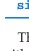

> 数据类型占用的内存空间可能因系统而异。例如，int 类型在一个系统中可能占用两个字节，在另一个系统中占用四个字节。要计算特定系统上数据类型占用的字节数，请使用 sizeof 运算符，详见第 4 章。

char、short、int 和 long 类型用于存储整数值，可以是有符号或无符号的。如果整数变量声明为 unsigned，则没有符号位，只能存储正值或零。C 标准并未规定 `char` 类型是有符号还是无符号。取决于编译器；因此，如果对你的程序很重要，你应该显式写 `signed char` 或 `unsigned char` 而不是 `char`。可打印字符始终为正。其他类型默认是有符号的。在有符号类型中，最左边的位保留用于符号；如果数字为负则为 1，否则为 0。使用无符号类型的优点是它们的上限高于对应的有符号类型，因为它们无需考虑负值。

`float`、`double` 和 `long double` 类型用于存储带小数部分的值，即浮点数。与整数类型不同，浮点类型始终是有符号的。C 标准未规定精度位数，因为不同的计算机可能使用不同的格式存储浮点数。通常，`float` 类型的默认精度为小数点后 6 位，而 `double` 类型的精度为 15 位。`long double` 类型的范围未在表 2.1 中显示，因为其长度各不相同，10 字节和 16 字节是最常见的大小。它也可能与 `double` 的大小相同。尽管 `long double` 类型支持最高精度，但很少使用，因为 `float` 和 `double` 类型的精度通常已足够。

尽管 C 类型可能有不同的大小，但 C 标准要求 `long` 类型不得小于 `int`，`int` 不得小于 `short`。同样，`long double` 不得小于 `double`，`double` 不得小于 `float`。`short` 和 `int` 类型的大小至少为 16 位，而 `long` 类型至少为 32 位。如果 `short` 类型满足你的需求且可用内存有限，最好使用它而不是 `int` 类型，因为它的大小通常更小。有关本地实现中整数和浮点类型的信息分别在 `limits.h` 和 `float.h` 文件中提供。

*为了简化，我们在整本书中做了一些假设。我们假设类型特征如表 2.1 所示，一个字节为八位宽，系统使用表示有符号数最常见的方法，即二进制补码。此外，我们假设底层字符集为美国信息交换标准代码（ASCII）集。*

> 如果你不在乎精度，请使用 `float` 类型，因为它通常占用更少的字节，且使用 `float` 数字的计算往往执行得更快。

考虑以下程序。虽然我们尚未讨论 `if` 和 `printf()`，但我们认为你能明白其思路。`==` 运算符比较值。那么，请告诉我们，以下程序输出什么？

```c
#include <stdio.h>
int main(void)
{
    float a = 3.1;

    if (a == 3.1)
        printf("Yes\n");
    else
        printf("No\n");

    printf("%.9f\n", a-3.1);
    return 0;
}
```

虽然显而易见的答案是 Yes，但程序是否输出了 No 和一个非零值？惊喜！！！

请记住，在比较中使用浮点变量时，更安全的做法是将其声明为 `double` 或 `long double` 而不是 `float`。例如，如果 a 被声明为 `double`，程序很可能就会显示 Yes 和 0。然而，当你测试浮点值是否相等时，由于潜在的舍入误差，你永远无法确定。因此，如果你必须测试两个浮点值是否相等，不要写 `if (a == b)`；这不安全。你可能会引入难以追踪的 bug。一种简单但更安全的方法是检查值是否完全相同，而是检查它们的差值是否非常小。例如，我们可以写 `if (fabs(a-b) <= epsilon)` 并为 `epsilon` 选择一个值来指定可接受的误差范围。请注意，还有更高效的解决方案，但超出本文范围。`fabs()` 函数在附录 C 中有描述。

*在使用程序中的浮点值时，我们将同时使用 float 和 double 变量，以便熟悉这两种类型。*

接下来，我们将看到在声明变量时可以指定更多属性：类型限定符和存储类。虽然它们的顺序可以任意，但典型做法是先指定存储类，然后是限定符，最后是数据类型，例如 `static const unsigned int a;`

## 值和常量的赋值

直到第 11 章，我们将把所有变量都声明在 `main()` 内。这些变量称为 `automatic`，如果未显式初始化，初始值未定义（即垃圾值）。例如，以下程序使用 `printf()`；你很快就会看到如何输出 i 的初始值：

```c
#include <stdio.h>
int main(void)
{
    int i;
    printf("%d\n", i);
    return 0;
}
```

出于风格考虑，我们使用空行将变量声明与语句分隔开。一般来说，缩进、对齐、空格和空行都能提高程序的可读性。例如，我们始终缩进声明和语句，以明确它们嵌套在函数内部。此外，我们使用空行将程序划分为逻辑块，使读者更容易理解程序的结构。

可以使用赋值运算符 = 为变量赋一个值。例如，以下代码将值 100 赋给 a。

```c
int a;
a = 100;
```

或者，变量可以在声明的同时进行初始化：

```
int a = 100;
```

我们也可以在声明时初始化多个同类型变量。例如，下面的语句声明了 a、b、c 和 d 变量，并分别将前三个变量初始化为 100、200 和 300。变量 d 未被初始化。

```
int a = 100, b = 200, d, c = 300;
```

我们甚至可以这样写：

```
int a = 100, b = a+100, d, c = b+100;
```

赋值从左到右进行，也就是说，首先 a 变为 100，然后 b 变为 200，接着 c 变为 300。为了更好的可读性，我们倾向于在变量声明之后、或在程序中使用它们之前，用单独的语句初始化变量。在某些示例中，我们并不一致；原因是节省篇幅。

我们示例中使用的整数（例如 100）是十进制常量。十进制常量包含十进制数字 0-9，但不得以 0 开头。八进制常量必须以 0 开头，并包含数字 0-7。例如，下面的语句并不会将值 234 赋给 a，而是赋值为 156，因为数字 0234 表示一个八进制常量。

```
int a = 0234;
```

由于每个数字对应 8 的幂，234₈ = 4 × 8⁰ + 3 × 8¹ + 2 × 8² = 156₁₀。

十六进制常量包含数字 0-9 和十六进制字母，并且必须以 0x 或 0X 开头。例如，下面的语句将值 31 赋给 a，因为 1f₁₆ = 31₁₀。

```
int a = 0x1f;
```

这些字母可以是大写或小写。附录 D 简要介绍了十六进制系统。通常，十六进制表示法用于与硬件通信的应用程序。

请记住，整数常量可以用十进制、八进制或十六进制表示法书写；它们只不过是书写同一个数字的不同方式。无论你将值十一写成 11、013 还是 0xb，它在计算机中都以相同方式存储，即作为二进制（基 2）值存储。另请注意，允许在表达式中混合使用这些表示法。例如，下面的语句将值 180 赋给 a。

```
int a = 100+0100+0x10;
```

无后缀十进制常量的类型是 int、long int 和 unsigned long int 类型中（如果是八进制或十六进制，还要加上 unsigned int 类型）能够表示其值的第一个类型。如果它带有后缀 L 或 l（例如 5L、0x1231），编译器会强制将其视为 long int 或 unsigned long int；而如果它以 u 或 U 结尾（例如 100U），其类型为 unsigned int 或 unsigned long int。它们的组合表示该常量是 unsigned long int（例如 100UL）。L 和 U 字母的顺序无关紧要，大小写也无关紧要。

字符常量是用单引号括起来的一个字符或一系列字符。该常量的类型是 int。正如我们将在第 9 章看到的，字符常量的值取决于系统支持的字符集。例如，如果使用 ASCII 字符集，'a' 的值为 97。多字符常量的值依赖于具体实现。

赋给变量的值应当在其类型的范围内。例如，下面的语句：

```
unsigned char ch = 258;
```

不会使 ch 等于 258（二进制为 100000010），因为 unsigned char 变量能存储的最大值是 255。只会存储低 8 位，即 00000010，于是 ch 变为 2。这类 bug 非常常见，因此请始终注意变量的范围！

另一点需要注意的是，在赋值浮点值时，我们使用点号（.）表示小数部分，而不是逗号（,）。例如，我们写 1.24，而不是 1,24。

```
double a = 1.24;
```

浮点常量可以使用字母 E 或 e 以及表示 10 的幂的指数，以科学计数法书写。例如，我们可以写 a = 124E-2;，它等价于 124*10^-2；或者写 a = 0.124e1;。科学计数法通常用于数值非常小或非常大的情况，以便程序员读写。默认情况下，编译器将浮点常量视为 double。因此，如果在我们示例中将 a 声明为 float，编译器很可能会发出警告消息，例如：“initializing : truncation from 'const double' to 'float'”。要让编译器将该常量存储为 float，请在末尾加上字母 f 或 F（例如 1.24F）；或者加上字母 l 或 L，将其存储为 long double（例如 1.24L）。

正如我们将在第 4 章看到的，当两个操作数都是整数时，除法运算符 / 会截去小数部分并产生整数结果。例如：

```
int i = 6;
double j = i/4;
```

i/4 的结果是整数，因为两个操作数都是整数。因此，无论 j 的类型是什么，赋给 j 的值都是 1。如果任一操作数是浮点数，则小数部分不会被截去。例如，如果 i 被声明为浮点变量，j 将是 1.5。如果我们写 j = i/4.0;，也会发生同样的情况，因为除数是浮点常量。

## 算术转换

C 允许在同一表达式中混合使用不同的数据类型。因此，编译器应遵循一些规则，以便在必要时执行类型转换。算术转换适用于要求算术类型操作数的二元运算符，包括算术运算符、关系运算符和相等运算符。一种类型到另一种类型的转换可以通过隐式方式完成，也可以使用强制类型转换运算符显式完成。

当执行隐式转换时，一般规则是：编译器无需程序员干预，将具有“较窄”类型的操作数提升为能够存储其值的“较宽”类型。结果属于更高的类型。我们考察两种情况：

- 1. 如果任一操作数具有浮点类型。在这种情况下，类型较窄的操作数按以下顺序提升：float->double->long double。也就是说，如果一个操作数是 long double，则另一个操作数转换为 long double。否则，如果一个操作数是 double，则另一个操作数转换为 double。否则，如果一个操作数是 float，则另一个操作数转换为 float。请注意，这些规则也适用于整数操作数的情况。也就是说，如果一个操作数是 float，另一个是 int，则 int 操作数转换为 float。
- 2. 如果两个操作数都不具有浮点类型。首先，对两个操作数执行整型提升。整型提升将 char 和 short 类型转换为 int；如果 int 类型不能表示原类型的所有值，则转换为 unsigned int。然后，类型较窄的操作数按以下顺序提升：int->unsigned int->long int->unsigned long int。也就是说，如果一个操作数是 unsigned long int，则另一个操作数转换为 unsigned long int。否则，如果一个操作数是 long int，则另一个操作数转换为 long int，除非其类型是 unsigned int。在这种情况下，如果 long 类型能够表示 unsigned int 类型的所有值，则 unsigned int 操作数转换为 long int。如果不能，则两个操作数都转换为 unsigned long int。否则，如果一个操作数是 unsigned int，则另一个操作数转换为 unsigned int。否则，两个操作数的类型都是 int。

让我们看一些转换示例：

```c
char c;
short s;
int i;
unsigned int u;
float f;
double d;
long double ld;

i = i+c; /* c is converted to int. */
i = i+s; /* s is converted to int. */
u = u+i; /* i is converted to unsigned int. */
f = f+i; /* i is converted to float. */
f = f+u; /* u is converted to float. */
d = d+f; /* f is converted to double. */
ld = ld+d; /* d is converted to long double. */
```

在实践中，当有符号类型和无符号类型混合时，转换规则可能产生意外的结果。例如，应用正确的转换规则，并告诉我们下面的程序输出什么？

```c
#include <stdio.h>
int main(void)
{
    int a = -20;
```

表达式：

```
a = (int)c;
```

暂时将 `c` 的类型从 `float` 强制转换为 `int` 并变为 2。请注意，强制转换不会改变 `c` 的值；也就是说，`c` 仍然是 2.34。“暂时”一词的意思是编译器将 `c` 的下一次使用视为 `int`。类似地，语句：

```
b = (int) (c+4.6);
```

将加法结果强制转换为 `int` 并将该结果赋给 `b`。因此，`b` 变为 6。在下一个示例中，先执行类型转换还是乘法？

```
int a = (int)1.99 * 10;
```

让我们查看附录 A 中的优先级表。因为强制转换运算符的优先级高于 `*` 运算符，所以 `a` 变为 10。如果表达式用括号括起来（`1.99 * 10`），`a` 变为 19。正如我们在第 4 章中将看到的，如果你不确定求值顺序，请使用括号。

## 类型限定符

类型也可以被限定，以表示特殊属性。一个在程序执行期间值不能改变的变量称为 *constant*。要声明一个常量变量，我们使用 `const` 关键字。`const` 变量必须在声明时初始化，此后不允许更改其值。例如，以下语句将 `a` 声明为 `const` 并将其设为 10。

```
const int a = 10;
```

尝试更改其值将导致编译错误。

与 `const` 不同，`volatile` 限定符使用得少得多。它用于告知编译器变量的值可能会发生变化，即使在程序内部似乎没有被修改。该限定符可防止编译器执行会影响程序运行的不必要的优化。尽管我们在第 6 章中会讨论 `while` 语句，但我们认为你能理解以下代码：

```
int flag = 0;
while(flag != 100)
{
    ...
}
```

`!=` 运算符用于测试不等。因为 `flag` 的值似乎保持不变，优化编译器可能会用无限循环 `while(true)` 替换该循环。然而，如果 `flag` 可以由“隐藏”的实体（如系统硬件）修改，这种优化就会改变程序的行为。为了防止编译器优化代码，我们在声明中使用 `volatile` 限定符，即 `volatile int flag;`。

### #define 指令

`#define` 指令用于定义宏。在大多数情况下，宏是一个代表数值的名称。要定义这样的宏，我们写：

```c
#define macro_name value
```

例如，行：`#define NUM 100` 定义了一个名为 NUM 的宏。当程序编译时，预处理器（如我们在第 16 章中将看到的）会用 100 替换 NUM 的每次出现。例如，在下面的程序中，a、b 和 c 的值分别设为 -80、120 和 300。

```c
#include <stdio.h>

#define NUM 100

int main(void)
{
    int a, b, c;

    a = 20 - NUM;
    b = 20 + NUM;
    c = 3 * NUM;
    return 0;
}
```

大多数程序员遵循的惯例是用全大写字母命名宏。在我们的示例中，我们将在 `main()` 之前定义具有全局作用域的宏。请注意，`#define` 指令末尾没有分号。我们将在第 16 章更详细地讨论宏。现在，把它们看作在程序中定义常量的替代方法。

为了使程序更灵活，一个好的做法是使用宏来表示程序中多次出现的数值。

一旦某个值被定义为宏，如果以后需要更改它，只需在一个地方更改即可。例如，要将以下程序中未使用 `NUM` 宏的 100 值更改为 300，我们必须将其替换三次而不是一次。

```c
#include <stdio.h>
int main(void)
{
    int a, b, c;

    a = 20 - 100;
    b = 20 + 100;
    c = 3 * 100;
    return 0;
}
```

在像这样的小程序中手动进行这些替换足够简单，但想象一下尝试更改数千行长的程序中的每个值！而且要精确地说，不是 100 的每个出现，而是正确的出现，因为相同的数值也可能代表其他不应该更改的东西。因此，使用宏根据需要更改已定义的值要安全得多，也更快。

尽管 const 和 #define 都可用于为常量创建名称，但它们之间存在显著差异。我们可以使用 #define 为数值、字符或字符串常量创建名称。另一方面，我们可以使用 const 与任何类型，如指针、数组、结构体和联合体。const 常量受与变量相同的范围规则约束（我们将在第 11 章讨论它们），而 #define 常量不受约束。与 #define 常量不同，const 值可以在调试器中查看。

关于我们的偏好，我们使用 #define 表示数字的常量。我们主要在向函数传递数据以进行保护时使用 const。

## printf() 函数

printf() 函数用于将数据显示到 stdout（标准输出流）。默认情况下，stdout 流与屏幕关联。printf() 函数接受可变数量的参数列表。第一个参数是格式字符串，即用双引号括起来的字符序列，它决定输出格式。如果格式字符串后跟参数，printf() 会显示它们的值。格式字符串可能包含转义序列和转换说明。它也可能包含普通字符，这些字符会原样显示到屏幕上。程序员有责任向 printf() 传递有效的格式字符串；否则行为未定义。

## 转义序列

转义序列用于表示不可打印字符或对编译器具有特殊含义的字符。转义序列由反斜杠 (\ ) 后跟一个字符组成。尽管这些序列看起来像两个字符，但它们只代表一个。格式字符串可以包含任意数量的转义序列。表 2.2 列出了转义序列及其含义。如果 \ 后面的字符不受支持，行为未定义。转义序列分为字符转义和数字转义。字符转义可以表示常见的 ASCII 控制字符，而数字转义（即表 2.2 中的后两者）可以表示任何字符。

例如，考虑以下程序：

```c
#include <stdio.h>
int main(void)
{
    printf("This is\n");
    printf("another C\n");
    printf("program\n");
    return 0;
}
```

## 表 2.2 转义序列

| 转义序列 | 含义 |
|---|---|
| \a | 可听警报。 |
| \b | 退格。 |
| \f | 换页。 |
| \n | 换行。 |
| \r | 回车。 |
| \t | 水平制表符。 |
| \v | 垂直制表符。 |
| \\ | 反斜杠。 |
| \' | 单引号。 |
| \" | 双引号。 |
| \? | 问号。 |
| \ooo | 表示对应于八进制数（一个到三个八进制数字）的字符。例如，根据附录 B 中的 ASCII 集，'\a' 和 '\'a' 等价。另一个例子中，值 '\142' 对应于 'b'，因为 142₈ = 98₁₀。序列在已使用三个数字或遇到非八进制数字的字符时结束。例如，字符串 "\141p" 包含字符 '\141'，即 'a'，和 'p'。八进制数不必以 0 开头。 |
| \xhh | 表示对应于十六进制数（h 为十六进制数字或字母）的字符。例如，根据附录 B 中的 ASCII 集，值 '\x6b' 对应于 'k'，因为 6b₁₆ = 107₁₀。尽管标准对 h 的数量没有限制，但 resulting value 必须不超过最大字符的值（即不超过 FF）；否则行为未定义。x 必须为小写，而 h 数字可以为大写或小写。 |

由于转义序列 \n 将光标移动到下一行的开头，程序输出：

```
This is
another C
program
```

另外，我们也可以使用一个 printf() 并写：

```
printf("This is\nanother C\nprogram\n");
```

这里是另一个例子：

```c
#include <stdio.h>
int main(void)
{
    printf("\a");
    printf("This is\b\b\b is a text\n");
    printf("\75\n"); /* The octal number 75 corresponds to the '=' character. */
```


```
printf("This\tis\ta\x9text\n"); /* The hexadecimal number 9 corresponds to the horizontal tab. */
printf("This is a \"text\"\n");
printf("This is a \\text\\\n");
printf("Sample\rtext\n");
return 0;
}
```

程序输出：

```
(Hear a beep).
This    is    a    text
This is a "text"
This is a \text\
textle
```

在最后一个 printf() 中，\r 将光标移回行首，Samp 被覆盖，并打印 text。因此，输出为 textle。

如果你希望提高可读性，将 printf() 的格式字符串扩展到多行，请使用反斜杠。例如，下面的 printf() 写在三行上，但输出将显示在一行中。

```
printf("This printf uses three lines, but the \
text will appear \
on one line ");
```

## 转换说明

转换说明以 % 字符开头，后面跟一个或多个具有特殊含义的字符。在其最简单的形式中，% 后面跟表 2.3 中列出的转换说明符之一。

下面的程序演示了如何使用 printf() 以各种格式打印字符和数字。

```
#include <stdio.h>
int main(void)
{
    int len;
    printf("%c\n", 'w');
    printf("%d\n", -100);
    printf("%f\n", 1.56);
    printf("%s\n", "some text");
    printf("%e\n", 100.25);
    printf("%g\n", 0.000123);
    printf("%X\n", 15);
    printf("%o\n", 14);
    printf("test%n", &len);
    printf("%d%%\n", 100);
    return 0;
}
```

### 表 2.3 转换说明符

| 转换说明符 | 含义 |
| :--- | :--- |
| c | 显示与无符号整数值对应的字符。 |
| d, i | 显示有符号整数。 |
| u | 显示无符号整数。 |
| f | 显示浮点数。默认精度为六位数字。 |
| s | 显示字符序列。 |
| e, E | 以科学记数法显示浮点数。指数前带有选定的说明符 e 或 E。 |
| g, G | 如果指数小于 -4 或大于等于精度，则选择 %e 或 %E 形式；否则使用 %f 形式。 |
| p | 显示指针变量的值。 |
| x, X | 以十六进制形式显示无符号整数；%x 显示小写字母（a–f），而 %X 显示大写字母（A–F）。 |
| o | 以八进制显示无符号整数。 |
| n | 不显示任何内容。对应参数必须是指向整数的指针；到目前为止已打印的字符数将存储在该整数中。 |
| % | 显示字符 %。 |

程序输出：

- w（字符常量必须用单引号括起来）。
- -100
- 1.560000
- some text（字符串字面量必须用双引号括起来）。
- 1.002500e+002（等价于 1.0025 × 10² = 1.0025 × 100 = 100.25）。
- 1.23e-005（因为指数小于 -4，所以该数以科学记数法显示）。
- F（数字 15 等价于十六进制的 F）。
- 16（数字 14 等价于八进制的 16）。
- test（由于在遇到 %n 之前已打印四个字符，因此值 4 被存入 len。我们将在第 8 章讨论 & 运算符）。
- 100%（要显示 % 字符，必须写两次）。

## 返回值

printf() 返回已打印的字符数；如果发生错误，则返回负值。例如，考虑下面的程序：

```c
#include <stdio.h>
int main(void)
{
    printf("%d\n", printf("Test\n"));
    return 0;
}
```

## 可选字段

如前所述，最简单的转换说明以 % 字符开头，后面跟转换说明符。然而，转换说明在二者之间最多可以包含四个可选字段，如图 2.1 所示。本节将逐一回顾这些字段。

## 精度

精度取决于转换说明符，如下所示：

- d、i、o、u、x、X：指定输出数字的最小位数。如果数字位数较少，则添加前导零。
- e、E、f：指定小数点后的位数。
- g、G：指定有效数字的最大位数。
- s：指定输出字符的最大数量。

精度用点（.）指定，后面可以跟一个整数，或者在参数列表中用星号 * 和一个整数来指定精度。如果只出现点，则精度为零。例如，让我们使用各种精度显示一个浮点变量的值。默认精度为六位数字。输出值根据截断位的值向上或向下舍入。如果小于 5，则输出值向下舍入；否则向上舍入。

```
#include <stdio.h>
int main(void)
{
    float a = 1.2365;

    printf("%f\n", a);
    printf("%.2f\n", a);
    printf("%.*f\n", 3, a);
    printf("%.f\n", a);
    return 0;
}
```

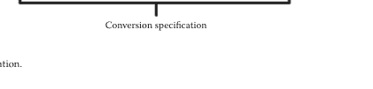

图 2.1 转换说明。

说明：我们将在第 4 章看到，% 运算符用于求两个整数操作数相除的余数。其他运算符的用法与数学中相同。由于强制类型转换表达式 (double)i 将 i 的类型从 int 转换为 double，所以它们相除的结果是浮点数。如果省略强制类型转换并写成 i/j，则应使用 %d 而不是 %f，因为除法结果是整数。在这种情况下，程序将输出整数结果，即 2。注意，我们可以用一个 printf() 打印所有值。例如：

```
printf("%d %d %d %f %d\n", i+j, i-j, i*j, (double)i/j, i%j);
```

甚至：

```
printf("%d-%d=%d, %d-%d=%d, %d*%d=%d, %d/%d=%f, %d%%%d=%d\n", i, j, i+j, i, j, i-j, i, j, i*j, i, j, (double)i/j, i, j, i%j);
```

## C.2.4 下面的程序显示两个浮点数的平均值。这段代码中有错误吗？

```
#include <stdio.h>
int main(void)
{
    double i = 12, j = 5, avg;
    
    avg = i+j/2;
    printf("Avg = %.2f\n", avg);
    return 0;
}
```

答案：是的，有一个错误。因为除法运算符 / 的优先级高于加法运算符 +，所以先执行除法 5/2 = 2.5，然后执行加法 12+2.5，这导致程序显示错误值 14.50，而不是 8.50。通过将表达式 i+j 括在括号中可以消除这个错误。如附录 A 所示，因为括号在所有 C 运算符中优先级最高，所以先执行括号内的表达式。因此，正确的赋值是 avg = (i+j)/2。

## C.2.5 下面程序的输出是什么？

```
#include <stdio.h>
int main(void)
{
    int k;
    float i = 10.9, j = 20.3;
    
    k = (int)i + j;
    printf("%d %d\n", k, (int)(i + (int)j));
    return 0;
}
```

答案：强制类型转换表达式 (int)i 将 i 的类型从 float 转换为 int。由于 (int)i 的结果是 10，因此有 k = 10+20.3 = 30（不是 30.3，因为 k 是 int）。 (int)(i+(int)j) 的结果是 (int)(10.9+(int)20.3) = (int)(10.9+20) = (int)(30.9) = 30。因此，程序输出：30 30。

## U.2.2 修复错误，使程序能够运行并显示 m 的值。

```c
#include <stdio.h>
int main(void);
{
    int m;
    a = 10
    m = 2a+100
    printf("%f\n", m);
    return0;
}
```

## U.2.3 修复错误，使程序能够运行并显示 a、b 和 c 的值。

```c
#include <studio.h>
int main(void)
{
    int b = a/2; a = 10
    float c = 4,5 + a;
    printf("%d %d\n", a, c, b);
    return 0;
}
```

## U.2.4 修复错误，使程序能够运行并显示 a 与 b 的和。

```c
#include (stdio.h)

#define NUM 30;

int main(void)
{
    const int a;
    a = 10;
    NUM = a+2;
    a = NUM/2;
    b = a;
    printf('\n', a+b);
    return 0;
}
```

## U.2.5 编写一个程序，将两个负值赋给两个整型变量，并使用这些变量显示对应的正值。

## U.2.6 填空并完成程序，以显示以下输出。

```
21
21
15
25%
A
a
```


```
10
77
077
63
```

```c
#include <stdio.h>
int main(void)
{
    int x = 21, y = 0xa, z = 077;

    printf("___________\n", x);
    printf("___________\n", x);
    printf("___________\n", x);
    printf("___________\n", x);
    printf("___________\n", y);
    printf("___________\n", y);
    printf("___________\n", y);
    printf("___________\n", z);
    printf("___________\n", z);
    printf("___________\n", z);
    return 0;
}
```

### U.2.7 填空并完善程序，以显示以下输出。

```
-12.123
-12.123456789
-12.123456789
-12.123457
-12.12346
-12
```

```c
#include <stdio.h>
int main(void)
{
    double x = -12.123456789;

    printf("___________\n", x);
    printf("___________\n", x);
    printf("___________\n", x);
    printf("___________\n", x);
    printf("___________\n", x);
    printf("___________\n", x);
    return 0;
}
```

### U.2.8 使用 printf() 的标志填空并完善程序，以显示以下输出。

```
x + yj = 2-3j
x - yj = 2+3j
y + xj = -3+2j
y - xj = -3-2j
```

```c
#include <stdio.h>
int main(void)
{
    int x = 2, y = -3;

    printf("x + yj = ______\n", x, y);
    printf("x - yj = ______\n", x, -y);
    printf("y + xj = ______\n", y, x);
    printf("y - xj = ______\n", y, -x);
    return 0;
}
```

### U.2.9 编写一个程序，将两个正值赋给两个整型变量，并显示它们相除的余数。只使用两个变量，且不要使用 % 运算符。

### U.2.10 编写一个程序，将两个正值赋给两个浮点型变量，并显示它们相除的整数部分和小数部分。例如，如果赋值为 7.2 和 5.4，程序应显示 1 和 1.8，因为 7.2 = (1 × 5.4) + 1.8。

### U.2.11 编写一个类似于 C.2.6 的程序，针对一个三位正数。

## 3 使用 scanf() 获取输入

本章重点介绍如何使用 scanf() 函数从用户那里获取输入，将该输入存储到变量中，并在程序中使用它。scanf() 是一个功能强大的函数，提供了多种读取数据并存储到程序变量中的方式。我们不会涵盖 scanf() 的每个方面，但会提供足够的基础知识，让你能够使用它来读取数据。在本章中，我们主要使用 scanf() 读取数值数据并将其存储到数值变量中。在接下来的章节中，你会看到 scanf() 的其他用法。请记住，scanf() 并不是一个容易使用的函数；它包含多个陷阱，因此使用时要格外小心。

### scanf() 函数

scanf() 函数用于从 stdin（标准输入流）读取数据，并将这些数据存储到程序变量中。默认情况下，stdin 流与键盘关联。输入数据按特定格式读取，这与 printf() 处理输出的方式非常相似。

scanf() 函数接受可变参数列表。第一个参数是一个类似于 printf() 的格式字符串，后面跟着将要存储输入数据的变量的内存地址。通常，格式字符串只包含转换说明符。scanf() 中使用的转换字符与 printf() 中使用的相同。例如，%d 说明符用于读取整数。与 printf() 一样，格式字符串中包含的转换说明符的数量应等于变量的数量，并且每个说明符的类型应与相应变量的数据类型匹配。

在下面的示例中，我们使用 scanf() 从键盘读取一个整数并将其存储到变量 i 中。第一个参数是 %d，第二个参数是 i 的内存地址。一旦用户输入整数并按回车键，该值将被存储到 i 中。

```c
int i;
scanf("%d", &i);
```

变量前面的 & 字符表示地址运算符，它指示输入数字将存储的内存位置。我们将在第 8 章讨论指针时更详细地介绍 & 运算符。按下回车键时产生的换行字符（'\n'）会留在 stdin 中，它将是下次调用 scanf() 时读取的第一个字符。在下面的示例中，我们使用 scanf() 从键盘读取一个整数和一个浮点数，并分别将它们存储到变量 i 和 j 中。

```c
int i;
float j;
scanf("%d%f", &i, &j);
```

第一个参数是格式字符串 `%d%f`，接下来的参数是 i 和 j 的内存地址。%d 说明符对应于 i 的地址，而 %f 说明符对应于 j 的地址。

当 scanf() 用于读取多个值时，应使用空白字符分隔它们。因此，在前面的示例中，如果用户输入的值 10 和 4.65 用一个或多个空格分隔并按回车键，则 i 将变为 10，j 将变为 4.65。

> 当 scanf() 用于读取数值时，它会跳过输入值之前的空白字符（即空格、制表符或换行字符）。

如果精度在程序中至关重要，请使用 double 变量而不是 float，并使用 %lf 转换来读取它，而不是 %f。例如，考虑以下程序：

```c
#include <stdio.h>
int main(void)
{
    float a;

    printf("Enter number: ");
    scanf("%f", &a);
    printf("%f\n", a);
    return 0;
}
```

由于 float 类型可能并不总能精确表示浮点数，程序可能不会显示输入的值，而是显示一个接近它的值。将 a 声明为 double 并使用 %lf 转换读取它要安全得多。

> printf() 使用 %f 显示 float 或 double 变量的值，而 scanf() 使用 %lf 将输入值存储到 double 变量中，使用 %f 将其存储到 float 变量中。

转换字符 e、E、f、g、G 前面的字母 l 表示输入值将存储到 double 变量中，而字母 L 表示 long double 变量。转换字符 d、i、o、u、x、X 前面的字母 l 表示值将存储到 long 变量中，而字母 h 表示 short 变量。下面的示例使用 scanf() 读取一个字符并将其存储到 ch 中。

```c
char ch;
scanf("%c", &ch);
```

在下面的示例中，我们使用 scanf() 读取一系列字符并将它们存储到 str 数组中。scanf() 会在末尾追加空字符。请注意，& 运算符并未放在 str 之前，因为正如我们将在第 8 章和第 11 章看到的，传递的参数是指向数组第一个元素的指针。

```c
char str[100];
scanf("%s", str);
```

例如，如果用户输入 sample 并按回车键，其字符将存储到 str 数组的相应元素中。也就是说，str[0] 的值将为 's'，str[1] 将为 'a'，依此类推。当使用 %s 时，scanf() 一旦遇到空白字符就会停止读取。例如，如果用户输入 many words，则只有单词 many 会存储到 str 中。正如将在第 10 章讨论的，为了避免内存溢出，使用 %ns 比使用 %s 安全得多，其中 n 指定要读取的最大字符数。

为了更大的灵活性，scanf() 支持 `%[` 说明符，形式为 `%[set]` 或 `%[^set]`，其中 set 可以是任何字符集。第一种形式仅将包含在 set 中的输入字符存储到数组中，而第二种形式存储不包含在 set 中的字符。例如，如果我们编写 `scanf("%[tpe]", str);`，scanf() 一旦遇到除 t、p 或 e 以外的输入字符就会停止读取。如果用户输入 test，scanf() 会将 te 存储到 str 中。类似地，如果我们编写 `%[^te]` 且用户输入 another，scanf() 会将 ano 存储到 str 中。

> 省略 & 运算符是一个非常常见的错误。记住，scanf() 需要在每个数值变量（即 int、double、char、float 等）前面加上它。如果忘记它，程序将无法正确执行。另一方面，如果变量是指针，请不要使用 & 运算符。

另一个常见错误是，在 scanf() 中使用 & 运算符使新手程序员在 printf() 中也这样做。例如，`printf("%d\n", &a);` 程序不会显示值 a，而是显示 a 的内存地址，这将在第 8 章进一步讨论。

### 普通字符的使用

在大多数情况下，格式字符串不包含除转换字符以外的其他字符（例如，`"%d%d"`）。如果添加了任何字符，用户也必须在同一位置输入它们。如果字符不匹配，scanf() 将中止读取。例如，注意以下程序中 %d 说明符之间的字符 m：

```c
#include <stdio.h>
int main(void)
{
    int a, b;
    scanf("%d m %d", &a, &b);
    printf("%d %d\n", a, b);
    return 0;
}
```

用户还必须在值之间添加字符 m（例如 12m43），否则 scanf() 将失败，程序将不会显示输入的值。

在另一个示例中，如果程序要求用户输入日期并使用 / 分隔值，则格式字符串应为 `"%d/%d/%d"`，用户必须以这种形式输入日期（例如 3/8/2020）。

新手程序员经常在格式字符串末尾添加 \n。然而，\n 字符会使 scanf() 前进到读取下一个非空白字符。例如，如果我们


如果你编写 scanf("%d\n", &i);，`scanf()` 会读取一个整数，然后程序会挂起，直到用户输入一个非空白字符。

## 返回值

`scanf()` 返回成功读取并赋值给程序变量的数据项数量。如果输入值与转换说明符的类型或顺序不匹配，`scanf()` 会提前返回。未读取的值会留在 `stdin` 中。在下面的示例中，如果用户先输入一个整数，然后输入一个浮点数，`scanf()` 返回 2。

```c
int i;
float j;
scanf("%d%f", &i, &j);
```

如果用户输入了与预期不同的值，例如两个浮点数，或者一个浮点数然后一个整数，`scanf()` 将无法正确执行。

下面的程序检查 `scanf()` 的返回值，以验证输入的整数被成功读取并存储到 `num` 中。返回值不是 1 表示读取错误。阅读第 6 章和第 11 章后，你将进一步了解该程序如何工作。

```c
#include <stdio.h>
int main(void)
{
    int ch, num;
    printf("Enter number: ");
    while(scanf("%d", &num) != 1)
    {
        printf("Enter number: ");
        while((ch = getchar()) != '\n' && ch != EOF)
            ; /* Consume the unread characters. */
    }
    printf("Input value: %d\n", num);
    return 0;
}
```

例如，如果用户输入一个字符而不是整数，`scanf()` 不会返回 1，外层循环将再次执行。内层循环获取留在 `stdin` 中的字符，以便读取新的输入值。相反，许多程序员会写 `fflush(stdin);`

> 小心，根据 C 标准，`fflush()` 应用于输入流时的行为是未定义的。简单来说，未定义意味着不要这么做。

为了简洁和简单起见，本书中我们不会检查 `scanf()` 的返回值。相反，我们会假设用户的输入是有效的。然而，请记住，健壮的程序应始终检查其返回值，以验证没有发生读取失败。事实上，健壮的程序应检查任何有返回值的被调用函数的返回值。

*`scanf()` 是一个强大的函数，它提供了许多格式化数据输入的方法。完整描述其所有功能超出了本书的范围。更多细节请查阅编译器的文档。只需记住使用它时要非常小心。*

## 练习

### C.3.1 编写一个程序，读取一个字符、一个整数和一个浮点数并显示它们。使用一个 `scanf()`。

```c
#include <stdio.h>
int main(void)
{
    char ch;
    int i;
    float f;

    printf("Enter character, int and float: ");
    scanf("%c%d%f", &ch, &i, &f);
    printf("\n%c:%d:%f\n", ch, i, f);
    return 0;
}
```

### C.3.2 编写一个程序，读取两个整数并显示它们的和、差、积以及除法的结果。

```c
#include <stdio.h>
int main(void)
{
    int i, j;

    printf("Enter 2 integers (the second should not be 0):");
    scanf("%d%d", &i, &j);
    printf("Sum:%d Diff:%d Prod:%d Div:%f\n", i+j, i-j, i*j, (double)i/j); /* Cast i to double, in order to display the decimal part of the division. */
    return 0;
}
```

注释：如果用户输入 0 作为第二个整数，程序将不会执行除法，因为除以 0 是不可能的。典型响应是程序异常终止。这可以通过使用 `if` 语句来避免，我们将在第 5 章看到。

### C.3.3 编写一个程序，读取三个商品的价格并显示它们的平均值。

```c
#include <stdio.h>
int main(void)
{
    float i, j, k, avg;

    printf("Enter 3 prices: ");
    scanf("%f%f%f", &i, &j, &k);

    avg = (i+j+k)/3; /* The parentheses are necessary to perform the addition first and then the division. */
    printf("Average = %f\n", avg);
    return 0;
}
```

```c
printf("Enter two positives: ");
scanf("%lf%lf", &i, &j);
printf("%d %d\n", (int)i+(int)j, (i-(int)i) + (j-(int)j));
return 0;
}
```

### C.3.10 编写一个程序，读取一个正整数，并将其转换为 50、20、10 和 1 的倍数。例如，如果用户输入 285，程序应显示 5*50、1*20、1*10、5*1。

```c
#include <stdio.h>
int main(void)
{
    int i, n_50, n_20, n_10, n_1, rem;
    printf("Enter positive number: ");
    scanf("%d", &i); /* Suppose that the user enters 285, so i = 285. */
    n_50 = i/50; /* n_50 = 285/50 = 5. */
    rem = i%50; /* The rem = 285%50 = 35 should be analysed in 20s, 10s, and units. */
    n_20 = rem/20; /* n_20 = 35/20 = 1. */
    rem = rem%20; /* The rem = 35%20 = 15 should be analysed in 10s and units. */
    n_10 = rem/10; /* n_10 = 15/10 = 1. */
    n_1 = rem%10; /* n_1 = 15%10 = 5. */
    printf("%d*50,%d*20,%d*10,%d*1\n", n_50, n_20, n_10, n_1);
    return 0;
}
```

注释：`%` 运算符用于求除法的余数。我们可以只使用 `i`，并写成：`printf("%d*50, %d*20, %d*10, %d*1\n", i/50, i%50/20, i%50%20/10, i%50%20%10);`

### C.3.11 编写一个程序，读取一个两位正整数并显示反转后的数字。例如，如果用户输入 72，程序应显示 27。使用一个整型变量。

```c
#include <stdio.h>
int main(void)
{
    int i;
    printf("Enter number between 10 and 99: ");
    scanf("%d", &i);
    i = 10*(i%10) + i/10;
    printf("%d\n", i);
    return 0;
}
```

注释：项 `(i/10)` 计算 `i` 的十位数，而项 `(i%10)` 计算其个位数。反转后的数字通过将个位数乘以 10 并加上十位数来得到。

### C.3.12 编写一个与上一个程序类似的程序，用于三位正整数。

```c
#include <stdio.h>
int main(void)
{
    int i;

    printf("Enter number between 100 and 999: ");
    scanf("%d", &i);
    i = 100*(i%10) + 10*(i%100/10) + i/100;
    printf("%d\n", i);
    return 0;
}
```

注释：项 `(i%10)` 计算 `i` 的个位数，项 `(i%100/10)` 计算其十位数，项 `i/100` 计算其百位数。

### C.3.13 编写一个程序，读取一个正整数，并根据最后一位数字对其进行向上或向下舍入。例如，如果用户输入 12，程序应显示 10。如果输入数字是 3，程序应显示 0，而如果是 455，程序应显示 460。

```c
#include <stdio.h>
int main(void)
{
    int i;
    float j;

    printf("Enter positive number: ");
    scanf("%d", &i);

    i = i+5;
    j = (float)i/10;
    i = (int)j * 10; /* Cut off the last digit. */
    printf("%d\n", i);
    return 0;
}
```

## 未解决的练习

### U.3.1 编写一个程序，读取一个整数和一个浮点数，并显示它们之和的三倍。

### U.3.2 编写一个程序，读取银行存款和年利率（百分比），并显示一年后的总金额。

### U.3.3 编写一个程序，读取父亲和儿子的年龄，并显示多少年后父亲的年龄将是儿子的两倍，以及他们那时的年龄。

### U.3.4 编写一个程序，读取考试通过和未通过的学生人数并显示百分比。例如，如果用户输入 12 和 8，程序应显示

成功比例：60%
失败比例：40%

### U.3.5 假设商店里的一位顾客买了一些盘子和杯子。编写一个程序，读取盘子的数量和单个盘子的价格、杯子的数量和单个杯子的价格，以及顾客支付的金额。程序应计算并显示找零。

### U.3.6 编写一个程序，读取一个八进制数、一个十六进制数和一个十进制整数，并以十进制显示它们的和。例如，如果用户输入 20、3E 和 5，程序应显示 84。

### U.3.7 编写一个程序，读取一个表示秒数的整数，并将其拆分为小时、分钟和秒。例如，如果用户输入 8140，程序应显示 2h 15m 40s。只使用一个变量。

### U.3.8 修改练习 C.3.13，使程序读取一个正整数，并根据最后两位数字对其进行向上或向下舍入。例如，如果用户输入 40，程序应显示 0。如果输入数字是 130，程序应显示 100，而如果是 4550，程序应显示 4600。

### U.3.9 编写一个程序，读取一个两位正整数并复制其数字。例如，如果用户输入 12，程序应显示 1122。

### U.3.10 编写一个程序，读取两个三位正整数，将第一个数的百位与第二个数的个位交换，并显示新的值。例如，如果用户输入 123 和 456，程序应显示 623 和 451。最多使用三个变量。

### U.3.11 编写一个程序，读取一个四位正整数和一个一位正整数。程序应显示一个五位整数的值，该值通过将一位整数插入四位整数的中间得到。例如，如果用户输入 1234 和 5，程序应显示 12534。


## 4 运算符

既然你已经了解了 C 数据类型、变量和常量的概念，现在该学习如何操作它们的值了。C 提供了丰富的运算符，用于构成表达式并对其执行运算。本章将介绍 C 中一些最重要的运算符。其余运算符将在接下来的几章中逐步介绍，你也会看到在编写更复杂的程序时如何应用它们。

### `=` 赋值运算符

`=` 运算符用于向变量赋值。例如，语句 `a = 10;` 将值 10 赋给变量 `a`，而语句 `a = k;` 将变量 `k` 的值赋给 `a`。当用于链式赋值时，所赋的值会存储到链中的所有变量中。例如：

```c
int a, b, c;
a = b = c = 10;
```

`a`、`b` 和 `c` 的值都变为 10。特别地，由于 `=` 运算符是右结合的，最右侧的表达式会先求值，求值从右向左进行。因此，首先 `c` 变为 10，然后 `c` 被赋给 `b`，最后 `b` 被赋给 `a`。

像 `a = 10;` 这样的赋值会产生一个结果，即赋值后左操作数（即 `a`）的值。例如：

```c
a = 10;
c = a + (b = a+10);
```

赋值 `b = a+10` 的结果是 20，因此 `c` 变为 30。应使用单独的赋值，而不是将它们混在一起；这样代码更容易控制。

右操作数（*右值*）是一个具有值的表达式，例如常量或变量。左操作数必须是*左值*。*左值*指存储在内存中的对象，例如变量。不允许使用常量或计算结果。例如：

```c
10 = a; /* Illegal. */
a+b = 20; /* Illegal. */
```

编译器会产生类似“*错误 '='：左操作数必须是左值。*”的错误消息。此外，*左值*必须是可修改的。例如，我们将在第 8 章看到，数组变量不是可修改的*左值*。

### `++` 和 `--` 运算符

如果 `++` 运算符以后缀形式使用，则先在该变量的当前值于表达式中使用之后，再执行自增。例如：

```c
int a = 4, b;
b = a++;
```

a 的当前值首先存储到 b 中，然后 a 自增。因此，a 变为 5，b 变为 4。

如果以前缀形式使用，则先对变量的值进行自增，然后在表达式求值中使用新值。例如：

```c
int a = 4, b;
b = ++a;
```

a 先自增，然后该值存储到 b 中。因此，两个变量都变为 5。

类似地，`--` 自减运算符用于将变量的值减 1。例如：

```c
int a = 4;
a--; /* Equivalent to a = a-1; */
--a; /* Equivalent to a = a-1; */
```

a 的值被减两次，变为 2。当 `--` 运算符用于表达式中时，其行为与 `++` 运算符类似。例如：

```c
#include <stdio.h>
int main(void)
{
    int a = 4, b;

    b = a--;
    printf("a = %d b = %d\n", a, b);

    b = --a;
    printf("a = %d b = %d\n", a, b);
    return 0;
}
```

对于语句 `b = a--;`，a 的当前值首先存储到 b 中，然后其值自减。因此，第一个 `printf()` 显示：a = 3  b = 4。接下来，对于语句 `b = --a;`，a 的值先自减，然后其值存储到 b 中。因此，第二个 `printf()` 显示：a = 2  b = 2。让我们看另一个示例：

```c
#include <stdio.h>
int main(void)
{
    double a = 3.45;

    printf("%.2f\n", a++);
    printf("%.2f\n", ++a);
    return 0;
}
```

程序首先显示 3.45，然后 a 的值自增。接下来，a 先自增，因此程序显示 5.45。让我们看另一个示例，其中 `++` 和 `--` 运算符组合在同一个表达式中。

```c
#include <stdio.h>
int main(void)
{
    int a = 1, b = 2, c = 3;
    printf("%d\n", (++a)-(b--)+( --c));
    return 0;
}
```

操作 `++a` 先增加 a 的当前值，然后使用其新值。对于操作 `b--`，先使用 b 的当前值，然后其值自减。最后，对于操作 `--c`，c 的值先自减，然后在表达式中使用。因此，表达式的结果为 2-2+2 = 2，并且 a、b 和 c 的值分别变为 2、1 和 2。

> 不要对同一个变量应用 `++` 和 `--` 运算符，并创建其值依赖于求值顺序的表达式。

例如：`a * a++;` 的结果取决于具体实现。a 是先自增再相乘，还是不先自增，取决于编译器。

### 关系运算符

关系运算符 `>`、`>=`、`<`、`<=`、`!=` 和 `==` 用于比较两个操作数并确定它们的关系。正如我们将在接下来的几章中看到的，关系运算符主要用于 `if` 语句和迭代循环中。考虑以下语句：

- `if(a > 10)` 中，`>` 运算符用于检查 `a` 是否大于 10。
- `if(a >= 10)` 中，`>=` 运算符用于检查 `a` 是否大于或等于 10。
- `if(a < 10)` 中，`<` 运算符用于检查 `a` 是否小于 10。
- `if(a <= 10)` 中，`<=` 运算符用于检查 `a` 是否小于或等于 10。
- `if(a != 10)` 中，`!=` 运算符用于检查 `a` 是否不等于 10。
- `if(a == 10)` 中，`==` 运算符用于检查 `a` 是否等于 10。

> 当表达式的值非零时，该表达式被视为真；否则，被视为假。

当用于表达式时，表达式的值为 0 或 1。例如，仅当 a 大于 10 时，`(a > 10)` 的值才为 1；否则为 0。那么下面这个表达式呢：`-5 < a < 2`？该表达式的值取决于 a 的值吗？

由于 `<` 运算符是左结合的（见附录 A），首先求值 `-5 < a`，其结果为 0 或 1，然后将该值与 2 比较，而该比较始终为真。因此，无论 a 的值是什么，该表达式的值都为 1。正如我们接下来将看到的，要测试某个值是否在给定集合内，我们使用 `&&` 运算符。

> 不要混淆 `==` 运算符和 `=` 运算符。`==` 运算符用于检查两个表达式是否具有相同的值，而 `=` 运算符用于赋值。

例如，仅当 `a` 等于 10 时，表达式 `a == 10` 的值为 1，否则为 0。另一方面，表达式 `a = 10` 将值 10 赋给 `a`。我们将在下一章介绍 `if` 语句时看到更多类似示例。

### 练习

**C.4.1** 以下程序的输出是什么？

```c
#include <stdio.h>
int main(void)
{
    int a = 3, b = 5, c;

    a = (a > 3) + (b <= 5);
    b = (a == 3) + ((b-2) >= 3);
    c = (b != 1);
    printf("%d %d %d\n", a, b, c);
    return 0;
}
```

**答案：** 由于 `a` 为 3，表达式 `(a > 3)` 的值为 0。由于 `b` 为 5，`(b <= 5)` 的值为 1。因此，`a = 0+1 = 1`。由于 `a` 为 1，表达式 `(a == 3)` 的值为 0。由于 `b-2 = 5-2 = 3`，`((b-2) >= 3)` 的值为 1。因此，`b = 0+1 = 1`。由于 `b` 为 1，表达式 `(b != 1)` 的值为 0。因此，`c` 变为 0。结果，程序显示：`1 1 0`。

### 复合赋值运算符

复合赋值运算符用于缩短如下形式的语句：`exp1 op= exp2;` 该语句等价于 `exp1 = exp1 op (exp2)`。请注意，出于优先级原因，编译器会将表达式 `exp2` 括在括号中。通常，`op` 运算符是算术运算符之一：`+`、`-`、`*`、`/`、`%`，不过它也可以是任意位运算符：`&`、`^`、`|`、`<<`、`>>`，正如我们将在本章后面描述的那样。例如，考虑以下程序：

```c
#include <stdio.h>
int main(void)
{
    int a = 4, b = 2;
    a += 6;
    a *= b+3;
    a -= b+8;
    a /= b;
    a %= b+1;
    printf("Num = %d\n", a);
    return 0;
}
```

语句 `a += 6;` 等价于：`a = a+6 = 4+6 = 10`。

下一条语句 `a *= b+3;` 等价于：`a = a*(b+3) = 10*(2+3) = 50`。请注意，编译器将表达式 `b+3` 括在括号中，而不是 `a = a*b+3`。

语句 `a -= b+8;` 等价于：`a = a-(b+8) = 50-(2+8) = 40`。

语句 `a /= b;` 等价于：`a = a/b = 40/2 = 20`。

最后，语句 `a %= b+1;` 等价于：`a = a%(b+1) = 20%(2+1) = 2`。因此，程序输出：Num = 2。

当表达式较长时，复合运算符还可以使代码更易读、编写更安全。例如，下面这种写法更方便也更安全：

```c
publisher[1].book[j].prc += 10;
```

而不是写成两个长表达式。是的，这样更方便，但为什么更安全呢？因为很容易出现输入错误，写成：

```c
publisher[1].book[j].prc = publisher[1].book[i].prc + 10;
```

并在右侧表达式中使用 i 而不是 j。正如你将在第 7 章学到的，这个错误可能导致程序崩溃！


> 使用复合赋值运算符时，请注意先写 op 运算符，再写 `=`。如果交换了这两个字符，你很可能会引入一个 bug。

例如，如果你写成 `a =- 3;`，a 的值会变为 -3。在后面的某一章中，有一个练习包含这种疏忽。要小心！

### 逻辑运算符

逻辑运算符 `!`、`&&` 和 `||` 用于构成逻辑表达式。`!` 运算符是一元运算符，而 `&&` 和 `||` 都是二元运算符。逻辑运算符产生 0 或 1，就像

关系运算符。逻辑运算符是左结合的，因此编译器从左到右求值操作数。

## ! 运算符

`!`（非）运算符应用于单个操作数。如果表达式 `exp` 有非零值，则 `!exp` 的值为 0。否则，为 1。例如：

```c
#include <stdio.h>
int main(void)
{
    int a = 4;
    printf("%d\n", !a);
    return 0;
}
```

由于 `a` 有非零值，程序输出 0。如果 `a` 为 0，程序将输出 1。

正如我们在下一章中将看到的，`!` 运算符主要用于 `if` 语句中测试表达式的值是真还是假。例如：

- 语句 `if(!(a))` 等价于 `if(a == 0)`
- 语句 `if(a)` 等价于 `if(a != 0)`

## && 运算符

`&&` 运算符表示逻辑与运算符。它像电子电路设计中的与门一样工作。具体来说，如果两个操作数都为真，则表达式的值为 1。否则，结果为 0。例如，如果我们写：`a = (10 == 10) && (5 > 3);` `a` 变为 1，因为两个操作数都为真。如果我们写：`a = (10 == 10) && (5 > 3) && (13 < 8);` `a` 变为 0，因为最后一个操作数为假。

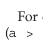

`&&` 运算符对其操作数执行“短路”求值。也就是说，如果一个操作数为假，编译器将停止求值其他操作数，整个表达式的值变为 0。

例如，在以下程序中，`b` 没有自增，因为第一个操作数 `(a > 15)` 为假。

```c
#include <stdio.h>
int main(void)
{
    int a = 10, b = 20, c;
    c = (a > 15) && (++b > 15);
    printf("%d %d\n", c, b);
    return 0;
}
```

因此，程序输出：0 20。

## || 运算符

`||` 运算符表示逻辑或运算符。它像电子电路设计中的或门一样工作。具体来说，如果任一操作数为真，则表达式的值为 1。如果两个操作数都为假，结果为 0。例如，如果我们写：`a = (10 == 10) || (3 > 5);` `a` 变为 1，因为第一个操作数为真。如果我们写：`a = (10 != 10) || (3 > 5) || (4+5 > 40-10);` `a` 变为 0，因为所有操作数都为假。

与 `&&` 运算符类似，`||` 运算符对其操作数执行“短路”求值。如果一个操作数为真，编译器将停止求值其他操作数，整个表达式的值变为 1。

例如，在以下程序中，`b` 没有自增，因为第一个操作数 `(a > 5)` 为真。

```c
#include <stdio.h>
int main(void)
{
    int a = 10, b = 20, c;

    c = (a > 5) || (++b > 15);
    printf("%d %d\n", c, b);
    return 0;
}
```

因此，程序显示：1 20。

*尽管我们尚未讨论 `if` 语句，但我们将在以下一些程序中使用它，以便向您展示如何使用逻辑运算符。*

## 练习

### C.4.2 以下程序的输出是什么？

```c
#include <stdio.h>
int main(void)
{
    int a = 5;

    printf("%d %d %d\n", !!a, !!!a, a);
    return 0;
}
```

答案：由于 `a` 为 5，`!a` 的值为 0。因此，表达式 `!!a` 等价于 `!0`，表达式 `!!!a` 等价于 `!1`。`a` 的值不会改变。因此，程序显示 1、0 和 5。

### C.4.3 以下程序的输出是什么？

```c
#include <stdio.h>
int main(void)
{
    int a = 4, b = 3, c = 5;

    printf("%d\n", (a < b) == !(c > b));
    return 0;
}
```

答案：表达式 `(a < b)` 的值为 0，因为 `a` 为 4 且 `b` 为 3。由于 `(c > b)` 的值为 1，`!(c > b)` 的值为 0。由于两个表达式的值相同，程序显示 1。

### C.4.4 以下程序的输出是什么？

```c
#include <stdio.h>
int main(void)
{
    int a = 10, b = -10;

    if(a > 0 && b < -10)
        printf("One ");
    else
        printf("Two ");

    if(a > 10 || b == -10)
        printf("One ");
    else
        printf("Two ");
    return 0;
}
```

答案：由于 `b` 为 -10，第二个操作数为假，程序输出 Two。由于第二个 `if` 语句中的第二个操作数为真，程序输出 One。

### C.4.5 以下程序的输出是什么？

```c
#include <stdio.h>
int main(void)
{
    int a = 1, b = 4, c = 4;

    printf("%d\n", (a-1) || (b-- == c));
    printf("%d", !(a > b) && (a-1 == b-3) && (c%2 || (a+b-c)));
    return 0;
}
```

答案：由于 `a` 为 1，表达式 `(a-1)` 的值为 0。`(b-- == c)` 的值为 1，因为 `b`，即 4，首先与 `c`，即 4，比较，然后变为 3。因此，程序输出 1。

由于 `a` 为 1 且 `b` 为 3，表达式 `(a > b)` 的值为 0。因此，`!(a > b)` 的值为 1。

表达式 `(a-1 == b-3)` 的值为 1，因为 0 等于 0。

`c%2` 的值为 0，因为 `c` 为 4。`(a+b-c)` 的值为 1+3-4 = 0。由于两个操作数都为假，第三个操作数的值为 0。

由于第三个操作数为假，整个表达式的值为假，程序输出 0。

### C.4.6 编写一个程序读取年收入并根据表 4.1 计算税

例如，如果用户输入 23000，税计算为：`tax = (20000-5000)*0.15 + (23000-20000)*0.3`。

```c
#include <stdio.h>
int main(void)
{
    float tax, a;

    printf("Enter income: ");
    scanf("%f", &a);

    tax = (a > 5000 && a <= 20000)*(a-5000)*0.15 + (a > 20000)*((a-20000)*0.3 + 15000*0.15);
    printf("Tax = %.2f\n", tax);
    return 0;
}
```

注释：如果收入在 5000 到 20000 之间，表达式 `(a > 5000 && a <= 20000)` 的值为 1，而 `(a > 20000)` 的值为 0。对超过 5000 的部分计算税。如果收入大于 20000，则情况相反。对超过 20000 的部分计算税，外加前 20000 的税。如果收入小于 5000，两个表达式都为假，因此税变为 0。

这不是一个复杂的解决方案吗？是的。但是不必担心。在下一章中，您将看到 `if` 语句如何使解决此类练习变得容易。

**表 4.1 税率**

| 收入 | 税率 (%) |
| --- | --- |
| 0-5,000 | 0 |
| 5,001-20,000 | 15 |
| >20,000 | 30 |

由于逗号运算符可能产生更复杂且更难求值的代码，因此它并不常用。它主要用于 `for` 语句中。例如：

```c
int a, b;
for (a = 1, b = 2; b < 10; a++, b++)
```

第一个表达式首先将 1 分配给 `a`，然后将 2 分配给 `b`。第三个表达式首先执行 `a++`，然后执行 `b++`。

请注意，我们用来分隔函数参数、初始化器和声明中的变量的逗号不是逗号运算符，而是分隔符。

## sizeof 运算符

`sizeof` 运算符用于计算存储特定类型、变量、常量或表达式的值所需的字节数。请注意，结果的类型是 `size_t`，它在 C 库中定义为无符号整数（通常为 `unsigned int`）。尽管许多程序员使用 `%d` 转换来显示 `sizeof` 值，但最安全的做法是将值强制转换为最大的无符号类型，即 `unsigned long`，并使用 `%lu` 转换。以下是我们如何使用强制转换来显示 `float` 类型的大小的示例：

```c
printf("Float:%lu bytes\n", (unsigned long)sizeof(float));
```

为简单起见，在接下来的程序中打印 `sizeof` 值时，我们省略强制转换并使用 `%u` 转换。以下程序使用 `sizeof` 运算符显示程序变量在内存中分配的字节数。

```c
#include <stdio.h>
int main(void)
{
    char c;
    int i;
    double d;

    printf("%u %u %u\n", sizeof(c), sizeof(i), sizeof(d));
    return 0;
}
```

程序显示：1 4 8。请注意，如果我们声明另一个变量，例如 `int j`，并写 `sizeof(i+j)`，程序仍将显示 4，因为表达式的类型是整数。但是，如果我们写 `sizeof(i+d)`，程序将显示 8，因为正如我们在第 2 章中学到的，表达式的类型是 `double`。


注意，如果操作数是类型（例如 int），则必须使用括号；但对于变量，则不需要。然而，如果不使用括号，像 `sizeof i*j` 这样的表达式结果并不明确。是先应用 sizeof 再进行乘法，还是反过来？因为你将学会在 sizeof 表达式中始终使用括号（我们这样做是为了避免问题），所以我们不会给出答案。如果你坚持寻找答案，请查阅附录 A 中的优先级表。不过，括号可能给人一种错误印象，即使用 sizeof 是函数调用。不，sizeof 不是函数；它是运算符。

sizeof 运算符在编写可移植代码时特别有用。例如，正如我们将在第 14 章看到的，为了给（比方说）100 个整数分配内存，我们这样写：

```c
malloc(100*sizeof(int));
```

这样，分配的内存大小就不依赖于系统。在接下来的章节中，我们将看到它对其他数据类型（如数组和结构体）的用处。

下面是一个相当简单的问题，用来向你介绍 if-else 语句。以下程序输出什么？

```c
#include <stdio.h>
int main(void)
{
    if(sizeof(int) > -1)
        printf("Yes\n");
    else
        printf("No\n");
    return 0;
}
```

谁关心 `if-else` 语句？它放在那里只是为了误导你。虽然显而易见的答案是 Yes，但程序输出 No。我们刚刚告诉过你，`sizeof` 值的类型是无符号的，不是吗？因此，当计算 `if` 条件时，-1 会被提升为大于 4 的无符号值，条件变为假。

## enum 类型

`enum` 类型用于定义枚举类型，它是一组命名的整数常量值。这些名称必须互不相同，并且与同一作用域中的普通变量不同，但值不必互不相同。通常，它声明如下：

```
    enum tag {enumeration_list};
```

tag 是标识枚举列表的可选标识符。例如，以下语句：

```
    enum seasons {AUTUMN, WINTER, SPRING, SUMMER};
```

定义了 seasons 枚举类型以及枚举常量 AUTUMN、WINTER、SPRING 和 SUMMER。这些常量的名称受 C 作用域规则约束。例如，如果在函数内部声明枚举，其常量在函数外部不可见。我们将在第 11 章讨论作用域规则。

默认情况下，第一个常量的值为 0，不过我们可以在声明枚举时设置特定值。例如：

```
    enum seasons {AUTUMN=10, WINTER, SPRING=30, SUMMER};
```

如果常量没有显式赋值，它会被初始化为上一个已初始化常量的值加一。因此，在第一个示例中，AUTUMN、WINTER、SPRING 和 SUMMER 常量的值分别为 0、1、2 和 3；而在第二个示例中，它们分别变为 10、11、30 和 31。

回想第 2 章，`#define` 指令是为值定义符号名称的另一种方式。它们的主要区别在于，`enum` 类型将常量分组，以形成一组值。

为了声明具名枚举类型的枚举变量，我们这样写：

```
    enum tag variable_list;
```

例如，使用语句：`enum seasons s1, s2;`，s1 和 s2 被声明为 seasons 类型的枚举变量。或者，我们可以在定义类型时声明变量。例如：

```
    enum seasons {AUTUMN, WINTER, SPRING, SUMMER} s1, s2;
```

在这个示例中，如果之后不会使用 seasons 标签来声明额外变量，则可以省略它。然而，即使不会使用它，我们仍然倾向于始终使用枚举标签，以便读者更容易理解该枚举的用途。

需要记住的重要一点是，C 将枚举变量和常量视为整数。

例如，考虑以下程序：

```c
#include <stdio.h>
int main(void)
{
    int next_seas;
    enum seasons {AUTUMN = 1, WINTER, SPRING, SUMMER} s;

    printf("Enter season [1-4]: ");
    scanf("%d", &s);

    if(s == SUMMER)
        next_seas = AUTUMN;
    else
        next_seas = s+1;
    printf("Next season = %d\n", next_seas);
    return 0;
}
```

该程序读取一个整数，将其存储到枚举变量 s 中，并显示与下一个季节对应的数字。注意，编译器不必检查存储在枚举变量中的值是否是该枚举的有效值。如果赋了其常量以外的值，编译器通常会发出警告。

关于我们在 enum 和 #define 之间的偏好，我们会说，当我们需要一组值来刻画一个实体（例如季节）时，enum 类型更具代表性。如果函数需要这组值，传递枚举变量比传递普通整数更可取。例如：

```
void test(enum codes c); instead of void test(int c);
```

第一个原型告诉读者，传入的值应属于某个集合。因此，读者更容易阅读和验证代码。另一方面，第二个原型没有提供关于传入值的任何信息。此外，预处理器会移除用 `#define` 指令定义的名称，因此它们在调试期间不可用。一般来说，当我们想要定义的常量不相关、数量很少，或者它们不表示整数时，我们会使用 `#define`。

## 位运算符

位运算符用于访问整数变量或常量的各个位。位值要么是 0，要么是 1。位运算符在多种应用中特别有用；根据我们的经验，我们曾在通信协议、数据加密算法以及与硬件通信的底层应用中使用过它们。稍后我们将向你展示一些示例。

> 使用位运算符时，将它们应用于 `unsigned` 变量更安全。
> 如果你选择不这样做，请确保在执行计算时考虑符号位。

### & 运算符

& 运算符对其两个操作数的所有位执行布尔 AND 运算。如果两个对应位都为 1，则结果位为 1。否则，该位设为 0。例如，19 & 2 的结果是 2（为简单起见，我们使用 8 位）：

```
00010011 (19)
& 00000010 (2)
-----------
00000010 (2)
```

& 运算符常用于将若干位置零。例如，语句：a = a & 3; 会将 a 中除最低两位以外的所有位置零。

> 不要混淆 && 和 & 运算符。例如，如果 a=1 且 b=2，则 a && b 的结果为 1，而 a & b 的结果为 0。

### | 运算符

| 运算符对其两个操作数的所有位执行布尔 OR 运算。如果两个对应位都为 0，则结果位为 0。否则，该位设为 1。例如，19 | 6 的结果是 23：

```
00010011 (19)
| 00000110 (6)
-----------
00010111 (23)
```

| 运算符常用于将若干位置一。例如，语句：a = a | 3; 会将 a 的最低两位置一。

> 不要混淆 || 和 | 运算符。例如，如果 a=1 且 b=2，则 a || b 的结果为 1，而 a | b 的结果为 3。

### ^ 运算符

^ 运算符对其两个操作数的所有位执行布尔 XOR 运算。如果对应位不同，则结果位为 1。否则，该位设为 0。例如，19 ^ 6 的结果是 21：

```
00010011 (19)
^ 00000110 (6)
-----------
00010101 (21)
```

### ~ 运算符

~ 补码运算符是一元运算符，对其操作数的所有位执行布尔 NOT 运算。具体来说，它将 1 反转为 0，反之亦然。例如，在 32 位系统中，~19 的结果是：

```
~ 00000000 00000000 00000000 00010011 (19) =
    11111111 11111111 11111111 11101100
```

### 移位运算符

移位运算符将整数变量或常量的位向左或向右移动。>> 运算符将位向右移动，而 << 运算符将位向左移动。两个运算符都接受一个右操作数，它表示位将移动多少位。如果它为负，或者其值等于或大于左操作数类型的位数，则结果未定义。程序员有责任确保右操作数具有有效值。例如，如果 int 类型有 32 位且 a 是 int，则写 a << 31 是有效的，但写 a << 32 或 a << -1 则无效。

表达式 i >> n 将 i 中的位向右移动 n 位。如果 i 为正，或其类型为 unsigned，则插入左侧的 n 个高位设为 0。如果 i 为负，则取决于实现是添加 1 还是 0。例如，在以下代码中，a 将具有什么值？

```c
unsigned int a, b = 35;
a = b >> 2;
```

让我们用二进制写出这个数来解释移位操作。为简单起见，我们将使用 8 位。由于 35 的二进制是 00100011，00100011 >> 2 的结果是 00010000，这将是 a 的值。具体来说，原数最右边的两个位 1 和 1 被“移出”，两个零位被填入位置 7 和 8。注意 b 的值仍然是 35。

> 提示
> 由于一个位的位置对应 2 的幂，将正整数向右移动 n 位会将其值除以 2^n。

表达式 i << n 将 i 中的位向左移动 n 位。插入右侧的 n 个低位设为 0。例如，在以下代码中，a 将具有什么值？

```c
unsigned int a, b = 35;
a = b << 3;
```

由于数字 35 的二进制是 00100011，00100011 << 3 的移位结果是 00100011000，这将是 a 的值。具体来说，原数的位向左移动三位，并且在位置 1、2 和 3 添加三个零位。因此，a 变为 280，而 b 仍为 35。

> 提示
> 如果没有发生溢出，将正数向左移动 n 位会将其值乘以 2^n。


当你使用 `<<` 运算符将移位结果存储到变量中时，请确保变量的类型足够大以容纳该值。例如，考虑以下程序：

```c
#include <stdio.h>
int main(void)
{
    unsigned char a = 1;

    a <<= 8; /* Equivalent to a = a << 8; */
    printf("%d\n", a);
    return 0;
}
```

语句 `a <<= 8;` 将 `a` 的值向左移动八位，并在右侧插入八个零位。因此，移位结果为 100000000。然而，由于 `a` 被声明为 `unsigned char`，它只能保存八个低位的值。因此，程序显示 0 而不是你可能期望的 256。如果它被声明为 `int`，程序将显示 256。

再看另一个例子。如果我们写：

```c
char a = 8;
a <<= 4;
```

`a` 的值向左移动四位并变为 10000000。如果 `char` 类型是有符号的，最左边的位保留用于数字的符号，`a` 变为 -128。如果 `a` 被声明为 `unsigned char`，其值将为 128。

> 记住，使用无符号类型执行位运算更安全。

## Exercises

### C.4.7

编写一个程序，读取一个对应于密码密钥的整数，以及另一个将用该密钥加密的整数。加密是通过对它们应用 `^` 运算符来执行的。然后，程序应再次使用 `^` 运算符来解密加密后的结果。

```c
#include <stdio.h>
int main(void)
{
    int num, key;

    printf("Enter key: ");
    scanf("%d", &key);

    printf("Enter number: ");
    scanf("%d", &num);

    num = num ^ key;
    printf("Encrypted : %d\n", num);

    num = num ^ key;
    printf("Original: %d\n", num);
    return 0;
}
```

**Comments:** 由于 `(a ^ b) ^ b = a`，解密的结果是输入的数字。

### C.4.8

以下程序的输出是什么？

```c
#include <stdio.h>
int main(void)
{
    printf("%d\n", ~(~0 << 4));
    return 0;
}
```

**Answer:** 根据附录 A 中的优先级表，`~` 运算符的优先级高于 `<<` 运算符；因此，先计算表达式 `~0`，然后将结果向左移动四位。在 32 位系统中，`~0` 的结果是所有 32 位都设为 1 的数字。因此，`(~0 << 4)` 的值是数字：

```
11111111 11111111 11111111 11110000
```

由于 `~` 运算符反转其位，整个表达式的值为：

```
00000000 00000000 00000000 00001111
```

程序显示 15。

### C.4.9

以下程序的输出是什么？

```c
#include <stdio.h>
int main(void)
{
    unsigned int i = 10;
    if((i >> 4) != 0)
        printf("One\n");
    else
        printf("Two\n");
    printf("%d\n", i);
    i = i;
    if((i << 3) == 8)
        printf("One\n");
    else
        printf("Two\n");
    printf("%d\n", i);
    return 0;
}
```

```c
#include <stdio.h>
int main(void)
{
    unsigned int num, pos;
    printf("Enter number: ");
    scanf("%d", &num);
    printf("Enter bit position [1-32]: ");
    scanf("%d", &pos);
    printf("bit%d is %d\n", pos, (num >> (pos-1)) & 1);
    return 0;
}
```

### C.4.12

编写一个程序，读取 [0, 255] 范围内的整数，然后交换其二进制数字的两个四位组并显示新的数字。例如，如果用户输入 10 (00001010)，程序应显示 160 (10100000)。

```c
#include <stdio.h>
int main(void)
{
    unsigned char num, tmp;
    printf("Enter number [0-255]: ");
    scanf("%d", &num);
    tmp = num & 0xF; /* The value of the four lower bits is stored into tmp. 0xF is 1111 in binary. Of course, we could use 15 instead of 0xF. */
    tmp <<= 4; /* Shift the value four places to the left. */
    tmp += num >> 4; /* Add to tmp the value of num shifted four places to the right. */
    printf("%d\n", tmp);
    return 0;
}
```

**Comments:** 如果你想知道 `num` 的值，它的值不会改变。此外，我们可以省略 `tmp` 并写：`printf("%d\n", ((num & 0xF) << 4) + (num >> 4));` 或 `printf("%d\n", (unsigned char)(num << 4) + (num >> 4));`

### C.4.13

位运算符常用于网络通信中的数据编码。例如，传输控制协议 (TCP) 数据包头部中的某些特定位被编码如图所示 4.1 所示。


- FIN (bit1): 如果为 1，则表示 TCP 连接的释放。
- SYN (bit2): 如果为 1，则表示 TCP 连接的建立。这就是臭名昭著的负责拒绝服务 (DoS) 洪水攻击的位，但这是另一个故事...
- ACK (bit5): 如果为 1，则表示数据接收的确认。
- URG (bit6): 如果为 1，则表示紧急数据的传输。

编写一个程序，读取 URG、ACK、SYN 和 FIN 位的值并将此信息编码到程序变量中。然后，程序应解码该变量的值并显示各位的值。

```c
#include <stdio.h>
int main(void)
{
    unsigned char temp, urg, ack, syn, fin;

    printf("Enter FIN bit: ");
    scanf("%d", &fin);

    printf("Enter SYN bit: ");
    scanf("%d", &syn);

    printf("Enter ACK bit: ");
    scanf("%d", &ack);

    printf("Enter URG bit: ");
    scanf("%d", &urg);

    temp = fin + (syn << 1) + (ack << 4) + (urg << 5);
    printf("\nEncoding: %d\n", temp);

    fin = temp & 1;
    syn = (temp >> 1) & 1;
    ack = (temp >> 4) & 1;
    urg = (temp >> 5) & 1;
    printf("FIN = %d, SYN = %d, ACK = %d, URG = %d\n", fin, syn, ack, urg);

    return 0;
}
```

### C.4.14

以下程序做什么？

```c
#include <stdio.h>
int main(void)
{
    unsigned char ch = 3;

    ch = ((ch&1) << 7) | ((ch&2) << 5) | ((ch&4) << 3) | ((ch&8) << 1)
    | ((ch&16) >> 1) | ((ch&32) >> 3) | ((ch&64) >> 5) | ((ch&128) >> 7);
    printf("%d\n", ch);
    return 0;
}
```

**Answer:** 假设 `ch` 以二进制编码为 `x_7x_6x_5x_4x_3x_2x_1x_0`，其中每个 `x_i` 为 1 或 0。因此，表达式 `(ch&1) << 7` 的值为：

```text
    x_7 x_6 x_5 x_4 x_3 x_2 x_1 x_0
&   0   0   0   0   0   0   0   1
-------------------------------------
    0   0   0   0   0   0   0   x_0 << 7 = x_0 0   0   0   0   0   0   0
```

同样，`(ch&2) << 5` 的值为：

```text
    x_7 x_6 x_5 x_4 x_3 x_2 x_1 x_0
&   0   0   0   0   0   0   1   0
-------------------------------------
    0   0   0   0   0   0   x_1 0 << 5 = 0 x_1 0   0   0   0   0   0
```

以类似的方式：

```text
The value of (ch&4) << 3 is: 0 0 x_2 0 0 0 0 0
The value of (ch&8) << 1 is: 0 0 0 x_3 0 0 0 0
The value of (ch&16) >> 1 is: 0 0 0 0 x_4 0 0 0
The value of (ch&32) >> 3 is: 0 0 0 0 0 x_5 0 0
The value of (ch&64) >> 5 is: 0 0 0 0 0 0 x_6 0
The value of (ch&128) >> 7 is: 0 0 0 0 0 0 0 x_7
```

因此，整个表达式被计算为：

```text
(x_0 0 0 0 0 0 0 0) | (0 x_1 0 0 0 0 0 0) | (0 0 x_2 0 0 0 0 0) | (0 0 0 x_3 0 0 0 0) |
(0 0 0 0 x_4 0 0 0) | (0 0 0 0 0 x_5 0 0) | (0 0 0 0 0 0 x_6 0) | (0 0 0 0 0 0 0 x_7) =
x_0 x_1 x_2 x_3 x_4 x_5 x_6 x_7
```

事实上，程序反转了 `ch` 的位，而不使用第二个变量。因此，`ch` (00000011₂) 变为 192 (11000000₂)，程序显示 192。

### C.4.15

位运算符常用于与硬件通信的应用程序中。例如，异步串行通信中常用的配置方法是八位字符，具有一个 *起始位*、一个 *停止位* 和一个 *奇偶校验位*。数据的传输通过将 *起始位* 设为 0 来发出信号，以通知接收方数据的到来。*停止位* 表示传输的结束。例如，数据位 10100 被编码如图所示 4.2 所示。

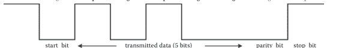

**FIGURE 4.2**
Communication example.

发送方可以选择性地传输 *奇偶校验位*，接收方用它来检测传输错误。奇偶校验有两种变体：偶校验和奇校验。在偶校验中，*奇偶校验位* 的值是按这样计算的，使得数据中 1 的总数加上奇偶校验位为偶数。在奇校验的情况下，总数应为奇数。在我们的示例中，我们选择偶校验。因此，由于数据中 1 的数量为二，即为偶数，*奇偶校验位* 设为 0。

编写一个程序来模拟发送方。程序应读取五个数据位的值并使用偶校验生成一个 8 位值。

```c
#include <stdio.h>
int main(void)
{
    unsigned char data, ones, bit1, bit2, bit3, bit4, bit5,
parity_bit;

    ones = 0;

    printf("Enter bit1: ");
    scanf("%d", &bit1);
    if (bit1 == 1)
        ones++;

    printf("Enter bit2: ");
    scanf("%d", &bit2);
    if (bit2 == 1)
        ones++;

    printf("Enter bit3: ");
    scanf("%d", &bit3);
    if (bit3 == 1)
        ones++;

    printf("Enter bit4: ");
    scanf("%d", &bit4);
    if (bit4 == 1)
        ones++;

    printf("Enter bit5: ");
    scanf("%d", &bit5);
    if (bit5 == 1)
        ones++;

    if (ones & 1) /* It means that the number of 1s is odd. */
        parity_bit = 1;
    else
        parity_bit = 0;

    data = (bit1 << 6) + (bit2 << 5) + (bit3 << 4) + (bit4 << 3) +
(bit5 << 2) + (parity_bit << 1) + 1; /* The last 1 represents the
stop_bit. */
    printf("%d\n", data);
    return 0;
}
```


## 运算符优先级

每个运算符都有一个 *优先级*，它决定了运算符被求值的顺序。在包含多个运算符的表达式中，优先级较高的运算符先被求值。例如，由于 * 运算符的优先级高于 + 和 - 运算符，因此表达式 7+5*3-1 的结果为 21。

当同一表达式中出现优先级相等的运算符时，运算符的求值顺序根据其 *结合性* 确定。例如，由于 * 和 / 运算符具有相同的优先级并且是 *左结合* 的，因此表达式 7*4/2*5 的结果为 70，因为先执行乘法 7*4 = 28，然后执行除法 28/2 = 14，最后执行乘法 14*5 = 70。让我们看另一个例子：

```c
#include <stdio.h>
int main(void)
{
    int a = 4, b = 5, c = 3;

    printf("%d\n", a < b > c);

    a = b = c = 2;
    printf("%d\n", a == b == c);

    a + b -= ++c;
    printf("%d %d %d\n", a, b, c);
    return 0;
}
```

根据附录 A 中的优先级表，< 和 > 运算符具有相同的优先级并且是左结合的。因此表达式 (a < b) 首先被求值。由于 a 为 4 且 b 为 5，其值为 1。因此表达式 a < b > c 等价于 1 > c，由于 c 为 3，此表达式为假。因此程序输出 0。

由于 == 运算符是左结合的，因此表达式 a == b 首先被求值。由于 a 等于 b，其值为 1。因此表达式 a == b == c 等价于 1 == c。由于 c 为 2，此表达式求值为 0，程序输出 0。如果 c 为 1，程序将输出 1。

复合运算符从右到左执行。因此表达式 a += b -= ++c 等价于 a += (b -= ++c)；单独来看，表达式 (b -= ++c) 等价于 b = b-(++c)。c 的值首先自增变为 3；因此 b = b-3 = 2-3 = -1。于是表达式 a = a+(b -= ++c) 等价于 a = a-1 = 2-1 = 1，程序输出：1 -1 3。

在另一个例子中，以下语句是否产生相同的结果？请思考一下。

```c
float a, b = 3, c = 4;
a = 1/2*b*c;
a = b*c*1/2;
```

由于除法 1/2 的结果为 0，第一条语句将 0 赋给 a。由于乘法先执行且分子为 float，第二条语句将 6 赋给 a。

有些运算符的优先级与预期不同或与我们希望的不同。例如，假设我们想将一个变量右移三位再加上 10。写成 a = b>>3 + 10 是合理的，假设求值顺序是从左到右。不幸的是，这是不正确的；加法先执行，因为 + 运算符的优先级更高。要得到期望的结果，表达式 b>>3 必须用括号括起来。另一个例子：

```c
if (a & 15 == 0)
    printf("One");
```

由于 == 运算符的优先级高于 & 运算符，因此表达式 15 == 0 首先被求值，其为假，然后是 a & 0 的值，对于 a 的任何值都为假。因此此 if 条件始终为假。要得到期望的结果，表达式 a & 15 必须用括号括起来。

如果你不确定求值顺序，请使用括号。即使不是必须，使用括号也能提高代码的可读性并明确表达式的求值方式。例如，写成 a = 7+(5*3)-1 比写成 a = 7+5*3-1 更清晰；

?, [], ->, *, &, * 运算符将在后续章节中讨论。

等一下，我们不是已经描述过 & 和 * 运算符了吗？我们还要再描述一次吗？是的，我们喜欢重复同样的事情。此外，重复是学习的母亲。

开玩笑的，我们将在第 8 章看到，这两个运算符可以有不同的含义。这就是为什么它们在优先级表中出现两次。也就是说，标准制定者决定对不同的操作使用相同的符号。他们为什么要这样做？我们不知道；一个原因可能是可用字符不足。

## 未解练习

在以下任何练习中都不要使用 if 语句。

- **U4.1** 编写一个程序，读取两个整数并显示较小者。
- **U4.2** 假设商店中的顾客买了一些东西。如果总费用小于 $100，则不提供折扣；否则提供 5% 折扣。编写一个程序，读取总费用并显示应付金额。
- **U4.3** 编写一个程序，读取通过考试所需的最低分数和三名学生的成绩，并显示通过的人数。成绩有效应为 <= 10。
- **U4.4** 继续上一个练习，求出通过考试者的平均成绩。假设至少有一名学生通过。
- **U4.5** 编写一个程序，读取两个整数，将它们存储到两个变量中，并使用 ^ 运算符和方程 (x*y)^x = y 和 (x*y)^y = x 来交换它们的值。只使用两个变量。

### U.4.6

编写一个程序，读取一个整数并显示第 2、4、6 和 8 位数字的和。例如，如果用户输入 170（二进制：10101010），程序应显示 4。只使用一个变量。

### U.4.7

编写一个程序，读取一个正整数和另一个表示字节数（例如 n）的整数。程序应将输入数字向右循环 n 个字节，并显示新值。假设 int 类型的大小为 32 位。例如，如果用户输入 553799974（二进制：00100001|00000010|01010001|00100110）和 1，程序应显示：639697489（二进制：00100110|00100001|00000010|01010001）。

### U.4.8

编写一个程序，读取 [0, 255] 范围内的整数和移位位数（例如 n）。程序应显示以下内容的和：

- a. 将输入数字左移 n 位，并将“移出”的位加到数字的右侧。
- b. 将输入数字右移 n 位，并将“移出”的位加到数字的左侧。

例如，如果用户输入 42（二进制：00101010）和 3，程序应显示以下内容的和：

```
00101010 << 3 = 01010001 = 81 (the shifted-off bits are: 001) and: 00101010 >> 3 = 01000101 = 69 (the shifted-off bits are: 010). The sum is 150.
```

### U.4.9

编写一个程序，读取一个整数和两个位的位置，并显示它们之间的位的值。程序应找到 int 类型的大小；不要假设它是 32 位。例如，如果用户输入 176（二进制：10110000）和值 6 和 4，程序应显示位置 6 和 4 之间的位的值，即位 110 的十进制值，为 6。

### U.4.10

编写一个程序，读取一个正整数并将其向上舍入到下一个最高 2 的幂。例如，如果用户输入 35，程序应显示 64，因为 35 < 64 = 2^6。如果用户输入 16，程序应显示 16。

## 5 程序控制

## 程序控制

到目前为止，我们看到程序的语句是从上到下执行的，按其在源代码中出现的顺序执行。然而，在实际编程中，某些语句只有在满足特定条件时才应执行。本章将教你如何使用 **if** 和 **switch** 选择语句来控制程序的流程，使其从一组备选方案中选择特定的执行路径。它还介绍了条件运算符 ?: ，可用于形成条件表达式。

### if 语句

**if** 语句根据条件求值为真或假来控制程序流程。**if** 语句的最简单形式是：

```c
if (condition)
{
    ... /* block of statements */
}
```

如果条件的值为真，则大括号之间的语句块将被执行。例如：

```c
int x = 3;
if (x != 0)
{
    printf("Yes\n");
}
```

由于 **x** 不为 0，**if** 条件为真，程序显示 **Yes**。

> > **提示：** `if (x)` 等价于 `if (x != 0)`

如果条件的值为假，则语句块不会被执行。例如，以下代码不显示任何内容：

```c
int x = -3;
if (x == 0)
{
    printf("Yes\n");
}
```

if (!x) 等价于 if (x == 0)

花括号的位置，不仅在 if 情况下，而且第 6 章的循环语句中，都是个人偏好的问题。例如，许多程序员偏好 K&R 风格：

```
if (x == 0) {
    printf("Yes\n");
}
```

我们不偏好这种风格的原因在于左花括号不够明显。我们更倾向于将每个花括号单独放在一行，以便轻松检查它们是否匹配。你可以选择你更喜欢的风格。然而，常见做法（也是我们强烈推荐的做法）是缩进内部语句，以更清楚地表明它们的分组，并使代码更易读。我们对第 6 章的循环语句使用相同的风格。

如果语句块由单条语句组成，则可以省略花括号。例如，前面的代码可以写成这样：

```
if (x == 0)
    printf("Yes\n");
```

一般来说，花括号用于将声明和语句组合成一个复合语句（或块），编译器将其视为单条语句。正如我们将在第 6 章看到的，复合语句在循环中也很常见。

## 常见错误

常见错误是在 if 语句末尾添加分号（;），就像通常对大多数语句所做的那样。分号被当作一条什么都不做的语句，即空语句，编译器会终止 if。例如，在以下代码中：

```
int x = -3;
if (x > 0);
    printf("Yes\n");
```

该分号终止了 if 语句，因此 printf() 调用不在 if 内。所以，无论 x 的值是什么，这段代码都会输出 Yes。

一个非常常见的错误是将 == 相等运算符与 = 赋值运算符混淆。记住，== 运算符检查两个表达式是否具有相同的值，而 = 运算符将值赋给变量。还要记住，将非零值赋给变量对应真表达式，而将零值赋值对应假表达式。例如，以下代码：

```
int x = -10;
if (x = -20)
    printf("Yes\n");
```

如果条件为真，则执行第一个语句块，否则执行第二个。例如，以下代码输出 Two，因为 x 小于 0。

```
int x = -3;
if(x > 0)
{
    printf("One\n");
}
else
{
    printf("Two\n");
}
```

而且，由于两个块都只包含一条语句，我们可以省略花括号：

```
int x = -3;
if(x > 0)
    printf("One\n");
else
    printf("Two\n");
```

## 嵌套 if 语句

一个 if 语句可以包含其他 if 和 else 语句，而这些语句又可以包含其他语句，依此类推。例如，以下程序包含两个嵌套的 if 语句：

```
#include <stdio.h>
int main(void)
{
    int a = 10, b = 20, c = 30;

    if(a > 5)
    {
        if(b == 20)
            printf("1 ");

        if(c == 40)
            printf("2 ");
        else
            printf("3 ");
    }
    else
        printf("4\n");

    return 0;
}
```

由于 a 大于 5，程序输出：1 3

因为 else 部分是可选的，所以当嵌套 if 序列中省略 else 时会产生歧义。为了匹配 if 和 else 语句，规则是 else 与同一组语句中最近的未匹配 if 相关联。例如，你能应用这条规则并告诉我们以下程序输出什么吗？

```
#include <stdio.h>
int main(void)
{
    int a = 5;
    if(a != 5)
        if(a-2 > 5)
            printf("One\n");
    else
        printf("Two\n");
    return 0;
}
```

根据这条规则，else 语句与内层 if 相关联。因此，程序不显示任何内容，因为第一个 if 条件为假，并且它没有关联的 else。

注意缩进如何诱使你认为 else 语句与第一个 if 语句相关联。通过将每个 else 语句与匹配的 if 对齐、缩进语句，并即使不必要也向 if-else 语句添加花括号，程序会变得更易读。例如，下面是我们如何通过将正确的 if 与匹配的 else 对齐来使前面的程序更易读：

```
#include <stdio.h>
int main(void)
{
    int a = 5;
    if(a != 5)
    {
        if(a-2 > 5)
            printf("One\n");
        else
            printf("Two\n");
    }
    return 0;
}
```

尽管第一个 if 的花括号并不需要，我们仍添加它们以使代码更易读。如果需要其他行为，则必须使用花括号来强制正确的关联。例如：

```
if(a != 5)
{
    if(a-2 > 5)
        printf("One\n");
}
else
    printf("Two\n");
```

要测试一系列条件，典型的选择是使用以下语法：

```
if(condition_A)
{
    ... /* block of statements A */
}
else if(condition_B)
{
    ... /* block of statements B */
}
else if(condition_C)
{
    ... /* block of statements C */
}
.
.
.
else /* optional */
{
    ... /* block of statements N */
}
```

在第一个 if 和最后一个 else 之间可以有任意数量的 else if 子句。条件从顶部开始按顺序求值。一旦找到为真的条件，就执行相应的语句块，并且不再对其余的 else if 条件求值。程序继续执行最后一个 else 之后的下一条语句。例如，如果 condition_A 为真，则执行第一个语句块；否则检查 condition_B。如果它为真，则执行第二个语句块；否则检查 condition_C，依此类推。如果没有任何条件为真，并且存在最后一个 else，则执行其语句块。以下程序读取一个整数，并根据输入值显示消息：

```
#include <stdio.h>
int main(void)
{
    int a;

    printf("Enter number: ");
    scanf("%d", &a);

    if(a == 1)
        printf("One\n");
    else if(a == 2)
        printf("Two\n");
    else
        printf("Other\n");

    printf("End\n");
    return 0;
}
```

### C.5.3 编写一个程序，读取两个整数并在不使用 else 语句的情况下显示它们的关系。

```c
#include <stdio.h>
int main(void)
{
    int i, j;

    printf("Enter numbers: ");
    scanf("%d%d", &i, &j);

    if (i < j)
        printf("%d < %d\n", i, j);
    if (i > j)
        printf("%d > %d\n", i, j);
    if (i == j)
        printf("%d = %d\n", i, j);
    return 0;
}
```

### C.5.4 以下程序的输出是什么？

```c
#include <stdio.h>
int main(void)
{
    int a = 4, b = 5, c = 3;

    if (a && a/b)
        printf("One\n");
    else
        printf("Two\n");

    if (++a == b++)
        printf("One\n");
    else
        printf("Two\n");

    if (a < b < c)
        printf("One\n");
    else
        printf("Two\n");
    return 0;
}
```

答案：由于 / 运算符的优先级高于 && 运算符，因此先执行除法。a/b 的结果是 0，而不是 0.8，因为 a 和 b 都是整型变量。因此，条件为假，程序显示 Two。== 运算符的优先级低于两种形式中使用的 ++ 运算符。前缀形式先递增 a，使其变为 5。后缀形式在 b 用于比较之后递增 b。因此，由于 b 是 5，程序显示 One，随后 b 变为 6。根据优先级规则，< 运算符是左结合的。由于 a 是 5，b 是 6，表达式 a < b 为真，因此其值为 1。因此，表达式 (a < b < c) 等价于 (1 < c)，由于 c 是 3，所以为真。因此，程序显示 One。记住，如果我们想将 b 与 a 和 c 进行比较，我们会使用 && 运算符并写成：if(a < b && b < c)

### C.5.5 以下程序的输出是什么？

```
#include <stdio.h>
int main(void)
{
    int i = 10, j = 20, k = 0;

    if(i = 40)
        printf("One ");
    if(j = 50)
        printf("Two ");
    if(k = 60)
        printf("Three ");
    if(k = 0)
        printf("Four ");
    printf("%d %d %d\n", i, j, k);
    return 0;
}
```

答案：这是一个示例，说明错误地使用 = 运算符而不是 == 运算符会产生意外结果。具体来说，if 条件并不测试变量是否相等，而是改为将相应的值赋给变量。结果，i 变为 40，j 变为 50，而 k 先变为 60，然后变为 0。由于前三个 if 条件为真，第四个为假（因为将 0 赋给 k），程序显示 One Two Three 40 50 0

### C.5.6 编写一个程序，读取两个浮点数（例如 a 和 b），并显示方程 a*x + b = 0 的解（如果有的话）。

```
#include <stdio.h>
int main(void)
{
    double a, b;

    printf("Enter numbers: ");
    scanf("%lf%lf", &a, &b);

    if(a == 0)
    {
        if(b == 0)
            printf("Infinite solutions\n");
        else
            printf("There is no solution !!\n");
    }
    else
        printf("The solution is %f\n", -b/a);
    return 0;
}
```

## 表 5.1
体重分类

| 体重指数 | 结果 |
|---|---|
| BMI < 20 | 低于正常体重 |
| 20 <= BMI <= 25 | 正常体重 |
| 25 < BMI <= 30 | 超重 |
| 30 < BMI <= 40 | 肥胖 |
| 40 < BMI | 极度肥胖 |

C.5.7 编写一个程序读取男性的身高（以米为单位）和体重（以千克为单位）并使用公式 BMI = weight/height² 计算其身体质量指数（BMI）。程序应显示 BMI 以及根据表 5.1 的相应消息，并显示给定身高的正常体重的下限和上限。

~~~c
#include <stdio.h>
int main(void)
{
    float bmi, height, weight;

    printf("Enter height (in meters): ");
    scanf("%f", &height);

    printf("Enter weight (in kgs): ");
    scanf("%f", &weight);

    bmi = weight/(height*height);
    printf("***** BMI: %.2f\n", bmi);

    if(bmi < 20)
        printf("Under normal weight\n");
    else if(bmi <= 25) /* Since the previous if checks values up to
20, this condition is equivalent to: else if (bmi >= 20 && bmi <= 25). */
        printf("Normal weight\n");
    else if(bmi <= 30)
        printf("Overweight\n");
    else if(bmi <= 40)
        printf("Obese\n");
    else
        printf("Serious obesity\n");

    printf("According to your height the bounds of normal weight are [%.2f-%.2f]\n", 20*height*height, 25*height*height); /* The lower and the
upper bmi limits for normal weight are 20 and 25, respectively. */
    return 0;
}
~~~

C.5.8 要更改手机的 PIN 码，用户会被要求输入当前 PIN 码，设备会检查该代码是否等于 SIM 卡中存储的代码。如果它们相同，则会要求用户再次输入新的 PIN 码以进行验证，如果输入正确，则将其存储在 SIM 卡中。编写一个程序模拟此过程。假设 SIM 中存储的当前代码为 1234。

~~~c
#include <stdio.h>
int main(void)
{
    unsigned int tmp, new_code;

    printf("Enter code: ");
    scanf("%d", &tmp);

    if (tmp == 1234)
    {
        printf("Enter new code: ");
        scanf("%d", &tmp);

        printf("Enter new code once more: ");
        scanf("%d", &new_code);

        if(new_code == tmp)
            printf("New code is stored\n");
        else
            printf("Different codes are entered\n");
    }
    else
        printf("Wrong code\n");
    return 0;
}
~~~

C.5.9 编写一个程序读取四个产品的价格并显示其中最高的一个。

~~~c
#include <stdio.h>
int main(void)
{
    double i, j, k, m, max;

    printf("Enter prices: ");
    scanf("%lf%lf%lf%lf", &i, &j, &k, &m);

    if(i > j)
        max = i;
    else
        max = j;

    if(k > max)
        max = k;
    if(m > max)
        max = m;
    printf("Max = %f\n", max);
    return 0;
}
~~~

注释：要显示最低价格，将 > 更改为 <。

C.5.10 编写一个程序读取年收入并根据表 5.2 计算应缴税款。

## 表 5.2
税率

| 收入 | 税率 (%) |
|---|---:|
| 0–12,000 | 0 |
| 12,001–14,000 | 15 |
| 14,001–30,000 | 30 |
| >30,000 | 40 |

例如，如果用户输入 18000，应缴税款为 tax: = (14000−12000)*0.15 + (18000−14000)*0.3。

```c
#include <stdio.h>
int main(void)
{
    float income, tax;

    printf("Enter income: ");
    scanf("%f", &income);

    if(income <= 12000)
        tax = 0;
    else if(income <= 14000)
        tax = (income - 12000)*0.15;
    else if(income <= 30000)
        tax = (2000*0.15) + (income - 14000)*0.3; /* 2000 is the
        difference of 14000−12000. */
    else
        tax = (2000*0.15) + (16000*0.3) + (income - 30000)*0.4; /*
        16000 is the difference of 30000−14000. */
    printf("Tax = %.2f\n", tax);
    return 0;
}
```

C.5.11 编写一个程序读取三名学生的成绩并按升序显示它们。

```c
#include <stdio.h>
int main(void)
{
    float i, j, k;

    printf("Enter grades: ");
    scanf("%f%f%f", &i, &j, &k);

    if(i <= j && i <= k)
    {
        printf("%f ", i);
        if(j < k)
            printf("%f %f\n", j, k);
        else
            printf("%f %f\n", k, j);
    }
}
```

```
{
    if(a1 == b1 && a2 == b2)
        printf("Class B: Correct Configuration\n");
    else
        printf("Class B: Wrong Configuration\n");
}
else if(a1 < 224)
{
    if(a1 == b1 && a2 == b2 && a3 == b3)
        printf("Class C: Correct Configuration\n");
    else
        printf("Class C: Wrong Configuration\n");
}
else
    printf("Error: Wrong class\n");
return 0;
}
```

注释：我们特意在 scanf() 中放置了点，以便用户以熟悉的形式输入 IP 地址。

C.5.14 在课程考试中，每份试卷由两位评阅人评分。如果他们的成绩差异小于 x，则最终成绩为其平均值。否则，试卷将由第三位评阅人复审，具体如下：

- a. 如果第三位评阅人的成绩等于前两位成绩的平均值，则该成绩为最终成绩。
- b. 如果它小于前两位成绩中的最小值（例如，min），则最终成绩为 min。
- c. 否则，最终成绩为第三位评阅人的成绩与前两位成绩中与其最接近的一个的平均值。

编写一个程序读取两个成绩和差异 x，并根据该程序显示最终成绩。

```c
#include <stdio.h>
int main(void)
{
    double g1, g2, g3, fin_grd, avg, min, max, x;

    printf("Enter grades: ");
    scanf("%lf%lf", &g1, &g2);

    printf("Enter difference: ");
    scanf("%lf", &x);
    if(g1 < g2)
    {
        min = g1;
        max = g2;
    }
    else
    {
        min = g2;
        max = g1;
    }
    avg = (g1+g2)/2;
    if((max-min) < x)
        fin_grd = avg;
    else
    {
        printf("Enter third grade: ");
        scanf("%lf", &g3);
        if(g3 == avg) /* For simplicity, we make a simple comparison. However, this comparison is not safe as mentioned in Chapter 2. */
            fin_grd = avg;
        else if(g3 < min)
            fin_grd = min;
        else
        {
            if(g3 > avg) /* The max value is closer. */
                fin_grd = (g3+max)/2;
            else
                fin_grd = (g3+min)/2;
        }
    }
    printf("%f\n", fin_grd);
    return 0;
}
```

## 条件运算符 ?:
条件运算符 ?: 允许程序根据表达式的值执行两种操作之一。使用 ?: 运算符的条件表达式的形式为：

```
exp1 ? exp2 : exp3;
```

因为条件运算符接受三个操作数，所以它通常被称为三元运算符。如果 exp1 的值为真，则会计算 exp2，否则计算 exp3。整个条件的值将是已计算表达式的值，即 exp2 或 exp3。结果类型取决于 exp2 和 exp3 的类型。如果它们是不同类型的算术类型，则会应用第 2 章中讨论的算术转换，并且生成类型是结果的类型。例如，如果 d 是 double 而 i 是 int，则以下类型的类型：

```
(j > 0) ? d : i;
```

无论 j 的值如何，都是 double。

简单来说，条件表达式是一种 if-else 语句：

```
if (exp1)
    exp2;
else
    exp3;
```

例如，以下程序读取一个整数，如果它大于 10，则程序显示 One，否则显示 Two：

```c
#include <stdio.h>
int main(void)
{
    int a;
    printf("Enter number: ");
    scanf("%d", &a);
    (a > 10) ? printf("One\n") : printf("Two\n");
    return 0;
}
```

条件表达式的值可以存储到变量中。例如：

```
int a = 5, k;
k = (a > 0) ? 100 : -1;
```

由于 a 大于 0，k 变为等于 100。

由于 ?: 的优先级非常低，因此不需要括号。然而，使用它们来使测试条件更清晰是明智的。

通常，当它具有简单形式时，条件运算符用于代替 if-else 语句。

例如，下一个 if-else 语句：

```
if(a > b)
    max = a;
else
    max = b;
```

可以替换为：max = (a > b) ? a : b;

可以通过用另一个条件表达式替换冒号 : 后的表达式来合并多个条件表达式。在以下示例中，exp3 被 add1 ? add2 : add3; 表达式替换：

```
k = exp1 ? exp2 : add1 ? add2 : add3;
```

如果 exp1 为真，k 将等于 exp2 的值。如果 exp1 为假，则会计算 add1 的值。如果 add1 为真，k 将等于 add2 的值。否则，它将等于 add3 的值。

等效的 if-else 语句链是：

```
if(exp1)
    k = exp2;
else if(add1)
    k = add2;
else
    k = add3;
```


## 练习

### C.5.15 以下程序的输出是什么？

```c
#include <stdio.h>
int main(void)
{
    int a = 10, b = !a;

    a = b ? 50 : 200;
    printf("Val = %d\n", a);
    return 0;
}
```

答案：语句 a = b ? 50 : 200; 等价于：a = (b != 0) ? 50 : 200; 由于 b 为 0，a 变为 200，程序显示：Val = 200。

### C.5.16 编写一个程序读取学生的成绩并仅在输入成绩在 [5,10] 范围内时将其存储到变量中。否则，变量应设为 -1。使用条件运算符。

```c
#include <stdio.h>
int main(void)
{
    float i, grd;

    printf("Enter grade: ");
    scanf("%f", &grd);

    i = (grd >= 5 && grd <= 10) ? grd : -1;
    printf("%f\n", i);
    return 0;
}
```

### C.5.17 编写一个程序读取一个整数并显示一条消息以指示它是正数还是负数。如果它为 0，程序应显示 Zero。使用条件运算符。

```c
#include <stdio.h>
int main(void)
{
    int num;

    printf("Enter number: ");
    scanf("%d", &num);

    num > 0 ? printf("Pos\n") : (num < 0) ? printf("Neg\n") : printf("Zero\n");
    return 0;
}
```

注释：或者，我们可以写：

```
printf("%s\n", num > 0 ? "Pos" : num < 0 ? "Neg" : "Zero");
```

### C.5.18 以下程序的输出是什么？

```c
#include <stdio.h>
int main(void)
{
    int a = -10;
    if(((a < 0) ? -a : a) <= 10)
        printf("One %d\n", -a);
    else
        printf("Two %d\n", -a);
    return 0;
}
```

答案：由于 a 为 -10，条件表达式的结果为 -a，即 10。请注意，a 的值不会改变，它仍然等于 -10。因此，由于 if 条件为真，程序显示：One 10

### C.5.19 以下程序读取三个产品的价格并显示最高价格。使用条件运算符替换 if-else 语句并使用单个 printf() 显示最高价格。

```c
#include <stdio.h>
int main(void)
{
    float i, j, k;
    printf("Enter prices: ");
    scanf("%f%f%f", &i, &j, &k);
    if(i >= j && i >= k)
        printf("Max = %f\n", i);
    else if(j > i && j > k)
        printf("Max = %f\n", j);
    else
        printf("Max = %f\n", k);
    return 0;
}
```

答案：printf("Max = %f\n", (i >= j && i >= k) ? i : (j > i && j > k) ? j : k); 要显示最低价格，将 > 改为 <。

### C.5.20 编写一个程序读取学生的成绩并使用条件运算符根据以下分级显示相应的消息：

- a. 如果成绩在 [7.5–10] 范围内，程序输出：A
- b. 如果成绩在 [5–7.5) 范围内，程序输出：B

就风格而言，编写 switch 语句有几种方法。最流行的方法是将语句放在 case 标签下方，并将 break 语句放在语句内部或与语句对齐。我们更倾向于将每个 break 与 case 标签对齐，并在每个 case 与前一个 break 之间留出一个空格。

表达式必须是整数变量或括号中的表达式，并且所有 constant_1、constant_2、...、constant_n 的值必须是不同的整数常量表达式（例如，30 是一个常量表达式，30+40 也是）。case 的顺序无关紧要。当执行 switch 语句时，表达式的值会与每个 case 常量进行比较。如果找到匹配项，则执行相应 case 的语句组，并且不会测试剩余的 case。如果没有找到匹配项且存在 default case，则会执行其语句组。break 语句终止 switch 的执行，程序继续执行 switch 之后的下一条语句。我们将在第 6 章中更详细地讨论 break 语句。switch 语句可以嵌套，并且 case 或 default 子句与包含的 switch 相关联。

例如，以下程序读取一个整数，如果它是 1，则输出 One；如果它是 2，则输出 Two；否则输出 Other。在任何情况下，break 语句都会终止 switch，程序输出 End。

~~~c
#include <stdio.h>
int main(void)
{
    int a;

    printf("Enter number: ");
    scanf("%d", &a);

    switch(a)
    {
        case 1:
            printf("One\n");
            break;

        case 2:
            printf("Two\n");
            break;

        default:
            printf("Other\n");
            break;
    }
    printf("End\n");
    return 0;
}
~~~

请注意，default case 是可选的；它也可以出现在 case 列表中的任何位置，并且如果没有匹配项则会被执行。如果存在，我们建议始终将其放在最后以使其清晰。如果缺少且没有匹配的 case，则不执行任何操作。

让我们为 default case 做一个括号。通常，它用于报告“不可能”的条件。有一次，我选择输出消息 Panic: Wish you weren't here 影射 Pink Floyd 的经典歌曲。正如你可能猜到的，这个错误情况在测试阶段从未出现过。你能想象它什么时候出现吗？在

```
case 3:
    printf("Three\n");
    break;
default:
    printf("Other\n");
    break;
}
printf("End\n");
return 0;
}
```

由于 a 为 1，第一个 case 输出 One。然而，由于没有 break，switch 语句不会终止，执行会落到下一个 case，直到遇到 break。因此，程序输出 Two 和 Three。break 语句终止 switch，程序显示 End。如果那个 break 缺失，程序也会输出 Other。最后一个 break 可以省略，因为右大括号 }  anyway 会终止 switch。我们更倾向于保留它，不仅为了保持统一的风格，而且作为一种安全保护，以防某天在那里添加另一个 case。

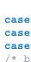

> 通常，缺少 break 是潜在错误的原因。如果你故意省略它，请添加注释明确说明，这样阅读你代码的人，甚至一段时间后的你也不会感到困惑。

如果我们想在多个 case 中执行相同的语句块，可以将它们合并在一起。例如：

```
case constant_1:
case constant_2:
case constant_3:
/* block of statements that will be executed if the value of the expression matches any of constant_1 or constant_2 or constant_3. */
break;
```

在另一个例子中，以下程序读取一个表示月份的整数（1 表示一月，12 表示十二月）并显示该月份所属的季节。

```c
#include <stdio.h>
int main(void)
{
    int month;

    printf("Enter month [1-12]: ");
    scanf("%d", &month);

    switch(month)
    {
        case 12:
        case 1:
        case 2:
            printf("Winter\n"); /* If the input value is 1, 2 or 12, the program outputs Winter. */
            break;

        case 3:
        case 4:
        case 5:
            printf("Spring\n");
            break;

        case 6:
        case 7:
        case 8:
            printf("Summer\n");
            break;

        case 9:
        case 10:
        case 11:
            printf("Autumn\n");
            break;

        default:
            printf("Error: Wrong month\n");
            break;
    }
    return 0;
}
```

## switch 与 if

switch 语句的主要缺点是我们只能进行相等性测试，即测试表达式的值是否与某个 case 常量匹配。相比之下，我们可以使用 if 来测试任何类型的条件。此外，case 常量仅限于整数，表达式也必须是整数变量或表达式。字符被视为小整数，因此可以使用，但浮点数和字符串不允许。另一方面，在某些情况下，用 switch 语句代替级联的 if-else-if 语句可能会使程序更易读。例如，switch 语句的典型用途是处理命令菜单中的用户选择。

## 练习

### C.5.21 编写一个程序模拟物理计算器。程序应读取算术运算的符号和两个整数并显示算术运算的结果。

```c
#include <stdio.h>
int main(void)
```

```c
{
    case 0:
        printf("Enter side length: ");
        scanf("%lf", &len);
        if(len <= 0)
        {
            printf("Error: Wrong length\n");
            return 0;
        }
        printf("Square area is %f\n", len*len);
        break;

    case 1:
        printf("Enter radius: ");
        scanf("%lf", &len);
        if(len <= 0)
        {
            printf("Error: Wrong length\n");
            return 0;
        }
        printf("Circle area is %f\n", 3.14*len*len);
        break;

    default:
        printf("Error: Wrong choice\n");
        break;
    }
    return 0;
}
```

C.5.23 编写一个程序，读取一个人的性别和身高，并根据表 5.3 显示对应的身高描述。

**表 5.3 身高分类**

| 性别 | 身高（米） | 结果 |
|---|---|---|
| 男 | <1.70 | 矮 |
| 男 | ≥1.70 且 <1.85 | 正常 |
| 男 | ≥1.85 | 高 |
| 女 | <1.60 | 矮 |
| 女 | ≥1.60 且 <1.75 | 正常 |
| 女 | ≥1.75 | 高 |

```c
#include <stdio.h>
int main(void)
{
    int sex;
    float height;

    printf("Enter sex (0:man - 1:woman): ");
    scanf("%d", &sex);

    printf("Enter height in meters: ");
    scanf("%f", &height);

    switch(sex)
    {
        case 0:
            if(height < 1.70)
                printf("Result: Short\n");
            else if(height < 1.85)
                printf("Result: Normal\n");
            else
                printf("Result: Tall\n");
            break;
        case 1:
            if(height < 1.60)
                printf("Result: Short\n");
            else if(height < 1.75)
                printf("Result: Normal\n");
            else
                printf("Result: Tall\n");
            break;
        default:
            printf("Error: Wrong input\n");
            break;
    }
    return 0;
}
```

C.5.24 编写一个程序，根据表 5.4 计算运送乘客行李的费用。程序应读取乘客的舱位类型和行李重量，并显示费用。

**表 5.4 运输费用**

| 舱位 | 重量（磅） | 费用（美元） |
|-------|-------------|----------|
| 经济舱 | ≤ 25 | 0 |
|  | >25 且 ≤40 | 超过 25 的每磅 1.50 |
|  | > 40 | 超过 40 的每磅 2.00 |
| 商务舱 | ≤ 35 | 0 |
|  | >35 且 ≤50 | 超过 35 的每磅 1.25 |
|  | > 50 | 超过 50 的每磅 1.50 |
| VIP | < 60 | 0 |
|  | > 60 | 30（固定费用） |

```c
#include <stdio.h>
int main(void)
{
    int clas;
    double cost, weight;

    printf("Enter class (1-Eco, 2-Business, 3-VIP): ");
    scanf("%d", &clas);

    printf("Enter weight: ");
    scanf("%lf", &weight);

    cost = 0; /* Covers all cases where the passenger pays nothing. */
    switch(clas)
    {
        case 1:
            if(weight > 40)
                cost = 22.5 + 2*(weight-40); /* 22.5 = 1.5 * 15. */
            else if(weight > 25)
                cost = 1.5*(weight-25);
            break;

        case 2:
            if(weight > 50)
                cost = 18.75 + 1.5*(weight-50); /* 18.75 = 1.25 * 15. */
            else if(weight > 35)
                cost = 1.25*(weight-35);
            break;

        case 3:
            if(weight > 60)
                cost = 30;
            break;

        default:
            printf("Error: Wrong traffic class\n");
            return 0;
    }
    printf("Total cost = %.2f\n", cost);
    return 0;
}
```

## 未解习题

U.5.1 编写一个程序，读取三种产品的价格，并使用 ?: 运算符显示其中是否有任一产品价格超过 100 美元的消息。不要使用 if 语句。

U.5.2 编写一个程序，读取两个 double 数值，并显示它们之和的绝对值。

U.5.3 编写一个程序，读取三个整数，并检查它们是否按连续升序排列（例如 5、6、7 或 -3、-2、-1）。

U.5.4 编写一个程序，读取三个整数；如果其中任意两个数之和等于第三个数，则显示位于 [0, 10] 范围内的整数。否则，程序应再读取三个整数，并显示其中有多少个是 6 的倍数或大于 20。

U.5.5 一家工厂生产小瓶和大瓶。小瓶每个 0.008 美元，大瓶每个 0.02 美元。对于订单金额超过 200 美元或瓶子总数超过 3000 个的订单，提供 8% 的折扣。对于订单金额超过 600 美元的订单，折扣为 20%。编写一个程序，读取订购的小瓶和大瓶数量，并显示总费用。

U.5.6 编写一个程序，读取学生的成绩，并显示其对应的描述，如下所示：

- a. (18–20]：优秀
- b. (16–18]：很好
- c. (13–16]：良好
- d. [10–13]：危险区
- e. [0–10]：需要帮助

U.5.7 每块以太网网卡都有一个唯一的 48 位标识符，称为介质访问控制（MAC）地址。通常，MAC 地址以十六进制形式表示。要确定地址类型，我们检查最左边的第一个八位组的值。如果它是偶数，则地址类型为单播。如果它是奇数，则类型为多播。如果所有八位组都是 0xFF，则类型为广播。例如：

- a. FF:FF:FF:FF:FF:FF 地址是广播地址。
- b. 18:20:3F:20:AB:11 地址是单播地址，因为 18 是偶数。
- c. A3:3F:40:A2:C3:42 地址是多播地址，因为 A3 是奇数。

编写一个程序，读取一个 MAC 地址并显示其类型。假设用户以 x:x:x:x:x:x 形式输入 MAC 地址，其中每个 x 都是十六进制数。

U.5.8 编写一个程序，读取三名学生的实验部分成绩和理论部分成绩。最终成绩按 lab_grd*0.3 + theory_grd*0.7 计算。程序应显示有多少名学生的成绩在 8 到 10 之间。使用的变量不得超过三个。

U.5.9 一家供水公司按如下方式收取用水费用：

- a. 固定费用 10 美元。
- b. 前 30 立方米，每立方米 0.6 美元。
- c. 接下来的 20 立方米，每立方米 0.8 美元。
- d. 再接下来的 10 立方米，每立方米 1 美元。
- e. 之后每增加一立方米，每立方米 1.2 美元。

编写一个程序，读取以立方米为单位的用水量，并显示总费用。

U.5.10 编写一个程序，读取一个四位正整数，并使用 ?: 运算符显示该数是否正读反读相同（例如数字 7667 可以）。不要使用 if 语句。

U.5.11 编写一个程序，读取一个浮点值（例如 x），并显示 f(x) 的值，如下所示：

$$
f(x)=\begin{cases}
8 & ,x<-5 \\
\frac{1}{x} & ,-5\le x<3 \\
x^2-4 & ,3\le x<12 \\
\frac{6}{(x-14)^2} & ,x\ge 12
\end{cases}
$$

U.5.12 编写一个程序，读取四个整数，并显示和最大的那一对。例如，如果用户输入 10、-8、17 和 5，程序应显示 10+17=27。

U.5.13 编写一个程序，读取正常格式 hh:mm:ss 的时间，并显示距离午夜（即 24:00:00）还有多少时间。

U.5.14 使用一个 printf() 和 ?: 运算符编写 U.5.6 的程序。

U.5.15 编写一个程序，读取月份编号（1 表示一月，12 表示十二月）和日期编号（例如，如果输入月份是一月，有效值为 1 到 31），并显示 50 天后的日期。如果是二月，程序应提示用户输入该月的天数，即 28 或 29。例如，如果用户输入月份 3 和日期 5，程序应显示：4/24。

U.5.16 编写一个程序，读取三个整数和用户的选择，并使用 switch 语句支持三种情况。如果用户的选择为 1，程序应检查这些整数是否互不相同，并显示一条消息。如果选择为 2，应检查其中是否有任意两个相等；如果选择为 3，应显示其中有多少个位于 [-5, 5] 范围内。

U.5.17 编写一个程序，读取两个分数的分子和分母，以及一个对应于数学运算的整数（例如，1：加法，2：减法，

**表 5.5 租赁费率**

| 车辆 | 排量（c.c） | 每日费用（美元）第 1-2 天 | 每日费用（美元）第 3-5 天 | 每日费用（美元）超过 5 天 |
| --- | --- | --- | --- | --- |
| 摩托车 | ≤ 100 | 30 | 25 | 20 |
|  | > 100 | 40 | 35 | 30 |
| 汽车 | ≤ 1000 | 60 | 55 | 50 |
|  | > 1000 | 80 | 70 | 60 |


3：乘法，4：除法）并使用 `switch` 语句显示数学运算的结果。

- **U.5.18** 编写一个程序，读取当前年份和出生年份，并使用 `switch` 语句以文字形式显示年龄。假设年龄不超过两位数字。例如，如果用户输入 2020 和 1988，程序应显示三十二。

- **U.5.19** 编写一个程序，根据表 5.5 计算租用车辆的费用。

  程序应读取车辆类型和租用天数，并使用 `switch` 语句显示费用。此外，程序应询问用户是否需要保险保障，如果答案为肯定，则在总费用中额外收取 5%。

## 6 循环

程序经常包含必须执行多次的代码块。一个语句的工作是只要控制表达式的值为真就重复执行相同的代码，从而创建一个迭代循环。在本章中，我们将讨论 C 的迭代语句：for、while 和 do-while，它们允许我们设置循环，以及 break、continue 和 goto 语句，可用于将控制从程序的一个点转移到另一个点。

### for 语句

for 语句是 C 的三种循环语句之一。for 语句的一般形式为：

```c
for(exp1; exp2; exp3)
{
    /* a block of statements (loop body), that is repeatedly executed
    as long as the value of exp2 is true. */
}
```

三个表达式 exp1、exp2 和 exp3 可以是任何有效的 C 表达式。for 语句的执行涉及以下步骤：

- 1. exp1 只执行一次。通常，exp1 初始化在另外两个表达式中使用的变量。
- 2. 评估 exp2 的值。通常，它是一个关系条件。如果为假，循环终止，程序的执行将继续执行闭合大括号后的语句。如果为真，则执行循环体。
- 3. 执行 exp3。通常，exp3 更改 exp2 中使用的变量的值。
- 4. 重复步骤 2 和 3，直到 exp2 变为假。

与 if 语句一样，如果循环体只包含一个语句，则可以省略大括号。以下程序使用 for 语句显示从 0 到 4 的数字。

```c
#include <stdio.h>
int main(void)
{
    int a;
    for(a = 0; a < 5; a++) /* The braces can be omitted. */
    {
        printf("%d ", a);
    }
    return 0;
}
```

看它是如何工作的：

- a. 语句 a = 0; 被执行。
- b. 检查条件 a < 5。由于为真，printf() 被执行，程序显示 0。
- c. 执行 a++ 语句，a 变为 1。再次检查条件 a < 5。因为仍然为真，printf() 再次执行，程序显示 1。此过程重复，直到它变为 5，此时条件 a < 5 变为假，循环终止。因此，程序显示：0 1 2 3 4

让我们问你，如果我们写 a != 5 而不是 a < 5 输出会相同吗？是的，会相同。现在，注意这一点。一个非常常见的错误是使用 = 来检查是否达到最终值。例如，写 a = 5 而不是 a < 5。由于此赋值使条件为真，循环变为无限并显示 ...，找到它！

现在，以下程序输出什么？

```c
for(a = 0; a > 1; a++)
{
    printf("%d\n", a);
    printf("*End\n");
}
```

由于 a 为 0，a > 1 的值为假，循环体未执行，代码不显示任何内容。

for 语句中的表达式可能包含多个由逗号运算符（,）分隔的表达式。它通常用于第一个和第三个表达式。例如：

```c
int a, b;
for(a = 1, b = 2; b < 10; a++, b++)
```

表达式 a = 1, b = 2 首先将 1 赋给 a，然后将 2 赋给 b，而表达式 a++, b++ 首先递增 a 然后递增 b。


与 if 语句一样，一个常见的错误是在 for 语句末尾意外添加分号 ；。

例如，考虑以下程序：

```c
#include <stdio.h>
int main(void)
{
    int i;

    for (i = 2; i < 7; i+=3);
        printf("%d\n", i);
    return 0;
}
```

`for` 语句末尾的分号表示一个 *空* 语句，即不执行任何操作的语句。因此，编译器假定循环体为空，`printf()` 将只执行一次，在条件 `i < 7` 变为假之后。让我们追踪迭代：

- *第一次迭代。* 由于 i 为 2，条件 `i < 7` (`2 < 7`) 为真。由于循环体为空，下一个要执行的语句是 `i+=3` (`i = i+3 = 2+3 = 5`)。
- *第二次迭代。* 由于 i 为 5，条件 `i < 7` (`5 < 7`) 仍然为真，语句 `i+=3` 使 i 等于 8。
- *第三次迭代。* 由于 i 为 8，条件 `i < 7` (`8 < 7`) 变为假，循环终止。

接下来，`printf()` 被执行，程序输出 i 的值，即 8。
如果你确实打算创建一个空循环，建议将分号单独放在一行，以使读者清楚。例如：

```c
for (i = 2; i < 7; i+=3)
    ;
```

现在，读者不会怀疑分号是否被意外放置。
因为在几个程序中我们需要生成随机数，让我们稍作插曲并向你展示这样一个例子：

```c
#include <stdio.h>
#include <stdlib.h>
#include <time.h>
int main(void)
{
    int i, num;

    srand(time(NULL));
    for (i = 0; i < 5; i++)
    {
        num = rand();
        printf("%d\n", num);
    }
    return 0;
}
```

rand() 函数，连同 srand() 和 time() 函数，用于每次程序运行时生成随机整数。rand() 返回 0 到 RAND_MAX 之间的整数。RAND_MAX 的值在 stdlib.h 中定义。srand() 函数为 rand() 设置种子。例如，如果我们想在 [0, 1] 中生成随机浮点数，我们写 (double)rand()/RAND_MAX。如你在附录 C 中所见，为了在程序中使用这些函数，我们必须包含 stdlib.h 和 time.h 文件。实际上，rand() 和 srand() 通常用于模拟实验和游戏应用程序。

### 省略表达式

for 语句的三个表达式是可选的。事实上，C 允许我们省略其中任何一个或全部。例如，在以下代码中，因为 a 在 for 语句之前初始化，所以第一个表达式可以省略。

```c
int a = 0;
for(; a < 5; a++)
```

请注意，在第二个表达式之前的分号必须存在。事实上，即使第一个和第二个表达式都被省略，两个分号也必须始终存在。

类似地，我们可以将第三个表达式放在循环体中并从 for 语句中移除。例如，在以下代码中，第三个表达式 a++ 被放在体内部。

```c
for(a = 0; a < 5;)
{
    printf("%d ", a);
    a++;
}
```

如果控制表达式缺失，编译器将其视为始终为真，循环变为无限循环；也就是说，它永远不会结束。例如，这个 for 语句创建了一个无限循环：

```c
for(a = 0; ; a++)
```

大多数程序员省略全部三个表达式以创建无限循环。例如：

```c
for(; ;)
```

接下来，我们将看到如果第一个和第三个表达式都缺失，for 语句等价于 while 语句。例如：

```c
for(; a < 5;)  is equivalent to:  while(a < 5)
```

### 练习

**C.6.1** 当...时，以下程序的输出是什么：

```c
#include <stdio.h>
int main(void)
{
    int i, j;

    for(i = j; i < 10; j++)
        printf("One\n");
    return 0;
}
```

- a. j 为 10？

  **Answer:** 由于条件 i < 10 (10 < 10) 为假，循环未执行，程序不显示任何内容。

- b. j 为 3；

  **Answer:** 由于 i 为 3，条件 i < 10 (3 < 10) 始终为真。因此，循环永不结束，程序会永远显示 One，显著降低计算机性能。

**C.6.2** 以下程序的输出是什么？

```c
#include <stdio.h>
int main(void)
{
    int i;
    unsigned int j;

    for(i = 12; i > 2; i -=5)
        printf("%d ", i);
    printf("End = %d\n", i);

    for(j = 5; j >= 0; j--)
        printf("Test\n");
    return 0;
}
```

**Answer:** 由于 **for** 语句不包含大括号，编译器假定循环体由一个语句组成，即第一个 printf()。请注意缩进如何让你误以为第二个 printf() 也包含在

循环体。事实上，它只在循环结束后执行一次。我们来追踪各次迭代：

第一次迭代。由于 i 是 12，条件 i > 2（12 > 2）为真，程序显示 12。

第二次迭代。执行语句 i-=5（i = i-5）后，i 变为 7。因此，条件 i > 2（7 > 2）为真，程序显示 7。

第三次迭代。现在，i 变为 2。因此，条件 i > 2（2 > 2）为假，循环终止。

接下来，第二个 printf() 显示 i 的当前值。因此，程序显示 12 7 End = 2

这里是第二个陷阱。由于 j 被声明为 unsigned，它永远不会变成负数（例如 -1）。因此，第二个循环是无限循环，程序会永远输出 Test。

### C.6.3 编写一个程序，读取一个整数；如果该整数在 [10, 20] 范围内，程序应显示单词 One，显示次数等于输入的整数。否则，程序应读取 10 个整数并显示其中的负数。

```c
#include <stdio.h>
int main(void)
{
    int i, num;

    printf("Enter number: ");
    scanf("%d", &num);

    if(num >= 10 && num <= 20)
    {
        for(i = 0; i < num; i++)
            printf("One\n");
    }
    else
    {
        for(i = 0; i < 10; i++)
        {
            printf("Enter number: ");
            scanf("%d", &num);
            if(num < 0)
                printf("%d\n", num);
        }
    }
    return 0;
}
```

注释：if 和 else 语句后的大括号并不需要，因为其中只包含 for 语句。我们使用它们是为了更好的可读性。

## break 语句

我们已经讨论过 **break** 语句如何终止 **switch** 语句的执行。它也可以用来终止 **for**、**while** 或 **do-while** 循环，并将控制转移到循环之外。例如：

```c
#include <stdio.h>
int main(void)
{
    int i;
    for(i = 1; i < 10; i++)
    {
        if(i == 5)
            break;
        printf("%d ", i);
    }
    printf("End = %d\n", i);
    return 0;
}
```

只要 i 不是 5，if 条件就为假，程序会显示 i 从 1 到 4 的值。当 i 变为 5 时，**break** 语句终止循环，程序继续执行外层的 printf()。因此，程序显示：1 2 3 4 End = 5

每个 **break** 都会终止它所包含于其中的循环或 **switch** 语句的执行。例如，以下程序的输出是什么？

```c
#include <stdio.h>
int main(void)
{
    int i;
    for(i = 1; i < 10; i++)
    {
        switch(i)
        {
            case 4:
                break;
            default:
                if(i == 3)
                    break;
                else
                    printf("%d", i);
                break;
        }
        if(i == 6)
            break;
    }
    return 0;
}
```

在前两次迭代中，default 分支输出 1* 和 2*，break 语句终止的是 switch 语句，而不是 for 语句。现在要小心：在第三次迭代中，是 if 内部的 break 语句终止了 switch，程序不显示任何内容。在第四次迭代中，是第一个 case 中的 break 语句终止了 switch，程序不显示任何内容。第五次迭代输出 5*，下一次输出 6*，然后外层的 break 终止循环。因此，程序输出：1* 2* 5* 6*。

既然我们想起了 switch，这里给你一个新挑战：你能告诉我们以下程序输出什么吗？

```c
#include <stdio.h>
int main(void)
{
    int i;

    for(i = 1; i < 12; i++)
    {
        switch(i)
        {
            case 1: i += 2;
            case 2: i += 3;
            default: i += 4;
        }
    }
    printf("%d", i);
    return 0;
}
```

正如你所猜到的，我们故意在 switch 语句中使用那种缩进来迷惑你。在第一次迭代中，由于 i 是 1，程序执行第一个 case 的语句，并因为缺少 break 而继续执行后面的 case。因此，i 变为 10。在第二次迭代中，因为 i 现在是 11，只执行 default 分支，i 变为 15。接下来，i 变为 16，循环结束，这就是输出值。

## continue 语句

continue 语句只能在 for、while 或 do-while 循环内部使用。break 语句结束循环，而 continue 语句终止当前所在循环的本次迭代，并导致下一次迭代开始。对于当前迭代，循环体的其余部分会被跳过。例如，考虑以下程序：

```c
#include <stdio.h>
int main(void)
{
    int i;
    for(i = 1; i < 10; i++)
    {
        if(i < 5)
            continue;
        printf("%d ", i);
    }
    return 0;
}
```

只要 i 小于 5，if 条件就为真，continue 语句会终止当前迭代。循环体的其余部分（即 printf()）会被跳过，程序继续执行 i++ 语句。当 i 变为大于或等于 5 时，continue 语句不再执行，程序显示 i 的值。因此，程序输出：5 6 7 8 9。

注意，我们可以通过测试相反条件来避免使用 continue。例如：

```
if(i >= 5)
    printf("%d ", i);
```

就风格而言，我们更倾向于使用 continue 语句而不是反向逻辑，以便让读者清楚哪个条件会触发下一次迭代。例如，编写以下代码比使用反向逻辑更清晰：

```
if(a >= 5 || b != 10 || c < -8)
    continue;
```

与 break 不同，continue 语句不适用于 switch。位于循环内、switch 内部的 continue 语句会触发下一次循环迭代。因此，在上一节的第二个示例中，如果我们将 default 分支改为：

```
default:
    if(i == 3)
        break;
    else
        continue;
printf("* ");
break;
```

由于 continue 语句导致下一次迭代开始，程序不显示任何内容。

## 练习

### C.6.4 以下程序的输出是什么？

```c
#include <stdio.h>
int main(void)
{
    int i = 0, j = 5;
    for(i > j; i+j == 5; j < 2)
    {
        printf("One\n");
        i = 4;
        j = 2;
    }
    printf("%d %d\n", i, j);
    return 0;
}
```

答案：i > j 的值为 0；然而，这并不影响循环的执行。我们来追踪各次迭代：

第一次迭代。由于 i 为 0，条件 i+j == 5（0+5 = 5 == 5）为真，程序输出 One。接下来，i 和 j 分别变为 4 和 2。

第二次迭代。j < 2 的值为 0；然而，这并不影响执行。由于条件 i+j == 5（4+2 = 6 == 5）变为假，循环结束。

程序显示 i 和 j 的值，即分别为 4 和 2。

### C.6.5 一次测试由 10 道多项选择题组成，每道题有三个可能的答案。第一个答案得三分，第二个得一分，第三个得两分。编写一个程序，使用 switch 语句读取应试者的 10 个答案并显示最终得分。

```c
#include <stdio.h>
int main(void)
{
    int i, ans, points;

    points = 0;
    for(i = 0; i < 10; i++)
    {
        printf("Enter answer [1-3]: ");
        scanf("%d", &ans);

        switch(ans)
        {
            case 1:
                points += 3;
            break;

            case 2:
                points += 1;
            break;

            case 3:
                points += 2;
            break;

            default:
                printf("Error: Wrong answer ...\n");
            break;
        }
    }
    printf("Candidate gets %d points in total\n", points);
    return 0;
}
```

### C.6.6 以下程序的输出是什么？

```c
#include <stdio.h>
int main(void)
{
    int i, j;

    for(i = 10, j = 2; i != j; i-=2, j+=2)
        printf("%d %d\n", i, j);
    return 0;
}
```

答案：当 i 等于 j 时循环终止。这发生在第二次迭代之后，此时两者都变为 6。因此，循环执行两次，程序显示：

10 2
8 4

```c
for(i = 0; i ? 0 : i+1; i++)
    printf("%d\n", i);
return 0;
}
```

答案：在第一次迭代中，由于 i 为 0，控制表达式的值为 i+1 = 1。因此，循环执行，程序显示 0。在第二次迭代中，i 变为 1，因此表达式的值变为 0，循环终止。

### C.6.9
编写一个程序，读取一个整数并显示其乘法表。例如，如果用户输入 5，程序应输出：1*5 = 5、2*5 = 10、...、10*5 = 50。程序应强制用户输入 [1, 10] 范围内的整数。

```c
#include <stdio.h>
int main(void)
{
    int i, num;

    for(;;) /* Create an infinite loop. */
    {
        printf("Enter number [1-10]: ");
        scanf("%d", &num);
        if ((num >= 1) && (num <= 10))
            break; /* If the user enters a number within [1, 10], the loop terminates. */
    }
    for(i = 1; i <= 10; i++)
        printf("%d * %d = %d\n", i, num, i*num);
    return 0;
}
```

### C.6.10
编写一个程序，读取一个正整数 n，并验证数学公式：1 + 3 + 5 + ... + (2n-1) = n²。

```c
#include <stdio.h>
int main(void)
{
    int i, num, sum;

    printf("Enter number > 0: ");
    scanf("%d", &num);
    sum = 0; /* This variable holds the sum of the terms. It is initialized to 0, to make the additions. */
    for(i = 1; i <= 2*num-1; i+=2)
        sum += i;
    if(sum == num*num)
        printf("Verified\n");
    else
        printf("Not Verified\n");
    return 0;
}
```

```c
for(; ++i;)
    printf("\n%d ", i);
return 0;
}
```

答案：第一个循环在 i && i-1 变为假时结束。这发生在 i 变为 1 时。因此，循环执行两次，程序输出 3 和 2。让我们看第二个循环。表达式 ++i 等价于 ++i != 0。这个表达式会变为 0 吗？会，因为 i 的类型是 unsigned char，一旦它变为 255，下一次自增会使其变为 0。因此，第二个循环输出 i 从 2 到 255 的值。

### C.6.13
编写一个程序，读取两个整数并显示它们之间整数的和。例如，如果用户输入 3 和 8，程序应显示 22，因为 4+5+6+7 = 22。程序应检查两个输入数字中哪个更大，并相应地处理。

```c
#include <stdio.h>
int main(void)
{
    int i, j, sum;

    printf("Enter numbers: ");
    scanf("%d%d", &i, &j);

    sum = 0;
    if(i < j)
    {
        for(i = i+1; i < j; i++)
            sum += i;
    }
    else if(j < i)
    {
        for(j = j+1; j < i; j++)
            sum += j;
    }
    printf("Sum = %d\n", sum);
    return 0;
}
```

### C.6.14
编写一个程序，读取 100 名学生的成绩，并在结束前显示及格学生的平均分和不及格学生的平均分。成绩等于或大于 5 的学生通过考试。程序应强制用户输入 [0, 10] 范围内的成绩。如果用户输入 -1，则应结束成绩输入。

```c
#include <stdio.h>
int main(void)
{
    int i, suc, fail;
    float grd, sum_suc, sum_fail;

    suc = fail = 0;
    sum_suc = sum_fail = 0;

    for(i = 0; i < 100; i++)
    {
        printf("Enter grade: ");
        scanf("%f", &grd);

        if(grd == -1)
            break;
        if(grd > 10 || grd < 0)
        {
            printf("Wrong grade, try again ...\n");
            i--; /* If the input grade is out of [0, 10], the
            grade is ignored and i is decremented to repeat the insertion. */
            continue;
        }
        if(grd >= 5)
        {
            suc++;
            sum_suc += grd;
        }
        else
        {
            fail++;
            sum_fail += grd;
        }
    }
    if(i != 0)
    {
        if(suc)
            printf("Avg(+) = %.2f\n", sum_suc/suc);
        else
            printf("Everybody failed\n");

        if(fail)
            printf("Avg(-) = %.2f\n", sum_fail/fail);
        else
            printf("None failed\n");
    }
    return 0;
}
```

### C.6.15
编写一个程序，读取 8 个位（每个位为 0 或 1），并显示对应的无符号整数，假设这些位是从左到右输入的。例如，如果用户输入 10000000，程序应显示 128。

```c
#include <stdio.h>
int main(void)
{
    int i, num, dig;

    num = 0;
    for(i = 7; i >= 0; i--)
    {
        printf("Enter digit_%d (0 or 1): ", i+1);
        scanf("%d", &dig);
        num += (dig << i);
    }
    printf("The decimal value = %d\n", num);
}
```

### C.6.16
编写一个程序，显示 1×2/3×4 + 5×6/7×8 + 9×10/11×12 + ... 的和，直到将要加入一个值大于 0.995 的项为止。此外，程序应显示已加入多少项以及最后一个有效项的值。

```c
#include <stdio.h>
int main(void)
{
    int i, cnt;
    double sum, term;

    sum = cnt = 0;
    i = 1;
    for(;;)
    {
        term = (double)(i*(i+1))/((i+2)*(i+3));
        if(term > 0.995)
            break;
        cnt++;
        sum += term;
        i += 4;
    }
    i -= 4;
    term = (double)(i*(i+1))/((i+2)*(i+3));
    printf("Sum:%f Terms:%d Last:%f\n", sum, cnt, term);
    return 0;
}
```

### C.6.17
以下程序的输出是什么？记住，printf() 返回显示的字符数。

```c
#include <stdio.h>
int main(void)
{
    int i;

    for(i = 0; printf("%d", i++) < 2;) /* Empty loop. */
    printf("\nEnd = %d\n", i);
    return 0;
}
```

答案：如前所述，for 语句中的表达式可以是任何有效表达式。在第一次迭代中，printf() 输出 i 的值，即 0，然后 i 自增 1。由于 printf() 返回显示的字符数，返回值是 1。因此，循环继续，因为条件为真（1 < 2）。对于直到 10 的所有数字，情况相同。当 i 变为 10 时，printf() 输出 10，然后 i 变为 11。现在，由于显示了两个字符，printf() 返回 2，这使得条件为假（2 < 2），循环终止。因此，程序输出：

012345678910
End = 11

### C.6.18
编写一个程序，读取班级中的学生人数及其一次测验的成绩。程序应显示班级测验平均分、最低和最高测验成绩，以及有多少学生获得了相同的最高成绩。假设成绩是 [0, 10] 范围内的整数。

```c
#include <stdio.h>
int main(void)
{
    int i, grd, studs_num, times, min_grd, max_grd, sum_grd;

    printf("Enter number of students: ");
    scanf("%d", &studs_num);

    if(studs_num <= 0)
    {
        printf("Wrong number of students\n");
        return 0; /* Program termination. */
    }
    min_grd = 11;
    max_grd = -1;
    sum_grd = 0;
    for(i = 0; i < studs_num; i++)
    {
        printf("Enter grade [0-10]: ");
        scanf("%d", &grd);

        if(grd < min_grd)
            min_grd = grd;
        if(grd > max_grd)
        {
            max_grd = grd;
            times = 1; /* First appearance of the new maximum grade. */
        }
        else if(max_grd == grd)
            times++;

        sum_grd += grd;
    }
    printf("Min:%d, Max:%d (appeared %d times) Avg:%.2f\n", min_grd, max_grd, times, (float)sum_grd/studs_num);
    return 0;
}
```

```c
            return 0;
        }
        for(i = 3; i <= num/2; i+=2)
        {
            if(num % i == 0)
            {
                printf("%d is not prime\n", num);
                return 0; /* Since a divisor is found, it is
                not needed to search for other divisors, so the program terminates. */
            }
        }
        printf("The number %d is prime\n", num);
    }
    else
        printf("Error: Not valid number\n");
    return 0;
    }
```

**注释：** 如果该数是除 2 以外的偶数，则它不是素数，程序终止。如果该数是奇数，则只检查奇数因子。因为任何数 N 都没有大于 N/2 的因子，所以程序检查从 2 到输入数一半的任何整数是否能整除该数。如果找到因子，程序终止。

请注意，这个解决方案不是最高效的。它还可以进一步改进。例如，我们可以检查从 2 到输入数平方根的因子，因为数学事实是：如果一个数 N 不是素数，它至少有两个大于 1 的因子，且其中一个等于或小于 √N。为了求平方根，我们可以使用附录 C 中所述的 sqrt() 函数，或者不使用 sqrt()，而是将 i*i 与 num 进行比较。

## 嵌套循环

当一个迭代循环包含在另一个循环的循环体中时，外层循环的每次迭代都会触发嵌套循环的执行。我们将使用 `for` 语句来解释嵌套循环。嵌套的 `while` 和 `do-while` 循环的执行方式类似。例如，让我们跟踪以下程序中的迭代：

```c
#include <stdio.h>
int main(void)
{
    int i, j;

    for(i = 0; i < 2; i++)
    {
        printf("One ");
        for(j = 0; j < i; j++)
            printf("Two ");
    }
    return 0;
}
```


外层循环的第一次迭代（i=0）：由于条件（i < 2）为真，程序显示 One。

内层循环的第一次迭代（j=0）：由于条件（j < i）为假，循环不执行。

外层循环的第二次迭代（i=1）：又显示了一个 One。

内层循环的第一次迭代（j=0）：由于条件（j < i）为真，程序显示 Two。

内层循环的第二次迭代（j=1）：现在条件为假，循环终止。

外层循环的第三次迭代（i=2）：由于条件（i < 2）为假，循环终止。

因此，程序显示：One One Two

让我们看另一个示例：

```c
#include <stdio.h>
int main(void)
{
    int i, j;

    for(i = 0; i < 2; i++)
    {
        for(j = 0; j < 2; j++)
        {
            if(i == 1)
                break;
            printf("Two ");
        }
        printf("One ");
    }
    printf("\nVal1 = %d Val2 = %d\n", i, j);
    return 0;
}
```

外层循环的第一次迭代（i=0）：由于条件（i < 2）为真，内层循环执行。

内层循环的第一次迭代（j=0）：由于 if 条件为假，程序显示 Two。

内层循环的第二次迭代（j=1）：现在 if 条件为真；break 语句终止内层循环，程序显示 One。

外层循环的第二次迭代（i=1）：内层循环再次执行。

内层循环的第一次迭代（j=0）：由于 if 条件为真，break 语句终止内层循环，程序显示 One。

外层循环的第三次迭代（i=2）：由于条件（i < 2）为假，循环终止。

程序还会显示 i 和 j 的值，分别为 2 和 0。因此，程序显示：

```text
Two One One
Val1 = 2   Val2 = 0
```

## 练习

### C.6.21 以下程序的输出是什么？

```c
#include <stdio.h>
int main(void)
{
    int i;

    for(i = 0; i < 2; i++)
    {
        printf("One ");
        for(i = 0; i < 2; i++)
            printf("Two ");
    }
    printf("Val = %d\n", i);
    return 0;
}
```

答案：让我们跟踪迭代过程：

外层循环的第一次迭代（i=0）：由于条件（i < 2）为真，程序显示 One，并且内层循环执行。

内层循环的第一次迭代（i=0）：由于条件（i < 2）为真，程序显示 Two。

内层循环的第二次迭代（i=1）：又显示了一个 Two。

内层循环的第三次迭代（i=2）：现在条件为假，循环终止。

外层循环的第二次迭代（i=3）：由于 i 在内层循环中变成了 2，i++ 语句使其变成 3。由于条件（i < 2）为假，循环终止。

因此，程序输出：One Two Two Val = 3

### C.6.22 编写一个程序，显示从 1 到 10 的乘法表。

```c
#include <stdio.h>
int main(void)
{
    int i, j;

    for(i = 1; i <= 10; i++)
    {
        for(j = 1; j <= 10; j++)
            printf("%d * %d = %d\n", i, j, i*j);

        printf("\n");
    }
    return 0;
}
```

### C.6.23 编写一个程序，读取一个表示行数的整数。程序应在每一行显示与行号数量相等的 '\*'。例如，如果用户输入 5，程序应显示：

```text
*
* *
* * *
* * * *
* * * * *
```

```c
#include <stdio.h>
int main(void)
{
    int i, j, lines;

    printf("Enter lines: ");
    scanf("%d", &lines);

    for(i = 0; i < lines; i++)
    {
        for(j = 0; j <= i; j++)
            printf("* "); /* Add a space character after '*' . */
        printf("\n"); /* Change line to display the next group of
                         '*' . */
    }
    return 0;
}
```

注释：假设用户输入 5。我们通过跟踪外层循环的前两次迭代来解释这段代码。

- *外层循环的第一次迭代（i=0）：* 由于条件（i < 5）为真，内层循环执行。
  - *内层循环的第一次迭代（j=0）：* 由于条件（j <= i）为真，程序显示 \*。
  - *内层循环的第二次迭代（j=1）：* 现在条件为假；循环终止，printf() 换行。
- *外层循环的第二次迭代（i=1）：* 由于条件（i < 5）为真，内层循环执行。
  - *内层循环的第一次迭代（j=0）：* 由于条件（j <= i）为真，程序显示 \* 并留下一个空格。
  - *内层循环的第二次迭代（j=1）：* 又显示了一个 \*。
  - *内层循环的第三次迭代（j=2）：* 现在条件为假；循环终止，printf() 换行。

到目前为止，程序已显示：

```text
*
* *
```

后续各行以类似方式产生。

### C.6.24 编写一个程序，读取五名学生在三门不同课程中的成绩，并显示每名学生在三门课程中的平均成绩，以及所有学生在所有课程中的总平均成绩。

```c
#include <stdio.h>

#define LESSONS   3
#define STUDENTS  5

int main(void)
{
    int i, j;
    float grd, stud_grd, sum_grd;

    sum_grd = 0;
    for(i = 0; i < STUDENTS; i++)
    {
        printf("***** Student %d\n", i+1);
        stud_grd = 0; /* This variable holds the sum of a student's
        grades in all courses. It is initialized to 0 for each one. */
        for(j = 0; j < LESSONS; j++)
        {
            printf("Enter grade for lesson %d: ", j+1);
            scanf("%f", &grd);
            stud_grd += grd;
            sum_grd += grd; /* This variable holds the sum of all
            grades. */
        }
        printf("Average grade for student %d is %.2f\n",
               i+1, stud_grd/LESSONS);
    }
    printf("\nTotal average grade is %.2f\n",
           sum_grd/(STUDENTS*LESSONS));
    return 0;
}
```

### C.6.25 编写一个程序，显示方程 3x + 7y - 5z = 10 的整数根（如果有的话），其中 x、y、z 是 [-30, 30] 范围内的整数。

```c
#include <stdio.h>
int main(void)
{
    int x, y, z, flag;

    flag = 1;

    for(x = -30; x <= 30; x++)
        for(y = -30; y <= 30; y++)
            for(z = -30; z <= 30; z++)
```

for 和 while 语句密切相关。事实上，for 语句：

```c
for(exp1; exp2; exp3)
{
    statements;
}
```

等价于：

```c
exp1;
while(exp2)
{
    statements;
    exp3;
}
```

除非 for 循环包含 continue 语句。

要回答是使用 while 还是 for 语句的问题，鉴于二者产生等价的代码，我们会说这很大程度上是个人偏好问题。通常，当迭代次数未知，或者只测试条件而没有初始化或步进操作时，会使用 while 语句。例如：

```c
while(fscanf(fp, "%d", &i) != 1)  /* This statement will be explained in Chapter 15. */
```

当迭代次数预先确定并且使用步进时，最好使用 for 语句，因为其紧凑的形式使循环更易读。然而，在若干情况下，尽管 for 语句似乎是更好的选择，却可能产生“笨拙”的代码。C.6.14 中对 for 的使用就是这样一个例子。如果用户输入了错误的值，步进会在其循环体内部发生变化，依我们看这是一种“笨拙”的编程选择。如果把那个 for 语句替换为 while 语句，代码会变得更优雅。试一试，看看区别。

如果 exp 始终为真，循环将永远执行，除非其循环体包含退出语句（例如 break）。例如，以下循环是无限循环：

```c
while(1)
    printf("\nOne\n");
```

按照惯例，大多数程序员使用值 1 来创建无限循环。不过，也可以使用任何非零常量。

与 for 语句一样，while 语句末尾的分号声明了一个空循环体。例如，在括号后加分号：

```c
int a = 10;
while(a != 0);
    a--;
```

会使循环变成无限循环，并且语句 a--; 永远不会被执行。


在继续做练习之前，这是最后一个示例。下面这个程序输出什么？

```c
#include <stdio.h>
int main(void)
{
    int i, sum;

    i = sum = 0;
    while(i < 5)
    {
        sum += 10;
        i = i+2;
    }
    printf("Sum = %d\n", sum);
    return 0;
}
```

抓到你打瞌睡了吧？你的答案是 30 吗？谁告诉你 += 是复合运算符的？第 4 章已经提醒过你，复合运算符中的 = 排在第二位，不是吗？因此，语句 sum += 10; 等价于 sum = sum +10;，它只是把 10 赋给 sum，而这个值就是输出值。

基本上，这个示例的主要目的是向你说明：阅读代码时，即使只有几行，也要想象成千上万行的情况，很容易漏掉一个简单的 bug。有时候，bug 越容易插入，就越难发现。只要记住，写代码时应当特别专注、谨慎，并保持好心情。继续做练习吧，不过要当心接下来的陷阱。

## 练习

### C.6.26
编写一个程序，连续读取整数并显示它们，直到用户输入 0 为止。不得显示数字 0。

```c
#include <stdio.h>
int main(void)
{
    int i = 1; /* Initialize with a nonzero value, just to be sure
that the loop will be executed. */
    while(i != 0)
    {
        printf("Enter number: ");
        scanf("%d", &i);
        if(i != 0)
            printf("Num = %d\n", i);
    }
    return 0;
}
```

### C.6.27
求下面程序中的迭代次数。

```c
#include <stdio.h>
int main(void)
{
    int a = 256, b = 2;

    while(a != b)
    {
        b = b*b;
        a >>= 2;
    }
    return 0;
}
```

答案：

第一次迭代。由于 a = 256、b = 2，条件为真，因此 b 变为 4，而 a 右移两位后变为 64。第二次迭代。条件仍为真，因此 b 和 a 都变为 16。第三次迭代。由于 a 和 b 相等，条件变为假，循环结束。

### C.6.28
下面程序的输出是什么？

```c
#include <stdio.h>
int main(void)
{
    int i = -2;
    while(i-6)
    {
        printf("One ");
        i++;
        while(!(i+1))
        {
            printf("Two ");
            i--;
        }
        i += 2;
    }
    return 0;
}
```

答案：与嵌套 for 循环一样，外层 while 循环的每次迭代都会触发嵌套循环的执行。注意，while(i-6) 等价于 while(i-6 != 0)，而 while(!(i+1)) 等价于 while(i+1 == 0)。我们来跟踪外层循环的第一次迭代：外层循环第一次迭代：由于 i 为 -2，条件 (i-6 != 0) 为真，因此程序显示 One，并且 i 变为 -1。内层循环第一次迭代：由于 i 为 -1，条件 (i+1 == 0) 为真，因此程序显示 Two，并且 i 变为 -2。内层循环第二次迭代：由于 i 为 -2，条件 (i+1 == 0) 为假，循环终止。接下来，语句 i+=2; 使 i 等于 0。最终，程序输出：One Two One One

### C.6.29
编写一个程序，连续读取一个整数，并显示单词 Hello，显示次数等于输入的整数。如果用户输入负数，则整数输入应结束，程序应显示已显示的 Hello 总数。只使用 while 循环。

```c
#include <stdio.h>
int main(void)
{
    int i, num, times;
    times = 0;
    while(1)
    {
        printf("Enter number: ");
        scanf("%d", &num);
        if(num < 0)
            break;
        i = 0;
        while(i < num)
        {
            printf("Hello\n");
            i++;
        }
        times += num;
    }
    printf("Total number is %d\n", times);
    return 0;
}
```

### C.6.30
编写一个程序，连续读取商店中商品的价格，直到用户输入 -1 为止。程序应在终止前显示最低价格、最高价格，以及价格在 [5, 30] 范围内的平均值。假设最高价格为 $100。

```c
#include <stdio.h>
int main(void)
{
    int set_prc;
    float min, max, sum_prc, prc;
    set_prc = 0; /* This variable counts the products whose price is within the specified set. */
    sum_prc = 0; /* This variable holds the sum of the prices within the specified set. */
    min = 100;
    max = 0;
    while(1)
    {
        printf("Enter price: ");
        scanf("%f", &prc);
        if(prc == -1)
            break;
        if(prc >= 5 && prc <= 30)
        {
            sum_prc += prc;
            set_prc++;
        }
        if(max < prc)
            max = prc;
        if(min > prc)
            min = prc;
    }
    printf("\nMin = %f, Max = %f\n", min, max);
    if(set_prc != 0)
        printf("Avg = %.2f\n", sum_prc/set_prc);
    else
        printf("No product is included\n");
    return 0;
}
```

### C.6.31
编写一个程序，读取一个整数并显示其位数及各位数字之和。例如，如果用户输入 1234，程序应显示 4 和 10（1+2+3+4 = 10）。

```c
#include <stdio.h>
int main(void)
{
    int num, sum, dig;

    sum = dig = 0;

    printf("Enter number: ");
    scanf("%d", &num);

    if(num == 0)
        dig = 1;
    else
    {
        while(num != 0)
        {
            sum += num % 10; /* Add the last digit. */
            num /= 10; /* Remove the last digit. */
            dig++;
        }
    }
    if(sum < 0)
        sum = -sum;
    printf("%d digits and their sum is %d\n", dig, sum);
    return 0;
}
```

### C.6.32
编写一个程序，连续读取 [0, 255] 范围内的整数，并以二进制形式显示它。例如，如果用户输入 32，程序应显示 00100000。对于任何超出 [0, 255] 的值，程序应终止。

```c
#include <stdio.h>
int main(void)
{
    int i, num;

    while(1)
    {
        printf("\nEnter number: ");
        scanf("%d", &num);
        if(num < 0 || num > 255)
            break;
        for(i = 7; i >= 0; i--) /* Check each bit. */
        {
            if((num >> i) & 1)
                printf("1");
            else
                printf("0");
        }
    }
    return 0;
}
```

### C.6.33
编写一个程序，读取一个正整数，并显示最大的正整数 n，使得和 1² + 2² + 3² +...+ n² 小于给定的数。

```c
#include <stdio.h>
int main(void)
{
    int i, num, sum;
    printf("Enter number: ");
    scanf("%d", &num);
    if(num <= 0)
    {
        printf("Error: The number should be positive\n");
        return 0;
    }
    sum = 0;
    i = 1;
    while(1)
    {
        sum += i*i;
        if(sum >= num)
            break;
        i++;
    }
    printf("The last number is = %d\n", i-1); /* The number i-1 is the last number where the value of sum is still less than the given number. */
    return 0;
}
```

### C.6.34
一门课程的最终成绩按实验成绩的 30% 和考试成绩的 70% 计算，但仅当两项成绩都大于或等于 5 时才如此；否则，最终成绩取两者中较小的值。编写一个程序，连续读取成对的成绩（实验成绩和考试成绩），并显示每个学生的最终成绩，直到用户输入一对包含值 -1 的成绩为止。程序应在结束前显示课程中所有学生的平均成绩。程序应强制用户输入 [0, 10] 范围内的成绩。

```c
#include <stdio.h>
int main(void)
{
    int studs;
    float sum_grd, stud_grd, grd_exc, grd_exam;
    studs = 0;
    sum_grd = 0;
    while(1)
    {
        printf("----------------------------------------\n");
        printf("Enter exercise grade [0-10]: ");
        scanf("%f", &grd_exc);
        printf("Enter exam grade [0-10]: ");
        scanf("%f", &grd_exam);
        if (grd_exc == -1 || grd_exam == -1)
            break;
        if ((grd_exc < 0) || (grd_exc > 10) ||
            (grd_exam < 0) || (grd_exam > 10))
        {
            printf("Error: Grades should be in [0-10]\n");
            continue;
        }
        studs++;
        if (grd_exc >= 5 && grd_exam >= 5)
            stud_grd = 0.3*grd_exc + 0.7*grd_exam;
        else
        {
            if (grd_exc <= grd_exam)
                stud_grd = grd_exc;
            else
                stud_grd = grd_exam;
        }
        printf("Student grade = %.2f\n", stud_grd);
        sum_grd += stud_grd;
    }
    if (studs)
        printf("\nAverage grade = %.2f\n", sum_grd/studs);
    return 0;
}
```

### C.6.35
编写一个程序，连续读取月份编号（1=一月，12=十二月）和该月的第一天（1=周一，7=周日），并显示该月的日历。如果输入的月份是二月，程序应提示用户输入该月的天数，即 28 或 29。如果给定的月份超出 [1, 12]，程序应终止。

```c
#include <stdio.h>
int main(void)
{
    int i, mon, mon_days, day, rows;
```

```c
while(1)
{
    printf("\n\nEnter month: ");
    scanf("%d", &mon);
    if(mon < 1 || mon > 12)
        break;
    if(mon == 2)
    {
        printf("Enter Feb days: ");
        scanf("%d", &mon_days);
    }
    else if(mon==4 || mon == 6 || mon == 9 || mon == 11)
        mon_days = 30;
    else
        mon_days = 31;
    printf("Enter start day (1=Mon,7=Sun): ");
    scanf("%d", &day);
    printf("Mon\tTue\tWed\tThu\tFri\tSat\tSun\n");
    for(i = 1; i < day; i++) /* Add some spaces up to the first day of the month to format the output. */
        printf("\t");
    rows = 0;
    for(i = 1; i <= mon_days; i++)
    {
        printf("%d\t", i);
        if(i == 8-day+(rows*7))
        {
            printf("\n\n");
            rows++;
        }
    }
    return 0;
}
```

注释：最后的 for 语句中的 if 语句检查是否到达了星期的最后一天。如果是，则添加一个换行字符。rows 变量统计到目前为止已显示的天数行。例如，如果用户输入 3 作为月份的第一天（day = 3），则第一个换行字符将在 i 变为 8-day+(rows*7) = 8-3+(0*7) = 5 时添加。接下来，rows 变为 1。下一个换行字符将在 i 分别变为 12、19 和 26 时添加。

C.6.36 编写一个程序模拟剧院售票处。假设座位数为 300。程序应显示一个菜单以执行以下操作：

- 1. 购买一张票。成人票价为 15 美元，未成年人票价为 10 美元。购买超过三张票时有 10% 的折扣。

```c
if (rsvd_seats == SEATS)
{
    printf("\nNot available seats. Income: %.2f\n", tot_cost);
    return 0;
}
break;
case 2:
    printf("\nFree seats: %d Income: %.2f\n\n",
           SEATS - rsvd_seats, tot_cost);
    break;
case 3:
    return 0;
default:
    printf("\nWrong choice\n");
    break;
    }
}
return 0;
}
```

## do-while 语句

与 `for` 和 `while` 语句不同，后者在循环体执行 *之前* 测试控制表达式，`do-while` 语句在每次循环体执行 *之后* 测试控制表达式。因此，`do-while` 循环至少执行一次。其形式为：

```c
do
{
    /* block of statements (loop body) that is executed at least once
       and then repeatedly executed as long as the value of exp is true. */
} while(exp);
```

循环体首先执行，然后计算 `exp`。如果它为假，循环终止。否则，循环体再次执行并再次测试 `exp`。如果它为假，循环终止。如果不是，则再次执行循环体。此过程重复直到 `exp` 变为假。

> `do-while` 语句必须以 `;` 结尾。

例如，下面的程序使用 `do-while` 语句显示从 1 到 10 的整数：

```c
#include <stdio.h>
int main(void)
{
    int i = 1;
    do
    {
        printf("%d\n", i);
        i++;
    } while(i <= 10);
    return 0;
}
```

尽管单个语句周围的大括号可以省略，但我们始终使用它们；否则，读者可能会误以为 while 部分是一个单独的 while 语句。例如：

```c
do
    printf("%d\n", i);
while(++i <= 10);
```

实际上，do-while 循环的使用频率低于 for 和 while 循环，因为它可以用它们替代。通常，它用于检查输入值是否有效。在下面的练习中，我们可以使用 for 或 while 语句；我们使用 do-while 语句，以便向您展示如何使用它。

## 练习

C.6.37 编写一个程序，读取一个整数并显示单词 This，其次数等于输入的整数。

```c
#include <stdio.h>
int main(void)
{
    int i, num;
    printf("Enter number: ");
    scanf("%d", &num);
    i = 1;
    do
    {
        printf("This\n");
        i++;
    } while(i <= num);
    return 0;
}
```

C.6.38 编写一个程序，连续读取整数并显示偶数的平方，直到用户输入 [10, 20] 中的一个数字。程序应显示如何

```c
a = -a;
}
printf("Val = %e\n", val);
return 0;
}
```

C.6.40 编写一个程序，教师可用它来测试学生是否知道乘法表。程序应生成 [1, 10] 范围内的两个随机值（例如 a 和 b）并显示 a×b =（较小的数字应先出现）。程序应提示学生输入结果并显示信息性消息以指示答案是否正确或不正确。如果学生输入 -1，程序应显示正确和错误的答案总数然后终止。

```c
#include <stdio.h>
#include <stdlib.h>
#include <time.h>
int main(void)
{
    int i, j, num, fails, wins;

    fails = wins = 0;
    srand(time(NULL));
    do
    {
        i = rand()%10+1; /* rand() returns a random positive integer and the % operator constrains it in [0, 9]. We add one to constrain it in [1, 10]. */
        j = rand()%10+1;
        if (i < j)
            printf("\n%dx%d=", i, j);
        else
            printf("\n%dx%d=", j, i);

        scanf("%d", &num);
        if (num != -1)
        {
            if (num == i*j)
            {
                printf("Correct\n");
                wins++;
            }
            else
            {
                printf("Wrong(answer=%d)\n", i*j);
                fails++;
            }
        }
    } while (num != -1);

    printf("Fails = %d, Wins = %d\n", fails, wins);
    return 0;
}
```

## goto 语句

goto 语句用于将控制转移到同一函数内的另一语句，前提是该语句有一个标签。其语法为：

```c
goto label;
```

当执行 goto 语句时，程序将控制转移到标签之后的语句。标签像变量一样命名，并且在 goto 语句使用的函数中必须是唯一的。其名称后必须跟一个冒号。标签的作用域是整个函数。例如，考虑下面的程序。如果用户输入 -1，goto 语句将执行转移到 START 标签，循环重复。

```c
#include <stdio.h>
int main(void)
{
    int i, num;
START:
    for(i = 0; i < 5; i++)
    {
        printf("Enter number: ");
        scanf("%d", &num);
        if (num == -1)
            goto START; /* We could write i=-1; and get the same result; it is just an example of how to use goto. */
    }
    return 0;
}
```

通常，最好避免使用 goto，因为程序执行从一个点转移到另一个点再到另一个点等会导致晦涩、难以阅读且复杂的代码，很难维护和修改。事实上，大多数程序员反对使用它，认为它在结构良好的程序中没有位置。

然而，在某些情况下 goto 可能会有所帮助，例如在出现问题时将一组语句分组。例如：

```c
if(error_1)
    goto ERROR;
...
if(error_2)
    goto ERROR;
...
ERROR:
... /* Error handling statements. */
```

作为另一个例子，由于 break 仅终止包含它的 switch 或循环语句，goto 可以帮助从嵌套的 switch、循环内的 switch 或深层嵌套的循环中退出。例如：

```c
for(i = 0; i < 10; i++)
    for(j = 0; j < 20; j++)
        for(k = 0; k < 30; k++)
{
    if (condition)
        goto NEXT;
}
NEXT:
...
```

尽管它应该很少使用，但不要忘记 goto 在某些情况下可以简化编码。忽略诸如“永远不要使用 goto”、“goto 只适用于新手”、“结构化编程中没有 goto 的位置”之类的说法以及类似的贬义评论。

在结束本章之前，让我们再次讨论编写可读代码的问题。毋庸置疑，编写清晰的代码非常重要，尤其是在大型应用程序的情况下。当一家公司想要雇佣一名程序员时，要求候选人写一篇短文并测试其写作技巧，即他或她如何表达自己，如果文本清晰、简洁、结构良好、平衡、无重复……可能比问他或她在声明 such as int *(*p[5]) (int*) 中 p 的类型是什么（别担心，我们将在第 11 章回答）或 sizeof('a') 的值是什么更有用。即使他或她无法回答这些问题，获取这些知识也很容易。另一方面，以直接、全面、简洁、不费力的方式组织自己的思想是一项非常艰巨的任务。在高中，我们低估了课程“How to Write an Essay”的价值；作为程序员，我们意识到了其伟大的意义。

## 未解练习

- **U.6.1** 编写一个程序，显示从 111 到 999 的所有数字，除了以 4 开头或以 6 结尾的数字。

- **U.6.2** 编写一个程序，连续读取整数并计算其总和，直到总和超过 100。然后，程序应显示总和以及输入的数字个数。

- **U.6.3** 下列程序的输出是什么？

  ```c
  #include <stdio.h>
  int main(void)
  {
      unsigned char i;
      for(i = 1; i <= 256; i+=4)
          printf("One\n");
      return 0;
  }
  ```

- **U.6.4** 编写一个程序，读取两个代表英里（例如 a 和 b）的数字以及第三个数字（例如 step）。程序应显示一列英里和一列对应的公里，从 a 开始到 b（假设 a < b）以 step 为步长。1 英里 = 1.6 公里。


## U.6.5
以下程序的输出是什么？请注意 printf() 返回显示的字符数。

```
#include <stdio.h>
int main(void)
{
    int i, sum;
    float j = 1.2345;
    sum = 0;
    for(i = 0; i < 3; i++)
        sum = sum + printf("%.2f\n", j);
    printf("Val = %d\n", sum);
    return 0;
}
```

## U.6.6
编写一个程序，连续读取每日温度并显示温度等于、小于或大于 40°F 的百分比。如果用户输入 1000，则温度输入应终止。

## U.6.7
编写一个程序，读取最多 100 个整数。如果输入的数字大于上一个输入的数字，则数字输入应终止，程序应显示输入了多少个数字。

## U.6.8
编写一个程序，依次读取三个整数（例如 a、b 和 c），而不是同时读取。程序应强制用户按降序输入数字（即 a > b > c）。

## U.6.9
编写一个程序，读取球被抛出的初始高度，并显示球经过多少次弹跳后高度小于初始高度的 ¼。程序应提示用户输入高度减少比率（%）。例如，输入值 0.1 表示每次球撞击地面时，反弹高度比前一次低 10%。

## U.6.10
编写一个程序，连续读取整数直到用户输入 0。然后，程序应显示最大的正数和最小的负数输入。如果用户只输入正数或负数，程序应显示一条信息性消息。零既不计为正数也不计为负数。

## U.6.11
编写一个程序，必须读取 10 个正数。如果输入的数字为负数，程序应提示用户再次输入。程序应在终止前显示输入了多少个负数。使用 for 循环。零既不计为正数也不计为负数。

## U.6.12
编写一个程序，读取 10 个整数并显示用户输入连续值的次数。例如，如果用户输入：-5, 10, 17, -31, -30, -29, 75, 76, 9, -4，程序应显示 3，因为有以下几对：{-31, -30}, {-30, -29}, 和 {75, 76}。

## U.6.13
应该对以下级数添加多少项：
S₁ = 4 + 10 + 16 + 22 + ...
S₂ = 1 + 8 + 15 + 22 + ...

使得 S₂ 比 S₁ 大至少 100。使用 do-while 循环。

## U.6.14
编写一个程序，读取一个整数并显示其置位位的数量。例如，如果用户输入 30（二进制：000000000000000000000000011110），程序应显示 4。

## U.6.15
编写一个程序，使用 rand() 以随机方式生成整数 0 和 1。程序应读取一个对应于 rand() 调用的整数，并显示生成序列中连续 0 和 1 对的最大数量。例如，如果用户输入 15，rand() 应被调用 15 次，如果例如生成的序列是 010011010100，程序应显示 2，因为这是连续 01 对的最大数量。

## U.6.16
以下程序的输出是什么？解释原因。

```
#include <stdio.h>
int main(void)
{
    int i, j, k = 100;
    for(i = 0; i < 2; i++)
    {
        printf("One ");
        for(j = 0; k; j++)
        {
            printf("Two ");
            k -= 50;
        }
    }
    return 0;
}
```

## U.6.17
编写一个程序，读取一个对应于行数的整数。程序应在第一行显示与输入数字相等数量的 '*'，在每一行后减少一个。例如，如果用户输入 5 程序应显示：
*****
****
***
**
*

## U.6.18
编写一个程序，读取一个对应于行数的整数。假设用户输入 4。程序应根据行号添加空格和 '*'，如下所示（第一行一个 '*' 左侧有三个空格，第二行两个 '*' 左侧有两个空格，依此类推）。当到达最后一行时，程序应在每一行显示一个 '*' 更少，并且 '*' 右侧的空格，直到显示一个 '*'。

```
    *
   **
  ***
 ****
  ***
   **
    *
```

## U.6.19
编写一个程序，读取两个整数（例如 M、N）并生成一个 M×N 网格。每个网格单元应宽 3×2 个字符。作为示例，3×5 网格如下：

```
+--+--+--+--+--+
|  |  |  |  |  |
+--+--+--+--+--+
|  |  |  |  |  |
+--+--+--+--+--+
|  |  |  |  |  |
+--+--+--+--+--+
```

每个单元的三个水平字符为：+-- 和两个垂直字符为：+|

## U.6.20
编写一个程序，读取一个正整数（例如 N）并计算以下和：

\(\frac{5}{3}+\frac{25}{9}+\frac{125}{27}+\cdots\)

直到它大于 N。程序应在终止前显示最后一个有效和及其项数。

## U.6.21
编写一个程序，读取一个整数（例如 N）并显示以下和：

\(\frac{1}{1\times3}+\frac{1}{3\times5}+\frac{1}{5\times7}+\cdots+\frac{1}{(N-2)\times N}\).

程序应强制用户输入大于或等于 3 的奇数。

## U.6.22
编写一个程序，读取一个整数（例如 N）并显示以下和： \(2^2+4^2+6^2+\cdots+(2\times N)^2\)。程序应强制用户输入小于 20 的正整数。

使用一个循环。

## U.6.23
编写一个程序，读取 100 个整数并显示连续出现次数最多的整数。如果多个数字出现次数相同，则程序应显示最后一个。

## U.6.24
编写一个程序，读取 100 个整数并显示两个不同的较大值。

## U.6.25
编写一个程序，读取一个整数并显示小于或等于它的质数。请注意，质数是大于 1 且除 1 和自身外没有其他除数的整数。

## U.6.26
编写一个程序，读取一个整数并以单词形式显示其数字。如果数字为负数，应以单词 minus 开头。程序应接受最多五位数的整数。例如，如果用户输入 -12，程序应显示 minus one two。

## U.6.27
编写一个程序，读取一个正整数并检查它是否为阿姆斯特朗数。阿姆斯特朗数是等于其各位数字的幂之和的数，该幂为数字的位数。例如，三位数 153 是阿姆斯特朗数，因为 1³ + 5³ + 3³ = 1 + 125 + 27 = 153。

## 7 数组
我们迄今为止使用的变量只能存储单个值。在本章中，我们将讨论一种能够存储多个值的新类型变量。这种类型称为数组。数组可能是多维的。我们将重点关注最简单和最常用的类型： 一维和二维数组。为了向您介绍数组，我们将向您展示如何使用整数和浮点数的数组。我们将在后面的章节中讨论其他类型的数组，以及它们与指针的密切关系。在第 12 章中，我们将描述在数组中搜索值和排序其元素的一些流行算法。

## 一维数组
数组是一种数据结构，包含同一类型的一系列值，或元素。每个元素都可以通过其在数组中的位置来访问。

### 声明数组
要声明一维数组，我们必须指定其名称、元素的数量和数据类型，如下所示：

```
data_type array_name[number_of_elements];
```

number_of_elements，或数组的长度，由大于 0 的整数常量表达式指定，用方括号括起来。一个常见的错误是使用在程序执行期间设置值的变量。不行，不允许。所有元素都是同一类型；它可以是任何类型（例如 int、float、char、...）。例如，语句：

`int arr[1000];` 声明数组 `arr`，其中有 1000 个类型为 `int` 的元素。为了认识到数组的重要性，想象一下，如果 C 不支持这种类型的聚合变量，我们就必须声明 1000 个不同的整数变量。

> > **Tip**
> >
> > 数组的长度在程序执行期间不能改变。它保持固定。

如果数组的长度在程序中被多次使用，一个好的做法是使用宏代替。如果您以后需要更改它，您只需更改宏。例如：

```
#define SIZE 150
float arr[SIZE]; /* The compiler replaces SIZE with 150 and creates an array of 150 floats. */
```


与宏不同，使用 const 变量指定长度是错误的。例如，以下声明不合法：

```c
const int size = 150;
float arr[size]; /* illegal. */
```

声明数组时，编译器会分配一个内存块来存储其元素的值。这些值在连续的内存位置中一个接一个地存储。通常，这个内存块分配在称为栈的区域中，并且当声明该数组的函数终止时，它会自动释放。例如，对于语句 int arr[10];，编译器会分配 40 字节来存储 10 个整数元素的值。要找出所分配内存的大小，我们使用 sizeof 运算符（例如 sizeof(arr)）。

可为数组分配的最大内存大小取决于栈中的可用内存。

例如，以下程序：

```c
#include <stdio.h>
int main(void)
{
    double arr[300000];
    return 0;
}
```

可能无法在你的计算机上运行，除非可用栈大小足够大以容纳这些值。在第 14 章中，我们将看到如何从称为堆的更大区域分配所需内存。

当内存稀缺时，不要声明长度超过需要的数组，以避免浪费内存。

## 访问数组元素

要访问一个元素，我们写出数组名，后跟方括号中的元素索引。索引指定元素在数组中的位置，它必须是整数常量、变量或表达式。在包含 n 个元素的数组中，第一个元素存储在位置 [0]，第二个元素存储在位置 [1]，最后一个元素存储在 [n-1]。例如，语句：

```c
float grd[1000];
```

声明了数组 grd，包含 1000 个 float 类型元素，即 grd[0]、grd[1]、……、grd[999]。元素可以像普通变量一样使用。以下是一些示例：

```c
int i, j, a[10], b[10];
```

```c
a[0] = 2; /* The value of the first element becomes 2. */
a[9] = a[0]; /* The value of the last element becomes equal to the value of the first element, that is, 2. */
```

```c
i = j = a[0]+2; /* The values of i and j become equal to 4. */
a[i+j] = 300; /* Since i+j = 4+4 = 8, the value of the ninth element becomes 300. */
b[i+1] = a[j]; /* The value of the sixth element of array b becomes equal to the value of the fifth element of array a.*/
```

避免在索引中产生副作用。例如，不要写类似 b[i] = a[i++]; 这样的代码。i 何时递增取决于编译器。

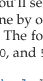

> 新手程序员常犯的一个错误是忘记索引编号从 0 开始。只需记住，在包含 n 个元素的数组中，第一个元素存储在位置 0，最后一个元素存储在位置 n-1，而不是 n。

另一个常见错误发生在想将一个数组复制到另一个数组时。例如，写 b = a; 看起来非常自然。然而，这个看似合理的赋值是不合法的。在第 8 章以及研究数组与指针之间的密切关系时，你将明白原因。进行复制的最简单方法是使用循环逐个复制元素，或使用复制函数，例如 memcpy()。

以下程序声明一个包含五个整数的数组，将值 10、20、30、40 和 50 赋给其元素，并显示其中大于 20 的元素。

```c
#include <stdio.h>
int main(void)
{
    int i, arr[5];

    arr[0] = 10;
    arr[1] = 20;
    arr[2] = 30;
    arr[3] = 40;
    arr[4] = 50;
    for (i = 0; i < 5; i++)
    { /* The braces are not necessary; we use them to make the code clearer. */
        if(arr[i] > 20)
            printf("%d\n", arr[i]);
    }
    return 0;
}
```

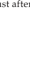

> C 不会检查索引是否超出数组边界。确保这不会发生是程序员的责任。如果发生，程序的行为将不可预测。

例如，在前一个程序中，有效索引为 0 到 4。然而，如果你写 arr[5] = 500;，编译器不会报错；它允许程序执行。实际上，这条语句改变了数组末尾之后的内存地址内容。如果这块内存被另一个变量使用，覆盖其值可能导致程序行为不可预测。例如，考虑以下程序：

```c
#include <stdio.h>
int main(void)
{
    int i, j = 20, arr[3];

    for(i = 0; i < 4; i++)
        arr[i] = 100;

    printf("%d\n", j);
    return 0;
}
```

由于 arr 包含三个元素，有效索引为 0 到 2。因此，在最后一次迭代（i=3）中，语句 arr[3] = 100; 给数组边界之外的元素赋了值。特别是，值 100 覆盖了 arr[2] 之后的内存内容。如果这块内存分配给了 j，j 就会改变，程序将输出 100 而不是 20！！

永远永远不要忘记，超出数组边界会毒害程序。大声播放 Sonics 的《Strychnine》——它就像一种毒药（Fuzztones 的版本也很好听）——让它牢牢印在脑海里。稍后你会遇到类似的练习，当心。

## 数组初始化

与普通变量一样，数组可以在声明时初始化。未初始化的元素会获得其内存位置上的任意值，就像未初始化的变量一样。最常见的形式是，数组初始化器是一个用花括号括起来、用逗号分隔的值列表。列表允许以逗号结尾。这些值必须是常量表达式，不允许使用变量。例如，对于声明：

```c
int arr[4] = {10, 20, 30, 40};
```

arr[0]、arr[1]、arr[2] 和 arr[3] 的值分别变为 10、20、30 和 40。

如果初始化列表比元素数量短，其余元素会被设为 0。空列表或更长的列表都是不合法的。例如，对于声明：

```c
int a[10] = {10, 20};
```

a[0] 和 a[1] 的值变为 10 和 20，其余元素 a[2] 到 a[9] 被设为 0。

如果省略数组长度，编译器将创建一个长度等于列表中值数量的数组。例如，对于语句：

```c
int arr[] = {10, 20, 30, 40};
```

编译器会创建一个包含四个整数的数组，并将值 10、20、30 和 40 赋给其元素。

如果我们希望数组元素（无论是一维还是多维）在程序执行期间保持不变，我们使用 const 限定符。在这种情况下，数组必须在声明时初始化。例如，对于声明：

```c
const int b[] = {10, 20, 30, 40};
```

b 数组被声明为 const，编译器在试图更改任何元素的值时会产生错误消息。例如，写 b[0] = 80; 是不合法的。

## 练习

### C.7.1 在以下程序中，数组 arr 的值会是什么？

```c
#include <stdio.h>
int main(void)
{
    int i, arr[10] = {0};

    for(i = 0; i < 10; i++)
        arr[++i] = 20;
    return 0;
}
```

答案：当 arr 被声明时，其元素被初始化为 0。语句 arr[++i] = 20; 先使 i 自增 1，然后使 arr[i] 等于 20。for 语句再次使 i 自增。因此，索引为偶数的元素，即 arr[0]、arr[2]……保持为 0，而索引为奇数的元素，即 arr[1]、arr[3]……变为 20。

### C.7.2 以下程序的输出是什么？

```c
#include <stdio.h>
int main(void)
{
    unsigned char arr[5];
    int i;

    for(i = 0; i < 5; i++)
    {
        arr[i] = 256+i;
        printf("%d ", arr[i]);
    }
    return 0;
}
```

答案：由于数字 256 用 9 位（100000000）编码，而 arr 的类型是 unsigned char，所以表达式 256+i 只有低 8 位会被存储。例如，当 i 为 1 时，数字 257（100000001）只有低 8 位会被存入 arr[1]。因此，arr[1] 变为 1。结果，程序显示：0 1 2 3 4


## C.7.3

编写一个程序，声明一个包含五个元素的数组，并使用 for 循环将值 1.1、1.2、1.3、1.4 和 1.5 分配给它们。然后，程序应以相反的顺序显示数组的元素。

```
#include <stdio.h>
int main(void)
{
    int i;
    double arr[5];
    for(i = 0; i < 5; i++)
        arr[i] = 1.1 + (i*0.1);
    for(i = 4; i >= 0; i--)
        printf("%f\n", arr[i]);
    return 0;
}
```

注释：另一种解决方案可以是用以下内容替换第一个循环：

```
arr[0] = 1.1;
for(i = 1; i < 5; i++)
    arr[i] = arr[i-1] + 0.1;
```

## C.7.4

下列程序中数组 a 的值会是什么？

```
#include <stdio.h>
int main(void)
{
    int i, a[3] = {4, 2, 0}, b[3] = {2, 3, 4};
    for(i = 0; i < 3; i++)
        a[b[i]-a[2-i]]++;
    return 0;
}
```

答案：当声明 a 时，我们有 a[0] = 4, a[1] = 2, 且 a[2] = 0。同样地，当声明 b 时我们有 b[0] = 2, b[1] = 3, 且 b[2] = 4。让我们追踪迭代：
第一次迭代 (i=0)。 a[b[0]-a[2]]++ = a[2-0]++ = a[2]++ = 1。
第二次迭代 (i=1)。 a[b[1]-a[1]]++ = a[3-2]++ = a[1]++ = 3。
第三次迭代 (i=2)。 a[b[2]-a[0]]++ = a[4-4]++ = a[0]++ = 5。
因此，a[0]、a[1] 和 a[2] 分别变为 5、3 和 1。

## C.7.5

编写一个程序，读取 10 个整数并将它们存储在数组中。然后，程序应检查数组是否对称，即第一个元素的值等于最后一个元素的值，第二个元素的值等于倒数第二个元素的值，以此类推。

```
#include <stdio.h>
#define SIZE 10
int main(void)
{
    int i;
    double sum, arr[SIZE];
    sum = 0; /* Initialize with 0 the variable that calculates the sum of the array elements. */
    srand(time(NULL));
    for(i = 0; i < SIZE; i++)
    {
        arr[i] = (double)rand() / RAND_MAX;
        sum += arr[i];
    }
    printf("Avg = %f\n", sum/SIZE);
    return 0;
}
```

## C.7.8 下列程序中数组 a 的值会是什么？

```
#include <stdio.h>
int main(void)
{
    int i, a[3] = {0, 1, 2};

    for(i = 1; i < 4; i++)
        a[a[a[3-i]]] = i-1;
    return 0;
}
```

答案：当声明 a 时，我们有 a[0] = 0, a[1] = 1, 且 a[2] = 2。让我们追踪迭代：

第一次迭代 (i=1): a[a[a[2]]] = a[a[2]] = a[2] = i-1 = 1-1 = 0。
第二次迭代 (i=2): a[a[a[1]]] = a[a[1]] = a[1] = i-1 = 2-1 = 1。
第三次迭代 (i=3): a[a[a[0]]] = a[a[0]] = a[0] = i-1 = 3-1 = 2。

因此，a[0]、a[1] 和 a[2] 分别变为 2、1 和 0。

## C.7.9

编写一个程序，读取 100 名学生的成绩并将它们存储在数组中。然后，程序应显示平均分、最好成绩和最差成绩，以及它们首次出现时在数组中的位置。程序应强制用户输入 [0, 10] 范围内的成绩。

```
#include <stdio.h>

#define SIZE 100

int main(void)
{
    int i, min_pos, max_pos;
    float sum, min_grd, max_grd, grd[SIZE];

    sum = 0;
    max_grd = -1;
    min_grd = 11;
```

```
for(i = 0; i < SIZE; i++)
{
    printf("Enter grade in [0-10]: ");
    scanf("%f", &grd[i]);
    /* There are several ways to check whether the input grade is valid. In C.7.14, we'll use do-while. */
    while(grd[i] < 0 || grd[i] > 10)
    {
        printf("Error - Enter new grade in [0-10]: ");
        scanf("%f", &grd[i]);
    }
    sum += grd[i];
    if(grd[i] > max_grd)
    {
        max_grd = grd[i];
        max_pos = i; /* Store the position with the best grade. */
    }
    if(grd[i] < min_grd)
    {
        min_grd = grd[i];
        min_pos = i; /* Store the position with the worst grade. */
    }
}
printf("Avg: %.2f H(%d): %.2f L(%d): %.2f\n", sum/SIZE, max_pos, max_grd, min_pos, min_grd);
return 0;
}
```

## C.7.10 以下程序的目的是生成 10 个随机整数，将它们存储在数组中，然后在 freq 频率数组中存储 0 到 9 每个数字出现的次数。你能找到程序中的任何错误吗？如果有，请纠正它们。

```
#include <stdio.h>
#include <stdlib.h>
#include <time.h>

#define SIZE 10

int main(void)
{
    int i, num, arr[SIZE], freq[SIZE];

    srand(time(NULL));
    for(i = 0; i < SIZE; i++)
        arr[i] = rand();

    for(i = 0; i < SIZE; i++)
    {
        num = arr[i];
        freq[num]++;
    }
```

```
```c
printf("\nNumber occurrences\n");
for(i = 0; i < SIZE; i++)
    printf("%d appears %d times\n", i, freq[i]);
return 0;
}
```
```

**答案：** 第一个错误是 freq 数组的元素未初始化为 0，因此语句 freq[num]++; 会递增 freq[num] 的无意义值。因此，我们应将声明改为 freq[SIZE] = {0}。

然而，最严重的错误发生在 arr 包含一个超出 [0, SIZE-1] 的数字时。例如，如果存储数字 30，则 num 变为 30，语句 freq[30]++; 会更改 arr 之外的内存位置的内容。此错误可通过使用 **if** 语句来纠正。例如：

```
```c
if (num >= 0 && num <= SIZE-1)
    freq[num]++;
```
```

## C.7.11 编写一个程序，读取 20 个整数并将它们存储在两个各有 10 个元素的数组中。然后，程序应检查这两个数组是否有共同元素，如果有，程序应显示每个共同元素的值及其在两个数组中的位置。否则，应显示一条消息，说明它们的元素不同。

```
#include <stdio.h>

#define SIZE 10

int main(void)
{
    int i, j, cnt, arr1[SIZE], arr2[SIZE];

    for(i = 0; i < SIZE; i++)
    {
        printf("Enter number for the 1st array: ");
        scanf("%d", &arr1[i]);

        printf("Enter number for the 2nd array: ");
        scanf("%d", &arr2[i]);
    }
    cnt = 0; /* This variable counts the common elements. */
    for(i = 0; i < SIZE; i++)
    {
        for(j = 0; j < SIZE; j++) /* This loop checks if an element
        of the first array is contained in the second one. */
        {
            if(arr1[i] == arr2[j])
            {
                cnt++;
                printf("Common = %d (Pos_1 = %d Pos_2 = %d)\n", arr1[i], i, j);
            }
        }
    }
}
```

```
{
    sum_fail += grd;
    arr2[m] = grd;
    m++;
}
}
if(i != 0)
{
    if(k != 0)
        printf("\nSuccess_Avg: %.2f\n", sum_suc/k);
    else
        printf("\nAll students failed\n");
    if(m != 0)
        printf("\nFail_Avg: %.2f\n", sum_fail/m);
    else
        printf("\nAll students passed\n");
}
return 0;
}
```

## C.7.14 编写一个程序，读取 10 个整数并仅在以下任一情况下将它们存储在数组中：

- a. 当前位置为偶数，即 0、2、4、...，且输入的数字为偶数，或
- b. 当前位置为奇数，即 1、3、5、...，且输入的数字为奇数。

程序不应接受值 0 和 -1 并提示用户输入新值。完成数字插入后，未分配的元素应设为 -1。程序应在结束前显示数组元素。

```
#include <stdio.h>

#define SIZE 10

int main(void)
{
    int i, num, arr[SIZE] = {0}; /* Since the value 0 is not an acceptable value, we use it as a special value to indicate that an element is unassigned. */
    for(i = 0; i < SIZE; i++)
    {
        do
        {
            printf("Enter number: ");
            scanf("%d", &num);
            if(num == 0 || num == -1)
                printf("Not valid input !!!\n");
        } while(num == 0 || num == -1);
        if(i & 1) /* Check if the position is odd. */
        {
            if(num & 1) /* Store the number only if both the position and the number are odd. */
                arr[i] = num;
        }
        else
        {
            if((num & 1) == 0) /* Store the number only if both
the position and the number are even. */
                arr[i] = num;
        }
        printf("\n*** Array elements ***\n");
        for(i = 0; i < SIZE; i++)
        {
            if(arr[i] == 0)
                arr[i] = -1;
            printf("%d\n", arr[i]);
        }
        return 0;
    }
}
```

## C.7.15 编写一个程序，读取一个整数并显示出现超过一次的数字及其出现次数。例如，如果用户输入 1868，程序应显示数字 8 出现了两次。如果没有数字出现超过一次，程序应显示相关消息。

```
#include <stdio.h>
int main(void)
{
    int i, rem, flag, dig_times[10] = {0}; /* This array holds the
appearances of each digit. For example, dig_times[0] indicates how many
times digit 0 appears. */
    printf("Enter number: ");
    scanf("%d", &i);
    if(i != 0) /* Check if 0 is entered. */
        dig_times[0] = 1;
    while(i != 0)
    {
        rem = i%10;
        if(rem < 0)
            rem = -rem;
        dig_times[rem]++;
        i /= 10;
    }
    flag = 0;
    for(i = 0; i < 10; i++)
    {
        if(dig_times[i] > 1)
        {
            printf("Digit %d appears %d times\n", i,
dig_times[i]);
            flag = 1;
        }
    }
    if(flag == 0)
```

```c
printf("No digit appears multiple times\n");
return 0;
}
```

## C.7.16 下面的程序正确吗？如果是，它输出什么？如果有错误，能否想到一个副作用？在查看答案之前先思考。

```c
#include <stdio.h>
int main(void)
{
    int i, a[] = {i, i+1, i+2};
    for(i = 0; i < 4; i++)
    {
        a[i] = 0;
        printf("%d ", a[i]);
    }
    return 0;
}
```

答案：你是否回答数组 a 的初始化是错误的？那里没有任何问题：i 有一个任意值，所以呢？错误在于重复次数。因为 a 包含三个元素，所以应该是 3，而不是 4。特别是当 i 变为 3 时，语句 a[i] = 0; 会给 a 之外的内存位置赋值。如果 i 存储在该位置，则 i 变为 0，循环变得无限。

> 小心，再小心数组边界，如果你想安稳入睡的话。

## C.7.17 编写一个程序读取一个整数并以二进制显示它。使用数组存储数字的位。要显示负数的位，使用补码技术。例如，如果用户输入 -5：

- a. 将其转换为正数（即 5）。
- b. 反转其位（即 101₂ 变为 11111111111111111111111111111010₂）。
- c. 加 1 即，数字变为 11111111111111111111111111111011₂）。

```c
#include <stdio.h>
int main(void)
{
    int i, j, tmp, bits[32]; /* This array holds the bits of the number, that is 0 or 1. The size is 32, because we assume that the size of an integer is 32 bits. */
    unsigned int num;

    printf("Enter number: ");
    scanf("%d", &tmp);
    if(tmp < 0)
    {
        tmp = -tmp;
        tmp = ~tmp;
        tmp++;
    }
    num = tmp;    /* It is stored as positive. */
    i = 0;
    /* Successive divisions by 2 and store each bit in the respective
    array position. */
    while (num > 0)
    {
        bits[i] = num & 1;
        num >>= 1; /* Equivalent to num /= 2. */
        i++;
    }
    printf("Binary form: ");
    /* Display the bits from left to right. */
    for (j = i-1; j >= 0; j--)
        printf("%d", bits[j]);
    return 0;
}
```

注释：我们使用移位运算符的原因是为了提高性能。然而，这很可能是不必要的，因为编译器本身会优化该操作。

## C.7.18 编写一个程序读取产品代码并将它们存储在 50 个位置的整数数组中。程序只有在代码尚未存储时才应将代码存储在数组中。如果数组已满或用户输入 -1，程序应显示存储的代码并终止。

```c
#include <stdio.h>

#define SIZE 50

int main(void)
{
    int i, j, pos, num, found, code[SIZE];

    pos = 0;
    while(pos < SIZE)
    {
        printf("Enter code: ");
        scanf("%d", &num);
        if(num == -1)
            break;

        found = 0;
        /* The pos variable indicates how many codes have been
        stored in the array. The loop checks if the input code is already stored.
        If it is, found becomes 1 and the loop terminates. */
        for(j = 0; j < pos; j++)
        {
            if(code[j] == num)
            {
                printf("Error: Code %d exists. ", num);
                found = 1;
                break;
            }
        }

        /* If the code is not stored, we store it and the index
        position is incremented. */
        if(found == 0)
        {
            code[pos] = num;
            pos++;
        }
    }
    printf("\nCodes: ");
    for(i = 0; i < pos; i++)
        printf("%d ", code[i]);
    return 0;
}
```

## C.7.19 编写一个程序读取 100 个整数并将它们存储在数组中。然后，程序应查找并显示两个不同的较大值。

```c
#include <stdio.h>

#define SIZE 100

int main(void)
{
    int i, max_1, max_2, arr[SIZE];

    for(i = 0; i < SIZE; i++)
    {
        printf("Enter number: ");
        scanf("%d", &arr[i]);
    }
    max_1 = max_2 = arr[0];
    for(i = 1; i < SIZE; i++)
    {
        if(max_1 != arr[i])
        {
            max_2 = arr[i]; /* We assign that value to max_2, to compare it with the remaining elements. */
            break;
        }
    }
    if(i == SIZE)
    {
        printf("Array contains the same value: %d\n", max_1);
        return 0;
    }
    /* Continue with the loop execution from the point the second loop ended. */
    for(; i < SIZE; i++)
    {
        if(arr[i] > max_1)
        {
            max_2 = max_1; /* The second higher value becomes equal to the first one. */
            max_1 = arr[i];
        }
        else if(arr[i] > max_2 && arr[i] != max_1) /* Search for the second higher value that is not equal to the first one. */
            max_2 = arr[i];
    }
    printf("First_Max = %d and Sec_Max = %d\n", max_1, max_2);
    return 0;
}
```

注释：查找数组中第 n 个最小或最大值元素的典型方法是使用排序算法，例如第 12 章中介绍的算法之一。特别是，数组首先被排序，我们要查找的元素是 a[n-1]。

## C.7.20 编写一个程序声明一个包含 10 个整数的数组，并为其元素分配 [5, 20] 范围内的随机值。然后，程序应检查数组是否包含重复值，如果有，则应删除它们。当元素被删除时，后续元素应向左移动一个位置。空位置应赋值为 -1。例如，如果数组为 [9, 12, 8, 12, 17, 8, 8, 19, 1, 19]，它应变为 [9, 12, 8, 17, 19, 1, -1, -1, -1]。

```c
#include <stdio.h>
#include <stdlib.h>
#include <time.h>

#define SIZE 10

int main(void)
{
    int i, j, k, size, arr[SIZE];

    srand(time(NULL));
    for(i = 0; i < SIZE; i++)
        arr[i] = rand()%16+5;

    size = SIZE;
    for(i = 0; i < size; i++)
    {
        j = i+1;
        while(j < size)
        {
            if(arr[i] == arr[j])
            {
                for(k = j; k < size-1; k++)
                    arr[k] = arr[k+1]; /* Shift the elements one position to the left. */
                size--; /* Since the element is deleted, their number is decremented. */
            }
            else
                j++;
        }
    }
    for(i = size; i < SIZE; i++)
        arr[i] = -1;
    for(i = 0; i < SIZE; i++)
        printf("%d ", arr[i]);
    return 0;
}
```

## C.7.21 可容纳 20 辆车的停车场对前三个小时收费 6 美元。每个额外小时收费 1.50 美元（即使多一分钟整个小时也收费）。最高收费为 12 美元，最大停车时间为 24 小时。编写一个程序读取停放车辆的数量和每辆车以小时和分钟为单位的停车时间，并以以下形式显示费用：

| 车 | 时间 | 费用 |
|---|---|---|
| 1 | 2.30' | 6.00 |
| 2 | 4.30' | 9.00 |
| 3 | 3.12' | 7.50 |
| 4 | 4.0' | 7.50 |
| 5 | 8.0' | 12.00 |
| 总计 |  | 42.00 |

```c
#include <stdio.h>

#define MAX_CARS 20

int main(void)
{
    int i, tmp, cars, car_mins[MAX_CARS], car_hours[MAX_CARS];
    double bill, total_bill;

    do
    {
        printf("Enter number of cars [1-%d]: ", MAX_CARS);
        scanf("%d", &cars);
    } while(cars <= 0 || cars >= MAX_CARS);

    for(i = 0; i < cars; i++)
    {
        do
        {
            printf("Enter hours for car_%d [max=24h]: ", i+1);
            scanf("%d", &car_hours[i]);
        } while(car_hours[i] > 24 || car_hours[i] < 0);

        if(car_hours[i] == 24) /* Maximum duration. */
        {
            car_mins[i] = 0;
            continue;
        }
        do
        {
            printf("Enter minutes for car_%d [max=59min]: ", i+1);
            scanf("%d", &car_mins[i]);
        } while(car_mins[i] > 59 || car_mins[i] < 0);
    }
    total_bill = 0;
    printf("\nCar\tTime\tCharge\n");
    for(i = 0; i < cars; i++)
    {
        bill = 6; /* For the first 3 hours. */
        tmp = car_hours[i]-3;
        if(tmp >= 0)
        {
            bill += tmp*1.5; /* For extra hours. */
            if(car_mins[i] > 0)
                bill += 1.5;
            if(bill > 12)
                bill = 12;
        }
        printf("%d\t%d.%d\t$%.2f\n", i+1, car_hours[i], car_mins[i],
        bill);
        total_bill += bill;
    }
    printf("SUM\t$%.2f\n", total_bill);
    return 0;
}
```

## C.7.22 编写一个程序模拟在线彩票游戏。假设中奖号码为 10 个，其值在 [0, 100] 范围内。然而，程序应以能够控制中奖号码的方式编写。特别是，“作弊”之处在于每次彩票中 3 个中奖号码也应出现在上一期中。程序应询问用户是否继续游戏，如果答案是否，则程序终止。

```c
#include <stdio.h>
#include <stdlib.h>
#include <time.h>

#define SIZE 10

int main(void)
{
    int i, pos1, pos2, pos3, ans, arr[SIZE];
    srand(time(NULL));
    /* First lottery. */
    for(i = 0; i < SIZE; i++)
    {
        arr[i] = rand()%101;
        printf("%d ", arr[i]);
    }
    while(1)
    {
        printf("\nContinue to play? (0:No): ");
        scanf("%d", &ans);
        if(ans == 0)
            return 0;
```


```c
/* We choose three random places. The numbers stored in
these places will be drawn in the next lottery. */
pos1 = rand()%SIZE;
do
{
    pos2 = rand()%SIZE;
} while(pos1 == pos2);
do
{
    pos3 = rand()%SIZE;
} while((pos1 == pos3) || (pos2 == pos3));
/* Next lottery. */
for(i = 0; i < SIZE; i++)
{
    if((i == pos1) || (i == pos2) || (i == pos3))
    {
        printf("%d ", arr[i]);
        continue;
    }
    arr[i] = rand()%101;
    printf("%d ", arr[i]);
}
return 0;
}
```

评论：此程序的主要目的是向你展示投注软件可以编写成操纵中奖结果的方式。因此，请远离在网上彩票中宣传高额利润的投注网站。他们承诺的高额利润不是给你的，而是给他们的所有者。

## 二维数组

二维数组的形式与数学中的矩阵相似；它是由相同类型的元素按行和列排列而成的数组。与一维数组一样，我们在示例中使用算术类型。在接下来的章节中，你将看到更多应用示例。除了数字之外，二维数组通常还用于存储字符串；你将在第 10 章看到此应用。

### 声明数组

要声明二维数组，我们必须指定其名称、数据类型以及行数和列数，如下所示：

```c
data_type array_name[number_of_rows][number_of_columns]
```

### 访问数组元素

要访问一个元素，我们写出数组的名称，后跟用双括号括起来的元素的行索引和列索引。与一维数组一样，行和列的索引从 0 开始。例如，语句：

```c
int a[3][4];
```

声明了一个二维数组，其元素为 `a[0][0]`、`a[0][1]`、… `a[2][3]`，如图 7.1 所示。虽然二维数组被可视化为具有行和列的数组，但其元素以行优先顺序存储在连续的内存位置中，先是第 0 行的元素，然后是第 1 行的元素，依此类推。

> **提示**
>
> 虽然我们提到多维数组，但 C 只支持一维数组。因为数组的一个元素可以是另一个数组，所以我们可以模拟多维数组。

例如，`a` 数组的元素是 `a[0]`、`a[1]` 和 `a[2]`，其中每一个都是包含四个整数的数组。我们将在第 8 章讨论指针和二维数组时更详细地分析它。此外，我们将在 C.8.39 中看到如何将二维数组视为一维数组。在另一个示例中，如果我们写 `int a[3][4][5];` `a` 是一个包含三个元素的数组，其中每一个都是包含四个元素的数组。这四个元素中的每一个都是包含五个整数的数组。

与一维数组一样，当声明二维数组时，编译器会在栈中分配一块内存块来存储其元素的值。例如，使用声明 `int a[10][5];` 编译器分配 200 字节的块来存储其 50 个元素的值。要访问一个元素，我们必须指定其行索引和列索引。以下是一些示例：

```c
int i = 2, j = 2, a[3][4];
a[0][0] = 100; /* The value of the first element becomes 100. */
a[1][1] = 200; /* The value of the sixth element becomes 200. */
a[2][3] = a[0][0]; /* The value of the last element becomes equal to the first element. */
a[i-2][j-2] = 300; /* The value of the first element becomes 300. */
```

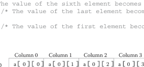

**图 7.1**
二维数组（3 × 4）。

> 与一维数组一样，特别注意不要超出任何维度的边界。

考虑二维整数数组 a[ROWS][COLS]。由于其元素按顺序存储在内存中，编译器为了找到 a[i][j] 的内存地址，会找到行大小，即 row_size = COLS × sizeof(int) 并将其与 i 相乘。然后，它将 j 与元素大小相乘，并将乘积加到数组的地址上。因此，我们有：

```
memory_address = a + (i × row_size) + (j × sizeof(int))
```

> **提示：** 要找到元素的内存地址，只需要列数。

### 数组初始化

二维数组可以在声明时初始化，就像一维数组一样。初始化值按行顺序分配，从第 0 行开始，然后是第 1 行，依此类推。例如，使用声明：

```c
int arr[3][3] = {{10, 20, 30},
                 {40, 50, 60},
                 {70, 80, 90}};
```

arr[0][0] 变为 10，arr[0][1] 变为 20，arr[0][2] 变为 30，并继续到下一行。

另外，我们可以省略内部大括号并写：

```c
int arr[3][3] = {10, 20, 30, 40, 50, 60, 70, 80, 90};
```

一旦编译器填满一行，它就会继续下一行。然而，我们始终更喜欢使用内部大括号，以便清楚地显示每一行的初始化。当使用大括号时，如果初始化列表短于该行的元素，编译器会将该行剩余元素的值赋为 0。如果它更长，则是非法的。例如，使用声明：

```c
int arr[3][3] = {{10, 20},
                 {40, 50},
                 {70}};
```

arr[0][2]、arr[1][2]、arr[2][1] 和 arr[2][2] 的值初始化为 0。

如果我们省略一行的初始化，编译器会将其元素初始化为 0。例如，使用声明：

```c
int arr[3][3] = {{10, 20, 30}};
```

第二行和第三行的元素被设为 0。

如果省略内部大括号并且初始化列表短于数组元素的数量，则剩余元素设为 0。例如，使用声明：

```c
int arr[3][3] = {10, 20};
```

arr[0][0] 变为 10，arr[0][1] 变为 20，其余元素设为 0。

当声明二维数组时，必须指定列数。然而，行数是可选的。如果未指定，编译器将根据初始化列表创建二维数组。例如，使用声明：

```c
int arr[][3] = {10, 20, 30, 40, 50, 60};
```

由于数组有三列且初始化值为六个，编译器创建了一个二维数组，包含两行三列。

够了初始化列表。考虑以下程序并告诉我们它输出什么？

```c
#include <stdio.h>
int main(void)
{
    int arr[][3] = {10, 20, 30, 40, 50, 60, 70};

    printf("%d\n", sizeof(arr)+arr[2][1]+arr[2][2]);
    return 0;
}
```

由于数组有三列且值为七个，编译器创建了一个包含三行三列的二维数组，即包含九个元素的数组。由于初始化列表较短，最后两个，即 arr[2][1] 和 arr[2][2] 被设为 0。因此，程序输出 36。

如果初始化值相同或可以轻松生成，则嵌套循环对是典型选择。例如，以下程序声明一个二维数组并将其元素赋值为 1。

```c
#include <stdio.h>
int main(void)
{
    int i, j, arr[50][100];

    for(i = 0; i < 50; i++)
        for(j = 0; j < 100; j++)
            arr[i][j] = 1;
    return 0;
}
```

## 练习

- C.7.23 编写一个程序，读取 8 个整数，将它们存储在 2×4 数组中，并以相反的顺序显示数组元素，从右下元素到左上元素。

```c
#include <stdio.h>

#define ROWS 2
#define COLS 4

int main(void)
{
    int i, j, arr[ROWS][COLS];

    for(i = 0; i < ROWS; i++)
    {
        for(j = 0; j < COLS; j++)
        {
            printf("Enter arr[%d][%d]: ", i, j);
            scanf("%d", &arr[i][j]);
        }
    }
    printf("\nArray elements\n");
    printf("-------------\n");
    for(i = ROWS-1; i >= 0; i--)
        for(j = COLS-1; j >= 0; j--)
            printf("arr[%d][%d] = %d\n", i, j, arr[i][j]);
    return 0;
}
```

- C.7.24 编写一个程序，创建一个 5×5 上三角数组；它是一个数组，其中主对角线下方的元素应设为 0。程序应为剩余元素分配 [-3, 3] 范围内的随机值。然后，程序应显示数组的行列式，即主对角线元素的乘积。最后，程序应以代数形式显示数组。

```c
#include <stdio.h>
#include <stdlib.h>
#include <time.h>

#define ROWS 5

int main(void)
{
    int i, j, determ, arr[ROWS][ROWS];

    determ = 1; /* Initialize the determinant. */
    srand(time(NULL));
    for(i = 0; i < ROWS; i++)
    {
        for(j = 0; j < ROWS; j++)
```

```
{
    if(i > j)
        arr[i][j] = 0; /* The elements below the main diagonal should be set to 0. */
    else
        arr[i][j] = rand()%7-3; /* The result of rand()%7 is an integer in [0, 6]. By subtracting 3, the integer is constrained in [-3, 3]. */
    printf("%3d", arr[i][j]);
    if(i == j) /* Check if the element belongs in the main diagonal. */
        determ *= arr[i][j];
    }
    printf("\n"); /* Used to separate the rows of the arrays. */
}
printf("\nThe determinant is: %d\n", determ);
return 0;
}
```

## C.7.25 编写一个程序，读取 6 个整数并将它们存储在一个 2×3 数组（例如 a）中。然后，它应再读取 6 个整数并将它们存储在第二个 3×2 数组（例如 b）中。程序应显示第三个 2×2 数组（例如 c）的元素，该数组是 c = a×b 的结果。

回顾线性代数可知，两个矩阵的乘积是通过将第一个矩阵每一行的元素与第二个矩阵每一列对应元素的乘积相加得到的。因此，一个 N×M 矩阵与一个 M×N 矩阵相乘的结果是一个 N×N 矩阵。例如，考虑以下 a（2×3）和 b（3×2）矩阵：

a = [[1, -1, 1],[0, 2, 1]] 和 b = [[1, 0],[2, -2],[2, 3]]

c = a×b 的维度是 2×2，其元素为

c = [[1×1+(-1)×2+1×2, 1×0+(-1)×(-2)+1×3],[0×1+2×2+1×2, 0×0+2×(-2)+1×3]] = [[1, 5],[6, -1]]

在数学中，其元素的值由 c_ij = Σ_{k=1}^{M} a_ik × b_kj 得出。当然，在编程层面，k 的范围是 0 到 M-1。

```
#include <stdio.h>
#define N 2
#define M 3
int main(void)
{
    int i, j, k, a[N][M], b[M][N], c[N][N] = {0};
for(i = 0; i < N; i++)
{
    for(j = 0; j < M; j++)
    {
        printf("Enter element a[%d][%d]: ", i, j);
        scanf("%d", &a[i][j]);
    }
}
for(i = 0; i < M; i++)
{
    for(j = 0; j < N; j++)
    {
        printf("Enter element b[%d][%d]: ", i, j);
        scanf("%d", &b[i][j]);
    }
}
for(i = 0; i < N; i++)
    for(j = 0; j < N; j++)
        for(k = 0; k < M; k++)
            c[i][j] += a[i][k] * b[k][j];

printf("\nArray c = a x b (%dx%d)\n", N, N);
printf("-------------------\n");
for(i = 0; i < N; i++)
{
    for(j = 0; j < N; j++)
        printf("%5d", c[i][j]);
    printf("\n");
}
return 0;
}
```

## C.7.26 编写一个程序，将 [0, 20] 范围内的随机值赋给一个 6×8 整数数组的元素。然后，程序应读取用户的选择；如果选择为 1，则应再读取两个整数，它们对应两行，并交换这两行的元素。如果选择不为 1，则输入的两个整数对应两列。程序应检查两个输入整数的有效性，并显示原始数组和最终数组。

```
#include <stdio.h>
#include <stdlib.h>
#include <time.h>

#define ROWS 6
#define COLS 8

int main(void)
{
    int i, j, a, b, max, tmp, type, arr[ROWS][COLS];

    srand(time(NULL));
    for (i = 0; i < ROWS; i++)
    {
        for (j = 0; j < COLS; j++)
{
                arr[i][j] = rand()%21;
                printf("%5d", arr[i][j]);
            }
            printf("\n");
        }
        printf("Enter swap type (1:rows): ");
        scanf("%d", &type);
        if(type == 1)
            max = ROWS;
        else
            max = COLS;

        do
        {
            printf("Enter dim_1[1-%d]: ", max);
            scanf("%d", &a);
        } while(a < 1 || a > max);

        do
        {
            printf("Enter dim_2[1-%d]: ", max);
            scanf("%d", &b);
        } while(b < 1 || b > max);

        a--; /* Subtract 1, since indexing starts from 0.*/
        b--;
        if(type == 1)
        {
            for(i = 0; i < COLS; i++)
            {
                tmp = arr[a][i];
                arr[a][i] = arr[b][i];
                arr[b][i] = tmp;
            }
        }
        else
        {
            for(i = 0; i < ROWS; i++)
            {
                tmp = arr[i][a];
                arr[i][a] = arr[i][b];
                arr[i][b] = tmp;
            }
        }
        for(i = 0; i < ROWS; i++)
        {
            for(j = 0; j < COLS; j++)
                printf("%5d", arr[i][j]);
            printf("\n");
        }
        return 0;
    }
```

## C.7.27 在线性代数中，当与主对角线平行的每条对角线上的元素都相等时，该方阵称为 Toeplitz 矩阵。例如，以下 5×5 矩阵展示了 5×5 Toeplitz 矩阵的一般形式：

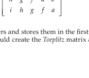

编写一个程序，读取整数并将它们存储在一个 5×5 数组的第一行和第一列中。然后，程序应创建该 Toeplitz 矩阵，并以代数形式显示其元素。

```
#include <stdio.h>

#define ROWS 5

int main(void)
{
    int i, j, t[ROWS][ROWS];

    printf("Enter [0][0] element: ");
    scanf("%d", &t[0][0]);
    /* Read the remaining values for the first row. */
    for(i = 1; i < ROWS; i++)
    {
        printf("Enter [0][%d] element: ", i);
        scanf("%d", &t[0][i]);
    }
    /* Read the remaining values for the first column. */
    for(i = 1; i < ROWS; i++)
    {
        printf("Enter [%d][0] element: ", i);
        scanf("%d", &t[i][0]);
    }
    /* Create the Toeplitz matrix. */
    for(i = 0; i < ROWS-1; i++)
        for(j = 0; j < ROWS-1; j++)
            t[i+1][j+1] = t[i][j]; /* We traverse the array t and make each element equal to the upper left, except the elements of the first row and column. */
    for(i = 0; i < ROWS; i++)
    {
        for(j = 0; j < ROWS; j++)
            printf("%3d", t[i][j]);
        printf("\n");
    }
    return 0;
}
```

## C.7.28 编写一个程序，读取 100 名学生在 10 门课程中的成绩，并将其存储在一个 100×10 数组中，然后显示每名学生的平均分、最好成绩和最差成绩。程序还应显示数组中保存最高和最低平均分的所在位置。如果有多名学生的最高或最低平均分相同，程序应显示找到的第一个位置。程序应强制用户输入 [0, 10] 范围内的成绩。

```
#include <stdio.h>

#define STUDS  100
#define COURSES 10

int main(void)
{
    int i, j, min_pos, max_pos;
    float sum, min_grd, max_grd, avg_grd, min_avg_grd, max_avg_grd,
    grd[STUDS][COURSES];

    max_avg_grd = -1;
    min_avg_grd = 11;
    for(i = 0; i < STUDS; i++)
    {
        sum = 0;
        max_grd = -1;
        min_grd = 11;
        for(j = 0; j < COURSES; j++)
        {
            do
            {
                printf("Enter grade of student_%d for lesson_%d: ", i+1, j+1);
                scanf("%f", &grd[i][j]);
            } while(grd[i][j] < 0 || grd[i][j] > 10);

            sum += grd[i][j];
            if(grd[i][j] >= max_grd)
                max_grd = grd[i][j];
            if(grd[i][j] <= min_grd)
                min_grd = grd[i][j];
        }
        avg_grd = sum/COURSES;
        if(avg_grd > max_avg_grd)
        {
            max_avg_grd = avg_grd;
            max_pos = i;
        }
        if(avg_grd < min_avg_grd)
        {
            min_avg_grd = avg_grd;
            min_pos = i;
        }
        printf("Student_%d: Avg = %.2f Max = %.2f Min = %.2f\n",
i+1, avg_grd, max_grd, min_grd);
    }
printf("\nStudent %d has the higher average %.2f and student_%d has the lower average %.2f\n", max_pos, max_avg_grd, min_pos, min_avg_grd);
}
    return 0;
```

## C.7.29
编写一个程序，读取整数并将它们存储在一个方阵（例如 3×3）中。然后，程序应检查该数组是否为幻方；也就是说，每一行、每一列和对角线的和都相同。

```
#include <stdio.h>

#define ROWS 3
#define COLS 3

int main(void)
{
    int i, j, sum, tmp, arr[ROWS][COLS];

    sum = tmp = 0;
    for(i = 0; i < ROWS; i++)
    {
        /* We find the sums of the diagonals. */
        for(j = 0; j < COLS; j++)
        {
            printf("Enter element arr[%d][%d]: ", i, j);
            scanf("%d", &arr[i][j]);
            if(i == j)
                sum += arr[i][j];
            if(i+j == ROWS-1) /* Check if the element belongs in the secondary diagonal. */
                tmp += arr[i][j];
        }
        if(sum != tmp)
        {
            printf("Not magic square -> Sum_main_diag: %d Sum_sec_diag: %d\n", sum, tmp);
            return 0;
        }
    }
    for(i = 0; i < ROWS; i++)
    {
        /* Initialize the variable which calculates the sum of the elements of each row. */
        tmp = 0;
        for(j = 0; j < COLS; j++)
            tmp += arr[i][j];
        if(sum != tmp)
        {
            printf("Not magic square -> Sum_row_%d: %d Sum_diag: %d\n", i+1, tmp, sum);
            return 0;
        }
    }
```


```c
        }
    for(i = 0; i < COLS; i++)
    {
        tmp = 0; /* 初始化变量，用于计算每列元素之和。 */
        for(j = 0; j < ROWS; j++)
            tmp += arr[j][i];

        if(sum != tmp)
        {
            printf("Not magic square -> Sum_col %d: %d Sum_diag: %d\n", i+1, tmp, sum);
            return 0;
        }
    }
    printf("Magic square !!!\n");
    return 0;
}
```

## C.7.30 编写一个程序，模拟电影院售票处。假设电影院有30排，每排20个座位。程序应显示一个菜单，用于执行以下操作：

- 1. 购票。程序应让观众选择排和座位。如果没有指定具体座位，程序应随机选择一个座位。票价为6美元。
- 2. 退票。程序应读取排和座位，并取消预订。退款为5美元。
- 3. 显示总收入以及显示已预订和空闲座位的图表。
- 4. 程序终止。

```c
#include <stdio.h>
#include <stdlib.h>

#define ROWS 30
#define COLS 20

int main(void)
{
    int i, j, sel, row, col, rsvd_seats, cost, seats[ROWS][COLS] = {0}; /* 我们使用seats数组来管理电影院的座位。如果元素为0，则表示该座位空闲。 */
    rsvd_seats = cost = 0;
    while(1)
    {
        printf("\nMenu selections\n");
        printf("------------------\n");

        printf("1. Buy Ticket\n");
        printf("2. Ticket Refund\n");
        printf("3. Show Information\n");
        printf("4. Exit\n");
```

```c
case 2:
    if(rsvd_seats == 0)
    {
        printf("\nAll seats are free\n");
        break;
    }
    do
    {
        printf("\nEnter row [1-%d]: ", ROWS);
        scanf("%d", &row);
    } while(row < 1 || row > ROWS);
    do
    {
        printf("Enter seat [1-%d]: ", COLS);
        scanf("%d", &col);
    } while(col < 1 || col > COLS);
    row--;
    col--;
    if(seats[row][col] != 1)
        printf("\nSeat in row %d and column %d\n is not reserved\n", row+1, col+1);
    else
    {
        seats[row][col] = 0;
        cost -= 5;
        rsvd_seats--;
    }
    break;
case 3:
    printf("\nFree seats: %d, Income: $%d\n\n", ROWS*COLS - rsvd_seats, cost);
    for(i = 0; i < ROWS; i++)
    {
        for(j = 0; j < COLS; j++)
        {
            if(seats[i][j] == 1)
                printf("%2s", "X");
            else
                printf("%2s", "#");
        }
        printf("\n");
    }
    break;
case 4:
    return 0;
default:
    printf("\nWrong choice\n");
    break;
```

```c
}
}
return 0;
}
```

## 未解答的练习

### U.7.1 编写一个程序，读取100名学生的成绩并将其存储在数组中。然后，程序应读取两个浮点数（例如a和b），并显示有多少学生的成绩落在[a, b]区间内。程序应强制用户输入的第二个数大于第一个数。

### U.7.2 编写一个程序，连续读取`double`类型的数字，并将其中大于5的值存储在一个100个位置的数组中。如果数组已满或用户输入-1，则停止插入数字。程序应显示数组中存储值的最小值。

### U.7.3 编写一个程序，读取100个整数并将其存储在数组中。程序应显示有多少个元素的值大于最后一个元素的值，以及有多少个元素的值大于平均值。首先输入的值应为最后一个元素的值。

### U.7.4 编写一个程序，读取整数并将其存储在100个位置的数组中，限制条件是：仅当输入的数字小于最后存储的数字时才将其存入数组。一旦数组已满，程序应终止。

### U.7.5 编写一个程序，读取100个整数并将其存储在数组中。然后，程序应将元素向右循环移动一位。例如，如果数组有四个元素：1, -9, 5, 3，则循环移动后的数组为：3, 1, -9, 5。

### U.7.6 编写一个程序，读取100个整数并将其存储在数组中。程序应显示重复值的数量。例如，如果数组有五个元素 {5, 5, 5, 5, 5}，程序应显示4（因为数字5重复了四次）；如果数组为 {1, -3, 1, 50, -3}，程序应显示2（因为数字1和-3各重复了一次）；如果数组为 {3, -1, 22, 13, -7}，程序应显示0（因为没有数字重复）。

### U.7.7 编写一个程序，读取100个`double`类型的数字并将其存储在数组中。程序应计算相邻元素之间的距离，并显示最小距离。要计算两个元素的距离，需将它们的值相减并取绝对值。例如，如果前四个元素为5.2, -3.2, 7.5, 12.22，则距离分别为|−3.2−5.2| = 8.4，|7.5−(−3.2)| = 10.7和|12.22−7.5| = 4.72。

### U.7.8 编写一个程序，读取100名学生的成绩并显示每个成绩的频率。程序还应显示出现次数最多的成绩及其出现次数。考虑可能出现多个成绩的出现次数相同的情况。程序应强制用户输入的成绩在[0, 10]范围内。假设成绩为整数。

### U.7.9 编写一个程序，读取整数并将其存储在一个方阵中（例如3×3）。然后，程序应检查该数组是上三角、下三角还是两者兼是。如果方阵主对角线以下（以上）的所有元素均为零，则称其为上（下）三角矩阵。

### U.7.10 编写一个程序，读取整数并将其存储在一个3×4的数组中。然后，程序应找出每一行的最大值，并将该值赋给同一行中该最大值之前的所有元素。

### U.7.11 编写一个程序，读取整数并将其存储在一个方阵中（例如3×3）。然后，程序应创建并显示一个新矩阵，该矩阵的行是原矩阵的列，列是原矩阵的行。仅使用一个数组。

### U.7.12 编写一个程序，将[1000, 2000]范围内的随机值赋给5×5整数数组主对角线上的元素。程序应为其余元素赋随机值，但限制条件为：主对角线以下的元素值应小于主对角线上的元素值，主对角线以上的元素值应大于主对角线上的元素值。

### U.7.13 编写一个程序，将[0, 20]范围内的随机值赋给3×5整数数组的元素（最后一行除外）。最后一行的元素应赋适当的值，使每列元素之和为50。程序还应在终止前将二维数组每列的最小值存储到一个一维数组中，并显示该数组。

### U.7.14 编写一个程序，读取整数并将其存储在一个5×5的方阵中。然后，程序应读取一个[1, 5]范围内的整数（例如x），并将第一个数组中除第x行和第x列以外的元素复制到第二个数组中。

### U.7.15 编写一个程序，读取整数并将其存储在一个3×5的数组中。程序应显示元素值各不相同的那些列。例如，如果数组为：

```
[  1  -2   2   5   9 ]
[  3   0   2   5   1 ]
[  1   7   2  -3   0 ]
```

程序应显示第二列和第五列的元素。

### U.7.16 编写一个程序，模拟酒店预订软件。假设酒店有10个翼楼，每个翼楼有50间客房。程序应显示一个菜单，用于执行以下操作：

- 1. 显示每个翼楼中可用客房的数量。
- 2. 进行预订。程序应提示用户输入翼楼编号。然后，它预订该翼楼中第一个可用的客房。如果没有可用客房，程序应提示用户输入新的翼楼，直到预订成功。
- 3. 取消预订。程序应提示用户输入翼楼编号和客房编号，并取消预订。
- 4. 程序终止。


## 8 指针

### 指针与内存

指针是C语言最重要的特性之一；然而，它是一个复杂的概念，难以正确理解和应用。本章使用指向数值变量的指针来介绍指针概念。我们将探讨指针与数组之间的密切关系。你将学习如何使用指针数组和指向函数的指针。指针的其他应用，例如在函数中传递参数、处理字符串、构造动态数据结构，以及指向其他数据类型的指针，将在后续章节中逐步介绍。

在大多数现代计算机中，主内存由数百万个连续编号的内存单元组成，每个单元存储八位信息，并由一个称为内存地址的唯一编号标识。例如，在一台具有N字节的计算机中，每个单元的内存地址是从0到N-1的唯一编号，如图8.1所示。

当声明一个变量时，编译器会保留所需的连续字节来存储其值。如果一个变量占用多个字节，则该变量的地址是第一个字节的地址。例如，对于声明：`int a = 10;` 编译器保留四个连续的未使用字节，并将值10存储到地址5000-5003，假设该值的较低有效字节存储在较低地址字节中（*小端架构*）。

编译器将变量的名称与其内存地址相关联。当程序中使用该变量时，编译器会访问其地址。例如，对于语句 `a = 80;` 编译器知道a的内存地址是5000，并将其内容设置为80。

### 指针声明

指针变量是一种可以保存内存地址的变量。要声明一个指针，我们这样写：

```
data type *pointer_name;
```

请注意，指针变量的名称前必须带有*字符，例如，对于声明：`int *ptr;`

ptr被声明为指向int类型的指针变量。因此，ptr可以保存int变量的内存地址。一般来说，如果指针的类型是T*，则*T的类型是T。例如，表达式*ptr的类型是int。

**图8.1** 内存布局。

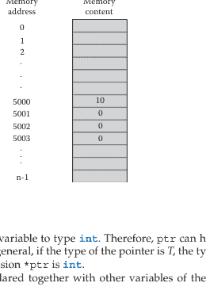

指针变量可以与相同类型的其他变量一起声明。例如：

```c
int *ptr, i, j, k;
```

请注意，允许将*放在类型旁边（例如，int* ptr;）。事实上，许多程序员喜欢这种风格。然而，这不是我们偏好的风格，因为当声明多个变量时可能会产生混淆。例如，对于声明：

```c
int* p1, p2;
```

p1被声明为指针，而p2不是。

此外，我们更倾向于先声明指针变量，以将它们与普通变量区分开来。

与普通变量一样，当声明指针变量时，编译器会分配内存来存储其值。例如，以下程序使用sizeof运算符来查看ptr分配了多少字节：

```c
#include <stdio.h>
int main(void)
{
    int *ptr;
    printf("Bytes: %u\n", sizeof(ptr));
    return 0;
}
```

无论指针变量指向什么数据类型，它分配的大小都是相同的。该值依赖于平台；其典型值是四个字节。因此，如果在我们的示例中写`char *ptr;`或`float *ptr;`或`double *ptr;`，输出将是相同的，即4。

### 指针初始化

声明指针变量后，我们可以使用它来存储另一个变量的内存地址。要找到变量的地址，我们在其名称前使用&地址运算符。例如：

```c
#include <stdio.h>
int main(void)
{
    int *ptr, a;

    ptr = &a; /* ptr "points to" the memory address of a. */
    printf("Address = %p\n", ptr); /* Display the memory address of a. */
    return 0;
}
```

使用语句`ptr = &a;`，ptr变得等于或“指向”a的内存地址。通常使用%p说明符以十六进制显示内存地址。

指针变量可以在声明时初始化，前提是它所指向的变量已经声明。例如：

```c
int a, b, *ptr = &a;
```

出于风格考虑，我们更倾向于在单独的语句中初始化指针变量，而不是与声明一起，以使其更清晰。由于篇幅所限，在某些示例中我们会在同一行中完成。

地址运算符&不能应用于常量（例如，&20）、表达式（例如，&(a+b)）、register类型的变量（我们将在第11章讨论该类型）以及位域（我们将在第13章讨论）。它仅应用于内存中的对象，例如变量、数组元素和函数。在一般情况下，如果类型是T，则&T的类型是“指向T的指针”。

### 空指针

与普通变量一样，指针变量的初始值是其地址的内容，即“垃圾值”，一个对应内存地址的任意值。当我们想明确声明指针不指向任何地方时，必须为其赋一个特殊值。该值是0或0转换为void*，即(void*)0，并由名为NULL的宏表示。NULL宏在多个头文件（例如stdio.h）中定义。被赋予NULL值的指针不指向任何对象，成为空指针。例如，以下程序首先输出指针的初始值，然后输出0。

```c
#include <stdio.h>
int main(void)
{
    int *ptr;

    printf("Addr = %p\n", ptr);
    ptr = NULL;
    printf("Addr = %p\n", ptr);
    return 0;
}
```

虽然值0可以在指针上下文中使用，但最好使用NULL宏以避免混淆。例如，赋值`ptr = 0;`可能会让读者困惑：ptr是数值变量还是指针？相比之下，赋值`ptr = NULL;`明确指出ptr是一个指针。指针变量的值可以与NULL比较，如下所示：

```c
if (ptr != NULL) /* Equivalent to if(ptr) */
if (ptr == NULL) /* Equivalent to if(!ptr) */
```

出于风格考虑，我们不偏好的语法是`if (!ptr)`。正如我们将在后续章节中看到的，许多函数返回NULL以指示执行失败。

### 使用指针

要访问指针变量引用的内存地址的内容，我们在其名称前使用*（间接或解引用）运算符。虽然使用了相同的符号，但它与乘法运算符不同。编译器根据上下文来确定是使用解引用运算符还是乘法运算符。如果你想知道为什么标准委员会决定使用相同的符号来让学习者感到困惑，我们不知道，可能是因为可用字符的短缺。下面是一个例子：

```c
#include <stdio.h>
int main(void)
{
    int *ptr, a;
    a = 10;
    ptr = &a;
    printf("Val = %d\n", *ptr);
    return 0;
}
```

表达式*ptr等价于ptr所指向的内存地址的内容。由于ptr指向a的地址，*ptr是a的别名，即等于a。因此，程序输出10。

> 指针变量在被解引用之前，必须指向一个有效的内存地址，例如变量的地址。

例如，以下程序可能会崩溃，因为ptr在语句`a = *ptr;`中使用之前尚未初始化。

```c
#include <stdio.h>
int main(void)
{
    int *ptr, a;

    a = *ptr; /* ptr has not been initialized. */
    printf("Val = %d\n", a);
    return 0;
}
```

通常，在Unix/Linux环境中，这种类型的错误会通过弹出式运行时消息*“段错误”*来指示。始终记住，在使用指针之前初始化它，不要让它随风飘荡。听听鲍勃·迪伦的*《随风飘荡》*来牢记这一点。

以下程序可以正常执行，因为ptr在语句`i = *ptr;`中使用之前指向一个有效的地址。它会输出什么？

```c
#include <stdio.h>
int main(void)
{
    int *ptr, i, j;

    j = 20;
    ptr = &j;

    i = *ptr;
    printf("Val = %d\n", i);
    return 0;
}
```

由于ptr指向j的地址，*ptr等于j，即20。因此，语句`i = *ptr;`使i等于20，程序输出Val = 20。

*和&一起使用时可以相互抵消。例如，以下程序三次显示i的地址。

```c
#include <stdio.h>
int main(void)
{
    int *ptr, i;

    ptr = &i;
    printf("%p %p %p\n", &i, &*ptr, &*ptr);
    return 0;
}
```

因为符号`/*`标记注释的开始，在类似`a = b/*ptr;`的语句中，从`/*`开始直到遇到`*/`之前的所有内容都被视为注释的一部分，编译会失败。在这种情况下，留一个空格或使用括号。例如，`a = b/ *ptr;`或`a = b/(*ptr);`


## 练习

### C.8.1 以下程序的输出是什么？

```
#include <stdio.h>
int main(void)
{
        int *ptr, i = 10;

        ptr = &i;
        i += 20;
        printf("%d\n", *ptr);
        return 0;
}
```

**答案：** 由于 ptr 指向 i 的地址，*ptr 等于 i。语句 i += 20; 使 i 等于 30，程序输出 30。

### C.8.2 编写一个程序，读取两个整数，将它们存储在两个变量中，声明指向它们的两个指针，并显示两个变量的内存地址、两个指针的内容以及它们的内存地址。

```
#include <stdio.h>
int main(void)
{
        int *ptr1, *ptr2, i, j;

        printf("Enter numbers: ");
        scanf("%d%d", &i, &j);

        ptr1 = &i;
        ptr2 = &j;

        printf("Num1 address = %p\n", ptr1);
        printf("Num2 address = %p\n", ptr2);

        printf("Ptr1 content = %d\n", *ptr1);
        printf("Ptr2 content = %d\n", *ptr2);

        printf("Ptr1 address = %p\n", &ptr1);
        printf("Ptr2 address = %p\n", &ptr2);
        return 0;
}
```

**注释：** 与普通变量一样，我们使用 & 运算符来查找 ptr1 和 ptr2 指针变量的内存地址。

### C.8.3 以下程序使用指针读取并显示一个浮点数。是否存在编程错误？

```
#include <stdio.h>
int main(void)
{
    double *ptr, i;
    scanf("%lf", ptr);
    printf("Val = %f\n", *ptr);
    return 0;
}
```

**答案：** 代码是错误的，因为在 scanf() 中使用之前，ptr 并未指向 i 的地址。如果我们在 scanf() 之前添加语句 ptr = &i;，程序将正常执行。

### C.8.4 编写一个程序，使用指针读取一个浮点数并显示其绝对值。

```
#include <stdio.h>
int main(void)
{
    double *p, val;

    p = &val;
    printf("Enter number: ");
    scanf("%lf", p);

    if(*p >= 0)
        printf("%f\n", *p);
    else
        printf("%f\n", -*p);
    return 0;
}
```

### C.8.5 以下程序的输出是什么？

```
#include <stdio.h>
int main(void)
{
    int i = 0, *ptr = &i;

    *ptr = *ptr ? 10 : 20;
    printf("%d\n", i);
    return 0;
}
```

**答案：** 由于 ptr 指向 i 的地址，表达式：

*ptr = *ptr ? 10 : 20; 等价于 i = i ? 10 : 20;

由于 i 为 0（假），表达式的值为 20。因此，i 变为 20，程序输出 20。

### C.8.6 以下程序的输出是什么？

```
#include <stdio.h>
int main(void)
{
    int *ptr1, *ptr2, *ptr3, i = 10, j = 20, k = 30;

    ptr1 = &i;
    i = 100;

    ptr2 = &j;
    j = *ptr2 + *ptr1;

    ptr3 = &k;
    k = *ptr3 + *ptr2;
    printf("%d %d %d\n", *ptr1, *ptr2, *ptr3);
    return 0;
}
```

**答案：** 由于 ptr1 指向 i 的地址，*ptr1 等于 i。类似地，*ptr2 等于 j。因此，j = *ptr2 + *ptr1 = 20+100 = 120。由于 ptr3 指向 k 的地址，*ptr3 等于 k。因此，k = *ptr3 + *ptr2 = 30+120 = 150。由于 *ptr1、*ptr2 和 *ptr3 的值分别等于 i、j 和 k，程序显示：100 120 150

### C.8.7
编写一个程序，使用两个指针先读取两个浮点数，然后交换它们所指向的值。然后，使用相同的指针输出较大值。

```
#include <stdio.h>
int main(void)
{
    float *ptr1, *ptr2, i, j, tmp;

    /* The pointers should be initialized before used in scanf(). */
    ptr1 = &i;
    ptr2 = &j;

    printf("Enter values: ");
    scanf("%f%f", ptr1, ptr2); /* Store the input values in the addresses pointed to by the pointers. */
    tmp = *ptr2;
    *ptr2 = *ptr1;
    *ptr1 = tmp;

    if(*ptr1 > *ptr2)
        printf("%f\n", *ptr1);
    else
        printf("%f\n", *ptr2);
    return 0;
}
```

### C.8.8
以下程序的输出是什么？

```
#include <stdio.h>
int main(void)
{
    int *ptr1, i = 10;
    double *ptr2, j = 1.234;

    ptr1 = &i;
    ptr2 = &j;

    *ptr1 = *ptr2;
    printf("%d %u %u %u\n", i, sizeof(ptr1), sizeof(ptr2), sizeof(*ptr2));
    return 0;
}
```

**答案：** 由于 ptr1 指向 i 的地址而 ptr2 指向 j 的地址，语句 *ptr1 = *ptr2 等价于 i = j。由于 i 声明为 int，它变为 1。如所述，指针变量分配相同的大小（通常为 4 字节），无论它们指向何处。由于 ptr2 是指向 double 的指针，程序显示：1 4 4 8

### C.8.9 使用 p 指针和 while 循环，完成以下程序以显示从 1 到 10 的整数。

```
#include <stdio.h>
int main(void)
{
    int *p, i;
    ...
}
```

**答案：**

```
#include <stdio.h>
int main(void)
{
    int *p, i;

    p = &i;
    *p = 1;
    while(*p <= 10)
    {
        printf("%d\n", *p);
        (*p)++;
        /* As we'll see later, parentheses are needed for priority reasons. */
    }
    return 0;
}
```

### C.8.10 以下程序的输出是什么？

```
#include <stdio.h>
int main(void)
{
    int *ptr1, *ptr2, i = 10, j = 20;

    ptr1 = &i;
    ptr2 = &j;

    ptr2 = ptr1;
    *ptr1 = *ptr1 + *ptr2;
    *ptr2 *= 2;
    printf("%d\n", *ptr1 + *ptr2);
    return 0;
}
```

**答案：** 语句 ptr2 = ptr1; 使 ptr2 指向 ptr1 所指向的同一地址，即 i 的地址。因此，*ptr2 等于 i。由于两个指针都指向 i 的地址，语句 *ptr1 = *ptr1 + *ptr2; 等价于 i = i+i = 10+10 = 20。类似地，语句 *ptr2 *= 2; 等价于 *ptr2 = 2*(*ptr2); 即 i = 2*i = 2*20 = 40。因此，程序显示 *ptr1 + *ptr2 = i+i = 40+40 = 80 的结果。

### C.8.11 使用 p2 指针并完成以下程序，连续读取学生的成绩直到用户输入 -1。使用 p1 指针显示成绩在 [5, 10] 范围内的学生人数，并使用 p3 指针显示最佳成绩。

```
#include <stdio.h>
int main(void)
{
    int *p1, sum;
    float *p2, *p3, grade, max;
    ...
}
```

**答案：**

```
#include <stdio.h>
int main(void)
{
    int *p1, sum;
    float *p2, *p3, grade, max;

    p1 = &sum;
    *p1 = 0;

    p3 = &max;
    *p3 = 0;

    p2 = &grade;
    while(1)
    {
        printf("Enter grade: ");
        scanf("%f", p2);

        if(*p2 == -1)
            break;
        if(*p2 >=5 && *p2 <= 10)
        {
            (*p1)++;
            if(*p2 > *p3)
```

通常，void 指针被用作函数参数以传递不同类型的值。我们将在 C.11.23 中以及第 14 章的 memcpy() 函数中看到这样的示例。

## const 限定符的使用

为了防止指针更改其所指向变量的值，我们在其类型前添加 const 关键字。例如，以下代码无法编译，因为 ptr 不允许更改 i 的值。但是，它可以指向同一类型的其他变量。

```
int j, i = 10;
const int *ptr;
ptr = &i;
*ptr = 30; /* Illegal action. */
ptr = &j; /* Legal action. */
```

为了防止指针指向另一个变量，我们在其名称前添加 const 关键字。在这种情况下，指针必须在声明时初始化。例如，以下代码无法编译，因为 ptr 不允许指向 j 的地址。但是，它可以更改 i 的值。

```
int i, j;
int* const ptr = &i; /* Initialize pointer. */
ptr = &j; /* Illegal action. */
*ptr = 30; /* Legal action. i becomes 30. */
```

请注意，使用 const 关键字两次可以防止这两种操作。例如：

```
int i, j;
const int* const ptr = &i; /* Initialize pointer. */
ptr = &j; /* Illegal action. */
*ptr = 30; /* Illegal action. */
```

如你所见，对 ptr 剩下的操作不多。基本上，剩下的只是测试指针值。是的，这在实践中是非常罕见的声明。这里有一个类似的例子供参考：

```
const char* const days[] = {"Mon", "Tue", "Wed", "Thu", "Fri", "Sat", "Sun"};
```

第一个 const 防止字符串被修改，第二个 const 防止指针指向其他位置。指针数组将在本章后面讨论。


## 指针算术

指针算术是指对指针应用某些算术运算。标准规定，当指针算术应用于同一数组的元素时，保证会产生可靠的结果；否则，行为是未定义的。该规则的一个例外是数组末尾之后第一个元素的地址；标准保证在指针算术中使用该位置是有效的。允许的操作包括：指针与整数相加或相减，以及指针相减和比较，前提是它们指向同一数组。如前所述，与 0 的赋值或比较也是允许的。

## 指针与整数

假设一个指针变量 ptr 指向数组的某个元素。在如下的赋值中加上一个正整数 n：

```
ptr = ptr + n;
```

会使指针的值增加 n * 指针数据类型的大小，并让指针指向它原来所指向的元素之后的第 n 个元素的地址。例如，如果 ptr 指向数组元素 arr[i]，而 n 为 3，那么 ptr 将指向 arr[i+3]。如果结果元素超出了数组范围（除了末尾之后的第一个元素），则结果是未定义的。例如，基于我们在第2章中对数据类型所做的假设，如果 ptr 被声明为指向如下数组的指针：

- **char**，其值增加 n*1=n，因为 `char` 类型的大小是一个字节。
- **int 或 float**，其值增加 n*4，因为两种类型的大小都是四个字节。
- **double**，其值增加 n*8，因为 `double` 的大小是八个字节。

考虑以下程序：

```c
#include <stdio.h>
int main(void)
{
    int *ptr, arr[] = {10, 20, 30};

    ptr = &arr[0];
    printf("Addr:%d\n", ptr);
    ptr = ptr+2;
    printf("Addr:%d Val:%d\n", ptr, *ptr);
    return 0;
}
```

ptr 增加了 8，而不是 2，因为 ptr 被声明为指向 int 的指针。程序显示两个地址，第二个地址比第一个高 8 个位置。由于 ptr 指向 arr[2]，程序也会输出 30。

```c
scanf("%f%f%f", ptr1, ptr2, ptr3);
if((*ptr1 >= 5) && (*ptr2 >= 5) && (*ptr3 >= 5))
{
    if(*ptr1 <= *ptr2 && *ptr1 <= *ptr3)
    {
        printf("%f ", *ptr1);
        if(*ptr2 < *ptr3)
            printf("%f %f\n", *ptr2, *ptr3);
        else
            printf("%f %f\n", *ptr3, *ptr2);
    }
    else if(*ptr2 <= *ptr1 && *ptr2 <= *ptr3)
    {
        printf("%f ", *ptr2);
        if(*ptr1 < *ptr3)
            printf("%f %f\n", *ptr1, *ptr3);
        else
            printf("%f %f\n", *ptr3, *ptr1);
    }
    else
    {
        printf("%f ", *ptr3);
        if(*ptr2 < *ptr1)
            printf("%f %f\n", *ptr2, *ptr1);
        else
            printf("%f %f\n", *ptr1, *ptr2);
    }
}
else
    printf("Avg = %.2f\n", (*ptr1 + *ptr2 + *ptr3)/3);
return 0;
```

## C.8.14 使用 p1 和 p2 指针，补全以下程序，以显示从 10 到 20 的偶数乘积。

```c
#include <stdio.h>
int main(void)
{
    int *p1, *p2, i, mul;
    ...
}
```

答案：

```c
#include <stdio.h>
int main(void)
{
    int *p1, *p2, i, mul;
    p1 = &i;
    p2 = &mul;
    for(*p1=10, *p2=1; *p1 <= 20; (*p1)+=2)
        *p2 = *p2 * *p1;
}
```

内存中的元素。例如，在 char 数组中，距离是一个字节，而在 int 数组中，则是四个字节。

> 提示
> 指针与数组之间的紧密联系基于这样一个事实：数组名称可以用作指向其第一个元素的指针。

类似地，arr+1 可以用作指向第二个元素的指针，arr+2 用作指向第三个元素的指针，依此类推。一般来说，以下表达式是等价的：

- arr == &arr[0]
- arr + 1 == &arr[1]
- arr + 2 == &arr[2]
- ...
- arr + n == &arr[n]

因此，以下程序会四次输出相同的值：

```c
#include <stdio.h>
int main(void)
{
    int *ptr, arr[5];
    ptr = arr;
    printf("%p %p %p %p\n", ptr, &arr[0], arr, &arr);
    return 0;
}
```

请注意，虽然表达式 &arr 输出相同的值，但它与其他表达式不同。该表达式求值为指向整个数组的指针，而其他表达式求值为指向其第一个元素的指针。具体来说，&arr 的类型是“指向包含五个整数的数组的指针”，而其他表达式的类型是“指向整数的指针”。难吧！

更困难的是，如果我们写 arr+1 而不是 &arr，它与其他值会有什么不同（会是 1、4，还是其他值，……）？要回答这个问题，请利用表达式的类型和指针算术。我们不会告诉你答案；自己思考一下，运行程序，检查输出，然后试着弄明白为什么会这样。如果你需要解释，不要联系我们，我们不在……

由于数组名称可以用作指向其第一个元素的指针，所以它的内容等于其第一个元素的值。因此，*arr 等于 arr[0]。类似地，由于 arr+1 是指向第二个元素的指针，*(arr+1) 等于 arr[1]，依此类推。一般来说，以下表达式是等价的：

- *arr == arr[0]
- *(arr+1) == arr[1]
- *(arr+2) == arr[2]
- ...
- *(arr+n) == arr[n]

括号是必要的，因为 * 运算符的优先级高于 + 运算符。因此，表达式 *(arr+n) 和 *arr + n 的求值方式不同。例如，考虑以下程序：

```c
#include <stdio.h>
int main(void)
{
    int *ptr, arr[] = {10, 20, 30, 40, 50};

    ptr = arr;
    printf("Val1 = %d Val2 = %d\n", *ptr+2, *(ptr+2));
    return 0;
}
```

通过语句 ptr = arr;，ptr 变得等于 arr[0] 的地址，所以 *ptr 等于 arr[0]，即 10。由于 * 运算符的优先级高于 +，*ptr+2 等于 10+2 = 12。

表达式 *(ptr+2) 求值为 ptr 所指向的地址再增加两个整数位置后的内容。因此，*(ptr+2) 等于 arr[2]。结果，程序显示：Val1 = 12 Val2 = 30

注意，我们不会写 ptr = &arr;，因为 &arr 对应一个指向数组的指针，而 ptr 是一个指向整数的指针。

以下程序使用数组下标和指针算术来显示 arr 元素的地址和值。

```c
#include <stdio.h>
int main(void)
{
    int i, arr[5] = {10, 20, 30, 40, 50};

    printf("\n***** Using array notation *****\n");
    for(i = 0; i < 5; i++)
        printf("Addr = %p    Val = %d\n", &arr[i], arr[i]);

    printf("\n***** Using pointer notation *****\n");
    for(i = 0; i < 5; i++)
        printf("Addr = %p    Val = %d\n", arr+i, *(arr+i));
    return 0;
}
```

在处理数组时，我们更倾向于使用数组下标而不是指针算术。原因是代码更清晰、更不易出错。换句话说，我们认为 arr[i] 比 *(arr+i) 更容易阅读，也更安全。例如，缺少括号会引入一个不太容易追踪的 bug。就性能而言，迄今为止优化编译器所做的代码转换很可能会生成同样高效的代码。然而，由于这两种方式都非常流行，你必须学习并掌握它们。

真正重要的是要记住，编译器会将 arr[i] 转换为 *(arr+i)。我们可以说 arr[i] 是 *(arr+i) 的一种优雅的简写。稍后你会在一道练习中遇到这个规则的一个非常奇怪的应用。期待你的答案；陷阱已经布好。

以下程序使用另一个指针变量来显示 arr 元素的值和地址。

```c
#include <stdio.h>
int main(void)
{
    int *ptr, i, arr[5] = {10, 20, 30, 40, 50};
    ptr = arr;
    for(i = 0; i < 5; i++)
    {
        printf("Addr = %p  Val = %d\n", ptr, *ptr);
        ptr++; /* ptr becomes equal to the memory address of the next array element. Equivalently, we can write ptr = &arr[i]; */
    }
    return 0;
}
```

语句 ptr = arr; 使 ptr 指向第一个元素，而每次执行 ptr++; 都会使 ptr 指向下一个元素。

当数组名称用作指针时，C 将其视为 const 指针。因此，不允许更改它的值并使其指向别处。数组不是可修改的左值；它的值将始终等于其第一个元素的内存地址。

因此，如果在我们的上一个示例中写 arr++; 或 arr = &i;，编译器将显示非法操作的错误消息。现在，你可以理解在第7章中被告知的内容：为了将数组 a 的元素复制到 b 中而写 b = a; 是非法的。但是，你可以将它的值复制到一个指针变量中，就像我们用 ptr = arr; 所做的那样，并使用该指针来访问数组元素。

尽管数组和指针密切相关，但你必须清楚，数组不是指针，反之亦然。例如，声明 int a[50]; 和 int *a; 是完全不同的。对于第一个声明，编译器为 50 个整数分配内存。数组可以在不同时间填充不同的值，但它始终引用同一个内存地址。如前所述，不可能给它赋一个新值，也就是说，写 a = arr 是非法的。对于第二个声明，编译器分配内存来存储指针的值（例如，通常为 4 字节）。与数组不同，你可以给指针赋一个新值，让它指向其他地方，例如，写 a = arr 是合法的。

只要记住，每当数组名称在表达式中使用时，编译器都会将其转换为指向其第一个元素地址的指针。总是如此吗？并非总是如此，有几个例外：

- a. 当它是 sizeof 运算符的操作数时。sizeof 计算整个数组的大小。
- b. 如前所述，当 & 运算符应用于它时。获取的是数组的地址。在第11章讨论复杂声明时，我们将看到一个如何声明和初始化该类型指针的示例。
- c. 当数组是字符串字面量初始化器时。

虽然指针变量不是数组，但可以像数组一样对其进行下标操作。

例如，以下程序像下标数组一样对指针变量 ptr 进行下标操作，以显示 arr 元素的值和地址。


```c
#include <stdio.h>
int main(void)
{
    int *ptr, i, arr[5] = {10, 20, 30, 40, 50};

    ptr = arr;
    for(i = 0; i < 5; i++)
        printf("Addr = %p Val = %d\n", &ptr[i], ptr[i]);
    return 0;
}
```

请注意，虽然 arr[i] 和 ptr[i] 访问的是同一个元素，但编译器到达的方式不同。例如，要访问 arr[2]，它获取 arr 的地址，加上 8（正如所说，我们假设 int 的大小为 4 字节），然后前往所得地址获取值。另一方面，要访问 ptr[2]，它获取 ptr 的地址，检索存储在其中的值，加上 8，然后前往该地址获取值。换句话说，arr[2] 位于 arr 地址之后 8 个位置，而 ptr[2] 位于 ptr 指向的地址之后 8 个位置。

## 练习

### C.8.16

程序的输出是什么？

```c
#include <stdio.h>
int main(void)
{
    int *ptr, arr[] = {10, 20, 30, 40, 50};

    ptr = arr;
    *ptr = 3;

    ptr += 2;
    *ptr = 5;
    printf("%d\n", arr[0]+arr[2]);
    return 0;
}
```

**答案：** 使用语句 ptr = arr; ptr 指向 arr[0] 的地址，因此 *ptr 等于 arr[0]。因此，语句 `*ptr = 3;` 等价于 `arr[0] = 3;`。语句 ptr += 2; 使 ptr 等于 arr[2] 的地址，因此 *ptr 等于 arr[2]。因此，语句 `*ptr = 5;` 等价于 `arr[2] = 5;`。结果，程序显示 8。

### C.8.17

程序的输出是什么？

```c
#include <stdio.h>
int main(void)
{
    int i = 10, *p = &i;
    p[0] = 50;
    printf("%d\n", i+p[0]);
    return 0;
}
```

**答案：** 由于 p 指向 i 的地址，我们可以将其作为单个元素的数组进行索引。因此，语句 p[0] = 50; 等价于 i = 50; 程序显示 100。如果我们改写为 p[1] = 50; 而不是 p[0] = 50; 会发生什么？

语句 p[1] = 50; 尝试更改越界地址的值，这可能导致程序崩溃。

### C.8.18

编写一个程序，读取一月份的每日温度并将其存储在数组中。然后，程序应读取一个温度并显示温度小于该值的第一个日期编号。使用指针算术处理数组。

```c
#include <stdio.h>
#define SIZE 31
int main(void)
{
    int i;
    double temp, arr[SIZE];
    for(i = 0; i < SIZE; i++)
    {
        printf("Enter temperatures: ");
        scanf("%lf", arr+i); /* arr+i is equivalent to &arr[i]. */
    }
    printf("Enter temperature to check: ");
    scanf("%lf", &temp);
    for(i = 0; i < SIZE; i++)
    { /* The braces are not necessary. We put them to make the code easier to read. */
        if(*(arr+i) < temp)
            break;
    }
    if(i == SIZE)
        printf("No temperature less than %.1f\n", temp);
    else
        printf("The first temperature less than %.1f was %.1f in day %d\n", temp, *(arr+i), i+1);
    return 0;
}
```

### C.8.19

程序的输出是什么？

```c
#include <stdio.h>
int main(void)
{
    int i, *ptr1, *ptr2, arr[] = {10, 20, 30, 40, 50, 60, 70};
    ptr1 = &arr[2];
    ptr2 = &arr[4];
    for(i = ptr2-ptr1; i < 5; i+=2)
        printf("%d ", ptr1[i]);
    return 0;
}
```

**答案：** 正如所说，当两个指向同一数组的指针相减时，结果是它们之间的元素个数，而不是它们在内存中的距离。因此，尽管 arr[4] 的地址比 arr[2] 的地址高八个位置，ptr2-ptr1 的结果等于它们下标的差，即 4-2 = 2。由于 ptr1 指向 arr[2]，ptr1[2] 对应 arr[4] 且 ptr1[4] 对应 arr[6]。因此，程序输出 50 和 70。

### C.8.20

编写一个程序，读取 10 名学生的成绩，将其存储在数组中，并显示最佳成绩和最差成绩以及它们在数组中首次出现的位置。程序应强制用户输入 [0, 10] 范围内的成绩。使用指针算术处理数组。

```c
#include <stdio.h>

#define SIZE 10

int main(void)
{
    int i, max_pos, min_pos;
    float max, min, arr[SIZE];

    max = -1;
    min = 11;
    for(i = 0; i < SIZE; i++)
    {
        do
        {
            printf("Enter grade: ");
            scanf("%f", arr+i);
        } while(*(arr+i) > 10 || *(arr+i) < 0); /* Check if the grade is within [0, 10]. */
        if(*(arr+i) > max)
        {
            max = *(arr+i);
            max_pos = i;
        }
        if(*(arr+i) < min)
        {
            min = *(arr+i);
            min_pos = i;
        }
    }
    printf("Max grade is %.2f in pos %d\nMin grade is %.2f in pos %d\n", max, max_pos, min, min_pos);
    return 0;
}
```

### C.8.21

使用 ptr 指针和迭代循环完成以下程序，将 arr 元素递减一。程序应在终止前显示它们的和。使用指针算术处理数组。

```c
#include <stdio.h>
int main(void)
{
    int *ptr, sum, arr[5] = {11, 21, 31, 41, 51};
    ...
}
```

**答案：**

```c
#include <stdio.h>
int main(void)
{
    int *ptr, sum, arr[5] = {11, 21, 31, 41, 51};

    sum = 0;
    for(ptr = arr; ptr < arr+5; ptr++)
    {
        --*ptr;
        sum += *ptr;
    }
    printf("Sum = %d\n", sum);
    return 0;
}
```

**注释：**

第一次迭代中，语句 ptr = arr; 使 ptr 指向 arr[0]。因此，*ptr 等于 arr[0]，即 11。语句 --*ptr; 等价于 --arr[0]; 因此 arr[0] 变为 10。该值被加到 sum。

以类似的方式，后续迭代将剩余元素递减一，它们的数值分别变为 20、30、40 和 50。当循环结束时，sum 等于新值的总和，程序输出：Sum = 150

### C.8.22

使用 ptr 指针完成以下程序，读取并将 50 名学生的成绩存储到 arr 中，然后以逆序显示数组的值。使用指针算术处理数组。

```c
#include <stdio.h>

#define SIZE 50

int main(void)
{
    float *ptr, arr[SIZE];
    ...
}
```

**答案：**

```c
#include <stdio.h>
#define SIZE 50
int main(void)
{
    float *ptr, arr[SIZE];
    ptr = arr;
    while(ptr < arr+SIZE)
    {
        printf("Enter grade: ");
        scanf("%f", ptr);
        ptr++;
    }
    ptr--;
    while(ptr >= arr)
    {
        printf("%f\n", *ptr);
        ptr--;
    }
    return 0;
}
```

### C.8.23

程序的输出是什么？

```c
#include <stdio.h>
int main(void)
{
    int *ptr1, *ptr2, i = 10, j = 20;
    ptr1 = &i;
    *ptr1 = 150;
    ptr2 = &j;
    *ptr2 = 50;
    ptr2 = ptr1;
    *ptr2 = 250;
    ptr1 = ptr2;
    *ptr1 += *ptr2;
    printf("%d\n", i+j);
    return 0;
}
```

**答案：** 由于 ptr1 指向 i 的地址，语句 `*ptr1 = 150;` 等价于 `i = 150;`。类似地，语句 `*ptr2 = 50;` 等价于 `j = 50;`。语句 `ptr2 = ptr1;` 使 ptr2 指向 ptr1 指向的同一地址，即 i 的地址。因此，语句 `*ptr2 = 250;` 等价于 `i = 250;`。

下一个语句不会改变 ptr1 的值；也就是说，它仍然指向 i 的地址。因此，语句 `*ptr1 += *ptr2;` 等价于 `i += i;`，即 i = i+i = 250+250 = 500。结果，程序输出 550。

### C.8.24

使用 ptr 指针完成以下程序，读取 50 个整数并将值在 [30, 40] 范围内的存储到 arr 中。程序应显示数组中存储了多少个值。程序应将 -1 设置为剩余元素。使用指针算术处理数组。

```c
#include <stdio.h>

#define SIZE 50

int main(void)
{
        int *ptr, i, arr[SIZE];
        ...
}
```

**答案：**

```c
#include <stdio.h>

#define SIZE 50

int main(void)
{
        int *ptr, i, arr[SIZE];

        ptr = arr;
        for(i = 0; i < SIZE; i++)
        {
                printf("Enter number: ");
                scanf("%d", ptr);

                if(*ptr >= 30 && *ptr <= 40)
                        ptr++;
        }
        printf("%d elements are stored\n", ptr-arr);
        for(; ptr < arr+SIZE; ptr++)
                *ptr = -1;
        return 0;
}
```

### C.8.25

你能检测到多少个编译错误？

```c
#include <stdio.h>
int main(void)
{
        int i, arr[5] = {10, 20, 30, 40, 50};

        for(i = 0; i < 5; i++)
                printf("%d\n", i[arr]);

        printf("%d\n", 2[arr]-3[arr]);
        return 0;
}
```

```c
    printf("\nSecond array\n");
    for(p2 = arr2; p2 < arr2+SIZE; p2++)
    {
        printf("Enter number: ");
        scanf("%d", p2);
    }
    for(p1 = arr1; p1 < arr1+SIZE; p1++)
    {
        for(p2 = arr2; p2 < arr2+SIZE; p2++)
        {
            if(*p1 == *p2)
                printf("Common element:%d found in positions %d and %d\n", *p1, p1-arr1+1, p2-arr2+1);
        }
    }
    return 0;
    }
```

### C.8.27 使用 p1 和 p2 指针，完成以下程序，读取 100 个产品的代码并将它们存入 arr。程序应仅当代码尚未存储时才将代码存入数组。如果用户输入 -1，则应终止代码插入。程序应在终止前显示已存储产品的代码。使用指针算术处理数组。

```c
#include <stdio.h>

#define SIZE 100

int main(void)
{
    int *p1, *p2, arr[SIZE];
    ...
}
```

**答案：**

```c
#include <stdio.h>

#define SIZE 100

int main(void)
{
    int *p1, *p2, arr[SIZE];

    p1 = arr;
    while(p1 < arr+SIZE)
    {
        printf("Enter code %d: ", p1-arr+1);
        scanf("%d", p1);
        if(*p1 == -1)
            break;

        for(p2 = arr; p2 < p1; p2++)  /* Traverse the array to check
if the input code is already stored. */
        {
            if(*p1 == *p2)
            {
                printf("Error: Code %d exists\n", *p1);
                break;
            }
        }
        /* If the code is not stored, increase the pointer. */
        if(p2 == p1)
            p1++;
    }
    /* Display the codes. */
    for(p2 = arr; p2 < p1; p2++)
        printf("C: %d\n", *p2);
    return 0;
}
```

### C.8.28 以下程序中 arr 元素的值是什么？

```c
#include <stdio.h>
int main(void)
{
    int *ptr, arr[5] = {20};

    for(ptr = arr+1; ptr < arr+4; ptr++)
        *ptr = *(ptr-1) + *(ptr+1) + 1;
    return 0;
}
```

**答案：** 当声明 arr 时，arr[0] 变为 20，其余元素被设置为 0。语句 ptr = arr+1; 使 ptr 指向 arr[1]。在每次循环迭代中，语句 ptr++ 使它指向下一个元素。当前元素的值变为前一个元素的值加上后一个元素的值再加一。例如，在第一次迭代中，该语句等价于：arr[1] = arr[0]+arr[2]+1 = 21; 结果，arr[0] 到 arr[3] 的值将为 20 到 23，而 arr[4] 等于 0。

### C.8.29 以下程序的输出是什么？

```c
#include <stdio.h>
int main(void)
{
    int a[] = {0, 0, 1, 2, 3}, b[] = {0, 0, 4, 5, 6};
    int *ptr1 = a, *ptr2 = b;

    while(!*ptr1++ && !*ptr2++)
        ;
    printf("%d %d\n", *(b+(ptr1-a)), *(a+(ptr2-b)));
    return 0;
}
```

**答案：** 是的，你需要纸和笔才能弄懂它。这确实是一道难题；很抱歉让你费心了。让我们追踪迭代过程：

```c
p[0] = &i;
p[1] = &j;
p[2] = &k;
printf("%d %d %d\n", *p[0], *p[1], *p[2]);
return 0;
}
```

语句 p[0] = &i; 使 p[0] 指向 i 的地址，因此 *p[0] 的值等于 i。类似地，*p[1] 等于 j，*p[2] 等于 k。因此，程序输出：100 200 300。

尽管我们将在第 10 章讨论字符串，但指针数组经常被用来代替二维数组处理字符串。原因之一是节省内存。例如，声明：

```c
char names[][12] = {"First name", "Second name", "Third"};
```

无论字符串长度如何，都会为每一行分配 12 个字节。另一方面，如果我们使用指针数组：

```c
char *names[] = {"First name", "Second name", "Third"};
```

则分配的内存与每个字符串的长度相匹配。数组的元素是指向各自字符串的指针。由于各个字符串的右端长度不一，这个数组通常被称为*参差不齐的*字符串数组。让我们问一个简单的问题：这个 names 数组的大小是多少？很简单，数一数字符并回答。请只有在完全确定时才阅读下一页的答案；仔细数。

因为我们让你数字符，你就真的数了？你运气不错，我们没有选择很长的字符串……答案如下。假设每个指针分配 4 个字节，并且该数组包含三个元素，那么无论字符串长度如何，它的大小都是 12 个字节。

除了节省内存之外，使用指针数组处理字符串还可以提高程序的性能。C.10.37 就是这样一个例子。

## 练习题

- C.8.30 以下程序的输出是什么？

```c
#include <stdio.h>
int main(void)
{
    int *p[3], i, num;

    for(i = 0; i < 3; i++)
    {
        printf("Enter number: ");
        scanf("%d", &num);
        p[i] = &num;
    }
    for(i = 0; i < 3; i++)
        printf("Num: %d\n", *p[i]);
    return 0;
}
```

答案：语句 p[i] = &num; 使 p 的每个元素都指向 num 的地址。由于三个指针都指向同一个地址，它们的内容将等于 num 的最后一个值。因此，第二个循环会三次输出最后输入的值。

- C.8.31 以下程序的输出是什么？

```c
#include <stdio.h>
int main(void)
{
    int *p[3], i, arr[4] = {10, 20, 30, 40};

    for(i = 0; i < 3; i++)
    {
        p[i] = &arr[i]+1;
        printf("%d ", *p[i]);
    }
    return 0;
}
```

答案：语句 p[i] = &arr[i]+1; 使 p 的每个元素指向 arr[i] 之后的下一个元素的地址。因此，当 i 为 0 时，p[0] 指向 arr[1]；当 i 为 1 时，p[1] 指向 arr[2]；当 i 为 2 时，p[2] 指向 arr[3]。因此，程序显示：20 30 40。

### C.8.32 著名的勾股定理的逆定理指出，如果一个三角形的边长分别为 a、b 和 c，并且如果：

- $a^2 + b^2 = c^2$，则该三角形为直角三角形
- $a^2 + b^2 > c^2$，则该三角形为钝角三角形
- $a^2 + b^2 < c^2$，则该三角形为锐角三角形

编写一个程序，使用指针数组读取 a、b 和 c 边的长度，并判断三角形的类型。程序应强制用户为 c 输入一个大于另外两条边的值。

```c
#include <stdio.h>
int main(void)
{
    int *p[3], i, j, k;

    p[0] = &i;
    p[1] = &j;
    p[2] = &k;

    printf("Enter length_a and length_b: ");
    scanf("%d%d", p[0], p[1]);
    do
    {
        printf("Enter length_c: ");
        scanf("%d", p[2]);
    } while((*p[2] <= *p[0]) || (*p[2] <= *p[1]));

    if((*p[0])*(*p[0]) + (*p[1])*(*p[1]) == (*p[2])*(*p[2]))
        printf("Right triangle\n");
    else if((*p[0])*(*p[0]) + (*p[1])*(*p[1]) > (*p[2])*(*p[2]))
        printf("Acute triangle\n");
    else
        printf("Obtuse triangle\n");
    return 0;
}
```

## 指向指针的指针

就像普通变量一样，当声明一个指针变量时，编译器会分配内存来存储它的值。因此，我们可以声明另一个指针变量来指向这个内存地址。要声明一个指向指针变量的指针，我们使用两次 *。例如，语句：

```c
int **pp;
```

将 pp 声明为一个指向另一个指针的指针，而那个指针指向 `int`。

要使用指向指针变量的指针，单个 * 提供对第二个指针地址的访问，而双 ** 提供对第二个指针所指向地址内容的访问。例如：

```c
#include <stdio.h>
int main(void)
{
    int *p, **pp, i = 20;

    p = &i;
    pp = &p;
    printf("%d\n", **pp);
    return 0;
}
```

由于 pp 指向 p 的地址，所以 *pp 等于 p。由于 p 指向 i 的地址，所以 **pp 等于 i，程序显示 20。

指向指针变量的指针最常见的应用，是当我们希望函数能够修改某个指针参数的值时。在第 14 章中，请注意 C.14.11 注释中的示例。一般来说，你可以声明指向指针的指针，再指向另一个指针变量，依此类推，例如 ***pP，但在实践中，很少需要超过两层深度。让我们看一个将数组、指针数组和指向指针的指针结合在一起的示例。

```c
#include <stdio.h>
int main(void)
{
    int a[] = {10, 20, 30}, *p[] = {a, a+1, a+2}, **pp;

    for(pp = p; pp < p+3; pp++)
        printf("%d ", **pp);
    return 0;
}
```

最初，pp 指向 p[0]，而 p[0] 指向 a[0] 的地址。因此，**pp 等于 a[0]。递增后，pp 指向 p[1]，而 p[1] 指向 a[1]。结果，程序显示：10 20 30。

## 练习题

### C.8.33 以下程序的输出是什么？

```c
#include <stdio.h>
int main(void)
{
    int *p, **pp, i = 10, j = 20;

    p = &i;
    pp = &p;
```


```
**pp += 100;

p = &j;
**pp += 100;
printf("%d\n", i+j);
return 0;
}
```

答案：既然 pp 指向 p，而 p 指向 i，那么 **pp 就等于 i。因此，语句 **pp += 100; 等价于 i = i+100 = 10+100 = 110。语句 p = &j; 使 p 指向 j，因此 **pp 就等于 j。所以，语句 **pp += 100; 等价于 j = j+100 = 20+100 = 120。因此，程序显示 230。

## C.8.34 下面程序中 a 的元素的值是什么？

```
#include <stdio.h>
int main(void)
{
    int k = 0, b = 1, c = 2, d = 3, m, a[3];
    int *p[] = {&k, &b, &c, &d};
    for(m = 0; m < 3; m++)
        a[*p[m]] = **(p+m+1);
    return 0;
}
```

答案：由于 p[0] 等于 &k，p[1] 等于 &b，p[2] 等于 &c，p[3] 等于 &d，所以 *p[0]、*p[1]、*p[2] 和 *p[3] 的值分别是 0、1、2 和 3。在一般情况下，p[m+1] 是指向 p[m+1] 元素的指针。让我们跟踪迭代过程：

第一次迭代 (m=0)：a[*p[0]] = **(p+1) = *p[1] = b，即 a[0] = 1。

第二次迭代 (m=1)：a[*p[1]] = **(p+2) = *p[2] = c，即 a[1] = 2。

第三次迭代 (m=2)：a[*p[2]] = **(p+3) = *p[3] = d，即 a[2] = 3。

## C.8.35 使用 p1 完成下面的程序，使其连续读入一个整数，并输出单词 test，输出次数等于输入数字的绝对值。程序应使用 p2 来显示输出单词的总数。如果用户输入 0，则终止数字的输入。只使用 for 循环。

```
#include <stdio.h>
int main(void)
{
    int **p1, **p2, *p3, *p4, i, num, times;
    ...
}
```

答案：

```
#include <stdio.h>
int main(void)
{
    int **p1, **p2, *p3, *p4, i, num, times;

    p3 = &num;
    p1 = &p3;

    p4 = &times;
    p2 = &p4;

    **p2 = 0;
    for(;;)
    {
        printf("Enter number: ");
        scanf("%d", *p1);
        if(**p1 == 0)
            break;
        if(**p1 < 0)
            **p1 = -**p1;
        for(i = 0; i < **p1; i++)
            printf("test\n");
        **p2 += **p1;
    }
    printf("Total number is = %d\n", **p2);
    return 0;
}
```

## 指针与二维数组

正如指针与一维数组密切相关一样，它们也与多维数组密切相关。在本节中，我们将重点讨论最常见的情况，即二维数组。

回忆第 7 章的内容，当声明一个二维数组时，其元素按连续的内存位置存储，从第一行的元素开始，接着是第二行的元素，依此类推。例如，下面的程序声明了一个二维数组并显示其元素的内存地址。它们之间的距离是 int 类型的大小。

```
#include <stdio.h>
int main(void)
{
    int i, j, a[2][3];

    for(i = 0; i < 2; i++)
        for(j = 0; j < 3; j++)
            printf("Addr [%d][%d]:%p\n", i, j, &a[i][j]);

    return 0;
}
```

还要记住，C 将二维数组视为一维数组，其中每个元素是一个数组。例如，a 的元素是 a[0]、a[1] 和 a[2]，每个元素都是一个包含三个整数的数组。特别地，C 将 a[0] 视为一个数组，通过对其名称进行下标操作，我们可以得到它的元素，即 a[0][0]、a[0][1] 和 a[0][2]。事实上，如果我们写 sizeof(a[0])，程序会输出 12。

为了通过指针运算处理二维数组 a[N][M]，我们将每个数组 a[0]、a[1]、...、a[N-1] 的名称用作指向相应行第一个元素的指针。例如，由于 a[0] 可以用作指向 a[0][0] 的指针，所以 *a[0] 等于 a[0][0]。

由于 a[0] 指向第一个元素，a[0]+1 可以用作指向第二个元素（即 a[0][1]）的指针，a[0]+2 可以用作指向第三个元素（即 a[0][2]）的指针。在一般情况下，a[0]+j 可以用作指向第一行 a[0][j] 元素的指针。因此，我们有：

- a[0]+j 等价于 &a[0][j]。
- *(a[0]+j) 等价于 a[0][j]。

类似地，a[1]+j 可以用作指向第二行 a[1][j] 元素的指针。因此，我们有：

- a[1]+j 等价于 &a[1][j]。
- *(a[1]+j) 等价于 a[1][j]。

因此，在一般情况下，我们有：

- a[i]+j 等价于 &a[i][j]。
- *(a[i]+j) 等价于 a[i][j]。

而且，因为到目前为止我们知道，a[i] 会被转换为 *(a+i)，所以我们有：

- *(a+i)+j 等价于 &a[i][j]。
- *(*(a+i)+j) 等价于 a[i][j]。

这些等式的一个例子是 a[0][0] 等价于 *a[0] 和 **a。本质上，当我们写 a[i][j] 时，编译器会将其转换为 *(*(a+i)+j)。总而言之，下面的程序使用三种方式来显示二维数组的元素。

```c
#include <stdio.h>
int main(void)
{
    int i, j, a[2][3] = {10, 20, 30, 40, 50, 60};

    for(i = 0; i < 2; i++)
        for(j = 0; j < 3; j++)
        {
            printf("a[%d][%d]:%d ", i, j, a[i][j]);
            printf("a[%d][%d]:%d ", i, j, *(a[i]+j));
            printf("a[%d][%d]:%d\n", i, j, *(*(a+i)+j));
        }
    return 0;
}
```

我们可以移除外层循环并写成：p = a+1; 或等价地 p = &a[1];。内层循环保持不变。

如果我们想声明指向数组每一行的指针呢？我们可以使用一个指针数组。例如：

```c
#include <stdio.h>
int main(void)
{
    int i, a[4][2] = {10, 20, 30, 40, 50, 60, 70, 80}, *p[4] = {a[0],
a[1], a[2], a[3]};

    for(i = 0; i < 4; i++)
        printf("%d ", *(p[i]+1));
    return 0;
}
```

初始化后，每个 p 元素都指向 a 相应行的第一个元素。例如，p[0] 指向 a[0][0]，p[0]+1 指向 a[0][1]。因此，程序显示第二列的值，即 20 40 60 80。

在结束这个确实很难的小节之前，对于访问最高达四维数组的元素，等价的指针表达式如下：

```c
arr[i] = *(arr+i)
arr[i][j] = *((arr+i)+j)
arr[i][j][k] = *(*((arr+i)+j)+k)
arr[i][j][k][l] = *(*(*(*(arr+i)+j)+k)+l)
```

## 练习

### C.8.36 以下程序的功能是什么？

```c
#include <stdio.h>
int main(void)
{
    int i, arr[2][5] = {10, 20, 30, 40, 50, 60, 70, 80, 90, 100};

    for(i = 0; i < 2; i++)
        *(arr[i]+3) = 0;
    return 0;
}
```

**答案：** 在每次迭代中，arr[i] 指向第 i 行的第一个元素。表达式 arr[i]+3 是指向第 i 行第四个元素的指针。因此，*(arr[i]+3) 等于 arr[i][3]。结果，程序将第四列的元素置零，因此 arr[0][3] 和 arr[1][3] 变为 0。

### C.8.37 以下程序的功能是什么？

```c
#include <stdio.h>
```

```
{
    int *p, arr[SIZE][SIZE] = {0};

    for(p = &arr[0][0]; p <= &arr[SIZE-1][SIZE-1]; p++)
    {
        if ((p-&arr[0][0])%(SIZE+1) == 0)
            *p = 1;
    }
    return 0;
}
```

注释：由于数组元素初始化为 0，只需将主对角线上的元素置为 1 即可。if 条件检查元素是否属于对角线。该条件的形成基于这样的观察：两个连续对角线元素之间的元素数量为 SIZE。例如，在 5×5 数组中，对角线元素位于位置 0、6、12、18 和 24。

此外，通过这个例子，我们想向你展示，将一个二维数组视为一维数组是完全合法的。我们利用了元素在内存中连续存储这一事实。

## C.8.40 编写一个程序，将随机整数赋给一个 3×5 数组，并显示每一行和每一列的最小值和最大值。使用指针运算来处理数组。

```
#include <stdio.h>
#include <stdlib.h>
#include <time.h>

#define ROWS 3
#define COLS 5

int main(void)
{
    int i, j, min, max, arr[ROWS][COLS];

    srand(time(NULL));
    for(i = 0; i < ROWS; i++)
    {
        min = max = *arr[i];
        for(j = 1; j < COLS; j++)
        {
            *(arr[i]+j) = rand();
            if(*(arr[i]+j) < min)
                min = *(arr[i]+j);
            if(*(arr[i]+j) > max)
                max = *(arr[i]+j);
        }
        printf("Row %d: Min=%d Max=%d\n", i+1, min, max);
    }
    for(i = 0; i < COLS; i++)
    {
        min = max = *(arr[0]+i);
        for(j = 1; j < ROWS; j++)
```


```c
{
    if(*(arr[j]+i) < min)
        min = *(arr[j]+i);
    if(*(arr[j]+i) > max)
        max = *(arr[j]+i);
    printf("Col_%d: Min=%d Max=%d\n", i+1, min, max);
}
/* Display the array to verify the results. */
for(i = 0; i < ROWS; i++)
{
    for(j = 0; j < COLS; j++)
        printf("%10d", *(arr[i]+j));
    printf("\n");
}
return 0;
}
```

## 函数指针

很可能，最好在阅读第11章之后再阅读本节。不过，你可以继续阅读并了解一个大概。

当定义一个函数时，编译器会分配内存来存储其代码。因此，每个函数都有一个地址，就像普通变量一样。函数指针指向存储函数代码的内存地址。C 语言将函数指针视作普通指针。例如，我们可以将它们存储在变量中，或将其用作数组元素。声明函数指针的一般语法是：

```c
return type (*pointer name) (type_param_1 name_1, type_param_2 name_2,
..., type_param_n name_n);
```

`return type` 指定函数的返回类型，而变量 `name_1`、`name_2`、...、`name_n` 表示函数的参数（如果有的话）。以下是一些示例：

```c
int (*ptr)(int arr[], int size); /* ptr is declared as a pointer to a
function, which takes as parameters an array of integers and an integer
and returns an integer. */
void (*ptr)(double *arr[]); /* ptr is declared as a pointer to a
function, which takes as parameters a pointer to doubles and returns
nothing. */
int test (void (*ptr)(int a)); /* test() returns an integer value and
takes as parameter a pointer to another function, which takes an integer
parameter and returns nothing. */
```

函数指针的名称必须用括号括起来，因为函数调用运算符 `()` 的优先级高于 `*` 运算符。例如，语句：

`int *ptr(int a);` 而不是 `int (*ptr)(int a);` 声明了一个名为 `ptr` 的函数，该函数接受一个整数参数并返回一个指向整数的指针。

声明指向函数的指针的一种简单方法是：先写出函数的原型，然后用形如 `(*ptr)` 的表达式替换函数名。这样，`ptr` 就被声明为指向该原型函数的指针。要使指针指向一个函数，指针的声明必须与函数的原型匹配。例如，考虑以下程序：

```c
#include <stdio.h>

void test(int a);

int main(void)
{
    void (*ptr)(int a); /* ptr is declared as a pointer to a function, which takes an integer parameter and returns nothing. */
    ptr = test; /* ptr points to the address of test(). */
    (*ptr)(10); /* Call the function that ptr points to. */
    return 0;
}

void test(int a)
{
    printf("%d\n", 2*a);
}
```

函数名可以用作指向其地址的指针。

因此，语句 `ptr = test;` 使 `ptr` 指向 `test()` 的地址。这条语句是允许的，因为 `ptr` 的声明与 `test()` 的声明匹配。注意，如果我们写成 `ptr = &test;`，效果相同，因为表达式 `&test` 被解释为指向 `test()` 的指针，而不是指向 `test()` 的指针的指针。

要通过指针调用函数，我们可以像普通调用一样使用指针，也可以使用运算符 `*` 来引用函数。例如，`ptr(10);` 或 `(*ptr)(10);` 都会调用 `test()`，程序显示 20。虽然第一种形式类似于普通调用，但我们更倾向于第二种形式，以便向读者明确 `ptr` 是指向函数的指针，而不是函数。此外，我们更倾向于像对普通变量那样解引用指针，也就是说，由于 `ptr` 指向函数，`*ptr` 就是该函数。然而，当使用指向函数的指针数组时，我们通常更倾向于第一种形式。由于通过指针连续调用函数可以使用相同的语法，我们可以扩展第二种形式并写出等价的表达式，例如：`(*(*ptr))(10);` 或

在下一个示例中，我们编写一个函数，它接受两个学生的成绩作为参数，并返回较大的那个。程序读取两个成绩，并使用指针调用该函数并显示较大的成绩。

```c
#include <stdio.h>

float test(float a, float b);

int main(void)
{
    float (*ptr)(float a, float b); /* ptr is declared as a pointer to a function, which takes two float parameters and returns a float. */
    float i, j, max;
    printf("Enter grades: ");
    scanf("%f%f", &i, &j);
    ptr = test;
    max = (*ptr)(i, j); /* Call the function that ptr points to. */
    printf("Max = %f\n", max);
    return 0;
}

float test(float a, float b)
{
    if(a > b)
        return a;
    else
        return b;
}
```

我们可以省略 `max` 的声明，写成：`printf("Max = %f\n", (*ptr)(i, j));`

让我们看一个使用函数的示例，该函数接受一个函数指针作为参数。你可能会想，为什么这种情况会让我感兴趣，我什么时候会需要这样的函数？你说得对，如果我们处在你的位置，很可能也会这样想，并且不会关注这种特殊情况。然而，有几种情况我们必须编写或调用这样的函数（例如，我们将在第12章看到 `qsort()`）。让我们看看我们遇到的最常见的情况。

当我们希望程序的一部分（例如 B）就某个事件的发生通知另一部分（例如 A）时，我们会使用函数指针。为此，A 部分中的一个函数调用 B 部分中的一个函数，并向其传递一个指向 A 部分中函数的指针。B 部分中的函数将该指针复制到一个变量中，每当 B 部分想要就某个事件通知 A 部分时，就使用该变量。这种通信方法称为回调机制。例如，在我们的一个应用中，B 部分是串行端口的控制器，并使用该回调机制通知主程序（A 部分）接收数据。让我们看一个示例：

```c
#include <stdio.h>
#include <stdlib.h>
#include <time.h>

void make_rand(void (*ptr)(int evt, int num)); /* Although we could write make_rand(void *ptr(int evt, int num)), we prefer the pointer declaration. */
void handle_event(int evt, int num);

int main(void)
{
    srand(time(NULL));
    make_rand(handle_event);
    return 0;
}

void make_rand(void (*ptr) (int evt, int num))
{
    int i, cnt;

    cnt = 0;
    while(1)
    {
        i = rand();
        cnt++;
        if (i >= 1000 && i <= 2000)
        {
            (*ptr)(cnt, i);
            return;
        }
    }
}

void handle_event(int evt, int num)
{
    printf("Times:%d Num:%d\n", evt, num);
}
```

首先，主程序（例如 A 部分）调用 `make_rand()`（例如 B 部分），该函数接受一个指向函数的指针作为参数，该指针不返回任何值并接受两个整数参数。注意，我们只写 `handle_event()` 的名称。当函数名后面没有括号时，编译器会生成指向该函数的指针；小心，它不会调用该函数。为了确保你能区分这两种情况，下面是一个包含两个函数 `a` 和 `b` 的示例：

```c
a(b); /* The address of b is passed to a. */
a(b()); /* b is first called and the return value of b is passed to a. */
```

`make_rand()` 生成随机整数，一旦生成了 [1000, 2000] 范围内的整数，它就使用该指针回调 `handle_event()`，并传入已生成多少个数字以及该指定区间内的数字作为参数。这个示例没有编程价值，我们只是想向你展示回调机制的一个实现示例。它可能对你将来有帮助。

## 函数指针数组

指向函数的指针数组不过是一个元素为函数指针的数组。注意，所有函数必须具有相同的原型。例如，语句：

```c
void (*ptr[20]) (int a);
```

声明了一个包含20个元素的数组，其中每个元素都是指向一个函数的指针，该函数接受一个整数参数并且不返回任何值。在下面的程序中，数组 `ptr` 的每个元素都是指向一个函数的指针，该函数接受两个整数参数并返回一个整数。


```c
#include <stdio.h>

int test_1(int a, int b);
int test_2(int a, int b);
int test_3(int a, int b);

int main(void)
{
    int (*ptr[3])(int a, int b);
    int i, j, k;

    ptr[0] = test_1; /* ptr[0] points to the memory address of test_1(). */
    ptr[1] = test_2;
    ptr[2] = test_3;

    printf("Enter numbers: ");
    scanf("%d%d", &i, &j);

    if(i > 0 && i < 10)
        k = ptr[0](i, j); /* Call the function that ptr[0] points to. We could also write k = (*ptr[0])(i, j). */
    else if(i >= 10 && i < 20)
        k = ptr[1](i, j); /* Call the function that ptr[1] points to. */
    else
        k = ptr[2](i, j); /* Call the function that ptr[2] points to. */
    printf("Val = %d\n", k);
    return 0;
}

int test_1(int a, int b)
{
    return a+b;
}

int test_2(int a, int b)
{
    return a-b;
}

int test_3(int a, int b)
{
    return a*b;
}
```

程序读取两个整数，检查第一个，然后使用函数指针调用相应的函数。程序显示返回值。

函数指针数组可以在声明时初始化，就像普通数组一样。例如，我们可以写：

```c
int (*ptr[3])(int a, int b) = {test_1, test_2, test_3};
```

假设用户输入的值为 20 和 10。下面的语句输出什么？

```c
printf("%d\n", ptr[0] (ptr[1] (i, j), ptr[2] (i, j)));
```

表达式 ptr[1](i, j) 调用 test_2()，它返回 a-b，即 10。类似地，表达式 ptr[2](i, j) 调用 test_3()，它返回 a*b，即 200。因此，该表达式被转换为 ptr[0](10, 200)，程序显示 test_1() 的返回值，即 210。

在使用指针数组时，我们通常更喜欢使用指针的名称来调用函数，因为它更易于阅读和书写，并且读者可以看出调用是通过指针进行的。例如，我们更喜欢写 ptr[0] (ptr[1] (i, j), ptr[2] (i, j)) 而不是 (*ptr[0]) ((*ptr[1]) (i, j), (*ptr[2]) (i, j))。

而且因为我们知道你很感兴趣，我们将展示一个实现示例，其中函数指针数组可以提高程序的性能。这个例子来自我在网络协议有限状态机（FSMs）实现方面的经验。简而言之，FSM 是一个使用状态和事件来描述协议操作的数学概念。例如，当事件发生时（例如，从网卡接收数据），程序检查协议的当前状态、事件代码，并调用适当的函数来处理该事件。实现 FSM 有几种方法；使用 switch 语句是其中之一。例如：

```c
#define STATE_1 0
#define STATE_2 1
...

#define EVT_1 0
#define EVT_2 1
...

void evt_received(int evt_code)
{
    switch(state)
    {
        case STATE_1:
            switch(evt_code)
            {
                case EVT_1:
                    Handle_ST1_Evt1();
                break;
                case EVT_2:
                    Handle_ST1_Evt2();
                break;
                ...
                case EVT_N:
                    Handle_ST1_EvtN();
                break;
                default:
                    printf("Error: unexpected event_%d received at state_(%d)\n", evt_code, state);
                    break;
            }
            break;
        case STATE_2:
            switch(evt_code)
            {
                case EVT_1:
                    Handle_ST2_Evt1();
                break;
                case EVT_2:
                    Handle_ST2_Evt2();
                break;
                ...
                case EVT_N:
                    Handle_ST2_EvtN();
                break;
                default:
                    printf("Error: unexpected event_%d received at state_(%d)\n", evt_code, state);
                    break;
            }
            break;
        ...
        default:
            printf("Time to panic: invalid state\n");
            break;
    }
}
```

另外，我们可以声明一个二维指针数组并使用这些指针来调用事件处理函数。例如，假设每个函数不带参数并返回一个整数值。那么，我们可以这样声明一个指针数组：

```c
typedef int (*Func_Ptr) (void); /* As we'll see in Chapter 14, we use typedef to create a synonym. */
Func_Ptr func_ptr[MAX_STATES][MAX_EVENTS] = {Handle_ST1_Evt1, Handle_ST1_Evt2, Handle_ST1_EvtN, Handle_ST2_Evt1, ...};
```

看看代码变得多么简单：

```c
void evt_received(int evt_code)
{
    func_ptr[state][evt_code]();
}
```

不仅代码更简单、更易读，而且更灵活。使用指针数组，如果需要，可以轻松地移除（例如设为 NULL）或在某个状态下添加新的处理函数。最重要的是，我们获得了速度提升，因为适当的函数被直接调用，避免了 switch 语句的开销。

我们有好消息和坏消息。好消息是，一个非常艰难的章节终于结束了。合上书本休息一下吧，因为坏消息是下一章更大也更难。别害怕，开玩笑的！！

## 未解练习

- U.8.1 编写一个程序，使用两个指针变量读取两个 double 数字并显示它们的和的绝对值。

- U.8.2 下列程序的输出是什么？

```c
#include <stdio.h>
int main(void)
{
    int *ptr, i = 10, j = 20, k = 30;

    ptr = &i;
    *ptr = 40;

    ptr = &j;
    *ptr += i;

    ptr = &k;
    *ptr += i + j;
    printf("%d %d %d\n", i, j, k);
    return 0;
}
```

- U.8.3 编写一个程序，使用一个指针变量读取一个 double 数字并显示其小数部分。例如，如果用户输入 -7.21，程序应显示 0.21。

- U.8.4 下列程序的输出是什么？

```c
#include <stdio.h>
int main(void)
{
    int *ptr1, *ptr2, *ptr3, i = 10, j = 20, k = 30;

    ptr1 = &i;
    ptr2 = &j;
    ptr3 = &k;

    *ptr1 = *ptr2 = *ptr3;
    k = i+j;
    printf("%d\n", *ptr3);
    return 0;
}
```

- U.8.5 编写一个程序，使用三个指针变量读取三个整数并检查它们是否按递增顺序连续（例如，-5, -4, -3）。程序应强制用户输入负数。

- U.8.6 下列程序的输出是什么？

```c
#include <stdio.h>
int main(void)
{
    int *ptr, i, j = 1, a[] = {j, j+1, j+2, j+3};

    for(i = 0; i < 3; i++)
    {
        ptr = a+i;
        printf("%d ", a[*ptr]);
    }
    return 0;
}
```

- U.8.7 编写一个程序，使用三个指针变量依次读取三个整数。程序应强制用户以递减顺序输入这三个数字。

- U.8.8 通过使用 p1 指针读取 100 个整数，p2 指针显示其中小于 -5 的最小值，以及 p3 指针显示其中大于 10 的最大值来完成下面的程序。如果没有输入小于 -5 或大于 10 的值，程序应显示一条信息性消息。

```c
int main(void)
{
    int *p1, *p2, *p3, i, num, min, max;
    ...
}
```

- U.8.9 如果我们用 || 运算符替换 C.8.29 中的 && 运算符，输出会是什么？

- U.8.10 下列程序中 a 元素的值是什么？

```c
#include <stdio.h>
int main(void)
{
    int i = 0, a[] = {10, 20, 30, 40, 50}, *p = a;

    while(&p[i] < a+5)
    {
        (*(p+i))++;
        p++;
        i++;
    }
    return 0;
}
```

- U.8.11 使用 p1、p2 和 temp 完成下面的程序以反转 arr 的元素。然后，使用 p1 显示数组元素。例如，arr 的新内容应为：2.5  9.4  -3.8  -4.1  1.3

```c
#include <stdio.h>
int main(void)
{
    double arr[] = {1.3, -4.1, -3.8, 9.4, 2.5}, temp, *p1 = arr, *p2 = arr+4;

    ...

}
```

- U.8.12 编写一个程序，读取 100 个整数并将它们存储在数组中。然后，程序应将重复的值替换为 -99。使用指针算术处理数组。例如，如果数组为 {5, 5, 5, 5, 5}，程序应将其变为 {5, -99, -99, -99, -99}，如果它为 {-2, 3, -2, 50, 3}，则应将其变为 {-2, 3, -99, 50, -99}。

- U.8.13 使用 ptr 指针完成下面的程序以读取并存储整数到 arr 中，限制条件是仅当输入数字小于上一个存储的数字时才存储。值 -1 不应存储在数组中。如果用户输入 0 或没有其他空位，数字的插入应终止，程序应显示在数组中存储了多少个数字。程序应提示用户输入数字，如下所示：

```
Enter number_1:
Enter number_2:
...
```

```c
int main(void)
{
    int *ptr, arr[100];
    ...
}
```

- U.8.14 使用迭代循环完成下面的程序并以相反顺序显示数组的元素。不允许使用数字（例如，写 arr[0]、p[1] 或 p+2）。

```c
int main(void)
{
    int *p, arr[] = {10, 20, 30, 40};
    ...
}
```

- U.8.15 使用 arr 完成下面的程序以读取三个整数并显示偶数的和。

```c
int main(void)
{
    int *arr[3], i, j, k, m, sum;
    ...
}
```


U.8.16 编写一个程序，使用两个指向指针变量的指针来读取两个整数并交换它们的值。

U.8.17 下面的程序做什么？

```c
#include <stdio.h>

#define COLS 4

int main(void)
{
    int i, arr[] [COLS] = {10, 20, 30, 40, 50, 60, 70, 80, 90, 100, 110, 120, 130, 140, 150, 160};

    for(i = 0; i < COLS; i++)
        *(arr[i]+i) = *(arr[i]+COLS-1-i) = 0;
    return 0;
}
```

U.8.18 编写一个程序，将随机整数赋给一个 5×5 数组，并检查主对角线元素之和是否等于副对角线元素之和。使用指针算术处理该数组。

U.8.19 编写一个程序，读取整数并将它们存储在一个 5×5 数组中，并显示存储在某一列中的最大和以及某一行中的最大和。使用指针算术处理该数组。

```c
printf("Char = %c and its ASCII code is %d\n", ch, ch);
return 0;
}
```

让我们看看下面的程序。它输出什么？

```c
#include <stdio.h>
int main(void)
{
    char a = 70, b = 40;
    if('a' > 'b')
        printf("One\n");
    return 0;
}
```

变量 a 和 b 与 'a' 和 'b' 有关系吗？当然没有，而且由于 a 的 ASCII 值小于 b，程序不显示任何内容。

> 本质上，当字符出现在表达式中时，无论是作为常量还是变量，C 都会将其视为整数并使用其 ASCII 值。

由于 C 将字符视为整数，我们可以在数值表达式中使用它们。例如：

```c
char ch = 'c';
int i;
ch++; /* ch becomes 'd'. */
ch = 69; /* ch becomes 'D'. */
i = ch-3; /* i becomes 'A', that is, 65. */
```

处理表示整数的字符通常会让新手程序员感到困惑。例如，显示 2 的一种方法是写 printf("%c", '21'); 注意，不是 2。如附录 B 所示，常量 '21' 对应于 ASCII 值为 50 的字符，也就是字符 2。类似地，要测试一个字符是否为数字 0-9，我们写成

```c
if(ch >= '0' && ch <= '9')  and not  if(ch >= 0 && ch <= 9)
```

或者，我们可以使用在 ctype.h 中声明的 isdigit() 函数来进行此测试。例如：if(isdigit(ch))

有时，当混合数值输入和字符输入时，程序可能会表现异常，让新手程序员抓狂到想砸电脑。下面是一个典型例子。当用户输入一个整数并按 Enter 时，你注意到下面的程序有任何故障吗？

```c
#include <stdio.h>
int main(void)
{
    char ch;
    int i;
    printf("Enter number: ");
scanf("%d", &i);

printf("Enter character: ");
scanf("%c", &ch);

printf("Int = %d and Char = %c\n", i, ch);
return 0;
}
```

当用户输入一个整数并按 Enter 时，产生的换行符会存储在 stdin 中。第二个 scanf() 会从 stdin 获取它，并自动将其存入 ch 变量，而不让用户输入任何其他字符。程序只显示输入的整数。一种解决方案是让 scanf() 忽略诸如 '\n' 之类的空白字符，方法是在 %c 前加一个空格：scanf(" %c", &ch);

另外，如果我们反转读取顺序，即先读取字符再读取整数，程序将正常运行，因为 scanf() 会在读取数值之前跳过空白字符。

让我们谈谈一种特殊的三字符序列——三字符组序列。因为过去主要是一些系统不支持以下 ASCII 字符，所以 C 定义了相应的三字符组序列来表示它们。所有三字符组都以 ?? 开头。

| 三字符组 | 字符 | 三字符组 | 字符 | 三字符组 | 字符 |
|---|---|---|---|---|---|
| ??= | # | ??) | ] | ??! | | |
| ??( | [ | ??' | ^ | ??> | } |
| ??/ | \ | ??< | { | ??- | ~ |

因此，即使键盘上缺少这些字符，也可以编写等价的 C 程序。例如，下面的程序输出什么？

```
??=include <stdio.h>
int main(void)
??<
    int a?(???) = ??<1, ??>;
    printf("%a?/?n", a?(0?) ??? a?(1?)?);
    return 0;
??>
```

预处理器将三字符组替换为相应的 ASCII 字符，程序被转换为：

```c
#include <stdio.h>
int main(void)
{
    int a[2] = {1, 2};
    printf("%d\n", a[0] | a[1]);
    return 0;
}
```

因此，程序输出 3。

注意，如果序列 ?? 包含在字符串中，编译器可能会将其视为三字符组的开头并替换它。例如，如果我们写：printf("ok??="); 程序输出 ok#。为了避免这种情况，在第二个 ? 前加一个 \，这样它会被解释为转义序列，并打印 ok??=。

是的，如果你曾经决定参加“国际C语言混乱代码大赛——http://www.ioccc.org”，这些三字符组将有助于编写难以理解的程序。

## 练习

### C.9.1 编写一个程序，显示大写和小写字母及其 ASCII 值。

```c
#include <stdio.h>
int main(void)
{
    int i;

    for(i = 0; i < 26; i++)
        printf("%c(%d)-%c(%d)\n", 'a'+i, 'a'+i, 'A'+i, 'A'+i);
    return 0;
}
```

注释：在 ASCII 字符集中，任何大写字母与相应小写字母之间的差值为 32。因此，我们可以写成：

```c
printf("%c(%d)-%c(%d)\n", 'a'+i, 'a'+i, 'a'+i-32, 'a'+i-32);
```

### C.9.2 编写一个程序，读取三个字符并检查它们在 ASCII 字符集中是否连续。

```c
#include <stdio.h>
int main(void)
{
    char ch1, ch2, ch3;

    printf("Enter characters: ");
    scanf("%c%c%c", &ch1, &ch2, &ch3);

    if((ch1+1 == ch2) && (ch2+1 == ch3))
        printf("Consecutive\n");
    else
        printf("Not Consecutive\n");
    return 0;
}
```

注释：如果你运行该程序，不要在输入字符之间输入空格，因为空格也是一个字符（除非空格字符正是你要检查的字符之一）。

### C.9.3 编写一个程序，读取两个字符并显示它们之间的字符。例如，如果用户输入 af 或 fa，程序应显示 bcde。

```c
#include <stdio.h>
int main(void)
{
    char ch1, ch2;

    printf("Enter characters: ");
    scanf("%c%c", &ch1, &ch2);

    if(ch1 < ch2)
    {
        ch1++;
        while(ch1 != ch2)
        {
            printf("%c", ch1);
            ch1++;
        }
    }
    else
    {
        ch2++;
        while(ch2 != ch1)
        {
            printf("%c", ch2);
            ch2++;
        }
    }
    return 0;
}
```

### C.9.4 编写一个程序，连续读取字符，如果它是小写字母，则显示相应的大写字母，否则显示输入的字符。如果最后输入的两个字符是 '.' 和 'q'，程序应显示输入了多少个 'w' 和 'x'，然后终止。

```c
#include <stdio.h>
int main(void)
{
    char ch, last_ch = 0;
    int sum1 = 0, sum2 = 0;

    while(1)
    {
        printf("Enter character: ");
        scanf("%c", &ch);
        if(last_ch == '.' && ch == 'q') /* If the last input character is '.' and the current one is 'q', the insertion of characters should terminate. */
        break;
    else if(ch >= 'a' && ch <= 'z')
        printf("%c\n", ch-32); /* Display the respective
        uppercase letter. */
    else
        printf("%c\n", ch);

    last_ch = ch; /* The input character is stored in last_ch. */
    if(ch == 'w')
        sum1++;
    else if(ch == 'x')
        sum2++;
    getchar();
}
printf("%c:%d times, %c:%d times\n", 'w', sum1, 'x', sum2);
return 0;
}
```

**注释：** 正如我们稍后将看到的，我们使用 getchar() 读取用户按 *Enter* 时留在 stdin 中的换行符。或者，我们可以像之前讨论的那样在 scanf() 中放一个空格。

### C.9.5 编写一个程序，在一行中显示所有小写字母，在第二行中显示所有大写字母，在第三行中显示表示数字 0-9 的所有字符。使用单个 **for** 循环。

```c
#include <stdio.h>
int main(void)
{
    char ch, end_ch;

    end_ch = 'z';
    for(ch = 'a'; ch <= end_ch; ch++)
    {
        printf("%c ", ch);
        if(ch == 'z')
        {
            ch = 'A'-1; /* Subtract 1, so that the ch++ statement
            in the next iteration makes it 'A'. */
            end_ch = 'Z'; /* Change the end character, so that the
            loop displays the uppercase letters. */
            printf("\n");
        }
        else if(ch == 'Z')
        {
            ch = '0'-1;
            end_ch = '9';
            printf("\n");
        }
    }
    return 0;
}
```


  
## 评注

如果用循环来写，不使用 end_ch 变量，也不用任何 if-else-if 语句，会怎样呢？就是这样。

```c
for(ch = 'a'; ch != '9'+1; ch++)
{
    printf("%c ", ch);
    ch = (ch == 'z') ? 'A'-1 : (ch == 'Z') ? '0'-1 : ch;
    (ch == 'A'-1 || ch == '0'-1) ? printf("\n\n") : 1;
}
```

很简单，不是吗？我们觉得你不需要任何解释……  
开个玩笑，我们只是想让你看看同一段代码难以理解的版本。  
别忘了我们的建议：为了你自己，也为了那些将要阅读你代码的人，请编写清晰的代码。

## getchar() 和 putchar() 函数

getchar() 函数用于从 stdin 读取一个字符。它在 stdio.h 中声明：

```c
int getchar();
```

getchar() 在用户按下回车键时开始读取字符。如果执行成功，它将以 int 形式返回读取到的字符（该字符已转换为 unsigned char）。为了指示读取错误或没有更多输入，getchar() 返回一个定义在 stdio.h 中的特殊整数值，名为 EOF（文件结束符）。该值与任何有效字符值都不同，因此不会与普通字符混淆。尽管 EOF 通常是 -1，但最好使用 EOF，这样你的程序就不依赖于具体的数值。

例如，如果用户输入 abc 并按下回车，第一次调用 getchar() 返回 'a'，第二次返回 'b'，第三次返回 'c'，第四次返回 '\n'。如果再次调用，程序会“阻塞”直到用户输入新字符并再次按下回车。

关于性能，getchar() 比 scanf() 执行得更快，因为 scanf() 是一个复杂的函数，旨在读取多种数据类型，而不仅仅是字符。此外，getchar() 通常实现为宏，以避免函数调用的时间开销。例如，下面的程序使用 getchar() 来显示输入字符，直到用户按下回车。

```c
#include <stdio.h>
int main(void)
{
    int ch, sum;

    printf("Enter characters: ");
    sum = 0;
    while((ch = getchar()) != '\n' && ch != EOF) /* The inner parentheses are necessary, because the != operator has greater precedence than =. */
```

```c
putchar(arr[ch-'A']); /* The output digit depends on the value of ch. For example, if the user enters 'I' the output would be arr[73-65] = 4. */
}
else if(ch >= '0' && ch <= '9')
{
    dig++;
    putchar(ch); /* A digit is displayed as is. */
}
else
{
    printf("Error: Not valid character\n");
    return 0;
}
if(dig == 10)
    break;
}
if(dig == 10)
    printf("\nNumber completed\n");
return 0;
}
```

## C.9.7

编写一个程序，以字符形式读取一个数字的各位数字并显示其值。如果用户输入符号，则应将其考虑在内。只允许在数字前出现空格，不允许在数字之间出现空格。另外，程序应检查数字的位数是否最多为 10。

```c
#include <stdio.h>
int main(void)
{
    int ch, sign, val, dig;

    sign = '+';
    dig = 0;
    val = 0; /* val remains 0 until the user enters the first digit. Then, if the user enters a non-digit character the program terminates. */
    printf("Enter number: ");
    while ((ch = getchar()) != '\n' && ch != EOF)
    {
        if(ch == ' ' || ch == '\t')
        {
            if(val != 0)
            {
                printf("Error: No spaces between digits\n");
                return 0;
            }
        }
        else if(ch == '+' || ch == '-')
        {
            if(val != 0)
            {
                printf("Error: No signs between digits\n");
                return 0;
            }
            sign = ch;
        }
        else if(ch >= '0' && ch <= '9')
        {
            dig++;
            if(dig > 10)
            {
                printf("Error: Maximum number of digits is passed\n");
                return 0;
            }
            val = 10*val + (ch-'0'); /* To find the numeric value of the digit the ASCII value of 0 is subtracted. */
        }
        else
        {
            printf("Error: Input is not a digit\n");
            return 0;
        }
    }
    if(sign == '-')
        val = -val;
    printf("%d\n", val);
    return 0;
}
```

注释：要找到数字字符的数值，我们减去 '0' 的 ASCII 值。例如，如果用户输入 4，ch 就等于它的 ASCII 值，即 52。为了得到输入的数字，我们写 ch-'0' = 52-48 = 4。

## C.9.8

编写一个程序，读取互联网协议第 4 版（IPv4）地址并检查其是否有效。有效 IPv4 地址的形式为 x.x.x.x，其中每个 x 必须是 [0, 255] 范围内的整数。

```c
#include <stdio.h>
int main(void)
{
    int ch, dots, bytes, temp;

    dots = bytes = temp = 0;
    printf("Enter IP address (x.x.x.x): ");

    while((ch = getchar()) != '\n' && ch != EOF)
    {
        if(ch < '0' || ch > '9')
        {
            if(ch == '.')
            {
                dots++;
                if(temp != -1)
                {
                    if(temp > 255)
                    {
                        printf("Error: The value of each byte should be in [0, 255]\n");
                        return 0;
                    }
                    bytes++;
                    temp = -1; /* The value -1 means that the current address byte is checked. */
                }
            }
            else
            {
                printf("Error: Acceptable chars are only digits and dots\n");
                return 0;
            }
        }
        else
        {
            if(temp == -1)
                temp = 0; /* Make it 0, to start checking the next address byte. */
            temp = 10*temp + (ch-'0');
        }
    }
    if(temp != -1) /* Check the value of the last address byte. */
    {
        if(temp > 255)
        {
            printf("Error: The value of each byte should be in [0, 255]\n");
            return 0;
        }
        bytes++;
    }
    if(dots != 3 || bytes != 4)
        printf("Error: The IP format should be x.x.x.x\n");
    else
        printf("The input address is a valid IPv4 address\n");
    return 0;
}
```

## C.9.9

在 GSM（2G）和 WCDMA（3G）无线网络中运行的每部手机都有一个由 15 位数字组成的唯一标识符，称为国际移动设备识别码（IMEI）。一种检查设备是否确实由官方制造商制造的方法是将 IMEI 的最后一位数字（称为 Luhn 数字）与校验位进行比较。如果相等，则该设备很可能为正品；否则，肯定不是正品。

校验位的计算方式如下：首先，我们计算 IMEI 前 14 位数字的总和，相加规则为：

- a. 奇数位置上的数字。
- b. 偶数位置上的数字的两倍。但如果某位数字加倍后是两位数，则分别相加每位数字。例如，假设被检查数字的值为 8，它的两倍是 16；因此，我们加到总和中的是 1+6 = 7 的结果，而不是 16。

如果计算所得总和的最后一位是 0，则校验位为 0。如果不是，则用 10 减去最后一位，得到校验位。例如，让我们检查 IMEI 357683036257378。

对前 14 位数字应用该算法得到：

3 + (2x5) + 7 + (2x6) + 8 + (2x3) + 0 + (2x3) + 6 + (2x2) + 5 + (2x7) + 3 + (2x7) =  
3 + (10) + 7 + (12) + 8 + (6) + 0 + (6) + 6 + (4) + 5 + (14) + 3 + (14) =  
3 + (1+0) + 7 + (1+2) + 8 + (6) + 0 + (6) + 6 + (4) + 5 + (1+4) + 3 + (1+4) = 62

校验位为 10−2 = 8，与 Luhn 数字相等。因此，这个 IMEI 是有效的。

编写一个程序，读取手机（15 位数字）的 IMEI 并检查它是否为正品。

```c
#include <stdio.h>
int main(void)
{
    char chk_dig;
    int i, ch, sum, temp;

    sum = 0;
    printf("Enter IMEI (15 digits): ");
    for(i = 1; i < 15; i++) /* Read the first 14 IMEI's digits.*/
    {
        ch = getchar();
        if((i & 1) == 1) /* Check if the digit's position is odd. */
            sum += ch-'0'; /* To find the numeric value of that digit, the ASCII value of 0 is subtracted. */
        else
        {
            temp = 2*(ch-'0');
            if(temp >= 10)
                temp = (temp/10) + (temp%10); /* If the digit's doubling produces a two-digit number we calculate the sum of these digits. */
            sum += temp;
        }
    }
    ch = getchar(); /* Read the IMEI's last digit, that is, the Luhn digit. */
    ch = ch-'0';
```


```
chk_dig = sum%10;
if(chk_dig != 0)
    chk_dig = 10-chk_dig;

if(ch == chk_dig)
    printf("*** Valid IMEI ***\n");
else
    printf("*** Invalid IMEI ***\n");
return 0;
}
```

**注释：** 由于最大整数最多有 10 位，我们不能使用 scanf() 读取 15 位数字。因此，我们使用 getchar() 逐个读取每一位数字。

作为一项新的测试，检查你手机的 IMEI。你将如何找到它？拨打 *#06#。我们希望你不会证明自己拥有一台假冒设备，因为我们不想现在就破坏你的心情，因为接下来会是一个艰难的章节……

## 10 字符串

既然你已经了解了如何使用单个字符，现在也该学习如何使用字符串了。C 语言中的字符串是一系列字符，必须以一个特殊字符——空字符结尾。它是美国信息交换标准代码（ASCII）字符集中的第一个字符，表示为 '\0'。本章将教你如何读写字符串，并介绍 C 库中一些最重要的字符串处理函数。

### 字符串字面量

字符串字面量是由双引号括起来的一系列字符。C 语言将其视为一个无名字符数组。引号不被视为字符串的一部分，只用于界定字符串。具体来说，当 C 编译器遇到字符串字面量时，它会分配内存来存储其中的字符，再加上用于标记结尾的空字符。例如，如果编译器遇到字符串字面量 "message"，它会分配八个字节，用于存储该字符串的七个字符，再加一个字节用于空字符。字符串字面量可以为空。例如，字符串字面量 "" 存储为单个空字符。

### 存储字符串

要将字符串存储在变量中，我们使用字符数组。由于 C 语言的约定是字符串以空字符结尾，因此要存储 N 个字符的字符串，数组的大小至少应为 N+1。例如，要声明一个能够存储最多 7 个字符的字符串的数组，我们这样写：

```
char str[8];
```

数组可以在声明时用字符串初始化。例如，使用以下声明：

```
char str[8] = "message";
```

编译器会将 "message" 中的字符复制到 str 数组中，并添加空字符。具体来说，str[0] 变为 'm'，str[1] 变为 'e'，最后一个元素 str[7] 的值变为 '\0'。事实上，这个声明等价于：

```
char str[8] = { 'm', 'e', 's', 's', 'a', 'g', 'e', '\0' };
```

请注意，空字符 '\0' 是一个字符，而不是两个字符，因为正如第 2 章所讨论的，\ 字符表示转义序列。

> 一个常见错误是混淆 '\0' 和 '0' 字符。空字符的 ASCII 码是 0，而零字符的 ASCII 码是 48。

与普通数组一样，如果字符数小于数组大小，其余元素会初始化为 0。如果字符数大于数组大小，则会产生错误。例如，使用以下声明：

```
char str[8] = "me";
```

由于 '\0' 的 ASCII 值是 0，str[0] 变为 'm'，str[1] 变为 'e'，其余元素初始化为 0，或者等价地初始化为 '\0'。类似地，使用以下声明：

```
char str[8] = {0};
```

str 的所有元素都会初始化为 '\0'。

一种灵活的数组初始化方法是省略其长度，让编译器计算长度。例如，使用以下声明：

```
char str[] = "message";
```

编译器会计算 "message" 的长度，然后为 str 分配八个字节，用于存储七个字符再加空字符。如果我们使用 sizeof(str) 输出其长度，会看到它确实是 8。让编译器计算长度更容易也更安全，因为粗心的程序员可能会计算错误，或者忘记为空字符额外预留一个位置。

> 在声明用于存储字符串的字符数组时，不要忘记为空字符预留一个额外位置。

如果缺少空字符，而程序使用库函数处理该数组，就可能出现不可预测的结果，因为 C 函数假定字符串以空字符结尾。有些程序员喜欢在声明中加 1 来强调预留位置。例如：

```
char s[SIZE+1];
```

因此要小心，声明 char s[] = "abc"; 和 char s[3] = "abc"; 是不同的。在第一种情况下，s 的大小是 4，空字符被存储，我们得到了一个字符串；而在第二种情况下，s 的大小是 3，我们没有得到字符串。

### 练习

C.10.1 以下程序没有错误吗？

```c
#include <stdio.h>
int main(void)
{
char str1[] = "abc";
char str2[] = "efg";

str2[4] = 'w';
printf("%c\n", str1[0]);
return 0;
}
```

答案：当声明 str1 时，编译器创建一个包含四个位置的数组，用于存储 'a'、'b'、'c' 和 '\0' 字符。类似地，它创建包含四个位置的 str2 数组，用于存储 'e'、'f'、'g' 和 '\0' 字符。试图将 'w' 字符存储到超出 str2 长度的位置是错误的。具体来说，赋值 str2[4] = 'w' 会覆盖 str2 之外的数据，从而导致不可预测的行为。例如，程序可能显示 a，但如果 str1 在内存中紧跟在 str2 之后存储，它也可能显示 w。

### 输出字符串

用于输出字符串的最常见函数是 printf() 和 puts()。在简单形式中，printf() 使用 %s 格式和指向字符串的指针。例如，下面的程序将数组名用作指向字符串第一个字符的指针。

```c
#include <stdio.h>
int main(void)
{
    char str[] = "This is text";
    printf("%s\n", str);
    return 0;
}
```

printf() 从指针所指向的字符开始显示字符串中的字符，直到遇到空字符为止。因此，程序输出：This is text。如果 printf() 没有遇到空字符，它会越过字符串末尾继续，直到在内存中的某处找到空字符。回想第 2 章，如果要输出指定数量的字符，我们写成 %.ns，其中 n 指定该数量。要显示字符串的一部分，我们让指针指向适当的位置。例如，要显示从第六个字符开始的部分，即 is text，我们写成 printf("%s\n", str+5);，或者等价地写成 printf("%s\n", &str[5]);。如果要在 printf() 内将字符串拆成多行，我们使用 \ 字符。请注意，字符串仍会显示在同一行。例如：

```c
printf("This text is displayed \
in the same line\n");
```

或者，由于 C 允许将两个或多个相邻的字面量字符串合并为一个字符串，我们可以写成：

```c
printf("This text is displayed "
"in the same line\n");
```

如果字符串中包含 "，我们使用转义序列 \" 来打印它。例如：

```c
printf("\\\"Test\\\""); and the output is: "Test"
```

一旦 printf() 遇到空字符，它就会停止输出后续字符。例如：

```c
#include <stdio.h>
int main(void)
{
        char str[] = "SampleText";

        str[4] = '\0';
        printf("%s\n", str);
        return 0;
}
```

由于在第五个位置找到了空字符，printf() 会显示 Samp，并忽略其余所有内容。

我们可以用来输出字符串的另一个函数是 puts()。puts() 接受一个指向要显示的字符串的指针作为参数。与 printf() 一样，puts() 会输出字符串中的字符，直到遇到空字符。输出字符串后，puts() 还会额外输出一个换行符。例如：

```c
#include <stdio.h>
int main(void)
{
        char str[] = "This is text";

        puts(str);
        return 0;
}
```

由于 puts() 专为输出字符串而设计，它往往比 printf() 更快，而 printf() 是更复杂的函数。

我们本来不会提到这一点，但由于我们看到它在好几个地方被这样写，我们想警告你：永远不要使用以下方式显示字符串；这很危险。考虑下面的程序：

```c
#include <stdio.h>
int main(void)
{
        char str[100];

        fgets(str, sizeof(str), stdin);
        printf(str);
        return 0;
}
```


我们使用 `fgets()`（稍后会讲到）来读取字符串并将其存储在 str 中。虽然允许以这种方式调用 `printf()`，但 `printf()` 期望第一个参数是一个指针，如附录 C 所示。不要这样做，因为如果字符串中包含 `%` 字符，编译器会将其解释为转换说明符的开头，程序的行为将不可预测。

## 练习

- **C.10.2** 编写一个程序，创建一个包含英文字母所有小写和大写字母的字符串。

```c
#include <stdio.h>
int main(void)
{
    char str[53];
    int i;

    for(i = 0; i < 26; i++)
    {
        str[i] = 'a'+i;
        str[26+i] = 'A'+i;
    }
    str[52] = '\0'; /* At the end, we add the null character. */
    printf("%s\n", str);
    return 0;
}
```

**说明：** 在每次迭代中，相应字符的 ASCII 值被存储在 str 中。例如，在第一次迭代（i=0）中，我们有 str[0] = 'a'+0 = 'a' = 97 和 str[26] = 'A'+0 = 'A' = 65。

- **C.10.3** 以下程序的输出是什么？

```c
#include <stdio.h>
int main(void)
{
    char str[] = "Right\'0\'Wrong";

    printf("%s\n", str);
    return 0;
}
```

**答案：** 你回答的是 Right 吗？抱歉，这是错误的。

'0' 并不表示空字符 '\0'，而是由 ' 字符、零字符和另一个 ' 组成。因此，程序输出 Right'0'Wrong。

如果我们写成下面这样，输出会是什么？

```c
char str[] = "Right '\0'Wrong";
```

由于在第一个 ' 之后，转义序列 \0 表示空字符，因此这一次，如果你回答的是 Right'，那你就是正确的。

## 指针和字符串字面量

由于字符串字面量是以字符数组的形式存储的，我们也可以将它用作指向第一个字符的 char* 指针。下面这个程序的目的，是以一种非常奇特的方式向你展示这种转换。尽管它看起来非常古怪，但该程序以两种方式使用了字符串字面量——作为数组和作为指针，并两次显示字符串 "message" 的第五个字符，即 'a'。

```c
#include <stdio.h>
int main(void)
{
    printf("%c %c\n", "message"[4], *("message"+4));
    return 0;
}
```

不要在这个程序上纠结；对你来说真正重要的是，"c" 和 'c' 这样的表达式是不同的。"c" 是一个字符串字面量，它在内存中存储为两个字符的数组，即 'c' 和 '\0'。本质上，它由指向该内存的指针表示。另一方面，'c' 只是字符常量 'c'，用其 ASCII 码表示。

处理字符串字面量的一种便捷方式是声明一个指针变量，并让它指向该字符串。例如：

```c
#include <stdio.h>
int main(void)
{
    char *ptr;
    int i;

    ptr = "This is text";
    for(i = 0; ptr[i] != '\0'; i++)
        printf("%c %c\n", *(ptr+i), ptr[i]);
    return 0;
}
```

通过语句 ptr = "This is text"; 编译器会分配内存来存储字符串字面量和空字符。然后，ptr 指向字符串的第一个字符，如图 10.1 所示。

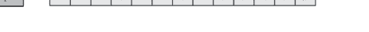

**图 10.1**

指针和字符串字面量。

要访问字符串中的字符，我们可以使用指针算术，也可以将指针作为数组并使用数组下标。该程序使用这两种方式逐个显示字符串中的字符。循环一直执行到遇到空字符为止。

> 由于编译器分配用于存储字符串字面量的内存通常是只读的，因此可能不允许修改它。

例如，当执行以下程序时，可能会显示错误消息：

```c
#include <stdio.h>
int main(void)
{
    char *ptr = "This is text";
    ptr[0] = 'a';
    return 0;
}
```

正如我们所看到的，我们可以使用字符数组来存储字面量字符串。然而，以下声明

```
char ptr[] = "This is text"; and char *ptr = "This is text";
```

虽然它们看起来相似，但具有截然不同的性质，正如你在第 8 章的“指针和数组”一节中已经了解的那样。具体来说，第一个声明将 ptr 声明为一个包含 13 个字符的数组。我们可以将另一个字符串存储到 ptr 中，只要其长度不超过 13 个字符；否则，程序的行为可能变得不可预测。第二个声明将 ptr 声明为指针，并使其指向保存字符串字面量的内存。如前所述，在第一种情况下，我们可以毫无顾虑地写 ptr[0] = 'a';，而在第二种情况下，该语句可能会导致运行时错误。ptr 指针在程序执行期间可以指向另一个字符串，无论其长度如何。例如，考虑以下程序：

```c
#include <stdio.h>
int main(void)
{
    char *ptr = "First text";
    ptr = "This is a new text";
    printf("%c\n", *ptr);
    return 0;
}
```

起初，ptr 指向字符串字面量 "First text" 的第一个字符。然后，语句 ptr = "This is a new text"; 使 ptr 指向为存储该字符串而分配的新内存。由于 ptr 指向它的第一个字符，*ptr 等于 'T'，程序显示 T。

正如我们在第 8 章中概述的，使用指针之前，它必须指向一个有效的地址。考虑以下程序：

```c
#include <stdio.h>
int main(void)
{
    char *ptr;

    ptr[0] = 'a';
    ptr[1] = 'b';
    ptr[2] = '\0';
    printf("%s", ptr);
    return 0;
}
```

赋值语句 ptr[0] = 'a'; 及其后的语句正确吗？当然不正确。由于 ptr 尚未初始化，将 'a'、'b' 和 '\0' 字符写入内存中的某个位置会导致程序行为不可预测。即使程序显示了 ab，这段代码也是错误的。

> > 永远不要忘记，使用未初始化的指针变量是一个严重错误。

如果我们声明一个字符数组，并让 ptr 指向它，就像这样：

```c
char str[3], *ptr;
ptr = str;
```

那么程序就会成功执行。

## 练习

- **C.10.4** 下面的程序将两个字符串存储在两个数组中，交换它们，并显示它们的新内容。有没有错误？

```c
#include <stdio.h>
int main(void)
{
    char temp[100], str1[100] = "Let's see", str2[100] = "Is everything OK?";

    temp = str1;
    str1 = str2;
    str2 = temp;
    printf("%s %s", str1, str2);
    return 0;
}
```

**答案：** 回想第 8 章的内容，数组名在用作指针时是一个常量指针，这意味着不允许改变它的值并指向其他地址。因此，语句 temp = str1; 是非法的。接下来的两条语句也是如此，所以该程序无法编译。

- **C.10.5** 以下程序的输出是什么？

```c
#include <stdio.h>
int main(void)
{
    char str1[] = "test", str2[] = "test";

    (str1 == str2) ? printf("One\n") : printf("Two\n");
    return 0;
}
```

**答案：** 由于两个数组的名称被用作指针，表达式 str1 == str2 检查的是指针是否指向同一个地址，而不是数组是否相同。那么 str1 和 str2 指向同一个地址吗？

当然不是；str1 和 str2 的内容相同，但它们存储在不同的内存中。因此，程序显示 Two。

如果我们写成下面这样，输出会是什么？

```c
(*str1 == *str2) ? printf("One\n") : printf("Two\n");
```

由于 str1 可以用作指向其第一个元素的指针，*str1 等于 't'。类似地，*str2 等于 't'。因此，程序将显示 One。

## 读取字符串

与 printf() 一样，scanf() 使用 %s 转换说明来读取字符串。默认情况下，scanf() 读取字符，直到遇到空白字符（即空格、制表符或换行符）。然后，它会在字符串末尾追加一个空字符。在下面的程序中，假设用户输入字符串 this is the text：

```c
#include <stdio.h>
int main(void)
{
    char str[20];
    int i = 10;

    printf("Enter text: ");
    scanf("%s", str);
    printf("%s %d\n", str, i);
    return 0;
}
```


scanf() 将一个指针作为参数，该指针指向将保存输入字符串的数组。由于我们使用数组名作为指针，因此在其名称前不添加地址运算符 &。因为 scanf() 在遇到空格字符时停止读取，所以只有单词 this 被存储到 str 中。因此，程序输出 this。要强制 scanf() 读取多个单词，我们可以使用更复杂的格式，例如

```
scanf("%[^\n]", str);
```

> scanf() 不会检查是否有足够的内存来存储所有输入字符。因此，如果用户输入的字符多于已分配的内存，程序的行为将变得不可预测。

例如，假设在前面的程序中用户输入一个超过 20 个字符的字符串。前 20 个字符将被存储到 str 中，但其余字符将被存储到数组边界之外的内存中，这会导致程序行为不可预测。例如，如果变量 i 的值存储在此内存中，该值将会改变。为了避免内存溢出，请使用 %ns 代替 %s，其中 n 指定要存储的最大字符数。

另外，我们可以使用 fgets() 函数。阅读第 15 章中的描述以了解其用法。另一个用于读取字符串的函数是 gets()。它在 stdio.h 中声明：

```
char *gets(char *str);
```

与 scanf() 类似，gets() 从 stdin 读取字符并将其存储在 str 指向的内存中。由于无法指定要读取的字符的最大数量，gets() 极不安全。内存溢出的可能性始终存在。休息一下，并在互联网上阅读 1988 年病毒程序如何利用 gets() 的这一漏洞感染数千台机器。

> 不要使用 gets() 来读取字符串。它不安全。

fgets() 比 gets() 更安全，因为程序员可以指定要读取的字符的最大数量。

> 传递给读取函数的指针必须指向已分配用于存储字符串的内存。

例如，下面的代码写得好吗？

```
char *p, s[10];
p = s;
fgets(p, 10, stdin);
```

是的，因为 p 指向已分配的内存。如果语句 p = s; 缺失，代码就会错误。而且，如果在 fgets() 中，我们用 sizeof(p) 代替 10，会一样吗？当然不会，sizeof 返回的是指针的大小，而不是指针指向的内存的大小。

直到遇到换行字符或返回 EOF。正如我们在第 14 章中将看到的，我们可以将字符存储到动态分配的内存中（例如，初始大小为 500 字节）。每次内存填满时，使用 realloc() 通过增加其初始长度来增大其大小。例如，第一次填满时，增加 500 使其大小变为 1000 字节，第二次再增加 500 字节使其变为 1500，以此类推。读取完所有字符后，最后调用一次 realloc() 来缩小已分配内存的大小，使其等于输入字符串的长度。

*为简单起见，我们将使用 fgets() 来读取字符串，假设输入字符串的最大长度是一个合理的数字，例如小于 100 个字符。*

特别是，我们实现了 read_text() 函数。虽然我们还没有讨论函数，但理解其工作原理并不困难。它使用 fgets() 从 stdin 读取字符，正如我们所说，stdin 默认与键盘关联。它将它们存储在长度为 size 字节的 str 数组中。因为可能存储了 '\n'，函数通过传递非零的 flag 值提供删除它的能力。函数使用 strlen()，我们稍后会看到它，来返回字符串的长度。如果出现问题，将调用 exit() 函数。

exit() 函数在 stdlib.h 中声明并终止程序。它接受一个整数参数，表示终止状态。值 0 表示正常终止。此外，C 提供了在 stdlib.h 中声明的 EXIT_SUCCESS 和 EXIT_FAILURE 宏。它们的值取决于实现；典型值分别为 0 和 1。return 语句与 exit() 函数的主要区别在于它们在函数内部被调用时的行为。特别是，return 终止函数，而 exit() 终止程序。

```c
int read_text(char str[], int size, int flag)
{
    int len;

    if (fgets(str, size, stdin) == NULL)
    {
        printf("Error: fgets() failed\n");
        exit(EXIT_FAILURE);
    }
    len = strlen(str);
    if (len > 0)
    {
        if (flag && (str[len-1] == '\n'))
        {
            str[len-1] = '\0';
            len--;
        }
    }
    else
    {
        printf("Error: No input\n");
        exit(EXIT_FAILURE);
    }
    return len;
}
```

> *为节省空间，我们不会在使用的程序中重复其代码。我们只会添加其原型以提醒你如何使用它。*

一种使许多初学者程序员疑惑为何程序无法正确工作的意外行为出现在程序在读取数值后读取字符串时。在 C.9 中，我们看到了一个非常相似的例子。举另一个例子，假设用户输入一个整数并按下 Enter。程序输出什么？

```c
#include <stdio.h>
int main(void)
{
    char str[100];
    int num;

    printf("Enter number: ");
    scanf("%d", &num);

    printf("Enter text: ");
    fgets(str, sizeof(str), stdin);

    printf("%d %s\n", num, str);
    return 0;
}
```

scanf() 读取整数并将其存储在 num 中。按下 Enter 时生成的换行字符被保留在 stdin 中，fgets() 将读取它并将其存储在 str 中。由于 fgets() 在读取到换行字符后即终止，用户无法输入更多字符。因此，程序仅输出输入的数字。一种解决方法是在 fgets() 之前使用 getchar()，以读取换行字符。

## 练习

### C.10.6 编写一个程序，读取一个少于 100 个字符的字符串并显示其字符数、'b' 的出现次数，以及将空格字符替换为换行字符并将 'a' 替换为 'p' 后的输入字符串。不要使用 read_text() 的返回值。

```c
#include <stdio.h>
#include <stdlib.h>
#include <string.h>
```

```c
int read_text(char str[], int size, int flag);
int main(void)
{
    char str[100];
    int i, cnt;
    printf("Enter text: ");
    read_text(str, sizeof(str), 1);
    cnt = 0;
    for(i = 0; str[i] != '\0'; i++)
    {
        if(str[i] == ' ')
            str[i] = '\n';
        else if(str[i] == 'a')
            str[i] = 'p';
        else if(str[i] == 'b')
            cnt++;
    }
    printf("Len = %d Times = %d\nText = %s\n", i, cnt, str);
    return 0;
}
```

注释：循环执行直到遇到字符串末尾，即 str[i] 变为 '\0' 时。循环结束后，i 的值指定字符串的长度。

### C.10.7 使用指针变量用 while 循环替换前一个程序中的 for 循环。同样使用此指针进行替换并计算输入字符串的长度。

```c
#include <stdio.h>
#include <stdlib.h>
#include <string.h>

int read_text(char str[], int size, int flag);
int main(void)
{
    char *ptr, str[100];
    int cnt;
    printf("Enter text: ");
    read_text(str, sizeof(str), 1);
    cnt = 0;
    ptr = str;
    while(*ptr != '\0')
    {
        if(*ptr == ' ')
            *ptr = '\n';
        else if(*ptr == 'a')
            *ptr = 'p';
        else if(*ptr == 'b')
            cnt++;
        ptr++;
    }
    printf("Len = %d Times = %d\nText = %s\n", ptr-str, cnt, str);
    return 0;
}
```

### C.10.8 下列程序的输出是什么？

```c
#include <stdio.h>
int main(void)
{
    char *str = "this";
    for(; *str; printf("%s ", str++));
    return 0;
}
```

答案：表达式 *str 等价于 *str != 0。因此，循环执行直到遇到空字符。在第一次迭代中，str 指向字符串的第一个字符。因此，printf() 显示 this 并将 str 前进以指向下一个字符。printf() 的下一次调用显示 his，以此类推。因此，程序输出：this his is s

### C.10.9 下列程序的输出是什么？

```c
#include <stdio.h>
#include <stdlib.h>
#include <string.h>

int read_text(char str[], int size, int flag);

int main(void)
{
    char *ptr[3], str[100];
    int i;
    for(i = 0; i < 3; i++)
    {
        printf("Enter text: ");
        read_text(str, sizeof(str), 1);
        ptr[i] = str;
    }
    for(i = 0; i < 3; i++)
        printf("%s\n", *ptr[i]);
    return 0;
}
```

答案：ptr 变量被声明为三个指向字符的指针数组。在每次迭代中，语句 ptr[i] = str; 使所有到 i 的指针都指向第一个字符

存储在 str 数组中的字符串。由于所有指针都指向同一地址，第二个循环会将最后一个输入字符串的第一个字符显示三次。

### C.10.10 以下程序的输出是什么？

```c
#include <stdio.h>
int main(void)
{
    char *p, *q, s[] = "play";

    p = s+1;
    q = s;
    p[1] = 'x';
    *s = 'a';
    printf("%d %c\n", *q+2, *(q+2));
    return 0;
}
```

答案：由于 p 指向 s 数组第二个元素的地址，s[2] 变为 'x'。另外，s[0] 变为 'a'。因为 q 指向 s[0]，且 * 运算符的优先级高于 + 运算符，所以有 *q+2 = 'a'+2。因此，程序输出字符 'a' 后面第二个位置字符的 ASCII 值。该字符是 'c'，程序输出 99。由于 *(q+2) 的值等于 s[2]，程序也会输出 x。

### C.10.11 编写一个程序，使用 getchar() 读取字符，并创建一个长度大于 5 且小于 100 的字符串。如果用户输入的字符数超出此区间，则应重复字符输入。

```c
#include <stdio.h>

#define MIN_SIZE 5
#define MAX_SIZE 100

int main(void)
{
    char str[MAX_SIZE];
    int i, ch;

    printf("Enter text (> %d && < %d): ", MIN_SIZE, MAX_SIZE);
    while(1)
    {
        i = 0;
        while((ch = getchar()) != '\n' && ch != EOF)
        {
            if(i < MAX_SIZE-1)
            {
                str[i] = ch;
                i++;
            }
            else
                i++;
        }
        if( (i > MAX_SIZE-1) || (i <= MIN_SIZE) )
            printf("Enter text (> %d && < %d): ", MIN_SIZE,
MAX_SIZE);
        else
        {
            str[i] = '\0';
            break;
        }
        printf("%s\n", str);
        return 0;
    }
}
```

### C.10.12 编写一个程序，读取一个少于 100 个字符的字符串，并显示一条消息来指示它是否为回文，即正反读都相同。例如，字符串 level 是回文，因为正反两个方向读起来都一样。

```c
#include <stdio.h>
#include <stdlib.h>
#include <string.h>

int read_text(char str[], int size, int flag);

int main(void)
{
    char str[100];
    int i, diff, len;

    printf("Enter text: ");
    len = read_text(str, sizeof(str), 1);

    diff = 0;
    for(i = 0; i < len/2; i++)
    {
        if(str[i] != str[len-1-i]) /* if two characters are not the same, the loop terminates. */
        {
            diff = 1;
            break;
        }
    }
    if(diff == 1)
        printf("%s is not a palindrome\n", str);
    else
        printf("%s is a palindrome\n", str);
    return 0;
}
```

说明：该循环将字符串开头到中间的字符与从末尾到中间的字符进行比较。这就是循环从 0 执行到 len/2 的原因。最后一个字符存储在 str[len-1] 中。

### C.10.13 以下程序的输出是什么？

```c
#include <stdio.h>
int main(void)
{
    char *str = "Example";
    int *ptr = (int*)str;

    ptr++;
    printf("%s\n", (char*)ptr+3);
    return 0;
}
```

答案：由于 ptr 被声明为指向 int 的指针，语句 ptr++; 使它指向字符串的第五个字符。在 printf() 中，由于 ptr 的类型被转换为 char*，程序会显示从第八个字符开始的字符串部分。由于第八个字符是空字符，程序不显示任何内容；

### C.10.14 编写一个程序，读取一个少于 100 个字符的字符串，如果它少于三个字符，则用户应重新输入。然后，程序应读取一个字符，并检查字符串中是否连续三次包含该输入字符。程序应显示找到的第一个三连字符的位置。

```c
#include <stdio.h>
#include <stdlib.h>
#include <string.h>

int read_text(char str[], int size, int flag);

int main(void)
{
    char ch, str[100];
    int i, len;

    do
    {
        printf("Enter text (more than 2 chars): ");
        len = read_text(str, sizeof(str), 1);
    } while(len < 3);

    printf("Enter character: ");
    ch = getchar();

    for(i = 0; i <= len-3; i++)
        if(str[i] == ch && str[i+1] == ch && str[i+2] == ch)
    {
        printf("There are three successive '%c's in position %d\n", ch, i+1);
        return 0;
    }
    printf("There aren't three successive '%c's\n", ch);
    return 0;
}
```

## 字符串函数

C 库提供了丰富的函数来对字符串执行操作。本节介绍其中一些最常用的函数。我们不会涵盖它们的每个方面，但会提供足够的内容，以便你在程序中使用它们。尽管我们尚未讨论函数，但我们相信你能理解它们如何工作。

### strlen() 函数

strlen() 函数在 string.h 中声明：

```c
size_t strlen(const char *str);
```

size_t 类型在 C 库中定义为无符号整数类型（通常为 unsigned int）。strlen() 返回 str 指向的字符串中的字符数，不包括空字符。例如：

```c
int len;
len = strlen("Test"); /* len is 4. */
char *p = "";
len = strlen(p); /* len is 0. */
```

该指针被声明为 const，因此 strlen() 不能修改字符串的内容。在第 11 章中，我们将实现 strlen() 函数，向你展示 strlen() 的一个实现示例。

## 练习

### C.10.15 以下程序的输出是什么？

```c
#include <stdio.h>
#include <string.h>
int main(void)
{
    char str[] = "Text";

    printf("%d %d\n", strlen(str+4), strlen("Text"+1));
    return 0;
}
```

答案：由于数组名可以用作指向其第一个元素的指针——我们确实知道我们已经写过很多次了，我们只是想确保你掌握了这一点——str+4 是指向 str 第五个字符的指针，也就是空字符。因此，第一个 strlen() 返回 0。由于字符串字面量可以用作指针，第二个 strlen() 返回第二个字符之后的字符数。结果，程序输出：0 3。

### C.10.16

编写一个程序，读取一个少于 100 个字符的字符串，并将字符串开头和结尾可能出现的所有 'a' 字符替换为空格字符后显示它。例如，如果用户输入 "aabcdaa"，程序应显示 "  bcd  "，而如果输入字符串是 "bcdaa"，程序应显示 "bcd  "。

```c
#include <stdio.h>
#include <stdlib.h>
#include <string.h>

int read_text(char str[], int size, int flag);

int main(void)
{
    char str[100];
    int i, len;

    printf("Enter text: ");
    len = read_text(str, sizeof(str), 1);

    for(i = 0; i < len; i++)
    {
        if(str[i] == 'a')
            str[i] = ' ';
        else
            break;
    }
    for(i = len-1; i >= 0; i--)
    {
        if(str[i] == 'a')
            str[i] = ' ';
        else
            break;
    }
    printf("Text: %s\n", str);
    return 0;
}
```

说明：第一个循环将字符串开头的字符与 'a' 比较。如果是 'a'，则替换为空格字符；否则循环终止。类似地，第二个循环将字符串末尾的所有 'a' 字符替换为空格字符。

### C.10.17

编写一个程序，连续读取字符串（每个少于 100 个字符）。程序应将每个输入字符串复制到第二个字符串变量中，同时将每个单个 '*' 替换为双 '**'，并将小写字母转换为大写字母，反之亦然。程序应显示第二个字符串及其小写和大写字母的数量。如果用户输入 end，则应终止字符串输入。

```c
#include <stdio.h>
#include <stdlib.h>
#include <string.h>

int read_text(char str[], int size, int flag);

int main(void)
{
    char str[100], new_str[200]; /* The new string will be stored into new_str. It is declared with double size, just for the case that the input string contains only '*'. */
    int i, j, len, small_let, big_let;

    while(1)
    {
        printf("Enter text: ");
        len = read_text(str, sizeof(str), 1);

        if(str[0] == 'e' && str[1] == 'n' && str[2] == 'd')
            break;

        j = small_let = big_let = 0;
        for(i = 0; i < len; i++)
        {
            if(str[i] >= 'a' && str[i] <= 'z')
            {
                str[i] -= 32; /* The difference of an uppercase letter with the respective lowercase is 32, according to the ASCII code. */
                big_let++;
            }
            else if(str[i] >= 'A' && str[i] <= 'Z')
            {
                str[i] += 32;
                small_let++;
            }
            new_str[j] = str[i]; /* Copy each character of the input string in the position indicated by j. */
            if(str[i] == '*')
            {
                j++; /* Increase j to store another '*'. */
                new_str[j] = '*';
            }
            j++; /* Increase j to store the next character. */
        }
        new_str[j] = '\0';
        printf("%s contains %d lowercase and %d uppercase letters\n", new_str, small_let, big_let);
    }
    return 0;
}
```


## C.10.18 以下程序的输出是什么？

```
#include <stdio.h>
#include <string.h>
int main(void)
{
    char str[] = "csfbl", *p = str;
    while(*p)
    {
        --*p; /* To make it harder, we could merge the two statements into --*p++; */
        p++;
    }
    printf("%s\n", p-strlen(str));
    return 0;
}
```

答案：语句 `--*p;` 会减少 `p` 所指向地址中的内容。例如，在第一次迭代中，`p` 指向字符串的第一个字符，即 `'c'`。因此，`*p` 等于 `'c'`，语句 `--*p;` 改变 `str[0]` 的值，使其等于 ASCII 字符集中的前一个字符。因此，`str[0]` 变为 `'b'`。接着，`p` 递增并指向 `str` 的下一个元素。以同样的方式，后续迭代使 `str[1]`、`str[2]`、`str[3]` 和 `str[4]` 分别等于 `'r'`、`'e'`、`'a'` 和 `'k'`。

一旦 `p` 等于 `str+5`，即遇到空字符时，循环终止。由于 `strlen()` 返回字符串的长度，表达式 `p-strlen(str)` 等价于 `str+5-5 = str`。因此，程序显示存入 `str` 的新字符串，即 `break`。确实，在继续下一个练习之前休息一下。

## C.10.19 以下程序的输出是什么？

```
#include <stdio.h>
#include <string.h>
int main(void)
{
    char str[] = "Text", *p = str;
    int i;
    for(i = 0; i < strlen(str)-1; i++, p++)
        printf("%c", p[i]);
    return 0;
}
```

答案：由于 `strlen()` 返回 4，循环执行三次。让我们跟踪迭代过程：

第一次迭代（`i = 0`）：显示 `p[0]` 的值，即 `T`。
第二次迭代（`i++ = 1`）：由于 `p` 递增一，`p` 指向字符串的第二个字符，即 `'e'`。由于我们将 `p` 作为数组处理，`p[0]` 是 `'e'`，`p[1]` 是 `'x'`。因此，程序输出 `x`。

第三次迭代（`i++ = 2`）：现在，`p` 指向第三个字符，即 `'x'`。因此，`p[0]` 是 `'x'`，`p[1]` 是 `'t'`，而 `p[2]` 等于 `'\0'`。因此，程序不显示任何内容。

总之，程序显示：`Tx`

## C.10.20 编写一个程序，读取一个少于 100 个字符的字符串，并显示其小写字母和数字出现的次数。此外，程序应显示出现次数最多的小写字母及其出现次数。如果有多个字母出现相同的最多次数，程序应显示最先找到的那个。

```c
#include <stdio.h>
#include <stdlib.h>
#include <string.h>

int read_text(char str[], int size, int flag);

int main(void)
{
    char ch, max_ch, str[100];
    int i, len, max_times, low_let[26] = {0}; /* The size of the array
    is equal to the number of the lowercase letters. This array holds the
    number of the appearances of each letter. For example, low_let[0] holds
    the appearances of 'a', and low_let[25] the appearances of 'z'. */
    int dig[10] = {0}; /* Similarly, dig[0] holds the appearances of
    digit 0, and dig[9] the appearances of digit 9. */

    printf("Enter text: ");
    len = read_text(str, sizeof(str), 1);
    max_ch = max_times = 0;
    for(i = 0; i < len; i++)
    {
        if((str[i] >= 'a') && (str[i] <= 'z'))
        {
            ch = str[i]-'a';
            low_let[ch]++; /* For example, if the character is
            'a', the value of low_let['a'-'a'] = low_let[0], which holds the
            appearances of 'a', will be incremented by one. */
            if(low_let[ch] > max_times)
            {
                max_times = low_let[ch];
                max_ch = str[i];
            }
        }
        else if((str[i] >= '0') && (str[i] <= '9'))
            dig[str[i]-'0']++;
    }
    printf("****** Lowercase letters appearances\n");
    for(i = 0; i < 26; i++)
        if(low_let[i] != 0) /* Check if the letter appears once at
        least. */
            printf("Letter %c appeared %d times\n", 'a'+i,
            low_let[i]);
printf("***** Digits appearances\n");
for(i = 0; i < 10; i++)
    if(dig[i] != 0)
        printf("Digit %d appeared %d times\n", i, dig[i]);
if(max_times != 0)
    printf("'%c' appears %d times\n", max_ch, max_times);
return 0;
}
```

注释：如果字符串包含多个出现相同最多次数的字符，程序会显示最先找到的那个。例如，如果用户输入 `exit1`，输出将是：`'e'` 出现 1 次，因为所有字符都出现一次，而字符 `'e'` 是第一个。

## C.10.21

编写一个程序，模拟流行的猜词游戏“hangman”。程序读取一个少于 30 个字符的秘密单词，即要猜的单词。该单词由第一个玩家输入。然后，第二个玩家逐个输入字母。程序应检查每个字母并通知玩家。如果该字母出现在单词中，程序应在相应位置显示正确猜测的字母，并在未知字母的位置设置下划线字符。如果该字母没有出现，程序应显示相关消息。如果玩家找到单词或出现 7 次错误猜测，游戏结束。假设第二个玩家不允许多次输入同一个字母。

```c
#include <stdio.h>
#include <stdlib.h>
#include <string.h>

#define ERROR_TRIES 7

int read_text(char str[], int size, int flag);

int main(void)
{
    char ch, secret[30], hide[30] = {0};
    int i, found, len, error, correct;

    printf("Enter secret word: ");
    len = read_text(secret, sizeof(secret), 1);

    for(i = 0; i < len; i++)
        hide[i] = '_';

    error = correct = 0;
    while(error < ERROR_TRIES)
    {
        printf("Enter character: ");
        ch = getchar();
        found = 0;
        for(i = 0; i < len; i++)
        {
            if(secret[i] == ch)
            {
                hide[i] = ch;
                found = 1;
                correct++;
                if(correct == len)
                {
                    printf("Secret word is found !!!\n");
                    return 0;
                }
            }
        }
        if(found == 0)
        {
            error++;
            printf("Error, %c does not exist. You've got %d more attempts\n", ch, ERROR_TRIES - error);
        }
        else    printf("%s\n", hide);
        getchar(); /* Get '\n' from the previous getchar(). */
    }
    printf("Sorry, the secret word was %s\n", secret);
    return 0;
}
```

## C.10.22 以下程序的输出是什么？

```c
#include <stdio.h>
#include <string.h>
int main(void)
{
    char str[] = "noteasy";

    printf("%s\n", str + *(str+3) -1 - str[strlen(str+3)]);
    return 0;
}
```

答案：由于表达式 `*(str+3)` 等价于 `str[3]`，即 `'e'`，所以 `*(str+3)-1` 的值等于 `str[3]-1`，即 `'e'-1 = 'd'`。`strlen()` 返回第三个字符之后的字符串长度，即 4。因此，该表达式等价于 `str+'d'-'a' = str+3`，程序输出 `easy`。

## C.10.23

通用产品代码（UPC）条形码由 12 位数字组成。最后一位是用于错误检测的校验位。为了计算其值，我们使用前 11 位数字，如下所示：

- a. 将奇数位置上的数字相加，并将结果乘以 3。
- b. 将偶数位置上的数字加到前一个结果中。
- c. 将结果除以 10。用 10 减去余数，所得即为校验位。如果相减结果为 10（意味着余数为 0），则使用 0 作为校验位。

例如，让我们看看条形码 `123456789015` 是否正确。校验位计算如下：

- a. 1+3+5+7+9+1 = 26。乘以 3 得到 26*3 = 78。
- b. 2+4+6+8+0 = 20。加到前一个结果得到 78+20 = 98。
- c. 校验位的值为 10-(98%10) = 10-8 = 2。

由于最后一位是 5，而计算出的校验位是 2，因此该条形码不正确。

编写一个程序，读取一个 UPC 条形码并检查它是否正确。程序应强制用户输入有效的条形码，即字符串长度应为 12，且只能包含数字。

```c
#include <stdio.h>
#include <stdlib.h>
#include <string.h>

int read_text(char str[], int size, int flag);

int main(void)
{
    char upc[13];
    int i, len, flag, chk_dig, sum;

    while(1)
    {
        printf("Enter UPC (12 digits): ");
        len = read_text(upc, sizeof(upc), 1);
        if(len != 12)
        {
            printf("Error: wrong length\n");
            continue;
        }
        flag = 1;
        for(i = 0; i < 12; i++)
        {
            if(upc[i] < '0' || upc[i] > '9')
            {
                printf("Error: only digits allowed\n");
                flag = 0;
                break;
            }
        }
        if(flag == 1)
            break;
    }
    sum = 0;
    for(i = 0; i < 11; i+=2)
        sum += upc[i]-'0'; /* Subtract '0' to get the numeric value
    of the digit character. */
    sum *= 3;
```


for(i = 1; i < 11; i+=2)
    sum += upc[i]-'0';
chk_dig = 10-(sum%10);
if(chk_dig == 10)
    chk_dig = 0;
if(chk_dig == (upc[11]-'0'))
    printf("Valid barcode\n");
else
    printf("Wrong check digit. The correct is %d\n", chk_dig);
return 0;
}

## strcpy() 和 strncpy() 函数

一个非常常见的错误是使用 = 运算符复制字符串。例如，再次参见 C.10.4 或下面这个例子：

```
char str[10];
str = "something"; /* Wrong, since str is an array. */
```

复制字符串的一种方法是使用 strcpy() 函数。它声明在 string.h 中。

```
char *strcpy(char *dest, const char *src);
```

strcpy() 将 src 指向的字符串复制到 dest 指向的内存中。一旦复制了空字符，strcpy() 就会终止并返回 dest 指针。由于 src 被声明为 const，strcpy() 无法修改该字符串。如果源字符串和目标字符串重叠，strcpy() 和 strncpy() 的行为是未定义的。在下面的示例中，strcpy() 将字符串 "something" 复制到 str 中。

```
char str[10];
strcpy(str, "something");
```

继续执行第二个 strcpy()：

```
strcpy(str, "new");
printf("%c\n", str[6]);
```

你能说出它输出什么吗？

由于一旦复制了空字符，strcpy() 就会终止，因此前四个元素改变，其余元素保持不变。所以，程序输出 i。

下面的程序读取一个少于 100 个字符的字符串，并使用 strcpy() 将其复制到数组中：

```
#include <stdio.h>
#include <string.h>
int main(void)
{
    char str1[100], str2[100];
    printf("Enter text: ");
    fgets(str2, sizeof(str2), stdin);
    strcpy(str1, str2);
    printf("Copied text: %s\n", str1);
    return 0;
}
```

因为 strcpy() 不检查 src 指向的字符串是否适合 dest 指向的内存，所以程序员有责任确保目标内存足够大，以容纳所有字符。否则，dest 末尾之后的内存将被覆盖，导致程序出现不可预测的行为。

例如，考虑以下程序：

```
#include <stdio.h>
#include <string.h>
int main(void)
{
    char c = 'a', str[10];
    strcpy(str, "Longer text. The program may crash");
    printf("%s %c\n", str, c);
    return 0;
}
```

由于 str 的大小不足以容纳该字符串的字符，str 末尾之后的数据将被覆盖。

是的，将未初始化的指针传递给 strcpy() 是一个严重错误。例如：

```
#include <stdio.h>
#include <string.h>
int main(void)
{
    char *str;
    strcpy(str, "something");
    printf("%s\n", str);
    return 0;
}
```

由于 str 没有指向已分配的内存，程序可能会崩溃。

strncpy() 函数声明在 string.h 中：

```
char *strncpy(char *dest, const char *src, size_t count);
```

strncpy() 与 strcpy() 类似，区别在于只会将 src 指向的字符串的前 count 个字符复制到 dest 中。如果 count 的值小于或等于 src 指向的字符串长度，则不会将空字符追加到 dest 指向的内存中。如果 count 的值更大，则会追加空字符，直到达到 count 的值。

由于 strncpy() 指定了复制字符的最大数量，因此它比 strcpy() 更安全。

下面是 strncpy() 的一个示例：

```
#include <stdio.h>
#include <string.h>
int main(void)
{
    char str1[] = "Old text", str2[] = "New", str3[] = "Get";
    strncpy(str1, str2, 3);
    printf("%s\n", str1);
    strncpy(str1, str3, 5);
    printf("%s\n", str1);
    return 0;
}
```

由于数字 3 小于存储在 str2 中的字符串长度，第一个 strncpy() 将前三个字符复制到 str1 中，并且不追加空字符。因此，程序显示 New text。由于数字 5 大于存储在 str3 中的字符串长度，第二个 strncpy() 从 str3 复制三个字符到 str1 中，并追加两个空字符以达到值 5。因此，程序显示 Get。

## 练习

### C.10.24 以下程序包含错误吗？

```
#include <stdio.h>
#include <string.h>
int main(void)
{
    char str1[] = "abcd", str2[] = {'e', 'f', 'g'};
    strcpy(str1, str2);
    printf("%s\n", str1);
    return 0;
}
```

答案：由于 str2 不包含空字符，复制操作无法成功执行，并且可能发生运行时错误。

### C.10.25 以下程序的输出是什么？

```
#include <stdio.h>
#include <string.h>
int main(void)
{
    char str1[5], str2[5];
    printf("%c\n", strcpy(str1, strcpy(str2, "test"))[0]);
    return 0;
}
```

答案：内层 strcpy() 将字符串 test 复制到 str2 中，并返回指向 str2 的指针。外层 strcpy() 将内层 strcpy() 返回的指针所指向的字符串复制到 str1 中。因此，字符串 test 被复制到 str1 中。由于外层 strcpy() 返回指向 str1 的指针，printf() 被转换为 printf("%c\n", str1[0]);，程序显示 t。

### C.10.26 以下程序的输出是什么？

```
#include <stdio.h>
#include <string.h>
int main(void)
{
    char str[10] = {0};
    printf("%c\n", *(str+strlen(strncpy(str, "example", 5))/2));
    return 0;
}
```

答案：strncpy() 将前五个字符复制到 str 中。strncpy() 的返回值，即指向 str 的指针，被用作 strlen() 的参数。因此，strlen() 返回存储在 str 中的字符串长度；即 5。结果，printf() 被转换为 printf("%c\n", *(str+5/2));，程序显示存储在位置 str+2 的字符，即 a。

### C.10.27 以下程序的输出是什么？

```
#include <stdio.h>
#include <string.h>
int main(void)
{
    char str[] = "test";
    printf("%d %s\n", *strcpy(str, "n") * *strcpy(str+2, "xt"), str);
    return 0;
}
```

答案：第一个 strcpy() 将字符串 "n" 的字符，即字符 'n' 和 '\0'，分别复制到 str[0] 和 str[1]，并返回指向 str 的指针。因此，表达式 *strcpy(str, "n") 可以替换为 *str，即 'n'。第二个 strcpy() 将字符串 "xt" 复制到 str 的第三个位置，并返回 str+2 指针。因此，表达式 *strcpy(str+2, "xt") 可以替换为 *(str+2)，即 'x'。

结果，程序显示 'n' 和 'x' 的 ASCII 码的乘积；即 13200。然而，它不会像你预期的那样显示 next，而只是显示 n，因为第一个 strcpy() 将 'e' 替换为 '\0'。

## strcat() 函数

strcat() 函数声明在 string.h 中：

```
char *strcat(char *dest, const char *src);
```

strcat() 将 src 指向的字符串追加到 dest 指向的字符串末尾。strcat() 追加空字符并返回 dest，它指向结果字符串。例如，下面的程序读取两个少于 100 个字符的字符串，并使用 strcat() 合并它们，并将结果字符串存储到数组中。

```
#include <stdio.h>
#include <stdlib.h>
#include <string.h>
int read_text(char str[], int size, int flag);
int main(void)
{
    char str1[100], str2[100], str3[200] = {0}; /* Store the null character in str3 for the first strcat(). */
    printf("Enter first text: ");
    read_text(str1, sizeof(str1), 1);
    printf("Enter second text: ");
    read_text(str2, sizeof(str2), 1);
    strcat(str3, str1);
    strcat(str3, str2);
    printf("The merged text is: %s\n", str3);
    return 0;
}
```

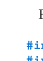

程序员有责任确保 dest 指向的内存中有足够的空间来追加 src 指向的字符串。否则，这可能导致内存越界，并产生不可预测的结果。

例如，考虑以下程序：

```
#include <stdio.h>
#include <string.h>
int main(void)
{
    char str[20] = "example";
    strcat(str, "not available memory");
    printf("The merged text is: %s\n", str);
    return 0;
}
```

由于 str 的大小不足以容纳两个字符串的字符，str 末尾之后的数据将被覆盖，并对程序运行产生不可预测的结果。

让我们看看那个“疯狂”的例子。输出是什么？

```
#include <stdio.h>
#include <string.h>
int main(void)
{
    char str[30];
    return !printf("%s\n", strcat(strcpy(strcpy(str, "Shaws")+5, "hank Red"), "emption")-5);
}
```


有点吓人，不是吗？内层 `strcpy()` 复制字符串 `Shaws` 并返回指向 `str` 的指针。外层 `strcpy()` 在第五个位置之后复制字符串 `hank Red`，并返回指向该位置的指针。`strcat()` 追加字符串 `emption`。末尾的 `-5` 是怎么回事？因为 `strcat()` 返回的指针指向 `str+5`，所以我们减去 5 以回到开头。

那么，`printf()` 前面的这个 `!` 又是怎么回事？是类型错误吗？不，加上它是为了让 `printf()` 更漂亮……

开个玩笑，因为 `printf()` 返回打印的字符数，我们加 1，以便 `main()` 返回 0。哦对，差点忘了，程序输出 `Shawshank Redemption`。休息时间。如果你还没看过那部电影，先去看，然后再继续下一节。让自己舒服一点，享受这部电影。

## strcmp() 和 strncmp() 函数

`strcmp()` 函数声明在 `string.h` 中：

```c
int strcmp(const char *str1, const char *str2);
```

`strcmp()` 将 `str1` 指向的字符串与 `str2` 指向的字符串进行比较。如果两个字符串相同，`strcmp()` 返回 0。如果第一个字符串小于第二个，`strcmp()` 返回负值；而如果它大于第二个，则返回正值。如果以下任一条件成立，则认为一个字符串小于另一个字符串：

- a. 两个字符串的前 n 个字符匹配，但第一个字符串中第 n+1 个字符的值小于第二个字符串中第 n+1 个字符的值。
- b. 所有字符都匹配，但第一个字符串比第二个短。

例如，语句 `strcmp("one", "one");` 返回负值，因为第一个不匹配字符 'E' 的 ASCII 码小于 'e' 的 ASCII 码。

语句 `strcmp("w", "many");` 返回正值，因为第一个不匹配字符 'w' 的 ASCII 码大于 'm' 的 ASCII 码。

在另一个例子中，语句 `strcmp("some", "something");` 返回负值，因为前四个字符匹配，但第一个字符串比第二个小。

一个非常常见的错误是使用 `==` 运算符比较字符串。例如，再去看一遍 C.10.5。因此，下面代码中的 if 条件：

```c
char str[20];
fgets(str, sizeof(str), stdin);
if(str == "test")
```

并不比较字符串，而是比较 `str` 的值和指向字面量字符串的指针的值。由于这些值不同，无论用户输入什么字符串，该条件始终为假。

在第 11 章中，我们将实现 `str_cmp()` 函数，向你展示 `strcmp()` 的一个实现示例。

`strncmp()` 与 `strcmp()` 类似，区别在于它比较指定数量的字符。它声明在 `string.h` 中。

```c
int strncmp(const char *str1, const char *str2, int count);
```

参数 `count` 指定要比较的字符数。

## 练习

### C.10.28 编写一个程序，读取两个少于 100 个字符的字符串，并使用 strcmp() 比较它们。如果字符串不同，程序应使用 strncmp() 比较它们的前三个字符，并显示相关消息。

```c
#include <stdio.h>
#include <stdlib.h>
#include <string.h>

int read_text(char str[], int size, int flag);

int main(void)
{
    char str1[100], str2[100];
    int k;

    printf("Enter first text: ");
    read_text(str1, sizeof(str1), 1);

    printf("Enter second text: ");
    read_text(str2, sizeof(str2), 1);

    k = strcmp(str1, str2);
    /* We could omit the declaration of k and write: if(strcmp(str1, str2) == 0) */
    if(k == 0)
        printf("Same texts\n");
    else
    {
        printf("Different texts\n");
        if(strncmp(str1, str2, 3) == 0)
            printf("But the first 3 chars are the same\n");
    }
    return 0;
}
```

### C.10.29 以下程序的输出是什么？

```c
#include <stdio.h>
#include <string.h>
int main(void)
{
    char str[5];

    str[0] = 't';
    str[1] = 'e';
    str[2] = 's';
    str[3] = 't';

    if (strcmp(str, "test") == 0)
        printf("One\n");
    else
        printf("Two\n");
    return 0;
}
```

答案：你回答的是 One，但显示的是 Two 吗？运气不好，下次吧……

`str` 数组包含 `'t'`、`'e'`、`'s'` 和 `'t'` 字符，但 `str[4]` 未赋值。另一方面，字符串字面量 `"test"` 以空字符结尾。如果 `str[4]` 的随机值不是 0，两个内容就不同，因此 `strcmp()` 返回非零值，程序显示 Two。

继续……如果我们写 `char str[5] = {'t', 'e', 's', 't'};`，输出会是什么？One 还是 Two？

由于未初始化的元素被设为 0，`str[4]` 变成 `'\0'`，程序显示 One。如果我们把条件改成下面这样呢：

`if (strcmp(str, "test\0") == 0)`

没有区别，程序显示 One。

### C.10.30 编写一个程序，连续读取字符串（每个少于 100 个字符），并显示“最短”和“最长”的字符串。如果输入字符串以 end 开头，字符串的输入应终止；end 不参与比较。

```c
#include <stdio.h>
#include <stdlib.h>
#include <string.h>

int read_text(char str[], int size, int flag);

int main(void)
{
    char str[100], min_str[100], max_str[100];

    printf("Enter text: ");
    read_text(str, sizeof(str), 1);
    /* Store the first string as shortest and longest as a first reference to make the comparisons. */
    strcpy(min_str, str);
    strcpy(max_str, str);
    if (strncmp(str, "end", 3) == 0)
    {
        printf("\nMax = %s Min = %s\n", max_str, min_str);
        return 0;
    }
    while(1)
    {
        printf("Enter text: ");
        read_text(str, sizeof(str), 1);

        if (strncmp(str, "end", 3) == 0)
            break;

        if (strcmp(min_str, str) > 0)
            strcpy(min_str, str);

        if(strcmp(str, max_str) > 0)
            strcpy(max_str, str);
    }
    printf("\nMax = %s Min = %s\n", max_str, min_str);
    return 0;
}
```

### C.10.31 以下程序的输出是什么？

```c
#include <stdio.h>
#include <string.h>
int main(void)
{
    char str1[10], str2[] = "engine";
    printf("%c\n", ++str1[strcmp(strcpy(str1, "ine"), str2+3)+2]);
    return 0;
}
```

答案：`strcpy()` 将字符串 `"ine"` 复制到 `str1`，并返回指向 `str1` 的指针。`strcmp()` 将 `strcpy()` 的返回值所指向的字符串（即 `str1`）与存储在 `str2+3` 位置的字符串部分（即 `"ine"`）进行比较。由于两个字符串相同，`strcmp()` 返回 0，程序显示 `++str1[0+2]` 的值。由于 `str1[2]` 是 `'e'`，程序输出 `f`。

### C.10.32

数据压缩算法游程编码（RLE）基于这样一种假设：数据流中的某个符号可能连续重复多次。这个重复序列可以用一个整数来替换，该整数声明重复次数和符号本身。编写一个程序，读取一个少于 100 个字符的字符串，并使用 RLE 算法对其进行压缩。不要压缩数字和只出现一次的字符。

例如，字符串 `fffmmm1234jjjjjjjjjjx` 应压缩为 `3f3m123410jx`。

```c
#include <stdio.h>
#include <stdlib.h>
#include <string.h>

int read_text(char str[], int size, int flag);
int main(void)
{
    char str[100];
    int i, len, cnt;
    printf("Original text: ");
    len = read_text(str, sizeof(str), 1);
    printf("Compressed text: ");
    i = 0;
    while(i < len)
    {
        cnt = 1;
        if(str[i] < '0' || str[i] > '9') /* Digits are not compressed. */
        {
            while(str[i+cnt] == str[i]) /* Check if the current character, that is str[i], is repeated in the next places. */
                cnt++;
            if(cnt == 1)
                printf("%c", str[i]);
            else
                printf("%d%c", cnt, str[i]);
        }
        else
            printf("%c", str[i]);

        i += cnt;
    }
    return 0;
}
```

### C.10.33

编写一个程序，读取一个少于 100 个字符的字符串，并显示它由哪些单词组成以及单词数量。假设一个单词是一个不包含空格字符的字符序列。例如，如果用户输入 `how many words ?`（注意单词之间可能包含多个空格），程序应显示。

```text
how
many
words
?
The text contains 4 words
```

```c
#include <stdio.h>
#include <stdlib.h>
#include <string.h>

int read_text(char str[], int size, int flag);

int main(void)
{
    char str[100];
    int i, words;

    i = words = 0;

    printf("Enter text: ");
    read_text(str, sizeof(str), 1);

    if(str[0] != ' ' && str[0] != '\t' && str[0] != '\0') /* If the first character is other than the space character, it means that a word begins, so the value of words is incremented. */
        words++;

    while(str[i] != '\0')
```

```
{
    if(str[i] == ' ' || str[i] == '\t')
    {
        /* Since more than one space character may be included between words, we check if the next character, that is str[i+1], is also a space character. If it isn't, it means that a new word begins, so the value of words is increased. */
        if(str[i+1] != ' ' && str[i+1] != '\t' && str[i+1] != '\0')
        {
            words++;
            printf("\n");
        }
    }
    else
        printf("%c", str[i]);
    i++;
}
printf("\nThe text contains %d words\n", words);
return 0;
}
```

### C.10.34
一个简单的加密数据算法是单变换算法。让我们看看它是如何工作的。在一行中，我们写下所用字母表的字母。在第二行中，我们以不同的顺序写下相同的字母。这第二行构成了加密密钥。例如，参见图 10.2。

原文的每个字母都用相应的密钥字母替换。例如，单词 test 被加密为 binb。

编写一个程序，读取少于 100 个字符的字符串、由 26 个字符组成的密钥字符串，并加密输入字符串的小写字母。然后，程序应解密加密后的字符串并显示它（应与原始字符串相同）。程序应检查密钥字符为 26 个且仅出现一次。

```
#include <stdio.h>
#include <stdlib.h>
#include <string.h>

#define LETTERS 26

int read_text(char str[], int size, int flag);

int main(void)
{
    char str[100], key[LETTERS+1];
    int i, j, len, error;
```

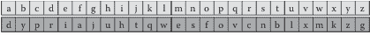

### FIGURE 10.2
单变换算法。

```
~~~c
printf("Enter text: ");
len = read_text(str, sizeof(str), 1);
do
{
    error = 0;
    printf("Enter key (%d different characters): ", LETTERS);
    read_text(key, sizeof(key), 1);
    if(strlen(key) != LETTERS)
    {
        printf("Error: Key must be of %d characters\n", LETTERS);
        error = 1;
    }
    else
    {
        for(i = 0; i < LETTERS; i++)
        {
            for(j=i+1; j < LETTERS; j++)
            {
                if(key[i] == key[j])
                {
                    error = 1;
                    printf("Key characters must be different\n");
                    getchar();
                    break;
                }
            }
            if(error == 1)
                break;
        }
    }
}while(error != 0);

for(i = 0; i < len; i++)
{
    if(str[i] >= 'a' && str[i] <= 'z')
        str[i] = key[str[i]-'a'];
}
printf("Encrypted text: %s\n", str);
for(i = 0; i < len; i++)
{
    for(j = 0; j < LETTERS; j++)
    {
        if(str[i] == key[j])
        {
            str[i] = 'a'+j;
            break;
        }
    }
}
printf("Original text: %s\n", str);
return 0;
}
~~~
```

## 练习

### C.10.35
下面程序的输出是什么？

```
```c
#include <stdio.h>
int main(void)
{
    char arr[7][10] = {"Monday", "Tuesday", "Wednesday", "Thursday",
"Friday", "Saturday", "Sunday"};
    int i;

    for(i = 0; i < 7; i++)
        if(arr[i][2] == 'n' && *(arr[i]+3) == 'd' && *(*(arr+i)+4)
== 'a')
            printf("%s is No.%d week day\n", arr[i], i+1);

    return 0;
}
```
```

Answer: “Monday”的字符存储在 arr 的第一行，“Tuesday”的字符存储在第二行，以此类推。请记住 *(arr[i]+3) 等价于 arr[i][3]，而 *(*(arr+i)+4) 等价于 *(arr[i]+4)，即 arr[i][4]。因此，循环检查 arr 的每一行并显示第三、第四和第五个字符分别为 'n'、'd' 和 'a' 的字符串。因此，程序显示：

```
```
Monday is No.1 week day
Sunday is No.7 week day
```
```

### C.10.36
编写一个程序，读取 10 个字符串（每个少于 40 个字符），并将以 'a' 开头且以 's' 结尾的字符串存储在数组中。然后，程序应读取一个字符并显示它在哪个列中出现次数最多。如果有多个列出现次数相同，则应显示最先找到的那个。

```
```c
#include <stdio.h>
#include <stdlib.h>
#include <string.h>

#define NUM 10

int read_text(char str[], int size, int flag);

int main(void)
{
    char tmp[40], str[NUM][40] = {0};
    int i, j, ch, num, len, max_len, cnt, max_cnt, col;

    num = max_len = 0;
    for(i = 0; i < NUM; i++)
    {
        printf("Enter text: ");
        len = read_text(tmp, sizeof(tmp), 1);
        if(tmp[0] == 'a' && tmp[len-1] == 's')
```
```
{
    strcpy(str[num], tmp);
    num++;
    if(len > max_len)
        max_len = len;
}
}
if(num == 0)
{
    printf("None string is stored\n");
    return 0;
}
printf("Enter character: ");
ch = getchar();
max_cnt = 0;
/* We use the length of the longest string and the number of the
stored strings, to search for the character only in those rows and
columns where characters are stored. */
for(j = 0; j < max_len; j++)
{
    cnt = 0;
    for(i = 0; i < num; i++)
    {
        if(str[i][j] == ch)
            cnt++;
    }
    if(cnt > max_cnt)
    {
        max_cnt = cnt;
        col = j;
    }
}
if(max_cnt == 0)
    printf("%c is not stored\n", ch);
else
    printf("Max appearances of %c is %d in col_%d\n", ch, max_cnt, col+1);
return 0;
}
```

### C.10.37
编写一个程序，读取 20 个名字（每个少于 100 个字符），将它们存储在数组中，并使用指针数组按字母顺序显示它们。

```
#include <stdio.h>
#include <stdlib.h>
#include <string.h>

#define SIZE 20

int read_text(char str[], int size, int flag);

int main(void)
```
```
{
    char *temp, *ptr[SIZE], str[SIZE][100];
    int i, j;

    for(i = 0; i < SIZE; i++)
    {
        printf("Enter name: ");
        read_text(str[i], sizeof(str[i]), 1);
        ptr[i] = str[i]; /* The elements of the array point to the input strings. */
    }
    for(i = 0; i < SIZE-1; i++)
    {
        for(j = i+1; j < SIZE; j++)
        {
            /* If the string pointed to by ptr[j] is less than the string pointed to by ptr[i], swap the respective pointers. */
            if(strcmp(ptr[j], ptr[i]) < 0)
            {
                temp = ptr[j];
                ptr[j] = ptr[i];
                ptr[i] = temp;
            }
        }
    }
    for(i = 0; i < SIZE; i++)
        printf("%s\n", ptr[i]);
    return 0;
}
```

### Comments
我们添加此练习的主要原因是为了向您展示指针数组可能有多有用。当两个字符串必须交换时，交换的是相应的指针，而不是字符串。因此，我们在性能上获得了提升。我们使用的排序算法称为选择排序，将在第 12 章讨论。此解决方案的“负面”之处在于潜在的空间浪费。str 的每一行分配 100 个字符，即使字符串包含更少。在第 14 章和练习 C.14.8 中，您将看到一种更有效的方法，其中根据需要动态分配确切的内存，而不是使用固定的二维数组。

## 未解练习

- **U10.1** 编写一个程序，读取字符直到它们的 ASCII 值之和超过 500 或用户输入 ‘q’。程序应显示读取了多少个字符。
- **U10.2** 编写一个程序，读取字符并显示第一个两个连续 ‘*’ 之间的字符有多少个：(a) 字母，(b) 数字，(c) 既非字母也非数字的字符。如果没有两个 ‘*’ 出现，程序应显示相关消息。例如，如果用户输入：`1abc*D2Efg #!*345Higkl*mn+op*qr` 程序应显示以下内容：`Between first two stars (letters:4, digits:1, other:3)。`

U.10.3 编写一个程序，读取三个少于 100 个字符的字符串并将它们存储在三个数组中（例如，str1、str2 和 str3）。然后，程序应将它们的内容向右移动一个位置，这意味着 str3 的内容应复制到 str1，str1 的内容复制到 str2，str2 的内容复制到 str3。

U.10.4 编写一个程序，读取少于 100 个字符的字符串，如果它以 aa 结尾，程序应以相反顺序显示它。

U.10.5 下列程序的输出是什么？

```
```c
#include <stdio.h>
#include <string.h>
int main(void)
{
    char str[] = "test", *p = str;
    *str = str[strlen(str)];
    while(*p)
        printf("%s", p++);
    return 0;
}
```
```

U.10.6 编写一个程序，读取少于 100 个字符的字符串并将其存储在数组中。然后，程序应反转存储的字符串并显示新字符串。例如，如果字符串 code 被存储，程序应将其反转为 edoc 并存储在数组中。只使用一个数组。

U.10.7 编写一个程序，读取少于 100 个字符的字符串、将要删除的字符数以及要删除的第一个字符的位置。删除后，字符串的其余部分应向左移动，移动的位数等于删除的字符数。程序应在结束前显示字符串。例如，如果输入字符串是 test case 且数字为 4 和 2，程序应显示 tcase。程序应检查输入数字的有效性，以确保字符包含在字符串中，

U.10.8 编写一个程序，读取两个少于 100 个字符的字符串并显示第二个字符串在第一个字符串中包含的次数。第二个字符串的长度应小于或等于第一个字符串。

U.10.9 编写一个程序，读取少于 100 个字符的字符串并将其存储在数组中。然后，程序应从数组中删除所有非字母字符以及相同字母的多次重复，并显示新字符串。例如，如果字符串 ja*%&cr1*c 存储在数组中，程序应将其内容更改为 ja cr。有一个限制；不要使用第二个数组来存储未删除的字符。

U.10.10 修改 C.10.33 以按相反顺序显示单词。例如，如果用户输入 imagine the case，程序应显示 case the imagine。


U.10.11 编写一个程序读取字符并将它们存储在一个有 100 个位置的数组中，要求不存储重复字符。如果用户输入 'q' 或数组已满，则字符插入应终止。

U.10.12 编写一个程序，读取一个少于八个字符的字符串，该字符串表示一个十六进制数（接受的字符：0-9, a-f, A-F），并显示对应的十进制值。例如，如果用户输入 1AF，程序应显示 431。

U.10.13 假设每个小写字母都有如下值。字母 'a' 到 'i' 对应个位；'a' 的值为 1，'i' 为 9。字母 'j' 到 'r' 对应十位；'j' 的值为 10，'r' 为 90。其余对应百位；'s' 的值为 100，'z' 为 800。编写一个程序，持续读取字符串（每个少于 100 个字符），并在结束前显示值最大和最小的字符串以及这些值。例如，cky 的值为 723，而 A9m 的值为 40，因为字符 'A' 和 '9' 没有值。如果多个字符串具有相同最大或最小值，程序应显示最后输入的那个。如果用户输入 ***, 字符串的插入应终止。

U.10.14 编写一个程序，读取两个少于 100 个字符的字符串，并删除第一个字符串中出现的第二个字符串的每一次出现。每次删除后，第一个字符串的剩余部分应向左移动，移动位数等于第二个字符串的字符数。程序应在结束前显示第一个字符串。例如，如果第一个字符串是 this that though 而第二个是 th，程序应显示 isat ough。

U.10.15 编写一个程序，读取两个少于 100 个字符的字符串，并显示第一个字符串中不包含第二个字符串中任何字符的最长部分。例如，如果第一个字符串是 example 而第二个是 day，程序应显示 mple，因为该部分不包含 day 中的任何字符。

U.10.16 编写一个程序，读取一个整数并将其转换为字符串。例如，如果用户输入 12345，程序应将字符 '1'、'2'、'3'、'4' 和 '5' 存储到数组中。

U.10.17 编写一个程序，读取两个少于 100 个字符的字符串，并显示第一个字符串中仅包含第二个字符串中字符的最大部分。例如，如果第一个字符串是 programming 而第二个字符串是 im，程序应显示 mmi。假设第二个字符串包含不同的字符。

U.10.18 编写一个程序，以字符串形式读取一个整数并将该字符串转换为该数字。例如，如果用户输入字符串 -12345，程序应将其转换为数字 -12345，分配给一个数值变量并显示它。假设用户输入最多 10 位数字。

U.10.19 为了继续上一个练习，程序应检查输入字符串是否对应一个浮点数并将该数字分配给一个数值变量。例如，如果用户输入字符串 12，程序应将数字 12 分配给一个变量。如果用户输入字符串 -1.234，则分配的值应为 -1.234。

U.10.20 编写一个程序，读取 20 个字符串（每个少于 100 个字符）并将它们存储在二维数组中。然后，程序应读取一个字符串，如果在数组中找到它，则应将其删除。要删除字符串，将该点下面的字符串向上移动一行。在向上移动的最后一行的位置插入空字符。例如，如果数组是：
```
one
two
three
four
...
```
并且用户输入 two，新的内容应为：
```
one
three
four
...
```

U.10.21 编写一个程序，读取 20 个字符串（每个少于 100 个字符）并将它们存储在二维数组中。然后，程序应：
- 读取一列编号并显示包含在该列中的单词，包括仅由单个字符组成的单词。在一个包含五个字符串的示例中，如果用户输入：
```
abcdegm
abcd fpoo
abcd
abc
abcdkmop
```
并且列号为 6，程序应显示：
```
word_1: gp
word_2: m
```
- 读取一个行号（除第一行外），如果该行中的字符串包含少于五个不同的小写字母，则程序应将其与第一行的字符串交换。

U.10.22 编写一个程序，读取 20 个书店的名称和 500 个书名。使用两个二维数组存储它们。假设所有名称都少于 100 个字符。程序还应为每个书店读取每个书名的剩余库存数量。然后，程序应读取一本书名并显示提供该书名的书店名称以及这些书店中该书名的副本数量。最后，程序应读取一个书店的名称并显示其剩余库存的总副本数。

## 11 Functions

在 C 语言中，函数是一个独立的代码块，在被调用时执行特定任务，并且可能返回值。每个函数本质上是一个小型程序，具有自己的变量和语句。函数可能存在于单独的文件中并分别编译。使用函数，程序被划分为更小的部分，使其更易于理解、控制和修改。函数是可重用的。例如，`printf()` 和 `scanf()` 函数可以在每个 C 程序中使用。此外，函数使我们能够避免重复相同的代码。到目前为止，我们只编写了一个函数，即 `main()`。在本章中，你将学习如何在程序中编写和使用自己的函数。

### Function Declaration

函数声明，也称为函数原型，指定函数的名称、其返回类型以及如果存在则指定参数列表。函数声明的一般形式是：
```
return_type function_name(parameter_list);
```
尝试为你的函数选择描述性的名称。当函数名称指示其作用时，阅读函数的代码会容易得多。例如，如果你编写一个计算某些数字平均值的函数，给它一个像 average 这样的名称，而不是像 `func`、`test` 或 `lala` 这样的任意名称。

通常，函数的声明放在单独的文件中。例如，库函数的原型驻留在多个头文件中。对于程序中使用的每个库函数，使用 `#include` 指令添加包含其声明的文件。例如，要使用 `printf()` 和 `scanf()` 函数，则包含 `stdio.h` 文件。否则，编译器将为未声明的标识符产生错误消息。

虽然声明函数不是强制性的，但我们总是这样做。一个原因是提高程序的可读性，因为读者可以了解程序的结构。你稍后会看到更多原因。为了简单起见，我们将在与 `main()` 相同的

### Return Value

函数最多只能返回一个值。`return_type` 指定返回值的类型。函数可以返回任何类型，例如，`char`、`int`、`float`、... 或指向某类型的指针。唯一的限制是不允许返回数组或另一个函数。然而，它可以返回指向数组或函数的指针。如果缺少返回类型，则假定函数返回 int 类型的值。返回类型 void 指定函数不返回任何值。

### Function Parameters

函数可以接受一个由逗号分隔的参数列表。每个参数前面都有其类型。正如我们稍后会看到的，函数参数本质上是函数的一个变量，在函数被调用时会被赋予一个值。

如果函数没有参数，应在括号内使用 void 关键字来表示空列表。然而，许多程序员省略 void 关键字并使用一对空括号。很可能，这种原因源于 C 的旧版本或他们参与 C++，在 C++ 中不需要使用 void 关键字。然而，就像 main() 的情况一样，如果我们想严格遵循 C 标准，我们应该使用 void 关键字。原因是空括号对表示函数接受未知数量的参数，而不是不接受参数。让我们看一些函数声明的例子：
```
void show(char ch); /* Declare a function with name show that takes a char parameter and returns nothing. */
double show(int a, float b); /* Declare a function with name show that takes an integer and a float parameter and returns a value of type double. */
int *show(int *p, double a); /* Declare a function with name show that takes as parameters a pointer to integer and a double parameter and returns a pointer to integer. */
```
请注意，不需要指定参数的名称。例如，我们可以写：
```
double show(int, float);
```
我们始终更喜欢使用名称，因为它有助于读者了解传递给函数的信息、每个参数的目的以及应传递参数的顺序。

每个参数的类型必须指定，即使多个参数具有相同类型。例如，你不能写：
```
void test(int a, b, c); instead of void test(int a, int b, int c);
```

### Function Definition

函数定义的一般形式是：
```
return_type function_name(parameter_list)
{
    /* Function body */
}
```


最后，在编写较大的应用程序时，我们的做法始终是使用原型并将它们放在头文件中。这就是你将要学习的内容，讨论到此结束。

无论你选择在何处定义函数，重要的是要记住：在调用该函数之前，编译器应该已经看到它的定义，以便检查该函数是否被正确调用。

## 复杂声明

既然我们已经学习了如何定义函数，现在让我们插入一段内容，描述一种解读复杂声明的方法。始终从内向外解读声明。找到变量名；如果它被圆括号 () 括起来，就从那里开始解读。然后继续处理下一个运算符，其优先级从高到低为：

- a. 后缀运算符。圆括号 () 表示函数，方括号 [] 表示数组。
- b. 前缀运算符 * 表示“指向……的指针”。

例如，考虑声明 `int *p[5]`；

让我们应用这些优先级规则。变量 p 没有被圆括号括起来。由于 [] 的优先级高于 *，我们向右看，因此得到 p 是“一个包含五个……的数组”，然后向左看到 *，得到“一个包含五个指针的数组……”，再加上类型，最终得到“一个包含五个指向整数的指针的数组”。

让我们看另一个例子：`int (*p)[5]`；
现在，p 被圆括号括起来了。解读从括号内部开始，因此我们向左看到 *，得到 p 是“一个指向……的指针”，然后向右看，得到“一个指向包含五个……的数组的指针”，然后再向左看以加上类型，最终得到“一个指向包含五个整数的数组的指针”。

## return 语句

return 语句用于立即终止函数的执行。到目前为止的一些程序中，我们已经使用 return 语句终止 main() 函数，也就是程序本身。在下面的示例中，如果用户输入值 2，程序就会终止；否则，它会输出输入值。

```
#include <stdio.h>
int main(void)
{
    int num;

    while(1)
    {
        printf("Enter number: ");
        scanf("%d", &num);

        if(num == 2)
            return 0; /* Terminate the program. */
        else
            printf("Num = %d\n", num);
    }
    return 0;
}
```

注意，最后一个 return 永远不会被执行，因为第一个 return 会终止程序。main() 返回的值表示程序的终止状态。值 0 表示正常终止，而非零值通常表示异常终止。

如果函数不返回任何内容，我们只需写 return。void 函数末尾的 return 语句是不必要的，因为函数会自动返回。在下面的示例中，avg() 函数比较两个参数的值；如果它们不同，就显示它们的平均值。如果它们相同，函数就终止。

```
void avg(int a, int b)
{
    /* Function body. */
    if(a == b)
        return;

    printf("%f\n", (a+b)/2.0);
    /* The return statement is unnecessary. */
}
```

如果函数声明为返回一个值，那么每个 return 语句后面都应跟一个值。正如我们稍后将看到的，执行 return 时的值会返回到调用该函数的位置。调用函数可以自由使用或丢弃返回的值。例如，我们修改了 avg()，使其返回一个整数值：

```
int avg(int a, int b)
{
    if(a == b)
        return 0;
    printf("%f\n", (a+b)/2.0);
    return 1;
}
```

注意，函数末尾的第二个 return 语句可以省略。在这种情况下，编译器很可能会发出类似“avg() : not all control paths return a value”或“control reaches end of non-void function.”的消息。该函数将返回一个未定义的值，这绝对是不可取的。因此，我们强烈建议非 void 函数始终返回一个值，即使允许我们不这样做。

返回值类型应与函数的返回类型匹配。如果不匹配，编译器会尽可能将返回值转换为返回类型。例如：

```
int test()
{
    return 4.9;
}
```

由于 test() 声明为返回 int 值，返回值会被隐式转换为 int。因此，函数返回 4。

## 函数调用

函数可以根据需要被调用任意多次。当调用函数时，程序的执行会继续执行该函数的代码。特别是，编译器会分配内存来存储函数的参数以及在其函数体内声明的变量。通常，这块内存从内存中一个称为栈的特定区域保留；然而，这可能并非在所有情况下都适用。例如，参数通常通过系统寄存器传递，以便更快访问。为简单起见，我们假设内存是在栈中分配的。此外，编译器会分配内存来存储函数终止后程序返回的地址。函数终止时，已分配的内存会自动释放。关于调用函数时内存中所执行操作的更详细讨论超出了本书的范围。

### 无参数的函数调用

调用不接受任何参数的函数时，需要写函数名，后跟一对空圆括号。调用函数不会向被调用函数传递任何数据。在下面的程序中，调用函数即 main() 两次调用 test() 函数：

```
#include <stdio.h>
void test(void);
int main(void)
{
    printf("Call_1 ");
    test(); /* Function call. The parentheses are empty, because the function does not take any parameters. */
    printf("Call_2 ");
    test(); /* Second call. */
    return 0;
}

void test(void)
{
    /* Function body. */
    int i;
    for(i = 0; i < 2; i++)
        printf("In ");
}
```

在第一次调用 test() 时，程序继续执行函数体。当 test() 终止时，程序执行返回到调用点，并继续执行下一条语句。因此，主程序显示 Call_2，并再次调用 test()。结果，程序显示 Call_1 In In Call_2 In In。

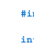

一个常见的疏忽是在调用函数时省略圆括号。

例如，如果你写 test，程序会编译，但函数不会被调用。回顾第 8 章，编译器将函数名视为指针；因此，它允许该语句。然而，这个语句没有效果；它计算函数的地址，但不会调用它。编译器可能会发出类似“function call missing argument list”或“statement with no effect”的警告消息来通知程序员。在下面的程序中，test() 返回一个整数值。

```
#include <stdio.h>

int test(void);

int main(void)
{
    int sum;
    sum = test(); /* Function call. The returned value is stored in sum. */
    printf("%d\n", sum);
    return 0;
}

int test(void)
{
    int i = 10, j = 20;
    return i+j;
}
```

test() 声明两个整型变量，值分别为 10 和 20，并返回它们的和。这个值被存储到 sum 中，程序显示 30。注意，不需要声明 sum；我们可以写 printf("%d\n", test()); 先调用 test()，然后将返回值作为 printf() 的参数使用。

在结束本节之前，我们想指出，复合表达式（例如 d = a() + b() * c();）中函数调用的顺序是未定义的。换句话说，这三个函数可以以任意顺序调用。不要因为乘法的优先级而假定会先调用 b() 和 c() 函数。而且，如果其中任何一个函数改变了其他函数可能依赖的变量，那么赋给 d 的值将取决于求值顺序。

### 带参数的函数调用

调用带参数的函数时，需要写函数名，后跟用圆括号括起来的参数列表。使用实参是向函数传递信息的一种方式。参数（parameter）和实参（argument）的区别在于，术语 parameter 指函数定义中出现的变量，而术语 argument 指函数调用中出现的表达式。例如，考虑下面的程序：

```
```c
#include <stdio.h>

int test(int x, int y);

int main(void)
{
    int sum, a = 10, b = 20;

    sum = test(a, b); /* The variables a and b become the function's arguments. */
    printf("%d\n", sum);
    return 0;
}

int test(int x, int y) /* The variables x and y are the function's parameters. */
{
    return x+y;
}
```
```

实参可以是任何有效表达式，例如常量、变量、数学表达式或逻辑表达式，甚至可以是另一个带返回值的函数。注意，我们可以省略 sum，写成 printf("%d\n", test(a, b)); 先调用 test()，然后 printf() 输出返回值。

由于实参的求值顺序未指定，不要写类似 printf("%d %d\n", ++a, test(a, b)); 这样的代码。a 是在调用 test() 之前还是之后递增，取决于编译器。

实参的数量及其类型应与函数声明匹配。如果实参较少，编译器将产生错误消息。如果实参类型与参数类型不匹配，编译器将尝试将不匹配的实参类型隐式转换为相应参数的类型。如果转换成功，编译器可能会显示警告消息来通知程序员

```c
    test(&i);
    printf("%d\n", i);
    return 0;
}

void test(int *p)
{
    *p = 20;
}
```

由于 & 运算符产生 i 的地址，&i 是指向 i 的指针，调用与声明匹配。当 test() 被调用时，我们有 p = &i。由于 p 指向 i，test() 可以改变 i 的值。因此，*p 是 i 的别名，语句 *p = 20 将 i 从 10 改为 20。因此，程序输出 20。

> 由于函数不能返回多个值，我们可以传递参数的地址并改变它们的值。

值得注意的是，传递参数的地址通常被称为另一种类型的调用，名为按引用调用。然而，它与按值调用并无不同，因为函数仍然无法改变传递参数的值。例如，考虑以下程序：

```c
#include <stdio.h>

void test(int *p);

int main(void)
{
    int *ptr, i;

    ptr = &i;
    printf("%p\n", ptr);

    test(ptr);
    printf("%p\n", ptr);
    return 0;
}

void test(int *p)
{
    int j;
    p = &j;
}
```

你认为调用 test() 后 ptr 的值是否发生了变化？答案是否定的。虽然 p 的值发生了变化并指向 j，但 ptr 保持不变，因为传递的是值；p 是 ptr 的拷贝。在第 18 章，我们将看到 C++ 提供了另一种在不传递指针的情况下修改参数的方法。特别是，我们将讨论引用和按引用调用。区分按值调用和按引用调用的人可能想说指针像引用一样可用于改变参数的值。然而，引用是 C++ 的概念，而不是 C 的。

当函数被调用时，允许混合使用指针和平常值。例如：

```c
#include <stdio.h>

void test(int *p, int a);

int main(void)
{
    int i = 100, j = 200;

    test(&i, j);
    printf("%d %d\n", i, j);
    return 0;
}

void test(int *p, int a)
{
    *p = 300;
    a = 400;
}
```

当 test() 被调用时，我们有 p = &i，且 test() 将 i 从 100 改为 300，而 j 的值没有改变。因此，程序输出 300 200。

这里有一个更困难的例子。函数如何改变指针的值？我们只需向函数传递一个指向指针的指针类型的参数。例如：

```c
#include <stdio.h>

void test(int **arg);

int var = 100;

int main(void)
{
    int *ptr, i = 30;

    ptr = &i;
    test(&ptr); /* The value of &ptr is the memory address of ptr, which points to the address of i. So, the type of the argument is a pointer to a pointer to an integer and matches the function declaration. */

    printf("%d\n", *ptr);
    return 0;
}

void test(int** arg)
{
    *arg = &var;
}
```

由于 ptr 的内存地址被传递给 test()，test() 可以改变其值。当 test() 被调用时，我们有 arg = &ptr，所以 *arg = ptr。因此，语句 *arg = &var; 等价于 ptr = &var; 这意味着 ptr 的值发生了变化并指向 var 的地址。因此，程序显示 100。我们稍后会讨论 var 的作用域。我们理解你可能会觉得这个例子有点困难。然而，因为你很可能需要阅读或编写改变指针值的代码，我们在这里添加了它，以便于查找和查阅。理论就到此为止，让我们进入练习。

## 练习

### C.11.1

在下面的程序中，scanf() 和 printf() 哪个函数可能会改变 a 的值？

```c
#include <stdio.h>
int main(void)
{
    int a;

    scanf("%d", &a);
    printf("Value: %d\n", a);
    return 0;
}
```

答案：scanf() 可能会改变 a 的值，因为传递的参数是其地址。另一方面，printf() 不能改变 a，因为传递的参数是其值。

### C.11.2

编写两个函数，分别接收一个整数参数并返回该数的平方和立方。编写一个程序读取一个整数并使用这些函数显示该数平方与立方的和。

```c
#include <stdio.h>

int square(int a);
int cube(int a);

int main(void)
{
    int i, j, k;

    printf("Enter number: ");
    scanf("%d", &i);

    j = square(i);
    k = cube(i);
    printf("sum = %d\n", j+k);  /* Without declaring the j and k variables, we could write printf("sum = %d\n", square(i)+cube(i)); */
    return 0;
}

int square(int a)
{
    return a*a;
}

int cube(int a)
{
    return a*a*a;
}
```

### C.11.3

编写一个函数，接收三个值作为参数并返回其中的最小值。编写一个程序读取三名学生的成绩并使用该函数显示最小值。

```c
#include <stdio.h>

float min(float a, float b, float c);

int main(void)
{
    float i, j, k;
    printf("Enter grades: ");
    scanf("%f%f%f", &i, &j, &k);

    printf("Min grade = %f\n", min(i, j, k));
    return 0;
}

float min(float a, float b, float c)
{
    if(a <= b && a <= c)
        return a;
    else if(b < a && b < c)
        return b;
    else
        return c;
}
```

### C.11.4

编写一个函数，接收一个整数和一个字符作为参数，并按整数的值重复显示该字符。编写一个程序读取一个整数和一个字符并使用该函数显示字符。

```c
#include <stdio.h>

void show_char(int num, char ch);

int main(void)
{
    char ch;
    int i;

    printf("Enter character: ");
    scanf("%c", &ch);

    printf("Enter number: ");
    scanf("%d", &i);

    show_char(i, ch);
    return 0;
}

void show_char(int num, char ch)
{
    int i;

    for(i = 0; i < num; i++)
        printf("%c", ch);
}
```

注释：show_char() 的返回类型声明为 void，因为它不返回任何值。

### C.11.5

下面程序的输出是什么？

```c
#include <stdio.h>

int f(int a);

int main(void)
{
    int i = 10;

    printf("%d\n", f(f(f(i))));
    return 0;
}

int f(int a)
{
    return a+1;
}
```

答案：每次调用 f() 时，它返回其参数加一后的值。调用按从内到外的顺序执行。因此，第一次调用返回 11，成为第二次调用的参数。第二次调用返回 12，成为第三次调用的参数。因此，程序显示 13。

### C.11.6

编写一个函数，接收一个字符作为参数，使用 switch 语句判断：如果字符是 'a'、'b' 或 'c' 则返回相同字符，否则返回字符 'z'。编写一个程序读取一个字符，调用该函数并显示返回值。

```c
#include <stdio.h>

char check(char ch);

int main(void)
{
    char ch;
    printf("Enter character: ");
    scanf("%c", &ch);

    printf("%c\n", check(ch));
    return 0;
}

char check(char ch)
{
    switch(ch)
    {
        case 'a':
        case 'b':
        case 'c':
        return ch;

        default:
        return 'z';
    }
}
```

### C.11.7

编写一个函数，接收三个浮点数作为参数并返回其中落在 [1, 2] 范围内的数的平均值。编写一个程序读取三个浮点数，调用该函数并显示返回值。

```c
#include <stdio.h>

double avg(double a, double b, double c);

int main(void)
{
    double i, j, k, ret;

    printf("Enter prices: ");
    scanf("%lf%lf%lf", &i, &j, &k);

    ret = avg(i, j, k);
    if(ret == -1)
        printf("No value in [1, 2]\n");
    else
        printf("Avg = %f\n", ret);
    return 0;
}

double avg(double a, double b, double c)
{
    int k = 0;
    double sum = 0;

    if(a >= 1 && a <= 2)
    {
        sum += a;
        k++;
    }
    if(b >= 1 && b <= 2)
    {
        sum += b;
        k++;
    }
    if(c >= 1 && c <= 2)
    {
        sum += c;
        k++;
    }
    if(k != 0)
        return sum/k;
    else
        return -1;
}
```

### C.11.8

下面程序的输出是什么？

```c
#include <stdio.h>

void test(int *ptr1, int *ptr2);

int main(void)
{
    int i = 10, j = 20;
    test(&i, &j);
    printf("%d %d\n", i, j);
    return 0;
}

void test(int *ptr1, int *ptr2)
{
    int m, *tmp;
    tmp = ptr1;
    ptr1 = &m;
    *ptr1 = 100;
    *ptr2 += m;
    ptr2 = tmp;
    *ptr2 = 100;
}
```

答案：调用 test() 时，我们有 ptr1 = &i 且 ptr2 = &j。语句 ptr1 = &m; 和 *ptr1 = 100; 使 m 等于 100。由于 ptr2 指向 j 的地址，*ptr2 为 20。因此，语句 *ptr2 += m; 使 j 等于 20+100 = 120。由于 tmp 指向 i 的地址，语句 ptr2 = tmp; 等价于 ptr2 = &i。因此，语句 *ptr2 = 100; 将 i 的值改为 100。结果，程序输出：100 120


## C.11.9 编写一个函数，接收一个整数参数（例如 n），并返回 1³ + 2³ + 3³ + ... + n³ 的结果。编写一个程序，读取一个不超过 1000 的正整数，并使用该函数显示表达式的结果。

```
#include <stdio.h>

double sum_cube(int num);

int main(void)
{
    int i;
    do
    {
        printf("Enter number: ");
        scanf("%d", &i);
    } while(i < 0 || i > 1000);
    printf("Result = %.0f\n", sum_cube(i));
    return 0;
}

double sum_cube(int num)
{
    int i;
    double sum; /* It is declared as double in order to store larger numbers. */
    sum = 0;
    for(i = 1; i <= num; i++)
        sum += i*i*i;
    return sum;
}
```

## C.11.10 编写一个函数，以两个指向 float 的指针作为参数，并交换它们所指向的值。编写一个程序，读取两个浮点数并使用该函数交换它们。

```
#include <stdio.h>

void swap(float *ptr1, float *ptr2);

int main(void)
{
    float i, j;
    printf("Enter numbers: ");
    scanf("%f%f", &i, &j);
    swap(&i, &j);
    printf("i = %f j = %f\n", i, j);
    return 0;
}

void swap(float* ptr1, float* ptr2)
{
    float m;
    m = *ptr1; /* Equivalent to m = i; */
    *ptr1 = *ptr2; /* Equivalent to i = j; */
    *ptr2 = m; /* Equivalent to j = m = i; */
}
```

## C.11.11 编写 power(double a, int b); 函数，使其返回 a^b 的结果。编写一个程序，读取一个浮点数（例如 a）和一个整数（例如 b），并使用该函数显示 a^b 的结果。

```
#include <stdio.h>

double power(double a, int b);

int main(void)
{
    int exp;
    double base;
    printf("Enter base and exponent: ");
    scanf("%lf %d", &base, &exp);
    printf("%f power %d = %f\n", base, exp, power(base, exp));
    return 0;
}

double power(double a, int b)
{
    int i, exp;
    double val;
    val = 1; /* Necessary initialization. */
    exp = b;
    if(exp < 0) /* If the exponent is negative, make it positive. */
        exp = -exp;
    for(i = 0; i < exp; i++)
        val *= a;
    if(b < 0)
        val = 1/val;
    return val;
}
```

注释：如果我们想以更高的精度以科学形式输出结果，可以使用 %e 代替 %f。请注意，该程序未检查诸如溢出情况或使用更高效算法之类的极端条件。例如，而不是执行 exp 次循环，我们可以检查 exp 是否为偶数，如果是，则执行 exp/2 次循环，然后对结果进行平方。如果是奇数，再将结果乘以 a。例如，如果 exp 为 8，则循环执行 4 次（a^4）。为同一目的，C 库提供了 pow() 函数，如附录 C 所示。

## C.11.12

编写一个 void 函数，从 0 到 1 生成一个具有两位小数的随机数，并使用适当的參數返回它。编写一个程序调用该函数并显示返回值。

```
#include <stdio.h>
#include <stdlib.h>
#include <time.h>

void make_rand(double *p);

int main(void)
{
    double d;
    make_rand(&d);
    printf("%.2f\n", d);
    return 0;
}

void make_rand(double *p)
{
    int i;
    srand(time(NULL)); /* It is reminded that srand() together with time() are used to generate random positive integers, each time the program runs. */
    i = rand()%101; /* rand() returns a random integer which is constrained in [0, 100]. */
    *p = i/100.0; /* This division constrains the value within [0, 1] with two decimal digits. */
}
```

注释：由于返回类型为 void，我们使用指针参数，以便函数可以返回该值。

## C.11.13

编写一个 void 函数，以二次三项式的系数作为参数，并返回其实根（如果有）。编写一个程序，读取三项式的系数（例如 a、b 和 c），并使用该函数求解方程。程序应强制用户输入 a 的非零值。从代数中可知，为了求出 a≠0 时三项式 ax² + bx + c 的根，需要检验判别式 D = b² - 4ac。

- a. 如果 D > 0，则有两个实根 r1,2 = (-b ± √D )/2a。
- b. 如果 D = 0，则有一个实重根 r = -b/2a。
- c. 如果 D < 0，则没有实根。

计算平方根时，使用 sqrt() 函数，如附录 C 所示。

```
#include <stdio.h>
#include <math.h>

void find_roots(double a, double b, double c, double *r1, double *r2, int *code);

int main(void)
{
    int code;
    double a, b, c, r1, r2;

    do
    {
        printf("Enter coefficients (a<>0): ");
        scanf("%lf%lf%lf", &a, &b, &c);
    } while(a == 0);

    find_roots(a, b, c, &r1, &r2, &code);
    if(code == 2)
        printf("Two roots: %f %f\n", r1, r2);
    else if(code == 1)
        printf("One root: %f\n", r1);
    else
        printf("Not real roots\n");

    return 0;
}

void find_roots(double a, double b, double c, double *r1, double *r2, int *code)
{
    double d;

    d = b*b-4*a*c;
    if(d > 0)
    {
        *code = 2;
        *r1 = (-b+sqrt(d))/(2*a);
        *r2 = (-b-sqrt(d))/(2*a);
    }
    else if(d == 0)
    {
        *code = 1;
        *r1 = *r2 = -b/(2*a);
    }
    else
        *code = 0;
}
```

注释：如果您使用 gcc 编译器并显示类似“undefined reference to sqrt”的消息，则表示编译器未找到 sqrt() 的代码。假设文件名是 test.c；在命令行中输入：gcc test.c -lm，以加载包含数学函数的库。

## C.11.14 在数学中，梯形法则是一种用于近似函数 f(x) 在区间 [a, b] 上的定积分的技术。该法则通过将函数用折线近似时形成的梯形面积相加，如图 11.1 所示。

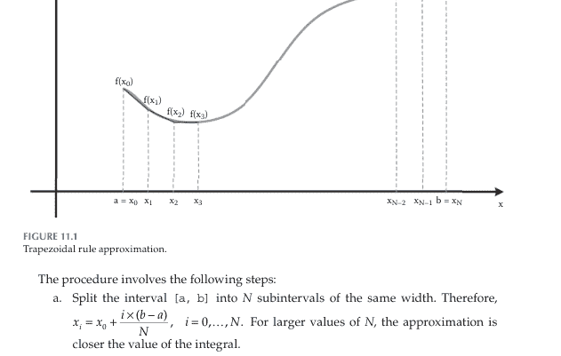

## 图 11.1

梯形法则近似。

该过程涉及以下步骤：

- a. 将区间 [a, b] 分成 N 个宽度相同的子区间。因此，x_i = x_0 + i*(b - a)/N，i = 0,...,N。N 越大，近似值越接近积分值。
- b. 计算 i = 0,...,N 时的 f(x_i) 值。
- c. 计算折线下方形成的 N 个梯形的面积并求和。积分近似为 ∫_a^b f(x) dx = E_p1 + ... + E_pN = (x_1 - x_0)*(f(x_0)+f(x_1))/2 + ... + (x_N - x_{N-1})*(f(x_{N-1})+f(x_N))/2

编写一个程序，使用梯形法则近似积分 ∫_a^b x^2 dx = [x^3/3]_a^b 的值。程序应读取区间数 N、上下限 a 和 b，并检查其有效性。

```
#include <stdio.h>

double f(double x);

int main(void)
{
    int i, a, b, n;
    double step, x, area;

    do {
        printf("Enter number of intervals: ");
        scanf("%d", &n);
    } while(n <= 0);

    do {
        printf("Enter low and up limit (a < b): ");
        scanf("%d%d", &a, &b);
    } while(a >= b);

    step = (double)(b-a)/n;
    x = a;
    area = 0;
    for(i = 0; i < n; i++)
    {
        area += 0.5*step*(f(x)+f(x+step));
        x += step;
    }
    printf("Calculus = %f\n", area);
    return 0;
}

double f(double x) /* The reason we're using a function is that if we've to calculate another integral it is easy to change the code in the function. */
{
    return x*x;
}
```

## 存储类和变量作用域

每个变量都具有三个特性：存储类、作用域和链接。变量的默认属性取决于其声明的位置。

变量的存储类决定了为变量分配内存的时间以及释放该内存的时间。有两种存储类：自动和静态。存储类通过使用以下关键字之一指定：auto、register、extern 或 static。变量的作用域是程序中可以访问该变量或该变量可见的部分；它取决于声明的位置。变量的链接涉及链接器，并决定它是否可以被程序的不同部分共享。具有外部链接的变量可能被程序中的多个文件共享，而具有内部链接的变量仅限于声明它的文件；然而，它可能被该文件中的函数共享。没有链接的变量属于一个函数，不能被共享。


## 局部变量

在函数体内声明的变量称为局部变量。局部变量具有块作用域；其作用域从声明点开始限制在函数内部，直到包含块的末尾。因此，没有其他函数可以访问它。由于局部变量在声明它的函数之外不可见，我们可以在其他函数中使用相同的名称声明变量。例如，在下面的程序中，在 main() 中声明的局部变量 i 与在 test() 中声明的局部变量 i 不同，尽管它们同名。

```c
#include <stdio.h>

void test(void);

int main(void)
{
    int i = 10;
    test();
    printf("I_main = %d\n", i);
    return 0;
}

void test(void)
{
    int i = 200;
    printf("I_test = %d\n", i);
}
```

由于这些变量不同，每个变量都有自己的值，程序输出：

```
I_test = 200
I_main = 10
```

如果我们从 test() 中删除声明 int i; 会怎样？由于这两个 i 变量无关，编译器会发出错误信息，指出 test() 中的变量 i 未声明。

函数的参数也被视为函数的局部变量。例如：

```c
#include <stdio.h>

void test(int i, int j);

int main(void)
{
    int i = 100, j = 100;
    test(i, j);
    printf("%d %d\n", i, j);
    return 0;
}

void test(int i, int j)
{
    int a = 2000; /* The local variables of the function are a, i and j. */
    i = j = a;
}
```

由于函数的参数被视为局部变量，test() 中的变量 i 和 j 与 main() 中的变量无关。因此，程序显示 100 100。

我们迄今为止在程序中使用的变量的默认存储类别是 auto。auto 类只能用于在函数中声明的变量。对于局部变量 a，声明 auto int a; 和 int a; 是等价的；因此可以省略 auto 说明符。每次调用函数时，编译器都会分配内存来存储局部变量的值。该内存会在函数终止时自动释放；因此，局部变量不会在连续调用之间保留其值。由于局部变量会停止存在，它通常被称为具有自动存储期的自动变量。总之，局部变量的默认属性是块作用域、无链接和自动存储期。由于函数的参数实际上是局部变量，它们具有相同的属性。唯一可以应用于参数的存储类别是 register 类。

register 类只能应用于自动变量和函数的参数。使用 register 类声明局部变量（例如，register int i;）会通知编译器该变量将被大量使用，并请求将其保存在系统寄存器中以便更快访问。然而，编译器可以自由忽略该请求，并像对待其他变量一样将其存储在主内存中。未显式初始化的自动变量或寄存器变量的初始值是未定义的。寄存器变量与 auto 变量具有相同的作用域、链接和生命周期。然而，即使编译器未将变量存储在寄存器中，也不允许使用 & 运算符获取寄存器变量的地址。今天的编译器已经发展了很多，可以自行确定哪些变量应保留在寄存器中。

C 允许我们在任何复合语句的 { 之后声明变量，而不仅仅是在函数的 { 之后。复合语句的一般形式是 { 声明 语句 }，该形式指定了一个块。在块中声明的变量的作用域延伸到匹配的 }；因此，它不会与块外部具有相同名称的任何其他变量冲突。默认情况下，存储期是自动的；编译器在进入块时分配内存来存储它，并在退出块时释放该内存。考虑以下程序：

```c
#include <stdio.h>
int main(void)
{
    int i = 20, num = 10;

    if(num == 10)
    {
        int i; /* Allocate memory for the new i. */
        i = 50;
    } /* Release memory. */
    printf("%d\n", i);
    return 0;
}
```

由于在 if 块内声明的 i 变量与第一个 i 无关，程序显示 20。在复合语句内部而不是在函数开头声明变量的一个原因是内存只在需要时才分配。在编写内存有限的系统中的应用程序时，这可能很有用。不需要复合语句来连接条件或循环语句。例如，以下程序输出 50 和 20。

```c
#include <stdio.h>
int main(void)
{
    int i = 20;

    {
        int i = 50;
        printf("%d\n", i);
    }
    printf("%d\n", i);
    return 0;
}
```

由于局部变量的内存会被释放，函数不应返回其地址。例如：

```c
#include <stdio.h>

int *test(void);

int main(void)
{
    int *ptr, j;

    ptr = test();
    printf("%d\n", *ptr);

    j = *ptr;
    printf("%d\n", j);
    return 0;
}

int *test(void)
{
    int i = 10;
    return &i;
}
```

当调用 test() 时，编译器为局部变量 i 分配内存。然后，它返回 i 的地址。由于该内存已被释放，它可能被用于其他目的，因此值 10 可能会被覆盖。因此，程序可能会输出 10 和一个随机值，或两个随机值，而不是 10 和 10。程序的行为是不可预测的。很可能，编译器会发出警告，例如“返回局部变量的地址”。

然而，正如我们稍后会看到的，如果变量 i 声明为 static，你可以安全地返回其地址，因为为静态变量分配的内存不会在函数终止时释放。

> 除非局部变量声明为 static，否则不要返回其地址。

稍后某个地方有一个练习来测试你是否理解了这条规则。

## 全局变量

在任何函数之外声明的变量称为全局变量。其作用域从声明点延伸到声明它的文件的末尾。因此，所有在其声明之后出现的函数都可以访问它。与自动变量不同，全局变量具有永久的生命周期并保留其最后分配的值。总之，全局变量的默认属性是文件作用域、外部链接和静态存储期；也就是说，它永久存在。

当同一个变量在许多函数中使用时，许多程序员选择将其声明为全局变量，而不是作为函数调用的参数传递。事实上，全局变量可以用作函数之间通信数据的替代方案。

通常，我们避免使用全局变量，因为这样可能更难识别错误条件。例如，如果给全局变量分配了不期望的值，就更难识别有罪的函数。过度依赖全局变量可能会对程序结构产生不良影响，并使其理解更加困难。例如，读者更难将每个全局变量与其使用的函数相关联。我们更喜欢使用参数，这样在阅读函数声明时，就很清楚哪些函数需要它们以及这些函数是否可以更改它们的值。例如，如果分配了错误的值，有罪函数的列表就会缩小到可以更改其值的那些函数。

命名全局变量时，选择描述性名称非常重要；它有助于读者理解其作用。不要使用通常赋予局部变量的无意义名称，如 i。默认情况下，未初始化的全局变量或聚合类型（例如，数组、结构）的元素的值设置为 0，然而，我们更喜欢显式设置它。下面的程序声明了全局变量 glob。由于它在函数定义之前声明，因此所有函数都可以访问它。

```c
#include <stdio.h>

void add(void);
void sub(void);

int glob = 10;

int main(void)
{
    add();
    printf("Val = %d\n", glob);
    sub();
```


```c
{
    a++;
    printf("%d\n", a);
}
```

名为 `a` 的四个变量各不相同。我们来应用作用域规则。在 *if* 条件中测试的 `a` 是 `test()` 中声明的那个，而语句 `a++;` 引用的是 *if* 块中声明的 `a`。它的作用域一直到 `}`，而下一条语句 `a+=20;` 增加的是 `test()` 的 `a`。它的作用域一直到函数末尾的 `}`。`main()` 增加全局 `a` 的值，使其变为 150。`last()` 增加局部参数 `a`，使其变为 201。结果，程序输出 501 320 150 201。

不用说，最好避免使用相同的名称，因为代码会变得更难阅读且容易出错。

全局变量可以在多个源文件中可见；也就是说，它可能具有外部链接。这非常有用，尤其是在大型程序中，因为多个源文件可能需要共享同一个变量。`extern` 存储类使变量能够在多个文件之间共享。通常，这样的变量在使用最多的文件中被声明为全局变量，而其他文件使用 `extern` 关键字来引用它。

到目前为止，我们还没有讨论过变量的*声明*和*定义*之间的区别。我们来看看区别。语句 `int size;` 不仅声明 `size` 的类型为 `int`，而且定义了 `size`；也就是说，编译器分配内存来存储它的值。一个变量只能有一个定义；其他文件可以包含 `extern` 声明来访问它。外部变量的初始化只随其定义进行。例如，要在另一个文件中使用它，我们写：

```c
extern int size;
```

由于有 `extern` 这个词，变量 `size` 只是被声明，而不是被定义；也就是说，编译器不会为它分配新内存。换句话说，`extern` 这个词告知编译器变量 `size` 已在其他地方定义。如果需要，可以在任何以 `extern` 引用它的文件中访问和修改 `size`。由于编译器不分配新内存，我们可以在 `extern` 声明中省略数组的长度。例如：

```c
extern int arr[];
```

本质上，`extern` 是位于不同文件中的函数之间进行数据交换的另一种方式。尽管在文件之间共享变量非常常见，但必须小心，因为一个文件中的错误赋值可能会在使用它的其他文件中引发不可预测的结果。我们将在本章后面以及第 17 章的程序中看到 `extern` 声明的示例。

## 静态变量

如前所述，分配给存储局部变量的内存在函数终止时会被释放。因此，无法保证再次调用该函数时局部变量仍保留其旧值。如果我们希望局部变量保留其值，就应该使用 `static` 存储类。与普通局部变量不同，`static` 变量具有静态存储期；也就是说，它具有永久生命周期。它会在整个程序执行期间驻留在同一内存位置，并且该变量

```c
return 0;
}
void test(int num)
{
    if(num == 10)
    {
        static int i = 100;
        i++;
        printf("%d ", i);
    }
}
```

程序输出：101 102

使用 static 可以提高程序的性能。例如，如果一个 `const` 变量在会被多次调用的函数内部声明，那么同时将其声明为 `static` 会更高效，这样它只会被初始化一次。因此，函数的性能得到提高。下面是一个示例：

```c
void test(void)
{
    static const int c = 200;
    ...
}
```

全局变量或函数的链接默认是外部的，这意味着它们可以跨文件共享。然而，如果将其声明为 `static`，链接就会变为内部的，这意味着它只在其定义所在的文件内可见。例如：

```c
#include <stdio.h>

static void test(int i);
static int flag;

int main(void)
{
    ...
}

static void test(int i)
{
    ...
}
```

`flag` 和 `test()` 仅在此文件内可见，这意味着它们不能被其他文件中的函数访问。特别地，`flag` 具有文件作用域、静态存储期，但具有内部链接。将它们声明为 static 的主要原因是对其他文件隐藏它们，从而在不需要时防止其被作为 `extern` 使用。事实上，在一个拆分成多个文件的大型程序中（通常由不同的程序员编写），将函数声明为 static 是个好主意。除了信息隐藏之外，另一个原因是：如果以后需要修改某个 static 函数的代码，你不必担心这些更改会影响其他文件中的函数（除非指向该函数的指针被传递给另一个文件中的函数）。此外，你也不必担心所选的名称是否也在其他文件中使用，因为即使发生这种情况，也不会有冲突。由于链接是内部的，相同的名称可以在其他文件中重复使用。下面是最后一个将这些概念结合在一起的示例。假设这个程序由两个文件组成。必须将两个文件一起编译和链接才能得到完整的程序。你将在第 17 章看到如何做到这一点。你能告诉我们它输出什么吗？

```c
/* First file. */
#include <stdio.h>
void test(void);
int ext = 10;
static int st = 20;
int main(void)
{
    test();
    printf("%d %d\n", ext, st);
    return 0;
}
```

```c
/* Second file. */
#include <stdio.h>
extern int ext;
static int st;
void test(void)
{
    st++;
    printf("%d %d\n", ext, st);
    ext = 30;
}
```

由于 `st` 变量在第一个文件中被声明为 static，它不会与第二个文件中声明的 `st` 冲突（无论第二个 `st` 是否声明为 static）。注意，`test()` 的定义位于第二个文件中。由于 `st` 默认初始化为 0，`test()` 输出 10 和 1。由于 `test()` 将 `ext` 的值改为 30，程序输出 30 和 20。

## 一维数组作为参数

当函数的参数是一维数组时，我们写出数组名，后面跟一对括号。数组的长度可以省略；事实上，这是常见做法。我们稍后会解释原因。例如：

```c
void test(int arr[]);
```

将数组传递给函数时，我们只写它的名称，不带括号。例如：

```c
test(arr);
```

当数组名传递给函数时，它总是被当作指针处理。实际上，传入的实参是其第一个元素的内存地址，而不是数组本身的副本。由于不会制作数组的副本，将数组传递给函数所需的时间不取决于数组的大小。

只需记住，当普通变量传递给函数时，函数处理的是副本。但如果传递的是数组，则不会制作数组的副本；函数处理的是原始数组。为什么要做出这个决定？为了提高性能，因为复制整个数组在内存和时间上可能代价高昂。传递的只是指向其第一个元素的指针，函数可以访问它的任意元素。例如：

```c
#include <stdio.h>

void test(int arr[]);

int main(void)
{
    int i, a[5] = {10, 20, 30, 40, 50};
    test(a);  /* Equivalent to test(&a[0]); */
    for(i = 0; i < 5; i++)
        printf("%d ", a[i]);
    return 0;
}

void test(int arr[])
{
    arr[0] = arr[1] = 0;
}
```

注意，我们可以使用名称 `a` 而不是 `arr`，因为你现在知道，不同函数的局部变量即使名称相同也没有关系。当调用 `test()` 时，我们有 `arr = a = &a[0]`。因此，语句 `arr[0] = 0;` 和 `arr[1] = 0;` 改变前两个元素的值，程序显示 0 0 30 40 50。

我们来看一个将数组传递给库函数的示例。输出会是什么？

```c
#include <stdio.h>
int main(void)
{
    char s[] = "%c\n";
    *(s+1) = 'd';
    printf(s, *s);
    return 0;
}
```


由于 *(s+1) 等价于 s[1]，字符串变为 "%d\n"，程序会显示 '%' 字符的 ASCII 值。

数组参数也可以声明为指针。例如，声明：

```
void test(int arr[]);  and  void test(int *arr);
```

两者是等价的。编译器对两者处理相同，并将指针传递给函数。因此，第二种声明更准确，因为它明确指出只传递了一个指针，而不是数组的拷贝。然而，我们更倾向于第一种，以明确显示传递数组的意图。第二种声明是模糊的；读者无法判断函数是接受多个值还是指向单个变量的指针。

另外，我们也可以使用指针算术来访问数组元素。例如：

```
void test(int arr[])
{
    *arr = 0; /* Equivalent to arr[0] = 0. */
    arr++;
    *arr = 0;
}
```

真正有趣的是语句 arr++。我们能改变数组的值吗？当然不能，你现在已经知道，当数组名用作指针时，它是一个 const 指针。那么，为什么编译器允许这个语句呢？因为，正如所说，虽然 arr 声明为数组，但实际上它是一个指针。因此，它可以被赋予新值。再举一个例子，下面的代码能否编译，如果能，输出是什么？

```
void test(int arr[])
{
    int i = 20, b[10];
    arr = b;
    *arr = 10;
    arr = &i;
    *arr = 30;
    printf("%d %d", b[0], i);
}
```

当然能编译；arr 被当作普通指针处理。该函数输出 10 和 30。

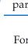

> 为了防止函数改变数组元素的值，将参数声明为 const。

例如，使用声明：

```
void test(const int arr[]);
```

test() 不能修改任何 arr 元素的值。注意，这并不意味着原始数组需要声明为常量。它只是表示 test() 可以将 arr 当作只读数据处理。

在向函数传递数组时，我们可以传递它的一部分。例如：

```c
#include <stdio.h>

void test(int ptr[]);

int main(void)
{
    int i, arr[6] = {1, 2, 3, 4, 5, 6};

    test(arr+3); /* Alternatively, test(&arr[3]) ... */
    for(i = 0; i < 6; i++)
        printf("%d ", arr[i]);
    return 0;
}

void test(int ptr[])
{
    int i, tmp[3] = {10, 20, 30};

    for(i = 0; i < 3; i++)
        ptr[i] = tmp[i];

    *ptr = *(ptr-1);
}
```

当 test() 被调用时，我们有 ptr = arr+3，也就是说，从第四个元素开始的 arr 部分被传递。由于我们将 ptr 用作数组，ptr[0] 对应 arr[3]，ptr[2] 对应 arr[5]。因此，循环使 arr[3]、arr[4] 和 arr[5] 的值分别等于 10、20 和 30。由于 ptr 指向 arr[3]，语句 *ptr = *(ptr-1); 等价于 arr[3] = arr[2]。因此，程序显示 1 2 3 3 20 30

让我们出一个 tricky 的问题。我们能否写下面的代码？

```c
void test(int ptr[])
{
    printf("%d ", ptr[-1]);
    ...
}
```

听起来可能很奇怪，但答案是肯定的。正如你在第 8 章已经知道的，ptr[-1] 等价于 *(ptr-1)，而由于 ptr 等于 arr+3，它等价于 *(arr+3-1)，也就是 arr[2]。如果可以确定向后方向的元素确实存在，那么使用负索引访问它们是安全的。当然，如果有人选择这种语法，我们也无话可说，只能献上 New York Dolls 的《Personality Crisis》。


虽然我们可以使用 sizeof 运算符来查找数组变量的大小，但在函数中无法用它来查找数组参数的大小。

例如，考虑下面的程序：

```
#include <stdio.h>

void test(int arr[]);

int main(void)
{
    int a[10] = {1, 2, 3, 4, 5, 6, 7, 8, 9, 10};

    test(a);
    printf("Array = %u bytes\n", sizeof(a));
    return 0;
}

void test(int arr[])
{
    printf("Ptr = %u bytes\n", sizeof(arr));
}
```

由于数组参数被当作指针处理，sizeof 运算符计算的是指针变量的大小，而不是数组实际的大小。因此，程序输出指针为 4，数组为 40。

因为实际传递给函数的是指针，所以在方括号内写数组长度没有任何效果。编译器会忽略它；它不会检查数组是否真的具有指定的长度。事实上，传递的指针是指向未知长度数组第一个元素的指针。这就是为什么我们把方括号留空；我们不想制造出传递了特定数量元素的假象。让函数知道数组长度的一种简单方法是将其作为额外参数传递。例如，我们可以这样声明 test()：

```
void test(int arr[], int size);
```

并写成 test(a, 10); 来调用它。

另外，我们也可以定义一个常量，例如 #define SIZE 10，并在需要的地方使用该常量，而不是传递额外参数。另一种方法是使用特殊值来表示数组的结束，前提是当然该值不会出现在数组中。例如，如果数组包含一个字符串，就不需要传递其长度，因为空字符指示了它的结束。

在结束之前有一个简单的问题，以检验你是否完全理解了这一非常重要部分。下面的程序输出的值是否相同？如果是，为什么？

```
#include <stdio.h>

void test(int arr[]);

int main(void)
{
    int a[10];

    printf("Addr: %p\n", a);
    test(a);
    return 0;
}
void test(int arr[])
{
    printf("Addr: %p\n", &arr);
}
```

不要急着看下一页的答案，好好思考一下。

不仅你回答了是，而且你还为答案提供了理由？我们又一次骗了你……注意接下来出现的陷阱。不要生气，听一听 Oasis 的《Don't Look Back in Anger》，再检查一下程序。

第一个 printf() 输出的是 a 变量的地址。test() 输出的是 arr 变量的地址。它们相同吗？当然不；它们位于不同的内存位置。然而，arr 的值等于 a；也就是说，如果去掉 &，输出值就会相同。

## 练习

### C.11.15 编写一个函数，以包含学生考试成绩的数组和两个成绩（例如 a 和 b）作为参数，并返回 [a, b] 范围内的成绩平均值。编写一个程序，读取 50 名学生的成绩以及两个成绩 a 和 b，并使用该函数显示平均值。程序应强制用户输入 a 的值小于或等于 b。

```
#include <stdio.h>

#define SIZE 50

float avg_arr(float arr[], float min, float max);

int main(void)
{
    int i;
    float a, b, k, arr[SIZE];

    for(i = 0; i < SIZE; i++)
    {
        printf("Enter grade: ");
        scanf("%f", &arr[i]);
    }
    do
    {
        printf("Enter min and max grades: ");
        scanf("%f%f", &a, &b);
    } while(a > b);

    k = avg_arr(arr, a, b);
    if(k == -1)
        printf("None grade in [%f, %f]\n", a, b);
    else
        printf("Avg = %.2f\n", k);
    return 0;
}

float avg_arr(float arr[], float min, float max)
{
    int i, cnt = 0;
    float sum = 0;
    for(i = 0; i < SIZE; i++)
    {
        if(arr[i] >= min && arr[i] <= max)
        {
            cnt++;
            sum += arr[i];
        }
    }
    if(cnt == 0)
        return -1;
    else
        return sum/cnt;
}
```

### C.11.16 编写一个函数，以字符串作为参数并返回其长度。不要使用 strlen()。

```
unsigned int str_len(const char *str)
{
    unsigned int i = 0;
    while(str[i] != '\0') /* Count the characters up to the null character. */
        i++;
    return i;
}
```

注释：str_len() 是 strlen() 库函数的实现示例。

### C.11.17 下列函数的作用是什么？

```
unsigned int test(const char *str)
{
    const char *ptr = str;
    while(*str++) /* Equivalent to while(*str++ != '\0') */
        ;
    return str-ptr-1;
}
```

答案：很难，不要害怕。

在每次迭代中，循环将 *str 的值与 0 比较，等价于 '\0'，然后 str 被递增，以指向下一个数组元素。例如，在第一次迭代中，*str 等于 str[0]，然后它变为 str[1]，以此类推。一旦 *str 等于空字符，循环终止。

回顾第 8 章和指针算术，指向同一数组的两个指针相减的结果是元素个数，因此，在本例中是它们之间的字符数。ptr 指向第一个元素，而 str 在最后一次递增后指向空字符之后的下一个位置。这就是为什么我们要减去 1，以减去这个位置。


那么，这个函数到底做什么？它与上一道练习中的 str_len() 函数作用相同。它返回存储在 str 中的字符串长度。我们添加这道练习的原因是想说明，一个问题可以有多种解法，有些更简单，有些更复杂。

即使 test() 的执行速度比 str_len() 稍快，test() 的读者也需要多得多的时间才能明白这个函数究竟做什么。再次强调，如果你的程序对速度和效率没有非常严格的要求，为了你自己以及将来阅读你代码的人，尽量编写简单清晰的代码。

在另一个复杂编码示例中，下面的代码使用 **for** 循环而不是 **while** 循环来产生相同的结果。

```c
unsigned int test(const char *str)
{
    const char *ptr = str;

    for(; *str; str++)
        ;
    return str-ptr;
}
```

## C.11.8 编写一个函数，接受两个字符串作为参数，并返回指向较长字符串的指针。如果两个字符串的字符数相同，它应返回 NULL。编写一个程序，读取两个少于 100 个字符的字符串，并使用该函数显示较长的那一个。

```c
#include <stdio.h>
#include <stdlib.h>
#include <string.h>

char *max_str(char str1[], char str2[]);
int read_text(char str[], int size, int flag);

int main(void)
{
    char *ptr, str1[100], str2[100];

    printf("Enter first text: ");
    read_text(str1, sizeof(str1), 1);

    printf("Enter second text: ");
    read_text(str2, sizeof(str2), 1);

    ptr = max_str(str1, str2);
    if(ptr == NULL)
        printf("Same number of characters.\n");
    else
        printf("Result: %s\n", ptr);
    return 0;
}

char *max_str(char str1[], char str2[])
{
int i, j;

i = strlen(str1);
j = strlen(str2);

if(i > j)
    return str1;
else if(i < j)
    return str2;
else
    return NULL;
}
```

注释：只是提醒你，为了节省篇幅，我们将省略第 10 章中给出的 read_text() 定义。

## C.11.19 下面的程序包含任何错误吗？如果没有，它输出什么？

```c
#include <stdio.h>
#include <string.h>

char *test(void);

int main(void)
{
    char ptr[100] = "sample";
    strcpy(ptr, test());
    printf("%s\n", ptr);
    return 0;
}

char *test(void)
{
    char str[] = "example";
    return str;
}
```

答案：已经提醒过你会遇到这样的练习。让我们看看，你找到错误了，还是回答它正确？

当调用 test() 时，编译器为 str 数组分配内存并将字符串存入其中。这个内存位置被返回。记住，局部变量的内存在函数终止时会被释放。程序很可能不会显示 example。但即使显示了，代码也是错误的。始终记住，不要返回局部变量的地址，除非它被声明为 static。如果你想改变数组的内容，最简单的方法是将数组作为参数传递。例如，将 test() 修改如下：

```c
void test(char str[])
{
    strcpy(str, "example");
}
```

## C.11.20 编写一个函数，接受两个字符串作为参数，并将它们作为指针，把第二个字符串复制到第一个字符串中。不要使用 strcpy()。编写一个程序，读取两个少于 100 个字符的字符串，并使用该函数交换它们并显示它们的内容。

```c
#include <stdio.h>
#include <stdlib.h>
#include <string.h>

void copy(char s1[], char s2[]);
int read_text(char str[], int size, int flag);

int main(void)
{
    char str1[100], str2[100], tmp[100];

    printf("Enter first text: ");
    read_text(str1, sizeof(str1), 1);

    printf("Enter second text: ");
    read_text(str2, sizeof(str2), 1);

    copy(tmp, str1); /* Copy the first string into tmp. */
    copy(str1, str2); /* Copy the second string into str1. */
    copy(str2, tmp); /* Copy the first string into str2. */
    printf("\nFirst text: %s\n", str1);
    printf("Second text: %s\n", str2);
    return 0;
}

void copy(char s1[], char s2[])
{
    while(*s2 != '\0')
    {
        *s1 = *s2;
        s1++;
        s2++;
    }
    *s1 = '\0';
}
```

## C.11.21 编写一个函数，接受两个字符串作为参数，如果第二个字符串包含在第一个字符串的末尾，则返回 1。否则，它应返回 0。编写一个程序，读取两个少于 100 个字符的字符串，并使用该函数检查第二个字符串是否包含在第一个字符串的末尾。

```c
#include <stdio.h>
#include <stdlib.h>
#include <string.h>

int str_end(char str1[], char str2[]);
int read_text(char str[], int size, int flag);

int main(void)
{
    char str1[100], str2[100];
    int i;

    printf("Enter first text: ");
    read_text(str1, sizeof(str1), 1);

    printf("Enter second text: ");
    read_text(str2, sizeof(str2), 1);

    i = str_end(str1, str2);
    if(i == 0)
        printf("%s is not at the end of %s\n", str2, str1);
    else
        printf("%s is at the end of %s\n", str2, str1);
    return 0;
}

int str_end(char str1[], char str2[])
{
    int i, len1, len2;

    len1 = strlen(str1);
    len2 = strlen(str2);

    if(len1 < len2) /* If the length of the second string is greater, the function returns. */
        return 0;
    for(i = 1; i <= len2; i++)
        if(str1[len1-i] != str2[len2-i]) /* If two characters are not the same, it is not needed to compare the rest, so the function returns. */
            return 0;
    /* If this point is reached, it means that all compared characters were the same. */
    return 1;
}
```

## C.11.22 编写一个函数，接受两个指向浮点数的指针作为参数，并返回指向值较大的浮点数的指针。编写一个程序，读取两个浮点数，并使用该函数显示较大的那个。

```c
#include <stdio.h>

double *max(double *ptr1, double *ptr2);

int main(void)
{
    double *ptr, i, j;

    printf("Enter numbers: ");
    scanf("%lf%lf", &i, &j);

    ptr = max(&i, &j);
    printf("The max of %f and %f is %f\n", i, j, *ptr);
    return 0;
}

double *max(double *ptr1, double *ptr2)
{
    if(*ptr1 > *ptr2)
        return ptr1;
    else
        return ptr2;
}
```

注释：max() 比较两个输入值，并返回指向较大值的指针。这个指针被存储到 ptr 中，printf() 显示其内容。注意，我们可以删除 ptr 的声明，并写成：

```
printf("The max value of %f and %f is %f\n", i, j, *max(&i, &j));
```

## C.11.23 修改上一个函数，使其接受 void 类型的指针以及第三个参数来声明数据类型。例如，如果它为 0，则传入的类型是 int；否则，它是 double。编写一个程序来测试该函数的操作。

```c
#include <stdio.h>

void *max(void *ptr1, void *ptr2, int type);

int main(void)
{
    int *p1, i1, i2;
    double *p2, d1, d2;

    printf("Enter integers: ");
    scanf("%d%d", &i1, &i2);

    printf("Enter floats: ");
    scanf("%lf%lf", &d1, &d2);

    p1 = (int*) max(&i1, &i2, 0);
    p2 = (double*) max(&d1, &d2, 1);
    printf("Max1:%d Max2:%f\n", *p1, *p2);
    return 0;
}

void *max(void *ptr1, void *ptr2, int type)
{
    if(type == 0)
    {
        if(*(int*)ptr1 > *(int*)ptr2)
            return (int*)ptr1;
        else
            return (int*)ptr2;
    }
    else
    {
        if (*(double*)ptr1 > *(double*)ptr2)
            return (double*)ptr1;
        else
            return (double*)ptr2;
    }
}
```

注释：我们可以让 max() 更通用，以便比较更多数据类型。

## C.11.24 下面程序的输出是什么？

```c
#include <stdio.h>
#include <string.h>

void test(char ch, char *ptr);

int main(void)
{
    char str[] = "bacdefghij";
    test(*str-1, &str[5]);
    printf("%s\n", str);
    return 0;
}

void test(char ch, char *ptr)
{
    strcpy(ptr, "12345");
    *ptr = ch;
}
```

答案：当调用 test() 时，我们有 ch = *str-1 = str[0]-1 = 'b'-1，因此 ch 变为等于 'a'。我们还有 ptr = &str[5]。由于 ptr 指向 str 的第六个元素，语句 strcpy(ptr, "12345"); 将其内容改为 "bacde12345"。语句 *ptr = ch; 等价于 str[5] = ch = 'a'。因此，程序显示：bacdea2345

## C.11.25 编写一个函数，接受两个字符串作为参数，将它们作为指针使用，并在它们相同时返回 0，或返回前两个不匹配字符的差值。

编写一个程序，读取两个少于 100 个字符的字符串，并使用该函数显示比较结果。

```c
#include <stdio.h>
#include <stdlib.h>
#include <string.h>

int str_cmp(const char *str1, const char *str2);
```

int read_text(char str[], int size, int flag);
int main(void)
{
    char str1[100], str2[100];
    int i;
    printf("Enter first string: ");
    read_text(str1, sizeof(str1), 1);
    printf("Enter second string: ");
    read_text(str2, sizeof(str2), 1);
    i = str_cmp(str1, str2);
    if(i == 0)
        printf("%s = %s\n", str1, str2);
    else if(i < 0)
        printf("%s < %s\n", str1, str2);
    else
        printf("%s > %s\n", str1, str2);
    return 0;
}
int str_cmp(const char *s1, const char *s2)
{
    while(*s1 == *s2)
    {
        if(*s1 == '\0')
            return 0;
        s1++;
        s2++;
    }
    return *s1-*s2;
}

注释：如果发现两个不同的字符，循环终止，函数返回它们的差值。str_cmp() 函数是 strcmp() 库函数的一个实现示例。

## C.11.26 下列程序的输出是什么？

```
#include <stdio.h>
void test(int *ptr1, int *ptr2, int a);
int main(void)
{
    int i = 1, j = 2, k = 3;
    test(&i, &j, k);
    printf("%d %d %d\n", i, j, k);
    return 0;
}
```

```c
void test(int *ptr1, int *ptr2, int a)
{
    ptr1 = ptr2;

    *ptr1 = 100;
    *ptr2 = 200;
    a = *ptr1 + *ptr2;
    printf("%d\n", a);
}
```

**答案：** 当调用 test() 时，有 ptr1 = &i、ptr2 = &j 且 a = k。语句 ptr1 = ptr2; 使 ptr1 指向 j 的地址。因此，语句 *ptr1 = 100; 使 j 等于 100。由于 ptr2 指向 j 的地址，语句 *ptr2 = 200; 将 j 的值改为 200。由于语句 a = *ptr1 + *ptr2; 等价于 a = j+j = 200+200 = 400，test() 显示 400。由于 a 值的任何变化都不影响 k，k 保持不变。结果，程序显示：

```
400
1 200 3
```

## C.11.27 编写一个函数，该函数以字符、整数和字符串为参数，并将该字符串作为指针来检查该字符是否存在于字符串中。如果不存在，应返回 NULL。否则，如果整数为 0，应返回指向其第一次出现的指针，否则返回指向最后一次出现的指针。编写一个程序，读取一个少于 100 个字符的字符串、一个字符和一个整数，调用该函数，并显示字符串的一部分。例如，如果用户输入 "booststrap"、't' 和 0，程序应显示 tstrap。如果输入 "booststrap"、't' 和 3，程序应显示 trap。

```c
#include <stdio.h>
#include <stdlib.h>
#include <string.h>

int read_text(char str[], int size, int flag);
char *find(char str[], char ch, int f);

int main(void)
{
    char *ptr, ch, str[100];
    int flag;

    printf("Enter text: ");
    read_text(str, sizeof(str), 1);

    printf("Enter character to search: ");
    scanf("%c", &ch);

    printf("Enter choice (0-first, other-last): ");
    scanf("%d", &flag);

    ptr = find(str, ch, flag);
    if(ptr == NULL)
        printf("'%c' is not included in the text\n", ch);
    else
```

则 MCD 为 r；否则重复此过程。编写一个程序，读取两个正整数，并使用该函数计算它们的 MCD。

```c
#include <stdio.h>

int mcd(int a, int b);

int main(void)
{
    int num1, num2;
    do
    {
        printf("Enter the first number: ");
        scanf("%d", &num1);
        printf("Enter the second number (equal or less than the first one): ");
        scanf("%d", &num2);
    } while(num2 > num1 || (num1 <= 0) || (num2 <= 0));
    printf("MCD of %d and %d is %d\n", num1, num2, mcd(num1, num2));
    return 0;
}

int mcd(int a, int b)
{
    int r;

    while(1)
    {
        r = a%b;
        if(r == 0)
            return b;
        else /* According to the algorithm, we divide b by r, so we change the values of a and b. */
        {
            a = b;
            b = r;
        }
    }
}
```

## C.11.30 下列程序的输出是什么？

```c
#include <stdio.h>

void test(int *arg);

int var = 100;

int main(void)
{
    int *ptr, i = 30;

    ptr = &i;
    test(ptr);
    printf("%d\n", *ptr);
    return 0;
}

void test(int *arg)
{
    arg = &var;
}
```

答案：你回答了 100，不是吗？Green Day 的《Basket Case》，大声播放。让我们看看陷阱。

由于传递给 test() 的是 ptr 的值而不是它的地址，arg 值的任何变化都不会影响 ptr。因此，程序显示 30。

## C.11.31 编写一个函数，对于给定的 x，返回多项式 a₀ + a₁x + a₂x² +...+ aₙxⁿ 的值。函数原型为 double poly(double a[], double x, int n);，其中多项式的系数存储在 a 中，n 表示其次数。编写一个程序，读取多项式的次数、系数和一个值（例如 x），并使用该函数计算多项式的值。假设最高次数为 100。要计算系数的幂，请使用函数 pow()，如附录 C 所示。

#include <stdio.h>
#include <math.h>

#define MAX_DGR 100

double poly(double a[], double x, int n);

int main(void)
{
    int i, dgr;
    double num, arr[MAX_DGR+1];

    do
    {
        printf("Enter degree (<= %d): ", MAX_DGR);
        scanf("%d", &dgr);
    } while(dgr < 0 || dgr > MAX_DGR);

    for(i = 0; i <= dgr; i++)
    {
        printf("Enter coefficient arr[%d]: ", i);
        scanf("%lf", &arr[i]);
    }
    printf("Enter number: ");
    scanf("%lf", &num);
    printf("Poly(%f) = %f\n", num, poly(arr, num, dgr));
    return 0;
}

double poly(double a[], double x, int n)
{
    int i;
    double sum;

    sum = 0;
    for(i = 0; i <= n; i++)
        sum += a[i]*pow(x, i);
    return sum;
}

## C.11.32 下列程序的输出是什么？

#include <stdio.h>

float *test(float *ptr1, float *ptr2);

int main(void)
{
    float a = 1.2, b = 3.4;
    *test(&a, &b) = 5.6;
    printf("val1 = %.1f val2 = %.1f\n", a, b);
    *test(&a, &b) = 7.8;
    printf("val1 = %.1f val2 = %.1f\n", a, b);
    return 0;
}

float *test(float *ptr1, float *ptr2)
{
    if(*ptr1 < *ptr2)
        return ptr1;
    else
        return ptr2;
}

答案：test() 返回指向值较小的参数的指针。在第一次调用中，有 ptr1 = &a，所以 *ptr1 = a = 1.2。类似地，有 ptr2 = &b，所以 *ptr2 = b = 3.4。因此，test() 返回 ptr1 指针。由于 test() 返回指向 a 的指针，语句 *test(&a, &b) = 5.6; 使 a 等于 5.6。因此，程序显示 val1 = 5.6 val2 = 3.4。

第二次调用 test() 返回 ptr2 指针，因为 *ptr1 = a = 5.6 且 *ptr2 = b = 3.4。和之前一样，由于 test() 返回指向 b 的指针，b 变为 7.8，程序显示：val1 = 5.6 val2 = 7.8

## C.11.33 编写一个 void 函数，该函数以包含商店中一些商品价格的数组及其数量为参数，并使用适当的变量返回最低价、最高价和平均价。编写一个程序，读取少于 100 件商品的价格并将它们存储在一个数组中。如果用户输入 -1，则应停止插入价格。程序应使用该函数显示最低价、最高价和平均价。

#include <stdio.h>

void stat_arr(float arr[], int size, float *min, float *max, float *avg);

int main(void)
{
    int i;
    float min, max, avg, arr[100];

for(i = 0; i < 100; i++)
{
    printf("Enter price: ");
    scanf("%f", &arr[i]);
    if(arr[i] == -1)
        break;
}
if(i == 0)
    return 0;
/* The variable i indicates how many prices were stored into the array. For example, if the user does not enter the value -1, i would be equal to 100. */
stat_arr(arr, i, &min, &max, &avg);
printf("Max=%.2f Min=%.2f Avg=%.2f\n", max, min, avg);
return 0;
}

void stat_arr(float arr[], int size, float *min, float *max, float *avg)
{
    int i;
    float sum;
    sum = *min = *max = arr[0];
    for(i = 1; i < size; i++)
    {
        if(arr[i] > *max)
            *max = arr[i];
        if(arr[i] < *min)
            *min = arr[i];
        sum += arr[i];
    }
    *avg = sum/size;
}

## C.11.34 下列程序的输出是什么？

#include <stdio.h>

int *test(int *ptr1, int *ptr2);

int main(void)
{
    int arr[] = {1, 2, 3, 4};
    *test(arr, arr+3) = 30;
    printf("%d %d %d %d\n", arr[0], arr[1], arr[2], arr[3]);
    return 0;
}

int *test(int *ptr1, int *ptr2)
{
    *(ptr1+1) = 10;
    *(ptr2-1) = 20;


```
    return ptr1+3;
}
```

答案：当调用 test() 时，有 ptr1 = arr，因此指针 ptr1+1 指向 arr[1]。因此，语句 *(ptr1+1) = 10; 使 arr[1] 等于 10。类似地，有 ptr2 = arr+3，因此 ptr2 指向 arr[3]。因此，语句 *(ptr2-1) = 20; 使 arr[2] 等于 20。由于 ptr1 指向 arr，表达式 ptr1+3 返回指向 arr[3] 的指针。因此，arr[3] 变为 30。结果，程序显示：1 10 20 30

## C.11.35 编写一个函数，该函数接收一个整数作为参数（例如 N），并根据公式 F(N) = F(N-1) + F(N-2) 计算斐波那契数列的第 N 项，其中 F(0) = 0，F(1) = 1。编写一个程序，读取一个 2 到 40 之间的整数 N，并使用该函数显示第 N 项。

```
#include <stdio.h>

unsigned int fib(int num);

int main(void)
{
    int num;

    do
    {
        printf("Enter a number between 2 and 40: ");
        scanf("%d", &num);
    } while(num < 2 || num > 40);

    printf("F(%d) = %u\n", num, fib(num));
    return 0;
}

unsigned int fib(int num)
{
    unsigned int term1, term2, sum;

    term1 = 1;
    term2 = 0;
    while(num > 1)
    {
        sum = term1 + term2;

        term2 = term1;
        term1 = sum;
        num--;
    }
    return sum;
}
```

### 注释
已知 F(N) = F(N-1)+ F(N-2)，前几项为 0, 1, 1, 2, 3, 5, 8, 13, 21, 34, 55, 89, 144, ... 例如，F(7) = 13，它是 F(6) 与 F(5) 之和。为了计算某一项的值，我们将最近一次的和存入 term1，而将前一次的和存入 term2。

## C.11.36 下列程序的输出是什么？

```c
#include <stdio.h>

double *f(double ptr[]);

int main(void)
{
    int i;
    double a[8] = {0.1, 0.2, 0.3, 0.4, 0.5, 0.6, 0.7, 0.8};

    printf("%.1f\n", *f(f(f(a))));
    for(i = 0; i < 8; i++)
        printf("a[%d] = %.1f\n", i, a[i]);
    return 0;
}

double *f(double ptr[])
{
    (*ptr)++;
    return ptr+2;
}
```

**答案：** f() 调用按从内到外的顺序执行。第一次调用 f() 时，有 ptr = a = &a[0]。因此，语句 (*ptr)++; 等价于 a[0]++;，并且 a[0] 变为 1.1。

返回值 a+2 在第二次调用中作为参数使用，因此 f(f(a)) 转换为 f(a+2)。因此，a[2] 变为 1.3。类似地，返回值 a+4 在第三次调用中作为参数使用，a[4] 变为 1.5。由于最后一次调用 f() 返回 a[6] 的地址，因此使用 * 运算符显示其值，即 0.7。结果，a 的内容为 1.1 0.2 1.3 0.4 1.5 0.6 0.7 0.8

## C.11.37 编写一个函数，该函数接收一个字符串作为参数，并显示其中包含多少个数字（0-9）、多少个以小写字母（a-z）开头的单词，以及多少个以大写字母（A-Z）开头的单词。编写一个程序，读取一个少于 100 个字符的字符串并调用该函数。

有两个限制。第一个是在函数内部使用指针表示法，第二个是使用 ctype.h 中的函数。请阅读附录 C 中 ctype.h 函数的说明，并选择合适的函数。

```c
#include <stdio.h>
#include <stdlib.h>
#include <string.h>
#include <ctype.h>

int read_text(char str[], int size, int flag);
void parse_str(char str[]);
```

```
int main(void)
{
    char str[100];

    printf("Enter text: ");
    read_text(str, sizeof(str), 1);
    parse_str(str);
    return 0;
}

void parse_str(char s[])
{
    int dig, uplet_wrd, lowlet_wrd;

    dig = uplet_wrd = lowlet_wrd = 0;
    while(*s != '\0')
    {
        while(isspace(*s)) /* Skip the whitespace characters until a word begins. */
            s++;
        if(*s == '\0')
            break;
        /* We check if the word begins with a digit or letter.*/
        if(isdigit(*s))
            dig++;
        else if(isupper(*s))
            uplet_wrd++;
        else if(islower(*s))
            lowlet_wrd++;
        s++;
        if(*s == '\0')
            break;
        while(isspace(*s) == 0) /* Skip the characters of the word; check only for digits. */
        {
            if(isdigit(*s))
                dig++;
            s++;
            if(*s == '\0')
                break;
        }
    }
    printf("UL:%d LL:%d DG:%d\n", uplet_wrd, lowlet_wrd, dig);
}
```

## C.11.38 根据我们的经验，我们经常在“实现通信协议”领域使用 C 语言。例如，我们将向你展示一种创建网络数据帧的方法。在此之前，先介绍一些理论：

位于同一个 Internet 协议（IP）本地网络中的两台计算机 A 和 B，如果双方都知道彼此的物理地址，就可以通信。物理地址称为介质访问控制（MAC）地址。例如，当 A 需要与 B 通信时，它必须知道 B 的 MAC 地址。为了获知该地址，A 应向本地网络发送一个 MAC 帧，其中包含一条称为 ARP_Request 的特殊消息。当 B 收到这个 MAC 帧后，会用另一个 MAC 帧回复 A，其中包含另一条称为 ARP_Reply 的特殊消息。ARP_Reply 包含 B 的 MAC 地址。这样，A 就获知了 B 的 MAC 地址，因此它们可以通信。

编写一个程序，读取 A 的 MAC 地址以及 A 和 B 的 IP 地址，并创建一个包含 ARP_Request 消息的 MAC 帧。程序应按行显示 MAC 帧的内容，其中每行应包含 16 个字节，以十六进制格式表示。MAC 地址由六个八位组（字节）组成，应以 x.x.x.x.x.x 的形式输入（每个 x 是 [0, 255] 范围内的整数）；IP 地址由四个八位组组成，应以 x.x.x.x 的形式输入。图 11.2 显示了 MAC 帧的格式：

- a. 将前导码字段的前七个八位组设置为 85，第八个八位组设置为 171。
- b. 将 MAC 目的地址的六个八位组设置为 255。
- c. 将 MAC 源地址的六个八位组设置为 A 的 MAC 地址。
- d. 将类型字段的第一个八位组设置为 8，第二个八位组设置为 6。
- e. 将 CRC 字段的四个八位组设置为 1。

图 11.3 描绘了 ARP_Request 消息的格式。

- a. 硬件类型字段的长度为两个八位组。第一个八位组为 0，第二个八位组为 1。
- b. 协议类型字段的长度为两个八位组。第一个八位组为 8，第二个八位组为 6。
- c. 硬件长度字段的长度为一个八位组，值为 6。
- d. 协议长度字段的长度为一个八位组，值为 4。
- e. 操作字段的长度为两个八位组。
- f. 将目标硬件地址的六个八位组设置为 0。
- g. 将目标协议地址的四个八位组设置为 B 的 IP 地址。

```
#include <stdio.h>

void Build_Frm(int MAC_src[], int IP_src[], int IP_dst[]);
void Show_Frm(unsigned char pkt[], int len);

int main(void)
{
    int MAC_src[6], IP_src[4], IP_dst[4];
```

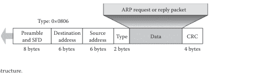

图 11.2
MAC 帧结构。

| 硬件类型 | 协议类型 |
|---|---|
| 硬件长度 | 协议长度 | 操作 请求 1，应答 2 |
| 发送方硬件地址（例如：以太网为 6 字节） |  |
| 发送方协议地址（例如：IP 为 4 字节） |  |
| 目标硬件地址（例如：以太网为 6 字节）（在请求中不填写） |  |
| 目标协议地址（例如：IP 为 4 字节） |  |

图 11.3
ARP 分组结构。

```
printf("Enter src MAC (x.x.x.x.x.x): ");
scanf("%d.%d.%d.%d.%d.%d", &MAC_src[0], &MAC_src[1], &MAC_src[2], &MAC_src[3], &MAC_src[4], &MAC_src[5]);

printf("Enter src IP (x.x.x.x): ");
scanf("%d.%d.%d.%d", &IP_src[0], &IP_src[1], &IP_src[2], &IP_src[3]);

printf("Enter dst IP (x.x.x.x): ");
scanf("%d.%d.%d.%d", &IP_dst[0], &IP_dst[1], &IP_dst[2], &IP_dst[3]);
Build_Frm(MAC_src, IP_src, IP_dst);
return 0;
}

void Build_Frm(int MAC_src[], int IP_src[], int IP_dst[])
{
unsigned char pkt[54] = {85, 85, 85, 85, 85, 85, 85, 171}; /* Initialize the first eight octets of the frame and make zero the rest. */
int i, j;

for(i = 8; i < 14; i++) /* Broadcast MAC address. It is a special address used in Ethernet technology to broadcast the frame. */
pkt[i] = 255;
for(i = 14, j = 0; j < 6; i++, j++)
pkt[i] = MAC_src[j]; /* MAC source. */

pkt[20] = 8; /* Type. */
pkt[21] = 6;

pkt[22] = 0; /* Hardware Type. */
pkt[23] = 1;

pkt[24] = 8; /* Protocol Type. */
pkt[25] = 6;
```


```
pkt[26] = 6; /* Hardware Length. */
pkt[27] = 4; /* Protocol Length. */

pkt[28] = 0; /* Operation (ARP_Request). */
pkt[29] = 1;

for(i = 30, j = 0; i < 36; i++, j++)
    pkt[i] = MAC_src[j]; /* MAC source. */
for(i = 36, j = 0; i < 40; i++, j++)
    pkt[i] = IP_src[j]; /* IP source. */
/* The MAC destination in places [40-45] is initialized to 0. */
for(i = 46, j = 0; i < 50; i++, j++)
    pkt[i] = IP_dst[j]; /* IP destination. */
for(i = 50; i < 54; i++)
    pkt[i] = 1; /* CRC. */

Show_Frm(pkt, i);
}
```
```
void Show_Frm(unsigned char pkt[], int len)
{
    int i;
    for(i = 0; i < len; i++)
    {
        if(i%16 == 0)
            printf("\n");
        printf("%02X ", pkt[i]);
    }
}
```

评论：在真实的网络应用中，系统的网卡会将此 MAC 帧传输到 IP 网络。

## C.11.39 以下程序的输出是什么？
```
#include <stdio.h>

void swap(char *s1, char *s2);

int main(void)
{
    char *p[] = {"Shadow", "Play"};
    swap(p[0], p[1]);
    printf("%s %s\n", p[0], p[1]);
    return 0;
}

void swap(char *s1, char *s2)
{
    char *p;
    p = s1;
    s1 = s2;
    s2 = p;
}
```

答案：这是什么样的戏？你回答的是 Play Shadow 吗？阅读 C.11.30 的注释。它只是要改的歌：Rory Gallagher 的《Shadow Play》。

如 C.11.30 中的 test() 所示，swap() 接收的是指针的值，而不是它们的地址。因此，交换没有任何效果，程序显示 Shadow Play。我们希望你修改程序以输出 Play Shadow。来试试，你能做到吗？给你一个提示，将参数的类型改为... 自己找吧，就说这么多了。

## 二维数组作为参数

声明一个以二维数组作为参数的函数的最常见方式是写出数组名及其维度。例如，test() 以一个具有 5 行 10 列的二维整数数组作为参数。

```
void test(int arr[5][10]);
```

因为，如第 7 章所述，编译器在计算元素的内存位置时不需要知道行数，因此可以省略第一个维度。例如：

```
void test(int arr[][10]);
```

然而，必须指定列数。在一般情况下，当多维数组传递给函数时，可以省略第一个维度。所有其他维度必须指定并与数组的声明相匹配。这样，编译器就会拥有必要的[content]
```
pkt[26] = 6; /* Hardware Length. */
pkt[27] = 4; /* Protocol Length. */

pkt[28] = 0; /* Operation (ARP_Request). */
pkt[29] = 1;

for(i = 30, j = 0; i < 36; i++, j++)
    pkt[i] = MAC_src[j]; /* MAC source. */
for(i = 36, j = 0; i < 40; i++, j++)
    pkt[i] = IP_src[j]; /* IP source. */
/* The MAC destination in places [40-45] is initialized to 0. */
for(i = 46, j = 0; i < 50; i++, j++)
    pkt[i] = IP_dst[j]; /* IP destination. */
for(i = 50; i < 54; i++)
    pkt[i] = 1; /* CRC. */

Show_Frm(pkt, i);
}
```
```
void Show_Frm(unsigned char pkt[], int len)
{
    int i;
    for(i = 0; i < len; i++)
    {
        if(i%16 == 0)
            printf("\n");
        printf("%02X ", pkt[i]);
    }
}
```

评论：在真实的网络应用中，系统的网卡会将此 MAC 帧传输到 IP 网络。

## C.11.39 以下程序的输出是什么？
```
#include <stdio.h>

void swap(char *s1, char *s2);

int main(void)
{
    char *p[] = {"Shadow", "Play"};
    swap(p[0], p[1]);
    printf("%s %s\n", p[0], p[1]);
    return 0;
}

void swap(char *s1, char *s2)
{
    char *p;
    p = s1;
    s1 = s2;
    s2 = p;
}
```

答案：这是什么样的戏？你回答的是 Play Shadow 吗？阅读 C.11.30 的注释。它只是要改的歌：Rory Gallagher 的《Shadow Play》。

如 C.11.30 中的 test() 所示，swap() 接收的是指针的值，而不是它们的地址。因此，交换没有任何效果，程序显示 Shadow Play。我们希望你修改程序以输出 Play Shadow。来试试，你能做到吗？给你一个提示，将参数的类型改为... 自己找吧，就说这么多了。

## 二维数组作为参数

声明一个以二维数组作为参数的函数的最常见方式是写出数组名及其维度。例如，test() 以一个具有 5 行 10 列的二维整数数组作为参数。

```
void test(int arr[5][10]);
```

因为，如第 7 章所述，编译器在计算元素的内存位置时不需要知道行数，因此可以省略第一个维度。例如：

```
void test(int arr[][10]);
```

然而，必须指定列数。在一般情况下，当多维数组传递给函数时，可以省略第一个维度。所有其他维度必须指定并与数组的声明相匹配。这样，编译器就会拥有必要的[content]
```
pkt[26] = 6; /* Hardware Length. */
pkt[27] = 4; /* Protocol Length. */

pkt[28] = 0; /* Operation (ARP_Request). */
pkt[29] = 1;

for(i = 30, j = 0; i < 36; i++, j++)
    pkt[i] = MAC_src[j]; /* MAC source. */
for(i = 36, j = 0; i < 40; i++, j++)
    pkt[i] = IP_src[j]; /* IP source. */
/* The MAC destination in places [40-45] is initialized to 0. */
for(i = 46, j = 0; i < 50; i++, j++)
    pkt[i] = IP_dst[j]; /* IP destination. */
for(i = 50; i < 54; i++)
    pkt[i] = 1; /* CRC. */

Show_Frm(pkt, i);
}
```
```
void Show_Frm(unsigned char pkt[], int len)
{
    int i;
    for(i = 0; i < len; i++)
    {
        if(i%16 == 0)
            printf("\n");
        printf("%02X ", pkt[i]);
    }
}
```

评论：在真实的网络应用中，系统的网卡会将此 MAC 帧传输到 IP 网络。

## C.11.39 以下程序的输出是什么？
```
#include <stdio.h>

void swap(char *s1, char *s2);

int main(void)
{
    char *p[] = {"Shadow", "Play"};
    swap(p[0], p[1]);
    printf("%s %s\n", p[0], p[1]);
    return 0;
}

void swap(char *s1, char *s2)
{
    char *p;
    p = s1;
    s1 = s2;
    s2 = p;
}
```

答案：这是什么样的戏？你回答的是 Play Shadow 吗？阅读 C.11.30 的注释。它只是要改的歌：Rory Gallagher 的《Shadow Play》。

如 C.11.30 中的 test() 所示，swap() 接收的是指针的值，而不是它们的地址。因此，交换没有任何效果，程序显示 Shadow Play。我们希望你修改程序以输出 Play Shadow。来试试，你能做到吗？给你一个提示，将参数的类型改为... 自己找吧，就说这么多了。

## 二维数组作为参数

声明一个以二维数组作为参数的函数的最常见方式是写出数组名及其维度。例如，test() 以一个具有 5 行 10 列的二维整数数组作为参数。

```
void test(int arr[5][10]);
```

因为，如第 7 章所述，编译器在计算元素的内存位置时不需要知道行数，因此可以省略第一个维度。例如：

```
void test(int arr[][10]);
```

然而，必须指定列数。在一般情况下，当多维数组传递给函数时，可以省略第一个维度。所有其他维度必须指定并与数组的声明相匹配。这样，编译器就会拥有必要的[content]
```
pkt[26] = 6; /* Hardware Length. */
pkt[27] = 4; /* Protocol Length. */

pkt[28] = 0; /* Operation (ARP_Request). */
pkt[29] = 1;

for(i = 30, j = 0; i < 36; i++, j++)
    pkt[i] = MAC_src[j]; /* MAC source. */
for(i = 36, j = 0; i < 40; i++, j++)
    pkt[i] = IP_src[j]; /* IP source. */
/* The MAC destination in places [40-45] is initialized to 0. */
for(i = 46, j = 0; i < 50; i++, j++)
    pkt[i] = IP_dst[j]; /* IP destination. */
for(i = 50; i < 54; i++)
    pkt[i] = 1; /* CRC. */

Show_Frm(pkt, i);
}
```
```
void Show_Frm(unsigned char pkt[], int len)
{
    int i;
    for(i = 0; i < len; i++)
    {
        if(i%16 == 0)
            printf("\n");
        printf("%02X ", pkt[i]);
    }
}
```

评论：在真实的网络应用中，系统的网卡会将此 MAC 帧传输到 IP 网络。

## C.11.39 以下程序的输出是什么？
```
#include <stdio.h>

void swap(char *s1, char *s2);

int main(void)
{
    char *p[] = {"Shadow", "Play"};
    swap(p[0], p[1]);
    printf("%s %s\n", p[0], p[1]);
    return 0;
}

void swap(char *s1, char *s2)
{
    char *p;
    p = s1;
    s1 = s2;
    s2 = p;
}
```

答案：这是什么样的戏？你回答的是 Play Shadow 吗？阅读 C.11.30 的注释。它只是要改的歌：Rory Gallagher 的《Shadow Play》。

如 C.11.30 中的 test() 所示，swap() 接收的是指针的值，而不是它们的地址。因此，交换没有任何效果，程序显示 Shadow Play。我们希望你修改程序以输出 Play Shadow。来试试，你能做到吗？给你一个提示，将参数的类型改为... 自己找吧，就说这么多了。

## 二维数组作为参数

声明一个以二维数组作为参数的函数的最常见方式是写出数组名及其维度。例如，test() 以一个具有 5 行 10 列的二维整数数组作为参数。

```
void test(int arr[5][10]);
```

因为，如第 7 章所述，编译器在计算元素的内存位置时不需要知道行数，因此可以省略第一个维度。例如：

```
void test(int arr[][10]);
```

然而，必须指定列数。在一般情况下，当多维数组传递给函数时，可以省略第一个维度。所有其他维度必须指定并与数组的声明相匹配。这样，编译器就会拥有必要的[content]
```
pkt[26] = 6; /* Hardware Length. */
pkt[27] = 4; /* Protocol Length. */

pkt[28] = 0; /* Operation (ARP_Request). */
pkt[29] = 1;

for(i = 30, j = 0; i < 36; i++, j++)
    pkt[i] = MAC_src[j]; /* MAC source. */
for(i = 36, j = 0; i < 40; i++, j++)
    pkt[i] = IP_src[j]; /* IP source. */
/* The MAC destination in places [40-45] is initialized to 0. */
for(i = 46, j = 0; i < 50; i++, j++)
    pkt[i] = IP_dst[j]; /* IP destination. */
for(i = 50; i < 54; i++)
    pkt[i] = 1; /* CRC. */

Show_Frm(pkt, i);
}
```
```
void Show_Frm(unsigned char pkt[], int len)
{
    int i;
    for(i = 0; i < len; i++)
    {
        if(i%16 == 0)
            printf("\n");
        printf("%02X ", pkt[i]);
    }
}
```

评论：在真实的网络应用中，系统的网卡会将此 MAC 帧传输到 IP 网络。

## C.11.39 以下程序的输出是什么？
```
#include <stdio.h>

void swap(char *s1, char *s2);

int main(void)
{
    char *p[] = {"Shadow", "Play"};
    swap(p[0], p[1]);
    printf("%s %s\n", p[0], p[1]);
    return 0;
}

void swap(char *s1, char *s2)
{
    char *p;
    p = s1;
    s1 = s2;
    s2 = p;
}
```

答案：这是什么样的戏？你回答的是 Play Shadow 吗？阅读 C.11.30 的注释。它只是要改的歌：Rory Gallagher 的《Shadow Play》。

如 C.11.30 中的 test() 所示，swap() 接收的是指针的值，而不是它们的地址。因此，交换没有任何效果，程序显示 Shadow Play。我们希望你修改程序以输出 Play Shadow。来试试，你能做到吗？给你一个提示，将参数的类型改为... 自己找吧，就说这么多了。

## 二维数组作为参数

声明一个以二维数组作为参数的函数的最常见方式是写出数组名及其维度。例如，test() 以一个具有 5 行 10 列的二维整数数组作为参数。

```
void test(int arr[5][10]);
```

因为，如第 7 章所述，编译器在计算元素的内存位置时不需要知道行数，因此可以省略第一个维度。例如：

```
void test(int arr[][10]);
```

然而，必须指定列数。在一般情况下，当多维数组传递给函数时，可以省略第一个维度。所有其他维度必须指定并与数组的声明相匹配。这样，编译器就会拥有必要的[content]
```
pkt[26] = 6; /* Hardware Length. */
pkt[27] = 4; /* Protocol Length. */

pkt[28] = 0; /* Operation (ARP_Request). */
pkt[29] = 1;

for(i = 30, j = 0; i < 36; i++, j++)
    pkt[i] = MAC_src[j]; /* MAC source. */
for(i = 36, j = 0; i < 40; i++, j++)
    pkt[i] = IP_src[j]; /* IP source. */
/* The MAC destination in places [40-45] is initialized to 0. */
for(i = 46, j = 0; i < 50; i++, j++)
    pkt[i] = IP_dst[j]; /* IP destination. */
for(i = 50; i < 54; i++)
    pkt[i] = 1; /* CRC. */

Show_Frm(pkt, i);
}
```
```
void Show_Frm(unsigned char pkt[], int len)
{
    int i;
    for(i = 0; i < len; i++)
    {
        if(i%16 == 0)
            printf("\n");
        printf("%02X ", pkt[i]);
    }
}
```

评论：在真实的网络应用中，系统的网卡会将此 MAC 帧传输到 IP 网络。

## C.11.39 以下程序的输出是什么？
```
#include <stdio.h>

void swap(char *s1, char *s2);

int main(void)
{
    char *p[] = {"Shadow", "Play"};
    swap(p[0], p[1]);
    printf("%s %s\n", p[0], p[1]);
    return 0;
}

void swap(char *s1, char *s2)
{
    char *p;
    p = s1;
    s1 = s2;
    s2 = p;
}
```

答案：这是什么样的戏？你回答的是 Play Shadow 吗？阅读 C.11.30 的注释。它只是要改的歌：Rory Gallagher 的《Shadow Play》。

如 C.11.30 中的 test() 所示，swap() 接收的是指针的值，而不是它们的地址。因此，交换没有任何效果，程序显示 Shadow Play。我们希望你修改程序以输出 Play Shadow。来试试，你能做到吗？给你一个提示，将参数的类型改为... 自己找吧，就说这么多了。

## 二维数组作为参数

声明一个以二维数组作为参数的函数的最常见方式是写出数组名及其维度。例如，test() 以一个具有 5 行 10 列的二维整数数组作为参数。

```
void test(int arr[5][10]);
```

因为，如第 7 章所述，编译器在计算元素的内存位置时不需要知道行数，因此可以省略第一个维度。例如：

```
void test(int arr[][10]);
```

然而，必须指定列数。在一般情况下，当多维数组传递给函数时，可以省略第一个维度。所有其他维度必须指定并与数组的声明相匹配。这样，编译器就会拥有必要的[content]
```
pkt[26] = 6; /* Hardware Length. */
pkt[27] = 4; /* Protocol Length. */

pkt[28] = 0; /* Operation (ARP_Request). */
pkt[29] = 1;

for(i = 30, j = 0; i < 36; i++, j++)
    pkt[i] = MAC_src[j]; /* MAC source. */
for(i = 36, j = 0; i < 40; i++, j++)
    pkt[i] = IP_src[j]; /* IP source. */
/* The MAC destination in places [40-45] is initialized to 0. */
for(i = 46, j = 0; i < 50; i++, j++)
    pkt[i] = IP_dst[j]; /* IP destination. */
for(i = 50; i < 54; i++)
    pkt[i] = 1; /* CRC. */

Show_Frm(pkt, i);
}
```
```
void Show_Frm(unsigned char pkt[], int len)
{
    int i;
    for(i = 0; i < len; i++)
    {
        if(i%16 == 0)
            printf("\n");
        printf("%02X ", pkt[i]);
    }
}
```

评论：在真实网络应用中，系统网卡会把此 MAC 帧传到 IP 网络。

## C.11.39 以下程序的输出是什么？
```
#include <stdio.h>

void swap(char *s1, char *s2);

int main(void)
{
    char *p[] = {"Shadow", "Play"};
    swap(p[0], p[1]);
    printf("%s %s\n", p[0], p[1]);
    return 0;
}

void swap(char *s1, char *s2)
{
    char *p;
    p = s1;
    s1 = s2;
    s2 = p;
}
```

答案：这是什么戏？你答 Play Shadow 吗？看 C.11.30 的注释。只是要改的歌：Rory Gallagher 的 Shadow Play。

如 C.11.30 的 test()，swap() 接收指针值而非地址。于是交换无效，程序显示 Shadow Play。我们希望你改程序输出 Play Shadow。试试看？提示：把参数类型改为... 自己找吧，就说这么多。

## 二维数组作为参数

声明以二维数组为参数的函数最常见写法是写数组名加维度。例如 test() 以 5 行 10 列的二维整型数组为参数。

```
void test(int arr[5][10]);
```

因第 7 章所述，编译器算元素位置不需要行数，故可省略第一维。例如：

```
void test(int arr[][10]);
```

但列数必须指定。一般多维数组传函数时可省略第一维，其余必须指定并与声明匹配。这样编译器才有足够信息做地址运算缩放并访问元素。

由于 C 把二维数组视为一维数组的数组，编译器实际把二维参数译为指向数组的指针。故可等价写 void test(int (*arr)[10]); 因 [] 优先级高于 *，需加括号，否则 arr 会被解释为 10 个指向 int 的指针数组而非指向含 10 个 int 的数组的指针。虽该声明更准确，我们仍偏好第一种写法并省略第一维，以更清晰表明参数为二维数组。

来做点防御，一波问题来了。arr 指向哪？指向数组第一行。写 arr++ 指向哪？指向下一行，因按行大小递增。(*arr)[i] 是什么？是 arr 所指行中的第二个元素。如何知道到达数组最后一行？通常用常量如 #define ROWS 20 或传参声明总行数。警报结束。有疑问请重读第 8 章“指针和二维数组”。

再说一次，编译器把二维参数译为指向数组的指针，而非你可能期望的指向指针的指针。故不能写 void test(int **arr); 第 14 章介绍 malloc() 时，你会看到如何用指向指针的变量动态创建二维数组并传给函数。现在总结编译器如何翻译数组参数：

- *一维：* `arr[10]` 翻译为指针 `*arr`。
- *二维：* `arr[10][20]` 翻译为指向数组的指针 `(*arr)[20]`。
- *指针数组：* `*arr[10]` 翻译为指向指针的指针 `**arr`。

与一维数组一样，传二维数组作参数时只写其名不带方括号。若想传某行如 i，则传该行指针如 arr[i]，与传一维数组相同。例如下面程序显示第一行元素。

```c
#include <stdio.h>

#define ROWS 2
#define COLS 3

void show_row(int a[]);

int main(void)
{
    int arr[ROWS][COLS] = {{1, 2, 3}, {4, 5, 6}};
    show_row(arr[0]);
    return 0;
}

void show_row(int a[])
{
    int i;
    for(i = 0; i < COLS; i++)
        printf("%d ", a[i]);
}
```

## Exercises

### C.11.40 写一个函数，以 3x4 二维数组为参数，返回一个数组其每个元素等于二维数组对应行的元素之和，另返回一个数组其每个元素等于对应列的元素之和。写程序读入 12 个整数存入 3x4 二维数组，用函数显示各行和各列元素之和。

```
#include <stdio.h>

#define ROWS 3
#define COLS 4

void find_sums(int arr1[][COLS], int arr2[], int arr3[]);
int main(void)
{
    int i, j, arr1[ROWS][COLS], arr2[ROWS], arr3[COLS];

    for(i = 0; i < ROWS; i++)
        for(j = 0; j < COLS; j++)
        {
            printf("arr1[%d][%d] = ", i, j);
            scanf("%d", &arr1[i][j]);
        }

    find_sums(arr1, arr2, arr3);
    for(i = 0; i < ROWS; i++)
        printf("sum_line_%d = %d\n", i, arr2[i]);
    for(i = 0; i < COLS; i++)
        printf("sum_col_%d = %d\n", i, arr3[i]);
    return 0;
}
void find_sums(int arr1[][COLS], int arr2[], int arr3[])
{
    int i, j, sum;

    for(i = 0; i < ROWS; i++)
    {
        sum = 0;
        for(j = 0; j < COLS; j++)
            sum += arr1[i][j];
        arr2[i] = sum;
    }
    for(i = 0; i < COLS; i++)
    {
        sum = 0;
        for(j = 0; j < ROWS; j++)
            sum += arr1[j][i];
        arr3[i] = sum;
    }
}
```

**注释：** 因函数不能返回数组，数组在 main() 中声明并传给函数。

### C.11.41 写一个函数，以名字数组和另一个名字为参数。函数检查该名字是否在数组中。若在则返回该名字在数组中位置的指针，否则返回 NULL。写程序读入 20 个学生名字（每个少于 100 字符）存入数组，再读入另一个名字用函数检查是否在数组中。

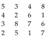

程序应提示用户选择两张卡片位置并显示消息指示是否匹配。程序在所有卡片匹配时结束。

```c
#include <stdio.h>
#include <stdlib.h>
#include <time.h>

#define ROWS 4
#define COLS 4

void show_board(int c[][COLS], int s[][COLS]);
void sel_card(int c[][COLS], int s[][COLS], int *row, int *col);

int main(void)
{
    int i, j, m, r, c, r2, c2, cnt, cards[ROWS][COLS], status[ROWS][COLS] = {0}; /* The status array indicates if a card faces up or down (0 is for down). */
    cnt = 0; /* This variable counts the number of the faced up cards. */
    for(i = r = 0; i < ROWS; i++) /* Assign the values 1 to 8, sequentially. */
    {
        for(j = 0; j < COLS; j+=2)
        {
            cards[i][j] = cards[i][j+1] = r+1;
            r++;
        }
    }
    /* Now, shuffle the cards. */
    srand(time(NULL));
    for(i = 0; i < ROWS; i++)
    {
        for(j = 0; j < COLS; j++)
        {
            c = cards[i][j];
            m = rand()%ROWS;
            r = rand()%COLS;
            cards[i][j] = cards[m][r];
            cards[m][r] = c;
        }
    }
    show_board(cards, status);
    m = 0;
    while(cnt != ROWS*COLS) /* The game ends when all cards are faced up. */
    {
```


```
sel_card(cards, status, &r, &c);
printf("Card_1 = %d\n", cards[r][c]);

sel_card(cards, status, &r2, &c2);
printf("Card_2 = %d\n", cards[r2][c2]);

for(i = 0; i < 18; i++) /* Blank line to delete history and make it harder for the player to remember the card positions. */
    printf("\n");

if(cards[r][c] == cards[r2][c2])
{
    printf("Cards matched !!!\n");
    cnt += 2;
}
else
{
    printf("Sorry. No match !!!\n");
    status[r][c] = status[r2][c2] = 0; /* Reset the cards to face down condition. */
}
m++;
show_board(cards, status);
}
printf("Congrats: You did it in %d tries\n", m);
return 0;
}

void show_board(int c[][COLS], int s[][COLS])
{
    int i, j;

    for(i = 0; i < ROWS; i++)
    {
        for(j = 0; j < COLS; j++)
        {
            if(s[i][j] == 1)
                printf("%d ", c[i][j]);
            else
                printf("* ");
        }
        printf("\n");
    }
}

void sel_card(int c[][COLS], int s[][COLS], int *row, int *col)
{
    while(1)
    {
        printf("Enter row and column: ");
        scanf("%d %d", row, col);
        (*row)--; /* Subtract 1, because the indexing of the array starts from 0. */
        (*col)--;
```
```
if(*row >= ROWS || *row < 0 || *col >= COLS || *col < 0)
{
    printf("Out of bound dimensions\n");
    continue;
}
if(s[*row][*col] == 1)
{
    printf("Error: This card is already flipped\n");
    continue;
}
s[*row][*col] = 1; /* Change the card position to face up. */
    return;
}
```

## 在 main() 函数中传递数据

当我们从命令行运行程序时，通常需要向它传递数据。例如，假设可执行文件 hello.exe 存储在 C 盘中。命令行：

```
C:\>hello 100 200
```

执行程序 hello，并将值 100 和 200 传递给 main()。要获取这些数据，main() 必须像这样定义：

```
int main(int argc, char *argv[])
```

尽管你可以使用任意名称，但按照惯例，argc（参数个数）和 argv（参数向量）是典型的选择。而且由于编译器会将数组参数转换为指针，许多人更喜欢写成 **argv 而不是 *argv[]**。

argc 的值等于命令行参数的数量，包括程序本身的名称。例如，在前面的命令行中，argc 为 3。参数之间应使用空格分隔，以区分各个值。

argv 参数是一个指向命令行参数的指针数组，这些参数以字符串形式存储。argv[0] 指针指向程序名称，而直到 argv[argc-1] 的其他指针指向其余参数。最后一个 argv 元素是 argv[argc]，它始终为 NULL。在我们的示例中，参数 hello、100 和 200 作为字符串传递给 main()。具体来说，argv[0] 指向字符串 "hello"，argv[1] 指向 "100"，argv[2] 指向 "200"，而 argv[3] 为 NULL。

例如，以下程序检查用户是否输入了正确的用户名和密码。假设它们分别是 user 和 pswd。

```
#include <stdio.h>
#include <string.h>

int main(int argc, char *argv[])
{
```
```c
if (argc == 1)
    printf("Error: missing user name and password\n");
else if(argc == 2)
    printf("Error: missing password\n");
else if(argc == 3)
{
    if(strcmp(argv[1], "user") == 0 &&
strcmp(argv[2], "pswd") == 0)
        printf("Valid user. The program \"%s\" will be executed ...\n", argv[0]);
    else
        printf("Wrong input\n");
}
else
    printf("Error: too many parameters\n");
return 0;
}
```

`if` 语句检查 `argc` 的值。如果它为 3，程序检查输入的用户名和密码是否正确。如果不正确，程序会显示相关消息。

## 练习

### C.11.43 以下程序的输出是什么？

```c
#include <stdio.h>
int main(int argc, char *argv[])
{
    while (--argc)
        printf((argc > 1) ? "%s " : "%s\n", *++argv);
    return 0;
}
```

**答案：** `argc` 等于命令行参数的数量。如果唯一的参数是程序名称，`argc` 将为 1，并且循环不会执行，因为它的值变为 0。如果有更多参数，程序会显示它们的值，以空格分隔，并在打印最后一个后添加换行符。

例如，假设命令行参数是 `one` 和 `two`。因此，`argc` 将为 3，循环条件使其变为 2。由于 `(argc > 1)` 为真，`"%s "` 将被替换为 `*++argv` 和一个空格。由于 `argv` 指向 `argv[0]`，表达式 `++argv` 使其指向 `argv[1]`。因此，`*++argv` 等价于 `argv[1]`，程序输出 `one`。在下一次迭代中，`argc` 变为 1，因此 `"%s\n"` 将被替换为 `argv[2]`。结果，程序输出 `two` 和一个换行符。现在，回答这个问题。如果我们写 `*argv++` 而不是 `*++argv`，输出会是什么？

**答案：** 程序将显示程序名称和命令行参数，但不会显示最后一个参数。

### C.11.44 常用的 ping 命令用于测试 IP 网络中两个系统之间的通信，例如 ping www.ntua.gr。编写一个程序，读取命令行参数并检查它是否为有效的主机名。为了有效，假设它应具有示例的形式；也就是说，以 "www." 开头，并且第二个点之后的部分应为两个或三个字符长（例如 gr）。

```
#include <stdio.h>
#include <string.h>
int main(int argc, char *argv[])
{
    int i, len;
    if(argc != 2)
    {
        printf("Wrong number of arguments\n");
        return 0;
    }
    if(strncmp(argv[1], "www.", 4) != 0)
    {
        printf("Name must begin with www.\n");
        return 0;
    }
    len = strlen(argv[1]);
    for(i = 4; i < len; i++)
        if(argv[1][i] == '.')
            break;
    if(i == len)
    {
        printf("Second . is missing\n");
        return 0;
    }
    if((len-i-1) != 2 && (len-i-1) != 3)
    {
        printf("The last part should be two or three characters long\n");
        return 0;
    }
    printf("The hostname %s is valid\n", argv[1]);
    return 0;
}
```

## 可变参数函数

函数可以接受可变数量的参数。要声明这样的函数，首先放置固定参数，即函数调用中必须始终存在的参数，然后放置 ... 符号，称为省略号。例如，声明：

```
void test(int num, char *str, ...);
```

表示 test() 接受两个固定参数，一个整数和一个字符指针，后面可以跟可变数量的附加参数。在实践中，你很少需要编写具有可变数量参数的函数。如果你要编写一个通用函数，例如一个接受任意数量值并返回它们之和的函数，就可能需要这样做。另一个例子是 printf() 和 scanf()；两者都接受可变数量的参数。

> 具有可变数量参数的函数必须至少有一个具名固定参数。

要调用这样的函数，首先写入固定参数的值，然后写入可选参数的值。例如，我们可以像这样调用 test()：

```
test(3, "example", 5, 8.9, "sample");
```

可选参数的数据类型分别是 int、float 和 char*，值分别为 5、8.9 和 "sample"。

为了处理可选参数列表，我们使用标准文件 stdarg.h 中定义的一组宏。宏将在第 16 章讨论。目前，假设它们的行为类似于函数。

- **va_list：** 类型为 va_list 的变量用于指向可选参数列表。
- **va_start()：** va_start() 宏接受两个参数。第一个参数的类型为 va_list，第二个参数应为最后一个固定参数的名称。例如，test() 中最后一个固定参数的名称为 str。va_start() 将 va_list 参数设置为指向第一个可选参数。必须在首次使用 va_arg() 之前调用 va_start()。
- **va_arg()：** va_arg() 宏接受两个参数。第一个参数的类型为 va_list，第二个参数是某个可选参数的类型。例如，test() 中第一个可选参数的类型为 int。va_list 参数必须是用 va_start() 初始化的那个。va_arg() 返回可选参数的值，并推进 va_list 参数以指向下一个可选参数。为了获取所有可选参数的值，我们应该按可选参数的数量调用 va_arg() 那么多次。
- **va_end()：** va_end() 宏接受一个类型为 va_list 的参数。必须调用它来结束可选参数列表的处理。

在以下程序中，test() 接受可变数量的 char* 类型参数。固定参数 num 表示它们的数量。

```
#include <stdio.h>
#include <stdarg.h>

void test(int num, ...);

int main(void)

```c
{
    test(3, "text_1", "text_2", "text_3");
    return 0;
}

void test(int num, ...)
{
    char *str;
    int i;
    va_list arg_ptr;

    va_start(arg_ptr, num); /* arg_ptr points to the first optional
argument. Notice that the name of the second argument should be the same
with the name of the last fixed parameter in the definition of test(). */

    for(i = 0; i < num; i++)
    {
        str = va_arg(arg_ptr, char*); /* Each call of va_arg()
returns the value of the respective optional argument of type char* and
arg_ptr advances to point to the next optional argument. The second
argument is char*, because it is said that the type of all optional
arguments is char*. */
        printf("%s ", str);
    }
    va_end(arg_ptr);
}
```

程序输出可选参数的值：text_1 text_2 text_3。使用带有可变参数列表的函数的首要困难在于，没有简单的方法来确定其可选参数的数量和类型。为了确定数量，一个简单的解决方案是添加一个固定参数，由它声明该数量。在前面的示例中，我们使用了参数 num。如果所有参数都是同一类型，我们可以使用一个特殊值来标记列表的结尾。此外，必须以某种方式告知函数这些参数的类型。例如，printf() 和 scanf() 使用格式字符串来获取处理参数列表所需的类型信息。

## 练习

`C.11.45` 编写一个函数，接受一个 `double` 类型的可变参数列表并返回最大值。编写一个程序，读取三个浮点数并使用该函数显示最大值。

```c
#include <stdio.h>
#include <stdlib.h>

double find_max(int num, ...);

int main(void)
{
    double i, j, k;

    printf("Enter numbers: ");
    scanf("%lf%lf%lf", &i, &j, &k);

    printf("Max = %f\n", find_max(3, i, j, k));
    return 0;
}

double find_max(int num, ...)
{
    int i;
    double max, tmp;
    va_list arg_ptr;

    va_start(arg_ptr, num);
    max = va_arg(arg_ptr, double);
    for(i = 1; i < num; i++)
    {
        tmp = va_arg(arg_ptr, double);
        if (max < tmp)
            max = tmp;
    }
    va_end(arg_ptr);
    return max;
}
```

注释：请注意，find_max() 可用于求任意数量 double 参数的最大值，而不仅仅是 3 个。

## 递归函数

调用自身的函数称为递归函数。例如：

```c
#include <stdio.h>

void show(int num);

int main(void)
{
    int i;

    printf("Enter number: ");
    scanf("%d", &i);

    show(i);
    return 0;
}
```

```c
void show(int num)
{
    if(num > 1)
        show(num-1);
    printf("val = %d\n", num);
}
```

为了了解递归如何工作，假设用户输入一个大于 1 的数，例如 3，从而再次调用 show()。

- a. 在 show() 的第一次调用中，由于 num = 3 > 1，show() 以参数 num-1 = 3-1 = 2 调用自身。printf() 未被执行。由于 show() 尚未终止，为值为 3 的变量 num 分配的内存以及与函数调用相关的其他信息不会被释放。
- b. 在 show() 的第二次调用中，为 num 变量分配了新的内存。由于 num = 2 > 1，show() 再次以参数 num-1 = 2-1 = 1 调用自身。与之前一样，printf() 未被执行，为值为 2 的新变量 num 分配的内存不会被释放。
- c. 与之前一样，在 show() 的第三次调用中，为 num 变量分配了新的内存。由于 num 不大于 1，show() 不再被调用。因此，这个 printf() 被执行并输出 val = 1。为该 num 分配的内存被释放。

接下来，所有未执行的 printf() 将按顺序执行，从最后一个开始。在 show() 的每次终止时，为相应的 num 以及每次特定调用分配的内存都会被释放。因此，程序显示：

```
val = 1
val = 2
val = 3
```

> 递归函数必须包含终止条件，以防止无限递归。

在我们的示例中，这个条件是语句 if(num > 1)。

每次递归函数调用自身时，都会从栈中分配新内存来存储其自动变量。在我们的示例中，创建了三个不同的 num 变量，每个具有不同的值。描述这一点的一种简单方式是，把每个 num 看作叠放在另一个之上（例如，一摞脏盘子），在递归结束时，我们访问最后创建的那个 num（例如，取走这摞盘子顶部的盘子）。对于静态变量，不会分配新内存；也就是说，所有函数调用共享相同的静态变量。关于代码的哪一部分尚未执行的信息也存储在栈中。当函数不再调用自身时，该代码将反向执行。

在我们的示例中，每个 num 的值存储在栈中，每个 printf() 将按照与函数调用相反的顺序执行，即从最后一个到第一个。一旦 show() 不再调用自身，即当 num 变为 1 时，就会发生这种情况。

然而，栈的大小可能不足以存储与每次函数调用相关的信息。例如，如果用户输入一个很大的值，比如 100000，程序执行可能会终止，并出现消息“Stack overflow”，这表明栈中没有其他可用内存。栈的默认大小取决于具体实现，不过编译器通常提供更改它的能力。

在实践中，递归常用于实现数学算法或数据结构中的操作。例如，我们将在第 14 章中使用递归来实现二叉搜索树中的几个函数。然而，如果你能编写等效的代码，那可能是个更好的主意。例如，改用迭代循环。尽管递归代码可能更易于阅读和编写，但循环的性能可能会更好。

## 练习题

### C.11.46 以下程序的输出是什么？

```c
#include <stdio.h>

int a = 4;

int main(void)
{
    if(a == 0)
        return 0;
    else
    {
        printf("%d ", a--);
        main();
    }
    return 0;
}
```

答案：请注意，main() 也可以被递归调用。在每次调用中，a 递减 1。一旦 a 变为 0，程序就停止调用 main()。因此，程序显示：4 3 2 1

### C.11.47 以下程序的输出是什么？

```c
#include <stdio.h>

int unknown(int arr[], int num);

int main(void)
{
    int arr[] = {10, 20, 30, 40};
    printf("%d\n", unknown(arr, 4));
    return 0;
}
```

```c
int unknown(int arr[], int num)
{
    if(num == 1)
        return arr[0];
    else
        return arr[num-1] + unknown(arr, num-1);
}
```

答案：当调用 unknown() 时，它返回

arr[4-1 = 3] + unknown(arr, 4-1 = 3) =
arr[3] + (arr[3-1] + unknown(arr, 3-1)) =
arr[3] + arr[2] + (arr[2-1] + unknown(arr, 2-1)) =
arr[3] + arr[2] + arr[1] + unknown(arr, 1)

最后一次调用 unknown(arr, 1) 返回 arr[0]，因为 num = 1。因此，返回值为 arr[3]+arr[2]+arr[1]+arr[0]，程序输出 100。结果，该函数递归计算数组元素之和。

### C.11.48 编写一个递归函数，接受整数 n 作为参数并返回其阶乘，使用公式 n! = n×(n-1)!。整数 n（其中 n >= 1）的阶乘是从 1 到 n 的整数的乘积，即 1×2×3×...×n。0 的阶乘是 1（0!=1）。编写一个程序，读取一个小于 170 的正整数，并使用该函数显示其阶乘。

```c
#include <stdio.h>

double fact(int num);

int main(void)
{
    int num;
    do
    {
        printf("Enter a positive integer less than 170: ");
        scanf("%d", &num);
    } while(num < 0 || num > 170);

    printf("Factorial of %d is %e\n", num, fact(num));
    return 0;
}

double fact(int num)
{
    if((num == 0) || (num == 1))
        return 1;
    else
        return num * fact(num-1);
}
```


Comments: 请注意，对于 num 的大值，fact() 的调用次数会增加；因此，计算其阶乘所需的时间也会增加。在这种情况下，C.6.7 中使用 for 循环的替代方案计算阶乘的速度更快。

## C.11.49 编写一个递归函数，该函数以整数（例如 N）作为参数，并返回斐波那契数列的第 N 项，使用公式 F(N) = F(N-1) + F(N-2)，其中 F(0) = 0 且 F(1) = 1。编写一个程序，读取介于 2 和 40 之间的整数 N，并使用该函数显示第 N 项。

```
#include <stdio.h>

unsigned int fib(int num);

int main(void)
{
    int num;

    do
    {
        printf("Enter a number between 2 and 40: ");
        scanf("%d", &num);
    } while(num < 2 || num > 40);

    printf("F(%d) = %u\n", num, fib(num));
    return 0;
}

unsigned int fib(int num)
{
    if(num == 0)
        return 0;
    else if(num == 1)
        return 1;
    else
        return fib(num-1) + fib(num-2);
}
```

Comments: 这种打印斐波那契数的递归解决方案效率不高，因为较低项的重新计算会重复。例如，fib(5) = fib(4) + fib(3)。要计算 fib(4)，会计算 fib(3) 和 fib(2)。当计算第二个项 fib(3) 时，相同的计算会重复。因此，fib() 的执行时间显著增加。比较这些解决方案，C.11.35 中之前描述的代码执行速度更快。

## C.11.50 下面的程序做什么？

```
#include <stdio.h>

int unknown(int num1, int num2);

int main(void)
{
    int num1, num2, sign;

    printf("Enter numbers: ");
    scanf("%d%d", &num1, &num2);

    sign = 1;
    if((num1 < 0) && (num2 > 0))
    {
        num1 = -num1;
        sign = -1;
    }
    else if((num1 > 0) && (num2 < 0))
    {
        num2 = -num2;
        sign = -1;
    }
    else if((num1 < 0) && (num2 < 0))
    {
        num1 = -num1;
        num2 = -num2;
    }
    if(num1 > num2)
        printf("%d\n", sign*unknown(num1, num2));
    else
        printf("%d\n", sign*unknown(num2, num1));
    return 0;
}

int unknown(int n1, int n2)
{
    if(n2 == 1)
        return n1;
    else
        return n1 + unknown(n1, n2-1);
}
```

Answer: 首先，让我们看看这个函数在做什么。假设它使用参数 10 和 4 调用。该函数返回：

n1 + unknown(n1, n2-1 = 3) =
n1 + n1 + unknown(n1, n2-1 = 2) =
n1 + n1 + n1 + unknown(n1, n2-1 = 1)

unknown(n1, 1) 的最后一次调用返回 n1，因为 n2 = 1。因此，该函数返回：

n1+n1+n1+n1 = 4*n1 = n2*n1

if-else-if 序列找到乘积的符号和整数的绝对值。接下来，使用 if-else 语句，以便进行更少的递归调用。

因此，此程序的目的是通过使用递归函数来计算输入数字的乘积。

## C.11.51

编写一个递归函数，使用 strchr() 函数（请参阅附录 C 中的描述）来显示字符在字符串中出现的次数。编写一个程序，读取少于 100 个字符的字符串和一个字符并调用该函数。不要急于查看答案，试试看。

```
#include <stdio.h>
#include <stdlib.h>
#include <string.h>

int read_text(char str[], int size, int flag);
void find(char *p, int ch, int cnt);

int main(void)
{
    char ch, str[100];

    printf("Enter text: ");
    read_text(str, sizeof(str), 1);

    printf("Enter character: ");
    ch = getchar();
    find(str, ch, 0);
    return 0;
}

void find(char *p, int ch, int cnt)
{
    p = strchr(p, ch);
    if(p == NULL)
        printf("%d\n", cnt);
    else
        find(p+1, ch, cnt+1);
}
```

## C.11.52

有时，在数学中，证明一些看似很简单的问题是非常困难的，就像数学家 Lothar Collatz 最先提出的那样。思考一个正整数 n 并执行以下算法：

- a. 如果它是偶数，则除以二（n/2）。
- b. 如果它是奇数，则将其三倍加一（3n+1）。

对每个产生的数字重复相同的过程，你会得到一个惊人的结果：无论你选择哪个整数，你最终都会得到 ...!!! 例如，如果我们选择数字 53，则产生的数字为 53 -> 160 -> 80 -> 40 -> 20 -> 10 -> 5 -> 16 -> 8 -> 4 -> 2 -> 1

这个数学问题众所周知为“Collatz 猜想”，仍然未解决，尽管使用计算机器证实，对于任何不超过 2^60 的正整数，我们最终都会达到 1。

我们要求你做的不是证明 Collatz 猜想并争夺下一个菲尔兹奖，而是仅编写一个递归函数，以正整数作为参数并显示产生的数字序列。

```
#include <stdio.h>

int collatz(int n);

int main(void)
{
    int a;
    do
    {
        printf("Enter a positive integer: ");
        scanf("%d", &a);
    } while(a <= 0);
    printf("The result is %d indeed!!\n", collatz(a));
    return 0;
}

int collatz(int n)
{
    printf("%d\n", n);
    if(n == 1)
        return 1;
    else if(n & 1) /* If n is odd. */
        return collatz(3*n+1);
    else /* If n is even. */
        return collatz(n/2);
}
```

Comments: 对几个正整数执行该程序。结果确实令人惊讶。你总是会达到 1。

## 未解决的练习

### U11.1
编写一个函数，以三个整数作为参数并检查前两个数字的和是否等于第三个数字。如果是，则函数应返回前两个数字中较大的一个；否则，返回第二个和第三个数字中较小的一个。编写一个程序，读取三个整数，调用该函数并显示返回值。

### U11.2
编写函数 f() 和 g()，如下所示：

f(x) = { x+2, x>0 ; -3x+7, x ≤0 }    g(x) = { x² + 2, x>0 ; 7x-5, x ≤0 }

编写一个程序，读取一个整数（例如 x）并使用 f() 和 g() 显示 f(g(x)) 的结果，限制条件是 g() 必须从 f() 内部调用。

### U11.3
编写一个函数，以两个整数（例如 a 和 b）作为参数，读取 100 个整数，并显示其中在 [a, b] 范围内的最小值。编写一个程序，读取两个整数并调用该函数。注意：第一个参数应小于第二个参数。

### U11.4
编写一个函数，以字符串和字符作为参数并返回该字符在字符串中出现的次数。编写一个程序，连续读取一个字符和一个少于 100 个字符的字符串，调用该函数并显示返回值。如果用户输入 end，则字符串的插入应终止。

### U11.5
编写一个 void 函数，以两个数组和要比较的元素数（例如 N）作为参数。如果前 N 个元素相同，则函数应返回 1，否则返回 0。编写一个程序，读取 200 个 double 数字并将它们存储在两个各有 100 个元素的数组中。然后，程序应读取要比较的元素数，使用该函数进行比较并显示结果。提示：由于返回类型为 void，请添加一个指针参数以返回比较结果。

### U11.6
编写一个函数，以数组作为参数并检查其是否已排序。如果按升序排序，则函数应返回 1，如果按降序排序，则应返回 2，否则返回其他值。编写一个程序，生成 [5, 20] 范围内的 10 个随机整数，将它们存储在数组中并使用该函数显示是否已排序的信息消息。

### U11.7
编写一个 void 函数，以字符串和其他适当参数作为参数，以便返回其小写字母、大写字母和数字的数量。编写一个程序，读取一个少于 100 个字符的字符串，如果它以 'a' 开头并以 'q' 结尾，则程序应调用该函数并显示返回值。

### U11.8
编写一个函数，以数组作为参数并检查它是否包含重复值。如果是，则函数应返回出现次数最多的元素的指针，否则返回 NULL。编写一个程序，读取 100 个整数，将它们存储在数组中，并使用该函数显示出现次数最多的元素。注意：如果多个元素出现次数相同最多，则函数应返回第一个找到的元素。

### U11.9
编写一个函数，以两个字符串作为参数并返回第一个字符串中最长的部分，该部分不包含第二个字符串的任何字符。如果找不到任何部分，则函数应返回 NULL。编写一个程序，读取两个少于 100 个字符的字符串，调用该函数并显示该部分。

### U11.10
编写一个函数，以三个 2×4 二维数组作为参数，计算前两个数组的和并将该和存储到第三个数组中。编写一个程序，读取 16 个整数，将它们存储在两个 2×4 二维数组中，并使用该函数显示它们的和。

### U11.11
编写一个 void 函数，以 3×4 二维数组、行号和列号作为参数，并使用适当的参数返回最大值

在该行中和该列中的最小值。编写一个程序读取 12 个整数并将它们存储在 3×4 的二维数组中。然后，程序应读取一个行号和一个列号，并使用该函数显示该行中的最大值和该列中的最小值。

### U.11.12
编写一个函数，以二维数组和一个整数作为参数，并返回该数字出现次数最多的行的指针。如果未找到该数字，函数应返回 NULL。编写一个程序，为 5×5 的整数数组分配随机值，它读取一个整数并使用该函数显示该数字出现次数最多的行的元素。注意：如果该数字在多于一行中出现次数相同且为最多，函数应返回指向第一个找到的行的指针。

### U.11.13
停车场有 200 个汽车停车位和 40 个摩托车停车位。编写一个函数（例如 find_plate()），它以包含少于 10 个字符的车牌号的二维数组、车辆的车牌号以及第三个参数来指定车辆类型（例如汽车为 1）作为参数。如果在数组中找到该号码，函数应返回其在数组中的位置，否则返回 -1。编写一个程序，连续读取车牌号及其车辆类型。对于每个车牌，程序应调用 find_plate()，如果返回 -1，则表示车辆未停放，其车牌号应存储在相应的二维数组的第一个可用位置。使用一个二维车牌数组用于汽车，另一个用于摩托车。为找到可用位置，编写第二个函数。如果 find_plate() 未返回 -1，则表示找到车牌号，程序应将该位置设为 0 以释放空间并收费。停车费为汽车 $10，摩托车 $4。如果用户输入 end 作为车牌号，程序应终止并显示总费用和空闲空间的数量。

### U.11.14
编写一个程序，接受三个命令行参数并按字母升序显示它们。

### U.11.15
编写一个程序，以相反的顺序显示其命令行参数的字符。例如，如果参数为 one two，程序应显示 owt eno。

### U.11.16
编写一个程序，以命令行参数的形式接受数学运算的符号和两个一位数，并显示运算结果。例如，如果参数为 +, 5, -3，程序应显示 2。程序应检查输入数据是否有效。

### U.11.17
编写一个函数，接受可变数量的指向整数参数的指针并返回指向最大数字的指针。编写一个程序，读取三个整数并使用该函数显示最大值。

### U.11.18
编写一个简单的 printf() 版本，以格式字符串和可变参数列表作为参数。字符串应仅包含 %c、%d、%f 和 %s 说明符和字符。函数应处理字符串和参数并调用 printf() 显示其值。例如：

```
void simple_printf(char fmt[], ...);

int main(void)
{
    int i = 5;
    double j = 1.2, k = i+j;

    simple_printf("%s %c = %d+%f = %f\n", "Result: ", 'k', i, j, k);
    return 0;
}
```

程序应显示 Result: k = 5+1.2 = 6.2（加上 0）。

### U.11.19
编写一个函数（例如 f()），它以整数（例如 a）和指向另一个函数的指针（例如 g()）作为参数。g() 接受一个整数参数，如果该参数为正，则返回对应的负数；否则按原样返回该参数。如果 a 为偶数，f() 应使用指针调用 g() 并显示返回值。如果它是奇数（例如 5），应将其更改为下一个偶数（例如 6），然后调用 g()。编写一个程序，读取一个整数并使用指针变量调用 f()。注意：请回顾第 8 章中的“指向函数的指针”部分。

### U.11.20
修改 C.11.11 中的 power() 函数并使用公式 m^n = m×m^(n-1) 递归计算 m^n。

### U.11.21
在数学中，三角形数计算可以形成等边三角形的物体数量，如下所示。

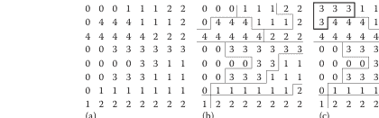

T(n) 三角形数声明组成等边三角形的物体的数量，并等于从 1 到 n 的数字之和。因此，T(n) 表示为 T(n) = 1 + 2 + ... + (n - 1) + n，并在递归形式中：T(n) = { n, 当 n = 0 或 n = 1 时；n + T(n - 1), 当 n > 1 时 }

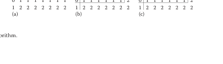

FIGURE 11.4
Flood fill algorithm.

编写一个程序，读取一个正整数（例如 n）最高为 20，并使用递归函数显示 T(n) 三角形数。

### U.11.22
编写一个程序，生成 10 个随机整数并将它们存储在数组中。然后，程序应调用递归函数检查数组是否对称，即第一个元素的值等于最后一个元素的值，第二个元素的值等于倒数第二个元素的值，以此类推。如果数组不对称，函数应返回破坏对称性的第一个元素的位置。

### U.11.23
图像编辑程序通常使用 flood fill 算法用新颜色填充相似颜色的相连区域。假设图 11.4a 的二维 8×8 数组代表图像的像素，其中 0 代表黑色，1：白色，2：红色，3：绿色，4：蓝色。考虑像素如果具有相同的颜色并且与其相邻，则与另一个像素相似颜色相连。相似颜色的区域在图 11.4b 中显示。

为了实现 flood fill 算法，编写递归的 floodfill() 函数，它将随机位置（例如 i, j）的像素的颜色（例如 c）更改为新颜色，然后更改其相邻像素（即其左侧、右侧、向上和向下的像素）的颜色，这些像素具有相同的颜色 c。请注意，此过程应递归地继续进行更改像素的邻居，直到没有其他像素需要检查为止。例如，如果我们选择将位置 0, 0 处的像素从黑色（例如 0）更改为绿色（例如 3），则左上角的四个像素区域的颜色将变为绿色，如图 11.4c 所示。

编写一个程序，使用二维 8×8 整数数组并将其元素分配为 [0, 4] 范围内的随机值。然后，程序应读取像素的位置（例如 i, j）和新颜色，并使用 floodfill() 将其相似颜色区域的现有颜色更改为新颜色。

## 12 搜索和排序数组

## 搜索和排序数组

本章描述了用于在数组中搜索值以及按升序或降序对数组元素进行排序的最常见算法之一。对于更多算法、性能分析、指标和最佳实现，您应该阅读一本专注于该主题的书籍。

### 搜索数组

为了检查值是否存储在数组中，我们将描述线性搜索和二分搜索算法。在第 14 章中，我们将讨论基于哈希方法的另一种技术。

### 线性搜索算法

线性搜索算法（也称为顺序搜索）是在未排序数组中搜索值的最简单算法。搜索值与每个元素的值进行比较，直到找到匹配项。在包含 n 个元素的数组中，搜索的最大次数为 n。这可能发生在未找到搜索值或其等于最后一个元素时。在以下程序中，linear_search() 函数实现了线性搜索算法。

### 练习

C.12.1 编写一个函数，在双精度数组中搜索一个数字。如果该数字存储在其中，函数应返回其出现次数和首次出现的位置，否则返回 -1。编写一个程序，读取多达 100 个双精度数并将它们存储在数组中。如果用户输入 -1，则数字的插入应终止。然后，程序应读取一个双精度数并使用该函数显示其在数组中的出现次数和首次出现的位置。

```
```c
#include <stdio.h>
#define SIZE 100
int linear_search(double arr[], int size, double num, int *t),
```


```c
int main(void)
{
    int i, times, pos;
    double num, arr[SIZE];

    for(i = 0; i < SIZE; i++)
    {
        printf("Enter number: ");
        scanf("%lf", &num);
        if(num == -1)
            break;
        arr[i] = num;
    }
    printf("Enter number to search: ");
    scanf("%lf", &num);

    pos = linear_search(arr, i, num, &times); /* The variable i
indicates the number of the array's elements. */
    if(pos == -1)
        printf("%f isn't found\n", num);
    else
        printf("%f appears %d times (first pos = %d)\n", num, times,
pos);
    return 0;
}

int linear_search(double arr[], int size, double num, int *t)
{
    int i, pos;

    pos = -1;
    *t = 0;
    for(i = 0; i < size; i++)
    {
        if(arr[i] == num)
        {
            (*t)++;
            if(pos == -1) /* Store the position of the first
occurrence. */
                pos = i;
        }
    }
    return pos;
}
```

### C.12.2 编写一个函数，该函数以整数数组为参数，返回相同元素出现次数的最大值。例如，如果数组是 {1, 10, -3, 5, -3, 8}，函数应返回 2，因为 -3 出现的次数最多，即 2 次。编写一个程序，读取 10 个整数，将它们存储在一个数组中，并使用该函数显示相同元素出现次数的最大值。

```c
#include <stdio.h>

#define SIZE 10

int num_occurs(int arr[]);

int main(void)
{
    int i, arr[SIZE];

    for(i = 0; i < SIZE; i++)
    {
        printf("Enter number: ");
        scanf("%d", &arr[i]);
    }
    printf("\nMax occurrences is %d\n", num_occurs(arr));
    return 0;
}

int num_occurs(int arr[])
{
    int i, j, k, max_times;

    max_times = 1;
    for(i = 0; i < SIZE; i++)
    {
        k = 1; /* Each number appears once at least. */
        for(j = i+1; j < SIZE; j++) /* Compare arr[i] with the rest elements. */
        {
            if(arr[i] == arr[j])
                k++;
        }
        if(k > max_times)
            max_times = k;
    }
    return max_times;
}
```

## 二分查找算法

二分查找算法用于在已排序的数组（升序或降序）中搜索某个值。为了理解该算法的工作原理，假设我们正在一个按升序排序的数组中搜索一个值：

第 1 步：我们使用变量 start 和 end 分别表示数组中正在搜索值的部分的起始位置和结束位置。我们使用变量 middle 计算该部分的中间位置：middle = (start+end)/2。例如，如果有一个包含 100 个整数的排序数组，start 应初始化为 0，end 初始化为 99，因此 middle 变为 49。

第 2 步：我们将搜索的值与中间元素进行比较：
- a. 如果它们相等，则找到搜索的值，算法终止。
- b. 如果搜索值更大，则在从中间位置到末尾的部分继续搜索。算法回到第 1 步，start 变为 start = middle+1。
- c. 如果搜索值更小，则在从起始位置到中间的部分继续搜索。算法回到第 1 步，end 变为 end = middle-1。

简而言之，二分查找算法将数组分成两部分。然后，将搜索值与中间元素进行比较，并在合适的那一部分中继续搜索。如果找到了搜索值，或者 start 变得大于 end，算法终止。在下面的程序中，binary_search() 函数实现了二分查找算法。

## 练习

### C.12.3 编写一个函数，在整数数组中查找一个数字。如果找到该数字，函数应返回其位置，否则返回 -1。编写一个程序，用一个按升序排序的整数数组进行初始化。程序应读取一个整数，并使用该函数显示其在数组中的位置。

```c
#include <stdio.h>

int binary_search(int arr[], int size, int num);

int main(void)
{
    int num, pos, arr[] = {10, 20, 30, 40, 50, 60, 70};

    printf("Enter number to search: ");
    scanf("%d", &num);

    pos = binary_search(arr, 7, num);
    if(pos == -1)
        printf("%d isn't found\n", num);
    else
        printf("%d is found in position %d\n", num, pos);
    return 0;
}

int binary_search(int arr[], int size, int num)
{
    int start, end, middle;

    start = 0;
    end = size-1;
    while(start <= end)
    {
        middle = (start+end)/2;
        if(num < arr[middle])
            end = middle-1;
        else if(num > arr[middle])
            start = middle+1;
        else
            return middle;
    }
    return -1; /* If the execution reaches this point it means that the number was not found. */
}
```

注释：为了了解该算法的工作原理，假设用户输入数字 45。

第一次迭代。start 的初始值为 0，end 为 6。middle 变为 (start+end)/2 = 6/2 = 3。由于 arr[middle] 是 40，小于 45，下一条要执行的语句是 start = middle+1 = 3+1 = 4。

第二次迭代。middle 变为 (start+end)/2 = (4+6)/2 = 5。由于 arr[middle] 是 60，大于 45，下一条语句是 end = middle-1 = 4。

第三次迭代。middle 变为 (start+end)/2 = (4+4)/2 = 4。由于 arr[middle] 是 50，大于 45，下一条语句是 end = middle-1 = 3。由于 start 大于 end，循环终止，函数返回 -1。

### C.12.4 编写一个程序，读取 [0, 1000] 范围内的整数，并使用二分查找算法来“猜出”该数字。程序应通过提问来确定我们要查找的数字是小于还是大于所检查区间的中间值。答案必须以 0（否）或 1（是）的形式给出。程序应显示在多少次尝试中找到了该数字。

```c
#include <stdio.h>
int main(void)
{
    int x, ans, low, high, middle, times;

    do
    {
        printf("Enter number in [0, 1000]: ");
        scanf("%d", &x);
    } while(x < 0 || x > 1000);

    times = 1;
    low = 0;
    high = 1000;
    middle = (high+low)/2;
    while(high >= low)
    {
        printf("Is %d the hidden number (0 = No, 1 = Yes) ? ",
        middle);
        scanf("%d", &ans);

        if(ans == 1)
        {
            printf("Num = %d is found in %d tries\n", x, times);
            return 0;
        }
        times++;
        printf("Is the hidden number < %d (0 = No, 1 = Yes) ? ",
        middle);
        scanf("%d", &ans);
        if(ans == 1)
        {
            high = middle-1;
            middle = (high+low)/2;
        }
        else
        {
            low = middle+1;
            middle = (high+low)/2;
        }
    }
    printf("Num = %d isn't found. You probably gave a wrong answer\n", x);
    return 0;
}
```

## 数组排序

有多种算法可以对数组进行排序。我们将介绍一些最流行的算法：选择排序、插入排序、冒泡排序和快速排序。

## 选择排序算法

为了描述该算法，我们将演示如何按升序对数组进行排序。首先，我们找到值最小的元素，并将其与数组的第一个元素交换。因此，最小的值存储在第一个位置。

然后，我们在除第一个元素之外的剩余元素中找到最小的值。像之前一样，将该元素与数组的第二个元素交换。因此，第二小的值存储在第二个位置。对剩余元素重复此过程，当最后两个元素比较完成后，算法终止。

若要按降序对数组进行排序，则找到最大值而不是最小值。在下面的程序中，sel_sort() 函数实现了选择排序算法，以按升序对数组进行排序。

## 练习

### C.12.5 编写一个函数，该函数以 double 数组为参数，并使用选择排序算法按升序对其进行排序。编写一个程序，读取 10 名学生的成绩，将它们存储在一个数组中，并使用该函数对其进行排序。

```c
#include <stdio.h>

#define SIZE 10

void sel_sort(double arr[]);

int main(void)
{
    int i;
    double grd[SIZE];
    for(i = 0; i < SIZE; i++)
    {
        printf("Enter grade of stud_%d: ", i+1);
        scanf("%lf", &grd[i]);
    }
    sel_sort(grd);
    printf("\n**** Sorted array ****\n");
    for(i = 0; i < SIZE; i++)
        printf("%.2f\n", grd[i]);
    return 0;
}

void sel_sort(double arr[])
{
    int i, j;
    double tmp;
    for(i = 0; i < SIZE-1; i++)
    {
        for(j = i+1; j < SIZE; j++)
        {
            if(arr[i] > arr[j])
            {
                /* Swap values. */
                tmp = arr[i];
                arr[i] = arr[j];
                arr[j] = tmp;
            }
        }
    }
}
```

注释：在内部循环的每次迭代中，arr[i] 与从 i+1 到 SIZE-1 的元素进行比较。如果某个元素小于 arr[i]，则交换它们的值。因此，

在外层循环的每次迭代中，从 i 到 SIZE-1 的元素中的最小值存储在 arr[i] 中。要按降序对数组进行排序，将 if 语句改为：if(arr[i] < arr[j])

## C.12.6

为了继续之前的练习，程序还应读取 10 名学生的姓名（每个少于 100 个字符）并按给定成绩的升序显示最终评级。

```c
#include <stdio.h>
#include <stdlib.h>
#include <string.h>

#define SIZE 10

void sel_sort(char str[][100], double arr[]);
int read_text(char str[], int size, int flag);

int main(void)
{
    char name[SIZE][100]; /* Array of SIZE rows to store the names of the students. Each name[i] can be used as a pointer to the corresponding row. */
    int i;
    double grd[SIZE];

    for(i = 0; i < SIZE; i++)
    {
        printf("Enter name: ");
        read_text(name[i], sizeof(name[i]), 1);

        printf("Enter grade: ");
        scanf("%lf", &grd[i]);
        getchar();
    }
    sel_sort(name, grd);

    printf("\n******** Final Rating ********\n");
    for(i = 0; i < SIZE; i++)
        printf("%s\t%.2f\n", name[i], grd[i]);
    return 0;
}

void sel_sort(char str[][100], double arr[])
{
    char tmp[100];
    int i, j;
    double k;

    for(i = 0; i < SIZE-1; i++)
    {
        for(j = i+1; j < SIZE; j++)
        {
            if(arr[i] > arr[j])
            {
                /* Parallel swapping of grades and names. */
                k = arr[i];
                arr[i] = arr[j];
                arr[j] = k;

                strcpy(tmp, str[j]);
                strcpy(str[j], str[i]);
                strcpy(str[i], tmp);
            }
        }
    }
}
```

## C.12.7

编写 add_sort() 函数，将一个数字插入已排序的数组中，使数组保持有序。编写一个程序，读取 9 个整数，将它们存储在包含 10 个整数的数组中，并按升序对这 9 个元素进行排序。然后，程序应读取最后一个整数，使用 add_sort() 将其插入数组中，并显示排序后的数组。

```c
#include <stdio.h>

#define SIZE 10

void sel_sort(int arr[], int size);
void add_sort(int arr[], int size, int num);

int main(void)
{
    int i, num, a[SIZE];

    for(i = 0; i < SIZE-1; i++) /* Read 9 integers and store them in the array. */
    {
        printf("Enter number: ");
        scanf("%d", &a[i]);
    }
    sel_sort(a, SIZE-1); /* Sort the 9 elements. */
    printf("Insert number in sorted array: ");
    scanf("%d", &num);

    add_sort(a, SIZE-1, num); /* Insert the last integer in the array. */
    for(i = 0; i < SIZE; i++)
        printf("%d\n", a[i]);
    return 0;
}

void add_sort(int arr[], int size, int num)
{
    int i, pos;

    if(num <= arr[0])
        pos = 0;
    else if(num >= arr[size-1]) /* If it is greater than the last one, store it in the last position and return. */
    {
        arr[size] = num;
        return;
    }
    else
    {
        for(i = 0; i < size-1; i++)
        {
            /* Check all adjacent pairs up to the last one at positions SIZE-3 and SIZE-2 to find the position to insert the number. */
            if(num >= arr[i] && num <= arr[i+1])
                break;
        }
        pos = i+1;
        for(i = size; i > pos; i--)
        {
            arr[i] = arr[i-1]; /* The elements are shifted one position to the right, starting from the last position of the array, that is [SIZE-1], up to the position in which the new number will be inserted. For example, in the last iteration, i = pos+1, so, arr[pos+1] = arr[pos]. */
        }
        arr[pos] = num; /* Store the number. */
    }
}

void sel_sort(int arr[], int size)
{
    int i, j, temp;

    for(i = 0; i < size-1; i++)
    {
        for(j = i+1; j < size; j++)
        {
            if(arr[i] > arr[j])
            {
                /* Swap values. */
                temp = arr[i];
                arr[i] = arr[j];
                arr[j] = temp;
            }
        }
    }
}
```

## C.12.8

编写一个函数，以二维数组作为参数并按升序对其行进行排序，另一个函数按降序对其列进行排序。编写一个程序，生成 20 个随机整数并将它们存储在 4×5 数组中。然后，程序应读取一个整数，如果它为 1，则程序应调用第一个函数，否则调用第二个函数。

```c
#include <stdio.h>
#include <stdlib.h>
#include <time.h>

#define ROWS 4
#define COLS 5

void sort_rows(int arr[][COLS]);
void sort_cols(int arr[][COLS]);

int main(void)
{
    int i, j, type, arr[ROWS][COLS];
    srand(time(NULL));
    for(i = 0; i < ROWS; i++)
        for(j = 0; j < COLS; j++)
            arr[i][j] = rand();
    printf("Enter sort type (1: rows): ");
    scanf("%d", &type);
    if(type == 1)
        sort_rows(arr);
    else
        sort_cols(arr);
    for(i = 0; i < ROWS; i++)
    {
        for(j = 0; j < COLS; j++)
            printf("%10d", arr[i][j]);
        printf("\n");
    }
    return 0;
}

void sort_rows(int arr[][COLS])
{
    int i, j, k, temp;
    for(i = 0; i < ROWS; i++)
    {
        for(j = 0; j < COLS-1; j++)
        {
            for(k = j+1; k < COLS; k++)
            {
                if(arr[i][j] > arr[i][k])
                {
                    temp = arr[i][j];
                    arr[i][j] = arr[i][k];
                    arr[i][k] = temp;
                }
            }
        }
    }
}

void sort_cols(int arr[][COLS])
{
    int i, j, k, temp;
    for(j = 0; j < COLS; j++)
    {
        for(i = 0; i < ROWS-1; i++)
        {
            for(k = i+1; k < ROWS; k++)
            {
                if(arr[i][j] < arr[k][j])
                {
                    temp = arr[i][j];
                    arr[i][j] = arr[k][j];
                    arr[k][j] = temp;
                }
            }
        }
    }
}
```

## 插入排序算法

为了描述该算法，我们将按升序对数组进行排序。该算法的操作基于每个元素（从第二个到最后一个元素）与其左侧元素之间的顺序比较，这些左侧元素构成“已排序子数组”。其右侧的元素构成“未排序子数组”。特别是，未排序子数组的最左元素（即被检查的元素）与已排序子数组的元素从右到左进行比较；根据此：

- Step 1: 首先，被检查的元素存储在临时变量中（图 12.1a）。
- Step 2a: 如果它不小于已排序子数组的最右元素，则其位置不变，算法继续测试下一个最左元素。
- Step 2b: 如果它小于已排序子数组的最右元素，则后者向右移动一个位置，同时被检查的元素与倒数第二个元素进行比较（图 12.1b 和 c）。如果它不小于，则被检查的元素存储在最后移动元素的位置；否则，重复相同的过程（倒数第二个元素向右移动一个位置，被检查的元素与倒数第三个元素进行比较）（图 12.1c 和 d）。步骤 2b 在以下任一情况终止：如果被检查的元素不小于已排序子数组中的一个元素（图 12.1d 和 e）或到达已排序子数组的第一个元素。然后，对新的最左元素重复步骤 1（图 12.1e 和 f）。

当未排序子数组的最右元素被测试时，算法终止。

该算法类似于纸牌玩家整理纸牌手牌的方式，假设他或她左手为空且所有纸牌都面朝下放在桌上。玩家用右手拿起一张牌并将其插入左手中正确的位置。为了找到正确的位置，该牌与左手中的牌从右到左进行比较。

要按降序对数组进行排序，如果已排序子数组中的一个元素小于被检查的元素，则将其向右移动一个位置。在下面的程序中，insert_sort() 函数实现了插入排序算法以按升序对数组进行排序。


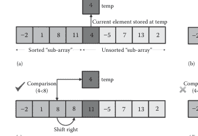
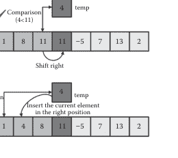
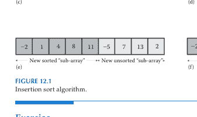
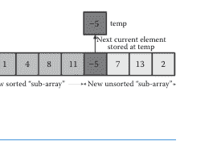
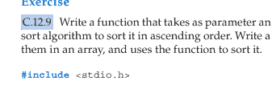
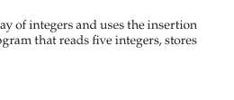

## 图 12.1 插入排序算法。

### 练习

- C.12.9 编写一个函数，以整数数组作为参数，并使用插入排序算法按升序对其进行排序。编写一个程序读取五个整数，将它们存储在数组中，并使用该函数对其进行排序。

```c
#include <stdio.h>

#define SIZE 5

void insert_sort(int arr[]);

int main(void)
{
    int i, a[SIZE];

    for(i = 0; i < SIZE; i++)
    {
        printf("Enter number: ");
        scanf("%d", &a[i]);
    }
    insert_sort(a);
    printf("\n****** Sorted array ******\n");
    for(i = 0; i < SIZE; i++)
        printf("%d\n", a[i]);
    return 0;
}

void insert_sort(int arr[])
{
    int i, j, temp;

    for(i = 1; i < SIZE; i++)
    {
        temp = arr[i];
        j = i;
        while((j > 0) && (arr[j-1] > temp))
        {
            arr[j] = arr[j-1]; /* Shift this element one position to the right. */
            j--;
        }
        arr[j] = temp;
    }
}
```

**注释：** **for** 循环从第二个元素开始比较元素。在每次迭代中，`temp` 保存被检查的元素。**while** 循环将位于被检查元素左侧且大于它的元素向右移动一个位置。假设数组元素为 7, 3, 1, 9, 4。

- 第一次 **for** 循环迭代（`i = 1` 且 `temp = arr[1] = 3`）
  - (`j = 1`) 第一次 **while** 循环迭代：`7 --> 3   1   9   4`
- 因此，数组被转换为了：`3   7   1   9   4`
- 第二次 **for** 循环迭代（`i = 2` 且 `temp = arr[2] = 1`）
  - (`j = 2`) 第一次 **while** 循环迭代：`3   7 --> 1   9   4`
  - (`j = 1`) 第二次 **while** 循环迭代：`3 --> 7   1   9   4`
- 因此，数组被转换为了：`1   3   7   9   4`
- 第三次 **for** 循环迭代（`i = 3` 且 `temp = arr[3] = 9`）
  - (`j = 3`) 没有发生移动，因为第四个数组元素（即 `arr[3] = 9`）大于最右边的元素（即 `arr[2] = 7`）。
- 因此，数组保持不变：`1   3   7   9   4`
- 第四次 **for** 循环迭代（`i = 4` 且 `temp = arr[4] = 4`）
  - (`j = 4`) 第一次 **while** 循环迭代：`1   3   7   9 --> 4`
  - (`j = 3`) 第二次 **while** 循环迭代：`1   3   7 --> 9   4`
- 排序完成，数组被转换为了：`1   3   4   7   9`
- 要按降序对数组进行排序，请将 **while** 语句改为

```c
while((j > 0) && (arr[j-1] < temp))
```

为了将已排序子数组中小于被检查元素的元素向右移动一个位置。

## 冒泡排序算法

冒泡排序算法基于相邻数组元素之间的顺序比较。每个元素都会“冒泡”上升并存储在正确的位置。例如，假设我们想按升序对数组进行排序。

首先，最后一个元素与倒数第二个元素进行比较。如果它更小，则交换元素，这样较小的值就会冒泡上升。然后，倒数第二个元素与倒数第三个元素进行比较。同样，如果它更小，则交换元素，这样较小的值会继续冒泡上升。比较一直持续到数组开头，最终最小值会“冒泡”到数组顶部并存储在其第一个位置。

此过程从第二个元素重复到最后一个元素，因此数组中第二小的数值会冒泡到顶部并存储在第二个位置。同样地，对从第三个元素到最后一个元素的数组部分重复此操作，以此类推。当没有元素冒泡到顶部时，算法终止。

要按降序对数组进行排序，冒泡的值是最大而不是最小的。在以下程序中，bubble_sort() 函数实现了冒泡排序算法以按升序对数组进行排序。

### 练习

- C.12.10 编写一个函数，以整数数组作为参数，并使用冒泡排序算法按升序对其进行排序。编写一个程序读取五个整数，将它们存储在数组中，并使用该函数对其进行排序。

```c
#include <stdio.h>

#define SIZE 5

void bubble_sort(int arr[]);

int main(void)
{
    int i, a[SIZE];
    for(i = 0; i < SIZE; i++)
    {
        printf("Enter number: ");
        scanf("%d", &a[i]);
    }
    bubble_sort(a);
    printf("\n**** Sorted array ****\n");
    for(i = 0; i < SIZE; i++)
        printf("%d\n", a[i]);
    return 0;
}

void bubble_sort(int arr[])
{
    int i, j, temp, reorder;

    for(i = 1; i < SIZE; i++)
    {
        reorder = 0;
        for(j = SIZE-1; j >= i; j--)
        {
            if(arr[j] < arr[j-1])
            {
                /* Swap values. */
                temp = arr[j];
                arr[j] = arr[j-1];
                arr[j-1] = temp;
                reorder = 1;
            }
        }
        if(reorder == 0)
            return;
    }
}
```

**注释：** reorder 变量检查排序是否完成以避免不必要的迭代。如果交换了两个元素，则将其设置为 1。否则，值 0 表示数组已排序，函数终止。假设数组元素为 10, 9, 4, 7, 6。

- 外层 for 循环的第一次迭代（`i = 1`）
  - 内层 for 循环的第一次迭代（`j = 4`）：10 9 4 6 <-> 7
  - 内层 for 循环的第二次迭代（`j = 3`）：10 9 4 6 7
  - 内层 for 循环的第三次迭代（`j = 2`）：10 4 <-> 9 6 7
  - 内层 for 循环的第四次迭代（`j = 1`）：4 <-> 10 9 6 7
- 因此，数组被转换为了：4 10 9 6 7
- 外层 for 循环的第二次迭代（`i = 2`）
  - 内层 for 循环的第一次迭代（`j = 4`）：4 10 9 6 7
  - 内层 for 循环的第二次迭代（`j = 3`）：4 10 6 <-> 9 7
  - 内层 for 循环的第三次迭代（`j = 2`）：4 6 <-> 10 9 7
- 因此，数组被转换为了：4 6 10 9 7
- 外层 for 循环的第三次迭代（`i = 3`）
  - 内层 for 循环的第一次迭代（`j = 4`）：4 6 10 7 <-> 9
  - 内层 for 循环的第二次迭代（`j = 3`）：4 6 7 <-> 10 9
- 因此，数组被转换为了：4 6 7 10 9
- 外层 for 循环的第四次迭代（`i = 4`）
  - 内层 for 循环的第一次迭代（`j = 4`）：4 6 7 10 <-> 9

排序完成，数组被转换为了 4 6 7 9 10

要按降序对数组进行排序，请将 **if** 语句改为 `if(arr[j] > arr[j-1])`。

- C.12.11 编写一个程序，读取 50 个国家的名字（每个少于 100 个字符）以及每月访问这些国家的游客数量。程序应使用适当的数组存储数据。然后，程序应读取一个国家的名字并显示访问该国家的年度游客数量。程序在结束前应显示访问量最多的五个国家（检查第五名是否有多于一个国家并列）。

```c
#include <stdio.h>
#include <stdlib.h>
#include <string.h>

#define CNTRS 50
#define MONTHS 12

void bubble_sort(char str[][100], int arr[]);
int read_text(char str[], int size, int flag);

int main(void)
{
    char cntr[CNTRS][100], str[100];
    int i, j, tmp, flag, tour[CNTRS] = {0};

    for(i = 0; i < CNTRS; i++)
    {
        printf("Enter name of country %d: ", i+1);
        read_text(cntr[i], sizeof(cntr[i]), 1);

        for(j = 0; j < MONTHS; j++)
        {
            printf("Enter tourists of month %d: ", j+1);
            scanf("%d", &tmp);
            tour[i] += tmp; /* This array holds the annual number of tourists for each country. */
        }
    }
    getchar();
    printf("Enter country to search: ");
    read_text(str, sizeof(str), 1);

    flag = 0;
    for(i = 0; i < CNTRS; i++)
    {
        if(strcmp(str, cntr[i]) == 0)
        {
            flag = 1;
            printf("%d tourists visited %s\n", tour[i], str);
            break;
        }
    }
    if(flag == 0)
        printf("%s not registered\n", str);

    bubble_sort(cntr, tour); /* Sort the tourist array and update the countries array in parallel. */
```


```
printf("\n**** Tourists in decrease order ****\n");
for(i = 0; i < 5; i++)
    printf("%d.\t%s\t%d\n", i+1, cntr[i], tour[i]);
/* Check if more than one country ties in the fifth place. */
while((tour[i] == tour[4]) && i < CNTRS)
{
    printf("%d.\t%s\t%d\n", i+1, cntr[i], tour[i]);
    i++;
}
}
return 0;

void bubble_sort(char str[][100], int arr[])
{
    char temp[100];
    int i, j, k, reorder;

    for(i = 1; i < CNTRS; i++)
    {
        reorder = 0;
        for(j = CNTRS-1; j >= i; j--)
        {
            if(arr[j] > arr[j-1]) /* Parallel swapping of the tourist numbers and the respective countries. */
            {
                k = arr[j];
                arr[j] = arr[j-1];
                arr[j-1] = k;

                strcpy(temp, str[j]);
                strcpy(str[j], str[j-1]);
                strcpy(str[j-1], temp);
                reorder = 1;
            }
        }
        if(reorder == 0)
            return;
    }
}
```

## 快速排序算法

快速排序算法属于分治类型。它是一种特别流行的算法，也是各种排序应用的最佳选择。其操作基于将数组划分为两部分，并分别对每一部分进行排序。首先，选择划分元素（即 a[i]）。数组按以下规则重新排列：

- a. a[i] 被放置在其最终位置。
- b. 左子数组 a[1], ... a[i-1] 中没有元素大于 a[i]。
- c. 右子数组 a[i+1], ... a[r] 中没有元素小于 a[i]。

对每个子数组递归重复此过程，直到这些部分变为单个元素。

该算法的性能取决于划分元素的选择。如果我们知道数组内容，最佳选择是将数组划分得接近中间的元素。为给出一个实现示例，我们按升序对数组排序。为了提高算法性能，已经提出了几种用于最优选择划分元素的方法。为简单起见，我们选择最右侧的元素。

我们从左到右扫描数组，直到找到一个大于或等于划分元素的元素。然后，我们从右到左扫描数组，直到找到一个小于划分元素的元素。由于这两个元素不在正确位置，我们交换它们。重复此过程，结果是左子数组中没有元素大于划分元素，右子数组中没有元素小于划分元素。我们用索引 i 进行左扫描，用索引 j 进行右扫描。当两个索引相遇时，将最右侧元素与索引 i 所指向的元素交换，划分完成。为实现该算法，我们将使用递归。

```c
#include <stdio.h>
#define SIZE 7
int partition(int a[], int l, int r);
void quick_sort(int a[], int l, int r);
int main(void)
{
    int i, a[SIZE];
    for(i = 0; i < SIZE; i++)
    {
        printf("Enter number: ");
        scanf("%d", &a[i]);
    }
    quick_sort(a, 0, SIZE-1);
    printf("\n\n**** Sorted array ****\n");
    for(i = 0; i < SIZE; i++)
        printf("%d\n", a[i]);
    return 0;
}
void quick_sort(int a[], int l, int r)
{
    int i;
    if(r <= l)
        return;
    i = partition(a, l, r);
    quick_sort(a, l, i-1);
    quick_sort(a, i+1, r);
}
```

```
int partition(int a[], int l, int r)
{
    int i, j, v, tmp;

    i = l;
    j = r-1;
    v = a[r];
    while(1)
    {
        while(a[i] < v)
            i++;
        while(a[j] >= v)
        {
            j--;
            if(j == l) /* We check the case that the partition element is the lower in the examined part. */
                break;
        }
        if(i >= j)
            break;
        tmp = a[i];
        a[i] = a[j];
        a[j] = tmp;
    }
    tmp = a[i];
    a[i] = a[r];
    a[r] = tmp;
    return i;
}
```

**注释：** 假设用户输入值 2、15、4、1、7、20、5。我们来跟踪第一次调用 partition() 的过程。此时 i=0，j=r-1=5，v=a[6]=5。第一个循环执行左扫描，并在 i 变为 1 时终止（因为 a[1] > 5）。第二个循环执行右扫描，并在 j 变为 3 时终止（因为 a[3] < 5）。这两个元素被交换，数组变为 2、1、4、15、7、20、5。

左扫描继续，并在 i 变为 3 时终止（因为 a[3] > 5）。右扫描继续，并在 j 变为 2 时终止（因为 a[2] < 5）。由于 i > j，无限循环终止。a[3] 和 a[6] 被交换，数组变为 2、1、4、5、7、20、15。注意 5 被放置在其最终位置，且其左侧所有元素都更小，而其右侧所有元素都更大。函数返回 i 的值，即 3。然后，使用递归对左子数组（位置 0 到 2）和右子数组（位置 4 到 6）重复相同过程。

## bsearch() 和 qsort() 库函数

bsearch() 库函数用于在已排序数组中搜索一个值。qsort() 库函数用于对数组进行排序。附录 C 对两者都提供了简短说明。

## 练习

C.12.12 编写一个程序，读取 10 个整数并将它们存储在一个数组中。程序应使用 qsort() 按升序对数组进行排序。然后，程序应读取一个整数，并使用 bsearch() 检查它是否存储在数组中。

```
#include <stdio.h>
#include <stdlib.h>

#define NUM 10

int compare(const void *elem1, const void *elem2);
int main(void)
{
    int *pos, i, arr[NUM];

    for(i = 0; i < NUM; i++)
    {
        printf("Enter number: ");
        scanf("%d", &arr[i]);
    }
    qsort(arr, NUM, sizeof(int), compare);

    printf("\nSorted array: ");
    for(i = 0; i < NUM; i++)
        printf("%d ", arr[i]);

    printf("\n\nEnter number to search: ");
    scanf("%d", &i);
    pos = (int*)bsearch(&i, arr, NUM, sizeof(int), compare);
    if(pos == NULL)
        printf("\n%d isn't found\n", i);
    else
        printf("\n%d is in position %d\n", i, pos-arr+1);
    return 0;
}

int compare(const void *elem1, const void *elem2)
{
    return *(int*)elem1 - *(int*)elem2;
}
```

注释：附录 C 描述了 qsort() 和 bsearch() 的参数。注意 compare() 的名称被用作指向该函数的指针。根据 qsort() 和 bsearch() 的声明，compare() 的参数必须声明为 const void* 指针。由于我们比较整数，因此将其类型强制转换为 int*。然后，比较两个指针所指向的值，并且 compare() 根据 bsearch() 的说明返回一个值。

如果找到搜索值，bsearch() 返回指向相应元素的指针，否则返回 NULL。我们将返回类型从 void* 强制转换为 int*，以使其更明确。程序使用指针运算来显示其位置（如果找到）。要按降序对数组进行排序，只需反转比较：

```
int compare(const void *elem1, const void *elem2)
{
    return *(int*)elem2 - *(int*)elem1; /* For descending order. */
}
```

## 未解习题

U.12.1 编写一个程序，读取 100 个城市的人口，并在输入时按升序将它们存储在数组中。程序应在结束前显示该数组。例如，如果用户先输入 2000，再输入 1000，则前两个元素应为 1000、2000。如果下一个输入值为 1500，则前三个元素应为 1000、1500 和 2000。

U.12.2 编写一个程序，读取 50 名学生的姓名（每个姓名少于 100 个字符），并将它们存储在一个数组中。假设用户按字母顺序输入姓名。使用第二个数组，并对另一组 70 名学生执行相同操作。程序应将这两个数组合并到第三个数组中，其中所有姓名都应按字母顺序存储。

U.12.3 编写一个程序，读取 20 个城市的名称（每个名称少于 100 个字符）以及每个城市的月平均气温。然后，程序应读取一个城市名称，并显示该城市最温暖的月份（例如，1Jan – 12Dec）。此外，程序还应针对同一城市显示温度高于前一个月和后一个月的月份。

U.12.4 修改 C.12.3，使程序读取一个少于 100 个字符的字符串，并使用 binary_search() 在数组中显示其位置（如果找到）。使用以下已排序数组和新原型来修改函数。

```
int binary_search(char *arr[], int size, char *str);

int main(void)
{
    char str[100], *arr[] = {"alpha", "beta", "gamma", "delta", "epsilon", "ita", "omega"};
    int pos;
    ...
}
```

U.12.5 编写 C.12.3 中 binary_search() 的递归版本。使用以下原型来修改函数。以下是调用它的示例：

```
int binary_search(int arr[], int num, int start, int end);

int main(void)
```


```c
{
    ...
    pos = binary_search(arr, num, 0, sizeof(arr)/sizeof(int)-1);
    ...
}
```

- U.12.6 修改 C.12.5 中的 sel_sort()，使用 p1 和 p2 指针将 arr 按升序排序。

  ```c
  void sel_sort(double arr[])
  {
      double *p1, *p2, tmp;
      ...
  }
  ```

- U.12.7 编写一个程序，读取 10 名学生的姓名（每个少于 100 个字符），将它们存储在二维数组中，并使用冒泡排序算法按字母顺序对数组进行排序。程序应在结束前显示数组。

- U.12.8 修改上一练习，使用 qsort() 对姓名进行排序。

- U.12.9 编写一个程序，读取 10 门课程的名称（每个少于 100 个字符）和 50 名学生在这些课程上的成绩。程序应显示课程名称及其旁边的平均成绩，从平均成绩最好的课程开始。如果平均成绩相同，程序应按字母顺序显示“并列”的课程。为排序数组，使用冒泡排序算法。

- U.12.10 在一次音乐比赛中，200 名评委为 50 首歌曲中的前列歌曲投票。编写一个程序，读取歌曲名称（每个少于 100 个字符）并显示前五名歌曲。如果第五名出现平局，程序应显示“并列”的歌曲。为歌曲投票时，评委输入其标题。每位评委最多可投票五首歌曲或更少，并输入单词 end 作为歌曲标题。假设评委不会对同一首歌投票不止一次。为排序数组，使用选择排序算法。

- U.12.11 编写一个程序，读取两家书店的图书价格和书名（每个少于 100 个字符）。假设每家书店的图书最大数量为 200。如果用户对书名输入 end，则图书插入应终止。程序应按价格降序显示两家书店的书名和价格。有一种限制。如果某标题在两家书店中都找到，程序应只显示该标题一次，并显示第一家书店的价格。

- U.12.12 编写一个程序，读取 1000 名候选人的姓名（每个少于 100 个字符）、其分数以及他们被录取的学校名称。然后，程序应读取候选人的姓名并显示学校，以及该学校录取的所有候选人的分数和姓名，按分数降序排序。例如，如果用户输入

  | 姓名 | 分数 | 学校 |
  | --- | --- | --- |
  | P.Smith | 2300 | CIT |
  | A.LeeP | 1200 | LU |
  | R.Bachir | 1600 | LU |
  | B.Koong | 2800 | BPL |

  然后用户输入 A.LeeP，程序应显示 LU 和

  | 姓名 | 分数 | 学校 |
  | --- | --- | --- |
  | R.Bachir | 1600 | LU |
  | A.LeeP | 1200 | LU |

## 13 结构体和联合体

### 结构体

当我们想要将相关的数据项分组到一个单一实体中时，结构体是一个典型的选择。例如，结构体可以保存公司的信息，如其名称、业务核心、税号、员工人数、联系信息和其他数据。

### 声明结构体

要声明一个结构体，我们使用 struct 关键字。结构体声明的一般语法是：

```c
struct structure_tag
{
    member_list;
} structure_variable_list;
```

struct 声明定义了一个类型。尽管 structure_tag 是可选的，我们更喜欢为声明的结构体命名并在以后使用该名称来声明变量。我们将在第 14 章中看到 structure_tag 的另一种用途，即在声明自引用结构体以形成链表时。在那种情况下，必须使用结构体标签。结构体的成员或字段像普通变量一样使用。结构体比数组更灵活，因为它可以包含不同数据类型元素。正如我们接下来将看到的，我们可以声明该类型的可选 structure_variable_list。不要忘记最后的 ;。例如，要存储有关公司信息，我们可以定义类型 company：

```c
struct company
{
    char name[50];
    int start_year;
    int field;
    int tax_num;
    int num_empl;
    char addr[50];
    float balance;
};
```

尽管同一类型的成员可以在同一行中声明，我们更喜欢分别声明它们，以便读者更容易阅读存储的数据。

> 结构体声明未跟随变量列表时不会引发任何内存分配。它只是描述了结构体的模板。

如果声明了结构体标签，我们可以使用该标签来声明变量。例如：

```c
struct company c1, c2;
```

c1 和 c2 变量被声明为 company 类型的结构体。每个变量都包含其自己的成员。或者，我们可以在 structure_variable_list 中声明变量。例如：

```c
struct book
{
    char title[100];
    int year;
    float price;
} b1, b2;
```

b1 和 b2 变量被声明为 book 类型的结构体。如果我们在 structure_variable_list 中声明了所有需要的变量，标签（即 book）可以省略。然而，为了能够在需要时声明变量，我们的建议是始终命名结构体并使用该标签来声明变量。或者，正如我们将在下一节看到的，我们可以省略标签并使用 typedef 创建一个同义词。典型的做法是将结构体声明与其他声明如函数原型和宏一起放在头文件中，并在需要时使用 #include 指令包含它。我们将在第 17 章的程序中看到这样的例子。为简单起见，在以下所有程序中，我们将以全局作用域定义每个结构体类型，以便所有函数都可以使用它。如果它在函数内部定义，其作用域变为局部，其他程序部分将忽略其存在。

在 C 中，我们说每个结构体（或联合体）为其成员指定一个单独的名称空间。因此，允许声明与结构体成员或标签同名的普通变量。出于同样的原因，相同的成员名称可以在其他结构体中重复使用。例如：

```c
struct person
{
    char name[50];
    int tax_num;
    char addr[50];
};
```

这三个成员与 company 类型的相应成员没有任何关系。另一个例子，检查以下声明：

```c
int a;
struct S1 {int a[5]; } s1;
struct S2 {int *a; } s2;
```

接下来你将学到，我们可以写 s1.a[0] = a; 或 s2.a = &a; 或 s2.a = s1.a; 而没有任何问题。

尽管结构体类型以右大括号 } 完成，但结构体可以包含指向其自身实例的指针，因为 C 允许声明指向不完整类型的指针。例如：

```c
struct A
{
    struct A *p;
};
```

当声明结构体变量时，编译器会分配内存以按声明顺序存储其成员。例如，以下程序显示变量 d 分配了多少字节。

```c
#include <stdio.h>

struct date
{
    int day;
    int month;
    int year;
};

int main(void)
{
    struct date d;

    printf("%u\n", sizeof(d));
    return 0;
}
```

由于 d 包含三个整数成员，分配的内存为 3 * 4 = 12 字节。然而，分配的大小可能大于成员大小的总和。例如，如果我们将 day 成员的类型从 int 改为 char，程序可能再次显示 12，而不是预期中的 9。

如果编译器要求每个成员都存储在某个数字的倍数地址（通常为四）的地址中，就会发生这种情况。此要求可能是为了更快地访问结构体成员。如果我们假设 month 成员应存储在地址为四的倍数的地址中，编译器将在 day 成员之后分配三个额外的字节，一个“空洞”。在这种情况下，程序将显示 12。空洞可能存在于成员之间以及结构体的末尾，而不是开头。


我们不会深入细节，但如果你编写过一个使用许多结构体且内存有限的应用程序，请记住成员声明的顺序可能会影响对齐并产生空隙。例如：

```
struct test1
{
    char c;
    double d;
    short s;
};
```

```
struct test2
{
    double d;
    short s;
    char c;
};
```

尽管成员相同，但按从大到小的顺序重新排列成员可能会节省内存。例如，如果编译器留下空隙以将成员对齐到较大类型（即 double），那么第一个结构体可能比第二个分配更多字节，即 24 字节而不是 16 字节。

> 要计算结构体变量的内存大小，始终使用 sizeof 运算符；不要将其成员的大小相加。

尽管不常用，但了解 offsetof 宏是有好处的。它定义在 stddef.h 中，接受两个参数。第一个是结构体的类型，第二个是成员名。该宏计算从结构体开头到该成员的字节数。例如，考虑后一个结构体。由于 C 保证第一个成员的地址与整个结构体的地址相同，因此语句

```
printf("%d\n", offsetof(struct test2, d));
```

输出 0。如果将 d 替换为 s，printf() 输出 8。因为结构体可能包含空隙，如果你编写要在不同平台上运行的应用程序，并且成员对齐很重要，那么该宏可能有助于检查程序的可移植性。

## typedef 说明符

typedef 说明符用于为现有数据类型创建同义词。例如，语句：

```
typedef unsigned int size_t;
```

使 size_t 成为 unsigned int 类型的同义词。因此，以下声明：

```
unsigned int i; and size_t i; are equivalent.
```

其语法类似于前面带有 typedef 关键字的变量声明。该名称表示所声明的类型。例如，语句：

```
typedef float arr[100];
```

使 arr 成为包含 100 个 float 的数组的同义词。注意，typedef 不会创建变量，也不会创建新类型，只是创建一个新名称。因此，语句：

```
arr arr1;
```

将变量 arr1 声明为包含 100 个 float 的数组。如果我们需要将数组的类型改为 double，只需将 float 改为 double。变量的声明保持不变。

同样，我们可以使用 typedef 为结构体类型创建别名。例如：

```
typedef struct Mybook
{
    char title[100];
    int year;
    float price;
} book;
```

Mybook 是一个标记，使用时必须加上 struct 一词。另一方面，由于 typedef 名称（即 book）是结构体类型的同义词，因此不允许加上 struct 一词。例如：

```
book b1, b2;
```

注意，我们可以对结构体标记和 typedef 名称使用相同的标识符；不过它们的含义仍然不同。此外，我们可以省略标记，并使用 typedef 名称来声明变量。例如：

```
typedef struct
{
    char title[100];
    int year;
    float price;
} book;
```

typedef 经常与结构体和联合体一起使用，以便在声明变量时省去写 struct 或 union 一词。尽管这很常见，但我们并不常用。我们更愿意清楚地显示变量的类型；为什么要隐藏它呢？阅读代码更容易、更快捷；为什么要浪费时间寻找隐藏的类型呢？我们使用 typedef 最多的情况是：同一类型在代码中大量出现，或者我们使用以结构体（或联合体）为元素的数据结构（例如链表）。

如果你的应用程序的数据类型取决于运行平台，typedef 可能有用。例如：

```
typedef short int size_i;
```

所有 size_i 变量的类型都将是 short int。如果这些变量在另一个平台上必须是 int，只需将 short int 改为 int，它们就变成了 int。

typedef 的另一个常见用途是为复杂类型创建同义词。例如：

```
typedef int (*pcpy)(const char *s1, const char *s2, int len);
```

pcpy 是一个指向函数的指针的同义词，该函数返回整数，并接受两个 const char * 类型的参数和一个整数参数。现在，声明该类型的变量要容易得多。例如：

```
pcpy p_cpy1, p_cpy2, p_cpy3;
```

不仅更易于编写，也更易于阅读。

## 初始化结构体

访问结构体成员最常见的方法是写出结构体变量的名称，后跟 . 运算符和成员名称。例如，以下程序显示 b 成员的值：

```
#include <stdio.h>
#include <string.h>

struct book
{
    char title[100];
    int year;
    float price;
};

int main(void)
{
    struct book b;

    strcpy(b.title, "Literature");
    b.year = 2016;
    b.price = 10.85;
    printf("%s %d %.2f\n", b.title, b.year, b.price);
    return 0;
}
```

> 除了 . 运算符，接下来你将学习如何使用 -> 运算符访问结构体的成员。

结构体变量可以在声明时初始化。声明后跟一个用花括号括起来、以逗号分隔的初始化列表。该列表必须按与结构体成员相同的顺序出现，并且应与其数据类型匹配。与数组一样，值必须是常量表达式，不允许使用变量。此外，初始化项不能多于成员。考虑以下声明：

```
struct book b = {"Literature", 2020, 10.85};
```

```c
int main(void)
{
    struct computer pc;

    printf("Enter company: ");
    read_text(pc.comp, sizeof(pc.comp), 1);

    printf("Enter model: ");
    read_text(pc.model, sizeof(pc.model), 1);

    printf("Enter cpu: ");
    read_text(pc.cpu, sizeof(pc.cpu), 1);

    printf("Enter price: ");
    scanf("%f", &pc.prc);

    printf("\nc:%s M:%s CPU:%s P:%.2f\n", pc.comp, pc.model, pc.cpu,
    pc.prc);
    return 0;
}
```

### 指向结构体成员的指针

指向结构体成员的指针的使用方式与普通指针一样。例如，以下程序使用指针显示 b 成员的值。

```c
#include <stdio.h>
#include <string.h>

struct book
{
    char title[100];
    int year;
    float price;
};

int main(void)
{
    char *ptr1;
    int *ptr2;
    float *ptr3;
    struct book b;

    strcpy(b.title, "Literature");
    b.year = 2016;
    b.price = 10.8;

    ptr1 = b.title;
    ptr2 = &b.year;
    ptr3 = &b.price;

    printf("%s %d %.2f\n", ptr1, *ptr2, *ptr3);
    return 0;
}
```

要使指针变量指向结构体成员，其类型应与成员的类型兼容。例如，由于 title 成员的类型是 char，ptr1 被声明为 char*。如你所知，在 ptr1 = b.title; 中，我们没有在 b 的名称前添加 & 运算符，原因是数组名被用作指针。

## 结构体操作

尽管我们不能使用 = 运算符将一个数组复制到另一个数组，但可以使用它将一个结构体复制到另一个结构体。结构体必须是相同类型。考虑以下程序：

```
#include <stdio.h>

struct student
{
    int code;
    float grd;
};

int main(void)
{
    struct student s1, s2;

    s1.code = 1234;
    s1.grd = 6.7;
    s2 = s1; /* Copy structure. */
    printf("C:%d G:%.2f\n", s2.code, s2.grd);
    return 0;
}
```

语句 s2 = s1; 将 s1 的成员复制到 s2。它等价于：

```
s2.code = s1.code;
s2.grd = s1.grd;
```

注意，如果 s1 和 s2 不是相同结构体类型的变量，那么即使这两个类型包含完全相同的成员，语句 s2 = s1; 也无法编译。

还要注意，如果结构体包含数组（例如 name），尽管不允许写 s2.name = s1.name;，但一旦结构体被复制（例如 s2 = s1），s1 数组就会被复制到 s2。此外，如果它包含指针成员，复制后两个指针都将指向同一位置。我们将在接下来的两节中看到这样的示例。

除了赋值之外，不能对整个结构体执行其他操作。例如，== 和 != 运算符不能用于测试两个结构体是否相等。因此，不允许写：

```
if(s1 == s2) or if(s1 != s2).
```

要测试两个结构体是否相等，我们必须逐个比较它们的成员。例如：

```
if( (s1.code == s2.code) && (s1.grd == s2.grd) )
```


在序言中，我们告诉过你，编程时你可能需要一些运气。下面就是一个例子。有一次，我必须比较两个结构体。该结构体不包含比较起来可能危险的成员，比如浮点成员、指针或字符数组。由于该结构体包含许多成员，为了省去书写，我决定使用 memcmp()（我们将在第14章看到它），而不是逐个比较它们。不过，我忘了为了对齐结构体，可能会加入值不确定的空洞。这意味着，即使对应成员具有相同的值，两个结构体的比较也可能失败，因为空洞中的值不同。幸运的是，这些空洞具有相同的值。更幸运的是，我不必把应用程序移植到另一个平台。想象一下这种情况：比较在我的平台上能工作，而在客户的平台上失败，因为那里的空洞不同。仅仅想到我必须去找那个 bug，我就害怕……滚石乐队的《Gimme Shelter》。

## 包含数组的结构体

由于结构体可以包含任何类型的数据，因此它可以包含一个或多个数组。例如：

```
#include <stdio.h>
#include <string.h>

struct student
{
    char name[50];
    float grd[2];
};

int main(void)
{
    struct student s1, s2;

    strcpy(s1.name, "somebody");
    s1.grd[0] = 8.5;
    s1.grd[1] = 7.5;
    printf("%s %c %c\n", s1.name, s1.name[0], *s1.name);
    s2 = s1;
    printf("%s %.1f %.1f\n", s2.name, s2.grd[0], s2.grd[1]);
    return 0;
}
```

正如你所猜到的，数组成员被当作普通数组来对待。例如，语句 strcpy(s1.name, "somebody"); 将字符串 "somebody" 复制到 name 中。s1.name[0] 的值变为 's'，s1.name[1] 变为 'o'，依此类推。

当使用指针算术处理数组元素时，* 运算符必须放在结构体名称之前。例如，由于 s1.name 可以用作指向其第一个字符的指针，因此 *s1.name 等于 s1.name[0]，*(s1.name+1) 等于 s1.name[1]，依此类推。与普通数组一样，出于优先级的原因，必须加上括号。赋值 s2 = s1 会复制数组。因此，程序输出：

```
somebody s s
somebody 8.5 7.5
```

## 包含指针的结构体

结构体可以包含一个或多个指针成员。指针成员被当作普通指针来对待。例如：

```
#include <stdio.h>

struct student
{
    char *name;
    float *avg_grd;
};

int main(void)
{
    float grd = 8.5;
    struct student s1, s2;

    s1.name = "somebody";
    s1.avg_grd = &grd;
    printf("%s %.2f\n", s1.name+3, *s1.avg_grd);

    s2 = s1;
    grd = 3.4;
    printf("%s %.2f\n", s2.name, *s2.avg_grd);
    return 0;
}
```

对于语句 s1.name = "somebody";，编译器分配内存来存储字符串 "somebody"，然后指向该内存。语句 s1.avg_grd = &grd; 使 avg_grd 指向 grd 的地址。要访问指针成员所指向的内存内容，* 运算符必须放在结构体名称之前。因此，程序显示 somebody 8.50。语句 s2 = s1 使 s2 的指针指向与 s1 的指针相同的位置。因此，程序显示 somebody 3.4

## 嵌套结构体

结构体可以包含一个或多个结构体。嵌套结构体必须在其所属结构体的声明之前声明；否则，编译器将产生错误消息。例如，在以下程序中，prod 包含嵌套结构体 s_date 和 e_date。s_date 保存生产日期，e_date 保存过期日期。

```
#include <stdio.h>
#include <string.h>

struct date
{
    int day;
    int month;
    int year;
};

struct product /* Since the type date is declared, it can be used to declare nested structures. */
{
    char name[50];
    double price;
    struct date s_date;
    struct date e_date;
};

int main(void)
{
    struct product prod;

    strcpy(prod.name, "product");
    prod.s_date.day = 1;
    prod.s_date.month = 9;
    prod.s_date.year = 2012;

    prod.e_date.day = 1;
    prod.e_date.month = 9;
    prod.e_date.year = 2015;

    prod.price = 7.5;
    printf("The product's life is %d years\n", prod.e_date.year - prod.s_date.year);
    return 0;
}
```

请注意，为了访问嵌套结构体的成员，必须使用两次 . 运算符。该程序将相应成员相减，并显示产品的寿命。

让我们看一个特殊情况。假设我们想要声明两个相互依赖的结构体：结构体 A 包含一个类型为 B 的结构体，结构体 B 包含一个类型为 A 的结构体。如果我们写成类似这样：

```
struct A
{
    struct B b;
    ...
};

struct B
{
    struct A a;
    ...
};
```

编译器将针对 b 的声明显示错误消息，因为它不知道 B 及其大小。如果我们反转声明，编译器将针对成员 a 和未知结构体 A 显示相同类型的错误。克服这种情况的一种方法是让 b 成为指针（为了相似性，我们把两者都改掉）：

```
struct B; /* Incomplete declaration. */
struct A
```

```c
struct Test
{
        unsigned int f : 3;
        unsigned int   : 0;
        unsigned int k : 4;
};
```

当你给位字段赋值时，请确保该值适合该位字段。例如，假设将值 2 赋给 married 字段：

```c
struct person p;
p.married = 2;  /* Wrong assignment. */
```

如果我们假设位字段从右到左分配，那么 married 变为 0，而不是 2，因为 2 用两位编码（10）。请注意，位字段的分配顺序（从右到左还是从左到右）也取决于实现。

> 如果你的程序依赖于位在内存中的存储顺序，并且你计划在不同平台上运行它，请注意分配顺序可能不同。

由于位字段的内存分配方式与普通变量不同，因此不允许应用 & 运算符。例如，以下语句是错误的：

```c
unsigned int *ptr = &p.married;
```

## 指向结构体的指针

指向结构体的指针的用法与指向普通变量的指针类似。考虑以下程序：

```c
#include <stdio.h>
#include <string.h>

struct student
{
    char name[50];
    float grd;
};

int main(void)
{
    struct student *ptr, stud;

    ptr = &stud;
    strcpy((*ptr).name, "somebody");
    (*ptr).grd = 6.7;

    printf("N: %s G: %.2f\n", stud.name, stud.grd);
    return 0;
}
```

ptr 被声明为指向 student 类型结构体变量的指针。语句 ptr = &stud; 使 ptr 指向 stud 的地址。特别地，它指向其第一个成员的地址。由于 ptr 指向 stud 的地址，*ptr 等价于 stud。通过使用 . 运算符，我们可以访问其成员。表达式 *ptr 必须用括号括起来，因为 . 运算符的优先级高于 *。

或者，我们可以使用 -> 运算符来访问结构体的成员。-> 运算符由 - 和 > 字符组成。下面是前一个程序的另一个版本：

```c
int main(void)
{
    struct student *ptr, stud;

    ptr = &stud;
    strcpy(ptr->name, "somebody");
    ptr->grd = 6.7;

    printf("\nN: %s G: %.2f\n", ptr->name, ptr->grd);
    return 0;
}
```

表达式 ptr->name 等价于 (*ptr).name，表达式 ptr->grd 等价于 (*ptr).grd。因此，两个程序都输出：

N: somebody G: 6.70

当使用指针变量访问结构体的成员时，我们发现使用 -> 运算符更简单。

提示
指针算术与普通指针相同。例如，如果一个结构体指针增加 1，它的值将增加它所指向结构体的大小。

## 结构体数组

结构体数组是一个元素为结构体的数组。它的典型用途是存储关于许多项目的信息，比如公司员工的数据、学生的数据或仓库的产品。事实上，结构体数组可以用作简单的数据库。例如，使用以下语句

```c
struct student stud[100];
```


初始化示例为：

```
struct student stud[3] = {{"nick sterg", 150, 7.3},
 {"john theod", 160, 5.8},
 {"peter karast", 170, 6.7}};
```

初始化的完成方式与初始化二维数组非常相似。每个结构体成员的初始值都括在花括号中。例如，stud[0].name 变为 "nick sterg"，stud[1].code 变为 160，stud[2].grd 变为 6.7。每个结构体周围的内层花括号可以省略；不过，我们更倾向于使用它们，以便更清楚地表示每个结构体的初始化。和通常情况一样，如果 [] 留空，编译器将计算元素个数。

我们可以在声明结构体的同时声明并初始化结构体数组。例如：

```
struct student
{
    char name[50];
    int code;
    float grd;
} stud[] = {{"nick sterg", 150, 7.3},
 {"john theod", 160, 5.8},
 {"peter karast", 170, 6.7}};
```

与普通数组一样，未赋值的成员会被设置为 0。例如，如果我们写：

```
struct student stud[100] = {0};
```

则所有结构体的成员都会被初始化为 0。例如，以下程序将 100 名学生的数据存储到 student 类型的学生数组中：

```
#include <stdio.h>
#include <stdlib.h>
#include <string.h>

#define SIZE 100

int read_text(char str[], int size, int flag);

struct student
{
    char name[50];
    int code;
    float grd;
};

int main(void)
{
    int i;
    struct student stud[SIZE];

    for(i = 0; i < SIZE; i++)
    {
        printf("\nEnter name: ");
        read_text(stud[i].name, sizeof(stud[i].name), 1);

        printf("Enter code: ");
        scanf("%d", &stud[i].code);

        printf("Enter grade: ");
        scanf("%f", &stud[i].grd);

        printf("\nN%: %s C: %d G: %2f\n", stud[i].name, stud[i].code, stud[i].grd);
        getchar(); /* Get the new line character stored in stdin, after the grade is entered. */
    }
    return 0;
}
```

与普通数组一样，我们可以使用指针表示法访问元素。例如，\*stud 等同于 stud[0]，\*(stud+1) 等同于 stud[1]，依此类推。因此，要访问第三名学生的 code 成员，stud[2].code 和 (\*(stud+2)).code 两个表达式都可以接受。第二种情况中的括号由于优先级原因而必需。与普通数组一样，我们更倾向于使用数组下标来获得更可读的代码。

## 练习

### C.13.1 修改上一个程序，使用指针读取并显示学生数据。不要声明 i 变量。

```
#include <stdio.h>
#include <stdlib.h>
#include <string.h>

int read_text(char str[], int size, int flag);

#define SIZE 100

struct student
{
    char name[50];
    int code;
    float grd;
};

int main(void)
{
    struct student *ptr, stud[SIZE];

    for(ptr = stud; ptr < stud+SIZE; ptr++) /* ptr is increased to
    point to the next structure. */
    {
        printf("\nEnter name: ");
        read_text(ptr->name, sizeof(ptr->name), 1);
        printf("Enter code: ");
        scanf("%d", &ptr->code);
        printf("Enter grade: ");
        scanf("%f", &ptr->grd);
        printf("\n\n %s C: %d G: %.2f\n", ptr->name, ptr->code,
    ptr->grd);
        getchar();
    }
    return 0;
}
```

### C.13.2 定义结构体类型 city，其成员为：城市名称、国家名称和人口。编写一个程序，使用该类型读取 100 个城市的数据并将它们存储到一个数组中。然后，程序应读取一个国家名称和一个数字，并显示该国家中人口大于输入数字的城市。

```
#include <stdio.h>
#include <stdlib.h>
#include <string.h>

#define SIZE 100

int read_text(char str[], int size, int flag);

struct city
{
    char name[50];
    char cntry[50];
    int pop;
};

int main(void)
{
    char cntry[50];
    int i, pop, flag;
    struct city cities[SIZE];

    for(i = 0; i < SIZE; i++)
    {
        printf("\nCity: ");
        read_text(cities[i].name, sizeof(cities[i].name),1);
        printf("Country: ");
        read_text(cities[i].cntry, sizeof(cities[i].cntry), 1);

        printf("Population: ");
        scanf("%d", &cities[i].pop);
        getchar();
    }
    printf("\nEnter country to search: ");
    read_text(cntry, sizeof(cntry), 1);
    printf("Population: ");
    scanf("%d", &pop);
    flag = 0;
    for(i = 0; i < SIZE; i++)
    {
        if((strcmp(cities[i].cntry, cntry) == 0) && (cities[i].pop > pop))
        {
            flag = 1;
            printf("C: %s P: %d\n", cities[i].name, cities[i].pop);
        }
    }
    if(flag == 0)
        printf("\nNone city is found\n");
    return 0;
}
```

## 结构体作为函数参数

结构体变量可以像任何其他变量一样传递给函数，既可以传递变量本身，也可以传递它的地址。考虑以下程序：

```
#include <stdio.h>
#include <string.h>

struct student
{
    char name[50];
    int code;
    float grd;
};

void test(struct student stud_1);

int main(void)
{
    struct student stud = {"somebody", 20, 5};
    test(stud); /* According to the function declaration, it must be called with an argument of type student. */
    printf("\n%s C:%d G:%.2f\n", stud.name, stud.code, stud.grd);
    return 0;
}

void test(struct student stud_1)
{
    strcpy(stud_1.name, "new_name");
    stud_1.code = 30;
    stud_1.grd = 7;
}
```

当调用 test() 时，stud 成员的值会被复制到 stud_1 的相应成员中。由于 stud_1 和 stud 存储在不同的内存位置，因此 stud_1 成员的任何更改都不会影响 stud 的成员。正如你现在已经知道的，即使我们使用名称 stud 而不是 stud_1，结果也会相同，因为无论名称如何，它们都是不同的变量。因此，程序显示：N:somebody C:20 G:5.00

另一方面，当传递地址时，函数可以更改成员的值。例如，让我们更改 test()，以修改 stud 的成员：

```
#include <stdio.h>
#include <string.h>

struct student
{
    char name[50];
    int code;
    float grd;
};

void test(struct student *ptr);

int main(void)
{
    struct student stud = {"somebody", 20, 5};

    test(&stud);
    printf("N:%s C:%d G:%.2f\n", stud.name, stud.code, stud.grd);
    return 0;
}

void test(struct student *ptr)
{
    strcpy(ptr->name, "new_name");
    ptr->code = 30;
    ptr->grd = 7;
}
```

当调用 test() 时，我们有 ptr = &stud。因此，由于 ptr 指向 stud 的地址，函数可以更改其成员的值。结果，程序显示 N:new_name C:30 Grade:7.00

当结构体传递给函数时，其成员会被复制到相应参数的成员中。请注意，如果结构体很大，或者函数被调用很多次，这种复制操作可能会增加内存需求并增加时间开销。另一方面，当结构体的地址传递给函数时，成员不会被复制。

为了获得更好的性能，请传递结构体的地址，而不是结构体本身，即使函数不会更改其成员的值。出于同样的原因，让函数返回指向结构体的指针，而不是返回整个结构体。

为了防止函数更改成员的值，请将指针声明为 const。例如：

```
void test(const struct student *ptr);
```

现在，test() 不能修改 ptr 所指向结构体的成员。

## 练习

### C.13.3 以下程序的输出是什么？

```
#include <stdio.h>

struct student
{
    char name[50];
    int code;
    float grd;
};

struct student *test(void), stud_1;

int main(void)
{
    struct student stud = {"somebody", 1111, 7.5}, *ptr = &stud;
    *ptr = *test();
    printf("%s %d %d\n", ptr->name, ptr->code, ptr->grd);
    return 0;
}

struct student *test(void)
{
    return &stud_1;
}
```

答案：由于 test() 返回 stud_1 的地址，所以 \*test() 等同于 stud_1。由于 ptr 指向 stud 的地址，所以 \*ptr 等同于 stud。因此，表达式 \*ptr = \*test(); 等同于 stud = stud_1; 由于全局变量被初始化为零值，程序输出 0。

### C.13.4 定义结构体类型 time，其成员为：小时、分钟和秒。编写一个函数，该函数接受一个指向整数的指针作为参数，并将该整数转换为小时、分钟和秒。这些值应存储到一个……结构的成员中

类型为 time，并且函数应返回该结构。编写一个程序读取一个整数，调用该函数，并显示返回结构的成员。

```c
#include <stdio.h>

struct time
{
    int hours;
    int mins;
    int secs;
};

struct time mk_time(int *ptr);

int main(void)
{
    int secs;
    struct time t;

    printf("Enter seconds: ");
    scanf("%d", &secs);

    t = mk_time(&secs);
    printf("%d:%d:%d\n", t.hours, t.mins, t.secs);
    return 0;
}
```

```c
struct time mk_time(int *ptr)
{
    struct time tmp;

    tmp.hours = *ptr/3600;
    tmp.mins = (*ptr%3600)/60;
    tmp.secs = *ptr%60;
    return tmp;
}
```

注释：如上所述，当你想节省时间和空间时，不要返回整个结构。本练习只是举例说明如何返回一个结构。例如，我们可以将返回类型改为 void 并将 t 的地址传递给 mk_time()。因此，函数修改调用函数的结构，而不是声明并返回一个新的结构。

```c
void mk_time(int *ptr, struct time *tmp)
{
    tmp->hours = *ptr/3600;
    tmp->mins = (*ptr%3600)/60;
    tmp->secs = *ptr%60;
}
```

## C.13.5 定义结构类型 book，其成员为：title、code 和 price。编写一个函数，以两个指向 book 类型结构的指针作为参数，并返回价格更高的结构。检查价格相同的情况并写出相关信息。编写一个程序，将 10 本书的数据读入结构数组中。然后，程序应读取 [1,10] 中的两个数字，表示数组中两个结构的索引。程序应检查输入数字的有效性，并使用函数显示价格更高的结构的数据。

```c
#include <stdio.h>
#include <stdlib.h>
#include <string.h>

#define SIZE 10

struct book
{
    char title[50];
    int code;
    float prc;
};

struct book max_prc(struct book *b1, struct book *b2);
int read_text(char str[], int size, int flag);

int main(void)
{
    int i, j;
    struct book tmp, b[SIZE];

    for(i = 0; i < SIZE; i++)
    {
        printf("\nEnter title: ");
        read_text(b[i].title, sizeof(b[i].title), 1);
        printf("Enter code: ");
        scanf("%d", &b[i].code);
        printf("Enter price: ");
        scanf("%f", &b[i].prc);
        getchar();
    }
    do
    {
        printf("Enter two book numbers [1-%d]: ", SIZE);
        scanf("%d%d", &i, &j);
    } while((i == j) || i > SIZE || j > SIZE || i < 1 || j < 1);
    i--; /* Subtract 1 since indexing starts from 0. */
    j--;
    tmp = max_prc(&b[i], &b[j]);
    if(tmp.prc != 0)
        printf("\nN: %s C: %d P: %.2f\n", tmp.title, tmp.code, tmp.prc);
    else
        printf("\nBoth books have the same price: $%.2f\n", b[i].prc);
    return 0;
}
```

```c
struct book max_prc(struct book *b1, struct book *b2)
{
    struct book tmp = {0};
    if(b1->prc > b2->prc)
        return *b1;
    else if(b1->prc < b2->prc)
        return *b2;
    else
        return tmp;
}
```

## C.13.6 定义结构类型 product，其成员为：name、code 和 price。编写一个函数，以此类结构的数组、产品数量和产品代码作为参数。该函数应检查产品的代码是否等于该数字，如果是，则应返回相应结构的指针，否则返回 NULL。编写一个程序，使用 product 类型读取 100 个产品的数据。程序应将价格超过 $20 的产品存储在此类结构的数组中。然后，程序应读取一个整数并使用该函数显示产品的名称和价格，如果找到。

```c
#include <stdio.h>
#include <stdlib.h>
#include <string.h>

#define SIZE 100

struct product
{
    char name[50];
    int code;
    float prc;
};

struct product *find_prod(struct product prod[], int num_prods, int code); /* Declare a function that takes as parameters an array of structures and two integers and returns a pointer to a structure of type product. */
int read_text(char str[], int size, int flag);

int main(void)
{
    int i, cnt, code;
    float prc;
    struct product *ptr, prod[SIZE];
    cnt = 0;
    for(i = 0; i < SIZE; i++)
```

矩形的对角线。每个端点应为类型为 coord 的结构。函数应计算并返回矩形的面积。编写一个程序，使用 rectangle 类型读取矩形对角线的坐标，并使用函数显示其面积。

```c
#include <stdio.h>

struct coord
{
    double x;
    double y;
};

struct rectangle
{
    struct coord point_A; /* First diagonal point. */
    struct coord point_B; /* Second diagonal point. */
};

double rect_area(struct coord *c1, struct coord *c2);

int main(void)
{
    struct rectangle rect;

    printf("Enter the x and y coords of the first point: ");
    scanf("%lf%lf", &rect.point_A.x, &rect.point_A.y);

    printf("Enter the x and y coords of the second point: ");
    scanf("%lf%lf", &rect.point_B.x, &rect.point_B.y);

    printf("Area: %f\n",
        rect_area(&rect.point_A, &rect.point_B));
    return 0;
}

double rect_area(struct coord *c1, struct coord *c2)
{
    double base, height;

    if(c1->x > c2->x)
        base = c1->x - c2->x;
    else
        base = c2->x - c1->x;

    if(c1->y > c2->y)
        height = c1->y - c2->y;
    else
        height = c2->y - c1->y;

    return base*height; /* Return the area. */
}
```

## C.13.8
对于复数 z，我们有 z = a + bj，其中 j 是虚数单位，a 是实部，b 是虚部。定义结构类型 complex，其成员为浮点数 re 和 im，分别表示复数的实部和虚部。编写一个函数，以两个 complex 类型结构和一个字符作为参数，该字符表示数学运算的符号。函数应执行数学运算并以 complex 类型结构的形式返回结果。编写一个程序，使用 complex 结构读取两个复数和一个数学符号（+、-、*、/），并使用函数显示数学运算的结果。请记住，如果 z1 = a + bj 且 z2 = c + dj，则我们有：

z = z1 + z2 = (a + c) + (b + d)j

z = z1 - z2 = (a - c) + (b - d)j

z = z1 × z2 = (ac - bd) + (bc + ad)j

z = (z1 / z2) = ((ac + bd)/(c² + d²)) + ((bc - ad)/(c² + d²))j

```c
#include <stdio.h>

struct complex
{
    double re; /* The real part of the complex number. */
    double im; /* The imaginary part of the complex number. */
};

struct complex operation(struct complex a1, struct complex a2, char sign);

int main(void)
{
    char sign;
    struct complex z1, z2, z;

    printf("Enter real and imaginary part of the first complex number: ");
    scanf("%lf%lf", &z1.re, &z1.im);
    printf("z1 = %f+%fj\n", z1.re, z1.im);

    printf("Enter real and imaginary part of the second complex number: ");
    scanf("%lf%lf", &z2.re, &z2.im);
    printf("z2 = %f+%fj\n", z2.re, z2.im);

    printf("Enter sign (+, -, *, /): ");
    scanf(" %c", &sign); /* We add a space before %c to skip the new line character stored in stdin. */
    if(sign == '+' || sign == '-' || sign == '*' || sign == '/')
{
    if(sign == '/' && z2.re == 0 && z2.im == 0)
        printf("Division by zero is not allowed\n");
    else
    {
        z = operation(z1, z2, sign);
        printf("z = z1 %c z2 = %f+%fi\n", sign, z.re, z.im);
    }
}
else
    printf("Wrong sign\n");
return 0;
}
```

```c
struct complex operation(struct complex a1, struct complex a2, char sign)
{
    double div;
    struct complex a;
    switch(sign)
    {
        case '+':
            a.re = a1.re + a2.re;
            a.im = a1.im + a2.im;
            break;
        case '-':
            a.re = a1.re - a2.re;
            a.im = a1.im - a2.im;
            break;
        case '*':
            a.re = (a1.re*a2.re) - (a1.im*a2.im);
            a.im = (a1.im*a2.re) + (a1.re*a2.im);
            break;
        case '/':
            div = (a2.re*a2.re) + (a2.im*a2.im);
            a.re = ((a1.re*a2.re) + (a1.im*a2.im))/div;
            a.im = ((a1.im*a2.re) - (a1.re*a2.im))/div;
            break;
    }
    return a;
}
```

注释：请注意，我们在 printf() 中使用标志 + 来显示复数的虚部。回想一下第 2 章的内容，标志 + 会在正值前加上 +。我们没有将结构的地址传递给 operation() 的原因是向你展示一个参数为结构类型的函数的示例。

## C.13.9 定义结构类型 student，其成员为：name、code 和 grade。编写一个程序，使用此类型读取 100 个学生的数据并将它们存储在此类结构的数组中。如果用户为 grade 输入 -1，则数据插入应终止。编写一个函数按成绩升序对结构进行排序，另一个函数

显示成绩高于所有学生平均成绩的学生的数据。程序应调用这两个函数。

```c
#include <stdio.h>
#include <stdlib.h>
#include <string.h>

#define SIZE 100

struct student
{
    char name[50];
    int code;
    float grd;
};

void sort_by_grade(struct student studs[], int num_studs);
void show_students(struct student studs[], int num_studs, float avg_grd);
int read_text(char str[], int size, int flag);

int main(void)
{
    int i;
    float sum_grd;
    struct student studs[SIZE];

    sum_grd = 0;
    for(i = 0; i < SIZE; i++)
    {
        printf("\nGrade [0-10]: ");
        scanf("%f", &studs[i].grd);
        if(studs[i].grd == -1)
            break;

        sum_grd += studs[i].grd;
        getchar();

        printf("Name: ");
        read_text(studs[i].name, sizeof(studs[i].name), 1);
        printf("Code: ");
        scanf("%d", &studs[i].code);
    }
    if(i == 0)
        return 0;
    sort_by_grade(studs, i); /* Sort the structures in grade ascending order. The variable i specifies the number of students. */
    show_students(studs, i, sum_grd/i); /* The last argument is the average grade of all students. */
    return 0;
}

void sort_by_grade(struct student studs[], int num_studs)
{
int i, j;
struct student temp;
for(i = 0; i < num_studs-1; i++)
{
    /* In each iteration, the grd member is compared with the others. If it is less, the structures are swapped. */
    for(j = i+1; j < num_studs; j++)
    {
        if(studs[i].grd > studs[j].grd)
        {
            temp = studs[i];
            studs[i] = studs[j];
            studs[j] = temp;
        }
    }
}
}

void show_students(struct student studs[], int num_studs, float avg_grd)
{
    int i;
    for(i = 0; i < num_studs; i++)
        if(studs[i].grd > avg_grd)
            printf("\n%s C: %d G: %f\n", studs[i].name, studs[i].code, studs[i].grd);
}
```

## C.13.10

图像编辑程序通常需要将图像旋转 90°。图像可以被视为一个二维数组，其元素代表图像的像素。例如，将原始图像（例如 p[M][N]）向右旋转会产生一个新图像（例如 r[M][N]），如下所示：

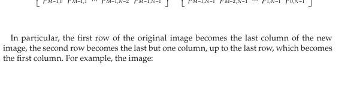

具体来说，原始图像的第一行变为新图像的最后一列，第二行变为倒数第二列，直到最后一行，它变为第一列。例如，图像：

p = ⎡1 2 3 4 5⎤
    ⎢6 7 8 9 10⎥
    ⎣11 12 13 14 15⎦ is transformed to r = ⎡11 6 1⎤
                                           ⎢12 7 2⎥
                                           ⎢13 8 3⎥
                                           ⎢14 9 4⎥
                                           ⎣15 10 5⎦

每个像素的颜色遵循 RGB 颜色模型，其中红色、绿色和蓝色混合在一起以再现广泛的颜色。颜色表示为 RGB 三元组 (r, g, b)，其中每个分量值在 0 到 255 之间变化。

定义结构类型 pixel，包含三个名为 red、green 和 blue 的整数成员。编写一个程序，创建一个二维图像（例如 3×5），其元素为 pixel 类型的结构。用 [0, 255] 范围内的随机值初始化每个结构的成员。然后，程序应显示原始图像，将图像向右旋转 90°，并显示旋转后的图像（例如 5×3）。

提示：使用第二个数组来存储旋转后的图像。

```c
#include <stdio.h>
#include <stdlib.h>
#include <time.h>

#define ROWS 3
#define COLS 5

struct pixel /* RGB format (Red-Green-Blue). */
{
    unsigned char red; /* Value in [0, 255]. */
    unsigned char green;
    unsigned char blue;
};

void rotate_right_90(struct pixel img[][COLS], struct pixel tmp[][ROWS]);

int main(void)
{
    int i, j;
    struct pixel img[ROWS][COLS], tmp[COLS][ROWS];

    srand(time(NULL));
    /* Create random colors. */
    for(i = 0; i < ROWS; i++)
    {
        for(j = 0; j < COLS; j++)
        {
            img[i][j].red = rand()%256;
            img[i][j].green = rand()%256;
            img[i][j].blue = rand()%256;
        }
    }
    printf("*** Original Image ***\n\n");
for(i = 0; i < ROWS; i++)
{
    for(j = 0; j < COLS; j++)
    {
        printf("(%%3d,%%3d,%%3d) ", img[i][j].red, img[i][j].green, img[i][j].blue);
    }
    printf("\n");
}
rotate_right_90(img, tmp);
printf("\n*** Rotated Image ***\n\n");
for(i = 0; i < COLS; i++)
{
    for(j = 0; j < ROWS; j++)
    {
        printf("(%%3d,%%3d,%%3d) ", tmp[i][j].red, tmp[i][j].green, tmp[i][j].blue);
    }
    printf("\n");
}
return 0;
}
void rotate_right_90(struct pixel img[][COLS], struct pixel tmp[][ROWS])
{
    int i, j, k = 0;
    for(i = ROWS-1; i >= 0; i--)
    {
        for(j = 0; j < COLS; j++)
        {
            tmp[j][i] = img[k][j];
        }
        k++;
    }
}
```

## Unions

与结构类似，联合体包含一个或多个成员，这些成员可能具有不同的类型。联合体的属性几乎与结构的属性相同；允许在结构上执行的操作也允许在联合体上执行。它们的区别在于，结构的成员存储在不同的地址，而联合体的成员存储在同一地址。

### Union Declaration

联合体类型的声明类似于结构的声明，只是使用 union 关键字代替 struct。当声明一个联合体变量时，编译器只分配足够存储其最大成员的空间。因此，其成员都存储在同一

内存中，相互重叠。例如，在以下程序中，s 变量分配 8 个字节，因为其最大成员的类型为 double：

```c
#include <stdio.h>

union sample
{
    char ch;
    int i;
    double d;
};

int main(void)
{
    union sample s;
    printf("Size: %lu\n", sizeof(s));
    return 0;
}
```

由于编译器不会为每个联合体成员分配内存，联合体的主要用途是节省内存空间。例如，我们经常在内存有限的嵌入式系统中使用联合体。

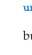

与结构类似，要计算联合体变量的内存大小，请使用 sizeof 运算符。

由于所有联合体成员共享同一内存，因此在声明时只能初始化联合体变量的第一个成员。例如，编译器会允许我们写：

```
union sample s = {'x'};
```

but not: union sample s = {'x', 10, 1.23};

### Access Union Members

联合体的成员与结构的成员访问方式相同。然而，由于它们都存储在同一内存中，只有最后赋值的成员才具有有意义的值。例如，以下程序向 s 成员赋值并显示其他成员：

```c
#include <stdio.h>

union sample
{
    char ch;
    int i;
    double d;
};

int main(void)
{
    union sample s;
s.ch = 'a';
printf("%c %d %f\n", s.ch, s.i, s.d);

s.i = 64;
printf("%c %d %f\n", s.ch, s.i, s.d);

s.d = 12.48;
printf("%c %d %f\n", s.ch, s.i, s.d);
return 0;
}
```

首先，程序输出 a 以及 s.i 和 s.d 成员的无意义值。接下来，值 64 被赋给 i。由于该值存储在公共空间中，s.ch 的值被覆盖。因此，程序显示 64 以及 s.ch 和 s.d 的无意义值。接下来，值 12.48 被赋给 d。s.i 的值被覆盖，程序输出 12.48 以及 s.ch 和 s.i 的无意义值。

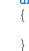

> 当联合体成员被赋值为某个值时，先前存储在最后赋值的成员中的任何值都会被覆盖。

让我们做一个测试。以下程序的输出是什么？

```c
#include <stdio.h>

union test
{
    int a, b, c;
};

int main(void)
{
    union test t;
    t.a = 100;
    t.b = 200;
    t.c = 300;
    printf("%d %d %d\n", t.a, t.b, t.c);
    printf("%d %d %d\n", &t.a, &t.b, &t.c);
    return 0;
}
```

由于成员类型相同且它们都存储在同一内存中，一旦 c 变为 300，其他成员的值也将是 300。因此，第一个 printf() 三次显示 300。第二个 printf() 三次显示公共内存地址。

联合体的典型用途是在数据可以以两种或多种形式存储但永远不会同时存在时节省内存。例如，假设我们想在一个包含 100 个结构的数组中存储男性和女性的偏好。男性的偏好涉及最喜欢的

游戏和电影，而对于女性，则是电视节目和书。我们可以使用如下所示的结构体 person：

```c
struct person
{
    char game[50];
    char movie[50];
    char tv_show[50];
    char book[50];
};
```

然而，这种结构会浪费空间，因为对于每个人，只有两个成员用于存储信息。为了节省空间，我们可以使用包含成员结构的联合体。例如，考虑以下程序：

```c
#include <stdio.h>
#include <stdlib.h>
#include <string.h>

#define SIZE 100
#define MAN 0
#define WOMAN 1

struct man
{
    char game[50];
    char movie[50];
};

struct woman
{
    char tv_show[50];
    char book[50];
};

union data
{
    struct man m;
    struct woman w;
};

struct person
{
    int type;
    union data d;
};

int read_text(char str[], int size, int flag);

int main(void)
{
    int i, type;
    struct person pers_arr[SIZE];

    for(i = 0; i < SIZE; i++)
    {
        printf("\nSelection: 0 for man - 1 for woman: ");
        scanf("%d", &type);

        pers_arr[i].type = type;
        getchar();
        if(type == MAN)
        {
            printf("Enter favourite game: ");
            read_text(pers_arr[i].d.m.game, sizeof(pers_arr[i].d.m.game), 1);
            printf("Enter favourite movie: ");
            read_text(pers_arr[i].d.m.movie, sizeof(pers_arr[i].d.m.movie), 1);
        }
        else if(type == WOMAN)
        {
            printf("Enter favourite TV show: ");
            read_text(pers_arr[i].d.w.tv_show, sizeof(pers_arr[i].d.w.tv_show), 1);
            printf("Enter favourite book: ");
            read_text(pers_arr[i].d.w.book, sizeof(pers_arr[i].d.w.book), 1);
        }
    }
    for(i = 0; i < SIZE; i++)
    {
        if(pers_arr[i].type == MAN)
        {
            printf("\nGame: %s\n", pers_arr[i].d.m.game);
            printf("Movie: %s\n", pers_arr[i].d.m.movie);
        }
        else if(pers_arr[i].type == WOMAN)
        {
            printf("\nTV show: %s\n", pers_arr[i].d.w.tv_show);
            printf("Book: %s\n", pers_arr[i].d.w.book);
        }
    }
    return 0;
}
```

该程序读取性别类型，并将用户的偏好存储到相应的联合体成员中。为了知道每个人中包含哪种类型的结构，即男性还是女性，我们添加了成员 type。在第二个循环中，程序检查其值并显示相应的偏好。


程序员有责任跟踪联合体中哪个成员包含有意义的值。可以添加一个特殊成员（如前面的 type）来指示联合体中当前存储的内容。

联合体的另一个应用是提供同一数据的多种视图，以便使用最方便的一种。例如，在嵌入式应用中，经常需要以不同方式查看寄存器。看看我们如何既可以在位级别又可以将 32 位寄存器值作为一个整体来使用：

```c
struct bit_val
{
    unsigned int CF : 1;
    unsigned int PF : 1;
    /* ... additional bit fields. */
};

union Flags_Reg
{
    unsigned int i_val;
    struct bit_val b_val;
};
```

更改 i_val 的值会改变位字段的值，反之亦然。如果你曾经参与此类应用，不要忘记位字段的分配顺序可能因系统而异。

联合体常用于通信协议开发中，对交换的消息进行编码。以下练习是一个简单示例，说明我们在开发 ISDN 协议时如何使用联合体。如果你曾经参与该领域，它可能会有用。

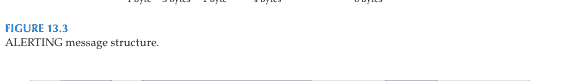

**图 13.2**

SETUP 消息结构。

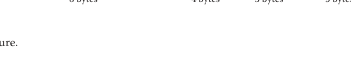

**图 13.3**

ALERTING 消息结构。


**图 13.4**

CONNECT 消息结构。

## 练习

C.13.11 在 ISDN 网络中，Q.931 信令协议的 SETUP 消息由主叫用户发送给被叫用户，以发起呼叫建立过程。SETUP 消息的简化格式如图 13.2 所示。

ALERTING 消息（图 13.3）由 ISDN 网络发送给主叫用户，以指示被叫用户已收到来电通知（例如，振铃音）。

CONNECT 消息（图 13.4）由 ISDN 网络发送给主叫用户，以指示被叫用户已接受呼叫（例如，拿起电话）。

这些消息沿着两个用户之间的路径经过 ISDN 交换机。每个节点都会评估所接收消息的内容。让我们编写一个程序来模拟这种消息分析。

定义结构体类型 isdn_msg，其中包含一个联合体成员。该联合体的成员是三个结构体，分别表示 SETUP、CONNECT 和 ALERTING 消息。编写一个程序，读取字节流，使用前面的图解析数据，并将它们存储到合适的联合体成员中。为了解析数据，程序应检查 MT 字段的值。它在 SETUP、CONNECT 和 ALERTING 消息中的值分别为 5、7 和 1。为了获取字节流，程序应读取 100 个位于 [0, 255] 范围内的正整数，并将它们存储在一个数组中。如果用户输入 -1，则应终止数据插入。

```c
#include <stdio.h>

typedef unsigned char BYTE;

struct header
{
    BYTE pd;
    BYTE crv[3];
    BYTE mt;
};

struct setup
{
    BYTE bc[12];
    BYTE cpn[20];
    BYTE llc[18];
    BYTE hlc[5];
    BYTE dt[8];
};

struct connect
{
    BYTE bc[4];
    BYTE ci[6];
};

struct alerting
{
    BYTE bc[8];
    BYTE pi[4];
    BYTE sig[3];
    BYTE hlc[5];
};

struct isdn_msg
{
    struct header hdr; /* Common header for all messages. */
    union
    {
        struct setup set;
        struct connect con;
        struct alerting alrt;
    };
};

int main(void)
{
    BYTE pkt[100];
    int i;
    struct isdn_msg msg;

    for(i = 0; i < 100; i++)
    {
        printf("Enter octet: ");
        scanf("%d", &pkt[i]);
        if(pkt[i] == -1)
            break;
    }
    msg.hdr.pd = pkt[0];
    for(i = 0; i < 3; i++)
        msg.hdr.crv[i] = pkt[i+1];
    msg.hdr.mt = pkt[4];

    if(msg.hdr.mt == 5) /* SETUP. */
    {
        for(i = 0; i < 12; i++)
            msg.set.bc[i] = pkt[5+i];
        for(i = 0; i < 20; i++)
            msg.set.cpn[i] = pkt[17+i];
        for(i = 0; i < 18; i++)
            msg.set.llc[i] = pkt[37+i];
        for(i = 0; i < 5; i++)
            msg.set.hlc[i] = pkt[55+i];
        for(i = 0; i < 8; i++)
            msg.set.dt[i] = pkt[60+i];
    }
    else if(msg.hdr.mt == 7) /* CONNECT. */
    {
        for(i = 0; i < 4; i++)
            msg.con.bc[i] = pkt[5+i];
        for(i = 0; i < 6; i++)
            msg.con.ci[i] = pkt[9+i];
    }
    else if(msg.hdr.mt == 1) /* ALERTING. */
    {
        for(i = 0; i < 8; i++)
            msg.alrt.bc[i] = pkt[5+i];
        for(i = 0; i < 4; i++)
            msg.alrt.pi[i] = pkt[13+i];
        for(i = 0; i < 3; i++)
            msg.alrt.sig[i] = pkt[17+i];
        for(i = 0; i < 5; i++)
            msg.alrt.hlc[i] = pkt[20+i];
    }
    return 0;
}
```

## 未解答习题

- U.13.1 定义结构体类型 employee，其成员包括：名字、姓氏、年龄和工资。编写一个程序，使用该类型读取 50 名员工的数据并将它们存储在一个数组中。程序应显示工资最高的员工的姓氏，以及年龄最大的员工的名字。如果有多个员工具有相同的最高工资或更大的年龄，程序应显示最先找到的那个员工的数据。

- U.13.2 在 C.13.7 中添加一个 void 函数，通过一个指向 coord 类型结构体的指针参数返回矩形中心的坐标。修改主程序以测试该函数。

- U.13.3 图 13.5 描绘了打印机（16 位）的状态寄存器。使用位字段并定义包含图 13.5 中五个字段的结构体 print_reg。编写一个程序，使用该类型的结构体模拟打印 20 页的打印任务，如下所示：

    1. 当打印第 9 页时，低墨量字段设置为 3，并持续到打印任务结束。
    2. 仅当打印第 13 页时，错误代码字段设置为 10。
    3. 仅当打印第 15 页时，卡纸字段设置为 1。
    4. 仅当打印最后一页时，清洁字段设置为 1。

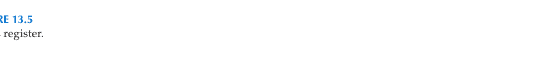

**图 13.5**

状态寄存器。


使用一个20次迭代的循环来模拟打印作业。每次迭代对应打印一页。对于每一页打印，程序应显示状态寄存器的值。

U.13.4 定义结构体类型`circle`，成员为半径；定义类型`square`，成员为边长。编写一个函数，其参数为一个`void*`类型的指针和一个整型参数。若整型值为0，则指针指向`circle`类型的结构体，否则指向`square`类型的结构体。函数应将所指向结构体的成员增加5，并返回该指针。编写一个程序来测试该函数。

U.13.5 定义结构体类型`student`，成员为：姓名和学号。假设一个教室可以用一个二维数组模拟，其元素为`student`类型的结构体。编写一个程序，读取学生数据并将其存储在一个3×5的结构体数组中。然后，程序应读取一个学生的姓名和学号，如果已登记，则显示其在数组中的位置（即行和列）。

U.13.6 定义结构体类型`student`，成员为：姓名、学号和成绩。编写一个程序，使用该类型读取100名学生的数据，并将它们存储在一个按成绩降序排列的数组中。排序必须在数据插入过程中完成。

U.13.7 定义结构体类型`time`，成员为：小时、分钟和秒。编写一个函数，其参数为两个指向结构体的指针，这两个结构体分别表示一场比赛的开始时间和结束时间，函数返回一个表示比赛持续时间的结构体。编写一个程序，使用`time`类型读取比赛的开始时间和结束时间，并使用该函数显示比赛持续时间。用户应以`h:m:s`格式输入时间。

U.13.8 将C.13.9中的函数`sort_by_grade()`重命名为`sort()`，并添加一个额外参数。若该参数为0，函数应按学号升序对学生排序；若为1，按姓名排序；若为2，按成绩排序。修改主程序以测试该函数。

U.13.9 定义结构体类型`publisher`，成员为：名称、地址和电子邮件。定义类型`book`，成员为：标题、作者、书号、价格，以及一个`publisher`类型的成员。假设文本长度少于100个字符。编写一个程序，使用`book`类型读取100本书的数据并存储在一个数组中。然后，程序应读取一本书的书号，如果已登记，则显示该书标题和出版社名称。

U.13.10 定义结构体类型`student`，成员为：姓名、学号和成绩。编写一个程序，声明一个包含六个此类结构体的数组，并用随机数据初始化前五个，按成绩升序排列（例如："A.Smith, 100, 3.2", "B.Jones, 200, 4.7", "K.Lee, 175, 6.4", ...）。然后，程序应读取第六个学生的数据，并将其存储到合适的位置，使数组保持有序。

U.13.11 定义结构体类型`car`，成员为：型号、价格和制造年份。编写一个程序，使用该类型读取100辆汽车的数据并存储在一个数组中。然后，程序应提供一个菜单来执行以下操作：

- 1. 显示型号。程序应读取一个型号，如果已登记，则显示相关信息。如果用户输入`*`，程序应显示所有型号的信息。
- 2. 显示价格。程序应读取一个价格，并显示所有价格更高的型号。
- 3. 程序终止。

U.13.12 定义结构体类型`any_type`，其中包含一个整型成员（例如` s_type`）和一个联合体类型的成员。联合体的成员分别为`time`类型的结构体（例如`t`，如U.13.7中所定义）和`student`类型的结构体（例如`s`，如U.13.6中所定义）。编写一个程序，读取一个整数并存储到`any_type`类型结构体变量的`s_type`成员中。然后，程序应检查`s_type`的值，并根据该值读取数据。如果值为1，输入数据应存储到`t`成员中；否则存储到`s`成员中。

U.13.13 定义联合体类型`selected_type`，其成员名为`u_char`（`char`类型）、`u_int`（`int`类型）、`u_float`（`float`类型）和`u_double`（`double`类型）。定义结构体类型`var_type`，其成员名为`type`（`int`类型）和`st`（`selected_type`类型的联合体）。编写一个函数，其参数为`var_type`类型的结构体。函数应根据`type`成员的值读取一个数字，将该数字存储在相应的`st`成员中，并显示该成员的值。编写一个程序，提示用户输入一个代表数据类型的数字（即1：`char`，2：`int`，3：`float`，4：`double`），然后使用该函数读取一个相应的值并显示它。

## 14 内存管理与数据结构

内存管理主要涉及内存分配以及当不再需要时释放已分配的内存。内存分配可以静态执行，也可以动态执行。到目前为止，程序变量都存储在固定大小的内存中，即静态分配。在本章中，我们将向你展示如何在程序执行期间动态分配内存，以形成灵活的数据结构，例如链表和二叉树。

### 内存块

当程序运行时，它会向操作系统请求内存资源。各种操作系统和编译器使用各自的模型来管理可用内存。通常，系统内存分为四个部分：

- 1. 代码段，用于存储程序代码。
- 2. 数据段，用于存储全局变量和静态变量。该段也可能用于存储字面量字符串（通常存储在只读内存中）。
- 3. 栈段，用于存储函数的数据，如局部变量。
- 4. 堆段，用于动态内存分配。

例如，以下程序显示程序数据的内存地址：

```c
#include <stdio.h>
#include <stdlib.h>

void test(void);

int global;

int main(void)
{
    int *ptr;
    int i;
    static int st;

    ptr = (int*) malloc(sizeof(int)); /* Allocate memory from the heap. */
    if(ptr != NULL)
    {
        printf("Code seg: %p\n", test);
        printf("Data seg: %p %p\n", &global, &st);
        printf("Stack seg: %p\n", &i);
        printf("Heap: %p\n", ptr);
    }
    return 0;
}
void test(void)
{
}
```

请注意，这种分布模型是一种典型选择；每个系统可以定义自己的模型。此外，每个编译器可能应用自己的优化策略。例如，函数的参数可能存储在系统寄存器中以便更快访问，而不是存储在栈中。

### 静态内存分配

在静态分配中，内存在栈中分配。所分配内存的大小是固定的；我们必须在编写程序时指定其大小，并且在程序执行期间不能更改。例如，对于语句：

```c
float grades[1000];
```

编译器分配1000×4 = 4000字节来存储1000名学生的成绩。数组的长度保持不变；如果我们需要存储更多学生的成绩，则无法在程序执行期间更改它。如果学生人数不足1000，内存就会被浪费。更改数组长度的唯一方法是修改程序并重新编译。

让我们简要讨论一下调用函数时会发生什么。详细的讨论超出了本书的范围。编译器在栈中分配内存来存储函数的数据。如前所述，可能会使用系统寄存器；为简单起见，我们假设分配发生在栈中。例如，如果函数返回一个值、接受参数并使用局部变量，编译器将分配内存来存储：

- a. 参数的值。
- b. 局部变量。
- c. 返回值。
- d. 函数终止时要执行的下一条语句的地址。

当函数终止时，会发生以下操作：

- a. 如果返回值被赋值给一个变量，则将其从栈中提取并存储到该变量中。


- b. 从栈中提取下一条语句的地址，程序的执行将继续执行该语句。
- c. 分配用于存储函数数据的内存将被释放（当然不包括静态变量的内存）。

例如，在下面的程序中，当调用 test() 时，编译器在栈中分配 808 字节来存储 i、j 和 arr 元素的值：

```c
#include <stdio.h>

void test(int i, int j);

int main(void)
{
    float a[1000], b[10];
    test(10, 20);
    return 0;
}

void test(int i, int j)
{
    int arr[200];
    ...
}
```

该内存会在 test() 终止时被释放。同样，为 main() 的局部变量分配的 4040 字节内存会在程序终止时被释放。

> 如果栈没有足够的内存来存储函数的数据，程序的执行将异常终止，并且可能会出现 “Stack overflow” 消息。

这种情况可能发生在函数分配大块内存并调用其他具有相当内存需求的嵌套函数时。例如，一个递归函数多次调用自身可能会导致可用栈内存耗尽。

## 动态内存分配

在动态分配中，内存是在程序执行期间从堆中分配的。与静态分配不同，其大小可以动态指定。此外，该大小可以根据程序的需求动态缩小或增长。通常，默认的栈大小并不大。例如，下面的程序可能因栈内存不可用而无法运行：

```c
#include <stdio.h>
int main(void)
{
    int arr[1000000]; /* Static allocation. */
    return 0;
}
```

另一方面，堆的大小通常远大于栈的大小。要使用动态分配，我们可以这样写：

```c
#include <stdio.h>
#include <stdlib.h>
int main(void)
{
    int *arr;
    arr = (int*) malloc(1000000* sizeof(int));
    if(arr != NULL)
        free(arr);
    return 0;
}
```

接下来，我们将讨论 malloc() 和 free() 函数。现在请记住，动态分配的内存在使用完毕后应被释放。

## malloc() 函数

要动态分配内存，我们必须使用在 stdlib.h 中声明的 realloc()、calloc() 或 malloc() 函数之一。其中最常用的是 malloc()。其原型如下：

```c
void *malloc(size_t size);
```

请注意 size_t 类型通常是 unsigned int 类型的别名。size 参数声明要分配的字节数。如果内存分配成功，malloc() 返回指向该内存的指针，否则返回 NULL。malloc() 不会用某个值初始化内存，而 calloc() 则会将所有位设为 0。例如：

```c
int *ptr;
ptr = (int*) malloc(100);
```

> 始终检查 malloc() 的返回值。如果它为 NULL，尝试使用空指针会导致不可预测的结果；程序可能会崩溃。

在之前的程序中，最多可存储的整数数为 25，因为每个整数需要四个字节。请注意，我们可以写成 25*sizeof(int) 而不是 100。事实上，最佳实践是使用 sizeof 运算符，以便获得平台无关的程序。例如，int 类型在一个系统中可能占用两个字节，在另一个系统中占用四个字节。如果我们不使用 sizeof 运算符，malloc() 在第一个系统中会为 50 个整数保留内存，在第二个系统中则为 25 个。

> 提示：始终使用 sizeof 运算符来指定要分配的字节数。

然而，在为 char 类型分配内存时，可以安全地省略 sizeof 运算符，因为 char 类型的大小始终为一。例如，要为长度为 n 的字符串分配内存，我们写：

```c
char *ptr;
ptr = (char*) malloc(n+1);
```

额外的空间用于空字符。

另一个例子，要为 100 个 student 类型的结构体分配内存，我们写：

```c
struct student *ptr;
ptr = (struct student*) malloc(100*sizeof(student));
```

另外，许多人更喜欢使用指针。例如：

```c
ptr = (struct student*) malloc(100*sizeof(*ptr));
```

> 提示：始终记住已分配内存的大小以字节计算。

例如，下面的程序是错误的，因为在已分配的内存中只能存储一个整数，而不是四个：

```c
#include <stdio.h>
#include <stdlib.h>
int main(void)
{
    int *arr, i;
    arr = (int*) malloc(4);
    if(arr != NULL)
    {
        for(i = 0; i < 4; i++)
            arr[i] = 10;
        free(arr);
    }
    return 0;
}
```

将 10 赋给 arr[0] 是正确的，但将值赋给 arr[1]、arr[2] 和 arr[3] 是错误的，因为没有为它们分配内存。如果我们写成：

```c
arr = (int*) malloc(4*sizeof(int));
```

程序将正常执行。希望你不会疑惑是否允许将指针用作数组。如果有疑问，请再次阅读第 8 章中的“指针和数组”部分。

malloc() 的典型用途是动态创建二维数组。假设在程序编译时维度未知。下面的程序读取浮点数数组的两个维度，分配内存，读取值并将它们存储到数组中。

```c
#include <stdio.h>
#include <stdlib.h>

void set_values(double **arr, int rows, int cols);

int main(void)
{
    int i, rows, cols;
    double **arr; /* We use a pointer to pointer variable to handle the two-dimensional array. */

    do
    {
        printf("Enter dimensions of array [N] [M] : ");
        scanf("%d%d", &rows, &cols);
    } while (rows <= 0 || cols <= 0);

    arr = (double**) malloc(rows * sizeof(double*)); /* The expression sizeof(double*) is used to allocate memory for 'rows' pointers to doubles. For example, if rows is 3, we allocate memory for arr[0], arr[1], and arr[2] pointers.*/
    if(arr == NULL)
    {
        printf("Error: Not available memory\n");
        exit(EXIT_FAILURE);
    }
    for(i = 0; i < rows; i++)
    {
        /* Allocate memory to store the elements of each row. Each row contains 'cols' elements. */
        arr[i] = (double*) malloc(cols * sizeof(double));
        if(arr[i] == NULL)
        {
            printf("Error: Not available memory\n");
            exit(EXIT_FAILURE);
        }
    }
    set_values(arr, rows, cols);
    for(i = 0; i < rows; i++)
        free(arr[i]);
    free(arr);
    return 0;
}
void set_values(double **arr, int rows, int cols)
{
    int i, j;
    for(i = 0; i < rows; i++)
        for(j = 0; j < cols; j++)
        {
            printf("Set arr[%d][%d]: ", i, j);
            scanf("%lf", &arr[i][j]);
            printf("arr[%d][%d] = %f\n", i, j, arr[i][j]);
        }
}
```

如你所见，我们将每个 arr[i] 用作指向包含 cols 个 double 的第 i 行的指针。我们添加该函数的原因是向你展示如何传递指向指针变量的指针，以及如何使用数组下标来处理它。还请注意，以这种方式分配内存时，元素可能不像普通声明（如 int arr[10][20]）那样位于连续的位置。

另外，我们也可以使用 malloc() 将二维数组模拟为一维数组。例如：

```c
double *arr = (double*) malloc(rows * cols * sizeof(double)); and write arr[i*cols+j] to access each i, j element.
```

## free() 函数

要释放动态分配的内存，我们必须使用在 stdlib.h 中声明的 free() 函数。其原型如下：

```c
void free(void *ptr);
```

ptr 必须指向动态分配的内存。否则，程序可能会有不可预测的行为。请注意，动态内存可以由一个函数分配并由另一个函数释放，前提是第二个函数可以访问该内存（例如，通过返回的指针）。如果 ptr 为 NULL，free() 不会产生任何效果。例如，下面的程序可能会崩溃，因为 ptr 并未指向已分配的内存：

```c
#include <stdio.h>
#include <stdlib.h>
int main(void)
{
    int *ptr;
    free(ptr);
    return 0;
}
```


请注意，free() 用于释放动态分配的内存，而不是静态内存。例如，如果我们将 ptr 声明为数组（即 int ptr[100]），程序再次会失败。此外，不要尝试释放已经被释放的内存。在下面的示例中，第二次调用 free() 是错误的，因为内存已经被释放：

```c
int *ptr = (int*) malloc(100*sizeof(int));
if(ptr != NULL)
{
    free(ptr);
    free(ptr);
}
```

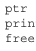

不要忘记在不再需要时调用 free() 来释放动态分配的内存，以避免内存泄漏。

例如，以下代码写得好吗？

```c
char *ptr = (char*) malloc(10);
strcpy(ptr, "test");
ptr = (char*) malloc(20);
printf("%c\n", *ptr);
free(ptr);
```

由于在 ptr 指向第二个块之前没有释放第一个内存块，因此产生了内存泄漏；该内存保持不可用。代码输出该新内存中第一个字符的值。请注意内存泄漏，否则您可能会因内存不足错误而导致程序崩溃。找出以下程序中的错误：

```c
#include <stdio.h>
#include <stdlib.h>
int main(void)
{
    char *p1, *p2;

    p1 = (char*) malloc(10);
    p2 = (char*) malloc(10);
    if(p1 != NULL && p2 != NULL)
    {
        p1 = p2;
        free(p1);
        p2[0] = 'a';
        free(p2);
    }
    return 0;
}
```

- a. 语句 p1 = p2; 使 p1 和 p2 指向同一块内存。语句 free(p1); 释放了该内存，因此下一条语句向未分配的内存赋值。
- b. 语句 free(p2); 释放了已经被释放的内存。
- c. p1 指向的第一个内存块从未被释放。

需要更多练习吗？找出以下程序中的错误：

```c
#include <stdio.h>
#include <stdlib.h>

typedef struct
{
    int *i;
    char *c;
} test;

int main(void)
{
    test *t;
    int i;

    t = (test*) malloc(sizeof(test));
    t->i = (int*) malloc(10*sizeof(int));
    t->c = (char*) malloc(10);
    t->i[0] = 'a';
    t->c[5] = 50;
    for(i = 0; i < 10; i++)
        printf("%d %d\n", t->i[i], t->c[i]);
    free(t);
    free(t->i);
    free(t->c);
    return 0;
}
```

t->i[0] = 'a' 或 t->c[5] = 50 错了吗？当然不是，我们只是赋值了两个整数。循环呢？那也没问题；它使用数组下标来显示现有值。内存释放呢？好吧，这里就是 bug。首先我们必须释放为结构成员分配的内存，然后再释放整个结构的内存，而不是反过来。因此，我们必须将 free(t) 移到末尾。

在大型程序中，同一个指针可能在程序的不同部分使用，我们的建议是每次释放它时都将其设为 NULL 以提高安全性。这一做法在调试内存问题时帮助了我们很多。看看我曾经遇到过什么情况。有一次，我使用了一个包含数千个指向结构的指针的数组。我用 NULL 初始化它们，并在程序执行期间为其中一些分配内存。到目前为止，一切都很好。偶尔，内存会以随机顺序被释放。之后，程序崩溃了。最糟糕的是，程序有时会崩溃，而不是总是崩溃。这真是一场噩梦。经过数天的压力和艰难调试后，我们得出结论，崩溃是由于某些指针误用（……还有什么？）。以下是 buggy 代码：

```c
if(arr[i] != NULL)
    x = arr[i]->member;
```

if 条件不允许空指针访问成员。这没问题，但如果一个指针曾经指向一块内存，而该内存后来被释放了怎么办？例如，假设 arr[i] 指向的内存被释放了。条件仍然为真，因为内存被释放并不意味着 arr[i] 的值会变成 NULL。因此，使用 arr[i] 访问成员时，程序会崩溃。NULL 值必须显式赋值，因此当我在释放内存后添加语句 arr[i] = NULL 时，问题就解决了，我们直接去喝啤酒了。干杯！！！

## 内存管理函数

本节简要讨论了常用于内存管理的 memcpy()、memmove() 和 memcmp() 函数。memcpy() 用于从一个内存区域复制任何类型的数据到另一个内存区域。它在 string.h 中声明：

```c
void *memcpy(void *dest, const void *src, size_t size);
```

memcpy() 从 src 指向的内存复制 size 个字节到 dest 指向的地址。如果源地址和目标地址重叠，其行为未定义。例如，以下程序分配内存来存储字符串 "ABCDE" 并显示其内容：

```c
#include <stdio.h>
#include <string.h>
#include <stdlib.h>

int main(void)
{
    char *arr;
    /* Allocate one extra byte for the null character. */
    arr = (char *) malloc(6);
    if(arr != NULL)
    {
        memcpy(arr, "ABCDE", 6);
        printf("%s\n", arr);
        free(arr);
    }
    return 0;
}
```

与 strcpy() 的主要区别是 strcpy() 在遇到空字符时会停止复制。另一方面，memcpy() 不会在复制指定数量的字节之前停止复制。例如，如果我们有：

```c
char str2[6], str1[] = {'a', 'b', 'c', '\0', 'd', 'e'};
```

并写：

```c
memcpy(str2, str1, 6);
```

str2 的内容将与 str1 相同。

另一方面，如果我们写：

```c
strcpy(str2, str1);
```

str2 的内容将为：{'a', 'b', 'c', '\0'}。

memmove() 与 memcpy() 类似，只是 memmove() 保证即使源内存和目标内存重叠，数据也会被正确复制。因为 memcpy() 不检查两个内存区域是否重叠，所以它的执行速度比 memmove() 快。请注意，目标内存的大小应至少为 size 个字节。如果不是，多余的字节将被写入未分配的内存，这意味着现有数据将被覆盖。例如，下一次复制是错误的，因为目标内存的大小为 3 字节，而复制的字节数为 6：

```c
char str1[3], str2[] = "abcde";
memcpy(str1, str2, sizeof(str2));
```

> memcpy() 通常非常有用，因为它通常以这样的方式实现，即复制大块数据可能比迭代循环更快。

例如，以下程序声明了两个包含 100000 个整数的数组，将 1 到 100000 的值设置到第一个数组的元素中，并使用 memcpy() 将它们复制到第二个数组中：

```c
#include <stdio.h>
#include <string.h>

#define SIZE 100000

int main(void)
{
    int i, arr1[SIZE], arr2[SIZE];

    for(i = 0; i < SIZE; i++)
        arr1[i] = i+1;

    memcpy(arr2, arr1, sizeof(arr1));
    /* We use memcpy() instead of an iteration loop such as:
    for(i = 0; i < SIZE; i++)
        arr2[i] = arr1[i]; */
    for(i = 0; i < SIZE; i++)
        printf("%d\n", arr2[i]);
    return 0;
}
```

memcmp() 用于比较存储在一个内存区域中的数据与存储在另一个内存区域中的数据。它在 string.h 中声明：

```c
int memcmp(const void *ptr1, const void *ptr2, size_t size);
```

memcmp() 比较 ptr1 和 ptr2 指向的内存区域的 size 个字节。memcmp() 的返回值与 strcmp() 相同。与 strcmp() 的主要区别是 strcmp() 在遇到任一字符串中的空字符时会停止比较；而 memcmp() 则只在比较了 size 个字节后才停止比较；它不会查找空字符。例如：

```c
#include <stdio.h>
#include <string.h>
#include <stdlib.h>
int main(void)
{
    char str1[] = {'a', 'b', 'c', '\0', 'd', 'e'};
    char str2[] = {'a', 'b', 'c', '\0', 'd', 'f'};
    if(strcmp(str1, str2) == 0)
        printf("Same\n");
    else
        printf("Different\n");
    if(memcmp(str1, str2, sizeof(str1)) == 0)
        printf("Same\n");
    else
        printf("Different\n");
    return 0;
}
```

因为 strcmp() 在遇到空字符时会停止比较，所以程序显示 Same。相反，memcmp() 比较所有字节，程序显示 Different。

## 练习

- C.14.1 以下 malloc() 分配了多少字节？

```c
double *ptr;
ptr = (double*) malloc(100*sizeof(*ptr));
```

答案：由于 ptr 是指向 double 的指针，sizeof(*ptr) 计算 double 类型的大小，即 8。因此，malloc() 分配了 800 字节。

- C.14.2 以下程序的输出是什么？

```c
#include <stdio.h>
#include <string.h>
#include <stdlib.h>
void test(char *p);
int main(void)
{
    char *p1, *p2;
    p1 = p2 = (char*) malloc(5);
```


<!-- no content -->

```
free(arr); /* Release new memory. */
return 0;
}

int *realloc_mem(int *old_mem, int old_size, int new_size)
{
    int *new_mem;

    /* Allocate memory for new_size integers. */
    new_mem = (int*) malloc(new_size * sizeof(int));
    if (new_mem == NULL)
    {
        printf("Error: Not available memory\n");
        exit(EXIT_FAILURE);
    }
    /* Copy the existing data to the new memory. */
    memcpy(new_mem, old_mem, old_size * sizeof(int));
    free(old_mem); /* Release old memory. */
    return new_mem; /* Return the pointer to the new memory. */
}
```

**注释：** 该程序显示前10个元素的值为100-109，后十个元素由于未初始化而显示随机值。C库提供了一个与realloc_mem()类似的函数，称为realloc()，realloc()在stdlib.h中声明，用于修改动态分配内存的大小。附录C中提供了简短描述。

## C.14.4 编写一个类似于memcmp()的函数。程序应读取两个少于100个字符的字符串以及要比较的字符数，并使用该函数显示比较结果。

```
#include <stdio.h>
#include <stdlib.h>
#include <string.h>

int mem_cmp(const void *ptr1, const void *ptr2, size_t size);
int read_text(char str[], int size, int flag);

int main(void)
{
    char str1[100], str2[100];
    int num;

    printf("Enter first text: ");
    read_text(str1, sizeof(str1), 1);

    printf("Enter second text: ");
    read_text(str2, sizeof(str2), 1);

    printf("Enter characters to compare: ");
    scanf("%d", &num);

    printf("%d\n", mem_cmp(str1, str2, num));
}
```

```
```c
    return 0;
}
int mem_cmp(const void *ptr1, const void *ptr2, size_t size)
{
    char *p1, *p2;
    p1 = (char*)ptr1;
    p2 = (char*)ptr2;
    while(size != 0)
    {
        if(*p1 != *p2)
            return *p1 - *p2;
        p1++;
        p2++;
        size--;
    }
    return 0;
}
```
```

注释：循环比较 p1 和 p2 指向的字符。由于比较的是字符，我们将 void* 类型转换为 char*。如果所有字符都相同，mem_cmp() 返回 0，否则返回前两个不匹配字符的差值。

## C.14.5 编写一个类似于strcpy()的函数。该函数应接受两个指针作为参数，并将第二个指针所指向的字符串复制到第一个指针所指向的内存中。第一个指针所指向的内存应已动态分配，其大小应等于被复制字符串的长度。编写一个程序，读取一个少于100个字符的字符串，调用该函数将其复制到动态分配的内存中，并显示该内存的内容。

```
```c
#include <stdio.h>
#include <stdlib.h>
#include <string.h>

char *str_cpy(char *trg, const char *src);
int read_text(char str[], int size, int flag);

int main(void)
{
    char *trg, src[100];
    int len;

    printf("Enter text: ");
    len = read_text(src, sizeof(src), 1);
    /* Allocate memory to store the input string and the null character. */
    trg = (char*) malloc(len+1);
    if(trg == NULL)
    {
        printf("Error: Not available memory\n");
        exit(EXIT_FAILURE);
    }
```

```
printf("Copied text: %s\n", str_cpy(trg, src));
free(trg);
return 0;
}
```

```
char *str_cpy(char *trg, const char *src)
{
    int i = 0;
    while(*(src+i) != '\0' ) /* Or else, while(src[i] != '\0')*/
    {
        *(trg+i) = *(src+i); /* Or else, trg[i] = src[i]; */
        i++;
    }
    *(trg+i) = '\0'; /* Add the null character. */
    return trg;
}
```

注释：我们可以省略 i，不过会得到更复杂的代码。示例如下：

```
char *str_cpy(char *trg, const char *src)
{
    char *ptr = trg;
    while(*(trg++ = *src++))
        ;
    return ptr;
}
```

循环执行，直到空字符被复制到 trg 所指向的内存中。例如，在第一次迭代中，我们有 trg[0] = src[0];，然后指针递增以指向下一个元素。实际上，语句 *trg++ = *src++; 等价于：

```
*trg = *src;
trg++;
src++;
```

## C.14.6 编写一个函数，该函数接受三个字符串指针作为参数，并将后两个字符串存储到第一个字符串中。第一个字符串的内存应已动态分配。编写一个程序，读取两个少于100个字符的字符串，并使用该函数将它们存储到动态分配的内存中。

```
#include <stdio.h>
#include <stdlib.h>
#include <string.h>

void str_cat(char *fin, char *str1, char *str2);
int read_text(char str[], int size, int flag);

int main(void)
{
    char *fin, str1[100], str2[100];
    int len1, len2;
```

```
printf("Enter first text: "); len1 = read_text(str1, sizeof(str1), 1); printf("Enter second text: "); len2 = read_text(str2, sizeof(str2), 1); /* Allocate memory to store both strings and the null character. */ fin = (char*) malloc(len1+len2+1); if(fin == NULL) { printf("Error: Not available memory\n"); exit(EXIT_FAILURE); } str_cat(fin, str1, str2); printf("Merged text: %s\n", fin); free(fin); return 0; }
```

```
void str_cat(char *fin, char *str1, char *str2) { while(*str1 != '\0') /* Or else, while(*str1) */ *fin++ = *str1++; /* Copy the second string after the first one. */ while(*str2 != '\0') /* Or else, while(*str2) */ *fin++ = *str2++; *fin = '\0'; /* Add the null character. */ }
```

注释：第一个循环将 str1 所指向字符串的字符复制到 fin 所指向的内存中。类似地，下一个循环添加第二个字符串的字符。除了 while 循环，我们也可以使用 for 循环，如下所示：

```
void str_cat(char *fin, char *str1, char *str2) { for(; *str1; *fin++ = *str1++); for(; *str2; *fin++ = *str2++); *fin = '\0'; }
```

注意两个 for 语句末尾的分号。那么使用单个循环的更复杂解决方案如何？

```
void str_cat(char *fin, char *str1, char *str2) { for(; *str2; *str1 ? *fin++ = *str1++ : *fin++ = *str2++); *fin = '\0'; }
```

这是我们视为不良编码风格的另一个例子。不要忘记我们的建议。编写代码时要牢记简洁性。

## C.14.7

编写一个函数，该函数接受两个相同大小的 double 数组（例如 a1 和 a2）及其元素个数作为参数，并分配内存以存储 a1 中未包含在 a2 中的元素。该函数应返回指向该内存的指针。编写一个程序，读取成对的 double 值并将它们存储到两个包含100个元素的数组（例如 p1 和 p2）中。如果任一输入值为 -1，则数字插入应结束。程序应使用该函数显示 p1 中未包含在 p2 中的元素。

```
```c
#include <stdio.h>
#include <stdlib.h>

#define SIZE 100

double *find_diff(double a1[], double a2[], int size, int *items); /* items indicates how many elements are stored in the memory. A pointer is passed, so that the function may change its value. */

int main(void)
{
    int i, elems;
    double *p3, j, k, p1[SIZE], p2[SIZE];

    for(i = 0; i < SIZE; i++)
    {
        printf("Enter numbers: ");
        scanf("%lf%lf", &j, &k);
        if ((j == -1) || (k == -1))
            break;
        p1[i] = j;
        p2[i] = k;
    }
    elems = 0;
    p3 = find_diff(p1, p2, i, &elems);
    if (elems == 0)
        printf("\n***** No different elements *****\n");
    else
    {
        for(i = 0; i < elems; i++)
            printf("%f\n", p3[i]);
    }
    free(p3);
    return 0;
}

double *find_diff(double a1[], double a2[], int size,int *items)
{
    int i, j, found;
    double *mem;

    mem = (double*) malloc(size * sizeof(double));
    if (mem == NULL)
    {
        printf("Error: Not available memory\n");
        exit(EXIT_FAILURE);
    }
}
```

```
```c
for(i = 0; i < size; i++)
{
    found = 0; /* This variable indicates whether an element of the first array exists in the second, or not. The value 0 means that it does not exist. */
    for(j = 0; j < size; j++)
    {
        if(a2[j] == a1[i])
        {
            found = 1;
            break; /* Since this element exists, we stop searching. */
        }
    }
    /* If it does not exist, it is stored in the memory. */
    if(found == 0)
    {
        mem[*items] = a1[i];
        (*items)++;
    }
}
return mem;
```
```

## C.14.8 编写一个程序，声明一个包含20个字符串指针的数组，并分配存储少于100个字符的字符串所需的确切内存。程序应读取20个字符串并显示最长的一个。如果不止一个字符串最长，程序应显示最先找到的那个。

```
```c
#include <stdio.h>
#include <stdlib.h>
#include <string.h>

#define SIZE 20

int read_text(char str[], int size, int flag);

int main(void)
{
    char *ptr[SIZE], str[100];
    int i, pos, len, max_len; /* pos is used to indicate the ptr element, which points to the longest string. max_len holds its length. */
    pos = max_len = 0;
    for(i = 0; i < SIZE; i++)
    {
        printf("Enter text: ");
        len = read_text(str, sizeof(str), 1);
        /* Allocate the required memory. */
        ptr[i] = (char*) malloc(len+1);
        if(ptr[i] == NULL)
        {
            printf("Error: Not available memory\n");
            exit(EXIT_FAILURE);
        }
    }
```
```


/* Store the string in the allocated memory. */
strcpy(ptr[i], str);
/* We compare the length of each string against max_len and
if a longer string is found, we store its position and length. */
if (len > max_len)
{
    pos = i;
    max_len = len;
}
printf("Longer string: %s\n", ptr[pos]);
for(i = 0; i < SIZE; i++)
    free(ptr[i]);
return 0;
}

**注释：** 这种处理字符串的方法比 C.10.37 中介绍的方法更高效。没有内存浪费。

## C.14.9 编写一个程序，读取其命令行参数并分配内存以按相反顺序存储其字符。例如，如果参数是 next 和 time，程序应将 txen 和 emit 存储到内存中。

```
#include <stdio.h>
#include <stdlib.h>
#include <string.h>

int main(int argc, char *argv[])
{
    char *rvs_str;
    int i, j, len;
    if(argc == 1)
    {
        printf("Missing string arguments ...\n");
        exit(EXIT_FAILURE);
    }
    for(i = 1; i < argc; i++)
    {
        len = strlen(argv[i]);
        rvs_str = (char*) malloc(len+1); /* Allocate one extra place for the null character. */
        if(rvs_str == NULL)
        {
            printf("Error: Not available memory\n");
            exit(EXIT_FAILURE);
        }
        for(j = 0; j < len; j++)
            rvs_str[j] = argv[i][len-1-j]; /* The last character is stored in position len-1. */
        rvs_str[j] = '\0'; /* Terminate the string. */
        printf("Reverse of %s is: %s\n", argv[i], rvs_str);
    }
free(rvs_str);
}
return 0;
}
```

## C.14.10

定义结构类型 publisher，其成员为：name、address 和 phone number。然后，定义结构类型 book，其成员为：title、author、field、code、price 以及指向结构类型 publisher 的指针。除 price 外，所有其他成员必须是指针。假设最大文本长度为 100 个字符。编写一个程序，读取图书数量并分配内存以存储其数据以及出版商的数据。然后，程序应读取一本书的代码并显示其标题和出版商的名称，如果已注册。

```
#include <stdio.h>
#include <string.h>
#include <stdlib.h>

int read_text(char str[], int size, int flag);

typedef struct /* Let's remember typedef. */
{
    char *name;
    char *addr;
    char *phone;
} pub;

typedef struct
{
    char *title;
    char *auth;
    char *code;
    pub  *pub_ptr;
    float prc;
} book;

/* To save space, we assume that all malloc() calls are successful. */
int main(void)
{
    book *books_ptr;
    char str[100];
    int i, num, len;

    printf("Enter number of books: ");
    scanf("%d", &num);
    getchar();

    books_ptr = (book*) malloc(num * sizeof(book));
    for(i = 0; i < num; i++)
    {
        printf("\nTitle: ");
        len = read_text(str, sizeof(str), 1);
        books_ptr[i].title = (char*) malloc(len+1);
        strcpy(books_ptr[i].title, str);
printf("Authors: ");
len = read_text(str, sizeof(str), 1);
books_ptr[i].auth = (char*) malloc(len+1);
strcpy(books_ptr[i].auth, str);

printf("Code: ");
len = read_text(str, sizeof(str), 1);
books_ptr[i].code = (char*) malloc(len+1);
strcpy(books_ptr[i].code, str);

printf("Price: ");
scanf("%f", &books_ptr[i].prc);

getchar();
/* Allocate memory to store the data of the publishing firm. */
books_ptr[i].pub_ptr = (pub*) malloc(sizeof(pub));

printf("Name: ");
len = read_text(str, sizeof(str), 1);
(books_ptr[i].pub_ptr)->name = (char*)malloc(len+1);
strcpy((books_ptr[i].pub_ptr)->name, str);

printf("Address: ");
len = read_text(str, sizeof(str), 1);
(books_ptr[i].pub_ptr)->addr = (char*)malloc(len+1);
strcpy((books_ptr[i].pub_ptr)->addr, str);

printf("Phone: ");
len = read_text(str, sizeof(str), 1);
(books_ptr[i].pub_ptr)->phone = (char*)malloc(len+1);
strcpy((books_ptr[i].pub_ptr)->phone, str);
}
printf("\nEnter code to search: ");
read_text(str, sizeof(str), 1);

for(i = 0; i < num; i++)
{
    if(strcmp(books_ptr[i].code, str) == 0)
    {
        printf("\nTitle: %s\tPublisher: %s\n\n", books_ptr[i].title, (books_ptr[i].pub_ptr)->name);
        break;
    }
}
if(i == num)
    printf("\nCode '%s' isn't registered\n", str);

for(i = 0; i < num; i++)
{
    free((books_ptr[i].pub_ptr)->name);
    free((books_ptr[i].pub_ptr)->addr);
    free((books_ptr[i].pub_ptr)->phone);
free(books_ptr[i].title);
free(books_ptr[i].auth);
free(books_ptr[i].code);
free(books_ptr[i].pub_ptr);
}
free(books_ptr);
return 0;
}
```

## 动态数据结构

迄今为止我们遇到的 数据结构 用于以简便快捷的方式进行数据存储和处理。例如，数组是数据结构，用于存储相同类型的数据。结构体和联合体也是数据结构，可用于存储任何类型的数据。这些数据结构是静态的，因为分配的内存是固定的，在程序执行期间无法修改。然而，在许多应用中，使用动态数据结构会更高效，动态数据结构的大小可根据需要增长或缩小。下一节将介绍一些动态数据结构的简单形式并展示实现示例。对于更复杂的数据结构变体，您应阅读专注于该主题的书籍。

## 链表

链表由一系列链接的元素组成，称为节点。每个节点通常由一个结构体表示，该结构体包含其数据和指向链中下一个节点的指针，如图 14.1 所示。

第一个节点是链表的头，最后一个是尾。最后一个节点中指针成员的值必须为 NULL 以表示链表的结束。

与大小固定的数组不同，链表更灵活，因为其大小可以根据程序需求动态调整。因为我们可以在链表的任何位置轻松插入和删除节点，所以创建和维护排序顺序要容易得多。另一方面，访问数组元素非常快；我们只需使用其位置作为索引。通常，要访问链表节点，应从头节点开始（不考虑为直接访问而存储节点地址的情况）并串行遍历链表，而数组提供随机访问。因此，访问节点的时间取决于其在链表中的位置。如果节点靠近开头，则速度快；如果靠近末尾，则速度慢。这会对性能产生巨大差异。


图 14.1
链表。

## 插入节点

可以在链表的任意位置插入新节点。要插入新节点，我们检查以下情况：

- 1. 如果链表为空，节点插入到开头并成为链表的头和尾。其指针成员的值设为 NULL，因为链表中没有下一个节点。
- 2. 如果链表不为空，我们检查以下子情况：
- a. 如果节点插入在链表开头，它成为链表的新头，其指针成员指向之前的头，后者现在成为链表的第二个节点。
- b. 如果节点插入在链表末尾，它成为链表的新尾，其指针成员的值设为 NULL。旧尾成为倒数第二个节点，其指针成员的值从 NULL 改为指向新节点。
- c. 如果节点插入在现有节点之后，新节点的指针成员必须指向当前节点之后的节点，而当前节点的指针成员必须指向新节点。图 14.2 描述了新节点 X 如何插入到节点 B 和 C 之间。

## 删除节点

要从链表中删除节点并释放其分配的内存，我们检查以下情况：

- 1. 如果它是链表的头，我们检查以下子情况：
- a. 如果有下一个节点，该节点成为链表的新头。
- b. 如果没有下一个节点，链表变为空。
- 2. 如果它是链表的尾，前一个节点成为新尾，其指针成员设为 NULL。
- 3. 如果它是中间节点，前一个节点的指针成员必须指向要删除的节点之后的节点。此操作在此处以删除节点 C 为例示出（图 14.3）。

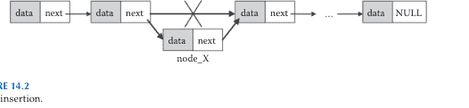

图 14.2
节点插入。


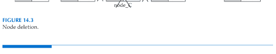

图 14.3
节点删除。

## 实现示例

在创建链表之前，我们将实现链表的两种特殊情况：栈和队列。请注意，实现这些数据结构的方法有很多；我们尝试以简单易懂的方式实现它们。在下面的示例中，每个节点都是类型为 node 的结构体。如果你将来需要开发类似的数据结构，大部分代码都可以直接重用。

### 实现栈

本节中，我们将创建一个 LIFO（后进先出）栈，正如其名称所示，最后插入的节点最先被取出。它是链表的一种特殊情况，具有以下限制：

- a. 新节点只能插入到栈的开头，并成为其新的头。
- b. 只能删除头节点。

这样的栈类似于一堆脏盘子。每个新盘子都放在栈顶，而我们洗的就是顶部的盘子。

### 练习

C.14.11 定义结构类型 node，其成员为：code、name、grade，以及指向类型为 node 的结构的指针。创建一个节点为该类型结构体的栈。编写一个程序显示菜单以执行以下操作：

- 1. 插入学生。程序应读取学生的数据并将其存储在节点中，该节点成为栈的新头。
- 2. 显示已存储学生的资料。
- 3. 显示最后插入的学生资料。
- 4. 删除最后插入的学生。
- 5. 显示已存储学生的总数。
- 6. 程序终止。

为处理栈，我们使用一个全局指针。该指针始终指向栈的头。

```c
#include <stdio.h>
#include <stdlib.h>
#include <string.h>

typedef struct node
{
    char name[100];
    int code;
    float grd;
    struct node *next; /* Pointer to the next node. Notice that the existence of the structure tag enables us to declare its type. */
} node;

node *head; /* Global pointer that always points to the head of the stack. */

void add_stack(const node *p);
void show_stack(void);
void pop(void);
int size_stack(void);
void free_stack(void);

int read_text(char str[], int size, int flag);

int main(void)
{
    int sel;
    node n;

    head = NULL; /* The NULL value indicates an empty stack. */
    while(1)
    {
        printf("\nMenu selections\n");
        printf("----------------\n");

        printf("1. Add student\n");
        printf("2. View all students\n");
        printf("3. View top student\n");
        printf("4. Delete top student\n");
        printf("5. Number of students\n");
        printf("6. Exit\n");

        printf("\nEnter choice: ");
        scanf("%d", &sel);

        switch(sel)
        {
            case 1:
                getchar();
                printf("Name: ");
                read_text(n.name, sizeof(n.name), 1);

                printf("Code: ");
                scanf("%d", &n.code);
                printf("Grade: ");
                scanf("%f", &n.grd);

                add_stack(&n);
                break;

        case 2:
                if(head != NULL)
                        show_stack();
                else
                        printf("\nThe stack is empty\n");
                break;

        case 3:
                if(head != NULL)
                        printf("\nC:%d N:%s G:%.2f\n\n",
                                head->code,head->name,head->grd);
                else
                        printf("\nThe stack is empty\n");
                break;

        case 4:
                if(head != NULL)
                        pop();
                else
                        printf("\nThe stack is empty\n");
                break;

        case 5:
                if(head != NULL)
                        printf("\n%d students exist in stack\n",
                                size_stack());
                else
                        printf("\nThe stack is empty\n");
                break;

        case 6:
                if(head != NULL)
                        free_stack();
        return 0;

        default:
                printf("\nWrong choice\n");
                break;
                }
        }
        return 0;
}

void add_stack(const node *p)
{
    node *new_node;

    /* Allocate memory to create a new node. */
    new_node = (node*) malloc(sizeof(node));
    if(new_node == NULL)
    {
        printf("Error: Not available memory\n");
        exit(EXIT_FAILURE);
    }
    *new_node = *p; /* Copy the student's data into the new node. */
    new_node->next = head; /* The new node is inserted at the beginning of the stack. For example, when the first node is inserted the value of new_node->next becomes equal to the initial value of head, which is NULL. */
    head = new_node; /* head points to the new node, therefore the new node becomes the new head of the stack. */
}

void show_stack(void)
{
    node *p;

    p = head;
    printf("\n**** Student Data ****\n\n");
    while(p != NULL)
    {
        printf("C:%d N:%s G:%.2f\n\n", p->code, p->name, p->grd);
        p = p->next; /* In each iteration, p points to the next node. Once it becomes NULL it means that there is no other node left and the loop terminates. */
    }
}

void pop(void)
{
    node *p;

    p = head->next; /* p points to the next node after the head. This node will become the new head of the stack. */
    printf("\nStudent with code %d is deleted\n", head->code);
    free(head); /* Release the allocated memory. The information about the next node is not lost, because it was saved in p. */
    head = p; /* head points to the new head of the stack. */
}

int size_stack(void)
{
    node *p;
    int num;

    num = 0;
    p = head;
    while(p != NULL)
    {
        p = p->next;
        num++; /* This variable counts the nodes. */
    }
    return num;
}

void free_stack(void)
{
    node *p, *next_node;

    p = head;
    while (p != NULL)
    {
        next_node = p->next; /* next_node always points to the node after the one to be deleted. */
        free(p); /* Release the allocated memory. The information about the next node is not lost, because it was saved in next_node. */
        p = next_node; /* p points to the next node. */
    }
}
```

### 注释：

- a. 在 `add_stack()` 中我们传递一个指针而不是结构体本身，以避免创建结构体的副本并使函数的执行更快。我们将指针声明为 `const`，只是为了记住如何防止修改。
- b. 为了立即显示已存储学生的数量，而无需遍历栈，我们可以移除 `size_stack()` 函数并声明一个全局变量，每次插入学生时递增一次，删除学生时递减一次。一旦用户选择该菜单选项，`printf()` 就会显示其值。这要简单得多，也更快。我们使用 `size_stack()` 的原因是向你展示如何遍历栈的节点。
- c. 如果变量 `head` 在 `main()` 中被声明为局部变量，我们应该将其地址传递给需要它的函数。例如，`add_stack()` 将更改为：

```c
void add_stack(const node *p, node **head_ptr)
{
    node *new_node;

    new_node = (node*) malloc(sizeof(node));
    if (new_node == NULL)
    {
        printf("Error: Not available memory\n");
        exit(EXIT_FAILURE);
    }
    *new_node = *p;
    new_node->next = *head_ptr;
    *head_ptr = new_node;
}
```

调用它时我们会写：add_stack (&n, &head);

因为我们认为这段代码更复杂，至少对于初学者来说，我们更喜欢将 head 声明为全局变量并在需要时直接使用它。

### 实现队列

本节中，我们将创建一个 FIFO（先进先出）队列，正如其名称所示，最先插入的节点最先被取出。它是链表的一种特殊情况，具有以下限制：

- a. 新节点只能插入到队列的末尾，并成为其新的尾部。
- b. 只能删除头节点。

### 练习

C.14.12 定义结构类型 node，其成员为：code、name、grade，以及指向类型为 node 的结构的指针。创建一个节点为该类型结构体的队列。编写一个程序显示菜单以执行以下操作：

- 1. 插入学生。程序应读取学生的数据并将其存储在节点中，该节点成为队列的新尾部。
- 2. 显示已存储学生的资料。
- 3. 显示最后插入的学生资料。
- 4. 删除最先插入的学生。
- 5. 程序终止。

为处理队列，我们使用两个全局指针。第一个始终指向队列的头，第二个指向其尾部。

```c
#include <stdio.h>
#include <stdlib.h>
#include <string.h>

typedef struct node
{
    char name[100];
    int code;
    float grd;
    struct node *next;
} node;

node *head; /* Global pointer that always points to the head of the queue. */
node *tail; /* Global pointer that always points to the tail of the queue. */
```


```c
void add_queue(const node *p);
void show_queue(void);
void pop(void);
void free_queue(void);

int read_text(char str[], int size, int flag);

int main(void)
{
    int sel;
    node n;

    head = NULL;
    while(1)
    {
        printf("\nMenu selections\n");
        printf("-------------------\n");
        printf("1. Add student\n");
        printf("2. View all students\n");
        printf("3. View last student\n");
        printf("4. Delete top student\n");
        printf("5. Exit\n");

        printf("\nEnter choice: ");
        scanf("%d", &sel);

        switch(sel)
        {
            case 1:
                getchar();

                printf("Name: ");
                read_text(n.name, sizeof(n.name), 1);

                printf("Code: ");
                scanf("%d", &n.code);

                printf("Grade: ");
                scanf("%f", &n.grd);

                add_queue(&n);
                break;

            case 2:
                if(head != NULL)
                    show_queue();
                else
                    printf("\nThe queue is empty\n");
                break;

            case 3:
                if (head != NULL)
                    printf("\nC:%d N:%s G:%.2f\n",
                        tail->code, tail->name, tail->grd);
                else
                    printf("\nThe queue is empty\n");
                break;

            case 4:
                if(head != NULL)
                    pop();
                else
                    printf("\nThe queue is empty\n");
                break;

            case 5:
                if(head != NULL)
                    free_queue();
                return 0;

            default:
                printf("\nWrong choice\n");
                break;
        }
    }
    return 0;
}

void add_queue(const node *p)
{
    node *new_node;

    new_node = (node*) malloc(sizeof(node));
    if(new_node == NULL)
    {
        printf("Error: Not available memory\n");
        exit(EXIT_FAILURE);
    }
    *new_node = *p;
    new_node->next = NULL;

    if(head == NULL)
        head = tail = new_node; /* If the queue is empty, both head and tail pointers point to the new node. */
    else
    {
        tail->next = new_node; /* The new node is inserted at the end of the queue. */
        tail = new_node; /* tail points to the last node. */
    }
}
```

注释：我们省略 show_queue()、pop() 和 free_queue() 函数的代码，因为它与栈程序中 show_stack()、pop() 和 free_stack() 函数的代码相同。

## 实现链表

下面的程序实现了一个链表，其节点对应学生。如前所述，我们使用一个全局指针指向链表的头，另一个指向其尾。

### 练习

C.14.13 定义结构类型 node，其成员为：code、name、grade，以及指向类型为 node 的结构的指针。创建一个节点为该类型结构的链表。编写一个程序显示菜单以执行以下操作：

- 1. 在链表末尾插入一名学生。程序应读取学生的数据并将其存储在节点中，该节点成为链表的新尾部。
- 2. 在特定位置插入一名学生。程序应读取学生的代码，定位具有该代码的对应节点，并在其后创建新节点以插入新学生的数据。
- 3. 显示存储的学生数据。
- 4. 查找一名学生。程序应读取学生的代码并显示其数据，如果已注册。
- 5. 修改学生的成绩。程序应读取学生的代码和新成绩并修改现有成绩。
- 6. 删除一名学生。程序应读取学生的代码并删除对应该学生的节点，如果已注册。
- 7. 程序终止。

```c
#include <stdio.h>
#include <stdlib.h>
#include <string.h>

typedef struct node
{
    char name[100];
    int code;
    float grd;
    struct node *next;
} node;

node *head; /* Global pointer that always points to the head of the list. */
node *tail; /* Global pointer that always points to the tail of the list. */

void add_list_end(const node *p);
void add_list(const node *p, int code);
void show_list(void);
node *find_node(int code);
int del_node(int code);
void free_list(void);

int read_text(char str[], int size, int flag);

int main(void)
{
    int k, sel, code;
    float grd;
    node *p, n;

    head = NULL;
    while(1)
    {
        printf("\nMenu selections\n");
        printf("-------------\n");

        printf("1. Add student at the end\n");
        printf("2. Add student\n");
        printf("3. View all students\n");
        printf("4. View student\n");
        printf("5. Modify student\n");
        printf("6. Delete student\n");
        printf("7. Exit\n");

        printf("\nEnter choice: ");
        scanf("%d", &sel);

        switch(sel)
        {
            case 1:
            case 2: /* To avoid the repetition of the same code we use the same case to insert data. Then, the if statement checks the user's choice and calls the respective function. */
                getchar();
                printf("Name: ");
                read_text(n.name, sizeof(n.name), 1);
                printf("Code: ");
                scanf("%d", &n.code);
                printf("Grade: ");
                scanf("%f", &n.grd);
                if(sel == 1)
                    add_list_end(&n);
                else
                {
                    printf("\nEnter student code after which the new student will be added: ");
                    scanf("%d", &code);
                    add_list(&n, code);
                }
                break;
            case 3:
                if(head == NULL)
                    printf("\nThe list is empty\n");
                else
                    show_list();
                break;
            case 4:
                if(head == NULL)
                    printf("\nThe list is empty\n");
                else
                {
                    printf("\nEnter student code to search: \n");
                    scanf("%d", &code);
                    p = find_node(code);
                    if(p != NULL)
                        printf("\nN:%s G:%.2f\n",
                            p->name, p->grd);
                    else
                        printf("\nStudent with code = %d does not exist\n", code);
                }
                break;
            case 5:
                if(head == NULL)
                    printf("\nThe list is empty\n");
                else
                {
                    printf("\nEnter student code to modify: \n");
                    scanf("%d", &code);
                    printf("Enter new grade: ");
                    scanf("%f", &grd);
                    p = find_node(code);
                    if(p != NULL)
                        p->grd = grd;
                    else
                        printf("\nStudent with code = %d does not exist\n", code);
                }
                break;
            case 6:
                if(head == NULL)
                    printf("\nThe list is empty\n");
                else
                {
                    printf("\nEnter student code to delete:\n");
                    scanf("%d", &code);
                    k = del_node(code);
                    if(k == 0)
                        printf("\nStudent with code = %d is deleted\n", code);
                    else
                        printf("\nStudent with code = %d does not exist\n", code);
                }
                break;

            case 7:
                if(head != NULL)
                    free_list();
                return 0;

            default:
                printf("\nWrong choice\n");
                break;
        }
    }
    return 0;
}

/* For a better understanding of add_list_end(), read the comments of add_queue() in the previous exercise. */
void add_list_end(const node *p)
{
    node *new_node;

    new_node = (node*) malloc(sizeof(node));
    if(new_node == NULL)
    {
        printf("Error: Not available memory\n");
        exit(EXIT_FAILURE);
    }
    *new_node = *p;
    new_node->next = NULL;

    if(head == NULL)
        head = tail = new_node;
    else
    {
        tail->next = new_node;
        tail = new_node;
    }
}
```

void add_list(const node *p, int code)
{
    node *new_node, *ptr;

    ptr = head;
    /* We traverse the list, until the node with the indicated code is found. If found, the new node is added after that and the function terminates. */
    while(ptr != NULL)
    {
        if(ptr->code == code)
        {
            new_node = (node*) malloc(sizeof(node));
            if(new_node == NULL)
            {
                printf("Error: Not enough memory\n");
                exit(EXIT_FAILURE);
            }
            *new_node = *p; /* Copy the student's data. */
            new_node->next = ptr->next; /* The new node is linked to the node after the current node. */
            ptr->next = new_node; /* The current node is linked to the new node. */
            if(ptr == tail) /* Check if the new node is added at the end of the list. If it is, it becomes the new tail. */
                tail = new_node;
            return;
        }
        ptr = ptr->next; /* Check the next node. */
    }
    /* If this point is reached it means that the input code does not correspond to an existing student. */
    printf("\nStudent with code = %d does not exist\n", code);
}

void show_list(void)
{
    node *p;

    p = head;
    printf("\n***** Student Data *****\n\n");
    while(p != NULL)
    {
        printf("C:%d N:%s G:%.2f\n\n", p->code, p->name, p->grd);
        p = p->next;
    }
}

node *find_node(int code)
{
    node *p;
    p = head;
    while(p != NULL)
    {
        if(p->code == code)
            return p;
        p = p->next;
    }
    return NULL;
}

int del_node(int code)
{
    node *p, *prev_node; /* prev_node always points to the previous node from the one that is going to be deleted. */

    p = prev_node = head;
    while(p != NULL)
    {
        if(p->code == code)
        {
            if(p == head)
                head = p->next; /* If the node is the head of the list, the next node becomes the new head. If there is no other node, the list becomes empty and head becomes NULL. */
            else
            {
                /* p points to the node that will be deleted and prev_node points to the previous one. This statement links the previous node with the node after the one to be deleted. */
                prev_node->next = p->next;
                if(p == tail) /* Check if the deleted node is the tail of the list. If it is, the previous node becomes the new tail. */
                    tail = prev_node;
            }
            free(p); /* Delete the node. */
            return 0;
        }
        prev_node = p; /* prev_node points to the node that was just checked and found to have other code than the input code. */
        p = p->next; /* p points to the next node. Notice that prev_node always points to the previous node from the one to be examined. */
    }
    return -1;
}

void free_list(void)
{
    node *p, *next_node;

    p = head;
    while(p != NULL)

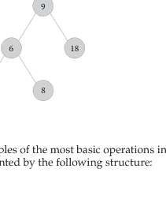

## 图 14.4

二叉搜索树。

让我们看看二叉搜索树中最基本操作的某些实现示例。假设每个节点由以下结构表示：

```
struct node
{
    int key;
    struct node *left;
    struct node *right;
};
```

我们将存储不同的键。指针指向节点的子节点。如果缺少子节点，则指针为 NULL。

```
#include <stdio.h>
#include <stdlib.h>

typedef struct node
{
    int key;
    struct node *left;
    struct node *right;
} node;

node* add_node(node *p, int key);
void show_inorder(node *p);
void delete_tree(node *p);

int main(void)
{
    int sel, key;
    node *root;

    root = NULL;
    while(1)
    {
        printf("\nMenu selections\n");
        printf("-------------\n");
        printf("1. Add Node\n");
        printf("2. Show Tree\n");
        printf("3. Exit\n");
```

```
printf("\nEnter choice: ");
scanf("%d", &sel);

switch(sel)
{
    case 1:
        printf("Key: ");
        scanf("%d", &key);
        root = add_node(root, key);
    break;

    case 2:
        printf("Added Keys: ");
        show_inorder(root);
    break;

    case 3:
        printf("\nDeleted Keys: ");
        delete_tree(root);
    return 0;

    default:
        printf("\nWrong choice\n");
    break;
}
}
return 0;
}

node* add_node(node *p, int key)
{
    if(p == NULL)
    {
        p = (node*) malloc(sizeof(node));
        if(p == NULL)
        {
            printf("Error: Not enough memory\n");
            exit(EXIT_FAILURE);
        }
        p->left = p->right = NULL;
        p->key = key;
    }
    else
    {
        if(key < p->key)
            p->left = add_node(p->left, key);
        else if(key > p->key)
            p->right = add_node(p->right, key);
        else
            printf("Error: Key(%d) exists\n", key);
    }
    return p;
}
```

```
void show_inorder(node *p)
{
    if(p == NULL)
        return;
    show_inorder(p->left);
    printf("%d ", p->key);
    show_inorder(p->right);
}
```

```
void delete_tree(node *p)
{
    if(p == NULL)
        return;

    delete_tree(p->left);
    delete_tree(p->right);
    printf("%d ", p->key);
    free(p);
}
```

add_node() 在树中创建并插入新节点，前提是没有其他节点具有相同的键值。该函数将插入的键与检查节点的键进行比较，并使用递归朝向正确的子树。例如，假设用户输入的数字为：9、6、18、4 和 8。

插入 9：由于 root 为 NULL，函数创建树的根并将其指针的值赋为 NULL。根节点的地址返回给主程序。

插入 6：因为 6 小于 9，函数以 p->left 指针为参数递归调用。由于它为 NULL，递归调用创建新节点（在根的左侧）并将其指针的值赋为 NULL。该新节点的地址被返回，p->left 变为该值。函数以返回根指针结束。

插入 18：与节点 6 类似，不同之处在于使用了 p->right 指针。

插入 4：因为 4 小于 9，函数以 p->left 指针为参数递归调用。由于它为 NULL 且 4 小于 6，会进行第二次递归调用，参数为节点 6 的左指针。由于它为 NULL，该第二次调用创建新节点并在第一次递归调用处返回其地址。此值存储在 p->left 中，其中 p 指向节点 6。第一次调用以返回 p 结束。接下来，函数以返回根指针结束。

插入 8：与节点 4 类似，不同之处在于第二次递归调用的参数是节点 6 的右指针。

这样，树就形成了图 14.4 的形式。

在树中插入键的步骤类似于搜索键的步骤。尝试 U.14.15 编写一个递归搜索函数。另外，这里有一个非递归实现。事实上，这是我们的首选；请记住我们在第 11 章中讨论过的关于递归的内容。

```
node* find_node(node *p, int key)
{
    if(p == NULL) /* Check if the tree is empty. We could use the while condition, we just prefer to make it clear. */
        return NULL;

while(p != NULL)
{
    if(key < p->key)
        p = p->left;
    else if(key > p->key)
        p = p->right;
    else
        return p;
}
return NULL;
}
```

代码比较键并选择合适的子树。如果到达较低层级，则意味着未找到该键。现在你已经看到了这种方法，尝试 U.14.17 在不使用递归的情况下实现 add_node()。为了帮助你，使用之前的代码找到新节点必须连接到的节点，即父节点。然后，创建新节点并将其与父节点连接。

作为新的练习，假设调用了 show_inorder()。尝试弄清楚它在做什么并告诉我们其工作原理。花点时间，不要急着查看下一页的答案。


你马上就看了，对吧？回去试一下吧。检验一下自己的技能，看看能否解析多重递归，这是值得的。

我们来看看这个函数是如何工作的。在第一次递归调用中，p->left 指向节点 6。由于它不是 NULL，因此进行第二次递归调用，p->left 指向节点 4。接着进行第三次调用（现在 p 指向 4），由于 p->left 是 NULL，函数返回。

第二次递归调用输出 4，并以参数 p->right 发起新的调用。由于它是 NULL，函数返回。第二次递归调用结束，我们继续第一次调用。

第一次调用输出 6，并以参数 p->right 发起新的递归调用。递归执行时 p 指向 8。又进行一次递归，由于 p->left 是 NULL，该递归返回。程序输出 8，下一次递归返回，因为 p->right 是 NULL。

我们到哪儿了？……我们搞糊涂了。如果没弄错的话，我们当时正在检查第一次递归，其中 p->left 指向节点 6，而那次递归刚刚结束。程序输出 9，并以参数 p->right 发起新的递归调用。和之前一样，程序输出 18，函数终于结束了……

从本质上讲，show_inorder() 执行的是中序遍历。具体来说，对于每个遍历到的节点，它先访问其左子树中的节点，然后访问当前节点，再访问其右子树中的节点。因此，该函数按升序显示键值。

同样，show_preorder() 执行的是前序遍历。具体来说，对于每个遍历到的节点，它先访问该节点本身，然后访问其左子树中的节点，再访问其右子树中的节点。

```
void show_preorder(node *p)
{
    if(p == NULL)
        return;
    printf("%d ", p->key);
    show_preorder(p->left);
    show_preorder(p->right);
}
```

show_postorder() 执行的是后序遍历。对于每个遍历到的节点，它先访问其左子树中的节点，然后访问其右子树中的节点，最后访问当前节点。

```
void show_postorder(node *p)
{
    if(p == NULL)
        return;
    show_postorder(p->left);
    show_postorder(p->right);
    printf("%d ", p->key);
}
```

delete_tree() 使用后序方法释放已分配的内存。对于每个遍历到的节点，先释放其两棵子树中节点的内存，然后释放该节点本身的内存。在前面的示例中，节点按以下顺序释放：4、8、6、18 和 9。

遍历树的另一种方法是从根节点开始，按层序向下访问节点。在每一层中，节点从左到右访问。在前面的示例中，节点按以下顺序访问：9、6、18、4 和 8。为了实现层序遍历方法，我们将编写一个非递归函数，它使用一个指针数组作为 FIFO 队列来存储已访问的节点。为简单起见，我们假设树中包含最大数量的节点。

```c
#define MAX_NODES 200

void show_levelorder(node *p)
{
    node *arr[MAX_NODES] = {0}; /* To simulate a FIFO queue, we use an
    array of pointers to the nodes. */
    int start, end; /* start indicates the node to display its key and end
    indicates the last node stored in the queue. */

    if(p == NULL) /* Check if the tree is empty. */
        return;

    start = end = 0;
    add_queue(arr, p, &end); /* Store the root. */

    while((p = pop(arr, &start)) != NULL)
    {
        printf("%d ", p->key);

        if(p->left)
            add_queue(arr, p->left, &end);
        if(p->right)
            add_queue(arr, p->right, &end);
    }
}

void add_queue(node *arr[], node *p, int *cnt)
{
    arr[*cnt] = p;
    (*cnt)++;
}

node* pop(node *arr[], int *cnt)
{
    node *tmp;

    tmp = arr[*cnt];
    (*cnt)++;
    return tmp;

    /* Alternatively, without using tmp:
    (*cnt)++;
    return arr[*cnt-1]; */
}
```

查阅那段代码，并尝试 U.14.18。我们解决它的方法是先访问所有左节点。我们还将队列改成了 LIFO。例如，考虑第一个程序中的节点。最初存储了节点 9、6 和 4。我们弹出最后一个并显示其键，即 4。我们弹出倒数第二个，即 6，并且……未完待续。

## 练习

### C.14.16 添加一个递归函数，用于显示树中最小的键值。

```
void find_min(node *p)
{
    if(p == NULL)
        return;
    if(p->left == NULL)
    {
        printf("Min:%d\n", p->key);
        return;
    }
    find_min(p->left);
}
```

说明：在二叉搜索树中，最小值存储在向左最深的节点中。然后递归结束。要找到最大值，只需将指针改为 p->right，以找到最右侧的节点。以根指针作为参数调用该函数，以测试其运行。如需非递归的替代解法，请尝试 U.14.16。

### C.14.17 编写一个递归函数，统计树中的节点数。

```
void tree_nodes(node *p)
{
    if(p == NULL)
        return;
    cnt++;
    tree_nodes(p->left);
    tree_nodes(p->right);
}
```

说明：cnt 可以是一个全局变量，初始化为 0，每访问一个节点就加 1。

### C.14.18 修改表示节点的结构体，以便在树中存储不同的字符串。例如：

```
typedef struct node
{
    char *key;
    struct node *left;
    struct node *right;
} node;
```

修改 add_node() 和 delete_tree()。

答案：

```
node* add_node(node *p, char key[])
{
    int tmp;

    if(p == NULL)
    {
        p = (node*) malloc(sizeof(node));
        if(p == NULL)
        {
            printf("Error: Not available memory\n");
            exit(EXIT_FAILURE);
        }
        p->key = (char*) malloc(strlen(key)+1);
        if(p->key == NULL)
        {
            free(p);
            printf("Error: Not available memory\n");
            exit(EXIT_FAILURE);
        }
        strcpy(p->key, key);
        p->left = p->right = NULL;
    }
    else
    {
        tmp = strcmp(key, p->key);
        if(tmp < 0)
            p->left = add_node(p->left, key);
        else if(tmp > 0)
            p->right = add_node(p->right, key);
        else
            printf("Error: Key(%s) exists\n", key);
    }
    return p;
}
```

```
void delete_tree(node *p)
{
    if(p == NULL)
        return;

    delete_tree(p->left);
    delete_tree(p->right);
    printf("%s\n", p->key);
    free(p->key);
    free(p);
}
```

例如，假设 N = 5，键为 7、23、10、43、84、90 和 60。这些键会像这样存储在数组中：

| 索引 | 链 |
|---|---|
| [0] | 10 ->90 ->60 ->NULL |
| [1] | NULL |
| [2] | 7 ->NULL |
| [3] | 23 ->43 ->NULL |
| [4] | 84 ->NULL |

在位置 [0] 处，创建了一个包含三个节点的链表。解释一下，每个键 k 都会被检查。如果 k % 5 等于 0，则创建一个键值等于 k 的节点。结果，创建了三个键分别为 10、90 和 60 的节点。在位置 [1] 处没有创建链表，因为不存在键 k 使得 k % 5 等于 1。其余位置也以相同方式配置。

要搜索键 k，我们使用哈希函数得到位置，并从该位置开始搜索。例如，假设我们想检查键 53 是否存储在数组中。要查找的位置是 53 % 5 = 3。接下来，我们遍历位置 [3] 处的链表，看看该键是否存储在其中。

下面的程序给出了插入和搜索函数的实现示例。用于存储键的数组是一个指针数组。

```
#include <stdio.h>
#include <stdlib.h>

#define SIZE 5

typedef struct node
{
    int key;
    struct node *next;
} node;

int hash_func(int key);
void insert_key(node **cur, int key);
node* find_key(node *p, int key);
void free_mem(node *hash_arr[]);

int main(void)
{
    node *p, *hash_arr[SIZE] = {NULL};
    int i, pos, key;
    for(i = 0; i < 10; i++) /* Insert 10 keys. */
    {
        printf("Enter key: ");
        scanf("%d", &key);
        pos = hash_func(key);
        insert_key(&hash_arr[pos], key);
    }
    printf("Enter key to search: ");
    scanf("%d", &key);
    pos = hash_func(key);
```


```c
p = find_key(hash_arr[pos], key);
if(p == NULL)
    printf("Key %d doesn't exist\n", key);
else
    printf("Key %d exists\n", key);

free_mem(hash_arr);
return 0;
}

int hash_func(int key) /* We write it separately from the rest of the code to make it clear. If we want to use another hashing function, we just change that line. */
{
    return key % SIZE;
}

void insert_key(node **cur, int key)
{
    node *prev, *tmp, *p;

    tmp = (node*) malloc(sizeof(node));
    if(tmp == NULL)
    {
        printf("Error: Not available memory\n");
        exit(EXIT_FAILURE);
    }
    tmp->key = key;
    tmp->next = NULL;

    if(*cur == NULL) /* We check if it is the first time to insert a key in that position. If it isn't, we add the new node at the end of the list. */
        *cur = tmp;
    else
    {
        p = prev = *cur;
        while(p != NULL)
        {
            prev = p;
            p = p->next;
        }
        p = tmp;
        prev->next = p;
    }
}

node* find_key(node *p, int key)
{
    while(p != NULL)
    {
        if(p->key == key)
            return p;
        p = p->next;
    }
    return NULL;
}
void free_mem(node *hash_arr[])
{
    int i;
    node *p, *tmp;
    for(i = 0; i < SIZE; i++)
    {
        p = hash_arr[i];
        printf("\nKeys %d: ", i); /* Display the key values. */
        while(p != NULL)
        {
            printf("%d ", p->key);
            tmp = p->next;
            free(p);
            p = tmp;
        }
    }
}
```

让我们尝试以下练习。

## 练习

C.14.19 编写以下函数以从数组中删除键。

```c
int del_key(node **cur, int key);
```

以下是如何调用它的示例：

```c
pos = hash_func(key);
del_key(&hash_arr[pos], key);
```

## 答案：

```c
int del_key(node **cur, int key)
{
    node *p, *prev;
    p = prev = *cur;
    while(p != NULL)
    {
        if(p->key == key)
        {
            if(p == *cur)
                *cur = p->next;
            else
                prev->next = p->next;
            free(p);
            return 0;
        }
        prev = p;
        p = p->next;
    }
    return -1;
}
```

注释：该实现与 C.14.13 中的 del_node() 类似。

在结束本章之前，我们想强调具备算法和数据结构的基础知识是多么重要。要成为任何语言的专家程序员，不仅仅是 C 语言，你肯定需要它。凭借本章介绍的数据结构和第 12 章中的算法，我们试图向你介绍这些概念并给你一个概念。因为还有很多东西需要学习，我们的建议是阅读一本专注于这些主题的书籍。这对你自己有益。

## 未解决的练习

### U.14.1 完成以下程序以读取一个整数和一个双精度数并显示它们的和。不要使用另一个变量。

```c
int main(void)
{
    int *p1;
    double *p2;
    ...
}
```

### U.14.2 编写一个程序，使用指针变量读取三个整数并显示最大值。不要使用任何其他变量。

### U.14.3 使用两个指针变量并完成以下函数以返回花费少于 $20 的产品数量以及花费超过 $100 的产品数量。

```c
void find(double *arr, int size, int *und20, int *ov100);
```

编写一个程序，提示用户输入产品的数量（即 size）及其价格并将它们存储在动态分配的内存中（即 arr）。然后，程序应使用该函数显示花费少于 $20 的产品数量以及花费超过 $100 的产品数量。

### U.14.4 编写一个执行以下操作的程序：

- a. 分配内存以存储若干整数。程序应提示用户输入该数量。
- b. 程序应读取这些整数并将它们存储在分配的内存中。
- c. 如果用户输入 -5，程序应释放内存并从第一步继续。
- d. 如果所有整数都已输入，程序应显示内存内容并终止。

### U.14.5 使用 ptr 并完成以下程序以读取并显示一个学生的数据。

```c
struct student
{
    char *name;
    int code;
    float grd;
};

int main(void)
{
    struct student *ptr;
    ...
}
```

然后，程序应读取若干学生（使用额外变量）并使用 ptr 分配内存并存储那些名字以 'A' 开头的学生的数据。程序应在结束前显示他们的数据。假设名字少于 100 个字符。

### U.14.6 编写一个程序，读取 10 个双精度数并将它们存储在动态分配的内存中。然后，程序应分配相同大小的额外内存并提示用户输入一个数字，如下所示：

- a. 如果是 0，程序应以相反的顺序将这些数字存储在该新内存中。
- b. 如果是 1，程序应先存储负数然后存储正数。

使用指针算术来处理内存区域。例如，假设第一个内存区域包含数字：-3.2 4 3 -9.1 7 6 -2 15 9 -37。如果用户输入 0，数字应以相反的顺序存储在第二个内存中：-37 9 15 -2 ... 如果用户输入 1，应按以下顺序存储：-3.2 -9.1 -2 -37 4 3 ...

### U.14.7 使用 ptr 并完成以下程序以读取并显示一本书的数据。不要使用任何其他变量。假设输入字符串的长度小于 100 个字符。

```c
struct book
{
    char *title;
    char *authors;
    int *code;
    double *prc;
};

int main(void)
{
    struct book *ptr;
    ...
}
```

### U.14.8

一个元素中具有大量零值的数组称为稀疏数组。存储其元素的一种有效方法是将其非零元素及其位置以三元组的形式放入一维数组中。例如，数组 A 的元素存储到 B 中，如下所示：

A = [[0 0 6 8],[0 0 0 -1],[-3 0 0 0]]   B = [0 2 6 0 3 8 1 3 -1 2 0 -3]

因为元素 A[0, 2] 是 6，所以三元组 0 2 6 存储在 B 中。剩余的三元组以相同的方式生成。编写一个程序，读取整数并将它们存储在 3×4 数组 A 中。然后，程序应分配内存以创建数组 B 并将三元组存储在其中。分配的内存大小应为所需确切大小。程序应在结束前显示 B 的元素。

### U.14.9

编写一个程序，连续读取整数直到用户输入 -1。程序应仅显示首次输入的数字。以下是程序执行的示例：

```
Enter number: -20
Output: -20
Enter number: 345
Output: 345
Enter number: -20
Enter number: 432
Output: 432
```

数字 -20 不出现两次。

### U.14.10

编写一个程序，提供菜单以执行以下操作：

- 1. 交集。程序读取两个数组的公共大小（例如 A 和 B）并动态分配内存以存储其元素。然后，它读取整数并将尚未存储的整数存储到 A 中。然后，它对数组 B 执行相同的操作。程序应将两个数组的公共元素存储到第三个数组中并显示它们。
- 2. 并集。程序应将两个数组 A 和 B 的元素存储到第三个数组中。请注意，公共元素应只存储一次。
- 3. 程序终止。

### U.14.11 考虑 C.14.13 的链表。编写一个函数，将学生的代码作为参数，如果它存储在列表中，函数应返回从该点到列表末尾剩余的节点数。如果没有，函数应返回 -1。不要使用尾指针。

### U.14.12 考虑 C.14.13 的链表。编写一个 `void` 函数，返回列表中成绩最好的节点的指针和成绩最差的节点的指针。编写一个示例程序以展示如何测试该函数。*提示*：使用指针到指针的函数参数。

### U.14.13 双链表是每个节点除指向下一个节点的指针外还包含指向前一个节点的指针的列表。编写一个程序，生成 100 个随机整数并用这些整数创建一个双链表。使用以下结构体表示节点：

```c
typedef struct node
{
    int num;
    struct node *next;
    struct node *prev;
} node;
```

编写以下函数：

- a. `add_list (int num)`；它创建一个值等于 num 的新节点。
- b. `dup_list (void)`；如果列表中的所有数字都不同，则返回 NULL，否则返回第一个其 num 值与之前相同节点的指针。
- c. `del_node (int num)`；它删除值等于 num 的节点。
- d. `show_list (void)`；它从列表末尾到开头按相反顺序显示节点的 num 值。
- e. `free_list (void)`；它从列表末尾到开头释放分配的内存。

程序应按该顺序调用所有这些函数以测试其操作。

### U.14.14 编写一个程序，读取一些候选人的姓名和分数并将它们按排序插入链表中。排序应在输入数据时执行。数据应按分数降序或按字母顺序存储。程序应提示用户输入排序类型（例如，1 表示字母顺序）。如果用户为姓名输入 end，则数据插入应终止并且程序应显示列表数据。使用以下结构表示节点：

```c
typedef struct node
{
    char name[100];
    int score;
    struct node *next;
} node;
```


例如，如果用户已选择按字母顺序排序，且列表节点为：

- Arnesen 350
- Santer 280

并且用户输入新数据 Melk 和 450，则三个列表节点应按如下顺序排列：

- Arnesen 350
- Melk 450
- Santer 280

- U.14.15 在二叉搜索树程序中，添加一个递归函数，该函数以指向根的指针和一个键值作为参数。如果在树中找到该键，函数应返回指向该节点的指针，否则返回 NULL。

- U.14.16 在二叉搜索树程序中，添加一个非递归函数，该函数以指向根的指针作为参数，并显示树中最小和最大的键值。

- U.14.17 在二叉搜索树程序中，不使用递归实现 `add_node()`。该函数应返回指向根的指针。

- U.14.18 在二叉搜索树程序中，不使用递归实现 `show_inorder()`。阅读该节中的提示。

## 15 文件
## 文件

现实世界中的程序经常需要对文件执行访问操作。本章介绍 C 语言中处理文件的最重要的库函数。我们不会详细描述所有内容，但会提供足够的信息，使你能够执行文件操作。特别是，你将学习如何打开和关闭文件，以及如何在*文本*文件和*二进制*文件中读写数据。

### 二进制文件和文本文件

*文本*文件由一行或多行组成，这些行包含符合标准格式的可读字符，例如美国信息交换标准代码（ASCII）码。每行以操作系统用来表示行尾的特殊字符结尾。例如，在 *Windows* 系统中，'\r'（回车）和 '\n'（换行）这一对字符，即 CR/LF，其 ASCII 码分别为 13 和 10，表示行尾。因此，当写入文本文件时，换行字符 '\n' 会被替换为 '\r' 和 '\n'。读取文件时会进行反向替换。另一方面，在 *Unix* 系统中不会发生这种替换，因为 '\n' 字符表示行尾。

与*文本*文件不同，*二进制*文件的字节不一定表示可读字符。例如，可执行的 C 程序存储在*二进制*文件中。如果打开它，你可能会看到一些无法理解的字符。*二进制*文件不划分为行，也不进行字符转换。例如，在 *Windows* 中，当写入*二进制*文件时，换行字符不会扩展为 '\r\n'。

*文本*文件和*二进制*文件的另一个区别是，操作系统可能会在*文本*文件末尾添加一个特殊字符来标记其结束。例如，在 *Windows* 中，Ctrl+Z 字符标记*文本*文件的结束。另一方面，在*二进制*文件中，没有任何字符具有特殊含义。它们都被同等对待。

与*文本*文件相比，将数据存储在*二进制*文件中可以节省空间。例如，假设我们使用 ASCII 字符集将数字 47654 写入*文本*文件。由于该数字用五个字符表示，文件大小将为 5 字节，如图 15.1 所示。

另一方面，如果该数字以*二进制*形式存储，文件大小将为 2 字节，如图 15.2 所示。

*二进制*文件似乎可能是更好的选择，但它们有一些缺点。当*二进制*文件从一个系统传输到另一个系统时，数据的表示方式可能不同，因为不同系统可能以不同方式存储数据。例如，一个系统可能先存储数字的高字节，而另一个系统可能先存储低字节。此外，由于数据类型的大小可能因系统而异，

要打开*文本文件*，我们会选择这些模式之一。要打开*二进制文件*，我们添加字母 b。例如，"rb" 模式打开二进制文件用于读取，而 "w+b" 模式打开二进制文件用于读写。

如果文件成功打开，fopen() 返回指向 FILE 类型结构的指针。该指针标识文件，之后可用于执行文件操作。FILE 结构定义在 stdio.h 中，保存有关已打开文件的信息。如果无法打开文件，fopen() 返回 NULL。例如，当模式设置为 "r" 且指定的文件不存在，或者我们没有打开它的权限时，fopen() 会失败。

> > ⚠ 始终检查 `fopen()` 的返回值是否为 `NULL`，以判断文件是否成功打开。

如果文件与可执行文件存储在同一个文件夹中，只需将文件名放在双引号中。以下是一些典型的 `fopen()` 调用示例：

- `fopen("test.txt", "r");` 打开 `test.txt` 文本文件用于读取。
- `fopen("test.dat", "a+b");` 打开 `test.dat` 二进制文件用于读取和追加。如果它不存在，将在可执行文件所在的同一文件夹中创建。

如果文件存储在其他位置，则必须指定路径。

> > ⚠ 如果操作系统使用字符 `\` 来指定路径，请写成 `\\`，因为 C 会把 `\` 视为转义序列的开头。

例如，如果你的程序在 *Windows* 中运行，并且你打算打开 `d:\dir1\dir2` 中的 `test.txt` 文件，应写成：

```c
fopen("d:\\dir1\\dir2\\test.txt", "r");
```

但是，如果程序从命令行获取文件名，则不需要额外添加 `\`。例如，我们输入 `d:\dir1\dir2\test.txt`。

> > 💡 **提示：** 如果文件同时以读写方式打开，要从读取切换到写入，必须先调用文件定位函数（例如 `fseek()`）。要从写入切换到读取，必须先调用文件定位函数或 `fflush()`。

例如，以下程序读取文件名并显示一条消息，以指示文件是否成功打开：

```c
#include <stdio.h>
#include <stdlib.h>
#include <string.h>

int read_text(char str[], int size, int flag);

int main(void)
{
        FILE *fp;
        char fname[100];

        printf("Enter file name: ");
        read_text(fname, sizeof(fname), 1);
        fp = fopen(fname, "r"); /* Open file for reading. */
        if(fp == NULL)
        {
            printf("Error: File can not be opened\n");
            exit(EXIT_FAILURE); /* Program termination. */
        }
        printf("File is opened successfully\n");
        fclose(fp); /* Close file. */
        return 0;
}
```

我们可以像这样在一行中检查 fopen() 的返回值：

```c
if((fp = fopen(fname, "r")) == NULL)
```

由于优先级的原因，内层括号是必需的。

> > 在需要打开许多文件的应用程序中，建议关闭不再需要的文件，因为操作系统对可同时打开的文件数量设有限制。

### 关闭文件

fclose() 函数用于关闭已打开的文件。它在 stdio.h 中声明：

```c
int fclose(FILE *fp);
```

该参数是一个已与打开文件关联的指针。如果文件成功关闭，fclose() 返回 0，否则返回 EOF。

> > 尽管程序正常终止时打开的文件会自动关闭，但我们建议在不再使用文件时将其关闭。一个很好的理由是，如果文件以写入方式打开，并且程序在文件关闭后崩溃，该文件不会受到影响。

当程序向文件写入数据时，数据通常存储在内存中的缓冲区区域。不深入细节地说，可以使用 fflush() 按我们希望的任何频率刷新缓冲区。当缓冲区满或文件关闭时，缓冲区会被刷新，数据被写入文件。缓冲可以提高性能，因为一次向磁盘的大传输比许多单独传输高效得多。例如，考虑以下程序：

```c
#include <stdio.h>
int main(void)
{
    FILE *fp;
    int *p;

    if((fp = fopen("test.txt", "w")) != NULL)
    {
```


`str` 指向要写入由 `fp` 指定的文件中的字符串。如果成功，`fputs()` 返回一个非负值，否则返回 `EOF`。

### fprintf() 函数

`fprintf()` 函数比 `fputs()` 更通用，因为它可以向输出文件写入可变数量的不同类型的数据项。与 `printf()` 一样，`fprintf()` 使用格式字符串来定义写入文件的数据的顺序和类型。它声明在 `stdio.h` 中：

```c
int fprintf(FILE* fp, const char *format, ...);
```

它们之间唯一的区别是 `printf()` 总是将数据写入 `stdout`，而 `fprintf()` 写入由 `fp` 指定的文件。实际上，如果 `fp` 被替换为 `stdout`，`fprintf()` 调用就等同于 `printf()` 调用。如果成功，`fprintf()` 返回写入文件的字节数，否则返回一个负值。

`stdin`（*标准输入*）、`stderr`（*标准错误*）和 `stdout`（*标准输出*）流在 `stdio.h` 中声明为 `FILE*` 类型的指针，并且可以直接使用；不需要打开或关闭它们。默认情况下，`stdout` 和 `stderr` 输出流与屏幕关联，而 `stdin` 输入流与键盘关联。操作系统（例如 Unix）可能允许重定向它们。例如，如果可执行文件名为 `test`，我们在命令行中写入：

```
test >output.txt
```

写入 `stdout`（例如使用 `printf()`）的数据不会显示在屏幕上，而是会写入 `output.txt` 文件中。请注意，程序本身并不知道重定向的发生。特别是，`>output.txt` 不会被解释为 `main()` 的参数。

下面的程序使用 `fputs()` 和 `fprintf()` 向一个文本文件写入一些数据：

```c
#include <stdio.h>
#include <stdlib.h>
int main(void)
{
    FILE *fp;
    char str[] = "Hello_2";
    int i;

    fp = fopen("test.txt", "w"); /* Open file for writing. */
    if(fp == NULL)
    {
        printf("Error: fopen() failed\n");
        exit(EXIT_FAILURE);
    }
    fputs("Hello_1\n", fp);
    for(i = 0; i < 3; i++)
        fprintf(fp, "%d. %s\n", i+1, str); /* Use fprintf() to write a string along with an increasing number. */
    fclose(fp);
    return 0;
}
```

由于 `stdout` 和 `stderr` 默认与屏幕关联，我们可以使用 `fprintf()` 来输出消息。例如：

```c
fprintf(stdout, "Error: fopen() failed\n");
or: fprintf(stderr, "Error: fopen() failed\n");
```

为了与其余程序保持一致，我们将继续使用 `printf()` 输出各种消息。然而，对于错误消息，最好使用 `stderr` 而不是 `stdout`。如果 `stdout` 被重定向，在文件被打开之前你无法看到消息。另一方面，写入 `stderr` 的错误消息会实时显示在屏幕上，即使 `stdout` 被重定向。

### 练习

- C.15.1 下面的程序做了什么？假设文件打开成功。很简单，想一想，下一页看答案。

```c
#include <stdio.h>

void open_file(char fname[], FILE *fp_w);

int main(void)
{
    FILE *fp = NULL;

    open_file("test.txt", fp);
    fprintf(fp, "Everything OK\n");
    fclose(fp);
    return 0;
}

void open_file(char fname[], FILE *fp_w)
{
    fp_w = fopen(fname, "w");
}
```

答案：它在做什么？砰。掉进陷阱了吗？被 AC/DC 的《Thunderstruck》雷到了吧。要使 `open_file()` 能够改变 `fp` 的值，应该传递它的地址，否则它的值仍然保持 `NULL`。例如：

```c
void open_file(char fname[], FILE **fp_w)
{
    *fp_w = fopen(fname, "r");
}
```

并将调用改为：`open_file("test.txt", &fp);`

### fputc() 函数

`fputc()` 函数用于向输出文件写入一个字符。它声明在 `stdio.h` 中：

```c
int fputc(int ch, FILE *fp);
```

`ch` 指定要写入由 `fp` 指定的文件中的字符。注意，任何整数都可以传递给 `fputc()`；但是，只有低 8 位会被写入。如果成功，`fputc()` 返回写入的字符，否则返回 `EOF`。

`fputc()` 与 `putc()` 类似。它们的区别在于 `putc()` 通常作为宏实现，而 `fputc()` 是一个函数。由于避免了函数调用的开销，宏往往比函数执行得更快，因此最好使用 `putc()`。例如，下面的程序将一个字符串的字符逐个写入文本文件：

```c
#include <stdio.h>
#include <stdlib.h>
int main(void)
{
    FILE *fp;
    char str[] = "This text will be written in the file";
    int i;
    fp = fopen("test.txt", "w");
    if(fp == NULL)
    {
        printf("Error: fopen() failed\n");
        exit(EXIT_FAILURE);
    }
    for(i = 0; str[i] != '\0'; i++)
        putc(str[i], fp);
    fclose(fp);
    return 0;
}
```

### 练习

- C.15.2 编写一个程序，持续读取产品价格，并将价格高于 10 美元且低于 20 美元的价格存储到文本文件中。如果用户输入 -1，则停止输入价格。

```c
#include <stdio.h>
#include <stdlib.h>
int main(void)
{
    FILE *fp;
    double prc;

    fp = fopen("test.txt", "w");
    if(fp == NULL)
    {
        printf("Error: fopen() failed\n");
        exit(EXIT_FAILURE);
    }
    while(1)
    {
        printf("Enter price: ");
        scanf("%lf", &prc);
        if(prc == -1)
            break;
        if(prc > 10 && prc < 20)
            fprintf(fp, "%f\n", prc);
    }
    fclose(fp);
    return 0;
}
```

- C.15.3 编写一个程序，持续读取字符串（每个字符串长度小于 100 个字符），并将其中长度小于 10 个字符且以 `'a'` 开头的字符串追加到用户选择的文件中。如果用户输入 `end`，则停止输入字符串，并且程序应显示有多少个字符串被写入文件。

```c
#include <stdio.h>
#include <string.h>
#include <stdlib.h>

int read_text(char str[], int size, int flag);

int main(void)
{
    FILE *fp;
    char str[100];
    int len, cnt;

    printf("Enter file name: ");
    read_text(str, sizeof(str), 1);
    fp = fopen(str, "a"); /* Open file for appending. */
    if(fp == NULL)
    {
        printf("Error: fopen() failed\n");
        exit(EXIT_FAILURE);
    }
    cnt = 0;
    while(1)
    {
        printf("Enter text: ");
        len = read_text(str, sizeof(str), 1);
        if (strcmp(str, "end") == 0)
            break;
        if ((str[0] == 'a') && (len < 10))
        {
            cnt++;
            fputs(str, fp);
        }
    }
    printf("\n\n%d strings were written\n", cnt);
    fclose(fp);
    return 0;
}
```

- C.15.4 文件中写入了什么？屏幕上显示了什么？

```c
#include <stdio.h>
int main(void)
{
    FILE *fp[2];
    if((fp[0] = fp[1] = fopen("test.txt", "w")) != NULL)
    {
        fputs("One", fp[0]);
        fclose(fp[0]);
        printf("%d\n", fputs("Two", fp[1]));
        fclose(fp[1]);
    }
    return 0;
}
```

答案：`fp[0]` 和 `fp[1]` 指针变得等于 `fopen()` 的返回值，并且它们都与同一个文件关联。第一次调用 `fputs()` 将 `One` 写入文件，而第二次调用失败，因为文件已经被第一次 `fclose()` 关闭了。确实，程序显示第二次 `fputs()` 的返回值，即 `EOF`。因此，文件中只写入了 `One`。如果我们检查第二次 `fclose()` 的返回值，我们会发现它也会失败。

- C.15.5 编写一个程序，旨在向文件中写入一些数据。程序应读取一个文件名，如果文件不存在，程序应创建它并写入字符串 `One`。如果文件存在，程序应询问用户是否覆盖它。如果答案为是，程序应写入字符串 `One`；否则，程序应提示用户输入另一个文件名以重复相同的过程。

```c
#include <stdio.h>
#include <stdlib.h>

FILE *open_file(char name[], int *f);

int main(void)
{
    FILE *fp;
    char name[100];
    int flag, sel;

    flag = 0;
    do
    {
        printf("Enter file name: ");
        scanf("%s", name);

        fp = fopen(name, "r");  /* Check whether the file exists or not. If not, we open it for writing. Otherwise, we close the file and ask the user. */
        if(fp == NULL)
            fp = open_file(name, &flag);
        else
        {
            fclose(fp);
            printf("Would you like to overwrite existing file (Yes:1 - No:0)? ");
            scanf("%d", &sel);
            if(sel == 1)  /* Overwrite the file. */
                fp = open_file(name, &flag);
        }
    } while(flag == 0);

    fputs("One", fp);
    fclose(fp);
    return 0;
}

FILE *open_file(char name[], int *f)
{
    FILE *fp;

    fp = fopen(name, "w");
    if(fp == NULL)
    {
        printf("Error: fopen() failed\n");
        exit(EXIT_FAILURE);
    }
    *f = 1;
    return fp;
}
```


**评论：** 这段代码是可靠的，前提是假设 `fopen()` 的失败原因是文件不存在，而不是其他原因。此外，我们假设在检查文件和创建文件之间的时间间隔内，没有其他正在运行的应用程序会创建该文件。

## 从文本文件读取数据

从文本文件读取数据最常用的函数是：`fscanf()`、`fgets()` 和 `fgetc()`。这些函数主要用于文本文件；不过，我们也可以使用它们从二进制文件读取数据。

> 为简单起见，我们假设：如果我们用于读取数据的函数返回 EOF，那是因为到达了文件末尾，而不是因为读取错误。不过，健壮的程序应当检查失败原因。

### fscanf() 函数

`fscanf()` 函数用于从输入文件读取数量可变的不同数据项。与 `scanf()` 一样，`fscanf()` 使用格式字符串来定义将从文件中读取的数据的顺序和类型。它声明在 `stdio.h` 中。

```
int fscanf(FILE* fp, const char *format, ...);
```

它们之间唯一的区别是，`scanf()` 总是从 `stdin` 读取，而 `fscanf()` 从 `fp` 指示的文件读取。

如前所述，操作系统（例如 Unix）可能允许重定向 `stdin`。例如，如果可执行文件名为 `test`，并且我们在命令行中写入：

```
test <input.txt
```

那么从 `stdin` 读取的输入（例如使用 `scanf()`）将不会从键盘读取，而是从 `input.txt` 文件读取。此外，我们可以组合两种重定向。例如：

```
test <input.txt >output.txt
```

`fscanf()` 返回成功从文件读取并赋值给程序变量的数据项数量。如果到达文件末尾或读取操作失败，则返回 EOF。稍后我们将看到，可以使用 `feof()` 来确定发生了哪一种情况。下面的程序假设 `test.txt` 文本文件包含某地区的年度气温。它读取这些气温并显示在 [-5, 5] 范围内的值。

```c
#include <stdio.h>
#include <stdlib.h>

int main(void)
{
    FILE *fp;
    int k;
    double temp;

    fp = fopen("test.txt", "r");
    if(fp == NULL)
    {
        printf("Error: fopen() failed\n");
        exit(EXIT_FAILURE);
    }
    while(1)
    {
        k = fscanf(fp, "%lf", &temp); /* Since fscanf() reads one item, the return value 1 indicates that the value was successfully read and assigned to temp. */
        if(k != 1)
            break;
        if(temp >= -5 && temp <= 5)
            printf("%f\n", temp);
    }
    fclose(fp);
    return 0;
}
```

我们可以省略 `k` 的声明并写成：

```c
if(fscanf(fp, "%lf", &temp) != 1)
```

此外，我们可以将 `fscanf()` 放入 `while` 语句中，并这样写：

```c
while(fscanf(fp, "%lf", &temp) == 1)
```

就风格而言，我们更倾向于使用 `while(1)` 语句，以使循环的终止条件更清晰。

我们还建议将 `fscanf()` 的返回值与已赋值的数据项数量进行比较，而不是与 `EOF` 比较。例如，假设以下代码读取文本文件中包含的浮点数：

```c
float i;
while(fscanf(fp, "%d", &i) != EOF)
{
    /* Do some work with i */
}
```

尽管由于错误的格式说明符 `%d`，`i` 没有被赋予正确的值，但 `fscanf()` 不会返回 `EOF`，循环会继续。如果我们写成：

```c
while(fscanf(fp, "%d", &i) != 1)
```

那么错误的赋值就会被发现，循环就会终止。

在使用 `fscanf()` 之前，程序员应当知道所存储数据的类型及其在文件中的顺序。例如，在以下程序中，假设程序员知道 `test.txt` 文件的每一行包含一个少于 100 个字符的字符串、一个整数和一个双精度数，以便在 `fscanf()` 中传递正确的参数。

```c
#include <stdio.h>
#include <stdlib.h>

int main(void)
{
    FILE *fp;
    char str[100];
    int i;
    double d;

    fp = fopen("test.txt", "r");
    if(fp == NULL)
    {
        printf("Error: fopen() failed\n");
        exit(EXIT_FAILURE);
    }
    while(1)
    {
        if(fscanf(fp, "%s%d%lf", str, &i, &d) != 3)
            break;
        printf("%s %d %f\n", str, i, d);
    }
    fclose(fp);
    return 0;
}
```

与 `scanf()` 一样，`fscanf()` 使用空格字符来区分读取的值。

> 与 `scanf()` 一样，在 `fscanf()` 中使用 `%s` 读取字符串时要小心。如果字符串包含多个单词，只会读取第一个。

由于 `stdin` 默认与键盘关联，如果我们将 `fscanf()` 的第一个参数替换为 `stdin`，那么调用 `fscanf()` 就等同于调用 `scanf()`。例如，下面的程序使用 `fscanf()` 和 `fprintf()`，而不是 `scanf()` 和 `printf()`，来读取一个整数和一个双精度数并显示它们。

```c
#include <stdio.h>

int main(void)
{
    int i;
    double d;

    fprintf(stdout, "Enter an integer and a double: ");
    if(fscanf(stdin, "%d%lf", &i, &d) == 2)
        fprintf(stdout, "%d %f\n", i, d);
    return 0;
}
```

## 练习

**C.15.6** 编写一个程序，读取产品代码（每个少于 20 个字符）及其价格，并将它们存储到文本文件中，如下所示：

```
C101 17.5
C102 32.8
...
```

如果用户为价格输入 `-1`，则应终止产品插入。然后，程序应读取一个产品代码，并在文件中搜索以找到并显示其价格。

```c
#include <stdio.h>
#include <stdlib.h>
#include <string.h>

int read_text(char str[], int size, int flag);

int main(void)
{
    FILE *fp;
    char flag, str[20], prod[20];
    double prc;

    fp = fopen("test.txt", "w+");  /* Open file for reading and writing. */
    if(fp == NULL)
    {
        printf("Error: fopen() failed\n");
        exit(EXIT_FAILURE);
    }
    while(1)
    {
        printf("Enter price: ");
        scanf("%lf", &prc);
        if(prc == -1)
            break;
        getchar();
        printf("Enter product code: ");
        read_text(str, sizeof(str), 1);
        fprintf(fp, "%s %f\n", str, prc);
    }
    getchar();
    printf("Enter product code to search for: ");
    read_text(prod, sizeof(prod), 1);

    flag = 0;
    fseek(fp, 0, SEEK_SET);
    while(1)
    {
        if(fscanf(fp, "%s%lf", str, &prc) != 2)
            break;
        if(strcmp(str, prod) == 0)
        {
            flag = 1;
            break; /* Since the product is found exit from the loop. */
        }
    }
    if(flag == 0)
        printf("The %s product is not listed\n", prod);
    else
        printf("The price for product %s is %f\n", prod, prc);
    fclose(fp);
    return 0;
}
```

**评论：** 我们可以先使用 `w` 模式打开文件以写入数据，然后关闭它，再以 `r` 模式重新打开以读取数据。为避免这样做，我们使用了 `r+w` 模式以及 `fseek()` 函数将文件指针回退到文件开头，并从那里开始读取。我们稍后会讨论 `fseek()`。

**C.15.7** 假设 `students.txt` 文本文件的每一行包含学生姓名及其两门课程的成绩，如下所示：

|       |        |       |       |
|-------|--------|-------|-------|
| John  | Morne  | 7     | 8.12  |
| Sahil | Nehrud | 4.5   | 9     |
| Koon  | Lee    | 2     | 5.75  |

编写一个程序，读取 `students.txt` 的每一行，并将平均成绩大于或等于 5 的学生的姓名和成绩存储到 `suc.txt` 中，同时将平均成绩小于 5 的学生存储到 `fail.txt` 中。要读取成绩，请使用 double 变量，并假设姓名少于 100 个字符。程序应显示写入每个文件的学生人数。

```c
#include <stdio.h>
#include <stdlib.h>

int main(void)
{
    FILE *fp_in, *fp_suc, *fp_fail;
    char fnm[100], lnm[100];
    int suc_stud, fail_stud;
    double grd1, grd2;

    fp_in = fopen("students.txt", "r");
    if(fp_in == NULL)
    {
        printf("Error: students.txt can't be loaded\n");
        exit(EXIT_FAILURE);
    }
    fp_suc = fopen("suc.txt", "w");
    if(fp_suc == NULL)
    {
        fclose(fp_in);
        printf("Error: suc.txt can't be created\n");
    }
```


```c
exit(EXIT_FAILURE);
}
fp_fail = fopen("fail.txt", "w");
if(fp_fail == NULL)
{
    fclose(fp_in);
    fclose(fp_suc);
    printf("Error: fail.txt can't be created\n");
    exit(EXIT_FAILURE);
}
suc_stud = fail_stud = 0;
while(1)
{
    if(fscanf(fp_in, "%s%s%f%f", fnm, lnm, &grd1, &grd2) != 4)
        break;
    if((grd1+grd2)/2 >= 5)
    {
        fprintf(fp_suc, "%s %s %f %f\n", fnm, lnm, grd1, grd2);
        suc_stud++;
    }
    else
    {
        fprintf(fp_fail, "%s %s %f %f\n", fnm, lnm, grd1, grd2);
        fail_stud++;
    }
}
printf("Failed: %d Succeeded: %d\n", fail_stud, suc_stud);
fclose(fp_suc);
fclose(fp_fail);
fclose(fp_in);
return 0;
}
```

## fgets() 函数

fgets() 函数用于从输入文件中读取若干字符。它在 stdio.h 中声明：

```c
char *fgets(char *str, int size, FILE *fp);
```

第一个参数指向为存储所读取字符而分配的内存。第二个参数声明将从 fp 指示的文件中读取的最大字符数。其值不应大于已分配内存的大小，以避免内存溢出。

fgets() 一旦读到换行字符或已读取 size-1 个字符（以先发生者为准）就停止读取字符。fgets() 会在末尾添加一个空字符。如果 fgets() 执行成功，读取的字符将存储在 str 指向的内存中，并返回该指针。如果到达文件末尾或发生读取错误，fgets() 返回 NULL。

下面的程序读取 50 个姓名（每个少于 100 个字符），并将它们存储到文本文件的不同行中。然后，程序读取一个字符，从文件中读取这些姓名，并显示以输入字符开头的姓名。

```c
#include <stdio.h>
#include <stdlib.h>
#include <string.h>

int read_text(char str[], int size, int flag);

int main(void)
{
    FILE *fp;
    char ch, str[100];
    int i, times;

    fp = fopen("test.txt", "w+");
    if(fp == NULL)
    {
        printf("Error: fopen() failed\n");
        exit(EXIT_FAILURE);
    }
    for(i = 0; i < 50; i++)
    {
        printf("Enter name: ");
        read_text(str, sizeof(str), 1);
        fprintf(fp, "%s\n", str);
    }
    printf("Enter char: ");
    ch = getchar();

    fseek(fp, 0, SEEK_SET);
    times = 0;
    while(1)
    {
        if(fgets(str, sizeof(str), fp) == NULL)
            break;
        if(str[0] == ch)
        {
            printf("Name: %s\n", str);
            times++;
        }
    }
    printf("Total occurrences = %d\n", times);
    fclose(fp);
    return 0;
}
```

## 中美科技竞争背景下的“卡脖子”与产业自主可控

近年来，中美科技竞争不断加剧，美国通过出口管制、实体清单等手段对中国高科技产业实施封锁，导致部分关键技术和零部件出现“卡脖子”问题。在此背景下，实现产业自主可控成为国家战略重点。

### 一、什么是“卡脖子”技术

“卡脖子”技术是指在关键产业链中，依赖外部供应且难以替代的技术或产品。一旦供应中断，将严重影响产业安全和国家安全。典型的“卡脖子”领域包括高端芯片、光刻机、航空发动机、操作系统等。

### 二、产业自主可控的路径

- 加强基础研究，突破核心技术瓶颈
- 完善产业链条，培育本土供应链
- 加大政策支持，引导社会资本投入
- 推动产学研协同，促进成果转化
- 深化国际合作，构建开放创新生态

### 三、案例分析：芯片产业

芯片产业是“卡脖子”问题的典型代表。我国在芯片设计领域已取得一定进展，但在高端制造设备、EDA软件、先进制程工艺等方面仍受制于人。近年来，国内企业加大研发投入，部分环节已实现局部突破。

| 环节 | 现状 | 挑战 |
| --- | --- | --- |
| 设计 | 部分企业达到国际水平 | 架构授权受限 |
| 制造 | 成熟制程量产 | 先进制程受限 |
| 设备 | 部分环节自主化 | 光刻机差距明显 |
| 材料 | 中低端基本自给 | 高端依赖进口 |

```c
if(fp == NULL)
{
    printf("Error: fopen() failed\n");
    exit(EXIT_FAILURE);
}
printf("\nLine contents\n");
lines = 1;
while(1)
{
    ch = getc(fp);
    if((ch == EOF) || (lines > 2))
        break;
    if(ch == '\n') /* Once the new line character is read, increment the variable that counts the lines. */
        lines++;
    if(lines == 2) /* Only the characters of the second line are displayed. */
        printf("%c", ch);
}
fclose(fp);
return 0;
```

注释：一旦程序显示第二行，循环就终止。

## C.15.10

假设 test.txt 是一个文本文件。下面程序的输出是什么？

```c
#include <stdio.h>
int main(void)
{
    FILE *fp;
    char ch;

    if((fp = fopen("test.txt", "r")) != NULL)
    {
        while(ch = getc(fp) != EOF)
            putc(ch, stdout);
        fclose(fp);
    }
    return 0;
}
```

答案：如果 while 语句编写正确，程序本应显示文件中的字符。其正确语法是：

```c
while((ch = getc(fp)) != EOF)
```

内层括号是出于优先级原因所需要的。由于缺少这些括号，只要未到达文件末尾，就会先执行表达式 getc(fp) != EOF，其值为 1。因此，ch 变为 1，程序会连续显示该 ASCII 值对应的字符。当 getc() 返回 EOF 时，ch 变为 0，循环终止。

## C.15.11 一种简单的数据加密方法是将其与密钥进行异或。编写一个程序，读取一个密钥字符和一个文本文件的名称，并通过将每个字符与密钥进行异或来加密其内容。加密后的字符应存储在用户选择的第二个文件中。

```c
#include <stdio.h>
#include <stdlib.h>
#include <string.h>

int read_text(char str[], int size, int flag);

int main(void)
{
    FILE *fp_in, *fp_out;
    char str[100];
    int ch, key_ch;

    printf("Enter input file: ");
    read_text(str, sizeof(str), 1);

    fp_in = fopen(str, "r");
    if(fp_in == NULL)
    {
        printf("Error: Input file can't be loaded\n");
        exit(EXIT_FAILURE);
    }
    printf("Enter output file: ");
    read_text(str, sizeof(str), 1);

    fp_out = fopen(str, "w");
    if(fp_out == NULL)
    {
        fclose(fp_in);
        printf("Error: Output file can't be created\n");
        exit(EXIT_FAILURE);
    }
    printf("Enter key char: ");
    key_ch = getchar();
    while(1)
    {
        ch = getc(fp_in);
        if(ch == EOF)
            break;
        putc(ch ^ key_ch, fp_out);
    }
    fclose(fp_in);
    fclose(fp_out);
    return 0;
}
```

注释：如果重新运行程序，并将加密文件和相同的密钥作为输入，输出文件将与原始文件相同，因为根据布尔代数有：(a ^ b) ^ b = a。

## C.15.12

定义一个 country 类型的结构体，成员包括：name、capital 和 population。假设名称少于 100 个字符。假设一个文本文件包含若干国家的数据。第一行包含国家数量，后续行以如下形式存储每个国家的数据：

name capital population

编写一个程序，读取文件名，并使用 country 类型将国家数据存储到动态分配的内存中。然后，程序应读取一个数字，并显示人口高于该数字的国家。

```c
#include <stdio.h>
#include <stdlib.h>
#include <string.h>

int read_text(char str[], int size, int flag);

typedef struct
{
    char name[100];
    char capital[100];
    int pop;
} country;

int main(void)
{
    FILE *fp;
    country *cntr;
    char str[100];
    int i, num_cntr, pop;
    printf("Enter file name: ");
    read_text(str, sizeof(str), 1);
    fp = fopen(str, "r");
    if(fp == NULL)
    {
        printf("Error: fopen() failed\n");
        exit(EXIT_FAILURE);
    }
    if(fscanf(fp, "%d", &num_cntr) != 1)
    {
        fclose(fp);
        printf("Error: fscanf() failed\n");
        exit(EXIT_FAILURE);
    }
    /* Dynamic memory allocation to store the countries' data. */
    cntr = (country*) malloc(num_cntr * sizeof(country));
    if(cntr == NULL)
    {
        fclose(fp);
        printf("Error: Not available memory\n");
        exit(EXIT_FAILURE);
    }
```

```c
    break;
    printf("%c", ch);
}
fclose(fp);
    return 0;
}
```

该循环只显示字符 a 和 b，下一次调用 getc() 就会结束循环，因为下一个字符被解释为文件末尾。另一方面，如果我们使用 "w+b" 模式，程序将显示所有字符，因为在二进制文件中没有字符具有特殊含义。

## fseek() 和 ftell() 函数

每次读或写操作通常按顺序执行。然而，在必要时，可以按任意顺序读取或写入文件。fseek() 函数用于在文件内进行随机访问。它在 stdio.h 中声明：

```c
int fseek(FILE *fp, long int offset, int origin);
```

fseek() 将与 fp 关联的文件指针移动到距 origin 指示位置 offset 字节的新位置。如果 offset 为负，文件指针向后移动。origin 的值必须是以下常量之一，这些常量定义在 stdio.h 中：

- SEEK_SET。文件指针从文件开头移动 offset 字节。
- SEEK_CUR。文件指针从当前位置移动 offset 字节。
- SEEK_END。文件指针从文件末尾移动 offset 字节。

例如，要移动到文件末尾，我们可以写：

```c
fseek(fp, 0, SEEK_END);
```

要从文件开头移动 20 字节，我们可以写：

```c
fseek(fp, 20, SEEK_SET);
```

如果 fseek() 执行成功，它返回 0。否则，返回非零值。

当 fseek() 用于文本文件时，需要小心换行字符。例如，假设以下代码在文本文件的前两行写入一些文本。如果操作系统将 '\n' 扩展为 '\r' 和 '\n'，则为了移动到第二行开头，offset 的值应为 6（而不是 5）。

```c
fputs("text\n", fp);
fputs("another text\n", fp);
/* Move to the beginning of the second line. */
fseek(fp, 6, SEEK_SET);
```


ftell() 函数用于查找文件指针的当前位置。它在 stdio.h 中声明：

```
long int ftell(FILE *fp);
```

ftell() 返回与 fp 关联的文件指针的当前位置。该位置以距文件开头的字节数表示。如果发生错误，ftell() 返回 -1。ftell() 可以与 fseek() 一起使用，以返回到之前的文件位置，如下所示：

```
long int old_pos;
/* ... open file and do some work with it. */
old_pos = ftell(fp);
/* ... do some other work. */
fseek(fp, old_pos, SEEK_SET); /* return back to the old position. */
```

> 提示：将 fseek() 和 ftell() 用于二进制文件比用于文本文件更安全，因为换行符的潜在转换可能会产生意外结果。fseek() 仅在以下情况下保证可用于文本文件：

- a. offset 为 0，或
- b. offset 是从先前对 ftell() 的调用中获得的，并且 origin 设置为 SEEK_SET。

## 向二进制文件写入和读取数据

fwrite() 和 fread() 函数用于向二进制文件写入和读取数据。这些函数主要用于二进制文件，不过我们也可以在稍加注意的情况下将它们用于文本文件。

### fwrite() 函数

fwrite() 函数对于在单一步骤中写入大块数据非常有用。它在 stdio.h 中声明：

```
int fwrite(const void *buf, size_t size, size_t count, FILE *fp);
```

第一个参数指向保存要写入 fp 所指示文件的数据的内存。第三个参数指定将向文件中写入多少个元素，而第二个参数指定一个元素的大小（以字节为单位）。第二个和第三个参数的乘积指定了要写入文件的字节数。例如，要写入一个包含 1000 个整数的数组，第二个参数应等于一个整数的大小，即 4，而第三个参数应等于 1000。

```
int arr[1000];
fwrite(arr, 4, 1000, fp);
```

最佳实践是使用 sizeof 运算符来指定一个元素的大小，以使您的程序与平台无关。例如，最好这样写：

```
fwrite(arr, sizeof(int), 1000, fp);
```

再举一个例子，以下代码写入一个 double 数字：

```
double a = 1.2345;
fwrite(&a, sizeof(double), 1, fp);
```

fwrite() 返回实际写入文件的元素个数。如果返回值等于第三个参数，则意味着 fwrite() 执行成功。如果不相等，则发生了写入错误。

有些程序员倾向于声明总内存大小并将元素个数设为 1。例如：

```
fwrite(arr, 1000*sizeof(int), 1, fp);
```

不要这样做。如果 fwrite() 失败，它将返回 0，您将无法知道文件中是否存储了整数以及存储了多少个整数。fread() 也是如此。

### fread() 函数

与 fwrite() 一样，fread() 对于在单一步骤中读取大块数据非常有用。它在 stdio.h 中声明：

```
int fread(void *buf, size_t size, size_t count, FILE *fp);
```

第一个参数指向将存储所读取数据的内存。与 fwrite() 的参数一样，第二个参数指定一个元素的大小（以字节为单位），而第三个参数指定将从文件中读取多少个元素。

> 由于两个系统可能不同（例如，类型的大小），因此无法保证在一个系统中使用 fwrite() 函数写入的文件在另一个系统中使用 fread() 函数能够正确读取。

fread() 返回实际从文件中读取的元素个数。与 fwrite() 一样，应将此值与第三个参数进行比较。如果它们相等，则 fread() 执行成功。否则，要么到达了文件末尾，要么发生了读取错误。在以下示例中，读取一个 double 数字并将其存储到 a 中：

```
double a;
fread(&a, sizeof(double), 1, fp);
```

再举一个例子，读取 1000 个整数并将它们存储到数组 arr 中：

```
int arr[1000];
fread(arr, sizeof(int), 1000, fp);
```

> 将 fwrite() 和 fread() 用于二进制文件比用于文本文件更安全，因为换行符的潜在转换可能会产生意外结果。

例如，假设我们使用 fwrite() 将包含 50 个字符的字符串写入文本文件，并且 count 的值设置为 50。如果程序在 Windows 上运行，并且字符串包含换行符，则用 \r\n 对进行替换会使其大小超过 50；因此，fwrite() 将无法写入整个字符串。

### 练习题

C.15.13 编写一个程序，声明一个包含 5 个整数的数组，其值为 10、20、30、40 和 50，并将它们写入一个二进制文件。然后，程序应读取一个整数，并用输入的数字替换存储的第三个整数。程序应在结束之前读取并显示文件的内容。

```
#include <stdio.h>
#include <stdlib.h>

#define SIZE 5

int main(void)
{
    FILE *fp;
    int i, arr[SIZE] = {10, 20, 30, 40, 50};

    fp = fopen("test.bin", "w+b"); /* Open binary file for reading and writing */
    if(fp == NULL)
    {
        printf("Error: fopen() failed\n");
        exit(EXIT_FAILURE);
    }
    fwrite(arr, sizeof(int), SIZE, fp);

    printf("Enter new value: ");
    scanf("%d", &i);
    fseek(fp, 2*sizeof(int), SEEK_SET); /* Since each integer is 4 bytes, fseek() moves the file pointer 2*sizeof(int) = 8 bytes from the beginning of the file to get to the third integer. */
    fwrite(&i, sizeof(int), 1, fp);

    fseek(fp, 0, SEEK_SET);
    if(fread(arr, sizeof(int), SIZE, fp) != SIZE)
    {
        fclose(fp);
        printf("Error: fread() failed\n");
        exit(EXIT_FAILURE);
    }
```

```
if(strcmp(str, tmp_str) == 0)
{
    found = 1;
    break;
}
}
if(found == 0)
    printf("\n%s isn't found\n", tmp_str);
else
    printf("\n%s is found\n", tmp_str);
fclose(fp);
return 0;
}
```

C.15.15 假设以下程序的目的是将一个字符串写入二进制文件，然后从文件中读取它并显示它。这段代码是否没有错误？

```
#include <stdio.h>
#include <stdlib.h>
int main(void)
{
    FILE* fp;
    char str1[5], str2[] = "test";

    if((fp = fopen("text.bin", "w+b")) != NULL)
    {
        fwrite(str2, 1, 4, fp);
        fread(str1, 1, 4, fp);
        printf("%s\n", str1);
        fclose(fp);
    }
    return 0;
}
```

**答案：** 正如你所猜测的，这里有几个错误。第一个错误是在调用 `fread()` 之前没有将文件指针回退到文件开头。此错误可通过添加以下代码来消除：

```
fseek(fp, 0, SEEK_SET);
```

将其放在 `fwrite()` 和 `fread()` 之间。现在，`fread()` 成功读取这四个字符并将它们存储到 `str1` 中。第二个错误是 `str1` 没有以 null 结尾；因此，`printf()` 将无法正常工作。要消除此错误，请在 `printf()` 之前添加以下语句：

```
str1[4] = '\0';
```

或者像这样初始化 `str1`：

```
char str1[5] = {0};
```

C.15.16 假设 test.bin 二进制文件包含某位学生的成绩。成绩数量在文件开头声明。编写一个程序，从二进制文件中读取成绩（使用 `float` 类型）并将它们存储在动态分配的内存中。然后，程序应读取一个数字，并显示大于该数字的成绩。

```
#include <stdio.h>
#include <stdlib.h>
int main(void)
{
    FILE *fp;
    int i, grd_num;
    float *grd_arr, grd;

    fp = fopen("test.bin", "rb");
    if(fp == NULL)
    {
        printf("Error: fopen() failed\n");
        exit(EXIT_FAILURE);
    }
    if(fread(&grd_num, sizeof(int), 1, fp) != 1)
    {
        fclose(fp);
        printf("Error: fread() failed\n");
        exit(EXIT_FAILURE);
    }
    grd_arr = (float*) malloc(grd_num * sizeof(float)); /* Allocate memory to store the grades. */
    if(grd_arr == NULL)
    {
        fclose(fp);
        printf("Error: Not available memory\n");
        exit(EXIT_FAILURE);
    }
    /* Read all grades and check if they are read successfully. */
    if(fread(grd_arr, sizeof(float), grd_num, fp) == grd_num)
    {
        printf("Enter grade: ");
        scanf("%f", &grd);
        for(i = 0; i < grd_num; i++)
            if(grd_arr[i] > grd)
                printf("%f\n", grd_arr[i]);
    }
    else
        printf("Error: fread() failed to read grades\n");

    free(grd_arr);
    fclose(fp);
    return 0;
}
```

C.15.17 杀毒软件识别病毒的常用方法是基于签名的检测。签名是标识特定病毒的字节序列（例如 F3 BA 20 63 7A 1B）。当扫描文件时，杀毒软件会搜索


用于识别病毒存在的签名文件。编写一个程序读取病毒签名（例如，5 个整数），并检查它是否包含在二进制文件 test.dat 中。

```
#include <stdio.h>
#include <stdlib.h>
#include <string.h>

#define SIZE 5

int main(void)
{
    FILE *fp;
    int i, found, len, back, buf[SIZE], pat[SIZE];

    fp = fopen("test.dat", "rb");
    if(fp == NULL)
    {
        printf("Error: fopen() failed\n");
        exit(EXIT_FAILURE);
    }
    printf("Enter virus signature (%d integers)\n", SIZE);
    for(i = 0; i < SIZE; i++)
    {
        printf("Enter number: ");
        scanf("%d", &pat[i]);
    }
    len = sizeof(pat);
    found = 0;
    back = len - sizeof(int);
    while(1)
    {
        if(fread(buf, sizeof(int), SIZE, fp) != SIZE)
            break;
        if(memcmp(buf, pat, len) == 0)
        {
            found = 1;
            break;
        }
        else
            fseek(fp, -back, SEEK_CUR); /* Go back to check the next group of five. */
    }
    if(found == 1)
        printf("SOS: Virus found\n");
    else
        printf("That virus signature isn't found\n" );
    fclose(fp);
    return 0;
}
```

## C.15.18
定义一个类型为 employee 的结构体，其成员包括：name（少于 100 个字符）、tax number 和 salary。编写一个程序使用该类型读取 100 名员工的数据并将它们存储在该结构体的数组中。如果用户为 name 输入 fin，则数据录入应终止，程序应将结构体写入 test.bin 二进制文件。

```
#include <stdio.h>
#include <stdlib.h>
#include <string.h>

#define SIZE 100

struct employee
{
    char name[100];
    int tax_num;
    int salary;
};

int read_text(char str[], int size, int flag);

int main(void)
{
    FILE *fp;
    int i, num_empl;
    struct employee empl[SIZE];

    fp = fopen("test.bin", "wb");
    if (fp == NULL)
    {
        printf("Error: fopen() failed\n");
        exit(EXIT_FAILURE);
    }
    num_empl = 0;
    for(i = 0; i < SIZE; i++)
    {
        printf("\nEnter full name: ");
        read_text(empl[i].name, sizeof(empl[i].name), 1);
        if(strcmp(empl[i].name, "fin") == 0)
            break;

        printf("Enter tax number: ");
        scanf("%d", &empl[i].tax_num);

        printf("Enter salary: ");
        scanf("%d", &empl[i].salary);

        num_empl++;
        getchar();
    }
    /* Write all structures in a single step. */
    fwrite(empl, sizeof(struct employee), num_empl, fp);
    fclose(fp);
    return 0;
}
```

## C.15.19
假设 test.bin 二进制文件包含上一练习中定义的 employee 类型的结构体。编写一个程序读取它们，并将薪水高于输入金额的员工数据复制到 data.bin 二进制文件中。程序还应显示存储在 data.bin 中的员工的平均薪水。

```
#include <stdio.h>
#include <stdlib.h>

struct employee
{
    char name[100];
    int tax_num;
    int salary;
};

int main(void)
{
    FILE *fp_in, *fp_out;
    int count, amount, sum_sal;
    struct employee tmp_emp;

    fp_in = fopen("test.bin", "rb");
    if(fp_in == NULL)
    {
        printf("Error: Input file can't be loaded\n");
        exit(EXIT_FAILURE);
    }
    fp_out = fopen("data.bin", "wb");
    if(fp_out == NULL)
    {
        fclose(fp_in);
        printf("Error: Output file can't be created\n");
        exit(EXIT_FAILURE);
    }
    printf("Enter amount: ");
    scanf("%d", &amount);
    count = sum_sal = 0;
    while(1)
    {
        if(fread(&tmp_emp, sizeof(struct employee), 1, fp_in) != 1)
            break;
        if(tmp_emp.salary > amount)
        {
            fwrite(&tmp_emp, sizeof(struct employee), 1, fp_out);
            sum_sal += tmp_emp.salary;
            count++;
        }
    }
    if(count)
        printf("Avg = %.2f\n", (float)sum_sal/count);
    else
        printf("No employee gets more than %d\n", amount);
    fclose(fp_in);
    fclose(fp_out);
    return 0;
}
```

## C.15.20
定义一个类型为 band 的结构体，其成员包括：name、category、singer（均少于 100 个字符）和 records。假设 test.bin 二进制文件包含此类结构体。乐队数量在文件开头声明。编写一个程序读取文件并使用结构体类型将数据存储在动态分配的内存中。然后，程序应读取一个乐队的名字、新的歌手，并用新歌手替换现有的歌手。

```
#include <stdio.h>
#include <stdlib.h>
#include <string.h>

#define LEN 100

typedef struct
{
    char name[LEN];
    char category[LEN];
    char singer[LEN];
    int records;
} band;

int read_text(char str[], int size, int flag);
int main(void)
{
    FILE *fp;
    band *band_arr;
    char found, name[LEN], singer[LEN];
    int i, band_num;

    fp = fopen("test.bin", "r+b");
    if(fp == NULL)
    {
        printf("Error: fopen() failed\n");
        exit(EXIT_FAILURE);
    }
    if(fread(&band_num, sizeof(int), 1, fp) != 1)
    {
        fclose(fp);
        printf("Error: fread() failed\n");
        exit(EXIT_FAILURE);
    }
    band_arr = (band*) malloc(sizeof(band) * band_num);
    if(band_arr == NULL)
    {
        fclose(fp);
        printf("Error: Not available memory\n");
        exit(EXIT_FAILURE);
    }
    if(fread(band_arr, sizeof(band), band_num, fp) == band_num)
    {
        printf("Enter band name: ");
        read_text(name, sizeof(name), 1);
        printf("Enter new singer: ");
        read_text(singer, sizeof(singer), 1);
        found = 0;
        for(i = 0; i < band_num; i++)
            if(strcmp(band_arr[i].name, name) == 0)
            {
                fseek(fp, sizeof(int) + i*sizeof(band), SEEK_SET); /* If the band is found, move the file pointer to the beginning of the structure. */
                strcpy(band_arr[i].singer, singer); /* Change the singer and write the structure in the current position. */
                fwrite(&band_arr[i], sizeof(band), 1, fp);
                printf("\nSinger of band %s is changed to %s\n", name, singer);
                found = 1;
                break;
            }
        if(found == 0)
            printf("\n%s band isn't found\n\n", name);
        free(band_arr);
        fclose(fp);
        return 0;
    }
    else
        printf("Error: fread() failed to read bands\n");
}
```

## C.15.21
假设 test.bin 二进制文件的开头存储了学生人数。下一个五个一组的数据声明第一名学生在五门课程中的成绩。下一组声明第二名学生在同一课程中的五个成绩，以此类推。编写一个程序读取文件并显示每名学生的平均成绩。

```
#include <stdio.h>
#include <stdlib.h>

#define LESSONS 5

int main(void)
{
    FILE *fp;
    int i, j, stud_num;
    float **grd_arr, sum_grd;
    fp = fopen("test.bin", "rb");
    if(fp == NULL)
    {
        printf("Error: fopen() failed\n");
        exit(EXIT_FAILURE);
    }
    if(fread(&stud_num, sizeof(int), 1, fp) != 1)
    {
        fclose(fp);
        printf("Error: fread() failed to read number\n");
        exit(EXIT_FAILURE);
    }
    /* We use grd_arr as a two-dimensional array of stud_num rows and LESSONS columns. First, we allocate memory for the rows. Next, we allocate memory for each row. Each row holds the grades of the student in LESSONS courses. */
    grd_arr = (float**) malloc(stud_num * sizeof(float*));
    if(grd_arr == NULL)
    {
        fclose(fp);
        printf("Error: Not available memory\n");
        exit(EXIT_FAILURE);
    }
    for(i = 0; i < stud_num; i++)
    {
        grd_arr[i] = (float*) malloc(LESSONS * sizeof(float));
        if(grd_arr[i] == NULL)
        {
            fclose(fp);
            printf("Error: Not available memory\n");
            exit(EXIT_FAILURE);
        }
    }
    for(i = 0; i < stud_num; i++)
    {
        sum_grd = 0;
        if(fread(grd_arr[i], sizeof(float), LESSONS, fp) == LESSONS)
        {
            for(j = 0; j < LESSONS; j++)
                sum_grd += grd_arr[i][j];
            printf("%d. %f\n", i+1, sum_grd/LESSONS);
        }
        else
        {
            printf("Error: fread() failed\n");
            break; /* Stop reading. */
        }
    }
    for(i = 0; i < stud_num; i++)
        free(grd_arr[i]);
    free(grd_arr);
    fclose(fp);
    return 0;
}
```


**注释：** 我们本可以给出一个类似 C.15.16 的更简单方案。也就是说，我们可以将 grd_arr 声明为普通指针，将成绩存储在分配的内存中，再以五个为一组从该内存中读取成绩，以便计算每个学生的平均成绩。我们选择这个方案的原因，是为了记住如何将分配的内存当作二维数组来处理。

## feof() 函数

feof() 函数用于判断是否到达文件末尾。它在 stdio.h 中声明：

```
int feof(FILE *fp);
```

如果读操作试图读取超过 fp 所指示的文件末尾，feof() 返回非零值，否则返回 0。正如我们所见，使用读取函数时，我们会检查其返回值来判断它是否执行成功。如果操作不成功，我们可以用 feof() 判断失败是由于文件结束条件还是其他原因。例如，下面的程序读取一个文本文件的内容（假设每行少于 100 个字符），如果 fgets() 失败，我们就用 feof() 查明原因。

```
#include <stdio.h>
#include <stdlib.h>
int main(void)
{
    FILE *fp;
    char str[100];

    fp = fopen("test.txt", "r");
    if(fp == NULL)
    {
        printf("Error: fopen() failed\n");
        exit(EXIT_FAILURE);
    }
    while(1)
    {
        if(fgets(str, sizeof(str), fp) != NULL)
            printf("%s", str);
        else
        {
            if(feof(fp))
                printf("End of file\n");
            else  printf("Failed for another reason\n");
            break;
        }
    }
    fclose(fp);
    return 0;
}
```

## 练习

C.15.22 假设 test.c 文本文件的每一行都少于 100 个字符。下面这个“写得糟糕”的程序做什么？

```
#include <stdio.h>
int main(void)
{
    FILE *fp;
    char str[100];
    for(fp = fopen("test.c", "r"); fp && !feof(fp); fgets(str, sizeof(str), fp) ? printf("%s", str) : 1);
    return fp ? fclose(fp) : 0;
}
```

答案：该程序使用 fgets() 读取并显示 test.c 的每一行，只要尚未到达文件末尾，循环就会执行。如果 fopen() 失败，fp 将等于 NULL，循环不会执行，程序返回 0。否则，fclose() 关闭文件，程序返回其返回值。

## 未解答练习

U.15.1 假设 grades.txt 文本文件包含若干学生的成绩。编写一个程序，读取该文件并显示最好和最差的成绩、不及格学生（grade < 5）的平均成绩，以及及格学生（grade ≥ 5）的平均成绩。假设成绩在 [0, 10] 范围内。

U.15.2 编写一个程序，在用户选定的文本文件中查找连续重复的单词（例如，“In this this chapter we we present...”），并将它们写入另一个文本文件。假设每个单词少于 100 个字符。

U.15.3 假设 students.txt 文本文件的每一行包含学生在三门课程中的成绩。编写一个程序，读取该文件并显示每门课程的平均成绩。例如，如果文件内容为：

5      3.5      9
9      6        4.5

程序应显示：7   4.75   6.75

U.15.4 编写一个程序，检查用户选定的两个文本文件是否具有相同的内容。

## U15.6

编写一个程序，从命令行读取两个文本文件的名称，并将第二个文件的内容追加到第一个文件中。然后，程序应显示第一个文件的内容。假设每行少于 100 个字符。

## U15.7

编写一个程序，读取一个文本文件的名称，并将其内容按相反顺序（即从最后一个字符到第一个字符）复制到用户选定的第二个文本文件中。提示：以二进制方式打开第一个文件。

## U15.8

假设 students.txt 文本文件的每一行包含一个学生的姓名（少于 100 个字符）以及他在三门课程中的成绩。编写一个程序，读取该文件并显示平均成绩最好的学生姓名。假设学生人数少于 300，并且可能有不止一个学生具有相同的最好平均成绩。

## U15.9

编写一个程序，从命令行读取一个文本文件的名称并显示其最长行。假设不存在两行具有相同且更长的长度。程序还应显示文件中每个数字 [0, 9] 的出现次数。此外，程序应读取一个整数（例如 x），并显示文件的最后 x 行。程序应检查输入的数字不大于总行数。例如，如果用户输入 3，程序应显示文件的最后三行。有一个限制：程序应只读取每一行一次。假设行数少于 1000，且每行包含少于 100 个字符。

## U15.10

编写一个程序，读取一个文本文件的名称和一个行号，并用新输入的文本替换该行。如果该行比新文本有更多字符，则直到行末的多余字符应替换为空格字符。如果该行字符更少，则应一直替换到行末。必须使用 getchar() 和 putc() 读取和写入文件，并使用 getchar() 读取新文本。例如，如果文件内容为：

```
```
First
Second
Third
```
```

并且用户输入行号 2 和文本 New，文件变为：

```
```
First
New
Third
```
```

如果用户输入 1 和 Introduction，则变为：

```
```
Intro
Second
Third
```
```

## U15.11

定义结构体类型 book，其成员为：title、author 和 price。假设 book.dat 二进制文件包含 100 个这样的结构体。编写一个程序，读取书籍条目的序号（例如 25）和新数据，并用新数据替换现有数据。然后，程序应从文件中读取该条目的数据并显示它们，以验证写入是否正确。

## U15.12

考虑上一题中的文件 book.dat。编写一个程序，读取现有条目并将它们按相反顺序写入 book_rvs.dat 二进制文件，也就是说，最后一条应最先写入，倒数第二条第二写入，依此类推。

## U15.13

假设 grades.dat 二进制文件包含若干学生的成绩。学生人数存储在文件开头。编写一个程序，读取该文件并将按升序排序的成绩写入 grd_sort.dat 二进制文件。

## 16 预处理器

## 预处理器

虽然预处理器可以是一个单独的程序，但它通常与编译器集成在一起以提高编译速度。它是在 C 程序被编译之前处理该程序的软件程序。其主要功能包括文件包含、宏替换和条件编译。首先，我们将讨论如何在 C 程序中定义和使用宏。本章其余部分将介绍预处理器指令和运算符。

## 简单宏

预处理器行为由指令控制。指令是以 # 字符开头的特殊命令，用于指示预处理器执行某些操作。例如，#include 指令指示预处理器打开指定文件并将其内容包含到程序中。指令可以出现在程序中的任何位置。只包含一个 # 的行是合法的；不过它没有任何效果。我们一直在使用的另一个指令是 #define 指令。我们用它来定义简单宏，即与常量值关联的符号名。要定义简单宏，我们写成：

```
#define macro_name replacement_characters
```

macro_name 的形式与变量名相同。replacement_characters 是任意的。通常，大多数程序员选择大写字母来命名宏（我们也这样做），以便将它们与程序变量区分开。该名称的作用域从其定义处开始，直到文件末尾。例如，在下面的程序中：

```
#include <stdio.h>

#define LEN 200

int main(void)
{
    int i, arr[LEN];

    for(i = 0; i < LEN; i++)
        arr[i] = i+LEN;

    return 0;
}
```


它提高了代码的可读性。读者更容易理解该常量的含义。

另请注意，若干编译器允许在编译程序时定义宏名。例如：

```
gcc -DVERSION=3 test.c
```

-D选项将VERSION宏定义为值3。如果未指定值，则默认为1。这种能力非常有用，因为无需修改文件即可定义或更改值。

在C中，表16.1中的宏是预定义的。它们的名称用双下划线括起来。其主要目的是提供有关当前编译的特殊信息。例如，考虑以下程序：

```c
#include <stdio.h>
int main(void)
{
    printf("Line %d of file %s compiled on %s at %s\n", __LINE__,
           __FILE__, __DATE__, __TIME__);
    return 0;
}
```

该程序输出

```
Line 4 of file c:\edu\projects\test.c compiled on Jun 16 2016 at 17:58:14
```

每次程序运行时都会显示此输出。如果我们重新编译并运行该程序，将显示新的编译日期和时间。对于同一程序的多个版本，此信息可能有助于区分正在运行的版本。此外，我们可以使用__LINE__和__FILE__宏来定位错误。例如：

```c
if(error)
    printf("Error in line %d of file %s\n", __LINE__, __FILE__);
```

出于同样的原因，我们可以使用assert()宏。它在assert.h中声明：

```c
void assert(int exp);
```

**表16.1**

预定义宏

| 名称 | 描述 |
|------|------|
| __DATE__ | 编译日期。 |
| __FILE__ | 被编译文件的名称。 |
| __LINE__ | 被编译文件的行号。 |
| __TIME__ | 编译时间。 |
| __STDC__ | 如果编译器支持ANSI C，则为1。 |

如果exp为真，则不显示任何内容。否则，assert()向stderr输出一条错误消息，并调用abort()终止程序。该消息包含文本形式的exp、文件名以及assert()所在行。例如：

```c
assert(a != 0); /* Before division, the value of denominator is checked. */
c = b/a;
```

assert()、if条件以及后面介绍的命令（例如#ifdef）可以出于同样的原因使用，即：在开发阶段检测潜在的错误。程序测试完成后，应移除这些检查，以免增加执行时间，尤其是在时间关键型应用中。if条件是不够灵活的方式，因为一旦移除，程序会再次失败，需要花一些时间将它们放回去。使用命令（例如#ifdef）则简单得多，我们只需定义或不定义宏。assert()也是如此。要禁用assert()，我们只需在包含assert.h之前定义宏NDEBUG。如果需要重新启用assert()，则移除NDEBUG的定义。例如：

```c
#define NDEBUG
#include <assert.h>
```

还有一点，不要在assert()内放置函数调用。例如，不要写出类似这样的内容：

```c
assert((len = strlen(str)) > 10);
/* Use len. */
```

如果定义了NDEBUG，assert()将被忽略，并且不会调用strlen()。在继续之前，你能找出以下程序中的错误吗？

```c
#include <stdio.h>

#define LEN20
#define test printf("example\n");

int main(void)
{
    int arr[LEN] = {10};
    if(arr[0] == 10)
        test;
    else
        printf("Not 10\n");
    return 0;
}
```

因为LEN和20之间没有空格，编译器会针对未声明的变量LEN产生一条错误消息。第二个编译错误是由于test末尾的;造成的。当test被替换后，第二个;使else无法与if语句关联。

## 带参数的宏

除了简单形式外，宏还可以接受参数，并像函数一样工作。例如，在以下程序中：

```c
#include <stdio.h>

#define MIN(a, b) ((a) < (b) ? (a) : (b))

int main(void)
{
    int i, j, min;

    printf("Enter numbers: ");
    scanf("%d%d", &i, &j);
    min = MIN(i, j);
    printf("Min = %d\n", min);
    return 0;
}
```

MIN宏接受两个参数。一旦遇到它，预处理器会将a替换为i，将b替换为j，并将该行展开为：

```
min = ((i) < (j) ? (i) : (j));
```

因为宏可以接受任何数据类型的参数，所以它可以比函数更通用。例如，我们可以使用MIN宏来求int、char、double……以及其他数据类型的最小值。

> 不要在带参数宏的名称后留下空白，因为预处理器会将左括号视为简单宏定义的开始。

例如，如果我们这样写：

```
#define MIN (a, b) ((a) < (b) ? (a) : (b))
```

编译将失败，因为预处理器从第一个左括号开始替换MIN。

> 由于运算符的优先级，请始终将每个宏参数和宏定义用括号括起来。

例如，假设我们在宏定义中省略括号：

```
#define MIN(a, b) (a) < (b) ? (a) : (b)
```

以下语句的输出会是什么：

```
printf("%d\n", 3*MIN(4, 10));
```

当宏展开时，由于乘法先执行，比较的值将是12和10，而不是4和10。结果，printf()输出10。

看看如果省略参数周围的括号会发生什么：

```
#define MUL(a, b) (a*b) /* Instead of {(a)*(b)} .*/
```

语句：

```
int j = MUL(9+1, 8+2); is expanded to: int j = 9+1*8+2 = 19;
```

而j变为19，而不是100，因为乘法先执行。请尝试U.16.2和U.16.3。现在做，不要拖到以后。

使用带参数的宏代替执行相同工作的函数，可能会提高性能，因为函数调用会由于存储上下文信息（例如，函数的内存地址）和复制参数而带来一些运行时开销。另一方面，宏调用不会带来任何延迟，因为预处理器在程序执行之前就展开了它。例如，getchar()、putchar()以及ctype.h中声明的函数通常实现为宏，以获得更好的性能。

然而，使用带参数的宏代替函数有几个缺点。例如，因为宏依赖于文本替换，当宏包含复杂代码（如控制流结构）时，你可能会陷入严重麻烦。不用说，包含多条语句的宏更难阅读、维护和调试。此外，由于宏在预处理期间被移除，因此不可能声明指向宏的指针。

调用函数时，编译器会检查参数的类型。如果参数类型错误且编译器无法将其转换为正确的类型，则会生成错误消息。另一方面，预处理器不检查宏参数的类型，因此可能会传入不期望的值。

通常，当带参数的宏的代码不复杂且不会扩展到很多行时，会使用它来代替函数。

不要使用带有副作用的宏参数。

例如，语句：int x = MIN(i++, j); 会展开为：int x = (i++ < j) ? (i++) : (j);

结果，如果i小于j，i将被递增两次，并且会将错误的值赋给x。

定义和使用宏时要注意，以避免意外结果。如果它不简单，请使用函数。

## # 和 ## 预处理器运算符

参数前面的#运算符指示预处理器创建一个字符串字面量，其中包含该参数的名称。例如：

```c
#include <stdio.h>

#define f(s) printf("%s = %s\n", #s, s);

int main(void)
{
    char *str = "text";
    f(str);
    return 0;
}
```

当预处理器展开f宏时，它会将#s替换为参数的名称，即str。因此，程序显示：str = text。
一个更难的例子是以下程序中sum的展开：

```c
#include <stdio.h>

#define sum(a, b) printf(#a " + " #b " = %d\n", a+b)

int main(void)
{
    int i, j;

    printf("Enter numbers: ");
    scanf("%d%d", &i, &j);
    sum(i, j);
    sum(i*j, i*j);
    return 0;
}
```

预处理器将第一个sum替换为：

```c
printf("i" " + " "j" " = %d\n", i+j);
```

由于编译器会合并连续的字符串字面量，printf()等价于：

```c
printf("i + j = %d\n", i+j);
```

类似地，预处理器将第二个sum替换为：

```c
printf("i*j" " + " "i*j" " = %d\n", i*j+i*j);
```

并且在字符串连接之后，它变为：

```c
printf("i*j + i*j = %d\n", i*j+i*j);
```


例如，如果用户输入 2 和 5，程序会显示：

i+j = 7
i*j+i*j = 20

## 运算符用于将标识符合并在一起。它不允许出现在序列的开头或末尾。如果该标识符是宏参数，预处理器会先将其替换为实参的值，然后进行粘贴。例如：

```
#include <stdio.h>

#define f(a) s##u##m##a

int sum1(int a, int b);

int main(void)
{
    int i, j;

    printf("Enter numbers: ");
    scanf("%d%d", &i, &j);
    printf("%d\n", f(1)(i, j));
    return 0;
}

int sum1(int a, int b)
{
    return a+b;
}
```

当预处理器展开 f 宏时，因为字符 a 与参数同名，预处理器会将 a 替换为参数的值，即 1，然后将该值与 s、u 和 m 字符合并。因此，f(1)(i, j) 被展开为 sum1(i, j)，程序调用 sum1() 来显示两个输入数字之和。

## 预处理器指令与条件编译

本节讨论允许对程序的一部分进行条件编译的预处理器指令。条件编译在许多情况下非常有用，例如调试程序、监视程序执行，或维护同一程序的多个版本。

### #if、#else、#elif 和 #endif 指令

#if 和 #endif 指令用于根据表达式的值定义程序的哪些部分将被编译。一般语法为：

```
#if expression
... /* block of statements */
#endif
```

该表达式是一个常量整数表达式，不允许包含 sizeof、强制类型转换或枚举常量。如果其值为真，预处理器会保留要编译的语句块。否则，该语句块将被移除，编译器不会看到它。请注意，如果表达式是未定义的标识符，则 #if 指令求值为假。例如：

```
#if NUM
```

如果 NUM 未定义，结果为假，而 #if !NUM 的值为真。如果 NUM 定义为 0，则 #if NUM 求值为假，#if !NUM 求值为真。

#else 指令与 #if 指令一起使用，用于定义当表达式值为假时将被编译的语句块。

```
#if expression
... /* block of statements A */
#else
... /* block of statements B */
#endif
```

例如，在下面的程序中，#else 部分将被编译，因为 NUM 大于 0：

```
#include <stdio.h>

#define NUM 10

int main(void)
{
    #if NUM < 0
        printf("Seg_1\n");
    #else
        printf("Seg_2\n");
    #endif
    return 0;
}
```

因此，程序显示 Seg_2。请注意，如果缺少 NUM 的定义，程序也会显示 Seg_2。

由于不允许嵌套注释，因此不能将程序中包含注释的部分放入注释中。相反，我们可以使用 #if 指令。例如：

```
#if 0
    /* Comment. */
    ...    /* Code. */
    /* Another comment. */
#endif
```

#elif 指令可以与 #if、#ifdef 和 #ifndef 指令一起使用，以定义多个编译路径。例如：

```c
#if expression_A
    ... /* block of statements A */
#elif expression_B
    ... /* block of statements B */
.
.
#else
    ... /* block of statements N */
#endif
```

仅当 expression_A 的值为假且 expression_B 的值为真时，才会编译第二个语句块。一旦发现某个 #if 或 #elif 表达式为真，后续的 #elif 和 #else 指令就会被丢弃。最后一个 #else 是可选的，仅当之前的表达式均为假时，才会编译其语句块。在实践中，我们经常使用这种语法来支持同一程序的多个版本。例如：

```c
#include <stdio.h>

#define VER_2 1

int main(void)
{
    int cnt = 0;

    #if VER_1
        cnt = 1;
        printf("Version_1\n");
    #elif VER_2
        cnt = 2;
        printf("Version_2\n");
    #else
        cnt = 3;
        printf("Version_3\n");
    #endif

    printf("Cnt = %d\n", cnt);
    return 0;
}
```

由于 VER_1 未定义且 VER_2 的值为真，预处理器会保留这些行并丢弃其余部分，cnt 变为 2，程序显示：

```text
Version_2
Cnt = 2
```

如果我们将 VER_2 的值改为 0，则 #elif 表达式变为假，预处理器会保留 #else 指令的行。因此，程序显示：

```
Version_3
Cnt = 3
```

如果缺少 #else 指令，程序将显示：Cnt = 0

### #ifdef、#ifndef 和 #undef 指令

#ifdef 指令用于检查某个标识符是否被定义为宏。一般语法为：

```
#ifdef name
... /* block of statements */
#endif
```

与 #if 指令的区别在于，#ifdef 指令只检查标识符是否被定义为宏；它不对其值进行求值。例如：

```
#include <stdio.h>

#define VER_1 0

int main(void)
{
    #ifdef VER_1
        printf("Version_1\n");
    #else
        printf("Version_2\n");
    #endif
    return 0;
}
```

由于 VER_1 已定义，程序显示 Version_1。

#ifndef 指令用于检查某个标识符是否未被定义为宏。#ifndef 指令的一个典型用途是防止同一文件被多次包含。这不仅是为了避免不必要的重新编译并节省一些时间，还有另一个原因。假设一个程序由多个源文件组成，其中一些源文件包含了同一个文件（例如 test.h）。如果 test.h 包含类型定义（例如结构体），则编译将失败，因为不允许重新定义相同的类型。为了避免这种情况，我们在其开头添加以下行：

```
#ifndef SOME_TAG /* Use a name not defined somewhere else. */
#define SOME_TAG
/* Contents of test.h */
#endif
```

一旦包含 test.h 的第一个文件被编译，预处理器就会包含 test.h 的内容，因为 SOME_TAG 宏尚未定义。在后续包含 test.h 时，预处理器会跳过其内容，因为 SOME_TAG 已定义，且 #ifdef 求值为假。常见的做法是为 SOME_TAG 选择一个与头文件名相似的名称。

此外，使用 #ifndef 可以防止无限包含。例如，如果一个文件（例如 one.h）包含第二个文件（例如 sec.h），而第二个文件又包含第一个文件，就可能发生这种情况。

#undef 指令取消宏的定义。如果该宏尚未定义，#undef 没有效果。例如：

```c
#include <stdio.h>

#define NUM 100

int main(void)
{
    int arr[NUM];
#undef NUM

    printf("Array contains %d elements\n", NUM);
    return 0;
}
```

由于指令 #undef NUM 取消了 NUM 的定义，编译器将在 printf() 中产生错误消息。

### defined 运算符

检查标识符是否被定义为宏的另一种方法是使用 defined 运算符。defined 运算符通常与 #if 或 #elif 指令一起使用。例如：

```c
#if defined(VER_1) /* Equivalent to #ifdef VER_1 */
...
#endif
```

括号不是必需的；这取决于个人偏好。类似地，表达式 #if !defined(VER_1) 等价于 #ifndef VER_1。与 #ifdef 和 #ifndef 相比的优势在于，它们只能用于检查某一个宏是否已定义，而 defined 运算符和 #if 指令可用于检查多个宏。看看我们如何使用 && 运算符检查多个条件：

```c
#if defined(VER_1) && !defined(VER_2) && defined(VER_3)
...
#endif
```

或者使用 || 运算符检查某个宏是否已定义：

```c
#if defined(VER_1) || defined(VER_2)
...
#endif
```

下面是条件编译的另一个常见应用。假设我们正在编写一个依赖于某些外部因素的程序，例如操作系统或编译器。我们可以使用条件编译，而不是编写不同的版本。例如：

```c
#if defined(UNIX)
...
#elif defined(LINUX)
...
#elif defined(WINDOWS)
...
#endif
```

在程序开头定义相应的宏，预处理器就会保留对应的代码。

### 其他指令

在继续练习之前，我们简要讨论一下 #error、#line 和 #pragma 指令。

#error 指令的语法为 #error message，它指示预处理器显示一条包含 message 的错误消息。编译会失败。通常，它用于 #if-#elif-#else 系列的 #else 部分，以指示不期望出现的情况。例如：

```c
#if defined(VER_1)
...
#elif defined(VER_2)
...
#else
#error Unspecified version
#endif
```

#line 指令有两种形式。第一种是 #line n，其中 n 是整数。它将程序中后续行的编号改为 n、n+1、n+2、…… 第二种形式是 #line n "file"，编译器会假定该指令之后的行来自 file，并且行号从 n 开始。

#pragma 指令用于请求编译器执行特殊行为。可以出现在 #pragma 指令中的命令集因编译器而异。如果该命令不受支持，编译器会忽略该指令。例如，如果编译器支持 warning 命令，则可以使用指令 #pragma warning(disable: 4244) 来禁止出现代码为 4244 的警告消息。


What is the output of the following program?

```
    #include "test.h"
    int main(void)
    {
        f();
    #ifdef TEST
        f();
    #endif
        f();
        return 0;
    }
```

答案：预处理器将 f() 的第一次出现替换为 printf()，然后取消 TEST 的定义。由于 TEST 未定义，预处理器不会展开第二个 f()，而是继续处理第三个。因此，程序显示：One One.

## C.16.4 编写一个程序，连续读取 double 数字，并根据宏的定义统计正数或负数。例如，如果定义了 CNT_POS 宏，程序应统计正数，否则统计负数。如果用户输入 0，则数字的输入应终止。

```
    #include <stdio.h>

    #define CNT_POS

    int main(void)
    {
        int cnt = 0;
        double num = 1;

        while (num != 0)
        {
            printf("Enter number: ");
            scanf("%lf", &num);
        #ifdef CNT_POS
            if (num > 0)
                cnt++;
        #else
            if (num < 0)
                cnt++;
        #endif
        }
        printf("Cnt = %d\n", cnt);
        return 0;
    }
```

## C.16.5
编写一个程序，如果 VER_1 和 VER_2 宏均未定义，则显示 One。否则，如果 VER_3 或 VER_4 宏中任一被定义，程序应显示 Two。如果以上情况均未发生，则应显示 Three。

```
#include <stdio.h>

int main(void)
{
#if !defined(VER_1) && !defined(VER_2)
    printf("One\n");
#elif defined(VER_3) || defined(VER_4)
    printf("Two\n");
#else
    printf("Three\n");
#endif
    return 0;
}
```

## C.16.6
以下程序的输出是什么？

```
#include <stdio.h>
#include <string.h>

#define f(text) printf(text); if(strlen(text) < 5) return 0;

int main(void)
{
    f("One");
    f("Two");
    f("Three");
    return 0;
}
```

答案：预处理器将第一个 f() 展开为以下行：

```
printf("One");
if(strlen("One") < 5)
    return 0;
```

当程序运行时，return 语句终止程序，因为 One 的长度为 3，小于 5。因此，程序显示 One。

## C.16.7
编写一个宏来计算三个数字中的最大值。编写一个程序读取三个 double 数字并使用宏显示最大值。

```
#include <stdio.h>

#define max(a, b, c) ((a) >= (b) && (a) >= (c) ? (a) : \
(b) > (a) && (b) > (c) ? (b) : (c))
```

```
int main(void)
{
    double i, j, k;
    printf("Enter numbers: ");
    scanf("%lf%lf%lf", &i, &j, &k);
    printf("Max = %f\n", max(i, j, k));
    return 0;
}
```

## C.16.8 以下程序的输出是什么？

```
#include <stdio.h>

#define hide(t, r, a, p, i, n) p##a##r##t##c(i, n)

double show(int a, int b);

int main(void)
{
    printf("%d\n", (int)hide(w, o, h, s, 1, 2));
    return 0;
}

double show(int a, int b)
{
    return (a+b)/2.0;
}
```

答案：预处理器逐个替换 hide() 宏的参数。因此，预处理器将 t 替换为 w，将 r 替换为 o，以此类推。由于 p、a、r、t 被 s、h、o、w 替换，并且 ## 运算符将操作数合并在一起，宏展开为 show(i, n)。因此，程序使用参数 1 和 2 调用 show()，它返回它们的平均值，即 1.5。由于返回值被强制转换为 int，程序显示 1。

## C.16.9 编写一个宏来计算两个数字中的较大值。编写一个程序读取四个整数并使用宏显示最大值。

```
#include <stdio.h>

#define max(a, b) ((a) > (b) ? (a) : (b))

int main(void)
{
    int i, j, k, l;
    printf("Enter numbers: ");
    scanf("%d%d%d%d", &i, &j, &k, &l);
    printf("Max = %d\n", max(max(max(i, j), k), l));
    return 0;
}
```

**注释：** 预处理器从内到外展开宏。请注意，还有其他替代方案，例如，我们可以写 `max(max(1, j), max(k, 1));`。

## C.16.10 编写一个宏，可以读取整数、浮点数或字符并显示它。编写一个程序使用此宏按顺序读取整数、浮点数和字符并显示它们的值。

```
#include <stdio.h>

#define f(type, text, a) printf(text); scanf(type, &a); printf(type"\n",
a);

int main(void)
{
    char ch;
    int i;
    float fl;

    f("%d", "Enter integer: ", i);
    f("%f", "Enter float: ", fl);
    f(" %c", "Enter character: ", ch); /* Insert a space, so that
    scanf() ignores white space. */
    return 0;
}
```

## C.16.11 以下程序的输出是什么？

```
#include <stdio.h>

#define no_main(type, name, text, num) type name(void) { printf(text);
return num; }

no_main(int, main, "No main()", 0)
```

**答案：** 把最好的留到最后。“Silver alert”，main() 丢失了。尽管如此，程序仍然可以工作。预处理器将 `type` 替换为 `int`，`name` 替换为 `main`，`text` 替换为 "No main()" 和 `num` 替换为 `0`。因此，预处理器将 `no_main()` 展开为：

```
int main(void) { printf("No main()"); return 0; }
```

程序显示：No main()

请注意，如果我们使用 `void` 而不是 `int`，编译将会失败，因为 `void` 函数不能返回值。

## 未解决的练习

### U.16.1 编写一个宏来检查一个数字是否在另外两个数字之间。编写一个程序读取三个数字（例如，`x`、`a`、`b`）并使用宏检查 `x` 是否在 `[a, b]` 内。

### U.16.2 以下宏计算绝对值。找出其定义中的错误（通过举例证明），并修复定义。

```
#define abs (a) a > 0 ? a : -a
```

### U.16.3 以下宏计算两个数字的最小值。但它是不正确的。传递一个包含 & 运算符的表达式作为参数，以证明错误。修复定义。

```
#define MIN(a, b) (a < b ? a : b)
```

### U.16.4 编写一个宏，接受两个参数并计算它们的平均值。编写一个程序读取四个整数并使用宏显示它们的平均值。

### U.16.5 编写一个宏，以一个字符作为参数，如果它是小写字母，则展开为相应的大写字母。编写一个程序读取少于 100 个字符的字符串并使用宏将其小写字母显示为大写。

### U.16.6 编写一个宏，以一个字符作为参数，如果它是数字，宏应求值为 true，否则为 false。编写一个程序读取少于 100 个字符的字符串并使用宏显示其中包含的数字个数。

### U.16.7 当宏 ONE 时，以下程序的输出会是什么：
- a. 被定义？
- b. 未被定义？

解释原因。

```
#include <stdio.h>

#define ONE 1
#define myprintf(a) printf("x" #a " = %d\n", x##a)
```

```
int main(void)
{
#ifdef ONE
#define TWO ONE+ONE
#else
#define ONE 2
#define TWO (ONE+ONE)
#endif

    int x1 = 3*(ONE+ONE), x2 = 3*TWO;

    myprintf(1);
    myprintf(2);
    return 0;
}
```

### U.16.8
完成以下宏以显示 sign 指定的数学运算结果。

```
#define f(a, sign, b) ...
```

假设 a 和 b 参数为整数。编写一个程序读取两个整数和一个数学符号并使用宏显示数学运算的结果。

### U.16.9
修改上一练习的宏，以便显示应用于整数和浮点数的数学运算结果。

```
#define f(a, sign, b, fmt) ...
```

fmt 参数应为 %d 或 %f。编写一个程序读取一个整数和一个 double 数字（除法情况下不为 0）以及一个数学符号，并使用宏显示数学运算的结果。

### U.16.10
编写一个程序读取少于 100 个字符的字符串，并根据宏的定义，显示其小写字母的数量或大写字母的数量或数字的数量。例如，如果定义了宏 UL，程序应显示大写字母的数量。

### U.16.11
完成宏 SET_BIT 以设置位置 pos 的位，宏 CLEAR_BIT 以清除位置 pos 的位，以及宏 CHECK_BIT 以显示位置 pos 的位的值。编写一个程序读取一个整数和一个位位置并测试这三个宏的操作。

```
#define SET_BIT(a, pos) ...
```

```
#define CLEAR_BIT(a, pos) ...
```

```
#define CHECK_BIT(a, pos) ...
```


## 17 构建大型程序

一个非小型程序通常会被划分为多个文件，这样开发、测试、维护和升级等任务就更容易执行。由于在我们的工作经验中，我们深入参与了网络协议的开发，因此我们决定实现一个简单的协议，向你展示一个较大应用的示例。如果你将来决定专业从事这一领域，这个示例可能会对你有所帮助。

首先，什么是网络协议？简而言之，它是一组使系统能够通信的规则。协议可以在硬件、软件或两者中实现。一个协议示例是著名的*互联网协议（IP）*。它由互联网工程任务组（IETF）组织在 RFC 791 标准中规定。协议标准的核心是系统之间交换的信息、交换消息的格式、它们的含义以及消息处理过程。通常，协议实现的指导原则是一个有限状态机，它用状态和事件来对协议操作建模。

让我们描述一下将要实现的协议。它是 *ITU-T Q.931* 信令协议的过度简化版本。Q.931 协议用于在综合业务数字网（ISDN）中建立、维护和释放呼叫。当主叫用户拨打被叫用户的号码时，会创建一条名为 SETUP 的消息。SETUP 消息通过 ISDN 网络路由到被叫用户。如果被叫用户接受呼叫（例如拿起电话），一条名为 CONNECT 的消息会被传回主叫用户。被叫用户以 CONNECT ACK 响应，呼叫建立过程结束。在双方之间的路径上会预留一条电路以支持数据传输。现在，双方可以通信了。如果任一方关闭连接（例如挂机），一条名为 RELEASE 的消息会被发送给另一方，电路被释放。

我们的协议将从被叫用户一侧模拟消息交换。每条消息由唯一代码标识，并包含特定信息。例如，SETUP 消息的代码是 5，它包含若干信息元素，例如主叫用户的号码。为简单起见，我们假设每条消息只包含其代码。

在开始实现之前，让我们简要讨论一下如何编写较大的程序。首先，我们将应用需求分解为独立的模块。这种划分有助于项目管理和对程序结构的良好理解。每个模块的功能都应定义明确，不与其他模块重叠，以便不同的程序员可以并行实现它们。接下来，我们定义模块之间的交互、它们的依赖关系以及这些模块如何相互通信。一个通信示例是我们在 C.8 中看到的*回调*机制。每个模块的操作都映射为函数。对于每个模块，我们选择可能被其他模块共享的函数，并将其声明放入一个头文件，作为该模块的接口文件。例如，一个模块可以实现为一个库，向外部环境导出一个接口文件，如 `stdio.h`，该文件提供有关已实现函数的信息。

包含 main() 的文件通常以应用程序命名，例如 prtcl.c。常见做法是将函数定义和外部变量声明放入源文件，而将函数声明、类型定义、常量和宏放入头文件。通常，一个源文件会与一个头文件配套出现。头文件有助于阅读程序的人快速了解该源文件实现了程序的哪一部分。另一种做法是，我们可以将所有内容声明在一个头文件中，并让所有源文件都包含该文件。尽管这样只需编辑一个文件，但这并不是我们的偏好。原因之一是，每当其内容发生变化时，所有源文件都必须重新编译。对于大型应用程序来说，这可能会很耗时。被多个源文件使用的公共信息会放入一个头文件，并在需要时包含该文件。使用单个头文件的优点是，如果我们需要进行更改，不必在多个文件中搜索来进行更改。只查看一个地方既快捷又安全。

让我们开始实现。我们将程序的功能拆分为多个模块。每个源文件代表一个模块：

- prtcl.c。它包含与外部环境通信、并将接收到的消息转发给内部模块的函数。外部环境的一个示例可能是网卡，或者是使用数字键盘与协议通信的用户。
- send.c。它包含创建消息并将它们发送到上层和下层的函数。层的概念在*开放系统互连（OSI）模型*中描述，这是一个参考模型，描述应用程序如何通过网络进行通信。一个层可以用软件或硬件实现。例如，下层可能是网卡的驱动程序或网卡本身，而上层可能是向用户呈现数据的应用程序（例如 Web 浏览器）。
- recv.c。它包含解析接收数据的函数。
- fsm.c。它包含实现协议有限状态机的函数。

如前所述，我们将公共信息放入一个头文件。我们将其命名为 general.h。为避免多次编译，我们使用 #ifndef 指令。

```c
/* general.h */

#ifndef general_h
#define general_h

#include <stdio.h>

typedef unsigned char BYTE;

#define LOOPBACK_MODE

/* Message codes. */
#define SETUP         0x5
#define CONNECT       0x7
#define CONNECT_ACK   0xF
#define RELEASE 0x4D

typedef struct
{
    BYTE code;
    /* Typically, the format of the structure resembles that of
C.13.11. */
} Msg;

int fsm(Msg *p);
int forward_msg(Msg *p);
int rcv_msg(BYTE data[]);
int handle_rcvd_msg(BYTE data[]);
#endif
```

让我们描述 prtcl.c。它创建 SETUP 消息，并将该消息转发给 fsm.c。在实际情况下，这条消息是在被叫用户发起与主叫用户的通信（例如拨号）时创建的，并经过 ISDN 网络到达目的地。当应用程序从下层收到消息时，会调用函数 rcv_msg()。例如，驱动程序从网卡获取消息，并将该消息上传给应用程序。在实际实现中，我们将该函数放在一个线程中；可以把线程看作与主程序并行执行的独立程序。每当收到消息时，它会被异步调用。不必担心线程编程，我们只是给出一些提示，以防将来有人涉及类似的事情。消息包含在 data 数组中。变量 cur_state 保存协议的当前状态。我们以全局作用域声明它，向你展示如何在其他文件中将其用作 extern。

```c
#include "general.h"
#include "fsm.h"

int cur_state;

int main(void)
{
    Msg msg;

    cur_state = IDLE;

    msg.code = SETUP;
    fsm(&msg);
    return 0;
}

int rcv_msg(BYTE data[])
{
    handle_rcvd_msg(data);
    return 0;
}
```

接下来的文件是 fsm.c 和 fsm.h。协议状态机在这里实现。例如，如果在 IDLE 状态下收到 SETUP 消息，状态会变为 CALL_INIT，并且该消息会被转发以进行传输。为简单起见，我们将使用 switch 语句。然而，我们的典型选择是使用函数指针数组，如第 8 章示例中那样，以提高性能。

```c
#include "general.h"
#include "fsm.h"

extern int cur_state;

int fsm(Msg *p)
{
    switch(cur_state)
    {
        case IDLE:
            if(p->code == SETUP)
            {
                cur_state = CALL_INIT;
                forward_msg(p);
            }
            else
            {
                printf("Unexpected message %d in state %d\n",
                p->code, cur_state);
                return -1;
            }
            break;
        case CALL_INIT:
            if(p->code == CONNECT)
            {
                printf("Call activated\n");
                cur_state = ACTIVE;
                p->code = CONNECT_ACK;
                forward_msg(p);
            }
            else
            {
                printf("Unexpected message %d in state %d\n",
                p->code, cur_state);
                return -1;
            }
            break;
        case ACTIVE:
            if(p->code == RELEASE)
            {
                printf("Call released\n");
                cur_state = IDLE;
            }
            else
```

~~~c
{
    printf("Unexpected message_%d in state_%d\n",
p->code, cur_state);
    return -1;
}
    break;

default:
    printf("Not supported state\n");
    break;
}
return 0;
}
~~~

~~~c
/* fsm.h */

#ifndef fsm_h
#define fsm_h

/* States */
#define IDLE        1
#define CALL_INIT   2
#define ACTIVE      3
#endif
~~~

下一个文件是 send.c。所有消息都是根据协议规范创建并传递给下层。如前所述，这一层可能是网络卡的驱动程序，将消息转发给卡以在网络中传输。为简单起见，我们假设消息不包含除其代码之外的任何其他信息元素。

~~~c
#include "general.h"

int forward_msg(Msg *p)
{
    BYTE data[1];  /* Since the message contains only its code, its
                      size is set to 1. The information stored into Msg is used to create the
                      message. C.11.38 shows how a message might be created. */
    data[0] = p->code;
    switch(data[0])
    {
        case SETUP:
            break;

        case CONNECT_ACK:
            break;

        default:
            printf("Unexpected message_%d for transmission\n",
data[0]);
            return -1;
    }
#ifndef LOOPBACK_MODE
~~~

/* Normally, here is the place where a function of the lower layer
is called in order to pass the data array and the data length. */
printf("Only loopback tests are supported\n");
#else
switch(data[0])
{
    case SETUP:
        data[0] = CONNECT; /* We implement the scenario that
the other party accepted the call and the message CONNECT is received. */
        break;
    case CONNECT_ACK:
        data[0] = RELEASE; /* We implement the scenario that
the other party closed the connection and the message RELEASE is
received. */
        break;
}
rcv_msg(data);
#endif
    return 0;
}
```

如果你将来被分配实现一个协议，请注意这一点。假设你模拟 A 端。你创建并向 B 端发送消息。问题是，你如何验证你的代码是否正确处理来自 B 端的响应？如果你能在市场上找到一个模拟 B 端的应用，那就很好，获取它并用它来测试你的代码。但如果找不到怎么办？例如，我曾参与开发一种协议，其中 B 端是蜂窝网络中的交换节点，我找不到模拟该端的应用程序。我以前工作的公司规模很小，买不起真正的节点。所以，我做了什么？

你刚才看到了。我定义了宏 LOOPBACK_MODE，并在同一应用程序中添加了模拟 B 端的代码。结果，我能够在前往客户现场交付产品之前，本地测试大部分代码并修复错误。当然，产品在集成到客户的网络平台时经过了彻底测试，但大部分测试已经完成。得益于回环测试，集成阶段比预期更早完成，为公司节省了时间和金钱。在类似的情况下，第二作者决定在另一个系统中开发模拟 B 端的应用程序，并使用网络服务（如套接字）与该系统通信以测试他的 A 端实现。当然，模拟代码应特别小心编写，以免引入错误，导致你错误地认为实现不正确。模拟代码不必从一开始就完全功能齐全。起初，编写代码执行基本测试，然后逐步添加功能以进行更复杂的测试。

最后一个需要编辑的文件是 rcv.c。消息会被分析并验证其字段。然后消息会被转发给 fsm.c。

```
#include "general.h"

int handle_rcvd_msg(BYTE data[])
{
    Msg msg;
```

```
msg.code = data[0];
switch (msg.code)
{
    case CONNECT:
        fsm(&msg);
    break;
    case RELEASE:
        fsm(&msg);
    break;
    default:
        printf("Received message_%d not supported\n", data[0]);
        return -1;
    }
    return 0;
}
```

到目前为止，我们所有的程序都由单个源文件组成。如何创建一个由多个文件组成的程序？这取决于你使用的编译器。例如，集成开发环境除了编译器外还提供图形环境，通常会提供诸如 File->New->Project 创建程序和 Project->Add_To_Project->Files 添加文件之类的菜单命令，或类似操作。源文件可以单独编译，也可以一起使用 Build 命令编译。该程序输出：

```
Call activated
Call released
```

要使用 gcc 编译器编译所有源文件，我们在命令行中写下以下内容：

```
gcc -o call_sim prtcl.c fsm.c send.c rcv.c
```

创建四个目标文件，链接器将它们组合成可执行文件。选项 -o 用于指定可执行文件的名称。默认是 a.out。要运行程序，我们写 call_sim，或在未执行时写 ./call_sim，程序会显示相同的输出。构建大型程序的一种灵活方式是使用名为 makefile 的特殊文件。makefile 的概念源于 Unix 系统，该文件包含构建程序所需的信息。特别是，它描述了程序文件之间的依赖关系并设置构建程序的规则。使用 makefile 的一个优点是，如果有东西发生变化，只有受该变化影响的文件会被重新编译，而不是全部。以下是我们程序的 makefile 示例：

```
call_sim: prtcl.o fsm.o send.o rcv.o
    gcc -o call_sim prtcl.o fsm.o send.o rcv.o

prtcl.o: prtcl.c general.h fsm.h
    gcc -c prtcl.c
```

```
fsm.o: fsm.c general.h fsm.h
    gcc -c fsm.c
```

```
send.o: send.c general.h
    gcc -c send.c
```

```
rcv.o: rcv.c general.h
    gcc -c rcv.c
```

共有五对行。每组中的第一行定义将要创建的目标文件，后跟它所依赖的文件。第二行定义了当其中一个依赖文件发生变化时要执行的命令。让我们解释前两对，其余的类似。

第一行说明 call_sim 是目标文件。那就是可执行文件。它依赖于接下来的四个目标文件。如果这四个文件中的任何一个自上次构建程序以来发生了变化，call_sim 将被重建。第二行的命令指定重建的方式。在第二对中，第一行说明 prtcl.o 是目标文件，如果以下三个文件中的任何一个发生变化，它将被重建。第二行指定如何重建 prtcl.o。-c 选项指示编译器仅编译 prtcl.c，而不是尝试链接它。

创建 makefile 后，我们可以在命令 shell 中使用 make 工具构建程序并获取可执行文件。一旦 make 运行，它会读取 makefile 并检查自上次构建程序以来哪些文件发生了变化。然后，它重新编译这些文件以及所有依赖于它们的文件以生成新的可执行文件。请注意，makefile 和 make 程序可能非常复杂，我们只展示了一个简单示例。

顺便说一下，已实现系统是公司产品之一，支持数千个呼叫的并行激活。事实上，这正是客户所要求的。客户是一家设备制造商，在将设备出售给网络运营商之前，正在寻找测试系统来评估设备性能。那么我们的系统如何并行管理所有这些呼叫呢？很简单。我实现了一个类，每个呼叫都由该类的一个对象管理。类和对象，还是新的东西需要学习？是的，学习永无止境。是时候谈谈面向对象编程了。继续阅读下一章以了解大致情况。

## C++ 简介

C++ 由 Bjarne Stroustrup 在 1980 年代于 AT&T Bell 实验室开发。除了少数例外，C++ 是 ANSI C 的超集。C++ 程序可以使用 C 库。C++ 是一个相当大的语言，比 C 复杂得多。与 C 最重要的区别在于对面向对象特性的支持。本章向你介绍 C++ 并突出一些最重要的面向对象关键概念，如封装、多态性和继承。尽管其描述不会完整，但你将对 C++ 编程是什么样有一个基本了解。

## 类和对象

在谈论类和对象之前，让我们编写第一个 C++ 程序。源文件的通常扩展名是 .cpp

```
#include <iostream>
using namespace std;
// This is my first C++ program
int main()
{
    cout << "The Clash: Should I stay or should I go\n";
    return 0;
}
```

大声播放这首歌并做出决定。我们会说留下，你不会后悔的。然而，如果你感到疲倦并更喜欢去下一章，我们理解，我们不会有坏情绪。

让我们解释程序语句。iostream 文件包含与数据输入和输出相关信息。接下来，我们通知编译器使用命名空间 std。C++ 允许将类和对象分组到公共命名空间中。例如，cin 和 cout 对象在 std 命名空间中定义。C++ 支持 // 插入单行注释。C 风格的 /* */ 仍然可用。

像 C 一样，main() 的存在是强制性的。与 C 的不同之处在于，声明或定义无参数的 C++ 函数时不需要使用 void 关键字。默认情况下，cout 对象与屏幕关联。在此语法中，<< 运算符不执行移位操作；它被重载为向 cout 写入输出。编译器检查操作数的类型以决定是进行移位还是写入数据。我们稍后会谈论重载。请注意，我们仍然可以使用 C 输入/输出函数（例如 scanf()/printf()），但使用 C++ 面向对象方法更方便。

让我们进入主菜。封装的概念指的是将数据和函数分组并定义其可访问性的能力。在 C++ 中，支持封装的机制称为类。事实上，与 C 的最显著区别是

而 C++ 是类的支持。为了强调类的重要性，C++ 的原始名称是 C with classes。类数据类型是结构体类型的扩展。类可以包含数据以及操作该数据的函数。类类型的优点在于它允许我们模拟现实世界的对象。例如，如果我们正在开发一个电子邮件应用程序，我们可能会定义一个名为 Mail 的类。Mail 类可以定义像用于保存文本消息的数组这样的数据，以及像 send 和 receive 这样的函数。这样的类使程序更易于阅读和编写，因为数据和操作看起来更自然。定义类的一般形式是：

```
class class_name
{
    Accessibility: Declarations;
    ...
    Accessibility: Declarations;
};
```

与结构体一样，一旦类被定义，我们就可以声明该类型变量。这样的变量被称为该类的对象或实例。每个对象都是由类构建的。例如，要声明一个名为 A 的类的两个对象，我们写：

```
class A a1, a2; // The word class is not needed.
```

类标签用作类型名，因此 class 这个词不是必需的。与结构体一样，要访问对象成员，我们可以使用 . 和 -> 运算符。例如，以下程序读取学生的信息并使用 Student 类的对象来存储它们：

```
#include <iostream>
#include <string>
using namespace std;

class Student
{
public:
    string name; /* name is an object of the class string. */
    int code;
    float grd;

    void show();
};

void Student::show()
{
    cout << "N:" << name << " C:" << code << " G:" << grd << endl;
    /* Each time << is used, printing continues. endl adds a new line. */
}

int main()
{
    Student s; /* The variable s is an object of the class Student. */

    cout << "Name: ";
    getline(cin, s.name); /* We use the getline() function to read characters and store them in name. */
    cout << "Code: ";
    cin >> s.code;

    cout << "Grade: ";
    cin >> s.grd;

    s.show();
    return 0;
}
```

默认情况下，cin 对象与键盘关联。与 cout 和 << 类似，>> 并不是执行移位操作，而是被重载用于从 cin 获取数据输入。string 类是众多可用的 C++ 类之一，用于字符串操作。需要注意的重要之处是类内部存在函数声明。类内部声明的函数被称为成员函数。成员函数可以在类内部或外部定义。第一种方法通常用于非常短的函数。如果函数不短，通常在类外部定义，以便其代码清晰显示，而不与其它声明混在一起。虽然函数 show() 的代码很短，但我们将其在类外部实现以向你展示如何操作。我们使用作用域解析运算符 ::，前面加上其所属类的名称。show() 输出调用对象成员的值。

让我们谈谈访问权限。访问权限定义了对类数据的访问。它是 C 中缺少的功能。在 C 中，结构体或联合体的数据都是可访问的。我们无法使其中一些不可访问。在 C++ 中，类的成员可以是 public、private 或 protected。public 成员的访问没有限制。private 成员只能由同一类的成员函数访问。protected 成员与同一类的 private 成员类似，但可以从派生该类的类中的函数访问。默认情况下，类数据是私有的。限制类数据访问的主要优点是确保代码安全，避免不必要的修改。受限访问是面向对象编程的主要特性。让我们在以下程序中找出错误：

```
#include <iostream>
using namespace std;

class Test
{
private: // Not needed.
    int a;
    void f1();
protected:
    int b;
    void f2();
public:
    int c;
    void f3();
};
```

```cpp
void Test::f1()
{
    cout << a << ' ' << b << ' ' << c << ' ' << endl;
}

void Test::f2()
{
    a = 100;
}

void Test::f3()
{
    f1();
}

int main()
{
    Test t;

    t.a = 10;
    t.b = 20;
    t.c = 30;

    t.f1();
    t.f2();
    t.f3();
    return 0;
}
```

由于 a 和 f1() 成员被声明为 private，t 对象不允许访问它们。因此，语句 t.a = 10; 和 t.f1(); 是非法的。protected 成员也适用。因此，语句 t.b = 20; 和 t.f2(); 是非法的。然而，成员函数可以访问它们。因此，函数 f1()、f2() 和 f3() 是正确的。

## 构造函数和析构函数

类可以包含一个或多个称为构造函数的特殊函数。构造函数在该类的对象创建时自动调用。构造函数与类同名，没有返回值，可以接受参数，并且可以重载。使用构造函数的主要原因是对象创建时初始化其成员。

类还可以包含另一个称为析构函数的特殊函数。析构函数在该类的对象被销毁时自动调用。析构函数与类同名前面加上字符 ~，没有参数，没有返回类型且不能重载。析构函数比构造函数少见，通常用于在对象不再存在时释放动态分配的内存。

例如，让我们看以下程序：

```
#include <iostream>
using namespace std;

class Test
{
public:
    int a, b;
    Test();
    Test(int i, int j);
    ~Test();
    void check();
};

Test::Test()
{
    cout << "no-param constructor called\n";
}

Test::Test(int i, int j)
{
    cout << "param constructor called\n";
    a = i;
    b = j;
}

Test::~Test()
{
    cout << "destructor called\n";
}

void Test::check()
{
    Test t;
}

int main()
{
    Test t1, t2(5, 10);

    cout << t1.a << ' ' << t1.b << endl;
    cout << t2.a << ' ' << t2.b << endl;

    t1.check();
    return 0;
}
```

定义了两个构造函数和一个析构函数。每当创建对象时，编译器会检查参数并选择合适的构造函数。没有参数的构造函数称为默认构造函数。注意，如果没有定义构造函数，编译器会自行创建类的默认构造函数，该构造函数不执行任何操作。这在第二个程序中发生了，当 Student 类的 s 对象被创建时。然而，如果定义了非默认构造函数，编译器不会创建默认构造函数。如果需要默认构造函数，你必须自行定义。因此，当 t1 对象创建时，第一个构造函数自动被调用，程序显示 no-param constructor called。当 t2 对象创建时，第二个构造函数被调用，程序显示 param constructor called。接下来，程序显示 t1 对象变量 a 和 b 的任意值，以及 t2 变量的值 5 和 10。

当 check() 被调用时，t 对象被创建并调用第一个构造函数。接下来，函数结束，t 对象的析构函数自动被调用。因此，程序显示 destructor called。当程序结束时，t1 和 t2 对象的析构函数也被调用，程序再显示两次 destructor called。

## 函数和运算符的重载

简单来说，重载是指能够重用函数或运算符的现有名称，使其作用于不同数据类型。重载是多态的一部分，因为它允许程序员重用现有的函数名和运算符并赋予它们额外的含义。

当函数被重载时，每个版本必须具有相同的名称但参数数量或类型不同。我们已经见过函数重载的例子。就是前一个程序中存在的两个构造函数。多态在编译时解决（静态绑定）。这意味着当重载函数被调用时，编译器会检查函数的参数并确定调用哪个版本。函数重载的优点是执行相同操作的函数可以赋予相同的名称。无需寻找新名称。例如，在以下程序中，函数 abs() 被重载了三次，编译器选择正确的版本：

```
#include <iostream>
using namespace std;

int abs(int a);
double abs(double a);
void abs(int a, int b);

int main()
{
    int i = -100;
    double j = 1.2345;

    cout << abs(i) << ' ';
    cout << abs(j) << ' ';
    abs(i, 30);
    return 0;
}

int abs(int a)
{
    if(a < 0) return -a;
    else
```


```
}
    return a;
}
double abs(double a)
{
    if(a < 0)
        return -a;
    else
        return a;
}
void abs(int a, int b)
{
    int sum;
    sum = a+b;
    if(sum < 0)
        cout << -sum << endl;
    else
        cout << sum << endl;
}
```

程序显示：100 1.2345 70

请注意，仅返回类型不同并不能实现函数重载。函数必须具有不同的签名，即它们在参数数量或参数类型上必须不同，或两者皆不同。例如，如果我们添加这个 abs()，编译器将发出错误信息：

```
int abs(int a, int b);
```

与函数重载类似，运算符可以在用户定义的类型中被重载并执行不同的操作。运算符重载通常应用于用户定义类的对象中，使其以更自然的方式操作。其结果是更易读的程序。要重载运算符并在类内部赋予其特殊含义，我们必须像这样定义一个成员函数：

```
return_type class_name::operator<operator>(parameters)
```

该运算符可以是 C++ 的任何运算符，少数例外除外。为了举例说明，我们将使用二元运算符（例如，+、-、*、> ...）和一元运算符（例如，++、!、...）。例如，下面的程序定义了类 Rect，其中包含一个用于重载 + 运算符的函数和另一个用于重载 > 运算符的函数。

```
#include <iostream>
using namespace std;

class Rect
{
private:
    float len;
    float hei;
public:
    Rect(float l, float h);
    Rect operator+(Rect r);
    bool operator>(Rect r);
    float area();
    void show();
};

Rect::Rect(float l, float h)
{
    len = l;
    hei = h;
}

void Rect::show()
{
    cout << "L:" << len << " H:" << hei << endl;
}

float Rect::area()
{
    return len * hei;
}

Rect Rect::operator+(Rect r)
{
    Rect tmp(0,0);
    tmp.len = len + r.len;
    tmp.hei = hei + r.hei;
    return tmp;
}

bool Rect::operator>(Rect r)
{
    if(area() > r.area())
        return true;
    else
        return false;
}
```

现在，以下程序的输出是什么？

```
int main()
{
    Rect r1(10, 20), r2(30, 40), r3(0, 0);

    r3 = r1+r2;
    r3.show();

    if(r1 > r2)
        cout << "One\n";
    else
        cout << "Two\n";
    return 0;
}
```

当编译器遇到语句 r3 = r1+r2; 时，由于 r1 是类 Rect 的对象，它会在类内部查找名为 operator+ 的函数。如果该函数缺失，编译器将显示无效操作的错误信息。接下来，编译器将该语句翻译为 r3 = r1.operator+(r2); 并调用 r1 对象的 operator+ 函数，参数为 r2 对象。r1+r2 只是 r1.operator+(r2) 的简写，更易读且更易使用。该函数返回一个新对象。它的尺寸是两个对象各自尺寸的总和。

同样地，编译器将表达式 r1 > r2 翻译为 r1.operator>(r2)。C++ 声明了一种名为 bool 的新类型，bool 变量可以是 true 或 false。默认值分别为 1 和 0。因此，程序显示：

```
L:40  H:60
Two
```

请注意，当运算符被重载时，它仅对重载它的类的对象具有不同的含义。例如，以下代码中的语句 c = a+b 按通常方式工作，它对操作数进行加法：

```
int main()
{
    int a = 10, b = 20, c;
    Rect r1(10, 20), r2(30, 40), r3(0, 0);
    ...
    c = a+b;
    return 0;
}
```

运算符重载的另一个例子是与 cout 对象一起使用时 的 << 运算符。特别是，cout 是 ostream 类的对象，operator<< 函数被调用以写入数据。同样地，cin 是 istream 类的对象，operator>> 被调用以获取数据。

试试这个练习。添加一个函数来重载 == 运算符。如果两个 Rect 对象的尺寸相同，函数应返回 10，否则返回 -10。然后，再添加一个函数来重载 ! 运算符。该函数应交换调用对象的尺寸。修改 main() 以测试这两个函数的操作。

```
class Rect
{
public:
    int operator==(Rect r);
    void operator!();
    ...
};
```

```
int Rect::operator==(Rect r)
{
    if(len == r.len && hei == r.hei)
        return 10;
    else
        return -10;
}
```

```cpp
void Rect::operator!()
{
    int tmp;

    tmp = len;
    len = hei;
    hei = tmp;
}
```

```cpp
int main()
{
    int a;
    Rect r1(10, 20), r2(10, 0);

    a = (r1 == r2);
    if(a == 10) /* Alternatively, without using a, if((r1 == r2) ==
10) */
        cout << "Equal\n";
    else
        cout << "Unequal\n";

    !r1;
    r1.show();
    return 0;
}
```

表达式 (r1 == r2) 被翻译为 r1.operator==(r2)。接下来检查返回值。同样地，语句 !r1; 被翻译为 r1.operator!(); 并且 r1 对象的尺寸被交换。

试试这个。找出以下程序中的错误：

```cpp
#include <iostream>
using namespace std;

class A
{
public:
    int var;
    A(int i);
    void operator+(int i);
};

A::A(int i)
{
    var = i;
}

void A::operator+(int i)
{
    var += i;
}
```

accessibility_type 指定了对基类成员的访问权限。为了让你了解继承的工作原理，我们将使用 public 类型。它是几种可能性之一，描述所有选项过于详细。当使用 public 类型时，派生类的函数和对象可以访问基类的 public 成员，而不能访问 private 成员。派生类的函数可以访问基类的 protected 成员；派生类的对象则不能这样做。

继承通常从一个通用类（例如 Product）提供向更具体的派生类（例如 Book）的逐步特化。例如：

```cpp
#include <iostream>
#include <string>
using namespace std;

class Product
{
public:
    string code;
    float prc;

    void init(string c, float p);
    void show();
};

class Book : public Product
{
public:
    string title;
    string auth;
    int pages;

    void display();
};

void Product::init(string c, float p)
{
    code = c;
    prc = p;
}

void Product::show()
{
    cout << "\nP:" << prc << " C:" << code << endl;
}

void Book::display()
{
    cout << "T:" << title << " A:" << auth << " P:" << pages << endl;
}
```

```cpp
int main()
{
    Book b;

    cout << "Price: ";
    cin >> b.prc;

    cout << "Code: ";
    cin >> b.code;

    cout << "Title: ";
    cin >> b.title;

    cout << "Auth: ";
    cin >> b.auth;

    cout << "Pages: ";
    cin >> b.pages;

    b.show();
    b.display();
    return 0;
}
```

继承的主要优点是它允许我们重用现有代码。例如，类 Book 继承了类 Product 的数据成员和函数。这意味着 Product 的成员成为 Book 的成员，而无需重写任何代码。程序获取输入，将其存储到 Product 和 Book 成员中，并调用适当的函数来显示它。正如你所猜测的，我们可以使用 Product 派生出额外的类。除了灵活性之外，继承还简化了程序的维护和升级。例如，如果我们以后需要添加一个与所有类相关的新成员，我们只需在基类中添加它，派生类就会继承它。如果基类存在 bug，我们只需在那里修复它；无需修改派生类的代码。给定之前的类，以下程序的输出会是什么？

```cpp
int main()
{
    Product p;
    Book b;

    p.init("123-456-789", 40.38);
    b.show();
    return 0;
}
```

对象 p 与对象 b 无关。我们故意调用了 b 的 show() 函数，而不是 p，以误导你。由于 b 的成员未被初始化，程序显示任意值。

继承允许程序员创建多级层次结构。为了举例，我们将使用 Book 作为基类：

```
class Details : public Book
{
public:
    string field;
    string publisher;
    int year;
};
```

Details 对象继承了 Book 和 Product 类的成员数据和函数。尝试找出以下程序中的错误：

```
#include <iostream>
using namespace std;

class A
{
private:
    int a;
    void show();
protected:
    int x;
public:
    void check_B();
};

class B : public A
{
public:
    int k;
    void display();
};

void A::show()
{
    cout << a << endl;
}

void A::check_B()
{
    cout << k << endl;
}

void B::display()
{
    cout << a << ' ' << k << endl;
}

int main()
{
    B b;

    cin >> b.k;
    cin >> b.a;
    cin >> b.x;
```

```
b.show();
b.display();
return 0;
}
```

由于成员 a 和 show() 被声明为 private，类 B 的对象和函数无法访问它们。由于 x 被声明为 protected，从派生类的对象访问是不允许的。因此，以下语句是非法的：

```
cout << a << ' ' << k << endl; // in display
cin >> b.a;
cin >> b.x;
b.show();
```

由于 x 是在派生类 B 中声明的，而不是在基类 A 中，以下语句是错误的：

```
cout << k << endl; // in check_B()
```

除了单继承，C++ 还支持多继承。在多继承中，一个新类可以从两个或多个基类派生。例如：

```
#include <iostream>
using namespace std;

class A
{
public:
    int a;
    void show_A();
};
void A::show_A()
{
    cout << a << endl;
}

class B
{
public:
    int b;
    void show_B();
};
void B::show_B()
{
    cout << b << endl;
}

class C : public A, public B
{
public:
    void show_C();
};
```

```cpp
void C::show_C()
{
    show_A();
    show_B();
}

int main()
{
    C c;

    c.a = 100;
    c.b = 200;

    c.show_C();
    return 0;
}
```

类 C 以公有访问方式从类 A 和 B 派生。请注意，可以使用不同的访问类型。C 对象表现得像任一类的对象。它继承了 A 和 B 类的成员数据和函数。

## 多态

如前所述，多态与重载密切相关。使用普通重载，函数原型必须不同，以便编译器可以选择适当的函数。在这种情况下，多态，即选择正确的函数，在编译时解析（静态绑定）。在本节中，我们将讨论虚函数，即在基类中声明并在每个派生类中不同实现的函数。虚函数的原型必须相同，多态在运行时解析（动态绑定）。让我们看下面的程序：

```cpp
#include <iostream>
#include <string>
using namespace std;

class A
{
public:
    void show();
};

class B : public A
{
public:
    void show();
};
```

现在，程序显示：

```
B show()
C show()
```

当通过指向基类的指针（或引用）调用虚函数时，运行时系统检查指针指向的对象并调用该对象的函数。在这种情况下，多态是运行时效应。

## 模板和标准模板库

模板使我们能够编写通用函数和类，后续可以用不同的数据类型实例化。我们可以将模板视为另一种编译时多态的方法。

### 函数模板

假设我们想编写一个函数，参数为一个数字并返回其绝对值。由于我们不知道数字的类型，我们应该重载函数并创建不同的版本。例如：

```
int abs(int a);
double abs(double a);
```

使用函数模板时，我们可以编写通用代码并将其用于不同的数据类型。无需重写代码。以下是如何定义函数模板的示例：

```
template <class type1, class type2, ...> return_type function_name
(parameter_list)
```

模板参数 type1、type2、... 用于向函数传递数据类型。尽管单词是 class，参数不必是类。我们将展示一些将相同数据类型传递给函数的示例。以下程序使用函数模板 abs() 查找不同数据类型的数字的绝对值。

```
#include <iostream>
using namespace std;

template <class T> T abs(T a);

int main()
{
    int a = -6;
    double b = 7.89;

    cout << abs(a) << endl;
    cout << abs(b) << endl;
    return 0;
}
```

```cpp
template <class T> T abs(T a)
{
    if(a < 0)
        return -a;
    else
        return a;
}
```

T 是参数名称的常用选择；任何名称都可以。看看事情是如何工作的。当调用模板函数时，编译器检查其参数的类型并用实际数据类型替换模板参数。例如，在第一次调用 abs() 时，由于 a 的类型是 int，类型 int 被传递给模板参数 T，编译器将函数翻译为：

```cpp
int abs(int a);
```

在下一次调用中，类型 double 被传递，函数被翻译为：

```cpp
double abs(double a);
```

这里是另一个示例。以下程序定义了一个模板函数，它接受两个相同类型的参数并显示较小者。

```cpp
#include <iostream>
using namespace std;

template <class T> void test(T a, T b);
int main()
{
    int i = 10, j = 20;
    double k = 5.64, m = 1.23;
    test(i, j);
    test(k, m);
    return 0;
}
```

```cpp
template <class T> void test(T a, T b)
{
    if(a < b)
        cout << a << endl;
    else
        cout << b << endl;
}
```

在第一次调用 test() 时，i 和 j 的类型，即 int，被传递给 T。函数被翻译为：

```cpp
void test(int a, int b);
```

在第二次调用中，k 和 m 的类型，即 double，被传递。如果我们写 test(i, k); 编译器会产生错误消息，因为 i 和 k 的类型应该相同，而不是不同。

请注意，我们可以在函数内部像普通数据类型一样使用模板参数。例如，以下代码交换参数的值：

```cpp
template <class T> void test(T a, T b)
{
    T tmp; /* We use the template parameter T just like a type. */

    tmp = a;
    a = b;
    b = tmp;
    cout << a << ' ' << b << endl;
}
```

作为最后一个示例，以下是参数类型不同的模板函数：

```cpp
#include <iostream>
using namespace std;

template <class T1, class T2> void test(T1 a, T2 b);

int main()
{
    int i = 10, j = 20;
    double k = 5.64, m = 1.23;

    test(i, k);
    test(m, j);
    return 0;
}

template <class T1, class T2> void test(T1 a, T2 b)
{
    if(a < b)
        cout << a << endl;
    else
        cout << b << endl;
}
```

在第一次调用 test() 时，i 和 k 的类型，即 int 和 double，被传递给 T1 和 T2。因此，编译器将函数翻译为：

```cpp
void test(int a, double b)
{
    ...
}
```

在第二次调用中，m 和 j 的类型，即 double 和 int，被传递。因此，函数被翻译为

```cpp
void test(double a, int b)
{
    ...
}
```

函数模板通常应用于算法。例如，我们在 C.12.10 中实现了 bubble_sort() 函数来对整数数组进行排序。如果以后需要对 double 数组进行排序，我们应该重写函数并将 int 更改为 double。如果我们使用模板参数（例如 bubble_sort(T arr[])），我们就拥有了一个适用于任何数据类型的通用排序函数。

### 类模板

与函数模板类似，我们可以使用类模板为不同数据类型定义通用类。以下是如何定义类模板的示例：

```cpp
template <class type1, class type2, ...>
class class_name
{
    ...
};
```

要声明该类的对象，我们写

```cpp
class_name<type1, type2, ...> object_name;
```

例如，以下程序声明了 Test 类模板。函数 set() 接受一个数字作为参数并将其存储到私有成员 a 中。get() 返回其值。

```cpp
#include <iostream>
using namespace std;

template <class T> class Test
{
    T a;
public:
    void set(T val);
    T get();
};

template <class T> void Test<T>::set(T val) /* Yes, you are right, the syntax is quite complicated. */
{
    a = val;
}

template <class T> T Test<T>::get()
{
    return a;
}

int main()
{
    Test<int> t1;
    Test<double> t2;
```

```cpp
t1.set(10);
t2.set(5.82);
cout << t1.get() << ' ' << t2.get() << endl;
return 0;
}
```

要创建一个 `Test` 对象并向其传递 `int` 类型，我们写 `Test<int>`。`Test` 被翻译为：

```cpp
class Test
{
    int a;
public:
    void set(int val);
    int get();
};
```

同样地，当创建 `t2` 对象时，类型 `double` 替换 `T`，`Test` 被翻译为：

```cpp
class Test
{
    double a;
public:
    void set(double val);
    double get();
};
```

程序显示：10 5.82

类模板在我们想要创建通用数据结构时非常有帮助。例如，如果我们创建了一个整数列表，而后来需要一个存储另一种数据类型（如 `double`）的列表，我们必须创建一个新列表，复制代码并在许多地方将 `int` 改为 `double`。使用类模板要灵活得多；相同的代码适用于任何所需类型。

## 标准模板库

标准模板库提供了一套丰富的即用类和算法，可用于各种应用。例如，类 `string` 提供了一套丰富的函数以面向对象的方式处理字符串。字符串操作，如将一个字符串添加到另一个字符串、修改字符串和动态调整大小，都非常容易执行。例如，以下程序读取两个字符串，将它们合并并将结果存储到第三个字符串中，追加单词 *end*，并显示其长度和 *a* 的首次出现位置。接下来，程序将其大小加倍，并将额外字符设为第一个字符串的第一个字符。最后，程序删除前三个字符并显示字符串。看看执行所有这些操作是多么容易：

```cpp
#include <iostream>
#include <string>
using namespace std;

int main()
{
    int i, len;
    string s1, s2, s3;
    cout << "Enter strings: ";
    cin >> s1 >> s2;
    s3 = s1+s2;
    s3.append("end");
    len = s3.length();
    cout << "L:" << len << " S:" << s3 << endl;
    i = s3.find('a');
    if(i == -1)
        cout << "Not found\n";
    else
        cout << "Found in position:" << i+1 << endl;
    s3.resize(2*len, s1[0]);
    s3.erase(0, 3);
    cout << s3 << endl;
    return 0;
}
```

另一个经常使用的标准类的例子是类模板 vector。它用作数组。与普通数组相比的主要优点是其大小可以在运行时修改。例如：

```cpp
#include <iostream>
#include <vector>
using namespace std;

int main()
{
    int i;
    vector<int> arr(3); /* Create a vector of integers with three elements. In another example, we could use a class instead of int and create a vector of objects of that class. */
    for(i = 0; i < arr.size(); i++)
    {
        arr[i] = 10+i;
        cout << arr[i] << ' ';
    }
    arr.push_back(20); /* Add elements at the vector end and allocate memory if necessary. */
    arr.push_back(30);
    for(i = 0; i < arr.size(); i++)
        cout << arr[i] << ' ';
    return 0;
}
```

首先，程序显示三个元素的值：10 11 12。接下来，它显示五个元素的值：10 11 12 20 30。

## 更多特性

到目前为止，我们简要回顾了 C++ 如何支持面向对象编程的基本概念。当然，本入门章节未涵盖的额外 C++ 特性还有很多。当你对使用 C 感到有信心时，进入下一阶段，买一本 C++ 书籍并发现它们。在本节中我们将向你介绍其中的一些内容，new 和 delete 运算符、引用变量和异常。

## new 和 delete 运算符

虽然我们仍可使用标准 C 函数（如 malloc()）来动态分配内存，但更好的做法是使用 new 运算符。delete 运算符用于释放内存。请注意 new 和 delete 是运算符，而不是函数。成功时，new 返回指向已分配内存的指针。我们可以像过去一样处理该指针。例如，以下程序分配内存以读取一个整数并显示该整数：

```cpp
#include <iostream>
using namespace std;

int main()
{
    int *ptr;

    try
    {
        ptr = new int; // Allocate memory.
    }
    catch (bad_alloc)
    {
        cout << "Unavailable memory\n";
        exit(1);
    }
    cout << "Input: ";
    cin >> *ptr;
    cout << "Output: " << *ptr << endl;

    delete ptr; // Free memory.
    return 0;
}
```

如果 new 失败，它会抛出 bad_alloc 标准异常。否则，输入的数字将被存储到 ptr 指向的内存中。我们稍后会谈论异常以及 try 和 catch 关键字。

要为数组分配内存，我们使用 new[] 运算符，并在方括号内写下元素的数量。要释放该内存，我们使用 delete[] 运算符。例如，要为 100 个 float 数字分配和释放内存，我们写：

```cpp
float *ptr = new float[100];
delete[] ptr;
```

让我们看一个如何为一些对象分配内存的例子。以下程序读取学生人数并分配内存以读取和存储他们的数据。此外，用户输入一个数字，程序显示有多少学生的成绩高于该数字。

```cpp
#include <iostream>
using namespace std;

class Student
{
public:
    int code;
    float grd;
};

int main()
{
    Student *ptr;
    int i, num, cnt;
    float grd;

    cout << "Enter number of students: ";
    cin >> num;

    try
    {
        ptr = new Student[num];
    }
    catch(bad_alloc)
    {
        cout << "Unavailable memory\n";
        exit(1);
    }
    cout << "Enter base: ";
    cin >> grd;
    cnt = 0;
    for(i = 0; i < num; i++)
    {
        cout << "Code: ";
        cin >> ptr[i].code;

        cout << "Grade: ";
        cin >> ptr[i].grd;

        if(ptr[i].grd > grd)
            cnt++;
    }
    cout << cnt << " students got more than " << grd << endl;

    delete[] ptr;
    return 0;
}
```

如你所见，我们将指针 ptr 作为数组使用。

## 引用变量

引用变量是现有变量的别名。引用变量必须在声明时初始化。要声明一个引用变量，我们在其名称前加上 & 并用现有变量进行初始化。例如：

```cpp
int i = 10;
int &j = i;
j = 200;
```

引用变量 j 是 i 的别名。两者引用同一内存位置。因此，i 变为 200。

引用通常用于函数调用。如你所知，当函数需要修改参数的值时，我们传递其地址的指针。另一种方法是传递引用。例如：

```cpp
#include <iostream>
using namespace std;

void test(int &a, int b);

int main()
{
    int i = 10, j = 50;
    test(i, j);
    cout << i << " " << j << endl;
    return 0;
}
```

```cpp
void test(int &a, int b)
{
    a = 100;
    b = 200;
}
```

当变量的引用传递给函数时，实际传递的是该变量的地址。当调用 test() 时，i 按引用传递。请注意 & 运算符仅在函数声明中添加，而不在函数调用中。在 test() 内部，a 被理解为 i 的别名。因此，i 从 10 变为 100，程序显示：100 50。

由于指针与引用一样可用于更改参数的值，这种调用有时被称为按引用调用。然而，准确地说，C 仅支持按值调用（如讨论的，除了数组）。C++ 引入了引用并支持这两种类型的调用。

有人可能会说，与指针相比，引用更简单、更容易使用。然而，我们更倾向于使用指针，以便明确哪些参数的值可能会被更改。例如，使用引用时，函数调用 f(i, j, k) 并未向读者提供任何提示，f 是否会更改它们的值。另一方面，使用指针时，调用 f(&i, j, k) 会告诉读者 f 可能会更改 i 的值，而不会更改其他值。此外，在函数内部使用间接运算符 * 使人更清晰、更快地看到参数值何时被更改。


```c
int main()
{
    add(10, 20);
    return 0;
}
```

```c
void add(int i, int j, int k, int m)
{
    cout << i+j+k+m << endl;
}
```

调用 add() 时，由于缺少最后两个实参，k 和 m 将用默认值初始化，即 30 和 40。因此，程序显示 100。注意，如果某个参数被初始化，那么其后的所有参数也都应被初始化。例如，下面的声明是错误的，因为 k 未被初始化：

```c
void add(int i, int j = 20, int k, int m = 40);
```

## 异常

在程序执行期间，未处理的错误条件可能导致其异常终止。为了避免这种情况，健壮的程序应始终检查可能出现的错误。例如，当调用函数时，程序应检查它是否成功执行。如果失败，程序应决定如何继续。

C++ 允许将检测和处理特殊情况分离。例如，当发生错误时，函数可以使用 throw 语句创建异常并报告该错误。可能抛出异常的代码放在 try 块中。处理异常的代码放在 try 块末尾的 catch 块中。每个 catch 块指定它处理的异常类型。该类型可以是标准类型或用户定义类型。例如：

```c
try
{
    E();
}
catch(type exc_1)
{
    ...
}
catch(type exc_2)
{
    ...
}
catch(...)
{
    ...
}
```

```c
void F()
{
    ...
    if(error_occurs)
        throw exception;
    ...
}
```

异常的主要概念是指程序的一部分能够通知另一部分发生了异常情况。throw 语句创建特定类型的异常。例如，语句 throw 20; 创建一个 int 类型的异常。接下来，处理 catch 处理程序以查找匹配的类型。如果有针对 int 类型异常的 catch 处理程序，即 catch(int a)，则捕获该异常，程序执行该块代码。在该示例中，a 变为 20。注意，不必使用参数名；也就是说，我们可以写成 catch(int)。通常，throw 的参数用于提供有关异常的信息。catch 块 catch(...) 处理每种类型的异常。如果异常未被捕获，它会从当前函数传播到调用函数，再传播到其调用者，依此类推，一直回溯到 main()，以寻找处理程序。如果 main() 无法处理该异常，程序将终止，可能是异常终止。如果没有抛出异常，则跳过 catch 语句，程序从最后一个 catch 块之后的第一个语句继续执行。例如，下面的程序读取学生姓名和成绩，并检查该值：

#include <iostream>
#include <string>
using namespace std;

void check_grd(float grd);

int main()
{
    float grd;
    string name;

    try
    {
        cout << "Enter name: ";
        getline(cin, name);

        cout << "Enter grade: ";
        cin >> grd;

        check_grd(grd);
        cout << "N:" << name << ' ' << "G:" << grd << endl;
    }
    catch(float g)
    {
        cout << "Error: " << g << " is out of range\n";
    }
    return 0;
}

```cpp
void check_grd(float grd)
{
    if(grd < 0 || grd > 10)
        throw grd;
}
```

如果用户输入的值超出 [0, 10]，`throw` 语句会创建一个异常，其参数为 `grd` 的值。该异常的类型是 `grd` 的类型，即 `float`。`catch` 语句捕获该异常，`g` 变得等于 `grd`，显示一条消息，然后程序终止。注意，`catch` 语句能够捕获该异常，是因为它被定义为捕获 `float` 类型的异常。如果我们写成 `catch(int g)`，由于类型不同，该异常将不会被捕获。

除了基本数据类型的异常之外，异常的类型还可以是类。在讨论 `new` 运算符时，我们见过这样一个例子：`bad_alloc` 异常。让我们在示例中再添加一个异常。如果用户输入负值，则抛出 `string` 类型的异常。此外，我们编写一个函数，以学生姓名为参数，并且如果姓名：

- a. 包含数字，则创建一个 `int` 类型的异常，参数值为 20。
- b. 包含字符 + 或 -，则创建一个 `int` 类型的异常，参数值为 30。

```cpp
#include <iostream>
#include <string>
using namespace std;

void check_grd(float grd);
void check_name(string n);

int main()
{
    float grd;
    string name;

    try
    {
        cout << "Enter name: ";
        getline(cin, name);
        check_name(name);

        cout << "Enter grade: ";
        cin >> grd;
        check_grd(grd);

        cout << "N:" << name << ' ' << "G:" << grd << endl;
    }
    catch(float g)
    {
        cout << "Error: " << g << " is out of range\n";
    }
}
```

```cpp
catch(string msg)
{
    cout << msg;
}
catch(int code)
{
    if(code == 20)
        cout << "Error: " << name << " contains number\n";
    else if(code == 30)
        cout << "Error: " << name << " contains sign\n";
}
catch(...) /* We added this block, just to see it. */
{
    cout << "Error: Another exception\n";
}
return 0;

void check_grd(float grd)
{
    string msg;

    if(grd > 10)
        throw grd;
    else if(grd < 0)
    {
        msg = "Error: negative number is entered\n";
        throw msg;
    }
}

void check_name(string n)
{
    for(int i = 0; i < n.length(); i++)
    {
        if(n[i] >= '0' && n[i] <= '9')
            throw 20;
        else if(n[i] == '+' || n[i] == '-')
            throw 30;
    }
}
```

那么，你喜欢这次快速之旅吗？希望我们没有让你感到疲倦。你已经对 C++ 有了一些感觉，继续下一章去访问 Java 星球吧。

## 19 Java 简介

## Java 简介

本章向你介绍 Java，并讨论它的一些最重要的特性。如果你跳过了 C++ 简介，最好返回去读一读，以便熟悉基本的面向对象概念。我们使用的实现示例非常相似，以便让你更容易看到两种语言如何支持相同的特性并比较代码。

James Gosling 和他的同事 Mike Sheridan、Patrick Naughton 于 1991 年在 Sun Microsystems 实验室的 Stealth Project（后更名为 Green Project）框架内启动了 Java 语言项目。Green Project 的目标是创建一种革命性的面向对象编程语言。该语言最初称为 Greentalk，后来更名为 Oak，因为 Gosling 办公室外有一棵橡树；1994 年，它最终更名为 Java，灵感来自 Java 咖啡以及开发团队对咖啡的喜爱。

回想一下，在 C/C++ 中，源代码会被翻译成依赖于计算机体系结构的机器语言。例如，在 Unix 环境中编译的 C 可执行程序不能按原样在 Windows 环境中运行，为了生成新的可执行文件，必须重新编译源代码。

另一方面，Java 是一种可移植且跨平台的编程语言，这意味着 Java 程序可以在任何系统上运行，而无需重新编译程序。对系统的唯一要求是支持 Java 虚拟机（JVM）。源代码被编译成一种称为字节码的“中间”专用格式，它是虚拟体系结构的机器语言，具体来说就是 JVM 的机器语言。JVM 负责实时翻译，即在 Java 程序执行期间，将字节码翻译成系统的机器语言。

## 类与对象

Java 源文件的扩展名是 .java，而成功编译后，会生成扩展名为 .class 的类文件（每个定义的类一个）。让我们看看第一个 Java 程序：

```java
class MainClass {
    // This is my first Java program
    public static void main(String[] args) {
        System.out.println("D. Bowie: Space Oddity");
    }
}
```

听听 D. Bowie，然后开始我们对 Java 星球的短暂之旅。假设我们的程序位于 MainClass.java 文件中。注意，文件名必须是

与类名相同。如果使用 javac 编译器，我们在命令行中编写：

```
javac MainClass.java
```

编译会生成字节码文件 MainClass.class，通过以下命令行执行：

```
java MainClass
```

我们来解释一下程序语句。由于 Java 是面向对象语言，它允许我们定义自己的类。在我们的程序中，我们定义了类 MainClass。定义类的一般形式如下：

```
A_M N_A_M class class_name {
    A_M N_A_M class_field;
    A_M N_A_M class_field;
    ...
    A_M class_constructor;
    A_M class_constructor;
    ...
    A_M N_A_M class_method {
    ...
    }
    A_M N_A_M class_method {
    ...
    }
    ...
}
```

A_M 和 N_A_M 分别代表访问修饰符（Access Modifier）和非访问修饰符（Non Access Modifier），它们是可选的。我们可以省略其中任意一个或两者都省略，就像我们在 MainClass 中所做的那样。稍后我们会讨论修饰符和构造函数，所以现在先不用管它们。

与 C/C++ 一样，main() 的存在是必需的。然而，与 C/C++ 不同的是，main() 应作为类的方法来实现。供参考，一个 Java 程序可以有多个 main() 方法。在 Java 中，类内定义的每个函数都称为该类的方法。与 C++ 相反，Java 方法必须在类内实现。类内定义的成员变量称为该类的字段。

public 关键字是可用访问修饰符之一，它声明该类可以被另一个类访问。static 关键字是可用非访问修饰符之一，它声明即使尚未创建包含 main() 的类的实例（即我们示例中的 MainClass 类的实例），也可以调用 main()。稍后我们会更详细地讨论 public 和 static 关键字。

与 C/C++ 一样，方法名前的 void 关键字声明不返回任何值。与 C/C++ 相反，不允许在括号内使用 void 关键字来声明该方法不接受参数。在 Java 中，我们只需让括号为空。args[] 参数是 String 类实例的数组，String 是 Java 提供的原生类之一，用于字符串操作。args[] 的作用类似于 C/C++ 中的 argc 和 argv[] 参数；也就是说，它用于从命令行向 main() 传递数据。System 类是另一个 Java 原生类，而 out 是它的一个静态字段（类型为 PrintStream），默认与屏幕关联，println() 是 PrintStream 原生类的方法之一，用于显示消息。因此，我们合起来写 System.out.println() 来在屏幕上显示消息。

因为你可能会觉得有点头晕，我们把最简单的部分留到最后。对于多行注释，我们使用常见的 /*...*/ 表示法，而对于单行注释，我们也可以使用 //。Java 还通过使用 /**...*/ 表示法支持文档注释（Java 文档注释）。这种注释非常有用，因为它们简要描述每个类、其字段、其方法的操作以及如何调用它们。供参考，JDK javadoc 工具可以生成 HTML 格式的文档注释。

一旦定义了类，我们就可以声明该类型的变量。与 C++ 一样，这些变量称为类的对象或实例。每个实例都具有为该类定义的属性。为了创建实例，我们必须使用 new 运算符调用该类的构造函数，如下所示：

```
A a1 = new A(); /* We declare and create a1, which is an instance of class A. */
A a2 = new A(); /* We declare and create a2, which is an instance of class A. */
```

为了访问对象的成员，我们使用点运算符（.）。请注意，Java 中的指针是隐藏的，不会暴露给程序员，因此你不能像在 C/C++ 中那样在程序中使用指针。例如，以下程序定义了 Student 类，读取一名学生的数据，并创建 Student 类的实例来存储这些数据：

```
import java.util.Scanner; /* We import the class Scanner, which provides the appropriate methods for reading data from the keyboard. */

class Student {
    // Fields
    public String name; /* The field name is an instance of the class String. */
    public int code;
    public float grd;
    // Methods
    public void show() {
        System.out.println("N:"+name+" C:"+code+" G:"+grd);
    }
}

class MainClass {
    public static void main(String[] args) {
        Scanner scan = new Scanner(System.in); /* We create the scan instance of the class Scanner, in order to read data from the keyboard. in is a static field of the native class System, which is associated with the keyboard by default. */
        Student s = new Student(); /* We create the s instance of the class Student to store the input data. */

        System.out.print("Name: ");
        s.name = scan.next(); /* We use the next() method of the scan instance to read characters from the keyboard and store them in the field name. */
        System.out.print("Code: ");
        s.code = scan.nextInt(); /* We use the nextInt() method to read an integer and store it in the field code. */
        System.out.print("Grade: ");
        s.grd = scan.nextFloat(); /* We use the nextFloat() method to read a floating-point number and store it in the field grd. */
        s.show();
    }
}
```

注意，尽管我们为 s 实例分配了内存，但我们没有像在 C/C++ 中那样调用任何方法来释放这块内存。Java 提供了原生垃圾回收器机制，用于释放不再使用的对象所分配的内存。

## 包

Java 包是一个命名空间，可以包含类、接口和其他包（称为子包）。从概念上讲，我们可以将包比作文件夹，但 Java 包只能包含 .class 文件，即包含类、接口或其他子包的文件。通常，在包中我们会找到或放入其方法执行特定任务的类。

要导入包中包含的程序类，我们使用 import 关键字。

在前面的示例中，我们导入了 Scanner 类，它包含在 util 包中，而 util 包是 java 包的子包；这就是我们编写以下代码的原因：

```
import java.util.Scanner;
```

如果我们没有导入 Scanner 类，那么为了创建 scan 实例，我们就必须显式写出 Scanner 类的完整路径。例如：

```
java.util.Scanner scan = new java.util.Scanner(System.in);
```

如你所见，导入该类要方便得多。

我们可以通过在包名后使用 * 来导入一个包和/或子包中包含的所有类。例如，以下语句：

```
import java.util.*;
```

会导入 util 包中包含的所有类，而不仅仅是 Scanner 类。

## 构造函数

在 Java 中，与 C++ 一样，类的构造函数是一个特殊函数，每当创建该类的实例时都会自动调用它。构造函数类似于方法，但它们不是方法。它们的主要区别在于，方法可以返回值，而构造函数不能。此外，构造函数必须与类同名。你可以对构造函数应用访问修饰符。与 C++ 一样，构造函数可以重载。例如，在以下代码中，我们声明了一个无参数的构造函数：

```
public class A {
    public A() {
        System.out.println("A constructor for class A");
    }
}
```

要创建类 A 的实例，我们使用 new 运算符。例如：

```
A a = new A();
```

构造函数可以接受参数。例如：

```
class B {
    B(float x, int y) {
        System.out.println("A constructor for class B");
    }
}
```

要创建类 B 的实例，我们必须传递两个参数。例如：

```
B b = new B(1.23, 50);
```

如果类中没有声明任何构造函数，编译器会创建该类的默认构造函数，该构造函数始终没有参数。前面的程序就是这种情况，其中 Student 类没有可用的构造函数。然而，如果在类中声明了带参数的构造函数，编译器就不会创建默认构造函数。例如，如果我们编写：

```
B b = new B();
```

编译器将显示错误消息，指出类 B 的构造函数需要两个参数。

如前所述，构造函数可以重载。例如：

```
class Test {
    public int a, b;
    Test() {
        System.out.println("no-param constructor called");
    }
    Test(int a, int b) {
        System.out.println("param constructor called");
        this.a = a;
        this.b = b;
    }
}
```

```java
class MainClass {
    public static void main(String[] args) {
        Test t1 = new Test();
        Test t2 = new Test(5, 10);

        System.out.println(t1.a + " " + t1.b);
        System.out.println(t2.a + " " + t2.b);
    }
}
```

我们稍后会讨论重载，但很容易观察到，`Test` 类有两个重载构造函数，名称完全相同，但参数不同。编译器会检查参数并调用相应的构造函数。因此，当创建 `t1` 实例时，会调用第一个构造函数，程序显示 no-param constructor called。当创建 `t2` 时，会调用第二个构造函数，程序显示 param constructor called。

类的未初始化字段会用默认值初始化（例如，算术类型为 0，……），而方法中未初始化的局部变量会被赋予随机值。因此，程序显示 `t1` 字段的值为 0 和 0，`t2` 字段的值为 5 和 10。

`this` 关键字用于类的方法和构造函数中，指代当前实例，即其方法或构造函数已被调用的实例。由于第二个构造函数的参数与 `a` 和 `b` 字段同名，我们使用 `this` 来引用它们。例如，`this.a` 引用 `t2` 实例的字段 `a`。当然，如果我们使用不同的名称，就不需要 `this`。例如：

```java
Test(int i, int j) {
    System.out.println("param constructor called");
    a = i;
    b = j;
}
```

尽管使用不同的名称完全合法，但常见的做法是使用相同的名称，并使用 `this` 引用类字段。

你可能想知道我们什么时候会讨论 Java 中的析构函数。答案是永远不会！如前所述，垃圾回收器是 Java 的原生机制，会自动负责释放不再使用的内存。因此，与 C++ 不同，Java 程序员无法定义析构函数来按需销毁对象，因为 Java 垃圾回收器会自行完成这项工作。

## 访问修饰符和非访问修饰符

Java 访问修饰符应用于类、接口和类成员，即字段、方法和构造函数，以定义对它们的访问权限。

`public` 访问修饰符可应用于类或接口，并声明它可以被任何其他类或接口访问。如果未使用访问修饰符，则该类或接口只能被同一包中的类或接口访问。因此，缺少访问修饰符也称为包私有或友好访问。

同样，有四种访问修饰符可应用于类的成员。`public` 修饰符使成员可被任何其他类访问，而缺少访问修饰符则使成员只能被同一包中的类访问。`private` 修饰符声明该成员只能在其自身类内访问。最后，`protected` 修饰符声明该成员只能被同一包中的类或其子类访问，即继承包含该成员的类的类。表 19.1 描述了根据所应用的访问修饰符，类成员的访问权限。

即使未应用 `public` 修饰符，接口的成员也可以被任何类访问。我们稍后会讨论接口。

非访问修饰符的目的是为类、接口、字段、方法和构造函数定义除可访问性之外的额外属性。非访问修饰符如下：`static`、`final`、`abstract`、`synchronized`、`native`、`strictfp`、`transient` 和 `volatile`；如果存在访问修饰符，它们必须位于访问修饰符之后。我们将简要介绍前三个。其余修饰符较为专用，超出入门章节的范围。

`static` 修饰符只能应用于类的字段和方法，或应用于必须嵌套在其他类中的类。静态字段属于类，而不属于类的实例。因此，即使我们创建同一个类的多个实例，静态字段也只创建一次，并且所有实例共享同一个字段。

> 由于静态字段属于类而不属于类的实例，因此即使尚未创建任何实例，也可以访问它。另一方面，要访问非静态字段，必须先创建实例。这就是非静态字段也称为实例字段的原因。

例如，在以下程序中，无需创建 `A` 的实例即可访问静态字段 `x`：

```java
class A {
    public static int x = 5;
    public int y = 55;
}

class MainClass {
    public static void main(String[] args) {
        System.out.println(A.x);
        System.out.println(A.y);
    }
}
```

### 表 19.1
访问修饰符

| 访问修饰符 | 类内 | 包内 | 被子类访问 | 被任何类访问 |
|---|---|---|---|---|
| public | ✓ | ✓ | ✓ | ✓ |
| protected | ✓ | ✓ | ✓ | × |
| （无） | ✓ | ✓ | × | × |
| private | ✓ | × | × | × |

然而，对于非静态字段 `y` 并非如此。因此，编译器将产生错误消息。在另一个示例中，以下程序的输出是什么？

```java
class A {
    public static int x = 5;
    public int y = 55;
}

class MainClass {
    public static void main(String[] args) {
        A a1 = new A();
        A a2 = new A();

        System.out.println(A.x + " " + a1.x + " " + a2.x);
        System.out.println(a1.y + " " + a2.y);

        a2.x = 2;
        a2.y = 22;
        System.out.println(A.x + " " + a1.x + " " + a2.x);
        System.out.println(a1.y + " " + a2.y);
    }
}
```

起初，程序显示 5 5 5 和 55 55。然后，`a2` 实例更改了静态字段 `x` 的值，而该字段是类 `A` 及其所有实例共有的字段。由于 `y` 是非静态字段，其值的任何更改都不会影响其他实例中的 `y` 字段。因此，程序输出：2 2 2 和 55 22。

`static` 修饰符也用于声明静态方法，也称为类方法，因为它属于类而不属于类的实例。与静态字段一样，调用静态方法不需要创建类的实例。`main()` 方法就是静态方法的一个示例，因为它可以在未创建 `MainClass` 实例的情况下被调用。

`final` 修饰符可应用于类、类的字段和方法，或方法的局部变量。尽管我们尚未讨论继承和多态，但理解其工作方式并不难。`final` 类被视为最终类；也就是说，它不能被扩展并拥有子类。换句话说，`final` 类不能被继承。例如：

```java
final class A { ... }

class B extends A { ... } /* Not allowed. */
```

不允许重写 `final` 方法。例如：

```java
public class A {
    public int m1(int x, int y) {
        return x+y;
    }
    public final void m2(String s) {
        System.out.println("Method m2 in class A prints: "+s);
    }
}
```

```java
public class B extends A { /* Class B is a subclass of class A. */
    public int m1(int x, int y) {
        return x-y;
    }
    public void m2(String s) {
        System.out.println("Method m2 in class B prints: "+s);
    }
}
```

类 `B` 继承类 `A`；也就是说，`B` 是 `A` 的子类。由于类 `A` 的 `m1()` 未声明为 `final`，因此允许被子类 `B` 的 `m1()` 方法重写。另一方面，由于 `m2()` 是 `final`，因此不允许被子类 `B` 的 `m2()` 重写。因此，编译器将产生错误消息。

`final` 字段或方法中的 `final` 局部变量只能被赋值一次，并且该值之后不能更改。在以下代码中，字段 `C_STR` 的值将是常量，等于 "Constant_String"。请注意，该值在类 `A` 的所有实例中都相同。

```java
public class A {
    public final String C_STR = "Constant_String";
}
```

由于 `final` 字段的值不能更改，常见的做法是同时将其声明为 `static`，以使其属于类而不属于类的实例。`final` 字段通常所有字母都大写命名。如果字段声明为 `final` 但未初始化，则必须在类的构造函数中初始化；否则，编译器将引发错误消息。

`abstract` 修饰符可应用于方法、类和接口。抽象方法没有实现，只有签名（在 C/C++ 术语中称为原型）。由于它未实现，因此不能声明为 `final`。在以下示例中，有两个方法声明为抽象方法：

```java
public abstract class A {
    public int m1(int x, int y) {
        return x*y;
    }
    public abstract float m2(float f1, float f2);
    public abstract void m3();
}
```

请注意，`m1()` 已实现，而只提供了 `m2()` 和 `m3()` 的签名。


包含一个或多个抽象方法的类必须声明为抽象类。

抽象类的每个子类都必须通过实现父类的抽象方法来重写它们。否则，该子类也必须声明为抽象类，并让其自己的子类重写它们。考虑到这一点，以下代码中的类 `B` 能否成为前面类 `A` 的子类？

```java
public abstract class B extends A {
    public float m2(float f1, float f2) {
```


```
return f1+f2;
}
public abstract void m3();
}
```

当然，由于类B的m2()方法已经实现，并且覆盖了类A的m2()方法。此外，由于m3()没有实现，因此m3()和B被正确地声明为抽象。那么下面的类C呢？它能成为类B的子类吗？

```
public class C extends B {
    /* 类C的m2()方法覆盖了类B的m2()方法。 */
    public float m2(float f1, float f2) {
        return 2*(f1+f2);
    }
    public final void m3() {
        System.out.println("Hello from Class C!");
    }
}
```

由于方法m3()已经实现，答案是肯定的。它还被声明为final，以防止进一步覆盖。

## 继承

继承是Java和C++以及任何面向对象编程语言最重要的特性之一。在C++部分，我们讨论了继承的优点。简而言之，继承提供了创建新类的能力，新类继承现有类的属性，并且可以添加额外的功能。继承允许我们创建多层次的层级结构。新类称为现有类的派生类或子类，而现有类称为基类、父类或超类。子类可以使用其基类的字段或方法，而无需重写任何代码。定义子类的一般形式是：

```
A_M N_A_M class subclass_name extends base_class_name {
    ... // 子类的构造器、字段和方法。
}
```

A_M和N_A_M分别表示访问修饰符和非访问修饰符。例如，考虑以下程序：

```java
public class Product {
    public String code;
    public double prc;
    public void init(String code, double prc) {
        this.code = code;
        this.prc = prc;
    }
    public void show() {
        System.out.println("\nP:"+ prc + " C:" + code);
    }
}
public class Book extends Product {
    public String title;
    public String auth;
    public int pages;

    public void display() {
        System.out.println("T:"+ title +" A:"+ auth +" P:"+ pages);
    }
}
import java.util.Scanner;
public class MainClass {
    public static void main(String[] args) {
        Scanner scan = new Scanner(System.in);
        Book b = new Book();

        System.out.print("Price: ");
        b.prc = scan.nextFloat();

        System.out.print("Code: ");
        b.code = scan.next();

        System.out.print("Title: ");
        b.title = scan.next();

        System.out.print("Auth: ");
        b.auth = scan.next();

        System.out.print("Pages: ");
        b.pages = scan.nextInt();

        b.show();
        b.display();
    }
}
```

Book类继承了Product的所有成员。因此，我们不必将Product类的字段和方法复制到Book中。程序读取输入数据，将其存储到相应的字段中，并调用适当的方法来显示数据。给定前面的类，以下程序的输出是什么？

```java
public class MainClass {
    public static void main(String[] args) {
        Product p = new Product();
        Book b = new Book();

        p.init("123-456-789", 40.38);
        b.show();
    }
}
```

实例p与实例b无关。我们故意先调用p的init()方法，然后调用b的show()方法来迷惑你。因此，程序显示b字段的默认值，即：

```
P:0.0 C:null
```

与C++不同，Java只支持单继承，而不支持多继承。换句话说，每个类只有一个直接超类。唯一的例外是java.lang包中的原生类Object，它是唯一没有超类的类。所有没有显式超类的类都派生自Object类。与C++一样，Java支持多级继承。这意味着一个类可以是另一个类的子类，而另一个类又可以是另一个类的子类，以此类推。在这种情况下，一个类继承其所有超类的所有字段和方法。例如：

```
public class Details extends Book {
    public String field;
    public String publisher;
    public int year;
}
```

Details类的实例继承其超类Book和Product的所有字段和方法。

注意，类不继承其超类的构造器，但可以调用它们。类继承其所有超类的所有public和protected字段和方法，无论它们是否在同一个包中。如果它们在同一个包中，它还继承它们的包私有字段和方法，也就是没有访问修饰符的字段和方法。唯一不能被继承，因此不能被访问的字段和方法是声明为private的那些。现在，尝试找出以下程序中的错误：

```java
import java.util.Scanner;

class A {
    private int a;
    protected int x;

    private void show() {
        System.out.println(a);
    }
    public void check_B() {
        System.out.println(k);
    }
}

class B extends A {
    public int k;

    public void display() {
        System.out.println(a + " " + k);
    }
}

class MainClass {
    public static void main(String[] args) {
        B b = new B();
        Scanner scan = new Scanner(System.in);
        System.out.print("Enter number: ");
        b.k = scan.nextInt();
        System.out.print("Enter number: ");
        b.a = scan.nextInt();
        System.out.print("Enter number: ");
        b.x = scan.nextInt();
        b.show();
        b.display();
    }
}
```

由于字段a和方法show()在类A中被声明为private，类B的实例和方法不允许访问它们。因此，以下语句是非法的：

```java
System.out.println(a + " " + k); // 在类B的display()方法中。
b.a = scan.nextInt();
b.show();
```

另一方面，访问public方法check_B()和protected字段x是允许的。但由于字段k是在子类B中声明的，而不是在基类A中，因此以下语句是不可接受的：

```java
System.out.println(k);
```

如前所述，Java不像C++那样支持多继承。我们稍后会看到，Java通过Java接口隐式地支持多继承。

## 多态

与C++一样，Java中的多态是对象具有多种形式的能力，它与重用现有方法名称并赋予它们额外含义的能力相关联。Java和C++一样，提供两种类型的多态：静态多态，在程序编译期间选择适当的方法（静态绑定）；动态多态，在程序执行期间选择适当的方法（运行时绑定）。静态多态的典型示例是方法重载和构造器重载。动态多态的典型示例是方法覆盖。

### 方法重载

Java和C++一样，支持方法重载，即定义具有相同名称的方法的不同版本。每个版本必须具有相同的名称，但参数的数量或类型不同。方法重载的一个示例是我们在讨论构造器时遇到的构造器重载。一旦调用重载方法，编译器会检查参数并选择适当的版本。因此，多态在编译时得到解析。方法重载的优点是不需要为功能相似的方法使用不同的名称。例如，在下一个程序中，类Absolute中的方法abs()被重载了三次。每次调用abs()时，编译器检查参数并调用适当的方法。

```
class Absolute {
    public int abs(int a) {
        if(a < 0)
            return -a;
        else
            return a;
    }
    public double abs(double a) {
        if(a < 0)
            return -a;
        else
            return a;
    }
    public void abs(int a, int b) {
        int sum;
        sum = a+b;
        if(sum < 0)
            System.out.print(-sum);
        else
            System.out.print(sum);
    }
}

class MainClass {
    public static void main(String[] args) {
        int i = -100;
        double j = 1.2345;
        Absolute a = new Absolute();
        System.out.print(a.abs(i) + " ");
        System.out.print(a.abs(j) + " ");
        a.abs(i, 30);
    }
}
```

程序显示：100 1.2345 70


请注意，即使重载方法的返回类型不同，参数的数量和类型相同也是不允许的。例如，如果我们在 `Absolute` 类中添加第四个 `abs()` 方法：

```
public int abs(int a, int b) {
    if(a-b < 0)
        return b-a;
    else
        return a-b;
}
```

编译器将会产生一条错误信息，尽管该方法具有不同的返回类型。

与 C++ 不同，Java 不支持运算符重载。

## 方法重写

Java 与 C++ 一样支持方法重写；也就是说，不同但相关的类可以声明具有相同签名、但实现不同的方法。与方法重载不同，多态在运行时解析（运行时绑定），即适当的方法是在程序执行期间确定的。

在 C++ 中，运行时多态通过虚函数和 `virtual` 关键字实现。在 Java 中则不需要，因为所有非静态方法默认都是虚函数。`final` 方法不能被重写，`private` 方法也不能被重写；`private` 方法无法被扩展，因此无法被重写。例如，考虑以下程序：

```
class A {
    public void show() {
        System.out.println("A show()");
    }
}

class B extends A {
    public void show() {
        System.out.println("B show()");
    }
}

class C extends B {
    public void show() {
        System.out.println("C show()");
    }
}

class MainClass {
    public static void main(String[] args) {
        A a = new A();
        B b = new B();
        C c = new C();
        a.show();
        b.show();
        c.show();
    }
}
```

类 A 的 `show()` 方法被类 B 的相应方法重写，而类 B 的方法又被类 C 的相应方法重写。运行时系统检查实例并调用相应类的方法。因此，程序输出：

```
A show()
B show()
C show()
```

请注意，派生类可以使用 `super` 关键字调用其超类中被重写的方法。例如，如果我们在类 C 中编写 `super.show()`，就会调用类 B 的 `show()` 方法。

## 接口

Java 接口是 Java 中的一种引用类型。接口用于定义抽象框架，然后由类来实现这个框架。接口类似于只包含常量声明和方法签名的类。我们说是常量而非变量，是因为接口中声明的所有变量默认都是 `public`、`static` 和 `final` 的，因此它们是常量。我们也说是签名而非方法的实现，是因为接口中声明的所有方法默认都是 `public` 和 `abstract` 的，因此它们没有被实现。接口是一种“契约”，规定将要实现它的类必须提供什么。它定义了“类必须做什么”，而没有说明“如何做”。程序员可以通过阅读方法签名，对需要实现的方法有一个高层的了解。

对于直到 Java 8 之前的所有版本，接口不能实现其任何方法；而从 Java 8 开始，现在可以实现了。

接口使用 `interface` 关键字声明，类使用 `implements` 关键字实现接口。实现接口的类必须实现其所有方法；否则，该类必须声明为 `abstract`。例如：

```
public interface SportMatch {
    String MATCH = "### The match of the day ###";
    
    void setHomeClub(String home);
    String getHomeClub();
    void setVisitorClub(String visitor);
    String getVisitorClub();
    void printMatch();
}
```

`SportMatch` 接口声明了常量 `MATCH` 和五个方法的签名，但没有实现其中任何一个。这些方法应由任何将要使用该接口的类来实现。例如：

```
import java.util.Scanner;

public class SportMatchImpl implements SportMatch {
    private String h;
    private String v;

    public void setHomeClub(String home) {
        this.h = home;
    }
    public String getHomeClub() {
        return h;
    }
    public void setVisitorClub(String visitor) {
        this.v = visitor;
    }
    public String getVisitorClub() {
        return v;
    }
    public void printMatch() {
        System.out.println(h + " vs. " + v);
    }
    public static void main (String[] args) {
        Scanner scan = new Scanner(System.in);
        SportMatchImpl smi = new SportMatchImpl();

        System.out.println("Home Club: ");
        smi.setHomeClub(scan.nextLine());

        System.out.println("Visitor Club: ");
        smi.setVisitorClub(scan.nextLine());

        System.out.println(smi.MATCH);
        smi.printMatch();
    }
}
```

由于 `SportMatchImpl` 类实现了 `SportMatch` 接口，它必须实现其所有方法，无论它是否会使用这些方法。例如，它实际使用了五个方法中的三个。如果我们不实现这两个未使用的方法，就必须将这两个方法以及 `SportMatchImpl` 类都声明为 `abstract`。

除了接口的方法之外，`SportMatchImpl` 类还可以实现其他方法。例如，它实现了 `main()` 方法。注意 `main()` 的倒数第二行。有什么奇怪的吗？`smi.MATCH` 是什么？它是 `smi` 实例的字段吗？不，它并不包含在 `SportMatchImpl` 类中。那么它是什么呢？它是 `SportMatch` 接口的一个常量；由于 `SportMatchImpl` 实现了该接口，它也继承了其中声明的所有常量。

我们特意将 `h` 和 `v` 两个字段声明为 `private`，是为了描述一种通过适当方法访问私有字段的常见技术。为类的字段设置值的方法称为 setter，而读取这些值的方法称为 getter。在 `SportMatchImpl` 中，`setHomeClub()` 和 `setVisitorClub()` 是 setter，`getHomeClub()` 和 `getVisitorClub()` 是 getter。由于为 setter 参数选择的名称（例如 `h`）通常与相应字段的名称相同，我们遵循了这一惯例并使用了 `this` 关键字。当然，我们也可以选择不同的名称，从而避免使用 `this`。

由于接口的方法是由其他类实现的，人们很可能会问：为什么需要接口？抽象类不是也能提供同样的功能吗？使用接口的原因是为了支持多重继承。

> 在 Java 中，一个类只能继承一个类，但可以实现多个接口。

例如，考虑以下程序：

```
public interface A {
    String HELLO = "Hello interface A!!";
    String STR1 = "str1 from interface A";

    public void m1();
}

public interface B {
    String HELLO = "Hello interface B!!";
    String STR2 = "str2 from interface B";

    public void m1();
    public void m2();
}

public class X {
    public static int m3(int i){
        return i*i;
    }
}

public class MainClass extends X implements A, B {
    public void m1() {
        System.out.println("Implementation of m1()");
    }
    public void m2() {
        System.out.println("Implementation of m2()");
    }
    public static void main(String[] args) {
        MainClass mc = new MainClass();

        mc.m1();
        mc.m2();
        System.out.println(m3(4));
        System.out.println(A.HELLO);

        /* System.out.println(HELLO); Compilation error, because the HELLO constant has been declared in both interfaces and the compiler does not know to which one to refer to. */
        System.out.println(STR1);
        System.out.println(B.HELLO);
        System.out.println(STR2);
    }
}
```

`MainClass` 继承类 `X`，因此它继承了 `X` 的静态方法 `m3()`，可以直接调用它，而无需创建 `X` 的实例。此外，`MainClass` 同时实现了 `A` 和 `B` 两个接口，这意味着它可以访问这两个接口声明的所有常量（即分别是 `HELLO`、`STR1` 和 `HELLO`、`STR2`），并且必须实现它们的所有方法（即分别是 `m1()` 和 `m2()`）。

请注意，两个接口都声明了具有相同签名的方法，即 `m1()` 方法。由于它们是相同的，`MainClass` 只实现一次 `m1()`。如果这两个方法具有相同的名称和相同的返回类型，但参数不同，则 `MainClass` 必须实现这两个不同的方法。然而，如果它们具有相同的名称但返回类型不同，`MainClass` 就无法同时实现这两个接口。此外，请注意 `A` 和 `B` 两个接口都声明了一个同名的常量（即 `HELLO`）。为了访问这些常量，我们必须明确指出所引用的是哪一个（例如 `A.HELLO`）；否则会发生编译错误。因此，程序显示：

```
Implementation of m1()
Implementation of m2()
16
Hello interface A!!
str1 from interface A
Hello interface B!!
str2 from interface B
```

我们认为你已经对 Java 有了大致的了解。让我们回到 C 语言，继续复习练习。


## 20

## 复习题

## C.20.1 编写一个程序，读取其命令行参数并分配内存，将它们拼接成一个字符串并显示该字符串。

```c
#include <stdio.h>
#include <stdlib.h>
#include <string.h>
int main(int argc, char *argv[])
{
    char *tot_str;
    int i, tot_chars;
    if(argc == 1) /* Check if the command line contains only the name of the program. */
    {
        printf("Missing arguments ...\n");
        exit(EXIT_FAILURE);
    }
    tot_chars = 0; /* It counts the characters of all arguments. */
    for(i = 1; i < argc; i++) /* Remember that argv[1] points to the first argument, argv[2] to the second one, and so on. argv[0] points to the name of the program. */
        tot_chars += strlen(argv[i]);
    tot_str = (char*) malloc(tot_chars+1); /* Allocate an extra place for the null character. */
    if(tot_str == NULL)
    {
        printf("Error: Not available memory\n");
        exit(EXIT_FAILURE);
    }
    *tot_str = '\0'; /* Store the null character. */
    for(i = 1; i < argc; i++)
        strcat(tot_str, argv[i]);
    printf("The merged string is: %s\n", tot_str);
    free(tot_str);
    return 0;
}
```

### C.20.2 下面程序的输出是什么？

```c
#include <stdio.h>
void test(int **tmp, int i);
int main(void)
{
    int **tmp, *ptr, i, arr[] = {10, 20, 30};
    ptr = arr;
    tmp = &ptr;
    for(i = 0; i < 3; i++)
    {
        test(tmp, i);
        printf("%d ", arr[i]);
    }
    return 0;
}
```

```c
void test(int **tmp, int i)
{
    *(*(tmp + i)) += 50;
}
```

答案：tmp 被声明为一个指向整型指针的指针。语句 tmp = &ptr; 使 tmp 指向 ptr 的地址，而 ptr 指向数组 arr 第一个元素的地址。由于 *tmp 等于 ptr，我们有 *(tmp+i) = *(ptr+i) = *(arr+i) = arr[i]。因此，每次调用 test() 都会将数组 arr 的相应元素增加 50，程序显示：60 70 80。

### C.20.3 编写一个程序，读取 100 位游客对“你在希腊最享受什么？”这一问题的偏好排序：

- 1. 自然多样性
- 2. 气候
- 3. 岛屿
- 4. 夜生活
- 5. 古迹
- 6. 当地人
- 7. 美食

每个答案根据其排序位置获得 1–7 分。第一个答案得 7 分，第二个得 6 分，最后一个得 1 分。例如，如果两位游客回答如下：

| 第一位游客 | 第二位游客 |
|---|---|
| 5（7分） | 3（7分） |
| 4（6分） | 7（6分） |
| 6（5分） | 2（5分） |
| 3（4分） | 1（4分） |
| 2（3分） | 5（3分） |
| 1（2分） | 4（2分） |
| 7（1分） | 6（1分） |

程序应显示：

第一个答案得 6 分
第二个答案得 8 分

第三个答案得 11 分
第四个答案得 8 分
第五个答案得 10 分
第六个答案得 6 分
第七个答案得 7 分

程序应读取 [1,7] 范围内的有效答案，并检查该答案是否已经给出。如果已经给出，程序应显示一条消息，并提示用户重新输入一个新答案。

```c
#include <stdio.h>
#include <string.h>

#define TOURISTS 100
#define ANSWERS 7

int main(void)
{
    int i, j, sel, pnts[ANSWERS] = {0}; /* This array holds the points of each answer. For example, pnts[0] holds the points of the first answer, pnts[1] holds the points of the second answer and so on. */
    int given_ans[ANSWERS] = {0}; /* This array is used to check whether an answer is already given or not. If an element's value is 1, it means that the respective answer is chosen. For example, if the user chooses the third answer, given_ans[2] becomes 1. */
    for(i = 0; i < TOURISTS; i++)
    {
        printf("\nEnter answers of tourist_%d:\n", i+1);
        memset(given_ans, 0, sizeof(given_ans)); /* The values must be zeroed before reading the answers of a new tourist. See memset() in Appendix C. */
        for(j = 0; j < ANSWERS; j++)
        {
            while(1) /* Infinite loop until the user enters a valid answer, not already given. */
            {
                printf("Answer_%d [1-%d]: ", j+1, ANSWERS);
                scanf("%d", &sel);
                if(sel < 1 || sel > ANSWERS)
                    printf("Wrong answer ...\n");
                else if(given_ans[sel-1] == 1)
                    printf("Error: This answer is already given ...\n");
                else
                    break;
            }
            pnts[sel-1] += ANSWERS - j; /* For example, if the first answer (j = 0) is the first one, then pnts[sel-1] - pnts[5-1] - pnts[4] += 7-0 = 7; that is, 7 more points are added to the points of the fifth choice. */
            given_ans[sel-1] = 1;
        }
    }
    printf("\n***** Answer Results *****\n");
    for(i = 0; i < ANSWERS; i++)
        printf("Answer_%d gets %d points\n", i+1, pnts[i]);
    return 0;
}
```

### C.20.4
编写一个程序，要求两个命令行参数，分别对应一个 double 类型二维数组的维度（行和列）。程序应分配内存以创建该数组，并为其元素赋随机值，使得每一行元素之和等于 1。程序在终止前应显示数组的元素。

注意：要将命令行参数转换为整数，请使用 atoi() 函数。参见附录 C 中该函数的原型。

```c
#include <stdio.h>
#include <stdlib.h>
#include <time.h>

int main(int argc, char *argv[])
{
    int i, j, rows, cols;
    double **arr, sum_line;

    if(argc < 3)
        printf("Error: missing arguments...\n");
    else if(argc == 3)
    {
        rows = atoi(argv[1]); /* Convert the second argument to integer. */
        cols = atoi(argv[2]); /* Do the same for the third argument. */
        srand(time(NULL));
        arr = (double**) malloc(rows * sizeof(double*));
        if(arr == NULL)
        {
            printf("Error: Not available memory\n");
            exit(EXIT_FAILURE);
        }
        for(j = 0; j < rows; j++)
        {
            arr[j] = (double*) malloc(cols * sizeof(double));
            if(arr[j] == NULL)
            {
                printf("Error: Not available memory\n");
                exit(EXIT_FAILURE);
            }
        }
        for(i = 0; i < rows; i++)
        {
            sum_line = 0;
            for(j = 0; j < cols-1; j++)
            {
                arr[i][j] = (rand()%101/(cols-1))/100.0;
                sum_line += arr[i][j]; /* As an example, assume that the number of columns is 5. For the first four rows' elements rand()%101 generates an integer in [0, 100]. Dividing it by the number of the columns minus 1, that is, 4, we get an integer in [0, 25] and dividing that integer with 100.0 we get a number in [0, 0.25]. In this way, the sum of the first four elements is constrained in [0, 1]. */
            }
            arr[i][j] = 1-sum_line; /* To satisfy the requirement that the sum of the elements of each row must be equal to 1, the value of the last element is calculated by subtracting from 1 the sum of the remaining elements. */
        }
        for(i = 0; i < rows; i++)
        {
            for(j = 0; j < cols; j++)
                printf("%6.2f", arr[i][j]);
            printf("\n");
        }
        for(j = 0; j < rows; j++)
            free(arr[j]);
        free(arr);
    }
    else
        printf("Error: too many arguments...\n");
    return 0;
}
```

### C.20.5
系统要连接到某个互联网地址，其网卡必须发送一个封装了特殊 TCP 报文段的网际协议（IP）数据包。IPv4 头部格式如图 20.1 所示。

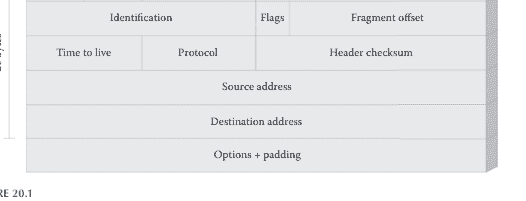

图 20.1
IPv4 头部。

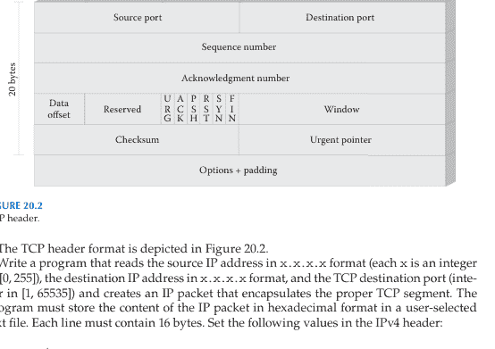

图 20.2
TCP 头部。

TCP 头部格式如图 20.2 所示。

编写一个程序，读取 x.x.x.x 格式的源 IP 地址（每个 x 是 [0, 255] 范围内的整数）、x.x.x.x 格式的目标 IP 地址，以及 TCP 目标端口（[1, 65535] 范围内的整数），并创建一个封装了相应 TCP 报文段的 IP 数据包。程序必须将 IP 数据包的内容以十六进制格式存储到用户选择的文本文件中。每行必须包含 16 个字节。在 IPv4 头部中设置以下值：

- a. 版本（Version）= 4。
- b. IHL = 5。
- c. 总长度 = IP 数据包的总长度，包括 TCP 数据。
- d. 协议 = 6。
- e. 生存时间（Time to Live）= 255。
- f. 目标地址 = 目标 IP 地址。
- g. 源地址 = 源 IP 地址。

在 TCP 头部中设置以下值：

- a. 目标端口 = 目标 TCP 端口。
- b. 源端口 = 1500。
- c. 窗口 = 允许的最大值。
- d. SYN 位 = 1。

将其余字段设置为 0，并假设不存在选项（Options）字段。

该程序有一个限制：如果目标 IP 地址以 130.140 或 160.170 开头，并且目标 TCP 端口为 80，则不创建 IP 数据包，并显示相关消息。

```c
#include <stdio.h>
#include <stdlib.h>

typedef unsigned char BYTE;
```


```
void Build_Pkt(int IP_src[], int IP_dst[], int port);
void Save_Pkt(BYTE pkt[], int len);
int read_text(char str[], int size, int flag);

int main(void)
{
    int IP_src[4], IP_dst[4], TCP_dst_port;

    do
    {
        printf("Enter dst port [1-65535]: ");
        scanf("%d", &TCP_dst_port);
    } while(TCP_dst_port < 1 || TCP_dst_port > 65535);

    printf("Enter dst IP (x.x.x.x): ");
    scanf("%d.%d.%d.%d", &IP_dst[0], &IP_dst[1], &IP_dst[2], &IP_dst[3]);

    if(TCP_dst_port == 80)
    {
        if(IP_dst[0] == 130 && IP_dst[1] == 140)
        {
            printf("It isn't allowed to connect to network\n130.140.x.x\n");
            return 0;
        }
        else if(IP_dst[0] == 160 && IP_dst[1] == 170)
        {
            printf("It isn't allowed to connect to network\n160.170.x.x\n");
            return 0;
        }
    }
    printf("Enter src IP (x.x.x.x): ");
    scanf("%d.%d.%d.%d", &IP_src[0], &IP_src[1], &IP_src[2], &IP_src[3]);

    Build_Pkt(IP_src, IP_dst, TCP_dst_port);
    return 0;
}

void Build_Pkt(int IP_src[], int IP_dst[], int port)
{
    BYTE pkt[40] = {0}; /* Initialize all fields to 0. */
    int i, j;

    pkt[0] = 0x45; /* Version, IHL. */
    pkt[8] = 255; /* Time to Live. */
    pkt[9] = 6; /* Protocol = TCP. */
    for(i = 12, j = 0; i < 16; i++, j++)
        pkt[i] = IP_src[j]; /* IP Source. */
    for(i = 16, j = 0; i < 20; i++, j++)
        pkt[i] = IP_dst[j]; /* IP Destination. */
    pkt[20] = 1500 >> 8; /* TCP Source Port. */
    pkt[21] = 1500 & 0xFF;
    pkt[22] = port >> 8; /* TCP Dest Port. */
pkt[23] = port & 0xFF;
pkt[33] = 2; /* SYN bit. */
pkt[34] = 0xFF; /* The maximum value for the Window field is all 16 bits set to 1. */
pkt[35] = 0xFF;
/* The values of the CheckSum and Urgent Pointer are set in positions 36-40, therefore the total length of the IP packet is 40 bytes. */
pkt[2] = 0; /* IP Total Length. */
pkt[3] = 40;

Save_Pkt(pkt, 40);
}

void Save_Pkt(BYTE pkt[], int len)
{
FILE *fp;
char name[100];
int i;

printf("Enter file name: ");
read_text(name, sizeof(name), 1);

fp = fopen(name, "w");
if(fp == NULL)
{
printf("Error: fopen() failed\n");
exit(EXIT_FAILURE);
}
for(i = 0; i < len; i++)
{
if(i%16 == 0)
{
putc('\n', fp);
}
fprintf(fp, "%02X ", pkt[i]);
}
fclose(fp);
}
```

注释：你知道这个程序到底做什么吗？这个程序是一个流行应用程序的过度简化版本，它几乎肯定安装在你的电脑上，那就是防火墙。像这个程序一样，防火墙可以阻止与特定IP地址和特定应用程序的通信（例如，Web服务器监听TCP端口80）。事实上，防火墙的主要部分不过是一系列if-else语句。

在真实的网络应用中，这个IP数据包被封装在MAC帧中（见C.11.38），网卡硬件将帧的比特编码为数字信号（例如，用两种不同的电压电平表示0和1），并将帧转发给连接的路由器。路由器检查IP目的地址，找到到达该目的地址的最佳路径，并将帧转发给下一个路由器。是的，我们明白，这对你来说完全是天书，我们只是想向你介绍计算机网络的迷人世界。

## C.20.6 假设有20家公司参加比赛。每家公司用[1, 20]范围内的分数给其他公司评分。编写一个程序，读取它们的名称（少于100个字符）以及

```
                tot_grd[j] += firm_grd[i][j]; /* Each tot_grd[j] holds the total score of the respective firm. */
            }
            getchar();
        }
        for(i = 0; i < MAX_FIRMS-1; i++)
        {
            for(j = i+1; j < MAX_FIRMS; j++)
            {
                if(tot_grd[i] < tot_grd[j])
                {
                    /* Swap grades and the corresponding names. */
                    k = tot_grd[i];
                    tot_grd[i] = tot_grd[j];
                    tot_grd[j] = k;

                    strcpy(tmp, firm_name[j]);
                    strcpy(firm_name[j], firm_name[i]);
                    strcpy(firm_name[i], tmp);
                }
            }
        }
        for(i = 0; i < MAX_FIRMS; i++)
            printf("%s: %d\n", firm_name[i], tot_grd[i]);
        return 0;
}
```

## C.20.7 以下程序的输出是什么？

```
#include <stdio.h>

void test(int **tmp);

int main(void)
{
    int *ptr, arr[] = {5, 10, 15};

    ptr = arr;
    test(&ptr);

    printf("%d ", *ptr);
    return 0;
}

void test(int **tmp)
{
    int i;

    i = *(*tmp)++;
    printf("%d ", i);

    i = ++(**tmp);
    printf("%d ", i);
}
```

### 答案：当调用 test() 时，我们有 tmp = &ptr，因此 *tmp 等价于 ptr。因此，表达式 i = *(*tmp)++ 等价于 i = *ptr++。这条语句首先将 *ptr 的值赋给 i，即 *ptr = *arr = arr[0] = 5，然后将 ptr 递增以指向 arr[1]。因此，程序显示 5。

然后，我们有 i = ++(*tmp) = ++(*ptr) = ++arr[1]。现在，arr[1] 首先递增并变为 11，然后该值被赋给 i。因此，程序显示 11。在 test() 执行之后，由于 ptr 指向 arr[1]，程序显示 11。

## C.20.8 编写一个程序，模拟一个简单的电子轮盘赌，允许玩家押注轮盘球下一次旋转的中奖号码是奇数还是偶数。

轮盘的数字从0到36。如果中奖号码是0，玩家输，因为0既不算奇数也不算偶数。程序应显示一个菜单以执行以下操作：

- 1. 押奇数
- 2. 押偶数
- 3. 旋转球
- 4. 统计
- 5. 终止

选择下注种类（即奇数或偶数）后，玩家应指定下注金额。当选择第三个选项时，程序应生成[0, 36]范围内的随机整数，并显示消息指示玩家赢还是输。第四个选项应显示一些统计数据，即玩家赢/输了多少次以及玩家赢或输多少钱。

我们把最好的留到最后。程序应写成这样：在游戏结束时，玩家一定已经输了。特别是，玩家必须输掉第一次下注，并且当他或她下注金额超过他或她输掉的金额时，也必须输。

```
#include <stdio.h>
#include <stdlib.h>
#include <time.h>

#define LOSS 0
#define WIN 1

void unfair_play(int sel, int bet, int *lost, int *times);
int fair_play(int sel, int bet, int *lost);

int main(void)
{
    int sel, last_sel, flag, tmp, bet, sum_lost, win_times,
    lost_times;

    flag = 1;
    sum_lost = win_times = lost_times = 0;

    while(1)
    {
        printf("\nRoulette Game\n");
printf("-------------\n");

printf("1. Odd\n");
printf("2. Even\n");
printf("3. Play\n");
printf("4. Stats\n");
printf("5. Exit\n");

printf("\nEnter choice: ");
scanf("%d", &sel);

srand(time(NULL));

switch(sel)
{
    case 1:
    case 2:
        last_sel = sel; /* last_sel holds the last choice of the player, before the third choice is selected. */
        do
        {
            printf("\nPlace your bet: ");
            scanf("%d", &bet);
        } while(bet <= 0);
        break;

    case 3:
        if(bet == 0)
        {
            printf("No bet is placed\n");
            break;
        }
        if(flag == 1) /* We force the program to play unfairly and make the player to lose the first bet. */
        {
            flag = 0;
            unfair_play(last_sel, bet,
                &sum_lost, &lost_times);
        }
        else
        {
            if(bet >= sum_lost) /* If the player bets a larger amount than the money he loses, the program behaves unfairly and the player loses. */
                unfair_play(last_sel, bet,
                    &sum_lost, &lost_times);
            else
            {
                tmp = fair_play(last_sel, bet,
                    &sum_lost);
                if(tmp == LOSS)
                {
                    printf("Sorry, you lost\n...");
&sum_lost);
```


```c
lost_times++;
}
else
{
    printf("\nYaaaaah, you won\n");
    win_times++;
}
}
bet = 0;
break;
case 4:
    printf("\nWin_Times: %d\tLost_Times: %d\tLost_Money: %d euro\n", win_times, lost_times, sum_lost);
    break;
case 5:
    return 0;
default:
    printf("\nWrong choice\n");
    break;
}
}
return 0;
/* The program generates a number, so that the player loses. For example, if the player bets on odd numbers the program generates an even number, and vice versa. */
void unfair_play(int sel, int bet, int *lost, int *times)
{
    int num;
    *lost += bet;
    (*times)++;
    while(1)
    {
        num = rand() % 37;
        if(sel == 1) /* The player bets on odd numbers. */
        {
            if((num & 1) == 0)
            {
                printf("\nThe ball goes to %d. Sorry, you lost ...\n", num);
                return;
            }
        }
        else /* The player bets on even numbers. */
        {
            if((num & 1) == 1)
{
    printf("\nThe ball goes to %d. Sorry, you lost ...\n", num);
    return;
}
}
}

int fair_play(int sel, int bet, int *lost)
{
    int num;

    num = rand() % 37;
    printf("\nThe ball goes to %d. ", num);

    if(num == 0) /* If zero comes out, the player loses. */
    {
        *lost += bet;
        return LOSS;
    }
    if(sel == 1) /* The player bets on odd numbers. */
    {
        if((num & 1) == 1)
        {
            *lost -= bet; /* If the player wins, the total lost amount is reduced. */
            return WIN;
        }
        else
            *lost += bet; /* If the player loses, the total lost amount is increased. */
    }
    else /* The player bets on even numbers. */
    {
        if((num & 1) == 0)
        {
            *lost -= bet;
            return WIN;
        }
        else
            *lost += bet;
    }
    return LOSS;
}
```

注释：由于程序控制着赌注，玩家最终会输掉，即使他或她赢的次数比输的多。换句话说，程序在玩家身上制造出“不幸”的感觉，而实际上它是在欺骗他或她。

然而，本练习的主要目的是教学性的。通过这个简单的模拟示例，我们想向你展示赌博游戏的软件可以被编写成制造“霉运”的感觉，而玩家只不过是欺诈的受害者。

因此，远离在线游戏以及任何类型的电子“幸运机器”（例如老虎机、水果机等等）。它们承诺的巨额利润不是给你的，而是给它们所有者的。

## C.20.9 以下程序的输出是什么？

```c
#include <stdio.h>

void test(int val, int *tmp);

int main(void)
{
    int *ptr, i, arr[] = {5, 10, 15};

    ptr = arr;
    for(i = 0; i < 2; i++)
    {
        test(*ptr, ptr);
        ptr++;
    }
    while(ptr >= arr)
    {
        printf("%d ", *ptr);
        ptr--;
    }
    return 0;
}

void test(int val, int *tmp)
{
    printf("%d %d\n", ++val, (*tmp)++);
}
```

### 答案：

for 循环的第一次迭代：当调用 test() 时，我们有 val = *ptr = *arr = arr[0] = 5。表达式 ++val 首先将 val 增加一，程序显示 6。此外，我们有 tmp = ptr = arr。因此，表达式 (*tmp)++ 等价于 (*arr)++ = arr[0]++。现在，程序首先显示 arr[0] 的值，即 5，然后它被加一。

for 循环的第二次迭代：ptr 已被增加，因此它指向第二个元素。当调用 test() 时，我们有 val = *ptr = *(arr+1) = arr[1] = 10。表达式 ++val 将 val 增加，程序显示 11。此外，我们有 tmp = ptr = arr+1 = &arr[1]。因此，表达式 (*tmp)++ 等价于 arr[1]++。程序首先显示 arr[1] 的值，即 10，然后它被加一。

while 循环的执行：ptr 已被增加，因此它指向第三个元素。因此，第一次迭代显示 arr[2] 的值，即 15，且 ptr 被递减并指向 arr[1]。因此，第二次迭代显示 arr[1] 的值，即 11，最后一次显示 arr[0] 的值，即 6。

总之，程序显示：

```
6  5
11 10
15 11  6
```

## C.20.10 由于 C 程序执行速度相当快，C 语言常被用于实现密码算法。作为示例，我们将描述最简单且最著名的密码算法之一。

凯撒算法是 Julius Caesar 用于加密其消息的最古老的密码方法之一。根据该算法，每个字符都被替换为其后三个位置的字符。例如，如果我们在英语字母表中应用凯撒算法，消息 "Watch out for Ovelix !!!" 被加密为 "ZdwfEk rxw iru Ryhola !!!"。请注意，字符 'x' 被加密为 'a'，因为替换会从字母表的开头继续。同样，'y' 被替换为 'b'，'z' 被替换为 'c'。接收方通过将每个字符替换为其前三个位置的字符来解密消息。

编写一个程序，提供菜单执行以下操作：

- 1. 文件加密。程序应读取文件名和用于加密其内容的密钥。例如，在凯撒算法的情况下，密钥为 3。程序应仅加密小写和大写字符。
- 2. 文件解密。程序应读取文件名和用于解密其内容的密钥。
- 3. 程序终止。

```c
#include <stdio.h>
#include <stdlib.h>
#include <string.h>

void cipher(FILE *fp_in, FILE *fp_out, int key);
void decipher(FILE *fp_in, FILE *fp_out, int key);
int read_text(char str[], int size, int flag);

int main(void)
{
    FILE *fp_in, *fp_out;
    char str[100];
    int sel, key;

    while(1)
    {
        printf("\nMenu selections\n");
        printf("---------------\n");
        printf("1. Cipher\n");
        printf("2. Decipher\n");
        printf("3. Exit\n");

        printf("\nEnter choice: ");
        scanf("%d", &sel);
```
```c
switch(sel)
{
    case 1:
    case 2:    /* Check whether the input key is valid or not. Since we are using the English alphabet, the valid values are between 1 and 25. */
        do
        {
            printf("Enter key size: ");
            scanf("%d", &key);
        } while(key < 1 || key > 25);
        getchar();
        printf("Input file: ");
        read_text(str, sizeof(str), 1);
        fp_in = fopen(str, "r");
        if(fp_in == NULL)
        {
            printf("Error: fopen() for %s failed\n", str);
            exit(EXIT_FAILURE);
        }
        printf("Output file: ");
        read_text(str, sizeof(str), 1);
        fp_out = fopen(str, "w");
        if(fp_out == NULL)
        {
            printf("Error: fopen() for %s failed\n", str);
            exit(EXIT_FAILURE);
        }
        if(sel == 1)
            cipher(fp_in, fp_out, key);
        else
            decipher(fp_in, fp_out, key);
        fclose(fp_in);
        fclose(fp_out);
        break;
    case 3:
        return 0;
    default:
        printf("\nWrong choice\n");
        break;
}
return 0;
}
```
```c
void cipher(FILE *fp_in, FILE *fp_out, int key)
{
    int ch;

    while(1)
    {
        ch = getc(fp_in);
        if(ch == EOF)
            return;
        /* Only the lower and upper case characters are encrypted. */
        if(ch >= 'A' && ch <= 'Z')
        {
            ch += key;
            if(ch > 'Z')
                ch -= 26;
        }
        else if(ch >= 'a' && ch <= 'z')
        {
            ch += key;
            if(ch > 'z')
                ch -= 26;
        }
        putc(ch, fp_out);
    }
}

void decipher(FILE *fp_in, FILE *fp_out, int key)
{
    int ch;

    while(1)
    {
        ch = getc(fp_in);
        if(ch == EOF)
            return;
        /* Only the lower and upper case characters are decrypted. */
        if(ch >= 'A' && ch <= 'Z')
        {
            ch -= key;
            if(ch < 'A')
                ch += 26;
        }
        else if(ch >= 'a' && ch <= 'z')
        {
            ch -= key;
            if(ch < 'a')
                ch += 26;
        }
        putc(ch, fp_out);
    }
}
```

注释：在 cipher() 中，密钥被加到每个字符上。如果新值超过字母表的最后一个字符（'Z' 或 'z'），我们减去 26 以回到字母表的开头。在 decipher() 中，执行相反的操作。

## C.20.11 以下程序的输出是什么？

```
#include <stdio.h>
#include <string.h>

void test(char a, char str[], char *ptr);

int main(void)
{
    char *tmp, txt[20] = "abcde";
    tmp = txt;
    test(*(tmp+1), txt+3, &txt[1]);
    printf("%s\n", txt);
    return 0;
}

void test(char a, char str[], char *ptr)
{
    strcpy(str, "1234");
    str[0] = a;
    ptr[2] = *str + 5;
}
```

答案：调用 test() 时，我们有：

- a. a = *(tmp+1) = *(txt+1) = txt[1] = b.
- b. str = txt+3, 所以 str[0] 等于 txt[3]。
- c. ptr = &txt[1] = txt+1. 由于 ptr 指向 txt[1]，ptr[0] 等于 txt[1]，ptr[1] 等于 txt[2]，而 ptr[2] 等于 txt[3]。

strcpy() 将字符串 "1234" 复制到 str 所指向的内存中。由于 str 指向 txt[3]，txt 的内容变为 "abc1234"。

语句 str[0] = a; 等价于 txt[3] = a。由于 a 的值等于 'b'，txt[3] 变为 'b'，txt 的内容更改为 "abcb234"。

如上所述，str[0] 和 ptr[2] 的值都等于 txt[3]。因此，*str 等于 'b'，语句 ptr[2] = *str +5; 等价于 txt[3] = 'b'+5; 意味着 txt[3] 变为位于 'b' 之后五个位置的字符，即 'g'。

因此，程序显示 abcg234。

## C.20.12 假设我们在一个 C 类 IP 网络中创建了子网。当 IP 地址的第一个八位组（字节）在 [192, 223] 范围内时，IP 网络被指定为 C 类。编写一个程序，读取 IP 地址的最后一个八位组和子网掩码，并显示所有子网的地址、每个子网的广播地址以及 IP 地址所属的子网。

例如，假设我们有一个 C 类 IP 网络（例如 x.x.x.x），并且用户输入 74。因此，我们必须找出 IP 地址 x.x.x.74 属于哪个子网。为了找到子网，用户必须以以下两种方式之一输入子网掩码：

- a. 要么输入子网掩码的最后一个八位组（有效值是 252、248、240、224、192、128），或，
- b. 输入网络位数，该数必须是一个介于 [25, 30] 的整数。

为了找出子网，我们计算它们之间的距离：

- a. 在第一种情况下，距离等于 256−x，其中 x 是输入的数字。
- b. 在第二种情况下，距离等于 2^(32−x)，其中 x 是输入的位数。例如，如果用户输入 26，则距离等于 2^(32−26)=2^6=64。

从 IP 地址 x.x.x.0 开始，每个子网的 IP 地址从距离的倍数开始，而广播 IP 地址是每个子网的最后一个地址。例如，如果距离为 64，可以创建四个子网（即 256/64），并且每个子网从 64 的倍数 IP 地址开始。广播地址始终比下一个子网的地址少一。程序应按如下方式显示每个 IP 地址的最后一个八位组：

| 网络 | .0 | .64 | .128 | .192 |
| 广播 | .63 | .127 | .191 | .255 |

可以分配给系统的有效 IP 范围是子网地址和广播地址之间的数字。因此，具有 IP 地址 x.x.x.74 的系统是第二个子网的成员，因为它的最后一个八位组落在 [64, 127] 中。

尽管这个练习的长度可能会让你望而却步，但对于学习“计算机网络”课程的人来说，在理论和编程层面学习一种快速创建 IP 子网的简单方法会很有用。这种方法对于另外两个类别 A 和 B 也同样适用。当然，子网划分还有其他几种方法；然而，这种方法帮助我在路由器中轻松快速地配置 IP 地址，并在 IP 网络中检测配置错误。我绝对推荐它。

```
#include <stdio.h>
#include <stdlib.h>
int main(void)
{
    int i, j, flag, sel, num, dist, host_byte;

    do
    {
        printf("Enter last host byte [0-255]: ");
        scanf("%d", &host_byte);
    } while(host_byte < 0 || host_byte > 255);

    do
    {
        flag = 0;
        printf("Enter mask (0: 255.255.255.x form or 1: /bits form): ");
        scanf("%d", &sel);
        if(sel == 0)
        {
            printf("Enter last mask octet 255.255.255.");
            scanf("%d", &num);
            if(num != 252 && num != 248 && num != 240
                && num != 224 && num != 192 && num != 128)
            {
                printf("Last octet should be one of {128, 192, 224, 240, 248, 252}\n");
                flag = 1;
            }
            else
                dist = 256-num;
        }
        else if(sel == 1)
        {
            printf("Enter network bits: /");
            scanf("%d", &num);
            if(num < 25 || num > 30)
            {
                printf("Enter valid mask /25-/30\n");
                flag = 1;
            }
            else
            {
                num = 32-num;
                dist = 1;
                for(i = 0; i < num; i++)
                    dist = dist*2;    /* For faster implementation we could replace the loop with dist = 1 << num; */
            }
        }
    } while(flag == 1);

    printf("\nThe mask 255.255.255.%d produces %d subnets, each with %d hosts\n", 256-dist, 256/dist, dist-2);

    printf("\nNetwork  : ");
    for(i = 0; i < 256; i+=dist)
        printf("%d\t", i);

    printf("\nBroadcast : ");
    for(i = dist-1; i < 256; i+=dist)
        printf("%d\t", i);

    for(i=j=0; i < 256; i+=dist, j++)
    {
        if(host_byte >= i && host_byte < i+dist)
        {
            if(host_byte == i)
                printf("\n\nThe x.x.x.%d address is the network address of subnet_%d\n", host_byte, j+1);
            else if (host_byte == i-dist-1)
                printf("\n\nThe x.x.x.%d address is the broadcast address of subnet_%d\n", host_byte, j+1);
            else
                printf("\n\nThe x.x.x.%d address belongs in subnet %d\n", host_byte, j+1);
        }
        break;
    }
    return 0;
}
```

## C.20.13 以下程序的输出是什么？

```
#include <stdio.h>
int main(void)
{
    char *arr[] = {"TEXT", "SHOW", "OPTIM", "DAY"};
    char **ptr1;
    ptr1 = arr;
    printf("%s\n", *++ptr1);
    printf("%s\n", *++ptr1+2);
    printf("%s\n", **++ptr1+1);
    return 0;
}
```

答案：arr 数组被声明为指向字符串的指针数组。特别是，arr[0] 指向 "TEXT"，arr[1] 指向 "SHOW"，以此类推。语句 ptr1 = arr; 使 ptr1 指向 arr[0] 的地址。

表达式 ++ptr1 使 ptr1 指向 arr[1]。由于 *++ptr1 等价于 arr[1]，程序显示 SHOW。

类似地，表达式 ++ptr1+2 首先使 ptr1 指向 arr[2]。由于 *++ptr1 等价于 arr[2]，printf() 等价于 printf("%s", ptr[2]+2); 程序跳过 "OPTIM" 的前两个字符并显示 TIM。

同上，表达式 ++ptr1+1 首先使 ptr1 指向 arr[3]。因此，**++ptr1 等价于 *arr[3]。*arr[3] 的值是什么？由于 arr[3] 指向 "DAY" 的第一个字符，*arr[3] 等于 'D'。因此，*arr[3]+1 的值是 'E'，程序显示 E。

结果，程序显示：SHOW TIME。

## C.20.14 编写一个程序来模拟流行的游戏 master-mind。

程序应生成由六种可用颜色中随机选择的四个不同颜色的序列（例如，red:0, green:1, blue:2, white:3, black:4, yellow:5）。这是秘密序列。然后程序应提示用户输入颜色序列以找到秘密序列。对于每个给定的序列，程序应告知用户正确位置的正确颜色数量以及位置错误但颜色正确的数量。

例如，如果要找到的秘密序列是：0 1 2 3，而用户输入的序列是：5 1 4 2，程序应显示：“一个颜色在正确位置且一个颜色在错误位置。”如果用户进行 10 次不成功的尝试，程序终止，用户失败。

```
#include <stdio.h>
#include <stdlib.h>
#include <time.h>

#define DEBUG

void guess_code(int guess[]);

int main(void)
{
    int i, j, k, found, corr_guess, col_guess, code[4], guess[4];

    srand(time(NULL));
    i = 0;
    /* Generate a random sequence with four different colors. */
    while(i < 4)
    {
        code[i] = rand()%6;
        found = 0;
        for(j = 0; j < i; j++)
        {
            if(code[j] == code[i])
            {
                found = 1;
                break;
            }
        }
        if(found == 0)
            i++;
    }
#ifdef DEBUG
    printf("\n**** Secret code is: %d %d %d %d\n\n", code[0], code[1], code[2], code[3]);
#endif
    for(i = 0; i < 10; i++)
    {
        guess_code(guess);

        corr_guess = col_guess = 0;
        /* Calculate the number of right colors in right places. */
        for(j = 0; j < 4; j++)
        {
            if(guess[j] == code[j])
                corr_guess++;
        }
    }
```


```
if(corr_guess == 4)
{
    printf("\nCongratulations !!! You did it in %d attempts\n", i+1);
    return 0;
}
/* Calculate the number of right colors in wrong places. */
for(j = 0; j < 4; j++)
{
    for(k = 0; k < 4; k++)
    {
        /* The second term is needed, in order not to
add again the number of right colors in right places. */
        if((guess[k] == code[j]) && (k != j))
        {
            col_guess++;
            break;
        }
    }
}
printf("Colors in right places = %d\nMatching colors in wrong places = %d\n", corr_guess, col_guess);
}
printf("\nFail: The secret code is %d %d %d %d\n", code[0], code[1], code[2], code[3]);
return 0;
}

/* For simplicity, we assume that the user enters different colors. */
void guess_code(int guess[])
{
    int i, col;

    i = 0;
    while(i < 4)
    {
        printf("Enter color (RED:0,GREEN:1,BLUE:2,WHITE:3,BLACK:4,YEL:5): ");
        scanf("%d", &col);

        switch(col)
        {
            case 0:
            case 1:
            case 2:
            case 3:
            case 4:
            case 5:
                guess[i] = col;
                i++;
            break;

            default:
                printf("Wrong choice\n");
```
```
}
}
    break;
}
```
### 注释
我们没有移除 DEBUG 宏的原因是向你展示如何使用宏来检查程序的运行情况。

## C.20.15 编写一个可用作图书库管理应用程序的程序。定义结构类型 `book`，其成员为：`title`、`authors` 和 `code`。假设 `test.bin` 二进制文件已存在，并包含该类型的结构。编写一个程序，提供菜单以执行以下操作：

- 1. 添加一本新书。程序应读取一本新书的数据，并将其添加到文件末尾。
- 2. 查找一本书。程序应读取一本书的书名并显示其详细信息。如果用户输入 *，程序应显示所有书籍的详细信息。
- 3. 修改一本书。程序应读取一本书的书名及其新数据，并用新数据替换现有数据。
- 4. 删除一本书。程序应读取一本书的书名，并将其 code 设为 -1。
- 5. 程序终止。

```
#include <stdio.h>
#include <stdlib.h>
#include <string.h>

#define LEN 50

typedef struct
{
    char title[LEN];
    char auth[LEN];
    int code;
} book;

void read_data(book *ptr);
void find_book(FILE *fp, char title[]);
void modify_book(FILE *fp, book *ptr, int flag);
void show_books(FILE *fp);

int read_text(char str[], int size, int flag);

int main(void)
{
    FILE *fp;
    char title[LEN];
    int sel;
    book b;

    fp = fopen("test.bin", "r+b");
```
```
if(fp == NULL)
{
    printf("Error: fopen() failed\n");
    exit(EXIT_FAILURE);
}
while(1)
{
    printf("\nMenu selections\n");
    printf("------------------\n");

    printf("1. Add Book\n");
    printf("2. Find Book\n");
    printf("3. Modify Book \n");
    printf("4. Erase Book\n");
    printf("5. Exit\n");

    printf("\nEnter choice: ");
    scanf("%d", &sel);
    getchar();

    switch(sel)
    {
    case 1:
        read_data(&b);
        fseek(fp, 0, SEEK_END); /* Add the book at the end of the file. */
        fwrite(&b, sizeof(book), 1, fp);
        break;

    case 2:
        printf("\nTitle to search: ");
        read_text(title, sizeof(title), 1);
        if(strcmp(title, "**") != 0)
            find_book(fp, title);
        else
            show_books(fp);
        break;

    case 3:
        read_data(&b);
        modify_book(fp, &b, 0);
        break;

    case 4:
        printf("\nTitle to search: ");
        read_text(b.title, sizeof(b.title), 1);
        modify_book(fp, &b, 1);
        break;

    case 5:
        fclose(fp);
        return 0;
    }
```
```c
default:
    printf("\nWrong choice\n");
    break;
}
}
return 0;
}

void read_data(book *ptr)
{
    printf("\nTitle: ");
    read_text(ptr->title, sizeof(ptr->title), 1);
    printf("Authors: ");
    read_text(ptr->auth, sizeof(ptr->auth), 1);
    do
    {
        printf("Code [> 0]: ");
        scanf("%d", &ptr->code);
    }
    while(ptr->code <= 0);
}

void find_book(FILE *fp, char title[])
{
    book b;
    fseek(fp, 0, SEEK_SET);
    while(1)
    {
        if(fread(&b, sizeof(book), 1, fp) != 1)
            break;
        else
        {
            if(strcmp(b.title, title) == 0)
            {
                printf("\nT:%s A:%s C:%d", b.title, b.auth, b.code);
                return;
            }
        }
    }
    printf("\n%s doesn't exist", title);
}

void modify_book(FILE *fp, book *ptr, int flag)
{
    book b;
    fseek(fp, 0, SEEK_SET);
    while(1)
    {
        if(fread(&b, sizeof(book), 1, fp) != 1)
            break;
        else
```
```
{
    if(strcmp(b.title, ptr->title) == 0)
    {
        /* Now, fp points to the next entry. We call fseek(), to make it point at the current entry. */
        fseek(fp, -sizeof(book), SEEK_CUR);
        if(flag == 0)
            fwrite(ptr, sizeof(book), 1, fp);
        else
        {
            b.code = -1; /* Set the code to -1. */
            fwrite(&b, sizeof(book), 1, fp);
            printf("\n%s title is erased", ptr->title);
        }
        return;
    }
}
printf("\n%s doesn't exist", ptr->title);
}
void show_books(FILE *fp)
{
    book b;
    fseek(fp, 0, SEEK_SET);
    while(1)
    {
        if(fread(&b, sizeof(book), 1, fp) != 1)
            return;
        else
            printf("T:%s A:%s C:%d\n", b.title, b.auth, b.code);
    }
}
```

## C.20.16 置换法是对称密码学的一个例子，其中发送方和接收方共享一个公共密钥。加密密钥是一个 n 位整数（n ≤ 9）。每一位必须介于 1 和 n 之间，且只出现一次。在加密过程中，消息被分成大小为 n 的段。例如，由于这是最后一个练习（是的，过一会儿我们就放你自由），假设我们使用密钥 25413 加密来自 Doors 乐队经典歌曲《The End》的消息 This is the end!!。由于密钥长度为 5，消息被分成四个每段 5 个字符的段。如果最后一段的大小小于密钥长度，则添加填充字符。假设填充字符为 *，如图 20.3 所示。

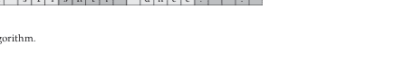

### 图 20.3
置换加密算法。

每段中的字符根据密钥数字重新排列。例如，原始消息的第二个字符成为加密段中的第一个字符，第五个字符移到第二个位置，第四个字符移到第三个位置，依此类推，如图 20.3 所示。对每一段重复此过程。

接收方使用相同密钥解密消息。执行相反过程。例如，第一个加密段的第一个字符对应原始消息的第二个字符，第二个字符对应第五个字符，第三个字符对应第四个字符，依此类推。

编写一个程序，读取少于 100 个字符的字符串、加密密钥和填充字符，并使用该方法加密该字符串。然后，程序应解密该消息并显示它。

```c
#include <stdio.h>
#include <stdlib.h>
#include <string.h>

int read_text(char str[], int size, int flag);

int main(void)
{
    char pad_ch, key_str[10], in_str[110] = {0}, out_str[110] = {0};
/* The size of the arrays is more than 100 characters, to cover the case
   of padding characters in the last segment. */
    int i, j, tmp, seg, key_len, max_key_dig, msg_len;

    tmp = 1;
    while(tmp)
    {
        tmp = 0; /* The loop ends only if tmp remains 0. */
        printf("Enter 1 up to 9 different key digits: ");
        key_len = read_text(key_str, sizeof(key_str), 1);
        if(key_len < 1 || key_len > 9)
        {
            printf("Error: Length should be 1 to 9 different digits\n");
            tmp = 1;
            continue;
        }
        max_key_dig = '0'; /* This variable holds the key digit with the highest value. */
        for(i = 0; (tmp != 1) && i < key_len; i++)
        {
            if(key_str[i] < '1' || key_str[i] > '9')
            {
                printf("Error: Only digits are allowed\n");
                tmp = 1;
                break;
            }
            if(key_str[i] > max_key_dig)
                max_key_dig = key_str[i];
            /* Check if each digit appears once. */
            for(j = i+1; j < key_len; j++)
```

{
    if(key_str[i] == key_str[j])
    {
        printf("Error: Digits should be different\n");
        tmp = 1;
        break;
    }
}
if(tmp == 0)
{
    max_key_dig -= '0';
    if(key_len != max_key_dig) /* For example, the key value 125 is not acceptable, because the value of the highest digit (i.e., 5) is not equal to the key length, which is 3. */
    {
        printf("Error: Digits should be from 1 to %d\n", key_len);
        tmp = 1;
    }
}
printf("Enter padding character: ");
pad_ch = getchar();
getchar();
while(1)
{
    printf("Enter text: ");
    msg_len = read_text(in_str, sizeof(in_str), 1);
    if(msg_len >= key_len)
        break;
    else
        printf("Error: Text length must be greater than the key size\n");
}
seg = msg_len/key_len;
tmp = msg_len - (seg*key_len);
if(tmp != 0) /* If it is not 0, it means that the message length is not divided exactly by the length of the key and padding characters must be added. Notice that the replacement starts from the position of the null character. */
{
    seg++;
    for(i = 0; i < key_len-tmp; i++)
        in_str[msg_len+i] = pad_ch;
}
for(i = 0; i < seg; i++)
{
    for(j = 0; j < key_len; j++)
    {
        tmp = key_str[j]-1; /* We subtract the ASCII value of
1, in order to use tmp as an index to the original message. */
        out_str[i*key_len + j] = in_str[i*key_len+tmp];
    }
}
printf("Encoded text: %s\n", out_str);
for(i = 0; i < seg; i++)
{
    for(j = 0; j < key_len; j++)
    {
        tmp = key_str[j]-1;
        in_str[i*key_len+tmp] = out_str[i*key_len+j];
    }
}
printf("Decoded text: %s\n", in_str); /* Any padding characters
appear at the end of the original message. */
    return 0;
}

## 附录 1：优先级表

表 A.1.1 按优先级从高到低列出 C 运算符。同一行中的运算符具有相同的优先级。最后一列说明相同优先级的运算符的求值顺序。

表 A.1.1
优先级表

| 优先级 | 运算符 | 结合性 |
|---|---|---|
| 1 | () （括号-函数调用） [] -> . ++(后置) --(后置) | 从左到右 |
| 2 | ++(前置) --(前置) ! ~ *(解引用) &(取地址) +(一元) -(一元) (类型转换) sizeof | 从右到左 |
| 3 | *(乘法) / % | 从左到右 |
| 4 | +(二元) -(二元) | 从左到右 |
| 5 | << >> | 从左到右 |
| 6 | < <= > >= | 从左到右 |
| 7 | == != | 从左到右 |
| 8 | & | 从左到右 |
| 9 | ^ | 从左到右 |
| 10 | \| | 从左到右 |
| 11 | && | 从左到右 |
| 12 | \|\| | 从左到右 |
| 13 | ? : | 从右到左 |
| 14 | = += -= *= /= %= &= ^= \|= <<= >>= | 从右到左 |
| 15 | , | 从左到右 |

## 附录 2：ASCII 码表

本附录介绍标准（0–127）和扩展（128–255）ASCII 字符集。

### 表 A.2.1 ASCII 字符集

| 十进制 | 十六进制 | 名称 | 字符 | Ctrl+字符 | 十进制 | 十六进制 | 字符 | 十进制 | 十六进制 | 字符 | 十进制 | 十六进制 | 字符 | 十进制 | 十六进制 | 字符 | 十进制 | 十六进制 | 字符 | 十进制 | 十六进制 | 字符 | 十进制 | 十六进制 | 字符 |
|---|---|---|---|---|---|---|---|---|---|---|---|---|---|---|---|---|---|---|---|---|---|---|---|---|
| 0 | 0 | 空字符 |  | CTRL@ | 32 | 20 | 空格 | 64 | 40 | @ | 96 | 60 | ` | 128 | 80 |  | 160 | A0 |  | 192 | C0 |  | 224 | E0 |  |
| 1 | 1 | 标题开始 |  | CTRL A | 33 | 21 | ! | 65 | 41 | A | 97 | 61 | a | 129 | 81 |  | 161 | A1 |  | 193 | C1 |  | 225 | E1 |  |
| 2 | 2 | 正文开始 |  | CTRL B | 34 | 22 | " | 66 | 42 | B | 98 | 62 | b | 130 | 82 |  | 162 | A2 |  | 194 | C2 |  | 226 | E2 |  |

## 附录 3：库函数

本附录简要介绍 C 标准库函数。

### <assert.h>

`void assert(int exp)`：如果 `exp` 的值为 0，则显示一条诊断消息并终止程序。否则，不做任何事。

### <ctype.h>

`int isalnum(int ch)`：如果 ch 是字母数字字符（例如 a-z、A-Z 或 0-9），则返回非零值；否则返回 0。
`int isalpha(int ch)`：如果 ch 是字母字符（例如 a-z 或 A-Z），则返回非零值；否则返回 0。
`int iscntrl(int ch)`：如果 ch 是控制字符，则返回非零值；否则返回 0。
`int isdigit(int ch)`：如果 ch 是十进制数字，则返回非零值；否则返回 0。
`int isgraph(int ch)`：如果 ch 是打印字符（空格除外），则返回非零值；否则返回 0。
`int islower(int ch)`：如果 ch 是小写字母，则返回非零值；否则返回 0。
`int isprint(int ch)`：如果 ch 是打印字符（包括空格），则返回非零值；否则返回 0。
`int ispunct(int ch)`：如果 ch 是标点字符，则返回非零值；否则返回 0。
`int isspace(int ch)`：如果 ch 是空白字符，则返回非零值；否则返回 0。
`int isupper(int ch)`：如果 ch 是大写字母，则返回非零值；否则返回 0。
`int isxdigit(int ch)`：如果 ch 是十六进制数字（a-f、A-F、0-9），则返回非零值；否则返回 0。
`int tolower(int ch)`：如果 ch 是大写字母，则返回对应的小写字母；否则返回 ch 本身。
`int toupper(int ch)`：如果 ch 是小写字母，则返回对应的大写字母；否则返回 ch 本身。

### <locale.h>

`struct lconv *localeconv()`：返回指向 `lconv` 类型结构的指针，该结构包含有关本地设置的信息。
`char *setlocale(int category, char *locale)`：设置由 category 和 locale 指定的程序区域设置部分。

### <math.h>

`int abs(int a)`：返回 a 的绝对值。
`double acos(double a)`：返回 a 的反余弦值，范围在 0 到 π 之间。
`double asin(double a)`：返回 a 的反正弦值，范围在 −π/2 到 π/2 之间。
`double atan(double a)`：返回 a 的反正切值，范围在 −π/2 到 π/2 之间。
`double atan2(double a, double b)`：返回 a/b 的反正切值，范围在 −π 到 π 之间。
`double ceil(double a)`：返回大于或等于 a 的最小整数。
`double cos(double a)`：返回 a 的余弦值。
`double cosh(double a)`：返回 a 的双曲余弦值。
`double exp(double a)`：返回 e^a 的结果，其中 e 是自然对数的底数，即 2.7182...。
`double fabs(double a)`：返回 a 的绝对值。
`double floor(double a)`：返回小于或等于 a 的最大整数。
`double fmod(double a, double b)`：返回 a/b 的浮点余数。
`double frexp(double a, int *ptr)`：将 a 分解为小数部分 m 和指数 n，使得 a = m×2^n。返回 m。
`long labs(long a)`：返回 a 的绝对值。
`double ldexp(double a, int n)`：返回 a×2^n 的结果。
`double log(double a)`：返回 ln(a) 的结果。
`double log10(double a)`：返回以 10 为底 a 的对数结果。
`double modf(double a, double *ptr)`：将 a 分解为整数部分和小数部分。返回小数部分。
`double pow(double a, double b)`：返回 a^b 的结果。
`double sin(double a)`：返回 a 的正弦值。
`double sinh(double a)`：返回 a 的双曲正弦值。
`double sqrt(double a)`：返回 a 的平方根。
`double tan(double a)`：返回 a 的正切值。
`double tanh(double a)`：返回 a 的双曲正切值。

### <setjmp.h>

`int setjmp(jmp_buf env)`：将当前栈环境存储在 env 中。
`void longjmp(jmp_buf env, int val)`：恢复存储在 env 中的环境。

### <signal.h>

`int raise(int sig)`：向程序发送 sig 信号。如果成功则返回 0，否则返回非零值。
`void (*signal(int sig, void (*func)(int)))(int)`：它以整数和指向另一个函数的指针作为参数，该函数接受一个整数参数并返回空。它返回一个指向函数的指针，该函数接受一个整数参数并返回空。signal() 将 func 所指向的函数建立为 sig 信号的处理程序。

### <stdarg.h>

`void va_start(va_list arg_ptr, type)`：将 arg_ptr 初始化为指向可变参数列表的开头。
`type va_arg(va_list arg_ptr, type)`：获取 arg_ptr 所指示的参数值。
`void va_end(va_list arg_ptr)`：终止对可变参数列表的处理。

### <stdio.h>

`void clearerr(FILE *fp)`：清除 fp 所指向文件的错误指示符。
`int fclose(FILE *fp)`：关闭 fp 所指向的文件。如果成功则返回 0，否则返回 EOF。
`int feof(FILE *fp)`：如果到达 fp 所指向文件的末尾，则返回非零值；否则返回 0。
`int ferror(FILE *fp)`：如果 fp 所指向的文件发生错误，则返回非零值；否则返回 0。
`int fflush(FILE *fp)`：将 fp 所指向输出文件中未写入的数据写入。如果是指向输入文件，则行为未定义。如果成功则返回 0，否则返回 EOF。
`int fgetc(FILE *fp)`：从 fp 所指向的文件中读取一个字符（以 unsigned char 转换为 int）。如果成功则返回读取的字符；如果到达文件末尾或发生读取错误，则返回 EOF。
`int fgetpos(FILE *fp, fpos_t *pos)`：将 fp 所指向文件的当前位置存储到 pos 所指向的 fpos_t 变量中。如果成功则返回 0，否则返回非零值。
`char *fgets(char *str, int n, FILE *fp)`：从 fp 所指向的文件读取字符，直到遇到换行符、读取了 n-1 个字符或到达文件末尾（以先到者为准）。字符写入 str 所指向的数组。如果到达文件末尾或发生读取错误，则返回 NULL；否则返回 str。
`FILE *fopen(const char *filename, const char *mode)`：根据 mode 参数打开 filename 指定的文件。返回与该文件关联的指针；如果文件无法打开，则返回 NULL。
`int fprintf(FILE *fp, char *format, ...)`：按照 format 指定的格式向 fp 所指向的文件写入数据。返回写入的字符数；如果发生错误，则返回负值。
`int fputc(int ch, FILE *fp)`：将字符 ch 写入 fp 所指向的文件。返回写入的字符；如果发生错误，则返回 EOF。
`int fputs(const char *str, FILE *fp)`：将 str 所指向的字符串写入 fp 所指向的文件。如果成功则返回非负值，否则返回 EOF。


int fread(void *buf, int size, int count, FILE *fp): 从 fp 指向的文件中读取 count 个每个 size 字节的元素，并将它们存储到 buf 指向的数组中。它返回成功读取的元素数。

FILE *freopen(const char *filename, const char *mode, FILE *fp): 关闭 fp 指向的文件并根据 mode 参数打开 filename 指定的新文件。它返回与新文件关联的指针，如果文件无法打开则返回 NULL。

int fscanf(FILE *fp, const char *mode, ...): 根据 mode 指定的格式从 fp 指向的文件中读取数据。它返回成功读取并存储的数据项数，如果到达文件末尾或发生读取错误则返回 EOF。

int fseek(FILE *fp, long offset, int origin): 将 fp 指示的文件指针移动到距离 origin 指定的位置 offset 字节的新位置。如果成功返回 0，否则返回非零值。

int fsetpos(FILE *fp, const fpos_t *pos): 将 fp 指示的文件指针移动到 pos 参数指定的位置。如果成功返回 0，否则返回非零值。

long ftell(FILE *fp): 它返回 fp 指示的文件指针从文件开头开始的当前位置。

int fwrite(const void *buf, int size, int count, FILE *fp): 将 buf 指向的数组中的 count 个每个 size 字节的元素写入 fp 指向的文件。它返回写入的元素数。

int getc(FILE *fp): 类似于 fgetc()。

int getchar(): 从 stdin 读取一个字符。如果成功返回读取的字符，如果到达文件末尾或发生读取错误则返回 EOF。

char *gets(char *str): 从 stdin 读取字符并将它们存储到 str 指向的数组中。它用空字符替换换行字符。它返回 str 或如果到达文件末尾或发生读取错误则返回 NULL。

void perror(const char *str): 向 stderr 流显示诊断错误消息。

int printf(const char *mode, ...): 类似于 fprintf()，区别在于数据写入 stdout。

int putc(int ch, FILE *fp): 类似于 fputc()。

int putchar(int ch): 将 ch 字符写入 stdout。如果成功返回写入的字符，否则返回 EOF。

int puts(const char *str): 将 str 指向的字符串和换行字符写入 stdout。如果成功返回非负值，否则返回 EOF。

int remove(const char *filename): 删除 filename 指定的文件。如果成功返回 0，否则返回非零值。

int rename(const char *oldname, const char *newname): 将 oldname 指定的文件重命名为 newname 指向的名称。如果成功返回 0，否则返回非零值。

`void rewind(FILE *fp)`: 将 fp 指示的文件指针设置为文件的开头。

`int scanf(const char *mode, ...)`: 类似于 fscanf()，区别在于数据从 stdin 读取。

`void setbuf(FILE *fp, char *ptr)`: ptr 指向的内存将被用作中间缓冲区，在写入 fp 指向的文件之前存储数据。

`int setvbuf(FILE *fp, char *ptr, int mode, size_t size)`: 类似于 setbuf()，区别在于内存大小由 size 指定。

`int sprintf(char *ptr, const char *mode, ...)`: 类似于 fprintf()，区别在于数据写入 ptr 指向的数组。它附加空字符。

`int sscanf(const char *ptr, const char *mode, ...)`: 类似于 fscanf()，区别在于数据从 ptr 指向的内存中读取。

`FILE *tmpfile()`: 创建一个临时文件，该文件在文件关闭或程序终止时会被自动删除。它返回与文件关联的文件指针，如果文件无法创建则返回 NULL。

`char *tmpnam(char *str)`: 创建一个不是现有文件名的字符串。它返回指向创建名称的指针。

`int ungetc(int ch, FILE *fp)`: 将字符 ch 推回 fp 指向的文件。如果成功返回 ch，否则返回 EOF。

`int vfprintf(FILE *fp, const char *mode, va_list arg)`: 类似于 vprintf()，区别在于 arg 指示的可变参数列表将被写入文件。

`int vprintf(const char *mode, va_list arg)`: 类似于 vfprintf()，区别在于数据显示到 stdout。

`int vsprintf(char *ptr, const char *mode, va_list arg)`: 类似于 vfprintf()，区别在于数据写入 ptr 指向的内存。

## <stdlib.h>

`void abort()`: 导致程序异常终止。

`int atexit(void (*ptr)())`: 注册 ptr 指向的函数以在程序正常终止时调用。如果成功返回 0，否则返回非零值。

`double atof(const char *str)`: 将 str 指向的字符串转换为浮点数。如果成功返回该数字，否则行为未定义。

`int atoi(const char *str)`: 类似于 atof()，区别在于字符串转换为 int。

`long atol(const char *str)`: 类似于 atof()，区别在于字符串转换为 long。

**void *bsearch(const void *key, const void *base, size_t num, size_t width, int (*cmp)(const void *elem1, const void *elem2)):** 在 base 指向的已排序数组中搜索 key 指向的值，该数组有 num 个元素，每个元素 width 字节。cmp 是指向函数的指针，该函数接收两个指针作为参数并返回如下值：

| | |
|---|---|
| <0 | 如果 *elem1 < *elem2 |
| =0 | 如果 *elem1 = *elem2 |
| >0 | 如果 *elem1 > *elem2 |

如果找到 *key 值，bsearch() 返回指向相应数组元素的指针。否则返回 NULL。

**void *calloc(size_t num, size_t size):** 为 num 个元素分配内存，每个元素 size 字节。内存初始化为 0。它返回内存块开始的指针，如果内存无法分配则返回 NULL。

**div_t div(int a, int b):** 计算 a/b 的商和余数并将它们存储在返回的 div_t 结构体的相应成员中。

**void exit(int status):** 导致程序终止。status 的值表示终止状态。值 0 表示成功终止。

**void free(void *ptr):** 释放 ptr 指向的内存。

**char *getenv(const char *name):** 检查 name 指向的字符串是否包含在系统的环境列表中。如果找到匹配项，返回与名称关联的环境条目的指针，否则返回 NULL。

**div_t ldiv(long int a, long int b):** 类似于 div()，区别在于结果存储在 ldiv_t 结构体的成员中。

**void *malloc(size_t size):** 分配 size 字节的内存块。它返回该内存开始的指针，如果内存无法分配则返回 NULL。

**int mblen(const char *str, int count):** 确定 str 指向的多字节字符的有效性并返回其长度。

**int mbtowc(wchar_t *wchar, const char *mbchar, size_t count):** 将 mbchar 指向的多字节字符的 count 字节转换为宽字符的代码并将结果存储到 wchar 指向的内存中。它返回多字节字符的长度。

**int mbstowcs(wchar_t *wchar, const char *mbchar, size_t count):** 将 mbchar 指向的多字节字符的 count 字节转换为宽字符代码字符串并将结果存储到 wchar 指向的数组中。如果转换成功，返回转换的多字节字符数，否则返回 -1。

**void *qsort(void *base, size_t num, size_t width, int (*cmp)(const void *elem1, const void *elem2)):** 对 base 指向的数组进行排序。参数含义与 bsearch() 中相同。

**int rand():** 生成并返回 0 到 RAND_MAX 之间的随机整数。RAND_MAX 在 stdlib.h 中定义。

`void *realloc(void *ptr, size_t size)`: ptr 指向先前使用 malloc()、realloc() 或 calloc() 分配的内存。realloc() 分配 size 字节的内存块并在必要时复制旧内存的内容。它返回新内存开始的指针，如果内存无法分配则返回 NULL。

`void srand(unsigned int seed)`: 使用 seed 初始化 rand() 产生的随机数序列。通常 seed 的值是 time() 的返回值，这样 rand() 每次程序运行时都会生成不同的数字。

`double strtod(const char *str, char **endp)`: 将 str 指向的字符串转换为浮点数。如果转换成功返回该数字，否则返回 0。endp 指向无法转换的第一个字符。

`long strtol(const char *str, char **endp, int base)`: 将 str 指向的字符串转换为长整数。base 定义数字的基数。如果转换成功返回该数字，否则返回 0。endp 指向无法转换的第一个字符。

`unsigned long strtoul(const char *str, char **endp, int base)`: 类似于 strtol，只是返回无符号长整数。

`int system(const char *str)`: 执行 str 指向的操作系统命令。

`int wctomb(char *mchar, wchar_t wchar)`: 将 wchar 宽字符转换为相应的多字节字符并将结果存储到 mchar 指向的内存中。如果转换成功返回 wchar 字节数，否则返回 -1。

`int wcstombs(char *mchar, const wchar_t *wcstr, size_t count)`: 类似于 wctomb()，只是将一系列宽字符转换为相应的多字节字符。

## <string.h>

`void *memchr(const void *str, int val, size_t count)`: 在 str 指向的字符串的前 count 个字符中搜索 val 字符。如果找到返回其首次出现的指针，否则返回 NULL。

`int memcmp(const void *ptr1, void *ptr2, size_t count)`: 根据 ptr1 指向的内存块的前 count 字节是否小于、等于或大于 ptr2 指向的内存块的 count 字节，返回负值、零或正值。

`void *memcpy(void *dest, const void *src, size_t count)`: 将 src 指向的内存的 count 字节复制到 dest 指向的内存。如果内存块重叠行为未定义。它返回 dest 指针。

`void *memmove(void *dest, const void *src, size_t count)`: 类似于 memcpy()，区别在于即使两个内存块重叠复制操作也能正常工作。它返回 dest 指针。

`void *memset(const void *dest, int val, size_t count)`: 将 val 存储到 dest 指向的内存的 count 字节中。它返回 dest 指针。


`char *strcat(char *str1, const char *str2):` 将 str2 所指向的字符串追加到 str1 所指向的字符串末尾并添加空字符。它返回指向连接后字符串的 str1。

`char *strchr(const char *str, int val):` 在 str 所指向的字符串中搜索字符 val。如果找到则返回指向其首次出现位置的指针，否则返回 NULL。

`int strcmp(const char *str1, const char *str2):` 比较 str1 和 str2 所指向的字符串，并根据第一个字符串是否按字典序小于、等于或大于第二个字符串返回负值、零或正值。

`int strcoll(const char *str1, const char *str2):` 根据当前区域设置规则比较 str1 和 str2 所指向的字符串并返回比较结果。

`char *strcpy(char *dest, const char *src):` 将 src 所指向的字符串复制到 dest 所指向的数组中。它返回 dest 指针。

`size_t strcspn(const char *str, const char *set):` 它返回 str 所指向的字符串中不包含 set 所指向字符串中任何字符的最长部分的长度。

`char *strerror(int err):` 它返回指向包含对应于 err 的错误消息的字符串的指针。

`size_t strlen(const char *str):` 它返回 str 所指向的字符串的长度，不包括空字符。

`char *strncat(char *str1, const char *str2, size_t count):` 将 str2 所指向的字符串中的 count 个字符追加到 str1 所指向的字符串末尾并添加空字符。它返回指向连接后字符串的 str1。

`int strncmp(const char *str1, const char *str2, size_t count):` 比较 str1 和 str2 所指向的字符串的 count 个字符并返回比较结果。

`char *strncpy(char* dest, const char *src, size_t count):` 将 src 所指向的字符串的 count 个字符复制到 dest 所指向的字符串中。它返回 dest 指针。

`char *strpbrk(const char *str, const char *set):` 它返回 str 所指向的字符串中第一个包含在 set 所指向的字符串中的字符的指针。如果未找到匹配项则返回 NULL。

`char *strrchr(const char *str, int val):` 它返回 str 所指向的字符串中 val 的最后一次出现的指针。如果不包含则返回 NULL。

`size_t strspn(const char *str, const char *set):` 它返回 str 所指向的字符串中完全由 set 所指向的字符串的字符组成的最长部分的长度。

`char *strstr(const char *str1, const char *str2):` 检查 str2 所指向的字符串是否包含在 str1 所指向的字符串中。如果包含，则返回其在 str1 中首次出现的指针，否则返回 NULL。

`char *strtok(char *str, const char *set)`: 在 str 所指向的字符串中搜索由不在 set 所指向的字符串中的字符组成的段。如果找到，则返回指向该段第一个字符的指针，否则返回 NULL。

`size_t strxfrm(char *dest, const char *src, size_t count)`: 使用当前区域设置将 src 所指向的字符串的 count 个字符转换并将结果存储到 dest 所指向的数组中。它返回转换后字符串的长度。

## <time.h>

`char *asctime(const struct tm *ptr)`: 将 ptr 所指向的 tm 类型结构中存储的日期和时间信息转换为形如 "Sun Nov 13 11:13:58 2016" 的字符串。它返回指向构造的字符串的指针。

`clock_t clock(void)`: 它返回自程序执行开始以来的经过时间，以处理器时钟滴答为单位。要将其转换为秒，请将该值除以常量 CLOCKS_PER_SEC。

`char *ctime(const time_t *ptr)`: 将 ptr 所指向的 time_t 类型结构中存储的日历时间转换为形如 "Sun Nov 13 11:13:58 2016" 的字符串，并根据本地时区设置进行调整。它返回指向构造的字符串的指针。

`double difftime(time_t t1, time_t t0)`: 它返回以秒为单位的时间差 t1-t0。

`struct tm *gmtime(const time_t *ptr)`: 将 ptr 所指向的日历时间转换为通用时间并返回指向保存结果的 tm 类型结构的指针。

`struct tm *localtime(const time_t *ptr)`: 将 ptr 所指向的日历时间转换为本地时间并返回指向保存结果的 tm 类型结构的指针。

`time_t mktime(struct tm *ptr)`: 将 ptr 所指向的本地时间转换为日历时间并返回保存结果的 time_t。

`size_t strftime(char *str, size_t size, const char *fmt, const struct tm *ptr)`: 根据 fmt 所指向的格式字符串格式化 ptr 所指向的时间信息并将 size 个字符存储到 str 所指向的数组中。它返回存储的字符数。

`time_t time(time_t *ptr)`: 返回当前日历时间。

## 附录 4：十六进制系统

本附录提供了十六进制系统的简要描述。十六进制系统的基数为 16。数字 0-9 与十进制系统相同。数字 10-15 用字母 A 到 F 表示。十六进制系统与二进制和十进制系统的对应关系在表 A.4.1 中显示。

如图所示，每个十六进制数字（0 到 F）用四个二进制数字表示。例如，十六进制数 F4A 在二进制中写为 1111 0100 1010。

要找到由 n 个数字组成的十六进制数的十进制值（例如，dₙ₋₁ … d₂ d₁ d₀），我们应用以下公式：

Decimal = Σᵢ₌₀ⁿ⁻¹ (dᵢ × 16ⁱ).

例如，F4A 的十进制值为 (A × 16⁰) + (4 × 16¹) + (F × 16²) = 10 + 64 + 3840 = 3914。

表 A.4.1
十六进制、二进制和十进制系统

| 十六进制 | 二进制 | 十进制 |
|---|---|---|
| 0 | 0000 | 0 |
| 1 | 0001 | 1 |
| 2 | 0010 | 2 |
| 3 | 0011 | 3 |
| 4 | 0100 | 4 |
| 5 | 0101 | 5 |
| 6 | 0110 | 6 |
| 7 | 0111 | 7 |
| 8 | 1000 | 8 |
| 9 | 1001 | 9 |
| A | 1010 | 10 |
| B | 1011 | 11 |
| C | 1100 | 12 |
| D | 1101 | 13 |
| E | 1110 | 14 |
| F | 1111 | 15 |

## 索引

页码后跟 f 和 t 分别表示图和表。

, (comma) 运算符，56–57
在 for 语句中，106
?:（条件）运算符，88–89
运算符，62
优先级，64

A

抽象接口，Java，626，627，628
abstract 修饰符，Java，617，619–620
可访问性
C++ 中的类数据，581
一维数组，元素，152–154
accessibility_type，590
访问修饰符（A_M），Java，612，616–620，617t
private，617
protected，617
public，616–617
add () 函数，606
add_list_end() 函数，487
add_node() 函数，491
地址运算符 &，35，189
& 地址运算符，35，189
add_sort() 函数，389–390
add_stack() 函数，477–478，487
ALERTING 消息结构，联合，442f
ISDN 网络，443–445
算法
二分查找，383–386
冒泡排序，395–398
插入排序，392–394，393f
线性查找，381–383
快速排序，398–400
选择排序，386–392
美国国家标准学会（ANSI），1
美国信息交换标准代码（ASCII）代码，12，15，239，253，258，284
字符集，242，665，666t
在文件中，507
大小写字母及其值，242

ANSI C（Standard C），1
ANSI/ISO C 标准，1
a.out，8，577
argc（argument count）参数，364，365，612
args[] 参数，612
参数
数组，330
转换，330
定义，307
在 main () 中，364
一维数组作为，330–336
指针，308
结构作为，424–426
二维数组作为，358–364
使用 const，332
变长列表，367
与参数对比，307
算术，指针，199–201
算术转换，15–18
显式转换，17–18
隐式转换，16–17
算术运算符，46–47
算术溢出，46
ARP 数据包结构，MAC，355–357，356f
ARP_Relay，355
ARP_Request，355
指针数组，216–218
到函数，231–235
数组，151–184；另见 Structures；Unions；Variable(s)
访问，152
地址，204，206，303
作为参数，330
常见错误，153
const 限定符，155
复制，153
定义，151
从中删除键，500–501
五个整数（示例），153–154
长度，151，154
内存大小，152
多维，171

一维
数据类型, 151–152
声明, 151–152, 155–158
元素，访问, 152–154
错误, 164
示例, 152
练习, 155–170
频率数组 (freq), 159–160
100 个整数，程序, 166–167
初始化, 154–155
移位运算符，使用, 164–165
10 个整数，程序, 162–163, 167–168
20 个整数，程序, 160–161
概述, 151
与指针，关系, 153, 203–207, 213, 292
指针的, 216–218, 359
到函数, 231–235
搜索, 381–386
二分搜索算法, 383–386
线性搜索算法, 381–383
排序, 383, 386–400
冒泡排序算法, 395–398
插入排序算法, 392–394, 393f
快速排序算法, 398–400
选择排序算法, 386–392
字符串的, 292, 292f
到结构, 420–422
包含结构的, 414
二维, 171f
声明, 170
元素，访问, 171–172
练习, 174–184
初始化, 172–173
值, 154, 156
与链表对比, 471
ASCII 集合，参见 American Standard Code for Information Interchange (ASCII) 代码
asm, 10
assert() 函数, 553
assert.h, 667
赋值运算符, 13–14
赋值 (=) 运算符, 45–46, 50, 74
错误使用, 81
运算符的结合性, 70
atoi() 函数, 634
AT&T Bell Laboratories, 579
auto 类, 321
局部变量, 323
auto int, 323
自动存储类，变量的, 321

自动变量, 13
局部变量作为, 323
寄存器类, 323
与全局变量对比, 325
avg() 函数, 304

## B
B, 1
赌注，程序, 641–645
二进制文件(s), 507–508, 508f
内容, 508f
数据存储在, 507
缺点, 507–508
结尾, 530
打开, 509
从中读取数据, 532
练习, 534–544
fread() 函数, 533–534
大小, 507, 508f
特殊字符, 507
test.bin 二进制文件, 536–537, 540–542
与文本文件对比, 507
写入数据, 532
练习, 534–544
fwrite() 函数, 532–533
二进制运算符, 47
算术转换, 15
二分搜索算法, 383–386
练习, 384–386
二叉搜索树, 488–495, 489f
add_node() 函数, 491
优点, 488
delete_tree() 函数, 493
练习, 495–496
实现示例, 489–495
递归函数添加, 495
show_inorder() 函数, 493
show_preorder() 函数, 493
二叉树, 488
位域，结构, 417–419
优点, 417–418
寄存器布局, 418, 418f
未命名, 418
按位运算符, 60–69
<<, 62
&, 61
^, 61
|, 61
在网络通信中数据编码, 66–67, 66f
练习, 63–69

硬件通信, 6f, 68–69
if 语句, 64, 65
移位, 62–63
块，内存, 449–450
块作用域, 322, 323, 328
图书库管理应用程序，程序, 655–658
布尔 AND 操作, 61
布尔 NOT 操作, 62
布尔 OR 操作, 61
布尔 XOR 操作, 61
大括号, 4
break 语句, 111–113, 144
默认情况, 93, 112, 113
switch 语句, 93, 94–95, 111–113
bsearch() 库函数, 400–402
练习, 401–402
冒泡排序算法, 395–398
bubble_sort() 函数, 395
练习, 395–398
bubble_sort() 函数, 395
错误, 7
构建命令, 7, 577
构建大型项目，参见大型程序
字节, 9
字节码, 611

## C
C: 另见 C++
优点, 2
ANSI 标准, 1
缺点, 2
灵活性, 2
历史, 1
程序，参见程序
与 C++ 对比, 579
与 Java 对比, 612–613
C++, 4, 300, 579–609
按引用调用, 604
catch 块, 606, 607
类, 579–582
构造函数, 582–584
默认参数, 605
delete 运算符, 602–603
析构函数, 582–584
动态绑定, 594
封装，概念, 579–580
异常, 606–609
函数模板, 596–599
继承, 589–594
main() 函数, 579
new 运算符, 602–603
对象, 579–582
函数和运算符的重载, 584–589
概述, 579
多态, 594–596
私有成员, 581
程序概述, 579
受保护成员, 581
公共成员, 581
引用变量, 604–606
源文件扩展名, 579
标准模板库, 600–601
静态绑定, 584, 594
模板, 596–600
类, 599–600
函数, 596–599
try, 606
与 C 对比, 579
与 Java 对比, 612–613
虚拟, 595
虚拟函数, 594
凯撒，尤利乌斯, 646
凯撒算法, 646–649
调用，函数, 305
带参数, 307–311
printf() 函数, 307
test() 函数, 305–307, 308–311, 315
不带参数, 305–307
回调机制, 571
按引用调用, 604
按值调用, 604
被调用（结束）用户, 571
calloc() 函数, 452
调用引用值 (CRV), 497
call_sim, 578
C 作为区分大小写的语言, 7, 9
case 语句
switch 语句, 94–95
强制转换运算符, 16
显式算术转换, 17–18
隐式算术转换, 16–17
catch 块, 606, 607
C 数据类型, 10–13, 11t
char*, 258, 367
字符常量, 15
字符转义, 20
字符, 239–251
ASCII 字符集, 242
char 类型, 239–242
转换说明符, 22
常量, 15
转义, 20
练习, 242-245, 246-251
getchar() 函数, 245-246
if-else-if 语句, 244-245
for 循环, 244-245
空, 253, 254
putchar() 函数, 245-246
三字符序列, 241
写入, 239
char 数组, 204
char 位域, 417
char 数据类型, 11-12, 111, 239, 299
函数调用, 308
char 类型，字符, 239-242
char 变量, 246
校验位, 249-251
check() 函数, 584
密码算法, 646-649
类(es), 578
C++, 579-582
可访问性, 581
构造函数, 582-584
析构函数, 582-584
形式, 580
成员, 581
Java, 611-614
对象或实例, 580
类模板，C++, 599-600
关闭，文件, 510-511
fclose() 函数, 510, 511
代码段，内存, 449
科拉茨，洛塔尔, 375
"科拉茨猜想," 375-376
命令行, 6, 8, 364, 365, 631, 634-635
逗号 (,) 运算符, 56-57
在 for 语句中, 106
注释, 5-6
常见错误, 7
数组, 153
if 语句, 74-75
字符串, 254
通信
硬件，按位运算符在, 68-69, 68f
网络，按位运算符在, 66-67, 66f
通信协议，联合体和, 442
程序编译, 6-7
常见错误, 7
编译器, 6
编译时（静态绑定）, 584, 594
复杂声明，函数, 303
复合赋值运算符, 50-51
复合运算符, 70
复合语句，变量声明, 323
条件编译，预处理器指令和, 557-562; 另见
指令，预处理器
条件表达式
练习, 90-92
if-else 语句, 88-89, 90-92
条件运算符 ?, 88-89
CONNECT_ACK, 571
CONNECT 消息, 571
CONNECT 消息结构，联合体, 442f
ISDN 网络, 443-445
常量
字符, 15
十进制, 14
定义, 18
enum 类型, 59-60
浮点, 15
十六进制, 14
八进制, 14
变量，赋值, 13-15
const 限定符, 155
使用, 198
构造函数重载, 623, 624
构造函数
C++, 582-584
默认, 583-584
非默认, 583-584
Java, 614-616
const 变量, 18, 20, 329
continue 语句, 113-114
默认情况, 114
for 循环, 113, 130
printf(), 113
switch 语句, 113-114
转换说明，printf() 函数, 22-23, 23t, 25, 25f
字段宽度, 27
标志, 28, 28t
可选字段, 25-28
精度, 25-26
前缀, 27
转换说明符, 22t, 23-23
CRV (调用引用值), 497
C11 标准, 1
C99 标准, 1
Ctrl-Z 字符, 507, 530
ctype.h, 667

## D
数据编码
^ 运算符在, 63–64
数据加密
^ 运算符在, 63–64
数据输入, 3
数据输出, 3
数据段，内存, 449
数据结构; 另见内存管理
二叉搜索树, 488–495, 488–495, 489f, 489f
add_node() 函数, 491
优点, 488
delete_tree() 函数, 493
练习, 495–496
实现示例, 489–495
递归函数添加, 495
show_inorder() 函数, 493
show_preorder() 函数, 493
动态, 471
实现示例, 473–488
链表, 481–488
队列, 478–480
栈, 473–478
链表, 471–473, 471f–473f
静态, 471
树, 488
data_type, 10
一维数组, 151
指针, 187–188
二维数组, 170
__DATE__, 552
调试器, 20
十进制常量, 14
声明
指针数组, 216
函数, 299–300
复杂, 303
全局变量, 325–327
一维数组, 151–152, 155–158
指针, 187–188
指向指针的指针, 219
静态变量, 328–330
结构, 405–408
二维数组, 170
联合体, 437–438
变量, 10–13
递减 (–) 运算符, 47–49
默认情况，switch 语句, 93–94, 112
默认构造函数, 583–584
#define 指令, 19–20, 59, 60, 334, 358, 549
defined 运算符, 561–562
delete[], 602, 603
delete 运算符，C++, 602–603
delete_tree() 函数, 493
del_node() 函数, 500–501
析构函数，C++, 582–584
指令，预处理器, 557–562
defined 运算符, 561–562
#elif, 558–560
#else, 558–560
#endif, 558–560
#if, 558–560
#ifdef, 559, 560–561
#ifndef, 559, 560–561
#undef, 560–561
Dos/Windows 应用程序, 530
double 数据类型, 11, 11f, 12, 13, 239
函数调用, 308
二维数组, 170
double poly(double a[], double x, int n), 349
double 变量
scanf() 函数, 36
do-while 循环
break 语句, 111
continue 语句, 113
嵌套, 124
do-while 语句, 140–143; 另见 while 语句
动态绑定, 594
动态数据结构, 471
动态内存分配, 451–458
练习, 460–471
free() 函数, 455–458
链表, 471
malloc() 函数, 452–455
队列, 478
大小, 451–452
size of 运算符, 453
栈, 473
动态内存释放, 455
Java 的动态多态, 623

## E
#elif 指令, 558–560, 561
省略号, 366
#else 指令, 558–560
else if, 78, 79
else 语句, 76, 77–78; 另见 if-else 语句; 嵌套 if 语句
电子邮件应用程序, 580
封装
在 C++ 中, 579–580
概念, 579
加密密钥, 658–661
#endif 指令, 558–560
文件结束 (EOF), 245, 263, 518
Enum 类型, 59–60


EOF（文件末尾），245, 263, 518, 530–531
EOF_getc() 函数，526
相等（==）运算符，12, 49, 50, 74
#error 指令，562
错误
- 常见错误，7
- 数组，153
- if 语句，74–75
- 字符串，254
- 拼写，7
- 语法，7
转义序列，printf() 函数，20–22, 21t
- 字符转义，20
- 数字转义，20
欧几里得算法，346–347
异常，C++，606–609
.exe，8
EXIT_FAILURE 宏，263
exit() 函数
- 读取字符串，263–264
- 与 return 语句对比，263–264
EXIT_SUCCESS 宏，263
显式算术转换，17–18
变量的外部链接，321
外部变量，572
extern 存储类别，321, 573
全局变量，327

## F
fabs() 函数，13
far，10
fclose() 函数，510, 511
feof() 函数，518, 544–545
fflush() 函数，38, 509, 510
fgetc() 函数
- 练习，526–530
- 从文本文件读取，526–530
fgets() 函数；另见 gets() 函数
- 练习，525–526
- 从文本文件读取，523–526
- 读取字符串，262, 263, 264
- 字符串写入，257
斐波那契数列的第 N 项，352–353
字段宽度，转换说明符，printf() 函数，27
先进先出（FIFO）队列，478, 494
__FILE__，552
文件，507–545
- 二进制文件，507–508, 508f
- 关闭，510–511
- 文件末尾，530–531
- 练习，513–514, 515–518, 521–522, 525–530, 534–544, 545
- feof() 函数，544–545
- 刷新，510
- fseek() 函数，531–532
- ftell() 函数，531–532
- 名称，大型程序中的选择，572
- 打开，508–510, 508f
- 概述，507
- 处理，511
- 从二进制文件读取数据，532
- 练习，534–544
- fread() 函数，533–534
- 从文本文件读取数据，518
- fgetc() 函数，526–530
- fgets() 函数，523–526
- fscanf() 函数，518–523
- 文本文件，507–508, 508f
- 向二进制文件写入数据，532
- 练习，534–544
- fwrite() 函数，532–533
- 向文本文件写入数据，511
- fprintf() 函数，512–514
- fputs() 函数，514–518
- fputs() 函数，511–512
文件作用域，325
FILE 结构，509
final 接口，Java，626
final 修饰符，Java，617, 618
find_max() 函数，368–369
有限状态机（FSM），233
- 实现，233–234
防火墙，638
先进先出（FIFO）队列，478, 494
固定参数，367–368
flag 函数，329
标志，转换说明符，printf() 函数，28, 28f
float 数据类型，11, 11t, 12–13, 239, 299
- 函数调用，308
浮点常量，15
浮点值，13, 15
浮点变量，13, 25
float 变量，scanf() 函数，36
fopen() 函数，508, 509, 510, 511
for 循环
- break 语句，111
- 字符，244–245
- continue 语句，113, 130
- 插入排序算法，393–394
- 迭代，645
格式字符串，20, 22, 24, 35–36
for 语句，105–110
- 示例，107–108
- 练习，109–110
- 省略表达式，108
- 迭代，107, 110, 114, 116
- 嵌套循环，108
- 指针与 for 语句，226
- printf()，107, 109–110
- rand() 函数，107, 108
- srand() 函数，107, 108
- time() 函数，107, 108
- 与 if 语句对比，105–106
- 与 while 语句，108, 129, 130
fprintf() 函数，511，另见 printf() 函数
- 在文本文件中写入，512–514
fputc() 函数
- 练习，515–518
- 在文本文件中写入，514–518
fputs() 函数
- 在文本文件中写入，511–512
fread() 函数
- 练习，534–544
- 从二进制文件读取，533–534
free() 函数
- 动态内存分配，455–458
free_queue() 函数，480
free_stack() 函数，480
频率数组（freq），159–160
fscanf() 函数；另见 scanf() 函数
- 练习，521–523
- 从文本文件读取，518–523
- 返回值，519
- while 语句，519
fseek() 函数，511, 531–532
fsm.c 文件，572, 573, 574, 576–577
fsm.h 文件，574
FSMs，见有限状态机（FSMs）
ftell() 函数，531–532
函数调用，305
- 带参数，307–311
- printf() 函数，307
- test() 函数，305–307, 308–311, 315
- 不带参数，305–307
函数指针，228–231
函数原型，299
函数，299–376；另见具体函数
- 参数，结构体作为参数，424–426
- main() 中的参数，364
- 数组作为参数，330
- 指向函数的指针数组，231–235
- 函数体，301
- 调用，305–311
- 回调示例，230
- 按引用调用，309, 604
- 按值调用，309
- 带参数，307–311
- printf() 函数，307
- test() 函数，305–307, 308–311, 315
- 不带参数，305–307
- 复杂声明，303
- 声明，299–300
- 定义，300–303
- 示例，301
- 练习，311–321, 336–358, 359–364, 365–366, 368–369, 371–376
- 大型程序，572
- 在 main() 函数中传递数据，364–366
- 内存管理，458–460
- memcmp()，458, 459–460
- memcpy()，458
- memmove()，458, 459
- 一维数组作为参数，330–336
- C++ 中的重载，584–589
- 概述，299
- 参数，300, 307；另见参数
- 指向函数的指针，228–231
- 后缀运算符，303
- 前缀运算符，303
- 递归，369–376
- return 语句，304–305
- 返回值，299–300
- 标准库，5
- 存储类别与变量作用域，321–330
- 全局变量，325–327
- 局部变量，322–325
- 静态变量，327–330
- 字符串，270
- 练习，270–278, 280–282, 285–291
- strcat() 函数，282–284
- strcmp() 函数，284–285
- strcpy() 函数，278–280
- strlen() 函数，270
- strncmp() 函数，284–285
- strncpy() 函数，278–280
- 结构体作为参数，424
- 二维数组作为参数，358–364
- 参数数量可变，366–369
- 警告消息，302
函数模板，C++，596–599
fwrite() 函数
- 练习，534–544
- 与 sizeof 运算符，533
- 在二进制文件中写入，532–533

## G
赌博游戏软件，641–645
Java 的垃圾回收器机制，614
gcc（GNU Compiler Collection），6, 7
- 大型程序，577
- 使用 gcc 运行程序，8
general.h，572–573
getc() 函数，526
getchar() 函数，245–246, 526
- 练习，247–248
- 读取字符串，262–263, 264, 267–268
getHomeClub()，628
gets() 函数；另见 fgets() 函数
- 读取字符串，262
Getter 方法，Java，628
getVisitorClub()，628
全局变量，325–327, 449
- extern 存储类别，327
- 在函数中，325
- 链接性，329
- 命名，325–327
- 作用域规则，327
- 与自动变量对比，325
詹姆斯·高斯林，611
goto 语句，144–145
绿色项目，611
Greentalk，见 Java
Guilty 函数，325

## H
h，3
Hangman 猜词游戏，275–276
硬件通信
- 位运算符，66, 68–69
哈希，497–500
- 哈希算法开发，497
- 定义，497
- 练习，500–501
- 实现示例，497–500
头文件，3, 301, 303
- 大型程序，572
- general.h，572–573
- 头文件中的信息，572–573
内存的堆段，152, 449
- 大小，452
hello.exe，364
十六进制系统，677, 677t
十六进制常量，14

## I
IDE，见集成开发环境（IDE）
#ifdef 指令，559, 560–561
#if 指令，558–560, 561
if-else 语句，75–76；另见 switch 语句
- 条件表达式，88–89, 90–92
- 防火墙，638
- sizeof 运算符，58–59
- 与 switch 语句对比，96
#ifndef 指令，559, 560–561
- 大型程序，572–573
if 语句，12, 13, 73–75；另见 switch 语句
- 位运算符，64, 65
- break 语句，111–112
- 常见错误，74–75
- continue 语句，113
- 嵌套，76–79
- 空语句，74
- 与 for 语句对比，105–106
- 与 switch 语句对比，96
- 与 while 语句，129
图像编辑程序，435–437
IMEI（国际移动设备识别码），249–251
“实现通信协议”，354–357
implements 关键字，Java，626
隐式算术转换，16–17
import 关键字，Java，614
#include 指令，3–4, 12, 299, 549
- 函数定义，301
- 结构体声明，406
- 使用，550
自增（++）运算符，47–49
* 间接运算符，70, 190
无限循环，18, 108, 130
继承
- C++，589–594
- 优点，591
- Java，620–623
- 多重继承，622
- 单继承，622
初始化
- 数组，154
- 结构体数组，420–421


- 常量，14
- 一维数组，154–155
- 指针，189
- 静态变量，328–329
- 结构体，410–412
- 二维数组，172–173
- 变量，13
- 内层循环，迭代，125, 126, 127, 133
- 输入流，508
- 插入排序算法，392–394，393f
- insert_sort() 函数，392，393–394
- int 数组，204，224
- int 位域，417
- int 数据类型，11，11t，12，239，299，300
  - 函数调用，308
  - getchar() 函数，245
  - 一维数组，151
  - *ptr，187–188
- 整数
  - 与指针，199–200
- 集成开发环境 (IDE)，3，6
- 综合业务数字网 (ISDN)
  - 网络，571，573
- interface 关键字，Java，626
- 接口，Java，626–629
- 变量的内部链接，321
- 国际移动设备识别码 (IMEI)，249–251
- 国际 C 代码混淆大赛，2
- 国际 C 代码混淆大赛，242
- 国际标准化组织 (ISO)，1
- 因特网工程任务组 (IETF)
  - 组织，571
- 因特网协议 (IP) 网络，571
  - 本地网络，354–357，另见 Medium Access Control (MAC)
  - 子网，649–652
- 因特网协议 (IP) 版本 4 地址 (IPv4)，248–249
- 防火墙，638
- 头部格式，635f
- TCP 段，635–638，635f–636f
- int main()，4，5
- int 变量，246
- iostream 文件，579
- isdigit() 函数，240
- isdn_msg，443
- ISDN 协议，442
- islower()，354
- ISO，见 International Standards Organization (ISO)
- ISO/IEC 9899:1990，1
- isspace()，354
- isupper()，354
- 迭代循环，105
- 迭代
  - 练习，114，116，118，126，127，132–133
  - 内层循环，125，126，127，133
  - for 循环，645
  - 外层循环，125，126，127，133
  - 指针，215–216
  - for 语句，107，110，114，116
- strlen() 函数，273–274
- ITU-T E.161 国际标准，246–247
- ITU-T Q.931 信令协议，571

## J
- Java，611–629
  - 抽象接口，626
  - abstract 修饰符，619
  - 访问修饰符，612，616–620，617t
  - 优点，611
  - 背景，611
  - 类，611–614
  - 构造函数重载，623
  - 构造函数，614–616
  - 文档注释，613
  - final，617
  - 垃圾回收机制，614
  - 继承，620–623
  - 实例，613
  - 接口，626–629
  - javac，612
  - main() 函数，612，627
  - 非访问修饰符，612，616–620
  - 对象，611–614
  - 概述，611
  - 包，614
  - 多态，623–626
    - 动态，623
  - 方法重载，624–625
  - 方法重写，625–626
  - static，623
  - 源文件，611
  - 子包，614
  - 与 C/C++ 对比，612–613
- java，611
- javac 编译器，612
- javac MainClass.java，612
- Java 虚拟机 (JVM)，611
- JDK (javadoc) 工具，613
- JVM (Java 虚拟机)，611

## K
- Kernighan，Brian，1
- 关键字，见具体关键字
- K&R 书籍，1
- K&R 风格，74

## L
- 大型程序；另见 Program
  - Build 命令，577
  - 回调机制，571
  - call_sim，578
  - 命令，577
  - 开发，571–578
  - 文件名，选择，572
  - fsm.c，572，573，574，576–577
  - 函数定义和声明，572
  - gcc 编译器，577
  - 头文件，572
    - general.h，572–573
    - 信息，572–573
    - #ifndef 指令，572–573
  - 实现，572–578
  - 环回测试，576
  - makefile，577–578
  - make 工具，578
  - 模块，相互作用，571
  - 网络协议，571
  - 概述，571–572
  - prtcl.c，572，573
  - rcv.c，576
  - rcv_msg() 函数，573
  - recv.c，572
  - send.c，572，575
  - 源文件，572
    - 模块，572
  - switch 语句，574–576
- 后进先出 (LIFO) 栈，473
- 库函数，5，667–675；另见具体函数
  - bsearch() 函数，400–402
    - 练习，401–402
  - qsort()，400–402
- C 程序的生命周期，3
- LIFO (后进先出) 栈，473
- __LINE__，552
- 线性搜索算法，381–383
  - 练习，381–383
- linear search() 函数，381
- #line 指令，562
- 变量的链接，321
- 链表，471–473，471f
  - 实现，473，481–483
  - 节点，471
    - 删除，472，473f
    - 插入，472，472f
  - 与数组对比，471
- 程序链接，7–8
- locale.h，667
- 局部变量，322–325
  - 作为自动变量，323
  - 内存，324
  - 程序，323–324
  - register 类，323
  - 返回地址，324
  - 存储类，323
- 逻辑运算符，51–55
  - 练习，53–55
  - ! 运算符，51，52
  - && 运算符，52
  - || 运算符，53
- long 位域，417
- long 数据类型，11，11t，12
- long double 数据类型，11t，12，13
- long double 变量
  - scanf() 函数，36
- LOOPBACK_MODE 宏，576
- 环回测试，576
- 循环，105–145
  - break 语句，111–113
  - continue 语句，113–114
  - do-while 语句，140–143
  - 练习，114–124
  - goto 语句，144–145
  - 迭代，105，125，126，127，133
  - 嵌套，124–129
  - 概述，105
  - for 语句，105–110
  - while 语句，129–140
- 循环语句，74
- Luhn 数字，249–251
- lvalue，45

## M
- MAC，见 Medium Access Control (MAC)
- macro_name，549
- 宏
  - defined，550
  - #define 指令，19–20
  - 练习，563–567
  - 扩展，551
  - LOOPBACK_MODE，576
  - 带参数，554–555
  - 预定义，552，552t
  - 简单，549–553
- Mail 类，580
- MainClass 类，612
- MainClass.java 文件，611，612，629
- main() 函数，4–5，299，301，302
  - C++，579
  - Java，612，627
  - 大型程序，572
  - 局部变量，322–325
  - 传递数据，364–365
    - 练习，365–366
  - 递归，371
- Makefile
  - 优点，577
  - 概念，577
  - 示例，577–578
- Make 工具，578
- malloc() 函数，46，359
  - 动态内存分配，452–455
    - 练习，460–461
- 主题游戏程序，652–655
- math.h，668
- max() 函数，342
- 最大公约数 (MCD)，346–347
- 媒体访问控制 (MAC)，354–357，638
  - ARP 数据包结构，355–357，356f
  - 帧结构，355，355f
- memcmp() 函数，458，459–460
  - 练习，462–463
  - 与 strncmp() 函数对比，458–459
- memcpy()，153
- memcpy() 函数，458
  - 与 strcpy() 函数对比，458–459
- memmove() 函数，458，459
- 内存
  - 块，449–450
  - 代码段，449
  - 数据段，449
  - 分布模型，449–450
  - 固定，471
  - 堆段，449
  - 布局，188f
  - 局部变量，324
  - 指针和，187，188f
  - 栈段，449
- 内存地址，187，188f
- 内存分配；另见 Memory management
  - 命令行参数和，631，634–635
  - 动态，451–458
    - 练习，460–471
    - free() 函数，455–458
    - malloc() 函数，452–455
    - 大小，451–452
    - sizeof 运算符，453
  - 概述，449
  - 静态，450–451
    - 操作，450–451
    - 示例，451
    - 大小，450
    - 变量，450，451
- 内存管理；另见 Data structures；Memory allocation
  - 函数，458–460
    - memcmp()，458，459–460
    - memcpy()，458
    - memmove()，458
  - 实现示例，473–488
    - 链表，481–488
    - 队列，478–480
    - 栈，473–478
  - 概述，449
- memset()，633
- 方法重载，624–625
- 方法重写，625–626
- MIN 宏，554
- mk_time() 函数，426–427
- 移动电话
  - IMEI，249–251
  - 无线网络，249–251
- 模块，相互作用，571
- 多维数组，171；另见 One-dimensional arrays；Two-dimensional arrays
  - 函数，358
- 多重继承，Java，622

## N
- 命名变量，9–10
- native 修饰符，Java，617
- Naughton，Patrick，611
- NDEBUG，553
- near，10
- 嵌套 if 语句，76–79
- 嵌套循环，124–129；另见 Loops
  - do-while，124
  - 迭代，133
  - for 语句，108
  - while，124
- 嵌套结构体，415–417
- 网络通信，二进制运算符和，66–67，666
- 网络协议，571；另见 Internet Protocol (IP) network
  - 描述，571
  - 开发，571
  - 实现，571
  - Q.931 协议，571
- 换行字符，5，35，241
- new 运算符，C++，602–603
- 节点，471，471f；另见 Linked list
  - 删除，472，473f
  - 插入，472，472f
- 无链接，变量，321
- 非访问修饰符 (N_A_M)，Java，612，616–620
  - abstract，617，619–620
  - final，617，618
  - native，617
  - static，617–618
  - strictfp，617
  - synchronized，617
  - transient，617
  - volatile，617
- 未排序数组，381
- non-void 函数，305
- 空字符，253，254；另见 Characters
- NULL 宏，189，190
- 空指针，189–190
- 空语句，74
- 数字转义，20

## O
- .o，6
- .obj，6
- 面向对象编程，578，581，611；另见 C++；Java
- 对象，578
  - C++，579–582
  - Java，611–614
- 八进制常量，14
- offsetof，408
- 一个默认构造函数，583–584
- 一维数组；另见 Two-dimensional arrays
  - 作为函数参数，330–336，359
  - data_type，151–152
  - 声明，151，152，155–158
  - 元素，访问，152–154
  - 错误，164
  - 示例，152
  - 练习，155–170
  - 频率数组 (freq)，159–160
  - 100 个整数，程序，166–167
  - 初始化，154–155
  - 使用移位运算符，164–165
  - 10 个整数，程序，162–163，167–168
  - 20 个整数，程序，160–161
- open_file()，514
- 打开，文件，508–510
  - 练习，513–514
  - fopen() 函数，508，509，510
  - 打开模式，508t
- 文件打开模式，508t
- 开放系统互连 (OSI) 模型，572
- ! 运算符，51，52t
- # 运算符，556–557
- ## 运算符，556–557
- & 运算符，35，36，37，61
- && 运算符，52
- ^ 运算符，61
  - 在数据加密中，63–64
- | 运算符，61
- || 运算符，53，561
- == (相等) 运算符，12，49，50，74
- ++ (递增) 运算符，47–49
- 运算符，45–71；另见具体运算符
  - ，62
  - >>，420
  - &，61
  - &&，52
  - ^，70
  - *，61
  - |，61
  - ||，53，561
  - 地址，35
  - 地址 (&)，189
  - 算术，46–47
  - 赋值，13–14
  - 赋值 (=)，45–46
  - 结合性，70
  - 二进制，15，47
  - 位，60–69；另见 Bitwise operators
  - 强制转换，16
  - 显式算术转换，17–18
  - 隐式算术转换，16–17
  - 逗号 (,) ，56–57
  - 复合，70
  - 复合赋值，50–51
  - 条件 (?)，88–89
  - 递减 (--)，47–49
  - enum 类型，59–60
  - 相等 (=)，12，49，50，74
  - 递增 (++)，47–49
  - 逻辑，51–55
  - not !，52
  - 重载，在 C++ 中，584–589
  - 概述，45
  - 优先级，70–71，663，663t
  - 关系，49–50
  - 移位，62–63


概述，549
简单宏，549–553
printf() 函数，5、12、20–28、299；另见 fprintf() 函数
调用，307
continue 语句，113
转换说明，22–23、23t、25、25f
字段宽度，27
标志，28、28t
可选字段，25–28
精度，25–26
前缀，27
转义序列，20–22、21t
字符转义，20
数字转义，20
练习，311
打印变量，24
返回值，23–24
for 语句，107、109–110
字符串写入，255–257
联合体，439
参数数量可变时，367
与 scanf() 函数对比，36
打印变量，24
PrintStream，613
private 访问修饰符，Java，617、617t
private 接口，Java，628–629
类的 private 成员，C++，581、582、593
进程，文件，511
程序；另见大型程序
注释，5–6
编译，6–7
执行，8
第一个，3–6
生命周期，3
链接，7–8
运行方式，8
编写，3
编写较大程序，571；另见大型程序
程序控制，73–100
条件运算符 ?，88–89
练习，79–88、90–92、96–100
if-else 语句，75–76
if 语句，73–75
嵌套 if 语句，76–79
switch 语句，92–96
switch 与 if 对比，96
protected 访问修饰符，Java，617、617t
类的 protected 成员，C++，581、582、593
协议，网络，见网络协议
函数原型，299
prtcl.c，572、573、578
*ptr，190、191
public 访问修饰符，Java，616–617、617t
public 接口，Java，626–627、628–629
public 关键字，Java，612
类的 public 成员，C++，581、590
putc() 函数，514
putchar() 函数，245–246
练习，246–247
puts() 函数
字符串写入，255–257
勾股定理，219

## Q
Q.931 协议，571
qsort() 库函数，400–402
练习，401–402
队列（数据结构），实现，478–480
快速排序算法，398–400
quick_sort 函数，399–400

## R
RAM（随机存取存储器），9
rand() 函数
for 语句，107、108
RAND_MAX，108
随机存取存储器（RAM），9
rcv.c 文件，576
rcv_msg() 函数，573
读取
从二进制文件，532
练习，534–544
fread() 函数，533–534
从文本文件，518
fgetc() 函数，526–530
fgets() 函数，523–526
fscanf() 函数，518–523
读取字符串，261–265
示例，262
练习，264–270
exit() 函数，263–264
fgets() 函数，262、263、264
getchar() 函数，262–263、264、267–268
gets() 函数，262
read_text() 函数，263
realloc() 函数，263
scanf() 函数，261–262、264
strncpy() 函数，263
read_text() 函数，339
读取字符串，263
realloc() 函数，452
读取字符串，263
realloc_mem() 函数，461-462
递归函数，369-371
二叉搜索树，495
练习，371-376
main() 函数，371
recv.c，572
重定向，512、518
引用变量，C++，604-606
register 类，321
自动变量，323
局部变量，323
关系运算符，49-50
RELEASE 消息，571
重排序变量，396
replacement_characters，549
return 语句，4
在函数执行中，304-305
switch 语句，94-95
与 exit() 函数对比，263-264
return_type 函数，228、299-300
返回值
函数，299-300
printf() 函数，23-24
scanf() 函数，38
RFC 791 标准，571
RGB 颜色模型，436
Richie, Dennis，1
RLE（游程编码）算法，288-289
游程编码（RLE）算法，288-289
运行时绑定，623、625
roi/ue，45

## S
scanf() 函数，35-38、241、299、518、520；另见 fscanf() 函数
描述，35、38
double 变量，36
示例，35
练习，311
float 变量，36
long double 变量，36
& 运算符，35、36、37
普通字符的使用，37-38
概述，35
读取字符串，261-262、264
返回值，38
short 变量，36
参数数量可变时，367
与 printf() 函数对比，36
变量作用域，321、323
搜索数组，381-386
二分搜索算法，383-386
线性搜索算法，381-383
SEEK_CUR，531
SEEK_END，531
SEEK_SET，531
选择排序算法，386-392
add_sort() 函数，389-390
练习，387-392
sel_sort() 函数，386
二维数组，390-392
sel_sort() 函数，386
分号，3
send.c，572
send.c 文件，575
顺序搜索算法，见线性搜索算法
setHomeClub()，628
setUpMsg，668
Setter，Java，628
SETUP 消息，571、573、574
SETUP 消息结构，联合体，442f
ISDN 网络，443-445
setViewportClub()，628
Sheridan, Mike，611
移位运算符，62-63
short int 数据类型，11、11t
函数调用，308
short 变量
scanf() 函数，36
show() 函数，591、626
show_inorder() 函数，493
show_preorder() 函数，493
show_queue() 函数，480
show_stack() 函数，480
signal.h，668-669
signed char 数据类型，11t、12
signed int 位字段，417
单继承，Java，622
单一变换算法，290-291、290f
sizeof(int)，508
sizeof 运算符，11、57-59、145、223
数组，152
数组变量，333-334
动态内存分配，453
fwrite() 函数与，533
if-else 语句，58-59
指针与，206
指针变量，188、334
读取字符串，262
联合体变量，438
size_stack() 函数，477
size_t 类型，452
SOME_TAG 宏，560–561
已排序子数组，392、393f
排序数组，383、386–400
冒泡排序算法，395–398
插入排序算法，392–394、393f
快速排序算法，398–400
选择排序算法，386–392
源文件
扩展名，C++ 程序，579
Java，611
大型程序
fsm.c，572
模块，572
prtcl.c，572、573
recv.c，572
send.c，572
拼写错误，7
SportMatchImpl 类，627、628
SportMatch 接口，626–627
sqrt() 函数，124、318、319
srand() 函数
for 语句，107、108
栈，内存，152、305、449
实现，473–478
大小，452
栈溢出，371、451
标准模板库，C++，600–601
静态绑定（编译期），584、594
静态数据结构，471
static 接口，Java，626、629
static 关键字，Java，612
静态内存分配，450–451
操作，450–451
示例，451
大小，450
变量，450、451
static 修饰符，Java，617–618
静态多态，Java，623
变量的静态存储类，321、327
静态变量，325、327–330、339、449
声明，328–330
默认属性，328
初始化，328–329
stdarg.h，669
__STDC__，552
stderr（标准错误流），512、513
stdin（标准输入流），35、512、518
stdio.h，3、5、299、509、511、512、514、523、544、669–671
stdlib.h，671–673
stdlib.h 文件，452
stdout（标准输出流），20、512、513
Stealth 项目，611
变量的存储类，321
局部变量，323
存储
字符串，253–255
strcat() 函数
在字符串中，282–284
strcmp() 函数，375
strcpy() 函数
练习，285–291、344
在字符串中，284–285
与 memcmp() 函数对比，458–459
strcpy() 函数
练习，280–282、463–464、649
在字符串中，278–280
与 memcpy() 函数对比，458–459
流，定义，508
strictfp 修饰符，Java，617
string.h，673–675
字符串字面量，253
指针与，258–261、259f
字符串，253–295、254
字符串数组，292、292f
常见错误，254
练习，254–255、257–258、260–261、264–270、293–295
fgets() 函数，257
函数，270
练习，270–278、280–282、285–291
strcat() 函数，282–284
strcmp() 函数，284–285
strcpy() 函数，278–280
strlen() 函数，270
strncmp() 函数，284–285
strncpy() 函数，278–280
字面量，253
指针与，258–261、259f
概述，253
指针与，258
printf() 函数，255–257
puts() 函数，255–257
读取，261–265
示例，262
练习，264–270
exit() 函数，263–264
fgets() 函数，262、263、264
getchar() 函数，262–263、264、267–268
gets() 函数，262
read_text() 函数，263
realloc() 函数，263
scanf() 函数，261–262、264
strlen() 函数，263
存储，253–255
二维数组与，292–295

写入, 255–258
  练习, 257–258
  fgets() 函数, 257
  printf() 函数, 255–257
  puts() 函数, 255–257
  strlen() 函数, 553
    练习, 270–278, 337–338
    迭代, 273–274
    读取字符串, 263
    在字符串中, 270
strcmp() 函数
  练习, 285–291
  在字符串中, 284–285
strcpy() 函数
  练习, 280–282, 288
  在字符串中, 278–280
Stroustrup, Bjarne, 579
struct, 405
结构, 405–437; 另见 数组; 联合体
  访问成员, 410, 420
  数组, 420–422
  位字段, 417–419, 418f
  比较, 413
  包含数组, 414
  包含指针, 414–415
  包含结构, 415
  结构复制到结构, 413
  声明, 405–408
  动态数据结构, 471
  练习, 422–424, 426–437
  作为函数参数, 424–426
  图像编辑程序, 435–437
  不完整声明, 416
  初始化, 410–412
  成员/字段, 405
  mk_time() 函数, 426–427
  嵌套, 415–417
  操作, 413–414
  概述, 405
  指向它的指针, 419–420
  指向结构成员的指针, 412–413
  sizeof, 408
  typedef 说明符, 408–410
  与联合体对比, 437
  structure_tag, 405
  structure_variable_list, 405, 406
子数组: 另见 数组
  已排序, 392, 393f
  未排序, 392, 393f
子网, IP 网络, 649–652
子包, Java, 614
减法
  指针, 201

Sun Microsystems, 611
super 关键字, 626
switch 语句, 92–96, 144, 233; 另见 if-else 语句; if 语句
  函数指针数组, 233–235
  break 语句, 93, 94–95, 111–113
  在 case 标签下, 93
  case 语句, 94–95
  continue 语句, 113–114
  default 分支, 93–94, 112
  缺点, 96
  示例, 93–94, 95–96
  练习, 114–115
  带参数的函数, 313–314
  大型程序, 574–576
  return 语句, 94–95
  与 if-else-if 语句对比, 96
*/ 符号, 5
/* 符号, 5
对称加密, 658
synchronized 修饰符, Java, 617
语法错误, 7

## T

模板, C++, 596–600
  类, 599–600
  函数, 596–599
三元运算符, 88
test.bin 二进制文件, 536–537, 540–542, 655
test() 函数, 302, 329
  带/不带参数调用, 305–307, 308–311, 315
  声明, 334–335
  练习, 339, 344–345, 346, 639–641, 649
  局部变量, 322–325
  静态内存分配, 451
  结构作为函数参数, 425–426
test.h 文件, 550
test.txt 文件, 509, 518, 527
文本文件, 507, 508, 508f
  内容, 508f
  结束, 530–531
  打开, 509
  从中读取数据, 518
  fgetc() 函数, 526–530
  fgets() 函数, 523–526
  fscanf() 函数, 518–523
  大小, 507, 508f
  特殊字符, 507
  与二进制文件对比, 507
  写入数据, 511
  fprintf() 函数, 512–514
  fputc() 函数, 514–518
  fputs() 函数, 511–512
this 关键字, Java, 616, 628
Thompson, Ken, 1
throw 语句, 606–608
Tigraph 序列, 241
__TIME__ 552
time() 函数
  for 语句, 107, 108
time.h, 675
Toeplitz 矩阵, 178
transient 修饰符, Java, 617
传输控制协议 (TCP) 数据包, 66f
  位运算符, 66–67, 66f
  头部格式, 636–638, 636f
梯形法近似, 319–321, 320f
树, 488
try 块, 606, 607
二维数组, 171f; 另见 一维数组
  作为函数参数, 358–364
  练习, 359–364
  data_type, 170
  声明, 170
  元素, 访问, 171–172
  练习, 174–184
  图像编辑程序, 435–437
  初始化, 172–173
  与指针, 222–225
  选择排序算法, 390–392
  与字符串, 292, 292f
  练习, 293–295
typedef, 406
typedef 说明符, 408–410
类型限定符, 18
  const, 18
  volatile, 18

## U

一元运算符, 47
#undef 指令, 560–561
联合体, 437–445; 另见 数组; 结构
  ALERTING 消息结构, 442f, 443–445
  在通信协议开发中, 442
  CONNECT 消息结构, 442f, 443–445
  声明, 437–438
  练习, 443–445
  成员访问, 438–442
  对同一数据的多种视图, 441
  概述, 405
  SETUP 消息结构, 442f, 443–445
  sizeof, 438
  值, 439
  与结构对比, 437
通用产品代码 (UPC) 条形码 (示例), 276–278
Unix/Linux 系统
  编译器, 6
Unix 操作系统, 1, 611
  字符, 507
  makefile, 577–578
未命名位字段, 418
unsigned char 数据类型, 11t, 12, 63, 119, 245
  getchar() 函数, 245
unsigned int 位字段, 417
unsigned int 类型, 270, 408–409, 452
unsigned long int 数据类型, 11, 11t
unsigned 变量
  位运算符, 61
未排序子数组, 392, 393f

## V

va_arg() 宏, 367
va_end() 宏, 367
va_list, 367
值
  数组, 154, 156
  联合体, 439
  变量, 赋值, 13–15
可变数量参数的函数, 366–369
变量; 另见 数组; 特定变量
  地址, 189
  算术转换, 15–18
  值和常量的赋值, 13–15
  自动, 13
  复合语句, 323
  常量, 18
  声明, 10–13
  定义, 9
  extern, 321, 327
  浮点, 13, 25
  全局, 325–327
  链接, 321
  局部, 322–325
  命名, 9–10
  无链接, 321
  指针, 187–188; 另见 指针
  指针到指针, 219–220
  打印, 24
  属性, 321
  引用, C++, 604–606
  register, 321
  作用域, 321, 323
  有符号, 11
  sizeof, 11
  static, 327–330
  存储类, 321, 323
  类型限定符, 18
  未初始化, 154
va_start() 宏, 367
virtual 关键字, 625
void 函数, 300, 304, 342–343, 358, 359
  练习, 318–319, 350–351
void 关键字, Java, 612
void main(), 4–5
Void* 指针, 189, 197–198
void test(int *arr), 332
void test(int arr[]), 332–333
volatile 修饰符, Java, 617
volatile 限定符, 18

## W

警告消息, 函数, 302
while 循环, 129
  break 语句, 111
  continue 语句, 113
  执行, 645–646
  插入排序算法, 393–394
  嵌套, 124
  与指针, 195
while 语句, 129–140; 另见 do-while 语句
  示例, 129–131
  练习, 132–140, 527
  fscanf() 函数, 519
  与 if 语句, 129
  与 for 语句, 108, 129, 130
空白字符, 36, 37, 261
Windows 系统, 611
  C 编译器, 6
  字符, 507
无线网络
  手机, 249–251
写入
  在二进制文件中, 532
    练习, 534–544
  fwrite() 函数, 532–533
  字符串, 255–258
    练习, 257–258
  fgets() 函数, 257
  printf() 函数, 255–257
  puts() 函数, 255–257
  在文本文件中, 511
    fprintf() 函数, 512–514
    fputc() 函数, 514–518
    fputs() 函数, 511–512
