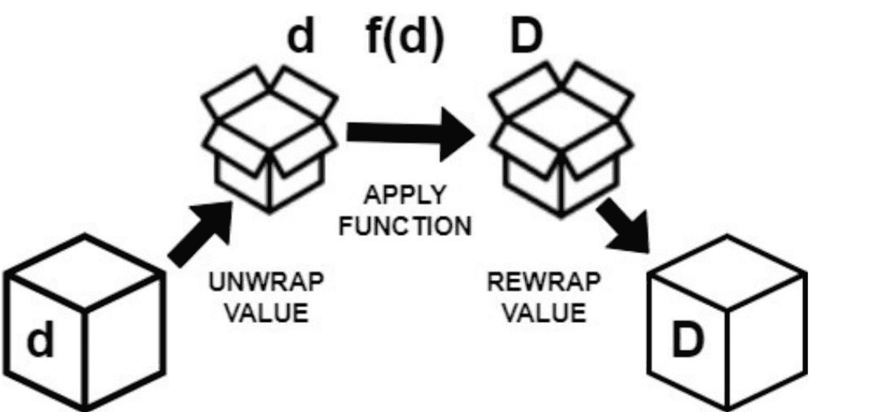

# C# 泛式编程：从入门到精通 Monads


我的函数式库 Functional.DotNet
https://github.com/kinderbueno360/Functional.DotNet


# 献辞

献我亲爱的妻子 Ewa Walegga-Bueno，

你一如既的支持和灵感源泉是我这段旅程的基石。你坚定不移的爱、鼓励和耐心是我的指路之星，帮助我应对并克服每一个挑战，使这本书成为现实。

感谢你一直对我的信任，感谢你对我能力的坚定信念，感谢你在最黑暗时刻成为我的光。

献我珍爱的孩子们，Luiz Carlos Bueno、Gustavo Bueno 和 Mikołaj Walegga-Bueno，

你们是我的骄傲和快乐，是未来希望与梦想的化身。你们的笑声和好奇激发了我创造、启发和追求远大梦想的渴望。

献我亲爱的兄弟 Cleber Bueno，

多年来的陪伴与支持是无价的。你对我生命中的存在是力量和快乐的源泉，提醒着我们之间不可破灭的纽带。

献我亲爱的母亲 Celia Bueno 和父亲 Carlos Roberto Bueno，

你们的指导、牺牲和无条件的爱塑造了今天的人格。你们向我灌输了价值观和美德，任何语言都无法完全表达我的感激之情。

献我已故的祖母 Anna Fantucci，

你的记忆是我贴贴内心的珍宝。尽管你离世已25多年，但你的影响依然是我生活中一股强大的力量。你曾是我世界中最重要的人，是智慧、爱与善慈的灯塔。你的精神每天都在启发并引导着我。

这本书献给你们所有人，作为我深切爱、感激和尊重的证明。你们每一个人在这段旅程中都扮演了重要角色，我怀着无比荣幸与你们分享这一成就。

Carlos Bueno


C 中现有的 Monad 库

使用 .NET 8 和 C# 11 创建和使用简单的 Monads


规划你的库

设计与实现 Monads

Maybe<T>
- 示例
- 使用 Map
- 使用 Bind
- 使用 GetOrElse
- 综合使用

Either<L, R>

Validation<T>
- 在 Web API 中使用 Validation<T>
Try<T>：函数式地处理异常

示例
- 运行 Try
- Exceptional<T>
- Exceptional<T> 的示例用法
- 结论


场景描述

构建应用程序


# 序言

欢迎阅读《C# 函数式编程：从零到精通 Monads》。本简洁指南旨在快速提升你对使用 C# 和 .NET 8 进行函数式编程中 monads 的理解和应用。

Monad 的概念源自函数式编程，对于许多开发者来说一直是一个难以掌握的概念。然而，它们是程序员工具箱中强大且表现力的工具。本书旨在揭开 monads 的神秘面，并说明它们在你日常编码任务中的实用性和用处。

在快速发展的软件开发领域，C# 和 .NET 框架的最新更新带来了范式转变，使得函数式编程比以往任何时候都更加流行。函数式范式允许开发者编写更可预测、可测试且易调试的代码。我们将深入探讨 C# 和 .NET 8 的特性如何完美适配函数式编程，特别是 monads。

本书的设计初衷是简洁，旨在作为指南而非详尽的参考书。我们的目标是提供你所需的的核心理解和技能。无论你是寻求加深理解的专业 C# 开发者，还是对 monads 感奇的计算机科学学生，这本书都有你需要的。

那么，让我们开启这段在 C# 和 .NET 8 中精通 monads 的精彩旅程。

编码愉快！

Carlos Bueno

# 第一章：引言


## 书籍简述

欢迎来到 C# 和 .NET 8 的函数式编程世界，在这里我们将揭秘并探索 monads 这个迷人的概念。本书旨在作为一份简洁且重点出的指南，带你循序渐进地在代码中理解并实现 monads。

我们的旅程始于理解函数式编程的核心原理以及它们如何在最新版本的 C# 和 .NET 8 中获得支持。随后我们将深入 monad 的概念，研究其结构、属性以及在函数式编程中的重要性。

随着内容的推进，我们将查看 monads 如何在 C# 和 .NET 8 中使用，以及如何构建和使用自己的库。在整个过程中，我们将注重实践，因为我们相信最好的学习来自于实践。

读完本书，你将对 C# 中的 monads 和函数式编程有坚实的理解。你将具备构建自己的 monad 库并并在项目中有效使用的知识和技能。

# 为什么 Monads 在 C 中至关重要

在计算机科学中，monads 提供了一种框架，允许我们以某种方式组合函数，产生模块化、可重用且易维护的代码。它们是一种强大的构造，让我们能够以清晰且可组合的方式处理副作用、异常、计算和状态。

Monads 在 C 中至关重要，是因为它们通过提供抽象计算上下文的结构来解决复杂性。它们可以封装空检查、异常处理、状态等问题，让我们能够更多关注问题领域，而不是语言和环境的机制。这使得代码更整洁、更易维护。

在 C# 中，与许多其他语言一样，monads 并不是语言语法的显式部分，而是一种可以


用于将函数式编程的优势带入我们的代码中。

即使你以前从未听说过单例（monads），你可能在不知不觉的情况下已经它们。C# 和 .NET 中的许多构造，如 `Nullable<T>`、`IEnumerable<T>` 和 `Task<T>` 都遵循单例模式。通过显式理解单例，我们可以更有效地使用这些构造，并编写更健壮、更易维护的 C# 代码。

在接下来的章节中，我们将更深入地探索这些思想，提供实践示例和指导，帮助你掌握在 C# 代码中使用单例的方法。

# 第 2 章：理解最新 C# 中的函数式编程


## 函数式编程简述

函数式编程（FP）是一种围绕纯函数使用的编程范式，即：对于相同的输入产生相同的输出，且没有副作用。在 FP 中，函数是一等公民，这意味着可以作为参数传递、从函数返回或赋值给变量。

FP 的特征是不可变性，数据一旦创建就无法更改。与其修改现有对象，不如通过更改创建新对象。这种方法使得代码更具预测性且安全，减少了 Bug 并更容易测试和调试。

如果你对深入研究函数式编程的原理以及如何在 C# 中应用感兴趣，书籍《C#：拥抱函数式编程》提供了一个全面的指南。

## C#11 中的新函数式功能

C# 多年来经历了巨大的进化，每个新版本都带来了让函数式编程更加自然和易用的功能。C#11 通过以下令人兴奋的新增继续延续这一趋势：

### 记录结构体（Record Structs）

C#11 引入了记录结构体，它们是不可变类型。它们扩展了 C# 9 中引入的记录类型，并在某些场景下提供了更高效的选项。

```cs
public record struct(int X, int Y);
```

### 插值字符串（Interpolated Strings）

早期引入的插值字符串现在可以作为 C#11 的格式字符串使用。这一功能使得字符串格式更加方便，代码更简洁。

```csharp
int number = 42;
string str = $"答案是 {number}";
```

### 结构体的 with 表达式（with Expressions for Structs）

`with` 表达式之前适用于记录类型，现在扩展到了 C#11 的结构体。该功能允许你创建一个带有某些属性更改的新结构体。

```csharp
public struct Point
{
    public int X { get; init; }
    public int Y { get; init; }
}
```

```csharp
var point1 = new Point { X = 10, Y = 20 };
var point2 = point1 with { X = 30 };
```

### 参数空检查（Parameter Null Checking）

C#11 引入了简洁的空检查语法，减少了样板代码并提高了代码的可读性。

```csharp
public void ExampleMethod(string? value)
{
    // 方法体
}
```

在上面的代码中，如果 value 为空，将会自动抛出 `ArgumentNullException`。

这些只是 C#11 函数式编程功能的一角。在接下来的章节中，当我们探索 C# 单例的世界时，我们将利用这些及更多功能。

# 第 3 章：.NET 8：为函数式编程铺路


## .NET 8 概述

.NET 8 是 .NET 平台的最新主要版本，延续了从 .NET Core 开始的创新和性能改进轨迹。它是一个多功能平台，允许开发者使用单一平台构建许多类型的应用程序，如 Web、桌面端、云端、移动端、游戏、IoT 和 AI。

与之前的版本一样，.NET 8 发布关注于提高开发生产力，为 C# 语言带来了增强、性能改进以及更好的云集成等。

## .NET 8 对 C# 函数式编程的重要性

.NET 8 继续为在 C# 中应用函数式编程原则提供稳健的平台。它进一步将函数概念集成到 C# 语言和更大的 .NET 生态系统中，使得在传统的面向环境中编写函数式代码变得更容易。

以下是 .NET 8 支持 C# 函数式编程的一些关键方式：

### 改进语言特性

随着每个版本的发布，C# 继续整合更多的函数式编程功能。在 .NET 8 中，这包括记录结构体和改进的模式匹配，允许编写更有表现力、简洁且安全的代码。

### 不可数据类型

.NET 8 和 C# 提供了一系列函数式编程基础的不可变数据类型和结构，例如 `System.String`、`System.DateTime` 和记录类型。这些类型确保了数据的一致性并使代码更容易理解。

### LINQ 和高级集合操作

语言集成查询（LINQ）是 .NET 中的一项强大功能，允许开发者对集合执行复杂查询，类似于数据库中的 SQL 查询。LINQ 与同 .NET 中丰富的集合类一起，允许像 map、filter 和 reduce 等函数式操作。

### 基于任务的异步编程

.NET 中的 `Task` 和 `Task<T>` 类型为异步编程提供了一种模型，这种模型在本质上是函数式的。它们允许开发者以直观的线性风格编写非阻塞代码，避免了回调地狱。

### 高性能函数式库

.NET 拥有许多受函数式编程启发的高质量开源库。像 LanguageExt 这样的库提供了函数式数据类型和函数，使得在 C# 中编写函数式代码变得更加简单。

在接下来的章节中，当我们深入 C# 和 .NET 8 的单例与函数式编程世界时，我们将探索这些功能及更多。

# 第 4 章：单例精要


单例（Monads）是函数式编程中的基础概念，特别是在 Haskell 等语言中，但在 C#、F# 等语言中也能找到。它们通常因其抽象而令人生畏，但理解它们可以极大丰富你的编程工具箱。

## 什么是单例？

单例是带有值(s)的容器，当你将函数应用到这些值(s)时会得到转换后的容器。具有定义 Map 函数的类型被称为演算。Map 函数可以大致描述为：

```
(C<T>, (T -> R)) -> C<R>
```

Map 是接收一个包装类型 T 的泛型容器和一个将 T 转换为 R 的函数，并在将其应用到容器值后返回一个包装 R 的容器 C<R>。



本质上，单例可以被理解为一种设计模式，允许在不改变函数签名的情况下处理额外的操作或副作用。它们以纯式的方式封装了副作用。

描述单例的一个流行比喻是“提升世界”的概念。假设你有一组处理简单类型的函数，但现在你需要在提升的上下文中处理这些类型。

这可能是处理异步操作（C# 中的 `Task<T>`）、可空类型（`Maybe<T>`）或值列表（`IEnumerable<T>`）。


（在 C# 中为 SelectMany，在 Haskell 中为 >>=）：接收一个提升的值和一个作用于底层值的函数，并返回一个提升后的结果。它将函数应用于提升后的值，并在必要时对结果进行平铺。

```csharp
public static Functor<TResult> SelectMany<T, TResult>(
    this Functor<T> source,
    Func<T, Functor<TResult>> selector)
```

这两个操作应该遵守某些法则（称为单子法则），以确保行为的一致，我们将在单独的章节中讨论这些。

总之，单（monads）通过提供一种结构化的方式处理“提升”或“增强”类型，为管理代码中的复杂性提供了强大的方法。通过理解和使用单，我们可以编写更简洁、更抽象且更具组合性的代码。

## 单的结构与属性

在讨论单时，理解它们的结构以及它们被分类为单所必须具备的属性至关重要。

## 单的结构

从高级来说，单是一种定义了两个操作的类型：Return（返回）和 Bind（绑定，在 C# 中也称为 SelectMany，在 Haskell 中为 >>=）。

> Return（也称为 pure 或 unit）：此操作从一个普通类型获取一个值并将其放入单类型的容器中。Return 这个名字可能有点误导性，特别是对于那些来自面向对象背景的人来说，在其中 return 被用于表示函数的输出。在单的语境下，Return 并不意味着计算的结束，而是将值提升到单语境中的一种手段。

```csharp
public static Monad<T> Return<T>(T value)
```

Bind（或在 C# 中为 SelectMany，在 Scala 中为 FlatMap，在 Haskell 中为 >=）：此操作被称为绑定，接收一个单类型的容器和一个接收普通类型并返回单类型容器的函数。它将函数应用于未解包的值并返回一个新的单的容器。如果函数已经返回了一个单的值，Bind 确保我们不会得到嵌套的单的，而是将其平铺为单层单的。

```csharp
public static Monad<TResult> SelectMany<TSource, TResult>(
    this Monad<TSource> monad,
    Func<TSource, Monad<TResult>> function)
```

这两个操作在实现后，赋予了一个类型单的结构。然而，一个类型要成为一个单，它还必须遵守某些法则。

## 单的法则

单法则是每个单必须满足的公理。这些法则确保了单的行为是一致且可预测的。它们并不由编程语言强制执行，但在实现单时记住它们对于避免意外行为至关重要。主要有三个法则：

- 左恒等（Left Identity）：如果我们使用 Return 取一个值并将其放入语境中，然后使用 Bind 将其传递给函数，这等同于直接获取该值并将其应用于函数。换句话说，如果 Return 是我们将值提升到单语境的方式，它不应该有任何导致其与直接应用函数产生差异的额外副作用。

`Return(value).SelectMany(f) == f(value)`

- 右恒等（Right Identity）：如果我们有一个单值并使用 Bind 将其传递给 Return，我们应该得到相同的单值。这意味着 Return 不应该改变在 Bind 内部调用的语境。

```csharp
monad.SelectMany(Return) == monad
```

- 结合律（Associativity）：当我们使用 Bind 拥有一链单函数应用时，它们如何嵌套并不重要。这确保了计算的顺序独立于 Bind 调用的嵌套。

```csharp
monad.SelectMany(f).SelectMany(g) == monad.SelectMany(x => f(x).SelectMany(g))
```

这些法则看起来很抽象，但对于推理单的行为并确保它们能够良好组合至关重要。

总之，单的结构及其属性为封装带有额外语境或副作用的计算提供了一种强大且一致的抽象。

## 第 5 章：在 C# 和 .NET 8 中实战单


在本章中，我们将深入探讨在 C# 中结合 .NET 8 使用单的实际用法。我们将探索 C# 中现有的单库，并引导你如何使用 .NET 8 和 C# 11 创建和使用简单的单。

## C# 中现有的单库

C# 中的几个库已经利用了单的力量。这些库使用单的概念来处理可空类型、异常处理等。以下是几个著名的库：

- LanguageExt：该库提供了一组高阶函数和类型，包括单，它们将强大的函数编程概念引入了 C#。你会发现像 Option、Either 等构造，它们的灵感直接源自 Haskell 等语言。

- Optional：该库专注于处理可选（null）值和错误状态，提供了如 Option 和 Either 这样的单构造。

- Monads.NET：正如名称所示，该库提供了各种类型的单，如 Maybe、Either、List 等。

如果你想将单整合到你的 C# 项目中，这些库提供了一个极佳的起点。然而，为了真正理解单，我们将创建自己的单。

### 使用 .NET 8 和 C# 11 创建和使用简单的单

为了更深入地理解单，让我们创建一个简单的 Maybe 单。这种单用于那些可能不返回值的计算。在 C# 中，这通常由 null 处理，但如果处理不当，null 可能会导致运行时错误。Maybe 单可以帮助我们避免这个问题。

这里是一个简单的 Maybe 单的实现实现：

```csharp
public sealed class Maybe<T>
{
    public static readonly Maybe<T> Nothing = new Maybe<T>();
    public T Value { get; }
    public bool HasValue { get; }

    private Maybe()
    {
        HasValue = false;
    }

    public Maybe(T value)
    {
        Value = value;
        HasValue = true;
    }
}
```

要创建一个单语境，我们只需要用 Maybe<T> 包装一个值：

```csharp
var maybeInt = new Maybe<int>(5);
```

要提取值，我们检查 HasValue 是否为真，然后访问 Value 属性：

```csharp
if (maybeInt.HasValue)
{
    Console.WriteLine(maybeInt.Value);
}
```

这个 Maybe 单可以通过添加 Bind 和 Return 函数来改进，使其更加强大和灵活。我们将在未来的章节中探索这些概念。

## 第 6 章：使用 .NET 8 和 C# 构建你自己的单库


在本章中，我们将开启一段令人兴奋的旅程，使用 .NET 8 和 C# 11 构建我们自己的单库。这项任务将提供对单的深刻理解，展示它们在 .NET 生态系统中的力量。

## 规划你的库

建立单库的第一步是规划它的结构并确定我们想要整合的单。我们的库将包含各种单，包括：

- Maybe<T>：象征可能产生也可能产生值的计算。

- Either<L, R>：表示可以产生两种类型之一的计算，通常用于可能失败的计算。

- Validation<T>：用于需要验证检查的计算。

- Try<T>：与 Either 类似但专门针对异常，惰性求值并通过 Run 调用。

- Exceptional<T>：专门为处理异常设计的单。

- Task<T>：.NET 中用于处理异步计算的知名单。

## 设计与实现单

让我们深入这些单的实现。

### Maybe<T>

我们在前一个章节中创建了一个原始的 Maybe<T>。现在，让我们通过添加功能来扩展它。

在这一节中，我们将通过添加三个重要的方法 Map、Bind 和 GetOrElse 来增强我们的 Maybe<T> 单。

- Map：此方法用于转换 Maybe<T> 单内部的值。它接收一个从类型 T 到类型 R 的函数，如果值存在则将其应用。如果 Maybe<T> 单为 None，则返回 None。

- Bind：此方法与 Map ，但它接收的函数返回 Maybe<R> 而不是简单的 R。这允许你链接可能失败的操作。

- GetOrElse：此方法用于从 Maybe<T> 中提取值。如果 Maybe<T> 为 None，则返回一个默认值。

让我们查看代码以详细了解这些方法。


```csharp
if (HasValue)
  return _value;
throw new InvalidOperationException();
}
  public static Maybe<T> Some(T value) => new Maybe<T>(value);

public static Maybe<T> None { get; } = new Maybe<T>(default(T));

// Map
public Maybe<R> Map<R>(Func<T, R> f)
{
  return HasValue ? Maybe<R>.Some(f(_value)) : Maybe<R>.None;
}

// Bind
public Maybe<R> Bind<R>(Func<T, Maybe<R>> f)
{
  return HasValue ? f(_value) : Maybe<R>.None;
}

// GetOrElse
public T GetOrElse(T defaultValue)
{
  return HasValue ? _value : defaultValue;
}

}
```

在上面的代码中，你可以看到是如何为 `Maybe<T>` 单子定义 `Map`、`Bind` 和 `GetOrElse` 方法的。

`Map` 函数使用 `HasValue` 属性检查 Maybe 是否包含包含值。如果是，它将函数 `f` 应用于该值并封装在 `Some` 中。如果不是，它直接返回 `None`。

`Bind` 函数也检查 Maybe 是否包含值。如果是，它将函数 `f` 应用于该值。这里的区别在于函数 `f` 返回一个 `Maybe<R>`，这允许你链式可能会失败的操作。

`GetOrElse` 函数非常直观——如果值存在，则返回该值；否则，返回提供的默认值。

这些额外的方法使得 `Maybe<T>` 成为处理可能产生也可能不产生值的操作强大工具，并帮助我们避免空引用异常。

## 示例 (Samples)

假设我们有一个简单的函数 `Divide`，它接收两个整数并将它们的除法结果作为 `Maybe<double>` 返回。如果除数为 0，它返回 `None`；否则，它返回 `Some(result)`。

```csharp
public Maybe<double> Divide(int numerator, int denominator)
{
if (denominator == 0)
{
    return Maybe<double>.None;
}
else
{
    return Maybe<double>.Some((double)numerator / denominator);
}
```

### 使用 Map

```csharp
Maybe<int> number = Maybe<int>.Some(5);
Maybe<int> result = number.Map(n => n * 2);
```

```csharp
Console.WriteLine(result.GetOrElse(0)); // 输出: 10
```

在这个示例中，我们首先创建了一个包含数字 5 的 `Maybe<int>`。然后我们使用 `Map` 函数将数字乘以 2，产生一个包含数字 10 的新 `Maybe<int>`。如果原始的 `Maybe<int>` 是 `None`，`Map` 函数将导致 `None`。

### 使用 Bind

```csharp
Maybe<int> numerator = Maybe<int>.Some(10);
Maybe<int> denominator = Maybe<int>.Some(2);
```

```csharp
Maybe<double> result = numerator.Bind(n => denominator.Map(d => Divide(n, d)));
```

```csharp
Console.WriteLine(result.GetOrElse(0)); // 输出: 5
```

在这个示例中，我们使用 `Bind` 链式调用了两个操作。外层的 `Bind` 操作提取分子，内的 `Map` 操作提取分母。然后我们使用这两个值调用 `Divide` 函数。如果分子或分母其中之一为 `None`，`Divide` 函数将不会被调用，结果将为 `None`。

### 使用 GetOrElse

```csharp
Maybe<int> number = Maybe<int>.None;
int result = number.GetOrElse(0);
```

```csharp
Console.WriteLine(result); // 输出: 0
```

在这个示例中，我们对一个为 `None` 的 `Maybe<int>` 调用了 `GetOrElse`。因为 `number` 是 `None`，`GetOrElse` 返回了我们提供的默认值，即 0。

## 汇总 (All together)

假设我们有两个函数 `FindPerson` 和 `GetAge`。`FindPerson` 函数接收人的姓名并返回一个 `Maybe<Person>` 对象。如果没有找到该人，它返回 `None`；否则，它返回 `Some(person)`。`GetAge` 函数接收一个 `Person` 对象并返回人的年龄作为 `Maybe<int>` 返回。如果 `Person` 对象为空，它返回 `None`；否则它返回 `Some(age)`。

```csharp
public record Person
{
    public string Name { get; init; }
    public int Age { get; init; }
}

public Maybe<Person> FindPerson(string name) => // 模拟数据库或 API 查找
    name == "John" ? Maybe<Person>.Some(new Person { Name = "John", Age = 30 }) : Maybe<Person>.None;

public Maybe<int> GetAge(Person person) =>
    person == null ? Maybe<int>.None : Maybe<int>.Some(person.Age);
```

现在让我们使用 `Map`、`Bind` 和 `GetOrElse` 来查找人的年龄：

```csharp
string personName = "John";
Func<int, int> addOne = (age) => age + 1;
Maybe<int> age = FindPerson(personName)
    .Bind(GetAge)
    .Map(addOne);
int finalAge = age.GetOrElse(0);
Console.WriteLine(finalAge); // 输出: 31
```

在这个示例中，我们首先使用 `FindPerson` 根据姓名查找人。这给了我们一个 `Maybe<Person>` 对象。然后我们使用 `Bind` 提取 `Person` 对象并将其传递给 `GetAge`，这给了我们一个 `Maybe<int>` 对象。我们使用 `Map` 加 1，产生一个新的 `Maybe<int>` 对象。最后，我们使用 `GetOrElse` 从 `Maybe<int>` 对象中提取年龄。如果该链中的任何一步失败并结果为 `None`，`GetOrElse` 将返回我们提供的默认值，即 0。

这些示例演示了如何使用 `Map`、`Bind` 和 `GetOrElse` 安全地处理可能产生也可能不产生值的操作，以及如何用一种清晰且可读的方式链式调用操作。

## Either<L, R>

`Either` 单子表示一个可能产生两种类型之一的计算。我们经常用它表示可能会失败的计算，其中 L 是错误类型，而 R 是成功类型。让我们来看一个基础实现：

```csharp
public abstract class Either<L, R>
{
    public abstract T Match<T>(Func<L, T> left, Func<R, T> right);

    public sealed class Left : Either<L, R>
    {
        private readonly L value;
        public Left(L value) => this.value = value;
        public override override Match<T>(Func<L, T> left, Func<R, T> right) => left(value);
    }

    public sealed class Right : Either<L, R>
    {
        private readonly R value;
        public Right(R value) => this.value = value;
        public override T Match<T>(Func<L, T> left, Func<R, T> right) => right(value);
    }

    // Map
    public Either<L, RR> Map<R, RR>(Func<R, RR> f)
        => Match<Either<L, RR>>(
            left => new Either<L, RR>.Left(left),
            right => new Either<L, RR>.Right(f(right))
        );

    // Bind
    public Either<L, RR> Bind<R, RR>(Func<R, Either<L, RR>> f)
        => Match(
            left => new Either<L, RR>.Left(left),
            right => f(right)
        );
}
```

这段代码定义了一个泛型 `Either<L, R>` 抽象类，它表示一个可以持有类型 L (左) 或 R (右) 值的类型。这是函数式编程语言中一种常见的类型，通常用于表示可以成功 (Right) 或失败 (Left) 的计算结果。`Either<L, R>` 类有两个具体的子类 `Left` 和 `Right`，分别表示相应类型的值。`Match` 方法在父类中是抽象的，并在每个子类中实现。该方法接收两个 `Func` 参数，一个处理左值，一个处理右值。这是此类类型中常用的模式匹配模式。

`Map` 和 `Bind` 是使 `Either` 单子的核心操作实现。

- `Map`: 该方法允许你对 Either 对象的右值应用一个函数，如果 Either 对象是 Left，它直接返回该左值而不应用函数。该方法使用 `Match` 方法来决定采取的行动。
- `Bind`: 该方法在其他上下文中也称为 `flatMap` 或 `SelectMany`。它允许你对 Either 对象的右值应用一个函数，该函数返回另一个 Either 对象。当你有一系列每个返回 Either 的计算时非常有用：你可以使用 `Bind` 将它们链式调用。如果任何计算失败（返回 Left），链将短路并立即返回该左值。

这里有一个如何使用此 Either 类的示例：

```csharp
// 一个可能会失败的函数
Either<string, int> TryParse(string str)
{
    if (int.TryParse(str, out var result))
        return new Either<string, int>.Right(result);
    else
        return new Either<string, int>.Left("Failed to parse")
}
```


```c
// 使用：
var either = TryParse("123");

either = either.Map(x => x * 2); // 如果解析成功，将数字翻倍

让我们在下一个示例中查看更多关于 Bind的内容

// 一个可能失败的函数
Either<string, int> TryParse(string str)
{
    if (int.TryParse(str, out var result))
        return new Either<string, int>.Right(result);
    else
        return new Either<string, int>.Left("解析失败");
}

// 一个可能失败的函数
Either<string, int> DivideByTwo(int number)
{
    if (number % 2 == 0)
        return new Either<string, int>.Right(number / 2);
    else
        return new Either<string, int>.Left("无法除以二");
}
```

```c
var either = TryParse("4");
```

```c
either = either.Bind(DivideByTwo); // 如果解析成功，将数字除以 2
```

在这个示例中，TryParse 是一个尝试将字符串转换为整数的函数。DivideByTwo 是另一个尝试将整数除以二的函数。如果整数不能被二整除，它将返回一个封装在 Left 中的错误消息。Bind 调用将这些计算链接在一起：如果解析成功，它将尝试将解析出的数字除以二。如果任何一个计算失败，它将短路并返回错误。

现在，让我们来看一个同时使用 Map 和 Bind 的示例：

```c
// 一个可能失败的函数
Either<string, int> TryParse(string str)
{
    if (int.TryParse(str, out var result))
        return new Either<string, int>.Right(result);
    else
        return new Either<string, int>.Left("解析失败");
}
```

```c
// 一个可能失败的函数
Either<string, int> DivideByTwo(int number)
{
    if (number % 2 == 0)
        return new Either<string, int>.Right(number / 2);
```

```c
else
return new Either<string, int>.Left("无法除以二");
}

// 使用：
var either = TryParse("4");
either = either
.Map(x => x * 2)// 如果解析成功，将数字翻倍
.Bind(DivideByTwo); // 然后，尝试除以二
```

在这个示例中，我们首先应用 Map 函数，在解析成功时将解析出的数字翻倍。然后，我们使用 Bind 将结果除以二。如果任何步骤失败，它将短路并返回错误。

### Validation<T>

我们之前探索了 Maybe 和 Either 单态（monads），它们提供了处理可选或二选一值的强大方式。现在，让我们检查 Validation 单态。当你想要累积错误而不是快速失败（fail-fast）时，这种单态特别有用，这在表单验证等情况下很常见，因为你希望一次性报告所有验证错误，而不是一个一个报告。

Validation<T> 单态在我们在验证数据集时累积所有错误而不是在第一个错误处停止非常有用。这在 Web 开发中尤为有用，因为我们想要验证用户输入并一次性返回所有错误。

Validation<T> 类的基本结构与我们之前的 Maybe 和 Either<L, R> 单态相似。然而，它不像 Maybe 那样有 "Some" 和 "None" 情况，也不像 Either<L, R> 那样有 "Left" 和 "Right" 情况，我们将会有 "Valid" 和 "Invalid" 情况。

这里是 Validation<T> 单态的代码：

```c
public abstract class Validation<T>
{
    public sealed class Valid : Validation<T>
    {
        public T Value { get; }
        public Valid(T value) => Value = value;
    }

    public sealed class Invalid : Validation<T>
    {
        public string[] Errors { get; }
        public Invalid(params string[] errors) => Errors = errors;
    }

    public bool IsValid => this is Valid;
    public bool IsInvalid => !IsValid;

    // Map
    // Map
    public Validation<U> Map<U>(Func<T, U> map)
{
return this switch
{
    Valid valid => new Validation<U>.Valid(map(valid.Value)),
    Invalid invalid => new Validation<U>.Invalid(invalid.Errors),
    _ => throw new NotImplementedException()
};
```

```c
// Bind
public Validation<U> Bind<U>(Func<T, Validation<U>> bind)
{
    return this switch
{
        Valid valid => bind(valid.Value),
        Invalid invalid => new Validation<U>.Invalid(invalid.Errors),
        _ => throw new NotImplementedException()
    };
}
```

```c
// Match
public U Match<U>(Func<T, U> onValid, Func<string[], U> onInvalid)
{
    return this switch
{
        Valid valid => onValid(valid.Value),
Invalid invalid => onInvalid(invalid.Errors),
  => throw new NotImplementedException()
);
```

Valid 类封装了类型为 T 的有效值，而 Invalid 类封装了一个错误消息列表。IsValid 和 IsInvalid 属性允许我们快速检查验证状态。

Map、Bind 和 Match 方法的工作方式与之前的单态类似。Map 允许我们转换 Valid 实例中的值，Bind 允许我们链式操作，而 Match 允许我们处理 Valid Valid 和 Invalid 情况。

让我们从一个简单的示例开始：

```c
Validation<int> valid = new Validation<int>.Valid(5);
Validation<int> invalid = new Validation<int>.Invalid("Negative number");

Console.WriteLine(valid.Map(x => x * 2)); // 输出: 10
Console.WriteLine(invalid.Map(x => x * 2)); // 输出: Invalid ["Negative number"]

Console.WriteLine(valid.Bind(x => new Validation<int>.Valid(x * 2))); // 输出: 10
Console.WriteLine(invalid.Bind(x => ...)); // 不会被调用

Console.WriteLine(valid.Match(x => x.ToString(), errors => string.Join(",", errors))); // 输出: "5"
Console.WriteLine(invalid.Match(x => x.ToString(), errors => string.Join(",", errors))); // 输出: "Negative number"
```

现在，让我们看看如何在 Web API 中使用 Validation<T> 单态来验证用户输入。假设我们有一个具有 Name 和 Email 属性的 User 模型，并且我们想要验证这两个都不为空。

通过这种方式，Map 允许我们在解析成功时转换 Valid 实例中的值，Bind 允许我们链式操作，而 Match 允许我们处理 Valid Valid 和 Invalid 情况。

在现在，让我们看看如何在 Web API 中使用 Validation<T> 单态来验证用户输入。假设我们有一个具有 Name 和 Email 属性的 User 模型，并且我们想要验证这两个都不为空。

首先，我们为每个属性创建一个验证函数：

```c
public Validation<string> ValidateName(string name)
{
    return string.IsNullOrWhiteSpace(name)
    ? new Validation<string>.Invalid("Name 不能为空")
    : new Validation<string>.Valid(name);
}
```

```c
public Validation<string> ValidateEmail(string email)
{
    return string.IsNullOrWhiteSpace(email)
    ? new Validation<string>.Invalid("Email 不能为空")
    : new Validation<string>.Valid(email);
}
```

然后我们可以使用这些函数来验证 User 模型：

```csharp
public Validation<User> ValidateUser(User user)
{
    var nameValidation = ValidateName(user.Name);
    var emailValidation = ValidateEmail(user.Email);

    if (nameValidation is Validation<string>.Invalid invalidName)
    {
        return new Validation<User>.Invalid(invalidName.Errors);
    }

    if (emailValidation is Validation<string>.Invalid invalidEmail)
    {
        return new Validation<User>.Invalid(invalidEmail.Errors);
    }

    return new Validation<User>.Valid(user);
}
```

在控制器操作中，我们可以使用 Match 方法来处理有效和无效的情况，对有效情况返回 HTTP OK 响应，对无效情况返回 HTTP 400 请求：

```csharp
app.Map("/user", (User user) =>
{
    var result = ValidateUser(user);

    return result.Match(
        onValid: validUser => Results.Ok(validUser),
        onInvalid: errors => Results.BadRequest(string.Join(",", errors))
    );
});
```

通过这种方式，Validation<T> 单态允许我们以声明、表达性的方式进行验证，并保留所有的错误消息。

## Try<T>: 函数式处理异常

在传统的命令式编程中，错误处理通常通过异常完成。当发生错误时，会抛出异常，控制权跳转到可以处理该类型异常的最近 catch 块。这可能会


控制流难以追踪，程序推理也变得困难。

函数式编程提供了一种处理错误的替代方法，它可以使控制流更加清晰，程序更容易进行推理。函数不再抛出异常，而是返回一个代表成功计算或错误的值。调用者随后可以决定如何处理该错误。

让我们来实现它：

```csharp
public abstract class Try<T>
{
    public abstract TResult Match<T, TResult>(Func<T, TResult> onSuccess, Func<System.Exception, TResult> onException);

    public sealed class Success : Try<T>
    {
        private readonly T _value;
        public Success(T value) => _value = value;
        public override TResult Match<T, TResult>(Func<T, TResult> onSuccess, Func<System.Exception, TResult> onException) => onSuccess(_value);
    }

    public sealed class Exception : Try<T>
    {
        private readonly System.Exception _exception;
        public Exception(System.Exception exception) => _exception = exception;
        public override TResult Match<T, TResult>(Func<T, TResult> onSuccess, Func<System.Exception, TResult> onException) => onException(_exception);
    }
}
```

```csharp
public static Try<T> Of(Func<T> f)
{
    try {
        return new Success(f());
    }
    catch (System.Exception ex) {
        return new Exception(ex);
    }
}
```

```csharp
// Map
public Try<TResult> Map<TResult>(Func<T, TResult>) => Match(
    onSuccess: t => Try<TResult>.Of(() => f(t)),
    onException: ex => new Try<TResult>.Exception(ex)
);
```

```csharp
// Bind
public Try<TResult> Bind<TResult>(Func<T, Try<TResult>>) => Match(
    onSuccess: t => f(t),
    onException: ex => new Try<TResult>.Exception(ex)
);
```

```csharp
public T GetOrElse(T defaultValue)
=> Match(
  onSuccess: t => t,
  onException: _ => defaultValue
);
```

这个 `Try<T>` 类表示一个可能会抛出异常的计算。它是一个抽象类，有两个派类：`Success` 和 `Exception`。`Success` 类表示成功的计算并持有类型为 `T` 的结果，而 `Exception` 类表示失败的计算并持有导致失败的异常。

`Of` 方法用于从可能抛出异常的函数创建 `Try<T>` 实例。如果函数抛出异常，则返回 `Try<T>.Exception` 实例；否则，返回 `Try<T>.Success` 实例。

`Map` 和 `Bind` 方法分别用于转换和链联 `Try<T>` 实例，这种方式保留了异常状态。如果 `Try<T>` 实例表示失败的计算，将跳过转换或链式操作并传播异常。

`GetOrElse` 方法用于在计算成功时检索结果，或在失败时返回默认值。

### 示例

假设我们有一个可能会抛出 `DivideByZeroException` 的函数 `Divide`：

```csharp
public static double Divide(double x, double y)
{
  return x / y;
}
```

我们可以将此函数封装在 `Try<T>` 中以处理可能的异常：

```csharp
var tryResult = Try<double>.Of(() => Divide(10, 0));
```

现在，`tryResult` 是一个表示除法操作结果的 `Try`。如果操作成功，`tryResult` 是带有除法结果的 `Try.Success`。如果操作抛出异常，`tryResult` 是带有已抛出异常的 `Try.Exception`。

我们可以使用 `Map` 方法转换结果：

```csharp
var tryQuotientPlusOne = tryResult.Map(quotient => quotient + 1);
```

如果 `tryResult` 是 `Try.Success`，`tryQuotientPlusOne` 就是带有商加 1 结果的 `Try.Success`。如果 `tryResult` 是 `Try.Exception`，`tryQuotientPlusOne` 就是同一个 `Try.Exception`。

我们可以使用 `Bind` 方法链联计算：

```csharp
var tryReciprocal = tryResult.Bind(quotient => Try<double>.Of(() => 1 / quotient));
```

如果 `tryResult` 是 `Try.Success`，`tryReciprocal` 是一个表示计算商倒数结果的 `Try`。如果 `tryResult` 是 `Try.Exception`，`tryReciprocal` 就是同一个 `Try.Exception`。

我们可以使用 `Match` 方法同时处理成功和错误情况：

```csharp
string message = tryResult.Match(
onSuccess: quotient => $"The result is {quotient}.",
onException: ex => $"An error occurred: {ex.Message}"
);
```

在这里，`message` 是一个字符串，包含带有商的成功消息或带有异常消息的错误消息。

最后，我们可以使用 `GetOrElse` 方法检索结果或默认值：

```csharp
double quotient = tryResult.GetOrElse(0);
```

在这里，如果操作成功，`quotient` 为商；如果操作抛出异常，则为 0。

让我们看看如何遵循 AAA（安排、执行、断言）模式在单元测试中使用 `Try<T>`。我们将使用之前示例中的 `Divide` 函数和 `Try<T>`。

[Test]

```csharp
public void Divide_ByZero_ReturnTryException()
{
    // Arrange
    double x = 10, y = 0;

    // Act
    var result = Try<double>.Of(() => Divide(x, y));

    // Assert
    Assert.IsInstanceOf<Try<double>.Exception>(result);
}
```

在这个测试中，`result` 是 `Try<double>.Exception`，因为除以零失败了。我们断言结果类型是正确的。


我们还为 `Exceptional<T>` 提供了一系列扩展方法，允许以流式方式链式操作。这些包括 Apply、Map 和 Bind 函数以及各自的重载。

`Apply` 函数将封装在 `Exceptional<T>` 中的函数应用到另一个 `Exceptional<T>`，返回一个新的 `Exceptional<T>`。

`Map` 函数将函数应用到 `Exceptional<T>` 内部的值（如果存在），并将结果重新封装回 `Except<T>`。

`Bind` 函数与 `Map` 类似，但作为参数传递的函数返回 `Exceptional<T>`，允许对返回 `Exceptional<T>` 的操作进行链式。

此外，我们提供了 `Select` 和 `SelectMany` 方法来支持 LINQ 查询语法。这是 C# 中的一项强大功能，允许 `Exceptional<T>` 与现有的 .NET 代码库无缝集成。

现在，让我们通过一个示例来说明 `Exceptional<T>` 的用法。

### Exceptional<T> 的示例用法

```
Exceptional<int> Divide(int x, int y)
{
    try
    {
        return x / y
    }
    catch(DivideByZeroException ex)
    {
        return ex;
    }
}
```

该函数返回一个 `Exceptional<int>`，它封装了除法操作的结果。如果除法成功，它返回封装在 `Exceptional<T>` 中的结果。如果抛出了 `DivideByZeroException`，它会捕获异常并将其封装在 `Exceptional<T>` 中返回。

让我们看看如何使用此函数并处理结果。

```
void DisplayResult(Exceptional<int> result)
{
  result.Match(
    Success: value => Console.WriteLine($"Result: {value}"),
    Exception: ex => Console.WriteLine($"An error occurred: {ex.Message}")
  );
}

// 使用

var result = Divide(10, 2);

DisplayResult(result); // 输出: "Result: 5"

result = Divide(10, 0);

DisplayResult(result); // 输出: "An error occurred: Attempted to divide by zero."
```

在 `DisplayResult` 函数中，我们使用 `Match` 方法来显式处理 `Divide` 函数的两种可能结果。这使得在使用点清晰地表明了除法操作可能会失败，并要求我们处理失败的情况。

现在，让我们看看如何使用 `Map` 和 `Bind` 函数。

```csharp
// 如果除法成功，则对结果进行平方
var squareResult = result.Map(value => value * value);
```

```csharp
// 如果第一个操作成功，则尝试对结果执行另一个除法操作
var chainedResult = result.Bind(value => Divide(value, 2));
```

在第一个示例中，我们使用 `Map` 对除法操作的结果进行平方。只有在除法成功时才会执行平方操作。如果发生异常，`Map` 将什么都不做且异常会被保留。

在第二个示例中，我们使用 `Bind` 在第一个操作的结果上执行另一个除法操作。只有在第一次操作成功时才会执行第二次除法。如果第一次除法发生异常，`Bind` 将什么都不做且异常会被保留。

当我们想要链接多个可能会抛出异常的操作时，`Exceptional<T>` 的威力就变得尤为显易。通过在 `Exceptional<T>` 中封装异常，我们可以轻松地链式操作并以清晰简洁的方式处理异常。

### 任务

异步编程是现代应用开发的一个关键方面，特别是在响应性是的 I/O 密集操作中。在 .NET 中，`Task<T>` 类型是管理这些操作的主要工具。`Task<T>` 是一个单子类型，为链接和转换异步计算提供了强大的方法。让我们深入研究 `Task<T>` 的单子操作，并通过示例说明其用法。

```csharp
public static class TaskExtensions
{
    // Map
public static Task<TResult> Map<TSource, TResult>(
    this Task<TSource> task,
    Func<TSource, TResult> projection)
{
    return task.ContinueWith(t => projection(t.Result));
}
```

`Map` 函数将投影应用到任务的结果。当你想要转换异步计算的结果时，它非常有用。例如，如果你有一个代表计数项目数的异步操作的 `Task<int>`，你可以使用 `Map` 将计数转换为字符串。

接下来，让我们实现 `Bind`：

```csharp
// Bind
public static Task<TResult> Bind<TSource, TResult>(
    this Task<TSource> task,
    Func<TSource, Task<TResult>> projection)
{
    return task.ContinueWith(t => projection(t.Result)).Unwrap();
}
```

`Bind` 函数允许我们将异步操作链在一起。它接受一个返回任务的函数，并将其应用于上一个任务的结果。调用 `Unwrap` 是必要的，因为没有它，我们将得到 `Task<Task<TResult>>`。`Unwrap` 将其展平为 `Task<TResult>`。

下一个函数是 `GetOrElse`：

```csharp
// GetOrElse
public static Task<T> GetOrElse<T>(
    this Task<T> task,
    T defaultValue)
{
    return task.ContinueWith(t => t.IsFaulted ? defaultValue : t.Result);
}
```

`GetOrElse` 在任务失败时提供默认值。这是处理错误的方法，允许你的代码的其他部分忽略忽略失败。如果任务成功完成，`GetOrElse` 会传递结果。如果任务故障（抛出异常），`GetOrElse` 则返回默认值。

最后，我们有 `Recover`：

```csharp
// Recover
public static Task<T> Recover<T>(
    this Task<T> task,
    Func<Exception, T> recoverFunc)
{
    return task.ContinueWith(t => t.IsFaulted ? recoverFunc(t.Exception) : t.Result);
}
```

`Recover` 允许我们处理并从中恢复异常。如果任务抛出异常，它将其传递给恢复函数。

让我们通过实现 `Select`、`SelectMany`、`Join` 和 `Where` 方法继续：

```csharp
// Select
public static Task<TResult> Select<TSource, TResult>(
    this Task<TSource> task,
    Func<TSource, TResult> selector)
{
    return task.Map(selector);
}
```

```csharp
// SelectMany
public static Task<TResult> SelectMany<TSource, TResult>(
    this Task<TSource> task,
    Func<TSource, Task<TResult>> selector)
{
    return task.Bind(selector);
}
```

```csharp
// Where
public static Task<TSource> Where<TSource>(
    this Task<TSource> task,
    Func<TSource, bool> predicate)
{
    return task.Map(value =>
    {
        if (predicate(value)) return value;
        throw new Exception("Predicate does not hold");
    });
}
```

以下是这些方法的原理：

- `Select`：本质与 `Map` 相同。命名为 `Select` 是为了与 LINQ 一致。
- `SelectMany`：同样，`SelectMany` 是 `Bind` 的另一个名称。这也是为了符合 LINQ。
- `Where`：此函数允许我们根据谓词过滤任务的结果。如果谓词无效，它将抛出异常。

```csharp
// Join
public static Task<TResult> Join<TOuter, Tinner, TKey, TResult>(
    Task<TOuter> outer,
    Task<Tinner> inner,
    Func<TOuter, TKey, object> outerKey,
    Func<Tinner, TKey, object> innerKey,
    Func<TOuter, Tinner, TResult> resultSelector)
{
    return outer.ContinueWith(o =>
        {
            return inner.ContinueWith(i =>
            {
                if (outerKey(o.Result).Equals(innerKey(i.Result)))
                {
                    return resultSelector(o.Result, i.Result);
                }
                throw new Exception("Keys do not match");
            }).Result;
        }).Result;
}
```

在这个版本的 `Join` 中，外部和内部任务都必须完成，并且它们的键（由 `outerKey` 和 `innerKey` 提供）必须匹配。如果匹配，`Join` 将使用 `resultSelector` 组合结果。


## 示例 2：使用 Bind (或 LINQ 中的 SelectMany)

```csharp
Task<int> task = Task.FromResult(5);
```

```csharp
Task<int> bindTask = task.Bind(x => Task.FromResult(x * x));
```

```csharp
Console.WriteLine(await bindTask); // 输出: 25
```

在这个示例中，我们不是对结果进行简单的转换，而是使用 `Bind` 根据第一个任务的结果创建一个新任务。

## 示例 3：使用 OrElse 进行恢复

```csharp
Task<int> task = Task.FromException<int>(new Exception("Error!"));
```

```csharp
Task<int> recoveredTask = task.OrElse(Task.FromResult(0));
```

```csharp
Console.WriteLine(await recoveredTask); // 输出: 0
```

在这种情况下，我们创建了一个立即抛出异常的故障任务。使用 `OrElse`，我们可以从错误中恢复并提供一个以结果 0 完成的备用任务。

## 示例 4：使用 Where

```csharp
Task<int> task = Task.FromResult(5);
```

```csharp
Task<int> filteredTask = task.Where(x => x > 10);
```

```csharp
try
{
    Console.WriteLine(await filteredTask);
}
catch (Exception e)
{
    Console.WriteLine(e.Message); // 输出: Predicate does not hold
}
```

在这里，我们对任务结果应用了过滤器。由于 5 并不大于 10，当我们尝试等待任务的结果时，会抛出一个异常。

## 示例 5：使用 Join

```csharp
Task<int> outer = Task.FromResult(5);
Task<int> inner = Task.FromResult(10);
Task<int> joinedTask = outer.Join(inner, o => o, i => i * 0.5, (o, i) => o + i);
try
{
  Console.WriteLine(await joinedTask);
} catch (Exception e)
{
  Console.WriteLine(e.Message); // 输出: Keys do not match
}
```

在这个示例中，我们尝试根据键连接两个任务。然而，由于键不匹配，因此抛出了异常。
如果键匹配，`Join` 函数将使用提供的结果选择器函数合并两个任务的结果。

通过使用这些单子操作（monadic operations），我们可以以简洁且可读的方式构建复杂的异步操作流水线。这使得在异步和并发场景下的错误处理和控制流更容易管理。

## 结论

在本章分享的概念和代码是在 .NET 8 中使用 C# 构建你自己的单数结构的起点。这段单数世界之旅才刚刚开始，我希望它能激发你对函数式编程的奇心和兴趣。

我们深入探讨了理论，然后将其带回 C# 的实践领域，探索了如何利用单数的力量来编写更整洁、更易维护且抗错误的代码。我们探索了几个示例，例如 `Maybe<T>`、`Exceptional<T>`、`Validation<T>`、`Try<T>`、`Either<T>` 和 `Task<T>`，每个示例都提供了处理控制流、错误处理和数据转换的不同方法。

记住，函数式编程和单数的使用并不是非黑即白的命题。你可以逐渐将这些概念引入到现有的项目中，并随着时间的推移看到其益处。

本章是一个脚石，在函数式编程中还有许多可以探索和理解的内容。当你继续你的旅程时，始终记住，目标不是编写巧妙或复杂的代码，而是编写清晰、易懂且可维护的代码。

归结底，这一切都关乎作为软件工匠的进步以及交付高质量软件。我希望本章为你提供了在 .NET 8 和 C# 中通过单数做到这些点的工具和理解。

# 第 7 章：实例 - .NET 8 和 C# 中自定义单数库的真实场景


在本章中，我们将深入探讨在之前的章节中创建的单数（`Maybe<T>`、`Either<L, R>`、`Validation<T>`、`Try<T>`、`Exceptional<T>`、`Task<T>`）如何在实际的 .NET 应用程序中使用的。我们将创建一个简单的银行贷款审批系统，它将展示这些单数在处理复杂业务逻辑、错误处理和异步操作方面的强大之处。我们将使用最小 API（minimal API）方法。

最小 API 方法强调了开发 API 的简单性和生产力。它提供了一种轻量级、低仪式的方式使用 ASP.NET Core 构建 HTTP API，并减少了样板代码，使你的代码库更加整洁易于管理。

## 场景

我们的客户 Let's Lend Bank 希望开发一个贷款审批系统。该系统将具有以下要求：

- **验证贷款请求：** 每个贷款请求都必须经过验证。请求必须具有有效的客户 ID、正的贷款金额以及 1 到 30 年之间的期限。

- **检查客户信用评分：** 必须从外部服务获取客户的信用评分。如果服务失败或返回错误，贷款审批过程应该失败。

- **检查客户贷款历史：** 客户的贷款历史也从另一个外部服务获取。同样，如果服务失败或返回错误，贷款审批过程应该失败。

- **计算贷款审批：** 如果所有之前的步骤都成功，则将计算是否批准贷款。

## 构建应用程序

让我们开始定义系统的基础模型。

```csharp
public class LoanRequest
{
    public int CustomerId { get; set; }
    public decimal Amount { get; set; }
    public int TermYears { get; set; }
}

public class CreditScore
{
    public int CustomerId { get; set; }
    public int Score { get; set; }
}

public class LoanHistory
{
    public int CustomerId { get; set; }
    public int NumberOfDefaults { get; set; }
    public int NumberOfPaidLoans { get; set; }
}

public class LoanApproval
{
    public bool IsApproved { get; set; }
    public decimal InterestRate { get; set; }
    public string Reason { get; set; }
}
```

现在让我们定义处理信用评分和贷款历史的接口。

```csharp
public interface ICreditScoresService
{
    Task<Either<string, CreditScore>> GetCreditScore(int customerId);
}

public interface ILoanHistoryService
{
    Task<Either<string, LoanHistory>> GetLoanHistory(int customerId);
}
```

实现这些服务：

```csharp
public class CreditScoreService : ICreditScoresService
{
    public async Task<Either<string, CreditScore>> GetCreditScore(int customerId)
    {
        // 模拟异步操作的延迟
        await Task.Delay(1000);

        // 为了简单起见，我们为每个客户返回随机评分
        var rng = new Random();
        if (rng.Next(0, 100) < 80)
        {
            return new CreditScore { CustomerId = customerId, Score = rng.Next(300, 850) };
        }
        else
        {
            // 20% 的概率模拟失败
            return "Failed to fetch credit score";
        }
    }
}

public class LoanHistoryService : ILoanHistoryService
{
    public async Task<Either<string, LoanHistory>> GetLoanHistory(int customerId)
    {
        // 模拟异步操作的延迟
        await Task.Delay(1000);

        // 为了简单起见，我们为每个客户返回随机历史记录
        var rng = new Random();
        if (rng.Next(0, 100) < 80)
        {
            return new LoanHistory{
                CustomerId = customerId,
                NumberOfDefaults = rng.Next(0, 5),
                NumberOfPaidLoans = rng.Next(0, 20)
            };
        }
        else
        {
            // 20% 的概率模拟失败
            return "Failed to fetch loan history";
        }
    }
}
```

我们将使用 .NET 8 的最小 API 方式来实现。

```csharp
var builder = WebApplication.CreateBuilder(args);
builder.Services.AddScoped<ICreditScoresService, CreditScoreService>();
builder.Services.AddScoped<ILoanHistoryService, LoanHistoryService>();
var app = builder.Build();

app.MapPost("/approve", async (LoanRequest request, ICreditScoresService creditService, ILoanHistoryService historyService) =>
{
    // 1. 验证请求
    if (request.CustomerId <= 0 || request.Amount <= 0 || request.TermYears < 1 || request.TermYears > 30)
    {
        return Results.BadRequest("Invalid loan request");
    }

    // 2. 检查信用评分
    var creditResult = await creditService.GetCreditScore(request.CustomerId);
    if (creditResult.IsLeft)
    {
        return Results.Problem(creditResult.Left);
    }

    // 3. 检查贷款历史
    var historyResult = await historyService.GetLoanHistory(request.CustomerId);
    if (historyResult.IsLeft)
    {
        return Results.Problem(historyResult.Left);
    }

    // 4. 计算审批结果
    var score = creditResult.Right;
    var history = historyResult.Right;

    if (score.Score > 600 && history.NumberOfDefaults == 0)
    {
        return Results.Ok(new LoanApproval {
            IsApproved = true,
            InterestRate = 0.05m,
            Reason = "Approved based on credit and history"
        });
    }

    return Results.Ok(new LoanApproval {
        IsApproved = false,
        InterestRate = 0,
        Reason = "Not approved due to credit score or history"
    });
});

app.Run();
```


```csharp
}
}
```

现在，让我们来实现贷款审批逻辑。我们将创建一个 `LoanService`，它利用 `ICreditscoresService` 和 `ILLoanHistoryService` 来验证贷款请求并计算贷款审批结果。

```csharp
public class LoanService
{
    private readonly ICreditscoresService _creditscoresService;
    private readonly ILoanHistoryService _loanHistoryService;

    public LoanService(ICreditscoresService creditscoresService, ILoanHistoryService loanHistoryService)
    {
        _creditscoresService = creditscoresService;
        _loanHistoryService = loanHistoryService;
    }

    public async Task<Either<string, LoanApproval>> ApproveLoan(LoanRequest loanRequest)
    {
        return await ValidateLoanRequest(loanRequest)
            .Bind(request => _creditscoresService.GetCreditScore(request.CustomerId))
            .Bind(creditscore => _loanHistoryService.GetLoanHistory(creditscore.CustomerId))
            .Map(loanHistory => new { CreditScore = creditscore, LoanHistory = loanHistory }));
    }
}
```

```csharp
Map(data => CalculatedLoanApproval(data.CreditScore, data.LoanHistory, loanRequest));
}
```

```csharp
private LoanApproval CalculateLoanApproval(Creditscore creditscore, LoanHistory loanHistory, LoanRequest loanRequest)
{
    // 在此处添加贷款审批计算逻辑...

    return new LoanApproval {/*...*/};
}
```

我们的 API 在 `/loanapproval` 处有一个的 POST 端点，它将在请求体中接收 `LoanRequest`，并返回 `LoanApproval` 或错误消息。

```csharp
var builder = WebApplication.CreateBuilder(args);
var app = builder.Build();

// 注册依赖
app.Services.AddSingleton<ICreditscoreService, CreditscoreService>();
```

```csharp
app.Services.AddSingleton<ILoanHistoryService, LoanSystemService>();
app.Services.AddSingleton<LoanService>();
```

```csharp
app.MapPost("/loanapproval", async (LoanService loanService, LoanRequest loanRequest) =>
{
    var result = await loanService.ApproveLoan(loanRequest);

    return result.Match<ActionResult>(
        valid => new OkObjectResult(valid),
        error => new BadRequestObjectResult(error)
    );
});
```

```csharp
app.Run();
```

在此代码段中，我们首先为服务设置了依赖注入。然后，我们定义了贷款审批的 POST 端点。我们使用 `LoanService` 和 `LoanRequest` 作为映射函数的参数。`LoanService` 由 DI 系统注入，而 `LoanRequest` 则从请求体中自动进行模型绑定。

`LoanService.ApproveLoan` 方法返回一个 `Either<string, LoanApproval>`，我们将其匹配为 `ActionResult`。如果贷款审批成功（即 `Either` 为 `Valid`），我们返回一个带有 `LoanApproval` 的 `OkObjectResult`。如果发生错误（即 `Either` 为 `Invalid`），我们返回一个带有错误消息的 `BadRequestObjectResult`。

在这里，我们单数方法的威力显现出来。尽管我们正在处理涉及错误处理和异步操作的复杂业务逻辑，我们的 API 端点逻辑仍然保持极其简洁且易于理解。这种方法使我们能够构建健壮且易于维护的 API，处理现实世界的复杂性。这只是单数如何在实际应用中使用一个简单示例。在现实中，验证和计算逻辑将复杂得多，并且需要更复杂的错误处理。但正如你看到的，使用单数允许我们以一种非常优雅且可读的方式处理错误和异步操作。

# 第 8 章：结论与后续步骤


在整本书中，我们开启了一段充实的旅程，探索了 C# 和 .NET 领域单数的世界。我们深入研究了函数式编程的本质，并发现单数作为一种强大的抽象，如何为解决代码中的复杂性提供优雅的解决方案。

我们从理解函数式编程的核心概念开始，逐渐揭开了单数的迷纱。我们看到 `Maybe<T>`、`Either<L, R>`、`Validation<T>`、`Try<T>`、`Exceptional<T>` 和 `Task<T>` 单数可以使我们的代码更加健壮、可读且易于维护。此外，我们并没有停留在理论层面；我们将这些概念应用于实际的现实场景中，例如银行系统中的贷款审批流程，证明了它们对软件设计和架构的深远影响。

我们的之旅并没有此结束。函数式编程和单数的世界是巨大且不断演变的。总有更多需要学习、更多需要理解的模式以及更多等待发现的应用。以下是你进一步提高知识和专业能力的的一些后续步骤：

- 探索更复杂的单数模式：还有更复杂的单数，如 `State`、`Reader`、`Writer` 和 `Cont`（延续）单数。理解这些可以进一步增强你的编程技能。

- 深入研究函数式数据结构：学习列表、树和图等不可变的函数式数据结构，可以为你提供数据处理的新视角。

- .NET 函数式库：有几个库为 .NET 提供了高级的函数式编程构建，例如 LanguageExt 和 FSharp。探索这些库可以让你获得开箱即用的工具，并深化你对函数式编程的理解。

- 学习更多函数式语言：F#、Haskell 或 Scala 等语言具有函数式编程特性。

# 录 / 更多资源

应用、应用、应用：理论与实践并行。这本书提供了函数式编程的介绍，但总有更多需要学习的内容！这里有一些可以帮助加深理解的资源。

## 书籍

- **Functional C#: Embracing Functional Programming in C# World**，Carlos Bueno 著。
- "Introduction to Functional Programming using Haskell"，Richard Bird 著。
- "Functional Programming in Scala"，Paul Chiusano & Rúnar Bjarnason 著。
- "Programming in Haskell"，Graham Hutton 著。
- "Learn You a Haskell for Great Good!"，Miran Lipovaca 著。
- "Real World Haskell"，Bryan O'Sullivan, Don Stewart 和 John Gozen 著。
- "Functional Programming in C#: How to write better C#"，Enrico Buonanno 著。

## 在线课程

- Pluralsight 上的 "Functional Programming in C#"。
- Udemy  Functional Programming。

## 博客与网站

- Carlos Bueno 的博客：作为《Functional C#: Embracing Functional Programming in C#》的作者，定期探索 C# 中的函数式概念。
- Mark Seemann 的 "Monads"。一个深入探索单数概念的多部分博客系列。访问地址：http://blog.ploe.dk/2019/02/04/monads-part-1/。
- Scott Wlaschin 的 "The Elevated World"。一篇讨论函数式编程中类型“提升”（elevating）概念的博客。访问地址：https://fsharpforfunandprofit.com/posts/elevated-world/2/。
- Scott Wlaschin 的 "Understanding Monads"。一篇帮助揭开函数式编程单数数谜的全面博客。访问地址：https://fsharpforfunandprofit.com/posts/understanding-monads/。

## 视频资源

- Coursera 上的 "Functional Programming Principles in Scala"。
- Pluralsight 上的 "Haskell Fundamentals"。

## 播客

- "Functional Geekery":关于函数式编程的播客，软件工程师在那里讨论他们进入函数式编程的经历并分享见解。
- "LambdaCast":旨在弥合函数式编程学术界与工业程序员需求之间差距的播客。


其他

- StackOverflow：StackOverflow 上的函数式编程标签是提问和从他人经验中学习的绝佳场所。

记住，精通函数式编程是一场旅程。请慢慢来，探索资源，并享受这个过程。编码愉快！

# 关于作者

Carlos Bueno 是 CSL Luxembourg 的一名软件架构师，专注于交付高质量的软件解决方案，并侧重于函数式编程。凭借在该领域的丰富经验，Carlos 擅长最新的编程技术和最佳实践，确保创建高效、易于维护且卓越的代码。

Carlos 是多本具有影响力的书籍的作者。他的第一本书《O Guia do Mestre Programador: pensando como pirata, evoluindo como jedi》（《大师程序员指南：像海盗一样思考，像绝地武士一样进化）由 Casa do Código 出版，在帮助开发者提升技能和扩展知识方面发挥了关键性作用。他的最新著作《Functional C#: Embracing Functional Programming in a C# World》是一份详尽指南，向读者介绍了函数式编程的概念和技术，特别是在 C# 编程语言方面。这本书探讨了函数式编程的优势及其与面向对象编程的比较，使其成为现代软件开发者无足珍贵的资源。

在职业追求之外，Carlos 是一位自行车爱好者，喜欢探索新路线并参加各种自行车活动。他还会投入闲时间玩视频游戏、参与角色扮演游戏，并跟进编程和技术的最新进展。

