# Unity 3D 的 C# 游戏编程秘籍（第2版）


*本书献给我的挚爱妻子 Tori，以及我的儿子们 Ethan 和 William。孩子们，对猫好一点，猫也会对你们好！*


## 致谢
感谢多年来帮助我完成书籍、游戏和项目的家人、朋友以及所有人：Brian Robbins, Chris Hanney, Technicat, Molegato, NoiseCrime, Quantum Sheep, Mickael Laszlo, Juanita Leatham, CoolPowers, Dave Brake, Sigurdur Gunnarsson, Kevin Godoy R., Lister, Wim Wouters, Edy (VehiclePhysics), IdeaFella, Liam Twose, RafaEnd, Lynxie, Alistair Murphy, McFunkypants, Dani Moss, Malcolm Evans, Vinh, Scott Wilson, Jon Keon, Dunky, Huck Z, Paradise Decay, Kryten, Silverware Games, Pete Patterson, Dr. Not Oculus VR, Say Mistage, Andy Hatch, Lydia, RT Warner, GermanRifer VR, Sylvain Demers, Kenneth Seward Jr, Dancer (Space Dad), Steve Fulton, Paul Bettner, Derek Scottishgeeks, Jonny Gorden, Edward Atkin, Ottawa Pete, Sam W., Dylan Stout, Shane McCafferty, Will Goldstone, Sanborn VR, Gary Riches, J. Dakota Powell, Mayonnaise Boy, Stephen Parkes, Ram Kanda, Alex Bethe, Itzik Goldman, Joachim Ante, Robert Scoble, Tony Walsh, Andreas 'BOLL' Aronsson, Cat, Darrel Plant, Mike Baker, Rimsey, Cassie, Christopher Brown, Phil Nolan, Pixel Hat Studio, Marcus Valles, Trev, Karyl, Tami Quiring, Nadeem Rasool, Dwayne Dibley, Liz and Pete Smyth, Isaac and Aiden, David Helgason, VR Martin, James Gamble, Vasanth Mohan, Simona Ioffe, Alexander Kondratskiy, Tim and Paul, The Oliver Twins, Jeevan Aurol, Rick King, Aldis Sipolins, Ric Lumb, Craig Taylor, Rob Hewson, Dani Moss, Jayenkai (JNK), Matthew Kirubakaran, Elliot Mitchell, Ethan and William, Pablo Rojo, Pat Bettner, AdrellaDev, Gordon Little, Ryan Evans, Sasha Boersma, Matt Browning at Perfect Prototype, Hermit, Dirty Rectangles and the whole Ottawa game dev community.

我还要衷心感谢 Anya Hastwell, Thivya Vasudevan 以及 SPI Global 的团队，Routledge/CRC Press/AK Peters 的全体团队，包括 Randi Cohen, Jessica Vega 和 Rick Adams，让这本书得以实现。

感谢你购买这本书并想要做一件很酷的事情——制作游戏。我真希望能告诉你知道有人正在阅读此书时的那种美妙感觉。我迫不及待想看到你的游戏，并真诚希望这本书能在你的游戏制作之旅中帮助到你。祝制作游戏愉快！

## 引言
本书的总体目标是提供一个 C# 代码库，帮助你启动项目并指导你的游戏整体结构。许多开发食谱只提供代码片段，但在 这里，我们采取了不同的方法。你现在手上（或屏幕上）的这本游戏开发食谱拥有一个高度灵活的核心框架，旨在加速几乎任何类型 Unity 项目的开发。

你可以将框架视为基础汤底，将脚本组件视为配料。我们可以混合搭配脚本组件，并在其中许多组件中共享相同的核心脚本。框架负责基本要素，我们只需添加少量额外代码即可按我们想要的方式将一切整合起来。

然而框架是可选的——你可以单独使用其中的许多组件。如果你打算将本书中的组件用于自己的游戏，框架既可以作为构建游戏的基础，也可以仅仅作为教程测试平台供你拆解以了解其工作原理。也许你可以开发出更好的框架，或者你可能已经拥有一个坚实的框架。如果你找到开发自己框架的方法，我说就去做吧。游戏开发的关键是做对你和你的游戏项目有效的事情——无论需要什么来跨过终点线。

我希望它能帮助你制作游戏并讲述你的故事。我也希望你记得在做这些事情时尝试享受乐趣！

## 先决条件
你可以用总计零美元的费用启动所需软件。所有你需要的内容都可以免费下载，没有任何附加条件。你只需要：
- Unity Personal 或 Unity Pro 版本
- C# 编程知识

这*不是*一本教你如何编程的书。你需要了解一些 C#，为此还有几本其他书籍，即使我已尽力让示例尽可能简单！

### 本书不涵盖的内容
这不是一本从零开始学习编程的书。我们假设读者对 C# 编程语言有一定的经验。请知晓我是一名自学程序员，我理解可能存在更好或替代的方法。本书提供的技术和概念旨在提供基础和构思，而非对任何主题的最终结论。


# 1 以模块化方式制作游戏

## 1.1 重要的编程概念

要充分运用本书，有些知识你需要了解。对许多程序员来说，这些概念可能正是学校里教过的东西。作为一名自学成才的程序员，我是在没有这些知识的情况下苦苦挣扎了很久之后，才发现其中许多东西的，因此我把这一节视为“我希望自己早点知道的事情”的汇编！

### 1.1.1 管理器与控制器脚本

有时，连我自己也会对管理器脚本和控制器脚本之间的区别感到困惑。对此并没有既定规范，而且答案因询问对象而异。像本书第一版的某些读者一样，我也觉得这有点令人困惑，我会尝试澄清这一点。

#### 1.1.1.1 管理器

管理器负责整体管理，类似于工作场所中经理的工作方式。

#### 1.1.1.2 控制器

控制器处理管理器完成工作所需的系统。例如，在本书的赛车游戏示例中，我们有比赛控制器脚本和一个全局比赛管理器脚本。比赛控制器脚本附加到玩家上，跟踪他们在赛道上的位置、路径点以及其他与玩家相关的比赛信息。全局比赛管理器脚本与所有

#### 1.1.1.5 私有静态

私有静态变量仅可被*同一类型的类*的任何其他实例访问。其他类型的类将无法访问它。

举个例子，假设所有玩家在首次生成到游戏中时都需要有一个唯一编号。玩家类声明一个名为 uniqueNum 的变量，如下所示：

```csharp
private static int uniqueNum;
```

当玩家脚本首次创建时，它会为自身使用 uniqueNum 的值，并将 uniqueNum 增加一：

```csharp
myUniqueNum = uniqueNum;
uniqueNum++;
```

uniqueNum 的值将在所有玩家脚本之间共享。下一个要生成的玩家将运行相同的启动函数，再次获取 uniqueNum——只不过这一次，由于先前生成的玩家，它已经增加了一。该玩家再次获得自己的唯一编号，并增加该静态变量，为下一个玩家做好准备。

### 1.1.2 单例

*单例*是一种常用方法，用于允许访问某个类的实例，并且所有其他脚本都可以访问该实例。这种模式非常适合需要与整个游戏通信的代码，例如游戏管理器。

#### 1.1.2.1 在 Unity 中使用单例

实现类似单例行为的最直接方法是使用静态变量，并在 Unity 调用 Awake() 函数时，将 instance 变量设置为对它所代表的脚本实例的引用。关键字 'this' 指代其所属脚本的实例。

例如：

```csharp
public class MyScript : MonoBehaviour
{
    private static MySingleton instance;
    void Awake()
    {
        if (instance != null)
            Destroy(this);
        instance = this;
    }
}
```

我们脚本的单例实例可以在任何地方被几乎任何脚本访问，语法如下：

```csharp
MySingleton.Instance.SomeFunctionInTheSingleton();
```

### 1.1.3 继承

*继承*是一个复杂的概念，这里需要作一些解释，因为它在本书提供的脚本中起着关键作用。请通读本节，但如果你没有立刻理解继承，也不用担心。等我们进入编程部分后，它可能会变得更清楚。

归根结底，继承在编程中用于描述一种提供模板脚本的方法，这些模板脚本可以被其他脚本重写或补充。打个比方，想象一辆汽车。所有汽车都有四个车轮和一个发动机。车轮的类型可能因车而异，发动机也是如此，所以当我们说“这是一辆车”并试图描述我们的汽车如何运行时，我们也可能会描述发动机和车轮。

这些关系可以按层级顺序表示：

- 汽车
  - 车轮
  - 发动机

现在试着把它想象成一个 C# 脚本：

- 汽车类。
- 车轮函数
- 发动机函数

如果我们要构建一个包含大量汽车的游戏，为每种汽车类型重写汽车类会很愚蠢。一种更高效的方法可能是编写一个基类，并用虚函数填充它。当我们需要创建一辆汽车时，我们不是使用这个基类，而是构建一个继承该基类的新类。由于我们的新类继承自基类，因此可以选择是否重写车轮或发动机函数，使它们以我们新类特有的方式运行。也就是说，我们可以在基类中构建“默认”函数；如果我们只需要对发动机使用默认行为，我们的新类就不需要重写发动机函数。

基类可能看起来像这样：

```csharp
public class BaseCar : MonoBehaviour {
    public virtual void Engine () {
        Debug.Log("Vroom");
    }
    public virtual void Wheels () {
        Debug.Log("Four wheels");
    }
}
```

上面的脚本中有两个关键点需要注意。一是类声明本身，以及这个类派生自 MonoBehaviour 这一事实。MonoBehaviour 本身就是一个类——Unity 文档将其描述为“每个脚本都派生自的基类”——这个 MonoBehaviour 类包含许多引擎特定的函数和方法，例如 Start()、Update()、FixedUpdate() 等。如果我们的脚本不是派生自 MonoBehaviour，它就不会继承这些函数，引擎也不会自动调用 Update() 之类的函数供我们使用。另一点需要注意的是，MonoBehaviour 是内置于引擎中的类，而不是我们可以访问、编辑或更改的东西。

第二点需要注意的是，我们的两个函数都声明为虚函数。两者都是 public，也都是 virtual。将函数设为虚函数意味着，我们基类中的行为可以被任何派生自它的脚本重写。我们在这个基类中定义的行为可以视为其默认行为。我们将在本节稍后部分完整介绍重写。

让我们看看这个脚本实际做什么：如果我们调用 BaseCar 类的 Engine() 函数，它会向控制台写入“Vroom”。如果我们调用 Wheels，控制台会显示“Four wheels”。

现在我们有了 BaseCar 类，可以将其用作模板，并像这样创建它的新版本：

```csharp
public class OctoCar : BaseCar {
    public override void Wheels () {
        Debug.Log("Eight wheels");
    }
}
```

你可能注意到的第一件事是，OctoCar 类派生自 BaseCar，而不是 MonoBehaviour。这意味着 OctoCar 继承了属于我们 BaseCar 脚本的函数和方法。由于 BaseCar 所描述的函数是虚函数，因此它们可以被重写。对于 OctoCar，我们用以下代码行重写 Wheels：

```csharp
public override void Wheels () {
```

让我们看看这个脚本实际做什么：在这种情况下，如果我们调用 OctoCar 上的 Engine() 函数，它会与 BaseCar 类做同样的事情；它会向控制台写入“Vroom”。它之所以这样做，是因为我们继承了该函数但没有重写它，这意味着我们保留了该默认行为。然而，在 OctoCar 中，我们重写了 Wheels() 函数。BaseCar 中 Wheels 的行为会向控制台打印“Four wheels”，但如果我们对 OctoCar 调用 Wheels()，重写后的行为将改为写入“Eight wheels”。

继承在我们的核心游戏框架结构方式中起着重要作用。其思想是，我们拥有基本对象类型，以及这些对象的特定细化版本，它们继承基方法、属性和函数。通过以这种方式构建游戏，不同游戏组件（例如游戏控制脚本、武器脚本、投射物控制器等）之间的通信变得通用，而无需为不同的脚本变体一遍又一遍地写出相同的函数声明。对于核心框架，我们的主要目标是使其尽可能灵活和可扩展；如果我们无法使用继承，这会困难得多。

### 1.1.4 协程

Unity 允许你运行一种称为协程的函数，它独立于 Update、FixedUpdate、LateUpdate 等常规内置函数之外。协程是自包含的代码，一旦你告诉它运行，它就会自行执行并做自己的事情。由于它独立运行，你可以做一些很酷的事情，比如将它暂停一段设定的时间，然后让它重新开始；协程非常适合基于时间的操作，例如淡入淡出效果或动画。

下面是一个协程示例（此示例代码来自 Unity 引擎文档）：

```csharp
IEnumerator Fade()
{
    for (float ft = 1f; ft >= 0; ft -= 0.1f)
    {
        Color c = renderer.material.color;
        c.a = ft;
        renderer.material.color = c;
        yield return null;
    }
}
```


这段代码将 f 的值从 1 循环到 0，并将材质上颜色的 alpha 值设置为该值。这会使附加此脚本的渲染器逐渐淡出，随着 alpha 通道接近 0 而淡出更多。请注意以下奇怪的行：

```
yield return null;
```

不必对上面这段奇怪的代码感到惊慌！它所做的只是告诉引擎，在这一点上，协程已准备好结束本次更新并进入下一个更新。你需要在代码中使用它，但在此阶段不必太担心原因。我将在下面详细介绍，但现在让我们继续看看如何启动此协程运行：

```
StartCoroutine("Fade");
```

StartCoroutine() 接受协程名称作为字符串。一旦调用启动，协程就会执行其功能，你无需做其他任何事情。它要么在我们告诉它停止之前一直运行，要么在对象被销毁时运行。

这里需要注意的关键点是函数被声明为 IEnumerator 类型。起初，我觉得这很令人困惑，但事实证明 Unity 协程使用 C# 内置的迭代器块系统。IEnumerator（迭代器枚举器）原本 intended to be 用于遍历对象集合的方法。协程则使用 IEnumerator 来遍历你的协程代码，在更新之间启动或停止它。

另一个关键点是以下语句：

```
yield return null;
```

你可以将 IEnumerator 想象成在代码中移动的光标。当光标遇到 yield 语句时，这就告诉引擎本次更新已完成，并将光标移动到下一个块。

协程还能做的一件事是内联暂停代码一段时间，像这样：

```
yield return new WaitForSeconds(1.0f);
```

使用 WaitForSeconds()，你可以真正地内联暂停协程脚本的执行。例如：

```
IEnumerator DebugStuff()
{
    Debug.Log("Start.");
    yield return new WaitForSeconds(1.0f);
    Debug.Log("Now, it's one second later!");
}
```

本节前面我提到 yield 语句用于告诉 Unity 当前更新已完成并进入下一个。在上面的代码中，而不是简单地告诉 Unity 进入下一段代码，它首先告诉 Unity 等待指定的秒数。

### 1.1.5 命名空间

命名空间将代码块彼此隔离开来。你可以将命名空间想象成一个存放自己脚本的盒子，以便它们可以与其它代码或代码库保持分离。这有助于防止代码库（API 等）和你自己的代码之间可能出现的重叠，例如重复的函数名或变量。

要使用命名空间，你需要用命名空间声明将整个类包裹起来，像这样：

```
namespace MyNamespace
{
    public class MyClass : MonoBehaviour
    {

    }
}
```

当你想从另一个类引用代码时，你需要被包裹在同一个命名空间中，或者在脚本顶部使用 using 关键字，像：

```
using MyNamespace;
```

### 1.1.6 有限状态机 Finite State Machines (FSM)

有限状态机是一种 commonly used system for tracking states。 在视频游戏中，它们用于跟踪游戏状态。示例状态可能是 GameLoaded、GameStarting、LevelStarting 等等。术语 *有限状态机* 听起来比实际要复杂得多。实际代码通常采用长 case 语句的形式，根据当前游戏状态执行代码或调用函数。例如：

```
switch(currentGameState)
{
    case GameStates.GameLoaded:
    GameLoaded();
    break;
    case GameStates.GameStarting:
    GameStart();
    break;

}
```

在每个 case 语句中都有代码可能会变得难以管理。为此，我喜欢将所有代码拆分到单独的函数中。这使代码更整洁，更易于管理，并且在事情不如预期时更容易调试。

## 1.2 命名约定

命名约定因程序员而异，甚至在公司之间也不同。一些游戏公司对代码的构建方式、变量的命名方式、它们可以和不可以使用的位置等有严格的指导方针，主要是为了让其他程序员更容易理解代码并在需要时接手。你可能不需要做到那种程度，但我确实觉得对命名进行一些组织是有帮助的。在本书中，我遵循一套非常宽松的变量命名规则——刚好足以让我快速知道我正在查看的变量类型或其用途可能是什么。那些规则是：

对象引用（Transforms、Components、GameObjects 等）以下划线（_）符号为前缀。例如，保存对 Transform 的引用的变量可能命名为 `_TR`。用于与游戏管理器通信的变量可能命名为 `_GameManager`。

本书中的大多数对象（玩家、敌人等）都派生自 ExtendedMonoBehaviour 类，该类包含一些比其他变量更常用的变量：

- `_RB` — 用于引用此对象附加的 Rigidbody。
- `_RB2D` — 用于 2D Rigidbody 引用。
- `_TR` — 对象的 Transform。
- `_GO` — GameObject。

当脚本需要在使用前初始化时，在本书中我们始终使用一个名为 `didInit` 的布尔变量，在初始化后将其设置为 true。你可以使用 `didInit` 来确保初始化已完成。

许多程序员不喜欢声明临时变量的想法，但我喜欢拥有 `_tempVEC` 和 `_tempTR` 变量，以便在需要内联引用快速的 Vector3 或另一个 Transform 时使用。提前声明这些变量只需比每次都声明一个新的 Vector3 或制作一个新的 Transform 变量快一点。

## 1.3 后续步骤？

思考你的对象如何在游戏世界中协同工作，以及它们的脚本需要如何相互通信。我发现提前制作流程图或使用思维导图软件来理清思路很有帮助。早期的一点规划可以减少以后大量代码修改。那样说来，随着你进一步开发，结构能够成长和演变是完全可以的。本书中展示的框架在达到最终形式之前经历了多次迭代。

尝试将你的脚本分解为更小的组件以帮助调试和灵活性。还尝试设计可重用性；对其他脚本的硬编码引用会降低脚本的可移植性，并增加将来你想将其带入另一个项目时需要完成的工作量。

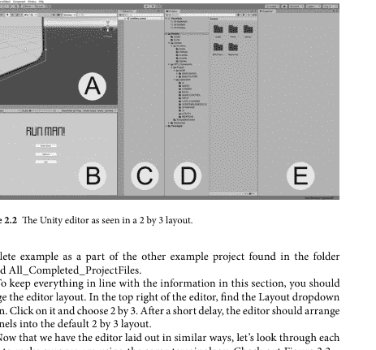

图 2.2 以 2 x 3 布局显示的 Unity 编辑器。

complete example as a part of the other example project found in the folder named All_Completed_ProjectFiles.

为使一切与本节中的信息保持一致，你应该更改编辑器布局。在编辑器右上角，找到 Layout 下拉按钮。点击它并选择 2 by 3。短暂延迟后，编辑器应将其面板排列成默认的 2 by 3 布局。

现在我们已将编辑器以相似的方式布局，让我们逐一查看每个面板，以确保我们使用相同的术语。查看图 2.2 – 下面概述了图中显示的不同部分，这些部分是什么以及它们的用途：

- A. Scene
Scene 面板是进入 Unity Scene 的拖放视觉窗口。你可以直接在当前加载的 Scene 中操作 GameObjects。

- B. Game
Game 面板显示游戏的预览。当你按下 Play 时，编辑器会在 Game 面板中运行游戏，就像在独立构建中运行一样。游戏预览还提供一些额外功能，例如 Gizmos，以帮助你构建和调试游戏。

- C. Project
Project 面板非常类似于文件浏览器，因为它列出了构成你的项目的所有文件。你可以点击并拖动它们，右键单击并访问菜单，使用快捷方式并删除它们——几乎所有 Windows 资源管理器窗口的常规功能都直接在编辑器中。

- D. Hierarchy
Hierarchy 的工作方式与 Project 面板类似，只是它不是用于操作项目文件的界面，而是用于操作当前 Scene 中的 GameObjects。


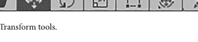

图 2.3 变换工具。

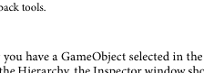

图 2.4 回放工具。

### E. 检查器

每当你在场景面板中选择一个 GameObject，或在层级中突出显示它时，检查器窗口会显示该 GameObject 的可编辑属性以及附加到它的任何组件。场景面板中做不到的事情，你很可能在这里可以做到。

另一个值得关注的地方是在主 Unity 编辑器中，沿着编辑器顶部的工具栏，位于菜单下方。

在左上角，找到变换工具栏（图 2.3）。此工具栏用于操作场景面板中的对象。工具从左到右：

| 工具 | 描述 |
| --- | --- |
| 手工具 | 允许你在场景中平移视图。 |
| 移动 | GameObject 的选择和移动。 |
| 旋转 | GameObject 的选择和旋转。 |
| 缩放 | GameObject 的选择和缩放。 |
| 矩形变换 | 以矩形形式修改 GameObject 的边界。 |
| 变换 | 一种方法，可在一个组合工具中操作缩放、位置和旋转。 |
| 自定义 | 此工具允许访问自定义编辑器工具，本书中不会涉及。 |

在工具栏中央，找到播放、暂停和步进按钮（图 2.4），用于预览游戏并控制游戏面板中的发生情况。

### 2.2.1 示例项目的一些说明

Unity 使用一种称为包的东西，以官方支持和受控的方式扩展编辑器的功能。为了便于编辑和设置此项目中的 2D（二维）精灵，必须导入一个名为 2D Sprite Package 的包。访问包是通过包管理器完成的——可在菜单 Window/Package Manager 中找到。定期在包管理器中检查，查看你下载的任何库的更新。

### 2.2.2 精灵

2D 精灵可在项目的 Assets/Games/RunMan/Sprites 文件夹中找到。精灵是用名为 Aseprite 的精灵编辑程序制作的，并以精灵表形式导出。精灵表是精灵组，由引擎拆分为单个精灵。我们倾向于对动画使用精灵表，将多个动画帧导出到单张图像中以节省内存，并让引擎负责将其切割以显示。所有游戏图像的导入设置均设为默认值，Sprite Mode 设为 Multiple 以适应精灵表（Multiple 允许你切片这些图像），Filter Mode 设为 Point（无滤镜），以便 Unity 不会尝试滤镜图像使其平滑。对于这种视觉风格，我们希望像素清晰可见且不经过滤镜。唯一其他偏离默认值的是压缩级别，已设为 None，只是为了确保避免压缩小图像可能产生的任何伪影或异常。

### 2.2.3 动画

动画是一个复杂的话题，超出了本书的范围，但本节作为快速指南，说明本游戏的动画如何工作。

请在 Sprites 文件夹中查找 RunMan_Animator。你可以通过在项目窗格中双击 RunMan_Animator 文件来打开它进行查看。Animator 包含一个状态机图（图 2.5），控制动画的流程。

当带动画的 GameObject 初始化时，状态机图从其 Entry 状态开始并将转换到默认状态。在图 2.5 中，你可以看到 RunMan_Animator 的默认状态为 RunMan_Idle（即从 Entry 到 RunMan_Idle 有一条箭头）——这会在 RunMan 静止时播放待机动画。动画是循环的，并且在 Animator 图中从 RunMan_Idle 没有进一步的流程（没有更多指向方框的箭头！）；因此，除非另行指示，否则动画将保持在待机状态。

在图中（图 2.5）查找 Any State——这字面意思是任何状态，即该状态可以从任何动画触发。Any State 有两条箭头引出；一条指向 RunMan_Jump 状态，另一条指向 RunMan_Run 状态。那么，当 Animator 图中从无限循环的 RunMan_Idle 状态没有链接时，我们如何让动画改变为奔跑或跳跃？参数是答案！参数是可以通过代码设置和修改的变量，并可由 Animator 图用作条件来控制流程。在 Any State 的情况下，每当触发 Jump 参数时，Animator 将从 Any State（即图当前所在的任何状态）转换到 RunMan_Jump。每当触发 Run 参数时，Animator 将从 Any State 转换到 RunMan_Run。RunMan_Run 是一个循环动画，再次播放直到 Animator 图被告知做其他事情。

总之，本游戏的动画系统设置得尽可能简单。Animator 可以通过两个参数控制：Jump 和 Run。在我们的代码中，要转换到奔跑动画，我们只需设置 Run 参数。要播放跳跃动画，我们设置 Jump 参数。


图 2.5 RunMan 角色的 Animator 图。

## 2.3 打开主游戏场景

在项目面板中，有很多文件夹。其中大多数是 GPC_Framework 文件夹内的子文件夹。我们现在不需要深入了解，但你应该知道 GPC_Framework 中的文件构成了框架，并且它们与其他文件分开，以保持框架文件和游戏文件分离且整洁。

找到 Games 文件夹并点击其旁边的箭头以展开文件夹显示其内容。设计意图是，每当你使用框架构建游戏时，都使用 Games 文件夹来放置仅特定于你的游戏的资源。

Games 下的文件夹结构如下：

- Games
  - RunMan
    - Audio
    - Prefabs
    - Scenes
    - Scripts
    - Sprites

在推进游戏项目时，尽可能保持组织有序。这将在项目增长时（而且通常会比你预期的大得多！）帮助你保持方向，减少寻找丢失资源的时间。

在项目面板中，点击 Scene 文件夹以显示其内容。该文件夹内有一个场景，名为 runMan_core。这是将包含主游戏的场景。我们还将有一个主菜单场景，我们将在本章后面添加。

在项目面板中双击 runMan_core 场景以打开它。游戏面板将显示已设置好的用户界面（图 2.6），但场景中目前没有其他逻辑，因此按下播放不会做任何事情。通过使用框架，本章结束时你将在这里拥有一个有趣的无限奔跑游戏可以玩。本书的游戏框架处理了大部分繁重工作，而大部分工作将是连接现有脚本以形成此游戏的 GameObject、逻辑和物理。你可能会惊讶地发现，这只需要四个自定义脚本。

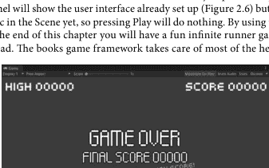

图 2.6 为了节省时间，本章示例项目的游戏场景中用户界面已设置好。

## 2.4 游戏管理器

本游戏的核心是游戏管理器。这里跟踪游戏的状态，也是游戏中所有对象和逻辑的汇聚点。我们将在本章中多次回顾游戏管理器，但本节需要做的是设置基本结构和一些变量，供其他对象访问和使用。例如，平台需要知道移动速度有多快。我们需要所有平台以相同速度移动，因此将速度值存储在游戏管理器中是有意义的。存储平台速度还意味着我们可以直接在处理游戏逻辑的脚本中轻松更改游戏速度。

在 Unity 中打开 runMan_core 场景后，点击层级面板顶部的加号以显示添加菜单。从下拉菜单中选择创建空物体。

> *提示：你也可以通过在层级面板的空白处右键单击，或通过编辑器顶部的 GameObject 菜单访问添加 GameObject 菜单。*

在检查器中，选择新的 GameObject 后，将名称从 GameObject 改为 GameManager。

点击添加组件。在点击该按钮后出现的文本框中，输入 `RunMan_GameManager`。输入完成后，按键盘上的回车键。添加组件窗口将自动切换以显示新脚本（图 2.7）。点击创建并添加。这会创建一个新的 C# 脚本组件并将其添加到你刚刚创建的 GameObject 上。编译器更新需要一点时间后，组件应作为名为（脚本）的组件出现在检查器中。下一步是打开脚本并添加一些代码。

仍在检查器中，双击组件内的脚本名称以打开默认脚本编辑器（通常是 Visual Studio，除非你在安装 Unity 时选择了其他编辑器）。如果打开脚本有任何问题，你可以通过项目面板访问它。Unity 会自动将新脚本放置在 Assets 文件夹中。点击项目面板中的 Assets 文件夹，你应该能在分割的项目窗格右侧看到 `RunMan_GameManager`。双击脚本文件以打开它。

创建新文件时 Unity 添加的默认 C# 脚本如下所示：

```csharp
using System.Collections;
using System.Collections.Generic;
using UnityEngine;

public class RunMan_GameManager : MonoBehaviour

{
    // Start is called before the first frame update
    void Start()
    {
    }

    // Update is called once per frame
    void Update()
    {
    }
}
```


一些有用的东西来帮助管理你的游戏。我们将在第 3 章第 3.2.1 节中详细介绍脚本。

现在在 Inspector 中，有三个下拉菜单字段用于 Current Game State、Target Game State 和 Last Game State。在这些字段下方，有许多事件，这些事件将在我们的状态机进入 loaded、game started 等状态时触发。我们将在本章第 2.7.1 节中全面讨论游戏状态。

在做任何其他事情之前，我们需要添加几个变量。将以下代码放在类声明之后、void Start() 方法之上：

```
public float runSpeed = 1f;
public float distanceToSpawnPlatform = 2f;
public bool isRunning;
```

runSpeed 将由平台移动代码使用，以确定平台在屏幕上移动的速度，从而模拟奔跑。

distanceToSpawnPlatform 包含一个 float 值，表示平台之间的间隙（以 3D 单位计）。

isRunning 是一个布尔值，用于平台判断是否应该移动。isRunning 的主要用途是在游戏开始时，玩家尚未开始奔跑而处于空闲动画状态之前。我们将在游戏结束时再次使用它，以在显示最终得分和游戏结束信息时停止平台移动。

现在这些变量已在 Game Manager 中设置好，我们需要使该类在任何地方都可访问，以便其他脚本可以访问它。为此，我们将采用基本的单例模式。有关更多信息，请参阅第 1 章第 1.4 节。

在你刚刚添加的变量下方，紧接在以下行之后：

```
public bool isRunning;
```

添加以下代码：

```
public static RunMan_GameManager instance { get; private set; }
// set instance in this script's constructor
public RunMan_GameManager()
{
    instance = this;
}
```

这样做是为了创建一个可在任何地方访问的变量，因为它是 public 且 static。当 GameManager 实例被创建时构造函数会运行，我们的 public static 变量会被填充为对 'this' 实例的引用。其他脚本现在可以通过引用其静态变量来与此实例通信，如下所示：

```
RunMan_GameManager.instance
```

通过此实例变量，游戏中的任何其他脚本都可以调用 RunMan_GameManager 上的函数、访问公共变量或设置公共变量。只需确保在任何时候只存在一个 RunMan_GameManager 实例，否则你可能会发现脚本试图访问错误的对象。如果你在创建可能导致多个实例的更复杂场景，请考虑在设置之前检查实例变量是否已填充。对于本游戏而言，我们只需要将此单个实例附加到单个场景中的单个 GameObject 上就足够了。

就目前而言，这就是我们需要对 Game Manager 进行的全部操作。本章后面会有更多内容，但这足以开始使用，并为游戏平台提供它们移动所需的信息。

## 2.5 制作可供奔跑的平台

本游戏的核心是可供奔跑的平台，因此这是一个很好的起点。由于平台不需要任何游戏特定代码，我们可以先弄清楚如何在添加游戏逻辑之前生成它们并移动它们。

现在，用户界面可能会妨碍你在设置游戏元素时清晰地看到一切。要隐藏界面，请在 Hierarchy 面板中查找 UI_Canvases 对象。UI_Canvases 是一个空的 GameObject，其下实际的用户界面作为其子对象。如果看不到 UI_Canvases 下的三个 Canvas GameObject，请点击 UI_Canvases 旁边的箭头将其展开。现在，点击第一个——GetReadyMessageCanvas GameObject——以突出显示它。按住键盘上的 Shift 并点击 GameUICanvas GameObject。这样应同时选中全部三个画布。在 Inspector 中，找到名为 Canvas Group 的组件，并将 Alpha 字段中的值设置为 0。此时所有用户界面都应被隐藏。

在 Project 面板中，找到 Games/RunMan/Sprites 文件夹。在 Sprites 中，找到 RunMan_Platform 精灵。左键点击并将其拖入 Hierarchy 面板中的空白区域。如果一切顺利，你应该能在 Game 面板的中央看到平台出现。

在 Hierarchy 中选中 RunMan_Platform GameObject，将鼠标移至 Scene 面板上方。按下键盘上的 F 键。这将聚焦当前选中的对象，使 Scene 视图移动到对象的中心以便于编辑。你也可以此时使用鼠标滚轮稍微拉远一点。只要留出足够的空间让平台在移动时不会超出屏幕边缘即可。

在 Scene 视图中，点击并按住以抓住平台上 Gizmo Unity 覆盖层的红色箭头。选中红色箭头后，你只能沿其 X 轴移动平台——在 Game 面板中向左或向右。将平台向左拖动，使平台的左侧触及 Game 面板的左侧。

接下来，抓住 Gizmo 的绿色箭头以沿 Y 轴移动平台。按住鼠标并移动平台，使其底部触及 Game 面板的底部。

这个平台将在游戏开始时作为玩家站立的起始平台。为了防止玩家直接掉落穿过它，我们需要添加一个 Collider。

在 RunMan_Platform 仍被选中的情况下，查看 Inspector 并点击 Add Component。在点击按钮后出现的搜索框中，输入 Edge 并从下拉菜单中选择 Edge Collider 2D，以向 GameObject 添加 Edge Collider 2D 组件。

在 Hierarchy 中仍选中 RunMan_Platform，回到 Scene 面板上方并按下键盘上的 F 键以将平台聚焦在视图中心。现在 Edge Collider 2D 组件已添加到此 GameObject，你应该能看到一条细长的绿色线沿平台长度方向运行。这条线将成为玩家站立的实体物理表面。它需要与平台顶部对齐，而不是当前位置。在 Edge Collider 2D 组件上，点击 Edit Collider 按钮（图 2.8）。


图 2.8 在 Unity 中，某些 Collider（例如 Edge Collider 2D）具有 Edit 按钮。

在 Scene 面板中，绿色线现在可以移动。将鼠标悬停在绿色线上会出现一个小的 Gizmo 方块。通过点击并拖动该方块，绿色线会移动。首先抓住左侧的一个点并向上移动。然后抓住右侧的一个点做同样的操作，使绿色线与平台顶部完美对齐。

要完成平台设置，只需再添加两个组件。在 Inspector 中，点击 Add Component，并找到并添加一个 Auto Destroy Object 组件。在标记为 Time Before Object Destroy 的字段中输入 10。我们希望该对象在 10 秒后自行删除。此时 RunMan_Platform 的组件应与图 2.8 中的类似。

第二个组件我们将自己构建。点击 Add Component 并输入 AutoTransformMove。点击 New Script 然后 Create and Add 以创建新的 C# 脚本并将其添加到 GameObject。

一旦新脚本附加到 GameObject 并在 Inspector 中可见，双击脚本名称以在脚本编辑器中打开它。在脚本编辑器中，在类声明上方、现有 using 语句下方添加以下行：

```
    using GPC;
```

为了移动平台，此脚本需要三个变量。将它们添加到类声明内部：

```
    public float moveSpeed;
    public Vector3 moveVector;
    private Transform _TR;
```

脚本首次启动时，我们需要获取 GameObject 的 Transform 引用。Transform 是一个内置组件，我们用它来修改位置、旋转和缩放。

从 Monobehaviour（在任何层级）派生的脚本可以包含由游戏引擎自动调用的函数。Start() 函数将在游戏开始时被调用。将 Start() 函数更改为如下所示：

```
    void Start()
    {
        // cache the transform ref
        _TR = GetComponent<Transform>();
    }
```

GetComponent 将在当前 GameObject 上搜索尖括号内指定类型的组件。GetComponent() 是一个有用的内置函数，但它可能有点慢，因此最好将对 GetComponent() 的调用移出主循环并尽可能少地调用。

另一个由引擎自动调用的 Monobehaviour 特定内置函数是 Update()。它会在每一帧被调用（是的，当帧率为 30 时每秒 30 次，或在 60 fps 时为 60 次，依此类推）。


这里是放置我们移动代码的理想位置。用以下内容替换脚本中已有的占位 Update 函数：

```csharp
void Update()
{
    // keep move speed updated from game manager
    moveSpeed = RunMan_GameManager.instance.runSpeed;

    // move the transform
    _TR.Translate((moveVector * moveSpeed) * Time.deltaTime);
}
```

在上面的代码中，moveSpeed 从本章前面在 RunMan_GameManager 中创建的 runSpeed 变量获取值。它使用那个 Singleton 变量实例来访问它。

在那下面，我们使用 Translate 函数（Transform 的一部分）来移动平台。moveVector 是一个 Vector3 类型的变量，它保存一个方向向量，用于定义对象的移动方向。它乘以 moveSpeed，为我们得到一个适合 Translate 的 Vector，该 Vector 会随 RunMan_GameManager 中的速度变化而变化。然后它再乘以 Time.deltaTime。Unity 提供了一个名为 Time 的辅助类，用于帮助跟踪或操纵引擎处理时间的方式。deltaTime 是一个变量，保存自上一帧 Update 以来经过的时间量，因此我们可以使用该 deltaTime 量来使移动适应时间，而不是被锁定到帧率。这比每帧只移动 X 量更好，因为如果系统在后台做了一些导致游戏停顿的事情，或者你的游戏在另一个系统上运行得比应有的慢，移动就不会按预期工作。通过让移动适应经过的时间，如果运行缓慢或出现小故障，即使需要跳变一点，它也会移动相同的量。

最后，在脚本中最后一个右花括号之前、Update() 函数下方添加以下函数：

```csharp
public void SetMoveSpeed(float aSpeed)
{
    // provide method to adjust speed from other scripts
    moveSpeed = aSpeed;
}
```

上面，我们只是添加了一个简单的方法，让另一个脚本告诉此脚本移动速度的快慢。本章稍后会用到它，在游戏开始时调用，以告诉起始平台在游戏开始后移动。

按 Ctrl+S 保存脚本并返回 Unity。

在 Hierarchy 中选中 RunMan_Platform，找到你创建的 Auto Transform Move 组件，将 Move Speed 保留为 0，但更改 Move Vector，使 X 为 -1，Y 和 Z 保持为 0。

最后，我们需要设置平台的 Layer，以便它可以被检测为地面。在 Inspector 的右上角，紧挨着 GameObject 名称下方偏右的位置，有一个标记为 Layer 的下拉菜单（图 2.9）。单击该下拉菜单，然后从列表中选择 Ground。

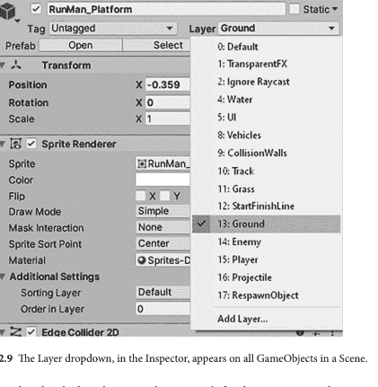

图 2.9 Inspector 中的 Layer 下拉菜单会出现在 Scene 中的所有 GameObject 上。

在编辑器中按 Play。平台应该会快速移动到屏幕左侧。如果它这样做了，干得好！这就是它应有的行为。单击编辑器中的 Stop 按钮停止播放。

现在平台已经拥有游戏所需的一切，我们需要将它变成 Prefab，以便另一个脚本可以在我们需要时生成它。要将平台变成 Prefab，请从 Hierarchy 中单击并拖动 RunMan_Platform 到 Project 面板中的 Games/RunMan/Prefabs 文件夹。

在游戏开始时，RunMan 应该有三个平台可以在跳跃开始前跑过，以便玩家有机会适应环境。本节要做的最后一件事是复制平台，再制作两个平台，与 Scene 中已有的平台并排。

在 Hierarchy 中，右键单击 RunMan_Platform，然后从菜单中选择 Duplicate。Hierarchy 中应会出现一个名为 RunMan_Platform (1) 的新 GameObject，但你在 Scene 或 Game 面板中不会看到任何差别，因为它目前与原平台处于完全相同的位置。单击 Scene 面板中显示的 Gizmo 上的红色（X 轴）箭头，将其向右移动。将此重复平台拖动到其顶部接触原平台的位置，这样玩家就不会掉入缝隙（如图 2.10 所示）。

现在再复制一个平台，放在你刚添加的平台右侧。在 Hierarchy 中，右键单击 RunMan_Platform 并选择 Duplicate。单击 Scene 面板中显示的 Gizmo 上的红色（X 轴）箭头，将其向右移动。将此新平台拖动到上一个平台的右侧，刚好接触。

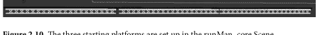

图 2.10 三个起始平台已在 RunMan_Core Scene 中设置好。

## 2.6 构建玩家 RunMan

现在我们有平台了，还需要一个玩家。首先在 Hierarchy 中创建一个新的 GameObject（你可以右键单击空白区域并选择 Create Empty，或单击 Hierarchy 面板顶部的 + 图标）。

在 Inspector 中更改新 GameObject 的名称，将其命名为 RunMan。

### 2.6.1 添加 RunMan 精灵

为了让我们能看到玩家所在的位置，最好向 Scene 中添加一个视觉表示——RunMan 精灵。为此，请在 Project 面板中找到 Games/RunMan/Sprites 文件夹。单击 Sprites 文件夹，以便查看其中的内容。在 Sprites 中，找到名为 RunMan_Run-Sheet 的文件。将 RunMan_Run-Sheet 从 Project 面板中单击并拖出，放到 Hierarchy 的空白部分。这应该会将 RunMan 精灵添加到 Scene，并使其出现在 Game 面板的中心。

此时，精灵和我们的 RunMan GameObject 是两个独立的对象。接下来我们需要做的是让精灵成为 RunMan GameObject 的子对象。在 Hierarchy 中，单击 RunMan_Run-Sheet_0 GameObject，并将其拖到 RunMan GameObject 上。这应该会将 RunMan_Run-Sheet_0 设为其子对象，如图 2.11 所示。

在这个阶段，我们遇到的问题是精灵可能在位置上与 RunMan GameObject 发生偏移，因为 Unity 经常将对象生成在远离 0,0,0 世界坐标的位置。在 Unity 中，所有对象都有世界坐标和局部坐标。你可以说世界坐标就像你的街道地址，而局部坐标可能是你在房子里的位置。

当你将一个对象设为另一个对象的子对象时，它会继承父对象的世界坐标，但仍会保留它之前拥有的世界坐标，现在存储为局部坐标。也就是说，即使它随父 GameObject 移动，它也会根据其在 Inspector 中 Transform 框内的 X、Y 和 Z 值相对于父对象发生偏移。

RunMan GameObject 将附加所有操作组件（移动代码、碰撞等），这意味着精灵的局部位置需要设置为 0,0,0。这样，它既会随父对象移动，又会定位在完全相同的位置——如果我们不这样做，碰撞就不会发生在精灵所在的位置，游戏就会变得毫无意义。

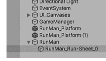

图 2.11 已设为 GameObject 子对象的 RunMan 精灵。

在 Hierarchy 中单击 RunMan_Run-Sheet_0 GameObject，并将其 Position 的所有三个 X、Y 和 Z 字段（位于 Inspector 顶部的 Transform 部分）设置为零（如果尚未为零）。你可能会发现精灵移出了 Game 面板的中心，但这没关系——我们将在设置物理后设置玩家的确切位置。

### 2.6.2 为 RunMan 添加物理和碰撞

到本节结束时，RunMan 将能够下落并停在平台上。

首先，我们需要向 RunMan GameObject 添加 Rigidbody，以在物理模拟中表示玩家。单击 RunMan GameObject 开始。在 Inspector 中，单击 Add Component 并找到 Rigidbody 2D（可以滚动查找，或在搜索栏中输入 Rigidbody）。

需要更改 Rigidbody 2D 组件上的重力值，以帮助 RunMan 获得适合本游戏的跳跃风格。在 Inspector 中，在 Rigidbody 2D 组件上，将 Gravity Scale 更改为 0.6。

接下来，找到 Constraints 字段，单击其左侧的小箭头，展开 Constraints 部分。在 Freeze Rotation 旁边，单击 Z 框以将其勾选。

RunMan 现在有物理了，但他没有碰撞组件，会一直下落到无穷远，直到我们添加 Collider。在 Hierarchy 中仍选中 RunMan GameObject 的情况下，单击 Inspector 中的 Add Component 按钮。找到并添加 Capsule Collider 2D。不过要注意不要在这里添加常规的 Capsule Collider。标准 Capsule Collider 只适用于 3D 模拟，而且由于 Unity 对 2D 物理和 3D 使用不同的物理引擎，我们需要确保只使用 2D 组件。

Capsule Collider 是在物理模拟中表示人体的好方法。你可以将它从头到脚拉长，并且它具有最小的接触表面，以在沿地面移动时降低摩擦水平。由于它有宽度，你还可以调整胶囊体来表示身体宽度。在本节中，你可以手动编辑 Collider，尝试使其看起来像图 2.12 中的形状，或者可以在 Inspector 中输入以下数字：

| 属性 | X | Y |
| --- | --- | --- |
| 偏移 | 0 | 0.01 |
| 尺寸 | 0.04 | 0.15 |
| 方向 | 垂直 |  |

通过 Inspector 输入所有数字后，将你的胶囊体形状与图 2.12 中的形状进行比较——如果看起来不错，就继续下一阶段：添加玩家脚本。


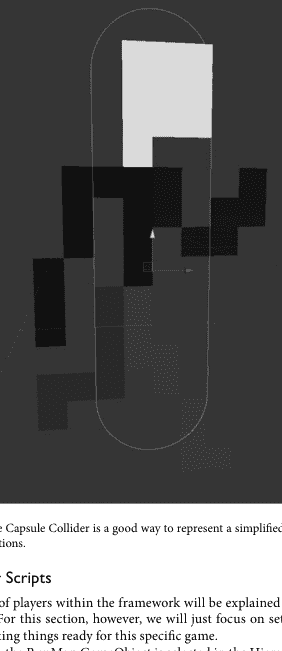

图 2.12 Capsule Collider 是用于碰撞计算时表示简化人形的一种好方法。

### 2.6.3 玩家脚本

框架中玩家的结构将在下一章深入讲解。不过在本节中，我们只专注于设置一个基础玩家，并为这个特定游戏做好准备。

确保在 Hierarchy 中选中了 RunMan GameObject，或者单击它以将其高亮显示。在 Inspector 中单击 Add Component 按钮。单击 New Script，输入 RunMan_CharacterController 作为脚本名称，然后单击 Create and Add。

双击 RunMan_CharacterController 名称，在脚本编辑器中打开该脚本。用以下内容替换默认脚本：

```
using System.Collections;
using System.Collections.Generic;
using UnityEngine;
using GPC;

public class RunMan_CharacterController :
BasePlayer2DPlatformCharacter
```

称为 BaseUserManager。BaseUserManager 组件将用于保存玩家特定数据，例如得分，但暂时不用担心——我们将在第 4 章第 4.3 节详细讨论这一点。

在上面的脚本中，请注意该类继承自 BasePlayer2DPlatformCharacter：

```
public class RunMan_CharacterController :
BasePlayer2DPlatformCharacter
```

BasePlayer2DPlatformCharacter 类提供了控制平台角色的基础功能。它最初是为马里奥风格的游戏设计的，但同样适合这种游戏类型的需求。

我们暂时不会详细讲解该脚本其余部分的功能。关于 BasePlayer2DPlatformCharacter 的更详细说明将在本书后面的第 6 章第 6.4 节中给出。

玩家需要某种形式的玩家输入。框架有一个输入 Controller，会监视一些常规按键。这里我们将以稍微不同的方式添加输入组件——不使用 Add Component 按钮，而是转到编辑器顶部的 Component 菜单。那里有很多不同的组件，但它们是分类的。找到 CSharpBookCode 类别，然后选择 CSharpBookCode>Base>Input Controller。现在，Input Controller 组件应该已添加到玩家 GameObject 上。本书中几乎所有的类都有一行代码将它们添加到这些菜单中。通常格式类似：

```
[AddComponentMenu("CSharpBookCode/Base/Input Controller")]
```

上面的 AddComponentMenu 命令可以将脚本组件添加到 Unity 的任意菜单中。将它们放在菜单中，可以更容易地找到你经常使用的组件，而不必在 Add Component 下的搜索框中输入它们，或搜索想要的组件。得益于 AddComponentMenu 命令，框架中的所有基类都可以在 CSharpBookCode/Base 菜单下找到。

现在该在 Run Man Character Controller 上设置一些内容了：找到 Ground Layer Mask 字段。单击它，然后从列表中选择 Ground。你可能还记得，在本章第 2.5 节设置平台时，平台位于名为 Ground 的层上。我们将使用它来识别玩家下方的平台，从而知道玩家何时位于地面表面上，并允许其跳跃。一旦玩家处于空中，且未检测到地面表面，就不再允许跳跃。

### 2.6.4 RunMan 音效

RunMan 跳跃时需要发出一点声音，当他坠落身亡时我们也会播放声音。音频系统、Audio Mixers，以及我们在框架中处理音频的方式将在第 9 章详细讨论。

如果尚未高亮显示，请在 Hierarchy 中选择 RunMan。在 Inspector 中，单击 Add Component，并添加名为 BaseSoundController 的组件。该组件保存一个声音列表，之后可以通过调用脚本并传入想要播放的声音索引编号来播放这些声音。执行该操作的代码已经包含在你已添加的脚本中，因此此时只需向该组件添加声音即可。

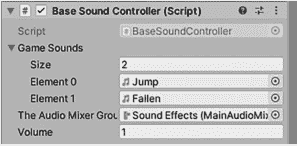

图 2.13 Base Sound Controller 组件保存一个待播放声音的列表。

在 Project 面板中，单击 Assets/Games/RunMan/Audio 文件夹，使其内容显示在 Project 面板中。

单击并将名为 Jump 的音频文件拖到名为 Game Sounds 的字段中。该字段应展开以显示列表中的第一项。接下来，单击并将名为 Fallen 的音频文件拖到同一个 Game Sounds 字段中。现在你应该会看到类似图 2.13 的内容，其中 Game Sounds 字段已展开以显示其大小（为 2），并将 Jump 和 Fallen 项分别作为元素 0 和 1。

Game Sounds 下方是一个名为 The Audio Mixer Group 的字段。Audio Mixer 用于控制 Unity 音频系统中的音量和效果。该字段右侧有一个小的目标按钮（一个圆内套一个小圆）。按下它。应会出现一个窗口，显示 Audio Mixer 的两个组。这两个组是 Sound Effects 和 Music。它们充当音频路由经过的通道，因此由于这是音效，请继续选择 Sound Effect 组。

### 2.6.5 为 RunMan 制作动画

正如我在本章开头提到的，所有动画和 Animator 都已经设置好并可直接使用，但你需要将 Animator 组件添加到精灵本身（不是 RunMan GameObject，而是实际的精灵）。

在 Hierarchy 中，单击 RunMan GameObject 下的 RunMan_Run-Sheet_0。在 Inspector 中，你应该会看到该精灵 GameObject 附加了一个 Sprite Renderer。我们的 Animator 组件将负责在需要时将精灵切换为所需的任意动画，但它需要访问 Sprite Renderer，这就是为什么我们将 Animator 添加到此 GameObject 而不是其父对象。

单击 Add Component 并添加一个 Animator。

在 Project 面板中，找到 Assets/Games/Sprites 文件夹并单击它以显示其内容。单击并将 RunMan_Animator 从 Project 面板中拖出，放到你刚刚添加的 Animator 组件的 Controller 字段中。

最后一步是告诉玩家脚本这个新的 Animator 组件。在 Hierarchy 中单击 RunMan，然后找到 Run Man_Character Controller 组件的 Run Man Animator 字段。

在 Hierarchy 中，单击并将 RunMan_Run-Sheet_0 GameObject 拖到该 Run Man Animator 字段中。Unity 会自动识别出你刚拖入该字段的 GameObject 上附加了一个 Animator 组件，并转而使用对 Animator 的引用，而不是对 GameObject 的引用。

现在，如果你按下 Play 试玩游戏，玩家会掉落到平台上；在他位于平台上的短暂时间内，你应该能够向左、向右移动，甚至按空格键跳跃。接下来，我们需要给 RunMan 更多平台来奔跑和跳跃。

### 2.6.6 计分

本书中的框架包含我称之为用户数据管理器的东西。本质上，每个玩家管理自己的数据。将得分、生命值、命数等归属于玩家，而不是游戏，我们就将玩家从游戏代码的其余部分中抽象出来。例如，Game Manager 不需要跟踪所有玩家的得分，因为玩家自己会跟踪。Game Manager 可以告诉某个玩家增加其得分，但除此之外不必做任何事情。这种方法使以后实现多人游戏之类的内容更容易，因为玩家结构更容易切换为不同的设置，而不会影响其他代码。

在 Hierarchy 中，单击 RunMan GameObject 将其高亮显示。在 Inspector 中，你应该会发现 Unity 已经添加了 BaseUserManager 组件。这是因为在 RunMan_CharacterController 脚本继承的某个名为 BasePlayerStatsController 的脚本中，有代码告诉 Unity 我们需要将此组件附加到我们的 GameObject 上。

BaseUserManager 包含大量辅助函数，用于增加得分、减少得分、增加生命值，或命数或等级。我们将在本书后面的第 4 章第 4.3 节详细研究该系统。目前，你只需知道，与存储 RunMan 得分相关的一切都将包含在该 BaseUserManager 组件中。

## 2.7 游戏循环与游戏管理器

游戏循环通常指游戏代码中反复执行的核心部分，其中存在需要每帧更新的逻辑，或者需要监控并改变游戏状态以控制游戏整体流程。我们目前拥有的 RunMan_GameManager 脚本内部还没有真正的游戏逻辑，只有几个变量和一个实例变量；本节将添加游戏循环及其支持函数，用于执行诸如为玩家生成可奔跑平台等操作。

你可能还记得，当我们在第 2.4 节创建 RunMan_GameManager 脚本时，我们将其编程为 RunMan_GameManager 类派生自 BaseGameManager。BaseGameManager 已经包含帮助我们处理游戏状态的代码。

### 2.7.1 游戏状态

BaseGameManager 包含 17 种不同状态，用于更大、更复杂的游戏，不过对于本项目，我们只使用其中 5 种：

| 状态 | 描述 |
|---|---|
| Game.State.loaded | 当主游戏场景首次加载时调用此状态。 |
| Game.State.gameStarting | 完成主游戏场景中所需内容的初始化与设置后，将设置 gameStarting，我们用它显示一条消息，通知玩家“准备”开始游戏。 |
| Game.State.gamePlaying | 游戏运行后，状态保持为 gamePlaying。 |
| Game.State.gameEnding | 如果玩家从平台掉落并碰到隐藏触发器，游戏结束。gameEnding 状态负责停止移动并阻止继续获得得分。当此状态开始时，我们还会显示最终的“游戏结束”用户界面。 |
| Game.State.gameEnded | 当 gameEnded 状态发生时，我们离开主游戏场景并加载主菜单。 |


游戏开始时，上面的代码会将我们的当前状态设置为 Game.State.loaded，这样，当场景完成加载后，我们需要运行的代码就可以运行。

在新的 Start() 函数下方，添加以下代码：

```csharp
public override void UpdateTargetState()
{
    Debug.Log("targetGameState=" + targetGameState);

    if (targetGameState == currentGameState)
        return;

    switch (targetGameState)
    {
        case Game.State.loaded:
            Loaded();
            break;

        case Game.State.gameStarting:
            GameStarting();
            StartGame();
            break;

        case Game.State.gameStarted:
            // Fire the game started event
            GameStarted();
            SetTargetState(Game.State.gamePlaying);
            break;

        case Game.State.gamePlaying:
            break;

        case Game.State.gameEnding:
            GameEnding();
            EndGame();
            break;

        case Game.State.gameEnded:
            GameEnded();
            break;
    }
}
```

BaseGameManager 中已经包含上面的函数，但它被声明为虚函数。拥有这样的虚函数意味着我们可以使用 override 关键字来使用该函数的新版本——请注意，我们重写的是原始函数，而不是替换掉它或销毁原始函数。对 UpdateTargetState() 的任何调用都会被重新路由，但如有需要，我们始终也可以调用原始函数——它仍然存在——在本书中，有时我们会同时调用原始函数和重写版本，但这次不会。在上面的代码中，我们只是重写了原始函数并使用它。

我们在上面的每个状态中做的大部分事情，都是调用其他函数来完成实际工作。例如，在 Game.State.loaded 的 case 语句中，它只是调用 Loaded()。我尽可能将代码排除在状态机函数之外，以便更容易调试。调用单独的函数是避免游戏状态代码失控的好方法——在每个状态中都放置代码很快就会变得难以控制，也更难调试，所以最好尽量把代码块放在它们自己的函数中。

有几处调用的是这个脚本中没有的函数，例如 GameStarting() 和 GameStarted()。这些是继承函数，其代码可以在 BaseGameManager.cs 中找到。我们调用它们的原因是，它们包含对 UnityEvents 的调用，而我们将使用这些 UnityEvents 来隐藏和显示用户界面。我们会在本章后面的用户界面部分（第 2.9 节）进一步设置这些 UnityEvents。

现在，我们的 RunMan_GameManager 类已经具备了处理目标状态更新所需的一切，我们需要添加一些代码中调用的新函数，比如 Loaded()、StartGame() 等。

在你刚刚添加的代码下方（注意：保持在该脚本最后的右花括号上方），添加这个函数：

```
public override void Loaded()
{
    base.Loaded();
    // reset score
    _RunManCharacter.SetScore(0);
    SetTargetState(Game.State.gameStarting);
}
```

在上面的代码中，Loaded() 首先调用 base.Loaded()，这告诉 Unity 运行基类（BaseGameManager）中的原始 Loaded() 函数。尽管我们在这里重写了该函数，但原始函数仍然存在，我们仍然可以通过 base 调用它。当基类中包含我们不想在重写函数中重复实现、但仍希望运行的内容时，这很有用。在这种情况下，基类只包含一次对 UnityEvent OnLoaded 的调用。同样，我们会在本章后面处理用户界面时讲到 UnityEvents。

下一行在游戏开始时将玩家分数重置为零：

```
_RunManCharacter.SetScore(0);
```

最后，既然我们已经完成了游戏首次加载时需要做的所有事情，接下来会调用 SetTargetState 以进入新状态 Game.State.gameStarting。

接下来，我们添加一个函数，当 UpdateTargetState() 收到将状态更改为 gameStarting 的调用时（如上所述，在 Loaded() 函数末尾），就会调用该函数。在 Loaded() 函数下方添加以下代码：

```
void StartGame()
{
    runSpeed = 0;
    // add a little delay to the start of the game, for people to prepare to run
    Invoke("StartRunning", 2f);
}
```

在上面的代码中，StartGame() 将 runSpeed 设置为 0，这样 RunMan 不会立刻开始奔跑。还记得我们为平台添加的代码吗？那些代码使用了这个 Game Manager 脚本中的 runSpeed。游戏开始时，我们让所有东西保持不动——当 runSpeed 为 0 时，平台不会移动。

接下来，StartGame() 函数使用 Unity 内置的调度函数 Invoke，安排在 2 秒后调用名为 StartRunning() 的函数：

```
Invoke("StartRunning", 2f);
```

在这个阶段，StartGame() 被调用后，游戏会处于 Game.State.gameStarting 状态，等待对 StartRunning 的调用被执行（由上面的 Invoke 函数调用触发）。最终屏幕上会出现一条消息，告诉玩家做好准备。这 2 秒的暂停是为了让玩家阅读消息并准备开始游戏（请注意，这条消息目前是隐藏的，我们要到本章后面的第 2.9 节才会重新加回来）。

2 秒结束后，StartRunning() 会被调用。接下来将此函数添加到你的脚本中，放在你之前添加的 StartGame 函数下方：

```
void StartRunning()
{
    isRunning = true;
    runSpeed = 1f;
    distanceCounter = 1f;

    // start animation
    _runManCharacter.StartRunAnimation();
    InvokeRepeating("AddScore", 0.5f, 0.5f);
    SetTargetState(Game.State.gameStarted);
}
```

StartRunning 让游戏运转起来！第一行将布尔值 isRunning 设置为 true，以便移动和动画可以开始。

接下来，runSpeed 被设置为 1。我们之前添加的平台代码会使用这个变量来了解平台在屏幕上移动的速度，所以现在它被设置为 1，平台就会移动。

distanceCounter 变量用于跟踪平台移动了多远，进而用来决定何时生成新平台供玩家跳跃。由于这是游戏开始，上面的代码将其重置为 1。

对 RunManCharacter 对象（附加到玩家上的 RunMan_CharacterController 脚本组件的一个实例）调用 StartRunAnimation()，即可启动奔跑动画。

除了 Invoke 函数之外，Unity 还提供了另一种用于安排函数调用的有用方法。InvokeRepeating 会按固定间隔调用指定的函数，直到场景被卸载，或者你使用 CancelInvoke() 停止它。在上面的代码中，AddScore() 函数每 0.5 秒被调用一次，玩家将因此获得分数。这个游戏的计分系统非常简单，但已经足够好用！存活越久，得分越高。

StartRunning() 的最后一行推进游戏状态：
SetTargetState(Game.State.gameStarted);

你之前添加的 UpdateTargetState() 函数将处理这次状态更改为 Game.State.gameStarted 的情况，调用 OnGameStarted() UnityEvent，并将状态更改为 Game.State.gamePlaying。从这里开始，游戏会一直处于 Game.State.gamePlaying 状态，直到游戏结束。

接下来，我们需要添加一个处理游戏结束的函数。接下来将此代码添加到你的 RunMan_GameManager 类中：

```
void EndGame()
{
    // stop running
    isRunning = false;
    runSpeed = 0;

    // schedule return to main menu in 4 seconds
    Invoke("ReturnToMenu", 4f);

    // stop the repeating invoke that awards score
    CancelInvoke("AddScore");

    // update target state
    SetTargetState(Game.State.gameEnded);
}
```

在上面的脚本中，我们处理游戏结束时会发生什么。该函数会在玩家掉出屏幕外后调用。脚本的第一部分停止奔跑，并将 runSpeed 设置为 0，以便平台停止移动。

游戏即将结束，因此下一行安排在 4 秒后调用 ReturnToMenu。我们会在本节后面讲到这个函数，不过 ReturnToMenu() 会加载主菜单，这也许并不令人意外。

在安排好返回菜单的调用后，上面的脚本使用 CancelInvoke 阻止 AddScore() 函数被调用。还记得我们在 StartRunning() 函数中为此设置了 InvokeRepeating 调用吗？这就是我们停止它的方式。

最后，对于 EndGame() 函数，我们使用下面这一行将目标状态设置为 gameEnded：

```
SetTargetState(Game.State.gameEnded);
```

对于 Game.State.gameEnded，UpdateTargetState() 除了调用 OnGameEnded UnityEvent 之外没有其他特定操作，该事件将在本章后面的用户界面部分使用。

接下来，将以下代码添加到你的 RunMan_GameManager 脚本中：

```
void AddScore()
{
    _RunManCharacter.AddScore(1);
}

void ReturnToMenu()
{
    SceneManager.LoadScene("runMan_menu");
}

public void PlayerFell()
{
    SetTargetState(Game.State.gameEnding);
}
```

AddScore() 告诉玩家给它的分数加一（1）。ReturnToMenu() 使用 Unity 的 SceneManager 加载主菜单场景。在这个阶段，我们实际上还没有主菜单场景，但我们会本章的用户界面部分（第 2.9 节）解决这个问题。

最后，在上面的函数中，PlayerFell() 函数用于将目标状态设置为 Game.State.gameEnding。玩家每次碰到它的触发器时都会调用这个函数。触发器只是一个 Unity 碰撞体，它不会尝试解决碰撞，而只是对碰撞做出反应。等 RunMan_GameManager 类完成后，我们会在本章后面的玩家脚本中添加一项检查。

RunMan_GameManager 的最后一部分处理生成平台，供 RunMan 跑跳穿过。目前我们只有两个平台，它们在我们点击 Play 后很快就会消失在屏幕外。现在让我们解决这个问题，做出一些真正的玩法。将此代码添加到 RunMan_GameManager 脚本接近末尾的位置，就在最后的右花括号上方：

```
void SpawnPlatform()
{
    runSpeed += 0.02f;
```


```
distanceCounter = 0;

float randomY = Random.Range(-0.4f, 0.2f);
Vector2 startPos = new Vector2(3f, randomY);
Instantiate(_platformPrefab, startPos, Quaternion.identity);
    distanceCounter = Random.Range(-0.5f, 0.25f);
}
```

新平台由 SpawnPlatform() 函数生成。SpawnPlatform() 的第一行将 runSpeed 增加 0.02。这意味着随着时间的推移，游戏会逐渐变得越来越快。这是一种非常简单的方式来随着时间推移增加难度，以便玩家最终会认输。

当新平台生成时，我们重置变量 distanceCounter，以便测量到下一次生成的距离。快速查看 Update() 函数会发现我们将 distanceCounter 与变量 distanceToSpawnPlatform 进行比较，以决定平台之间的距离——但这在后面会提到。让我们回到 SpawnPlatform()。

下一行使用内置的随机数生成函数 Random.Range，让引擎生成一个介于 playAreaTopY 和 playAreaBottomY 之间的数字：

```
float randomY = Random.Range(playAreaTopY, playAreaBottomY);
```

现在 randomY 可以用作生成下一个平台的高度。我们在下一行将其添加到一个 Vector2 中：

```
Vector2 startPos = new Vector2(platformStartX, randomY);
```

现在我们已经有一个包含生成新平台位置的 Vector2（由一个随机的 Y 位置和保存在 platformStartX 中的起始位置组成，该位置将在游戏区域右侧屏幕外），我们可以在下一行继续生成平台：

```
Instantiate(_platformPrefab, startPos, Quaternion.identity);
```

上面，Instantiate 首先接收一个 Prefab 的引用（_platformPrefab），然后是待实例化 GameObject 的起始位置，最后是一个四元数形式的旋转值。Quaternion.identity 是一个零旋转值，即默认值，意味着新平台不会被旋转。

SpawnPlatform() 的最后一行通过一个小的随机量调整 distanceCounter 变量：

```
distanceCounter = Random.Range(-0.5f, 0.25f);
```

其效果是下一个平台之间会有随机的间距，因为我们改变了距离计数系统中零的位置。

我们用一个 Update() 函数结束这一编程部分。Update() 每帧都会被调用。在 RunMan_GameManager 中，这里是监控 distanceCounter 以决定是否该生成新平台的地方。

在最终的大括号上方将以下内容添加到你的脚本中：

```
void Update()
{
    if (isRunning)
    {
        distanceCounter += (runSpeed * Time.deltaTime);

        // check to see if we need to spawn another platform (based on distance travelled)
        if ((distanceCounter >= distanceToSpawnPlatform))
        {
            SpawnPlatform();
        }
    }
}
```

上面，Update() 首先检查 isRunning 是否为 true。如果玩家没有在跑步，我们就永远不需要生成新平台，所以除非正在移动，否则没有必要运行这段代码。

distanceCounter 接下来会增加 runSpeed 乘以 Time.deltaTime 的值。我们在第 2.5 节的平台移动脚本中讨论过 Time.deltaTime。通过将 runSpeed 乘以 deltaTime，我们使移动基于时间而不是基于帧。这个变量 distanceCounter 本质上是在记录玩家跑了多远，以便我们知道何时生成下一个平台。Update() 函数中接下来就是对此的检查：

```
if ((distanceCounter >= distanceToSpawnPlatform))
{
    SpawnPlatform();
}
```

每当 distanceCounter 超过我们设定的 distanceToSpawnPlatform 时，我们就会调用生成新平台——请记住 SpawnPlatform() 也会重置 distanceCounter，因此另一个平台将在相同的距离再次生成（在 SpawnPlatform() 结尾处做的少量随机化调整范围内）。

游戏的编程部分就到此为止！我们需要回到 Unity 并通过 Inspector 在组件上设置一些引用，但就编程而言，我们现在已经拥有了使游戏玩法正常工作的所有逻辑。保存脚本并返回 Unity 设置组件。

### 2.7.3 在编辑器中设置 RunMan_GameManager 组件

在层级视图中，点击 GameManager 以突出显示它并在 Inspector 中显示其属性。在 Inspector 中，向下滚动到组件底部，以显示诸如 Run Speed、Distance to Spawn Platforms 等字段组，如图 2.14 所示。

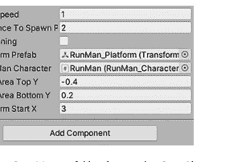

图 2.14 RunMan_GameManager 字段引用主场景中 Game Manager 需要创建实例或与其通信的其他 GameObject。

在 Project 面板中，找到 Games/RunMan/Prefabs 文件夹。此文件夹中应有我们在第 2.5 节中制作的平台 Prefab。点击并拖动 RunMan_Platform Prefab 从 Project 窗口出来，放到 Inspector 中 GameManager 的 Platform Prefab 字段中。这告诉 Game Manager 在我们要求它生成新平台时应生成哪个 Prefab。

现在我们需要为 Game Manager 提供对玩家的引用。在层级视图中找到 RunMan GameObject，然后点击并拖动它到 Inspector 中 GameManager 的 RunMan Character 字段。

确保你的 Game Manager 中的值与图 2.14 中的一致。

## 2.8 RunMan 的陨落

现在我们已经有移动的平台和准备跳跃的角色，我们需要添加一种方法来检测玩家何时错过平台并掉出屏幕。为此，我们使用一个设置为触发器的 Collider（因此它不会解决碰撞，只会报告碰撞），其宽度跨越整个屏幕并位于游戏区域底部正下方。每当玩家触碰到触发器时，它就会知道自己已掉出游戏区域并结束游戏。

添加触发器时，我更喜欢能够看到物体，以便轻松缩放和放置。如果这是一个 3D 游戏，我只需向场景中添加一个立方体，按需排列，然后禁用渲染器以隐藏它即可。可惜 Unity 没有任何 2D 原语（立方体、球体等），但我们可以使用 3D 原语并为其添加 2D Collider。这有点奇怪，我知道，但就是这样。

在层级视图中找到一个空闲位置并右键单击。选择 3D Object 子菜单，然后从中选择 Cube。

接下来，点击工具栏（编辑器窗口左上角）上的 Scale Transform 按钮，或按键盘上的 R 快捷进入缩放模式。在 Scene 面板中，Gizmo 现在应显示一些粗大的方块而不是箭头。点击红色方块并向右拖动，以沿 X 轴缩放立方体。将其拉伸至大约是 Game 面板区域的两倍宽。

现在将立方体向下移动到游戏区域下方，使其超出 Game 面板的视野。要切回移动模式，请点击工具栏中的 Move Transform 按钮或按键盘上的 W 快捷。抓住绿色箭头并向下移动立方体。它应该看起来像图 2.15 中的那样。

在层级视图中选中 Cube GameObject，查看 Inspector。Cube 已附带一个 Collider，但类型不对。Box Collider 只能与 3D 物理一起工作，因此我们需要将其移除并替换为 2D 等效项。

在 Inspector 中右键单击 Box Collider 组件。点击 Remove Component。

点击 Add Component 按钮并开始输入 boxco 以跳转到可用的 Box Collider。从列表中选择 Box Collider 2D 组件（图 2.16）。新组件出现在 Inspector 后，通过点击勾选 IsTrigger 复选框。

如果你现在点击 Play 并让 RunMan 从屏幕底部掉落，你现在应该能听到标志着 RunMan 陨落的声音效果。在下一节中，我们将添加一个游戏结束屏幕，以及游戏结束后返回的菜单。哦，还有计分。呼！听起来这一节很忙。


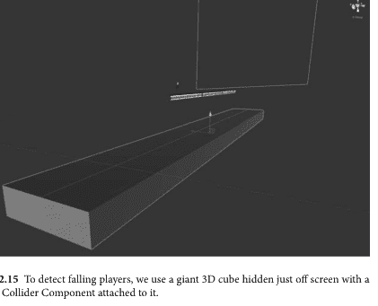

图 2.15 为了检测掉落的玩家，我们使用一个隐藏在屏幕边缘附近的巨型 3D 立方体，并在其上附加了一个 2D Box Collider 组件。

## 2.9 添加用户界面

游戏已经全部就绪，但它需要以下用户界面：

- 1. 一个准备就绪的消息
- 2. 一个游戏内 UI，用来向玩家显示当前分数和高分
- 3. 一个游戏结束消息
- 4. 游戏结束后返回的主菜单

这里的用户界面还有一些取巧——还记得本章开头我们把所有东西都隐藏起来了吗？是的，用户界面已经存在了，但需要一些额外的代码来按需显示和隐藏。

在层级视图中，点击 GameManager GameObject 以突出显示它。在检查器中，向下滚动到 Add Component 按钮并点击它。选择 New Script 并将脚本名称输入为 RunMan_UIManager。点击 Create and Add 以创建新的模板组件。组件出现后，双击脚本名称在脚本编辑器中打开脚本。

用以下代码替换：

```csharp
using UnityEngine.UI;
using GPC;

public class RunMan_UIManager : CanvasManager
{
    // we derive from canvas manager to give us the
    functionality to fade canvas nicely

    public Text _scoreText;
    public Text _highText;
    public Text _finalScoreText;
    public Text _newHighScoreText;
}
```

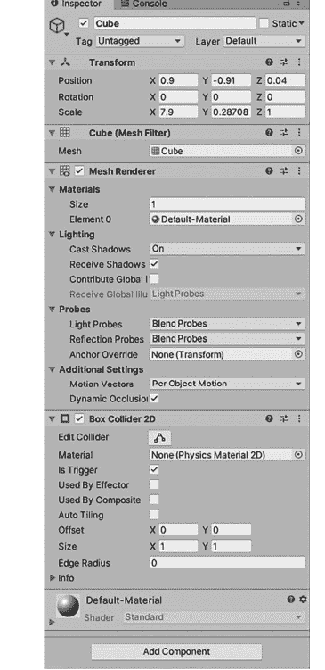

图 2.16 我们用 Box Collider 2D 组件替换立方体的默认 Box Collider，因为标准 Box Collider 在 2D 物理中无法工作。

```csharp
void Start()
{
    _scoreText.text = "Score 0";
    _newHighScoreText.gameObject.SetActive(false);
    // hide all ui canvas
    HideAll();
}
public void ShowGetReadyUI()
{
    ShowCanvas(0);
}
public void HideGetReadyUI()
{
    HideCanvas(0);
}
public void ShowGameOverUI()
{
    ShowCanvas(1);
}
public void ShowGameUI()
{
    ShowCanvas(2);
}
public void HideGameUI()
{
    HideCanvas(2);
}
public void SetScore(int scoreAmount)
{
    _scoreText.text = "Score "+scoreAmount.ToString("D5");
}
public void SetHighScore(int scoreAmount)
{
    _highText.text = "High " + scoreAmount.ToString("D5");
}
public void SetFinalScore(int scoreAmount)
{
    _finalScoreText.text = "Final Score " + scoreAmount.ToString("D5");
}
public void ShowGotHighScore()
{
    _newHighScoreText.gameObject.SetActive(true);
}
```

上面代码首先需要注意的是它派生自名为 CanvasManager 的类。CanvasManager 是本书框架的一部分，它提供了显示和隐藏画布的方法。要使用 CanvasManager，每个 Canvas GameObject 上都有一个名为 Canvas Group 的组件。Canvas Group 是 Unity 提供的组件，允许你控制整个 UI Canvas 的 alpha 级别并启用或禁用与其的交互。什么

通过在层级视图中点击 GameManager 并在检查器中向下滚动来再次显示 RunMan_UIManager 组件。

在层级视图中的 GameUICanvas 下，点击并拖动 ScoreTextLabel 从层级视图中出来到检查器中，放到 RunMan_UIManager 组件下标记为 Score Text 的字段中。

接下来，点击并拖动 HighScoreTextLabel 从层级视图中出来到检查器中，放到 High Text 字段中。

在层级视图中的 GameOverMessageCanvas 下，点击并拖动 FinalScoreTextLabel 从层级视图中出来到检查器中 RunMan_UIManager 组件的 Final Score Text 字段。

最后，再次在 GameOverMessageCanvas 下，点击并拖动 NewHighScoreTextLabel 从层级视图中出来到检查器中的 New High Score Text 字段。

在设置好所有用户界面引用后，我们现在可以使用 GameManager 上的一些 UnityEvents 来调用你刚刚添加的脚本上的函数，并在需要时显示或隐藏用户界面。当 UnityEvent 被调用（由代码调用）时，它可以触发对任何其他 GameObject 上脚本组件内的函数的函数调用。我们只需要告诉它脚本位于哪个 GameObject 上，以及调用哪个函数。

在层级视图中点击 GameManager，以在检查器中显示 GameManager 的属性和组件。

在 Game Events 标签下找到 OnLoaded() 事件。现在它会显示 List is Empty。在其下方右侧，找到小加号图标并点击它。List is Empty 消息现在应该消失，显示两个可访问的字段和一个灰色的下拉菜单（图 2.18）。左上角的框显示为 Runtime Only——这指的是该 UnityEvent 应处于活动状态的时间。由于我们不希望它在游戏运行之外的任何状态下执行任何操作，可以将其保持在默认状态。

在其下方有一个对象框，默认状态为 None。我们在这里需要做的是添加对一个 GameObject 的引用。然而，在这种情况下，我们将调用附加到 GameManager 上的 RunMan_UIManager 组件中的函数，这意味着我们需要在此处引用 GameManager。

为此，保持 OnLoaded() UnityEvent 在检查器中可见，然后从层级视图中拖出 GameManager GameObject 并将其放入 None(Object) 目标字段中。其右侧的下拉菜单现在应该已启用。点击下拉菜单，从列表中选择 RunMan_UIManager，然后选择 ShowGetReadyUI。当游戏启动时，OnLoaded 事件将被调用，我们的 ShowGetReadyUI 调用将被触发，向玩家显示准备就绪消息。

让我们设置其余的事件。

在检查器中找到 OnGameStarted() 事件。点击加号 (+) 两次，以添加两个新事件。从检查器中拖动 GameManager GameObject 并将其放入每个事件的目标框中（当前填充为 None (Object)）。

在第一个下拉菜单中，选择 RunMan_UIManager 然后选择 ShowGameUI。

在第二个下拉菜单中，选择 RunMan_UIManager 然后选择 HideGetReadyUI。

这将在游戏开始时显示主游戏用户界面（显示分数和高分），同时隐藏准备就绪消息。现在我们只需要添加游戏结束 UI。

找到 On Game Ended () GameEvent（你可能需要稍微向下滚动检查器才能找到它）。再次点击加号 (+) 按钮两次以添加引用。将 GameManager GameObject 从层级视图中拖出并放入目标字段中（当前为 None (Object)）。下拉菜单现在可用，可以

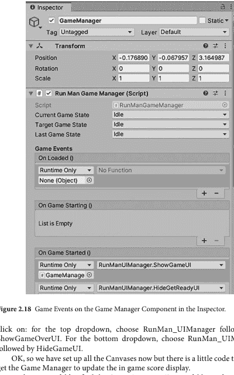

图 2.18 检查器中 Game Manager 组件上的 Game Events。

点击顶部的下拉菜单，选择 RunMan_UIManager 然后选择 ShowGameOverUI。对于底部的下拉菜单，选择 RunMan_UIManager 然后选择 HideGameUI。

好的，现在我们已经设置了所有画布，但需要添加一些代码来让 Game Manager 更新游戏内分数显示。

在 Project 文件夹中，找到 Games/RunMan/Scripts 文件夹和 RunMan_GameManager 脚本。双击文件在脚本编辑器中打开它。

在脚本顶部，类声明正下方：

```csharp
public class RunMan_GameManager : BaseGameManager
{
```

在打开的大括号后立即添加以下变量声明：

```csharp
public RunMan_UIManager _uiManager;
```

现在向下滚动找到 Loaded() 函数：

```csharp
public override void Loaded()
{
    base.Loaded();
```

在上面代码后立即添加以下内容：

```csharp
// set high score
_uiManager.SetHighScore(GetComponent<BaseProfileManager>().GetHighScore());
```

现在找到 EndGame() 函数，并在函数末尾的闭合大括号前添加以下内容：

```csharp
if (GetComponent<BaseProfileManager>().SetHighScore(_RunManCharacter.GetScore())== true)
{
    _uiManager.ShowGotHighScore();
}
// update final score ui
_uiManager.SetFinalScore(_RunManCharacter.GetScore());
```

拼图的最后一部分在 Update() 循环中添加分数。找到 Update() 函数。找到以下代码：

```csharp
if ((distanceCounter >=
distanceToSpawnPlatform))
{
    SpawnPlatform();
}
```

并在该 If 语句的闭合大括号后立即添加以下内容（以便在函数末尾后有三个大括号）：

```csharp
_uiManager.SetScore(_RunManCharacter.GetScore());
```

RunMan_GameManager 的最终完整脚本如下所示：

```csharp
using UnityEngine;
using UnityEngine.SceneManagement;
using GPC;

[RequireComponent(typeof(BaseProfileManager))]

public class RunMan_GameManager : BaseGameManager
{
    public RunMan_UI_Manager uiManager;
    public float runSpeed = 1f;
    public float distanceToSpawnPlatform = 20f;
    public bool isRunning;
    public Transform _platformPrefab;
    public RunMan_CharacterController _RunManCharacter;
    private float distanceCounter;
    public float playAreaTopY = -0.4f;
    public float playAreaBottomY = 0.2f;
    public float platformStartX = 3f;

    public static RunMan_GameManager instance { get; private set; }

    // set instance in this script's constructor
    public RunMan_GameManager()
    {
        instance = this;
    }
}
```


```
private void Awake()
{
    // reset all of the user data we have stored in the ScriptableObject
    gameObject.SendMessage("ResetAllPlayerStats");
}

public void Start()
{
    SetTargetState(Game.State.loaded);
}

public override void UpdateTargetState()
{
    switch (targetGameState)
    {
        case Game.State.loaded:
            Loaded();
            break;

        case Game.State.gameStarting:
            StartGame();
            break;

        case Game.State.gameStarted:
            // fire the game started event
            OnGameStarted.Invoke();
            SetTargetState(Game.State.gamePlaying);
            break;

        case Game.State.gamePlaying:
            break;

        case Game.State.gameEnding:
            EndGame();
            break;

        case Game.State.gameEnded:
            OnGameEnded.Invoke();
            break;
    }
}

public override void Loaded()
{
    base.Loaded();

    // set high score
    _uiManager.SetHighScore(GetComponent<BaseProfileManager>().GetHighScore());
    // reset score
    _RunManCharacter.SetScore(0);

    SetTargetState(Game.State.gameStarting);
}

void StartGame()
{
    runSpeed = 0;

    // add a little delay to the start of the game, for people to prepare to run
    Invoke("StartRunning", 2f);
}

void StartRunning()
{
    isRunning = true;
    runSpeed = 1f;
    distanceCounter = 1f;

    SetTargetState(Game.State.gameStarted);

    // start animation
    _RunManCharacter.StartRunAnimation();

    InvokeRepeating("AddScore", 0.5f, 0.5f);
}

void EndGame()
{
    // stop running
    isRunning = false;
    runSpeed = 0;

    // schedule return to main menu in 4 seconds
    Invoke("ReturnToMenu", 4f);

    // stop the repeating invoke that awards score
    CancelInvoke("AddScore");

    // let's try to store the high score (profile manager takes care of checking if it's a high score or not, we just submit a score)
    if (GetComponent<BaseProfileManager>().SetHighScore(_RunManCharacter.GetScore()) == true)
        _uiManager.ShowGotHighScore();

    // update final score ui
    _uiManager.SetFinalScore(_RunManCharacter.GetScore());

    // update target state
    SetTargetState(Game.State.gameEnded);
}

void AddScore()
{
    _RunManCharacter.AddScore(1);
}

void ReturnToMenu()
{
    SceneManager.LoadScene("runMan_menu");
}

public void PlayerFell()
{
    SetTargetState(Game.State.gameEnding);
}

void SpawnPlatform()
{
    runSpeed += 0.02f;
    distanceCounter = 0;
    float randomY = Random.Range(playAreaTopY, playAreaBottomY);
    Vector2 startPos = new Vector2(platformStartX, randomY);
    Instantiate(_platformPrefab, startPos, Quaternion.identity);
    distanceCounter = Random.Range(-0.5f, 0.25f);
}

void Update()
{
    if (isRunning)
    {
        distanceCounter += (runSpeed * Time.deltaTime);

        // check to see if we need to spawn another platform (based on distance travelled)
        if ((distanceCounter >= distanceToSpawnPlatform))
            SpawnPlatform();

        _uiManager.SetScore(_RunManCharacter.GetScore());
    }
}
```

现在试玩游戏。开始时应出现准备就绪的提示信息，一旦游戏开始，分数和高分将被显示。当 RunMan 从屏幕上掉落时，你还应看到一个漂亮的游戏结束提示，并显示最终分数！

唯一的问题是结束游戏时会报错，例如“Scene ‘runMan_menu’ couldn’t be loaded because it has not been added to the build settings or the AssetBundle has not been loaded”——这是因为 Unity 找不到主菜单，所以接下来让我们修复这个问题。

### 2.9.1 主菜单设置

在 Project 面板中，双击 Scenes 文件夹。双击 runMan_menu 场景以打开它。为节省时间，该场景已几乎准备就绪。它基于 GPC_Framework/TemplateScenes 文件夹中的 MenuTemplate 场景，该模板提供了一个基本模板，可帮助你快速构建菜单场景。要完成菜单设置，我们需要通过将其添加到 Build Settings 来告诉 Unity 菜单场景的位置。

点击编辑器左上角的 File 菜单，然后选择 Build Settings。打开 Build Settings 后，从 Project 面板中点击并拖拽 runMan_menu，将其拖放到 Build Settings 的 Scenes In Build 区域（图 2.19）。完成后关闭 Build Settings 窗口。

你刚刚复制过来的菜单模板场景已包含主菜单所需的一切，但我们仍需要告诉它游戏的位置，以便在玩家点击开始按钮时加载游戏场景。

在 Hierarchy 中找到并点击 MenuManager GameObject 以突出显示它。在 Inspector 中，找到 Menu With Profiles 组件。在 Game Scene Name 字段中输入 runMan_core（区分大小写！）。

按 CTRL+S 保存场景（或使用 File/Save 菜单），然后在工具栏中点击 Play 试玩游戏。菜单应该会出现。

点击 Start Game 按钮开始游戏。主游戏应加载、运行，并在游戏结束后返回主菜单。

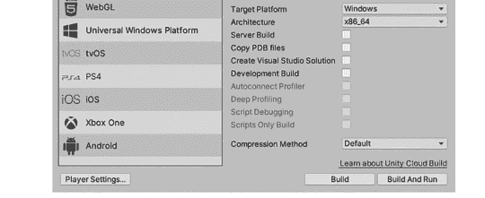

图 2.19 Unity 的 Build Settings 面板。

# 3 构建核心游戏框架

本章将介绍核心框架中设计决策的背景，并为理解各个代码示例如何协同工作以及为何有时会依赖其他组件提供良好的基础。

本书的框架（如图 3.1 所示）包含六个主要区域：

- **游戏管理器**：游戏管理器充当游戏中所有部分的中央通信脚本，并监督游戏状态。
- **玩家**：玩家可能已存在于游戏场景中，也可能由游戏管理器实例化。玩家结构将在本书第 4 章后面进行探讨。
- **AI 和敌人**：与玩家一样，AI 控制的角色或敌人可能在加载时已存在于场景中，也可能在运行时创建。我们将在第 10 章全面介绍 AI。
- **UI 管理器**：UI 管理器绘制所有主要游戏内用户界面元素，例如分数显示和生命值。我们将在第 11 章介绍 UI。
- **音效管理器**：音效管理器处理声音播放。声音内容在第 9 章。

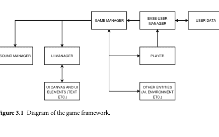

图 3.1 游戏框架图。

为了最大化灵活性，基类需要能够适应不同的配置。例如，玩家控制器应允许输入从另一个脚本传入，以便控制系统可以轻松更换，例如使用手柄与键盘控制。玩家脚本不需要知道输入来自何处，但需要提供一个供输入脚本通信的通用接口。正如使用通用接口与玩家控制器通信一样，玩家控制器也不应关心输入来自何处。

## 3.1 控制器与管理器

在本書中，我使用两个术语来指定主要类的类型；它们是 Controllers 和 Managers。

### 3.1.1 管理器

在本書中，Managers 用于表示专门管理对象或数据的脚本（以与公司经理管理员工类似的方式处理玩家、音频或其他游戏元素）。例如，可以有一个 GlobalRaceManager 类，用于跟踪并获取附加到赛车上的 RaceController 脚本组件集合的信息。管理器脚本使用来自 RaceController 组件的信息来计算玩家的比赛位置，并向玩家告知游戏的当前运行状态，管理整体比赛逻辑。

### 3.1.2 控制器

Controllers 专注于特定任务，例如帮助脚本相互通信、保存游戏特定的玩家信息或处理会话数据。例如，本书中的玩家有一个玩家控制器脚本。敌人有一个敌人控制器。Controllers 可以独立于其他脚本，也可以由管理器脚本管理，这取决于它们需要做什么。

## 3.2 核心框架脚本

Scripts/BASE 文件夹中有多个脚本，旨在作为模板或作为你在自己的游戏中派生的类。在本书的这一部分，我们将查看构成主框架的脚本。


本章将介绍 BASE 文件夹中的核心框架类：

- 3.2.1. BaseGameManager
- 3.2.2. ExtendedCustomMonoBehaviour
- 3.2.3. BaseCameraController

其他基础脚本将在本书的特定部分中介绍。例如，GPC_Framework/BASE/PLAYER 中的脚本将在第 4 章介绍玩家结构时进行讲解。

### 3.2.1 BaseGameManager

游戏管理器是游戏玩法的核心，用于描述和处理整体游戏功能，并保存当前的游戏状态。

游戏管理器的核心功能包括：

- 1. 跟踪游戏状态：
  - a. 存储游戏状态
  - b. 提供用于更改游戏状态的函数
  - c. 根据对 `EndGame()`、`StartGame()` 或 `PauseGame()` 等函数的调用来更改游戏状态
- 2. 创建玩家
- 3. 设置摄像机，以及指定摄像机跟随的对象等具体内容
- 4. 在会话管理器、用户管理器和游戏行为之间进行通信
- 5. 处理脚本之间的通信，使其保持独立运行，而不必重新编写代码来让它们彼此直接通信

跟踪游戏状态非常重要，因为某些元素需要根据状态改变其行为。例如，如果游戏处于暂停状态，我们可能希望暂停所有输入、冻结游戏时间并显示弹窗。当游戏结束时，我们需要禁用玩家输入，等等。跟踪游戏状态就是游戏管理器脚本的工作。

一个典型的游戏可能包含几种不同的核心状态，例如：

- 1. 游戏运行中
- 2. 游戏暂停
- 3. 加载中
- 4. 游戏结束

此外，还可能存在一些自定义状态，例如用于显示过场动画的状态，或者用于播放特殊音频片段的状态。我建议创建一个新的

```
if (targetGameState != currentGameState)
    UpdateTargetState();
}

public Game_State GetCurrentState()
{
    return currentGameState;
}
```

上面首先声明了一个用于保存暂停状态的布尔变量，随后是几个用于处理游戏状态的函数。这部分内容稍后会在脚本中再次出现，但现在请先关注游戏状态函数。每当游戏状态需要改变时，就会调用 `SetTargetState`。这个调用可能来自游戏管理器内部的某个函数，也可能来自项目其他位置的某个自定义脚本。

我们不会直接跳转并立即设置新的当前状态，而是先使用目标状态。调用 `SetTargetState()` 后，传入的状态会被存储到变量 `targetGameState` 中。通过在设置当前状态之前先设置目标状态，我们可以运行状态切换开始时所需执行的代码，然后在这些代码执行完毕后再切换状态。

下面是一个目标状态先于当前状态的实用示例：设想游戏开始时的情景。当游戏加载完成后，我们调用 `SetTargetState`，将状态更改为 `GameState.Loaded`。接下来，我们执行准备游戏所需的所有初始化操作。初始化完成后，当前状态变为 loaded，此时我们可以再次调用 `SetTargetState()`，将状态更改为 `GameState.Starting`。当目标状态为 `GameState.GameStarting` 时，会显示一条通知玩家准备就绪的消息，同时计时器开始计时。随后，当前状态被设置为 `GameState.gameStarting`，并保持在该状态，直到计时器结束。计时器结束后，我们第三次调用 `SetTargetState()`，这次传入 `GameState.gamePlaying`。当目标状态为 gamePlaying 时，启动游戏所需的所有初始化操作开始执行，例如启用玩家输入或激活 AI。当游戏准备就绪后，当前状态切换为 gamePlaying，并在整个游戏过程中保持该状态，直到游戏逻辑要求进行其他处理。

下面的代码块包含所有将在 Inspector 中显示的 UnityEvent，它们可以用于绑定对象以及对其附加的组件进行调用：

```
[Header("Game Events")]
public UnityEvent OnLoaded;
public UnityEvent OnGameStarting;
public UnityEvent OnGameStarted;
public UnityEvent OnLevelStarting;
public UnityEvent OnLevelStarted;
public UnityEvent OnLevelEnding;
public UnityEvent OnLevelEnded;

public UnityEvent OnGameEnding;
public UnityEvent OnGameEnded;
public UnityEvent OnGamePause;
public UnityEvent OnGameUnPause;
public UnityEvent OnShowLevelResults;
public UnityEvent OnShowGameResults;
public UnityEvent OnRestartLevel;
public UnityEvent OnRestartGame;
```

使用 UnityEvent 的优势在于，我可以通过 Inspector 在编辑器中设置事件，以便在状态发生变化时通知其他脚本。由于这些是 UnityEvent，我可以通过 Inspector 添加任意数量的其他组件引用，而且游戏管理器脚本本身完全不需要了解这些组件的任何信息。用户界面就是一个很适合使用这种机制的例子。在第 2 章运行中的游戏示例中，当游戏进入 Loaded 状态时，会触发 `OnLoaded()` UnityEvent。在 Inspector 中，我将该事件设置为调用 `RunMan_UIManager.ShowGetReadyUI()`。这会显示一条消息，通知玩家做好准备。通过使用事件调用独立的组件，我消除了游戏管理器对 UI 脚本的任何依赖。只要在 Inspector 中正确设置 UnityEvent，它们就可以完全独立地工作。UnityEvent 将由通过游戏状态触发的函数调用：

```csharp
public virtual void Loaded() { OnLoaded.Invoke(); }
public virtual void GameStarting() { OnLoaded.Invoke(); }
public virtual void GameStarted() { OnLoaded.Invoke(); }
public virtual void LevelStarting() { OnLevelStarting.Invoke(); }
public virtual void LevelStarted() { OnLevelStarted.Invoke(); }
public virtual void LevelEnding() { OnLevelEnding.Invoke(); }
public virtual void LevelEnded() { OnLevelEnded.Invoke(); }
public virtual void GameEnding() { OnGameEnding.Invoke(); }
public virtual void GameEnded() { OnGameEnded.Invoke(); }
public virtual void GamePause() { OnGamePause.Invoke(); }
public virtual void GameUnPause() { OnGameUnPause.Invoke(); }
public virtual void ShowLevelResults() { OnShowLevelResults.Invoke(); }
public virtual void ShowGameResults() { OnShowGameResults.Invoke(); }
public virtual void RestartLevel() { OnRestartLevel.Invoke(); }
public virtual void RestartGame() { OnRestartGame.Invoke(); }
```

上面的函数在这里充当占位符。其目的是让实际游戏项目中的游戏管理器脚本继承此类，并使用实际功能重写这些虚函数。如果确实重写了这些函数，请记住，你同时也会重写对相应 UnityEvent 的调用。只需确保对这些游戏事件运行 `Invoke()`，或者通过 `base.(functionname)` 调用基类函数即可。

接下来是 `UpdateTargetState` 函数，每当调用 `SetTargetState()` 来更改游戏状态时，该函数就会被调用：

```csharp
public virtual void UpdateTargetState()
{
    // we will never need to run target state
    functions if we're already in this state, so we check for that and
    drop out if needed
    if (targetGameState == currentGameState)
        return;

    switch (targetGameState)
    {
        case Game.State.idle:
            break;

        case Game.State.loading:
            break;
```

`UpdateTargetState()` 首先检查我们是否已经处于即将设置的状态。如果当前状态与目标状态相同，我们就退出该函数。这是一种预防措施，以防重复调用更新状态的函数。

一个 switch 语句会检查 `targetGameState`，而在下面的代码中，我们放置了状态被设置时需要运行的代码。上面的 idle 或 loading 状态没有需要运行的代码，直到到达 loaded 状态时，才会调用其他函数：

```
case Game.State.loaded:
    Loaded();
    break;
case Game.State.gameStarting:
    GameStarting();
    break;
```

还记得前几页中那一长串虚函数吗？它们就是在这些 case 语句中被调用的。上面的代码分别调用了 `Loaded()` 和 `GameStarting()`。

下面跳过其余的 case 语句，直接来到 `UpdateTargetState()` 函数的末尾：

```
// now update the current state to reflect
the change
    currentGameState = targetGameState;
}
```

`UpdateTargetState()` 的最后一行会将当前游戏状态设置为目标状态，因为目标状态已经由上面的 case 语句处理完毕。

接下来是 `UpdateCurrentState()`，它采用了类似的 case 语句结构：

```
public virtual void UpdateCurrentState()
{
    switch (currentGameState)
    {
        case Game.State.idle:
            break;
        case Game.State.loading:
            break;
        case Game.State.loaded:
            break;
        case Game.State.gameStarting:
            break;
    }
}
```

`UpdateCurrentState()` 函数每帧都会被调用，构成了这个类的“主循环”。所有需要重复执行的游戏逻辑都应在这里调用。通常情况下，你需要重写这个函数，并在 `BaseGameManager` 类的各种变体中实现自己的版本。

`BaseGameManager` 中的其他函数用于帮助快速搭建游戏。如果某些功能会在多个不同的游戏中使用，那么将它们统一放入这样的脚本中，并让其他游戏管理器都继承该脚本，可能会节省时间。这样可以避免在多个项目中反复重写相同的代码。

`BaseGameManager` 的最后一部分处理游戏暂停和取消暂停的机制：

```
public virtual void GamePaused()
{
    OnGamePause.Invoke();
    Paused = true;
}
```

```
public virtual void GameUnPaused()
```


```
{
    OnGameUnPause.Invoke();
    Paused = false;
}
```

GamePaused() 和 GameUnPaused() 是用于更改游戏暂停状态的调用函数。这两个函数会调用 OnPause 和 OnUnPause UnityEvent（并触发它们），同时根据需要更改游戏状态。

一个名为 paused 的布尔变量保存游戏的暂停状态。这里的代码使用了称为 Getter 和 Setter 的机制，以便在 Paused 变量的值发生变化时触发一些游戏逻辑：

```
public bool Paused
{
    get
    {
        return paused;
    }
    set
    {
        paused = value;
        if (paused)
        {
            // pause time
            Time.timeScale = 0f;
        }
        else
        {
            // unpause
            Time.timeScale = 1f;
        }
    }
}
```

Get 部分只是返回布尔变量 paused 的值。

Set 部分设置布尔变量 paused，并继续将 Time.timeScale 设置为 0（暂停）或 1（未暂停）。设置 Time.timeScale 会影响时间的流逝方式。例如，将 timescale 设置为 0.5 意味着时间比真实时间慢 2 倍地流逝。Unity 文档说明：

> > 除 realtimeSinceStartup 外，timeScale 会影响 Time 类的所有时间和 delta 时间测量变量。如果降低 timeScale，建议也按相同比例降低 Time.fixedDeltaTime。
> > 当 timeScale 设置为零时，FixedUpdate 函数将不会被调用。

### 3.2.2 ExtendedCustomMonoBehaviour

扩展 MonoBehaviour 是一种避免重复常见函数或变量声明的有用方法。例如，本书中的大多数脚本都使用名为 _TR 的变量来引用 Transform 的缓存版本。ExtendedCustomMonoBehaviour 包含它的声明。每当新类需要使用 MonoBehaviour 时，我们只需从 ExtendedCustomMonoBehaviour 派生，在新类中就无需声明 TR 或我们选择放入 ExtendedCustomMonoBehaviour 中的其他常用变量或函数。

```
public Transform Spawn(Transform spawnObject, Vector3 spawnPosition, Quaternion spawnRotation)
{
    return Instantiate(spawnObject, spawnPosition, spawnRotation);
}

public static bool IsInLayerMask(int layer, LayerMask layermask)
{
    return layermask == (layermask | (1 << layer));
}
```

上面，ExtendedMonoBehaviour 中有四个函数：
- SetID() – 提供设置 id 变量的方法。
- GetComponents() – 尝试查找附加此脚本的 Transform 和 GameObject。
- Spawn() – 提供将新的 GameObject 生成到场景中的方法。
- IsInLayerMask() – 提供检查图层是否在 LayerMask 中的方法。公开声明的 LayerMask 变量在 Inspector 中提供下拉菜单，可在其中选择多个图层。Unity 没有提供轻松检查图层是否在 LayerMask 中的功能，因此此函数为我们完成了该工作。它可以这样调用：

IsInLayerMask(<要检查的图层索引号>, <LayerMask 对象>);

IsInLayerMask() 如果在该 LayerMask 中找到图层，则返回 true。我们将其与碰撞一起使用，以了解碰撞对象的图层以及是否应该关注它并对其碰撞做出反应。IsInLayerMask() 作为辅助函数放在这里，因为我发现我在玩家和敌人脚本中经常使用它。

请随意向 ExtendedMonoBehaviour 添加自己的代码，使其成为你自己的——任何你在 MonoBehaviour 派生类中重复使用的内容——只需将代码添加到此处并继承 ExtendedMonoBehaviour 即可！

### 3.2.3 BaseCameraController

本书示例游戏中的每个摄像机脚本都派生自名为 BaseCameraController 的类。BaseCameraController.cs 可以在文件夹 Assets/GPC_Framework/Scripts/BASE/CAMERA 中找到

```
using UnityEngine;
namespace GPC
{
    [AddComponentMenu("CSharpBookCode/Base/Camera Controller")]
    public class BaseCameraController : MonoBehaviour
    {
        public Transform _cameraTarget;
        public Transform _TR;
```

```
private void Awake()
{
    if (_TR == null)
        _TR = transform;
}
public virtual void SetTarget(Transform aTarget)
{
    _cameraTarget = aTarget;
}
}
```

上面，BaseCameraController 包含所有摄像机脚本都可以使用的一个函数。其意图是——随着摄像机的复杂性增加——你可以将任何共享代码添加到 BaseCameraController 类中。截至撰写本文时，它只包含一个 Awake() 函数来获取摄像机 Transform 的引用，以及一个 SetTarget() 函数，将由其他脚本使用以指定摄像机应跟随哪个对象。派生自 BaseCameraController 的摄像机类然后可以使用变量 cameraTarget 来访问摄像机需要跟随的对象。

# 4 Player Structure

玩家可以采取任何形式——人类、外星人、车辆等等。设计一个能够处理所有这些的结构是一个挑战。我们需要存储的数据、需要存储的数据类型、各种类型的移动代码和武器等等，很快就会变得复杂。使用本书框架的基本玩家将由包含 Unity 特定物理或碰撞组件的 GameObject 组成，然后是四个额外的脚本组件（如图 4.1 所示）：
- 1. 玩家控制器
  专用于游戏需求的控制器——这可能具有处理游戏特定操作的功能，例如在游戏开始前打开门或将玩家固定在原地等
- 2. 移动控制器
  用于移动玩家（根据所需移动类型，这可以是任何东西，例如车辆或人形）
- 3. 输入控制器
  用于从用户向玩家控制器提供输入
- 4. 用户数据管理器
  数据管理器是用户数据与玩家之间的接口。它负责玩家数据的操作以及如何存储和检索。分数和生命值将存储在这里，数据管理器还将与配置文件系统挂钩以提供保存和加载。

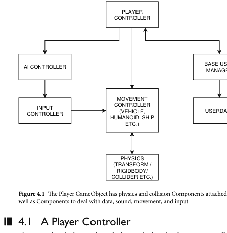

图 4.1 Player GameObject 附加了物理和碰撞组件，以及用于处理数据、声音、移动和输入的组件。

## 4.1 A Player Controller

当我们查看角色控制器类及其继承的脚本时，事情可能会有点复杂。作为示例，玩家可能会使用名为 BlasterPlayerController 的类名，它继承了一串其他类：

```
ExtendedMonoBehaviour<BasePlayerStats<BaseCharacterController<ShootingPlayerCharacter<BlasterPlayerController
```

我们本质上是在彼此之上分层类，以为我们正在构建的特定游戏提供所需的功能。例如，如果我们想将上面的角色更改为可以到处跑但不需要使用武器的玩家，只需删除链中的一个类（将 BlasterPlayerController 的类声明更改为派生自 BaseCharacterController 而不是 ShootingPlayerCharacter）即可使其看起来像：

```
MonoBehaviour
<ExtendedMonoBehaviour<BasePlayerStats<BaseCharacterController
<BlasterPlayerController
```

假设这次我们现在想用车辆替换人物。新的链可能如下所示：

```
MonoBehaviour
<ExtendedMonoBehaviour<BasePlayerStats<BaseVehicleController
<ShootingVehicleController<BlasterPlayerController
```

```
public bool Slot7;
public bool Slot8;
public bool Slot9;

public float vert;
public float horz;
public bool shouldRespawn;

public Vector3 TEMPVec3;
private Vector3 zeroVector = new Vector3(0,0,0);
```

上面，基于槽位的武器系统使用键盘上的 1 到 9 按钮直接选择要使用的武器槽位。因此，输入系统有九个布尔变量来接收数字键的输入——尽管这里没有实现，你可以看到它们在第 7 章中武器系统的讨论时如何使用。

```
public virtual void CheckInput()
{
    // override with your own code to deal with input
    horz=Input.GetAxis ("Horizontal");
    vert=Input.GetAxis ("Vertical");
}
```

```
public virtual float GetHorizontal()
{
    return horz;
}
```

```
public virtual float GetVertical()
{
    return vert;
}
```

Input 为 Unity 的输入系统提供接口。根据 Unity 文档，Input.GetAxis 返回由 axisName 标识的虚拟轴的值。轴名称在 Unity 的 Input Manager（Edit>Project Settings>Input）中设置，虽然 Horizontal 和 Vertical——我们在上面用来设置 horz 和 vert 的两个轴——将由 Unity 默认设置。之后，我们有两个函数可以返回水平和垂直输入值。

```
public virtual bool GetFire()
{
    return Fire1;
}
```

尽管脚本包含一个名为 GetFire() 的函数，返回布尔变量 Fire1 的值，但脚本不包含任何对 Fire1 执行任何操作的代码。它只是为了保持一致性而存在，并且预计玩家控制器脚本会根据需要处理射击——有关此方面的示例，请参阅第 7 章——武器系统。

```
public bool GetRespawn()
{
    return shouldRespawn;
}
```


再次，该脚本仅出于协议目的包含 GetRespawn()，没有任何实际功能。

```csharp
public virtual Vector3 GetMovementDirectionVector()
{
    // temp vector for movement dir gets set to
    // the value of an otherwise unused vector that always has the value
    // of 0,0,0
    TEMPVec3 = zeroVector;

    TEMPVec3.x = horz;
    TEMPVec3.y = vert;

    // return the movement vector
    return TEMPVec3;
}
```

为了方便，BaseInputController 包含了一个简单的方向向量返回系统。该函数将返回一个 Vector3，其 x 和 y 轴表示输入等级。

## 4.3 用户数据

将玩家信息存储在游戏控制器或类似的、与单个玩家对象分离的脚本中并不罕见。这种方法可能很适合单人游戏，但在扩展到多玩家游戏时可能会出现问题。一种解决方案可能是让游戏控制器拥有包含玩家统计数据的类数组，并在其他函数指示时对其进行操作，但为什么不将玩家统计数据附加到每个玩家身上，使其自给自足呢？

本书的框架为每个玩家使用一个数据管理器类，其中包含我们需要为单个玩家存储的所有内容：

- 1. 分数
- 2. 最高分
- 3. 等级
- 4. 生命值
- 5. 玩家是否已结束（不再活跃）
- 6. 玩家名称

每个玩家在其 GameObject 上都附加了 BaseUserManager.cs 脚本，为每个玩家提供自己的统计数据集合。游戏控制器或游戏结构中其他位置的脚本可以轻松搜索并访问玩家的信息。

BaseUserManager 使用一个名为 global_userDatas 的静态变量来包含游戏中所有玩家的信息。由于它是静态的，它会在 Scene 加载之间保持不变，我们在任何地方都能保留玩家数据。global_userDatas 变量的类型为 List<UserData>，因此它是一个包含 UserData 对象的列表。如果你需要存储更多关于玩家的信息，可以轻松地修改或向 UserData 类添加新变量。

BaseUserManager 的设计工作方式是你在游戏开始前添加玩家——可能在主菜单中玩家点击开始按钮时。就在游戏开始之前，我们向 global_userDatas 列表中添加空玩家——数量取决于游戏中将有多少玩家——并且该数据会一直保留，直到我们返回并重新开始游戏，此时玩家将被清除并准备好新玩家开始新游戏。以这种方式构建玩家数据意味着你将玩家数据与游戏管理器或玩家管理器脚本分离——保持代码整洁——作为额外的好处，即使在加载多个 Scene 的过程中，也更容易跟踪你的玩家数据或多个玩家的数据。将玩家数据分离到单个列表中也使得保存和加载玩家状态变得更加容易，因为你只需要保存或加载一个列表，而不是每个变量独立保存或加载。由于序列化，保存和加载的内容存在一些限制，但对于大多数变量类型——int、string、float 等——保存数据的过程相对简单直接。

### 4.3.1 UserData 类

你可以在文件夹 GPC_Framework/Scripts/DATA 中找到此类。

UserData 是一个小型数据类，用于在游戏过程中存储我们需要跟踪的玩家所有信息。UserData 在名为 UserData.cs 的脚本中声明。

```csharp
namespace GPC
{
    [System.Serializable]
    public class UserData
    {
        public int id;
        public string playerName = "Anonymous";

        public int score;
        public int level;
        public int health;
        public int lives;
        public bool isFinished;
    }
}
```

如果你需要跟踪其他数据，可以轻松地向 UserData 类添加（或删除）变量。为了便于访问，我使用一个名为 BasePlayerStatsController 的类，其中包含与 BaseUserManager '通信'所需的所有函数。如果你向 UserData 类添加新变量，可能还想通过 BasePlayerStatsController 添加访问它们的方法。请参阅本章第 4.5 节，了解 BasePlayerStatsController 的完整分解。

### 4.3.2 BaseUserManager 类

你可以在文件夹 GPC_Framework/Scripts/DATA 中找到此类。

BaseUserManager 类：

```csharp
using UnityEngine;
using System.Collections.Generic;

namespace GPC
{
    [AddComponentMenu("CSharpBookCode/Base/Base User Manager")]

    public class BaseUserManager : MonoBehaviour
    {
```

在上面的 using 语句和声明之后，BaseUserManager 包含的第一件事是一个名为 global_userDatas 的静态变量：

```csharp
public static List<UserData> global_userDatas;
```

此 global_userDatas 列表用于保存 UserData 对象的列表——游戏中每个玩家一个——并且它是 public static，以便可以在任何地方访问，并且无论 Scene 加载如何都保留其数据。我们接下来将查看 Init() 函数：

```csharp
public bool didInit;
public void Init()
{
    if (global_userDatas == null)
        global_userDatas = new List<UserData>();
    didInit = true;
}
```

Init() 函数检查 global_userDatas 列表是否已初始化，如果没有，则创建新的 UserData 类型列表。

```csharp
public void ResetUsers()
{
    if (!didInit)
        Init();
    global_userDatas = new List<UserData>();
}
```

提供了 ResetUsers() 函数来清除所有用户信息。这可能在游戏开始时调用，就在新玩家在主游戏加载前添加之前，或者可能在游戏结束时清理所有内容。

```csharp
public List<UserData> GetPlayerList()
{
    if (global_userDatas == null)
        Init();
    return global_userDatas;
}
```

要在游戏开始时处理玩家列表，你可以使用上面的函数 GetPlayerList() 来获取它，它将返回一个包含 global_userDatas 中所有内容的列表。在本书记载的游戏示例中，Game Manager 在核心 Scene 加载时获取此列表，我们遍历列表，为 global_userDatas 中的每个条目在 Scene 中生成一个玩家。

```csharp
public int AddNewPlayer()
{
    if (!didInit)
        Init();
    UserData newUser = new UserData();
    newUser.id = global_userDatas.Count;
    newUser.playerName = "Anonymous";
    newUser.score = 0;
    newUser.level = 1;
    newUser.health = 3;
    newUser.lives = 3;
    newUser.highScore = 0;
    newUser.isFinished = false;
    global_userDatas.Add(newUser);
    return newUser.id;
}
```

上面的 AddNewPlayer() 将新玩家（UserData 实例）添加到 global_userDatas 列表中，并使用玩家的默认值填充 UserData 对象。请注意，所有这些值都在第 4.3.1 节的 UserData 类中声明。

该类的其余部分处理获取和设置玩家数据：

```csharp
public string GetName(int id)
{
    if (!didInit)
        Init();
    return global_userDatas[id].playerName;
}
public void SetName(int id, string aName)
{
    if (!didInit)
        Init();
    global_userDatas[id].playerName = aName;
}
public int GetLevel(int id)
{
    if (!didInit)
        Init();
    return global_userDatas[id].level;
}
public void SetLevel(int id, int num)
{
    if (!didInit)
        Init();
    global_userDatas[id].level = num;
}
public int GetScore(int id)
{
    if (!didInit)
        Init();
    return global_userDatas[id].score;
}
public virtual void AddScore(int id, int anAmount)
{
    if (!didInit)
        Init();
    global_userDatas[id].score += anAmount;
}
public void ReduceScore(int id, int num)
{
    if (!didInit)
        Init();
    global_userDatas[id].score -= num;
}
public void SetScore(int id, int num)
{
    if (!didInit)
        Init();
    global_userDatas[id].score = num;
}
public int GetHealth(int id)
{
    if (!didInit)
        Init();
    return global_userDatas[id].health;
}
public int GetLives(int id)
{
    if (!didInit)
        Init();
    return global_userDatas[id].lives;
}
public void SetLives(int id, int num)
{
    if (!didInit)
        Init();
    global_userDatas[id].lives = num;
}
public void AddLives(int id, int num)
{
    if (!didInit)
        Init();
    global_userDatas[id].lives += num;
}
public void ReduceLives(int id, int num)
{
    if (!didInit)
        Init();
    global_userDatas[id].lives -= num;
}
public void AddHealth(int id, int num)
{
    if (!didInit)
        Init();
    global_userDatas[id].health += num;
}
public void ReduceHealth(int id, int num)
{
    if (!didInit)
        Init();
    global_userDatas[id].health -= num;
}
public void SetHealth(int id, int num)
{
    if (!didInit)
        Init();
    global_userDatas[id].health = num;
}
public bool GetIsFinished(int id)
{
    if (!didInit)
        Init();
    return global_userDatas[id].isFinished;
}
public void SetType(int id, int theType)
{
    if (!didInit)
        Init();
    global_userDatas[id].type = theType;
}
public int GetType(int id)
{
    if (!didInit)
        Init();
    return global_userDatas[id].type;
}
public void SetIsFinished(int id, bool aVal)

{
    if (!didInit)
        Init();
    global_userDatas[id].isFinished = aVal;
}
}

## 4.4 BasePlayerStatsController 类

你可以在文件夹 GPC_Framework/Scripts/BASE/PLAYER 中找到此类。

我的玩家控制器派生自多个其他类，其中之一是 BasePlayerStatsController，该类为玩家控制器提供了一系列处理用户数据的函数。好吧，这并不是 BasePlayerStatsController 的唯一功能。它也只是用来保存与游戏中处理玩家相关的任何变量，但 BasePlayerStatsController 主要充当我的玩家脚本与用户数据之间的友好接口。例如，我可以在玩家控制器中调用 SetHealth(an amount) 而无需担心用正确的 ID 标识我的玩家或类似的事情。BasePlayerStatsController 中用于设置 UserData 的函数已经处理了 ID 以及 UserDataManager 需要如何调用的问题。

BasePlayerStatsController.cs 脚本完整内容如下：

```
using System.Collections;
using System.Collections.Generic;
using UnityEngine;

namespace GPC
{
    [RequireComponent(typeof(BaseUserManager))]
    public class BasePlayerStatsController : ExtendedCustomMonoBehaviour
    {
        public BaseUserManager _myDataManager;
        public int myID;

        public BaseInputController _inputController;
        public bool disableAutoPlayerListAdd;

        public virtual void Init()
        {
            // cache the usual suspects
            _RB = GetComponent<Rigidbody>();
            _GO = GetComponent<GameObject>();
            _TR = GetComponent<Transform>();
            _inputController = GetComponent<BaseInputController>();
            SetupDataManager();
        }

        public virtual void SetPlayerDetails(int anID)
        {
            // this function can be used by a game manager to pass in details from the player list, such as
            // this players ID or perhaps you could override this in the future to add avatar support, loadouts or
            // special abilities etc.?
            myID = anID;
        }

        public virtual void SetupDataManager()
        {
            // if a player manager is not set in the editor, let's try to find one
            if (_myDataManager == null)
                _myDataManager = GetComponent<BaseUserManager>();
            if (_myDataManager == null)
                _myDataManager = gameObject.AddComponent<BaseUserManager>();
            if (_myDataManager == null)
                _myDataManager = GetComponent<BaseUserManager>();
            if (!disableAutoPlayerListAdd)
            {
                // add the player (set up data) to the ScriptableObject we use to store player info
                myID = _myDataManager.AddNewPlayer();
                _myDataManager.SetName(myID, "Player");
                _myDataManager.SetHealth(myID, 3);
            }
        }
        public virtual void AddScore(int anAmount)
        {
            if (!didInit)
                Init();
            _myDataManager.AddScore(myID, anAmount);
        }
        public virtual void AddHealth(int anAmount)
        {
            if (!didInit)
                Init();
            _myDataManager.AddHealth(myID, anAmount);
        }
        public virtual void ReduceScore(int anAmount)
        {
            if (!didInit)
                Init();
            _myDataManager.ReduceScore(myID, anAmount);
        }
        public virtual void ReduceHealth(int anAmount)
        {
            if (!didInit)
                Init();
            _myDataManager.ReduceHealth(myID, anAmount);
        }
        public virtual void SetLives(int anAmount)
        {
            if (!didInit)
                Init();
            _myDataManager.SetLives(myID, anAmount);
        }
```

```
public virtual void AddLives(int anAmount)
{
    if (!didInit)
        Init();
    _myDataManager.AddLives(myID, -anAmount);
}

public virtual void ReduceLives(int anAmount)
{
    if (!didInit)
        Init();
    _myDataManager.ReduceLives(myID, anAmount);
}

public virtual void SetScore(int anAmount)
{
    if (!didInit)
        Init();
    _myDataManager.SetScore(myID, anAmount);
}

public virtual void SetHealth(int anAmount)
{
    if (!didInit)
        Init();
    _myDataManager.SetHealth(myID, anAmount);
}

public virtual void SetName(string aName)
{
    if (!didInit)
        Init();
    _myDataManager.SetName(myID, aName);
}

public int GetLives()
{
    if (!didInit)
        Init();
    return _myDataManager.GetLives(myID);
}

public int GetHealth()
{
    if (!didInit)
        Init();
    return _myDataManager.GetHealth(myID);
}

public int GetScore()
{
    if (!didInit)
        Init();
    return _myDataManager.GetScore(myID);
}
}
}
```

立刻就能注意到，上面的代码与 BaseUserManager 类有很多相似之处。上面的脚本很大一部分都是对 BaseUserManager 中对应函数的调用——通过在这里复制这些函数并调用它们，我们将 BaseUserManager 的所有功能都添加到玩家脚本中，并简化了调用方式。例如，我每次调用为玩家分数总额添加分数时，都不必检查一切是否已设置并可用。我也不想每次都传入 ID，因此上面的代码中的函数如 GetHealth() 和 AddScore() 进一步简化了与 BaseUserManager 的交互。如果你向 UserData 添加了更多变量，你需要在 BaseUserManager 和 BasePlayerStatsController 两者中都添加更改它们的方式。

## 4.5 管理玩家

要管理玩家，请向菜单（或你想最初设置玩家的任何位置）添加一个 BaseUserManager 组件，然后在自己的脚本中设置对其的引用并调用 ResetUsers() 以清除现有用户，然后调用 AddNewPlayer 添加新玩家。

有关工作示例，请参阅第 14 章赛车游戏示例的主菜单部分。


Taylor & Francis
Taylor & Francis Group
http://taylorandfrancis.com

# 5 Recipes

### Common Components

## 5.1 Introduction

本章中的实用脚本和常用系统可能对各种类型的游戏项目都有帮助。在 Assets/GPC_Framework/Scripts/COMMON 文件夹中，你会找到一套多样化的可重用脚本，如计时器和摄像机控制器。本章重点介绍这些独立脚本。你可以轻松地将它们取出来用于任何项目，无论是否使用本书中的 GPC 框架。

在 COMMON 文件夹内，有几个子文件夹。它们是；

### AI

这里包含与玩家或自动控制相关的脚本，例如一个与 BaseAIController.cs 脚本对话并充当简单功能性机器人在游戏环境中移动的脚本。

### CAMERA

与摄像机相关的脚本应放在这里，例如第三人称或俯视摄像机代码。

### GAME CONTROL

此文件夹中的脚本涉及整体游戏状态控制。在示例文件中，你会找到：

BattleController 和 GlobalBattleManager – 用于死亡竞赛风格的计分和游戏状态逻辑）

### 5.3.1 第三人称摄像机

第三人称摄像机位于玩家身后。它与跟随摄像机并不完全相同；第三人称摄像机通常围绕玩家轨道移动，而不是简单地跟随其移动。为了形象化这一点，可以想象摄像机被系在一根连接到目标玩家的杆子上。随着玩家的移动，摄像机保持在与之杆长距离的位置，但摄像机可以自由地在玩家周围做圆周运动。摄像机的位置通常在玩家身后，并对其水平移动施加一点阻尼，以便在玩家转弯时获得良好的运动感。在某些第三人称摄像机设置中，摄像机可能被允许相对于目标玩家进出移动。

```
using UnityEngine;
using System.Collections;

namespace GPC
{
    [AddComponentMenu("CSharpBookCode/Common/Cameras/Third Person Cam Controller")]

    public class CameraThirdPerson : BaseCameraController
    {
        public float distance = 20.0f;
        public float height = 5.0f;
        public float heightDamping = 2.0f;

        public float lookAtHeight = 0.0f;

        public float rotationSnapTime = 0.3F;

        public float distanceSnapTime;

        public Vector3 lookAtAdjustVector;

        private float usedDistance;

        float wantedRotationAngle;
        float wantedHeight;

        float currentRotationAngle;
        float currentHeight;

        Quaternion currentRotation;
        Vector3 wantedPosition;

        private float yVelocity = 0.0F;
        private float zVelocity = 0.0F;

        void Update()
        {
```

摄像机的主要更新发生在 Update() 中，而不是 FixedUpdate()。原因是我们希望所有物理相关的更新在移动摄像机之前完成——这应该在 Update() 时已经发生——并且在此过程中，我们的目标对象在摄像机更新结束和下一帧绘制之间不应存在位置差异。绘制时间错误会导致抖动效果，因为我们跟随的对象在摄像机定位之后才更新。
在 Update() 开始时有一个空值检查，以确保我们有目标：

```
if ( _cameraTarget == null)
    return;
```


本脚本中的代码最终会插值高度和旋转值，但在执行之前还需要做一些额外的工作：

```
wantedHeight = _cameraTarget.position.y + height;
currentHeight = _TR.position.y;

wantedRotationAngle = _cameraTarget.eulerAngles.y;
currentRotationAngle = _TR.eulerAngles.y;
```

在插值之前，我们需要计算目标高度和目标旋转值，同时还需要了解当前高度和旋转值是多少。公共变量 height —— 我们在 Inspector 中设置的值，用来告诉此脚本将摄像机放置多高 —— 会与我们跟随的目标物体的高度一起加到 wantedHeight 上。借助 wantedHeight 中的这个新的 float 值，我们现在就清楚摄像机在高度方向上需要朝向何处。

currentRotationAngle 是一个 float，表示以度为单位的角度，我们需要将摄像机旋转到该角度以尝试达到 wantedRotationAngle 中的目标旋转。它是通过下一行中的 Mathf.SmoothDampAngle 进行的插值：

```
currentRotationAngle = Mathf.SmoothDampAngle(currentRotationAngle, wantedRotationAngle, ref yVelocity, rotationSnapTime);
```

Mathf.SmoothDampAngle 是一个专门为在两个角度之间平滑过渡而设计的插值函数。它会自动将返回值限制在 0 到 360 之间，并选择正确的旋转方向（如果你的值在 181 度，它会向上插值而不是向下，这样旋转会更自然流畅，不会回绕）。

Unity 文档告诉我们 SmoothDampAngle 接受以下参数（按应传入的顺序）：

| Parameter | Description |
| --- | --- |
| current | 当前位置。 |
| target | 我们试图到达的 Vector3 位置。 |
| currentVelocity | 当前速度，每次调用该函数时此值都会被修改。 |
| smoothTime | 大约达到目标所需的时间。值越小到达目标越快。 |
| maxSpeed | 可选，允许限制最大速度。 |
| deltaTime | 自上次调用此函数以来的时间。默认值为 Time.deltaTime。 |

在代码的这一部分，yVelocity 变量保存了插值移动的当前速度，但它在脚本的其他地方实际上并未使用。它是 SmoothDampAngle 所需的参数，因此我们只需提供它以使函数正常工作即可，然后就不再理会它。注意，获取速度的一个可能用途是限制移动速度，但 SmoothDampAngle 可以通过提供 maxSpeed 参数在无需额外代码的情况下处理此问题。这对于限制插值速度很有用，而无需你自己用速度来处理。currentRotationAngle 本质上是我们需要在 y 轴上进行的旋转的一部分（因此使用 yVelocity 这个名字来描述其速度）。变量 rotationSnapTime 决定旋转所需的时间，它是 public 的，设计为在脚本附加到的 GameObject 的 Unity 编辑器 Inspector 窗口中设置，以便可以在编辑器中轻松设置旋转速度。高度使用 Mathf.Lerp 进行插值，它接受三个参数：起始量、目标量以及一个介于 0 和 1 之间的时间值。我们使用 float 类型的 heightDamping 乘以 Time.deltaTime，使过渡基于时间。想知道为什么需要使时间参数基于时间？好问题！Mathf.Lerp 的时间参数的工作原理一直是各种论坛和帮助页面上的热门问题。时间值表示每次执行此代码行时应应用的两个值之间差值的一部分。如果时间值为零，返回值将为起始量。如果时间为 1，返回值将为目标量。

通过使用 Time.deltaTime 计算该比例，起始值到目标值的过渡会在可重复的固定时间内平滑进行，而不是依赖帧率和 Mathf.Lerp 计算行被调用的次数：

```
currentHeight = Mathf.Lerp(currentHeight,
    wantedHeight, heightDamping * Time.deltaTime);
```

现在脚本已经计算出摄像机需要旋转多少以及在 y 轴上应该多高，脚本继续处理定位：wantedPosition 是一个 Vector3，将保存目标位置。目标位置由 target Transform.position 构成，然后将其 y 位置设置为本节中 currentHeight 变量里之前计算出的高度：

```
wantedPosition = target.position;
wantedPosition.y = currentHeight;
```

代码的下一部分计算我们需要将摄像机向玩家后方移动多远。为此，脚本使用 Mathf.SmoothDampAngle。zVelocity 表示摄像机沿其 z 轴移动的速度：

```
usedDistance = Mathf.SmoothDampAngle(usedDistance,
    distance, ref zVelocity, distanceSnapTime);
```

要仅使用旋转角度将摄像机放置在目标周围的正确位置，解决方案在于 Quaternion.Euler。这个听起来有点吓人的函数将基于 Euler 角度的 Vector3 旋转转换为向量。也就是说，你传入 Euler 旋转值，得到的是方向向量。将其乘以我们希望摄像机距离玩家多远的距离；再加上玩家当前的位置，我们就得到了摄像机的正确旋转、位置和偏移量：

```
wantedPosition += Quaternion.Euler(
    0, currentRotationAngle, 0) * new Vector3(0, 0, -usedDistance);
_TR.position = wantedPosition;
```

函数最后部分使摄像机看向目标（玩家）。它通过使用 Unity 内置的 Transform.LookAt() 函数来实现。我们传入目标物体的位置（作为 Vector3），并通过 lookAtAdjustVector 变量为摄像机将要看向的位置添加额外偏移。注意，你也可以向 LookAt() 函数添加一个上方向向量，但在这种情况下，我们不需要：

```
_TR.LookAt(_cameraTarget.position);
_TR.Rotate(lookAtAdjustVector);
```

上面，在最后一行我们还添加了一个小的旋转调整。我喜欢这样使用，以便摄像机瞄准玩家上方，仿佛在向前看，而不是直接看玩家的载具或身体。这可以使摄像机视角

## 5.5 输入

你的游戏可以接受各种不同的输入，或者在某些情况下，你可能希望实现像 Rewired（由 Guavaman Enterprises 制作）这样的第三方输入解决方案，以提供对输入硬件的扩展检测或力反馈效果。

在第 4 章中，我们看到主玩家结构包含一个用于接收键盘输入的输入脚本。添加输入系统就是构建遵循类似格式的自定义输入脚本，这样现有的玩家代码无需更改即可适应不同的控制方式。

可能需要从键盘以外的其他方法获取输入，例如鼠标或摇杆。你可以在 Unity 编辑器中通过 Edit > Project Settings > Input 菜单轻松设置替代控制。

输入脚本可以在 Assets/GPC_Framework/Scripts/COMMON/INPUT 中找到。

### 5.5.1 鼠标输入

Mouse_Input.cs 计算鼠标在每一帧之间的移动并将其用于输入。脚本如下：

```csharp
public class MouseInput : BaseInputController
{
    private Vector2 prevMousePos;
    private Vector2 mouseDelta;
    private float speedX = 0.05f;
    private float speedY = 0.1f;
    public void Start ()
    {
        prevMousePos = Input.mousePosition;
    }
}
```

Start() 函数为 prevMousePos 添加一个默认值，该值将用于计算每次更新之间的移动。如果 prevMousePos 保持为零（其默认值），那么 CheckInput() 第一次执行时，脚本会错误地假设鼠标已从 0,0 移动到当前鼠标位置。

Input 为 Unity 的输入系统提供接口。它用于从移动设备上的陀螺仪输入到键盘按键等一切操作。Input.mousePosition 以像素坐标形式提供鼠标的当前位置，作为二维向量，屏幕左下角为 0,0，右上角为 Screen.width、Screen.height。

鼠标输入系统使用鼠标增量移动（自上次更新以来的移动量）而不是鼠标位置。增量值被转换为百分比值（屏幕宽度或高度的百分比），所得百分比值用作输入。

```csharp
public override void CheckInput ()
{
    // get input data from vertical and horizontal axis
    // and store them internally in vert and horz so we don't
    // have to access them every time we need to relay
    // input data out

    // calculate a percentage amount to use per pixel
    float scalerX = 100f / Screen.width;
    float scalerY = 100f / Screen.height;
}
```


CheckInput() 首先计算一个用于工作的比例。浮点数 scalerX 和 scalerY 分别保存屏幕宽度和高度的百分之一对应的值。

```
// calculate and use deltas
float mouseDeltaY = Input.mousePosition.y - prevMousePos.y;
float mouseDeltaX = Input.mousePosition.x - prevMousePos.x;
```

代码中通过获取当前鼠标位置，并减去鼠标在上一次更新结束时的位置，来计算鼠标移动的增量。

```
// scale based on screen size
vert += ( mouseDeltaY * speedY ) * scalerY;
horz += ( mouseDeltaX * speedX ) * scalerX;
// store this mouse position for the next time we're here
prevMousePos= Input.mousePosition;
```

当鼠标位置乘以缩放变量（scalerX 和 scalerY）时，我们得到一个百分比数值。我们表示鼠标在屏幕上的百分比位置，并将该百分比作为输入。

```
// set up some Boolean values for up, down, left and right
Up = ( vert>0 );
Down = ( vert<0 );
Left = ( horz<0 );
Right = ( horz>0 );
```

如果需要，基于鼠标的输入脚本还会填充上述用于方向移动的布尔变量。

```
// get fire / action buttons
Fire1= Input.GetButton( "Fire1" );
}
```

为了使开火按钮正常工作，必须在 Unity 编辑器的输入设置中，在 Fire1 条目下正确设置鼠标按钮输入。

```
public void LateUpdate()
{
    // check inputs each LateUpdate() ready for the next tick
    CheckInput();
}
```

脚本从 LateUpdate() 调用自己的更新函数，Unity 建议所有输入检查都在这里进行。

> 注意：要正确设置输入，请打开 Unity 的输入菜单：编辑 > 项目设置 > Input

## 5.6 关卡加载

本书中有两种加载系统。一种使用 Unity 的 SceneManager 直接加载场景。高级关卡加载在本书中有独立章节，你可以在第 13 章中找到。

## 5.7 ScriptableObjects

ScriptableObject 是管理需要在整个游戏中持久化的数据的好方法。框架中只有一个脚本，即 ProfileScriptableObject。

### 5.7.1 ProfileScriptableObject

保存和加载将在第 12 章完整介绍。对于存档，本框架使用一个 ScriptableObject 来存储我们想要在档案中保存的所有内容。这个脚本需要被序列化，因此要注意不要使用引擎可能难以序列化的任何变量类型。它构成了存档的基础。你可以在 Assets/GPC_Framework/Scripts/COMMON 文件夹中找到这个脚本。

ProfileScriptableObject.cs 脚本如下所示：

```
using System.Collections;
using System.Collections.Generic;
using UnityEngine;
using System;

namespace GPC
{
    [CreateAssetMenu(fileName = "ProfileData", menuName = "CSharpFramework/ProfileScriptableObject")]
    [Serializable]
    public class ProfileScriptableObject : ScriptableObject
    {
        public Profiles theProfileData;
    }

    [Serializable]
    public class Profiles
    {
        public ProfileData[] profiles;
    }

    [Serializable]
    public class ProfileData
    {
        [SerializeField]
        public int myID;
        [SerializeField]
        public bool inUse;
        [SerializeField]
        public string profileName = "EMPTY";
        [SerializeField]
        public string playerName = "Anonymous";
        [SerializeField]
        public int highScore;
        [SerializeField]
        public float sfxVolume;
        [SerializeField]
        public float musicVolume;
    }
}
```

## 5.8 生成

在许多情况下，使用 Unity 内置的 Instantiate 函数来为基于桌面电脑的游戏创建对象已经足够了，但在 Unity 中实例化 GameObject 可能是一个开销很大的过程，在移动设备上尤其明显。一种常见的绕过处理器开销的方法是使用对象池。对象池是指你拥有一组对象，可以重复使用而无需销毁它们。构建对象池管理系统超出了本书的范围，不过集中生成系统将使将来更容易切换为更好的解决方案。

在 Assets/GPC_Framework/Scripts/COMMON/SPAWNING 文件夹中可以找到这些脚本。

### 5.8.1 生成器组件

这个 Spawner 类可以在场景开始后经过一段时间后实例化预制体，或者当摄像机与生成点之间的距离达到一定值时实例化预制体，或者当另一个脚本调用它来生成时实例化预制体。在本书中，它用于示例游戏 Blaster，其中每一波敌人都存储在一个单独的场景中。敌方预制体在场景加载完成后自动生成，玩家就可以开始射击它们了。

```
using UnityEngine;

namespace GPC
{
    [AddComponentMenu("SharpBookCode/Common/Spawn Prefabs (no path following)")]

    public class Spawner : ExtendedCustomMonoBehaviour
    {
        // should we start spawning based on distance from the camera?
        // if distanceBased is false, we will need to call this class from elsewhere, to spawn
        public bool distanceBasedSpawnStart;

        // if we're using distance based spawning, at what distance should we start?
        public float distanceFromCameraToSpawnAt = 35f;
        public bool shouldAutoStartSpawningOnLoad;
        public float timeBetweenSpawns = 1;
        public bool startDelay;
        public int totalAmountToSpawn = 10;
        public bool shouldRepeatWaves;
        public bool shouldRandomizeSpawnTime;
        public float minimumSpawnTimeGap = 0.5f;
        public GameObject[] _spawnObjectPrefabs;
        private int totalSpawnObjects;
        private int spawnCounter = 0;
        private int currentObjectNum;
        private Transform _cameraTransform;
        public bool shouldSetSpeed;
        public float speedToSet;
        public bool shouldSetSmoothing;
        public float smoothingToSet;
        public bool shouldSetRotateSpeed;
        public float rotateToSet;
```

上面唯一需要注意的变量声明是生成对象存储在一个数组中。这意味着你可以添加多种类型的预制体来进行生成。

```
void Start()
{
    // cache ref to our Transform
    _TR = transform;
    if(_cameraTransform==null)
        _cameraTransform = Camera.main.transform;
}
```

上面，我们缓存了 Transform；如果尚未在 Inspector 中设置，我们会尝试使用 Unity 内置的 Camera.main 查找场景中主摄像机的 Transform。

```
if (shouldAutoStartSpawningOnLoad)
    StartSpawn();
```

我们查看生成列表数组中有多少个对象，并将结果存储在一个名为 totalSpawnObjects 的变量中。这样只是为了更方便。

```
public void OnDrawGizmos()
{
    if (distanceBasedSpawnStart)
    {
        Gizmos.color = new Color(0, 0, 1, 0.5f);
        Gizmos.DrawSphere(transform.position, distanceFromCameraToSpawnAt);
    }
    else
    {
        Gizmos.color = new Color(0, 1, 1f);
        Gizmos.DrawSphere(transform.position, 1f);
    }
}
```

Gizmo 是一种形状，可以用来为你的组件或游戏对象提供视觉辅助——比如立方体或球体——它会显示在编辑器的场景视图中。得益于这段代码，每当该组件附加到游戏对象上时，Unity 都会在其周围绘制一个 Gizmo，以显示我们的生成器将在多远的距离激活。绘制发生在上面的 OnDrawGizmos() 函数中，游戏引擎会在游戏运行时和空闲时自动调用该函数。

上面，我们检查名为 distanceBasedSpawnStart 的布尔变量，以确定是否使用基于距离的生成。如果为 true，我们根据生成距离绘制球体。如果 distanceBasedSpawnStart 为 false，我们仅使用固定半径绘制球体。这样，我们总是有一个 Gizmo，可以更轻松地看到生成将发生在哪里。

要设置即将绘制的 Gizmo 的颜色，你可以调用 Gizmos.color()，并传入红、绿、蓝参数，后跟一个 alpha 值。所有值都应在 0 到 1 之间。一旦你在函数中调用了 Gizmos.color()，之后绘制的任何内容都会使用该颜色，直到你再次调用 Gizmos.Color() 为止。

绘制球体 Gizmo 非常简单，只需调用 Gizmos.DrawSphere()，并传入要绘制的位置以及球体的半径。上面，我们取 Transform 的位置，在第一个实例中，我们传入

将 `distanceFromCameraToSpawnAt` 作为半径，这样 Gizmo 就能准确表示我们的生成距离。在第二种情况下，当 `distanceBasedSpawnStart` 为 false 时，我们改为传入一个任意值作为半径。

```csharp
public void Update()
{
    float aDist = Vector3.Distance(_TR.position,
        _cameraTransform.position);
    if (distanceBasedSpawnStart && !spawning &&
        aDist < distanceFromCameraToSpawnAt)
    {
        StartSpawn();
        spawning = true;
    }
}
```

`Update()` 函数通过 `Vector3.Distance()` 检查我们的 Transform 与摄像机之间的距离。这并不是每帧都调用时最优化的做法，因此如果在复杂项目中可能受到影响，请留意这一点。另一种替代方案可能是每隔几帧才检查一次距离，或者使用计时器。

当我们在 `aDist` 中得到距离值后，我们会检查 `distanceBasedSpawnStart` 为 true（表示我们希望进行基于距离的生成），并且我们尚未开始生成——`spawning` 为 false——然后将 `aDist` 与 `distanceFromCameraToSpawnAt` 的值进行比较。如果满足这些条件，我们就可以调用 `StartSpawn()` 来生成预制体，并将 `spawning` 设置为 true，以避免在生成过程已经开始后出现任何重复的生成调用。

```csharp
void StartSpawn()
{
    StartWave(totalAmountToSpawn,
        timeBetweenSpawns);
}
```

为了让生成过程开始运转，我们调用上面的 `StartSpawn()`，它会接着调用另一个函数 `StartWave()`。你将在下面看到 `StartWave()` 的作用，但现在只需注意，你需要传入希望生成多少个预制体，以及系统在生成下一个预制体之前应等待的时间。

在这个函数中，生成是一个过程，而不是单个动作。`StartWave()` 会继续生成你告诉它要生成的对象数量，最终在所有预制体都添加到场景后禁用其自身的 GameObject。

```csharp
public void StartWave(int HowMany, float timeBetweenSpawns)
{
    spawnCounter = 0;
    totalAmountToSpawn = HowMany;

    // reset
    currentObjectNum = 0;
    CancelInvoke("doSpawn");
}
```

由于 `StartWave()` 是我们生成波次的起点，我们需要先做一些设置。`spawnCounter` 是一个变量，我们将用它来跟踪这个 Spawner 已向场景中添加了多少个预制体。`spawnCounter` 的值将与 `totalAmountToSpawn`（由上面的代码设置为传入此函数的第一个参数 `HowMany`）进行比较，以判断何时停止生成。

`currentObjectNum` 是一个索引编号，我们可以用它来引用保存所有预制体的数组。当该数组中有多个预制体时（在 Inspector 中设置），每次生成一个新预制体时 `currentObjectNum` 都会递增，以便下次从数组中获取下一个项目。

如果有更多预制体需要生成，名为 `doSpawn()` 的函数将被反复调用——直到所有预制体都被生成。我们使用 Unity 的 `Invoke()` 函数来安排对 `doSpawn()` 的调用，因此每当我们运行 `StartWave` 时，我们都会通过 `CancelInvoke()` 函数确保没有尚未执行的、对 `doSpawn()` 的 Invoke 调用。如果有任何未执行的调用，`CancelInvoke()` 会一次性将它们全部清除。

```csharp
// the option is there to spawn at random
// times, or at fixed intervals...
if (shouldRandomizeSpawnTime)
{
    // do a randomly timed invoke call,
    // based on the times set up in the inspector
    Invoke("doSpawn", Random.Range(minimumSpawnTimeGap, timeBetweenSpawns));
}
else
{
    // do a regularly scheduled invoke
    // call based on times set in the inspector
    InvokeRepeating("doSpawn",
        timeBetweenSpawns, timeBetweenSpawns);
}
```

在上面的代码中，我们会检查 `shouldRandomizeSpawnTime` 是否为 true。如果为 true，我们会使用介于 `minimumSpawnTimeGap` 和 `timeBetweenSpawns` 的值（该值作为参数传入此函数）之间的随机时间量。与敌人始终按固定时间生成相比，使用随机生成时间可以让游戏更有趣。

如果 `shouldRandomizeSpawnTime` 为 false，则这里的代码不使用标准的 `Invoke()` 来安排对 `doSpawn()` 的调用，而是使用 `InvokeRepeating()`。这会无限重复对 `doSpawn()` 的调用——它接受两个参数，第一个是第一次生成之前的时间，第二个参数是第一次调用与之后每次调用之间的时间。我们只使用 `timeBetweenSpawns` 中的值作为计时，将其值作为两个参数传入 `InvokeRepeating()`。

```csharp
void doSpawn()
{
    if (spawnCounter >= totalAmountToSpawn)
    {
        if (shouldRepeatWaves)
        {
            spawnCounter = 0;
        }
        else
        {
            CancelInvoke("doSpawn");
            this.enabled = false;
            return;
        }
    }
}
```

正如本节前面所提到的，`doSpawn()` 会被反复调用，直到我们想要生成的所有预制体都已添加到场景中。为实现这一点，`spawnCounter` 会递增，我们会将其与 `totalAmountToSpawn` 进行比较，以了解如何继续。

在上面的代码中，如果 `spawnCounter` 大于或等于 `totalAmountToSpawn`，那么我们需要结束这一波生成，并通过将 `spawnCounter` 重置为 0 来开始另一波生成，或者使用 `CancelInvoke()` 完全取消后续对 `doSpawn()` 的调用。如果我们完全退出并结束所有生成，`this.enabled = false` 这一行将禁用 GameObject，使其不再接收引擎对其函数的任何调用（不再有 `FixedUpdate()`、`Update()` 或 `LateUpdate()` 等调用）。我们也知道已经进行了足够多的生成，因此退出该函数。

```csharp
// create an object
Spawn(_spawnObjectPrefabs[currentObjectNum].transform,
    _TR.position, Quaternion.identity);
```

在上面的代码中，我们调用名为 `Spawn()` 的函数——这是 `ExtendedCustomMonoBehaviour` 类中的自定义函数——来将预制体实例化到场景中。`Spawn()` 接受的参数是：要生成的预制体的 Transform、位置和旋转。

```csharp
spawnCounter++;
currentObjectNum++;
// check to see if we've reached the end of the spawn objects array
if (currentObjectNum > _spawnObjectPrefabs.Length - 1)
    currentObjectNum = 0;
if (shouldRandomizeSpawnTime)
{
    // cancel invoke for safety
    CancelInvoke("doSpawn");
    // schedule the next random spawn
    Invoke("doSpawn", Random.Range(minimumSpawnTimeGap,
        timeBetweenSpawns));
}
```

在新预制体添加到场景后，我们的计数器 `spawnCounter` 和 `currentObjectNum` 会递增。之后，我们检查 `currentObjectNum`，看它是否递增得过多——超出了 `_spawnObjectPrefabs` 数组的末尾。如果我们尝试将其用作索引编号来访问预制体数组，Unity 会抛出错误，因此此时如果发现 `currentObjectNum` 过大，就将其重置为 0。

在类的前面部分，我们使用 `shouldRandomizeSpawnTime` 标志来决定是使用 `Invoke()` 调用此函数，还是使用 `InvokeRepeating()` 调用它。在上面的代码中，如果我们使用随机生成时间，我们需要以不同的、随机的时间间隔安排下一次对 `doSpawn` 的调用。为此，首先通过 `CancelInvoke()` 取消所有尚未执行的、对 `doSpawn()` 的调用——这只是一项安全措施，因为在当前状态下不应有任何重复调用。我们再次使用 `Invoke()` 和 `Random.Range()` 来选择随机的时间段。`Random.Range()` 接受 `minimumSpawnTimeGap` 的最小值和 `timeBetweenSpawns` 的最大值。

### 5.8.2 触发生成

`TriggerSpawner` 类会在另一个对象进入此脚本组件所附加到的触发器时实例化一个对象。

使用此组件最简单的方法是向场景中添加一个立方体图元，并将其 Box Collider 的 IsTrigger 属性设置为 true。将此 `TriggerSpawner` 组件添加到你的立方体上，然后每当你的玩家进入该立方体所勾勒出的区域时，它就会触发此脚本生成一个预制体。一旦你正确设置好区域，禁用该立方体的 Mesh Renderer 组件，你就拥有了一个触发生成区域。

此脚本的一种用途是：当玩家到达关卡中的某个区域时生成一个敌人。

```csharp
using UnityEngine;

namespace GPC
{
    [AddComponentMenu("CSharpBookCode/Utility/Trigger Spawner")]
    public class TriggerSpawner : Spawner
    {
        public GameObject ObjectToSpawnOnTrigger;
        public Vector3 offsetPosition;
        public bool onlySpawnOnce;
        public LayerMask triggerLayerMask;
```

我们首先使用 Unity 的 AddComponentMenu 标签将此脚本添加为菜单项。此类派生自本章第 5.8.1 节中的 `Spawner` 类，因此我们可以使用它的 `Spawn()` 函数，让它绘制一个 Gizmo，以便我们看到将在何处生成，并访问其基类 `ExtendedCustomMonoBehaviour`。

```csharp
void OnTriggerEnter(Collider other)
{
    if (IsInLayerMask(other.gameObject.layer, triggerLayerMask))
        return;
    Spawn(ObjectToSpawnOnTrigger.transform, _TR.position + offsetPosition, Quaternion.identity);
    if (onlySpawnOnce)
        Destroy(gameObject);
}
```

当一个带有 Rigidbody 和 Collider 的对象进入此 GameObject 的 Collider 时（该 Collider 必须在 Inspector 中勾选 IsTrigger 属性），`objectToSpawnOnTrigger` 中的预制体将在此 GameObject 的位置生成。

### 5.8.3 定时生成

此 `TimedSpawner` 组件会在设定的时间内生成一个预制体。在竞技场射击游戏中，这可以用来在关卡开始时延迟敌人的生成，并使用随机延迟让关卡开始更具动态性。

```csharp
using UnityEngine;

namespace GPC
{
    public class TimedSpawner : Spawner
    {
        public float initialSpawnDelay;
        public bool shouldRandomizeSpawnTime = true;
        public float randomDelayMax = 0.5f;
```

```csharp
    [Space]
    public bool waitForCall;
    private Vector3 myPos;
    private Quaternion myRot;

    [Space]
    public Transform _prefabToSpawn;
```

该类派生自 Spawner，它提供了通往 ExtendedCustomMonoBehaviour 中 Spawn() 函数的路径以及 shouldRandomizeSpawnTime 变量。与 Spawner 类不同，此脚本使用单个预制体而不是数组——预制体引用应通过 Unity 中的 Inspector 放置到 `_prefabToSpawn` 字段中。

```csharp
    public override void Start()
    {
        base.Start();
        if (waitForCall)
            return;

        StartSpawnTimer();
    }
```

Start() 函数重写了我们在基类 Spawner 中找到的函数。我们仍然希望执行基类所做的一切，这通过调用 `base.Start()` 来实现。上面，Start() 会查看 `waitForCall` 以判断是否应该直接开始生成。只要 `waitForCall` 被设置为 true，就假定你将从另一个脚本调用 `StartSpawnTimer()`，而不是在上面的 Start() 函数中自动调用它。

```csharp
    public void StartSpawnTimer()
    {
        float spawnTime = initialSpawnDelay;

        if (shouldRandomizeSpawnTime)
            spawnTime += Random.Range(0, randomDelayMax);

        Invoke("SpawnAndDestroy", spawnTime);
    }
```

StartSpawnTimer() 首先计算在运行 SpawnAndDestroy() 之前需要等待多长时间。它通过声明一个名为 `spawnTime` 的局部变量来实现，该变量初始设置为 `initialSpawnDelay` 的值。然后我们检查是否需要在此基础上添加随机时间，查看 `shouldRandomizeSpawnTime` 是否为 true。当它为 true 时，我们使用 Unity 的随机数生成器 `Random.Range()` 来获取介于 0（我们传递给它的第一个参数）和 `randomDelayMax`（第二个参数）之间的随机数。你可以通过 Inspector 调整 `randomDelayMax` 中的值来调整最大随机数。随机数会被加到我们的 `spawnTime` 变量上，此时它将等于 `initialSpawnDelay` 的设置值加上随机数。

在计算出 `spawnTime` 后，该函数上面所剩的工作就是使用 `Invoke()` 在 `spawnTime` 秒后安排对 SpawnAndDestroy() 的调用。

```csharp
    void SpawnAndDestroy()
    {
        Spawn(_prefabToSpawn, _TR.position, _TR.rotation);
        Destroy(gameObject);
    }
}
```

```csharp
{
    public LayerMask mask;
    private Transform _TR;
    RaycastHit hit;
    Quaternion targetRotation;

    private int smooth = 10;

    void Start()
    {
        _TR = GetComponent<Transform>();
    }

    void Update()
    {
        RaycastHit hit;
        if (Physics.Raycast(_TR.position, -Vector3.up, out hit, 2.0f))
        {
            targetRotation = Quaternion.FromToRotation(_TR.up, hit.normal) * _TR.rotation;
            _TR.rotation = Quaternion.Lerp(_TR.rotation, targetRotation, Time.deltaTime * smooth);
        }
    }
}
```

上面，脚本首先在 Start() 函数中获取对 Transform 的引用，然后我们进入 Update()：

```csharp
void Update()
{
    RaycastHit hit;
    if (Physics.Raycast(_TR.position, -Vector3.up, out hit, 2.0f))
```

Physics.Raycast() 函数要求你传入一个 RaycastHit 对象作为放置其收集到的所有信息的位置，因此我们首先声明变量 hit 用于此目的。

Physics.Raycast() 的使用方式有很多——确切地说有 15 个不同的重载——因此我们不会全部介绍，只说明这一行的作用。Unity 文档是查询这些内容的地方！

在这段代码中，我们传入一个位置来指定射线开始的位置，然后传入一个 Vector3 来说明射线应绘制的方向。然后我们传入上面那个 hit RaycastHit 变量，接着传入我们希望 Unity 制作的射线长度，最后传入一个名为 mask 的 LayerMask 变量。

LayerMasks 由 Unity 用作过滤器来决定应包含哪些图层。当我们向 Physics.Raycast() 传入 LayerMask 时，射线投射过程会过滤掉不在 LayerMask 中指定的图层上的任何 GameObject。在编辑器中，当 LayerMask 变量作为公共变量公开时，它会在 Inspector 中显示为下拉菜单。该下拉菜单包含通过图层菜单（位于 Inspector 顶部）设置的所有图层的列表，并允许你为蒙版选择一个或多个图层。

注意：使用 Physics.Raycast() 只会返回单个 Collider，但如果需要检测射线沿线上的多个对象，则应查看 RaycastAll()。

在从 Physics.Raycast() 收集信息后，我们可以对 Transform 进行对齐：

```csharp
targetRotation = Quaternion.FromToRotation(_TR.up, hit.normal) * _TR.rotation;
```

AutoSpinObject.cs 派生自 MonoBehaviour，以便它可以使用 Unity 对 Start() 和 Update() 函数的自动调用：

```csharp
public class AutoSpinObject : MonoBehaviour
{
```

该类派生自 MonoBehaviour，以便我们可以在 Update() 函数中更新对象旋转。

```csharp
public Vector3 spinVector = new Vector3(1,0,0);
private Transform myTransform;
```

spinVector 是一个三维向量，我们将用它来旋转对象。通过使用向量，我们可以通过在 Unity 编辑器的 Inspector 窗口中更改此脚本组件使用的值，简单地在 3D 空间中以任何方向旋转对象。选择附加此脚本的 GameObject 并在 Inspector 中更改其值以更改其行为。

```csharp
void Start ()
{
    myTransform=transform;
}
```

与每个其他脚本一样，我们在 Start() 函数中缓存此对象的 Transform 的引用。缓存此引用将在整个游戏过程中节省大量宝贵的处理器时间。

Update() 函数只是旋转 Transform，将 spinVector 变量乘以 Time.deltaTime，以确保旋转与帧率无关且基于时间：

```csharp
void Update () {
    myTransform.Rotate (spinVector*Time.deltaTime);
}
```

### 5.10.4 面向摄像机

FaceCamera 脚本组件使用 Unity 内置的 LookAt 函数使场景中的 GameObject 面向主摄像机。请注意，这使用 Camera.main 来查找摄像机，这意味着它依赖于摄像机 GameObject 的标签设置为 MainCamera 才能工作。

### 5.10.5 看向摄像机

LookAtTransform 脚本使用 Unity 内置的 LookAt 函数使 GameObject 面向另一个 Transform（通过 Inspector 在组件上设置为目标）。

### 5.10.6 伪摩擦

在 Unity 中移动物体的最简单方法就是简单地对刚体施加力。通过使用 Rigidbody.AddForce 以及基于 Input.GetAxis 或类似内容的乘数，很容易让物体移动，但让它们停止的唯一方法要么是让它们在游戏世界中与其他物体产生摩擦，要么是更改 Rigidbody 上的阻力值：这可能并不总是理想的解决方案，并且在尝试控制漂浮在空间中的物体的转向行为或甚至角色控制器时可能会带来挑战。为了帮助控制侧向滑动，这个简单的 PretendFriction.cs 脚本可以帮助。

```csharp
using UnityEngine;
namespace GPC
{
    [AddComponentMenu("CSharpBookCode/Utility/PretendFriction")]
    public class PretendFriction : MonoBehaviour
    {
        private Rigidbody _RB;
        private Transform _TR;
        private float myMass;
        private float slideSpeed;
        private Vector3 velo;
        private Vector3 flatVelo;
        private Vector3 myRight;
        private Vector3 TEMPVec3;

        public float theGrip = 100f;
    }
}
```

该脚本派生自 MonoBehaviour，以接入 Start() 和 FixedUpdate() 系统调用。上面请注意，你可以更改变量 theGrip 的值来改变此脚本控制滑动的程度。

```csharp
void Start()
{
    // cache some references to our RigidBody, mass and transform
    _RB = GetComponent<Rigidbody>();
    myMass = _RB.mass;
    _TR = transform;
}
```

Start() 函数缓存 RigidBody、RigidBody 上的质量以及 Transform。

```csharp
void FixedUpdate()
{
    // grab the values we need to calculate grip
    myRight = _TR.right;

    // calculate flat velocity
    velo = _RB.velocity;
    flatVelo.x = velo.x;
    flatVelo.y = 0;
    flatVelo.z = velo.z;

    // calculate how much we are sliding
    slideSpeed = Vector3.Dot(myRight, flatVelo);

    // build a new vector to compensate for the sliding
    TEMPVec3 = myRight * (-slideSpeed * myMass * theGrip);

    // apply the correctional force to the RigidBody
    _RB.AddForce(TEMPVec3 * Time.deltaTime);
}
```


FixedUpdate() 函数将计算物体滑动多少——为此，它会找出物体做了多少侧向移动（相对于 Transform 旋转的右侧）——以确定发生了多少滑移。

### 5.10.7 TimerClass

我们的计时器系统命名为 TimerClass.cs：

```
using UnityEngine;
using System.Collections;

namespace GPC
{
    [AddComponentMenu("CSharpBookCode/Common/Timer class")]
    public class TimerClass : ScriptableObject
    {
        public bool isTimerRunning = false;
        private float timeElapsed = 0.0f;
        private float currentTime = 0.0f;
        private float lastTime = 0.0f;
        private float timeScaleFactor = 1.0f; // <-- If you need to scale time, change this!
        private string timeString;
        private string hour;
        private string minutes;
        private string seconds;
        private string millis;
        private int aHour;
        private int aMinute;
        private int aSecond;
        private int aMillis;
        private int tmp;
        private int aTime;
        private GameObject callback;
        public void UpdateTimer()
        {
```

在这个脚本中，我们只在请求时间时更新时间。虽然有些情况下计时器需要持续更新，但对于本书中的游戏，我们只需要按需更新。对于示例游戏，我们不让类派生自 MonoBehaviour，而是从另一个脚本（Game Manager）调用 UpdateTimer()。如果你希望此脚本自动更新，我们将在本节末尾概述一种修改脚本以实现该行为的方法。

计时器的工作方式是有一个名为 currentTime 的变量，它存储自计时器启动以来经过的时间。currentTime 从零开始，然后 UpdateTimer() 计算两次更新之间经过了多少时间，并将其加到 currentTime 上。然后，currentTime 的值可以在 TimerClass 类的 GetFormattedTime() 函数中解析为分钟、秒和毫秒，并作为整洁美观的格式化字符串返回。

UpdateTimer() 将是唯一更新时间系统的函数：

```
public void UpdateTimer()
{
    // calculate the time elapsed since the last Update()
    timeElapsed = Mathf.Abs(Time.realtimeSinceStartup - lastTime);
```

```
// if the timer is running, we add the time elapsed to the current time (advancing the timer)
if (isTimerRunning)
{
    currentTime += timeElapsed * timeScaleFactor;
}
// store the current time so that we can use it on the next update
    lastTime = Time.realtimeSinceStartup;
```

上面，该函数的工作方式如下：

- 1. 我们通过取当前时间（Time.realtimeSinceStartup）并从中减去 lastTime 的值来计算 timeElapsed——lastTime 在此函数末尾被设置为 Time.realtimeSinceStartup 的值，这意味着 lastTime 会一直保留其值，直到下次 UpdateTimer 运行。由于它保留其值，它充当 Unity 上次到达该函数末尾时的时间戳。通过从当前时间中减去此时间戳，我们就能确切知道自 UpdateTimer() 上次运行以来经过了多少时间。
- 2. 如果计时器正在运行（即布尔变量 isTimerRunning 设置为 true），那么我们将 timeElapsed 加到 currentTime 变量上。currentTime 是自计时器启动以来经过的总时间。当我们将 timeElapsed 加到 currentTime 时，还将其乘以 timeScaleFactor。这允许你缩放时间系统，当你的游戏更新被设置为以与 Time.timeScale 不同的时间缩放运行时，这很有用。

使用 realtimeSinceStartup 是有充分理由的。通过使用 realtimeSinceStartup，游戏可以对 Time.timeScale 值做任何它想做的事（加快或减慢 Unity 物理更新），而 realtimeSinceStartup 仍会提供未缩放的时间值。如果使用 Time.time，它会受 timeScale 影响，并且如果物理计时（Time.timeScale）被设置为 1 以外的任何值，就无法提供实时值。

> 注意：暂停 Unity 游戏的一种常用方法是将 Time.timeScale 设置为 0，这会停止未使用 Time.realtimeSinceStartup 的计时器。如果你使用 Time.timeScale 暂停游戏，你还需要启动和停止计时器，因为它不受 Time.timeScale 影响。

接下来，StartTimer() 函数用于启动计时器：

```
public void StartTimer ()
{
    // set up initial variables to start the timer
    isTimerRunning=true;
    lastTime=Time.realtimeSinceStartup;
}
```

上面，当调用 StartTimer() 时，布尔变量 isTimerRunning 被设置为 true。isTimerRunning 用于说明是否要在脚本前面的 UpdateTimer() 函数中更新 currentTime。启动计时器时，lastTime 也需要重置，以防计时器之前一直在运行。如果计时器之前一直在运行，我们这样做是为了确保计时器停止与再次启动之间的任何时间都不被计入。

```
public void StopTimer()
{
    // stop the timer
    isTimerRunning = false;

    // carry out an update to the timer
    UpdateTimer();
}
```

在上面的 StopTimer() 中，isTimerRunning 被设置为 false，这会阻止 UpdateTimer() 向 currentTime 变量添加任何额外时间。为了确保正确计算最后一点时间，在上面的函数末尾快速调用一次 UpdateTimer()。

如果有时需要重置计时器，我们需要将主要变量刷新为默认状态。在 ResetTimer() 函数中，timeElapsed、lastTime 和 currentTime 被重置：

```
public void ResetTimer()
{
    // resetTimer will set the timer back to zero
    timeElapsed = 0.0f;
    currentTime = 0.0f;
    lastTime = Time.realtimeSinceStartup;

    // carry out an update to the timer
    UpdateTimer();
}
```

上面，我们将所有时间变量重置为起始状态，并调用 UpdateTimer() 再次启动计时器过程。

每当我们需要在屏幕上显示时间时，很可能需要将其格式化为类似“分钟:秒:毫秒”的形式。GetFormattedTime 函数接收该值，将其拆分为我们需要的单位，然后组合成格式良好的字符串并返回：

```
public string GetFormattedTime()
{
    // carry out an update to the timer so it is 'up to date'
    UpdateTimer();
}
```

上面，首先调用 GetFormattedTime()。如前所述，计时器不会自行更新——它是一个惰性更新器，只在我们请求时才更新，因此在提供格式化时间之前这样做可确保计算是最新的。

从那时起，我们只是进行数学运算，从 currentTime 中获取分钟、秒和毫秒值：

```
// grab hours
aHour = (int)currentTime / 3600;
aHour = aHour % 24;
// grab minutes
aMinute = (int)currentTime / 60;
```

```csharp
aMinute = aMinute % 60;
// grab seconds
aSecond = (int)currentTime % 60;

// grab milliseconds
aMillis = (int)(currentTime * 100) % 100;
```

在分钟、秒和毫秒值被计算并存储到整数变量 aMinute、aSecond 和 aMillis 中之后，会由它们构建三个新字符串，分别称为 seconds、minutes 和 mills：

```csharp
// format strings for individual mm/ss/mills
tmp = (int)aSecond;
seconds = tmp.ToString("D2"); // ToString()
```

会进行格式化……在本例中，D 后跟数字的位数

```csharp
tmp = (int)aMinute;
minutes = tmp.ToString("D2");

tmp = (int)aHour;
hour = tmp.ToString("D2");

tmp = (int)aMillis;
mills = tmp.ToString("D2");
```

```csharp
// pull together a formatted string to return
timeString = minutes + ":" + seconds + ":" +
mills;
```

在 C# 中，你可以使用 ToString() 函数将数字转换为字符串。ToString() 的一大优点是还可以传入格式字符串。格式字符串的形式为一个字母后跟一个整数。上面，我们使用格式字符串 D2 告诉 ToString() 使用两位数，这会将我们的时间转换为整洁、可显示的格式。请注意，你可以通过更改格式字符串中的数字来设置任意位数。有关格式字符串的更多信息，你可以在线在微软的 .NET 标准数字格式字符串页面找到完整说明和所有可用格式选项的完整列表：https://docs.microsoft.com/en-us/dotnet/standard/base-types/standard-numeric-format-strings

一旦格式化时间字符串的各个部分准备就绪，我们就将它们全部组合成最终的 timeString，并在函数末尾返回它，如下所示：

```csharp
// pull together a formatted string to return
timeString=minutes+":"+seconds+":"+mills;

return timeString;
}
```

在脚本的最后，GetTime() 函数为其他脚本提供了一种处理 currentTime 值的方法：

```csharp
public int GetTime ()
{
    // remember to call UpdateTimer() before trying to
use this function, otherwise the time value will
    // not be up to date
    return (int)currentTime;
}
```


GetTime() 只是返回变量 currentTime 的值，这样你就可以在另一个脚本中处理格式化或后续处理。

#### 5.10.7.1 修改计时器以自动更新

如果你希望使用它并让计时器自动更新，可以修改类声明：

```csharp
public class TimerClass
```

让该类继承自 MonoBehaviour：

```csharp
public class TimerClass : MonoBehaviour
```

然后，将 UpdateTimer() 函数的名称改为 Update()，引擎会在每一帧自动调用它。

### 5.10.8 WaypointsController

这个脚本非常庞大且重要，因此单独用一章来介绍！请查看第 8 章，了解这个脚本如何组合在一起，以及如何在你自己的游戏中使用它。

## 5.11 武器

Weapons 文件夹中有四个脚本：AutoShooter.cs、ProjectileController.cs、StandardSlotWeaponController.cs 和 ThreeWayShooter.cs。这些脚本以及武器系统的使用方法将在本书第 7 章中完整介绍。

```csharp
charController = GetComponent<CharacterController>();
GetComponents();

_RB = GetComponent<Rigidbody>();
_inputController = GetComponent<BaseInputController>();
}
```

在上面的代码中，moveDirection 是一个 Vector3，脚本后面会用它来告诉角色控制器向哪个方向移动。在 Init() 函数中，它被赋予世界坐标的前向向量作为默认值。

随后，Init() 调用 GetComponents()，这是 ExtendedCustomMonoBehaviour.cs（本类派生自该类）中的一个函数，它会获取对此脚本所附加到的 Transform 和 GameObject 的引用。我们还获取 Rigidbody（因为此脚本依赖物理系统工作），并将其引用存储在变量 _RB 中。_inputController 会填充一个对 BaseInputController 组件（或派生自 BaseInputController 的组件）的引用，以便我们可以处理来自用户的输入。

BaseInputController 类用于提供来自玩家的输入，以移动角色，并且应作为组件附加到与此脚本相同的 GameObject 上。BaseInputController.cs 作为本书框架的一部分提供。你可以使用此脚本处理输入，也可以将输入系统替换为你需要的任何系统，只要将名为 horz 和 vert 的变量分别传入作为浮点数的水平和垂直输入值即可。

```csharp
public void SetUserInput( bool setInput )
{
    canControl = setInput;
}
```

在上面的代码中，SetUserInput() 函数用于设置变量 canControl，该变量用于检查是否应禁用用户输入。这只是一种更优雅的方式，允许其他脚本启用或禁用用户输入。

将输入分离到单个 GetInput() 函数中，应该可以在需要时轻松自定义输入。接下来，我们处理在 GetInput() 函数中调用以更新输入：

```csharp
public virtual void GetInput()
{
    if (isFinished || isRespawning || !canControl)
    {
        horz = 0;
        vert = 0;
        return;
    }
```

在上面的代码中，GetInput() 的开头会检查我们是否应该控制玩家。如果不是，则角色控制器的水平和垂直输入会被锁定为零，并退出此函数。否则，我们需要从 BaseInputController 组件获取输入：

```csharp
    if (!canControl)
        return;

    horz = _inputController.GetHorizontal();
    vert = _inputController.GetVertical();
}
```

在上面的代码中，在获取用户输入之前，我们要确保 canControl 为 true——这意味着用户可以控制它——如果不是这种情况就退出。本书中的输入脚本会返回正确范围内的值，因此我们只需调用函数，将输入值返回到 horz 和 vert 中。

```csharp
public virtual void LateUpdate()
{
    if (canControl)
        GetInput();
}
```

LateUpdate() 用于通过 GetInput() 脚本请求更新输入布尔变量。Unity 建议将 LateUpdate 作为检查键盘输入的最佳位置，因为此时引擎已经完成了自身的输入更新。

```csharp
void UpdateSmoothedMovementDirection()
{
    if (moveDirectionally)
        UpdateDirectionalMovement();
    else
        UpdateRotationMovement();
}
```

通过将 moveDirectionally 设置为 true 或 false，此脚本既可以进行方向移动，也可以进行旋转移动。每当 moveDirectionally 设置为 false 时，按下左键或右键会使玩家绕其 y 轴向左或向右旋转。按下上键会沿玩家的 z 轴向前行走，按下下键会向后移动。

在 UpdateSmoothedMovementDirection() 脚本中，会检查 moveDirectionally 变量，以确定调用哪种类型的移动函数来更新玩家移动：

移动类型分为两个独立的函数，上面的代码会根据 moveDirectionally 的状态调用它们。

```csharp
void UpdateDirectionalMovement()
{
    // find target direction
    targetDirection = horz * Vector3.right;
    targetDirection += vert * Vector3.forward;
}
```

方向移动使用世界坐标的 x 轴和 z 轴来决定移动方向；也就是说，玩家会根据所按的按钮沿世界坐标的 x 轴或 z 轴移动。在上面的代码中，UpdateDirectionalMovement() 函数首先获取用户的水平和垂直输入（来自变量 horz 和 vert），并将它们分别乘以一个向量，该向量指向我们希望 horz 或 vert 影响的轴。targetDirection 变量是一个 Vector3，它将垂直和水平移动合并为一个表示玩家移动方向的向量。

当没有用户输入时，targetDirection 变量将为零，因此在计算任何移动量之前，我们先检查是否打算移动：

```csharp
if (targetDirection != Vector3.zero)
{
    moveDirection = Vector3.RotateTowards(moveDirection, targetDirection, rotateSpeed * Mathf.Deg2Rad * Time.deltaTime, 1000);
    moveDirection = moveDirection.normalized;
}
```

在上面的代码中，moveDirection 将用于移动玩家。它的值来自当前 moveDirection 值与先前根据用户输入计算出的 targetDirection 之间的插值。然后将该向量乘以 rotateSpeed，再转换为弧度，并再次乘以 Time.deltaTime，使旋转基于时间。Vector3.RotateTowards 用于完成转向，可确保旋转最终停在指定的精确位置。

然后对 moveDirection 向量进行归一化，以消除向量长度的影响。

BasePlayerCharacterController 类的下一部分处理速度：

```csharp
// Smooth the speed based on the current target direction
curSmooth = speedSmoothing * Time.deltaTime;
```

变量 curSmooth 将在脚本后面使用，用于决定玩家的移动速度从零增加到最大速度需要多长时间。

```csharp
// Choose target speed
// We want to support analog input but make sure you can't walk faster diagonally than just forward or sideways
targetSpeed = Mathf.Min(targetDirection.magnitude, 1.0f);
```

变量 targetSpeed 的上限为 1。为此，将 targetDirection 的大小和 1 传给 Mathf.Min。其中较小的值将赋给 targetSpeed。

此脚本允许两种移动状态：奔跑和行走。奔跑与行走之间的切换是计时的——角色会开始行走并继续行走，直到垂直输入持续的时间（以秒为单位）超过 runAfterSeconds 的值。

```csharp
if (Time.time - runAfterSeconds > walkTimeStart)
{
    targetSpeed *= runSpeed;
}
else
{
    targetSpeed *= walkSpeed;
}
moveSpeed = Mathf.Lerp(moveSpeed, targetSpeed, curSmooth);
// Reset walk time start when we slow down
if (moveSpeed < walkSpeed * 0.3f)
    walkTimeStart = Time.time;
```

上面的代码使用 Time.time 来跟踪玩家已经行走了多长时间，这意味着 Time.timeScale 会影响它（如果游戏暂停或时间被缩放，此计时仍将相对于时间缩放）。

当玩家处于行走状态时，walkSpeed 是 targetSpeed 的乘数：


moveSpeed 在函数中更早时就被使用，但它只在这里计算，因为它依赖于 targetSpeed 和 curSmooth 已被计算出来。moveSpeed 是使用 Mathf.Lerp 在其当前值和变量 targetSpeed 之间进行插值的结果，插值量由 curSmooth 设置。

当 moveSpeed 降至 walkSpeed 设定的阈值以下（即当玩家释放移动输入以减慢移动时）walkTimeStart 会重置为 Time.time，以便在玩家下次移动时允许再次开始行走。

UpdateDirectionalMovement() 函数的最后一部分处理移动方向：

```csharp
// Calculate actual motion
Vector3 movement = moveDirection * moveSpeed;
movement *= Time.deltaTime;

// Move the controller
collisionFlags = _charController.Move(movement);
```

变量 movement 取 moveDirection 并乘以 moveSpeed，然后在下一行结果乘以 Time.deltaTime，以提供一个基于时间的移动向量，其大小适合传入角色控制器。当控制器被告知 Move（将移动向量作为参数传入）时，它会返回一个名为 CollisionFlags 的位掩码。当与角色控制器发生碰撞时，collisionFlags 变量可用于判断碰撞发生的位置；collisionFlags 掩码表示 None、Sides、Above 或 Below。虽然在 BaseTopDown.cs 的此版本中未使用碰撞数据，但它已为未来功能实现。

```csharp
// Set rotation to the move direction
_TR.rotation = Quaternion.LookRotation(moveDirection);
}
```

在上面的函数最后一行，Quaternion.LookRotation 创建一个朝向 moveDirection 的旋转并将其设置为 _TR.rotation——使玩家面向移动的正确方向。

```csharp
void UpdateRotationMovement()
{
    _TR.Rotate(0, horz * rotateSpeed * Time.deltaTime, 0);
}
```

此类第二种移动类型是旋转。UpdateRotationMovement() 使用 Transform.Rotate 和角色控制器的 SimpleMove 函数的组合，提供一个控制系统，使玩家绕其 y 轴旋转并沿其 z 轴移动（对于人形角色，这就是前后行走或奔跑）。

对于水平输入，变量 horz 乘以变量 rotateSpeed 并乘以 Time.deltaTime，用作玩家绕其 y 轴旋转的旋转。垂直输入（存储在 vert 中）接下来处理，因为 vert 乘以 moveSpeed 构成了在玩家 z 轴上移动的速度。

请注意 moveSpeed 在函数中更下方计算，因此暂时不必担心——只需记住 moveSpeed 是期望的移动速度：

```csharp
curSpeed = moveSpeed * vert;
```

CharacterController.SimpleMove 移动角色控制器；考虑传入向量的速度。在此行中，提供给 SimpleMove 的向量是玩家的前向向量乘以 curSpeed：

```csharp
_charController.SimpleMove( _TR.forward * curSpeed );
```

targetDirection 是一个 Vector3 类型变量，根据 vert 输入变量确定我们希望移动多少；即使其向量仅在函数后面的计算其大小时使用：

```csharp
// Target direction (the max we want to move, used for calculating target speed)
targetDirection = vert * _TR.forward;
```

当速度变化时，而不是瞬间将动画从慢变快，变量 curSmooth 用于平滑过渡速度。变量 speedSmoothing 旨在在 Unity 检查器窗口中设置，然后乘以 Time.deltaTime 使速度过渡基于时间：

```csharp
// Smooth the speed based on the current target direction
float curSmooth = speedSmoothing * Time.deltaTime;
```

脚本的下一行将 targetSpeed 限制为 1。取之前的 targetDirection 向量，targetSpeed 的最大值是 1，或者如果小于 1，则为 targetDirection.magnitude 持有值：

```csharp
// Choose target speed
// We want to support analog input but make sure you can't walk faster diagonally than just forward or sideways
targetSpeed = Mathf.Min(targetDirection.magnitude, 1.0f);
```

函数的其余部分以与本节前面 UpdateDirectionalMovement() 函数相同的方式在行走和奔跑之间过渡：

```csharp
// adjust move speed
if (Time.time - runAfterSeconds > walkTimeStart)
{
    targetSpeed *= runSpeed;
}
else
{
    targetSpeed *= walkSpeed;
}
moveSpeed = Mathf.Lerp(moveSpeed, targetSpeed, curSmooth);
// Reset walk time start when we slow down
if (moveSpeed < walkSpeed * 0.3f)
    walkTimeStart = Time.time;
```

上面，我们再次将 targetSpeed 改为 runSpeed 或 walkSpeed。moveSpeed 在当前速度和 targetSpeed 之间插值，并且有一个检查以查看 moveSpeed 变量是否降至 walkSpeed 的三分之一以下，以告知我们玩家移动得如此缓慢以至于我们可以重置 walkTimeStart。

接下来是 Update() 函数：

```csharp
public void Update()
{
    ApplyGravity();

    if (!canControl)
    {
        // kill all inputs if not controllable.
        Input.ResetInputAxes();
    }
    UpdateSmoothedMovementDirection();
}
```

上面，Update() 以调用停止输入开始，当 canControl 设置为 false 时。更重要的是，这旨在在游戏结束时将 canControl 设置为使玩家停止。当游戏结束时，而不是输入继续并让玩家在游戏结束消息后面到处跑，输入被设置为零。

UpdateSmoothedMovementDirection() 根据布尔变量 moveDirectionally 的值调用两个移动更新脚本之一。

```csharp
void ApplyGravity()
{
    // apply some gravity to the character
    float gravity = -9.8f * Time.deltaTime;
    _charController.Move(new Vector3(0, gravity, 0));
}
```

上面，我们将重力应用于角色控制器——默认情况下，Unity 不会向此类对象添加重力。我们只需调用 Move() 并传入重力方向的 Vector3 即可实现。

在类的末尾，GetSpeed()、GetDirection() 和 IsMoving() 是为其他脚本提供的实用函数，以便访问角色的一些属性：

```csharp
public float GetSpeed ()
{
    return moveSpeed;
}
public Vector3 GetDirection ()
{
    return moveDirection;
}
public bool IsMoving ()
{
    return (Mathf.Abs(vert) + Mathf.Abs(horz) > 0.5f);
}
```

GetSpeed() 和 GetDirection() 返回其关联变量。IsMoving() 取 vert 和 horz 的绝对值，以判断玩家是否移动速度超过 0.5f。

## 6.2 轮式车辆

BaseWheeledVehicle.cs 脚本依赖于 Unity 内置的 WheelCollider 系统之一。WheelCollider 组件被添加到位于支撑汽车车身的车轮位置的 GameObjects 中。WheelCollider 组件本身没有任何视觉形式，并且表示车轮的网格不会自动对齐。WheelColliders 是物理模拟；它们负责物理动作，例如悬挂和车轮摩擦。

摩擦系统背后的数学超出了本书的范围，尽管 Unity 文档在在线帮助的 WheelCollider 页面上涵盖了该主题。

BaseWheeledVehicle 使用四个 WheelColliders 进行驱动，车轮网格的朝向由本章后面解释的名为 BaseWheelAlignment.cs 的脚本处理。

该类派生自 ExtendedCustomMonoBehaviour（本书第 4 章讨论过），它添加了一些常用变量。

BaseWheeledVehicle.cs 开始如下：

```csharp
using UnityEngine;
namespace GPC
{
    [AddComponentMenu("CSharpBookCode/Base/Vehicles/Wheeled Vehicle Controller")]
    [RequireComponent(typeof(Rigidbody))]
}
```

上面，我们以通常的 UnityEngine 引用开始类，然后为此组件添加菜单项。在附加此脚本的同一 GameObject 上拥有 Rigidbody 组件很重要。下一个标签（用方括号括起来的行是 Unity 所称的标签）是 RequireComponent。这将检查 Rigidbody 是否附加到我们的 GameObject，如果需要则添加一个。然后我们设置所有框架所在的命名空间，我们的 GPC 命名空间。

现在进入类：

```csharp
public class BaseWheeledVehicle : ExtendedCustomMonoBehaviour
{
    public bool isLocked;
    [Header("Wheel Colliders")]
    public WheelCollider _frontWheelLeft;
    public WheelCollider _frontWheelRight;
    public WheelCollider _rearWheelLeft;
    public WheelCollider _rearWheelRight;
}
```

我们使用名为 isLocked 的布尔变量来固定车辆。在示例游戏中，这用于在游戏开始时 3、2、1 倒计时完成之前阻止玩家开车离开。

每个 WheelCollider 变量都根据其预期位置命名；frontWheelLeft、frontWheelRight、rearWheelLeft 和 rearWheelRight。为了脚本正常运行，WheelColliders 需要在车辆脚本的 Unity 检查器窗口中被引用（拖放）到正确的变量中。

```csharp
public BaseInputController _inputController;
```

默认输入系统设置为使用本书框架中的 BaseInputController 类。当然，你可以随意更换输入。我们使用 _inputController 变量与 BaseInputController 通信，并在每次更新时了解输入的情况，这发生在该类的更下方，在 GetInputs() 函数中。

```csharp
[Header("Steer settings")]
public float steerMax = 30f;
public float accelMax = 5000f;
public float brakeMax = 5000f;
```


```
[System.NonSerialized]
public float steer = 0f;
[System.NonSerialized]
public float motor = 0f;
[System.NonSerialized]
public float brake = 0f;

[Space]
public float wheelToGroundCheckHeight = 0.5f;

[Space]
public bool fakeBrake;
public float fakeBrakeDivider = 0.95f;

[Space]
public bool turnHelp;
public float turnHelpAmount = 10f;

public bool isGrounded;

[System.NonSerialized]
public float mySpeed;

[System.NonSerialized]
public Vector3 velo;

[Header("Audio Settings")]
public AudioSource _engineSoundSource;
public float audioPitchOffset = 0.5f;
```

这里的大部分其他变量将在脚本后续部分进行讲解，随着我们逐步拆解，因此我们直接跳到 Start() 函数。Start() 会由引擎自动调用。它调用 Init() 函数，该函数首先缓存常用对象的引用：

```
public virtual void Start ()
{
    Init ();
}
```

```
public virtual void Init ()
{
    // cache the usual suspects
    _RB = GetComponent<Rigidbody>();
    _GO = gameObject;
    _TR = transform;
}
```

接下来，我们获取附加到此 GameObject 上的输入控制器组件的引用，然后设置我们的 Rigidbody 的质心：

```
_inputController = GetComponent<BaseInputController>();
_RB.centerOfMass = new Vector3(0,-0.1f,0);
```

可以在刚体上设置质心以改变其在物理模拟中的行为方式。质心距离刚体中心越远，对物理行为的影响越大。将质心向下设置到 -1 有助于使车辆保持稳定，并在转弯时防止车辆翻倒。

```
// see if we can find an engine sound source, if we need to
if (_engineSoundSource == null)
{
    _engineSoundSource = _GO.GetComponent<AudioSource>();
}
```

上面，如果未通过 Unity 编辑器的 Inspector 窗口设置引擎音源，脚本会尝试通过调用 GameObject.GetComponent() 来查找它。音源将被存储在 engineSoundSource 中，并仅用于引擎音效。

与所有移动控制器一样，SetUserInput（见下文）设置一个标志来决定是否使用输入来驱动车辆：

```
public void SetUserInput( bool setInput )
{
    canControl = setInput;
}
```

与本书中的其他移动控制器不同，这个控制器引入了锁定状态：

```
public void SetLock(bool lockState)
{
    isLocked = lockState;
}
```

锁定状态用于固定车辆位置而不影响其 y 轴。这与仅仅禁用用户输入不同，因为它为物理对象添加了物理约束以使其保持静止（其目的是在比赛开始前的倒计时或其他类似场景中固定车辆）。

```
public virtual void LateUpdate()
{
    if(canControl)
        GetInput();
    UpdateEngineAudio();
}
```

上面，LateUpdate() 首先在 canControl 设置为 true 时通过 GetInput() 函数检查输入。接下来，调用 UpdateEngineAudio() 来根据引擎速度更新引擎声音的音高。

```
public virtual void FixedUpdate()
{
    UpdatePhysics();
    DoFakeBrake();
    CheckGround();
}
```

上面，所有的物理代码都通过 FixedUpdate() 中的 UpdatePhysics() 调用执行。我们调用制动函数 DoFakeBrake() 以及 CheckGround() 来检查车辆是否在地面上。

```
public virtual void UpdatePhysics()
{
    CheckLock();
}
```

首先调用 CheckLock()，当锁定开启时（isLocked 为 true 时）它会固定车辆位置——非常适合在比赛开始时固定车辆！

// work out a flat velocity
velo = _RB.velocity;
velo = transform.InverseTransformDirection(_RB.velocity);

// work out our current forward speed
mySpeed = velo.z;
```

上面，变量 velo 被设置为保存我们车辆刚体的速度。下一行将该速度转换为局部坐标空间，以便我们获得车辆沿各轴移动速度的值。我们的车辆向前速度沿 z 轴，侧向沿 x 轴。我们取该 z 轴速度并放入变量 mySpeed 中，以便知道车辆移动的速度，mySpeed 在下一节中使用，在那里当车辆移动速度低于任意速度时我们模拟倒档：

```
// if we're moving slow, we reverse motorTorque and remove brakeTorque so that the car will reverse
if( mySpeed<2 )
{
    // that is, if we're pressing down the brake key
    // (making brake>0)
    if( brake>0 )
    {
        rearWheelLeft.motorTorque = -brakeMax * brake;
        rearWheelRight.motorTorque = -brakeMax * brake;
    }
```

上面，请注意这段代码是为了模拟倒档。会检查 mySpeed 的值是否小于 2。当速度如此缓慢且刹车键被按住时，轮子上不再施加 brakeTorque，而是施加最大刹车扭矩（brakeMax）的一部分的反向扭矩，使车辆向后移动。

```
rearWheelLeft.brakeTorque = 0;
rearWheelRight.brakeTorque = 0;
```

在倒档模式下，WheelColliders 上将不施加 brakeTorque（由上面的代码实现），以便车辆可以自由向后移动。虽然制动在上面已处理，但我们在脚本后面进一步处理倒档电机。

```
frontWheelLeft.steerAngle = steerMax * steer;
frontWheelRight.steerAngle = steerMax * steer;
```

当车辆倒车时，转向也会反向，就像真正的汽车一样。

```
// drop out of this function before applying the
// 'regular' non-reversed values to the wheels
return;
}
```

```
if (turnHelp)
    _RB.AddTorque(Vector3.up * steer * turnHelpAmount * _RB.mass);
```

仅使用车轮来转向汽车有时足够，但如果你正在制作更偏向街机的内容，你可能需要施加额外的转向力，使汽车感觉更不真实、更有趣。turnHelp 布尔变量可以在 Inspector 中打开或关闭，你可以调整 turnHelpAmount 以获得酷炫的效果。

在上面的代码中，Unity 的 AddTorque 函数用于将上方向向量乘以 steer、turnHelpAmount 和刚体的质量。在本书的示例赛车游戏中，turnHelpAmount 为 2 是街机物理的一个不错值。

接下来，我们将常规（向前）值应用到 WheelColliders：

// apply regular movement values to the wheels
rearWheelLeft.motorTorque = accelMax * motor;
rearWheelRight.motorTorque = accelMax * motor;
rearWheelLeft.brakeTorque = brakeMax * brake;
rearWheelRight.brakeTorque = brakeMax * brake;
frontWheelLeft.steerAngle = steerMax * steer;
frontWheelRight.steerAngle = steerMax * steer;
}
```

上面，我们告诉 WheelColliders 如何移动。motor、brake 和 steer 值将由本脚本后面的 GetInput() 函数设置。

```
public void DoFakeBrake()
{
    if (isGrounded && brake > 0 && fakeBrake && mySpeed > 0)
    {
        tempVEC = _RB.velocity;
        tempVEC.x = tempVEC.x * fakeBrakeDivider;
        tempVEC.z = tempVEC.z * fakeBrakeDivider;
        _RB.velocity = tempVEC;
    }
}
```

使用 WheelColliders 制动依赖于摩擦以及车轮与其下方地面的关系。主要问题是——如果不做大量工作——牵引力很容易丧失，很难使车辆停止。如果你在制作街机赛车而不是真实模拟，情况更是如此。为了解决这个问题，该脚本包含上面的 DoFakeBrake() 函数，它会降低车辆的速度值以更快地减速。要调整效果，你可以在 GameObject 的 Inspector 中更改 fakeBrakeDivider 的值，或通过 fakeBrake 布尔值的设置将其打开或关闭。

这种增强的制动系统仅在车辆在地面上时应用，因此它依赖于接下来 CheckGround() 函数设置的 isGrounded 布尔值：

```
public void CheckGround()
{
    bool FLGrounded = false;
    bool FRGrounded = false;
    bool RLGrounded = false;
    bool RRGrounded = false;

    if (Physics.Raycast(transform.position, Vector3.down, wheelToGroundCheckHeight))
        FLGrounded = true;
```


```csharp
if (Physics.Raycast(_frontWheelRight.transform.position, Vector3.down, wheelToGroundCheckHeight))
    FRGrounded = true;

if (Physics.Raycast(_rearWheelLeft.transform.position, Vector3.down, wheelToGroundCheckHeight))
    RLGrounded = true;

if (Physics.Raycast(_rearWheelRight.transform.position, Vector3.down, wheelToGroundCheckHeight))
    RRGrounded = true;

if (FLGrounded && FRGrounded && RLGrounded && RRGrounded)
{
    isGrounded = true;
}
else
{
    isGrounded = false;
}
```

当车轮离开地面时，我们的增强制动和转向辅助代码需要被禁用，以避免在空中进行转向或制动。为了检测地面，上述函数使用 Unity 的 Raycasting 函数从每个 WheelCollider 的中心向下投射一条射线。射线距离值被使用，保存在 float 类型的 wheelToGroundCheckHeight 中。为每个车轮的接地状态设置单独的布尔标志。这些标志在函数末尾被检查，以查看它们是否全部为真——如果是，我们就知道四个车轮都着地，因此 isGrounded 被设为 true。否则，isGrounded 被设为 false。

```csharp
public void CheckLock()
{
    if (isLocked)
    {
        // control is locked out and we should be stopped
        steer = 0;
        brake = 0;
        motor = 0;
        // hold our rigidbody in place (but allow the Y to move
        // so the car may drop to the ground if it is not exactly matched to
        // the terrain)
        Vector3 tempVEC = myBody.velocity;
        tempVEC.x = 0;
        tempVEC.z = 0;
        myBody.velocity = tempVEC;
    }
}
```

上述 CheckLock() 函数会检查布尔变量 isLocked 是否设为 true，如果是，则将所有输入冻结为零，并将车辆刚体的 x 和 z 速度归零。y 速度保持不变，这样重力仍会作用于被固定住的车辆。这在比赛开始时很重要，此时车辆在 3、2、1 倒计时结束前被保持住。如果 y 轴的速度也被归零，汽车会在地面上方的静止位置悬浮，直到比赛开始时重力作用下才会下降一些。

steer、motor 和 brake 是用于控制车辆移动的主要 float 变量。下面 GetInput() 函数从默认输入系统设置的值中获取值：

```csharp
public virtual void GetInput()
{
    // calculate steering amount
    steer = Mathf.Clamp(_inputController.GetHorizontal(), -1, 1);
    // how much accelerator?
    motor = Mathf.Clamp(_inputController.GetVertical(), 0, 1);
    // how much brake?
    brake = -1 * Mathf.Clamp(_inputController.GetVertical(), -1, 0);
}
```

上面，我们从 _inputController 引用的组件中获取输入值（在本例中为 BaseInputController 的一个实例）。而不是依赖它们处于我们需要的范围内，使用 Mathf.Clamp 将我们的值限制在起始和结束范围之间。例如，得益于上面的 Mathf.Clamp 语句，steer 永远只会在 -1 到 1 之间，其中 -1 表示向左转，1 表示向右转。motor 变量始终在 0 到 1 之间，brake 在 -1 到 0 之间。

制动的工作方式略有不同，因为它从与电机相同的轴获取输入。使用的摇杆轴从 1（向上）到 -1（向下）。使用同一轴但为 motor 和 brake 提供两个独立值意味着我们使用 GetVertical() 的正值应用于 motor，但我们也需要过滤掉 GetVertical() 返回的任何正值以应用于刹车。我们只希望在制动时使用 GetVertical() 的负值，因为那是摇杆向下而非向上的时候。为此，首先通过 Mathf.Clamp 将值限制在 -1 到 0 之间。这会返回一个负数，这正是我们想要的，但 WheelColliders 只接受正数，所以我们必须通过从 -1 中减去它来反转它。我们最终得到的是，只要 GetVertical() 返回负值，brake 的值就会是它的反向正值，准备在上面的 UpdatePhysics() 函数中应用到车轮。

```csharp
public virtual void UpdateEngineAudio()
{
    _engineSoundSource.pitch = audioPitchOffset + (Mathf.Abs(_frontWheelLeft.rpm) * 0.005f);
}
```

改变引擎 AudioSource 对象的音高会产生令人信服的发动机声音。由于变量 mySpeed 可能为负，因此使用了 Mathf.Abs 以及一个任意乘数，将数字降低到能以令人满意的方式改变音高的程度。该数字是通过反复试验决定的，不断调整其值直到发动机声音听起来正确。

除了设置 WheelColliders 之外，您可能还需要一种方法来将视觉模型与它们的物理对应物对齐，例如本节后面的 BaseWheelAlignment 类。

## 6.3 Wheel Alignment

WheelColliders 在充当车轮方面做得很好，但如果我们想看到车轮，还需要做更多工作；每个车轮网格都需要定位以匹配其 WheelCollider 对应物。特别感谢 Edy（Vehicle Physics）提供的公共领域 UnityScript 车轮对齐代码，它构成了本类的原始基础。

BaseWheelAlignment 类可用于将车轮网格与 WheelColliders 对齐，并提供在车轮打滑时生成轮胎烟雾的额外功能。烟雾是可选的，当然，但如果需要的话它就在这里。

每个车轮都应附加一个 BaseWheelAlignment 组件（即用于显示的车轮网格，而不是实际的 WheelCollider），然后再引用一个 WheelCollider 组件。车轮应独立于 WheelColliders，以便正确移动；不要将车轮网格设为 Colliders 的子对象。

```csharp
using UnityEngine;

namespace GPC
{
    public class BaseWheelAlignment : ExtendedCustomMonoBehaviour
    {
```

上面，我们只需要访问此脚本的 UnityEngine 命名空间，然后将此类添加到 GPC 命名空间中，使其作为本书框架的一部分。类派生自 ExtendedCustomMonoBehaviour 以使用其 Spawn() 函数以及其变量之一 _TR。

```csharp
public WheelCollider _correspondingCollider;
public GameObject _slipPrefab;
public float slipAmountForFireSmoke = 50f;
private float suspensionDistance;
private float RotationValue = 0.0f;
private Transform _colliderTransform;
```

跳过变量声明（随着我们逐步讲解脚本，它们会变得更清晰），我们进入 Start() 函数：

```csharp
void Start()
{
    _TR = GetComponent<Transform>();
    _colliderTransform = _correspondingCollider.transform;
}
```

_TR 获取对车轮 Transform 的引用。这将用于定位视觉车轮。在上面的下一行中，我们获取 _colliderTransform，它是对相应 WheelCollider GameObject 的引用，将在脚本后面用于确定视觉车轮的定位位置。

```csharp
void Update()
{
    RaycastHit hit;
    Vector3 ColliderCenterPoint = _colliderTransform.TransformPoint(_correspondingCollider.center);

    if (Physics.Raycast(ColliderCenterPoint, -_colliderTransform.up, out hit, _correspondingCollider.suspensionDistance + _correspondingCollider.radius))
    {
```

上面，Update() 函数的工作方式是从 WheelCollider 的中心向下投射一条射线，其目的是根据射线找到的 Collider 命中位置来定位车轮网格。如果射线未拾取到任何内容，车轮网格将被定位在从 WheelCollider 中心向下投影的一个点——代表完全伸展的悬挂距离。

WheelCollider.center 属性返回 WheelCollider 本地坐标空间中的值。上面，Transform.TransformPoint 用于将其转换为世界空间坐标，我们可以用它作为射线投射的起点。为了真实地表示悬挂结构，射线投射长度限制为悬挂长度加上车轮半径。从 WheelCollider 的中心开始，射线沿着 Collider Transform 的负向 up 向量向下行进（即，WheelCollider 的 Transform 所描述的向下方向，是从我们 GameObject 底部向下）。

```csharp
        _TR.position = hit.point + (_colliderTransform.up * _correspondingCollider.radius);
    }
    else
    {
        _TR.position = ColliderCenterPoint - (_colliderTransform.up * _correspondingCollider.suspensionDistance);
    }
```

上面，我们根据 Physics.Raycast 是否找到命中来处理车轮的定位。如果找到命中，视觉车轮的位置由命中点加上车轮 Collider 的本地 up 向量乘以车轮半径组成。这应该使车轮刚好位于命中表面之上。

上面的第二个语句根据 WheelCollider 中心的一个固定距离计算车轮位置，该距离由 Collider 的本地 up 向量乘以悬挂距离组成。这就是我们得到前面本章提到的那个固定、完全伸展的悬挂距离的方式。

```csharp
    _TR.rotation = _colliderTransform.rotation * Quaternion.Euler(RotationValue, _correspondingCollider.steerAngle, 0);
    RotationValue += _correspondingCollider.rpm * 6 * Time.deltaTime;
    RotationValue = RotationValue % 360;
```

在上面的代码中，计算了一个包含转向角度使车轮绕 Y 轴转动的旋转，以及使用 RotationValue 变量使车轮绕 X 轴转动的旋转。RotationValue 变量用于使我们的车轮看起来在滚动。RotationValue 由 WheelCollider 的 RPM（每分钟转数）值乘以 6 组成——6 是 360（度）乘以 60（秒）以将 RPM 转换为弧度——然后再次乘以 Time.deltaTime，以确保旋转基于上次调用 Update() 以来的时间保持一致。

然后我们取 RotationValue 变量并强制其在 0 到 360 之间循环，以免其不断累积旋转而变成一个巨大的数字。如果数字变得太大，最终会导致浮点错误。尽管鉴于平均比赛时间不长，这不太可能发生，但我更喜欢提前修复并预见到问题，因此我们只需将 RotationValue 设为 RotationValue 对 360 的模（模运算在除第一个数除以第二个数后找到余数，给出 0 到 360 之间的旋转）。

接下来，我们进入轮胎打滑计算：

```csharp
WheelHit correspondingGroundHit = new WheelHit();
```

为了分析 WheelCollider 及其与 3D 世界的接触和关系的详细信息，Unity 提供了一个名为 WheelHit 的结构。


A WheelHit 对象包含接触信息，例如作用于车轮的力的大小、其前向向量以及车轮滑动的程度。上面，我们声明了一个名为 correspondingGroundHit 的新变量，其特定目的是获取 WheelCollider 的 sidewaysSlip 值。通过它，我们可以得知车轮滑动了多少。如果 correspondingGroundHit 的 sidewaysSlip 值超出指定的阈值，则车轮必须滑动得足够多，以至于需要实例化一些轮胎烟雾。

```
correspondingCollider.GetGroundHit( out correspondingGroundHit );
if ( Mathf.Abs( correspondingGroundHit.sidewaysSlip ) > slipAmountForTireSmoke )
{
```

上面的第一个任务是用我们车轮的 WheelCollider 的信息填充我们的 GroundHit 类型变量 correspondingGroundHit。你通过在 WheelCollider 上调用 GetGroundHit 来实现这一点，并传入一个 WheelHit 对象以便在返回时填充它。

现在 correspondingGroundHit 中已有数据，在下一行我们访问该 sidewaysSlip 值。为了始终确保从中得到一个正数，我们使用 Mathf.Abs 并将该值与 float 变量 slipAmountForTireSmoke 进行比较。

```
if ( slipPrefab ) {
Spawn( slipPrefab, correspondingGroundHit.point,
Quaternion.identity );
}
```

如果满足上述条件并且 sidewaysSlip 大于 slipAmountForTireSmoke，上面的代码行会在 Scene 中实例化一个 slipPrefab 对象。假定 slipPrefab 包含轮胎烟雾的粒子效果。新预制件将在车轮与地面接触的点处生成。

请注意，只要 sidewaysSlip 值高于 slipAmountForTireSmoke 的值，slipPrefab 就会在每一步（每次更新）中被实例化。如果你的轮胎烟雾粒子效果比较复杂，你可能需要改为使用定时系统。

## 6.4 2D 平台角色控制器

在本书第 2 章中，我们研究了构建一个基础的无限跑酷游戏，玩家在平台之间跳跃。来自第 2.6.3 节的跑酷游戏主角类 RunMan_CharacterController 派生自 BasePlayer2DPlatformCharacter，后者用于控制玩家。它提供了基础的平台/跑酷游戏功能，即向左或向右奔跑和跳跃。该脚本还会检测玩家下方的平台，以便我们知道何时着地并能够跳跃。

此 BasePlayer2DPlatformCharacter 脚本组件应附加到已带有 Rigidbody2D 组件和 2D 碰撞体（如 Sphere Collider）的头像上。让我们深入研究：

```
using UnityEngine;
namespace GPC
{
    public class BasePlayer2DPlatformCharacter :
    ExtendedCustomMonoBehaviour
```

```
public float jumpPower = 2.5f;
public float runPower = 0.6f;
public bool canAirSteer;
[System.NonSerialized]
public bool allow_left;
[System.NonSerialized]
public bool allow_right;
[System.NonSerialized]
public bool allow_jump;
public LayerMask groundLayerMask;
public bool isOnGround;
public BaseInputController _inputController;
```

上面，这个脚本的变量或类声明没有什么特别不寻常的地方，直到我们到达 groundLayerMask 声明。groundLayerMask 是一个 LayerMask 类型变量，该类在尝试寻找玩家下方的地面时使用它来决定要查找哪些碰撞层。当你看到此组件附加到 GameObject 上，并且 GameObject 被选中时，组件在 Inspector 中出现，该变量将显示为下拉菜单。下拉菜单包含项目中定义的所有碰撞层，如果需要，你可以选择一个或多个。Unity 中的图层以位掩码表示。位掩码用于访问数据字节中的特定位——你可以把位掩码想象成代表其他事物的二进制数。图层可能很难处理，但使用 LayerMask 时，你就无需处理位移位。为了帮助，派生自此类的类 ExtendedCustomMonoBehaviour 中有一个名为 IsInLayerMask() 的函数，它进一步简化了图层操作。

上面还声明了 _inputController。_inputController 使用 BaseInputController 类从玩家读取输入（在本例中为按键），我们可以访问 _inputController 中的值来了解用户要求玩家做什么并做出反应

```
private void Awake()
{
    Init();
}
public virtual void Init()
{
    _RB2D = GetComponent<Rigidbody2D>();
    _inputController = GetComponent<BaseInputController>();
    didInit = true;
}
```

上面，我们获取 RigidBody2D 组件用于 _RB2D 并填充 _inputController。一旦这两个变量设置完毕，didInit 将被设为 true，以便我们知道设置已完成。

```
public virtual void LateUpdate()
{
```

```
CheckGround();
UpdateMovement();
}
```

LateUpdate() 调用函数来更新移动并检查地面。

```
public virtual void UpdateMovement()
{
    if (!didInit)
        Init();

    _inputController.CheckInput();
```

在 UpdateMovement() 中执行任何操作之前，会快速检查 didInit 是否为 true。

接下来，BaseInputController 不会自行更新！我们告诉它何时更新。在本例中，我们从上面的 UpdateMovement() 函数调用 _inputController.CheckInput()。

```
Vector2 moveVel = _RB2D.velocity;
if (isOnGround || canAirSteer)
{
```

你可以通过启用 canAirSteer 布尔值来决定是否允许玩家在空中转向（可在代码中设置，或通过组件的 Inspector 设置）。上面，我们在从 _inputController 获取左右移动的输入之前，先检查玩家是否在地面上或空中转向是否已启用。

```
    if ( _inputController.Left && allow_left)
    {
        moveVel.x = -runPower;
    }
    else if (_inputController.Right &&
allow_right)
    {
        moveVel.x = runPower;
    }
    else
    {
        if (allow_right || allow_left)
        {
            // stop if no left/right keys are being pressed
            moveVel.x = 0;
        }
    }
}
```

moveVel 是一个 Vector2 变量，用于在每一步保存目标移动量。上面，我们将 moveVel 设置为 -runPower（向左奔跑）、runPower（向右）或将其全部归零以使玩家原地停止。由于此脚本旨在作为不同类型游戏的起点，它还包含使用 allow_left 和 allow_right 布尔值打开或关闭左右移动的选项。对于本书中的无限跑酷示例，左右移动已启用，但并非所有无限跑酷游戏都允许玩家左右移动；有些只需要跳跃按钮。

BaseInputController 既有名为 vert 和 horz（代表垂直和水平）的线性输入变量，会返回 -1 到 1 之间的值，也有 Up、Down、Left 和 Right 变量中的数字输入。上面，我们没有使用线性输入，而是使用 Left 和 Right。我们的玩家要么在移动，要么静止不动。没有中间状态！

// jump key
if (_inputController.Fire1 && allow_jump &&
isOnGround)
{
    // stop if no left/right keys are being pressed
    moveVel.y = jumpPower;
    Jump();
}
_rb2D.velocity = moveVel;
```

上面 UpdateMovement() 的最后一部分是处理跳跃的地方。默认情况下，我们使用输入 Fire1 作为跳跃键。输入可以在 Unity 的 Input Manager 中修改和设置（Edit>Project Settings>Input Manager）。

为了让玩家跳跃，我们将其沿 y 轴的速度设置为变量 jumpPower 中的 (float) 值。由于这仅在玩家在地面上并且按下跳跃键时应用，因此提供了适当的推力，看起来像一次跳跃。上面，我们还调用了一个名为 Jump() 的函数来处理一些次要任务，我们将在脚本稍后部分介绍。

```
void CheckGround()
{
    // assume we're NOT on the ground, first..
    isOnGround = false;

    // Cast a ray straight down.
    RaycastHit2D hit = Physics2D.Raycast(transform.position, -Vector2.up, 0.3f, groundLayerMask);

    // If it hits something...
    if (hit.collider != null)
    {
        isOnGround = true;
    }
}
```

为了检测玩家下方的地面，此脚本使用 Physics2D.Raycast 函数。我们传入起始位置、方向（向下向量）、希望射线停止的距离以及一个 LayerMask——groundLayerMask，即我们在本节前面讨论过的脚本顶部的变量。射线将从玩家 Transform 的位置向下投射，如果射线与任何物体相交（如果在正确的图层上找到 Collider），有关 Collider 和命中的信息将被放入 RaycastHit2D 变量 hit 中。

然后我们需要做的就是检查 hit.collider。如果在射线检测期间未找到 Collider，Physics2D.Raycast 将返回 null 作为 Collider。如果我们知道找到了 Collider，就知道玩家下方有地面，可以将 isOnGround 设为 true。

```
public virtual void Jump()
{
    // use this function to trigger things that
happen when the player jumps
```


```csharp
}
}
```

在这个基类中，只有一个 `Jump()` 函数的虚版本。如果你需要在跳跃发生时做其他事情，应该由你自己的派生脚本重写它。例如，本书第 2 章中的 RunMan 无限跑酷游戏使用重写后的 `Jump()` 函数来告诉玩家精灵播放其跳跃动画。

# 7 武器系统

为了尽可能灵活，在本章中我们构建一个武器管理系统，用来控制各个武器控制器。这些武器控制器反过来将负责生成投射物，最后投射物将独立地自行处理。我们的武器管理系统应能只使用单把武器运行，或者我们应能够添加许多不同的武器并在它们之间切换。

武器控制器处理武器并向它们传递消息。它包含一个包含所有武器的数组，以及一个按需激活和停用它们的方法。

每把武器都是一个预制体，附加的脚本派生自 BaseWeaponScript.cs。除了在收到 `Fire()` 调用时应执行其应做的事情之外，武器应是自包含的。BaseWeaponScript 包含武器的基础内容（弹药、装填时间，以及可被禁用或启用的能力）。

## 7.1 构建脚本

对于武器系统，有两个主要的脚本组件，以及一个用于输入的组件：

- 1. BaseWeaponController
  这是我们的武器控制系统的框架。它提供系统所需的一切，并且旨在被重写以实现自定义。
- 2. BaseWeaponScript
  它负责处理各种单独的武器类型。如果你把 BaseWeaponController 看作玩家的手臂，那么 BaseWeaponScript 就是它所持武器的设计。
- 3. StandardSlotWeaponController
  该类提供一种接收玩家输入并更改当前所选武器的方法。

所有与武器相关的脚本都可以在文件夹 Assets\GPC_Framework\Scripts\BASE\WEAPON 中找到。

### 7.1.1 BaseWeaponController 类

BaseWeaponController 类派生自 MonoBehaviour，以便使用 Unity 常用的内置调用：

```csharp
using UnityEngine;
using System.Collections.Generic;

namespace GPC
{
    [AddComponentMenu("CSharpBookCode/Base/Base Weapon Controller")]
    public class BaseWeaponController : MonoBehaviour
    {
        public GameObject[] _weapons;
        public int selectedWeaponSlot;
        public int lastSelectedWeaponSlot;
        public Transform _weaponMountPoint;
        private List<GameObject> _weaponSlots;
        private List<BaseWeaponScript> _weaponScripts;
        private BaseWeaponScript _tempWeapon;
        private int ownerNum;
        public bool useForceVectorDirection;
        public Vector3 forceVector;
        private Vector3 theDir;

        public void Start()
        {
            // default to the first weapon slot
            selectedWeaponSlot = 0;
            lastSelectedWeaponSlot = -1;
        }
    }
}
```

当前所选武器槽位和最后所选武器都设置了默认值。当 lastSelectedWeaponSlot 变量设置为 -1 时，它只是让武器系统知道需要设置武器（为了避免后续重复调用，每当设置武器槽位时，它都会检查以确保尝试设置的新武器与当前已设置的武器不同——因此在初始化时用 -1 使 selectedWeaponSlot 与 lastSelectedWeaponSlot 的值不同）。

```csharp
// initialize weapon list List
_weaponSlots = new List<GameObject>();
// initialize weapon scripts List
_weaponScripts = new List<BaseWeaponScript>();
_TR = transform;
if (_weaponMountPoint == null)
    _weaponMountPoint = _TR;
```

该脚本使用名为 _weaponSlots 的 List 来保存稍后在函数中生成的不同武器——这是一个包含所有可用武器的 List，即使未提供弹药也是如此——上面我们创建了一个新的空 List，准备填充。除了存储武器的 GameObject 之外，我们还将存储附加到每个武器上的 BaseWeaponScript 组件。我们的 Transform 存储在 _TR 中，如果未在 Unity 编辑器 Inspector 窗口中设置 _weaponMountPoint 变量，则会用 _TR 填充它。挂载点应是一个空 GameObject 或类似的 Transform，用于定位和设置武器的旋转。

```csharp
for (int i = 0; i < _weapons.Length; i++)
{
    GameObject _tempGO = (GameObject)Instantiate(_weapons[i], _weaponMountPoint.position, _weaponMountPoint.rotation);
    _tempGO.transform.parent = _weaponMountPoint;
    _tempGO.layer = _weaponMountPoint.gameObject.layer;
    _tempGO.transform.position = _weaponMountPoint.position;
    _tempGO.transform.rotation = _weaponMountPoint.rotation;
}
```

上面，我们遍历 _weapons 数组并逐个实例化每个武器。当游戏启动并且上面的 `Start()` 函数运行时，来自 _weapons List 的武器预制体引用将逐个实例化，并定位到武器挂载 Transform 的位置。为了让武器随玩家移动，我们将新武器的父级设置为武器挂载点（你只能设置 Transform 的父级，而不是 GameObject 的父级，因此使用 .transform.parent）。我们复制武器挂载点使用的层，并将新武器设置为同一层，然后再设置上面的位置和旋转。

```csharp
_weaponSlots.Add(_tempGO);
```

这些新对象将是脚本管理的对象，脚本会按需启用和禁用它们，并在需要时调用它们执行操作。每个新武器都会添加到一个名为 _weaponSlots 的新 List 中：

```csharp
// grab a reference to the weapon script attached to the weapon and store the reference in a List
_tempWeapon = _tempGO.GetComponent<BaseWeaponScript>();
_weaponScripts.Add(_tempWeapon);
```

这些槽位中每个武器上附加的 BaseWeaponScript 实例都会被找到（使用 GameObject.GetComponent()），并存储在另一个名为 _weaponScripts 的 List 中：

```csharp
// disable the weapon
_tempGO.SetActive(false);
```

武器需要一开始处于禁用状态，否则它们会全部重叠显示并且全部处于激活状态。这里使用 Unity 函数 GameObject.SetActive() 禁用它们：

```csharp
// now we set the default selected weapon to visible
SetWeaponSlot(0);
```

现在所有武器都已实例化、设置并隐藏，初始化所需的最后一件事是将默认武器槽位设置为第一个武器（索引为 0）。要设置槽位，请使用 `SetWeaponSlot()` 函数：

```csharp
public void SetOwner(int aNum)
{
    // used to identify the object firing, if required
    ownerNum = aNum;
}
```

当投射物击中敌人或玩家时，被击中的对象需要知道投射物来自哪里，以便知道如何对其作出反应。投射物识别可以通过层来完成。在枪挂载点对象（将成为武器父级的对象）上设置层，这个武器脚本将为其投射物使用相同的层。

另一种检查投射物来源的方法是为每个玩家分配唯一的 ID 编号，并使用 `SetOwner()` 函数告诉投射物每个投射物归谁所有。该 ID 编号会传递给投射物，并存储在投射物所附加的脚本中：

```csharp
public virtual void SetWeaponSlot(int slotNum)
{
    // if the selected weapon is already this one, drop out!
    if (slotNum == lastSelectedWeaponSlot)
        return;
}
```

函数 `SetWeaponSlot()` 接收一个整数作为索引号，用于引用存储在名为 _weaponSlots 的 List 中的武器。_weaponSlots List 的顺序将与在 Unity 编辑器 Inspector 窗口中添加到原始武器数组的武器顺序相同。

`SetWeaponSlot()` 函数一开始会确保我们尝试设置的武器（在 slotNum 中）不是已经激活的武器（lastSelectedWeaponSlot）：

```csharp
// disable the current weapon
DisableCurrentWeapon();
```

由于即将激活新武器，当前武器会通过调用 `DisableCurrentWeapon()` 函数被禁用：

```csharp
// set our current weapon to the one passed in
selectedWeaponSlot = slotNum;
```

selectedWeaponSlot 是用于存储当前激活武器槽位的索引。这里，它被设置为传入的参数值 slotNum：

```csharp
// make sure sensible values are getting passed in
if (selectedWeaponSlot < 0)
    selectedWeaponSlot = _weaponSlots.Count - 1;

// make sure that the weapon slot isn't higher than the total number of weapons in our list
if (selectedWeaponSlot > _weaponSlots.Count - 1)
    selectedWeaponSlot = _weaponSlots.Count - 1;
```

随后会验证 selectedWeaponSlot 的新值，以确保它不小于 0，也不大于已占用槽位的总数 -1（因为 _weaponSlots


武器数组从零开始，因此我们减去 1 来找到最后一项）。在验证期间，如果 slotNum 的值过高，它将被设置为最接近的有效数字——这样，函数就不会因为 slotNum 中的错误值而在设置武器时失败：

```
```
// we store this selected slot to use to prevent
duplicate weapon slot setting
lastSelectedWeaponSlot= selectedWeaponSlot;
```
```

既然 selectedWeaponSlot 已设置，lastSelectedWeaponSlot 就需要更新为最新的槽位编号：

```
```
// enable the newly selected weapon
EnableCurrentWeapon();
}
```
```

调用 EnableCurrentWeapon() 会获取 selectedWeaponSlot 的值，并激活当前选中的武器：

```
```
public virtual void NextWeaponSlot (bool shouldLoop)
{
```
```

NextWeaponSlot() 接受一个布尔参数，用来告诉函数是否从最后一种武器循环回第一种。如果 shouldLoop 参数为 false，且当前武器已经设置为最后一种可用武器，它将返回同一种武器，而不是循环回零并返回第一个槽位中的武器：

```
```
// disable the current weapon
DisableCurrentWeapon();
```
```

首先，在准备设置新武器时，当前武器会被禁用：

```
```
// next slot
selectedWeaponSlot++;

// make sure that the slot isn't higher than the
total number of weapons in our list
if(selectedWeaponSlot==weaponScripts.Count)
{
    if(shouldLoop)
    {
        selectedWeaponSlot= 0;
    } else {
        selectedWeaponSlot=
weaponScripts.Count-1;
    }
}
```
```

selectedWeaponSlot 索引号会递增并进行验证，以确保它现在包含有效的索引号（如果超出可用武器总数，槽位编号将在这里循环回零）：

```
```
// we store this selected slot to use to prevent
duplicate weapon slot setting
lastSelectedWeaponSlot=selectedWeaponSlot;
// enable the newly selected weapon
EnableCurrentWeapon();
}
```
```

在启用新的当前武器之前，lastSelectedWeaponSlot 会先更新，从而完成该函数：

```
public virtual void PrevWeaponSlot (bool shouldLoop)
{
    // disable the current weapon
    DisableCurrentWeapon();

    // prev slot
    selectedWeaponSlot--;

    // make sure that the slot is a sensible number
    if( selectedWeaponSlot<0 )
    {
        if(shouldLoop)
        {
            selectedWeaponSlot=
            weaponScripts.Count-1;
        } else {
            selectedWeaponSlot= 0;
        }
    }
    // we store this selected slot to use to prevent duplicate weapon slot setting
    lastSelectedWeaponSlot=selectedWeaponSlot;

    // enable the newly selected weapon
    EnableCurrentWeapon();
}
```

PrevWeaponSlot 的工作方式与 NextWeaponSlot() 几乎完全相同。它有一个布尔参数，用于说明当前武器槽位低于 0 时是否循环；最明显的区别是 selectedWeaponSlot 变量是递减而不是递增：

```
public virtual void DisableCurrentWeapon ()
{
```

禁用当前武器意味着它既不可见，也无法开火：

```
if(weaponScripts.Count==0)
    return;
```

要禁用武器，脚本需要与附加到该武器上的 BaseWeaponScript.cs 通信。由于 weaponScripts 和 weaponSlots 列表是按相同顺序创建的，因此 selectedWeaponSlot 可以用作任一数组的索引。

为了确保 weaponScripts 数组中有脚本，在继续之前会检查它的 Count 属性：

```
// grab reference to currently selected weapon script
TEMPWeapon = ( BaseWeaponScript )weaponScripts[selectedWeaponSlot];
```

从 weaponScripts 列表中检索到当前选中武器槽位的武器类（BaseWeaponScript）引用后，会将其存储在变量 TEMPWeapon 中：

```
// now tell the script to disable itself
TEMPWeapon.Disable();
```

要通知武器禁用，就是调用它的 Disable() 函数：

```
disable that, too    // grab reference to the weapon's gameObject and
GameObject _tempGO = (GameObject)_weaponSlots[selectedWeaponSlot];
_tempGO.SetActive(false);
```

除了禁用实际的武器脚本外，现在还需要将其从视图中隐藏。首先，变量 _tempGO 从 weaponSlots 列表中接收该武器的 GameObject 引用。然后通过 GameObject.SetActive() 将 _tempGO 设置为非活动状态：

```
public virtual void EnableCurrentWeapon ()
{
    if( weaponScripts.Count==0 )
        return;

    // grab reference to currently selected weapon
    TEMPweapon=
    ( BaseWeaponScript )weaponScripts[selectedWeaponSlot];

    // now tell the script to enable itself
    TEMPweapon.Enable();

    GameObject _tempGO =
    ( GameObject )weaponSlots[selectedWeaponSlot];
    _tempGO.SetActive( true );
}
```

启用当前选中的武器由 EnableCurrentWeapon() 函数完成，它的工作方式与 DisableCurrentWeapon() 几乎完全相同，区别在于它调用的是 BaseWeaponScript 的 Enable() 函数，而不是 Disable()：

```
public virtual void Fire ()
{
```

默认情况下，Fire() 函数会沿 Transform 的前向轴发射投射物，但也支持通过将 useForceVectorDirection 设置为 true 来沿固定向量发射。

该函数不接受任何参数，因此很容易从任何其他脚本中调用：

```
if(weaponScripts==null)
    return;
if(weaponScripts.Count==0)
    return;
```

会检查 weaponScripts 列表，以确保它已正确初始化并包含条目（快速计数检查）：

```
// find the weapon in the currently selected slot
TEMPweapon=
( BaseWeaponScript )weaponScripts[selectedWeaponSlot];
```

TEMPWeapon 从 weaponScripts 数组中获取当前选中武器脚本的引用：

```
theDir = _TR.forward;
```

默认情况下，发射方向沿我们 Transform 的前向向量：

```
if( useForceVectorDirection )
    theDir = forceVector;
```

当 useForceVectorDirection 设置为 true 时，theDir 会被设置为变量 forceVector 中的向量，该变量应在 GameObject 的 Unity 编辑器 Inspector 窗口中设置：

```
// fire the projectile
TEMPWeapon.Fire( theDir, ownerNum );
```

本节前面提到过 ownerNum，它由 SetOwner() 函数设置。当调用当前选中武器的 Fire() 函数时，会传入一个 Vector3 和所有者 ID。

### 7.1.2 BaseWeaponScript

BaseWeaponScript 类派生自 ExtendedCustomMonoBehaviour：

```
using UnityEngine;
namespace GPC
{
    [AddComponentMenu("CSharpBookCode/Base/Base Weapon Script")]
    public class BaseWeaponScript : ExtendedCustomMonoBehaviour
    {
        public bool canFire;
        public int ammo = 100;
        public int maxAmmo = 100;
        public bool isInfiniteAmmo;
        public GameObject _projectilePrefab;
        public Collider _parentCollider;
        public Transform _spawnPositionTR;
        public float fireDelay = 0.2f;
        public float projectileSpeed = 10f;
        public bool inheritVelocity;

        [System.NonSerialized]
        public Transform _theProjectile;

        private bool isLoaded;

        public virtual void Start()
        {
            Init();
        }

        public virtual void Init()
        {
            _TR = transform;
            Reloaded();
        }

```

Start() 调用 Init()。Init() 首先获取 Transform 的引用。调用 Reloaded() 可确保武器从一开始就已装填并准备就绪。

```
public virtual void Enable()
{
    canFire=true;
```

```
}
public virtual void Disable()
{
    canFire=false;
}
```

Enable() 或 Disable() 函数分别将布尔变量 canFire 设置为 true 或 false。在允许发射任何投射物之前，代码的其他位置会检查该变量。请注意，这里不会隐藏武器的视觉表示；该任务留给槽位控制脚本处理，而不是由武器本身处理：

```
public virtual void Reloaded()
{
    // the 'isLoaded' var tells us if this weapon is
    loaded and ready to fire
    isLoaded= true;
}
```

当武器开火时，会假定它在一段时间内不会处于装填状态（否则理论上你每秒可以发射出成千上万个投射物）。为了跟踪武器何时处于装填状态，该脚本使用布尔变量 isLoaded。开火后，经过计时调用 Reloaded() 函数将再次重置武器状态：

```
public virtual void SetCollider( Collider aCollider )
{
    _parentCollider= aCollider;
}
```

SetCollider() 用于设置一个供投射物忽略的碰撞体。例如，当该脚本应用于玩家时，它应忽略玩家的碰撞体，以防止新创建的投射物立即爆炸。应使用 Unity 编辑器 Inspector 窗口将其设置为一个在生成时很可能会摧毁该投射物的碰撞体。如果没有设置 parentCollider，脚本仍会工作，但投射物不会忽略任何碰撞体：

```
public virtual void Fire( Vector3 aDirection, int ownerID )
{
```

Fire() 函数接受两个参数：一个表示发射方向的 Vector3，以及一个为其所有者提供 ID 编号的整数（碰撞代码主要使用它来了解如何反应）：

```
if( !canFire )
    return;

// if the weapon is not loaded, drop out
if( !isLoaded )
    return;
```

布尔变量 canFire 需要为 true（武器可以开火），isLoaded 需要为 true（武器已准备好开火），然后函数才能继续检查弹药状态：

```
// if we're out of ammo and we do not have infinite
ammo, drop out..
if( ammo<=0 && !isInfiniteAmmo )
    return;
```


如果整数变量 ammo 小于零，并且布尔值 isInfiniteAmmo 在 Unity 编辑器 Inspector 窗口中未被设为 true，那么函数也会在此处退出。

```
// decrease ammo
ammo--;
// generate the actual projectile
FireProjectile( aDirection, ownerID );
```

由于所有条件都已满足，函数继续执行，并在 FireProjectile() 函数即将生成投射物之前递减 ammo。aDirection 变量中保存的方向以及 ownerID 变量中的所有者 ID 也作为参数传递给 FireProjectile() 函数：

```
// we need to reload before we can fire again
isLoaded= false;
```

这里布尔变量 isLoaded 被重置为 false，以在合理的时间内延迟射击（该时间由变量 reloadTime 的值设定）：

```
CancelInvoke( "Reloaded" );
Invoke( "Reloaded", fireDelay );
```

调用 CancelInvoke() 以确保永远不会有超过一个对 Reloaded() 的 Invoke 调用在等待激活：

```
public virtual void FireProjectile( Vector3 fireDirection,
int ownerID )
{
```

FireProjectile() 函数是投射物被实例化的地方。它是由上一个函数 Fire() 调用的：

```
// make our first projectile
_theProjectile= MakeProjectile( ownerID );
```

MakeProjectile 函数将负责把一个物理投射物放入场景中，但它返回一个 Transform，供本函数随后进行设置：

```
// direct the projectile toward the direction of fire
_theProjectile.LookAt( theProjectile.position +
fireDirection );
```

现在 _theProjectile 包含一个 Transform，代码使用 Transform.LookAt() 函数将其沿着通过参数变量 fireDirection 传入的目标轨迹对齐。由于 LookAt() 需要一个世界位置向量（而不是方向向量），它会取 _theProjectile.position 中的投射物当前位置并加上 fireDirection 向量。这将调整新投射物的旋转，使其 z 轴朝向所需的移动方向：

```
// add force to move our projectile
_theProjectile.GetComponent<Rigidbody>().velocity =
fireDirection * projectileSpeed;
}
```

为了移动投射物，投射物的 Rigidbody 的速度被设为所需发射方向乘以 projectileSpeed。

```
public virtual Transform MakeProjectile( int ownerID )
{
```

MakeProjectile() 处理物理投射物的创建，接收 ownerID 参数（以便传递给投射物）并返回已实例化的投射物 Transform：

```
// create a projectile
_theProjectile = Spawn(_projectilePrefab.transform, _spawnPositionTR.position, _spawnPositionTR.rotation);
_theProjectile.SendMessage("SetOwnerType", ownerID, SendMessageOptions.RequireReceiver);
```

用于实例化投射物的 Spawn() 函数来自该脚本继承的 ExtendedCustomMonoBehaviour 类。Spawn() 接受的参数与 Unity 的 Instantiate 函数完全相同；要生成的预制体引用、生成对象的 Vector3 位置和旋转。它将返回新创建对象的 Transform。

投射物需要知道所有者 ID，以便在碰撞时能够被识别。上面，在生成投射物并获得其 Transform 后，使用 Transform.SendMessage() 将 ownerID 传递给投射物。

```
if (_parentCollider != null)
{
    // disable collision between 'us' and our projectile
    so as not to hit ourselves with it!
    Physics.IgnoreCollision(_theProjectile.GetComponent<Collider>(), _parentCollider);
}
```

Physics.IgnoreLayerCollision() 接收表示应彼此忽略碰撞的图层的参数。这段代码检查 parentCollider 不为 null，然后只要其中包含内容，就使用 Physics.IgnoreCollision() 告诉引擎忽略这两个碰撞体之间的碰撞。

而 Physics.IgnoreLayerCollision() 用于禁用两个图层上对象之间的所有碰撞，Physics.IgnoreCollision() 函数则停止指定碰撞体上的碰撞事件。

```
return _theProjectile;
}
```

上面，新创建的投射物需要返回给调用它的函数（尤其是在从本节前面显示的 Fire() 函数调用时）。

### 7.1.3 在武器之间切换

在不同武器之间切换，要么从另一个脚本（可能是输入脚本）调用 BaseWeaponController 类上的 SetWeaponSlot()，要么从 BaseWeaponController 派生一个包含切换功能的新类。本节我们将介绍如何构建一个派生自 BaseWeaponController 的脚本，并监听数字键 1 到 9 的按下以选择当前选中的武器。你可以在第 15 章的 Blaster 游戏示例中看到此脚本的实际效果。

```
using UnityEngine;
namespace GPC
{
    [AddComponentMenu("CSharpBookCode/Common/Weapons/Standard Slot Controller")]
    public class StandardSlotWeaponController : BaseWeaponController
    {
        public bool allowWeaponSwitchKeys = true;
```

上面，我们的新脚本派生自 BaseWeaponController。我们包含一个布尔变量 allowWeaponSwitchKeys，用于打开或关闭武器切换。

```
public void Update()
{
    if (!allowWeaponSwitchKeys)
        return;

    // do weapon selection / switching slots
    // ----------------------------------------
    if (Input.GetKey(KeyCode.Less))
        PrevWeaponSlot(true);
    else if (Input.GetKey(KeyCode.Greater))
        NextWeaponSlot(true);
}
```

Update() 首先快速检查是否允许武器切换，如果不允许则退出。接下来，当按下大于或小于键时，我们调用 PrevWeaponSlot() 或 NextWeaponSlot() 来切换武器。

```
// keys 1-9
string theKey = Input.inputString;
if (theKey == "")
    return;
```

Input.inputString 为我们提供一个包含键盘上最近按下的键的字符串。上面，我们将 Input.inputString 的值存储在 theKey 中，然后检查它是否为空。如果字符串为空，说明没有按键按下，因此我们退出。

```
var val = (Char.ConvertToUtf32(theKey, 0)-49);
if(val>-1 && val < weapons.Length)
    SetWeaponSlot(val);
    }
}
```

而不是为 1 到 9 每个键分别检查输入，我们取字符串 theKey 并将其转换为数字。Char.ConvertToUtf32 会将字符串转换为 Unicode 编码。数字 1-9 由数字 49 到 58 表示。如果我们取 Char.ConvertToUtf32 的编码并减去 49，就得到 0 到 9 之间的数字——这些是完美的数字，可以传递给 SetWeaponSlot() 函数以选择要使用的武器槽。Char.ConvertToUtf32 接受两个参数；要转换的字符串，后跟要转换的字符的索引号。

将转换后的值放在局部变量 val 中后，我们检查它是否大于 -1 且小于 _weapons.Length，以确保传入的数字对武器选择有效。如果有效，我们将该值传递给 SetWeaponSlot() 以选择武器。

注意：这实际上并不是一个很好的做法。遗憾的是，虽然它减少了代码量，但代价是效率低下。检查字符串在处理上成本很高，因此虽然在简单情况下可行，但在更复杂的游戏中不会得到优化。最好的做法是最简单的做法——要么坚持使用下一个/上一个武器按钮，要么使用一组 if 语句检查键盘上的每个数字，例如：

```
if (Input.GetKey("1"))
{
    SetWeaponSlot(0);
}
if (Input.GetKey("2"))
{
    SetWeaponSlot(1);
}
```

# 8 路点管理器

## 8.1 路点系统

路点不仅仅可以用来引导 AI 对象或玩家在游戏世界中移动。我们可以用它们来引导过场动画或引导摄像机系统、追踪谁在比赛中领先、确保玩家沿着路径朝正确方向前进、将玩家重新定位到安全位置、统计比赛圈数，以及可能还有许多其他想不到的用途。路点对游戏开发者来说非常有用。

要查看此脚本的实际示例，请查看第 14 章的赛车游戏示例。

我们的路点管理器需要足够灵活，能够为所有这些用途提供功能，甚至更多，同时不违背本书采用的组件化方法。它应提供以下功能：

- 生成我们希望 AI 汽车行驶的路径的可视化表示，以便在编辑器中更轻松地操作路点
- 提供一个接口，允许其他脚本搜索 3D 空间中给定点最近的路点
- 提供一个接口，允许其他脚本通过索引号获取路点信息：当我们的汽车绕着赛道行驶时，它们有一个路点计数器，可以与此函数结合使用，以确定当前、下一个或上一个路点的位置。


4. 提供一个接口，允许其他脚本查询航点总数：由于我们的车辆各自保存自己的航点计数器编号，它们需要某种方式来确保计数器保持在实际存在的航点数量范围内。

In the racing game example in this book, we use waypoints for the AI and for the main player;

1. 检查主玩家是否朝向正确方向：车辆控制器代码将追踪玩家在赛道上的位置（基于已通过的航点）并检查其前向向量，以确保它面向赛道上的下一个航点。如果玩家的前向向量不在一定的容差角度范围内，游戏将显示错误方向消息并最终将车辆重新生成，使其面向正确方向。
2. 重新生成系统使用航点在赛道上找到一个“安全”的位置来重新生成玩家，同时使用其旋转使重新生成的车辆沿赛道面向正确方向。
3. 了解车辆在赛道上行驶了多远，这用于与其他玩家的进度进行比较以计算比赛位置

航点控制器脚本：

```
using UnityEngine;
using System.Collections.Generic;
namespace GPC
{
    [AddComponentMenu("CSharpBookCode/Utility/Waypoints Controller")]
    [ExecuteInEditMode]
    public class WaypointsController : MonoBehaviour
    {
        private List<Transform> _transforms;
        private Vector3 firstPoint; // store our first waypoint so we can loop the path
        private float distance;
        private int totalTransforms;
        private Vector3 diff;
        private float curDistance;
        private Transform closest;
        private Vector3 currentPos;
        private Vector3 lastPos;
        private Transform _pointT;

        public bool closed = true;
        public bool shouldReverse;

        void Start()
        {
            GetTransforms();
        }
    }
```

在上面的变量和类声明之后，Start() 函数调用了一个名为 GetTransforms() 的函数。我们将在函数后面详细查看它。

接下来是 OnDrawGizmos() 函数。如果你从未使用过 Gizmos，它们是用于使编辑和/或可视化更轻松的辅助对象。Unity 在编辑器中以及你如何与之交互方面非常依赖 Gizmos，同时也为你构建自己的自定义类型提供了一个良好的接口。

所有 Gizmo 绘制需要在以下两种函数之一中完成（由引擎自动调用）：

|  |  |
|---|---|
| OnDrawGizmos | 每一帧都被调用。所有 Gizmos 都可以被拾取。 |
| OnDrawGizmosSelected | 仅当附加了脚本的对象被选中时才调用。 |

OnDrawGizmos() 函数是一个运行时类（由游戏引擎自动调用），我们可以在其中绘制自己的 Gizmos 并进行一些基于编辑器的操作。在这种情况下，WaypointsController 的 OnDrawGizmos 函数将渲染航点位置并在每个航点之间绘制线条，以便我们对路径有一个简单的视觉表示。

```
void OnDrawGizmos()
{
    GetTransforms();
    if (totalTransforms < 2)
    {
        return;
    }
```

在函数的开始，我们调用 GetTransforms() 以确保关于构成我们路径的所有 Transforms 的存储信息是最新的（以防它们已被移动或添加了新对象）。

当你第一次构建路径时，显然它将从单个航点开始。只有一个点时，没有用于渲染线的终点，因此此函数检查是否有足够的航点来绘制线条，如果 totalTransforms 计数小于 2 则退出。

```
Transform _tempTR = (Transform) _transforms[0];
lastPos = _tempTR.position;
```

上面，我们从 _transforms List 中索引 0 处获取第一个航点 transform 并将其存储在 _tempTR 中。我们这样做是为了在编辑器中绘制表示路径的线条时有一个起点。

lastPos 将充当下一条线的起点，因此在此阶段我们只需要它有一个值：

```
firstPoint = _tempTR.position;
lastPos = firstPoint;
_pointT = (Transform)_transforms[0];

for (int i = 1; i < totalTransforms; i++)
{
    _tempTR = (Transform)_transforms[i];
    if (_tempTR == null)
    {
        GetTransforms();
        return;
    }

    // grab the current waypoint position
    currentPos = _tempTR.position;
```

如果所有 Gizmos、线条和编辑器辅助图形颜色相同，生活会更困难。出于这个原因，Unity 提供了 Gizmos.color 函数来设置它们的颜色。它只需要一次对 Gizmos.color 的调用（传入一个 Color 对象），之后的所有内容都将使用它进行渲染。

```
Gizmos.color = Color.green;
```

Gizmos.DrawSphere 在指定位置和半径处绘制一个球体，如下所示：

```
Gizmos.DrawSphere(currentPos, 2);
```

以及这个

```
// draw the line between the last waypoint and the current one
Gizmos.color = Color.red;
Gizmos.DrawLine(lastPos, currentPos);
```

Gizmos.DrawLine 是 Unity 提供的另一个实用工具，用于在两个 3d 向量之间绘制一条简单的线。Gizmo 绘制系统还有一些其他选项可用于使编辑更容易。

根据 Unity 文档，Gizmo 接口提供：

|  |  |
|---|---|
| DrawCube | 绘制一个以中心和大小为参数的实心盒子。 |
| DrawFrustum | 使用当前设置的 Gizmos.matrix 绘制摄像机视锥体以确定其位置和旋转。 |
| DrawGUITexture | 在场景中绘制纹理。 |
| DrawIcon | 在场景视图中的位置绘制图标。 |
| DrawLine | 绘制一条从 from 开始朝向 to 的线。 |
| DrawRay | 绘制一条从 from + direction 开始的光线。 |
| DrawSphere | 绘制一个以中心和半径为参数的实心球体。 |
| DrawWireCube | 绘制一个以中心和大小为参数的线框盒子。 |
| DrawWireSphere | 绘制一个以中心和半径为参数的线框球体。 |

如本章前面所述，航点在某个阶段用作可能卡住或离轨的车辆的重新生成点。它们的旋转也用于确保重新定位的车辆面向正确方向；出于这个原因，我们需要航点面向“前方”。为了确保我们的航点旋转正确，我们遍历并将每个航点向前指向下一个航点：

```
_pointT.LookAt(currentPos);
```

你可以通过使用 transform.LookAt() 函数轻松旋转 transform，使其前方向向另一个 transform。它接受一个或两个参数，第一个是要指向的 transform，第二个是可选的上向量。

请注意，在 OnDrawGizmos() 期间一直进行此功能会使拖放编辑变得困难，因为当你拖动航点时，对象枢轴会自动旋转。如果发现自动旋转点有问题，请注释掉上面的行。

随着函数的继续，我们继续遍历航点，然后如果布尔变量 closed 设置为 true，则关闭路径（你可以在编辑器中当 GameObject 附加此脚本时被选中时，在 Inspector 窗口中设置它）：

```
// update our 'last' waypoint to become this
// move on to find the next...
lastPos = currentPos;
// update the pointing transform
_pointT = (Transform)_transforms[i];
}
// close the path
if (closed)
{
    Gizmos.color = Color.red;
    Gizmos.DrawLine(currentPos, firstPoint);
}
}
public void GetTransforms()
{
    _transforms = new List<Transform>();
}
```

为了使航点控制脚本易于使用，我们需要在场景中以一种方式设置航点，以便我们想要使用它们。这种格式是一个空的 GameObject，附加了 WaypointsController.cs 组件，所有航点作为 Hierarchy 中的子对象。GetTransforms() 函数中找到的所有 Transforms 都像这样添加到名为 _transforms 的 List 中：

```
foreach(Transform t in transform)
{
    // add this transform to our arraylist
    _transforms.Add(t);
}

totalTransforms = (int)_transforms.Count;
```

在 GetTransforms() 的末尾，我们将 transforms 的总数存储在一个整数中以便以后轻松访问（这样我们就不必每次需要知道 List 中包含多少个 Transforms 时都去计数 List）。

类的其余部分由其他脚本可访问的公共实用函数组成：

|  |  |
|---|---|
| SetReverseMode | SetReverseMode 设置一个名为 shouldReverse 的布尔变量的值，该变量决定路径是否应被反转。 |
| FindNearestWaypoint | 找到给定位置在给定距离内的最近航点，并以整数形式返回其索引号。FindNearestWaypoint 有两种实现，其中一种添加了 exceptThis 的额外参数。该函数将像正常情况一样找到最近的航点，但当使用 exceptThis 时，它将忽略指定的 transform。 |
| GetWaypoint | 返回以整数形式传入的索引号处的航点的 transform。 |
| GetTotal | 返回一个整数值，表示该类控制的航点总数。 |

```
public void SetReverseMode(bool rev)
{
    shouldReverse = rev;
}

public int FindNearestWaypoint(Vector3 fromPos, float maxRange)
{
    if(_transforms == null)
        GetTransforms();
    distance = Mathf.Infinity;
    int tempIndex = 0;
```

为了找到 3D 向量 fromPos 的最近航点，变量 distance 最初设置为 Mathf.Infinity（计算机等价于无限大数字！）。我们使用

```
public int FindNearestWaypoint(Vector3 fromPos,
Transform exceptThis, float maxRange)
{
    if (_transforms == null)
        GetTransforms();

    // the 'current' distance variable is just used to hold
    // we are comparing, so that we can find the
    closest
    distance = Mathf.Infinity;
    int tempIndex = 0;

    // Iterate through them and find the closest
    one
    for (int i = 0; i < totalTransforms; i++)
    {
        // grab a reference to a transform
        Transform _tempTR =
        (Transform)_transforms[i];

        // calculate the distance between the
        current transform and the passed in transform's position vector
        diff = (_tempTR.position - fromPos);
        curDistance = diff.sqrMagnitude;

        // now compare distances - making
        sure that we are not
        if (curDistance < distance &&
        _tempTR != exceptThis)
        {
            if (Mathf.Abs(_tempTR.
            position.y - fromPos.y) < maxRange)
            {
                // set our current
                'winner' (closest transform) to the transform we just found
                _closest = _tempTR;
                // store the index of
                this waypoint
                tempIndex = i;
                // set our "winning"
                distance to the distance we just found
                distance = curDistance;
            }
        }
    }

    // now we make sure that we did actually find
    something, then return it
    if (_closest)
    {
        // return the waypoint we found in
        this test
        return tempIndex;
    }
    else
    {
        // no waypoint was found, so return
        -1 (this should be accounted for at the other end!)
        return -1;
    }
}
```

`GetWaypoint()` 返回通过整数 `index` 传入的索引所对应的路径点的变换。

```
public Transform GetWaypoint(int index)
{
    if( shouldReverse )
    {
```

这是该类中唯一使用 `shouldReverse` 的地方。当 `shouldReverse` 为 true 时，`GetWaypoint` 会反转路径点的索引编号（即，使用 `GetWaypoint` 获取索引编号为零的路径点将返回路径中的最后一个路径点，而不是第一个）。

要反转传入此函数的索引，可以通过用 `totalTransforms` 中的变换总数减去变量 `index` 来修改它。

```
// send back the reverse index'd waypoint
index = (totalTransforms - 1) - index;

if(index<0)
    index=0;
```

显然，在尝试访问路径点变换并将其作为返回值发送出去之前，重要的是要确保它们已经设置好；因此，需要快速检查以确保 `Transforms` 不为 null。如果 `Transforms` 为 null，我们就知道没有可用的变换，因此会调用 `GetTransforms()` 来完成所有设置：

```
// make sure that we have populated the transforms list, if not, populate it
if(_transforms==null)
    GetTransforms();
```

如果请求的索引过高，则不会返回错误的路径点，而是返回 null 值。请求端的代码随后可以检查 null 返回值并采取相应操作：

```
if(index>totalTransforms - 1)
    return null;
```

现在一切都已正确设置，变换列表包含路径点且索引编号在范围内，剩下要做的就是返回数组中的变换：

```
return (Transform)_transforms[index];
}
```

路径点控制器脚本中的最后一部分是 `GetTotal()`，其他脚本使用它来了解有多少个路径点：

```
public int GetTotal()
{
    return totalTransforms;
}
```

# 9 配方
声音与音频

在本章中，我们将了解音频混音器，构建一个充当基础声音管理器（BaseSoundManager）的脚本，并讨论如何为框架的武器系统添加音频。

## 9.1 音频混音器与在 Unity 中混音音频

音频平衡是让游戏音效听起来专业的重要部分。要让声音的音量达到良好的平衡可能很困难，例如使你在音乐之下仍能听到所有重要的声音，或者使激光的声音不会比爆炸声还大，等等。Unity 提供了一套出色的工具包，用于平衡音频以及一些效果，以帮助获得你的作品所需的那种音景。

Unity 的音频混音器允许你将声音组织成组，然后管理这些组，而不是处理单个声音。例如，你可能有一个音乐组、一个常规音效组，也许还有第三个环境背景音频组。Unity 为你提供了一个基本的混音台，你可以在游戏过程中实时调整每个组的音量，以正确平衡它们。使用音频混音器的另一个优势是你可以使用效果。

为项目创建音频混音器后，你可以使用音频混音器窗口（Window > Audio > Audio Mixer）查看正在发生的情况并调整滑块（图 9.1）。

### 9.1.1 混音音频

要在 Unity 中访问音频混音器，请使用菜单 Window/Audio/Audio Mixer。混音器在左侧显示混音器、快照、组和视图的列表。窗口的主要部分将显示当前所选混音器内各组的滑块。

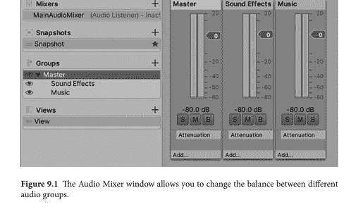

图 9.1 音频混音器窗口允许你更改不同音频组之间的平衡。

### 9.1.2 公开混音器属性以通过脚本修改它们

如果你想更改音频混音器的属性，例如其音频电平，你需要公开这些属性，以便可以通过脚本访问它们。为此，请通过菜单 Window/Audio/Audio Mixer 打开音频混音器。在左侧选择要编辑的混音器，然后选择要公开其属性的组。在 Inspector 中，右键单击要公开的字段名称。例如，在图 9.2 中，我们选择了音效组 Attenuation 下的 Volume 属性。应出现一个菜单，顶部选项是将属性公开给脚本。从菜单中选择此选项。该属性现在

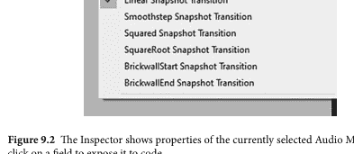

图 9.2 Inspector 显示当前所选音频混音器的属性。你可以单击字段将其公开给代码。

将公开给脚本，但它会有一个默认名称——MyExposedParam——这并不是最具描述性的名称。要重命名公开的属性，请查看音频混音器面板，并在其右上角找到 Exposed Parameters 按钮（图 9.3）——单击 Exposed Parameters，Unity 应会显示所选混音器的任何公开参数。要重命名，请右键单击要重命名的属性，然后从菜单中选择 Rename。

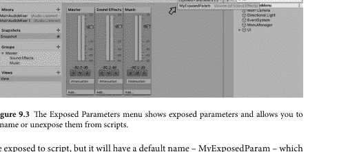

图 9.3 Exposed Parameters 菜单显示公开的参数，并允许你重命名它们或从脚本中取消公开它们。

如果你以后想取消公开某个参数，请单击 Exposed Parameters，然后右键单击要取消公开的参数。从菜单中选择 Unexpose。

### 9.1.3 音频效果

Unity 提供各种音频效果；你可以将其添加到音频混音器中，使声音更有趣或帮助动态平衡它们。要添加效果，首先通过菜单 Window/Audio/Audio Mixer 打开音频混音器。选择要添加效果的组。在音频混音器面板中，每个音频面板底部都有一个 Add 按钮。单击 Add 显示效果菜单。此时，让我提请注意 Duck Volume 效果。Duck Volume 将从另一个音频组接收输入，并降低其所附加组的音量。你可能已经在商业电子游戏和电视节目的对话中听到过这种效果的实际应用，因为它最常用于在播放对话时降低音乐音量。为实现这一点，你需要将音乐和对话通过两个音频组传送。你的音乐组将附加 Duck Volume 效果。你的对话组将附加 Send 效果。在选中对话组的 Inspector 中，Send 效果有一个名为 Receive 的字段，可让你选择哪个组应接收音频电平。将其设置为音乐通道意味着 Duck Volume 效果可以获取该组的电平并相应地压低音乐音量。将音频闪避与通知声音一起使用也可以使突出重要声音的过程更加容易。

## 9.2 BaseSoundManager 类

在本节中，我们构建一个名为 BaseSoundManager 的基础声音管理类。其规范为：

- 必须能够从单个类管理多个音频剪辑
- 能够从 3D 空间中的设定位置播放音频剪辑


-   提供一个设置音量的函数
-   提供一个淡入淡出 AudioMixer 组的方法
-   可从其他脚本访问

使用 BaseSoundManager 类播放声音有两种方式。声音管理器可以播放指定位置的声音，或者你可以让它播放声音，它会尝试在场景中查找 AudioListener 并在 Listener 的位置播放声音，如果找不到 AudioListener，则会在位置 0,0,0 播放声音。语法如下：

```
BaseSoundManager.instance.PlaySoundByIndex(the index number from the array of sounds);
```

Or

```
BaseSoundManager.instance.PlaySoundByIndex(the index number from the array of sounds, a Vector3 position);
```

AudioClip 应通过 Unity 编辑器中的 Inspector 窗口拖入 GameSounds 数组。数组中的每个 AudioClip 在 BaseSoundManager 类首次运行时都会拥有自己的 AudioSource 和 GameObject 实例。可以将每个声音视为拥有自己的音频通道，以避免重叠，或避免在单个 AudioSource 上播放过多不同声音。内部使用名为 SoundObject 的类来存储有关音频源及其 GameObject 的信息。

BaseSoundManager.cs 的开头如下：

```
using UnityEngine;
using System.Collections;
using System.Collections.Generic;
using UnityEngine.Audio;

namespace GPC
{
    [AddComponentMenu("C#SharpBookCode/Base/Sound Controller")]
```

上面，我们需要 System.Collections 用于淡入淡出协程（见下文，脚本中更下方）以及 System.Collections.Generic 以便使用 Lists 存储 SoundObject 实例。我们还使用 UnityEngine.Audio 来访问 Unity 的音频类。我们使用 AddComponentMenu 在 Unity 中为此脚本创建菜单项，并且此脚本像框架中的其他脚本一样存在于 GPC 命名空间中。

接下来声明 SoundObject 类——以防你好奇：是的，在 Unity 中在一个脚本中声明两个类是可以的：

```
public class SoundObject
{
    public AudioSource source;
    public GameObject sourceGO;
    public Transform sourceTR;
}
```

与本书中几乎所有其他类不同，SoundObject 类不继承自任何东西，因为它主要用作数据容器，其唯一函数只是通过 Unity 的 PlayOneShot() 函数调用播放声音。

```
public SoundObject(AudioClip aClip, string aName,
    float aVolume, AudioMixerGroup theMixer, Transform myParent)
{
    sourceGO = new GameObject("AudioSource." + aName);
    sourceGO.transform.parent = myParent;
```

上面，SoundObject 类的构造函数（在 SoundObject 被实例化时自动运行的函数）包含设置代码，用于在场景中创建一个新的 GameObject，以便其 AudioSource 组件附加到该对象上。播放声音时，我们不会直接调用 SoundObject——这是由 BaseSoundManager 类在更下方完成的。请注意，SoundObject 的构造函数有 5 个参数——当创建 SoundObject 实例时，每个实例都需要传入这些参数。你将在 BaseSoundManager 类中更下方看到这是如何完成的。

构造函数首先使用 new GameObject() 创建一个新的 GameObject，该方法接受一个名称作为参数——基于此命名新的 GameObject。为了确保我们在场景的层级中知道这个 GameObject 是什么，它被命名为 AudioSource 后跟作为参数传入此构造函数的名称。接下来，我们也在这里设置新 GameObject 的父对象，更具体地说，是其 Transform 的父对象。这都是为了将声音 GameObject 保持在一起以保持场景整洁，我们从名为 myParent 的传入参数中获取父 Transform。

```
    sourceTR = sourceGO.transform;
    source = sourceGO.AddComponent<AudioSource>();
    source.outputAudioMixerGroup = theMixer;
    source.playOnAwake = false;
    source.clip = aClip;
    source.volume = aVolume;
    source.maxDistance = 2000;
}
```

每次我们想要设置声音的位置时，我们都需要访问这个 GameObject 的 Transform，我们将 Transform 的引用存储在变量 sourceTR 中，这样我们就不必反复查找 Transform。

接下来，我们使用 GameObject.AddComponent() 为新 GameObject 添加一个 AudioSource。我们在变量 source 中保留对 AudioSource 的引用以便以后轻松访问，并因此可以在上面对其设置相关属性。我们在 AudioSource 上设置的属性是：

-   **outputAudioMixerGroup** – 这是声音播放所通过的音频混音器（作为参数传入）。
-   **playOnAwake** – 我们将其设置为 false，以防止 AudioClip 自动播放。
-   **Clip** – 这是此 AudioSource 将播放的 AudioClip（采样）。
-   **Volume** – 我们的音量级别通常由 AudioMixer 控制，但提供音量可额外提供单独音频音量控制的方法，如果需要的话。
-   **maxDistance** – 这是我们的声音应被听到的最大距离。

在 SoundObject 的构造函数之后，是 PlaySound() 函数：

```
public void PlaySound(Vector3 atPosition)
{
    sourceTR.position = atPosition;
    source.PlayOneShot(source.clip);
}
```

一个位置作为参数传递给 PlaySound()，类型为 Vector3。我们用它来设置 AudioSource 的位置，并使用 AudioSource.PlayOneShot() 开始 AudioClip 播放。我们在这里使用 PlayOneShot()，而不是直接使用 Play() 播放 AudioSource，这样任何正在播放的声音都不会被中断。如果你在使用 Play() 播放声音时连续播放，它会切断之前的声音并听起来很破碎。PlayOneShot() 可以在同一个 AudioSource 上不间断地播放多个声音。它接受 AudioClip 作为参数，我们只需从 AudioSource 中获取 source.clip——此 AudioSource 的 AudioClip 永不改变，因此我们知道这是要播放的正确声音。

接下来是主要的 BaseSoundManager 类。它继承自 MonoBehaviour，以便可以使用 Unity 引擎调用的 Awake() 和 Start() 函数：

```
public class BaseSoundManager : MonoBehaviour
{
    public static BaseSoundManager instance;
    public AudioClip[] GameSounds;
    public AudioMixerGroup theAudioMixerGroup;
    public Transform theListenerTransform;
    private List<SoundObject> soundObjectList;
    private SoundObject tempSoundObj;
    public float volume = 1;
}
```

变量声明没有什么特别需要注意的。大多数内容在我们下面逐步讲解脚本时就会变得清晰。

```
public void Awake()
{
    instance = this;
}
```

由于此脚本不检查多个实例，因此必须确保每个场景中只有一个实例。

```
void Start()
{
    soundObjectList = new List<SoundObject>();
    foreach (AudioClip theSound in GameSounds)
    {
```

SoundObjects 存储在通用 List 中。上面，我们初始化 List soundObjectList，以便填充有关声音及其 AudioSource 和 GameObject 的信息。

要创建 SoundObject 实例，我们然后遍历 GameSounds 数组中的每个 AudioClip（应在编辑器的 Inspector 中设置）。

```
        soundObjectList.Add(new SoundObject(theSound, theSound.name, volume, theAudioMixerGroup, transform));
    }
}
```

上面，soundObjectList 由 SoundObject 类的新实例填充。你可能还记得本章前面提到的，SoundObject 接受 5 个参数。第一个是声音剪辑本身，来自我们正在遍历的 GameSounds 数组。然后我们通过使用 GameSounds 中的声音名称为声音的 GameObject 传入一个名称。接下来是音量，然后是我们想要使用的 AudioMixer，最后是我们的 Transform 作为声音将被父级化的对象。注意 Mixer 需要在此组件的 Inspector 中设置。在示例游戏中，AudioMixer 将设置为使用音效混音器。

```
public void PlaySoundByIndex(int anIndexNumber,
    Vector3 aPosition)
{
    tempSoundObj =
        (SoundObject)soundObjectList[anIndexNumber];
    tempSoundObj.PlaySound(aPosition);
}
```

要播放声音，PlaySoundByIndex 函数接受两个参数；一个整数和一个 Vector3 位置。我们使用传入的参数 anIndexNumber 从 soundObjectList 数组中取出一个 SoundObject 实例，并将其保存在名为 tempSoundObj 的变量中。接下来，在 SoundObject 上调用 PlaySound() 会在传入的位置播放声音，因为我们将该位置作为参数传递给 PlaySound()。这里传入位置是可选的，不过，下一个函数处理我们未传入位置时会发生什么情况：

```
public void PlaySoundByIndex(int anIndexNumber)
{
    if (theListenerTransform == null)
    {
        AudioListener theListener = FindObjectOfType<AudioListener>();
        if (theListener != null)
            theListenerTransform = theListener.transform;
    }
```

当 PlaySoundByIndex() 在不传入位置的情况下被调用时，我们尝试上面所做的就是在场景中查找 AudioListener 以进行定位。如果我们能找到 Listener，Transform 将存储在变量 theListenerTransform 中。

```
    tempSoundObj = (SoundObject)soundObjectList[anIndexNumber];
    if (theListenerTransform != null)
        tempSoundObj.PlaySound(theListenerTransform.position);
    else
        tempSoundObj.PlaySound(Vector3.zero);
}


同样地，与 PlaySoundByIndex() 的其他实现一样，我们从 soundObjectList 数组中取出一个 SoundObject 实例，使用传入的参数 anIndexNumber，并将其保存在名为 tempSoundObj 的变量中。然后我们检查 theListenerTransform 变量是否实际包含内容——如果有，我们使用 theListenerTransform 的位置来定位声音，通过将其位置传入 PlaySound()。如果 theListenerTransform 中没有内容，说明场景中未找到 Listener，我们改为向 PlaySound() 传入 Vector3.zero，使声音在世界坐标 0,0,0 处播放。

音频淡入淡出函数都类似，但对音量级别的处理不同。以下是可供使用的三个函数：

StartFadeIn(AudioMixer audioMixer, string exposedParam, float duration)

这将使 AudioMixer 中 exposedParam 的暴露参数从 -80 分贝淡入到 0，耗时 duration x 秒。

StartFadeOut(AudioMixer audioMixer, string exposedParam, float duration)

这将使 AudioMixer 中 exposedParam 的暴露参数从 0 分贝淡出到 -80，耗时 duration x 秒。

StartFade(AudioMixer audioMixer, string exposedParam, float duration, float targetVolume)

这将使 AudioMixer 中 exposedParam 的暴露参数从当前值过渡到 targetVolume，耗时 duration x 秒。

```csharp
public static IEnumerator StartFadeIn(AudioMixer audioMixer, string exposedParam, float duration)
{
    float targetVolume = 1;
    float currentTime = 0;
    float currentVol = -80f;
    currentVol = Mathf.Pow(10f, currentVol / 20f);
    float targetValue = Mathf.Clamp(targetVolume, 0.0001f, 1);
    while (currentTime < duration)
    {
        currentTime += Time.deltaTime;
        float newVol = Mathf.Lerp(currentVol, targetValue, currentTime / duration);
        audioMixer.SetFloat(exposedParam, Mathf.Log10(newVol) * 20f);
        yield return null;
    }
    yield break;
}

public static IEnumerator StartFadeOut(AudioMixer audioMixer, string exposedParam, float duration)
{
    float targetVolume = -80;
    float currentTime = 0;
    float currentVol;
    audioMixer.GetFloat(exposedParam, out currentVol);
    currentVol = Mathf.Pow(10f, currentVol / 20f);
    float targetValue = Mathf.Clamp(targetVolume, 0.0001f, 1);
    while (currentTime < duration)
    {
        currentTime += Time.deltaTime;
        float newVol = Mathf.Lerp(currentVol, targetValue, currentTime / duration);
        audioMixer.SetFloat(exposedParam, Mathf.Log10(newVol) * 20f);
        yield return null;
    }
    yield break;
}

public static IEnumerator StartFade(AudioMixer audioMixer, string exposedParam, float duration, float targetVolume)
{
    float currentTime = 0;
    float currentVol;
    audioMixer.GetFloat(exposedParam, out currentVol);
    currentVol = Mathf.Pow(10f, currentVol / 20f);
    float targetValue = Mathf.Clamp(targetVolume, 0.0001f, 1);
    while (currentTime < duration)
    {
        currentTime += Time.deltaTime;
        float newVol = Mathf.Lerp(currentVol, targetValue, currentTime / duration);
        audioMixer.SetFloat(exposedParam, Mathf.Log10(newVol) * 20f);
        yield return null;
    }
    yield break;
}
}
```

## 9.3 为武器添加声音

为武器添加声音，最简单的方法是在投射物预制体上添加一个 AudioSource，并将其 PlayOnAwake 复选框设为 true。每当投射物被生成时，声音就会播放。通过将声音附加到投射物上，你只需更改 AudioSource 上的剪辑，即可轻松为不同类型的投射物设置不同的声音。

# 10 AI 管理器

本书中的 AI 控制器是一个状态机。你可能听过这个词，但我们说状态机时是什么意思？我们的 AI 系统存储 AI 的当前状态，并根据其所处状态运行代码。当状态改变时，它会运行不同的代码。例如，当我们的状态设置为追逐时，AI 应该朝一个物体移动。当状态设置为停止时，AI 应该保持静止。这就是状态机 AI。

在本書中，AI 被拆分为多个相互配合以添加功能的脚本。你可以将我们的主 AI 类 BaseAIController 视为一个包含 AI 实用函数的类，而不是一个包罗万象的单一脚本。

- 1. BaseAIController：此脚本包含 AI 的基础代码，例如追逐/跟随行为。
- 2. WaypointsController：处理路径点的代码：此功能可选，取决于是否需要路径点跟随。
- 3. AIBotController：使用 BaseAIController，此类可以移动机器人、追逐和攻击目标，并在警戒时寻找追逐和攻击的目标。本书中的 Blaster 游戏示例使用它来移动机器人。
- 4. AISteeringController：它使用 BaseAIController 和 WaypointsController 提供转向输入，以跟随路径点路径（本书中的示例赛车游戏中用于驱动 AI 汽车绕赛道行驶）。

我们将在本章中查看上述脚本并对其进行分解，同时介绍一种让 AI 使用武器系统开火的方法。

请注意，此 AI 系统仅适用于 3D 游戏。

## 10.1 AI 状态

在进入主要的 BaseAIController.cs 脚本之前，先查看下面的 AIStates.cs。它包含上一节中的所有 AIStates，存储在一个枚举列表中，与本书第 5 章中角色控制器使用的列表类似。该列表将由 AI 用于确定其当前所需行为。列表位于单独的文件（AIStates.cs 文件）中，并在名为 AIStates 的命名空间中，以便我们可以轻松地使其可供游戏使用的任何脚本访问：

```csharp
using UnityEngine;
namespace AIStates
{
    public enum AIState
    {
        moving_looking_for_target,
        chasing_target,
        backing_up_looking_for_target,
        stopped_turning_left,
        stopped_turning_right,
        paused_looking_for_target,
        translate_along_waypoint_path,
        paused_no_target,
        steer_to_waypoint,
        steer_to_target,
    }
}
```

## 10.2 BaseAIController 类 – 基础 AI 控制

BaseAIController 首先使用 UnityEngine 命名空间，同时添加 AIStates，如上一节 10.1 所示。通过将 AIStates 作为命名空间包含，它可以像同一脚本的一部分一样被访问。我们将该类包装在 GPC 命名空间中，并使其派生自 ExtendedCustomMonoBehaviour：

```csharp
using UnityEngine;
using AIStates;
namespace GPC
{
    [AddComponentMenu("CSharpBookCode/Base/AI Controller")]
    public class BaseAIController : ExtendedCustomMonoBehaviour
    {
        public bool AIControlled;

        [Header("AI States")]
        public AIState currentAIState;
        public AIState targetAIState;

        [Header("Enemy input")]
        public float horz;
        public float vert;

        [Header("Enemy AI movement values")]
        public float obstacleAvoidDistance = 40f;
        public float modelRotateSpeed = 15f;
        public int _followTargetMaxTurnAngle = 120;
        public float minChaseDistance = 1f;
        public float maxChaseDistance = 10f;
        public float visionHeightOffset = 1f;

        [Header("Waypoints")]
        // waypoint following related variables
        public WaypointsController _waypointsController;
        public Transform _currentWaypointTransform;
        public Transform _shouldFollowTarget;
        public Transform _rotateTransform;

        [System.NonSerialized]
        public bool reachedLastWaypoint;
        public float waypointDistance = 5f;
        public float pathSmoothing = 2f;
        public bool pathShouldReversePathFollowing;
        public bool loopPath;
        public bool destroyAtEndOfWaypoints;
        public bool startAtFirstWaypoint;

        [Header("Layer masks and raycasting")]
        public LayerMask obstacleAvoidLayers;
        public string potentialTargetTag = "Player";
        public LayerMask targetLayer;
        public int obstacleFinderResult;

        private int totalWaypoints;
        private int currentWaypointNum;
        private RaycastHit hit;
        private Vector3 tempDirVec;
        private Vector3 relativeTarget;
        private float obstacleAngle;
        private int obstacleHitType;
        public int lookAheadWaypoints = 0;
```

有很多变量需要声明，所以不用担心。我们将在后面的分解中看到它们的使用方式。除了 ExtendedCustomMonoBehaviour 之外，此脚本仅使用本书框架中的另一个脚本——用于使用路径点的 WaypointsController 类。其余部分都是独立的，无论是否使用该框架，都可直接在项目中使用。

在通过类声明后，我们使用 Start() 函数开始：

```csharp
public virtual void Start()
{
    Init();
}
```

Init() 函数负责创建对 GameObject、Transform 及其 Rigidbody 的缓存引用（此脚本假设始终有一个 Rigidbody 附加到与该组件附加的同一 GameObject 上）：

```csharp
public virtual void Init ()
{
    // cache ref to gameObject
    _GO = GetComponent<GameObject>();
    // cache ref to transform
    _TR = GetComponent<Transform>();
    // cache a ref to our rigidbody
    _RB = _TR.GetComponent<Rigidbody>();
}
```

上面，Init() 获取了脚本后续需要使用的其他对象的引用。

```csharp
if (_rotateTransform == null)
    _rotateTransform = _TR;
```


_rotateTransform 是一个可选参数，可在 Unity 编辑器 Inspector 窗口中设置，以提供一个与脚本附加对象不同的用于旋转的 Transform。这在我们不希望旋转主 Transform 的情况下使用。

```
didInit= true;
```

与本书中的其他脚本一样，didInit 是一个布尔变量，用于确定 Init() 函数是否已成功完成。

```
public void SetAIControl( bool state )
{
    AIControlled= state;
}
```

上述代码中，名为 AIControlled 的布尔变量用于决定此脚本是否应接管控制。SetAIControl() 函数只是为其他脚本提供了一种简便的方式来启用或禁用 AI 控制。

// set up AI parameters -------------------------
public void SetObstacleAvoidDistance(float aNum)
{
    obstacleAvoidDistance = aNum;
}
public void SetWaypointDistance(float aNum)
{
    waypointDistance = aNum;
}
public void SetMinChaseDistance(float aNum)
{
    minChaseDistance = aNum;
}
public void SetMaxChaseDistance(float aNum)
{
    maxChaseDistance = aNum;
}
// -----------------------------------------------

上述代码提供了设置多个主要参数的函数。它们是：

obstacleAvoidDistance(float) – 以 3D 单位表示，巡逻时机器人应向前看多远以尝试避免撞到障碍物。

wayPointDistance(float) – 以 3D 单位表示，机器人在前往下一个路点之前允许接近路点的距离。

minChaseDistance (float) – 以 3D 单位表示，minChaseDistance 决定了在追击目标时，机器人应接近目标多近才停止朝其移动。这是为了防止机器人靠得太近而推挤玩家。

maxChaseDistance (float) – 以 3D 单位表示，机器人可以承认目标的最大距离。

```
public virtual void SetAIState(AIState newState)
{
    // update AI state
    targetAIState = newState;
    UpdateTargetState();
}
```

有时我们可能需要从另一个脚本强制设置机器人的状态，例如在游戏开始时告诉它应处于哪个初始状态。为此使用 SetAIState() 函数，并传入一个 AIState。

```
public virtual void SetChaseTarget(Transform theTransform)
{
    // set a target for this AI to chase, if required
    _followTarget= theTransform;
}
```

在上述 SetAIState() 函数的末尾，我们调用 UpdateTargetState() 来执行在完全切换到新状态之前需要完成的操作。例如，你可以调用动画系统，在 AI 从巡逻状态切换到追击状态时播放动画。在此脚本的基础版本中，UpdateTargetState() 中没有额外的逻辑，该函数存在的目的是保持目标状态和当前状态的协议，并在目标状态改变时提供一个良好的触发动作位置。如果需要追击，则应使用 SetChaseTarget() 函数传入需要追击的 Transform 的引用。当你将一个 Transform 传入 SetChaseTarget() 时，该 Transform 将存储在名为 followTarget 的变量中。

```
public virtual void Update()
{
    // make sure we have initialized before doing anything
    if (!didInit)
        Init();
}
```

Update() 函数由 Unity 在每一帧更新时调用，但我们需要在对脚本进行任何重要操作之前确保脚本已正确初始化，因为 Update() 可能在 Init() 运行完成之前就被调用。

```
if (!AIControlled)
    return;

    // do AI updates
    UpdateCurrentState();
```

上述代码中，记住我们仍在主 Update() 函数中，如果 AIControlled 未设置为 true，则该函数会在有机会执行任何操作之前退出。布尔变量 AIControlled 使 AI 控制可以打开或关闭。例如，在我们希望 AI 接管玩家控制的情况下，这非常有用；例如在赛车游戏结束时，比赛完成后我们希望车辆继续行驶但将玩家移出游戏。AI 脚本会附加到所有玩家，但在用户车辆的情况下，它仅在比赛结束后才被激活。这就是本书第 14 章中示例赛车游戏中的情况。

UpdateCurrentState() 是脚本的核心部分——它由 Update() 函数调用，并负责协调机器人执行应有的行为：

```
public virtual void UpdateCurrentState()
{
```

在某些情况下，AI 脚本不会直接操作其 GameObject 的物理，而是充当向处理实际物理的另一个脚本提供输入的提供者。这样做的原因是让 AI 可以使用与玩家相同的移动控制器，而无需每次都重新编码移动。例如，在第 14 章的示例赛车游戏中，AI 汽车使用与用户完全相同的汽车物理。当一辆车被设置为使用 AI 时，汽车物理控制器脚本使用来自 AI 脚本的输入，而不是用户输入控制器。

// reset our inputs
horz=0;
vert=0;

上述代码中，AI 脚本使用 horz 和 vert（均为 float）来存储水平和垂直输入，这些是本书其他脚本中使用的标准变量名。在 UpdateCurrentState() 函数中，它们被重置为零。这是在其他函数更改它们之前将输入居中。

```
switch (currentAIState)
{
    case AIState.paused_no_target:
        // do nothing
    break;
    default:
        // idle (do nothing)
    break;
}
```

上述代码中，如果 AI 处于特定状态时需要执行某些操作，这里就是位置。上面的 switch 语句接收 currentAIState 变量，并为当前状态运行相应的代码。

在 BaseAIController 中，UpdateCurrentState() 函数是一个占位符——假定你将在该类的派生版本中重写此函数以加入自己的逻辑。你可以在 GPC_Framework/Scripts/COMMON/AI 中的 AIBotController 和 AISteeringController 脚本中找到示例。

在状态从 targetAIState 更改为 currentAIState 之前，我们需要经过 UpdateTargetState() 函数：

```
public virtual void UpdateTargetState()
{
    switch (targetAIState)
    {
        default:
            // idle (do nothing)
        break;
    }
    currentAIState = targetAIState;
}
```

由于我们知道这只会在设置新的当前状态时发生，因此我们可以调用仅在 AI 进入新状态时才需要调用的代码。与 UpdateCurrentState() 一样，UpdateTargetState() 也是一个占位符，应由你自己的逻辑重写。

接下来是一组用于设置向左、向右或向前、向后移动输入的函数：

```
public virtual void TurnLeft ()
{
    horz= -1;
}
```

```
public virtual void TurnRight ()
{
    horz= 1;
}
```

```
public virtual void MoveForward ()
{
    vert= 1;
}
```

```
public virtual void MoveBack ()
{
    vert= -1;
}
```

```
public virtual void NoMove ()
{
    vert= 0;
}
```

上述每个函数都旨在更轻松地与其他类型的控制系统接口。你可以在派生类中重写它们或从其他类调用它们。

接下来是 LookAroundFor() 函数。当我们需要机器人追击目标时，会调用它。有关使用示例，请查看 AIBotController.cs 脚本。

```
public virtual void LookAroundFor()
{
    if (_followTarget != null)
    {
        float theDist = Vector3.Distance
        (_TR.position, _followTarget.position);
        bool canSee = CanSee(_followTarget);
        if (theDist < maxChaseDistance)
        {
            if (canSee == true)
                SetAIState(AIState.chasing_target);
        }
    }
    else
    {
        GameObject potential =
GameObject.FindGameObjectWithTag(potentialTargetTag);
        _followTarget = potential.transform;
    }
}
```

上述 LookAroundFor() 函数首先确保 _followTarget 变量中有内容。目标可能由此脚本或另一个外部脚本设置。如果我们已有要跟随的目标，就可以继续使用 Unity 内置函数 Vector3.Distance() 进行距离检查——结果存入名为 theDist 的局部变量。我们还通过调用 CanSee() 来测试目标是否对 AI 可见，并将结果存储在局部变量 canSee 中。CanSee() 函数在脚本的更下方。它将在 AI 与目标之间有清晰视线时返回 true。


如果与目标的距离落在我们的 `maxChaseDistance` 范围内，我们就确保从 `CanSee()` 返回的结果为 true（`canSee == true`）。在这个阶段，我们现在已经知道关于目标的几件事：

- 1. 我们有一个目标。
- 2. 目标在 `maxChaseDistance` 距离之内。
- 3. 从 AI 处可以清楚地看到目标。

如果满足上述条件，就会调用 `SetAIState()` 将目标状态改为 `AIState.chasing_target`——让我们的 AI 转向并朝它移动。

如果 `_followTarget` 中没有 Transform，我们就没有可跟随的对象，函数会转而进入 `else` 语句。在这里，我们将改为尝试使用 `GameObject.FindGameObjectWithTag()` 查找合适的目标。新的目标对象将是该搜索返回的第一个对象（如果有返回任何对象的话）。

接下来是 AI 控制器的核心组件之一——`IsObstacleAhead()` 函数。在这一部分，`Physics.Raycast` 用于向前方（以及略微偏左或偏右）投射射线以检查障碍物。它返回一个整数，用以下值表示检测结果：

- 0 - 未发现障碍物
- 1 - 仅在前方左侧检测到障碍物
- 2 - 仅在前方右侧检测到障碍物
- 3 - 在两侧都检测到一个或多个障碍物

`IsObstacleAhead()` 函数用于检测其他碰撞体，不过在当前状态下它可能有点不可预测，还可以再迭代几次，让它工作得更好。它能用，但本可以更好，亲爱的读者，这就得留给你来改进了！

```csharp
private int obstacleHitType;

public virtual int IsObstacleAhead()
{
    obstacleHitType = 0;
    if (_TR == null)
    {
        return 0;
    }
}
```

该函数的返回结果存储在一个名为 `obstacleHitType` 的变量中，该变量在函数开头会先被设为默认值 `0`。

上面函数的开头会检查 `_TR` 中是否确实有一个 Transform。如果没有，我们就知道这个 GameObject 的 Transform 已被销毁，或者出了什么问题，因此返回结果 `0`。

```csharp
// draw this raycast so we can see what it is doing
Debug.DrawRay(_TR.position, (_TR.forward + (_TR.right * 0.5f)) * obstacleAvoidDistance);

Debug.DrawRay(_TR.position, ((_TR.forward +
(_TR.right * -0.5f)) * obstacleAvoidDistance));
```

为了更直观地看到 AI 正在发生什么，这个函数包含了 `Debug.DrawRay` 调用，它会在编辑器中射线投射的位置显示线条。这仅在编辑器中 Gizmos 设置为 true 时才会发生——使用 Scene 或 Game 面板上方的 Gizmos 图标进行设置。

上面用于绘制调试射线的位置和方向数据，与我们下面用于执行实际射线投射的数据一致：

```csharp
RaycastHit hit;
// cast a ray out forward from our AI and put the 'result' into the variable named hit
if (Physics.Raycast(_TR.position, _TR.forward +
(_TR.TransformDirection(Vector3.right) * 0.5f), out hit,
obstacleAvoidDistance, obstacleAvoidLayers))
```

射线投射使用 AI 机器人的前向向量（`_TR.forward`），并带有一个向侧面的偏移。`_TR.right` 也乘以一半并加到前向向量上，使角度从机器人斜向伸出——射线从 `_TR.position` 开始。

我们所认为的障碍物，定义为任何被设置为使用 `obstacleAvoidLayers` LayerMask 中定义的某个碰撞层的对象。你可以在 Unity 编辑器的 Inspector 中，在这个 GameObject 上设置一个或多个碰撞层作为障碍物层。

变量 `obstacleAvoidDistance` 用作射线投射的距离参数，可以在 Unity 编辑器的 Inspector 窗口中设置。

如果调用 `Physics.Raycast` 找到了东西，它就会返回 true，而这正是上面那行代码所要查找的。如果找到了东西，我们接下来就会对此做出反应：

```csharp
// obstacle
// it's a left hit, so it's a type 1 right now (thought it could change when we check on the other side)
obstacleHitType = 1;
}
```

`obstacleHitType` 将构成该函数的返回值。上面，当射线投射发现障碍物时，变量 `obstacleHitType` 被设为 1。这表示左侧有障碍物（还记得本节前面列出的返回值列表吗？）。现在从机器人的另一侧投射一条射线：

```csharp
if (Physics.Raycast(_TR.position, _TR.forward + (_TR.right * -0.5f), out hit, obstacleAvoidDistance, obstacleAvoidLayers))
{
```

上面，这次射线投射与上一次的唯一区别是，我们现在将右向量乘以 `-0.5` 而不是 `0.5` 来将其反向，从而向相反方向投射射线。

```csharp
// obstacle
if (obstacleHitType == 0)
{
    // if we haven't hit anything yet, this is
    type 2
    obstacleHitType = 2;
```

如果 `obstacleHitType` 没有被第一次射线投射设置，它的值仍将是默认值 0；这告诉我们，是这条射线命中了对象，并且函数只在这一侧发现了障碍物——`obstacleHitType` 被设为 2。

```csharp
} else { // if we have hits on both left and right raycasts, it's a type 3
    obstacleHitType = 3;
}
```

接下来，我们处理 `obstacleHitType` 不是默认值 0 的情况。如果它不是 0，我们就知道这次射线投射和上一次射线投射都发现了障碍物。为了表示两侧都发现了障碍物，`obstacleHitType` 被设为 3。现在剩下要做的就是返回射线投射的结果：

```csharp
return obstacleHitType;
```

`BaseAIController.cs` 的下一部分是 `TurnTowardTarget()`。这个函数会让机器人（更具体地说，是变量 `rotateTransform` 中设置的 Transform）转向作为参数传给它的 Transform：

```csharp
public void TurnTowardTarget(Transform aTarget) { if (aTarget == null) return; }
```

如果我们要对目标做任何事，第一步就是确保变量 `aTarget` 中有一个可以转向的目标（见上）。

```csharp
relativeTarget = _rotateTransform.InverseTransformPoint(aTarget.position);
```

上面，我们计算一个 Vector3，它表示目标相对于 AI 的位置，这样我们就可以查看这个向量的值，并确定朝向目标的方向。例如，正的 x 值表示目标在汽车的右侧，负值表示在左侧；正的 z 表示目标在汽车前方，负 z 表示在后方。

```csharp
// Calculate the target angle
targetAngle = Mathf.Atan2(relativeTarget.x, relativeTarget.z);
// Atan returns the angle in radians, convert to degrees
targetAngle *= Mathf.Rad2Deg;
```

然后，上面使用新计算出的 `relativeTarget` 配合 Unity 的 `Mathf.Atan2` 函数，求出该向量的旋转角度。Atan 返回的是弧度角，而这里更适合使用角度，因此我们使用 `Mathf.Rad2Deg` 将 `targetAngle` 从弧度转换为角度。

```csharp
targetAngle = Mathf.Clamp(targetAngle, -_followTargetMaxTurnAngle, _followTargetMaxTurnAngle);
```

上面，为了限制单步应用的旋转量，使用 `Mathf.Clamp` 将角度限制在浮点数 `_followTargetMaxTurnAngle` 的正值和负值之间。当然，作为公共变量，最大转向量可以在该组件的 Inspector 中修改。

```csharp
rotateTransform.Rotate(0, targetAngle *
modelRotateSpeed * Time.deltaTime, 0);
}
```

上面 `TurnTowardTarget()` 的最后一行使用 `Transform.Rotate` 来旋转 Transform。`targetAngle` 乘以 `modelRotateSpeed`，再乘以 `Time.deltaTime`，使旋转量与时间相关。

接下来，`CanSee()` 会做一个简单的视线检查，看看机器人和目标之间是否有任何东西。当目标走到墙后或 AI 无法到达的某个地方时，这对于中断追逐很有用：

```csharp
public bool CanSee(Transform aTarget)
{
    // first, let's get a vector to use for
    // raycasting by subtracting the target position from our AI position
    tempDirVec = Vector3.Normalize(aTarget.position - _TR.position);
}
```

它根据这两个位置创建一个归一化向量，然后使用这个新向量从机器人处向外投射一条长度为 `maxChaseDistance` 的射线。

```csharp
// let's have a debug line to check the distance
// between the two manually, in case you run into trouble!
Debug.DrawLine(_TR.position + (visionHeightOffset * _TR.up), aTarget.position, Color.red);
```

上面，就在实际射线投射之前，有一条调试线来表示这个函数中正在发生什么，这样当你在 Unity 编辑器中时，就很容易看出 AI 应该做什么。

```csharp
if (Physics.Raycast(_TR.position +
(visionHeightOffset * _TR.up), tempDirVec, out hit, Mathf.Infinity))
{
    if (IsInLayerMask(hit.transform.gameObject.layer, playerLayer))
    {
        return true;
    }
}
// nothing found, so return false
return false;
```

上面，射线投射从我们的 Transform（`_TR`）位置开始，并带有一个高度偏移。有时你可能不希望射线从 AI 上的原点位置投射——一个原因可能是原点位于 GameObject 的底部，可能只会打到地面，因此你可以在该组件的 Inspector 中调整高度偏移来实现这一点。

`tempDirVec`（我们之前计算的 AI 与其目标之间的那个向量）也作为方向向量传入 `Physics.Raycast()`。`Mathf.Infinity` 是射线投射的限长，因为我们不需要限制它。当射线投射发生命中时，下一行代码会检查命中对象的层是否在 LayerMask `playerLayer` 中。如果目标位于正确的层上，我们就知道没有什么阻挡道路，因此可以返回 true；否则，执行会继续向下，直到函数末尾返回 false。


AI 控制器将路径点控制纳入其中，使用 WaypointsController 类来管理它们：

```
public void SetWayController( WaypointsController aControl )
{
    _waypointsController=aControl;
    aControl=null;
}
```

由于 AI 机器人不知道使用哪些路径点，因此另一个脚本（例如游戏控制器）将调用 SetWayController 并传入一个 WaypointsController 对象。

```
// grab total waypoints
totalWaypoints = _waypointsController.GetTotal();
```

上面，totalWaypoints 包含来自路径点控制器的路径点总数的缓存值，以避免每次需要时都去查找。

```
if( shouldReversePathFollowing )
{
    currentWaypointNum = totalWaypoints - 1;
} else {
    currentWaypointNum = 0;
}
```

如果 shouldReversePathFollowing 为 true，则起始路径点将是 Waypoint_Controller 脚本创建的路径点列表中最后一个。

```
Init();

// get the first waypoint from the waypoint controller
currentWaypointTransform = myWayControl.GetWaypoint(currentWaypointNum);
if(startAtFirstWaypoint)
{
    _TR.position= _currentWaypointTransform.position;
}
```

除其他事项外，此类中的 Init() 函数将 AI 机器人的 Transform 的引用缓存到变量 _TR 中。SetWayController() 函数调用 Init() 以确保引用已设置并准备好使用，因为它会将 _TR 重新定位到第一个路径点（当布尔变量 startAtFirstWaypoint 设置为 true 时）。

此类中的接下来两个函数是接口函数，供其他脚本在需要时更改值：

```
public void SetReversePath( bool shouldRev )
{
    shouldReversePathFollowing= shouldRev;
}
public void SetRotateSpeed( float aRate )
{
    modelRotateSpeed= aRate;
}
```

UpdateWaypoints() 负责保持当前目标路径点为最新，并在 AI 到达路径末端时（如有需要）执行自我销毁：

```
void UpdateWaypoints()
{
    // If we don't have a waypoint controller, we safely drop out
    if(_waypointsController==null)
        return;
}
```

上面，UpdateWaypoints() 首先检查 _waypointsController（对 WaypointsController 类实例的引用）是否不为 null，这应该意味着 SetWayController() 已被调用并成功设置。

AI 控制器脚本可以选择在到达最后一个路径点时自动销毁自己。当 destroyAtEndOfWaypoints 设置为 true 时，GameObject 会被销毁，并且此代码会立即退出 UpdateWaypoints() 脚本。

```
if( reachedLastWaypoint && destroyAtEndOfWaypoints )
{
    // destroy myself()
    Destroy( gameObject );
    return;
}
else if( reachedLastWaypoint )
{
    currentWaypointNum= 0;
    reachedLastWaypoint= false;
}
```

当 destroyAtEndOfWaypoints 为 false 时，假设路径点跟随应返回到开头；currentWaypointNum 设置为零，reachedLastWaypoint 被重置，AI 可以自由重新开始。

为了使此函数保持安全（以防在 WaypointsController 类中正确设置路径点之前以某种方式调用它），会进行检查以确保找到了多个路径点。如果 totalWaypoints 为零，则在退出 UpdateWaypoints() 函数之前会再次尝试从 _waypointsController 获取总数。

```
if( totalWaypoints==0 )
{
    // grab total waypoints
    totalWaypoints= _waypointsController.GetTotal();
    return;
}

if( _currentWaypointTransform==null )
{
    // grab our transform reference from the waypoint controller
    _currentWaypointTransform= _waypointsController.GetWaypoint( currentWaypointNum );
}
```

如果此时尚未设置 currentWaypointTransform 对象，则会调用 _waypointsController 使用变量 _currentWaypointNum 中保存的索引号提供一个。

计算两个 Transform 之间的距离会考虑 x、y 和 z 坐标。在大多数情况下，路径点跟随只需在二维平面上工作，y 轴可以完全去掉。这样做可以解决因高度与 x 和 y 轴差异结合导致当前路径点在正确时间未推进的问题。特别是对于转向或角色驱动的 AI，在路径点距离检查中几乎完全不需要 y 轴。

```
// now we check to see if we are close enough to the current waypoint
// to advance on to the next one
myPosition= _TR.position;
myPosition.y= 0;

// get waypoint position and 'flatten' it
nodePosition= _currentWaypointTransform.position;
nodePosition.y= 0;
```

在上面的代码中，myPosition（机器人位置的缓存 Vector3）和 nodePosition（缓存的路径点位置）都被去除了 y 轴。

```
currentWayDist= Vector3.Distance(
nodePosition,myPosition );
if ( currentWayDist < waypointDistance ) {
// we are close to the current node, so let's move on to the next one!
```

AI 机器人与下一个路径点之间的距离使用下面两个缓存的位置变量计算。当 resulting currentWayDist 值小于 waypointDistance 的值时，表示机器人已足够接近当前路径点，可以推进到下一个。

```
if( shouldReversePathFollowing )
{
    currentWaypointNum--;
}
```

在推进到下一个路径点之前，会检查 shouldReversePathFollowing 以确定 AI 沿路径需要去的方向。如果路径被反转，则 currentWaypointNum 的值会递减而不是递增。

```
// now check to see if we have been all the way around
if( currentWaypointNum<0 ){
    // just in case it gets referenced before we are destroyed, let's keep it a safe index number
    currentWaypointNum= 0;
    // completed the route!
    reachedLastWaypoint= true;
    // if we are set to loop, reset the currentWaypointNum to 0
    if(loopPath)
    {
        currentWaypointNum= totalWaypoints;
        reachedLastWaypoint= false;
    }
    return;
}
```

在上面的代码块中，如果路径被反转，当 currentWaypointNum 降到零以下时，它需要重置为路径另一端的路径点（仅在 loopPath 设置时）。为此，currentWaypointNum 将被设置为变量 totalWaypoints 的值。

在此代码段中发生的另一件事是，当我们知道已到达路径末端时，reachedLastWaypoint 的值会被设置为 true。这将在下一次 UpdateWaypoints() 调用时检查，以执行路径末端需要完成的操作（例如当 destroyAtEndOfWaypoints 设置为 true 时销毁 GameObject）。

```
} else {
    currentWaypointNum++;
    // now check to see if we have been all the way around
    if( currentWaypointNum==totalWaypoints ){
        // completed the route!
        reachedLastWaypoint= true;
        // if we are set to loop, reset the currentWaypointNum to 0
        if(loopPath)
        {
            currentWaypointNum= 0;
            // the route keeps going in a loop, so we don't want reachedLastWaypoint to ever become true
            reachedLastWaypoint= false;
        }
        // drop out of this function before we grab another waypoint into currentWaypointTransform, as
        // we don't need one and the index may be invalid
        return;
    }
}
```

shouldReversePathFollowing 布尔值必须已设置为 false 才能执行以下代码，这意味着 currentWaypointNum 已超过由路径点控制器保存的列表中的最后一个路径点，并且如果变量 loopPath 设置为 true，则 currentWaypointNum 需要重置为零。

```
// grab our transform reference from the waypoint controller
_currentWaypointTransform= myWayControl.GetWaypoint( currentWaypointNum );
}
```

对 currentWaypointNum 的操作完成后，我们可以使用其值作为索引号询问路径点控制器 myWayControl，以提供下一个路径点的 Transform。currentWaypointTransform 被设置为对 Waypoint_Controller.cs 函数 GetWaypoint() 的调用结果。

```
public float GetHorizontal()
{
    return horz;
}
public float GetVertical()
{
    return vert;
}
}
```


上面的辅助函数提供了对水平和垂直输入变量的访问。

## 10.3 敌人属性

BaseEnemyStatsController 类可用于为敌人添加属性，其方式与处理玩家时类似。在本书中，我们让它派生自 BaseAIController，以便能够分层——第 15 章的 Blaster 游戏示例中有一个派生自 BaseEnemyStatsController 的 blaster 敌人类型。这样，我们就将所有的 AI 和属性整合在一起，无需再引用其他脚本组件来处理敌人生命值等问题。

如果你想在自己的游戏中将这段脚本作为独立脚本使用，只需将类声明改为从 MonoBehaviour 派生，而不是从 BaseAIController 派生。你还需要从 Init() 函数中移除 base.Init()，并从 Init() 函数声明中移除 override。完成这些操作后，该类将独立于 AI 系统和/或框架工作。

```csharp
using UnityEngine;

namespace GPC
{
    [AddComponentMenu("CSharpBookCode/Base/Enemy Controller")]
    public class BaseEnemyStatsController : BaseAIController
    {
        [Header("Enemy stats")]
        public int myID;
        private static int enemyUniqueID;

        public int defaultHealthAmount = 1;

        public int enemyHealth;
        public int enemyScore;
        public string enemyName;

        public override void Init()
        {
            base.Init();
            myID = enemyUniqueID;
            enemyUniqueID++;

            enemyScore = 0;
            enemyHealth = defaultHealthAmount;
        }

        public virtual void AddScore(int anAmount)
        {
            enemyScore += anAmount;
        }

        public virtual void AddHealth(int anAmount)
        {
            enemyHealth += anAmount;
        }

        public virtual void LoseScore(int anAmount)
        {
            enemyScore -= anAmount;
        }
    }
}
```

```csharp
public virtual void ReduceHealth(int anAmount)
{
    enemyHealth -= anAmount;
}

public virtual void SetScore(int anAmount)
{
    enemyScore = anAmount;
}

public virtual void SetHealth(int anAmount)
{
    enemyHealth = anAmount;
}

public int GetHealth()
{
    return enemyHealth;
}

public int GetScore()
{
    return enemyScore;
}

public void SetName(string aName)
{
    enemyName = aName;
}
}
```

上面，这段脚本不言自明。Init() 函数为我们的敌人属性设置默认值，每个函数都提供了一种修改或设置敌人属性值的方法。

## 10.4 AIBotController 类——创建一个敌人 Bot 控制器

让我们稍微谈谈这个 AI 应该如何工作。它的行为相当基础，但对于你自己的机器人来说，应该是一个不错的起点。具体过程如下：AI 机器人会随机巡逻并避开墙壁，直到玩家进入范围。此时，我们的机器人会转身面向玩家，然后进入追逐模式，只要看到玩家就径直朝其冲去。我们的 AI 还会通过本章第 10.6 节所述的武器控制，以随机间隔开火。

AIBotController 类使用 BaseAIController 来移动机器人，并派生自上一节 10.3 中的 BaseEnemyStatsController 来处理敌人生命值。

```csharp
using UnityEngine;
using AIStates;

namespace GPC
{
    public class AIBotController : BaseEnemyStatsController
    {
        private Vector3 moveVec;
        private Vector3 targetMoveVec;
        private float distanceToChaseTarget;
```

```csharp
[Header("Movement")]
public bool isStationary;
public float moveSpeed = 30f;
public bool faceWaypoints;
```

跳过变量部分，上面唯一需要注意的是类声明派生自 BaseEnemyStatsController，正如本节开头所提到的。

```csharp
public override void Update()
{
    UpdateCurrentState();
    DoMovement();
}
```

Update() 由引擎自动调用，我们在这里调用主要的 AI 更新。我们调用 UpdateCurrentState() 和 DoMovement()。

```csharp
public override void UpdateCurrentState()
{
    // reset our inputs
    horz = 0;
    vert = 0;

    obstacleFinderResult = IsObstacleAhead();
}
```

UpdateCurrentState() 是我们状态机的核心。BaseAIController 原本有一个占位函数，但在这里我们覆盖了它并赋予其实际用途。我们首先重置 horz 和 vert 输入，使它们在每次循环中都从零开始。然后我们调用 IsObstacleAhead() 来检查路径，并将其返回值存入变量 obstacleFinderResult。该变量将被我们稍后在基于当前状态的 case 语句中调用的一个或多个函数使用，因此我们在这里预先填充它，以避免以后重复调用它。

```csharp
switch (currentAIState)
{
    // -------------------------
    case AIState.move_looking_for_target:
        LookForTarget();
        break;
    case AIState.chasing_target:
        ChasingTarget();
        break;
    // -------------------------
}
```

这个函数每帧都会被调用，这意味着我们放在这个 case 语句中的逻辑也会每帧被调用。这本质上就是我们 AI 状态的主循环。

上面的代码相对简单直接——在每种情况下，我们都检查 currentAIState 是否与我们的 case 匹配，如果匹配，就调用一个函数来执行我们在该状态下每帧想要做的所有事情。例如，当 currentAIState 为 AIState.move_looking_for_target 时，我们调用 LookForTarget()。当状态为 AIState.chasing_target 时，我们调用 ChasingTarget()。

每种状态的代码都被拆分成了独立的函数，这样以后调试更容易。在庞大的 case 语句中塞入大量代码是灾难的根源，所以像这样把它们拆分出来，可以避免很多麻烦！

```csharp
case AIState.
backing_up_looking_for_target:
    BackUpLookingForTarget();
    break;
case AIState.stopped_turning_left:
    StoppedTurnLeft();
    break;
case AIState.stopped_turning_right:
    StoppedTurnRight();
    break;
case AIState.
paused_looking_for_target:
    Paused(true);
    break;
case AIState.
move_along_waypoint_path:
    MoveAlongWaypointPath();
    break;
case AIState.paused_no_target:
    break;
default:
    // idle (do nothing)
    break;
}
```

上面，我们遍历了所有我们希望机器人响应的 AI 状态，并调用相应函数来处理每个状态。我们只会使用 chasing_target、move_looking_for_target、stopped_turning_right、stopped_turning_left 和 backing_up_looking_for_target 这些状态。

当我们拥有目标时，状态为 chasing_target，除非发现障碍物——如果有障碍物，我们会切换到 stopped_turning_left、stopped_turning_right 或 backing_up_looking_for_target 状态来避开它。否则，chasing_target 状态会瞄准目标并持续前进。

如果我们处于任何转向或后退状态，我们会一直保持在这些状态，直到 ObstacleFinderResult——由 IsObstacleAhead() 调用填充——报告前方路径畅通为止。在 backing_up_looking_for_target 状态下，如果没有障碍物，我们会随机选择一个转向方向，以降低正前方路径被阻挡时卡住的风险。

接下来，是这些函数本身：

```csharp
public virtual void DoMovement()
{
    // move forward
    _TR.Translate(0, 0, vert * moveSpeed * Time.deltaTime);
    _TR.Rotate(0, horz * modelRotateSpeed * Time.deltaTime, 0);
}
```

上面，DoMovement() 函数使用 Transform.Translate 移动机器人，并使用 Transform.Rotate 处理转向。我们取 vert 值并乘以 moveSpeed 和 Time.deltaTime。Transform.Rotate() 接受三个参数，分别对应 x、y 和 z。我们只需要绕 y 轴旋转来让机器人转向，因此我们的旋转量放在第二个参数中。实际的旋转量来自变量 horz，它保存我们的水平输入值，该值乘以


modelRotateSpeed 和 Time.deltaTime。这里使用 Time.deltaTime 是为了确保无论帧率或帧卡顿如何，旋转和移动都保持一致，根据时间而不是依赖每一帧恰好在完全相同的时间发生来确定移动量。

```
void LookForTarget()
{
    // look for chase target
    LookAroundFor();

    // if there are obstacles, this is where we'll switch to a state that can avoid hitting them
    switch (obstacleFinderResult)
    {
        case 1: // go right
            SetAIState(AIState.stopped_turning_right);
            break;

        case 2: // go left
            SetAIState(AIState.stopped_turning_left);
            break;

        case 3: // back up!
            SetAIState(AIState.backing_up_looking_for_target);
            break;

        default: // default is just keep moving forward
            MoveForward();
            break;
    }
}
```

LookForTarget() 函数会调用 LookAroundFor()，后者将确保我们拥有一个合适的目标，并在找到目标时将 AI 状态切换为追逐状态。LookAroundFor() 位于 BaseAIController 类中，本书第 10.2 节已经对其进行了介绍。

接下来，我们查看 obstacleFinderResult 当前被设置为什么值（你可能还记得，这是在调用 IsObstacleAhead() 函数时，于 UpdateCurrentState() 函数的开头附近设置的）。根据 obstacleFinderResult 返回的结果，我们会对潜在障碍物做出反应：如果发现障碍物，就向左转、向右转，或者在左右两侧都发现障碍物时向后退。如果没有发现障碍物，switch 语句将进入 default 分支，该分支会调用 MoveForward()，让机器人持续向前移动，直到找到一个适合追逐的目标或遇到障碍物。

```
void ChasingTarget()
{
    // chasing
    if (_followTarget == null)
    {
        SetAIState(AIState.move_looking_for_target);
        return;
    }
}
```

上面的 ChasingTarget() 函数会在 AI 状态为 AIState.chasing_target 时由 UpdateCurrentState() 调用。首先要检查的是 _followTarget 中是否存在有效目标。如果没有，就调用 SetAIState()，将状态改为 move_looking_for_target，然后通过 return 退出函数。

```
TurnTowardTarget(_followTarget);
distanceToChaseTarget =
    Vector3.Distance(_TR.position, _followTarget.position);
// check the range
if (distanceToChaseTarget > minChaseDistance)
    MoveForward();
```

机器人追逐目标时，上面的代码会调用 TurnTowardTarget()，使机器人转向 _followTarget。TurnTowardTarget() 位于 BaseAIController 中。下一步是计算机器人（_TR.position）与目标（_followTarget.position）之间的距离，并将其赋值给变量 distanceToChaseTarget。然后，我们将 distanceToChaseTarget 与 minChaseDistance 进行比较，以确保机器人与目标之间不会过于接近。如果距离大于 minChaseDistance，我们会继续调用 MoveForward()，该函数会设置 vert 输入变量，让机器人继续向目标前进。

```
bool canSeePlayer = CanSee(_followTarget);
if (distanceToChaseTarget > maxChaseDistance
    || !canSeePlayer)
    SetAIState(AIState.move_looking_for_target);
```

接下来，在上面的代码中，我们声明了一个名为 canSeePlayer 的布尔变量，用于存储调用 CanSee() 函数的结果。CanSee() 会使用 Physics.Raycast，在机器人和玩家之间发射一条射线，以判断两者之间是否存在任何物体。CanSee() 依靠碰撞层来识别玩家，并参考 targetLayer 变量中的层（该变量在 BaseAIController 中声明），以确保通往玩家的路径畅通无阻。如果视线畅通，CanSee() 返回 true；如果存在障碍物，则返回 false。

上面的代码随后检查距离，以判断目标是否离机器人太远——也就是超过 maxChaseDistance。如果 distanceToChaseTarget 大于 maxChaseDistance，或者 CanSee() 返回 false，我们就调用 SetAIState()，将状态切换回 AIState.move_looking_for_target，以寻找新的合适目标。

```
void BackUpLookingForTarget()
{
    LookAroundFor();
    MoveBack();
    if (obstacleFinderResult == 0)
    {
        if (Random.Range(0, 100) > 50)
            SetAIState(AIState.stopped_turning_left);
        else
            SetAIState(AIState.stopped_turning_right);
    }
}
```

BackUpLookingForTarget() 会在每一帧由 UpdateCurrentState() 函数调用。当机器人前方的左右两侧都发现障碍物、阻挡了前进路径时，该函数会让机器人向后移动。函数首先调用 LookAroundFor()，尝试寻找一个合适的追逐目标。MoveBack() 会将输入变量 vert 设置为 -1，使机器人向后移动。然后，我们查看 obstacleFinderResult，判断机器人前方是否发现了障碍物。如果没有发现障碍物，就说明机器人已经后退了足够的距离，避开了在进入 AIState.backing_up_looking_for_target 状态前阻挡路径的物体。为了避免机器人向前移动后又直接转回导致它进入该状态的障碍物，我们会生成一个随机数来决定转向哪一边。如果数字大于 50，机器人就向左转；如果小于 50，则向右转。它只会转动一小段距离，但应该足以避免陷入困境。

```
void StoppedTurnLeft()
{
    // look for chase target
    LookAroundFor();

    // stopped, turning left
    TurnLeft();

    if (obstacleFinderResult == 0)
        SetAIState(AIState.move_looking_for_target);
}
void StoppedTurnRight()
{
    // look for chase target
    LookAroundFor();

    // stopped, turning right
    TurnRight();

    // check results from looking, to see if path ahead is clear
    if (obstacleFinderResult == 0)
        SetAIState(AIState.move_looking_for_target);
}
```

StoppedTurnRight() 和 StoppedTurnLeft() 除了分别调用 TurnLeft() 或 TurnRight() 的那一行不同之外，其他部分完全相同。两个函数都会先调用 LookAroundFor()，尝试寻找合适的目标；当机器人前方没有发现障碍物时（通过我们在 UpdateCurrentState() 中设置的 obstacleFinderResult 变量判断），两个函数都会将 AI 状态切换为 AIState.move_looking_for_target。

```
void MoveAlongWaypointPath()
{
    // make sure we have been initialized before trying to access waypoints
    if (!didInit && !reachedLastWaypoint)
        return;

    UpdateWaypoints();

    if (!isStationary)
    {
        targetMoveVec =
            Vector3.Normalize(_currentWaypointTransform.position - _TR.position);
        moveVec =
            Vector3.Lerp(moveVec, targetMoveVec, Time.deltaTime * pathSmoothing);
        _TR.Translate(moveVec * moveSpeed * Time.deltaTime);
    }

    if (faceWaypoints)
        TurnTowardTarget(_currentWaypointTransform);
}
```

尽管本书中的示例没有使用它，但这里提供了 MoveAlongWaypointPath() 函数，以便你在需要时使用。它使用第 8 章中的路径点系统，让机器人沿着由路径点设置的路径移动。你可以使用布尔值 isStationary，让机器人在路径上开始或停止移动。还可以设置布尔值 faceWaypoints，以决定机器人是否面朝它正在移动的路径点，还是只移动而保持当前旋转方向不变。

```
public void SetMoveSpeed(float aNum)
{
    moveSpeed = aNum;
}
```

最后，在这个类中，我们有一个 SetMoveSpeed() 函数，其他脚本可以使用它来改变机器人的移动速度。

## 10.5 AI Steering Controller 类——AI 转向控制器

AI Steering Controller 使用第 8 章中的路径点系统，为车辆脚本提供合适的输入，例如第 6 章中的 BaseWheeledVehicle 类。该类会为变量 horz（horizontal 的缩写）提供 -1 到 1 之间的值，以便向路径点转向；同时，它还会检测角度，以确定加速度大小。此脚本还会确保车辆速度不超过最大速度。

```
using UnityEngine;
using AIStates;

namespace GPC
{
    public class AISteeringController : BaseAIController
    {
```

该类派生自 BaseAIController，以使用其状态机系统。

```
public Vector3 relativeWaypointPosition;
public float turnMultiplier = 3f;
public float maxSpeed = 10f;
public BaseInputController _inputController;
```

随着我们继续阅读脚本，上面的几个变量会变得更加清晰。_inputController 应该引用一个 BaseInputController，或引用一个派生自 BaseInputController 的类，AI 将使用它来提供驾驶车辆所需的输入。

```
public override void Start()
{
    base.Start();
    SetAIState(AIState.move_along_waypoint_path);
}
```


Start() 调用我们派生自的类（BaseAIController）上的 Start()，并将 AI 状态设置为 AIState.move_along_waypoint_path 作为起始状态，该状态将作为驾驶车辆时转向行为工作的主要状态。

```
public override void UpdateCurrentState()
{
    // reset our inputs
    horz = 0;
    vert = 0;

    // look for obstacles
    obstacleFinderResult = IsObstacleAhead();

    switch (currentAIState)
    {
        case AIState.move_along_waypoint_path:
            SteerToWaypoint();
            break;

        case AIState.chasing_target:
            SteerToTarget();
            break;

        case AIState.paused_no_target:
            // do nothing
            break;

        default:
            // idle (do nothing)
            break;
    }
}
```

上面，就像 BaseAIController 类中 UpdateCurrentState 的占位版本一样，我们检查每个状态，并调用函数为每个状态运行相关代码。对于转向系统，我们只使用三个状态：move_along_waypoint_path、chasing_target 和 paused_no_target。

```
void SteerToWaypoint()
{
    if (!didInit)
        return;
    UpdateWaypoints();
    if (_currentWaypointTransform == null)
        return;
}
```

上面，我们检查类是否已初始化（didInit 为真），然后调用 UpdateWaypoints()，这是从 BaseAIController 类继承的函数。接着我们检查 __currentWaypointTransform 中是否有一个 Transform。UpdateWaypoints() 函数负责更新当前路径点、检查距离等，包括设置 _currentWaypointTransform 来为我们提供转向目标。

```
relativeWaypointPosition = _TR.InverseTransformPoint(_currentWaypointTransform.position);
// by dividing the horz position by the magnitude, we get a decimal percentage of the turn angle that we can use to drive the wheels
horz = (relativeWaypointPosition.x / relativeWaypointPosition.magnitude);
```

下一步是找出路径点相对于 (_TR) Transform 的位置。Transform.InverseTransformPoint 将世界空间中的位置转换为局部空间。在这种情况下，我们获取路径点的位置并将其转换到我们 Transform._TR 的局部空间。

Transform.InverseTransformPoint 空间转换的结果存储在一个名为 relativeWaypointPosition 的 Vector3 类型变量中。该向量现在表示 AI 到达下一个路径点所需行进的方向。

通过将 relativeWaypointPosition 的 x 值除以其模长，我们得到一个表示需要向左或向右转动多少才能面向路径点的数值；代码将计算出的转向值放入变量 horz 中（本书中用于水平输入的变量名）。

```
if (Mathf.Abs(horz) < 0.5f)
    vert = relativeWaypointPosition.z /
    relativeWaypointPosition.magnitude - Mathf.Abs(horz);
```

既然 horz 包含了转向下一个路径点所需的量，这个值可用于在机器人移动过快时减速。

将 horz 的绝对值（永不为负）与 0.5 进行比较，以决定是否应使用加速。如果转向超过 0.5，则此时不修改 vert，使其保持默认值 0。如果转向小于 0.5，则通过取 relativeWaypointPosition 的 z 值除以其模长，再减去水平转向量，来计算放入变量 vert 的加速度。

其理念是，转向越多，加速越少。在许多情况下，这应有助于 AI 在转弯时不撞车。

```
if (obstacleFinderResult == 1)
    TurnRight();
if (obstacleFinderResult == 2)
    TurnLeft();
```

上面，我们检查 obstacleFinderResult 的结果并在需要时转向避开障碍物。我建议不要使用障碍物回避系统来避开其他车辆，方法是不在 Inspector 的 Obstacle Avoid Layers 字段中添加车辆层。如果你在赛车游戏中使用此功能，试图以这种方式避开作为障碍物的其他车辆往往会导致 AI 驶离赛道。这不是理想的行为！

```
horz *= turnMultiplier;
if (_RB.velocity.magnitude >= maxSpeed)
    vert = 0;
}
```

接下来，我们将 horz 乘以一个名为 turnMultiplier 的变量。不同的车辆和不同的物理系统可能需要不同的输入值，才能使它们以可靠的方式转向，从而使你的车辆在世界中移动。为了补偿这一点，你可以通过 Inspector 在 AI 车辆上调整 turnMultiplier 字段，根据需要缩放转向量。

该函数的最后一部分检查车辆 Rigidbody 的模长是否超过 maxSpeed 值。如果我们行驶速度超过允许的 maxSpeed，则垂直输入被设置为 0，以避免进一步加速并减速车辆。

```
void SteerToTarget()
{
```

```
if (!didInit)
    return;
if (_followTarget == null)
    return;
```

SteerToTarget() 未被本书中的任何游戏示例使用，但提供该函数是为了让你具备朝向目标转向而非朝向路径点转向的功能。这在你想让车辆跟随其他车辆的游戏中可能很有用。

我们首先检查初始化（didInit 为真），然后确保 _followTarget 变量中有一个要跟随的目标 Transform。

```
Vector3 relativeTargetPosition = transform.
InverseTransformPoint(_followTarget.position);
horz = (relativeTargetPosition.x /
relativeTargetPosition.magnitude);
```

AIState.steer_to_target 的工作方式与上面 SteerToWaypoint() 中的路径点转向代码完全相同，不同之处在于它使用 _followTarget 作为瞄准目标，而不是 _currentWaypointTransform 变量中的路径点。也就是说，我们计算从车辆到目标的相对向量，然后使用它来计算转向量。

```
if (Vector3.Distance(_followTarget.position,
_TR.position) > minChaseDistance)
    MoveForward();
else
    NoMove();
```

上面，一个快速测试用于检查我们与目标的距离，如果太近则停止移动，如果距离大于 minChaseDistance 则继续前进——调用 MoveForward()。

```
LookAroundFor();
if (obstacleFinderResult == 1)
    TurnRight();
if (obstacleFinderResult == 2)
    TurnLeft();
if (obstacleFinderResult == 3)
    MoveBack();
}
```

我们调用 LookAroundFor() 来密切关注该车辆与目标之间的距离（如果当前目标太远，则寻找新的合适目标），然后进行一些障碍物回避检查，以在左右两侧发现障碍物时强制车辆转向，并在两侧都发现障碍物时减速或可能倒车。

```
public override void Update()
{
    base.Update();
    if (_inputController == null)
        _inputController = GetComponent<
BaseInputController>();
    // check that input is not enabled and drop
out if it is
```

```
if (_inputController.inputType !=
RaceInputController.InputTypes.noInput)
    return;
```

AI SteeringController 类的最后一个函数是 Update()——由 Unity 每帧调用。在这里，我们先在继承类 BaseAIController 的代码上调用 Update()，然后检查变量 _inputController 中是否引用了 BaseInputController 组件。如果没有，我们使用 GetComponent() 尝试找到它。我们需要这个组件来进行通信，以便传递我们在这里计算出的转向和加速度值。

我们检查 _inputController 实例的 inputType，以确保其设置为 noInput，如果输入设置为其他值则退出。我们这样做是因为预期所有车辆都会附着完全相同的组件（如本书第 14 章赛车游戏示例中那样），并且我们不希望 AI 脚本试图替玩家驾驶他们的车辆。

最后几行设置 BaseInputController 类的 vert 和 horz 值：

```
_inputController.vert = vert;
    _inputController.horz = horz;
}
}
```

## 10.6 向 AI 控制器添加武器控制

BaseEnemyWeaponController.cs 脚本旨在添加到玩家身上，以控制武器系统并处理开火。它不专门引用或要求 AI 控制器，并且独立工作，仅依赖 StandardSlotWeaponController.cs 脚本来操作武器和一个名为 AIAttackStates 的独立类。

### 10.6.1 攻击状态

AIAttackStates.cs 脚本存储了武装敌人可能采取的状态的枚举列表：

```
namespace AIAttackStates
{
    public enum AIAttackState
    {
        random_fire,
        look_and_destroy,
        no_attack,
    }
}
```

### 10.6.2 BaseEnemyWeaponController

BaseEnemyWeaponController 将调用附加到同一 GameObject 上的 StandardSlotWeaponController 组件。更具体地说，它将随机调用 Fire() 函数，以便敌人在随机时间开火。

```
using UnityEngine;
using AIAttackStates;
```


在第 10.3 节中，我们为 AI 处理武器时使用创建了一组状态。我们将这些状态封装到名为 AIAttackStates 的命名空间中。在这里，为了告诉 Unity 我们想要引用 AIAttackStates 命名空间，这个脚本以 using 关键字和我们要使用的命名空间开头。

```
public class BaseEnemyWeaponController : ExtendedCustomMonoBehaviour
{
    public bool doFire;
    public bool onlyFireWhenOnscreen;
    public int pointsValue = 50;
    public int thisEnemyStrength = 1;
    public bool thisGameObjectShouldFire;
    public Renderer _rendererToTestAgainst;
    public StandardSlotWeaponController _slotWeaponController;
    private bool canFire;
    public float fireDelayTime = 1f;

    // default action is to attack nothing
    public AIAttackState currentState = AIAttackState.random_fire;
    public string tagOfTargetsToShootAt;
}
```

在上面的代码中，BaseEnemyWeaponController 类派生自 ExtendedCustomMonoBehaviour。

```
public void Init()
{
    // cache our transform
    _TR = transform;
    _GO = gameObject;
}
```

与本书中的大多数 Init() 函数一样，上面的代码通过缓存该脚本组件所应用到的 GameObject 和 Transform 的引用来启动上面的函数。

```
if (_slotWeaponController == null)
{
    _slotWeaponController = _GO.GetComponent<StandardSlotWeaponController>();
}
```

这个类的首要目标是管理 AI 玩家的武器系统，这意味着它将需要引用武器控制器脚本。如果尚未在该脚本所在 GameObject 的 Unity 编辑器 Inspector 窗口中设置引用，上面的代码会进行检查，并尝试通过调用 GameObject.GetComponent(); 来找到它；

```
if (_rendererToTestAgainst == null)
{
    _rendererToTestAgainst = _GO.GetComponentInChildren<Renderer>();
}
```

这个类提供了一个选项：在 Inspector 中将布尔变量 onlyFireWhenOnscreen 设置为 true，就可以只在指定的 Renderer 出现在屏幕上时才发射武器。其意图是使用敌人的主网格 Renderer 来实现这一点，这样只有在敌人出现在屏幕上时才会开火。如果（Renderer 类型的）变量 _rendererToTestAgainst 尚未在 Unity 编辑器 Inspector 窗口中设置，上面的代码会使用 GameObject.GetComponentInChildren() 来尝试寻找一个可替代使用的 Renderer。

```
canFire = true;
didInit = true;
}
```

最后，在上面的 Init() 中，我们将 didInit 设置为 true，也将 canFire 设置为 true。当我们希望射击之间暂停时，canFire 用于停止射击。此脚本使用 canFire 来帮助控制射击之间的延迟，但如果你需要阻止 AI 开火，可以随时将 canControl 设置为 false。

```
private RaycastHit rayHit;
public void Update()
{
    if (!didInit)
        Init();
    if (!canControl)
        return;

    Firing();
}
```

大多数核心逻辑发生在 Update() 函数中，Unity 引擎每帧都会自动调用该函数。这里将它声明为虚函数，以便你在选择从此类继承另一个类时可以重写它。

在上面的代码中，如果 canControl 为 false，则不允许进行武器控制，因此该函数会在调用 Firing() 函数之前提前退出。

```
void Firing()
{
    if (!didInit)
        Init();
    if (thisGameObjectShouldFire)
    {
        // we use doFire to determine whether or not to fire right now
        doFire = false;

        if (canFire)
        {
            if (currentState == AIAttackState.random_fire)
            {
                // if the random number is over x, fire
                if (Random.Range(0, 100) > 98)
                {
                    doFire = true;
                }
            }
            else if (currentState == AIAttackState.look_and_destroy)
            {
                if (Physics.Raycast(TR.position, TR.forward, out rayHit))
                {
                    // is it an opponent to be shot at
                    if (rayHit.transform.CompareTag(tagOfTargetsToShootAt))
                    {
                        doFire = true;
                    }
                }
            }
            else
            {
                // if we're not set to random fire or look and destroy, just fire whenever we can
                doFire = true;
            }
        }

        if (doFire)
        {
            // we only want to fire if we are on-screen, visible on the main camera
            if (onlyFireWhenOnscreen && !_rendererToTestAgainst.IsVisibleFrom(Camera.main))
            {
                doFire = false;
                return;
            }

            // tell weapon control to fire, if we have a weapon controller
            if (_slotWeaponController != null)
            {
                // tell weapon to fire
                _slotWeaponController.Fire();
            }

            // set a flag to disable firing temporarily
            canFire = false;
            CancelInvoke("ResetFire");
            Invoke("ResetFire", fireDelayTime);
        }
    }
}
```

在上面的代码中，Firing() 函数首先确保 thisGameObjectShouldFire 被设置为 true。

根据该敌人当前设置为使用的 AIAttackState，可能需要在开火前能够对潜在目标拥有视线。doFire 是一个布尔变量，用于表示开火条件（例如视线）是否已满足以及是否允许开火。在开始检查开火条件之前，会假定不允许开火，并将 doFire 设置为 false。

射击之间总会有暂停。如本节前面所述，布尔变量 canFire 用于管理脚本此时是否应被允许开火的状态。在脚本后面经过指定时间后，它将被设置为 false。

AIAttackState.random_fire 就是这个意思——除了生成一个随机数并查看它是否超过设定数值（本例中为 98）之外，没有其他检查。当随机生成的数值足够高时，doFire 会被设置为 true，从而发生射击。

AIAttackState.look_and_destroy 将使用射线检测从该敌人的 Transform 向前方观察，以查看前方是否有潜在目标。tagOfTargetsToShootAt 被设置为保存应用于敌人的标签，并使用 Transform.CompareTag() 来确保被射线检测击中的对象具有正确的标签。

当在此 Transform 前方找到一个应用了正确标签的对象时，doFire 会被设置为 true，并且可以在函数后面进行射击。

else 条件作为兜底提供。如果有疑问，就开火！如果 AIAttackState 没有意义，函数就会一直开火。

在上面的代码中，doFire 的状态是执行下一段代码的条件。布尔变量 onlyFireWhenOnscreen 表示当该敌人未被 Camera 绘制时是否应允许其开火。代码使用 Unity 提供的 Renderer.IsVisibleFrom() 函数检查 _rendererToTestAgainst 引用的 Renderer 组件。IsVisibleFrom() 接受一个 Camera 作为参数，如果该 Renderer 从该 Camera 可见则返回 true（当然，不可见时返回 false）。在上面的代码中，我们使用 Camera.main 来查找 Camera。要让 Camera.main 生效，场景中的某个 Camera 必须在 Inspector 中应用 MainCamera 标签。这是在场景中查找 Camera 的最简单方法，但如果由于某种原因这对你不起作用，请在变量声明中添加一个新的 Camera 类型变量，并在此处使用该变量，而不是 Camera.main。

当 onlyFireWhenOnscreen 为 true 且 Renderer 在屏幕上不可见时，代码会将 doFire 设置为 false。如果以这种方式取消射击，它还会通过 return 语句退出，因为在此次执行中继续执行脚本已没有意义。

如果 _slotWeaponController 不为 null（表明存在一个 WeaponController 实例，并且我们拥有对它的可用引用），脚本现在会继续调用 _slotWeaponController.Fire()。

在调用发射武器之后，canFire 会被设置为 false，以将射击延迟到调用 ResetFire() 函数将其重新设置为 true 为止。Invoke 调用会安排在由 fireDelayTime 设定的时间调用 ResetFire()，而该行之前的 CancelInvoke 会确保在我们添加这个新调用之前，任何现有的 ResetFire() 调用都被清除。

```
public void ResetFire()
{
    canFire = true;
}
```


上面，变量 `canFire` 在函数 `ResetFire()` 中被重置。该函数由 `Firing()` 函数末尾的 `Invoke` 语句调用，该语句将变量 `fireDelayTime` 作为调用前的延迟传递。这意味着在 `fireDelayTime` 设定的延迟之后，该敌人将被允许再次发射武器。这种暂停的存在是为了避免在敌人可以发射的每一帧都有一连串的弹丸从敌人光束枪中不断射出。这样，我们只会得到间歇性的火力脉冲。

# 11 菜单和用户界面

本章首先对所有示例游戏中使用的主要菜单进行全面分解。主菜单结构应为任何主菜单系统提供完美的起点。

本章的第二部分将介绍游戏内 UI。

## 11.1 CanvasManager 类/画布管理

CanvasManager 是一个专门用于在用户界面画布之间切换的类，例如当你想从主菜单移动到子菜单（如选项菜单）时。它依赖于一个名为 CanvasGroup 的组件，该组件由 Unity 作为引擎的一部分提供。CanvasGroup 让我们可以设置整个 Canvas 的 alpha 透明度级别，同时还提供启用或禁用交互性或启用或禁用 Canvas 对射线投射的阻挡的方法。

CanvasManager 在 `_UICanvasGroups` 中保存了一个 Canvas GameObject 数组，然后你可以使用 `ShowCanvas(index)`、`HideCanvas(index)` 和 `HideAll()` 函数根据需要切换它们。CanvasManager 类也可以处理淡入淡出，如果你在其 `_FadeCanvasGroup` 变量中提供一个 Canvas。例如，你可以拉伸一个简单的 UI Panel GameObject 来填充一个 Canvas，然后让 Canvas 拉伸以填充屏幕。这个 Canvas 构成了你的 `_FadeCanvasGroup`，你可以使用 CanvasManager 的 `FaderOn()`、`FaderOff()`、`FadeIn()` 和 `FadeOut()` 函数让它覆盖游戏视图。

**CanvasManager.cs:**

```csharp
using System.Collections;
using UnityEngine;
namespace GPC
{
    public class CanvasManager : MonoBehaviour
    {
        public CanvasGroup[] _UICanvasGroups;
        public float fadeDuration = 0.25f;
        public float waitBetweenFadeTime = 0.1f;
        [Space]
        public CanvasGroup _FadeCanvasGroup;
        private int currentGroup;
        private int lastGroup;
    }
}
```

CanvasManager 继承自 MonoBehaviour 以使用 Unity 的内置函数。

```csharp
void Awake()
{
    HideAll();
}
```

我们希望 CanvasManager 做到的第一件事就是隐藏存储在 `_UICanvasGroups` 列表中的所有画布，这样我们就不会在 Scene 开始时让所有用户界面画布重叠在一起。

接下来，`HideAll()` 函数循环遍历以隐藏所有画布：

```csharp
public void HideAll()
{
    currentGroup = 0;
    lastGroup = 0;
    for (int i = 0; i < _UICanvasGroups.Length; i++)
    {
        _UICanvasGroups[i].alpha = 0;
        _UICanvasGroups[i].interactable = false;
        _UICanvasGroups[i].blocksRaycasts = false;
    }
}
```

如上所示，我们还将每个 Canvas 的 alpha 设置为 0，同时将 CanvasGroup 的 `interactable` 和 `blocksRaycasts` 属性设置为 false。这样画布不仅会被隐藏，而且也不会干扰场景中的其他 UI。

我们也可以使用 `HideCanvas()` 函数来隐藏单个画布，接下来：

```csharp
public void HideCanvas(int indexNum)
{
    StartCoroutine(FadeCanvasOut(_UICanvasGroups[indexNum], fadeDuration));
}
```

我们画布的淡入淡出在很大程度上依赖于协程。此类中有三个不同的协程：`FadeCanvasOut`、`FadeCanvasIn` 和 `StartFadeCanvasSwitch`。上面，隐藏画布的代码使用 `FadeCanvasOut` 并传入我们希望它影响的 CanvasGroup 组件的引用，后面跟着我们希望它淡入所需的时间（以秒为单位）。

此类还提供了使用 `HideCanvas` 的替代方法。你可以只传入要隐藏的 CanvasGroup 的索引号，或者传入索引号后跟一个布尔值 true 或 false 来表示画布是否应通过淡出效果淡出，或者是否应立即消失。替代的 `HideCanvas` 函数如下所示：

```csharp
public void HideCanvas(int indexNum, bool doFade)
{
    if (doFade)
    {
        StartCoroutine(FadeCanvasOut(_UICanvasGroups[indexNum], fadeDuration));
    }
    else
    {
        _UICanvasGroups[indexNum].alpha = 0;
        _UICanvasGroups[indexNum].interactable = false;
        _UICanvasGroups[indexNum].blocksRaycasts = false;
    }
}
```

上面，如果 `doFade` 为 true，我们使用协程，但如果为 false，则 Canvas 的 alpha、`interactable` 和 `blocksRaycasts` 属性将直接从 `_UICanvasGroups` 数组中保存的引用设置。

现在我们可以在隐藏画布之后显示它们：

```csharp
public void ShowCanvas(int indexNum)
{
    lastGroup = currentGroup;
    currentGroup = indexNum;
    StartCoroutine(FadeCanvasIn(_UICanvasGroups[indexNum], fadeDuration));
}

public void ShowCanvas(int indexNum, bool doFade)
{
    lastGroup = currentGroup;
    currentGroup = indexNum;
    if (doFade)
    {
        StartCoroutine(FadeCanvasIn(_UICanvasGroups[indexNum], fadeDuration));
    }
    else
    {
        _UICanvasGroups[indexNum].alpha = 1;
        _UICanvasGroups[indexNum].interactable = true;
        _UICanvasGroups[indexNum].blocksRaycasts = true;
    }
}
```

再次如上所示，存在两个版本的相同函数——一个只接受 Canvas 的索引，另一个接受索引和一个额外的布尔值来指定淡入淡出模式，与 `HideCanvas()` 的方式相同。

`HideCanvas()` 和 `ShowCanvas()` 之间的唯一区别是，上文我们调用协程 `FadeCanvasIn()` 而不是来自 `HideCanvas()` 函数的 `FadeCanvasOut()`——并且在处理无淡入淡出代码时，alpha 设置为 1 而不是 0。

接下来是 `LastCanvas()`：

```csharp
public void LastCanvas()
{
    TimedSwitchCanvas(currentGroup, lastGroup);
}
```

通常你需要提供一种方法从子菜单返回到主菜单，或返回到上一个屏幕。为了加快具有此行为的菜单的开发过程，我们提供了 `LastCanvas()` 函数，它将当前显示的 Canvas 更改为上一个。它使用变量 `lastGroup` 来跟踪之前打开的内容。由于这只是一个单级系统，如果你需要从多级菜单返回，你需要进一步扩展它或手动设置下一个应显示的菜单。

在 `LastCanvas()` 中，注意它这次没有使用协程，而是使用了一个名为 `TimedSwitchCanvas()` 的函数来协调切换画布的时机。`TimedSwitchCanvas` 接受两个数组索引值——第一个是要隐藏的画布，第二个是要显示的画布。`TimedSwitchCanvas()` 将执行淡出、暂停（由 Inspector 可访问的 `waitBetweenFadeTime` 变量指定），然后淡入新的画布。这意味着要淡出一个 UI 画布并淡入另一个画布，我们可以使用 `TimedSwitchCanvas()` 而无需处理淡入淡出之间的时序。

接下来是 `FadeIn()` 和 `FadeOut()` 函数：

```csharp
public void FadeOut(float timeVal)
{
    StartCoroutine(FadeCanvasIn(_FadeCanvasGroup, timeVal));
}

public void FadeIn(float timeVal)
{
    StartCoroutine(FadeCanvasOut(_FadeCanvasGroup, timeVal));
}
```

`FadeIn()` 和 `FadeOut()` 使用 `FadeCanvasIn` 和 `FadeCanvasOut` 协程来淡入或淡出特定的 Canvas——其引用保存在变量 `_FadeCanvasGroup` 中。如本节前面所述，CanvasManager 提供了使用上述代码轻松淡入或淡出场景的方法。

当场景首次加载时，淡入淡出画布需要覆盖屏幕才能使淡出效果正常工作，因此我们还需要函数根据需要将淡入淡出画布打开或关闭：

```csharp
public void FaderOn()
{
    _FadeCanvasGroup.alpha = 1;
}
```


```csharp
public void FaderOff()
{
    FadeCanvasGroup.alpha = 0;
}
```

如上所示，通过将淡入淡出 Canvas 的 alpha 值设为 0 或 1，可以根据开关状态即时隐藏或显示该 Canvas。

CanvasManager 的最后一个函数是上文提到的 `TimedSwitchCanvas()` 函数：

```csharp
public void TimedSwitchCanvas(int indexFrom, int indexTo)
{
    lastGroup = indexFrom;
    currentGroup = indexTo;
    StartCoroutine(StartFadeCanvasSwitch(_UICanvasGroups[indexFrom], _UICanvasGroups[indexTo], fadeDuration, waitBetweenFadeTime));
}
```

`TimedSwitchCanvas` 使用了 `StartFadeCanvasSwitch` 协程，稍后你会在下方的脚本中看到它。

下面，我们继续介绍用于淡入淡出 Canvas 的协程：

```csharp
public static IEnumerator FadeCanvasIn(CanvasGroup theGroup, float fadeDuration)
{
```

`FadeCanvasIn` 协程首先声明一个局部变量 `currentTime`，用于在淡入淡出过程中跟踪时间。

接下来，由于我们绝不应该假设 Canvas 可能处于何种 alpha 级别，我们从 Canvas 本身获取起始 alpha 值 —— `theGroup.alpha` —— 并将其存储在另一个名为 `currentAlpha` 的局部变量中。

该函数用于淡入 Canvas，因此我们接下来在淡入开始时立即启用与它的交互。如果你希望锁定交互直到淡入结束，也可以将这行代码移到末尾，但我喜欢尽快让用户访问 Canvas，以避免因性急的点击者而感到沮丧！

```csharp
theGroup.interactable = true;
theGroup.blocksRaycasts = true;
```

现在所有内容都已设置好，下一段代码处理淡入过程：

```csharp
while (currentTime < fadeDuration)
{
    currentTime += Time.deltaTime;
}
```

在我看来，协程的妙处在于它们的高度自包含性以及代码运行的线性方式。协程在满足上述 while 条件之前不会停止，也就是说，当 `currentTime` 不再小于 `fadeDuration` 时才会停止。

每次上面的 while 循环运行时，我们都会将 `Time.deltaTime` 加到 `currentTime` 变量上——这会以自上次引擎更新以来的时间量来增加 `currentTime`，因此我们能够确切知道该协程已经运行了多长时间。

我们可以将 `currentTime` 与 `fadeDuration` 进行比较，一旦完整的 `fadeDuration` 时间过去，就结束协程。

```csharp
float newAlpha = Mathf.Lerp(currentAlpha, 1,
currentTime / fadeDuration);
theGroup.alpha = newAlpha;
```

如上所示，Unity 的 `Mathf.Lerp` 函数将当前 alpha 值作为起始值，1 作为目标值，我们通过 `currentTime` 除以 `fadeDuration` 来计算应放入 `newAlpha` 的比例——这个计算会得到一个介于 0 和 1 之间的时间值，这反过来意味着 `Mathf.Lerp` 会返回一个介于 `currentAlpha` 和 1 之间的值，其比例由该值表示。

接下来将 Canvas 的 alpha 属性设置为 `newAlpha`，协程以如下代码结束：

```csharp
yield return null;
```

本质上，`yield return null` 告诉 Unity：我们暂时在这里完成了代码运行，所以等待下一帧更新，然后从这一行继续执行。下一行是包裹 while 循环的花括号，因此当下一次帧开始时，我们会回到循环顶部并再次运行，直到 `currentTime` 大于 `fadeDuration`。while 循环结束后，协程完成。

接下来，`FadeCanvasOut` 协程与我们刚才讨论的协程工作方式相同，只不过我们将 `interactable` 和 `blocksRaycasts` 设置为 false，并且 `Mathf.Lerp` 的目标值为 0 而不是 1：

```csharp
public static IEnumerator FadeCanvasOut(CanvasGroup theGroup, float fadeDuration)
{
    float currentTime = 0;
    float currentAlpha = theGroup.alpha;
    theGroup.interactable = false;
    theGroup.blocksRaycasts = false;
    while (currentTime < fadeDuration)
    {
        currentTime += Time.deltaTime;
        float newAlpha = Mathf.Lerp(currentAlpha, 0, currentTime / fadeDuration);
        theGroup.alpha = newAlpha;
        yield return null;
    }
}
```

对于 `StartFadeCanvasSwitch` 协程，我们本质上是将 `FadeCanvasOut` 和 `FadeCanvasIn` 两个协程合并成一个简洁的独立协程：

```csharp
public static IEnumerator StartFadeCanvasSwitch(CanvasGroup startGroup, CanvasGroup endGroup, float fadeDuration, float waitTime)
{
    // 淡出旧 UI
    float currentTime = 0;
    float currentAlpha = startGroup.alpha;
```

```csharp
startGroup.interactable = false;
startGroup.blocksRaycasts = false;
while (currentTime < fadeDuration)
{
    currentTime += Time.deltaTime;
    float newAlpha =
Mathf.Lerp(currentAlpha, 0, currentTime / fadeDuration);
    startGroup.alpha = newAlpha;
    yield return null;
}
```

上面处理的是第一个 Canvas 的淡出。在两次淡入淡出之间，我们现在需要一个延迟——其时长由调用该协程的函数传入（在此脚本中，该协程由 `StartFadeCanvasSwitch` 调用，此延迟时间设置在组件上的“Wait Between Fade Time”字段中）：

```csharp
yield return new WaitForSeconds(waitTime);
```

正如我在本脚本剖析中早些时候提到的，协程是线性的代码块。它们在常规脚本执行之外运行，我们可以非常轻松地做一些很酷的事情，比如暂停脚本直到满足某个条件。上面使用了 `WaitForSeconds()` 来暂停脚本执行，直到 `waitTime` 中指定的时间过去。当足够的时间过去后，脚本继续执行，我们就可以开始淡入新的 Canvas：

```csharp
// 现在淡入新 UI
currentTime = 0;
currentAlpha = endGroup.alpha;

endGroup.interactable = true;
endGroup.blocksRaycasts = true;

while (currentTime < fadeDuration)
{
    currentTime += Time.deltaTime;
    float newAlpha =
Mathf.Lerp(currentAlpha, 1, currentTime / fadeDuration);
    endGroup.alpha = newAlpha;
    yield return null;
}
}
```

CanvasManager 是一个在许多不同情况下都非常有用的脚本。我用它来淡入游戏内用户界面元素，例如“准备”消息、倒计时或游戏结束消息，以及在菜单 Canvas 之间切换。只需记住将 CanvasGroup 组件拖放到你想要淡入淡出的 Canvas 上，将其添加到 UI Canvas Groups 数组中（通过编辑器中的 Inspector 面板）。

## 11.2 主菜单

我们将在本章中构建的菜单系统并不会赢得任何奖项，也不会吸引玩家去玩，但它将作为一个结构性的起点，以及一种配置示例游戏以使其启动并运行的功能性方法。这个菜单的妙处在于它完全开放给各种诠释。只要添加一些图形和声音，它几乎可以扩展为适用于任何类型的游戏。随着你开发自己的游戏并形成自己的风格，在测试期间拥有一个可操作的菜单将会有所帮助。

本书中的所有示例游戏都使用这个主菜单系统。它很容易在游戏之间移植，并且可以包含音频和图形选项的子菜单。

Unity GUI 是一个灵活的系统，既支持作为常规摄像机上叠加层的界面，也支持作为 3D 环境一部分呈现的 3D 界面。在本章中，我们将把界面视为场景中主摄像机上的叠加层。

### 11.2.1 设计主菜单

整体设计非常基本——游戏标题和其下方的三个按钮。一个用于开始游戏，一个用于显示选项菜单，还有一个退出按钮。当你点击退出时，会出现一条确认消息，询问你是否要退出。选项菜单包含音乐和声音音量滑块，音量设置将被保存并在下次记住。

除了界面之外，该菜单还使用 CanvasManager 类（在第 5 章 5.9.1 节中有详细说明）来显示和隐藏界面。另一个重要注意事项是，音量滑块使用 Unity 的 AudioMixers 来控制音量级别。有关使用 AudioMixers 的更多信息，请参阅第 9 章 9.4 节。

每个按钮默认都附带一个脚本，当你向 Canvas 添加按钮时，Unity 会自动添加该脚本。在本示例中，该脚本用于调用另一个 GameObject 上脚本组件（BaseMainMenuManager 组件）的函数。BaseMainMenuManager 处理菜单的所有逻辑，UI 元素上的脚本只是调用它们。

在场景中，一个名为 UI 的空 GameObject 包含每个菜单一个 Canvas。其层级结构如下：

- UI
- Menu_Canvas – 主菜单
- Options_Canvas – 选项菜单
- Loading_Canvas – 一个覆盖屏幕的界面，告知用户正在加载
- Exit_Confirm_Canvas – 是/否退出

本例中的主菜单脚本使用一个名为 MenuWithProfiles 的脚本组件，该组件使用另一个名为 Base Profile Manager 的组件来保存和加载音乐音量。一个名为 MenuManager 的空 GameObject 持有菜单脚本以及 CanvasManager 和 Component Base Profile Manager。CanvasManager 包含所有 Canvas 的列表，以便我们在需要时可以轻松调用它来显示或隐藏它们。作为本章的开端，我们先来看看 BaseMainMenuManager 脚本背后的代码，然后看看它如何被重写以创建一个带配置文件的菜单。


### 11.2.2 BaseMainMenuManager 脚本

BaseMainMenuManager 提供了处理主菜单的基本功能。BaseMainMenuManager 类比平时需要多一些额外的命名空间，它们是：

```
using UnityEngine;
using UnityEngine.Audio;
using UnityEngine.SceneManagement;
using UnityEngine.UI;
```

音量滑块需要访问 AudioMixer 对象，因此我们需要用到 UnityEngine.Audio。要在 Unity 中加载不同场景，我们使用 UnityEngine.SceneManagement 来访问 SceneManager 类。最后，上述用户界面组件只有在使用 UnityEngine.UI 命名空间时才能访问。

该类本身派生自 MonoBehaviour：

```
namespace GPC
{
    public class BaseMainMenuManager : MonoBehaviour
    {

```

接下来是变量声明：

```
public CanvasManager _canvasManager;
public AudioMixer _theAudioMixer;

public Slider _sfxSlider;
public Slider _musicSlider;
public string gameSceneName;
```

上面，我们首先引用 CanvasManager，用于显示和隐藏画布。AudioMixer 也需要在此脚本中被引用，以便我们能够通过滑块访问和设置其音量属性。接下来引用这些滑块。滑块本身使用 Unity 事件 On Value Changed() 来调用此类上更改 AudioMixer 音量级别的函数。该事件以及对应到此脚本函数的引用必须在 Inspector 中滑块的 Slider 组件上进行设置。

```
void Start()
{
    Init();
}
public virtual void Init()
{
    if (_canvasManager == null)
        Debug.LogError("You need to add a reference to a _canvasManager Component on your main menu Component!");
    // set the values of the UI (visible) sliders to those of the audio mixers
    SetupSliders();
    Invoke("ShowMainMenu", 0.5f);
}
```

上面，Start() 调用 Init()。Init() 检查 _canvasManager 中是否有引用，然后调用 SetupSliders() 来根据当前音量级别设置滑块值。最后，会调用一个在任意时间后显示主菜单的函数。我们使用延迟调用，这样菜单不会在场景加载后立即转换——如果能在转换开始前看到当前画面，看起来会更整洁一些。

```
```csharp
void SetupSliders()
{
    // now set the UI sliders to match the values in the mixer
    float value;
    _theAudioMixer.GetFloat("SoundVol", out value);
```
```

SetupSliders() 由上面的 Init() 函数调用，它首先从 _theAudioMixer 中引用的 AudioMixer 获取名为 SoundVol 的组的当前音量级别。默认情况下，AudioMixer 的任何属性都不会暴露给脚本，你需要在编辑器中设置。有关如何执行此操作的说明，请参见前面的第 9 章。

AudioMixer 以分贝为单位存储电平，范围从最小值 –80 到最大 20db，而滑块使用我们可以在 Inspector 中设置的任意值。在本书的示例中，我们使用 0 到 1 之间的值表示百分比。然而，我们的音量系统之所以复杂，不仅因为 AudioMixer 的范围是 –80 到 20，还因为分贝量不是线性的，而是对数的——这本质上意味着我们不能依赖最小和最大分贝之间的中点作为静音和响亮之间的中点。如果我们用滑块来设置分贝值，滑块与实际音量之间的关系就会偏离。当然，这不会是一个很直观的界面。用户期望滑块在 0 到 100% 音量之间呈线性比例，所以我们需要做一些工作来实现这一点。需要将 AudioMixer 值转换成我们可以使用的东西。

上面，我们从 AudioMixer 中获取音量并放入名为 value 的变量中，因此下一步是将 value 转换为百分比：

```
```csharp
_sfxSlider.value = DecibelToLinear(value);
```
```

下一部分代码以类似方式处理音乐音量，当然它使用了不同的滑块和 AudioMixer 上不同的公开属性（MusicVol）：

```
```csharp
_theAudioMixer.GetFloat("MusicVol", out value);
_musicSlider.value = DecibelToLinear(value);
}
```

接下来是两个用于根据滑块中的值设置音量的函数：

```
```csharp
public virtual void SetSFXVolumeLevel(float aValue)
{
    float dbVol = Mathf.Log10(aValue) * 20f;
```

上面，SetSFXVolumeLevel 接收通过 aValue 传入的百分比值，并将其转换为分贝。

```
```csharp
_theAudioMixer.SetFloat("SoundVol", dbVol);
}
```
```

AudioMixer.SetFloat() 用于将我们的 AudioMixer 的音量级别设置为 dbVol 中的分贝值。接下来，我们对音乐音量做同样的操作：

```
```csharp
public virtual void SetMusicVolumeLevel(float aValue)
{
    float dbVol = Mathf.Log10(aValue) * 20f;
    _theAudioMixer.SetFloat("MusicVol", dbVol);
}
```
```

上面，音乐音量的设置方式与我们之前设置声音音量的方式相同。

```
```csharp
private float DecibelToLinear(float dB)
{
    float linear = Mathf.Pow(10.0f, dB / 20.0f);
    return linear;
}
```
```

如本节前面所述，在此示例中，用户界面滑块的值在 0 到 1 之间。上面的实用函数 DecibelToLinear 将接收一个以分贝为单位的值，并返回一个 0 到 1 之间的数字，具体取决于音量应有多大或多小——范围在 -80 到 20db 之间。

```
```csharp
void ShowMainMenu()
{
    _canvasManager.TimedSwitchCanvas(2,0);
}
```
```

```
```csharp
public virtual void StartGame()
{
    _canvasManager.HideCanvas(0, false);
    _canvasManager.ShowCanvas(2, false);
    Invoke("LoadGameScene", 1f);
}
```
```

ShowMainMenu() 调用 CanvasManager 组件将活动画布从加载屏幕（本示例中索引为 2）切换到主菜单（索引为 0）。索引号指的是 MenuManager GameObject 上的 Canvas Manager 组件的 UI Canvas Groups 列表中画布的位置。

StartGame() 首先隐藏主菜单画布，然后继续显示加载屏幕。我们使用 Invoke() 调用将游戏安排在 1 秒后加载，这给了 CanvasManager 足够的时间淡出菜单并在跳转到下一个场景之前淡入加载屏幕。

```
```csharp
public virtual void LoadGameScene()
{
    // Load your game here!
    SceneManager.LoadScene(gameSceneName);
}
```
```

LoadGameScene() 正是这样做的，它利用 SceneManager.LoadScene() 来加载场景。要加载的场景名称存储在 gameSceneName 中——这是一个你可以在 Inspector 中设置的字符串，这样可以更容易地让菜单用于不同的游戏，而无需修改任何代码。

```
```csharp
public virtual void ShowOptions()
{
    // switch to options menu
}
```
```

```
```csharp
    _canvasManager.TimedSwitchCanvas(0, 1);
}

public virtual void ShowExitConfirm()
{
    _canvasManager.TimedSwitchCanvas(0, 3);
}

public virtual void CloseExitConfirm()
{
    _canvasManager.TimedSwitchCanvas(3, 0);
}
```
```

上面，三个函数 ShowOptions()、ShowExitConfirm() 和 CloseExitConfirm() 都使用 CanvasManager.TimedSwitchCanvas() 从一个画布切换到另一个画布。ShowOptions() 和 ShowExitConfirm() 从主菜单切换到它们各自的画布，而 CloseExitConfirm() 从退出确认画布（3）切换回主菜单。

```
```csharp
public virtual void ExitGame()
{
    // close the app down
    Application.Quit();
}
```
```

ExitGame() 使用 Application.Quit() 退出游戏，这只会发生在独立构建中。在编辑器中它不会做任何事情。

```
```csharp
public virtual void OptionsBackToMainMenu()
{
    // return to main menu from options
    _canvasManager.LastCanvas();
}

public virtual void BackToMainMenu()
{
    // return to main menu from options
    _canvasManager.LastCanvas();
}
}
```

上面的最后两个函数处理返回主菜单的问题，使用 CanvasManager.LastCanvas() 函数隐藏当前画布并显示上一个画布。

### 11.2.3 结合 BaseMainMenuManager 与 ProfileManager 脚本来保存和加载音频设置

BaseMainMenuManager.cs 脚本负责菜单功能，但它没有内置的保存或加载音频设置的方法。本书中的框架包含一个 ProfileManager，专门用于处理用户配置文件以及游戏数据的保存和加载。我们将在此节中构建的类 MenuWithProfiles 使用 ProfileManager 将音量值保存为用户数据的一部分，并继承自 BaseMainMenuManager。

MenuWithProfiles 的开头如下：

```
```csharp
using UnityEngine;
using GPC;

[RequireComponent(typeof(BaseProfileManager))]
```


代码中值得注意的唯一之处在于我们使用了 GPC 框架命名空间，并且使用了 Unity 的 RequireComponent() 来确保在同一个 GameObject 上附加了 BaseProfileManager 组件。

```
public class MenuWithProfiles : BaseMainMenuManager
{
    public BaseProfileManager _profileManager;
    public override void Init()
    {
        _profileManager = GetComponent<BaseProfileManager>();
    }
}
```

如前所述，类继承自 BaseMainMenuManager 以提供其菜单功能。接下来是一个变量 _profileManager，用于存储对 BaseProfileManager 组件的引用，该引用在 Init() 函数中使用 GetComponent() 设置以查找它。

```
// init the profile manager to get preferences from
_profileManager.Init();
```

ProfileManager 需要初始化，因为它存储并访问配置文件数据，如果在数据被加载或首次设置之前，我们将无法访问数据。

```
// need to grab profile volumes before base.Init sets up the UI sliders
LoadProfileVolumes();
```

在此函数中，我们调用函数 LoadProfileVolumes() 从 ProfileManager 获取音量信息并在 AudioMixer 上设置音量。

```
// now we can run the base init - we've set up the profile info
base.Init();
}
```

由于此类派生自 BaseMainMenuManager，一旦它在 Init() 函数中完成了自己的额外初始化，我们就需要调用基类的 Init()，以便主菜单也能运行其主菜单的初始化。

```
void LoadProfileVolumes()
{
    // get volume values from profile manager
    _theAudioMixer.SetFloat("SoundVol",
    _profileManager.GetSFXVolume());

    _theAudioMixer.SetFloat("MusicVol",
    _profileManager.GetMusicVolume());
}
```

以上，LoadProfileVolumes() 函数使用 AudioMixer 上的 SetFloat 来设置其 SoundVol 属性。音量级别来自对 ProfileManager 的 GetSFXVolume() 函数的调用，该级别要么是在上一次运行中设置并保存到保存配置文件中的级别，要么是其默认值 0。此值以分贝为单位，因此 0 并不是静音，而是 AudioMixer 在 Unity 中的默认可听音量。

以上，设置音乐音量的过程与设置音效相同，只是音量来自 GetMusicVolume()，我们这次设置 AudioMixer 上的 MusicVol 属性以影响音乐级别。

```csharp
public override void SetSFXVolumeLevel(float aValue)
{
    float dbVol = Mathf.Log10(aValue) * 20f;
    _theAudioMixer.SetFloat("SoundVol", dbVol);
    // write the volume change to the profile
    _profileManager.SetSFXVolume(dbVol);
}
public override void SetMusicVolumeLevel(float aValue)
{
    float dbVol = Mathf.Log10(aValue) * 20f;
    _theAudioMixer.SetFloat("MusicVol", dbVol);
    // write the volume change to the profile
    _profileManager.SetMusicVolume(dbVol);
}
```

SetSFXVolumeLevel() 和 SetMusicVolumeLevel() 函数在派生自的 BaseMainMenuManager 类中声明。这里，我们重写基类的版本以添加对 _profileManager 对象上的 SetSFXVolume() 和 SetMusicVolume() 的调用。这将在保存配置文件时与保存配置文件一起保存音量级别。

```csharp
public override void OptionsBackToMainMenu()
{
    // save updated settings
    _profileManager.SaveProfiles();
    // return to main menu from options
    _canvasManager.LastCanvas();
}
```

最后，对于 MenuWithProfiles 类，我们重写来自基类的 OptionsBackToMainMenu()，以便在用户退出选项菜单返回主菜单时保存配置文件。调用 SaveProfiles() 将保存 ProfileManager 存储数据的所有配置文件（默认为 3 个配置文件）。

## 11.3 游戏内用户界面

本书中的示例游戏处理用户界面的方式是为 UI 操作（如更新分数显示的文本等）提供一个专用脚本，由 Game Manager 调用以将用户界面与其它游戏逻辑分离。

主游戏界面位于其自己的 Canvas 上，当我们需要执行诸如显示消息（例如游戏开始前准备就绪的消息）之类的操作时，消息位于其自己的 Canvas 上，这样我们就可以先淡出主游戏 Canvas。CanvasManager 用于在它们之间切换，并且它还通过在游戏首次启动时淡入主 UI 来提供很好的润色效果。

# 12 保存和加载配置文件

保存和加载用户数据可以通过多种方式处理。例如，您可能只将所有内容存储在一个静态类中，并在需要时将其转储到 JSON 文件中。也许您想使用 .xml 格式的文件，甚至是数据库？在本章中，我们将介绍一种保存和加载用户数据的方法，该方法使用 ScriptableObject 结合 JSON 作为其格式。ScriptableObject 包含一个数据类 ProfileData 的实例数组。ProfileData 类保存我们想要保存和加载到配置文件的全部内容。通过在 ScriptableObject 中使用 ProfileData 数组，我们可以轻松地加载并保存到多个保存配置文件。

本章中的系统使用保存槽，但没有示例用户界面来选择不同的槽。示例游戏只是使用第一个配置文件，但如果您决定进一步扩展并为多个槽构建界面，您可以调用 ChooseProfile(<slot number>) 来选择与您的用户界面对应的槽。

## 12.1 保存配置文件 ScriptableObject

我们使用 ScriptableObject 有两个原因。一个是为了使数据在游戏中的任何地方都易于访问——对 ScriptableObject 的引用就给了您对数据的引用。您可以修改 ScriptableObject 实例上的数据，无论从哪里访问它，数据都将与最新修改保持一致。使用 ScriptableObject 的第二个原因是我们可以在 Unity 编辑器中立即看到它更新，从而更容易调试存储。ScriptableObject 是存储数据并从任何地方访问它的绝佳方式。

您可以在文件夹 Assets/GPC_Framework/Scripts/COMMON/SCRIPTABLEOBJECTS 中找到此 ProfileScriptableObject.cs 文件。

此脚本引用的命名空间是 UnityEngine 和 System：

```
using UnityEngine;
using System;
namespace GPC
{
```

该类存在于 GPC 命名空间中，本书的框架使用该命名空间。您可以同样轻松地更改或删除本章脚本所在的命名空间，但我发现将所有内容放在这样的命名空间中很有帮助，这样 a) 您就知道脚本最初来自哪里，b) 脚本不会因变量名或函数名等而相互重叠。

```
[CreateAssetMenu(fileName = "ProfileData", menuName = "CSharpFramework/ProfileScriptableObject")]
```

以上，这是熟悉 ScriptableObjects 的人会认识的东西，尽管对刚开始使用它们的人来说可能没有多大意义。当我们声明一个 ScriptableObject 时，我们并不会像通常那样使用此类的一个实例。发生的情况是我们改为在 Unity 编辑器中创建一个对象，该对象将成为我们在游戏中使用 ScriptableObject。Unity 中创建的对象将保存并显示我们在脚本文件中概述的数据。

为了使 ScriptableObject 对像我们这样的 Unity 编辑器用户可访问，我们需要使用 CreateAssetMenu() 为 Unity 的菜单添加一个新菜单选项。在上面的情况下，我们向 CreateAssetMenu() 传递两个参数。它们是：

-   **文件名** – 当您使用菜单将 ScriptableObject 添加到项目时，这将被用作 ScriptableObject 的默认名称。
-   **菜单名称** – 这定义了该项在 Unity 菜单中应如何显示以及应位于何处。默认情况下，该项将出现在 Assets/Create 菜单中。然后，您可以在该文件夹内指定子文件夹以对菜单资源进行分类和组织。在上面的示例代码中，该资源将出现在 Assets/Create/CSharpFramework/ProfileScriptableObject 中。

```
[Serializable]
public class ProfileScriptableObject : ScriptableObject
{
    public Profiles theProfileData;
}
```

以上，代码块以 [Serializable] 开始。这非常重要，特别是因为我们正在保存和加载数据。序列化，简单来说，就是将此类这样的类作为适合传输的序列数据进行读取或写入，例如保存和加载到或从磁盘。如果我们不告诉 Unity 我们想要序列化什么，我们的配置文件保存和加载代码将无法工作。

类声明确保我们派生自 ScriptableObject，然后在类内部有一个用于 ProfileData 的单个变量声明。ProfileScriptableObject ScriptableObject 只需要这个名为 theProfileData 的单个变量。其类型 Profiles 引用在同一 C# 文件中接下来声明的名为 Profiles 的类：

```
[Serializable]
public class Profiles
```


```
{
    public ProfileData[] profiles;
}
```

上面的变量 profiles 可以包含多个 ProfileData 类的实例，以便我们可以在同一个系统/文件中存储多个用户配置文件。脚本中紧接着的 ProfileData 类包含了我们希望从游戏中存储的所有内容：

```
[Serializable]
public class ProfileData
{
    [SerializeField]
    public int myID;
    [SerializeField]
    public bool inUse;

    [SerializeField]
    public string profileName = "EMPTY";
    [SerializeField]
    public string playerName = "Anonymous";

    [SerializeField]
    public int highScore;
    [SerializeField]
    public float sfxVolume;
    [SerializeField]
    public float musicVolume;
}
```

上面首先请注意，[Serializable] 用在类上，而 [SerializeField] 用在每个变量上。为用户数据变量添加这些标签对于保存和加载正常工作非常重要。

ProfileData 在当前状态下提供了游戏可能需要的最基本设置和游戏信息。当你开发自己的游戏并使用此系统时，你需要添加更多变量来存储所需的内容。请记住某些类型（如 Vector3）不能直接序列化，你可能需要以富有创意的方式进行一些工作来存储它们。例如，每当我为保存和加载存储一个 Vector3 时，我将其存储为我自己的 Vector3 类型的‘克隆’实例，其中包含三个分别用于 x、y 和 z 坐标的变量。

我不知道是否有一种简单的方法来判断哪些类型是可序列化的，或者是否有任何可供参考的列表，因此 Google 搜索将是你的最佳选择。

## 12.2 BaseProfileManager 类

为了保存和加载配置文件数据，本书中的示例使用 JSON 数据格式并利用 Unity 内置的 JsonUtility 对 JSON 字符串进行编码和解码。然后我们使用 System.IO.File 类来保存和加载由 JsonUtility 格式化的字符串。需要注意的是，这些文件并不安全。如果你需要保护用户配置文件或担心作弊者修改数据，可以考虑查看加密库，但我们这里不会涉及。

除了提供保存和加载数据的功能外，BaseProfileManager.cs 还具有获取和设置 Profiles 中数据的函数。这是为了让数据访问更轻松，因为在其他函数中反复输入数据的路径有时会变得有点长。我们通过在 BaseProfileManager 类内部提供返回数据的函数来节省大量重复工作。随着你扩展自己的保存配置文件，应牢记这一点，并考虑向此类添加函数，以便从其他脚本轻松获取或设置保存配置文件数据。

```csharp
using UnityEngine;
using System;
namespace GPC
{
    public class BaseProfileManager : MonoBehaviour
    {
        [System.NonSerialized]
        public bool didInit;
        public ProfileScriptableObject profileObject;
        public static ProfileData loadedProfile;
        public string profileSaveName = "Game_ProfileData";

        private int numberOfProfileSlots = 3; // you can change this to whatever you want, but for this example we'll only need 3 slots
    }
}
```

BaseProfileManager 派生自 MonoBehaviour，这样我们就可以在需要时轻松地在 Inspector 中更改和设置值。

我们使用常规的 didInit，作为一种保护措施，每当我们需要确保脚本已运行其 Init() 函数时都可以参考它。

接下来我们声明变量 profileObject——它的类型为 ProfileScriptableObject（没错，就是我们在 12.1 节中创建的那个！），它将保存我们用于存储用户配置文件的 ScriptableObject 的引用。其下方，你可以看到变量 loadedProfile，这是一个 ProfileData 类型的变量，将用于在需要时存储当前加载的配置文件数据。请注意，实际的配置文件数据仍然存储在 ScriptableObject 中，但我们使用它来保存我们正在访问的单个配置文件（在游戏过程中或在需要从配置文件获取数据时）。

每当我们保存和加载数据时，都需要一个文件名。我们在 profileSaveName 中保存文件名，并且它是公开声明的，以便可以在 Inspector 中编辑。请确保在使用 BaseProfileManager 跨多个场景时文件名保持一致。

上面的最后一个变量是 numberOfProfileSlots。实际上，它只是定义了用于在 ScriptableObject 中存储数据的数组长度（进而也是保存文件）。你可以拥有任意数量的配置文件，但提供一种让用户轻松查看它们的方式将由你负责。

请注意，本书不包含用于选择保存配置文件的界面。我们只是保存到第一个配置文件——如果你需要添加额外的保存配置文件功能，则由你自行决定。

接下来是 Init() 函数：

```csharp
public void Init()
{
    // grab the ScriptableObject from Resources/ScriptableObjects folder
    if(profileObject==null)
        profileObject = Resources.Load("ScriptableObjects/ProfileData") as ProfileScriptableObject;
}
```

变量 profileObject 应包含用于配置文件数据存储的 ScriptableObject 的引用。当 profileObject 为 null 时，我们知道它尚未在编辑器的 Inspector 中在此组件上填充。如果我们知道 profileObject 尚未填充，Init() 首先会尝试通过在 Resources 中查找自动获取其引用。如果你不熟悉 Resources，这就是 Unity 用于包含可能不需要始终加载到内存中并且可以在运行时加载的文件的系统。你只需在项目中命名一个 Resources 文件夹即可完成此操作。文件夹中的任何内容都需要通过代码加载或通过 Inspector 在变量中引用。通过将 ScriptableObject 放入 Resources，我们可以通过代码轻松找到它。

Resources.Load 以字符串作为参数接收文件路径和文件名，在上面的例子中为 ScriptableObjects/ProfileData。请注意，此处的路径和文件名指向的是 ScriptableObject——而不是 JSON 文件。还请注意，我们不需要将 Resources 文件夹包含在文件路径中——Unity 总是假设 Resources.Load() 函数引用的是 Resources 文件夹内的文件，我们无需明确说明。除文件路径和文件名外，使用 as 关键字在语句末尾声明从 Resources 加载的对象类型也很重要。上面我们加载的是一个 ProfileScriptableObject。

```csharp
string theFileName =
Application.persistentDataPath + "/" + profileSaveName + ".JSON";
```

上面，theFileName 是一个字符串，构成了我们保存配置文件的文件路径和文件名。JSON 文件。使用 Application.persistentDataPath 为你提供了一个安全的位置来存储配置文件数据。尽管用户仍可以删除它，但你可以确信游戏将能够访问此位置，并且它不会因主游戏文件的更新而被清除。附加到此的是 profileSaveName 中保存的字符串，我们在末尾添加文件扩展名 .JSON。顺便说一下，你可以将文件类型更改为任何你想要的类型。它不会对文件的加载或保存产生任何影响——它只是为了告诉其他用户这是什么类型的文件。如果在我的游戏中使用，我可能会将其保存为 .jef 文件！

```csharp
// if we already have saved profiles on disk, load them... otherwise, we create them!
if (System.IO.File.Exists(theFileName))
{
    LoadAllProfiles();
}
else
{
    CreateEmptyProfiles();
}
```

在对配置文件执行任何操作之前，我们要么加载它们，要么创建新文件。上面的代码使用 System.IO.File.Exists() 在尝试访问文件之前检查文件是否存在（你应该始终这样做！）。如果文件存在，我们知道可以加载它，因此会调用 LoadAllProfiles() 函数。如果不存在，我们调用 CreateEmptyProfiles() 来创建新文件。

```csharp
// by default, we'll choose the first profile (we can load another after this, but for now this will be the place to save settings etc.)
ChooseProfile(0);
didInit = true;
}
```


在 Init() 函数的末尾，ChooseProfile() 将默认配置文件设置为 0。这仅用作脚本后面访问包含 Profiles 的数组时的索引。Init() 完成后，didInit 变量被设置为 true。

```
public string GetProfileName(int whichSlot)
{
    return profileObject.theProfileData.profiles[whichSlot].profileName;
}
```

GetProfileName() 用于获取存档配置文件的名称。在许多游戏中，这可能类似于用户名称，后跟配置文件最后访问的日期和时间。像这样使配置文件名称易于识别将有助于玩家确定要加载哪个配置文件。

配置文件名称存储为配置文件数据中的一个变量，但不幸的是，这意味着访问它的路径有点冗长：profileObject（ScriptableObject） .theProfileData（数据） .profiles[whichSlot]（配置文件数据数组中 whichslot 项）。profileName – 最后，配置文件名称！

```
public void ResetProfile(int whichSlot)
{
    // here, we reset all of the variables in our profile to their default values
    profileObject.theProfileData.profiles[whichSlot].inUse = false;
    profileObject.theProfileData.profiles[whichSlot].musicVolume = 0; // default music and sound to full volume (NOTE: In decibels!)
    profileObject.theProfileData.profiles[whichSlot].sfxVolume = 0;
    profileObject.theProfileData.profiles[whichSlot].profileName = "EMPTY PROFILE";
    profileObject.theProfileData.profiles[whichSlot].highScore = 0;
}
```

大多数配置文件系统都包含一种方法，让玩家删除旧的 Profiles 或用新的覆盖它们。上面，ResetProfile() 脚本将配置文件索引号作为参数，并将为该特定配置文件设置默认值。如果您扩展配置文件系统以包含额外数据，您将需要在此函数中添加额外的默认状态。

我们首先设置的是 inUse 布尔值。配置文件管理器使用它来判断哪些 Profiles 是活跃的，哪些不是。inUse 标志的一个示例用法可能是，由于我们在一个文件中使用了多个 Profiles，显示代码会检查 inUse 以判断是显示存档配置文件的详细信息还是改为显示“创建新配置文件”按钮。其余的默认值是：musicVolume、sfxVolume、profileName 和 highScore。上面，它们被设置为我认为合适的默认值。

```
public void CreateEmptyProfiles()
{
    // create an array in the profileObject ScriptableObject, consisting of numberOfProfileSlots x ProfileData objects
    profileObject.theProfileData.profiles = new ProfileData[numberOfProfileSlots];
    // make empty profiles
    for (int i = 0; i < numberOfProfileSlots; i++)
    {
        profileObject.theProfileData.profiles[i] = new ProfileData();
    }
    // save the new empty profile file to disk
    SaveProfiles();
}
```

回到 Init() 函数中，当 System.IO.File.Exists() 未找到配置文件保存文件时，我们调用了上面的 CreateEmptyProfiles() 函数。此时，我们可以假设用于保存配置文件数据的 ScriptableObject 是空的。此函数将设置一个新数组放入 ScriptableObject 的数组中，然后创建新的 ProfileData 实例来填充该数组。

在数组填充完成后，会调用 SaveProfiles() 将文件保存到磁盘。下次 Init() 运行 时，而不是调用此函数，它应该找到新文件并加载它。

```
public void ChooseProfile(int whichSlot)
{
    // we need to see if this profile is in use yet or not, if not we set it to used and name it
    if (profileObject.theProfileData.profiles[whichSlot].inUse == false)
    {
```

上面，ChooseProfile 用于选择一个配置文件。如果您构建一个用于选择存档配置文件的界面，这就是用户点击特定配置文件槽时您会调用的函数。

```
profileObject.theProfileData.profiles[whichSlot].profileName = DateTime.Now.ToString();
profileObject.theProfileData.profiles[whichSlot].inUse = true;
```

上面 profileName 被设置为包含日期和时间的字符串，得益于 C# 的 DateTime 类。当有多个 Profiles 在使用时，这将使识别最新的存档游戏变得容易。

接下来，inUse 标志被设置为 true，以便我们可以轻松判断该配置文件处于活动状态。

```
profileObject.theProfileData.profiles[whichSlot].playerName = "Anonymous";
profileObject.theProfileData.profiles[whichSlot].musicVolume = 0; // default music and sound to full volume (NOTE: In decibels!)
profileObject.theProfileData.profiles[whichSlot].sfxVolume = 0;
profileObject.theProfileData.profiles[whichSlot].highScore = 0;
}
```

上面的代码为玩家名称、音频音量和高分设置了默认值。

// 将加载的配置文件设置并放入变量以便轻松访问

```
loadedProfile = profileObject.theProfileData.profiles[whichSlot];
Debug.Log("CHOSEN PROFILE " + whichSlot);
}
```

变量 loadedProfile 被设置为上面选择的配置文件，并发送一条快速的调试日志消息，以便我们可以在 Unity 编辑器内部轻松看到哪个配置文件处于活动状态。

```
public void LoadAllProfiles()
{
    Debug.Log("LOAD PROFILES!!!!");
    string theFileName = Application.persistentDataPath + "/" + profileSaveName + ".JSON";
```

请记住，存档配置文件系统本质上是一个对象数组。只要这些对象是可序列化的，我们就可以使用内置的保存和加载函数来节省保存时间。这正是我们在本段代码中所做的。上面，我们设置了文件路径和文件名。它由 Application.persistentDataPath 组成，后跟一个正斜杠（非常重要），然后是 profileSaveName 变量和我们的文件扩展名。如果您更改此类的任何代码，您需要绝对确保每当使用文件名时，它们完全匹配。例如，如果您之前将文件扩展名更改为 .jef，您也需要在此处进行更改。

```
string jsonString = System.IO.File.ReadAllText(theFileName);
```

磁盘上已有的文件应采用 JSON 格式，因为它是由我们的 BaseProfileManager 类创建的。要将其加载回来，我们使用 System.IO.File.ReadAllText() 将整个文件加载到一个大字符串中。现在我们有了 JSON 格式的数据字符串，可以使用 JsonUtility 类对其进行解析：

```
Profiles tempProfiles = JsonUtility.FromJson<Profiles>(jsonString);
profileObject.theProfileData = tempProfiles;
}
```

您可能还记得在第 12.1 节中，在 ScriptableObject 内部我们只声明了一个名为 theProfileData 的变量。它的类型是 Profiles，这是一个小型类，保存着一个配置文件数据数组。上面，我们使用 JsonUtility.FromJson 将我们刚刚加载的字符串中的数据转换回 Profiles 对象，就像文件上次保存时它所拥有的那样。tempProfiles 保存了加载的数据，因此在下一行只需将 profileObject 的变量 theProfileData 设置为 tempProfiles 即可。总结一下，我们在上面两行中所做的是将数据从字符串解析到一个本地（临时）变量中，然后将该本地变量中的数据复制到我们的 ScriptableObject profileObject 中。

```
public void SaveProfiles()
{
    // we never actually just save one profile, we save them all!
    Debug.Log("SAVE PROFILES!!!!");
```

SaveProfiles() 首先做的事情是在调试日志中输出一条快速消息。您可以随意删除它，但我发现如果出现任何问题，在日志中看到此类消息很有帮助。

```csharp
        string jsonString = JsonUtility.ToJson(profileObject.theProfileData);
```

我们使用 Unity 的 JsonUtility 类及其 ToJson() 函数将我们的配置文件数据转换为 JSON 格式的字符串。等等，什么？这需要进一步解释。现在，所有配置文件数据都保存在 SerializableObject profileObject 中。我们要将其转换为 JSON 所做的全部就是传入包含数据的类的实例。只要数据是可序列化的，JsonUtility.ToJson() 就会遍历该类及其所有变量并为我们格式化为字符串。相当不错，对吧？

```csharp
        // now write out the file
        string theFileName = Application.persistentDataPath + "/" + profileSaveName + "_json";
        System.IO.File.WriteAllText(theFileName, jsonString);
    }
```

上面，我们设置了保存文件的路径和文件名（再次确保这与类其他地方使用的文件路径和文件名完全匹配）。

配置文件数据现在已以 JSON 格式存储在名为 jsonString 的本地字符串变量中，因此我们可以使用 System.IO.File.WriteAllText() 将其全部作为文本文件转储出来，该方法接受两个参数——文件名和字符串数据。

此类中剩余的函数用于获取和设置配置文件数据上的单个变量，例如设置音频音量或获取最高分：

```csharp
        public void SetSFXVolume(float aVal)
        {
            loadedProfile.sfxVolume = aVal;
        }

        public void SetMusicVolume(float aVal)
        {
            loadedProfile.musicVolume = aVal;
        }

        public float GetSFXVolume()
        {
            return loadedProfile.sfxVolume;
        }

        public float GetMusicVolume()
        {
            return loadedProfile.musicVolume;
        }

        public bool SetHighScore(int score)
        {
            // if we have a high score, this function returns true.
            // if the incoming score is higher, set the high score
```

```csharp
if (loadedProfile.highScore < score)
{
    loadedProfile.highScore = score;
    SaveProfiles();
    return true;
}

return false;

public int GetHighScore()
{
    if (!didInit)
        Init();
    return loadedProfile.highScore;
}
}
```

# 13 加载关卡场景

在Unity中，加载和保存场景是通过内置的SceneManager类完成的。SceneManager为场景提供了一系列实用功能——从直接加载到同时组合和操作多个场景，无所不包。

第2章中的RunMan游戏示例使用SceneManager从主菜单加载游戏，调用的是`SceneManager.LoadScene()`。这个函数会加载一个新场景并卸载当前场景，无需你再做任何额外操作。在本书后面的Blaster和Racing Game示例中，则采用另一种方法：加载两个场景，将它们合并成一个，然后手动卸载当前场景。这在游戏逻辑始终保持不变、但你需要加载不同环境和/或敌人等场景时非常有用。与其将游戏逻辑复制到每个场景中，不如创建一个核心场景和独立的单个关卡场景，在运行时将它们组合成一个场景。传统上，在Unity中，这一做法是通过使用一个包含游戏逻辑的单个GameObject，并为其添加`DontDestroyOnLoad`标记使其跨场景存留来实现的。但维护该对象、确保所有引用被正确释放、状态被重置，并且每次创建新对象，这可能会变得混乱且难以管理。

当你在Unity中仅使用SceneManager的`LoadScene()`函数时，加载会锁定所有内容，直到新场景加载完成。如果延迟不超过几秒，这可能没问题，例如加载像第2章中RunMan游戏那样的简单场景。另一方面，较长的延迟或锁定会对你游戏的整体精致度产生负面影响，而且在用户等待场景更新时，游戏看起来可能像出了什么问题。本章的LevelLoader类会异步加载关卡，这意味着我们可以在加载过程中做一些很酷的事情，比如显示完成百分比、进度条或旋转图片。毕竟，正是这样的小细节让你的游戏在玩家眼中显得更加精美。

在Unity编辑器中，你可以同时处理多个场景，方法是把场景从Project浏览器直接拖到Hierarchy面板中。参考本书中的Blaster和Racing游戏示例，可以了解更多关于如何像这样设置和编辑分离的核心场景与关卡场景。

本章所有脚本都可以在文件夹`Assets/GPC_Framework/Scripts/COMMON/LEVEL LOADING`中找到。

## 13.1 加载关卡的脚本：LevelLoader.cs

```csharp
using System.Collections;
using UnityEngine;
using UnityEngine.SceneManagement;

namespace GPC
{
    [AddComponentMenu("CSharpBookCode/Utility/Level Loader")]
    public class LevelLoader : MonoBehaviour
    {
```

上面需要注意的是，我们需要访问System.Collections命名空间。如果没有using语句让我们访问这些类型，我们就无法使用IEnumerator类型，也就无法在加载过程中运行协程。

我们还需要使用UnityEngine.SceneManagement，以便能够访问SceneManager类进行加载。

LevelLoader继承自MonoBehaviour——在某一点上，如果你使用协程，你将需要继承自MonoBehaviour（即使是在继承层次结构的更下层）才能使它们正常工作。

```csharp
public bool loadOnSceneStart;
public string coreSceneName;
public string levelSceneToLoad;
```

变量声明对这个脚本来说很简单。如果你想在运行此脚本的场景被加载时自动启动加载过程，请在检视面板中勾选此组件上的`loadOnSceneStart`复选框，并将我们第一个声明的变量（一个布尔值）设置为true。

接下来，上面有两个字符串。一个用于`coreSceneName`，一个用于`levelSceneToLoad`。还记得我们说过会使用两个独立的场景吗？如果你想自动启动加载过程，就需要用核心场景和关卡场景的名称来填充这些字符串。当然，如果你的玩家将在关卡之间移动，那么关卡名称需要随着他们在游戏中的进度而更改和更新。

```csharp
public virtual void Start()
{
    if (loadOnSceneStart)
        LoadLevel();
}
```

Start()函数用于检查我们是否正在自动启动加载过程。当`loadOnSceneStart`为true时，我们调用`LoadLevel()`。

```csharp
public void LoadLevel()
{
    LoadLevel(levelSceneToLoad);
}
```

LoadLevel()函数有两种形式。第一种不带参数，它将使用变量`levelSceneToLoad`中的字符串作为要加载的场景并加载它。这主要是为了让我们能够在Start()函数中自动启动加载，但你也可能会发现它的其他用途。第一个LoadLevel()调用下面脚本中的第二个LoadLevel()函数，该函数需要一个场景名字符串作为参数。

```csharp
void LoadLevel(string levelSceneName)
{
    StartCoroutine(LoadAsyncLevels(levelSceneName));
}
```

上面的第二个LoadLevel调用`StartCoroutine()`来启动加载过程，启动名为`LoadAsyncLevels`的协程。

```csharp
IEnumerator LoadAsyncLevels(string whichLevel)
{
    Scene loaderScene = SceneManager.GetActiveScene();
```

上面，我们进入了LoadAsyncLevels()协程的开头。加载由一个名为LoadAsyncLevels的协程处理，它将待加载场景的名称作为参数。我们传入LoadAsyncLevels的名称将用于加载关卡，而不是核心场景。我们假设核心场景在整个游戏中保持不变，因此我们从变量coreSceneName获取其场景名称，而不是每次都传入。

我们在协程中做的第一件事是获取当前活动场景的引用。我们这样做是为了知道一旦加载过程完成，需要卸载哪个场景。

```csharp
AsyncOperation asyncLoad = SceneManager.LoadSceneAsync(whichLevel, LoadSceneMode.Additive);
```

我们加载过程的第1步是使用`LoadSceneAsync`来获取关卡场景。我们使用`LoadSceneMode.Additive`模式，这意味着场景将被加载而不会影响当前已加载的场景。每当你调用SceneManager异步加载场景时，它都会返回一个AsyncOperation——我们可以用这个对象来检查加载进度，并且可以访问它来查看加载序列是否已经完成。

```csharp
// Wait until the asynchronous scene fully loads
while (!asyncLoad.isDone)
{
    yield return null;
}
```

变量asyncLoad（类型为AsyncOperation）用于确定加载序列何时结束。我们通过在一个while循环中轮询其`isDone`属性来实现这一点，这样在场景加载完成之前，它会持续执行花括号之间的代码。在花括号内部，这一行是`yield return null`。每当你没有使用yield时，协程会一直运行循环直到完成。yield告诉我们的代码等到下一帧再继续运行。上面的代码每一帧都会检查isDone，以便加载过程可以继续，asyncLoad也可以被更新。如果不继续Unity的常规操作，asyncLoad永远不会更新，加载也永远不会完成。

```csharp
AsyncOperation asyncLoad2 = SceneManager.LoadSceneAsync(coreSceneName, LoadSceneMode.Additive);
```

现在关卡场景已经加载完成，上面我们通过再次调用SceneManager.LoadSceneAsync来开始下一次加载。这次我们传入coreSceneName，让它加载核心场景。同样，LoadSceneMode是Additive，这样它就不会干扰已经在内存中的关卡。

```csharp
// Wait until the asynchronous scene fully loads
while (!asyncLoad2.isDone)
{
    yield return null;
}
```

上面的过程与关卡加载相同，我们每帧轮询isDone并yield，直到场景准备好。现在我们的两个场景都已加载，我们可以继续设置并运行它们：

```csharp
// disable the camera before the scene starts to avoid Unity getting stuck in some sort of complaining loop
// about more than one camera in the scene :(
Camera.main.gameObject.SetActive(false);
```

上面有一个小小插曲：我们需要处理一个在小问题，即当Unity检测到场景中有多个Camera时，它会在调试日志控制台中报告一个错误。在撰写本文时，引擎中的一个bug导致即使额外的Camera已被移除，该错误仍会持续报告。尽管也许有办法重新安排这个事件序列，让Unity不这样做，但我能找到的唯一解决方案是将当前主Camera的活动状态设置为false——在场景激活之前有效地禁用该Camera。

```csharp
SceneManager.MergeScenes(SceneManager.GetSceneByName(whichLevel),
    SceneManager.GetSceneByName(coreSceneName));
SceneManager.SetActiveScene(SceneManager.GetSceneByName(coreSceneName));
```

协程的下一部分使用SceneManager的`MergeScenes()`函数，将前面代码中加载的两个场景合并为内存中单个新场景。请注意，合并后的场景并不存在于磁盘上，仅存在于内存中。要合并这两个场景，SceneManager.MergeScenes需要两个Scene引用作为参数——我们通过使用SceneManager.GetSceneByName()来获取这些引用。使用GetSceneByName()意味着我们可以通过传入协程的字符串（关卡场景名称字符串）和变量coreSceneName中的字符串来获取正确场景的引用。当你使用

MergeScenes()，参数顺序也会影响场景的合并方式：第一个场景是要合并的场景，第二个场景是要将第一个场景合并进去的目标场景。也就是说，在内存中，新的合并场景会以你作为参数传给 SceneManager.MergeScenes() 的第二个场景来引用。SceneManager.SetActiveScene() 告诉 Unity：我们现在想使用已经加载到内存中的核心场景，并将关卡合并到其中（在上文中，我们在 SetActiveScene() 中引用 coreSceneName 来进入新的合并场景）。

```csharp
AsyncOperation asyncLoad3 = SceneManager.UnloadSceneAsync(loaderScene);
```

当前场景设置为新的合并场景后，使用 SceneManager.UnloadSceneAsync() 函数卸载加载开始时所在的场景。

```csharp
// Wait until the asynchronous scene fully unloads
while (!asyncLoad3.isDone)
{
    yield return null;
}
```

在到达协程结尾之前，上面的代码块会检查 isDone 来监控卸载过程。一旦前一个场景完全卸载，其 AsyncOperation.isDone 布尔值将为 true，我们就可以继续到协程末尾：

```csharp
yield return new WaitForSeconds(1);
    }
}
```

最后一步是在协程关闭前等待一秒。

## 13.2 多关卡加载

当你的游戏有多个关卡时，你需要一种使用 LevelLoader 类加载关卡的方法；但如果场景加载场景与主游戏不同，我们如何设置文件名呢？答案在于 LevelVars 类，它将保存一些静态变量，供场景加载代码在游戏过程中读取并用于加载关卡。

为了保存有关要加载哪些场景的信息，我们有 LevelVars.cs：

```csharp
using UnityEngine;
namespace GPC
{
    [AddComponentMenu("CSharpBookCode/Utility/Level Vars")]
    public class LevelVars : MonoBehaviour
    {
        public static int currentLevel;
        public static string levelNamePrefix = "game_level_";
        public static string coreSceneName = "game_core";
    }
}
```

然后开始输入 Multi Level Loader，直到在列表中看到它，再从菜单中选择 Multi Level Loader 将其添加到 GameObject。

在新添加的组件中，你可以设置 Core Scene Name 和 Level Scene to Load，但现在先将它们保留为默认值。我们会改为让代码更新这些字段。记住，在上一节 13.2 中，我们构建了 MultiLevelLoader.cs 脚本以覆盖原来的 LevelLoader。我们在 Inspector 中看到的字段来自基类，而我们的派生类甚至不会使用 Load On Scene Start，它会直接从其 Start() 函数开始加载。

你可能还想在此场景中构建一些用户界面，例如加载消息，或许还有一个旋转指示器（自动旋转的图像），以便在加载时保持动态感。

保存场景。

要使用本章概述的原则，你的主菜单应加载另一个场景来处理游戏场景的加载。

加载你的菜单场景，或在游戏开始前加载的场景。无论你通常在哪里加载场景来开始游戏，我们都需要改为加载我们的场景加载器场景。为此：

- 1. 确保脚本顶部有 using UnityEngine.SceneManagement。
- 2. 在你想开始游戏的地方，添加以下代码：
- 3. 请确保上面的核心场景名称与你为核心场景起的名字一致，levelNamePrefix 变量也同理——确保它与你的关卡场景命名完全匹配（包括大小写）。
- 4. 如果你需要更改当前关卡，请设置 LevelVars.currentLevel，以便你的场景加载器场景在末尾生成带有正确关卡编号的文件名。

```csharp
// set up LevelVars static vars so that the sceneLoader knows what it’s supposed to be loading
LevelVars.coreSceneName = "core_game";
LevelVars.currentLevel = 1;
LevelVars.levelNamePrefix = "level_";

// start the game
SceneManager.LoadScene("SceneLoader");
```

# 14 竞速游戏

在本章中，我们将构建一个竞速游戏（图 14.1），它将拥有硬核赛车手几乎所需的一切——AI 对手、重生系统、逆行检测，以及使用 Unity 的 Wheel Collider 实现悬挂和车辆控制的现代电子游戏车辆物理。

本章重点在脚本上，这意味着它不会采用第 2 章 RunMan 示例所用的那种分步教程格式。可能有一些 Unity 侧的工作不会涵盖。你需要打开示例项目，并将本章作为指南来了解其工作原理；不过本章会有完整的脚本拆解和足够的信息，让你能够制作自己的游戏——这里只是提前说明，本章我们更侧重于编程，而不是 Unity 使用步骤。

我们竞速游戏的整体结构如图 14.2 所示。其核心是一个处理整体游戏状态的 Game Manager，它会与 Global Race Controller 脚本通信。Global Race Controller 负责将所有玩家信息整理成连贯的竞速信息，例如当前圈数、谁已完成比赛等。载具结构（图 14.3）使用 Race Player Controller 组件向 Global Race Controller 提供信息并与之通信。用于计算和监控竞速信息（当前圈数、比赛位置等）的脚本独立工作，这意味着玩家是何种载具或角色并不重要——可以是载具、奔跑的人形、太空船或滚球——只要为 Race Player Controller 提供其所需内容，竞速专用逻辑就能工作。

这个游戏可以在示例游戏项目中找到。该游戏的文件位于 Assets/Games/Racing Game 文件夹中。如果你想游玩

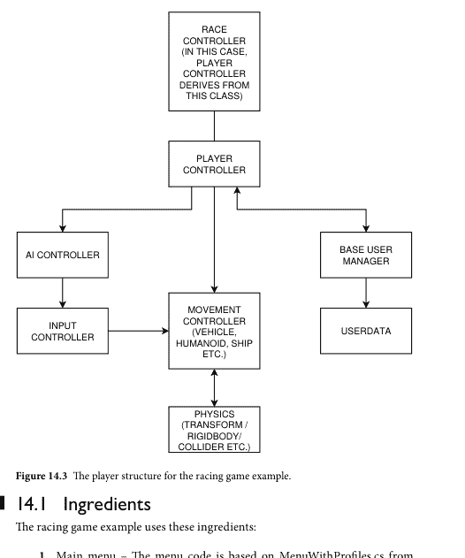

图 14.3 竞速游戏示例的玩家结构。

## 14.1 组成部分

竞速游戏示例使用以下组成部分：

- 1. 主菜单 – 菜单代码基于第 11 章的 MenuWithProfiles.cs。
- 2. 关卡选择 – 关卡选择依赖使用 LevelVars.cs 的场景加载器。
- 3. 场景加载器 – MultiLevelLoader.cs 派生自 LevelLoader.cs（第 13 章介绍），用于场景加载。
- 4. 游戏管理器 – RaceGameManager 派生自 BaseGameManager（来自第 3 章）。
- 5. 竞速管理 – 每个玩家都附加了一个竞速控制器脚本，其中保存与其竞速统计数据（位置/路径点等）相关的信息。竞速管理器与所有玩家的竞速控制器通信，并跟踪比赛状态的全局信息，例如玩家比赛位置以及比赛是否仍在进行。

6. 载具 – AI 和用户控制的载具使用完全相同的预制体。当预制体首次实例化到场景中时，会在预制体实例的组件上设置属性，使每个载具的行为不同，例如启用和禁用 AI 控制。玩家预制体需要的组件有：
- 第 3 章第 3.2.1 节的 BaseUserManager
- 第 6 章第 6.2 节的 WheeledVehicleController 类
- 用于输入的 Race Input Controller 组件
- Steering AI Glue，用于将 AI 系统连接到车辆转向：SteeringAI Glue 类派生自第 10 章的 AI SteeringController。
- Camera Target，用于确保 Camera 看向正确的 GameObject
- Texture Setter 组件，用于将玩家载具的纹理设置为不同于 AI 玩家的纹理，以便玩家轻松分辨自己是谁
- Race Player Controller – 用于与 Global Race Manager 组件通信的组件
- Position Graphic Setter – 在载具上方的小显示中显示玩家当前位置
- Car Audio – 用于车辆声音和碰撞声的组件
- Fake Friction – 用于增加摩擦力并使载具更易驾驶的辅助脚本
7. 用户界面 – 游戏内用户界面将使用一个基础脚本来显示当前圈数，并根据需要显示或隐藏其他 GameObject 和/或 Canvas。
8. 声音控制器 – 第 9 章第 9.2 节的 BaseSoundController 类
9. 将使用 RaceUIManager 组件将其他脚本的信息“传递”到用户界面中。
10. 玩家和 RaceGameManager 类都使用 BaseUserManager 来访问玩家信息。RaceGameManager 在每个关卡开始时使用 BaseUserManager 来决定生成哪种类型的玩家进入游戏（AI 控制器或用户）。
11. IsoCamController 是一个用于控制适合等距渲染的 Camera 的基础类。它附加到父 GameObject 上，Camera 作为子对象偏移。

本章的脚本可在文件夹 Assets/Games/Racing Game/Scripts 中找到。


## 14.2 主菜单场景概述

主菜单由 GPC_Framework/TemplateScenes 文件夹中的模板主菜单制作而成。

RaceMainMenu.cs 脚本派生自第 12 章框架中的 MenuWithProfiles 类，在按下开始按钮时加载关卡选择场景并将玩家添加到游戏中。RaceMainMenu.cs：

```csharp
using GPC;
public class RaceMainMenu : MenuWithProfiles
{
    public override void LoadGameScene()
    {
        AddPlayers();
        base.LoadGameScene();
    }

    void AddPlayers()
    {
        BaseUserManager _baseUserManager =
GetComponent<BaseUserManager>();
        _baseUserManager.ResetUsers();
        // there's no players set up so add default ones
        for (int i = 0; i < 4; i++)
        {
            int playerID = _baseUserManager.
AddNewPlayer();
            if (i == 0)
                _baseUserManager.SetType(playerID,
0);
            else
                _baseUserManager.SetType(playerID,
2);
        }
    }
}
```

## 14.3 关卡选择场景概述

关卡选择屏幕有三个按钮，每个关卡一个，还有一个返回按钮。按钮上的事件指向名为 RaceLevelSelect 的脚本组件，该组件附加到名为 LevelMenu 的 GameObject 上。RaceLevelSelect 使用 LevelVars（更多内容参见第 13 章第 13.2 节）来设置文件名和当前关卡编号，供我们的场景加载器使用。然后，它可以在 BackToMenu() 函数中加载场景加载器场景或返回主菜单。

RaceLevelSelect.cs 如下所示：

```csharp
using UnityEngine;
using UnityEngine.SceneManagement;
using GPC;

public class RaceLevelSelect : MonoBehaviour
{
    public void LoadLevel(int whichLevel)
    {
        LevelVars.currentLevel = whichLevel;
        LevelVars.levelNamePrefix = "race_level_";
        LevelVars.coreSceneName = "race_core";
        SceneManager.LoadScene("race_sceneLoader");
    }
    public void BackToMenu()
    {
        SceneManager.LoadScene("race_mainMenu");
    }
}
```

## 14.4 核心场景概述

游戏的主要部分分为两个场景。第一个包含关卡——即带有路点、起点等的环境（赛道）——第二个核心场景仅包含游戏逻辑。

游戏开始时，核心场景中的 Game Manager 会查找 BaseUserManager（与第 4 章第 4.3 节中的相同），以确定要添加到游戏中的赛车手类型。它将赛车手添加到场景中，实例化它们的预制体，然后在比赛开始前进行倒计时。

### 14.4.1 游戏管理器 – RaceGameManager 类

游戏管理器开头如下：

```csharp
using UnityEngine;
using System.Collections.Generic;
using UnityEngine.SceneManagement;
using GPC;

public class RaceGameManager : BaseGameManager
{
```

上面，我们添加了 System.Collections.Generic 命名空间，以便可以使用 List。在本书的上一版中，存储主要使用 ArrayList 完成。从那时起，由于内存管理问题，ArrayList 已不再受欢迎。这些问题可能已经解决，但泛型 List 现在更常用，并且被认为不那么笨重。

引入 UnityEngine.SceneManagement 是为了让我们可以在游戏结束后访问 SceneManager 来加载主菜单；最后，你可能还记得前几章中的 GPC 命名空间，它是本书中框架的命名空间。

RaceGameManager 类派生自 BaseGameManager（与第 3 章第 3.2.1 节中的相同），这意味着我们一开始就可以访问其所有游戏状态和事件。这将在处理状态转换和触发这些事件方面节省大量开发时间。

```csharp
[Header("Game Specific")]
public string mainMenuSceneName = "mainMenu";
public int totalLaps = 3;
public Transform _playerParent;
public IsoCamera _cameraScript;
public GameObject _playerGO1;
public GameObject[] _playerPrefabList;
public RaceUIManager _uiManager;
public BaseSoundManager _soundController;
public WaypointsController _waypointController;
public bool didInit;
// user // player data
public BaseUserManager _baseUserManager;
public List<UserData> _playerInfo;
```

```csharp
private List<Transform> _startPoints;
private int focusPlayerID;
private List<RacePlayerController> _playerList;
private List<Transform> _playerTransforms;
private bool oldIsWrongWay;
private bool doneFinalMessage;
// position checking
private int theLap;
private int numberOfRacers;
```

我们将跳过变量声明，因为随着我们浏览脚本，它们会变得清晰。相反，跳到：

```csharp
public static RaceGameManager instance { get; private set; }

public RaceGameManager()
{
    instance = this;
}
```

上面，严格来说是的，那是一个变量声明，所以我们并没有完全跳过它们。变量 instance 用于创建一个简单的单例模式。它是一个静态变量，将引用脚本的此实例。也就是我们场景中的那个实例。通过将此变量设为静态，它可以从任何地方访问。由于它是对此类实例的引用，我们可以像 RaceGameManager.instance.SomeFunction() 那样在其上调用函数。

上面的 RaceGameManager() 函数称为构造函数。当此类自动实例化时，它将被调用，这使其成为用对“this”实例的引用填充静态实例变量的理想位置。

接下来，调用 Init()：

```csharp
void Start()
{
    Init();
}
```

每当场景启动时，Unity 会自动调用 Start()。由于我们需要在场景启动时进行一些设置，因此这里是调用 Init() 函数的地方。这似乎很明显，但 Init() 中会有一些事情需要在场景初始化之后、游戏开始之前完成，这就是为什么我们从 Start() 调用 Init()，而不是从 Unity 的其他内置函数（如 Awake() 或 OnEnabled()）中调用。

接下来是 Init() 函数：

```csharp
void Init()
{
    // tell race manager to prepare for the race
    GlobalRaceManager.instance.InitNewRace( totalLaps );
}
```

这个游戏使用一个全局比赛管理器脚本。正如本章开头所讨论的，比赛管理器跟踪整个比赛的状态。游戏控制器需要告诉比赛管理器比赛即将开始，并且应初始化一场新比赛。由于 GlobalRaceManager 同样遵循单例模式，我们可以使用 GlobalRaceManager.instance 在其上调用函数。GlobalRaceManager 还需要知道比赛的总圈数，以便判断玩家何时完成比赛，因此我们将该值传入其 InitNewRace() 函数。

```csharp
SetupPlayers();

// do initial lap counter display
UpdateLapCounter(1);

// start the game in 3 seconds from now
Invoke("StartRace", 4);
```

上面的代码首先调用 SetupPlayers() 将玩家预制体放入场景，然后通过 UpdateLapCounter() 函数将圈数计数器设置为 1。

3、2、1 倒计时即将开始。完成它需要 4 秒，因此游戏管理器使用 Unity 的 Invoke 函数安排在 4 秒后调用 StartRace。

```csharp
InvokeRepeating( "UpdatePositions", 0.5f, 0.5f );
```

用户界面不需要每一帧或每一步都更新。那样更新位置会给 CPU 带来不必要的负载，因此游戏管理器改为每半秒重复调用 UI 更新函数 UpdatePositions()。InvokeRepeating 函数接受三个参数：要调用的函数名称、从调用到第一次函数调用的时间，以及最后一个参数是之后每次函数调用之间的时间，并且持续进行，直到此脚本实例被销毁或调用 CancelInvoke 停止继续调用。

```csharp
// hide our count in numbers
HideCount();
```

在游戏开始时，3、2、1 倒计时的三个数字都应隐藏（否则屏幕上会同时出现三个数字的一大团！）。调用游戏控制器的 HideCount() 函数即可处理。

```csharp
// schedule count in messages
Invoke( "ShowCount3", 1 );
Invoke( "ShowCount2", 2 );
Invoke( "ShowCount1", 3 );
Invoke( "HideCount", 4 );
```

通过 Unity 的 Invoke 函数，实现 3、2、1 倒计时的代码变得很简单。游戏管理器用来显示每个数字的函数将隐藏之前显示的每个数字，因此所需要做的就是错开调用每个函数，最后调用 HideCount() 在倒计时序列结束时隐藏最后一个数字。

```csharp
// hide final position text
_uiManager.HideFinalMessage();
```

比赛结束时，会有一条消息告诉用户他们最终的比赛位置。在比赛开始时，应隐藏此消息。我们在 _uiManager（场景中 RaceUIManager 的实例）上调用 HideFinalMessage() 来隐藏它。

```csharp
// start by hiding our wrong way message
wrongWaySign.SetActive( false );
```


游戏内最后一个需要隐藏的消息是逆行提示消息。它的 GameObject 在 wrongWaySign 变量中被引用，并使用 GameObject.SetActive() 来隐藏它。

```csharp
didInit = true;
}
```

Init() 函数已完成，因此 didInit 被设为 true，这样我们就能轻松判断 Game Manager 是否已初始化。

类中的下一个是 SetupPlayers() 函数：

```csharp
void SetupPlayers()
{
    // if we can't find a ref to user manager, try to find one instead.
    if (_baseUserManager == null)
        _baseUserManager = GetComponent<BaseUserManager>();
}
```

BaseUserManager 类保存玩家信息。游戏开始前，在主菜单中，通过 BaseUserManager 添加一个或多个玩家。不是带载具等的实体玩家——只是玩家在数据中的表示。也可以说是占位符。SetupPlayers() 中发生的事情是：我们遍历 _baseUserManager 中的玩家 List，并为每个玩家生成载具。目前，支持多个真人玩家的基础设施尚未就位——那将需要两个圈数计数器显示和一个分屏摄像机系统，以及一些在游戏开始时设置它们的代码——但该系统会简化添加更多玩家的过程。BaseUserManager 中的玩家 List 由 UserData 类的实例组成。UserData 包含一个 type 整数，可以轻松表示真人玩家或 AI 玩家，但出于这个示例游戏的目的，我们不会做到那一步，我们只允许一个真人玩家对战 AI。

在上面的代码中，我们使用 Unity 的内置函数 GetComponent() 获取了对 BaseUserManager 的引用。_baseUserManager 包含我们在此函数中进一步与它交互所需的引用。

```csharp
// get player list from user manager
_playerInfo = _baseUserManager.GetPlayerList();
```

_playerInfo 将被填充为一个 UserData 实例的 List。我们将查看它们来决定要生成哪些玩家。

```csharp
if (_playerInfo.Count < 1)
{
    Debug.Log("USING DEBUG PLAYERS..");
    // there's no players set up so add default ones here
    for (int i = 0; i < 4; i++)
    {
        int playerID = _baseUserManager.AddNewPlayer();
        if (i == 0)
        {
            // if this is the first player, make it human
            _baseUserManager.SetType(playerID, 0);
        }
        else
        {
            // all other players are AI
            _baseUserManager.SetType(playerID, 2);
        }
    }

    // now we can grab that player list from user manager
    _playerInfo = _baseUserManager.GetPlayerList();
}
```

上面的代码只是为了让你测试赛车游戏更容易。它会查看 _playerInfo List 的长度，以判断其中是否有内容。举例来说，如果你从主菜单运行游戏，我们的主菜单代码会在游戏开始前将玩家添加到 BaseUserManager，因此在那里添加的那些玩家会出现在我们的 _playerInfo List 中，因为它是从 BaseUserManager 内部的静态 List 获取的。如果你在 Unity 内部运行游戏，并且只想测试游戏而不必退出到菜单再重新进入，那么玩家 List 将会为空。因此，我们检查 List 是否为空，并在需要时用一些默认用户数据填充它。这样，你就可以从核心 Scene 开始游玩游戏，它会生成那些原本只有先运行菜单 Scene 才会出现的玩家。

```csharp
// get number of racers to spawn from the player list
numberOfRacers = _playerInfo.Count;
```

无论如何，我们现在已经处于玩家 List 中有数据的阶段。游戏尚不知道游戏中将有多少玩家，我们通过查看 _playerInfo 的 count 值来获得这个数字——也就是 List 的长度。

```csharp
GetStartPoints();
GetWaypointsController();
```

关卡 Scene 需要至少包含足够比赛玩家数量使用的起点。起点只是一个空 GameObject，放置在一个安全位置，供其中一名赛车手在比赛开始时生成。在示例游戏中，这些点靠近起跑线，就像常规赛车游戏一样。

调用 GetWaypointsController() 来查找对 waypoints controller 的引用。我们需要将 waypoints controller 传递给每个玩家，以便 AI 能够在赛道上找到路线，同时也用于位置计算。我们计算比赛位置的方式依赖于能够比较不同赛车手在赛道上跑了多远，为此我们使用 waypoints。

```csharp
_playerTransforms = new List<Transform>();
_playerList = new List<RacePlayerController>();
```

接下来，在上方，我们创建了两个新的 List。一个用于存储所有玩家的 Transform，以便我们之后可以直接访问它们的位置；另一个 List 用于存储对我们赛车手的 RacePlayerController 组件的引用。拥有对 RacePlayerController 的引用，我们就能访问它们的比赛位置和圈数信息。

现在，我们可以开始生成玩家预制体了：

```csharp
for (int i = 0; i < numberOfRacers; i++)
{
    Transform _newPlayer = Spawn(_playerPrefabList[0].transform, _startPoints[i].position, _startPoints[i].rotation);
}
```

这部分代码将生成比赛中的所有载具。此函数中发生的大部分事情都在上面的循环内进行，循环从 0 一直到我们需要生成的玩家数量——即变量 numberOfRacers。

一个名为 Spawn() 的函数用于处理我们预制体的实例化，而不是在这里直接调用 Instantiate。通过将生成逻辑拆分到独立函数中，如果游戏发展到可能需要更高性能的阶段，或者目标平台受性能限制，我们可以轻松地将生成系统替换为对性能更友好的方案。如果你需要提升性能，我建议将 Spawn() 函数内部的 Instantiate 调用替换为某种对象池管理，即对象被回收而不是销毁并替换为新对象。

我们的 Spawn() 函数接收一个预制体（Transform），随后是 Vector3 位置和 Quaternion 旋转值，在生成后立即应用。

由于这个游戏中对 AI 和用户都只使用一个预制体，_playerPrefabList 数组只需要指向一个预制体。它将是数组中的第一项（注意，此数组是在编辑器中通过此组件上的 Inspector 设置的），我们使用 _playerPrefabList[0] 获取预制体，因为 List 总是从位置 0 开始。我们传入来自 _playerPrefabList 的预制体，随后是来自 _startPoints List 的起点位置和旋转，该 List 由代码前面调用 GetStartPoints() 填充。

```csharp
RacePlayerController _raceController = _newPlayer.GetComponent<RacePlayerController>();
```

在上方，我们获取新生成对象的 RacePlayerController 脚本的引用，并暂时将其保存在局部作用域变量 _raceController 中。稍后在整个 SetupPlayers() 函数中都会使用它。

```csharp
_newPlayer.parent = _playerParent;
```

上面这行很重要。我们需要告诉 Unity 将这些新 GameObject 的父级设为某个对象，否则它们将没有父级，并消失在 Unity 的虚空之中！我只能假设这是加载并合并 Scene 时出现的 bug，因此为了绕过它，我们只需确保在 Start() 中创建的任何对象都设置了父级。

```csharp
// assign the user's ID based on the list from baseUserManager
_raceController.userID = _playerInfo[i].id;

// store the race controller in our list so we can talk to
// it as needed later on
_playerList.Add(_raceController);
_playerTransforms.Add(_newPlayer);
```

为了将 Scene 中的玩家与我们玩家 List 中的玩家关联起来，我们使用 id 系统。在上方，附加到我们刚生成的玩家上的 RacePlayerController 组件，其 id 值将被设为与 BaseUserManager 的玩家 List 中我们正为其创建载具的玩家所持有的 id 相同。

正如脚本前面提到的，_playerList 是我们玩家的 RacePlayerController 组件的 List。在上方，_playerList.Add() 将我们最新的 RacePlayerController 放入该 List。类似地，我们也将新玩家的 Transform 添加到上面的 _playerTransforms List 中。

BaseWheeledVehicle 类用于为我们的载具提供移动——这与本书前面第 6 章第 6.2 节中的移动脚本相同。

```csharp
// SET UP AI
BaseAIController _tempAI = _newPlayer.GetComponent<BaseAIController>();

// tell each player where to find the waypoints
_tempAI.SetWayController(_waypointController);
```

正如本节前面提到的，每个玩家载具都是同一个预制体的实例——也就是说，AI 和用户载具都使用相同的预制体设置。比赛结束时，当 AI 控制器接管驾驶汽车时，用户载具将使用 AI 脚本。

在上方，我们获取了新生成玩家的 BaseAIController 的引用。快速提示：AI 脚本可以派生自 BaseAIController，而 GetComponent() 仍然能找到它。

AI 脚本依赖 waypoints 系统，因此我们需要告诉每个玩家要使用哪个 WaypointsController 组件。在上方，我们使用 SetWayController() 告诉 _tempAI（即 BaseAIController）我们之前找到并存储在变量 _waypointController 中的 waypoint controller 组件。

```csharp
if (_baseUserManager.GetType(_playerInfo[i].id) == 0 && _playerGO1 == null)
{
```

由于这是单人游戏，我们需要在游戏过程中观察一名玩家（让摄像机跟随），并用它来填充用户界面的圈数计数器。在此函数中，我们假设找到的第一个用户控制的玩家就是我们要跟随的玩家。在上方，if 语句检查我们玩家的类型，看它是否由用户控制（其类型将为 0），然后检查 _playerGO1 变量中是否还没有玩家——实际上就是确保我们跟随找到的第一个玩家。

```csharp
// focus on the first vehicle
_playerGO1 = _newPlayer.gameObject;
_playerGO1.AddComponent<AudioListener>();
```

_playerGO1 变量在这里有两个用途。一是保存我们将跟随哪个 GameObject，二是向其添加 AudioListener。默认情况下，Unity 会自动向 Scene 中的 Main Camera GameObject 添加 AudioListener，但这里我们改为将 AudioListener 放在我们的载具上。

注意：如果 Scene 中有多个监听器，Unity 会反复在控制台中产生警告。

```csharp
focusPlayerID = i;
```


focusPlayerID 变量存储我们在整个游戏中需要聚焦的玩家 ID。它将在脚本后续部分用于更新圈数计数器。

在玩家预制体实例化之后，我们现在需要根据来自 BaseUserManager 的玩家类型对它们进行设置：

```
// SET INPUT TO PLAYER TYPE
//-----------------------------------------
if (_baseUserManager.GetType(_playerInfo[i].id) == 0) // <- get the type of this player from BaseUserManager
{
    _newPlayer.GetComponent<RaceInputController>().SetInputType( RaceInputController.InputTypes.player1 );
}
```

在上面的代码中，_baseUserManager.GetType 传入该玩家的 id，以查明我们正在生成的玩家类型。如果类型为 0，则这是用户控制的玩家，我们需要按此进行设置。下一行使用 GetComponent() 查找附加到载具预制体上的 RaceInputController 组件，然后调用其 SetInputType() 函数来设置玩家的控制方式。输入类型设置为 player1，这意味着它将使用方向键进行输入。

```
// tell race controller that this is an AI vehicle
_raceController.AIControlled = false;

// set the skin
_raceController.GetComponent<MaterialSetter>().SetMaterial(0);
```

在上面的代码中，当玩家由用户控制时，还有两个属性需要影响该玩家。第一个是将 RacePlayerController 类上的 AIControlled 设置为 false，以便 AI 不会尝试替我们驾驶。此时我们希望玩家拥有完全控制权。

名为 MaterialSetter 的组件用于设置车身材质。MaterialSetter 组件附加到 Vehicle_Player 预制体上，它保存一个可应用于载具的材质数组。使用 SetMaterial 时，我们传入要设置的材质数组索引，其余工作由它处理。在本游戏中，我们有两种材质——一种用于用户控制的玩家，另一种用于 AI，以便用户轻松判断自己正在控制哪辆车。

```
}
else if (_baseUserManager.GetType(_playerInfo[i].id) == 2)
{
```

如果玩家类型不是用户控制（0），则在上面的代码行中检查它是否为 AI（2）。

```
_newPlayer.GetComponent<RaceInputController>().SetInputType( RaceInputController.InputTypes.noInput );

// tell race controller that this is an AI vehicle
_raceController.AIControlled = true;

// let the AI controller know to control this vehicle
_tempAI.AIControlled = true;

// set the skin
_raceController.GetComponent<MaterialSetter>().SetMaterial(1);
}
```

上面的代码与我们设置用户控制玩家的方式非常相似，区别在于我们将 AIControlled 设置为 true，而不是 false。在此之下，_tempAI（对该玩家 BaseAIController 组件的引用）将其 AIControlled 变量设置为 true。最后，我们将材质设置为 MaterialSetter 数组中位置 1 的材质。

在这个阶段，我明白在两个独立组件上分别设置 AIControlled 并不理想。唯一的替代方案是让 BaseAIController 或 RacePlayerController 组件中的一个去查看另一个，并复制其 AIControlled 值。由于本书的目标是尽可能制作独立脚本，让一个脚本引用另一个脚本违背了这一原则。你可能并不总是决定将 BaseAIController 与 RacePlayerController 配对；也许会用不同的 AI 代码完全替换 BaseAIController，因此在这里必须引用两个脚本的 AIControlled 变量是一种权衡，最终会让我们在以后拥有更多自由。

```
// look at the main camera and see if it has an audio listener attached
AudioListener tempListener = Camera.main.GetComponent<AudioListener>();
// if we found a listener, let's destroy it
if (tempListener != null)
    Destroy(tempListener);
```

在玩家生成循环之外，我们检查是否有 AudioListener 组件附加到主摄像机。在上面的代码中我们使用 Camera.main。这仅适用于在 Inspector 中将其 Tag 设置为 MainCamera 的摄像机。如果有理由不将摄像机的 Tag 设置为 MainCamera，则需要用引用该摄像机的变量替换 Camera.main。如果 tempListener 不为 null，我们就知道 GetComponent() 找到了需要销毁的监听器，下一行使用 Unity 的 Destroy() 函数来完成销毁。

```
// tell the camera script to target this new player
_cameraScript.SetTarget(_playerGO1.GetComponent<CameraTarget>().cameraTarget);
// lock all the players until we're ready to go
LockPlayers(true);
}
```

RaceGameManager 需要引用摄像机控制器脚本。在本游戏中，摄像机脚本组件名为 Iso Cam Controller，你可以在核心场景的 CameraParent GameObject 上找到它。这里我们设置摄像机要跟随的目标。然而，我们并没有直接将目标设置为玩家。玩家预制体上附加了一个 CameraTarget 组件，它会引用我们希望摄像机跟随的确切 Transform，因此上面的 GetComponent() 调用会获取该组件，并将其 cameraTarget Transform 传递给 _cameraScript.SetTarget()。

此函数的最后一行调用 LockPlayers()，以在游戏开始时将所有玩家固定在原地——它们将保持锁定，直到倒计时介绍结束，届时本类中其他位置的代码将调用以再次解锁所有玩家。

```
void StartRace()
{
    // play start race sound
    _soundController.PlaySoundByIndex(1);

    // the SetPlayerLocks function tells all players to
    LockPlayers(false);

    // tell the global race manager that we are now
    GlobalRaceManager.instance.StartRace();
}
```

StartRace() 在倒计时结束时被调用，此时我们已准备好真正开始比赛。

在上面的代码中，_soundController 播放一个悦耳的音效来提示玩家出发。变量 _soundController 指向附加到核心场景中 GameManager 上的 BaseSoundController 脚本，该脚本用于播放附带音效。当我们用 PlaySoundByIndex() 调用它时，BaseSoundController 脚本将在世界坐标 0,0,0 处播放声音，并具有非常宽的衰减区域，以便我们的 Audio Listener 能够“听到”它。

接下来我们解锁所有玩家，将 false 作为参数传入 LockPlayers() 函数。之后，我们需要告诉 GlobalRaceManager 类我们也准备好比赛了——以便它开始跟踪位置等——因此这里快速调用 GlobalRaceManager 的实例（提醒：GlobalRaceManager 是一个 Singleton！）的 StartRace()。

接下来是 LockPlayers() 函数：

```
void LockPlayers(bool aState)
{
    // tell all the players to set their locks
    for (int i = 0; i < numberOfRacers; i++)
    {
        RacePlayerController aRaceCarController = _playerList[i];
        aRaceCarController.SetLock(aState);
    }
}
```

LockPlayers() 函数已被本类调用过几次，它告诉玩家是否应允许移动。如第 6 章（6.2 节）所述，锁定载具将约束其沿 x 轴和 z 轴的运动，但不约束 y 轴。这样载具仍会受到重力影响。如果载具的 y 轴也被锁定，它就会恰好停在游戏世界中的起始位置，可能悬空，而不是处于自然的悬挂静止状态。

将载具锁定到位的代码位于 RacePlayerController 类中。我们在这里做的是遍历 List _playerList[] 中保存的所有 RacePlayerController 实例——该列表在之前的 SetupPlayers() 函数中已填充——并对每个实例调用 SetLock()。SetLock() 接受一个 Boolean 作为参数，表示是否锁定载具。

```
void UpdatePositions()
{
    // here we need to talk to the race controller to
    // get what we need to display on screen
    theLap = GlobalRaceManager.instance.GetLapsDone(focusPlayerID) + 1;

    // update the display
    UpdateLapCounter(theLap);
}
```

在上面的代码中，UpdatePositions() 获取我们正在聚焦的玩家当前所跑的圈数，该玩家的 ID 位于 focusPlayerID 中。这是我们在首次将所有载具添加到场景时在 SetupPlayers() 函数中设置的另一个变量。GlobalRaceManager 类负责跟踪位置和圈数，要查明玩家已完成多少圈，我们可以调用 GlobalRaceManager.instance.GetLapsDone()。将玩家 ID 作为参数传入意味着它将返回该玩家当前圈数，类型为整数。我们将其存储到变量 theLap 中，该变量在上面的下一行中作为参数传入 UpdateLapCounter() 函数。这将更新用户界面的圈数显示。

要更新用户界面的圈数计数器，我们有 UpdateLapCounter() 函数：

```
void UpdateLapCounter(int theLap)
{
    // if we've finished all the laps we need to finish,
    // let's cap the number so that we can
    // have the AI cars continue going around the track
    // without any negative implications
    if (theLap > totalLaps)
        theLap = totalLaps;

    // now we set the text of our GUIText object lap count display
    _uiManager.SetLaps(theLap, totalLaps);
}
```

当前圈数作为参数传入 UpdateLapCounter()，然后会进行检查，以确保圈数在比赛总圈数范围内。如果圈数过高，它将被限制为 totalLaps 的值。

名为 RaceUIManager 的类将负责设置场景中的 Text 对象——该类作为组件添加到核心场景中的 GameManager GameObject 上。

在上面的代码中，我们调用 _uiManager 的 SetLaps()，将当前圈数和总圈数作为参数传入。这将以“Lap x/x”的形式显示。

比赛结束时，会调用 RaceComplete() 来开始让一切停止：

```
public void RaceComplete()
{
    // set all players to AI so that they continue driving
    for (int i = 0; i < _playerList.Count; i++)
    {
        // set to AI
        _playerList[i].AIControlled = true;
        // disable the keyboard input Component for
        // AI players.
        _playerList[i].GetComponent<RaceInputController>().SetInputType(RaceInputController.InputTypes.noInput);
    }
}
```


我们遍历 _playerList 中的所有玩家，并做两件事：第一件事是将 AIControlled 设置为 true；如果这是我们的玩家载具，它现在将被 AI 接管。接下来，我们使用 GetComponent() 查找该载具上的 RaceInputController 组件。这些都在一行中完成，因此我们假设所有载具都会有 RaceInputController；如果不是这样，这一行将产生错误。一旦我们使用 GetComponent 找到 RaceInputController，就在其上调用 SetInputType()。SetInputType 使用枚举器 RaceInputController.InputTypes（该组件支持的输入类型列表），在这里我们将载具的输入类型设置为 RaceInputController.InputTypes.noInput，这样用户将不再能够对载具的驾驶方式施加任何输入。

```
if (!doneFinalMessage)
{
    doneFinalMessage = true;
    _soundController.PlaySoundByIndex(2);
    // show final text
    _uiManager.ShowFinalMessage();
    // drop out of the race scene completely in
    Invoke("FinishRace", 10);
}
```

在上面的代码中，doneFinalMessage 是一个布尔值，我们检查它以确保这段代码在一场比赛中只会运行一次。重复调用本不应发生，但以防万一，我们的 doneFinalMessage 会确保代码不会陷入反复调用却永远无法完成的循环。

我们在条件的花括号内将 doneFinalMessage 设置为 true，然后通过 _soundController 播放声音，让玩家知道比赛已完成。_uiManager.ShowFinalMessage() 将向用户显示“比赛结束”消息，最后我们安排完全关闭场景——使用 Invoke() 在 10 秒后调用 FinishRace()。

被调用时，FinishRace() 将加载主菜单，从而有效地完全结束游戏：

```
void FinishRace()
{
    SceneManager.LoadScene(mainMenuSceneName);
}
```

ShowCount1()、ShowCount2() 和 ShowCount3() 函数会在比赛开始时的 3、2、1 倒计时期间切换用于显示数字的用户界面对象的激活状态，并且每个函数都会通过 BaseSoundController 组件播放声音：

```
void ShowCount1()
{
    _uiManager.ShowCount(1);
    _soundController.PlaySoundByIndex(0);
}
void ShowCount2()
{
    _uiManager.ShowCount(2);
    _soundController.PlaySoundByIndex(0);
}
```

```
void ShowCount3()
{
    _uiManager.ShowCount(3);
    _soundController.PlaySoundByIndex(0);
}
```

HideCount() 会隐藏所有 3、2、1 倒计时图像：

```
void HideCount()
{
    _uiManager.ShowCount(0);
}
```

Race Game Manager 类的下一部分是一个用于在关卡场景中查找玩家起点的函数：

```
void GetStartPoints()
{
    _startPoints = new List<Transform>();
}
```

你可能还记得，这个游戏每个关卡分为两个场景——包含游戏逻辑的核心场景，以及包含环境本身和起始位置等关卡特定内容的关卡场景。由于我们在运行时加载关卡，无法在编辑器中通过 Inspector 设置起始位置（因为它们会随关卡变化），因此自动化系统是必要的。

在上面的代码中，GetStartPoints() 首先在变量 _startPoints 中新建一个 List。这是 SetupPlayers() 函数使用的一个变量，因为该函数会创建玩家、将它们添加到场景中，并且需要为每个玩家提供一个起始位置。

```
GameObject _startParent =
GameObject.Find("StartPoints");
```

我们玩家的起始点被设置为名为 StartPoints 的对象的子对象。起始点 GameObject 本身叫什么并不太重要，只要它们是名为 StartPoints 的 GameObject 的子对象即可。原因是我们使用 GameObject.Find() 在场景中查找名为 StartPoints 的 GameObject。找到之后，我们像这样遍历它的所有子对象：

```
foreach (Transform sp in _startParent.transform)
{
    _startPoints.Add(sp);
}
```

上面的 foreach 循环会遍历 StartPoints GameObject 下的所有 Transform——但需要注意的是，此方法不是递归的；如果任何起始点位于更下一层（即 StartPoints 的子对象的子对象），它们将被忽略。

当循环遍历每个子对象时，我们使用 _startPoints.Add() 将它们添加到我们的起始点 List 中。在此函数结束时，_startPoints 应该是一个 List，其中包含任何已打开场景中的所有起始点。

```
void GetWaypointsController()
{
    _waypointController =
FindObjectOfType<WaypointsController>();
}
```

在上面的代码中，我们使用 Unity 内置函数 FindObjectOfType() 查找附有 WaypointsController 组件的 GameObject。FindObjectOfType() 将返回它找到的第一个——幸运的是，在这个游戏的任何关卡中都应该只有一个 WaypointsController。它找到的第一个 WaypointsController 将是我们使用的那个。

为了向用户隐藏或显示主玩家在赛道上逆行的消息；UpdateWrongWay() 函数如下：

```csharp
public void UpdateWrongWay ( bool isWrongWay )
{
    if( isWrongWay==oldIsWrongWay )
        return;
```

为了跟踪变化，我们有两个变量：oldIsWrongWay 和 isWrongWay。我们在该函数末尾设置 oldIsWrongWay。随着游戏进行，该函数会被反复调用，因此如果 isWrongWay 不等于 oldIsWrongWay，我们就知道从上一次调用到这一次调用之间发生了变化。当 isWrongWay 和 oldIsWrongWay 相同时，我们知道自上次更新显示以来，玩家是否逆行的状态没有改变。在上面的情况下，当 isWrongWay==oldIsWrongWay 时，我们可以直接退出此函数。

如果 isWrongWay 不等于 oldIsWrongWay，我们就知道 isWrongWay 的状态已改变，需要更新用户界面显示以反映这一点。

如果脚本执行到达这里，说明逆行状态值一定已经改变，因此脚本可以继续告诉 _uiManager 要显示什么：

```csharp
    if ( isWrongWay )
    {
        _uiManager.ShowWrongWay();
    }
    else
    {
        _uiManager.HideWrongWay();
    }

    oldIsWrongWay = isWrongWay;
}
```

在上面的代码中，处理完显示状态后，我们将 oldIsWrongWay 设置为 isWrongWay，以便跟踪状态变化。在 RaceGameManager 类的底部，是 Spawn() 函数：

```csharp
Transform Spawn(Transform spawnObject, Vector3 spawnPosition, Quaternion spawnRotation)
{
    return Instantiate(spawnObject, spawnPosition, spawnRotation);
}
```

我们之前稍微谈到过，像这样将 Spawn() 函数分离出来，可以很容易地将对 Instantiate() 的调用替换为性能更友好的方案，例如对象池管理器。这个函数所做的全部事情就是根据传入的参数向场景中添加一个 GameObject，然后返回对新 GameObject 的引用。

### 14.4.2 竞速控制——GlobalRaceManager 类

你可以在 GPC_Framework/Scripts/COMMON/GAME MANAGEMENT 文件夹中找到 GlobalRaceManager.cs。

GlobalRaceManager 依赖于每个玩家都附有 RacePlayerController 组件。RacePlayerController 组件在初始化时会向 GlobalRaceManager 注册自身。然后，我们的 GlobalRaceManager 类负责管理更宏观的层面，处理玩家位置的比较以计算比赛名次、计算已完成圈数并提供比赛状态。

GlobalRaceManager 存在于 GPC 命名空间中，并派生自 MonoBehaviour，因此它可以附加到 GameObject 上并访问 Unity 的一些内置函数：

```
namespace GPC
{
    public class GlobalRaceManager : MonoBehaviour
    {
        public int totalLaps;
        public bool raceAllDone;
        public int racersFinished;
        private int currentID;
        private Hashtable raceControllers;
        private Hashtable racePositions;
        private Hashtable raceLaps;
        private Hashtable raceFinished;
        private int numberOfRacers;
        private int myPos;
        private bool isAhead;
        private RaceController _tempRC;
        public static GlobalRaceManager instance;
    }
}
```

可以通过其静态变量 instance 访问此类。

```
public void Awake()
{
    if (instance != null)
        Destroy(instance);
    
    instance = this;
    
    // we set this to -1 so that the first returned id will be 0 (since it gets incremented on request)
    currentID = -1;
}
```

它的 Awake() 函数通过检查名为 instance 的静态变量是否为 null，确保任何时候只有一个脚本实例存在。如果 instance 为 null，我们就知道尚未创建此脚本的实例。如果 instance 不为 null，并且已经引用了一个现有组件，我们就在这里销毁它。

在上面的代码中，我们将 instance 设置为引用这个 GlobalRaceManager 实例。接下来，将变量 currentID 设置为 -1。

currentID 是一个整数，用于为游戏中的每个玩家生成唯一 ID。每当 RacePlayerController 请求一个 ID 号时，currentID 就会递增，以便玩家按照生成顺序拥有递增的 ID 号。随着数字递增

在类中稍后对 GetUniqueID() 的每次调用开始时，我们将 currentID 初始化为 -1，这样分配给玩家的第一个 ID 将为 0。

```
public void InitNewRace( int howManyLaps )
{
```

当比赛开始时，游戏管理器（RaceGameManager）会调用此 InitNewRace() 函数以使 GlobalRaceManager 为比赛做好准备。此函数的参数是一个整数，用于指定比赛应进行多少圈。

// initialise our hashtables
racePositions= new Hashtable();
raceLaps= new Hashtable();
raceFinished= new Hashtable();
raceControllers= new Hashtable();

上述代码中，使用了多个哈希表来存储和访问此脚本所需的数据。哈希表具有键和值，这使得它们非常适合存储与玩家相关的信息或对象。与使用数组的索引号不同，你可以提供一个键来访问其关联的值。在本例中，每个玩家的唯一 ID 用于存储有关每个玩家状态的数据，并且我们可以使用玩家 ID 快速检索数据。

在此类中，我们使用哈希表用于：

- 比赛位置 – 每个玩家的比赛位置以整数形式存储。
- 比赛圈数 – 每个玩家的当前圈数以整数形式存储。
- 比赛结束 – 当玩家在完成设定的圈数（保存在变量 totalLaps 中）后越过终点线时，raceFinished 哈希表中的条目将被设为 true。否则，它将为 false。
- 比赛控制器 – 在这里，我们存储附加到每个玩家的 RaceController 组件的引用。

上述所有哈希表都使用玩家 ID 作为键。

```
raceAllDone = false;
 totalLaps= howManyLaps;
```

InitNewRace() 函数的结尾将布尔变量 raceAllDone 设置为 false ——这可能不足为奇，用于告知类比赛何时结束——并将我们的 totalLaps 整数变量设置为通过 howManyLaps 作为参数传递给此函数的圈数。

```
public int GetUniqueID(RaceController theRaceController)
{
```

GetUniqueID() 不仅为游戏中的每个玩家提供唯一 ID。当 RaceController 脚本（RaceController.cs ——本章前面已讨论）调用时，它会将自身（其实例）的引用作为参数传递进来。然后，此函数会将新玩家 RaceController 脚本组件的引用添加到 raceControllers 哈希表中，并以玩家的唯一 ID 作为键。

```
currentID++;
```

使每个 ID 数字唯一的做法是，每当需要 ID 时递增一个名为 currentID 的 ID 计数器。

// this player will be on its first lap
raceLaps.Add(currentID, 1);

在比赛开始时，当 RaceController 第一次向 GlobalRaceManager 注册时，raceLaps 哈希表为该玩家添加一个从 1 开始的条目，以表示这是第一圈。

// this player will be in last position
racePositions.Add(currentID, racePositions.Count + 1);

racePositions 是一个用于存储每个玩家当前比赛位置的哈希表。为了确定谁在赢得比赛，需要某种排序，因此在此阶段我们以默认位置向哈希表添加一个条目，该位置是通过取哈希表中的当前条目数并加一（racePositions.Count +1）计算得出的。这将在类中稍后计算比赛位置时进行更新。

// store a reference to the race controller, to talk to later
raceControllers.Add ( currentID, theRaceController );

上述代码中，请求 ID 的玩家附加的 RaceController 脚本组件被添加到 raceControllers 哈希表中。

// default finished state
raceFinished[currentID]=false;

由于比赛刚刚开始而非结束，上文将该玩家的 raceFinished 状态默认为 false。

// increment our racer counter so that we don't have to do any counting or lookup whenever we need it
numberOfRacers++;

不妨在这里保留一个玩家数量的计数，因为所有新玩家都必须通过此函数。这样可以避免以后需要计数来确定玩家数量，因为整数 numberOfRacers 将为我们保存计数。

// pass this id back out for the race controller to use
}
return currentID;

```
public int GetRacePosition(int anID)
{
    // just returns the entry for this ID in the racePositions hashtable
    return (int)racePositions[anID];
}
```

GetRacePosition() 以 ID 作为参数，并返回该玩家在 racePositions 哈希表中存储的比赛位置。从哈希表中访问数据只需在方括号内提供键即可。

```
public int GetLapsDone(int anID)
{
    // just returns the entry for this ID in the
    raceLaps hashtable
    return (int)raceLaps[anID];
}
```

与 GetRacePosition() 类似，GetLapsDone() 函数以 ID 作为参数，并返回该玩家在 raceLaps 哈希表中存储的当前圈数。

```
public void CompletedLap(int anID)
{
```

当玩家通过所有路点并越过起终点线时，RaceController 会调用 CompletedLap()。它接受的参数是一个整数，即玩家的唯一 ID。

// if should already have an entry in race laps,
let’s just increment it
raceLaps[anID] = (int)raceLaps[anID] + 1;

raceLaps 哈希表中 anID 的条目通过在其当前值上加一来递增。请注意，我们不会使用类似 raceLaps[anID]++ 的简写，因为此时它指的是哈希表，而不是要递增的数字。相反，语句的第一部分表示我们要设置哈希表中的条目，语句的第二部分则从哈希表中取出值并增加它。

if ((int)raceLaps[anID] == totalLaps &&
(bool)raceFinished[anID]!=true)
{
    raceFinished[anID] = true;
racersFinished++;

上述代码中，我们检查该玩家是否已完成足够的圈数（通过将 raceLaps 中的条目与变量 totalLaps 进行比较）并且尚未完成比赛（此时 raceFinished 中的条目应为 false），然后如果满足这些条件，则将该玩家在 raceFinished 哈希表中的条目更新为 true。

// tell the race controller for this ID that
it is finished racing
_tempRC = (RaceController)raceControllers[anID];
_tempRC.RaceFinished();
}

上述代码中，我们从 raceControllers 哈希表中检索该玩家的 race controller，以便它可以调用其 RaceFinished() 函数，通知 RaceController 组件该玩家的比赛已结束。

上述代码中，_tempRC 被填充为来自另一玩家的 RaceController 脚本的引用。我们使用循环的变量（b）作为索引号来访问我们的 raceControllers 哈希表。

```
// if car 2 happens to be null (deleted for example) here's a little safety to skip this iteration in the loop
if(_tempRC==null)
    continue;
```

为了保持函数的安全性，_tempRC 会进行空值检查，以防某个玩家不知何故从游戏中被移除。如果它为 null，continue 命令将使循环进入下一次迭代，而不会继续执行后续代码行。

```
if ( focusPlayerScript.GetID() != _tempRC )
{ // <- make sure we're not trying to compare same objects!
```

focusPlayerScript 是我们感兴趣的主要玩家（作为参数传入）。_tempRC 持有 race controller 实例是从哈希表中根据循环中的 b 值获取的，这意味着最终 _tempRC 将指向与 focusPlayerScript 持有相同的 RaceController 实例。在进行位置或路点检查之前，我们比较 focusPlayerScript 和 _tempRC，以确保它们不是同一个对象。

```
if ( focusPlayerScript.GetCurrentLap() >
    _tempRC.GetCurrentLap() )
    isAhead = true;
```

我们测试了多个条件，以确定 focusPlayerScript 中的玩家是否领先于循环当前查看的玩家。上述第一个条件是聚焦玩家的当前圈数是否高于 _tempRC 中 race controller 的圈数——如果是，我们立即知道 focusPlayerScript 领先于 _tempRC，并且可以设置 isAhead 为 true。

```
if (focusPlayerScript.GetCurrentLap() ==
    _tempRC.GetCurrentLap()
    && focusPlayerScript.GetCurrentWaypointNum() > _tempRC.
GetCurrentWaypointNum() && !_tempRC.IsLapOne())
    isAhead = true;
```

上述条件检查聚焦玩家的当前圈数是否与 _tempRC 中 race controller 的圈数相同。如果两者都在同一圈，我们会查看路点，看看 focusPlayerScript 的路点索引号是否大于 _tempRC 的。如果是，我们就知道 focusPlayerScript 领先于 _tempRC，因为它的路点在赛道上更靠前：此时 isAhead 将被设为 true。还有一个检查，确保 _tempRC 中的玩家尚未完成当前圈。

```
if (focusPlayerScript.GetCurrentLap() ==
    _tempRC.GetCurrentLap() && focusPlayerScript.
GetCurrentWaypointNum() > _tempRC.GetCurrentWaypointNum()
    && focusPlayerScript.IsLapOne() && _tempRC.IsLapOne())
    isAhead = true;
```


上面的第三个条件检查 focusPlayerScript 和 _tempRC 是否在同一圈，并且都瞄准同一个路径点。然后，它检查 focusPlayerScript 与其目标路径点之间的距离是否小于 _tempRC 与其路径点之间的距离。如果 focusPlayerScript 更接近其路径点（该路径点与 _tempRC 的路径点相同），并且 _tempRC 尚未完成其圈，那么我们就知道 focusPlayerScript 一定在前方，脚本可以继续将 isAhead 设置为 true。

请注意，我们在 _tempRC 对象上检查 IsLapDone()，以确保该玩家尚未越过终点线。

// has the player completed a lap and is getting ready to move onto the next one?
if (focusPlayerScript.GetCurrentLap() ==
_tempRC.GetCurrentLap() && focusPlayerScript.GetCurrentWaypointNum() == _tempRC.GetCurrentWaypointNum() &&
focusPlayerScript.GetCurrentWaypointDist() <
_tempRC.GetCurrentWaypointDist())
isAhead = true;

第四个条件检查两名玩家是否在同一圈和同一个路径点，但这一次要查看焦点玩家是否在 _tempRC 之前登记完成了一圈。如果 focusPlayerScript.IsLapDone() 为 true 且 _tempRC.IsLapDone() 为 false，我们就知道传入的玩家已经在我们正在对比的玩家之前完成了其圈，并且 isAhead 被设置为 true。

if (focusPlayerScript.GetCurrentLap() ==
_tempRC.GetCurrentLap() && focusPlayerScript.GetCurrentWaypointNum() ==
_tempRC.GetCurrentWaypointNum() && (focusPlayerScript.IsLapDone()
== true && _tempRC.IsLapDone() == false))
isAhead = true;

上面的第五个条件执行与上一个条件类似的检查，只是这一次省略了任何路径点距离检查。在这里，代码关注的是两名玩家是否在同一圈，以及当他们处于同一圈时，focusPlayerScript 是否完成了其圈。当 focusPlayerScript.IsLapDone() 为 true 且 _tempRC.IsLapDone() 为 false 时，我们就知道焦点玩家在前方，并且可以继续将 isAhead 设置为 true。

if (focusPlayerScript.GetCurrentLap() ==
_tempRC.GetCurrentLap() && (focusPlayerScript.IsLapDone() ==
true && !_tempRC.IsLapDone()))
isAhead = true;

最后一个条件（呼！）检查两名玩家是否在同一圈，以及我们传入的玩家是否在 _tempRC 中的玩家之前完成了一圈。

if ( isAhead )
{
    myPos--;
}

此时，isAhead 告诉我们 focusPlayerScript 所代表的玩家是否在 _tempRC 所代表的当前玩家前方。如果 isAhead 为 true，上面的代码会减小 myPos 的值，以将该玩家的比赛位置向前移动一位。

public virtual void Init()
{
    _TR = transform;
    doneInit = true;
}

Init() 获取此 GameObject 上 Transform 的缓存引用（以存储到 _TR 中），并将其 doneInit 布尔值设置为 true。

public int GetID ()
{
    return myID;
}

有时其他脚本可能需要获取此玩家的唯一 ID 号，这就是上面的 GetID() 函数返回 myID 值的原因。

public bool IsLapDone ()
{
    return isLapDone;
}

当玩家经过赛道周围的所有路径点后，变量 isLapDone 会被设置为 true。然后，当玩家碰到起点/终点线上的触发器时，可以使用该值来判断是否应增加圈数。以这种方式增加圈数（而不是仅在起点/终点线处递增当前圈计数器）可确保玩家已经绕赛道完整行驶并越过终点线。

public void RaceFinished ()
{
    isFinished=true;
    PlayerFinishedRace();
}

public virtual void PlayerFinishedRace() { }

RaceFinished() 将由 GlobalRaceManager 类调用，以在比赛结束时告知此玩家。在上面的代码中，我们将 isFinished 设置为 true，以便在脚本其他位置需要时可以有东西进行检查，然后调用 PlayerFinishedRace()。在下方，我们可以看到 PlayerFinishedRace() 不包含任何内容。这里的意图是让你重写 PlayerFinishedRace()，让玩家在比赛结束时执行任何你想要的操作——也许是将车辆停下，或者让它播放动画之类的。默认行为是玩家会继续驾驶，但在本游戏示例的 RacePlayerController.cs 重写版本中，我们让用户的车辆由 AI 接管，以便在比赛结束时它能够自行驾驶。我们将在本章后面的 12.5.4 节中介绍这一点。

public void RaceStart ()
{
    isFinished=false;
}

在 RaceStart() 中，我们的布尔变量 isFinished 需要设置为 false，因为比赛才刚刚开始！

```csharp
public bool GetIsFinished ()
{
    return isFinished;
}

public bool GetIsLapDone ()
{
    return isLapDone;
}
```

上面的 GetIsFinished() 和 GetIsLapDone() 都返回布尔值。

```csharp
public void SetWaypointsController ( Waypoints_Controller
aControl )
{
    _waypointsController= aControl;
}
```

由于此脚本使用路径点控制器来跟踪玩家在赛道上的进度，因此它的 _waypointsController 变量（类型为 WaypointsController）需要由另一个脚本设置。在本游戏中，它由 RaceGameManager 在玩家首次生成到游戏 Scene 中时设置。

```csharp
public Transform GetWaypointTransform()
{
    if (_currentWaypointTransform == null)
    {
        currentWaypointNum = 0;
        _currentWaypointTransform =
_waypointsController.GetWaypoint(currentWaypointNum);
    }
    return _currentWaypointTransform;
}
```

上面的代码中，可以通过调用 GetWaypointTransform() 将当前路径点作为 Transform 获取。我们在变量 _currentWaypointTransform 中保留对当前路径点 Transform 的引用。如果此变量为 null，此函数会检测到，并改为从 _waypointsController 实例中获取 Transform。

```csharp
public Transform GetRespawnWaypointTransform()
{
    _currentWaypointTransform =
_waypointsController.GetWaypoint(currentWaypointNum);
    return _currentWaypointTransform;
}
```

GetRespawnWaypointTransform() 用于获取我们的路径点系统当前瞄准的 Transform。使用它的一个示例是重生函数。Respawn() 获取当前路径点 Transform，并将玩家的旋转和位置设置为与该路径点匹配，从而使玩家处于赛道上的安全位置并朝向正确方向。

```csharp
public void UpdateWaypoints()
{
```

RaceController.cs 在 UpdateWaypoints() 中跟踪路径点。此函数不是从此类调用的，而是将由玩家控制脚本调用。

        if(!doneInit)
            Init();

        if (_waypointsController == null)
            return;

在上面的代码中，在进行任何路径点检查之前，该类必须已经运行其初始化函数 Init() 并将 doneInit 设置为 true。如果 doneInit 为 false，我们就调用上面的 Init()。接下来，对变量 _waypointsController 进行 null 检查，以防在尚未设置对 WaypointsController 实例的引用之前就调用了此函数。

        if(totalWaypoints==0)
        {
            // grab total waypoints
            totalWaypoints =
_waypointsController.GetTotal();
            return;
        }

此函数可能会在 WaypointController 类完成设置之前、但在其实例化之后被调用。这意味着我们的 null 检查会在该类设置其路径点之前通过。为了捕获这种情况并避免过早对路径点执行任何操作，我们检查 totalWaypoints 是否为 0。如果是，我们需要快速调用 WaypointsController.GetTotal() 来获取新的总数，然后退出该函数。每次调用 UpdateWaypoints() 函数时都会重复此操作，直到我们知道 WaypointController 已准备好让我们访问其路径点。

        // here, we deal with making sure that we always have
a waypoint set up
        if (_currentWaypointTransform == null)
        {
            currentWaypointNum = 0;
            _currentWaypointTransform =
waypointsController.GetWaypoint(currentWaypointNum);
        }

在上面的代码中，如果 _currentWaypointTransform 中没有引用任何 Transform，此代码会假定我们一定是在第一次运行，并将 currentWaypointNum 设置为 0。然后，它调用 waypointManager.GetWaypoint() 函数，为 _currentWaypointTransform 返回一个可用的 Transform。

        // now we need to check to see if we are close
enough to the current waypoint
        // to advance on to the next one
        myPosition = TR.position;
        myPosition.y=0;

        // get waypoint position and 'flatten' it
        nodePosition = _currentWaypointTransform.position;
        nodePosition.y=0;

路径点检查的工作方式是查看玩家与路径点之间的距离，并在该距离变得太小时前进到下一个路径点。对于这种路径点跟随，y 轴可以忽略不计。它只会让距离检查更复杂，因为它会位于

三个轴而不是两个轴。因此，这段代码的第一部分获取玩家和路点的位置，并将它们复制到变量中。副本的 y 位置被设置为零，从而从等式中移除 y 轴。

```csharp
// check distance from this car to the waypoint
currentWaypointDist = Vector3.Distance(nodePosition,
myPosition);

if (currentWaypointDist < waypointDistance) {
    // we are close to the current node, so let's
    // move on to the next one!
    currentWaypointNum++;
}
```

在上面的代码中，Unity 内置函数 Vector3.Distance() 接收两个 Vector3 位置并返回它们之间的距离。我们将距离存入 currentWaypointDist。当 currentWaypointDist 中的距离降到 waypointDistance 以下时，它会递增 currentWaypointNum；实际上就是前进到下一个路点。

```csharp
// now check to see if we have been all the
// way around the track and need to start again
if (currentWaypointNum >= totalWaypoints)
{
    // reset our current waypoint to the first
    currentWaypointNum = 0;
    isLapDone = true;
}
```

当 currentWaypointNum 大于或等于 totalWaypoints 中的数值时，我们知道玩家已经绕赛道一整圈。然而，这里并不是增加圈数计数器的地方，因为玩家需要越过起点/终点线后圈数才会计数。相反，当 currentWaypointNum 超过路点总数时，变量 isLapDone 被设为 true，并且 currentWaypointNum 的值被重置为零，准备瞄准下一个路点（现在这是第一个路点）。

```csharp
// grab our transform reference from the waypoint controller
_currentWaypointTransform = _waypointsController.GetWaypoint(currentWaypointNum);
}
```

上面的代码负责更新 _currentWaypointTransform 变量，以反映 currentWaypointNum 的任何变化。我们调用 _waypointsController.GetWaypoint()，并将返回值存入 _currentWaypointTransform 变量。

```csharp
// we finish by recalculating currentWaypointDist
nodePosition = _currentWaypointTransform.position;
nodePosition.y = 0;

// check distance from this car to the waypoint
currentWaypointDist = Vector3.Distance(nodePosition,
myPosition);
}
}
```

在上面的代码中，在 UpdateWaypoints() 函数末尾，我们从 nodePosition 中移除 y 轴（此时它可能保存的是另一个路点的位置，而不是函数开始时我们瞄准的那个路点），然后重新计算 currentWaypointDist。这样做的原因是 currentWaypointDist 用于计算比赛名次；如果它未及时更新，并且 GlobalRaceManager 类在当前到下次调用此函数之间使用了它，比赛名次可能会出错。由于 GlobalRaceManager 只是间歇性地计算比赛名次（并非每一帧都计算），如果 currentWaypointDist 有误，屏幕上的名次显示可能会在正确值和错误值之间抖动。

```csharp
public void CheckWrongWay()
{
    if(_currentWaypointTransform==null)
        return;
    Vector3 relativeTarget =
    myTransform.InverseTransformPoint
    (_currentWaypointTransform.position);
```

为了确保玩家在赛道上朝着正确方向行驶，CheckWrongWay() 函数使用路点系统向前查看下一个路点，并检查车辆角度与到达该路点的理想角度之间的偏差。当角度超过某个阈值（这里设为 90 度）时，就会显示逆行消息，并启动计时器计时。当计时器达到一定时间后，我们会自动将玩家重生回赛道上。

首先，该函数检查 _currentWaypointTransform 中是否有内容。如果这个引用为 null，就会导致代码出错，因此如果需要的话，我们就在这里退出。

脚本使用来自 _currentWaypointTransform 的路点来检查车辆是否在朝正确方向行驶。第一步是使用 Transform.InverseTransformPoint() 计算一个相对于车辆的向量。本质上，这里发生的是：由 _currentWaypointTransform.position 提供的世界向量被转换为属于 _TR（车辆）的局部空间，从而为 relativeTarget 提供一个向量。

```csharp
targetAngle = Mathf.Atan2 (relativeTarget.x,
relativeTarget.z);
targetAngle *= Mathf.Rad2Deg;
```

Mathf.Atan2 用于将向量 relativeTarget 的 x 和 z 值转换为角度。Mathf.Atan2 的结果将以弧度为单位，因此需要快速调用 Mathf.Rad2Deg 将其转换为度。由于 relativeTarget 是相对于车辆的向量，当我们将其转换为角度时，我们知道 0 度将沿着车辆的前向轴朝前，90 度在右侧，-90 度在左侧。实际上，targetAngle 现在保存的是车辆（沿其前向向量）偏离朝向路点的角度。

```csharp
if(targetAngle<-90 || targetAngle>90){
    goingWrongWay=true;
} else {
    goingWrongWay=false;
    timeWrongWayStarted=-1;
}
```

在上面的代码中，我们检查 targetAngle 是否超出 -90 度或 90 度（即超出我们的逆行阈值角度），并相应地设置 goingWrongWay 布尔变量。

如果车辆逆行达到设定时间，游戏代码会自动将其重生。变量 timeWrongWayStarted 实际上是一个时间戳，用于保存首次检测到逆行的时间。当代码不再检测到车辆逆行时，timeWrongWayStarted 被设为 −1，这会取消重生并重新开始计时。

接下来，我们在首次发生逆行时设置 timeWrongWayStarted：

```csharp
if(oldWrongWay!=goingWrongWay)
{
        // store the current time
        timeWrongWayStarted= Time.time;
}
```

在上面的代码中，我们通过将 goingWrongWay 与 oldWrongWay 进行比较，来检查 goingWrongWay 是否发生了变化。当首次检测到逆行时，oldWrongWay 不会等于 goingWrongWay，因此可以安全地启动时间戳。timeWrongWayStarted 被设为 Time.time，之后会与 Time.time 的当前值比较，以查看自逆行开始以来过了多久。

```csharp
oldWrongWay=goingWrongWay;
}
```

这是 CheckWrongWay() 函数的结尾，现在 oldWrongWay 可能被设置为 goingWrongWay 的当前值，以便我们在下次运行此函数时跟踪它的变化。

如本节前面所讨论的，玩家到达其路点终点时，当前圈数不会立即增加。玩家还需要越过起点/终点线，圈数计数器才会更新；在横跨赛道的一个不可见盒子上使用了一个简单的触发器 Collider。当玩家碰到触发器时，Unity 引擎会自动调用 OnTriggerEnter 函数：

```csharp
public virtual void OnTriggerEnter(Collider other)
{
    if (other.gameObject.layer == 12 && isLapDone == true)
    {
```

当调用 OnTriggerEnter 时，该调用包含有关 Transform 所碰到的 Collider 的信息。变量 other 的类型是 Collider，这意味着它具有 Collider 的所有属性，并且可以作为一个 Collider 来访问。函数首先查看 Collider 的层，以判断它是否是起点/终点线触发器的正确层。如果 isLapDone 为 true，并且碰到了起点/终点线触发器，代码就继续执行，递增变量 lapsComplete 中的圈数计数器：

```csharp
    // increase lap counter
    lapsComplete++;

    // reset our lapDone flag ready for when we
    // finish the next lap
    isLapDone = false;

    // tell race controller we just finished a
    // lap and which lap we are now on
    GlobalRaceManager.instance.CompletedLap(raceID);
    }
}
```

随着圈数递增，这一圈已经结束，因此我们需要使用 isLapDone 变量来跟踪下一圈。上面已将其重置为 false，然后我们调用 GlobalRaceManager，让它知道有一圈已完成。我们调用 GlobalRaceManager 的 CompletedLap() 函数，并传入这辆车的唯一 ID 以标识自身。

### 14.4.4 比赛控制 – RacePlayerController 类

RacePlayerController 是一个附加到示例赛车游戏中的车辆预制体上的类。它派生自上一节的脚本 RaceController 类，因此我们可以在 RaceController 的功能之上进行构建，而不是为赛车游戏构建一个全新的脚本。框架的大多数部分就是这样设计的——你取一个基类，继承它，并重写其中一些函数，以针对你的游戏规格进行扩展。

RacePlayerController 以常见的命名空间和一条类声明开头，告诉 Unity 它派生自 RaceController：

```csharp
using UnityEngine;
using GPC;

public class RacePlayerController : RaceController
{    // this userID ID number ties up with the player data in UserDataManager
    public int userID;

    public int myRacePosition;
    public float stuckResetTime = 3f;
    public float stuckTimer;
    public bool blockRespawn;
    [Space]
    public BaseWheeledVehicle _myController;
    public BaseAIController _AIController;
    public bool AIControlled;
    private float timeDiff;
    public LayerMask respawnLayerMask;
```

我们跳过变量声明，直接来到第一个函数：

```csharp
    void Start()
    {
        Init();
    }

    // Update is called once per frame
    public override void Init()
    {
        base._Init();

        ResetLapCounter();
        _myController = GetComponent<BaseWheeledVehicle>();

        didInit = true;
    }
```


Start() 调用 Init()。Init() 会先调用基类（RaceController）的 Init() 来运行它，然后才进入本脚本。首先调用 ResetLapCounter()，以确保所有内容都已重置并准备好开始计圈。接下来我们获取对 BaseWheeledVehicle 的引用，并将其存储在变量 _myController 中。本脚本旨在与 BaseWheeledVehicle 配合使用，因此如果你要将其复制到使用不同载具类型的自己的赛车游戏中使用，就需要做一些修改。Init() 完成后，我们在函数末尾将 didInit 设置为 true。

```
void LateUpdate()
{
    // tell race control to see if we're going the wrong way
    CheckWrongWay();
}
```

如上所示，LateUpdate() 调用 CheckWrongWay()。CheckWrongWay() 已在第 12.5.3 节查看 RaceController 类时介绍过。

```
if (goingWrongWay)
{
    if (!AIControlled)
        RaceGameManager._instance.UpdateWrongWay(true);

    // if going the wrong way, compare time since wrong way started to see if we need to respawn
    if (timeWrongWayStarted != -1)
        timeDif = Time.time - timeWrongWayStarted;
}
```

如果我们的载具正朝错误方向行驶，我们确实想显示逆行提示，但仅在玩家不是 AI 控制时显示。只要这不是 AI 玩家，我们就调用 RaceGameManager 实例的 UpdateWrongWay()。RaceGameManager 会负责向用户显示该消息。

如果正在逆行，我们还希望计时玩家已经逆行多久，以便在玩家卡住时准备将其重生。如上所述，只要 timeWrongWayStarted 不为 -1（当我们想重置重生时间时，会将该变量默认设为 -1），就可以继续计算玩家将 goingWrongWay 变量设为 true 后经过了多长时间。我们只需用 Time.time 减去 timeWrongWayStarted 中存储的值即可。请记住，timeWrongWayStarted 是在 goingWrongWay 首次变为 true 时设置的时间戳，因此用当前时间减去它，就能知道从开始到现在经过了多久。

```
if (timeDif > stuckResetTime)
{
    // it's been x resetTime seconds in the wrong way, let's respawn this thing!
    Respawn();
}
```

当 timeDif（玩家已逆行的时间）大于 stuckResetTime 时，如上所示，我们调用 Respawn() 函数。

```
}
else if (!AIControlled)
{
    RaceGameManager.instance.UpdateWrongWay(false);
}
```

如上所示，我们处理 goingWrongWay 未设置为 true 时的情况。如果这不是 AI 控制的载具，就会再次调用 RaceGameManager 的 UpdateWrongWay() 函数，告诉它我们不再逆行。

```
// stuck timer
if(_myController.mySpeed<0.1f && _myController.canControl())
{
    stuckTimer += Time.deltaTime;
}
```

如上所示，我们检查载具控制器 _myController 的速度是否小于 0.1f（这是我通过反复试验得出的一个任意低值），以及它是否确实处于受控状态。如果满足条件，就可以用自上次帧更新以来经过的时间来增加 stuckTimer 的值。

```
if (stuckTimer > stuckResetTime)
{
    // it's been x resetTime seconds in the wrong way, let's respawn this thing!
    Respawn();
    stuckTimer = 0;
}
```

当 stuckTimer 超过 stuckResetTime 的值时，我们就知道载具在这么长的时间内一直极慢或已停止，现在该调用 Respawn()，希望让玩家重新动起来。如上所示，我们调用 Respawn() 并将 stuckTimer 重置为零。

```
} else
{
    stuckTimer = 0;
}
```

另一方面，如果载具速度高于我们的最小值 0.1f，我们只需将 stuckTimer 设为 0，这样上面的代码就不会重生载具。

```
UpdateWaypoints();
```

如第 12.5.3 节所述，RaceController 类包含函数 UpdateWaypoints()，必须每帧手动调用——因此它出现在这里的 LateUpdate() 函数中。

```
// check to see if this is the last player and the race is now complete (and tell game manager if it is?)
if (GlobalRaceManager.instance.raceAllDone)
{
    RaceGameManager.instance.RaceComplete();
}
```

如果比赛结束，如上所示我们会将此事告知 RaceGameManager。我选择把这次调用放在这里（而不是放在 GlobalRaceManager 类中），因为 GlobalRaceManager 旨在成为一个通用脚本，可以在任何地方使用，并且除了 RaceController 之外，不与其他任何非 Unity 类绑定。这意味着 RaceComplete() 很可能会被多次调用，但 RaceGameManager 更新其游戏状态的方式意味着，除了结束游戏之外，这不会产生其他影响。

```
} else
{
    // we only update the position during the game. once the race is done, we stop calculating it
    UpdateRacePosition();
}
```

如上所示，既然我们现在知道比赛尚未结束（这是检查 GlobalRaceManager.raceAllDone 是否为 true 之后的 else 分支），就可以执行比赛中需要执行的任何操作。如上所述，这意味着我们调用 UpdateRacePosition() 来保持比赛位置指示器最新。接下来就引出了 UpdateRacePosition() 函数：

```
public void UpdateRacePosition()
{
    // grab our race position from the global race manager
    myRacePosition = GlobalRaceManager.instance.GetPosition(this);
}
```

从 RacePlayerController 类的角度来看，更新比赛位置并没有太多事情要做。我们只需从 GlobalRaceManager.GetPosition() 的实例获取返回值，并将其存储在 myRacePosition 中。RaceGameManager 类负责更新用户界面以在屏幕上显示。

```
void Respawn()
{
    if (blockRespawn)
        return;
    // reset our velocities so that we don't reposition a spinning vehicle
    _myController._RB.velocity = Vector3.zero;
    _myController._RB.angularVelocity = Vector3.zero;
}
```

Respawn() 函数首先检查当前是否未阻止重生。我们在重生后立即将 blockRespawn 设置为 true，然后它会在设定的时间后重置。这是为了防止在短时间内多次重生——通常几秒内重生一次就足够了。

只要我们允许重生，上面的代码随后就会将玩家身上 RigidBody 的速度和角速度归零。这会阻止载具在重生后继续移动和旋转。

```
// get the waypoint to respawn at from the race controller
Transform _tempTR = GetRespawnWaypointTransform();
Vector3 tempVEC = _tempTR.position;
```

RaceController 类中的 GetRespawnWaypointTransform() 函数负责找到我们将要重生的路点，并返回其 Transform，以便我们可以用它获取位置和旋转信息。我们将路点的 Transform 放入名为 _tempTR 的局部作用域变量中，然后在下一行获取该 Transform 的位置，并将其放入局部作用域的 tempVEC 变量中。

```
// cast a ray down from the waypoint to try to find the ground
RaycastHit hit;
if (Physics.Raycast(tempVEC + (Vector3.up * 10), -Vector3.up, out hit))
{
    tempVEC.y = hit.point.y + 2.5f;
}
```

由于路点经常要么离开地面，要么离地面太近，导致我们的重生无法正常工作，因此上面的代码通过向下射线检测来找到地面碰撞体。我们从 tempVEC（路点的位置）向上加 10 个单位处投射一条射线。射线沿 -Vector3.up 垂直向下，我们将射线检测命中信息放入局部作用域变量 hit 中。

如果射线检测成功，它将返回 true，然后我们运行大括号之间的代码。这里发生的情况是，将 tempVEC 的 y 位置设置为通过射线检测刚刚找到的地面位置（hit.point）加 2.5 个单位。这个数字（2.5f）可以根据需要调整，以便让载具重生在离地面更近或更远的位置。顺便说一句，tempVEC 将在重新定位期间用作载具的最终位置：

```
_myController._TR.rotation = _tempTR.rotation;
_myController._TR.position = tempVEC;
blockRespawn = true;
Invoke("ResetRespawnBlock", 5f);
}
```

如上所示，Respawn() 最后将我们载具的旋转设置为 _tempTR 中路点 Transform 的旋转。然后在下一行，将其位置设置为 tempVEC 中的 Vector3。接着我们将 blockRespawn 设置为 true，并在函数的最后一行安排 5 秒后调用 ResetRespawnBlock()。这意味着重生函数在重生后将被禁用 5 秒。

```
void ResetRespawnBlock()
{
    blockRespawn = false;
}
```

ResetRespawnBlock 将 blockRespawn 设置为 false，在延迟后允许再次重生。

```
public override void PlayerFinishedRace()
{
```

当玩家完成比赛中的所有圈数后，GlobalRaceManager 会调用 RaceController 类中的 PlayerFinishedRace() 函数。如上所示，我们重写 RaceController 的 PlayerFinishedRace() 版本，以执行此游戏特定的操作。当我们的玩家完成其所有比赛圈数后，我们让 AI 接管载具并驾驶它四处行驶，直到所有玩家也完成各自圈数、整场比赛结束时为止。

```
if (!AIControlled)
{
    // make sure we give control over to AI if it's not already
    AIControlled = true;
```


```
GetComponent<RaceInputController>().SetInputType(RaceInputController.InputTypes.noInput);
GetComponent<AISteeringController>().AIControlled = true;
_AIController.canControl = true;
}
```

我们首先通过检查 AIControlled 布尔变量来确保玩家尚未被 AI 控制。如果我们尚未处于 AI 控制状态，则该条件对应的大括号内的代码将改变这一状态。

AIControlled 被设为 true，这样我们就知道玩家现在处于 AI 控制状态。接下来是一行较长的代码，它使用 Unity 的 GetComponent() 函数找到我们的 RaceInputController 组件，然后在其上调用 SetInputType，并将玩家的输入类型设为 RaceInputController.InputTypes.noInput，以禁用用户输入。接下来，GetComponent 去查找一个 AISteeringController 组件（或者，记住这可能是一个派生自 AISteeringController 的类，它仍然会被找到），然后通过将其 AIControlled 变量设为 true 来告诉转向控制器我们现在处于 AI 控制状态。

为了完成 AI 接管，我们通过将它的 canControl 变量设为 true 来告诉 _AIController 它可以控制该玩家。

在比赛结束时，如果你想做一些不同的事情，比如让汽车继续行驶，PlayerFinishedRace() 函数将是开始的地方。

```
public void SetLock(bool state)
{
    if (!didInit)
        Init();
    _myController.canControl = !state;
}
```

上面，SetLock 用于告诉我们的车辆它不能被控制。首先，我们确保 Init() 已完成（因为这将在玩家首次生成时被调用以将其固定在原地，并且可能该脚本尚未初始化），如果尚未完成，我们将从此处调用 Init()，以便 _myController 得到填充，我们可以在下一行访问它。

_myController.canControl 是一个布尔值，我们可以设置它来决定车辆是否允许接收输入并对其做出反应。上面，这不是一个理想的情况。我们实际上将 canControl 设为传入状态的相反值，这是因为该函数名为 SetLock（即设置是否应放置锁定），而 canControl 是车辆是否可以被控制的意思。它们是相反的。SetLock() 因框架其他地方的连贯性而得名，但如果可以，最好始终避免此类命名矛盾。

```
public override void OnTriggerEnter(Collider other)
{
    base.OnTriggerEnter(other);
    if (IsInLayerMask(other.gameObject.layer, respawnerLayerMask))
    {
        Respawn();
    }
}
```

RacePlayerController 类的最后一部分重写了车辆撞击触发器时发生的事情，以添加重生区域的额外功能。重生区域是一个触发器，它会强制玩家立即重生。为此需要在 Unity 中设置一个特定的碰撞层，并且 respawnerLayerMask 应在该组件（在预制体上）的检查器中设置为它。

OnTriggerEnter() 是一个内置的 Unity 函数，由引擎为我们调用并传入此对象撞击的 Collider 作为参数。在这里，我们将 Collider 命名为 other。

为了运行此派生自的原始 RaceController 类中的代码，我们随后调用 base.OnTriggerEnter() 并将 other 作为参数传递——有效地将传入此函数的参数传递给基类版本。

ExtendedCustomMonoBehaviour 类提供了一个名为 IsInLayerMask() 的函数，可用于判断一个层是否落在 LayerMask 内。使用它时，你将要检查的层作为第一个参数传入，将 LayerMask 作为第二个参数传入。上面，我们传入 Collider 的 GameObject 的层进行查找，并将 respawnerLayerMask 层作为要查看的 LayerMask。

当我们知道该层是重生器的正确层时，条件大括号内的代码会调用 Respawn() 来处理车辆的重生。

### 14.4.5 Audio

对于本游戏中的车辆音频，我们使用一组附加了 AudioSource 组件的 GameObjects。这些 GameObjects 是车辆的子对象，随着车辆的移动而移动，并由其他脚本激活播放。对于偶发音效，BaseSoundController 组件保存了一个音效数组，例如倒计时期间的哔声，可以由其他脚本播放。

#### 14.4.5.1 Vehicle Audio

车辆音频由以下类控制：

- WheeledVehicleController – 发动机音频的音高由此类控制。发动机音频由一个单一的声音循环组成，该循环由附加到名为 Engine 的 GameObject 上的 AudioSource 组件播放，Engine 是 Vehicle_Player 预制体的子对象。
- CrashSound – 此组件接收一个 AudioSource（附加到本游戏中玩家预制体上的 CrashSound GameObject），并根据撞击的严重程度以不同的音量播放它，只要撞击幅度大于检查器中设置的值。magnitudeToPlay 变量决定了撞击音效的最小幅度。音高也会略微随机化，以使撞击音效更加多样化。

WheeledVehicleController 如何处理声音已在第 6 章第 6.2 节中概述，在对该脚本的分解过程中。

#### 14.4.5.2 Incidental Sounds

偶发音效由附加到核心场景中 GameManager GameObject 上的单个 BaseSoundController 组件控制。你可以在第 9 章第 9.2 节中找到 BaseSoundController 的完整分解。

为了隐藏最终消息（它需要在游戏开始时被隐藏），我们调用上面的 HideFinalMessage() 函数。它所做的只是对 _finalText 变量中引用的 GameObject 调用 SetActive()。传入 false 作为参数将导致 SetActive() 函数使我们的 GameObject 在场景中处于非活动状态。

```
public void ShowFinalMessage()
{
    _finalText.SetActive(true);
}
```

在 ShowFinalMessage() 中，我们确实将 true 传入 _finalText GameObject 上的 SetActive()，以使其在场景中处于活动状态。

```
public void HideWrongWay()
{
    _wrongWaySign.SetActive(false);
}

public void ShowWrongWay()
{
    _wrongWaySign.SetActive(true);
}
```

HideWrongWay() 和 ShowWrongWay() 都使用 SetActive() 分别隐藏或显示其 GameObjects。

```
public void ShowCount(int whichOne)
{
    switch(whichOne)
    {
        case 0:
            _count1.SetActive(false);
            _count2.SetActive(false);
            _count3.SetActive(false);
            break;
        case 1:
            _count1.SetActive(true);
            _count2.SetActive(false);
            _count3.SetActive(false);
            break;
        case 2:
            _count1.SetActive(false);
            _count2.SetActive(true);
            _count3.SetActive(false);
            break;
        case 3:
            _count1.SetActive(false);
            _count2.SetActive(false);
            _count3.SetActive(true);
            break;
    }
}
```

ShowCount() 接收一个整数作为参数，表示应显示倒计时的哪一部分。我们完全可以编写一个使用循环的函数来避免在每种情况下重复 SetActive 语句，但有时直接写出来可能同样简单（且快速）。如果愿意，请随意改进此函数！

# 15 Blaster Game Example

在 20 世纪 70 年代后期，出现了名为 Robots 的回合制游戏，用于伯克利软件发行版（BSD）。在 Robots 中，玩家必须逃离每回合向玩家靠近的敌人群。在游戏的原始版本中，玩家在竞技场中移动以避免敌人与玩家之间的接触，否则游戏结束。

Robots 通常被称为竞技场射击游戏的开端——该术语用于描述一种俯视视角的射击游戏，动作被锁定在竞技场等有限区域内。本章中的 Blaster 游戏示例是竞技场射击游戏的基础模板，它大量借鉴了前作；游戏中有一个玩家在竞技场中移动，抵御成群的杀人机器人。

在本章中，我们将查看用于构建竞技场射击游戏的脚本（图 15.1），其中机器人会生成，目标是摧毁它们所有以便进入下一关。本章更像是一个示例项目的配套指南，而非教程。预计你将打开示例项目并深入研究其工作原理，使用本章作为指南，了解游戏中所有内容的作用以及它们如何协同工作。本章主要关注 C# 脚本，它们的作用以及工作原理。

对核心框架的增添是最小的，你可以在图 15.2 中看到游戏的结构。

你可以在示例项目文件夹 Assets/Games/Blaster 中找到 Blaster 游戏。场景位于 Assets/Games/Blaster/Scenes 文件夹中。


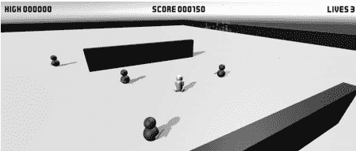

*图 15.1 Blaster 游戏示例。*

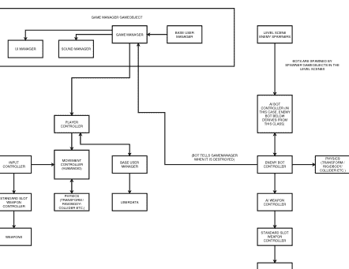

*图 15.2 Blaster 游戏的游戏结构。*

## 15.1 构成要素

Blaster 游戏使用以下构成要素：

- 1. 主菜单 – 菜单代码基于第 11 章第 11.1.2 节中的 MenuWithProfiles.cs。我们使用的模板菜单与我们在第 2 章中为 RunMan 游戏菜单使用的模板相同。
- 2. 场景加载器 – MultiLevelLoader.cs 用于场景加载，派生自 LevelLoader.cs（见第 13 章第 13.2 节）。LevelVars 类用于保存要加载的关卡信息。
- 3. BlasterGameManager 派生自 BaseGameManager，并在游戏开始时使用 BaseUserManager 进行生成（以及玩家有多少条生命等）。它还将使用来自 GPC_Framework/COMMON/USER INTERFACE 的 ScreenAndAudioFader 类来淡入或淡出场景。
- 4. 音效控制器 – 来自第 9 章第 9.1 节的 BaseSoundController 类用于播放游戏结束和关卡完成音效，而各个预制体则发出自己的音效，如射击声或爆炸声。
- 5. 用户界面 – 游戏内用户界面将派生自第 11 章第 11.1 节的 CanvasManager 脚本，以淡入或淡出 UI 元素。
- 6. BlasterPlayer 类（玩家的主要类）派生自 BasePlayerStatsController，后者也使用 BaseUserManager 为玩家提供生命值和分数等统计数据。
- 7. CameraThirdPerson 使用 BaseCameraController。

请注意，本书其他地方已详细描述的这些组件在本章中不会重复介绍，预计您会在各自的章节中找到它们。

## 15.2 主菜单场景概述

主菜单由位于 GPC_Framework/TemplateScenes 文件夹中的模板主菜单制作而成。

主菜单加载另一个充当游戏加载器的场景。游戏加载场景再加载两个额外的场景——一个核心场景和一个额外的关卡场景。场景加载器将核心场景和关卡场景合并并启动游戏。

## 15.3 核心场景概述

游戏的主要部分分为两个场景。一个包含关卡——即墙壁和敌人生成位置（如果愿意，可以扩展为完整的 3D 环境）——另一个是核心场景，包含游戏逻辑以及游戏中每个场景共有的任何内容，如竞技场的主要外墙和摄像机。

在大多数情况下，您会将完整的 3D 关卡放入关卡场景中，但在这种游戏中我们将竞技场和灯光放在核心场景中。我们这样做只是因为竞技场（游戏区域的外墙和地面平面）在所有关卡中都是共享的。如果您将此作为自己游戏的模板，您很可能会从核心场景中移除竞技场和灯光，并将所有关卡对象保留在关卡场景中。

### 15.3.1 BlasterGameManager 类

BlasterGameManager 是游戏的中央通信枢纽。它派生自 BaseGameManager，并重写了一些基函数，同时添加了一些自己的函数。

BlasterGameManager 派生自 BaseGameManager，而 BaseGameManager 又派生自 MonoBehaviour，以便它可以利用 Unity 内置的对 Update()、Awake() 和 Start() 等函数的调用：

```csharp
using System.Collections.Generic;
using UnityEngine;
using UnityEngine.SceneManagement;
using GPC;

public class BlasterGameManager : BaseGameManager
{
    public Transform _playerPrefab;
    public Transform _playerSpawnpoint;
    public BaseCameraController _cameraManager;
    public Transform _thePlayer;
    public BlasterPlayer _thePlayerScript;
    public List<BlasterPlayer> _playerScripts;
    public BlasterUI_Manager ui_Manager;
    public ScreenAndAudioFader _fader;
    public int enemyCounter;
    public BaseUserManager _baseUserManager;
    public BaseSoundManager _soundComponent;
}
```

上面，我们需要 System.Collections.Generic 来使用列表，UnityEngine.SceneManagement 在游戏结束时返回主菜单，以及 GPC 用于框架。

上面的类声明显示我们派生自 BaseGameManager。接下来，我们跳过除一个之外的所有变量声明并进入构造函数：

```csharp
public static BlasterGameManager instance { get; private set; }

public void Awake()
{
    instance = this;
}
```

与本书中制作的任何其他单例风格类一样，上文我们声明了一个名为 instance 的变量，该变量在 Awake() 函数中被设置为此实例。

```csharp
private void Start()
{
    // start with audio muted and fade covering the screen
    _fader.SetFadedOut();
    // schedule a fade in after a little time
    Invoke("StartFadeIn", 1f);
    SetTargetState(Game.State.Loaded);
}
```

当 Start() 函数运行时，由 Unity 自动调用，我们需要做的第一件事是确保屏幕初始为全黑，以便实现良好的淡入效果。为此，我们调用 _fader 中的 ScreenAndAudioFader 类引用并运行其 SetFadedOut() 函数。这将立即把淡入淡出器的状态设为黑色。

下一行是 Invoke 语句，将在一秒后调用 StartFadeIn() 函数。我们延迟此操作以使其工作良好——如果

```csharp
void CreatePlayers()
{
    // refresh our player script list
    _playerScripts = new List<BlasterPlayer>();
    List<UserData> _playerInfo = _baseUserManager.GetPlayerList();
    // for editor testing...
    if (_playerInfo.Count == 0)
        _baseUserManager.AddNewPlayer();
}
```

上面，我们通过创建一个新的 List 来开始 CreatePlayers()，以存储对玩家的引用。为了确定需要创建哪些玩家并获取其统计数据，我们使用 BaseUserManager 类（见本书第 4 章第 4.3 节）。BaseUserManager 应包含游戏要创建的玩家列表，我们可以通过 BaseUserManager.GetPlayerList() 函数获取。GetPlayerList() 将返回一个 UserData 对象列表（用户统计数据——有关此内容的更多信息，请参阅第 4 章第 4.4 节）。

如果我们在编辑器中测试游戏且尚未通过主菜单，BaseUserManager 中的玩家列表将为空。这会在此处导致问题，因此与其使测试变得不可能，我在上面添加了代码来检查 _playerInfo.Count 是否为 0（我们的玩家列表为空），如果是，则使用 BaseUserManager.AddNewPlayer() 添加一个新玩家。

```csharp
// iterate through the player list and add the players to the scene ..
for (int i = 0; i < _playerInfo.Count; i++)
{
    // remember to name your spawnpoints correctly! PlayerSpawnPoint_1, PlayerSpawnPoint_2 etc. depending on how many players!
    string spawnPointString = "PlayerSpawnPoint_" + (i + 1).ToString();
    _playerSpawnpoint = GameObject.Find(spawnPointString).transform;
}
```

下一步是遍历从 BaseUserManager 获取的玩家列表并为每个玩家生成一个角色。但在生成玩家之前，我们需要确定放置位置，为此，关卡场景应至少包含一个名为 PlayerSpawnPoint_ 后跟数字的生成点。在示例场景中，生成点名为 PlayerSpawnPoint_1。

上面，我们构造一个名为 spawnPointString 的字符串来查找生成位置。一旦获得该字符串，就会使用 GameObject.Find 将 _playerSpawnpoint（一个 Transform 类型变量）填充为其找到的 GameObject 的 Transform。

```csharp
_thePlayer = Instantiate(_playerPrefab, _playerSpawnpoint.position, _playerSpawnpoint.rotation, transform);
```

上面，玩家被实例化，使用 _playerPrefab 预制体（在检查器中设置）以及 _playerSpawnpoint Transform 的位置和旋转。请注意，我们在此处还设置了要实例化对象的父级。如果您不像这样为新实例化的对象设置父级，由于 Unity 处理合并的核心和关卡场景初始化的方式，新 GameObject 将

游戏一开始就被引擎立即销毁（这是 bug 吗？我不知道，但这是阻止 Unity 吃掉我的玩家的唯一办法！）。

```csharp
// grab a reference to the player script through the new transform we just instantiated
BlasterPlayer _aPlayerScript =
    _thePlayer.GetComponent<BlasterPlayer>();

// assign ID to this player from the player list
_aPlayerScript.SetPlayerDetails(_playerInfo[i].id);

_playerScripts.Add(_aPlayerScript);
if (i == 0)
    _thePlayerScript = _aPlayerScript;
}
```

接下来，我们在玩家的 BlasterPlayer 组件上设置 ID 编号，使其与 BaseUserManager 玩家 List 中的 ID 匹配。为此，我们首先通过上面的 GetComponent() 获取对 BlasterPlayer 的引用，并将其保存在局部作用域的 _playerScript 变量中。之所以使用局部作用域，是因为我们只在设置期间临时需要它。

有了 _playerScript 之后，就会调用 SetPlayerDetails()，并传入 _playerInfo List 中的 ID 编号。随后将 _playerScript 添加到 _playerScripts List 中，这样我们就能始终保留游戏中的玩家 List——从而方便访问他们的 BlasterPlayer 组件。

为了完成这个函数，如果这是第一个玩家，我们就假定这是要用 Camera 跟随、并跟踪其分数和生命值的玩家，因此检查循环变量 i 是否等于零；如果等于零，就获取该玩家 BlasterPlayer 组件（在 _aPlayerScript 中）的引用，并将其存储到 _thePlayerScript 中。

上面代码末尾的花括号表示循环结束（循环遍历 _playerInfo 中的 UserData 对象 List）。

```csharp
// set the score display
_uiManager.UpdateScoreUI(_thePlayerScript.GetScore());
_uiManager.UpdateLivesUI(_thePlayerScript.GetLives());

BaseCameraController theCam =
    FindObjectOfType<BaseCameraController>();
theCam.SetTarget(_thePlayerScript.transform);

// clear out the object.
_playerInfo = null;
}
```

上面，我们通过调用 BlasterUIManager 类中的相应函数来更新分数和生命值的用户界面显示（该脚本的详细说明见第 12.2.6 节）。为了获取这些值，我们在 _thePlayerScript（BlasterPlayer 类）对象上使用 GetScore() 和 GetLives() 函数。

我们还需要在这里告诉 Camera 脚本要跟随什么，为此我们设置一个类型为 BaseCameraController 的局部作用域变量 theCam，然后使用 FindObjectOfType() 让 Unity 去搜索它。在 theCam 中设置好引用后，我们就可以调用 BaseCameraController.SetTarget()，并传入玩家 Transform 的目标。

CreatePlayers() 的最后一行将我们创建的临时 List（_playerInfo）设置为 null，只是为了确保在游戏开始时不会因为它而产生任何垃圾回收。

```csharp
public void RegisterEnemy()
{
    enemyCounter++;
}
```

当敌人被添加到游戏中时，BlasterEnemyBot 脚本会调用上面的 RegisterEnemy() 函数。我们在变量 enemyCounter 中记录敌人的数量，这样就能知道它们何时全部被销毁，以及何时该进入下一关。

```csharp
public void EnemyDestroyed()
{
    // before reacting to a player destroyed, we should check that we're still in game playing mode
    if (currentGameState != Game_State.gamePlaying)
        return;

    enemyCounter--;
    _thePlayerScript.AddScore(150);
    UpdateUIScore(_thePlayerScript.GetScore());

    if (enemyCounter <= 0)
        SetTargetState(Game_State.LevelEnding);
}
```

被投射物击中的敌人会调用上面的 EnemyDestroyed() 函数。我们首先确保游戏仍处于 Game_State.gamePlaying 状态；如果发现它处于其他任何状态，就直接退出。这样可以防止在游戏开始之前或之后注册任何碰撞。

如上所述，我们在变量 enemyCounter 中记录敌人的数量。当一个敌人被销毁时，我们将 enemyCounter 递减一。

下一项工作是调用 BlasterPlayer 类中名为 EnemyHit 的函数。EnemyHit() 会给玩家奖励分数。分数更新后，我们接着调用函数 UpdateUIScore，并将 _thePlayerScript.GetScore() 作为参数传入。UpdateUIScore 会接收该参数，并将其作为分数值显示在屏幕上。BlasterPlayer.GetScore() 会返回一个整数，包含该玩家当前的分数。

接下来，我们通过判断 enemyCounter 是否小于或等于零来检查关卡是否结束。如果小于或等于零，我们就知道所有机器人都已被销毁，并且一定该进入下一关了，因此会调用 SetTargetState()，将新的目标状态设置为 Game_State.LevelEnding。

```csharp
public void UpdateUIScore(int theScore)
{
    _uiManager.UpdateScoreUI(theScore);
}
```

我们将在本章第 12.2.6 节详细研究 BlasterUIManager 类。上面，我们调用 BlasterUIManager.UpdateScoreUI()，并将传入此函数的分数作为其参数。BlasterUIManager 将更新屏幕上的分数显示。

如果你使用这个项目，你可以让它加载一条漂亮的祝贺消息或一场盛大的终场——真的，任何你喜欢的内容都可以！

如果 currentLevel 不是 4（也就是小于 4，因为由于这个 if 语句，我们永远不会得到更高的值），那么我们需要加载下一关。由于 LevelVars 已经设置好，而且我们已经增加了它的 currentLevel 值，我们只需要使用 SceneManager.LoadScene() 来加载加载器 Scene——blaster_sceneLoader——以加载并启动下一关。

```csharp
void CallFadeOut()
{
    _fader.FadeOut();
}
```

CallFadeOut() 函数用于调用 ScreenAndAudioFader 组件，将 Scene 淡出到黑色。它会在游戏结束或关卡完成、并且我们即将加载下一关时被调用。

```csharp
//------------------------------------------------
// GAME STATE FUNCTIONS (CALLED BY THE UPDATETARGETSTATE / UPDATECURRENTSTATE FUNCTIONS)
```

下面的函数都重写了基类 BaseGameManager 中的虚函数。它们由 BaseGameManager 类在游戏状态开始时调用。我们在第 3 章第 3.2.1 节中看过 BaseGameManager 类，如果你需要更详细地了解这些函数到底在哪里被调用，可以查看那里。

```csharp
public override void Loaded()
{
    Init();
    OnLoaded.Invoke();
}
```

上面，当核心 Scene 加载完成后，我们调用 Init() 函数，并调用名为 OnLoaded 的 UnityEvent。UnityEvents 的存在是为了让你可以轻松地将其他脚本接入，以响应游戏状态变化，而无需依赖关系。在示例游戏中，我们使用的任何 UnityEvents 都用于告诉用户界面隐藏或显示 Canvas，例如准备就绪消息或游戏结束。

```csharp
public override void LevelStarting()
{
    OnLevelStarting.Invoke();
    Invoke("LevelStarted", 5f);
}
```

LevelStarting() 会调用我们的 OnLevelStarting UnityEvent，然后安排调用 LevelStarted() 函数。此时，我们的玩家已被通知做好准备，我们给他们这 5 秒延迟来让自己准备好。

```csharp
public override void LevelStarted()
{
    OnLevelStarted.Invoke();
    // now we find all the enemy spawners
    GameObject[] _spawners = GameObject.FindGameObjectsWithTag("EnemySpawner");
```

上面，LevelStarted() 负责让游戏开始运转。实现这一点的第一步是使用 FindGameObjectsWithTag() 并传入字符串 EnemySpawner，找到 Scene 中的所有敌人生成器。所有关卡中使用的敌人生成器 prefab 都将其 tag 设置为 EnemySpawner，以便此函数可以轻松找到它们。FindGameObjectsWithTag() 返回一个 GameObject 数组，我们现在可以遍历它：

```csharp
// next, iterate through the list of enemy spawners
// and send a message to start their spawn timers
for (int i = 0; i < _spawners.Length; i++)
{
    _spawners[i].SendMessage("StartSpawnTimer");
}
```

在上面的循环中，每个生成器都会逐一收到一条消息，从而运行 Spawner 类中的 StartSpawnTimer() 函数。

```csharp
// level is started now, so we can move on to 'playing' state
SetTargetState(Game_State.gamePlaying);
}
```

LevelStarted() 的最后一行将目标游戏状态设置为 Game_State.gamePlaying——表示游戏已经开始。

```csharp
public override void LevelEnding()
{
    OnLevelEnding.Invoke();
    // play level complete sound
    _soundComponent.PlaySoundByIndex(1);
    Invoke("CallFadeOut", 4f);
    Invoke("NextLevel", 6f);
}
```

前面，在 EnemyDestroyed() 函数中，当 enemyCounter 达到零时，我们将目标状态设置为 Game_State.LevelEnding，以表示该关卡的所有敌人都已被销毁。当我们进入该状态并需要开始进入下一关时，就会调用上面的 LevelEnding() 函数。

LevelEnding() 首先调用 OnLevelEnding UnityEvent。然后它使用 BaseSoundController 播放一个声音——我们的声音控制器数组中索引 1 处的声音是一个简单的音效，用来表示关卡已完成。最后，我们安排 4 秒后调用 CallFadeOut() 函数（在加载前将整个屏幕淡出到黑色），随后在 6 秒后调用 NextLevel()——这个函数将执行实际的关卡推进和加载——以便在开始加载之前给淡出器留出时间完成它的工作。

```csharp
public override void GameEnding()
{
    OnGameEnding.Invoke();
    // play level complete sound
    _soundComponent.PlaySoundByIndex(0);
    Invoke("CallFadeOut", 2f);
    Invoke("GameEnded", 3f);
}
```


你现在可能已经熟悉这种模式了——每个函数都会调用其对应的 UnityEvent。上面的是 OnGameEnding 事件。

我们在游戏结束时播放一点声音，让玩家知道事情进展不顺利，游戏已结束。_soundComponent.PlaySoundByIndex() 将 0 传递给 BaseSoundController 组件作为要播放的声音。

CallFadeOut() 将在 2 秒后获得一次计划调用，以淡出场景。然后，我们将在 3 秒后获得对 GameEnded() 的计划调用，以加载主菜单并退出游戏。

```csharp
public override void GameEnded()
{
    OnGameEnded.Invoke();
    LoadMainMenu();
}
```

GameEnded() 调用其 UnityEvent，然后继续执行 LoadMainMenu()。LoadMainMenu() 函数将在下面出现，接近此 C# 脚本的末尾。

```csharp
public override void RestartLevel()
{
    Invoke("CallFadeOut", 2f);
    Invoke("LoadSceneLoaderToRestart", 4f);
}
```

RestartLevel() 正是通过调用 CallFadeOut() 在 2 秒内使场景变暗来实现这一点的，然后它安排在 4 秒后调用 LoadSceneLoaderToRestart()。

```csharp
void LoadSceneLoaderToRestart()
{
    SceneManager.LoadScene("blaster_sceneLoader");
}
```

由于 LevelVars 类仍保留着用于加载我们当前所在相同关卡的值，因此要使其重新开始，我们只需重新加载场景加载器即可。上面的 LoadSceneLoaderToRestart() 使用 SceneManager.LoadScene() 告诉 Unity 加载 blaster_sceneLoader。

```csharp
void LoadMainMenu()
{
    SceneManager.LoadScene("blaster_menu");
}
void LoadGameCompleteScene()
{
    SceneManager.LoadScene("blaster_menu");
}
}
```

BlasterGameManager 类的最后两个函数使用 SceneManager 加载 blaster_menu 场景。LoadGameCompleteScene() 为你提供了自定义的空间，如果你将此项目用作模板的话。这就是你应该放置完成整个游戏的庆祝内容或加载另一个场景以恭喜玩家的地方，或者类似的东西。

### 15.3.2 BlasterPlayer 类

BlasterPlayer 类在组件和游戏逻辑之间起到了某种粘合剂的作用。玩家的所有移动都由一个单独的组件 BasePlayerCharacterController 处理（我们将在本书下一节 12.2.4 中介绍）。它也是我们查找玩家输入以用于开火按钮并通知 StandardSlotWeaponController 中的武器系统开火的地方。它开始如下。

```csharp
using UnityEngine;
using GPC;
public class BlasterPlayer : BasePlayerStatsController
{
    public LayerMask projectileLayerMask;
    public Transform explosionPrefab;
    [Header("Respawn")]
    public GameObject playerAvatarParent;
    public float respawnTime = 2f;
    public BasePlayerCharacterController _controller;
    [Header("Weapon")]
    public StandardSlotWeaponController _weaponControl;
    public bool allowedToFire = true;
}
```

BlasterPlayer 派生自 BasePlayerStatsController，它通过访问和存储有关玩家的数据（如生命值和分数值）为 BaseUserManager 和玩家之间提供桥梁。

```csharp
public override void Init()
{
    base.Init();
    SetHealth(1);

    _TR = transform;
    _controller = GetComponent<BasePlayerCharacterController>();
}
```

我们调用 base.Init() 来运行 BasePlayerStatsController 的 Init() 函数，即此类派生的类，以便在下一行设置玩家生命值等级为 1 之前，玩家数据已设置好并准备就绪。当玩家的生命值降至零时，他们会失去一条生命。我们将生命值等级设置为 1，因为本游戏使用的是生命系统而非生命值，我们希望他们在被击中时立即失去一条生命，而不是先减少生命值等级。

上面，我们获取了该玩家的 Transform 的快速引用，然后使用 GetComponent() 找到 BasePlayerCharacterController 组件（将处理玩家移动的脚本），并将其存储到名为 _controller 的变量中，以便在后面访问。

```csharp
void Update()
{
    if (_controller._inputController.Fire())
        _weaponControl.Fire();
}
```

BasePlayerCharacterController 类中有一个名为 _inputController 的变量，它链接到附加到玩家的 BaseInputController 组件。BaseInputController 将用户输入提供给移动系统，但我们也可以利用它获取其他输入，例如（上面）开火按钮。在这里，我们通过 _controller._inputController 访问 BaseInputController，并检查其 Fire1 布尔变量是否为 true。如果是，我们可以将消息传递给武器系统。我们在此使用 _weaponControl 中保存的引用来调用 StandardSlotWeaponController.Fire()。

```csharp
public void OnCollisionEnter(Collision collider)
{
    if (IsInLayerMask(collider.gameObject.layer,
projectileLayerMask) && !_controller.isRespawning)
    {
```

Unity 的碰撞系统会自动调用上面的 OnCollisionEnter() 函数，在那里我们可以识别出与玩家碰撞的是什么并做出反应。为此，我们首先将击中玩家的 Collider 的图层与 projectileLayerMask 进行比较。这将告诉我们玩家是否被敌人的投射物击中。

BasePlayerStatsController，即此类派生的类，又派生自 ExtendedCustomMonoBehaviour。ExtendedCustomMonoBehaviour 提供了一个名为 IsInLayerMask() 的函数，可用于判断指定的图层是否在 LayerMask（即图层集合）内。要使用 IsInLayerMask，我们将要检查的图层作为第一个参数传入，将 LayerMask 作为第二个参数传入。上面，我们传入要查找的 Collider 的 GameObject 的图层，以及要查看的 projectileLayerMask LayerMask。

当玩家死亡时，在重生之前玩家对象会被隐藏，但它仍然存在于游戏世界中，并且仍可接收碰撞事件。正因如此，我们通过检查 _controller.isRespawning 来确保玩家没有正在重生。

```csharp
ReduceHealth(1);

if (GetHealth() <= 0)
{
    Instantiate(explosionPrefab, _TR.position,
_TR.rotation);

    // need to respawn, or reload the current
level here... life lost!
    PlayerDestroyed();
}
}
}
```

如果我们知道击中玩家的 Collider 是投射物并且我们没有正在重生，我们就继续将玩家的生命值属性减少 1。接下来，我们查看 GetHealth() 是否小于或等于 0。由于本游戏中玩家只有 1 点生命值，一次击中就会立即杀死玩家。如果你想让玩家在被投射物摧毁前有多次机会，可以更改类顶部附近 Init() 函数中的 SetHealth() 语句。

如果 GetHealth() 表示生命值等级小于或等于 0，Instantiate 会在场景中创建爆炸效果，使用 explosionPrefab 预制件，并放置在玩家的 Transform 位置和旋转处。然后我们调用 PlayerDestroyed() 函数来处理下一步：

```csharp
void PlayerDestroyed()
{
    _controller.isRespawning = true;

    // hide the avatar / visual representation of a
player!
    playerAvatarParent.SetActive(false);

    // reduce this player's lives by 1
    ReduceLives(1);

    // tell game manager that the player was destroyed
    BlasterGameManager.instance.PlayerDestroyed();
}
```

上面，当调用 PlayerDestroyed() 时，我们首先设置标志 _controller.isRespawning，以避免注册更多投射物击中/生命值损失和/或重复的重生调用。playerAvatarParent 是一个包含层次结构中玩家头像上方 GameObject 的变量，在这里我们对其调用 SetActive() 使其在场景中处于非活动状态。这将隐藏父 GameObject 以及任何子对象，因此整个玩家应该对玩家不可见。由于玩家已被摧毁，我们调用 ReduceLives()（顺便说一下，像这样的所有统计函数都在 BasePlayerStatsController 类中！），最后调用 BlasterGameManager 实例以向其注册玩家摧毁。BlasterGameManager 然后会负责重新加载场景以重置游戏状态并重新开始关卡。

### 15.3.3 敌人机器人和 BlasterEnemyBot 类

就继承而言，通向 BlasterEnemyBot 的继承链有三层：BlasterEnemyBot > BaseEnemyStatsController > BaseAIController > ExtendedCustomMonoBehaviour。

BaseAIController 是一个充满实用函数的类，用于处理 AI，例如路径点管理和移动。单独使用时，它在我们告诉它做什么之前不会做任何事情。BaseEnemyStatsController 是仅针对敌人的 BasePlayerStatsController 的等价物。它保存有关敌人生命值、分数和名称的信息，并且可以扩展以保存你喜欢的任何信息。BlasterEnemyBot.cs 将 BaseEnemyStatsController 和 BaseAIController 结合起来，形成我们敌人机器人的 AI。

由于继承的类，BlasterEnemyBot 是一个相对较小的脚本，它派生自 AIBotController，如本书第 10 章第 10.4 节所述。

```csharp
using UnityEngine;
using GPC;

public class BlasterEnemyBot : AIBotController
{
    [Header("Game specific")]
    public bool isRespawning;
    public bool isBoss;

    [Header("Weapons and hits")]
    public BaseEnemyWeaponController _weaponController;
    public LayerMask projectileLayerMask;
    public Transform _explosionPrefab;

    public override void Start()
    {
        Init();
    }
}
```


```csharp
public override void Init()
{
    base.Init();
    // now get on and chase it!
    SetAIState(AISTates.AIState.chasing_target);
}
```

上面，我们用这个函数重写了 BaseAIController 的 Start() 函数。它调用 Init() 函数来进行设置。Init() 调用其基类等价函数，然后将 AI 的状态设置为 AISTates.AIState.chasing_target，以便我们的机器人立即开始移动。

```csharp
public override void Update()
{
    base.Update();
}
```

我们只需要基类来更新，所以这里就做这些。

```csharp
public void OnCollisionEnter(Collision collider)
{
    if (IsInLayerMask(collider.gameObject.layer, projectileLayerMask))
    {
        ReduceHealth();
        if (GetHealth() <= 0)
        {
            Instantiate(explosionPrefab, _TK.position, _TK.rotation);
            BlasterGameManager.instance.EnemyDestroyed();
            Destroy(gameObject);
        }
    }
}
```

上面，当引擎调用 OnCollisionEnter() 时，我们检查它是否是投射物击中机器人。如果是，则生命值减少 1，并检查敌人的生命值是否耗尽。如果生命值在 0 或以下，则在我们的位置实例化 explosionPrefab。BlasterGameManager 的实例通过 EnemyDestroyed() 得知敌人的死亡，然后我们使用 Unity 的 Destroy() 函数从场景中移除敌人的 GameObject。

### 15.3.4 武器和投射物

我们的 EnemyBot 预制件为其武器系统使用了两个组件。它们是：AI Weapon Controller 和 Standard Slot Controller。Standard Slot Controller 是框架中用于处理武器的系统的一部分——我们在玩家身上使用完全相同的组件。是 AI Weapon Controller 访问 StandardSlotController 来告诉它何时开火。

主武器（名为 Blaster_1 的预制件）有一个看起来像武器的圆柱体，其上附加了一个组件——BaseWeaponScript——并且它包含对名为 Blast 的投射物的引用，每当它开火时就会实例化该投射物。有关武器系统的更多信息，请参阅第 7 章。

### 15.3.5 用户界面

UI 脚本派生自 BaseUIDataManager，即第 10 章中展示的标准 UI 脚本。BaseUIDataManager 声明了几个通用变量，并提供了一些处理它们的基本函数：

```csharp
using UnityEngine.UI;
using GPC;
public class BlasterUIManager : CanvasManager
{
    public Text scoreText;
    public Text highText;
    public Text livesText;

    void Start()
    {
        // hide all ui canvas
        HideAll();
    }

    public void ShowGetReadyUI()
    {
        // here we delay showing the get ready message just
        // so it flows nicer
        Invoke("ShowGetReady", 1f);
    }

    void ShowGetReady()
    {
        ShowCanvas(0);
    }
    public void HideGetReadyUI()
    {
        HideCanvas(0);
    }
    public void ShowGameOverUI()
    {
        ShowCanvas(1);
    }
    public void ShowGameUI()
    {
        ShowCanvas(2);
    }
    public void HideGameUI()
    {
        HideCanvas(2);
    }
    public void ShowLevelComplete()
    {
        ShowCanvas(3);
    }
    public void HideLevelComplete()
    {
        HideCanvas(3);
    }
    public void UpdateScoreUI(int anAmount)
    {
        scoreText.text = "SCORE " + anAmount.ToString("D6");
    }
    public void UpdateHighScoreUI(int anAmount)
    {
        highText.text = "HIGHSCORE " + anAmount.ToString("D6");
    }
    public void UpdateLivesUI(int anAmount)
    {
        livesText.text = "LIVES " + anAmount.ToString();
    }
}
```

## 15.4 关卡场景

关卡场景包含敌人的生成器以及该关卡的任何环境。

### 15.4.1 生成敌人

Spawner 类派生自 BaseTimedSpawner，这是一个用于自动生成另一个预制件并在预制件添加到场景后删除自身的类。想法是，你将 Spawner（或其派生类）作为组件添加到场景中的一个立方体基本对象上。立方体充当视觉指南，以便你能够轻松判断预制件将在何处生成。在运行时，在生成预制件并销毁原始生成器 GameObject 之前，脚本会禁用立方体的 Renderer，使其不可见。

Spawner 还允许你设置随机延迟时间，以便生成可以错开，避免所有内容在完全相同的时间生成。Spawner.cs 已在本书第 5 章第 5.8.1 节中介绍，但在本章中，我们将查看专门用于此游戏的派生版本。也就是 Spawner 类。

BlasterTimedSpawner 的行为来自 BaseTimedSpawner。从本质上讲，此脚本的功能是每当常规 BaseTimedSpawner 代码生成一个敌人时注册该敌人。

```csharp
using GPC;
public class BlasterTimedSpawner : BaseTimedSpawner
{
    public override void Start()
    {
        // do everything the base script does
        base.Start();
        // tell gamemanager about this enemy
        RegisterEnemy();
    }

    void RegisterEnemy()
    {
        // make sure we have a game manager before doing
anything here
        if (BlasterGameManager.instance == null)
        {
            Invoke("RegisterEnemy", 0.1f);
            return;
        }

        // at the start of the game, we need to register
this spawner as an enemy before it has spawned
        // so that we have an initial enemy count right away
        BlasterGameManager.instance.RegisterEnemy();
    }
}
```

上面，我们重写了 BaseTimedSpawner 的 Start() 函数，以便在游戏开始时调用 RegisterEnemy()。我们仍然需要 BaseTimedSpawner 来进行设置，因此也调用了 base.Start()。

RegisterEnemy() 函数首先检查 BlasterGameManager 实例是否已创建——这是为了防止我们的脚本在 Game Manager 添加到场景并正确初始化之前尝试访问它。由于关卡场景和核心场景是分别加载并合并，

## 索引

**注意：** 页码中 *斜体* 表示插图。

- **A**
- aTarget（变量），164
- 添加组件，15, 16, 16, 23, 24, 26, 27, 36, 38, 149, 216
- 添加 GameObject 菜单，15
- AddComponentMenu, 26, 52, 58, 63, 66, 77, 80, 84, 89, 95, 96, 102, 109, 124, 130, 134, 138, 148, 156, 170, 212, 215
- AddHealth, 69, 71, 170
- AddLives, 69, 72
- AddNewPlayer, 67–68, 71, 268
- AddScore, 32, 33, 45, 68, 71, 73, 170, 270
- Aesprite（精灵编辑程序），12
- AI, 53, 222, 229, 231, 232
  - 以及敌人，49, 50
- AI 类，235
- AI 控制器，62, 166, 222
- AI 管理器，155–186
  - 添加武器控制，181–186
  - AIBotController 类，171–177
  - AISteeringController 类，177–181
  - BaseAIController 类，156–170
  - 敌人统计，170–171
  - 制作敌人机器人控制器，171–177
- AI 对象，137
- AI 玩家，63, 187, 227, 254
- AI 脚本，76, 230
- AI 子文件夹，75
- AI 武器控制器，278
- AIStates.AIState.chasing_target, 278
- AIAttackState, 183
  - AIAttackState.look_and_destroy, 184
  - AIAttackState.random_fire, 184
  - AIAttackStates 命名空间，181–182
- AIBotController, 155, 171–177, 277
- AIBotController 脚本，160
- AIBotController.cs 脚本，161
- AIControlled, 158, 159, 231–232, 235, 237–238
- AIState_chasing_target, 162, 172, 174, 178
- AIState_move_along_waypoint_path, 177–178
- AIState_looking_for_target, 172, 175, 176
- AIState_paused_no_target, 178
- AIStates, 156, 171, 173, 177
- AISteeringController, 155, 177–181, 222, 258
- AISteeringController 脚本，160
- AIgnoreGround 类，91–93
- allowWeaponSwitchKeys, 134
- 弹药，131-132
- 动画，5, 9, 10, 13, 32, 45
  - 无限奔跑游戏，27
- Animator 组件，27
- Animator 图，13, 13
- 任意状态，13, 13
- 应用程序，
  - persistentDataPath, 205, 208
- Application.Quit, 198
- ApplyGravity, 107-108
- ArrayLists, 224
- Assets 文件夹，15
- asyncLoad, 213, 214
- AsyncOperation, 213
- 攻击状态（武器控制），181
- 音频，147, 259
  - 为武器添加声音，153
  - BackgroundMusicManager 类，147-153
  - 音频淡入淡出函数，152-153
  - 音频混音器属性，147
    - 暴露参数菜单，147
    - 使用脚本修改，146, 146-147
  - AudioMixer, 26, 27, 194
    - 窗口，146
  - 音频设置，保存和加载，198-200
  - 音频音量，209
- AudioClips, 51, 148
  - 播放，150
- AudioListener, 148, 151, 230, 232, 233
- AudioMixer, 145-147, 148, 151, 195-197, 199
  - Duck 音量效果，147
- AudioSource, 148-149, 150, 153
- 自动销毁对象组件，19
- AutoTransformMove, 19
- AutoSpinObject, 93-94
- AutomaticDestroyObject, 93
- 角色，70, 118, 219, 275, 276-277
- Awake 函数，3, 59, 150, 225, 238, 245, 266
- 轴名称，64

## B

- BackUpLookingForTarget, 175-176
- 基类，4-5, 50
- BaseAIController, 155-178, 181, 230, 231, 277
  - Start 函数，278
- BaseAIController.cs, 75, 164
- BaseCameraController, 51, 58-59, 265, 269
  - 文件夹，58
- BaseCameraController.
  - SetTarget, 269
- BaseCar 类，5
- BaseCharacterController, 62
- BaseEnemyStatsController, 170, 171-172, 277
- BaseEnemyWeaponController, 181-186
- BaseGameController, 52, 266
- BaseGameManager, 28-31, 51-56, 221, 224, 265, 272
  - 文件夹，52
  - 函数，51
- BaseGameManager_Change, 16-17
- BaseInputController, 65, 81, 103, 109, 110, 115, 119-120, 177, 180, 181, 275
  - 文件夹，83
- BaseMainMenuManager, 194-198
  - 音频设置，198-200
- BaseMainMenuManager.cs 脚本，198
- BasePlayer2DPlatform 角色，25-26, 118
- BasePlayerCharacter, 102, 105, 275
- BasePlayerStatsController, 66, 70-73, 265, 275-277
  - 文件夹，70
- BaseProfileManager, 194, 199, 207-210
- BaseProfileManager.cs, 203-204
- BaseSoundController, 26, 27, 222, 233, 235, 259, 265, 273-274
- BaseSoundManager, 91, 147-153
  - 规范，147-148
- BaseSoundManager.cs, 148
- BaseTimedSpawner, 280
- BaseTopDown.cs, 106
- BaseUIDataManager, 278
- BaseUserManager, 26, 50, 65-73, 222, 224, 227-231, 265, 268, 269, 275
  - 文件夹，66
- BaseWeaponController, 123, 124-130, 133-134
- BaseWeaponScript, 123, 125, 128-130, 133, 278
- BaseWheelAlignment, 109, 115, 116
- BaseWheeledVehicle, 108-109, 177, 230, 253-254
- BattleController, 75
- Berkeley 软件发行版 (BSD)，263
- 位掩码，106, 119
- blaster 游戏，84, 91, 155, 170, 211, 212, 263-281
  - 竞技射击，263
  - 文件夹，263, 264
  - 成分，264-265
  - 关卡场景，280-281
  - 主菜单场景概述，265
  - 生成敌人，280-281
  - 结构，264
- blaster 游戏（核心场景概述），265-279
- BlasterEnemyBot 类，277-278
- BlasterGameManager 类，265-274


- BlasterPlayer 类, 274–277
  - 敌方机器人, 277–278
  - 用户界面, 278–279
  - 武器和投射物, 278
- BlasterEnemyBot, 270, 277–278
- BlasterGameManager, 265–274, 277, 278, 280–281
- BlasterPlayer, 265, 269–271, 274–277
  - BlasterPlayer.GetScore, 270
- BlasterPlayerController, 62
- BlasterUIManager, 269, 279
  - BlasterUIManager.UpdateScoreUI, 270
- blocksRaycasts 属性, 187–193
- 布尔参数, 127, 128, 233
- 布尔变量, 8, 53, 56, 57, 64, 82, 85, 97, 104, 108, 109, 113, 120, 131–132, 134, 140, 141, 158, 159, 166, 169, 175, 182–185, 189–190, 206, 212, 215, 235, 239, 246–248, 251, 258, 275
- 机器人, 155, 159, 171, 263, 264, 270, 277–278, 281
- Box 碰撞器, 36, 37–38, 88
- brake（浮点变量）, 114
- brakeMax, 112
- brakeTorque, 112
- 制动, 115
- 构建设置面板, 46, 47

## C

- C#, 99, 202
  - 内置迭代器块系统, 6
- C# GPC 框架, 9
- C# 脚本, 4, 15, 19, 263, 274
- CSharpButtonCode>Base>输入控制器, 26
- CallFadeOut, 272–274
- 相机, 84–85, 137, 185, 194, 214, 222, 269
  - 文件夹, 75, 76
- 相机脚本, 76–80, 267
  - 第三人称相机, 77–80
  - 俯视相机, 80
- 相机系统, 227
- Camera.main, 185, 232
- CameraParent 游戏对象, 232
- cameraScript.SetTarget, 232
- CameraTarget, 58–59, 222, 232
- CameraThirdPerson, 265
- canAirSteer, 120
- canControl, 103–104, 108, 111, 183, 258
- canFire, 130–131, 183–186
- canSee, 161–162, 165, 175
- canSeePlayer, 175
- CancelInvoke, 32, 33, 87, 88, 132, 185, 226
- Canvas 按钮, 194
- Canvas 游戏对象, 187
- Canvas 索引编号, 40
- CanvasGroup, 18, 39–40, 187, 189, 193
- CanvasManager, 39–40, 91, 187–197, 200, 265
  - CanvasManager.LastCanvas, 198
  - CanvasManager.TimedSwitchCanvas, 198
- 画布, 42, 222, 272
- Capsule 碰撞器, 23, 24
- car（作为 C# 脚本）, 4
- 汽车音频, 222
- 汽车控制器代码, 138
- Char.ConvertToUtf32, 132, 134–135
- CharacterController.SimpleMove, 106
- ChasingTarget, 172, 173, 174
- 作弊者, 203
- CheckGround, 111, 113
- CheckInput, 81–82
- CheckLock, 111, 114
- CheckWrongWay, 251, 252, 254
- ChooseProfile, 201, 206–207
- 类声明, 4
- 类名, 62
- CloseExitConfirm, 198
- 协程, 5, 6, 148, 188–193, 212–214, 215
- 代码库, 6
- 代码, 5–6
- Collider, 36, 62, 89, 91, 92, 162, 252, 257, 259, 276
- 碰撞组件，Unity 特定, 61, 62
- 碰撞层, 119
- collisionFlags 位掩码, 106
- 碰撞, 23, 24
- 类间通信, 2
- CompletedLap, 241–242
- Component, 37, 39, 40
- Component Base Profile Manager, 194
- 组件菜单, 26
- 组件化方法, 137
- 压缩级别, 13
- Constraints 字段, 23
- 构造函数, 225
- 控制器, 1–2
  - 主类, 50
- 核心场景, 220, 228, 232–234, 236, 260
- coreSceneName, 212–214, 215, 216
- correspondingGroundHit, 117, 118
- CPU, 226
- CrashSound, 259
- 创建空物体, 22
- CreateAssetMenu, 202
- CreateEmptyProfiles, 205, 207
- CreatePlayers, 267, 268, 270
- Cube, 36, 37–38
- 立方体基元, 88–89
- curSmooth, 105–106, 107
- curSpeed, 102, 106–107
- currentAIState, 150, 160, 172
- currentAlpha, 191–193
- currentGameState, 17, 52–53
- currentID, 238–240
- currentLevel, 271, 272
- currentObjectNum, 86–87, 88
- currentRotationAngle, 78
- currentTime, 96–97, 99, 191–193
- currentWayDist（值）, 168
- currentWaypointDist, 247, 250, 251
- currentWaypointNum, 168–169, 247, 249–250
- currentWaypointTransform, 167, 169, 178, 180
- 自定义状态, 51
- 过场动画, 51

## D

- 数据格式（.json）, 201, 203, 205, 208
- 数据存储, 61
- DateTime 类, 207
- 死亡竞赛式计分, 75
- 调试日志控制台, 214
- Debug.DrawRay 调用, 163
- 调试, 4–8, 11, 30, 80, 162–163, 165, 172, 195, 201, 208, 209, 227, 271
- DecibelToLinear, 196–197
- 默认函数, 4, 5
- Destroy, 91, 232, 278
- destroyAtEndOfWaypoints, 167, 169
- DestroyGO（游戏对象）, 93
- didInit, 8, 37, 67–71, 119–120, 159, 178, 180, 183, 204, 210, 227, 253–254, 258
- 直接引用脚本, 2
- Disable, 129, 131
- DisableCurrentWeapon, 126–129
- 距离检查, 249
- distanceBasedSpawnStart, 85, 86
- distanceCounter, 32, 34, 35, 46
- distanceFromCameraToSpawnAt, 86
- distanceToChaseTarget, 175
- distanceToSpawnPlatform, 17, 34, 33, 35, 46
- doFade, 189
- DoFakeBrake, 111, 113
- doFire, 183–185
- doMovement, 172, 173
- doneFinalMessage, 235
- DontDestroyOnLoad 标签, 211
- DoSomething, 2
- doSpawn, 87, 88

## E

- Edge Collider 2D 组件, 18–19, 19
- Enable, 131
- EnableCurrentWeapon, 127–129
- 加密, 203
- EndGame, 33, 43, 45
- 敌方机器人控制器, 171–177
- 敌方机器人, 277–278
- 敌方控制器, 50
- 敌方统计数据, 170–171
- EnemyBot 预制体, 278
- enemyCounter, 270, 273
- EnemyDestroyed, 273
- EnemyHit, 270
- 引擎 AudioSource 对象, 115
- 引擎函数, 4, 5
- engineSoundSource, 110–111
- 欧拉旋转值, 79
- exceptThis（参数）, 141, 143
- Exit_Confirm_Canvas, 194
- ExitGame, 198
- explosionPrefab, 276
- ExtendedCustomMonoBehaviour, 51, 56–58, 70, 84, 88–90, 102, 103, 109, 116, 118, 130, 133, 156, 157, 182, 259, 276, 277
  - 文件夹, 57
- ExtendedMonoBehaviour 类, 8, 91, 245

## F

- FaceCamera, 94
- faceWaypoints, 177
- 淡入淡出效果, 5
- FadeCanvasGroup, 187, 190
- fadeDuration, 191–193
- 淡入淡出, 187–193, 265, 266–267, 272
- 假摩擦, 222
- fakeBrakeDivider, 113
- 文件路径, 205, 208, 209
- 文件名, 202, 204, 205, 208, 209, 215–217, 223, 271
- Filename 参数, 202
- 过滤, 13
- 最终得分, 45, 46
- FinalScoreTextLabel, 41
- FindGameObjectsWithTag, 273
- FindNearestWaypoint, 141–143
- FindObjectOfType, 237, 269
- FinishRace, 235
- 有限状态机（FSM）, 7
- Fire, 82, 129–133, 181, 275
- Fire1（作为跳跃键）, 121
- fireDelayTime, 185–186
- fireDirection, 132
- FireProjectile, 132
- Firing, 183, 186
- FixedUpdate, 4, 5, 52, 56, 77, 88, 95, 111
- 流程图, 8
- focusPlayerID, 231, 234
- focusPlayerScript, 243–244
- 跟随相机, 77
- followTarget, 159, 161, 162, 174–175, 180
- followTargetMaxAngle, 165
- 格式字符串, 98–99
- 前向向量, 138, 163
- 框架脚本, 50–59
  - BaseCameraController, 51, 58–59
  - BaseGameManager, 51–56
  - ExtendedCustomMonoBehaviour, 51, 56–58
- 冻结旋转, 23
- fromPos, 141

## G

- 游戏代码, 2
- 游戏控制, 80
  - 脚本, 5, 65
  - 子文件夹, 75–76, 80
- Game Events 标签, 41
- 游戏框架, 49–59
  - 控制器, 50
  - 图表, 50
  - 管理器, 50
  - 脚本, 50–59
- 游戏加载, 51
- 游戏逻辑, 15, 18, 28, 53, 55, 56, 75, 200, 211, 236, 274
- 游戏循环, 28–36
- 游戏管理器, 3, 8, 28–36, 41, 49, 50, 53, 66, 96, 200, 219–221
- GameObject, 37, 40, 234
- 无限跑酷游戏, 15–18
- 游戏管理器脚本, 2, 10, 51, 52, 54
- 游戏结束消息, 46, 108
- 游戏面板, 11, 21, 23
- 游戏状态, 28–29, 49, 51, 53, 75, 267
- Game.State, 28, 30, 44, 52–55
  - Game.State.gameEnding, 271
  - Game.State.gamePlaying, 53, 270, 271, 273
  - Game.State.levelEnding, 270, 273
  - Game.State.levelStarting, 267
  - Game.State.loaded, 53–55
  - Game.State.restartingLevel, 271
  - Game.State.starting, 53–55
- GameEnded, 28, 30, 33, 44, 51, 274
- GameEnding, 28, 30, 33, 44, 45
- GameLoaded 状态, 7, 44
- GameObject, 8, 57, 58, 163
  - 使用 SendMessage 引用 GameObject, 2
  - GameObject.Find, 236, 268
  - GameObject.FindGameObjectWithTag, 161, 162
  - GameObject.GetComponent, 182
  - GameObject.GetComponentsInChildren, 182–183
  - GameObject.SetActive, 129
- 游戏对象, 10–12, 15, 17–19, 21–22, 27, 34–36, 41, 61, 65, 70–76, 83–94 诸处, 103, 109–111, 113, 116, 117, 119, 125, 129, 130, 140, 141, 148–151, 159, 165, 181, 211, 216–230 诸处, 236–238, 246, 259, 273
  - 缓存的, 57, 157, 182
  - 在场景中作为组件, 2
  - 脚本组件, 194
  - 用户界面, 260–261
- GameOverMessageCanvas, 40, 41
- GamePaused, 51, 53, 55–56
- GamePlaying, 28, 30
- GameSceneName, 47, 197
- 游戏音效, 27, 27
- GameSounds, 148, 150, 151
- GameStarted, 30, 42, 44, 45
- GameStarting, 7, 28–31, 44
- GameUI 画布, 40, 41
- GameUnPaused, 56
- GetComponent, 58, 103, 110, 111, 180–181, 199, 227, 230–232, 235, 258, 269
- GetCurrentLap, 247
- GetCurrentWaypointDist, 247
- GetCurrentWaypointNum, 247
- GetDirection, 108
- GetFire, 64
- GetFormattedTime, 96, 98
- GetGroundHit, 118
- GetHealth, 68, 72, 73, 171, 276, 278
- GetID, 246
- GetInput, 103–104, 109, 111, 113–115
- GetIsFinished, 248
- GetLapsDone, 241, 247, 248
- GetLives, 69, 72, 269, 271
- GetMusicVolume, 199
- GetPlayerList, 67, 268
- GetPosition, 242
- GetProfileName, 206
- GetRacePosition, 241
- GetReadyMessageCanvas, 40
- GetRespawn, 64–65
- GetRespawnWaypointTransform, 248, 256
- GetSceneByName, 214
- GetScore, 269
- GetSFXVolume, 199
- GetSpeed, 108
- GetStartPoints, 229, 236
- GetTime, 99–100
- GetTotal, 141, 249
- GetTransforms, 138, 141, 143, 144
- GetUniqueID, 239
- GetVertical, 115
- GetWaypoint, 141, 144, 166, 167, 169
- GetWaypointsController, 228
- GetWaypointTransform, 248
- Github, 9
- Gizmos, 11, 89, 163
  - 定义, 85
- Gizmos.color, 85, 139–141
- Gizmos.DrawLine, 140
- Gizmos.DrawSphere, 85, 140
- 全局比赛控制器脚本, 219
- 全局比赛管理器脚本, 1–2, 225
- “global_userdatas”, 65–70
- GlobalBattleManager, 75


全局竞赛管理器, 50, 76, 222, 225, 233, 234, 238-246, 255
全局竞赛管理器 获取位置, 256
全局竞赛管理器 比赛全部完成, 255-256
方向错误, 251-252, 254
GPC (游戏编程食谱), 19, 37
GPC 命名空间, 16, 24, 43, 52, 58, 63, 77, 80, 83, 84, 89, 91, 95, 96, 102, 109, 116, 118, 124, 130, 134, 138, 148, 156, 170, 171, 177, 188, 195, 198-199, 202, 204, 212, 215, 216, 223, 224, 238, 245, 253, 266, 275, 277, 279, 280
GPC_Framework 文件夹, 14, 47, 66, 70
图形, 9, 139, 194, 222, 257
重力缩放, 23
绿色箭头, 18
地面图层掩码, 26, 119, 121

## H
手工具, 12, 12
哈希表, 239-243
健康, 65-69, 71
隐藏全部, 187, 188
隐藏画布, 39, 40
隐藏画布(index), 187-190, 197
隐藏计数, 226, 236
隐藏最终消息, 226, 260-261
隐藏游戏UI, 42
隐藏准备UI, 41
隐藏错误方向, 261
层级, 21-24, 26, 27, 29, 35-37, 40-41, 47, 141, 149, 212, 216, 260, 277
层级面板, 11, 12, 15, 18
高分, 37, 39, 43-46, 65, 68, 83, 203, 206, 207, 209-210, 279
高分文本标签, 41
圈数数量, 239
人形, 61, 62, 101-108, 219, 220-221, 264

## I
迭代器枚举, 5, 6, 212, 213
游戏内 UI (GameObject), 260
游戏内用户界面, 193, 200
使用中, 206, 207
偶发音效, 250
索引号, 26, 40, 137, 141, 144, 148, 151-152, 239, 242
无限跑酷游戏, 9-47, 118, 122, 111, 219, 264
添加组件面板, 16
All_Completed_ProjectFiles, 11
Unity 项目结构, 10
动画, 13
Chapter2_UnComplete_ProjectFiles, 10
RunMan 的消亡, 36, 37-38
示例项目, 10-13 (notes 12)
游戏循环, 28-36
游戏管理器, 15-18, 28-36
检查器, 12
打开主游戏场景, 14-15
平台, 15
可运行平台, 18-22
玩家，RunMan, 22-28
场景，游戏，项目，层级, 11
精灵, 12-13
Unity 编辑器 2x3 布局视图, 11
用户界面, 14, 37-47
继承, 3-5, 16, 22, 62, 178, 181, 212, 253
初始化, 67, 102-103, 110, 137, 157-159, 166, 170-171, 181, 183, 195-196, 199, 204-207, 210, 225, 227, 246, 249, 253, 254, 258, 267, 272, 275-276, 278
初始化新比赛, 225, 239
输入, 63-65
水平和垂直, 64-65, 102-108, 120, 160, 169-170, 172-174, 177-179, 181
食谱组件, 81-82
子文件夹, 76, 81
输入控制器, 26, 61, 62
输入管理器, 121
输入脚本, 81, 104
输入类型, 63, 181
Input_GetAxis, 64, 94
Input_inputString, 134
检查器, 15, 47, 53, 54, 58, 78, 85, 87, 89, 90, 92-94, 109, 112-113, 119, 146, 150, 151, 179, 185, 190, 196, 197, 204-205, 212, 216, 217, 232, 259, 267
检查器窗口, 2, 12, 78, 93, 94, 107, 109, 111, 125, 126, 130-132, 140, 148, 158, 163, 182-183
实例为空, 238
实例变量, 17
实例化, 34, 45, 58, 83, 125, 133, 229, 237
整数, 57, 99, 126, 131-132, 141, 144, 151, 162, 227, 234, 238, 239-242, 245, 247, 261, 270
插值函数, 78
Intro_UI (GameObject), 260
Invoke, 32, 54, 88, 90, 93, 132, 186, 197, 226, 271
InvokeRepeating, 32, 33, 87, 88, 226
是否领先, 242-244
是否完成, 213-215
是否结束, 246-248
是否地面, 113-114
是否无限弹药, 131-132
是否在图层掩码中, 57, 58, 84, 89, 119, 165, 258-259, 276
圈数是否完成, 243-244, 246, 248, 252-253
是否已加载, 131-132
是否锁定, 109, 111, 114
是否移动, 108
前方是否有障碍, 162, 172-174
是否在地面, 121
是否运行, 17, 32, 34-35, 46
是否静止, 176-177
计时器是否运行, 97-98
是否触发器, 36, 38, 88, 89
是否方向错误, 237
IsoController, 222, 232

## J
摇杆轴, 115
JSON 格式字符串, 209
JsonUtility 类, 208
JsonUtility.FromJson, 208
JsonUtility.ToJson, 209
跳跃参数, 13, 13
跳跃, 9, 118, 121-122

## L
圈数, 225, 239
圈数完成, 252
激光, 145
最后画布, 190
最后游戏状态, 17, 52
最后组, 190
最后位置, 139, 140
最后选择的武器槽, 124, 126-128
最后时间, 97-98
LateUpdate, 5, 80, 82, 88, 104, 111, 254, 255
图层下拉菜单, 20, 21
图层掩码, 92, 119, 121, 259, 276
LayerMaskPlayerLayer, 165
关卡加载子文件夹, 76
关卡场景, 211-217
- 生成敌人, 280-281
关卡选择, 220, 221
关卡选择屏幕, 223
关卡结束, 271, 273
关卡加载器, 211-212, 215-217
关卡加载器脚本, 212, 264
关卡名称前缀, 217
要加载的关卡场景, 212-213, 216
关卡已开始, 272-273
关卡开始, 7, 272
关卡变量, 225, 264, 267, 271-272, 274
LevelVars.cs, 215-216, 221
LevelVars.currentLevel, 216, 217
库 C# 代码, 52
UserData 实例列表, 227
UserData 对象列表, 269
List<UserData>, 65
加载所有配置文件, 205
异步加载关卡, 213
加载游戏完成场景, 271
加载游戏场景, 197
加载关卡, 212-213, 216
加载主菜单, 274
场景启动时加载, 212-213
加载配置文件音量, 199
加载场景, 211
异步加载场景, 213
重启时加载场景加载器, 274
加载场景模式, 213, 214
已加载, 21-42
已加载配置文件, 204, 208
加载关卡场景, 211-217
- 构建多场景关卡加载器, 216-217
- 文件夹, 212
- 多关卡加载, 215-216
- 脚本, 212-215
加载画布, 194
视线方向, 111
LookKPlayers, 233
LookAroundFor, 161, 172, 174, 176, 180
LookAt, 79, 132, 140
LookAtCamera, 94
LookForTarget, 172, 174
循环路径, 157, 168-169

## M
magnitudeToPlay, 259
主摄像机, 232
主摄像机 GameObject, 230
主游戏场景, 14-15
主菜单, 45, 193-200, 220, 221
- BaseMainMenuManager 脚本, 195-200
- 霰弹游戏, 264
- 霰弹游戏, 265
- 设计, 264
- 用于音频设置的 ProfilerManager 脚本, 198-200
主菜单场景, 14, 53
无限跑酷游戏主菜单设置, 274-277
MakeProjectile, 132-133
管理器和控制器脚本, 1-3
- 类间通信, 2
- 控制器, 1-2
- 管理器, 1
- private static, 3
- public static, 2
管理器, 2
- 主类, 50
管理玩家, 73
MaterialSetter, 231
Mathf.Abs, 115, 118, 142, 143, 179
Mathf.Atan2, 164, 251
Mathf.Clamp, 115, 153, 164
Physics.IgnoreLayerCollision, 133
Physics.Raycast, 92, 116, 117, 162-163, 165, 175, 184, 257
Physics2D.Raycast, 121
拾取物, 93
占位符, 160, 172, 227
平台, 9, 10, 26, 27, 32, 46, 118
可运行平台, 18-22
播放按钮, 11, 12, 27, 33, 36, 47, 150
PlayAreaTopY 和 PlayAreaBottomY, 34, 35
PlayOnAwake, 153
PlayOneShot, 148, 150
PlaySound, 150-152
PlaySoundByIndex, 151-153, 233, 274
回放工具, 12
玩家 (RunMan), 22-28
- 添加物理和碰撞, 23, 24
- 添加精灵, 22, 22-23
- 动画, 27
- 玩家脚本, 24-26
- 屏幕, 25
- 音效, 26-27, 27
玩家控制器, 50, 53, 61-63, 62
- 玩家数据, 61
- 获取和设置, 68-70
- 玩家生命值等级, 275
- 玩家 ID, 70, 239-241, 246, 247
- 玩家信息, 50
- 玩家列表, 227, 229-230, 233, 235
- 玩家生命, 2, 69
- 玩家管理器, 66, 71
- 玩家移动控制器, 101-122
  - 文件夹, 101
  - 人形角色, 101-108
  - 二维平台角色控制器, 101, 118-122
  - 轮子对齐, 115-118
  - 轮式载具, 101, 108-115
玩家名称, 65, 67
玩家偏好设置, 222, 226, 229, 231, 232, 268
玩家脚本, 3, 269
- 无限跑酷游戏, 24-26
玩家统计, 65
玩家结构, 61-73
- BasePlayerStatsController
  - 类, 70-73
  - 处理输入, 63-65
  - 管理玩家, 73
  - 玩家控制器, 61-63, 62
  - 用户数据, 65-70
playerAvatarParent, 277
PlayerDestroyed, 271, 276-277
PlayerFire, 33
PlayerFinishedRace, 246, 257, 258
PlayerGO1, 230
PlayerSpawnPoint, 268
Players, 49, 50
- 得分, 2
对象池, 84
位置图形设置器, 222
预制体, 10, 21, 34, 35, 36, 84-91, 123, 222, 224, 229, 230, 259
PretendFriction, 94-96
PreweaponSlot, 128, 134
private static, 3
ProfileData 类, 201-203, 207
ProfileManager, 199-200
ProfileManager 脚本，音频设置, 198-200
profileName, 206, 207
profileObject, 204-205
profileSaveName, 204, 205, 208
ProfileScriptableObject, 202, 204, 205
ProfileScriptableObject.cs, 83, 201
配置文件
- BaseProfileManager 类, 202-210
- 文件夹, 201
- 保存和加载, 201-210
ScriptableObject, 201-203
- 编程概念, 1-7
- 协程, 29
- 有限状态机, 7
- 继承, 3-5
- 管理器和控制器脚本, 1-3
- 命名空间, 5-7
项目浏览器, 212
项目文件夹, 42
项目面板, 11, 14, 15, 21, 22, 27, 36, 47
projectileLayerMask, 276
projectileSpeed, 132-133
投射物, 5, 123, 126, 278
public class, 4, 5
public static, 2, 17

## Q
Quaternion 旋转值, 229
Quaternion spawnRotation, 58
Quaternion.Euler, 79
Quaternion.FromToRotation, 92-93
Quaternion.Lerp, 91, 93
Quaternion.LookRotation, 106
四元数, 34, 45

## R
竞赛控制, 238-259
RaceManagement, 221
比赛全部完成, 239, 242
比赛完成, 234, 255-256
比赛控制器, 1-2, 50, 76, 240, 245-253
- 哈希表, 241-243
RaceController.cs, 239, 248
比赛结束, 239, 241, 246
比赛结束计数, 242
比赛游戏管理器, 221, 222, 224-237, 239, 254-256
比赛ID, 245


- RaceInputController, 222, 231, 235, 258
- RaceInputController.
- InputTypes, 258
- raceLaps (哈希表), 240, 241
- RaceLevelSelect.cs, 223
- RaceMainMenu.cs, 223
- RacePlayerController, 219, 222, 228-233, 238, 253-259
- RacePlayerController.cs, 245, 246
- racePositions (哈希表), 240
- RaceStart, 246
- RaceUIManager, 222, 226, 234, 260
- 赛车游戏, 1-2, 73, 137-138, 155, 159, 160, 172, 181, 211, 212, 219-261
- 控制, 220
- 文件夹, 219, 222-223, 238, 245
- 组成部分, 221-222
- 关卡选择场景概览, 223-224
- 主菜单场景概览, 223
- 整体结构, 219, 220
- 玩家结构, 221
- 场景, 220
- 赛车游戏（核心场景概览）, 224-261
- 音频, 259
- 游戏管理器, 224-237
- GlobalRaceManager 类, 238-245
- 比赛控制, 238-253
- RaceController 类, 245-253
- RaceGameManager 类, 224-237
- RacePlayerController 类, 253-259
- 用户界面, 260-261
- Random 函数, 34
- Random.Range, 88, 90
- randomDelayMax, 90
- 射线检测, 116-117, 121, 163-165, 175, 183, 184, 187-193, 257
- 定义, 91
- 可重用性设计, 8
- reachedLastWaypoint, 167-169
- realtimeSinceStartup, 97
- 配方，音频, 145-153
- 配方组件, 75-100
- AI 脚本, 76
- 摄像机, 76-80
- 文件夹和子文件夹, 75-76
- 游戏控制, 80
- 输入, 81-82
- 可脚本化对象, 83
- 生成, 83-91
- 用户界面, 91
- 实用工具, 91-100
- Rect Transform, 12
- 红色箭头, 18, 21-22
- ReduceHealth, 69, 71, 171, 276, 278
- ReduceLives, 277
- ReduceScore, 71
- RegisterEnemy, 270, 280-281
- relativeWaypointPosition, 178-179
- reloadTime, 132
- Reloaded, 130-132
- Renderer, 182-183, 280
- Renderer.IsVisibleFrom, 185
- rendererToTestAgainst, 182-183, 185
- RequireComponent, 109
- ResetFire, 185-186
- ResetLapCount, 242, 247
- ResetLapCounter, 234, 247, 253-254
- ResetProfile 脚本, 206
- ResetRespawnBlock, 257
- ResetTimer, 98
- ResetUsers, 67
- Resources.Load, 205
- 重生点, 140
- respawnerLayerMask, 258-259
- 重生, 138, 248, 252-254, 254-259, 276-277
- RestartLevel, 274
- ReturnToMenu, 33
- 转速（RPM）, 117
- Rewired (Guaveman Enterprises), 81
- RigidBody2D, 23, 62, 70, 89, 109, 110, 112-114, 118, 133, 179, 256
- 缓存, 52, 157
- RB_InputController, 103
- 2D - 参考, 8, 57
- RigidBody2D.AddForce, 94-95
- Robots（回合制游戏）, 263
- 旋转工具, 12
- rotateSpeed, 102, 104-106
- rotateTransform 参数, 158, 164
- RotationValue, 117
- Run 参数, 13, 13
- runAfterSeconds, 105
- RunMan：消亡, 36, 37-38
- RunMan_GameObject, 23, 24, 36
- RunMan 精灵, 22, 22-23
- RunMan_Animator, 13, 13
- RunMan_CharacterController, 24-25, 32, 118
- RunMan_core 场景, 14, 15, 21
- RunMan_GameManager, 15, 17, 20, 31-33
- 已完成脚本, 43-46
- RunMan_GameManager 组件, 35-36
- RunMan_GameManager 脚本, 28, 42
- 主循环, 29-35
- runMan_menu 场景, 46, 47
- RunMan_Platform, 21
- RunMan_Platform 游戏对象, 18
- RunMan_Platform 预制体, 36
- RunMan_Platform 精灵, 18
- RunMan_Run-Sheet, 22-23, 27
- RunMan_UIManager, 37, 40-40, 40-42
- RunMan_UIManager.ShowGetReadyUI, 54
- RunManCharacter 对象, 32
- runPower, 120
- runSpeed, 17, 20, 31, 33, 34, 35, 45, 46, 105, 107
- 仅运行时 框, 41

## S
- 保存槽, 201
- SaveProfiles, 200, 208–209
- Scale Transform 按钮, 36
- 场景, 21, 21, 22, 32, 35, 36, 58, 84, 88, 91, 118, 148, 149, 151, 194, 196, 197, 225, 226, 230, 234, 235, 276
- 场景文件夹, 14
- 场景加载器, 220, 221
- 光束枪游戏, 264
- 场景加载, 65–67, 264
- 场景面板, 11, 12, 19
- 场景视图, 18–19
- SceneManager, 33, 195, 211–213, 224
- SceneManager.LoadScene, 197, 211, 272, 274
- SceneManager.LoadSceneAsync, 214
- SceneManager.MergeScenes, 214–215
- SceneManager.SetActiveScene, 215
- 场景, 10
- 分数显示, 49, 200, 270
- ScoreTextLabel, 41
- 分数, 65, 66, 68
- 计分，无尽跑酷游戏, 28
- ScreenAndAudioFader 类, 91, 265, 272
- 脚本组件, 2
- 脚本编辑器, 19
- ScriptableObjects, 83, 204–205, 208–209
- folders 文件夹, 76, 204
- 用户数据, 201–205
- ScriptableObjects：ProfileData 参数, 205
- Scripts，BASE 文件夹, 50
- selectedWeaponSlot, 124, 126–129
- SendMessage, 2
- Serializable 类, 203
- 序列化, 66
- SerializeField, 203
- 会话数据, 50
- SetActive, 227, 260–261, 277
- SetActiveScene, 215
- SetAIControl, 158–159
- SetAIState, 158–159, 162, 174–175
- SetChaseTarget, 159
- SetCollider, 131
- SetFloat, 199
- SetHealth, 69–72, 171, 275, 276
- SetID, 57, 58
- SetInputType, 231, 235, 258
- SetLaps, 234, 260
- SetLives, 69, 71
- SetLock, 233, 258
- SetMaterial, 231
- SetMoveSpeed, 177
- SetMusicVolume, 200
- SetOwner, 126, 130
- SetPlayerDetails, 269
- SetReverseMode, 141–142
- SetScore, 31, 39, 44, 46, 68, 72, 171
- SetSFXVolumeLevel, 196, 200
- SetTarget, 59, 267
- SetTargetState, 29, 33, 44, 45, 52–54, 267, 270, 271
- SetUserInput, 103, 104, 111
- SetWayController, 166–167
- SetWeaponSlot, 125, 126, 133–135
- SetupPlayers, 226, 227, 229, 233–234, 236
- SetupSliders, 195–196
- sfxVolume, 206, 207, 209
- ShootingPlayerCharacter, 62
- shouldRandomizeSpawnTime, 87–90
- shouldReverse, 141, 144
- shouldReversePathFollowing, 166, 168–169
- ShowCanvas, 39, 40
- ShowCanvas(index), 187, 190, 197
- ShowCount, 235–236, 261
- ShowExitConfirm, 198
- ShowGameOverUI, 42
- ShowGameUI, 41
- ShowGetReadyUI, 41
- ShowMainMenu, 195, 197
- ShowOptions, 197–198
- ShowWrongWay, 261
- sidewaysSlip 值, 118
- SimpleMove, 106
- Singleton, 3, 17, 20, 225, 233, 266
- Size 字段, 40
- Slider 组件, 195
- slipAmountForTireSmoke, 118
- slipPrefab 对象, 118
- slotNum, 126–127
- SmoothDampAngle, 78, 79
- 声音, 194
- 声音控制器, 222
- 光束枪游戏, 265
- 音效, 27, 36, 145, 146
- 音效混音器, 151
- 声音管理器, 49, 50
- 声音播放, 49
- SoundObject 类, 148–151
- 五个参数, 149, 151
- soundObjectList, 150–151
- 声音, 10, 26, 27, 27
- sourceTR, 149, 150
- 空格键, 27
- Spawn, 91, 116, 133, 229, 237
- SpawnAndDestroy, 90–91
- spawnCounter, 86–88
- spawnObject, 58
- SpawnPlatform, 34–35, 43, 45–46
- spawnPointString, 268
- timedif, 254
- timeElapsed, 96–98
- timeScale, 56
- timeScaleFactor, 96, 97
- timeString, 99
- timeWrongWayStarted, 252, 254
- TimedSpawner 组件, 89–91
- TimedSwitchCanvas, 190–191
- TimerClass, 76, 96–100
- 自动更新, 100
- timestamp, 97
- 轮胎滑动计算, 117–118
- ToString, 99, 260
- 俯视摄像机, 80
- totalAmountToSpawn, 86–88
- totalLaps, 239, 241
- totalSpawnObjects, 85
- totalTransforms, 144
- totalWaypoints, 166, 168–169, 250
- 赛道, 224, 228
- 跟踪状态系统, 7
- Transform, 2, 8, 10, 19, 20, 62, 70, 91–93, 96, 103, 116, 125, 130, 132, 133, 149, 151, 159, 162, 229, 232, 236, 268, 275
- 缓存版本, 56–59, 85, 157, 182, 246
- 临时引用（_tempTR）, 57
- Transform 框, 22, 23
- Transform 工具, 12
- Transform.CompareTag, 184
- Transform.InverseTransformPoint, 179, 251
- Transform.Rotate, 165, 173
- Transform.targetAngle, 165
- Transform.TransformPoint, 117
- Transform.Translate, 173
- Transforms, 142, 144
- Translate, 20
- 触发生成, 88–89
- 触发器, 36
- turnHelp, 112
- turnHelpAmount, 112–113
- TurnLeft, 160
- turnMultiplier, 179
- TurnRight, 161
- TurnTowardTarget, 164, 165, 175
- 二维
- Collider, 118
- 玩家移动控制器, 101, 118–122
- 基本形状, 36, 38
- Sprite 包, 12

## U
- UI（用户界面）, 18, 194, 195–196, 222, 256
- 光束枪游戏, 265, 272, 278–279
- Game Manager 组件在 Inspector 中的 Game Events, 42
- 游戏结束消息, 37, 39
- 准备就绪消息, 37
- 游戏中, 200
- 游戏中（用于告知玩家当前分数）, 37
- 无尽跑酷游戏, 37–47
- 主菜单设置, 37–47
- 赛车游戏, 260–261
- 配方组件, 91
- 子文件夹, 76
- 更新, 226
- UI Canvas, 39, 50, 187
- UI Canvas Groups, 40, 40, 189, 193, 197
- UI 管理器, 49, 50
- UI Panel 游戏对象, 187
- UI_Canvases 游戏对象, 40, 260
- UI_Canvases 对象, 18
- Unicode, 134
- uniqueNum, 3
- Unity, 2, 10, 13, 22, 27, 29, 32, 35, 36, 39, 47, 58, 83, 159, 181, 182, 185, 192, 211, 225
- AddTorque 函数, 112–113
- Build Settings 面板, 46, 47
- 在 Unity 中构建多场景关卡加载器, 216–217
- 角色控制器, 101
- 碰撞系统, 91
- 默认可听音量, 199
- gizmos, 139–140
- 输入系统, 63, 64
- JsonUtility, 203
- 混音, 145–147
- 射线检测函数, 113–114
- RequireComponent, 199
- Resources 系统, 205
- 单例的使用, 3
- Wheel Colliders, 108, 219
- Unity 碰撞体, 33
- Unity 文档, 4, 5–6, 9, 56, 64, 78, 92, 109, 140
- Unity 编辑器, 9, 11, 40, 52, 81, 82, 84, 165, 201, 202, 208, 212, 260
- RunMan_GameManager
- 组件, 35–36；另见 Inspector 窗口
- Unity GUI, 194
- Unity 包, 12
- Unity 项目结构, 10
- UnityEngine, 16, 57, 68, 63, 66, 70, 77, 80, 84, 89, 91, 93, 95, 96, 102, 109, 116, 118, 124, 130, 134, 138, 150, 156, 170, 171, 177, 181, 183, 188, 198, 202, 204, 215, 245, 252, 253, 275, 277
- CanvasGroup, 187
- UnityEngine.Audio, 148, 195
- UnityEngine.SceneManagement, 195, 212, 217, 223, 224, 266
- UnityEngine.UI, 195, 260, 279
- UnityEvent.OnLoaded, 31
- UnityEvents, 31, 41, 52–54, 272, 274


UnLoadSceneAsync, 215
Update, 4, 5, 19–20, 34–35, 43, 46, 77, 86, 88, 92, 94, 100, 107, 117, 134, 159, 172, 181, 183, 266, 278
UpdateCurrentState, 29, 55, 159, 160, 172, 174–176, 178
UpdateDirectionalMovement, 104, 106, 107
UpdateEngineAudio, 111
UpdateLapCounter, 226, 234
UpdateMovement, 120–121
UpdatePhysics, 111, 115
UpdatePositions, 226, 234
UpdateRacePosition, 256
UpdateRotationalMovement, 106
UpdateSmoothMovementDirection, 104, 108
UpdateTargetState, 29–31, 33, 45, 54, 55, 158–160
UpdateTimer, 96–100
UpdateUIScore, 270
UpdateWaypoints, 166–167, 178, 248–250, 255
UpdateWrongWay, 237, 254, 255
useForceVectorDirection, 130
用户控制的车辆, 222
用户数据, 50, 65–70, 73
保存和加载, 201–210
用户数据管理器, 61, 62
UserData 类, 67, 227
文件夹, 66
实用工具（配方组件）, 91–100
AlignToGround, 91–93
AutomaticDestroyObject, 93
AutoSpinObject, 93–94
FaceCamera, 94
LookAtCamera, 94
PretendFriction, 94–96
TimerClass, 96–100
实用工具文件夹, 76, 91

## V
Vector2, 34, 45
Vector3, 8, 20, 57, 58, 63, 79, 92, 94, 103, 108, 130, 131, 150, 164, 229
‘不能直接序列化’, 203
Vector3.Distance, 161, 250
Vector3.Lerp, 80
Vector3.RotateTowards, 104, 105
车辆 ID, 253
车辆预制件, 231, 253
车辆, 61, 62, 112, 219, 222, 259
虚函数, 4, 30, 52, 54, 55
视觉表示, 137
Visual Studio, 15
音量级别, 195–197
音量滑块, 194
Vroom, 4, 5

## W
WaitBetweenFadeTime, 190, 193
waitForCall, 90
WaitForSeconds, 6, 193, 215
waitTime, 193
walkSpeed, 105–107
walkTimeStart, 105–107
路径点距离检查, 244
路径点管理, 277
Waypoint_Controller.cs, 169
waypointDistance, 158, 168
waypointManager.GetWaypoint, 249
路径点, 224, 241–244, 247–249, 251–252, 255, 257
有用性, 137
路径点控制器脚本, 138
路径点系统, 137–144
FindNearestWaypoint, 141–143
函数, 137–138
GetTotal, 141
GetWaypoint, 141, 144
SetReverseMode, 141–142
实用函数（公开可访问）, 141–144
WaypointsController, 139, 141, 155, 157, 166–167, 230, 236–237, 248, 249
武器控制, 181–186
攻击状态, 181
BaseEnemyWeaponController, 181–186
WeaponController, 123, 185
武器, 61–64, 278
禁用, 125–129
声音, 153
子文件夹, 76
武器列表, 124–125
武器系统脚本, 123–135
BaseWeaponController 类, 123–130
BaseWeaponScript, 123, 130–133
文件夹, 124
武器切换, 124, 133–135
weaponScripts, 125, 128, 129
weaponSlots, 125–129
车轮对齐, 115–118
WheelCollider 中心属性, 117
WheelColliders, 108–109, 112–118
WheelHit 对象, 118
WheelHit 结构, 117–118
WheelToGroundCheckHeight, 114
轮式车辆, 108–115
WheeledVehicleController, 222, 259
车轮函数, 4, 5
whichSlot, 206
Windows Explorer, 11
wrongWaySign, 226–227

## X
x 轴, 18, 21–22, 36, 65, 112, 117, 167–168, 173, 203, 233

## Y
y 轴, 18, 65, 78, 79, 104, 106, 111, 114, 117, 121, 167–168, 173, 203, 233, 249–250
yield return null, 5, 6, 92, 152–153, 192–193, 213–215
yield 语句, 6

## Z
z 轴, 79, 104, 106, 112, 114, 132, 167, 173, 203, 233
