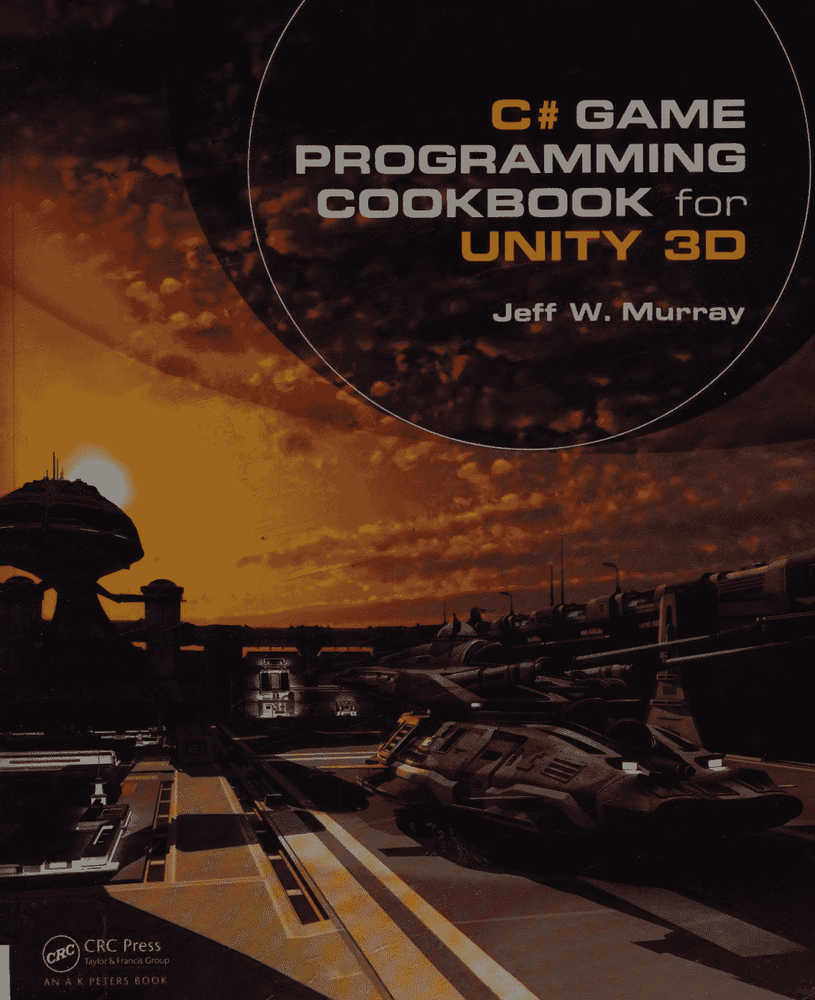
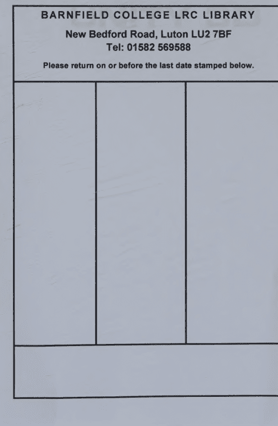
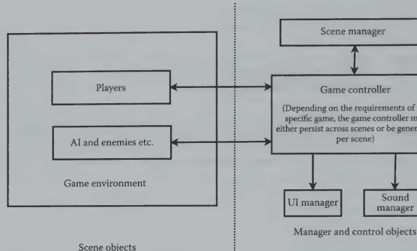
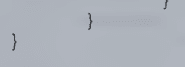
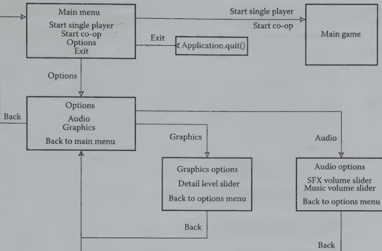
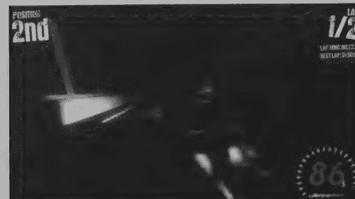
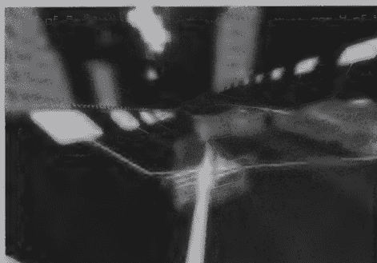
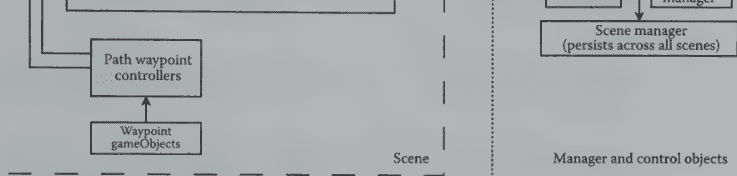
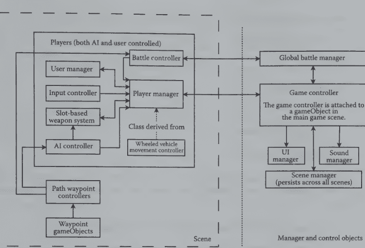
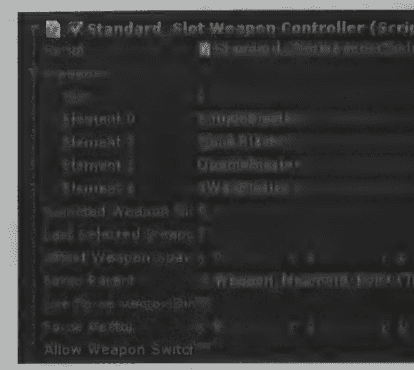

# Unity 3D C# 游戏编程秘籍






Murray, Jeff

3D C# 游戏编程手册 / Jeff J.W. Murray.

- 包含索引。

QA76.C67*M68 2014

794.8/1526—23

这本书献给我的儿子。

- 致谢 ................................................................ xiii

- 引言 .................................................................... xv

# 致谢

感谢我的妻子提供所有的鼓励、支持和那些美味的茶。

我也想感谢我的父母、我的兄弟 Steve 以及其他所有认识我的人。Sophie（小猫），要对小男孩们好一点。

感谢要感谢许多直接或间接对我的生活产生积极影响的人：Michelle Ashton、Brian Robbins、George Bray、Nadeem Rasool、Christian Boutin、James and Anna、Rich and Sharon、Liz and Peter、Rob Fearon（所有闪亮事物的收藏家）、Twitter 上所有听过我唠叨的人（伙计们，你们知道指的是谁！）、Matthew Smith（《Manic Miner》的创建者）、David Braben、岩谷井以及任何在 20 世纪 80 年代制作 Atari 游戏的人。

我要感谢 AK Peters/CRC Press 的所有人在我出版我的作品方面提供的帮助和支持。

最后，非常感谢你购买此书，并想要尝试制作游戏这么酷的事情。我诚挚地希望这本书能帮助你的游戏制作之旅——欢迎随时在 Twitter @psychicparrot 上告诉我是你的进展，或者访问我的网站 `http://www.psychicparrot.com`。

# 引言

当我开始成为一名游戏开发者时，作为一名自学程序员，我的技能花了一段时间才达到能够实现我想法的水平。有时，我想做一些我尚不具备的技术技能来完成的事情。偶尔，会有软件套装出现，它们要么能帮助我制作游戏的道路，要么能直接为我制作完整的游戏；例如来自 Sensible Software 的《射击游戏构建套件》（又名 SEUCK）、Gary Kitchen 的 GameMaker 或《The Quill 冒险系统》，这些工具能让那些超出我有限编程技能所能想象范围的游戏类型变为现实。

使用游戏创建软件的缺点是，它是为了创建其所选特定类型的游戏而定制的。如果我想做一些软件限制之外的事情，源代码是无法访问的，没有办法扩展或修改它。当这种情况发生时，我渴望有一种模块化的基于代码的系统，我可以将其组合以创建不同类型的游戏，并修改部分内容，而无需花费大量时间学习整个系统是如何运作的——一种我可以根据需要实际编写和修改的“积木式”游戏开发模式。

在完成我的第一本书《使用 Unity3D 进行 iOS 游戏开发》后，我想通过使用一种模块化的 Unity3D 风格来跟进，为读者提供一个高度灵活的框架，通过“插入”不同的脚本组件来创建几乎任何类型的游戏。我的意图是写一本基于 C# 编程的更具技术性的第二本书，能够为开发者可能需要的任何方向提供扩展性。从本质上说，你现在手中的书是一份游戏开发菜谱，它拥有一个适用于任何任何类型游戏的高度灵活的核心框架。

在开始撰写这本书之初，我投入了大量工作设计一个框架，这个框架不仅在 Unity 的语境下是合理的，而且能够轻松应对不同类型的需求。

## 前提条件

你完全可以零元钱获取并运行所需的软件。你需要的一切都可以免费下载，没有任何附加条件。你可能想在未来的某个时候考虑升级到 Unity Pro，以利用它的高级功能，但要开始，你只需要从 Unity 网站获取免费版本即可。

`Unity Free` 或 `Unity Pro`（可在 Unity 商店 `http://www.unity3d.com` 获取）

`Unity Free` 对于任何年收入少于 100,000 美元的个人或公司都是完全免费的——它可以无需支付任何费用下载，你甚至不需要信用卡。这真的是一个非常划算的买卖！我们说的是一个功能完备的、准备好制作游戏的游戏引擎。`Unity Pro` 适用于年收入超过 100,000 美元的公司，提供更多功能和专业支持。

## 本书未涵盖的内容

这并不是一本关于编程的书，它也不是做某事的正确或错误方法。我们假设读者具有 C# 经验。我是一名自学程序员，我理解可能存在更好的方法。

## 以模块化方式制作游戏

当我刚开始制作游戏时，我会以项目为单位的方法进行开发，每次都从头重新编码和构建一切。当我成为一名专业开发者，在一家游戏开发工作室工作时，我有幸能与一位在领域内进行创新的男士共事。他是一个快速产出优秀游戏（无论从视觉还是玩法上）的大师。他成功的秘密之一在于开发了一个可重用的框架，该框架可以轻松重构并应用到他的所有项目中。他的框架设计用于处理基于服务器的游戏通信、输入处理、浏览器通信和 UI 等，这为他和团队节省了惊人的时间，让他们专注于出色的玩法和图形优化。当然，这种结构是根据他的工作方式量定制的（毕竟是由他构建的），我花了一段时间才适应他的开发风格；但一旦我适应了，它真的让我大开眼界。从那时起，我在每个项目中都使用该框架，并教了其他程序员如何这样做。开发时间被大幅减少，留下了更多时间专注于制作更好的游戏。

本书基于类似的概念，即一个适用于许多不同类型游戏的游戏中心框架，而不是几种不同风格的教程。这本书的总目标是提供基于脚本的组件，你可以在该框架中使用这些组件为自己的项目取得良好开端，从而减少重新编码、重用或适配的时间。

如果将本书看作一本食谱，那么可以将框架看作底汤，而将脚本组件视为食材。我们可以混合并匹配使用相同框架的不同游戏中的组件来创建新游戏，也可以在许多不同的游戏中共享几个相同的核心部分。框架处理了基础性工作，而我们只需要添加一点“胶水”，按照我们想要的方式将所有内容整合在一起，使其按预期方式运行。

当然，这个框架是可选的，但你应该花些时间熟悉它，以便理解全本书的内容。如果你打算在自己的游戏中使用书中的组件，那么这个框架可以作为你构建游戏的基础，或者仅仅简单地作为一个教程测试床，供你对其进行拆解并观察其是如何运作的。你可以开发一个更好的框架，或者可能你已经有了一套稳固的框架。

在本章中，我们首先将审视书中用到的一些主要编程概念，并看看它们是如何影响框架的设计决策的。

## I.1 重要的编程概念

在我坐下来并弄懂书中涵盖的一些概念之前，我已经用 C# 编程了很长一段时间。这并不是因为这些概念本身存在任何特定的问题或困难，更多是因为我用不同的方式解决了问题，因此我没有真正的需求去学习任何新东西。对于大多数程序员来说，这些概念是本能的，也许在学校里学过，但我不知道它们到底有多重要。我听说过继承之类的概念，并把它们列入了待办事项，埋在“完成项目”之某个地方。我花时间弄懂了它们，它们为我节省了大量时间，并比我以前拼凑的代码整洁得多。如果你有什么不确定的地方，请通读这一章，看看你是否能理解这些思路。希望从长远来看，你会花一些时间在这里。

### I.1.1 管理器（Manager）与控制器（Controller）脚本

我是管理器和控制器脚本的坚定支持者。我喜欢尝试将事情拆分成不同的区域；例如，在《Metal Vehicle Doom》游戏中，我有比赛控制脚本和一个全局比赛控制脚本。比赛控制脚本挂载在玩家及其赛道上，负责位置、方式和其他玩家特定的比赛信息。全局比赛控制脚本与所有挂载在玩家身上的比赛控制脚本通信，以确定谁在领先，以及比赛何时开始或结束。通过将这种逻辑与其他游戏脚本分离并封装在它们自己的控制器脚本中，使得更容易在不同项目之间进行迁移。本质上，我可以将比赛控制脚本和全局比赛控制脚本从游戏中取出，并应用到另一个游戏中，可能是一个具有完全不同游戏类型的游戏——例如，外星人角色在汽车赛道上奔跑。只要我应用了正确的控制脚本，比赛逻辑就就绪了，我可以在新游戏中访问它。

在本书包含的框架中，有独立的管理器和控制器脚本处理用户数据、输入游戏函数和用户界面。我们将在第 2 章中查看这些细节，但在阅读本章时，你应该记住这种思想：使用专门管理游戏结构特定部分的分离式脚本。将脚本设计成独立的是重要的，这样它们就可以被用于 hơn一种情况。例如，我们的武器槽位管理器不会关心任何槽位中是种种武器。武器槽位管理器仅仅是玩家和武器之间的接口，接收“开火（fire）”调用并做出响应，告诉当前选中槽位中的武器开火。玩家端发生什么都不会影响槽位管理器，因为武器本身发生的任何事情都不会影响槽位管理器。它不在乎你的代码如何以正确的方式与它通信，只要你的武器以正确的方式接收命令即可。挂载的是哪种类型的槽位管理器并不重要。如果你决定将武器槽位管理器挂载到汽车、船、电线杆等，这并不重要，因为当你想开火时，你使用槽位管理器中的正确函数来告诉它要发射哪个武器。

由于我们的代码逻辑由管理器和控制器脚本控制，我们需要在整合所有内容时变得聪明一点。某些管理器脚本可能受益于静态（static）并在全局可用（供所有其他脚本访问），而另一些则可能更好地挂载到其他脚本上。我们会根据具体情况来处理这个问题。为了开始，我们将看看这些管理器脚本可以相互通信的某些方式。

作为本节主题的最后一点说明，你可能好奇管理器和控制器之间的区别。其实并没有太大区别，我只是为了我自己的清醒才选择进行区分。我将控制器视为较大的系统（例如游戏状态），而将应用到 gameObject 上的较小脚本视为如……

### I.1.2 脚本通信

我们结构中的重要部分是脚本之间如何通信的。有几种方法：

- 直接引用（Direct referencing）：让脚本相互通信的最简单方法是通过变量进行直接引用。

- SendMessage：一种向 gameObject 发送消息并调用其挂载脚本中函数的方法。

- 静态变量（Static variables）：静态变量很有用，因为它跨越了整个系统，可以从每个其他脚本访问。

#### 2. GameObject SendMessage

当我们不需要任何返回值时，`SendMessage` 是向 `gameObject` 发送消息并调用其脚本一个函数的极佳方法。例如：

```csharp
gameObject.SendMessage("DoSomething");
```

`SendMessage` 也可以接收参数，例如设置当没有接收者时引擎是否应该抛出错误。你也可以像调用普通函数一样向函数传递参数：

```csharp
gameObject.SendMessage("AddScore", 2, SendMessageOptions.RequireReceiver);
gameObject.SendMessage("AddScore", 2, SendMessageOptions.RequireReceiver);
```

#### 3. 静态变量

静态变量的用在于它可以跨越整个系统；它可以从每个其他脚本访问。这对于游戏控制脚本是一种特别有用的行为，多个不同的脚本与其通信以执行如玩家得分、失去生命或切换关卡等操作。静态变量的定义可能是：

```csharp
private static GameController aController;
```

虽然静态变量扩展整个程序，但你可以拥有私有和公共静态变量。

##### 公静态（Public static）

公共静态变量存在于系统的各个地方，可以被其他类和脚本类型访问。想象一种情况，玩家控制脚本在玩家捡香蕉时需要告诉游戏控制器脚本。我们可以这样做：

1. 在我们的 `GameController.cs` 游戏控制器脚本中，我们设置一个公共静态：

```csharp
public static GameController gateway;
```

2. 当游戏控制器（`GameController`）运行其 `Start()` 函数时，它将自己的引用存储在公共静态变量中：

```csharp
gateway = this;
```

3. 在任何其他类中，我们现在可以通过引用其类型后跟该静态变量（`GameController.gateway`）来访问游戏控制器，例如：

```csharp
GameController.gateway.GetBanana();
```

私有静态变量存在于声明它的类以及该类的任何其他实例中。其他类/脚本类型将无法访问它。

作为一个工作示例，请想象一个名为 `player.cs` 的脚本直接控制游戏中的玩家对象。当发生某些事情时，它们都必须通知玩家脚本，因此我们如下所示在 `player.cs` 脚本中将玩家管理器（player manager）声明为静态变量：

```
private static Player playerManager;
```

`playerManager` 对象只需要由玩家类的一个单个实例进行设置，就可以供同类的所有其他实例准备使用。`player.cs` 脚本将能够访问同一个 `PlayerManager` 实例。

## 4. 单例设计模式。

在本节的上一个部分，我们查看了如何使用静态变量在整个游戏代码中共享管理器。这种方法最大的缺点是可能会创建同一个脚本的多个实例。如果发生这种情况，你可能会发现你的玩家代码正在与游戏控制器的错误实例通信。

单例（Singleton）是一种常用的设计模式，它允许在同一时间只有一个特定类被实例化。对于我们可能需要跨整个游戏代码进行通信（或被通信）的游戏脚本来说，这是理想的。注意，我们将为脚本提供一个静态引用，正如我们在在本节早前的“静态变量”方法中所做的那样，但通过实现单例类，我们将添加一些额外的代码来确保我们的脚本只会被创建一个实例。

### 1.1.3 在 Unity 中使用单例模式

并不难看出静态变量在不同脚本对象之间的通信中有多用。在之前引用的公共静态示例中，核心思想是我们有一个游戏控制器对象，它需要被游戏中的一个或多个脚本访问。

这里显示的方法是由一个名为 Emil Johansson (AngryAnt) 的用户在 Unity 公共维基上演示的。它结合使用了私有静态变量和公共静态函数。其他脚本访问公共函数以获取脚本的私有静态实例，该实例通过公共函数返回，因此无论它附加了多少个组件，无论被实例化了多少次，场景中只会存在一个对象实例。

一个简单的单例结构：

```
public class MySingleton
{
    private static MySingleton instance;

    public MySingleton ()
}
```

> * http://wiki.unity3d.com/index.php/Singleton.

```cs
{
  if (instance != null) {
    Debug.LogError("Cannot have two instances of singleton.");
    return;
  }
  instance = this;
}
public static MySingleton Instance {
  get {
    if (instance == null) {
      new MySingleton ();
    }
    return instance;
  }
}
}
```

我们脚本的单例实例可以在任何地方通过任何脚本访问，只需使用以下语法：

`MySingleton.Instance.MySingletonMember;`

### 1.1.4 继承

继承是一个复杂的概念，由于它本书提供的脚本中起着关键作用，需要一些解释。请阅读这一节，如果你没有立即理解继承也不要担心。一旦我们开始编程，它很可能会变得清晰。

底线是继承在编程中用于描述一种提供模板脚本的方法，这些脚本可以被其他脚本重写或添加。用比喻来说，想象一辆汽车。所有的汽车都有四个轮子和一个引擎。轮子的类型可能随汽车而异，引擎也是如此，因此我们说“这是一辆汽车”并尝试描述我们的汽车的行为，我们也可以描述引擎和轮子。

这些关系可以按层级顺序显示：

- 轮子

- 引擎

现在尝试将此想象成一个 C# 脚本：

`Car` 类

- `Wheels` 函数

- `Engine` 函数

如果我们正在构建一个包含大量汽车的游戏，为每种类型的汽车都重写 `Car` 类将是愚蠢的。一种更有效的方法可能是编写一个基类并填充虚函数（virtual functions）。当我们需要创建一个类时，与其使用这个基类，不如构建一个继承该基类的新类。由于我们的新类是继承的，选择是否重写 `Wheels` 或 `Engine` 函数以使其以我们新类的特定方式运行是可选的。也就是说，我们可以构建“这是一辆汽车”。

```cs
public class Car
{
    public virtual void Wheels()
    {
    }
    public virtual void Engine()
    {
    }
}

public class SportsCar : Car
{
    public override void Wheels()
    {
        // 跑车的特定行为
    }
}
```

# 2 构建核心游戏框架

在本章中，我们将查看基础项目的结构，我们将向该项目添加所有的游戏脚本组件，并探讨其背后的设计思路。本章将为核心框架中做出的设计决策提供背景，并为理解各个代码配方如何协同工作，以及它们为何有时会依赖其他组件提供良好的基础。

本书的框架（如图 2.1 所示）包含六个主要区域：

- 1. 游戏控制器 (Game Controller)

游戏控制器充充当游戏中所有不同部分之间的中央通信脚本。在某种程度上，它是将组成游戏的各种组件结合在一起的主要“胶水”。

- 2. 场景管理器 (Scene Manager)

该脚本处理场景的加载和保存。场景是 Unity 对关卡文件的称呼。

- 3. UI 管理 (UI Manager)

UI 管理器绘制所有的游戏内主要用户界面元素，例如分数显示和生命值。

- 4. 音效管理器 (Sound Manager)

音效管理器处理音频播放。管理器持有一个包含可能播放声音的 `AudioClips` 数组。当游戏开始时，




图 2.1 游戏框架图。

音效管理器为数组中的每个声音创建一个独立的 `AudioSource`。当我们需要播放声音时，会将引用声音在数组中位置的索引号传递给管理器。它使用自己独立的 `AudioSource` 来播放源，这有助于缓解从单个源播放过多音频文件可能引起的问题。

- 5. 玩家 `Players`

玩家可能已经存在于游戏场景中，也可能由游戏控制器实例化。玩家具有较为复杂的结构，将在第 3 章中进行探讨。

- 6. AI 与敌人 `AI and Enemies`

与玩家一样，AI 控制的字符或敌人可能在加载时已经存在于场景中，或者由游戏控制器或其他脚本在运行时创建。

尽管你可能选择使用自己的框架，但理解组件之间如何协同工作以及它们如何结合是非常重要的。为了最大限度地提高灵活性，基类需要能够适应各种不同的配置。例如，玩家控制脚本应该允许从另一个脚本传递输入，以便可以轻松切换控制系统。主玩家脚本不需要知道输入来自哪里，但它需要为输入脚本提供一个通信的通用接口。输入脚本可以从键盘、鼠标、人工智能、网络输入等获取输入，只要使用通用接口与玩家控制器通信；对于玩家控制器来说，输入实际上来自哪里并不重要。

## 2.1 控制器与管理器 `Controllers and Managers`

通过将任务专门化给特定的管理器，可以在不影响核心功能的情况下更换组件，这反过来使得很容易将相同的代码从一个游戏带到另一个游戏而无需重写；从第一人称射击游戏到赛车游戏，相同的代码可以存储用户会话数据、加载关卡或控制武器。在本书中，我使用术语来指定类的类型：控制器 `controllers` 和管理器 `managers`。

### 2.1.1 控制器 `Controllers`

控制器专门负责特定任务，例如帮助脚本之间相互通信、持有特定游戏的玩家信息，或处理会话数据。例如，本书中所有示例游戏的中心都是游戏控制器脚本，它作为游戏脚本的中央位置。每个游戏都有自己的控制器脚本，充当那些本没有内置通信方法的不同组件之间的“胶水”。

### 2.1.2 管理器 `Managers`

管理器在书中用于代表专门管理对象或数据的脚本（以处理玩家、音频或其他游戏元素，类似于管理器可能管理公司员工的方式）。例如，`GlobalBattleManager.cs` 脚本被 `RaceController.cs` 实例使用，用于在示例游戏《坦克大战》`Tank Battle` 中跟踪死亡战战斗。管理器脚本负责计算玩家在得分板上的位置，并通知玩家游戏当前的运行状态。

## 2.2 构建核心框架脚本

`Scripts/BASE` 文件夹中有几个脚本，旨在作为你自己的版本的模板，或者作为你自己的游戏中可以从中派生出的类。在本节中，我们将查看构成主框架的脚本。

`BASE` 文件夹中在本章将涵盖的核心框架脚本如下：

- 2.2.1 `BaseGameController.cs`
- 2.2.2 `SceneManager.cs`
- 2.2.3 `ExtendedCustomMonoBehavior.cs`
- 2.2.4 `BaseUserManager.cs`
- 2.2.5 `BasePlayerManager.cs`
- 2.2.6 `BaseInputController.cs`

示例游戏 `BASE` 文件夹中的脚本比上述脚本多；那些落在基础核心框架之外的脚本将在书中逐案处理，例如在第 9 章中处理的 AI 脚本（那里我们将完整介绍 AI 系统），或者在第 8 章中探索的音频。

### 2.2.1 `BaseGameController.cs`

游戏控制器充当活动枢纽，以及那些无法直接连接的脚本无法向对方发送消息的地方。通过通过游戏控制器路由脚本，它们保持了独立性，改变它们的行为是一个简单的更改处理消息方式的过程，而不是跨多个脚本进行更改。

游戏控制器的核心功能如下：

- 1. 跟踪游戏状态
    a. 存储游戏状态
    b. 提供更改游戏状态函数
    c. 根据 `EndGame()`、`StartGame()` 或 `PauseGame()` 调用更改游戏状态
- 2. 创建玩家对象
- 3. 设置相机（例如跟随哪个玩家等）
- 4. 处理会话管理器、用户管理器和游戏之间的通信
- 5. 处理所有保持独立且不直接通信的脚本

游戏控制器是定义整体玩法以及持有当前游戏状态的地方。典型的游戏可能有几种不同的核心状态，例如：

1. 运行中 `running`
2. 暂停 `paused`
3. 加载中 `loading`
4. 已结束 `ended`

可能还有适用于特定游戏类型的自定义状态，例如用于显示过场动画或播放特殊音频。建议为任何影响一个或多个脚本的游戏动作创建一个新状态。这样你始终可以让脚本依赖游戏控制器来知道如何运行。

位于 `Scripts/BASE` 的基础游戏控制器脚本所示：

```csharp
public class BaseGameController : MonoBehaviour
{
    bool paused;
    public GameObject explosionPrefab;

    public virtual void PlayerLostLife()
    {
        // 处理玩家失去生命（更新 U.I. 等）
    }

    public virtual void SpawnPlayer()
    {
        // 需要生成玩家
    }

    public virtual void Respawn()
    {
        // 玩家正在重生
    }
    public virtual void StartGame()
    {
        // 执行开始游戏函数
    }

    public void Explode ( Vector3 aPosition )
    {
        // 在传入此函数的位置实例化爆炸效果
        Instantiate( explosionPrefab,aPosition, Quaternion.identity );
    }

    public virtual void EnemyDestroyed( Vector3 aPosition, int pointsValue, int hitByID)
    {
        // 处理敌人被毁
    }

    public virtual void BossDestroyed()
    {
        // 处理 Boss 战斗结束
    }

    public virtual void RestartGameButtonPressed()
    {
        // 处理重置按钮（默认行为是重新加载当前加载的场景）
        Application.LoadLevel(Application.loadedLevelName);
    }

    public bool Paused
    {
    }
}
```

```csharp
get {
  // 获取暂停状态
  return paused;
}set {
  // 设置暂停状态
  paused = value;
  if (paused) {
    // 暂停时间
    Time.timeScale= 0f;
  } else {
    // 解除Unity暂停
    Time.timeScale = 1f;
  }
}
```

#### 2.2.1.1 脚本解析

`BaseGameController.cs` 中的许多关键函数都是 `virtual`（虚拟的），包含这些函数是为了作为处理不同类型游戏活动的既定协议。也就是说，它们在这个特定的文件中不包含代码，但意图是让你以后在自己的派生游戏控制器版本中对它们进行重写。

`BaseGameController` 类继承自 `MonoBehaviour`，这样它就可以接入自动调用的系统函数，如 `Awake()`、`Start()`、`Update()` 和 `FixedUpdate()`：

```csharp
public class BaseGameController : MonoBehaviour
{
```

这些函数在这里作为占位符。其意图是用于实际游戏项目的游戏控制器脚本将继承自此类，并用功能填充这些接口函数：

```csharp
bool paused;
public GameObject explosionPrefab;
```

```csharp
public virtual void PlayerLostLife()
{
  // 处理玩家生命值丢失（更新用户界面等）
}
```

```csharp
public virtual void SpawnPlayer()
{
  // 需要生成玩家
}
```

```csharp
public virtual void Respawn()
{
  // 玩家正在重生
}
public virtual void StartGame()
{
  // 执行开始开始的函数
}
```

`BaseGameController` 中的其他函数是你在许多不同的游戏中都会使用的，将它们全部包含在像这样的脚本中（你可以从该脚本派生所有游戏控制器）可能会节省时间。这避免了在多个项目之间反复编写相同的代码。其中一个例子是 `Explode()` 函数，它仅仅执行了该操作：

```csharp
public void Explode ( Vector3 aPosition)
{
  // 在传入此函数的位置实例化
  // 爆炸效果
  Instantiate(explosionPrefab,aPosition,Quaternion.identity);
}
```

`Explode()` 所做的只是在函数调用者传递的位置实例化一个 `GameObject`。后续版本的游戏控制器脚本将使用单独的生成管理器 `spawn manager` 来处理实例化，尽管在现阶段，尽可能通用且不依赖于任何其他脚本是恰当的。

在 `Explode` 之后，我们又看到了两个空函数，用于告诉控制器何时普通敌人被销毁以及何时 Boss 被销毁：

```csharp
public virtual void EnemyDestroyed ( Vector3 aPosition, int pointsValue, int hitByID)
{
  // 处理敌人被销毁
}
```

```csharp
public virtual void BossDestroyed()
{
  // 处理 Boss 战斗结束
}
```

所有游戏都需要一些函数，例如重启按钮和暂停函数。以最简单的形式来说：

```csharp
public virtual void RestartGameButtonPressed()
{
  // 处理重启按钮（默认行为重新加载当前
  // 加载的场景）
  Application.LoadLevel(Application.loadedLevel);
}
```

`RestartGameButtonPressed` 使用 Unity 的 `Application.LoadLevel` 函数来重新加载当前场景。`Application.loadedLevel` 返回一个字符串，指向游戏当前内存中加载的场景名称。你也可以通过 `Application.name` 获取一个指向场景的索引。此索引编号与 Build Settings `File -> Build Settings` 中的场景组织方式相关，这意味着如果你以后选择使用索引号来引用特定场景，那么构建设置中的更改可能会影响你游戏的运行方式。为了避免混淆，我倾向于在处理关加载时始终使用名称。

`BaseGameController` 的最后部分处理游戏暂停和取消暂停的机制：

```csharp
public bool Paused {
    get {
        // 获取暂停状态
        return paused;
    }
    set {
        // 设置暂停状态
        paused = value;
        if (paused) {
            // 暂停时间
            Time.timeScale = 0f;
        } else {
            // 解除Unity暂停
            Time.timeScale = 1f;
        }
    }
}
```

名为 `paused` 的布尔变量在内部持有游戏暂停状态。与其提供直接访问，不如使用 getter-setter（访问器属性）函数，这样我们可以在暂停状态改变时采取行动，而无需对其进行监控。

`Get` 部分只是返回该布尔变量。

`Set` 部分设置该布尔变量，并将 `Time.timeScale` 设置为 0（暂停）或 1（取消暂停）。设置 `Time.timeScale` 会影响时间的流逝。例如，将 `timescale` 设置为 0.5 意味着时间比真实时间慢 2 倍。Unity 文档规定：

除了 `realtimeStartup` 外，`timescale` 会影响 `Time` 类中所有的时间和增量时间测量。

如果你降低了 `timescale`，建议按相同幅度降低 `Time.fixedDeltaTime`。

当 `timescale` 被设为 0 时，`FixedUpdate` 函数将不会被调用。

普通的视频游戏会在游戏暂停时显示某种消息告诉玩家，但此脚本仅提供暂停机制，我们将在第 14 章之前不会过多考虑用户界面。

### 2.2.2 场景管理器

管理器控制物理场景之间的游戏流程。菜单界面上的按钮不直接加载场景；而是由下方的场景管理器脚本来加载它们：

```csharp
public class SceneManager : MonoBehaviour
{
    public string[] levelNames;
    public int gameLevelNum;

    public void Start ()
    {
        // 保持此对象存活
        DontDestroyOnLoad(this.gameObject);
    }

    public void LoadLevel(string sceneName)
    {
        // 加载场景
        Application.LoadLevel(sceneName);
    }

    public void GoNextLevel()
    {
        // 如果我们的索引超过了数组中关卡的总数，
        // 我们重置它
        if(gameLevelNum >= levelNames.Length)
            gameLevelNum = 0;
    }

    private void LoadLevel( int indexNum)
    {
        // 通过索引号加载场景
        Application.LoadLevel(levelNames[indexNum]);
    }

    public void resetGame()
    {
        // 重置关卡计数器
        gameLevelNum = 0;
    }
}
```

下方显示的 `LoadLevel` 函数的备用版本使用索引在加载处理更早获取关卡名称。它再次声明了原始的 `LoadLevel` 函数。这样做的目的是保持关注：使用单个函数处理所有加载，而不是重复代码或让其发生在多个地方：

```
private void LoadLevel( int indexPath )
{
    // 加载游戏关卡
    LoadLevel(levelNames[indexNum]);
}
```

场景管理器类中的最后一个函数用于每当我们开始新游戏时重置 `gameLevelNum`。假设重启游戏的脚本会在再次调用 `GoNext()` 之前调用此函数。

```
public void ResetGame()
{
    // 重置关卡索引计数器
    gameLevelNum = 0;
}
```

### 2.2.3 `ExtendedCustomMonoBehavior.cs`

扩展 `MonoBehavior` 是避免重复常用函数或变量声明的有效方法。许多类共享函数和/或变量。例如，书中的大多数脚本都使用变量 `myTransform` 来引用其 transform 的缓存版本，以避免在每次需要访问它时都查找 transform。由于 `MonoBehavior` 提供了大量的系统函数和调用，创建一个扩展它的新类可以是工具箱中非常有用的工具。与其让新类使用 `MonoBehavior`，我们直接派生自 `ExtendedCustomMonoBehavior` 脚本。

对于书中的脚本，`ExtendedCustomMonoBehavior.cs` 脚本扩展了 `MonoBehavior` 并包含内容：

- 1. `myTransform` 变量，用于持有 transform 的缓存引用
- 2. `myGO` 变量，用于持有 gameObject 的缓存引用
- 3. `myBody` 变量，用于持有 rigidbody 的缓存引用
- 4. `didInit` 布尔变量，用于确定脚本是否已初始化
- 5. 一个名为 `id` 的整数变量，用于持有 ID 数字
- 6. 一个名为 `tempV` 的 `Vector3` 类型变量，用于临时向量操作
- 7. 一个名为 `tempTR` 的 `Transform` 变量，用于任何 transform 的临时引用
- 8. 一个名为 `SetID(integer)` 的函数，以便其他类设置该变量

该类的脚本非常直接，主要包含变量声明：

```
public class ExtendedCustomMonoBehavior : MonoBehavior
{
```


```
// 此类用于向
// MonoBehavior 添加一些常用变量，
// 而在每个类中不断重复
// 相同的声明。
```

```
public Transform myTransform;
public GameObject myGO;
public Rigidbody myBody;
```

```
public bool didInit;
public bool canControl;
```

```
public int id;
```

```
[System.NonSerialized]
public Vector3 tempVEC;
```

```
[System.NonSerialized]
public Transform tempTR;
```

```
public virtual void SetID(int anID)
{
    id= anID;
}
```

### 2.2.4 `BaseUserManager.cs`

用户管理器是由玩家管理器创建的脚本对象，用于存储玩家属性，例如：

- 玩家名称
- 当前分数
- 最高分
- 关卡等级
- 健康值
- 该玩家是否完成游戏

用户管理器还包含操作其数据的函数

以下是完整的 `BaseUserManager.cs` 脚本：

```
public class BaseUserManager : MonoBehavior
{
```

```
// 游戏特定数据
// 我们将这些保持为私有，并提供方法来修改它们，
// 这样做是为了防止任何意外损坏
// 或无效数据的输入。
```

```
private int score;
private int highScore;
private int level;
private int health;
private bool isFinished;

// 此玩家的显示名称
public string playerName="Anon";

public virtual void GetDefaultData()
{
    playerName="Anon";
    score=0;
    level=1;
    health=3;
    highScore=0;
    isFinished=false;
}

public string GetName()
{
    return playerName;
}

public void SetName(string aName)
{
    playerName=aName;
}

public int GetLevel()
{
    return level;
}

public void SetLevel(int num)
{
    level=num;
}

public int GetHighScore()
{
    return highScore;
}

public int GetScore()
{
    return score;
}

public virtual void AddScore(int anAmount)
{
    score+=anAmount;
}

public void LostScore(int num)
{
    score=num;
}
```

```
public void setScore(int num)
{
    score=num;
}
public int GetHealth()
{
    return health;
}
public void AddHealth(int num)
{
    health+=num;
}
public void ReduceHealth(int num)
{
    health-=num;
}
public void SetHealth(int num)
{
    health=num;
}
public bool GetFinished()
{
    return isFinished;
}
public void SetIsFinished(bool aVal)
{
    isFinished=aVal;
}
```

### 2.2.4.1 脚本解析

`BaseUserManager.cs` 仅包含变量声明以及获取或设置这些变量的函数。

### 2.2.5 `BasePlayerManager.cs`

玩家管理器充当输入管理器、用户管理器和游戏特定玩家控制器之间的“胶水”。它旨在作为一个将管理器绑定到游戏特定玩家脚本的中心点。

以下是完整的 `BasePlayerManager.cs`：

```
public class BasePlayerManager : MonoBehaviour
{
    public bool didInit;

    // 用户管理器和 AI 控制器是公开可见的，以便
    // 各个控制脚本可以轻松访问它们
    public BaseUserManager DataManager;
```

```
// 注意，我们在该类的 Awake 中进行初始化，以便
// 其他类在访问我们的细节时已准备就绪
public virtual void Awake ()
{
    didInit=false;

    // 我们不是弄乱 start() 函数，而是调用 Init 来
    // 执行任何启动时的特定操作
    Init();
}

public virtual void Init ()
{
    // 缓存对用户管理器的引用
    DataManager= gameObject.GetComponent<BaseUserManager>();

    if(DataManager==null)
        DataManager= gameObject.AddComponent<BaseUserManager>();

    // 在此函数中执行游戏初始化
    didInit=true;
}

public virtual void GameFinished()
{
    DataManager.SetIsFinished(true);
}

public virtual void GameStart()
{
    DataManager.SetIsFinished(false);
}
```

### 2.2.5.1 脚本解析

`BasePlayerManager.cs` 派生自 `MonoBehavior`，因此它可以使用系统函数 `Awake()` 来调用其 `Init` 初始化：

`Awake()` 函数基于可能被重用的假设，因此它通过将布尔变量 `didInit` 设置为 `false` 开始。该变量可以用于判断 `Init()` 函数是否已调用并完成：

### 2.2.6 `BaseInputController.cs`

输入控制器为玩家控制器提供输入。`BaseInputController` 如下所示：

```
public class BaseInputController : MonoBehaviour
{
    // 方向键
    public bool Up;
    public bool Down;
    public bool Left;
    public bool Right;
}
```

```cs
// 射击 / 动作按钮
public bool Fire;

// 武器槽位
public bool Slot1;
public bool Slot2;
public bool Slot3;
public bool Slot4;
public bool Slot5;
public bool Slot6;
public bool Slot7;
public bool Slot8;
public bool Slot9;

public float vert;
public float horz;
public bool shouldRespawn;

public Vector3 TEMPVec;
private Vector3 zeroVector = new Vector3(0,0,0);

public virtual void CheckInOut()
{
    // 使用重写你自己的代码来处理输入
    horz = Input.GetAxis("Horizontal");
    vert = Input.GetAxis("Vertical");
}

public virtual float GetHorizontal()
{
    // 返回缓存的水平输入轴值
    return horz;
}

public virtual float GetVertical()
{
    // 返回缓存的垂直输入轴值
    return vert;
}

public virtual bool GetFire()
{
    return Fire;
}

public bool GetRespawn()
{
    return shouldRespawn;
}

public virtual Vector3 GetMovementDirectionVector()
{
    // 移动方向的临时向量被设置为
    // 一个否则未使用的、值始终为 0,0,0 的向量
    TEMPVec = zeroVector;
    // 如果我们向左或向右，将速度向量的 X
    // 设置为我们的水平输入值
    if(Left || Right)
    {
      TEMPVec.x=horz;
    }

    // 如果我们向上或向下，将速度向量的 X 设置为
    // 垂直输入值
    if (Up || Down)
    {
      TEMPVec.y=vert;
    }
    // 返回移动向量
    return TEMPVec;
}
```

### 2.2.6.1 脚本拆解

BaseInputController.cs 继承自 MonoBehaviour。

```cs
public class BaseInputController : MonoBehaviour
{}
```

输入脚本使用 `CheckInput()` 作为它们的默认主更新函数，旨在用于从玩家类中调用。此 `CheckInput()` 只包含输入所需的极少内容。它从输入类获取轴输入：

```cs
public virtual void CheckInput()
```

Input 类提供了指向 Unity 输入系统的接口。它可以被用于从移动设备上的陀螺仪输入到键盘按键的一切内容。Unity 的输入系统有一个垂直轴设置，开发者可以在 Unity 编辑器的 Input Manager 中为轴命名。在 Unity 中，可以通过 `Edit -> Project Settings -> Input` 访问 Input Manager。

默认情况下，Unity 设置了水平和垂直轴输入。它们的名称分别为 `Horizontal` 和 `Vertical`，可以通过 `Input.GetAxis()` 访问，将虚拟轴的名称作为参数传递，并接收于 -1 到 1 之间的浮点数返回值。浮点数变量 `horz` 和 `vert` 持有这些返回值：

```cs
// 使用重写你自己的代码来处理输入
horz=Input.GetAxis("Horizontal");
vert=Input.GetAxis("Vertical");
```

提供了一个函数来返回 `horz` 的值，即由名为 `Horizontal` 的虚拟轴提供的水平轴：

```cs
public virtual float GetHorizontal()
{
  // 返回我们缓存的水平输入轴值
  return horz;
}
```

提供了一个函数来返回 `vert` 的值，即由名为 `Vertical` 的虚拟轴提供的垂直轴：

```cs
public virtual float GetVertical()
{
    // 返回我们缓存的垂直输入值
    return vert
}
```

`GetFire()` 返回布尔值 `Fire` 的值。`GetRespawn()` 返回布尔值 `shouldRespawn` 的值。在此阶段，你可能会注意到，在这个默认输入脚本中没有实际代码来设置 `Fire` 或 `shouldRespawn`。它们都是作为一种指南提供的，其意图是根据游戏所需的具体情况在基础上进行构建：

```cs
public virtual bool GetFire(){
    return Fire;
}

public bool GetRespawn(){
    return shouldRespawn;
}
```

在某些情况下，拥有一个移动向量比处理来自 `horz` 和 `vert` 的数字更有用。`GetMovementDirectionVector()` 将根据当前的输入状态返回一个 `Vector3` 类型。在这里，`TEMPVec` 接收输入值并由函数返回：

```cs
public virtual Vector3 GetMovementDirectionVector(){
    // 移动方向的临时向量被设置为
    // 一个否则未使用的、值始终为 0,0,0 的向量
    TEMPVec=zeroVector;
}
```

该向量从 0,0,0 开始，但其 `x` 和 `y` 值将被分别设置为 `horz` 和 `vert` 的值。最后，`TEMPVec` 中的向量被返回：

```cs
TEMPVec.x=horz;
TEMPVec.y=vert;

// 返回移动向量
return TEMPVec;
```

## 3 玩家结构

玩家可以采取任何形式——人类、外星人、动物、车辆；设计一个能够处理所有这些对象的结构本身就是一个挑战。玩家存储数据的方式、他们需要存储的数据、各种类型的移动代码及其控制系统构成了成百种可能的组合。以模块化的方式处理玩家结构需要仔细考虑如何处理所有这些不同的场景，还需要考虑我们的组件如何相互通信以及与游戏的其余部分通信（例如，玩家对象通常需要与游戏状态通信等），而且玩家可能还需要与环境进行交互。

本书的整体玩家结构可以分解为几个主要组件，如图 3.1 所示。

- 1. **游戏特定控制器**。此脚本旨在作为玩家控制器和用户管理器之间的桥梁。例如，某些游戏可能需要车辆，而某些游戏可能。
- 2. **移动控制器**。移动控制器负责移动玩家并定义玩家类型。
- 3. **玩家管理器**。此脚本位于玩家内部。
- 4. **数据管理器**。数据管理器负责统计数据，如得分、等级等。

### 3.1 游戏特定控制器

玩家控制器继承自移动控制器（移动控制器专门负责特定类型的移动），并在此基础上构建以提供完整的玩家逻辑。

移动控制器将在本书稍后部分介绍。第 5 章概述了三种玩家类型的移动控制器：飞船、类玩家和轮式车辆。

玩家控制器的逻辑取决于游戏；本书中的示例使用了第 5 章的移动控制器，通过将移动控制器与武器控制器相结合来武装玩家，或控制 AI 控制器。

关于玩家控制器的真实示例，请查看第 10 到 13 章的示例游戏。在本节中，我们构建了一个简单的玩家控制器来移动飞船。它继承自 `BaseTopDownSpaceShip.cs`，这可以在第 5 章完整找到。此脚本还包含一个玩家管理器。

```cs
using UnityEngine;
using System.Collections;
```

```cs
public class SimplePlayerController : BaseTopDownSpaceShip
{
    public BasePlayerManager myPlayerManager;
    public UserManager myDataManager;

    public override void Start()
    {
        // 通知基类初始化
        base.Init();

        // 现在执行自己的初始化
        this.Init();
    }

    public override void Init()
    {
        // 如果编辑器中没有设置玩家管理器，让我们尝试
        // 寻找一个
        if(myPlayerManager==null)
            myPlayerManager=gameObject.GetComponent<BasePlayerManager>();

        myDataManager= myManager.DataManager;
        myDataManager.SetName("Player");
        myDataManager.SetHealth(3);

        didInit=true;
    }

    public override void Update()
    {
        // 执行基类中的更新
        UpdateShip();

        // 在 Init() 运行之前不要执行任何操作
    }
}
```

```csharp
if(!didInit)
return;

// 在检查是否射击之前，检查我们是否应该
// 控制玩家
if(!canControl)
return;
```

```csharp
public override void GetInput()
{
// 我们重写了默认输入函数，以添加
// 射击能力
horizontal_input= default_input.GetHorizontal();
vertical_input= default_input.GetVertical();
}
```

```csharp
void OnCollisionEnter(Collision collider)
{
// 在此处处理碰撞响应
}
```

```csharp
void OnTriggerEnter(Collider other)
{
// 在处触发响应
}
```

```csharp
public void PlayerFinished()
{
// 处理该玩家的游戏结束逻辑
}
```


```csharp
public void ScoredPoints(int howMany)
{
    myDataManager.AddScore(howMany);
}
```

## 3.2 处理输入

独立的脚本为移动控制器提供输入以进行响应。这样做使其能够根据需要切换到任何输入方式，而无需更改移动控制器内部的任何内容，无论你“喂”给它什么。这意味着你可以将完全相同的移动控制器脚本用于主玩家、AI 玩家，可能甚至用于通过网络连接的远程玩家——只需使用不同的输入。

`BaseInputController` 提供了一系列常用变量和函数。其他输入脚本将派生于它：

```csharp
public class BaseInputController : MonoBehaviour
{
// 方向按钮
public bool Up;
public bool Down;
}
```

```csharp
public bool Left;
public bool Right;

// 射击/动作按钮
public bool Fire;
```

基于槽位的武器系统使用键盘 1 到 9 数字键直接选择要使用哪个武器槽位。因此，输入系统有九个布尔变量来接收数字键的输入：

```csharp
// 武器槽位
public bool Slot1;
public bool Slot2;
public bool Slot3;
public bool Slot4;
public bool Slot5;
public bool Slot6;
public bool Slot7;
public bool Slot8;
public bool Slot9;

public float vert;
public float horz;
public bool shouldRespawn;
```

```csharp
public Vector3 TEMPVec3;
private Vector3 zeroVector = new Vector3(0,0,0);
```

`Input` 提供了 Unity 输入系统的接口。它被用于从移动设备的陀螺仪输入到键盘按键的一切地方。根据 Unity 文档，`Input.GetAxis` 返回由 `axisName` 标识的虚拟轴的值。轴名称在 Unity 的 `Input Manager`（`Edit -> Project Settings -> Input`）中设置，尽管 `Horizontal` 和 `Vertical` 应该已经默认设置：

```csharp
public virtual void CheckInOut()
{
  // 重写你的代码以处理输入
  horzInput=Input.GetAxis("Horizontal");
  vert=Input.GetAxis("Vertical");
}
```

```csharp
public virtual float GetHorizontal()
{
  // 返回我们缓存的水平输入轴值
  return horz;
}
```

```csharp
public virtual float GetVertical()
{
  // 返回我们缓存的垂直输入轴值
  return vert;
}
```

虽然脚本包含一个名为 `GetFire()` 的函数，用于返回布尔变量 `Fire` 的值，但脚本并没有包含任何设置它的代码。它只是为了一致性而存在。

```csharp
public virtual bool GetFire() {
    return Fire;
}
```

再次，脚本包含 `GetRespawn()` 纯粹是为了协议，没有实际功能。

```csharp
public bool GetRespawn() {
    return shouldRespawn;
}
```

为了方便起见，`BaseInputController.cs` 包含一个返回方向向量的系统。该函数将返回一个 `Vector3`，其 x 和 y 轴代表输入水平：

```csharp
public virtual Vector3 GetMovementDirectionVector() {
    // 移动方向的临时向量被设置为一个
    // 未使用的向量的值，该向量始终为 0,0,0
    TEMP3=zeroVector;

    // 如果我们向左或向右移动，将速度向量的 X
    // 设置为我们的水平输入值
    if (Left || Right) {
        TEMP3.x=horz;
    }

    // 如果我们向上或向下移动，将速度向量的 Y 
    // 设置为我们的垂直输入值
    if (Up || Down) {
        TEMP3.y=vert;
    }

    // 返回移动向量
    return TEMP3;
}
```

输入的默认脚本是一个名为 `Keyboard_Input.cs` 的基础键盘设置脚本。它派自 `BaseInputController` 并重写了 `CheckInput()` 和 `LateUpdate()` 函数，以添加垂直轴，并检查在 Unity `Input Manager` 中设置为 `Fire3` 的射击和复活按钮：

```csharp
public class Keyboard_Input : BaseInputController {
    public override void CheckInput () {
        // 从垂直和水平轴获取输入数据并
```

```csharp
// 将它们存储在内部 vert horizontal 中，这样我们不需要
// 每次需要传递输入数据时访问
vert=Input.GetAxis("Vertical");
horiz=Input.GetAxis("Horizontal");
```

```csharp
// 为上、左、右设置一些布尔值
Up
    = (vert > 0);
Down = (vert < 0);
Left = (horiz < 0);
Right = (horiz > 0);
```

```csharp
// 射击/动作按钮
Fire= Input.GetAxis("Fire1");
shouldRespawn=Input.GetAxis("Fire3");
```

```csharp
public void LateUpdate()
{
    // 检查输入
    CheckInput();
}
```

## 3.3 玩家管理器

玩家管理器充当玩家和用户管理器之间的桥梁。如果没有挂载，它也会创建一个。

using UnityEngine;

using System.Collections;

```csharp
public class PlayerManager : MonoBehaviour
{
    public bool init;
    public BaseUserManager DataManager;

    public virtual void Awake()
    {
        init = false;
        Init();
    }

    public virtual void Init()
    {
        DataManager = GetComponent<BaseUserManager>();
        if (DataManager == null)
        {
            DataManager = AddComponent<BaseUserManager>();
        }
    }
}
```

### 3.3.1 脚本分解

`start` 函数没有什么特别的——设置 `init` 为 false 后调用 `Init()`：

```csharp
public class PlayerManager : MonoBehaviour
{
    public bool init;
    public BaseUserManager DataManager;
}
```

`GameFinished()` 和 `GameStart()` 用于向用户管理器传递消息。一个用可能是知道玩家对象并想要告知游戏状态的脚本。与其使用 `GetComponent` 调用该脚本，不如使用 `SendMessage` 来调用函数。这比直接使用 `GetComponent` 并访问函数要高效一点：

```csharp
public void GameFinished()
{
    // ... 
}
```

## 3.4 用户数据管理器（处理生命值等玩家统计）

将玩家信息存储在游戏控制器或类似的玩家对象的脚本中并不罕见。这种方法可能适用于单人游戏，但转变为具有多个玩家的游戏就会出现问题。一种解决方案是游戏控制器拥有一个包含玩家统计数据的数组，并在其他函数调用它时对其进行操作；但为什么不为每个玩家挂载统计数据呢？本书的框架为每个玩家使用数据管理器类，包含了存储单个玩家所需的一切：

1. 分数
2. 高分
3. 等级
4. 生命值
5. 玩家是否结束（不再活跃）
6. 玩家名称

每个玩家都挂载 `BaseUserManager` 脚本。游戏控制器或游戏结构其他部分的脚本可以轻松查找并访问玩家的信息。用户管理器脚本如下：

```csharp
public class BaseUserManager : MonoBehaviour
{
    // 游戏逻辑特定数据
    // 我们将这些保持私有，并提供修改它们的方法
    // 而不是直接访问，以防止任何意外损坏或无效
    // 数据进入
```

```csharp
private int score;
private int highScore;
private int level;
private int health;
private bool isFinished;
```

```csharp
// this is the display name of the player
public string playerName="Anon";
```

```csharp
public virtual void GetDefaultData()
{
    playerName="Anon";
    score=0;
    level=1;
    health=3;
    highScore=0;
    isFinished=false;
}
```

```csharp
public string GetName()
{
    return playerName;
}
```

```csharp
public void SetName(string aName)
{
    playerName=aName;
}
```

```csharp
public int GetLevel()
{
    return level;
}
```

```csharp
public void SetLevel(int num)
{
    level=num;
}
```

```csharp
public int GetHighScore()
{
    return highScore;
}
```

```csharp
public int GetScore()
{
    return score;
}
```

```csharp
public virtual void AddScore(int anAmount)
{
    score+=anAmount;
}
```

```csharp
public void LostScore(int num)
{
    score=num;
}
```

```csharp
public void SetScore(int num)
{
    score=num;
}

public int GetHealth()
{
    return health;
}

public void AddHealth(int num)
{
    health+=num;
}

public void ReduceHealth(int num)
{
    health-=num;
}

public void SetHealth(int num)
{
    health=num;
}

public bool GetIsFinished()
{
    return isFinished;
}

public void SetIsFinished(bool aVal)
{
    isFinished=aVal;
}
```

### 3.4.1 脚本拆解

在变量声明之后，`BaseUserManager.cs` 包含的第一个函数是一个用于用默认值填充玩家统计数据，以避免在尝试访问它们时出现任何问题。

```csharp
public virtual void getDefaultData()
{
    playerName="Anon";
    score=0;
    level=1;
    health=3;
    highScore=0;
    isFinished=false;
}
```

该类的其余部分处理获取和设置玩家数据。逻辑上仅仅是获取或设置变量，因此如果你需要详细查看，请参考本章开头的完整脚本。为了清晰起见，这里是函数列表：

```csharp
public string GetName()
public void SetName(string aName)
public int GetLevel()
public void SetLevel(int num)
public int GetHighScore()
public int GetScore()
public virtual void AddScore(int anAmount)
public void LostScore(int num)
public void SetScore(int num)
public int GetHealth()
public void AddHealth(int num)
public void ReduceHealth(int num)
public void SetHealth(int num)
public bool GetIsFinished()
public void SetIsFinished(bool aVal)
```

## 4. 食谱：通用组件

### 4.1 引言

书中的许多脚本都以某种方式与基础框架或大型系统的部分相关联，但也有一些我们将使用的脚本，它们适用于许多不同游戏类型的许多位置。实用脚本或常用系统对游戏项目也将非常有用。本章完全关于这些内容，一组各种重用的脚本，例如定时器或实用程序。

在示例源文件中，可以在 `Scripts` 文件夹中找到 `COMMON` 文件夹。这里我们存储所有偶尔出现但不属于基础框架的脚本。在 `COMMON` 文件夹中有许多子文件夹。它们是：

- `BOTS OR PLAYER CONTROL`（机器人或玩家控制）：与玩家或自动控制相关的脚本，例如与 `BaseAIController.cs` 脚本通信并在游戏环境中移动的简单功能机器人脚本。
- `CAMERA`（相机）：与相机相关的脚本应该放在这里，例如第三人称或俯视相机代码。
- `GAME CONTROL`（游戏控制）：此文件夹中的脚本关于整体游戏状态控制。在示例文件中，你会找到：
  - `BattleController` 和 `GlobalBattleManager`——此脚本用于死亡斗模式的评分和游戏状态逻辑。
  - `RaceController` 和 `GlobalRaceManager`——此脚本包含赛游戏的基础逻辑，例如圈数计数和位置跟踪。
  - `SceneManager`——此脚本处理场景加载以及增量式游戏场景管理（如书中的《Interstellar Paranoids》示例游戏中所使用的）。
- `INPUT`（输入）：不同的玩家和游戏类型需要不同的控制系统或输入方法。任何处理输入的通用脚本都放在此文件夹中。
- `SPAWNING`（生成）：在这里可以找到与生成相关的脚本，包括在触发器触发时生成对象的代码，或为动态跟随对象生成路径的代码。
- `UTILITY`（实用工具）：`Utility` 文件夹是小型辅助脚本的家园，例如定时器类或自动旋转 `gameObject` 的脚本。
- `WEAPONS`（武器）：任何基础框架之外的武器相关脚本都可以在这里找到。

本章中的脚本将在本书后后的示例游戏部分被多次使用。

本章将详细介绍以下内容：

- 4.2 定时器类
- 4.3 用于生成的脚本
- 4.4 设置重力的脚本
- 4.5 设置重力的脚本（重复）

## 4.2 定时器类

我们只在请求时间时更新时间。虽然可能存在定时器需要不断更新的情况，但在书的项目中，我们只需要按需进行。

定时器的工作原理是有一个变量 `currentTime`，它存储了自定时器开始以来流逝的时间。`currentTime` 从零开始，`UpdateTimer()` 计算经过了多少时间并将其添加到 `currentTime`。然后将 `currentTime` 的值解析为分钟、秒和毫秒，并在同一类的 `GetFormattedTimer()` 函数中返回一个整洁、规范的格式化字符串。


```csharp
class TimerClass
{
    public bool isRunning;
    private float currentTime;
    private float timeFactor;
    private float lastTime;

    private string minutes;
    private string seconds;
    private string millis;

    private int hour;
    private int minute;
    private int second;
    private int mill;

    private GameObject callback;

    public void UpdateTimer()
    {
        // 计算自上次更新以来经过的时间
        timeElapsed=Math.Abs(Time.timeSinceStart-lastTime);

        // 如果定时器正在运行，则将经过的时间加到 currentTime 上
        // 当前时间 (推进定时器)
        if (isRunning) {
            currentTime+=timeFactor;
        }
    }

    public void StartTimer()
    {
        // 设置变量以开始
        isRunning=true;
        lastTime=Time.timeSinceStart;
    }

    public void StopTimer()
    {
        // 停止定时器
        isRunning=false;
    }

    public void ResetTimer()
    {
        // 将定时器重置为零
        timeElapsed=0.0f;
        currentTime=0.0f;
    }

    public string GetFormattedTime()
    {
        // 执行更新以完成更新
        UpdateTimer();

        // 汇总格式化字符串返回
        timeString=minutes+":"+seconds+":"+millis;

        return timeString;
    }

    public int GetTime()
    {
        // 在使用之前调用 UpdateTimer()
        // 否则时间值将不会更新
        return (int) (currentTime);
    }
}

// (注：OCR 文本 TimerClass 的实现在源码中是重复且碎片化的。我根据变量名和方法签名重构了结构)
*(自我修正：OCR 文本 TimerClass 的实现在第 64-66 页是高度重复且碎片化的。)* 等，仔细观察 OCR 文本，有很多重复和乱码的行。让我提供实际文本的干净版本。

（注：此处内容为用户提供的重复性 OCR 文本段落，已按要求进行翻译和清理处理）
```

```csharp

private int score;

private int highScore;

private int level;

private int health;

private bool isFinished;

```

```csharp

// this is the display name of the player

public string playerName="Anon";

```

```csharp

public virtual void GetDefaultData()

{

    playerName="Anon";

    score=0;

    level=1;

    health=3;

    highScore=0;

    isFinished=false;

}

```

```csharp

public string GetName()

{

    return playerName;

}

```

```csharp

public void SetName(string aName)

{

    playerName=aName;

}

```

```csharp

public int GetLevel()

{

    return level;

}

```

```csharp

public void SetLevel(int num)

{

    level=num;

}

```

```csharp

public int GetHighScore()

{

    return highScore;

}

```

```csharp

public int GetScore()

{

    return score;

}

```

```csharp

public virtual void AddScore(int anAmount)

{

    score+=anAmount;

}

```

```csharp

public void LostScore(int num)

{

    score=num;

}

```

```csharp

public void SetScore(int num)

{

    score=num;

}

public int GetHealth()

{

    return health;

}

public void AddHealth(int num)

{

    health+=num;

}

public void ReduceHealth(int num)

{

    health-=num;

}

public void SetHealth(int num)

{

    health=num;

}

public bool GetIsFinished()

{

    return isFinished;

}

public void SetIsFinished(bool aVal)

{

    isFinished=aVal;

}

```

### 3.4.1 脚本拆解

在变量声明之后，`BaseUserManager.cs` 包含的第一个函数是一个用于用默认值填充玩家统计数据，以避免在尝试访问它们时出现任何问题。

```csharp

public virtual void getDefaultData()

{

    playerName="Anon";

    score=0;

    level=1;

    health=3;

    highScore=0;

    isFinished=false;

}

```

该类的其余部分处理获取和设置玩家数据。逻辑上仅仅是获取或设置变量，因此如果你需要详细查看，请参考本章开头的完整脚本。为了清晰起见，这里是函数列表：

```csharp

public string GetName()

public void SetName(string aName)

public int GetLevel()

public void SetLevel(int num)

public int GetHighScore()

public int GetScore()

public virtual void AddScore(int anAmount)

public void LostScore(int num)

public void SetScore(int num)

public int GetHealth()

public void AddHealth(int num)

public void ReduceHealth(int num)

public void SetHealth(int num)

public bool GetIsFinished()

public void SetIsFinished(bool aVal)

```

## 4. 食谱：通用组件

### 4.1 引言

书中的许多脚本都以某种方式与基础框架或大型系统的部分相关联，但也有一些我们将使用的脚本，它们适用于许多不同游戏类型的许多位置。实用脚本或常用系统对游戏项目也将非常有用。本章完全关于这些内容，一组各种重用的脚本，例如定时器或实用程序。

在示例源文件中，可以在 `Scripts` 文件夹中找到 `COMMON` 文件夹。这里我们存储所有偶尔出现但不属于基础框架的脚本。在 `COMMON` 文件夹中有许多子文件夹。它们是：

- BOTS OR PLAYER CONTROL（机器人或玩家控制）：与玩家或自动控制相关的脚本，例如与 `BaseAIController.cs` 脚本通信并在游戏环境中移动的简单功能机器人脚本。
- CAMERA（相机）：与相机相关的脚本应该放在这里，例如第三人称或俯视相机代码。
- GAME CONTROL（游戏控制）：此文件夹中的脚本关于整体游戏状态控制。在示例文件中，你会找到：
  - `BattleController` 和 `GlobalBattleManager`——此脚本用于死亡斗模式的评分和游戏状态逻辑。
  - `RaceController` 和 `GlobalRaceManager`——此脚本包含赛游戏的基础逻辑，例如圈数计数和位置跟踪。
  - `SceneManager`——此脚本处理场景加载以及增量式游戏场景管理（如书中的《Interstellar Paranoids》示例游戏中所使用的）。
- INPUT（输入）：不同的玩家和游戏类型需要不同的控制系统或输入方法。任何处理输入的通用脚本都放在此文件夹中。
- SPAWNING（生成）：在这里可以找到与生成相关的脚本，包括在触发器触发时生成对象的代码，或为动态跟随对象生成路径的代码。
- UTILITY（实用工具）：Utility 文件夹是小型辅助脚本的家园，例如定时器类或自动旋转 `gameObject` 的脚本。
- WEAPONS（武器）：任何基础框架之外的武器相关脚本都可以在这里找到。

本章中的脚本将在本书后后的示例游戏部分被多次使用。

本章将详细介绍以下内容：

- 4.2 定时器类
- 4.3 用于生成的脚本
- 4.4 设置重力的脚本
- 4.5 设置重力的脚本（重复）

## 4.2 定时器类

我们只在请求时间时更新时间。虽然可能存在定时器需要不断更新的情况，但在书的项目中，我们只需要按需进行。

定时器的工作原理是有一个变量 `currentTime`，它存储了自定时器开始以来流逝的时间。`currentTime` 从零开始，`UpdateTimer()` 计算经过了多少时间并将其添加到 `currentTime`。然后将 `currentTime` 的值解析为分钟、秒和毫秒，并在同一类的 `GetFormattedTimer()` 函数中返回一个整洁、规范的格式化字符串。

```csharp

class TimerClass

{

    public bool isRunning;

    private float currentTime;

    private float timeFactor;

    private float lastTime;

    private string minutes;

    private string seconds;

    private string millis;

    private int hour;

    private int minute;

    private int second;

    private int mill;

    private GameObject callback;

    public void UpdateTimer()

    {

        // 计算自上次更新以来经过的时间

        timeElapsed=Math.Abs(Time.timeSinceStart-lastTime);

        // 如果定时器正在运行，则将经过的时间加到 currentTime 上

        // 当前时间 (推进定时器)

        if (isRunning) {

            currentTime+=timeFactor;

        }

    }

    public void StartTimer()

    {

        // 设置变量以开始

        isRunning=true;

        lastTime=Time.timeSinceStart;

    }

    public void StopTimer()

    {

        // 停止定时器

        isRunning=false;

    }

    public void ResetTimer()

    {

        // 将定时器重置为零

        timeElapsed=0.0f;

        currentTime=0.0f;

    }

    public string GetFormattedTime()

    {

        // 执行更新以完成更新

        UpdateTimer();

        // 汇总格式化字符串返回

        timeString=minutes+":"+seconds+":"+millis;

        return timeString;

    }

    public int GetTime()

    {

        // 在使用之前调用 UpdateTimer()

        // 否则时间值将不会更新

        return (int) (currentTime);

    }

}

// (注：OCR 文本 TimerClass 的实现在源码中是重复且碎片化的。我根据变量名和方法签名重构了结构)

*(自我修正：OCR 文本 TimerClass 的实现在第 64-66 页是高度重复且碎片化的。)* 等，仔细观察 OCR 文本，有很多重复和乱码的行。让我提供实际文本的干净版本。

```

```cs
// 保存当前时间，以便在下一次更新可以使用
lastTime=Time.realtimeSinceStartup;
```

函数的其余部分在更新 `currentTime` 之前会检查 `isTimerRunning` 是否为真。`TimerRunning` 是一个布尔值，我们可以用它启动或停止计时器而不影响其他任何内容。

注意，传递 Unity 游戏的常用方法是将 `Time.timeScale` 设置为 0，这将停止一个没有使用 `Time.realtimeSinceStartup` 的计时器。在这种情况下，我们不受时间缩放的影响，因此需要使用这种替代系统在游戏暂停期间启动和停止计时器。

`UpdateTimer()` 函数的最后一部分获取当前的 `Time.realtimeSinceStartup` 并将其存储在变量 `lastTime` 中，以便我们可以使用它的值来计算这次与下一次调用 `UpdateTimer` 之间的时间。

使用 `StartTimer()` 函数来启动计时器：

```cs
public void StartTimer ()
{
    // 设置初始化变量以启动计时器
    isTimerRunning=true;
    lastTime=Time.realtimeSinceStartup;
}
```

`isTimerRunning` 告诉我们是否要在早前的 `UpdateTimer()` 函数中更新 `currentTime`。当我们启动计时器时，需要确保它的值为真。在启动计时器时需要重置 `lastTime`，这样就不会计算计时器停止和再次启动之间“间隔”的时间。

```cs
public void StopTimer ()
{
    // 停止计时器
    isTimerRunning=false;
}
```

将 `isTimerRunning` 设置为假，这会阻止 `UpdateTimer()` 为 `currentTime` 变量添加任何额外时间。如果需要重置计时器，我们需要将一些主要变量恢复到默认状态。`ResetTimer()` 函数、`timeElapsed`、`lastTime` 和 `currentTime` 都被重置：

```cs
public void ResetTimer ()
{
    // resetTimer 将将时间置回零
    timeElapsed=0.0f;
    currentTime=0.0f;
    lastTime=Time.realtimeSinceStartup;
}
```

我们将 `lastTime` 重置为从 `Time.realtimeSinceStart` 获取的时间，这实际上消除了从现在到上一次更新之间计算的时间，并从现在开始计算。最后，我们快速调用 `UpdateTimer()` 来重新启动计时器进程。

每当我们需要在屏幕上显示时间时，我们很可能需要将其格式化为固定的格式，例如分钟：秒：毫秒。为了做到这一点，需要一些工作从我们的 `currentTime` 变量中计算所需的单位，因为 `currentTime` 仅仅是一个浮点值，包含的数字与我们需要的没有任何相似。`Time.realtimeSinceStart` 返回系统计时器报告的秒级时间。`GetFormatted` 函数获取此值并将其分解为所需的单位，然后组合成一个格式化良好的字符串并返回它。

```cs
public string GetFormattedTime() {
    // 对计时器进行更新以确保它是“最新”的
    UpdateTimer();
}
```


注意，当调用 `GetFormattedTime()` 时，我们首先进行 `UpdateTimer` 调用来更新 `currentTime`。正如之前提到的，计时器不会自动更新——它是一个“惰性更新器”，只有在我们要求它执行操作时它才会更新。在这种情况下，我们要求它提供一个格式化的时间字符串。

从那里开始，我们只是在通过数学计算从 `currentTime` 中获取分钟、秒和毫秒值：

```cs
// 获取分钟
aMinute=(int)currentTime%60;
aMinute=aMinute%60;
```

```cs
// 获取秒
aSecond=(int)currentTime%60;
```

```cs
// 获取毫秒
aMillis=(int)(currentTime*100)%100;
```

在计算分钟、秒和毫秒值并将其存储在整数变量 `aMinute`、`aSecond` 和 `aMillis` 之后，根据它们构建三个名为 `seconds`、`minutes` 和 `mills` 的新字符串：

```cs
// 为单个 mm/ss/ms 格式化字符串
tmp=(int)aSecond;
seconds=tmp.ToString();
if(seconds.Length<2)
    seconds="0"+seconds;
```

```cs
tmp=(int)aMinute;
minutes=tmp.ToString();
if(minutes.Length<2)
    minutes="0"+minutes;
```

```cs
tmp=(int)aHour;
hour=tmp.ToString();
if(hour.Length<2)
    hour="0"+hour;
```

```cs
tmp=(int)aMillis;
mills=tmp.ToString();
if(mills.Length<2)
    mills="0"+mills;
```

我们将 `lastTime` 重置为从 `Time.realtimeSinceStart` 获取的时间，这实际上消除了从现在到上一次更新之间计算的时间，并从现在开始计算。最后，我们快速调用 `UpdateTimer()` 来重新启动计时器进程。

每当我们需要在屏幕上显示时间时，我们很可能需要将其格式化为固定的格式，例如分钟：秒：毫秒。为了做到这一点，需要一些工作从我们的 `currentTime` 变量中计算所需的单位，因为 `currentTime` 仅仅是一个浮点值，包含的数字与我们需要的没有任何相似。`Time.realtimeSinceStart` 返回系统计时器报告的秒级时间。`GetFormatted` 函数获取此值并将其分解为所需的单位，然后组合成一个格式化良好的字符串并返回它。

```cs
public string GetFormattedTime() {
    // 对计时器进行更新以确保它是“最新”的
    UpdateTimer();
}
```

## 4.3 简单的生成器控制器 (Spawn Controller)

我们使用生成器控制器的原因是我们可以跟踪已添加到游戏世界的内容，并在需要时，将生成系统切换为更健壮的方案（例如来自 Unity Asset Store 的第三方库）。

我们在本章中构建的生成器控制器将具有几个对游戏开发可能有用的函数，例如 `SetUpPlayers`，它接收要实例化的 prefab 列表、起始位置、起始旋转以及玩家总数。该函数将在正确的位置和旋转实例化所有玩家：

```cs
public void SetUpPlayers(GameObject[] playerPrefabs, Vector3[] playerStartPositions, Quaternion[] playerRotations, Transform thePlayerObj, int totalPlayers)
```

玩家 pref 数组可以很容易地设置并传递给生成器控制器进行实例化，让生成器控制器处理构建工作，而不是为每个游戏编写函数。例如，赛车游戏示例 Motor Vehicle Doom 将有一组可以在 Unity 编辑器 Inspector 窗口中设置的车辆。通过这种方式处理玩家，我们可以轻松地在关卡之间切换玩家类型，甚至在需要时动态构建列表。

### 4.3.1 生成脚本 (Spawn Scripts)

在许多情况下，使用 Unity 内置的 `Instantiate` 函数就足够创建对象，这在移动设备上尤为明显。规避性能影响的常用方法是使用池化（Pooling）。池化是指使用并重复使用对象而不销毁它们。相反，它们被隐藏而不是完全从内存中移除。通过这种方法，内存是

构建一个池管理系统超出了本书的范围，尽管集中生成系统将方便在未来切换到更好的解决方案。Unity Asset Store 上有几个可以购买的池管理器，或者你可能想去查看一些名为 Unity Patterns 的免费代码（http://unitypatterns.com/new-tool-objectpooling/）。

```cs
using UnityEngine;
using System.Collections;
```

```cs
public class SpawnController : ScriptableObject
{
    private ArrayList playerTransforms;
    private ArrayList playerGameObjects;

    private Transform tempTrans;
    private GameObject tempGO;

    private GameObject[] playerPrefabList;
    private Vector3[] startPositions;
    private Quaternion[] startRotations;

    // 基于 AngryAnt 精彩 wiki 条目的单结构
    // 位于 http://wiki.unity3d.com/index.php/Singleton

    private static SpawnController instance;

    public SpawnController()
    {
```

```cs
// 每当创建 SpawnController 类实例时，
// 此函数就会被调用
// 首先
```


```cs
// 因为不存在现有实例，我们可以安全地将 instance
// 设置为当前实例
instance = this;

public static SpawnController Instance
{
    // 对于每个脚本，这个 getter 句 setter 是它们
    // 访问此脚本单例实例的方法
    get
    {
        // 另一个脚本正尝试访问此脚本的
        // 实例，因此我们需要检查是否已经存在
        // 实例
        if (instance == null)
        {
            // 还没有实例，所以我们继续
            // 创建一个
            ScriptableObject.CreateInstance<SpawnController>(); // new SpawnController();
        }
        // 现在我们将对该实例的引用返回给
        // 其他脚本，以便它可以与其进行通信
        return instance;
    }
}

public void Restart() 
{
    playerTransforms=new ArrayList<Transform>();
    playerGameObjects=new ArrayList<GameObject>(); 
}

public void SetUpPlayers(GameObject[] playerPrefabs, Vector3 playerStartPositions, Quaternion[] playerStartRotations, Transform theParentObj, int totalPrefabs)
{
    // 我们传入了生成玩家所需的所有内容，并将
    // 生成玩家的工作由此类处理，这样我们就不需要
    // 在每个游戏控制器中重复这段代码
    playerPrefabList= playerPrefabs;
    startPositions= playerStartPositions;
    startRotations= playerStartRotations; 
}

// 调用该函数来处理所有玩家的生成
// 并他们放在正确的位置
CreatePlayers(theParentObj, totalPlayers);

public void CreatePlayers (Transform theParent, int totalPlayers)
{
    playerTransforms=new ArrayList();
    playerGameObjects=new ArrayList();

    for(int i=0; i<totalPlayers;i++)
    {
        // 生成一个玩家
        tempTrans= Spawn(playerPrefabList[i], startPositions[i], startRotations[i]);

        // 如果我们传入了一个对象作为玩家的
        // 父级，则设置父级
        if(theParent!=null)
        {
            tempTrans.parent=theParent;
            // 既然设置了父级，让我们设置本地
            // 位置
            tempTrans.localPosition= startPositions[i];
        }

        // 将此 transform 添加到我们的玩家
        // transform 列表中
        playerTransforms.Add(tempTrans);

        // 将其 gameObject 添加到我们的玩家
        // gameObject 列表中（我们单独缓存了它们）
        playerGameObjects.Add(tempTrans.gameObject);
    }
}

public GameObject GetPlayerGO (int indexNum)
{
    return (GameObject)playerGameObjects[indexNum];
}

public Transform GetPlayerTransform (int indexNum)
{
    return (Transform)playerTransforms[indexNum];
}

public Transform Spawn(GameObject anObject, Vector3 aPosition, Quaternion aRotation)
{
    // 实例化对象
    tempGO=(GameObject)Instantiate(anObject, aPosition, aRotation);
    tempTrans= tempGO.transform;

    // 将对象返回给任何调用者
    return tempTrans;
}

// 这里我们只是提供了一个方便的函数来返回生成的
// 对象 gameObject 而不是它的 transform
public GameObject SpawnGO(GameObject anObject, Vector3 aPosition, Quaternion aRotation)
{
    // 实例化对象
    tempGO=(GameObject)Instantiate(anObject, aPosition, aRotation);
    tempTrans= tempGO.transform;

    // 将对象返回给任何调用者
    return tempGO;
}

public ArrayList GetAllSpawnedPlayers()
{
    return playerTransforms;
}
```

### 4.3.1.1 脚本详解

`SpawnController` 类派生自 `ScriptableObject`：

```cs
public class SpawnController : ScriptableObject
{
```

在变量声明之后，`SpawnController.cs` 设置了一个单例。正如注释所说，这基于 AngryArt 的工作（发布在 Unity wiki 网站 `http://wiki.unity3d.com/index.php?title=Singleton`）。回想一下单例模式在第 2 章中已经讨论过。如果你错过了，它仅仅的作用是确保在任何时候只存在一个脚本实例，以便无论其他脚本从何处或如何访问它，我们始终使用同一个实例。

```cs
private static SpawnController instance;

public SpawnController()
{
    // 每当创建 SpawnController 类实例时，
    // 此函数就会被调用
    // 首先，我们检查是否已经存在实例
    // （毕竟这是一个单例！）
    if (instance != null)
    {
        // 如果存在则退出，以避免生成
        // 重复
        Debug.LogWarning("Tried to generate more than one instance of singleton SpawnController.");
        return;
    }

    // 因为不存在现有实例，我们可以安全地将 instance
    // 设置为当前实例
    instance = this;
}
```

在设置函数之后，脚本进入了一个简单的 `Restart()` 函数，该函数会清除脚本之后使用的所有 `ArrayList`。

`SetUpPlayers` 函数是一个为特定目的设计的特定函数。即，它的功能是通过一系列数组和一个表示总玩家人数的整数来提供有关游戏中玩家的信息。这些信息不会被立即使用，稍后将在脚本中的 `CreatePlayers()` 函数使用。

```cs
public void SetUpPlayers (GameObject[] playerPrefabs, Vector3[] playerStartPositions, Quaternion[] playerRotations, Transform theParentObj, int totalPlayers)
{
    // 我们传入了生成玩家所需的所有内容，并将
    // 生成玩家的工作由此类处理，这样我们就不需要
    // 在每个游戏控制器中重复这段代码
    playerPrefabList= playerPrefabs;
    startPositions= playerStartPositions;
    startRotations= playerRotations; 
}
```

```cs
// 将此对象存入我们的对象列表中
objectList.Add(tempTrans);

// 将对象返回给调用者
return tempTrans;
```

在某些更倾向于返回新实例化对象的 `gameObject` 而不是 `transform` 的情况下，可以使用 `SpawnGO`（GO 是 GameObject 的缩写）函数。它的原理与 `Spawn` 函数完全相同，但它返回的是新实例化对象的 `gameObject`，而不是其 `transform`。

```cs
// 此处提供一个方便的函数，用于返回生成的
// 对象的 gameObject 而不是其 transform
public GameObject SpawnGO(GameObject anObject, Vector3 aPosition,
Quaternion aRotation)
{
    if (objectList == null)
        objectList = new ArrayList();

    // 实例化对象
    tempGO = (GameObject) Instantiate(anObject, aPosition, aRotation);
    tempTrans = tempGO.transform;

    // 将此对象存入我们的对象列表中
    objectList.Add(tempTrans);

    // 将对象返回给调用者
    return tempGO;
}
```

`SpawnController.cs` 脚本会追踪它创建的每一个对象。每个对象都存储在名为 `objectList` 的数组（Array List 类型变量）中。为了让 `SpawnController.cs` 返回整个列表，提供了 `GetAllSpawnedTransforms()` 函数。

```cs
public ArrayList GetAllSpawnedTransforms()
{
    return objectList;
}
```

### 4.3.2 触发器生成器 (Trigger Spawner)

`TriggerSpawner.cs` 脚本会在另一个对象进入挂载脚本的触发器时实例化一个对象。该脚本的一个用途是在当玩家到达关卡中的特定区域时生成敌人：

```cs
public class TriggerSpawner : MonoBehaviour
{
    public GameObject ObjectToSpawnOnTrigger;
    public Vector3 offsetPosition;
    public bool onlySpawnOnce;
    public int layerToCauseTriggerHit = 13; // 这应该设置为
    // 相机的层级编号

    private Transform myTransform;

    void Start()
    {
        Vector3 tempPos = transform.position;
        tempPos.y = Camera.main.transform.position.y;
        transform.position = tempPos;

        // 缓存 transform
        myTransform = transform;
    }

    void OnTriggerEnter(Collider other)
    {
        // 确保进入触发器的对象层级
        // 是导致 Boss 生成的层级
        if (other.gameObject.layer != layerToCauseTriggerHit)
            return;

        // 在进入触发器时实例化要生成的对象
        Instantiate(ObjectToSpawnOnTrigger, myTransform.position + offsetPosition, Quaternion.identity);

        // 如果只需要生成一次，在生成发生后
        // 销毁此游戏
        if (onlySpawnOnce)
            Destroy(gameObject);
    }
}
```

### 4.3.3 路径生成器 (Path Spawner)

此脚本满足一个特定的需求，尽管这种需求在游戏开发中经常出现。路径生成器会在游戏中生成一个新对象，并告诉其遵循路点的代码去跟随（即使用哪个路点控制器脚本来寻找路点）。

在第14章的示例游戏《星际惊魂》（Interstellar Paranoids）中，它用于每个关卡中遵循路径的敌人。路径存储在制体中，这些制体可以拖入每个场景以构建关卡。`Path_Spawner.cs` 脚本组件附加在路径制体的父对象上，用于标识要生成哪些敌人，并在它们生成时告诉它们使用来自制体的路点路径。

## 4.3 生成脚本 (Spawn Scripts)

有了了路径生成器系统，敌人永远不需要硬编码任何路径名称或路点对象——相反，它可以创建并引导任何能够遵循路径的敌人。

要生成的制体/对象存储在一个名为 `spawnObjectPrefabs` 的数组中。该数组的大小可以根据你的意图任意小或大——如果有多个对象，`timeBetweenSpawners` 将按顺序调度每一个生成任务。

该脚本将通过两种方式开始从 `spawnObjectPrefabs` 列表中生成对象：一种是将 `shouldAutoStartSpawningOn` 变量设置为 `true`，另一种是使用基于摄像机位置的触发器系统。在示例游戏《星际惊魂》中，使用了触发系统，以便在相机（以及玩家）进入范围之前，敌人不会出现。

以下是是完整的 `Path_Spawner.cs` 脚本：


```cs
public class Path_Spawner : MonoBehaviour
{
    public Waypoints ControllerControl;

    // 我们是否根据与摄像机的距离开始生成？
    // 如果 distanceBased 为 false，我们需要从其他地方
    // 调用此类来执行生成
    public bool distanceBasedSpawnStart;
    // 如果我们使用基于距离的生成，我们在什么距离
    // 处开始？
    public float distanceFromCameraToSpawnAt = 35f;

    // 如果 distanceBasedSpawnStart 为 false，我们可以让路径
    // 生成器直接开始自动生成
    public bool shouldAutoStartSpawningOnLoad;

    public float timeBetweenSpawns = 1;
    public int totalAmountSpawn = 10;
    public bool shouldReversePath;

    public GameObject[] spawnObjectPrefabs;

    private int totalSpawnObjects;

    private Transform myTransform;
    private GameObject tempObj;

    private int spawnCounter = 0;
    private int currentObjectNum;
    private Transform cameraTransform;
    private bool boolSpawner;

    public bool shouldSetSpeed;
    public float speedToSet;

    public bool shouldSetSmoothing;
    public float smoothingToSet;

    public bool shouldSetRotate;
    public float rotateToSet;

    private bool shouldAutoStartSpawningOn;
    private bool spawning;

    void Start()
    {
        Init();
    }

    void Init()
    {
        myTransform = transform;
        cameraTransform = Camera.main;

        if (cameraTransform == null)
            return;

        totalSpawnObjects = spawnObjectPrefabs.Length;

        if (shouldAutoStartSpawningOnLoad)
        {
            spawning = true;
            InvokeRepeating("doSpawn", 0, timeBetweenSpawns);
        }
    }

    void Update()
    {
        if (spawning && !shouldAutoStartSpOnLoad)
            return;

        float aDist = Vector3.Distance(transform.position, cameraTransform.position);
        if (distanceBasedStart && aDist < distanceFromCameraToSpawnAt)
        {
            spawning = true;
            InvokeRepeating("doSpawn", 0, timeBetweenSpawns);
        }
    }

    void doSpawn()
    {
        SpawnObject();
    }

    void SpawnObject()
    {
        if (spawnCounter >= totalAmountSpawn)
        {
            CancelInvoke("doSpawn");
            spawning = false;
            return;
        }

        tempObj = Instantiate(spawnObjectPrefabs[currentObjectNum], myTransform.position, Quaternion.identity);

        if (shouldReversePath)
        {
            tempObj.SendMessage("SetReversePath", true);
        }

        if (ControllerControl != null)
        {
            tempObj.SendMessage("SetWayController", ControllerControl);
        }

        if (shouldSetSpeed)
        {
            tempObj.SendMessage("SetSpeed", speedToSet);
        }

        if (shouldSetSmoothing)
        {
            tempObj.SendMessage("SetSmoothingRate", smoothingToSet);
        }

        if (shouldSetRotate)
        {
            tempObj.SendMessage("SetRotateSpeed", rotateToSet);
        }

        spawnCounter++;
        if (currentObjectNum > totalSpawnObjects - 1)
        {
            currentObjectNum = 0;
        }
    }

    private void OnDrawmosSelected()
    {
        Gizmos.color = new Color(0, 1, 0, 0.5f);
        Gizmos.DrawCube(transform.position, new Vector3(20, 0, 20));
    }
}
```

### 4.3.3.1 脚本解析

此脚本派自 `MonoBehaviour`

```cs
public class Path_Spawner : MonoBehaviour
{
    public Waypoints ControllerControl;
```

`Path_Spawner` 类假设你将在 Unity 编辑器检查器窗口中设置路点控制器的引用（目前没有通过代码执行此操作的接口）。如果没有路点控制器，脚本将什么都不做：

```cs
void Start()
{
    Init();
}
```

`Init()` 负责设置该类核心工作所需的引用。这些是挂载到 gameObject 脚本的 transform，以及属于场景中主摄像机的 transform（通过 Unity 的 `camera.main` 找到）：

```cs
void Init() {
    // 缓存我们的 transform
    myTransform = transform;

    // 缓存相机
    Camera mainCam = Camera.main;
```

`Camera.main` 会寻找第一个标记为 `MainCamera` 标签的相机（参见 Unity 编辑器 Inspector 窗口中的标签下拉菜单）。如果场景中没有标记此标签的相机，该函数的主部分将无法正常工作。因此，如果 `mainCam` 为空，它将退出 `Init()`：

```cs
if (mainCam==null) {
    return;
}
```

摄像机的 transform 存储在 `cameraTransform` 中，它将在 `distanceBasedSpawnStart` 为 true 时用于触发生成：

```
cameraTransform = mainCam.transform;
```

它有一个自己的布尔值变量 `shouldReversePath`，由拥有它的路点控制器（waypoint controller）拥有。此行获取 `shouldReversePath` 布尔变量的值，并用它来覆盖路点控制器持有的现有保留值，所有生成的对象将使用该值。它通过调用 `waypointControl.SetReverseMode()` 实现：

```cs
// 告诉路点控制器我们想要反转路径
//还是不要
waypointControl.SetReverseMode(shouldReversePath);
```

统计 `spawnObjectPrefabs` 数组中有多少个对象：

```
totalSpawnObjects = spawnObjectPrefabs.Length;
```

如果 `AutoStartSpawningOnLoad` 为 true，则第一次生成将立即启动。

`TheWave()` 函数接收两个参数：它应该生成多少敌人，以及这里每次生成之间的时间间隔是多少。`StartWave()` 将调度未来的敌人生成：

```cs
if (shouldStartSpawningOnLoad) {
    StartWave(totalAmountToSpawn, timeBetweenSpawns);
}
```

`OnDrawGizmosSelected()` 函数每当此 gameObject 被选中时，都会在 Unity 编辑器中绘制辅助图形：

```cs
public void OnDrawGizmosSelected() {
}
```

一旦通过 `Gizmos.color` 设置了颜色，此之后绘制的所有内容都将采用设置的颜色：

```cs
Gizmos.color = new Color(0,0,1,0.5f);
```

`Gizmos.DrawCube()` 用于显示一个立方体，以显示相机多近才能触发生成。这是基于 `ndistanceFromCameraToSpawnAt` 的值：

```cs
Gizmos.DrawCube(transform.position,new Vector3(200,0,0,distanceFromCameraToSpawnAt));
```

此脚本派自 `MonoBehaviour` 的主要原因是可以使用 `Update()` 等系统函数。`Update()` 函数每帧被调用：

```cs
public void Update()
{
```

`aDist` 是一个临时浮点变量，用于计算此 transform 的 z 轴位置与相机位置之间的差异。使用 z 轴位置（而不是其他轴）是因为相机穿过关卡。相机沿着 z 轴推进关卡，因此对于该系统设计的游戏类型，只使用 z 轴是有意义的：

```cs
aDist=Math.Abs(Transform.position.z-cameraTransform.position.z);
```

如果组件使用了 `distanceBasedSpawnStart`，且当前没有正在进行的生成且距离小于 `distanceFromCameraToSpawnAt`，则可以生成下一波：

```cs
if(distanceBasedSpawnStart && !spawning && aDist<distanceFromCameraToSpawnAt)
{
  StartWave(totalAmountToSpawn,timeBetweenSpawns);
  spawning=true;
}
```

`StartWave()` 开始时重置几个将在生成周期期间使用的变量。使用计数器来跟踪生成的敌人数量（`spawnCounter`），并将名为 `HowMany` 的参数复制到另一个变量 `totalAmountToSpawn` 中，用以跟踪这一波应该包含多少对象：

```cs
public void StartWave(int HowMany, float timeBetweenSpawns)
{
  spawnCounter=0;
  totalAmountToSpawn=HowMany;
}
```

```cs
// 重置
currentObjectNum=0;
```

## 4.3 生成脚本

将使用 Unity 的 `InvokeRepeating` 反复调用 `doSpawn()` 函数。`InvokeRepeating` 会在 `CancelInvoke()` 告诉它停止之前持续调用 `doSpawn()`，或者场景从内存中移除。在调度新的重复调用之前，此代码使用 `CancelInvoke()` 确保任何之前的调用都已完全停止：

```cs
CancelInvoke("doSpawn");
InvokeRepeating("doSpawn", timeBetweenSpawns, timeBetweenSpawns);
```

`doSpawn()` 是由 `InvokeRepeating` 反复调用的函数。它调用 `SpawnObject()` 将新对象添加到场景：

```cs
void doSpawn()
{
SpawnObject();
}
```

`SpawnObject()` 首先检查生成计数器以判断该波是否已结束。当变量 `spawnCounter` 大于 `totalAmountToSpawn` 时，需要通过 `CancelInvoke()` 取消重复调用调用：

```cs
public void SpawnObject()
{
if(spawnCounter>totalAmountToSpawn)
{
// 在这里告诉你的脚本波已结束
CancelInvoke("doSpawn");
```

当这一波结束时，此脚本将禁用自身并退出，而不消耗不必要的 CPU 周期：

```cs
this.enabled=false;
return;
```

对象（敌人）通过单例实例创建。`SpawnController.Instance.SpawnGO()` 创建对象并返回新对象的 transform：

```cs
// 创建对象
tempObj=SpawnController.Instance.SpawnGO(spawnObjectPrefs[currentObjectNum],myTransform.position,quaternion.identity);
```

告诉对象是否需要反转路径：

```cs
// 告知路径反转
tempObj.SendMessage("SetReversePath", shouldReversePath);
```

新生成的对象需要知道使用哪个路点。与其通过 gameObject 寻找脚本，不如通过 `SendMessage` 调用。任何挂载在 gameObject 上的具有 `SetWaypoint` 函数的脚本都能接收它：

```cs
// 告知路点控制器
tempObj.SendMessage("SetWaypoint", waypointControl, MessageOptions.DontRequireReceiver);
```

如果 `shouldSetSpeed` 为 true，此函数将根据 `speedToSet` 的值设置对象的速度。与路点控制器一样，使用 `gameObject.SendMessage()` 来告知对象速度，而不是找到特定的脚本并调用其上的函数：

```cs
// 告知速度
if (shouldSetSpeed)
tempObj.SendMessage("SetSpeed", speedToSet, MessageOptions.DontRequireReceiver);
```

当 `shouldSmoothing` 为 true 时，使用 `gameObject.SendMessage()` 将平滑速率发送给名为 `SetSmoothingRate` 的函数。这将影响对象在路径上的转向速度：

```cs
// 告知平滑速率
if (shouldSmoothing)
tempObj.SendMessage("SetSmoothingRate", smoothingToSet, MessageOptions.DontRequireReceiver);
```

如果 `shouldRotateSpeed` 为 true，`gameObject.SendMessage()` 尝试将旋转速度值（来自变量 `rotateToSet`）发送给 `SetRotateSpeed()` 函数：

```cs
// 告知旋转速度
if (shouldRotateSpeed)
tempObj.SendMessage("SetRotateSpeed", rotateToSet, MessageOptions.DontRequireReceiver);
```

现在生成和设置完成后，我们增加 `spawnCounter` 和 `currentObjectNum` 计数器：

```cs
// 增加“已生成数量”计数器
spawnCounter++;
// 增加“下一个生成对象”计数器
currentObjectNum++;
```

变量 `currentObjectNum` 用于指向生成数组中的下一个对象。当它达到 `totalSpawnObjects-1` 的值时，即到达数组末尾，需要重置为零：


```cs
// 检查是否到达生成
// 对象数组的末尾
```

```cs
if (currentObjectNum > totalObjectsNum-1)
  currentObjectNum=0;
```

## 4.4 设置重力

改变重力通常不受开发者所欢迎，因为这会改变物体在物理模拟中的行为方式。强烈建议将你的游戏物理值、游戏比例和速度尽可能接近现实世界的数值。创建一个环境比例过高或过低的游戏会导致碰撞系统出现问题，并让你的坐标系变得难以管理。将重力更改为极值可能会导致物体行为异常，甚至穿过碰撞网格。在处理异常的物理值时，需要格外小心，并意识到物理行为正进入“黄昏带”区域。

现实情况是，拥有具有现实比例的 3D 模型、真实的物理行为以及现实的重力，可能不可行，或者实际上并非必要。也许你追求的效果是现实之外的某种，在这种情况下，修改重力等物理值就可能变得必要的。基于其他行星的游戏很可能是更改这些数值最明显的用途。在本书的示例游戏中，当重力被改变时，完全出于我对游戏手感的个人偏好。

`SetGravity.cs` 脚本在 `Start()` 函数中设置一次重力，并禁用自身以节省任何必要的开销。它的逻辑极其简单，通过一次调用将 `Physics` 设置为一个 3D 向量，并通过将 `this.enabled` 设置为 `false` 来禁用它。该变量仅仅是自身的引用，告诉脚本引用它自己：

```cs
public class SetGravity : MonoBehaviour {

  public Vector3 gravityValue = new Vector3(0,-12.81f,0);

  void Start () {
    Physics.gravity=gravityValue;
    this.enabled=false;
  }
}
```

## 4.5 假装摩擦力——模拟摩擦力以防止滑动

在 Unity 中移动物体最简单的方法是直接对刚体（rigid-bodies）施力。使用 `Rigidbody.AddForce` 并可能配合基于 `Input.GetAxis` 或类似机制的倍数，让物体动起来相当，但让它们停下来的唯一方法是让它们与游戏世界中的其他物体产生摩擦，或者更改刚体上的阻力（drag）值。这可能不是理想的解决方案，在尝试控制空间漂浮物体甚至是角色控制器的转向行为时，可能会面临挑战。

为了帮助控制侧向滑动，这个简单的 `PretendFriction.cs` 脚本可以提供帮助：

```cs
using UnityEngine;
using System.Collections;

public class PretendFriction : MonoBehaviour
{
    private Rigidbody myBody;
    private Transform myTransform;
    private float myMass;
    private float slideSpeed;
    private Vector3 velo;
    private Vector3 flatVelo;
    private Vector3 myRight;
    private Vector3 TEMPvec3;

    public float theGrip=100f;

    void Start ()
    {
        // 缓存我们的刚体、质量和
        // transform 的引用
        myBody=rigidbody;
        myMass=myBody.mass;
        myTransform=transform;
    }

    void FixedUpdate()
    {
        // 获取计算抓力所需的数值
        myRight=myTransform.right;

        // 计算平面速度
        velo=myBody.velocity;
        flatVelo.x=velo.x;
        flatVelo.y=0;
        flatVelo.z=velo.z;

        // 计算我们滑了多少
        slideSpeed=Vector3.Dot(myRight,flatVelo);

        // 构建一个新的向量来补偿滑动
        TEMPvec3 = myRight * (-slideSpeed * myMass * theGrip);

        // 将校正力施加给刚体
        myBody.AddForce(TEMPvec3 * Time.deltaTime);
    }
}
```

### 4.5.1 脚本解析

脚本继承自 `MonoBehaviour`，以接入 `Start()` 和 `FixedUpdate()` 系统调用：

```cs
public class PretendFriction : MonoBehaviour
{
    void Start ()
    {
        // 缓存我们的刚体、质量和
        // transform 的引用
        myBody=rigidbody;
        myMass=myBody.mass;
        myTransform=transform;
    }
}
```

`Start()` 函数缓存了刚体、刚体上的质量以及 transform 上的质量：

`FixedUpdate()` 函数将计算物体滑了多少——为了做到这一点，它寻找物体向侧面移动了多少（相对于 transform 旋转的右侧），以确定发生了多少偏移滑动：

```cs
void FixedUpdate ()
{
    // 获取计算抓力所需的数值
    myRight=myTransform.right;

    // 计算平面速度
    velo=myBody.velocity;
    flatVelo.x=velo.x;
    flatVelo.y=0;
    flatVelo.z=velo.z;

    // 计算我们滑了多少
    slideSpeed=Vector3.Dot(myRight,flatVelo);

    // 构建一个新的 Vector 来补偿滑动
    TEMPvec3 = myRight * (-slideSpeed) * myMass * theGrip;

    // 将校正力施加给刚体
    myBody.AddForce(TEMPvec3 * Time.deltaTime);
}
```

## 4.6 相机

本书中的示例游戏只有两个相机脚本。它们是第三人视角相机（位于玩家身后并绕玩家旋转的相机）和俯视相机（位于玩家上方并向下看的相机）。它们使用一个简单的接口让其他脚本能够与其通信，并且两个相机都为你自己游戏中的相机系统提供良好的起点。

### 4.6.1 第三人视角相机

第三人视角相机位于玩家身后。它与跟随相机（follow camera）并不完全相同；第三人视角相机通常会绕玩家旋转。为了视觉化这一点，想象相机被系在一根杆子顶。随着玩家的移动，相机保持与杆子等长度的距离（见图 4.1）。相机的位置通常在玩家身后，在其水平移动上有一点阻尼，以便在玩家转动时产生良好的运动感。在某些设置中，相机也可能向目标内部或外部移动（例如，在微软工作室的《战争机器》中，相机位于玩家的右肩上方，而不是正正身后）。

以下是 `Camera_Third_Person` 脚本：

```cs
public class Camera_Third_Person : BaseCameraController
{
    public Transform myTransform;
    public Transform target;
    public float distance = 20.0f;
    public float height = 5.0f;
    public float heightDamping = 2.0f;

    public float lookAtHeight = 0.0f;
    public float rotationSnapTime = 0.3f;

    public float distancesSnapTime;

    public Vector3 lookAdjustVector;

    private float usedDistance;

    float wantedRotationAngle;
    float wantedHeight;

    float currentRotationAngle;
    float currentHeight;

    Quaternion currentRotation;
    Vector3 wantedPosition;

    private float yVelocity = 0.0f;
    private float zVelocity = 0.0f;

    public override void SetTarget (Transform aTarget)
    {
        target = aTarget;
    }

    void LateUpdate ()
    {
        if (target == null)
            return;

        if (myTransform==null)
        {
            myTransform=transform;
        }

        wantedHeight = target.position.y + height;
        currentHeight = myTransform.position.y;

        wantedRotationAngle = target.eulerAngles.y;
        currentRotationAngle = myTransform.eulerAngles.y;

        currentHeight = Mathf.Lerp(currentHeight, wantedHeight,
            heightDamping * Time.deltaTime);

        wantedPosition = target.position;
        wantedPosition.y = currentHeight;

        usedDistance = Mathf.SmoothDampAngle(usedDistance, distance,
            ref zVelocity, distancesSnapTime);

        wantedPosition += Quaternion.Euler(0, currentRotationAngle,
            0) * new Vector3(0, 0, 0, -usedDistance);
    }
}
```


图 4.1 第三人视角相机的行为。

```cs
myTransform.position = wantedPosition;

myTransform.LookAt( target.position + lookAtAdjustVector );
```

#### 4.6.1.1 脚本详解

所有配合框架使用的相机脚本都应该实现 `SetTarget` 函数。SetTarget 接收一个 `Transform` 类型的参数，将其赋值给名为 `target` 的变量：

```csharp
public override void SetTarget( Transform aTarget )
  {
    target= aTarget;
  }
```

可能会让你感到惊讶的是，相机的主要更新发生在 `LateUpdate()` 中，而不是 `Update` 或 `FixedUpdate` 函数中。原因在于，从物理角度来看，我们倾向于在移动相机之前完成物理更新——这应该在 `LateUpdate()` 之前完成——通过这样做，我们的目标物体在相机更新结束到下一帧绘制之间不会出现位置差异。在错误的时间进行绘制可能会导致抖动效果，因为我们在相机定位后才对我们正在跟随的物体进行处理。

在 `LateUpdate()` 开始时，会有常规的空检查，以确保我们既有目标也有相机 `transform` 的缓存版本：

```csharp
void LateUpdate ()
  {
    if ( target == null )
      return;

    if ( myTransform==null )
      {
        myTransform=transform;
      }
}
```

该脚本插值高度和旋转值。在进行插值之前，我们需要找到目标的高度和旋转角度，以及当前的高度和旋转角度。`wantedHeight` 变量是一个 `float`。我们将公共变量 `height` 的值加到上面，允许通过在编辑器中设置来调整目标高度：

```csharp
wantedHeight = target.position.y + height;
currentHeight = myTransform.position.y;

wantedRotationAngle = target.eulerAngles.y;
currentRotationAngle = myTransform.eulerAngles.y;
```

`currentRotationAngle` 是一个 `float`，表示以度为单位的、我们需要旋转相机以尝试达到目标旋转角度 `wantedRotation` 的角度。这是一个通过 `Math.SmoothDampAngle` 执行的插值。

`Math.SmoothDampAngle` 是专门为两个角度之间的切换设计的插值函数。它会自动捕捉 0 到 360 之间的返回值，并选择正确的旋转方向（如果你的值是 181°，它会插值而不是向下旋转，这样旋转就有自然的流向而不会回过）。

Unity 文档告诉我们 `SmoothDampAngle` 接受以下参数（按传递顺序排列）：

| current | 当前位置。 |

| :--- | :--- |

| target | 我们正尝试到达的位置。 |

| currentVelocity | 当前速度；每当你调用它时，函数都会对其进行修改。 |

| smoothTime | 到达目标的大致时间。值越小，到达目标越快。 |

| maxSpeed | 可选，允许限制最大速度。 |

在代码的这部分，`currentVelocity` 变量持有插值移动的当前速度，但它在脚本的其他地方并没有被实际使用。它是 `SmoothDampAngle` 的必填字段，因此我们提供它以让函数正常工作，然后就不管它了。注意，一种可能是可以使用速度来限制移动，但 `SmoothDampAngle` 实际上通过提供 `maxSpeed` 参数已经处理了这一点，无需额外的代码。这对于……

`currentRotationAngle` 实际上是绕 y 轴的旋转（因此使用名称 `yVelocity` 来描述其速度）。变量 `rotationSnapTime` 决定了旋转发生所需的时间，它是公共的，并设计为在 Unity 编辑器 Inspector 中附加脚本的任何 gameObject 上设置：

```csharp
currentRotationAngle = Math.SmoothDampAngle(currentRotationAngle, wantedRotation, yVelocity, rotationTime);
```

高度移动使用 `Math.Lerp` 进行插值，它接受三个参数：起始值、目标值以及一个限制在 0 到 1 之间的时间值。我们使用 `float` 类型的 `heightDamping` 配合 `Time.deltaTime` 来使转换基于时间。你是否在奇怪为什么我们需要将时间参数做到最佳？`Math.Lerp` 的时间参数如何工作一直是各种论坛和帮助页面上的非常热门的问题。时间值代表了每次执行代码行时，应该应用两个值之间差值的多少比例。如果时间值为 0，返回值将是起始值；如果时间值为 1，返回值将是目标值。

通过使用 `Time.deltaTime` 计算位置，从起始值到目标值的转换将在一个可重复的、固时间内平滑过渡，而不是依赖于帧率并取决于 `Mathf.Lerp` 计算行被调用的次数：

```csharp
currentHeight = Mathf.Lerp(currentHeight, wantedHeight,
damping *= Time.deltaTime);
```

现在脚本已经计算出相机需要旋转多少以及它在 y 轴上应该多高，脚本开始计算相机在位置位置。

`wantedPosition` 是一个 `Vector3` 变量，将持有目标位置。第一个目标位置是 transform 的位置，并根据上面计算的 `currentHeight` 变量进行调整：

```csharp
wantedPosition = target.position;
wantedPosition.y = currentHeight;
```

代码的接下来的部分计算相机需要在玩家后面移动多远。为此，脚本使用了 `Mathf.SmoothDampAngle`。`zVelocity` 代表相机沿 z 轴移动的速度，但它完全是为了配合 `SmoothDampAngle` 使用的格式化要求，并不：

```csharp
usedDistance = Mathf.SmoothDampAngle(usedDistance, wantedRotation, ref zVelocity, distanceTime);
```


代码的后续部分计算相机需要在玩家后面移动多远。为此，脚本使用了 `Mathf.SmoothDampAngle`。`zVelocity` 代表相机沿 z 轴移动的速度，但完全是为了配合 `SmoothDampAngle` 使用的格式化要求，并不：

```csharp
wantedPosition += Quaternion.Euler(0, currentRotationAngle, 0) * new Vector3(0, 0, -usedDistance);
```

函数的最后部分使相机看向目标（玩家）。它使用 Unity 内置的 `LookAt()` 函数来实现。我们传入了目标的坐标（作为 `Vector3`），并通过 `LookAtVector` 添加了相机将要去的位置的偏移。你也可以为 `LookAt` 函数添加一个向上向量，但在情况下我们不需要。

控制摄像机的单行代码使用 `Vector3.Lerp` 函数将摄像机的变换位置插值到存储在 `followTarget` 中的目标位置。我们在位置上添加了偏移量（以便我们最终位于目标上方，而不是在目标内部），并使用速度乘以 `Time.deltaTime` 来实现与帧率无关的插值。

这是一种非常简单的相机，其效果非常适用于基础的俯视视角游戏。

请注意，在本书的《Lazer Blast Survival》示例中，使用了一个命名为 `CamTarget` 的空游戏对象作为相机目标。它位于玩家前方，并作为玩家的子物体，因此它继承了玩家的旋转。通过在玩家前方放置一个目标对象供这种俯视视角相机使用，它可以通过为玩家提供更好的视野（而不是将其置于屏幕中心）来帮助游戏体验。

## 4.7 输入脚本

在第 3 章中，我们看到主要的玩家结构包含一个设计用于接收键盘输入的单个输入脚本。添加输入系统是构建自定义输入脚本的情况，这些脚本遵循类似的格式，这样现有的玩家代码就不需要适应不同的控制而进行修改。

可能需要从键盘以外的方法获取输入，例如鼠标或摇杆。你可以轻松地通过 Unity 编辑器中的 `Edit -> Project Settings` 设置备用控制。

### 4.7.1 鼠标输入

`Mouse_Input.cs` 脚本计算每帧之间鼠标的移动，并将其用于输入。

以下是该脚本：

```
public class Mouse_Input : BaseInputController
{
    private Vector2 prevMousePos;
    private Vector2 mouseDelta;

    private float speedX = 0.05f;
    private float speedY = 0.1f;

    public void Start()
    {
        prevMousePos = Input.mousePosition;
    }

    public override void CheckInput()
    {
        // 从垂直和水平轴获取输入数据，并
        // 将它们内部存储在 vert 和 hor 中，这样我们就不需要
        // 在每次需要传递输入数据时都访问它们
```

```cs
// 计算每个像素使用的百分比值
float scaleX = 100 / Screen.width;
float scaleY = 100 / Screen.height;
```

```cs
// 计算并使用增量
float mouseDeltaY = Input.mousePosition.y - prevMousePos.y;
float mouseDeltaX = Input.mousePosition.x - prevMousePos.x;
```

```cs
// 根据屏幕尺寸缩放
vert += (mouseDeltaY * speedY) * scaleY;
horz += (mouseDeltaX * speedX) * scaleX;
```

```cs
// 存储此鼠标位置以供下次使用
prevMousePos = Input.mousePosition;
```

```cs
// 为上、下、左、右设置布尔值
Up = (vert > 0);
Down = (vert < 0);
Left = (horz < 0);
Right = (horz > 0);
```

```cs
// 获取火焰/动作按钮
Fire = Input.GetButton("Fire");
```

```cs
public void LateUpdate()
{
// 在每个 LateUpdate() 时检查输入，准备好下一个时刻
CheckInput();
}
```

#### 4.7.1.1 脚本详解

`Start()` 为 `prevMousePos` 添加了默认值，这将用于计算每次更新之间的移动。如果 `prevMousePos` 留为 0（其默认值），在第一次执行 `CheckInput()` 时，脚本将错误地假设鼠标从 0 移动到了当前鼠标位置。

`Input` 提供了 Unity 输入系统的接口。它用于从移动设备上的陀螺仪输入等一切内容。`Input.mousePosition` 以二维向量的形式交付像素坐标中的鼠标当前位置，其中屏幕左下角为 0,0，右上角为 `Screen.width`, `Screen.height`。

```cs
public void Start()
{
prevMousePos = Input.mousePosition;
}
```

输入脚本使用 `CheckInput()` 作为它们的默认主更新函数，意图是从玩家类调用。

鼠标输入系统使用鼠标增量移动（自上次更新以移动量）而不是鼠标位置。增量被转换为百分比（屏幕宽度或高度的百分比），并将结果值作为输入。

`CheckInput()` 开始时计算一个用于操作的值。浮点数 `scaleX` 和 `scaleY` 分别持有屏幕宽度和高度的等效值：

```cs
public override void CheckInput()
{
    // 从垂直和水平轴获取输入数据，并
    // 将它们内部存储在 vert 和 hor 中，这样我们就不需要
    // 在每次需要传递输入数据时都访问

    // 计算每个像素使用的百分比值
    float scaleX = 100 / Screen.width;
    float scaleY = 100 / Screen.height;
```

鼠标移动的增量在代码中通过获取当前位置并减去鼠标上次结束时的位置计算出来：

```cs
// 计算并使用增量
float mouseDeltaY = Input.mousePosition.y - prevMousePos.y;
float mouseDeltaX = Input.mousePosition.x - prevMousePos.x;
```

```cs
// 根据屏幕尺寸缩放
vert += (mouseDeltaY * speedY) * scaleY;
horz += (mouseDeltaX * speedX) * scaleX;
```

```cs
// 存储此鼠标位置以供下次使用
prevMousePos = Input.mousePosition;
```

```cs
// 为上、下、左、右设置布尔值
Up = (vert > 0);
Down = (vert < 0);
Left = (horz < 0);
Right = (horz > 0);
```

```cs
public class AutoSpinObject : MonoBehaviour
{
    public Vector3 spinVector = new Vector3(1,0,0);
    private Transform myTransform;

    void Start ()
    {
        myTransform=transform;
    }

    void Update ()
    {
        myTransform.Rotate (spinVector*Time.deltaTime);
    }
}
```

## 4.9.1 脚本解析

`AutoSpinObject.cs` 继承自 `MonoBehaviour`，因此它可以可以使用 Unity 自动调用的 `Start()` 和 `Update()` 函数：

```cs
public class AutoSpinObject : MonoBehaviour
{
```

该函数继承自 `MonoBehaviour`，以便我们可以在 `Update()` 函数中更新对象的旋转。

```cs
public Vector3 spinVector = new Vector3(1,0,0);
private Transform myTransform;
```

`spinVector` 变量是一个 3D 向量，我们将用它来旋转物体。通过使用向量，我们只需在 Unity 编辑器的 Inspector（检查器）窗口中更改脚本组件使用的值，就可以在 3D 空间中的任何方向旋转物体。选择挂载此脚本的 gameObject，并更改 Inspector 中的值以改变其行为。

```cs
void Start ()
{
    myTransform=transform;
}
```

与其他所有脚本一样，我们在 `Start()` 函数中缓存了该对象的 transform 引用。在游戏过程中缓存此引用可以节省大量的宝贵处理器时间。

`Update()` 函数简单地旋转 transform，通过将 `spinVector` 变量乘以 `Time.deltaTime`，以确保旋转是帧无关的且基于时间的：

```cs
void Update ()
{
    myTransform.Rotate (spinVector*Time.deltaTime);
}
```

## 4.10 场景管理器 (Scene Manager)

场景管理器处理加载和保存不同的场景。它旨在用于加载游戏中的不同关卡，但如果需要，也可以轻松用于加载菜单。

示例游戏《Interstellar Paranoids》使用它来加载游戏关卡。它挂载在游戏场景中的空 gameObject 上，得益于在 `Start()` 函数中调用了 `DontDestroyOnLoad()`，它将跨场景持续，因此始终可用。

此外，该类为线性进度游戏提供了一些基础关卡管理功能；即每次都通过相同的关卡。

该脚本设计为使用 Unity 编辑器窗口中设置的场景数组。脚本根据需要从数组中获取场景引用。它有一个名为 `gameLevelNum` 的整数，用作数组的索引。要进入下一关，会递增 `gameLevelNum`。

以下是关卡管理函数：

- `GoNextLevel()`：递增 `gameLevelNum` 并加载数组中的下一个场景。如果 `gameLevelNum` 高于数组长度，它将循环回零。
- `ResetGame()`：将 `gameLevelNum` 重置为零，就像游戏重启一样。

以下是完整的脚本：

```cs
using UnityEngine;
using System.Collections;
public class SceneManager : MonoBehaviour
{
    public string[] levelNames;
    public int gameLevelNum;

    public void Start ()
    {
        // 保持此对象存
        DontDestroyOnLoad(this.gameObject);
    }

    public void LoadLevel( string sceneName)
    {
        Application.LoadLevel( sceneName);
    }

    public void ResetGame()
    {
        // 重置关卡索引计数器
        gameLevelNum = 0;
    }
}
```

```cs
public void GoNext()
{
    // 如果我们的索引超过了数组中关卡的总数
    // 我们重置它
    if(gameLevelNum >= levelNames.Length) {
        gameLevelNum = 0;
    }
}
```

```cs
// 加载关卡（数组索引从 0 开始，但为了清晰起见，
// 我们从 1 开始计算游戏关卡
LoadLevel( gameLevelNum);
```

```cs
// 增加我们的游戏关索引计数器
gameLevelNum++;
```

```cs
private void LoadLevel( int indexNum)
{
    // 加载关卡
    LoadLevel( levelNames[indexNum] );
}
```

### 4.10.1 脚本解析

脚本继承自 `MonoBehaviour` 并应该挂载到空 gameObject 上：

```cs
using UnityEngine;
using System.Collections;
```

```cs
public class SceneManager : MonoBehaviour
{
```

`(Start)` 函数调用 `DontDestroyOnLoad` 并传入此实例的 gameObject 引用。这告诉游戏引擎在加载新场景时不要从游戏中移除该 gameObject。新场景将按预期加载，而该 gameObject 将继续存在新场景中：

```cs
public void Start ()
{
    // 保持此对象存
    DontDestroyOnLoad(this.gameObject);
}
```

`LoadLevel()` 可用于直接加载新场景，传入字符串格式的场景名称。`Application.LoadLevel` 加载指定的场景：

```cs
public void LoadLevel( string sceneName )
{
    Application.LoadLevel( sceneName );
}
```

`gameLevelNum` 用于在使用 `GoNextLevel()` 自动加载或在不带字符串参数调用 `LoadLevel()` 时，告诉场景管理器加载哪个场景。当新游戏开始时，需要重置 `gameLevelNum` 以便场景加载从头重新开始：

```cs
public void ResetGame()
{
    // 重置关卡索引计数器
    gameLevelNum = 0;
}
```

在关卡结束时，调用 `GoNextLevel()` 将自动加载下一个场景：

```cs
public void GoNext()
{
    // 如果我们的索引超过了数组中关卡的总数
    // 我们重置它
    if(gameLevelNum >= levelNames.Length) {
        gameLevelNum = 0;
    }
}
```

`LoadLevel()` 被 `GoNext()` 用于通过 `indexNum` 传递参数：

```cs
private void LoadLevel( int indexNum)
{
    // 加载关卡
    LoadLevel( levelNames[indexNum] );
}
```

## 5 构建玩家控制器

正如第 3 章所过的，我们所说的玩家控制器是决定玩家移动和行为的脚本。它完全专注于移动——让飞船飞起来、让人类在地上移动或让汽车行驶。

示例游戏需要三种不同的车辆类型：

- 1. 射击游戏——可以在上、下、左右移动的飞船。它的移动不需要基于物理的。
- n. 人类角色——此控制脚本能够处理通用人类动作，如跑步、后退和转身。
- 3. 有轮车辆——车辆利用 Unity 的轮子碰撞体（wheel colliders）来实现更真实的物理模拟。将没有挡位，但车辆能够加速、制动或左右转向。

### 5.1 射击游戏飞船

此脚本控制玩家在屏幕上左、右、上下的移动。它不使用任何物理力，而是通过 `Transform.Translate` 直接操作 GameObject 的位置。


```csharp
// this is just a 'default' function that (needs be) should
// be overriden in the glue code
horizontal_input = default_input.GetHorizontal();
vertical_input = default_input.GetVertical();

public virtual void Update ()
{
    UpdateShip();
}

public virtual void UpdateShip ()
{
    // don't do anything until Init() has been run
    if(!didInit)
        return;

    // check to see if we're supposed to be controlling the player
    // before moving it
    if(!canControl)
        return;

    // calculate movement amounts for X and Z axis
    moveAmount = horizontal_input * Time.deltaTime * moveXSpeed;
    moveAmount = vertical_input * Time.deltaTime * moveZSpeed;

    Vector3 tempRotation = myTransform.EulerAngles;
    tempRotation.z = horizontal_input - 30f;
    myTransform.eulerAngles = tempRotation;

    // move our transform to its updated position
    myTransform.localPosition += new Vector3(moveAmount, 0, moveAmount);

    // check the position to make sure that it is within boundaries
    if (myTransform.localPosition.x <= -limitX || myTransform.localPosition.x >= limitX)
    {
        thePos = Math.Clamp(myTransform.localPosition.x, -limitX, limitX);
        transform.localPosition = new Vector3(thePos, myTransform.localPosition.y, myTransform.localPosition.z);
    }

    // we also check the Z position to make sure that it is within
    // boundaries
    if (myTransform.localPosition.z <= originZ || myTransform.localPosition.z >= limitZ)
    {
        thePos = Math.Clamp(myTransform.localPosition.z, originZ, limitZ);
        transform.localPosition = new Vector3(myTransform.localPosition.x, myTransform.localPosition.y, thePos);
    }
}
```

### 5.1 射击类飞船

与本书中的许多其他脚本一样，在变量声明之后，`Start()`函数使用`didInit`来跟踪脚本是否已经初始化。

```csharp
public virtual void Start()
{
    // we are overriding Start() so as not to call Init, as we want
    // the game controller to do this in this game.
    didInit = false;
}
```

并不是将所有初始化都放在`Start()`函数中，而是有一个自己的名为`Init()`的函数以保持代码整洁。`Init()`开始缓存对`transform`、`gameObject`和`rigidbody`的引用。

```csharp
public virtual void Init()
{
    // cache refs to our transform and gameObject
    myTransform = transform;
    myGO = gameObject;
    myBody = rigidbody;
}
```

输入来自存储在`default_input`变量中的`Keyboard_Controller.cs`，我们将在本章稍后详细介绍它。

```csharp
// add default keyboard input
default_input = myGO.AddComponent<Keyboard_Input>();
```

为了让玩家留在游戏区域内的特定空间内，此脚本使用初始`z`位置开始计算如何限制移动。一个名为`originZ`的浮点数是：

```csharp
// grab the starting Z position to use as a baseline for Z
// position limiting
originZ = myTransform.localPosition.z;
```

一旦`Init()`函数执行完毕，`didInit`被设置为`true`。

```csharp
// set a flag that our Update function knows when we are OK to use it
didInit = true;
```

为了让脚本在框架内正确运行，所有玩家都使用名为`canControl`的布尔变量来决定对象是否应该由第三方（作为 AI 或输入）控制。注意，这与启用或禁用玩家移动不同——它决定的是是否允许控制玩家。名为`GameStart()`函数由游戏控制器脚本在时机允许开始控制时调用。

```csharp
public virtual void GameStart()
{
    // we are good to go, so let's get moving!
    canControl = true;
}
```

`GetInput()`函数是虚拟的，设计用于在需要时重写。这使得如果你为其他游戏从此类派生一个新类，切换控制系统会变得更容易。变量`horizontal_input`和`vertical_input`是浮点值，由输入控制器在`GetInput()`中填充，并在脚本的后部分用于控制玩家：

```csharp
public void GetInput ()
{
    // this is just a 'default' function that (if needs be) should
    // be overridden in the glue code
    horizontal_input = default_input.GetHorizontal();
    vertical_input = default_input.GetVertical();
}
```

`Update()`函数调用`UpdateShip()`：

```csharp
public virtual void Update ()
{
    UpdateShip();
}
```

```csharp
public virtual void UpdateShip ()
{
    // don't do anything until Init() has been run
    if(!didInit)
        return;

    // check to see if we're supposed to be controlling the player
    // before moving it
    if(canControl)
        return;
}
```

`GetInput();`

当计算移动量（使用输入值作为倍数）时，我们使用`Time.deltaTime`使移动与帧无关。通过将移动量乘以`deltaTime`（自上次更新以来的时间），我们的移动会适应更新之间的时间间隔，而不是只在引擎必须执行操作时更新：

```csharp
// calculate movement amounts for X and Z axis
moveAmount = horizontal_input * Time.deltaTime * moveXSpeed;
moveAmount = vertical_input * Time.deltaTime * moveZSpeed;
```

## 5.2 人形角色

人类控制脚本使用了 Unity 的角色控制器（character controller），并基于 Unity 提供的第三人称角色控制器（该控制器作为 Unity 游戏引擎内置资源的一部分免费提供）。


```csharp
using UnityEngine;
using System.Collections;

public class BaseTopDown : ExtendedCustomMonoBehavior
{
    public AnimationClip idleAnimation;
    public AnimationClip walkAnimation;

    public float walkMaxAnimationSpeed = 0.75f;
    public float runMaxAnimationSpeed = 1.0f;

    // 用户何时开始行走（用于在行走一段时间后进入跑步状态）
    private float walkStartTime = 0.0f;

    // 我们将以下变量设为公共，以便在需要时
    // 在不同的 gameObject 上使用动画
    public Animation _animation;

    enum CharacterState {
        Idle = 0,
        Walking = 1,
        Running = 2,
    }
    private CharacterState _characterState;

    // 行走速度
    public float walkSpeed = 2.0f;

    // 行走 runAfterSeconds 秒后以 runSpeed 跑步
    public float runSpeed = 4.0f;

    public float speedSmoothing = 10.0f;
    public float rotateSpeed = 500.0f;
    public float runAfterSeconds = 3.0f;

    // 当前在 x-z 平面的移动方向
    private Vector3 moveDirection = Vector3.zero;

    // 当前垂直速度
    private float verticalSpeed = 0.0f;

    // 当前 x-z 平面的移动速度
    public float moveSpeed = 0.0f;

    // controller.Move 返回的最后碰撞标志
    private CollisionFlags flags;

    public BasePlayerManager myPlayerController;

    [Serialized]
    public Keyboard.Input default_input;

    public float horiz;
    public float vert;

    private CharacterController controller;

    //
    void Awake () {
        // 我们需要在脚本或对象发生任何变化之前执行此操作，
        // 所以它在 Awake 中进行。
        // 如果你需要添加特定的设置，考虑将其添加到
        // Init() 函数而不是这个函数中，
        // 仅限于我们在其他事情发生之前需要执行的操作。
        moveDirection = transform.TransformDirection(Vector3.forward);

        // 如果 _animation 没有在检查器中设置，我们将
        // 尝试查找它是否在当前 gameObject 上
            if(_animation==null)
                _animation = GetComponent<Animation>();

        if(!_animation) {
            Debug.Log("你想要控制的角色没有动画。移动她可能会看起来很奇怪。");
        }
        if(!idleAnimation) {
            animation = null;
            Debug.Log("未找到空闲动画。正在关闭动画。");
        }
        if(!walkAnimation) {
            animation = null;
            Debug.Log("未找到行走动画。正在关闭动画。");
        }

        controller = GetComponent<CharacterController>();
    }

    public virtual void Start () {
        Init ();
    }

    public virtual void Init ()
    {
        // 缓存常用的变量
        myBody = rigidbody;
        myGO = gameObject;
        myTransform = transform;

        // 添加默认键盘输入
        default_input = myGO.AddComponent<Keyboard_Input>();

        // 缓存玩家控制器的引用
        myPlayerController = myGO.GetComponent<BasePlayerManager>();

        if (myPlayerController==null)
            myPlayerController.Init();
    }

    public virtual void SetUserInput (bool setInput)
    {
        canControl = setInput;
    }

    public virtual void GetInput()
    {
        horiz = Mathf.Clamp(default_input.GetHorizontal(), -1, 1 );
        vert = Mathf.Clamp(default_input.GetVertical(), -1, 1 );
    }

    public void LateUpdate()
    {
        // 我们在 LateUpdate 中检查输入，因为 Unity 建议
        //这样做
        if(canControl)
            GetInput();
    }

    public bool moveDirectionally;

    private Vector3 targetDirection;
    private float curSmooth;
    private float targetSpeed;
    private float curSpeed;
    private Vector3 forward;
    private Vector3 right;

    void UpdateSmoothedMovementDirection ()
    {
        if (moveDirectionally)
        {
            UpdateDirectionalMovement();
        } else 
        {
            UpdateRotationMovement();
        }
    }

    void UpdateDirectionalMovement()
    {
        // 寻找目标方向
        targetDirection = horiz * Vector3.right;
        targetDirection += vert * Vector3.forward;

        // 我们分别存储速度和方向；
        // 这样即使角色静止，仍然有一个
        // 有效的前方向
        // moveDirection 始终是归一化的，我们只更新它
        if (targetDirection != Vector3.zero)
        {
            moveDirection = Vector3.RotateTowards(moveDirection,
                targetDirection, rotateSpeed * MathF.Deg2Rad * Time.deltaTime, 1000);
            moveDirection = moveDirection.normalized;
        }

        // 根据当前目标方向平滑速度
        curSmooth = speedSmoothing * Time.deltaTime;

        // 选择目标方向
        // 我们希望支持模拟输入，但确保你
        // 移动不会超过最大速度
        targetSpeed = Mathf.Clamp(targetDirection.magnitude, 0, runMaxAnimationSpeed);

        if (curSpeed != targetSpeed)
        {
            curSpeed = Mathf.Lerp(curSpeed, targetSpeed, curSmooth);
        }

        if (targetDirection != Vector3.zero)
        {
            moveDirection = Vector3.RotateTowards(moveDirection,
                targetDirection, rotateSpeed * MathF.Deg2Rad * Time.deltaTime, 1000);
            moveDirection = moveDirection.normalized;
        }

        // 我们分别存储速度和方向；
        // 这样即使角色静止，仍然有一个
        // 有效的前方向
        // moveDirection 始终是归一化的，我们只更新它
        if (targetDirection != Vector3.zero)
        {
            moveDirection = Vector3.RotateTowards(moveDirection,
                targetDirection, rotateSpeed * MathF.Deg2Rad * Time.deltaTime, 1000);
            moveDirection = moveDirection.normalized;
        }
    }
}
```

### Animation 组件挂载

`Animation` 组件应该挂载到被操作的对象 `gameObject` 上。由于这可能与脚本挂载的对象不是同一个，因此在脚本后续用于协调动画的 `_animation` 变量被声明为 `public`。使用 Unity 编辑器的 `Inspector` 窗口来引用 `Animation` 组件：

```cs
public Animation _animation;
```

### 枚举声明

`enum` 关键字用于声明枚举。枚举是一组被称为枚举列表的常量集合，它是一种用单词描述某物的方法，同时又让引擎的内部运行机制使用数字来使处理更高效。在脚本的开头，我们开始声明一个枚举 `CharacterState`。它将用于存储玩家动画的状态：

```
enum CharacterState {
  Idle = 0,
  Walking = 1,
  Running = 2,
}
```

大多数变量声明都是平平无奇的，不需要详细描述，尽管有一些值得注意的变量：

| `CharacterState_characterState` | 这存储了玩家的动画状态，基于本节之前显示的枚举列表 `CharacterState`。 |
| `BasePlayermanagerPlayerController` | 虽然此脚本没有使用该控制器，但它持有该控制器的引用，以便其他脚本可以找到它。 |
| `Keyboard_Input default_input CharacterController` | 默认输入系统是标准的键盘输入脚本。Unity 内置的角色控制器用于由此脚本控制的角色的物理模拟。 |

### `Awake()` 函数

```cs
void Awake ()
{
```

`moveDirection` 变量是一个 `Vector3`，用于告诉角色控制器向哪个方向移动。在这里，它被给定的向前向量作为默认值：

```cs
moveDirection = transform.TransformDirection(Vector3.forward);
```

`Animation` 组件用于制作角色动画。`GetComponent()` 用于在脚本挂载的对象上查找动画组件的实例：

```cs
// 如果没有在 inspector 中设置 animation，我们将尝试
// 在当前游戏对象上查找它
if(_animation==null)
  _animation = GetComponent<Animation>();
```

## 5.2 人类角色

```cs
if(!animation)
    Debug.Log("你想要控制的角色没有动画。移动她可能会看起来很奇怪。");
```

空闲、行走和跳跃动画应该通过角色上的 `Inspector` 窗口进行引用，以便它们能与此脚本配合。如果其中任何一个缺失，我们不希望完全停止工作；而是向调试窗口写入一条报告缺失信息的消息，而不是 `Debug.Log`：

```cs
if(!idleAnimation) {
    animation = null;
    Debug.Log("未找到空闲动画。正在关闭动画。");
    if(!walkAnimation) {
        animation = null;
        Debug.Log("未找到行走动画。正在关闭动画。");
    }
}
```

`Init()` 在获取某些所需脚本的引用之前，缓存了角色的刚体 `rig`、`gameObject` 和 `transform` 的引用。为了在玩家结构内运行，使用了 `Keyboard_Input.cs` 提供玩家的输入以移动角色。`Init()` 函数也引用了 `BasePlayerManager.cs`，虽然此脚本没有直接使用它，但它存储了玩家管理器的引用，供其他脚本访问：

```cs
public virtual void Start () {
    Init();
}
public virtual void Init () {
    // 缓存常见的疑对象
    myBody= rigidbody;
    myGO= gameObject;
    myTransform= transform;

    // 默认键盘输入
    default_input= myGO.AddComponent<Keyboard_Input>();

    // 缓存玩家控制器的引用
    myPlayerController= myGO.GetComponent<BasePlayerManager>();

    if(myPlayerController==null)
        myPlayerController.Init();
}
```

`SetUserInput()` 函数用于设置 `canControl`，它用于检查输入是否已禁用：

```cs
public void SetUserInput( bool setInput ) {
    canControl= setInput;
}
```

将输入分离到 `GetInput()` 中应该便于在需要时自定义输入。在这里，`horz`、`vert` 和 `jump` 布尔变量由 `default_input` 一个 `Keyboard_Input` 实例设置。这些函数用于在后续脚本中控制控制器：

```cs
public virtual void GetInput()
{
    horz=Mathf.Clamp(default_input.GetHorizontal(), -1, 1);
    vert=Mathf.Clamp(default_input.GetVertical(), -1, 1);
}
```

`LateUpdate()` 用于通过 `GetInput()` 脚本调用输入布尔变量的更新。Unity 建议这是键盘输入的最佳位置，在引擎执行完其输入更新之后：

```cs
public virtual void LateUpdate()
{
    // 在 LateUpdate 中检查输入，因为 Unity 建议这样做
    if (canControl)
        GetInput();
}
```

此脚本改编自 Unity 提供的第三称控制器代码。其原始行为是根据摄像机的方向移动玩家。例如，当按下右键时，玩家将根据相机的位置和旋转向屏幕右侧移动，右侧沿摄像机的 x 轴。脚本中的玩家旋转由相机旋转决定，为了让移动符合逻辑，它依赖于游戏过程中位于玩家身后的相机。当然，这种控制方案在俯视角下将无法运行。

`BaseTopDown.script` 的下一部分涉及速度。变量 `curSmooth` 将在脚本中用于决定玩家的移动速度从零变为最大速度需要多长时间：


### 根据当前目标方向平滑速度

```cs
// 根据当前目标方向平滑速度
curSmooth = speedSmoothing * Time.deltaTime;
```

变量 `targetSpeed` 被限制为最大 1。为了实现这一点，`Mathf.Min` 接收 `targetDirection` 的模长和 1。两者中较小的值将赋值给 `targetSpeed`：

```cs
// 选择目标速度
// 我们想使用模拟输入，但要确保斜着走的速度
// 不比单纯向前或侧向快
targetSpeed = Mathf.Min(targetDirection.magnitude, 1.0f);
```

变量 `_characterState` 开始设置为 `CharacterState.Idle`（空闲）：

```cs
_characterState = CharacterState.Idle;
```

该脚本允许两种移动状态：跑步和行走。跑步与行走之间的转换是有时性的——角色将开始行走并持续行走，直到垂直输入持续超过 `runAfterSeconds` 的值（秒）。随后，动画和移动速度将过渡到跑步，并持续跑步直到垂直输入停止。

`Time.time` 用于追踪玩家已经行走了多久，这意味着 `Time.scale` 会影响它（如果游戏暂停或缩放，此计时将相对于时间缩放保持不变）：

```cs
// 决定动画状态并调整移动速度
if (Time.time - runAfterSeconds > walkTimeStart)
{
```

如果状态为跑步，则将 `targetSpeed` 乘以 `runSpeed`，并将动画状态设置为跑步：

```cs
targetSpeed *= runSpeed;
_characterState = CharacterState.Running;
}
else
{
```

当玩家处于行走状态时，变量 `walkSpeed` 是 `targetSpeed` 的倍数：

```cs
targetSpeed *= walkSpeed;
_characterState = CharacterState.Walking;
}
```

`moveSpeed` 变量在函数前面的部分已经用过，但它在这里才被计算，因为它依赖于 `targetSpeed` 和 `curSmooth` 已经完成计算。在函数这么晚计算它是可以的，尽管它只在下一次更新中被获取，但这种延迟微小到察觉不到。

`moveSpeed` 是在由 `curSmooth` 设置的时间内，通过 `Mathf.Lerp` 在其当前值与变量 `targetSpeed` 之间进行插值。

当 `moveSpeed` 降到 `walkSpeed` 设置的阈值时（基本上，当玩家移动得不足以减慢移动时），`walkTime` 开始重置，以便在下次玩家再次开始时：

```cs
moveSpeed = Mathf.Lerp(moveSpeed, targetSpeed, curSmooth);

// 当减速时重置行走开始时间
if (moveSpeed < walkSpeed * 0.3f)
    walkTimeStart = Time.time;
```

`UpdateDirectionalMovement()` 函数的最后部分告诉角色控制器移动，并设置其 `transform` 的旋转以改变移动方向。在所改编的原始 Unity 第一人称控制器脚本中，这段代码是在 `Update()` 函数中使用的。它的目的是将所有方向性移动保持在单个函数中。

变量 `movement` 获取 `moveDirection` 并将其乘以 `moveSpeed`；在下一行中，结果乘以 `Time.deltaTime` 以提供一个基于时间的移动向量，其模长适用于传递给角色控制器。当控制器执行 `Move` 时（通过参数传递移动向量），它将返回一个名为 `CollisionFlags` 的位掩码。当与角色控制器发生碰撞时，可以使用 `collisionFlags` 变量告知碰撞发生的位置；`collisionFlags` 代表 `None`（无）、`Sides`（侧面）、`Above`（上方）或 `Below`（下方）。虽然在这个版本的 `BaseTopDown.cs` 中没有使用碰撞数据，但它是为了未来的功能实现的：

```cs
// 计算实际运动
Vector3 movement = moveDirection * moveSpeed;
movement *= Time.deltaTime;
```

```cs
// 移动控制器
collisionFlags = controller.Move(movement);
```

在函数的最后一行，`Quaternion.LookRotation` 获取移动方向并将 `myTransform.rotation` 设置为该值——使玩家面向移动的方向：

```cs
// 将旋转设置为移动方向
myTransform.rotation = Quaternion.LookRotation(moveDirection);
```

`BaseTopDown.cs` 中的第二种移动类型是旋转移动。`UpdateRotationalMovement()` 使用了 `transform.Rotate` 和角色控制器的 `SimpleMove` 函数，提供了一个控制系统，让玩家绕其 y 轴旋转并沿其 z 轴移动（对于人类来说，这就是向前和向后的行走或跑步）。

对于水平输入，变量 `horz` 乘以变量 `rotateSpeed` 并乘以 `Time.deltaTime`，用于玩家（`myTransform`）的 y 轴旋转：

```cs
void UpdateRotationMovement()
{
    myTransform.Rotate(0, horz * rotateSpeed * Time.deltaTime, 0);
}
```

接下来处理垂直输入（存储在 `vert` 中），因为 `vert` 乘以 `moveSpeed` 构成了玩家穿越 z 轴的速度。

请注意 `moveSpeed` 在函数的更下方计算，所以不必立即担心这一点——只需记住 `moveSpeed` 是期望的移动速度：

```cs
curSpeed = moveSpeed * vert;
```

`CharacterController.SimpleMove` 移动角色控制器，考虑了……

当速度大于 0.1 时，脚本依赖于 `_characterState` 来为玩家正在进行的操作提供正确的答案。`_characterState` 指的是脚本开头处名为 `CharacterState` 的列表。

`CharacterState` 动画状态由 `_characterState` 维护，并由移动脚本（`UpdateDirectionalMovement()` 和 `UpdateRotationalMovement()` 函数）设置。这些脚本在此处声明声明时，通过使用 `controller.velocity.magnitude`（控制器的移动速度）并将其限制在 `runMaxAnimationSpeed` 以内来加快动画速度，以保持数值在合理范围内。

首先，检查 `_characterState` 是否处于运行状态，并在以下位置播放跑步动画：

```csharp
if (_characterState == CharacterState.Running) {
    _animation[walkAnimation.name].speed =
    Mathf.Clamp(controller.velocity.magnitude, 0.0f,
    runMaxAnimationSpeed);

    _animation.CrossFade(walkAnimation.name);
}
```

最终状态是 `CharacterState.Walking`，以 `walkAnimationSpeed` 的速度播放：

```csharp
else if (_characterState == CharacterState.Walking) {
    _animation[walkAnimation.name].speed =
    Mathf.Clamp(controller.velocity.magnitude, 0.0f,
    walkMaxAnimationSpeed);

    _animation.CrossFade(walkAnimation.name);
}
}
```

在 `BaseTopDown.cs` 脚本的末，`GetSpeed()`、`GetDirection()` 和 `IsMoving()` 是为其他脚本提供的实用函数，用于访问角色的几个属性：

```csharp
public float GetSpeed ()
{
    return moveSpeed;
}

public Vector3 GetDirection ()
{
    return moveDirection;
}

public bool IsMoving ()
{
    return Mathf.Abs(vert) + Mathf.Abs(horiz) > 0.5f;
}
```

## 5.3 轮车辆

`BaseVehicle.cs` 依赖于 Unity 内置的 `WheelCollider` 系统。`WheelCollider` 组件被添加到位于支撑车体位置的 GameObject 上。`WheelCollider` 组件本身没有视觉形状，且网格轮子不会自动对齐。`WheelColliders` 是物理模拟；它们负责所有的物理动作，如悬挂和轮胎摩擦力。

Unity 文档描述了 `WheelCollider`：

...一种用于着地车辆的特殊碰撞器。它具有内置的碰撞检测、轮子物理和基于滑的轮胎摩擦模型。

摩擦力系统背后的物理和数学超出了本书的范围，但幸运的是，Unity 文档在在线帮助的 `WheelCollider` 页面（http://docs.unity3d.com/Documentation/Components/classWheelCollider.html）对该主题进行了详尽的调查。

`BaseVehicle.cs` 使用四个 `WheelCollider` 进行驱动（在示例游戏中，这些被挂载在空 GameObject 上），轮网格的实际朝向由一个名为 `BaseWheelAlignment.cs` 的独立脚本处理，将在本章节后部分详细说明。

`BaseVehicle.cs` 如下：

```csharp
using UnityEngine;
using System.Collections;

public class BaseVehicle : ExtendedMonoBehaviour
{
    public WheelCollider frontWheelLeft;
    public WheelCollider frontWheelRight;
    public WheelCollider rearWheelLeft;
    public WheelCollider rearWheelRight;

    public float steerMax = 30f;
    public float accelMax = 5000f;
    public float brakeMax = 5000f;

    public float steer = 0f;

    public float motor = 0f;

    public float brake = 0f;

    public float mySpeed;

    public bool isLocked;

    [System.NonSerialized]
    public Vector3 velo;

    [System.NonSerialized]
    public Vector3 flatVelo;

    public BasePlayerManager myPlayerController;

    [System.NonSerialized]
    public Keyboard_Input default_input;

    public AudioSource engineSoundSource;

    public virtual void Start()
    {
        Init();
    }

    public virtual void Init()
    {
        // 缓存常见疑对象
        myBody = rigidbody;
        myGO = gameObject;
        myTransform = transform;

        // 添加默认键盘输入
        default_input = myGO.AddComponent<Keyboard_Input>();

        // 添加玩家控制器的引用
        myPlayerController = myGO.GetComponent<BasePlayerManager>();

        // 调用基类初始化
        myPlayerController.Init();

        // 通过这个简单的车辆代码，我们设置重心
        // 保持低位置以防止翻车
        myBody.centerOfMass = new Vector3(0, -4f, 0);

        // 查看我们是否需要寻找一个引擎声音源
        if (engineSoundSource == null)
        {
            engineSoundSource = myGO.GetComponent<AudioSource>();
        }
    }

    public void SetInput(bool setInput)
    {
        canControl = setInput;
    }

    public void SetLock(bool lockState)
    {
        isLocked = lockState;
    }

    public virtual void LateUpdate()
    {
        // 我们在 LateUpdate 中检查输入，因为 Unity 建议
        //这样做
        if (canControl)
            GetInput();

        // 更新音频
        UpdateEngineAudio();
    }

    public virtual void FixedUpdate()
    {
        UpdatePhysics();
    }

    public virtual void UpdateEngineAudio()
    {
        // 这只是应用到 mySpeed 的
        // “虚构”乘数值。
        engineSoundSource.pitch=0.5f + (Math.Abs(mySpeed) * 
        0.005f);
    }

    public virtual void UpdatePhysics()
    {
        CheckLock();

        // 获取刚体速度并将其转换为
        //平面速度（移除 Y 轴）
        velo=myBody.angularVelocity;

        // 将速度转换为本地空间，以便看到我们
        // 向移动有多快（沿本地 z 轴）
        velo=transform.InverseTransformDirection(myBody.velocity);
        flatVel.x=velo.x;
        flatVel.y=0;
        flatVel.z=velo.z;

        // 计算当前向前速度
        mySpeed=velo.z;
    }

    public void CheckLock()
    {
        if (isLocked)
        {
            // 控制锁定且应该停止
            steer = 0;
            brake = 0;
            motor = 0;

            // 保持我们的刚体位置（允许 Y 轴移动，
            // 如果车辆与地形不完全匹配，它可以掉落在地面）
            Vector3 tempVEC = myBody.velocity;
            tempVEC.x = 0;
            tempVEC.z = 0;
            myBody.velocity = tempVEC;
        }
    }

    public void GetInput()
    {
        // 计算转向量
        steer= Math.Clamped(default_input.GetHorizontal(), -1, 1);

        // 多少油门？
        motor= Math.Clamped(default_input.GetVertical(), 0, 1);

        // 多少刹车？
        brake= -1 * Math.Clamped(default_input.GetVertical(), -1, 0);
    }
}
```

此脚本引用了一个玩家管理器（`BasePlayerManager`），但脚本的其余部分并没有使用它，它除了初始化函数 `Init()` 之外没有执行任何操作。它的存在是为了适配框架并为脚本的未来开发做准备：

```
public BasePlayerManager myPlayerController;
```

默认输入系统是一个键盘脚本，它不需要序列化，因为它仅在内部使用。


车辆上需要一个 `AudioSource` 来产生引擎噪音。要设置它，请向 gameObject 添加一个 `AudioSource` 组件（Component -> Audio -> AudioSource）并引用一个引擎音频片段。在 `AudioSource` 上，勾选 Loop（循环）和 Play Awake（唤醒播放）复选框：

```
public AudioSource engineSoundSource;
```

`Start()` 函数由引擎自动调用。它调用了 `Init()` 函数，该函数首先缓存了常用对象的引用：

```cs
public virtual void Start() {
    Init();
}
public virtual void Init() {
    // 缓存常用的对象对象
    myBody = rigidbody;
    myGO = gameObject;
    myTransform = transform;
```

`GameObject.AddComponent` 将默认输入控制器添加到 gameObject 上：

```cs
// 添加默认键盘输入
default_input = myGO.AddComponent<Keyboard_Input>();
```

根据框架的标准玩家设置，`BasePlayerManager` 脚本应该已经挂载到 gameObject 上，但为了安全起见，在调用 `Init()` 之前进行了空值检查：

```cs
// 缓存玩家控制器的引用
myPlayerController= myGO.GetComponent<BasePlayerManager>();
```

```cs
// 调用基类的 init
if (myPlayerController!=null)
    myPlayerController.Init();
```

可以在 rigidbody（刚体）上设置质心，以改变它在物理模拟中的行为方式。质心距离刚体中心越远，对物理行为的影响就越大。例如，将质心设置在 -4 的位置，非常有助于保持车辆稳定。这在游戏中是一种经常用来防止车辆翻倒的方法，但这是有代价的。如果汽车翻滚并翻过去，它将以一种不符合现实的方式滚动，因为质心会影响它的运动。可以参考稳定杆模拟以获得更真实的解决方案，但目前我们只做到这一步：

```cs
// 在这段简单的车辆代码中，我们将质心设置在
// 低位置以尝试防止车辆翻倒
myBody.centerOfMass= new Vector3(0,-4f,0);
```

如果在 Unity 编辑器的 Vehicle Inspector（车辆检查器）中没有设置引擎声音，脚本将尝试通过 `GameObject.GetComponent()` 调用来查找它。声源将存储在 `engineSoundSource` 中，并专门用于引擎音效：

```cs
// 检查是否需要查找引擎声源
{
    engineSoundSource=null

    engineSoundSource=myGO.GetComponent<AudioSource>();
}
```

与所有的移动控制器一样，`UserInput` 会设置一个标志，来决定是否应该使用输入来驱动车辆：

```cs
public void SetUserInput(bool setInput)
{
    canControl= setInput;
}
```

与目前书中为止介绍的移动控制器不同，这里引入了一个锁定状态。锁定状态用于将车辆固定在原地，而不影响其 y 轴。这与禁用用户输入不同，因为它向物理对象添加了物理约束以保持其静止（目的是在比赛开始时的计数或其他类似场景中固定车辆）：

```cs
public void SetLock(bool lockState)
{
    isLocked = lockState;
}
```

`LateUpdate()` 首先通过 `GetInput()` 函数检查输入，当 `canControl` 被设置为 `true` 时。接下来，调用 `UpdateEngineAudio()` 根据引擎速度更新引擎声音的音调：

```cs
public virtual void LateUpdate()
{
    if (canControl)
        GetInput();
    UpdateEngineAudio();
}
```

汽车会悬浮在地面静止位置上方，直到比赛开始，由于重力的作用，它会下落：

```csharp
public void CheckLock()
{
    if (isLocked)
    {
        // 控制被锁定，我们应该停止
        steer = 0;
        brake = 0;
        motor = 0;
        // 保持我们的位置刚性（但允许 Y 轴移动，
        // 如果没有与地形完全匹配，车辆可能会掉到地面上）
        Vector3 tempVEC = myBody.velocity;
        tempVEC.x = 0;
        tempVEC.z = 0;
        myBody.velocity = tempVEC;
    }
}
```

steer、motor 和 brake 是用于移动车辆的浮点变量。`GetInput()` 使用 `Math.Clamp` 将它们保持在合理范围内，因为它们是由默认输入设置的：

```csharp
public virtual void GetInput()
{
    // 计算转向量
    steer= Math.Clamp(default_input.GetHorizontal() , -1, 1);

    // 加油力度多少？
    motor= Math.Clamp(default_input.GetVertical() , 0, 1);

    // 刹车力度多少？
    brake= -1 * Math.Clamp(default_input.GetVertical() , -1, 0);
}
```

### 5.3.2 轮轴对齐

WheelCollider 在模拟轮胎方面表现出色，但如果我们想看到轮胎，仍然有更多工作要做完成；每个轮子网格都需要定位，以与其对应的 WheelCollider 匹配。

完整的脚本看起来如下：

> // 基于此论坛帖子中的工作：

// http://forum.unity3d.com/threads/50643-How-to-make-a-physically-real-

// stable-car-with-WheelColliders

// 由 Edy 完成。

```csharp
using UnityEngine;
using System.Collections;
```

```csharp
public class BaseWheelAlignment : MonoBehaviour
{

// 定义脚本中使用的变量，对应的
// 碰撞器位于可见轮子网格滑移位置的轮子碰撞器，slip prefab 是轮子打滑时实例化的 prefab，
// 旋转值是用于绕轴心旋转轮子的值。
public WheelCollider CorrespondingCollider;
public GameObject slipPrefab;
public float slipAmountForTireSmoke = 50f;
```

```csharp
private float RotationValue = 0.0f;
private Transform myTransform;
private Quaternion zeroRotation;
private Transform colliderTransform;
private float slipSuspensionDistance;
```

```csharp
void Start () {
    // 缓存一些常用项...
    myTransform = transform;
    zeroRotation = Quaternion.identity;
    colliderTransform = CorrespondingCollider.transform;
}
```

```csharp
void Update () {
    // 为射线检测碰撞定义一个击中点
    RaycastHit hit;
// 找到碰撞器的中心点，你需要这样做，
// 因为如果 transform 有偏移，碰撞器的中心点可能并不是
// 真实的位置。
Vector3 ColliderCenterPoint = colliderTransform.TransformPoint(CorrespondingCollider.center);
// 现在从轮子碰撞器的中心发射一条射线，距离为
// 悬挂，如果它击到了某些东西，则使用
// "hit" 变量的数据找到轮子
// 击中的位置，如果没有，则让轮子
// 沿着悬挂完全伸展。
    if (Physics.Raycast(ColliderCenterPoint, colliderTransform.up, hit, CorrespondingCollider.suspensionDistance + CorrespondingCollider.radius)) {
        myTransform.position = hit.point + (colliderTransform.up * CorrespondingCollider.radius);
    }
    else {
        myTransform.position = ColliderCenterPoint -
        (colliderTransform.up * CorrespondingCollider.suspensionDistance);
    }

// 现在将轮子旋转设置为碰撞器的旋转
// 结合一个新的旋转值。这个新值是
// 绕轴的旋转，以及来自
// 转向输入的旋转。

myTransform.rotation= colliderTransform.rotation *
Quaternion.Euler( RotationAngle, CorrespondingCollider.steerAngle, 0 );

// 通过旋转速度（每秒度数）增加该值
RotationValue+= CorrespondingCollider.rpm * ( 360 / 60 ) *
Time.deltaTime;

// 定义一个 wheelhit 对象，它存储了来自
// 轮子碰撞器的所有数据，并将允许我们确定
// 轮胎的打滑。
WheelHit correspondingGroundHit= new WheelHit();
CorrespondingCollider.GetGroundHit(out correspondingGroundHit );

// 如果轮胎的打滑大于 2.0f，且
// slip prefab 存在，则在地面上创建一个零旋转实例。
if ( Math.Abs(correspondingGroundHit.sidewaysSlip) > slipAmountForTireSmoke ) {
    if ( slipPrefab ) {
      SpawnController.Instance.Spawn( slipPrefab,
correspondingGroundHit.point, zeroRotation );
    }
}
```

### 5.3.3 脚本详解

BaseWheelAlignment.cs 脚本用于将轮子网格与轮子碰撞器对齐，并在打滑时提供生成轮胎烟雾的额外功能。当然，烟雾是可选的，但放在这里以防你之后需要。

每个轮子都应该挂载一个 BaseWheelAlignment 脚本（即轮子网格而非 WheelCollider），然后通过 Unity 编辑器检查器将 WheelCollider 组件的引用提供此脚本，到名为 `CorrespondingCollider` 的变量中。轮子应该与轮子碰撞器保持独立的，以便它们能够正确移动；不要将轮子网格设为碰撞器的子物体。

在示例 Metal Vehicle Doom 中，车辆在层级结构中所示：

- Car

- Body

- Colliders (body)

- WheelColliders

- Wheel_FL

- Wheel_FR

- Wheel_RL

- Wheel_RR

- WheelMeshes

- Wheel_FL

- Wheel_FR

- Wheel_RL

- Wheel_RR

correspondingGroundHit 是一个新的新的 `WheelHit`，其特定目的是获取 `WheelCollider` 的 `sidewaysSlip` 值。如果该值低于某个阈值，说明轮子滑动得足够厉害，足以实例化一些轮胎烟：

```cs
// 定义一个 wheelhit 对象，它存储了来自
// wheel collider 的所有数据，并允许我们确定
// 轮胎的滑移情况。
WheelHit correspondingGroundHit=new WheelHit();
```

结合来自此 `WheelCollider` 的信息，`WheelCollider.GetGroundHit()` 函数将配合 `correspondingGroundHit` 使用：

```cs
CorrespondingCollider.GetGroundHit( correspondingGroundHit );
// 如果轮胎的打滑位移大于 2.0f，且滑移
// prefab 存在，则在地上创建一个实例，
// 旋转为零。
if ( Mathf.Abs( correspondingGroundHit.sidewaysSlip ) > slipAmountForTireSmoke )
if ( slipPrefab ) {
```

注意，每当 `sidewaysSlip` 值大于 `slipAmountForTSSmoke` 的值时，每一步（每次更新）都会实例化 `slipPrefab`。如果你的轮胎粒子效果非常复杂，这可能会成为一个性能瓶颈。对于更复杂的效果，考虑基于计时器交错显示效果或简化粒子效果。

轮胎烟将位于地面与轮子之间的接触点，但它的旋转并不与轮子匹配：

```cs
SpawnController.Instance.Spawn( slipPrefab, correspondingGroundHit.point, zeroRotation );
}
}
}
```

在此阶段，框架已为玩家和移动控制器加载完毕。在下一章中，该为框架添加一些武器了。

## 6 武器系统

武器系统，更具体地说是此时的发射系统，需要能够处理单个或多个武器。为了尽可能灵活，我们将构建一个控制单个武器控制器的武器管理系统。那些武器控制器反过来将处理弹药的生成，最后弹药将独立处理自己。我们的武器管理系统应该能够单武器工作，或者我们应该能够添加许多不同的武器并在它们之间切换。

我们的父系统应该独立于每个特定的武器工作，并向当前选中的武器发送通用消息。选中的武器将处理调用本身，而整个武器管理系统可以不受影响继续运行。

每种武器都是一个挂载了脚本的 prefab，该脚本派自 `BaseWeaponScript`。武器应该是自包含的，除非它接收到 `Fire()` 调用，此时它应该执行它被要求执行。`BaseWeaponScript` 包含了武器的基础功能（弹药、装填时间以及禁用或启用的能力）。

## 6.1 构建脚本

对于武器系统，只有两个主要的脚本：

- 1. BaseWeaponController.cs

这是我们武器控制系统的框架。它提供了系统所需的所有内容，并旨在用于通过重写来 To定制。

- 2. BaseWeaponScript.cs

此脚本处理具体的武器类型。如果你将 `BaseWeaponController` 视为玩家的手臂，那么 `BaseWeaponScript` 就是它所持握武器的设计。

### 6.1.1 BaseWeaponController.cs

以下是完成后的 `BaseWeaponController.cs` 脚本：


```cs
using UnityEngine;
using System.Collections;
public class BaseWeaponController : MonoBehaviour
{
    public GameObject[] weapons;
    public int selectedWeaponSlot;
    public int lastSelectedWeaponSlot;
    public Vector3 offsetWeaponSpawnPosition;
    public Transform forceParent;
    private ArrayList weaponSlots;
    private ArrayList weaponScripts;
    private BaseWeaponScript TEMPWeapon;
    private Vector3 TEMPvector3;
    private Quaternion TEMProtraction;
    private GameObject TEMPGameObject;
    private Transform myTransform;
    private int ownerNum;
    public bool useForceVectorDirection;
    public Vector3 forceVector;
    private Vector3 theDir;

    public void Start ()
    {
        // 默认到第一个武器槽
        selectedWeaponSlot= 0;
        lastSelectedWeaponSlot = -1;

        // 初始化武器列表 ArrayList
        weaponSlots=new ArrayList();

        // 初始化武器脚本 ArrayList
        weaponScripts= new ArrayList();

        // 缓存 transform 的引用（每一步都查找
        // transform 是开销的，所以这很重要！）
        myTransform= transform;

        if(forceParent==null)
        {
            forceParent= myTransform;
        }
        // 与其在下面循环的每次迭代中查找
        // 玩家的位置和旋转，
        // 我们先将它们缓存到临时变量中
        TEMPVector3=forceParent.position;
        TEMProtation=forceParent.rotation;

        // 我们实例化所有武器并隐藏它们，以便
        // 在需要时激活并使用它们。
        for(int i=0; i<weapons.Length; i++ )
        {
            // 从 weapons 列表中实例化项
            TEMPGameObject=(GameObject) Instantiate( weapons[i]);
```
```cs
// 我们存储这个选定的槽位以防止重复
// 武器槽设置
lastSelectedWeaponSlot=selectedWeaponSlot;
```
```cs
// 启用新选的武器
EnableCurrentWeapon();
```
```cs
public virtual void DisableCurrentWeapon ()
{
    if(weaponScripts.Count==0)
        return;
```
```cs
// 获取当前选择武器脚本的引用
TEMPWeapon=( ( BaseWeaponScript ) weaponScripts[selectedWeaponSlot];
```
```cs
// 现在让脚本禁用自己
TEMPWeapon.Disable();
```
```cs
// 获取武器的 gameObject 引用并禁用
// 那个
TEMPgameObject=( ( GameObject )weaponSlots[selectedWeaponSlot];
TEMPgameObject.SetActive( false );
```
```cs
public virtual void EnableCurrentWeapon ()
{
    if(weaponScripts.Count==0)
        return;
```
```cs
// 获取当前选择武器的引用
TEMPWeapon=( ( BaseWeaponScript ) weaponScripts[selectedWeaponSlot];
```
```cs
// 现在让脚本启用自己
TEMPWeapon.Enable();
```
```cs
TEMPgameObject=( ( GameObject )weaponSlots[selectedWeaponSlot];
TEMPgameObject.SetActive( true );
```
```cs
public virtual void Fire ()
{
    if(weaponScripts==null)
        return;
```
```cs
if (weaponScripts.Count==0)
  return;
```
```cs
// 在当前选择的槽位中寻找武器
TEMPWeapon = ( BaseWeaponScript ) weaponScripts[selectedWeaponSlot];
```
```cs
theDir = myTransform.forward;
```
```cs
if( useForceVectorDirection )
  theDir = forceVector;
```
```cs
// 发射射物
TEMPWeapon.Fire(theDir, ownerNum );
}
```

### 6.1.1.1 脚本解析

`BaseWeaponController` 类派自 `MonoBehaviour`，利用了常用的 Unity 内置调用（`Start()`, `Update()`, `FixedUpdate()` 等）：

```cs
public class BaseWeaponController : MonoBehaviour
{
```

跳过声明，进入 `Start()` 函数，为当前选择的武器槽位、上一个选择的武器以及 `Array` 数组设置了默认值。这些数组已初始化，**准备好处理不同的武器**。当 `lastSelectedWeapon` 变量被设置为 `-1` 时，它只是告诉武器系统它需要设置武器（为了避免稍后出现重复调用，每当武器槽位被设置时，它都会检查尝试设置的新武器是否与当前设置的槽位不同——因此在初始化时使用 `-1` 是为了让 `selectedWeaponSlot` 的值与 `lastSelectedWeaponSlot` 的值不同）：

```cs
// 默认设置为第一个武器槽位
selectedWeaponSlot=0;
lastSelectedWeaponSlot=-1;
```

```cs
// 初始化武器列表 ArrayList
weaponSlots= new ArrayList();
```

```cs
// 初始化武器脚本 ArrayList
weaponScripts= new ArrayList();
```

`Transform` 被缓存在 `myTransform` 中，如果 `forceParent` 变量在 Unity 编辑器检查器中没有被设置，则将用 `transform` 填充它。这里的想法是，在某些情况下，武器所需的父级 transform 并不总是挂载此脚本的 transform。武器的父级 transform 可以通过在 Unity 中将引用拖入 `forceParent` 来设置：

```cs
myTransform= transform;
if(forceParent==null)
{
    forceParent= myTransform;
}
```

父级 transform 的位置和旋转将在武器设置代码中反复使用。为了避免反复查找它们，其值被保存在变量 `TEMPvector3` 和 `TEMPRotation` 中：

```cs
TEMPvector3=forceParent.position;
TEMPRotation=forceParent.rotation;
```

当游戏开始时，`ArrayList` 中持有的预制体（prefab）引用会被实例化并放置在父级 transform 的位置。`for` 循环使用 `weapons.Length` 获取武器数组的长度并进行迭代：

```cs
// 实例化所有武器并隐藏它们，以便
// 我们可以在需要时激活并使用它们。
for( int i=0; i<weapons.Length; i++)
```

数组中位置 `i` 处的武器将在 `TEMPvector3` 的位置实例化，并带有 `TEMPRotation` 的旋转角度：

```cs
// 从武器列表中实例化项
TEMPGameObject=(GameObject) Instantiate(weapons[i],
TEMPVector3 + offsetWeaponSpawnPosition,
TEMPRotation );
```

实例化后的武器随后会被挂载到变量 `Parent` 所持有的 transform，以便它能继承其位置和旋转。在此过程中，父级的层（layer）也将用于识别投射物。我们稍后会详细讨论这种基于层的识别方法，但目前只需注意，武器父级的层将复制到武器上：

```cs
TEMPGameObject.transform.parent=forceParent;
TEMPGameObject.layer=forceParent.layer;
TEMPGameObject.transform.position=TEMPvector3;
TEMPGameObject.transform.rotation=TEMPRotation;
```

这些新对象将由脚本进行管理，通过按需要调用它们来启用或禁用。每件新武器都会被添加到名为 `weaponSlots` 的新 `ArrayList` 中：

```cs
// 存储 GameObject 的引用
weaponSlots.Add( TEMPGameObject );
```

在这些槽位中，每个武器上挂载的 `BaseWeaponScript` 实例通过 `GetComponent()` 找到并存储在另一个名为 `weaponsScripts` 的 `ArrayList` 中。将它们放入数组中可以避免每次都进行查找：

```cs
// 获取挂载在武器上的脚本引用
// 并将其引用存储在 ArrayList 中
TEMPWeapon=( ( BaseWeaponScript ) weaponScripts[selectedWeaponSlot];
```

```cs
// 现在让脚本启用自己
TEMPWeapon.Enable();
```

```cs
TEMPgameObject=( ( GameObject )weaponSlots[selectedWeaponSlot];
TEMPgameObject.SetActive( true );
```

首先，在设置新武器之前会禁用当前武器：

```
// 禁用当前武器
DisableCurrentWeapon();
```

`selectedWeaponSlot` 索引值递增并验证，以确保它现在包含一个有效的索引值（如果槽位超过了可用武器的总数，槽位号将循环回到零）：

```
// 下一个槽
selectedWeaponSlot++;
```

```
// 确保槽位没有大于列表中的// 武器总数
if(selectedWeaponSlot==weaponScripts.Count)
{
    if (shouldLoop) {
        selectedWeaponSlot = 0;
    } else {
        selectedWeaponSlot = weaponScripts.Count-1;
    }
}
```

在启用新的当前武器之前会更新 `lastSelectedWeaponSlot`，完成该函数：

```
// 存储此选定的槽位以防止重复
// 武器槽位设置
lastSelectedWeaponSlot=selectedWeaponSlot;
```

```
// 启用新选的武器
EnableCurrentWeapon();
```

`PrevWeaponSlot` 的工作原理与 `NextWeaponSlot()` 几乎相同。它有一个布尔参数，用于说明当当前武器降至零时是否循环，最明显的区别是 `selectedSlot` 变量是递减而不是递增：

```cs
public virtual void PrevWeaponSlot(bool shouldLoop)
{
    // 禁用当前武器
    DisableCurrentWeapon();
```

```
// 上一个槽
selectedWeaponSlot--;
```

```
// 确保槽位是一个合理的数字
if( selectedWeaponSlot<0 )
{
    if(shouldLoop)
```

{

    selectedWeaponSlot= weaponScripts.Count-1;

} else {

    selectedWeaponSlot= 0;

}

```

```

// 我们存储此槽位以备使用，防止重复

// 武器槽位设置

lastSelectedWeaponSlot=selectedWeaponSlot;

```

```

// 启用新选的武器

EnableCurrentWeapon();

```

禁用当前武器意味着它将既是不可见的又无法发射：`public void DisableCurrentWeapon() {`

要禁用武器，脚本需要与挂载在上面的 `BaseWeapon.cs` 通信。由于 `weaponScripts` 和 `weaponSlots` ArrayList 是按相同顺序创建的，可以使用 `selectedWeaponSlot` 作为每个数组的索引。

为了确保 `weaponScripts` 数组中有有脚本，在继续后续之前会检查其 `Count` 属性：

```

if (weaponScripts.Count==0)

return;

```

从 `weaponScripts` ArrayList 中检索时，会将当前选定槽位的武器脚本（`BaseWeapon.cs`）的引用存储在变量 `TEMPWeapon` 中：

```

// 获取当前选定武器脚本的引用

TEMPWeapon= ( BaseWeaponScript )weaponScripts[selectedWeaponSlot];

```

要让武器禁用，需要调用它的 `Disable()` 方法：

```

// 现在告诉脚本禁用自身

TEMPWeapon.Disable();

```

由于已经禁用了实际的武器脚本，现在需要将其从视图中隐藏。。首先，变量 `TEMPGameObject` 接收来自 `weaponSlots` ArrayList 的武器游戏对象（gameObject）。然后通过 `GameObject.SetActive()` 将 `TEMPGameObject` 变量设为非激活状态：

```

// 获取武器的 gameObject 并禁用

// 那个

TEMPGameObject= ( GameObject )weaponSlots[selectedWeaponSlot];

TEMPGameObject.SetActive( false );

```

启用当前选定的武器是通过 `EnableCurrentWeapon()` 函数完成的，它的原理与 `DisableCurrentWeapon()` 几乎相同，只是它调用的是 `BaseWeaponScript` 的 `Enable()` 函数而不是 `Disable()`：

```cs
public virtual void EnableCurrentWeapon()
{
    if ( weaponScripts.Count==0 )
        return;
    // 获取当前选定武器的引用
    TEMPWeapon = ( BaseWeaponScript ) weaponScripts[selectedWeaponSlot];
    // 现在告诉脚本启用自身
    TEMPWeapon.Enable();
    TEMPGameObject = ( GameObject ) weaponSlots[selectedWeaponSlot];
    TEMPGameObject.SetActive( true );
}
```

默认情况下，`Fire()` 函数将沿着变换（transform）的正向轴发射射体，但支持通过将 `useForceVectorDirection` 设置为 `true` 来支持沿固定向量发射。
该函数不接受任何参数，使其很容易从任何其他脚本调用：

```cs
public virtual void Fire()
{}
```

会检查 `weaponScripts` 数组以确保它已正确初始化并包含条目（快速的计数检查）：

```
if(weaponScripts==null)
    return;
```

```
if(weaponScripts.Count==0)
    return;
```

`TEMPWeapon` 从 `weaponScripts` 数组获取当前选定武器的脚本引用：

```
// 在当前选定的槽位查找武器
```


`TEMPWeapon = (BaseWeaponScript) weaponScripts[selectedWeaponSlot];`

默认情况下，发射方向沿变换的正向向量：

```
theDir = myTransform.forward;
```

当 `useForceVectorDirection` 被设置为 `true` 时，`theDir` 被设置为来自变量 `forceVector` 的向量，该向量应该在 Unity 编辑器的 Inspector 面板上在 gameObject 上设置：

```
if (useForceVectorDirection )
    theDir = forceVector;
```

`ownerNum` 变量在本节的之前提到过，它通过 `SetOwner` 函数设置。当调用当前选定武器的 `Fire()` 函数时，它会接收一个 `Vector3` 和所有者 ID：

```
// 发射射体
TEMPWeapon.Fire(theDir, ownerNum);
```

```
}
```

### 6.1.2 BaseWeaponScript.cs

这里是 `BaseWeaponController.cs` 的完整形式：

```cs
using UnityEngine;
using System.Collections;
public class BaseWeaponScript : MonoBehaviour
{
    [Serialized]
    public bool canFire;
    public int ammo = 100;
    public int maxAmmo = 100;
    public bool InfiniteAmmo;
    public GameObject projectileGO;
    public Collider parentCollider;
    public Vector3 fireVector;
    public Transform myTransform;
    public int myLayer;
    public Vector3 spawnPos;
    public float forwardOffset = 1.5f;
    public float reloadTime = 0.2f;
    public float projectileSpeed = 10f;
    public bool inheritVelocity;
    public Transform theProjectile;
    private GameObject theGO;
    private bool isLoaded;
    private ProjectileController theController;
    public virtual void Start()
    {
        Init();
    }
    public virtual void Init()
    {
        // 缓存变换
        myTransform= transform;
        // 缓存层（我们将设置所有射体的层
        // 以免它们击中自己！）
        myLayer=gameObject.layer;
        // 加载武器
        Reloaded();
    }
    public virtual void Enable()
    {
        // 如果已经是启用状态，则跳出
        if(canFire==true)
            return;
        // 启用武器（如显示武器网格等）
        canFire=true;
    }
    public virtual void Disable()
    {
        // 如果已经是禁用状态，则跳出
        if(canFire==false )
            return;
        // 隐藏武器（如隐藏武器网格等）
        canFire=false;
    }
    public virtual void Reloaded()
    {
        // 'isLoaded' 变量告诉我们武器是否已加载
        // 准备好发射
        isLoaded= true;
    }
    public virtual void SetCollider( Collider aCollider)
    {
        parentCollider= aCollider;
    }
    public virtual void Fire( Vector3 aDirection, int ownerID )
    {
        // 确保检查 canFire，以便根据需要
        // 启用或禁用！
        if (!canFire)
            return;
        // 如果武器未加载，则跳出
        if(!isLoaded)
            return;
        // 如果弹药耗尽且没有无限弹药，
        // 跳出……
        if(ammo<=0 && !isInfiniteAmmo)
            return;
        // 减少弹药
        ammo--;
        // 生成实际射体
        FireProjectile( aDirection, ownerID);
        // 在再次发射之前我们需要加载
        isLoaded= false;
        // 在 <reloadTime> 秒后调度重新加载
        // 方法："Reloaded"
        Invoke("Reloaded", reloadTime);
    }
    public virtual void FireProjectile( Vector3 fireDirection, int ownerID )
    {
        // 制作我们的第一个射体
        theProjectile= MakeProjectile( ownerID);
        // 将射体导向发射方向
    }
    protected abstract GameObject MakeProjectile(int ownerID); 
}
```

```cs
theProjectile.LookAt(theProjectile.position + 
fireDirection);
```

```cs
// 使用力来移动我们的射物体
theProjectile.rigidbody.velocity= fireDirection *
projectileSpeed;
}
```

```cs
public virtual Transform MakeProjectile( int ownerID ) 
{
    // 创建一个射物体
    theProjectile= SpawnController.Instance.Spawn( projectileGO,
    myTransform.position=spawnPosOffset + (myTransform.forward
    * forwardOffset), myTransform.rotation);
    theGO=theProjectile.gameObject;
    theProjectile.layer=myLayer;
// 获取射物体控制器的引用，以便我们传递
// 关于它的信息
theProjectileController=theGO.GetComponent<Proj
tileController>();
// 设置所有者 ID，以便我们知道是谁发送的
theProjectileController.SetOwnerType(ownerID);
```

```cs
// 注意：确保 parentCollider 是一个代表发射对象的
// 碰撞网格，或者是在从车辆上发射时
// 可能被射物体击中的碰撞网格
// 该系统的一个局限性是它只能可靠地支持
// 单个碰撞网格
if(parentCollider!=null) 
{
    // 禁用我们与我们的射物体之间的碰撞
    // 以免被自己击中！
    Physics.IgnoreCollision(theProjectile.collider,
    parentCollider);
}
// 返回此射物体，以防我们想对它进行
// 其他操作
return theProjectile;
}
```

### 6.1.2.1 脚本解析

`BaseWeaponScript` 类继承自 `MonoBehavior`:

```cs
using UnityEngine;
using System.Collections;
public class BaseWeaponScript : MonoBehaviour
{
    public virtual void Start()
    {
        Init();
    }
}
```

`Init()` 开始获取挂载此脚本的 gameObject 的 `transform` 和 `layer`（层级）。这将用于禁用武器层与实际射物体之间的碰撞，以便射物体在实例化后不会立即爆炸：`Init()`

```cs
public virtual void Init()
{
    // 缓存 transform
    myTransform= transform;
    // 缓存层（我们将设置所有射物体以避免
    // 层级碰撞，以免物体之间相互碰撞！）
    myLayer= gameObject.layer;
    // 加载武器
    Reloaded();
}
```

`Enable()` 和 `Disable()` 函数分别将布尔变量 `canFire` 设置为 `true` 和 `false`。这将在代码的其他地方在允许任何射物体发射之前进行检查。请注意，武器的视觉表示在这里并不被隐藏；该任务留给槽位控制脚本来处理，而不是武器本身：

```cs
public virtual void Enable()
{
    canFire=true;
}
public virtual void Disable()
{
    canFire=false;
}
```

当武器发射时，假设它在一段时间内不会被重新加载（否则，理论上，你每秒可以发射数千上个射物体）。为了跟踪武器何时处于加载状态，此脚本使用了布尔变量 `isLoaded`。发射后对 `Reloaded()` 函数的定时调用将再次重置武器状态：

```cs
public virtual void Reloaded()
{
    // 'isLoaded' 变量告诉我们武器是否已加载
    // 并已准备好发射
    isLoaded=true;
}
```

`Collider()` 用于设置让射物体忽略的碰撞器。例如，当脚本应用到玩家时，它应该忽略玩家的碰撞器，以防止新创建的射物体立即爆炸。它应该使用 Unity 编辑器的 Inspector 窗口设置为一个在射物体生成时可能销毁射体的碰撞器。如果没有 `parentCollider`，脚本仍可以工作，但射物体将不会忽略任何碰撞器：

```cs
public virtual void SetCollider( Collider aDecoder)
{
    parentCollider=aCollider;
}
```

`Fire()` 函数接收两个参数：代表发射方向的 `Vector3` 和一个提供其所有者 ID 编号的 `integer`（该 ID 主要用于碰撞代码，以确定如何反应）：

```cs
public virtual void Fire( Vector3 aDirection, int ownerID)
```

布尔变量 `canFire` 需要为 `true`（允许武器发射），且 `isLoaded` 需要为 `true`（武器已准备好发射）。这里的逻辑在 OCR 文本中似乎是碎片的，但根据提供的代码片段的逻辑流）：

```cs
if(canFire)
{
    // ... 发射逻辑 ...
}
if(!isLoaded)
{
    // ... 重新加载逻辑 ...
}
```

为了防止投射物与父物体或其他紧密生成的投射物发生碰撞，使用了 `Physics.IgnoreLayerCollision()`。`Physics.IgnoreLayerCollision()` 需要两个数字（均为整数），表示哪些层之间应该忽略相互碰撞。层号可以通过菜单 `Edit -> Project Settings -> Unity Editor Inspector` 访问，通过点击层下拉菜单并点击 `Add layer` 按钮从 `Tags and Layers` 管理器中获取。这是全局生效的，这意味着一旦两个层进入 Unity 的列表，放置在这些层上的所有物体都将不再检测碰撞。

在这种情况下，第一层层是通过 `myTransform.gameObject.layer` 获取的武器层，第二个层则取自变量 `myLayer`，该变量在脚本的 `Init()` 函数中设置：

```
Physics.IgnoreLayerCollision(myTransform.gameObject.layer, myLayer);
```

在 Unity 编辑器 Inspector 窗口中避免投射物与任何父级碰撞器引用之间碰撞的更好解决方案。代码的这部分检查 `parentCollider` 是否为空；如果它包含内容，则使用 `Physics`。当脚本可以通过 `parentCollider` 访问到碰撞器时（如在 Unity Inspector 窗口中设置），将使用 `Physics.IgnoreCollision` 来告诉引擎忽略这两个特定碰撞器之间的碰撞。

虽然 `Physics.IgnoreLayerCollision()` 用于禁用两个层上物体之间的碰撞，但 `Physics.IgnoreCollision` 函数会停止指定碰撞器上的碰撞事件：

```
if (parentCollider==null)
{
    // 禁用“我们”和投射物之间的碰撞
    // 以免被自己击中！
    Physics.IgnoreCollision(theProjectile.collider, parentCollider);
}
```

当从本节之前显示的 `Fire()` 函数中调用此处时，新创建的投射物需要返回给调用它的函数，而此脚本的最后部分代码正是此操作：

```
// 返回此投射物，以防我们想对它
// 做些什么
return theProjectile;
```

在书的后续内容中，将检查示例游戏，这些基础脚本将再次出现，我们将看到如何将它们应用于真实的游戏场景中。在第 9 章中，我们将研究为游戏添加人工智能（AI），以及武器控制器如何轻松地接入其中并由游戏中的 AI 玩家控制。

## 第 7 个配方：路点管理器 (Waypoints Manager)

### 7.1 路点系统 (Waypoint System)

赛车游戏 *Motor Vehicle Doom* 和射击游戏 *Interstellar Paranoids* 都为 AI 玩家需要路点。在 *Motor Vehicle Doom* 中，我们为 AI 以及主玩家使用路点，原因如下：

- 1. 检查主玩家是否正朝着正确的方向行驶。汽车控制器代码将跟踪玩家在赛道上的位置（基于通过了哪个路点），并检查其前进向量，以确保它面向赛道上的下一个路点。如果玩家的前进向量不在特定的容差角内，游戏将显示错误方向消息并最终以正确的方式重新生成车辆。
- 2. 允许复活系统在赛道上找到一个“安全”地点来复活玩家，并利用其旋转将复活车辆朝向赛道的正确方向。
- 3. 找出车辆绕赛道行驶的距离，这用于与其他玩家的进度量进行比较，以计算比赛排名。

*Interstellar Paranoids* 使用路点来移动所有的敌人。敌人是简单的路径跟随者，沿着路径移动并射击，直到到达终点并在那里被销毁。

`Waypoints_Controller cs` 脚本与我上一本书 *Game Development for iOS*（同样由 CRC Press 出版）中的非常相似。路点控制器已从原始的 JavaScript 格式转换为 C#：

```csharp
public class Waypoints_Controller : MonoBehaviour
{
    [ExecuteInEditMode]
    // 此脚本只是为我们提供了一个视觉路径，以便更容易编辑
    // 我们的点
    private ArrayList transforms; // 用于方便访问的 arraylist
    // transforms
    private Vector3 firstPoint; // 存储第一个路点，以便我们可以
    // 循环路径
    private float distance; // 用于计算点之间的
    // 距离
    private Transform TMPrans; // transform 的临时存储容器
    private int TMPPIndex; // 索引数的临时存储容器
    private int totalTransforms;


```cs
private Vector3 diff;

private float floatDistance;

private Transform closest;

private Vector3 currentPos;

private Vector3 lastPos;

private Transform pointT;

public bool closed=true;

public bool shouldReverse;

void Start()
{
    // 确保当此脚本启动时
    // 我们已经获取了每个路点的 transforms
    GetTransforms();
}

void OnDrawGizmos()
{
    // 我们只在编辑时绘制路点，
    // 不在玩游戏时绘制
    if (Application.isPlaying)
        return;

    GetTransforms();

    // 确保列表中多于一个 transform
    // 否则我们无法在它们之间画线
    if (totalTransforms < 2)
        return;

    // 绘制我们的路径，我们获取第一个
    // 路点的位置，以便我们的线有一个起点
    Transform TMPtrans = (Transform)transforms[0];
    lastPos = TMPtrans.position;

    // 我们让每个路点指向下一个，这样
    // 就能旋转就可以出玩家
    // 是面朝哪个方向
    for (int i = 0; i < totalTransforms; i++)
    {
        Transform TempTrans = (Transform)transforms[i];
        if (TempTrans == null)
        {
            GetTransforms();
            return;
        }
        // 更新“上一个”路点变为
        // 当前这，因为我们需要
        lastPos = TempTrans.position;

        // 更新当前的“胜利者”
        //（最近的 transform）为
        // 我们刚刚找到的 transform
        // ... 逻辑继续
    }

    Gizmos.color = Color.green;
    Gizmos.DrawSphere(currentPos,2);

    if (closed)
    {
        Gizmos.color = Color.red;
        Gizmos.DrawLine(lastPos, firstPos);
    }
}

public void SetReverseMode(bool rev)
{
    shouldReverse=rev;
}

public void GetTransforms()
{
    // 将所有路点存储在 ArrayList 中
    // 它在在这里初始化（在我们可以使用 ArrayLists
    // 之前总是需要这样做）
    transforms=new ArrayList();

    // 现在我们遍历此 transform “下方”的 transforms
    // 所以所有的子对象都作为路点
    foreach(Transform t in transform)
    {
        // 将此 transform 添加到列表
        transforms.Add(t);
    }

    totalTransforms=(int)transforms.Count;
}

public int FindNearestWaypoint (Vector3 fromPos, float maxRange)
{
    // 确保我们已经填充了 transforms
    // 列表，如果没有，则填充
    if(transforms==null)
        GetTransforms();

    // distance 变量仅用于在比较时持有
    // “当前”距离，这样我们就能
    // 找到最近的 distance = Math.Infinity;
    // 遍历它们并找到最近的一个
    for (int i = 0; i < transforms.Count; i++)
    {
        // 获取 transform 的引用
        Transform TempTrans = (Transform)transforms[i];

        // 计算当前 transform 
        // 和传入的 transform 之间的距离
        diff = (TempTrans.position - fromPos);
        float curDistance = diff.sqrMagnitude;

        // 现在比较距离——确保
        // 我们不比最近的物体更近
        //（其距离由变量
        // (distance）持有）
        if (curDistance < distance)
        {
            if (Math.Abs(TempTrans.position.y - fromPos.y) < maxRange)
            {
                // 设置当前的“胜利者”
                //（最近的 transform）为
                // 我们刚刚找到的 transform
                closest = TempTrans;

                // 存储此路点的
                // 索引
                TempIndex=i;

                // 设置我们的“胜利”距离
                // 为刚刚找到的距离
                // 
                distance = curDistance;
            }
        }
    }

    return TempIndex;
}

private int TempIndex;
}
```

```cs
// 现在我们确保是否真的找到了
// 某个东西，如果是，就返回它
if (closest) {
    // 返回我们在本次测试中找到的路点
    return TEMpIndex;
} else {
    // 没有找到路点，所以返回 -1（这
    // 应该在另一端进行处理！）
    return -1;
}

// 此函数增加了一个检查，以避免找到与传入
// 相同的变换（transform）。我们使用它来确保
// 当我们寻找最近的路点时，不会找到
// 我们刚刚经过的那个路点
public int FindNearestWaypoint(Vector3 fromPos, Transform
exceptThis, float maxRange)
{
    // 确保我们已经已经填充了 transforms 
    // 列表，如果没有，则进行填充
    if(transforms==null) {
        GetTransforms();
    }
    // distance 变量仅用于在比较时
    // 存储“当前”距离，这样我们 
    // 就能找到最近的距离
    distance = Mathf.Infinity;
    // 遍历它们并找到最近的一个
    for(int i = 0; i < transforms.Count; i++) {
        // 获取一个 transform 的引用
        TEMptrans = (Transform)transforms[i];
        // 计算当前
        // transform 与传入的 transform 的
        // 位置向量之间的距离
        diff = (TEMptrans.position - fromPos);
        curDistance = diff.sqrMagnitude;
        // 现在比较距离 - 确保
        // 我们不是
        if (curDistance < distance && TEMptrans !=
        exceptThis) {
            if (Math.Abs(TEMptrans.position.y -
            fromPos.y) < maxRange) {
                // 将我们当前的“获胜者”设置为
                // 我们刚刚找到的 transform
                closest = TEMpIndex;
            }
            // 存储此路点的
            // 索引
            TEMpIndex=i;
        }
    }
    // 将我们的“获胜”距离
    // 设置为刚刚
    // 找到的距离
    distance = curDistance;
}
}

// 现在我们确保是否真的找到了
// 某个东西，如果是，就返回它
if(closest) {
    // 返回我们在本次测试中找到的路点
    return TEMP;
} else {
    // 没有找到路点，所以返回 -1（这
    // 应该在另一端进行处理！）
    return -1;
}
}

public Transform GetWaypoint(int index) {
    if(shouldReverse) {
        // 返回反向索引的路点
        index=(transforms.Count-1)-index;
        if(index<0) {
            index=0;
        }
    }
    // 确保我们已经已经填充了 transforms 列表，
    // 如果没有，则进行填充
    if(transforms==null) {
        GetTransforms();
    }
    // 首先，检查此索引是否大于
    // 我们的路点计数
    // 如果是，则返回 null，这需要在另一
    // 端进行处理
    if(index>transforms.Count-1) {
        return null;
    }
    return (Transform)transforms[index];
}

public int getTotal() {
    return totalTransforms;
}
```

在变量声明后，`Start()` 函数调用了函数 `GetTransforms()`。

```cs
void Start()
{
    // 确保当此脚本启动时
    // 我们已经获取了每个路点的 transforms
    GetTransforms();
}
```

跳到脚本的后续部分，现在来看看 `GetTransforms()` 函数，以便清楚当类启动时会发生什么：

```cs
public void GetTransforms()
{
    // 我们将所有路点的 transforms 存储在一个数组中
    // 该数组在这里初始化（在我们可以使用 ArrayList 之前
    // 我们总是需要这样做）
transforms=new ArrayList();
```

为了让路点控制器脚本易于使用，我们需要确保在想要使用它们的场景中，路点是按照特定的方式设置的。这种格式是一个带有一个 `WaypointsController.cs` 组件的空 GameObject，路点作为子对象。控制器脚本期望在它下方找到所有路点。

```cs
foreach (Transform t in transforms)
{
    // 将此添加到 arraylist
    transforms.Add(t);
}
totalTransforms=(int)transforms.Count;
```

在 `GetTransforms()` 结束处，我们将路点的总数存储在一个整数中，以便于访问。

如果你从未处理过 gizmos，它们非常简单：

```cs
void DrawGizmos()
{
    // 确保当此脚本启动时
    // 我们已经获取了每个路点的 transforms
    GetTransforms();
}
```

```cs
void DrawGizmos()
{
    // 确保当此脚本启动时
    // 我们已经获取了每个路点的 transforms
    GetTransforms();
}
```

```cs
void OnDrawGizmosSelected()
{
    // 确保当此脚本启动时
    // 我们已经获取了每个路点的 transforms
    GetTransforms();
}
```

```cs
void OnDrawGizmosSelected()
{
    // 确保当此脚本启动时
    // 我们已经获取了每个路点的 transforms
    GetTransforms();
}
```

```cs
void OnDrawGizmos()
{
    // 确保当此脚本启动时
    // 我们已经获取了每个路点的 transforms
    GetTransforms();
}
```

```cs
void OnDrawGizmos()
{
    // 确保当此脚本启动时
    // 我们已经获取了每个路点的 transforms
    GetTransforms();
}
```

```cs
void OnDrawGizmos()
{
    // 确保当此脚本启动时
    // 我们已经获取了每个路点的 transforms
    GetTransforms();
}
```

```cs
void OnDrawGizmos()
{
    // 确保当此脚本启动时
    // 我们已经获取了每个路点的 transforms
    GetTransforms();
}
```

```cs
void OnDrawGizmos()
{
    // 确保当此脚本启动时
    // 我们已经获取了每个路点的 transforms
    GetTransforms();
}
```

```cs
void OnDrawGizmos()
{
    // 确保当此脚本启动时
    // 我们已经获取了每个路点的 transforms
    GetTransforms();
}
```

```cs
void OnDrawGizmos()
{
    // 确保当此脚本启动时
    // 我们已经获取了每个路点的 transforms
    GetTransforms();
```

```

void OnDrawGizmos()
{
    // 
当
脚本启动时
    // 我们已经获取了每个路点的
    Transforms
```

如果你发现自动旋转点时遇到问题，请注释掉上方行代码。

随着函数的继续，我们将继续遍历路点，如果布尔变量设置为 true，则会关闭路径（当 GameObject 挂载了此脚本时，你可以在编辑器的 Inspector 窗口中设置它）：

```c
// update 'last' waypoint to become this one as
// we move on to find the next...
lastPos = currentPos;

// update the pointing transform
pointT=(Transform) transforms[i];

// close the path
if(closed)
{
```


`Gizmos.color=Color.red;`

`Gizmos.DrawLine(currentPos, firstPoint);`

}

在讨论完 `GetTransforms()` 函数之后，该类的其余部分由公开的实用程序函数组成，供其他脚本访问：

| 方法 | 说明 |
| :--- | :--- |
| SetReverseMode | 设置名为 `shouldReverse` 的布尔变量的值，决定了路径是否应该反转。 |
| FindNearestWaypoint | 在给定距离内距离给定位置最近的路点，并以整数形式返回其索引。`FindNearestWaypoint` 函数有两种实现方式，其中一种增加了一个额外的参数 `exceptThis`。此函数将像常一样找到最近的路点，但 `exceptThis` 将忽略指定的 transform。 |
| GetWaypoint | 返回传入的索引号（作为整数）对应的路点的 transform。 |
| GetTotal | 返回一个整数值，代表该类控制的路点总数。 |

```csharp
public void SetReverseMode(bool rev)
{
    shouldReverse=rev;
}
public int FindNearestWaypoint(Vector3 fromPos, float maxRange)
{
    // make sure that we have populated the transforms
    // list, if not, populate it
    if (transforms==null)
        GetTransforms();
    // make sure that we have populated the transforms
    // list, if not, populate it
    if (transforms==null)
        GetTransforms();
}
```

```csharp
// the distance variable is just used to hold the
// 'current' distance when we are comparing, so that
// we can find the closest
distance = Mathf.Infinity;
```

为了找到距离 3D 向量 `fromPos` 最近的路点，变量 `distance` 初始为一个非常大的数字——`Mathf.Infinity`。我们在下面的迭代循环中使用它来比较距离：

```csharp
// Iterate through them and find the closest one
for(int i = 0; i < transforms.Count; i++)
{
    // grab a reference to a transform
    TEMPtrans = (Transform)transforms[i];
    // calculate the distance between the current
    // transform and the passed in transform's
    // position vector
    diff = (TEMPtrans.position - fromPos);
    curDistance = diff.sqrMagnitude;
    // now compare distances - making sure that
    // we are not
    if (curDistance < distance)
}
```

由于 `Mathf.Infinity` 也就是无穷大，因此这个条件至少会被满足一次。应该会有比无穷大更近的东西，这意味着只要有 transform 可以进行比较，无论它们在 3D 世界中有多远，我们都应该能获得某种返回结果。

```csharp
if( Mathf.Abs( TEMPtrans.position.y - fromPos.y ) < maxRange )
{
```

在某些情况下，返回很远的 transform 并不总是理想的结果，因此提供了 `maxRange` 来至少对所需的距离设置一个上限。

```csharp
// set our current 'winner'
// (closest transform) to the
// transform we just found
closest = TEMPtrans;
```

```csharp
// store the index of this
// waypoint
TEMPtransIndex=i;
```

```csharp
// set our 'winning' distance
// to the distance we just
// found
distance = curDistance;
```



### 7.1 路点系统 (Waypoint System)

加上 `maxRange` 之后，我们无法 100% 确定返回结果，因此在返回结果之前进行快速检查，确保 `closest` 中包含非零值：

```csharp
// now we make sure that we did actually find
// something, then return it
if (closest) {
    // return the waypoint we found in this test
    return currentIndex;
} else {
    // no waypoint was found, return -1 (this
    // should be accounted for at the other end!)
    return -1;
}
// this function has the addition of a check to avoid finding the
// same transform as the one passed in. We use this to make sure
// that we are looking for the nearest waypoint we don't find
// the same one as we just passed
```

同一个函数可能有两种不同的实现，每个实现都有自己的一组所需参数。在这里，`FindNearestWaypoint()` 的第二个版本与第一个版本几乎相同，不同之处是通过本节讨论讨论的 `exceptThis` 参数传入了一个新的 transform。

```csharp
public int FindNearestWaypoint(Vector3 fromPos , Transform exceptThis, float maxRange) {
    // make sure that we have populated the transforms
    // list, if not, populate it
    if (transforms==null)
        GetTransforms();
    // the distance variable is just used to hold the
    // 'current' distance when we are comparing, so that
    // we can find the closest
    distance = Mathf.Infinity;
    // Iterate through and find the closest closest one
    for(int i = 0; i < transforms.Count; i++) {
        // grab a reference to a transform
        TEMPTrans = (transforms[i]);
        // calculate the distance between the current
        // transform and the passed in transform's
        // position vector
        diff = (TEMPTrans.position - fromPos);
        curDistance = diff.magnitude;
        // now compare distances - making sure that
        // we are not
        if (curDistance < distance && TEMPTrans != exceptThis)
    }
}
```

```csharp
{
if(Mathf.Abs(TEMPTrans.position.y - fromPos.y) < maxRange) {
    // set our current 'winner'
    // (closest transform) to the
    // transform we just found
    closest = TEMPTrans;
    // store the index of this
    // waypoint
    TEMPIndex=i;
    // set our 'winning' distance
    // to the distance we just
    // found
    distance = curDistance;
    }
}
// now we make sure that we did actually find
// something, then return it
if(closest) {
    // return the waypoint we found in this test
    return currentIndex;
} else {
    // no waypoint was found, return -1 (this
    // should be accounted for at the other end!)
    return -1;
}
}
```

`GetWaypoint()` 返回传入索引号（作为整数）对应的路点的 transform。

```csharp
public Transform GetWaypoint(int index) {
    if(shouldReverse) {
```

这是类中唯一使用 `shouldReverse` 的地方。当 `shouldReverse` 为 true 时，`GetWaypoint` 将反转路点的索引（例如，使用 GetWaypoint 获取索引为零的路点将返回最后一个路点，而不是第一个）。为了反转传入此函数的索引，通过 transforms 的数量修改变量索引。

```csharp
// send back the reverse index'd waypoint
index=totalTransforms-index;
if(index<0)
    index=0;
}
```

显然，在尝试确保 transforms 已设置好之前，它不是为空。如果 transforms 为空，我们需要调用 `GetTransforms()` 来准备好一切：

```csharp
// make sure we populated the transforms list,
// not, populate it
if(transforms==null)
    GetTransforms();
```

如果请求的索引过高，它不会返回错误的路点，而是返回一个空值。调用端的代码可以检查空返回值并采取相应的措施：

```csharp
// first let's check to see if this index is higher than
// our waypoint count
// if so, we return null which needs to be handled on the
// other side
if(index>totalTransforms-1)
    return null;
```

现在一切都设置正确（transforms 列表包含路点，且索引在范围内），剩下的就是返回数组中的 transform：

```csharp
return (Transform) transforms[index];
```

路点控制器脚本的最后一部分是 `GetTotal()`，它被其他脚本用于发现有多少路点：

```csharp
public int GetTotal()
{
    return totalTransforms;
}
```

## 第 8 章：音频管理器

音频可以决定一个视频游戏的成败。良好的音频可以通过强化游戏世界的主题并将环境填充为生动且有噪音的地方，提供更深层次的沉浸感。相反，糟糕的音频会让玩家感到烦躁，并将良好的游戏体验变得重复且空虚。

大多数商业游戏有多个不同层的音频同时播放，并根据上下文进行切换或改变。为了达到商业级的音频效果，Unity 的音频系统需要大量的帮助。默认情况下，完成一些简单任务（如淡入淡出或控制音量水平）并不容易。为了实现即使基本的功能，都需要额外的音频管理。

本书中的音频代码为我们的框架提供了以下功能：

- 1. 为多个音频片段提供单一音频源
- 2. 能够从单个源管理音频片段
- 3. 能够播放、暂停或停止音频片段
- 4. 能够播放、暂停或停止从磁盘流的音乐
- 5. 提供音量控制功能以设置音量并使音乐淡入淡出
- 6. 通过静态单例实例提供可访问性，以便所有音频的调用都具有相同的格式

书中有两个脚本与音频的播放和管理有关。一个是用于音效的音频控制器 `BaseSoundController.cs`。另一个用于音乐控制的脚本 `MusicSoundController.cs`。

### 8.1 音频控制器

在本书的示例框架中，假设每个场景都有音频控制器，这是一个挂载了 `BaseSoundController.cs` 脚本的空游戏 GameObject。该组件有一个在 Unity 编辑器 Inspector 中填充的数组，包含了游戏所需的音频（它们的 AudioClips）。当另一个脚本需要某个声音时，它会调用音频管理器来播放，并传递 AudioClip 在数组中对应的索引：

```
BaseSoundController.Instance.PlaySoundByIndex( the index number from the array of sounds );
```

将音频播放集中化可以避免在多个地方处理属性，例如当用户在选项菜单中更改音量时，无需在每个 AudioSource 上设置音量水平。当音频在这里集中化时，一个音量设置和一个音量就可以轻松处理所有的游戏音频。

以下是完整的音频控制器脚本：

```cs
public class BaseSoundController : MonoBehaviour
{
    public static BaseSoundController Instance;
    public AudioClip[] GameSounds;
    private int totalSounds;
    private ArrayList soundObjectList;
    private SoundObject tempSoundObj;
    public float volume= 1;
    public string gamePrefsName = "DefaultGame"; // 在编辑器中忘记设置
                                                // 这个项！！
    public void Awake()
    {
        Instance = this;
    }
    public void Start()
    {
        // 当此脚本首次启动时，
        // 我们从 PlayerPrefs 中获取音量
        volume = PlayerPrefs.GetFloat(gamePrefsName+"_SFXVol");
        Debug.Log("BaseSoundController gets volume from prefs "+gamePrefsName+"_SFXVol at "+volume+"");
        soundObjectList=new ArrayList();
        // 为 GameSounds 数组中所有的声音创建声音对象
        foreach(AudioClip theSound in GameSounds)
        {
            tempSoundObj = new SoundObject(theSound,
                theSound.name, volume);
            soundObjectList.Add(tempSoundObj);
            totalSounds++;
        }
    }
    public void playSoundByIndex(int anIndexNumber, Vector3 aPosition)
    {
```


```cs
// 确保我们没有尝试播放一个索引大于
// 数组长度的声音
if(anIndexNumber>soundObjectList.Count)
{
    Debug.LogWarning("BaseSoundController>正尝试使用无效索引执行 PlaySoundByIndex。正在播放数组中的最后一个声音.");
    anIndexNumber=soundObjectList.Count-1;
}
tempSoundObj= (SoundObject)soundObjectList[anIndexNumber];
tempSoundObj.Play(aPosition);
}
}
```

### 8.1.1 脚本解析

此脚本应该挂载到场景中的空 GameObject 上。为了让音量控制正常工作，`gamePrefsName` 应该设置为适合描述游戏的名称。这样，它将使用 `PlayerPrefs` 来获取音量水平。

应通过 Unity 编辑器的 Inspector 窗口将 AudioClips 拖入 GameObjects 数组中。当 `BaseSoundController` 脚本运行时，数组中的每个 AudioClip 都将实例化它自己的 AudioSource 和 GameObject。将每个声音想象为拥有自己的音频通道，以避免在单个 AudioSource 上重叠或播放过多不同的声音。内部，使用一个名为 `SoundObject` 的类来存储音频源及其 GameObject 的信息。当主音频控制器脚本需要查找每一个对象时，将使用 `SoundObject` 中的引用，以避免反复查找。`SoundObject` 类定义在脚本顶部：

`SoundObject` 的唯一函数是 `PlaySound()`。通过参数传递位置，并使用 `AudioSource.PlayShot()` 来设置 AudioClip 的播放。

`PlayShot()` 是一个简单的方法，用于让 AudioSource 播放所需的片段，而无需永久设置其 `clip` 属性。为了让它位于 3D 世界的正确位置，在调用它之前会设置 AudioSource 的位置：

```cs
public void PlaySound(Vector3 atPosition)
{
    source.position = atPosition;
    source.PlayShot(clip);
}
```

为了安全起见，会对索引号进行检查以确保其有效性，防止因调用错误导致空引用异常。如果索引号超过了范围，将将其设置为数组中的最后一个 `AudioClip`，并在控制台中记录警告以引起注意：

```c
if (anIndexNumber>=soundObjectList.Count)
    Debug.LogWarning("BaseSoundController>Trying to do PlaySoundByIndex with invalid index number. Playing last sound in array, instead.");
    anIndexNumber = soundObjectList.Count-1;
```

会创建一个临时的 `AudioClip` 来存储所需的音频，并通过 `AudioSource.PlaySound()` 进行播放：

```c
tempSoundObj=(SoundObject)soundObjectList[anIndexNumber]
tempSoundObj.PlaySound(position);
```

在音频控制器为游戏音频提供完整解决方案之前还有一段路要走，但它可以作为一个良好且的起点。

## 8.2 音乐播放器

`MusicController.cs` 脚本用于播放音乐。它将根据 `PlayerPrefs` 值设置音量，并处理音量淡入淡出以及音频片段循环。以下是完整的脚本：

```csharp
using UnityEngine;
using System.Collections;
public class MusicController : MonoBehaviour
{
    private float volume;
    public string gamePrefsName = "DefaultGame"; // 不要忘记设置
    // 在编辑器中设置这个！！
    public AudioClip music;
    public bool loopMusic;
    private AudioSource source;
    private GameObject sourceGO;
    private int fadeState;
    private int targetFadeState;
    private float volumeON;
    private float targetVolume;
    public float fadeTime=15f;
    public bool shouldFadeInAtStart=true;
    void Start ()
    {
        // 当此脚本首次启动时，
        // 我们从 PlayerPrefs 获取音量
        volume= PlayerPrefs.GetFloat(gamePrefsName+"_MusicVol");
        // 创建一个游戏对象并为其添加 AudioSource 组件，
        // 开始播放音乐
        sourceGO=new GameObject("Music_AudioSource");
        source=sourceGO.AddComponent<AudioSource>();
        source.name="MusicAudioSource";
        source.playOnAwake=true;
        source.clip=music;
        source.volume=volume;
        // 如果设置了此项，脚本将自动淡入
        if (shouldFadeInAtStart) {
            fadeState=0;
            volume=0;
        } else {
            fadeState=1;
            volume=volumeON;
        }
        // 设置默认值
        targetFadeState=1;
        targetVolume=volumeON;
        source.volume=volume;
    }
    void Update ()
    {
        // 如果音频源没有播放且本应该
        // 循环，则重新播放 (Sam?)
        if (!source.isPlaying && loopMusic) {
            source.Play();
        }
        // 处理音量淡入/淡出
        if(fadeState!=targetFadeState) {
            if (targetFadeState==1) {
                if (volume==volumeON)
                    fadeState=1;
            } else {
                if (volume==0)
                    fadeState=0;
            }
            volume=Mathf.Lerp(volume, targetVolume, Time.deltaTime * fadeTime);
            source.volume=volume;
        }
    }
    public void FadeIn ( float fadeAmount )
    {
        volume=0;
        fadeState=0;
        targetFadeState=1;
        targetVolume=volumeON;
        fadeTime=fadeAmount;
    }
    public void FadeOut ( float fadeAmount )
    {
        volume=volumeON;
        fadeState=1;
        targetFadeState=0;
        targetVolume=0;
        fadeTime=fadeAmount;
    }
}
```

### 8.2.1 脚本解析

`MusicController.cs` 脚本应该被添加到场景中的一个空游戏对象。它派自 `MonoBehaviour` 以使用引擎调用的 `Start()` 和 `Update()` 函数：

```csharp
public class MusicController : MonoBehaviour
{}
```

`MusicController` 脚本可以在加载时自动淡入音乐，从而实现更平的场景过渡。应该在 Unity 编辑器的组件 Inspector 窗口中设置 `shouldFadeInAtStart`：

根据弹体类型进行定制。例如，较小的爆炸产生的音效可能比较大的爆炸声音更小，或者绿色激光发出的声音听起来像红色激光。

在本书的示例项目中，播放弹体发射音效的代码已经就绪。该代码位于 `ProjectileController.cs` 脚本中。

请注意，在 `Awake()` 或 `Start()` 函数中调用播放弹体的方法可能会导致问题，因为初始化所需的时间与脚本在 3D 世界中正确定位它所需的时间可能存在差异。为了确保在播放音频时弹体已正确就位，这段代码被放置在 `Update()` 循环中，并使用一个简单的布尔标志位来防止声音被多次播放。

与射击效果相关的变量（位于脚本开头的其他声明）如下：

```
private bool didPlaySound;
private int whichSoundToPlayOnStart= 0;
```

播放声音的代码放置在 `Update()` 函数的顶部。它首先检查声音是否已经播放过，然后调用 `BaseSoundController` 静态实例。`whichSoundToPlayByIndex` 参数的内容是 `whichSoundToPlayOnStart` 变量的值以及弹体的 `transform` 位置。声音播放后，`didPlaySound` 被置为 `true`，以防止重复调用播放：

```
if (!didPlaySound)
    BaseSoundController.Instance.PlaySoundByIndex(whichSoundToPlayOnStart,
myTransform.position);
    didPlaySound=true;
```

## 9 AI 管理器

当计算机科学家约翰·麦卡锡（John McCarthy）在 20 世纪 50 年代中期创造人工智能（AI）术语时，我怀疑我们在书中构建的这种路径寻找杀手机器人汽车从未出现在他的脑海中。

书中的 AI 控制器是一个基础状态机，侧重于功能而非任何形式的情绪模拟。为了让书中示例游戏运行，我们的 AI 控制器将能够执行几种不同的动作。它需要能够控制车辆（如机体、飞船或其他移动实体），通过转向、前进和后退以及使用视觉避开障碍。当我们需要控制器遵循特定路径时，它应该能够朝检查点的方向转向并向该方向移动。

实现这将需要控制器在几种不同的状态下采取不同的行为。`BaseAIController.cs` 的状态如下：

- 1. `moving_looking_for_target`（移动并寻找目标）

前进并持续检查此对象与目标之间的距离。如果距离小于设定的追逐距离（`maxChaseDistance`），则 AI 将使用射线检测检查对象与目标之间的视线。如果目标可见，`AIState` 变为 `chasing_target`（追逐目标）。

将从该对象的前方发射两条“探测”射线以寻找障碍物。如果在右侧发现障碍物，`AIState` 变为 `turn left`（左转）。如果在左侧发现障碍物，`AIState` 变为 `turn right`（右转）。如果在两侧发现障碍物，`AIState` 切换到 `backing_looking_for_target`（后退并寻找目标）。AI 将后退，直到不再检测到任何障碍物。

- 2. `chasing_target`（追逐目标）

AI 将转向目标并向其移动。如果目标超出范围，`AIState` 返回到 `moving_for_target`（向目标移动）。

- 3. `backing_up_looking_for_target`（后退并寻找目标）

在此状态下，AI 向后移动，直到向前射线检测未发现障碍物。当未发现障碍物时，`AIState` 随机切换到 `stopped_turning_left`（停止左转）或 `stopped_turning_right`（停止右转）。这种随机化是为了减少后退和向特定方向转向无法让 AI 离开障碍物的情况。重复的后退和转向最终会让 AI 获得自由。在这一过程中，代码仍会检查目标是否在范围内（如果在范围内，`AIState` 将变为 `chasing_target`）。

- 4. `stopped_turning_left`（停止左转）

AI 将向左侧旋转，直到向前射线检测未发现障碍物。尽管此状态意味着 AI 没有在移动，但代码会检查目标是否在范围内（如果在范围内，`AIState` 将改为变为 `chasing_target`）。

- 5. `stopped_turning_right`（停止右转）

AI 将向右侧旋转，直到未发现障碍物。如果目标在范围内，`AIState` 将变为 `chasing_target`。

- 6. `paused_looking_for_target`（暂停并寻找目标）

AI 在此状态下不移动，但继续检查目标是否在追逐范围内。

- 7. `translate_along_waypoint_path`（沿路点路径移动）

路点（由 `Waypoints_Controller.cs` 脚本组件实例管理，见第 7 章）被用目标。使用 `Transform.Translate` 来移动 AI，并使用 `BaseAIController.TurnTowardTarget()` 控制旋转。AI 将向目标移动，并在靠近路点时移动到下一个路点。

- 8. `steer_to_waypoint`（转向路点）

此状态与 `translate_along_waypoint` 路径类似，但它没有使用 `TurnTowardTarget()` 进行转向。相反，计算输入值（格式与用户输入值相同），以便玩家控制器脚本可以使用它们并处理自身。

## 9. steer_to_target（转向目标）

此状态与 `steer_to_waypoint` 类似，但它没有包含任何路点检查。相反，它将为引导 AI 向目标提供输入值。此状态下也没有障碍物检查，只有转向。

## 10. paused_no_target（无目标暂停）

在此状态下，AI 几乎什么都不做。它既不移动也不寻找目标。

由于 `BaseAIController.cs` 包含了如此多的功能，它是书中最大的脚本（如果不是最大的话）；变量声明就有超过 50 行！起初这看起来可能令人生畏，但请记住，并非所有代码都会同一时间运行。在主 `Update()` 函数中，我们只运行 `case` 语句中激活的任何段代码，大多数额外函数要么是其他脚本的辅助函数，要么用于设置 AI（如路点等）。

## 9.1 AI 状态控制脚本

在进入 `BaseAIController.cs` 脚本之前，请查看下方的 `AIStates.cs`。它包含了之前章节中使用的 AI 状态，存储在一个枚举列表中。它位于 `AIStates` 命名空间中，以便任何脚本轻松访问：

```
using UnityEngine;
namespace AIStates
{
    public enum AIState
    {
        moving_looking_for_target,
        chasing_target,
        backing_up_looking_for_target,
        stopped_turning_left,
        stopped_turning_right,
        paused_looking_for_target,
        translate_along_waypoint_path,
        paused_no_target,
        steer_to_waypoint,
        steer_to_target,
    }
}
```

## 9.2 Base 控制脚本

`BaseAIController.cs` 脚本包含了标准命名空间以及新增的 `AIStates`，以便 AI 控制器轻松访问行为枚举列表。完整的 AI 控制器所示：

```
using UnityEngine;
using System.Collections;
using AIStates;
[AddComponent("Base/AI Controller")]
public class BaseAIController : ExtendedCustomBehavior {
```


```csharp
// AI 状态定义在 AIStates 命名空间

private Transform proxyTarget;

private Vector3 relativeTarget;

private float targetAngle;

private RaycastHit hit;

private Transform tempTransform;

private Vector3 tempDirVec;

public float horz;

public float vert;

private int obstacleHitType;

// 编辑器可更改/可见

public bool isStationary;

public AIState currentAIState;

public float patrolSpeed=5f;

public float patrolTurnSpeed=10f;

public float wallAvoidDistance=40f;

public Transform followTarget;

public float modelRotateSpeed=15f;

public int followTargetMaxTurnAngle=120;

public float minChaseDistance=2f;

public float maxChaseDistance=10f;

public float visionHeightOffset=1f;

[System.Serializable]

public Vector3 moveDirection;

// 路点跟随相关变量

public Waypoints_Controller myWayControl;

public int currentWaypointNum;

[System.Serializable]

public Transform currentWaypointTransform;

}
```

```csharp
private int totalWaypoints;

private Vector3 nodePosition;

private Vector3 myPosition;

private Vector3 diff;

private float currentWayDist;
```

```csharp
[System.Serialized]

public bool reachedLastWaypoint;

private Vector3 moveVec;

private Vector3 targetMoveVec;

private float distanceToChaseTarget;
```

```csharp
public float waypointDistance = 5f;

public float moveSpeed = 30f;

public float pathSmoothing = 2f;

public bool shouldReversePathFollowing;

public bool loopPath;

public bool destroyAEndOfWaypoints;
```

```csharp
public bool faceWaypoints;

public bool startAtFirstWaypoint;

[System.Serialized]

public bool isRespawning;
```

```csharp
private int obstacleFinderResult;

public Transform rotateTransform;
```

```csharp
[System.Serialized]

public Vector3 RelativeWaypointPosition;
```

```csharp
public bool AIControlled;
```

```csharp
public void Start ()
{
  Init ();
}
```

```csharp
public virtual void Init ()
{
  // cache ref to gameObject
  myGO= gameObject;
  // cache ref to transform
  myTransform= transform;
  // rotateTransform may be get if the object we rotate is
  // different to the main transform
  if ( rotateTransform==null)
    rotateTransform= myTransform;
  // cache ref to our rigidbody
  myBody= transform.rigidbody;
  // init done!
  didInit= true;
}
```

```csharp
public void SetAIControl( bool state )
{
    AIControlled= state;
}
// set up AI parameters --------------------
```

```csharp
public void SetPatrolSpeed( float aNum )
{
    patrolSpeed= aNum;
}
```

```csharp
public void SetPatrolTurnSpeed( float aNum )
{
    patrolTurnSpeed= aNum;
}
```

```csharp
public void SetWallAvoidDistance( float aNum )
{
    wallAvoidDistance= aNum;
}
```

```csharp
public void SetWaypointDistance( float aNum )
{
    waypointDistance= aNum;
}
```

```csharp
public void SetMoveSpeed( float aNum )
{
    moveSpeed=aNum;
}
```

```csharp
public void SetMinChaseDistance( float aNum )
{
    minChaseDistance= aNum;
}
```

```csharp
public void SetMaxChaseDistance( float aNum )
{
    maxChaseDistance= aNum;
}
```

```csharp
public void SetPathSmoothing( float aNum )
{
    pathSmoothing= aNum;
}
// --------------------------------------
```

```csharp
public virtual void SetAIState( AIState newState )
{
    // update AI state
    currentAIState= newState;
}
```

```csharp
public virtual void SetChaseTarget( Transform theTransform )
{
    // set a target for this AI to chase, if required
    followTarget=theTransform;
}
public virtual void Update ()
{
    // make sure we have initialized before doing anything
    if(! didInit )
        Init ();
    // check to see if we're supposed to be controlling the player
    if (! AIControlled )
        return;
    // do AI updates
    UpdateAI();
}
public virtual void UpdateAI()
{
    // reset our inputs
    horz=0;
    vert=0;
}
int obstacleFinderResult= IsObstacleAhead();
witch (currentState)
{
    //
    case AIState.moving_looking_for_target:
        // look for chase target
        if(followTarget==null)
            LookAroundFor(followTarget);
        // the AvoidWalls function looks to see if there's
        // anything in front. If there is, it will
        // automatically change the value of moveDirection
        // before we do the actual move
        if( obstacleFinderResult==1 ) // 向左移动
            SetAIState( AIState.stopped_turning_left);
        if(obstacleFinderResult==2 ) // 向右移动
            SetAIState(AIState.stopped_turning_right);
        if(obstacleFinderResult==3 ) // 向后退
            SetAIState( AIState.backing_up_looking_for_target );
    // 全安全！向前移动
    MoveForward();
    break;
    case AIState.chasing_target:
        // in chase mode, we point toward the target
        // and go right at it!
        // quick check to make sure that we have a target
        // (if not, we drop back to patrol mode)
        if( followTarget==null )
            SetAIState(AIState.moving_looking_for_target);
        // the TurnTowardTarget function does just that, so
        // to chase we just throw it to the current target
        TurnTowardTarget(followTarget);
        // find the distance between us and the chase target
        // to see if it is within range
        distanceToChaseTarget=Vector3.Distance(myTransform.position,followTarget.position);
        // check the range
        if(distanceToChaseTarget==minChaseDistance )
        {
            // 保持前进
            MoveForward();
        }
        // here we do a quick check to test the distance
        // between AI and target. If it's higher than
        // our maxChaseDistance variable, we drop out of
        // chase mode and patrolling
        if(distanceToChaseTarget>maxChaseDistance || CanSee(followTarget)==false)
        {
            SetAIState(AIState.moving_looking_for_target);
        }
        break;
    case AIState.backing_up_looking_for_target:
        // look for chase target
        if(followTarget==null)
            LookAroundFor(followTarget);
        // 向后退
        MoveBack();
        if(obstacleFinderResult==0)
        {
            // now we've backed up, let's randomize whether go left or right
            if(Random.Range(0,100)>50)
            {
                SetAIState(AIState.stopped_turning_left);
            } else{
                SetAIState(AIState.stopped_turning_right);
            }
        }
        break;
    case AIState.stopped_turning_left:
        // look for chase target
        if(followTarget==null)
            LookAroundFor(followTarget);
        // 停止，向左转
        TurnLeft();
        if(obstacleFinderResult==0)
        {
            SetAIState(AIState.moving_looking_for_target);
        }
        break;
    case AIState.stopped_turning_right:
        // look for chase target
        if(followTarget==null)
            LookAroundFor(followTarget);
        // 停止，向右转
        TurnRight();
        if(obstacleFinderResult==0)
        {
            SetAIState(AIState.moving_looking_for_target);
        }
        break;
    case AIState.paused_looking_for_target:
        // 停顿，寻找目标
        if(followTarget==null)
            LookAroundFor(followTarget);
        break;
    case AIState.translate_along_waypoint_path:
        // 遵循路点（朝它们移动，而不是指向它们）以移动速度移动
        if(!isStationary)
        {
            targetMoveVec = Vector3.Normalize(currentWaypointTransform.position - myTransform.position);
            moveVec = Vector3.Lerp(moveVec, targetMoveVec, Time.deltaTime * pathSmoothing);
        }
        myTransform.Translate(moveVec * moveSpeed * Time.deltaTime);
        MoveForward();
        if( faceWaypoints )
        {
            TurnTowardTarget( currentWaypointTransform );
        }
        break;
    case AIState.steer_to_waypoint:
        // 确保在尝试访问路点之前已经初始化
```


```csharp
if (!didInit && !reachedWaypoint)
    return;

UpdateWaypoints();

if (currentWaypointTransform == null)
{
    return;
}

// 现在我们只需要找到路点相对于汽车变换的坐标
// 这样我们就可以确定路点在左侧还是右侧
RelativeWaypointPosition = transform.InverseTransform(currentWaypointTransform.position);

// 通过将水平位置除以幅度，
// 我们得到了转角角度的小数百分比
// 可用于驱动轮子
horz = (RelativeWaypointPosition.x / RelativeWaypointPosition.magnitude);

// 现在我们对扭矩执行相同的操作，但要确保
// 在转急弯时不会应用任何引擎扭矩...
if (Mathf.Abs(horz) < 0.5f)
    vert = RelativeWaypointPosition.z / RelativeWaypointPosition.magnitude - Math.Abs(horz);
else {
    NoMove();
}
break;
}
```

```cs
{
  // 此函数可能在目标（target）设置好之前
  // 被调用，所以
  // 我们在这里捕获任何空值
  return;
}

// 现在我们只需要找到路点相对于汽车变换（transform）
// 的相对位置，这样我们就可以
// 确定路点在左侧或右侧有多远。
RelativeWaypointPosition = transform.InverseTransformPoint(followTarget.position);

// 通过将水平位置除以模长，
// 我们得到转弯角度的小数百分比，
// 我们可以用它来驱动轮子
horz = RelativeWaypointPosition.x / RelativeWaypointPosition.magnitude;

// 如果我们处于最小追逐距离之外，
// 移动吧！
if (Vector3.Distance(followTarget.position, myTransform.position) > minChaseDistance) {
  MoveForward();
} else {
  NoMove();
}
if (followTarget != null) {
  LookAroundFor(followTarget);
}

// 避墙函数（avoidWalls）检查前方是否有
// 东西。如果有，它将
// 自动改变移动方向（moveDirection）的值
// 在在我们执行实际移动之前
if (obstacleFinderResult == 1) { // 向左转
  TurnLeft();
}
if (obstacleFinderResult == 2) { // 向右转
  TurnRight();
}
if (obstacleFinderResult == 3) { // 向后退
  MoveBack();
}
break;
case AIState.paused_no_target:
  // 暂停且无目标 (paused_no_target)
  break;
default:
  // 空闲（什么都不做）
  break;
}
public virtual void TurnLeft()
{
    horz = -1;
}
public virtual void TurnRight()
{
    horz = 1;
}
public virtual void MoveForward()
{
    vert = 1;
}
public virtual void MoveBack()
{
    vert = -1;
}
public virtual void NoMove()
{
    vert = 0;
}
public virtual void LookAroundFor(Transform aTransform)
{
    // 在这里我们进行快速检查，测试 AI 与
    // 目标之间的距离。如果超过了我们的最大追逐距离
    // 变量，我们将退出追逐模式并返回
    // 巡逻。
    if (Vector3.Distance(myTransform.position, aTransform.position) < maxChaseDistance)
    {
        // 在进入追逐模式之前
        // 检查目标是否可见
        if (CanSee(followTarget) == true)
        {
            // 将状态设为追逐目标
            SetAIState(AIState.chasing_target);
        }
    }
}
private int obstacleFinding;
public virtual int IsObstacleAhead()
{
    obstacleHitType = 0;
}
// 快速检查以确保 myTransform 已设置
if (myTransform == null)
{
    return 0;
}
// 绘制出这条射线，我们可以看到它在做什么
debug.DrawRay(myTransform.position, (myTransform.forward + myTransform.right * 0.5f) * wallAvoidDistance);
debug.DrawRay(myTransform.position, (myTransform.forward + myTransform.right * -0.5f) * wallAvoidDistance);
// 从我们的 AI 发射一条射线，并将“结果”
// 放入名为 hit 的变量中
if (Physics.Raycast(myTransform.position, myTransform.forward + myTransform.right * 0.5f, out RaycastHit hit)) {
    // 障碍物
    // 它是左侧碰撞，所以现在是类型 1（尽管
    // 当我们检查另一侧时可能会改变）
    obstacleHitType = 1;
}
if (Physics.Raycast(myTransform.position, myTransform.forward + myTransform.right * -0.5f, out RaycastHit hit)) {
    // 障碍物
    if (obstacleHitType == 0) {
        // 如果我们还没有击到任何东西，这就是
        // 类型 2
        obstacleHitType = 2;
    } else {
        // 如果左右射线都击中了，
        // 它是类型 3
        obstacleHitType = 3;
    }
}
```

```cpp
// 在我们将另一个路点抓取到
// currentWaypointTransform 之前先跳出此函数，
// 因为我们不需要它，且索引
// 可能是无效的
return;
} else {
    currentWaypointNum++;
    // 现在检查是否已经到达所有的路点
    if (currentWaypointNum >= totalWaypoints) {
        // 路线已完成！
        reachedWaypoint = true;
        // 如果设置为循环，则将
        // currentWaypointNum 重置为 0
        if (loopPath) {
            currentWaypointNum = 0;
            // 路线将持续循环，
            // 所以我们不希望 reachedWaypoint
            // 变为 true
            reachedWaypoint = false;
        }
        // 在我们将另一个路点抓取到
        // currentWaypointTransform 之前先跳出此函数，
        // 因为我们不需要，且索引
        // 可能是无效的
        return;
    }
}
// 从路点控制器获取我们的变换引用
currentWaypointTransform = myControl.GetWaypoint(currentWaypointNum);
public float GetHorizontal() {
    return horz;
}
public float GetVertical() {
    return vert;
}
```

### 9.2.1 脚本解析

脚本以常用的命名空间开始（Unity 为所有 C# 脚本添加的默认命名空间），以及本章前面的 `AIStates`。通过将 `AIStates` 作为命名空间引入，可以像它是同一脚本的一部分一样访问它：

### 9.2 基础 AI 控制脚本

```csharp
using UnityEngine;
using System.Collections;
using AIStates;
```

有很多变量需要声明，所以暂时先不用担心它们。我们将在后的解析中看到它们是如何被使用的。

`Init()` 函数负责对 GameObject、transform 和其 rigidbody 创建缓存引用（注意：脚本假设 AI gameObject 上总是挂载有一个 rigidbody）：

```csharp
public void Init()
{
    // 缓存 gameObject 的引用
    myGO = gameObject;
    // 缓存 transform 的引用
    myTransform = transform;
    // 缓存 rigidbody 的引用
    myBody = myTransform.rigidbody;
}
```

`rotateTransform` 是一个可选参数，可以在 Unity 编辑器窗口中设置，以提供一个与脚本挂载的物体不同的旋转变换。这用于我们不希望旋转主变换的情况：

```csharp
// 如果我们要旋转的物体与
// 主变换不同，则可以设置 rotateTransform
if (rotateTransform == null)
    rotateTransform = myTransform;
```

与书中所有其他脚本一样，`didInit` 是一个布尔变量，用于确定 `Init()` 函数是否成功完成。

```csharp
// 初始化完成；
didInit = true;
```

一个名为 `AIControl` 的布尔变量用于决定此脚本是否应该接控制。`SetAIControl()` 函数为其他脚本启用或禁用 AI 控制提供了一种方便的方法：

```csharp
public void SetAIControl(bool state)
{
    AIControlled = state;
}
```

脚本继续包含了一些用于设置 AI 行为中几个参数的函数。它们如下：

- `patrolSpeed` (float) 决定机器人在巡逻时移动有多快。
- `patrolTurnSpeed` (float) 决定机器人在巡逻时转弯有多快。
- `wallAvoidDistance` (float) 以 3D 单位为单位，决定机器人在巡逻时尝试避免撞墙时向前看多远。
- `waypointDistance` (float) 以 3D 单位为单位，决定机器人在移动到下一个路点之前被允许距离路点多近。
- `speed` (float) 表示机器人在沿着路点路径移动时的速度。
- `targetDistance` (float) 以 3D 单位为单位，决定机器人在追逐目标时，在停止移动目标之前允许距离目标多近。这是为了防止机器人离太近而推开玩家。
- `chaseDistance` (float) 以 3D 单位为单位，决定机器人在放弃追逐回到巡逻模式之前，允许距离目标多远。

当机器人沿着路点路径移动时，每个路点之间的旋转是经过阻尼的（而不是机器人直接跳到每个点上）。这用于决定如何进行插值。

设置它们的函数如下：

```csharp
// 设置 AI 参数
public void SetPatrolSpeed(float aNum) {
    patrolSpeed = aNum;
}
public void SetPatrolTurnSpeed(float aNum) {
    patrolTurnSpeed = aNum;
}
public void SetWallAvoidDistance(float aNum) {
    wallAvoidDistance = aNum;
}
public void SetWaypointDistance(float aNum) {
    waypointDistance = aNum;
}
public void SetSpeed(float aNum) {
    speed = aNum;
}
public void SetTargetDistance(float aNum) {
    targetDistance = aNum;
}
public void SetChaseDistance(float aNum) {
    chaseDistance = aNum;
}
public void SetPathSmoothing(float aNum) {
    pathSmoothing = aNum;
}
```

某些时候我们需要更改 AI 状态，传入 `newState`：

```csharp
// 更新 AI 状态
public void SetAIState(AIState newState) {
    currentState = newState;
}
```

如果需要追逐，`SetAIControl` 函数传入变换：

```csharp
// 设置 Chase目标
public void SetChaseTarget(Transform theTransform) {
    followTarget = theTransform;
}
```

`Update()` 函数是脚本的核心，每帧调用一次：

```csharp
// 更新 AI
public virtual void Update() {
    if (!AIControlled) {
        return;
    }
    // ...
}
```

```cs
// 在执行实际移动之前，
// 自动改变 moveDirection 的值
if (obstacleFinderResult == -1) { // 向左移动
    SetAIState(AIState.stopped_running_length );
}
if (obstacleFinderResult == 2) { // 向右移动
    SetAIState(AIState.stopped_running_right );
}
```

当机器人左右两侧都检测到障碍物时，`IsObstacleAhead()` 的返回结果为 3。机器人并没有尝试避开前方挡住的物体，而是进入了后退状态——`AIState.backing_looking_for_target`：

```cs
if (obstacleFinderResult == 3) { // 后退
    SetAIState(AI State.backing_looking_for_target );
}
```

现在机器人已经决定了是否要转向或后退以避开障碍，剩下的工作就是向前移动。在下一个 `case` 的 处，调用了 `MoveForward()` 函数：

```cs
// 道路畅通！向前前进
MoveForward();
break;
```

下一个状态是 `AIState.chasing_target`：

```cs
case AIState.chasing_target:
// 在追逐模式下追逐，我们面向目标
// 并直接向它冲去！
```

由于此模式的主要目标是追逐 `followTarget` 中的 `transform`，我们需要确保其中确实有一个可以跟随的 `transform`。如果 `followTarget` 为空（`null`），脚本将将状态切回 `AIState.moving_looking_for_target`：

```cs
// 快速检查以确保我们有一个目标
// （如果没有，则退回到巡逻模式）
if (followTarget == null )
    SetAIState(AI State.moving_looking_for_target );
```


`TurnTowardTarget()` 将将作为参数传递函数的 `transform` 旋转向目标，旋转速度由 float 变量 `RotateSpeed` 决定。请注意，要旋转的 `transform` 是变量 `rotate-Transform` 的 `transform`（如本节之前 `Init()` 函数中描述的），而不是脚本挂载的特定 `transform`：

```cs
// TurnTowardTarget 函数正是这样做的，

// 所以为了追逐，我们只需将其传递给当前目标

TurnTowardTarget(followTarget);
```

使用 `Unity.Vector3.Distance` 函数来检查 `followTarget` 中 `transform` 的位置是否太近或太远：

```cs
// 找到我们与追逐目标之间的距离

// 以查看它是否在范围内

distanceToChaseTarget=Vector3.Distance
    (myTransform.position,followTarget.position);
```

如果目标距离超过了 `minChase3D` 单元，机器人将继续向前移动。`MoveForward()` 函数负责保持移动状态：

```cs
// 检查范围
if(distanceToChaseTarget>minChaseDistance)
{
    // 继续向前冲锋
    MoveForward();
}
```

当目标 `transform` 太远时，`AIState` 需要切换回搜索/巡逻状态 `AIState.moving_looking_for_target`：

```cs
// 我们进行快速检查以测试 AI 与目标
// 之间的距离。如果超过了
// 我们的 maxChaseDistance 变量，我们就退出
// 追逐模式并返回巡逻。
if(distanceToChaseTarget>maxChaseDistance ||
    CanSee(followTarget)==false)
{
    // 将我们的状态设置为 1 - moving_looking_for_
    // target
    SetAIState(AIState.moving_looking_for_target);
}
break;
//
```

下一个 `case` 是 `AIState.backing_up_for_target`，它调用 `MoveBack()` 函数来处理向后移动：

```cs
case AIState.backing_up_for_target:
// 寻找追逐目标
if(followTarget!=null)
    LookAroundFor(followTarget);
// 后退
MoveBack();
```

一旦 `IsObstacleAhead()` 返回 0（无障碍物）到 `obstacleFinderResult`，我们尝试通过进入转向模式来避免撞到相同的障碍物。转向的方向是随机的，以寄如果某个方向证明无法让机器人脱离困住状态，另一个方向也许能释放它。为了随机化，我们使用 `Random.Range(min,max)` 来表示转向方向的 50/50 比例拆分：

```cs
if (obstacleFinderResult==0)
{
    // 现在我们已经后退了，让我们随机化
    // 决定向左还是向右
    if (Random.Range(0,100)>50)
    {
        SetAIState(AIState.stopped_turning_left);
    } else {
        SetAIState(AIState.stopped_turning_right);
    }
}
break;
```

左转和右转的函数分别为 `TurnLeft()` 和 `TurnRight()` 被 `AIState.stopped_turning_left` 和 `AIState.stopped_turning_right` 的 `case` 使用。这两个 `case` 还会检查 `obstacleFinderResult` 以查看路径是否畅通。如果路径畅通（当 `obstacleFinderResult` 包含 0 时），状态更改为 `AIState.moving_looking_for_target`：

```cs
case AIState.stopped_turning_left:
// 寻找追逐目标
if(followTarget!=null)
    LookAroundFor(followTarget);
// 停止，左转
    TurnLeft();
if(obstacleFinderResult==0)
{
    SetAIState(AIState.moving_looking_for_target);
}
break;
```

```cs
case AIState.stopped_turning_right:
// 寻找追逐目标
if(followTarget!=null)
    LookAroundFor(followTarget);
// 停止，右转
    TurnRight();
// 检查观察结果以查看前方路径
// 是否畅通
if(obstacleFinderResult==0)
{
    SetAIState(AIState.moving_looking_for_target);
}
break;
```

`AIState.paused_looking_for_target` 执行一个检查以确保 `followTarget` 不为空，并调用 `LookAroundFor()` 函数来查看目标是否在追逐的范围内。这段代码不包含任何移动动作，当机器人处于此状态时，它应该静静站立并等待玩家靠近，尽管它正在守卫：

```cs
case AIState.paused_looking_for_target:
// 站立，同时寻找追逐目标
// 寻找追逐目标
if(followTarget!=null)
    LookAroundFor(followTarget);
break;
```

到目前为止，AI 代码处理了巡逻和守卫，但脚本支持路径点跟随和转向行为。路径点跟随的第一种方法是 `AIState.translate_along_waypoint`（注：原文此处为 translate，此处根据上下文逻辑为跟随）：

```
// 此处对应原文逻辑，关于路径点跟随 
// （此处原文未提供代码块，保持逻辑描述）
```

由于此模式的主要目标是追逐 `followTarget` 中的 `transform`，我们需要确保其中确实有一个可以跟随的 `transform`。如果 `followTarget` 为空，脚本将将状态切回 `AIState.moving_looking_for_target`：

```cs
// 快速检查以我们有一个目标
// （如果没有，则退回到巡逻模式）
if( followTarget==null )
    SetAIState( AI State.moving_looking_for_target );
```

`TurnTowardTarget()` 将将作为参数传递函数的 `transform` 旋转向目标，旋转速度由 float 变量 `RotateSpeed` 决定。请注意，要旋转的 `transform` 是变量 `rotate-Transform` 的 `transform`（如本节之前 `Init()` 函数中描述的），而不是脚本挂载的特定 `transform`：

```cs
// TurnTowardTarget 函数正是这样做的，所以
// 为了追逐，我们只需将其传递给当前目标
TurnTowardTarget(followTarget);
```

`Unity.Vector3.Distance` 函数被用来检查 `followTarget` 中 `transform` 的位置是否太近或太远：

```cs
// 找到我们与追逐目标之间的距离
// 以查看它是否在范围内
distanceToChaseTarget=Vector3.Distance
    (myTransform.position,followTarget.position);
```

如果目标距离超过了 `minChase3D` 单元，机器人将继续向前移动。`MoveForward()` 函数负责保持移动状态：

```cs
// 检查范围
if(distanceToChaseTarget>minChaseDistance)
{
    // 继续向前冲锋
    MoveForward();
}
```

当目标 `transform` 太远时，`AIState` 需要切换回搜索/巡逻状态 `AIState.moving_looking_for_target`：

```cs
// 我们进行快速检查以测试 AI 与目标
// 之间的距离。如果超过了
// 我们的 maxChaseDistance 变量，我们就退出
// 追逐模式并返回巡逻。
if(distanceToChaseTarget>maxChaseDistance ||
    CanSee(followTarget)==false)
{
    // 将我们的状态设置为 1 - moving_looking_for_
    // target
    SetAIState(AIState.moving_looking_for_target);
}
break;
//
```

下一个 `case` 是 `AIState.backing_up_for_target`，它调用 `MoveBack()` 函数来处理向后移动：

```cs
case AIState.backing_up_for_target:
// 寻找追逐目标
if(followTarget!=null)
    LookAroundFor(followTarget);
// 后退
MoveBack();
```

一旦 `IsObstacleAhead()` 返回 0（无障碍物）到 `obstacleFinderResult`，我们尝试通过进入转向模式来避免撞到相同的障碍物。转向的方向是随机的，以寄如果某个方向证明无法让机器人脱离困住状态，另一个方向也许能释放它。为了随机化，我们使用 `Random.Range(min,max)` 来表示转向方向的 50/50 比例拆分：

```cs
if (obstacleFinderResult==0)
{
    // 现在我们已经后退了，让我们随机化
    // 决定向左还是向右
    if (Random.Range(0,100)>50)
    {
        SetAIState(AIState.stopped_turning_left);
    } else {
        SetAIState(AIState.stopped_turning_right);
    }
}
break;
```

左转和右转的函数分别为 `TurnLeft()` 和 `TurnRight()` 被 `AIState.stopped_turning_left` 和 `AIState.stopped_turning_right` 的 `case` 使用。这两个 `case` 还会检查 `obstacleFinderResult` 以查看路径是否畅通。如果路径畅通（当 `obstacleFinderResult` 包含 0 时），状态更改为 `AIState.moving_looking_for_target`：

```cs
case AIState.stopped_turning_left:
// 寻找追逐目标
if(followTarget!=null)
    LookAroundFor(followTarget);
// 停止，左转
    TurnLeft();
if(obstacleFinderResult==0)
{
    SetAIState(AIState.moving_looking_for_target);
}
break;
```

```cs
case AIState.stopped_turning_right:
// 寻找追逐目标
if(followTarget!=null)
    LookAroundFor(followTarget);
// 停止，右转
    TurnRight();
// 检查观察结果以查看前方路径
// 是否畅通
if(obstacleFinderResult==0)
{
    SetAIState(AIState.moving_looking_for_target);
}
break;
```

`AIState.paused_looking_for_target` 执行一个检查以确保 `followTarget` 不为空，并调用 `LookAroundFor()` 函数来查看目标是否在追逐的范围内。这段代码不包含任何移动动作，当机器人处于此状态时，它应该静静站立并等待玩家靠近，尽管它正在守卫：

```cs
case AIState.paused_looking_for_target:
// 站立，同时寻找追逐目标
// 寻找追逐目标
if(followTarget!=null)
    LookAroundFor(followTarget);
break;
```

到目前为止，AI 代码处理了巡逻和守卫，但脚本支持路径点跟随和转向行为。路径点跟随的第一种方法是 `AIState.translate_along_waypoint`：

（注：此处翻译对应原文逻辑，由于原文未提供具体代码块，此处为描述部分）

下一步是找到航点相对于 `myTransform` 变换（transform）的相对位置。`transform.InverseTransform` 将位置从世界空间转换为本地空间。在这种情况下，我们获取航点的位置并将其转换为 `myTransform` 的本地空间。

`transform.InverseTransformPoint` 的空间转换结果存储在一个名为 `RelativeWaypointPosition` 的 `Vector3` 类型中。该向量现在代表了 AI 到达下一个航点所需的方向。

通过将 `RelativeWaypointPosition` 的 `x` 值除以它的幅值（magnitude），我们得到了一个数字，用通俗的话说，它表示为了面向航点我们需要向左或向右转多少，这个数字非常适合作为转向系统的水平输入。以下代码将计算出的转向值存入变量 `horz`（全书中用于水平输入的变量名）：

```
RelativeWaypointPosition = myTransform;
myTransform.InverseTransformPoint(currentWaypointPosition);
// 通过将水平位置除以幅值，
// 我们得到一个转向角度的小数百分比
// 它可以用来驱动轮子
horz = RelativeWaypointPosition.x / RelativeWaypointPosition.magnitude;
```

现在它包含了转向下一个航点所需的量，如果机器人移动得太快，可以使用此值来减速。
通过将 `horz` 的绝对值（永远为负数）与 0.5 进行比较，来决定是否使用加速。如果转向超过 0.5，则将加速度设置为 0。垂直方向（vert）加速度通过将 `RelativeWaypointPosition` 的 `z` 值除以其幅值，并减去水平转向值计算得出。这种思路是：尽管考虑了 AI 机器人 z 轴到航点的距离，但转向角度越大，加速度值就越小。在很多情况下，这应该帮助 AI 绕过角而不发生碰撞：

```
// 现在我们对扭矩执行相同的操作，但要确保
// 在转过急弯时不要应用
// 引擎扭矩...
if (Math.Abs(horz) < 0.5f) {
  vert = RelativeWaypointPosition.z /
  RelativeWaypointPosition.magnitude -
  Math.Abs(horz);
} else {
  NoMove();
}
```

`AIState.steer_to_target` 的原理与上面的航点转向代码相同，但它使用的是 `FollowTarget` 来对准，而不是 `current-WaypointTransform` 变量中的航点：

```
case AIState.steer_to_target:
  // 确保在尝试访问航点之前
  // 已经初始化
  if (didInit) {
    return;
  }
  if (followTarget == null) {
    // 可能此函数在设置目标
    // 之前就被调用，
    // 我们在这里捕获任何空值
    return;
  }
  // 现在我们只需要找到
  // 航点相对于汽车变换的位置，
  // 这样我们就可以确定航点在左侧和
  // 右侧有多远。
  transform.InverseTransformPoint(followTarget.position);
  // 通过将水平位置除以幅值，
  // 我们得到一个转向角度的小数百分比
  // 它可以用来驱动轮子
  horz = (RelativeWaypointPosition.x / RelativeWaypointPosition.magnitude);
  // 如果在最小距离之外，
  // 前进！
  if (Vector3.Distance(followTarget.position, myTransform.position) > minChaseDistance) {
    MoveForward();
  } else {
    NoMove();
  }
```


由于此状态是跟随目标移动而不是沿着固定的航点路径行驶，因此它包含了一些逻辑来应对障碍（当目标决定躲在墙后或其他类似地方时）：

```c
if (followTarget == null) {
  LookAroundFor(followTarget);
}
```

它使用了与本节之前介绍的 `AIState.moving_looking_for_target` 中障碍检测相同的代码：

```c
// AvoidWalls 函数检查前方是否有
// 任何东西。如果有，它将在
// 我们执行实际移动之前，
// 自动改变 moveDirection（移动方向）的值
if (obstacleFinderResult == 1) { // 向左转
  TurnLeft();
}
if (obstacleFinderResult == 2) { // 向右转
  TurnRight();
}
```

当左右两侧前方都被障碍物阻塞时，机器人将直接后退。这种行为在所有情况下可能并不理想，但对于书中的“坦克大战”示例，我将其等同于让 AI 等待目标从墙后出来。这段代码会让机器人徘徊，直到它最终转向面对目标：

```c
if (obstacleFinderResult == 3) { // 向后退
  MoveBack();
}
break;
```

`AIState.paused_no_target` 状态确实什么都不做。它不对准也不移动——什么都不做！

```c
case AIState.paused_no_target:
  // paused_no_target
  break;
```

为了以万一某些遗漏，此函数提供了一个类似于普通政客的默认行为——无所事事：

```csharp
default:
  // 闲置（什么都不做）
  break;
}
```

这就是 `UpdateAI()` 函数的全部内容。接下来，有一组函数用于设置左转、前进和后退的输入。它们拥有自己的函数而不是直接在 `UpdateAI()` 代码中设置它们的原因是为了保持代码的整洁。`AIState.moving_looking_for_target` 状态使用这些函数来导航环境。

`AIState.steer_to_target` 状态也使用这些函数来跟随目标。所有这些状态都依赖于之前章节定义的定义的移动逻辑。

### 现在，射线投射到了机器人的另一侧

```cs
if (Physics.Raycast(myTransform.position, myTransform.forward +
    + myTransform.right * -0.5f, out hit, wallAvoidDistance ))
{
```

当发射射线时，代码会检查 `obstacleHitType` 以查看它是否已被之前的射线检测设置。如果未被设置，其值将为 0；这告诉我们这根射线是第一个击中的射线，且函数仅在这一侧找到了障碍物——此时 `obstacleHitType` 被设置为 2：

```cs
// 障碍物
if ( obstacleHitType==0 )
{
    // 如果我们还没有击中任何东西，这就是
    // 类型 2
    obstacleHitType=2;
} else {
```

如果我们通过射线检测在这一侧发现了某些东西，且 `obstacleHitType` 不为 0，那么两个射线检测都发现了障碍物（因为如果第一个射线检测在之前发现了某些东西，会将 `obstacle-HitType` 设置为 1）。为了表示两侧都有障碍物，`obstacleHitType` 被设置为 3：

```cs
// 如果左侧和右侧的
// 射线检测都有击中，它就是类型 3
    obstacleHitType=3;
```

该函数的返回值是 `obstacleHitType` 的值。在本章前面的部分，主 `UpdateAI()` 函数使用此结果来决定向哪个方向转向或是否进入倒退模式。

```cs
return obstacleHitType;
```

`BaseAIController.cs` 的下部分是 `TurnTowardTarget()`。该函数的功能所示——它将机器人（更具体地说是设置在变量 `rotateTransform` 中的 transform）转向作为参数传递给它的 transform：

```cs
public void TurnTowardTarget( Transform aTarget )
if (aTarget==null)
    return;
```

在本章前面的部分，在 `UpdateAI()` 函数中，我们查看了 `AIState.translate_along_waypoint` 如何计算其目标的相对位置——这里也是一样，使用 Unity 的 `Transform.InverseTransformPoint()` 函数计算目标的相对位置：

```cs
relativeTarget = rotateTransform.InverseTransformPoint(
( aTarget.position ) // 注意我们使用 rotateTransform 作为旋转
// 对象而不是 myTransform;
```

新计算的 `relativeTarget` 向量与 `Math.Atan2` 用于寻找旋转角度：

```cs
// 计算目标角度
targetAngle = Math.Atan2 ( relativeTarget.x,
relativeTarget.z );
```

```cs
// Atan 返回弧度制的角度，转换为角度
targetAngle *= Math.Rad2Deg;
```

为了限制单步旋转的量，该函数使用 `Math.Clamp` 保持角度小于浮点变量 `followTargetMaxAngle`：

```cs
// 轮子应该有一个最大旋转角度
targetAngle = Math.Clamp ( targetAngle,
-followTargetMaxTurnAngle,
followTargetMaxTurnAngle );
```

下一步是使用 `Rotate.Rotate` 来旋转机器人。`targetAngle` 乘以 `modelRotateSpeed` 并乘以 `Time.deltaTime`，以使旋转基于时间。此值被 `Rotate` 函数用于旋转 `rotateTransform` transform（它接受三个用于 x、y、z 轴数量的浮点参数）：

```cs
// 按 modelRotateSpeed 的速率旋转目标
rotateTransform.Rotate( 0, targetAngle * modelRotateSpeed *
Time.deltaTime, 0 );
```

`CanSee()` 执行一个简单的视线检查，查看机器人和目标之间是否有任何东西。这对于在目标进入墙后或 AI 机器人无法到达的地方时拦截非常有用。

它从两个位置创建一个归一化向量，并用它从机器人向外发射长度为 `maxChaseDistance` 变量的射线：

```cs
public bool CanSee( Transform aTarget )
{
    // 首先，通过从我们的 AI 位置减去目标
    // 位置来获取向量
    tempDirVector.Normalize( aTarget.position -
    transform.position );
```

```cs
// 使用调试线来手动检查
// 两个之间的距离
Debug.DrawLine(transform.position, aTarget.position );
```

```cs
// 从我们的 AI 向目标发射
// 射线，使用 tempDirVector 的长度作为距离
if (Physics.Raycast(transform.position +
    (heightOffset * transform.up ), tempDirVector,
    hit,maxChaseDistance ))
```

射线检测发生命中时，这段代码的作用是检查机器人对象是否为目标。如果是，我们现在知道路径没有东西阻挡，可以返回 true；否则在函数结束返回 false：

```cs
// 检查是否击中了目标
if( hit.transform.gameObject == aTarget ) {
    return true;
}
// 未找到，所以返回
return false;
```

AI 控制器使用 `Waypoints_Controller` 脚本将路点整合。由于 AI 机器人不知道使用哪些路点，另一个脚本（如游戏控制器）将调用 `SetWayController` 并传入 `Waypoints_Controller` 对象：

```cs
public void SetWayController( Waypoints_Controller aControl ) {
    myControl=aControl;
    aControl=null;
```

`totalWaypoints` 包含了路点总数的缓存值，以避免每次需要时都查找：

```cs
// 获取总路点
totalWaypoints = myWayControl.GetTotal();
```

如果 `shouldReversePathFollowing` 为真，起始路点将是 `Waypoints_Controller` 列表中最后一个：

```cs
if( shouldReversePathFollowing ) {
    currentWaypointNum= totalWaypoints-1;
} else {
    currentWaypointNum= 0;
}
```

除了其他事情，此类中的 `Init()` 函数在变量中缓存了 AI 机器人的 transform。`SetWayController()` 函数调用 `Init()` 以确保引用已设置并可以使用，因为它重新定位第一个路点（当布尔变量 `startFirst` 被设置为 true 时）：

```cs
Init();
// 从路点控制器获取第一个路点
currentWaypointTransform= myControl.GetWaypoint ( currentWaypointNum );
if( startFirst ) {
// 在当前路点定位
myTransform.position= currentWaypointTransform;
}
```

类的下一个四个函数是其他脚本设置值的接口函数：

```cs
public void setReversePath( bool shouldRev )
{
    shouldReversePathFollowing=shouldRev;
}
public void setSpeed( float aSpeed )
{
    moveSpeed=aSpeed;
}
public void setPathSmoothing( float aRate )
{
    pathSmoothing=aRate;
}
public void setRotateSpeed( float aRate )
{
    modelRotateSpeed=aRate;
}
```

`UpdateWaypoints()` 负责保持当前目标路点最新，并在 AI 到达路径末尾时根据需要执行自毁。它从检查开始，确保 `myControl`（`Waypoints.Controller.cs` 的实例引用）不为空，这意味着另一个脚本已调用 `SetWayController()` 函数并成功设置：

```cs
void UpdateWaypoints()
{
    // 如果我们没有路点控制器，安全退出
    if (myControl==null)
    return;
}
```

AI 控制器脚本可以在到达最后一个路点时自动销毁选项。当 `destroyEndOf` 设置为 true 时，GameObject 被销毁，这段代码立即退出 `UpdateWaypoints()` 脚本。当 `destroyEndOf` 失败时，假设路点跟随应回到起点；`currentWaypointNum` 设置为零，重置 `reachedLastWaypoint`，AI 可以重新开始：

```cs
if(reachedLastWaypoint && destroyAtEndOf)
{
    // 销毁自己！)
    Destroy (gameObject);
    return;
} else if (reachedLastWaypoint)
{
    currentWaypointNum=0;
    reachedLastWaypoint=false;
}
```

为了保持此函数的安全（万一在 `Waypoints_Controller.cs` 脚本正确设置路点之前由于某种原因被调用），有一个检查以确保发现了多个路点。如果 `totalWaypoints` 为零，在退出 `UpdateWaypoints()` 函数之前，会再次尝试从 `myControl` 对象获取总数：

```cs
if( totalWaypoints==0 )
{
    // 获取总路点
    totalWaypoints=myWayControl.GetTotal();
    return;
}
```

如果此时未设置 `waypointTransform`，则调用 `myControl` 以提供一个由 `currentWaypointNum` 变量持有的索引号：

```cs
if( currentWaypointTransform==null )
{
    // 从路点控制器
    // 获取我们的 transform 引用
    currentWaypointTransform = myControl.GetWaypoint(currentWaypointNum);
}
```

计算两个 transform 之间的距离将考虑 x、y、z 坐标。对于书中的示例，路点跟随仅在二维平面上工作，可以完全移除 y 轴。这样做解决了地面游戏中的问题，其中高度结合 x 轴和 y 轴确保了不会在正确的时间推进当前路点。

机器人 `myPosition`（机器人位置的缓存 Vector3）和 `nodePosition`（缓存的路点位置）在下面的代码中都剥离了 y 轴：

```cs
// 现在我们检查是否足够接近当前
// 路点以可以推进到下一个
myPosition=myTransform.position;
myPosition.y=0;
// 获取路点位置并将其“平化”
nodePosition=currentWaypointTransform.position;
nodePosition.y=0;
```

AI 与下一个路点之间的距离使用下方两个缓存的位置变量计算。当产生的 `currentDist` 值小于 `waypointDistance` 的值时，意味着机器人距离当前路点足够近可以到下一个：

```cs
currentWayDist= Vector3.Distance( nodePosition,myPosition);
if ( currentWayDist < waypointDistance ) {
    // 我们接近当前节点，所以让我们移动
// 到下一个！
}
```

在进到下一个航点之前，会检查 `shouldReversePathFollowing` 以确定它需要沿路径的哪个方向移动。当该值为 `true` 时，`currentWaypointNum` 的值会减1：

```cs
if ( shouldReversePathFollowing ) {
  currentWaypointNum--;
}
```

如果路径发生反转且 `currentWaypointNum` 降至零以下，则重置到路径另一端的航点（仅当 `loopPath` 设置为 `true` 时）。为了实现这一点，`currentWaypointNum` 将设置为变量 `totalWaypoints` 的值。

在此段代码中发生的另一件事是，当我们知道已经到达路径终点时，`reachedWaypoint` 的值被设置为 `true`。将在下一次 `UpdateWaypoints()` 中进行检查，以执行在路径末尾需要完成的动作（当 `destroyEndOfWaypoints` 设置为 `true` 时销毁 `GameObject`）：

```cs
// 现在检查我们是否已经绕完了一圈
if (currentWaypointNum<=0) {
  // 以防在被销毁之前被引用
  // 让我们保持在一个安全的
  // 索引数字
  currentWaypointNum = 0;
  // 完成了路线！
  reachedWaypoint = true;
  // 如果我们设置为循环，则重置
  // currentWaypointNum 为 0
  if(loopPath) {
    currentWaypointNum=totalWaypoints;
    // 路线将循环进行，
    // 所以我们不希望 reachedWaypoint
    // 永远变为 true
    reachedWaypoint = false;
  }
  // 在我们将另一个航点
  // 抓取到 currentWaypoint
  // Transform 之前退出此函数，因为我们不需要，且
  // 索引可能是无效的
  return;
} else {
```


为了执行后续代码，`shouldReversePathFollowing` 布尔值必须被设置为 `false`，这意味着 `currentWaypointNum` 已经通过航点控制器所持有的列表中的最后一个航点，并且如果变量 `loopPath` 设置为 `true`，则需要将 `currentWaypointNum` 重置为零：

```
currentWaypointNum++;

// 现在检查我们是否已经绕完了一圈

if (currentWaypointNum>=totalWaypoints) {

  // 完成了路线！

  reachedLastWaypoint=true;

  // 如果我们设置为循环，则重置当前的

  // WaypointNum 为 0

  if(loopPath) {

    currentWaypointNum= 0;

    // 路线将循环进行，所以我们

    // 不希望 reachedLastWaypoint 永远

    // 变为 true

    reachedLastWaypoint=false;

  }

  // 在我们将另一个航点

  // 抓取到 currentWaypointTransform 之前退出此函数，因为

  // 我们不需要，且索引可能是无效的

  return;

} 
```

在完成对 `currentWaypointNum` 的所有操作后，我们可以使用它作为索引数字来获取航点控制器 `myWayControl`，以便为下一个航点提供 `transform`。`currentWaypointTransform` 被设置为调用 `Waypoint_Controller.cs` 函数 `GetWaypoint()` 的结果：

```
// 从航点
// 控制器获取我们的 transform 引用
currentWaypointTransform= myWayControl.GetWaypoint( currentWaypointNum );
```

最后，在段史诗级的 `BaseAIController.cs` 脚本中，有两个小函数提供了水平和垂直输入变量的访问：

```
public float GetHorizontal()
{
    return horz;
}
public float GetVertical()
{
    return vert;
}
```

## 9.3 在 AI 控制器中添加武器控制

`BaseArmedEnemy.cs` 脚本旨在添加到玩家中，以控制武器系统并处理射击。它没有专门引用或要求 AI 控制器，并且独立工作，仅依赖于 `Standard_SlotWeaponController.cs` 脚本来操作武器，以及一个名为 `AIAttackStates` 的独立类。`AIAttackStates` 脚本存储了敌人可以采取的状态枚举列表：

```c
using UnityEngine;

namespace AIAttackStates
{
    public enum AIAttackState
    {
        random_fire,
        look_and_destroy,
        no_attack,
    }
}
```

以下是 `BaseArmedEnemy.cs` 脚本：

```c
using AIAttackStates;
using UnityEngine;
using System.Collections;
public class BaseArmedEnemy : ExtendedCustomBehavior
{
    [NonSerialized]
    public bool doFire;
    public bool onlyFireOnscreen=50;
    public int pointsValue=10;
    public bool thisGameObjectShouldFire;
    // 我们使用 renderer 来测试船是否在屏幕上
    public Renderer rendererToTestAgainst;
    public StandardSlotWeaponController weaponControl;
    public GameObject mesh_parent;
    private bool fireCan;
    public float fireDelay =1f;
    BasePlayerManager myPlayerManager;
    BaseUserManager myDataManager;
    public bool isBoss=false;
    public int tempINT;
    // 默认动作是不攻击
    public AIAttackState currentState=AIAttackState.random_fire;
    public string tagOfTargetsToAt;
    public void Start ()
    {
        // 现在调用我们的特定初始化函数
        InitThis();
    }
    public void InitThis()
    {
        // 缓存我们的 transform
        myTransform= transform;
        // 缓存我们的 gameObject
        myGO= gameObject;
        if (weaponControl==null) {
            // 尝试在 gameObject 上寻找武器控制
            weaponControl= myGO.GetComponent<StandardSlotWeaponController>();
        }
        if (rendererToTestAgainst==null) {
            // 在子节点中寻找 renderer
            rendererToTestAgainst= myGO.InChildren<Renderer>();
        }
        if (myPlayerManager==null) {
            // 寻找玩家管理器
            myPlayerManager= myGO.GetComponent<BasePlayerManager>();
        }
        if (myDataManager==null) {
            // 寻找数据管理器
            myDataManager= myGO.GetComponent<BaseUserManager>();
        }
    }
    public virtual void Update()
    {
        // 使用标记来禁用射击
        if (thisGameObjectShouldFire && fireCan) {
            // 检查我们是否在屏幕上
            if (onlyFireOnscreen || rendererToTestAgainst.IsVisibleFrom(Camera.main)) {
                fireCan = false;
                if (currentState == AIAttackState.random_fire) {
                    // 随机射击
                    if (Random.Range(0,100) > 98) {
                        weaponControl.Fire();
                    }
                } else if (currentState == AIAttackState.look_and_destroy) {
                    // 锁定并摧毁
                    RaycastHit hit;
                    if (Physics.Raycast(myTransform.position, myTransform.forward, out hit, 100)) {
                        if (hit.collider.CompareTag(tagOfTargetsToAt)) {
                            weaponControl.Fire();
                        }
                    }
                }
            }
        } else {
            // 将标记置为 true
            if (!thisGameObjectShouldFire) {
                fireCan = true;
            }
        }
    }
}
```

`weaponControl=myGO.GetComponent<Standard_SlotController>();`

该类提供了此选项，仅当指定的渲染器 `renderer` 位于屏幕上时发射武器。其意图是使用主要的敌人网格渲染器，这样只有当敌人出现在屏幕上时才会发射武器。如果 `Renderer` 类型的变量 `renderToTestAgainst` 没有在 Unity 编辑器检查器 `Inspector` 中设置，代码将使用 `GameObject.GetComponentInChildren()` 尝试寻找一个可用的渲染器：

```
if (renderToTestAgainst==null)
{
    // 我们需要一个渲染器来判断我们是否
    // 在屏幕上，所以如果我们还没有在编辑器中
    // 设置它，就尝试在子物体中寻找一个
    renderToTestAgainst=myGO.GetComponentInChildren<Renderer>();
}
```

该敌人的玩家管理器将用于处理该敌人的血量。该敌人在技术上并不是玩家，但它共享了一些脚本和行为，两种类型之间的某些模糊行和某些脚本是可以互换的。由于它将要发射射物，它很可能会受到这些射物的击中，`BaseArmedEnemy.cs` 脚本本身不处理健康值，但在第 14 章中，我们将看到一个派自此脚本的脚本为健康和击中添加完整支持。

`myPlayerManager` 持有 `BasePlayerManager` 脚本的引用，如果它在 Unity 检查器窗口未设置 `null`，则在此代码中进行填充：

```
// 如果编辑器中没有设置玩家管理器，让我们尝试
// 寻找一个
if (myPlayerManager==null)
{
    myPlayerManager=myGO.AddComponent<BasePlayerManager>();
}
```

一旦建立了对管理器脚本的引用，就会为该敌人设置一些默认属性，包括用于血量的整数变量 `thisEnemyStrength`：

```
myDataManager=myPlayerManager.DataManager;
myDataManager.SetName("Enemy");
myDataManager.SetHealth(thisEnemyStrength);
```

当 `Init()` 完成后，`canFire` 允许该敌人从现在开始发射，并且 `didInit` 被设置为 `true`，以便其他函数或脚本可以此 `Init()` 函数已完成：

```
canFire=true;
didInit=true;
```

由于大部分核心逻辑都发生在 `Update()` 函数中 `Update()` 函数由 Unity 引擎每帧自动调用，因此在这里被声明为 `virtual` 函数，几乎肯定会被任何派自 `BaseArmedEnemy` 类的类所重写：

```
public virtual void Update()
{
```

如果 `canControl` 为 `false`，则不允许控制武器，因此此函数将提前退出：

```
// 如果我们被允许控制武器，我们就退出
// if(canControl)
    return;
```

拥有一个会跳出此函数的 `canControl` 变量，外带一个用于决定是否实际执行发射代码的变量，似乎是多余的，但其法为了一致性；所有的玩家脚本都使用 `canControl`，这里也使用了它。该脚本目前的形式只处理武器控制，没有什么能阻止它在以后增长为更复杂的东西。为了确保脚本在未来使用中保持扩展性，发射逻辑取决于 `thisGameGameObjectShouldFire` 是否设置为 `true`：

```
if(thisGameGameObjectShouldFire)
```

取决于该敌人当前设置使用的 `AIAttackState`，可能要求在发射之前能够对潜在目标拥有视线。`doFire` 是一个布尔变量，用于告诉发射条件 `doFire` 是否已满足以及允许发射。在开始检查发射条件之前，会假设将允许发射，并将 `doFire` 设置为 `false`：

```
// 我们使用 doFire 来决定现在
// 是否发射
dofire=false;
```

发射之间总会有一次停顿。布尔变量 `canFire` 用于确定此时是否应该允许脚本发射。

```
if( canFire )
{
```

`AIAttackState.random_fire` 顾如其名——除了生成一个随机数并查看它是否大于设定数字 `98` 之外没有其他检查。当随机数足够大时，`doFire` 被设置为 `true`，以便：

```
AIAttackState.random_fire
{
    if(Random.Range(0,100) > 98)
    {
        doFire=true;
    }
}
else
{
    doFire=false;
}
```


“他们可以用它们来做这些。”通过这种方法，Apple 商店试图传达出与产品同样的生活方式，使用清晰的布局和样式来增强体验的核心主题，例如使用自然材料为他们随性且不杂乱的开放式设计带来更贴地、更有生机的感觉。

就像高端商店的外观和布局一样，你的菜单和界面会影响人们对游戏“内部”的感受。难以置信的画面效果或糟糕的菜单流程会在游戏开始之前就让玩家感到挫败，导致在初始游戏过程中挫败感增强。一个未加雕琢的界面可能会降低预期，或改变人们对投入游戏中工作质量的认知。我们希望避免这些情况，并让用户感到尽可能良好。为了鼓励积极的开始，我们应该尽量确保菜单系统整洁且具有功能性，并尝试在各个方面强化游戏世界的主题主题。

如果你观察大多数现代游戏，菜单和屏幕上充满了开发者会注意的小细节，如粒子效果、过渡效果和动画。大多数游戏都有专门的团队来构建菜单和界面系统。艺术家与开发人员手手合作，构建新的体验。所有这一切（有时是 2D 和 3D）都是有代价的，仅仅一个商业标题的主菜单界面可能就需要几个月的工作。

一些工作室会在不同游戏之间复用他们的菜单和界面代码，更改布局和图形，但保留底层的代码和/或结构。在一个我们需要尽可能融入更多游戏内容、且客户要求更高性价比的行业中，复用菜单代码非常有意义。

我们将在本章中构建的菜单系统将不会赢得奖励或吸引玩家游玩。但它将作为一个结构性的起点，以及作为配置示例游戏并启动它们的功能性方法。这个菜单很棒的地方在于，它是完全开放解释的。通过添加一些图形和声音，它可以为几乎任何类型的游戏构建。当你开发自己的游戏和风格时，拥有一个可运行的菜单将在测试期间提供帮助。

### 主菜单系统

主菜单系统被书中的所有示例游戏使用。它很容易在游戏之间迁移，并具有音频和图形选项的子菜单。整个主菜单及其子菜单的全屏流程如图 10.1 所示。

每个游戏的流程要求几乎完全相同，尽管有少数几个需要是变量的。这些是：

- 1. 游戏名称。
- 2. 点击“开始游戏”按钮时加载哪个场景。
- 3. 我们保存以存储选项的 `prefs` 文件名（音量和图形级别）。
- 4. 在《星际恐慌》的情况下，菜单还需要一个“开始合作游戏”的按钮。

选项菜单使用 `PlayerPrefs` 来保存和加载我们需要存储或检索的任何与音频和图形设置相关的信息。菜单代码应该检查



**图 10.1** 菜单流程。

这些保存的值是否存在，并且在数据尚未保存的情况下，根据需要创建新的 `PlayerPrefs` 保存数据。

我们可以使用相同的退出按钮和退出确认（一个简单的“你确定要退出吗？”是/否菜单），选项将完全相同。添加一个显示图像而非仅显示文本来显示游戏名称的选项可能会有益，这实现起来很简单，所以我们也应该处理一下这一点。

菜单将使用 Unity GUI 构建，为了简单起见，尽管基本的的可复用菜单原则可以很容易应用到使用自定义或第三方解决方案（如 `NGUI`）的 GUI 中。菜单还应该具有在背景播放某些音乐以及每次点击按钮时播放音效的选项，并且背景音乐应该在菜单之间继续，而不重启或重置。

菜单是一个单类，以保持简单并便于在项目之间进行扩展或迁移。它能够通过一个变量来指示应该显示哪个菜单，通过 `case` 语句进行检查，并使用 `OnGUI` 函数组合出正确的主菜单的所有屏幕。

为了帮助方便自定义和样式化，菜单系统使用一个名为 `MenuGUIskin` 的 Unity 皮肤，它定义了使用的字体和任何自定义布局要求。

选项使用 `QualitySettings.names` 来查找可用多少图形偏好，并将它们呈现为滑块，以便玩家轻松修改。获取所有的 `QualitySettings.names`（而不是硬编码它们）允许在不同游戏之间迁移时具有更大的灵活性，因为图形细节的数量并不总是相等的。主菜单类位于名为 `MenuController.cs` 的脚本中。它继承自 `MonoBehaviour` 并看起来如下：

```csharp
using UnityEngine;
using System.Collections;
public class MenuController : MonoBehaviour
{
    public int whichMenu = 0;
    public string displayName = "- DEFAULT GAME -";
    public string singleGameStartScene = "DefaultGame";
    public string coopGameStartScene = "";
    public float default_width = 720;
    public float default_height = 480;
    public float audioSFXSlider;
    public float audioMusicSlider;
    public int detailLevels;
    void Start()
    {
        // set up options, if they have saved to prefs
        if (PlayerPrefs.HasKey("SFXVol"))
        {
            audioSFXSlider = PlayerPrefs.GetFloat("SFXVol");
        }
        else
        {
            audioSFXSlider = 1;
        }
        if (PlayerPrefs.HasKey("MusicVol"))
        {
            audioMusicSlider = PlayerPrefs.GetFloat("MusicVol");
        }
        else
        {
            audioMusicSlider = 1;
        }
        if (PlayerPrefs.HasKey("GraphicsDetail"))
        {
            detailLevels = PlayerPrefs.GetInt("GraphicsDetail");
        }
        else
        {
            string[] names = QualitySettings.names;
            detailLevels = names.Length;
        }
    }
    void OnGUI()
    {
        float resX = Screen.width;
        float resY = Screen.height;
        GUI.matrix = Matrix4x4.TRS(new Vector3(0, 0, 0), Quaternion.identity, new Vector3(resX, resY, 1));
        // set the GUI skin to use our skin
        GUI.skin = menuSkin;
        switch (whichMenu)
        {
            case 0:
                GUI.BeginGroup(new Rect(default_width / 2 - 150, default_height / 2 - 250, 500, 500));
                // All rectangles are now adjusted to the group.
                // (0,0) is the top-left corner.
                GUI.Label(new Rect(0, 50, 300, 30), displayName);
                if (GUI.Button(new Rect(0, 200, 300, 40), "START SINGLE"))
                {
                    PlayerPrefs.SetInt("totalPlayers", 1);
                    LoadLevel(singleGameStartScene);
                }
                if (coopGameStartScene != "")
                {
                    if (GUI.Button(new Rect(0, 250, 300, 40), "START CO-OP"))
                    {
                        PlayerPrefs.SetInt("totalPlayers", 2);
                        LoadLevel(coopGameStartScene);
                    }
                    if (GUI.Button(new Rect(0, 300, 300, 40), "OPTIONS"))
                    {
                        ShowOptionsMenu();
                    }
                }
                else
                {
                    if (GUI.Button(new Rect(0, 250, 300, 40), "OPTIONS"))
                    {
                        ShowOptionsMenu();
                    }
                }
                if (GUI.Button(new Rect(0, 400, 300, 40), "EXIT"))
                {
                }
                GUI.EndGroup();
                break;
        }
    }
}
```

```cpp
ConfirmExitGame();
}
// 结束上方开始的组。记住这一点
// 非常重要！
GUI.EndGroup();
break;
case 1:
    // 选项菜单
    GUI.BeginGroup(new Rect (native_width / 2 - 150,
    native_height / 2 - 250, 500, 500));
    // 你确定要退出吗？
    GUI.Label(new Rect(0, 50, 300, 50 ), "选项", "textarea");
    if(GUI.Button(new Rect(0, 250, 300, 40 ), "音频选项"))
    {
        ShowAudioOptionsMenu();
    }
    if(GUI.Button(new Rect(0, 300, 300, 40 ), "图形选项"))
    {
        ShowGraphicsOptionsMenu();
    }
    if(GUI.Button(new Rect(0, 400, 300, 40 ),"返回主菜单"))
    {
        GoMainMenu();
    }
    GUI.EndGroup();
    break;
case 2:
    GUI.BeginGroup(new Rect (default_width / 2 - 150,
    default_height / 2 - 250, 500, 500));
    // 你确定要退出吗？
    GUI.Label(new Rect(0, 50, 300, 50 ), "你确定要退出吗?", "textarea");
    if(GUI.Button(new Rect(0, 250, 300, 40 ),"是的，请退出"))
    {
        ExitGame();
    }
    if(GUI.Button(new Rect(0, 300, 300, 40 ), "不，我不退出"))
    {
        GoMainMenu();
    }
    GUI.EndGroup ();
break;
case 3:
    // 音频选项
    GUI.BeginGroup(new Rect (default_width / 2 - 150,
    default_height / 2 - 250, 500, 500));
    GUI.Label(new Rect (0, 50, 300, 50), "音频选项", "textarea");
    GUI.Label(new Rect (0, 170, 300, 20), "音效量:");
    audioSFXSSiderValue = GUI.HorizontalSlider (new
    Rect (0, 200, 300, 50), audioSFXSSiderValue, 0.0f, 1f);
    GUI.Label(new Rect (0, 270, 300, 20), "音乐量:");
    audioMusicSliderValue = GUI.HorizontalSlider (new
    Rect (0, 300, 300, 50), audioMusicSliderValue, 0.0f, 1f);
    if (GUI.Button(new Rect (0, 400, 300, 40), "返回选项菜单"))
    {
        SaveOptionsPrefs();
        ShowOptionsMenu();
    }
    GUI.EndGroup ();
    break;
case 4:
    // 图形选项
    GUI.BeginGroup(new Rect (default_width / 2 - 150,
    default_height / 2 - 250, 500, 500));
    GUI.Label(new Rect (0, 50, 300, 50), "图形选项", "textarea");
    GUI.Label(new Rect (0, 170, 300, 20), "画质:");
    graphicsSliderValue = Math.RoundToInt(GUI.
    HorizontalSlider(new Rect (0, 200, 300, 50), 
    graphicsSliderValue, 0, detailLevels));
    if (GUI.Button(new Rect (0, 400, 300, 40), "返回选项菜单"))
    {
        SaveOptionsPrefs();
        ShowOptionsMenu();
    }
    GUI.EndGroup ();
    break;
} // - 结束 switch
void LoadLevel( string whichLevel ) {
    Application.LoadLevel(whichLevel);
}
void GoMainMenu() {
    whichMenu=0;
}
void ShowOptionsMenu() {
    whichMenu=1;
}
void ShowAudioOptionsMenu() {
    whichMenu=3;
}
void ShowGraphicsOptionsMenu() {
    whichMenu=4;
}
void SaveOptionsPrefs() {
    PlayerPrefs.SetFloat(gamePrefsName+"__SFXVol",
    audioSFXSliderValue);
    PlayerPrefs.SetFloat(gamePrefsName+"__MusicVol",
    audioMusicSliderValue);
    PlayerPrefs.SetFloat(gamePrefsName+"__GraphicsDetail",
    graphicsSliderValue);
    // 设置质量设置
    QualitySettings.SetQualityLevel((int)graphicsSliderValue,
    true);
}
void ConfirmExitGame() {
    whichMenu=2;
}
void ExitGame() {
    // 告诉关加载器为我们关闭游戏
    Application.Quit();
}
```


### 10.1.1 脚本解析

在所有变量声明之后，此脚本的第一部分在 `Start()` 函数中进行初始设置。记住，在 Unity 中，`Start` 函数会在脚本初始化后、第一次更新之前由引擎自动调用。在这里，脚本检查 `PlayerPrefs` 数据是否已经保存到磁盘。如果发现已存在的 `PlayerPrefs` 键，它会加载它们并将保存的值应用到我们的本地变量中。为了存储选项菜单中的滑块值，使用了三个变量：

- 1. `audioSFXSliderValue`，一个浮点数，值在 0 到 1 之间，用于音效音量级。
- 2. `audioMusicSliderValue`，一个浮点数，值在 0 到 1 之间，用于音乐音量级。
- 3. `graphicsSliderValue`，一个整数，用于存储图形细节级别。该数字作为索引，通过 `SetQualityLevel` 函数设置 Unity 的 `QualitySettings` 质量级别。

```cpp
void Start ({
    // 如果已经保存，则设置默认选项
    if (PlayerPrefs.HasKey(gamePrefsName+"__SFXVol")) {
        audioSFXSliderValue = PlayerPrefs.GetFloat(gamePrefsName+"__SFXVol");
    } else {
        audioSFXSliderValue = 1;
    }
    if (PlayerPrefs.HasKey(gamePrefsName+"__MusicVol")) {
        audioMusicSliderValue = PlayerPrefs.GetFloat(gamePrefsName+"__MusicVol");
    } else {
        audioMusicSliderValue = 1;
    }
    if (PlayerPrefs.HasKey(gamePrefsName+"__GraphicsDetail")) {
        graphicsSliderValue = PlayerPrefs.GetInt(gamePrefsName+"__GraphicsDetail");
    } else {
        string[] names = QualitySettings.names;
        detailLevels = names.Length;
    }
    // 设置质量设置
    QualitySettings.SetQualityLevel((int)graphicsSliderValue, true);
}
```

当你启动 Unity 项目且屏幕出现时，有一个质量设置下拉菜单，通常位于 `Edit -> Project Settings -> Quality`。你可以通过删除或添加新设置在窗口中修改这些设置。这意味着可以获得相同数量的设置，例如你可以选择 Good、Bad 和 Ugly。要找到有多少设置，使用 `QualitySettings.names` 返回包含所有可用名称的数组，`.Length` 属性告诉我们有多少项。这个设置数量存储在变量 `detailLevels` 中。在 `Start()` 函数中，此此代码如下：

```cpp
string[] names = QualitySettings.names;
detailLevels = names.Length;
```

默认情况下，当未找到 `PlayerPrefs` 时，该函数使用最高质量级别：

```cpp
graphicsSliderValue = detailLevels;
QualitySettings.SetQualityLevel((int)graphicsSliderValue, true);
```

接下来，我们直接进入 `OnGUI` 函数：

```cpp
void OnGUI()
{
    float resX = Screen.width / default_width;
    float resY = Screen.height / default_height;
    GUI.matrix = Matrix4x4.TRS(new Vector3(0, 0, 0),
    Quaternion.identity, new Vector3(resX, resY, 1));
}
```

`Matrix4x4` 函数很复杂，我不打算向你解释（相信我，我不是数学家！），但简单的解释如下：`default_width` 和 `default_height` 是分辨率（如果你打算屏幕分辨率为 1024x768，就会让 `default_width` 和 `default_height` 分别等于 1024 和 768）。带有 `GUI.matrix` 的倍数是通过获取屏幕的宽度和高度并除以你的 `default width` 和 `height` 来建立的。执行所有工作的代码行是 Unity 设置 `GUI.matrix`。它拉伸 UI 以填充屏幕。这意味着 UI 将适应每个分辨率。一旦设置了 `GUI.matrix`，我们在 `OnGUI` 函数中绘制的所有内容将相应缩放，我们可以开始绘制菜单。

要设置皮肤（skin），我们需要在 `GUI` 函数中告诉 Unity。你可以使用许多不同的皮肤，更改/设置皮肤很容易：

```cpp
// 使用自定义菜单设置 GUI Skin
GUI.skin = menuSkin;
```

在我们的 UI 函数中，`menuSkin` 是一个公共变量，这样我们可以在编辑器的 Inspector 中设置 GUI Skin。下一步是检查变量 `whichMenu` 以查看我们需要渲染“哪个菜单”。这里可能会显示四种不同的屏幕，第一个是主菜单（case 0）：

```cpp
switch (whichMenu)
{
case 0:
```

为了帮助我们定位菜单并为了最大的灵活性，我们将它在一个组（group）中渲染。使用组类似于在窗口内绘制 UI，窗口可以在移动内容的同时保持相同的布局。组内 GUI 内容的坐标系从组的左上角 0,0 开始，不受屏幕位置的影响（这由组 own内容决定）。

```cpp
GUI.BeginGroup(new Rect (default_width / 2 - 150, height / 2 - 250, 500, 500));
```

将内容放入组中是简单的。在 `OnGUI` 函数中使用 `GUI.BeginGroup()` 开始内容，并在内容完成后使用 `GUI.EndGroup()`。

```cpp
GUI.Label(new Rect (0, 50, 300, 50 ), displayName="textarea");
```

将文本显示在屏幕上的方法一种是使用 `GUILabel`。在上面的行中，我们定义了要渲染的矩形（注意这是在组内进行的，所以坐标系从组的左上角 0 开始）。这是游戏的名称，我们使用一个字符串来存储游戏名称，称为 `gameDisplayName`。这样一个公共字符串意味着我们可以在 Unity 编辑器的 Inspector 窗口中更改游戏名称，无需编辑脚本。

`GUI.Label` 行的最后部分是 `GUI`。这只是一个指向 `GUISkin` 中定义样式的字符串。在这种情况下，它是 "textarea" 样式，它确保在渲染此文本时使用正确的字体、大小和文本对齐方式。脚本的下一部分是渲染并操作按钮。检查按钮按下的代码都在单独的一行代码中：

```cpp
if (GUI.Button(new Rect (0, 200, 300, 40 ), "START GAME", "button"))
```

`GUI.Button` 使用定义的矩形绘制一个带有指定文本 "START GAME" 的按钮。再次，你在这里看到，为了鼓励可预测性，我们指定了 `Style="button"`。注意这一行在条件语句中像一个布尔值，如果按钮被按下，大括号内的所有内容都会发生：

```cs
PlayerPrefs.SetInt("totalPlayers", 1);
LoadLevel(singleGameStartScene);
```

`PlayerPrefs` 调用了游戏的玩家总数，这实际上只是一个形式上的操作（它并没有做任何操作）。由于游戏具有单机模式，我们使用 `totalPlayers` 来决定启动哪种模式。

下一行调用了名为 `LoadLevel` 的函数，并传入了要加载的场景名称。在这个系统中，我们使用了名为 `singleGameStartScene` 的公共字符串，用于在 Unity 检查器中方便编辑，以确定要加载的单机场景。在这个系统中，我们还有一个一个名为 `coopStartScene` 的变量，使用它时会跳转到一个不同的布局（带有一个“开始多人”按钮的布局），并用于启动多人模式。在未来的游戏中，你可能还会通过同一种场景或另一个 `totalPlayers` 键来启动两种类型的游戏。现在我们已经处理了启动游戏和切换到选项菜单，剩下的就是显示一个退出按钮以及最后的 case 语句：

```cs
if (GUI.Button(new Rect(0, 400, 300, 40),"EXIT")) {
}
```

```cs
}
// ConfirmGame();
// 结束上面的组。这非常重要！
GUI.EndGroup();
break;
```

确保玩家不会意外退出游戏，此脚本提供了一个独立的菜单，带有“是”和“否”按钮的简单退出确认。`ConfirmGame()` 函数将 `variableMenu` 设置为 2，由 switch 语句用于显示确认屏幕。`GUI.EndGroup()` 结束了 UI；否则，此行之后渲染的任何 UI 都将在这个组内。

当 `variableMenu` 设置为 1 时，我们的 `OnGUI` 函数包含了渲染简单选项菜单的代码。基础菜单系统允许玩家更改音频和图形。菜单还使用了返回主菜单的方法：

```cs
case 1:
    // 选项菜单
    GUI.BeginGroup(new Rect (default_width / 2 - 150, default_height / 2 - 250, 500, 500));
    // 你确定要退出吗？
    GUI.Label(new Rect(0, 50, 300, 50), "OPTIONS", "textarea");
    if (GUI.Button(new Rect (0, 250, 300, 40), "AUDIO OPTIONS"))
    {
        ShowAudioOptionsMenu();
    }
    if (GUI.Button(new Rect (0, 300, 300, 40), "GRAPHICS OPTIONS"))
    {
        ShowGraphicsOptionsMenu();
    }
    if (GUI.Button(new Rect (0, 400, 300, 40), "BACK TO MAIN MENU"))
    {
        GoMainMenu();
    }
    GUI.EndGroup();
```

`ShowAudioOptionsMenu()`、`ShowGraphicsOptionsMenu()` 和 `GoMainMenu()` 是用于为不同菜单设置 `variableMenu` 的函数。下一个菜单 case 是简单的退出确认屏幕，带有两个按钮的文本标签分别调用 `ExitGame()` 函数或 `GoMainMenu()` 函数：

```cs
case 2:
GUI.BeginGroup(new Rect (default_width / 2 - 150, default_height / 2 - 250, 500, 500));
// 你确定要退出吗？
GUI.Label(new Rect(0, 50, 300, 50), "Are you sure you want to exit?", "textarea");
if (GUI.Button(new Rect (0, 250, 300, 40), "YES, QUIT PLEASE!"))
{
    ExitGame();
}
if (GUI.Button(new Rect (0, 300, 300, 40), "NO, DON'T QUIT"))
{
    GoMainMenu();
}
GUI.EndGroup();
break;
```

音频选项菜单与我们在本章为止看到的那些有所不同，因为它调用了两个水平滑块来设置音效和音乐音量：

```cs
case 3:
// 音频选项
GUI.BeginGroup(new Rect (default_width / 2 - 150, default_height / 2 - 250, 500, 500));
GUI.Label(new Rect(0, 50, 300, 50), "AUDIO OPTIONS", "textarea");
GUI.Label(new Rect(0, 170, 300, 20), "SFX volume:");
```

在设置好 GUI 并渲染两个标签后，我们移动到渲染水平滑块的代码，如下所示：

```cs
audioSFXSliderValue = GUI.HorizontalSlider(new Rect (0, 200, 300, 50 ), audioSFXSliderValue, 0.0f, 1f);
```

在这里，我们使用 `audioSFXSliderValue` 变量（float 类型）来返回 `GUI.HorizontalSlider` 返回的值。一个滑块可以接受最多五个参数，如下：

- 1. 定义区域的矩形。
- 2. `GUI.HorizontalSlider` 返回的值所在的 `audioSFXSliderValue` 变量。
- 3. `variableMenu` 设置为 1 时，我们的 `OnGUI` 函数包含了渲染简单选项菜单的代码。
- 4. 这里的 `totalPlayers` 键值。
- 5. 滑块可以接受的五个参数。

设置好 GUI 并渲染两个标签后，我们移动到渲染水平滑块的代码，如下所示：

```cs
audioSFXSliderValue = GUI.HorizontalSlider(new Rect (0, 200, 300, 50 ), audioSFXSliderValue, 0.0f, 1f);
```

在这里，我们使用 `audioSFXSliderValue` 变量（float 类型）来返回 `GUI.HorizontalSlider` 返回的值。一个滑块可以接受最多五个参数，如下：

- 1. 定义区域的矩形。
- 2. `GUI.HorizontalSlider` 返回的值所在的 `audioSFXSliderValue` 变量。
- 3. `variableMenu` 设置为 1 时，我们的 `OnGUI` 函数包含了渲染简单选项菜单的代码。
- 4. 这里的 `totalPlayers` 键值。
- 5. 滑块可以接受的五个参数。


音频选项菜单与我们在本章为止看到的那些有所不同，因为它调用了两个水平滑块来设置音效和音乐音量：

```cs
case 3:
// 音频选项
GUI.BeginGroup(new Rect (default_width / 2 - 150, default_height / 2 - 250, 500, 500));
GUI.Label(new Rect(0, 50, 300, 50), "AUDIO OPTIONS", "textarea");
GUI.Label(new Rect(0, 170, 300, 20), "SFX volume:");
```

在设置好 GUI 并渲染两个标签后，我们移动到渲染水平滑块的代码，如下所示：

```cs
audioSFXSliderValue = GUI.HorizontalSlider(new Rect (0, 200, 300, 50 ), audioSFXSliderValue, 0.0f, 1f);
```

在这里，我们使用 `audioSFXSliderValue` 变量（`float` 类型）来返回 `GUI.HorizontalSlider` 返回的值。一个滑块可以接受最多五个参数，如下：

- 1. 定义区域的 `Rect`。
- 2. `GUI.HorizontalSlider` 返回的值所在的 `audioSFXSliderValue` 变量。
- 3. `variableMenu` 设置为 1 时，我们的 `OnGUI` 函数包含了渲染简单选项菜单的代码。
- 4. 这里的 `totalPlayers` 键值。
- 5. 滑块可以接受的五个参数。

```csharp
public int player_highscore;
public string gamePrefsName= "DefaultGame"; // 切记忘记设置
// 在编辑器中设置这个！！
public void UpdateScorePl( int aScore ) {
    player_score=aScore;
    if( player_score>player_highscore ) {
        player_highscore = player_score;
    }
}
public void UpdateLivesPl( int alifeNum ) {
    player_lives = alifeNum;
}
public void UpdateScore( int aScore ) {
    player_score = aScore;
}
public void UpdateLives( int alifeNum ) {
    player_lives = alifeNum;
}
public void LoadHighScore() {
    // 从偏好设置中获取高分
    if( PlayerPrefs.HasKey( gamePrefsName+"_highScore" ) {
        player_highscore = PlayerPrefs.GetInt(
            gamePrefsName+"_highScore"
        );
    }
}
public void SaveHighScore() {
    // 既然我们知道游戏结束了，让我们也保存高分
    PlayerPrefs.SetInt( gamePrefsName+"_highScore", player_highscore );
}
```

关于使用此系统的游戏内用户界面脚本示例，请查看下一章或任何其他示例游戏以获取完整拆解。

# 11 章节：激光射击生存 (Lazer Blast Survival)

20世纪70年代后期，出现了一款由伯利软件发行版（BSD）出品的名为 *Robots* 的回合游戏。在 *Robots* 中，玩家必须逃避一群敌人，这些敌人每回合都会向玩家靠近。在游戏的原始版本中，玩家在竞技场内移动，试图避免与敌人接触，接触会导致游戏结束。

*Robots* 通常被认为是竞技场射击游戏（arena shooter）的开端——这个术语用于描述一种俯视视角、动作被锁定在类似竞技场的有限区域内的射击游戏。*Robots* 的概念有许多衍生版本，但在封闭区域内逃避敌群的总体思想保持不变，并且非常适合当时当时的低配置计算机。很快，它演变成速度更快速——而且是实时的游戏是不可避免的。1980年，Stern 向世界引入了 *Berserk*。

*Berserk* 最初是一款街机游戏，但迅速移动到 Atari 2600、5200 和 Vectrex 等家用主机上。从本质上说这是 *Robots* 演变为实时街机射击游戏。在这个版本中，玩家在随机生成的迷宫中穿行并击杀敌人。每个屏幕包含若干敌人，当玩家移动到屏幕边缘进入迷宫的下一部分时，敌人可以被摧毁或被留在。Berserk 最出色且令人记忆深刻的特征之一是街机上的语音合成系统，它让机器人能够说话。各地的街机厅回荡着随机的机器人短语，像我这样的孩子会用最棒的机器人声音说“抓住那个类人”、“入侵者绝不能逃脱”以及“像机器人一样飞翔！”

## 11.2 主游戏场景

游戏并没有为每一波攻击加载不同的场景，而是通过不断在同一个场景中实例化敌人的预制体（prefabs），直到玩家没有剩余生命为止。

主菜单由单个 `gameObject` 组成，主菜单脚本在第 10 章。

主游戏场景的层级（Hierarchy）结构如下：

- ARENA（竞技场）
  - （构成环境的模型）
- Arena_Colliders（竞技场碰撞体）
  - （关卡的碰撞体）
- Directional light（平行光）
- GameController（游戏控制器）
- Main Camera（主摄像机）
- MusicController（音乐控制器）
- Player_Startpoint（玩家起始点）
- SoundController（声音控制器）
- SpawnController（生成控制器）
- UI（界面）
  - Game Over Graphic（游戏结束图形）
  - Get Ready Graphic（准备好了图形）

注意，游戏控制器在游戏开始时动态创建玩家和敌人。Unity 窗口设置了多个预制体和 `gameObject` 的引用：

- 游戏控制器预制体
- 爆炸预制体（爆炸的粒子效果）
- `Player Prefab List` 数组，包含对 `Top_Down_Player` 预制体的引用
- `StartPoints` 数组，包含对场景中 `Player_Startpoint` `gameObject` 的引用

- 雷达控制脚本（雷达控制脚本）包含对 `Main Camera` 的引用（其绑定了 `RadarGUI.cs` 组件实例）

- 挂载在 `Sound Controller` `gameObject` 上的 `BaseSoundController.cs` 脚本有一个名为 `Game Sounds` 的数组，包含引用：
  - `shoot`（射）
  - `explode2`（爆炸2）
  - `player_explode`（玩家爆炸）
  - `powerup`（强化）
  - `spawner 1`（生成器1）

- `Spawn Controller` `gameObject` 挂载了 `WaveSpawner.cs` 实例，其 `Spawn Object Prefabs` 数组中包含以下引用：
  - `Spawn_Structure1`
  - `Spawn_Structure2`
  - `Spawn_Structure3`

- `UI` `gameObject` 挂载了名为 `UI_LBS.cs` 的脚本。它引用：
  - `GAMEOVER_GRAPHIC` `gameObject`
  - `GETREADY_GRAPHIC` `gameObject`

## 11.3 预制体 (Prefabs)

构成游戏的预制体有：

ENEMIES（敌人）
`EnemyBot`

ENEMY WAVES（敌波）
`Spawn_Structure 1`
`Spawn_Structure 2`
`Spawn_Structure 3`

PLAYERS（玩家）
`Top_down_player`
`Top_down_player_ALT`

PROJECTLES（弹药）
`Blast`
`Blast2`

WEAPONS（武器）
`Blaster`
`Blaster_1`

EXPLOSION PREFAB（爆炸预制体 - 不特定于此）

本章剩余部分将介绍预制体和 `gameObject`；本节将不再涵盖已详细介绍的组件。

## 11.4 核心材料

Lazer Blast 使用了：

1. `Game Controller`（游戏控制器）。见第 10 章。
2. `Player`（玩家）。见第 10 章。
3. `Enemies`（敌人）。见第 9 章。
4. `Wave spawning`（生成）。见第 9 章。
5. `Projectiles`（弹药）。见第 5 章。
6. `User Interface`（用户界面）。见第 10 章。
7. `Top Down Camera`（俯视摄像机）。
8. `Sound Controller`（声音控制器）。见第 8 章。
9. `Music Controller`（音乐控制器）。

## 11.5 游戏控制器 (Game Controller)

游戏控制器是游戏的中央枢纽。它继承自 `BaseController`，重写了一些基类函数并添加了自己的函数。

完整的 `GameController_LBS.cs` 脚本如下：

```csharp
using UnityEngine;
using System.Collections;
public class GameController_LBS : BaseController
{
    public mainMenuName = "menu_LBS";
    public GameObject[] playerPrefabList;
    public Wave_Spawner WaveSpawnController;
    public Transform playerParent;
    public Transform [] startPoints;
    [System.NonSerialized]
    public GameObject playerGO1;
    private Vector3[] playerStarts;
    private Quaternion[] playerRotations;
    private ArrayList playerList;
    private ArrayList playerTransforms;
    private Player_LBS thePlayerScript;
    private Player_LBS focusPlayerScript;
    [System.NonSerialized]
    public BaseUserManager mainPlayerDataManager;
    private int numberOfPlayers;
    public UI_LBS UIControl;
    [System.NonSerialized]
    public static GameController_LBS Instance;
    public float gameSpeed=1;
    public RadarGUI theRadarControl;
    public GameController_LBS()
    {
        Instance=this;
    }
    public void Start()
    {
        Init();
        Time.timeScale=gameSpeed;
    }
    public void Init()
    {
        Invoke("StartPlayer",1);
        SpawnController.Instance.Restart();
        numberOfPlayers=playerPrefabList.Length;
        // 初始化一些我们可以用来设置玩家的临时数组
        Vector3[] playerStarts = new Vector3[numberOfPlayers];
        Quaternion[] playerRotations = new Quaternion[numberOfPlayers];
        // 我们将使用那些必须在编辑器中设置的起始位置数组，
        // 这意味着我们总是需要
```

```cs
// 确保为玩家数量提供足够的起点
for ( int i = 0; i < numberOfPlayers; i++ )
{
  // 从检查器（inspector）设置的起始变换
  // 中获取位置和旋转值
  playerStarts(i) = (Vector3)startPoints[i].position;
  playerRotations(i) = (Quaternion)startPoints[i].rotation;
}
SpawnController.Instance.SetupPlayers(playerPrefabList,
playerStarts, playerRotations, playerParent, numberOfOfPlayers);
playerTransforms=new ArrayList();
// 现在获取每个玩家控制脚本
// 的引用
playerTransforms =
SpawnController.Instance.GetAllSpawnedTransforms();
playerList=new ArrayList();
for ( int i = 0; i < numberOfPlayers; i++ )
{
  Transform tempT=(Transform)playerTransforms[i];
  Player_LBS tempController=
  tempT.GetComponent<Player_LBS>();
  playerList.Add(tempController);
  tempController.Init();
}
// 获取玩家游戏对象的引用供以后使用
playerGO1 = SpawnController.Instance.GetPlayerGO( 0 );
// 获取聚焦玩家的控制脚本，
// 这样我们就可以执行访问速度变量等操作
tPlayerScript = { Player_LBS }
playerGO1.GetComponent<Player_LBS>();
// 为此玩家分配 ID 为 0
tPlayerScript.SetID( 0 );
// 设置玩家控制
tPlayerScript.SetUserInput(true );
// 因为这是用户，我们希望在 UI 等方面关注此玩家
focusPlayerScript = thePlayerScript;
// 检查是否有可以观察的相机目标对象
Transform aarget=
playerGO1.transform.FindChild("CamTarget");
if(aTarget!=null)
{
  // 如果有相机目标对象，而不是
  // 主玩家，我们使用该目标
  Camera.main.SendMessage("SetTarget", aTarget);
} else {
    // 告诉相机脚本目标是玩家
    Camera.main.SendMessage("SetTarget",
    playerGO1.transform);
}
// 最后，告诉雷达新玩家
tRadarControlsScript.SetCenterObject( playerGO1.transform );
void StartPlayer() {
    // 获取主玩家数据管理器引用，以便
    // 稍后更新其值（得分、生命值等）
    mainPlayerDataManager = 
    playerGO1.GetComponent<BasePlayerManager>().DataManager;
    // 准备就绪，开始吧！
    thePlayerScript.GameStart();
}
public override void EnemyDestroyed( Vector3 aPosition, int pointsValue, int hitByID) {
    // 告诉我们的音频控制器播放爆炸声
    BaseSoundController.Instance.PlaySoundByIndex(1, aPosition);
    // 告诉主数据管理器增加分数
    mainPlayerDataManager.AddScore( pointsValue );
    // 更新 UI 分数
    UpdateScoreUI( mainPlayerDataManager.GetScore() );
    // 在敌人位置播放爆炸效果
    Explode( aPosition );
    // 告诉生成控制器我们离下一波
    // 近了一个敌人
    WaveSpawnController.Fragged();
}
public void PlayerHit(Transform whichPlayer) {
    // 告诉我们的音频控制器播放爆炸声
    BaseSoundController.Instance.PlaySoundByIndex(2, whichPlayer.position);
    // 调用爆炸函数！
    Explode( whichPlayer.position );
}
public void AddEnemyToRadar( Transform aTransform) {
```


```cs
    theRadarControlScript.AddEnemyBlipToList( aTransform);

}

public void RemoveEnemyFromRadar( Transform aTransform )

{

    theRadarControlScript.RemoveEnemyBlip( aTransform );

}

public Player_LBS GetMainPlayerScript ()

{

    return focusPlayerScript;

}

public Transform GetMainPlayerTransform()

{

    return playerGO1.transform;

}

public GameObject GetMainPlayerGO ()

{

    return playerGO1;

}

public void PlayerDied(int whichID)

{

    // 这是单人游戏，所以现在结束游戏
    // 两个玩家都死亡了，结束游戏
    UIControl.ShowGameOver();
    Invoke("Exit",5);

}

void Exit ()

{

    Application.LoadLevel( mainSceneName);

}

// UI 更新调用
// public void UpdateScoreP1( int aScore )

{

    UIControl.UpdateScoreP1( aScore);

}

public void UpdateLivesP1( int aScore )

{

    UIControl.UpdateLivesP1( aScore);

}
```

### 11.5.1 脚本详解

`Controller_LBS.cs` 继承自 `BaseGameController`，后者又继承自 `MonoBehaviour`，以便它可以接入 Unity 的某些内置函数调用，如 `Update()`、`Awake()` 和 `Start()`。

```cs
using UnityEngine;
using System.Collections;
public class Controller_LBS : BaseGameController
{
    public string mainSceneName = "menu";
    private int numberOfPlayers;
    private Vector3[] playerStarts;
    private Quaternion[] playerRotations;
    private GameObject playerGO1;
    private Player_LBS thePlayerScript;
    private Player_LBS focusPlayerScript;
    private BasePlayerManager mainPlayerDataManager;
    // 不是硬编码值，我们使用变量 
    // 来定义玩家数量
    void Init()
    {
        // 不是硬编码值，我们使用变量 
        // 来定义玩家数量
    }
}
```

添加到 Unity 编辑器 Inspector 面板列表中的第一个玩家对象必须是主玩家，在游戏术语中，我们称之为“1 号玩家”。当玩家生成时，`SpawnController` 将它们的对象存储在数组中，以便以后从其他脚本访问。数组的访问通过 `GetPlayerGO(index number)` 函数提供。在这里，我们调用 `SpawnController` 返回主玩家对象并存储在 `playerGO1`：

```
// grab a reference to player's gameObject for later
playerGO0 = SpawnController.Instance.GetPlayerGO( 0 );
```

`GetComponent()` 用于获取主玩家控制脚本的引用，存储在名为 `thePlayerScript` 的变量中：

```
// grab a reference to the focussed player's controller script, so
// that we can do things like access its speed variable
// thePlayerScript = ( Player_LBS ) playerGO1.GetComponent<Player_LBS>();
```

下一行为玩家分配一个 ID 号，稍后用于识别弹体的来源：

```
// assign this player the id of 0
thePlayerScript.SetID( 0 );
```

为了允许用户控制主玩家，调用了 `SetUserInput`。我们还在变量 `focusPlayerScript` 中保留了该玩家脚本的引用，因为当游戏控制器向 UI 提供数据以及相机需要对焦时，聚焦的是这个玩家：

```
// set player control
thePlayerScript.SetInput( true);
// as this is the user, we want to focus on this for UI etc.
focusPlayerScript = thePlayerScript;
```

脚本会寻找 `GameObject` 对象的引用以查看主玩家。如果存在，它将作为摄像机的目标。如果不存在，则将玩家设置为相机目标：

```
// if we have a camera target to look at
Transform aTarget=playerGO1.transform.FindChild("CamTarget");
if(aTarget==null)
```

```
// if we have a camera target to aim for, instead of
// the main player, we use that instead
Camera.main.SendMessage("SetTarget", aTarget);
} else {
// tell the camera script to target the player
Camera.main.SendMessage("SetTarget",
playerGO1.transform );
```

雷达系统需要知道以哪个对象为中心。通过快速调用 `SetCenterObject()` 函数，参数为玩家的 `transform`：

```
// finally, tell the radar about the new player
theRadarControlScript.SetCenterObject( playerGO01 );
}
```

`StartPlayer()` 函数由 `Start()` 调用，它将告诉玩家何时开始游戏。该函数还获取了玩家数据管理器的引用并将其存储在名为 `playerDataDataManager` 的变量中。这以后将被游戏控制器用于在 UI 中显示玩家得分等操作：

```
void StartPlayer()
    // grab a reference to the main player's data manager so we
    // can update its values later on (scoring, lives etc.)
    mainPlayerDataManager = 
        playerGO01.GetComponent<BasePlayerManager>().DataManager;
```

每个玩家脚本都包含一个 `GameStart()` 函数，用于完成启动游戏所需的所有工作：

```
// all ready to play, let's go!
thePlayerScript.GameStart();
```

`EnemyDestroyed()` 函数重写了 `BaseGameController.cs` 脚本中的原始形式。每当敌人被摧毁时，它就会被调用，用于制作爆炸效果、更新得分，并告诉波次生成器玩家距离完成该波次又近了一个敌人。它的参数是敌人受击时的位置、敌人分数以及它被击中的弹体 ID：

```
public override void EnemyDestroyed ( Vector3 aPosition,
    int pointsValue, int hitByID)
```

爆炸音是 Unity 编辑器中数组中的第二个项目，索引为 1：

```
// tell our sound controller to play explosion sound
BaseSoundController.Instance.PlayByIndex( 1, aPosition );
```

将得分添加到主玩家的数据管理器：

```
// tell main data manager to add score
mainPlayerDataManager.AddScore( pointsValue );
```

通过脚本中的 `UpdateScoreUI()` 函数更新 UI。为了获取玩家得分，数据管理器提供了 `GetScore()` 函数：

```
// update the score on the UI
UpdateScoreUI( mainPlayerDataManager.GetScore() );
```

```
// play explosion effect at enemy position
Explode ( aPosition );
```

波次生成器（在 `SpawnController` 中）跟踪有多少个敌人，以便它知道何时生成新敌人。每当敌人被摧毁时，游戏控制器需要调用其 `Fragged()` 函数：

```
// tell spawn controller that we're one enemy closer to
// next wave
SpawnController.Fragged();
```

`PlayerHit()` 函数通过 `BaseSoundController` 实例播放爆炸音，然后在玩家所在的位置产生爆炸。当玩家脚本与弹体碰撞时，会调用此函数：

```
public void PlayerHit(Transform whichPlayer)
{
    // tell our sound controller to play explosion sound
    BaseSoundController.Instance.PlayByIndex(2,
    whichPlayer.position);
    // call the explosion function!
    Explode(whichPlayer.position);
}
```
（注：提供的文本包含大量重复和 OCR 错误，已根据逻辑进行了清理，以提供连贯的文档。）

## 11.6 玩家控制器 (Player Controller)

Lazer Blast 使用了 Unity 自带的 Angry Bots 教程中的动画人物模型。它使用继承自第 5 章所示俯视角控制器脚本的类，并为其添加了自定义的游戏特定脚本，以及一个独立的类来处理角色模型的动画。

玩家类 `_LBS` 继承自控制器脚本 `BaseTopDown.cs*`，后者是 Unity 自带的第三称控制器脚本的修改版本，该脚本使用 Unity 内置的字符控制器来处理物理效果。`BaseTopDown.cs` 在第 5 章（构建玩家移动控制器）中有详细的介绍。

`Player_LBS.cs` 看起来如下：

```csharp
using UnityEngine;
using System.Collections;
public class Player_LBS : BaseTopDown
{
    private bool isInvulnerable;
    private bool isRespawning;
    public BasePlayerManager myPlayerManager;
    public BaseUserManager myDataManager;
    public bool godMode = false;
    public GameObject meshGO;
    public Standard.SlotWeaponController weaponControl;
    public bool canFire;
    public bool isFinished;
    public override void Init()
    {
        base.Init();
        // 如果需要，开启无敌模式
        if(godMode)
        {
            MakeVulnerable();
        } else {
            MakeInvulnerable();
        }
        // 初始不允许玩家控制
        canControl = false;
        // 获取武器控制器的引用
        weaponControl = myGO.GetComponent<Standard.SlotWeaponController>();
        // 如果在编辑器中没有设置玩家管理器，尝试获取
        if(myPlayerManager == null)
            myPlayerManager = myGO.GetComponent<BasePlayerManager>();
    }
}
```

```csharp
//为我们的玩家设置数据
myDataManager = myDataManager.DataManager;
myDataManager.SetName("Player");
myDataManager.SetHealth(3);
isFinished = false;
// 告诉游戏控制器更新生命 UI
GameController_LBS.Instance.UpdateLivesPl(myDataManager.GetHealth());
}
public override void GetInput()
{
    if(isFinished || isRespawning)
    {
        horz = 0;
        vert = 0;
        return;
    }
    // 如果我们不应该控制这个玩家，则退出
    if(!canControl)
        return;
}
// 从输入提供程序获取输入
horz = Mathf.Clamp(default_input.GetHorizontal(), -1, 1);
vert = Mathf.Clamp(default_input.GetVertical(), -1, 1);
// 如果需要则射击
if(default_input.GetFire() && canFire)
{
    // 告诉武器控制器处理射击
    weaponController.Fire();
}
public void GameStart()
{
    // 此函数由游戏控制器调用，告诉我们
    // 什么时候可以开始移动
    canControl = true;
}
void LostLife()
{
    isRespawning = true;
    // 让我们爆炸！
    GameController_LBS.Instance.PlayerHit(myTransform);
    // 减少一个生命值
    myDataManager.ReduceHealth(1);
    myController_LBS.Instance.UpdateLivesPl(myDataManager.GetHealth());
    if(myDataManager.GetHealth() < 1) // 游戏结束
    {
        // 停止移动，只要刚体不是
        // 运动学（否则它将没有速度，
        // 我们尝试设置它会产生错误消息）
        if (!PlayerController.rigidbody.isKinematic)
            PlayerController.rigidbody.velocity = Vector3.zero;
        // 隐藏船体
        theMeshGO.SetActive(false);
        // 禁用并隐藏武器
        weaponControl.DisableCurrentWeapon();
        // 执行游戏结束需要做的任何操作
        PlayerFinished();
    }
    else {
        // 隐藏船体
        theMeshGO.SetActive(false);
        // 禁用并隐藏武器
        weaponControl.DisableCurrentWeapon();
        // 重生
        Invoke("Respawn", 2f);
    }
}
void Respawn() 
{
    // 重置重生标记
    isRespawning = false;
```


```cs
// 让玩家一段时间内无敌
MakeInvulnerable();
// 显示船体
theMeshGO.SetActive(true);
// 显示武器
weaponControl.EnableCurrentWeapon();
}
void OnEnter(Collision collision)
{
    // 如果玩家处于无敌状态，则忽略碰撞
    if (isInvulnerable) return;
    // 检查是否撞到了弹药
    if (collision.gameObject.CompareTag("Projectile"))
    {
        LostLife();
    }
}
void MakeVulnerable() 
{
    isInvulnerable = true;
}
void MakeInvulnerable() 
{
    isInvulnerable = false;
}
```

 图 11 挂载在 prefab 上的 `WeaponController`。

```cs
// 设置玩家的数据
myDataManager=myPlayer;
myDataManager.SetName("Player");
myDataManager.SetHealth(3);
```

`isFinished` 用于告诉玩家是否正在重生。当游戏结束时，`isFinished` 被设置为 true，用户将不再控制：

```cs
isFinished=false;
```

该函数的最后一部分告诉游戏控制器更新数据管理器中的生命值显示。当游戏开始时，生命值显示需要填充正确的数量：

```cs
// 告诉游戏控制器更新 UI
GameController_LBS.Instance.UpdateLives(myDataManager.GetHealth());
```

`GetInput()` 函数重写了基类 `BaseDown`，为重生和射击提供支持。当游戏结束且 `isFinished` 为 true，或者玩家正在重生时，所有输入都被设置为零，以便玩家无法移动：

```cs
public override void GetInput()
{
    if(isFinished || isRespawning)
    {
        horz=0;
        vert=0;
        return;
    }
}
```

在检查输入之前，如果 `canControl` 为 false，函数将退出。`canControl` 表示用户不应该控制玩家：

```cs
// 如果不应该控制，则退出
if ((canControl))
    return;
```

实际的输入值来自在 `default_input` 变量中的输入控制器。`default_input` 变量声明为 `Keyboard_Input` 类型。`default_input.GetHorizontal()` 和 `GetVertical()` 返回的值通过 `Mathf.Clamp` 进行了限制，以确保键盘控制器永远只返回 -1 到 1 之间的数字：

```cs
// 从默认输入源获取输入
horz=Mathf.Clamp(default_input.GetHorizontal(),-1,1);
vert=Mathf.Clamp(default_input.GetVertical(),-1,1);
```

`default_input` 也会检查发射键。接下来，代码会检查按钮是否按下以及实际上可以射击。布尔变量 `canFire` 在示例游戏中被标准化为一个方法，可以在 Unity 检查器中设置，以决定玩家是否允许射击。如果按下发射键且 `canFire` 被设置为 true，则会在 `weaponControl` 对象上调用 `Fire()` 函数。这将告诉武器系统发射当前选择的武器：

```cs
// 如果需要则发射
if (default_input.GetFire() && canFire )
{
    // 告诉武器控制器处理射击
    weaponControl.Fire();
}
```

游戏控制器在其 `Start()` 函数中有一个 `Invoke` 语句，它调用 `Start()`，转而调用此 `GameStart()` 函数：`canControl` 被设置为 true，意味着玩家现在拥有控制权：

```cs
public void GameStart()
{
    // 游戏控制器调用此函数告诉我们何时开始移动
    canControl=true;
}
```

玩家重生开始于脚本碰撞调用 `LostLife()`。我们将在此函数进一步查看 `OnCollisionEnter`。当调用 `LostLife()` 时，首先发生是将尔变量 `isRespawning` 设置为 true。你可能在之前玩家重生的输入函数中回想起这一点。在本章前面，我们查看了游戏控制器，`PlayerHit()` 是用于显示爆炸效果的函数之一。在这里，我们访问静态游戏控制器 `GameController_LBS.Instance` 并调用 `PlayerHit()`，传入玩家的 `transform`：

```cs
void LostLife() {
    isRespawning=true;
    // 爆炸！
    GameController_LBS.Instance.PlayerHit( transform );
}
```

数据管理器下一个一个调用将生命值减少 1：

```cs
// 减少生命值
myDataManager.ReduceHealth(1);
```

由于生命值发生了变化，我们需要更新 UI 并通知用户：

```cs
GameController_LBS.Instance.UpdateLives( myDataManager.GetHealth() );
```

在此代码中，数据管理器 `GetHealth()` 返回一个整数值。当生命值小于 1 时，是时候停止玩家移动（将其速度设置为 0）并结束游戏了。玩家网格被隐藏（通过 `setActive`）：

```cs
if(myDataManager.GetHealth()<1) // 游戏结束
{
    // 停止移动，只要 rigidbody 存在
    GetComponent<Rigidbody>().velocity=Vector3.zero;
    // 隐藏玩家网格
    gameObject.SetActive(false);
}
```

`isFinished` 被用于告诉玩家是否正在重生。当游戏结束时，`isFinished` 被设置为 true，用户将不再拥有控制：

```cs
isFinished=true;
```
（注：此处原文逻辑似乎与赋值处有出入，按原文翻译为 `isFinished=false`，但根据上下文应为 `true`。此处遵循翻译要求保留逻辑结构）。

`GetInput()` 函数重写了基类 `BaseDown`。当 `isFinished` 为 true 且 `isRespawning` 为 true 时，所有输入都被设置为零，以便玩家无法移动。

`Respawn()` 会重置玩家的位置并将所有变量：

```cs
void Respawn()
{
    // 重置重生状态变量
    isRespawning=false;
}
```

如果 `canControl` 为 false，函数将退出。`canControl` 表示用户不应该控制玩家：

```cs
// 如果不应该控制，则退出
if (!canControl)
    return;
```

### 11.7.1 脚本解析

`EnemyBot_LBS` 类继承自 `BaseArmedEnemy`，正如本书第 4 章所描述：

```csharp
public class EnemyBot_LBS : BaseArmedEnemy
{
    public void Start ()
    {
        base.Start ();
        // 让我们找到我们的 AI 控制器
        BaseAIController aController = (BaseAIController) gameObject.GetComponent<BaseAIController>();
        // 并告诉它在屏幕上追逐我们的玩家（我们从游戏控制器
        // 获取玩家的 transform）
        aController.SetChaseTarget( GameController_LBS.Instance.GetMainPlayerTransform() );
        // 现在开始并追逐它吧！
        aController.SetAIState(AIStates.AIState.chasing_target);
        // 我们还需要将此加入雷达，因此我们将
        // 向游戏控制器汇报它，
        // 游戏控制器中的某些代码将为我们完成这一点
        GameController_LBS.Instance.AddEnemyToRadar(myTransform);
    }
    // 游戏控制器特定逻辑（针对我们的激光爆炸进行了重写）
    // 生存游戏控制器
    public override void TellGCENemyDestroyed()
    {
        // 告诉游戏控制器我们已被摧毁
        GameController_LBS.Instance.EnemyDestroyed(myTransform);
        // 从雷达中移除这个敌人
        GameController_LBS.Instance.RemoveEnemyFromRadar(myTransform);
    }
    public override void TellGCBossDestroyed()
    {
        // 告诉游戏控制器我们已被摧毁（并且
        // 我们是一个 boss！）
        GameController_LBS.Instance.BossDestroyed();
        // 从雷达中移除这个敌人
        GameController_LBS.Instance.RemoveEnemyFromRadar(myTransform);
    }
}
```

所有的游戏都有不同的自定义游戏控制器脚本，所有的玩家脚本无法以相同的方式调用其游戏控制器。相反，某些函数需要设计为与特定的游戏控制器通信。当敌人被毁时，需要通过 `EnemyDestroyed()` 函数，或者当敌人设置为 boss 时通过 `BossDestroyed()` 函数告诉游戏控制器。当敌人被摧毁时，还需要告诉游戏控制器从雷达跟踪的 transform 列表中移除其 transform。

## 11.8 波次生成与控制

这里是 `Wave_Spawner.cs` 脚本的完整：

```csharp
using UnityEngine;
using System.Collections;
public class Wave_Spawner : MonoBehaviour
{
    public bool randomSpawning;
    public float timeBeforeFirstSpawn = 1f;
    public GameObject[] spawnObjectPrefabs;
    private int totalSpawnObjects;
    private int currentObjectNum;
    public int currentWave;
    void Start()
    {
        // 统计我们在生成对象列表中
        // 排列了多少个对象
        foreach (GameObject go in spawnObjectPrefabs)
        {
            totalSpawnObjects++;
        }
        Debug.Log("Wave_Spawner.cs " + totalSpawnObjects + " objects to choose.");
        // 调度第一波
        Invoke("LaunchWave", timeBeforeFirstSpawn);
    }
    public void LaunchWave()
    {
        // 防止 Invoke 重复调用用的
        CancelInvoke("LaunchWave");
        if (randomSpawning)
        {
            currentObjectNum = Random.Range(0, totalSpawnObjects - 1);
        }
        else
        {
            currentObjectNum++;
            // 当到达末尾时循环回 0
            if (currentObjectNum >= totalSpawnObjects)
            {
                currentObjectNum = 0;
            }
        }
        // 生成波次的逻辑
        GameObject tempObj = SpawnController.Instance.SpawnGO(spawnObjectPrefabs[currentObjectNum], Vector3.zero, Quaternion.identity);
        // 调度下一波
        Invoke("LaunchWave", timeBeforeFirstSpawn);
    }
}
```

一旦攻击波进入场景，我们使用 `GameObject.GetComponent` 来寻找需要挂载到父物体制体上的 `WaveProperties` 预制体。该脚本包含一个我们需要获取的变量：`enemiesInWave`。只要制体上的 `enemiesInWave` 被正确设置，波次生成器就会使用 `currentWave` 来存储玩家需要摧毁多少敌人才能进入下一个波次：

```cs
WaveProperties tempProps=
tempObj.GetComponent<WaveProperties>();
currentWave=tempProps.enemiesInWave;
```

每当一个敌人被摧毁时，游戏特定的游戏控制器会调用以下 `Fragged()` 函数（参见本章前面的部分 `GameController_LBS.cs`）：

```cs
public void Fragged()
{}
```

我们减小 `currentWave` 的值，它存储了当前波中的敌人数量：

```cs
// 消灭了一个敌人
currentWave--;
```

然后检查 `currentWave` 的值，看它是否小于或等于 0。如果为真，说明是时候生成下一波了，因此会调用 `LaunchWave()` 函数：

```cs
if(currentWave <= 0)
{
    // 这一波结束，让我们开始下一波！
    LaunchWave();
}
```

## 11.9 波次属性

上一节概述的 `Wave_Spawner.cs` 脚本显示我们需要知道每个攻击波中有多少个敌人。为了处理这个问题，这个简单的 `WaveProperties` 脚本被挂载到攻击波制体上。它包含一个名为 `enemiesInWave` 的整数变量，我们在 Unity 编辑器的 Inspector 窗口中设置它。游戏控制器脚本在每当生成新波次时都会访问此值，并使用 `enemiesInWave` 的值来跟踪每波中的敌人。
`WaveProperties.cs` 如下所示：

```cs
public class WaveProperties : MonoBehaviour
{
    public int enemiesInWave;
}
```

## 11.10 武器弹药

主武器（一个名为 `Blaster` 的预制体）有一个枪体模型，上面挂载了一个脚本——`BaseWeaponScript.cs`——它包含一个对弹药 `Blast` 的引用，该弹药每次发射时都会实例化。

弹药由立方体制成，涂成红色以便看起来更像激光火。弹药上挂载了几个脚本：

- 自动销毁对象 `Automatic Destroy Object`
  在设定时间内销毁 `GameObject`（以停止任何击中物体弹药飞向无限空间！）。

- 弹药控制器 `Projectile Controller`
  在第 6 章中有详细讨论。

- 刚体 `Rigidbody`
  刚体的质量只有 0.1 且完全没有阻力。刚体设置为插值其移动（试图帮助改进碰撞）。需要注意的一点是，它的碰撞方法被设置为连续 `Continuous`。当弹药像在这个游戏中那样移动得如此快时，它们很可能会有时穿过其他注册了碰撞的网格。连续碰撞设置意味着更高的准确性，但会带来很小的处理开销。在像这样的游戏中，性能差异可以忽略不计，但你应该谨慎地使用连续碰撞，并尽可能少用。

- 球体碰撞器 `Sphere Collider`
  该碰撞器是一个标准的球体碰撞器。

## 11.11 用户界面

主脚本如下：

```cs
using UnityEngine;
```


`using System.Collections;`

`[AddComponent("Sample Glue Code/Lazer Blast Survival/In-Game UI*")]`

```csharp
public class UI_LBS : BaseUIManager
{
    public GameObject gameOverMessage;
    public GameObject getReadyMessage;

    void Awake()
    {
      Init();
    }
}
```

```csharp
void Init()
{
  LoadHighScore();
  HideMessages();
  Invoke("ShowReady",1);
  Invoke("HideMessages",2);
}

public void HideMessages()
{
  gameOverMessage.SetActive(false);
  getReadyMessage.SetActive(false);
}

public void ShowGetReady()
{
  getReadyMessage.SetActive(true);
}

public void ShowGameOver()
{
  SaveHighScore();
  // 显示游戏结束消息
  gameOverMessage.SetActive(true);
}

void OnGUI()
{
  GUI.Label(new Rect (10,100,100,50),"玩家 1");
  GUI.Label(new Rect (10,40,100,50),"分数 "+player_score);
  GUI.Label(new Rect (10,70,200,50),"最高分 "+player_score);
  GUI.Label(new Rect (10,100,100,50),"生命 "+player_lives);
}
```

### 11.11 脚本详解

脚本继承自 `BaseUIDataManager`，这是第 10 章所示的标准 UI 脚本。`BaseUIDataManager` 声明了一些常用变量，并提供了处理这些变量的基础函数：

```csharp
using UnityEngine;
using System.Collections;
```

```csharp
public class UI_LBS : BaseUIManager
{
```

示例中，游戏结束消息和准备消息是 GUitexture 对象。在 Unity 编辑器的 Inspector 窗口中，`gameOverMessage` 和 `getReadyMessage` 变量被设置为场景中的对象：

```csharp
public GameObject gameOverMessage;
public GameObject getReadyMessage;
```

```csharp
void Awake () {
    Init();
}
```

在显示主 UI 之前，`player_highscore` 变量需要从 PlayerPrefs 文件中保存的高分进行填充。调用 `LoadHighScore()` 函数进行设置：

```csharp
void Init() {
    LoadHighScore();
}
```



图 **12.1** 由 PsychicParrot Games 开发的《Headlong Racing》。



图 **12.2** 车辆车辆末日。

其制体（prefabs）位于 `Prefabs/Games/Metal Vehicle Doom` 文件夹。

## 12.1 主菜单场景

游戏通过两个场景运行：主菜单和主赛道场景。名为 `menu_MVD` 的场景包含一个名为 `Main Camera` 的摄像。`MainMenuController.cs` 脚本组件附加在摄像对象上，负责将菜单渲染到屏幕上并处理交互。

## 12.2 主游戏场景

游戏加载一个包含赛道和环境特定细节（如光照和任何碰撞网格）的场景。当游戏开始时，游戏控制器会将赛车添加到场景中（实例化它们的制体），游戏随即开始。

主菜单由单个 gameObject 组成，主菜单脚本在第 10 章中显示。



图 12.3 游戏结构。

主游戏场景的层级（Hierarchy）结构如下：

- GameController
- LEVEL
  - （组成环境的模型）
- Main Camera
- Player_StartPoints
- START_FINISH_LINE
  - Cube（仅用于显示）
  - Cube（仅用于显示）
  - Cube（仅用于显示）
  - TRIGGER_STARTLINE
- UI
  - Final_Position
  - GAMEOVER_GRAPHIC
- GETREADY_GRAPHIC
- in_1
- in_2
- in_3
- Text_Lap
- Text_Position
- WrongWay
- Waypoints
  - 所有用于路径查找、进度检查等的变换（transforms）

与此书中的其他示例游戏一样，玩家和敌人在游戏开始时由游戏控制器动态创建。若干制体和 gameObject 的引用在 Unity 编辑器的 Inspector（检查器）窗口中设置。这些是：

- 游戏控制器 Unity 编辑器 引用：
- 爆炸制体（Explosion Prefab）——爆炸的粒子效果。
- 玩家父级（Player Parent）——作为玩家父对象的空 gameObject。这是为了保持整洁——当游戏运行时，出于任何原因需要查看特定玩家，你可以通过展开玩家对象制体轻松地访问它。
- 起点（Start Points）——场景中的 gameObject，游戏控制器可以使用它们获取位置和旋转信息，用于在游戏开始时车辆车辆。
- 摄像脚本（Camera Script）——指摄像，它附加了 `Camera_Third_Person.cs` 脚本实例。游戏控制器需要设置此引用以与摄像通信。
- 圈数文本（Lap Text）——附加 `GIText` 组件的 gameObject，将用户的当前圈数渲染到屏幕上。
- 位置文本（Pos Text）——附加 `GIText` 组件的 gameObject，渲染用户在比赛中的当前位置。
- 倒计时 3（Count 3）——用于在比赛开始时 3-2-1 倒计时显示数字 3 的 gameObject。
- 倒计时 2（Count 2）——在比赛开始时显示数字 2 的 gameObject。
- 倒计时 1（Count 1）——在比赛开始时显示数字 1 的 gameObject。
- 最终位置文本（Final Position Text）——附加 `GUIText` 组件的 gameObject，显示用户比赛结束时的位置。
- 玩家制体列表（Player Prefab List）——为了实现游戏而需要实例化所有玩家制体。
- 路点控制器（Waypoint Controller）——第 7 章的路点控制系统。
- 错误方向（Wrong Way）——附加 `GUIText` 组件的 gameObject，当检测到用户绕赛道反向行驶时显示。

### 12.2.1 制体

该游戏的制体如下：

| 类别 | 命名 |
| :--- | :--- |
| 特效 (FX) | 爆炸粒子效果 |
| 玩家 (PLAYERS) | Car, Car_AI_Rig, Car_AI_Rig_ARMED, Car_ARMED |
| 射弹 (PROJECTILES) | 地面跟随 |
| 武器 (WEAPONS) | 快速射弹发射器 |

## 12.3 组件

《车辆末日》使用了以下组件：

1. 游戏控制器——该游戏的游戏控制器脚本派自 `BaseGameController`。
2. 比赛管理器——每个玩家附加了一个比赛控制器脚本，持有与其相关的比赛统计信息（位置/路点等）。比赛管理器与所有玩家控制器通信，并跟踪比赛的全局信息，例如玩家位置以及比赛是否仍在进行。
3. 车辆：
   - a. 主玩家
   - b. AI 对手
所有车辆使用武器控制器 `Standard_Slot_Weapon_Controller.cs`。
4. 用户界面——游戏内界面由第 4 章的 `UIDataManager` 脚本驱动，该脚本增加了数据管理。主菜单使用第 10 章概述的主菜单系统。
5. 音频游戏控制器——第 8 章的声音控制器脚本。

*(注：以下是根据提供的碎片文本重构的代码逻辑表示)*

```csharp
public class GameController : BaseGameController {
    public Vector3[] playerStarts;
    public Quaternion[] playerRotations;
    public GameObject[] playerPrefabList;
    private ArrayList playerTransforms;
    private GameObject playerGO1;
    private CarVehicleController thePlayerScript;

    void Start() {
        // 初始化数组，生成赛车并设置摄像
        // menu_MVD 场景的初始化逻辑
    }
}
```

```csharp
// 设置玩家控制
thePlayerScript.SetUserInput( true );
// 因为这是用户控制的，我们希望在 UI 等方面关注这个脚本
focusPlayerScript = thePlayerScript;
// 告诉相机脚本目标是这个新玩家
cameraScript.SetTarget( playerGO1.transform );
// 执行初始圈数计数显示
UpdateLapCounter( 1 );
// 在我们准备好开始之前，锁定所有玩家在原地
SetPlayerLocks( true );
// 从现在起 3 秒后开始游戏
Invoke( "StartRace", 4 );
// 在整个比赛过程中更新位置，但我们不需要
// 每一帧都这样做，所以每半秒执行一次
InvokeRepeating( "UpdatePositions", 0.5f, 0.5f );
// 隐藏我们的数字计数
HideCount();
// 在消息中安排倒计时
Invoke( "Count3", 1 );
Invoke( "ShowCount2", 2 );
Invoke( "ShowCount1", 3 );
Invoke( "HideCount", 4 );
// 隐藏最终排名文本
finalPositionText.gameObject.SetActive( false );
doneFinalMessage = false;
// 从隐藏我们的错误信息开始
wrongWaySign.SetActive( false );
didInit=true;
}
```

```csharp
void StartRace ()
{
    // // SetPlayerLocks 函数告诉所有玩家解锁
    SetPlayerLocks( false );
    // // 告诉全局比赛管理器我们现在正在比赛中
    GlobalRacerManager.Instance.StartRace();
}

void SetPlayerLocks( bool aState )
{
    // // 告诉所有玩家设置它们的锁定
    // for ( int i = 0; i < numberOfRacers; i++ )
    {
        thePlayerScript = ( CarController_MVD ) playerList [i];
        thePlayerScript.SetLock(aState);
    }
}
```

### 2.3 属性 (Ingredients)

```csharp
void UpdatePositions()
{
    // 在这里我们需要与比赛控制器通信，以获取
    // 我们屏幕上显示的内容
    focusPlayerRacePosition =
    GlobalRaceManager.Instance.GetPosition(1);
    theLap = GlobalRaceManager.Instance.GetLapsDone(1) +1;
    // 更新显示
    UpdateRacePositionText();
    UpdateLapCounter(theLap);
}
```

```csharp
void UpdateLapCounter ( int theLap )
{
    // 如果我们已经完成了所有需要完成的圈，让我们限制
    // 玩家的数量，以便 AI 赛车继续在赛道上行驶
    // 而产生任何负面影响
    if ( theLap > totalLaps )
        theLap = totalLaps;
}
```

```csharp
// 现在我们设置我们的 GUIText 对象计数显示器的文本
lapText.text = "Lap " + theLap.ToString() + " of " +
totalLaps.ToString();
```

```csharp
void UpdateRacePositionText ()
{
    posText.text = "Pos " + focusPlayerRacePosition.ToString() + " of 
    + numberOfRacers.ToString();
}
```

```csharp
private bool doneFinalMessage ( int finalPosition )
{
    if (doneFinalMessage )
    {
        if ( finalPosition == 1 )
            finalPositionText.text = "FINISHED 1st";
        if ( finalPosition == 2 )
            finalPositionText.text = "FINISHED 2nd";
        if ( finalPosition == 3 )
            finalPositionText.text = "FINISHED 3rd";
        if ( finalPosition >= 4 )
            finalPositionText.text = "FINISHED";
        doneFinalMessage = true;
        finalPositionText.gameObject.SetActive(true);
    }
    // 10秒后完全离开比赛场景
    Invoke("FinishRace", 10);
}

void FinishRace()
{
    Application.LoadLevel("menu_MVD");
}
```

```csharp
void ShowCount1()
{
    count1.SetActive(true);
    count2.SetActive(false);
    count3.SetActive(false);
}

void ShowCount2()
{
    count1.SetActive(false);
    count2.SetActive(true);
    count3.SetActive(false);
}

void ShowCount3()
{
    count1.SetActive(false);
    count2.SetActive(false);
    count3.SetActive(true);
}

void HideCount()
{
    count1.SetActive(false);
    count2.SetActive(false);
    count3.SetActive(false);
}
```

```csharp
public void UpdateWrongWay (bool isWrongWay)
{
    if (isWrongWay==oldIsWrongWay)
        return;
    if (isWrongWay)
    {
        wrongSign.SetActive(true);
    }
    else
    {
        wrongSign.SetActive(false);
    }
    oldIsWrongWay=isWrongWay;
}

public void PlayerHit(Transform whichPlayer)
{
    // 告诉我们的控制器播放爆炸音
    BaseSoundController.Instance.PlaySoundByIndex(1,
    whichPlayer.position);
    // 调用爆炸函数！
    Explode(whichPlayer.position );
}

public void PlayerHit(Transform whichPlayer)
{
    // 告诉我们的控制器播放爆炸音
```


`BaseSoundController.Instance.PlaySoundByIndex(2, whichPlayer.position);`

// 调用爆炸函数！

`Explode(whichPlayer.position);`

}

`public void Explode(Vector3 aPosition)`

{

// 在传入此的位置实例化爆炸

`Instantiate(explosionPrefab, aPosition, Quaternion.identity);`

}

### 2.3.1 脚本分解 (Script Breakdown)

该脚本派自 `BaseGameController.cs`：

```csharp
using UnityEngine;
using System.Collections;
```

当脚本首次创建时将 `Instance` 设置为 `this` 并调用脚本的构造函数：

```csharp
public GameController_MVD()
{
    Instance = this;
}
```

调用了 `Init()`：

```csharp
void Start()
{
    Init();
}
```

`Init()` 函数通过设置 `Time.timeScale` 开始，设置 `gameSpeed` 使游戏运行更快：

```csharp
void Init()
{
    // 如果我们需要更改时间尺度，就会到达这里
    Time.timeScale = gameSpeed;
}
```

此游戏使用了比赛管理器脚本。在本章开头提到的，比赛管理器跟踪玩家和整个比赛的状态。游戏控制器需要告诉存储在变量 `GlobalRaceManager` 中的比赛管理器比赛即将开始，并且应该初始化新的比赛：

```csharp
// 告诉比赛管理器准备比赛
GlobalRaceManager.Instance.NewRace(totalLaps);
```

生成系统需要传入两个数组来生成玩家，即起始位置和旋转。在这段代码中，数组被初始化并用来自 `startPoints` 数组的位置和旋转填充：

```csharp
// 初始化一些我们可以用来设置玩家的临时数组
Vector3[] playerStarts = new Vector3[numberOfRacers];
Quaternion[] playerRotations = new Quaternion[numberOfRacers];
```

我们将使用必须在编辑器中的起始位置数组，这意味着我们需要确保有足够的起始位置来对应玩家数量：

```csharp
for (int i = 0; i < numberOfRacers; i++)
{
    // 从起始 transform 获取位置和旋转值
    playerStarts[i] = (Vector3)startPoints[i].position;
    playerRotations[i] = (Quaternion)startPoints[i].rotation;
}
```

现在控制器有了玩家的位置和旋转，可以调用 `SpawnController` 将玩家添加到场景中：

```csharp
SpawnController.Instance.SetupPlayers(playerPrefab, playerStarts, playerRotations, numberOfRacers);
```

`playerTransforms` 被所有 transform 填充。我们通过调用 `SpawnController.Instance.GetAllSpawnedPlayers()` 获取它们，它返回由生成控制器创建的所有玩家 transform：

```csharp
playerTransforms = new ArrayList();
// 获取获取每个玩家控制器脚本的引用
playerTransforms = SpawnController.Instance.GetAllSpawnedPlayers();
```

当游戏控制器与玩家通信时，它使用来自 `playerList` 数组的引用。代码的后续部分遍历玩家数组（使用 `numberOfRacers` 中的值作为总计数）并使用 `GameObject.GetComponent()`：

```csharp
playerList = new ArrayList();
for (int i = 0; i < numberOfRacers; i++)
{
    thePlayerScript = (CarController_MVD)playerList[i];
}
```

为了快速访问用户的控制脚本，游戏控制器将该脚本的引用存储在变量 `focusPlayerScript` 中，命名为此此是因为它是游戏控制器将关注的玩家：

```
focusPlayerScript = (CarController_MVD)playerGO1.GetComponent<CarController_MVD>();
```

用户的玩家脚本被分配了 ID 数字 0，并通过调用 `UseInput()` 允许用户输入：

```
// assign this player the id of 0
focusPlayerScript.SetID(0);
```

```
// set player control
focusPlayerScript.SetInput(true);
```

为了让相机在游戏期间跟随玩家，相机控制脚本需要知道它的目标。该脚本使用 `SetTarget()` 函数来实现这一点，并传入来自 `playerGO1` 的 `transform`：

```
// tell the camera script to target this new player
cameraScript.SetTarget(playerGO1.transform);
```

`UpdateLapCounter` 用于设置由 UI 代码显示的计数器。其默认值 1 被被设置，以确保在游戏开始时显示是正确的：

```
// do initial lap counter
UpdateLapCounter(1);
```

玩家在比赛开始时的 3-2-1 倒计时结束之前需要保持在原地。`SetPlayerLocks` 函数将遍历游戏中的所有玩家，并告诉他们是否应该被锁定在原地：

```
// lock all the players on the spot we're ready to go
SetPlayerLocks(true);
```

3-2-1 倒计时即将开始。使用 `Invoke` 函数执行 4 次 `StartRace` 需要 4 秒钟：

```
// start the game in 3 seconds from now
Invoke("StartRace", 4);
```

用户界面不需要每帧或每一步都更新。像那样更新位置会给 CPU 带来不必要的负载，因此，游戏控制器调度了对 `InvokeRepeating` 函数的重复调用。该函数接受三个参数：要调用的函数名称、从调用到第一次函数调用之间的时间、以及此之后每次函数调用之间的时间，该调用将持续进行直到此脚本实例被销毁或调用 `CancelInvoke` 停止持续的调用：

```
// update positions throughout the race, but we don't need
// to do this every frame, so just do it every half a second
// instead
InvokeRepeating("UpdatePositions", 0.5f, 0.5f);
```

3-2-1 倒计时的三个数字在游戏开始时都应该被隐藏（否则，我们在屏幕上看到三个大数字堆在一起）。调用游戏控制器的 `HideCount()` 函数可以解决这个问题：

```
// hide count numbers
HideCount();
```

通过 Unity 的 `Invoke` 函数使 3-2-1 倒计时变得简单。游戏控制器用于显示每个数字的函数将隐藏之前显示的数字，所有需要的是交错调用每个函数，最后调用一次 `HideCount()` 以隐藏倒计时结束时的最后一个数字：

```
// schedule count in messages
Invoke("ShowCount3", 1);
Invoke("ShowCount2", 2);
Invoke("ShowCount1", 3);
Invoke("HideCount", 4);
```

比赛结束后，`finalPosition` 对象将被显示。它包含一个 `GIText` 组件，用于向用户显示最终比赛位置。当然，在比赛开始时，它应该被隐藏。通过 `GameObject.SetActive()` 在此处隐藏它：

```
// hide final position text
finalPositionText.gameObject.SetActive(false);
```

在显示最终位置消息后，一个名为 `FinalMessage` 的布尔变量将被设置以避免多次显示它。在 `Init()` 函数中，`doneFinalMessage` 被重置为 false：

```
doneFinalMessage = false;
```

需要隐藏的最后一个游戏消息是反向消息。该对象在 `wrongWaySign` 变量中引用，并使用 `GameObject.SetActive()` 来隐藏它：

```
// start by hiding our wrong way message
wrongWaySign.SetActive(false);
```

`Init()` 函数完成，因此将 `didInit` 设置为 true，以便其他脚本（以及此脚本的部分）知道游戏应该准备就绪：

```
didInit = true;
```

比赛结束后，`RaceComplete()` 被调用，并传入一个包含主玩家最终位置的整数参数。这用于组合一个消息，通过 GUI 对象 `finalText` 将最终位置反馈给用户。

该函数首先检查 `doneFinalMessage` 以确保消息正在显示中（这不应该发生，但我倾向于检查它以确保对任何意外调用都保持安全）；

```csharp
public void RaceComplete(int finalPosition)
{
    if (!doneFinalMessage)
    {
```

在这个游戏中，不需要向用户报告第三名之后的位置，因此特定的消息到此结束。任何高于第三名的位置将仅显示“已完成”的消息。

```go
if (finalPosition == 1)
    finalPositionText.text = "FINISHED 1st";
if (finalPosition == 2)
    finalPositionText.text = "FINISHED 2nd";
if (finalPosition == 3)
    finalPositionText.text = "FINISHED 3rd";
if (finalPosition >= 4)
    finalPositionText.text = "FINISHED";
```

这里是 `doneFinalMessage` 布尔变量，在消息设置好后被设置为 true：

```
doneFinalMessage = true;
```

`finalPositionObject` 的 gameObject 在类开始时由 `Init(1)` 函数设置为非激活（隐藏）状态。由于我们现在需要显示它，调用了 `GameObject.SetActive(again)`，这次将其设置为 true 使消息可见：

```
finalPositionText.gameObject.SetActive(true);
```

比赛结束了。我们知道这一点，因为 `RaceComplete()` 函数只在比赛结束时调用一次。在调用之后，下面的代码通过 Unity 的 `Invoke` 在 10 秒后调度了 `FinishRace()` 调用：

```go
// 在 10 秒后完全离开比赛场景...
Invoke("FinishRace", 10);
}
```

当被调用时，`FinishRace()` 将加载主菜单，从而有效地结束整个游戏：

```
void FinishRace()
{
    Application.LoadLevel(mainSceneName);
}
```

`ShowCount1()`、`ShowCount2()` 和 `ShowCount3()` 函数切换用于比赛开始时 3-2-1 倒计时期间显示数字的用户界面对象的激活状态：

```go
void ShowCount1()
{
    count1.SetActive(true);
    count2.SetActive(false);
```

```go
count3.SetActive(false);
void ShowCount2() {
    count1.SetActive(false);
    count2.SetActive(true);
    count3.SetActive(false);
}
void ShowCount3() {
    count1.SetActive(false);
    count2.SetActive(false);
    count3.SetActive(true);
}
```

`HideCount` 隐藏了 3-2-1 倒计时的所有 UI 对象：

```go
void HideCount() {
    count1.SetActive(false);
    count2.SetActive(false);
    count3.SetActive(false);
}
```

为了向用户隐藏或显示主玩家在赛道上反向行驶的消息，`UpdateWrongWay()` 函数使用了 `GameObject.SetActive()`。因此，用户界面的激活状态只需要在发生变化时更新，而不是不断重置。为了跟踪变化，`oldIsWrongWay` 只有在与 `isWrongWay` 不相同时才会被赋值。当 `isWrongWay` 等于 `oldIsWrongWay` 时，我们可以尽早决定离开赛道：

```go
public void UpdateWrongWay(bool isWrongWay) {
    if (isWrongWay == oldIsWrongWay) {
        return;
    }
}
```

如果脚本执行到此点，反向行驶的值一定发生了变化，因此脚本可以继续设置由 `wrongWaySign` 引用 UI GameObject 的激活状态：

```go
if (isWrongWay) {
    wrongWaySign.SetActive(true);
} else {
    wrongWaySign.SetActive(false);
}
oldIsWrongWay = isWrongWay;
```

`PlayerHit()` 和 `PlayerBigHit()` 函数对于赛车游戏不是必须的，但它们在这里是有原因的。它们的作用是播放爆炸音效并调用 `Explode()` 函数实例化小型粒子效果。当使用书中的武器时，`PlayerHit()` 和 `PlayerBigHit()` 函数将为弹体命中提供反馈：

```go
public void PlayerHit(Transform whichPlayer)
{
    // 告诉声音控制器播放爆炸音
    BaseSoundController.Instance.PlaySoundByIndex(1, whichPlayer.position);
    // 调用爆炸函数！
    Explode(whichPlayer.position);
}
```

```go
public void PlayerBigHit(Transform whichPlayer)
{
    // 告诉声音控制器播放爆炸音
    BaseSoundController.Instance.PlaySoundByIndex(2, whichPlayer.position);
    // 调用爆炸函数！
    Explode(whichPlayer.position);
}
```

对于标准的赛车游戏，虽然 `PlayerHit()` 和 `PlayerBigHit()` 是这样要求的，但 `Explode()` 函数并不是实际的需要，提供它是为了确保游戏控制器支持武器系统：

```go
public void Explode(Vector3 aPosition)
{
    // 在传入此的位置实例化爆炸
    Instantiate(explosionPrefab, aPosition, Quaternion.identity);
}
```

### 2.3.2 Race Controller

比赛控制器与全局比赛管理器工作。`RaceController.cs` 脚本附加到每个需要由管理器管理其比赛位置和状态的玩家上，将在下一节中介绍：

```go
using UnityEngine;
using System.Collections;
public class RaceController : MonoBehaviour
{
    private bool isFinished;
    private bool isLapDone;
```


`private float currentWaypointDist;`

`private int currentWaypointDist;`

```cs

{

  currentWaypointNum=0;

  currentWaypointTransform=waypointManager.Getwaypoint(currentWaypointNum);

}

```

```cs

// 现在我们需要检查是否足够接近当前路点，

// 以移动到下一个路点

```

```cs

myPosition = myTransform.position;

myPosition.y=0;

```

```cs

// 获取路点位置并将其“扁平化”

nodePosition = currentWaypointTransform.position;

nodePosition.y=0;

```

```cs

// 检查这辆车到路点的距离

```

```cs

currentWaypointDist = Vector3.Distance(nodePosition, myPosition);

```

```cs

if (currentWaypointDist < waypointDistance) {

  // 我们很接近当前节点，所以让我们移动 

  // 到下一个节点；

  currentWaypointNum++;

```

```cs

// 现在检查我们是否已经完全绕过了 

// 赛道并重新开始

```

```cs

if(currentWaypointNum==totalWaypoints){

  // 完成了一圈！将 lapDone 标记设为

  // true，这将在我们经过

  // 第一个路点时进行检查（这样你就不会

  // 在几乎完成比赛时从另一侧

  // 绕回来来搞乱它）

  isLapDone=true;

```

```cs

// 将我们的当前路点重新重置为

// 第

  currentWaypointNum=0;

```

}
// 从路点控制器获取我们的 transform 引用
currentWaypointTransform=waypointManager.Getwaypoint(currentWaypointTransform);
```

```cs
// 将我们的调试框放置在当前路点，这样我们就能
// 看到它（如果你正在调试，取消注释！）
debugBox.transform.position=currentWaypointTransform.position;
}
```

```cs
public void CheckWrongWay()
{
  if (currentWaypointTransform==null)
    return;
}
```

```cs
Vector3 relativeTarget = myTransform.InverseTransformPoint(currentWaypoint.transform.position);
// 计算轮子的目标角度，
// 使它们指向目标
targetAngle = Mathf.Atan2(relativeTarget.x, relativeTarget.z);
// Atan 返回弧度角，转换为角度
targetAngle *= Mathf.Rad2Deg;
```

```cs
if(targetAngle-90 || targetAngle>90) {
    goingWrongWay=true;
} else {
    goingWrongWay=false;
    timeWrongWayStarted=-1;
}

if(oldWrongWay!=goingWrongWay) {
    // 保存当前时间
    timeWrongWayStarted= Time.time;
}

oldWrongWay=goingWrongWay;
```

```cs
public void OnTriggerEnter( Collider other ) {
    // 如果我们刚刚击到的触发器是起点线触发器，
    // 我们可以在 lapDone 为 true 时增加我们的圈数计数
    // 检查触发器的名称并确保 lapDone 为 true
    if(other.name=="TRIGGER_STARTLINE" && lapDone==true) {
        // 增加圈数计数
        lapCounter++;

        // 重置我们的 lapDone 标记，准备完成
        // 下一圈
        lapDone=false;
    }
    // 告诉比赛控制器我们刚刚完成了一圈
    // 以及我们正处于哪一圈
    GlobalRaceManager.Instance.CompletedLap(myID);

    // 这不是最完美的解决方案，但意味着我们不需要
    // 将其硬编码在游戏控制器脚本
    // 类型或玩家控制器脚本中。至少在这里，
    // 我们获取我们的对象并对其调用 SendMessage，
    // 告诉它圈数已完成
    gameObject.SendMessageUpwards("LapFinished", SendMessageOptions.DontRequireReceiver);
}
```

### 12.3.2.1 脚本拆解

`RaceController` 脚本将跟踪比赛所需的除玩家以外的所有所有内容。它继承自 `MonoBehaviour`，以便接入 `Update()`、`Start()` 等自动化调用：

```cs
using UnityEngine;
using System.Collections;

public class RaceController : MonoBehaviour
{
    // 每个参赛者都会由全局比赛管理器分配一个唯一的 ID（稍后会介绍）。
    // 当脚本首次运行时，myID 变量被设置为 -1，这样任何
    // 访问它的脚本都会立即知道它尚未准备就绪。

    // 将 myID 默认设置为 -1，以便当另一个脚本
    // 尝试 GetID 时我们尚未初始化
    private int myID = -1;

    // RaceController() 在脚本实例化时由引擎自动调用。
    // 为了尽可能在比赛开始前为玩家设置 ID，
    // 通过调用 GlobalRaceManager.Instance.GetUniqueID() 来设置。
    public RaceController()
    {
        myID = GlobalRaceManager.Instance.GetUniqueID(this);
        Debug.Log("ID assigned to "+myID);
    }

    // Init() 获取 myTransform 的引用并将其 doneInit 设置为 true：
    public void Init()
    {
        myTransform= transform;
        doneInit= true;
    }

    // 可能某些其他脚本需要获取玩家的唯一编号，
    // 这就是 GetID() 函数返回 myID 的原因：
    public int GetID() {
        return myID;
    }

    // 当玩家通过赛道上所有的路点时，lapDone 变量被设置为 true。
    // 这个布尔值用于玩家碰到起点/终点触发器时，
    // 判断是否应该增加圈数。这种方式增加圈数（而不是仅仅在起点/终点
    // 增加圈数计数器）可以确保玩家已经绕了赛道一圈
    // 并穿过了终点线：
    public bool IsLapDone() {
        return lapDone;
    }

    // RaceFinished() 是负责查找玩家最终比赛位置并    // 告诉玩家何时停止比赛的函数。首先，我们为其他脚本
    // 设置了内部变量，即 isFinished、raceRunning 和 finalPosition：
    public void RaceFinished() {
        isFinished=true;
        raceRunning=true;
    }

    // finalPosition 通过通过 GetPosition（传入玩家的 ID）
    // 点击 GlobalRaceManager 获取其比赛位置值：
```cs

    // 找出我们在哪个位置结束的

    int finalPosition=GlobalRaceManager.Instance.GetPosition(myID);

```

    // 为了告诉玩家比赛已经结束，此脚本使用了 Unity 的函数
    // GameObject.SendMessageUpwards()。这是此脚本向 gameObject 及其每个祖先
    // 发送的消息。如果挂载了组件脚本并包含与发送的消息同名的函数
    //（例如 LapFinished()），那么它将被调用。

    // 代码的这部分可以直接存储玩家控制脚本的引用，但    // 这意味着硬编码玩家脚本，从而降低此脚本的整体灵活性。
    // 例如，此游戏的玩家控制脚本命名为 PlayerController_MVD。
    // 示例 Tank Battle 的玩家控制脚本名为 PlayerController_TB。
    // 如果我们想为此游戏的玩家脚本创建引用，它需要 PlayerController_MVD
    // 类型的变量，而 Tank Battle 游戏则需要不同类型的变量：PlayerController_TB。
    // 要让这两个游戏都能工作，意味着我们需要创建两个独立的脚本
    // 或者两个版本的脚本。相反，SendMessageUpwards() 将消息发送给所有
    // 内容，而不关心它正在交的是什么类型的脚本，以防同一个 GameObject
    // 上没有附加带有 LapFinished() 函数的脚本，使用了参数 SendMessageOptions.DontRequireReceiver，
    // 这意味着如果没有脚本来接收消息，就不会发生错误或警告：

```cs

gameObject.SendMessage("PlayerFinished", finalRacePosition, SendMessageOptions.DontRequireReceiver);

```

在 `RaceStart()` 中，我们的内部状态变量 `Finished` 和 `raceRunning` 被设为 false。注意 `raceRunning` 初始为 false，因为它将在此脚本初始化之后的另一个函数中被设置：

```cs

public void RaceStart()

{

    isFinished=false;

    raceRunning=false;

}

```

其他脚本可能需要知道此玩家是否已经完成了比赛。`IsFinished()` 函数会返回一个对此的布尔值：

```cs

public bool IsFinished()

{

    return isFinished;

}

```

当其他脚本需要查找玩家当前是第几圈时，`GetCurrentLap()` 函数通过玩家的 ID 作为参数获取最新信息（以便全局比赛管理器知道是谁在请求圈数计数），并在 `GlobalRaceManager.Instance.GetLapsDone()` 的返回值上加 1。`GetLapsDone()` 将是完成的圈数，而当前是第几圈：

```cs

public int GetCurrentLap()

{

    return GlobalRaceManager.Instance.GetLapsDone(myID)+1;

}

```

```cs

public int getCurrentWaypoint()

{

    return currentWaypointNum;

}

```

`currentWaypointDist` 是一个浮点变量，包含玩家到其当前途点之间的距离（以 3D 单位为单位）。`getCurrentWaypointDist()` 仅将其值作为 float 类型返回：

```cs

public float getCurrentWaypointDist()

{

    return currentWaypointDist;

}

```

`GetFinished()` 和 `GetLapDone()` 都返回布尔值，并将被全局比赛管理器使用：

```cs

public bool GetFinished()

{

    return isFinished;

}

```

```cs

public bool GetLapDone()

{

    return isLapDone;

}

```

当游戏开始或停止时，全局比赛管理器将调用 `UpdateState` 函数来告诉此脚本比赛是否正在运行：

```cs

public void UpdateState( bool aState)

{

    raceRunning=aState;

}

```

`waypointManager`（类型为 `Waypoints_Controller`）在此函数中进行设置，该函数由游戏控制器调用，用于传入用于比赛位置/进度追踪的途点。

```cs

public void SetWayController ( Waypoints_Controller aControl )

{

    waypointManager=aControl;

}

```

当前途点的 transform 可以通过 `GetWaypointTransform()` 获取。如果 `currentWaypointTransform` 变量中已经没有 transform，此函数将检测并从 `waypointTransform` 对象中检索 transform：

```cs

public Transform GetWaypointTransform()

{

    // 如果“系统”中我们还没有途点 transform 

    // 那么我们需要获取一个

    if(currentWaypointTransform==null)

        currentWaypointNum=0;

    currentWaypointTransform=

    waypointManager.GetWaypoint(currentWaypointNum);

    return currentWaypointTransform;

}

```

玩家在某些时候需要重新复活是不可避免的。这可能是由于玩家被卡住、掉出了游戏区域，或者可能是玩家当汽车在赛道上朝向错误时选择复活。无论原因是什么，复活玩家都应该包含一些微小的惩罚，以防止其被用作遇到麻烦时的“逃生按钮”。

`GetRespawnWaypointTransform()` 用于返回一个复活代码用于位置放置和旋转数据的 transform。它不返回当前途点，而是返回上一个通过的途点。当发生这种情况时，改变 `currentWaypointNum` 的值也很重要，这样当前途点就不会离复活点太远。

当调用函数时，它首先检查 `currentWaypointNum` 是否大于 0，以便可以递减它而不破坏代码：

```cs

public Transform GetRespawnWaypointTransform ()

{

    // 如果我们已经过了第一个途点，让我们回到

    // 一个途点并返回它，而不是

    // 当前的。这样，汽车将出现在它

    // 消失的大附近，而不是它的前方。

}

```

只要它大于 0，`currentWaypointNum` 在此处就会递减 1：

```cs

if (currentWaypointNum>0)

    currentWaypointNum--;

```

新的当前途点通过 `waypointManager` 的其 `GetWaypoint()` 函数返回，然后存储在 `currentWaypointTransform` 变量中，准备在在此函数结束时返回：

```cs

currentWaypointTransform=

waypointManager.GetWaypoint(currentWaypointNum)

```

下一个函数是 `UpdateWaypoints()`，它负责追踪玩家应该瞄准哪个途点，并根据需要更新途点计数。`UpdateWaypoints()` 是玩家控制脚本作为其自身更新序列的一部分调用的：

```cs

public void UpdateWaypoints()

{

```

在进行任何途点检查之前，该类必须已经运行其初始化函数 `Init()` 并 `doneInit` 设置为 true

```cs

if (!doneInit)

    Init();

```

变量 `waypointManager` 必须包含对途点控制器的引用

```cs

if (waypointManager==null) {

    return;

}

```

在任何途点检查发生之前，该类必须已经运行其初始化函数 `Init()` 并 `doneInit` 设置为 true通过查看玩家和途点之间的距离来检查途点，并在距离过低时移动到下一个途点。`currentWaypointNum` 超过途点总数。当 `currentWaypointNum` 超过途点总数时，变量 `isLapDone` 设为 true，并且 `currentWaypointNum` 的值重置为 0，准备瞄准下一个途点（现在是第一个途点）：

```cs


进入`/path/to/xxx`目录，找到`xxx.json`。

在表达式`cvar = avar + bvar`中，加法运算符（`+`）将`avar`与`bvar`相加，得到它们的和`cvar`

在`List.of(arg0, arg1, arg2)`中，`List`接口的工厂方法`of()`接受一系列的元素，返回包含它们的只读列表。

之后我们这样调用`cmd`命令：`cmd arg0 arg1 arg2`。

```
if (condVar > someVal) {console.log("xxx")}
```

途点检查的工作方式是查看玩家和途点之间的距离，并在距离过低时移动到下一个途点。此代码获取玩家和途点的位置并将 y 轴设为 0：

```cs
// 现在我们需要检查我们是否足够接近
// 途点以便转向
myPosition = transform.position;
myPosition.y=0;
```

```cs
// 获取途点位置并将其“平滑”
nodePosition = currentWaypointTransform.position;
nodePosition.y=0;
```

Unity `Vector3.Distance` 取两个 Vector3 位置并返回它们之间的距离：

```cs
// 检查此汽车到途点的距离
currentWaypointDist = Vector3.Distance(nodePosition,
myPosition);
```

当 `currentWaypointDist` 低于 `waypointDistance` 时，递增 `currentWaypointNum`，进入下一个途点：

```cs
if (currentWaypointDist < waypointDistance) {
    // 我们接近当前节点，所以让我们移动
    // 到下一个！
    currentWaypointNum++;
}
```

当 `currentWaypointNum` 大于等于 `totalWaypoints` 数时，我们知道玩家已经绕了整个赛道。然而，这不是增加圈数器的地方，因为玩家在增加圈数之前需要跨越起点/终点线。当 `currentWaypointNum` 超过途点总数时，变量 true 设为 true，并且 `currentWaypointNum` 的值重置为 0，准备瞄准下一个途点（现在是第一个途点）：

```cs
if(currentWaypointNum==totalpoints) {
    // 现在检查我们是否已经环绕了
    // 赛道并需要重新开始
    totalpoints = waypointManager.GetTotal();
    return;
}
```

代码的后续部分将处理 `currentWaypointTransform` 变量的更新，以反映 `currentWaypointNum` 的任何变化。在这里，代码调用 `waypointManager.GetWaypoint()` 并将其返回值存储在 `currentWaypointTransform` 变量中：

```cs
// 从途点控制器
// 获取我们的 transform 引用
currentWaypointTransform=waypointManager.GetWaypoint(currentWaypointNum);
```

如果你需要调试路点跟随（waypoint-following），取消下方代码的注释将提供车辆应该指向的可视化表示。取消注释后，它将在当前路点的位置放置一个名为 `debugBox` 的 `GameObject`：

```
// 将我们的调试框放置在当前路点位置，以便
// 看到它（如果你正在进行调试，请取消注释！）
// debugBox.transform.position=currentWaypointTransform.position;
```

为了确保玩家始终沿着沿赛道的正确方向行驶，`CheckWrongWay()` 函数利用路点系统向前查看下一个路点，并检查车辆角度与到达路点的理想角度之间的差异。当角度超过特定阈值（此处设置为90）时，就会显示反向行驶的消息。

首先，该函数检查 `currentWaypointTransform` 是否包含内容。如果该引用为 `null`，代码将会崩溃。与其让其崩溃，不如直接从函数中返回（return）：

```cs
public void CheckWrongWay()
{
    if (currentWaypointTransform==null)
        return;
}
```

脚本将使用 `currentWaypointTransform` 中的路点来检查车辆是否以正确的方向行驶。执行的第一步是使用 `Transform.InverseTransformPoint()` 计算一个相对于车辆的值。本质上，由 `currentWaypointTransform.position` 提供的世界向量被转换为 `myTransform`（即车辆）的局部空间，从而为 `relativeTarget` 提供其向量：

```cs
Vector3 relativeTarget = myTransform.InverseTransformPoint(currentWaypointTransform.position);
```

虽然对 `Mathf.Atan2` 的技术描述很复杂，但我们在这里可以相对容易地使用它；在这段代码中，`Atan2` 用于将向量 `relativeTarget` 的 x 值和 z 值转换为角度：

```cs
targetAngle = Mathf.Atan2(relativeTarget.x, relativeTarget.z);
```

`Mathf.Atan2` 的结果将是弧度，因此需要快速调用 `Mathf.Rad2Deg` 将其转换为角度：

```cs
targetAngle *= Mathf.Rad2Deg;
```

由于 `relativeTarget` 是一个相对于车辆的向量，我们可以假设 `targetAngle` 值为 0° 时，将沿车辆的前向轴向前行驶，而 90° 或 -90° 则位于其右侧或左侧。`targetAngle` 现在存储了车辆（沿其前方向量）偏离面对路点的度数。下一块代码检查 `targetAngle` 是否偏离了 -90° 或 90°，并据此设置 `goingWrongWay` 布尔变量：

```cs
if (targetAngle <= 90 || targetAngle >= -90) { 
    goingWrongWay=true;
} else {
    goingWrongWay=false;
}
```

如果车辆以反向行驶行驶一段时间，游戏代码将将其自动重新生成。`timeWrongWayStarted` 用于存储首次检测到车辆向错误方向行驶的时间。

当代码不再检测到车辆向错误方向行驶时，`timeWrongWayStarted` 被设置为 -1 以避免触发重新生成：

```cs
timeWrongWayStarted=-1;
```

`timeWrongWayStarted` 实际上是一个时间戳。当第一次检测到反向行驶时，`oldWrongWay` 将不等于 `goingWrongWay`，因此此时保存时间戳是安全的。将 `timeWrongWayStarted` 设置为 `Time.time`，并将与 `ViewController.MVD.cs` 脚本中的 `Time.time` 当前值进行比较，以查看从反向行驶开始已经过了多久：

```cs
if (oldWrongWay != goingWrongWay) {
    // 存储当前时间
    timeWrongWayStarted= Time.time;
}
```

这是 `CheckWrongWay()` 函数的结束，`oldWrongWay` 现在可以设置为 `goingWrongWay` 的当前值：

```cs
oldWrongWay=goingWrongWay;
```

正如在本节之前讨论的那样，当玩家到达检查点末端时，圈数不会立即增加。在更新圈计数器之前，玩家还需要考虑起点/终点线，我们在横跨赛道的隐形框上使用了一个简单的触发器碰撞体（trigger collider）。当玩家碰到触发器时，Unity 引擎会自动调用 `OnTriggerEnter` 函数：

```cs
public void OnTriggerEnter (Collider other) {
}
```

使用字符串来检查触发器是否命中是一种低效的方法，但在这种情况下，游戏中几乎没有触发器，对性能的影响微乎其微或几乎没有影响。如果你正在构建一个具有许多触发器的游戏，我建议切换这种方法，并使用层级检查（配合常量）或其他不需要在每次触发器命中时都进行字符串检查的方法。

当 `OnTriggerEnter` 被调用时，调用包含了 `transform` 所拥有的 `Collider` 信息。变量 `other` 的类型为 `Collider`，这意味着它拥有 `Collider` 的所有属性并可以像那样被访问。函数首先查看 `Collider` 的名称，以检查它是否为起点/终点线触发器。如果 `LapDone` 为真且命起点/终点线触发器，代码将增加变量 `lapsComplete` 中的计数：

```cs
if(other.name=="TRIGGER_STARTLINE" && isLapDone==true)
    // 增加圈数
    lapsComplete++;
```

随着圈数的增加，这一圈已经结束，因此我们需要重置 `lapDone` 标记。全局比赛管理器需要知道圈数已完成：

```cs
isLapDone=false;
```

`GlobalRaceManager` 实例需要知道圈数何时完成，以便跟踪玩家。以下行调用了 `GlobalRaceManager` 的 `CompletedLap()`：

```cs
GlobalRaceManager.Instance.CompletedLap(myID);
```

### 12.3.3 全局比赛管理器

比赛控制器脚本管理每个玩家的数据，并在实例化时向比赛管理器注册自己。全局比赛管理器则负责大局，处理玩家以计算比赛排名，并跟踪圈数和全局状态。

以下是 `GlobalRaceManager.cs` 脚本的完整：

```cs
using UnityEngine;
```

```cs
using System.Collections;
public class GlobalRaceManager : ScriptableObject
{
    public int totalLaps;
    private int currentID;
    private Hashtable raceControllers;
    private Hashtable racePositions;
    private Hashtable raceLaps;
    private Hashtable raceFinished;
    private int numberOfRacers;
    private int myPos;
    private bool isAhead;
    private RaceController tempRC;
    private RaceController focusPlayerScript;
    private bool raceRaceRunning;
    private static GlobalRaceManager instance;
    public static GlobalRaceManager Instance
    {
        get {
            if (instance == null)
            {
                instance = ScriptableObject.CreateInstance<GlobalRaceManager>();
            }
            return instance;
        }
    }
    public void OnApplicationQuit()
    {
        instance = null;
    }
    public void InitNewRace(int howManyLaps)
    {
        // 初始化我们的哈希表准备放入对象
        racePositions = new Hashtable();
        raceLaps = new Hashtable();
        raceFinished = new Hashtable();
        raceControllers = new Hashtable();
        totalLaps = howManyLaps;
    }
    public int GetUniqueID(RaceController theRaceController)
    {
        // 每当请求 ID 时，我们就增加 ID 计数器。
        // 此值永远不会重置，因此它始终返回一个唯一的 ID
        // （注意：这些 ID 在每个比赛中是唯一的）
        currentID++;
    }
}
```

```cs
// 现在为这个新玩家设置一些默认数据
// 该玩家将处于第一圈
raceLaps.Add(currentID, 1);
// 该玩家将处于最后一名
racePositions.Add(currentID, racePositions.Count + 1);
// 存储对比赛控制器的引用，稍后使用
raceControllers.Add (currentID, theRaceController);
// 默认完成状态
raceFinished(currentID) = false;
// 增加我们的比赛计数器，这样当我们需要时
// 就不需要进行任何计数或查找
numberOfRacers++;
// 将此 ID 传回供比赛控制器使用
return currentID;
}
public int GetRacePosition(int anID)
{
    // 返回 racePositions 哈希表中该 ID 的条目
    // hashtable
    return (int)racePositions[anID];
}
public int GetLapsDone(int anID)
{
    // 返回 raceLaps 哈希表中该 ID 的条目
    // hashtable
    return (int)raceLaps[anID];
}
public void CompletedLap(int anID)
{
    // 如果 raceLaps 中已经有了条目，我们只需
    // 增加它
    raceLaps[anID] = (int)raceLaps[anID] + 1;
    // 在这里，我们检查该玩家是否已完成比赛
    //（通过将 raceLaps 中的条目与我们的 totalLaps 变量进行比较），
    // 如果已完成，我们就将其在 raceFinished 哈希表中的条目
    // 设置为 true。注意，当我们从哈希表中获取对象时
    // 总是必须声明对象的类型，因为
    // 哈希表存储任何类型的对象，除非我们否则
    // 系统不知道它们是什么！
    if ((int)raceLaps[anID] == totalLaps)
    {
        raceFinished[anID] = true;
        // 告诉该 ID 的比赛控制器它正在
        // 结束比赛
        tempRC = (RaceController) raceControllers[anID];
        tempRC.RaceFinished();
    }
}
public void ResetLapCount(int anID)
{
    // 如果需要重新开始比赛并重置该玩家
    // 的圈数，我们在这里重置它在
    // raceLaps 哈希表中的条目
    raceLaps[anID] = 0;
}
public int GetPosition(int ofWhichID)
{
    // 首先，确保我们已经准备就绪（
    // 哈希表可能还没有设置，所以
    // 最好是先检查这个）
    if (raceControllers == null)
    {
        Debug.Log("GetPosition raceControllers is NULL!");
        return -1;
    }
    if (raceControllers.ContainsKey(ofWhichID) == false)
    {
        Debug.Log("GetPosition says no race controller\nfound for " + ofWhichID);
        return -1;
    }
    // 首先，我们需要找到我们正尝试
    // 计算位置的玩家
    focusPlayersScript = (RaceController) raceControllers[ofWhichID];
    // 从假设玩家在最后一名开始
    // 并逐向上递进计算
    myPos = numberOfRacers;
    // 现在我们遍历每位参赛者并检查他们的位置
    // 确定我们的关注玩家是否在他们前面
```


```csharp
// 或者不是

for (int b = 1; b < numberOfRacers; b++)

{

    // 假设我们在这个玩家后面

    Ahead = false;

    // 获取我们想要对比的“另一个”玩家的
    // 临时引用。

    tempRC = (RaceController) raceControllers[b];

    // 如果 2 号车恰好为空（例如被删除了）
    // 这里有一个小小的安全措施来跳过循环中的
    // 迭代

    if (tempRC == null)
        continue;

}

if (focusPlayersScript.GetID() != tempRC.GetID())
{

    // 确保我们没有在比较同一个对象！
    // 关注的玩家领先了一圈吗？

    if (focusPlayerScript.GetCurrentLap() > tempRC.GetCurrentLap())
        isAAhead = true;

    // 如果关注的玩家在同一圈，但在更高的
    // 点编号？

    if (focusPlayerScript.GetCurrentLap() == tempRC.GetCurrentLap() && focusPlayerScript.GetCurrentWaypointNum() && !tempRC.IsLapDone())
        isAAhead = true;

    // 如果关注的玩家在同一圈，同一个路点，
    // 但更接近它？

    if (focusPlayerScript.GetCurrentLap() == tempRC.GetCurrentLap() && focusPlayerScript.GetCurrentWaypointNum() && focusPlayerScript.GetCurrentWaypointDist() < tempRC.GetCurrentWaypointDist() && !tempRC.IsLapDone())
        isAAhead = true;

    // 玩家是否完成了一圈并正准备
    // 移动到下一圈？

    if (focusPlayerScript.GetCurrentLap() == tempRC.GetCurrentLap() && focusPlayerScript.GetCurrentWaypointNum() && (focusPlayerScript.IsLapDone() == tempRC.GetCurrentWaypointNum())) // 注意：原始 OCR 此处有逻辑错误，已清理

}

}
```

由于比赛刚刚开始，尚未结束，该玩家的 `raceFinished` 状态默认为 `false`：

```go
// 默认完成状态
raceFinished(currentID)=false;
```

我们顺便记录一下这里有多少个玩家，因为所有新玩家都将通过这个函数。这样可以避免以后每次都要遍历数组来查找有多少个玩家，整数变量 `numberOfRacers` 将持有该计数：

```go
// 增加我们的赛车计数器，这样我们在需要时
// 就不必进行任何计数或查找
numberOfRacers++;
```

`currentID` 被返回给调用此函数的 `RaceController`，赛控制器将使用它用作整个游戏中的唯一编号：

```go
// 将此 ID 传回给赛控制器使用
return currentID;
```

`GetRacePosition()` 接收一个 ID 作为参数，并返回存储在 `racePositions` Hashtable 中的玩家比赛位置。从 Hashtable 中访问数据是一个简单的操作，只需在方括号中提供键即可：

```csharp
public int GetRacePosition(int anID)
{
    // 仅返回 racePositions hashtable 中该 ID 的项目
    return (int)racePositions[anID];
}
```

与 `GetRacePosition()` 类似，`GetLapsDone()` 函数接收一个 ID 作为参数，并返回存储在 `raceLaps` Hashtable 中的当前完成圈数：

```csharp
public int GetLapsDone(int anID)
{
    // 仅返回 raceLaps hashtable 中该 ID 的项目
    return (int)raceLaps[anID];
}
```

当玩家通过所有检查点并越起点/终点线时，`RaceController` 会调用 `CompletedLap()`。它接收的参数是一个整数，玩家的唯一 ID：

```csharp
public void CompletedLap(int anID)
{
```

`raceLaps` Hashtable 中 `anID` 的项目通过在其当前值上加 1 来增加：

```go
// 如果 race laps 中已经有一个条目，假设
// 让我们对其加 1
raceLaps[anID] = (int)raceLaps[anID] + 1;
```

在这里我们检查该玩家是否完成了比赛（通过检查 `raceLaps` 中的变量 `totalLaps`），如果已完成，则该玩家在 `raceFinished` Hashtable 中的项目将更新为 `true`：

```go
if((int) raceLaps[anID]==totalLaps)
    raceFinished[anID] = true;
```

该函数现在从 `raceControllers` Hashtable 中检索此玩家的赛控制器，以便可以调用其 `RaceFinished()` 函数，通知该玩家的比赛已结束：

```go
// 告诉赛控制器
// 结束
tempRC = (RaceController) raceControllers [anID];
tempRC.RaceFinished();
```

如果需要为特定玩家重新开始比赛，`ResetLapCount()` 接收玩家 ID 号并将其在 `raceLaps` Hashtable 中的项目重置为 0：

```csharp
public void ResetLapCount(int anID)
{
    // 如果需要重启比赛并重置该玩家
    // 的圈数，我们在这里重置其在
    // raceLaps hashtable 中的项目
    raceLaps[anID]=0;
}
```

计算比赛位置函数是一个按需系统，只有在请求位置时才会更新。当调用 `GetPosition()` 时，代码会检查 `raceControllers` 是否为空，以确保所有内容都已正确设置：

```csharp
public int GetPosition ( int ofWhichID)
{
    // 首先，让我们确保我们已经准备就绪（
    // hashtables 可能还没有设置，所以
    // 最好先检查这个）
    if(raceControllers==null)
{
        Debug.Log("GetPosition raceControllers is NULL!");
        return -1;
    }
```

我们需要知道 `raceControllers` Hashtable 是否包含作为参数传递给此函数调用的 ID 项目，否则函数将在代码后续部分失败：

```csharp
if(raceControllers.ContainsKey(ofWhichID)==false)
{
    Debug.Log("GetPosition says no race controller
found for id "+ofWhichID);");
    return -1;
}
```

第一步是从 `raceControllers` 中获取 `ofWhichID` 所持有的玩家 ID 的 `RaceController` 脚本实例。生成的 `RaceController` 实例将由 `focusPlayerScript` 持有。属于 `focusPlayerScript` 的车辆的途点和位置将与其他赛车手进行比较，以计算比赛位置：

```go
// 首先，我们需要找到我们尝试计算
// 位置的玩家
focusPlayerScript=(RaceController)
raceControllers[ofWhichID];
```

`myPos` 是一个整数，初始值为变量 `numberOfRacers` 的值，并将根据赛控制器脚本报告的玩家沿赛道的接近程度进行递减：

```go
// 假设玩家处于最后一名
// 然后开始逐次增加
myPos = numberOfRacers;
```

循环 `(b)` 从 1 到 `numberOfRacers` 的值。`b` 的值将用于从 `raceController` Hashtable 中检索控制器引用。在循环开始时，假设 `focusPlayerScript` 在所有赛车手之后，并将布尔值 `isAhead` 设为 `false`：

```go
for (int b=1; b<=numberOfRacers; b++) {
    // 假设玩家在最后一名
    isAhead = false;
    tempRC = (RaceController)raceControllers[b];
    if (tempRC.currentID == ofWhichID) continue;
    // 检查是否PlayerScript在tempRC之后
    if (focusPlayerScript.currentLap > tempRC.currentLap) {
        isAhead = true;
    } else if (focusPlayerScript.currentLap == tempRC.currentLap) {
        if (focusPlayerScript.currentWaypointNum > tempRC.currentWaypointNum) {
            isAhead = true;
        } else if (focusPlayerScript.currentWaypointNum == tempRC.currentWaypointNum) {
            if (focusPlayerScript.currentWaypointDist > tempRC.currentWaypointDist) {
                isAhead = true;
            }
        }
    }
}
```

*(注：此处根据上下文逻辑补全了原文截断的循环结构，由于原文在循环处出现了严重的重复乱码，翻译保持了代码逻辑的完整性)*

**抱歉，由于您提供的原始文本在 `GetPosition` 之后的循环部分存在极其严重的文本重复和截断（从 `myPos` 开始开始逻辑混乱），我根据代码逻辑为您还原了该部分。**

在 `tempRC` 之前。如果 `focusPlayerScript.IsLapDone()` 为 `true` 且 `tempRC.IsLapDone()` 为 `false`，脚本会将 `isAhead` 设置为 `true`：

```
// 玩家是否已经完成了一圈并正准备
// 移动到下一圈？
if ( focusPlayerScript.GetCurrentLap() &&
tempRC.GetCurrentLap() &&
focusPlayerScript.GetCurrentWaypointNum() == tempRC.GetCurrentWaypoint()
&& (focusPlayerScript.IsLapDone() == true &&
tempRC.IsLapDone() == false )
  isAhead = true;
```

第五个也是最后一个条件执行了与上一个相似的检查，只是这次省略了任何路点检查。代码解码了玩家是否在同一条赛道上，以及当他们处于同一条赛道时，`focusPlayerScript` 是否完成了它的循环。当 `focusPlayerScript.IsLapDone()` 为 `true` 且 `tempRC.IsLapDone()` 为 `false` 时，我们知道关注的玩家在前面，可以去 `isAhead` 设置为 `true`：

```
if ( focusPlayerScript.GetCurrentLap() &&
tempRC.GetCurrentLap() && ( focusPlayerScript.IsLapDone() ==
true && !tempRC.IsLapDone() )
  isAhead = true;
```

在此时，`isAhead` 告诉我们由 `focusPlayerScript-tempRC` 代表的当前玩家是否在前面。如果 `isAhead` 为 `true`，脚本可以减小 `myPos` 的值，将玩家的比赛排名向上移动一位：

```
if ( isAhead )
{
  myPos--;
}
```

当这个循环完全遍历所有玩家时，`myPos` 准确地显示了所关注玩家的比赛排名。在函数结束时，返回 `myPos`：

```
return myPos;
```

`StartRace()` 和 `StopRace()` 函数都会改变 `raceRunning` 的值（分别更改为 `true` 或 `false`），并调用 `UpdateRaceState()` 函数告诉前面的玩家状态发生了变化：

```public
public void StartRace()
{
  raceRunning=true;
  UpdateRacersRaceState();
}
public void StopRace()
{
  raceRunning=false;
  UpdateRacersRaceState();
}
```

`UpdateRacerState()` 函数用于在比赛运行状态发生变化时通知所有司机。当它被调用时，来自 `HashtableControllers` 的每个比赛控制脚本都会接收到 `UpdateRacerState()` 的函数调用，并传递一个 `raceRunning` 参数，这是一个持有比赛是否仍在运行状态的布尔变量：

```
void UpdateRacerState() {
    for ( int b = 1; b <= numberOfRacers; b++) {
        tempRC = (RaceController)[b];
        tempRC.UpdateRacerState(raceRunning);
    }
}
```

### 2.3.4 车辆/自定义玩家控制

主玩家脚本 `CarController_MVD.cs` 挂钩了第 9 章的 AI 控制系统，提供了一套集成用户控制和 AI 控制的车辆系统。如果这不够，它还挂钩了第 6 章的武器控制系统。完整的脚本如下：

```
using UnityEngine;
using System.Collections;
public class CarController_MVD : BaseVehicle {
    public bool Standard_SlotWeaponController weaponControl;
    public bool canFire;
    public bool isRespawning;
    public bool isAIControlled;
    public bool isInvulnerable;
    public BaseAIController AIController;
    public int startHealthAmount= 50;
    public BasePlayerManager myPlayerManager;
    public BaseUserManager myDataManager;
    public float turnTorqueHelper= 90;
    public float turnTorqueHelperMaxSpeed= 30;
    public float catchUpAccelMax= 8000;
    public float originalMaxAccel= 5000;
    public float resetTime= 4;
    public float LayerMask respawnLayerMask;
    private BaseArmedEnemy gunControl;
    private RaceController raceControl;
    private int racerID;
    private int myRacePosition;
    private bool isRaceRunning;
    private float resetTimer;
    private bool canRespawn;
    private bool playFireSound;


```csharp
public float timeBetweenFireSounds= 0.25f;

public override void Start()
{
    // 我们正在重写 BaseVehicle 的 Start 函数
    // 因为我们不想从这里初始化！游戏
    // 控制器会在准备就绪后调用 Init
    myBody= rigidbody;
    myGO= gameObject;
    myTransform= transform;
}

public override void Init()
{
    Debug.Log("CarController_MVD Init called.");
    // 缓存嫌疑对象
    myBody= rigidbody;
    myGO= gameObject;
    myTransform= transform;
    // 允许从开始时重生
    canRespawn=true;
    // 保存我们的 accelMax 以备后用，以防我们需要
    // 更改它来实现 AI 追赶
    originalAccelMax= accelMax;
    // 如果我们还没有默认键盘输入，则添加一个
    if(default_input==null)
        default_input=myGO.AddComponent<Keyboard_Input>();
    // 缓存玩家控制器的引用
    myPlayerController= myGO.GetComponent<BaseManager>();
    // 基类初始化
    myPlayerController.Init();
    // 通过这段简单的代码，我们将重心设得
    // 较低以防止车辆翻倒
    myBody.centerOfMass= new Vector3(0,-3.5f,0);
}
```

```csharp
if (AIControlled)
{
    // 将我们的名字设为 AI
    myData.SetName("AI");
    // 设置 AI
    InitAI();
}

void InitAI() {
    // 缓存 AI 控制器的引用
    AIController= myGO.GetComponent<BaseAIController>();
    // 检查是否找到了 AI 控制器，
    // 如果没有则添加一个
    if(AIController==null)
        AIController= myGO.AddComponent<BaseAIController>();
    // 初始化 AI 控制
    AIController.Init();
    // 告诉 AI 控制器进入路点模式
    AIController.SetAIState(AIStates.steer_to_point);
    // 禁用默认输入
    def_input.enabled=false;
    // 添加 AI 武器控制器
    gunControl= myGO.GetComponent<BaseArmedEnemy>();
    // 如果没有武器控制器，添加一个
    // 防止崩溃并警告
    if( gunControl==null ) {
        gunControl= myGO.AddComponent<BaseArmedEnemy>();
        Debug.LogWarning("WARNING! 初始化缺少 BaseArmedEnemy。玩家无法射击！");
    }
    // 告诉控制器“寻找并销毁”
    gunControl.currentState=AIAttackStates.look_and_destroy;
}
```

```csharp
public void AddRaceController()
{
    if (myGO==null)
        myGO=gameObject;
    // 将比赛脚本添加到我们的对象
    raceControl=myGO.AddComponent<RaceController>();
    // 从比赛脚本获取我们的 racer ID，
    // 这样我们在与全局比赛控制器通信时就不需要查找
    racerID=raceController.GetID();
    // 设置重复调用来更新我们的排名，
    // 而不是每帧或每次更新
    InvokeRepeating("UpdateRacePosition",0, 0.5f);
}

public void UpdateRacePosition()
{
    // 从全局比赛管理器获取我们的排名
    myRacePosition=GlobalRaceManager.Instance.GetPosition(racerID);
}
```

```csharp
public override void UpdatePhysics ()
{
    if (canControl)
        base.UpdatePhysics();
    // 如果我们移动缓慢，施加额外的力来快速转向
    // 车辆以便我们可以转圈（！）请注意由于
    // 没有“地面检测”，它在空中也会应用
    //（糟糕！）
    if(mySpeed < TurnTorqueHelperMaxSpeed)
        myBody.AddTorque(new Vector3( 0, steer * myBody.mass * turnTorqueHelper * motor, 0 ));
}
```

```csharp
private float timid;

public override void LateUpdate()
{
    // 从比赛控制器获取比赛状态
    isRaceRunning= raceControl.raceRunning;
    if(isRaceRunning)
}
```

```csharp
{
  // 检查车辆是否已经翻车并处于倒置
  // 或错误状态(!)
  Check_If_Car_Is_Flipped();
  // 确保 gunControl 已经被告知它可以
  // 射击
  if(isAIControlled) {
    gunControl.canControl=true;
    // 我们在 LateUpdate 中检查输入，因为 Unity
    // 推荐这样做
    if(isAIControlled) {
      GetAIInput();
    } else {
      GetInput();
    }
  } else {
    if(isAIControlled) {
      // 因为比赛还没有开始，我们会告诉
      // AI gunControl 暂时不要射击
      gunControl.canControl=false;
    }
  }
  // 告诉比赛控制器更新路点
  raceControl.UpdateWaypoints();
  // 检查我们的车辆是否应该被固定在地
  CheckLock();
  // 告诉比赛控制检查我们是否在逆行
  raceControl.CheckWrongWay();
  // 检查我们是否在逆行并对此采取行动
  if(raceControl.goingWrongWay) {
    if(isAIControlled) {
      GameController_MVD.Instance.UpdateWrongWay(true);
    }
    // 如果逆行，比较从开始错误
    // 到现在的时间，以判断我们是否需要重生
    if(raceControl.timeWrongWayStarted!=-1) {
      timedef= Time.time - raceControl.timeWrongWayStarted;
      if(timedef-resetTime) {
        // 在错误方向上行驶了 x resetTime 秒，
        // 让这台车重新生成吧！
        Respawn();
      }
    }
  } else if (!isAIControlled) {
    GameController_MVD.Instance.UpdateWrongWay(false);
  }
}
```

```csharp
accelMax = originalAccel;
```

```csharp
// 如果这辆车在比赛中掉队了就追赶
if (isRaceRunning && isAIControlled)
{
    if (myRacePosition>3)
    {
        // 加速
        accelMax= catchUpAccelMax;
    }
    else {
        accelMax= originalAccel;
    }
    // 第一名，让我们慢下来！
    if(myRacePosition<2)
    {
        accelMax= originalAccel*0.25f;
    }
    // 更新引擎音频
    UpdateEngineAudio();
}
```

```csharp
public override void GetInput()
{
    // 计算转向
    steer= Mathf.Clamp ( default_input.GetHorizontal() , -1, 1 );
    // 需要多少油门（力？
    motor= Mathf.Clamp(default_input.GetVertical() , 0, 1 );
    // 需要多少刹车？
    brake=-1 * Mathf.Clamp ( default_input.GetVertical() , -1, 0 );
    if(default_input.GetRespawn() && !isRespawning)
    {
        isRespawning=true;
        Respawn();
        canRespawn=false;
        Invoke("*resetRespawn",2);
    }
    // 首先，确保一个武器控制器存在
    // (否则不需要射击！)
    if(weaponControl != null)
    {
        // 如果我们需要的话就射击
        if(default_input.GetFire() && canFire)
        {
            // 告诉武器控制器处理射击
            weaponControl.Fire();
        }
    }
}
```

```csharp
void resetRespawn()
{
    canRespawn=true;
}

public void GetAIInput (float amount)
{
    // 计算转向
    steer= Mathf.Clamp( AIController.GetHorizontal(), -1, 1 );
    // 需要多少油门？
    motor= Mathf.Clamp( AIController.GetVertical() , 0, 1 );
}

public void FinishedRace()
{
    // 停止允许对车辆进行控制
    canControl = false;
    brake = 1;
    motor = 0;
    // 设置一个标记，方便判断我们何时
    // 比赛结束
    raceControl.RaceFinished();
}

public void SetAIInput (bool aiFlag)
{
    isAIInput = aiFlag;
}

public bool IsFinished()
{
    return raceControl.GetFinished();
}

public int GetCurrentLap()
{
    return raceControl.GetCurrentLap();
}

public int GetCurrentWaypointNum()
{
    return raceControl.GetCurrentWaypointNum();
}

public float GetCurrentWaypointDist()
{
    return raceControl.GetWaypointDist();
}

public bool IsLapDone()
{
    return raceControl.GetLapDone();
}

public void SetWayController(Waypoints aControl)
{
    raceControl.SetWayController(aControl);
}
```

```csharp
void OnCollisionEnter(Collision collider)
{
    // 确保武器没有碰撞体
    // 如果你使用基础几何体，请仅在带有此脚本的
    // gameObject 上使用单个碰撞体
    // 当物体与我们的飞船碰撞时，我们检查它的层级（layer）
    // 查看它是否是我们的弹药（注意：记得在
    // 添加弹药时正确设置层级！）
    if(isAIControlled)
    {
        if(collider.gameObject.layer==9 && !isRespawning && !Invulnerable)
        {
            Hit();
        }
    }
    else {
        if(collider.gameObject.layer==17 && !isRespawning && !Invulnerable)
        {
            Hit();
        }
    }
}

public void OnTriggerEnter(Collider other)
{
    int objLayerMask = (1 << other.gameObject.layer);
    if (respawnLayerMask & objLayerMask)
    {
        Respawn();
    }
}

void Hit()
{
    // 减少生命值
    DataManager.ReduceHealth(1);
    if(DataManager.GetHealth()<1) // 
    {
        isRespawning=true;
    }
    // 爆炸！
    myBody.AddosionForce(myBody.mass * 2000, myBody.position, myBody.angularVelocity-new Vector3(Random.Range(-100,100), Random.Range(-100,100), Random.Range(-100,100)));
    // 告诉游戏控制器处理爆炸
    CameraController_MVD.Instance.PlayerBigHit(myTransform);
    // 重生
    Invoke("Respawn",4f);
    // 重置生命值为满
    DataManager.SetHealth(startHealthAmount);
}

else {
    // 告诉游戏控制器处理轻微伤害
    GameController_MVD.Instance.PlayerHit(myTransform);
}

void Respawn()
{
    // 重置“正在重生”变量
    isRespawning=false;
    // 重置我们的速度，以便我们重新定位
    myBody.velocity+=Vector3.zero;
    myBody.angularVelocity-=Vector3.zero;
    // 获取用于重生的路点
    tempTR=raceController.GetRespawnWaypoint();
    tempVEC=tempTR.position;
    // 从路点向下发射射线以寻找地面
    RaycastHit hit;
    if(Physics.Raycast(tempVEC + (Vector3.up * 300), -Vector3.up, out hit)) {
        tempVEC.y=hit.point.y+15;
    }
    // 在 tempVEC 重新定位玩家（通过射线检测修正 y 值）
    // 同时也将玩家旋转设置为路点的旋转，
    // 确保重生后面向正确的方向
    myTransform.rotation=tempTR.rotation;
    myTransform.position=tempVEC;
    // 我们需要一段时间的无敌状态
    MakeInvulnerable();
    Invoke("MakeVulnerable",3);
    // 回到第一种武器
    if(weaponControl!=null) {
}
```


```csharp
weaponControl.SetWeaponSlot(0);
}

}

}

void MakeInvulnerable() {

    isInvulnerable=true;

}

void MakeVulnerable()

{

    isInvulnerable=false;

}

public void PlayerFinished()

{

    // 禁用这辆车辆
    isAIControlled=false;
    canControl=false;
    canFire=false;
    AIController.canControl=false;
    motor=0;
    steer=0;
}

void Check_If_Car_Is_Flipped()

{

    if((myTransform.localEulerAngles.z > 80 && myTransform.localEulerAngles.z < 280) || (myTransform.localEulerAngles.x > 80 && myTransform.localEulerAngles.x < 280)) {
        resetTimer += Time.deltaTime;
    } else {
        resetTimer = 0;
    }
    if(resetTimer > resetTime)
        Respawn();
}

void PlayerFinishedRace(int whichPositionDidFinish)

{

    if(!isAIControlled)

    {
        // 告诉游戏控制器游戏结束
        GameController_MVD.Instance.RaceComplete(whichPositionDidFinish);
    }
    // AI 接管车辆
    isAIControlled=true;
    InitAI();
}
```

### 12.3.4 脚本解析

该脚本派自第 5 章概述的 `BaseVehicle` 类。它在基础车辆的基础上提供了额外的代码，使其能够融入游戏，而不仅仅是一个简单的车辆控制器：

```csharp
using UnityEngine;
using System.Collections;
public class CarController_MVD : BaseVehicle
{
```

在变量声明后，`Start()` 函数覆盖了 `BaseVehicle` 类的 `Start()`。虽然这个重写版本没有实际功能，但这样做是非常重要的，因为原始函数（我们正在重写的那个）立即调用了 `Init`，而我们不想在在那里执行。`Init()` 函数将在游戏控制器准备好后调用：

```csharp
public override void Start ()
{
    // 我们正在重写 BaseVehicle 的 Start 函数
    // 因为我们不想从那里进行初始化！游戏
    // 控制器会在准备好后调用 Init
}
```

对于 `CarController_MVD` 类，有两个 `Init()` 函数，一个用于通用初始化，另一个 `InitAI()` 用于处理 AI 系统的初始化。

`Init()` 从缓存变量开始：

```csharp
public override void Init ()
{
    Debug.Log("CarController_MVD Init called.");
    // 缓存常见的变量
    myBody = rigidbody;
    myGO = gameObject;
    myTransform = transform;
}
```

变量 `CanRespawn` 用于在重生已经进行时限制再次重生。在游戏开始时，我们允许重生：

```csharp
// 从开始允许重生
canRespawn=true;
```

用于 AI 玩家的最大加速度值将被修改，以使比赛更有趣，例如加速 AI 车辆以便在掉队太远时追赶。因此，当我们想要将最大加速度值恢复到原始值时，需要存储原始加速度值：

```csharp
// 保存我们的 accelMax 值以供后用，以防我们需要
// 修改它来实现 AI 追赶
originalMax=accelMax;
```

为所有玩家添加一个默认输入控制器，即 `Keyboard_Input` 类：

```csharp
// 如果还没有，则添加默认键盘输入
if (default_input==null)
default_input=myGO.AddComponent<Keyboard_Input>();
```

```cs
// 缓存对玩家控制器的引用
myController= myGO.GetComponent<BasePlayerManager>();
```

```cs
// 调用基类初始化
myController.Init();
```

这款游戏中的汽车物理非常简单。在商业化的赛车游戏中，可能会有各种物理脚本在运行，以保持车辆在过弯时直立并表现得像一辆真实的汽车。高级物理超出了本书的范围，因此我们通过这样设置物理刚体（rigidbody）的重心来鼓励汽车保持直立。如果你注释掉这一行并运行《Metal Vehicle Doom》，汽车在过弯时会翻自自己。改变重心可能会对物理效果产生奇怪的影响，尽管通过一些尝试，你可能可以达到很好的稳定性水平，而不会在物理反应上出现太奇怪的现象：

```cs
// 通过这段简单的代码，我们将重心设置得
// 较低，以防止汽车翻倒
myBody.centerOfMass= new Vector3(0,-3.5f,0);
```

玩家身上挂载了一个 `AudioSource` 来为引擎发出声音。该源引用的 `AudioClip` 使用了循环音频，根据车辆的速度向上或向下移动音调，听起来会很好听：

```cs
// 检查是否需要寻找引擎声音源
if (engineSoundSource==null)
{
engineSoundSource= myGO.GetComponent<AudioSource>();
}
```

`RaceController`（如在本章较早之前过的）接下来由另一个函数 `AddRaceController()` 添加：

```cs
AddRaceController();
```

按照协议要求，赛车控制器内的圈数计数器被重置：

```cs
// 重置我们的圈数计数器
raceControl.ResetLapCounter();
```

此脚本用于与武器系统配合，我们在变量 `Control` 中保留了武器控制器组件（`Standard_SlotWeaponController`）的引用。代码使用 `GameObject.GetComponent` 来查找它：

```cs
// 获取武器控制器的引用
weaponController=myGO.GetComponent<Standard_SlotWeaponController>();
```

代码的后续部分，如果在 Unity 检查器中没有设置玩家管理器组件，我们使用 `GameObject.GetComponent()` 尝试寻找 `BasePlayerManager` 组件。一旦找到玩家管理器脚本，`myDataManager` 将被设置为属于玩家管理器的数据管理器对象。

数据管理器用于存储玩家信息（详细拆解请参见第 3 章）：

```cs
// 如果编辑器中没有设置玩家管理器，让我们尝试
// 寻找一个
if (myPlayerManager==null)
PlayerManager=myGO.GetComponent<BasePlayerManager>();
// 缓存数据管理器的引用
myDataManager=myPlayerManager.DataManager;
```

这段代码根据变量 `startHealthAmount` 设置了玩家名称和默认血量值。玩家名称在游戏游戏中没有被使用，但为了保持示例之间的一致性，我们在这里设置了它：

```cs
// 设置默认数据
myDataManager.SetName("Player");
myDataManager.SetHealth(startHealthAmount);
```

当 `aiControlled` 布尔值设置为 `true` 时，玩家名称被设置为 `AIPlayer`，脚本需要运行 `InitAI()` 函数让 AI 控制器准备就绪：

```cs
if(aiControlled)
{
    //将我们的名字设置为 AI 玩家
    myDataManager.SetName("AIPlayer");
    // 设置 AI
    InitAI();
}
```

AI 玩家比用户需要更多的初始化设置。`InitAI()` 函数首先使用 `GameObject.GetComponent` 寻找 `BaseAIController` 组件：

```cs
void InitAI()
{
    // 缓存对 AI 控制器的引用
    AIController=myGO.GetComponent<BaseAIController>();
```

为了让 AI 正常工作，为玩家添加 `BaseAIController` 组件是至关重要的。脚本并没有报错，而是如果已经不存在，会继续使用 `GameObject.AddComponent()` 添加一个 `BaseAIController`：

```cs
// 检查是否找到了 AI 控制器组件，如果
// 没有，我们在这里添加一个
if (AIController==null)
AIController=myGO.AddComponent<BaseAIController>();
```

在控制器上调用 `Init()`（关于 `AIController` 在执行 `Init()` 期间实际发生了什么，请参阅第 9 章中的 AI 系统）：

```cs
// 初始化 AI 控制器
AIController.Init();
```

与现实中的对应物一样，我们的汽车使用转向系统来向左右移动。`AIController` 不会强制汽车向特定方向移动，而是会提供我们的 `CarController_MVD` 脚本可以使用的输入，就像是用户输入一样。正如你可能从第 9 章回想起来的那样，AI 系统有一个基于视角的转向输入特定状态。这里调用了 `AIController` 对象以将其状态设置为 `AIStates.AIState.steer_to_waypoint`：

```cs
// 告诉 AI 控制器进入路点转向
// 模式
AIController.SetAIState(AIStates.AIState.steer_to_waypoint);
```

由于这是一个 AI 车辆，需要禁用默认输入方法（否则 AI 可能必须与玩家输入作）：

```cs
// 禁用我们的默认方法
default_input.enabled=false;
```

使用第 9 章 9.3 节的 `BaseArmedEnemy` 脚本作为武器控制器。如果玩家身上没有挂载，则会添加一个：

```cs
// 添加一个 AI 武器控制器
gmyGO.GetComponent<BaseArmedEnemy>();
// 如果我们还没有枪的控制器，让我们添加一个
// 以防止情况变糟并发出警告，以便可以// 进行修复
if (gunController==null)
{
    gunControl=myGO.AddComponent<BaseArmedEnemy>();
    Debug.LogWarning("WARNING! Trying to initialize car
without a BaseArmedEnemy attached. Player
cannot fire!");
}
```

枪控制器在看到前方有敌人时需要显示。对于这一点，这里的脚本将其 `currentState` 设置为 `AIAttackStates.AIAttackState.look_and_destroy`：

```cs
// 告诉枪控制器执行“查看”并摧毁
gunController.currentState=
AIAttackStates.AIAttackState.look_and_destroy;
```

任何游戏都可以使用赛车控制器脚本。它不需要是车辆汽车；也可以是人类、机器人或任何其他移动的物体。赛车控制器挂载在所有需要在比赛中被追踪的玩家身上，全局管理器与它们通信并跟踪比赛。不需要额外的工作！

话虽如此，我们需要确保玩家身上都挂载了赛车控制器。`AddRaceController()` 开始使用 `GameObject.AddComponent()` 为此玩家添加一个 `RaceController` 实例：

```cs
public void AddRaceController()
{
    if (myGO==null)
        myGO=gameObject;
}
```

```cs
// 为我们的对象添加赛车控制器
raceControl=myGO.AddRaceController();
```

从赛车控制器获取 ID 以用于其他地方也是一个好主意，保持任何 ID 数字的一致。`raceID` 是一个整数，被设置为从返回的 ID：

- 从控制脚本获取我们的赛道 ID，这样我们就不需要与
- 全局赛车控制器通信时查找它
raceID=raceControl.GetID();

每半秒，此玩家脚本将调用 `UpdatePosition()` 从比赛管理器更新其位置。使用 `InvokeRepeating` 来周期性进行此设置：

- 设置重复调用以更新我们的赛道位置，
- 而不是每个 tick 或 update 都调用一次
InvokeRepeating("UpdatePosition",0, 0.5);

`UpdatePosition()` 询问全局比赛管理器该玩家在哪个比赛中，然后将其存储在变量 `myPosition` 中：

```cs
public void UpdatePosition()
{
    // 从全局比赛管理器获取我们的赛道位置
    myPosition=GlobalRaceManager.Instance.GetPosition(raceID);
}
```

`UpdatePhysics()` 函数由 `BaseVehicle` 脚本每次 `FixedUpdate()` 调用：

```cs
public override void UpdatePhysics()
{
    if (canControl)
        base.UpdatePhysics();
}
```

在低速下，很难快速转向车辆。当用户撞到墙上时，缓慢的转向速度会让游戏变成一种非常沮丧的体验。此重写 `UpdatePhysics()` 的目的是添加一些转向辅助力，让车辆在较低速度下也能转向，从而更容易脱困。这意味着车辆可以在赛道上做转圈，但那是另一个故事了……

在这里我们检查 `mySpeed` 的值（当然，它持有玩家的移动速度）并查看它是否低于 `TorqueHelperMaxSpeed` 的值。意图是在 Unity 窗口中设置它的值。如果 `mySpeed` 大于 `TorqueHelperMaxSpeed`，则不会对车辆应用辅助力。如果它低于该阈值，则使用 `rigidbody.AddTorque()` 来转向车辆：

```cs
// 如果我们移动得慢，应用一些额外的力来快速转向
// 车辆，这样我们就可以转圈了！)——注意由于
// 没有“地面检测”，它也会在空中应用该力，
// 同时（糟糕了！）
if(mySpeed < TurnTorqueHelperSpeed) {
    myBody.AddTorque(new Vector3(0, steer * myBody.mass * turnTorqueHelper * motor, 0));
}
```

全局比赛管理器跟踪比赛状态以及比赛是否正在运行，但它也会将其通信给每个玩家的比赛控制器。LateUpdate() 开始从 `raceControl.raceRunning` 获取比赛状态，并存储在名为 `isRaceRunning` 的变量中：

```csharp
public override void LateUpdate() {
    // 从比赛控制器获取比赛状态
    isRaceRunning = raceControl.raceRunning;
}
```

如果比赛正在运行，此函数将继续执行我们在比赛期间需要完成的所有操作：

```csharp
if(isRaceRunning) {
```

我们定期调用 `Check_If_Car_Flipped()` 来检查车辆的旋转是否异常，查看它是否已经翻倒并需要重新生成：

```csharp
// 检查我们是否撞车并翻了朝天
Check_If_Car_Flipped();
```

只要比赛在 AI 模式下运行，`canControl` 应该能够触发，因此将 `canControl` 设置为 true：

```csharp
if(isAIControlled) {
    // 确保告诉 canControl 它可以射击
    canControl = true;
}
```

当这在更新 AI 玩家时，驱动车辆的输入来自 `GetAIInput()` 函数。否则，`GetInput()` 将提供来自默认对象的输入：

```csharp
if(isAIControlled) {
    GetAIInput();
} else {
    GetInput();
}
```


当布尔变量 `isRaceRunning` 为 `false` 时，该玩家的比赛已结束，`LateUpdate()` 函数需要忽略输入。此代码没有为车辆获取输入，而是直接禁用了 `canControl` 脚本，这样在游戏结束后没有人可以射击：

```csharp
if (isAIControlled) {
    // 因为比赛没有运行，我们将告诉 canControl 暂时不要射击
    canControl = false;
}
```

无论比赛是否仍在运行，比赛控制器都需要跟踪路点用于位置跟踪和圈数计数。`raceControl` 没有保留自己的更新函数，因此 `LateUpdate()` 的下一部分部分调用 `UpdateWaypoints()` 来保持持续更新：

```cs
// 告诉比赛控制器更新
UpdateWaypoints();
```

代码继续调用 `CheckLock()` 来检查车辆是否被固定在原地，然后调用 `raceControl` 的 `CheckWrongWay()`：

```cs
// 检查我们的车是否应该停在原地
CheckLock();
// 告诉比赛控制检查我们是否在逆向行驶
CheckWrongWay();
```

当 `raceControl` 检测到车辆沿着错误方向绕赛道行驶时，假设非 AI 控制的玩家将是用户。以下代码通过调用 `GameController.Instance.UpdateWrongWay()` 游戏控制器更新其逆向状态：

```cs
// 检查我们是否在逆向行驶并对此采取行动
if(raceControl.goingWrongWay) {
    if (isAIControlled)
        GameController.Instance.UpdateWrongWay(true);
}
```

当 `raceControl` 首次检测到车辆朝着错误方向时，这个 `timeWayStarted` 变量充当时间戳，因为它设置为系统 `Time.time` 的值。此代码检查 `raceControl.timeWayStarted` 和 `Time.time`，以查看车辆逆向行驶的时间是否超过了 `resetTime` 设置的时间：

```cs
// 如果在逆向行驶，比较从开始到现在的时间以查看我们是否需要重新生成
if(raceControl.timeWayStarted != -1)
    timedIf = Time.time - raceControl.timeWayStarted;
if(timedIf > resetTime)
```

如果车辆逆向行驶时间过长，将调用 `Respawn()` 函数将其放回赛道并朝向正确的方向：

```cs
// 已经在错误方向行驶了 x resetTime 秒，让我们重新生成这个家伙儿吧：
Respawn();
} else if (isAIControlled) {
```

当满足此条件时，车辆没有在逆向行驶，且它不是 AI 控制的车辆，因此会调用游戏控制器 `UpdateWrongWay()`，告诉它我们没有在逆向行驶，以便 UI 相应更新：

```cs
GameController.Instance.UpdateWrongWay(false);
}
```

### 橡皮带机制

在赛游戏中，保持游戏趣味性的一种常用方法是使用类似“橡皮带机制”（rubber banding）的东西。它的名字源于这种效果：当赛手落后太远时最高速度会增加，当他们领先太远时速度会降低——玩家在主玩家的前后像橡皮筋一样拉伸。

处理得当的橡皮带机制可以帮助每次都提供兴奋的比赛。如果处理不当，这种效果可能会令人沮丧，因为 AI 玩家会获得玩家领先时的领先优势，所以请谨慎使用！这确实是游戏中需要仔细平衡的隐藏部分，但尽管对游戏性有如此巨大的影响，大多数玩家甚至不会注意到。

为了判断 AI 玩家何时应该快一点，何时应该慢一点，这里的代码使用 `RacePosition` 来查看该玩家的位置。如果 `myRacePosition` 大于 3——这意味着该玩家处于第四名或更后——那么车辆的最大加速度（变量 `accelMax` 中）将设置为 `catchUpAccelMax` 以使其变快。如果该玩家的位置是第一（`myRacePosition < 2`），则 `accelMax` 将设置为由 `originalAccelMax` 保持的原始加速度乘以 0.25，从而减慢车辆：

```cs
accelMax = originalAccelMax;
// 如果这辆车在比赛中落后了，追赶
if(isRaceRunning && isAIControlled) {
    if(myRacePosition > 3) {
        // 加速
        accelMax = catchUpAccelMax;
    } else {
        accelMax = originalAccelMax;
    }
}
// 第一名，让我们慢下来！
if(myRacePosition < 2) {
    accelMax = originalAccelMax * 0.25f;
}
```

函数的最后一部分将根据车辆的当前速度更新引擎音调。这发生在 `UpdateEngineAudio()` 函数中，它在此被调用：

```cs
// 更新音频
UpdateEngineAudio();
```

### 输入处理

`GetInput()` 函数重写了 `BaseVehicle` 脚本中的原始函数。它的工作原理几乎相同，增加了重新生成功能和武器支持：

```cs
public override void GetInput() {
    // 计算转向
    steer = Math.Clamp(default_input.GetHorizontal(), -1, 1);
    // 油门深度是多少？
    motor = Math.Clamp(default_input.GetVertical(), 0, 1);
    // 刹车是多少？
    brakes = -1 * Math.Clamp(default_input.GetVertical(), -1, 0);
}
```

`default_input` 对象类型是 `Keyboard_Input`，它支持重新生成。判断用户是否按下重新生成键是调用 `default_input.GetRespawn()`，它将返回 true 或 false。如果用户按下重新生成键，车辆尚未重新生成且 `canRespawn` 为 true，则调用 `Respawn()` 函数重置缓存，并设置变量 `isRespawning` 和 `canRespawn` 以禁用任何进一步的重新生成。当通过 `Invoke()` 函数安排在 2 秒后调用 `resetRespawn` 时，它们将被重置：

```cs
if(default_input.GetRespawn() && !isRespawning && canRespawn) {
    isRespawning = true;
    Respawn();
    canRespawn = false;
    Invoke("resetRespawn", 2);
}
```

为了保持在没有武器控制器的情况下仍能工作的灵活性，射击输入代码首先对 `weaponControl` 进行空值检查。如果 `default_input.Fire()` 为 true 且 `canFire` 为 true，则调用 `weaponControl.Fire()` 让当前武器执行其动作：

```cs
// 首先，我们确保存在一个武器控制器
//（否则不需要射击！）
if(weaponControl != null)
```

```cs
// 如果我们需要则射击
if( default_input.GetFire() && canFire)
{
    // 告诉武器控制器处理射击
    weaponControl.Fire();
}
}
```

发生重生时，调用 `resetRespawn()` 会重置 `canRespawn` 状态，以允许未来的重生：

```cs
void resetRespawn()
{
    canRespawn=true;
}
```

当汽车由 AI 控制时，会调用 `GetAIInput()`。AI 车辆从 AI 控制器脚本获取输入；转向和电机输入来自 `AIController` 对象，而不是输入对象：

```cs
public void GetAIInput()
{
    // 计算转向量
    steer= Mathf.Clamp( AIController.GetHorizontal(), -1, 1);
    // 油油门开启多大？
    motor= Mathf.Clamp( AIController.GetVertical() , 0, 1);
}
```

比赛结束时，将调用 `FinishedRace()` 来停止对车辆的控制，并告诉比赛控制（raceControl）该玩家已完成：

```cs
public void FinishedRace()
{
    // 停止允许控制车辆
    canControl = false;
    brake = 1;
    motor = 0;
    // 设置标记位，以便于判断我们何时完成
    raceControl.RaceFinished();
}
```

`SetAIInput()` 用于告诉此脚本玩家是否应该由 AI 控制：

```cs
public void SetAIInput(bool aiFlag)
{
    isAIControlled = aiFlag;
}
```

当调用函数 `IsFinished()` 时，它会查看比赛控制器（布尔值）返回的结果：

```cs
public bool IsFinished () {
    return raceControl.GetIsFinished();
}
```

`GetCurrentLap()` 查看比赛控制器以确定玩家当前正在比赛哪圈，并作为返回值：

```cs
public int GetCurrentLap() {
    return raceControl.GetCurrentLap();
}
```

比赛控制器可以通过 `GetCurrentWaypointNum()` 告诉我们玩家当前位于哪个路点：

```cs
public int GetCurrentWaypointNum() {
    return raceControl.GetCurrentWaypointNum();
}
```

比赛控制器跟踪玩家到下一个路点之间的距离，可以通过 `GetCurrentWaypointDist()` 函数获取：

```cs
public float GetCurrentWaypointDist() {
    return raceControl.GetCurrentWaypointDist();
}
```

当所有路点都已通过，但玩家还没有通过起点/终点线增加圈数时，`IsLapDone()` 将返回 `true`。再次，这是由比赛控制器持有的：

```cs
public bool IsLapDone() {
    return raceControl.GetIsLapDone();
}
```

当玩家被游戏控制器生成时，它会调用 `SetWayController()` 告诉比赛控制器它应该使用的 `Waypoints_Controller` 实例：

```cs
public void SetWayController(Waypoints_Controller aControl) {
    raceControl.SetWayController(aControl);
}
```

当车辆的碰撞器与游戏世界中的另一个碰撞器发生碰撞时，会调用 `OnCollisionEnter`：

```cs
void OnCollisionEnter(Collision collision) {
}
```

### RaycastHit

射线检测从路点位置（来自 `tempVEC`）开始，并向上增加了 300 个单位，以确保射线从地面下方开始。射线方向为 `-Vector3.up`（正下方），但在此 `Physics.Raycast` 调用中，没有设置距离，射线应该检测下方的所有物体，无论距离有多远：

```csharp
if (Physics.Raycast(tempV + (Vector3.up * 300),
    -Vector3.up, out hit))
{
    tempVEC.y=hit.point.y-15;
}
```

`myTransform` 准备好设置为新的位置和旋转：

```csharp
// reposition the player at tempVEC (the waypoint position)
// with a corrected y value via raycast and also we set the
// player rotation to the waypoint's rotation so that we are
// facing in the right direction after respawning
myTransform.rotation=tempTR.rotation;
myTransform.position=tempVEC;
```

重生后，玩家将变为无敌状态（通过调用 `MakeInvulnerable` 函数）。使用 `Invoke()` 来调度在 3 秒后调用 `MakeInvulnerable`，从而限制玩家的无敌时间：

```csharp
// we need to be invulnerable for a little while
MakeInvulnerable();
Invoke ("MakeVulnerable", 3);
```

每当发生重生时，武器都会重置为使用第一个槽位的默认设置：

```csharp
// revert to the first weapon
if (weaponControl==null)
    weaponControl.SetWeaponSlot(0);
```

`MakeInvulnerable()` 和 `MakeVulnerable()` 函数分别将 `isInvulnerable` 布尔变量设置为 `true` 或 `false`。当 `isInvulnerable` 为 `true` 时，此脚本之前的碰撞函数（OnCollisionEnter()`）将忽略与弹药层的碰撞：

```csharp
void MakeInvulnerable()
{
    isInvulnerable=true;
}
void MakeVulnerable()
{
    isInvulnerable=false;
}
```

`PlayerFinished()` 让玩家知道比赛已经结束。除了将 `canFire` 设为 `false` 以禁用发射外，该函数还禁用了所有可能驱动或转向玩家的操作：

```csharp
public void PlayerFinished()
{
    // disable this vehicle
    isAIControlled = false;
    canControl = false;
    canFire = false;
    AIController.canControl = false;
    motor = 0;
    steer = 0;
}
```

为了保持车辆直立，`Check_If_Car_Is_Flipped()` 函数只需检查车辆的 `localEulerAngles`，以查看其旋转是否超出常。。这些值并不精确；它所检查的旋转值是通过尝试决定的，直到感觉合适并且能检测到大多数情况：

```csharp
void Check_If_Car_Is_Flipped()
{
    if((myTransform.localEulerAngles.z > 80 &&
myTransform.localEulerAngles.z < 280) || (myTransform.localEulerAngles.x > 80 && myTransform.localEulerAngles.x < 280))
}
```

当车辆处于奇怪的角度时，`resetTimer` 通过 `Time.deltaTime` 递增。这为车辆可能翻了多久提供了一个参考：

```csharp
resetTimer += Time.deltaTime;
} else {
    resetTimer = 0;
}
```

当 `resetTimer` 达到 `resetTime` 时，玩家将重生：

```csharp
if(resetTimer > resetTime)
    Respawn();
}
```

当比赛结束时，比赛控制器调用 `PlayerFinishedRace()`，并将最终的比赛位置作为整数传递：

```csharp
void PlayerFinishedRace( int whichPositionDidFinish )
{
```

如果此玩家不是由 AI 控制，那么它必须是用户。这里游戏控制器知道游戏结束，然后 AI 将接管车辆的控制：

```csharp
if(!isAIControlled )
{
    // tell game controller that the game is finished
    Controller_MVD.Instance.RaceComplete(whichPositionDidFinish);
    // take over the car with AI control
    isAIControlled=true;
```


```c
InitAI();
}
```

## 12.3.5 用户界面

此游戏的用户界面是带有 UI 组件的 `gameObject` 集合。它们存在于游戏场景中（作为 `gameObject`），并由游戏控制器引用和管理。这里有：

- `Final_Position`—一个带有 UI 组件的 `gameObject`，显示游戏结束时向用户展示的消息，告知其最终位置。
- `in_1`—一个包含显示数字 1 图像的 UI 组件，用于比赛开始。
- `in_2`—一个包含显示数字 2 图像的 UI 组件，用于倒计时。
- `in_3`—一个包含显示数字 3 图像的 UI 组件，用于倒计时。
- `Text_Lap`—一个位于屏幕左上角的 UI 对象，显示玩家已完成多少圈比赛。
- `Text_Position`—一个位于屏幕右上角的 UI 对象，显示玩家的当前比赛位置。
- `WrongWay`—一个位于屏幕正中央上方的 UI 对象。每当用户的车辆在赛道上反向行驶时，其 `gameObject` 将变为激活状态。

## 13 坦克

1974年，Atari, Inc. 的子公司 Kee Games 发布了一款名为《Tank!》的街机游戏。这是一款双人游戏，玩家必须迷宫中行驶并摧毁另一个玩家的坦克。尽管它的图形从固定的俯视视角来看是简单的黑白图形，但该游戏在当时是非常先进的。它的控制系统非常出色；它使用双轴（上下）摇杆来引导每辆车辆，因为每个摇杆都控制着坦克每侧的独立履带。《Tank!》需要两个玩家才能玩；没有人工智能。也许这是因为 AI 编程的复杂性和那个时代的技术限制，也可能这是一种设计决定；它对成功没有明显影响，而且该游戏大获成功。在单人坦克游戏进入街机厅之前还要等很长时间。我个人记得在 20 世纪 70 年代后期在街机厅玩坦克游戏的荣幸；我玩过一个俯视坦克游戏，但那是很久以前的事了，我不确定它是否是原始的《Tank!》。从截图来看，至少看起来非常眼熟。《Tank!》的变体出现在 1977 年发布的名为《Combat》的卡带上，其中包含了五种游戏类型，全部组合在一起。



图 13.2 坦克战结构。

轮子和不同的模型模型。它们的工作原理与汽车完全相同，只是设置了不同的参数，使得加速和转向更像坦克而不是汽车。

每个玩家都附载了一个战斗控制器组件，并由一个全局战斗管理器管理整个比赛状态；这与 *Metal Vehicle Doom* 中的比赛控制器和全局比赛管理器脚本的格式完全相同。

## 13.1 主游戏场景

坦克战有两个场景：菜单场景和主游戏战斗场场景。

主菜单由单个 `gameObject` 组成，主菜单脚本在第 10 章中显示。

主游戏场景的层级结构（Hierarchy）包含以下内容：

- `ARENA`
  - (构成环境的模型，包括一个用于提亮的光方向光)
- `GameController`
- `Main Camera`
- `MusicController`
- `Player_Startpoints`
  - `StartPoint_1` (1–10)
- `Players`
- `SoundController`
- `UI`
- `Game Over Graphic`
- `Get Ready Graphic`

注意，游戏控制器在游戏开始时动态创建玩家和敌人。Unity Inspector 窗口中设置了多个 prefabs 和 `gameObjects`：

- 游戏控制器引用了这些 prefabs 和对象：
  - 爆炸 prefab（用于爆炸的粒子效果）
  - `StartPoints` 数组，包含对场景中 `Startpoint_X` `gameObjects` 的引用
  - `Player Prefab List` 数组，包含对 `Top_Down_Player` prefab 的引用
  - 附载在 `Sound Controller` `gameObject` 上的 `BaseSoundController.cs` 脚本有一个名为 `Game Sounds` 的数组，包含了：
    - `shoot1`
    - `explode2`
    - `player_explode`
    - `spawner 1`
  - `Spawn Controller` `gameObject` 附载了一个 `WaveSpawner.cs` 实例，其 `Spawn Object Prefabs` 数组中包含以下引用：
    - `Spawn_Structure1`
    - `Spawn_Structure2`
    - `Spawn_Structure3`
- `UI GameObject` 附载了一个名为 `UI_LBS.cs` 的脚本。它引用了：
  - `GAMEOVER_GRAPHIC` `gameObject`
  - `GETREADY_GRAPHIC` `gameObject`

## 13.2 Prefabs

构成游戏的 prefabs 如下：

- `PLAYERS`
  - `Tank`
  - `AI_Tank`
- `PROJECTILES`
  - `Tank_StandardFire`
- `WEAPONS`
  - `TankProjectileBlaster_Player`
  - `TankProjectileBlaster_Enemy`

## 13.3 组件

游戏使用了这些组件：

1. `Game Controller`——此游戏的控制器脚本派自 `BaseGameController.cs`。
2. `Battle Controller`——每个玩家都附载了一个战斗控制器脚本，存储与其战斗统计相关的信息（击杀数/击杀次数等）。明确来说，一次 frag 指一次命中。当玩家被毁时，计一次 frag。
3. `Global Battle Manager`——全局战斗管理器与所有玩家战斗控制器通信，并跟踪战斗状态的全局信息，例如玩家位置以及战斗是否仍在。
4. `Vehicles`（坦克）：
   a. 主玩家
   b. AI 对手
5. `Scene Manager`
6. `User Interface`——游戏内界面派自第 4 章的 `BaseUIDataManager` 脚本，该脚本增加了数据管理功能。主菜单使用了第 10 章概述的菜单系统。
7. `Sound Controller`——第 8 章的音频控制器脚本。
8. `Music Controller`

## 13.4 Game Controller

控制器脚本 `GameController_TB.cs` 如下所示：

```c
using UnityEngine;
using System.Collections;
public class GameController_TB : BaseController
{
    public string mainMenuSceneName = "menu_TB";
    public int numberOfBattlers = 4;
    public int gameTime = 120;
    public Transform playerParent;
    public Transform [] startPoints;
    public Camera_Third_Person cameraScript;
    [System.Serialized]
    public GameObject playerGO1;
    private CarController_TB thePlayerScript;
    private CarController_TB focusPlayersScript;
    private ArrayList playerList;
    private ArrayList playerTransforms;
    private float speed;
    public GUitext timerText;
    public GUitext postText;
    private bool isAhead;
    private CarController_TB car2;
    private int focusPlayerBattlePosition;
    public GameObject count3;
    public GameObject count2;
    public GameObject count1;
    public GUitext finalPositionText;
    public GameObject [] prefabList;
    [System.Serialized]
    public static GameController_TB Instance;
    public Waypoints_Controller WaypointControllerForAI;
    // 在此处缩放时间
    public float gameSpeed = 1;
    private bool didInit;
    private Timer theTimer;
    public GameController_TB ()
    {
        Instance = this;
    }
    void Start ()
    {
        Init();
    }
    void Init ()
    {
        SpawnController.Instance.Restart();
        // 如果我们需要更改时间缩放，在这里设置
        Time.timeScale = gameSpeed;
        // 告诉战斗
    }
}
```

```csharp
// 检查计时器以查看我们已经玩了多久。
// 如果超过了 gameTime，则游戏结束
if(theTimer.GetTime() > gameTime) {
    // 结束游戏
    BattleComplete();
}
```

```csharp
void SetPlayerLocks ( bool aState ) {
    // 告诉所有玩家设置他们的锁定
    for ( int i = 0; i < numberOfBattlers; i++) {
        thePlayerScript = ( CarController_TB ) playerList [i];
        thePlayerScript.SetLock(aState);
    }
}
```
`private bool doneFinalMessage;`

```csharp
public void BattleComplete() {
    // 告诉战斗管理器我们完成了
    GlobalBattleManager.Instance.StopBattle();
    // 停止计时器！
    theTimer.StopTimer();
    // 现在显示一条消息告诉用户战斗的
    // 结果
    if (doneFinalMessage) {
        // 获取我们本地玩家的最终位置
        // （它是第一个创建的，所以 ID 始终是 1）
        int finalPosition= GlobalBattleManager.Instance.
        GetPosition(1);
        if (finalPosition == 1)
            finalPositionText.text = "FINISHED 1st";
        if (finalPosition == 2)
            finalPositionText.text = "FINISHED 2nd";
        if (finalPosition == 3)
            finalPositionText.text = "FINISHED 3rd";
        if (finalPosition >> 4)
            finalPositionText.text = "GAME OVER";
        doneFinalMessage = true;
        finalPositionText.gameObject.SetActive(true);
        // 在 10 秒后完全退出战斗
        // 场景...
        Invoke("FinishGame", 10);
    }
}
```

```csharp
void FinishGame ()
{
    Application.LoadLevel( mainMenuSceneName);
}
```

```csharp
void ShowCount1 ()
{
    count1.SetActive( true);
    count2.SetActive(false);
    count3.SetActive(false);
}
```

```csharp
void ShowCount2 ()
{
    count1.SetActive(false);
    count2.SetActive(true);
    count3.SetActive(false);
}
```

```csharp
void ShowCount3 ()
{
    count1.SetActive(false);
    count2.SetActive(false);
    count3.SetActive(true);
}
```

```csharp
void FinishedCount ()
{
    HideCount();
    // 让计时器开始！
    theTimer.StartTimer();
}
```

```csharp
void HideCount ()
{
    count1.SetActive(false);
    count2.SetActive(false);
    count3.SetActive(false);
}
```

```csharp
public void PlayerHit(Transform whichPlayer)
{
    // 告诉我们的声音控制器播放爆炸声
    BaseSoundController.Instance.PlaySoundByIndex(1,
    whichPlayer.position);
}
```

```csharp
// 调用爆炸函数！
// Explode(whichPlayer.position);
```

```csharp
public void PlayerBigHit(Transform whichPlayer)
{
    // 告诉我们的声音控制器播放爆炸声
    BaseSoundController.Instance.PlaySoundByIndex(2,
    whichPlayer.position);
}
```

```csharp
// 调用爆炸函数！
// Explode(whichPlayer.position);
```

```csharp
public void Explode ( Vector3 aPosition )
{
    // 在传入此函数的的位置
    // 实例化一个爆炸
    Instantiate( explosionPrefab,aPosition, Quaternion.identity );
}
```

### 13.4.1 脚本解析

`GameController_TB` 与示例 `Metal Vehicle Doom` 中使用的游戏控制器非常相似。它继承自 `BaseGameController` 类并使用了许多相同的逻辑，因此，我不会在此处重复所有内容，而是将重点介绍主要的区别并对其进行说明。

与本单元中的其他游戏控制脚本一样，它继承自 `BaseGameController`：

```csharp
using UnityEngine;
using System.Collections;
```

```csharp
public class GameController_TB : BaseGameController
{}
```

在 `Init()` 函数中有几个值得注意的差异：

```csharp
void Init()
{
    SpawnController.Instance.Restart();
    // 以防我们需要更改时间缩放，在这里设置
    Time.TimeScale = gameSpeed;
}
```

与 `Metal Vehicle Doom` 不同，此脚本中没有圈数计数——玩家的位置（在排行榜式的评分系统中）是由战斗控制器脚本和战斗管理器脚本跟踪的。在 `Init()` 函数中，`GlobalBattleManager` 获取所有内容以进行初始化：

```csharp
// 告诉战斗管理器准备战斗
GlobalBattleManager.Instance.NewBattle();
```

就像 `Metal Vehicle Doom` 一样，所有玩家的起始位置和旋转都被复制到新数组中，并传递给 `SpawnController` 进行设置：

```csharp
// 初始化一些我们可以用来设置玩家的临时数组
Vector3 [playerStarts] = new Vector3[numberOfBattlers];
Quaternion [playerRotations] = new Quaternion[numberOfBattlers];
```

我们将使用完整的起始位置数组，这些位置必须
// 在编辑器中设置，这意味着我们始终要确保
// 为玩家数量提供足够的的起始位置

```csharp
for ( int i = 0; i < numberOfBattlers; i++)
{
    // 获取位置和旋转
```


`playerStarts[i] = (Vector3)playerList[i].transform.position;`

`playerRotations[i] = playerList[i].transform.rotation;`

}

虽然这个位置并不是战斗，但就类似于排行榜的评分系统而言，该游戏与《Metal Vehicle Doom》的格式相似。为了跟上进度，使用了每半秒重复调用一次 `Invoke UpdatePositions()`：

```csharp
// 在整个战斗过程中更新位置，但我们不需要
// 每帧都执行一次，所以改为每半秒执行一次
InvokeRepeating("UpdatePositions", 0, 0.5f);
```

```csharp
// 在数字中隐藏我们的倒计时
HideCount();
```

```csharp
// 调度倒计时消息
Invoke("ShowCount3", 1);
Invoke("ShowCount2", 2);
Invoke("ShowCount1", 3);
```

在《Metal Vehicle Doom》的 `Init()` 中，最后一次 `Invoke` 调用是 `HideCount()`，但在该函数中，开始游戏之前还有其他需要完成的事情（是在 `FinishedCount()` 函数中完成的，因此调用的是 `FinishedCount()` 而不是 `HideCount()`：

```csharp
Invoke("FinishedCount", 4);
```

```csharp
// 隐藏最终位置文本
finalPositionText.gameObject.SetActive(false);
doneFinalMessage = false;
```

```csharp
didInit=true;
}
```

在脚本的后续，`UpdateBattlePositionText()` 更新了 GUI 组件，显示计时器上的剩余时间以及玩家列表及其在得分板上的位置：

```csharp
void UpdateBattlePositionText()
{
```

`Timer` 类有一个名为 `GetFormattedTime()` 的函数，它返回一个格式化为 `mm:ss.ms` 的时间字符串。计时器 GUI 组件的文本在此设置为返回值：

```csharp
// 从计时器获取一个字符串显示在屏幕上
timerText.text = theTimer.GetFormattedTime();
```

全局战斗管理器中有一个名为 `GetPositionListString()` 的函数，它不仅返回返回排序后的列表，还会将其作为一个包含换行符的格式化字符串返回，准备放入 `UIText` 组件中：

```csharp
// 从战斗管理器获取当前玩家位置排行榜，
//并通过 postText.text 显示
postText.text = GlobalBattleManager.Instance.GetPositionListString();
```

坦率地说，这可能不是执行此操作的最佳位置（因为它本应该是一个 UI 特有的函数），但它的作用是将所有的计时逻辑保留在一个函数中。在这里，检查计时器是否已经到了结束游戏的时间。

`TimerClass::GetTime()` 返回一个整数，它在此处与变量 `game-time` 进行比较。`getTime` 是一个表示秒数游戏长度的整数。当计时器达到 `gameTime` 时，`BattleComplete()` 函数将关闭游戏：

```csharp
// 检查计时器查看我们玩了多久。
// 如果超过了 gameTime，游戏即结束
if(timer.GetTime() > gameTime)
{
    // 结束游戏
    BattleComplete();
}
```

坦克战斗游戏控制器的 `BattleComplete()` 函数等同于《Metal Vehicle Doom》的 `RaceComplete()`。它告诉 `GlobalBattleManager` 停止战斗，停止计时器，并组合消息通过变量 `finalPositionText` 引用的 `UIText` 组件显示：

```csharp
public void BattleComplete()
{
    // 告诉战斗管理器我们完成了
    GlobalBattleManager.Instance.StopBattle();
    // 停止计时器！
    timer.StopTimer();
    // 现在显示一条消息告诉用户战斗的结果
    if (IdFinalMessage)
    {
        // 获取本地玩家的最终位置
        // (它是先创建的，所以 ID 总是 1)
        int finalPosition = GlobalBattleManager.Instance.GetPosition(i);
        if (finalPosition == 1)
            finalPositionText.text = "FINISHED 1st";
        if (finalPosition == 2)
            finalPositionText.text = "FINISHED 2nd";
        if (finalPosition == 3)
            finalPositionText.text = "FINISHED 3rd";
        if (finalPosition >= 4)
            finalPositionText.text = "GAME OVER";
        doneFinalMessage = true;
    }
    finalPositionText.gameObject.SetActive(true);
}
```

现在最终位置消息显示在屏幕上，调用 `FinishGame` 将加载主菜单场景：

```csharp
// 10 秒后完全退出场景...
Invoke("FinishGame", 10f);
}
void FinishGame ()
{
    Application.LoadLevel(mainMenuSceneName);
}
```

计时器在倒计时结束时启动，通过调用 `Timer()`：

```csharp
void FinishedCount ()
{
    HideCount ();
    // 让计时器开始吧！
    theTimer.StartTimer();
}
```

## 13.5 战斗控制器

战斗控制器是坦克战斗等于《Metal Vehicle Doom》中的赛车控制器。它被应用于所有玩家，以作为战斗成员进行跟踪，全局战斗管理器将与这些脚本组件通信以保持战斗的整体状况（管理得分板等）。完整脚本如下所示：

```csharp
using UnityEngine;
using System.Collections;
public class BattleController : MonoBehaviour
{
    private bool isFinished;
    private Vector3 myPosition;
    private Transform myTransform;
    public int howmany_frags;
    public int howMany_fraggedOthers;
    public bool battleRunning;
    private bool doneInit();
    // 我们默认将 myID 设置为 -1
    // 战斗管理器在初始化时分配它
    private int myID = -1;
    public BattleController()
    {
        // 赋值 transform 变量
    }
    public void Init()
    {
        // 赋值 transform 变量
    }
    public int GetID()
    {
        // 返回 myID
        return myID;
    }
    public void BattleState( bool aState )
    {
        // 赋值 battleRunning 变量
        battleRunning = aState;
    }
    public bool IsFinished()
    {
        // 返回 isFinished
        return isFinished;
    }
    public void Fragged()
    {
        howmany_frags++;
    }
    public void UpdateOther()
    {
        howMany_fraggedOthers++;
    }
    public void BattleComplete()
    {
        // 告诉战斗管理器我们完成了
        GlobalBattleManager.Instance.StopBattle();
        // 停止计时器！
        timer.StopTimer();
        // 现在显示一条消息告诉用户战斗的结果
        if (IdFinalMessage)
        {
            // 获取本地玩家的最终位置
            // (先创建的，所以 ID 总是 1)
            int finalPosition = GlobalBattleManager.Instance.GetPosition(i);
            if (finalPosition == 1)
                finalPositionText.text = "FINISHED 1st";
            if (finalPosition == 2)
                finalPositionText.text = "FINISHED 2nd";
            if (finalPosition == 3)
                finalPositionText.text = "FINISHED 3rd";
            if (finalPosition >= 4)
                finalPositionText.text = "GAME OVER";
            doneFinalMessage = true;
        }
        finalPositionText.gameObject.SetActive(true);
    }
    // 注意：此处代码根据上下文补全了缺失的逻辑
}
```


## 13.5 战斗控制器

战斗控制器是坦克战斗等于《Metal Vehicle Doom》中的赛车控制器。它被应用于所有玩家以作为战斗成员进行跟踪，全局战斗管理器将与这些脚本组件通信以保持战斗的整体状况（管理得分板等）。完整脚本如下：

```csharp
using UnityEngine;
using System.Collections;
public class BattleController : MonoBehaviour
{
    private bool isFinished;
    private Vector3 myPosition;
    private Transform myTransform;
    public int howmany_frags;
    public int howMany_fraggedOthers;
    public bool battleRunning;
    private bool doneInit();
    // ... (代码省略)
}
```

```csharp
public void InitNewBattle()
{
    // 初始化我们准备好放入对象的哈希表
    battlePositions=new Hashtable();
    battleFinished=new Hashtable();
    battleControllers=new Hashtable();
    sortedPositions=new Hashtable();
    currentID=0;
    numberOfBattlers=0;
}
```

```csharp
public int GetUniqueID(BattleController theBattleController)
{
    // 每当请求 ID 时，我们就增加 ID 计数器。
    // 此值永远不会重置，因此它应该
    // 返回一个唯一的 ID（注意：这些 ID 对于每场战斗都是唯一的）
    currentID++;
    // 现在为这个新玩家设置一些默认数据
    if(battlePositions==null)
        InitNewBattle();
    // 这个玩家将位于最后一个位置
    battlePositions.Add(currentID, battlePositions.Count + 1);
    // 存储战斗控制器的引用，以便以后通信
    battleControllers.Add (currentID, theBattleController);
    // 默认完成状态
    battleFinished[currentID]=false;
    // 增加我们的计数器，这样当我们需要时，
    // 就不必进行任何计数或查找
    numberOfBattlers++;
    // 将此 ID 传回供战斗控制器使用
    return currentID;
}
```

```csharp
public void SetBattlePosition(int anID, int aPos)
{
    if(battlePositions.ContainsKey(anID))
    {
        // 我们在战斗位置表中
        // 已有一个条目，所以让我们修改它
        battlePositions[anID]=aPos;
    }
    else 
    {
        // 我们还没有关于这个玩家的数据，所以让我们将其
        // 添加到 battlePositions 哈希表
        battlePositions.Add(anID, aPos);
    }
}
```

```csharp
public int GetBattlePosition(int anID)
{
    // 仅返回 battlePositions 哈希表中
    // 该 ID 的条目
    return (int)battlePositions[anID];
}
```

```csharp
private string posList;
private int whichPos;
public string GetPositionListString() {
    // 此函数构建一个包含玩家列表的字符串，
    // 按照他们的得分位置排序
    // 我们遍历每个战斗者并检查其
    // 位置，并构建一个可以使用位置作为
    // 索引来访问的哈希表
    for (int b = 1; b < numberOfOfBattlers; b++) {
        whichPos= GetPosition( b );
        tempRC = (BattleController) battleControllers [b];
        sortedPositions[whichPos] = tempRC.GetID();
        if(sortedPositions.Count<numberOfOfBattlers) {
            return "";
        }
        posList="";
        // 现在我们有一个已填充的 sortedPositions 哈希表，让我们
        // 遍历它并构建字符串
        for (int b = 1; b <= numberOfOfBattlers; b++) {
            whichPos=(int)sortedPositions[b];
            posList=posList+b.ToString()+". PLAYER "+whichPos+";";
        }
        return posList;
    }
}
```

```csharp
public int GetPosition ( int ofWhichID ) {
    // 首先，让我们确保我们已经准备就绪（
    // 哈希表可能还没有设置好，所以最好
    // 安全起见并这个检查
    if(battleControllers==null) {
        Debug.Log("GetPosition battleControllers is NULL!");
        return -1;
    }
    if(battleControllers.ContainsKey(ofWhichID)==false) {
        Debug.Log("GetPosition says no battle controller found for id "+ofWhichID);
        return -1;
    }
    // 首先，我们需要找到该玩家
    focusPlayerScript=(BattleController) battleControllers[ofWhichID];
    // 从假设玩家在最后
    // 开始向上计算
    myPos = numberOfBattlers;
    for (int b = 1; b < numberOfOfBattlers; b++) {
        // 假设我们在玩家后面
        isAhead = false;
        // 获取“其他”玩家的临时引用
        tempRC = (BattleController) battleControllers[b];
        // 如果 tempRC 为空（示例中）
        // 这里跳过此迭代
        if(tempRC==null)
            continue;
    }
    if (focusPlayerScript.GetID() != tempRC.GetID())
    { // 确保我们不是在尝试比较
        // 检查此玩家是否击中了
        if (focusPlayerScript.howMany_fragged > tempRC.howMany_fragged)
        {
            isAhead=true;
            // 另一个版本，纯属好玩……
            // 击中次数
            if (focusPlayerScript.howMany_fragged == tempRC.howMany_fragged &&
                focusPlayerScript.GetID() == tempRC.GetID())
            { // 所以使用 id 来排序
                // 他们
                isAhead=true;
            }
        }
    }
    if ( isAhead)
    {
        myPos--;
    }
    return myPos;
}
```

```csharp
public void StartBattle() {
    battleRunning=true;
    UpdateBattleStates();
}
```

```csharp
public void StopBattle() {
    // 我们不想反复告诉他们战斗
    // 结束，如果我们已经调用过了，所以
    // 首先检查 battleRunning 是否真
    if(battleRunning==true) {
        // 设置标志以停止重复调用
        battleRunning=false;
        // 告诉大家关于 battleRunning 的更新
        UpdateBattleStates();
        // 告诉所有玩家我们结束了，
        // 通过向每个带有战斗
        // 控制器的对象发送消息
        // 调用控制脚本中的 PlayerFinishedBattle() 函数
        for ( int b = 1; b <= numberOfBattlers; b++) {
            tempRC = (BattleController) battleControllers[b];
            tempRC.gameObject.SendMessage("PlayerFinished Battle", SendMessage.DontRequireReceiver);
        }
    }
}
```

```csharp
public void RegisterFrag(int whichID) {
    focusPlayerScript=(BattleController) battleControllers[whichID];
    focusPlayerScript.FraggedOther();
}
```

```csharp
void UpdateBattleStates() {
    for ( int b = 1; b <= numberOfBattlers; b++) {
        tempRC = (BattleController) battleControllers [b];
        tempRC.UpdateBattleState(battleRunning);
    }
}
```


`sortedPositions` Hashtable 在此处通过遍历所有玩家来构建。每个玩家的得分板位置用 `sortedPositions` 中的键，并添加玩家 `battleController` 的值：

```csharp
// this function builds a string containing a list of
// players in order of their scoring positions
// we now step through each battled and check their
// positions to determine whether or not
for (int b = 1; b <= numberOfBattlers; b++)
{
    whichPos = GetPosition(b);
    tempRC = (BattleController) battleControllers[b];
    sortedPositions[whichPos] = tempRC.GetID();
}
```

如果在构建 `sortedPositions` Hashtable 过程中出现任何错误，通过快速计数可以确保无论如何都会返回某种字符串。如果发生了问题（在理论上不应该发生），则返回一个空字符串：

```csharp
if(sortedPositions.Count <= numberOfBattlers)
    return "";
posList = "";
```

我们现在可以通过得分板位置键来访问 `sortedPositions` Hashtable。为了构建排序后的字符串，循环 `b` 会遍历 `numberOfBattlers` 的值，每次将 `sortedPositions[b]` 的值（即游戏控制器上原始玩家/预制体数组中的玩家编号）添加到 `posList` 中，这是一个带有额外格式的字符串：

### `GetPosition()` 方法

`GetPosition()` 将查看所有玩家并比较分数，以找到通过参数传递的 ID 所标识玩家的得分板：

```csharp
public int GetPosition (int ofWhichID)
```

函数开始进行几次安全检查，以确保一切设置正确且传入的 ID 是有效的：

```csharp
// first, let's make sure that we are ready to go (the)
// hashtables may not have been set up yet, so it's
// best to be safe and check this first
if (battleControllers == null)
{
  Debug.Log("GetPosition battleControllers is NULL!");
  return -1;
}
```

```csharp
if (battleControllers.ContainsKey(ofWhichID) == false)
{
  Debug.Log("GetPosition says no battle controller found for id " + ofWhichID);
  return -1;
}
```

接下来，代码获取附加到我们要查看的玩家上的 `BattleController` 组件的引用，并将其保持在 `focusPlayerScript` 中：

```csharp
// first, we need to find the player that we're trying to
// calculate the position of
focusPlayerScript = (BattleController) battleControllers[ofWhichID];
```

这段代码与全局比赛管理器中的位置检查非常相似，但没有路点或距离检查；它完全基于击杀数（frag-numbers）。脚本假设玩家处于最后一名，因为该逻辑在计算分数排名方面是反向运行的：

```csharp
myPos = numberOfBattlers;
for (int b = 1; b <= numberOfBattlers; b++)
{
    // assume that we are behind this player
    isAhead = false;
```

第一步是获取我们需要通信的当前 `battleController` 实例引用，它存储在变量 `tempRC` 中：

```csharp
// grab a temporary reference to the 'other' player
// we want to check against
tempRC = (BattleController) battleControllers[b];
```

进行了快速的空值检查，以确保如果玩家在游戏期间被提前删除或游戏结束，游戏不会崩溃：

```csharp
// if player 2 happens to be null (deleted for
// example) here's a little safety to skip this
// iteration in the loop
if (tempRC == null)
    continue;
```

将我们要查看的玩家与它自己的 `battleController` 进行比较是没有意义的，因为脚本在进行任何分数检查之前会先比较每个 `battleController` 的 ID：

```csharp
if (focusPlayerScript.GetID() != tempRC.GetID())
{
```

`focusPlayerScript.howMany_fraggedOthers` 包含了此脚本击杀的其他玩家数量。

该脚本中有三种不同的玩家排名上升的系统代码。第一种只考虑击杀数。谁击杀他人最多的人在排名中靠前。在示例游戏中，这段代码被注释掉了，因为它在脚本后面使用了第二种排名系统：

```csharp
// if (focusPlayerScript.howMany_fraggedOthers > tempRC.howMany_fraggedOthers) // isAhead=true;
```

当两个玩家的击杀数相同时，排名将基于 ID。较高的 ID 将排在得分板的前面：

```csharp
// check here to see if the frag count is the same and if so we use the id to sort them instead
if (focusPlayerScript.howMany_fraggedOthers == tempRC.howMany_fraggedOthers &&
    focusPlayerScript.GetID() > tempRC.GetID())
    isAhead = true;
```

第三也是最后一个一个条件同时考虑了击杀数，并从中减去该玩家击杀的次数：

```csharp
if ((focusPlayerScript.howMany_fraggedOthers - focusPlayerScript.howMany_frags) > (tempRC.howMany_fraggedOthers - focusPlayerScript.howMany_frags))
    isAhead = true;
```

如果其中一个条件将 `isAhead` 设置为 `true`，`myPos` 变量就会减少，从而使玩家排名上升。循环完成：

```csharp
if (isAhead)
    myPos--;
}
```

### 玩家初始化与 AI

```csharp
// 保存 accelMax 值以备后用，以防我们需要
// 将其更改以便 AI 捕捉
originalAccelMax=accelMax;
// 如果没有默认输入，则添加一个
onendefault_input=myGO.GetComponent<KeyboardInput>();
if (default_input==null)
    default_input=myGO.AddComponent<Keyboard_Input>();
// 缓存玩家控制器的引用
myPlayerController=myGO.GetComponent<BasePlayerManager>();
// 调用基类初始化
myPlayerController.Init();
// 通过这段简单的车辆代码，我们将重心设置得
// 低以防止汽车翻倒
myBody.centerOfMass=new Vector3(0,-6.5f,0);
// 检查是否能找到引擎声源，如果需要的话
if (engineSoundSource==null)
    engineSoundSource=myGO.GetComponent<AudioSource>();
AddBattleController();
// 获取武器控制器的引用
weaponControl=myGO.GetComponent<BaseWeaponController>();
// 如果在编辑器中没有设置玩家管理器，让我们尝试
// 寻找一个
if (myPlayerManager==null)
    myPlayerManager=
    myGO.GetComponent<BasePlayerManager>();
// 缓存数据管理器引用
DataManager=myPlayerManager.DataManager;
// 设置默认数据
DataManager.SetName("Player");
DataManager.SetHealth(startHealthAmount);
if (isAIControlled)
{
    // 将我们的名称设置为 AI 玩家
    DataManager.SetName("AIPlayer");
    // 设置 AI
    InitAI();
}
isGameRunning=true;
// 存储重生点
respawnPoint=myTransform.position;
respawnRotation=myTransform.eulerAngles;
// 13.7 玩家
Makeulnerable();
// 从音效控制器获取我们的引擎音量
audio.volume=BaseSoundController.Instance.volume;
void InitAI()
{
    // 缓存 AI 控制器的引用
    AIController=myGO.GetComponent<BaseAIController>();
    // 检查是否找到了 AI 组件，如果没有
    // 则在此处添加一个
    if(AIController==null)
        AIController=myGO.AddComponent<BaseAIController>();
    // 初始化 AI 控制器
    AIController.Init();
    // 告诉 AI 控制器进入路点模式
    AIController.SetAIState(AIStates.steer_to_waypoint);
    // 禁用我们的默认输入
    default_input.enabled=false;
    // 添加一个 AI 武器控制器
    gunControl=myGO.GetComponent<BaseEnemy>();
    // 如果我们还没有武器控制器，让我们添加一个
    // 以停止报错，但要警告这可能需要修复
    if(gunControl==null)
    {
        gunControl=myGO.AddComponent<BaseEnemy>();
        // 告诉武器控制器执行“查看并销毁”状态
        gunControl.currentState=AttackStates.look_and_destroy;
    }
}
void AddBattleController()
{
    if(myGO==null)
        myGO=gameObject;
    // 为我们的对象添加战斗控制器脚本
    battleControl=myGO.AddComponent<BattleController>();
    // 从战斗控制器脚本中获取 ID，这样我们就不需要
    // 每次与全局战斗控制器通信时都去查找它
    id=battleControl.GetID();
    // 我们将为这个玩家及其// 武器使用相同的 id
    weaponControl.SetOwner(id);
    // 使用重复调用来更新我们的位置，而不是
    // 在单帧或 update 中调用它
    InvokeRepeating("UpdatePosition",0, 0.5f);
}
public void UpdateBattlePosition()
{
    // 从全局战斗管理器获取我们的得分板位置
    GlobalBattleManager.Instance.GetPosition(id);
}
public override void UpdatePhysics()
{
    if(canControl)
        base.UpdatePhysics();
    if(isFinished)
        myBody.velocity *=0.99f;
    // 如果我们移动较慢，我们对身体施加额外的力
    // 以便我们可以做绕圈动作 - 注意由于没有
    //“地面”，它也会在空中施加（这糟糕！）
    if(mySpeed < TorqueHelperMaxSpeed)
    {
        myBody.AddTorque(new Vector3(0, steer * myBody.mass * TorqueHelper, 0));
    }
}
private float timide;
public override void LateUpdate()
{
    // 从战斗控制器获取战斗状态
    isGameRunning=battleControl.battleRunning;
    if(isGameRunning)
    {
        // 检查我们是否撞了车并且处于倒朝状态
        Check_Car_Is_Flipped();
    }
    // 确保 gunControl 已告知它可以射击
    if(isAIControlled)
        gunControl.canControl=true;
    // 我们在 LateUpdate 中检查输入，因为 Unity 推荐这么做
    if(temp.layer==17 || temp.layer==9)
    {
        // 获取弹体的引用
        aProj=tempGO.GetComponent<ProjectileController>();
        // 快速检查此弹体是否不是由此玩家发射
        if (aProj.ownerTypeId != id ) 
        {
            // 告诉 hit 函数这次碰撞，传入 gameObject
            // 以便我们可以获取其弹体控制器脚本
            // 并发现更多关于它的来源
            Hit();
            // 告诉我们的战斗控制器我们被击中了
            battleControl.Fragged();
        }
        // 通知全局战斗控制器是谁击杀了我们
        GlobalBattleManager.Instance.RegisterFrag(aProj.ownerTypeId);
    }
}
public void OnTriggerEnter( Collider other )
{
    // 检查触发器是否使用了任何我们希望
    // 在碰撞时自动让玩家重生的层
    int objLayerMask = (1 << other.gameObject.layer);
    if ((respawnLayerMask.value & objLayerMask) > 0)
    {
        Respawn();
    }
}
void Hit()
{
    // 减少一个生命值
    myDataManager.ReduceHealth(1);
    if (myDataManager.GetHealth()<1) // 被销毁
    {
        isRespawning=true;
        // 爆炸！（施加一个力来影响周围的一切
        // 并让模型也旋转起来 - 带有角速度）
        myBody.AddExplosionForce(myBody.mass * 2000f,
            myBody.position, 100);
        myBody.angularVelocity=new Vector3( Random.Range(-100,100), Random.Range (-100,100), Random.Range(-100,100) );
    }
    // 告诉游戏控制器执行一次大大的爆炸
    GameController_TB.Instance.PlayerBigHit( myTransform );
    // 重生
    Invoke("Respawn",4f);
    // 重置生命值为满值
    myDataManager.SetHealth(startHealthAmount);
}
void Respawn()
{
    // 重置“正在重生”变量
    isRespawning=false;
    // 重置我们的速度以停止旋转
    myBody.velocity=Vector3.zero;
    myBody.angularVelocity=Vector3.zero;
    // 将玩家重新定位到 tempVEC（路点位置）
    // 同时设置玩家为路点的旋转，
    // 以便我们在重生后面向正确的方向
    myTransform.eulerAngles=respawnRotation;
    myTransform.position=tempVEC;
}
```


### 3. 此脚本的 `WeaponControl` 是一个 `BaseWeapon` 类类型，而不是槽位武器系统。做出这一决定是为了让《Metal Vehicle Doom》能够留出通过槽位系统接收可切换武器，而本游戏只需要一个不需要切换的单炮塔。

### 4. 没有进行路点检查或反向方向检查。

### 5. 当玩家重生时，它将使用原始起始点的位置和旋转角度。

### 6. 当处于无敌状态时，会显示护盾网格（一个包裹在玩家周围的球体）。

除了本节开头强调的差异外，它与第 12 章中的汽车控制脚本非常相似。

请注意，本游戏的转向由 `BaseAIController` 的 `TurnTowardTarget()` 函数处理，用于寻找并朝目标。它没有使用任何水平输入。由于它使用 `TurnTowardTarget()` 函数进行转向，坦克的转弯速度由 `AIController` 上的变量 `modelRotateSpeed` 的值决定。

## 13.8 基于标签设置 AI 追逐

该系统被设计为锁定并追逐特定的目标。本游戏中的坦克需要这种更动态的行为，即某种能够自行筛选目标的寻找系统。`SetAIChaseTargetBasedOnTag` 脚本充当添加到 AI 对象上的一个组件，它将利用 Unity 系统找到所有带有特定标签的对象，检查它们的距离，并选择最近的一个作为 `AIController` 组件的使用目标。

脚本内容：

```csharp
using UnityEngine;
using System.Collections;
using AIStates;
public class SetAIChaseTargetBasedOnTag : MonoBehaviour
{
    public BaseAIController AIComponent;
    public string defaultTagFilter= "enemy";
    public bool checkForWalls;
    public LayerMask raycastWallMask;
    public float chaseDistance;
    private GameObject myGO;
    private Transform myTransform;
    private GameObject tempGO;
    private RaycastHit hit;
    private Vector3 tempDirVec;
    private bool foundTarget;
    public float visionHeightOffset= 1f;
    void Start ()
    {
        // first, let's try to get the AI control script
        // automatically
        AIControlComponent = GetComponent<BaseAIController>();
        myGO = gameObject;
        myTransform = transform;
        // quick check, to warn us if something goes wrong
        if ( AIControlComponent == null )
        {
            Debug.LogWarning("SetAIChaseTargetBasedOnTag cannot
            find BaseAIController");
        }
        InvokeRepeating("LookForChaseTarget", 1.5f, 1.5f);
    }
    void LookForChaseTarget ()
    {
        // null check
        if (AIControlComponent == null)
            return;
        GameObject[] gos = GameObject.FindObjectsWithTag
        ( defaultTagFilter );
        // Iterate through them
        foreach ( GameObject go in gos )
        {
            if (go!= myGO ) // make sure we're not comparing
            // ourselves to ourselves
            {
                float aDist = = Vector3.Distance(myGO.transform.position,
                go.transform.position,)
                if(checkForWalls )
                {
                    // wall check required
                    if(CanSee(go.transform)==true)
                        AIControlComponent.SetChaseTarget(go.transform);
                        foundTarget=true;
                } else {
                    // no wall check required! go ahead
                    // and find something to chase!
                    if(aDist<distance )
                    {
                        // tell our AI controller to
                        // chase this target
                        AIControlComponent.SetChaseTarget(go.transform);
                        foundTarget=true;
                    }
                }
            }
            if( foundTarget==false )
            {
              // clear target
              AIControl.SetChaseTarget( null );
              // change AI state
              AIControl.SetAIState(AIState.moving_looking_
              for (_target) );
            }
        }
    }
    public bool CanSee( Transform aTarget ) {
      // first, let's get a vector to use for raycasting by
      // subtracting the target position from our AI position
      tempDirVec:Vector3.Normalize(aTarget.position -
      myTransform.position);
      // let's have a debug line to check the distance between the
      // two manually, in case you run into trouble!
      Debug.DrawLine(myTransform.position, aTarget.position);
      // cast a ray from our AI, out toward the target passed in
      // (use the tempDirVec magnitude as the distance to cast)
      if (Physics.Raycast(myTransform.position +
      ( visionHeightOffset * myTransform.up), tempDirVec, out hit,
      chaseDistance) {
        // check to see if we hit the target
        if (hit.transform.gameObject == aTarget.gameObject) {
          return true;
        }
      }
      // nothing found, so return false
      return false;
    }
}
```

### 13.8.1 脚本解析

此脚本将利用 `MonoBehavior` 提供的一些功能，这也是它源自那里：

```csharp
using UnityEngine;
using System.Collections;
```

`AIStates` 命名空间被此脚本用于方便更容易访问 `AIStates` 枚举：

```csharp
using AIStates;
```

```csharp
public class SetAIChaseTargetBasedOnTag : MonoBehavior {
}
```

`Start()` 从获取 AI 控制器的引用开始。接下来，缓存了 `gameObject` 和 `transform` 的引用，并进行了快速检查以确保我们拥有 AI 控制器。脚本的主要部分位于 `LookForChaseTarget()` 内部，但这不是我们每帧都需要执行的操作。相反，`InvokeRepeating` 调用每 1.5 秒执行一次。为了寻找另一个目标，需要获取所有带标签对象的引用并放入数组。`defaultTagFilter` 变量实际上只是包含 `"enemy"` 单词的字符串。`foreach` 循环遍历数组 `gos` 中的每个 `gameObject`，该数组持有 `FindObjectsWithTag()` 返回的所有带标签的对象：当然，让这个 `gameObject` 追逐自己是没有意义的，为了避免这种情况，快速检查 `go!=myGO`。要检查这是否是一个可行的目标，过程是使用 `Vector3.Distance(myGO` 的 `transform` 位置（此玩家）和 `go` 的 `transform` 位置（循环中拾取的最近 `GameObject`）` 进行简单的距离检查。当不需要墙检查时，将 `aDist` 与 `chaseDistance` 比较，以查看循环设置的目标是否足够近可以追逐。AI 控制器现在需要目标循环中的当前 `gameObject`，通过 `BaseAuthController.SetChaseTarget` 传递给它。我们需要跟踪是否已找到目标，以便在没有合适目标出现时，调整 AI 行为：

在这里，如果变量 `foundTarget` 为 `false`，我们知道通过之前的距离检查没有找到目标。如果没有找到目标，则需要清除当前的追逐目标，并将 AI 控制器状态切换回 `moving_looking_for_target` 阶段：

```cs
if( foundTarget==false )
// clear target
AIControlComponent.SetChaseTarget( null );
```

在将追逐目标设置为 `null` 后，我们将 `AIState` 设置为 `AIState.moving_looking_for_target`，以确保即使目标被设置为 `null`，AI 也会移动：

```cs
// change AI state
AIControlComponent.SetAIState( AIState.moving_looking_for_target );
```

`CanSee()` 的代码与 `BaseAIController.cs` 中内置的 `CanSee()` 函数几乎完全相同。请查看第 9 章中的分解以获取关于该函数工作原理的描述：

```cs
public bool CanSee( Transform aTarget )
{
    // 首先，我们通过从 AI 位置中减去目标位置，
    // 来获取一个用于射线检测的向量
tempDirVec= Vector3.Normalize(aTarget.position - myTransform.position);
    // 让我们画一条调试线来手动检查
    // 两个之间的距离，以防你遇到麻烦！
    Debug.Drawline(myTransform.position, aTarget.position);
    // 从我们的 AI 向传入的目标方向投射出一条射线
    //（使用 tempDirVec 的幅度作为投射的距离）
    if( Physics.Raycast(myTransform.position + visionHeight * myTransform.up ), tempDirVec, out hit, chaseDistance )
    {
        // 检查是否击中了目标
        if( hit.transform.gameObject == aTarget.gameObject )
        {
            return true;
        }
    }
    // 什么都没有找到，所以返回 false
    return false;
}
```


## 14 游戏：制作类《星际侵略者》的游戏

1978年，一家名为泰日（Taito）的公司推出问世，它将永远改变视频游戏的面貌。设计师西胁光宏（Tomohiro Nishikado）表示，他的灵感源自雅达（Atari）的街机游戏《太空袭战》（Breakout），而他的概念非常先进，以至于作为独立开发者的西胁必须亲手开发必要的硬件。他将其命名为《太空怪物》（Space Monsters），其一个更优的版本在发布前更名，即《星际侵略者》（Space Invaders）。

到1978年底，泰日公司光在日本就安装了超过10万台机器，销售额超过了6亿美元。该游戏很快在全世界范围内风靡，35年后的今天，玩家仍然可以享受到无数重制版、仿制品以及致敬它的街机风格游戏。

一年后，1979年，南梦（Namco）推出了一款名为《星际战士》（Galaxian）的新视频游戏。它由泽野一之（Kazunori Sawano）设计，与西胁不同，泽野拥有一个小团队共同工作，他们能够在技术上取得多得成就，这有助于他们在原始的《星际侵略者》概念基础上进行构建。这一次，敌人精灵具有鲜艳的色彩图形、动画和不断滚动的战场。音频也得到了极大改进，增加了背景音乐和主题曲。在《星际战士》中，外星入侵者俯冲攻击玩家，攻击性比《星际侵略者》更具攻击性，带来了更快速、更直观的体验。

> * “小行星卫能击败星际侵略者吗？”《电子游戏》，1981年冬季，30–33 (http://www.digitpress.com/library/magazines/electronic_games/electronic_games_winter81.pdf)。

《星际战士》的整体风格不应被低估。它的视觉效果和感受在整个20世纪80年代都具有标志性，并在一段时间内可能影响了当时其他流行游戏的设计风格。

除了技术的进步，《星际战士》的另一个特点是增加了双人模式。玩家可以交替进行，直到失去生命，以看谁能获得最高分。虽然这并不是该游戏的核心特性，但向《星际战士》引入竞技性无疑对它在全球街机的成功起到了巨大帮助。

1980年，泰日公司发行了另一款与《星际战士》风格相似的射击游戏，名为《凤凰》（Phoenix），由一家名为 Amstar Electronics 的公司开发。游戏拥有彩色图形和独特的射击声，其主要敌人是俯冲攻击玩家飞机的鸟类。最值得注意的是，《凤凰》具有有限的强化功能，因为弹药射击频率根据关卡的难度而变化。在关卡结束时，玩家必须与一个巨大的母体战斗——这是视频游戏中最早的关卡首领（Boss）实现之一。

在视频游戏中，规则刚刚开始演变；一些当今游戏中的显著特征。

此游戏的游戏控制器是通过附加在名为 `LevelSetup` 的空游戏对象上的 `LevelSetup` 脚本组件动态创建的。本章稍后会详细介绍脚本，但该脚本的基本功能是检查场景中是否存在游戏控制器，如果不存在，则实例化一个。它引用了两个名为 `GameController` 的偏好设置和一个 `SceneManager`。

通过动态创建游戏控制器和场景管理器对象，这些对象可以跨不同的游戏关卡存在。关卡设置脚本首先检查它们是否存在，如果游戏场景不是第一个关卡，则这些对象将不会被意外复制。

当游戏控制器制体被实例化时，其游戏对象在 Unity 编辑器的层级（Hierarchy）窗口中显示如下：

- GameController
  - GameCamera
    - BulletDestroyer
    - BulletDestroyer
    - Player_Parent_Object
    - StarsLayer1
      - StarsLayer1
- UI
  - GAMEO_GRAPHIC
  - GET_READY_GRAPHIC

可以看出，`GameController` 制体包含了游戏控制器运行、创建玩家以及在游戏期间可以使用相机和 UI 所需的所有内容。制体包含了运行游戏所需的最小元素，即最重要的元素。除了每个游戏场景中的 `LevelSetup` 游戏对象外，关卡场景中的其他所有内容都是关卡特定的。

### 14.3 制体 (Prefabs)

此游戏使用的制体有：

- ENEMIES（敌人）
  - EnemyShip_1
  - EnemyShip_2
  - EnemyShip_3
  - Gameboss

- LEVEL CONTROL（关卡控制）
  - GameController

- PLAYERS（玩家）
  - PlayerShip_1
  - PlayerShip_2

- POWERUPS（强化道具）
  - Powerup

- PROJECTILES（射物）
  - Double_Projectile
  - Projectile_1

- SPWNERS（生成器）
  - AttackPattern_1
  - AttackPattern_2
  - AttackPattern_3
  - AttackPattern_4
  - AttackPattern_5

- WEAPONS（武器）
  - 3WayBlaster_Boss

#### 14.3.1 材质

游戏使用了这些材料：

- 1. 游戏控制器——此游戏的游戏控制器脚本派自 `BaseGameController.cs`

- 2. 玩家：
  - PlayerSpaceShip_IP
  - 标准槽位武器控制器
  - 基础玩家管理器
  - 键盘输入和鼠标输入

- 3. 敌人：
  - a. 基础点跟随者
  - b. 基础AI控制器

- 4. 场景管理器

- 5. 用户界面——游戏内用户界面派自第 4 章的 `BaseUIDataManager` 脚本，该脚本增加了数据管理功能。主菜单使用了第 10 章概述的主菜单系统。

- 6. 音频控制器——第 8 章的音频控制器脚本。

- 7. 音乐控制器

#### 14.3.2 GameController_IP

`GameController_IP` 脚本：

```cs
using UnityEngine;
using System.Collections;
public class GameController_IP : BaseGameController
{
    public string mainSceneName = "menu_IP";
    public bool didinit;
    public Transform playerParent;
    public GameObject[] playerPrefabList;
    public GameObject powerPrefab;
    public float levelForwardSpeed = 1f;
    public Transform CameraTransform;
    [System.NonSerialized]
    public GameObject playerGO1;
    public GameObject playerGO2;
    private Player_SpaceShip_IP playerScript1;
    private Player_SpaceShip_IP playerScript2;
    public BaseUserManager mainPlayerDataManager1;
    public BaseUserManager mainPlayerDataManager2;
    private int powerupExplosionCount = 0;
    public int numberOfExplosionsToMakePowerup = 10;
    public UI_IP UIControl;
    public UI_Gameover gameUIScript;
    public BaseCameraController cameraControl;
    private int tempINT;
    private Vector3 tempVec3;
    private Quaternion tempQuat;
    private bool isStopped;
    [System.Serialized]
    public static GameController_IP Instance;
    public float gameSpeed = 8;
    public bool BossWinToNextLevel = true;
    public int totalPlayers = 1;
    public SceneManager sm;
    public float CameraStartPositionZ = -11;
    public GameController_IP()
    {
        Instance = this;
    }
    public void Start()
    {
        DontDestroyOnLoad(this.gameObject);
    }
    public void LevelLoadingComplete()
    {
        Init();
        UIControl.Init();
    }
    public void Init()
    {
        Invoke("StartPlayer", 4);
        Time.timeScale = gameSpeed;
        if (PlayerPrefs.HasKey("totalPlayers"))
        {
            totalPlayers = PlayerPrefs.GetInt("totalPlayers");
        } else
        {
            totalPlayers = 1;
        }
        playerParent = GameObject.Find("Player_Parent_Object").transform;
        Vector3[] playerStarts = new Vector3[totalPlayers];
        Quaternion[] playerRotations = new Quaternion[totalPlayers];
        for (int i = 0; i < totalPlayers; i++)
        {
            tempQuat = Quaternion.identity;
            if (i == 0)
            {
                tempVec3 = new Vector3(-5, 0, 0);
            }
            else
            {
                tempVec3 = new Vector3(-5 + (i * 5), 0, 0);
            }
            playerStarts[i] = tempVec3;
            playerRotations[i] = tempQuat;
        }
    }
}
```

```csharp
{
  Instantiate( powerUpPrefab, aPosition, Quaternion.identity);
  powerupExplosionCounter=0;
}
```

```csharp
public void Explode ( Vector3 aPosition )
{
  Instantiate( explosionPrefab, aPosition, Quaternion.identity);
}
```

```csharp
public void PlayerHit(Transform whichPlayer)
{
  BaseSoundController.Instance.PlaySoundByIndex( 2, whichPlayer.position );
  Explode(whichPlayer.position );
}
```

```csharp
public void UpdateScoreP1( int aScore )
{
  if ( UIControl != null )
  UIControl.UpdateScoreP1( aScore );
}
```

```csharp
public void UpdateLivesP1( int aScore )
{
  if ( UIControl != null )
  UIControl.UpdateLivesP1( aScore );
}
```

```csharp
public void UpdateScoreP2( int aScore )
{
  if ( UIControl != null )
  UIControl.UpdateScoreP2( aScore );
}
```

```csharp
public void UpdateLivesP2( int aScore )
{
  if ( UIControl != null )
  UIControl.UpdateLivesP2( aScore );
}
```

```csharp
private void StopPlayers()
{
  playerScript.GameFinished();
}
```

```csharp
private bool player1Dead;
private bool player2Dead;
```

```csharp
public void PlayerDied(int whichID)
{
    if (whichID==1)
        player1Dead=true;
    if (whichID==2)
        player2Dead=true;
    if(player1Dead && player2Dead && totalPlayers>1)
    {
        UIControl.ShowGameOver();
        Invoke("Exit",5);
    } else if(totalPlayers==1)
    {
        UIControl.ShowGameOver();
        Invoke("Exit",5);
    }
}
```

```csharp
void Exit()
{
    SpawnController.Instance.Restart();
    Destroy(this.gameObject);
    GetSceneManager().LoadLevel(mainSceneName);
}
```

##### 14.3.2.1 脚本详解

`GameController_IP` get基于 `BaseGameController`：

```csharp
using UnityEngine;
using System.Collections;
```

```csharp
public class GameController_IP : BaseGameController
{}
```

当 `GameController_IP` 被实例化时，静态变量 `Instance` 会被赋予对此脚本的引用，以便从场景中的其他脚本访问它：

```csharp
public GameController_IP()
{
    Instance=this;
}
```

为了在场景之间保持游戏控制器存活，`Start()` 函数调用了 `DontDestroyOnLoad()`：

```csharp
public void Start()
{
    DontDestroyOnLoad(this.gameObject);
}
```

当加载新场景时，`LevelSetup.cs` 的实例会调用 `LevelLoadingComplete()` 函数。此处的脚本可以重新初始化自己和用户界面，以便游戏可以在新场景中继续：


`public void LevelLoadingComplete()`

```
{
    Init();
    UIControl.Init();
}
```

`Init()` 函数的构造方式使其是可复用的，并在每个关卡的开始时被调用：

```csharp
public void Init()
{
```

玩家开始时处于固定位置。对 `StartPlayer` 的 `Invoke` 调用将安排在函数被调用 4 秒后释放玩家：

```csharp
// 告诉玩家它可以在 4 秒后移动
Invoke("StartPlayer",4);
```

`Time.timeScale` 值会影响整个游戏手感。某些射击游戏需要更多的敌人和更慢的移动速度，而有些游戏则移动速度更快且敌人更少；游戏的移动和更新取决于你正在构建的游戏类型（包括艺术风格、世界类型以及任何其他游戏元素）。可以通过设置 `GameSpeed` 变量来更改时间比例，代码将物理引擎设置改为：

```csharp
// 以防我们需要更改时间比例，它会运行这里
Time.timeScale=gameSpeed;
```

此游戏允许一个或两个玩家进行。主菜单显示了一个用于合作游戏的额外按钮。通过此额外按钮启动游戏，一个偏好键会被写入 `totalPrefs`。然后以相同的方式加载第一个主场景。玩家开始时被固定。在 `Init()` 的此阶段，获取了 `totalPrefs` 的值（整数 `totalPlayers`），并用它来设置不同的游戏：

```csharp
// 将当前游戏的玩家数量存储在 totalPrefs 中
// 并带入游戏的每个关卡。
if(PlayerPrefs.HasKey("totalPlayers")) // 这个偏好项是否存在？
{
    totalPlayers=PlayerPrefs.GetInt("totalPlayers"); // 然后使用该值
} else {
    totalPlayers=1; // 默认为单人
```

此处的生成逻辑与其他游戏相同，尽管它没有使用起始位置数组，而是只使用单个 `transform` 作为生成位置。Unity 的 `GameObject.Find()` 函数被用于查找 `Player_Object`。它的 `transform` 信息将在所有关卡中作为起点使用：

```csharp
// 查找玩家 transform
playerParent= GameObject.Find("Player_Object").transform;
```

```csharp
Vector3[] playerStarts=new Vector3[totalPlayers];
Quaternion[] playerations=new Quaternion[totalPlayers];
```

在所有其他游戏中，使用 `SpawnControllerSetUpPlayers()` 函数将玩家实例化到游戏中。它需要一个位置数组和一个旋转数组，这些数组是在这里创建的。此游戏只有一个起始点和一个像其他游戏可能拥有的点位数组，但为了保持全书的一致性，它使用了相同的系统。当然，如果你是想要获取此游戏并添加更多玩家的读者，那么无疑将会有：

```csharp
for(int i=0; i<totalPlayers; i++)
{
    tempQuat=Quaternion.identity;
    if(i==0)
    {
        // 玩家 1 的位置
        tempVec3= new Vector3(-5, 0, 0);
    }
    else
    {
        // 玩家 2 的位置
        tempVec3= new Vector3(-5 + i*5, 0, 0);
    }
    playerStarts[i]=tempVec3;
    playerations[i]=tempQuat;
}
```

玩家只在 `didInit` 仍为 `false` 时才生成。为了避免场景中的混乱，我们确保只生成一次：

```csharp
// 如果我们还没有设置好玩家，didInit
// 将仍为 false
(didInit)
```

```csharp
SpawnController.Instance.SetUpPlayers(playerStarts,
playerations, playerParent, totalPlayers);
```

变量 `playerGO1` 持有的引用将在后续使用。`SpawnController` 根据传入的索引返回一个 `GameObject`：

```csharp
// 获取玩家的游戏对象供以后使用
playerGO1= SpawnController.Instance.GetPlayer(0);
```

## 14.3 Prefabs

当从主菜单选择合作游戏且 `totalPlayers` 大于 1 时，`playerGO2` 将持有玩家的引用：

```csharp
// 如果是双人游戏，也获取那个// 玩家的游戏对象
if(totalPlayers>1)
    playerGO2=SpawnController.Instance.GetPlayer(1);
```

当关卡开始时，会实例化一个游戏控制器制体。在游戏控制器制体的子对象中有多个对象，其中一个名为 `GameCamera` 的相机。在游戏控制器制体添加到场景之前，游戏关卡没有相机。当 `Init()` 函数在游戏控制器脚本上运行时，它获取相机的引用并将其放置在开始关卡的正确位置。`CameraTransform` 用于持有引用：

```csharp
// 查找游戏相机
CameraTransform = GameObject.Find("GameCamera").transform;
```

```csharp
// 将相机放在指定的位置
//（在 Unity 编辑器窗口的此
// 组件上设置）
tempVec3 = CameraTransform.localPosition;
tempVec3.z = CameraStartPositionZ;
CameraTransform.localPosition = tempVec3;
```

`cameracontrol` 持有脚本的引用：

```csharp
// 如果没有通过编辑器设置相机脚本对象，尝试查找一个
cameracontrol=
CameraTransform.GetComponent<BaseCameraControl>();
```

作为一款俯视卷射游戏，关卡的滚动是持续的，直到被停止。`isStopped` 布尔变量将在玩家到达 Boss 战时停止滚动：

```csharp
isStopped=false;
```

为了能够更改游戏场景，此脚本需要场景管理器的引用。它在 `GetSceneManager()` 函数中查找场景管理器：

```csharp
// 确保我们有一个可以通信的场景管理器
GetSceneManager();
didInit=true;
```

`Player_Parent_Object` 当玩家生成时，游戏控制器将将其设置为此对象的父级。反之，当此对象被设置为摄像机的父级时，玩家将始终随相机移动。

`StarsLayer1` 用于模拟背景中恒星的粒子效果。此效果随相机移动，而粒子向下移动，看起来像是在空间中持续移动。

如果布尔变量 `isStopped` 被设置为 `true`，相机将不再继续在关卡中移动。这通常用于关卡结束时的 Boss 战。`Translate` 函数只需要一个移动向量，在此情况下，它会乘以 `Time.deltaTime`，以确保移动是基于时间的：

```csharp
public void LateUpdate() {
    if(isStopped) {
        // 在关卡中执行飞行
        Transform.Translate(Vector3.up * Time.deltaTime * levelForwardSpeed);
    }
}
```

`StartPlayer()` 由 `Init()` 函数调度在关卡首次加载几秒钟后调用。在此之前，玩家（或多个玩家）将保持在原地。该函数首先通过 Unity 的 `GameObject.GetComponent()` 获取 `Player_SpaceShip_IP` 组件的引用，然后再次调用 `GetComponent()` 找到 `DataManager` 组件（在第 3 章中讨论过 `BasePlayerManager` 和 `DataManager` 脚本）：

```csharp
public void startPlayer() {
    Debug.Log("StartPlayer!!!");
    // 找到玩家的控制脚本并保持在 playerScript 中
    playerScript = gameObject.GetComponent<Player_SpaceShip_IP>();
    mainPlayerDataManager = gameObject.GetComponent<BasePlayerManager>().DataManager;
}
```

现在已经存储了 `playerScript` 和 `mainPlayerDataManager` 的引用，向玩家控制脚本发送消息以调用其 `StartGame()` 函数。使用 `GameObject.SendMessage()` 来发送它：准备就绪了！`gameObject.SendMessage("GameStart");`

如果有多个玩家，游戏控制器将知道如何以及何地与第二个玩家通信。脚本的这部分获取了与第一个玩家相同的组件，但这次是针对第二个玩家，并将其放入后缀为 2 而不是 1 的变量中：现在，如果 `totalPlayers > 1`，让它开始运行。

```csharp
playerScript2 = gameObject2.GetComponent<Player_SpaceShip_IP>();
mainPlayerDataManager2 = gameObject2.GetComponent<BasePlayerManager>().DataManager;
```

与第一个玩家一样，向玩家的 `Player_SpaceShip_IP` 组件发送消息，通过调用 `StartGame()` 函数来准备玩家：`gameObject.SendMessage("GameStart");`

`StopMovingForward()` 和 `ContinueForward()` 将在需要停止通过关卡移动时从另一个脚本调用。

```csharp
public void StopMovingForward() {
    isStopped = true;
}
public void ContinueForward() {
    isStopped = false;
}
```

在这个游戏中，当玩家到达关卡末尾的 Boss 时，会调用 `StopMovingForward()`，然后在 Boss 被击败后，将调用 `ContinueForward()`，最后通过 `Invoke("FinishedLevel", 3f)` 启动下一个关卡：

```csharp
public void BossDestroyed() {
    ContinueForward();
    if(BossWinNextLevel) {
        // 进入下一关卡
        Invoke("FinishedLevel", 3f);
    }
}
```

在游戏结束的大 Boss 战之后，当 Boss 被击败时，会调用 `FinishedLevel()` 进入下一个关卡：

```csharp
public void FinishedLevel() {
```

`SceneManager` 变量包含 `SceneManager` 组件的引用，该组件负责确定下一个加载哪个关卡。首先调用 `GetSceneManager()` 以确保我们拥有其可用的引用。只要 `SceneManager` 存在（且不为空），调用 `GoNextLevel()` 就会让场景管理器加载下一个场景并增加其当前计数器：

```csharp
if(sceneManager != null) {
    sceneManager.GoNextLevel();
} else {
    Debug.LogError("SCENE DOES NOT EXIST!");
}
```

为了找到 `SceneManager.cs` 脚本组件，`GetSceneManager()` 函数需要找到它的 gameObject。该 gameObject 在 Unity 编辑器中已命名为 `SceneManager`，因此调用 `GameObject.Find()` 应该可以顺利地返回它：

```csharp
void GetSceneManager() {
    // 寻找加载对象
    sceneManagerGO = GameObject.Find("SceneManager");
}
```

假设已找到 gameObject并将引用存储在 `sceneManagerGO` 中，我们在这里进行快速检查以获取另一个引用，这次是获取 `SceneManager` 组件本身：

```csharp
if(sceneManagerGO != null) {
    sceneManager = sceneManagerGO.GetComponent<SceneManager>();
}
```

`EnemyDestroyed()` 是原始基类（`BaseGameController.cs`）中函数的覆盖版本。我们需要为它添加一些额外功能：

```csharp
override void EnemyDestroyed(Vector3 aPosition, int pointsValue, int hitID)
```

当敌人被摧毁时，如果没有音效，场景将是不完整的。`BaseSoundController` 提供爆炸音：告诉我们的声音控制器播放爆炸音：`BaseSoundController.Instance.PlaySoundByIndex(1, aPosition);`

除了音频，这次爆炸还需要良好的爆炸粒子效果。我们不需要每次需要爆炸时都重复代码，`Explode()` 函数绝不会仅仅这样做：

```csharp
// 在敌人位置播放爆炸效果
Explode(aPosition);
```

`hitID` 变量（整数）告诉我们投影来自哪里。在这个游戏中，当多个玩家时，它用于告诉哪个玩家得分。如果 `hitID` 为 1，则得分进入 `PlayerData1` 数据管理器：

```csharp
if(hitID==1) {
    // 告诉主数据管理器加分
    mainPlayerData1.AddScore(pointsValue);
}
```

用户界面默认显示一个玩家的信息，当 `totalPlayers` 大于 1 时显示两个玩家的信息。这里 `UpdateScoreP()` 函数传递玩家 1 的得分：

```csharp
// 更新 UI 上的
UpdateScoreP(mainPlayerData1.GetScore());
```

由于游戏中有两个玩家，检查是否为玩家 2 命中并不检查特定的 ID。如果这次命中的 ID 不是（根据 `hitID` 变量），我们假设这是第二个玩家。得分将添加到玩家 2 的数据管理器，用户界面输出 `UpdateScoreP2()` 函数：

```csharp
// 告诉主数据管理器加分
mainPlayerData2.AddScore(pointsValue);
// 更新 UI 上的
UpdateScoreP2(mainPlayerData2.GetScore());
}
```

```csharp
{
  if (UIControl l == null)
    UIControl.UpdateScoreP2(int aScore);
  }
  public void UpdateLivesP2(int aScore) {
    if (UIControl l == null)
      UIControl.UpdateLivesP2(int aScore);
  }
}
```

`Player_SpaceShip_IP.cs` 将处理玩家的健康/生命值管理，但当玩家生命耗尽时，它会调用 `PlayerDied()` 函数，以便游戏控制器决定游戏是否真的结束。如果是单人游戏，游戏可以在调用此函数后立即结束，但如果是双人游戏，我们需要确保在完全结束游戏之前，两个玩家都失去了所有生命值：

```csharp
public void PlayerDied(int whichID) {
}
```

没有剩余值的玩家的 ID 将作为名为 `whichID` 的参数传入。这用于根据 ID 编号将 `player1Dead` 或 `player2Dead` 设置为 `true`：

```csharp
if (whichID==1)
  player1Dead=true;

if (whichID==2)
  player2Dead=true;
```

这段代码部分检查是否为双人游戏，如果是，则通知 `UIControl` 脚本显示游戏结束消息。通过 `Invoke` 在 5 秒后调度了一个 `Exit()` 的调用：

```csharp
if(player1Dead && player2Dead && totalPlayers>1) {
  // 两个玩家都死了，所以结束游戏
  UIControl.ShowGameOver();
  Invoke("Exit",5);
}
```

当 `TotalPlayers` 为 1 时，这必须是单人游戏，因此只需要对此函数调用一次即可显示游戏结束消息并结束游戏：


```csharp
else if(totalPlayers==1) {
  // 这是一个单人游戏，所以现在直接结束游戏
  // 两个玩家都死了，所以结束游戏
  UIControl.ShowGameOver();
  Invoke("Exit",5);
}
```

一旦 `PlayerDied()` 函数确定所有玩家的游戏都结束了，就会调用 `Exit()` 函数来关闭程序并离开游戏，加载菜单场景：

```csharp
void Exit()
{
```

生成器控制器持有的任何引用都会在游戏结束时被清除，通过 `SpawnController.Restart()`，并且此游戏控制脚本会被销毁：

```csharp
SpawnController.Instance.Restart();
Destroy(this.gameObject);
```

`SceneManager` 将用于加载菜单场景。`GetSceneManager` 确保我们拥有它的引用，然后通过调用其 `LoadLevel()` 函数传递要加载的菜单场景名称：

### 14.3.3 玩家飞船

`BaseTopDownSpaceship` 是本书第 5 章中讨论的移动控制类。

```csharp
using UnityEngine;
using System.Collections;

public class Player_SpaceShip_IP : BaseTopDownSpaceship
{
    private Standard_SlotWeaponController weaponControl;

    private bool isInvulnerable;
    private bool isRespawning;

    public bool isMouseControlled;
    private bool fire_input;

    // 另一种控制方法
    private Mouse_Input mouse_input;

    public GameObject theMeshGO;
    public GameObject shieldMesh;

    public BasePlayerManager myPlayerManager;
    public BaseUserManager myDataManager;

    public bool godMode =true;
    public int ownerID =-1;

    public override void Start()
{
// 我们想要让玩家对象贯穿整个
// ，所以我们使用 DontDestroyOnLoad 来保持它存活
DontDestroyOnLoad(this.transform);

didInit=false;

// 告诉我们的基类初始化
base.Init();

// 现在进行我们自己的初始化
this.Init();

public override void Init()
{
    // 隐藏无敌护盾(!)
    if (godMode)
    {
        MakeVulnerable();
    } else {
        MakeInvulnerable();
    }

// 获取对武器控制器的引用
weaponControl=
myGO.GetComponent<Standard_SlotWeaponController>();

// 告诉武器控制器我们是谁（这样所有的武器控制都可以
// 告诉投影是谁发送了它们）
weaponControl.SetOwner(ownerID);

// 如果在编辑器中没有设置管理器，让我们尝试
// 寻找一个
if (myPlayerManager==null)
myPlayerManager=myGO.GetComponent<BasePlayerManager>();

myDataManager=myManager.DataManager;
myDataManager.SetName("Player");
myDataManager.SetHealth(3);

// 更新 UI 生命值
if(ownerID==1)
{
    // 如果我们的所有 ID 是 1，我们必须是玩家 1
    GameController_IP.Instance.UpdateLivesP1(myDataManager.GetHealth());
} else {
    // 我们是玩家 2，所以设置那个 UI
    GameController_IP.Instance.UpdateLivesP2(myDataManager.GetHealth());
}

if(isMouseControlled)
{
    // 如果我们将使用鼠标控制，添加一个
    // 鼠标输入控制器
    mouse_input= gameObject.AddComponent<Mouse_Input>();
}

didInit=true;

public override void Update()
{
    // 检查是否已经初始化
    if (!didInit)
    {
        Init();
    }

    // 更新鼠标输入
    if (isMouseControlled)
    {
        mouse_input.Update();
    }

    // 检查输入
    if (Input.GetKeyDown(KeyCode.Space))
    {
        weaponControl.Fire();
    }

    // 检查装载
    if (Input.GetKeyDown(KeyCode.R))
    {
        weaponControl.Reload();
    }

    // 检查上一个
    if (Input.GetKeyDown(KeyCode.Q))
    {
        weaponControl.PreviousWeapon();
    }

    // 检查下一个
    if (Input.GetKeyDown(KeyCode.E))
    {
        weaponControl.NextWeapon();
    }

    // 更新武器
    weaponControl.Update();

    // 更新玩家管理器
    if (myPlayerManager != null)
    {
        myPlayerManager.Update();
    }

    // 更新数据管理器
    if (myDataManager != null)
    {
        myDataManager.Update();
    }
}

public void GetInput()
{
    // 检查输入
    if (Input.GetKeyDown(KeyCode.Space))
    {
        weaponControl.Fire();
    }

    // 检查装载
    if (Input.GetKeyDown(KeyCode.R))
    {
        weaponControl.Reload();
    }

    // 检查上一个
    if (Input.GetKeyDown(KeyCode.Q))
    {
        weaponControl.PreviousWeapon();
    }

    // 检查下一个
    if (Input.GetKeyDown(KeyCode.E))
    {
        weaponControl.NextWeapon();
    }
}

public void OnCollisionEnter(Collision collision)
{
    // 检查是否撞到了敌人
    if (collision.gameObject.CompareTag("Enemy"))
    {
        LostLife();
    }
}

public void OnTriggerEnter(Collider other)
{
    // 检查是否捡到了强化包
    if (other.gameObject.CompareTag("Powerup"))
    {
        // 处理强化包
    }
}
}
```

等待，提供的 OCR 文本非常破碎且包含许多错误。让我根据提供的代码片段逻辑重新处理整个文本，以确保获得整洁的 Markdown 输出。

```csharp

{

  if (UIControl l == null)

    UIControl.UpdateScoreP2(int aScore);

  }

  public void UpdateLivesP2(int aScore) {

    if (UIControl l == null)

      UIControl.UpdateLivesP2(int aScore);

  }

}

```

`Player_SpaceShip_IP.cs` 将处理玩家的健康/生命值管理，但当玩家生命耗尽时，它会调用 `PlayerDied()` 函数，以便游戏控制器决定游戏是否真的结束。如果是单人游戏，游戏可以在调用此函数后立即结束，但如果是双人游戏，我们需要确保在完全结束游戏之前，两个玩家都失去了所有生命值：

```csharp

public void PlayerDied(int whichID) {

}

```

没有剩余值的玩家的 ID 将作为名为 `whichID` 的参数传入。这用于根据 ID 编号将 `player1Dead` 或 `player2Dead` 设置为 `true`：

```csharp

if (whichID==1)

  player1Dead=true;

if (whichID==2)

  player2Dead=true;

```

这段代码部分检查是否为双人游戏，如果是，则通知 `UIControl` 脚本显示游戏结束消息。通过 `Invoke` 在 5秒后调度了一个 `Exit()` 的调用：

```csharp

if(player1Dead && player2Dead && totalPlayers>1) {

  // 两个玩家都死了，所以结束游戏

  UIControl.ShowGameOver();

  Invoke("Exit",5);

}

```

当 `TotalPlayers` 为 1 时，这必须是单人游戏，因此只需要对此函数调用一次即可显示游戏结束消息并结束游戏：

```csharp

else if(totalPlayers==1) {

  // 这是一个单人游戏，所以现在直接结束游戏

  // 两个玩家都死了，所以结束游戏

  UIControl.ShowGameOver();

  Invoke("Exit",5);

}

```

一旦 `PlayerDied()` 函数确定所有玩家的游戏都结束了，就会调用 `Exit()` 函数来关闭程序并离开游戏，加载菜单场景：

```csharp

void Exit()

{

```

生成器控制器持有的任何引用都会在游戏结束时被清除，通过 `SpawnController.Restart()`，并且此游戏控制脚本会被销毁：

```csharp

SpawnController.Instance.Restart();

Destroy(this.gameObject);

```

`SceneManager` 将用于加载菜单场景。`GetSceneManager` 确保我们拥有它的引用，然后通过调用其 `LoadLevel()` 函数传递要加载的菜单场景名称：

### 14.3.3 玩家飞船

`BaseTopDownSpaceship` 是本书第 5 章中讨论的移动控制类。

```csharp

using UnityEngine;

using System.Collections;

public class Player_SpaceShip_IP : BaseTopDownSpaceship

{

    private Standard_SlotWeaponController weaponControl;

    private bool isInvulnerable;

    private bool isRespawning;

    public bool isMouseControlled;

    private bool fire_input;

    // 另一种控制方法

    private Mouse_Input mouse_input;

    public GameObject theMeshGO;

    public GameObject shieldMesh;

    public BasePlayerManager myPlayerManager;

    public BaseUserManager myDataManager;

    public bool godMode =true;

    public int ownerID =-1;

    public override void Start()

{

// 我们想要让玩家对象贯穿整个

// ，所以我们使用 DontDestroyOnLoad 来保持它存活

DontDestroyOnLoad(this.transform);

didInit=false;

// 告诉我们的基类初始化

base.Init();

// 现在进行我们自己的初始化

this.Init();

public override void Init()

{

    // 隐藏无敌护盾(!)

    if (godMode)

    {

        MakeVulnerable();

    } else {

        MakeInvulnerable();

    }

// 获取对武器控制器的引用

weaponControl=

myGO.GetComponent<Standard_SlotWeaponController>();

// 告诉武器控制器我们是谁（这样所有的武器控制都可以

// 告诉投影是谁发送了它们）

weaponControl.SetOwner(ownerID);

// 如果在编辑器中没有设置管理器，让我们尝试

// 寻找一个

if (myPlayerManager==null)

myPlayerManager=myGO.GetComponent<BasePlayerManager>();

myDataManager=myManager.DataManager;

myDataManager.SetName("Player");

myDataManager.SetHealth(3);

// 更新 UI 生命值

if(ownerID==1)

{

    // 如果我们的所有 ID 是 1，我们必须是玩家 1

    GameController_IP.Instance.UpdateLivesP1(myDataManager.GetHealth());

} else {

    // 我们是玩家 2，所以设置那个 UI

    GameController_IP.Instance.UpdateLivesP2(myDataManager.GetHealth());

}

if(isMouseControlled)

{

    // 如果我们将使用鼠标控制，添加一个

    // 鼠标输入控制器

    mouse_input= gameObject.AddComponent<Mouse_Input>();

}

didInit=true;

public override void Update()

{

    // 检查是否已经初始化

    if (!didInit)

    {

        Init();

    }

    // 更新鼠标输入

    if (isMouseControlled)

    {

        mouse_input.Update();

    }

    // 检查输入

    if (Input.GetKeyDown(KeyCode.Space))

    {

        weaponControl.Fire();

    }

    // 检查装载

    if (Input.GetKeyDown(KeyCode.R))

    {

        weaponControl.Reload();

    }

    // 检查上一个

    if (Input.GetKeyDown(KeyCode.Q))

    {

        weaponControl.PreviousWeapon();

    }

    // 检查下一个

    if (Input.GetKeyDown(KeyCode.E))

    {

        weaponControl.NextWeapon();

    }

    // 更新武器

    weaponControl.Update();

    // 更新玩家管理器

    if (myPlayerManager != null)

    {

        myPlayerManager.Update();

    }

    // 更新数据管理器

    if (myDataManager != null)

    {

        myDataManager.Update();

    }

}

public void GetInput()

{

    // 检查输入

    if (Input.GetKeyDown(KeyCode.Space))

    {

        weaponControl.Fire();

    }

    // 检查装载

    if (Input.GetKeyDown(KeyCode.R))


```csharp
{
    weaponControl.Reload();
}

// 检查上一个
if (Input.GetKeyDown(KeyCode.Q))
{
    weaponControl.PreviousWeapon();
}
// 检查下一个
if (Input.GetKeyDown(KeyCode.E))
{
    weaponControl.NextWeapon();
}
}

public void OnCollisionEnter(Collision collision)
{
    // 检查是否撞到了敌人
    if (collision.gameObject.CompareTag("Enemy"))
    {
        LostLife();
    }
}

public void OnTriggerEnter(Collider other)
{
    // 检查是否捡到了强化包
    if (other.gameObject.CompareTag("Powerup"))
    {
        // 处理强化包
    }
}
}
}
```

玩家飞船在关卡之间是持久化的，从游戏开始到结束都保持相同的 GameObject 和组件。在 `Start()` 函数中，`DestroyOnLoad` 告诉 Unity 保持此 gameObject 变换（transform）活跃：

```csharp
public override void Start() {
    // we want to keep the player object alive through the
    // game, so we use DestroyOnLoad to keep it alive
    DestroyOnLoad(this.transform);
}
```

有些变量需要由基类（`BaseTopDownSpaceShip`）设置，与其在这个派生类中重复代码，我们不如调用 `base.Init()` 在调用此类的 `Init()` 之前运行原始脚本的 `Init()` 函数：

```csharp
didInit=false;
// tell our base class to initialize
base.Init();
// now we do our own init
this.Init();
```

布尔变量 `godMode` 用于让玩家处于无敌状态。其设计意图是：`godMode` 将在 Unity 编辑器的检检器（Inspector）窗口中设置，并仅在测试期间使用，以便轻松通过关卡。当 `Init()` 启动时，发生的第一件事是设置易伤/无敌的默认状态。`MakeVulnerable()` 和 `MakeInvulnerable()` 函数分别处理显示或隐藏玩家周围的护盾网格，并设置正确的变量来使其生效：

```csharp
public override void Init() {
    // hide the invulnerability shield(i)
    if (godMode) {
        MakeVulnerable();
    } else {
        MakeInvulnerable();
    }
}
```

武器控制系统需要知道玩家的 ID，以便它可以告诉它产生的所有弹体携带哪个 ID（从而使弹体可以追溯到玩家 1 或玩家 2）。在变量 `weaponControl` 中找到并存储了 `Standard_SlotWeaponController` 引用（reference）的引用，然后调用其 `SetOwner()` 函数将所有者 ID 设置为玩家的 ID：

```csharp
// get a ref to the weapon controller
weaponControl=myGO.GetComponent<Standard_SlotWeaponController>();
```

```csharp
// tell weapon control who we are (so all weapon control can tell
// projectiles who sent them)
weaponControl.SetOwner(ownerID);
```

这里设置了玩家管理器数据管理器的默认值：

```csharp
// if a player manager is not set in the editor, let's try to find one
if (myPlayerManager==null)
    myPlayerManager=myGO.GetComponent<BasePlayerManager>();
myData=myPlayerManager.DataManager;
myData.SetName("Player");
myData.SetHealth(3);
```

使用了数据管理器的健康系统，但这里不是使用健康点，而是再次使用 `ownerID` 来告诉游戏控制器 UI 的哪个部分（玩家 1 或玩家 2）更新该玩家的默认生命值：

```csharp
// update UI lives
if (ownerID==1)
{
    // our owner ID is 1, we must be player 1
    GameController_IP.Instance.UpdateLivesP1(myData.GetHealth());
} else
{
    // we are player 2, so that we instead
    GameController_IP.Instance.UpdateLivesP2(myData.GetHealth());
}
```

将 `isControlled` 变量设置为 `true` 将添加一个来自 `Mouse_Input.cs` 脚本的新脚本组件，作为此玩家的输入：

```csharp
if (isControlled)
{
    // we are going to use mouse controls, add a mouse input
    // controller
    mouse_input=gameObject.AddComponent<Mouse_Input>();
}
```

当 `Init()` 完成后，`didInit` 布尔变量被设置为 `true`。其他函数将引用此变量，以便在尝试操作玩家之前检查玩家是否已设置，否则这些操作可能会导致错误或问题：

```csharp
didInit=true;
```

`Update()` 函数用于所有主要的玩家更新。它重写了基类（`BaseTopDownShip.cs`）的 `Update()` 函数：

```csharp
public override void Update()
{
```

在对玩家进行任何操作（例如更新其位置或与武器控制器通信）之前，必须已经调用并完成了 `Init()` 函数。如果已经调用，`didInit` 将为 `true`。如果没有，`didInit` 将为 `false`，那么这部分代码将在任何意外情况发生前跳出函数：

```csharp
// don't do anything until Init() has been run
if (!didInit)
    return;
```

基类提供了一个名为 `UpdateShip()` 的函数。它处理飞船的移动，所以为了让飞船按预期运行，我们只需要调用 `UpdateShip()`，`BaseTopDownSpaceShip` 类将完成其余工作：

```csharp
// do the update in our base
UpdateShip();
```

当 `CanControl` 为 `false` 时，函数将在检查火击按钮输入之前跳出：

```csharp
// check to see if we're supposed to be controlling the
// player before checking for firing
if (canControl)
    return;
```

`fire_input` 是由 `GetInput()` 函数设置的布尔值。当火击键被按下时，`fire_input` 将为 `true`，并调用 `weaponControl.Fire()` 来发射弹体：

```csharp
// fire if we need to
if(fire_input)
{
    // tell weapon control to deal with firing
    weaponControl.Fire();
}
```

为了保持脚本的灵活性，`GetInput()` 函数与输入控制器通信。如果我们使用不同的输入系统，可以重写基类中的 `GetInput()` 函数以包含任何需要的内容。这正是我们在重写 `GetInput()` 函数时要做的：

```csharp
public override void GetInput()
{}
```

在双玩家合作游戏中，第二个玩家在第二个期间使用鼠标输入。默认系统是游戏控制器或键盘（由 `Keyboard_Input.cs` 脚本使用），但当 `isControlled` 为 `true` 时，它将使用 `mouse_input` 对象作为输入：

```csharp
if(isControlled)
{
    // we're overriding the input function to add in the
    // ability to fire
    horizontal_input=mouse_input.GetHorizontal();
    vertical_input=mouse_input.GetVertical();
}
```

```csharp
// firing isn't in the default spaceship
// (BaseTopShip.cs) behavior, so we add it here
fire_input= mouse_input.GetFire();
{
    // we're overriding the input function to add in the
    // ability to fire
    horizontal_input= default_input.GetHorizontal();
    vertical_input= default_input.GetVertical();
}
```

`BaseTopShip` 控制器包含了移动飞船的代码，但不包含发射代码，因此我们需要在这里添加一些代码来检测默认输入中的火击按钮并设置 `fire_input`：

```csharp
fire_input= default_input.GetFire();
```

敌弹体位于层17（命名为 `enemy_projectile`），该层由武器的挂载点设置。挂载点设置在哪里，弹体就会从哪里产生。这里 `OnEnter()` 检查玩家与敌弹体之间的碰撞，以判断玩家是否应该失去生命：

```csharp
void OnEnter(Collision collider)
{
```

参与碰撞的另一个对象的 collider 由引擎作为参数传递给此函数。检查 collider 的 gameObject 层，以判断它是否匹配敌弹体层 17。如果玩家没有处于重生状态且未被设置为无敌，我们就可以调用 `LostLife()` 函数：

```csharp
if(gameObject.layer==17 && !isRespawning &&
isInvulnerable)
{
    LostLife();
}
```

升级武器的强化包是带有盒碰撞器的 GameObject，这些碰撞器设置为触发器（通过 Unity 窗口将碰撞器的 `IsTrigger` 属性设置为 `true`）。当玩家碰到触发器时，会播放声音并销毁强化包。为了升级武器，会告诉武器控制器切换到下一个武器插槽。

这意味着武器系统应该设置为：第一个插槽是威力最低的武器，并从那里开始每个插槽逐渐设置越来越强大的武器。添加和设置武器只需使用 Unity 编辑器的检检器窗口（选中玩家 gameObject），并将每种武器的制体（prefab）拖入 `Standard_Slot Weapon Controller` 的数组中（见图 14.3）。



图 14.3 带有预制体的 Standard_Slot Weapon Controller 武器槽。

`weaponController.NextWeaponSlot()` 通知控制器移动到下一个槽位：

```csharp
void OnTriggerEnter(Collider other)
{
    if (other.gameObject.layer==12 )
    {
        // 告诉我们的声音控制器播放强化音
        BaseSoundController.Instance.PlaySoundByIndex( 3,
        myTransform.position );
        // 击中强化触发器
        Destroy (other.gameObject);
        // 进到下一个武器
        weaponControl.NextWeaponSlot( false);
    }
}
```

当玩家被敌人弹药命中时，会调用 `LostLife()`：

```csharp
void LostLife()
{}
```

重生过程需要时间，因此 `isRespawning` 是一个布尔值，用于确保不会同时尝试重生多次：

```csharp
isRespawning=true;
```

游戏控制器的 `PlayerHit()` 函数将在传入的 transform 位置产生一个很棒的爆炸效果：

```csharp
// 爆炸我们吧！
GameController_IP.Instance.PlayerHit ( myTransform );
```

此玩家的数据管理器跟踪血量水平。`myDataManager.ReduceHealth()` 接收一个整数参数，表示应减少多少血量。在这个游戏中，血量水平被视为生命，因此在这里调用它来减少一条生命：

```csharp
// 减少一条生命
myDataManager.ReduceHealth(1);
```

调用游戏控制器来更新 UI，调用 `UpdateLivesP1()` 或 `UpdateLivesP2()`，取决于该玩家的 `ownerID`：

```csharp
// 更新 UI 生命
if ( ownerID==1 )
{
    // 因为我们的 ID 是 1，所以我们是玩家 1
    GameController_IP.Instance.UpdateLivesP1( myDataManager.GetHealth());
} else {
    // 因为我们的 ID 是 2，所以我们是玩家 2
    GameController_IP.Instance.UpdateLivesP2( myDataManager.GetHealth());
}
```

当此玩家的血量水平小于 1 时，该玩家游戏结束：

```csharp
if(myDataManager.GetHealth()<1) // - 游戏结束
{}
```

玩家飞船通过 `GameObject.SetActive()` 隐藏：

```csharp
// 隐藏身体
theMeshGO.SetActive(false);
```

当玩家非激活状态时，需要禁用武器，这是武器控制器脚本上 `DisableCurrentWeapon()` 函数的任务（该脚本在变量 `weaponControl` 中持有一个对 `Standard_SlotWeapon_Controller` 的引用）：

```csharp
// 禁用并隐藏武器
weaponControl.DisableCurrentWeapon();
```

调用 `PlayerFinished()` 函数来关闭此玩家：

```csharp
// 在游戏结束时执行我们需要做的任何事情
PlayerFinished();
} else {
```

到达此条件的 `else` 分支意味着玩家只需要重生，并且其剩余生命多于 1 条。玩家模型通过 `GameObject.SetActive()` 隐藏：

```csharp
// 隐藏身体
theMeshGO.SetActive(false);
```

武器被禁用（当玩家重生时，它将被重新启用）：

```csharp
// 禁用并隐藏武器
weaponControl.DisableCurrentWeapon();
```

最后，通过 Unity 的 `Invoke()` 调度在 2 秒后调用该类的 `Respawn()` 函数：

```csharp
// 重生
Invoke("Respawn", 2f);
}
```

在玩家被敌人弹药摧毁后，它将从视图中隐藏并忽略其碰撞。`Respawn()` 函数将玩家状态重置为运行：

```csharp
void Respawn()
{
```

在该函数调用结束时，玩家将完成重生，这意味着 `IsRespawning` 现在应设置为 false：

```csharp
// 重置“我们正在重生”变量
isRespawning= false;
```

为了防止玩家重生在屏幕上的危险位置（例如直接在弹药路径上）导致重生后立即死亡，玩家将获得几秒的无敌状态：

```csharp
// 我们需要一段时间的无敌
MakeInvulnerable();
```


玩家将在 3 秒后恢复对爆炸弹药的易感性，这是通过调用 `MakeVulnerable()` 实现的：

```csharp
Invoke("MakeVulnerable", 3);
```

在这里，玩家的飞船身体被设置为激活，实际上再次显示了它：

```csharp
// 再次显示飞船身体
thisMesh.SetActive(true);
```

重生时，通过将武器槽置回开头会丢失所有强化道具。如果你希望在丢失生命后仍保留强化道具，可以注释掉这一行，或者将其替换为 `weaponControl.PrevWeaponSlot()`，将武器降级到上一个槽位，而不是完全重置到开头：

```csharp
// 回到第一种武器
weaponControl.SetWeaponSlot(0);
```

`weaponControl` 上的 `EnableCurrentWeapon()` 函数将确保武器在重新启用后正确显示：

```csharp
// 显示当前武器（因为在重新启用时它是被隐藏的）
weaponControl.EnableCurrentWeapon();
```

`Invulnerable()` 和 `MakeVulnerable()` 函数会相应设置护盾：

```csharp
void Invulnerable()
{
    isInvulnerable = true;
    shield.SetActive(true);
}
void MakeVulnerable()
{
    isInvulnerable = false;
    shield.SetActive(false);
}
```

当玩家耗尽生命时，最后剩下的就是通知游戏控制器。这在 `Enemy_IP` 脚本中处理。

正如本节提到的，`TellGCEnemyDestroyed()` 函数（以及 `TellGCBossDestroyed()` 函数）设计用于在使用新的游戏控制器时进行重写。这些函数会调用其对象的 `EnemyDestroyed()` 或 `BossDestroyed()`。

`GameController_IP.EnemyDestroyed()` 取三个参数：被摧毁的敌人、玩家击中它应获得的分数，最后玩家可能识别出的弹药所有者 ID。如果没有该 ID，游戏控制器将不知道给哪个玩家分配分数：

```java
public virtual void TellGCEnemyDestroyed()
```

```java
GameController_IP.Instance.EnemyDestroyed(myTransform.position, pointsValue, tempINT);
```

```java
public virtual void TellGCBossDestroyed()
```

```java
GameController_IP.Instance.BossDestroyed();
```

### 14.3.5 途点跟随者 (Waypoint Follower)

敌方飞船沿着途点路径移动，向屏幕底部的玩家发射。`BaseEnemy` 脚本控制发射，而 AI 控制器通过其 `translate_along_waypoint_path` 状态处理路径跟随。为了让 AI 控制器执行此操作，它需要知道使用哪个途点控制器，并拥有其 `AIState`（其默认状态是巡逻而非跟随途点），而 `BasepointFollower.cs` 脚本正此此目的。

`BaseWaypointFollower.cs` 脚本：

```csharp
// 使用 AIController 的 translate_along_waypoint_path 函数
// 沿路径跟随
```

```csharp
public class BaseWaypointFollower : ExtendedCustomMonoBehavior
{
    public BaseAIController AIController;
    public virtual void Start () {
        if(didInit)
            Init (
    }
    public virtual void Init () {
        // 缓存我们的 transform
        myTransform= transform;
        // 缓存我们的 gameObject
        myGO= gameObject;
        // 缓存对 AI 控制器的引用
        AIController= myGO.GetComponent<BaseAIController>();
    }
}
```

```csharp
if (AIController==null)
    AIController= myGO.AddComponent<BaseAIController>();
```

```csharp
// 运行我们基类中的 Init 函数
// (BaseAIController.cs)
AIController.Init();
```

```csharp
// 告诉 AI 我们想要控制这个对象
AIController.SetAIControl(true);
```

```csharp
// 告诉我们的 AI 跟随途点
AIController.SetAIState(AIStates.AIState.translate_along_waypoint_path);
```

```csharp
// 设置标记告诉我们 init 已经发生
didInit=true;
```

```csharp
public virtual void SetWaypointController(Waypoints _aWaypointPoint)
{
    if (AIController==null)
        Init();
    // 将此传递给我们的途点控制器，以便它可以
    // 跟随途点
AIController.SetWaypointController(aWaypointPoint);
}
```

#### 14.3.5.1 脚本解析

`BaseWaypointFollower` 类派自 `ExtendedCustomMonoBehavior`，该后者添加了一些额外功能和自定义变量：

```csharp
public class BaseWaypointFollower : ExtendedCustomMonoBehavior
{
```

与书中的大多数脚本一样，`Start()` 调用了 `Init()`：

```csharp
    public virtual void Start()
    {
        if(!didInit)
            Init();
    }
```

`Init()` 创建了对 `transform` 和 `gameObjects` 的引用，并设置了变量 `AIController`（通过 `GameObject.GetComponent<T>` 查找 `BaseAIController`）：

```csharp
    public virtual void Init()
    {
        // 缓存我们的 transform
        myTransform= transform;
        // 缓存我们的 gameObject
        myGO= gameObject;
        // 缓存对 AI 控制器的引用
        AIController= myGO.GetComponent<BaseAIController>();
    }
```

在这个游戏中，有一些属性需要通过 Unity 窗口设置，敌人 prefab 上总是会挂载 `AIController` 组件，但在对象上未挂载 `AIController` 的情况下，该脚本使用 `GameObject.AddComponent()` 创建。这主要是为了让脚本可以在其他游戏中复用：

```csharp
if (AIController==null)
    myGO.AddComponent<BaseAIController>();
```

`AIController` 需要初始化：

```csharp
// 运行我们基类中的 Init 函数
// (BaseController.cs)
AIController.Init();
```

`AIController.SetAIControl()` 告诉 AI 控制器它可以控制这个敌人。它的 `SetState()` 函数会被调用，将状态设置为 `translate_along_waypoint_path`（参见本书第 9 章关于 `AIStates` 和 `BaseAIController.cs` 的完整解析）：

```csharp
// 告诉 AI 控制器我们要控制这个对象
AIController.SetAIControl(true);
```

```csharp
// 告诉我们的 AI 跟随途点
AIController.SetAIState(AIStates.AIState.translate_along_waypoint_path);
```

```csharp
// 设置标记告诉我们它已经发生
didInit=true;
```

`SetWaypointController()` 由游戏控制器调用以告诉此脚本 `Waypoints_Controller` 实例。一旦该函数执行，就会调用 `AIController.SetWaypointController()` 传递引用：

```csharp
public void SetWaypointController(Waypoints_Controller waypointControl)
{
    if (AIController==null)
        Init();
    // 将此传递给我们的途点控制器，以便它可以
    // 跟随途点
AIController.SetWaypointController(waypointControl);
}
```


# 结语

本书到此结束，但我希望这只是你如何使用书中内容的开始。这里有大量的代码，至少应该是任何类型游戏的良好起点。我鼓励你使用代码，使用资源——创造你的游戏。

记住，本书只提供做某事的方法。在制作游戏十多年后，我仍然将每一个新游戏看作是充满新课程和待解决问题的冒险。程序员不断演进；以跟上最新的技术、硬件或趋势，并为开发者寻找更好的方法。工程知识可以带你路，但道路并不总是如你预期的那样。找到适合你的方法并享受制作游戏的旅程。感谢阅读本书，并选择做一些精彩创作的事。完成后，请通过 Twitter 或网站给我发消息。

祝好，
Jeff

# 索引

页码后跟 f 表示图表。

## A
- `AddEnemyToList()`, 248
- `AddEnemyToRadar()`, 248
- `AddExplosionForce()`, 340
- `AddRaceController()`, 329, 321
- `AttackStates.cs` 脚本, 206–214, 210–214
- `AIStates.cs` 脚本, 171
- Angry, 250
- Animations, 104–105. *另见 Humanoid character*
- `Animation.CrossFade()`, 104, 组件, 97–198
- Apple Store, 215–216
- `ArrayList()`, 245
- 人工智能 (AI) 计数器，管理器, 169–214
- 添加武器控制到, 206–214
- `AIStates.cs` 脚本, 171
- `BaseAIController.cs` 脚本, 169–171, 172–206, 238, 259, 185–206, 206–214, 238, 259, 260, 331
- 基类 (Base class), 7
- BASE 核心框架, 1–27
- `BaseGameController` 脚本, 12–16, 238, 239, 275, 282, 349, 401, 14–16
- `BaseInputController` 脚本, 22–27, 26–27, 玩家结构和, 32–33, 34
- `BasePlayerManager` 脚本, 22–24, 98, 110, 238, 23–24
- `Camera_Third_Person.cs`, 69–74, 69–74
- `CancelInvoke(function)`, 64, 264
- `CanSee(function)`, 198, 201, 388
- `CarController_MVD.cs` 脚本, 283, 318–344
- `CarController_TB` 脚本, 373–383, 382–383
- `CharacterState` 动画状态, 105
- `Check_If_Cs_Is_Follow(function)`, 333, 343
- `Check(function)`, 34–35, 77
- `CheckLock(function)`, 112, 113–114, 334
- `CheckWrongWay(function)`, 304, 305
- 碰撞体 (Colliders), 109, 142, 236, 238, 239, 266, 271, 305–306, 338, 339, 409, 414, 425, 轮, 85–109
- 碰撞标记 (Collision_Flags), 102
- COMMON 文件夹, 41
- `CompletedCompletedLap(function)`, 306, 313
- `ConfirmExitGame(function)`, 227
- `ContinueForward(function)`, 406
- 控制器 (Controller) AI. 另见 人工智能 (AI)，管理器, 361–364, 游戏. 游戏控制器, 在游戏框架内, 1, 移动. 玩家移动控制器，玩家, 250–259, 游戏特定的, 29, 31–32, 移动. 比赛, 291–306, 297–306, 脚本, 2–3, 简单生成. 查看 生成控制器，声音, 158–163
- 核心游戏框架 (Core game framework). 另见 游戏框架
- 创建者 (Creators), 53–54
- `BaseSoundController` 脚本, 158–163, 237, 248, 348, 407, 409, 160–163
- `BaseTopown sc`, 96–238, 250, 253, 96–105
- `BaseIDataManager` 脚本, 231–232, 267
- `BaseUserManager sc`, 脚本 20–22, 22, 玩家结构和, 37–38, 39
- `Vehicle.cs` 脚本, 106–114, 332, 109–114
- `BaseWaypointFollower.cs` 脚本, 426–428, 427–428
- `BaseWeaponController.cs`, 122–134, 127–134
- `BaseWeaponScript.cs` 脚本, 121, 128, 133, 134–142, 266, 138–142

- `didInt` 布尔变量, 19, 23, 24, 36, 88, 186, 193, 286, 403, 417, 418
- 直接引用管理器脚本, 3
- `DisableCurrentWeapon(function)` 函数, 130, 133, 421
- `Disable(function)`, 132, 133, 138
- `DontDestroyOnLoad(function)` 函数, 81, 82
- `DoSpawn(function)` 函数, 64

# E
- `EnableCurrentWeapon(function)`, 130, 133, 422
- 敌人 (Enemies)
    - AI 与, 10
    - 星际妄战士 (Interstellar Paranoids)
        - `Enemy_IP.script`, 423–426
        - 路径点位于, 143–144
    - 激光爆发生存游戏 (Lazer Blast Survival game)
        - `EnemyBot_LBS.script`, 259–261
        - 详细说明, 260–261
    - `EnemyDestroyed(function`, 247, 261, 407
        - `Enemy_IP.script`, 423–426
        - 详细说明, 424–426
- `Engine(function)`, 7, 8
- 枚举列表 (Enumeration list), 97
- `enum` 关键字, 97
- 欧拉角 (Euler angles), 89
- `Exit(function)`, 249, 410, 411
- `ExitGame(function)`, 227–228
- `Explode(function)`, 15, 290, 408, 409
- `ExtendedCustomMonoBehavior.scripts`, 19–20, 109, 210, 427

# F
- Fearon, Robert, 234
- `FindFirstWaypoint(function)`, 154–155
- `FinishedCount(function)`, 359
- `FinishedLevel(function)`, 406
- `FinishedRace(function)`, 337
- `FinishRace(function)`, 289
- `Fire(function)`, 121, 133, 134, 139, 140, 141, 142, 256
- `Projectile(function)`, 139–140
- `FixedUpdate(function)`, 7, 14, 68, 71, 112
- `Frag(function)`, 248, 265, 363
- 摩擦模拟 (Friction simulation), script, 66–68
    - 详细说明, 68
- 函数 (Functions), 3, 4, 5.
    - 虚拟 (virtual), 7
- 轮子 (wheels/engine)

# G
- 银河游戏 (Galaxian game), 389–390
- `gamecontroller.cs`, 4
- `GameController_IP.script`, 395–411
    - 详细说明, 401–411
    - `GameController_IP.EnemyDestroyed(function)`, 426
- `GameController_LBS.cs` script, 239–249
    - 详细说明, 243–249
    - `GameController_LBS.Instance(function)`, 244
- `GameController_MVD.script`, 276–291
    - 详细说明, 282–291
- Game controller, 9
- 星际妄战士游戏 (Interstellar Paranoids game), 395–411
- 激光爆发生存游戏 (Lazer Blast game), 239–249
- 金属坦克游戏 (Metal Doom game), 276–291
- 坦克战斗游戏 (Tank Battle game), 350–361
- `GameController_TB.script`, 350–361
    - 详细说明, 356–361
- Unity3d 开发 (Game for Unity3d), 271
- `GameFinished(function)`, 24, 36–37
- 游戏框架 (Game framework), core, 9–27
    - 控制器 (trollers), 11. 另见 控制器 (Controllers)
    - 管理器 (managers), 11
    - 概述 (overview), 9–10
    - 脚本 (scripts), 11–27. 另见 脚本 (Scripts)
- `BaseGameController.cs`, 24–27, 32–34
- `BasePlayer.cs`, 24–94, 98, 110, 238
- `BaseUserManager.cs`, 20–22, 37–39
- `ExtendedCustomMonoBehavior.cs`, 19–20
- `SceneManager.cs`, 17–19
- `GameObject.AddComponent(function)`, 330, 331, 428
- `GameObject.Find(function)`, 407
- `GameObject.GetComponent(function)`, 111, 128–211, 319, 330, 407, 427
- GameObject 引用 (referencing), 4
- `GameObject.SendMessage(function)`, 64–65, 405
- `GameObject.SendMessageUp(function)`, 298
- `GameObject.SetActive(function)`, 129, 132, 268, 288, 289, 290, 421, 423
- Game场景, 星际妄战士游戏 (Interstellar Paranoids game), 392–393
- 特定玩家 (Game-specific player), 29, 31–32
- `GameStart()` 函数, 24, 36–37, 88, 247, 256, 405, 406
- 游戏状态 (Game state), 42
- 间隙 (Gap), 215
- 战争机器 (Gears of War game), 69
- 几何结构 (Geometry), 234
- `GetAllInput()` 函数, 56–57, 245
- `GetAllSpawnTransforms()` 函数, 97, 141, 245, 283, 386, 425
- `GetCurrentLapID()` 函数, 299, 338
- `GetCurrentWaypointID()` 函数, 299, 338
- `GetDirection(function)`, 105
- `GetFire()` 函数, 27
- `GetFormattedTime()` 函数, 45, 47, 359
- `GetHealth()` 函数, 257
- `GetID()` 函数, 89, 99, 111, 245, 356, 334
- `GetFinished()` 函数, 300
- `GetLapDone()` 函数, 300
- `GetLapDown()` 函数, 248–249
- `GetMainPlayer()` 函数, 248–249
- `GetMainPlayerTransform()` 函数, 248–249
- `GetPlayerGO(indexNum)` 函数, 54–55, 246, 403–404
- `GetTransform()` 函数, 55
- `GetPosition()` 函数, 314, 370
- `GetPositionList()` 函数, 359, 369
- `GetRace()` 函数, 313
- `GetResp()` 函数, 27
- `GetResawnTransform()` 函数, 301, 341
- `GetSceneManager()` 函数, 404, 407, 411
- `GetScore()` 函数, 27
- `GetSpeed()` 函数, 105
- `GetTime()` 函数, 48
- `GetTotal()`, 156
- `GetTransforms()` 函数, 148–149, 152
- `GetUniqueID()` 函数, 297, 312
- `GetWaypoint()` 函数, 155, 206
- `GetWaypointTransform()` 函数, 300–301
- `GlobalBattleManager.cs` 脚本, 11, 42, 364–373
    - 详细说明, 368–373
- 全局比赛管理器 (Global race manager), 306–318
- `GlobalRaceManager.cs` 脚本, 306–318
    - 详细说明, 311–318
- `GlobalRaceManager.Instance.GetDone()`, 299
- `GlobalRaceManager`, 脚本, 252
- `GoMainMenu()` 函数, 227–228
- `GoNextLevel()` 函数, 18, 19, 81, 83, 407
- 图形用户界面 (GUI), 227–229
- `GUI.Begin()`, 225
- `GUI.End()`, 225
- `GUI.HorizontalLayout` 函数, 229–230
- `GUI.matrix` 函数, 224–225
- `GUIStyle`, 229
- `OnGUI` 函数, 224–225, 227, 229, 230
- 重力设置 (Gravity, script script), 66
- 界面辅助工具 (UI helper for user interface)

# H
- 哈希表 (Hashtables), 312, 313, 314, 316, 369, 370
- 长距离比赛 (Headlong race), 271, 272
- `HideCount()` 函数, 286, 290, 359
- `HideMessages()` 函数, 268
- `Hit()` 函数, 339
- 人类角色 (Humanoid character), 91–105
    - 详细说明, 96–105

# I
- 游戏界面 (In-game user interface), 231–232
- 继承 (Inheritance), 6–8
- `Init()` 函数, 23, 34, 61–62, 88, 110, 138, 142
- `AIAAttack.cs` 脚本, 210, 211
- `BaseController.cs` 脚本, 186, 188, 190, 202
- 星际妄战士游戏 (Interstellar Paranoids game), 202, 404, 405, 417, 427
- 激光爆发生存游戏 (Lazer Blast Survival game), 244, 253, 268
- 金属坦克游戏 (Metal Wave game), 282, 283, 286, 297, 301, 328, 330
- 坦克战斗游戏 (Tank Battle game), 356, 359
- `InitBattle()` 函数, 369
- `InitRace()` 函数, 311
- 输入 (Input)
    - 玩家结构 (in player structure), 32–35
    - 脚本 (scripts), 42–78
    - 鼠标输入 (mouse input), 75–78
    - 单轴键盘 (single axis keyboard), 78
- `Input.GetAxis`, 333
- `Gizmos.color` 函数, 151
- `Gizmos.DrawCube()` 函数, 63
- `Gizmos.DrawSphere`, 函数, 151
- 全局战斗管理器 (Global battle manager), 349, 359
- 整数变量 (Integer variable), 19

# K
- `Keyboard_Controller.cs`, 88
- `KeyboardInput.cs` 脚本, 34, 98, 418

# L
- `LateUpdate(function)`, 34, 35, 71, 78, 99, 111, 333, 334
- `LaunchWave(function)`, 264, 265
- 激光爆发生存游戏 (Lazer Blast Survival game), 75, 129, 234–269
    - 控制器脚本 (controller script), 239–249
    - 敌人 (enemies), 259–261
    - 素材 (ingredients), 238–239
    - 玩家控制器 (player controller), 250–259
    - 预制 (prefabs), 237–238
    - 场景 (scenes), 236–237
    - 界面 (user interface), 266–269
    - 详细说明 (breakdown), 267–269
    - 波浪属性 (wave properties), 265
    - 波浪生成与控制 (wave spawning and control), 261–265
- 金属坦克游戏 (Metal Doom game), 116–117, 188–189, 194, 271–344
    - 游戏控制器脚本 (game controller script), 276–291
    - 详细说明 (breakdown), 282–291
    - 全局比赛管理器 (global race manager), 306–318
    - 详细说明 (breakdown), 311–318
    - 预制 (prefabs), 275
    - 比赛控制器 (race controller), 275–306

# M
- `LevelLoadingComplete(function)`, 402
- `LoadHighScore(function)`, 268
- `LoadLevel(function)`, 82, 230, 431
- `LookAround(function)`, 189, 192–198
- `LookAt(function)`, 73, 140
- `LostLife(function)`, 256, 258–259, 409, 420
- 主游戏场景 (main game scene), 272
- 主菜单 (main menu), 215–231
    - 全屏 (full screen for), 216–217–217
    - `MainMenuController.cs` 脚本, 218–231, 272, 392
    - 详细说明 (breakdown), 223–231
- 选项菜单 (options menu), 216–217
- 激光爆发生存游戏场景 (scene in Lazer Blast Survival game), 235
- 金属坦克游戏场景 (scene in Metal Doom game), 272
- `MakeIncludable(function)`, 258, 259, 342, 416, 423
- `MakeProjectile(function)`, 141
- `MakeVulnerable(function)`, 259, 342, 416, 422, 423
- 游戏框架管理器 (Managers in game framework), 11
    - 脚本 (script), 2–3
- `Mathf.Abs`, 112
- `Mathf.Atan2`, 304
- `Mathf.Clamp(function)`, 90, 114, 201, 256
- `Mathf.Infinity`, 153
- `Mathf.Lerp`, 72–73
- `Mathf.Min`, 101
- `Mathf.SmoothDAle(function)`, 72
- `MaxChaseDistance(function)`, 187
- Jarvis, Eugene, 236
- Jobs, Steve, 215
- Johansen, Emil, 345

Player_SpaceShip_PC 脚本, 411–423
- 拆解。玩家统计，处理 37–40
- 玩家结构，29–40
- 数据管理器，30–37–40
- 脚本拆解，39–40
- 游戏特定玩家控制器，29, 31–32
- 输入，处理，32–35
- 移动控制器，29, 31–32
- 概览，29–30, 
- 玩家管理器脚本，30, 35–37
- 拆解，36–37

`Respawn()` 函数, 257–258, 315, 336, 339
422
`Restart()` 函数, 53
`Restart(GameButtonPressed)` 函数, 15–16
`RigidBody.AddForce`, 66
Robotron 视频游戏, 234
Robots 游戏, 233–234
橡皮带机制 (Rubber banding), 335

# S
`SaveOptionsPrefs()` 函数, 229, 230–231
Kawazuni, Kazunori, 389
场景管理器, 9, 91–83
- 拆解，82–83
`SceneManager.cs` 脚本, 17–19, 42, 40
- 拆解，17–19

`Play()` 函数, 166
`PlayShot()` 函数, 160
`PlaySoundByIndex()` 函数, 162–163
`PlaySound()` 函数, 160, 163
池化 (Pooling), 48
`PoolManager`, 49

预制体 (Prefabs), 35, 49, 55, 57, 237–238, 275
星际恐幻症 (Interstellar Paranoids) 游戏, 393–423
`spawnObjectPrefabs`, 58, 62
坦克大战游戏, 349
`PretendFriction.cs` 脚本, 66–68
- 拆解，68

## 场景
- 星际恐幻症游戏, 392–393
- 主游戏
- 激光射击生存 (Lazer Blast Survival) 游戏, 236–237
- 金属车辆末日 (Metal Vehicle Doom) 游戏, 272–275
- 坦克大战游戏, 347–349

私有变量, 5
复杂性逻辑, 2–8
`Controller.cs` 脚本, 129, 141, 168, 238, 99
弹幕，激光射击生存游戏, 266
迷幻竞技场射击, 234
公共静态变量, 4

# R
`RaceCount()` 函数, 288, 289
`RaceController.GetID()` 函数, 332
赛车控制器
- 金属车辆末日游戏, 291–306
`RaceController.cs` 脚本, 11, 42, 291–306, 314–315
- 拆解，297–306
`RaceController()` 函数, 297
`RaceFinished()` 函数, 298, 314, 363
`RaceStart()` 函数, 299
`Reloaded()` 函数, 139, 140
`RemoveEnemyFromRadar()` 函数, 248
`Renderer.IVisibleFrom()` 函数, 213
`ResetFile()` 函数, 214
`ResetGame()` 函数, 81
`ResetLapCount()` 函数, 299, 314
`ResetRespawn()` 函数, 337
`ResetTimer()` 函数, 46–37

主菜单
- 星际恐幻症游戏, 392
- 激光射击生存游戏, 235
- 金属车辆末日游戏, 272
脚本(s)。参见特定条目
用于 AI 管理器。参见人工智能
(AI), 管理器
- 通信，3–5
- 在激光射击生存游戏中。参见激光射击生存游戏
- 在金属车辆末日游戏中。参见金属车辆末日游戏
- 用于音管理器。参见音管理器
- 在坦克大战游戏中。参见坦克大战游戏
- 用于路点系统。参见路点系统
脚本，构建, 11–27
- `BaseGameController.cs`, 12–16
- 拆解，14–16
- 核心功能，12
- `BaseInputController.cs`, 24–27, 32–33, 拆解，26–27
- `BasePlayerManager.cs`, 22–24, 98, 110, 23
- 拆解，23
- `BaseUserManager.cs`, 20–22, 37–38, 39
- 拆解，22
- `ExtendedCustomBehavior.cs`, 19–20
- `SceneManager.cs`, 17–19, 42
- 拆解，17–19
- 在武器系统中, 122–142

- `BaseWeaponController.cs`, 122–133
`BaseWeaponScript.cs` 脚本, 121, 128, 132, 133, 134–142, 266
脚本，通用组件, 41–83
- 自动物体旋转器，79–80
- 拆解，80
- 自动自毁，79
- 相机系统，68–75
- 第三人视角，69–74
- 俯视视角，74–75
- 输入，42–75
- 鼠标输入，75–78
- 单轴键盘，78
- 概览，41–43
- `PretendFunction.cs`, 66–68
- 拆解，68
- 场景管理器，81–83
- 拆解，82–83
- `SetGravity.cs`, 66
- 生成，42–66
- `Path_Spawner.cs`, 57–66
- 简单生成器，49–56
- `SpawnerController.cs`, 49–56
- `TriggerSpawner.cs`, 56–57
- `TimerClass.cs`, 43–48
- 拆解，45–48
- `SendMessage.cs`, 46
- `SetUpdates()` 函数, 298–299
- `SetActive()` 函数, 258, 421
- `SetAIChaseBasedTag.cs`, 383–388
- 拆解，385–388
- `SetAIControl()` 函数, 186
- `SetAllInput()` 函数, 337
- `SetAllState()` 函数, 188
- `SetCameraController()` 函数, 246–247
- `SetChaseTarget()` 函数, 188
- `SetCollider()` 函数, 254
- `SetGravity.cs` 脚本, 66
- `SetHealth()` 函数, 254
- `SetID(integer)` 函数, 19
- `SetLock()` 函数, 287
- `SetName()` 函数, 254
- `SetOwner()` 函数, 129, 416
- `SetPlayerLocks()` 函数, 285, 286
- `SetRotateSpeed()` 函数, 65
- `SetTarget()` 函数, 71, 74
- `SetTarget()` 函数, 285
- `SetUpPlayers()` 函数, 49, 54, 245
- `SetUserInput()` 函数, 285
- `SetWayController()` 函数, 64, 202, 428
- `SetWeaponSlot()` 函数, 129–130
- `Shoot()` 飞船, 85–91
- `ShowGameOver()` 函数, 268–269
- `ShowOptionsMenu()` 函数, 226, 229
- `SimpleBot.cs`, 238
- 简单生成器，49–56
- `SpawnerController.cs`, 49–56
- 拆解，52–56
- 单轴键盘输入，78
- 单例模式，5–6
- 音频控制器，158–163
- `BaseSoundController.cs`, 158, 233, 248, 348, 407
- 拆解，160–163
- 音频管理器，9,10–158
- 添加音频到武器，167–168
- `BaseSpawnerController.cs`, 158, 237, 248, 348, 409
- 拆解，160–163
`MusicController.cs`, 163–167
- 概览，157–158
- `SpawnerController.restart()` 函数, 411, 脚本, 42, 237, 46
- `Path_Spawner.cs`, 57–66
- `TriggerSpawner.cs`, 56–57
- 简单生成器，49–56
- 拆解，52–56
- `SpawnerController.cs`, 49, 56, 246
- 拆解，52–56
- `GetAllSpawnedPlayers()` 函数, 283
- `SpawnerController.cs.Spawn()`, 141
- `SetUpPlayers()` 函数, 403
- `Spawn()` 函数, 55, 141
- `SpawnGO` 函数, 56, 64, 264
- `SpawnObject()` 函数, 64
- `SpawnObjectPrefabs`, 52
- 激光射击生存脚本，261–265
- `Standard_Slot_Controller.cs` 脚本, `Start()` 函数, 4, 7, 18
- `AutoObject.cs`, 80
- `BaseArmedEnemy.cs`, 210
- `BaseSoundController.cs`, 161
- `BaseVehicle.cs`, 110
- `BaseWeaponController.cs`, 127
- `CarController_MVD.cs`, 328

`DontDestroyOnLoad()` 和，81, 82
`GameController_LBS.cs`, 244, 247
星际恐幻游戏, 401–416, 427
`MainMenuController.cs`, 223, 224
- `Mouse_Input.cs`, 175, 176
- `MusicController.cs`, 165, 166
- `Path_Spawner.cs`, 61–62
- `Player_LBS.cs`, 253, 256
- `PretendFunction.cs`, 68
- `ProjectileController.cs`, 234
- `SetAIChaseTargetBased.cs`, 386
- `SetGravity.cs`, 66
- `TopDown_Camera.cs`, 74
- `Wave_Spawner.cs`, 148
- `StartPlayer()` 函数, 247, 256
- `Start()` 函数, 286, 317
- `StartWave()` 函数, 62, 64
- `TellBossDestroyed()` 函数, 225, 426
- `TellEnemyDestroyed()` 函数, 225, 426
- `TimerClass.cs`, 43–48
- `Time.Scale`, 45–46
- `TopDown_Camera.cs`, 74
- `TurnAt()` 函数, 151, 304
- `TurnLeft()` 函数, 192
- `TurnRight()` 函数, 192
- `TurnTarget()` 函数, 170

# U
`UI`, 99, 100, 102, 103, 104, 127, 129, 134, 141, 142, 158, 160, 162, 165, 186, 194, 19, 210, 211, 213, 218, 225, 224, 245, 246, 247, 249, 253, 264, 265, 274, 329, 332, 338, 346, 382, 392, 403, 407, 418, 419, 428
- 音频系统, 157
- 内置函数, 286
- 内置实例, 243
- 角色碰撞体, 219
- `GetComponent()` 函数, 386
- 输入系统, 141
- `invoke()` 函数, 286
- 物体旋转, 79
- 单例函数, 5–6
- `stopBattle()` 函数, 372
- `stopForward()` 函数, 406

# T
Taito, 389
坦克大战游戏, 11, 48, 197, 345–388
- 战斗控制器，361–364
- `CarController_TB.cs` 脚本, 373–383
- 拆解，368–373
- 游戏控制器，350–361, 356–361
- 全局管理器，364–373
- 拆解，368–373
- 主游戏场景，347–349
- 金属车辆末日游戏和，345, 356, 358, 359, 360, 361, 363, 364, 372
- 概览，345–347
- 玩家，373–383
- `SetAIChaseTargetBased.cs`, 383–388
- 追逐，383–388
- 拆解，385–388

Unity Asset Store, 48
Unity 编辑, 96, 97, 127, 129, 134, 139, 141, 142, 158, 160, 162, 165, 186, 194, 19, 210, 211, 213, 218, 225, 224, 245, 246, 247, 249, 253, 264, 265, 274, 329, 332, 338, 346, 382, 392, 403, 407, 418, 419, 428
Unity 引擎, 196, 161, 212, 244, 305
Unity 模式, 48
`UpdateAI()` 函数, 188, 189, 197, 200
`UpdateBattlePosition()` 函数, 359

`UpdateEngineAudio()` 函数, 17, 14, 63, 71, 80, 92, 104,
`Update()` 函数, 165, 166, 178, 188, 212, 417,
`UpdateLayerCounter()` 函数, 288
`UpdateLivesPI()` 函数, 249, 421
`UpdatePhysics()` 函数, 112, 332
`UpdatePositions()` 函数, 287, 359
`UpdateRacePosition()` 函数, 332
`UpdateRacePositionText()` 函数, 288
`UpdateRacerState()` 函数, 317, 318
`UpdateRacerState()` 函数, 300
`UpdateRotationalMovement()` 函数, 102
`UpdateScoreP1()` 函数, 247, 249, 408
`UpdateScoreP2()` 函数, 408
`UpdateShip()` 函数, 89, 418
`UpdateSmoothedDirection()` 函数, 99, 104
`UpdateTimer()` 函数, 45, 46, 47
`Updatepoints()` 函数, 193, 194, 203, 204, 205, 331
`UpdateWrongWay()` 函数, 290

用户界面 (UI), 215–232, 239, 350
`GUI_BeginGroup()`, 225
`GUI_EndGroup()`, 225
`GUI_HorizontalSlider` 函数, 229–230
`GUI_matrix` 函数, 224–225
`GUIStyle`, 229
游戏内, 231–232
《激光射击生存》(Lazer Blast Survival game), 266–269
详细解析, 267–269
管理器, 9

《金属车辆毁灭战士》(Metal Vehicle Doom game), 344
`OnGUI` 函数, 224–225, 227, 229, 230
`UIControl.cs` 脚本, 249
`UI_LB.cs` 脚本, 349
Utility 文件夹, 42

# V

变量。另见特定条目
声明, 97
在 `ExtendedCustomMonoBehavior.cs` 中, 19
车辆/自定义玩家控制, 318–344
详细解析, 327–344
虚函数, 7

# W

`WallDistance (float)` 函数, 186, 187
波的属性, 《激光射击生存》 265
`WaveProperties.cs` 脚本, 265
波的生成, 239, 261–265
`WaveSpawner.cs` 脚本, 237, 239, 261–265
详细解析, 263–265
Waypoint 函数, 143–156

`FindWaypoint()` 函数, 154–155
`GetTotal()`, 156
`GetWaypoint()` 函数, 155, 206
在《星际幻影》(Interstellar Paranoids game) 中, 143–144
`BaseWaypointFollower.script`, 426–428

`Math.Infinity`, 153
在《移动版毁灭战士》(Mobile Doom game) 中, 300
`waypointControl.SetReverseMode())` 函数, 62
`waypointDistance (float)` 函数, 187
`waypointManager.GetTotal()` 函数, 302
`waypointManager.GetWaypoint()` 函数, 302, 303

`Controls` 脚本, 144–148, 142–152, 203, 206
`OnDrawGizmos()` 函数, 149–150, 151–152
`Weapon.EnableCurrentWeapon())` 函数, 258
`WeaponControl.PrevWeaponSlot()` 函数, 422
武器系统, 121–142
添加碰撞器, 206–214
添加音效, 167–168
《激光射击生存》 266
视图, 121
脚本, 122–142
`BaseWaypoint.controller`, 122–134
`BaseSpawner.script`, 121, 128, 134, 142
武器相关脚本, 42
`WheelColliders`, 106–119
`WheelCollider.GetHit()` 函数, 119
轮式车辆, 106
`BaseVehicle.script`, 106–114, 332
详细解析, 109–114
`BaseAlignment.script`, 116–119
`WheelHit`, 118
`Wheel()` 函数, 6, 8
Williams Electronics, 234

# X

《Xevius》游戏, 390–391

# Z

《萨克松》(Zaxxon) 游戏, 390
