# C++ 游戏编程：通过 C++ 循序渐进学习游戏编程

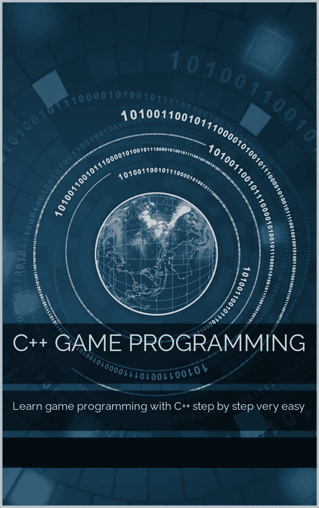

- 引用总结

### 提示

为了检查云完整运行，查看这个改进后的代码。

## 使用 switch 做出决策

我们已经见过 `if`，它可以让我们执行一个代码块。当我们必须根据清晰的结果列表做出决策，且不涉及复杂的组合或宽范围的值时，`switch` 通常是更好的选择。我们开始 `switch` 如下所示：

```cpp
switch(expression)
{
// 更多代码
}
```

在上一个示例中，`expression` 可以是一个实际表达式或变量。然后，在大括号内，我们可以根据表达式或变量的值做出决策。我们使用 `case` 和 `break` 关键字这样做：

```cpp
case x:
// 处理 x break;
case y:
// 处理 y break;
```

你可以从之前的抽象示例中看到，每个 `case` 说明一个可能的结果，每个 `break` 表示该 case 结束以及离开 `switch` 块的点。

我们还可以选择使用不带值的 `default` 关键字，在没有 case 为真的情况下运行某些代码。这是一个示例：

```cpp
default: // 无值
// 如果没有 case 为真，在这里执行 break;
```

作为最后的示例，考虑一个文字冒险游戏，玩家输入字母如 `'n'`、`'e'`、`'s'` 或 `'w'` 来向北、东、南、西移动。可以使用 `switch` 块处理玩家的所有输入，如下：

```cpp
// 从用户处获取名为 command 的字符输入
switch(command){
    case 'n':
        // 在此处移动 break;
    case 'e':
        // 在此处移动 break;
    case 's':
        // 在此处移动 break;
    case 'w':
        // 在此处移动 break;
    // 更多可能的 case
    default:
        // 要求玩家再次尝试 break;
}
```

枚举是逻辑集合中所有可能值的列表。C++ 枚举是……嗯，列举事物的好方法。例如，如果我们的游戏使用只能处于特定值范围的变量，如果这些值逻辑上可以形成一个集合或组，那么使用枚举可能是合适的。它们会让你的代码更清晰且更不容易出错。

在 C++ 中声明一个类枚举（class enumeration），我们需要使用两个关键字 `enum` 和 `class`，后面紧跟枚举的名称，然后是枚举可以包含的值，这些值封装在一对大括号 `{...}` 中。

作为一个示例，来看这个枚举声明。请注意，惯例是将枚举中的所有可能值都写成大写：

```cpp
enum class zombieTypes {REGULAR, RUNNER, CRAWLER, SPITTER, BLOATER };
```

注意，到此时，我们还没有声明 `zombieType` 的任何实例，只是声明了类型本身。如果这听起来很奇怪，可以这样想：SFML 创建了 `Sprite`、`RectangleShape` 和 `RenderWindow` 类，但要使用这些任何一个类，我们必须声明该类的对象/实例。

到此为止，我们创建了一个名为 `zombieTypes` 的新类型，但还没有它的实例。现在让我们现在创建它们吧：

```cpp
zombieType dave = zombieTypes::CRAWLER;
zombieType angela = zombieTypes::SPITTER;
zombieType jose = zombieTypes::BLOATER;
```

/*

僵尸是虚构生物，与现实中任何人的相似完全属巧合

*/

接下来是我们将很快添加到 Timber!!! 中的代码类型抢先预览。我们需要跟踪分支或玩家位于树的哪一侧，因此我们将像下面的示例那样，声明一个名为 `side` 的枚举：

```cpp
enum class side { LEFT, RIGHT, NONE };
```

我们可以如下所示将玩家放在左侧：

```cpp
// 玩家从左侧开始
side playerSide = side::LEFT;
```

我们可以像下面这样，让分支位置数组（数组从 0 开始计数）的第四层完全没有分支：

```cpp
branchPositions[3] = side::NONE;
```

我们也可以在表达式中使用枚举：

```cpp
if(branchPositions[5] == playerSide)
{
    // 最底部的分支与玩家在同一侧 // 被压扁了！！
}
```

我们将查看另一个至关重要的 C++ 主题，然后回到编写游戏代码。

## 开始学习函数

那么 C++ 函数到底是什么呢？函数是变量、表达式和控制流语句（循环和分支）的集合。事实上，我们到目前为止在书中学过的任何代码都可以用于函数。我们编写的函数的第一部分被称为“签名”（signature）。这里有一个函数签名示例：

```cpp
public void bombPlayer(int power, int direction)
```

如果你添加了一对左括号和右大括号 `{...}`，并包含一些函数实际执行的代码，那么我们就有了一个完整的函数，即一个定义：

```cpp
void shootLazers(int power, int direction)
{
    // 砰！
}
```

然后我们就可以在代码的其他部分如下所示使用我们的新函数：

```cpp
// 攻击玩家
bombPlayer(50, 180) // 执行函数中的代码 // 我又回来了 - 函数结束后从这里继续执行代码
```

当我们使用一个函数时，我们称之为为“调用”（call）它。在调用 `bombPlayer` 的点，我们程序的执行跳转到该函数内部的代码。函数将一直运行，直到到达结束或被指示 `return`。然后代码将从函数调用后的第一行继续运行。我们已经在使用 SFML 提供的函数了。这里的不同之处在于，我们将学习编写和调用自己的函数。

这是另一个函数示例，包含了让函数返回到调用它的代码：

```cpp
int addAToB(int a, int b)
{
    int answer = a + b; return answer;
}
```

使用上述函数的调用可能如下：

```cpp
int myAnswer = addAToB(2, 4);
```

显然，我们不需要编写函数来将两个变量相加，但这个示例帮助我们更深入地了解函数的原理。首先，我们传入了值 `2` 和 `4`。在函数签名中，值 `2` 被赋值给 `int a`，值 `4` 被赋值给 `int b`。

在函数体内，变量 `a` 和 `b` 相加，并用于初始化新变量 `int answer`。`return answer;` 这一行正是如此。它将存储在 `answer` 中的值返回给调用代码，导致 `myAnswer` 初始化为值 `6`。

注意上面示例中的每个函数签名都略有不同。其由于是 C++ 函数签名非常灵活，允许我们构建所需的所需的函数。

函数签名具体如何定义函数必须被调用，以及函数是否/如何必须返回一个，值得进一步讨论。让我们给签名的每个部分起一个名字，以便我们可以将其拆解并学习它们。

这里有一个用正式、技术术语描述其部分的函数签名：

`返回类型 | 函数名称 | (参数)`

以下是我们可以用于这些每个部分的几个示例：

- **返回类型 (Return-type)**：`bool`、`float`、`int` 等，或任何 C++ 类型或表达式

- **函数名称 (Name of function)**：`bombPlayer`、`shootLazers`、`setCoordinates`、`addAToB` 等

- **参数 (Parameters)**：`(int number, bool hitDetected)`、`(int x, int y)`、`(float a, float b)`

现在逐一查看每个部分。

## 函数返回类型

返回类型，顾其实名，是从函数返回给调用代码的值类型：

```cpp
int addAToB(int a, int b)
{
    int answer = a + b; return answer;
}
```

在我们之前稍显无聊但实用的 `addAtoB` 中，签名中的返回类型是 `int`。函数 `addAToB` 向调用它的代码发送或返回一个可以放入 `int` 变量的值。返回类型可以是我们到为止见过的任何 C++ 类型，或者是我们尚未见过的类型之一。

然而，函数并不一定返回值。在这种情况下，签名必须使用 `void` 关键字作为返回类型。当使用 `void` 关键字时，函数体不能尝试返回值，因为会导致错误。然而，它可以使用不带值的 `return` 关键字。以下是返回类型和 `return` 关键字使用的的一些有效组合：

```cpp
void doWhatever()
{
    // 我们的代码
    // 我在这里结束并返回调用代码 // 不需要返回
}
```

另一种可能性如下：

```cpp
void doSomethigCool()
{
    // 我们的代码 // 只要我不尝试添加一个返回值，我就可以这样做
}
```

接下来的代码为我们提供了更多可能的函数示例。请务必阅读注释以及代码：

```cpp
void doYetAnotherThing()
{
    // 一些代码
    if(someCondition) {
        // 如果 someCondition 为真，返回到调用代码 // 在函数体结束之前
        return;
    }
    // 可能执行也可能不执行的代码
    return;
    // 因为我在函数体的底部 // 并且返回类型是 void，我
    // 真的没必要，但我想我这样做 // 明确函数已经结束了。
}

bool detectCollision(Ship a, Ship b) {
    // 检测是否发生了碰撞
    if(collision)
    {
        // 砰！！！返回 true; 
    }
    else
    {
        // 错过了
        return false;
    }
}
```

上面的最后一个函数示例 `detectCollision` 是我们 C++ 代码近未来的一瞥，并证明了我们也可以向函数传递用户定义的类型（称为“对象” `objects`）以对它们进行计算。

我们可以依次这样调用上面的每个函数：

```cpp
// 好，该时候调用一些函数了
doWhatever();
doSomethingCool();
doYetAnotherThing();

if (detectCollision(milleniumFalcon, lukesXWing)) {
    // 绝地武完蛋了！
    // 但总有莱娅。 // 除非她在千年夺战机上？
}
else
{
    // 活到另一天战斗
}
// 从这里继续代码
```

不要担心关于 `detectCollision` 函数看起来奇怪的语法，我们很快就会看到这样的真实代码。简单来说，我们正将返回值（`true` 或 `false`）作为表达式直接用在 `if` 语句中。

## 函数名称

当我们设计自己的函数时，函数名称可以是任何内容。但最好使用单词（通常是动词）来清楚地解释函数将做什么。例如，看这个函数：

```cpp
void functionaroonieboonie(int blibbityblob, float floppyfloatything)
{
    //code here
}
```

上述代码是完全合法的并且可以运行，但下面这些函数名称要清晰得多：

```cpp
void doSomeVerySpecificTask()
{
    //code here
}

void getMySpaceShipHealth()
{
    //code here
}

void startNewGame()
{
    //code here
}
```

接下来，让我们仔细观察我们如何与函数共享某些值。

## 函数参数

我们知道函数可以向调用代码返回结果。但如果我们需要从调用代码向函数共享一些数据值，该怎么办呢？`Parameters`（参数）允许我们与函数共享这些值。实际上，我们在查看返回类型时已经看到过参数的示例了。我们再更仔细地看同一个例子：

```cpp
int addAToB(int a, int b)
{
    int answer = a + b; return answer;
}
```

在上方，参数是 `int a` 和 `int b`。注意，在函数体的第一行中，我们使用 `a + b` 就像它们已经是声明并初始化的变量一样。没错，它们确实如此。函数签名中的参数是它们的声明，而调用函数的代码则初始化了它们。

### 提示

### 重要术语说明

注意，我们将函数签名括号 `(int a, int b)` 中的变量称为参数（parameters）。当我们从调用代码向函数传递值时，这些值被称为实参（arguments）。当实参传达时，它们被称为形参（parameters），并被用于初始化真实的、可用的变量：`int returnedAnswer = addAToB(10,5);`。

此外，正如我们在之前的示例中部分看到的，我们并不非得在参数中只使用 `int`。我们可以使用任何 C++ 类型。我们也可以根据需要使用任意数量的参数解决问题，但将参数列表保持尽可能短且易于管理是一个良好的习惯。正如我们将在后续章节中看到的，在这段入门教程中，我们遗留了一些更酷炫的函数用法，以便在深入探讨函数主题之前，先学习相关的 C++ 概念。

## 函数体

函数体就是我们一直通过类似 `// code here` 的注释来规避的部分。

```cpp
// some code
```

但实际上，我们已经确切知道在这里要做什么了！我们目前为止学过的任何 C++ 代码都能函数体内运行。

## 函数原型

我们已经看到了如何编写函数，也学会了如何调用函数。然而，为了让它们工作，我们还有一件事要做。所有函数必须有一个 `prototype`（原型）。原型是让编译器感知我们函数的机制；没有原型，整个游戏将无法编译。幸运的是，原型非常直观。

我们可以简单地重复函数的签名，并在后面加一个分号。要注意，原型必须在尝试调用或定义函数之前出现。因此，一个完全可用的函数的最简单示例如下。仔细观察注释以及函数的不同部分出现在代码中的位置：

```cpp
// 原型
// 注意分号
int addAToB(int a, int b);

int main()
{
    // 调用函数
    // 将结果存储在 answer 中 int answer = addAToB(2,2);
    // 在定义之前被调用
    // 但因为有原型，这是可以的
    // Exit main return 0;
} // main 结束

// 函数定义
int addAToB(int a, int b) {
    return a + b; 
}
```

前面的代码演示了以下内容：

- 原型在 `main` 函数之前。

- 使用函数的调用正如我们预期的，在 `main` 函数内部。

- 定义在 `main` 函数之后/之外。

### 备注

注意，当定义在函数使用之前发生时，我们可以省略函数原型直接进入定义。然而，随着我们的代码变得越来越长并分布在多个文件中，这种情况几乎永远不会发生。我们将始终使用独立的原型和定义。

让我们看看如何保持函数的组织性。

### 组织函数

值得指出的是，如果我们有多个函数，尤其是当它们相当长时，我们的 `.cpp` 文件将迅速变得难以管理。这违背了函数设计的初衷之一。我们在下一个项目中看到的解决方案是：我们可以将所有的函数原型添加到我们自己的头文件中（`.hpp` 或 `.h`）。函数代码与调用代码之间共享值是通过参数/实参和返回值。当一个变量因为来自另一个函数而不可时，称它“超出作用域”（out of scope）。当它可用且可操作时，称它“在作用域内”（in scope）。

实际上，在 C++ 中在任何块内声明的变量只在该块内具有作用域！这包括循环和 `if` 块。在 `main` 顶部声明的变量在 `main` 的任何地方都在作用域内。在游戏循环中声明的变量只在游戏循环内作用域，以此类推。在函数或其他块内声明的变量被称为 `local`（局部）变量。我们写的代码越多，这一点就越明显。每当我们在代码中遇到关于作用域的问题时，我都会讨论它以使其清晰。在下一节中就会出现这样一个问题。而且还有一些 C++ 基础知识会彻底揭开这个问题。它们被称为 `references`（引用）和 `pointers`（指针），我们将在分别在第 7 章：*C++ 引用、精灵帧和顶点数组*以及第 8 章：*指针、标准模板库和纹理管理*中学习它们。

## 关于函数的结语 - 暂时如此

关于函数我们能学的还有很多，但我们对它们的了解已经足够实现游戏的下一部分了。如果参数、签名、定义等所有技术术语还没有完全吸收，请不要担心。当我们开始使用它们时，概念会变得更加清晰。

## 关于函数的绝对结语 - 暂时如此

你可能没有注意到，我们在调用函数（特别是 SFML 函数）时，是在对象名称后面加上一个点再加函数名，如下所示：

```cpp
spriteBee.setPosition...
window.draw...
// 等
```

然而，我们对函数的整个讨论是在没有任何对象的情况下调用函数的。我们可以将函数作为类的一部分，也可以简单地作为一个独立函数。当我们把函数作为类的一部分时，我们需要该类的对象来调用函数，而独立函数则不需要。

我们很快就会编写一个独立函数，并从第 6 章：*面向对象编程、类和 SFML 视图*开始编写类函数。我们目前为止关于函数的所有知识在两种情况下都适用。

## 生长分支

接下来，正如我过去十七页所承诺的那样，我们将使用所有新的 C++ 技术来在树上绘制和移动一些分支。


将此代码添加到`main`函数之外。为了绝对清楚，我指的是在代码`int main()`之前：

```cpp
#include "stdafx.h"
#include <sstream>
#include <SFML/Graphics.hpp>

using namespace sf;

// 函数声明
void updateBranches(int seed);

const int NUM_BRANCHES = 6;

Sprite branches[NUM_BRANCHES];

// 玩家/分支在哪里？
// 左侧或右侧
```

```cpp
enum class side { LEFT, RIGHT, NONE };

side branchPositions[NUM_BRANCHES];

int main()
{
```

通过这段新代码，我们实现了一些功能：

首先，我们为名为`updateBranches`的函数编写了函数原型。我们可以看到它没有返回值（`void`），并且接受一个名为`seed`的`int`类型参数。我们将很快编写该函数的定义，然后就能确切地看到它的作用。接下来，我们声明了一个名为`NUM_BRANCHES`的常量`int`，并将其初始化为`6`。树上会有六个移动的分支，我们很快就会看到`NUM_BRANCHES`将对我们很有用。

随后，我们声明了一个名为`branches`的`Sprite`对象数组，它可以容纳六个`Sprites`。

之后，我们声明了一个名为`side`的新枚举，具有三个可能的值：`LEFT`、`RIGHT`和`NONE`。这将在代码中的几处用于描述单个分支以及玩家的位置。

最后，在之前的新代码中，我们初始化了一个大小为`NUM_BRANCHES`（6）的`side`类型数组。为了明确其实现的效果：我们将有一个名为`branchPositions`的数组，其中包含六个值。这些每个值都是`side`类型，可以是`LEFT`、`RIGHT`或`NONE`。

### Note

当然，你真正想知道的是为什么这些常量、两个数组和枚举被声明在`main`函数之外。通过将它们声明在`main`之上，它们现在具有**全局作用域**（global scope）。或者换句话说，常量、两个数组和枚举在整个游戏范围内有效。这意味着我们可以在`main`函数和`updateBranches`函数中的任何地方访问并使用它们。请注意，将所有变量尽可能限制在它们实际使用的范围内是一种良好的做法。将所有内容都变为全局的似乎有用，但这会导致代码难以阅读且容易出错。

## 准备分支

现在我们将准备这六个`Sprite`对象并将它们加载到`branches`数组中。在我们的游戏循环之前添加高亮的代码：

```cpp
// Position the text

FloatRect textRect = messageText.getLocalBounds();
messageText.setOrigin(textRect.left + textRect.width / 2.0f, textRect.top + textRect.height / 2.0f);

messageText.setPosition(1920 / 2.0f, 1080 / 2.0f);

scoreText.setPosition(20, 20);

// Prepare 6 branches

Texture textureBranch;

textureBranch.loadFromFile("graphics/branch.png");

// Set the texture for each branch sprite

for (int i = 0; i < NUM_BRANCHES; i++)
{
    branches[i].setTexture(textureBranch);
    branches[i].setPosition(-2000, -2000);
    // Set the sprite's origin to dead center
    // We can then spin it round without changing its position
    branches[i].setOrigin(220, 20);
}
```

```cpp
while (window.isOpen())
{
```

之前的代码没有使用任何新概念。首先，我们声明了一个`SFML Texture`对象并将`branch.png`图形加载其中。

接下来，我们创建了一个`for`循环，它将`i`设置为0，并在每次循环时将`i`加1，直到`i`不再小于`NUM_BRANCHES`。这是完全正确的，因为`NUM_BRANCHES`是6，且`branches`数组的索引是从0到5。

在`for`循环内部，我们使用`setTexture`为`branches`数组中的每个`Sprite`设置`Texture`，然后使用`setPosition`将其隐藏在屏幕外。

最后，我们使用`setOrigin`将原点（绘制时所在的点）设置为sprite的中心。很快，我们将旋转这些sprite，而原点在中心意味着它们会很自然地旋转，而不会改变sprite的位置。

## 每帧更新分支sprite

在接下来的代码中，我们根据每个sprite在`branches`数组中的位置以及相应的`branchPositions`数组中`side`的值，设置数组中所有sprite的位置。添加高亮的代码并尝试理解它，然后我们再详细分析：

```cpp
// Update the score text

std::stringstream ss;

ss << "Score: " << score;

scoreText.setString(ss.str());

// update the branch sprites

for (int i = 0; i < NUM_BRANCHES; i++) {
    float height = i * 150;

    if (branchPositions[i] == side::LEFT) {
        // Move the sprite to the left side
        branches[i].setPosition(610, height);
        // Flip the sprite round the other way
        branches[i].setRotation(180);
    }
    else if (branchPositions[i] == side::RIGHT) {
        // Move the sprite to the right side
        branches[i].setPosition(1330, height);
        // Set the sprite rotation to normal
        branches[i].setRotation(0);
    }
    else
    {
        // Hide the branch
        branches[i].setPosition(3000, height);
    }
}
} // End if(!paused)
```

### 绘制场景

我们刚刚添加的代码是一个大的`for`循环，它将`i`设置为0，每次循环将`i`加1，并一直持续到`i`不小于6为止。

在`for`循环内部，一个名为`height`的新`float`变量被设置为`i * 150`。这意味着第一个分支的高度为0，第二个为150，第六个为750。

接下来，我们有一组`if`和`else`块结构。查看剥离代码后的结构：

```cpp
if()
{
}
else if()
{
}
else
{
}
```

第一个`if`使用`branchPositions`数组查看当前分支是否应该在左侧。如果是，它会将`branches`数组中对应的`Sprite`设置到屏幕上适合左侧的位置（610像素）以及当前的高度。然后，它将sprite旋转180度，因为`branch.png`图形默认是向右延伸的。

`else if`仅在分支不在左侧时执行。它使用相同的方法检查它是否在右侧。如果是，则将分支绘制在右侧（1330像素）。然后，将sprite的旋转角度设置为0度，以防它之前是180度。如果x坐标看起来有点奇怪，请记住我们已经将分支sprite的原点设置为了它们的中心。

最后的`else`正确地假设当前的`branchPosition`必须是`NONE`，并将分支隐藏在屏幕外3000像素处。

此时，我们的分支已经就位，准备好绘制。

## 绘制分支

在这里我们使用另一个`for`循环从0到5遍历整个`branches`数组并绘制每个分支sprite。添加以下代码：

```cpp
// Draw the clouds

window.draw(spriteCloud1);

window.draw(spriteCloud2);

window.draw(spriteCloud3);

// Draw the branches

for (int i = 0; i < NUM_BRANCHES; i++)
{
    window.draw(branches[i]);
}

// Draw the tree

window.draw(spriteTree);
```

当然我们还没有编写真正移动所有分支的函数。一旦编写了该函数，我们还需要确定何时以及调用它。让我们解决第一个问题并编写该函数。

## 移动分支

我们已经在`main`函数上方添加了函数原型。现在我们编写该函数的实际定义，该函数每次调用时都会将所有分支向下移动位置。我们将分两部分编写此函数，以便更容易观察正在发生的情况。

```cpp
// Function definition

void updateBranches(int seed)
{
    // Move all the branches down one place
    for (int j = NUM_BRANCHES-1; j > 0; j--) {
        branchPositions[j] = branchPositions[j - 1];
    }
}
```

在函数的第一个部分，我们简单地将所有分支逐个向下移动，从第六个分支开始。这是通过让`for`循环从5计数到0实现的。代码`branchPositions[j] = branchPositions[j - 1]`执行了实际移动。

上代码注意的另一个点是，当我们把位置4的分支移动到位置5，然后将位置3的分支移动到位置4，以此类推后，我们需要在位置0（即树的顶部）添加一个新分支。

现在我们可以在树的顶部生成一个新的分支。添加高亮的代码，然后我们来讨论一下它：

```cpp
// Function definition

void updateBranches(int seed)
{
    // 将所有分支向下移动一个位置
    for (int j = NUM_BRANCHES-1; j > 0; j--)
    {
        branchPositions[j] = branchPositions[j - 1];
    }
    // 在位置0生成新分支
    // 左、右或无

    srand((int)time(0)+seed);
    int r = (rand() % 5);
    switch (r)
    {
    case 0:
        branchPositions[0] = side::LEFT;
        break;
    case 1:
        branchPositions[0] = side::RIGHT;
        break;
    default:
        branchPositions[0] = side::NONE;
        break;
    }
}
```

在`updateBranches`函数的最后部分，我们使用了通过函数调用传入的整数变量`seed`。这样做是为了保证随机数种子总是不同的，我们将在下一章中学习这个值是如何得到的。

接下来，我们生成一个零到四之间的随机数，并将结果存储在整数变量`r`中。现在我们使用`r`作为表达式进行切换。

`case`语句意味着，如果`r`等于零，我们就在树的顶部的左侧添加新分支。如果`r`等于1，则分支位于右侧。如果`r`是其他任何值（2、3或4），则通过`default`确保顶部不会添加分支。这种左、右、无的平衡让树看起来非常真实，游戏也运行得相当不错。你可以轻松地修改代码，让分支出现的频率更高或更低。

即使写了所有这些关于分支的代码，我们仍然无法在游戏中看到其中任何一个分支。这是因为在实际调用`updateBranches`之前，我们还有更多工作要做。

如果你现在就想看到分支，可以在游戏循环之前添加一些临时代码，并调用函数五次，每次使用一个唯一的种子：

```cpp
updateBranches(1);
updateBranches(2);
updateBranches(3);
updateBranches(4);
updateBranches(5);

while (window.isOpen()) {
```

现在你可以看到分支在它们的位置了。但如果让分支真正移动起来，我们需要定期调用`updateBranches`。

### 提示

在继续之前，忘记移除临时代码。

现在我们可以将注意力转向玩家，并真正调用`updateBranches`函数了。

## 第5章 碰撞、声音与结束条件 – 让游戏可玩

这是第一个项目的最后阶段。到本章结束时，你将拥有第一个完整的游戏。一旦Timber!!!运行起来，务必阅读本章的最后部分，因为它将提供改进游戏的方法。我们将学习以下主题：

- 添加剩余的精灵
- 处理玩家输入
- 为飞行的木头制作动画
- 处理死亡
- 添加音效
- 添加功能并改进Timber!!!

## 准备玩家（以及其他精灵）

让我们添加玩家精灵的代码，同时再添加几个精灵和纹理。接下来的这段相当大的代码还添加了一个玩家被压扁时使用的墓碑精灵、一个用于砍伐的斧头精灵，以及一个在玩家每次砍伐时都会飞出去的木头精灵。

注意，在`spritePlayer`对象之后，我们还声明了一个`side`变量`playerSide`，用来跟踪玩家当前所在的位置。此外，我们为`spriteLog`对象添加了一些额外的变量，包括`logSpeedX`、`logSpeedY`和`logActive`，用于存储木头移动的速度以及它当前是否正在移动。`spriteAxe`还有两个相关的浮点常量变量，用于记住左右两侧的理想像素位置。

正如我们之前经常做的那样，在`while(window.isOpen())`代码之前添加这段代码块。注意，接下来的列表中的所有代码都是新的，而不只是高亮的代码。我没有为接下来的代码块提供额外的上下文，因为`while(window.isOpen())`应该很容易识别。高亮的代码就是我们刚刚专门讨论的代码。

将此代码的全部添加到`while(window.isOpen())`行之前，并在脑海中记住我们简要讨论过的高亮行。这将使本章剩余的代码变得更易理解：

```cpp
// Prepare the player
Texture texturePlayer;
texturePlayer.loadFromFile("graphics/player.png");
Sprite spritePlayer;
spritePlayer.setTexture(texturePlayer);
spritePlayer.setPosition(580, 720);

// Prepare the gravestone
Texture textureRIP;
textureRIP.loadFromFile("graphics/rip.png");
Sprite spriteRIP;
spriteRIP.setTexture(textureRIP);
spriteRIP.setPosition(600, 860);

// The player starts on the left side
playerSide = side::LEFT;

// Prepare the axe
Texture textureAxe;
textureAxe.loadFromFile("graphics/axe.png");
Sprite spriteAxe;
spriteAxe.setTexture(textureAxe);
spriteAxe.setPosition(700, 830);

// Line the axe up with the tree
const float AXE_POSITION_LEFT = 700;
const float AXE_POSITION_RIGHT = 1075;

// Prepare the flying log
Texture textureLog;
textureLog.loadFromFile("graphics/log.png");
Sprite spriteLog;
spriteLog.setTexture(textureLog);
spriteLog.setPosition(810, 720);

// Some other useful log related variables
bool logActive = false;
float logSpeedX = 1000;
float logSpeedY = -1500;
```

现在我们可以绘制我们所有的新精灵了。

## 绘制玩家和其他精灵

在我们添加移动玩家和使用所有新精灵的代码之前，让我们先画出它们。这样，当我们添加代码来更新/更改/移动精灵时，我们就能看到发生了什么。

添加高亮的代码来绘制这四个新精灵：


```cpp
// Draw the tree
window.draw(spriteTree);

// Draw the player
window.draw(spritePlayer);
// Draw the axe
window.draw(spriteAxe);

// Draraw the flying log
window.draw(spriteLog);

// Draw the gravestone
window.draw(spriteRIP);

// Draw the bee
window.draw(spriteBee);
```

运行游戏，你将在场景中看到我们的新精灵。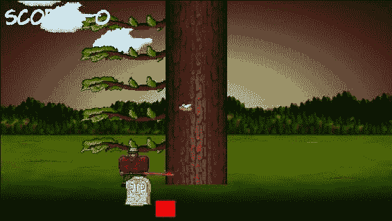 我们现在非常接近可以运行的游戏了。

## 处理玩家输入

许多不同的事情都取决于玩家的移动，例如何时显示斧头、何时开始为木头制作动画，以及何时将所有分支向下移动位置。因此，为玩家的砍伐设置键盘处理是有合理的。一旦完成，我们可以将刚才提到的所有功能放在代码的同一部分。

让我们思考一下我们如何检测键盘按键。在每一帧中，我们测试特定的键盘按键当前是否被按下。如果是，我们就采取行动。如果`Esc`键被按下，我们就退出游戏，或者如果`Enter`键被按下，我们就重启游戏。到目前为止，这已经足够满足我们的需求。

然而，当我们尝试处理砍树时，这种方法存在一个问题。这个问题一直都在那里，只是直到现在变得重要。取决于你电脑的性能，游戏循环每秒可以执行数千次。在按键期间的每一次游戏循环中，都会被检测到并执行相关的代码。

所以实际上，每当你按下`Enter`重启游戏时，你很可能重启了它好百次以上。这是因为即使是最短暂的按下也会持续相当的时间。你可以通过运行游戏并按住`Enter`键来验证这一点。注意时间条没有移动。这是因为游戏正在一次又一次地重启，每秒数百次甚至数千次。

如果我们不对玩家的砍树操作使用不同的方法，那么仅仅尝试一次砍击就会在几分之一秒内让整棵树倒下。我们需要更复杂一些。我们要做的的是允许玩家进行砍树，当他执行操作时，禁用检测按键的代码。然后我们将检测玩家何时从按键上松开手指，并重新启用按键检测。以下是清晰列出的步骤：

1. 等待玩家使用左或右箭头键砍击木头。
2. 当玩家砍树时，禁用按键检测。
3. 等待玩家将手指离开按键。
4. 重新启用砍树检测。
5. 从步骤 1 步重复。

这听起来可能很复杂，但在 SFML 的帮助下，它将非常简单。让我们现在一步一步地实现它。

添加高亮行代码，它声明了一个布尔变量`acceptInput`，它将用于判断何时监听砍树操作，何时忽略它们：

```cpp
float logSpeedX = 1000;
float logSpeedY = -1500;
// 控制玩家输入
bool acceptInput = false;
while (window.isOpen())
```

现在我们已经设置好了布尔值，可以进入下一步了。

## 处理新游戏的设置

现在我们准备好处理砍树操作了，将高亮代码添加到启动新游戏的 `if` 块中：

```cpp
/*
****************************************
处理玩家输入
****************************************
*/
if (Keyboard::isKeyPressed(Keyboard::Escape))
{
    window.close();
}

// 开始游戏
if (Keyboard::isKeyPressed(Keyboard::Return))
{
    paused = false;
    // 重置时间和分数 score = 0;
    timeRemaining = 6;
    // 让所有分支消失
    for (int i = 1; i < NUM_BRANCHES; i++) {
        branchPositions[i] = side::NONE;
    }
    // 确保墓碑隐藏
    spriteRIP.setPosition(675, 2000);
    // 将玩家移动到位置
    spritePlayer.setPosition(580, 720);
    acceptInput = true;
}
****************************************
```

## 更新场景

在之前的代码中，我们使用 `for` 循环来设置没有分支的树。这对玩家是公平的，因为如果游戏开始时他头顶正好有一个分支，这会被认为是不公平的。然后我们只需将墓碑移出屏幕，并将玩家移动到左侧的起始位置。这段新代码做的最后件事是将`acceptInput`设置为`true`。我们现在准备好接收砍树按键按下了。

## 检测玩家砍树

现在我们可以准备处理左、右光标键按下了。添加这个简单的 `if` 块，它只在`acceptInput`为`true`时执行：

```cpp
// 开始游戏
if (Keyboard::isKeyPressed(Keyboard::Return))
{
    paused = false;
    // 重置时间和分数 score = 0;
    timeRemaining = 5;
    // 让所有分支消失
    for (int i = 1; i < NUM_BRANCHES; i++) {
        branchPositions[i] = side::NONE;
    }
    // 确保墓碑隐藏
    spriteRIP.setPosition(675, 2000);
    // 将玩家移动到位置
    spritePlayer.setPosition(675, 660);
    acceptInput = true;
}

// 封装玩家控制以 确保我们正在接受输入
if (acceptInput)
{
    // 接下来这里会有代码...
}
```

```cpp
**************************************** 更新场景
**************************************** 
```

现在，在我们刚刚编写的 `if` 块内部，添加高亮代码来处理当玩家按下键盘上的右光标键 (→) 时会发生的情况：

```cpp
// 封装玩家控制以
// 确保我们正在接受输入
if (acceptInput)
{
    // 接下来这里会有代码...
    // 首先处理按下右光标键
    if (Keyboard::isKeyPressed(Keyboard::Right)) {
        // 确保玩家在右侧
        playerSide = side::RIGHT;
        score ++;
        // 增加剩余时间
        timeRemaining += (2 / score) + .15;
        spriteAxe.setPosition(AXE_POSITION_RIGHT, spriteAxe.getPosition().y);
        spritePlayer.setPosition(1200, 720);
        // 更新分支
        updateBranches(score);
        // 设置木头向左飞行
        spriteLog.setPosition(810, 720);
        logSpeedX = -5000;
        logActive = true;
        acceptInput = false;
    }
    // 处理左光标键
}
```

之前的代码中发生了很多操作，让我们过过一遍。首先，我们检测玩家是否在树的右侧进行了砍击。如果是，我们将`playerSide`设置为`side::RIGHT`。我们将在代码的后半部分对`playerSide`的值做出响应。

然后，我们通过`score ++`给分数加 1。下一行代码有点神秘，但它所做的仅仅只是增加了剩余时间量。我们正在奖励玩家的行动。然而，对于玩家来说，问题是分数越高，增加的额外时间越少。你可以调整这个公式来让游戏更容易或更难。

然后，通过`spriteAxe.setPosition`将斧头移动到它的右侧位置，玩家精灵也被移动到了右侧位置。

接下来，我们调用`updateBranches`将所有分支向下移动一个位置，并在树的顶部生成一个新的随机分支（或空格）。

然后，`spriteLog`被移动到它的起始位置，并与树融合，它的`logSpeedX`变量被设置为负数，这样它就会向左飞去。同时，`logActive`被设置为`true`，以便我们很快就会编写的木头移动代码每帧处理木头的动画。

最后，将`acceptInput`设置为`false`。此时，玩家不能再进行砍击了。我们解决了按键检测过于频繁的问题，很快就会看到如何重新启用砍树。

现在，在我们刚刚编写的`if(acceptInput)`块内部，添加高亮代码来处理当玩家按下键盘上的左光标键 (←) 时会发生的情况：

```cpp
// 处理左光标键
if (Keyboard::isKeyPressed(Keyboard::Left)) {
    // 确保玩家在左侧
    playerSide = side::LEFT;
    score++; // 增加剩余时间
    timeRemaining += (2 / score) + .15;
    spriteAxe.setPosition(AXE_POSITION_LEFT, spriteAxe.getPosition().y);
    spritePlayer.setPosition(580, 720);
    // 更新分支
    updateBranches(score);
    // 设置木头飞行
    spriteLog.setPosition(810, 720);
    logSpeedX = 5000;
    logActive = true;
    acceptInput = false;
}
```

之前的代码与处理右侧砍击的代码完全相同，只是精灵的位置不同，且`logSpeedX`变量被设置为正值，这样木头就会向右侧飞去。

## 检测按键释放

为了让上述操作在第一次砍击之后仍然有效，我们需要检测玩家何时释放按键，并将`acceptInput`设置回`true`。

这与我们到为止看到的按键处理略有不同。SFML 有两种不同的检测玩家键盘输入的方法。第一种我们已经看过了。它是动态且即时的，正是我们对按键按下做出立即响应所需要的。

下一个代码使用了另一种方法。将以下高亮代码输入“处理玩家输入”部分的顶部，然后我们来过一遍：

```cpp
/*
****************************************
处理玩家输入
****************************************
*/
Event event;
while (window.pollEvent(event))
{
    if (event.type == Event::KeyReleased && !paused) {
        // 再次监听按键
        acceptInput = true;
        // 隐藏斧头
        spriteAxe.setPosition(2000, spriteAxe.getPosition().y);
    }
}

if (Keyboard::isKeyPressed(Keyboard::Escape))
{
    window.close();
}
```

首先，我们声明一个类型为`Event`的对象对象`event`。然后，我们调用`window.pollEvent`函数并传入我们新创建的对象`event`。`pollEvent`函数会将数据放入`event`对象中，该对象描述了一个操作系统事件。这可能是按键按下、按键释放、鼠标移动、鼠标点击、游戏控制器操作，或者窗口本身发生的事件（例如窗口大小缩放等）。

我们之所以将代码封装在`while`循环中，是因为队列中可能存储了许多事件。`window.pollEvent`函数会将它们一个接一个加载到`event`中。在每次循环中，我们会检查是否对当前事件感兴趣，如果感兴趣，就会做出响应。当`window.pollEvent`返回`false`时，意味着队列中没有更多事件，`while`循环将退出。

此`if`条件`(event.type == Event::KeyReleased && !paused)`在按键被释放且游戏未暂停时为真。

在`if`块内部，我们将`acceptInput`设回`true`，并将`ax`精灵隐藏到屏幕外。

你现在可以运行游戏，并凝视着移动的树、挥动的斧头以及动画玩家了。然而，它并不会压死玩家，而且木头在被砍中时也需要移动。

## 让被砍中的木头和斧头动

当玩家砍击时，`logActive`被设置为`true`，因此我们可以将一些代码封装在一个只在`logActive`为`true`时才执行的块中。此外，每次砍击都会将`logSpeedX`设置为正数或负数，这样木头就准备朝着正确的方向从树上飞出去。

在我们更新分支精灵之后，添加以下这段高亮代码：

```cpp
// update the branch sprites
for (int i = 0; i < NUM_BRANCHES; i++)
{
    float height = i * 150;
    if (branchPositions[i] == side::LEFT) {
        // Move the sprite to the left side branches[i].setPosition(610, height);
        // Flip the sprite round the other way branches[i].setRotation(180);
    }
    else if (branchPositions[i] == side::RIGHT) {
        // Move the sprite to the right side branches[i].setPosition(1330, height);
        // Flip the sprite round the other way branches[i].setRotation(0);
    }
    else {
        // Hide the branch
        branches[i].setPosition(3000, height); 
    }
}

// Handle a flying log if (logActive)
{
    spriteLog.setPosition(
        spriteLog.getPosition().x + (logSpeedX * dt.asSeconds()),
        spriteLog.getPosition().y + (logSpeedY * dt.asSeconds())
    );
    // Has the log reached the right hand edge? if (spriteLog.getPosition().x < -100 || spriteLog.getPosition().x > 2000)
    {
        // Set it up ready to be a whole new log next frame logActive = false;
        spriteLog.setPosition(810, 720);
    }
} // End if(!paused)
```

```cpp
/*
**************************************** Draw the scene
**************************************** */
```

该代码通过`getPosition`获取精灵当前的`x`和`y`位置，然后分别加上`logSpeedX`和`logSpeedY`乘以`dt.asSeconds`后的值来设置精灵的位置。

在每一帧移动木头精灵后，代码使用一个`if`块来检查精灵是否从左侧或右侧消失在视野。如果是，木头将移回起始点，为下一次砍击做好准备。

如果你运行游戏，你将看到木头向屏幕的某侧飞出。

## 处理死亡

每个游戏都会有一个糟糕的收场，要么是玩家时间耗尽（我们已经处理过了），要么是被分支压死。

检测玩家被压死非常简单。我们只需要知道`branchPositions`数组中的最后一个分支是否等于`playerSide`。如果是，玩家就没了。

添加检测此情况的高亮代码，然后我们将讨论当玩家被压死时我们所做的一切：


```cpp
// Handle a flying log
if (logActive)
{
    spriteLog.setPosition(
        spriteLog.getPosition().x + (logSpeedX * dt.asSeconds()), 
        spriteLog.getPosition().y + (logSpeedY * dt.asSeconds())
    );
    // Has the log reached the right hand edge? if (spriteLog.getPosition().x < -100 || spriteLog.getPosition().x > 2000)
    {
        // Set it up ready to be a whole new cloud next frame logActive = false;
        spriteLog.setPosition(800, 600);
    }
}

// Has the player been squished by a branch? if (branchPositions[5] == playerSide) {
    // death
    paused = true;
    acceptInput = false;
    // Draw the gravestone
    spriteRIP.setPosition(525, 760);
    // hide the player spritePlayer.setPosition(2000, 660);
    // Change the text of the message messageText.setString("SQUISHED!!");
    // Center it on the screen
    FloatRect textRect = messageText.getLocalBounds();
    messageText.setOrigin(textRect.left + textRect.width / 2.0f, textRect.top + textRect.height / 2.0f);
    messageText.setPosition(1920 / 2.0f, 1080 / 2.0f);
}
} // End if(!paused)
```

```cpp
/*
**************************************** Draw the scene
**************************************** */
```

在玩家死亡后，代码执行的第一件事是将`paused`设为`true`。现在循环将完成这一帧，并在玩家重新开始游戏之前，不会再次运行循环的更新部分。

然后，我们将墓碑移动到玩家站立的位置附近，并将玩家精灵隐藏到屏幕外。

我们将`messageText`的字符串设置为“SQUISHED!!”，然后使用通常的技术将其在屏幕上居中。

你现在可以运行并真正玩游戏了。这张图片显示了玩家的最终得分、墓碑以及`SQUISHED`消息。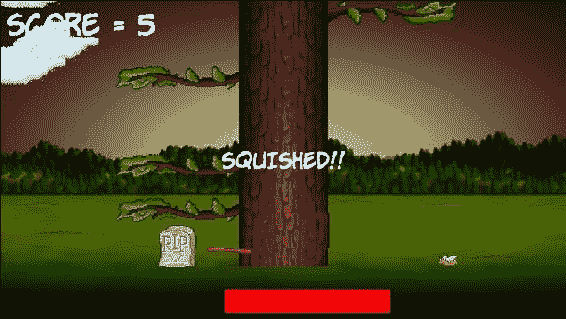 还有一个问题。是我错觉吗，还是确实有点安静？

## 简单音效

我们将添加三个声音。每个声音会在特定的游戏事件播放：玩家砍击时播放一个简单的“咚”声，玩家时间耗尽时播放一个忧郁的失败声，玩家被压死时则播放一个复古的破碎声。

### SFML 音效是如何工作的？

SFML 使用两个不同的类来播放音效。第一个类是`SoundBuffer`类。该类持有来自声音文件的实际音频数据。是`SoundBuffer`负责将`.wav`文件加载到 PC 内存中，并转换为无需进一步解码工作即可播放的格式。

稍后，当我们为音效编写代码时，我们会发现一旦我们有了一个存储了声音的`SoundBuffer`对象，就会创建另一个类型为`Sound`的对象。我们可以将这个`Sound`对象与`SoundBuffer`对象关联。然后，在代码的适当时刻，我们就可以调用相应`Sound`对象的`play`函数。

## 何时播放声音

正如我们很快就会看到的，加载和播放声音的 C++ 代码非常简单。然而，我们需要考虑的是何时调用`play`函数。在代码的哪个位置放置播放的函数调用？以下是我们想要实现的一些功能：

- 砍击声可以通过左、右方向键的按下事件来调用

- 死亡声可以在检测树木撞到玩家的`if`块中播放

- 时间耗尽声可以在检测`timeRemaining`小于零的`if`块中播放

现在我们可以写编写声音代码了。

## 添加声音代码

首先，我们添加另一个`#include`指令以使 SFML 音效相关的类可用。添加以下高亮代码：

```cpp
#include "stdafx.h"
#include <sstream>
#include <SFML/Graphics.hpp>
#include <SFML/Audio.hpp>

using namespace sf;
```

现在，我们声明三个不同的`SoundBuffer`对象，向它们加载三个不同的声音文件，并将三个不同类型为`Sound`的对象与相关的`SoundBuffer`对象关联。添加以下高亮代码：

```cpp
// Control the player input
bool acceptInput = false;

// Prepare the sound
SoundBuffer chopBuffer;
chopBuffer.loadFromFile("sound/chop.wav");
Sound chop;
chop.setBuffer(chopBuffer);

SoundBuffer deathBuffer;
deathBuffer.loadFromFile("sound/death.wav");
Sound death;
```

```
death.setBuffer(deathBuffer);
```

// 超时

```cpp
SoundBuffer ootBuffer;

ootBuffer.loadFromFile("sound/out_of_time.wav");

Sound outOfTime;

outOfTime.setBuffer(ootBuffer);

while (window.isOpen())
{
现在我们可以播放第一个音效了。在检测玩家已按下左方向键的`if`块旁边，添加如下所示的单行代码：
// 包装玩家控制 // 确保我们正在接受输入
if (acceptInput) // Wrap the player controls to // Make sure...

{
    // 接下来还有更多代码...
    // 首先处理按下右方向键的情况
if (Keyboard::isKeyPressed(Keyboard::Right)) { // First handle pressing the right cursor key
    // 确保玩家在右侧
playerSide = side::RIGHT; // Make sure the player is on the right
    
    score++;
    timeRemaining += (2 / score) + .15;
    spriteAxe.setPosition(AXE_POSITION_RIGHT, spriteAxe.getPosition().y);
    spritePlayer.setPosition(1120, 660);
    // 更新树枝
    updateBranches(score); // update the branches
    // 设置原木向左飞行
    spriteLog.setPosition(800, 600); logSpeedX = -5000; // set the log flying to the left
    logActive = true;
    acceptInput = false;

    // 播放砍树声
    chop.play(); // Play a chop sound
}
```

### 提示

在下一个以`if (Keyboard::isKeyPressed(Keyboard::Left))`开头的代码块末尾添加完全相同的代码，这样当玩家砍树的左侧时，就会播放砍树声。

找到处理玩家超时时的代码，并添加下方所示的高亮代码，以播放超时相关的音效：

```cpp
if (timeRemaining <= 0.f) {
    // 暂停游戏
    paused = true;
    // 修改向玩家显示的消息
    messageText.setString("Out of time!!");
    // 根据新尺寸重新定位文本
    FloatRect textRect = messageText.getLocalBounds(); 
    messageText.setOrigin(textRect.left + textRect.width / 2.0f,
    textRect.top + textRect.height / 2.0f);
    messageText.setPosition(1920 / 2.0f, 1080 / 2.0f);

    // 播放超时声音
    outOfTime.play();
}
```

最后，为了在玩家被压扁时播放死亡音，在底部树枝与玩家位于同一侧时执行的`if`块中添加高亮代码：

```cpp
// 玩家被树枝压扁了吗？
if (branchPositions[5] == playerSide)
{
    // 死亡
    paused = true;
    acceptInput = false;
    // 画墓碑
    spriteRIP.setPosition(675, 660);
    // 隐藏玩家
    spritePlayer.setPosition(2000, 660); 
    messageText.setString("SQUISHED!!"); 
    FloatRect textRect = messageText.getLocalBounds();
    messageText.setOrigin(textRect.left + textRect.width / 2.0f,
    textRect.top + textRect.height / 2.0f);
    messageText.setPosition(1920 / 2.0f, 1080 / 2.0f);

    // 播放死亡声音
    death.play();
}
```

就是这样！我们完成了第一个游戏。在转向第二个项目之前，让我们来讨论一些可能的改进方案。

## 改进游戏和代码

看看这些针对 Timber!!! 项目的建议改进。你可以在下载包的`Runnable`文件夹中看到这些改进的实际运行效果：

1. **加速代码**：我们的代码有一部分会减慢游戏运行速度。对于这个简单的游戏来说没关系，但我们可以通过将`sstream`代码放在一个偶尔执行的语句块中来提高速度。毕竟，我们不需要每秒更新数百次分数！

2. **调试控制台**：让我们添加更多文本，以便我们看到当前的帧率。和分数一样，我们不需要频繁地更新它。每百百帧更新一次即可。

3. **在背景中添加更多树**：只需简单地添加一些树精灵，并在任何看起来合适的位置绘制它们（你可以让一些离摄像近一点，一些远一点）。

4. **提高 HUD 文本的可见性**：我们可以在分数和 FPS 计数器后面绘制简单的`RectangleShape`对象；带有一点透明度的黑色看起来很不错。

5. **让云朵代码更高效**：正如我们之前提到的几次的，我们可以利用对数组的知识让云朵代码短很多。

看看带有额外树木、云朵和文本透明背景的游戏运行效果。

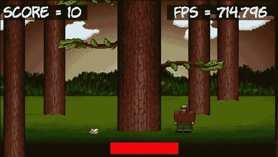

若要查看这些改进的代码，请查看下载包中的`Timber Enhanced Version`文件夹。

## 第 6 章：面向对象编程、类与 SFML 视图

这是书中最长的一章。里面有大量的理论，但这些理论将为我们提供知识，让我们能够有效地开始**面向对象编程** (`OOP`)。此外，我们不会浪费任何时间不将这些理论付诸实践。在探索 C++ OOP 之前，我们将了解并规划我们的下一个游戏项目。

我们将在下一章节中做这些事情：

- 计划**僵尸竞技场**（Zombie Arena）游戏

- 学习 OOP 和类

- 编写`Player`类

- 学习`SFML View`类

- 构建僵尸竞技场游戏引擎

- 将`Player`类投入使用

## 规划并开始僵尸竞技场游戏

此时，如果你还没有看过去的话，我建议你去看看 [Over 9,000 Zombies](http://store.steampowered.com/app/273500/ ) 和 [Crimson Land](http://store.steampowered.com/app/262830/ ) 的视频。

我们的游戏显然不会像那两个示例那样深入或先进，但我们将拥有相同的基础功能集和游戏机制：

- 一个**平头显示器** (`HUD`)，显示分数、高分、弹匣子弹、剩余总弹量、玩家血量和待击杀僵尸数量等细节

- 玩家将在疯狂逃离僵尸的同时向它们射击

- 使用`W`、`A`、`S`和`D`在不断滚动的世界中移动

- 在波次之间使用鼠标瞄准并进行**升级**

- 收集**道具**来恢复血量和弹药

- 每一波都会带来更多僵尸和更大的竞技场

这里有三种类型的僵尸。它们有不同的属性，如外观、血量、速度。我们将它们称为追逐者、坦克和爬行者。看看这张带有注释的游戏截图，了解组件：


以下是关于每个编号点的更多信息：

1. **分数**和**高分**。这些以及 HUD 的其他部分将在独立的层（称为`View`）中绘制。高分将保存并加载到文件中。

2. 这是构建竞技场墙的纹理。它包含在一个名为`sprite-sheet`的单一图中，还有其他背景纹理（3、5、6）。

3. `sprite-sheet`中的两个纹理之一。

4. 这是一个**弹药道具**。玩家获得它时将获得更多弹药。还有一个血量道具。玩家可以在波次之间选择升级这些道具。

5. 草地纹理，同样来自`sprite-sheet`。

6. `sprite-sheet`中的第二个纹理。

7. 曾经有僵尸的血迹。

8. HUD 的底部部分。从左到右是弹药图标、弹匣中的子弹数、备用弹数、血条、当前波僵尸数以及本波剩余的僵尸数量。

9. 玩家角色。

10. 玩家用鼠标瞄准的准星。

11. 一种移动缓慢但强大的坦克僵尸。

12. 一种移动稍快但较弱的爬行者僵尸。还有一种非常快但虚弱的追逐者僵尸。遗憾的是，在它们全部被杀掉之前，我没能拍到一张它们的照片。

2. 确保在左侧菜单中选择了`Visual C++`，然后从显示的列表中选择`HelloSFML`。接下来的图片会让这一点清晰：

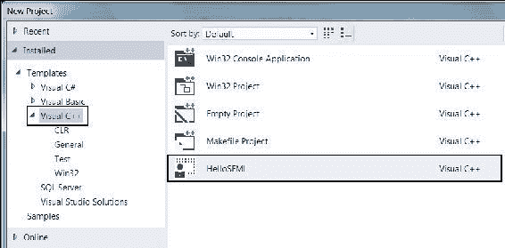

3. 在`Name:`字段中，输入`ZombieArena`，并确保勾选`Create directory for solution`（为解决方案创建目录）选项。现在点击`OK`。

4. 现在我们需要将 SFML 的`.dll`文件复制到项目项目目录。我的主目录是`D:\Visual Studio Stuff\Projects\ ZombieArena\ZombieArena`。该文件夹是 Visual Studio 在上一步创建的。如果你将 Projects 文件夹放在了其他地方，请在相应位置执行此步骤。我们需要复制到 Projects 文件夹的文件位于你的`SFML\bin`文件夹中。为这两个位置中的各打开一个窗口，并高亮所需的`.dll`文件。现在将高亮的文件复制并粘贴到项目中。项目现在已设置就绪可以开始运行。

## 项目资源

此项目中的资源比上一个游戏更多且更多样化。资源包括：

- 用于屏幕文字的字体

- 用于不同动作的音效，例如射击、装弹或被僵尸击

- 角色、僵尸、背景的所有图形以及游戏所需的音频包含在下载包中。它们分别在`Chapter 6/graphics`和`Chapter 6/sound`文件夹中找到。

所需的字体未提供。这是因为我想避免许可证方面任何可能产生的歧义。但这不会引起问题，因为我会向你准确展示在何处以及如何自己选择和下载字体。

尽管我会提供资源本身或获取它们的信息，但你可能喜欢自己创建并获取它们。

## 探索资源

图形资源构成了我们僵尸竞技场游戏的场景部分。看看这些图形资源，就能清楚它们在游戏的何处会被使用：

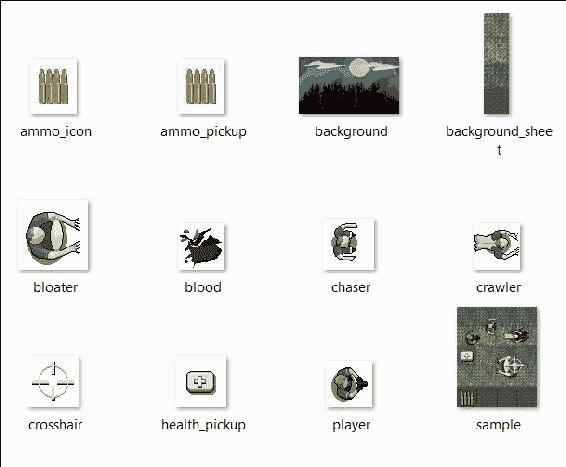

然而，可能不太明显的是`background_sheet.png`，它包含了四张不同的图片。这就是我之前提到的精灵集（sprite-sheet），我们将在`Chapter 7`, *C++ References, Sprite Sheets, and Vertex Arrays* 中看到如何使用它来节省内存并提高游戏速度。

音频文件均为`.wav`格式。这些文件包含了我们在游戏过程中特定事件播放的音效。它们是：

- `hit.wav`：僵尸接触玩家时播放的音效

- `pickup.wav`：玩家触碰（收集）血量加成时播放的音效

- `powerup.wav`：玩家在每波僵尸之间选择一种属性进行增强（属性提升）时播放的音效

- `reload.wav`：一个悦耳的点击声，让玩家知道他们已经装填了新的弹匣

- `reload_failed.wav`：一个不太悦耳的声，表示未能加载新子弹

- `shoot.wav`：射击声

- `splat.wav`：僵尸被子弹击中的音效

## 将资源添加到项目中


一旦你决定了将使用哪些资源，就是将它们添加到项目中的时候。接下来的指令将假设你正在使用书籍下载包提供的所有资源。如果你正在使用自己的资源，只需使用与书中完全相同的文件名替换相应的音频或图形文件即可：

1. 浏览到`D:\Visual Studio Stuff\Projects\ZombieArena\ZombieArena`。
2. 在此文件夹内创建三个新文件夹，并命名为`graphics`、`sound`和`fonts`。
3. 从下载包中，将`Chapter 6/graphics`的全部内容复制到`D:\Visual Studio Stuff\Projects\ZombieArena\ZombieArena\graphics`文件夹。
4. 从下载包中，将`Chapter 6/sound`的全部内容复制到`D:\Visual Studio Stuff\Projects\ZombieArena\ZombieArena\sound`文件夹。
5. 现在在浏览器中访问`http://www.1001freefonts.com/zombie_control.font`并下载`Zombie Control`字体。解压下载的内容，并将`zombiecontrol.ttf`文件添加到`D:\Visual Studio Stuff\Projects\ZombieArena\ZombieArena\fonts`文件夹中。现在是学习更多C++了，我们可以开始为Zombie Arena编写代码了。

## OOP

OOP是一种编程范式，我们可以几乎将其视为编码的标准方式。确实存在非OOP的编码方式，甚至还有一些非OOP的游戏编程语言和库。然而，从零开始（正如本书所做），没有理由采用其他方式。当OOP的优势变得显而易见时，你将永远不再回头。

OOP将：

- 使我们的代码更容易管理、更改或更新
- 使我们的代码编写得更快、更可靠
- 能够轻松使用他人的代码（如SFML）

我们已经看到第三个优势的应用了。让我们通过引入一个需要解决的问题来观察前两个优势。我们面临的问题是当前项目的复杂性。让我们只考虑单个僵尸，以及为了让它在游戏中运行我们需要什么：

- 水平和垂直位置
- 大小
- 它面对的方向
- 每种僵尸类型不同的纹理
- 精灵
- 每种僵尸类型不同的速度
- 每种僵尸类型不同的血量
- 跟踪每个僵尸的类型
- 碰撞检测数据
- 智能（追逐玩家）
- 僵尸是活是死？

这个列表表明仅仅一个僵尸可能就需要十几个变量。

## 什么是OOP？

OOP是一种编程方法，涉及将我们的需求分解成比整体更容易管理的块。每个块都是自包含的，但可以被其他程序重用，同时与其他部分协作工作。这些块就是我们一直所指的对象。当我们计划和编写一个对象时，我们使用`class`（类）。

### 提示

类可以被看作对象的蓝图。

我们实现一个类的对象。这被称为类的`instance`（实例）。想想房屋的蓝图。你不能住在里面，但你可以根据它建造一栋房子。你建造了它的实例。通常当我们为游戏设计类时，我们会编写它们来表示现实世界中的事物。在这个项目中，我们将为玩家、僵尸、子弹等也编写类。

### 提示

OOP是一种做事的方法，是一种定义了最佳实践的方法论。

OOP的三个核心原则是`encapsulation`（封装）、`polymorphism`（多态）和`inheritance`（继承）。

## 封装

封装意味着保持代码内部机制免受使用它的代码的干扰。你可以通过仅允许访问你选择的变量和函数来实现这一点。这意味着你的代码始终被更新、扩展或改进，而不影响使用它的程序。

例如，通过适当的封装，SFML团队是否需要更新他们的`Sprite`类的工作方式并不重要。只要函数签名保持不变，我们就不需要担心内部发生了。我们在更新之前编写的代码在更新后仍然可以正常工作。

多态允许我们编写出对我们试图操作的类型依赖程度较低的代码。这使得我们的代码更加清晰、更高效。多态意味着不同的形式。如果我们编写的对象可以是不止一种类型，那么我们就可以利用这一点。在目前阶段，多态听起来可能有点像“黑魔术”。我们将从第12章“抽象与代码管理 - 更好地利用OOP”开始，在终极项目中使用多态。

随后，一切都会变得清晰起来。

## 继承

顾如其名，继承意味着我们可以利用他人类中的所有功能和优点，包括封装和多态，同时针对我们的特定情况对这些代码进行进一步完善。我们将从第12章“抽象与代码管理 - 更好地利用OOP”开始，在终极项目中使用继承。

## 为什么要这样做？

当编写得当时，所有这些OOP（面向对象编程）都允许你添加新功能，而无需过度担心它们如何与现有功能发生相互作用。当你必须更改一个类时，它的自包含性（封装性）意味着对程序的其他部分的影响较小，甚至可能没有影响。

你可以使用他人的代码（例如`SFML`类），而无需知道其内部如何工作，甚至可能根本不在乎。

OOP，以及由此延伸的`SFML`，允许你编写使用复杂概念的游戏，例如多个摄像头、多人游戏、`OpenGL`、定向音频等，而这一切都不需要你费吹汗水。

通过使用继承，你可以创建多个相似但又不同的类版本，而无需从头开始编写类。

由于多态，你仍然可以使用新对象可以使用为原始类型对象设计的函数。

这一切在逻辑上都是合理的。而且，正如我们所知，`C++`从设计之初就考虑了所有这些OOP特性。

### 提示

使用OOP和制作游戏（或任何其他类型的应用）成功的最终关键，除了成功的决心外，就是规划和设计。这不仅仅是了解所有的`C++`、`SFML`和OOP主题就能帮助你写出优秀代码，而是将所有这些知识应用于编写结构良好且设计良好的代码。书中的代码呈现顺序和方式适用于在游戏语境下学习各种`C++`主题。结构化代码的艺术和科学被称为`设计模式`。随着你的代码变得越来越长、越来越复杂，有效使用设计模式将变得更加重要。好消息是，我们不需要自己发明这些设计模式。随着项目变得越来越复杂，我们需要学习它们。在最后一章中会有更多关于设计模式的内容。

在这个项目中，我们将学习并使用基础类和封装，在终极项目中，我们将变得更加大胆，使用继承、多态和其他与OOP相关的`C++`特性。

## 什么是类？

类是一组代码，可以包含函数、变量、循环以及我们已经学过的所有`C++`语法。每个新类都将声明在自己的`.h`代码文件中，文件名与类名相同，其函数将定义在它们自己的`.cpp`文件中。当我们实际开始编写一些类时，这将会变得清晰。

一旦我们写了一个类，就可以用它来创建任意我们需要的数量的对象。记住，类是蓝图，而我们根据蓝图创建对象。房子不是蓝图，对象也不是类。房子是由类创建的对象。

### 提示

你可以将对象看作一个变量，将类看作一个类型。

当然，在讨论了这么多关于OOP和类的内容之后，我们还没有看到任何代码。让我们现在来解决这个问题吧。

## 类变量和函数声明

让我们用一个不同的游戏例子来代替Zombie Arena。考虑游戏中最基础的：乒乓球（Pong）。一个弹击球的挡板/球拍。挡板是类的极佳候选。

### 提示

如果你不知道什么是乒乓球，请看这个链接：

https://en.wikipedia.org/wiki/Pong

看一眼假设的`Paddle.h`文件：

```cpp
class Paddle
{
private:
// 乒乓球板的长度
int m_Length = 100;
// 乒乓球板的高度
int m_Height = 10;
// x轴上的位置
int m_XPosition;
// y轴上的位置
int m_YPosition;

public:
void moveRight();
void moveLeft();
};
```

从乍看之下代码可能有点复杂，但当我们解释时，我们会发现并没有什么新概念。首先要注意到，使用`class`关键字后跟类名声明了一个新类，并且整个声明包含在花括号中，并跟着一个结束分号：

```cpp
class Paddle
{

};
```

现在看变量声明和它们的名称：

```cpp
// 乒乓球板的长度
int m_Length = 100;
// 乒乓球板的高度
int m_Height = 10;
// x轴上的位置
int m_XPosition;
// y轴上的位置
int m_YPosition;
```

所有名称都带有`m_`前缀。这并不是必须，但这是一个良好的约定。作为类的一部分声明的变量被称为`成员变量`。带有`m_`前缀使得我们在处理成员变量时一目了然。当我们为类编写函数时，我们也会看到局部变量和参数。此时`m_`约定将证明自己是有用的。

还要注意，所有变量都在一个以`private:`关键字开头的代码区域。扫描之前的示例代码，注意类代码体被分为两个部分：

```cpp
private:
// 这里有更多代码
public:
// 这里有更多代码
```

`public`和`private`关键字控制我们类的封装。任何`private`的内容都不能由类实例或对象的用户直接访问。如果你正在为他人设计一个类，你不希望他们能够随心所欲地更改任何内容。

这意味着我们的四个成员变量不能被`main`中的游戏引擎直接访问。它们可以通过类的代码间接访问。对于`m_Length`和`m_Height`变量，这相当容易接受，只要我们不需要更改挡板的大小。然而，`m_XPosition`和`m_YPosition`成员变量确实需要被访问，否则我们该如何移动挡板呢？

这个问题在代码的`public:`部分按如下解决：

```cpp
void moveRight();
void moveLeft();
```

该类提供了两个公共函数，可以用于`Paddle`类型的对象。当我们看到这些函数的定义后，我们将确切看到这些函数是如何操作私有变量的。

总结，我们有一组无法访问（私有的）的变量，无法从`main`函数中使用。这是好事，因为封装使得我们的代码更不容易出错且更具维护性。然后我们通过提供两个公共函数来间接访问`m_XPosition`和`m_YPosition`变量，解决了移动挡板的问题。

`main`中的代码可以调用这些函数，但函数内部的代码精确控制了变量是如何被更改的。

让我们来看函数定义。

## 类函数定义

我们在书中编写的函数定义将全部放在与类和函数声明分开的文件中。我们将使用与类相同并以`.cpp`结尾的文件。因此，在我们假设的示例中，下一个代码将放在名为`Paddle.cpp`的文件中。看看这段非常简单的代码，它只有一个新概念：

```cpp
#include "stdafx.h"
#include "Paddle.h"

void Paddle::moveRight()
{
// 将挡板向右移动一个像素
m_XPosition ++;
}

void Paddle::moveLeft()
{
// 将挡板向左移动一个像素
m_XPosition --;
}
```

首先需要注意的是，我们必须使用包含指令来包含来自`Paddle.h`类的类和函数声明。

我们在这里看到的新概念是使用了**作用域解析**运算符`::`。由于这些函数属于一个类，我们必须通过在函数名前面加上类名和`::`来编写其签名部分。即`void Paddle::moveLeft()`和`void Paddle::moveRight()`。

### 注意

实际上，我们之前已经简要地见过作用域解析运算符了。每当我们声明一个类的对象且之前没有使用过`using namespace..`时。

同样注意，我们也可以像这样将函数定义和声明放在一个文件中：

```cpp
class Paddle {
private:
// 乒乓球拍的长度
int m_Length = 100;
// 乒乓球拍的高度
int m_Height = 10;
// x轴位置
int m_XPosition;
// y轴位置
int m_YPosition;

public:
void Paddle::moveRight() {
// 将球板向右移动一个像素
m_XPosition ++;
}

void Paddle::moveLeft() {
// 将球板向左移动一个像素
m_XPosition --;
}
};
```

然而，当我们的类变得很长（随着我们编写第一个Zombie Arena类，情况会如此），将函数定义分离到单独的文件中会更有组织性。此外，头文件被认为是公开的，如果其他人要使用我们编写的代码，它们通常被用作文档记录。

## 使用类的实例

尽管我们已经看到了许多与类相关的代码，但我们实际上还没有使用过这个类。我们已经知道如何做到这一点，因为我们已经使用过多次SFML类了。

首先，我们像这样创建一个`Paddle`实例：

```cpp
Paddle paddle;
```

`paddle`对象拥有我们在`Paddle.h`中声明的所有变量。我们只是无法直接访问它们。但是，我们可以使用它的公共函数来移动我们的球板，如下：

```cpp
paddle.moveLeft();
```

或者像这样：

```cpp
paddle.moveRight();
```

记住`paddle`是一个`Paddle`类型，因此它拥有所有可用的成员变量和所有函数。

我们可以在日后的日期决定让我们的**乒乓**游戏变为多人模式。在主函数中，我们可以更改代码以拥有两个球板。也许像这样：

```cpp
Paddle paddle;
Paddle paddle2;
```

至关重要的一点是，这些`Paddle`实例都是独立的对象，拥有它们自己的一套变量。

## 构造函数和getter函数

简单的乒乓球拍示例是介绍类基础的良好方法。类可以像`Paddle`一样简单简短，但也可以更长、更复杂，并自身包含其他对象。

在制作游戏时，假设的`Paddle`类缺少了一个至关重要的东西。对于所有私有成员变量和公共函数来说可能很好，但我们如何绘制任何东西呢？我们的乒乓球拍还需要一个精灵（sprite）和一个纹理（texture）。

我们可以完全按照在`main`中包含它们的方式在类中包含其他对象。

### 提示

这是`Paddle.h`代码中`private:`部分更新的版本，它还包含了一个成员`Sprite`和成员`Texture`。注意，该文件还需要相关的SFML包含指令才能编译此代码。

```cpp
private:
// 乒乓球拍的长度
int m_Length = 100;
// 乒乓球拍的高度
int m_Height = 10;
// x轴位置
int m_XPosition;
// y轴位置
int m_YPosition;
// 当然，我们需要一个精灵
Sprite m_Sprite;
// 以及一个纹理
Texture m_Texture;
```

新问题立即摆在我们面前。如果`m_Sprite`和`m_Texture`是私有的，那么我们到底如何在主函数中绘制它们呢？

我们需要提供一个函数允许访问`m_Sprite`以便它可以被绘制。仔细查看`Paddle.h` `public`部分中的新函数声明。

```cpp
public:
void moveRight();
void moveLeft();
// 将精灵的副本发送给main
Sprite getSprite();
```

之前的代码声明了一个名为`getSprite`的函数。值得注意的重要点是`getSprite`返回一个`Sprite`对象。我们很快就会看到`getSprite`的定义。

如果你思维敏锐，你还会注意到，在任何时候，我们都没有加载过纹理，也没有调用过`m_Sprite.setTexture(m_Texture)`将纹理与精灵关联起来。

当类被编码时编译器会创建一个特殊的函数。我们在代码中没有看到这个函数，但它确实在那里。它被称为构造函数。当我们需要编写一些代码来准备对象以供使用时，构造函数通常是一个很好的工作地点。当我们想让构造函数执行创建实例之外的任何操作时，我们必须替换编译器提供的（不可见的）默认构造函数。

### 注意

首先，我们提供一个构造函数声明。注意构造函数没有返回类型，甚至连`void`没有。同样注意，我们可以立即看出它是构造函数，因为函数名与类名`Paddle`相同。

```cpp
public:
// 构造函数
Paddle();
void moveRight();
void moveLeft();
// 将精灵的副本发送给main
Sprite getSprite();
```

下一个代码显示了`Paddle.cpp`中的新函数定义（`getSprite`和构造函数`Paddle`）：

```cpp
// 构造函数
Paddle::Paddle()
{
// 代码假设paddle.png是一个真实的图像
m_Texture.loadFromFile("graphics/paddle.png");
// 将纹理与精灵关联
m_Sprite.setTexture(m_Texture);
}
// 将精灵的副本返回给main
Sprite Paddle::getSprite()
{
return m_Sprite;
}
```

在之前的代码中，我们使用构造函数`Paddle`来加载纹理并将其与精灵关联。记住，这个函数在声明`Paddle`类型对象时被调用。更具体地说，当执行代码`Paddle paddle`时，构造函数会被调用。

在`getSprite`函数中，有一行代码将`m_Sprite`的副本返回给调用代码。

我们可以在构造函数中为对象进行其他设置工作，并在我们构建第一个真正的类时这样做。

如果你想确切看到`getSprite`函数如何被使用，`main`中的代码看起来像这样：

```cpp
window.draw(paddle.getSprite());
```

上一行代码假设我们有一个名为`window`的SFML RenderWindow对象。由于`getSprite`返回一个`Sprite`类型的对象，上一行代码的作用就像该精灵在`main`中声明的一样。现在我们有一个封装良好的类，通过它的公共函数提供受控的访问。


在本书的剩余部分，我们将不断地回顾类和面向对象编程（OOP）。不过，现在我们已经有了足够的知识来为“僵尸竞技场”游戏编写第一个真正的类了。

## 构建玩家——第一个类

让我们思考一下`Player`类需要做什么。该类需要知道自己移动有多快、当前在游戏世界中的位置，以及它有多少血量。在玩家眼中，`Player`类被表示为一个二维图形角色，因此该类同时需要一个`Sprite`（精灵）和一个`Texture`（纹理）对象。

此外，尽管目前可能并不显而易见，但我们的`Player`类也将受益于了解游戏运行环境的一些细节。这些细节包括屏幕分辨率、组成竞技场的瓦格大小以及当前竞技场的总尺寸。

由于`Player`类将完全负责每帧更新自己，因此它需要知道玩家在任何时刻的意图。例如，玩家当前是否正按住某个键盘方向键？或者玩家是否正同时按下多个键盘方向键？用于确定`W`、`A`、`S`和`D`键状态的布尔变量是非常关重要的。

显而易见，我们的新类将需要相当多的变量。在学习了关于OOP的所有知识后，我们无疑会将所有这些变量设为私有（private）。这意味着我们必须在适当的情况下从主函数提供访问权限。

我们将使用大量的get函数（getter functions）以及其他一些函数来设置我们的对象。这些函数非常多；实际上这个类中有21个函数。起初这看起来可能有些令畏，但我们将遍历它们，并发现大多数函数只是简单的设置或获取其中一个私有变量。

只有少数比较深入的函数，例如`update`（它会在每帧从主函数调用一次）和`spawn`（它将处理某些私有变量的初始化）。然而，正如我们将看到的，它们并不复杂，并且都将进行详细描述。

最好的进展方法是编写头文件。这将让我们有机会看到所有的私有变量并检查所有的函数签名。请关注返回值和参数类型，这将使得理解函数定义中的代码变得更容易。

## 编写Player类头文件

在**Solution Explorer（解决方案资源管理器）**中对**Header Files（头文件）** **右键点击**，并选择**Add（添加）|New Item...（新建项...）**。在**Add New Item（新建项）**窗口中，选中（左键点击）**Header File ([.h])**，然后在**Name（名称）**字段中输入`Player.h`。最后，点击**Add（添加）**按钮。我们现在准备好为第一个类编写头文件了。

通过添加声明开始编写`Player`类，包括起始和结束的大括号以及后的一个分号：

```cpp
#pragma once

#include <SFML/Graphics.hpp>

using namespace sf;

class Player {

};
```

现在让我们添加所有的私有成员变量。根据我们已经讨论的内容，看看你是否能推出它们每一个的作用。我们将在稍后逐一介绍它们：

```cpp
class Player
{
private:
    const float START_SPEED = 200;
    const float START_HEALTH = 100;
    // 玩家在哪里 Vector2f
    Vector2f m_Position;
    // 我们确实需要一个精灵 Sprite
    Sprite m_Sprite;
    // 还有一个纹理
    // !!关注这里!! Texture
    Texture m_Texture;
    // 屏幕分辨率是多少 Vector2f
    Vector2f m_Resolution;
    // 当前竞技场有多大 IntRect
    IntRect m_Arena;
    // 竞技场的每个瓦有多大 int
    int m_TileSize;
    // 玩家当前向哪个方向移动 bool
    bool m_UpPressed;
    bool m_DownPressed;
    bool m_LeftPressed;
    bool m_RightPressed;
    // 玩家有多少血量？int
    int m_Health;
    // 玩家最大血量是多少 int
    int m_MaxHealth;
    // 玩家上次被击中是什么 Time
    Time m_LastHit;
    // 每秒像素的速度 float
    float m_Speed;
    // 我们所有的公有函数将在接接下来出现
};
```

之前的代码声明了我们所有的成员变量。其中是一些普通变量，另一些它们本身就是对象。注意，它们都在类的`private:`（私有）部分，因此无法从类外部直接访问。

另外请注意，我们使用命名约定，即在所有非常量变量名前加上`m_`前缀。在编写函数定义时，`m_`前缀会提醒我们它们是成员变量，与我们在某些函数中创建的局部变量不同，同时也与函数参数区分来。

变量的所有用途都是显而易见的，例如`m_Position`、`m_Texture`和`m_Sprite`，分别用于玩家的当前位置、纹理和精灵。此外，每个变量（或变量组）都有注释，以使其用途明了。

然而，它们究竟为什么需要以及它们被使用的上下文可能并不显而易见。例如，`m_LastHit`是一个`Time`类型的对象，用于记录玩家上次被僵尸击中的时间。我们对`m_LastHit`的用途是显而易见的，但同时，并不清楚为什么我们可能需要这些信息。

当我们组合出游戏的其余部分时，每个变量的上下文将变得更加清晰。现在的重要的是熟悉这些变量，以便能够轻松地跟进项目。

### 提示

你不需要记忆变量名和类型，因为我们将在使用它们时讨论所有的代码。现在我们可以添加一整长串函数了。添加以下所有代码。密切注意每个函数的返回类型、参数和名称。这是理解我们在项目剩余部分将要编写的关键。

```cpp
public:
    Player();
    void spawn(IntRect arena, Vector2f resolution, int tileSize);
    // 在每个游戏结束时调用此
    void resetPlayerStats();
    // 处理玩家被僵尸击中
    bool hit(Time timeHit);
    // 玩家上次被击中是多久
    Time getLastHit();
    // 玩家在哪里
    FloatRect getPosition();
    // 玩家中心在哪里 Vector2f
    Vector2f getCenter();
    // 玩家面对哪个角度 float
    float getRotation();
    // 向主 Sprite 发送精灵副本
    Sprite getSprite();
    // 下四个函数移动玩家
    void moveLeft();
    void moveRight();
    void moveUp();
    void moveDown();
    // 停止玩家在特定方向的移动
    void stopLeft();
    void stopRight();
    void stopUp();
    void stopDown();
    // 我们每帧调用一次这个函数
    void update(float elapsedTime, Vector2i mousePosition);
    // 给玩家加速
    void upgradeSpeed();
    // 给玩家一些血量
    void upgradeHealth();
    // 增加玩家可以拥有的最大血量
    void increaseHealthLevel(int amount);
    // 玩家当前有多少量？int
    int getHealth();
```

首先注意，所有函数都是公有的（public）。这意味着我们可以使用类的实例，从main函数通过如下所示的代码调用所有这些函数：

```cpp
window.draw(player.getSprite());
```

假设`player`是一个完全设置好的`Player`类实例，之前的代码将返回`m_Sprite`的副本。

之前的代码会将玩家图形绘制在正确的位置，就就像该精灵（sprite）直接在主函数中声明的一样。这与我们之前对假设的`Paddle`类所做的操作非常相似。

在我们在相应的`.cpp`文件中实现（编写定义）这些函数之前，让我们逐一更仔细地观察每一个函数：

`void spawn(IntRect arena, Vector2f resolution, int tileSize)`：此函数的作用正如其名。它将准备好对象以备使用，包括将其放置在起始位置（生成它）。注意，它不返回任何数据，但有三个参数。它接收一个名为`arena`的`IntRect`（它将是当前关卡的大小和位置），一个包含屏幕分辨率的`Vector2f`以及一个存储背景瓦片大小的`int`。

`void resetPlayerStats()`：一旦我们赋予玩家在不同波次（waves）之间升级的能力，那么当他们死亡时，我们需要能够由于由于死亡时撤回并重置这些能力。

`Time getLastHitTime()`：此函数只做一件事，返回玩家上次被僵尸击的时间。我们将在检测碰撞时使用此函数，它能确保玩家不会因为接触僵尸而受到频繁的惩罚。

`FloatRect getPosition()`：此函数返回一个`FloatRect`，描述包含玩家图形的矩形的水平和垂直浮点坐标。这对于碰撞检测同样有用。

`Vector2f getCenter()`：这与`getPosition`有不同，因为它是一个`Vector2f`，仅包含玩家图形正中心的X和Y位置。

`float getRotation()`：`main`中的代码有时需要知道（以度为单位）玩家当前面对哪个方向。三点钟方向为零度，并顺时针方向增加。

`Sprite getSprite()`：如前所述，此函数返回代表玩家的精灵副本。

`void moveLeft()`, `...Right()`, `...Up()`, `...Down()`：这四个函数没有返回类型或参数。它们将从`main`函数中调用，当按下一个或多个`W`、`A`、`S`和`D`键时，`Player`类将能够采取行动。

`void stopLeft()`, `...Right()`, `...Up()`, `...Down()`：这四个函数没有返回类型或参数。它们将从`main`函数中调用，当释放一个或多个`W`、`A`、`S`和`D`键时，`Player`类将能够采取行动。

`void update(float elapsedTime, Vector2i mousePosition)`：这将是整个类中唯一的长函数。它每帧从`main`调用一次。它将执行所有必要操作以确保玩家对象的数据更新以便碰撞检测和绘制。注意它不返回数据，但接收自上一帧以来经过的时间，以及一个包含鼠标指针或交叉准星水平和垂直屏幕位置的`Vector2i`。

### 提示

注意这些是整数屏幕坐标，与浮点世界坐标不同。

`void upgradeSpeed()`：一个可以在升级界面调用的函数，当玩家选择让玩家移动更快时。

`void upgradeHealth()`：另一个可以在升级界面调用的函数，当玩家选择让玩家更强（拥有更多健康）时。

`void increaseHealthLevel(int amount)`：与之前的函数有一个细微但重要的区别，这个函数将增加玩家拥有的血量，直到当前设置的最大值。此函数将在玩家捡起血包时使用。

`int getHealth()`：由于血量是动态的，我们需要能够确定任何给定时刻玩家有多少血量。此函数返回一个持有该值的`int`。正如变量一样，现在每个函数的用途应该是显而易见的。此外，正如变量一样，使用其中一些函数的原因和精确语境只有随着我们项目的推进才会显现出来。

### 提示

你不需要记忆函数名称、返回类型或参数，因为我们将在使用它们时讨论所有的代码。你确实需要花时间查看它们，以及之前的解释，并对它们更熟悉一点。此外，随着我们的进行，如果任何内容看起来不清楚，回来看这个头文件可能是值得的。

现在我们可以进入函数的实质部分，即定义。

## 编写Player类函数定义

最后我们可以开始编写实际执行我们类工作的代码。

在**解决方案管理器**（Solution Explorer）中的**源文件**（Source Files）上**右键点击**，并选择**添加 | 新项...**。在**添加新项**窗口中，高亮（**左点击**）**C++ 文件**（**`.cpp`**），然后在**名称**字段中输入`Player.cpp`。最后，点击**添加**按钮。我们现在准备好为我们的第一个类编写`.cpp`文件了。

这里是必要的包含指令，随后是构造函数的定义。记住，构造函数会在我们第一次实例化`Player`类型对象时被调用。将此代码添加到`Player.cpp`文件中，然后我们就可以仔细观察了：

```cpp
#include "stdafx.h"

#include "player.h"

Player::Player()
{
    m_Speed = START_SPEED; m_Health = START_HEALTH; m_MaxHealth = START_HEALTH;

    // 将纹理与精灵关联 m_Texture.loadFromFile("graphics/player.png"); 
    m_Sprite.setTexture(m_Texture);

    // 设置精灵的原点为中心，以便平滑旋转
    m_Sprite.setOrigin(25, 25);
}
```

在构造函数中（它与类同名且没有返回类型），我们编写代码准备玩家对象。绝对明确：这段代码将在我们从`main`函数中编写它运行时运行。

`Player player;`

先不要添加这行代码。

我们做的只是初始化`m_Speed`、`m_Health`和`m_MaxHealth`相应的常量。然后我们将玩家图形加载到`m_Texture`，将`m_Texture`关联到`m_Sprite`，并将原点设置为 (25, 25)。

### 提示

注意注释`!!注意此空间!!`，这意味着我们在发现问题并学习更多C++之后会回到这个纹理。

接下来，我们将传入场馆（arena）的所有坐标和尺寸复制到相同类型的成员对象`m_Arena`中。由于当前场馆的大小和坐标被频繁地使用，因此这样做是有意义的。我们现在可以使用`m_Arena`来执行此类任务，例如确保玩家无法穿墙行走。此外，我们将传入的`tileSize`复制到成员变量`m_TileSize`中，目的相同。我们将在`update`函数中看到`m_Arena`的实际作用。

最后的最后行代码将屏幕分辨率从`Vector2f`类型`resolution`（它是`spawn`函数的参数）复制到`m_Resolution`（它是`Player`的成员变量）。

现在添加非常直接的`resetPlayerStats`函数。当玩家死亡时，我们将使用它来重置他们可能使用过的任何升级：

```
void Player::resetPlayerStats()
{
m_Speed = START_SPEED; m_Health = START_HEALTH; m_MaxHealth = START_HEALTH;
}
```

在几乎完成项目之前，我们不会编写实际调用`resetPlayerStats`函数的代码，但它已经在那在那里随时待命。

在接下来的代码中，我们将添加两个函数。它们将处理玩家被僵尸击中的情况。我们可以调用`player.hit()`并传入当前游戏时间。我们还可以通过调用`player.getLastHitTime()`来查询玩家上次被击中的时间。这些函数具体将如何有用，当我们有一些僵尸时就会显而易见！

将这两个新函数添加到`Player.cpp`文件中，然后我们将更仔细地检查C++：

```
Time Player::getLastHitTime()
{
return m_LastHit;
}

bool Player::hit(Time timeHit)
{
if (timeHit.asMilliseconds() - m_LastHit.asMilliseconds() > 200)
{
m_LastHit = timeHit; m_Health -= 10;
return true;
}
else
{
return false; }
}
```

`getLastHitTime`的代码非常直接。返回存储在`m_LastHit`中的任何值即可。

`hit`函数则更深入且更细微。首先，`if`语句检查传入的时间是否比`m_LastHit`中存储的时间快200毫秒。如果是，则更新`m_LastHit`为传入的时间，并从`m_Health`的当前值中减去10。该if语句的最后最后行代码是`return true`。注意，`else`部分只需向调用代码返回`false`。

该函数的整体效果是，玩家每秒最多只会扣除五次血。记住，我们的游戏循环每秒可能会运行数千次。在这种情况下，如果没有这个限制，僵尸只需要接触玩家一秒钟就会扣除数万点生命值。`hit`函数控制并限制了这种情况的发生。它还通过返回`true`或`false`让调用代码知道是否注册了新的命中（或未）。

这段代码意味着我们将在主函数中检测僵尸与玩家之间的碰撞。然后我们将调用`player.hit()`来决定是否扣除任何生命值。

接下来，我们将为`Player`类实现一组访问器函数（getter functions）。它们使我们能够保持数据被整齐地封装在`Player`类中，同时让主函数可以获取这些值。

在上一个代码块之后添加以下代码，然后我们将讨论每个函数的具体作用：


```cpp
FloatRect Player::getPosition()
{
    return m_Sprite.getGlobalBounds();
}

Vector2f Player::getCenter()
{
    return m_Position;
}

float Player::getRotation()
{
    return m_Sprite.getRotation();
}

Sprite Player::getSprite()
{
    return m_Sprite;
}

int Player::getHealth()
{
    return m_Health;
}
```

之前的代码非常直接。之前的五个函数中的每一个都返回我们其中一个成员变量的值。仔细观察每个函数，并熟悉哪个函数返回哪个值。

接下来的八个短函数使得键盘控制（我们将从 `main` 中使用）能够更改我们 `Player` 类型对象中包含的数据。将代码添加到 `Player.cpp` 文件中，然后我将总结它们是如何运作的：

```cpp
void Player::moveLeft()
{
    m_LeftPressed = true;
}

void Player::moveRight()
{
    m_RightPressed = true;
}

void Player::moveUp()
{
    m_UpPressed = true;
}

void Player::moveDown()
{
    m_DownPressed = true;
}

void Player::stopLeft()
{
    m_LeftPressed = false;
}

void Player::stopRight()
{
    m_RightPressed = false;
}

void Player::stopUp()
{
    m_UpPressed = false;
}

void Player::stopDown()
{
    m_DownPressed = false;
}
```

之前的代码有四个函数（`moveLeft`, `moveRight`, `moveUp`, `moveDown`），它们将相关的布尔变量（`m_LeftPressed`, `m_RightPressed`, `m_UpPressed`, `m_DownPressed`）设置为 `true`。另外四个函数（`stopLeft`, `stopRight`, `stopUp`, `stopDown`）的操作与之相反，将相同的布尔变量设置为 `false`。`Player` 类的实例现在可以知道 `W`、`A`、`S` 和 `D` 键哪些已按下、哪些未按下。

下一个函数是执行所有苦力工作的。`update` 函数将在我们游戏循环的每一帧中被调用一次。添加以下代码，我们将详细检查它。如果你跟上了之前的八个函数，并记得我们在 `Timber!!!` 项目中是如何制作云动画的，你可能会发现以下大部分代码都容易理解：

```cpp
void Player::update(float elapsedTime, Vector2i mousePosition)
{
    if (m_UpPressed)
    {
        m_Position.y -= m_Speed * elapsedTime;
    }

    if (m_DownPressed)
    {
        m_Position.y += m_Speed * elapsedTime;
    }

    if (m_RightPressed)
    {
        m_Position.x += m_Speed * elapsedTime;
    }

    if (m_LeftPressed)
    {
        m_Position.x -= m_Speed * elapsedTime;
    }

    m_Sprite.setPosition(m_Position);

    // 将玩家留在场馆内
    if (m_Position.x > m_Arena.width - m_TileSize)
    {
        m_Position.x = m_Arena.width - m_TileSize;
    }

    if (m_Position.x < m_Arena.left + m_TileSize)
    {
        m_Position.x = m_Arena.left + m_TileSize;
    }

    if (m_Position.y > m_Arena.height - m_TileSize)
    {
        m_Position.y = m_Arena.height - m_TileSize;
    }

    if (m_Position.y < m_Arena.top + m_TileSize)
    {
        m_Position.y = m_Arena.top + m_TileSize;
    }

    // 计算玩家面对的角度
    float angle = (atan2(
        mousePosition.y - m_Resolution.y / 2,
        mousePosition.x - m_Resolution.x / 2
    ) * 180) / 3.141;

    m_Sprite.setRotation(angle);
}
```

之前的代码的第一部分移动玩家精灵。四个 `if` 语句检查移动相关的布尔变量（`m_LeftPressed`, `m_RightPressed`, `m_UpPressed`, `m_DownPressed`）是否为 `true`，并相应地更改 `m_Position.x` 和 `m_Position.y`。计算移动量的公式与 `Timber!!!` 项目相同。

位置（`+` 或 `-`）速度 `*` 流逝时间。

紧接我们刚才讨论的语句，接三个 `if` 语句对其他三面墙执行相同的操作。

最后两行代码计算并设置了玩家精灵旋转（朝向）的角度。这行代码看起来有点复杂，但它实际上是在一个经过测试的三角函数中使用准星的位置（`mousePosition.x` 和 `mousePosition.y`）以及屏幕中心（`m_Resolution.x` 和 `m_Resolution.y`）。

`atan` 如何使用这些坐标以及 `Pi`（3.141）是非常复杂的，这就是为什么我们将其封装成一个方便使用的函数。如果你想更详细地探索三角函数，可以访问 http://www.cplusplus.com/reference/cmath/ 进行查找。

`Player` 类的最后三个函数分别让玩家速度提高 20%，生命值增加 20%，并根据传入的值增加玩家的生命值。

将此代码添加到 `Player.cpp` 文件的末尾，然后我们将进行仔细观察：

```cpp
void Player::upgradeSpeed()
{
    // 20% 速度升级
    m_Speed += (START_SPEED * .2);
}

void Player::upgradeHealth()
{
    // 20% 最大生命值升级
    m_MaxHealth += (START_HEALTH * .2);
}

void Player::increaseHealthLevel(int amount)
{
    m_Health += amount;

    // 但不能超过最大值
    if (m_Health > m_MaxHealth)
    {
        m_Health = m_MaxHealth;
    }
}
```

在之前的代码中，`upgradeSpeed` 和 `upgradeHealth` 函数分别增加了存储在 `m_Speed` 和 `m_MaxHealth` 中的值。通过将初始值乘以 0.2 并将其加到当前值上，数值增加了 20%。当玩家在不同关卡之间选择想要改进的角色属性时，这些函数将从 `main` 函数中被调用。

`increaseHealthLevel` 通过 `amount` 参数从 `main` 接收一个 `int` 值。这个 `int` 值将由一个名为 `Pickup` 的类提供，我们将在第 9 章《碰撞检测、拾取物品与子弹》中编写它。`m_Health` 成员变量会根据传入的值进行增加。

然而，对于玩家来说有一个陷阱：`if` 语句检查 `m_Health` 是否超过了 `m_MaxHealth`，如果是，则设置为 `m_MaxHealth`。这意味着玩家不能简单地从拾取物品获得无限生命值。他们必须在关卡之间仔细平衡他们选择的升级项目。

当然，在我们实例化它并将其投入游戏循环工作之前，我们的 `Player` 类实际上无法执行任何操作。在此之前，让我们来看一下游戏摄像机的概念。

## 使用 SFML View 控制游戏相机

在我看来，`View` 类是最优雅的类之一。如果你在读完这本书后，在不使用多媒体或游戏库的情况下制作游戏，你会真正发现 `View` 的缺失。

`View` 类允许我们将游戏视为发生在它自己的世界中，拥有它自己的属性。我什么意思是？当我们创建一个游戏时，通常是在尝试创建一个虚拟世界。这个虚拟世界很少（甚至从未）以像素为单位测量，而且该世界的像素数量也很少与玩家显示器的完全相同。我们需要一种方法来抽象我们正在构建的虚拟世界，使其成为我们喜欢的任何尺寸或形状。

另一种思考 `SFML View` 的方式是将其看作玩家通过它观察我们虚拟世界一部分的相机。大多数游戏将会有多个摄像机或世界视图。

例如，考虑一个分屏游戏，两个玩家可以在不同的时间处于同一个世界的不同部分。

或者考虑一个游戏，屏幕上有一块小区域代表整个游戏世界，但处于非常高的水平，或者缩放了，就像小地图一样。

即使我们的游戏比之前的两个例子简单得多，不需要分屏或小地图，我们可能也想创建一个比运行它的屏幕更大的世界。这在《僵尸竞技场》（Zombie Arena）中确实是如此。

如果我们不断移动游戏相机来显示虚拟世界的不同部分（通常是跟踪玩家），那么 HUD（头显示层）会发生什么？如果我们绘制了分数和其他屏幕上的 HUD 信息，然后滚动世界以跟随玩家，那么分数将相对于该相机移动。

`SFML View` 类轻松地开启了所有这些功能，并用非常直观的代码解决了这个问题。诀窍是为每一个相机创建一个 `View` 实例。也许为小地图创建一个 `View`，为滚动的游戏世界创建一个 `View`，然后为 HUD 创建一个 `View`。

`View` 的实例可以根据需要移动、调整大小和位置。因此，跟随游戏的主 `View` 可以跟踪玩家，小地图视图可以留在屏幕固定的缩放缩小的小角落，而 HUD 可以覆盖整个屏幕且永远移动，尽管主 `View` 可以随着玩家去往任何地方。

让我们来看一些使用几个 `View` 实例的代码。

### 提示

这段代码用于引入 `View` 类。不要将此代码添加到 Zombie Arena 项目中。

创建并初始化几个 `View` 实例：

```cpp
// 创建一个填充 1920 x 1080 显示器的视图
View mainView(sf::FloatRect(0, 0, 1920, 1080));

// 为 HUD 创建一个视图
View hudView(sf::FloatRect(0, 0, 1920, 1080));
```

之前的代码创建了两个填充 1920 x 1080 显示器的 `View` 对象。现在我们可以对 `mainView` 执行一些魔法，同时完全放过 `hudView` 不动：

```cpp
// 在游戏的更新部分
// 你可以对 View 做很多事情
// 让视图围绕玩家中心
mainView.setCenter(player.getCenter());

// 将视图旋转 45 度
mainView.rotate(45);

// 注意 hudView 完全不受上述代码的影响
```

当我们操作 `View` 的属性时，我们的操作方式如之前所示。当我们向某个视图绘制精灵（sprites）、文本或其他对象时，我们必须专门将该视图设置为窗口的当前视图：

```cpp
// 设置当前视图
window.setView(mainView);
```

现在我们可以在该视图中绘制我们想要的所有内容：

```cpp
// 完成该视图窗口的所有绘制
window.draw(playerSprite);
window.draw(otherGameObject);
// 等
```

玩家可能处于任何坐标。没关系，因为 `mainView` 是以图形为中心的。

现在我们可以将 HUD 绘制到 `hudView` 中。注意，就像我们从后到往前分层绘制单个元素（背景、游戏对象、文本等）一样，我们也从后到往前顺序绘制视图。因此，HUD 在主游戏之后被绘制：

```cpp
// 切换到 hudView
window.setView(hudView);

// 完成 HUD 的所有绘制
window.draw(scoreText);
window.draw(healthBar);
// 等
```

最后，我们可以以通常的方式绘制或显示当前帧窗口及其所有视图：

```cpp
window.display();
```

### 提示

如果你想对 `SFML View` 的理解超出本项目所需的范畴，包括如何实现分屏和小地图，那么网络上最好的指南是官方 SFML 网站上的教程：http://www.sfml-dev.org/tutorials/2.0/graphics-view.php。

现在我们已经学习了 `View`，可以开始编写 Zombie Arena 的 `main` 函数，并真正使用我们的第一个 `View` 了。在第 10 章《视图分层与 HUD 实现》中，我们将为 HUD 引入第二个 `View` 实例，修复它，并将其叠加在主 `View` 之上。

## 启动 Zombie Arena 游戏引擎

在这个游戏中，我们将在 `main` 中使用一个稍微升级的游戏引擎。特别是，我们将有一个名为 `state` 的枚举，用于跟踪游戏的当前状态。然后，在整个 `main` 中，我们可以封装部分代码，以便在不同的状态下发生不同的事情。

在**解决方案管理器**（Solution Explorer）中右键点击 `HelloSFML` 文件并选择**重命名**（Rename）。将名称更改为 `ZombieArena.cpp`。这将包含我们的 `main` 函数以及实例化和控制我们所有类的代码的文件。

我们从现在熟悉的 `main` 函数和一些包含指令开始。注意，这里添加了一个用于 `Player` 类的包含指令。

将以下代码添加到 `ZombieArena.cpp` 文件中：

```cpp
#include "stdafx.h"

#include <SFML/Graphics.hpp>

#include "Player.h"

using namespace sf;

int main()
{
    return 0;
}
```

之前的代码中没有新内容，除了 `#include "Player.h"` 这一行意味着我们现在可以在代码中使用 `Player` 类了。

让我们进一步充实我们的游戏引擎。接下来的这段代码执行了大量工作。在添加代码时，请务必阅读注释，以了解正在发生什么。随后我们将对其进行详细介绍。

在 `main` 函数的开头添加以下高亮代码：

```cpp
int main()
{
    // 游戏始终处于四种状态之一
    enum class State
    {
        PAUSED,
        LEVELING_UP,
        GAME_OVER,
        PLAYING
    };

    // 从 GAME_OVER 状态开始
    State state = State::GAME_OVER;

    // 获取屏幕分辨率并创建一个 SFML 窗口
    Vector2f resolution;
    resolution.x = VideoMode::getDesktopMode().width;
    resolution.y = VideoMode::getDesktopMode().height;

    RenderWindow window(
        VideoMode(resolution.x, resolution.y),
        "Zombie Arena",
        Style::Fullscreen
    );

    // 为主动作创建一个 SFML 视图
    View mainView(sf::FloatRect(0, 0, resolution.x, resolution.y));

    // 这是我们用于计时所有事情的计时器
    Clock clock;

    // PLAYING 状态持续了多长时间
    Time gameTimeTotal;

    // 鼠标相对于世界坐标的位置在哪里
    Vector2f mouseWorldPosition;

    // 鼠标相对于屏幕坐标的位置在哪里
    Vector2i mouseScreenPosition;

    // 创建一个 Player 类的实例
    Player player;

    // 竞技场的边界
    IntRect arena;

    // 主游戏循环
    while (window.isOpen())
    {
    }

    return 0;
}
```

让我们逐一过过刚刚输入的代码每个部分。在 `main` 函数内部紧邻着，我们有这段代码：

```cpp
// 游戏始终处于四种状态之一
enum class State
{
    PAUSED,
    LEVELING_UP,
    GAME_OVER,
    PLAYING
};

// 从 GAME_OVER 状态开始
State state = State::GAME_OVER;
```

之前的代码创建了一个名为 `State` 的新枚举类。然后，代码创建了一个名为 `state` 的 `State` 实例。`state` 枚举现在可以是声明中定义的四个值之一。这些值分别是 `PAUSED`、`LEVELING_UP`、`GAME_OVER` 和 `PLAYING`。这四个值正是我们跟踪和响应游戏在任何时刻可能处于的不同状态所需的。注意，`state` 不可能同时持有多个值。

紧接着，我们添加了以下代码：


进入`/path/to/xxx`目录，找到`xxx.json`。

在表达式`cvar = avar + bvar`中，加法运算符（`+`）将`avar`与`bvar`相加，得到它们的和`cvar`。

在`List.of(arg0, arg1, arg2)`中，`List`接口的工厂方法`of()`接受一系列的元素，返回包含它们的只读列表。

之后我们这样调用`cmd`命令：`cmd arg0 arg1 arg2`。

```
if (condVar > someVal) {console.log("xxx")}
```

---

```
// 获取屏幕分辨率并创建一个 SFML 窗口
Vector2f resolution;
resolution.x = VideoMode::getDesktopMode().width;
resolution.y = VideoMode::getDesktopMode().height;
RenderWindow window(VideoMode(resolution.x, resolution.y), "Zombie Arena", Style::Fullscreen);
```

之前的代码声明了一个名为`resolution`的`Vector2f`。我们通过分别调用`VideoMode::getDesktopMode`函数获取宽度和高度，来初始化`resolution`的两个变量（`x`和`y`）。`resolution`对象现在持有运行游戏的显示器的分辨率。最后一行代码使用适当的分辨率创建了一个名为`window`的新`RenderWindow`。

接着这段代码创建了一个 SFML `View`对象。该视图（初始状态）位于显示器像素的精确坐标上。如果我们使用这个`View`在当前位置进行某些绘制，它将没有任何影响。然而，我们最终将移动这个视图，以专注于玩家需要看到的游戏世界部分。然后，当我们开始使用第二个固定的`View`（用于 HUD）时，我们将看到这个`View`如何跟踪动作，而另一个则保持静态以显示 HUD：

```
// 为主动作创建一个 SFML 视图
View mainView(sf::FloatRect(0, 0, resolution.x, resolution.y));
```

接下来，我们创建了一个`Clock`来计时，以及一个名为`gameTimeTotal`的`Time`对象，它将记录已运行的游戏总时间。随着项目的进展，我们将引入更多的变量和对象来处理计时：

```
// 这是我们用于计时所有事情的计时器
Clock clock;
// PLAYING 状态持续了多长时间
Time gameTimeTotal;
```

接下来的代码声明了两个向量。一个持有两个浮点数，名为`mouseWorldPosition`，另一个持有两个整数，名为`mouseScreenPosition`。鼠标指针有点像异常，因为它存在于两个不同的坐标系中。如果你喜欢，可以把它们想象成平行宇宙。首先，当玩家在世界中移动时，我们需要跟踪准星在该世界中的位置。这些将是浮点坐标，并存储在`mouseWorldCoordinates`中。当然，显示器本身的实际像素坐标从不改变。它们将始终是从`0,0`到水平分辨率-1、垂直分辨率-1。我们将使用存储在`mouseScreenPosition`中的整数来跟踪相对于此坐标系的鼠标指针位置：

```
// 鼠标相对于世界坐标的位置
Vector2f mouseWorldPosition;
// 鼠标相对于屏幕坐标的位置
Vector2i mouseScreenPosition;
```

最后，我们开始使用我们的`Player`类了。这行代码将导致构造函数`Player::Player`执行。如果你想回想起这个函数的用法，请参考`Player.cpp`：

```
// 创建一个 Player 类的实例
Player player;
```

这个`IntRect`对象将持有起始的水平和垂直坐标以及宽度和高度。一旦初始化，我们就能通过类似`arena.left`、`arena.top`、`arena.width`和`arena.height`的代码访问当前竞技场的大小和位置细节：

```
// 竞技场的边界
IntRect arena;
```

我们之前添加的代码的最后一部分当然是我们的主游戏循环：

```
// 主游戏循环
while (window.isOpen())
{
}
```

你可能注意到代码变得很长了。让我们谈谈这种不便。

## 管理代码文件

使用类和函数进行抽象的优势之一是可以减少我们代码文件的长度（行数）。尽管我们在这个项目中将使用十几个以上的代码文件，但`ZombieArena.cpp`中的代码长度在最后仍然会变得有些难以处理。在最终项目中，我们将学习更多抽象和管理代码的方法。

现在，使用这个小技巧来保持代码的易于管理。注意在 Visual Studio 代码编辑器的左侧，有许多`+`和`-`符号，其中一个显示在下面的图中：

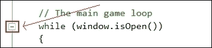

每个代码块（`if`、`while`、`for`等）都有一个符号。你可以通过点击`+`和`-`符号来展开和折叠这些块。我建议将所有当前未讨论的代码保持折叠状态。这会让事情变得清晰得多。

此外，我们可以创建自己的折叠块。我建议将主游戏循环开始之前的所有代码创建一个折叠块。要这样做，高亮代码，`右键点击`，并选择`Outlining`（大纲） | `Hide Selection`（隐藏选择），如下一步所示：

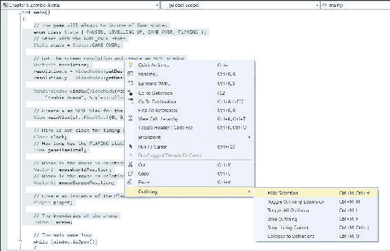

现在你就可以点击`+`和`-`符号来展开和收起该块。每当我们在主游戏循环之前添加代码时（这将经常发生），你都可以展开代码、添加新行，然后再次折叠它。这张图是代码折叠后的样子：

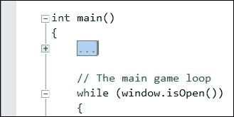 这比之前要容易得多。

## 开始编写主游戏循环

如你所见，上一个代码的最后部分是游戏循环`while (window.isOpen()){}`。我们现在关注的正是这里。具体来说，我们将编写游戏循环中的输入处理部分。

接下来我们要添加的代码相当长。它并没有什么复杂的，我们将在几分钟后对其进行检查。

仅将以下代码中显示的高亮代码添加到主游戏循环中：

```
// The main game loop

while (window.isOpen())
{
    /*
    ************ 处理输入 ************ */
    // 通过轮询处理事件
    Event event;

    while (window.pollEvent(event)) {
        if (event.type == Event::KeyPressed) {
            // 在游戏时时暂停
            if (event.key.code == Keyboard::Return && state == State::PLAYING)
            {
                state = State::PAUSED;
            }
            // 暂停时重启
            else if (event.key.code == Keyboard::Return && state == State::PAUSED)
            {
            }
            else if (event.key.code == Keyboard::Return && state == State::GAME_OVER)
            {
                state = State::LEVELING_UP;
            }
            if (state == State::PLAYING)
            {
            }
        } // End 事件轮询

        state = State::PLAYING;
        // 重置时钟以防止帧跳。
        clock.restart();
    }
    // 在 GAME_OVER 状态下开始新游戏
} // End 游戏循环
```

在之前的代码中，我们实例化了一个`Event`类型的对象。我们将使用`event`（就像我们在 Timber!!! 项目中那样）来轮询系统事件。为此，我们将上一个代码块中的其余代码封装在一个条件为`window.pollEvent(event)`的`while`循环中。这将使它持续循环，每一帧都执行，直到没有更多需要处理的事件为止。

在这个`while`循环内部，我们处理我们感兴趣的事件。首先，我们测试`Event::KeyPressed`事件。如果游戏在`PLAYING`状态下按下`Enter`键，则会将状态切换到`PAUSED`。

如果游戏在`PAUSED`状态下按下`Enter`键，则会将状态切换到`PLAYING`并重启`clock`。我们在从`PAUSED`切换到`PLAYING`后重启`clock`的原因是，当游戏暂停时，流逝的时间仍在累积。如果我们不重启时钟，我们所有的对象将像这一帧刚刚经过了很长时间一样更新它们的位置。随着我们在该文件中完善其余部分代码，这一点将变得更加明显。

然后我们有一个`else if`测试，以检查在游戏处于`GAME_OVER`状态时是否按下了`Enter`键。如果是，则将`state`更改为`LEVELING_UP`。

### 注意

注意`GAME_OVER`状态是显示主屏幕的状态。因此，`GAME_OVER`状态是玩家刚刚死亡以及玩家首次运行应用时的状态。玩家每局游戏做的第一件事就是选择一个属性进行改进（升级）。

在之前的代码中，有一个最终的`if`条件来测试`state`是否为`PLAYING`。这个`if`块是空的，我们将在整个项目期间向其中添加代码。

### 提示

由于我们将在整个项目中向此文件的许多不同部分添加代码，因此花时间理解游戏可能所处的不同状态以及我们在何处处理它们是值得的。在适当的时候折叠和展开不同的`if`、`else`和`while`块也会非常有益。

花些时间彻底熟悉我们刚刚编写的`while`、`if`和`else if`块。我们将经常引用它们。

接下来，紧接上一个代码之后，仍在游戏循环内部，且仍在处理输入输入，添加这段高亮代码。注意现有的代码（未高亮部分），它准确地显示了新代码所在的位置：

```
// End 事件轮询

// 处理玩家退出
if (Keyboard::isKeyPressed(Keyboard::Escape))
{
    window.close();
}

// 在游戏时处理 WASD
if (state == State::PLAYING)
{
    // 处理 WASD 键的按下和释放
    if (Keyboard::isKeyPressed(Keyboard::W))
    {
        player.moveUp();
    }
    else
    {
        player.stopUp();
    }

    if (Keyboard::isKeyPressed(Keyboard::S))
    {
        player.moveDown();
    }
    else
    {
        player.stopDown();
    }

    if (Keyboard::isKeyPressed(Keyboard::A))
    {
        player.moveLeft();
    }
    else
    {
        player.stopLeft();
    }

    if (Keyboard::isKeyPressed(Keyboard::D))
    {
        player.moveRight();
    }
    else
    {
        player.stopRight();
    }
} // End 游戏时处理 WASD
} // End 游戏循环
```

在之前的代码中，我们首先测试玩家是否按下了`Esc`键。如果按下，游戏窗口将关闭。

接下来，在一个大的`if(state == State::PLAYING)`块中，我们依次检查`W`、`A`、`S`和`D`键。如果按下某个键，我们就调用相应的`player.move...`函数。如果没有按下，我们就调用相关的`player.stop...`函数。

这段代码确保在每一帧中，玩家对象都会更新精确的哪些`W`、`A`、`S`、`D`键被按下哪些未按下。`player.move...`和`player.stop...`函数将信息存储在成员布尔变量（`m_LeftPressed`、`m_RightPressed`、`m_UpPressed`和`m_DownPressed`）中。然后`Player`类会在每一帧的`player.update`函数中对这些布尔值做出响应，我们会在游戏循环的更新部分中调用该函数。

现在我们可以处理键盘输入，以便玩家在每局游戏开始时以及每波之间之间升级。添加并学习以下高亮代码，然后我们将对其进行讨论：

```
// End 游戏时处理 WASD

// 处理 LEVELING up 状态
if (state == State::LEVELING_UP)
{
    // 处理玩家升级
    if (event.key.code == Keyboard::Num1)
    {
        state = State::PLAYING;
    }
    if (event.key.code == Keyboard::Num2)
    {
        state = State::PLAYING;
    }
    if (event.key.code == Keyboard::Num3)
    {
        state = State::PLAYING;
    }
    if (event.key.code == Keyboard::Num4)
    {
        state = State::PLAYING;
    }
    if (event.key.code == Keyboard::Num5)
    {
        state = State::PLAYING;
    }
    if (event.key.code == Keyboard::Num6)
    {
        state = State::PLAYING;
    }

    if (state == State::PLAYING)
    {
        // 准备关
        // 我们稍后会修改接下来两行
        arena.width = 500;
        arena.height = 500;
        arena.left = 0;
        arena.top = 0;

        // 我们稍后会修改这行代码
        int tileSize = 50;
        // 在竞技场中心生成玩家
        player.spawn(arena, resolution, tileSize);

        // 重置时钟以防止帧跳。
        clock.restart();
    }
} // End 处理升级
} // End 游戏循环
```

在前面的代码中，通过封装在一个测试`state`值是否为`LEVELING_UP`的测试中，我们处理了键盘键`1、2、3、4、5`和`6`。在每个`if`块中，我们只需将`state`设置为`State::PLAYING`。我们稍将在第 11 章 *音效、文件 I/O 和完成游戏* 中添加处理每个升级选项的代码。

这段代码的作用是：

1. 如果`state`为`LEVELING_UP`，等待按下`1、2、3、4、5`或`6`键。

2. 按下后，将状态改为`PLAYING`。

3. 当状态改变时，仍在`if(state == LEVELING_UP)`块内，嵌套的`if(state == State::PLAYING)`块将运行。

4. 在此块中，我们设置`arena`的位置和大小、`tileSize`为`50`，将所有信息传递给`player.spawn`并重启`clock`。

现在我们有了生成的玩家对象，它可以感知环境并对按键做出响应。我们现在可以在每次循环中更新场景。

确保整齐地折叠游戏循环输入处理部分的代码，因为我们现在完成了那部分。后续代码位于游戏循环的更新部分。添加并学习高亮代码，然后我们就可以讨论：

```
// End 处理升级

/*
****************
更新帧
****************
*/
if (state == State::PLAYING)
{
    // 更新增量时间
    Time dt = clock.restart();

    // 更新总游戏时间
    gameTimeTotal += dt;

    // 从增量时间得到秒的小数
    float dtAsSeconds = dt.asSeconds();

    // 鼠标指针在哪里
    mouseScreenPosition = Mouse::getPosition();

    // 将鼠标位置转换为主视图的世界坐标
    mouseWorldPosition = window.mapPixelToCoords(
        Mouse::getPosition(), mainView);

    // 更新玩家
    player.update(dtAsSeconds, Mouse::getPosition());

    // 让视图围绕玩家居中。
    mainView.setCenter(player.getCenter());

    // 记录玩家的新位置
    Vector2f playerPosition(player.getCenter());

} // 结束场景更新

} // 结束游戏循环
```

首先注意，之前所有的代码都封装在一个测试中，以确保游戏处于`PLAYING`（运行中）状态。我们不希望在游戏暂停、结束或玩家正在选择升级时运行这些代码。

首先，我们重新启动计时器，并将上一帧花费的时间存储在变量`dt`中。


```cpp
// 更新增量时间 (delta time)
Time dt = clock.restart();
```

接下来，我们将上一帧花费的时间加到游戏运行的累计时间上，该时间由`gameTimeTotal`持有：

```cpp
// 更新游戏总时间
gameTimeTotal += dt;
```

现在我们初始化一个名为`dtAsSeconds`的浮点数，其值为由`dt.AsSeconds`函数返回的结果。对于大多数帧来说，这将是小于 1 的小数。这非常适合传递给`player.update`函数，用于计算玩家精灵移动的距离。

现在我们可以使用函数`MOUSE::getPosition`来初始化`mouseScreenPosition`了。

### 注意

你可能对获取鼠标位置的这种略显异常的语法感到疑问？这被称为静态函数（static function）。如果在类中使用`static`关键字定义函数，我们就可以使用类名在不实例化类对象的情况下调用该函数。C++ 的面向对象编程（OOP）有许多此类特性和规则，随着学习深入，我们将看到更多。然后我们使用`window`上的 SFML `mapPixelToCoords`函数来初始化`mouseWorldPosition`。我们在本节之前讨论`View`类时已经提到过这个函数。

到此时，我们已经可以调用`player.update`并传入所需的`dtAsSeconds`和鼠标位置了。

我们将玩家的新中心点存储在一个名为`playerPosition`的`Vector2f`中。目前它还没有被使用，但我们稍会在项目的稍后部分用到它。

然后我们可以通过代码`mainView.setCenter(player.getCenter())`让视图围绕玩家最新位置的中心居中。

现在我们可以准备将玩家绘制到屏幕上了。添加这段高亮代码，它将主游戏循环的绘制部分分为不同的状态：

```cpp
} // 结束场景更新

/*
**************
绘制场景
**************
*/
if (state == State::PLAYING)
{
    window.clear();
    // 将 mainView 设置为在窗口显示 // 并绘制与其相关的所有内容
    window.setView(mainView);
    // 绘制玩家
    window.draw(player.getSprite());
}
{
}

if (state == State::GAME_OVER) {
}

window.display();

if (state == State::LEVELING_UP) {
}

if (state == State::PAUSED)
} // 结束游戏循环

return 0; }
```

在上一段代码的`if(state == State::PLAYING)`部分，我们清空了屏幕，将`window`的视图设置为`mainView`，然后使用`window.draw(player.getSprite())`绘制玩家精灵。

在处理完所有不同的状态后，代码将通过`window.display()`以通常的方式显示场景。

你可以运行游戏，看到我们的玩家角色随着鼠标的移动而旋转。

### 提示

运行游戏时，你需要按下`Enter`键开始游戏，然后输入`1`到`6`之间的数字来模拟选择升级选项。然后游戏就会开始。

你还可以在（空的）500 x 500 像素的竞技场内移动玩家。你可以在屏幕中心看到我们孤独的玩家，如下所示：

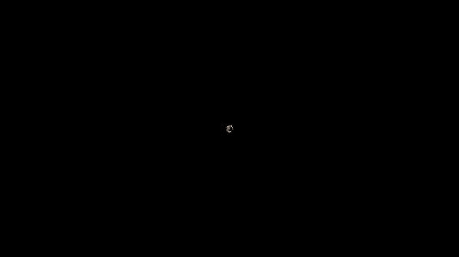

然而，你无法感受到任何移动感，因为我们还没有实现背景。我们将在下一章中实现它。

## 第 7 章：C++ 引用、精灵图和顶点数组

在第 4 章“循环、数组、Switch、枚举和函数实现游戏机制”中，我们讨论了作用域（scope）。这个概念是指在函数或内部代码块中声明的变量仅在该函数或块中具有作用域（可见或可用）。仅使用我们目前掌握的 C++ 知识，这可能会导致问题：如果我们需要处理`main`函数需要的多个复杂对象，该怎么办？这可能意味着所有代码都必须写在`main`中。

在本章中，我们将探索 C++ 引用（references），它允许我们处理处于作用域之外的变量和对象。此外，引用将帮助我们避免在函数之间传递大型对象，因为这是一个缓慢的过程。它之所以缓慢，是因为每次我们这样做时，必须创建一个该变量或对象的副本。

掌握了关于引用的新知识后，我们将查看 SFML 的`VertexArray`类，它允许我们通过单个图像文件中的多张图像来构建一个可以快速高效地绘制到屏幕上的大图像。到本章结束，我们将使用引用和`VertexArray`对象实现可缩放、随机且滚动的背景。

我们现在将讨论以下主题：

- C++ 引用
- SFML 顶点数组
- 编写随机滚动的背景

## C++ 引用

当我们向函数传递值或从函数返回值时，我们做的正是这样做。即按值传递/返回（Passing/returning by value）。发生的情况是创建了变量所持值的副本，并将其发送到函数中使用。

这种做法的意义具有两个方面：

1. 如果我们希望函数对变量进行永久性更改，这种系统对我们没用。
2. 当创建副本作为参数传递或从函数返回时，会消耗处理能力和内存。对于一个简单的`int`甚至可能的一个精灵，这是微不足道的。然而，对于一个复杂对象，也许整个游戏世界（或背景），复制过程将严重影响我们游戏的性能。

引用是解决这两个问题的方案。引用是一种特殊的变量类型。引用指向另一个变量。一个示例会很有用：

```cpp
int numZombies = 100;
int& rNumZombies = numZombies;
```

在上面的代码中，我们声明并初始化了一个名为`numZombies`的普通`int`。然后我们声明并初始化了一个名为`rNumZombies`的`int`引用。紧随类型后面的引用运算符`&`表示正在声明一个引用。

### 注意

引用名前的`r`前缀是可选的，但有助于记住我们正在处理的是一个引用。

现在我们有一个存储值 100 的`int`变量`numZombies`，和一个指向`numZombies`的`int`引用`rNumZombies`。

我们对`numZombies`做的任何操作都可以通过`rNumZombies`看到，而我们对`rNumZombies`做的任何操作实际上都是对`numZombies`做的。看以下代码：

```cpp
int score = 10;
int& rScore = score;
score++;
rScore++;
```

在上一段代码中，我们声明了一个名为`score`的`int`。接下来我们声明了一个指向`score`的`int`引用`rScore`。记住，对`score`做的任何操作`rScore`都能看到，而对`rScore`做的任何操作实际上都是在`score`上执行的。

因此，当我们这样增加`score`时：

```cpp
score++;
```

`score`变量现在存储值为 11。此外，如果我们输出`rScore`，它也会输出 11。接的一行代码如下：

```cpp
rScore++;
```

现在`score`实际上持有值 12，因为对`rScore`做的任何操作实际上都是在`score`上执行的。

### 提示

如果你想知道它是如何工作的，在下一章讨论指针时将揭示更多内容。但简单来说，你可以将引用视为存储计算机内存中的一个位置/地址。内存中的该位置与它所引用的变量存储值的位置相同。因此，对引用或变量的操作的效果完全相同。

现在，更重要的是更多地讨论引用的为什么（why）。使用引用有两个原因，我们已经提到过它们。这里再次总结一下：

- 修改/读取另一个函数中变量/对象的值，而该变量在其他情况下是在作用域之外
- 传递/返回时不创建副本（因此效率更高）

学习这段代码，然后我们可以讨论它：

```cpp
void add(int n1, int n2, int a);

void referenceAdd(int n1, int n2, int& a);

int main()
{
    int number1 = 2; int number2 = 2; int answer = 0;
    add(number1, number2, answer);
    // answer 仍然等于零，因为它是作为副本传递的 // main 作用域内的 answer 没有任何变化
    referenceAdd(number1, number2, answer);
    // 现在 answer 等于 4，因为它是通过引用传递的 // 当 referenceAdd 函数执行此操作时：
    // answer = num1 + num 2;
    // 它实际上改变了返回 0 处存储的值
}

// 这里是两个函数的定义 // 它们完全相同，除了 // 第二个传递了一个引用 
void add(int n1, int n2, int a) {
    a = n1 + n2;
    // a 现在等于 4
    // 但当函数返回时，a 永远丢失了
}

void referenceAdd(int n1, int n2, int& a) {
    a = n1 + n2;
    // a 现在等于 4
    // 但 a 是引用！
    // 所以实际上是 main 函数中的 answer 等于 4
}
```

之前的代码以两个函数的原型开头，`add`和`referenceAdd`。`add`函数接收三个`int`变量，而`referenceAdd`函数接收两个`int`变量和一个`int`引用。

当调用`add`函数并传递变量`number1`、`number2`和`answer`时，会创建值的副本并操作`add`的新局部变量（`n1`、`n2`和`a`）。结果是，`main`函数中的`answer`保持为 0。

当调用`referenceAdd`函数时，`number1`和`number2`再次按值传递。然而，`answer`是按引用传递的。当`n1`加`n2`的值赋值给引用`a`时，实际上发生的是该值赋值给了`main`函数中的`answer`。

显然，我们永远不需要为这种简单的事情实际使用引用。然而，它展示了按引用传递的机制。

## 引用总结

之前的代码演示了如何使用引用通过另一个作用域的代码修改一个作用域内变量的值。按引用传递不仅方便，而且非常高效，因为没有创建副本。使用`int`引用的示例有点模糊，因为`int`太小了，没有实际的效率提升。在本章的晚些部分，我们将使用引用来传递整个关卡布局，效率提升将是巨大的。

### 提示

引用有一个陷阱（gotcha）！你必须在创建引用时将其赋值给一个变量。这意味着它并不完全灵活。现在不用担心这一点。我们将在下一章中进一步探索引用以及它们与更灵活（也稍微复杂一点）的指针的关系。

这对于`int`来说很大程度上无关，但对于类的大对象可能具有重要意义。当我们实现 Zombie Arena 游戏的滚动背景时，我们将使用这种精确的技术。

## SFML 顶点数组和精灵集

我们几乎已经准备好实现滚动背景了。我们只需要学习 SFML 顶点数组（vertex arrays）和精灵集（sprite sheets）。

## 什么是精灵集？

`sprite sheet`（精灵集）是包含在一个图像文件中的图像，可以是动画帧或完全独立的图形。仔细查看这个精灵集，它包含了四个独立的图像，将用于在 Zombie Arena 中绘制背景：

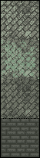

SFML 允许我们像到目前为止书中处理每个纹理对待的那样，将精灵集加载为普通的纹理。当我们将多张图像加载为单个纹理时，GPU 处理起来会高效得多。

### 提示

实际上，现代 PC 可以在不使用精灵集的情况下处理这四个纹理。但使用这些技术是值得的，因为我们的游戏将开始对硬件提出越来越的要求。

当我们从精灵集中绘制图像时，需要确保我们引用了我们所需的精灵集部分的精确像素坐标：

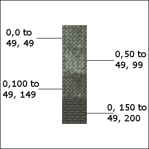

之前的图像为每个部分/瓦片标记了其在精灵集内的坐标。这些坐标被称为`texture coordinates`（纹理坐标）。我们将在代码中使用这些纹理坐标来绘制我们需要的正确部分。

## 什么是顶点数组？

首先我们需要问：什么是顶点（vertex）？`vertex`是单一的图形点，一个坐标。这个点由水平和垂直位置定义。vertex 的复数是 vertices。那么，顶点数组（vertex array）就是整个顶点的集合。

在 SFML 中，顶点数组中的每个顶点还有一个颜色和一个相关的额外顶点（坐标对），称为`texture coordinates`。纹理坐标是我们想要使用的图像在精灵集中的位置。我们很快就会看到如何对图形进行定位并在每个位置选择精灵集的某部分进行显示，而这一切都是通过单个顶点数组完成的。

`SFML VertexArray`类可以持有不同类型的顶点集。但每个`VertexArray`应该只包含一种类型的集合。我们根据情况使用合适的集合类型。

视频游戏中常见的场景包括但不限于以下`primitive`（基元）类型：

- `Point`（点）：每个点一个顶点。
- `Line`（线）：每组两个顶点，定义线的起点和终点。
- `Triangle`（三角形）：每个点三个顶点。在数以千计的类型中，可能是复杂 3D 模型中最常用的，或者成对创建简单的矩形（如精灵图/sprite）。
- `Quad`（四边形）：每组四个顶点，这是从精灵集中映射矩形区域的方便方法。

我们将在项目中使用四边形（quads）。

## 从瓦片构建背景

Zombie Arena 的背景将由方形图像随机排列组成。你可以将这种排列想象成地板上的瓦片。

在这个项目中，我们将使用带有`quad`集合的顶点数组。每个顶点将是四个一组（一个四边形）的一部分。每个顶点将定义我们背景中一个瓦片的一个角。每个纹理坐标将根据精灵集中的特定图像持有适当的值。

让我们来看一些代码来开始。这并不是我们在项目中将使用的精确代码，但它非常接近，并使我们能够在转向实际实现之前研究顶点数组。

## 构建顶点数组

正如我们创建类实例一样，我们声明新对象。以下代码声明了一个类型为`VertexArray`、名为`background`的新对象：

```cpp
// 创建顶点数组
VertexArray background;
```

我们想让我们的`VertexArray`实例知道我们将使用哪种基元。记住，点、线、三角形和四边形都有不同数量的顶点。通过设置`VertexArray`持有特定类型，就可以知道每个基元的起点。在我们的情况下，我们想要四边形。以下是执行此操作的代码：

```cpp
// 我们正在使用什么种基元类型
background.setPrimitiveType(Quads);
```

与普通的 C++ 数组一样，`VertexArray`需要设置大小。然而，`VertexArray`更灵活。它允许我们在游戏运行时更改其大小。可以在声明的同时配置大小，但我们的背景需要随着每一波敌人而扩展。`VertexArray`类通过`resize`函数提供了此功能。以下是设置我们的场地大小为 10 比 10 瓦片大小的代码：

```cpp
// 设置顶点数组的大小
background.resize(10 * 10 * 4);
```

在上一行代码中，第一个`10`是宽度，第二个`10`是高度，`4`是一个四边形（quad）的顶点数量。我们可以直接传递`400`，但这样展示计算过程可以让我们清楚自己在做什么。当我们实际编写项目代码时，我们会更进一步，为计算的每个部分声明变量。

现在我们有了一个准备好的`VertexArray`，可以配置它的数百个顶点。以下是我们将设置前四个顶点（第一个四边形）的位置坐标的：

```cpp
// Position each vertex in the current quad background
background[0].position = Vector2f(0, 0); background[1].position = Vector2f(49, 0); background[2].position = Vector2f(49,49); background[3].position = Vector2f(0, 49);
```

以下是我们将这些顶点的纹理坐标设置为精灵图中的第一张图像的。图像文件中这些坐标从`0,0`（左上角）到`49,49`（右下角）：

```cpp
// Set the texture coordinates of each vertex
background[0].texCoords = Vector2f(0, 0); background[1].texCoords = Vector2f(49, 0); background[2].texCoords = Vector2f(49, 49); background[3].texCoords = Vector2f(0, 49);
```

如果我们想将纹理坐标设置为精灵图中的第二张图像，我们将这样编写代码：

```cpp
// Set the texture coordinates of each vertex
background[0].texCoords = Vector2f(0, 50);
background[1].texCoords = Vector2f(49, 50);
background[2].texCoords = Vector2f(49, 99);
background[3].texCoords = Vector2f(0, 99);
```

当然，如果我们像这样逐个定义每一个顶点，那么即使是配置一个简单的`10`比`10`的竞技场，我们需要花费很长时间。


当我们实际实现背景时，我们将设计一组嵌套的 `for` 循环，遍历每个四边形，随机选择背景图像，并分配相应的纹理坐标。

代码需要相当智能。它需要知道何时是边缘瓦片，以便使用精灵图中的墙壁图像。它还需要使用适当的变量，这些变量知道每个背景瓦片在精灵图中的位置，以及所需竞技场的总尺寸。

我们将通过将所有代码放在单独的函数和单独文件中使这种复杂性变得可管理。我们将通过使用 C++ 引用让 `VertexArray` 在主函数中可用。

我们很快就会遇到这些细节。你可能已经注意到，在任何时候，我们都没有将纹理（精灵图）与顶点数组关联起来。

### 使用顶点数组绘制

我们可以完全按照加载任何其他纹理的方式将精灵图加载为纹理，如下代码所示：

```cpp
// Load the texture for our background vertex array
Texture textureBackground;
textureBackground.loadFromFile("graphics/background_sheet.png");
```

我们只需调用一次 `draw` 即可绘制整个 `VertexArray`：

```cpp
// Draw the background
window.draw(background, &textureBackground);
```

之前的代码比将每个瓦片作为单独的精灵绘制要高效得多。

### 注意

在继续之前，请注意 `textureBackground` 之前那个看起来有点奇怪的 `&`。你的第一反应可能是这与引用有关。这里发生的是我们传递的是纹理的地址而不是纹理本身。我们将在下一章中学习更多相关内容。

现在我们就可以利用引用和顶点数组的知识来实现 Zombie Arena 项目的下一个阶段了。

### 创建随机生成的滚动背景

我们将在单独的文件创建一个创建背景的函数。我们将通过使用顶点数组引用，确保背景在主函数中可用（在作用域内）。

由于我们将编写其他与主函数共享数据的函数，我们将把它们都写在各自的 `.cpp` 文件中。我们将在一个新的头文件中提供这些函数的原型，并在 `ZombieArena.cpp` 中包含（使用 `include` 指令）它。

为了实现这一点，让我们先创建新的头文件。在 `Solution Explorer`（解决方案资源管理器）中右键点击 `Header Files`，并选择 `Add` | `New Item...`。在 `Add New Item` 窗口中，选中（通过左键点击）`Header File`（`.h`），然后在 `Name` 字段中输入 `ZombieArena.h`。最后点击 `Add` 按钮。我们现在准备好为新函数编写头文件代码了。

在这个新的 `ZombieArena.h` 头文件中，添加以下高亮代码，包括函数原型：

```cpp
#pragma once
using namespace sf;
int createBackground(VertexArray& rVA, IntRect arena);
```

之前的代码允许我们编写一个名为 `createBackground` 的函数定义。为了匹配原型，函数必须返回一个 `int` 值，并接收一个 `VertexArray` 引用和一个 `IntRect` 对象作为参数。

现在我们可以创建一个新的 `.cpp` 文件，在其中编写函数定义代码。在 `Solution Explorer` 中右键点击 `Source Files`，并选择 `Add` | `New Item...`。在 `Add New Item` 窗口中，选中（通过左键点击）`C++ File`（`.cpp`），然后在 `Name` 字段中输入 `CreateBackground.cpp`。最后点击 `Add` 按钮。我们现在准备好编写创建背景的函数定义代码了。

将以下代码添加到 `CreateBackground.cpp` 中，然后我们将进行审查：

```cpp
#include "stdx.h"
#include "ZombieArena.h"

int createBackground(VertexArray& rVA, IntRect arena) {
    // Anything we do to rVA we are actually doing to (in the main function)
    // How big is each tile/texture
    const int TILE_SIZE = 50;
    const int TILE_TYPES = 3;
    const int VERTS_IN_QUAD = 4;

    int worldWidth = arena.width / TILE_SIZE;
    int worldHeight = arena.height / TILE_SIZE;

    // What type of primitive are we using?
    rVA.setPrimitive(Quads);

    // Set the size of the vertex array
    rVA.resize(worldWidth * worldHeight * VERTS_IN_QUAD);

    // Start at the beginning of the vertex array
    int currentVertex = 0;

    return TILE_SIZE;
}
```

在之前的代码中，我们编写了函数签名以及标记函数体的起始结束括号。

在函数体内部，我们声明并初始化了三个新常量，用于存储整个函数过程中需要的值。它们是 `TILE_SIZE`、`TILE_TYPES` 和 `VERTS_IN_QUAD`。`TILE_SIZE` 常数指的是精灵图中每个瓦片的像素尺寸。`TILE_TYPES` 指的是精灵图中不同类型瓦片的数量。我们可以向精灵图中添加更多瓦片，并更改 `TILE_TYPES` 以匹配它，而我们即将编写的代码仍然有效。`VERTS_IN_QUAD` 指的是每个四边形中有四个顶点。与反复输入数字 `4` 相比，使用此常量更不容易出错。

然后我们声明并初始化了两个 `int` 变量，`worldWidth` 和 `worldHeight`。这些变量的用途可能看起来显而易见。虽然它们的名称已经揭示了意图，但值得指出，它们指的是以瓦片数量计算的世界宽度和高度，而不是像素。`worldWidth` 和 `worldHeight` 变量通过将传入的 `arena` 的高宽除以常量 `TILE_SIZE` 来初始化。

接下来，我们第一次使用了引用。记住，我们对 `rVA` 的任何操作实际上都是对传入的变量的操作，而该变量在主函数的作用域内（或在我们编写代码时位于那里）。

首先，我们使用 `rVA.setType` 准备顶点数组使用四边形，然后通过调用 `rVA.resize` 调整为合适的大小。向 `resize` 函数传递了 `worldWidth * worldHeight * VERTS_IN_QUAD` 的结果，这等同于我们完成准备后顶点数组将拥有的顶点数量。

最后一行代码声明并初始化 `currentVertex` 为零。我们将在遍历顶点数组初始化所有顶点时使用 `currentVertex`。

我们现在可以编写嵌套循环的第一部分，用于准备顶点数组。添加以下高亮代码，并根据我们学到的顶点数组的知识，尝试推导出它的作用：

```cpp
// 从顶点数组开始开始 int currentVertex = 0;

for (int w = 0; w < worldWidth; w++)
{
    // 确定当前矩形中每个顶点的位置
    for (int h = 0; h < worldHeight; h++) {
        rVA[currentVertex + 0].position = Vector2f(w * TILE_SIZE, h * TILE_SIZE);
        rVA[currentVertex + 1].position = Vector2f((w * TILE_SIZE) + TILE_SIZE, h * TILE_SIZE);
        rVA[currentVertex + 2].position = Vector2f((w * TILE_SIZE) + TILE_SIZE, (h * TILE_SIZE) + TILE_SIZE);
        rVA[currentVertex + 3].position = Vector2f((w * TILE_SIZE), (h * TILE_SIZE) + TILE_SIZE);
        // 为下一组顶点准备好位置
        currentVertex = currentVertex + VERTS_IN_QUAD;
    }
}

return TILE_SIZE;
```

我们刚刚添加的代码通过嵌套循环遍历顶点数组，它首先遍历前四个顶点：`currentVertex + 1`、`currentVertex + 2` 等。

我们使用数组表示法访问数组中的每个顶点：`rvA[currentVertex + 0]`……以此以此类推。使用数组表示法调用 `position` 函数：`rvA[currentVertex + 0].position`……。

我们向 `position` 函数传递每个顶点的水平和垂直坐标。我们可以通过结合 `w`、`h` 和 `TILE_SIZE` 来程序化地计算这些坐标。

在上一段代码的末尾，我们通过代码 `currentVertex = currentVertex + VERTS_IN_QUAD` 将 `currentVertex` 向后移动四个位置，为嵌套循环的下一次通过做好准备。

当然，这一切仅仅是设置了我们顶点的坐标；并没有从纹理集（sprite sheet）中分配纹理坐标。这是我们接下来要做的。

为了完全清楚新代码放在哪里，我将其与我们刚刚编写的所有代码一起展示出来。添加并学习高亮代码：

```cpp
for (int w = 0; w < worldWidth; w++)
{
    for (int h = 0; h < worldHeight; h++) {
        // 确定当前矩形中每个顶点的位置
        rVA[currentVertex + 0].position = Vector2f(w * TILE_SIZE, h * TILE_SIZE);
        rVA[currentVertex + 1].position = Vector2f((w * TILE_SIZE) + TILE_SIZE, h * TILE_SIZE);
        rVA[currentVertex + 2].position = Vector2f((w * TILE_SIZE) + TILE_SIZE, (h * TILE_SIZE) + TILE_SIZE);
        rVA[currentVertex + 3].position = Vector2f((w * TILE_SIZE), (h * TILE_SIZE) + TILE_SIZE);

        // 定义当前矩形在纹理中的位置 // 可能是草、石头、灌木或墙
        if (h == 0 || h == worldHeight-1 || w == 0 || w == worldWidth-1)
        {
            Vector2f(0, TILE_SIZE + TILE_TYPES * TILE_SIZE);
            // 使用墙纹理
            rVA[currentVertex + 0].texCoords = Vector2f(0, 0 + TILE_TYPES * TILE_SIZE);
            rVA[currentVertex + 1].texCoords = Vector2f(TILE_SIZE, 0 + TILE_TYPES * TILE_SIZE);
            rVA[currentVertex + 2].texCoords = Vector2f(TILE_SIZE, TILE_SIZE + TILE_TYPES * TILE_SIZE);
            rVA[currentVertex + 3].texCoords = ;
        }
        // 为下一组顶点准备好位置
        currentVertex = currentVertex + VERTS_IN_QUAD;
    }
}

return TILE_SIZE;
```

上一段代码设置了每个顶点关联的纹理集内部坐标。注意那个较长的 `if` 条件。该条件检查当前矩形是否是场场中最几个或最后几个矩形。如果是，则意味着它是边界的一部分。然后我们可以使用使用 `TILE_SIZE` 和 `TILE_TYPES` 的简单公式来指定纹理集中的墙纹理。

数组表示法和 `texCoords` 成员逐为每个顶点初始化，以分配纹理集内墙纹理的相应角。

以下代码被封装在 `else` 块中。这意味着当矩形不代表边界/墙瓦片时，它在每次嵌套循环中都会运行。将高亮代码添加到现有代码中，我们就可以检查它了：

```cpp
// 定义当前矩形在纹理中的位置 // 可能是草、石头、灌木或墙
if (h == 0 || h == worldHeight-1 || w == 0 || w == worldWidth-1)
{
    // 使用墙纹理
    rVA[currentVertex + 0].texCoords = Vector2f(0, 0 + TILE_TYPES * TILE_SIZE);
    rVA[currentVertex + 2].texCoords = Vector2f(TILE_SIZE, TILE_SIZE + TILE_TYPES * TILE_SIZE); // 注意：原始逻辑此处索引是 2
}
else
{
    // 使用随机纹理
    srand(time(0)); int mG = rand() % TILE_TYPES; int verticalOffset = mG * TILE_SIZE;
    rVA[currentVertex].texCoords = Vector2f(0, 0 + verticalOffset);
    rVA[currentVertex + 1].texCoords = Vector2f(TILE_SIZE, 0 + verticalOffset);
    rVA[currentVertex + 2].texCoords = Vector2f(TILE_SIZE, TILE_SIZE + verticalOffset);
    rVA[currentVertex + 3].texCoords = Vector2f(0, TILE_SIZE + verticalOffset);
}
// 为下一组顶点准备好位置
currentVertex = currentVertex + VERTS_IN_QUAD;
```

上一段代码首先通过一个每次通过都不同的公式为随机生成器设置种子。然后 `mG` 代表泥土或草。这个名字是任意的。

现在我们通过将 `mG` 乘以 `TILE_SIZE` 声明了一个名为 `verticalOffset` 的变量。现在我们在纹理集内部有一个垂直参考点，指向当前矩形随机选择纹理的起始高度。

现在我们使用一个涉及 `TILE_SIZE` 和 `verticalOffset` 的简单公式，将纹理每个角的的精确坐标分配给相应的顶点。现在我们可以在游戏引擎中使用我们新定义的函数了。

## 使用背景

我们已经完成了困难的部分，这将会很简单。有三个步骤：

1. 创建一个顶点数组（`VertexArray`）。
2. 在升级后初始化它。
3. 在每一帧中绘制它。

添加以下代码来声明一个顶点数组 `background` 并加载 `background_sheet.png` 作为纹理：

```cpp
// 创建 Player 类的实例
Player player;

// 竞技场地的边界
IntRect arena;

// 创建背景顶点数组 background;
VertexArray background;
// 加载我们背景顶点数组的纹理 Texture textureBackground;
textureBackground.loadFromFile("graphics/background_sheet.png");

// 主游戏循环
while (window.isOpen())
```

添加以下代码来调用 `createBackground` 函数，将 `background` 作为引用传递，并将 `arena` 按值传递。注意高亮代码中，我们修改了初始化 `tileSize` 变量的方式。

```cpp
if (state == State::PLAYING)
{
    // 准备
    arena.width = 500;
    arena.height = 500;
    arena.left = 0;
    arena.top = 0;

    // 将顶点数组通过引用传递
    // 给 createBackground 函数
    int tileSize = createBackground(background, arena);

    // 在竞技场中心生成玩家
    player.spawn(arena, resolution, tileSize);

    // 重置时钟以防止帧跳跃
    clock.restart();
}
```

注意我们替换了 `int tileSize = 50` 这行代码，因为我们直接从 `createBackground` 函数的返回值获取值。

最后，是时候绘制了。这非常简单。我们做的只是调用 `window.draw` 并传递顶点数组以及 `textureBackground` 纹理：


```cpp
/*
**************
绘制场景
**************
*/
if (state == State::PLAYING) {
    window.draw(background, textureBackground);
}
```

```cpp
window.clear();

// 将 mainView 设置为在窗口显示
// 并绘制与其相关的所有内容

window.setView(mainView);

// 绘制背景窗口
window.draw(background, &textureBackground);

// 绘制玩家
window.draw(player.getSprite());
}
```

### 提示

如果你在好奇 `textureBackground` 前面那个看起来奇怪的 `&` 符号是怎么回事，那么在下一章中一切都会变得清晰。

你现在可以像下面的图片一样运行游戏了：

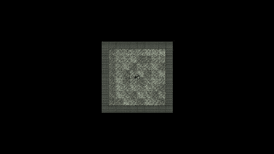

注意玩家精灵图如何在场地边界内平滑地滑动和旋转。虽然 `main` 中的当前代码绘制了一个较小的场地，但 `CreateBackground` 函数可以根据我们告诉它的任何尺寸的场地。我们将在第 11 章“音效、文件 I/O 与完成游戏”中看到比屏幕更大的场地。

## 第 8 章：指针、标准模板库与纹理管理

在本章中，我们将学习很多知识，并为游戏完成大量工作。首先，我们将学习 C++ 的基础主题：`指针`。指针是存储内存地址的变量。通常，一个指针持有另一个变量的内存地址。这听起来有点像引用（reference），但我们将看到它们要强大得多。我们还将使用指针来处理不断扩张的僵尸潮。

我们还将学习`标准模板库`（`STL`，Standard Template Library），它是一个类集合，允许我们快速方便地实现常见的数据管理技术。

一旦我们理解了 `STL` 的基础，我们就能利用这些新知识来管理游戏中的所有纹理，因为如果我们有 1000 只僵尸，我们并不想为每一个僵尸都加载一个僵尸图形的副本到 GPU 中。

我们还将进一步深入研究 OOP（面向对象编程），并使用 `static` 函数。`static` 函数是类的方法，可以在没有类实例的情况下调用。同时，我们将看到如何设计一个类来确保只存在一个实例。当我们需要保证代码的不同部分将使用相同数据时，这是最理想的。

在本章中，我们将学习以下主题：

- 学习指针
- 学习 STL
- 使用 `static` 函数和 `singleton`（单例）类实现 `TextureHolder` 类
- 实现一个指向僵尸潮的指针
- 修改现有代码，使用 `TextureHolder` 类处理玩家和背景

## 指针

在学习编写 C++ 代码时，指针可能是导致沮败的原因。然而，它的概念其实很简单。

### 注意

`pointer`（指针）是一个存储内存地址的变量。

仅此而已！没有什么好担心的。让初学者感到沮败的可能是语法，即我们用来处理指针的代码。考虑到这一点，我们将逐步讲解使用指针代码的每个部分。然后你就可以开始掌握它们的持续过程了。

### 提示

在本节中，我们学习的指针知识实际上比这个项目所需的更多。在下一个项目中，我们将更多地使用指针。尽管如此，我们只触及了该主题的皮毛。强烈建议进行进一步学习，我们将在最后一章中讨论更多内容。

我很少建议将背诵事实、数字或语法作为学习的最佳方法。然而，记忆与指针相关的虽然简短但至关重要的语法可能是值得的。这样它们就能深深刻烙刻在大脑中，使我们永远不会忘记。然后我们就可以讨论为什么我们需要指针，并检查它们与引用的关系。指针的类比可能会有所帮助。

### 提示

如果说一个变量是一个房子，它的内容是它所持的值，那么指针就是这个房子的地址。

我们在上一章讨论引用时学到，当我们将值传递给函数或从函数返回值时，我们实际上是在创建一个与之前一个房子完全相同的新房子。我们正在为传递给或从函数返回的值创建一个副本。

到此时，指针可能开始听起来有点像引用。那是因为它们确实有点像引用。但是，指针要灵活、强大得多，并且有它们自己特殊且独特的用途。这些特殊且独特的用途需要特殊的语法。

## 指针语法

与指针相关的有两个主要的运算符。第一个是 `address of`（取地址符）运算符：

`&`

第二个是 `dereference`（解引用/取值）运算符：

`*`

我们现在来看一下在指针中使用这些运算符的不同方式。

你首先会注意到，取地址符与引用运算符是相同的。给有志心勃勃的 C++ 游戏程序员增添痛苦的是，这些运算符在不同的上下文中执行不同的操作。从一开始就知道这一点非常有价值。如果你正盯着某些涉及指针的代码，感觉自己快要疯了，请记住：

### 提示

你完全正常！你只需要查看上下文的细节。

现在你知道，如果某些事情不清晰且一而易见，并不是你的错。指针并不清晰且一而易见，但仔细观察上下文将揭示发生了什么。

掌握了需要对指针比对之前的语法更多关注的知识，以及这两个运算符（取地址和解引用）是什么之后，我们现在可以开始看到一些真正的指针代码了。

### 提示

在继续之前，请确保你已经记住了这两个运算符。

## 声明指针

要声明新指针，我们使用解引用运算符以及指针将持有地址的变量类型。看看这段代码，我们将深入探讨：

```cpp
// 声明一个用于存储 int 类型变量地址的指针
int* pHealth;
```

这段代码声明了一个名为 `pHealth` 的新指针，它可以持有一个 `int` 类型变量的地址。注意我说的是“可以持有一个 `int` 类型变量”。就像其他变量一样，指针也需要初始化一个值才能被正确使用。`pHealth` 这个名字和其他变量一样是任意命名的。

在 `pointers`（指针）变量名前前加上 `p` 是一种常见做法。这样我们在处理指针时，将其与普通变量区分开来就更容易记忆。

解引用运算符周围使用的空格是可选的（因为 C++ 很少关心语法中的空格），但建议这样做，因为有助于提高可读性。看以下三行代码，它们的作用完全相同。

我们在上一个示例中看到的这种格式，即解引用运算符紧跟类型：

```cpp
int* pHealth;
```

解引用运算符两侧都有空格：

```cpp
int * pHealth;
```

解引用运算符在指针名旁边：

```cpp
int *pHealth;
```

意识到这些可能性是有值的，这样当你阅读代码（可能在网页上）时，你会理解它们都是相同的。在书中，我们将始终使用第一种选项，即解引用运算符紧跟类型。

就像普通变量只能成功包含相应类型的数据，指针也应该持有相应类型变量的地址。

`int` 类型的指针不应该持有 `String`、`Zombie`、`Player`、`Sprite`、`float` 或任何其他类型的地址。

## 初始化指针

接下来我们可以看到如何将变量的地址放入指针中。看下面的代码：

```cpp
// 一个名为 health 的普通 int 变量
int health = 5;

// 声明一个存储 int 类型变量地址的指针
int* pHealth;

// 使用 "address of" 运算符初始化 pHealth 以 health 的地址
pHealth = &health;
```

在之前的代码中，我们声明了一个名为 `health` 的 `int` 变量并将其初始化为 `5`。虽然我们之前没有讨论过，但很显然，这个变量必须存储在计算机内存的某个地方。它必须有一个内存地址。

我们可以使用地址操作符 `&` 来访问这个地址。仔细观察之前代码的最后一行。我们用 `health` 的地址初始化 `pHealth`，如下：

```cpp
pHealth = &health;
```

现在，我们的 `pHealth` 持有了普通 `int` 变量 `health` 的地址。在 C++ 术语中我们说 `pHealth` 指向 `health`。

我们可以通过将 `pHealth` 传递给函数来使用它，该函数就可以处理 `health`，就像我们对引用所做的那样。如果我们只打算做这些操作，那么指针就没有意义了。

## 重新初始化指针

指针与引用不同，它可以被重新初始化以指向不同的地址。看下面的代码：

```cpp
// 一个名为 health 的普通 int 变量
int health = 5;
int score = 0;

// 声明一个指针来存放 int 类型变量的地址
int* pHealth;

// 初始化 pHealth 以持有 health 的地址
pHealth = &health;

// 重新初始化 pHealth 以持有 score 的地址
pHealth = &score;
```

现在 `pHealth` 指向 `int` 变量 `score`。

当然，我们指针的名称 `pHealth` 现在变得有点歧义了，也许应该命名为 `pIntPointer`。这里需要理解的关键点是，我们可以进行这种重新赋值。

在这个阶段，我们还没有将指针用于除了简单的指向（持有内存地址）之外的任何操作。让我们看看如何访问指针所指向地址上存储的值。这会让它们变得真正有用。

## 解引用指针

所以，我们知道指针持有一个内存中的一个地址。如果我们要在游戏（可能在我们的 HUD 中）中输出这个地址（在声明和初始化之后），它看起来可能像这样：`9876`。

它只是一个值。一个代表内存地址的值。在不同的操作系统和硬件类型上，这些值的范围会有所不同。在本书的上下文中，我们永远不需要直接操作地址。我们只关心所指向地址上存储的值是什么。

变量实际使用的地址是在游戏执行时（运行时）确定的，因此，在我们编写游戏代码时，无法知道变量的地址，从而无法知道指针存储的值。

我们通过使用解引用操作符 `*` 来访问指针指向地址上存储的值。下面的代码直接操作了某些变量，并且通过指针进行了操作。请尝试跟上，然后我们将过一遍。

### 提示

警告！接下来的代码是没有意义的（这是一个双关语）。它只是演示了如何使用指针。

```cpp
// 一些普通 int 变量
int score = 0;
int hiScore = 10;

// 声明 2 个指针来持有 int 的地址
int* pIntPointer1;
int* pIntPointer2;

// 初始化 pIntPointer1 以持有 score 的地址
pIntPointer1 = &score;

// 初始化 pIntPointer2 以持有 hiScore 的地址
pIntPointer2 = &hiScore;

// 直接给 score 加上 10
score += 10;
// score 现在等于 10

// 使用 pIntPointer1 给 score 加上 10
*pIntPointer1 += 10;
// score 现在等于 20 - 一个新的高分

// 仅使用指针将新的高分赋值给 hiScore
*pIntPointer2 = *pIntPointer1;
// hiScore 和 score 都等于 20
```

在之前的代码中，我们声明了两个 `int` 变量 `score` 和 `hiScore`。然后我们分别将它们初始化为 0 和 10。接下来，我们声明了两个指向 `int` 的指针。它们是 `pIntPointer1` 和 `pIntPointer2`。我们在声明的同时初始化了它们，以分别持有（指向）变量 `score` 和 `hiScore` 的地址。

接下来，我们用通常的方法给 `score` 加上 10，即 `score += 10`。然后我们看到通过对指针使用解引用符，我们可以访问它们指向的地址上存储的值。下面的代码实际上了 `pIntPointer1` 所指向的变量存储的值：

```cpp
// 使用 pIntPointer1 给 score 加上 10
*pIntPointer1 += 10;
// score 现在等于 20，一个新的高分
```

之前代码的最后部分对两个指针都进行了解引用，将 `pIntPointer1` 指向的值赋值给 `pIntPointer2` 指向的值：

```cpp
// 仅使用指针将新的高分赋值给 hiScore
*pIntPointer2 = *pIntPointer1;
// hiScore 和 score 都等于 20
```

现在 `score` 和 `hiScore` 都等于 20。

## 指针是多功能且强大的

我们可以用指针做更多事情。这里只是我们能做的一些有用事情。

### 动态分配内存

到目前为止看到的所有指针指向的内存地址范围仅限于创建它们的函数。因此，如果我们声明并初始化一个指向局部变量的指针，当函数返回时，指针、局部变量和内存地址都会消失。它们超出了作用范围。

直到现在，我们一直在使用在游戏执行之前就确定的固定内存。此外，我们使用的内存由操作系统控制，并且变量在我们调用和返回函数时丢失和创建。我们需要的是一种方法，可以在我们完成使用之前，使用一种一直在作用范围内的内存。我们希望访问可以自己调用并负责的内存。

当我们声明变量（包括指针）时，它们位于内存中一个被称为**栈**（stack）的区域。还有另一个内存区域，虽然由操作系统分配/控制，但可以在运行时分配。这另一个内存区域被称为**空存储**（free store）或有时称为**堆**（heap）。

### 提示

堆上的内存没有特定函数的作用范围。从函数返回不会删除堆上的内存。

这赋予了我们巨大的力量。通过访问仅受运行游戏的计算机资源限制的内存，我们可以规划包含大量对象的游戏。在我们的案例中，我们想要大量的僵尸。然而，正如蜘蛛侠的叔叔不会犹豫提醒我们的那样，能力越大，责任越大。

让我们看看如何使用指针来利用空闲区的内存，以及在我们完成后如何将这些内存释放回操作系统。

要创建一个指向堆上值的指针，我们首先需要一个指针：

```cpp
int* pToInt = nullptr;
```

在上一行代码中，我们像之前看到的那样声明了一个指针，但由于我们没有将其指向某个变量，而是将其初始化为 `nullptr`。这样做是一种良好的习惯。考虑一下在你甚至不知道指针指向什么时对它进行解引用（更改它指向地址的值）。这在编程中等同于去射击场，蒙上某人的眼睛，让他们转圈，然后告诉他们射击。通过让指针指向无（`nullptr`），我们无法对其产生任何伤害。

当我们准备好在空闲区请求内存时，我们在下面的代码行中使用 `new` 关键字：

```cpp
pToInt = new int;
```

指针 `pToInt` 现在持有了空闲区中空间的内存地址，该空间恰好可以存放一个 `int` 值。

### 提示

任何分配的内存在程序结束时都会返回。然而，重要的是意识到，除非我们释放它，否则这部分内存（游戏运行期间）永远不会被释放。如果我们继续从空闲区获取内存而不归还，内存最终会耗尽并导致游戏崩溃。

偶尔从空堆（free store）获取整数大小的内存块，不太可能让我们耗尽内存。但如果我们的程序有一个函数或循环请求内存，且这个函数或循环在游戏过程中经常执行，那么游戏最终会变慢并崩溃。此外，如果我们在空堆上分配了大量对象且没有正确管理它们，这种情况可能会很快发生。

下面这行代码释放（删除）了之前由 `pToInt` 指向的空堆内存：

```cpp
delete pToInt;
```

现在，之前由 `pToInt` 指向的内存不再由我们随心所用，我们必须采取预防措施。虽然内存已经还给了操作系统，但 `pToInt` 仍然持有该内存的地址，而该地址已不再属于我们。

下面这行代码确保了 `pToInt` 不能再用于尝试操作或访问这块内存：

```cpp
pToInt = nullptr;
```

### 提示

如果指针指向一个无效地址，它被称为`野指针`（wild pointer）或`悬指针`（dangling pointer）。如果你尝试解引用一个悬指针，如果你运气好，游戏将会崩溃并收到内存访问违规错误；如果你运气不好，则会创建一个极其难以发现的 bug。此外，如果我们要在空堆上使用生命周期超出函数范围的内存，我们必须确保保留指向它的指针，否则将会导致内存泄漏。

现在，我们可以声明指针并让它们指向空堆上新分配的内存。我们可以通过解引用指针来操作和访问它们所指向的内存。在完成工作后，我们可以将内存归还空堆，并且知道如何避免产生悬指针。

让我们来看看指针的更多优势。

### 将指针传递给函数

首先，我们需要写一个在函数签名中包含指针的函数，如下面的代码所示：

```cpp
void myFunction(int *pInt)
{
    // 解引用并增加指针 *pInt 指向地址处存储的值
    (*pInt)++;
    return;
}
```

上一个函数简单地解引用指针，并将指向地址处存储的值加 1。

现在我们可以使用该函数，并显式地将变量的地址或另一个指针变量传递给它：

```cpp
int someInt = 10;
int* pToInt = &someInt;

myFunction(&someInt);
// someInt 现在等于 11

myFunction(pToInt);
// someInt 现在等于 12
```

现在，如之前的代码所示，在函数内部我们实际上在操作调用代码中的变量，可以使用变量的地址或指向该变量的指针来实现。

### 声明和使用对象指针

指针不仅用于普通变量。我们也可以对自定义类型（如我们的类）声明指针。这就是声明指向 `Player` 类型对象指针的方法：

```cpp
Player player;
Player* pPlayer = &player;
```

我们甚至可以直接通过指针访问 `Player` 对象的成员函数，如下代码所示：

```cpp
// 调用 player 类的成员函数 pPlayer->moveLeft()
```

在这个项目中我们不需要使用对象指针，但在下一个项目之前，我们会在使用前更仔细地探索它们。

## 指针与数组

数组和指针之间有一些共同点。数组名就是一个内存地址。具体地说，数组名是该数组第一个元素的内存地址。换句话说，数组名指向数组的第一个元素。理解这一点的最好方法是继续看下一个示例。

我们可以创建一个指向数组所含类型的指针，然后以与数组完全相同的语法、完全相同的方式使用该指针：


```cpp
// 声明一个整数数组
int arrayOfInts[100];

// 声明一个 int 指针并将其初始化为数组 arrayOfInts 第一个元素的地址
int* pToIntArray = arrayOfInts;

// 就像使用 arrayOfInts 一样使用 pToIntArray
arrayOfInts[0] = 999;
// arrayOfInts 的第一个元素现在等于 999

pToIntArray[0] = 0;
// arrayOfInts 的第一个元素现在等于 0
```

这意味着，一个接受指针作为原型的函数，也接受该指针所指向类型的数组。当我们在构建不断增长的僵尸潮时，将用到这一事实。

## 提示

关于指针和引用的关系，编译器在实现我们的引用时实际上使用了指针。这意味着引用只是一个方便的工具（其底层使用指针）。你可以将引用看作是自动挡箱，在城市里行驶时很不错且方便；而指针是手动挡箱，更复杂，但只要使用正确，就能提供更好的结果/性能/灵活性。

## 指针总结

指针有时会有点棘手。事实上，我们对指针的讨论只是对该主题的入门。要熟悉指针的唯一方法就是尽可能多使用它们。为了完成这个项目，你只需要理解以下几点：

- 指针是存储内存地址的变量。
- 我们可以将指针传递给函数，以便在被调用函数内部操作调用函数作用域的值。数组是第一个元素的内存地址。我们可以将此地址作为指针传递，因为它确实如此。
- 我们可以使用指针指向空堆上的内存。这意味着我们可以在游戏运行时动态分配大量内存。

## 提示

为了进一步让指针问题变得神秘，C++ 在不久前经过了升级。现在有更多使用指针的方法。我们将在最后一章节中学习关于智能指针的知识。

只有一个最后主题要涵盖了，我们就可以再次开始编写僵尸竞技场项目了。

## 标准模板库 (STL)

STL 是数据容器以及处理放入这些容器中的数据的方法的集合。更具体地说，它是一种存储和处理不同类型 C++ 变量和类的方法。

我们可以将不同的容器看作自定义且更高级的数组。STL 是 C++ 的一部分。它不是 `SFML` 那样需要配置的可选内容。

STL 是 C++ 的一部分，因为它的容器和处理容器的代码是许多应用程序可能需要的许多类型代码的基础。

简而言之，STL 实现了我们以及几乎每个 C++ 程序员都可能需要的代码，至少在某个点，而且可能很频繁地需要。

如果我们自己写代码来包含和管理数据，那么我们写出的代码不太可能像编写 STL 的人员那样高效。

因此，通过使用 STL，我们确保了使用编写得最好的代码来管理数据。即使是 SFML 也使用了 STL。例如，在底层，`VertexArray` 类就使用了 STL。

我们需要做的只是从可用容器中选择正确的类型。通过 STL 提供的容器类型包括：

- **Vector (向量)**：像带了助器的数组。支持动态调整大小、排序和搜索。这可能是最有用的容器。
- **List (列表)**：一种允许数据排序的容器。
- **Map (映射)**：一种关联容器，允许用户以键/值对的形式存储数据。在这里，一个数据是寻找另一部分数据的键。`Map` 也可以增长和缩小，并进行搜索。
- **Set (集合)**：一种保证每个元素都是唯一的容器。

### 注意

要查看 STL 容器类型的完整列表和解释，请访问以下链接：`http://www.tutorialspoint.com/cplusplus/cpp_stl_tutorial.htm`。在僵尸竞技场游戏中，我们将使用 `Map`。

### 提示

如果你想一略 STL 为我们规避了何种复杂性，可以看看这个教程，它实现了列表（list）可以的功能。请注意，该教程仅实现了列表最简单的骨架结构：`http://www.sanfoundry.com/cpp-program-implementsingle-linked-list/`。

我们可以很容易看出，探索 STL 将为我们节省大量时间，并最终带来一个更好的游戏。让我们仔细查看如何使用 `Map`，然后我们将看到它在僵尸竞技场（Zombie Arena）游戏将对我们有多有用。

## 什么是 Map

`Map` 是一个可以动态调整大小的容器。我们可以轻松地添加和删除元素。`Map` 与 STL 中其他容器相比的特殊之处在于我们访问其中数据的方式。

`Map` 中的数据是以对对（pairs）的形式存储的。考虑你登录账户的情况，可能需要用户名和密码。`Map` 非常适合查找用户名，然后检查关联密码的值。

`Map` 也适用于账户名称和数字，或者公司名称和股票价格等内容。

注意，当我们使用 STL 中的 `Map` 时，我们决定了构成键值对的值类型。值可以是 `string` 和 `int` 等数据类型，如账户号码、作为用户名和密码的 `strings`，或者像对象这样的自定义类型。

接下来是一些真实的代码，让我们熟悉 `Map`。

### 声明一个 Map

我们可以这样声明一个 `Map`：

```
map<string, int> accounts;
```

上一行代码声明了一个名为 `accounts` 的新 map，它的键类型是 `String` 对象，每个对象都将引用一个类型为 `int` 的值。

我们现在可以存储 `Strings` 的键值对，它们引用如 `int` 等数据类型，我们接下来将会看到。

### 向 Map 中添加数据

让我们向 `accounts` 中添加一个键值对：

```
accounts["John"] = 1234567;
```

现在 map 中有一个项，可以通过键 `John` 访问。接下来的代码向 `accounts` map 又添加了两个条目：

```
accounts["Onkar"] = 7654321;
accounts["Wilson"] = 8866772;
```

我们的 `Map` 中现在有三个条目。让我们看看如何访问账户号码。

### 在 Map 中查找数据

我们通过添加数据完全相同的方式访问数据，即使用键。例如，我们可以将键 `Onkar` 存储的值赋给一个新的 `int` `accountNumber`，如下所示：

```
int accountNumber = accounts["Onkar"];
```

`int` 变量 `accountNumber` 现在存储了值 `7654321`。我们可以对存储在 `Map` 中的值进行任何我们对该类型可以进行的操作。

### 从 Map 中删除数据

从我们的 `Map` 中取出值也很简单。下一行代码删除了键 `John` 及其关联的值：

```
accounts.erase("John");
```

让我们看看还可以对 `Map` 做些其他事情。

### 检查 Map 的大小

我们可能想知道 `Map` 中有多少个键值对。下一行代码正是此功能：

```
int size = accounts.size();
```

`int` 变量 `size` 现在持有值二。这是因为 `accounts` 持有 `Onkar` 和 `Wilson` 的值，而我们删除了 `John`。

### 检查 Map 中的键

`Map` 最相关的特性是使用键查找值的能力。我们可以像这样测试特定键是否存在：

```cpp
if(accounts.find("John") != accounts.end())
{
    // 这段代码不会运行，因为 John 被删除了
}

if(accounts.find("Onkar") != accounts.end())
{
    // 这段代码将运行，因为 Onkar 在 map 中
}
```

在之前的代码中，使用值 `!= accounts.end` 来判断键是否存在。如果所查找的键不在 `Map` 中，那么 `accounts.end` 将是 `if` 语句的结果。

### 循环/遍历 Map 的键值对

我们已经见过如何使用 `forloop` 循环来循环/遍历数组的所有值。如果我们想对 `Map` 做类似的操作该呢？

接下来的代码展示了我们如何循环遍历 `accounts` Map 的每个键值对，并为每个账户号码加 1：

```
for (map<string,int>::iterator it = accounts.begin(); it != accounts.end(); ++ it)
{
    it->second +=1;
}
```

`for` 循环的条件可能是上述代码中最有趣的部分。条件的第一部分是最长的部分。

将 `map<string,int>::iterator it = accounts.begin()` 代码拆解开来会更易于理解。

`map<string,int>::iterator` 代码是一个类型。我们正在声明一个适用于具有 `string` 和 `int` 键值对的 map 的迭代器。迭代器的名称为 `it`。我们将从 `accounts.begin()` 返回的值赋给 `it`。迭代器 `it` 现在持有 `accounts` map 中的第一个键值对。

`for` 循环条件的其余部分工作如下。代码 `it != accounts.end()` 意味着循环将持续到到达 map 的末尾，而 `it++` 在每次循环循环中简单地移动到 map 中的下一个键值对。

在 `for` 循环内部，`it->second` 访问键值对的第二个元素，`+=1` 给该值加 1。注意，我们可以通过 `it->first` 访问键（键值对的第一部分）。

### auto 关键字

`for` 循环条件中的代码相当冗长，尤其是 `map<string,int>::iterator` 类型。C++ 提供了一种整洁的方法通过 `auto` 关键字来减少冗余。使用 `auto` 关键字，我们可以将之前的代码改进为：

```
for (auto it = accounts.begin(); it != accounts.end(); ++ it)
{
    it->second +=1;
}
```

`auto` 关键字指示编译器自动为我们推导出类型。这对于我们接下来要写的类将特别有用。

## STL 总结

与我们在书中涵盖的几乎每个 C++ 概念一样，STL 是一个巨大的话题。有整本书专门介绍 STL。但到目前，我们已经掌握了足够的知识来构建一个使用 STL `Map` 存储 `SFML Texture` 对象的类。我们就可以使用文件名作为键值对的键，来获取/加载纹理。

我们之所以要达到这种额外的复杂性水平，而不是继续像那样使用 `Texture` 类，原因将随着我们的进行而显而易见。

## TextureHolder 类

成千上万的僵尸代表了新的挑战。加载、存储和操作三个不同的僵尸副本不仅会占用大量内存，还需要大量的处理能力。我们将创建一个新的类型来解决这个问题，并允许我们只存储每个纹理的一个。

我们还将以这种方式编写类，使其永远只有一个实例。这种类型的类被称为单例（singleton）。

单例是一种设计模式，一种证明有效的代码结构。

此外，我们还将编写类，使其可以在游戏代码任何地方通过类名直接使用，而无需实例。

## 编写 TextureHolder 头文件

创建新的头文件。右键点击解决方案管理器中的 **Header Files** 并选择 **Add** | **New Item...**。在 **Add New Item** 窗口中，选中 **Header File (.h)**，然后在 **Name** 字段输入 `TextureHolder.h`。

将以下代码添加到 `TextureHolder.h` 文件中，然后我们可以讨论：

```cpp
#pragma once

#ifndef TEXTURE_HOLDER_H
#define TEXTURE_HOLDER_H

#include <SFML/Graphics.hpp> 
#include <map>

using namespace sf; using namespace std;

class TextureHolder
{
private:
    // 来自 STL 的 map 容器，
    // 持相关的 String 和 Texture 对
    std::map<std::string, Texture> m_Textures;

    // 与类本身类型相同的指针 // 唯一且仅实例
    static TextureHolder* m_s_Instance;

public:
    TextureHolder();
    static Texture& GetTexture(string const& filename);
};

#endif
```

在之前的代码中，注意到我们有一个来自 STL 的 `map` 包含指令。我们声明了一个持有 `String` 和 `SFML Texture` 键值对的 `map`。该 map 被称为 `m_Textures`。在之前的代码中，接下来的行是：

```cpp
static TextureHolder* m_s_Instance;
```

上一行代码非常有趣。我们正在声明一个类型为 `TextureHolder` 对象的静态指针，名为 `m_s_Instance`。这意味着 `TextureHolder` 类拥有一个与它自身类型相同的对象。不仅如此，由于它是静态的，我们可以通过类本身来使用它，而无需类的实例。当我们编写相关的 `.cpp` 文件时，我们将看到如何使用它。

在类的公有（public）部分，我们有构造函数 `TextureHolder` 的原型。该构造函数不接受任何参数，并且像往常一样，没有返回类型。这与默认构造函数相同。我们将用一个定义来覆盖默认构造函数，使我们的单例按照我们想要的方式工作。

我们还有另一个名为 `GetTexture` 的函数。让我们再次查看其签名并分析到底发生了什么：

```cpp
static Texture& GetTexture(string const& filename);
```

首先，注意该函数返回一个 `Texture` 的引用。这意味着 `GetTexture` 将返回一个引用，这是高效的，因为它避免了对可能相当大的图形进行拷贝。此外，注意函数被声明为 `static`。这意味着该函数可以在没有类实例的情况下使用。该函数接受一个 `String` 作为常量引用参数。这样做的效果有两个：首先，操作是高效的；其次，由于引用是常量的，它不能被更改。

## 编写 TextureHolder 函数定义

现在，我们可以创建一个新的 `.cpp` 文件，在其中包含函数定义。这将使我们能够看到这些新类型函数和变量背后的原因。在 `Solution Explorer` 中右键点击 `Source Files` 并选择 `Add | New Item...`。在 `Add New Item` 窗口中，高亮（左键）`C++ File` (`．cpp`)，然后在 `Name` 字段中输入 `TextureHolder.cpp`。最后，点击 `Add` 按钮。我们现在准备好编写该类了。

添加以下代码，然后我们可以讨论它：

```cpp
#include "stdafx.h"
#include "TextureHolder.h"

// Include the "assert feature"

#include <assert.h>

TextureHolder* TextureHolder::m_s_Instance = nullptr;

TextureHolder::TextureHolder()
{
    assert(m_s_Instance == nullptr); m_s_Instance = this;
}
```

在之前的代码中，我们将类型为 `TextureHolder` 的指针初始化为 `nullptr`。在构造函数中，代码 `assert(m_s_Instance == nullptr)` 确保 `m_s_Instance` 为 `nullptr`。如果不是，游戏将退出执行。然后代码 `m_s_Instance = this` 将指针赋值给此实例。现在考虑这段代码发生的地方。代码位于构造函数中。构造函数是我们从类创建对象实例的方式。因此，实际上我们现在有一个指向 `TextureHolder` 的指针，它指向它自身唯一的实例。

将代码的最后部分添加到 `TextureHolder.cpp` 文件中。接下来的注释比代码多。在添加代码时检查代码并阅读注释，然后我们就可以过一遍：

```cpp
sf::Texture& TextureHolder::GetTexture(std::string const& filename)
{
    // Get a reference to m_Textures using m_S_Instance
    auto& m = m_s_Instance->m_Textures;
    // auto 等同于 map<string, Texture>
    // 创建一个迭代器来持有键值值对 (kvp) // 并使用传入的 filename 
    // 查找所需的 kvp
    auto keyValuePair = m.find(filename);

    // auto 等同于 map<string, Texture>::iterator
    // 我们找到匹配的项了吗？if (keyValuePair != m.end()) {
    // 是的
    // 返回纹理，
    // kvp 的第二个部分，即返回纹理
    return keyValuePair->second;
    // }
    else
    {
        // 未找到文件名
        // 使用文件名创建一个新的键值对
        auto& texture = m[filename];
        // 以通常方式从文件加载纹理
        texture.loadFromFile(filename);
        // 将纹理返回给调用代码
        return texture;
    }
}
```

你可能注意到的之前代码的第一点是 `auto` 关键字。`auto` 关键字在上一节中解释过。

## 提示


如果你想知道被`auto`替换的实际类型是什么，请查看之前代码中每次使用`auto`之后的注释。

在代码开头，我们获取了`m_textures`的引用。然后，我们尝试获取一个代表传入文件名（`filename`）的键值对的迭代器。如果我们找到了匹配的键，我们通过`return keyValuePair->second`返回纹理。否则，我们将纹理添加到`map`中然后将其返回给调用代码。

诚然，`TextureHolder`类引入了许多新概念（单例、静态函数、常量引用、`this`和`auto`关键字）和语法。再加上我们刚刚开始学习指针和STL，这一节的代码可能有点望人生畏。

## 我们通过`TextureHolder`确切实现了什么？

关键点在于，现在我们有了这个类，我们可以在代码的任何地方随心使用纹理，而不必担心内存耗尽或无法在特定函数或类中访问特定的纹理。我们很快就会看到如何使用`TextureHolder`。

## 建造一群僵尸

现在我们已经配备了`TextureHolder`类，以确保我们的僵尸纹理可以轻松获取，并且只加载到GPU一次，我们可以考虑创建整群僵尸。

我们将僵尸存储在数组中，由于构建和生成一群僵尸的过程涉及相当多的代码行，它是抽象到独立函数的绝佳候选。我们很快就会编写`CreateHorde`函数，但首先，我们我们需要一个`Zombie`类。

## 编写Zombie.h文件

构建表示僵尸的类的第一步是在头文件中编写成员变量和函数原型。在`Solution Explorer`中右键点击`Header Files`并选择`Add | New Item...`。在`Add New Item`窗口中，高亮（左键）`Header File (.h)`，然后在`Name`字段中输入`Zombie.h`。

将以下代码添加到`Zombie.h`文件中：

```cpp
#pragma once

#include <SFML/Graphics.hpp>

using namespace sf;

class Zombie
{
private:
    // 每种类型的僵尸速度有多快？
    const float BLOATER_SPEED = 40;
    const float CHASER_SPEED = 80;
    const float CRAWLER_SPEED = 20;

    // 每种类型的僵尸有多硬
    const float BLOATER_HEALTH = 5;
    const float CHASER_HEALTH = 1;
    const float CRAWLER_HEALTH = 3;

    // 让每个僵尸的速度略有不同
    const int MAX_VARRIANCE = 30;
    const int OFFSET = 101 - MAX_VARRIANCE;

    // 这个僵尸在哪里？
    Vector2f m_Position;

    // 僵尸的精灵图
    Sprite m_Sprite;

    // 这个能跑得快还是爬得快？
    float m_Speed;

    // 它有多少血量？ float m_Health;

    // 它还活着吗？ bool m_Alive;

    // 公有原型放在这里
};
```

之前的代码声明了`Zombie`类所有的私有成员变量。在代码的顶部，我们有三个常量变量来存储每种僵尸的速度。一个非常慢的`Crawler`，一个快一点的`Bloater`以及一个速度较快的`Chaser`。我们可以尝试这三个常量的值，以帮助平衡游戏的难度。这里值得提到的是，这三个值仅作为每种僵尸类型速度的初始值。正如我们在本章后面看到的，我们将通过这些值的微小百分比来改变每个僵尸的速度。这可以防止同种类型的僵尸在追逐玩家时聚集在一起。

接下来的三个常量决定了每种僵尸的血量水平。注意，肿胀者（Bloaters）最强，其次是爬行者（Crawlers）。出于平衡考虑，追者（Chaser）僵尸最容易被杀死。

接下来我们还有两个常量`MAX_VARIANCE`和`OFFSET`；这些将帮助我们确定每只僵尸个体的速度。我们将在编写`Zombie.cpp`文件时具体看到实现方式。

在这些常量之后，我们声明了一系列变量，这些变量看起来应该很熟悉，因为我们在`Player`类中定义过非常相似的变量。`m_Position`、`m_Sprite`、`m_Speed`和`m_Health`变量正如其名称所示：代表僵尸对象的的位置、精灵图、速度和血量。

最后，在之前的代码中，我们声明了一个布尔值`m_Alive`，当僵尸存活并狩猎时，它为`true`；但当它的血量归零时，它为`false`，此时它只是精美背景上的一滩血迹。现在完成`Zombie.h`文件。添加下方高亮的函数原型，然后我们将对其进行讨论：

```cpp
// 它还活着吗？
bool m_Alive;

// 公有原型放在这里
public:
// 处理子弹击中僵尸的情况
bool hit();
// 检查僵尸是否存活
bool isAlive();
// 生成一个新的僵尸
void spawn(float startX, float startY, int type, int seed);
// 返回一个表示世界中位置的矩形
FloatRect getPosition();
// 获取用于绘制的精灵图副本
Sprite getSprite();
// 每帧更新僵尸
void update(float elapsedTime, Vector2f playerLocation);
```

在之前的代码中，有一个`hit`函数，我们可以在僵尸每次被子弹击中时调用它。该函数可以采取必要的步骤，例如从僵尸身上扣除血量（减少`m_Health`的值）或将其杀死（将`m_Alive`设置为`false`）。

`isAlive`函数返回一个`Boolean`值，让调用代码知道僵尸是活的还是死的。我们不希望在玩家走过血迹时执行碰撞检测或从玩家身上扣除血量。

`spawn`函数接收一个起始位置、一个类型（爬行者、肿胀者或追者，用`int`表示），以及一个用于我们在下一节中看到的随机数生成的种子。

就像我们在`Player`类中做的一样，`Zombie`类拥有`getPosition`和`getSprite`函数，用于获取一个表示僵尸占据空间的矩形以及每帧可以绘制的精灵图。

之前代码中的最后一个原型是`update`方法。我们可能已经猜到它会接收自上一帧以来经过的时间，但请注意它还接收了一个名为`playerLocation`的`Vector2f`。这个向量确实是玩家中心的精确坐标。我们很快就会看到如何使用这个向量来追踪玩家。

## 编写Zombie.cpp文件

接下来我们将编写`Zombie`类的实际功能，即函数定义。

创建一个新的`.cpp`文件来包含函数定义。在**解决方案管理器**中右键点击**源文件**，并选择`添加 | 新项...`。在**添加新项**窗口中，高亮（左点击）`C++ 文件`（`.cpp`），然后在`名称`字段中输入`Zombie.cpp`。最后，点击**添加**按钮。我们现在准备好编写类了。

将以下代码添加到`Zombie.cpp`文件中：

```cpp
#include "stdafx.h"
#include "zombie.h"
#include "TextureHolder.h"
#include <cstdlib>
#include <ctime>

using namespace std;
```

首先我们添加了必要的包含指令，然后是`using namespace std`这一行。你可能记得我们在对象声明前加上`std::`的几种情况。这个命名空间指令意味着我们不需要在该文件的代码中这样做。

现在添加以下代码，即`spawn`函数的定义。在添加后研究一下代码，然后我们将一起过一遍：

```cpp
void Zombie::spawn(float startX, float startY, int type, int seed)
{
    m_Speed = 40; 
    m_Health = 5; 
    switch (type)
    {
        case 0:
            // 肿胀者
            m_Sprite = Sprite(TextureHolder::GetTexture("graphics/bloater.png"));
            break;
        case 1:
            // 追者
            m_Sprite = Sprite(TextureHolder::GetTexture("graphics/chaser.png"));
            m_Speed = 70; 
            m_Health = 1; 
            break;
        case 2:
            // 爬行者
            m_Sprite = Sprite(TextureHolder::GetTexture("graphics/crawler.png"));
            m_Speed = 20; 
            m_Health = 3; 
            break;
    }

    // 修改速度使僵尸具有独特性 // 每只僵尸都是独的。
    srand((int)time(0) * seed);
    // 在 80 到 100 之间
    float modifier = (rand() % MAX_VARRIANCE) + OFFSET;
    // 将其表示为 1 的比例
    modifier /= 100; // 现在 等于 .7 到 1 之间
    m_Speed *= modifier;
    // 初始化它的位置
    m_Position.x = startX; 
    m_Position.y = startY;
    // 将原点设置为中心
    m_Sprite.setOrigin(25, 25);
    // 设置它的位置
    m_Sprite.setPosition(m_Position);
}
```

函数执行的第一件事是根据传入的参数`int type`进行分支。在`switch`块中，每种僵尸类型都有一个`case`。根据类型，我们设置相应的纹理、速度和血量成员变量。这里我们我们使用的是`TextureHolder::GetTexture`。接下来的三行代码（不包括注释）作用如下：使用传入的`seed`变量初始化随机生成器。使用`rand`函数以及`MAX_VARIANCE`和`OFFSET`常量声明并初始化`modifier`变量。结果是一个零到一之间的比例，可用于使每只僵尸具有独特性。我们这样做是为了防止僵尸过度堆叠在一起。我们现在可以将`m_Speed`乘以`modifier`，这样僵尸的速度就处于该特定类型僵尸定义的常量的`MAX_VARIANCE`百比范围内。在解决速度后，我们将`startX`和`startY`中持有的位置分别赋值给`m_Position.x`和`m_Position.y`。代码列表的最后两行将精灵图的原点设置为中心，并使用`m_Position`向量设置精灵图的位置。

现在将此`hit`函数的代码添加到`Zombie.cpp`文件中：

```cpp
bool Zombie::hit() {
    m_Health--;
    if (m_Health < 0) {
        // 死亡
        m_Alive = false;
        m_Sprite.setTexture(TextureHolder::GetTexture("graphics/blood.png"));
        return true;
    }
    // 受伤但尚未死亡
    return false;
}
```

`hit`函数非常简单。将`m_Health`减一，然后检查`m_Health`是否小于零。如果小于零，将`m_Alive`设置为`false`，将僵尸的纹理更换为血迹，并向调用代码返回`true`，以便它知道僵尸现在死了。如果僵尸生存了攻击，返回`false`。

添加接下来三个getter函数，它们只是向调用代码返回一个值：

```cpp
bool Zombie::isAlive()
{
    return m_Alive;
}

FloatRect Zombie::getPosition()
{
    return m_Sprite.getGlobalBounds();
}

Sprite Zombie::getSprite()
{
    return m_Sprite;
}
```

之前的三个函数非常直俗易懂，除了`getPosition`函数使用了`m_Sprite.getLocalBounds`函数来获取`FloatRect`并将其返回给调用代码之外。

最后，对于`Zombie`类，添加`update`函数的代码；仔细观察代码，然后我们将一起过一遍：

```cpp
void Zombie::update(float elapsedTime, Vector2f playerLocation)
{
    float playerX = playerLocation.x;
    float playerY = playerLocation.y;
    // 如果 (playerX > m_Position.x) 更新僵尸位置变量
    {
        m_Position.x = m_Position.x + m_Speed * elapsedTime;
    }
    if (playerY > m_Position.y) {
        m_Position.y = m_Position.y + m_Speed * elapsedTime;
    }
    if (playerX < m_Position.x) {
        m_Position.x = m_Position.x - m_Speed * elapsedTime;
    }
}
```

```cpp
if (playerY < m_Position.y) {
    m_Position.y = m_Position.y - m_Speed * elapsedTime; 
} // Move the sprite
m_Sprite.setPosition(m_Position); // 让精灵朝向正确的方向
float angle = (atan2(playerY - m_Position.y, playerX - m_Position.x) * 180) / 3.141;

m_Sprite.setRotation(angle); 
}
```

首先，我们将`playerLocation.x`和`playerLocation.y`拷贝到局部变量`playerX`和`playerY`中。

接下来有四个`if`语句。它们用于测试僵尸是否位于当前玩家位置的左侧、右侧、上方或下方。当这四个`if`语句结果为`true`时，将使用通常公式`speed * 距离上一帧的时间`适当地调整僵尸的`m_Position.x`和`m_Position.y`值。具体来说，代码是`m_Speed * elapsedTime`。

在四个`if`语句之后，`m_Sprite`被移动到它的新位置。

然后我们使用了与之前处理玩家和鼠标指针时相同的计算方法；但这一次，是针对僵尸和玩家的。此计算得出了让僵尸面向玩家所需的角度。

最后，我们调用`m_Sprite.setRotation`来实际旋转僵尸精灵。请记住，该函数会在游戏的每一帧中为每个僵尸（即存着的僵尸）被调用。

## 使用Zombie类创建尸群

现在我们有了一个可以创建活的、攻击的且可被杀死的僵尸的类，我们想要生成一整群僵尸。

为了实现这一点，我们将编写一个单独的函数并使用指针，这样我们就可以引用在`main`中声明但在不同作用域中配置的尸群了。

在Visual Studio中打开`ZombieArena.h`文件，并添加下所示的高亮代码行：

```cpp
#pragma once

#include "Zombie.h"

using namespace sf;

int createBackground(VertexArray& rVA, IntRect arena);
Zombie* createHorde(int numZombies, IntRect arena);
```

现在我们有了了原型，可以编写函数定义了。

创建一个包含函数定义的新的.cpp文件。在`解决方案资源管理器`中右键点击`Source Files`并选择`Add | New Item...`（添加 | 新项...）。在`Add New Item`窗口中，左键点击高亮`C++ File` (.cpp )，然后在`Name`字段中输入`CreateHorde.cpp`。最后，点击`Add`按钮。

将下所示的代码添加到`CreateHorde.cpp`文件中并学习。之后，我们将将其拆分成部分并进行讨论：


```cpp
#include "stdafx.h"
#include "ZombieArena.h"
#include "Zombie.h"

Zombie* createHorde(int numZombies, IntRect arena) {
    Zombie* zombies = new Zombie[numZombies];
    int maxY = arena.height - 20; int minY = arena.top + 20; int maxX = arena.width - 20; int minX = arena.left + 20;

    for (int i = 0; i < numZombies; i++) {
        // 僵尸应该在哪个侧生成
        srand((int)time(0) * i);
        int side = (rand() % 4);
        float x, y;

        switch (side)
        {
            case 0:
                // 左侧
                x = minX;
                y = (rand() % maxY) + minY; break;
            case 1:
                // 右侧
                x = maxX;
                y = (rand() % maxY) + minY; break;
            case 2:
                // 上方
                x = (rand() % maxX) + minX; y = minY;
                break;
            case 3:
                // 下方
                x = (rand() % maxX) + minX; y = maxY;
                break;
        }

        // 肿者、爬行者或跑者
        srand((int)time(0) * i * 2);
        int type = (rand() % 3);
        // 将新僵尸生成到数组中
        zombies[i].spawn(x, y, type, i);
    }
    return zombies;
}
```

让我们再次查看之前所有的代码，分小块来分析。

首先，我们添加了现在熟悉的包含指令：

```cpp
#include "stdafx.h"
#include "ZombieArena.h"
#include "Zombie.h"
```

接下来是函数签名。注意，该函数必须返回一个指向`Zombie`对象的指针。我们将创建一个`Zombie`对象的数组。一旦我们完成了尸群的创建，就会返回该数组。当我们返回数组时，我们实际上返回的是数组第一个元素的地址。正如我们在本章前面的部分中学习到的那样，这与指针是同一回事。签名还显示我们有两个参数。第一个参数`numZombies`将是当前尸群需要的僵尸数量，第二个参数`arena`是一个`IntRect`，它存储了创建此尸群的当前竞技场的大小。

在函数签名之后，我们声明了一个类型为`Zombie`名为`zombies`的指针，并用在堆上动态分配的数组第一个元素的内存地址进行初始化：

```cpp
Zombie* createHorde(int numZombies, IntRect arena) {
    Zombie* zombies = new Zombie[numZombies];
```

接下来的代码简单地将竞技场的边界拷贝到`maxY`、`minY`、`maxX`和`minX`。我们在右侧和底部减去 20 像素，同时在顶部和左侧增加 20 像素。我们使用这四个局部变量来帮助定位每个僵尸。我们进行这 20 像素的调整是为了防止僵尸出现在墙上：

```cpp
int maxY = arena.height - 20;
int minY = arena.top + 20;
int maxX = arena.width - 20; int minX = arena.left + 20;
```

现在我们进入一个`for`循环，该循环将遍历`zombies`数组中从 0 到`numZombies`的每一个`Zombie`对象：

```cpp
for (int i = 0; i < numZombies; i++)
```

在`for`循环内部，代码的第一件事是为随机数生成器种子，然后生成一个 0 到 3 之间的随机数。这个数字存储在`side`变量中。我们将使用`side`变量来决定僵尸生成在竞技场的左侧、上方、右侧还是底部。我们还声明了两个`int`变量`x`和`y`。这两个变量将临时保存当前僵尸的实际水平和垂直坐标：

```cpp
// 僵尸应该在哪个侧生成
srand((int)time(0) * i);
int side = (rand() % 4);
float x, y;
```

在`for`循环内部，我们有一个带有四个`case`语句的`switch`块。注意`case`语句是针对 0、1、2 和 3 的，且`switch`语句中的参数是`side`。在每个`case`块内部，我们用一个预定的值（`minX`、`maxX`、`minY`或`maxY`）和一个随机生成的值来初始化`x`和`y`。仔细观察每个预定值与随机值的组合。你会发现，这些组合对于将当前僵尸随机定位在左侧、顶侧、右侧或底部是恰当的。这种做法的效果是，每个僵尸都可以随机在竞技场边缘的任何位置生成：

```cpp
switch (side)
{
    case 0:
        // 左侧
        x = minX;
        y = (rand() % maxY) + minY; break;
    case 1:
        // 右侧
        x = maxX;
        y = (rand() % maxY) + minY; break;
    case 2:
        // 上方
        x = (rand() % maxX) + minX; y = minY;
        break;
    case 3:
        // 下方
        x = (rand() % maxX) + minX; y = maxY;
        break;
}
```

仍在`for`循环内部，我们再次为随机数生成器种子，并生成一个 0 到 2 之间的随机数。我们将这个数字存储在`type`变量中。`type`变量将决定当前僵尸是追逐者、肿者还是爬行者。

在确定类型后，对`zombies`数组中的当前`Zombie`对象调用`spawn`函数。作为提醒，发送到`spawn`函数的参数决定了僵尸的起始位置以及它是什么类型。看似任意的`i`被传入是因为它被用作唯一的种子，从而在合理的范围内随机变化僵尸的速度。这防止了我们的僵尸聚集成一个团而不是尸群：

```cpp
// 肿者、爬行者或跑者
srand((int)time(0) * i * 2);
int type = (rand() % 3);
// 将新僵尸生成到数组中
zombies[i].spawn(x, y, type, i);
```

`for`循环会为`numZombies`的每一个僵尸重复一次，然后我们返回数组。再次提醒一下，数组仅仅是它自身第一个元素的地址。该数组是在堆上动态分配的，因此在函数返回后它依然存在：

```cpp
return zombies;
```

我们有一个`Zombie`类和一个用于随机生成僵尸群的函数。我们使用了`TextureHolder`单例，这是一种整洁的方式来存储三张纹理，这些纹理可以用于几十个甚至数千个僵尸。现在我们可以在`main`中将僵尸群加入我们的游戏引擎。

添加以下高亮代码以包含`TextureHolder`类。然后，在`main`内部，我们初始化唯一的`TextureHolder`实例，它可以在游戏中的任何地方调用：

```cpp
#include "stdafx.h"
#include <SFML/Graphics.hpp>
#include "ZombieArena.h"
#include "Player.h"
#include "TextureHolder.h"

using namespace sf;

int main() {
    // 这里是 TextureHolder 的实例
    TextureHolder holder;

    // 游戏始终处于四个状态之一
    enum class State { PAUSED, LEVELING_UP, GAME_OVER, PLAYING };

    // 从 GAME_OVER 状态开始
    State state = State::GAME_OVER;
```

接下来的几行高亮代码声明了一些控制变量，分别记录波次开始时的僵尸数量、剩余待杀僵尸的数量，以及，，还有一个指向`Zombie`的指针`zombies`，我们初始化为`nullptr`。

添加高亮代码：

```cpp
// 创建背景
VertexArray background;

// 加载背景顶点数组的纹理
Texture textureBackground;
textureBackground.loadFromFile("graphics/background_sheet.png");

// 为僵尸群做准备
int numZombies;
int numZombiesAlive;
Zombie* zombies = nullptr;

// 主游戏循环
while (window.isOpen())
```

接下来，在嵌套在`LEVELING_UP`内部的`PLAYING`部分，我们添加了执行以下操作的代码：

- 将`numZombies`初始化为 10。随着项目的进行，这最终将是动态的，并基于当前的波次。

- 删除任何预存在的分配内存，否则每次调用`createHorde`都会占用越来越多的内存，而不会释放上一个僵尸群的内存。

- 然后调用`createHorde`并返回的内存地址赋值给`zombies`。

- 将`zombiesAlive`初始化为`numZombies`，因为此时我们还没有杀死任何僵尸。

添加我们刚刚讨论的高亮代码：

```cpp
if (state == State::PLAYING)
{
    // 准备关卡
    // 我们稍后会修改这两行
    arena.width = 500;
    arena.height = 500;
    arena.left = 0;
    arena.top = 0;

    // 通过引用传递顶点数组
    // 给 createBackground 函数
    int tileSize = createBackground(background, arena);

    // 在竞技场中心生成生成玩家
    player.spawn(arena, resolution, tileSize);

    // 创建僵尸群
    numZombies = 10;

    // 删除之前分配的内存（如果存在）
    delete[] zombies;
    zombies = createHorde(numZombies, arena);
    numZombiesAlive = numZombies;

    // 重置时钟以防止帧跳变
    clock.restart();
}
```

现在，将以下高亮代码添加到`ZombieArena.cpp`文件中：

```cpp
/*
****************
更新帧
****************
*/
if (state == State::PLAYING) {
    // 更新增量时间
    Time dt = clock.restart();

    // 更新总游戏时间
    gameTimeTotal += dt;

    // 将增量时间转换为秒小数
    float dtAsSeconds = dt.asSeconds();

    // 鼠标指针在哪里
    mouseScreenPosition = Mouse::getPosition();

    // 将鼠标位置转换为主视图的世界坐标
    mouseWorldPosition = window.mapPixelToCoords(Mouse::getPosition(), mainView);

    // 更新玩家
    player.update(dtAsSeconds, Mouse::getPosition());

    // 记录玩家的新位置
    Vector2f playerPosition(player.getCenter());

    // 让视图中心围绕玩家
    mainView.setCenter(player.getCenter());

    // 遍历每个僵尸并更新它们
    for (int i = 0; i < numZombies; i++) {
        if (zombies[i].isAlive()) {
            zombies[i].update(dt.asSeconds(), playerPosition);
        }
    }
} // 更新场景结束
```

新代码所做的只是遍历`zombies`数组，检查当前僵尸是否存活，如果是，则带有必要的参数调用其`update`函数。

添加以下代码来绘制所有僵尸：

```cpp
/*
**************
绘制场景
**************
*/
if (state == State::PLAYING) {
    window.clear();
    // 设置主视图显示在窗口中
    // 并绘制所有与其相关的内容
    window.setView(mainView);

    // 绘制背景
    window.draw(background, &textureBackground);

    // 绘制僵尸
    for (int i = 0; i < numZombies; i++) {
        window.draw(zombies[i].getSprite());
    }

    // 绘制玩家
    window.draw(player.getSprite());
}
```

之前的代码遍历所有僵尸并调用`getSprite`函数，允许`draw`方法执行工作。我们没有检查僵尸是否存活，因为即使僵尸死了，我们也想绘制血迹。

在`main`函数的末尾，我们确保删除我们的指针，虽然从技术上说并不是必须的，因为游戏即将退出，操作系统会在`return 0`语句后回收所有使用的内存：

```cpp
// 主游戏循环结束
// 删除之前分配的内存（如果存在）
delete[] zombies;
return 0;
}
```

你可以运行游戏并看到僵尸在竞技场边缘生成。它们会立即以各种速度直接冲向玩家。为了好玩，我增加了竞技场的尺寸并将僵尸数量增加到 1000。

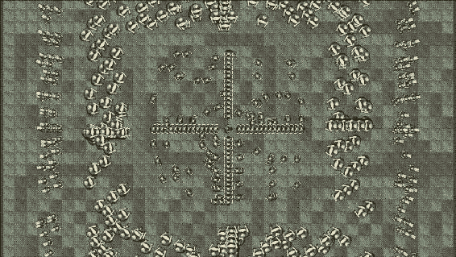 *这将会非常糟糕！*

注意，你也可以使用`Enter`键暂停和恢复僵尸群的进攻，这是因为我们在第 6 章：*面向对象编程、类和 SFML 视图* 中编写了代码。

## 使用 TextureHolder 类处理所有纹理

既然我们有了`TextureHolder`类，我们不妨保持一致，并使用它来加载所有的纹理。让我们对加载背景精灵图和玩家纹理的现有代码进行微小的修改。

#### 修改背景获取纹理的方式

在`ZombieArena.cpp`文件中，找到这段代码：

```cpp
// 加载背景顶点数组的纹理
Texture textureBackground;
textureBackground.loadFromFile("graphics/background_sheet.png");
```

删除之前的高亮代码并替换为以下高亮代码，它使用了我们新的`TextureHolder`类：

```cpp
// 加载背景顶点数组的纹理
Texture textureBackground = TextureHolder::GetTexture(
"graphics/background_sheet.png");
```

#### 修改 Player 获取纹理的方式

在`Player.cpp`文件的构造函数内部，找到这段代码：

```cpp
#include "stdafx.h"
#include "player.h"

Player::Player()
{
    m_Speed = START_SPEED; m_Health = START_HEALTH; m_MaxHealth = START_HEALTH;
    // 将纹理与精灵关联
    // !!关注此区域!!
    m_Texture.loadFromFile("graphics/player.png"); m_Sprite.setTexture(m_Texture);
    // 设置精灵的原点为中心，// 为了平滑旋转
    m_Sprite.setOrigin(25, 25);
}
```

删除之前的高亮代码并替换为这段代码，它使用了我们新的`TextureHolder`类。此外，添加包含指令以将`TextureHolder`头文件添加到文件中。新代码如高亮所示，并带有上下文：


```cpp
#include "stdafx.h"
#include "player.h"
#include "TextureHolder.h"

Player::Player() {
    m_Speed = START_SPEED;
    m_Health = START_HEALTH;
    m_MaxHealth = START_HEALTH;

    // 设置精灵的原点为中心，为了平滑旋转
    m_Sprite.setOrigin(25, 25);

    // 将纹理与精灵关联
    // !!关注此区域!!
    m_Sprite = Sprite(TextureHolder::GetTexture("graphics/player.png"));
}
```

从现在起，我们将使用`TextureHolder`类来加载所有的纹理。

# 第 9 章 碰撞检测、拾取和子弹

到目前，我们已经实现了游戏的主要视觉部分。我们有一个可控制的角色在一个充满追逐他的僵尸的场地内奔跑。问题是，它们之间之间不会产生交互。一个僵尸可以直接穿过玩家，而不会留下一任何伤痕。我们需要检测僵尸与玩家之间的碰撞。

如果僵尸将能够伤害并最终杀死玩家，那么给玩家的枪支提供一些子弹也是公平的。接下，我们需要确保子弹能够击中并杀死僵尸。

同时，如果我们正在为子弹、僵尸和玩家编写碰撞检测代码，现在也是添加一个用于血量和弹药拾品的类的好时机。

以下是我们将要做的内容以及涵盖的主题顺序：

1. 射击子弹
2. 添加准星并隐藏鼠标指针
3. 生成拾用品
4. 检测碰撞

## 编写`Bullet`类

我们将使用`SFML RectangleShape`类来在视觉上表示子弹。我们将编写一个`Bullet`类，它包含一个`RectangleShape`成员以及其他成员数据和函数。我们将通过几个步骤在游戏中添加子弹：

1. 首先，我们将编写`Bullet.h`文件。这将揭示成员数据的所有细节和函数的原型。
2. 接下来，我们将编写`Bullet.cpp`文件，当然，它将包含`Bullet`类所有函数的定义。在我们逐步分析它时，我将详细解释`Bullet`类型的对象将如何工作以及如何控制。
3. 最后，我们将在`main`函数中声明一个装满子弹的数组。我们还将实现一套用于射击、管理玩家剩余弹药和装弹的控制方案。

让我们从第一步开始。

## 编写`Bullet`头文件

要创建新的头文件，在`解决方案管理器`（Solution Explorer）中右键点击`头文件`并选择`添加 | 新项...`。在`添加新项`窗口中，选中（左键点击）`头文件 (.h)`，然后在`名称`字段中输入`Bullet.h`。

将以下私有成员变量连同`Bullet`类声明一起添加到`Bullet.h`文件中。然后我们可以回过一遍并解释它们的用途：

```cpp
#pragma once

#include <SFML/Graphics.hpp>

using namespace sf;

class Bullet
{
private:
    // 子弹在哪里?
    Vector2f m_Position;

    // 每颗子弹看起来什么样
    RectangleShape m_BulletShape;

    // 这颗子弹目前是否在空中穿梭?
    bool m_InFlight = false;

    // 子弹飞行得有多快?
    float m_BulletSpeed = 1000;

    // 子弹每帧移动的像素几分之一是多少，水平和垂直方向各？
    // 这些值将根据 m_BulletSpeed 算出
    float m_BulletDistanceX;
    float m_BulletDistanceY;

    // 一些边界，防止子弹永远飞下去
    float m_MaxX;
    float m_MinX;
    float m_MaxY;
    float m_MinY;
```

在之前的代码中，第一个成员是一个名为`m_Position`的`Vector2f`，它将持有子弹在游戏世界中的位置。

接下来，我们声明了一个名为`m_BulletShape`的`RectangleShape`，因为我们对每颗子弹使用简单的非纹理图形，就像我们在 Timber!!! 中对时间条做的那样！

代码接着声明了一个布尔值`m_InFlight`，它将跟踪子弹目前是否在空中穿梭。这将允许我们决定是否需要每帧调用它的`update`函数，以及是否需要运行碰撞检测检查。

`float`变量`m_BulletSpeed`（你可能已经猜到了）将持有子弹飞行的速度（每秒像素）。它被初始化为`1000`，这有点随意——但效果很好。

接下来我们还有两个`float`变量，`m_BulletDistanceX`和`m_BulletDistanceY`。由于移动子弹的计算比移动僵尸或玩家的计算要复杂一些，因此拥有这两个我们将进行计算的变量将让我们获益。它们将用于决定每帧子弹位置的水平和垂直变化。

最后，对于之前的代码，我们还有四个`float`变量（`m_MaxX`、`m_MinX`、`m_MaxY`和`m_MinY`），它们稍后初始化为持有子弹的最大和最小水平、垂直位置。

某些变量的需求可能并不显而易见，但当我们在`Bullet.cpp`文件中看到它们的作用时，情况会变得更加清晰。

现在，将所有公共函数原型添加到`Bullet.h`文件：

```cpp
public:

    // 构造函数
    Bullet();

    // 停止子弹
    void stop();

    // 返回 m_InFlight 的值
    bool isInFlight();

    // 发射新子弹
    void shoot(float startX, float startY, float xTarget, float yTarget);

    // 告诉调用代码子弹在世界中的位置
    FloatRect getPosition();

    // 返回实际形状（用于绘制）
    RectangleShape getShape();

    // 每帧更新子弹
    void update(float elapsedTime);
};
```

让我们逐一查看每个函数，然后就可以继续编写它们的定义了。

首先我们有`Bullet`函数，它当然是构造函数。在这个函数中，我们将设置好每个`Bullet`实例以准备就绪。

`stop`函数将在子弹已运行但需要停止时调用。

`isInFlight`函数返回一个布尔值，将用于测试子弹目前是否处于飞行状态。

`shoot`函数的用途从它的名称中就能看出，但它将如何工作值得讨论。目前，只需注意它有四个传入的`float`参数。这四个值代表子弹的起始（玩家所在位置）水平和垂直位置，以及垂直和水平目标位置（准星所在位置）。`getPosition`函数返回一个代表子弹位置的`FloatRect`。此函数将用于检测与僵尸的碰撞。你可能记得在第八章：*指针、标准模板库和纹理管理*中僵尸也有`getPosition`函数。

接下来我们有`getShape`函数，它返回一个`RectangleShape`类型的对象。正如我们讨论过的，每颗子弹都通过`RectangleShape`对象在视觉上表示。因此，`getShape`函数将用于获取`RectangleShape`当前状态的副本以便绘制。

最后，并且可能正如预期的那样，有一个`update`函数，它有一个`float`参数，代表自上一次调用`update`以来经过的一秒分之一。`update`方法将每帧改变子弹的位置。

让我们查看并编写函数定义。

## 编写`Bullet`源文件

现在我们可以创建一个新的`.cpp`文件，其中包含函数定义。在`解决方案管理器`中右键点击`源文件`并选择`添加 | 新项...`。在`添加新项`窗口中，选中（左键点击）`C++ 文件 (.cpp)`，然后在`名称`字段中输入`Bullet.cpp`。最后，点击`添加`按钮。我们现在准备好编写类了。

添加以下代码，即包含指令和构造函数。我们知道它是构造函数，因为函数的名称与类名相同：

```cpp
#include "stdafx.h"
#include "bullet.h"

// 构造函数
Bullet::Bullet()
{
    m_BulletShape.setSize(sf::Vector2f(2, 2));
}
```

`Bullet`构造函数需要做的只是设置`m_BulletShape`的大小，它是一个`RectangleShape`对象。代码将大小设置为 2 像素乘以 2 像素。

接下来我们有更有实质内容的`shoot`函数。将以下代码添加到`Bullet.cpp`文件中，学习它，然后我们可以讨论它：

```cpp
void Bullet::shoot(float startX, float startY,
                   float targetX, float targetY)
{
    // 跟踪子弹
    m_InFlight = true;

    m_Position.x = startX;
    m_Position.y = startY;

    // 计算飞行路径的斜率
    // 如果斜率小于 1 则需要为负数 (gradient < 0)
    if (gradient < 0)
    {
        gradient *= -1;
    }

    // 计算 x 和 y 之间的比例
    float ratioXY = m_BulletSpeed / (1 + gradient);

    // 设置水平和垂直方向的“速度”
    m_BulletDistanceY = ratioXY;
    m_BulletDistanceX = ratioXY * gradient;

    // 如果目标 X 小于起始 X，则将子弹指向正确方向 (targetX < startX)
    if (targetX < startX)
    {
        m_BulletDistanceX *= -1;
    }

    if (targetY < startY)
    {
        m_BulletDistanceY *= -1;
    }

    // 设置 1000 像素的最大范围
    float range = 1000;

    m_MinX = startX - range;
    m_MaxX = startX + range;
    m_MinY = startY - range;
    m_MaxY = startY + range;

    // 设置子弹准备绘制的位置
    m_BulletShape.setPosition(m_Position);
}
```

为了揭秘`shoot`函数的奥秘，我们将将其拆分并分块讨论我们刚刚添加的代码。

首先，让我们回顾一下函数签名。`shoot`函数接收子弹的起始和目标水平及垂直位置。调用函数的代码将根据玩家精灵的位置和准星的位置提供这些参数。这里是它的定义：

```cpp
void Bullet::shoot(float startX, float startY, float targetX, float targetY)
```

在`shoot`函数内部，我们将`m_InFlight`设置为`true`，并使用参数`startX`和`startY`为子弹定位。这里再次是那部分代码：

```cpp
// 跟踪子弹
m_InFlight = true;

m_Position.x = startX;
m_Position.y = startY;
```

现在，我们使用简单的三角函数来确定子弹飞行的斜率。子弹在水平和垂直方向的进展必须根据在子弹起点和终点之间画线的斜率而变化。变化率不能相同，否则角度陡峭的射会在到达垂直位置之前到达水平位置，而角度平缓的射则反之。

以下代码首先根据直线方程推导出斜率。然后它检查斜率是否小于零，如果是，则将其乘以`-1`。这是因为传入的起始和目标坐标可以是负数也可以是正数，而我们总是希望每一帧的进展量是正。乘以`-1`仅仅是将负数变为其正等效值，因为负数乘以负数得到正数。实际的飞行方向将在`update`函数中处理，通过加上或减去我们在函数中得到的正值来完成。

接下来，我们通过将子弹的速度（`m_BulletSpeed`）除以 1 加斜率，计算水平距离与垂直距离的比例。这将允许我们根据子弹指向的目标，在每一帧改变子弹水平和垂直位置的正确量。

最后，在代码的这部分，我们将值赋值给`m_BulletDistanceY`和`m_BulletDistanceX`：

```cpp
// 计算飞行路径的斜率
// 如果斜率小于零则需要为负数 (gradient < 0)
if (gradient < 0)
{
    gradient *= -1;
}

// 计算 x 和 y 之间的比例
float ratioXY = m_BulletSpeed / (1 + gradient);

// 设置水平和垂直方向的“速度”
m_BulletDistanceY = ratioXY;
m_BulletDistanceX = ratioXY * gradient;
```

接下来的代码要简单得多。我们只需要设置子弹可以到达的最大水平和垂直位置。我们不希望子弹永远飞下去。我们将在`update`函数中看到这一点，在那里我们将测试子弹是否超过了其最大或最小位置：

```cpp
// 在任何方向设置 1000 像素的最大范围
float range = 1000;

m_MinX = startX - range;
m_MaxX = startX + range;
m_MinY = startY - range;
m_MaxY = startY + range;
```

以下代码将代表子弹的`RectangleShape`移动到它的起始位置。我们像以前经常做样使用`setPosition`函数：

```cpp
// 设置子弹准备绘制的位置
m_BulletShape.setPosition(m_Position);
```

接下来有四个简单的函数。添加`stop`、`isInFlight`、`getPosition`和`getShape`函数：

```cpp
void Bullet::stop()
{
    m_InFlight = false;
}

bool Bullet::isInFlight()
{
    return m_InFlight;
}

FloatRect Bullet::getPosition()
{
    return m_BulletShape.getGlobalBounds();
}

RectangleShape Bullet::getShape()
{
    return m_BulletShape;
}
```

`stop`函数简单地将`m_InFlight`变量设置为`false`。`isInFlight`函数返回该变量当前的任何值。因此我们可以看到`shoot`让子弹飞出，`stop`让它停止，而`isInFlight`让我们知道当前状态是什么。

`getPosition`函数返回一个`FloatRect`，我们很快就会看到如何使用每个游戏对象的`FloatRect`来检测碰撞。

最后，对于之前的代码，`getShape`返回一个`RectangleShape`，以便我们每帧可以绘制一次子弹。

在我们开始使用`Bullet`对象之前，我们需要实现的最后一个函数是`update`。添加以下代码，研究它，然后我们就可以讨论了：

```cpp
void Bullet::update(float elapsedTime)
{
    // 更新子弹位置变量
    m_Position.x += m_BulletDistanceX * elapsedTime;
    m_Position.y += m_BulletDistanceY * elapsedTime;

    // 移动子弹
    m_BulletShape.setPosition(m_Position);

    // 子弹是否飞出了范围？
    if (m_Position.x < m_MinX ||
        m_Position.x > m_MaxX ||
        m_Position.y < m_MinY ||
        m_Position.y > m_MaxY)
    {
        m_InFlight = false;
    }
}
```

在`update`函数中，我们使用`m_BulletDistanceX`和`m_BulletDistanceY`乘以自上一帧以来的时间来移动子弹。记住这两个变量的值是在`shoot`函数中计算的，代表了以正确角度移动子弹所需的斜率（它们之间的比例）。然后我们使用`setPosition`函数来实际移动`RectangleShape`。

我们在`update`中做的最后件事是测试子弹是否已经移动了它的最大范围。这个稍微复杂的`if`语句将`m_Position.x`和`m_Position.y`与在`shoot`函数中计算出的最大和最小值进行比较。这些最大值和最小值存储在`m_MinX`、`m_MaxX`、`m_MinY`和`m_MaxY`中。如果测试为真，则将`m_InFlight`设置为`false`。

`Bullet`类完成了。现在我们可以在主函数中查看如何发射一些子弹了。

## 让子弹飞起来

我们将通过以下六步使子弹变得可用：

1. 为`Bullet`类添加必要的包含指令（include）。
2. 添加一些控制变量和一个用于存放一些`Bullet`实例的数组。
3. 处理玩家按下`R`进行装弹。
4. 处理玩家按下左鼠标键来发射子弹。
5. 在每一帧中更新所有飞行中的子弹。
6. 在每一帧中绘制所有飞行中的子弹。

### 包含`Bullet`类

添加包含指令以使`Bullet`类可用：

```cpp
#include "stdafx.h"

#include <SFML/Graphics.hpp>

#include "ZombieArena.h"
#include "Player.h"
#include "TextureHolder.h"
#include "Bullet.h"

using namespace sf;
```


让我们进入下一步。

## 控制变量和子弹数组

这里有一些变量，用于跟踪子弹、弹匣大小、备用子弹/剩余子弹、弹匣中的子弹、当前射速（从每秒一发开始）以及上次发射子弹的时间。

添加高亮的代码，我们就可以在本节的其余部分查看这些变量的实际运行情况：

```cpp
// 为僵尸群做准备
int numZombies;
int numZombiesAlive;
Zombie* zombies = NULL;

// 100 颗子弹应该足够
Bullet bullets[100];
int currentBullet = 0;
int bulletsSpare = 24;
int bulletsInClip = 6;
int clipSize = 6;
float fireRate = 1;

// 上次按下射击键是什么时候
Time lastPressed;

// 主游戏循环
while (window.isOpen())
```

接下来，让我们处理玩家按下键盘`R`键发生的情况，这是用于装弹弹匣的。

## 正在装弹

现在我们处理与射击相关的玩家输入。首先，我们将处理按下`R`键来装弹。我们通过 SFML 事件来实现这一点。

请添加下方代码块中高亮显示的代码。它显示了大量的上下文，以确保代码放在正确的位置。学习这些代码，然后我们可以进行讨论：

```cpp
// Handle events
Event event;
while (window.pollEvent(event))
{
    if (event.type == Event::KeyPressed) {
        // 游戏运行时暂停游戏
        if (event.key.code == Keyboard::Return && state == State::PLAYING)
        {
            state = State::PAUSED;
        }
        // 暂停时重启
        else if (event.key.code == Keyboard::Return && state == State::PAUSED)
        {
            state = State::PLAYING;
            // 重置计时器以防止跳帧。
            clock.restart();
        }
        // 在 GAME_OVER 状态下开始新游戏
        else if (event.key.code == Keyboard::Return && state == State::GAME_OVER)
        {
            state = State::LEVELING_UP;
        }
        if (state == State::PLAYING) {
            // 装弹
            if (event.key.code == Keyboard::R) {
                if (bulletsSpare >= clipSize) {
                    // 弹药充足。装弹。
                    bulletsInClip = clipSize;
                    bulletsSpare -= clipSize;
                }
                else if (bulletsSpare > 0)
                {
                    // 只剩下少量弹药
                    bulletsInClip = bulletsSpare;
                    bulletsSpare = 0;
                }
                else
                {
                    // 很快会有更多？！
                }
            }
        }
    }
} // 事件轮询
```

之前的代码嵌套在游戏循环的事件处理部分（`while(window.pollEvent)`），位于仅在游戏实际运行时才会执行的块中（`if(state == State::Playing)`）。显然，我们不希望玩家在游戏结束或暂停时装弹，按照描述的方式封装新代码可以实现这一点。

在新代码本身中，我们做的第一件事是测试是否按下了`R`键，使用`if (event.key.code == Keyboard::R)`。一旦检测到按下了`R`键，就会执行剩余代码。以下是`if`、`else if`和`else`块的结构：

`if(bulletsSpare >= clipSize)` ...
`else if(bulletsSpare > 0)` ...
`else` ...

之前的结构允许我们处理三种可能的情况。玩家按了`R`，且备用弹药于弹匣能容纳的数量。在这种情况下，弹匣会被填满，备用弹药的数量会减少。

玩家有一些备用弹药，但不足以完全填弹匣。在这种情况下，弹匣将用玩家拥有的备用弹药填满，备用弹药数量设置为零。玩家按了`R`但完全没有备用弹药。对于这种情况，我们实际上不需要修改变量。但是，当我们在第 11 章：*音效、文件 I/O 和游戏结束*中实现声音时，我们会在这里播放音效，因此我们留下一个空的`else`块以备用。

让我们最后真的发射一颗子弹。

## 射击子弹

接下来，我们可以处理点击左鼠标按钮来实际发射子弹。添加高亮代码并仔细研究：

```cpp
if (Keyboard::isKeyPressed(Keyboard::D))
{
    player.moveRight();
}
else
{
    player.stopRight();
}

// 发射子弹
if (Mouse::isButtonPressed(sf::Mouse::Left))
{
    if (gameTimeTotal.asMilliseconds()
    - lastPressed.asMilliseconds()
    > 1000 / fireRate && bulletsInClip > 0)
    {
        // 将玩家的中心
        // 和准星的中心
        // 传递给 shoot 函数
        bullets[currentBullet].shoot(player.getCenter().x, player.getCenter().y, mouseWorldPosition.x, mouseWorldPosition.y);
        currentBullet++;
        if (currentBullet > 99) {
            currentBullet = 0;
        }
        lastPressed = gameTimeTotal;
        bulletsInClip--;
    }
} // 结束发射子弹
} // 结束游戏时的 WASD
```

之前的所有代码都封装在一个`if`语句中，每当按下左鼠标按钮时它都会执行，`if (Mouse::isButtonPressed(sf::Mouse::Left))`。注意，即使玩家只是按住按钮，代码也会重复执行。我们现在将过的代码将控制射速。

在之前的代码中，我们接着检查游戏中经过的总时间（`gameTimeTotal`）减去玩家上次发射子弹的时间（`lastPressed`）是否大于 1000 除以当前的射速，并且玩家弹匣中至少有一颗子弹。我们使用 1000 是因为每秒有一千毫秒。

如果此测试成功，就会执行实际发射子弹的代码。射击子弹很容易，因为我们已经在`Bullet`类中完成了所有的困难工作。我们只需要调用`bullets`数组中当前子弹的`shoot`方法。我们传入玩家和准星当前的水平和垂直位置。子弹将由`Bullet`类中`shoot`函数 get 代码进行配置并设置为飞行。

我们要做的只是跟踪子弹数组。首先，我们增加`currentBullet`变量的值。然后我们使用语句`if (currentBullet > 99)`检查是否发射了最后一颗子弹（99）。如果是最后一颗，我们将`currentBullet`设置为零。如果不是最后一颗，那么只要射速允许且玩家按下左鼠标键，下一颗子弹就准备就绪。

最后，对于之前的代码，我们将发射子弹的时间存储在`lastPressed`中并递减`bulletsInClip`。

## 每帧更新子弹

添加高亮代码以遍历`bullets`数组，检查子弹是否处于飞行状态，如果是，则调用其`update`函数：

```cpp
// 遍历每个僵尸并更新它们
for (int i = 0; i < numZombies; i++)
{
    if (zombies[i].isAlive())
    {
        zombies[i].update(dt.asSeconds(), playerPosition);
    }
}

// 更新任何飞行中的子弹
for (int i = 0; i < 100; i++)
{
    if (bullets[i].isInFlight())
    {
        bullets[i].update(dtAsSeconds);
    }
} // 结束场景更新
```

## 每帧绘制子弹

添加高亮代码以遍历`bullets`数组，检查子弹是否处于飞行状态，如果是，则绘制它：

```cpp
/*
**************
绘制场景
**************
*/
if (state == State::PLAYING)
{
    window.clear();

    // 设置要在窗口中显示的 mainView
    // 并绘制与其相关的一切
    window.setView(mainView);

    // 绘制背景
    window.draw(background, &textureBackground);

    // 绘制僵尸
    for (int i = 0; i < numZombies; i++) {
        window.draw(zombies[i].getSprite());
    }

    for (int i = 0; i < 100; i++) {
        if (bullets[i].isInFlight()) {
            window.draw(bullets[i].getShape());
        }
    }

    // 绘制玩家
    window.draw(player.getSprite());
}
```

运行游戏来尝试子弹。注意在需要按下`R`装弹之前，你可以发射六次。显然缺失的还有一些关于弹匣中弹药数量和备用弹药数量的视觉指示。另一个问题是玩家可能会很快耗尽子弹，尤其是子弹完全没有停止力。它们会直接穿过僵尸。此外，玩家被要求对准鼠标指针而不是精确的准星，显而易见我们工作要做。

在下一章中，我们将通过 HUD 提供视觉反馈。接下来我们将把鼠标光标替换为准星，然后生成一些拾取物来补充弹药和血量。最后，在本章中，我们将处理碰撞检测，使子弹和僵尸产生伤害，并让玩家能够实际获得拾取物。

## 给玩家一个准星

```cpp
// 100 子弹足够了
Bullet bullets[100];
int currentBullet = 0;
int bulletsSpare = 24;
int bulletsInClip = 6;
int clipSize = 6;
float fireRate = 1;

// 上次按下发射键的时间是？
Time lastPressed;
```

```cpp
// 隐藏鼠标指针并将其替换为窗口准星。
window.setMouseCursorVisible(true);

Sprite spriteCrosshair;
Texture textureCrosshair = TextureHolder::GetTexture("graphics/crosshair.png");
spriteCrosshair.setTexture(textureCrosshair);
spriteCrosshair.setOrigin(25, 25);
```

```cpp
// 主游戏循环
while (window.isOpen())
```

首先，我们在我们的`window`对象上调用`setMouseCursorVisible`函数。然后，我们加载一个`Texture`，声明一个`Sprite`并按照通常的方式对其进行初始化。此外，我们将精灵图的起始点设置为它的中心，以便更方便、更简单地让子弹飞向中间，正如你所预期的那样的。

现在，我们需要每帧都使用鼠标的世界坐标来更新准星。添加高亮的代码行，它使用`mouseWorldPosition`向量在每帧设置准星的位置：

```cpp
/*
****************
更新每一帧
****************
*/
if (state == State::PLAYING) {
    // 更新增量时间
    Time dt = clock.restart();

    // 更新总游戏时间
    gameTimeTotal += dt;

    // 将增量时间浮点数转换为 1 的小数部分
    float dtAsSeconds = dt.asSeconds();

    // 鼠标指针在哪里
    mouseScreenPosition = Mouse::getPosition();

    // 将鼠标位置转换为主视图的世界坐标
    mouseWorldPosition = window.mapPixelToCoords(
        Mouse::getPosition(), mainView
    );

    // 将准星设置为鼠标的世界位置
    spriteCrosshair.setPosition(mouseWorldPosition);

    // 更新玩家
    player.update(dtAsSeconds, Mouse::getPosition());
}
```

接下来，正如你可能预期的那样的，我们可以为每一帧绘制准星。在所示位置添加高亮的代码行。这行代码不需要解释，但它在所有其他游戏对象之后的位置非常重要，这样它就会在最上方绘制：

```cpp
/*
**************
绘制场景
**************
*/
if (state == State::PLAYING) {
    window.clear();

    // 设置在窗口中显示的 mainView
    // 并绘制与它相关的所有内容
    window.setView(mainView);

    // 绘制僵尸
    for (int i = 0; i < numZombies; i++) {
        // 绘制背景
        window.draw(background, &textureBackground);
        window.draw(zombies[i].getSprite());
    }

    for (int i = 0; i < 100; i++) {
        if (bullets[i].isInFlight()) {
            window.draw(bullets[i].getShape());
        }
    }

    // 绘制玩家
    window.draw(player.getSprite());

    // 绘制准星
    window.draw(spriteCrosshair);
}
```

现在你可以运行游戏并看到酷炫的准星而不是鼠标指针了：

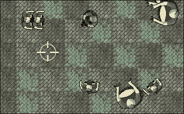

注意子弹是如何整齐地穿过准星中心的。射击机制的工作方式类似于允许玩家选择腰射或使用准星镜瞄准。如果玩家保持准星靠近中心，他就可以快速快速射击并转身，但必须仔细判断远处僵尸的位置。

或者，玩家可以将准星直接悬停在远处僵尸的头部并获得精确命中；然而，如果僵尸从另一个方向攻击，他需要移动更远才能将准星移回来。

游戏一个有趣的改进是为每次射击添加少量的随机随机不准确性。这种不准确性也许可以通过波次之间的升级来减轻。

## 为拾品编写类

我们将编写一个`Pickup`（拾品）类，它包含一个`Sprite`成员以及其他成员数据和函数。我们只需要几步就能在游戏中添加拾品：

1. 第一次，我们将编写`Pickup.h`文件。这将揭示成员数据的所有细节和函数的原型。
2. 其次，我们将编写`Pickup.cpp`文件，它当然将包含`Pickup`类所有函数的定义。在我们逐步分析它时，我将详细解释`Pickup`类型的对象将如何工作和被控制。
3. 最后，我们将在`main`函数中使用`Pickup`类来生成、更新它们并绘制它们。

让我们开始第 1 步。

## 编写拾品头文件

要创建新的头文件，请右键点击**解决方案管理器**（Solution Explorer）中的**头文件**（Header Files）并选择**添加 | 新项...**（Add | New Item...）。在**添加新项**窗口中，高亮（通过左键点击）**头文件 (.h)**（Header File），然后在**名称**（Name）字段中输入`Pickup.h`。

在`Pickup.h`文件中添加并学习以下代码，然后我们逐一分析：

```cpp
#pragma once

#include <SFML/Graphics.hpp>

using namespace sf;

class Pickup
{
private:
    // 血量拾品的初始值
```


```cpp
const int HEALTH_START_VALUE = 50;

const int AMMO_START_VALUE = 12;

const int START_WAIT_TIME = 10;

const int START_SECONDS_TO_LIVE = 5;

// 代表此拾品的精灵
Sprite m_Sprite;

// 它所在的区域
IntRect m_Arena;

// 这个拾品值多少钱？
int m_Value;

// 这是哪种类型的拾品？ // 1 = 血量，2 = 弹药
int m_Type;

float m_SecondsToWait;

// 处理生成和消失
bool m_Spawned;

float m_SecondsSinceSpawn;

float m_SecondsSinceDeSpawn;

float m_SecondsToLive;

// 公共原型放在这里
};
```

之前的代码声明了`Pickup`类所有的私有变量。虽然这些名称应该非常直观，但可能并不清楚为什么需要其中许多变量。让我们从顶部开始逐一分析：

- `const int HEALTH_START_VALUE = 50`：这个常量变量用于设置所有血量拾品的初始值。该值将用于初始化`m_Value`变量，该变量在整个游戏过程中需要被操作。
- `const int AMMO_START_VALUE = 12`：这个常量变量用于设置所有弹药拾品的初始值。该值将用于初始化`m_Value`变量，该变量在整个游戏过程中需要被操作。
- `const int START_WAIT_TIME = 10`：这个变量是拾品在消失后重新生成之前等待多久。它将用于初始化`m_SecondsToWait`变量，该变量可以在整个游戏中被操作。
- `const int START_SECONDS_TO_LIVE = 5`：这个变量决定了拾品在生成和消失之间持续多久。与之前的三个常量一样，它关联着一个非常量，该非常量可以在整个游戏过程中被操作。它用于初始化的非常量是`m_SecondsToLive`。
- `Sprite m_Sprite`：这是用于视觉上表示对象的精灵。
- `IntRect m_Arena`：这将保存当前区域的大小，帮助拾品在合理的位置生成。
- `int m_Value`：这个拾品值多少血量或弹药？当玩家升级提升血量或弹药拾品的价值时，会使用此值。
- `int m_Type`：这将是血量或弹药的零或一（类型）。我们本可以使用枚举类，但对于只有两个选项来说这似乎过头了。
- `bool m_Spawned`：拾品当前是否已生成？
- `float m_SecondsSinceSpawn`：拾品生成以来过去多久了？
- `float m_SecondsSinceDeSpawn`：拾品取消生成（消失）以来过去多久了？
- `float m_SecondsToLive`：拾品在消失之前应该保持生成状态多久？
- `float m_SecondsToWait`：拾品在重新生成之前应该保持取消生成状态多久？

### 提示

注意，该类的大部分复杂性源于变量生成时间及其可升级的性质。如果拾品只是在被收集后重新生成并具有固定值，那么这将是一个非常简单的类。我们需要我们的拾品是可升级的，因此玩家被迫制定策略来通过僵尸波次。

接下来，在`Pickup.h`文件中添加以下公有函数原型。确保你熟悉新代码，以便我们逐一分析：

```cpp
public:

    Pickup::Pickup(int type);

    // 准备一个新的拾品
    void setArena(IntRect arena);

    void spawn();

    // 检查拾品的位置
    FloatRect getPosition();

    // 获取用于绘制的精灵
    Sprite getSprite();

    // 让拾品每帧更新自己
    void update(float elapsedTime);

    // 此拾品当前已生成？
    bool isSpawned();

    // 获取拾品的加成
    int gotIt();

    // 升级每个拾品的值
    void upgrade();

};
```

让我们简要讨论一下每个函数的定义：

第一个函数是构造函数，其名称与类同名。注意它接收一个单一的`int`参数。这将用于初始化它将要变成的拾品类型（血量或弹药）。

`setArena`函数接收一个`IntRect`。该函数将在每一波敌的开始时，为每个`Pickup`实例调用一次。随后，`Pickup`对象将知道它们可以生成的区域。`spawn`函数当然会处理拾品的生成。`getPosition`函数就像在`Player`、`Zombie`和`Bullet`类中的函数一样，将返回一个表示对象在游戏世界中当前位置的`FloatRect`。

`getSprite`函数返回一个`Sprite`对象，该对象允许拾品在每帧被绘制一次。

`update`函数接收上一帧花费的时间。它使用此值来更新其私有变量，并决定何时生成和销毁。

`isSpawned`函数返回一个`Boolean`值，让调用代码知道拾品当前是否已生成。

`gotIt`函数会在检测到与玩家发生碰撞时被调用。随后，`Pickup`类代码可以准备在适当的时间重新生成。注意它返回的是一个`int`，以便调用代码知道该拾品在血量或弹药方面的价值。`upgrade`函数将在玩家在游戏升级阶段选择升级拾品的属性时被调用。

现在我们已经过过了成员变量和函数原型，在我们编写函数定义时，应该会很容易跟上。

## 编写 Pickup 类的函数定义

现在我们可以创建一个新的`.cpp`文件，其中将包含函数定义。在`Solution Explorer`（解决方案管理器）中右键点击`Source Files`（源文件），选择`Add | New Item...`（添加 新项）。在`Add New Item`窗口中，选中（左键点击）`C++ File (.cpp)`，然后在`Name`字段中输入`Pickup.cpp`。最后，点击`Add`按钮。我们现在准备好编写该类的代码了。

将此处所示的代码添加到`Pickup.cpp`文件中。务必检查代码，以便我们讨论：

```cpp
#include "stdafx.h"

#include "Pickup.h"

#include "TextureHolder.h"

Pickup::Pickup(int type)
{
    // 存储此拾品的类型
    m_Type = type;

    // 将纹理与精灵关联
    if (m_Type == 1)
    {
        m_Sprite = Sprite(TextureHolder::GetTexture("graphics/health_pickup.png"));

        // 拾品的价值是多少
        m_Value = HEALTH_START_VALUE;
    }
    else
    {
        m_Sprite = Sprite(TextureHolder::GetTexture("graphics/ammo_pickup.png"));

        // 拾品的价值是多少
        m_Value = AMMO_START_VALUE;
    }

    m_Sprite.setOrigin(25, 25);
    m_SecondsToLive = START_SECONDS_TO_LIVE;
    m_SecondsToWait = START_WAIT_TIME;
}
```

在之前的代码中，我们添加了熟悉的包含指令。然后，我们添加了`Pickup`构造函数。我们知道它是构造函数，因为它的名字与类相同。构造函数接收一个名为`type`的`int`，代码的第一件事是将接收到的`type`的值赋值给`m_Type`。之后，有一个`if...else`块会检查`m_Type`是否等于`1`。如果是，`m_Sprite`将与血量拾品纹理关联，`m_Value`被设置为`HEALTH_START_VALUE`。

如果`m_Type`不等于`1`，`else`块将弹药拾品纹理与`m_Sprite`关联，并将`AMMO_START_VALUE`的值赋值给`m_Value`。

在`if...else`块之后，代码使用`setOrigin`函数将`m_Sprite`的原点设置为，并将`START_SECONDS_TO_LIVE`和`START_WAIT_TIME`分别赋值给`m_SecondsToLive`和`m_SecondsToWait`。构造函数成功准备了一个可以使用的`Pickup`对象。

接下来我们将添加`setArena`函数。在添加它时请检查代码：

```cpp
void Pickup::setArena(IntRect arena)
{
    // 将区域的细节复制到拾品的 m_Arena 中
    m_Arena.left = arena.left + 50;
    m_Arena.width = arena.width - 50;
    m_Arena.top = arena.top + 50;
    m_Arena.height = arena.height - 50;

    spawn();
}
```

我们刚刚编写的`setArena`函数仅仅是从传入的`arena`对象中复制值，但通过在左侧和顶部增加50，在右侧和底部减少50来改变这些值。`Pickup`对象现在知道了它可以生成的区域内。随后，`setArena`函数调用它自己的`spawn`函数，为每帧的绘制和更新做最后的准备。

接下来是`spawn`函数。在`setArena`函数之后添加以下代码：

```cpp
void Pickup::spawn()
{
    // 在随机位置生成
    srand((int)time(0) / m_Type);

    int x = (rand() % m_Arena.width);

    srand((int)time(0) * m_Type);

    int y = (rand() % m_Arena.height);

    m_SecondsSinceSpawn = 0;
    m_Spawned = true;

    m_Sprite.setPosition(x, y);
}
```

`spawn`函数执行了准备拾品的所有操作。首先，它为随机数生成器设置种子并获取随机数。将`m_SecondsSinceSpawn`置为0，`m_Spawned`设置为`true`。设置`m_Sprite`的位置为`(x, y)`。

`spawn`函数执行了准备拾品所需的所有工作。首先，它设置随机数生成器的种子并获取随机数。由于`m_Arena.width`和`m_Arena.height`决定了范围，它生成了坐标。将`m_SecondsSinceSpawn`置为0，`m_Spawned`设置为`true`。在销毁（隐藏）之前的时间，`mm__`和`m__.heightheight`了范围。

`m_SecondsSinceSpawn`置为0，这样在开始销毁计时计时。`main`，`m_Sprite`准备好被绘制和更新。

在后续代码块中，我们有三个简单的 getter 函数。`getPosition`返回当前位置的`FloatRect`，`getSprite`返回精灵本身，而`isSpawned`根据对象是否已生成返回`true`或`false`。

添加并检查我们刚刚讨论的代码：

```cpp
FloatRect Pickup::getPosition()
{
    return m_Sprite.getGlobalBounds();
}

Sprite Pickup::getSprite()
{
    return m_Sprite;
}

bool Pickup::isSpawned()
{
    return m_Spawned;
}
```

接下来我们将编写`gotIt`函数。该函数会在玩家碰到（获取）拾品时从`main`调用。在`isSpawned`函数之后添加`gotIt`函数：

```cpp
int Pickup::gotIt()
{
    m_Spawned = false;

    m_SecondsSinceSpawn = 0;

    return m_Value;
}
```

`gotIt`函数将`m_Spawned`设置为`false`，以便我们不再绘制并检查碰撞。`m_SecondsSinceSpawn`置为0，这样生成的计时器将从开始开始。`m_Value`被返回给调用代码，以便调用代码可以根据情况处理额外的弹药或血量。

接下来我们有`update`函数，它整合了我们目前看到的许多变量和函数。添加并熟悉`update`函数，然后我们可以讨论它：

```cpp
void Pickup::update(float elapsedTime)
{
    if (m_Spawned)
    {
        m_SecondsSinceSpawn += elapsedTime;
    }
    else
    {
        m_SecondsSinceDeSpawn += elapsedTime;
    }

    // 我们需要隐藏拾品吗
    if (m_SecondsSinceSpawn > m_SecondsToLive && m_Spawned)
    {
        // 移除拾品并放到其他处
        m_Spawned = false;

        m_SecondsSinceDeSpawn = 0;
    }

    // 我们需要生成拾品吗
    if (m_SecondsSinceDeSpawn > m_SecondsToWait && !m_Spawned)
    {
        // 生成拾品并重置计时
        spawn();
    }
}
```

`update`函数由四个每帧考虑执行的块组成：

- `m_Spawned`为真时执行的`if`块——`if (m_Spawned)`。此块代码将此帧的时间加到`m_SecondsSinceSpawn`，该变量记录了拾品已生成了多久。一个对应的在`m_Spawned`为假时执行的`else`块。该块将此帧花费的时间加到`m_SecondsSinceDeSpawn`，该变量记录了拾品自上次销毁（隐藏）以来等待了多久。
- 另一个`if`块，当拾物品生成时间超过其应持续的时间时执行——`if (m_SecondsSinceSpawn > m_SecondsToLive && m_Spawned)`。此块将`m_Spawned`设置为`false`并将`m_SecondsSinceDeSpawn`重置为零。现在，块2将一直执行，直到再次生成的时间到。
- 最后一个`if`块，当销毁后的等待时间超过了必要的等待时间，且拾物品当前未生成状态时执行——`if (m_SecondsSinceDeSpawn > m_SecondsToWait && !m_Spawned)`。当执行此块时，说明到了再次生成的时间了，并且会调用`spawn`函数。

这四个测试和代码控制了拾物品的隐藏和显示。

最后，添加`upgrade`函数的定义：

```cpp
void Pickup::upgrade()
{
    if (m_Type == 1)
    {
        m_Value += (HEALTH_START_VALUE * .5);
    }
    else
    {
        m_Value += (AMMO_START_VALUE * .5);
    }

    // 让它们更频繁且持续更久
    m_SecondsToLive += (START_SECONDS_TO_LIVE / 10);
    m_SecondsToWait -= (START_WAIT_TIME / 10);
}
```

`upgrade`函数测试拾物品的类型（血量或弹药），然后将（相应的）初始值的50%增加到`m_Value`上。`if…else`块之后的接两行增加了拾物品保持生成的时间，并缩短了玩家在两次生成之间的等待时间。

当玩家在`LEVELING_UP`状态选择升级拾物品时，会调用此函数。我们的`Pickup`类已经准备好可以使用了。

## 使用 Pickup 类

在投入大量精力实现了`Pickup`类之后，我们现在可以在游戏引擎中编写代码，实际向游戏中放入一些拾物品。

我们做的第一件事是在`ZombieArena.cpp`文件中添加一个包含指令：

```cpp
#include "stdafx.h"

#include <SFML/Graphics.hpp>

#include "ZombieArena.h"

#include "Player.h"

#include "TextureHolder.h"

#include "Bullet.h"

#include "Pickup.h"

using namespace sf;
```

在以下代码中，我们添加两个`Pickup`实例，一个称为`healthPickup`，另一个称为`ammoPickup`。我们分别将值`1`和`2`传入构造函数，以便它们被初始化为正确的拾物品类型。添加我们刚刚讨论的高亮代码：

```cpp
// 隐藏鼠标指针并将其替换为准星窗口。
window.setMouseCursorVisible(true);

Sprite spriteCrosshair;
```


`Texture textureCrosshair = TextureHolder::GetTexture("graphics/crosshair.png");`

`spriteCrosshair.setTexture(textureCrosshair);`

`spriteCrosshair.setOrigin(25, 25);`

`// 创建几个拾物品`
`Pickup healthPickup(1);`
`Pickup ammoPickup(2);`

`// 主游戏循环`
`while (window.isOpen())`

在键盘处理的 `LEVELING_UP` 状态中，在所示嵌套 `PLAYING` 代码块内添加高亮行：

```cpp
if (state == State::PLAYING) {

    // 准备关卡
    // 我们稍后会修改这两行
    arena.width = 500;
    arena.height = 500;
    arena.left = 0;
    arena.top = 0;

    // 通过引用传递顶点数组
    // 给 createBackground 函数
    int tileSize = createBackground(background, arena);

    // 在竞技场中心生成玩家
    player.spawn(arena, resolution, tileSize);

    // 配置拾物品
    healthPickup.setArena(arena);
    ammoPickup.setArena(arena);

    // 创建一群僵尸
    numZombies = 10;

    // 删除之前分配的内存（如果存在）
    delete[] zombies;
    zombies = createHorde(numZombies, arena);
    numZombiesAlive = numZombies;

    // 重置时钟以防止帧跳跃
    clock.restart();
}
```

之前的代码简单地将`arena`传递给每个拾物品的`setArena`函数。拾物品现在知道它们可以在哪里生成了。这段代码会在每一波新时执行，因此随着竞技场尺寸的增大，`Pickup`对象将得到更新。

以下代码简单地在每一帧为每个`Pickup`对象调用`update`函数：

```cpp
// 遍历每个僵尸并更新它们
for (int i = 0; i < numZombies; i++)
```

（注：提供的文本包含许多重复的循环逻辑，我将根据提供的文本合并逻辑流。）

`// 主游戏循环 while (window.isOpen())` 现在，让我们开始检测是否有僵尸与子弹碰撞。

## 僵尸被射中了吗？

接下来的代码看起来很复杂，但当我们逐行分析它时，会发现它实际上并没有我们没见过的东西。在每帧更新道具的调用之后添加以下代码。然后我们就可以过一遍了：

```cpp
// 更新道具
healthPickup.update(dtAsSeconds);
ammoPickup.update(dtAsSeconds);

// 碰撞检测
// 是否有僵尸被射中？
for (int i = 0; i < 100; i++)
{
    for (int j = 0; j < numZombies; j++) {
        if (bullets[i].isInFlight() && zombies[j].isAlive()) {
            if (bullets[i].getPosition().intersects(zombies[j].getPosition()))
            {
                // 停止子弹
                bullets[i].stop();

                // 注册命中并查看是否为击杀
                if (zombies[j].hit())
                {
                    // 不仅是命中也是击杀
                    score += 10;
                    if (score >= hiScore)
                    {
                        hiScore = score;
                    }

                    numZombiesAlive--;

                    // 当所有僵尸再次死亡时
                    if (numZombiesAlive == 0)
                    {
                        state = State::LEVELING_UP;
                    }
                } // 僵尸被射中的逻辑结束
            }
        }
    }
}
```

在下一节中，我们将再次看到所有的僵尸和子弹碰撞检测代码。我们将分次进行，以便讨论。首先，注意嵌套`for`循环的结构（去掉代码后）如下：

```cpp
// 碰撞检测
// 是否有僵尸被射中？
for (int i = 0; i < 100; i++)
{
    for (int j = 0; j < numZombies; j++) {
        ... ... ...
    }
}
```

该代码会针对每一个僵尸（`0`到`< numZombies`）遍历每一个子弹（`0`到`99`）。

在嵌套`for`循环内部，我们执行了以下操作：

1. 使用以下代码检查当前子弹是否在飞行中以及当前僵尸是否仍然活着：
   `if (bullets[i].isInFlight() && zombies[j].isAlive())`

2. 在僵尸存活且子弹在行的前提下，使用以下代码测试矩形相交：
   `if (bullets[i].getPosition().intersects(zombies[j].getPosition()))`

如果当前子弹和僵尸发生了碰撞，我们将采取若干步骤。

1. 使用以下代码停止子弹：
   `// 停止子弹`
   `bullets[i].stop();`

2. 通过调用僵尸的`hit`函数注册当前僵尸命中。注意，`hit`函数返回一个布尔值，让调用代码知道僵尸是否已经死亡。这在下一行代码中显示：
   `// 注册命中并查看是否为击杀 if (zombies[j].hit())`

在这个`if`块内部（它用于检测僵尸是死亡而不只是受伤），我们执行了以下操作：
- 给`score`加十分
- 如果`score`超过（打破了）高分，则修改`hiScore`
- 将`numZombiesAlive`减一
- 检查所有僵尸是否已死亡（`numZombiesAlive == 0`），如果是，则将状态改为`LEVELING_UP`

这里是我们刚刚讨论过的`if (zombies[j].hit())`内部的代码块：

```cpp
// 不仅是命中也是击杀
score += 10;

if (score >= hiScore)
{
    hiScore = score;
}

numZombiesAlive--;

// 当所有僵尸再次死亡时
if (numZombiesAlive == 0)
{
    state = State::LEVELING_UP;
}
```

僵尸和子弹的处理完成了。你可以运行游戏并看到血迹。当然，在我们在下一章实现`HUD`之前，你是看不到分的。

## 玩家是否被僵尸碰到了？

这段代码比僵尸和子弹的碰撞检测要短得多且简单得多。在我们之前写的代码之后添加高亮的代码：

```cpp
// 玩家触碰逻辑结束
// 是否有僵尸碰到了玩家
for (int i = 0; i < numZombies; i++)
{
    if (player.getPosition().intersects(zombies[i].getPosition()) && zombies[i].isAlive())
    {
        if (player.hit(gameTimeTotal)) {
            // 之后还有更多
        }

        if (player.getHealth() <= 0) {
            state = State::GAME_OVER;
        }
    }
} // 玩家触碰逻辑结束
```

我们使用`for`循环遍历所有的僵尸来检测是否有僵尸与玩家碰撞。对于每个活着的僵尸，代码使用`intersects`函数测试是否与玩家碰撞。当发生碰撞时，我们调用`player.hit`。然后通过调用`player.getHealth`检查玩家是否死亡。如果玩家健康值等于零，我们将状态改为`GAME_OVER`。

你可以运行游戏，碰撞会被检测到。然而，由于还没有`HUD`或音效，并不清楚这正在发生。此外，我们还需要在玩家死亡开始新游戏时的重置游戏做更多工作。所以，尽管游戏在运行，但目前的结果并不特别满意。我们将在接下来的两个章节中改进。

## 玩家是否碰到了道具？

玩家与两个道具之间的碰撞检测代码如下。在我们之前添加的代码之后添加高亮的代码：

```cpp
// 玩家触碰逻辑结束
// 玩家是否碰到了血包道具
if (player.getPosition().intersects(healthPickup.getPosition()) && healthPickup.isSpawned()) {
    player.increaseHealthLevel(healthPickup.gotIt());
}

// 玩家是否碰到了弹药道具
if (player.getPosition().intersects(ammoPickup.getPosition()) && ammoPickup.isSpawned()) {
    bulletsSpare += ammoPickup.gotIt();
}

// 更新场景结束
```

之前的代码使用两个简单的`if`语句来查看`healthPickup`或`ammoPickup`是否被玩家碰到。

如果收集了血包道具，`player.increaseHealthLevel`函数将使用`healthPickup.gotIt`函数返回来增加玩家的健康值。

如果收集了弹药道具，`bulletsSpare`将增加`ammoPickup.gotIt`返回的值。

你可以运行游戏、杀死僵尸并收集道具！注意，当你的健康值为零时，游戏将进入`GAME_OVER`状态并暂停。要重新启动，你需要按`Enter`然后按一个`1`到`6`之间的数字。当我们实现`HUD`、主界面和升级界面时，这些步骤对玩家来说将是直观且简单的。我们将在下一章完成这些。

## 第 10 章 视图的分层与 HUD 的实现

在这一章中，我们将看到 SFML **Views**（视图）的真正价值。我们将添加一个大型 SFML **Text** 对象数组，并像之前在 **Timber!!!** 项目中那样对它们操作。新之处在于，我们使用第二个视图实例来绘制`HUD`。这样，`HUD`将始终整齐地定位在主游戏动作上方，无论背景、玩家、僵尸和其他游戏对象在做什么。

以下是我们要做的：
- 为首页/游戏结束界面添加文本和背景
- 为升级界面添加文本
- 创建第二个视图
- 添加`HUD`

### 添加所有的文本和 HUD 对象

在这一章中，我们将处理一些 **Strings**（字符串）。这样做是为了格式化`HUD`和升级界面。

添加接下来高亮的额外包含指令，以便实现这一目标：

```cpp
#include "stdafx.h"
#include <sstream>
#include <SFML/Graphics.hpp>
#include "ZombieArena.h"
#include "Player.h"
#include "TextureHolder.h"
#include "Bullet.h"
#include "Pickup.h"

using namespace sf;

int score = 0;
int hiScore = 0;

// 用于首页/游戏结束界面
Sprite spriteGameOver;
Texture textureGameOver = TextureHolder::GetTexture("graphics/background.png");
spriteGameOver.setTexture(textureGameOver);
spriteGameOver.setPosition(0, 0);

// 为 HUD 创建视图
View hudView(sf::FloatRect(0, 0, resolution.x, resolution.y));

// 创建弹药图标的精灵
Sprite spriteAmmoIcon;
Texture textureAmmoIcon = TextureHolder::GetTexture("graphics/ammo_icon.png");
spriteAmmoIcon.setTexture(textureAmmoIcon);
spriteAmmoIcon.setPosition(20, 980);

// 加载字体
Font font;
font.loadFromFile("fonts/zombiecontrol.ttf");

// 暂停
Text pausedText;
pausedText.setFont(font);
pausedText.setCharacterSize(155);
pausedText.setFillColor(Color::White);
pausedText.setPosition(400, 400);
pausedText.setString("按 Enter 键 \n 继续");

// 游戏结束
Text gameOverText;
gameOverText.setFont(font);
gameOverText.setCharacterSize(125);
gameOverText.setFillColor(Color::White);
gameOverText.setPosition(250, 850);
gameOverText.setString("按 Enter 开始游戏");

// 升级
Text levelUpText;
levelUpText.setFont(font);
levelUpText.setCharacterSize(80);
levelUpText.setFillColor(Color::White);
levelUpText.setPosition(150, 250);
std::stringstream levelUpStream;
levelUpStream << "1- 射速增加" << "\n2- 弹匣容量增加(下次装弹生效)" << "\n3- 最大生命值增加" << "\n4- 移动速度增加" << "\n5- 更多更好的血量补包" << "\n6- 更多更好的弹药补包";
levelUpText.setString(levelUpStream.str());

// 弹药
Text ammoText;
ammoText.setFont(font);
ammoText.setCharacterSize(55);
ammoText.setColor(Color::White);
ammoText.setPosition(200, 980);

// 分数
Text scoreText;
scoreText.setFont(font);
scoreText.setCharacterSize(55);
scoreText.setFillColor(Color::White);
scoreText.setPosition(20, 0);

// 高分
Text hiScoreText;
hiScoreText.setFont(font);
hiScoreText.setCharacterSize(55);
hiScoreText.setFillColor(Color::White);
hiScoreText.setPosition(1400, 0);
std::stringstream s;
s << "Hi Score:" << hiScore;
hiScoreText.setString(s.str());

// 剩余僵尸
Text zombiesRemainingText;
zombiesRemainingText.setFont(font);
zombiesRemainingText.setCharacterSize(55);
zombiesRemainingText.setFillColor(Color::White);
zombiesRemainingText.setPosition(1500, 980);
zombiesRemainingText.setString("Zombies: 100");

// 波次数
int wave = 0;
Text waveNumberText;
waveNumberText.setFont(font);
waveNumberText.setCharacterSize(55);
waveNumberText.setFillColor(Color::White);
waveNumberText.setPosition(1250, 980);
waveNumberText.setString("Wave: 0");

// 血条
RectangleShape healthBar;
healthBar.setFillColor(Color::Red);
healthBar.setPosition(450, 980);

// 主游戏循环
```


```cpp
while (window.isOpen())
```

之前的代码非常简单，没什么新意。它基本上就是创建了一堆 SFML `Text` 对象。我们为它们分配了颜色和大小，然后使用之前见过的函数格式化了它们的位置。

最需要注意的一点是，我们创建了名为`hudView`的`View`对象，并将其初始化以适应屏幕分辨率。

正如我们看到的，主视图对象会随着玩家而滚动。相比之下，我们永远不会移动`hudView`。结果是，只要我们在绘制 HUD 元素之前切换到此视图，就能营造出一种效果：让游戏世界在下方滚动，而玩家的 HUD 保持静止。

### 提示

作为一个类类比，你可以将其想象成在电视屏幕上覆盖一张写有文字的透明塑料片。电视会继续正常显示移动的画面，而无论下方发生了什么，塑料片上的文字都会保持在原处。

然而，下一个需要注意的点是，高分目前并没有以任何有意义的方式设置。我们需要等到下一章，届时我们将研究文件 I/O 以保存和检索高分。

另一个值得注意的点是，我们声明并初始化了一个名为`healthBar`的`RectangleShape`对象，它将作为玩家剩余生命值的视觉表示。它的工作方式与上一个项目中的时间条几乎相同，当然，它代表的是生命值而不是时间。

在之前的代码中，有一个名为`ammoIcon`的新精灵图，它为稍将在屏幕左下角绘制的弹药和弹匣统计数据提供了背景。

虽然我们刚刚添加的大量代码并没有什么新奇或技术难度，但请务必熟悉这些细节，特别是变量名，以便本章的剩余部分更容易理解。

## 每帧更新 HUD

正如你所预期的，我们将在代码的更新部分更新 HUD 变量。但是，我们不会每一帧都更新。这样做的原因是没有必要的，而且会减慢我们的游戏循环。

例如，考虑玩家杀死一只僵尸并获得了一些分数的情况。持有分数的`Text`对象是在千分之一秒、百分之一秒还是十分之一秒更新的并不重要。玩家察觉不到任何区别。这意味着我们没有必要每帧都重新构建设置到`Text`对象的字符串。

因此，我们可以控制更新 HUD 的时机和频率，添加了以下变量：

```cpp
// 上次更新 HUD 是什么时候？
int framesSinceLastHUDUpdate = 0;
// 每隔多少帧（帧）更新一次 HUD
int fpsMeasurementFrameInterval = 1000;
```

// 主游戏循环

```cpp
while (window.isOpen())
```

在之前的代码中，我们有变量来跟踪自上次更新 HUD 以来的帧数，以及我们以帧为单位、在 HUD 更新之间想要等待的间隔。

现在我们可以使用这些新变量并实际上每帧更新一次 HUD。不过，在开始处理下一章中的最终变量（例如`wave`）之前，我们不会看到所有的 HUD 元素发生变化。

如所示，在游戏循环的更新部分添加高亮代码：

```cpp
// 玩家是否触碰了弹药补包
if (player.getPosition().intersects(ammoPickup.getPosition()) && ammoPickup.isSpawned()) {
    bulletsSpare += ammoPickup.gotIt();
}

// 调整血条大小
healthBar.setSize(Vector2f(player.getHealth() * 3, 50)); // 增加自上次更新以来的帧数
framesSinceLastHUDUpdate++;

// 每隔 fpsMeasurementFrameInterval 帧重新计算
if (framesSinceLastHUDUpdate > fpsMeasurementFrameInterval) {
    // 更新游戏 HUD 文本
    std::stringstream ssAmmo;
    std::stringstream ssScore;
    std::stringstream ssHiScore;
    std::stringstream ssWave;
    std::stringstream ssZombiesAlive;

    // 更新弹药文本
    ssAmmo << bulletsInClip << "/" << bulletsSpare; ammoText.setString(ssAmmo.str());

    // 更新分数文本
    ssScore << "Score:" << score; scoreText.setString(ssScore.str());

    // 更新高分文本
    ssHiScore << "Hi Score:" << hiScore; hiScoreText.setString(ssHiScore.str());

    // 更新波次
    ssWave << "Wave:" << wave; waveNumberText.setString(ssWave.str());

    // 更新剩余僵尸文本
    ssZombiesAlive << "Zombies:" << numZombiesAlive; zombiesRemainingText.setString(ssZombiesAlive.str());

    framesSinceLastHUDUpdate = 0;
} // HUD 更新结束
} // 更新场景结束
```

## 绘制 HUD、主界面和升级界面

接下来三个代码块中的所有代码都位于游戏循环的绘制阶段。我们只需要在主游戏循环的绘制部分，在适当的状态下绘制适当的`Text`对象。

在`PLAYING`状态下，添加以下高亮代码：

```cpp
//绘制准星
window.draw(spriteCrosshair);

// 切换到 HUD 视图
window.setView(hudView);

//绘制所有 HUD 元素
window.draw(spriteAmmoIcon);
window.draw(ammoText);
window.draw(scoreText);
window.draw(hiScoreText);
window.draw(healthBar);
window.draw(waveNumberText);
window.draw(zombiesRemainingText);
```

```cpp
if (state == State::LEVELING_UP)
{

}
```

在上段代码中需要注意的关键点是我们将视图切换到了 HUD 视图。这会导致所有内容都按照我们给每个 HUD 元素的精确屏幕位置进行绘制。它们永远不会移动。

在`LEVELING_UP`状态下，添加以下高亮代码：

```cpp
if (state == State::LEVELING_UP)
{
    window.draw(spriteGameOver); window.draw(levelUpText);
}
```

在`PAUSED`状态下，添加以下高亮代码：

```cpp
if (state == State::PAUSED)
{
    window.draw(pausedText);
}
```

在`GAME_OVER`状态下，添加以下高亮代码：

```cpp
if (state == State::GAME_OVER)
{
    window.draw(spriteGameOver); window.draw(gameOverText); window.draw(scoreText); window.draw(hiScoreText);
}
```

现在我们可以运行游戏，并看到 HUD 在游戏过程中进行更新。

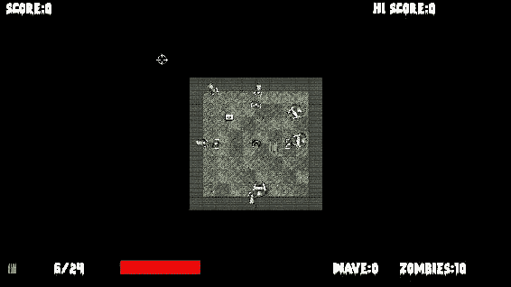

这显示了主界面/游戏结束屏幕上的**最高分**和分数：

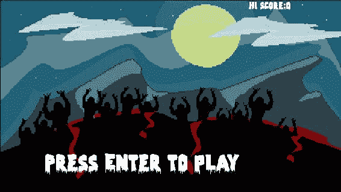

接下来，我们看到了显示玩家升级选项的文本，尽管这些选项目前还没有任何作用：

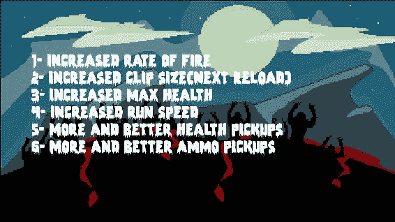

在这里，我们看到了暂停屏幕上的一条提示信息：

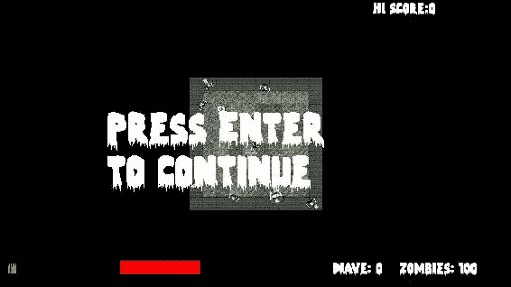

### 提示

SFML Views 的功能比这个简单的 HUD 所能展示的强大得多。要深入了解 SFML Views 的潜力以及如何使用它们，请查看 SFML 网站上的 View 教程：`http://www.sfmldev.org/tutorials/2.0/graphics-view.php`。

# 第 11 章 音效、文件 I/O 和完成游戏

我们快要完成了。这个简短的章节将演示如何使用 C++ 标准库轻松地操作存储在硬盘上的文件，我们将添加音效。当然，我们知道如何添加音效，但我们将讨论调用播放的具体应该放在代码的哪个位置。我们还将处理一些遗留问题以使游戏变得完整。

在本章中，我们将学习以下主题：

- 保存和加载最高分

- 添加音效

- 允许玩家升级

- 创建无休止的多个波次

## 保存和加载最高分

文件 I/O（即输入/输出）是一个相当技术性的主题。幸运的是我们，由于它是编程中一个非常常见的需求，有一个库可以为我们处理所有的复杂性。就像我们为 HUD 拼接字符串一样，是`Standard Library`通过`fstream`提供了必要的功能。

首先，我们像包含`sstream`一样包含`fstream`：

```cpp
#include "stdafx.h"
#include <sstream>
#include <fstream>
#include <SFML/Graphics.hpp>
#include "ZombieArena.h"
#include "Player.h"
#include "TextureHolder.h"
#include "Bullet.h"
#include "Pickup.h"

using namespace sf;
```

现在，在`ZombieArena/ZombieArena`文件夹中创建一个名为`gamedata`的新。。，在该文件夹中点击右键并创建一个名为`scores.txt`的新文件。我们将在这个文件中保存玩家的最高分。你可以打开文件并添加一个分数。如果你这样做，请确保分数非常低，这样我们就可以轻松测试超过该分数是否会导致新分数的添加。完成后务必关闭文件，否则游戏将无法访问它。

在接下来的代码中，我们创建了一个名为`InputFile`的`ifstream`对象，并将刚刚创建的文件夹和文件作为参数传递给它的构造函数。

`if(InputFile.is_open())`代码检查文件是否存在并已准备好读取。然后我们将文件内容放入`hiScore`并关闭文件。添加以下高亮代码：

```cpp
// 分数
Text scoreText;
scoreText.setFont(font);
scoreText.setCharacterSize(55); scoreText.setFillColor(Color::White); scoreText.setPosition(20, 0);

// 从文本文件加载最高分
std::ifstream inputFile("gamedata/scores.txt");
if (inputFile.is_open())
{
    inputFile >> hiScore; inputFile.close();
}

// 最高分
Text hiScoreText;
hiScoreText.setFont(font);
hiScoreText.setCharacterSize(55); hiScoreText.setFillColor(Color::White); hiScoreText.setPosition(1400, 0); std::stringstream s;
s << "Hi Score:" << hiScore;
hiScoreText.setString(s.str());
```

现在我们处理保存可能的新最高分。在处理玩家健康值小于等于零的块中，我们创建了一个名为`outputFile`的`ofstream`对象，将`hiScore`的值写入文本文件，然后关闭文件：

```cpp
// 是否有僵尸触碰了玩家
for (int i = 0; i < numZombies; i++)
{
    if (player.getPosition().intersects(zombies[i].getPosition()) && zombies[i].isAlive())
    {
        if (player.hit(gameTimeTotal)) {
            // 稍后会有更多
        }
        if (player.getHealth() <= 0) {
            state = State::GAME_OVER;
            std::ofstream outputFile("gamedata/scores.txt");
            outputFile << hiScore;
            outputFile.close();
        }
    }
} // 玩家触碰结束
```

你可以玩游戏，你的最高分将被保存。退出游戏并注意如果你再次玩，你的最高分仍然在那里。让我们制造一些噪音。

## 准备音效

在这一节中，我们将创建所需的所有`SoundBuffer`和`Sound`对象，以便为游戏添加一系列音效。

首先添加所需的 SFML 包含：

```cpp
#include "stdafx.h"
#include <sstream>
#include <fstream>
#include <SFML/Graphics.hpp>
#include <SFML/Audio.hpp>
#include "ZombieArena.h"
#include "Player.h"
#include "TextureHolder.h"
#include "Bullet.h"
#include "Pickup.h"
```

现在继续添加七个`SoundBuffer`和`Sound`对象，它们将加载并准备声音文件：

```cpp
// 我们上一次更新 HUD 是时候？
int framesSinceHUDUpdate = 0;
// 上一次更新的时间
Time timeSinceUpdate;
// 我们每隔多久（帧）更新一次 HUD int fpsFrameInterval = 1000;

// 准备击中声
SoundBuffer hitBuffer;
hitBuffer.loadFromFile("sound/hit.wav"); Sound hit;
hit.setBuffer(hitBuffer);

// 准备溅血声
SoundBuffer splatBuffer;
splatBuffer.loadFromFile("sound/splat.wav"); Sound splat;
splat.setBuffer(splatBuffer);

// 准备射击声
SoundBuffer shootBuffer;
shootBuffer.loadFromFile("sound/shoot.wav"); Sound shoot;
shoot.setBuffer(shootBuffer);

// 准备装弹声
SoundBuffer reloadBuffer;
reloadBuffer.loadFromFile("sound/reload.wav"); Sound reload;
reload.setBuffer(reloadBuffer);

// 准备装弹失败声
SoundBuffer reloadFailedBuffer;
reloadFailedBuffer.loadFromFile("sound/reload_failed.wav"); Sound reloadFailed;
reloadFailed.setBuffer(reloadFailedBuffer);

// 准备道具声
SoundBuffer powerupBuffer;
powerupBuffer.loadFromFile("sound/powerup.wav"); Sound powerup;
powerup.setBuffer(powerupBuffer);

// 准备拾取声
SoundBuffer pickupBuffer;
pickupBuffer.loadFromFile("sound/pickup.wav"); Sound pickup;
pickup.setBuffer(pickupBuffer);
```

// 主游戏循环 while (window.isOpen())

## 升级

接下来我们将添加的代码允许玩家在波次之间升级。由于我们之前所做的工作，实现这一点非常简单。

在处理玩家输入的`LEVELING_UP`状态下添加以下高亮代码：

```cpp
// 处理 升级状态
```


```cpp
if (state == State::LEVELING_UP)
{
  // 处理玩家升级
  if (event.key.code == Keyboard::Num1) {
    // 增加射速
    fireRate++;
    state = State::PLAYING;
  }

  if (event.key.code == Keyboard::Num2) {
    // 增加弹匣容量
    clipSize += clipSize;
    state = State::PLAYING;
  }

  if (event.key.code == Keyboard::Num3) {
    // 增加生命
    player.upgradeHealth();
    state = State::PLAYING;
  }

  if (event.key.code == Keyboard::Num4) {
    // 增加速度
    player.upgradeSpeed();
    state = State::PLAYING;
  }

  if (event.key.code == Keyboard::Num5) {
    // 升级血包
    healthPickup.upgrade();
    state = State::PLAYING;
  }

  if (event.key.code == Keyboard::Num6) {
    // 升级弹药
    ammoPickup.upgrade();
    state = State::PLAYING;
  }

  if (state == State::PLAYING) {
    玩家现在每清理一波僵尸就可以升级一次。然而，我们还无法增加僵尸的数量或关卡的大小。

    在`LEVELING_UP`状态的下一部分，紧接我们刚刚添加的代码之后，修改当状态从`LEVELING_UP`切换到`PLAYING`时运行的代码。

    这里是完整的代码。我高亮了新添加或经过稍作修改的行。

    添加或修改高亮显示的代码：
    ```cpp
    if (event.key.code == Keyboard::Num6) {
      ammoPickup.upgrade();
      state = State::PLAYING;
    }

    if (state == State::PLAYING) {
      // 增加波数
      wave++;

      // 准备关卡
      // 我们稍后会修改这两行
      arena.width = 500 * wave;
      arena.height = 500 * wave;
      arena.left = 0;
      arena.top = 0;

      // 通过引用传递顶点数组
      // 给 createBackground 函数
      int tileSize = createBackground(background, arena);

      // 在竞技场中心生成玩家
      player.spawn(arena, resolution, tileSize);

      // 配置掉拾包
      healthPickup.setArena(arena);
      ammoPickup.setArena(arena);

      // 创建一群僵尸
      numZombies = 5 * wave;

      // 删除之前分配的内存（如果存在）
      delete[] zombies;
      zombies = createHorde(numZombies, arena);
      numZombiesAlive = numZombies;

      // 播放升级音
      powerup.play();

      // 重置时钟以防止帧跳变
      clock.restart();
    }
  }
} // 结束升级
```

之前的代码从增加`wave`变量开始。然后对代码进行了修改，使僵尸的数量和竞技场的大小相对于`wave`的新值变化。最后，我们添加了对`powerup.play()`的调用，以播放升级音效。

## 重启游戏

我们已经通过`wave`变量的值确定了竞技场的大小和僵尸的数量。我们必须在每个新游戏开始时将弹药、`gun`、`wave`和`score`重置为零。在游戏循环的事件处理部分找到以下代码并添加高亮显示的代码：

```cpp
// 在 GAME_OVER 状态下开始新游戏
else if (event.key.code == Keyboard::Return && state == State::GAME_OVER)
{
  state = State::LEVELING_UP;
  wave = 0;
  score = 0;

  // 为下次游戏准备枪和弹药
  currentBullet = 0;
  bulletsSpare = 24;
  bulletsInClip = 6;
  clipSize = 6;
  fireRate = 1;

  // 重置玩家统计数据
  player.resetPlayerStats();
}
```

现在我们可以玩游戏了，玩家可以变得越来越强大，而僵尸会在不断扩大的竞技场中变得越来越多，直到他死亡，然后一切重新开始。

## 播放剩余声音

现在我们将为`play`函数添加剩余的调用。我们将逐一处理每一个，因为准确确定它们所在的位置对于在正确的时刻播放它们是关键。

### 在玩家装弹时添加音效

在三个地方添加高亮显示的代码，当玩家按下`R`键尝试装弹时，播放相应的装弹声或`reloadFailed`音效：

```cpp
if (state == State::PLAYING)
{
  // 装弹中
  if (event.key.code == Keyboard::R) {
    if (bulletsSpare >= clipSize) {
      // 弹药充足。装弹。
      bulletsInClip = clipSize;
      bulletsSpare -= clipSize;
      reload.play();
    }
    else if (bulletsSpare > 0)
    {
      // 只剩几颗子弹
      bulletsInClip = bulletsSpare;
      bulletsSpare = 0;
      reload.play();
    }
    else
    {
      // 很快会有更多弹了？！
      reloadFailed.play();
    }
  }
}
```

### 制作射击声

在处理玩家点击左鼠标键的代码末尾添加高亮显示的`shoot.play()`调用：

```cpp
// 发射子弹
if (sf::Mouse::isButtonPressed(sf::Mouse::Left)) {
  if (gameTimeTotal.asMilliseconds() - lastPressed.asMilliseconds() > 1000 / fireRate && bulletsInClip > 0)
  {
    // 将玩家和准星的中心
    // 传递给 shoot 函数
    bullets[currentBullet].shoot(
      player.getCenter().x, player.getCenter().y, mouseWorldPosition.x, mouseWorldPosition.y);

    currentBullet++;
    if (currentBullet > 99) {
      currentBullet = 0;
    }

    lastPressed = gameTimeTotal;
    shoot.play();
    bulletsInClip--;
  }
} // 结束发射子弹
```

### 玩家被击中时播放声音

在下面的代码中，我们将`hit.play()`的调用封装在一个测试中，以检查`player.hit`函数是否返回`true`。记住，`player.hit`函数检查之前的 100 毫秒内是否记录了击中。这将产生一个快速、重复的咚咚声的效果，但不会快到让声音模糊成一种噪音。

如此处高亮所示，添加`hit.play()`调用：

```cpp
// 是否有僵尸碰到了玩家
for (int i = 0; i < numZombies; i++)
{
  if (player.getPosition().intersects(zombies[i].getPosition()) && zombies[i].isAlive())
  {
    if (player.hit(gameTimeTotal)) {
      // 稍后会有更多
      hit.play();
    }

    if (player.getHealth() <= 0) {
      state = State::GAME_OVER;
      std::ofstream OutputFile("gamedata/scores.txt");
      OutputFile << hiScore;
      OutputFile.close();
    }
  }
} // 结束玩家触碰
```

### 获得拾拾包时播放声音

当玩家捡起血包时，我们将播放普通的拾拾声，但当玩家获得弹药包时，我们播放装弹音效。

在适当的碰撞检测代码中，如此处高亮所示，添加两个声音声音调用：

```cpp
// 玩家是否碰到了血包
if (player.getPosition().intersects(healthPickup.getPosition()) && healthPickup.isSpawned()) {
  player.increaseHealthLevel(healthPickup.gotIt());
  // 播放声音
  pickup.play();
}

// 玩家是否碰到了弹药包
if (player.getPosition().intersects(ammoPickup.getPosition()) && ammoPickup.isSpawned()) {
  bulletsSpare += ammoPickup.gotIt();
  // 播放声音
  reload.play();
}
```

### 僵尸被射中时制作溅血声

在检测子弹与僵尸碰撞的代码段末尾添加`splat.play()`调用：

```cpp
// 是否有僵尸被射中？
for (int i = 0; i < 100; i++)
{
  for (int j = 0; j < numZombies; j++) {
    if (bullets[i].isInFlight() && zombies[j].isAlive())
    {
      if (bullets[i].getPosition().intersects(zombies[j].getPosition()))
      {
        // 停止子弹
        bullets[i].stop();

        // 注册击中并查看是否击杀
        if (zombies[j].hit()) {
          // 不仅击中也是杀死
          score += 10;
          if (score >= hiScore) {
            hiScore = score;
          }
          numZombiesAlive--;

          // 当所有僵尸死去（再次）
          if (numZombiesAlive == 0) {
            state = State::LEVELING_UP;
          }
        }

        // 制作溅血声
        splat.play();
      }
    }
  }
} // 结束僵尸被射中
```


你现在可以玩完整的游戏了，并观察僵尸的数量和竞技场的大小每一波如何增加。仔细选择你的升级：

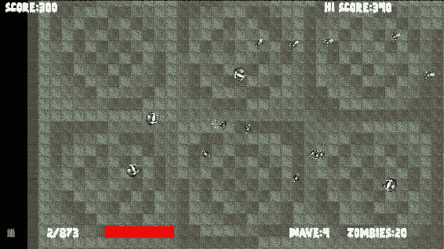

恭喜！

在本章中，我们将首次预览本书的终极项目。该项目将包含一些高级功能，例如定向音频（声音会根据玩家的位置从扬声器传出）。它还将具有分屏合作游戏模式。此外，此项目将引入`Shaders`（着色器）的概念，这是另一种语言编写并直接运行在显卡上的程序。在第 16 章《扩展 SFML 类、粒子系统和着色器》结束时，你将构建出一个类似于热门经典游戏`Thomas Was Alone`风格的、功能完整的多人平台游戏。

本章的重点将是启动项目——特别是探索如何组织代码以更好地利用面向对象编程（OOP）。我们将涵盖以下主题：

- 终极项目`Thomas Was Late`介绍，包括游戏玩法特性和项目资产
- 详细讨论与之前的项目相比，我们将如何改进代码结构
- 编写`Thomas Was Late`游戏引擎
- 实现分屏功能
- `Thomas Was Late`游戏

此时，如果你还没看过的话，我建议你去`http://store.steampowered.com/app/220780/`看一下《Thomas Was Alone》的视频。注意它非常简单但极具美感的画面。视频还展示了各种游戏挑战，例如使用角色的不同属性（身高、跳跃、力量等）。为了在保持游戏简单的同时不失挑战性，我们的谜题功能将比《Thomas Was Alone》少，但增加了额外的挑战，即需要两名玩家合作完成。为了确保游戏不会太简单，我们还将让玩家与时间赛跑，这就是为什么我们的游戏名为`Thomas Was Late`（托马斯迟到了）。

## Thomas Was Late 的特性

我们的游戏还无法与我们尝试模仿的杰作相提，但它拥有一系列令人兴奋的玩法特性：

- 一个根据关卡挑战合适的时间进行倒计时的时钟。
- 火坑，它们会根据玩家的位置发出咆哮声，如果玩家掉入其中，他们将在起点重生。水坑具有相同的效果，但没有定向音效。
- 合作性游戏模式——两名玩家都必须在规定时间内让他们的角色到达终点。他们经常需要合作，例如，较矮且跳跃高度较低的 Bob 需要站在他朋友（Thomas）的头上。
- 玩家可以选择在全屏和分屏之间切换，以便尝试自己控制两个角色。每个关卡将通过文本文件设计并从那里加载。这使得设计多样化且大量的关卡变得非常容易。

看看这张游戏的注释截图，查看一些功能的运行情况以及组成游戏的组件/资产：

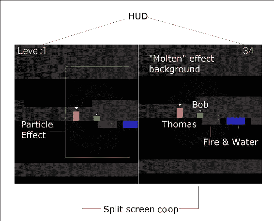

让我们来看看这些功能，并再多描述几个：

截图显示了一个简单的 HUD，详细列出了关卡编号以及玩家失败并重新开始关卡前的剩余秒数。

你也可以清楚地看到正在运行的分屏合作。记住，这是可选的。单个玩家可以在全屏模式下独自游戏，并在 Thomas 和 Bob 之间切换相机焦点。在截图中并不清晰（尤其是在打印出来时），但当一个角色死亡时，他会爆炸成类似星形/烟花般的粒子效果。

水块和火块可以策略性地放置，使关卡变得有趣并强制角色之间进行合作。关于这一点在第 14 章《构建可玩关卡和碰撞检测》中会有更多介绍。

注意 Thomas 和 Bob——他们不仅身高不同，而且跳跃能力也有显著差异。这意味着 Bob 的大跳跃需要依赖 Thomas，而关卡可以设计成迫使 Thomas 走一条可以避免他撞头的路线。

此外，火块会发出咆哮声。这些声音是相对于 Thomas 位置的。它们不仅具有方向性并会从左或右扬声器传出，而且随着 Thomas 靠近或远离光源，声音会变大变小。最后，在注释截图中，你可以看到背景。如果你将它的外观与`background.png`文件（在本章稍后显示）进行比较，你会发现它非常不同。我们将在第 16 章《扩展 SFML 类、粒子系统和着色器》中使用 OpenGL 着色器效果，来实现背景中移动——几乎像泡泡一样的效果。所有这些特性都值得多几张截图，以便我们在编写 C++ 代码时能记住成品。

下面的截图显示了 Thomas 和 Bob 到达了一个火坑，Bob 在没有帮助的情况下没有机会跳过去：

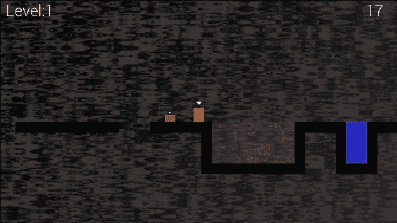

接下来的截图显示了 Bob 和 Thomas 合作跨过一个危险的跳跃：

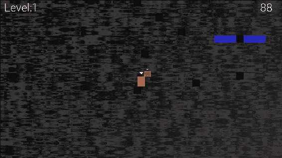

接下来的截图显示了我们如何设计需要“信仰之一跃”才能到达终点的谜题：

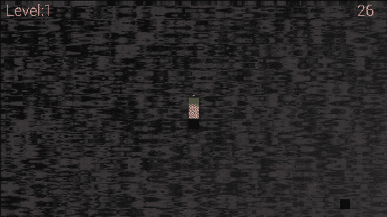

接下来的截图演示了我们如何设计几乎任何大小的压抑洞穴系统。我们还可以设计让 Bob 和 Thomas 强制分开走不同路线的关卡：

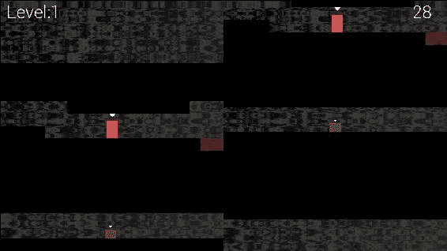

## 从模板创建项目

创建`Thomas Was Late`项目与另外两个项目一样。只需在 Visual Studio 中遵循以下简单步骤操作即可：

1. 从主菜单选择`File`（文件）| `New Project`（新建项目）。
2. 确保左侧菜单中选择了`Visual C++`，然后从给出的列表中选择`HelloSFML`。接下来的截图说明了这一点：
3. 在`Name:`（名称）字段中输入`TWL`，并确保勾选了`Create directory for solution`（为解决方案创建目录）选项。点击`OK`。
4. 现在我们需要将 SFML`.dll`文件复制到主项目目录。我的主项目目录是`D:\Visual Studio Stuff\Projects\TWL\TWL`。该文件夹是 Visual Studio 在上一步创建的。如果你将 Projects 文件夹放在其他地方，在那里执行此步骤。我们需要复制到项目文件夹的文件位于你的`SFML\bin`文件夹中。打开这两个位置的每个窗口，并高亮所需的`.dll`文件。
5. 现在将高亮的文件复制并粘贴到项目中。

项目现在已设置完毕并准备就绪。

## 项目资产

此项目中的资产比 Zombie Arena 游戏更多且更多样。按照惯例，资产包括用于屏幕文字的字体、不同动作（如跳跃、到达终点或远处的火鸣声）的音效，当然还有 Thomas 和 Bob 的图形，以及所有背景块的精灵集。

游戏所需的所有资产都包含在下载包中。它们分别位于第 12 章/graphics 和第 12 章/sound 文件夹。

所需的字体尚未提供。这是因为我想避免关于许可的任何可能的歧义。不过这不会引起问题，因为我将向你展示如何以及在何处自行选择和下载字体。

尽管我会提供资产本身或获取它们的信息，但你可能更喜欢自己创建并获取它们。

除了我们预期的图形、声音和字体外，这个游戏还有两种新资产类型。它们是关卡设计文件和 GLSL 着色器程序。让我们接下来了解每种类型。

### 游戏关卡设计

关卡都是在文本文件中创建。通过使用 0 到 3 的数字，我们可以构建挑战玩家的关卡设计。所有关卡设计都位于与其他资源相同目录下的`levels`文件夹中。现在可以先查看一眼，但我们将在第 14 章——《构建可玩关卡与碰撞检测》中详细介绍。

除了这些关卡设计资源外，我们还有一种特殊的图形资源，称为着色器（shaders）。

### GLSL 着色器

着色器是用`GLSL`（`图形着色语言`）编写的程序。不用担心需要学习另一种语言，因为我们不需要深入得太多就可以利用着色器。着色器是特殊的，因为它们是完整的程序，与我们的 C++ 代码分离，并由 GPU 每一帧执行。事实上，其中一些着色器程序在每一帧中针对每一个像素都会运行！我们将在第 16 章——《扩展 SFML 类、粒子系统和着色器》中了解更多细节。如果你等不及那么久，可以看一眼下载包中`Chapter 12/shaders`文件夹下的文件。

### 图形资源详解

图形资源构成了我们游戏场景的各个部分。看看这些图形资源就能清楚它们在游戏中的用途了：

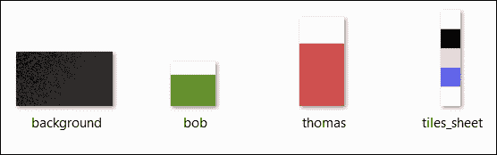

如果`tiles_sheet`图形上的瓷块看起来与游戏截图略有不同，这是因为它们是部分透明的，透出来的背景使它们发生了细微变化。如果背景图形与游戏截图中的实际背景完全不同，那是因为我们将编写的着色器程序将操纵每一帧的每一个像素，创建一种“熔岩”效果。

### 音频资源详解

音频文件均为`.wav`格式。这些文件包含了我们在整个游戏某些事件中播放的音效。它们如下：

- `fallinfire.wav`：当玩家头部进入火中且没有逃生机会时播放的音。
- `fallinwater.wav`：水的效果与火相同：死亡。这个音效通知玩家需要从关卡的开始重新开始。
- `fire1.wav`：该音效以单声道录制。它将根据玩家与火块的距离以不同的音量播放，并根据玩家在火块的左侧还是右侧从不同的扬声器播放。显然，我们需要学习更多技巧来实现这一功能。
- `jump.wav`：玩家跳跃时悦的（略微可预测的）呼啸。
- `reachgoal.wav`：当玩家（或玩家们）让两个角色（Thomas 和 Bob）到达目标块时悦的胜利声。

这些音效非常简单，你可以轻松地创建自己的。如果你打算替换`fire1.wav`文件，请确保将你的声音保存为单声道（而非双声道）格式。其原因将在第 15 章——《声音空间化与 HUD》中解释。

## 将资源添加到项目

一旦你决定了使用哪些资源，就是将它们添加到项目中的时候。以下指令假设你正在使用书籍下载包提供的所有资源。

如果你使用自己的资源，只需使用完全相同的文件名用所选的文件替换相应的声音或图形文件：

1. 浏览到`D:\Visual Studio Stuff\Projects\TWL\TWL`。
2. 在此文件夹内创建五个新文件夹，并命名为`graphics`、`sound`、`fonts`、`shaders`和`levels`。
3. 从下载包中，将`Chapter 12/graphics`的全部内容复制到`D:\Visual Studio Stuff\Projects\TWL\TWL\graphics`文件夹中。
4. 从下载包中，将`Chapter 12/sound`的全部内容复制到`D:\Visual Studio Stuff\Projects\TWL\TWL\sound`文件夹中。
5. 现在在网络浏览器中访问`http://www.dafont.com/roboto.font`并下载`Roboto Light`字体。
6. 解压缩下载包的内容，并将`Roboto Light.ttf`文件添加到`D:\Visual Studio Stuff\Projects\TWL\TWL\fonts`文件夹中。
7. 从下载包中，将`Chapter 12/levels`的全部内容复制到`D:\Visual Studio Stuff\Projects\TWL\TWL\levels`文件夹中。
8. 从下载包中，将`Chapter 12/shaders`的全部内容复制到`D:\Visual Studio Stuff\Projects\TWL\TWL\shaders`文件夹中。

现在我们有了一个新项目，以及整个项目所需的所有资源，我们可以开始讨论如何组织游戏引擎代码了。

## 组织 Thomas Was Late 代码

到目前为止的两个项目中，一个非常明显的问题是代码变得既冗长又难以管理。面向对象编程（OOP）允许我们将项目拆分为逻辑清晰且易于管理的块，称为类。

通过引入`Engine`类，我们将对该项目的可管理性进行巨大改进。除了其他函数外，`Engine`类将包含三个私有函数。它们是`input`、`update`和`draw`。这听起来应该非常熟悉。每个函数都将包含之前全在`main`函数中的代码块。这些函数将分别位于自己的代码文件中，即`Input.cpp`、`Update.cpp`和`Draw.cpp`。

`Engine`类中还有一个公共函数，可以通过`Engine`实例调用。该函数运行后将负责在游戏的每一帧中调用一次`input`、`update`和`draw`：

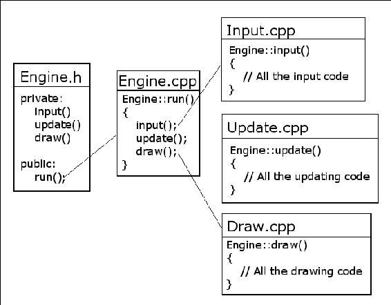

此外，由于我们已经将游戏引擎的大部分抽象到`Engine`类中，我们还可以将许多变量从`main`移动并成为`Engine`的成员。启动游戏引擎所需要的只是创建一个`Engine`实例并调用它的`run`函数。这里是超级简单的`main`函数的预览：

```cpp
int main()
{
    // 声明 Engine 实例
    Engine engine;

    // 启动引擎
    engine.run();

    // 当引擎停止时按通常方式退出
    return 0;
}
```

### 提示

先不要添加上述代码。

为了让我们的代码更具可管理性和可读性，我们还将大任务（如加载关卡和碰撞检测）的责任抽象到单独的函数（在单独的代码文件中）。这两个函数是`loadLevel`和`detectCollisions`。我们还将编写其他函数来处理 Thomas Was Late 项目的一些新功能。我们将在它们出现时对其进行详细介绍。

为了进一步利用 OOP 的优势，我们将游戏特定区域的责任完全委托给新类。你可能还记得在之前的项目中，声音和 HUD 代码非常长。我们将构建一个`SoundManager`和`HUD`类来以更整洁的方式处理这些方面。它们具体如何工作将在实现它们时深入探讨。

游戏关卡本身比之前的游戏深入得多，因此我们还将编写一个`LevelManager`类。

正如你预期的，可玩角色也将用类来制作。然而，对于这个项目，我们将学习更多 C++ 并实现一个带有 Thomas 和 Bob 所有共同功能的`PlayableCharacter`类，然后是`Thomas`和`Bob`类，它们将继承这些共同功能，并实现它们独特的函数和能力。这可能并不意外，这被称为**继承**。我将在接下来的第 13 章——《高级 OOP、继承与多态》中详细介绍继承。

我们还将实现许多其他类来执行特定的职责。例如，我们将使用粒子系统制作一些酷的爆炸效果。你可能猜到了，为了实现这一点，我们将编写一个`Particle`类和一个`ParticleSystem`类。所有这些类的实例都将成为`Engine`类的成员。通过这种方式，我们可以从游戏引擎访问游戏的所有功能，同时将细节封装在适当的类中。

在查看构建`Engine`类的实际代码之前，最后要提到的一点是，我们将不做任何更改地重用`TextureHolder`类，这个类是我们在“僵尸竞技场”（Zombie Arena）游戏中讨论过并编写过的。

## 构建游戏引擎

正如之前的讨论所建议的，我们将编写一个名为`Engine`的类，它将控制并绑定《Thomas Was Late》游戏的不同部分。

我们将做的第一件事是让上一个项目中的`TextureHolder`类在本项目中可用。

## 重用 TextureHolder 类

我们在“僵尸竞技场”游戏中讨论并编写的`TextureHolder`类在这个项目中也会很有用。虽然可以直接从上一个项目添加文件（`TextureHolder.h`和`TextureHolder.cpp`），而无需重新编码或重新创建文件，但我不想假设你没有直接跳到这个项目。接下来的内容是简短的说明，以及创建`TextureHolder`类的完整代码列表。如果你想对该类或代码进行详细解释，请参阅第 8 章《指针、标准模板库与纹理管理》。

### 提示

如果你已经完成了上一个项目并且确实想从“僵尸竞技场”项目添加该类，只需执行以下操作：在`Solution Explorer`（解决方案管理器）窗口中，右键点击`Header Files`（头文件）并选择`Add` | `Existing Item...`（现有项...）。从上一个项目浏览到`TextureHolder.h`并选择它。在`Solution Explorer`窗口中，右键点击`Source Files`（源文件）并选择`Add` | `Existing Item...`（现有项...）。从上一个项目浏览到`TextureHolder.cpp`并选择它。你现在可以在此项目中使用`TextureHolder`类。请注意，文件在项目之间共享，任何更改都将在两个项目中生效。

要从零开始创建`TextureHolder`类，在`Solution Explorer`中右键点击`Header Files`并选择`Add` | `New Item...`（新建项...）。在`Add New Item`窗口中，选中（通过左点击）`Header File (.h)`（头文件），然后在`Name`字段中输入`TextureHolder.h`。最后，点击`Add`按钮。

向`TextureHolder.h`中添加以下代码：

```cpp
#pragma once

#ifndef TEXTURE_HOLDER_H
#define TEXTURE_HOLDER_H

#include <SFML/Graphics.hpp>
#include <map>

class TextureHolder
{
private:
    // 一个来自 STL 的 map 容器，
    // 用于存放相关的 String 和 Texture 键对
    std::map<std::string, sf::Texture> m_Textures;

    // 与类本身类型相同的指针
    // 唯一的实例
    static TextureHolder* m_s_Instance;

public:
    TextureHolder();

    static sf::Texture& GetTexture(std::string const& filename);
};

#endif
```

在`Solution Explorer`中右键点击`Source Files`并选择`Add` | `New Item...`。在`Add New Item`窗口中，选中（通过左点击）`C++ File (.cpp)`（C++ 文件），然后在`Name`字段中输入`TextureHolder.cpp`。最后，点击`Add`按钮。

向`TextureHolder.cpp`中添加以下代码：

```cpp
#include "stdafx.h"
```


```cpp
#include "TextureHolder.h"

#include <assert.h>

using namespace sf;
using namespace std;

TextureHolder* TextureHolder::m_s_Instance = nullptr;

TextureHolder::TextureHolder()
{
    assert(m_s_Instance == nullptr);
    m_s_Instance = this;
}

sf::Texture& TextureHolder::GetTexture(std::string const& filename)
{
    // 使用 m_S_Instance 获取 m_Textures 的引用
    auto& m = m_s_Instance->m_Textures;

    // auto 等同于 map<string, Texture>
    // 创建迭代器来持有键值对 (kvp)
    // 使用传入的文件名搜索所需的 kvp
    auto keyValuePair = m.find(filename);

    // auto 等同于 map<string, Texture>::iterator
    // 我们找到匹配项了吗？
    if (keyValuePair != m.end())
    {
        // 是
        // 返回纹理，
        // kvp 的第二个部分，即纹理
        return keyValuePair->second;
    }
    else
    {
        // 未找到文件
        // 使用文件名创建一个新的键值对
        auto& texture = m[filename];

        // 按照通常方式从文件加载纹理
        texture.loadFromFile(filename);

        // 将纹理返回给调用代码
        return texture;
    }
}
```

我们现在可以继续编写新的 `Engine` 类。

## 编写 `Engine.h`

按照习惯，我们将从包含函数声明和成员变量的头文件开始。注意，将在整个项目中反复访问此文件以添加更多函数和成员变量。目前，我们只添加此阶段必要的代码。

在 `Solution Explorer` 中右键点击 `Header Files` 并选择 `Add` | `New Item...`。在 `Add New Item` 窗口中，选中（通过左点击）`Header File (.h)`，然后在 `Name` 字段中输入 `Engine.h`。最后，点击 `Add` 按钮。我们现在准备好为 `Engine` 类编写头文件了。

添加以下成员变量以及函数声明。其中许多我们之前在其他项目中见过，其中一些在 *构建《Thomas Was Late》* 的代码部分讨论过。请注意函数和变量的名称，以及它们是私有的还是公有的。向 `Engine.h` 文件添加以下代码，然后我们来讨论它：

```cpp
#pragma once

#include <SFML/Graphics.hpp>

#include "TextureHolder.h"

using namespace sf;

class Engine
{
private:
    // 纹理持有器
    TextureHolder th;

    const int TILE_SIZE = 50;
    const int VERTS_IN_QUAD = 4;

    // 向下推角色的力
    const int GRAVITY = 300;

    // 普通的渲染窗口
    RenderWindow m_Window;

    // 主视图
    View m_MainView;
    View m_LeftView;
    View m_RightView;

    // 背景的三个视图
    View m_BGMainView;
    View m_BGLeftView;
    View m_BGRightView;

    // HUD 视图
    View m_HudView;

    // 用于背景的精灵和纹理
    Sprite m_BackgroundSprite;
    Texture m_BackgroundTexture;

    // 游戏正在进行？
    bool m_Playing = false;

    // 角色 1 或 2 是焦点？
    bool m_Character1 = true;

    // 全屏模式启动
    bool m_SplitScreen = false;

    // 当前关卡剩余时间
    float m_TimeRemaining = 10;

    Time m_GameTotal;

    // 是否需要新关卡？
    bool m_NewLevelRequired = true;

    // 内部使用的私有函数
    void input();
    void update(float dt);
    void draw();

public:
    // Engine 构造函数
    Engine();

    // Run 调用所有私有函数
    void run();
};
```

这里是所有私有变量和函数的说明。在适当的情况下，我对某些进行了详细解释：

`TextureHolder th`：`TextureHolder` 类的唯一实例。

`TILE_SIZE`：非常有用的常量，提醒我们精灵图中的每个瓦片宽五十像素。

`VERTS_IN_QUAD`：非常有用的常量，使我们对 `VertexArray` 的操作不易出错。事实上，一个四边形有四个顶点。现在我们不会忘记它了。

`GRAVITY`：一个常量 `int` 值，代表每秒游戏角色向下推的像素数。在游戏完成后，调整这个值非常有趣。我们将其初始化为 `300`，这对于我们的初始关卡设计效果良好。

`m_Window`：通常的 `RenderWindow` 对象，就像我们在所有项目中所具有的一样。

前三个 `View` 对象用于全屏视图，以及游戏的左右分屏视图。我们还为这三个视图中的每个都创建了独立的 SFML `View` 对象，用于在它们后面绘制背景。最后一个 `View` 对象 `m_HudView` 将绘制在其他六个视图的相应组合之上，用于显示分数、剩余时间以及给玩家的任何信息。七个不同的 `View` 对象可能意味着很复杂，但随着章节的进行，当你看到我们如何处理它们时就会发现它们非常简单。在本章结束之前，我们将解决整个分屏/全屏的难题。

### 精灵 `m_BackgroundSprite` 和纹理 `m_BackgroundTexture`

意料之中，这种 SFML `Sprite` 和 `Texture` 的组合用于显示和持有来自图形资源文件夹的背景图。

`m_Playing`：这个布尔值将告知游戏引擎关卡是否已经开始（通过按下 `Enter` 键）。一旦开始，玩家没有暂停游戏的选项。

`m_Character1`：当屏幕为全屏模式时，应该居中于 Thomas（`m_Character1 = true`）还是 Bob（`m_Character1 = false`）？最初它被初始化为 `true`，以居中于 Thomas。

`m_SplitScreen`：游戏当前是否以分屏模式运行？我们将使用这个变量来决定具体如何使用我们几步之前声明的所有 `View` 对象。

`m_TimeRemaining` 变量：这个 `float` 变量保存到达当前关卡目标的剩余时间。在之前的代码中，为了测试，它被设置为 `10`，直到我们实际上为每个关卡设置特定的时间。

`m_GameTimeTotal` 变量：这个变量是一个 SFML `Time` 对象。它记录了游戏运行了多久。

`m_NewLevelRequired` 布尔变量：这个变量用于检查玩家是否刚刚完成或失败了关卡。然后我们可以用它来触发加载下一个关卡或重启当前关卡。

### 函数

`input` 函数：此函数将处理玩家的所有输入，在游戏中，这些输入完全来自键盘。初一看，它似乎直接处理所有键盘输入。然而，在这个游戏中，我们将直接在 `Thomas` 和 `Bob` 类中处理影响 Thomas 或 Bob 的键盘输入。我们将调用 `input` 函数，该函数将直接处理退出、切换到分屏以及任何其他键盘输入。

`update` 函数：此函数将完成我们之前在 `main` 函数的 `update` 部分所做的工作。我们还会从 `update` 函数调用一些其他函数以保持代码的整洁。如果你回看代码，你会发现它接收一个 `float` 参数，该参数存储了自上一帧以来所经过的秒数。当然，这正是我们更新所有游戏对象所需要的。

`draw` 函数：此函数将包含以前在以往项目中放在 `main` 函数绘制部分的所有代码。然而，当我们查看使用 SFML 绘制的其他方法时，会有一些绘制代码不会保存在此函数中。当我们学习第 16 节 *扩展 SFML 类、粒子系统和着色器* 时，我们将看到这些新代码。

现在让我们过一遍所有的公共函数：

`Engine` 构造函数：正如我们预期的那样，这个函数会在我们声明 `Engine` 实例时被调用。它将完成该类的所有设置和初始化。不久后，当我们编写 `Engine.cpp` 文件时，我们将看到具体的内容。

`run` 函数：这是我们需要调用的唯一公共函数。它将触发 `input`、`update` 和 `draw` 的执行，从而完成所有工作。

接下来，我们将看到这些函数的定义和一些变量。

### 编写 `Engine.cpp`

大部分都是我们之前见过的代码。例如，有获取屏幕分辨率以及创建 `RenderWindow` 的常规代码行。在之前代码的末尾，我们使用了现在熟悉的代码来加载纹理并将其分配给 `Sprite`。在这种情况下，我们正在加载 `background.png` 纹理并将其分配给 `m_BackgroundSprite`。

```cpp
#include "Engine.h"

#include "SFML.hpp"

#include "TextureHolder.h"

Engine::Engine()
{
    // 获取屏幕分辨率
    sf::Vector2f resolution;
    resolution.x = sf::VideoMode::desktop().width;
    resolution.y = sf::VideoMode::desktop().height;

    // 创建窗口
    m_Window.create(sf::VideoMode(resolution), "Thomas and Bob");

    // 初始化全屏视图
    m_View.setView(sf::View(sf::FloatRect(0, 0, resolution.x, resolution.y)));

    // ...

    m_HudView.setViewport(sf::FloatRect(resolution));
    m_HudView.setView(sf::View(0, 0, resolution.x, resolution.y));

    // 初始化分屏视图
    m_LeftView.setViewport(sf::FloatRect(0.001f, 0.001f, 0.498f, 0.998f));
    m_LeftView.setView(sf::View(0, 0, resolution.x, resolution.y));

    m_RightView.setViewport(sf::FloatRect(0.5f, 0.001f, 0.499f, 0.998f));
    m_RightView.setView(sf::View(0, 0, resolution.x, resolution.y));

    m_BGLeftView.setViewport(sf::FloatRect(0.001f, 0.001f, 0.498f, 0.998f));
    m_BGLeftView.setView(sf::View(0, 0, resolution.x, resolution.y));

    m_BGRightView.setViewport(sf::FloatRect(0.5f, 0.001f, 0.499f, 0.998f));
    m_BGRightView.setView(sf::View(0, 0, resolution.x, resolution.y));

    m_BackgroundTexture = TextureHolder::GetTexture("graphics/background.png");

    // 将精灵与纹理关联
    m_BackgroundSprite.setTexture(m_BackgroundTexture);
}
```

中间的代码，即四次调用 `setViewport` 函数的部分需要一些解释。`setViewport` 函数将屏幕的一部分分配给一个 SFML `View` 对象。然而，它不是使用像素坐标工作的。它是使用比例工作的。其中“1”代表整个屏幕（宽度或高度），每次调用 `setViewport` 的前两个值是起始位置（先是水平方向，然后是垂直方向），最后两个值是结束位置。

注意 `m_LeftView` 和 `m_BGLeftView` 被放置在完全相同的位置，几乎从屏幕的最左侧（`0.001`）开始，并在距离中心两千之二（`0.498`）处结束。

`m_RightView` 和 `m_BGRightView` 也处于完全相同的位置，从前两个对象的左侧（`0.5`）开始，一直延伸到屏幕的最右侧（`0.998`）。

此外，所有视图在屏幕顶部和底部都留有极微小的间隙。当我们在白色背景上将这些 `View` 对象绘制到屏幕上，它将产生屏幕两侧之间有一条细白线分割屏幕的效果，以及边缘处有一圈细白边框的效果。

我已尝试在下面的图中表示这种效果：

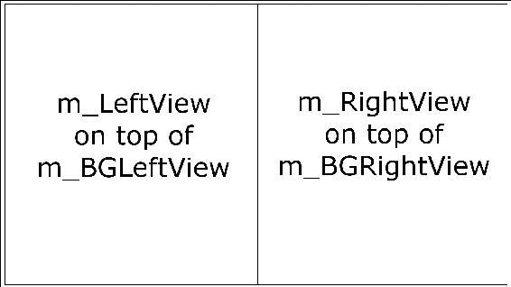

理解它的最好方法是完成本章，运行代码并观察它的运行效果。

该函数的代码将放在我们最近创建的 `Engine.cpp` 文件中。

在之前的构造函数代码之后立即添加以下代码：

```cpp
void Engine::run()
{
    // Timing
    Clock clock;

    while (m_Window.isOpen())
    {
        Time dt = clock.restart();

        // 更新总游戏时间
        m_GameTimeTotal += dt;

        // 将增量时间浮点数 dt 转换为小数
        float dtAsSeconds = dt.asSeconds();

        // 顺序调用游戏循环的每个部分
        input();
        update(dtAsSeconds);
        draw();
    }
}
```

`run` 函数是我们引擎的中心——它启动了所有其他部分。首先，我们声明了一个 `Clock` 对象。接下来，我们有了熟悉的 `while (window.isOpen())` 循环，它创建了游戏循环。在这个 `while` 循环内部，我们执行了以下操作：

1. 重启时钟，并将上一个循环消耗的时间保存在 `dt` 中。
2. 在 `m_GameTimeTotal` 中跟踪已消耗的总时间。
3. 声明并初始化一个浮点数，表示上一帧期间经过的秒的分数。
4. 调用 `input`。
5. 调用 `update` 并传入已经过的时间（`dtAsSeconds`）。
6. 调用 `draw`。

所有这些看起来应该非常熟悉。新奇之处在于它被封装在 `run` 函数中。

### 编写 `input` 函数定义

正如之前解释过的，该函数的代码将放在它自己的文件中，因为它比构造函数或 `run` 函数更详尽。我们将使用 `#include "Engine.h"` 并在函数签名前加上 `Engine::` 前缀，以确保编译器感知我们的意图。

在 `Solution Explorer`（解决方案）中右键点击 `Source Files`（源文件），选择 `Add` | `New Item...`（新建项...）。在 `Add New Item` 窗口中，左单击选中 `C++ File (.cpp)`，然后在 `Name` 字段中输入 `Input.cpp`。最后，点击 `Add` 按钮。我们现在准备好编写 `input` 函数代码了。

添加以下代码：

```cpp
void Engine::input()
{
    Event event;

    while (m_Window.pollEvent(event))
    {
        if (event.type == Event::KeyPressed)
        {
            // 处理玩家退出
            if (Keyboard::isKeyPressed(Keyboard::Escape))
            {
                m_Window.close();
            }

            // 处理玩家开始游戏
            if (Keyboard::isKeyPressed(Keyboard::Return))
            {
                m_Playing = true;
            }

            // 在 Thomas 和 Bob 之间切换
            if (Keyboard::isKeyPressed(Keyboard::Q))
            {
                m_Character1 = !m_Character1;
            }

            // 在全屏和分屏之间切换
            if (Keyboard::isKeyPressed(Keyboard::E))
            {
                m_SplitScreen = !m_SplitScreen;
            }
        }
    }
}
```


与之前的两个项目一样，我们每帧都会检查`RenderWindow`事件队列。同样，正如我们之前做的那样，我们使用`if (Keyboard::isKeyPressed(Keyboard::E))`检测特定的按键。我们刚刚添加的代码中最相关的是按键的实际作用：

像通常一样，`Esc`键关闭窗口，游戏将退出。`Enter`键将`m_Playing`设置为`true`，最终，这将产生启动关卡的效果。

`Q`键在`m_Character1`的`true`和`false`之间切换值。此键仅在全屏模式下有效。它将在 Thomas 和 Bob 作为主`View`中心之间进行切换。`E`键在`m_SplitScreen`的`true`和`false`之间切换。这将产生在全屏视图和分屏视图之间切换的效果。

大部分键盘功能将在章节结束时完全工作。我们正接近能够运行自己的游戏引擎了。接下来，让我们编写`update`函数。

### 编写`update`函数定义

正如之前解释过的，该函数的代码将放在它自己的文件中，因为它比构造函数或`run`函数更详尽。我们将使用`#include "Engine.h"`并在函数签名前加上`Engine::`前缀，以确保编译器感知我们的意图。

在`Solution Explorer`中右键点击`Source Files`，选择`Add` | `New Item...`。在`Add New Item`窗口中，左单击选中`C++ File (.cpp)`，然后在`Name`字段中输入`Update.cpp`。最后，点击`Add`按钮。我们现在准备好编写`update`函数代码。

添加以下代码：

```cpp
#include "Update.h"

#include "Engine.h"

#include <SFML/Graphics.hpp>

#include <iostream>

using namespace sf;

void Engine::update(float dtSeconds) {

    if (m_Playing) {

        // 减小剩余时间

        m_TimeRemaining -= dtSeconds;

        if (m_TimeRemaining <= 0) {

            m_NewLevel = true;

        }

    }

}
```

在上述的`if…else`结构之外，我们切换到`m_HUDView`。在这个阶段，我们实际上并没有在`m_HUDView`中绘制任何内容。

与三个最重要的函数中的另外两个（`input`、`update`）一样，我们会经常回到`draw`函数。我们将为游戏添加需要绘制的新元素。你会发现，每当我们这样做时，都会在主部分、左部分和右部分中都添加代码。

让我们快速回顾一下`Engine`类，然后就可以启动它。

## 目前到为止的`Engine`类

我们实现的是原本在`main`函数中的所有代码抽象为`input`、`update`和`draw`函数。这些函数的持续循环以及时机控制由`run`函数处理。

考虑在 Visual Studio 中打开`Input.cpp`、`Update.cpp`和`Draw.cpp`标签页，也许按照顺序排列，如下面的截图所示：

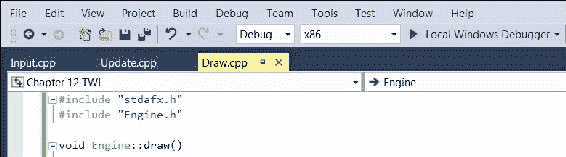

我们将在整个项目过程中反复访问这些每一个函数，以添加更多代码。现在我们已经有了`Engine`类的基本结构和功能，可以在`main`函数中创建它的实例并看到它的运行。

## 编写`main`函数

让我们将`HelloSFML.cpp`文件重命名为`Main.cpp`。在“解决方案管理器”中右键点击`HelloSFML`文件并选择“重命名”。将名称改为`Main.cpp`。这将包含我们的`main`函数和实例化`Engine`类代码的文件。

在`Main.cpp`中添加以下代码：

```cpp
#include "stdafx.h"

#include "Engine.h"

int main()

{

    // 声明 Engine 实例

    Engine engine;

    // 启动引擎 VRRrrrrmmm

    engine.run();

    // 引擎停止时以通常的方式退出

    return 0;

}
```

我们做的只是为`Engine`类添加一个包含指令，声明一个`Engine`实例，然后调用它的`run`函数。一切将由`Engine`类处理，直到玩家退出、执行返回`main`并执行`return 0`语句。

这很简单。现在我们可以运行游戏并看到空白背景（无论是全屏还是分屏），它最终将包含所有的动作。

以下是目前游戏的全屏模式，仅显示背景：


现在按下`E`键，你会看到屏幕整齐地分为两半，准备好进行分屏合作游戏：

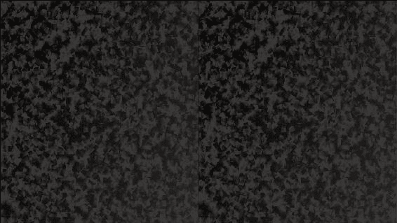

这里是一些你脑中可能会产生的问题。

# 第 13 章 高级 OOP – 继承与多态

在本章中，我们将通过学习稍微高级一点的继承（inheritance）和多态（polymorphism）概念，来进一步扩展我们的 OOP 知识。然后我们就能能够使用这些新知识来实现游戏中的主角角色 Thomas 和 Bob。以下是本章将更详细涵盖的内容：

- 如何使用继承扩展和修改类？
- 通过多态将类的对象视为多于一种类型的类
- 抽象类以及设计从不实例化的类如何实际上有用
- 构建一个抽象的`PlayableCharacter`类
- 在 Thomas 和 Bob 类中应用继承
- 将 Thomas 和 Bob 添加到游戏项目中

## 继承

我们已经看到如何通过从 SFML 库的类实例化/创建对象来利用他人的工作成果。但整个 OOP 的意义远不止于此。

如果有一个类包含了大量实用的功能，但又不是我们完全想要的呢？在这种情况下，我们可以从另一个类继承。正如字面意思，继承意味着我们可以利用其他类的所有特性和优势（包括封装），同时专门针对我们的情况进一步提炼或扩展代码。在这个项目中，我们将继承并扩展一些 SFML 类。我们也会对自己的类进行这样做。

让我们看一些使用继承的代码。

### 扩展类

在考虑到这一切之后，让我们看一个示例类并看看我们如何扩展它，仅仅是为了查看语法并作为第一步。

首先，我们定义一个要继承的类。这与我们创建其他任何类的方式没有区别。看看这个假设的`Soldier`类声明：

```cpp
class Soldier

{

private:

    // 士兵可以承受多少伤害

    int m_Health;

    int m_Armour;

    int m_Range;

    int m_ShotPower;

public:

    void setHealth(int h); 

    void setArmour(int a); 

    void setRange(int r); 

    void setShotPower(int p);

};
```

在之前的代码中，我们定义了一个`Soldier`类。它有四个私有变量：`m_Health`、`m_Armour`、`m_Range`和`m_ShotPower`。它有四个公共函数`setHealth`、`setArmour`、`setRange`和`setShotPower`。我们不需要看到函数的定义，它们将只需初始化其名称所示的相应变量。

我们也可以想象，一个完全实现的`Soldier`类会比这深入得多。它可能会有如`shoot`、`goProne`等函数。如果我们在 SFML 项目中实现一个`Soldier`类，它可能有一个`Sprite`对象，以及`update`和`getPosition`函数。

这里展示的简单场景适合学习继承。现在让我们来看一些新东西，实际上继承自`Soldier`类。看这段代码，特别是高亮部分：

```cpp
class Sniper : public Soldier

{

public:

    // 专属于 Sniper 的构造函数

    Sniper::Sniper();

};
```

通过在`Sniper`类的声明中添加`: public Soldier`代码，`Sniper`继承自`Soldier`。但这到底意味着什么呢？`Sniper`是一个`Soldier`。它拥有`Soldier`的所有变量和函数。然而，继承不仅仅于此。

请注意，在之前的代码中，我们声明了一个`Sniper`构造函数。这个构造函数是`Sniper`特有的。我们不仅继承了`Soldier`，还扩展了`Soldier`。`Soldier`类的所有功能（定义）由`Soldier`类处理，但`Sniper`构造函数的定义必须由`Sniper`类处理。

这就是假设的`Sniper`构造函数定义可能的样子：

```cpp
// 在 Sniper.cpp 中

Sniper::Sniper()

{

    setHealth(10); 

    setArmour(10); 

    setRange(1000); 

    setShotPower(100);

}
```

我们可以继续编写许多作为`Soldier`类扩展类，比如`Commando`（突击队）和`Infantryman`（步兵）。每个类都有完全相同的变量和函数，但每个类还可以有一个独特的构造函数，根据`Soldier`的类型相应地初始化这些变量。

`Commando`可能有很高的`m_Health`和`m_ShotPower`，但`m_Range`非常小。`Infantryman`可能介于`Commando`和`Sniper`之间，每个变量的值都中等。

提示：仿佛 OOP 还不够用一样，我们现在可以对现实世界对象建模，包括它们的层次结构。我们通过子类化、扩展和继承其他类来实现这一点。

我们在这里可能想要学习的术语是：被扩展的类称为父类（super-class），继承自父类的类称为子类（sub-class）。我们也可以称之为父类（parent）和子类（child）。

提示：你可能会对继承提出这个问题：为什么要这样做？原因类似于此：我们可以写一次公共代码；在父类中，我们可以更新这些公共代码，所有继承自它的类也会随之更新。此外，子类只能使用公共和`protected`实例变量和函数。因此，如果设计得当，这进一步增强了封装的目标。

你说`protected`吗？是的。有一个用于类变量和函数的访问修符叫做`protected`。你可以将`protected`变量认为是介于 public 和 private 之间的地方。以下是访问修符的简要总结，以及关于`protected`修符的更多详细信息：

公共变量和函数可以被任何人访问和使用。私有变量和函数只能被类的内部代码访问/使用。这对封装非常有益，当我们我们需要访问/更改私有变量时，可以提供公共 getter 和 setter 函数（例如`getSprite`等）。如果我们扩展了一个具有私有变量和函数的类，该子类`cannot`直接访问父类的私有数据。

受保护变量和函数与私有变量几乎相同。它们不能被类的实例直接访问/使用。然而，它们`can`被任何扩展了其声明类的类直接使用。因此它们就像是私有的一样，对子类除外。

为了完全理解受保护变量和函数以及它们如何有用，让我们先看另一个主题，然后就可以看到它们的实际应用。

## 多态

`Polymorphism`（多态）允许我们编写不那么依赖于我们正尝试操作的类型的代码。这使得我们的代码更清晰、更高效。多态意味着不同的形式。如果我们编写的对象可以是多种类型的东西，那么我们就可以利用这一点。

### 注意

多态对我们来说意味着什么？归结为最简单的定义，多态就是：任何子类都可以作为使用父类的代码的一部分。这意味着我们可以编写更简单、更易理解，而且更易修改或更改的代码。此外，我们可以为父类编写代码，并依靠这样一个事实：无论被子类化多少次，在某些参数范围内，代码仍然可以工作。

让我们讨论一个例子。

假设我们想使用多态来帮助编写一个动物园管理游戏，其中我们必须喂养并照顾动物的需求。我们可能想要一个像`feed`这样的函数。我们可能还想将一个要喂养的`Animal`实例传递给`feed`函数。当然，动物园有很多类型的动物——狮、`Elephant`和`ThreeToedSloth`。有了我们对 C++ 继承的新知识，编写一个`Animal`类并让所有不同类型的动物继承自它将是有意义的。

如果我们想写一个函数（`feed`），可以将`Lion`、`Elephant`和`ThreeToedSloth`作为参数传递进去，这似乎我们需要为每种类型的`Animal`都写一个`feed`函数。然而，我们可以编写具有多态返回类型和参数的多态函数。看一眼这个假设的`feed`函数的定义：

```cpp
void feed(Animal& a)

{

    a.decreaseHunger();

}
```

前面的函数将`Animal`引用作为参数，这意味着任何由扩展`Animal`的类构建的对象都可以传递给它。

因此，你今天就可以编写代码，并在周后、一个月或一年后创建另一个子类，而完全相同的函数和数据结构仍然有效。此外，我们还可以对子类强制执行一套规则，规定它们可以做什么和不能做什么，以及如何做。因此，一个阶段的良好设计可以影响其他阶段。

但我们真的想要实例化一个真正的`Animal`吗？

## 抽象类 - 虚函数和纯虚函数

`abstract class`（抽象类）是一个无法实例类，因此无法变成对象。

### 提示

我们在这里可能学习的术语之一是`concrete`（具体类）。`concrete class`是任何非抽象类。换句话说，我们到目前编写的所有类都是具体类，并且可以实例化为可用的对象。

那么，这些是永远不会被使用的代码吗？但这就像付钱给建筑师设计房子却从不建造它一样！

如果我们，或者类的设计者想强制用户在使用他们的类之前继承它，他们可以将类设为`abstract`。那么，我们就无法从它创建对象；因此，我们必须先扩展它并从子类创建对象。

为了做到这一点，可以将函数设为`pure virtual`且不提供任何定义。那么该函数在任何扩展它的类中都必须被`overridden`（重写）。

让我们看一个例子；这会有帮助。我们通过添加纯虚函数来使类变为抽象，例如这个抽象的`Animal`类，它只能执行通用动作`makeNoise`：

```cpp
class Animal

private:

    // 这里有私有内容

public:

    virtual void makeNoise() = 0;

    // 这里有更多公共内容

};
```


如你所见，我们在函数声明之前添加了 C++ 关键字 `virtual`，在函数声明之后添加了 `= 0`。现在，任何扩展/继承 `Animal` 的类都必须重写 `makeNoise` 函数。这可能是有意义的，因为不同动物发出的噪音非常不同。我们也许可以假设任何扩展 `Animal` 类的人都足够聪明，注意到 `Animal` 类不能发出声音，并且他们需要处理它，但如果他们没有注意到呢？重点是，通过创建一个纯虚函数，我们保证了他们会这样做，因为他们必须这样做。

抽象类也很有用，因为有时我们希望一个类可以作为多态类型使用，但我们需要保证它永远不能被作为对象使用。例如，`Animal` 本身并没有真正的意义。我们不谈论动物；我们谈论动物的种类。我们不说：“噢，看那只可爱的、毛茸茸的白色动物！”或“昨天我们去宠物店买了一只动物和一张动物床”。它太，嗯，太抽象了。

所以，一个抽象类就像是一个 `template`（模板），供任何扩展它（继承它）的类使用。如果我们正在构建一个类似《工业帝国》类型的游戏，玩家管理公司及其员工，我们可能想要一个 `Worker` 类，例如，并扩展它来制作 `Miner`、`Steelworker`、`OfficeWorker`，当然还有 `Programmer`。但一个纯粹的 `Worker` 到底在做什么？我们为什么要去实例化它呢？

答案是，我们不想去实例化它，但我们可能想将其作为多态类型使用，这样我们可以在函数之间传递多个 `Worker` 子类，并拥有可以包含所有类型员工的数据结构。

所有纯虚函数必须由扩展包含该纯虚函数的父类的类来重写。这意味着抽象类可以提供一些在所有子类中可用的公共功能。例如，`Worker` 类可能有 `m_AnnualSalary`、`m_Productivity` 和 `m_Age` 成员变量。它可能还有 `getPayCheck` 函数，它不是纯虚的且在所有子类中都是相同的，但它可能有一个 `doWork` 函数，它是纯虚的且必须重写，因为所有不同类型的 `Worker` `doWork` 的方式非常不同。

### 注意

顺便说一下，`virtual` 与纯虚不同，它是可以可选重写的函数。声明虚函数的方法与纯虚函数相同，但去掉最后的 `= 0`。在当前的游戏项目中，我们将使用纯虚函数。

如果这些关于抽象的内容不清楚，使用它们可能是理解最好的方法。

## 构建 PlayableCharacter 类

现在我们掌握了继承、多态和纯虚函数的基础知识，我们将把它们投入使用。我们将构建一个 `PlayableCharacter` 类，它拥有我们游戏中任何字符需要的大部分功能。它将有一个纯虚函数 `handleInput`。`handleInput` 函数在子类中可能是完全不同的，因此这是有意义的。

由于 `PlayableCharacter` 将有一个纯虚函数，它将成为一个抽象类，无法创建其实例。随后，我们将构建 `Thomas` 和 `Bob` 类，它们将继承自 `PlayableCharacter`，实现纯虚函数的定义，并允许我们在游戏中实例化 `Bob` 和 `Thomas` 对象。

## 编写 PlayableCharacter.h

和往常一样，在创建一个类时，我们将从头文件开始，头文件将包含成员变量和函数声明。新之处在于，在这个类中，我们将声明一些 `protected` 成员变量。记住，`protected` 变量可以被继承该类的类像 `Public`（公有）变量一样使用。

在 `Solution Explorer` 中右键点击 `Header Files`，并选择 `Add` | `New Item...`。在 `Add New Item` 窗口中，选中（左键点击）`Header File (.h)`，然后在 `Name` 字段中输入 `PlayableCharacter.h`。最后，点击 `Add` 按钮。我们现在准备好为 `PlayableCharacter` 类编写头文件代码了。

我们将分三个部分添加并讨论 `PlayableCharacter.h` 文件的内容。首先是 `protected` 部分，然后是 `private`，最后是 `public`。

为 `PlayableCharacter.h` 文件添加所示代码：

```cpp
#pragma once

#include <SFML/Graphics.hpp>

using namespace sf;

class PlayableCharacter

{

protected:

// 当然，我们需要一个精灵图
Sprite m_Sprite;

// 跳跃持续多久
float m_JumpDuration;

// 角色当前是否正在跳跃或落下
bool m_IsJumping;

bool m_IsFalling;

// 角色当前向哪个方向移动
bool m_LeftPressed;

bool m_RightPressed;

// 此次跳跃已经持续了多久
float m_TimeThisJump;

// 玩家是否刚刚触发跳跃
bool m_JustJumped = false;

// 接下来是私有变量和函数
```

在我们刚刚编写的代码中，要注意的一点是所有的变量都是 `protected` 的。这意味着当我们扩展类时，我们刚刚编写的所有变量都可以被扩展它的类访问。我们将用 `Thomas` 和 `Bob` 类来扩展这个类。

除了 `protected` 访问修饰符外，之前的代码并没有新奇或复杂的地方。然而，值得注意一些细节。这样随着我们的进展，将很容易理解该类是如何工作的。那么，让我们一个一个来看这些 `protected` 变量。

我们有一个在可以预测的 `Sprite`，`m_Sprite`。我们有一个名为 `m_JumpDuration` 的 `float`，它将存储一个代表能够跳跃时间的值。数值越大，角色跳得就越远/越高。

接下来我们有一个布尔值 `m_IsJumping`，当角色跳跃时它为 `true`，否则为 `false`。这对于确保角色在空中不能跳跃很有用。

`m_IsFalling` 变量的作用与 `m_IsJumping` 类似。知道角色何时掉落很有用。

接下来，我们有两个布尔值，如果角色的左或右键盘键当前被按下，它们将为 `true`。这些取决于角色（Thomas 使用 `A` 和 `D` 键，Bob 使用左、右箭头键）。我们将如何响应这些布尔值将在 `Thomas` 和 `Bob` 类中看到。

`m_TimeThisJump` `float` 变量在 `m_IsJumping` 为 `true` 的每一帧中都会更新。我们就可以知道何时达到了 `m_JumpDuration`。

最后一个 `protected` 变量是布尔值 `m_JustJumped`。如果在当前帧发生了跳跃，它将为 `true`。这对于知道何时播放跳跃音效很有用。

接下来，向 `PlayableCharacter.h` 文件添加以下私有变量：

```cpp
private:

// 重力是多少
float m_Gravity;

// 角色有多快
float m_Speed = 400;

// 玩家在哪里
Vector2f m_Position;

// 角色的各个身体部位在哪里？
FloatRect m_Feet;

FloatRect m_Head;

FloatRect m_Right;

FloatRect m_Left;

// 以及一个纹理
Texture m_Texture;

// 我们所有的公有函数接下来将出现
```

在之前的代码中，我们有一些有趣的私有变量。记住，这些变量只能由 `PlayableCharacter` 类中的代码直接访问。`Thomas` 和 `Bob` 类将无法直接访问它们。

`m_Gravity` 变量将存储角色每秒掉下的像素数。`m_Speed` 变量将存储角色每秒向左或右移动的像素数。

`Vector2f` 变量 `m_Position` 是世界中（而非屏幕）角色中心的位置。

接下来的四个 `FloatRect` 对象需要讨论。当我们在 *Zombie Arena* 游戏中进行碰撞检测时，我们简单地检查两个 `FloatRect` 对象是否相交。每个 `FloatRect` 对象代表整个角色、一个拾取物品或一个子弹。对于非矩形状的对象（僵尸和玩家），这有一点不准确。

在这个游戏中，我们需要更精确。`m_Feet`、`m_Head`、`m_Right` 和 `m_Left` `FloatRect` 对象将保存角色身体不同部位的坐标。这些坐标在每一帧中都会更新。

通过这些坐标，我们能够准确地判断角色何时落在平台上、何时在跳跃时撞头，或何时与侧边的瓷砖擦肩。

最后，我们有 `Texture`。`Texture` 是私有的，因为它没有被 `Thomas` 或 `Bob` 类直接使用，但正如我们看到的，`Sprite` 是 `protected` 的，因为它被直接使用了。

现在将所有公有函数添加到 `PlayableCharacter.h` 文件中，然后我们将讨论它们：

```cpp
public:

void spawn(Vector2f startPosition, float gravity);

// 这是一个纯虚函数
bool virtual handleInput() = 0;

// 此类现在是抽象的，无法实例化

// 玩家在哪里
FloatRect getPosition();

// 一个代表精灵图
// 不同部位的矩形
FloatRect getFeet();

FloatRect getHead();

FloatRect getRight();

FloatRect getLeft();

// 向主程序发送精灵图的副本
Sprite getSprite();

// 让角色停下
void stopFalling(float position);

void stopRight(float position);

void stopLeft(float position);

void stopJump();

// 中心在哪里
Vector2f getCenter();

// 我们每帧调用此函数
void update(float elapsedTime);

}; // 类结束
```

让我们讨论刚刚添加的每个函数声明。这将使得编写它们的定义更容易。

`spawn` 函数接收一个名为 `startPosition` 的 `Vector2f` 和一个名为 `gravity` 的 `float`。正如名称所示，startPosition 将是角色开始时的坐标，`gravity` 将是角色每秒掉落的像素。

`bool virtual handleInput() = 0` 自然是我们的纯虚函数。由于 `PlayableCharacter` 有此函数，任何扩展它的类如果我们想实例化，就必须为该函数提供定义。因此，当我们几分钟后编写 `PlayableCharacter` 的所有函数定义时，我们不会为 `handleInput` 提供定义。在 `Thomas` 和 `Bob` 类中自然需要有定义。

`getPosition` 函数返回一个代表整个角色位置的 `FloatRect`。

`getFeet()` 函数以及 `getHead()`、`getRight()` 和 `getLeft()` 各自返回一个代表身体特定部位位置的 `FloatRect`。这正是我们详细碰撞检测所需的。

`getSprite` 函数像往常一样，向调用代码返回 `m_Sprite` 的副本。

`stopFalling`、`stopRight`、`stopLeft` 和 `stopJump` 函数接收单个浮点数值，该函数将使用该值重新定位角色，并停止其通过实体瓷砖行走或跳跃。`getCenter` 函数向调用代码返回一个 `Vector2f`，让其准确知道角色的中心位置。当然，这个值存储在 `m_Position` 中。我们稍后会看到 `Engine` 类将使用它将适当的 `View` 居于适当的角色中心。

我们之前见过很多次 `update` 函数，和通常一样，它接受一个 `float` 参数，表示当前帧所花费的秒数。然而，这个 `update` 函数需要比之前的 `update` 函数（来自其他项目）执行更多工作。它需要处理跳跃，以及更新代表头部、脚、左侧和右侧的 `FloatRect` 对象。

现在我们可以编写所有函数的定义了，当然 `handleInput` 除外。

## 编写 PlayableCharacter.cpp

在`解决方案管理器`中右键点击`源文件`，并选择`添加` | `新项...`。在`添加新项`窗口中，选中（通过左键点击）`C++ 文件 (.cpp)`，然后在`名称`字段中输入 `PlayableCharacter.cpp`。最后，点击`添加`按钮。我们现在准备好为 `PlayableCharacter` 类编写 `.cpp` 文件了。

我们将代码和讨论拆分为若干部分。首先，添加包含指令和 `spawn` 函数的定义：

```cpp
#include "stdafx.h"

#include "PlayableCharacter.h"

void PlayableCharacter::spawn(Vector2f startPosition, float gravity)

{

// 将玩家放在起始点 
m_Position.x = startPosition.x;

m_Position.y = startPosition.y;

// 初始化重力 
m_Gravity = gravity;

// 将精灵移动到位置 
m_Sprite.setPosition(m_Position);

}
```

`spawn` 函数使用传入的位置初始化 `m_Position`，并初始化 `m_Gravity`。最后一行代码将 `m_Sprite` 移动到它的起始位置。

接下来，紧接前面的代码之后添加 `update` 函数的定义：

```cpp
void PlayableCharacter::update(float elapsedTime) {

    if (m_RightPressed) {

        m_Position.x += m_Speed * elapsedTime; 

    }

    if (m_LeftPressed) {

        m_Position.x -= m_Speed * elapsedTime;

    }

    // 处理跳跃

    if (m_IsJumping) {

        // 更新跳跃持续了多久 
        m_TimeThisJump += elapsedTime;

        // 跳跃是否正在向上

        if (m_TimeThisJump < m_JumpDuration) {

            // 以两倍重力向上移动

            m_Position.y -= m_Gravity * 2 * elapsedTime; 

        }

        else {

            m_IsJumping = false; m_IsFalling = true;

        }

    }

    // 应用重力

    if (m_IsFalling) {

        m_Position.y += m_Gravity * elapsedTime; 

    }

    // 更新所有身体部位的矩形

    FloatRect r = getPosition();

    // 头部

    m_Head.left = r.left;

    m_Head.top = r.top + (r.height * .3); m_Head.width = r.width;

    m_Head.height = 1;

    // 脚部

    m_Feet.left = r.left + 3;

    m_Feet.top = r.top + r.height - 1; m_Feet.width = r.width - 6; m_Feet.height = 1;

    // 右侧

    m_Right.left = r.left + r.width - 2; m_Right.top = r.top + r.height * .35; m_Right.width = 1;

    m_Right.height = r.height * .3;

    // 左侧

    m_Left.left = r.left;

    m_Left.top = r.top + r.height * .5; m_Left.width = 1;

    m_Left.height = r.height * .3;

    // 将精灵移动到位置 
    m_Sprite.setPosition(m_Position);

}
```


代码的前两部分检查 `m_RightPressed` 或 `m_LeftPressed` 是否为真。如果其中任一个为真，则使用与上项目相同的公式（经过的时间乘以速度）更改 `m_Position`。

接下来，我们查看角色当前是否正在执行跳跃。我们通过 `if(m_IsJumping)` 知道这一点。如果这个 `if` 语句为真，代码将采取以下步骤：

1. 使用 `elapsedTime` 更新 `m_TimeThisJump`。
2. 检查 `m_TimeThisJump` 是否仍然小于 `m_JumpDuration`。如果是，则通过两倍重力乘以经过的时间来改变 `m_Position` 的 y 坐标。
3. 在 `m_TimeThisJump` 不小于 `m_JumpDuration` 时执行的 `else` 子句中，将 `m_Falling` 设置为 `true`。此操作的效果将在接下来看到。此外，`m_Jumping` 被设置为 `false`。这防止了我们刚刚讨论的代码继续执行，因为 `if(m_IsJumping)` 现在为假。

`if(m_IsFalling)` 块每帧都将 `m_Position` 向下移动。它使用 `m_Gravity` 的当前值和经过的时间进行移动。

以下代码（几乎是剩余的所有代码）相对于整个精灵的当前位置更新角色的身体部位。查看下面的图，了解代码如何计算角色虚拟头部、脚、左侧和右侧的位置：

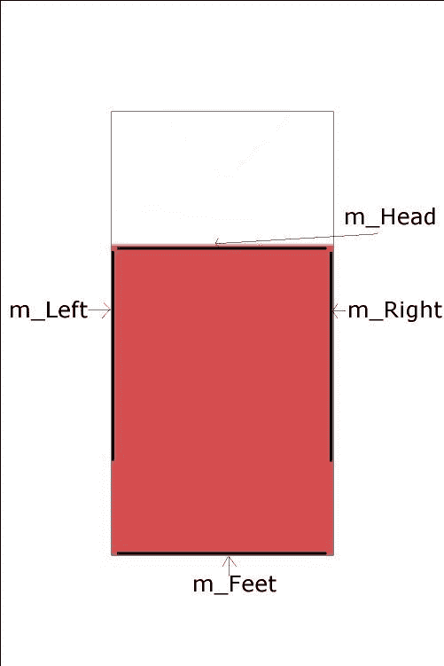

最后一行代码使用 `setPosition` 函数在 `update` 函数所有可能的情况后，将精灵移动到其正确位置。

现在，紧接之前的代码之后添加 `getPosition`、`getCenter`、`getFeet`、`getHead`、`getLeft`、`getRight` 和 `getSprite` 函数的定义：

```cpp
FloatRect PlayableCharacter::getPosition() {
    return m_Sprite.getGlobalBounds();
}

Vector2f PlayableCharacter::getCenter() {
    return Vector2f(
        m_Position.x + m_Sprite.getGlobalBounds().width / 2,
        m_Position.y + m_Sprite.getGlobalBounds().height / 2
    );
}

FloatRect PlayableCharacter::getFeet() {
    return m_Feet;
}

FloatRect PlayableCharacter::getHead() {
    return m_Head;
}

FloatRect PlayableCharacter::getLeft() {
    return m_Left;
}

FloatRect PlayableCharacter::getRight() {
    return m_Right;
}

Sprite PlayableCharacter::getSprite() {
    return m_Sprite;
}
```

`getPosition` 函数返回一个封装整个精灵的 `FloatRect`，而 `getCenter` 返回一个 `Vector2f`，包含精灵的中心。注意，我们将精灵的高度和宽度除以二以便动态得出此结果。这是因为 Thomas 和 Bob 的身高不同。

`getFeet`、`getHead`、`getLeft` 和 `getRight` 函数返回代表身体部位的 `FloatRect` 对象，我们在 `update` 函数中每帧更新这些部位。我们将在下一章编写使用这些函数的碰撞检测代码。

`getSprite` 函数像往常一样返回 `m_Sprite` 的副本。

最后，对于 `PlayableCharacter` 类，添加 `stopFalling`、`stopRight`、`stopLeft` 和 `stopJump` 函数的定义。紧接之前的代码之后操作：

```cpp
void PlayableCharacter::stopFalling(float position) {
    m_Position.y = position - getPosition().height;
    m_Sprite.setPosition(m_Position);
    m_IsFalling = false;
}

void PlayableCharacter::stopRight(float position) {
    m_Position.x = position - m_Sprite.getGlobalBounds().width;
    m_Sprite.setPosition(m_Position);
}

void PlayableCharacter::stopLeft(float position) {
    m_Position.x = position + m_Sprite.getGlobalBounds().width;
    m_Sprite.setPosition(m_Position);
}

void PlayableCharacter::stopJump() {
    // 提前停止跳跃
    m_IsJumping = false;
    m_IsFalling = true;
}
```

## 构建 Thomas 和 Bob 类

现在我们真正要使用继承了。我们将为 Thomas 构建一个类，为 Bob 构建一个类。它们都继承自我们刚刚编写的 `PlayableCharacter` 类。它们将拥有 `PlayableCharacter` 类的所有功能，包括对其保护变量的直接访问。我们还将为纯虚函数 `handleInput` 添加定义。你会发现 Thomas 和 Bob 的 `handleInput` 函数将是不同的。

## 编写 Thomas.h

在 `Solution Explorer` 中右键点击 `Header Files` 并选择 `Add | New Item....`。在 `Add New Item` 窗口中，通过左键点击高亮 `Header File (.h)`，然后在 `Name` 字段中输入 `Thomas.h`。最后，点击 `Add` 按钮。我们现在准备好为 `Thomas` 类编写头文件代码了。现在将此代码添加到 `Thomas.h` 类中：

```cpp
#pragma once

#include "PlayableCharacter.h"

class Thomas : public PlayableCharacter {
public:
    // 针对 Thomas 特有的构造函数
    Thomas::Thomas();

    // Thomas 的重写输入处理器
    bool virtual handleInput();
};
```

之前的代码非常简洁明了。我们可以看到有一个构造函数，并且我们将实现纯虚函数 `handleInput`，所以让我们现在就完成它吧。

## 编写 Thomas.cpp

在 `Solution Explorer` 中右键点击 `Source Files` 并选择 `Add | New Item...`。在 `Add New Item` 窗口中，通过左键点击高亮 `C++ File (.cpp)`，然后在 `Name` 字段中输入 `Thomas.cpp`。最后，点击 `Add` 按钮。我们现在准备好为 `Thomas` 类编写 `.cpp` 文件了。

如下代码片段所示，将 `Thomas` 构造函数添加到 `Thomas.cpp` 文件：

```cpp
#include "stdafx.h"
#include "Thomas.h"
#include "TextureHolder.h"

Thomas::Thomas() {
    // 将纹理关联到精灵
    m_Sprite = Sprite(TextureHolder::GetTexture("graphics/thomas.png"));
    m_JumpDuration = .45;
}
```

我们需要做的只是加载 `thomas.png` 图形，并将跳跃持续时间（`m_JumpDuration`）设置为 `.45`（几乎是半秒）。

如下代码片段所示，添加 `handleInput` 函数的定义：

```cpp
// 一个虚函数
bool Thomas::handleInput() {
    m_JustJumped = false;

    if (Keyboard::isKeyPressed(Keyboard::W)) {
        // 如果没有在跳跃则开始跳跃
        // 但仅当站在方块上（未掉落）时
        if (!m_IsJumping && !m_IsFalling) {
            m_IsJumping = true;
            m_TimeThisJump = 0;
            m_JustJumped = true;
        }
    } else {
        m_IsJumping = false;
        m_IsFalling = true;
    }

    if (Keyboard::isKeyPressed(Keyboard::A)) {
        m_LeftPressed = true;
    } else {
        m_LeftPressed = false;
    }

    if (Keyboard::isKeyPressed(Keyboard::D)) {
        m_RightPressed = true;
    } else {
        m_RightPressed = false;
    }

    return m_JustJumped;
}
```

这段代码看起来非常熟悉。我们正在使用 SFML 的 `isKeyPressed` 函数来检查 `W`、`A` 或 `D` 键中是否有任何一个被按下。

当 `W` 被按下时，玩家尝试跳跃。代码紧接着使用 `if(!m_IsJumping && !m_IsFalling)` 代码，该代码检查角色是否没有在跳跃且没有在掉落。当这两个测试都为真时，`m_IsJumping` 被设置为 `true`，`m_TimeThisJump` 被设置为零，`m_JustJumped` 被设置为 `true`。

当之前的两个测试都不为真时，执行 `else` 子句，并将 `m_Jumping` 设置为 `false` 且将 `m_IsFalling` 设置为 `true`。

对 `A` 和 `D` 键按下的处理仅需将 `m_LeftPressed` 和/或 `m_RightPressed` 设置为 `true` 或 `false`。现在 `update` 函数能够处理角色的移动了。

函数中的最后一行代码返回 `m_JustJumped` 的值。这将让调用代码知道是否需要播放跳跃音效。

我们现在将编写 `Bob` 类，尽管它与 `Thomas` 类几乎相同，但它有不同的跳跃能力、不同的纹理（Texture），并使用键盘上不同的键。

## 编写 Bob.h

`Bob` 类在结构上与 `Thomas` 类相同。它继承自 `PlayableCharacter`，有一个构造函数，并提供了 `handleInput` 函数的定义。与 `Thomas` 的区别在于，我们以不同的方式初始化了一些 `Bob` 的成员变量，并且我们也以不同的方式处理输入（在 `handleInput` 函数中）。让我们编写这个类并查看细节。

在 `Solution Explorer` 中右键点击 `Header Files` 并选择 `Add | New Item...`。在 `Add New Item` 窗口中，通过左键点击高亮 `Header File (.h)`，然后在 `Name` 字段中输入 `Bob.h`。最后，点击 `Add` 按钮。我们现在准备好为 `Bob` 类编写头文件。

将以下代码添加到 `Bob.h` 文件中：

```cpp
#pragma once

#include "PlayableCharacter.h"

class Bob : public PlayableCharacter {
public:
    // 针对 Bob 特有的构造函数
    Bob::Bob();

    // Bob 的重写输入处理器
    bool virtual handleInput();
};
```

之前的代码与 `Thomas.h` 文件相同，除了类名，因此构造函数名也是如此。

## 编写 Bob.cpp

在 `Solution Explorer` 中右键点击 `Source Files` 并选择 `Add | New Item...`。在 `Add New Item` 窗口中，通过左键点击高亮 `C++ File (.cpp)`，然后在 `Name` 字段中输入 `Thomas.cpp`。最后，点击 `Add` 按钮。我们现在准备好为 `Bob` 类编写 `.cpp` 文件。

将 `Bob` 构造函数的代码添加到 `Bob.cpp` 文件。注意纹理是不同的（`bob.png`），且 `m_JumpDuration` 初始化为一个显著较小的值。Bob 现在拥有了他自己的、独特的特性：

```cpp
#include "stdafx.h"
#include "Bob.h"
#include "TextureHolder.h"

Bob::Bob() {
    // 将纹理关联到精灵
    m_Sprite = Sprite(TextureHolder::GetTexture("graphics/bob.png"));
    m_JumpDuration = .25;
}
```

在 `Bob` 构造函数之后立即添加 `handleInput` 代码：

```cpp
bool Bob::handleInput() {
    m_JustJumped = false;

    if (Keyboard::isKeyPressed(Keyboard::Up)) {
        // 如果没有在跳跃则开始跳跃
        // 但仅当站在方块上（未掉落）时
        if (!m_IsJumping && !m_IsFalling) {
            m_IsJumping = true;
            m_TimeThisJump = 0;
            m_JustJumped = true;
        } else {
            m_IsJumping = false;
            m_IsFalling = true;
        }
    }

    if (Keyboard::isKeyPressed(Keyboard::Left)) {
        m_LeftPressed = true;
    } else {
        m_LeftPressed = false;
    }

    if (Keyboard::isKeyPressed(Keyboard::Right)) {
        m_RightPressed = true;
    } else {
        m_RightPressed = false;
    }

    return m_JustJumped;
}
```

注意这段代码与 `Thomas` 类中 `handleInput` 函数的代码几乎相同。唯一的区别是我们响应的是不同的键（左箭头键、右箭头键和用于跳跃的上箭头键）。

现在我们有了一个被 `Bob` 和 `Thomas` 扩展的 `PlayableCharacter` 类，我们可以向游戏中添加一个 `Bob` 和一个 `Thomas` 实例。

## 更新游戏引擎以使用 Thomas 和 Bob

为了能够运行游戏并看到我们的新角色，我们必须实例化它们，调用它们的生成函数，每帧更新它们，并每帧绘制它们。让我们现在就开始操作。

### 更新 Engine.h 以添加 Bob 和 Thomas 实例

打开 `Engine.h` 文件并添加高亮的代码行，如下所示：

```cpp
#pragma once

#include <SFML/Graphics.hpp>
#include "TextureHolder.h"
#include "Thomas.h"
#include "Bob.h"

using namespace sf;

class Engine {
private:
    // 纹理持有器
    TextureHolder th;

    // Thomas 他的他的朋友 Bob
    Thomas m_Thomas;
    Bob m_Bob;

    const int TILE_SIZE = 50;
    const int VERTS_IN_QUAD = 4;

    ...
    ...
```

现在我们有了 `Thomas` 和 `Bob` 的实例，它们都派自 `PlayableCharacter`。

### 更新输入函数以控制 Thomas 和 Bob

现在我们将添加控制这两个角色的功能。这段代码将放在代码的输入部分。当然，在这个项目中，我们有一个专门的输入函数。打开 `Input.cpp` 并添加这段高亮代码：

```cpp
void Engine::input() {
    Event event;

    while (m_Window.pollEvent(event)) {
        if (event.type == Event::KeyPressed) {
            // 处理玩家退出
            if (Keyboard::isKeyPressed(Keyboard::Escape)) {
                m_Window.close();
            }

            // 处理玩家开始游戏
            if (Keyboard::isKeyPressed(Keyboard::Return)) {
                m_Playing = true;
            }

            // 在 Thomas 和 Bob 之间切换
            if (Keyboard::isKeyPressed(Keyboard::Q)) {
                m_Character1 = !m_Character1;
            }

            // 在全屏和分屏之间切换
            if (Keyboard::isKeyPressed(Keyboard::E)) {
                m_SplitScreen = !m_SplitScreen;
            }
        }
    }
}
```

```cpp
// 处理 Thomas 特有的输入
if (m_Thomas.handleInput()) {
    // 播放跳跃音
}
```


处理 Bob 特有的输入：

```cpp
if(m_Bob.handleInput())
{
    // 播放跳跃音
}
```

注意看之前的代码有多简单，因为所有的功能都包含在`Thomas`和`Bob`类中。代码需要做的只是为每个`Thomas`和`Bob`类添加一个包含指令（`include directive`）。然后，在输入函数中，该代码只需调用`m_Thomas`和`m_Bob`上的纯虚函数`handleInput`。我们将每个调用都封装在`if`语句中的原因是，因为它们会根据是否刚刚成功启动了新的跳跃来返回`true`或`false`。我们将在第 15 章 *音频空间化与 HUD* 中处理跳跃音效的播放。

## 更新 update 函数以生成并更新 PlayableCharacter 实例

这分为两个部分。首先，我们需要在新的关卡开始时生成`Bob`和`Thomas`，其次，我们需要每帧更新它们（通过调用它们的`update`函数）。

### 生成 Thomas 和 Bob

随着项目的进展，我们需要在几个不同的地方调用`Thomas`和`Bob`对象的`spawn`函数。最明显的是，我们需要在新关卡开始时生成这两个角色。在接下来的章节中，随着关卡开始时需要执行的任务数量增加，我们将编写一个`loadLevel`函数。现在，让我们先在`update`函数中对`m_Thomas`和`m_Bob`调用`spawn`，如下高亮代码所示。添加这些代码，但记住这段代码最终会被删除并替换：

```cpp
void Engine::update(float dtAsSeconds)
{
    if (m_NewLevelRequired) {
        // 这些 spawn 调用很快将移动到新的
        // loadLevel() 函数中
        
        // 生成 Thomas 和 Bob
        m_Thomas.spawn(Vector2f(0,0), GRAVITY);
        m_Bob.spawn(Vector2f(100, 0), GRAVITY);
        
        // 确保 spawn 只被调用一次
        m_TimeRemaining = 10;
        m_NewLevelRequired = false;
    }
    
    if (m_Playing) {
        // Thomas 和 Bob 时间用完了吗？
        if (m_TimeRemaining <= 0)
        {
            // 倒计时玩家剩余的时间
            m_TimeRemaining -= dtAsSeconds;
            m_NewLevelRequired = true;
        }
    }// 结束播放
}
```

之前的代码简单地调用`spawn`并传入游戏世界中的一个位置以及重力。代码被封装在一个`if`语句中，检查是否需要新关卡。实际的生成代码将移动到专门的`loadLevel`函数中，但`if`条件将是完成后的项目的一部分。此外，`m_TimeRemaining`被设置为一个任意的 10 秒。

### 每帧更新 Thomas 和 Bob

接下来，我们将更新`Thomas`和`Bob`。我们所做的就是调用它们的`update`函数，并传入这一帧花费的时间。

添加以下高亮代码：

```cpp
void Engine::update(float dtAsSeconds) {
    if (m_NewLevelRequired) {
        // 这些 spawn 调用很快将移动到新的
        // LoadLevel 函数中
        
        // 生成 Thomas 和 Bob
        m_Thomas.spawn(Vector2f(0,0), GRAVITY);
        m_Bob.spawn(Vector2f(100, 0), GRAVITY);
        
        // 确保 spawn 只被调用一次
        m_NewLevelRequired = false;
    }
    
    if (m_Playing) {
        // 更新 Thomas
        m_Thomas.update(dtAsSeconds);
        
        // 更新 Bob
        m_Bob.update(dtAsSeconds);
        
        // 倒计时玩家剩余的时间
        m_TimeRemaining -= dtAsSeconds;
        
        // Thomas 和 Bob 时间用完了吗？
        if (m_TimeRemaining <= 0)
        {
            m_NewLevelRequired = true;
        }
    }// 结束播放
}
```

现在角色可以移动了，我们需要更新相应的`View`对象，以这些角色为中心并使他们成为关注的焦点。当然，在我们的游戏世界中还没有对象之前，将无法实现真实的移动感。

添加如下代码片段所示的高亮代码：

```cpp
void Engine::update(float dtAsSeconds)
{
    if (m_NewLevelRequired) {
        // 这些 spawn 调用很快将移动到新的
        // LoadLevel 函数中
        
        // 生成 Thomas 和 Bob
        m_Thomas.spawn(Vector2f(0,0), GRAVITY);
        m_Bob.spawn(Vector2f(100, 0), GRAVITY);
        
        // 确保 spawn 只被调用一次
        m_NewLevelRequired = false;
    }
    
    if (m_Playing) {
        // 更新 Thomas
        m_Thomas.update(dtAsSeconds);
        
        // 更新 Bob
        m_Bob.update(dtAsSeconds);
        
        // 倒计时玩家剩余的时间
        m_TimeRemaining -= dtAsSeconds;
        
        // Thomas 和 Bob 时间用完了吗？
        if (m_TimeRemaining <= 0)
        {
            m_NewLevelRequired = true;
        }
    }// 结束播放
    
    // 如果 (m_SplitScreen) 则围绕相应的角色设置相应的视图
    {
        m_LeftView.setCenter(m_Thomas.getCenter());
        m_RightView.setCenter(m_Bob.getCenter());
    }
    else
    {
        // 如果 (m_Character1) 则围绕合适的角色使全屏中心
        {
            m_MainView.setCenter(m_Thomas.getCenter());
        }
        else
        {
            m_MainView.setCenter(m_Bob.getCenter());
        }
    }
}
```

之前的代码处理了两种可能的情况。首先，`if(m_SplitScreen)`将视图围绕`Thomas`设置在左侧，将视图围绕`Bob`设置在右侧。`else`分句则在全屏模式下执行，它会围绕合适的角色使全屏中心。如果`m_Character1`为真，则`m_MainView`围绕`Thomas`；否则围绕`Bob`。玩家可以使用 *E* 键切换分屏模式，使用 *Q* 键在 Thomas 和 Bob 之间切换（`Engine`类的`input`函数中以及第 12 章抽象与代码管理）。

## 绘制 Bob 和 Thomas

确保`Draw.cpp`文件打开并添加如下高亮代码：

```cpp
void Engine::draw()
{
    // 清除上一帧
    m_Window.clear(Color::White);
    
    if (!m_SplitScreen) {
        // 切换到背景视图
        m_Window.setView(m_MainView);
        // 绘制背景
        m_Window.draw(m_BackgroundSprite);
        // 切换到 m_MainView
        
        // 绘制 Thomas
        m_Window.draw(m_Thomas.getSprite());
        
        // 绘制 Bob
        m_Window.draw(m_Bob.getSprite());
    }
    else
    {
        // 分屏激活
        // 首先绘制 Thomas 侧的屏幕
        // 切换到背景视图
        m_Window.setView(m_BGLeftView);
        // 绘制背景
        m_Window.draw(m_BackgroundSprite);
        // 切换到 m_LeftView
        
        // 绘制 Bob
        m_Window.draw(m_Bob.getSprite());
        
        // 绘制 Thomas
        m_Window.draw(m_Thomas.getSprite());
        
        // 现在绘制 Bob 侧的屏幕
        // 切换到背景视图
        m_Window.setView(m_BGRightView);
        // 绘制背景
        m_Window.draw(m_BackgroundSprite);
        // 切换到 m_RightView
        
        // 绘制 Thomas
        m_Window.draw(m_Thomas.getSprite());
        
        // 绘制 Bob
        m_Window.draw(m_Bob.getSprite());
    }
    
    // 绘制 HUD
    // 切换到 m_HudView
    m_Window.setView(m_HudView);
    
    // 显示我们刚刚绘制的所有
    m_Window.display();
}
```

注意我们在全屏、左侧和右侧都绘制了`Thomas`和`Bob`。还要注意我们在分屏模式下绘制角色时的这种细微差别。在分屏模式下，我们交换了绘制顺序，在 Thomas 之后绘制。这样 Thomas 在左侧始终位于上方，而 Bob 在右侧。

你可以运行游戏并看到`Thomas`和`Bob`在屏幕中心：如果你按下 *Q* 键将焦点从 Thomas 切换到 Bob，你会看到`View`进行轻微调整。如果你移动任何一个角色（Thomas 使用 *A* 和 *D*，Bob 使用方向键），你将看到他们相互移动。

尝试按下`E`键在全屏和分屏模式之间切换。然后再次尝试移动两个角色以查看效果。在下面的截图中，你可以看到 Thomas 始终位于左窗口的中心，而 Bob 始终位于右窗口的中心：如果你让游戏运行足够的时间，角色将每十秒在原始位置重新生成。这是我们完成最终游戏所需的功能的开端。这种行为是由`m_TimeRemaining`降为零然后将`m_NewLevelRequired`变量设置为`true`导致的。

另外注意，在绘制关卡细节之前，我们无法看到移动的完整效果。事实上，尽管看不到，但两个角色都在以每秒 300 像素的速度持续下降。由于相机每帧都围绕着他们居中，而且游戏世界中没有其他物体，我们看不到这种向下的运动。

如果你想向自己演示这一点，只需像下面的代码所示更改对`m_Bob.spawn`的调用：

```cpp
m_Bob.spawn(Vector2f(0,0), 0);
```

现在 Bob 不再受重力影响，Thomas 将明显地掉离他。如下方的截图所示：

我们将在下一章节中添加一些可以交互的可玩关卡。

## 第 14 章。构建可玩关卡与碰撞检测

本章可能是整个项目中最令人满足之一。这是因为在这一章结束时，我们将拥有一个可运行的游戏。尽管仍有一些功能需要实现（声音、粒子效果、HUD 和着色器效果），但 Bob 和 Thomas 将能够跑步、跳跃并探索世界。此外，你只需在文本文件中创建平台和障碍物，就可以创建任何大小或复杂程度的关卡设计。

我们将通过在本章中涵盖以下主题来实现这一切：

- 探索如何在文本文件中设计关卡
- 构建一个`LevelManager`类，它将从文本文件中加载关卡，将其转换为我们的游戏可以使用的数据，并跟踪关卡细节（如生成位置、当前关卡和允许的时间限制）
- 更新游戏引擎以使用`LevelManager`
- 编写一个多态函数来处理 Bob 和 Thomas 的碰撞检测

## 设计一些关卡

记得我们在第 12 章中介绍的精灵集，*抽象与代码管理 - 更好地利用 OOP*。这里再次是它，并用数字进行了标注，代表我们构建关卡时使用的每个瓷块：

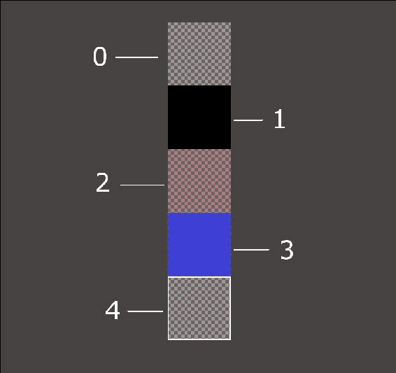

我将截图放在灰色背景上，以便你可以清楚地看到精灵集的不同细节。棋格背景代表透明度。因此，除了数字 1 之外的所有瓷块都会至少显示出背后的背景：

- 瓷块 0 是完全透明的，将用于填充没有其他瓷块的间隙
- 瓷块 1 用于 Thomas 和 Bob 行走的平台
- 瓷块 2 用于火块，瓷块 3 用于水块
- 瓷块 4 你可能需要看仔细才能看到。它有一个白色的方形轮廓。这是 Thomas 和 Bob 必须一起到达的关卡目标。

在我们讨论设计关卡时，请记住这张截图。

我们将这些瓷块数字组合输入文本文件以设计布局。一个示例会有帮助：

```
0000000000000000000000000000000000000000000000
0000000000000000000000000000000000000000000000
0000000000000000000000000000000000000000000000
0000000000000000000000000000000000000000000000
0000000000000000000000000000000000000000000000
0000000000000000000000000000000000000000000000
1111111111000111111222222221111133111111111411
0000000000000000001222222221000133100000001110
0000000000000000001222222221000133100000000000
0000000000000000001222222221000133100000000000
0000000000000000001111111111000111100000000000
```

## 构建 LevelManager 类

将经过几个阶段的代码才能让我们的关卡设计运行起来。我们将做的第一件事是编写`LevelManager`头文件。这将允许我们查看并讨论`LevelManager`类中的成员变量和函数。

接下来，我们将编写`LevelManager.cpp`文件，其中将包含所有的函数定义。由于这是一个长文件，我们将将其分成几个部分，进行编码和讨论。

一旦`LevelManager`类完成，我们将它的一个实例添加到游戏引擎（`Engine`类）中。我们还向`Engine`类中添加一个新函数`loadLevel`，我们可以在需要新关卡时从更新函数中调用它。`loadLevel`函数不仅会使用`LevelManager`实例来加载相应的关卡，还将处理如生成玩家角色和准备时钟等方面。

正如已经提到的，让我们通过编写`LevelManager.h`文件来获取`LevelManager`的概览。

**编写 LevelManager.h**

在`Solution Explorer`中右键点击`Header Files`，并选择`Add` | `New Item...`。在`Add New Item`窗口中，（通过左键点击）高亮`Header File (.h)`，然后在`Name`字段中输入`LevelManager.h`。最后，点击`Add`按钮。现在我们已经准备好为`LevelManager`类编写头文件了。

添加以下包含指令和私有变量，然后我们来讨论它们：

```cpp
#pragma once
#include <SFML/Graphics.hpp>
using namespace sf;
using namespace std;

class LevelManager
{
private:
    Vector2i m_LevelSize;
    Vector2f m_StartPosition;
    float m_TimeModifier = 1;
    float m_BaseTimeLimit = 0;
    int m_CurrentLevel = 0;
    const int NUM_LEVELS = 4;

// public declarations go here
```


该代码声明了 `Vector2i m_LevelSize` 来存储两个整数值，这两个值将存储当前地图包含的水平和垂直瓷格数量。`Vector2f m_StartPosition` 包含了 `Bob` 和 `Thomas` 应该生成的世界上坐标。注意，这不是与 `m_LevelSize` 单位相关的瓷格位置，而是关卡中的水平和垂直像素位置。

`m_TimeModifier` 成员变量是一个浮点数，将用于乘以当前关卡中的可用时间。我们想要这样做的原因是，通过改变（减少）这个值，我们将在玩家每次尝试同一个关卡时缩短可用时间。例如，如果玩家第一次尝试第 1 关时获得 60 秒，那么 60 乘以 1 显然是 60。当玩家完成所有关卡并第二次返回第 1 关时，`m_TimeModifier` 将减少 10%。然后，当可用时间乘以 0.9 时，玩家的可用时间将变为 54 秒。这比 60 秒少了 10%。游戏将变得越来越困难。

浮点变量 `m_BaseTimeLimit` 存储了我们刚刚讨论的原始的、未修改的时间限制。

你可能猜到 `m_CurrentLevel` 将存储正在运行的关卡编号。

`int NUM_LEVELS` 常量将用于标记何时合适再次回到第 1 关并减少 `m_TimeModifier` 的值。

现在添加以下公共变量和函数声明：

```cpp
public:

const int TILE_SIZE = 50;

const int VERTS_IN_QUAD = 4;

float getTimeLimit();

Vector2f getStartPosition();

int** nextLevel(VertexArray& rVaLevel);

Vector2i getLevelSize();

int getCurrentLevel();

};
```

在之前的代码中，有两个常量 `int` 成员。`TILE_SIZE` 是一个实用的常量，提醒我们精灵图集中的每个瓷格都有五十像素的宽和五十像素的高。`VERTS_IN_QUAD` 是一个实用的常量，可以让我们对 `VertexArray` 的操作不易出错。事实上，一个四边形（quad）四个顶点。现在我们不会忘记它了。

`getTimeLimit`、`getStartPosition`、`getLevelSize` 和 `getCurrentLevel` 函数是简单的 getter 函数，返回我们在上一个块中声明的私有成员变量的当前值。

有一个函数值得密切关注即 `nextLevel`。该函数接收 `VertexArray` 引用，就像我们在 `Zombie Arena` 游戏中使用那样。该函数随后对 `VertexArray` 进行操作，所有的更改将反映在调用代码的 `VertexArray` 中。`nextLevel` 函数返回一个指向指针的指针，这意味着我们可以返回一个指向 `int` 值二维数组中第一个元素的地址。我们将构建一个 `int` 值二维数组，用于表示每个关卡的布局。当然，这些 `int` 值将从关卡设计文本文件中读取。

## 编写 `LevelManager.cpp` 文件

在 `Solution Explorer` 中右键点击 `Source Files`，并选择 `Add` | `New Item...`。在 `Add New Item` 窗口中，（通过左键点击）高亮 `C++ File (.cpp)`，然后在 `Name` 字段中输入 `LevelManager.cpp`。最后，点击 `Add` 按钮。现在我们已经准备好为 `LevelManager` 类编写 `.cpp` 文件。

由于这是一个很长的类，我们将分成六部分进行讨论。前五部分将涵盖 `nextLevel` 函数，第六部分是剩余的所有内容。

添加以下包含指令和 `nextLevel` 函数的第一（共五部分的）部分：

```cpp
#include "stdafx.h"

#include <SFML/Graphics.hpp>

#include <SFML/Audio.hpp>

#include "TextureHolder.h"

#include <sstream>

#include <fstream>

#include "LevelManager.h"

using namespace sf; using namespace std;

int** LevelManager::nextLevel(VertexArray& rVaLevel) {

m_LevelSize.x = 0; m_LevelSize.y = 0;

// Get the next level

m_CurrentLevel++;

if (m_CurrentLevel > NUM_LEVELS) {

m_CurrentLevel = 1; m_TimeModifier -= .1f;

}

// Load the appropriate level from a text file string levelToLoad;

switch (m_CurrentLevel)

{

case 2:

levelToLoad = "levels/level2.txt"; m_StartPosition.x = 100;

m_StartPosition.y = 3600;

m_BaseTimeLimit = 100.0f;

break;

case 3:

levelToLoad = "levels/level3.txt"; m_StartPosition.x = 1250;

m_StartPosition.y = 0;

m_BaseTimeLimit = 30.0f;

break;

case 4:

levelToLoad = "levels/level4.txt"; m_StartPosition.x = 50;

m_StartPosition.y = 200;

m_BaseTimeLimit = 50.0f;

break;

} // End switch
```

在包含指令之后，代码初始化 `m_LevelSize.x` 和 `m_LevelSize.y` 为零。

接下来，`m_CurrentLevel` 加增。随后的 `if` 语句检查 `m_CurrentLevel` 是否大于 `NUM_LEVELS`。如果是，`m_CurrentLevel` 将重置为 1，`m_TimeModifier` 将减少 `.1f` 以缩短所有关卡的允许时间。

代码随后根据 `m_CurrentLevel` 的值进行切换。每个 `case` 语句初始化文本文件的名称，该文件包含了关卡设计以及 `Thomas` 和 `Bob` 的起始位置，以及 `m_BaseTimeLimit`，后者是该关卡未修改的时间限制。

### 提示

如果你设计自己的关卡，请在此处添加一个 `case` 语句和相应的值。同时，编辑 `LevelManager.h` 文件中的 `NUM_LEVELS` 常量。

现在如所示添加 `nextLevel` 函数的第二部分。紧接上一个代码之后添加代码。在添加代码的同时学习它，以便我们讨论：

```cpp
ifstream inputFile(levelToLoad);

string s;

// Count the number of rows in the file

while (getline(inputFile, s))

{

++m_LevelSize.y;

}

// Store the length of the rows

m_LevelSize.x = s.length();
```

在刚才的（第二部分）中，我们声明了一个名为 `inputFile` 的 `ifstream` 对象，它打开了 `levelToLoad` 所包含的文件流。

代码使用 `getline` 遍历文件的每一行，但没有记录任何内容。它所做的只是通过增加 `m_LevelSize.y` 来计数数。在 `for` 循环之后，使用 `s.length()` 将关卡的宽度保存到 `m_LevelSize.x`。这意味着所有行的长度必须相同，否则我们将面临麻烦。

此时，我们已经知道并将当前关卡的长度和宽度保存到了 `m_LevelSize` 中。

如所示添加 `nextLevel` 函数的第三部分。紧接上一个代码之后添加代码。在添加代码的同时学习它，以便我们讨论：

```cpp
// Go back to the start of the file

inputFile.clear();

inputFile.seekg(0, ios::beg);

// Prepare the 2d array to hold the int values from the file int** arrayLevel = new int*[m_LevelSize.y];

for (int i = 0; i < m_LevelSize.y; ++i)

{

// Add a new array into each array element arrayLevel[i] = new int[m_LevelSize.x];

}
```

首先，我们使用 `clear` 函数清除 `inputFile`。带有 `0`、`ios::beg` 参数的 `seekg` 函数将流重置到第一个字符之前。

接下来，我们声明一个指向指针的指针，称为 `arrayLevel`。注意，这是在自由存储器/堆上使用 `new` 关键字完成的。一旦我们初始化了这个二维数组，我们就能将它的地址返回给调用代码，它将一直存在，直到我们删除它或游戏关闭。

从 `0` 到 `m_LevelSize.y - 1` 的 `for` 循环。在每次循环中，它都会向堆中添加一个新的 `int` 值数组，以匹配 `m_LevelSize.x` 的值。现在，我们拥有了一个配置完美（针对当前关卡）的二维数组。唯一的问题是里面什么都没有。

现在按照所示添加 `nextLevel` 函数的第四部分。紧接在之前的代码之后添加这些代码。在添加代码的同时要学习，以便我们进行讨论：

```cpp
// 遍历文件并将所有值存储在二维数组中

string row;

int y = 0;

while (inputFile >> row)

{

    for (int x = 0; x < row.length(); x++) { 

        const char val = row[x]; 

        arrayLevel[y][x] = atoi(&val);

    }

    y++; 

}

// 关闭文件

inputFile.close();
```

首先，代码初始化了一个名为 `row` 的 `string`，它将一次持有一行关卡设计。我们还声明并初始化了一个名为 `y` 的 `int`，它将帮助我们计算行数。

`while` 循环反复执行，直到 `inputFile` 超过最后一行。在 `while` 循环内部有一个 `for` 循环，它遍历当前行的每个字符并将其存储在二维数组 `arrayLevel` 中。注意，我们通过 `arrayLevel[y][x] =` 准确访问了二维数组中正确的元素。`atoi` 函数将 `char val` 转换为 `int`。

这是必要的，因为我们拥有的是 `int` 类型的二维数组，而不是 `char`。

现在按照所示添加 `nextLevel` 函数的第五部分。紧接在之前的代码之后添加这些代码。在添加代码的同时要学习，以便我们进行讨论：

```cpp
// 我们正在使用什么类型的原始类型？

rVaLevel.setPrimitiveType(Quads);

// 设置顶点数组的大小

rVaLevel.resize(m_LevelSize.x * m_LevelSize.y * VERTS_IN_QUAD);

// 从顶点数组开始开始

int currentVertex = 0;

for (int x = 0; x < m_LevelSize.x; x++)

{

    for (int y = 0; y < m_LevelSize.y; y++) {

        // 设置当前四边形每个顶点的位置

        rVaLevel[currentVertex + 0].position = Vector2f(x * TILE_SIZE, y * TILE_SIZE);

        rVaLevel[currentVertex + 1].position = Vector2f((x * TILE_SIZE) + TILE_SIZE, y * TILE_SIZE);

        rVaLevel[currentVertex + 2].position = Vector2f((x * TILE_SIZE) + TILE_SIZE, (y * TILE_SIZE) + TILE_SIZE);

        rVaLevel[currentVertex + 3].position = Vector2f((x * TILE_SIZE), (y * TILE_SIZE) + TILE_SIZE);

        // 应该使用精灵图中的哪个瓦片

        int verticalOffset = arrayLevel[y][x] * TILE_SIZE;

        rVaLevel[currentVertex + 0].texCoords = Vector2f(0, 0 + verticalOffset);

        rVaLevel[currentVertex + 1].texCoords = Vector2f(TILE_SIZE, 0 + verticalOffset);

        rVaLevel[currentVertex + 2].texCoords = Vector2f(TILE_SIZE, TILE_SIZE + verticalOffset);

        rVaLevel[currentVertex + 3].texCoords = Vector2f(0, TILE_SIZE + verticalOffset);

        // 为下四个顶点做好准备

        currentVertex = currentVertex + VERTS_IN_QUAD; 

    }

}

return arrayLevel;

} // nextLevel 函数结束
```

尽管这是我们为 `nextLevel` 分的五个部分代码中最长的一段，但它也是最直观的。这是因为我们在 `Zombie Arena` 项目中见过非常相似的代码。发生是嵌套的 `for` 循环从 0 循环到关卡的宽度和高度。对于数组中的每个位置，四个顶点被放入 `VertexArray` 中，并从精灵图中分配四个纹理坐标。顶点和纹理坐标的位置使用变量 `currentVertex`、`TILE_SIZE` 和 `VERTS_IN_QUAD` 常量计算。在内层 `for` 循环的每次结束时，`currentVertex` 增加 `VERTS_IN_QUAD`，顺利地移动到下一个瓦片。

关于这个 `VertexArray` 需要记住的重要点是，它是通过引用传递 `nextLevel` 的。因此，`VertexArray` 在调用代码中是可。我们将从 `Engine` 类的代码中调用 `nextLevel`。

一旦调用此函数，`Engine` 类将有一个 `VertexArray` 来图形化表示关卡，以及一个 `int` 值的二维数组作为关卡中所有平台和障碍的数值表示。

`LevelManager` 的其余函数都是简单的获取器（getter functions），但请花时间熟悉哪个函数返回哪个私有值。添加 `LevelManager` 类中的剩余函数：

```cpp
Vector2i LevelManager::getLevelSize()

{

    return m_LevelSize;

}

int LevelManager::getCurrentLevel()

{

    return m_CurrentLevel;

}

float LevelManager::getTimeLimit()

{

    return m_BaseTimeLimit * m_TimeModifier;

}

Vector2f LevelManager::getStartPosition() {

    return m_StartPosition; 

}
```

现在 `LevelManager` 类已经完成，我们可以转向使用它了。我们将在 `Engine` 类中编写另一个函数来实现这一点。

# 编写 `loadLevel` 函数

明确的是，此函数是 `Engine` 类的一部分，尽管它将其大部分工作委托给其他函数，包括我们刚刚构建的 `LevelManager` 类的函数。

首先，在 `Engine.h` 文件中添加新函数的声明，以及其他一些新代码。打开 `Engine.h` 文件，并在下所示 `Engine.h` 简要快照中添加高亮的代码行：

```cpp
#pragma once

#include <SFML/Graphics.hpp>

#include "TextureHolder.h"

#include "Thomas.h"

#include "Bob.h"

#include "LevelManager.h"

using namespace sf;

class Engine

{

private:

    // 纹理持有者

    TextureHolder th;

    // Thomas 和他的朋友 Bob

    Thomas m_Thomas;

    Bob m_Bob;

    // 管理所有关卡的类

    LevelManager m_LM;

    const int TILE_SIZE = 50;

    int VERTS_IN_QUAD = 4;

    // 向角色推的力

    const int GRAVITY = 300;

    // 一个普通的 RenderWindow

    RenderWindow m_Window;

    // 主视图

    View m_MainView;


```cpp
View m_LeftView;
View m_RightView;

// 用于背景的三个视图
View m_BGMainView;
View m_BGLeftView;
View m_BGRightView;

View m_HudView;

// 为背景声明一个精灵和一个纹理
Sprite m_BackgroundSprite;
Texture m_BackgroundTexture;

// 游戏是否正在进行？
bool m_Playing = false;

// 角色 1 或 2 是当前焦点吗？
bool m_Character1 = true;

// 从全屏模式开始
bool m_SplitScreen = false;

// 当前关卡剩余多少时间
float m_TimeRemaining = 10;

Time m_GameTotal;

// 是否需要新关卡/第一关卡？
bool m_NewLevelRequired = true;

// 关卡瓦片的顶点数组
VertexArray m_VALevel;

// 关卡地图的二维数组
int** m_ArrayLevel = NULL;

// 瓦片的纹理
Texture m_TextureTiles;

// 加载新关卡
void loadLevel();

private:

// 仅供内部使用的私有函数
void input();
void update(float dtAsSeconds);
void draw();

public:

// Engine 构造函数
Engine();

...

};
```

你可以在之前的代码中看到以下：

- 我们包含了`LevelManager.h`文件。
- 我们添加了一个名为`m_LM`的`LevelManager`实例。
- 我们添加了一个名为`m_VALevel`的`VertexArray`。
- 我们添加了一个指向`int`的指针指针，用于存储从`nextLevel`返回的二维数组。
- 我们添加了一个用于精灵图的新的`Texture`对象。
- 我们添加了现在要编写的`loadLevel`函数的声明。

右键点击**Solution Explorer**中的**Source Files**并选择**Add | New Item...**。在**Add New Item**窗口，高亮（通过左点击）**C++ File (.cpp)**，然后在**Name**字段中输入`LoadLevel.cpp`。最后，点击**Add**按钮。我们现在准备好编写`loadLevel`函数了。

将`loadLevel`函数的代码添加到`LoadLevel.cpp`文件中，然后就可以讨论它：

```cpp
#include "stdafx.h"

#include "Engine.h"

void Engine::loadLevel() {

}
```

```cpp
m_Playing = false;

// 删除之前分配的内存
for (int i = 0; i < m_LM.getLevelSize().y; ++i) {
    delete[] m_ArrayLevel[i];
}

delete[] m_ArrayLevel;

// 加载带有关卡的下一个 2d 数组
// 同时也重新填充顶点数组
m_ArrayLevel = m_LM.nextLevel(m_VALevel);

// 这个新时间限制有多久
m_TimeRemaining = m_LM.getTimeLimit();

// 生成 Thomas 和 Bob
m_Thomas.spawn(m_LM.getStartPosition(), GRAVITY);
m_Bob.spawn(m_LM.getStartPosition(), GRAVITY);

// 确保这段代码不会再次运行
m_NewLevelRequired = false;
```

首先，我们将`m_Playing`设置为`false`，以停止`update`函数部分内容的执行。接下来，我们遍历`m_ArrayLevel`中的所有水平数组并删除它们。在`for`循环之后，我们删除了`m_ArrayLevel`。

代码`m_ArrayLevel = m_LM.nextLevel(m_VALevel)`调用了`nextLevel`并准备了`VertexArray`、`m_VALevel`以及二维数组`m_ArrayLevel`。关卡已设置完毕并准备就绪。

`m_TimeRemaining`通过调用`getTimeLimit`进行初始化，Thomas 和 Bob 使用`spawn`函数结合来自`getStartPosition`的返回值进行生成。

最后，将`m_NewLevelRequired`设置为`false`。正如我们在几页后将看到的，`m_NewLevelRequired`被设置为`true`是导致`loadLevel`被调用的原因。我们只想运行此函数一次。

## 更新引擎

打开`Engine.cpp`文件，并在`Engine`构造函数的末尾添加高亮的代码以加载精灵格集纹理：

```cpp
Engine::Engine()
{
    // 获取屏幕分辨率并创建 SFML 窗口和 View
    Vector2f resolution;
    resolution.x = VideoMode::getDesktopMode().width;
    resolution.y = VideoMode::getDesktopMode().height;
    m_Window.create(VideoMode(resolution.x, resolution.y), "Thomas was late", Style::Fullscreen);

    // 初始化全屏视图
    m_MainView.setSize(resolution);
    m_HudView.reset(FloatRect(0, 0, resolution.x, resolution.y));

    // 初始化分屏 Views
    m_LeftView.setViewport(FloatRect(0.001f, 0.001f, 0.498f, 0.998f));
    m_RightView.setViewport(FloatRect(0.5f, 0.001f, 0.499f, 0.998f));
    m_BGLeftView.setViewport(FloatRect(0.001f, 0.001f, 0.498f, 0.998f));
    m_BGRightView.setViewport(FloatRect(0.5f, 0.001f, 0.499f, 0.998f));

    // 这块显卡可以使用着色器？
    if (!sf::Shader::isAvailable()) {
        // 是时候换新电脑了
        m_Window.close();
    }

    m_BackgroundTexture = TextureHolder::GetTexture("graphics/background.png");

    // 将精灵与纹理关联
    m_BackgroundSprite.setTexture(m_BackgroundTexture);

    // 加载背景顶点数组的纹理
    m_TextureTiles = TextureHolder::GetTexture("graphics/tiles_sheet.png");
}
```

我们在前面的代码中做的仅仅是将精灵格集加载到`m_TextureTiles`中。

打开`Update.cpp`文件并进行以下高亮的更改和添加：

```cpp
void Engine::update(float dtAsSeconds)
{
    if (m_NewLevelRequired) {
        // 这些对 spawn 调用很快将移动到新的
        // LoadLevel 函数

        // 生成 Thomas 和 Bob
        //m_Thomas.spawn(Vector2f(0,0), GRAVITY);
        //m_Bob.spawn(Vector2f(100, 0), GRAVITY);

        // 确保 spawn 只被调用一次
        //m_TimeRemaining = 10;
        //m_NewLevelRequired = false;

        // 加载关卡
        loadLevel();
    }
}
```

实际上，你应该删除而不是注释掉我们不再使用的行。我只是这样向你展示，以便更改保持清晰。在之前的`if`语句中，应该只有对`loadLevel`的调用。

最后，在我们看到本章到为止的工作结果之前，打开`Draw.cpp`文件并添加以下高亮的内容以绘制代表关卡的顶点数组：

```cpp
void Engine::draw() {
    // 擦除最后一帧
    m_Window.clear(Color::White);

    if (!m_SplitScreen) {
        // 切换到背景视图
        m_Window.setView(m_BGMainView);

        // 绘制背景
        m_Window.draw(m_BackgroundSprite);

        // 切换到 m_MainView
        m_Window.setView(m_MainView);

        // 绘制关卡
        m_Window.draw(m_VALevel, &m_TextureTiles);

        // 绘制 thomas
        m_Window.draw(m_Thomas.getSprite());

        // 绘制 thomas
        m_Window.draw(m_Bob.getSprite());
    }
    else {
        // 分屏视图激活中

        // 首先绘制 Thomas 侧的屏幕
        // 切换到背景视图
        m_Window.setView(m_BGLeftView);

        // 绘制背景
        m_Window.draw(m_BackgroundSprite);

        // 切换到 m_LeftView
        m_Window.setView(m_LeftView);

        // 绘制关卡
        m_Window.draw(m_VALevel, &m_TextureTiles);

        // 绘制 thomas
        m_Window.draw(m_Bob.getSprite());

        // 绘制 thomas
        m_Window.draw(m_Thomas.getSprite());

        // 现在绘制 Bob 侧的屏幕
        // 切换到背景视图
        m_Window.setView(m_BGRightView);

        // 绘制背景
        m_Window.draw(m_BackgroundSprite);

        // 切换到 m_RightView
        m_Window.setView(m_RightView);

        // 绘制关卡
        m_Window.draw(m_VALevel, &m_TextureTiles);

        // 绘制 thomas
        m_Window.draw(m_Thomas.getSprite());

        // 绘制 bob
        m_Window.draw(m_Bob.getSprite());
    }

    // 绘制 HUD
    // 切换到 m_HudView
    m_Window.setView(m_HudView);

    // 显示所有
    m_Window.display();
}
```

现在你可以运行游戏了。遗憾的是，我们无法尝试通过关卡并战胜时间。

## 编写 `detectCollisions` 函数

明确一下，此函数是`Engine`类的一部分。打开`Engine.h`文件并添加一个名为`detectCollisions`的函数声明。如下所示所示：

```cpp
// 仅供内部使用的私有函数
void input();
void update(float dtAsSeconds);
void draw();

// 加载新关卡
void loadLevel();

// Run 将调用所有私有函数
bool detectCollisions(PlayableCharacter& character);

public:

// Engine 构造函数
Engine();
```

从签名中可以看出，`detectCollision`函数接收一个多态参数，一个`PlayerCharacter`对象。正如我们所知，`PlayerCharacter`是抽象的，永远无法实例化。然而，我们通过`Thomas`和`Bob`类继承了它。我们能够将`m_Thomas`或`m_Bob`传递给`detectCollisions`。

在**解决方案资源管理器**中右键点击**源文件**，并选择**添加 | 新建项...**。在**添加新建项**窗口中，高亮（左点击）`C++ 文件 (.cpp)`，然后在**名称**字段中输入`DetectCollisions.cpp`。最后，点击**添加**按钮。我们现在准备好编写`detectCollisions`函数了。

向`DetectCollisions.cpp`中添加以下代码。注意这只是该函数的第一个部分：

```cpp
#include "stdafx.h"
#include "Engine.h"

bool Engine::detectCollisions(PlayableCharacter& character) {
    bool reachedGoal = false;

    // 为他的所有部分创建一个矩形
    FloatRect detectionZone = character.getPosition();

    // 创建一个测试每个块的 Rect
    FloatRect block;
    block.width = TILE_SIZE;
    block.height = TILE_SIZE;

    // 在 thomas 周围建立区域以检测碰撞
    int startX = (int)(detectionZone.left / TILE_SIZE) - 1;
    int startY = (int)(detectionZone.top / TILE_SIZE) - 1;
    int endX = (int)(detectionZone.left / TILE_SIZE) + 2;

    // Thomas 非常高，所以在垂直方向检查几个块
    int endY = (int)(detectionZone.top / TILE_SIZE) + 3;

    // 确保我们不测试低于零的位置
    // 或高于数组末尾的位置
    if (startX < 0)
        startX = 0;

    if (startY < 0)
        startY = 0;

    if (endX >= m_LM.getLevelSize().x)
        endX = m_LM.getLevelSize().x;

    if (endY >= m_LM.getLevelSize().y)
        endY = m_LM.getLevelSize().y;
}
```

首先发生的情况是我们声明了一个名为`reachedGoal`的布尔值。这是`detectCollisions`函数返回给调用代码的值。它被初始化为`false`。

接下来我们声明了一个名为`detectionZone`的`FloatRect`，并用代表整个角色贴图的矩形来初始化它。注意，我们实际上并不会对这个矩形进行相交测试。之后，我们声明了另一个名为`block`的`FloatRect`。我们将`block`初始化为一个 50 比 50 的矩形。很快后我们就会看到`block`被使用。

接下来我们看看如何使用`detectionZone`。我们通过将`detectionZone`周围的区域扩大几个方块，初始化了四个`int`变量：`startX`、`startY`、`endX`和`endY`。在接下来的四个`if`语句中，我们检查是否尝试对不存在的图格进行碰撞检测。我们通过确保检查的位置永远不会小于零或大于`getLevelSize().x`或`.y`返回的值来实现这一点。

之前的所有代码所做的就是创建一个用于进行碰撞检测的区域。对于距离角色几百或几千像素的方块进行碰撞检测是没有意义的。此外，如果我们尝试在数组位置不存在（小于零或大于`getLevelSize()...`）的地方进行检测，游戏将会崩溃。

接下来，添加这段代码处理玩家掉出关卡的情况：


```cpp
// 角色是否掉出了地图？

FloatRect level(0, 0,
m_LM.getLevelSize().x * TILE_SIZE,
m_LM.getLevelSize().y * TILE_SIZE);

if (!character.getPosition().intersects(level)) {
    // 重生角色
    character.spawn(m_LM.getStartPosition(), GRAVITY);
}
```

要让角色停止掉落，它必须与平台发生碰撞。因此，如果玩家移动到地图之外（没有平台的地方），它将持续掉落。之前的代码检查角色是否不与 `FloatRect` 类型 `level` 相交。如果不相交，则说明它已经掉出了关卡，`spawn` 函数将把它送回起点。

添加以下这段相当长的代码，然后我们将分析它的作用：

```cpp
// 遍历所有本地方块
for (int x = startX; x < endX; x++) {
    for (int y = startY; y < endY; y++) {
        block.left = x * TILE_SIZE; block.top = y * TILE_SIZE;
        // 初始化当前方块的起始位置
        // 角色是否被烧伤或溺水了？使用头部是因为这允许他下沉一点
        if (m_ArrayLevel[y][x] == 2 || m_ArrayLevel[y][x] == 3) {
            if (character.getHead().intersects(block)) {
                character.spawn(m_LM.getStartPosition(), GRAVITY);
                // 应该播放什么声音？
                if (m_ArrayLevel[y][x] == 2) // 火，哎哟！{
                    // 播放声音
                }
                else // 水 {
                    // 播放声音 
                }
            }
        }
        // 角色是否与普通方块碰撞
        if (m_ArrayLevel[y][x] == 1) {
            if (character.getRight().intersects(block)) {
                character.stopRight(block.left);
            } else if (character.getLeft().intersects(block)) {
                character.stopLeft(block.left);
            }
            if (character.getFeet().intersects(block)) {
                character.stopFalling(block.top); 
            } else if (character.getHead().intersects(block)) {
                character.stopJump();
            }
        }
        // 等我们学会了粒子特效后，这里会有更多的碰撞检测
        // 角色是否到达了目标？
        if (m_ArrayLevel[y][x] == 4) {
            // 角色已到达目标
            reachedGoal = true;
        }
    }
}
```

之前的代码使用相同的技术完成了三件事。它遍历了 `startX`、`endX` 与 `startY`、`endY` 之间的所有值。在每次循环中，它检查并执行以下操作：

**角色是否被烧伤或溺水了？** 代码 `if (m_ArrayLevel[y][x] == 2 || m_ArrayLevel[y][x] == 3)` 决定当前检查的位置是否是火格或水图格。如果角色的头部与这些图格之一相交，玩家将重新生成。我们还编写了一个空的 `if…else` 块，为在后续章节中添加声音做准备。

**角色是否触碰了普通图格？** 代码 `if (m_ArrayLevel[y][x] == 1)` 决定当前检查的位置是否包含普通图格。如果它与代表角色各个身体部位的任何矩形相交，就会调用相关函数（`stopRight`、`stopLeft`、`stopFalling` 和 `stopJump`）。

传递给这些函数的每个值以及函数如何使用该值来重新定位角色的方法是非常微妙的。虽然没有必要仔细检查这些值来理解代码，但你可能想查看一下传入的值，然后查阅上一章节中 `PlayableCharacter` 类的相应函数。这将帮助你确切理解到底发生了什么。

**角色是否触碰了目标图格？** 这通过代码 `if (m_ArrayLevel[y][x] == 4)` 确定。我们只需要将 `reachedGoal` 设置为 `true`。`Engine` 类的 `update` 函数将继续跟踪两个角色（Thomas 和 Bob）是否同时到达目标。我们稍后会在 `update` 中编写这段代码。

在 `detectCollisions` 函数中添加最后一行代码：

```cpp
// 全部完成，返回是否需要新关卡
return reachedGoal;
```

上一行代码返回 `reachedGoal`，以便调用代码在两个角色都同时到达目标时能够进行跟踪并做出相应响应。

我们现在需要做的是每帧为每个角色调用一次 `detectCollisions` 函数。在 `Update.cpp` 文件的 `if(m_Playing)` 代码块中添加以下高亮代码：

```cpp
if (m_Playing) {
    // 更新 Thomas
    m_Thomas.update(dtAsSeconds);
    // 更新 Bob
    m_Bob.update(dtAsSeconds);
    // 检测碰撞并查看角色
    // 是否到达了目标图格
    // if 条件的后半部分仅当 thomas 触摸终点图格时执行
    if (detectCollisions(m_Thomas) && detectCollisions(m_Bob)) {
        // 需要新关卡
        m_NewLevelRequired = true; // 播放到达目标的声音
    } else {
        // 运行 bob 的碰撞检测
        detectCollisions(m_Bob);
    }
    // 计时玩家剩余的时间
    m_TimeRemaining -= dtAsSeconds;
    // Thomas 和 Bob 时间用完了吗？
    if (m_TimeRemaining <= 0) {
        m_NewLevelRequired = true;
    }
} // if playing 结束
```

之前的代码调用 `detectCollisions` 函数并检查 Bob 和 Thomas 是否同时到达了目标。如果是，则通过将 `m_NewLevelRequired` 设置为 `true` 来准备下一个关卡。

你可以运行游戏并在平台上行走。你可以到达目标并开始新关卡。此外，第一次跳跃键（`W` 或方向键上）可以使用。

如果你到达了目标，将加载下一个关卡。如果你到达了最后一关的目标，将加载第一关，且时间限制减少 10%。当然，目前没有时间或当前关卡的视觉反馈，因为我们还没有构建 HUD。我们将在下一章节中构建。

然而，许多关卡需要 Thomas 和 Bob 团队合作。更具体地说，Thomas 和 Bob 需要能够在爬到对方的头上。

## 更多碰撞检测

在 `Update.cpp` 文件中你刚刚添加的上述代码之后，位于 `if (m_Playing)` 部分添加这段代码：

```cpp
if (m_Playing) {
    // 更新 Thomas
    m_Thomas.update(dtAsSeconds);
    // 更新 Bob
    m_Bob.update(dtAsSeconds);
    // 检测碰撞并查看角色
    // 是否到达了目标图格
    // if 条件的后半部分仅当 thomas 触摸终点图格时执行
    if (detectCollisions(m_Thomas) && detectCollisions(m_Bob)) {
        // 需要新关卡
        m_NewLevelRequired = true;
        // 播放到达目标的声音
    } else {
        // 运行 bob 的碰撞检测
        detectCollisions(m_Bob);
    }
    // 让 bob 和 thomas 在对方的头上跳跃
    if (m_Bob.getFeet().intersects(m_Thomas.getHead())) {
        m_Bob.stopFalling(m_Thomas.getHead().top);
    }
}
```

```cpp
else if (m_Thomas.getFeet().intersects(m_Bob.getHead())) {
    m_Thomas.stopFalling(m_Bob.getHead().top);
}

// 计算玩家剩余的倒计时
m_TimeRemaining -= dtAsSeconds;
```

# 第 15 章：音频空间化与 HUD

在本章中，我们将添加所有的音效和 HUD。我们在之前的两个项目中都做过这些操作，但这次我们将采取一些有不同的方式。我们将探索音频空间化的概念，以及 SFML 如何让这个原本复杂的概念变得简单易用；此外，我们将构建一个 HUD 类，来封装在屏幕上绘制信息的代码。

我们将按照以下顺序完成这些任务：

- 什么是空间化？
- SFML 如何处理空间化
- 构建一个 `SoundManager` 类
- 部署发射器（Emitters）
- 使用 `SoundManager` 类
- 构建一个 `HUD` 类
- 使用 `HUD` 类

## 什么是空间化？

空间化是使某个物体相对于其所在或处于其中的空间进行处理。在日常生活中，自然世界中的一切默认情况下都是空间化的。如果一辆摩托车从左向右疾驰而过，我们会听到声音从一侧由微弱变得响亮，随着它的经过，声音会在另一只耳朵中变得更加明显，最后再次消失在远方。如果我们某天早上醒来，发现世界不再具有空间化特征，那将异常奇怪。

如果我们能让视频游戏更像现实世界一点，玩家就能更有沉浸感。如果玩家能从远处听到微弱的哀鸣，并且随着僵尸从某个方向越来越近，那种非人类的嚎叫变得越来越大，那么我们的僵尸游戏将会有趣得多。

空间化的数学原理可能是复杂的，这是显而易见的。我们如何根据声音来源的方向以及玩家（声音的听者）与发声物体（发射器）之间的距离，来计算在特定声器中声音会有多大呢？

幸运的是，SFML 为我们处理了所有复杂的工作。我们只需要熟悉几个技术术语，就可以开始使用 SFML 对我们的音效进行空间化处理。

## 发射器、衰减与监听者

为了让 SFML 执行其所需的工作，我们需要注意一些信息。我们需要知道声音在游戏世界中来自哪里。这个声音来源被称为**发射器（`emitter`）**。在游戏中，发射器可以是一个僵尸、一辆车辆，或者在我们目前的项目中是一个火源瓷格。我们已经在跟踪游戏中物体的位置了，因此为 SFML 提供发射器位置将非常简单。

我们需要关注的下一个因素是**衰减（`attenuation`）**。衰减是波衰变的速率。你可以简化这一陈述并针对声音进行具体化，表述：衰减是音量减小的快慢。这在技术上并不完全精确，但对于本章的目的来说是一个足够好的描述了。

我们需要考虑的最后一个因素是**监听者（`listener`）**。当 SFML 对声音进行空间化处理时，它是相对于谁进行空间化的？在大多数游戏中，逻辑上的做法是相对于玩家角色。在我们的游戏中，我们将使用 Thomas。

## SFML 如何处理空间化

SFML 有许多函数允许我们处理发射器、衰减和监听者。让我们假设性地查看它们，然后我们将编写一些代码，为项目中添加空间化声音。

我们可以像经常做的那样，设置准备好播放的音效：

```cpp
// 按照通常方式声明 SoundBuffer
SoundBuffer zombieBuffer;

// 按照通常方式声明 Sound 对象
Sound zombieSound;

// 像我们经常做的那样从文件加载声音
zombieBuffer.loadFromFile("sound/zombie_growl.wav"); // 将 Sound 对象与 Buffer 关联
zombieSound.setBuffer(zombieBuffer);
```

我们可以使用 `setPosition` 函数设置发射器的位置，如下代码所示：

```cpp
// 设置发射器的水平和垂直位置 
// 在这种情况下发射器是一个僵尸
// 在 Zombie Arena 项目中我们可以使用 // getPosition().x 和 getPosition().y
// 这些值是任意的
float x = 500;
float y = 500;
zombieSound.setPosition(x, y, 0.0f);
```

正如上一段代码注释中所建议的，具体如何获取发射器的坐标可能取决于游戏的类型。如之前的代码所示，这在 Zombie Arena 项目中会非常简单。在本项目中设置位置时，我们将面临一些挑战。

我们可以使用以下代码设置衰减水平：

```cpp
zombieSound.setAttenuation(15);
```

实际的衰减水平可能有一点模糊。你希望让玩家获得的效果可能与根据衰减随距离减小音量的精确科学公式不同。获得正确的衰减水平通常通过实验来实现。总的来说，衰减水平越高，声音水平降低到安静的速度越快。

此外，你可能想在发射器周围设置一个区域，在该区域内音量完全衰减。如果该功能在超过范围之外合适，或者你有大量的声源不想过度使用该功能，你可以这样做。为此，我们可以使用 `setMinimumDistance` 函数，如下：

```cpp
zombieSound.setMinDistance(150);
```

通过上一行代码，只有当监听者距离发射器 150 像素/单位时，衰减才会开始计算。

SFML 库中的其他有用函数包括 `setLoop` 函数。当传入参数 `true` 时，该函数将告诉 SFML 不断播放声音，如下代码所示：

```cpp
zombieSound.setLoop(true);
```

声音将一直播放，直到我们用以下代码停止它：

```cpp
zombieSound.stop();
```

每隔一段时间，我们可能想知道声音的状态（播放中或停止）。我们可以通过 `getStatus` 函数实现这一点，如下代码所示：

```cpp
if (zombieSound.getStatus() == Sound::Status::Stopped) {
    // 声音没有播放 // 在此处执行任何操作
}

if (zombieSound.getStatus() == Sound::Status::Playing) { 
    // 声音正在播放 // 在此处执行任何操作
}
```

使用 SFML 进行音频空间化，我们还需要涵盖的最后一个方面。监听者在哪里？我们可以通过以下代码设置监听者的位置：

```cpp
// 监听者在哪里？
// 我们获取 x 和 y 值的方法取决于游戏
// 在 Zombie Arena 游戏或 Thomas Was Late 游戏中 //我们可以使用 getPosition()
Listener::setPosition(m_Thomas.getPosition().x, m_Thomas.getPosition().y, 0.0f);
```

前面的代码将使所有声音相对于该位置播放。这对于远处的火源轰鸣声或袭来的僵尸来说正是我们需要的，但对于跳跃等普通音效来说，这是一个问题。我们可以开始为玩家的位置处理发射器，但 SFML 为我们简化了问题。每当我们想要播放普通声音时，只需调用 `setRelativeToListener`，如下所示，然后以我们目前一直采用的方式播放声音。这就是我们如何播放普通的、非空间化的跳跃音效：

```cpp
jumpSound.setRelativeToListener(true);
jumpSound.play();
```

我们只需要在播放任何空间化声音之前再次调用 `Listener::setPosition` 即可。

我们现在拥有了丰富的 SFML 音频函数，并准备好真正制造一些空间化噪音了。

你可能还记得在上一个项目中，所有的声音代码都占据了相当多的行。现在考虑一下，由于空间化（spatialization），代码将会变得更长。为了保持代码的可维护性，我们编写一个类来管理所有音效的播放。此外，为了帮助实现空间化，我们还向 `Engine` 类添加了一个函数，但我们将在本章后面的部分再讨论它。

## 编写 `SoundManager.h`

让我们从编写和检查头文件开始。

在 `Solution Explorer`（解决方案管理器）中右键点击 `Header Files`（头文件），并选择 `Add`（添加）| `New Item...`（新建项...）。在 `Add New Item` 窗口中，用左键点击选中 `Header File (.h)`，然后在 `Name` 字段中输入 `SoundManager.h`。最后，点击 `Add` 按钮。我们现在准备好为 `SoundManager` 类编写头文件了。

添加并检查以下代码：


```cpp
#pragma once

#include <SFML/Audio.hpp>

using namespace sf;

class SoundManager
{

private:
// 缓冲区
SoundBuffer m_FireBuffer;
SoundBuffer m_FallInFireBuffer;
SoundBuffer m_FallInWaterBuffer;
SoundBuffer m_JumpBuffer;
SoundBuffer m_ReachGoalBuffer;

// 声音
Sound m_Fire1Sound;
Sound m_Fire2Sound;
Sound m_Fire3Sound;
Sound m_FallInFireSound;
Sound m_FallInWaterSound;
Sound m_JumpSound;
Sound m_ReachGoalSound;

// 我们下一个应该使用哪种声音，火 1，2 还是 3
int m_NextSound = 1;

public:
SoundManager();
void playFire(Vector2f emitterLocation, Vector2f listenerLocation);

void playFallInFire();
void playFallInWater();
void playJump();

void playReachGoal();

};
```

我们刚刚添加的代码中没有什么复杂的技巧。这里有五个`SoundBuffer`对象和八个`Sound`对象。其中三个`Sound`对象将播放同一个`SoundBuffer`。这解释了为什么`Sound` / `SoundBuffer`对象的数量不同。我们这样做是为了能够同时播放多个具有不同空间化参数的轰鸣音效。

注意，有一个`m_NextSound`变量，它将帮助我们跟踪这些可能同时播放的声音中，下一个应该使用哪一个。

有一个构造函数`SoundManager`，我们将在其中设置所有的音效，还有五个播放音效的函数。其中四个函数只是播放普通的音效，它们的代码会非常简单。

其中一个函数`playFire`将处理空间化音效，并且会更深入一些。注意`playFire`函数的参数。它接收一个`Vector2f`（即发射器的位置）和第二个`Vector2f`（即监听者的位置）。

## 编写 SoundManager.cpp 文件

现在我们可以编写函数定义。构造函数和`playFire`函数有大量的代码，因此我们将分别查看它们。其他函数短小精要，所以我们将统一处理。

在`Solution Explorer`（解决方案管理器）中右键点击`Source Files`（源文件），并选择`Add`（添加） | `New Item...`（新建项...）。在`Add New Item`窗口中，用左键点击选中`C++ File (.cpp)`，然后在`Name`字段中输入`SoundManager.cpp`。最后，点击`Add`按钮。我们现在准备好为`SoundManager`类编写`.cpp`文件了。

### 编写构造函数

在`SoundManager.cpp`中添加以下包含指令和构造函数的代码：

```cpp
#include "stdafx.h"
#include "SoundManager.h"
#include <SFML/Audio.hpp>

using namespace sf;

SoundManager::SoundManager()
{
// 将声音加载到缓冲区中
m_FireBuffer.loadFromFile("sound/fire1.wav");
m_FallInFireBuffer.loadFromFile("sound/fallinfire.wav");
m_FallInWaterBuffer.loadFromFile("sound/fallinwater.wav");
m_JumpBuffer.loadFromFile("sound/jump.wav");
m_ReachGoalBuffer.loadFromFile("sound/reachgoal.wav");
// 当玩家距离 50 像素时声音为全音量
float minDistance = 150;

// 随着玩家远离，声音逐渐减小
float attenuation = 15;

// 将声音与缓冲区关联
m_Fire1Sound.setBuffer(m_FireBuffer);
m_Fire2Sound.setBuffer(m_FireBuffer);
m_Fire3Sound.setBuffer(m_FireBuffer);
m_FallInFireSound.setBuffer(m_FallInFireBuffer);
m_FallInWaterSound.setBuffer(m_FallInWaterBuffer);
m_JumpSound.setBuffer(m_JumpBuffer);
m_ReachGoalSound.setBuffer(m_ReachGoalBuffer);

// 设置所有的衰减级别
m_Fire1Sound.setAttenuation(attenuation);
m_Fire2Sound.setAttenuation(attenuation);
m_Fire3Sound.setAttenuation(attenuation);

// 设置所有的最小距离级别
m_Fire1Sound.setMinDistance(minDistance);
m_Fire2Sound.setMinDistance(minDistance);
m_Fire3Sound.setMinDistance(minDistance);

// 循环所有火声
// 当它们播放时
m_Fire1Sound.setLoop(true);
m_Fire2Sound.setLoop(true);
m_Fire3Sound.setLoop(true);
}
```

在上面的代码中，我们将声音加载到缓冲区中。我们将声音与缓冲区关联。设置所有的衰减级别。设置所有的最小距离级别。循环所有火声 // 当它们播放时。

注意，当玩家距离 50 像素时声音为全音量`float minDistance = 150;`。随着玩家远离，声音逐渐减小`float attenuation = 15;`。

### 编写 playFire 函数

按照以下代码添加`playFire`函数：

```cpp
void SoundManager::playFire(Vector2f emitterLocation, Vector2f listenerLocation) {
// 监听者在哪里？
Listener::setPosition(listenerLocation.x, listenerLocation.y, 0.0f);
switch(m_NextSound) {
case 1:
// 如果它停止了
m_Fire1Sound.setPosition(emitterLocation.x, emitterLocation.y, 0.0f);
if (m_Fire1Sound.getStatus() == Sound::Stopped) {
// 播放声音
m_Fire1Sound.play();
}
break;
case 2:
// 对第二个声音进行的操作
m_Fire2Sound.setPosition(emitterLocation.x, emitterLocation.y, 0.0f);
if (m_Fire2Sound.getStatus() == Sound::Stopped) {
m_Fire2Sound.play();
}
break;
case 3:
// 对第三个声音进行的操作
m_Fire3Sound.setPosition(emitterLocation.x, emitterLocation.y, 0.0f);
if (m_Fire3Sound.getStatus() == Sound::Stopped) {
m_Fire3Sound.play();
}
break;
}
// 增加到下一个火声
m_NextSound++;
// 当第三个声音已经启动后，回到 1
if (m_NextSound > 3) {
m_NextSound = 1;
}
}
```

我们首先调用`Listener::setPosition`并设置监听者的位置。

接下来，代码根据`m_NextSound`的值进入`switch`块。每个`case`语句的操作都完全相同，但针对的是`m_Fire1Sound`、`m_Fire2Sound`或`m_Fire3Sound`。

在每个`case`块中，我们使用传入的参数设置发射器的位置。每个块中的后续代码部分检查声音是否处于停止状态，如果是，则播放声音。我们很快就会看到我们如何得出传入此函数的发射器和监听者的位置。

`playFire`函数的最后部分增加了`m_NextSound`并确保它只能等于 1、2 或 3，符合`switch`块的要求。

### 编写剩余的 SoundManager 函数

添加这四个简单的函数：

```cpp
void SoundManager::playFallInFire() {
    m_FallInFireSound.setRelativeToListener(true);
    m_FallInFireSound.play();
}

void SoundManager::playFallInWater() {
    m_FallInWaterSound.setRelativeToListener(true);
    m_FallInWaterSound.play();
}

void SoundManager::playJump() {
```

```cpp
m_JumpSound.setRelativeToListener(true);
m_JumpSound.play();

}

void SoundManager::playReachGoal() {

    m_ReachGoalSound.setRelativeToListener(true);
    m_ReachGoalSound.play();

}
```

`playFallInFire`、`playFallInWater`和`playReachGoal`函数只做了两件事。首先，它们都调用了`setRelativeToListener`，因此音效不是空间化的，使得音效是`normal`而非方向性的，然后它们在相应的`Sound`对象上调用`play`。

`SoundManager`类到此结束。现在我们可以在`Engine`类中使用它了。

## 将 SoundManager 添加到游戏引擎

打开`Engine.h`文件，并添加新`SoundManager`类的实例，如下面的高亮代码所示：

```cpp
#pragma once

#include <SFML/Graphics.hpp>
#include "TextureHolder.h"
#include "Thomas.h"
#include "Bob.h"
#include "LevelManager.h"
#include "SoundManager.h"

using namespace sf;

class Engine
{
private:
    // 纹理持有器
    TextureHolder th;
    // Thomas 和他的朋友 Bob
    Thomas m_Thomas;
    Bob m_Bob;
    // 管理所有级别的类
    LevelManager m_LM;
    // 创建一个 SoundManager
    SoundManager m_SM;

    const int TILE_SIZE = 50;
    const int VERTS_IN_QUAD = 4;
```

此时，我们可以使用`m_SM`来调用各种`play...`函数。遗憾的是，为了管理发射器（火块块）的位置，还需要做一些工作。

## 填充声音发射器

打开`Engine.h`文件，为`populateEmitters`函数添加一个新原型，以及一个新的`Vector2f`对象的 STL`vector`：

```cpp
// Run 将调用所有私有函数
bool detectCollisions(PlayableCharacter& character);

// 创建一个发射声音的最佳位置向量
void populateEmitters(vector <Vector2f>& vSoundEmitters, int** arrayLevel);

// 用于火发射器位置的 Vector2f 向量
vector <Vector2f> m_FireEmitters;

public:
...
...
...
```

`populateEmitters`函数接受一个`Vector2f`对象的`vector`作为参数，以及一个指向`int`的指针（二维数组）。该`vector`将存储关卡每个发射器的位置，而数组是我们的二维数组，它持有关卡的布局。

## 编写 populateEmitters 函数

`populateEmitters`函数的作用是扫描`arrayLevel`的所有元素，并决定将发射器放在哪里。它将其结果存储在`m_FireEmitters`中。

在**解决方案管理器**中右键点击**源文件**，并选择**添加 | 新项...**。在**添加新项**窗口中，高亮显示（通过左键点击）**C++ 文件** (`.cpp`)，然后在**名称**字段中输入`PopulateEmitters.cpp`。最后，点击**添加**按钮。现在我们可以编写新函数`populateEmitters`的代码了。

完整地添加代码；在编写的同时务必仔细研究代码，然后我们就可以讨论它：

```cpp
#include "stdafx.h"
#include "Engine.h"

using namespace sf;
using namespace std;

void Engine::populateEmitters(vector <Vector2f>& vSoundEmitters, int** arrayLevel)
{
    // 确保向量为空
    vSoundEmitters.empty();
    // 跟踪上一个发射器
    // 以免我们创建太多
    FloatRect previousEmitter;
    // 在关卡中寻找火
    for (int x = 0; x < (int)m_LM.getLevelSize().x; x++) {
        for (int y = 0; y < (int)m_LM.getLevelSize().y; y++) {
            if (arrayLevel[y][x] == 2)// 存在火
            {
                if (!FloatRect(x * TILE_SIZE,
                               y * TILE_SIZE,
                               TILE_SIZE,
                               TILE_SIZE).intersects(previousEmitter))
                {
                    // 添加此水块的坐标
                    vSoundEmitters.push_back(Vector2f(x * TILE_SIZE, y * TILE_SIZE));
                    // 跳过上一个发射器附近的任何火块
                    // 创建一个 6 块 x 6 块的矩形，
                    // 这样就不会创建离这一个太近的发射器
                    previousEmitter.left = x * TILE_SIZE;
                    previousEmitter.top = y * TILE_SIZE;
                    previousEmitter.width = TILE_SIZE * 6;
                    previousEmitter.height = TILE_SIZE * 6;
                }
            }
        }
    }
    return;
}
```

某些代码初看起来可能很复杂。理解我们选择发射器位置的技术会让变得简单。在我们的关卡中，通常会有大块的火块。在我设计的一个关卡中，有超过 30 个火块在一起。该代码确保在给定的矩形内只有一个发射器。这个矩形存储在`previousEmitter`中，大小为 300 像素乘以 300 像素（`TILE_SIZE * 6`）。

该代码设置了一个嵌套的`for`循环，遍历`arrayLevel`以寻找火块。当它发现一个时，它确保它与`previousEmitter`不相交。只有这样，它才会使用`pushBack`函数将另一个发射器添加到`vSoundEmitters`中。之后，它还会更新`previousEmitter`以避免获得大型的声音发射器集群。

让我们制造一些噪音吧。

## 播放声音

打开`LoadLevel.cpp`文件，并添加对新函数`populateEmitters`的调用，如下高亮代码所示：


```cpp
void Engine::loadLevel()
{
    m_Playing = false;
    // 删除之前分配的内存 (int i = 0; i < m_LM.getLevelSize().y; ++i) {
        delete[] m_ArrayLevel[i];
    }
    delete[] m_ArrayLevel;
    // 加载带有关卡地图的下一个二维数组 // 同时也重新填充顶点数组
    m_ArrayLevel = m_LM.nextLevel(m_VALevel);
    // 准备声音发射器
    populateEmitters(m_FireEmitters, m_ArrayLevel);
    // 这个新的时间限制有多长
    m_TimeRemaining = m_LM.getTimeLimit();
    // 产生 Thomas 和 Bob
    m_Thomas.spawn(m_LM.getStartPosition(), GRAVITY);
    m_Bob.spawn(m_LM.getStartPosition(), GRAVITY);
    // 确保这段代码不再运行
    m_NewRequired = false;
}
```

第一个添加的声音是跳跃声。你可能记得键盘处理代码在 `Thomas` 和 `Bob` 类中，并且 `handleInput` 函数在启动跳跃时返回 `true`。

打开 `Input.cpp` 文件，并添加高亮代码，以便在 Thomas 或 Bob 成功时播放跳跃声：

```cpp
// 处理特定的 Thomas 输入
if (m_Thomas.handleInput())
{
    // 播放跳跃声
    m_SM.playJump();
}
// 处理特定的 Bob 输入
if (m_Bob.handleInput())
{
    // 播放跳跃声
    m_SM.playJump();
}
```

打开 `Update.cpp` 文件，并添加高亮代码，当 Thomas 和 Bob 同时到达目标时播放成功声：

```cpp
// 检测碰撞并查看角色是否到达目标
// if 条件的后半部分仅在 thomas 触摸瓷砖时执行
if (detectCollisions(m_Thomas) && detectCollisions(m_Bob)) {
    // 需要新级别
    m_NewRequired = true;
    // 播放到达目标的声音
    m_SM.playReachGoal();
}
else {
    // 运行 bob 的碰撞检测
    detectCollisions(m_Bob);
}
```

同样在 `Update.cpp` 文件中，我们将添加代码来遍历 `m_FireEmitters` `vector` 并决定何时我们需要调用 `SoundManager` 类的 `playFire` 函数。

仔细观察新高亮代码周围的少量上下文。将此代码添加到正确的位置至关重要：

```cpp
// if 结束
// 检查是否需要播放火声
vector<Vector2f>::iterator it;
// 遍历 Vector2f 对象的向量 (it = m_FireEmitters.begin();it != m_FireEmitters.end(); it++)
{
    // 这个发射器在哪里？
    // 将位置存储在 pos
    float posX = (*it).x;
    float posY = (*it).y;
    // 发射器在附近吗？
    // 在发射器周围创建一个 500 像素的矩形
    FloatRect localRect(posX - 250, posY - 250, 500, 500);
    // 玩家在 localRect 内部吗？
    if (m_Thomas.getPosition().intersects(localRect)) {
        // 播放声音并传入位置
        m_SM.playFire(Vector2f(posX, posY), m_Thomas.getCenter());
    }
}
```

# 围绕合适的角色设置合适的视角

之前的代码有点类似于声音的碰撞检测。每当 Thomas 留在火焰发射器周围的 500x500 像素矩形内时，`playFire` 函数就会被调用，并传入发射器和 Thomas 的坐标。`playFire` 函数会完成剩余的工作，并触发一个空间化的、循环的音效。

打开 `DetectCollisions.cpp` 文件，找到合适的位置，并按如下所示添加高亮代码。这两行高亮代码会在任一个角色掉入水块或火块时触发音效的播放：

```cpp
// 角色是否被烧伤或溺水？

// 使用头部，因为这允许他稍微下沉如果 (m_ArrayLevel[y][x] == 2 || m_ArrayLevel[y][x] == 3) {

if (character.getHead().intersects(block)) {

    character.spawn(m_LM.getStartPosition(), GRAVITY); // 应该播放什么声音？

    if (m_ArrayLevel[y][x] == 2)// 火，噢噢！ {
        // 播放声音
        m_SM.playFallInFire();
    }
    else // 水 {
        // 播放声音
        m_SM.playFallInWater(); 
    }
}
}
```

运行游戏将允许你能够在靠近火块时听到所有的声音，包括酷炫的空间化效果。

# HUD 类

`HUD` 类非常简单，与书中的其他两个项目相比并没有太大区别。我们所做的不同之处是将所有代码封装在一个新的 `HUD` 类中。如果我们将所有的 `Font`、`Text` 和其他变量声明为这个新类的成员，就可以在构造函数中初始化它们，并为它们的所有值提供访问器函数（getter functions）。这将保持 `Engine` 类免受大量声明和初始化干扰。

## 编写 HUD.h

首先，我们将编写 `HUD.h` 文件，包含所有的成员变量和函数声明。在 `Solution Explorer`（解决方案管理器）中右键点击 `Header Files`（头文件），选择 `Add`（添加） | `New Item...`（新建项...）。在 `Add New Item` 窗口中，选中（左点击）`Header File`（`.h`），然后在 `Name`（名称）字段中输入 `HUD.h`。最后，点击 `Add` 按钮。我们现在准备好编写 `HUD` 类的头文件了。

将以下代码添加到 `HUD.h`：

```cpp
#pragma once

#include <SFML/Graphics.hpp>

using namespace sf;

class Hud
{
private:
    Font m_Font;
    Text m_StartText; Text m_TimeText; Text m_LevelText;

public:
    Hud();
    Text getMessage(); Text getLevel(); Text getTime();
    void setLevel(String text); void setTime(String text);
};
```

在之前的代码中，我们添加了一个 `Font` 实例和三个 `Text` 实例。`Text` 对象将用于显示提示用户开始的消息、剩余时间以及当前关卡编号。

公共函数更有趣。首先是构造函数，大部分代码将放在那里。构造函数将初始化 `Font` 和 `Text` 对象，并根据当前的屏幕分辨率将它们定位在屏幕上。

三个访问器函数 `getMessage`、`getLevel` 和 `getTime` 将向调用代码返回一个 `Text` 对象，以便将其绘制到屏幕上。

`setLevel` 和 `setTime` 函数将分别更新 `m_LevelText` 和 `m_TimeText` 中显示的文本。

现在我们可以为刚刚概述的所有函数编写定义了。

## 编写 HUD.cpp 文件

在 `Solution Explorer` 中右键点击 `Source Files`（源文件），选择 `Add`（添加） | `New Item...`（新建项...）。在 `Add New Item` 窗口中，选中（左点击）`C++ File`（`.cpp`），然后在 `Name` 字段中输入 `HUD.cpp`。最后，点击 `Add` 按钮。我们现在准备好编写 `HUD` 类的 `.cpp` 文件了。

添加包含指令以及代码，然后我们进行讨论：

```cpp
#include "stdafx.h"

#include "Hud.h"

Hud::Hud()
{
    Vector2u resolution;
    resolution.x = VideoMode::getDesktopMode().width; resolution.y = VideoMode::getDesktopMode().height;
    // 加载字体
    m_Font.loadFromFile("fonts/Roboto-Light.ttf");
    // 暂停时
    m_StartText.setFont(m_Font);
    m_StartText.setCharacterSize(100);
    m_StartText.setFillColor(Color::White); m_StartText.setString("Press Enter when ready!");
    // 文本定位
    FloatRect textRect = m_StartText.getLocalBounds();
    m_StartText.setOrigin(textRect.left + textRect.width / 2.0f,
    textRect.top +
    textRect.height / 2.0f);
    m_StartText.setPosition(
    resolution.x / 2.0f, resolution.y / 2.0f); m_TimeText.setFillColor(Color::White); m_TimeText.setPosition(resolution.x - 150, 0); m_TimeText.setString("------");
    // 时间
    m_TimeText.setFont(m_Font); m_TimeText.setCharacterSize(75);
    // 关卡
    m_LevelText.setFont(m_Font);
    m_LevelText.setCharacterSize(75); m_LevelText.setFillColor(Color::White); m_LevelText.setPosition(25, 0); m_LevelText.setString("1");
}
```

首先，我们将水平和垂直分辨率存储在了一个名为 `resolution` 的 `Vector2u` 中。接下来，我们从第 12 章 *Abstraction and Code Management - Making Better Use of OOP* 中添加的 `fonts` 目录加载字体。

接下来的四行代码设置了 `m_StartText` 的字体、颜色、大小和文本。随后的代码块捕捉了包裹 `m_StartText` 的矩形的大小，并进行计算以确定如何将其居中位于屏幕上。如果你想对这部分代码有更详细的解释，请参考第 3 章：*C++ Strings, SFML Time Player Input and HUD*。

构造函数的最后两个代码块设置了 `m_TimeText` 和 `m_LevelText` 的字体、文本大小、颜色、位置和实际文本。然而，我们稍后会看到，这两个 `Text` 对象可以通过两个设置函数（setter functions）进行更新，每需要。

在我们刚刚添加的代码之后，立即添加以下访问器和设置函数：

```cpp
Text Hud::getMessage()
{
    return m_StartText;
}

Text Hud::getLevel()
{
    return m_LevelText; }
}

Text Hud::getTime()
{
    return m_TimeText;
}

void Hud::setLevel(String text)
{
    m_LevelText.setString(text);
}

void Hud::setTime(String text)
{
    m_TimeText.setString(text);
}
```

之前代码的前三个函数简单地返回相应的 `Text` 对象：`m_StartText`、`m_LevelText` 和 `m_TimeText`。我们很快就会在屏幕上绘制 `HUD` 时使用这些函数。最后两个函数 `setLevel` 和 `setTime` 使用 `setString` 函数根据从 `Engine` 类更新函数中传递的值来更新相应的 `Text` 对象，每 500 帧。

完成所有这些后，我们就可以在游戏引擎中使用 `HUD` 类了。

## 使用 HUD 类

打开 `Engine.h`，为我们的新类添加包含，声明 `HUD` 类的实例，还要声明并初始化两个新的成员变量来跟踪我们更新 `HUD` 的频率。正如我们在前两个项目中学到的，我们不需要每帧都这样做。

将高亮代码添加到 `Engine.h`：

```cpp
#pragma once

#include <SFML/Graphics.hpp>
#include "TextureHolder.h"
#include "Thomas.h"
#include "Bob.h"
#include "LevelManager.h"
#include "SoundManager.h"
#include "HUD.h"

using namespace sf;

class Engine
{
private:
    // 纹理持有器 TextureHolder th;
    // Thomas 和他的朋友 Bob Thomas_Thomas;
    Bob m_Bob;
    // 管理所有关卡的类 LevelManager m_LM;
    // 创建一个管理器 SoundManager m_SM;
    // Hud m_Hud;
    int m_FramesSinceHUDUpdate = 0;
    int m_TargetFramesPerHUDUpdate = 500;

    const int TILE_SIZE = 50;
};
```

接下来，我们需要向 `Engine` 类的更新函数添加一些代码。打开 `Update.cpp` 并添加高亮代码，以便每 500 帧更新一次 `HUD`：

```cpp
// 如果分屏 (m_SplitScreen)，围绕适当角色设置视图
{
    m_LeftView.setCenter(m_Thomas.getCenter()); m_RightView.setCenter(m_Bob.getCenter());
}
else
{
    // 如果是角色 1 (m_Character1)，全屏围绕适当角色
    {
        m_MainView.setCenter(m_Thomas.getCenter());
    }
    else
    {
        m_MainView.setCenter(m_Bob.getCenter());
    }
}

// 该时候更新 HUD 了？

// 增加自上次 HUD 计算以来的帧数
```

```cpp
m_FramesSinceLastHUDUpdate++;

// Update the HUD every m_TargetFramesPerHUDUpdate frames
if (m_FramesSinceLastHUDUpdate > m_TargetFramesPerHUDUpdate) {
    // Update game HUD text
    stringstream ssTime;
    stringstream ssLevel;

    // Update the time text
    ssTime << (int)m_TimeRemaining;
    m_Hud.setTime(ssTime.str());

    // Update the level text
    ssLevel << "Level:" << m_LM.getCurrentLevel();
    m_Hud.setLevel(ssLevel.str());

    m_FramesSinceLastHUDUpdate = 0;
}
// End of update function
```

在之前的代码中，`m_FramesSinceLastUpdate` 每一帧都会增加。当 `m_FramesSinceLastUpdate` 超过 `m_TargetFramesPerHUDUpdate` 时，执行将进入 `if` 块。在 `if` 块内部，我们使用 `stringstream` 对象来更新 `Text`，正如我们在之前的两个项目中所做的那样。不过，正如你预期的那样，在这个项目中我们使用了 `HUD` 类，因此我们调用了 `setTime` 和 `setLevel` 函数，并传入 `Text` 对象需要设置的当前值。

`if` 块的最后一步是将 `m_FramesSinceLastUpdate` 置零，以便它开始为下一次更新计数。

最后，打开 `Draw.cpp` 文件并添加突出的代码来每帧绘制 HUD：


```cpp
else
{
    // Split-screen view is active
    // First draw Thomas' side of the screen
    // Switch to background view m_Window.setView(m_BGLeftView); // Draw the background
    m_Window.draw(m_BackgroundSprite); // Switch to m_LeftView
    m_Window.setView(m_LeftView);

    // Draw the Level
    m_Window.draw(m_VALevel, &m_TextureTiles);

    // Draw thomas
    m_Window.draw(m_Bob.getSprite());

    // Draw thomas
    m_Window.draw(m_Thomas.getSprite());

    // Now draw Bob's side of the screen // Switch to m_RightView m_Window.setView(m_RightView);

    // Switch to background view m_Window.setView(m_BGRightView); // Draw the background
    m_Window.draw(m_BackgroundSprite);

    // Draw the Level
    m_Window.draw(m_VALevel, &m_TextureTiles);

    // Draw thomas
    m_Window.draw(m_Thomas.getSprite());

    // Draw bob
    m_Window.draw(m_Bob.getSprite());
}

// Draw the HUD
// Switch to m_HudView
m_Window.setView(m_HudView);
m_Window.draw(m_Hud.getLevel());
m_Window.draw(m_Hud.getTime());
if (!m_Playing)
{
    m_Window.draw(m_Hud.getMessage());
}

// Show everything we have just drawn
m_Window.display();
// End of draw
```

之前的代码通过使用 `HUD` 类的 getter 函数来绘制 HUD。请注意，绘制提示玩家开始游戏的消息调用只有在游戏当前没有运行（`!m_Playing`）时才会被使用。

运行游戏并玩几关，观察时间倒计时和关卡增加。当你再次回到第一关时，你会发现你的时间比之前少了 10%。

# 第 16 章：扩展 SFML 类、粒子系统和着色器

在最后一章中，我们将探索扩展他人类的这一 C++ 概念。更具体地说，我们将查看 SFML 的 `Drawable` 类，以及将其作为我们自己类的基类的用处。我们还将触及 OpenGL 着色器这一主题，并了解使用另一种语言 `OpenGL Shading Language`（`GLSL`）编写代码（该代码可以直接在显卡上运行）如何实现可能无法实现的平滑图形效果。一如既往，我们还将利用新技能和知识来增强当前项目。

以下是我们将顺序涵盖的主题列表：

- SFML `Drawable` 类
- 构建粒子系统
- OpenGL 着色器与 GLSL
- 在《Thomas Was Late》游戏中使用着色器

## SFML `Drawable` 类

`Drawable` 类只有一个函数。它也没有变量。此外，它唯一的函数是纯虚的。这意味着如果我们继承自 `Drawable`，就必须实现它唯一的那个函数。这样做的目的（你可能在第 12 章“抽象与代码管理——更好地利用 OOP”中记得过）是，我们随后可以将继承自 `Drawable` 的类作为多态类型使用。更简单地说，SFML 允许我们对 `Drawable` 对象进行任何操作，我们都能对继承自它的类进行操作。唯一的要求是我们必须为纯虚函数 `draw` 提供定义。

一些继承自 `Drawable` 的类已经包含了 `Sprite` 和 `VertexArray` 等。每当我们使用 `Sprite` 或 `VertexArray` 时，我们都会将其传递给 `RenderWindow` 类的 `draw` 函数。

我们之所以能够绘制书中绘制的每一个对象，是因为它们都继承自 `Drawable`。我们可以利用这一知识来为己用。

我们可以让任何喜欢的对象继承 `Drawable`，只要我们实现了纯虚的 `draw` 函数。这也是一个非常直接的过程。假设继承自 `Drawable` 的 `SpaceShip` 类的头文件如下所示：

```cpp
class SpaceShip : public Drawable {
private:
    Sprite m_Sprite;
    // More private members
public:
    virtual void draw(RenderTarget& target, RenderStates states);
    // More public members
};
```

在之前的代码中，我们可以看到纯虚的 `draw` 函数和一个 `Sprite`。注意，在类外部没有办法访问私有的 `Sprite`！`SpaceShip.cpp` 文件看起来会像下面所示：

```cpp
void SpaceShip::SpaceShip() { // Set up the spaceship }

void SpaceShip::draw(RenderTarget& target, RenderStates states) const
{ target.draw(m_Sprite, states); }
```

在之前的代码中，注意 `draw` 函数的简单实现。参数超出了本书的范围。只需记住 `target` 参数用于调用 `draw`，并传递了 `m_Sprite` 以及 `states` 即可。

### 提示

虽然不需要理解参数就能充分利用 `Drawable`，但在本书的语境下，你可能会感兴趣。你可以在 SFML 网站上阅读更多关于 SFML `Drawable` 类的内容：

http://www.sfml-dev.org/tutorials/2.3/graphics-vertex-array.php#creatingansml-like-entity

在主游戏循环中，我们现在可以将 `SpaceShip` 实例像 `Sprite` 一样对待：

```cpp
SpaceShip m_SpaceShip;
// create other objects here // ...

// In the draw function // Rub out the last frame
m_Window.clear(Color::Black);

// Draw the spaceship
m_Window.draw(m_SpaceShip); // More drawing here
// ...

// Show everything we have just drawn
m_Window.display();
```

正因为 `SpaceShip` 是一个 `Drawable`，我们才能把它视为 `Sprite` 或 `VertexArray`，而且由于我们重写了纯虚函数 `draw`，一切都按照我们想要的方式运行。让我们看看将绘制代码封装到游戏对象的另一种方法。

## 继承自 `Drawable` 的替代方案

也可以通过在被绘制对象的类内部实现我们自己的函数，来保持所有的绘制功能，可能像下面的代码：

```cpp
void drawThisObject(RenderWindow window)
{
    window.draw(m_Sprite)
}
```

之前的代码假设 `m_Sprite` 代表我们正在绘制的当前类的视觉外观，正如它在本项目及之前的项目中所做的那样。假设包含 `drawThisObject` 函数的类实例被称为 `playerHero`，并且假设我们有一个名为 `m_Window` 的 `RenderWindow` 实例，我们就可以用以下代码从主游戏循环绘制该对象：

```cpp
playerHero.draw(m_Window);
```

在 Solution 解决方案中，我们将 `RenderWindow` `m_Window` 作为参数传递给 `drawThisObject` 函数。然后 `drawThisObject` 函数使用 `RenderWindow` 来绘制 `Sprite` `m_Sprite`。

这种解决方案看起来确实比扩展 `Drawable` 更简单。我们之所以按照建议的方法（扩展 `Drawable`）来做，对于这个项目本身来说并没有什么大好处。我们之所以很快就会用这种方法画出一个整洁的爆炸效果，是因为这是一种值得学习的技巧。

## 为什么继承自 `Drawable` 是最好的？

通过书中我们完成的每一个项目，我们对游戏、C++ 和 SFML 有了更多的了解。从一个游戏到另一个游戏，我们取得的最巨大改进可能是在代码的结构上——即我们使用的编程模式。

如果书中还有第四个项目，我们可以更进一步。遗憾的是，并没有了，但请思考一下这个改进我们代码的想法。

想象我们游戏中的每个对象都派自一个单一、简单的抽象基类。我们称其为 `GameObject`。`GameObject` 可能会有用于 `getPosition` 等其他具体函数。它很可能有一个纯虚函数 `update`（因为每个对象的更新方式都不同）。此外，考虑 `GameObject` 继承自 `Drawable`。

现在看这段假设性的代码：

```cpp
vector<GameObject> m_GameObjects;

// 初始化所有游戏对象的代码
// 包括瓦片、角色、敌人、子弹及任何其他

// 在 update 函数中
for (i = m_GameObjects.begin(); i != m_GameObjects.end(); i++) {
    (*i).update(elapsedTime);
}
// 就这样！

// 在 draw 函数中 // 擦除最后一帧 m_Window.clear(Color::Black);
for (i = m_GameObjects.begin(); i != m_GameObjects.end(); i++) {
    // 显示我们刚刚画的所有 m_Window.display();
    // 就这样！
    m_Window.draw(*i);
}
```

与即使是这个最终项目相比，前面的代码在封装性、代码可维护性和优雅性方面都是一次巨大的飞跃。但是，如果你看之前的代码，你会发现其中仍然存在一些未解决的问题，例如，碰撞检测应该放在哪里。然而，希望你可以看到，进一步的学习（通过构建大量游戏）对于精通 C++ 将是必要的。

虽然我们不会以这种方式实现整个游戏，但我们将看到如何设计一个类（`ParticleSystem`）并将其直接传递给 `m_Window.draw(m_MyParticleSystemInstance)`。

## 构建粒子系统

在我们开始编码之前，清楚地看到我们正试图实现什么将很有帮助。请看下面的截图：

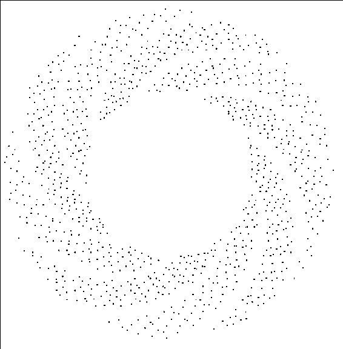

这是纯色背景上粒子效果的截图。我们将在游戏中使用该效果。

我们实现该效果的方法如下：

1. 在选定的像素位置生成 1,000 个点（粒子），一个接一个地叠加。
2. 在游戏的每一帧中，让这 1,000 个粒子中的每一个以预定的但随机的速度和角度向外移动。
3. 重复步骤二秒钟，然后让粒子消失。

我们将使用 `VertexArray` 来绘制所有的点，并使用 `Point` 原始类型在视觉上表示每个粒子。此外，我们将继承自 `Drawable`，以便我们的粒子系统可以处理自身的绘制。

## 编写 `Particle` 类

`Particle` 类将是一个简单的类，仅代表 1,000 个粒子中的一个。让我们开始编码。

### 编写 `Particle.h`

在**解决方案管理器**中右键点击**头文件**并选择**添加** | **新建项...**。在**新建项**窗口中，选中（通过左键点击）**头文件**（`.h`），然后在**名称**字段中输入 `Particle.h`。最后，点击**添加**按钮。我们现在准备好为 `Particle` 类编写头文件了。

将以下代码添加到 `Particle.h` 文件中：

```cpp
#pragma once

#include <SFML/Graphics.hpp>

using namespace sf;

class Particle
{
private:
    Vector2f m_Position;
    Vector2f m_Velocity;

public:
    Particle(Vector2f direction);
    void update(float dt);
    void setPosition(Vector2f position);
    Vector2f getPosition();
};
```

在前面的代码中，有两个 `Vector2f` 对象。一个将代表粒子的水平和垂直坐标，另一个将代表水平和垂直速度。

### 注意

当你在多个方向上都有变化率（速度）时，组合后的值也定义了一个方向。这被称为速度；因此，`Vector2f` 被称为 `m_Velocity`。

我们还有许多公共函数。首先是构造函数。它接收一个 `Vector2f`，将用于让它知道该粒子将具有什么方向/速度。这意味着是由系统而不是粒子本身来选择速度。

接下来是 `update` 函数，它接收上一帧所花费的时间。我们将用它来精确地移动粒子。

最后两个函数 `setPosition` 和 `getPosition` 分别用于将粒子移动到位置并找到它的位置。所有这些函数在我们编写它们时将具有完全的意义。

### 编写 `Particle.cpp` 文件

在**解决方案管理器**中右键点击**源文件**并选择**添加** | **新建项...**。在**新建项**窗口中，选中（通过左键点击）**C++ 文件**（`.cpp`），然后在**名称**字段中输入 `Particle.cpp`。最后，点击**添加**按钮。我们现在准备好为 `Particle` 类编写 `.cpp` 文件了。

将以下代码添加到 `Particle.cpp`：

```cpp
#include "stdafx.h"
#include "Particle.h"

Particle::Particle(Vector2f direction) {
    // 确定方向
    // m_Velocity = direction;
    m_Velocity.x = direction.x;
    m_Velocity.y = direction.y;
}

void Particle::update(float dtAsSeconds) {
    // 移动粒子
    m_Position += m_Velocity * dtAsSeconds;
}

void Particle::setPosition(Vector2f position) {
    m_Position = position;
}

Vector2f Particle::getPosition()
{
    return m_Position;
}
```

所有这些函数使用了我们以前见过的概念。构造函数使用传入的 `Vector2f` 对象设置了 `m_Velocity.x` 和 `m_Velocity.y` 值。

`update` 函数通过将 `m_Velocity` 乘以时间来移动粒子的水平和垂直位置。注意，要实现这一点，我们只需将两个 `Vector2f` 对象相加。不需要对 `x` 和 `y` 成员分别计算。

`setPosition` 函数如之前所述，使用传入的值初始化 `m_Position` 对象。`getPosition` 函数向调用代码返回 `m_Position`。

我们现在有了一个功能完整的 `Particle` 类。接下来，我们将编写 `ParticleSystem` 类来生成和控制粒子。

## 编写 `ParticleSystem` 类

`ParticleSystem` 类负责我们粒子效果的大部分工作。我们将在 `Engine` 类中创建该实例。

### 编写 `ParticleSystem.h`

在**解决方案管理器**中右键点击**头文件**并选择**添加** | **新建项...**。在**新建项**窗口中，选中（通过左键点击）**头文件**（`.h`），然后在**名称**字段中输入 `ParticleSystem.h`。最后，点击**添加**按钮。我们现在准备好为 `ParticleSystem` 类编写头文件。

将 `ParticleSystem` 类代码添加到 `ParticleSystem.h`：


```cpp
#pragma once

#include <SFML/Graphics.hpp>
#include "Particle.h"

using namespace sf;
using namespace std;

class ParticleSystem : public Drawable {
private:
    vector<Particle> m_Particles;
    VertexArray m_Vertices;
    float m_Duration;
    bool m_IsRunning = false;

public:
    virtual void draw(RenderTarget& target, RenderStates states) const;
    void init(int count);
    void emitParticles(Vector2f position);
    void update(float elapsed);
    bool running();
};
```

有一个名为`m_Particles`的向量，其类型为`Particle`。该向量将持有每一个`Particle`实例。接下来，我们有一个名为`m_Vertices`的`VertexArray`。它将用于以大量`Point`原始图形的形式绘制所有粒子。

`float`类型的变量`m_Duration`表示每个效果持续多长时间。我们将在构造函数中初始化它。

布尔值变量`m_IsRunning`将用于指示粒子系统当前是否正在运行。

接下来，在公共区域，我们有一个纯虚拟函数`draw`，我们很快就会实现它，以处理将`ParticleSystem`实例传递给`m_Window.draw`时发生的情况。

`init`函数将准备`VertexArray`和向量。它还将初始化所有`Particle`对象（由向量持有），赋予它们速度和初始位置。

`update`函数将遍历向量中的每一个`Particle`实例，并调用它们各自的更新函数。

`running`函数提供了对`m_IsRunning`变量的访问，以便游戏引擎可以查询`ParticleSystem`当前是否正在使用。

让我们编写函数定义，看看`ParticleSystem`内部发生了什么。

## 编写 ParticleSystem.cpp 文件

在`解决方案资源管理器`中右键点击`源文件`，并选择`添加` | `新建项...`。在`新建新建项`窗口中，选中（左键点击）`C++ 文件 (.cpp)`，然后在`名称`字段中输入`ParticleSystem.cpp`。最后，点击`添加`按钮。我们现在准备好为`ParticleSystem`类编写`.cpp`文件了。

我们将此文件分为五个部分，以便更好地编写和讨论。按照所示添加第一部分代码：

```cpp
#include "stdafx.h"

#include <SFML/Graphics.hpp>
#include "ParticleSystem.h"

using namespace sf; using namespace std;

void ParticleSystem::init(int numParticles) {

    m_Vertices.setPrimitiveType(Points); m_Vertices.resize(numParticles);

    // 创建粒子
    for (int i = 0; i < numParticles; i++) {
        srand(time(0) + i);
        float angle = (rand() % 360) * 3.14f / 180.f; float speed = (rand() % 600) + 600.f;
        Vector2f direction;
        direction = Vector2f(cos(angle) * speed, sin(angle) * speed);
        m_Particles.push_back(Particle(direction));
    }
}
```

在包含必要的头之后，我们有了`init`函数的定义。我们调用`setPrimitiveType`并传入`Points`作为参数，以便`m_VertexArray`知道它将处理什么类型的原始图形。我们使用`numParticles`调整`m_Vertices`的大小，该值是在调用`init`函数时传入的。

`for`循环为`speed`和`angle`创建了随机值。然后它使用三角函数将这些值转换为向量，存储在`Vector2f` `direction`中。

### 提示

如果你想了解更多关于三角函数（`cos`、`sin`和`tan`）如何将角度和速度转换为向量，可以查看系列文章：http://gamecodeschool.com/essentials/calculating-heading-in2d-games-using-trigonometric-functions-part-1/

`for`循环（以及`init`函数）中发生的最后一件事是将向量传递给`Particle`构造函数。新的`Particle`实例使用`push_back`函数存储在`m_Particles`中。因此，调用值为1000的`init`意味着我们有了一千个具有随机速度的`Particle`实例存储在`m_Particles`中，等待爆发！

接下来，在`ParticleSysytem.cpp`中添加`update`函数：

```cpp
void ParticleSystem::update(float dt) {

    m_Duration -= dt;

    vector<Particle>::iterator i; int currentVertex = 0;

    for (i = m_Particles.begin(); i != m_Particles.end(); i++) {
        // 更新顶点数组
        m_Vertices[currentVertex].position = (*i).getPosition();
        // 移动粒子 (*i).update(dt);
        // 移动到下一个顶点 currentVertex++;
    }

    if (m_Duration < 0) {
        m_IsRunning = false;
    }
}
```

`update`函数比乍看起来要简单。首先，`m_Duration`减去了传入的时间`dt`。这样这样我们就能知道两秒钟何时过去了。声明了一个向量迭代器`i`用于`m_Particles`。

`for`循环遍历`m_Particles`中的每一个`Particle`实例。对于每一个实例，它都会调用其更新函数并传入`dt`。每个粒子将更新自己的位置。在粒子更新自己后，将使用粒子的`getPosition`函数更新`m_Vertices`中相应的顶点。在每次循环结束时，`for`循环的`currentVertex`递增，为下一个顶点做好准备。

`for`循环完成后，`if(m_Duration < 0)`检查是否是关闭效果的时间。如果两秒已经过去，`m_IsRunning`将设置为`false`。

接下来，添加`emitParticles`函数：

```cpp
void ParticleSystem::emitParticles(Vector2f startPosition) {

    m_IsRunning = true; m_Duration = 2;

    for (i = m_Particles.begin(); i != m_Particles.end(); i++) {
        m_Vertices[currentVertex].color = Color::Yellow; (*i).setPosition(startPosition);
        vector<Particle>::iterator i; int currentVertex = 0;
        currentVertex++;
    }
}
```

这是我们将调用的启动粒子系统运行的函数。因此，可以预测，我们将`m_IsRunning`设置为`true`并`m_Duration`设置为`2`。我们声明了一个迭代器`i`来遍历`m_Particles`中所有的`Particle`对象，然后在`for`循环中执行此操作。

在`for`循环内部，我们将顶点数组中的每个粒子设置为黄色，并将每个位置设置为作为参数传入的`startPosition`。记住，每个粒子都是在完全相同的位置开始生命，但它们每个都被分配了不同的速度。

接下来，添加纯虚拟的`draw`函数定义：

```cpp
void ParticleSystem::draw(RenderTarget& target, RenderStates states) const {
    target.draw(m_Vertices, states);
}
```

在之前的代码中，我们简单地使用`target`来调用`draw`，传入`m_Vertices`和`states`。这与我们在本章较早讨论`Drawable`时说的完全一样，只是我们传入的是我们的`VertexArray`，它持有1000个点原始图形，而不是假设的飞船`Sprite`。

最后，添加`running`函数：

```cpp
bool ParticleSystem::running() {
    return m_IsRunning;
}
```

`running`函数是一个简单的getter函数，返回`m_IsRunning`的值。我们将看到这在确定粒子系统的当前状态时是很有用的。

## 使用 ParticleSystem

让我们的粒子系统工作非常简单，特别是因为我们继承了`Drawable`。

### 在 Engine 类中添加 ParticleSystem 对象

打开`Engine.h`并添加一个`ParticleSystem`对象，如下所示高亮代码所示：

```cpp
#pragma once

#include <SFML/Graphics.hpp>
#include "TextureHolder.h"
#include "Thomas.h"
#include "Bob.h"
#include "LevelManager.h"
#include "SoundManager.h"
#include "HUD.h"
#include "ParticleSystem.h"

using namespace sf;

class Engine {
private:
    // 纹理持有者
    TextureHolder th;

    // 创建一个粒子系统
    ParticleSystem m_PS;

    // Thomas 和他的朋友 Bob
    Thomas m_Thomas;
    Bob m_Bob;
```

接下来，初始化系统。

### 初始化 ParticleSystem

打开`Engine.cpp`文件，并在Engine构造函数的末尾添加短的高亮代码：

```cpp
Engine::Engine() {
    // 获取屏幕分辨率并创建 SFML 窗口和 View
    Vector2f resolution;
    resolution.x = VideoMode::getDesktopMode().width;
    resolution.y = VideoMode::getDesktopMode().height;
    m_Window.create(VideoMode(resolution.x, resolution.y), "Thomas was late", Style::Fullscreen);

    // 初始化全屏视图
    m_MainView.setSize(resolution);
    m_HudView.reset(FloatRect(0, 0, resolution.x, resolution.y));

    // 初始化分屏 Views
    m_LeftView.setViewport(FloatRect(0.001f, 0.001f, 0.498f, 0.998f));
    m_RightView.setViewport(FloatRect(0.5f, 0.001f, 0.499f, 0.998f));
    m_BGLeftView.setViewport(FloatRect(0.001f, 0.001f, 0.498f, 0.998f));
    m_BGRightView.setViewport(
```

```cpp
FloatRect(0.5f, 0.001f, 0.499f, 0.998f));

// 这块显卡可以使用着色器吗？if (!sf::Shader::isAvailable()) {

// 是时候换新电脑了 m_Window.close();

}

m_BackgroundTexture = TextureHolder::GetTexture("graphics/background.png");

// 将精灵与纹理关联
m_BackgroundSprite.setTexture(m_BackgroundTexture); // 加载背景顶点数组的纹理 m_TextureTiles = TextureHolder::GetTexture("graphics/tiles_sheet.png");

// 初始化粒子系统
m_PS.init(1000);

}// Engine 构造函数结束 VertexArray 和粒子实例向量已准备就绪。
```

### 在每帧中更新粒子系统

打开`Update.cpp`文件并添加以下高亮代码。它可以直接放在`update`函数的末尾：

```cpp
// 每隔 m_TargetFramesPerHUDUpdate 帧更新一次 HUD
if (m_FramesSinceLastHUDUpdate > m_TargetFramesPerHUDUpdate) {
    // 更新游戏 HUD 文字
    stringstream ssTime;
    stringstream ssLevel;

    // 更新时间文本
    ssTime << (int)m_TimeRemaining; m_Hud.setTime(ssTime.str());

    // 更新关卡文本
    ssLevel << "Level:" << m_LM.getCurrentLevel(); m_Hud.setLevel(ssLevel.str());

    m_FramesSinceLastHUDUpdate = 0;
}

// 更新粒子
if (m_PS.running()) {
    m_PS.update(dtAsSeconds);
}
}// update 函数结束
```

在之前的代码中，只需要调用`update`。注意，它被封装在一个检查中，以确保系统当前正在运行。如果它没有运行，那么更新它就没有意义。

### 启动粒子系统

打开`DetectCollisions.cpp`文件，其中包含`detectCollisions`函数。我们在最初于第15章*构建可玩关卡与碰撞检测*编写代码时，已经在里面留了一条注释。

根据上下文确定正确的位置并添加高亮代码，所示：

```cpp
// 检查角色是否与普通方块碰撞
if (m_ArrayLevel[y][x] == 1) {
    if (character.getRight().intersects(block)) {
        character.stopRight(block.left);
    } else if (character.getLeft().intersects(block)) {
        character.stopLeft(block.left);
    }

    if (character.getFeet().intersects(block)) {
        character.stopFalling(block.top);
    } else if (character.getHead().intersects(block)) {
        character.stopJump();
    }
}
// 等我们学习了粒子效果后，在这里添加更多碰撞检测

// 角色的脚是否触碰了火或水？ // 如果，启动粒子效果
// 确保这是我们第一次检测到它 // 通过检查效果是否已经在运行
if (!m_PS.running()) {
    if (m_ArrayLevel[y][x] == 2 || m_ArrayLevel[y][x] == 3) {
        if (character.getFeet().intersects(block)) {
            // 定位并启动粒子系统
            m_PS.emitParticles(character.getCenter());
        }
    }
}

// 角色是否到达目标？
if (m_ArrayLevel[y][x] == 4) {
    // 角色已到达目标
    reachedGoal = true;
}
```

首先，代码检查粒子系统是否已经在运行。如果没有，它会检查当前检查的方格是水方格还是火方格。如果是其中一种情况，它会检查角色的脚是否接触。当这些`if`语句都为真时，通过调用`emitParticles`函数启动粒子系统，并将角色中心的位置作为起始效果的坐标。

### 绘制粒子系统


这是最棒的部分。看绘制`ParticleSystem`有多简单。在检查粒子系统确实在运行后，我们将实例直接传递给`m_Window.draw`函数。

打开`Draw.cpp`文件，并在下方代码所示的所有位置添加高亮代码：

```cpp
void Engine::draw() {
    // 擦除上一帧
    m_Window.clear(Color::White);
    if (!m_SplitScreen) {
        m_Window.draw(m_BackgroundSprite); // 切换到 m_MainView
        m_Window.setView(m_MainView);
        // 切换到背景视图
        m_Window.setView(m_BGMainView); // 绘制背景
        // 绘制关卡
        m_Window.draw(m_VALevel, &m_TextureTiles);
        // 绘制 thomas
        m_Window.draw(m_Thomas.getSprite());
        // 绘制 thomas
        m_Window.draw(m_Bob.getSprite());
        // 绘制粒子系统
        if (m_PS.running()) {
            m_Window.draw(m_PS);
        }
    } else {
        // 分屏视图激活
        // 首先绘制屏幕的 Thomas 侧
        // 切换到背景视图
        m_Window.setView(m_BGLeftView); // 绘制背景
        m_Window.draw(m_BackgroundSprite); // 切换到 m_LeftView
        m_Window.setView(m_LeftView);
        // 绘制关卡
        m_Window.draw(m_VALevel, &m_TextureTiles);
        // 绘制 thomas
        m_Window.draw(m_Bob.getSprite());
        // 绘制 thomas
        m_Window.draw(m_Thomas.getSprite());
        // 绘制粒子系统
        if (m_PS.running()) {
            m_Window.draw(m_PS);
        }
        // 现在绘制 Bob Bob Bob 侧
        // 切换到背景视图
        m_Window.setView(m_BGRightView); // 绘制背景
        m_Window.draw(m_BackgroundSprite); // 切换到 m_RightView
        m_Window.setView(m_RightView);
        // 绘制关卡
        m_Window.draw(m_VALevel, &m_TextureTiles);
        // 绘制 thomas
        m_Window.draw(m_Thomas.getSprite());
        // 绘制 bob
        m_Window.draw(m_Bob.getSprite());
        // 绘制粒子系统
        if (m_PS.running()) {
            m_Window.draw(m_PS);
        }
    }
    // 绘制 HUD
    // 切换到 m_HudView
    m_Window.setView(m_HudView);
    m_Window.draw(m_Hud.getLevel());
    m_Window.draw(m_Hud.getTime());
    if (!m_Playing) {
        m_Window.draw(m_Hud.getMessage());
    }
    // 显示我们刚刚绘制的所有内容
    m_Window.display();
}
```

注意之前的代码，我们必须在所有的左屏、右屏和全屏代码块中绘制粒子系统。

运行游戏，并将角色的一只脚移动到火方格的边缘。注意粒子系统活跃过来了：

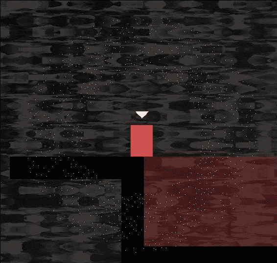 现在来点点新东西。

## OpenGL、着色器与 GLSL

**Open Graphics Library**（**OpenGL**）是一个处理 2D 和 3D 图形的编程库。OpenGL 运行在所有主要的桌面操作系统上，也有一个适用于移动设备的版本，即 OpenGL ES。

OpenGL 最初于 1992 年发布。在过去的二十多年里，它得到了不断的精炼和改进。此外，显卡制造商设计其硬件使其与 OpenGL 良好地工作。告诉你这些并不是为了上历史课，而是为了解释：尝试改进 OpenGL 是愚蠢的，而在桌面 2D（以及 3D）游戏中使用它，特别是当你想让它运行在 Windows 之外的系统上时，是显然的选择。

除了基本类型外，OpenGL 还使用了矩阵。矩阵是执行算术运算的方法和结构。这种算术运算范围从极其简单的高中水平计算（如移动（平移）坐标）到非常复杂的高级数学；例如，将我们的游戏世界坐标转换为 GPU 可以使用的 OpenGL 屏幕坐标。幸运的是，这些复杂性由 SFML 在幕后为我们处理。

SFML 还允许我们直接处理 OpenGL。如果你想了解更多关于 OpenGL 的知识，可以从这里开始：http://learnopengl.com/#!Introduction 。如果你想在使用 SFML 的同时直接使用 OpenGL，可以阅读：http://www.sfmldev.org/tutorials/2.3/window-opengl.php 。

应用程序可以有多个着色器。我们可以将不同的着色器`attach`（附加）到不同的游戏对象以创建所需的效果。在这个游戏中，我们只有一个顶点着色器和一个片段着色器。我们每帧都会将其应用背景中。

然而，当你看到如何将着色器附加到绘制调用（draw call）时，就会发现添加更多着色器是非常易举的。

我们将遵循以下步骤：

1. 首先，我们需要在 GPU 上执行的着色器代码。

2. 接着，我们需要编译这些代码。

3. 最后，我们需要将着色器附加到游戏引擎绘制函数中适当的绘制调用。

GLSL 是一门独立的语言，它也有自己的类型，并且可以声明和利用这些类型的变量。此外，我们可以从 C++ 代码与着色器程序的变量进行交互。

### 提示

如果获取关于可编程图形管线和着色器能力的知识让你感到太兴奋而无法留到另一天，那么我强烈推荐 Jacobo Rodriguez 写的《GLSL Essentials》：https://www.packtpub.com/hardware-and-creative/glsl-essentials 。该书探索了桌面上的 OpenGL 着色器，对于任何具有良好 C++ 编程知识并愿意学习新语言的读者来说都非常易读。

正如我们将看到的，GLSL 的语法与 C++ 有一些相似之处。

## 编写片段着色器

这是`shaders`文件夹中`rippleShader.frag`文件的代码。你不需要编写这些代码，因为它在我们第 12 章“抽象与代码管理——更好地利用 OOP”中添加的资源中了：

```cpp
// attributes from vertShader.vert
varying vec4 vColor;
varying vec2 vTexCoord;

// uniforms
uniform sampler2D uTexture;
uniform float uTime;

void main() {
float coef = sin(gl_FragCoord.y * 0.1 + 1 * uTime); vTexCoord.y += coef * 0.03;
gl_FragColor = vColor * texture2D(uTexture, vTexCoord);
}
```

前四行（不包括注释）是片段着色器使用的变量。然而，它们不是普通变量。我们看到的第一个类型是`varying`。这些是在两个着色器作用域内的变量。接下来，我们有`uniform`变量。这些变量可以直接从我们的 C++ 代码进行操作。我们很快就会看到如何这样做。

除了`varying`和`uniform`类型外，每个变量都有更常规的类型，定义了实际数据：

- `vec4` 是一个带有四个值的向量

- `vec2` 是一个带有两个值的向量

- `sampler2d` 将存储一个纹理

- `float` 就像 C++ 中的 float 一样

`main`函数内部的代码是实际执行的内容。如果你仔细观察`main`中的代码，你将看到每个变量的使用。这段代码的具体作用超出了本书的范围。总之，纹理坐标（`vTexCoord`）和像素/片段的颜色（`glFragColor`）是通过一系列数学函数和操作来处理的。记住，这会在游戏每一帧的每一个绘制调用涉及的每一个像素上执行。此外，请注意`uTime`在每一帧都会以不同的值传入。结果，正如我们很快看到的，将产生一种波纹效果。

### 编写顶点着色器

这是`vertShader.vert`文件的代码。你不需要编写这些代码，因为它在我们第 12 章“抽象与代码管理——更好地利用 OOP”中添加的资源中了：

```cpp
//varying "out" variables to be used in the fragment shader
varying vec4 vColor;
varying vec2 vTexCoord;

void main() {
 vColor = gl_Color;
 vTexCoord = (gl_TextureMatrix[0] * gl_MultiTexCoord0).xy;
 gl_Position = gl_ModelViewProjectionMatrix * gl_Vertex;
}
```

首先，注意两个`varying`变量。这些正是我们在片段着色器中处理过的相同变量。在`main`函数中，代码处理每一个顶点的位置。代码的工作原理超出了本书的范围，但背后有一些非常深入的数学计算，如果你感兴趣，那么探索 GLSL 将非常迷人（参见之前的提示）。

现在我们有两个着色器（一个片段和一个和一个顶点）。我们可以在游戏中使用它们。

## 在 Engine 类中添加着色器

打开`Engine.h`文件。添加高亮的代码行，这为`Engine`类添加了一个名为`m_RippleShader`的 SFML Shader 实例：

```cpp
// 背景的三个视图
View m_BGMainView;
View m_BGLeftView;
View m_BGRightView;
View m_HudView;

// 为背景 Sprite m_BackgroundSprite 声明 sprite 和 Texture
Sprite m_BackgroundSprite;
Texture m_BackgroundTexture;

// 为背景声明一个 shader
Shader m_RippleShader;

// 游戏正在运行吗？
bool m_Playing = false;

// 角色 1 或 2 是当前焦点吗？
bool m_Character1 = true;
```

引擎对象及其所有函数现在都可以访问`m_RippleShadder`。注意，一个 SFML Shader 对象将由两个着色器代码文件组成。
