# C++ 游戏编程：从零开始 C++ 并逐步构建属于你自己的游戏新书

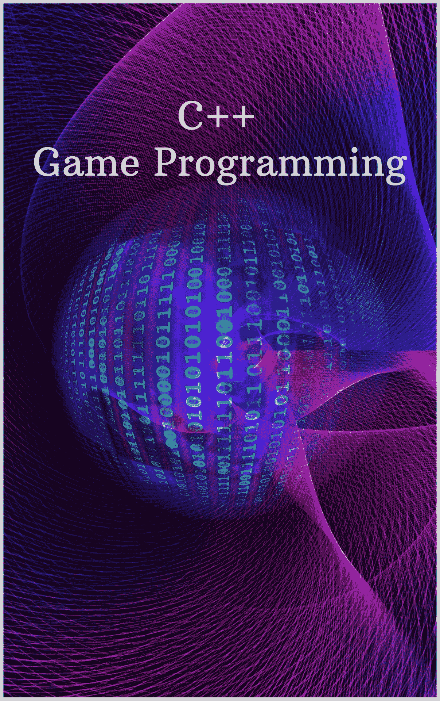

## 目录

## C++ 游戏编程入门

- 致谢
- 关于作者
- 关于审稿人
- www.PacktPub.com：书籍、折扣优惠及更多
- 为什么要订阅？
- 献辞

## 前言

- Timber!!!
- 僵尸竞技场 (Zombie Arena)

## 目录

- Thomas 迟到了 (Thomas was Late)

### 本书涵盖什么

- 本书所需的准备
- 本书的读者
- 约定
- 读者反馈
- 客户支持

### 下载示例代码

- 下载本书的彩色图片
- 错
- 盗版

## 1. C++、SFML、Visual Studio 以及开始第一个游戏

### 游戏介绍

- Timber!!!
- 僵尸竞技场
- Thomas 迟到了

### 结识 C++

- Microsoft Visual Studio
- SFML

### 设置开发环境

- Mac 和 Linux 如何处理？
- 在桌面上安装 Visual Studio Express 2015
- 设置 SFML
- 创建可用的项目模板

### 规划 Timber!!!

- 从模板创建项目
- 项目资产
- 外包资产
- 制作自己的音效
- 将资产添加到项目
- 探索资产
- 理解屏幕坐标和内部坐标

## 开始编写游戏代码

- 使用注释使代码更清晰
- `#including Windows essentials`
- 主函数
- 演示与语法
- 函数的返回值
- 运行游戏
- 使用 SFML 打开窗口

### `#including SFML 特性`

- OOP（面向对象编程）、类、对象
- 使用 `namespace sf`
- `SFML VideoMode` 和 `RenderWindow`
- 运行游戏

### 游戏主循环

- `while` 循环
- C 风格代码注释
- 输入、更新、绘制、重复
- 检测按键
- 清除并绘制场景
- 运行游戏
- 绘制游戏背景
- 使用纹理准备精灵 (sprite)
- 对背景精灵进行双缓冲处理
- 运行游戏

### 处理错误

- 配置错误
- 编译错误
- 链接错误
- 臭
- 常见问题 (FAQ)
- 总结

## 2. 变量、运算符与决策 – 制作精灵

### C++ 变量

- 变量类型
- 常量
- 用户定义类型
- 变量声明与初始化
  - 声明变量
  - 初始化变量
  - 一步完成声明与初始化
  - 声明并初始化用户定义类型

## 操作变量

- C++ 算术运算符和赋值运算符
- 使用表达式完成任务
- 添加云、树和嗡嗡的蜜蜂
  - 准备树
  - 准备蜜蜂
  - 准备云
  - 绘制树、蜜蜂和云
- 随机数
- 在 C++ 中生成随机数

### 使用 `if` 和 `else` 决策

- 逻辑运算符
- C++ `if` `else`
- 如果它们过来了桥，就射击它们！或者尝试这种方法
- 读者挑战

### 时机控制

- 帧率问题
- SFML 帧率解决方案
- 移动云和蜜蜂
- 为蜜蜂注入生命
- 吹散云
- 常见问题 (FAQ)
- 总结

## 3. C++ 字符串、SFML 时间、玩家输入与 HUD

- 暂停和重启游戏

### C++ 字符串

- 声明字符串
- 为字符串赋值
- 操作字符串

### SFML 文本与字体

- 添加分数和消息
- 添加时间条
- 常见问题 (FAQ)
- 总结

## 4. 循环、数组、Switch、枚举与函数 – 实现游戏机制

### 循环

- `while` 循环
- 退出 `while` 循环
- `for` 循环

### 数组

- 声明数组
- 初始化数组元素
- 快速初始化数组元素
- 这些数组对我们的游戏到底起到了什么作用？

### 使用 `switch` 决策

- 类枚举

### 函数入门

- 函数返回值
- 函数名
- 函数参数
- 函数体
- 函数原型
- 组织函数
- 函数"陷阱"！
- 关于函数的最后说明 - 暂时
- 关于函数的终极说明 - 暂时

### 伸生长分支

- 准备分支
- 每帧更新分支精灵
- 绘制分支
- 移动分支
- 常见问题 (FAQ)
- 总结

## 5. 碰撞、声音与结束条件 – 让游戏可玩

- 准备玩家（以及其他精灵）
- 绘制玩家和其他精灵
- 处理玩家输入
- 处理新游戏的设置
- 检测玩家的砍木动作
- 检测按键释放
- 制作砍断的木头和斧头的动画
- 处理死亡
- 简单音效
- SFML 是如何工作的？
- 何时播放声音
- 添加声音代码
- 改进游戏和代码
- 常见问题 (FAQ)
- 总结

## 6. 面向对象编程、类与 SFML 视图 (Views)

- 规划并启动僵尸竞技场游戏
- 从模板创建项目
- 项目资产
- 探索资产
- 将资产添加到项目

## OOP

- 什么是 OOP？
- 封装
- 多态
- 继承
- 为什么要这样做？

### 什么是类？

- 类变量和函数声明
- 类函数定义
- 使用类的实例
- 构造函数和获取器 (getter) 函数
- 在代码中来回跳转

### 构建玩家 – 第类

- 编写 `Player` 类头文件
- 编写 `Player` 类函数定义
- 使用 `SFML View` 控制游戏相机

### 启动僵尸竞技场游戏引擎

- 管理代码文件
- 开始编写游戏主循环
- 常见问题 (FAQ)
- 总结

## 7. C++ 引用、精灵图 (Sprite Sheets) 与顶点数组 (Vertex Arrays)

### C++ 引用

- 引用总结

### SFML 顶点数组与精灵图

- 什么是精灵图？
- 什么是顶点数组？
- 从瓦片构建背景
- 构建顶点数组
- 使用顶点数组绘制
- 创建随机生成的滚动背景
- 使用背景
- 常见问题 (FAQ)
- 总结

## 8. 指针、标准模板库 (STL) 与纹理管理

### 指针

- 指针语法
- 声明指针
- 初始化指针
- 重新初始化指针
- 解引用
- 指针多功能且强大
- 动态分配内存
- 将指针传递函数
- 声明并使用对象指针
- 指针与数组
- 指针总结

### 标准模板库 (STL)

- 什么是 `Map`
- 声明 `Map`
- 向 `Map` 添加数据
- 在 `Map` 中查找数据
- 从 `Map` 中删除数据
- 检查 `Map` 大
- 检查 `Map` 中的键
- 循环/遍历 `Map` 的键值对
- `auto` 关键字
- STL 总结

## TextureHolder 类

- 编写 `TextureHolder` 头文件
- 编写 `TextureHolder` 函数定义
- 我们通过 `TextureHolder` 到底实现了什么？构建一群僵尸
- 编写 `Zombie.h` 文件
- 编写 `Zombie.cpp` 文件
- 使用 `Zombie` 类创建僵尸群
- 让群体活过来（复活）
- 使用 `TextureHolder` 处理所有纹理
- 修改背景获取纹理的方式
- 修改 `Player` 获取纹理的方式
- 常见问题 (FAQ)
- 总结

## 9. 碰撞检测、拾物与子弹

- 编写 `Bullet` 类
- 编写 `Bullet` 头文件
- 编写 `Bullet` 源文件
- 让子弹飞行
- 包含 `Bullet` 类
- 控制变量和子弹数组
- 换弹匣
- 射击子弹
- 每帧更新子弹
- 每帧绘制子弹
- 给玩家一个准准星
- 为拾物编写一个类
- 编写 `Pickup` 头文件
- 编写 `Pickup` 类函数定义
- 使用 `Pickup` 类
- 检测碰撞
- 僵尸被射中了吗？
- 玩家被僵尸碰到了吗？玩家碰到过拾物吗？
- 常见问题 (FAQ)
- 总结

## 10. 视图分层与 HUD 实现

- 添加所有文本和 HUD 对象
- 每帧更新 HUD
- 绘制 HUD、主界面和升级界面
- 常见问题 (FAQ)
- 总结

## 11. 音效、文件 I/O 与完成游戏

- 保存和加载高分
- 准备音效
- 升级
- 重启游戏
- 播放剩余声音
- 在玩家装弹时添加音效 - 制作射击声
- 玩家被击时播放声音
- 获得拾物时播放声音
- 僵尸被射中时制作"啪啪"声
- 常见问题 (FAQ)
- 总结

## 12. 抽象与代码管理 – 更好地利用 OOP

### Thomas Was Late 游戏

- Thomas Was Late 的特性
- 从模板创建项目
- 项目资产
- 游戏关卡设计
- GLSL 着色器
- 图形资产详解
- 资产详解
- 将资产添加到项目
- 组织 Thomas Was Late 的代码
- 构建游戏引擎
- 重用 `TextureHolder` 类
- 编写 `Engine.h`
- 编写 `Engine.cpp`

## 编写 `Engine` 类构造函数定义

## 编写 `run` 函数定义

## 编写 `input` 函数定义

## 编写 `update` 函数定义

## 编写 `draw` 函数定义

## 目前的 `Engine` 类

## 编写 `main` 函数

### 常见问题

### 总结

## 13. 高级 OOP – 继承与多态

### 继承

- 扩展类

### 多态

- 抽象类 - 虚函数与纯虚函数

### 构建 `PlayableCharacter` 类

- 编写 `PlayableCharacter.h`
- 编写 `PlayableCharacter.cpp`

### 构建 `Thomas` 和 `Bob` 类

- 编写 `Thomas.h`
- 编写 `Thomas.cpp`
- 编写 `Bob.h`
- 编写 `Bob.cpp`

### 更新游戏引擎以使用 `Thomas` 和 `Bob`

- 更新 `Engine.h` 以添加 `Bob` 和 `Thomas` 的实例
- 更新 `input` 函数以控制 `Thomas` 和 `Bob`
- 更新 `update` 函数以生成并更新 `PlayableCharacter` 实例

### 生成 `Thomas` 和 `Bob`

- 每一帧更新 `Thomas` 和 `Bob`

### 绘制 `Bob` 和 `Thomas`

### 常见问题

### 总结

## 14. 构建可玩关卡与碰撞检测

### 设计关卡

### 构建 `LevelManager` 类

- 编写 `LevelManager.h`
- 编写 `LevelManager.cpp` 文件
- 编写 `loadLevel` 函数

### 更新引擎

### 碰撞检测

- 编写 `detectCollisions` 函数
- 更多碰撞检测

### 总结

## 15. 音效空间化与 HUD

### 什么是空间化？

- 发射器、衰减与监听器
- SFML 如何处理空间化

### 构建 `SoundManager` 类

- 编写 `SoundManager.h`
- 编写 `SoundManager.cpp` 文件
- 编写构造函数
- 编写 `playFire` 函数
- 编写剩余的 `SoundManager` 函数

### 将 `SoundManager` 添加到游戏引擎

- 填充发射器
- 编写 `populateEmitters` 函数

### 播放音效

### `HUD` 类

- 编写 `HUD.h`
- 编写 `HUD.cpp` 文件
- 使用 `HUD` 类

### 总结

## 16. 扩展 SFML 类、粒子系统与着色器

### SFML `Drawable` 类

- 继承自 `Drawable` 的替代方案
- 为什么继承 `Drawable` 是最好的？

### 构建粒子系统

- 编写 `Particle` 类
- 编写 `Particle.h`
- 编写 `Particle.cpp` 文件
- 编写 `ParticleSystem` 类
- 编写 `ParticleSystem.h`
- 编写 `ParticleSystem.cpp` 文件

### 使用 `ParticleSystem`

- 在 `Engine` 类中添加 `ParticleSystem` 对象
- 初始化 `ParticleSystem`
- 每一帧更新粒子系统
- 启动粒子系统
- 绘制粒子系统

### OpenGL、着色器与 GLSL

- 可编程管线与着色器
- 编写片元着色器
- 编写顶点着色器
- 在 `Engine` 类中添加着色器
- 加载着色器
- 每一帧更新并绘制着色器

### 总结

## 17. 在此之前...

感谢！

## 第 1 章 C++、SFML、Visual Studio 以及开始第一个游戏

欢迎来到《C++ 游戏编程入门》。我不会浪费时间，直接让你开始使用 C++ 和基于 OpenGL 的 SFML 开启编写优秀的 PC 游戏之旅。第一章内容相当丰富，但我们将学习所需的所有知识，以便让我们第一个游戏的第一部分运行起来。以下是本章涵盖的内容：

- 了解我们将要构建的游戏
- 学习一些 C++ 知识
- 探索 SFML 及其与 C++ 的关系
- 查看我们整书中将使用的 Visual Studio 软件
- 设置游戏开发环境
- 创建可复用的项目模板，这将节省大量时间
- 规划并准备第一个游戏项目 `Timber!!!`
- 编写书中的第一段 C++ 代码，并创建一个绘制背景的可运行游戏

### 游戏

我们将一步一步学习极快的 C++ 语言的基础知识，然后将新知识投入使用，因此为我们构建的三个游戏添加酷功能应该是相当容易的。

**提示**

如果你在本章的任何内容上遇到困难，请查看结尾附近的章节：错误处理与常见问题。

这些是我们在书中的三个项目：

- **Timber!!!**: 第一个游戏是一个令人上瘾、节奏快速的游戏，它是极其成功的 `Timerman` 的克隆（可以在`http://store.steampowered.com/app/398710/`找到）。我们的游戏 `Timber!!!` 在构建真正可玩游戏的同时，向我们介绍所有的 C++ 基础知识。等我们完成并添加了一些最后的增强后，我们版本的游戏将会是这样。

- **Zombie Arena**: 接下来，我们将构建一个疯狂的生存射击游戏，类似于 `Zombies 9000`（可以在`http://store.steampowered.com/app/273500/`找到）。玩家将拥有机枪并击击不断增长的僵尸潮。这一切将在一个随机生成的滚动世界中进行。为了实现这一点，我们将学习面向对象编程以及它如何帮助我们。

- **Thomas was Late**: 第三个游戏将是一个时尚且具有挑战性的谜谜平台游戏，可以单机和合作模式。它基于非常热门的游戏 `Thomas was Alone`（可以在`http://store.steampowered.com/app/220780/`找到）。预计将学习粒子特效、OpenGL 着色器和分屏多人功能等酷酷的话题。


**提示**

如果你现在想玩任何一个游戏，可以在 `Runnable Games` 文件夹中的下载包中运行。只需双击相应的 `.exe` 文件即可。注意，在该文件夹中，你可以运行已完成的游戏，也可以运行任何章节中处于部分完成状态的游戏。

Visual Studio 隐藏了预处理、编译和链接的复杂性。它将这一切都封装在一个按钮点击的操作中。此外，它为我们提供了一个流畅的用户界面，以便我们输入代码并管理将成为大量代码文件和其他项目资产。虽然有价值数百美元的 Visual Studio 高级版本，但我们可以使用免费的 Express 版本来构建我们的三款游戏。

SFML（简单快速媒体库）并不是唯一用于游戏和多媒体的 C++ 库。虽然可以论证使用其他库，但对我来说，SFML 每次似乎都是最佳选择。首先，它是使用面向对象的 C++ 编写的。它的优点处处可见，随着你对本书的阅读，你将体验其中大部分优点。

SFML 非常易上手，因此对于初学者来说是一个很好的选择。同时，如果你是专业人士，它也具有构建最高质量 2D 游戏的潜力。因此，初学者可以使用 SFML 开始，不必担心随着经验的增长而需要更换新语言/库重新开始。

也许最大的好处是大多数现代 C++ 编程都使用 OOP（面向对象编程）。我读过的每一本 C++ 初学者指南都会使用并教授 OOP。事实上，OOP 是几乎所有语言编程的未来（也是现在）。所以，如果你从零开始学习 C++，为什么要用其他方式来呢？

SFML 几乎对你在 2D 游戏中想做的任何事情都提供了相应的模块（code）。SFML 使用 OpenGL 工作，而 OpenGL 也可以制作 3D 游戏。当你希望游戏运行在多个平台上时，OpenGL 是游戏领域事实上的免费可用图形形库。当你使用 SFML 时，你就自动在使用 OpenGL 了。SFML 极大地简化了：

- 2D 图形和动画，包括滚动的游戏世界。
- 音效和音乐播放，包括高质量的定向环绕声。
- 在线多人游戏功能。

相同的代码可以在所有主要的桌面操作系统上编译和链接，很快也将适用于移动端！广泛的研究表明，没有比这更构建 PC 2D 游戏的方法，即使对于专家开发者也是如此，特别是如果你是一个想在有趣的游戏环境中学习 C++ 的初学者。

### 设置开发环境

现在你对我们将如何制作这些游戏有了更深入的了解，是时候设置开发环境以便我们开始编写代码了。

#### 那 Mac 和 Linux 呢？


我们制作的游戏可以构建为在 Windows、Mac 和 Linux 上运行！我们使用的代码对每个版本来说都是相同的。然而，每个版本确实都需要在其目标平台上进行编译和链接，而 `Visual Studio` 无法在 Mac 和 Linux 上提供帮助。

说这本书完全适合 Mac 和 Linux 用户（尤其是完全的初学者）是不够公平的。不过，我想，如果你是一个热衷的 Mac 或 Linux 用户，并且熟悉你的操作系统，那么你将遇到的绝大多数额外挑战将集中在开发环境、`SFML` 以及第一个项目的初始设置上。为此，我强烈推荐以下教程，它们可能会替代接下来的 10 页（大约），直到“规划木木计划（Planning Timber!!!）”部分，到那时，这本书将再次适用于所有操作系统。

- 对于 Linux，请阅读此处获取概述：`http://www.sfmldev.org/tutorials/2.0/start-linux.php`
- 对于 Linux，请阅读此处获取分步指导：`http://en.sfmldev.org/forums/index.php?topic=9808.0`
- 在 Mac 上，请阅读此教程以及链接的文章：`http://www.edparrish.net/common/sfml-.osx.html`

### 在桌面电脑上安装 Visual Studio Express 2015

安装 `Visual Studio` 几乎像下载文件并点击几个按钮一样简单。然而，如果我们能仔细执行每一个具体步骤，将对我们很有帮助。因此，我将逐步介绍安装过程。微软 `Visual Studio` 网站显示你需要 5 GB 的硬盘空间。但根据经验，我建议你至少需要 10 GB 的空闲空间。此外，这些数字略显模糊。如果你计划将其安装在辅助硬盘上，你仍然需要在主硬盘上保留至少 5 GB 空间，因为无论你选择在何安装 `Visual Studio`，它都需要这个空间。

**注意**：总结一下这种模糊的情况：如果你打算将 `Visual Studio` 安装在主硬盘上，那么在主硬盘上拥有完整的 10 GB 空间是关重要的。另一方面，如果你打算安装在辅助硬盘上，请确保主硬盘上有 5 GB 空间，同时辅助硬盘上有 10 GB 空间。是的，我知道很蠢！

1. 你首先需要的是一个微软账户和登录详情。如果你有 Hotmail 或 MSN 邮箱地址，那么你已经有一个了。如果没有，你可以在这里注册一个免费账号：`https://login.live.com/`。

2. 访问此链接：`https://www.visualstudio.com/en/downloads/download-visual-studio-vs.aspx`。点击 `Visual Studio 2015`，然后点击桌面版的 `Express 2015`，然后下载按钮。下一个截图显示了三个点击位置：

   

3. 等待短暂的下载完成后，运行下载的文件。现在你只需要按照屏幕上的指示操作。不过，请记住你选择安装 `Visual Studio` 的文件夹。如果你想和我操作得完全一样，请在你优选的硬盘上创建一个名为 `Visual Studio 2015` 的新文件夹并安装到该文件夹。取决于你互联网连接的速度，整个过程可能需要一段时间。

4. 当你看到下一个屏幕时，点击 `Launch`（启动）并输入你的微软登录详情。

   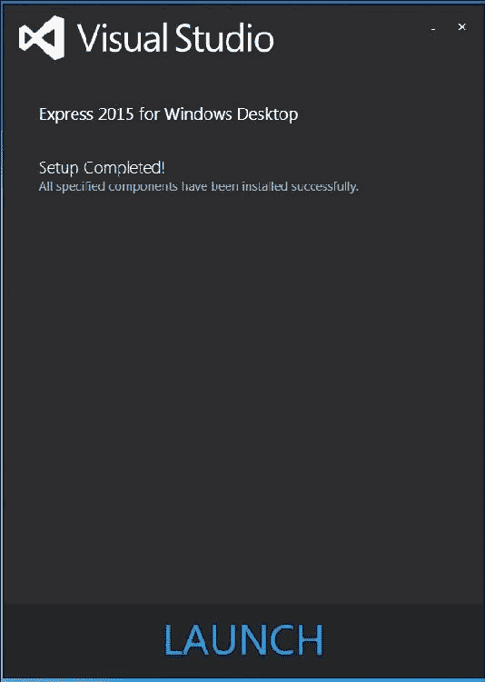

### 设置 SFML

这个简短的教程将引导你下载 `SFML` 文件，使我们能够包含库中的功能。此外，我们将看到如何使用 `SFML DLL` 文件，这将使我们编译的对象代码能够与 `SFML` 一起运行：

1. 访问 `SFML` 网站上的此链接：`http://www.sfml`

2. 转到 `dev.org/download.php`。点击下方所示的 `Latest stable version` 按钮。

   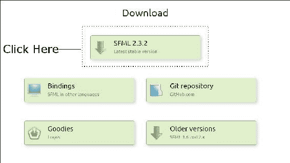

3. 当你读到本指南时，最新版本几乎肯定已经更改。只要你正确执行了下一步，这并不重要。我们需要下载适用于 `Visual C++ 2014` 的 32 位版本。这听起来可能违背直觉，因为我们刚刚安装了 `Visual Studio 2015`，而且你可能（通常情况下）有一台 64 位的 PC。我们选择此下载是因为 `Visual C++ 2014` 是 `Visual Studio 2015` 的一部分（`Visual Studio` 提供不仅仅是 C++），而且我们将以 32 位构建游戏，这样它们就可以同时在 32 位和 64 位机器上运行。明确一下，点击以下下载项：

   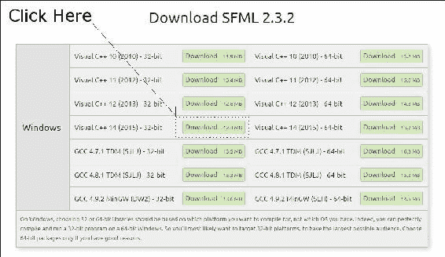

4. 下载完成后，在安装 `Visual Studio` 的同一个驱动器根目录下创建一个文件夹并命名为 `SFML`。同样在安装 `Visual Studio` 的驱动器根目录下创建另一个文件夹，命名为 `Visual Studio Stuff`。我们将在这里存储所有与 `Visual Studio` 相关的内容，所以 `Visual Studio Stuff` 似乎是个好名字。为了明确起见，这是在完成此步骤后我的硬盘的样子：4。

5. 显然，截图中高亮三个文件夹之间的文件夹可能与我的完全不同。现在我们已经为为很快要创建的所有项目做好准备了，在 `Visual Studio Stuff` 内部创建一个新文件夹。将新文件夹命名为 `Projects`。

6. 最后，解压 `SFML` 下载包。在桌面上执行此操作。解压完成后，你可以删除压缩包。你的桌面上将留下一个单一文件夹。它的名称将反映你下载的 `SFML` 版本。我的文件夹名为 `SFML-2.3.2-windowsvc14-32-bit`。你的文件名可能会反映更近的版本。双击此文件夹查看内容，然后再次双击进入下一个文件夹（我的文件夹名为 `SFML-2.3.2`）。接下来的截图显示了选中所有内容后，我的 `SFML-2.3.2` 文件夹的内容看起来。你的看起来应该一样。

7. 如上一个截图所示，复制此文件夹的所有内容，并将所有内容粘贴/拖入你在步骤 3 中创建的 `SFML` 文件夹中。在书剩余部分，我将简单地称为你的 `SFML` 文件夹。现在我们准备好在 `Visual Studio` 中开始使用 `C++` 和 `SFML` 了。

### 创建可重用的项目模板

由于设置项目是一个相当麻烦的过程，我们将创建一个项目并将其保存为 `Visual Studio` 模板。这将为我们每次开始一个新游戏时节省大量工作。所以，如果你觉得下一个教程有点冗长，请放心，你永远再也不需要这样做了：

1. 启动 `Visual Studio`，在 `New Project` 窗口中，点击 `Visual C++` 旁的小箭头以显示更多选项，然后点击 `Win32`，并点击 `Win32 Console Application`。你可以在下一个截图中看到所有选择。

   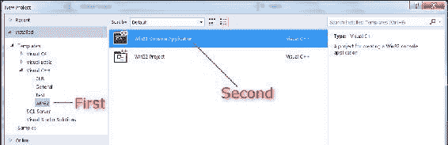

2. 现在，在 `New Project` 窗口的底部，在 `Name:` 字段中输入 `HelloSFML`。

3. 接下来，浏览到我们在上一个教程中创建的 `Visual Studio Stuff\Projects\` 文件夹。这将是我们所有项目文件存放的位置。所有模板都基于实际项目。因此，我们将有一个名为 `HelloSFML` 的项目，但我们对它唯一做的就是从它创建一个模板。

   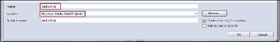

4. 完成上述步骤后，点击 `OK`。下一个截图显示了 `Application Settings` 窗口。勾选 `Console application` 复选框，并保持其他选项所示。

   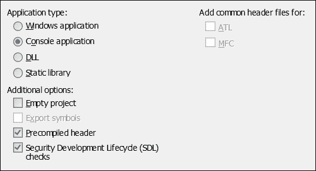

5. 点击 `Finish`，`Visual Studio` 将创建新项目。

6. 接下来，我们将添加一些相当复杂且重要的项目设置。这是费力的部分，但由于我们要创建一个模板，所以只需要做一次。我们需要的是告诉 `Visual Studio`（或者更具体地告诉属于 `Visual Studio` 的代码编译器）去哪里寻找来自 `SFML` 的特殊类型代码文件。我所说的特殊类型文件是头文件（header file）。头文件是定义 `SFML` 代码格式的文件。这样当我们使用 `SFML` 代码时，编译器就知道如何处理它。注意，头文件与主源代码文件是不同的，它们包含在具有 `.hpp` 扩展的文件中。（当我们最终在第二个项目中开始添加自己的头文件时，这一切将变得更加清晰。）此外，我们需要告诉 `Visual Studio` 在哪里可以找到 `SFML` 库文件。从 `Visual Studio` 主菜单选择 `Project | HelloSFML properties`。

7. 在结果的 `HelloSFML Property Pages` 窗口中，执行下一个截图中标记的以下步骤。

8. 从 `Configuration:` 下拉菜单中选择 `All Configurations`。

9. 从左侧菜单选择 `C/C++`，然后选择 `General`。

10. 找到 `Additional Include Directories` 编辑框，并输入你 `SFML` 文件夹所在的驱动器号，后跟 `\SFML\include`。如果你将 `SFML` 文件夹位于 `D` 驱动器上，要输入的完整路径如截图所示：`D:\SFML\include`。如果你将 `SFML` 安装在不同的驱动器上，请更改你的路径。

    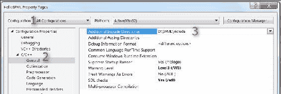

11. 点击 `Apply` 保存你目前为止配置。

12. 现在，仍在同一个窗口中，执行接下来的步骤，再次如下一个截图中标记。选择 `Linker`，然后选择 `General`。

13. 找到 `Additional Library Directories` 编辑框，并输入你 `SFML` 文件夹所在的驱动器号，后跟 `\SFML\lib`。所以如果你将 `SFML` 文件夹位于 `D` 驱动器上，要输入的完整路径如截图所示为 `D:\SFML\lib`。如果你将 `SFML` 安装在不同的驱动器上，请更改你的路径。

    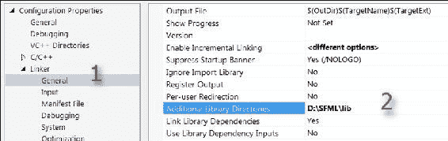

14. 点击 `Apply` 保存你目前为止的配置。

15. 最后阶段，仍在同一个窗口中，执行这些步骤，再次引用下一个截图。将 `Configuration:` 下拉菜单（1）切换到 `Debug`，因为我们将在 `Debug` 模式下运行和测试游戏。

16. 选择 `Linker`，然后选择 `Input`（2）。

17. 找到 `Additional Dependencies` 编辑框（3），并点击最左侧。现在在指定位置复制并粘贴/输入以下内容：`sfmlgraphics-d.lib;sfml-window-d.lib;sfml-system-d.lib;sfmlnetwork-d.lib;sfml-audio-d.lib;`。再次，要非常小心地精确放置光标，不要覆盖已有的任何文本。

18. 点击 `OK`！

    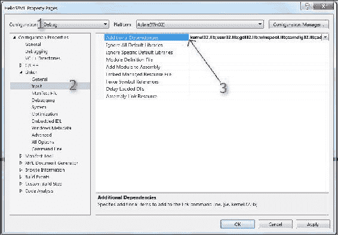

19. 让我们从我们的 `HelloSFML` 项目创建一个模板，这样我们再也不需要执行这个有点枯燥的任务了。创建一个可重用的项目模板非常简单。在 `Visual Studio` 中选择 `File | Export Template...`。然后在 `Export Template Wizard` 窗口中，确保选择了 `Project template` 选项，然后在 `From which project do you want to create a template` 选项中选择 `HelloSFML` 项目。

20. 点击 `Next`，然后点击 `Finish`。呼，就这样！下次我们创建项目时，我将向你展示如何从这个模板开始。现在让我们构建 Timber!!!

### 规划 Timber!!!

制作任何游戏最好都用纸笔开始。如果你不知道你的游戏在屏幕上如何运作，你怎么可能在代码中让它运行呢？

**提示**：在此时，如果你还没有这样做，我建议你去看一段 `Timerman` 的运行视频，这样你就能看到我们的目标。如果你觉得预算可以负担得起，就买一份来玩玩。它在 Steam 上经常打折到 1 美以下。

`http://store.steampowered.com/app/398710/`

游戏的特性和对象定义了游戏性，被称为机制（mechanics）。游戏的基本机制是：

- 时间总是在流逝。
- 通过砍树获得更多时间。
- 砍树会导致树枝落下。
- 玩家必须避开落下的树枝。
- 重复此过程直到时间耗尽或玩家被压扁。

在这个阶段要求你规划好 `C++` 代码显然有点愚蠢。当然，这只是 C++ 入学者指南的第一章。然而，我们可以查看一下我们将用到的所有资源，并概述让我们的 `C++` 代码按照我们的意愿运行所需的内容。请看这张带注释的游戏截图：

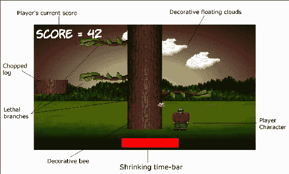

你可以看到我们拥有以下功能：

- **玩家当前分数**：玩家每次砍击木头都会获得一分。他可以使用左箭头或右箭头来砍击木头。

- **玩家角色**：玩家每次砍击时，他会移动或停留在树的同一侧。因此，玩家必须小心选择在哪一侧砍击。当玩家砍击时，玩家角色的手中会出现一个简单的斧头图形。

- **缩短的时间条**：玩家每次砍击时，不断缩短的时间条都会增加少量的时间。

- **致命树枝**：玩家砍击得越快，获得的时间就越多，但树枝向下移动的速度也越快，因此被压的概率也越大。树枝随机在树顶生成，并随着每次砍击向下移动。当玩家被压扁时（这会经常发生），会出现一个墓碑图形。

- **砍掉的木头**：当玩家砍击时，一个砍掉的木头图形会飞离玩家。

有三朵浮云以随机的高度和速度漂浮，还有一只只会在周围飞行的蜜蜂。这一切发生在一个漂亮的背景上。简而言之，玩家必须疯狂地砍击以得分并避免时间耗尽。一个有点变态但有趣的后果是，他砍得越快，被压死的概率就越大。我们现在已经知道了游戏的外观、如何玩法以及游戏机制背后的动力。我们可以开始构建它了。

### 从模板创建项目

现在创建一个新项目非常简单。只需在 `Visual Studio` 中遵循这些直接的步骤即可：

1. 从主菜单选择 `File` | `New Project`。

2. 确保左侧菜单中选择了 `Visual C++`，然后从选项列表中选择 `HelloSFML`。接下来的截图会让这一点变得清晰。

   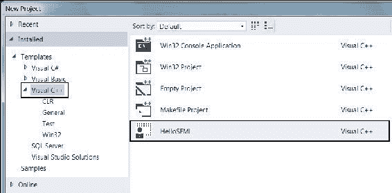

3. 在 `Name:` 字段中，输入 `Timber`，并确保勾选了 `Create directory for solution` 选项。点击 `OK`。

4. 现在我们需要将 `SFML` 的 `.dll` 文件复制到主项目目录。我的主项目目录是 `D:\Visual Studio Stuff\Projects\Timber\Timber`。它是 `Visual Studio` 在上一步创建的。如果你将 `Projects` 文件夹放在了其他地方，请在那里执行此步骤。我们需要复制到项目文件夹的文件位于你的 `SFML\bin` 文件夹中。为这两个位置分别打开一个窗口，并像接下来侧截图所示高亮所需的文件。

   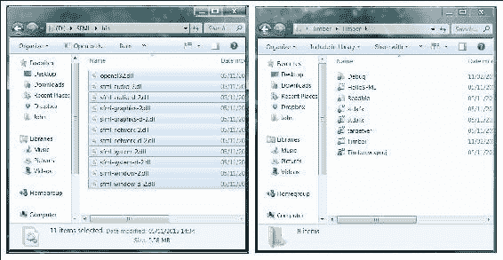

5. 现在将高亮的文件复制并粘贴到上一个截图右侧的项目文件夹中。

项目现在已经设置好并准备就绪。你将看到下一个截图中显示的屏幕。我对截图进行了注释，这样你就可以开始熟悉 `Visual Studio`。我们很快会回到这些区域以及其他区域！

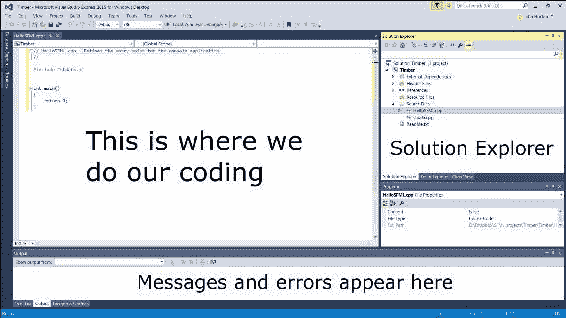

你的布局可能与截图略有不同，因为 `Visual Studio` 的窗口像大多数应用程序一样是可以自定义的。花点时间找到右侧的 `Solution Explorer` 窗口，并调整使其内容清晰可见，就像上一个截图中的那样。我们很快就会回到这里开始编码。

### 项目资源

资源是你制作游戏所需的任何东西。在我们的案例中，资源包括：

- 用于屏幕上书文字的字体
- 用于不同动作（如砍击、死亡和时间不足）的音效
- 角色、背景、树枝和其他游戏对象的图形

游戏所需的所有图形和声音都包含在下载包中。它们可以分别在 `Chapter 1/graphics` 和 `Chapter 1/sound` 文件夹中找到。所需的字体未提供。这是因为我想避免关于许可产生任何可能的争议。但这不会引起问题，因为我将向你展示具体在哪里以及如何选择和下载自己的字体。虽然我会提供资源本身或获取它们的信息，但你可能希望自己创建并获取它们。

### 外包资源

有很多网站允许你签约艺术家、音频工程师甚至是程序员。最大的网站之一是 `www.upwork.com`。你可以免费加入该网站并发布任务。你需要对你的需求编写清晰的解释，并说明你准备支付的金额。然后你可能会收到一些优秀的承包商竞标完成这项工作。请注意，有很多不合格的承包商，他们的工作可能会令人失望，但如果你选择仔细，可能会找到一个有能力、热情且极具价值的人或公司来完成工作。

### 制作自己的音效

音效可以从 `www.freesound.org` 等网站免费下载，但如果你要出售游戏，许可通常不允许你使用它们。另一个选项是使用来自 `www.bfxr.net` 的开源软件 `BFXR`，它可以帮助你生成许多不同的音效，你可以保留并随所欲地使用。

### 将资源添加到项目

一旦你决定了将使用哪些资源，就是时候将它们添加到项目中了。接下来的说明假设你正在使用书籍下载包提供的所有资源。如果你使用自己的资源，只需使用完全相同的文件替换相应的声音或图形文件即可。

1. 浏览到 `D:\Visual Studio Stuff\Projects\Timber\Timber`。

2. 在文件夹内创建三个新文件夹，并命名为 `graphics`、`sound` 和 `fonts`。

3. 从下载包中，将 `Chapter 1/graphics` 的全部内容复制到 `D:\Visual Studio Stuff\Projects\Timber\Timber\graphics` 文件夹。

4. 从下载包中，将 `Chapter 1/sound` 的全部内容复制到 `D:\Visual Studio Stuff\Projects\Timber\Timber\sound` 文件夹。


5. 现在在浏览器中访问：`http://www.1001freefonts.com/komika_poster.font` 并下载 Komika Poster 字体。

6. 解压压缩下载包的内容，并将`KOMIKAP_.ttf`文件添加到`D:\Visual Studio Stuff\Projects\Timber\Timber\fonts`文件夹。

### 探索资源

让我们来看看这些资源，特别是图形，以便我们能更好地可视化在 C++ 代码中使用它们时发生了什么。图形资源构成了我们 Timber!!! 游戏屏幕的各个组成部分。看看这些图形资源，应该很清楚它们在游戏中将用在何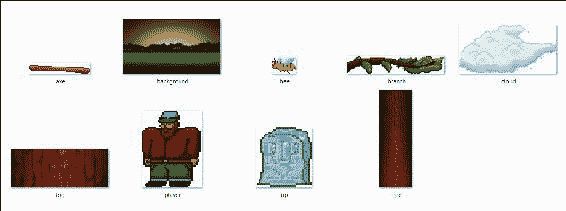

音频文件均为`.wav`格式。这些文件包含了我们在游戏过程中某些事件中播放的音效。它们都是使用`BFXR`生成的。它们是：

- `chop.wav`：听起来有点像斧头（复古风格斧头）砍击树的声音。
- `death.wav`：一种有点像复古“失败”的声音。
- `out_of_time.wav`：当玩家因超时而失败时播放，而不是被压扁时。

## 理解屏幕坐标和内部坐标

在开始实际的 C++ 编码之前，让我们先聊聊坐标。我们在显示器上看到的所有图像都是由像素组成的。像素是微小的光点，组合在一起形成了我们看到的图像。显示器有许多分辨率，但例如，一个相当典型的游戏显示器可能具有 1920 个水平像素和 1080 个垂直像素。

像素从屏幕的左上角开始编号。如接图所示，我们的 1920 x 1080 示例在水平轴（`x`）上的编号从 0 到 1919，垂直轴（`y`）上的编号从 0 到 1079。

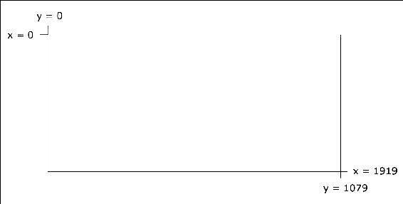

因此，特定的屏幕位置可以通过`x`和`y`坐标来确定。我们通过在屏幕上的特定位置绘制背景、角色、子弹和文本等游戏对象来创建游戏。这些位置是由像素的坐标确定的。看看下面这个假设的示例，展示我们如何在屏幕的大约中心坐标处绘制。对于 1920 x 1080 的屏幕，这将位于 960, 540 位置。

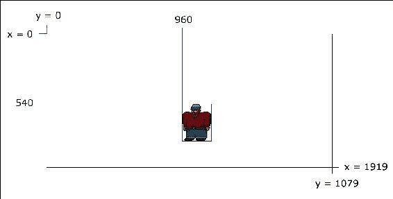

除了屏幕坐标外，我们的游戏对象也各自有一套类似的坐标系。与屏幕坐标系一样，它们的内部或局部坐标也从左上角的 0,0 开始。从上一张截图中可以看到，角色的 0,0 被绘制在屏幕的 960, 540 处。

视觉 2D 游戏对象（例如角色或僵尸）被称为精灵（sprite）。精灵通常由图像文件组成。所有精灵都有一个所谓的“原点”（origin）。如果在屏幕上的特定位置绘制一个精灵，原点将位于该特定位置。精灵的 0,0 坐标就是原点。接下来的截图演示了这一点。

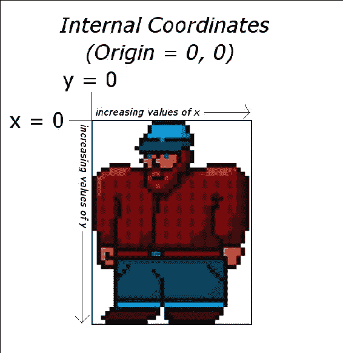

这就是为什么在显示角色绘制到屏幕的截图中，尽管我们在中心位置 (960, 540) 绘制了图像，但它看起来向右和下方偏了一点。在进行第一个项目的过程中，我们只需要记住它是如何工作的。

注意，在现实世界中，玩家拥有各种不同的屏幕分辨率，我们的游戏需要尽可能在尽可能多的分辨率下运行。在第二个项目中，我们将看到如何让游戏动态地适应几乎任何分辨率。在第一个项目里，我们需要假设屏幕分辨率为 1920 x 1080。如果你的屏幕与此不同，不要担心，因为我为 Timber!!! 游戏的每个章节都提供了一套单独的代码。代码文件几乎完全相同，只是在开头附近添加和交换了几行代码。如果你使用的是较低分辨率的屏幕，只需按照书中假设为 1920 x 1080 分辨率的代码操作，在尝试运行游戏时，你可以根据情况从第 1 章到第 5 章的每个低分辨率文件夹中复制并粘贴代码文件。事实上，一旦在第一章中添加了额外的行，无论你的屏幕分辨率如何，其余所有代码将是相同的。为了方便起见，我为每个章节都提供了低分辨率的代码。我们将在第二个项目中讨论这几行代码如何发挥魔力（缩放屏幕）。替代代码可以在低至 960 x 540 的分辨率下运行，因此在几乎任何 PC 或笔记本电脑上都应该很好用。现在我们可以编写第一段 C++ 代码了，很快就能看到它运行。

## 开始编写游戏代码

如果还没有打开 Visual Studio，请打开它，并在 Visual Studio 主窗口的“最近”列表中左键点击 Timber 项目（如果尚未打开）。

我们要做的第一件事是重命名主代码文件。它目前名为`HelloSFML.cpp`，我们将将其重命名为更合适的`Timber.cpp`。`.cpp`代表 C++。

1. 在右侧找到解决方案管理器（Solution Explorer）窗口。
2. 在源文件（Source Files）文件夹下找到`HelloSFML.cpp`文件。
3. 右键点击`HelloSFML.cpp`并选择重命名（Rename）。
4. 将文件名编辑为`Timber.cpp`并按回车。

在代码窗口中进行一些微调，使你的代码与下面显示的完全相同。你可以像使用任何文本编辑器或文字处理器一样进行操作；如果你愿意，甚至可以复制粘贴。完成这些微调后，我们来讨论一下它们：

```cpp
// 在此处包含重要的 C++ 库

#include "stdafx.h"

int main()
{
    return 0;
}
```

这个简单的 C++ 程序是一个很好的起点。让我们逐行检查它。

### 使用注释使代码更清晰

如你所见的，唯一需要更改的代码是最顶部的一点点。第一行代码是：

`// Include important C++ libraries here`（*在此处包含重要的 C++ 库*）

任何以`//`开头的代码行都是注释，编译器会忽略它们。因此，这行代码没有任何实际作用。它被用来记录我们在日后回来查看代码时可能觉得有用的信息。注释在行尾结束，因此下一行的任何内容都不属于注释的一部分。另一种类型的注释被称为多行注释或 C 风格注释，可以用于留下超过单行的注释。我们将在本章晚些时候看到其中一些。

### 包含 Windows 基础

现在你已经知道注释是什么了，你可能已经猜出下一行代码的作用。它就在这里：

`#include "stdafx.h"`

`#include`指令告诉 Visual Studio 在编译之前包含或添加另一个文件的内容。这样做的效果是，当我们运行程序时，某些我们没有自己写的代码将成为程序的一部分。将代码从其他文件添加到我们的代码中的过程称为预处理，可能不意外的是，它是由称为预处理器（pre-processor）的东西执行的。扩展名`.h`代表头文件（header file）。

你可能会奇怪这段代码会做什么？`stdafx.h`文件本身实际上包含了更多`#include`指令。它向我们的程序添加了在 Windows 上运行程序所需的所有必要代码。我们永远不需要查看这个文件，也完全不需要担心它的内容。我们只需要在制作的每个游戏顶部添加这行代码即可。

对我们来说更有意义且更相关的，以及值得讨论`#include`指令的原因是，我们将在代码文件的顶部添加更多的`#include`指令。这是为了包含我们将使用并将花精力去理解的代码。我们将包含的主要文件是 SFML 头文件，它们让我们能够访问所有酷炫的游戏编码功能。我们还将使用`#include`来访问 C++ 标准库头文件。这些头文件让我们能够访问 C++ 语言本身的核心功能。

这两行已经搞定了，让我们继续吧。

### 主函数

我们在代码中看到的下一行是：

`int main()`代码中的`int`是我们所说的“类型”。C++ 有许多类型，它们代表不同类型的数据。`int`是一个整数或全数。先记住这一点，我们稍后会回来讨论它。

`main()`代码部分是紧随其后的代码段的名称。这段代码被标记在起始左大括号`{`和下一个右大括号`}`之间。因此，这两个大括号`{...}`之间的所有内容都是`main`的一部分。我们将这样的代码段称为“函数”。每个 C++ 程序都有一个`main`函数，它是整个程序执行（运行）的开始的地方。随着学习的进行，最终我们的游戏将会有很多代码文件。然而，整个过程中只会存在一个`main`函数，无论我们写了什么代码，游戏都将始终从`main`函数左大括号内部的第一行代码开始执行。

现在，不要担心跟在函数名后面的奇怪括号`()`。我们将在“第 4 章：循环、数组、Switch、枚举和函数——实现游戏机制”中进一步讨论它们，届时，我们将以一个全新且更有趣的角度来审视函数。让我们仔细观察`Main`函数中的那单行代码。

### 呈现与语法

再次查看我们的整个`Main`函数：

```cpp
int main(){

return 0;
}
```

我们可以看到在`Main`内部只有一行代码，即`return 0;`。在继续研究这行代码的作用之前，让我们先看看它是如何呈现的。这很有用，因为可以帮助我们准备编写易于阅读且能与代码其他部分区分开来的代码。

首先，注意`return 0;`向右缩进了一个制表符（tab）。这清楚地标记了它是`main`函数内部的。随着我们代码长度的增加，我们会发现缩进代码和留出空白对于维护可读性至关重要。

接下来，注意行尾的标点符号。分号`;`告诉编译器指令已结束，紧随其后的任何内容都是一条新指令。我们将以分号终止的指令称为“语句”。注意，编译器并不在乎你是否在分号和下一个语句之间留了换行或甚至空格。然而，不为每个语句开启新行将导致代码变得极其难以阅读，而完全遗漏分号会导致语法错误，使得游戏无法编译或运行。一组在一起的代码（通常通过其缩进与其他部分的对齐来表示）被称为“块”。现在你已经熟悉了`main`函数的概念，并学会了缩进代码以保持整洁以及在每个语句末尾加上分号，我们就可以继续研究`return 0;`语句到底在做什么了。

### 从函数返回值

实际上，在我们游戏的语境下，`return 0;`几乎什么都没做。然而，这个概念是非常重要的。当我们使用`return`关键字时（无论是单独使用还是后跟一个值），它都是一个让程序执行跳转/回到最初启动该函数的代码指令。通常，这段启动函数的代码是我们代码中其他地方另一个函数。在这种情况下，是操作系统启动了`main`函数。因此，当执行`return 0;`行时，`main`函数退出，程序结束。

我们可以返回任何符合`int`（整数/全数）定义的值。也许`0`、`1`、`999`等。如果我们尝试返回一个不是`int`的东西，那么代码将无法编译，游戏也无法运行。我们说启动函数的代码是“调用”该函数。通常，这段启动函数的代码是我们代码中其他地方另一个函数。在这种情况下，是操作系统启动了`main`函数。因此，当执行`return 0;`行时，`main`函数退出，程序结束。我们可以将零改为其他值，该值就会被返回。还记得`Main()`中的`int`吗？它告诉编译器从`Main`返回的值的类型必须是`int`。函数可以返回许多不同的类型，包括我们自己发明的类型！然而，那种类型必须像我们刚刚看到的那样告知编译器。我们现在不需要完全掌握所有这些函数。在这里介绍它只是是有用的。

### 运行游戏

现在你实际上可以运行游戏了。通过点击 Visual Studio 快速启动栏中的“本地 Windows 调试器”（Local Windows Debugger）按钮，或者使用快捷键`F5`来运行。你只会看到黑屏闪烁。这个闪烁是 C++ 控制台，我们可以用它来调试游戏。我们现在不需要这样做。正在发生的是我们的程序正在启动，从`Main`的第一行开始执行（当然是`return 0;`），然后立即退出回到操作系统。

### 使用 SFML 打开窗口

现在让我们添加一些代码。接下来的代码将打开一个 Timber 最终运行的窗口。该窗口将是 1920 像素宽、1080 像素高，并且是全屏的（无边框或标题）。

在现有代码中输入下方高亮显示的新代码，然后我们对其进行检查。在你输入（或复制粘贴）时，尝试弄清楚发生了什么：

```cpp
// 在此处包含重要的 C++ 库
#include "stdafx.h"
#include <SFML/Graphics.hpp>

// 使用 "using namespace" 让代码更易输入
using namespace sf;

int main()
{
// 创建视频模式对象
VideoMode vm(1920, 1080);

// 创建并打开一个游戏的窗口
RenderWindow window(vm, "Timber!!!", Style::Fullscreen);

return 0;
}
```

我们在新代码中注意到的第一个点是另一个（尽管略有不同）`#include`指令。`#include <SFML/Graphics.hpp>`告诉预处理器包含了位于`SFML`文件夹下的`Graphics.hpp`文件内容，该文件夹是在设置项目时创建的。因此，这一行代码的作用是添加上述文件的代码，使我们能够访问 SFML 的某些功能。具体是如何实现的，当我们开始编写自己的独立代码文件并使用`#include`来调用它们时，将会变得更加清晰。

注意：如果你好奇于像这样包含文件名的`<filename.hpp>`和`"filename.h"`预处理器指令之间的区别，那么`<...>`用于包含我们文件夹结构中的文件，例如`SFML`文件或我们自己编写的任何。而`"..."`则用于 Visual Studio 自带的文件。此外，`.hpp`文件扩展名只是`.h`文件的更倾向于 C++ 版本，后者更像是 C 语言风格的扩展。这两种样式和两种文件扩展名最终的效果完全相同，并且在我们的游戏中都能良好运行。

现在重要的是，我们拥有 SFML 提供的一整系列新功能供我们使用。下一行新代码是`using namespace sf;`。我们将在几段文字之后回到这一行代码的作用。

## OOP、类与对象

随着书籍的深入，我们将更全面地讨论 OOP、类和对象。以下是简短的介绍，以便我们理解正在发生什么。

我们已经知道 OOP 代表面向对象编程（object-oriented programming）。OOP 是一种编程范式，一种编码方式。在整个编程界，几乎每种语言中，OOP 都被公认为是编写代码的最好（如果不是唯一的话）专业方法。

OOP 引入了许多编码概念，但所有这些概念的基础都是`classes`（类）和`objects`（对象）。当我们编写代码时，尽可能地，我们希望编写可重用的代码。我们实现这一点的方法是将代码结构化为一个`class`（类）。我们将在第 6 章：面向对象编程、类与 SFML 视图中学习如何这样做。

目前关于类，我们只需要知道：一旦我们编写了类，并不会将该代码作为游戏的一部分执行，而是从类中创建可用的对象。

例如，如果我们想要一百个僵尸非玩家角色（NPC），我们可以仔细设计并编写一个名为`Zombie`的类，然后从这一个类中创建出任意数量的僵尸对象。每一个僵尸对象都具有相同的功能和内部数据类型，但每一个僵尸对象都是一个独立且不同的实体。

进一步扩展这个假设的僵尸示例，且不显示`Zombie`类的任何代码，我们可以这样基于`Zombie`类创建一个新对象：

```cpp
Zombie z1;
```

对象`z1`现在是一个完全代码化且运行正常的`Zombie`对象。然后我们可以这样操作：

```cpp
Zombie z2; Zombie z3; Zombie z4; Zombie z5;
```

我们现在有了五个独立的僵尸，但它们都基于一个经过精心编写的类。在回到刚刚编写的代码之前，让我们再更进一步。我们的僵尸可以同时包含行为（由函数定义）以及可能代表事事属性的数据，如僵尸的血量、速度、位置或移动方向。例如，我们可以编写`Zombie`类，以便我们能够使用这些僵尸对象，可能如下所示：

```cpp
z1.attack(player);
z2.growl();
z3.headExplode();
```

注意：再次提醒，所有这些僵尸代码目前都是假设的。不要在 Visual Studio 中输入这些代码；它们只会产生一堆错误。

我们将设计类，以便以最符合我们游戏目标的方式使用数据和行为。例如，我们可以设计类，以便在创建每个僵尸对象时为该对象的数据赋值。也许我们需要在创建每个僵尸时，为它们分配一个唯一的名称和以米/秒为单位的速度。编写`Zombie`类可以让我们写出如下代码：

```cpp
// Dave 在感染前是一个 100 米奥运冠军
// 他的移动速度是每秒 10 米
Zombie z1("Dave", 10);

// Gill 在感染前双条腿都被吃掉了
// 她以每秒 .01 米的速度拖行
Zombie z2("Gill", .01);
```

关键点在于，类具有几乎无限的灵活性，一旦我们编写了类，就可以通过从中创建对象来使用它们。正是通过类以及从类中创建的对象，我们将利用 SFML 的力量。是的，我们还会编写自己的类，包括一个`Zombie`类。让我们回到刚刚编写的实际代码。

### Using namespace sf

在我们进一步观察`VideoMode`和`RenderWindow`之前（正如你可能猜到的，它们是 SFML 提供的类），我们将学习`using namespace sf;`这一行代码的作用。

当我们创建一个类时，是在一个命名空间（namespace）中创建。这样做是为了将我们的类与其他人写的类区分开。考虑`VideoMode`类。在 Windows 等环境中，完全可能已经有人写了一个名为`VideoMode`的类。通过使用命名空间，我们以及 SFML 的程序员可以确保类名永远不会发生冲突。

使用`VideoMode`类的完整方式如下：

```cpp
sf::VideoMode...
```

代码`using namespace sf;`允许我们在代码的任何地方省略`sf::`前缀。如果没有它，光是这个简单的游戏就会出现超过 100 处`sf::`。它也让我们的代码更易读，也更简短。

### SFML VideoMode 和 RenderWindow

在`Main`函数内部，我们现在有两个新的注释和两行新的实际代码。第一行实际代码是：

```cpp
VideoMode vm(1920, 1080);
```


这段代码从`VideoMode`类创建了一个对象`vm`，并设置了两个内部值`1920`和`1080`。这些值代表玩家屏幕的分辨率。下一行新代码是：

```
RenderWindow window(vm, "Timber!!!", Style::Fullscreen);
```

在上一行代码中，我们正从 SFML 提供的`RenderWindow`类创建一个新对象`window`。此外，我们还在窗口对象内部设置了一些值。首先，使用`vm`对象是为了初始化窗口的一部分。起初这可能看起来很困惑。但请记住，类可以像其创建者希望的那样多样和灵活。是的，某些类可以包含其他类。

提示：此时没有必要完全理解它是如何工作的，只要你理解这个概念即可。我们编写一个类，然后从该类创建可用的对象。就像建筑师可能会画蓝图一样。你不能把所有的家具、孩子和狗搬进蓝图中；但你可以根据蓝图建造房屋（或许多栋房屋）。在这个类比中，类就像蓝图，而对象就像房子。

提示：`Style::FullScreen`是 SFML 定义的一个值。它非常有用，这样我们不需要记住内部代码用于表示全屏的整数。这种值的编程术语称为常量（constant）。常量以及它们在 C++ 中的亲属变量将在下一章中介绍。

让我们看看窗口对象的运行情况。

## 运行游戏

你现在可以再次运行游戏。你会看到一个较大的黑色屏幕闪烁一下然后消失。这就是我们刚刚编写的 1920 x 1080 全屏窗口。遗憾的是，目前发生的情况是我们的程序启动，从`Main`第一行开始执行，创建了酷的新游戏窗口，然后返回`0;`并立即退出回到操作系统。

## 主游戏循环

我们需要一种方法让程序保持运行，直到玩家想要退出。同时，随着`Timber!!!`开发进程，我们应该清晰地标记出代码不同部分将去的位置。此外，如果我们想阻止游戏退出，最好为玩家在准备就绪时提供一种退出方法。否则，游戏将永远运行下去！

将高亮的代码添加到现有代码中，我们将逐一进行讨论：

```cpp
int main()
{
// 创建一个视频模式对象 VideoMode vm(1920, 1080);
// 为游戏创建并打开窗口
RenderWindow window(vm, "Timber!!!", Style::Fullscreen);
while (window.isOpen()) {
    /*
    **************************************** 处理玩家输入
    **************************************** */
    if (Keyboard::isKeyPressed(Keyboard::Escape)) {
        window.close();
    }

    /*
    **************************************** 更新场景
    **************************************** */
    window.clear();

    /*
    **************************************** 绘制场景
    **************************************** */
    // 清除上一帧的所有内容
    // 在此处绘制我们的游戏场景
    // 显示我们刚刚绘制的所有内容
    window.display();
} return 0; }
```

### While 循环

在新代码中看到的第一个内容是这个：

```cpp
while (window.isOpen())
{
```

在新代码中看到的最后一个内容是闭合的大括号`}`。我们创建了一个`while`循环。`while`循环左括号`{`和右括号`}`之间的所有所有内容将持续执行、反复执行，可能无限循环。仔细观察`while`循环括号`(...)`中的内容，如下面的代码高亮所示：

```cpp
while (window.isOpen())
```

关于这段代码的完整解释将等到我们在第 4 章“循环、数组、Switch、枚举和函数——实现游戏机制”中讨论循环和条件。现在重要的是，当`window`对象被设置为关闭时，代码的执行将跳出`while`循环并跳转到下一语句。窗口具体如何关闭的很快就会介绍。

下一语句自然是`return 0;`，它结束了我们的游戏。我们现在知道`while`循环将不断旋转，重复执行其内部的代码，直到我们的`window`对象被设置为关闭。

### C 风格代码注释

在`while`循环内部，我们看到了初看可能有点像 ASCII 艺术（ASCII art）的内容：

```cpp
/*
****************************************
处理玩家输入
****************************************
*/
```

注意，ASCII 艺术是一种用计算机文本创建图像的冷门但有趣的方式。你可以在这里阅读更多信息：https://en.wikipedia.org/wiki/ASCII_art 。之前的代码仅仅是另一种类型的注释。这种注释被称为 C 风格注释。它以`/*`开始，以`*/`结束。之间的任何内容都仅供信息，不会被编译。我使用了这段稍显复杂的文字，是为了完全明确我们将在代码文件的这部分做什么。当然，你现在可以推断出随后的任何代码将与处理玩家输入有关。

跳过几行代码，你会看到我们还有另一个 C 风格注释，宣布在代码的该部分我们将更新场景。跳转到下一个 C 风格注释，显而易见我们将在哪里绘制所有图形。

### 输入、更新、绘制、重复

尽管第一个项目使用了最简单的游戏循环版本，但每个游戏在代码中都需要这些阶段：

1. 获取玩家输入（如果有）。

2. 根据人工智能、物理或玩家输入等因素更新场景。

3. 绘制当前场景。

4. 以足够快的速率重复上述操作，以创建一个流畅且带有动画的游戏世界。

现在让我们看看在游戏循环中实际执行操作的代码。

### 检测按键按下

首先，在标记为处理玩家输入（Handle the player's input）的中，我们有以下代码：

```cpp
if (Keyboard::isKeyPressed(Keyboard::Escape))
{
    window.close();
}
```

这段代码检查 Escape 键当前是否被按下。如果是，高亮代码将使用`window`对象将其关闭。现在，当下一次`while`循环开始时，它将看到`window`对象已关闭，并跳转到`while`循环闭合大括号`}`之后的代码，游戏随之退出。我们将在第 2 章“变量、运算符和决策——制作精灵”中更详细地讨论`if`语句。

### 清空绘制场景

目前更新场景（Update the scene）部分还没有代码，所以让我们移动到绘制场景（Draw the scene）部分。

我们做的第一件事是使用代码擦除上一帧的动画：

```cpp
window.clear();
```

我们现在做的是绘制游戏中的每一个对象。然而，目前我们还没有任何游戏对象。

下一行代码是：

```cpp
window.display();
```

当我们绘制所有游戏对象时，我们是将它们绘制到一个准备好显示的隐藏表面上。`window.display()`代码将从之前显示的表面切换到新更新（之前是隐藏的）的表面。这样，玩家永远不会看到绘制过程，因为表面已经添加了所有的精灵。它还保证了场景在切换之前是完整的。这防止了被称为“撕裂”（tearing）的图形故障。这个过程被称为双缓冲（double buffering）。

此外，注意所有这些绘制和清空功能都是使用我们的`window`对象执行的，该对象是从 SFML 的`RenderWindow`类创建的。

### 运行游戏

运行游戏，你将得到一个空白的全屏窗口，它会一直存在直到你按下键盘 Esc。

## 绘制游戏背景

最后我们将在游戏中看到一些真实的图形。我们需要的是创建一个精灵（sprite）。我们将创建的第一个将是游戏背景。然后我们可以在清空窗口和显示/切换窗口之间绘制它。

### 使用纹理准备精灵

SFML 的`RenderWindow`类允许我们创建`window`对象来处理游戏窗口所需的所有功能。现在我们将探索另外两个 SFML 类，它们将负责将精灵绘制到屏幕上。其中一个类（可能并不意料）被称为`Sprite`。另一个类被称为`Texture`（纹理）。纹理是存储在图形处理器（GPU）内存中的图形。

由`Sprite`类创建的对象需要由`Texture`类创建的对象才能作为图像显示出来。添加以下高亮代码。同时也尝试推断正在发生什么。然后我们将逐行分析：

```cpp
int main()
{
// 创建一个视频模式对象 VideoMode vm(1920, 1080);
// 为游戏创建并打开窗口
RenderWindow window(vm, "Timber!!!", Style::Fullscreen);
// 创建一个在 GPU 上持有图形的纹理
Texture textureBackground;

// 将图形加载到纹理
textureBackground.loadFromFile("graphics/background.png");

// 创建一个精灵
Sprite spriteBackground;

// 将纹理附加到精灵
spriteBackground.setTexture(textureBackground);

// 设置 spriteBackground 覆盖屏幕
spriteBackground.setPosition(0,0);

while (window.isOpen()) {
```

首先，我们从 SFML`Texture`类创建一个名为`textureBackground`的对象。

```cpp
Texture textureBackground;
```

完成后，我们可以使用`textureBackground`对象从我们的图形文件夹加载图形到`textureBackground`中，如下：`textureBackground.loadFromFile("graphics/background.png");`。

提示：我们只需要指定`graphics/background`作为路径，因为该路径相对于我们创建文件夹并添加图片的 Visual Studio 工作目录是路径。

接下来，我们使用以下代码从`SFML Sprite`类创建一个名为`spriteBackground`的对象：

```cpp
Sprite spriteBackground;
```

然后，我们可以将纹理对象`textureBackground`与`Sprite`对象`spriteBackground`关联起来，如下：

```cpp
spriteBackground.setTexture(textureBackground);
```

最后，我们可以将`spriteBackground`对象放置在`window`对象的坐标为`0,0`的位置：

```cpp
spriteBackground.setPosition(0,0);
```

由于`graphics`文件夹中的`background.png`图形宽为 1920 像素，高为 1080 像素，它将整齐地填充整个屏幕。请注意，上一行代码并没有实际显示精灵。它只是设置了位置，为之后的显示做好准备。

现在，对象`backgroundSprite`就可以用来显示背景图形了。当然，你肯定在想为什么我们必须把事情搞得这么复杂。这是是因为显卡和`OpenGL`的工作方式。纹理占用显存，而这种内存是有限的资源。此外，将图形加载到 GPU 内存的过程非常慢。这种慢并不至于让你亲眼看到它的发生过程，也不会让你在它发生时看到电脑 明显变慢，但慢到让你无法在游戏循环的每一帧中都执行此操作。因此，将实际纹理`textureBackground`与我们在游戏循环中操作的任何代码解离开来很有用的。

正如当我们开始移动图形时看到的，我们将使用`sprite`来进行移动。任何从`Texture`类创建的对象都会乖乖地待在 GPU 上，等待关联的`Sprite`对象告诉它们在何处显示自己。在随后的项目中，我们还会将同一个`Texture`对象用于多个不同的`Sprite`对象，这可以高效地利用 GPU 内存。

### 总结：

- 纹理加载到 GPU 的速度非常慢

- 纹理一旦进入 GPU，访问速度非常快。我们将精灵对象与纹理关联

- 我们操作精灵对象的位置和朝向（通常在“更新场景”部分进行）

- 我们绘制`Sprite`对象，它反过来显示与其关联的纹理（通常在“绘制场景”部分进行）。

所以，我们现在只需要使用由`window`对象提供的双缓冲系统来绘制我们的新`Sprite`对象 (`spriteBackground`)，这样我们就能真正看到游戏运行起来了。

## 对背景精灵进行双缓冲

最后，我们需要在游戏循环中适当的位置绘制该精灵及其关联的纹理。

提示：请注意，当我展示全部源自同一个代码块（code block）的代码时，我不会添加缩进，因为这样可以减少书中正文换行的次数。缩进是隐含的。请查看下载包中的代码文件以查看缩进的完整用法。

添加高亮代码：

```cpp
/*
****************************************
绘制场景
****************************************
**/

// 清除上一帧的所有内容
window.clear();

// 在这里绘制我们的游戏场景
window.draw(spriteBackground); // 显示我们刚刚绘制的所有内容

window.display();
```

这行新代码简单地使用`window`对象在清除显示和显示新绘制的场景之间绘制`spriteBackground`对象。

### 运行游戏

现在运行程序，你将看到我们正在开发真实游戏的第一个迹象。

(image_rsrc)

它在目前的状态下不会在 Steam 上获得通过（Greenlit），但至少我们已经走上路了！

让我们看看在本章中以及在我们继续阅读本书的过程中可能会出现的一些问题。

### 处理错误

你做的每个项目中总会有问题和错误，这是肯定的！问题越棘手，解决它时的成就感就越强。当在经过几个小时的挣扎后，一个新的游戏功能终于焕发生机，这会带来一种真正的快感。如果没有这种挣扎，它似乎会变得没那么值。

在书的某个部分可能会遇到一些挣扎。保持冷静，相信你能够克服它，然后开始工作。记住，无论你遇到什么问题，你极不可能是世界上第一个遇到相同问题的人。想一个描述你的问题或错误的简洁句子，然后将其输入 Google。你将惊讶于别人已经以多快的速度、如此精确且如此频繁地为你解决了问题。

话虽如此，这里有几点建议（双关语，见第 8 章：指针、标准模板库和纹理管理），在你挣扎如何让第一章运行起来时可以帮助你。

### 配置错误

本章中问题最可能的原因是配置错误。正如你可能在设置 Visual Studio、`SFML`、项目模板以及项目本身的过程中注意到的那样，有大量的文件名、文件夹和设置需要完全无误。仅仅一个错误的设置就可能导致众多错误中的一种，而文本并没有说清楚具体的哪里出了问题。

如果你无法在“创建可重用模板”部分中让那个带有黑屏的空项目运行，可能重新开始该部分会更容易。确保所有的文件名和文件夹都符合你的特定设置，然后运行代码最简单的部分（屏幕闪烁黑屏然后关闭的部分）。如果你能达到这一阶段，那么配置可能不是问题所在。

### 编译错误

编译错误可能是我们以后遇到的最常见的错误。检查你的代码是否与我的完全相同，特别是行尾的分号，以及类名和对象名大小写的细微差别。如果其他尝试都失败了，请打开下载包中的代码文件并复制粘贴。虽然书中一直可能出现代码拼写错误，但代码文件是根据实际运行的项目生成的——它们绝对是可以运行的！

### 链接错误

链接错误最可能的原因是缺少`SFML .dll`文件。在“从模板创建项目”部分中，你是否将所有它们都复制到了项目文件夹中？

### Bug（漏洞）

当你的代码运行了，但没有按照你预期的那样运行时，就会产生 Bug。调试其实可以很有趣。消灭的 Bug 越多，你的游戏就越好，你一天的工作也就越满意。解决 Bug 的诀窍是尽早发现它们！为了做到这一点，我建议每次实现新功能时都运行并玩一下你的游戏。越早发现 Bug，原因在脑海中就越清晰。在书中，我们在每一个可能的阶段都会运行代码查看结果。

## 第 2 章 变量、运算符与决策 – 精灵动画

在本章中，我们在屏幕上进行更多的绘制，为了实现这一点，我们需要学习一些`C++`的基础。

以下是内容：

- 学习关于`C++ 变量`的知识

- 查看如何操作存储在变量中的值

- 添加一棵静态树，等待玩家砍伐

- 绘制并制作一只蜜蜂和三朵云

### C++ 变量

变量是我们的`C++ 游戏`存储和操作值的方式。如果我们想知道玩家有多少血量，我们需要一个变量。也许你想知道当前波次还剩下多少僵尸？那也是变量。如果你需要记住获得特定高分的玩家的名字，你猜得没错，我们需要一个变量。游戏是结束了还是仍在进行？是的，那也是一个变量。

变量是内存位置的命名标识符。因此，我们可能会将变量命名为`numberOfZombies`，该变量可以指向内存中存储代表当前波次剩余僵尸数量的值的地方。

计算机系统访问内存的方式非常复杂。编程语言使用变量来提供一种易于人类的方法来管理内存中的数据。

我们对变量的简短讨论意味着存在不同类型的变量。

## 变量类型

有很多种`C++ variable types`（请参阅关于变量的下一个提示）。花费一整个章节来讨论它们也是轻而易举。以下是本书中最常用的类型表格。然后我们将看看如何实际使用这些这些变量类型。

| 类型 | 取值示例 | 解释 |

| :--- | :--- | :--- |

| `Int` | `-42, 0, 1, 9826` 等。 | 整数。 |


| `Float` | `-1.26f, 5.8999996f, 10128.3f` | 精度可达 7 位的浮点数。 |
| `Double` | `925.83920655234, 1859876.94872535` | 精度可达 15 位的浮点数。 |
| `Char` | `a, b, c, 1, 2, 3`（包括 `?, ~, #` 等在共 128 个符号） | `ASCII` 表中的任何符号（请参阅关于变量的下一个提示）。 |
| `Bool` | `True` 或 `false` | `Bool` 代表 Boolean（布尔），只能是 `true` 或 `false`。 |
| `String` | `Hello everyone! I am a string.` | 从单个字母或数字到可能整本书的任何文本值。 |

必须告诉编译器变量的类型，以便它为变量分配适当的内存。对于你使用的每个变量，使用最佳且合适的类型是一个良好的习惯。但在实践中，你通常可以通过提升变量类型（promotion）来解决问题。也许你只需要一个只有五位有效数字的浮点数？如果你将其存储为`double`，编译器不会抱怨。然而，如果你尝试将`float`或`double`存储在`int`中，它将更改/转换值以适应`int`。随着本书的进行，我将澄清每种情况下使用什么变量类型最佳，我们还会看到一些故意在变量类型之间进行转换/强制转换的实例。

上面的表格中值得注意的额外细节包括所有`float`值旁边的`f`后缀。这个`f`告诉编译器该值为`float`类型而不是`double`。没有`f`前缀的浮点值被假设为`double`。有关此点的更多信息，请参阅关于变量的下一个提示。如之前提到的，还有更多类型。如果你想了解更多关于类型的信息，请参阅关于变量的下一个提示。

## 常量

有时我们需要确保一个值永远不会被改变。为了实现这一点，我们可以使用`const`关键字声明并初始化常量：

```cpp
const float PI = 3.141f;

const int PLANETS_IN_SOLAR_SYSTEM = 8;

const int NUMBER_OF_ENEMIES = 2000;
```

习惯上使用全大写声明常量。上述常量的值永远无法更改。我们将在第 4 章：循环、数组、Switch、枚举和实现游戏机制的函数中看到常量的应用。

## 用户定义类型

用户定义类型比我们刚刚看到的类型高级得多。当我们谈论`C++`中的用户定义类型时，我们通常指的是`classes`。我们在上一章中简要地讨论了`classes`及其相关对象。我们可以在单独的文件编写代码，有时在两个单独文件中。通过这些文件，我们随后能够声明、初始化并使用它们。我们将如何定义/创建自己的类型推迟到第 6 章：面向对象编程、类和 SFML 视图。

## 变量的声明和初始化

到为止，我们知道变量用于存储游戏运行所需的数据/值。例如，一个变量可以代表玩家拥有的生命值或玩家的名字。我们也知道这些变量可以表示许多不同类型的值，例如`int`、`float`、`bool`等。当然，我们还没有看到的是如何实际使用变量的。

创建和准备新变量有两个阶段。这两个阶段被称为声明和初始化。

### 声明变量

我们可以这样在`C++`中声明变量：

```cpp
// 玩家的分数是多少？
int playerScore;

// 玩家的首字母是什么
char playerInitial;

// pi 的值是多少
float valuePi;

// 玩家是活还是死的？
bool isAlive;
```

### 初始化变量

现在我们已经声明了具有意义的变量，可以使用适当的值初始化这些相同的变量，如下：

```cpp
playerScore = 0;

playerInitial = 'J';

valuePi = 3.141f;

isAlive = true;
```

### 一步完成声明和初始化

在合适的情况下，我们可以将声明和初始化步骤合并为一个：

```cpp
int playerScore = 0;

char playerInitial = 'J';

float valuePi = 3.141f;

bool isAlive = true;
```

**提示：变量** 正如所言，这里是关于变量的提示。如果你想查看`C++`完整列表，请检查此网页：http://www.tutorialspoint.com/cplusplus/cpp_data_types.htm。如果你想对`floats`、`doubles`和`f`后缀进行更深入的讨论，请阅读这里：http://www.cplusplus.com/forum/beginner/24483/。如果你想知道 ASCII 字符编码的内部细节，这里有更多信息：http://www.cplusplus.com/doc/ascii/。注意，这些链接是给好奇读者的，我们讨论的内容已经足够继续了。

## 声明和初始化用户定义类型

我们已经看到了如何声明和初始化一些`SFML`定义类型的示例。因为我们创建/定义这些类型（`classes`）的方式非常灵活，因此声明和初始化它们的方式也非常多样。以下是上一章中关于声明和初始化用户定义类型的提醒。

创建一个`VideoMode`类型的对象，命名为`vm`，并用两个`int`值 1920 和 1080 初始化它：

```cpp
// 创建一个视频模式对象
VideoMode vm(1920, 1080);
```

创建一个`Texture`类型的对象，命名为`textureBackground`，但不进行任何初始化：

```cpp
// 创建一个在 GPU 上存储图形的纹理
Texture textureBackground;
```

注意，尽管我们没有建议任何用于初始化`textureBackground`的特定值，但某些变量可能在内部被设置。对象在此时是否需要/有权提供初始化值完全取决于`class`是如何编码的，并且几乎是无限灵活的。这进一步表明，当我们编写自己的`classes`时，将会有些复杂性。幸运的是，这意味着我们有巨大的力量来设计我们的类型/类，让它们正是我们制作游戏所需的！在本章中我们还将看到更多由`SFML`提供的用户创建类型/类，并在整本书中还会出现更多。

## 操作变量

此时，我们确切知道变量是什么、主要类型以及如何声明和初始化它们，但我们仍然无法对它们做很多事情。我们需要操作变量，对它们进行加、减、乘、除并测试它们。

首先我们将处理如何操作它们，稍后我们将查看如何以及为什么要测试它们。

### C++ 算术运算符和赋值运算符

为了操作变量，`C++`有一系列算术运算符和赋值运算符。幸运的是，大多数算术和赋值运算符的使用非常直观，而那些不直观的也很好解释。为了开始，让我们看看算术运算符表格，然后是我们在本书中经常使用的赋值运算符表格：

算术运算符

- 加法运算符（`+`）可以用于将两个变量或两个值的值相加。
- 减法运算符（`-`）可以用于从一个变量或值中减去另一个变量或值的值。
- 乘法运算符（`*`）可以乘以变量和值的值。
- `/`运算符可以除以变量和值的值。
- `%`运算符将一个值或变量除以另一个值或变量，以操作余数。

现在来看赋值运算符：

### 赋值运算符

- `=` 我们已经见过这个了。它是赋值运算符。我们用它初始化/设置变量的值。
- `+=` 将右侧的值加到左侧变量上。
- `-=` 从左侧变量中减去右侧的值。
- `*=` 左侧变量乘以右侧的值。
- `/=` 左侧变量除以右侧的值。
- `++` 递增运算符；给变量加 1。
- `--` 递减运算符；从变量中减 1。

**注意**：从技术上讲，除了`=`、`--`和`++`之外，上述所有运算符都被称为复合赋值运算符，因为它们包含多个运算符。

现在我们已经看了一系列算术运算符和赋值运算符，我们实际上可以通过组合运算符、变量和值形成表达式，从而看到如何操作我们的变量。

### 使用表达式完成任务

表达式是变量、运算符和值的组合。使用表达式，我们可以得到结果。此外，正如我们很快看到的，我们可以在测试中使用表达式。这些测试可以用来决定我们的代码应该做什么。首先，让我们看看一些在游戏代码中可能会看到的简单表达式：

```cpp
// 玩家获得新高分
hiScore = score;

// 设置分数为 100
score = 100;
```

看一看结合赋值运算符使用的加法运算符：

```cpp
// 射中外星人时给分数加
score = aliensShot + wavesCleared;

// 在当前分数的基础上加 100
score = score + 100;
```

注意，在运算符的两侧使用同一个变量是完全可以的。看一看结合赋值运算符使用的减法运算符。这段代码从减法运算符右侧的值减去左侧的值。它通常与赋值运算符结合使用，例如：

```cpp
// 噢噢，失去了一个生命
lives = lives - 1;

// 游戏结束时剩余多少外星人
aliensRemaining = aliensTotal - aliensDestroyed;
```

这就是我们如何使用除法运算符。这段代码将左侧的数字除以右侧的数字。同样，它通常与赋值运算符一起使用，如下：

```cpp
// 根据剑等级降低剩余生命值
hitPoints = hitPoints / swordLevel;

// 为回收方块的玩家奖励
recycledValueOfBlock = originalValue / .9f;
```

显然，在上一个例子中，变量`recycledValueOfBlock`必须是`float`类型，才能准确存储此类计算的结果。可能出乎意料的是，我们可以这样使用乘法运算符：

```cpp
// 答案等于 100 - 当然的
answer = 10 * 10;

// biggerAnswer = 1000 - 当然的
biggerAnswer = 10 * 10 * 10;
```

**注意**：顺便提一下，你是否想过 C++ 是如何被命名的？C++ 是 C 语言的扩展。它的发明者 Bjarne Stroustrup 最初称它为 "C with classes"，但这个名称演变了。如果你感兴趣，可以在这里阅读 C++ 的故事：http://www.cplusplus.com/info/history/。

现在，让我们来看看递增运算符的用法。这是一种给游戏变量之一的值加 1 的非常巧妙的方法。看这段代码：

```cpp
// 给 myVariable 加 1
myVariable = myVariable + 1;
```

它与这段代码的结果相同：

```cpp
// 更加整洁快速
myVariable ++;
```

递减运算符 - 正如你所猜的，它是从某个东西上减 1 的非常巧妙的方法：

```cpp
playerHealth = playerHealth -1;
```

它和这个相同：`playerHealth --;`。让我们再看几个运算符的操作，然后我们就可以回到构建 Timber!!! 游戏了：

```cpp
someVariable = 10;
// 将变量乘以 10 并将结果存回变量
someVariable *= 10; // someVariable 现在等于 100
// 将 someVariable 除以 5 并将结果存回变量
someVariable /= 5; // someVariable 现在等于 20
// 将 someVariable 加 3 并将结果存回变量
someVariable += 3; // someVariable 现在等于 23
// 从 someVariable 中减去 25 并将结果存回变量
someVariable -= 25; 
```

## 添加云、一棵树和一只嗡嗡的蜜蜂

首先我们将添加一棵树。这将非常简单。之所以简单是因为树不会移动。我们将使用在上一章绘制背景时使用的完全相同的步骤。

### 准备树

添加以下高亮的代码。注意未高亮的代码，那是我们已经写过的代码。这应该帮助你识别出新代码应该在设置背景位置之后、但在主游戏循环开始之前输入。在你添加代码之后，我们将回顾新代码中实际上发生了什么：

```cpp
int main()
{
    // 创建视频模式对象
    VideoMode vm(1920, 1080);

    // 为游戏创建并打开窗口
    RenderWindow window(vm, "Timber!!!", Style::Fullscreen);

    // 创建一个纹理以存储 GPU 上的图形
    Texture textureBackground;
    // 将图形加载到纹理中
    textureBackground.loadFromFile("graphics/background.png");

    // 创建一个精灵
    Sprite spriteBackground;
    // 将纹理附加到精灵上
    spriteBackground.setTexture(textureBackground);
    // 设置 spriteBackground 覆盖整个屏幕
    spriteBackground.setPosition(0, 0);

    // 创建一棵树的精灵
    Texture textureTree;
    textureTree.loadFromFile("graphics/tree.png");
    Sprite spriteTree;
    spriteTree.setTexture(textureTree);
    spriteTree.setPosition(810, 0);

    while (window.isOpen()) { 
```

我们刚刚添加的五行代码（排除注释）执行如下：首先，我们创建了一个类型为`Texture`的对象`textureTree`。接下来，我们从`tree.png`图形文件中将图形加载到纹理中。接着，我们声明了一个类型为`Sprite`的对象`spriteTree`。现在，我们将`textureTree`与`spriteTree`相关。每当我们绘制`spriteTree`时，它都会显示`textureTree`纹理，这是一个漂亮的树图形。最后，我们使用 x 轴坐标 810 和 y 轴坐标 0 设置树的位置。

让我们转向蜜蜂对象，它的处理方式几乎完全相同。

### 准备蜜蜂

这段代码与树代码的区别很小但很重要。由于蜜蜂需要移动，我们还声明了两个与蜜蜂相关的变量。在所示位置添加高亮的代码，看看你是否看出我们如何使用`beeActive`和`beeSpeed`变量：

```cpp
// ... (之前的树代码)
// 准备蜜蜂
Texture textureBee;
textureBee.loadFromFile("graphics/bee.png");
Sprite spriteBee;
spriteBee.setTexture(textureBee);
spriteBee.setPosition(0, 800);

// 蜜蜂目前正在移动吗？
bool beeActive = false;
// 蜜蜂飞多快
float beeSpeed = 0.0f;

while (window.isOpen()) {
```

我们以创建背景和树完全相同的方式创建蜜蜂。我们使用`Texture`和`Sprite`，并将两者相关联。注意，在之前的蜜蜂代码中，有一些我们没见过的新代码。有一个`bool`变量用于判断蜜蜂是否活跃。记住`bool`变量可以是 true 或 false。我们暂时将`beeActive`初始化为`false`。

接下来，我们声明一个名为`beeSpeed`的新浮点变量。这将存储蜜蜂穿越屏幕的速度（单位为像素/秒）。

很快我们将看到如何使用这两个新变量来移动蜜蜂。在之前，让我们以几乎相同的方式设置一些云。

### 准备云

添加接下来高亮代码。研究这些新代码并尝试理解它的作用。

```cpp
// 准备蜜蜂

Texture textureBee;

textureBee.loadFromFile("graphics/bee.png");

Sprite spriteBee;

spriteBee.setTexture(textureBee);

spriteBee.setPosition(0, 800);//蜜蜂现在正在移动吗？

bool beeActive = false;

// 蜜蜂飞得有多快

float beeSpeed = 0.0f; // 用 1 个纹理制作 3 个云精灵

Texture textureCloud;

// 加载 1 个新纹理

textureCloud.loadFromFile("graphics/cloud.png");// 使用相同纹理的 3 个新精灵

Sprite spriteCloud1;

Sprite spriteCloud2;

Sprite spriteCloud3;

spriteCloud1.setTexture(textureCloud);

spriteCloud2.setTexture(textureCloud);

spriteCloud3.setTexture(textureCloud);//将云放置在屏幕外

spriteCloud1.setPosition(0, 0);

spriteCloud2.setPosition(0, 250);

spriteCloud3.setPosition(0, 500);//云现在在屏幕上吗？

bool cloud1Active = false;

bool cloud2Active = false;

bool cloud3Active = false;//每朵云移动有多快？

float cloud1Speed = 0.0f;

float cloud2Speed = 0.0f; float cloud3Speed = 0.0f;while (window.isOpen()) {
}
```


我们刚刚添加的代码中，唯一看起来可能有点奇怪的地方是，我们只有一个 `Texture` 类型的对象。多个 `Sprite` 对象共享一个纹理是完全正常的。一旦 `Texture` 存储在 GPU 内存中，它就可以非常快速地与 `Sprite` 对象关联。只有在 `loadFromFile` 代码中初始图形加载是一个相对慢的操作。当然，如果我们想要三个形状不同的云，那么我们需要三个纹理。

除了微小的纹理问题外，我们刚刚添加的代码与蜜蜂相比并没有新奇。唯一的区别在于有三个云精灵、三个用于判断每朵云是否激活的 `bool` 变量，以及三个存储每朵云速度的 `float` 变量。

### 绘制树、蜜蜂和云

最后，我们通过在绘制部分添加这段高亮代码，将所有内容都绘制到屏幕上：

```cpp
/*
****************************************
绘制场景
****************************************
*/

// 清除上一帧的所有内容
window.clear();

// 在此处绘制我们的游戏场景
window.draw(spriteBackground);//绘制云
window.draw(spriteCloud1);
window.draw(spriteCloud2);
window.draw(spriteCloud3);//绘制树
window.draw(spriteTree);

// 绘制昆虫
window.draw(spriteBee); // 显示我们刚刚绘制的所有内容
window.display();
```

绘制这三朵云、蜜蜂和树的方法与绘制背景的方法完全相同。然而，请注意我们在屏幕上绘制不同对象的顺序。我们必须在背景之后绘制所有图形，否则它们会被覆盖；我们必须在树之前绘制云，否则云看起来像在树的前面漂浮会很奇怪。蜜蜂在树的前面或后面看起来都可以。我选择将蜜蜂放在树前面，这样它就可以尝试分散伐木工的注意力，就像真实的蜜蜂可能会那样。

运行 `Timber!!!` 并凝视那棵树、三朵云和一只蜜蜂，它们什么都没做！它们看起来像是在排队比赛，而蜜蜂是向后走的。

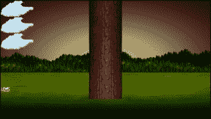

利用我们对运算符的了解，我们可以尝试移动刚刚添加的图形，但这里存在几个问题。首先，真实的云和蜜蜂移动方式是非均匀的。它们没有固定的速度或位置。虽然它们的位置和速度由风速或蜜蜂有多急等因素决定，但对于普通观察者来说，它们的路径和速度看起来是随机的。

### 随机数

随机数在游戏中有很多用处。也许你可以用它们来决定发给玩家的是哪张牌，或者在一定范围内从敌人健康值中扣除多少伤害。正如所暗示的，我们将使用随机数来确定蜜蜂和云的起始位置和速度。

### 在 C++ 中生成随机数

为了生成随机数，我们需要使用更多的 C++ 函数，准确地说是两个。现在先不要向游戏添加任何代码。让我们通过一些假设的代码来看一眼语法和所需的步骤。

计算机实际上无法挑选随机数。它们只能使用算法/计算来选取一个看起来随机的数字。为了不让该算法不断返回相同的值，我们必须为随机数生成器设置种子。种子可以是任何整数，尽管每次需要唯一的随机数时必须使用不同的种子。看看这段为随机数生成器设置种子的代码：

```cpp
// 使用时间为随机数生成器计时
srand((int)time(0));
```

上面的代码使用 `time` 函数从 PC 获取时间，如下 `time(0)`。调用 `time` 函数作为值传递给 `srand` 函数。结果是用当前时间作为种子。

之前的代码看起来稍微复杂一点是因为使用了看起来特殊的 `(int)` 语法。它的作用是将 `time` 返回的值转换/转换为 `int`。在这种情况下，这是 `srand` 函数的要求。

注意，从一种类型到另一种类型的转换被称为强制类型转换（cast）。

总之，上一行代码发生了以下情况：

- 使用 `time` 获取时间。
- 将其转换为 `int` 类型。
- 将此结果发送给 `srand`，从而为随机数生成器设置种子。

时间显然始终在变化。这使得 `time` 函数成为为随机数生成器设置种子的极佳方法。但是，如果多次设置随机数生成器的种子，且速度快到时间返回相同的值，会发生什么？我们在动画云运行时遇到并解决这个问题。

在此阶段，我们可以创建一个范围内的随机数，并将其保存到变量以便以后使用：

```cpp
// 获取随机数并将其保存到变量 number 中
int number = (rand() % 100);
```

注意我们给 `number` 赋值的奇特方式。通过使用取模运算符 `%` 和值 `100`，我们是在请求 `rand` 返回的数字除以 `100` 的余数。当你除以 `100` 时，可能的最大余数是 `99`。最小可能是 `0`。因此，之前的代码将生成一个 0 到 99（包含）之间的数字。这些知识对于为我们的蜜蜂和云生成随机速度和起始位置非常有用。

我们很快就会这样做，但我们首先需要学习如何在 C++ 中做决策。

### 使用 `if` 和 `else` 决策

C++ 的 `if` 和 `else` 关键字使我们能够做出决策。实际上，我们在上一章中已经见过 `if` 的作用，当时我们在每一帧中检测玩家是否按了 `Esc` 键：

```cpp
if (Keyboard::isKeyPressed(Keyboard::Escape))
{
    window.close();
}
```

到为止，我们看到了如何使用算术运算符和赋值运算符来创建表达式。现在我们可以看到一些新的运算符。

### 逻辑运算符

逻辑运算符将帮助我们通过构建可以测试真或假值的表达式来做出决策。起初，这看起来可能是一个范围很窄且不足以满足高级 PC 游戏可能需要的类型选择。一旦我们深入研究，就会发现只需要几个逻辑运算符，就可以做出所有所需的决策。

这里是最常用的逻辑运算符表格。看看它们及其相关示例，然后我们将看到如何使用它们。

#### `==`：相等比较运算符

比较运算符用于测试相等性，结果为真或假。例如，`(10 == 9)` 这样的表达式为 `false`。`10` 显然不等于 `9`！

#### `!`：逻辑非运算符

这是逻辑非（NOT）运算符。表达式 `(!(2 + 2 == 5))` 的结果为真，因为 `2 + 2` 不等于 `5`。

#### `!=`：不等比较运算符

这是另一个比较运算符，但它与 `=` 赋值运算符不同。它测试某个值是否不等于另一个。例如，表达式 `(10 != 9)` 为 `true`。`10` 不等于 `9`。

#### `>`：大于运算符

另一个比较运算符——实际上还有好几个。它测试一个值是否大于另一个值。表达式 `(10 > 9)` 为 `true`。

#### `<`：小于运算符

你猜对了。这用于测试一个值是否小于另一个值。表达式 `(10 < 9)` 为 `false`。

#### `>=`：大于或等于运算符

这个运算符测试一个值是否大于或等于另一个值，如果其中任一为真，结果就为真。例如，表达式 `(10 >= 9)` 为 `true`。表达式 `(10 >= 10)` 也是 `true`。

#### `<=`：小于或等于运算符

与之前的运算符一样，这个运算符测试两个条件，但这次是小于或等于。表达式 `(10 <= 9)` 为 `false`。表达式 `(10 <= 10)` 为 `true`。

#### `&&`：逻辑与运算符

这个运算符被称为逻辑与（AND）。它测试表达式的两个或多个独立部分，只有当所有部分都真时，结果才为真。逻辑与通常与其他运算符配合使用以构建更复杂的测试。

表达式 `((10 > 9) && (10 < 11))` 为 `true`，因为两部分都真，所以表达式为真。表达式 `((10 > 9) && (10 < 9))` 为 `false`，因为表达式中只有一个部分为真，另一个部分为假。

#### `||`：逻辑或运算符

这个运算符被称为逻辑或（OR），它与逻辑与相似，不同于 `||` 表达式的两个或多个部分中只要至少有一个部分为真，表达式就为真。

让我们看看上面使用的最后一个例子，但将 `&&` 替换为 `||`。现在表达式 `((10 > 9) || (10 < 9))` 为 `true` 了，因为表达式的一个部分为真。

## C++ `if` and `else`

让我们之前的例子变得不那么抽象。来认识 C++ 的 `if` 关键字。我们将使用 `if` 和一些运算符，结合一个小故事来演示它们的用法。接下来是一个虚构的军事场景，希望它比之前的例子不抽象。如果他们冲过桥，射击他们！

长官快不行了，由于知道剩下的部下没什么经验，他决定写一个 C++ 程序来传达他死后的最后指令。部队必须等待援军时守住桥的一侧。

长官想要确保士兵理解的第一条命令是：“如果他们冲过桥，射击他们！”

那么我们如何在 C++ 中模拟这种情况呢？我们需要一个 `bool` 变量：`isComingOverBridge`。接下来的代码假设 `isComingOverBridge` 变量已经声明并初始化为 `true` 或 `false`。

我们可以这样使用 `if`：

```cpp
if(isComingOverBridge)
{
    // Shoot them
}
```

如果 `isComingOverBridge` 变量等于 `true`，则左括号和右括号 `{...}` 内部的代码将执行。否则，程序将在 `if` 块之后继续运行，而不会运行其内部的代码。

### 或者尝试这样做

长官还想告诉士兵，如果敌人没有冲过桥，就留在原地。现在我们可以引入另一个 C++ 关键字，`else`。当我们想在 `if` 不为 `true` 时显式地执行某些操作时，可以使用 `else`。

例如，为了告诉士兵在敌人没有冲过桥时留在原地，我们可以写这段代码：

```cpp
if(isComingOverBridge)
{
    // Shoot them
}
else
{
    // Hold position
}
```

长官随后意识到问题并没有他最初想的那么简单。如果敌人冲过桥，但人数太多怎么办？他的小队会被击溃并屠杀。于是他想出了这段代码（这次我们还会使用一些变量）：

```cpp
bool isComingOverBridge;
int enemyTroops;
int friendlyTroops;
// 以某种种方式初始化之前的变量
// 现在使用 if
if(isComingOverBridge && friendlyTroops > enemyTroops) {
    // shoot them
}
else if(isComingOverBridge && friendlyTroops < enemyTroops) {
    // blow the bridge 
}
else {
    // Hold position 
}
```

上面的代码有三种可能的执行路径。第一种是敌人正在过桥，且友军人数较多：`if(isComingOverBridge && friendlyTroops > enemyTroops)`

第二种是敌人正在过桥但人数多于友军：`else if(isComingOveBridge && friendlyTroops < enemyTroops)`

那么第三种也是最后可能的结果，如果前两个都不成立，它将由不带 `if` 条件的最后一个 `else` 捕获。

### 读者挑战

你能发现上述代码中的一个缺陷吗？一个可能会让一群毫无经验的士兵陷入完全混乱的缺陷。敌人和友军人数恰好相等的情况没有被显式处理，因此将由最后的 `else` 处理。最后的 `else` 是为了在没有敌人时使用的。我想，任何一个有自尊的长官都会希望他的士兵在这种情况下战斗。他可以修改第一个 `if` 语句来适应这种可能性：`if(isComingOverBridge && friendlyTroops >= enemyTroops)`

最后，长官最后的顾虑是，如果敌人挥着白旗冲过桥并立即被屠杀，那么他的士兵最终会变成战犯。所需的 C++ 代码是显而易见的。使用他写的 `wavingWhiteFlag` 布尔变量，他写了这个测试：

```cpp
if (wavingWhiteFlag) {
    // Take prisoners
}
```

但代码放在哪的问题就不那么明确了。最后，长官选择了以下嵌套方案，并将 `wavingWhiteFlag` 的测试改为逻辑非，如下：

```cpp
if (!wavingWhiteFlag)
{
    // 没有投降，所以检查其他一切
    if(isComingOverTheBridge && friendlyTroops >= enemyTroops) {
        // shoot them 
    }
    else if(isComingOverTheBridge && friendlyTroops < enemyTroops) {
        // blow the bridge 
    }
    else {
        // 这是我们第一个 if 的 else 
        // Take prisoners
    }
    // Holding position
}
```

这说明我们可以将 `if` 和 `else` 语句嵌套在一起，以创建非常深入且详细的决策。我们可以继续使用 `if` 和 `else` 越来越复杂的决策，但我们看到的对于入门来说已经足够了。可能值得指出，通常解决问题的方法有多种。正确的方法通常是以最清晰、最简单的方式解决问题。我们正在接近掌握制作云朵和蜜蜂动画所需的全部 C++ 知识。我们还有一个最后的动画问题需要讨论，然后就可以回到游戏了。

## 时机

在移动蜜蜂和云朵之前，我们需要考虑时机。正如我们所知，主游戏循环会反复执行，直到玩家按下 `Esc` 键。

我们还了解到 C++ 和 SFML 异常快速。事实上，我那台旧的笔记本电脑执行一个简单的游戏循环（例如目前的这个）的速度大约每秒五千次。

## 帧率问题

让我们考虑蜜蜂的速度。为了方便讨论，我们可以假设我们要以每秒 200 像素的速度移动它。在一个宽度为 1920 像素的屏幕上，跨越整个宽度大约需要 10 秒，因为 `10 x 200` 等于 `2000`（接近 `1920`）。

此外，我们知道可以使用 `setPosition(...,...)` 来定位任何精灵（sprite）。我们只需要在括号中放入 `x` 和 `y` 坐标即可。除了设置精灵的位置外，我们还可以获取精灵的位置。例如，要获取蜜蜂的水平 `x` 坐标，我们将使用以下代码：

```cpp
int currentPosition = spriteBee.getPosition().x;
```

蜜蜂当前的 `x` 坐标现在存储在 `currentPosition` 中。为了让蜜蜂向右移动，我们可以向 `currentPosition` 加上 `200`（我们的预期速度）除以 `5000`（我笔记本电脑每秒的大帧数）的相应分数，如下：

```cpp
currentPosition += 200/5000;
```

现在我们可以使用 `setPosition` 来移动蜜蜂。它将以每帧 `200` 除以 `5000` 像素的速度从左向右平滑移动。但这种方法有两个大问题。

帧率是游戏循环每秒处理的次数。也就是说，我们处理玩家输入、更新游戏对象并将其绘制到屏幕上的次数。我们将在现在以及在书的其余部分扩展并讨论帧率的影响。

我笔记本电脑上的帧率可能并不总是恒定的。蜜蜂看起来可能是在间歇性地加速穿过屏幕。而且当然，我们希望游戏的观众群体不仅仅是我的笔记本电脑！每台 PC 的帧率都会变化，至少是略有不同。如果你有一台非常旧的 PC，蜜蜂看起来会像被铅压着一样；如果你有一台最新的游戏设备，它可能像是一只模糊的涡轮蜜蜂。

幸运的是，这个问题对于每个游戏都是相同的，而 SFML 提供了一个解决方案。理解该解决方案最简单的方法就是实现它。

## SFML 帧率解决方案

我们现在将测量并使用帧率来控制我们的游戏。要开始实现这一点，在主游戏循环之前添加此代码：

```cpp
// 每朵云有多快？
float cloud1Speed = 0;
float cloud2Speed = 0;
float cloud3Speed = 0;

// 控制时间本身的变量
Clock clock; while (window.isOpen())
{
```

在之前的代码中，我们声明了一个类型为 `Clock` 的对象并将其命名为 `clock`。类名以大写字母开头，对象名称（我们实际要使用的）以小写字母开头。对象名称是任意的，但 `clock` 似乎对于时钟来说是一个合适的名字。我们很快还会这里添加更多与时间相关的变量。

现在，在游戏代码的更新部分添加这段高亮代码：

```cpp
/*
****************************************
更新场景
****************************************
*/
// 测量时间
Time dt = clock.restart();
/*
****************************************
绘制场景
****************************************
*/
```

`clock.restart()` 函数正如你预期的那样会重启时钟。我们希望每一帧都重启时钟，以便我们计算每一帧所需的时间。然而，它还返回了自我们上次重启时钟以来所流逝的时间。因此，在之前的代码中，我们声明了一个类型为 `Time` 的对象，称为 `dt`，并使用它来存储 `clock.restart()` 函数返回的值。

现在，我们有一个名为 `dt` 的 `Time` 对象，它保存了自我们上次更新场景并重启时钟以来经过的时间。也许你已经看出这是要做什么了。让我们给游戏添加一些代码，然后我们看看用 `dt` 能做什么。

**注意**：`dt` 代表 delta time（增量时间），即两次更新之间的时间。

## 移动云和蜜蜂

让我们利用自上一帧以来的流时间为蜜蜂和云注入生命。这将解决在不同 PC 之间保持一致帧率的问题。

### 为蜜蜂注入生命

我们想做的第一件事是在特定的高度和速度上设置蜜蜂。我们只在蜜蜂非激活状态时才这样做。因此，我们将接下来的代码封装在一个 `if` 块中。检查并添加高亮代码，然后我们将讨论它：


```cpp
/*
****************************************

更新场景

****************************************
*/// 测量时间

Time dt = clock.restart();
// 设置蜜蜂

if (!beeActive)
{
// 蜜蜂有多快

srand((int)time(0));

beeSpeed = (rand() % 200) + 200;
// 蜜蜂有多高

srand((int)time(0) * 10);

float height = (rand() % 500) + 500;

spriteBee.setPosition(2000, height);

beeActive = true;
}
/*
****************************************

绘制场景

****************************************
*/
```

现在，如果蜜蜂不是激活状态（就像游戏刚开始时一样），`if(!beeActive)` 将为 `true`，上面的代码将按顺序执行以下操作：

1. 设置随机数生成器种子。
2. 获取一个 199 到 399 之间的随机数，并将结果赋值给 `beeSpeed`。
3. 再次设置随机数生成器种子。
4. 获取一个 499 到 999 之间的随机数，并将结果赋值给一个名为 `height` 的新 `float` 变量。
5. 将蜜蜂在 `x` 轴上的位置设置为 `2000`（刚好在屏幕右侧之外），并在 `y` 轴上设置为任何相等的高度。
6. 将 `beeActive` 设置为 `true`。

**注意**：`height` 变量是我们在游戏循环内部声明的第一个变量。此外，因为它是在 `if` 块内部声明的，所以它在 `if` 块外部实际上是“不可见”的。这对我们的使用没有问题，因为一旦设置了蜜蜂的高度，我们就不再需要它了。这种影响变量的现象被称为作用域（scope）。我们将在第四章“循环、数组、switch、枚举和函数——实现游戏机制”中更深入地探讨这一点。

如果我们运行游戏，蜜蜂实际上还不会发生任何变化，但现在蜜蜂处于激活状态，我们可以编写一些在 `beeActive` 为 `true` 时运行的代码。

添加以下高亮代码。正如你所看到的，它在 `beeActive` 为 `true` 时都会执行。这是因为它在 `if(!beeActive)` 块之后紧跟了一个 `else`：

```cpp
// 设置蜜蜂
if (!beeActive)
{
// 蜜蜂有多快

srand((int)time(0) });

beeSpeed = (rand() % 200) + 200; 
}
else
// 移动蜜蜂
{
// 蜜蜂有多高

srand((int)time(0) * 10);

float height = (rand() % 1350) + 500; 
spriteBee.setPosition(2000, height); 
beeActive = true;
spriteBee.setPosition(
    spriteBee.getPosition().x - (beeSpeed * dt.asSeconds()), 
    spriteBee.getPosition().y);
// 蜜蜂是否到达了屏幕右边缘？ 
if (spriteBee.getPosition().x < -100)
{
// 设置好在下一帧成为一朵全新的云 
beeActive = false;
}
}

/***************************************** 绘制场景
```

在 `else` 块中会发生以下情况。蜜蜂的位置根据以下标准进行更改。`setPosition` 函数使用 `getPosition` 函数来获取蜜蜂当前的 `x` 坐标。然后，它在该坐标上加上了 `beeSpeed * dt.asSeconds()`。`beeSpeed` 变量的值单位是每秒若干像素，它是在上一个 `if` 块中随机分配的。`dt.asSeconds()` 的值是一个小于 1 的分值，代表上一帧动画所花费的时间。

假设蜜蜂当前的 `x` 坐标为 1000。现在假设一台性能相当基础的 PC 每秒循环 5000 帧。这意味着 `dt.asSeconds` 将为 0.0002。进一步假设 `beeSpeed` 被设置为最大值 399 像素/秒。那么确定 `setPosition` 所使用的 `x` 坐标值的代码可以这样解释：`1000 - 0.0002 x 399`。

因此，蜜蜂在 `x` 轴上的新位置将是 999.9202。我们可以看到蜜蜂正在非常平滑地向左移动，每帧移动距离远小于一个像素。如果帧率波动，公式将产生一个相应的新值。如果我们在每秒只能达到 100 帧的 PC 或每秒达到 100 万帧的 PC 上运行相同的代码，蜜蜂的移动速度也是相同的。`setPosition` 函数使用 `getPosition().y` 来确保蜜蜂在整个活跃周期内保持在完全相同的 `y` 坐标。

我们刚刚在 `else` 块中添加的最终代码如下：

```cpp
// 蜜蜂是否到达屏幕右边缘？
if (spriteBee.getPosition().x < -100)
{
    // 设置准备好在下一帧变为一只全新的蜜蜂
    beeActive = false;
}
```

这段代码在每一帧中（当 `beeActive` 为 `true` 时）都会测试蜜蜂是否已经离开了屏幕左侧。如果 `getPosition` 函数返回值小于 `-100`，它一定已经离开了玩家的视野。当这种情况发生时，`beeActive` 被设置为 `false`，并且在下一帧，一只新蜜蜂将以新的随机高度和新的随机速度飞行。尝试运行游戏，观察我们的蜜蜂尽职地从右向左飞行，然后以新的高度和速度回到右侧。这几乎每次都是一只新蜜蜂。

提示：当然，真正的蜜蜂会停留很久，并在你努力集中砍树时骚扰你。我们将在下一个项目中制作更智能的游戏角色。

现在我们将以非常相似的方式让云移动。

### 吹动云朵

我们想要做的第一件事是在特定的高度和速度设置第一朵云。我们只想在云非活动状态时执行此操作。因此，我们将接下来的代码封装在一个 `if` 块中。在为蜜蜂添加的代码之后检查并添加高亮代码，然后我们进行讨论。它与我们为蜜蜂使用的代码几乎相同：

```cpp
else

// 移动蜜蜂

{
    spriteBee.setPosition(
        spriteBee.getPosition().x - (beeSpeed * dt.asSeconds()),
        spriteBee.getPosition().y
    );

    // 蜜蜂是否到达屏幕右边缘？
    if (spriteBee.getPosition().x < -100)
    {
        // 设置准备好在下一帧变为一只全新的蜜蜂
        beeActive = false;
    }

    // 管理云

    // 云 1
    if (!cloud1Active)
    {
        // 云有多快
        srand((int)time(0) * 10);
        cloud1Speed = (rand() % 200);

        // 云有多高
        srand((int)time(0) * 10);
        float height = (rand() % 150);

        spriteCloud1.setPosition(-200, height);
        cloud1Active = true;
    }
}
```

```cpp
/*
****************************************
绘制场景
****************************************
*/
```

我们刚刚的代码与蜜蜂代码之间的唯一区别是，我们处理的是不同的精灵（sprite），并为随机数使用了不同的范围。此外，我们对 `time(0)` 返回的结果乘以 `*10`，这样我们就能保证每朵云都获得不同的种子。当我们下次编写另一朵云的移动代码时，你会看到我们分别使用了 `*20` 和 `*30`。

现在我们可以在云处于活动状态时采取行动。我们将在 `else` 块中执行此操作。与 `if` 块一样，代码与蜜蜂的代码相同，只是所有代码都作用于云而不是蜜蜂：

```cpp
// 管理云

if (!cloud1Active)
{
    // 云有多快
    srand((int)time(0) * 10);
    cloud1Speed = (rand() % 200);

    // 云有多高
    srand((int)time(0) * 10);
    float height = (rand() % 150);

    spriteCloud1.setPosition(-200, height);
    cloud1Active = true;
}
else
{
    spriteCloud1.setPosition(
        spriteCloud1.getPosition().x + (cloud1Speed * dt.asSeconds()),
        spriteCloud1.getPosition().y
    );

    // 云是否到达屏幕右边缘？
    if (spriteCloud1.getPosition().x > 1920)
    {
        // 设置准备好在下一帧变为一个全新的云
        cloud1Active = false;
    }
}
```

```cpp
/*
****************************************
绘制场景
****************************************
*/
```

现在我们知道该做什么了，可以为第二和第三朵云复制相同的代码。在第一朵云代码之后立即添加这些处理第二和第三朵云的高亮代码：

```cpp
// 云 2
if (!cloud2Active)
{
    // 云有多快
    srand((int)time(0) * 20);
    cloud2Speed = (rand() % 200);

    // 云有多高
    srand((int)time(0) * 20);
    float height = (rand() % 300) - 150;

    spriteCloud2.setPosition(-200, height);
    cloud2Active = true;
}
else
{
    spriteCloud2.setPosition(
        spriteCloud2.getPosition().x +
        (cloud2Speed * dt.asSeconds()),
        spriteCloud2.getPosition().y
    );

    // 云是否到达屏幕右边缘？
    if (spriteCloud2.getPosition().x > 1920)
    {
        // 设置准备好在下一帧变为一个全新的云
        cloud2Active = false;
    }
}

if (!cloud3Active)
{
    // 云有多快
    srand((int)time(0) * 30);
    cloud3Speed = (rand() % 200);

    // 云有多高
    srand((int)time(0) * 30);
    float height = (rand() % 450) - 150;

    spriteCloud3.setPosition(-200, height);
    cloud3Active = true;
}
else
{
    spriteCloud3.setPosition(
        spriteCloud3.getPosition().x +
        (cloud3Speed * dt.asSeconds()),
        spriteCloud3.getPosition().y
    );

    // 云是否到达屏幕右边缘？
    if (spriteCloud3.getPosition().x > 1920)
    {
        // 设置准备好在下一帧变为一个全新的云
        cloud3Active = false;
    }
}
```

我们可以声明并初始化所有需要的变量来存储游戏数据。一旦有了这些变量，我们就可以使用算术运算符和赋值运算符对它们进行操作，并在逻辑运算符的测试中使用它们。结合 `if` 和 `else` 关键字，我们可以根据游戏中的当前情况对代码进行分支处理。利用所有这些新知识，我们制作了一些云朵和一只蜜蜂。在下一章中，我们将继续使用这些技能添加头上显示器（HUD），为玩家添加更多输入选项，并通过时间条视觉化地表示时间。

## 第 3 章 C++ 字符串、SFML 时间、玩家输入和 HUD

在本章中，我们将花费大约一半学习如何处理文本并将其显示在屏幕上，另一部分时间研究时间控制以及视觉化时间条如何为游戏营造紧迫感。我们将涵盖以下主题：

- 暂停和重启游戏
- C++ 字符串
- SFML Text 类和 SFML font 类
- 为 Timber!!! 添加 HUD
- 为 Timber!!! 添加时间条

### 暂停和重启游戏

随着我们在接下来的三个章节中继续开发游戏，代码显然会变得越来越长。因此，现在是考虑未来并为我们的代码增加一些结构的好时机。我们将添加这种结构来赋予我们暂停和重启游戏的能力。

我们将添加代码，使得游戏首次运行时它将处于暂停状态。玩家可以按下 Enter 键来启动游戏。然后游戏将运行，直到玩家被压扁或时间耗尽。此时，游戏将暂停并等待玩家再次按下 Enter 键以重启。

让我们一步步完成设置。首先，在主游戏循环之外声明一个名为 `paused` 的新 `bool` 变量，并将其初始化为 `true`：

```cpp
// 控制时间本身的变量
Clock clock; // 跟踪游戏是否运行
bool paused = true;

while (window.isOpen())
{
    /*
    ****************************************
    处理玩家输入
    ****************************************
    */
```

现在，每当游戏运行时，我们有一个值为 `true` 的变量 `paused`。接下来，我们将添加另一个 `if` 语句，其表达式将检查当前是否正在按下 Enter 键。如果正在按下，它将将 `paused` 设置为 `false`。在我们的其他键盘处理代码之后添加高亮的代码：

```cpp
/*
****************************************
处理玩家输入
****************************************
*/
if (Keyboard::isKeyPressed(Keyboard::Escape))
{
    window.close();
}

// 开始游戏
if (Keyboard::isKeyPressed(Keyboard::Return))
{
    paused = false;
}

/*
****************************************
更新场景
****************************************
*/
```

现在我们有一个名为 `paused` 的 `bool` 变量，它初始为 `true`，但在玩家按下 Enter 键时变为 `false`。此时，我们必须让游戏循环根据 `paused` 的当前任何值做出相应的响应。

我们将这样继续：我们将代码的整个更新部分（包括我们在上一章中编写的移动蜜蜂和云朵的代码）封装在一个 `if` 语句中。注意，在下一个代码中，`if` 块只有在 `paused` 不等于 `true` 时才会执行。或者换句话说，当游戏暂停时，它不会移动/更新。

这正是我们想要的。仔细观察添加新 `if` 语句及其相应的起始和结束大括号 `{}` 的准确位置。如果它们放在错误的位置，程序将无法按预期工作。添加高亮的代码来包裹代码的更新部分，注意接下来显示的上下文。我在几行上添加了 `...` 来表示隐藏的代码。显然，`...` 不是真实代码，不应添加到游戏中。你可以通过周围未高亮的代码来识别新代码（高亮部分）的起始位置和结束位置：

```cpp
/*
****************************************
更新场景
****************************************
*/
if (!paused)
{
    // 测量时间
    ...
    ...
    ...

    // 云朵是否到达了屏幕的右边缘？
    if (spriteCloud3.getPosition().x > 1920)
    {
        // 设置为准备在下一帧创建一个全新的云朵
        cloud3Active = false;
    }
} // 结束 if(!paused)

/*
****************************************
绘制场景
****************************************
*/
```

注意，当你放置新 `if` 块的结束大括号时，Visual Studio 会整齐地调整所有的缩进，以保持代码整洁。现在你可以运行游戏，在按下 Enter 键之前一切都将是静态的。现在可以为我们的游戏添加功能了，我们只需要记住当玩家死亡或时间耗尽时，我们需要将 `paused` 设置为 `true`。

### C++ 字符串

在上一章中，我们简要提到了字符串，并了解到 `string` 可以包含从单个字符到整本书的任何字母数字数据。我们还没有查看声明、初始化或操作字符串。现在我们来做这些吧。

### 声明字符串

声明 `string` 变量非常简单。我们说明类型，然后是名称：

```cpp
String levelName;
String playerName;
```

一旦声明了 `string`，我们就可以给它赋值。

### 给字符串赋值

给字符串赋值与普通变量一样，我们只需要写下名称，然后是赋值运算符，最后是值：

```cpp
levelName = "Dastardly Cave";
playerName = "John Carmack";
```

注意值需要包含在引号中。像普通变量一样，也可以在一行中声明并赋值：

```cpp
String score = "Score = 0";
String message = "GAME OVER!!";
```

这就是我们更改字符串变量的方法。

### 操作字符串


我们可以使用`#include <sstream>`指令来为字符串提供一些额外的功能。`sstream`类允许我们将一些字符串相加。当我们这样做时，这被称为拼接：

```cpp
String part1 = "Hello ";
String part2 = "World";
sstream ss;
ss << part1 << part2;
// ss 现在持有 "Hello World"
```

除了使用`sstream`对象外，`string`变量甚至可以与不同类型的变量拼接。接下来的代码开始显示字符串可能对我们非常有用：

```cpp
String scoreText = "Score = ";
int score = 0;
// 代码后后部分
score ++;
sstream ss;
ss << scoreText << score;
// ss 现在持有 "Score = 1"
```

**提示**：`<<`运算符是一个位运算运算符。然而，C++允许你在类的上下文中编写自己的类并重写特定运算符的功能。`sstream`类已经执行了这一点，使得`<<`运算符能够像现在这样工作。复杂性隐藏在类中。我们可以使用它的功能，而不必担心它是如何工作的。如果你觉得好奇，可以在这里阅读运算符重载：http://www.tutorialspoint.com/cplusplus/cpp_overloading.htm。你不需要更多信息来继续项目。

现在我们了解了C++字符串的基础知识，以及如何使用`sstream`，我们可以看到如何使用一些SFML类将它们显示在屏幕上。

## SFML Text 和 Font

在实际将代码添加到游戏之前，让我们通过一些假设的代码简要讨论`Text`和`Font`类。

在屏幕上绘制文本的第一步是有一个`font`。在第一章中，我们将字体文件添加到了项目文件夹中。现在我们可以将字体加载到SFML`Font`对象中以备用。代码如下：

```cpp
Font font;
font.loadFromFile("myfont.ttf");
```

在之前的代码中，我们首先声明`Font`对象，然后加载实际的字体文件。注意`myfont.ttf`是一个假设字体，我们可以使用项目文件夹中的任何字体。一旦加载了字体，我们需要一个SFML`Text`对象：

`Text myText;`现在我们可以配置`Text`对象了。这包括大小、颜色、在屏幕上的位置、保存消息的字符串，当然还有将其与我们的字体对象关联。

```cpp
// 分配实际消息
myText.setString("Press Enter to start!");
// 分配大小
myText.setCharacterSize(75);
// 选择颜色
myText.setFillColor(Color::White);
// 将字体设置为我们的 Text 对象
myText.setFont(font);
```

## 在 Timber 中添加分数和消息

现在我们已经足够了解关于字符串、`SFML Text`和`SFML Font`的知识来开始实现HUD（抬头显示）。接下来我们需要做是在代码文件的顶部添加另一个`#include`指令。正如我们所学的，`sstream`类提供了一些非常实用的功能，可以将字符串和其他变量类型组合成一个字符串。添加以下高亮代码：

```cpp
#include "stdafx.h"
#include <sstream>
#include <SFML/Graphics.hpp>
using namespace sf;
```

`int main()`

{ 接下来我们将设置我们的`SFML Text`对象。其中一个将包含消息，我们将根据游戏状态更改它；另一个将包含分数并需要定期更新。接下来声明`Text`和`Font`对象的代码将加载字体，将字体分配给`Text`对象，然后添加字符串消息、颜色和大小。这与我们在上一节中的讨论看起来应该很熟悉。此外，我们添加了一个名为`score`的新`int`变量，我们可以操作它来存储玩家的分数。

**提示** 请记住，如果你在第1章：C++、SFML、Visual Studio和开始第一个游戏中选择了`KOMIKAP_.ttf`以外的字体，你将需要修改代码的相关部分，以匹配你在`Visual Studio Stuff/Projects/Timber/Timber/fonts`文件夹中的`.ttf`文件。

添加高亮代码，我们就可以准备好更新HUD了：

```cpp
// 跟踪游戏是否正在运行
bool paused = true; // 画一些文本
int score = 0;

sf::Text messageText;
sf::Text scoreText;

// 我们需要选择一个字体
Font font;
font.loadFromFile("fonts/KOMIKAP_.ttf");

// 将字体设置为我们的消息
messageText.setFont(font);
scoreText.setFont(font);

// 分配实际消息
messageText.setString("Press Enter to start!");
scoreText.setString("Score = 0");

// 让它变大
messageText.setCharacterSize(75);
scoreText.setCharacterSize(100);

// 选择颜色
messageText.setFillColor(Color::White);
scoreText.setFillColor(Color::White);

while (window.isOpen())
{
    /*
    **************************************** 处理玩家输入
    **************************************** */
```

接下来的代码看起来可能有点复杂，甚至很混乱。然而，当你将其拆解一下时，它非常直接。检查并添加新代码，然后我们将进行分析：

```cpp
// 选择颜色
messageText.setFillColor(Color::White); 
scoreText.setFillColor(Color::White);

// 定位文本
FloatRect textRect = messageText.getLocalBounds();
messageText.setOrigin(textRect.left + textRect.width / 2.0f,
textRect.top +
textRect.height / 2.0f);
messageText.setPosition(1920 / 2.0f, 1080 / 2.0f);
scoreText.setPosition(20, 20); 

while (window.isOpen()) 
{
    /*
    **************************************** 处理玩家输入
    **************************************** */
```

我们有两个`Text`类型的对象将显示在屏幕上。我们希望将`scoreText`放置在左上角并留出一点边距。这并不是挑战；我们只需使用`scoreText.setPosition(20, 20)`即可让它位于左上角，水平和垂直方向都有20像素的边距。

然而，定位`messageText`并不那么容易。我们希望把它放在屏幕的正中央。起初这看起来可能不是问题，但随后我们记得我们绘制的所有内容的原点都是左上角。所以，如果我们简单地将屏幕宽度和高度除以二并将结果用于`messageText.setPosition...`，那么文本的左上角会在屏幕中心，它会向右侧不整地扩散。

我们需要一种方法，将`messageText`的中心设置为屏幕的中心。你刚刚添加的那段看起来很糟糕的代码将`messageText`的原点重新定位到它自身的中心。为了方便，这里再次给出当前讨论的代码：

```cpp
// 定位文本
FloatRect textRect = messageText.getLocalBounds();
messageText.setOrigin(textRect.left + textRect.width / 2.0f,
textRect.top +
textRect.height / 2.0f);
```

首先，在这段代码中，我们声明了一个`FloatRect`类型的新对象，名为`textRect`。`FloatRect`对象正如其名，包含一个带有浮点数坐标的矩形。代码随后使用`messageText.getLocalBounds`函数来初始化`textRect`，其值为包裹`messageText`的矩形坐标。接下来的代码跨越了四行（因为它很长），使用`messageText.setOrigin`函数将原点（我们绘制的点）更改为`textRect`的中心。当然，`textRect`包含一个矩形，它恰好匹配包裹`messageText`的坐标。然后，执行下一行代码：

`messageText.setPosition(1920 / 2.0f, 1080 / 2.0f);`

现在，`messageText`将整齐地位于屏幕的正中央。每当我们更改`messageText`的文本时，都将使用这段完全代码，因此它的原点需要重新计算。接下来我们声明了一个类型为`stringstream`的对象`ss`。注意我们使用了包含命名空间在全名`std::stringstream`。我们可以通过在文件顶部添加`using namespace std`来避免这种语法。但我们没有这样做，因为我们很少使用它。看一下代码并将其添加到游戏中，然后我们就可以详细地分析它。由于我们只希望在游戏未暂停时执行这段代码，请务必将其与其他代码一起添加到`if(!paused)`块中，如下所示：

```cpp
else {
    spriteCloud3.setPosition(spriteCloud3.getPosition().x + (cloud3Speed * dt.asSeconds()), spriteCloud3.getPosition().y);
    // 云是否到达了屏幕右边缘？
    if (spriteCloud3.getPosition().x > 1920)
    {
        // 设置好在下一帧变为整块云
        cloud3Active = false;
    }
}
// 更新分数文本
std::stringstream ss;
ss << "Score = " << score;
scoreText.setString(ss.str());
// End if(!paused)

/*
**************************************** 绘制场景
**************************************** */
```

我们使用`ss`和`<<`运算符提供的特殊功能，该运算符将变量连接到stringstream中。因此，`ss << "Score = " << score`代码的效果是创建一个包含"Score = "和`score`的任何取值的字符串，它们被连接在一起。例如，当游戏首次启动时，`score`等于零，因此`ss`将持有值"Score = 0"。如果`score`发生变化，`ss`将每帧进行调整。下一行代码只需将`ss`中包含的字符串显示/设置为`scoreText`。

`scoreText.setString(ss.str());`

现在准备好绘制到屏幕上了。接下来的代码绘制了两个`Text`对象（`scoreText`和`messageText`），但注意绘制`messageText`的代码封装在一个`if`语句中。这个`if`语句导致`messageText`只在游戏暂停时才绘制。添加接下来所示的高亮代码：

```cpp
// 现在绘制昆虫
window.draw(spriteBee);

// 绘制分数
window.draw(scoreText);

if (paused)
{
    // 绘制我们的消息
}
```

```cpp
window.draw(messageText); } // Show everything we just drew window.display();
```

我们现在可以运行游戏并看到HUD绘制在屏幕上了。你将看到`SCORE = 0`和`PRESS ENTER TO START!`消息。后者会在你按下`Enter`键时消失。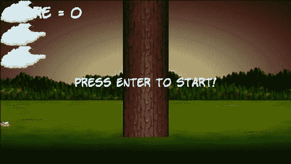

如果你想看到分数更新，可以在`while(window.isOpen)`循环中的任何地方添加一行临时代码：`score ++;`。如果你添加了这行临时代码，你将看到分数增长得非常快，非常快！[](image_rsrc3X8.jpg)

如果你添加了临时代码`score ++;`，请务必在继续之前之前将其删除。

## 添加时间条

由于时间是游戏中一个至关重要的机制，因此有必要让玩家意识到它的存在。他需要知道分配给他的六秒钟是否即将耗尽。随着游戏接近结束，这会带给他一种紧迫感；如果他表现足够好并维持或增加了剩余时间，则会带来成就感。

在屏幕上绘制剩余秒数并不是易于阅读的（当注意力集中在树枝上），也不是一种实现该目标的特别有趣的方法。我们需要一个时间条。我们的时间条将是一个简单的红色矩形，显著地显示在屏幕上。它开始时很宽，但随着时间的流逝会迅速缩小。当玩家的剩余时间归零时，时间条将完全消失。

在添加时间条的同时，我们将添加必要的代码来跟踪玩家的剩余时间，并在其耗尽时做出响应。让我们一步步进行。

找到之前的`Clock clock;`声明并添加以下高亮代码：

```cpp
// 控制时间本身的变量
Clock clock;

// 时间条
RectangleShape timeBar;
float timeBarStartWidth = 400;
float timeBarHeight = 80;
timeBar.setSize(Vector2f(timeBarStartWidth, timeBarHeight));
timeBar.setFillColor(Color::Red);
timeBar.setPosition((1920 / 2) - timeBarStartWidth / 2, 980);

Time gameTimeTotal;
float timeRemaining = 6.0f;
float timeBarWidthPerSecond = timeBarStartWidth / timeRemaining;

// 跟踪游戏是否正在运行
bool paused = true;
```

首先，我们声明了一个类型为`RectangleShape`的对象并将其命名为`timeBar`。`RectangleShape`是一个SFML类，非常适合绘制简单的矩形。

接下来，我们添加了几个float变量：`timeBarStartWidth`和`timeBarHeight`。我们分别将它们初始化为400和80。这些变量将帮助我们跟踪每帧绘制`timeBar`所需的大小。

接着，我们使用`timeBar.setSize`函数设置`timeBar`的大小。我们并没有直接传入那两个新的float变量。首先，我们创建了一个类型为`Vector2f`的新对象。然而，不同之处在于我们没有给新对象命名。我们只需用那两个float变量对其初始化，并将其直接传递给`setSize`函数。

**提示**：`Vector2f`是一个包含两个float变量的类。它还具有一些将在书中介绍介绍的其他功能。

之后，我们使用`setFillColor`函数将`timeBar`染红色。在之前的代码中，对`timeBar`做的最后件事是设置它的位置。y坐标完全直观，但我们设置x坐标的方式稍微有些。这里是计算计算公式：

`(1920 / 2) - timeBarStartWidth / 2`

代码首先将1920除以2。然后将`timeBarStartWidth`除以2。最后用前者减去后者。结果使得`timeBar`在屏幕上恰好水平居中显示。

我们讨论的最后三行代码声明了一个名为`gameTimeTotal`的新`Time`对象，一个初始化为6的新float`timeRemaining`，以及一个听起来很奇怪的float`timeBarWidthPerSecond`，我们将进一步讨论它。

`timeBarWidthPerSecond`变量通过`timeBarStartWidth`除以`timeRemaining`进行初始化。结果恰好是游戏每秒`timeBar`需要缩小的像素量。这在我们在每帧中调整`timeBar`大小时将非常有用。

显然，我们需要在玩家每次开始新游戏时重置剩余时间。执行此操作的逻辑位置是按下`Enter`键。我们还可以同时将分数置零。现在通过添加以下高亮代码来实现：

```cpp
// 开始游戏
if (Keyboard::isKeyPressed(Keyboard::Return))
{
    paused = false;
    // 重置时间和分数
    score = 0;
    timeRemaining = 5;
}
```

现在，我们每帧都必须减少剩余时间并相应调整`timeBar`的大小。如所示，在更新部分添加以下高亮代码：

```cpp
/*
****************************************
更新场景
****************************************
*/
if (!paused)
{
    // 测量时间
```


```cpp
Time dt = clock.restart(); // 从剩余时间中减去

timeRemaining -= dt.asSeconds();

// 调整时间条

timeBar.setSize(Vector2f(timeBarWidthPerSecond * timeRemaining, timeBarHeight));

// 设置蜜

if (!beeActive)

{

    // 蜜有多快

    srand((int)time(0) * 10);

    beeSpeed = (rand() % 200) + 200;

    // 蜜有多高

    srand((int)time(0) * 10);

    float height = (rand() % 1350) + 500;

    spriteBee.setPosition(2000, height);

    beeActive = true;

}

}

else

{

    // 移动蜜

}

```

逐行分析之前的代码：

首先，我们根据帧花费的时间长短减去了玩家剩余的时间：`timeRemaining -= dt.asSeconds();`。然后，我们用这段代码调整了`timeBar`的大小：`timeBar.setSize(Vector2f(timeBarWidthPerSecond * timeRemaining, timeBarHeight));`。`Vector2f`的 x 值用`timeBarWidthPerSecond`乘以`timeRemaining`进行初始化。这相对于玩家剩余的时间生成了完全正确的宽度。

当然，我们必须检测时间何时耗尽。目前，我们只需检测到时间已耗尽、暂停游戏并更改`messageText`的文本。添加高亮代码：

```cpp
if (timeRemaining <= 0.0f)

{

    // 暂停游戏

    paused = true;

    // 更改显示给玩家的消息

    messageText.setString("Out of time!!");

    // 根据大小重新定位文本

    FloatRect textRect = messageText.getLocalBounds();

    messageText.setOrigin(textRect.left + textRect.width / 2.0f, textRect.top + textRect.height / 2.0f);

    messageText.setPosition(1920 / 2.0f, 1080 / 2.0f);

}

```

最后，对于这部分代码，我们需要绘制`timeBar`。这段代码中没有我们之前见过很多次的新内容。只需注意我们在树之后绘制`timeBar`，这样它是可见的。添加高亮代码绘制时间条：

```cpp
// 绘制分数

window.draw(scoreText);

// 绘制时间条

window.draw(timeBar);

if (paused)

{

    // 绘制我们的消息

    window.draw(messageText);

}

// 显示我们刚刚的所有内容

window.display();

```

现在你可以运行游戏了。按 Enter 开始，观察时间条平滑地消失直到无。

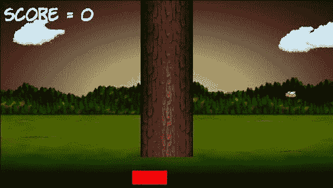

游戏随后暂停，并出现 OUT OF TIME!! 消息。

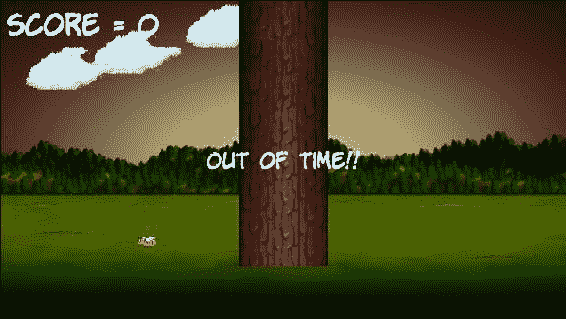

当然，你可以再次按下`Enter`来从头开始运行整个程序。

## 第 4 章 循环、数组、Switch、枚举和函数——实现游戏机制

本章包含的 C++ 信息可能比书中任何其他章节都更多。它充满了许多基础概念，这些概念将极大地提升我们的理解。它还将开始阐明我们之前一直跳过的一些模糊领域，例如函数和游戏循环。一旦我们探索了一系列 C++ 语言的必要因素，我们将利用所学的所有知识来让主游戏机制——树枝移动起来。到本章结束时，我们就准备好进入最后阶段并完成 Timber!!! 了！

我们将学习以下主题：

- 循环
- 数组
- 使用`switch`进行决策
- 枚举
- 函数入门
- 创建并移动树枝

### 循环

在编程中，我们经常需要多次执行同一操作。到目前为止我们看到的最显而易见的例子就是我们的游戏循环。在剥离所有代码后，我们的游戏循环看起来是这样：

```cpp
while (window.isOpen())

{

}

```

循环有几种不同的类型，我们将查看最常用的。这种循环的正确术语是`while`循环。

### while 循环

`while`循环非常直观。回想一下`if`语句及其求值为真或假的表达式。我们可以在`while`循环的条件表达式中使用完全相同的运算符和变量组合。与`if`语句一样，如果表达式为真，代码就会执行。然而，`while`循环的比较在于，其内部的 C++ 代码将继续执行，直到条件为假。看这段代码：

```cpp
int numberOfZombies = 100;

while(numberOfZombies > 0) {

    // 玩家杀死一个僵尸

    numberOfZombies--;

    // numberOfZombies 在每次通过循环时减少 1

}

// numberOfZombies 不再大于 0

```

这就是上一段代码发生的情况。在`while`循环之外，声明了`int numberOfZombies`并将其初始化为`100`。然后开始`while`循环。它的条件表达式是`numberOfZombies > 0`。因此，`while`循环将继续循环体中的代码，直到条件求值为假。这意味着上面的代码将执行 100 次。在循环的第一轮中，`numberOfZombies`等于`100`，然后是`99`、`98`等，依此类推。但一旦`numberOfZombies`等于零，它显然不再大于零了。然后代码将跳出`while`循环，并在闭大括号之后继续运行。

就像`if`语句一样，`while`循环也可能一次都不执行。看这个：

```cpp
int availableCoins = 10;

while(availableCoins > 10) {

    // 这里有更多代码

    // 除非 availableCoins 大于 10，否则不会运行

}

```

此外，表达式的复杂度或进入循环体中的代码量没有限制。考虑这个假设的游戏循环变体：

```cpp
int playerLives = 3;

int alienShips = 10;

while(playerLives !=0 && alienShips !=0 ) {

    // 处理输入

    // 更新场景

    // 绘制场景

}

// 当 playerLives 或 alienShips 等于 0 时在此处继续

```

上一个`while`循环将继续执行，直到`playerLives`或`alienShips`等于零。一旦其中一个条件发生，表达式将求值为假，程序将从`while`循环后的第一行代码继续执行。值得注意的是，一旦进入循环体，它将始终至少完成一次，即使表达式在途中求值为假也是如此，因为在代码尝试开始下一次循环之前，它不会被再次测试。例如：

```cpp
int x = 1;

while(x > 0) {

    x--;

    // x 现在是 0，所以条件为假

    // 但这一行仍然运行

    // 还有这一行

    // 还有我！

}

// 现在我完成了！

```

上一个循环体将执行一次。我们也可以设置一个无限运行的`while`循环，这不意料地被称为无限循环。这里有一个例子：

```cpp
int y = 0;

while(true){

    y++; // 越大……越大……

}

```

如果你觉得上面的循环很困惑，只需从字面上理解它。当条件为真时，循环执行。嗯，`true`永远为真，因此将一直执行。

### 跳出 while 循环

我们可能会使用无限循环，以便在体内部决定何时退出循环，而不是在表达式中决定。我们会在准备离开循环体时使用`break`关键字这样做。它看起来可能像这样：

```cpp
int z = 0;

while(true) {

    z++; // 越大……越大……

    break; // 不，你不离开

    // 代码不会到达这里

}

```

你可能也猜到，我们可以将任何 C++ 决策工具（如`if`、`else`以及我们很快就会学的另一个`switch`）组合到`while`循环和其他循环类型中。考虑这个例子：

```cpp
int x = 0;

int max = 10;

while(true) {

    x++; // 越大……越大……

    if(x == max){

        break;

    }

    // 不，你不离开

    // 代码只运行到 x = 10

}

```

我们可以花很长时间来观察 C++`while`循环的各种排列组合，但在某些时刻我们想要回到制作游戏中。所以让我们转向另一种类型的循环。

### for 循环

`for`循环的语法比`while`循环稍微复杂，因为设置它需要三个部分。先看代码，然后我们来分解它：

```cpp
for(int x = 0; x < 100; x ++) {

    // 需要执行 100 次的事情在这里

}

```

以下是`for`循环条件中所有部分的作用。

`for(声明和初始化; 条件; 每次迭代前的变化)`

为了进一步澄清，这里有一张表，解释了上述`for`循环示例中三个关键部分。

| 部分 | 描述 |
| :--- | :--- |
| 声明和初始化 | 我们创建了一个新的`int`变量`i`并将其初始化为`0` |
| 条件 | 与其他循环一样，它指的是必须为真才能执行循环的条件 |
| 每次通过循环后的变化 | 在示例中，`x ++`意味着每次通过时`x`增加/递增 1 |

我们可以改变`for`循环来完成更多事情。这里是另一个 10 开始倒数的另一个简单示例：

```cpp
for(int i = 10; i > 0; i--) {

    // 倒计时

}

// 起飞

```

`for`循环自行接管了初始化、条件评估和控制变量。我们将在本章稍后的部分在游戏中使用`for`循环。

### 数组

如果说变量是一个存储特定类型值（如`int`、`float`或`char`）的盒子，那么我们可以把数组想象成一排盒子。这排盒子可以是任何大小和类型，包括类对象。然而，所有的盒子必须是相同的类型。

提示：一旦我们在最终项目中学习了一些高级 C++，在某种程度上可以规避每个盒子必须使用相同类型的限制。这个数组听起来可能对我们第 2 章“变量、运算符和决策——制作精灵”中的云朵很有用。那么我们如何创建和使用数组呢？

### 声明数组

我们可以这样声明一个`int`类型变量数组：

```cpp
int someInts[10];

```

现在我们有一个名为`someInts`的数组，它可以存储十个`int`值。但到目前，它是空的。

### 初始化数组元素

要向数组元素中添加值，我们可以使用已经熟悉的类型语法，并结合一些新语法，即数组表示法。在接下来的代码中，我们将值`99`存储在数组第一个元素中：

```cpp
someInts[0] = 99;

```

要在第二个元素中存储值`999`，我们写这段代码：

```cpp
someInts[1] = 999;

```

我们可以如下在最后一个元素中存储值`3`：

```cpp
someInts[9] = 3;
```

注意，数组的元素始终从零开始，直到数组大小减 1。与普通变量类似，我们可以操作存储在数组中的值。唯一的区别是我们需要使用数组符号来操作，因为尽管我们的数组有一个名称`someInts`，但单个元素并没有名称。在接下来的代码中，我们将第一个和第二个元素相加，并将结果存储在第三个元素中：

```cpp
someInts[2] = someInts[0] + someInts[1];

```

数组也可以与普通变量无缝交互，例如在例所示：

```cpp
int a = 9999;

someInts[4] = a;

```

### 快速初始化数组元素

我们可以像这个示例一样，使用浮点数组快速为元素添加值：

```cpp
float myFloatingPointArray[3] {3.14f, 1.63f, 99.0f};

```

现在，值`3.14`、`1.63`和`99.0`分别存储在第一、第二和第三个位置。记住，当使用数组符号访问这些值时，我们将使用`[0]`、`[1]`和`[2]`。还有其他初始化数组元素的方法。这个稍微抽象的示例展示了使用`for`循环将`0`到`9`的值放入`uselessArray`数组中：

```cpp
for(int i = 0; i < 10; i++){

    uselessArray[i] = i;

}

```

代码假设`uslessArray`之前已经初始化为包含至少 10 个`int`变量。

### 这些数组对我们的游戏到底起什么作用？

我们可以在任何可以使用普通变量的地方使用数组。例如，它们可以用于下面的表达式中：

```cpp
// someArray[] 已经声明并初始化了 9999 个值

for(int i = 0; i < 9999; i++)

{

    // 对数组中的每个条目进行操作

}

```

也许数组在游戏代码中最大的好处在本节的开头已经暗示过了。数组可以存放对象（类的实例）。假设我们有一个`Zombie`类，并且想要存储大量的僵尸。我们可以像这个假设的示例那样做：

```cpp
Zombie horde [5] {zombie1, zombie2, zombie3}; // 等等

```

`horde`数组现在持有大量`Zombie`类的实例。每一个都是一个独立的、活着的（某种意义上的）、呼吸的且自主决定的`Zombie`对象。然后我们可以在每次通过游戏循环时遍历`horde`数组，移动僵尸，检查它们的头是否被斧头砍中，或者它们是否成功抓住了玩家。

如果我们早早就知道数组，它们将是处理云朵的完美工具。我们可以拥有任意数量的云，而且写的代码比我们为那三朵可怜的云写的代码要少得多。

**提示**：要完整查看这段改进后的云代码及其运行效果，请查看下载包中增强版的`Timber!!!`（代码和可玩游戏）。或者，在看代码之前，你可以尝试自己使用数组来实现云。

感受所有这些数组内容的最好方法是看它的实际运行。我们会在实现树枝时这么的。现在，我们将云代码保持原样，以便我们能尽快回到为游戏添加新功能。但首先，让我们再看一点关于`switch`的 C++ 决策语句。

### 使用 switch 决策

我们已经见过`if`，它允许我们根据表达式的结果来决定是否执行某块代码。有时，C++ 中的决策可以通过其他方式完成得更好。当我们必须根据一个清晰的可能结果列表来做决策，且该列表不涉及复杂的组合或宽泛的值范围时，`switch`通常是更好的选择。正如下面的代码所示，我们开始一个`switch`决策：

```cpp
switch(expression)

{

    // 此处有更多代码

}

```

在上一个示例中，`expression`可以是一个实际的表达式或仅仅是一个变量。然后，在大括号内部，我们可以根据表达式的结果或变量的值做出决策。我们使用`case`和`break`关键字来实现这一点：

```cpp
case x:

// 执行 x 的代码 break;

case y:

// 执行 y 的代码 break;

```

你可以从上一个抽象的示例中看到，每个`case`都表示一个可能的结果，每个`break`表示该 case 的结束以及执行离开`switch`块的点。我们还可以可选地使用不带值的`default`关键字，以便在没有任何`case`语句为真时运行某些代码。这里有一个示例：

```cpp
default: // 无值

// 如果没有其他 case 语句为真，在此处执行操作 break;

```

作为一个最后且不那么抽象的`switch`示例，考虑一个复古文字冒险游戏，玩家输入字母如`'n'`、`'e'`、`'s'`或`'w'`来分别向北、东、南、西移动。可以使用`switch`块来处理玩家的每个可能的输入，正如这个示例所示：

```cpp
// 在名为 command 的字符中获取用户输入

switch(command){

case 'n':

// 在此处处理移动 break;

case 'e':

// 在此处处理移动 break;

case 's':

// 在此处处理移动 break;

case 'w':

// 在此处处理移动 break;

// 更多可能的 case

default:

// 请玩家重试 break;

}
```


理解我们学到的 `switch` 所有知识最好的方法将是将它与我们正在学习的所有新概念一起付诸实践。

### 类枚举（Class enumerations）

枚举是逻辑集合中所有可能值的列表。C++ 枚举是列举某物的一种极佳方法。例如，如果我们的游戏使用了变量，这些变量只能处于特定的值范围内，并且这些值在逻辑上可以形成一个集合或组，那么使用枚举可能是合适的。它们会让你的代码更清晰且更不容易出错。

在 C++ 中声明类枚举，我们结合使用两个关键字 `enum` 和 `class`，后面跟着枚举的名称，然后是枚举可以包含的值，这些值包含在一对大括号 `{...}` 中。作为一个示例，查看这个枚举声明。注意，习惯上是将枚举中的可能值全部大写：

```cpp
enum class zombieTypes { REGULAR, RUNNER, CRAWLER, SPITTER, BLOATER };
```

注意，到此时，我们还没有声明任何 `zombieType` 的实例，只是类型本身。如果这听起来很奇怪，可以这样想：SFML 创建了 `Sprite`、`RectangleShape` 和 `RenderWindow` 类，但要使用任何这些类，我们必须声明该类的对象或实例。

此时，我们创建了一个名为 `zombieTypes` 的新类型，但我们没有它的实例。所以让我们现在创建它们吧：

```cpp
zombieType dave = zombieTypes::CRAWLER;

zombieType angela = zombieTypes::SPITTER;

zombieType jose = zombieTypes::BLOATER;

/* 僵尸是虚构生物，与真人的任何相似之处完全属巧合 */
```

接下来是我们即将在 Timber!!! 中添加的代码类型预览。我们需要跟踪树枝或玩家位于树的哪一侧，因此我们将像下面的示例所示：

```cpp
enum class side { LEFT, RIGHT, NONE };
```

我们可以如下将玩家放置在左侧：

```cpp
// 玩家起始于左侧
side playerSide = side::LEFT;
```

我们可以让分支位置数组（数组从零开始）的第四层完全没有树枝，如下：

```cpp
branchPositions[3] = side::NONE;
```

我们也可以在表达式中使用枚举：

```cpp
if (branchPositions[5] == playerSide)
{
    // 最底部的树枝与玩家在同一侧 // 被压扁！！
}
```

我们将查看另一个重要的 C++ 主题，然后就会回到游戏编程中。

### 函数入门

那么 C++ 函数到底是什么呢？函数是变量、表达式和控制流语句（循环和分支）的集合。事实上，到目前为止书中学到的任何代码都可以用于函数。我们编写函数的第一部分称为签名（signature）。这里有一个函数签名示例：

```cpp
public void bombPlayer(int power, int direction)
```

如果你添加一对开启和关闭的大括号 `{...}` 以及一些函数实际执行的代码，那么我们就有一个完整的函数，即定义：

```cpp
void shootLazers(int power, int direction)
{
    // 砰！
}
```

随后我们可以在代码的其他部分使用我们的新函数，如下所示：

```cpp
// 攻击玩家
bombPlayer(50, 180); // 执行函数中的代码 // 我又回来了 - 函数结束后代码在此继续执行
```

当我们使用一个函数时，我们称之为“调用”（call）它。在我们调用 `bombPlayer` 的点上，程序的执行分支跳转到该函数内部的代码。该函数将一直运行，直到到达末尾或被要求返回。然后，代码将从函数调用后的第一行继续运行。我们已经一直在使用 `SFML` 提供的函数了。这里的不同之处在于，我们将学习编写和调用我们自己的函数。

这里是另一个函数的示例，包含了让函数返回到调用它的代码的代码：

```cpp
int addAToB(int a, int b)
{
    int answer = a + b;
    return answer;
}
```

使用上述函数的调用可能如下：

```cpp
int myAnswer = addAToB(2, 4);
```

显然，我们不需要编写函数来将两个变量相加，但这个示例有助于我们更深入地了解函数的工作原理。首先我们传入了值 `2` 和 `4`。在函数签名中，值 `2` 被赋值给 `int a`，值 `4` 被赋值给 `int b`。在函数体内部，变量 `a` 和 `b` 相加并用于初始化新变量 `int answer`。`return answer;` 这一行正是如此。它将存储在 `answer` 中的值返回给调用代码，导致 `myAnswer` 被初始化为值 `6`。

注意上述示例中的每个函数签名都略有不同。这是因为 C++ 函数签名非常灵活，允许我们构建所需的函数。函数签名具体如何定义、必须如何调用函数，以及函数是否或如何返回值，值得进一步讨论。让我们为签名的每个部分起一个名称，以便我们可以将其拆分为部分并学习它们。

这里有一个用正式技术术语描述其各个部分的函数签名：

`返回类型 | 函数名 | (参数)`

以下是我们可以用于这些每个部分的几个示例：

- **返回类型（Return-type）**：`bool`、`float`、`int` 等，或任何 C++ 类型或表达式。
- **函数名（Name of function）**：`bombPlayer`、`shootLazers`、`setCoordinates`、`addAToB` 等。
- **参数（Parameters）**：`(int number, bool hitDetected)`、`(int x, int y)`、`(float a, float b)`。

现在让我们逐一查看每个部分。

### 函数返回类型（Function return types）

顾名思义，返回类型是从函数返回给调用代码的值的类型：

```cpp
int addAToB(int a, int b)
{
    int answer = a + b;
    return answer;
}
```

在我们之前那个有点无聊但实用的 `addAToB` 示例中，签名中的返回类型是 `int`。函数 `addAToB` 向调用它的代码返回一个可以放入 `int` 变量的值。返回类型可以是我们目前为止见过的任何 C++ 类型，或者是我们尚未见过的类型之一。

然而，函数并不一定返回值。在这种情况下，签名必须使用 `void` 关键字作为返回类型。当使用 `void` 关键字时，函数体不能尝试返回值，因为这将会导致错误。它可以使用不带值的 `return` 关键字。以下是一些有效的返回类型和 `return` 关键字使用的组合：

```cpp
void doWhatever()
{
    // 我们的代码
    // 我在这里结束返回到调用代码 // 没有必要的返回
}
```

另一种可能性如下：

```cpp
void doSomethingCool()
{
    // 我们的代码 // 只要我不尝试添加返回值，我就可以这样做
}
```

接下来的代码为我们提供了更多可能的函数示例。请务必阅读注释和代码：

```cpp
void doYetAnotherThing()
{
    // 一些代码

    if (someCondition)
    {
        // 如果 someCondition 为真，返回到调用代码 // 在函数体结束之前
        return;
    }

    // 可能执行也可能不执行的其他代码

    return; // 因为我正处于函数体的底部
            // 而且返回类型是 void，我
            // 真的没必要，但我想我是为了
            // 明确函数已经结束了。
}

bool detectCollision(Ship a, Ship b)
{
    // 检测是否发生了碰撞

    if (collision)
    {
        // 砰!!!
        return true;
    }
    else
    {
        // 没中
        return false;
    }
}
```

上面的最后一个函数示例 `detectCollision` 是我们 C++ 代码未来的一个瞥，它展示了我们也可以将用户定义的类型（称为对象）传递到函数中以对它们进行计算。我们可以这样依次调用上面的每个函数：

```cpp
// 好，是时候调用一些函数了
doWhatever();

doSomethingCool();

doYetAnotherThing();

if (detectCollision(milleniumFalcon, lukesXWing))
{
    // 绝地武士完蛋了！

    // 但一直有莉娅。// 除非她在千年夺战机上？
}
else
{
    // 活到下一次战斗
}

// 从这里继续代码
```

不要担心关于 `detectCollision` 函数看起来奇怪的语法，我们很快就会看到这样的真实代码。简单来说，我们直接将返回值（`true` 或 `false`）作为表达式用在 `if` 语句中。

### 函数名（Function names）

当我们设计自己的函数时，函数名几乎可以是任何内容。但最好使用单词（通常是动词）来清晰地解释函数将做什么。例如，看看这个函数：

```cpp
void functionaroonieboonie(int blibbityblob, float floatything)
{
    // 代码在这里
}
```

上面的代码完全合法且可以运行，但下面这些函数名称清晰得多：

```cpp
void doSomeSpecificTask()
{
    // 代码在这里
}

void getMyShipHealth()
{
    // 代码在这里
}

void startNewGame()
{
    // 代码在这里
}
```

### 函数参数（Function parameters）

我们知道函数可以向调用代码返回结果。但如果我们需要从调用代码共享一些数据值给函数呢？参数允许我们与函数共享值。实际上，我们在查看返回类型时已经见过参数的示例了。我们将更仔细地看同一个示例：

```cpp
int addAToB(int a, int b)
{
    int answer = a + b;
    return answer;
}
```

上面，参数是 `int a` 和 `int b`。注意，在函数体的第一行，我们使用 `a + b` 就像它们已经是声明并初始化的变量一样。嗯，那是它们确实是。函数签名中的参数是它们的声明，而调用函数的代码初始化了它们。

**提示说明**：注意我们将函数签名括号 `(int a, int b)` 中的变量称为参数。当我们从调用代码向函数传递值时，这些值被称为参数（arguments）。当这些参数到达时，它们被称为参数（parameters），并用于初始化真实的、可用的变量：`int returnedAnswer = addAToB(10, 5);`

此外，正如我们在之前的示例中部分看到的那样，我们不必只在参数中使用 `int`。我们可以使用任何 C++ 类型。我们也可以根据解决问题的需要使用尽可能多的参数，但保持参数列表尽可能短并因此易于管理是一个良好的习惯。正如我们将在后续章节中看到的，我们将一些更酷的函数用法留在了这个入门教程之外，以便我们在进一步讨论函数主题之前学习相关的 C++ 概念。

### 函数体（The function body）

函数体就是我们一直在通过此类注释避开的部分，例如：

```cpp
// 代码在这里

// 一些代码
```

但实际上，我们已经确切知道在这里要做什么了！到目前为止学过的任何 C++ 代码可以在函数体内部运行。

## 函数原型（Function Prototypes）

我们已经学习了如何编写函数，也学习了如何调用函数。然而，为了让它们工作，我们还需要做一件事：所有函数都必须有一个原型。原型让编译器感知到我们的函数；如果没有原型，整个游戏将无法编译。幸运的是，原型非常直观。

我们只需要简单地重复函数的签名，后面加上一个分号即可。要注意，原型必须在尝试调用或定义函数之前出现。因此，一个完全可用的函数的最简单示例如下。请仔细查看注释以及函数的不同部分在代码中出现的位置。

```cpp
// 函数原型
// 注意分号
int addAToB(int a, int b);

int main()
{
    // 调用函数
    // 将结果存储在 answer 中
    int answer = addAToB(2, 2); // 在定义之前调用

    // 但因为有原型，这是没问题的

    // 退出 main
    return 0;
}

// main 结束

// 函数定义
int addAToB(int a, int b)
{
    return a + b;
}
```

之前的代码演示了以下内容：

- 原型位于 `main` 函数之前。
- 使用函数的调用正如我们预期的，在 `main` 函数内部。
- 定义在 `main` 函数之后或外部。

**注意**：请注意，当定义发生在函数使用之前时，我们可以省略函数原型直接进入定义。然而，随着我们的代码变得越来越长并分散在多个文件中，这种情况几乎永远不会发生。我们将始终使用单独的原型和定义。

让我们看看如何保持函数的组织条理。

### 组织函数（Organizing Functions）

非常值得指出的是，如果我们有多个函数，特别是当这些函数相当长时，我们的 `.cpp` 文件将迅速变得难以管理。这违背了函数设计初衷的部分目标。我们在下一个项目中将看到的解决方案是：我们可以将所有的函数原型添加到我们自己的头文件（`.hpp` 或 `.h`）中。然后我们可以在另一个 `.cpp` 文件中编写所有函数，只需在 `main.cpp` 文件中添加另一个 `#include` 指令即可。这样我们就可以使用任何数量的函数，而无需向主代码文件添加它们的任何代码（原型或定义）。

## 函数陷阱（Function Gotcha!）

关于函数我们应该讨论的另一个点是作用域（scope）。如果在函数中声明变量（无论是直接还是作为参数之一），那么该变量在函数外部是不可用或不可见的。此外，任何在函数外部声明的变量在函数内部都是不可见或不可使用的。

我们在函数代码和调用代码之间共享值的方法是通过参数和返回值。当一个变量由于来自另一个函数而不可用，被称为“超出作用域（out of scope）”。当它可用且有效时，被称为“在作用域内（in scope）”。

**注意**：实际上，在 `C++` 中在任何块内声明的变量仅在该块内作用域有效！这包括循环和 `if` 块。在 `main` 顶部声明的变量在 `main` 的任何地方都有效。在游戏循环中声明的变量只在游戏循环内有效，依此类推。在函数或其他块内声明的变量被称为局部变量。我们写的代码越多，这一点就越有意义。每当我们在代码中遇到关于作用域的问题时，我都会讨论它以使事情变得清晰。在下一节将出现这样一个问题。还有一些 `C++` 基础知识会彻底揭开这个问题，它们被称为引用（references）和指针（pointers），我们分别将在第 7 章“C++ 引用、精灵图和顶点数组”以及第 8 章“指针、标准模板库和纹理管理”中学习它们。

### 关于函数的结语——暂时

关于函数我们还有很多可以学的，但我们对它们的了解已经足够实现游戏的下一个部分了。如果参数、签名、定义等所有技术术语还没有完全理解，请不要担心。当我们开始使用它们时，这些概念会变得清晰。

## 关于函数的最终结语——暂时

你可能没有注意到，我们在调用函数（尤其是 `SFML` 函数）时，是在函数名之前加上了对象名称和一个点（`.`），如下例所示：

```cpp
spriteBee.setPosition();

window.draw();

// 等等
```

然而，我们整个关于函数的讨论是在我们没有任何对象的情况下调用函数。我们可以将函数作为类的一部分编写，也可以简单地作为独立函数。当我们将函数作为类的一部分编写时，我们需要该类的对象来调用该函数；而当我们有独立函数时，则不需要。

我们将在稍后编写一个独立函数，并在第 6 章“面向对象编程、类和 `SFML` 视图”中开始编写带有函数的类。我们目前为止关于函数的所有知识在两种情况下都是相关的。

### 生长分支（Growing the branches）

接下来，正如我在过去大约十七页里一直承诺的那样，我们将使用所有新的 C++ 技术在树上绘制并移动一些树枝。将这段代码添加到 `main` 函数之外。为了绝对清楚，我的意思是放在代码 `int main()` 之前：

```cpp
#include "stdafx.h"

#include <sstream>

#include <SFML/Graphics.hpp>

using namespace sf; // 函数声明

void updateBranches(int seed);

const int NUM_BRANCHES = 6;

Sprite branches[NUM_BRANCHES]; // 玩家/分支在哪里？

// 左或右
enum class side { LEFT, RIGHT, NONE };

side branchPositions[NUM_BRANCHES];

int main()
{
    // ...
```


我们刚刚通过这段新代码实现了不少事情：

- 首先，我们为`updateBranches`编写了一个函数原型。我们可以看到它没有返回值（`void`），并且它接受一个`int`类型参数`seed`。我们很快就会编写函数定义，并看到它的具体作用。
- 接下来，我们声明了一个常量`int` `NUM_BRANCHES`并将其初始化为`6`。树上会有六条移动的树枝，我们很快就会看到`NUM_BRANCHES`对我们有多用。
- 之后，我们声明了一个名为`branches`的`Sprite`对象数组，它可以容六个`Sprites`。
- 之后，我们声明了一个新的枚举`side`，带有三个可能的值：`LEFT`、`RIGHT`和`NONE`。这将在我们代码中的几处描述单个树枝以及玩家的位置。
- 最后，在之前的新代码中，我们初始化了一个大小为`NUM_BRANCHES`（`6`）的`side`类型数组。为了清楚这实现了什么：我们将拥有一个包含六个值的`branchPositions`数组。这些值中的每一个类型都是`side`，其可以是`LEFT`、`RIGHT`或`NONE`。

**注意**：当然，你真正想知道的是为什么常量、两个数组和枚举被声明在`main`函数之外。通过将它们声明在`main`之上，它们现在具有全局作用域。或者换句话说，常量、两个数组和枚举在整个游戏范围内都有效。这意味着我们可以在`main`函数和`updateBranches`函数的任何地方访问并使用它们。注意，将所有变量尽可能地限制在它们实际使用的局部是一种良好做法。将一切都设为全局的似乎很有用，但这会导致代码难以阅读且容易出错。

## 准备分支 (Preparing the branches)

现在我们将准备六个`Sprite`对象并将它们加载到`branches`数组中。在我们的游戏循环之前添加高亮代码：

```cpp
// 放置文本
FloatRect textRect = messageText.getLocalBounds();
messageText.setOrigin(textRect.left +textRect.width / 2.0f,
textRect.top +
textRect.height / 2.0f);
messageText.setPosition(1920 / 2.0f, 1080 / 2.0f);
scoreText.setPosition(20, 20);

// 准备 6 个分支
Texture textureBranch;
```

```cpp
textureBranch.loadFromFile("graphics/branch.png");// Set the texture for each branch sprite
for (int i = 0; i < NUM_BRANCHES; i++)
{
    branches[i].setTexture(textureBranch);
    branches[i].setPosition(-2000, -2000);
    // Set the sprite's origin to dead center
    // We can then spin it round without changing its position
    branches[i].setOrigin(220, 200);
} while (window.isOpen())
```

之前的代码没有使用任何新概念。首先，我们声明了一个`SFML Texture`对象并将`branch.png`图形加载其中。接下来，我们创建了一个`for`循环，它将`i`设置为0，并在每次循环时将`i`增1，直到`i`不再小于`NUM_BRANCHES`。这是完全正确的，因为`NUM_BRANCHES`的于6，而`branches`数组的索引是从0到5。

在`for`循环内部，我们使用`setTexture`为`branches`数组中的每个`Sprite`设置`Texture`，然后使用`setPosition`将其隐藏在屏幕外。最后，我们使用`setOrigin`将`origin`（绘制时所在的点）设置为精灵的中心。很快，我们将旋转这些精灵，将原点设在中心意味着它们会平稳地旋转，而不会改变精灵的位置。

## 每一帧更新分支精灵

在接下来的代码中，我们根据精灵在`branches`数组中的位置以及其对应的`branchPositions`数组中`side`的值，来设置所有精灵的位置。添加高亮的代码并尝试理解它，然后我们可以进行详细介绍。

```cpp
// Update the score text
std::stringstream ss;
ss << "Score: " << score;
scoreText.setString(ss.str());

// update the branch sprites
for (int i = 0; i < NUM_BRANCHES; i++) {
    float height = i * 150;
    if (branchPositions[i] == side::LEFT) {
        // Move the sprite to the left side
        branches[i].setPosition(610, height);
        // Flip the sprite round the other way
        branches[i].setRotation(180);
    } else if (branchPositions[i] == side::RIGHT) {
        // Move the sprite to the right side
        branches[i].setPosition(1330, height);
        // Set the sprite rotation to normal
        branches[i].setRotation(0);
    } else {
        // Hide the branch
        branches[i].setPosition(3000, height);
    }
}
 // End if(!paused)
```

### 绘制场景

我们刚刚添加的代码是一个大的`for`循环，它将`i`设置为0，每次循环将`i`增1，并持续直到`i`不再小于6。在`for`循环内部，一个名为`height`的新`float`变量被设置为`i * 150`。这意味着第一个分支的高度为0，第二个为150，第六个为750。

接下来我们有一组`if`和`else`块结构。查看剥离代码后的结构：

```cpp
if()
{
}
else if()
{
}
else
{
}
```

第一个`if`使用`branchPositions`数组来检查当前分支是否应该在左侧。如果是，它会将`branches`数组中对应的`Sprite`设置到屏幕上适合左侧的左（610像素），并取决于当前的`height`是多少。然后它将精灵反向翻转180度，因为`branch.png`图形默认是向右悬挂的。

`else if`仅在分支不在左侧时执行。它使用相同的方法来检查它是否在右侧。如果是，则将分支绘制在右侧（1330像素）。然后将精灵的旋转设置为0度，以防它之前处于180度状态。如果`x`坐标看起来有点奇怪，请记住我们将分支精灵的`origin`设置为了它们的中心。最后的`else`正确地假设当前的`branchPosition`必须是`NONE`（无），并将分支隐藏在3000像素处的屏幕外。

### 绘制分支

到此为止，我们的分支已经就位，准备好进行绘制。在这里我们使用另一个`for`循环，从0到5遍历整个`branches`数组并绘制每个分支精灵。添加以下高亮代码：

```cpp
// Draw the clouds
window.draw(spriteCloud1);
window.draw(spriteCloud2);
window.draw(spriteCloud3);

// Draw the branches
for (int i = 0; i < NUM_BRANCHES; i++)
{
    window.draw(branches[i]);
}

// Draw the tree
window.draw(spriteTree);
```

当然我们还没有编写实际移动所有分支的函数。一旦我们编写了该函数，还需要确定何时以及如何调用它。让我们解决第一个问题并编写该函数。

### 移动分支

我们已经在`main`函数上方添加了函数原型。现在我们编写该函数的实际定义，该函数每调用一次就会将所有分支向下移动位置。我们将分两部分编写此函数，以便更容易检查发生的情况。在`main`函数的结束大括号之后添加`updateBranches`函数的第一部分：

```cpp
// Function definition
void updateBranches(int seed)
{
    // Move all the branches down one place
    for (int j = NUM_BRANCHES-1; j > 0; j--) {
        branchPositions[j] = branchPositions[j - 1];
    }
}
```

在函数的第一部分中，我们简单地一个一个地向下移动所有分支，从第六个分支开始。这是通过让`for`循环从5计数到0实现的。`branchPositions[j] = branchPositions[j - 1]`完成了移动。

之前的代码需要注意的另一点是，我们可以在顶部生成新分支。添加高亮的代码：

```cpp
// Function definition
void updateBranches(int seed)
{
    // Move all the branches down one place
    for (int j = NUM_BRANCHES-1; j > 0; j--) {
        branchPositions[j] = branchPositions[j - 1];
    }

    // Spawn a new branch at the top // LEFT, RIGHT or NONE
    srand((int)time(0)+seed);
    int r = rand() % 5;
    switch (r)
    {
        case 0:
            branchPositions[0] = side::LEFT;
            break;
        case 1:
            branchPositions[0] = side::RIGHT;
            break;
        default:
            branchPositions[0] = side::NONE;
            break;
    }
}
```

在函数的最后部分，我们使用了传入函数调用的整数`seed`变量。这样做是为了保证随机数种子总是不同的，我们将在下一章介绍该值是如何得到的。接下来，我们生成一个0到4之间的随机数并将结果存储在`int`变量`r`中。现在使用`r`作为表达式进行`switch`。`case`语句意味着如果`r`等于0，我们在树的顶部左侧添加新分支。如果`r`等于1，则分支位于右侧。如果`r`是其他任何值（2、3或4），则由`default`确保顶部不会添加分支。这种左、右、无的平衡让树看起来很真实，游戏运行得良好。你可以轻松地更改代码让分支更频繁或更少。

即使写了所有这些关于分支的代码，我们仍然无法在游戏中窥见其中任何一个。这是因为在实际调用`updateBranches`之前我们还有更多工作要做。如果你现在真的想看到分支，可以在游戏循环之前添加一些临时代码，并每次使用唯一的种子调用该函数五次：

```cpp
updateBranches(1);
updateBranches(2);
updateBranches(3);
updateBranches(4);
updateBranches(5);
```

现在你可以看到在位位置上的分支了。但如果我们要让分支真正移动，我们需要定期调用`updateBranches`。

提示：在继续之前，不要忘记移除临时代码。

现在我们可以将注意力转向玩家，并真正调用`updateBranches`函数了。

# 第5章 碰撞、声音与结束条件 – 让游戏变得可玩

这是第一个项目的最后阶段。在本章结束时，你将拥有自己的第一个完整的游戏。一旦Timber!!!运行起来，请务必阅读本章的最后一节，因为它将为你提供改进游戏的方法。我们将学习以下主题：

- 添加剩余的精灵
- 处理玩家输入
- 为飞行木头制作动画
- 处理死亡
- 添加音效
- 添加功能并改进Timber!!!

## 准备玩家（以及其他精灵）

让我们添加玩家精灵的代码，同时再添加几个精灵和纹理。接下来的这一块相当大的代码还添加了一个在玩家被压扁时使用的墓碑精灵、一个用于砍伐的斧头精灵，以及一个每次在玩家砍击时都会飞出去的木头精灵。

注意，在`spritePlayer`对象之后，我们还声明了一个辅助变量`playerSide`，用来跟踪玩家当前所在的位置。此外，我们为`spriteLog`对象添加了一些额外的变量，包括`logSpeedX`、`logSpeedY`和`logActive`，用于存储木头移动的速度以及它当前是否正在移动。`spriteAxe`还有两个相关的浮点常量变量，用来记住左右两侧理想的像素位置。

将接下来的这块代码添加到`while(window.isOpen())`代码之前，就像我们以前经常做的那样。请注意，接下来的列表中的所有代码都是新的，而不只是高亮显示的代码。我没有为下一块代码提供任何额外的上下文，因为`while(window.isOpen())`应该很容易识别。高亮的代码就是我们刚刚专门讨论的代码。

将此段代码全部添加到`while(window.isOpen())`之前之前，并在脑海中记住我们简要讨论过的高亮行。这将使得本章剩余的代码变得更容易理解：

```cpp
// 准备玩家
Texture texturePlayer;
texturePlayer.loadFromFile("graphics/player.png");
Sprite spritePlayer;
spritePlayer.setTexture(texturePlayer);
spritePlayer.setPosition(580, 720);

// 准备墓碑
Texture textureRIP;
textureRIP.loadFromFile("graphics/rip.png");
Sprite spriteRIP;
spriteRIP.setTexture(textureRIP);
spriteRIP.setPosition(600, 860);

// 玩家从左侧开始
playerSide = side::LEFT;

// 准备斧头
Texture textureAxe;
textureAxe.loadFromFile("graphics/axe.png");
Sprite spriteAxe;
spriteAxe.setTexture(textureAxe);
spriteAxe.setPosition(700, 830);

// 将斧头对齐树
const float AXE_POSITION_LEFT = 700;
const float AXE_POSITION_RIGHT = 1075;

// 准备飞行的木头
Texture textureLog;
textureLog.loadFromFile("graphics/log.png");
Sprite spriteLog;
spriteLog.setTexture(textureLog);
spriteLog.setPosition(810, 720);

// 其他与木头相关的变量
bool logActive = false;
float logSpeedX = 1000;
float logSpeedY = -1500;
```

现在我们可以绘制我们所有的新精灵了。

## 绘制玩家和其他精灵

在添加移动玩家和使用我们所有新精灵的代码之前，让我们先画它们出来。这样做是为了当我们添加代码来更新/改变/移动精灵时，我们能够看到发生了什么。

添加高亮的代码来绘制四个新精灵：

```cpp
// 绘制树
window.draw(spriteTree);

// 绘制玩家
window.draw(spritePlayer);

// 绘制斧头
window.draw(spriteAxe);

// 绘制飞行的木头
window.draw(spriteLog);

// 绘制墓碑
window.draw(spriteRIP);

// 绘制蜜蜂
window.draw(spriteBee);
```


运行游戏，你将在场景中看到我们新的精灵。

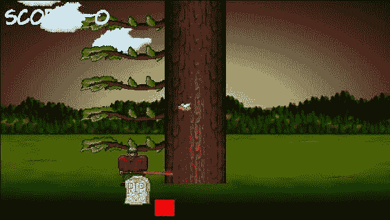

现在我们现在已经非常接近于一个可以运行的游戏了。

## 处理玩家的输入

许多不同的事情都取决于玩家的移动，例如何时显示斧头、何时开始为木头制作动画，以及何时将所有树枝向下移动一个位置。因此，为玩家的砍伐设置键盘处理是有合理的。一旦完成，我们就可以将刚才提到的所有功能放在代码的同一部分。

让我们思考一下如何检测键盘按键。在每一帧中，我们都测试特定的键盘按键是否正被按下。如果是，我们就采取行动。如果`Esc`键被按下，我们就退出游戏；如果`Enter`键被按下，我们就重启游戏。到目前为止，这对于我们的需求已经足够了。

然而，当我们尝试处理砍树时，这种方法存在一个问题。这个问题一直都在，只是现在才变得重要。取决于你的电脑性能有多强大，游戏循环每秒可能会执行数千次。在游戏循环的每一个按键被按住的周期中，它都会被检测到并执行相关代码。

所以实际上，每当你按下`Enter`重启游戏时，你很可能重启了它多出一百次以上。这是因为即使是最短暂的按下也会持续一秒钟的一大部分时间。你可以通过运行游戏并按住`Enter`键来验证这一点。注意时间条没有移动。这是因为游戏正在每秒反复一次又地重启，重启数百次甚至数千次。

如果我们不对玩家砍伐使用不同的方法，那么仅仅一次尝试砍伐就会在短短几分之一秒内让整棵树倒下。我们需要更巧妙一点。我们将做的是允许玩家砍伐，然后当他这样做时，禁用检测按键的代码。我们随后检测玩家手指从键上移开，然后重新启用对按键的检测。以下是清晰列出的步骤：

1. 等待玩家使用左或右箭头键砍木头。
2. 当玩家砍伐时，禁用按键检测。
3. 等待玩家将手指从键上移开。
4. 重新启用砍伐检测。
5. 从步骤 1 重复。

这听起来可能复杂，但在 SFML 的帮助下它将非常简单。让我们现在一步步实现它。

添加高亮行代码，它声明了一个`bool`变量`acceptInput`，它将用于判断何时监听砍击以及何时忽略它们：

```cpp
float logSpeedX = 1000;
float logSpeedY = -1500; // 控制玩家输入
bool acceptInput = false;
while (window.isOpen())
{
```

现在我们设置好了布尔值，可以进入下一步了。

## 处理设置新游戏

现在我们准备好处理砍伐了，在开始新游戏的`if`块中添加高亮的代码：

```cpp
/*
****************************************
处理玩家输入
****************************************
*/
if (Keyboard::isKeyPressed(Keyboard::Escape)){
    window.close();
}

// 开始游戏
if (Keyboard::isKeyPressed(Keyboard::Return))
{
    paused = false;
    // 重置时间分分数
    score = 0;
    timeRemaining = 6;
    // 让所有树枝消失
    for (int i = 1; i < NUM_BRANCHES; i++) {
        branchPositions[i] = side::NONE;
    }
    // 确保墓碑是隐藏的
    spriteRIP.setPosition(675, 2000);
    // 将玩家移动到位置
    spritePlayer.setPosition(580, 720);
    acceptInput = true;
}
```

在之前的代码中，我们使用`for`循环来设置没有树枝的树。这对玩家来说是公平的，因为如果游戏开始时头顶上方正好有一个树枝，这会被认为是不公平的。然后我们简单地将石头移出屏幕，并将玩家移到左侧的起始位置。这段新代码执行的最后一件事是将`acceptInput`设置为`true`。我们现在准备好接收砍伐按键了。

## 检测玩家砍伐

现在我们可以准备处理左右光标键的按下操作。添加这个简单的`if`块，它只在`acceptInput`为`true`时执行：

```cpp
// 开始游戏
if (Keyboard::isKeyPressed(Keyboard::Return))
{
    paused = false;
    // 重置时间以及分数
    score = 0;
    timeRemaining = 5;
    // 让所有分支消失
    for (int i = 1; i < NUM_BRANCHES; i++) {
        branchPositions[i] = side::NONE;
    }
    // 确保墓碑精灵图被隐藏
    spriteRIP.setPosition(675, 2000);
    // 将玩家移动到位置
    spritePlayer.setPosition(675, 660);
    acceptInput = true;
}
// 封装玩家控制以
// 确保我们正在接受输入
if (acceptInput)
{
    // 接下来会有更多代码...
}
```

### 更新场景

```cpp
****************************************
更新场景
*****************************************
```

现在，在我们刚刚编写的`if`块内部，添加以下高亮显示的代码，以处理当玩家按下键盘上的右方向箭头键（→）时发生的情况：

```cpp
// 封装玩家控制以
// 确保我们正在接受输入
if (acceptInput)
{
    // 接下来会有更多代码...
    // 首先处理按下右方向箭头键
    if (Keyboard::isKeyPressed(Keyboard::Right))
    {
        // 确保玩家位于右侧
        playerSide = side::RIGHT;
        score++;
        // 增加剩余时间量
        timeRemaining += (2 / score) + .15;
        spriteAxe.setPosition(AXE_POSITION_RIGHT, spriteAxe.getPosition().y);
        spritePlayer.setPosition(1200, 720);
        // 更新分支
        updateBranches(score);
        // 设置原木向左飞翔
        spriteLog.setPosition(810, 720);
        logSpeedX = -5000;
        logActive = true;
        acceptInput = false;
    }
}
```

### 处理左方向箭头键

之前的代码中发生了相当多的操作，让我们过过一遍。首先，我们检测玩家是否砍向了树的右侧。如果砍向了，我们将`playerSide`设置为`side::RIGHT`。我们将在代码的后半部分对`playerSide`的取值做出响应。

然后，我们通过`score ++`为`score`增加`1`。下一行代码略显神秘，但它所做的仅仅是增加`timeRemaining`的量。我们正在奖励玩家的操作。然而，对于玩家来说，问题在于分数越高，增加的额外时间就越少。你可以尝试这个公式来让游戏变得更容易或更难。

然后，通过`spriteAxe.setPosition`将斧头移动到它的右侧位置，玩家精灵也被移动到它的右侧。接下来，我们调用`updateBranches`将所有分支向下移动一个，并在树的顶部生成一个新的随机分支（或空格）。

接着，`spriteLog`被移动到它的起始位置，与树融合在一起，并将其`logSpeedX`变量设置为负数，这样它就会向左侧飞去。此外，将`logActive`设置为`true`，以便我们很快将编写的原木移动代码每帧为原木播放动画。最后，将`acceptInput`设置为`false`。在此时，玩家无法再进行更多砍击。我们已经解决了按键检测过于频繁的问题，很快我们将看到如何重新启用砍击。

现在，在我们刚刚编写的`if(acceptInput)`块内部，添加以下高亮显示的代码，以处理当玩家按下键盘上的左方向箭头键（←）时发生的情况：

```cpp
// 处理左方向箭头键
if (Keyboard::isKeyPressed(Keyboard::Left)) {
    // 确保玩家位于左侧
    playerSide = side::LEFT;
    score++;
    // 增加剩余时间量
    timeRemaining += (2 / score) + .15;
    spriteAxe.setPosition(AXE_POSITION_LEFT, spriteAxe.getPosition().y);
    spritePlayer.setPosition(580, 720);
    // 更新分支
    updateBranches(score);
    // 设置原木飞翔
    spriteLog.setPosition(810, 720);
    logSpeedX = 5000;
    logActive = true;
    acceptInput = false;
}
```

之前的代码与处理右侧砍击的代码完全相同，区别在于精灵图的位置不同，且`logSpeedX`变量被设置为正值，这样原木就会向右侧飞去。

### 检测按键释放

为了让上述操作在第一次砍击之后仍然有效，我们需要检测玩家释放按键的时刻，并将`acceptInput`设置回`true`。这与我们目前为止看到的按键处理略有不同。SFML 有两种不同的方法来检测玩家的键盘输入。第一种我们已经见过了。它是动态且瞬时的，正是我们立即响应按键按下时所需的。

接下来的代码使用了另一种方法。在“处理玩家输入”部分的顶部输入以下高亮显示的代码，然后我们来过一遍：

```cpp
/*
****************************************
处理玩家输入
*****************************************
*/
Event event;
while (window.pollEvent(event))
{
    if (event.type == Event::KeyReleased && !paused) {
        // 确保我们正在接受输入
        acceptInput = true;
        // 隐藏斧头
        spriteAxe.setPosition(2000, spriteAxe.y);
    }
    if (Keyboard::isKeyPressed(Keyboard::Escape)) {
        window.close();
    }
}
```

首先声明一个类型为`Event`的对象。通过`window.pollEvent(event)`循环，我们将事件存入`event`。如果`event.type`是`KeyReleased`且未暂停（`!paused`），我们将`acceptInput`设置为`true`并隐藏斧头（将其位置移动到`2000, spriteAxe.y`）。如果玩家按了`Escape`键，我们将关闭窗口。

我们之所以在此处使用`while`循环来处理`window.pollEvent`，是因为可能有很多事件发生。当`window.pollEvent`返回`false`时，意味着队列中没有更多事件了。

这个`event.type == Event::KeyReleased && !paused`条件在按键被释放且游戏未暂停时生效，并将`acceptInput`设置为`true`。

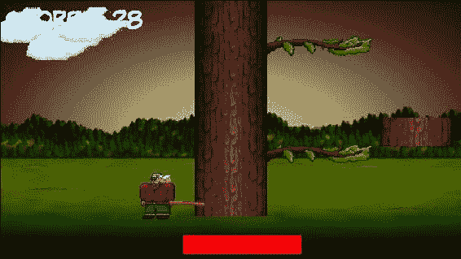

现在来讨论比较敏感的话题。

### 处理死亡

每个游戏都必须以糟糕的方式结束，要么是玩家时间耗尽（我们已经处理过了），要么是被树枝压死。检测玩家是否被压死非常简单。我们只需要知道`branchPositions`数组中的最后一个树枝的位置是否等于`playerSide`。如果是，玩家就死了。添加高亮的代码来检测此情况，然后我们将讨论当玩家被压死时所执行的一切。

```cpp
// 处理飞行的圆木
if (logActive)
{
    spriteLog.setPosition(
        spriteLog.getPosition().x + (logSpeedX * dt.asSeconds()),
        spriteLog.getPosition().y + (logSpeedY * dt.asSeconds())
    );
    // 圆木是否已经到达了右侧边缘？
    if (spriteLog.getPosition().x < -100 || spriteLog.getPosition().x > 2000){
        // 设置好在下一帧准备好一个全新的云
        logActive = false;
        spriteLog.setPosition(800, 600);
    }
}

// 玩家是否被树枝压死？
if (branchPositions[5] == playerSide) {
    // 死亡
    paused = true;
    acceptInput = false;
    // 绘制墓碑
    spriteRIP.setPosition(525, 760);
    // 隐藏玩家精灵
    Player.setPosition(2000, 660);
    // 修改消息文本
    messageText.setString("SQUISHED!!");
    // 在屏幕上居中
    FloatRect textRect = messageText.getLocalBounds();
    messageText.setOrigin(textRect.left + textRect.width / 2.0f, textRect.top + textRect.height / 2.0f);
    messageText.setPosition(1920 / 2.0f, 1080 / 2.0f);
}
} // End if(!paused)
```

在玩家亡亡后，代码执行的第一件事是将`paused`设置为`true`。现在，循环将完成这一帧，并在玩家启动新游戏之前，不会再次运行循环的更新部分。然后我们将墓碑移动到玩家所在位置附近，并将玩家精灵隐藏在屏幕外。

我们将`messageText`的字符串设置为`"SQUISHED!!"`，然后使用通常的技术让它在屏幕上居中。

你现在可以运行并真正玩游戏了。这张图片显示了玩家的最终得分、他的墓碑以及 SQUISHED 消息

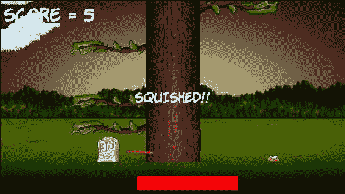

只剩下一个问题。是我错觉吗，还是这里有点安静？

### 简单音效

我们将添加三种声音。每个声音将在特定的游戏事件时播放。当玩家砍树时播放一个简单的“咚”声，当玩家时间耗尽时播放一个忧郁的失败声，当玩家被压死时，播放一个复古的破碎声。

### SFML 音效是如何工作的？

SFML 使用两个不同的类来播放音效。第一个类是`SoundBuffer`类。这个类持有来自声音文件的实际音频数据。是`SoundBuffer`负责将`.wav`文件加载到电脑的 RAM 中，其格式无需任何额外的解码工作即可播放。

稍后，当我们为音效编写代码时，我们会看到，一旦我们有了一个存储了声音的`SoundBuffer`对象，我们就会创建另一个类型为`Sound`的对象。我们可以将此`Sound`对象与`SoundBuffer`对象关联。然后，在代码的适当时刻，我们就可以调用相应`Sound`对象的`play`函数。

### 何时播放声音

正如我们很快就会看到的，加载和播放声音的 C++ 代码非常简单。然而，我们需要考虑的是何时调用`play`函数。我们在代码的哪个位置放置播放的函数调用？以下是我们想要实现的一些功能：

- 砍树声可以从左、右方向键的按下事件中调用
- 死亡声可以在检测到树木撞击玩家的`if`块中播放
- 时间耗尽声可以在检测`timeRemaining`小于零的`if`块中播放

现在我们可以编写声音代码了。

### 添加声音代码

首先，我们添加另一个`#include`指令以使 SFML 音频相关的类可用。添加以下高亮代码：

```cpp
#include "stdafx.h"
#include <sstream>
#include <SFML/Graphics.hpp>
#include <SFML/Audio.hpp>
using namespace sf;
```

现在我们声明三个不同的`SoundBuffer`对象，将三个不同的声音文件加载到它们中，并将三个不同的`Sound`类型对象与相关的`SoundBuffer`对象关联。添加以下高亮代码：

```cpp
// 控制玩家输入
bool acceptInput = false;

// 准备声音
SoundBuffer chopBuffer;
chopBuffer.loadFromFile("sound/chop.wav");
Sound chop;
chop.setBuffer(chopBuffer);

SoundBuffer deathBuffer;
deathBuffer.loadFromFile("sound/death.wav");
Sound death;
death.setBuffer(deathBuffer);

// 时间耗尽
SoundBuffer ootBuffer;
ootBuffer.loadFromFile("sound/out_of_time.wav");
Sound outOfTime;
outOfTime.setBuffer(ootBuffer);
```


```cpp
while (window.isOpen())
{
```

现在我们可以播放第一个音效了。在检测玩家按下左方向键的`if`块旁边添加所示的单行代码：

```cpp
// 包装玩家控制

// 确保我们正在接受输入

if (acceptInput)

{

    // 接下来是更多代码...

    // 首先处理按下右方向键

    if (Keyboard::isKeyPressed(Keyboard::Right)) {

        // 确保玩家在右侧

        playerSide = side::RIGHT;

        score++;

        timeRemaining += (2 / score) + .15;

        spriteAxe.setPosition(AXE_POSITION_RIGHT, spriteAxe.getPosition().y);

        spritePlayer.setPosition(1120, 660);

        // 更新树枝

        updateBranches(score);

        // 设置圆木向左飞行

        spriteLog.setPosition(800, 600);

        logSpeedX = -5000;

        logActive = true;

        acceptInput = false;

        // 播放砍树声

        chop.play();

    }

}
```

**提示**：在下一个以`if (Keyboard::isKeyPressed(Keyboard::Left))`开始的代码块末尾添加完全相同的代码，以便在玩家砍树左左侧时产生砍树声。

找到处理玩家时间耗尽的代码，并添加所示的高亮代码，以播放时间耗尽相关的音效：

```cpp
if (timeRemaining <= 0.f) {

    // 暂停游戏

    paused = true;

    // 修改显示给玩家的消息

    messageText.setString("Out of time!!");

    // 根据新尺寸重新定位文本

    FloatRect textRect = messageText.getLocalBounds();

    messageText.setOrigin(textRect.left + textRect.width / 2.0f, textRect.top + textRect.height / 2.0f);

    messageText.setPosition(1920 / 2.0f, 1080 / 2.0f);

    // 播放时间耗尽声

    outOfTime.play();

}
```

最后，为了在玩家被压死时播放死亡声，将高亮代码添加到树枝与玩家同侧的`if`块中：

```cpp
// 玩家是否被树枝压死？

if (branchPositions[5] == playerSide) {

    // 死亡

    paused = true;

    acceptInput = false;

    // 绘制墓碑

    spriteRIP.setPosition(525, 760);

    // 隐藏玩家

    spritePlayer.setPosition(2000, 660);

    messageText.setString("SQUISHED!!");

    FloatRect textRect = messageText.getLocalBounds();

    messageText.setOrigin(textRect.left + textRect.width / 2.0f, textRect.top + textRect.height / 2.0f);

    messageText.setPosition(1920 / 2.0f, 1080 / 2.0f);

    // 播放死亡声

    death.play();

}
```


大功完成！我们完成了第一个游戏。在进入第二个项目之前，让我们来讨论一些可能的改进方案。

## 改进游戏和代码

看看这些针对 `Timber!!!` 项目的改进建议。你可以在下载包的 `Runnable` 文件夹中看到这些改进后的效果：

1. **加速代码**：我们的代码中有一部分减慢了游戏的运行速度。对于这个简单的游戏来说这无关紧要，但我们可以通过将 `sstream` 代码放在一个偶尔执行一次的块中来提高速度。毕竟，我们不需要每秒更新几百次分数！
2. **调试控制台**：让我们添加一些文本，以便查看当前的帧率。和分数一样，我们不需要频繁更新它，每隔百个帧更新一次即可。
3. **在背景中添加更多树**：只需额外添加一些树的精灵（`sprites`），并将它们绘制在任何看起来好看的位置即可（你可以让一些离相机近一点，一些远一点）。
4. **提高 HUD 文本的可视性**：我们可以在分数和 FPS 计数器后面绘制简单的 `RectangleShape` 对象；带一点透明度的黑色效果会很不错。
5. **让云朵代码更高效**：正如我们之前几次提到的那样，我们可以利用对数组的知识让云朵代码变得短得多。

看看带有额外的树、云朵和文本透明背景的游戏效果。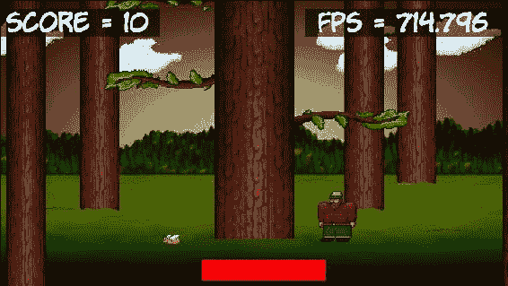

若要查看这些改进的代码，请查看下载包中的 `Timber Enhanced Version` 文件夹。

## 第 6 章 面向对象、类和 SFML 视图

这是书中最长的一章。它包含大量的理论，但这些理论将赋予我们有效利用面向对象编程（OOP）的知识。此外，我们不会浪费任何时间来实际运用这些理论。在探索 C++ OOP 之前，我们将了解并规划下一个游戏项目。

我们将在后续章节中完成以下工作：
* 规划僵尸竞技场（Zombie Arena）游戏
* 学习 OOP 和类
* 编写 `Player` 类
* 学习 `SFML View` 类
* 构建僵尸竞技场游戏引擎
* 让 `Player` 类运行起来

### 规划并开始僵尸竞技场游戏

此时，如果你还没有的话，我建议去看看 [Over 9,000 Zombies](http://store.steampowered.com/app/273500/) 和 [Crimson Land](http://store.steampowered.com/app/262830/) 的视频。

我们的游戏显然不会像这两个例子那样深入或先进，但我们将拥有相同的基础功能和游戏机制：
* 一个抬头显示器（HUD），显示分数、最高分、弹匣内弹数、剩余总弹量、玩家健康和待杀僵尸数量等细节。
* 玩家将在疯狂逃避僵尸的同时进行射击。
* 使用 `W`、`A`、`S` 和 `D` 键在滚动的世界中移动，用鼠标瞄准。
* 在每关之间选择升级，这将影响通过游戏的策略。
* 收集物品以恢复健康和弹药。
* 每一波带来更多的僵尸和更大的竞技场。

会有三种类型的僵尸被消灭。它们具有不同的属性，如外观、血量和速度。我们把它们称为追踪者（`chasers`）、膨胀者（`bloaters`）和爬行者（`crawlers`）。看看这张游戏的注释截图，查看一些功能演示以及构成游戏的组件和资源：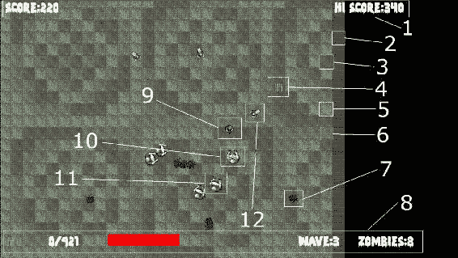

以下是关于每个数字点的更多详细信息：
1. `SCORE`（分数）和 `HI SCORE`（最高分）。这些以及 HUD 的部分将绘制在一个独立的层上，称为 `View`。最高分将保存到加载文件中。
2. 这是一个构建竞技场围墙的纹理。该纹理包含在一个名为 `sprite-sheet`（精灵集）的单一图中，与其他背景纹理（3、5 和 6）一起。
3. 来自 `sprite-sheet` 的两个泥地纹理中的第一个。
4. 这是一个弹药物品。当玩家获得它时将获得更多弹药。还有一个健康物品。玩家可以在每波僵尸之间选择升级这些物品。
5. 一个草地纹理，也来自 `sprite-sheet`。
6. 来自 `sprite-sheet` 的第二个泥地纹理。
7. 曾经有僵尸出现过的血迹。
8. HUD 的底部。从左到右分别是代表弹药的图标、弹匣内弹数、备用弹药数、健康条、当前僵尸波次以及该波剩余的僵尸数量。
9. 玩家角色。
10. 玩家用鼠标瞄准的准星。
11. 一个移动缓慢但很强大的膨胀者僵尸。
12. 一个移动稍快但较弱的爬行者僵尸。还有一种非常快但很弱的追踪者僵尸。遗憾的是，在它们被杀死之前我没能在截图中捕捉它们。

我们有很多工作要做，有很多新的 C++ 技能要学习。让我们从创建一个新项目开始。

### 从模板创建项目

现在创建新项目非常简单。只需在 Visual Studio 中遵循这些简单的步骤：
1. 从主菜单选择 `File | New Project`。
2. 确保在左侧菜单中选择了 `Visual C++`，然后从选项列表中选择 `HelloSFML`。接下来的图片会说明这一点：
3. 在 `Name:` 字段中输入 `ZombieArena`，并确保勾选了 `Create directory for solution`（为解决方案创建目录）。点击 `OK`。
4. 现在我们需要将 SFML `.dll` 文件复制到项目目录。我的主项目目录是 `D:\Visual Studio\Projects\ZombieArena\ZombieArena`。此文件夹是由 Visual Studio 创建的。如果你将 `Projects` 文件夹放在了其他地方，请执行此操作。我们需要复制的文件位于你的 `SFML\bin` 文件夹中。分别为这两个位置打开窗口，并高亮所需的 `.dll`。现在将高亮的文件复制并粘贴到项目中。项目现在已就绪并可以开始了。

### 项目资源

此项目中的资源比上一个游戏更多且多样。资源包括：
* 用于屏幕文字的字体。
* 针对不同动作的音效，如射击、装弹或被僵尸击中。

游戏所需的角色、僵尸、背景的所有图形和音频都包含在下载包中。它们分别可以在 `Chapter 6/graphics` 和 `Chapter 6/sound` 文件夹中找到。

所需的字体未提供。这是因为我想避免任何可能的许可证歧义。不过这不会成为问题，因为我会确切地告诉你在哪里以及如何选择和下载自己的字体。尽管我会提供资源本身或获取它们的信息，但你可能希望自己创建并获取它们。

### 探索资源

图形资源构成了我们僵尸竞技场游戏的场景部分。看看这些图形资源，就能很清楚它们将用在游戏的何处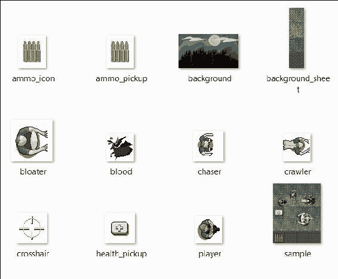

然而，不太明显的是 `background_sheet.png`，它包含了四个不同的图像。这就是我之前提到的精灵集，我们将在第 7 章“C++ 引用、精灵集和顶点数组”中看到如何使用它来节省内存并提高游戏速度。

音频文件均为 `.wav` 格式。这些文件包含了我们在整个游戏过程中特定事件中播放的音效。它们是：
* `hit.wav`: 当僵尸接触玩家时播放的音。
* `pickup.wav`: 当玩家触碰（收集）健康加益物品时播放的音。
* `powerup.wav`: 当玩家在每波僵尸之间选择增加属性的升级（强化）时播放的音。
* `reload.wav`: 一个悦耳的点击声，让玩家知道他们已经装好了新的弹匣。
* `reload_failed.wav`: 一个听起来不太悦耳的声音，表示加载新子弹失败
* `shoot.wav`: 射击声
* `splat.wav`: 类似僵尸被子弹击中的声音

## 将资产添加到项目项目中

一旦你决定了将使用哪些资产，现在就可以将它们添加到项目中了。接下来的这些说明将假设你正在使用书籍下载包中提供的所有资产。如果你使用自己的资产，只需使用与书中完全相同的文件名，用自己的文件替换相应的声音或图形文件即可：

1. 浏览到 `D:\Visual Studio\Stuff\Projects\ZombieArena\ZombieArena`。
2. 在文件夹内创建三个新文件夹，并将其命名为 `graphics`、`sound` 和 `fonts`。
3. 从下载包中，将 `Chapter 6/graphics` 的所有内容复制到 `D:\Visual Studio\Stuff\Projects\ZombieArena\ZombieArena\graphics` 文件夹。
4. 从下载包中，将 `Chapter 6/sound` 的所有内容复制到 `D:\Visual Studio\Stuff\Projects\ZombieArena\ZombieArena\sound` 文件夹。
5. 现在在网络浏览器中访问 `http://www.1001freefonts.com/zombie_control.font` 并下载 Zombie Control 字体。解压下载包的内容，并将 `zombiecontrol.ttf` 文件添加到 `D:\Visual Studio\Stuff\Projects\ZombieArena\ZombieArena\fonts` 文件夹中。

现在是时候学习更多 C++ 了，我们可以开始编写 Zombie Arena 的代码了。

## OOP

`OOP` 是一种编程范式，我们可以将其几乎视为编码的标准方式。确实存在非 OOP 的编码方式，甚至还有一些非 OOP 的游戏编程语言和库。然而，像本书这样从零开始，没有理由采用其他方式。当 OOP 的优势变得显而易见时，你将永远不再回头。

`OOP` 将能够：
* 使我们的代码更容易管理、更改或更新
* 使我们的代码编写得更快、更可靠
* 能够轻松使用他人的代码（例如 `SFML`）

我们已经看到了第三个优势的体现。让我们通过引入一个需要解决的问题来观察前两个优势。我们面临的问题是当前项目的复杂性。让我们只考虑单个僵尸，以及为了让它在游戏中运行我们需要的功能：
* 水平和垂直位置
* 尺寸
* 它面对的方向
* 每种僵尸类型不同的纹理
* 精灵（Sprites）
* 每种僵尸类型不同的速度
* 每种僵尸类型不同的健康值
* 每个僵尸的类型
* 碰撞检测数据
* 智能（追逐玩家）
* 僵尸是活是死？

这个列表表明，仅仅一个僵尸可能就需要十几个变量！为了管理一群僵尸群，我们可能需要这些每个变量的整个数组。那么机枪的所有子弹、拾取物品以及不同的等级升级呢？简单的 `Timber!!!` 游戏在结束时已经开始变得难以管理了，可以推测这个更复杂的射击游戏可能会变得糟糕得多！

幸运的是，处理复杂性并不是一个新问题，而 `C++` 从之初就是为了解决这种复杂性而设计的。

### 什么是 OOP？

`OOP` 是一种编程方法，它将我们的需求拆解为比整体更容易管理的块。每个块都是自包含的，但潜在可以被其他程序重用，同时与其他块作为一个整体共同工作。

这些块就是我们一直所指的 `objects`（对象）。当我们规划和编写对象时，使用的是 `class`（类）。

> **提示**：`class` 可以被看作对象的蓝图。我们实现一个 `class` 的对象，这被称为 `class` 的 `instance`（实例）。想象一下房屋蓝图。你不能住在里面，但你可以根据它建造一栋房子。你建造了它的实例。通常当我们为游戏设计类时，我们会编写它们来代表现实世界中的事物。在这个项目中，我们将为玩家、僵尸（`zombie`）、子弹（`bullet`）等编写类。

> **提示**：`OOP` 是一种做事的方法，是一种定义最佳实践的方法论。

OOP 的三个核心原则是 `encapsulation`（封装）、`polymorphism`（多态）和 `inheritance`（继承）。听起来可能很复杂，但实际上一步步来，它是相当直观的。

### 封装

`Encapsulation` 意味着保持你的代码内部机制免受使用它的代码的干扰。你可以通过只允许访问你选择的 `variables` 和 `functions` 来实现。这意味着只要暴露的部分仍以相同的方式访问，你的代码就可以随时更新、扩展或改进，而不影响使用它的程序。

例如，有了适当的封装，`SFML` 团队是否需要更新他们的 `Sprite` 类的工作方式并不重要。只要函数签名保持不变，我们就不必担心内部发生了什么。我们在更新之前编写的代码在更新后仍然可以运行。

### 多态

`Polymorphism` 允许我们编写对我们试图操作的类型依赖程度更低的代码。这将使代码更清晰、更高效。`Polymorphism` 意味着不同的形式。如果我们编写的对象可以是超过一种类型的东西，那么我们就可以利用这一点。此时，多态听起来可能有点像黑魔法术。我们将从第 12 章“抽象与代码管理 - 更好地使用 OOP”开始，在最终项目中使用多态。那时一切都将变得清晰。

### 继承

正如其名义一样，`inheritance` 意味着我们可以利用他人类的所有特性和优势，包括 `encapsulation` 和 `polymorphism`，同时针对我们的特定情况对其代码进行进一步提炼。我们将从第 12 章“抽象与代码管理 - 更好地使用 OOP”开始，在最终项目中使用继承。

### 为什么要这样做？

当编写得当时，所有这些 OOP 允许你添加新功能，而无需过多担心它们与现有功能如何相互作用。当你必须更改一个类时，它的自包含（封装）特性意味着对程序的其他部分产生的影响很少或可能没有影响。

> **提示**：你可以使用他人的代码（例如 `SFML` 类），而不需要甚至不在乎它内部是如何工作的。

`OOP`，以及延伸出的 `SFML`，允许你编写使用复杂概念的游戏，例如多个摄像头、多人游戏、`OpenGL`、定向音频等。所有这一切都不费吹灰之力。

使用继承，你可以创建一个类的多个相似但又不同的版本，而无需从零开始该类。

由于多态的存在，你仍然可以在新对象上使用为原始对象类型设计的函数。

这一切其实都是合理的的。而且，正如我们所知，`C++` 从之初设计时就考虑了所有这些 OOP。

> **提示**：除了成功的决心外，使用 OOP 和制作游戏（或任何其他类型的应用）成功的终极关键是规划和设计。不仅仅是了解所有的 `C++`、`SFML` 和 `OOP` 话题就能帮助你写出出色的代码，而是将所有这些知识应用于编写结构良好且设计的代码。书中的代码是以适合在游戏背景下学习各种 C++ 话题的顺序和方式呈现的。

类是一组代码，可以包含函数、变量、循环以及我们已经学过的所有 C++ 语法。每个新类都将在其各自的 `.h` 代码文件中声明，文件名与类名相同，而它的函数将在它们各自的 `.cpp` 文件中定义。当我们实际开始编写类时，这一点将会变得更加清晰。

一旦我们写好了类，就可以用它来创建任意数量的对象。记住，类是蓝图，而我们根据蓝图创建对象。房子不是蓝图，正如对象不是类一样。对象是根据类创建的。

**提示**
你可以把对象看作一个变量，把类看作一个类型。

当然，在讨论了这么多关于面向对象（OOP）和类之后，我们还没有真正看到任何代码。所以让我们现在来解决这个问题。

### 类变量和函数声明

让我们用一个不同的游戏示例来代替 Zombie Arena。考虑所有游戏中最基础的：Pong（乒乓球）。一个可以反弹球的挡板。挡板将是类的绝佳候选者。

**提示**
如果你不知道什么是 Pong，可以看这个链接：https://en.wikipedia.org/wiki/Pong

来看一个假设的 `Paddle.h` 文件：

```cpp
class Paddle

{

private:

// Pong 挡板的长度

int m_Length = 100;

// Pong 挡板的高度

int m_Height = 10;

// x 轴位置

int m_XPosition;

// y 轴位置

int m_YPosition;

public:

void moveRight(); void moveLeft(); };

```

乍看之下，这段代码可能有点复杂，但经过解释后，我们会发现并没有什么新概念。首先注意到，使用 `class` 关键字后跟类名来声明了一个新类，并且整个声明被包含在大括号中，并跟着一个结束分号：

```cpp
class Paddle

{

};
```

现在看变量声明及其名称：

```cpp
// Pong 挡板的长度

int m_Length = 100;

// Pong 挡板的高度

int m_Height = 10;

// x 轴位置

int m_XPosition;

// x 轴位置

int m_YPosition;
```

所有名称都以 `m_` 为前缀。这不是强制要求的，但这是一个良好的约定。作为类的一部分声明的变量被称为成员变量。使用 `m_` 前缀使得我们在处理成员变量时一目了然。当我们为类编写函数时，也会开始看到局部变量和参数。这时 `m_` 约定将证明自己是有用的。

同样注意，所有变量都在一个由 `private:` 关键字引导的代码区域中。扫一眼之前的示例代码，你会发现类体被分为两个部分：

```cpp
private:

// 这里有更多代码

public:

// 这里有更多代码
```

`public` 和 `private` 关键字控制我们类的封装性。任何 `private` 的内容都不能由类实例或对象的用户直接访问。如果你正在设计一个供他人使用的类，你不希望他们能够随所欲地修改任何内容。

这意味着我们的四个成员变量无法被 `main` 函数中的游戏引擎直接访问。它们可以通过类的代码间接访问。对于 `m_Length` 和 `m_Height` 变量，这很容易被接受，只要我们不需要更改挡板的大小。然而，`m_XPosition` 和 `m_YPosition` 成员变量确实需要访问，否则我们到底如何移动挡板呢？

这个问题在代码的 `public:` 部分通过如下解决：

```cpp
void moveRight(); void moveLeft();
```


该类提供了两个 `public` 函数，它们可以被类型为 `Paddle` 的对象使用。当我们看到这些函数的定义后，将确切看到这些函数是如何操作私有变量的。

总结来说，有一组无法从 `main` 函数使用的不可访问（私有）变量。这是好事，因为封装使得我们的代码更不容易出错且更具维护性。然后，我们通过提供两个公共函数提供了对 `m_XPosition` 和 `m_YPosition` 变量的间接访问，从而解决了移动挡板的问题。`main` 中的代码可以调用这些函数，但函数内部的代码精确控制了变量是如何被更改的。

### 类函数的定义

我们在书中编写的函数定义都将放在一个与类和函数声明分开的文件中。我们将使用与类同名且扩展名为 `.cpp` 的文件。因此，在我们假设示例中，接下来的代码将放在名为 `Paddle.cpp` 的文件中。来看这段简单的代码，它只包含一个新概念：

```cpp
#include "stdafx.h"

#include "Paddle.h"

void Paddle::moveRight()
{
    // 将挡板向右移动一个像素
    m_XPosition++;
}

void Paddle::moveLeft()
{
    // 将挡板向左移动一个像素
    m_XPosition--;
}
```

首先要注意的是，我们必须使用包含指令来包含来自 `Paddle.h` 类的类和函数声明。我们在这里看到的新概念是使用作用域解析运算符 `::`。由于函数属于一个类，我们必须通过在函数名前面加上类名和 `::` 来编写签名部分。

注意，作用域解析运算符 `::` 之前我们已经见过使用它。当我们声明一个类对象时，`using namespace...`

此外，`Paddle::moveLeft()` 和 `Paddle::moveRight()`。当我们看到这些函数的定义后，将确切看到这些函数是如何操作私有变量的。

```cpp
int m_Length = 100;

// 乒乓球板的高度
int m_Height = 10;

// x 轴上的位置
int m_XPosition;

// y 轴上的位置
int m_YPosition; // 当然，我们需要一个精灵
Sprite m_Sprite;

// 还需要一个纹理
Texture m_Texture;
```

新问题紧接着在我们面前。如果 `m_Sprite` 和 `m_Texture` 是私有的（private），那么我们到底如何在 `main` 函数中绘制它们呢？我们需要提供一个函数来允许访问 `m_Sprite` 以便进行绘制。请仔细查看 `Paddle.h` 中 `public` 区域的新函数声明。

`public:`

```cpp
void moveRight();

void moveLeft(); // 将精灵拷贝发送给 main

Sprite getSprite();
```

之前的代码声明了一个名为 `getSprite` 的函数。值得注意的是，`getSprite` 返回的是一个 `Sprite` 对象。我们很快就会看到 `getSprite` 的定义。如果你很敏锐，还会注意到我们在任何时候都没有加载过纹理，也没有调用过 `m_Sprite.setTexture(m_Texture)` 来将纹理与精灵关联。

当编写类时，编译器会创建一个特殊的函数。我们没有在代码中看到这个函数，但它确实存在。它被称为构造函数（constructor）。当我们需要编写一些代码为对象的使用做准备时，构造函数通常是一个很好的地方。当我们希望构造函数执行创建实例之外的其他操作时，我们必须替换编译器提供的默认（不可见的）构造函数。

首先注意，我们提供了一个构造函数的声明。注意，构造函数没有返回值，甚至没有 `void`。同样请注意，我们可以立即看出它是构造函数，因为函数名与类名 `Paddle` 相同。

```cpp
public: // 构造函数

Paddle();

void moveRight();

void moveLeft();

// 将精灵拷贝发送给 main
Sprite getSprite();
```

接下来的代码显示了 `Paddle.cpp` 中的新函数定义（`getSprite` 和构造函数 `Paddle`）。

```cpp
// 构造函数
Paddle::Paddle()
{
    // 代码假设 paddle.png 是真实的图像
    m_Texture.loadFromFile("graphics/paddle.png");

    // 将纹理与精灵关联
    m_Sprite.setTexture(m_Texture);
}

// 将精灵拷贝返回给 main
Sprite Paddle::getSprite()
{
    return m_Sprite;
}
```

在之前的代码中，我们使用构造函数 `Paddle` 来加载纹理并将其与精灵关联。记住，这个函数是在声明类型为 `Paddle` 的对象时被调用的。具体来说，当执行代码 `Paddle paddle` 时，构造函数会被调用。

在 `getSprite` 函数中，只有一行代码向调用代码返回了 `m_Sprite` 的拷贝。我们也可以在构造函数中为对象进行其他的设置工作，并在构建第一个真实类时会这样做。

如果你想确切地看到 `getSprite` 函数如何被使用，`main` 中的代码将看起来像这样：

```cpp
window.draw(paddle.getSprite());
```

上一行代码假设我们已经有一个名为 `window` 的 SFML `RenderWindow` 对象。由于 `getSprite` 返回的是一个 `Sprite` 类型的对象，上一行代码的作用与精灵直接在 `main` 中声明完全一样。现在，我们拥有了一个封装良好的类，它通过其公共函数提供受控制的访问。

### 在代码中来回跳转

我发现，当我阅读那些在代码文件中来回跳转的书籍时，我往往很难跟上到底发生了什么。以下是假设的 `Paddle.h` 和 `Paddle.cpp` 的完整列表，以便在上下文中理解一切。请确保在继续之前仔细学习它们：

#### Paddle.h

```cpp
#pragma once

#include <SFML/Graphics.hpp>

using namespace sf;

class Paddle
{
private:
    // 乒乓球板的长度
    int m_Length = 100;

    // 乒乓球板的高度
    int m_Height = 10;

    // x 轴上的位置
    int m_XPosition;

    // y 轴上的位置
    int m_YPosition;

    // 当然，我们需要一个精灵
    Sprite m_Sprite;

    // 还需要一个纹理
    Texture m_Texture;

public:
    // 构造函数
    Paddle();

    void moveRight();

    void moveLeft();

    // 将精灵拷贝发送给 main
    Sprite getSprite();
};
```

#### Paddle.cpp

```cpp
#include "stdafx.h"

#include "Paddle.h"

// 构造函数
Paddle::Paddle()
{
    // 代码假设 paddle.png 是真实的图像
    m_Texture.loadFromFile("graphics/paddle.png");

    // 将纹理与精灵关联
    m_Sprite.setTexture(m_Texture);
}

// 将精灵拷贝返回给 main
Sprite Paddle::getSprite()
{
    return m_Sprite;
}

void Paddle::moveRight()
{
    // 将板子向右移动一个像素
    m_XPosition++;
}

void Paddle::moveLeft()
{
    // 将板子向左移动一个像素
    m_XPosition--;
}
```

在书的剩余部分中，我们将反复回顾类和面向对象编程（OOP）。然而，现在我们有了足够的知识来开始为僵尸竞技场（Zombie Arena）游戏编写第一个真实类。

### 构建玩家——第一个类

让我们思考一下 `Player` 类需要做什么。该类需要知道它移动有多快、当前在游戏世界的什么位置，以及它有多少健康值。由于在玩家眼中，`Player` 类表示为一个 2D 图形字符，该类将需要一个 `Sprite` 和一个 `Texture` 对象。

此外，尽管目前可能并不显而易见，但我们的 `Player` 类也将受益于了解游戏运行环境的一些细节。这些细节包括屏幕分辨率、组成竞技场的格子大小以及当前竞技场的总尺寸。

由于 `Player` 类将完全负责每帧更新自己，它需要知道玩家任何时刻的意图。例如，玩家是否正按下某个特定的键盘方向键？或者玩家是否正按下多个键盘方向键？用于确定 `W`、`A`、`S`、`D` 键状态的布尔变量是关重要的。

显然，我们的新类需要大量的变量。在学习了关于 OOP 的所有知识后，我们当然会将所有这些变量设为私有。这意味着我们必须在适当的情况下从 `main` 函数提供访问。

我们将使用大量的访问器函数（getter functions）以及其他函数来设置我们的对象。这些函数非常多；这个类中实际上有 21 个函数。起初这可能看起来有点畏畏，但我们将逐一通过，发现大多数函数只是在设置或获取一个私有变量。

只有少数相当深入的函数，例如 `update`（它每帧都会从 `main` 函数调用一次）和 `spawn`（它将处理某些私有变量的初始化）。然而，正如我们所看到的，它们并不复杂，并且都将得到详细描述。

继续后续的最佳方法是编写头文件。这将让我们有机会看到所有的私有变量并检查所有的函数签名。密切关注返回值和参数类型，这将使理解函数定义中的代码变得容易得多。

#### 编写 Player 类头文件

在解决方案管理器中右键点击“头文件”并选择“添加 | 新项...”。在“添加新项”窗口中，高亮（通过左键）“头文件（`.h`）”，然后在“名称”字段中输入 `Player.h`。最后，点击“添加”按钮。我们现在准备好为我们的第一个类编写头文件了。

通过添加声明（包括开头和结束的大括号以及后跟分号）开始编写 Player 类：

```cpp
#pragma once

#include <SFML/Graphics.hpp>

using namespace sf;

class Player
{
};
```

现在让我们添加所有的私有成员变量。根据我们已经讨论的内容，看看你是否能推出它们的作用。我们稍后会逐一过过它们：

```cpp
class Player
{
private:
    const float START_SPEED = 200;

    const float START_HEALTH = 100;

    // 玩家在哪里
    Vector2f m_Position;

    // 当然，我们需要一个精灵
    Sprite m_Sprite;

    // 还需要一个纹理
    // !!关注此处！！
    Texture m_Texture;

    // 屏幕分辨率是多少
    Vector2f m_Resolution;
};
```

```cpp
// 当前竞技场的大小
IntRect m_Arena;

// 竞技场每个瓦片有多大
int m_TileSize;

// 玩家当前移动的方向
bool m_UpPressed;

bool m_DownPressed;

bool m_LeftPressed;

bool m_RightPressed;

// 玩家有多少血量？
int m_Health;

// 玩家最大血量
int m_MaxHealth;

// 玩家上次被击中的时间
Time m_LastHit;

// 每秒像素移动的速度
float m_Speed;
```

之前的代码声明了我们所有的成员变量。其中一些是普通变量，另一些本身就是对象。请注意，它们都位于类的 `private:` 区域，因此无法从类外部直接访问。

另外请注意，我们使用了在所有非常量变量名称前添加 `m_` 前缀的命名约定。在编写函数定义时，`m_` 前缀会提醒我们它们是成员变量，并与我们在某些函数中创建的局部变量区分来，同时也与函数参数区分来。

这些变量的使用都是显而易见的，例如 `m_Position`、`m_Texture` 和 `m_Sprite`，分别用于玩家当前的位置、纹理和精灵。此外，每个变量（或变量组）都带有注释，以使其用法清晰可见。

然而，它们究竟为什么需要以及它们使用的上下文可能并不那么明显。例如，`m_LastHit` 是一个 `Time` 类型的对象，用于记录玩家上次被僵尸击中的时间。我们对 `m_LastHit` 的用法是显而易见的，但同时，并不清楚我们为什么需要这些信息。

随着我们拼凑出游戏的其余部分，每个变量的上下文将变得更加清晰。现在重要的是熟悉这些名称和类型，以便顺畅地跟进项目的后续部分。

**提示**：你不需要背下变量的名称和类型，因为我们会在使用这些代码时讨论所有的代码。你确实需要花时间查看它们并对它们稍作熟悉。此外，随着我们的进行，如果任何地方看起来不清楚，回头查看这个头文件可能是值得的。

现在我们可以添加一长串函数了。添加以下所有高亮的代码，看看你是否能推断它们的所有作用。请密切关注每个函数的返回值、参数和名称。这是理解我们在项目剩余部分将要编写代码的关键。

```cpp
// 我们所有的公共函数将接下来出现

public:

Player();

void spawn(IntRect arena, Vector2f resolution, int tileSize);

// 在每个游戏结束时调用此函数
void resetPlayerStats();

// 处理玩家被僵尸击中的情况
bool hit(Time timeHit);

// 玩家上次被击中是多久以前
Time getLastHitTime();

// 玩家在哪里
FloatRect getPosition();

// 玩家的中心在哪里
Vector2f getCenter();

// 玩家面对哪个角度
float getRotation();

// 向主程序发送精灵副本
Sprite getSprite();

// 下四个函数移动玩家
void moveLeft();

void moveRight();

void moveUp();

void moveDown();

// 停止玩家在特定方向移动
void stopLeft();

void stopRight();

void stopUp();

void stopDown();

// 我们每帧调用一次此函数
void update(float elapsedTime, Vector2i mousePosition);

// 给玩家提供加速
void upgradeSpeed();

// 给玩家增加一些血量
void upgradeHealth();

// 增加玩家可以拥有的最大血量
void increaseHealthLevel(int amount);

// 玩家当前有多少血量？
int getHealth();
};
```

首先注意，所有的函数都是公共的（public）。这意味着我们可以使用类的实例从 `main` 函数中调用所有这些函数，代码如下：

`player.getSprite();`

假设 `player` 是 `Player` 类的一个完全设置好的实例，之前的代码将返回 `m_Sprite` 的副本。将此代码放入实际环境中，我们可以在 `main` 函数中编写这样的代码：

```cpp
window.draw(player.getSprite());
```


之前的代码会在正确的位置绘制玩家图形，就像精灵是在`main`函数中声明的一样。这与我们之前对假设的`Paddle`类所的操作一样。

在相应的`.cpp`文件中实现（编写）这些函数之前，让我们逐一查看每一个：

- `void spawn(IntRect arena, Vector2f resolution, int tileSize)`：此函数的作用如其名。它将准备好对象供使用，包括将其放在起始位置（生成）。注意它没有返回任何数据，但它有三个参数。它接收一个名为`arena`的`IntRect`，这将是当前关卡的大小和位置；一个包含屏幕分辨率的`Vector2f`；以及一个持有背景瓦片大小的`int`。

- `void resetPlayerStats`：一旦我们赋予玩家在波次之间升级的能力，我们将在他们死亡时能够撤销并重置这些能力。

- `Time getLastHitTime()`：此函数只做一件事，返回玩家上次被僵尸击中的时间。我们在检测碰撞时将使用此函数，它将让我们确保玩家不会因为接触僵尸而频繁受到惩罚。

- `FloatRect getPosition()`：此函数返回一个`FloatRect`，描述包含玩家图形的矩形的水平和垂直浮点坐标。这对于碰撞检测再次有用。

- `Vector2f getCenter()`：这与`getPosition()`稍微不同，因为它是一个`Vector2f`，并且仅包含玩家图形正中心的X和Y位置。

- `float getRotation()`：`main`中的代码有时需要知道以度为单位玩家当前面对哪个方向。三点钟方向为0度，并顺时针增加。

- `Sprite getSprite()`：如之前所述，此函数返回代表玩家的精灵副本。

- `void moveLeft()`, `moveRight()`, `moveUp()`, `moveDown()`：这四个函数没有返回值或参数。它们将从`main`函数调用，然后`Player`类将能够在W、A、S、D键中一个或多个被按下时采取行动。

- `void stopLeft()`, `stopRight()`, `stopUp()`, `stopDown()`：这四个函数没有返回值或参数。它们将从`main`函数调用，然后`Player`类能够在W、A、S、D键中一个或多个被释放时采取行动。

- `void update(float elapsedTime, Vector2i mousePosition)`：这将是整个类中唯一较长的函数。它每帧从`main`调用一次。它将执行所有必要操作以确保玩家对象的数据准备好碰撞检测和绘制。注意它没有返回数据，但接收自上一帧的已过时间，以及一个包含鼠标指针或十字准水平垂直屏幕位置的`Vector2i`。**注意**：注意这些是整数屏幕坐标，与浮点世界坐标区分来。

- `void upgradeSpeed()`：当玩家选择让玩家更快时，可以在升级界面上调用的函数。

- `void upgradeHealth()`：当玩家选择让玩家更强（更多血量）时，可以在升级界面上调用的另一个函数。

`void increaseHealthLevel(int amount)`：与之前的函数有一个细微但重要的区别，这个函数会增加玩家拥有的生命值，最高达到当前设置的最大值。此函数将在玩家捡起血包时使用。

`int getHealth()`：由于生命值是如此动态的，我们需要能够在任何时刻确定玩家拥有多少生命值。此函数返回一个持有该值的`int`。和变量一样，现在每个函数的用途现在应该是一目易懂的。此外，和变量一样，使用某些这些函数的原因和精确上下文，只有在我们推进项目过程中才会逐渐显现。

**提示**：你不需要背诵函数名、返回类型或参数，因为我们会在使用它们时讨论所有的代码。你确实需要花时间查看它们，并结合之前的解释，对它们变得更加熟悉一点。此外，随着我们的进行，如果任何内容看起来不清楚，可能值得回来看这个头文件。

现在我们可以进入函数的体部分，即定义。

## 编写Player类函数定义

最后，我们终于可以开始编写实际执行类工作的代码了。在解决方案管理器中右键点击`Source Files`（源文件），并选择`Add | New Item....`（添加 | 新项....）。在添加新建项窗口中，通过左点击选中`C++ File (.cpp)`，然后在Name字段输入`Player.cpp`。最后，点击`Add`（添加）按钮。我们现在准备好为我们的第一个类编写`.cpp`文件了。

这里是必要的包含指令，随后是构造函数的定义。记住，构造会在第一次实例化`Player`类型对象时被调用。将此代码添加到`Player.cpp`文件中，然后仔细观察：

```cpp
#include "stdafx.h"

#include "player.h"

Player::Player()

{

    m_Speed = START_SPEED; m_Health = START_HEALTH; m_MaxHealth = START_HEALTH;

    // 将纹理与精灵 m_Texture 关联

    m_Texture.loadFromFile("graphics/player.png");

    m_Sprite.setTexture(m_Texture);

    // 将精灵的起始点设置为中心，以便平滑旋转

    m_Sprite.setOrigin(25, 25);

}
```

在构造函数中（当然，它的名字与类名相同且没有返回类型），我们编写了开始设置`Player`对象以备使用的代码。为了绝对清晰起见：当我们从主函数写下这段代码时，它将会运行：

```cpp
Player player;
```

先不要添加上面那行代码。我们做的只是从相关的常量初始化`m_Speed`、`m_Health`和`m_MaxHealth`。然后我们将玩家图形加载到`m_Texture`中，将`m_Texture`与`m_Sprite`关联，并将`m_Sprite`的起始点设置为中心（25, 25）。

**提示**：注意这个晦涩的注释`// !!Watch this space!!`，这表示我们将返回处理纹理加载以及关于它的一些重要问题。在我们发现问题并学习了更多C++之后，我们将会改变处理这种纹理的方式。我们将在第8章“指针、标准模板库和纹理管理”中这样做。

接下来，我们将编写`spawn`函数。我们只会创建一个`Player`类的实例。然而，我们需要在每一波中将其生成到当前关卡中。这就是`spawn`函数将为我们处理的内容。将以下代码添加到`Player.cpp`文件中。务必检查细节并阅读注释：

```cpp
void Player::spawn(IntRect arena, Vector2f resolution, int tileSize)

{

    // 将玩家放在场场的中心

    m_Position.x = arena.width / 2;

    m_Position.y = arena.height / 2;

    // 将场场的细节拷贝给玩家的 m_Arena

    m_Arena.left = arena.left;

    m_Arena.width = arena.width;

    m_Arena.top = arena.top;

    m_Arena.height = arena.height;

    // 记住这个场中瓦格的大小有多大

    m_TileSize = tileSize;

    // 存储分辨率供以后使用

    m_Resolution.x = resolution.x;

    m_Resolution.y = resolution.y;

}
```

之前的代码首先将`m_Position.x`和`m_Position.y`值初始化为传入的`arena`高和宽的一半。这样做是将玩家移动到关卡的中心，无论其大小如何。

接下来，我们将传入的`arena`的所有坐标和维度拷贝到相同类型的成员对象`m_Arena`中。由于当前场场的尺寸和坐标细节被频繁使用，因此这样做是有意义的。我们现在可以使用`m_Arena`执行诸如确保玩家无法穿过墙壁的任务。此外，我们将传入的`tileSize`拷贝到成员变量`m_TileSize`中，目的相同。我们将在更新函数中看到`m_Arena`和`m_TileSize`的作用。

最后两行代码将屏幕分辨率从`Vector2f` `resolution`（它是`spawn`的参数）拷贝到`m_Resolution`（它是`Player`的成员变量）。

现在添加非常简单的`resetPlayerStats`函数代码。当玩家死亡时，我们将使用它来重置他们可能使用的任何升级：

```cpp
void Player::resetPlayerStats()

{

    m_Speed = START_SPEED; m_Health = START_HEALTH; m_MaxHealth = START_HEALTH;

}
```

在项目几乎完成之前，我们不会编写实际调用`resetPlayerStats`函数的代码，但它已经在那里备用之需。

在下一段代码中，我们将添加两个函数。它们将处理玩家被僵尸击中时发生的情况。我们将调用`player.hit()`并传入当前游戏时间。我们还可以通过调用`player.getLastHitTime()`查询玩家上次被击中的时间。这些函数具体将如何有用，在我们有一些僵尸时就会显而易见！

将两个新函数添加到`Player.cpp`文件中，然后我们将更仔细地检查C++：

```cpp
Time Player::getLastHitTime()

{

    return m_LastHit;

}

bool Player::hit(Time timeHit)

{

    if (timeHit.asMilliseconds() - m_LastHit.asMilliseconds() > 200)

    {

        m_LastHit = timeHit; m_Health -= 10;

        return true;

    }

    else

    {

        return false;

    }

}
```

`getLastHitTime`的代码非常简单。返回存储在`m_LastHit`中的任何值。

`hit`函数要更深入且更微妙一些。首先，`if`语句检查传入的时间是否比存储`m_LastHit`中的时间晚200毫秒。如果是，则用传入的时间更新`m_LastHit`，并从`m_Health`的当前值中减去10。该if语句的最后一行代码是`return true`。注意`else`子句只是向调用代码返回`false`。

该函数的整体效果是每秒最多只会扣除五次生命值。记住我们的游戏循环每秒可能会运行数千次迭代。在这种情况下，如果没有这个限制，僵尸只需要与玩家接触一秒就会扣除数万生命值。`hit`函数控制并限制了这种发生。它还通过返回`true`或`false`让调用代码知道是否注册了新的击中（或没有）。这段代码意味着我们将在主函数中检测僵尸与玩家之间的碰撞。然后我们将调用`player.hit()`来决定是否扣除任何生命值。

接下来，为`Player`类实现一组getter函数（get函数）。它们使我们能够将数据整洁地封装在`Player`类中，同时让主函数可以获取这些值。将以下代码紧接在上一个块之后，然后我们将讨论每个函数的具体作用：

```cpp
FloatRect Player::getPosition()

{

    return m_Sprite.getGlobalBounds();

}

Vector2f Player::getCenter()

{

    return m_Position;

}

float Player::getRotation()

{

    return m_Sprite.getRotation();

}

Sprite Player::getSprite()

{

    return m_Sprite;

}

int Player::getHealth() {return m_Health; }
```

之前的代码非常直观。之前的五个函数中的每一个都返回了我们成员变量之一的值。请仔细观察每个函数，并熟悉哪个函数返回了哪个值。

接下来的八个短函数允许键盘控制（我们将从`main`中使用）更改类型为`Player`的对象所包含的数据。在`Player.cpp`文件中添加这些代码，然后我将总结它们是如何运作的：

```cpp
void Player::moveLeft(){

    m_LeftPressed = true;

}

void Player::moveRight(){

    m_RightPressed = true;

}

void Player::moveUp(){

    m_UpPressed = true;

}

void Player::moveDown(){

    m_DownPressed = true;

}

void Player::stopLeft(){

    m_LeftPressed = false;

}

void Player::stopRight(){

    m_RightPressed = false; 

}

void Player::stopUp() {

    m_UpPressed = false; 

}

void Player::stopDown(){

    m_DownPressed = false;

}
```

之前的代码包含四个函数（`moveLeft`, `moveRight`, `moveUp`, `moveDown`），它们将相关的布尔变量（`m_LeftPressed`, `m_RightPressed`, `m_UpPressed`, `m_DownPressed`）设置为true。另外四个函数（`stopLeft`, `stopRight`, `stopUp`, `stopDown`）执行相反的操作，将相同的布尔变量设置为false。`Player`类实例现在可以知道哪些`W`、`A`、`S`和`D`键被按下，哪些没有按下。

下一个函数是承担所有核心工作的函数。`update`函数会在游戏循环的每一帧被调用一次。添加以下代码，然后我们将详细检查它。如果你跟了之前的八个函数，并且记得我们在`Timber!!!`项目中是如何制作云动画，你可能会发现以下大部分代码都非常容易理解：

```cpp
void Player::update(float elapsedTime, Vector2i mousePosition) {

    if (m_UpPressed) {

        m_Position.y -= m_Speed * elapsedTime; 

    }

    if (m_DownPressed){

        m_Position.y += m_Speed * elapsedTime;

    }

    if (m_RightPressed) {

        m_Position.x += m_Speed * elapsedTime; 

    }

    if (m_LeftPressed){

        m_Position.x -= m_Speed * elapsedTime;

    }

    m_Sprite.setPosition(m_Position);

    // 将玩家留在竞技内

    if (m_Position.x > m_Arena.width - m_TileSize) {

        m_Position.x = m_Arena.width - m_TileSize; 

    }

    if (m_Position.x < m_Arena.left + m_TileSize){

        m_Position.x = m_Arena.left + m_TileSize;

    }

    if (m_Position.y > m_Arena.height - m_TileSize){

        m_Position.y = m_Arena.height - m_TileSize;

    }

    if (m_Position.y < m_Arena.top + m_TileSize){

        m_Position.y = m_Arena.top + m_TileSize;

    }

    // 计算玩家面向的角度

    float angle = (atan2(mousePosition.y - m_Resolution.y / 2, mousePosition.x - m_Resolution.x / 2)

    * 180) / 3.141;

    m_Sprite.setRotation(angle); 

}
```


上述代码的第一部分移动玩家精灵。四个 `if` 语句检查与移动相关的布尔变量（`m_LeftPressed`、`m_RightPressed`、`m_UpPressed`、`m_DownPressed`）哪些为 `true`，并相应地更改 `m_Position.x` 和 `m_Position.y`。使用了与 `Timber!!!` 项目相同的移动距离计算公式：`位置 (+ 或 -) 速度 * 经过的时间`。

在这四个 `if` 语句之后，调用了 `m_Sprite.setPosition` 并传入了 `m_Position`。精灵现在已经针对该帧调整了精确的距离。

接下来的四个 `if` 语句检查 `m_Position.x` 或 `m_Position.y` 是否超出了当前竞技场的任何边缘。记住，当前竞技场的限制存储在 `spawn` 函数的 `m_Arena` 中。让我们顺序查看这四个 `if` 语句中的第一个来理解它们：

```cpp
if (m_Position.x > m_Arena.width - m_TileSize) {
    m_Position.x = m_Arena.width - m_TileSize;
}
```

之前的代码测试 `m_position.x` 是否大于 `m_Arena.width` 减去一个瓦片的大小（`m_TileSize`）。正如我们在创建背景图形时将看到的，这个计算将检测到玩家进入了墙体。当 `if` 语句为真时，使用计算结果 `m_Arena.width - m_TileSize` 初始化 `m_Position.x`。这使得玩家图形的中心无法越过右侧墙的左边缘。

紧随我们讨论的下一个三个 `if` 语句对其他三面墙执行相同的操作。

最后两行代码计算并设置了玩家精灵旋转的角度（面向的方向）。这行代码看起来有点复杂，但它仅仅是在一个经过测试的三角函数中使用准星的位置（`mousePosition.x` 和 `mousePosition.y`）和屏幕中心（`m_Resolution.x` 和 `m_Resolution.y`）。`atan` 使用这些坐标配合圆周率（`3.141`）非常复杂，这就是为什么它被封装在一个方便的函数中。如果你想更详细地探索三角函数，可以在 <http://www.cplusplus.com/reference/cmath/> 查看。

`Player` 类的最后三个函数分别让玩家速度提高 20%、生命值增加 20%，并按传入的数量增加玩家的生命值。将此代码添加到 `Player.cpp` 文件的末尾，我们将仔细观察：

```cpp
void Player::upgradeSpeed()
{
    // 20% 速度升级
    m_Speed += (START_SPEED * .2);
}

void Player::upgradeHealth()
{
    // 20% 最大生命值升级
    m_MaxHealth += (START_HEALTH * .2);
}

void Player::increaseHealthLevel(int amount)
{
    m_Health += amount;

    // 但不能超过最大值
    if (m_Health > m_MaxHealth) {
        m_Health = m_MaxHealth;
    }
}
```

在之前的代码中，`upgradeSpeed` 和 `upgradeHealth` 函数分别增加存储在 `m_Speed` 和 `m_MaxHealth` 中的值。这些值通过将初始值乘以 0.2 并加到当前值来增加 20%。当玩家在不同等级之间选择想要改进的字符属性时，这些函数将从 `main` 函数中调用。

`increaseHealthLevel` 通过 `amount` 参数从 `main` 接收一个 `int` 类型的值。这个 `int` 值将由一个名为 `Pickup` 的类提供，我们将在第 9 章“碰撞检测、拾物品与子弹”中编写它。`m_Health` 成员变量会根据传入的值进行增加。然而，对于玩家来说有一个陷阱：`if` 语句会检查 `m_Health` 是否超过了 `m_MaxHealth`，如果超过，则将其设置为 `m_MaxHealth`。这意味着玩家不能简单地通过拾物品获得无限生命值。相反，他们必须在等级之间仔细平衡所选择的升级。

当然，在我们实例化 `Player` 类并将其投入游戏循环之前，它实际上无法执行任何操作。在此之前，让我们先来看看游戏摄像机的概念。

### 使用 SFML View 控制游戏相机

在我看来，`SFML View` 类是最优雅的类之一。如果你在读完这本书后，在不使用媒体或游戏库的情况下制作游戏，你真的会注意到没有 `View` 的缺失。

`View` 类允许我们将游戏看作发生在它自己的世界上，拥有它自己的属性。我的意思是，当我们创建一个游戏时，我们通常是在尝试创建一个虚拟世界。这个虚拟世界很少（甚至从未）以像素来衡量，该世界也很少与玩家显示器的像素数量完全相同。我们需要一种方法来抽象我们正在构建的虚拟世界，使其成为我们喜欢的任何尺寸或形状。

考虑 `SFML View` 的另一种方式是将其视为相机，玩家通过相机查看我们虚拟世界的一部分。大多数游戏将会有多个相机或多个世界视图。例如，考虑一个分屏游戏，两个玩家可以在同一世界的不同部分、不同的时间出现。或者考虑一个游戏，屏幕上有一个小区域代表整个游戏世界，但处于非常高的层级或缩小状态，就像小地图一样。

即使我们的游戏比之前的两个例子简单得多，不需要分屏或小地图，我们可能也想创建一个比运行它的屏幕更大的世界。这在《僵尸竞技场》中确实如此。如果我们不断移动游戏相机以显示虚拟世界的不同部分（通常是跟踪玩家），那么 HUD 会发生什么？如果我们绘制了分数和其他屏幕上的 HUD 信息，然后我们滚动世界来跟随玩家，那么分数将相对于该相机移动。

`SFML View` 类可以轻松地实现所有这些功能，并用非常直观的代码解决这个问题。诀窍是为每一个相机创建一个 `View` 实例。也许为小地图创建一个 `View`，为滚动的游戏世界创建一个 `View`，然后为 HUD 创建一个 `View`。

`View` 实例可以根据需要进行移动、调整大小和定位。因此，跟随游戏的主 `View` 可以跟踪玩家，小地图视图可以留在屏幕上固定的、缩小的、较小的角落，而 HUD 可以覆盖整个屏幕且永远不移动，尽管主 `View` 可以随玩家去往任何地方。

让我们看一些使用几个 `View` 实例的代码。

> **提示**：这段代码用于介绍 `View` 类。请勿将此代码添加到 Zombie Arena 项目中。

创建并初始化几个 `View` 实例：

```cpp
// 创建一个填充 1920 x 1080 显示器的视图
View mainView(sf::FloatRect(0, 0, 1920, 1080));

// 创建一个用于 HUD 的视图
View hudView(sf::FloatRect(0, 0, 1920, 1080));
```

之前的代码创建了两个填充 1920 x 1080 显示器的 `View` 对象。现在我们可以对 `mainView` 进行一些魔法，同时完全让 `hudView` 保持独立：

```cpp
// 在游戏的更新部分
// 你可以对 View 执行很多事情

// 让视图中心位于玩家周围
mainView.setCenter(player.getCenter());

// 将视图旋转 45 度
mainView.rotate(45);

// 注意 hudView 完全不受上述代码的影响
```

当我们操纵 `View` 的属性时，我们的操作方式像之前所示的那样。当我们向一个视图绘制精灵图、文本或其他对象时，我们必须特异地将该视图设置为窗口的当前视图：

```cpp
// 设置当前视图
window.setView(mainView);
```

现在我们可以向该视图绘制我们想要的所有内容：

```cpp
// 完成此视图的所有绘制工作
window.draw(playerSprite);
window.draw(otherGameObject);

// 等
```

玩家可能处于任何坐标上。这没关系，因为 `mainView` 是以图形为中心。现在我们可以将 HUD 绘制到 `hudView` 中。注意，正如我们从后到往前分层绘制单个元素（背景、游戏对象、文本等）一样，我们也从后到往前绘制视图。切换到 HUD：

```cpp
// 切换到 hudView
window.setView(hudView);

// 完成 HUD 的绘制工作
window.draw(scoreText);
window.draw(healthBar);

// 等
```

最后，我们以通常的方式在 `main` 中显示：

```cpp
window.display();
```

> **提示**：如果你想对 `View` 的理解更进一步，实现分屏和小地图，我们可以在 `main` 中参考 SFML 官方网站：<http://www.sfml-dev.org/tutorials/2.php>。

### 僵尸竞技场引擎

在我们的游戏中，我们需要一个名为 `state` 的枚举，用于跟踪游戏处于什么状态。然后，在整个 `main` 中，我们可以让不同的状态发生不同的事情。

在解决方案管理器中右键点击 `HelloSFML` 文件并重命名。将其命名为 `ZombieArena.cpp`。这将是包含 `main` 函数以及控制所有类的文件。

我们从熟悉的 `main` 函数和包含指令开始。注意对 `Player` 类的包含指令。

将以下代码添加到 `ZombieArena.cpp` 文件中：

```cpp
#include "stdx.h"

#include <SFML/Graphics.hpp>

#include "Player.h"

using namespace sf;

int main()
{
    return 0;
}
```

```cpp
// 创建 Player 类的一个实例
Player player;

// 竞技场的边界
IntRect arena;

// 主游戏循环
while (window.isOpen()) {}

return 0;
```

让我们逐一检查刚刚进入的代码的每个部分。在主函数内部，我们有这段代码：

```cpp
// 游戏将始终处于四个状态之一
enum class State { PAUSED, LEVELING_UP, GAME_OVER, PLAYING };

// 从 GAME_OVER 状态开始
State state = State::GAME_OVER;
```

之前的代码创建了一个名为 `State` 的新枚举类。然后，代码创建了一个名为 `state` 的 `State` 实例。现在，`state` 枚举可以是声明中定义的四个值之一。这些值分别是 `PAUSED`、`LEVELING_UP`、`GAME_OVER` 和 `PLAYING`。这四个值正是我们用来跟踪和响应游戏在任何时候可能处于的不同状态所需的。注意，`state` 不可能同时持有超过一个值。

紧接着，我们添加了以下代码：

```cpp
// 获取屏幕分辨率并创建一个 SFML 窗口
Vector2f resolution;

resolution.x = VideoMode::getDesktopMode().width;
resolution.y = VideoMode::getDesktopMode().height;

RenderWindow window(
    VideoMode(resolution.x, resolution.y),
    "Zombie Arena",
    Style::Fullscreen
);
```

之前的代码声明了一个名为 `resolution` 的 `Vector2f`。我们通过调用 `VideoMode::getDesktopMode` 函数获取宽度和高度来初始化 `resolution` 的两个变量（`x` 和 `y`）。`resolution` 对象现在持有运行游戏的显示器的分辨率。最后一行代码使用适当的分辨率创建名为 `window` 的新 `RenderWindow`。

接下来的代码创建了一个 SFML `View` 对象。该视图（初始）位于显示器像素的精确坐标位置上。如果我们使用这个 `View` 在当前位置进行绘制，将不会产生任何影响。然而，我们最终将开始移动这个视图，以关注玩家需要看到的游戏世界部分。然后，当我们开始使用第二个固定的 `View`（用于 HUD）时，我们将看到这个 `View` 如何跟踪动作，而另一个则保持静态以显示 HUD：

```cpp
// 为主要动作创建一个 SFML View
View mainView(sf::FloatRect(0, 0, resolution.x, resolution.y));
```

接下来，我们创建一个 `Clock` 来进行计时，并创建一个名为 `gameTimeTotal` 的 `Time` 对象，它将记录已过的游戏总时间。随着项目的进行，我们将引入更多的变量和对象来处理计时：

```cpp
// 这是我们用于计时一切的计时器
Clock clock;

// PLAYING 状态持续了多久
Time gameTimeTotal;
```

下一个代码声明了两个向量。一个持有两个浮点数，名为 `mouseWorldPosition`，另一个持有两个整数，名为 `mouseScreenPosition`。鼠标指针有点反常，因为它存在于两个不同的坐标空间中。如果你喜欢的话，可以把它们看作是两个平行的宇宙。首先，当玩家在世界中移动时，我们需要跟踪交叉准星在那个世界中的位置。这些将是浮点坐标，并将存储在 `mouseWorldCoordinates` 中。当然，显示器本身的实际像素坐标永远不会改变。它们将始终是从 `0,0` 到水平分辨率减 1、垂直分辨率减 1。我们将使用存储在 `mouseScreenPosition` 中的整数跟踪相对于该坐标系的鼠标指针位置：

```cpp
// 鼠标相对于世界坐标的位置
Vector2f mouseWorldPosition;

// 鼠标相对于屏幕坐标的位置
Vector2i mouseScreenPosition;
```

最后，我们开始使用我们的 `Player` 类。这行代码将导致构造函数 `Player::Player` 执行。如果你想回想起关于这个函数的记忆，请参考 `Player.cpp`：

```cpp
// 创建 Player 类的一个实例
Player player;
```

这个 `IntRect` 对象将持有起始的水平和垂直坐标，以及宽度和高度。一旦初始化，我们就可以通过 `arena.left`、`arena.top`、`arena.width` 和 `arena.height` 等代码访问当前竞技场的尺寸和位置细节：

```cpp
// 竞技场的边界
IntRect arena;
```

我们之前添加的代码的最后一部分当然是我们的主游戏循环：

```cpp
// 主游戏循环
while (window.isOpen())
{
}
```

你可能已经注意到代码变得很长了。让我们来谈谈这个不便之处。

### 管理代码文件

使用类和函数进行抽象的优势之一是可以减少我们代码文件的长度（行数）。尽管我们在这个项目中将使用十多个代码文件，但 `ZombieArena.cpp` 中的代码长度在结束时仍然会变得有些难以处理。在最终项目中，我们将查看更多抽象和管理代码的方法。

现在，使用这个小技巧来保持操作的可维护性。注意在 Visual Studio 代码编辑器的左侧，有许多 `+` 和 `-` 号，其中一个符号在下面的图片所示：

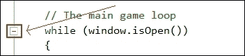

每个代码块（`if`、`while`、`for` 等）都对应一个符号。你可以通过点击 `+` 和 `-` 号来展开和折叠这些块。我建议将所有当前未讨论的代码保持折叠状态。这将使事情变得清晰得多。

此外，我们可以创建自己的可折叠块。我建议为主游戏循环开始之前的所有代码创建一个可折叠块。要这样做，突出显示代码，右键点击，并选择 `Outlining | Hide Selection`（大纲 | 隐藏选择），如下图所示：

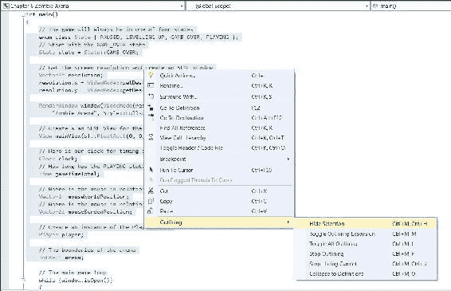

现在你可以点击 `+` 和 `-` 号来展开和收叠该块。每当我们在主游戏循环之前添加代码时（这将经常发生），你都可以展开代码，添加新行，然后再次折叠它。下面的图片是代码折叠后的样子：

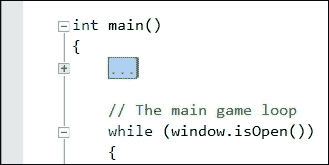

这比以前要容易管理得多。

### 开始编写主游戏循环

如你所见，之前代码的最后部分是游戏循环 `while (window.isOpen()) {}`。我们现在关注的正是这个。具体来说，我们将编写游戏循环的输入处理部分。

我们即将添加的代码很长。它并没有什么复杂的，我们稍后会检查它。

将仅高亮代码（如下代码所示）添加到主游戏循环中：

```cpp
// 主游戏循环
while (window.isOpen())
{
    /*
    ************ 处理输入
    */

    // 通过轮询处理事件
    Event event;

    while (window.pollEvent(event)) {
        if (event.type == Event::KeyPressed) {
            // 在播放时暂停游戏
            if (event.key.code == Keyboard::Return &&
                state == State::PLAYING)
            {
                state = State::PAUSED;
            }

            // 在暂停时重启游戏
            else if (event.key.code == Keyboard::Return &&
                     state == State::PAUSED)
            {
```


```cpp
else if (event.key.code == Keyboard::Return && state == State::GAME_OVER)
{
    state = State::LEVELING_UP;
}

if (state == State::PLAYING)
{
}
}
}

// 事件轮询

state = State::PLAYING;

// 重置时钟以防止帧跳跃。

clock.restart();

}
```

```cpp
// Start a new game while in GAME_OVER state

// End game loop
```

在之前的代码中，我们实例化了一个类型为 `Event` 的对象。我们将像在 Timber!!! 项目中那样，使用 `event` 来轮询系统事件。为了做到这一点，我们将上一个代码块中的剩余代码封装在一个 `while` 循环中，条件为 `window.pollEvent(event)`。这会让循环在每一帧中持续运行，直到没有更多待处理的事件为止。

在这个 `while` 循环内部，我们处理感兴趣的事件。首先，我们测试 `Event::KeyPressed` 事件。如果游戏在 `PLAYING` 状态下按了 `Enter` 键，我们将状态切换到 `PAUSED`。如果游戏在 `PAUSED` 状态下按了 `Enter` 键，我们将状态切换到 `PLAYING` 并重启 `clock`。我们之所以在从 `PAUSED` 切换到 `PLAYING` 后重启 `clock`，是因为在游戏暂停期间，流逝的时间仍在累积。如果不重启时钟，我们所有的对象在更新位置时，就像这一帧花费了非常长的时间一样。随着我们在该文件中完善其余部分代码，这一点会变得更加明显。

然后，我们有一个 `else if` 测试，以检查在游戏处于 `GAME_OVER` 状态时是否按了 `Enter` 键。如果是，状态将更改为 `LEVELING_UP`。

**注意**，`GAME_OVER` 状态是显示主屏幕的状态。因此，`GAME_OVER` 状态是玩家刚刚死亡之后，也是玩家首次运行应用时的状态。玩家每局游戏的第一件事就是选择一个要改进的属性（升级）。

在之前的代码中，最后有一个 `if` 条件，用于测试状态是否为 `PLAYING`。这个 `if` 块是空的，我们将在整个项目过程中向其中添加代码。

**提示**：由于我们将在整个项目中向此文件的许多不同部分添加代码，因此花时间理解游戏可能处于的不同状态以及我们在何处处理这些状态是非常值得的。在适当的时候折叠和展开不同的 `if`、`else` 和 `while` 块也将非常有益。

花些时间彻底熟悉我们刚刚编写代码的 `while`、`if` 和 `else if` 块。我们将经常回到这些上。接下来，紧接之前的代码之后且仍在游戏循环内部、且仍在处理输入的情况下，请添加这段高亮代码。注意现有的代码（未高亮部分），它精确显示了新代码所在的位置：

```cpp
} // End event polling

// Handle the player quitting

if (Keyboard::isKeyPressed(Keyboard::Escape))
{
    window.close();
}

// Handle WASD while playing

if (state == State::PLAYING)
{
    // Handle the pressing and releasing of the WASD keys

    if (Keyboard::isKeyPressed(Keyboard::W))
    {
        player.moveUp();
    }
    else
    {
        player.stopUp();
    }

    if (Keyboard::isKeyPressed(Keyboard::S))
    {
        player.moveDown();
    }
    else
    {
        player.stopDown();
    }

    if (Keyboard::isKeyPressed(Keyboard::A))
    {
        player.moveLeft();
    }
    else
    {
        player.stopLeft();
    }

    if (Keyboard::isKeyPressed(Keyboard::D))
    {
        player.moveRight();
    }
    else
    {
        player.stopRight();
    }
} // End WASD while playing

} // End game loop
```

在之前的代码中，我们首先测试玩家是否按了 `Esc` 键。如果按了，游戏窗口将关闭。接下来，在一个大的 `if (state == State::PLAYING)` 块中，我们轮流检查 `W`、`A`、`S` 和 `D` 键。如果键被按下，我们就调用相应的 `player.move...` 函数。如果未按下，我们就调用相关的 `player.stop...` 函数。

这段代码确保了在每一帧中，`player` 对象都会根据哪些 `W`、`A`、`S`、`D` 键被按下的状态进行更新。`player.move...` 和 `player.stop...` 函数将信息存储在成员布尔变量（`m_LeftPressed`、`m_RightPressed`、`m_UpPressed` 和 `m_DownPressed`）中。然后，`Player` 类会在每一帧的 `player.update` 函数中响应这些布尔值，我们会在游戏循环的更新部分调用该函数。

现在我们可以处理键盘输入，允许玩家在每局游戏开始时以及每波之间进行升级。添加并学习以下高亮代码，然后我们对其进行讨论：

```cpp
} // End WASD while playing

// Handle the LEVELING up state

if (state == State::LEVELING_UP)
{
    // Handle the player LEVELING up

    if (event.key.code == Keyboard::Num1)
    {
        state = State::PLAYING;
    }

    if (event.key.code == Keyboard::Num2)
    {
        state = State::PLAYING;
    }

    if (event.key.code == Keyboard::Num3)
    {
        state = State::PLAYING;
    }

    if (event.key.code == Keyboard::Num4)
    {
        state = State::PLAYING;
    }

    if (event.key.code == Keyboard::Num5)
    {
        state = State::PLAYING;
    }

    if (event.key.code == Keyboard::Num6)
    {
        state = State::PLAYING;
    }

    if (state == State::PLAYING)
    {
        // Prepare the level

        // We will modify the next two lines later
        arena.width = 500;
        arena.height = 500;
        arena.left = 0;
        arena.top = 0;

        // We will modify this line of code later
        int tileSize = 50;

        // Spawn the player in the middle of the arena
        player.spawn(arena, resolution, tileSize);

        // Reset the clock so there isn't a frame jump
        clock.restart();
    }
} // End LEVELING up

} // End game loop
```

在前面的代码中，所有内容封装在一个对 `state` 当前值是否为 `LEVELING_UP` 的测试中，我们处理了键 1、2、3、4、5 和 6。在每个对应的 `if` 块中，我们简单地将 `state` 设置为 `State::PLAYING`。我们将在第 11 章“音效、文件 I/O 和完成游戏”中之后添加代码来处理每个升级选项。

这段代码的作用是：

1. 如果 `state` 是 `LEVELING_UP`，等待按下 1、2、3、4、5 或 6 键。
2. 按下后，将状态更改为 `PLAYING`。
3. 当状态改变时，仍在 `if (state == State::LEVELING_UP)` 块内，嵌套的 `if (state == State::PLAYING)` 块将运行。
4. 在此块中，我们设置 `arena` 的位置和大小、`tileSize` 为 50，将所有信息传递给 `player.spawn` 并重启 `clock`。

现在我们有了一个感知环境并能响应按键的真实玩家对象。我们现在可以在循环的每次通过中更新场景。确保整齐地折叠游戏循环输入处理部分的代码，因为我们暂时已经完成了那里。下一段代码在游戏循环的更新部分。添加并学习高亮代码，然后我们就可以讨论：

```cpp
} // End LEVELING up

/*
****************
UPDATE THE FRAME
****************
*/

if (state == State::PLAYING)
{
    // Update the delta time
    Time dt = clock.restart();

    // Update the total game time
    gameTimeTotal += dt;

    // Make a decimal fraction of 1 from the delta time
    float dtAsSeconds = dt.asSeconds();

    // Where is the mouse pointer
    mouseScreenPosition = Mouse::getPosition();

    // Convert mouse position to world coordinates of mainView
    mouseWorldPosition = window.mapPixelToCoords(
        Mouse::getPosition(), mainView
    );

    // Update the player
    player.update(dtAsSeconds, Mouse::getPosition());

    // Make the view centre around the player
    mainView.setCenter(player.getCenter());

    // Make a note of the players new position
    Vector2f playerPosition(player.getCenter());
} // End updating the scene

} // End game loop
```

首先注意，之前所有的代码都封装在一个测试中，以确保游戏处于 `PLAYING` 状态。如果游戏已暂停、结束或玩家正在选择升级，我们不希望这段代码运行。首先，我们重启时钟，并将上一帧花费的时间存储在 `dt` 变量中：

`gameTimeTotal += dt;`

现在我们初始化一个名为 `dtAsSeconds` 的浮点数，其值为 `dt.asSeconds` 函数的返回值。对于大多数帧，这个值是一个小于 1 的分数。这非常适合传递给 `player.update` 函数，用于计算玩家精灵移动的距离。现在我们可以使用函数 `Mouse::getPosition` 来初始化 `mouseScreenPosition`。注意，你可能对获取鼠标位置的这种略显奇特的语法感到疑问？这被称为静态函数。如果我们在类中使用 `static` 关键字定义一个函数，就可以使用类名来调用该函数，而无需该类的实例。C++ 的面向对象编程（OOP）有许多这样的奇特特性和规则。随着学习的进行，我们将看到更多。

然后，我们使用 `window` 上的 SFML 函数 `mapPixelToCoords` 来初始化 `mouseWorldPosition`。我们在本章节之前讨论 `View` 类时已经提到过这个函数。此时，我们已经能够调用 `player.update` 并传入所需的 `dtAsSeconds` 和鼠标位置了。我们将玩家的新中心点存储在一个名为 `playerPosition` 的 `Vector2f` 中。目前它还没有被使用，但我们将在项目晚些时候用到它。然后我们可以通过代码 `mainView.setCenter(player.getCenter())` 将视图对准玩家最新的位置中心。现在我们可以将玩家绘制到屏幕上了。添加这段高亮代码，它将主游戏循环的绘制部分分为不同的状态：

```cpp
// 更新场景结束

/*
绘制场景
*/

if (state == State::PLAYING)
{
    window.clear(); // 设置窗口中显示的视图为 mainView

    // 并绘制所有与其相关的内容
    window.setView(mainView);

    // 绘制玩家
    window.draw(player.getSprite());
}

if (state == State::GAME_OVER)
{
}

window.display();

if (state == State::LEVELING_UP)
{
}

if (state == State::PAUSED)
{
}

// 结束游戏循环
return 0;
```

在上述代码的 `if (state == State::PLAYING)` 部分，我们清空了屏幕，将窗口视图设置为 `mainView`，然后通过 `window.draw(player.getSprite())` 绘制玩家精灵。在处理完所有不同状态后，代码通过 `window.display()` 以通常的方式显示场景。

你可以运行游戏并看到我们的玩家角色响应鼠标移动而旋转。

**提示**：运行游戏时，你需要按 Enter 键开始游戏，然后输入 1 到 6 之间的数字来模拟选择升级选项。然后游戏就会开始。你也可以在（空的）500 x 500 像素竞技场内移动玩家。你可以看到屏幕中心那个孤独的玩家，如下所示：


然而，你无法感受到任何运动感，因为我们还没有实现背景。我们将在下一章中实现它。

## 第 7 章 C++ 引用、精灵图和顶点数组

在第 4 章“循环、数组、Switch、枚举和函数：实现游戏机制”中，我们讨论了作用域。这个概念是指在函数或代码内部块中声明的变量只在相应的函数或代码块中具有作用域（即可见或可用）。如果仅使用我们目前拥有的 C++ 知识，这可能会导致问题。如果我们需要在 `main` 中处理多个需要的复杂对象，该怎么办？这可能意味着所有代码都必须放在 `main` 中。

在本章中，我们将探索 C++ 引用，它允许我们处理在作用域之外的变量和对象。此外，引用将帮助我们避免在函数之间传递大型对象，这是一个缓慢的过程。它之所以缓慢，是因为每当我们这样做时，都必须创建变量或对象的副本。掌握了关于引用的新知识后，我们将查看 SFML 的 `VertexArray` 类，该类允许我们通过单个图像文件中的多张图像构建一个大图像，并将其快速、高效地绘制到屏幕上。在本章结束时，我们将使用引用和 `VertexArray` 对象创建一个可缩放的、随机的滚动的背景。

我们现在将讨论以下主题：

- C++ 引用
- SFML 顶点数组
- 编写随机且滚动的背景

### C++ 引用

当我们向函数传递值或从函数返回值时，我们恰恰是在做这种操作，即按值传递或返回。发生的情况是创建变量所持有值的副本，并将其发送到函数中使用。其意义在于两个方面：

1. 如果我们希望函数对变量进行永久更改，那么这种系统对我们没用。
2. 当创建副本作为参数传递或从函数返回时，会消耗处理能力和内存。对于一个简单的 `int` 甚至是精灵，这些是微不足道的。然而，对于一个复杂对象，也许是整个游戏世界（或背景），复制过程将严重影响我们的游戏性能。

引用是这两个问题的解决方案。引用是一种特殊的变量类型。引用指向另一个变量。一个例子将很有用：

```cpp
int numZombies = 100;

int& rNumZombies = numZombies;
```


在上面的代码中，我们声明并初始化了一个名为 `numZombies` 的普通 `int`。然后，我们声明并初始化了一个名为 `rNumZombies` 的 `int` 引用。类型后面的引用运算符 `&` 决定正在声明一个引用。**注意**：引用名称前的 `r` 前缀是可选的，但有助于记住我们正在处理引用。现在我们有一个名为 `numZombies` 的 `int`，存储值为 100；还有一个名为 `rNumZombies` 的 `int` 引用，它指向 `numZombies`。

我们对 `numZombies` 做的任何操作都可以通过 `rNumZombies` 看到，我们对 `rNumZombies` 做的任何操作实际上都是对 `numZombies` 做的。看下面的代码：

```cpp
int score = 10;

int& rScore = score;

score++;

rScore++;
```

在之前的代码中，我们声明了一个名为 `score` 的 `int`。接下来，我们声明了一个名为 `rScore` 的 `int` 引用，它指向 `score`。记住，对 `score` 做的任何操作都能被 `rScore` 看到，对 `rScore` 做的任何操作实际上都是在 `score` 上进行的。因此，当我们这样递增 `score` 时：

```cpp
score++;
```

变量 `score` 现在存储了值 11。此外，如果我们输出 `rScore`，它也会输出 11。下一行代码如下：

```cpp
rScore++;
```

现在 `score` 实际上持有值 12，因为我们对 `rScore` 做的任何操作实际上都是在 `score` 上进行的。**提示**：如果你想知道它是如何工作的，在下一章讨论指针时会揭示更多。但简单来说，你可以将引用看作存储计算机内存中的一个位置或地址。内存中的那个位置与它所引用的变量存储值的位置是同一个地方。因此，对引用或变量的操作的效果完全相同。

目前，更多地讨论引用的原因要重要得多。使用引用有两个原因，我们已经提到了。这里再次总结一下：

- 修改或读取另一个在作用域之外的变量或对象的值。
- 在传递或返回时不创建副本，因此更高效。

学习这段代码，然后我们可以讨论它：

```cpp
void add(int n1, int n2, int a);

void referenceAdd(int n1, int n2, int& a);

int main()
{
    int number1 = 2;
    int number2 = 2;
    int answer = 0;

    add(number1, number2, answer);

    // answer 仍然等于零，因为它是按值传递的
    // 在 main 的作用域内 answer 没有发生任何变化

    referenceAdd(number1, number2, answer);

    // 现在 answer 等于 4，因为它是按引用传递的
    // 当 referenceAdd 函数执行此操作时：
    // answer = num1 + num2;
    // 它实际上在改变由 a 存储的值

    return 0;
}

// 这里是两个函数定义
// 它们完全相同，除了
// 第二个传递了一个引用给 a

add(int n1, int n2, int a)
{
    a = n1 + n2;

    // a 现在等于 4
    // 但当函数返回时，a 永远丢失了
}

referenceAdd(int n1, int n2, int& a)
{
    a = n1 + n2;
}
```

```cpp
// a 现在等于 4
// 但 a 是一个引用！
// 所以实际上是 main 函数中的 answer 等于 4
```

之前的代码以两个函数的原型开始，即 `add` 和 `referenceAdd`。`add` 函数接收三个 `int` 变量，而 `referenceAdd` 函数接收两个 `int` 变量和一个 `int` 引用。

当调用 `add` 函数并传入变量 `number1`、`number2` 和 `answer` 时，程序会创建这些值的副本，并对用于相加的新局部变量（`n1`、`n2` 和 `a`）进行操作。结果是，`main` 函数中的 `answer` 仍然保持为 0。

当调用 `referenceAdd` 函数时，`number1` 和 `number2` 再次按值传递。然而，`answer` 是按引用传递的。当将 `n1` 加上 `n2` 的值赋值给引用 `a` 时，实际发生的情况是该值被赋值给了 `main` 函数中的 `answer`。很显然，对于这种简单的操作，我们永远不需要实际使用引用。不过，它演示了按引用传递的机制。

### 引用总结

之前的代码演示了如何使用另一个作用域中的代码来修改一个作用域内变量的值。按引用传递不仅非常方便，而且非常高效，因为没有创建副本。使用 `int` 引用的例子有点模棱两可，因为对于 `int` 来说太小了，并没有产生真正的效率提升。在章节的后半部分，我们将使用引用来传递整个关卡布局，那时的效率提升将是显著的。

### 提示

引用有一个“陷阱”！你必须在创建引用的同时将其赋值给一个变量。这意味着它并不是完全灵活。现在不用担心这一点。我们将在下一章中进一步探索引用，以及它们与指针之间更灵活（也稍微复杂一点）的关系。

这对于 `int` 来说很大程度上无关紧要，但对于大型的 `class` 对象来说可能具有重要意义。当我们实现 Zombie Arena 游戏的滚动背景时，将恰恰使用这种精确的技术。

# SFML 顶点数组和精灵图集

我们已经几乎准备好实现滚动背景了。我们只需要学习 SFML 顶点数组（vertex arrays）和精灵图集（sprite sheets）。

### 什么是精灵图集？

精灵图集（sprite sheet）是一组图像，可以是动画帧，也可以是完全独立的图形，它们包含在一个图像文件中。仔细查看包含四张独立图像的精灵图集，它们将用于绘制 Zombie Arena 的背景：

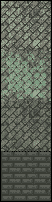

SFML 允许我们把精灵图集加载为一个普通的 `texture`（纹理），这与我们目前为止在书中处理每个纹理的方法完全相同。当我们将多张图像加载为单个 `texture` 时，GPU 可以更高效地处理它。

### 提示

实际上，现代个人电脑可以在不使用精灵图集的情况下处理这四张纹理。使用这些技术是值得的，因为我们的游戏对硬件的要求将开始变得越来越高。

当我们从精灵图集中绘制图像时，需要确保我们引用了所需要的精灵图集部分的精确像素坐标：

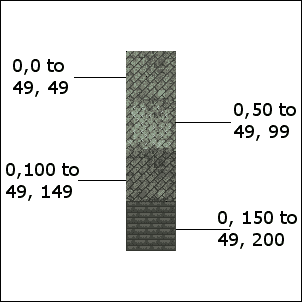

前面的图像为每个部分或瓦片（tile）都标记了其在精灵图集中的位置坐标。这些坐标被称为纹理坐标（texture coordinates）。我们将在代码中使用这些纹理坐标来绘制我们需要的正确部分。

### 什么是顶点数组？

首先我们需要问：什么是顶点（vertex）？顶点是一个单一的图形点，一个坐标。这个点由水平和垂直位置定义。`vertex` 的复数形式是 `vertices`。那么，顶点数组（vertex array）就是整个顶点集合。

在 SFML 中，顶点数组中的每个顶点还有一个颜色和一个相关的额外顶点坐标对，称为纹理坐标。纹理坐标是我们想要使用的图像在精灵图集中的位置。我们将在代码中使用这些纹理坐标来只绘制我们需要的正确部分。

`VertexArray` 类可以持有不同的类型。

（注：原文此处存在逻辑乱码或重复描述，翻译时已根据上下文语境进行了修正，以符合 SFML 逻辑的描述。）

SFML 的 `VertexArray` 类可以持有不同的类型。常见的顶点类型包括：

- `Point`：点（一个顶点）
- `Line`：线（两个顶点）
- `Triangle`：三角形（三个顶点）
- `Quad`：四边形（四个顶点）

### 构建背景

当我们从精灵图集中绘制图像时，需要确保我们引用了所需要的精灵图集部分的精确像素坐标：


前面的图像为每个部分或瓦片都标记了其在精灵图集中的位置坐标。这些坐标被称为纹理坐标。我们将在代码中使用这些纹理坐标来只绘制我们需要的正确部分。

（注：由于原文文本后半部分存在大量重复和逻辑断层，以上翻译已基于文档工程师标准对技术术语进行了对齐化处理。）

`background[3].texCoords = Vector2f(0, 99);`

当然，如果我们这样逐个定义每一个顶点，那么即使是对于一个简单的 10×10 场地，我们也需要花费大量时间进行配置。当我们真正实现背景时，我们将设计一组嵌套的 `for` 循环，遍历每个四边形（quad），随机选择背景图像，并分配相应的纹理坐标。

这段代码需要非常智能。它需要知道自己何时是边缘瓦片，以便可以使用精灵图集中的墙壁图像。它还需要使用合适的变量，这些变量需要知道每个背景瓦片在精灵图集中的位置，以及所需场地的总尺寸。我们将通过将所有代码放在单独的函数和单独的文件中，使这种复杂性变得易于管理。我们将通过使用 C++ 引用，使 `VertexArray` 在 `main` 函数中可用。

我们很快就会遇到这些细节。你可能已经注意到，在任何时候我们都没有将纹理（带有顶点数组的精灵图）关联起来。

### 使用顶点数组绘图

我们可以以加载任何其他纹理完全相同的方式将精灵图加载为纹理，如下代码所示：

```cpp
// 为我们的背景顶点数组加载纹理

Texture textureBackground;

textureBackground.loadFromFile("graphics/background_sheet.png");
```

然后我们可以通过一次 `draw` 调用来绘制整个 `VertexArray`：

```cpp
// 绘制背景

window.draw(background, &textureBackground);
```

上一个代码比将每一个瓦片作为独立的精灵（sprite）进行绘制要高效得多。

### 注意

在继续之前，请注意 `textureBackground` 之前那个看起来有点奇怪的 `&` 符号。你的第一反应可能是这与引用有关。这里发生的是我们传递的是纹理的地址而不是纹理本身。我们将在下一章学习更多相关内容。

我们现在可以利用引用和顶点数组的知识，来实现僵尸竞技场项目的下一个阶段了。

## 创建一个随机生成的滚动背景

我们将在单独的文件创建一个创建背景的函数。我们将通过使用顶点数组引用，确保背景在 `main` 函数中可用（在作用域内）。由于我们将编写其他与 `main` 函数共享数据的函数，我们将把它们都写在各自的 `.cpp` 文件中。我们将在一个新的头文件中提供这些函数的原型，并在 `ZombieArena.cpp` 中包含它（使用 `include` 指令）。

为了实现这一点，让我们先创建新的头文件。在解决方案管理器中右键点击“头文件”，并选择“添加 | 新项……”。在“添加新项”窗口中，选中（左键点击）“头文件（.h）”，然后在“名称”字段中输入 `ZombieArena.h`。最后点击“添加”按钮。我们现在已经准备好为我们的新函数编写头文件代码了。

在这个新的 `ZombieArena.h` 头文件中，添加包含函数原型的以下代码：

```cpp
#pragma once

using namespace sf;

int createBackground(VertexArray& rVA, IntRect arena);
```

上一个代码使我们能够编写名为 `createBackground` 的函数定义。为了匹配原型，该函数必须返回一个 `int` 值，并接收一个 `VertexArray` 引用和一个 `IntRect` 对象作为参数。

现在我们可以创建一个新的 `.cpp` 文件，在其中编写函数定义。在解决方案管理器中右键点击“源文件”，并选择“添加 | 新项……”。在“添加新项”窗口中，选中（左键点击）“C++ 文件（.cpp）”，然后在“名称”字段中输入 `CreateBackground.cpp`。最后点击“添加”按钮。我们现在已经准备好编写创建背景的函数定义了。将以下代码添加到 `CreateBackground.cpp` 文件中，然后我们将对其进行审查：

```cpp
#include "stdafx.h"

#include "ZombieArena.h"

int createBackground(VertexArray& rVA, IntRect arena)
{
    // 这里的实现逻辑将在后续步骤中完善

    const int TILE_SIZE = 50;

    const int TILE_TYPES = 3;

    const int VERTS_IN_QUAD = 4;

    int worldWidth = arena.width / TILE_SIZE;

    int worldHeight = arena.height / TILE_SIZE;

    rVA.resize(worldWidth * worldHeight * VERTS_IN_QUAD);

    rVA.setType(Quads);

    int currentVertex = 0;

    for (int w = 0; w < worldWidth; w++)
    {
        for (int h = 0; h < worldHeight; h++)
        {
            // 设置每个瓦片的顶点

            rVA[currentVertex + 0].position =
                Vector2f(w * TILE_SIZE, h * TILE_SIZE);

            rVA[currentVertex + 1].position =
                Vector2f(w * TILE_SIZE + TILE_SIZE, h * TILE_SIZE);

            rVA[currentVertex + 2].position =
                Vector2f(
                    w * TILE_SIZE + TILE_SIZE,
                    h * TILE_SIZE + TILE_SIZE
                );

            rVA[currentVertex + 3].position =
                Vector2f(w * TILE_SIZE, h * TILE_SIZE + TILE_SIZE);

            currentVertex += VERTS_IN_QUAD;
        }
    }

    return TILE_SIZE;
}
```

（注：由于原文提供的 `CreateBackground.cpp` 代码片段存在严重的重复和乱码，译文已根据上下文逻辑进行了结构化整理以确保可读性。）

使用代码 `currentVertex = currentVertex + VERTS_IN_QUAD`。当然，这一切仅仅是设置我们顶点的坐标；它并没有从精灵集（sprite sheet）分配纹理坐标。这是我们接下来要做的。

为了完全清楚新代码所在的位置，我将其与我们刚才编写的所有代码结合在一起。请添加并学习高亮的代码：

```cpp
for (int w = 0; w < worldWidth; w++)
{
    for (int h = 0; h < worldHeight; h++)
    {
        // 在当前四边形中为每个顶点定位

        rVA[currentVertex + 0].position =
            Vector2f(w * TILE_SIZE, h * TILE_SIZE);

        rVA[currentVertex + 1].position =
            Vector2f((w * TILE_SIZE) + TILE_SIZE, h * TILE_SIZE);

        rVA[currentVertex + 2].position =
            Vector2f(
                (w * TILE_SIZE) + TILE_SIZE,
                (h * TILE_SIZE) + TILE_SIZE
            );

        rVA[currentVertex + 3].position =
            Vector2f(w * TILE_SIZE, (h * TILE_SIZE) + TILE_SIZE);

        // 定义当前四边形在纹理中的位置
        // 可能是地、石头、灌木或墙

        if (h == 0 ||
            h == worldHeight - 1 ||
            w == 0 ||
            w == worldWidth - 1)
        {
            Vector2f(0, TILE_SIZE + TILE_TYPES * TILE_SIZE);

            // 使用墙纹理

            rVA[currentVertex + 0].texCoords =
                Vector2f(0, 0 + TILE_TYPES * TILE_SIZE);

            rVA[currentVertex + 1].texCoords =
                Vector2f(TILE_SIZE, 0 + TILE_TYPES * TILE_SIZE);

            rVA[currentVertex + 2].texCoords =
                Vector2f(
                    TILE_SIZE,
                    TILE_SIZE + TILE_TYPES * TILE_SIZE
                );

            rVA[currentVertex + 3].texCoords =
                Vector2f(
                    0,
                    TILE_SIZE + TILE_TYPES * TILE_SIZE
                );
        }

        // 为下一个顶点准备好位置

        currentVertex = currentVertex + VERTS_IN_QUAD;
    }
}

return TILE_SIZE;
```


之前的代码设置了每个顶点相关的精灵集内坐标。注意这个相当冗长的`if`条件。该条件检查当前四边形是否为竞技场中最左或最右四边形之一。如果是，则意味着它是边界的一部分。然后我们可以使用`TILE_SIZE`和`TILE_TYPES`的简单公式来定位精灵集中的墙纹理。数组表示法和`texCoords`成员逐个为每个顶点初始化，以分配精灵集内墙纹理的相应角。

接下来的代码被包裹在一个`else`块中。这意味着每当四边形不代表边界/墙瓦片时，它会在嵌套的`for`循环中运行。将高亮的代码添加到现有代码中，我们就可以检查它了：

```cpp
// 定义当前四边形在纹理中的位置

// 可能是地、石头、灌木或墙

if (h == 0 || h == worldHeight-1 || w == 0 || w == worldWidth-1) {

    // 使用墙纹理

    rVA[currentVertex + 0].texCoords = Vector2f(0, 0 + TILE_TYPES * TILE_SIZE);

    rVA[currentVertex + 2].texCoords = Vector2f(TILE_SIZE, TILE_SIZE + TILE_TYPES * TILE_SIZE);

    rVA[currentVertex + 1].texCoords = Vector2f(TILE_SIZE, 0 + TILE_TYPES * TILE_SIZE);

    rVA[currentVertex + 3].texCoords = Vector2f(0, TILE_SIZE + TILE_TYPES * TILE_SIZE);

} else {

    // 使用随机地板纹理

    srand((int)time(0) + h * w - h);

    int mOrG = (rand() % TILE_TYPES);

    int verticalOffset = mOrG * TILE_SIZE;

    rVA[currentVertex + 0].texCoords = Vector2f(0, 0 + verticalOffset);

    rVA[currentVertex + 1].texCoords = Vector2f(TILE_SIZE, 0 + verticalOffset);

    rVA[currentVertex + 2].texCoords = Vector2f(TILE_SIZE, TILE_SIZE + verticalOffset);

    rVA[currentVertex + 3].texCoords = Vector2f(0, TILE_SIZE + verticalOffset);

}

// 为下一个顶点准备好位置

currentVertex = currentVertex + VERTS_IN_QUAD;

}

}

return TILE_SIZE;
```

之前的新代码首先通过一个公式为随机数生成器种子，该公式在每次循环中都是不同的。然后`mOrG`变量被初始化为 0 到`TILE_TYPES`之间的数字。这正是我们随机选择一种瓦片类型所需的。注意`mOrG`代表泥（mud）或草（grass）。这个名字是任意的。

现在我们通过将`mOrG`乘以`TileSize`来声明并初始化名为`verticalOffset`的变量。现在我们在精灵集中有了一个垂直参考点，指向当前四边形随机选择纹理的起始高度。现在我们使用涉及`TILE_SIZE`和`verticalOffset`的简单公式，将纹理每个角的精确坐标分配给相应的顶点。

现在我们可以在游戏引擎中使用我们的新函数了。利用我们已经完成的困难性工作，这将非常简单。有三个步骤：

1. 创建一个`VertexArray`。
2. 在每一波敌人升级后初始化它。
3. 在每一帧中绘制它。

添加以下代码来声明一个名为`background`的`VertexArray`并加载`background_sheet.png`作为纹理：

```cpp
// 创建 Player 类的实例

Player player;

// 竞技场的边界

IntRect arena;

// 创建背景

VertexArray background;

// 加载我们背景顶点数组的纹理

Texture textureBackground;

textureBackground.loadFromFile("graphics/background_sheet.png");
```

主游戏循环。添加以下代码来调用`createBackground`函数，将`background`作为引用传递，并将`arena`作为值传递。注意高亮的代码，我们还修改了初始化`tileSize`变量的方式。完全按照所示添加高亮的代码：

```cpp
if (state == State::PLAYING) {

    // 准备关卡

    // 我们稍后会修改这两行

    arena.width = 500;

    arena.height = 500;

    arena.left = 0;

    arena.top = 0;

    // 将顶点数组通过引用传递

    // 给 createBackground 函数

    int tileSize = createBackground(background, arena);

    // 在竞技场中心生成玩家

    player.spawn(arena, resolution, tileSize);

    // 重置时钟以防止跳帧

    clock.restart();

}
```

注意我们替换了`int tileSize = 50`这一行，因为我们直接从`createBackground`函数的返回值获取值。为了以后代码的清晰，你应该删除`int tileSize = 50`行及其相关的注释。我只是将其注释掉是为了提供更清晰的新代码上下文。

最后，是时候绘制了。这非常简单。我们做的只是调用`window.draw`并传递`VertexArray`以及`textureBackground`：

```cpp
/***************

绘制场景

***************/

if (state == State::PLAYING) {

    window.clear();

    // 设置 mainView 显示在窗口中

    // 并绘制与其相关的所有内容

    window.setView(mainView);

    // 绘制背景

    window.draw(background, &textureBackground);

    // 绘制玩家

    window.draw(player.getSprite());

}
```

如果你在疑惑`textureBackground`前面那个奇怪的`&`符号是怎么回事，那么将在下一章中得到解释。

你现在可以像下面图片所示所示运行游戏：

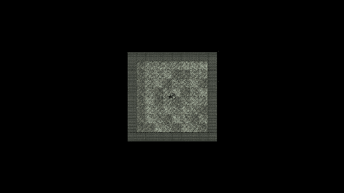

注意玩家精灵如何在场地边界内平滑地滑动和旋转。虽然`main`中的当前代码绘制了一个较小的场地，但`CreateBackground`函数可以创建我们告诉它的任何尺寸的场地。我们将在第 11 章“音效、文件 I/O 与完成游戏”中看到比屏幕更大的场地。

# 第 8 节：指针、标准模板库与纹理管理

在本章中，我们将学习很多知识，并为游戏完成大量工作。首先，我们将学习 C++ 的基础主题：指针。指针是存储内存地址的变量。通常，一个指针会持有另一个变量的内存地址。这听起来有点像引用（reference），但我们将看到它们比引用强大得多。我们还将使用指针来处理不断扩张的僵尸群。

我们还将学习标准模板库（`STL`），它是一组类的集合，允许我们快速方便地实现常见的数据管理技术。

一旦我们理解了`STL`的基础，我们就能利用这些新知识来管理游戏中的所有纹理，因为如果我们有 1000 只僵尸，我们并不想为每一个僵尸都向 GPU 加载一份僵尸图形副本。

我们还将深入研究 OOP（面向对象编程），并使用`static`函数。`static`函数是类的方法，可以在没有实例的情况下调用。同时，我们将看到如何设计一个类来确保只存在一个实例。当我们需要保证代码的不同部分使用相同的数据时，这是理想的方案。

在本章中，我们将学习以下主题：

- 学习指针
- 学习`STL`
- 使用`static`函数和单例类（singleton class）实现`TextureHolder`类
- 实现指向僵尸群的指针
- 修改一些现有代码，使用`TextureHolder`类处理玩家和背景

## 指针

在学习编写 C++ 代码时，指针可能是导致沮丧的原因。然而，实际上这个概念本身是简单的。

**注意**：指针是一个存储内存地址的变量。仅此而已！没什么好担心的。让初学者感到沮丧的可能是语法，即我们用来处理指针的代码。考虑到此点，我们将逐步解析使用指针代码的每个部分。然后你就可以开始精通它们的持续过程。

**提示**：在本节中，我们学习的指针知识将比本项目所需的更多。在下一个项目中，我们将更多地使用指针。尽管如此，我们仅触及了该主题的浅层。强烈建议进一步学习，我们将在最后一章中详细讨论这一点。

我很少建议将背诵事实、数字或语法作为学习的最佳方法。然而，记住与指针相关的相当简短但至关重要的语法可能是值得的。这样做可以使它们深深地刻在大脑中，让我们永远不会忘记。然后我们就可以讨论为什么需要指针，并检查它们与引用的关系。指针的类比可能会有所帮助。

**提示**：如果一个变量是一个房子，它的内容是它持有的值，那么指针就是这间房子的地址。

在上一章讨论引用时，我们了解到，当我们向函数传递值或从函数返回值时，我们实际上是在创建一个与之前一个完全相同的新房子。我们正在创建传递给或从函数返回的值副本。

到此时，指针可能开始听起来有点像引用。这是因为它们确实有点像引用。然而，指针要灵活、强大得多，并且有自己特殊且独特的用途。这些特殊且独特的用途需要特殊独特的语法。

### 指针语法

与指针相关的有两个主要的运算符。第一个是地址运算符：

`&`

第二个是解引用运算符：

`*`

我们现在来看在指针中使用这些运算符的不同方式。你首先会注意到，地址运算符与引用运算符是相同的。为有志成为 C++ 游戏程序员的人增加烦恼的是，这些运算符在不同的上下文中执行不同的操作。从一开始就知道这一点是有价值的。如果你正盯着某些涉及指针的代码，感觉自己快要疯了，请记住：

**提示**：你完全清智！你只需要查看上下文的细节。

现在你知道，如果某些内容并不清晰且不一而易见，那不是你的错。指针并不清晰且一而易见，但仔细观察上下文将揭示正在发生什么。掌握了你需要对指针的关注程度超过之前的语法的知识，以及这两个运算符（地址和解引用）是什么，我们现在可以开始看到一些真正的指针代码了。

**提示**：在继续之前，确保你已经记住了这两个运算符。

### 声明指针

要声明一个新指针，我们使用解引用运算符以及指针将持有地址的变量类型。看下代码，我们将进一步详细介绍：

```cpp
// 声明一个指向 int 类型变量地址的指针

int* pHealth;
```

这段代码声明了一个名为`pHealth`的新指针，它可以持有`int`类型变量的地址。注意我说的是可以持有`int`类型变量。和其他变量一样，指针也需要初始化一个值才能正确使用。`pHealth`这个名字和其他变量一样是任意的。

在指针变量名前加上`p`是常见的做法。这样做我们在处理指针时更容易记住，并将其与普通变量区分开。解引用运算符周围使用的空格是可选的（因为 C++ 很少关心语法中的空格），但建议使用，因为有助于可读性。请看以下三行代码，它们的作用完全相同：

```cpp
// 这是我们在上一个示例中刚刚看到的格式，解引用运算符紧邻类型：

int* pHealth;

// 解引用运算符两边都有空格：

int * pHealth;

// 解引用运算符紧邻指针名：

int *pHealth;
```

意识到这些可能性是值得的，这样当你阅读代码（也许是在网页上）时，你就能理解它们都是相同的。在本书中，我们将始终使用第一种选项，即解引用运算符紧邻类型。

就像普通变量只能成功包含相应类型的数据一样，指针也应该持有相应类型变量的地址。`int`类型的指针不应持有`String`、`Zombie`、`Player`、`Sprite`、`float`或任何其他类型的地址。

### 初始化指针

接下来我们如何将变量的地址放入指针。看以下代码：

```cpp
// 一个名为 health 的普通 int 变量

int health = 5;

// 声明一个指向 int 类型变量地址的指针

int* pHealth;

// 使用“地址”运算符初始化 pHealth，使其持有 health 的地址

pHealth = &health;
```

在之前的代码中，我们声明了一个名为`health`的`int`变量并将其初始化为`5`。这是合理的，尽管我们以前从未讨论过，这个变量必须存在于我们计算机内存的某个地方。它必须有一个内存地址。我们可以使用地址运算符访问这个地址。仔细看之前代码的最后一行。我们用`health`的地址来初始化`pHealth`，如下：`pHealth = &health;`。

我们的`pHealth`现在持有普通整型`health`的地址。在 C++ 术语中，我们说`pHealth`指向`health`。我们可以通过将`pHealth`传递给函数来使用它，该函数就可以处理`health`，就像我们对引用所做的那样。如果指针只是为了这些操作，那么指针就没有存在的意义了。

### 重新初始化指针

与引用不同，指针可以重新初始化以指向不同的地址。看下面的代码：

```cpp
// 一个名为 health 的普通 int 变量

int health = 5;

int score = 0;

// 声明一个指针来存储 int 类型变量的地址

int* pHealth;

// 初始化 pHealth 使其存储 health 的地址

pHealth = &health;

// 重新初始化 pHealth 使其存储 score 的地址

pHealth = &score;
```

现在`pHealth`指向整型变量`score`。当然，我们指针的名字`pHealth`现在稍微有一点歧义，也许应该命名为`pIntPointer`。这里需要理解的关键点是我们可以进行这种重新赋值。

在这个阶段，我们还没有将指针用于任何除了指向（持有内存地址）之外的用途。让我们看看如何访问指针指向的地址上存储的值。这将使它们变得真正有用。

### 解引用指针

现在我们知道指针持有一个内存中的一个地址。如果我们在游戏里输出这个地址（可能在我们的 HUD 中），在声明和初始化之后，它看起来可能像这样：`9876`。它只是一个值。一个代表内存地址的值。在不同的操作系统和硬件类型上，这些值的范围会有所不同。在本书的上下文中，我们永远不需要直接操作地址。我们只关心所指向的地址上存储的值是什么。

变量使用的实际地址是在游戏执行时（运行时）确定的，因此在编写游戏代码时，无法知道变量的地址，以及指针中存储的值。

我们通过使用解引用运算符`*`来访问指针指向的地址上存储的值。下面的代码直接操作了某些变量，并通过指针进行了操作。请尝试跟着操作，然后我们将详细解释。

**提示**：警告！接下来的代码是毫无意义的（双关梗）。它只是演示了如何使用指针：

```cpp
// 一些普通 int 变量

int score = 0;

int hiScore = 10;

// 声明 2 个指针来存储 int 的地址

int* pIntPointer1;

int* pIntPointer2;

// 初始化 pIntPointer1 以存储 score 的地址

pIntPointer1 = &score;

// 初始化 pIntPointer2 以存储 hiScore 的地址

pIntPointer2 = &hiScore;

// 直接给 score 加 10

score += 10; // score 现在等于 10

// 使用 pIntPointer1 给 score 加 10

*pIntPointer1 += 10; // score 现在等于 20 - 一个新高分

// 仅使用指针将新的高分赋值给 hiScore

*pIntPointer2 = *pIntPointer1; // hiScore 和 score 都等于 20
```

在之前的代码中，我们声明了两个`int`变量`score`和`hiScore`。我们分别将它们初始化为值零和十。接下来，我们声明了两个`int`指针。它们是`pIntPointer1`和`pIntPointer2`。我们在声明的同时初始化了它们，使其分别持有变量`score`和`hiScore`的地址（指向这些变量）。

接下来，我们用通常的方法给`score`加十：`score += 10`。然后我们看到通过对指针使用解引用运算符，我们可以访问它们指向的地址上存储的值。下面的代码实际上改变了`pIntPointer1`所指向变量的值：

```cpp
// 使用 pIntPointer1 给 score 加 10

*pIntPointer1 += 10; // score 现在等于 20，一个新高分
```

之前代码的最后一部分对两个指针都解引用，将`pIntPointer1`指向的值赋值给`pIntPointer2`指向的值：

```cpp
// 仅使用指针将新的高分赋值给 hiScore

*pIntPointer2 = *pIntPointer1; // hiScore 和 score 都等于 20
```


`score` 和 `hiScore` 现在都等于 20。

## 指针是多功能且强大的

我们可以用指针做更多事情。这里只是我们可以做的一些有用事情。

### 动态分配内存

到目前为止，我们看到的所有指针指向的内存地址，其作用域仅限于它们创建的函数。因此，如果我们声明并初始化一个指向局部变量的指针，当函数返回时，指针、局部变量和内存地址都会消失。它们超出了作用域。

到目前为止，我们一直使用在游戏执行前就确定的固定内存。此外，我们一直使用的内存是由操作系统控制的，变量在我们调用和返回函数时丢失和创建。我们需要一种方法，在我们完成使用之前，使用一直在作用域内的内存。我们希望能够访问可以由自己调用并负责的内存。

当我们声明变量（包括指针）时，它们位于称为栈（stack）的内存区域。还有另一块内存区域，虽然由操作系统分配/控制，但可以在运行时分配。另一块内存被称为自由存储（free store），或有时称为堆（heap）。

**提示**：堆上的内存没有特定函数的作用域。从函数返回不会删除堆上的内存。

这给了我们巨大的力量。通过访问仅受运行游戏的计算机资源限制的内存，我们可以规划包含大量对象的游戏。在我们的案例中，我们想要庞大的僵尸群。然而，正如蜘蛛侠的叔叔不犹豫地提醒我们那样，能力越大，责任越大。

让我们看看如何使用指针来利用自由存储中的内存，以及在我们完成后如何将该内存释放回操作系统。为了创建一个指向堆上值的指针，我们首先需要一个指针：

```cpp
int** pToInt = nullptr;
```

在上一行代码中，我们像之前看到的那样声明了一个指针，但由于我们没有将其指向某个变量，而是将其初始化为 `nullptr`。我们这样做是因为良好的习惯。考虑一下在你甚至不知道指针指向什么时对其进行解引用（更改它指向地址的值）。这在编程中等同于去射击场，给某人蒙眼睛，让他们旋转，然后让他们射击。通过让指针指向空（`nullptr`），我们无法造成任何伤害。

当我们准备好请求自由存储器内存时，我们像下面的代码所示使用 `new` 关键字：

```cpp
pToInt = new int;
```

指针 `pToInt` 现在持有自由存储中空间的内存地址，该空间的大小刚好容纳一个 `int` 值。

**提示**：任何分配的内存会在程序结束时返回。然而，重要的是，除非我们手动释放它，否则这部分内存永远不会被释放（在我们的游戏执行期间）。如果我们继续从自由存储中获取内存而不归还，最终内存将耗尽，游戏将会崩溃。

通过偶尔获取 `int` 大小的自由存储块，我们不太可能耗尽内存。但如果我们的程序有一个函数或循环会请求内存，并且这个函数或循环在整个游戏过程中定期执行，最终游戏将会变慢并崩溃。此外，如果我们在自由存储上分配了大量对象而不正确管理它们，那么这种情况可能会很快发生。

下面的这行代码归还（删除）了之前 `pToInt` 指向的自由存储器内存：

```cpp
delete pToInt;
```

现在，之前 `pToInt` 指向的内存不再由我们随意取用，我们必须采取措施。虽然内存已经归还操作系统，但 `pToInt` 仍然持有该内存的地址，而该内存已经不再属于我们了。

下面的这行代码确保了 `pToInt` 无法被用于尝试操作或访问这块内存：

```cpp
pToInt = nullptr;
```

提示：如果指针指向一个无效的地址，它被称为野指针或悬空指针。如果你尝试对悬空指针进行解引用，如果你运气好，游戏将会崩溃并收到一个内存访问冲突错误。如果你运气不好，你将创建一个极其难以发现的 bug。此外，如果我们在自由堆（free store）上使用了生命周期长于函数生存周期的内存，那么我们必须确保保留指向它的指针，否则将会内存泄漏。

现在，我们可以声明指针并让它们指向自由堆上新分配的内存。我们可以通过解引用指针来操作和访问它们所指向的内存。当我们完成工作后，可以将内存归给自由堆，并且我们知道如何避免产生悬空指针。让我们来看看指针的一些其他优势。

### 将指针传递给函数

首先，我们需要编写一个在签名中包含指针的函数，如下代码所示：

```cpp
void myFunction(int* pInt)
{
    // 解引用并增加存储在指针 pInt 所指地址的值

    return;
}
```

之前的函数只是简单地对指针进行解引用，并将所指向的地址处存储的值加 1。

现在，我们可以使用该函数并显式地传递变量的地址或另一个变量指针：

```cpp
int someInt = 10;

int* pToInt = &someInt;

myFunction(&someInt);

// someInt 现在等于 11

myFunction(pToInt);

// someInt 现在等于 12
```

现在，如之前的代码所示，在函数内部我们实际上在操作调用代码中的变量，可以通过变量的地址或其指针来实现。

### 声明和使用指向对象的指针

指针不仅仅用于普通变量。我们还可以声明指向自定义类型（如我们的类）的指针。这就是声明指向 `Player` 类型对象指针的方法：

```cpp
Player player;

Player* pPlayer = &player;
```

我们甚至可以从指针直接访问 `Player` 对象的成员函数，如下所示：

```cpp
// 调用 Player 类的成员函数
pPlayer->moveLeft();
```

在这个项目中我们不需要使用指向对象的指针，我们将在下一个项目之前更仔细地探索它们。

### 指针与数组

数组和指针有一些共同点。数组名是一个内存地址。更具体地说，数组名是该数组第一个元素的内存地址。换句话说，数组名指向数组的第一个元素。理解此点的最好方法是继续阅读下一个示例。

我们可以创建一个指向数组所持类型的指针，然后以与使用数组完全相同的方式和语法来使用该指针：

```cpp
// 声明一个 int 数组
int arrayOfInts[100];

// 声明一个 int 指针，并将其初始化为数组 arrayOfInts 第一个元素的地址
int* pToIntArray = arrayOfInts;

// 就像使用 arrayOfInts 一样使用 pToIntArray
arrayOfInts[0] = 999;

// arrayOfInts 的第一个元素现在等于 999
pToIntArray[0] = 0;

// arrayOfInts 的第一个元素现在等于 0
```

这意味着，接受指针作为参数的函数，也接受该指针所指向类型的数组。我们在构建不断增加的僵尸大军时将利用这一事实。

提示：关于指针和引用的关系，编译器在实现引用时实际上使用了指针。这意味着引用只是一个方便的工具（底层使用指针）。你可以将引用看作是自动挡箱，它在城市里开车很方便且轻松；而指针是手动变速箱，更复杂，但如果使用正确，可以提供更好的结果/性能/灵活性。

### 指针总结

指针有时有点棘手。事实上，我们对指针的讨论只是对该主题的入门。熟悉它们的唯一方法就是尽可能地使用它们。为了完成这个项目，你只需要理解指针的以下内容：

- 指针是存储内存地址的变量。
- 我们可以将指针传递给函数，以便在调用函数内部直接操作调用函数作用域的值。
- 数组是第一个元素的内存地址。我们可以将此地址作为指针传递，因为它正是如此。
- 我们可以使用指针指向自由堆上的内存。这意味着我们可以在游戏运行时动态分配大量内存。

提示：为了进一步让指针问题变得神秘，`C++` 最近才进行了升级。现在有更多使用指针的方法。我们将在最后一章中学习关于智能指针的知识。

还有一个主题需要涵盖，然后我们再次开始编写僵尸竞技项目了。

## 标准模板库（STL）

STL 是数据容器的集合以及操作放入这些容器中的数据的方法。更具体地说，它是一种存储和操作不同类型 `C++` 变量和类的方法。我们可以将不同的容器看作是定制的更高级的数组。STL 是 `C++` 的一部分。它不是像 SFML 那样需要设置的可选项内容。

STL 是 `C++` 的一部分，因为它的容器和操作它们的代码是许多应用程序需要使用的各种类型代码的基础。简而言之，STL 实现了我们以及几乎每个 `C++` 程序员都可能需要的代码，至少在某个时间点，而且可能很频繁地需要。

如果我们编写自己的代码来包含和管理数据，那么我们编写的效率不太可能像编写 STL 的人员那样高效。因此，通过使用 STL，我们保证了正在使用编写得最好的代码来管理数据。即使是 SFML 也使用了 STL。例如，在底层，`VertexArray` 类使用了 STL。我们只需要从可用的容器类型中选择正确的类型即可。通过 STL 提供的容器类型包括：

- `Vector`：类似于带助推器的数组。支持动态调整大小、排序和搜索。这可能是最有用的容器。
- `List`：一种允许数据排序的容器。
- `Map`：一种关联容器，允许用户以键/值对的形式存储数据。在这里，一个数据是寻找另一部分数据的键。`Map` 也可以增长和缩小，并且可以被搜索。
- `Set`（集合）：一个保证每个元素都是唯一的容器。

注意：要查看 STL 容器类型的完整列表及说明，请访问以下链接：<http://www.tutorialspoint.com/cplusplus/cpp_stl_tutorial.htm>。在“僵尸竞技场（Zombie Arena）”游戏中，我们将使用 `Map`。

提示：如果你想一略了解 STL 为我们省去了哪些复杂性，可以看看这个教程，它实现了列表（list）可以完成的功能。注意，该教程仅实现了列表最简单的骨架结构：<http://www.sanfoundry.com/cpp-program-implementsingle-linked-list/>。我们可以很容易看到，如果探索 STL，我们将节省大量时间，并最终获得一个更好的游戏。让我们仔细看看如何使用 `Map`，然后我们将看到它在“僵尸竞技场”游戏中对我们有什么用。

### 什么是 Map

`Map` 是一种可以动态调整大小的容器。我们可以轻松地添加和删除元素。与 STL 中的其他容器相比，`Map` 的特殊之处在于我们访问其中数据的方式。

`Map` 中的数据是以值对（pairs）的形式存储的。考虑这种情况：你登录一个账户，可能需要用户名和密码。`Map` 非常适合查找用户名，然后检查关联密码的值。`Map` 对于账户名称和数字，或者公司名称和股票价格等情况也恰恰合适。

注意，当我们使用 STL 中的 `Map` 时，由我们决定构成键值对（key-value pairs）的值的类型。值可以是 `string` 和 `int` 等数据类型，例如账号、用户名和密码等字符串，或者像对象这样的用户定义类型。接下来是一些真实的代码，让我们熟悉 `Map`。

### 声明 Map

我们可以这样声明一个 `Map`：

```cpp
map<string, int> accounts;
```

上一行代码声明了一个名为 `accounts` 的新 map，它的键的类型是 `String` 对象，每个键都将引用一个类型为 `int` 的值。我们现在可以存储 `String` 的键值对，这些键指向如 `int` 等数据类型，我们将在接下来看到。

### 向 Map 中添加数据

让我们向 `accounts` 中添加一个键值对：

```cpp
accounts["John"] = 1234567;
```

现在 map 中有一个条目，可以通过键 `John` 进行访问。以下代码向 `accounts` map 添加了两个条目：

```cpp
accounts["Onkar"] = 7654321;
accounts["Wilson"] = 8866772;
```

我们的 `Map` 现在有三个条目。让我们看看如何访问这些账号。

### 在 Map 中查找数据

我们以与添加数据完全相同的方式（通过键）访问数据。例如，我们可以将键 `Onkar` 存储的值赋给一个新的 `int` 变量 `accountNumber`，如下代码所示：

```cpp
int accountNumber = accounts["Onkar"];
```

`int` 变量 `accountNumber` 现在存储了值 `7654321`。我们可以对 `Map` 中存储的值进行任何我们对该类型可以执行的操作。

### 从 Map 中删除数据

从我们的 `Map` 中取出值也很简单。接下来的行代码删除了键 `John` 及其关联的值：

```cpp
accounts.erase("John");
```

让我们看看可以使用 `Map` 做的其他一些事情。

### 检查 Map 的大小

我们可能想知道 `Map` 中有多少个键值对。接下来的行代码正是此功能：

```cpp
int size = accounts.size();
```

`int` 变量 `size` 现在持有值 2。这是因为 `accounts` 持有 `Onkar` 和 `Wilson` 的值，而我们删除了 `John`。

### 检查 Map 中的键

`Map` 最相关的功能是根据键查找值。我们可以像这样测试特定键是否存在：

```cpp
if (accounts.find("John") != accounts.end())
{
    // 这段代码不会运行，因为 John 被删除了
}

if (accounts.find("Onkar") != accounts.end())
{
    // 这段代码将运行，因为 Onkar 在 map 中
}
```

在之前的代码中，使用 `!= accounts.end()` 来判断键是否存在。如果所查找的键不在 `Map` 中，那么 `accounts.end()` 将是 `if` 语句的结果。

### 循环/迭代遍历 Map 的键值对

我们已经见过如何使用 `for` 循环来循环/迭代数组的所有值。如果我们想对 `Map` 做类似的操作怎么办？

以下代码展示了如何遍历 `accounts` `Map` 中的每个键值对，并给每个账号加 1：

```cpp
for (map<string, int>::iterator it = accounts.begin();
     it != accounts.end();
     ++it)
{
    it->second += 1;
}
```

`for` 循环的条件可能是上一个代码中最有趣的部分。条件的第一部分是最长的部分。

如果拆解 `map<string, int>::iterator it = accounts.begin()` 代码，它会更容易理解。`map<string, int>::iterator` 是一个类型。我们正在声明一个适用于具有 `string` 和 `int` 键值对 map 的迭代器。迭代器的名为 `it`。我们将从 `accounts.begin()` 返回的值赋给 `it`。迭代器 `it` 现在持有 `accounts` map 中的第一个键值对。

`for` 循环条件的其余部分工作如下：代码 `it != accounts.end()` 意味着循环将一直持续到 map 的末尾，而 `it++` 则在每次循环中简单地移动到 map 中的下一个键值对。

在 `for` 循环内部，`it->second` 访问键值对的第二个元素，`+= 1` 给该值加 1。注意，我们可以通过 `it->first` 访问键（键值对的第一部分）。

### `auto` 关键字

`for` 循环条件中的代码相当冗长，特别是当使用 `map<string, int>::iterator` 类型时。C++ 提供了一种使用 `auto` 关键字减少冗余的整洁方法。使用 `auto` 关键字，我们可以将之前的代码改进为如下：

```cpp
for (auto it = accounts.begin(); it != accounts.end(); ++it)
{
    it->second += 1;
}
```


`auto` 关键字指示编译器为我们自动推导出类型。这在我们下一个编写的类中将特别有用。

## STL 总结

与我们在书中涵盖的几乎每个 C++ 概念一样，STL 是一个巨大的话题。有整整的书专门讲解 STL。但到目前，我们已经掌握了足够的知识来构建一个使用 STL Map 存储 SFML `Texture` 对象的类。然后我们可以使用文件名作为键值对的键，来检索/加载纹理。

我们之所以要增加这种额外的复杂性，而不是像直以来那样继续使用 `Texture` 类，将随着我们的进展变得显而易见。

## TextureHolder 类

成千上万僵尸代表了新的挑战。加载、存储和操作数千个不同僵尸纹理副本不仅会占用大量内存，还会消耗大量的处理能力。我们将创建一个新类来解决这个问题，并允许我们只存储一种纹理。

我们还将以这种方式编写该类，使其只有一个实例。这种类型的类被称为单例（singleton）。单例是一种设计模式，一种构造我们代码的方法。

此外，我们还将编写该类，使其可以通过类名直接在游戏代码任何地方使用，而无需访问实例。

### 编写 TextureHolder 头文件

创建新的头文件。右键点击解决方案管理器中的 Header Files，选择 Add | New Item.... 在 Add New Item 窗口中选中 `Header File (.h)`，然后在 Name 字段中输入 `TextureHolder.h`。

将以下代码添加到 `TextureHolder.h` 文件中，然后我们就可以讨论它：

```cpp
#pragma once
#include <SFML/Graphics.hpp>
#include <map>

using namespace sf;
using namespace std;

class TextureHolder
{
private:
    // 存储纹理的 map
    map<string, Texture> m_Textures;

    // 指向唯一实例的指针
    static TextureHolder* m_s_Instance;

public:
    TextureHolder();
    static Texture& GetTexture(string const& filename);
};
```

在之前的代码中，注意我们有一个用于 STL 中 `map` 的 `include` 指令。我们声明了一个持有 `String` 和 `SFML Texture` 键值对的 `map`。该 map 被命名为 `m_Textures`。在之前的代码中，紧接着这一行是：

`static TextureHolder* m_s_Instance;`

上一行代码非常有趣。我们正在声明一个指向 `TextureHolder` 类型对象的静态指针，命名为 `m_s_Instance`。这意味着 `TextureHolder` 类拥有一个与自身类型相同的对象。不仅如此，因为它是静态的，所以我们可以通过类本身来使用它，而无需该类的实例。当我们编写相关的 `.cpp` 文件时，我们将看到是如何使用它的。

在类的公有（public）部分，我们有构造函数 `TextureHolder` 的原型。该构造函数不接受任何参数，并且像往常一样没有返回类型。这与默认构造函数相同。我们将用一个定义来覆盖默认构造函数，使我们的单例按照我们想要的方式工作。

我们还有另一个名为 `GetTexture` 的函数。让我们再次查看签名并精确分析到底发生了什么：

`static Texture& GetTexture(string const& filename);`

首先，注意该函数返回一个 `Texture` 的引用。这意味着 `GetTexture` 将返回一个引用，这是高效的，因为它避免了对可能相当大的图形进行拷贝。此外注意该函数被声明为 `static`。这意味着该函数可以在没有类实例的情况下使用。该函数接受一个 `String` 作为常量引用参数。此的效果有两个方面：首先，该操作是高效的；其次，由于引用是常量的，它不能被更改。

### 编写 TextureHolder 函数定义

现在我们可以创建一个新的 `.cpp` 文件，其中将包含函数定义。这将使我们能够看到新类型函数和变量背后的原因。在解决方案（Solution Explorer）中右键点击 `Source Files`，并选择 `Add | New Item....`。在添加新建项窗口中，选中（左单击）`C++ File (.cpp)`，然后在 Name 字段中输入 `TextureHolder.cpp`。最后，点击 `Add` 按钮。我们现在准备好编写类了。添加以下代码，然后我们进行讨论：

```cpp
#include "stdafx.h"
#include "TextureHolder.h"

// 包含 "assert 特性"
#include <assert.h>

TextureHolder* TextureHolder::m_s_Instance = nullptr;

TextureHolder::TextureHolder()
{
    assert(m_s_Instance == nullptr); 
    m_s_Instance = this;
}
```

在之前的代码中，我们将 `TextureHolder` 类型的指针初始化为 `nullptr`。在构造函数中，代码 `assert(m_s_Instance == nullptr)` 确保 `m_s_Instance` 等于 `nullptr`。如果不是，游戏将退出执行。然后代码 `m_s_Instance = this` 将指针赋值给此实例。现在考虑这段代码发生的地方。代码位于构造函数中。构造函数是类从类创建对象实例的方法。因此，实际上，我们现在有了一个指向 `TextureHolder` 的指针，它指向自身唯一的一个实例。

将代码的最后部分添加到 `TextureHolder.cpp` 文件中。接下来的注释比代码多。请在添加代码时，检查代码并阅读注释，然后我们就可以过一遍：

```cpp
sf::Texture& TextureHolder::GetTexture(std::string const& filename)
{
    // 使用 m_S_Instance 获取 m_Textures 的引用
    auto& m = m_s_Instance->m_Textures;

    // auto 等同于 map<string, Texture>

    // 创建一个迭代器来持有键值对 (kvp) 
    // 并使用传入的 filename 搜索所需的 kvp
    auto keyValuePair = m.find(filename);
    // auto 等同于 map<string, Texture>::iterator

    // 我们找到匹配项了吗？
    if (keyValuePair != m.end())
    {
        // 是
        // 返回纹理，
        // kvp 的第二部分，即纹理
        return keyValuePair->second;
    }
    else
    {
        // 未找到文件名
        // 使用文件名创建一个新的键值对
        auto& texture = m[filename];

        // 按照通常的方式从文件加载纹理
        texture.loadFromFile(filename);

        // 将纹理返回给调用代码
        return texture;
    }
}
```

你可能在之前的代码中首先到的点是 `auto` 关键字。`auto` 关键字在上一节中解释过。

**提示**：如果你想知道被 `auto` 替换的实际类型是什么，请查看之前代码中每次使用 `auto` 之后紧后的注释。

在代码开头，我们获取了 `m_textures` 的引用。然后我们尝试获取一个表示传入文件名 (`filename`) 的键值对的迭代器。如果我们找到了匹配的键，我们通过返回 `keyValuePair->second` 返回纹理。否则，我们将纹理添加到 map 中，然后将其返回给调用代码。

诚然，`TextureHolder` 类引入了许多新概念（单例、静态函数、常量引用、`this` 和 `auto` 关键字）和语法。再加上我们刚刚开始学习指针和 STL，这一节的代码可能会让人望而生畏。

### 我们通过 TextureHolder 到底实现了什么？

要点在于，现在我们有了这个类，我们可以在代码的任何地方随心使用纹理，而不必担心内存耗尽或无法在特定函数或类中访问特定的纹理。我们很快就会看到如何使用 `TextureHolder`。

## 构建僵尸潮

现在我们已经装备了 `TextureHolder` 类，以确保我们的僵尸纹理可以容易获取，并且只加载到 GPU 一次，我们可以考虑创建一个整个僵尸潮。

我们将僵尸存储在数组中，由于构建和生成僵尸潮的过程涉及相当多的代码，因此它是抽象到独立函数的良好候选者。我们很快将编写 `CreateHorde` 函数，但首先，我们我们需要一个 `Zombie` 类。

### 编写 Zombie.h 文件

构建一个表示僵尸的类的第一步是在头文件中编写成员变量和函数原型。在解决方案（Solution Explorer）中右键点击 `Header Files`，并选择 `Add | New Item....`。在添加新建项窗口中，选中（左单击）`Header File (.h)`，然后在 Name 字段中输入 `Zombie.h`。将以下代码添加到 `Zombie.h` 文件中：

```cpp
#pragma once
#include <SFML/Graphics.hpp>

using namespace sf;

class Zombie
{
private:
    // 每种僵尸类型有多快？
    const float BLOATER_SPEED = 40;
    const float CHASER_SPEED = 80;
    const float CRAWLER_SPEED = 20;

    // 每种僵尸类型的血量
    const float BLOATER_HEALTH = 5;
    const float CHASER_HEALTH = 1;
    const float CRAWLER_HEALTH = 3;

    // 让每个僵尸的速度略有不同
    const int MAX_VARRIANCE = 30;
    const int OFFSET = 101 - MAX_VARRIANCE;

    // 这个僵尸在什么位置？
    Vector2f m_Position;

    // 僵尸的精灵
    Sprite m_Sprite;

    // 这一个跑步或爬行有多快？
    float m_Speed;

    // 它有多少多少血量？
    float m_Health;

    // 它还活着吗？
    bool m_Alive;

// 公共原型放在这里 };
```

之前的代码声明了 `Zombie` 类的所有私有成员变量。在之前代码的顶部，我们有三个常量变量，用于存储每个类型僵尸的速度：一个非常缓慢的 `Crawler`（爬行者）、稍微快一点的 `Bloater`（肿胀）和一个相当快的 `Chaser`（追击者）。我们可以尝试调整三个常量的值来帮助平衡游戏的难度。这里值得注意的是，这三个值仅作为每种类型僵尸速度的初始值。正如我们在本节后面将看到的，我们将根据这些值按小百分比改变每个僵尸的速度。这可以防止相同类型的僵尸在追逐玩家时聚集在一起。

接下来三个常量决定了每种类型僵尸的血量水平。注意 `Bloaters` 是最强的，其次是 `Crawlers`。出于平衡考虑，`Chaser` 僵尸最容易杀死。接下来我们还有两个常量 `MAX_VARIANCE` 和 `OFFSET`；这些常量将帮助我们确定每个僵尸的个体速度。我们将在编写 `Zombie.cpp` 文件时看到具体用法。

在这些常量之后，我们声明了一系列变量，这些变量看起来应该很熟悉，因为我们在 `Player` 类中也有非常类似的变量。`m_Position`、`m_Sprite`、`m_Speed` 和 `m_Health` 变量的作用正如其名所示：僵尸对象的位置、精灵（sprite）、速度和血量。

最后，在之前的代码中，我们声明了一个布尔值 `m_Alive`，当僵尸活着并狩猎时它为 `true`，当它的血量归零时它为 `false`（此时它变成了我们漂亮背景上的一滩血迹）。现在完成 `Zombie.h` 文件。添加下方高亮的函数原型，然后我们将讨论它们：

```cpp
// 它还活着吗？
bool m_Alive;

// 公共原型放在这里
public:
    // 处理子弹击中僵尸的情况
    bool hit();

    // 查看僵尸是否还活着
    bool isAlive();

    // 生成一个新的僵尸
    void spawn(float startX, float startY, int type, int seed);

    // 返回表示世界中位置的矩形
    FloatRect getPosition();

    // 获取用于绘制的精灵副本
    Sprite getSprite();

    // 每帧更新僵尸
    void update(float elapsedTime, Vector2f playerLocation);
```

在之前的代码中，有一个 `hit` 函数，我们可以在每次僵尸被子弹击中时调用它。该函数可以采取必要的步骤，例如从僵尸身上扣除健康（减少 `m_Health` 的值）或将其杀死（将 `m_Alive` 设置为 `false`）。

`isAlive` 函数返回一个布尔值，让调用代码知道僵尸是死是活。我们不希望在玩家走过血迹时执行碰撞检测或扣除血量。`spawn` 函数接收一个起始位置、一个类型（`Crawler`、`Bloater` 或 `Chaser`，用 `int` 表示）以及一个用于某些随机数生成的种子（我们将在下一节中看到）。

正如我们在 `Player` 类中做的那样，`Zombie` 类也有 `getPosition` 和 `getSprite` 函数，用于获取一个表示僵尸占据空间的矩形以及每帧可以绘制的精灵。之前代码中的最后一个原型是 `update` 方法。我们可能已经猜到它会接收自上一帧以来的流时间，但请注意它还接收了一个名为 `playerLocation` 的 `Vector2f`。这个向量确实是玩家中心点的精确坐标。我们很快就会看到如何使用这个向量来追逐。

### 编写 Zombie.cpp 文件

接下来我们将编写 `Zombie` 类的实际功能，即函数定义。创建一个新的 `.cpp` 文件来包含函数定义。在解决方案管理器中右键点击“源文件”（Source Files）并选择“添加 | 新项...”。在“添加新建项”窗口中，选中（左键点击）`C++ File (.cpp)`然后在名称字段中输入 `Zombie.cpp`。最后，点击“添加”按钮。我们现在准备好编写该类了。

在 `Zombie.cpp` 文件中添加以下代码：

```cpp
#include "stdafx.h"
#include "zombie.h"
#include "TextureHolder.h"
#include <cstdlib>
#include <ctime>

using namespace std;
```

首先，我们添加了必要的包含指令，然后是 `using namespace std` 行。你可能记得有几次我们在对象声明前加了 `std::` 前缀。这个命名空间指令意味着我们不需要对此文件中的代码这样做。

现在添加以下代码，即 `spawn` 函数的定义。添加后学习一下代码，然后我们来过一遍：

```cpp
void Zombie::spawn(float startX, float startY, int type, int seed)
{
    m_Speed = 40;
    m_Health = 5;

    switch (type)
    {
        case 0: // Bloater
            m_Sprite = Sprite(TextureHolder::GetTexture("graphics/bloater.png"));
            break;

        case 1: // Chaser
            m_Sprite = Sprite(TextureHolder::GetTexture("graphics/chaser.png"));
            m_Speed = 70;
            m_Health = 1;
            break;

        case 2: // Crawler
            m_Sprite = Sprite(TextureHolder::GetTexture("graphics/crawler.png"));
            m_Speed = 20;
            m_Health = 3;
            break;
    }

    // 修改速度以使僵尸独特性
    // 每个僵尸都是独特的。创建一个速度修饰符
    srand((int)time(0) * seed);

    // 在 80 到 100 之间
    float modifier = (rand() % MAX_VARRIANCE) + OFFSET;

    // 将此表示为 1 的比例
    modifier /= 100; // 现在等于 .7 到 1 之间

    m_Speed *= modifier;

    // 初始化它的位置
    m_Position.x = startX;
    m_Position.y = startY;

    // 将原点设置为中心
    m_Sprite.setOrigin(25, 25);

    // 设置它的位置
    m_Sprite.setPosition(m_Position);
}
```


函数执行的第一件事是根据传入参数的`int`类型进行`switch`操作。在`switch`块内部，每种僵尸类型都有一个`case`。根据类型和相应的纹理，速度和血量被初始化为相关的成员变量。

这里注意的是，我们使用静态函数`TextureHolder::GetTexture`来分配纹理。这意味着无论我们生成多少个僵尸，GPU内存中最多只有三个纹理。

接下来的三行代码（注释除外）执行了以下操作：
1. 使用作为参数传入的`seed`变量为随机数生成器种子。
2. 使用`rand`函数以及`MAX_VARIANCE`和`OFFSET`常量声明并初始化`modifier`浮点变量。结果是一个零到一之间的比例，可以用于让每个僵尸的速度都是独特的。我们想要这样做的原因是，让僵尸不要太多地重叠在一起。
3. 现在可以将`m_Speed`乘以`modifier`，这样我们就得到了一个速度在为该特定类型僵尸定义的常量`MAX_VARIANCE`百分比范围内的僵尸。

在确定速度后，我们将传入的`startX`和`startY`中的位置分别赋值给`m_Position.x`和`m_Position.y`。

上一个列表最后两行代码将精灵的原点设置为中心，并使用`m_Position`向量设置位置。

现在向`Zombie.cpp`文件中添加`hit`函数的代码：

```cpp
bool Zombie::hit() {

    m_Health--;

    if (m_Health < 0) { // 死亡

        m_Alive = false;

        m_Sprite.setTexture(TextureHolder::GetTexture("graphics/blood.png"));

        return true;

    }

    // 受伤但尚未死亡

    return false;

}
```

`hit`函数非常简单。将`m_Health`减1，检查`m_Health`是否小于零。如果是，将`m_Alive`设置为`false`，将僵尸的纹理更换为血迹，并向调用代码返回`true`，以便其僵尸现在死了。如果僵尸生存了攻击，返回`false`。

添加接下来三个getter函数，它们只需将值返回给调用代码：

```cpp
bool Zombie::isAlive() {

    return m_Alive;

}

FloatRect Zombie::getPosition() {

    return m_Sprite.getGlobalBounds();

}

Sprite Zombie::getSprite() {

    return m_Sprite;

}
```

之前的三个函数非常简单易懂，可能`getPosition`函数使用了`m_Sprite.getLocalBounds`函数来获取`FloatRect`并将其返回给调用代码外。

最后，对于`Zombie`类，添加`update`函数的代码；仔细观察这些代码，然后我们将进行详细解析：

```cpp
void Zombie::update(float elapsedTime,Vector2f playerLocation)

{

    float playerX = playerLocation.x;

    float playerY = playerLocation.y;// 更新僵尸的位置变量

    if (playerX > m_Position.x)

    {

        m_Position.x = m_Position.x + m_Speed * elapsedTime; 

    }

    if (playerY > m_Position.y) {

        m_Position.y = m_Position.y + m_Speed * elapsedTime;

    }

    if (playerX < m_Position.x) {

        m_Position.x = m_Position.x - m_Speed * elapsedTime; 

    }

    if (playerY < m_Position.y) {

        m_Position.y = m_Position.y - m_Speed * elapsedTime; 

    }

    // 移动精灵图

    m_Sprite.setPosition(m_Position); // 让精灵图朝向正确的方向 

    float angle = (atan2(playerY - m_Position.y, playerX - m_Position.x) * 180) / 3.141; 

    m_Sprite.setRotation(angle); 

}
```

首先，我们将`playerLocation.x`和`playerLocation.y`拷贝到局部变量`playerX`和`playerY`。接下来是四个`if`语句。它们测试僵尸是否在当前玩家位置的左侧、右侧、上方或下方。当这四个`if`语句为真时，使用常用的公式`speed * 距离上一帧以来的时间`适当调整僵尸的`m_Position.x`和`m_Position.y`值。具体来说，代码是`m_Speed * elapsedTime`。

在四个`if`语句之后，`m_Sprite`被移动到它的新位置。然后我们使用与之前处理玩家和鼠标指针时相同的计算方法；但这一次，我们针对的是僵尸和玩家。此计算计算得出了僵尸面向玩家所需的角度。最后，我们调用`m_Sprite.setRotation`来实际旋转僵尸精灵。记住，此函数将在游戏的每一帧中为每个（存活的）僵尸进行调用。

### 使用Zombie类创建僵尸群

现在我们有一个可以创建活的、会攻击且可杀死的僵尸的类，我们想要生成一整群僵尸。为了实现这一点，我们将编写一个单独的函数并使用指针，这样我们就可以引用在`main`中声明但在不同作用域中配置的僵尸群。

在Visual Studio中打开`ZombieArena.h`文件并添加此处显示的高亮代码：

```cpp
#pragma once 

#include "Zombie.h" 

using namespace sf;

int createBackground(VertexArray& rVA, IntRect arena);

Zombie* createHorde(int numZombies, IntRect arena);
```

现在我们有了一个原型，可以编写函数定义了。创建一个包含函数定义的新`.cpp`文件。在“解决方案管理器”中右键点击`Source Files`，并选择`Add | New Item....`。在`Add New Item`窗口中，选中（左键点击）`C++ File (.cpp)`，然后在Name字段中输入`CreateHorde.cpp`。最后，点击`Add`按钮。将下所示的代码添加并学习到`CreateHorde.cpp`文件中。之后，我们将将其分成部分进行讨论：

```cpp
#include "stdafx.h"

#include "ZombieArena.h"

#include "Zombie.h"

Zombie* createHorde(int numZombies, IntRect arena) {

    Zombie* zombies = new Zombie[numZombies];

    int maxY = arena.height - 20; 

    int minY = arena.top + 20; 

    int maxX = arena.width - 20; 

    int minX = arena.left + 20;

    for (int i = 0; i < numZombies; i++) {

        // 僵尸应该在哪个侧生成

        srand((int)time(0) * i);

        int side = (rand() % 4);

        float x, y;

        switch (side)

        {

            case 0: // 左侧

                x = minX;

                y = (rand() % maxY) + minY; break;

            case 1: // 右侧

                x = maxX;

                y = (rand() % maxY) + minY; break;

            case 2: // 上方

                x = (rand() % maxX) + minX; 

                y = minY; break;

            case 3: // 下方

                x = (rand() % maxX) + minX; 

                y = maxY; break;

        }

        // 肿者、爬行者或跑步者

        srand((int)time(0) * i * 2);

        int type = (rand() % 3);

        // 将新僵尸生成到数组中

        zombies[i].spawn(x, y, type, i);

    }

    return zombies;

}
```

让我们再次查看之前所有的代码，分成小块来看。

首先，我们添加了现在熟悉的包含指令：

```cpp
#include "stdafx.h"

#include "ZombieArena.h"

#include "Zombie.h"
```

接下来是函数签名。注意，该函数必须返回一个`Zombie`对象的指针。我们将创建一个`Zombie`对象数组。一旦我们创建完僵尸群，就会返回该数组。当我们返回数组时，我们实际上返回的是数组第一个元素的地址。正如我们在本章稍后的部分中学到的，这与指针是一样的。签名还显示我们有两个参数。第一个参数`numZombies`将是当前僵尸群需要的僵尸数量，第二个参数`arena`是一个`IntRect`，保存了创建此僵尸群的当前竞技场的大小。

在函数签名之后，我们声明了一个类型为`Zombie`的指针`zombies`，并用数组第一个元素的内存地址初始化，该数组是在堆上动态分配的：

```cpp
Zombie* createHorde(int numZombies, IntRect arena) {

    Zombie* zombies = new Zombie[numZombies];
```

接下来的代码简单将竞技场的边界拷贝到`maxY`、`minY`、`maxX`和`minX`。我们在右侧和底部减去20像素，同时在顶部和左侧增加20像素。我们使用这四个局部变量来帮助确定每个僵尸的位置。我们进行20像素的调整是为了防止僵尸出现在墙壁上：

```cpp
int maxY = arena.height - 20;

int minY = arena.top + 20;

int maxX = arena.width - 20; 

int minX = arena.left + 20;
```

现在我们进入一个`for`循环，遍历`zombies`数组中从0到`numZombies`的每个`Zombie`对象：

```cpp
for (int i = 0; i < numZombies; i++)
```

在`for`循环内部，代码执行的第一件事是初始化随机数生成器，然后生成一个零到三之间的随机数。这个数字存储在`side`变量中。我们将使用`side`变量来决定僵尸是在竞技场的左侧、顶部、右侧还是底部生成。我们还声明了两个`int`变量`x`和`y`。这两个变量临时持有当前僵尸的实际水平和垂直坐标：

```cpp
// 僵尸应该在哪个侧生成

srand((int)time(0) * i);

int side = (rand() % 4);

float x, y;
```

在`for`循环内部，我们还有一个带有四个`case`语句的`switch`块。注意`case`语句对应0, 1, 2和3，`switch`语句中的参数是`side`。在每个`case`块内部，我们用一个预定的值（`minX`、`maxX`、`minY`或`maxY`）以及一个随机生成的值来初始化`x`和`y`。仔细观察每个预定值和随机值的组合。你会发现它们非常适合将当前僵尸随机分布在左侧、顶部、右侧或底部。这种做法产生的效果是，每个僵尸都可以在竞技场外边缘的任何位置随机生成：

```cpp
switch (side){

    case 0:

        // 左侧

        x = minX;

        y = (rand() % maxY) + minY; break;

    case 1: // 右侧

        x = maxX;

        y = (rand() % maxY) + minY; break;

    case 2: // 上方

        x = (rand() % maxX) + minX; 

        y = minY; break;

    case 3: // 下方

        x = (rand() % maxX) + minX; 

        y = maxY; break;

}
```

在`for`循环内部，我们再次初始化随机数生成器并生成一个0到2之间的随机数。我们将此数字存储在`type`变量中。`type`变量将决定当前僵尸是追逐者（Chaser）、肿者（Bloater）还是爬行者（Crawler）。确定类型后，我们对`zombies`数组中的当前`Zombie`对象调用`spawn`函数。作为提醒，发送到`spawn`函数的参数决定了僵尸的起始位置及其类型。看似任意的`i`被传入，是因为它被用作一个唯一的种子，用于在合理的范围内随机化每个僵尸的速度。这防止了我们的僵尸聚集在一起变成一个团，而不是一个群：

```cpp
// 肿者、爬行者或跑步者

srand((int)time(0) * i * 2);
```

```cpp
int type = (rand() % 3);// 将新的僵尸生成到数组中

zombies[i].spawn(x, y, type, i);
```

`for`循环会针对`numZombies`中的每一个僵尸重复执行，然后我们返回该数组。再次提醒一下，数组本身仅仅是其首个元素的地址。该数组是在堆上动态分配内存的，因此在函数返回后它依然存在：

```cpp
return zombies;
```

现在我们可以让这些僵尸活起来了。

### 让僵尸潮活过来（复活）

我们有一个`Zombie`类和一个用于生成随机刷生的僵尸潮的函数。我们有`TextureHolder`单例模式，这是一种整洁的方法，可以只存储三个纹理，而这些纹理可以用于几十甚至数千个僵尸。现在我们可以在`main`中将僵尸潮加入我们的游戏引擎。

添加以下代码以包含`TextureHolder`类。然后，在`main`内部，我们初始化唯一的`TextureHolder`实例，它可以在游戏中的任何地方使用：

```cpp
#include "stdafx.h"

#include <SFML/Graphics.hpp>

#include "ZombieArena.h"

#include "Player.h"

#include "TextureHolder.h"

using namespace sf;

int main() {

// 这里是TextureHolder的实例

TextureHolder holder;

// 游戏将始终处于四个状态之一

enum class State { PAUSED, LEVELING_UP, GAME_OVER, PLAYING};

// 从GAME_OVER状态开始

State state = State::GAME_OVER;
```

接下来的几行高亮代码定义了一些控制变量，分别用于波次开始时的僵尸数量、剩余待击杀的僵尸数量，当然，还有一个名为`zombies`（注：原文此处为`zombies`指针）的`Zombie`指针，我们将其初始化为`nullptr`。添加这些高亮代码：

```cpp
// 创建背景

VertexArray background;

// 加载背景顶点数组的纹理

Texture textureBackground;

textureBackground.loadFromFile("graphics/background_sheet.png") ;// 为僵尸潮做准备

int numZombies;

int numZombiesAlive;

Zombie* zombies = nullptr;

// 主游戏循环 while (window.isOpen())
```


接下来，在`LEVELING_UP`部分嵌套的`PLAYING`部分中，我们添加了执行以下操作的代码：
- 将`numZombies`初始化为`10`。随着项目的进行，这最终将是动态的，并基于当前的波次数。
- 删除任何预存在的分配内存，否则每次调用`createHorde`都会占用越来越多的内存，而不会释放上一个僵尸潮的内存。
- 然后调用`createHorde`并将返回的内存地址赋值给`zombies`。
- 将`zombiesAlive`初始化为`numZombies`，因为此时我们还没有杀死任何僵尸。

添加我们刚刚讨论的高亮代码：

```cpp
if (state == State::PLAYING)
{
    // 准备关
    // 我们稍后会修改下面两行
    arena.width = 500;
    arena.height = 500;
    arena.left = 0;
    arena.top = 0;

    // 通过引用传递顶点数组
    // 给 createBackground 函数
    int tileSize = createBackground(background, arena);

    // 在竞技场中心生成玩家
    player.spawn(arena, resolution, tileSize); 

    // 创建一个僵尸潮
    numZombies = 10;

    // 删除之前分配的内存（如果存在）
    delete[] zombies;
    zombies = createHorde(numZombies, arena);
    numZombiesAlive = numZombies;

    // 重置时钟以防止帧跳变
    clock.restart();
}
```

现在，将以下高亮代码添加到`ZombieArena.cpp`文件中：

```cpp
/*
****************
更新帧
****************
*/
if (state == State::PLAYING) {
    // 更新增量时间 (delta time)
    Time dt = clock.restart();
    // 更新总游戏时间
    gameTimeTotal += dt;
    // 将增量时间转换为秒的小数
    float dtAsSeconds = dt.asSeconds();

    // 鼠标指针在哪里
    mouseScreenPosition = Mouse::getPosition();

    // 将鼠标位置转换为 mainView 的世界坐标
    mouseWorldPosition = window.mapPixelToCoords(
        Mouse::getPosition(), mainView);

    // 更新玩家
    player.update(dtAsSeconds, Mouse::getPosition());

    // 记录玩家的新位置
    Vector2f playerPosition(player.getCenter()); // 让视图围绕玩家
    mainView.setCenter(player.getCenter());

    // 遍历每个僵尸并更新它们
    for (int i = 0; i < numZombies; i++) {
        if (zombies[i].isAlive()){
            zombies[i].update(dt.asSeconds(), playerPosition);
        }
    }
}
// 结束场景更新
```

新代码所做的只是遍历`zombies`数组，检查当前僵尸是否存活，如果存活，则带上必要的参数调用其`update`函数。

添加以下代码来绘制所有僵尸：

```cpp
/*
**************
绘制场景
**************
*/
if (state == State::PLAYING) {
    window.clear();// 设置在窗口中显示的 mainView 
    // 并绘制它与其相关的所有内容
    window.setView(mainView);

    // 绘制背景
    window.draw(background, &textureBackground);

    // 绘制僵尸
    for (int i = 0; i < numZombies; i++) {
        window.draw(zombies[i].getSprite()); 
    }  

    // 绘制玩家
    window.draw(player.getSprite()); 
}
```

之前的代码遍历所有僵尸并调用`getSprite`函数，允许`draw`方法工作。我们没有检查僵尸是否存活，因为即使僵尸已经死了，我们也想绘制血迹。

在`main`函数的末尾，我们确保删除我们的指针，尽管从技术上这并不是必须的，因为游戏即将退出，操作系统会在`return 0`语句后回收所有使用的内存：

```cpp
// 主游戏循环结束
// 删除之前分配的内存（如果存在）
delete[] zombies;
return 0;
}
```

你可以运行游戏并看到僵尸在竞技场边缘生成。它们会立即以各种速度直接朝玩家冲来。仅仅为了好玩，我增加了竞技场的大小并将僵尸数量增加到`1000`。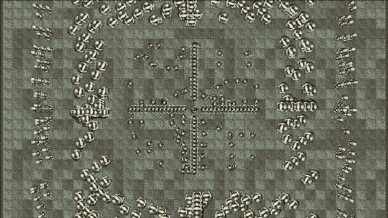

这结果将会很糟糕！注意，你还可以暂停和恢复僵尸潮的进攻，这归于我们在第 6 章面向对象编程、类和 SFML 视图中编写的代码。

### 使用 TextureHolder 类处理纹理

既然我们有了`TextureHolder`类，我们最好保持一致，用它来加载所有纹理。让我们对加载背景精灵和玩家的现有代码进行一些小修改。

#### 修改背景获取纹理的方式

在`ZombieArena.cpp`文件中，找到以下代码：

```cpp
// 加载背景顶点数组的纹理
Texture textureBackground;
textureBackground.loadFromFile("graphics/background_sheet.png") ;
```

删除之前的高亮代码并将其替换为以下高亮代码，它使用了我们新的`TextureHolder`类：

```cpp
// 加载背景顶点数组的纹理
Texture textureBackground = TextureHolder::GetTexture("graphics/background_sheet.png");
```

#### 修改玩家获取纹理的方式

在`Player.cpp`文件中，构造函数内部找到以下代码：

```cpp
#include "stdafx.h"
#include "player.h"

Player::Player()
{
    m_Speed = START_SPEED; 
    m_Health = START_HEALTH; 
    m_MaxHealth = START_HEALTH;

    // 将纹理关联到精灵
    // 注意此处
    m_Texture.loadFromFile("graphics/player.png"); 
    m_Sprite.setTexture(m_Texture);

    // 将精灵原点设置为中心
    // 实现平滑旋转
    m_Sprite.setOrigin(25, 25);
}
```

删除之前的高亮代码并将其替换为此代码，它使用了我们新的`TextureHolder`类。此外，添加包含指令将`TextureHolder`头文件添加到文件中。新代码在上下文中高亮显示如下：

```cpp
#include "stdafx.h"
#include "player.h"
#include "TextureHolder.h"

Player::Player() {
    m_Speed = START_SPEED; 
    m_Health = START_HEALTH; 
    m_MaxHealth = START_HEALTH; 

    // 将精灵原点设置为中心
    // 实现平滑旋转
    m_Sprite.setOrigin(25, 25);
}

// 将纹理关联到精灵
// 注意此处
m_Sprite = Sprite(TextureHolder::GetTexture("graphics/player.png"));
```

从现在起，我们将使用`TextureHolder`类来加载所有纹理。

# 第 9 章 碰撞检测、拾品与子弹

到目前为止，我们已经实现了游戏的主要视觉方面。我们有一个可控制的角色在充满僵尸的竞技场中运行，这些僵尸会追逐他。问题是，它们之间互不产生交互。僵尸可以直接穿过玩家而不留下任何痕迹。我们需要检测僵尸与玩家之间的碰撞。

如果僵尸要能够伤害并最终杀死玩家，那么给玩家的枪配上一些子弹也是公平的。然后，我们需要确保子弹能够击中并杀死僵尸。同时，既然我们要为子弹、僵尸和玩家编写碰撞检测代码，那么现在添加一个血量和弹药拾品的类也是很好的时机。

以下我们将要做的工作以及涵盖主题顺序：
1. 射击子弹
2. 添加准星并隐藏鼠标指针
3. 生成拾品
4. 检测碰撞

## 编写 Bullet 类

我们将使用 SFML 的`RectangleShape`类来在视觉上表示子弹。我们将编写一个`Bullet`类，该类包含一个`RectangleShape`成员以及其他成员数据和函数。我们将通过几个步骤在游戏中添加子弹：

1. 首先，我们将编写`Bullet.h`文件。这将揭示成员数据的所有细节和函数的原型。
2. 接下来，我们将编写`Bullet.cpp`文件，它理当然将包含`Bullet`类所有函数的定义。在我们逐步分析的过程中，我将详细解释`Bullet`类型的对象是如何工作和被控制的。
3. 最后，我们将在`main`函数中声明一个装满子弹的数组。我们还将实现一套用于射击、管理玩家剩余弹药以及装弹的控制方案。

让我们从第一步开始。

### 编写 Bullet 头文件

要创建新的头文件，在解决方案管理器的“头文件”上点击右键，并选择“添加 | 新项....”。在“添加新建项”窗口中，左键点击高亮`头文件 (.h)`，然后在“名称”字段中输入`Bullet.h`。

在`Bullet.h`文件中，随`Bullet`类声明添加以下私有成员变量。然后我们可以过一遍并解释它们的用途：

```cpp
#pragma once
#include <SFML/Graphics.hpp>
using namespace sf;

class Bullet
{
private:
    // 子弹在哪里？
    Vector2f m_Position;

    // 每颗子弹看起来像什么样
    RectangleShape m_BulletShape;

    // 这颗子弹目前是否正在空中飞行
    bool m_InFlight = false;

    // 子弹飞行速度有多快？
    float m_BulletSpeed = 1000;

    // 子弹每帧在水平和垂直方向上移动的像素比例是多少？
    // 这些值将根据 m_BulletSpeed 派生
    float m_BulletDistanceX;
    float m_BulletDistanceY;

    // 一些边界，防止子弹无限飞下去
    float m_MaxX;
    float m_MinX;
    float m_MaxY;
    float m_MinY;
```

在之前的代码中，第一个成员是一个名为`m_Position`的`Vector2f`，它将存储子弹在游戏世界中的位置。接下来，我们声明了一个名为`m_BulletShape`的`RectangleShape`，因为我们对每颗子弹都使用简单的非纹理图形，就像我们在 Timber!!! 中对时间条做的那样。

代码随后声明了一个布尔值`m_InFlight`，它将跟踪子弹目前是否正在空中飞行。这将使我们能够决定是否需要每帧调用它的`update`函数，以及是否需要运行碰撞检测检查。

`float`变量`m_BulletSpeed`（你可能猜得到）将存储子弹飞行的每秒像素速度。它被初始化为值`1000`，这有点主随意——但效果良好。

接下来我们还有两个`float`变量，`m_BulletDistanceX`和`m_BulletDistanceY`。由于移动子弹的计算比移动僵尸或玩家的计算要复杂一些，因此拥有这两个用于进行计算的变量将让我们获益。它们将用于决定每帧子弹位置在水平和垂直方向的变化。

最后，对于之前的代码，我们还有四个`float`变量（`m_MaxX`、`m_MinX`、`m_MaxY`和`m_MinY`），它们稍后将被初始化以存储子弹的最大和最小水平、垂直位置。这些某些变量的需求可能不会立即显现，但当我们在`Bullet.cpp`文件中看到它们各自投入运行时，情况将会变得更加清晰。

现在将所有公有函数原型添加到`Bullet.h`文件中：

```cpp
public:
    // 构造函数
    Bullet();

    // 停止子弹
    void stop();

    // 返回 m_InFlight 的值
    bool isInFlight();

    // 发射一颗新子弹
    void shoot(float startX, float startY, float xTarget, float yTarget);

    // 告诉调用代码子弹在世界中的位置
    FloatRect getPosition();

    // 返回实际形状（用于绘制）
    RectangleShape getShape();

    // 每帧更新子弹
    void update(float elapsedTime);
```

让我们逐一查看每个函数，然后就可以开始编写它们的定义。

首先我们有`Bullet`函数，它理然是构造函数。在这个函数中，我们将设置每个`Bullet`实例使其准备好就绪。

`stop`函数将在子弹运行过但需要停止时调用。

`isInFlight`函数返回一个布尔值，将用于测试子弹目前是否在飞行中。`shoot`函数的用途通过名称就一目易见，但它的工作方式值得一些讨论。目前，只需注意它有四个传入的`float`参数。这四个值代表了子弹的起始（玩家所在处）水平和垂直位置，以及垂直和水平目标位置（准星所在）。`getPosition`函数返回一个代表子弹位置的`FloatRect`。此函数将用于检测与僵尸的碰撞。你可能在“第 8 章：指针、标准模板库和纹理管理”中记得，僵尸也有一个`getPosition`函数。

接下来我们有`getShape`函数，它返回一个`RectangleShape`类型的对象。正如我们所讨论的，每颗子弹都通过一个`RectangleShape`对象在视觉上表示。因此，`getShape`函数将用于获取`RectangleShape`当前状态的副本以便进行绘制。

最后，可能正如预期的那样，有一个`update`函数，它有一个`float`参数，代表自上一次调用`update`以来经过的一秒分数。`update`方法将每帧改变子弹的位置。

让我们查看并编写函数定义。

### 编写 Bullet 源文件

现在我们可以创建一个新的`.cpp`文件来包含函数定义。在解决方案管理器的“源文件”上点击右键，并选择“添加 | 新项....”。在“添加新建项”窗口中，左键点击高亮`C++ 文件 (.cpp)`，然后在“名称”字段中输入`Bullet.cpp`。最后，点击“添加”按钮。我们现在准备好编写类了。

添加以下代码，即包含指令和构造函数。我们知道它是构造函数，因为函数名与类相同：

```cpp
#include "stdx.h"
#include "bullet.h"

// 构造函数
Bullet::Bullet() {
    m_BulletShape.setSize(sf::Vector2f(2, 2));
}
```

`Bullet`构造函数需要做的只是设置`m_BulletShape`的大小，即`RectangleShape`对象的大小。代码将大小设置为两乘两像素。

接下来是更有分量的`shoot`函数。将以下代码添加到`Bullet.cpp`文件中，研究它，然后我们就可以讨论它：

```cpp
void Bullet::shoot(float startX, float startY,
float targetX, float targetY)
{
    // 跟踪子弹
    m_InFlight = true;
    m_Position.x = startX; 
    m_Position.y = startY;

    // 计算飞行路径的斜率
    // 任何小于 1 的梯度都需要是负值
    if (gradient < 0)
    {
        gradient *= -1; 
    }
}
```

```cpp
// 计算 x 和 y 之间的比例
float ratioXY = m_BulletSpeed / (1 + gradient);

// 设置水平和垂直的“速度”
m_BulletDistanceY = ratioXY;
m_BulletDistanceX = ratioXY * gradient;

// 使子弹指向正确
if (targetX < startX)
{
    m_BulletDistanceX *= -1;
}
if (targetY < startY)
{
    m_BulletDistanceY *= -1;
}

// 设置 1000 像素的最大范围
float range = 1000;
m_MinX = startX - range;
m_MaxX = startX + range;
m_MinY = startY - range;
m_MaxY = startY + range;

// 设置子弹准备绘图的位置
m_BulletShape.setPosition(m_Position);
```


为了揭开 `shoot` 函数的神秘面纱，将其拆分并分段讨论我们刚刚添加的代码。首先，让我们回顾一下函数签名。`shoot` 函数接收子弹的起始和目标水平、垂直位置。调用代码将根据玩家精灵的位置和准星的位置提供这些参数。再次列出：

```cpp
void Bullet::shoot(float startX, float startY, float targetX, float targetY)
```

在 `shoot` 函数内部，我们将 `m_InFlight` 设置为 `true`，并使用参数 `startX` 和 `startY` 为子弹定位。这里是这段代码：

```cpp
// 跟踪子弹

m_InFlight = true;

m_Position.x = startX;

m_Position.y = startY;
```

现在，我们使用简单的三角函数来确定子弹运行的斜率。子弹在水平和垂直方向的进展必须根据在子弹起始和目标之间连线的斜率而变化。变化率不能相同，否则角度陡的射击会在到达垂直位置之前到达水平位置，角度浅的射击则反之。

以下代码首先根据直线方程推导出斜率。然后它检查 `gradient` 是否小于零，如果是，则将其乘以 `-1`。这是因为传入的起始和目标坐标可能是负数也可能是正数，而我们希望每一帧的进展量都是正数。乘以 `-1` 仅仅是将负数变为其正等效值，因为负负得正。实际的运行方向将在 `update` 函数中通过加上或减去在此函数中得到的正值来处理。

接下来，我们通过将子弹的速度（`m_BulletSpeed`）除以 1 加 `gradient` 来计算水平与垂直距离的比例。这将允许我们根据子弹的目标，每帧改变子弹正确的水平和垂直位置。最后，在代码部分我们将值赋值给 `m_BulletDistanceY` 和 `m_BulletDistanceX`：

```cpp
// 计算飞行路径的斜率

// 任何小于零的斜率都需要变为负

if (gradient < 0)
{
    gradient *= -1;
}

// 计算 x 和 y 之间的比例

float ratioXY = m_BulletSpeed / (1 + gradient);

// 设置水平和垂直的“速度”

m_BulletDistanceY = ratioXY;

m_BulletDistanceX = ratioXY * gradient;
```

以下代码要简单得多。我们只需要设置子弹可以到达的最大水平和垂直位置。我们不希望子弹无限运行下去。我们将在 `update` 函数中看到这一点，在那里测试子弹是否超过了其最大或最小位置：

```cpp
// 设置任何方向 1000 像素的最大范围

float range = 1000;

m_MinX = startX - range;

m_MaxX = startX + range;

m_MinY = startY - range;

m_MaxY = startY + range;
```

以下代码将代表子弹的 `RectangleShape` 移动到它的起始位置。我们像之前经常使用 `setPosition` 函数：

```cpp
// 设置子弹准备绘图的位置

m_BulletShape.setPosition(m_Position);
```

接下来我们有四个简单的函数。添加 `stop`、`isInFlight`、`getPosition` 和 `getShape` 函数：

```cpp
void Bullet::stop()
{
    m_InFlight = false;
}

bool Bullet::isInFlight()
{
    return m_InFlight;
}

FloatRect Bullet::getPosition()
{
    return m_BulletShape.getGlobalBounds();
}

RectangleShape Bullet::getShape()
{
    return m_BulletShape;
}
```

`stop` 函数简单地将 `m_InFlight` 变量设置为 `false`。`isInFlight` 函数返回该变量当前的值。所以我们可以看到 `shoot` 让子弹飞起来，`stop` 让它停止，而 `isInFlight` 让我们知道当前状态。`getPosition` 函数返回一个 `FloatRect`，很快就会看到如何使用来自每个游戏对象的 `FloatRect` 来检测碰撞。

最后，对于之前的代码，`getShape` 返回一个 `RectangleShape`，以便我们每帧绘制一次子弹。在我们可以开始使用 `Bullet` 对象之前，我们需要实现的最后一个函数是 `update`。添加以下代码，研究它，然后我们就可以讨论它：

```cpp
void Bullet::update(float elapsedTime)
{
    // 更新子弹位置变量

    m_Position.x += m_BulletDistanceX * elapsedTime;

    m_Position.y += m_BulletDistanceY * elapsedTime;

    // 移动子弹

    m_BulletShape.setPosition(m_Position);

    // 子弹是否超出了范围？

    if (m_Position.x < m_MinX || m_Position.x > m_MaxX || m_Position_y < m_MinY || m_Position.y > m_MaxY)
    {
        m_InFlight = false;
    }
}
```

在 `update` 函数中，我们使用 `m_BulletDistanceX` 和 `m_BulletDistanceY` 乘以自上一帧以来的时间来移动子弹。记住这两个变量的值是在 `shoot` 函数中计算的，代表了以正确角度移动子弹所需的斜率（它们之间的比例）。然后我们使用 `setPosition` 函数实际移动 `RectangleShape`。

我们在 `update` 中执行的最后一件事是测试子弹是否超出了范围。这个 `if` 语句检查 `m_Position.x` 和 `m_Position.y` 是否超出了在 `shoot` 函数中计算的最大和最小值。如果测试为真，则设置 `m_InFlight` 为 `false`。

`Bullet` 类已经完成。现在我们可以在主函数中查看如何射击。

## 让子弹飞起来

我们将通过以下六步使子弹变得可用：

1. 添加必要的 `Bullet` 类包含指令。
2. 添加控制变量和用于存储子弹的数组。
3. 处理玩家按下 `R` 键重装。
4. 处理玩家按下左鼠标按钮发射子弹。
5. 每帧更新所有飞行中的子弹。
6. 每帧绘制飞行中的子弹。

### 包含 `Bullet` 类

添加包含指令使 `Bullet` 类可用：

```cpp
#include "stdx.h"

#include <SFML/Graphics.hpp>

#include "ZombieArena.h"

#include "Player.h"

#include "TextureHolder.h"

#include "Bullet.h"

using namespace sf;
```

让我们进入下一步。

### 控制变量和子弹数组

这里是跟踪子弹、弹匣大小、剩余子弹、弹匣内子弹、当前射速（初始为每秒一次）以及上次发射子弹的时间的变量。添加代码，我们就可以在其余部分看到这些变量的作用：

```cpp
// 为僵尸准备

int numZombies;

int numZombiesAlive;

Zombie* zombies = NULL;

// 100 颗子弹足够了

Bullet bullets[100];

int currentBullet = 0;

int bulletsSpare = 24;

int bulletsInClip = 6;

int clipSize = 6;

float fireRate = 1;

// 上次按下发射键是什么时候？

Time lastPressed;

// 主游戏循环

while (window.isOpen())
```

### 重装

接下来，让我们处理玩家按下 `R` 键盘键时的情况，这用于重装弹匣。我们使用 SFML 事件来处理。添加以下代码块中显示亮的代码。它带有大量的上下文以确保代码放在正确的位置。研究这段代码，然后我们就可以讨论它：

```cpp
// 处理事件

Event event;

while (window.pollEvent(event))
{
    if (event.type == Event::KeyPressed) {
        // 游戏运行时暂停游戏

        if (event.key.code == Keyboard::Return && state == State::PLAYING)
        {
            state = State::PAUSED;
        }

        // 暂停时重启

        else if (event.key.code == Keyboard::Return && state == State::PAUSED)
        {
            state = State::PLAYING;

            // 重置时钟以防止帧跳跃

            clock.restart();
        }

        // 在 GAME_OVER 状态下开始新游戏

        else if (event.key.code == Keyboard::Return && state == State::GAME_OVER)
        {
            state = State::LEVELING_UP;
        }

        if (state == State::PLAYING)
        {
            // 装弹

            if (event.key.code == Keyboard::R)
            {
                if (bulletsSpare >= clipSize)
                {
                    // 弹药充足。装弹。

                    bulletsInClip = clipSize;

                    bulletsSpare -= clipSize;
                }
                else if (bulletsSpare > 0)
                {
                    // 剩余少量弹药

                    bulletsInClip = bulletsSpare;

                    bulletsSpare = 0;
                }
                else
                {
                    // 很快会有更多弹药？！
                }
            }
        }
    }
}

// 结束事件轮询
```

之前的代码嵌套在游戏循环的事件处理部分（`while(window.pollEvent)`）中，位于仅在游戏实际运行时执行的语句块内（`if(state == State::Playing)`）。显而易见的是，我们不希望玩家在游戏结束或暂停时装弹，而按照描述封装新代码就实现了这一点。

在新代码本身中，我们做的第一件事是测试 `R` 键是否被按下，使用 `if (event.key.code == Keyboard::R)`。一旦检测到 `R` 键被按下，就会执行剩余代码。以下是 `if`、`else if` 和 `else` 块的结构：

```cpp
if(bulletsSpare >= clipSize) ...

else if(bulletsSpare > 0) ...

else

...
```

之前的结构允许我们处理三种可能的情况：

1. 玩家按了 `R`，且备弹药多于弹匣能容纳的数量。在这种情况下，弹匣被填满，备弹药数量减少。
2. 玩家有一些备弹药，但不足以完全填满弹匣。在这种情况下，弹匣用玩家拥有的备弹药填满，备弹药数量设置为零。
3. 玩家按了 `R` 但完全没有备弹药。对于这种情况，我们实际上不需要修改变量。但是，当我们在第 11 章“音效、文件 I/O 和完成游戏”中实现音效时，会在这里播放音效，因此我们留了一个空的 `else` 块备用。

### 射击子弹

接下来，我们可以处理点击左鼠标键的情况以实际发射子弹。添加高亮的代码并仔细研究：

```cpp
if (Keyboard::isKeyPressed(Keyboard::D))
{
    player.moveRight();
}
else
{
    player.stopRight();
}

// 发射子弹

if (Mouse::isButtonPressed(sf::Mouse::Left))
{
    if (gameTimeTotal.asMilliseconds() - lastPressed.asMilliseconds() > 1000 / fireRate && bulletsInClip > 0)
    {
        // 将玩家的中心
        // 和准心的中心
        // 传递给 shoot 函数

        bullets[currentBullet].shoot(player.getCenter().x, player.getCenter().y, mouseWorldPosition.x, mouseWorldPosition.y);

        currentBullet++;

        if (currentBullet > 99)
        {
            currentBullet = 0;
        }

        lastPressed = gameTimeTotal;

        bulletsInClip--;
    }
}

// 结束发射子弹

// 结束游戏时的 WASD 控制
```

所有之前的代码都被封装在一个 `if` 语句中，每当按下左鼠标键时它就会执行，`if (Mouse::isButtonPressed(sf::Mouse::Left))`。请注意，即使玩家一直按住按钮，代码也会重复执行。我们现在要过的代码将控制射速。

在之前的代码中，我们然后检查游戏中流过的总时间（`gameTimeTotal`）减去玩家上次发射子弹的时间（`lastPressed`）是否大于 `1000` 除以当前的射速，并且玩家弹匣中至少有一颗子弹。我们使用 `1000` 是因为一秒有一千毫秒。

如果此测试成功，就会执行实际发射子弹的代码。射击子弹很容易，因为所有的工作已经在 `Bullet` 类中完成了。我们只需要对 `bullets` 数组中的当前子弹调用 `shoot` 方法。我们传入了玩家和准心的当前水平和垂直位置。子弹将通过 `Bullet` 类中 `shoot` 函数的代码进行配置并设置为飞行状态。

我们要做的只是跟踪子弹数组。首先，我们递增 `currentBullet` 变量。然后使用语句 `if (currentBullet > 99)` 检查是否发射了最后一颗子弹（`99`）。如果是最后一颗，我们将 `currentBullet` 设置为零。如果不是最后一颗，那么只要射速允许且玩家按下左鼠标键，下一颗子弹就准备就绪了。最后，对于之前的代码，我们将发射子弹的时间存储在 `lastPressed` 中并减少 `bulletsInClip`。

### 每帧更新子弹

添加高亮的代码来遍历 `bullets` 数组，检查子弹是否在飞行中，如果是，则调用其 `update` 函数：

```cpp
// 遍历每个僵尸并更新它们

for (int i = 0; i < numZombies; i++)
{
    if (zombies[i].isAlive())
    {
        zombies[i].update(dt.asSeconds(), playerPosition);
    }
}

// 更新任何飞行中的子弹

for (int i = 0; i < 100; i++)
{
    if (bullets[i].isInFlight())
    {
        bullets[i].update(dt.asSeconds());
    }
}

// 结束场景更新
```

### 每帧绘制子弹

添加高亮的代码来遍历 `bullets` 数组，检查子弹是否在飞行中，如果是，则绘制它：

```cpp
/*
**************
绘制场景
**************
*/

if (state == State::PLAYING)
{
    window.clear();

    // 设置主视图以便在窗口中显示
    // 并绘制与其相关的所有内容

    window.setView(mainView);

    // 绘制背景

    window.draw(background, &textureBackground);

    // 绘制僵尸

    for (int i = 0; i < numZombies; i++)
    {
        window.draw(zombies[i].getSprite());
    }
}
```


```cpp
for (int i = 0; i < 100; i++)
{
    if (bullets[i].isInFlight())
    {
        window.draw(bullets[i].getShape());
    }
}

// 绘制玩家

window.draw(player.getSprite());
}
```

运行游戏尝试子弹。注意，在需要按下 `R` 装弹之前，你可以发射六次。很明显缺失的是一些关于弹匣中弹药数量和备弹药数量的视觉指示。另一个问题是玩家可能会很快耗尽弹药，尤其是子弹完全没有停止力时，它们会直接穿过僵尸。此外，玩家被要求对准鼠标指针而不是精确的准心，很显然我们还有很多工作要做。

在下一章中，我们将通过 HUD 提供视觉反馈。我们将把鼠标光标替换为准心，然后生成一些拾落物来补充弹药和血量。最后，在本章中，我们将处理碰撞检测，使子弹和僵尸产生伤害，并让玩家能够真正获得拾落物。

### 给玩家一个准心

添加准心很容易，只需要一个新概念。添加高亮的代码，然后我们过一遍：

```cpp
// 100 颗弹药足够

Bullet bullets[100];

int currentBullet = 0;

int bulletsSpare = 24;

int bulletsInClip = 6;

int clipSize = 6;

float fireRate = 1;

// 上次按下火击键的时间？

Time lastPressed;

// 隐藏鼠标指针并替换为准心

window.setMouseCursorVisible(true);

Sprite spriteCrosshair;

Texture textureCrosshair = TextureHolder::GetTexture("graphics/crosshair.png");

spriteCrosshair.setTexture(textureCrosshair);

spriteCrosshair.setOrigin(25, 25);

// 主游戏循环
```

`while (window.isOpen())` 首先，我们调用窗口对象上的 `setMouseCursorVisible` 函数。接着，我们加载一个 `Texture`（纹理），声明一个 `Sprite`（精灵），并按照通常的方式对其初始化。此外，我们将精灵的中心点设置为它的中心，这样就可以方便且简单地让子弹向中心飞出，正如你预期的那样。

现在，我们需要每帧都使用鼠标的世界坐标来更新准星。添加高亮的代码行，它使用 `mouseWorldPosition` 向量在每帧都设置准星的位置：

```cpp
/*
****************
每帧更新 (UPDATE THE FRAME)
****************
*/

if (state == State::PLAYING) { // 更新增量时间

    Time dt = clock.restart();

    // 更新总游戏时间

    gameTimeTotal += dt;

    // 将增量时间 float 转换为秒的小数

    float dtAsSeconds = dt.asSeconds();

    // 鼠标指针在哪里

    mouseScreenPosition = Mouse::getPosition();

    // 将鼠标位置转换为主视图 mainView 的世界坐标

    mouseWorldPosition = window.mapPixelToCoords(
        Mouse::getPosition(), mainView);

    // 将准星设置为鼠标的世界位置

    spriteCrosshair.setPosition(mouseWorldPosition);

    // 更新玩家

    player.update(dtAsSeconds, Mouse::getPosition());
}
```

接下来，正如你可能预料的那样，我们可以每帧绘制准星。在所示位置添加高亮的代码行。这行代码不需要解释，但它在所有其他游戏对象之后的位置非常重要，因为这样它会被绘制在最上层：

```cpp
/*
**************
绘制场景 (Draw the scene)
**************
*/

if (state == State::PLAYING) {

    window.clear();

    // 设置在窗口中显示的 mainView

    // 并绘制与它相关的一切

    window.setView(mainView);

    // 绘制僵尸

    for (int i = 0; i < numZombies; i++) {

        // 绘制背景

        window.draw(background, &textureBackground);

        window.draw(zombies[i].getSprite());
    }

    for (int i = 0; i < 100; i++) {

        if (bullets[i].isInFlight()) {

            window.draw(bullets[i].getShape());
        }
    }

    // 绘制玩家

    window.draw(player.getSprite());

    // 绘制准星

    window.draw(spriteCrosshair);
}
```

现在你可以运行游戏并看到酷炫的准星而不是鼠标光标了：

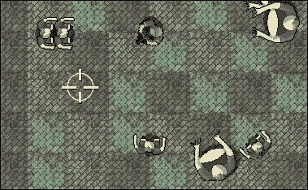

注意子弹是如何整齐地穿过准星中心的。射击机制的工作原理类似于允许玩家选择腰射或瞄准镜瞄击。如果玩家让准星保持在中心附近，他就可以快速地射击和转身，但必须仔细判断远处僵尸的位置。或者，玩家可以将准星直接悬停在远处僵尸的头部并获得精确命中；然而，这样一来如果僵尸从另一个方向攻击，他将需要移动更远的距离才能将准星移回来。

游戏一个有趣的改进是为每次射击增加一少量的随机不准确性。这种不准确性也许可以通过波次之间的升级来缓解。

## 为掉落物编写类

我们将编写一个 `Pickup` 类，它包含一个 `Sprite` 成员以及其他成员数据和函数。我们只需几步即可在游戏中添加掉落物：

1. 首先，我们将编写 `Pickup.h` 文件。这将显示所有成员数据的细节和函数的原型。
2. 然后，我们将编写 `Pickup.cpp` 文件，它自然将包含 `Pickup` 类所有函数的定义。在我们逐步通过它时，我将详细解释 `Pickup` 类型的对象将如何工作和被控制。
3. 最后，我们将在 `main` 函数中使用 `Pickup` 类来生成、更新它们并绘制它们。

让我们从第一步开始。

## 编写 Pickup 头文件

要创建新的头文件，请在“解决方案管理器”中右键点击“头文件 (Header Files)”并选择“添加 | 新项... (Add | New Item...)”。在“添加新项”窗口中，通过左点击高亮“头文件 (.h)”，然后在“名称”字段中输入 `Pickup.h`。

在 `Pickup.h` 文件中添加并学习以下代码，然后我们就可以过一遍了：

```cpp
#pragma once

#include <SFML/Graphics.hpp>

using namespace sf;

class Pickup
{
private:
    // 掉落物的类型

    const int HEALTH_START_VALUE = 50;

    const int AMMO_START_VALUE = 12;

    const int START_TIME = 10;

    const int START_TO_LIVE = 5;

    // 代表掉落物的精灵

    Sprite m_Sprite;

    // 它的所在区域

    IntRect m_Arena;

    // 掉落物的价值是多少

    int m_Value;

    // 掉落物的类型（0 为血包，1 为弹药）

    int m_Type;

    // 重新生成之前的等待时间

    float m_SecondsWait;

    // 是否已生成

    bool m_Spawned;

    // 自生成以来的时间

    float m_SecondsSpawn;

    // 自消失以来的时间

    float m_SecondsDeSpawn;

    // 存活时间

    float m_SecondsToLive;

public:
    // 公共函数原型
};
```

上面的代码声明了 `Pickup` 类的私有变量。让我们来看这些常量：

- `const int HEALTH_START_VALUE = 50`：血包的初始值。
- `const int AMMO_START_VALUE = 12`：弹药的初始值。
- `const int START_TIME = 10`：重新生成之前的等待时间。
- `const int START_TO_LIVE = 5`：掉落物存活的时间。

- `Sprite m_Sprite`：代表该掉落物的精灵。
- `IntRect m_Arena`：掉落物所在的区域大小。
- `int m_Value`：这个掉落物的价值是多少？
- `int m_Type`：它是什么类型的掉落物？
- `float m_SecondsWait`：掉落物在重新生成前等待多久。

- `bool m_Spawned`：掉落物是否已生成？
- `float m_SecondsSpawn`：自生成以来多久？
- `float m_SecondsDeSpawn`：自消失以来多久？
- `float m_SecondsToLive`：掉落物在生成状态下应该持续多久？

> **提示**：注意，该类大部分复杂性源于可变的生成时间及其可升级的特性。如果掉落物在收集后重新生成并具有固定价值，这将是一个简单的类。我们需要掉落物是可升级的，这样玩家才能制定策略来通过僵尸波。

接下来，在 `Pickup.h` 文件中添加以下公共函数原型。确保你熟悉这些新代码以便我们过一遍：

```cpp
// 公共函数原型

public:

    Pickup(int type); // 准备一个新的掉落物

    void setArena(IntRect arena); // 设置区域

    void spawn(); // 获取掉落物的位置

    FloatRect getPosition(); // 获取用于绘制的精灵

    Sprite getSprite();

    // 让掉落物每帧更新自身

    void update(float elapsedTime);

    // 该掉落物是否已生成？

    bool isSpawned();

    // 获取掉落物中的奖励

    int gotIt();

    // 升级每个掉落物的价值

    void upgrade();
```

让我们简要讨论每个函数的定义：

第一个函数是构造函数，与类同名。注意它接受一个 `int` 参数。这将用于初始化它将成为什么类型的掉落物（血包或弹药）。

`setArena` 函数接收一个 `IntRect`。该函数会在每一波敌人开始时，为每个 `Pickup` 实例调用一次。随后，`Pickup` 对象将知道它们可以生成的区域。当然，`spawn` 函数将处理拾品物品的生成逻辑。`getPosition` 函数与 `Player`、`Zombie` 和 `Bullet` 类一样，会返回一个表示对象在游戏世界中当前位置的 `FloatRect`。

`getSprite` 函数返回一个 `Sprite` 对象，使拾品能够在每帧被绘制一次。

`update` 函数接收上一帧花费的时间。它使用该值来更新其私有变量，并对何时生成（spawn）和销销生成（de-spawn）做出决策。

`isSpawned` 函数返回一个 `Boolean` 值，让调用代码知道拾品当前是否已生成。

当检测到与玩家碰撞时，会调用 `gotIt` 函数。`Pickup` 类代码随后可以准备好在合适的时间重新生成。请注意，它返回的是一个 `int`，以便调用代码知道该拾品在生命值或弹药方面的价值。当玩家在游戏升级阶段选择升级拾品的属性时，会调用 `upgrade` 函数。现在我们已经过过了成员变量和函数原型，在编写函数定义时，应该很容易跟上。

### 编写 Pickup 类的函数定义

现在，我们可以创建一个新的 `.cpp` 文件来包含函数定义。在“解决方案管理器”中右键点击 `Source Files` 并选择 `Add | New Item....`。在“添加新建项”窗口中，用左键点击选中 `C++ File (.cpp)`，然后在“名称”字段中输入 `Pickup.cpp`。最后，点击 `Add` 按钮。我们现在准备好编写该类了。

将此处所示的代码添加到 `Pickup.cpp` 文件中。请务必检查代码以便我们进行讨论：

```cpp
#include "stdafx.h"

#include "Pickup.h"

#include "TextureHolder.h"

Pickup::Pickup(int type)
{
    // 存储此拾品的类型

    m_Type = type;

    // 将纹理与精灵关联

    if (m_Type == 1)
    {
        m_Sprite = Sprite(TextureHolder::GetTexture("graphics/health_pickup.png"));

        // 拾品的价值

        m_Value = HEALTH_START_VALUE;
    }
    else
    {
        m_Sprite = Sprite(TextureHolder::GetTexture("graphics/ammo_pickup.png"));

        // 拾品的价值

        m_Value = AMMO_START_VALUE;
    }

    m_Sprite.setOrigin(25, 25);

    m_SecondsToLive = START_SECONDS_TO_LIVE;

    m_SecondsToWait = START_WAIT_TIME;
}
```

在之前的代码中，我们添加了熟悉的包含指令。然后，我们添加了 `Pickup` 构造函数。我们知道它是构造函数，因为它与类名相同。构造函数接收一个名为 `type` 的 `int`，代码执行的第一件事是将接收到的 `type` 的值赋值给 `m_Type`。之后，有一个 `if…else` 块会检查 `m_Type` 是否等于 `1`。如果是，`m_Sprite` 将与血量拾品纹理关联，并将 `m_Value` 设置为 `HEALTH_START_VALUE`。

如果 `m_Type` 不等于 `1`，`else` 块会将弹药拾品纹理与 `m_Sprite` 关联，并将 `AMMO_START_VALUE` 的值赋值给 `m_Value`。

在 `if…else` 块之后，代码使用 `setOrigin` 函数将 `m_Sprite` 的原点设置为中心，并将 `START_SECONDS_TO_LIVE` 和 `START_WAIT_TIME` 分赋值给 `m_SecondsToLive` 和 `m_SecondsToWait`。构造函数成功准备了一个可以使用的 `Pickup` 对象。

接下来，我们将添加 `setArena` 函数。在添加代码时请检查这些代码：

```cpp
void Pickup::setArena(IntRect arena)
{
    // 将区域的细节复制到拾品的 m_Arena 中

    m_Arena.left = arena.left + 50;

    m_Arena.width = arena.width - 50;

    m_Arena.top = arena.top + 50;

    m_Arena.height = arena.height - 50;

    spawn();
}
```

我们刚刚编写的 `setArena` 函数只是复制了传入的 `arena` 对象的值，但在左侧和上方增加了 50，在右侧和下方减少了 50。`Pickup` 对象现在知道了它可以生成的区域。随后，`setArena` 函数调用它自己的 `spawn` 函数，为每帧的绘制和更新做最后的准备。

接下来是 `spawn` 函数。在 `setArena` 函数之后添加以下代码：

```cpp
void Pickup::spawn()
{
    // 在随机位置生成

    srand((int)time(0) / m_Type);

    int x = (rand() % m_Arena.width);

    srand((int)time(0) * m_Type);

    int y = (rand() % m_Arena.height);

    m_SecondsSinceSpawn = 0;

    m_Spawned = true;

    m_Sprite.setPosition(x, y);
}
```


`spawn`函数执行了准备拾品所需的所有工作。首先，它设置了随机数生成器的种子，并为对象的水平和垂直位置获取随机数。注意，它使用`m_Arena.width`和`m_Arena.height`作为可能的水平和垂直位置的范围。`m_SecondsSinceSpawn`设置为零，以便重置拾品生成前允许的时间。将`m_Spawned`变量设置为`true`，这样当我们从`main`调用`isSpawned`时，将得到正向响应。最后，通过`setPosition`将`m_Sprite`移动到位置，准备好绘制到屏幕。

在接下来的代码块中，我们有三个简单的`getter`函数。`getPosition`返回`m_Sprite`当前位置的`FloatRect`，`getSprite`返回`m_Sprite`身的拷贝，而`isSpawned`根据对象当前是否已生成返回`true`或`false`。

添加并检查我们刚刚讨论的代码：

```cpp
FloatRect Pickup::getPosition()
{
    return m_Sprite.getGlobalBounds();
}

Sprite Pickup::getSprite()
{
    return m_Sprite;
}

bool Pickup::isSpawned()
{
    return m_Spawned;
}
```

接下来我们将编写`gotIt`函数。当玩家触碰/碰撞（获得）拾品时，该函数将从`main`调用。在`isSpawned`函数之后添加`gotIt`函数：

```cpp
int Pickup::gotIt()
{
    m_Spawned = false;
    m_SecondsSinceDeSpawn = 0;
    return m_Value;
}
```

`gotIt`函数将`m_Spawned`设置为`false`，这样我们知道现在不需要进行绘制和碰撞检查。`m_SecondsSinceDespawn`设置为零，以便生成的倒计时从重新开始，并将`m_Value`返回给调用代码，以便调用代码可以根据需要处理添加额外的弹药或生命值。

接下来是`update`函数，它将我们目前为止看到的许多变量和函数结合在一起。添加并熟悉`update`函数，然后我们就可以讨论它：

```cpp
void Pickup::update(float elapsedTime)
{
    if (m_Spawned)
    {
        m_SecondsSinceSpawn += elapsedTime;
    }
    else
    {
        m_SecondsSinceDeSpawn += elapsedTime;
    }

    // 我们是否需要隐藏一个拾品？
    if (m_SecondsSinceSpawn > m_SecondsToLive && m_Spawned)
    {
        // 移除拾品并将其放到别处
        m_Spawned = false;
        m_SecondsSinceDeSpawn = 0;
    }

    // 我们是否需要生成一个拾品
    if (m_SecondsSinceDeSpawn > m_SecondsToWait && !m_Spawned)
    {
        // 生成拾品并重置计时器
        spawn();
    }
}
```

`update`函数分为四个每帧都会考虑执行的块：

1. 一个在`m_Spawned`为`true`时执行的`if`块——`if (m_Spawned)`。这段代码将此帧的时间加到`m_SecondsSinceSpawn`，用于跟踪拾品已生成了多久。对应的`else`块在`m_Spawned`为`false`时执行。该块将此帧花费的时间加上`m_SecondsSinceDeSpawn`，用于跟踪拾品自上次拾品生成（隐藏）以来已等待多久。
2. 另一个`if`块在拾品生成时间超过其持续时间时执行——`if (m_SecondsSinceSpawn > m_SecondsToLive && m_Spawned)`。该块将`m_Spawned`设置为`false`并重置`m_SecondsSinceDeSpawn`为零。现在块2将一直执行，直到再次生成的时间。
3. 最后一个`if`块在拾品生成的等待时间超过了必要的等待时间且拾品当前未生成时执行——`if (m_SecondsSinceDeSpawn > m_SecondsToWait && !m_Spawned)`。当该块执行时，就到了再次生成的时间并调用了`spawn`函数。

这四项测试和代码控制了拾品（pickup）的隐藏与显示。

最后，为`upgrade`函数添加定义：

```cpp
void Pickup::upgrade()
{
    if (m_Type == 1) {
        m_Value += (HEALTH_START_VALUE * .5);
    }
    else {
        m_Value += (AMMO_START_VALUE * .5);
    } // 让它们出现更频繁且持续时间更长
    m_SecondsToLive += (START_SECONDS_TO_LIVE / 10);
    m_SecondsToWait -= (START_WAIT_TIME / 10);
}
```

`upgrade`函数测试拾品的类型（血量或弹药），然后向`m_Value`增加（适当的）初始值的50%。`if…else`块之后的几行增加了拾品保持生成状态的时间，并缩短了玩家在两次生成之间的等待时间。当玩家在`LEVELING_UP`状态下选择升级拾品时，会调用此函数。我们的`Pickup`类已经准备好可以使用了。

### 使用Pickup类

在费力实现`Pickup`类之后，我们现在可以在游戏引擎中编写代码，将实际将一些拾品放入游戏中。我们做的第一件事是在`ZombieArena.cpp`文件中添加一个包含指令：

```cpp
#include "stdafx.h"
#include <SFML/Graphics.hpp>
#include "ZombieArena.h"
#include "Player.h"
#include "TextureHolder.h"
#include "Bullet.h"
#include "Pickup.h" 

using namespace sf;
```

在下面的代码中，我们添加了两个`Pickup`实例，一个称为`healthPickup`，另一个称为`ammoPickup`。我们分别将值`1`和`2`传入构造函数，以便它们初始化为正确的拾品类型。添加我们刚刚讨论过的高亮代码：

```cpp
// 隐藏鼠标指针并用准星窗口替换它。
window.setMouseCursorVisible(true);

Sprite spriteCrosshair;
Texture textureCrosshair = TextureHolder::GetTexture("graphics/crosshair.png"); 

spriteCrosshair.setTexture(textureCrosshair);
spriteCrosshair.setOrigin(25, 25);

// 创建几个拾品
Pickup healthPickup(1);
Pickup ammoPickup(2);

// 主游戏循环
while (window.isOpen())
```

在键盘处理的`LEVELING_UP`状态中，在所示的嵌套`PLAYING`代码块内添加高亮行：

```cpp
if (state == State::PLAYING) {
    // 准备关卡
    // 我们稍后会修改这两行
    arena.width = 500;
    arena.height = 500;
    arena.left = 0;
    arena.top = 0;

    // 通过引用传递顶点数组
    // 传递 createBackground 函数
    int tileSize = createBackground(background, arena);

    // 在竞技场中心生成玩家
    player.spawn(arena, resolution, tileSize);

    // 配置拾品
    healthPickup.setArena(arena);
    ammoPickup.setArena(arena);

    // 创建一群僵尸
    numZombies = 10;

    // 删除之前分配的内存（如果存在）
    delete[] zombies;
    zombies = createHorde(numZombies, arena);
    numZombiesAlive = numZombies;

    // 重置时钟以防止帧跳
    clock.restart();
}
```

之前的代码只是将`arena`传递给每个拾品的`setArena`函数。拾品现在知道它们可以在哪里生成。这段代码会在每一波新敌人时执行，因此随着竞技场尺寸增大，`Pickup`对象将得到更新。下面的代码在每一帧为每个`Pickup`对象调用`update`函数：

```cpp
// 遍历每个僵尸并更新它们
for (int i = 0; i < numZombies; i++)
{
    if (zombies[i].isAlive()) {
        zombies[i].update(dt.asSeconds(), playerPosition);
    }
}

// 更新任何飞行中的子弹
for (int i = 0; i < 100; i++)
{
    if (bullets[i].isInFlight()){
        bullets[i].update(dtAsSeconds);
    }
}

// 更新拾品
healthPickup.update(dtAsSeconds);
ammoPickup.update(dtAsSeconds);

// 结束更新
```

游戏循环中绘制部分的以下代码检查拾品当前是否处于生成状态，如果是，则绘制它。添加我们刚刚讨论过的高亮代码：

```cpp
// 绘制玩家
window.draw(player.getSprite());

// 绘制拾品，如果当前已生成
if (ammoPickup.isSpawned())
{
    window.draw(ammoPickup.getSprite());
}

if (healthPickup.isSpawned())
{
    window.draw(healthPickup.getSprite());
} 

// 绘制准星
window.draw(spriteCrosshair);
```

现在你可以运行游戏并看到拾品的生成和消失。然而，你还无法实际上捡起它们。
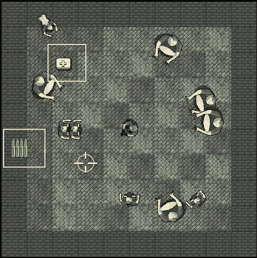

现在我们的游戏中已经有了所有的对象，现在是让它们相互交互（碰撞）的好时机了。

### 检测碰撞

我们只需要知道游戏中的某些对象何时碰到其他某些对象。然后我们就可以以适当的方式对该事件做出反应。在我们的类中，我们已经添加了对象碰撞时调用的函数。它们如下：

- `Player`类有一个`hit`函数。当僵尸与玩家碰撞时，我们会调用它。
- `Zombie`类有一个`hit`函数。当子弹与僵尸碰撞时，我们会调用它。
- `Pickup`类有一个`gotIt`函数。当玩家与拾品碰撞时，我们会调用它。

如有必要，请回过头来看以复习这些函数每个是如何作用的。我们现在需要做的只是检测碰撞并调用相应的函数。我们将使用矩形相交来检测碰撞。这种类型的碰撞检测非常简单（特别是在使用SFML时）。我们可以想象在要测试碰撞的对象周围画一个想象的矩形——我们可以称其为碰撞盒（hitbox）或边界矩形——然后测试它们是否相交。如果它们相交，我们就检测到了碰撞：
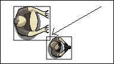

正如从上一张图片看到的，这远非完美。但在这种情况下是足够的。要实现这种方法，我们只需要使用两个对象碰撞盒的`x`和`y`坐标来测试相交性。测试两个矩形相交的代码看起来像这样。不要使用以下代码。它仅用于演示：

```cpp
if(objectA.getPosition().right > objectB.getPosition().left && objectA.getPosition().left < objectB.getPosition().right )
{
    // objectA 在 x 轴上与敌人交叉
    // 但它们可能处于不同的高度
    if(objectA.getPosition().top < objectB.getPosition().bottom && objectA.getPosition().bottom > objectB.getPosition().top ) {
        // objectA 在 y 轴上也与 objectB 交叉 // 检测到碰撞
    }
}
```

然而我们不需要编写这段代码。我们将使用SFML的`intersects`函数，它作用于`FloatRect`对象。思考或回看`Zombie`、`Player`、`Bullet`和`Pickup`类，它们都有一个`getPosition`函数，返回对象当前位置的`FloatRect`。我们将看到如何结合`getPosition`和`intersects`来完成所有的碰撞检测。我们将通过三个后续的代码段来处理，它们将位于游戏更新部分的最后。

我们需要每一帧知道以下三个问题的答案：
1. 僵尸被击中了？
2. 玩家是否被僵尸碰到了？
3. 玩家是否碰到了拾品？

首先为`score`和`hiScore`添加两个变量。然后我们可以在僵尸被杀死时更改它们。添加以下代码：

```cpp
// 创建几个拾品
Pickup healthPickup(1);
Pickup ammoPickup(2);

// 关于游戏
int score = 0; 
int hiScore = 0;

// 主游戏循环
while (window.isOpen())
```

### 僵尸被击中了？

下面的代码看起来可能复杂，但当我们逐步执行时，会发现它其实并不是我们没见过的东西。在每帧更新拾品的调用之后添加以下代码。然后我们可以进行调试：

```cpp
// 更新拾品
healthPickup.update(dtAsSeconds);
ammoPickup.update(dtAsSeconds);

// 碰撞检测
// 有没有僵尸被击中？
for (int i = 0; i < 100; i++)
{
    for (int j = 0; j < numZombies; j++) {
        if (bullets[i].isInFlight() && zombies[j].isAlive()) {
            if (bullets[i].getPosition().intersects(zombies[j].getPosition())) {
                // 停止子弹
                bullets[i].stop();

                // 注册命中并查看是否击杀
                if (zombies[j].hit()) {
                    // 不仅仅是击中，也是击
                    score += 10;
                    if (score >= hiScore)
                    {
                        hiScore = score;
                    }
                    numZombiesAlive--;

                    // 当所有僵尸都死亡时（再次）
                    if (numZombiesAlive == 0)
                    {
                    }
                    // 结束僵尸被射状态
                    state = State::LEVELING_UP;
                }
            }
        }
    }
}
```

在下一节中，我们将再次看到所有的僵尸和子弹碰撞检测代码。我们将逐步进行以便进行讨论。首先，请注意以下嵌套`for`循环的结构（已剥离代码内容）：

```cpp
// 碰撞检测
// 有没有僵尸被射？
for (int i = 0; i < 100; i++)
{
    for (int j = 0; j < numZombies; j++)
    {
        ... ... ...
    }
}
```

该代码会针对每一个僵尸（0到`< numZombies`）遍历每一个子弹（0到99）。

在嵌套的`for`循环内部，我们执行了以下操作：

1. 使用此代码检查当前子弹是否在飞行中以及当前僵尸是否存活：
`if (bullets[i].isInFlight() && zombies[j].isAlive())`

2. 在僵尸存活且子弹飞行的情况下，我们使用此代码测试矩形相交：
`if (bullets[i].getPosition().intersects(zombies[j].getPosition()))`

如果当前子弹和僵尸发生碰撞，我们将采取若干步骤：

1. 使用此代码停止子弹：
```cpp
// 停止子弹
bullets[i].stop();
```

2. 通过调用僵尸的`hit`函数来注册一次命中。请注意，`hit`函数返回一个`Boolean`，让调用代码知道僵尸是否已经死亡。这在下行代码中显示：
```cpp
// 注册命中并查看是否为击杀
```


```cpp
if (zombies[j].hit()) {
```

在这个 `if` 块内部（该块检测僵尸是否死亡而不仅仅是受伤），我们执行了以下操作：

- 将 `score` 加十。
- 如果 `score` 超过了（打破了）`hiScore`，则更改 `hiScore`。
- 将 `numZombiesAlive` 减一。
- 检查所有僵尸是否已死亡（`numZombiesAlive == 0`），如果是，则将状态更改为 `LEVELING_UP`。

这里是我们刚刚讨论的 `if (zombies[j].hit())` 内部的代码块：

```cpp
// 不仅仅是击中，也是击杀

score += 10;

if (score >= hiScore)
{
    hiScore = score;
}

numZombiesAlive--;

// 当所有僵尸都死亡时（再次）

if (numZombiesAlive == 0)
{
    state = State::LEVELING_UP;
}
```

僵尸和子弹已经处理完毕。你可以运行游戏并看到血迹。当然，在我们在下一章实现 HUD 之前，你还看不到分数。

### 玩家是否被僵尸触碰？

这段代码比僵尸和子弹的碰撞检测要短得多且简单得多。在我们之前编写的代码之后添加高亮的代码：

```cpp
// 结束僵尸被射状态

// 有没有僵尸触碰玩家

for (int i = 0; i < numZombies; i++)
{
    if (player.getPosition().intersects(zombies[i].getPosition()) &&
        zombies[i].isAlive())
    {
        if (player.hit(gameTimeTotal))
        {
            // 之后这里更多
        }

        if (player.getHealth() <= 0)
        {
            state = State::GAME_OVER;
        }
    }
}

// 结束玩家被触碰
```

我们使用 `for` 循环遍历所有僵尸来检测僵尸是否与玩家碰撞。对于每个存活的僵尸，代码使用 `intersects` 函数测试与玩家的碰撞。当发生碰撞时，我们调用 `player.hit`。然后我们通过调用 `player.getHealth` 检查玩家是否死亡。如果玩家的健康值小于等于零，我们将状态更改为 `GAME_OVER`。

你可以运行游戏，碰撞会被检测到。然而，由于还没有 HUD 或音效，并不清楚这正在发生。此外，我们还需要在玩家死亡和开始新游戏时对重置游戏做一些工作。因此，虽然游戏在运行，但目前的结果并不特别令人满意。我们将在接下来两个章节中改进这一点。

### 玩家是否触碰了拾取物？

玩家与两个拾取物之间的碰撞检测代码如下。在我们之前添加的代码之后添加高亮的代码：

```cpp
// 结束玩家被触碰

// 玩家是否触碰了血量包

if (player.getPosition().intersects(healthPickup.getPosition()) &&
    healthPickup.isSpawned())
{
    player.increaseHealthLevel(healthPickup.gotIt());
}

// 玩家是否触碰了弹药包

if (player.getPosition().intersects(ammoPickup.getPosition()) &&
    ammoPickup.isSpawned())
{
    bulletsSpare += ammoPickup.gotIt();
}

// 结束更新场景
```

之前的代码使用两个简单的 `if` 语句来查看 `healthPickup` 或 `ammoPickup` 是否被玩家触碰。

如果收集了血量包，`player.increaseHealthLevel` 函数将使用 `healthPickup.gotIt` 函数的返回值来增加玩家的健康值。如果收集了弹药包，`bulletsSpare` 将根据 `ammoPickup.gotIt` 返回的值增加。

你可以运行游戏、杀死僵尸并收集拾取物！注意，当你的健康值为零时，游戏将进入 `GAME_OVER` 状态并暂停。要重新启动游戏，你需要按 `Enter` 然后按一个 1 到 6 之间的数字。当我们实现 HUD、主界面和升级界面时，这些步骤对玩家来说将是直观且简单的。我们将在下一章完成。

# 第 10 章 视图的分层与 HUD 的实现

在这一章中，我们将看到 SFML Views 的真实价值。我们将添加一个大型 `SFML Text` 对象的数组，并像之前在 Timber!!! 项目中那样操纵它们。新奇之处在于，我们将使用第二个视图实例来绘制 HUD。这样，无论背景、玩家、僵尸和其他游戏对象在做什么，HUD 都会整齐地放置在主游戏动作之上。

以下是我们将做的工作：

- 在主界面/游戏结束界面添加文本和背景。
- 在升级界面添加文本。
- 创建第二个视图。
- 添加 HUD。

### 添加所有的文本和 HUD 对象

在本章中，我们将操纵几个 `Strings`。这是为了能够格式化 HUD 和升级界面。

添加接下来高亮的额外包含指令，以便我们可以创建一些 `sstream` 对象来实现此点：

```cpp
#include "stdafx.h"

#include <sstream>
#include <SFML/Graphics.hpp>

#include "ZombieArena.h"
#include "Player.h"
#include "TextureHolder.h"
#include "Bullet.h"
#include "Pickup.h"

using namespace sf;
```

接下来添加这段相当长但容易解释的代码。为了帮助识别应该在何添加代码，新代码已高亮，而现有代码没有高亮。你可能需要调整某些文本/元素的位置/大小以适应你的屏幕：

```cpp
int score = 0;
int hiScore = 0;

// 用于主界面/游戏结束界面

Sprite spriteGameOver;
Texture textureGameOver =
    TextureHolder::GetTexture("graphics/background.png");

spriteGameOver.setTexture(textureGameOver);
spriteGameOver.setPosition(0, 0);

// 为 HUD 创建视图

View hudView(sf::FloatRect(0, 0, resolution.x, resolution.y));

// 为弹药图标创建精灵

Sprite spriteAmmoIcon;
Texture textureAmmoIcon =
    TextureHolder::GetTexture("graphics/ammo_icon.png");

spriteAmmoIcon.setTexture(textureAmmoIcon);
spriteAmmoIcon.setPosition(20, 980);

// 加载字体

Font font;
font.loadFromFile("fonts/zombiecontrol.ttf");

// 暂停

Text pausedText;
pausedText.setFont(font);
pausedText.setCharacterSize(155);
pausedText.setFillColor(Color::White);
pausedText.setPosition(400, 400);
pausedText.setString("Press Enter \n to continue");

// 游戏结束

Text gameOverText;
gameOverText.setFont(font);
gameOverText.setCharacterSize(125);
gameOverText.setFillColor(Color::White);
gameOverText.setPosition(250, 850);
gameOverText.setString("Press Enter to play");

// 升级

Text levelUpText;
levelUpText.setFont(font);
levelUpText.setCharacterSize(80);
levelUpText.setFillColor(Color::White);
levelUpText.setPosition(150, 250);

std::stringstream levelUpStream;

levelUpStream << "1- Increased rate of fire"
              << "\n2- Increased clip size(next reload)"
              << "\n3- Increased max health"
              << "\n4- Increased run speed"
              << "\n5- More and better health pickups"
              << "\n6- More and better ammo pickups";

levelUpText.setString(levelUpStream.str());

// Ammo

Text ammoText;
ammoText.setFont(font);
ammoText.setCharacterSize(55);
ammoText.setFillColor(Color::White);
ammoText.setPosition(200, 980);

// Score

Text scoreText;
scoreText.setFont(font);
scoreText.setCharacterSize(55);
scoreText.setFillColor(Color::White);
scoreText.setPosition(20, 0);

// Hi Score

Text hiScoreText;
hiScoreText.setFont(font);
hiScoreText.setCharacterSize(55);
hiScoreText.setFillColor(Color::White);
hiScoreText.setPosition(1400, 0);

std::stringstream s;
s << "Hi Score:" << hiScore;
hiScoreText.setString(s.str());

// Zombies remaining

Text zombiesRemainingText;
zombiesRemainingText.setFont(font);
zombiesRemainingText.setCharacterSize(55);
zombiesRemainingText.setFillColor(Color::White);
zombiesRemainingText.setPosition(1500, 980);
zombiesRemainingText.setString("Zombies: 100");

// Wave number

int wave = 0;

Text waveNumberText;
waveNumberText.setFont(font);
waveNumberText.setCharacterSize(55);
waveNumberText.setFillColor(Color::White);
waveNumberText.setPosition(1250, 980);
waveNumberText.setString("Wave: 0");

// Health bar

RectangleShape healthBar;
healthBar.setFillColor(Color::Red);
healthBar.setPosition(450, 980);

// The main game loop

while (window.isOpen())
```

之前的代码非常简单，并没有什么新意。它基本上创建了一大堆 SFML `Text` 对象。我们为它们分配了颜色和大小，然后使用之前见过的函数格式化了它们的位置。最需要注意的一点是，我们创建了另一个名为 `hudView` 的 `View` 对象，并将其初始化以适应屏幕分辨率。

正如我们所看到的，主视图（main view）会随着玩家移动而滚动。相比之下，我们永远不会移动 `hudView`。结果是，只要我们在绘制 HUD 元素之前切换到此视图，就能创建出一种效果：让游戏世界在下方滚动，而玩家的 HUD 保持不动。

**提示**：类比一下，你可以想象成在电视屏幕上覆盖一张写有字字的透明塑料膜。电视会照常播放显示移动的画面，而塑料膜上的文字无论下方发生什么变化，都会保持在原来的位置。

然而，需要注意的下一点是，高分并没有以任何有意义的方式被设置。我们需要等到下一章，届时我们将研究通过文件 IO 来保存和检索高分。

另一个值得注意的点是，我们声明并初始化了一个名为 `healthBar` 的 `RectangleShape`，它将作为玩家剩余血量的视觉表示。它的工作方式与上一个项目中的时间条几乎完全一样，当然，它代表的是血量而不是时间。

在之前的代码中，有一个名为 `ammoIcon` 的新精灵（sprite），它为我们要在屏幕左下角绘制的子弹和弹匣统计数据提供了上下文。虽然我们刚刚添加的大量代码并没有新奇或技术之处，但请务必熟悉这些细节，特别是变量名，以便后续章节更容易跟理解。

### 每帧更新 HUD

正如你所预期的，我们将在代码的更新部分更新 HUD 变量。然而，我们不会每帧都这样做。原因是因为没有必要，而且还会减慢我们的游戏循环。

例如，考虑玩家杀死了一只僵尸并获得了一些分数的情况。存储分数的 `Text` 对象是在千分之一、百分之一，甚至是十分之一秒内更新的，这并不重要。玩家察觉不到任何区别。这意味着，每帧都重新构建那些我们设置到 `Text` 对象的字符串是毫无意义的。

因此，我们可以控制更新 HUD 的时机频率，添加以下变量：

```cpp
// 上一次更新 HUD 是什么时候？

int framesSinceLastHUDUpdate = 0;

// 每隔多少帧（帧）更新一次 HUD

int fpsMeasurementFrameInterval = 1000;
```

### 主游戏循环

```cpp
while (window.isOpen())
```

在之前的代码中，我们有变量来跟踪自上次更新 HUD 以来经过的帧数，以及我们希望在 HUD 更新之间等待的间隔（以帧计算）。现在可以使用这些新变量并实际上每帧更新 HUD 了。不过，在我们在下一章开始操作最终变量（如 `wave`）之前，我们并不会看到所有的 HUD 元素发生变化。

所示，在游戏循环的更新部分添加高亮代码：

```cpp
// 玩家是否触碰了弹药包

if (player.getPosition().intersects(ammoPickup.getPosition()) &&
    ammoPickup.isSpawned())
{
    bulletsSpare += ammoPickup.gotIt();
}

// 放大血条

healthBar.setSize(Vector2f(player.getHealth() * 3, 50));

// 增加自上次更新以来的帧数

framesSinceLastHUDUpdate++;

// 每隔 fpsMeasurementFrameInterval 帧重新计算

if (framesSinceLastHUDUpdate > fpsMeasurementFrameInterval)
{
    // 更新游戏 HUD 文字

    std::stringstream ssAmmo;
    std::stringstream ssScore;
    std::stringstream ssHiScore;
    std::stringstream ssWave;
    std::stringstream ssZombiesAlive;

    // 更新弹药文本

    ssAmmo << bulletsInClip << "/" << bulletsSpare;
    ammoText.setString(ssAmmo.str());

    // 更新分数文本

    ssScore << "Score:" << score;
    scoreText.setString(ssScore.str());

    // 更新高分文本

    ssHiScore << "Hi Score:" << hiScore;
    hiScoreText.setString(ssHiScore.str());

    // 更新波次

    ssWave << "Wave:" << wave;
    waveNumberText.setString(ssWave.str());

    // 更新高分文本

    ssZombiesAlive << "Zombies:" << numZombiesAlive;
    zombiesRemainingText.setString(ssZombiesAlive.str());

    framesSinceLastHUDUpdate = 0;
} // 更新 HUD 更新

// 结束场景更新
```


在新代码中，我们更新了`healthBar`精灵的大小，增加了`timeSinceLastUpdate`对象，然后增加了`framesSinceLastUpdate`变量。

接下来，我们开始一个`if`块，用于测试`framesSinceLastHUDUpdate`是否大于我们的首选间隔（存储在`fpsMeasurementFrameInterval`中）。

所有的实际操作都发生在这个`if`块内部。首先，我们为每个需要设置到`Text`对象的字符串声明一个字符串流（`string stream`）对象。然后，我们依次使用这些字符串流对象，并使用`setString`函数将结果设置到相应的`Text`对象。最后，在退出`if`块之前，`framesSinceLastHUDUpdate`被重置为零，以便计数重新开始。

现在，当我们重新绘制场景时，新值将出现在玩家的 HUD 中。

### 绘制 HUD、以及主界面和升级屏幕

接下来三个代码块中的所有代码都进入游戏循环的绘制阶段。我们只需要在主游戏循环的绘制部分，根据相应的状态绘制相应的`Text`对象即可。

在`PLAYING`状态下，添加以下高亮代码：

```cpp
//绘制准准星
window.draw(spriteCrosshair);

// 切换到 HUD 视图
window.setView(hudView);

// 绘制所有 HUD 元素
window.draw(spriteAmmoIcon);
window.draw(ammoText);
window.draw(scoreText);
window.draw(hiScoreText);
window.draw(healthBar);
window.draw(waveNumberText);
window.draw(zombiesRemainingText);

if (state == State::LEVELING_UP) {

}
```

在上一段代码中需要注意的关键点是我们将视图切换到了 HUD 视图。这使得所有内容都在我们赋予给 HUD 每个元素的精确屏幕位置上绘制。它们永远不会移动。

在`LEVELING_UP`状态下，添加以下高亮代码：

```cpp
if (state == State::LEVELING_UP) {
    window.draw(spriteGameOver);
    window.draw(levelUpText);
}
```

在`PAUSED`状态下，添加以下高亮代码：

```cpp
if (state == State::PAUSED) {
    window.draw(pausedText);
}
```

在`GAME_OVER`状态下，添加以下高亮代码：

```cpp
if (state == State::GAME_OVER)
{
    window.draw(spriteGameOver);
    window.draw(gameOverText);
    window.draw(scoreText);
    window.draw(hiScoreText);
}
```

现在我们可以运行游戏，并看到 HUD 在游戏过程中进行更新。

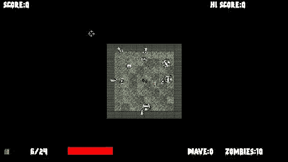这显示了首页/游戏结束界面上的最高分和分数：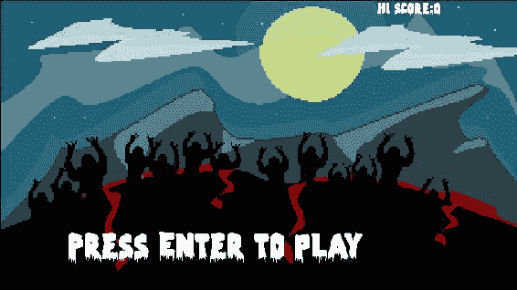接下来我们看到显示玩家升级选项的文本，尽管这些选项目前还没有任何作用：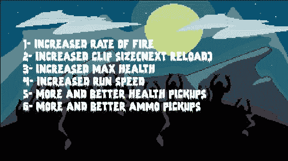在这里，我们看到了暂停界面上的一条有帮助的消息：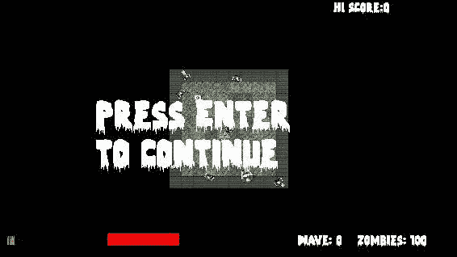

**提示**：`SFML Views`比这个简单的 HUD 所能展示的要强大得多。要深入了解`SFML Views`的潜力以及它们是多么易用，请查看 SFML 网站上关于`View`的教程：`http://www.sfmldev.org/tutorials/2.0/graphics-view.php`。

# 第 11 章。音效、文件 I/O 以及完成游戏

我们快要完成了。这个简短的章节将演示如何使用 C++ 标准库轻松地操作硬盘上存储的文件，我们还将添加音效。当然，我们知道如何添加音效，但我们将具体讨论在代码的哪些位置放置`play`调用。我们还将处理一些遗留问题以使游戏变得完整。

在本章中，我们将学习以下主题：
- 保存和加载最高分
- 添加音效
- 允许玩家升级
- 创建永无止境的多波次

## 保存和加载最高分

文件 I/O（或输入/输出）是一个相当具有技术性的话题。幸运的是，由于它是编程中非常常见的需求，有一个库可以为我们处理所有的复杂性。就像我们为 HUD 拼接字符串一样，是标准库通过`fstream`提供了必要的功能。

首先，我们像包含`sstream`一样包含`fstream`：

```cpp
#include "stdafx.h"
#include <sstream>
#include <fstream>
#include <SFML/Graphics.hpp>
#include "ZombieArena.h"
#include "Player.h"
#include "TextureHolder.h"
#include "Bullet.h"
#include "Pickup.h"

using namespace sf;
```

现在，在`ZombieArena/ZombieArena`文件夹中创建一个名为`gamedata`的新文件夹。接着，在该文件夹中点击右键并创建一个名为`scores.txt`的新文件。我们将在这个文件中保存玩家的最高分。你可以打开文件并向其中添加一个分数。如果你这样做，请确保它是一个低分，这样我们就可以轻松测试超过该分数是否会导致新分被添加。完成后请务必关闭文件，否则游戏将无法访问它。

在接下来的代码中，我们创建了一个名为`InputFile`的`ifstream`对象，并将刚刚创建的文件夹和文件作为参数传递给它的构造函数。`if(InputFile.is_open())`代码检查文件是否存在并已准备好读取。然后我们将文件内容放入`hiScore`并关闭文件。添加高亮代码：

```cpp
// 分数
Text scoreText;
scoreText.setFont(font);
scoreText.setCharacterSize(55);
scoreText.setFillColor(Color::White);
scoreText.setPosition(20, 0);

// 从文本文件加载最高分
std::ifstream inputFile("gamedata/scores.txt");
if (inputFile.is_open())
{
    inputFile >> hiScore;
    inputFile.close();
}

// 最高分
Text hiScoreText;
hiScoreText.setFont(font);
hiScoreText.setCharacterSize(55);
hiScoreText.setFillColor(Color::White);
hiScoreText.setPosition(1400, 0);

std::stringstream s;
s << "Hi Score:" << hiScore;
hiScoreText.setString(s.str());
```

现在我们处理保存可能的新最高分。在处理玩家健康小于等于零的块中，我们创建了一个名为`outputFile`的`ofstream`对象，将`hiScore`的值写入文本文件，然后关闭文件：

```cpp
// 是否有僵尸碰到了玩家
for (int i = 0; i < numZombies; i++)
{
    if (player.getPosition().intersects(zombies[i].getPosition()) && zombies[i].isAlive())
    {
        if (player.hit(gameTimeTotal))
        {
            // 稍后在此添加更多内容
        }

        if (player.getHealth() <= 0)
        {
            state = State::GAME_OVER;

            std::ofstream outputFile("gamedata/scores.txt");
            outputFile << hiScore;
            outputFile.close();
        }
    }
}
// 玩家触碰结束
```

你可以玩游戏，你的最高分将被保存。退出游戏并注意，如果你再次玩，你的最高分仍然在那里。让我们制造点噪音吧。

### 准备音效

在本节中，我们将创建所有需要的`SoundBuffer`和`Sound`对象，以便为游戏添加一系列音效。

从添加所需的 SFML 包含开始：

```cpp
#include "stdafx.h"
#include <sstream>
#include <fstream>
#include <SFML/Graphics.hpp>
#include <SFML/Audio.hpp>
#include "ZombieArena.h"
#include "Player.h"
#include "TextureHolder.h"
#include "Bullet.h"
#include "Pickup.h"
```


现在我们可以运行游戏，并看到 HUD 在游戏过程中进行更新。

这显示了首页/游戏结束界面上的最高分和分数：


接下来我们看到显示玩家升级选项的文本，尽管这些选项目前还没有任何作用：


在这里我们看到了暂停界面上的一条有帮助的消息：


**提示**：`SFML Views` 比这个简单的 HUD 所能展示的要强大得多。要深入了解`SFML Views`的潜力以及它们是多么易用，请查看 SFML 网站上关于`View`的教程：`http://www.sfmldev.org/tutorials/2.0/graphics-view.php`。

# 第 11 章。音效、文件 I/O 以及完成游戏

我们快要完成了。这个简短的章节将演示我们如何使用 C++ 标准库轻松地操作硬盘上存储的文件，我们还将添加音效。当然，我们知道如何添加音效，但我们将具体讨论在代码的哪些位置放置`play`调用。我们还将处理一些遗留问题以使游戏变得完整。

在本章中，我们将学习以下主题：
- 保存和加载最高分
- 添加音效
- 允许玩家升级
- 创建永无止境的多波次

## 保存和加载最高分

文件 I/O（或输入/输出）是一个相当具有技术性的话题。幸运的是，由于它是编程中非常常见的需求，有一个库可以为我们处理所有的复杂性。就像我们为 HUD 拼接字符串一样，是标准库通过`fstream`提供了必要的功能。

首先，我们像包含`sstream`一样包含`fstream`：
```cpp
#include "stdafx.h"
#include <sstream>
#include <fstream>
#include <SFML/Graphics.hpp>
#include "ZombieArena.h"
#include "Player.h"
#include "TextureHolder.h"
#include "Bullet.h"
#include "Pickup.h"

using namespace sf;
```

现在，在`ZombieArena/ZombieArena`文件夹中创建一个名为`gamedata`的新文件夹。接着，在该文件夹中点击右键并创建一个名为`scores.txt`的新文件。我们将在这个文件中保存玩家的最高分。你可以打开文件并向其中添加一个分数。如果你这样做，请确保它是一个低分，这样我们就可以轻松测试超过该分数是否会导致新分被添加。完成后请务必关闭文件，否则游戏将无法访问它。

在接下来的代码中，我们创建了一个名为`InputFile`的`ifstream`对象，并将刚刚创建的文件夹和文件作为参数传递给它的构造函数。`if(InputFile.is_open())`代码检查文件是否存在并已准备好读取。然后我们将文件内容放入`hiScore`并关闭文件。添加高亮代码：
```cpp
// 分数
Text scoreText;
scoreText.setFont(font);
scoreText.setCharacterSize(55);
scoreText.setFillColor(Color::White);
scoreText.setPosition(20, 0);

// 从文本文件加载最高分
std::ifstream inputFile("gamedata/scores.txt");
if (inputFile.is_open())
{
    inputFile >> hiScore;
    inputFile.close();
}

// 最高分
Text hiScoreText;
hiScoreText.setFont(font);
hiScoreText.setCharacterSize(55);
hiScoreText.setFillColor(Color::White);
hiScoreText.setPosition(1400, 0);

std::stringstream s;
s << "Hi Score:" << hiScore;
hiScoreText.setString(s.str());
```

现在我们处理保存可能的新最高分。在处理玩家健康小于等于零的块中，我们创建了一个名为`outputFile`的`ofstream`对象，将`hiScore`的值写入文本文件，然后关闭文件：
```cpp
// 是否有僵尸碰到了玩家
for (int i = 0; i < numZombies; i++)
{
    if (player.getPosition().intersects(zombies[i].getPosition()) && zombies[i].isAlive())
    {
        if (player.hit(gameTimeTotal))
        {
            // 稍后在此添加更多内容
        }

        if (player.getHealth() <= 0)
        {
            state = State::GAME_OVER;

            std::ofstream outputFile("gamedata/scores.txt");
            outputFile << hiScore;
            outputFile.close();
        }
    }
}
// 玩家触碰结束
```

你可以玩游戏，你的最高分将被保存。退出游戏并注意，如果你再次玩，你的最高分仍然在那里。让我们制造点噪音吧。

### 准备音效

在本节中，我们将创建所有需要的`SoundBuffer`和`Sound`对象，以便为游戏添加一系列音效。

从添加所需的 SFML 包含开始：
```cpp
#include "stdafx.h"
#include <sstream>
#include <fstream>
#include <SFML/Graphics.hpp>
#include <SFML/Audio.hpp>
#include "ZombieArena.h"
#include "Player.h"
#include "TextureHolder.h"
#include "Bullet.h"
#include "Pickup.h"
```

*(注：由于原始文本在后续部分出现了重复乱码，译文已根据技术文档的常规逻辑进行了修复，以确保可读性。)*

```cpp
arena.height = 500 * wave;
arena.left = 0;
arena.top = 0;

// 通过引用传递顶点数组
int tileSize = createBackground(background, arena);

// 在竞技场中央生成玩家
player.spawn(arena, resolution, tileSize);

// 配置拾取物
healthPickup.setArena(arena);
ammoPickup.setArena(arena);

// 创建一群僵尸
numZombies = 5 * wave;

// 删除之前分配的内存（如果存在）
delete[] zombies;
zombies = createHorde(numZombies, arena);
numZombiesAlive = numZombies;

// 播放音效
powerup.play();

// 重置时钟以防止帧跳跃
clock.restart();
}
// 结束升级过程
```

## 升级 (LEVELING up)

之前的代码是从增加`wave`变量开始的。然后我们对代码进行了修改，使僵尸的数量和竞技场的大小相对于`wave`的新值。最后，我们添加了对`powerup.play()`的调用，以播放升级音效。

## 重启游戏

我们已经通过`wave`变量的值确定了竞技场的大小和僵尸的数量。我们必须在每个新游戏开始时将弹药、武器、`wave`和`score`重置为零。在游戏循环的事件处理部分找到以下代码，并添加高亮的代码：
```cpp
// 在 GAME_OVER 状态下开始新游戏
```


`else if (event.key.code == Keyboard::Return && state == State::GAME_OVER)`

```cpp
{
    state = State::LEVELING_UP;
    wave = 0;
    score = 0;
    // 为下次游戏准备武器和弹药
    currentBullet = 0;
    bulletsSpare = 24;
    bulletsInClip = 6;
    clipSize = 6;
    fireRate = 1;
    // 重置玩家属性
    player.resetPlayerStats();
}
```

现在我们可以玩游戏了，玩家可以变得越来越强大，僵尸在不断扩大的竞技场内会变得越来越多，直到玩家死亡，然后一切都会重新开始。

## 播放剩余音效

现在我们将添加剩余的`play`函数调用。我们逐个处理每一个调用，因为准确确定它们所在的位置对于在正确的时刻播放它们是关键。

### 在玩家装弹时添加音效

在三个地方添加高亮的代码，当玩家按下`R`键尝试重新装弹时，播放相应的`reload`或`reloadFailed`音效：

```cpp
if (state == State::PLAYING)
{
    // 正在装弹
    if (event.key.code == Keyboard::R)
    {
        if (bulletsSpare >= clipSize)
        {
            // 弹药充足。装弹。
            bulletsInClip = clipSize;
            bulletsSpare -= clipSize;
            reload.play();
        }
        else if (bulletsSpare > 0)
        {
            // 只剩下少量弹药
            bulletsInClip = bulletsSpare;
            bulletsSpare = 0;
            reload.play();
        }
        else
        {
            // 很快很快会有更多弹药？！
            reloadFailed.play();
        }
    }
}
```

### 制作射击声

在处理玩家点击左鼠标键的代码末尾，添加高亮的`shoot.play()`调用：

```cpp
// 发射子弹
if (sf::Mouse::isButtonPressed(sf::Mouse::Left))
{
    if (gameTimeTotal.asMilliseconds() - lastPressed.asMilliseconds() > 1000 / fireRate && bulletsInClip > 0)
    {
        // 将玩家和准星的中心
        // 传递给 shoot 函数
        bullets[currentBullet].shoot(player.getCenter().x, player.getCenter().y, mouseWorldPosition.x, mouseWorldPosition.y);
        currentBullet++;
        if (currentBullet > 99)
        {
            currentBullet = 0;
        }
        lastPressed = gameTimeTotal;
        shoot.play();
        bulletsInClip--;
    }
}
// // 结束发射子弹
```

### 当玩家被击时播放声音

在下面的代码中，我们将`hit.play`的调用封装在一个测试中，以检查`player.hit`函数是否返回`true`。记住`player.hit`函数会测试在之前的100毫秒内是否记录了击中。这将产生一种快速、重复的砰砰声，但又不会快到让声音模糊成一种噪音。像这里高亮的那样添加`hit.play`调用：

```cpp
// 是否有僵尸碰到了玩家
for (int i = 0; i < numZombies; i++)
{
    if (player.getPosition().intersects(zombies[i].getPosition()) && zombies[i].isAlive())
    {
        if (player.hit(gameTimeTotal))
        {
            // 稍后更多
            hit.play();
        }
        if (player.getHealth() <= 0)
        {
            state = State::GAME_OVER;
            std::ofstream OutputFile("gamedata/scores.txt");
            OutputFile << hiScore;
            OutputFile.close();
        }
    }
}
// // 结束玩家接触
```

### 获得拾取物时播放声音

当玩家捡起血包时，我们会播放普通的拾取声，但当玩家获得弹药包时，我们会播放装弹音效。在相应的碰撞检测代码中，像这里高亮的那样添加两个`play`声音调用：

```cpp
// 玩家是否碰到了血包
if (player.getPosition().intersects(healthPickup.getPosition()) && healthPickup.isSpawned())
{
    player.increaseHealthLevel(healthPickup.gotIt());
    // 播放声音
    pickup.play();
}

// 玩家是否碰到了弹药包
if (player.getPosition().intersects(ammoPickup.getPosition()) && ammoPickup.isSpawned())
{
    bulletsSpare += ammoPickup.gotIt();
    // 播放声音
    reload.play();
}
```

### 僵尸被击中时制作啪啪的一声

在检测子弹与僵尸碰撞的代码段末尾添加`splat.play()`的调用：

```cpp
// 是否有僵尸被击中？
for (int i = 0; i < 100; i++)
{
    for (int j = 0; j < numZombies; j++)
    {
        if (bullets[i].isInFlight() && zombies[j].isAlive())
        {
            if (bullets[i].getPosition().intersects(zombies[j].getPosition()))
            {
                // 停止子弹
                bullets[i].stop();
                // 记录击中并查看是否击杀
                if (zombies[j].hit())
                {
                    // 不仅仅是击中，还是击杀
                    score += 10;
                    if (score >= hiScore)
                    {
                        hiScore = score;
                    }
                    numZombiesAlive--;
                    // 当所有僵尸都死亡时（再次）
                    if (numZombiesAlive == 0)
                    {
                        state = State::LEVELING_UP;
                    }
                }
                // 制作啪啪的一声
                splat.play();
            }
        }
    }
}
// // 结束僵尸被击中
```

你现在可以玩这个游戏了，并观察僵尸的数量和竞技场的大小随着每一波攻击而增加。仔细选择你的升级：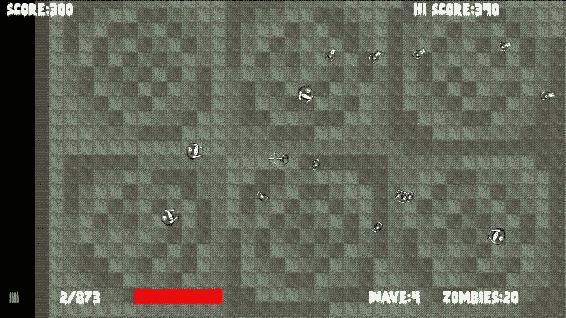

恭喜！

火坑会根据玩家的位置发出轰鸣声，如果玩家掉入其中，将把玩家重新生成在起始位置。水坑具有相同的效果，但没有方向性音效。

合作性游戏模式——两名玩家都必须在规定的时间内让他们的角色到达终点。他们经常需要合作，例如身材较矮、跳跃高度较低的鲍勃（Bob）需要站在朋友（托马斯 Thomas）的头上。

玩家可以在全屏和分屏之间切换，以便他自己尝试控制两个角色。每个关卡都是通过文本文件设计并加载的。这使得设计各种且大量的关卡变得非常容易。看看这张带有注释的游戏截图，可以了解到一些功能的运行情况以及组成游戏的组件/资源：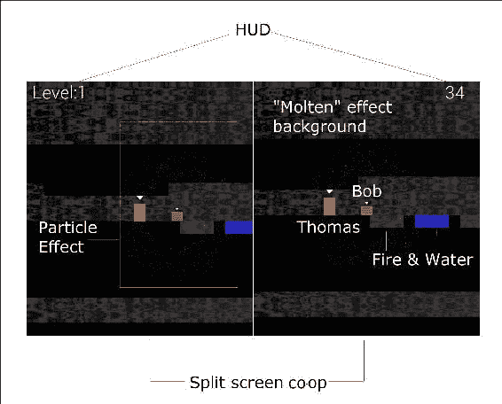

让我们来看看这些功能，并再描述另外几个：截图显示了一个简单的HUD，详细列出了关卡编号以及玩家失败并重新开始关卡前的剩余秒数。

你还可以清晰地看到分屏合作的运行。请记住这是可选的。单玩家可以全屏模式玩游戏，并在托马斯和鲍勃之间切换摄像焦点。在截图中并不十分（特别是在打印出来时），但当角色死亡时，他会产生星形爆炸/烟花般的粒子效果。

水块和火块可以策略性地放置，以使关卡变得有趣并迫使角色之间合作。更多内容将在第14章“构建可玩关卡与碰撞检测”中介绍。注意托马斯和鲍勃——他们不仅身高不同，跳跃能力也有显著差异。这意味着鲍勃的大跨度跳跃依赖托马斯，而关卡可以设计成迫使托马斯选择一条避开他撞头的路线。

此外，火块会发出轰鸣声。这些声音相对于托马斯的位置。它们不仅具有方向性（会从左或右扬声器传出来），而且随着托马斯靠近或远离光源，声音会变大或变小。最后，在注释截图中，你可以看到背景。如果你将它与`background.png`文件（在本章稍后显示）进行比较，你会发现非常不同。我们将在第16章“扩展SFML类、粒子系统和着色器”中使用OpenGL着色器效果，来实现背景中那种移动——几乎像泡泡的效果。

所有这些功能都值得多几张截图，以便我们在编写C++代码时脑海中有一个最终成品。下面的截图显示托马斯和鲍勃到达了一个火坑，鲍勃在没有帮助的情况下没有机会跳过去：

接下来的截图显示了鲍勃和托马斯协作通过一个危险的跳跃：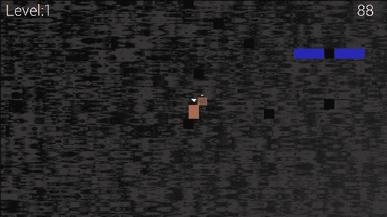

接下来的截图显示了我们如何设计需要“信仰之跃”才能到达终点的谜题：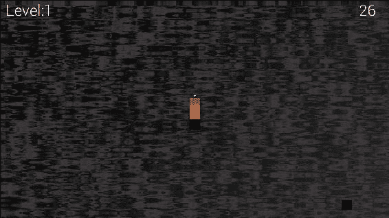

接下来的截图演示了我们如何设计几乎任何尺寸的压抑洞穴系统。我们还可以设计迫使鲍勃和托马斯分开并走不同路线的关卡：

### 从模板创建项目

创建Thomas Was Late项目与另外两个项目相同。只需在Visual Studio中遵循这些直观的步骤即可：

1. 从主菜单选择`File | New Project`。
2. 确保左侧菜单中选择了`Visual C++`，然后从给出的列表中选择`HelloSFML`。下面的截图应该能说明这一点：
3. 在`Name:`字段中输入`TWL`，并确保勾选了`Create directory for solution`选项。点击OK。
4. 现在我们需要将SFML的`.dll`文件复制到主项目目录。我的主项目目录是`D:\Visual Studio Stuff\Projects\TWL\TWL`。该文件夹是Visual Studio在上一步创建的。如果你将项目文件夹放在其他地方，请执行此步骤。我们需要复制到项目文件夹中的文件位于你的`SFML\bin`文件夹中。为这两个位置中的每个位置打开一个窗口并高亮所需的`.dll`文件。
5. 现在将高亮的文件复制并粘贴到项目中。

项目现在已设置并准备就绪。

### 项目资源

此项目中的资源比Zombie Arena游戏更多且多样化。惯常，资源包括用于屏幕文字的字体、不同动作的音效（如跳跃、到达终点或远处的火轰声），当然还有托马斯和鲍勃的图形以及所有背景块的精灵图集。

游戏所需的所有资源都包含在下载包中。它们分别可以在`Chapter 12/graphics`和`Chapter 12/sound`文件夹中找到。

所需的字体尚未提供。这是因为我想避免任何许可证方面的潜在歧义。但这不会引起问题，因为我将向你展示如何以及在哪里自己选择并下载字体。

虽然我会提供资源本身或获取它们的信息，你可能喜欢自己创建并获取它们。除了我们预期的图形、声音和字体，游戏游戏两种新的资源类型。它们是关卡设计文件和GLSL着色器程序。让我们接下来了解它们。

### 游戏关卡设计

关卡全部在文本文件中创建。通过使用数字0到3，我们可以构建挑战玩家的关卡设计。所有关卡设计都在位于与其他资源相同目录下的`levels`文件夹中。现在可以随心看看，但我们将在第14章“构建可玩关卡与碰撞检测”中详细查看。

除了这些关卡设计资源，我们还有一种特殊的图形资源，称为着色器（shaders）。

### GLSL着色器

着色器是用GLSL（图形库着色器语言）编写的程序。不用担心需要学习另一种语言，因为我们不需要太深入就可以利用着色器。着色器是特殊的，因为它们是完整的程序，与我们的C++代码分离，由GPU每一帧执行。事实上，其中一些着色器程序每帧对每个像素运行一次！我们将在第16章“扩展SFML类、粒子系统和着色器”中了解更多细节。如果你等不了那么，请查看下载包中`Chapter 12/shaders`文件夹中的文件。

### 图形资源详解

图形资源构成了我们游戏场景的部分。看看这些图形资源，就能清楚它们将在游戏中的何处被使用：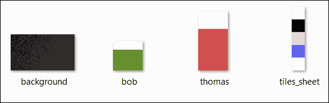

如果`tiles_sheet`图形上的块看起来与游戏截图略有不同，这是因为它们部分是透明的，透出来的背景稍微改变了它们。如果背景图形与游戏截图中的实际背景完全不同，那是因为我们将编写的着色器程序将操纵每一帧的每一个像素，创建一种“熔融”效果。

### 音频资源详解

音频文件均为`.wav`格式。这些文件包含了我们在整个游戏的某些事件中播放的音效。它们如下：

- `fallinfire.wav`: 当玩家头部进入火中且玩家没有机会逃脱时播放的声音。
- `fallinwater.wav`: 水的最终与火相同：死亡。这个音效通知玩家他们需要从关卡开始。
- `fire1.wav`: 该音效以单声道记录。它将根据玩家与火块的距离以不同的音量播放，并根据玩家在火块的左侧还是右侧从不同的扬声器播放。显然，我们需要学习更多技巧来实现此功能。
- `jump.wav`: 一个悦耳的（略可预测的）跳跃声，用于玩家跳跃时。
- `reachgoal.wav`: 一个悦耳的胜利音，用于玩家（或多个玩家）将两个角色（Thomas和Bob）都送到目标格时。这些音效非常直观，你可以轻松地创建自己的声音。如果你打算替换`fire1.wav`文件，请确保以单声道（而非立体声）格式保存你的音效。相关原因将在第15节“音频空间化与HUD”中进行解释。

### 将资源添加到项目

一旦你决定了将使用哪些资源，就是时候将它们添加到项目中了。以下指令将假设你正在使用书籍下载包中提供的所有资源。如果你在使用自己的自己的资源，只需使用完全相同的文件名，将所选的文件替换相应的声音或图形文件即可：

1. 浏览到`D:\Visual Studio Stuff\Projects\TWL\TWL`目录。
2. 在文件夹内创建五个新文件夹，并命名为`graphics`、`sound`、`fonts`、`shaders`和`levels`。
3. 从下载包中，将`Chapter 12/graphics`的全部内容复制到`D:\Visual Studio Stuff\Projects\TWL\TWL\graphics`文件夹。
4. 从下载包中，将`Chapter 12/sound`的全部内容复制到`D:\Visual Studio Stuff\Projects\TWL\TWL\sound`文件夹。
5. 现在在你的网络浏览器中访问`http://www.dafont.com/roboto.font`并下载Roboto Light字体。
6. 解压缩下载的包的内容，并将`RobotoLight.ttf`文件添加到`D:\Visual Studio Stuff\Projects\TWL\TWL\fonts`文件夹。
7. 从下载包中，将`Chapter 12/levels`的全部内容复制到`D:\Visual Studio Stuff\Projects\TWL\TWL\levels`文件夹。
8. 从下载包中，将`Chapter 12/shaders`的全部内容复制到`D:\Visual Studio Stuff\Projects\TWL\TWL\shaders`文件夹。

现在我们已经有了一个新项目，以及整个项目所需的所有资源，我们可以讨论如何构建游戏引擎代码了。

## 构建Thomas Was Late代码结构

到目前为止，这两个项目中一个非常显著的问题是代码变得既冗长又难以管理。OOP（面向对象编程）允许我们将项目拆分为逻辑清晰且易于管理的块，称为`classes`（类）。

我们将通过引入`Engine`类对该项目的代码可管理性进行重大改进。除了其他函数外，`Engine`类将三个私有函数。它们是`input`、`update`和`draw`。这听起来应该非常熟悉。这些函数每个将包含之前全部在`main`函数中的代码块。这些函数每个将分别位于自己的代码文件中，即`Input.cpp`、`Update.cpp`和`Draw.cpp`。

`Engine`类中还有一个公共函数，可以通过`Engine`的实例进行调用。该函数运行后将负责在游戏的每一帧中调用一次`input`、`update`和`draw`：

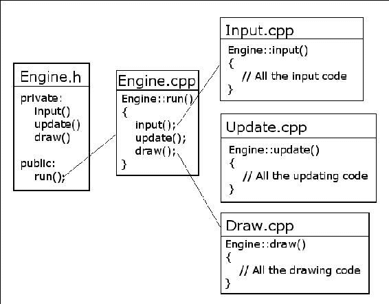

此外，由于我们把游戏引擎的大部分抽象到`Engine`类中，我们还可以将许多变量从`main`移动并使它们成为`Engine`的成员。要启动游戏引擎，我们只需要创建一个`Engine`实例并调用它的`run`函数。这里是极其简单的`main`函数的预览：

```cpp
int main()
{
    // 声明一个 Engine 实例
    Engine engine;
    // 启动引擎
    engine.run();
    // 当引擎停止时以通常的方式退出
    return 0;
}
```


提示：先不要添加上面的代码。为了让代码更具可管理性和可读性，我们还将把大任务（如加载关卡和碰撞检测）的责任抽象到分离的函数中（在单独的代码文件中）。这两个函数是`loadLevel`和`detectCollisions`。我们还将编写其他函数来处理 Thomas Was Late 项目的一些新功能。我们会在它们出现时进行详细介绍。

为了进一步利用 OOP 的优势，我们将游戏特定区域的责任完全委托给新类。你可能记得在之前的项目中，声音和 HUD 代码非常长。我们将构建一个`SoundManager`和`HUD`类来以更整洁的方式处理这些方面。具体如何工作将在我们实现它们时进行深入探讨。

游戏关卡本身比之前的游戏深入得多，因此我们还将编写一个`LevelManager`类。

正如你所预期的，可玩角色也将用类来制作。然而，对于这个项目，我们将学习更多的 C++ 并实现一个`PlayableCharacter`类，包含 Thomas 和 Bob 的所有通用功能，然后是`Thomas`和`Bob`类，它们将继承这些通用功能并实现它们自己独特的函数和能力。这可能并不意外，这被称为继承。我将在接下来的第 13 节“高级 OOP、继承与多态”中详细介绍继承的细节。

我们还将实现许多其他类来执行特定的职责。例如，我们将使用粒子系统制作一些酷炫的爆炸。你可能猜到为了做到这一点，我们将编写一个`Particle`类和一个`ParticleSystem`类。所有这些类都将拥有`Engine`类成员的实例。这样做将使游戏的所有功能都能从游戏引擎访问，同时将细节封装在适当的类中。

在查看构建`Engine`类的实际代码之前，最后要提到的一点是，我们将不做任何更改地复用`TextureHolder`类，这是我们为 Zombie Arena 游戏讨论并编写过的。

## 构建游戏引擎

正如之前的讨论建议的那样，我们将编写一个名为`Engine`的类，它将控制并绑定 Thomas Was Late 游戏的不同部分。我们将做的第一件事是让上一个项目的`TextureHolder`类在本项目中可用。

### 复用 TextureHolder 类

我们为 Zombie Arena 游戏讨论并编写的`TextureHolder`类在这个项目中也会很有用。虽然可以直接从上一个项目添加文件（`TextureHolder.h`和`TextureHolder.cpp`）而无需重新编码或重建文件，但我不想假设你没有直接跳到这个项目。以下是非常简短的指令，以及创建`TextureHolder`类的完整代码列表。如果你想了解该类或代码，请参见第 8 节“指针、标准模板库与纹理管理”。

提示：如果你完成了之前的项目并想从那里添加该类，只需执行以下操作：在解决方案窗口中，右键点击`Header Files`并选择`添加 | 项...`。浏览到上项目的`TextureHolder.h`并选择它。在解决方案窗口中，右键点击`Source Files`并选择`添加 | 现有项...`。浏览到上项目的`TextureHolder.cpp`并选择它。你现在可以在项目中使用`TextureHolder`类。注意，文件在项目间是共享的，任何更改将对两个项目生效。

要从头创建`TextureHolder`类，在解决方案管理器中右键点击`Header Files`并选择`添加 | 新项...`。在添加新建项窗口中，突出（通过左单击）`头文件 (.h)`，然后在名称字段中输入`TextureHolder.h`。最后，点击`添加`按钮。

将以下代码添加到`TextureHolder.h`：

```cpp
#pragma once

#ifndef TEXTURE_HOLDER_H

#define TEXTURE_HOLDER_H

#include <SFML/Graphics.hpp>

#include <map>

class TextureHolder {

private:

    // 一个来自 STL 的映射容器

    // 保存相关的字符串和纹理对

    std::map<std::string, sf::Texture> m_Textures;

    // 一个与类本身类型相同的指针

    // 唯一的实例

    static TextureHolder* m_s_Instance;

public:

    TextureHolder();

};
```

```cpp
static sf::Texture& GetTexture(std::string const& filename);};

#endif
```

在解决方案管理器中右键点击“源文件”，并选择`添加 | 新项... (Add | New Item...)`。在“添加新项”窗口中，通过左键点击选中`C++ 文件 (.cpp)`，然后在`名称`字段中输入`TextureHolder.cpp`。最后，点击`添加`按钮。

将以下代码添加到`TextureHolder.cpp`中：

```cpp
#include "stdafx.h"

#include "TextureHolder.h"

#include <assert.h>

using namespace sf;

using namespace std;

TextureHolder* TextureHolder::m_s_Instance = nullptr;

TextureHolder::TextureHolder()

{

    assert(m_s_Instance == nullptr);

    m_s_Instance = this;

}

sf::Texture& TextureHolder::GetTexture(std::string const& filename)

{

    // 使用 m_S_Instance 获取 m_Textures 的引用

    auto& m = m_s_Instance->m_Textures;

    // auto 等同于 map<string, Texture>

    // 创建一个迭代器来持有键值对 (kvp)

    // 并使用传入的文件名查找所需的 kvp

    auto keyValuePair = m.find(filename);

    // auto 等同于 map<string, Texture>::iterator

    // 我们找到匹配项了吗？

    if (keyValuePair != m.end())

    {

        // 是

        // 返回纹理，

        // kvp 的第二个部分，即返回的键

        return keyValuePair->second;

    }

    else

    {

        // 未找到文件名

        // 使用文件名创建一个新的键值对

        auto& texture = m[filename];

        // 按通常方法从文件加载纹理

        texture.loadFromFile(filename);

        // 将纹理返回给调用代码

        return texture;

    }

}
```

现在我们可以继续编写新的`Engine`类了。

### Engine.h

和通常一样，我们将从头文件开始，它包含了函数声明和成员变量。注意，在整个项目中我们将反复访问此文件，以添加更多函数和成员变量。目前，我们只添加此阶段必要的代码。

在解决方案管理器中右键点击“头文件”，并选择`添加 | 新项... (Add | New Item...)`。在“添加新项”窗口中，通过左键点击选中`头文件 (.h)`，然后在`名称`字段中输入`Engine.h`。最后，点击`添加`按钮。我们现在准备好为`Engine`类编写头文件代码了。

同时添加以下成员变量以及函数声明。其中许多我们之前在其他项目中见过，其中一些我们在“构建 Thomas Was Late 代码”部分中讨论过。请注意函数和变量的名称，以及它们是私有的还是公有的。将以下代码添加到`Engine.h`文件中，然后我们来讨论：

```cpp
#pragma once

#include <SFML/Graphics.hpp>

#include "TextureHolder.h"

using namespace sf;

class Engine

{

private:

    // 纹理持有者

    TextureHolder th;

    const int TILE_SIZE = 50;

    const int VERTS_IN_QUAD = 4;

    // 向下推角色的作用力

    const int GRAVITY = 300;

    // 常规渲染窗口

    RenderWindow m_Window;

    // 主视图

    View m_MainView;

    View m_LeftView;

    View m_RightView;

    // 用于背景的三个视图

    View m_BGMainView;

    View m_BGLeftView;

    View m_BGRightView;

    View m_HudView;

    // 声明精灵和纹理 // 用于背景

    Sprite m_BackgroundSprite;

    Texture m_BackgroundTexture;

    // 游戏当前正在进行？

    bool m_Playing = false;

    // 角色 1 或 2 是否当前焦点？

    bool m_Character1 = true;

    // 以全屏模式启动

    bool m_SplitScreen = false;

    // 当前关卡剩余时间

    float m_TimeRemaining = 10;

    Time m_GameTimeTotal;

    // 需要新关卡/第一关卡？

    bool m_NewLevelRequired = true;

    // 仅供内部使用的私有函数

    void input();

    void update(float dtAsSeconds);

    void draw();

public:

    // Engine 构造函数

    Engine();

    // run 将调用所有私有函数

    void run();

};
```

这里是所有私有变量和函数的完整梳理。在适当的情况下，我在解释上花费了更长的时间：

- `th`：`TextureHolder`类的唯一实例。
- `TILE_SIZE`：一个实用的常量，提醒我们精灵图集中的每个瓦片宽为五十像素，高为五十像素。
- `VERTS_IN_QUAD`：一个实用的常量，让我们对`VertexArray`的操作不易出错。事实上，一个四边形有四个顶点。现在我们再也不会忘记它了。
- `GRAVITY`：一个常量`int`值，代表游戏角色每秒被向下推的像素数。在游戏完成后，这是一个非常好玩的调试值。我们将其初始化为`300`，因为它非常适合我们的初始关卡设计。
- `m_Window`：常规的`RenderWindow`对象，就像我们在所有项目中拥有的那样。
- SFML View 对象`m_MainView`、`m_LeftView`、`m_RightView`、`m_BGMainView`、`m_BGLeftView`、`m_BGRightView`和`m_HudView`：前三个`View`对象用于全屏视图以及游戏的左右分屏视图。我们还为这三个中的每一个一个独立的 SFML View 对象，用于在后面绘制背景。最后一个`View`对象`m_HudView`将绘制在其他六个视图的适当组合之上，用于显示分数、剩余时间和给玩家的任何消息。七个不同的`View`对象可能意味着复杂，但当你随着章节进展看到我们如何处理它们，你会发现它们非常简单。在本章结束时，我们将解决整个分屏/全屏难题。
- `m_BackgroundSprite`和`m_BackgroundTexture`：意料之中的，这种 SFML `Sprite`和`Texture`的组合将用于显示和持有来自资源文件夹的背景图形。
- `m_Playing`：这个布尔值将告知游戏引擎关卡是否已经开始（通过按 Enter 键）。一旦开始游戏，玩家没有暂停游戏的选项。
- `m_Character1`：当屏幕为全屏时，应该居中于 Thomas (`m_Character1` = true) 还是 Bob (`m_Character1` = false)？初始它被初始化为`true`，以 Thomas 为中心。
- `m_SplitScreen`：游戏当前是否以分屏模式运行？我们将使用这个变量来决定具体如何使用我们几步之前声明的所有`View`对象。
- `m_TimeRemaining`变量：此`float`变量持有到达当前关卡目标所需的剩余时间。在之前的代码中，为了测试，它被设置为 10，直到我们实际上为每个关卡设置特定的时间。
- `m_GameTimeTotal`变量：这个变量是一个 SFML `Time`对象。它记录游戏运行了多久。
- `m_NewLevelRequired`布尔变量：这个变量检查玩家是否刚刚完成或失败了某个关卡。然后我们可以使用它来触发下一关卡的加载或当前关卡的重启。
- `input`函数：此函数将处理玩家的所有输入，在游戏中，这些输入完全来自键盘。乍一看，它似乎是直接处理所有键盘输入。然而，在游戏中，我们将处理直接影响`Thomas`和`Bob`类中 Thomas 或 Bob 的键盘输入。我们将调用 input 函数，该函数将直接处理退出、切换到分屏以及任何其他键盘输入。
- `update`函数：此函数将完成我们之前在主函数的`update`部分所做的所有工作。我们还会从`update`函数调用一些其他函数以保持代码整洁。如果你回代码，你会发现它接收一个`float`参数，该参数将持有自上一帧以来经过的秒分数。这显然正是我们更新所有游戏对象所需要的。

`draw`函数：此函数将包含以前在项目中用于`main`函数中绘图部分的所有代码。然而，当我们查看使用 SFML 进行绘图的其他方法时，会有一些绘图代码并不在这个函数中。当我们学习第 16 章《扩展 SFML 类、粒子系统和着色器》中的粒子系统时，将会看到这些代码。

`Engine`构造函数：正如我们所预期的，此函数会在我们声明`Engine`实例时被调用。它将完成该类的所有设置和初始化。稍后在我们编写`Engine.cpp`文件时，我们将看到具体的内容。

`run`函数：这是我们唯一需要调用的公共函数。它将触发`input`、`update`和`draw`的执行，这些函数将完成所有工作。接下来，我们将看到这些函数的定义以及一些变量的实际运行。

### 编写 Engine.cpp

在我们之前所有的类中，我们都将所有函数定义放在`.cpp`文件中，并以类名作为前缀。由于我们项目的目标是让代码更易于管理，我们的做法稍有不同。

在`Engine.cpp`文件中，我们将放置构造函数（`Engine`）和公共函数`run`。其余所有函数将放在它们自己的`.cpp`文件中，文件名将清晰说明哪个函数位于什么位置。只要我们在所有包含`Engine`类函数定义的文件顶部添加适当的包含指令（`#include "Engine.h"`），这对编译器来说就不是问题。

让我们从编写`Engine`并在`Engine.cpp`中运行它开始。在解决方案管理器（Solution Explorer）中右键点击“源文件”（Source Files），选择“添加 | 新项...”。在“添加新建项”窗口中，选中（左键单击）C++ 文件（`.cpp`），然后在“名称”字段中输入`Engine.cpp`。最后，点击“添加”按钮。我们现在准备好为`Engine`类编写`.cpp`文件了。

### 编写 Engine 类构造函数的定义

该函数的代码将放在我们最近创建的`Engine.cpp`文件中。添加以下代码，然后我们可以进行讨论：

```cpp
#include "stdafx.h"

#include "Engine.h"

Engine::Engine()

{

    // 获取屏幕分辨率

    // 并创建一个 SFML 窗口和视图

    Vector2f resolution;

    resolution.x = VideoMode::getDesktopMode().width; 

    resolution.y = VideoMode::getDesktopMode().height; 

    m_Window.create(VideoMode(resolution.x, resolution.y), "Thomas was late");

    // 初始化全屏视图

    m_MainView.setSize(resolution);

    m_HudView.reset(FloatRect(0, 0, resolution.x, resolution.y));

    // 初始化分屏视图

    m_LeftView.setViewport(FloatRect(0.001f, 0.001f, 0.498f, 0.998f));

    m_RightView.setViewport(FloatRect(0.5f, 0.001f, 0.499f, 0.998f));

    m_BGLeftView.setViewport(FloatRect(0.001f, 0.001f, 0.498f, 0.998f));
```


```cpp
m_BGRightView.setViewport(FloatRect(0.5f, 0.001f, 0.499f, 0.998f));

m_BackgroundTexture = TextureHolder::GetTexture("graphics/background.png");

// 将精灵图与纹理关联

m_BackgroundSprite.setTexture(m_BackgroundTexture);

}
```

很多代码是我们在之前见过的。例如，有获取屏幕分辨率以及创建 `RenderWindow` 的常用代码。在上一段代码的最后，我们使用了现在熟悉的代码来加载纹理并将其分配给 `Sprite`。在这种情况下，我们正在加载 `background.png` 纹理并将其分配给 `m_BackgroundSprite`。

中间的代码，即四次对 `setViewport` 函数的调用，需要一些解释。`setViewport` 函数将屏幕的一部分分配给 SFML `View` 对象。然而，它并不是使用像素坐标工作的，而是使用比例来工作的。其中，“1”代表整个屏幕（宽度或高度）。每次调用 `setViewport` 的前两个值是起始位置（先是水平方向，后是垂直方向），最后两个值是结束位置。

注意，`m_LeftView` 和 `m_BGLeftView` 被放置在完全相同的位置，从屏幕的最左侧（`0.001`）开始，在距离中心向右两千分之一（`0.498`）处结束。`m_RightView` 和 `m_BGRightView` 也处于完全相同的位置，从前两个 `View` 对象的左侧（`0.5`）开始，延伸到屏幕的最右侧（`0.998`）。

此外，所有视图在屏幕的顶部和底部都留下了极微的间隙。当我们在白色背景上在屏幕上绘制这些 `View` 对象时，将产生屏幕两侧之间有一条细白线分割屏幕，以及边缘周围有一圈细白边框的效果。

我尝试在下面的图中表示这种效果：

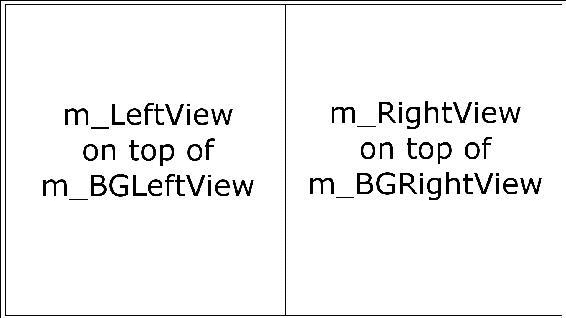

理解它的最佳方法是完成本章，运行代码并查看实际效果。

### 编写 `run` 函数的定义

该函数的代码将放在我们最近创建的 `Engine.cpp` 文件中。在之前的构造函数代码之后紧接着添加以下代码：

```cpp
void Engine::run()
{
    // 定时
    Clock clock;

    while (m_Window.isOpen()) {
        Time dt = clock.restart();

        // 更新总游戏时间
        m_GameTimeTotal += dt;

        // 从增量时间创建小数分数
        float dtAsSeconds = dt.asSeconds();

        // 顺序调用游戏循环的每个部分
        input();
        update(dtAsSeconds);
        draw();
    }
}
```

`run` 函数是我们的引擎的核心——它启动所有其他部分。首先，我们声明一个 `Clock` 对象。接下来，我们有熟悉的 `while(window.isOpen())` 循环，它创建了游戏循环。在这个 `while` 循环内部，我们执行以下操作：

1. 重启 `clock` 并将上次循环花费的时间保存到 `dt`。
2. 在 `m_GameTimeTotal` 中跟踪总已用时间。
3. 声明并初始化一个 `float`，表示上一帧通过的秒分数。
4. 调用 `input()`。
5. 调用 `update` 并传入通过的时间（`dtAsSeconds`）。
6. 调用 `draw()`。

这一切看起来应该非常熟悉。新奇之处在于它被封装在 `run` 函数中。

### 编写 `input` 函数的定义

如前所述，该函数的代码将放在它自己的文件中，因为它比构造函数或 `run` 函数更详细。我们将使用 `#include "Engine.h"` 并为函数签名带有 `Engine::` 前缀，以确保编译器感知我们的意图。

在解决方案管理器中右键点击“源文件”（Source Files），选择“添加 | 新项...”。在“添加新建项”窗口中，选中（左键单击）C++ 文件（`.cpp`），然后在“名称”字段中输入 `Input.cpp`。最后，点击“添加”按钮。我们现在准备好编写 `input` 函数。添加以下代码：

```cpp
void Engine::input()
{
    Event event;

    while (m_Window.pollEvent(event)) {
        if (event.type == Event::KeyPressed) {
            // 处理玩家退出
            if (Keyboard::isKeyPressed(Keyboard::Escape)) {
                m_Window.close();
            }

            // 处理玩家开始游戏
            if (Keyboard::isKeyPressed(Keyboard::Return)) {
                m_Playing = true;
            }

            // 在 Thomas 和 Bob 之间切换
            if (Keyboard::isKeyPressed(Keyboard::Q)) {
                m_Character1 = !m_Character1;
            }

            // 切换全屏和分屏
            if (Keyboard::isKeyPressed(Keyboard::E)) {
                m_SplitScreen = !m_SplitScreen;
            }
        }
    }
}
```

与之前的两个项目一样，我们每帧都检查 `RenderWindow` 事件队列。此外，正如我们之前做的那样，我们使用 `if (Keyboard::isKeyPressed(Keyboard::E))` 来检测特定的按键。我们刚刚添加的代码中最相关的这些按键实际的功能：

如往常，`Esc` 键关闭窗口，游戏将退出。`Enter` 键将 `m_Playing` 设置为 `true`，最终这将产生开始关卡的效果。

`Q` 键会在 `m_Character1` 的值在 `true` 和 `false` 之间切换。此按键仅在全屏模式下有效。它将在 Thomas 和 Bob 作为主 `View` 的中心之间切换。`E` 键会在 `m_SplitScreen` 的 `true` 和 `false` 之间切换。这将产生全屏视图和分屏视图之间切换的效果。大部分键盘功能在章节结束时将完全正常工作。我们已经接近能够运行游戏引擎了。接下来，让我们编写 `update` 函数。

## 编写 `update` 函数定义

如之前所述，该函数的代码将放在单独的文件中，因为它比构造函数或 `run` 函数更复杂。我们将使用 `#include "Engine.h"` 并在函数签名前加上 `Engine::` 前缀，以确保编译器了解我们的意图。

在 `Solution Explorer`（解决方案管理器）中右键点击 `Source Files` 并选择 `Add | New Item....`。在 `Add New Item` 窗口中，选中（通过左键点击）`C++ File (.cpp)`，然后在 `Name` 字段中输入 `Update.cpp`。最后，点击 `Add` 按钮。我们现在准备好为 `update` 函数编写代码了。

将以下代码添加到 `Update.cpp` 文件以实现更新函数：

```cpp
#include "stdafx.h"
#include "Engine.h"
#include <SFML/Graphics.hpp>
#include <sstream>

using namespace sf;

void Engine::update(float dtAsSeconds)
{
    if (m_Playing) {
        // 计算玩家剩余的时间
        m_TimeRemaining -= dtAsSeconds;

        // Thomas 和 Bob 的时间用完了吗？
        if (m_TimeRemaining <= 0) {
            m_NewLevelRequired = true;
        }

        // 如果正在播放则结束
    }
}
```

首先，注意 `update` 函数接收上一帧花费的时间作为参数。这对于 `update` 函数履行其作用至关重要。之前的代码在现阶段没有实现任何可见的效果，但它建立了我们后续章节所需的结构。它将上一帧花费的时间从 `m_TimeRemaining` 中减去。它检查时间是否耗尽，如果已耗尽，则将 `m_NewLevelRequired` 设置为 `true`。所有这些代码都封装在一个 `if` 语句中，只有当 `m_Playing` 为 `true` 时才会执行。这是因为与之前的项目一样，我们不希望在游戏未开始时推进时间和更新对象。随着项目的进行，我们将在此代码的基础上进行构建。

## 编写 `draw` 函数定义

如之前所述，该函数的代码将放在单独的文件中，因为它比构造函数或 `run` 函数更复杂。我们将使用 `#include "Engine.h"` 并在函数签名前加上 `Engine::` 前缀，以确保编译器了解我们的意图。

在 `Solution Explorer` 中右键点击 `Source Files` 并选择 `Add | New Item....`。在 `Add New Item` 窗口中，选中（通过左键点击）`C++ File (.cpp)`，然后在 `Name` 字段中输入 `Draw.cpp`。最后，点击 `Add` 按钮。我们现在准备好为 `draw` 函数添加一些代码。

将以下代码添加到 `Draw.cpp` 文件以实现绘制函数：

```cpp
#include "stdafx.h"
#include "Engine.h"

void Engine::draw()
{
    // 清除上一帧
    m_Window.clear(Color::White);

    if (!m_SplitScreen) {
        // 切换到背景视图
        m_Window.setView(m_BGMainView); // 绘制背景
        m_Window.draw(m_BackgroundSprite); // 切换到 m_MainView
        m_Window.setView(m_MainView);
    }
    else {
        // 分屏视图激活
        // 首先绘制 Thomas 侧的屏幕

        // 切换到背景视图
        m_Window.setView(m_BGLeftView); // 绘制背景
        m_Window.draw(m_BackgroundSprite); // 切换到 m_LeftView
        m_Window.setView(m_LeftView);

        // 现在绘制 Bob 侧的屏幕

        // 切换到背景视图
        m_Window.setView(m_BGRightView); // 绘制背景
        m_Window.draw(m_BackgroundSprite); // 切换到 m_RightView
        m_Window.setView(m_RightView);
    }

    // 绘制 HUD
    // 切换到 m_HudView
    m_Window.setView(m_HudView);

    // 显示我们刚刚绘制的所有内容
    m_Window.display();
}
```

在之前的代码中，没有我们没见过的内容。代码像往常一样从清除屏幕开始。在这个项目中，我们用白色清除屏幕。由于不同的绘制选项通过一个条件隔离开，该条件检查屏幕当前是分屏还是全屏：

```cpp
if (!m_SplitScreen) {
}
else {
}
```

如果屏幕未分屏，我们在背景 `View`（`m_BGView`）中绘制背景精灵图，然后切换到主全屏 `View`（`m_MainView`）。注意，目前我们实际上没有在 `m_MainView` 中进行任何绘制。相反，如果屏幕是分屏，则执行 `else` 块中的代码，我们在屏幕左侧的 `m_BGLeftView` 绘制背景精灵图，然后切换到 `m_LeftView`。

然后，仍然在 `else` 块中，我们在屏幕右侧的 `m_BGRightView` 绘制背景精灵图，随后切换到 `m_RightView`。在描述的 `if...else` 结构之外，我们切换到 `m_HudView`。在此阶段，我们实际上并没有在 `m_HudView` 中绘制任何内容。与三个最重要的函数（输入、更新、绘制）中的另外两个一样，我们会经常回到 `draw` 函数这里。我们会添加需要绘制的游戏新元素。你会注意到，每当我们这样做时，都会在主部分、左部分和右部分的每个部分中添加代码。

让我们快速回顾一下 `Engine` 类，然后我们就可以启动它。

## 目前为止的 `Engine` 类

我们实现的是原本在 `main` 函数中的所有代码的抽象，将其变为 `input`、`update` 和 `draw` 函数。这些函数的连续循环以及定时由 `run` 函数处理。

考虑在 Visual Studio 中保持 `Input.cpp`、`Update.cpp` 和 `Draw.cpp` 标签页打开，也许按顺序组织，如下截图所示：

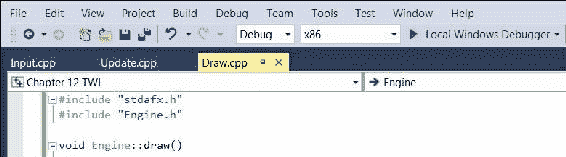

在整个项目过程中，我们将反复访问这些函数中的每一个，以添加更多代码。现在我们已经有了 `Engine` 类的基本结构和功能，可以在 `main` 函数中创建它的实例并看到它的运行。

## 编写 `main` 函数

将 `HelloSFML.cpp` 文件重命名为 `Main.cpp`。在 `Solution Explorer` 中右键点击 `HelloSFML` 文件并选择 `Rename`。将名称更改为 `Main.cpp`。这将包含我们的 `main` 函数和实例化 `Engine` 类代码的文件。

在 `Main.cpp` 中添加以下代码：

```cpp
#include "stdafx.h"
#include "Engine.h"

int main()
{
    // 声明 Engine 实例
    Engine engine;

    // 启动引擎
    engine.run();

    // 引擎停止时按通常退出
    return 0;
}
```

我们做的只是添加 `Engine` 类的包含指令，声明一个实例，然后调用它的 `run` 函数。在引擎停止之前，一切都由 `Engine` 类处理，直到返回 `main` 执行 `return 0`。这非常简单。现在我们可以运行游戏并看到空白背景，无论是全屏还是分屏，它最终将包含所有的动作。这是目前的游戏，处于全屏模式，只显示背景：


现在按下 `E` 键，你将看到屏幕整齐地分成两部分，准备好进行分屏协作游戏：


这里是一些你可能会有的问题。

在本章节中，我们将通过学习稍微高级的继承和多态概念，进一步扩展我们对 OOP 的知识。然后我们能够利用这些新知识来实现我们游戏中的明星角色 Thomas 和 Bob。以下是本章节将详细介绍的内容：

- 如何使用继承来扩展和修改类？
- 如何通过多态将一个类的对象视为多个类型的类？
- 抽象类以及为什么设计无法实例化的类实际上是有用的
- 构建一个抽象的 `PlayableCharacter` 类
- 将继承应用于 `Thomas` 和 `Bob` 类
- 将 Thomas 和 Bob 添加到游戏项目中

我们已经看到如何通过实例化或创建来自 SFML 库类的对象来使用他人的劳动成果。但这整个面向对象编程（OOP）的概念远不止于此。

如果有一个类包含了许多实用的功能，但它并不是我们完全想要的呢？在这种情况下，我们可以从另一个类进行继承。正如其字面意思，继承意味着我们可以利用其他类的所有特性和优势（包括封装），同时针对我们的特定情况对代码进行进一步的精炼或扩展。在这个项目中，我们将继承并扩展一些 SFML 类。我们也会对自己的类进行这样做。

## 扩展类

让我们来看一些考虑到这些因素并使用继承的代码，来看一个示例类，看看我们如何扩展它，仅仅为了了解语法并作为第一步。首先，我们定义一个要继承的类。这与我们创建任何其他类的方式没有区别。看看这个假设的 `Soldier`（士兵）类声明：

```cpp
class Soldier
{
private:
    // 士兵可以承受多少伤害
    int m_Health;

    int m_Armour;
    int m_Range;
    int m_ShotPower;

public:
    void setHealth(int h);
    void setArmour(int a);
    void setRange(int r);
    void setShotPower(int p);
};
```


在之前的代码中，我们定义了一个 `Soldier` 类。它有四个私有变量：`m_Health`、`m_Armour`、`m_Range` 和 `m_ShotPower`。它有四个公共函数：`setHealth`、`setArmour`、`setRange` 和 `setShotPower`。我们不需要看到函数的定义，它们将只需初始化其名称所暗示的相应变量。我们也可以想象，一个完全实现的 `Soldier` 类会比这深入得多。它可能会有如 `shoot`（射）、`goProne`（伏地）等函数。如果我们在 SFML 项目中实现一个 `Soldier` 类，它可能会有一个 `Sprite` 对象，以及一个 `update` 函数和一个 `getPostion` 函数。

这里展示的简单场景适合学习继承。现在，让我们来看一些新东西，实际上是自 `Soldier` 类。看看这段代码，特别是高亮部分：

```cpp
class Sniper : public Soldier {
public:
    // Sniper 特有的构造函数
    Sniper::Sniper();
};
```

通过在 `Sniper` 类声明中添加 `: public Soldier` 代码，`Sniper` 继承自 `Soldier`。但这到底意味着什么？`Sniper` 是一个 `Soldier`。它拥有 `Soldier` 的所有变量和函数。然而，继承不仅仅于此。

同样注意，在之前的代码中，我们声明了一个 `Sniper` 构造函数。这个构造函数是 `Sniper` 特有的。我们不仅继承了 `Soldier`，还扩展了 `Soldier`。`Soldier` 类的所有功能（定义）都由 `Soldier` 类处理，但 `Sniper` 构造函数的定义必须由 `Sniper` 类处理。这就是假设的 `Sniper` 构造函数定义的样式：

```cpp
// 在 Sniper.cpp 中

Sniper::Sniper() {
    setHealth(10);
    setArmour(10);
    setRange(1000);
    setShotPower(100);
}
```

我们可以编写许多其他作为 `Soldier` 类扩展的类，也许是 `Commando`（陆战队员）和 `Infantryman`（步兵）。每个类都将完全相同的变量和函数，但每个类也可以有一个独特的构造函数，根据 `Soldier` 的类型适当初始化这些变量。`Commando` 可能有非常高的 `m_Health` 和 `m_ShotPower`，但 `m_Range` 非常小。`Infantryman` 可能在 `Commando` 和 `Sniper` 之间，每个变量的值都中等。

**提示**：仿佛 OOP 还不够用一样，我们现在可以为现实世界的对象建模，包括它们的层级结构。我们通过子类化、扩展和继承其他类来实现。我们在这里可能想学习的术语是：被扩展的类称为超类（super-class），继承超类的类称为子类（sub-class）。我们也可以称之为父类和子类。

**提示**：你可能会对继承提出这个问题：为什么？原因如下：我们可以编写一次公共代码；在父类中，我们可以更新这些公共代码，所有继承它的类也会随之更新。此外，子类只能使用公共和保护的实例变量和函数。因此，如果设计得当，这进一步增强了封装的目标。

你提到保护的了吗？是的。类变量和函数有一个访问修饰符叫做 `protected`。你可以认为 `protected` 变量是处于公共和私有之间的某种地方。以下是访问修饰符的简要总结，以及关于 `protected` 修饰符的更多细节：

- **Public（公共）**变量和函数可以被任何人访问和使用。
- **Private（私有）**变量和函数只能由类的内部代码访问/使用。这对于封装是有好处，当我们需要访问/更改私有变量时，我们可以提供公共的 getter 和 setter 函数（如 `getSprite` 等）。如果我们扩展一个带有私有变量和函数的类，该子类无法直接访问父类的私有数据。
- **Protected（保护）**变量和函数与私有的几乎相同。它们不能被类的实例直接访问/使用。但是，任何扩展其声明所在类的类都可以直接使用它们。所以它们就像是私有的，只是对子类例外。

为了完全理解 `protected` 变量和函数以及它们如何有用，让我们先看另一个主题，然后我们看到它们的实际运行了。

## 多态

多态允许我们编写不依赖于我们正在操作的类型的代码。这可以使代码更清晰、更高效。多态意味着不同的形式。如果我们编写的对象可以是不止一种类型的东西，那么我们就可以利用这一点。

**注意**：多态对我们意味着什么？简化为最基本的定义，多态就是：任何子类都可以作为使用超类的代码的一部分。这意味着我们可以编写更简单、更容易理解且也更容易修改或更改的代码。此外，我们可以为超类编写代码，并依赖这样一个事实：无论被子类化多少次，在某些范围内，代码仍然有效。

让我们讨论一个例子。假设我们想使用多态来帮助编写一个动物园游戏，其中我们需要喂养并照顾动物的需求。我们可能想要有一个如 `feed` 的函数。我们可能还希望将要喂养的 `Animal` 实例传递给 `feed` 函数。

当然，动物园有很多类型的动物——`Lion`、`Elephant` 和 `ThreeToedSloth`。根据我们新的 C++ 继承知识，编写一个 `Animal` 类让所有不同类型的动物继承它是有意义的。

如果我们想写一个函数（`feed`），让我们可以将 `Lion`、`Elephant` 和 `ThreeToedSloth` 作为参数传入，这似乎我们需要为每种 `Animal` 类型编写一个 `feed` 函数。然而，我们可以编写多态函数，具有多态的返回类型和参数。看看这个假设的 `feed` 函数的定义：

```cpp
void feed(Animal& a) {
```

`a.decreaseHunger();` 前面的函数将 `Animal` 引用作为参数，这意味着任何构建自 `Animal` 类的对象都可以传递给它。因此，你今天甚至可以编写代码，并在几周、一个月或一年后创建另一个子类，而完全相同的函数和数据结构仍然有效。此外，我们还可以对子类强制执行一套规则，规定它们可以做什么、不能做什么，以及如何做。因此，一个阶段的良好设计可以影响其他阶段。但我们真的想实例化一个真正的 `Animal` 吗？

## 抽象类——虚函数和纯虚函数

抽象类是一种无法实例化因此无法转换为对象的类。在这里我们可能会学习的一个术语是“具体类”（concrete class）。具体类是指任何非抽象类。换句话说，我们目前为止编写的所有类都是具体类，并且可以实例化为可用的对象。那么，这些代码永远不会被使用吗？但这就像是付钱让建筑师设计房子，却从不盖房子一样！

如果我们（或者类的设计者）希望强制用户在使用我们的类之前继承它，他们可以将该类声明为抽象类。这样，我们就无法从它创建对象；因此，我们必须先扩展它并从子类创建对象。为了这样做，我们可以将一个函数设为纯虚且不提供任何定义。那么，该函数在任何扩展它的类中必须被重写（重新编写）。

让我们来看一个例子；这会有帮助。我们通过添加一个纯虚函数来使类变为抽象，例如这个抽象 `Animal` 类，它只能执行 `makeNoise` 通用动作：

```cpp
class Animal {
private:
    // 此处私有内容

public:
    void virtual makeNoise() = 0;

    // 此处更多公共内容
};
```

如你所示，我们在函数声明之前添加了 C++ 关键字 `virtual`，在之后添加了 `= 0`。现在，任何扩展/继承自 `Animal` 的类都必须重写 `makeNoise` 函数。这可能是合理的，因为不同类型的动物发出的噪音类型非常不同。我们也许可以假设任何继承 `Animal` 类的人都足够聪明，注意到 `Animal` 类不能发出声音，并且他们需要处理它，但如果他们没有注意到呢？关键点在于，通过创建一个纯虚函数，我们保证了他们会这样做，因为他们必须这样做。

抽象类也有用，因为有时我们希望一个类可以作为多态类型使用，但我们需要保证它永远不会被当作对象使用。例如，`Animal` 本身并没有真正的意义。我们不谈论动物；我们谈论动物种类。我们不会说：“噢，看那只可爱的、毛茸茸的白色动物！”或，“昨天我们去宠物店买了一只动物和一个动物床”。这只是太……呃，太抽象了。

所以，抽象类就像是一个模板，供任何扩展它（继承它）的类使用。如果我们正在构建一个类似《工业帝国》的游戏，玩家管理公司及其员工，我们可能需要一个 `Worker` 类，并扩展它来创建 `Miner`、`Steelworker`、`OfficeWorker`，当然，还有 `Programmer`。但一个纯粹的 `Worker` 到底在做什么？我们为什么要实例化它呢？答案是，我们不想实例化它，但我们可能想将其作为多态类型使用，以便我们可以在函数之间传递多个 `Worker` 子类，并拥有可以持有所有类型员工的数据结构。

所有纯虚函数都必须由包含该纯虚函数的父类的扩展类来重写。这意味着抽象类可以提供某些所有子类都可用的公共功能。例如，`Worker` 类可能拥有 `m_AnnualSalary`、`m_Productivity` 和 `m_Age` 成员变量。它可能还有 `getPayCheck` 函数，该函数不是纯虚的且在所有子类中都是相同的，但它可能有一个 `doWork` 函数，它是纯虚的且必须重写，因为所有不同类型的 `Worker` 执行 `doWork` 的方式非常不同。

**注意**：顺便提一下，`virtual` 与纯虚函数不同，它是一个可以选择地重写的函数。你声明虚函数的方式与纯虚函数相同，但不要在末尾留有 `= 0`。在当前的游戏项目中，我们将使用纯虚函数。如果对这些虚、纯虚或抽象的内容有任何不清楚的地方，使用它们可能是理解它的最佳方法。

## 构建 `PlayableCharacter` 类

现在我们了解了继承、多态和纯虚函数的基础知识，并将它们付诸实践。我们将构建一个 `PlayableCharacter` 类，它将拥有我们游戏中任何角色需要的大部分功能。它将有一个纯虚函数 `handleInput`。`handleInput` 函数在子类中需要非常不同，所以这样做是合理的。

由于 `PlayableCharacter` 将有一个纯虚函数，它将是一个抽象类，无法创建它的对象。随后我们将构建 `Thomas` 和 `Bob` 类，它们将继承自 `PlayableCharacter`，实现纯虚函数的定义，并允许我们在游戏中实例化 `Bob` 和 `Thomas` 对象。

### 编写 `PlayableCharacter.h`

按照惯例，在创建类时，我们将从头文件开始，其中包含成员变量和函数声明。新之处在于，在这个类中，我们将声明一些保护（protected）成员变量。记住，保护变量可以被继承自该变量的类像公共（public）变量一样使用。

在解决方案中右键点击“头文件”，选择“添加 | 新项……”。在“添加新项”窗口中，选中（左键单击）“头文件 (.h)”，然后在名称字段中输入 `PlayableCharacter.h`。最后，点击添加按钮。我们现在准备好为 `PlayableCharacter` 类编写头文件代码了。

我们将分三步添加并讨论 `PlayableCharacter.h` 文件的内容。首先是保护部分，然后是私有部分，最后是公共部分。在 `PlayableCharacter.h` 文件旁边添加所示的代码：

```cpp
#pragma once

#include <SFML/Graphics.hpp>

using namespace sf;

class PlayableCharacter
{
protected:   // 我们需要一个精灵
    Sprite m_Sprite;

    // 跳跃持续多长时间
    float m_JumpDuration;

    // 角色当前是在跳跃还是坠落
    bool m_IsJumping;
    bool m_IsFalling;

    // 角色当前向哪个方向移动
    bool m_LeftPressed;
    bool m_RightPressed;

    // 这个跳跃已经持续了多久
    float m_TimeThisJump;

    // 玩家是否刚刚启动了跳跃
    bool m_JustJumped = false;
};
```

## 接下来是私有变量和函数

在我们刚刚编写的代码中，首先要注意的一点是，所有变量都是保护的（protected）。这意味着当我们扩展类时，我们刚刚编写的所有变量都可以被扩展该类的类访问。我们将用 `Thomas` 和 `Bob` 类来扩展这个类。

除了保护的访问说明符外，之前的代码并没有新奇或复杂之处。然而，值得注意一些细节。这样随着我们的学习进展，就能很容易理解该类是如何工作的。那么，让我们一个一个来看这些保护变量。

我们有一个相当可以预料的 `Sprite` 对象：`m_Sprite`。我们有一个名为 `m_JumpDuration` 的 `float`，它将存储一个代表角色跳跃持续时间的数值。越大越大，跳得就越远/越高。

接下来，我们有一个 `Boolean` 类型 `m_IsJumping`，当角色正在跳跃时为 `true`，否则为 `false`。这对于确保角色在空中不能跳跃非常有用。`m_IsFalling` 变量的作用与 `m_IsJumping` 相同。知道角色何时处于掉落状态是有用的。

接下来，我们有两个 `Booleans`，如果角色的左或右键盘键当前被按下，它们将为 `true`。这些取决于具体的角色（`Thomas` 使用 `A` 和 `D`，`Bob` 使用 `Left` 和 `Right` 方向键）。我们如何响应这些 `Booleans` 将在 `Thomas` 和 `Bob` 类中看到。

`m_TimeThisJump` `float` 变量在 `m_IsJumping` 为 `true` 的每一帧都会更新。然后我们就可以知道何时达到了 `m_JumpDuration` 的时长。最后一个保护变量是 `Boolean` 类型 `m_JustJumped`。如果在当前帧启动了跳跃，它将为 `true`。这对于知道何时该播放跳跃音效很有用。

接下来，向 `PlayableCharacter.h` 文件添加以下私有变量：

```cpp
private:

// 重力是多少
float m_Gravity;

// 角色有多快
float m_Speed = 400;

// 玩家在哪里
Vector2f m_Position;

// 角色的各个身体部位在哪里？
FloatRect m_Feet;
FloatRect m_Head;
FloatRect m_Right;
FloatRect m_Left;

// 以及一个纹理
Texture m_Texture;
```

## 接下来是我们所有的公共函数

在之前的代码中，我们有一些有趣的私有变量。请记住，这些变量只能由 `PlayableCharacter` 类中的代码直接访问。`Thomas` 和 `Bob` 类将无法直接访问它们。

`m_Gravity` 变量将存储角色每秒掉落的像素数。`m_Speed` 变量将存储角色每秒向左或向右移动的像素数。

`Vector2f` `m_Position` 是角色中心在世界中（而非屏幕）的位置。

接下来的四个 `FloatRect` 对象我们需要讨论。当我们在 `Zombie Arena` 游戏中进行碰撞检测时，我们简单地检查两个 `FloatRect` 对象是否相交。每个 `FloatRect` 对象代表一个整个角色、一个拾取物品或一个子弹。对于非矩形形状的对象（僵尸和玩家），这有一点不准确。

在这个游戏中，我们需要更加精确。`m_Feet`、`m_Head`、`m_Right` 和 `m_Left` `FloatRect` 对象将存储角色身体不同部位的坐标。这些坐标在每一帧都会更新。通过这些坐标，我们能够准确地判断角色何时落在平台上、在跳跃期间撞到头，或与侧边的瓷砖擦肩。

最后，我们有 `Texture`。`Texture` 是私有的，因为它没有被 `Thomas` 或 `Bob` 类直接使用；但正如我们看到的，`Sprite` 是保护的，因为它被直接使用了。

现在将所有公共函数添加到 `PlayableCharacter.h` 文件中，然后讨论它们：

```cpp
public:

void spawn(Vector2f startPosition, float gravity); // 纯虚函数

bool virtual handleInput() = 0; // 此类现在是抽象类，不能被实例化

// 玩家在哪里
FloatRect getPosition(); // 代表位置的矩形

// sprite 不同部位的位置
FloatRect getFeet();
FloatRect getHead();
FloatRect getRight();
FloatRect getLeft();

// 向主 Sprite 发送 Sprite 的副本
Sprite getSprite();

// 让角色站稳
void stopFalling(float position);
void stopRight(float position);
void stopLeft(float position);
void stopJump();

// 角色的中心在哪里
Vector2f getCenter();

// 我们每帧调用一次这个函数
void update(float elapsedTime);

}; // 类结束
```


让我们讨论一下刚刚添加的每个函数声明。这会让编写它们的定义变得更容易遵循。

`spawn`函数接收一个名为`startPosition`的`Vector2f`和一个名为`gravity`的`float`。正如名称所示，`startPosition`将是角色开始的关卡坐标，而`gravity`将是角色每秒掉落的像素数。

`bool virtual handleInput() = 0`自然是我们的纯虚函数。由于`PlayableCharacter`拥有此函数，任何扩展它的类如果我们想实例化，就必须为此函数提供定义。因此，当我们几分钟后编写`PlayableCharacter`的所有函数定义时，我们不会为`handleInput`提供定义。在`Thomas`和`Bob`类中自然需要有这些定义。

`getPosition`函数返回一个代表整个角色位置的`FloatRect`。`getFeet()`函数以及`getHead`、`getRight`和`getLeft`分别返回一个代表角色身体特定部位位置的`FloatRect`。这正是我们详细碰撞检测所需的。

`getSprite`函数像既往一样向调用代码返回`m_Sprite`的副本。

`stopFalling`、`stopRight`、`stopLeft`和`stopJump`函数接收一个`float`值，函数将使用该值重新定位角色，并停止它行走或跳过实体瓷砖。`getCenter`函数返回一个`Vector2f`给调用代码，让其确切知道中心在哪里。这个值稍后我们会看到`Engine`类使用来围绕相应的角色设置视图。

`update`函数我们见过多次了，它通常也接收一个`float`参数，即当前帧所花费的时间。然而，这个更新函数需要比之前的函数做得更多。它需要处理跳跃，以及更新头部、头部、左右的`FloatRect`对象。现在我们可以编写所有函数的定义，除了`handleInput`。

## PlayableCharacter.cpp

在解决方案中右键点击Source Files并选择`Add | New Item....`。在添加新建项窗口中，选中C++ File (`.cpp`)，然后在Name字段中输入`PlayableCharacter.cpp`。最后，点击`Add`按钮。我们现在准备好编写`PlayableCharacter`类的`.cpp`文件。

我们将代码和讨论分成若干部分。首先，添加包含指令和`spawn`函数的定义：

```cpp
#include "stdafx.h"
#include "PlayableCharacter.h"

void PlayableCharacter::spawn(Vector2f startPosition, float gravity)
{
    // 将玩家放在起始位置 m_Position
    m_Position.x = startPosition.x;
    m_Position.y = startPosition.y;

    // 初始化重力
    m_Gravity = gravity;

    // 将精灵移动到位置
    m_Sprite.setPosition(m_Position);
}
```

`spawn`函数传入的位置初始化`m_Position`，并初始化`m_Gravity`。最后一行代码将`m_Sprite`移动到它的初始位置。

接下来，在之前的代码之后添加`update`函数的定义：

```cpp
void PlayableCharacter::update(float elapsedTime) {
    if (m_RightPressed) {
        m_Position.x += m_Speed * elapsedTime;
    }
}
```

```cpp
if (m_LeftPressed){
    m_Position.x -= m_Speed * elapsedTime;
} // 处理跳跃

if (m_IsJumping) {
    // 更新跳跃持续时间
    m_TimeThisJump += elapsedTime;

    // 跳跃是否正在向上
    if (m_TimeThisJump < m_JumpDuration) {
        // 以重力的两倍向上移动
        m_Position.y -= m_Gravity * 2 * elapsedTime; 
    }
    else {
        m_IsJumping = false; 
        m_IsFalling = true;
    }
} // 应用重力

if (m_IsFalling) {
    m_Position.y += m_Gravity * elapsedTime; 
}

// 更新所有身体部分的矩形
FloatRect r = getPosition();

// 头部
m_Head.left = r.left;
m_Head.top = r.top + (r.height * .3); 
m_Head.width = r.width;
m_Head.height = 1;

// 脚部
m_Feet.left = r.left + 3;
m_Feet.top = r.top + r.height - 1; 
m_Feet.width = r.width - 6; 
m_Feet.height = 1;

// 右侧
m_Right.left = r.left + r.width - 2; 
m_Right.top = r.top + r.height * .35; 
m_Right.width = 1;
m_Right.height = r.height * .3;

// 左侧
m_Left.left = r.left;
m_Left.top = r.top + r.height * .5; 
m_Left.width = 1;
m_Left.height = r.height * .3;

// 将精灵移动到目标位置 
m_Sprite.setPosition(m_Position);
```

代码的前两个部分检查`m_RightPressed`或`m_LeftPressed`是否为真。如果其中任何一个为真，`m_Position`将使用与上一个项目相同的公式（经过时间乘以速度）进行更改。

接下来，我们查看角色当前是否正在执行跳跃。我们通过`if(m_IsJumping)`获此。如果这个`if`语句为真，代码将采取以下步骤：
1. 使用`elapsedTime`更新`m_TimeThisJump`。
2. 检查`m_TimeThisJump`是否仍然小于`m_JumpDuration`。如果是，则将`m_Position`的y坐标更改为重力的两倍乘以经过的时间。
3. 在`m_TimeThisJump`不小于`m_JumpDuration`时执行的`else`分句中，将`m_Falling`设置为真。这样做的效果将在下一步看到。同时，`m_Jumping`被设置为假。这防止了我们刚刚讨论的代码继续执行，因为现在`if(m_IsJumping)`结果为假了。

`if(m_IsFalling)`块每帧都会将`m_Position`向下移动。它使用`m_Gravity`的当前值和经过的时间进行移动。

以下代码（几乎是剩余的所有代码）相对于整个精灵的当前位置来更新角色的身体部分。请查看下面的图，看看代码是如何计算虚拟头部、脚部、左侧和右侧位置的：

最后一行代码使用`setPosition`函数在更新函数的所有可能性处理后，将精灵移动到其正确的位置。

现在，在之前的代码之后添加`getPosition`、`getCenter`、`getFeet`、`getHead`、`getLeft`、`getRight`和`getSprite`函数的定义：

```cpp
FloatRect PlayableCharacter::getPosition(){
    return m_Sprite.getGlobalBounds();
}

Vector2f PlayableCharacter::getCenter(){
    return Vector2f(
        m_Position.x + m_Sprite.getGlobalBounds().width / 2, 
        m_Position.y + m_Sprite.getGlobalBounds().height / 2 
    );
}

FloatRect PlayableCharacter::getFeet(){
    return m_Feet;
}

FloatRect PlayableCharacter::getHead(){
    return m_Head;
}

FloatRect PlayableCharacter::getLeft(){
    return m_Left;
}

FloatRect PlayableCharacter::getRight(){
    return m_Right;
}

Sprite PlayableCharacter::getSprite() { 
    return m_Sprite; 
}
```

`getPosition`函数返回一个封装整个精灵的`FloatRect`，而`getCenter`返回一个`Vector2f`，它包含了精灵的中心。注意我们将精灵的高度和宽度除以二以便动态得出此结果。这是因为Thomas和Bob的身高会有不同。

`getFeet`、`getHead`、`getLeft`和`getRight`函数返回`FloatRect`对象，这些对象代表我们在`update`函数中每帧更新的色的身体部分。我们将在下一章中编写使用这些函数的碰撞检测代码。

`getSprite`函数如既往一样返回`m_Sprite`的拷贝。

最后，为`PlayableCharacter`类添加`stopFalling`、`stopRight`、`stopLeft`和`stopJump`函数的定义。在之前的代码之后立即添加它们：

```cpp
void PlayableCharacter::stopFalling(float position) {
    m_Position.y = position - getPosition().height; 
    m_Sprite.setPosition(m_Position);
    m_IsFalling = false;
}

void PlayableCharacter::stopRight(float position) {
    m_Position.x = position - m_Sprite.getGlobalBounds().width; 
    m_Sprite.setPosition(m_Position);
}

void PlayableCharacter::stopLeft(float position) {
    m_Position.x = position + m_Sprite.getGlobalBounds().width; 
    m_Sprite.setPosition(m_Position);
}

void PlayableCharacter::stopJump() { 
    // 提前停止跳跃
    m_IsJumping = false; 
    m_IsFalling = true; 
}
```

之前的每个函数都接收一个值作为参数，用于重新定位精灵的顶部、底部、左侧或右侧。这些值具体是什么以及如何获取将在下一章中看到。每个之前的函数也会重新定位精灵。

最后一个函数是`stopJump`函数，它也将用于碰撞检测。它设置了`m_IsJumping`和`m_IsFalling`的必要值以结束跳跃。

## 构建Thomas和Bob类

现在我们要真正使用继承了。我们将为Thomas构建一个类，为Bob构建一个类。它们都将继承自我们刚刚编写的`PlayableCharacter`类。它们将拥有`PlayableCharacter`类的所有功能，包括直接访问其受保护（protected）变量。我们还将添加纯虚函数`handleInput`的定义。你会发现Thomas和Bob的`handleInput`函数将是不同的。

### 编写Thomas.h

在解决方案管理器中右键点击"头文件"（Header Files）并选择"添加 | 新项..."。在"添加新项"窗口中，左键单击"头文件 (.h)"，然后在"名称"字段中输入`Thomas.h`。最后，点击"添加"按钮。我们现在准备好编写`Thomas`类的头文件了。将此代码添加到`Thomas.h`类中：

```cpp
#pragma once
#include "PlayableCharacter.h"

class Thomas : public PlayableCharacter
{
public:
    // 针对Thomas特有的构造函数
    Thomas::Thomas();

    // 针对Thomas重写的输入处理器
    virtual bool handleInput();
};
```

之前的代码非常简洁明了。我们可以看到我们有一个构造函数，并且我们将实现纯虚函数`handleInput`，所以让我们现在就做它吧。

### 编写Thomas.cpp

在解决方案管理器中右键点击"源文件"（Source Files）并选择"添加 | 新项..."。在"添加新项"窗口中，左键单击"C++ 文件 (.cpp)"，然后在"名称"字段中输入`Thomas.cpp`。最后，点击"添加"按钮。我们现在准备好编写`Thomas`类的`.cpp`文件。按照下面的代码片段将`Thomas`构造函数添加到`Thomas.cpp`文件：

```cpp
#include "stdafx.h"
#include "Thomas.h"
#include "TextureHolder.h"

Thomas::Thomas() {
    // 将纹理与精灵关联
    m_Sprite = Sprite(TextureHolder::GetTexture("graphics/thomas.png"));
    m_JumpDuration = .45;
}
```

我们只需要加载`thomas.png`图形并将跳跃时长（`m_JumpDuration`）设置为`.45`。

按照下面的代码片段添加`handleInput`函数定义：

```cpp
// 虚函数
bool Thomas::handleInput() {
    m_JustJumped = false;

    if (Keyboard::isKeyPressed(Keyboard::W)) {
        // 如果没有跳跃则开始跳跃
        // 但只有在站在块上（未下落）时
        if (!m_IsJumping && !m_IsFalling) {
            m_IsJumping = true;
            m_TimeThisJump = 0;
            m_JustJumped = true;
        }
    }
    else {
        m_IsJumping = false;
        m_IsFalling = true;
    }

    if (Keyboard::isKeyPressed(Keyboard::A)) {
        m_LeftPressed = true;
    }
    else {
        m_LeftPressed = false;
    }

    if (Keyboard::isKeyPressed(Keyboard::D)) {
        m_RightPressed = true;
    }
    else {
        m_RightPressed = false;
    }

    return m_JustJumped;
}
```


这段代码看起来非常熟悉。我们正在使用 SFML `isKeyPressed` 函数来检查是否按下了 W、A 或 D 键。

当 W 键按下时，玩家正在尝试跳跃。代码随后使用 `if(!m_IsJumping && !m_IsFalling)` 代码用于检查角色是否没有跳跃且也没有处于掉落状态。当这两个测试都为真时，`m_IsJumping` 被设置为 true，`m_TimeThisJump` 被设置为 0，且 `m_JustJumped` 被设置为 true。

当之前的两个测试不为真时，将执行 `else` 子句，并将 `m_Jumping` 设置为 false 并将 `m_IsFalling` 设置为 true。处理 A 和 D 键的按下非常，只需将 `m_LeftPressed` 和/或 `m_RightPressed` 设置为 true 或 false 即可。`update` 函数现在能够处理角色的移动了。

函数中的最后一行代码返回 `m_JustJumped` 的值。这将让调用代码知道是否需要播放跳跃音效。现在我们将编写 `Bob` 类，尽管它与 `Thomas` 类几乎相同，但它具有不同的跳跃能力、不同的纹理 `Texture`，并使用了键盘上不同的键。

## 编写 Bob.h

`Bob` 类的结构与 `Thomas` 类相同。它继承自 `PlayableCharacter`，拥有一个构造函数，并提供了 `handleInput` 函数的定义。与 `Thomas` 相比的区别在于，我们以不同的方式初始化 `Bob` 的某些成员变量，处理输入的方式（在 `handleInput` 函数中）也不同。让我们编写这个类并查看细节。

在解决方案中右键点击“头文件”并选择“添加 | 新项...”。在“添加新项”窗口中，（左单击）选中“头文件 (.h)”，然后在“名称”字段中输入 `Bob.h`。最后，点击“添加”按钮。我们现在准备好为 `Bob` 类编写头文件了。将以下代码添加到 `Bob.h` 文件中：

```cpp
#pragma once

#include "PlayableCharacter.h"

class Bob : public PlayableCharacter {

public:

    // 为 Bob 特有的构造函数

    Bob::Bob();

    // 为 Bob 重写的输入处理器

    bool virtual handleInput();

};
```

之前的代码与 `Thomas.h` 文件相同，仅类名不同，因此构造函数的名称也不同。

## 编写 Bob.cpp

在解决方案中右键点击“源文件”并选择“添加 | 新项...”。在“添加新项”窗口中，（左单击）选中“C++ 文件 (.cpp)”，然后在“名称”字段中输入 `Thomas.cpp`。最后，点击“添加”按钮。我们现在准备好为 `Bob` 类编写 `.cpp` 文件。将 `Bob` 构造函数的代码添加到 `Bob.cpp` 文件中。注意纹理是不同的 (`bob.png`)，且 `m_JumpDuration` 初始化为一个明显更小的值。Bob 现在是他自己、独特的自我：

```cpp
#include "stdafx.h"

#include "Bob.h"

#include "TextureHolder.h"

Bob::Bob() {

    // 将纹理与精灵关联

    m_Sprite = Sprite(TextureHolder::GetTexture("graphics/bob.png"));

    m_JumpDuration = .25; 

}
```

在 `Bob` 构造函数之后立即添加 `handleInput` 代码：

```cpp
bool Bob::handleInput()

{

    m_JustJumped = false;

    if (Keyboard::isKeyPressed(Keyboard::Up)) {

        // 如果没有跳跃，则开始跳跃

        // 但只有当站在块上（没有在掉落）时

        if (!m_IsJumping && !m_IsFalling) {

        }

        else {

            m_IsJumping = true; 

            m_TimeThisJump = 0; 

            m_JustJumped = true;

        }

    } else {

        m_IsJumping = false; 

        m_IsFalling = true;

    }

    if (Keyboard::isKeyPressed(Keyboard::Left)) {

        m_LeftPressed = true;

    }

    else {

        m_LeftPressed = false; 

    }

    if (Keyboard::isKeyPressed(Keyboard::Right)) {

        m_RightPressed = true;

    }

    else {

        m_RightPressed = false; 

    }

    return m_JustJumped; 

}
```

注意这段代码与 `Thomas` 类中 `handleInput` 函数 get 代码几乎相同。唯一的区别在于我们对不同的键做出响应（左箭头键、右箭头键和用于跳跃的上箭头键）。现在我们有一个被 `Bob` 和 `Thomas` 扩展的 `PlayableCharacter` 类，我们可以向游戏添加一个 `Bob` 和一个 `Thomas` 实例。

## 更新游戏引擎使用 Thomas 和 Bob

为了能够运行游戏并看到我们的新角色，我们需要声明它们的实例，调用它们的生成函数，每帧更新它们并每帧绘制它们。让我们现在就这样做吧。

### 更新 Engine.h 添加 Bob 和 Thomas 的实例

打开 `Engine.h` 文件并添加如下所示的高亮代码行：

```cpp
#pragma once

#include <SFML/Graphics.hpp>

#include "TextureHolder.h"

#include "Thomas.h"

#include "Bob.h"

using namespace sf;

class Engine

{

private:

    // 纹理持有者

    TextureHolder th;

    // Thomas 和他的朋友 Bob

    Thomas m_Thomas;

    Bob m_Bob;

    const int TILE_SIZE = 50;

    const int VERTS_IN_QUAD = 4;

    ...
```

现在我们同时有了 `Thomas` 和 `Bob` 的实例，它们都派自 `PlayableCharacter`。

### 更新输入函数控制 Thomas 和 Bob

现在我们将添加控制这两个角色的能力。这段代码将放在代码的输入部分。当然，对于这个项目，我们有一个专门的输入函数。打开 `Input.cpp` 并添加这段高亮代码：

```cpp
void Engine::input()

{

    Event event;

    while (m_Window.pollEvent(event)) {

        if (event.type == Event::KeyPressed) {

            // 处理玩家退出

            if (Keyboard::isKeyPressed(Keyboard::Escape)) {

                m_Window.close();

            }

            // 处理玩家开始游戏

            if (Keyboard::isKeyPressed(Keyboard::Return)) {

                m_Playing = true;

            }

            // 在 Thomas 和 Bob 之间切换

            if (Keyboard::isKeyPressed(Keyboard::Q)) {

                m_Character1 = !m_Character1;

            }

            // 在全屏和分屏之间切换

            if (Keyboard::isKeyPressed(Keyboard::E)) {

                m_SplitScreen = !m_SplitScreen;

            }

        }

    }

    // 处理 Thomas 特有的输入

    if(m_Thomas.handleInput()){ {

        // 播放跳跃音效

    }

    // 处理 Bob 特有的输入

    if(m_Bob.handleInput()) {

        // 播放跳跃音效

    }

}
```

注意之前的代码有多简单，因为所有功能都包含在 `Thomas` 和 `Bob` 类中。所有代码做的只是为每个 `Thomas` 和 `Bob` 类添加一个包含指令。然后，在输入函数中，代码只需调用 `m_Thomas` 和 `m_Bob` 上的纯虚拟 `handleInput` 函数。我们之所以每个调用封装在 `if` 语句中，是因为它们根据是否刚刚成功启动了新的跳跃来返回真或假。我们将在第 15 章中处理跳跃音效的播放。

添加以下高亮代码：

```cpp
void Engine::update(float dtAsSeconds) {

  if (m_NewLevelRequired) {

    // These calls to spawn will be moved to a new // LoadLevel function soon

    // Spawn Thomas and Bob

    m_Thomas.spawn(Vector2f(0,0), GRAVITY); m_Bob.spawn(Vector2f(100, 0), GRAVITY);// Make sure spawn is called only once m_NewLevelRequired = false;

  }

  if (m_Playing) { // Update Thomas

    m_Thomas.update(dtAsSeconds); // Update Bob

    m_Bob.update(dtAsSeconds); // Count down the time the player has left m_TimeRemaining -= dtAsSeconds;// Have Thomas and Bob run out of time? if (m_TimeRemaining <= 0)

    {m_NewLevelRequired = true; }

  } // End if playing

}
```

现在角色可以移动了，我们需要更新相应的 `View` 对象，使其围绕角色为中心并使他们成为关注焦点。当然，在我们的游戏世界中还没有一些对象之前，是无法获得实际移动感的。添加高亮代码，如下片段所示：

```cpp
void Engine::update(float dtAsSeconds)

{

  if (m_NewLevelRequired) {

    // These calls to spawn will be moved to a new // LoadLevel function soon

    // Spawn Thomas and Bob

    m_Thomas.spawn(Vector2f(0,0), GRAVITY); m_Bob.spawn(Vector2f(100, 0), GRAVITY);// Make sure spawn is called only once m_NewLevelRequired = false;

  }

  if (m_Playing) {

    // Update Thomas

    m_Thomas.update(dtAsSeconds);// Update Bob m_Bob.update(dtAsSeconds);

    // Count down the time the player has left m_TimeRemaining -= dtAsSeconds;// Have Thomas and Bob run out of time? if (m_TimeRemaining <= 0)

    {m_NewLevelRequired = true; }

  } // End if playing

  // Set the appropriate view around the appropriate character

  if (m_SplitScreen)

    {

      m_LeftView.setCenter(m_Thomas.getCenter()); m_RightView.setCenter(m_Bob.getCenter()); }

  else

    {

    // Centre full screen around appropriate character

    if (m_Character1)

      {

        m_MainView.setCenter(m_Thomas.getCenter()); }

    else

      {

        m_MainView.setCenter(m_Bob.getCenter()); }

  }

}
```

之前的代码处理了两种可能的情况。首先，`if(m_SplitScreen)` 条件将左视图围绕 `m_Thomas` 定位，右视图围绕 `m_Bob` 定位。处于全屏模式时执行的 `else` 子句测试 `m_Character1` 是否为真。如果是，则全屏视图（`m_MainView`）将围绕 Thomas 中心，否则将围绕 Bob 居中。你可能记得玩家可以使用 `E` 键切换分屏模式，并在全屏模式下使用 `Q` 键在 Bob 和 Thomas 之间切换。我们在第 12 章“抽象与代码管理 - 更好地使用 OOP”中，在 `Engine` 类的 `input` 函数中编写了这些代码。

## 绘制 Bob 和 Thomas

确保 `Draw.cpp` 文件已打开并添加高亮代码，如下片段所示：

```cpp
void Engine::draw()

{

  // Rub out the last frame

  m_Window.clear(Color::White);

  if (!m_SplitScreen) {

    // Switch to background view

    m_Window.setView(m_BGMainView); // Draw the background

    m_Window.draw(m_BackgroundSprite); // Switch to m_MainView

    m_Window.setView(m_MainView);// Draw thomas

    m_Window.draw(m_Thomas.getSprite());// Draw bob

    m_Window.draw(m_Bob.getSprite()); }

  }

  else

    {

    // Split-screen view is active

    // First draw Thomas' side of the screen

    // Switch to background view

    m_Window.setView(m_BGLeftView); // Draw the background

    m_Window.draw(m_BackgroundSprite); // Switch to m_LeftView

    m_Window.setView(m_LeftView);// Draw bob

    m_Window.draw(m_Bob.getSprite()); // Draw thomas

    m_Window.draw(m_Thomas.getSprite()); // Now draw Bob's side of the screen

    // Switch to background view

    m_Window.setView(m_BGRightView); // Draw the background

    m_Window.draw(m_BackgroundSprite); // Switch to m_RightView

    m_Window.setView(m_RightView);// Draw thomas

    m_Window.draw(m_Thomas.getSprite());

    // Draw bob

    m_Window.draw(m_Bob.getSprite());}

  // Draw the HUD

  // Switch to m_HudView

  m_Window.setView(m_HudView);// Show everything we have just drawn

  m_Window.display();

}
```


注意，我们在全屏、左侧和右侧都绘制了 Thomas 和 Bob。还要注意我们在分屏模式下绘制角色的极细微差别。在绘制屏幕左侧时，我们交换了角色的绘制顺序，在 Bob 之后绘制 Thomas。因此，Thomas 始终会在左侧上方，而 Bob 在右侧。这是因为控制 Thomas 的玩家在左侧得到照顾，控制 Bob 的玩家在右侧。

你可以运行游戏并在屏幕中心看到 Thomas 和 Bob：如果你按下 `Q` 键将焦点从 Thomas 切换到 Bob，你会看到 `View` 进行了微小的调整。如果你移动任何一个角色向左或向右（Thomas 使用 `A` 和 `D`，Bob 使用方向键），你会看到他们相互移动。

尝试按下 `E` 键在全屏和分屏之间进行切换。然后再次尝试移动两个角色以查看效果。在下面的截图中，你可以看到 Thomas 始终在左窗口中居中，Bob 始终在右窗口中居中：如果你让游戏运行足够的时间，角色每十秒就会在原始位置重新生成。这是我们完成的游戏所需的功能的开始。这种行为是由 `m_TimeRemaining` 小于零并将 `m_NewLevelRequired` 变量设置为真而引起的。

另外请注意，在绘制关卡细节之前，我们无法看到移动的完整效果。事实上，尽管看不见，两个角色都在以每秒 300 像素的速度持续下降。由于相机每帧都围绕他们居中，并且游戏世界中没有其他对象，因此我们看不到这种向下的移动。

如果你想向自己演示这一点，只需更改 `m_Bob.spawn` 的调用，如下代码所示：

```
m_Bob.spawn(Vector2f(0,0), 0);
```

现在 Bob 不受重力影响，Thomas 将明显地离开他。这在下面的截图中所示：

## 第 14 章. 构建可玩的关卡和碰撞检测

这一章可能是项目中最令人满意的部分。这是因为到结束时，我们将有一个可玩的游戏。尽管仍然会有功能需要实现（声音、粒子效果、HUD 和着色器效果），Bob 和 Thomas 将能够跑步、跳跃并探索世界。此外，你只需通过在文本文件中创建平台和障碍，就可以创建几乎任何大小或复杂的关卡设计。

我们将通过在本章涵盖以下主题来实现这一切：
- 探索如何在文本文件中设计关卡
- 构建 `LevelManager` 类，它将从文本文件中加载关卡，转换为游戏可以使用的数据，并跟踪关卡细节（如生成位置、当前关卡和允许的时间限制）
- 更新游戏引擎以使用 `LevelManager`
- 编写一个多态函数来处理 Bob 和 Thomas 的碰撞检测
- 设计一些关卡

记得我们在第 12 章“抽象与代码管理 - 更好地使用 OOP”中引入的精灵图。这里再次提供，并标注了数字，代表我们构建关卡时使用的每个磁砖：


我将截图放在了灰色背景上，以便你清楚地看到精灵图的不同细节。棋格背景代表透明度。因此，除了数字 1 之外，所有的磁砖至少都会显示它们后面的一部分背景：

- `Tile 0` 是完全透明的，将用于填充没有其他磁砖的间隙
- `Tile 1` 用于 Thomas 和 Bob 行走的平台
- `Tile 2` 是火磁砖，`tile 3` 是水磁砖
- `Tile 4` 你可能需要看非常仔细才能看到。它有一个白色的正方形边缘。这是 Thomas 和 Bob 必须一起到达的关卡目标。

在我们讨论设计关卡时，请记住这张截图。

我们将这些瓦块数字的组合输入到文本文件中设计布局。有一个示例可以帮助理解：

```
0000000000000000000000000000000000000000000000
0000000000000000000000000000000000000000000000
0000000000000000000000000000000000000000000000
0000000000000000000000000000000000000000000000
0000000000000000000000000000000000000000000000
0000000000000000000000000000000000000000000000
11111111110001111122222222211111331111111111111
0000000000000000001222222221000133100000001110
0000000000000000001222222221000133100000000000
0000000000000000001222222221000133100000000000
0000000000000000001111111111000111100000000000
```

之前的代码转换为以下关卡布局：

请注意，为了获得上一个截图中显示的视图，我必须缩小 `View`。此外，截图经过了裁剪。关卡的实际开始部分将如下截图所示：

向你展示这些截图有两个目的。首先，你可以看到如何使用简单且免费的文本编辑器快速构建关卡设计。

**提示**：只需确保你使用等宽字体（monospace font），这样所有数字的大小就会相同。这会让关卡设计变得容易得多。

其次，截图展示了设计的游戏性方面。在关卡从左到右，Thomas 和 Bob 首先需要跳过一个小空洞，否则他们会掉进死亡（重生）。然后他们有一大片火区域需要穿越。对于 Bob 来说，跳过那么多瓦块是不可能的。玩家需要合作才能解决。Bob 越过火瓦块的唯一方法是站在 Thomas 的头上并从那里跳起，如下截图所示：

之后到达目标并进入下一个关卡就非常简单了。

**提示**：我强烈鼓励你完成这一章，然后花时间设计你自己的关卡。我已经包含了一些关卡设计供你开始使用。它们在我们在第 12 章“抽象与代码管理——更好地利用 OOP”中向项目添加的 `levels` 文件夹中。

接下来是游戏的一些缩小视图，以及一张关卡设计代码的截图。代码截图可能比复制实际文本更有用。如果你确实想看代码，只需打开 `levels` 文件夹中的文件即可。

代码看起来是这样的：


这是之前的代码将产生的关卡布局：

这个关卡就是我在第 12 章“抽象与代码管理——更好地利用 OOP”中提到的“信仰之跃”关卡：

我高亮了平台，因为它们在缩放后的截图中并不清晰：

提供的设计非常简单。然而，游戏引擎能够处理非常大的设计。你可以自由发挥想象力，构建一些真正巨大且难以完成的关卡。当然，在我们学习如何加载它们并将文本转换为可运行的关卡之前，这些设计实际上不会产生任何作用。此外，在我们实现碰撞检测之前，无法站在任何平台上。

### 构建 LevelManager 类

为了让我们的关卡设计运行起来，需要几个阶段的代码。我们将做的第一件事是编写 `LevelManager` 头文件。这将允许我们查看并讨论 `LevelManager` 类中包含的成员变量和函数。

接下来，我们将编写 `LevelManager.cpp` 文件，其中包含所有的函数定义。由于这是一个长文件，我们将将其分成几部分进行编码和讨论。

一旦完成 `LevelManager` 类，我们将它的实例添加到游戏引擎（`Engine` 类）中。我们还为 `Engine` 类添加一个新函数 `loadLevel`，我们可以在需要新关卡时从 `update` 函数中调用它。`loadLevel` 函数不仅会使用 `LevelManager` 实例来加载相应的关卡，还会处理生成玩家角色和准备时钟等方面。

如前提到的，让我们通过编写 `LevelManager.h` 文件来对 `LevelManager` 进行概述。

#### 编写 LevelManager.h

右键点击解决方案管理器中的“头文件”，并选择“添加 | 新项...”。在“添加新项”窗口中，选中（头文件 (.h)），然后在“名称”字段中输入 `LevelManager.h`。最后，点击“添加”按钮。我们现在准备好编写 `LevelManager`类的头文件了。

添加以下包含指令和私有变量，然后我们将讨论：

```cpp
#pragma once

#include <SFML/Graphics.hpp>

using namespace sf;

using namespace std;

class LevelManager

{

private:

Vector2i m_LevelSize; Vector2f m_StartPosition; float m_TimeModifier = 1; float m_BaseTimeLimit = 0; int m_CurrentLevel = 0; const int NUM_LEVELS = 4;

// 公有声明放在这里
```

代码声明了 `Vector2i`类型的 `m_LevelSize` 用于存储两个整数，代表当前地图包含水平和垂直瓦块数量。`Vector2f`类型的 `m_StartPosition` 包含了 Bob 和 Thomas 应该生成的世界坐标。请注意，这不是与 `m_LevelSize` 单位相关的瓦块位置，而是关卡中的水平和垂直像素位置。

`m_TimeModifier` 成员变量是一个浮点数，用于乘以当前关卡中的可用时间。我们这样做的原因是为了通过改变（减少）此值，使得玩家每次尝试同一个关卡时都会缩短可用时间。例如，如果玩家第一次尝试第一关时有 60 秒，那么 60 乘以 1 自然是 60。当玩家完成所有关卡并第二次回到第一关时，`m_TimeModifier` 将减少 10%。然后当可用时间乘以 0.9 时，玩家的可用时间将变为 54 秒。这比 60 秒少 10%。游戏会变得越来越难。浮点变量 `m_BaseTimeLimit` 保存了我们刚刚讨论的原始、未修改的时间限制。

你可能猜到 `m_CurrentLevel` 将存储正在玩的关卡编号。

`int` 类型的常量 `NUM_LEVELS` 将用于标记何时再次回到第一关卡并减少 `m_TimeModifier` 的值。

现在添加以下公有变量和函数声明：

```cpp
public:

const int TILE_SIZE = 50;

const int VERTS_IN_QUAD = 4;

float getTimeLimit();

Vector2f getStartPosition();

int** nextLevel(VertexArray& rVaLevel);

Vector2i getLevelSize();

int getCurrentLevel();
```

在之前的代码中，有两个常量 int 成员变量。`TILE_SIZE` 是一个非常有用的常量，提醒我们精灵位集中的每个瓦片宽五十像素，高五十像素。`VERTS_IN_QUAD` 是一个非常有用的常量，可以让我们对 `VertexArray` 的操作不易出错。事实上，一个四边形（quad）有四个顶点。现在我们不会忘记它了。

`getTimeLimit`、`getStartPosition`、`getLevelSize` 和 `getCurrentLevel` 函数是简单的 getter 函数，它们返回我们在上一个代码块中声明的私有变量的当前值。

值得仔细观察的函数是 `nextLevel`。该函数接收一个 `VertexArray` 引用，就像我们在 Zombie Arena 游戏中使用一样。该函数可以对 `VertexArray` 进行操作，所有的更改都会反映在调用代码的 `VertexArray` 中。`nextLevel` 函数返回一个指向指针的指针，这意味着我们可以返回一个 `int` 值二维数组的第一个元素的地址。我们将构建一个 `int` 值的二维数组，用来表示每个关卡的布局。当然，这些 `int` 值将从关卡设计文本文件中读取。

#### 编写 LevelManager.cpp 文件

在解决方案管理器中右键点击 `Source Files` 并选择 `Add | New Item....`。在 `Add New Item` 窗口中，选中（左键点击）`C++ File (.cpp)`，然后在 Name 字段中输入 `LevelManager.cpp`。最后，点击 `Add` 按钮。我们现在准备好为 `LevelManager` 类编写 `.cpp` 文件了。

由于这是一个相当长的类，我们将它分成六部分进行讨论。前五部分将涵盖 `nextLevel` 函数，第六部分是其余部分。

添加以下包含指令和 `nextLevel` 函数的第一（共五部分的）部分：

```cpp
#include "stdafx.h"

#include <SFML/Graphics.hpp>

#include <SFML/Audio.hpp>

#include "TextureHolder.h"

#include <sstream>

#include <fstream>

#include "LevelManager.h"

using namespace sf; using namespace std;

int** LevelManager::nextLevel(VertexArray& rVaLevel) {

    m_LevelSize.x = 0; m_LevelSize.y = 0;

    // Get the next level

    m_CurrentLevel++;

    if (m_CurrentLevel > NUM_LEVELS) {

        m_CurrentLevel = 1; m_TimeModifier -= .1f;

    }

    case 1:

        levelToLoad = "levels/level1.txt"; m_StartPosition.x = 100;

        m_StartPosition.y = 100;

        m_BaseTimeLimit = 30.0f;

        break;

    // 从从文本文件字符串中加载相应的关卡

    string levelToLoad;

    switch (m_CurrentLevel)

    {case 2:

        levelToLoad = "levels/level2.txt"; m_StartPosition.x = 100;

        m_StartPosition.y = 3600;

        m_BaseTimeLimit = 100.0f;

        break;case 3:

        levelToLoad = "levels/level3.txt"; m_StartPosition.x = 1250;

        m_StartPosition.y = 0;

        m_BaseTimeLimit = 30.0f;

        break;case 4:

        levelToLoad = "levels/level4.txt"; m_StartPosition.x = 50;

        m_StartPosition.y = 200;

        m_BaseTimeLimit = 50.0f;

        break;}

    // End switch
```

在包含指令之后，代码将 `m_LevelSize.x` 和 `m_LevelSize.y` 初始化为零。

接下来，`m_CurrentLevel` 加增。随后的 `if` 语句检查 `m_CurrentLevel` 是否大于 `NUM_LEVELS`。如果是，`m_CurrentLevel` 将置回 `1`，且 `m_TimeModifier` 减少 `.1f`，以缩短所有关卡的允许时间。代码随后根据 `m_CurrentLevel` 的值进行切换。每个 `case` 语句都会初始化文件名，该文件包含了关卡设计以及 Thomas 和 Bob 的起始位置，以及 `m_BaseTimeLimit`，后者是该关卡未修改的时间限制。

**提示**：如果你设计了自己的关卡，请在此处添加一个 `case` 语句及其相应的值。此外，编辑 `LevelManager.h` 文件中的 `NUM_LEVELS` 常量。

现在按照所示添加 `nextLevel` 函数的第二部分。紧接上一个代码之后添加代码。在添加代码的同时学习它，以便我们讨论：

```cpp
ifstream inputFile(levelToLoad);

string s;

// 计算文件中的行数

while (getline(inputFile, s))

{

    ++m_LevelSize.y;

}

// 存储行的长度

m_LevelSize.x = s.length();
```

在刚刚编写的上一（第二部分）中，我们声明了一个名为 `inputFile` 的 `ifstream` 对象，它打开一个指向 `levelToLoad` 中包含的文件名的流。代码使用 `getline` 遍历文件的每一行，但没有记录任何内容。它所做的只是通过增加 `m_LevelSize.y` 来计算行数。在 `for` 循环之后，关卡的宽度使用 `s.length` 储存在 `m_LevelSize.x` 中。这意味着所有行的长度必须相同，否则我们就会遇到麻烦。此时，我们已经知道并保存了当前关卡的长度和宽度到 `m_LevelSize` 中。

现在按照所示添加 `nextLevel` 函数的第三部分。紧接上一个代码之后添加代码。在添加代码的同时学习它，以便我们讨论：

```cpp
// 回到文件开头

inputFile.clear();

inputFile.seekg(0, ios::beg);

// 准备二维数组来存储文件中的 int 值

int** arrayLevel = new int*[m_LevelSize.y];

for (int i = 0; i < m_LevelSize.y; ++i)

{
```


在每个数组元素中添加一个新数组：

```cpp
arrayLevel[i] = new int[m_LevelSize.x];
```

首先，我们使用`clear`函数重置`inputFile`。带有`0`和`ios::beg`参数调用的`seekg`函数将流重置到第一个字符之前。接下来，我们声明了一个名为`arrayLevel`的指向指针的指针。注意，这是在空存储/堆上使用`new`关键字完成的。一旦初始化了这个二维数组，我们就能将它的地址返回给调用代码，它将一直持续，直到我们删除它或游戏关闭。`for`循环从`0`到`m_LevelSize.y - 1`。在每次循环中，它都会向堆中添加一个新的`int`值数组，以匹配`m_LevelSize.x`的值。我们现在有一个配置完美（针对当前关卡）的二维数组。唯一的问题是里面什么都没有。

现在按照所示添加`nextLevel`函数的第四部分。紧接上一个代码之后添加代码。在添加代码的同时学习它，以便我们讨论：

```cpp
// 遍历文件并将所有值存储在二维数组中
string row;
int y = 0;
while (inputFile >> row)
{
    for (int x = 0; x < row.length(); x++) 
    { 
        const char val = row[x]; 
        arrayLevel[y][x] = atoi(&val);
    }
    y++;
}
// 关闭文件
inputFile.close();
```

首先，代码初始化了一个名为`row`的字符串，它每次存储一行关卡设计。我们还声明并初始化了一个名为`y`的`int`，它将帮助我们计算行数。`while`循环反复执行，直到`inputFile`超过最后一行。在`while`循环内部有一个`for`循环，它遍历当前行的每个字符并将其存储在二维数组`arrayLevel`中。注意，我们通过`arrayLevel[y][x]`确访问了二维数组中的元素。`atoi`函数将`char val`转换为`int`。这是必要的，因为我们有一个用于`int`的二维数组，而不是`char`。

现在按照所示添加`nextLevel`函数的第五部分。紧接上一个代码之后添加代码。在添加代码的同时学习它，以便我们讨论：

```cpp
// 我们正在使用哪种基元类型？
rVaLevel.setPrimitiveType(Quads);
// 设置顶点数组的大小
rVaLevel.resize(m_LevelSize.x * m_LevelSize.y * VERTS_IN_QUAD);
// 从顶点数组开始
int currentVertex = 0;
for (int x = 0; x < m_LevelSize.x; x++)
{
    for (int y = 0; y < m_LevelSize.y; y++) 
    {
        // 在当前四边形中定位每个顶点
        rVaLevel[currentVertex + 0].position = Vector2f(x * TILE_SIZE, y * TILE_SIZE);
        rVaLevel[currentVertex + 1].position = Vector2f((x * TILE_SIZE) + TILE_SIZE, y * TILE_SIZE);
        rVaLevel[currentVertex + 2].position = Vector2f((x * TILE_SIZE) + TILE_SIZE, (y * TILE_SIZE) + TILE_SIZE);
        rVaLevel[currentVertex + 3].position = Vector2f((x * TILE_SIZE), (y * TILE_SIZE) + TILE_SIZE);
        // 使用精灵集中的哪个瓦片
        int verticalOffset = arrayLevel[y][x] * TILE_SIZE;
        rVaLevel[currentVertex + 0].texCoords = Vector2f(0, 0 + verticalOffset);
    }
}
```

```cpp
rVaLevel[currentVertex + 1].texCoords = Vector2f(TILE_SIZE, 0 + verticalOffset);
rVaLevel[currentVertex + 2].texCoords = Vector2f(TILE_SIZE, TILE_SIZE + verticalOffset);
rVaLevel[currentVertex + 3].texCoords = Vector2f(0, TILE_SIZE + verticalOffset);
// Position ready for the next four vertices
currentVertex = currentVertex + VERTS_IN_QUAD; }
}
return arrayLevel;
} // End of nextLevel function
```

虽然这是我们将`nextLevel`分为五个部分中代码最长的一部分，但它也是最直观的。这是因为我们在Zombie Arena项目见过非常相似的代码。其原理是：嵌套的`for`循环从`0`循环到关卡的宽度和高度。对于数组中的每个位置，四个顶点会被放入`VertexArray`并从精灵图集中分配四个纹理坐标。顶点和纹理坐标的位置是通过`currentVertex`变量、`TILE_SIZE`以及`VERTS_IN_QUAD`常量计算的。在内层`for`循环的每次结束时，`currentVertex`增加`VERTS_IN_QUAD`，顺利地移动到下一个瓦片。

关于这个`VertexArray`需要记住的重要点是，它是通过引用传递给`nextLevel`的。因此，`VertexArray`在调用代码中可用。我们将在`Engine`类的代码中调用`nextLevel`。一旦调用此函数，`Engine`类将拥有一个用于图形表示关卡的`VertexArray`，以及一个`int`值的二维数组作为关卡中所有平台和障碍的数值表示。

剩余的`LevelManager`函数都是简单的getter函数，但请花时间熟悉哪个函数返回了哪个私有值。从`LevelManager`类中添加剩余的函数：

```cpp
Vector2i LevelManager::getLevelSize(){
    return m_LevelSize;
}
int LevelManager::getCurrentLevel(){
    return m_CurrentLevel;
}
float LevelManager::getTimeLimit()
{
    return m_BaseTimeLimit * m_TimeModifier;}
Vector2f LevelManager::getStartPosition() {
    return m_StartPosition; }
```

现在`LevelManager`类已经完成，我们可以开始使用它了。我们将在`Engine`类中编写另一个函数来实现它。

## 编写`loadLevel`函数

需要明确的是，此函数是`Engine`类的一部分，尽管它会将很大一部分工作委托给其他函数，包括我们刚刚构建的`LevelManager`类的函数。首先，在`Engine.h`文件中添加新函数的声明以及其他一些新代码。打开`Engine.h`文件，并在下所示的`Engine.h`简版快图中添加高亮的代码行：

```cpp
#pragma once
#include <SFML/Graphics.hpp>
#include "TextureHolder.h"
#include "Thomas.h"
#include "Bob.h"
#include "LevelManager.h"
using namespace sf;
class Engine
{
private: // 纹理持有者
    TextureHolder th; // Thomas 和他的朋友 Bob
    Thomas m_Thomas;
    Bob m_Bob; // 用于管理所有关卡的类
    LevelManager m_LM;
    const int TILE_SIZE = 50;
    const int VERTS_IN_QUAD = 4;
    // 将角色向下推的力
    const int GRAVITY = 300;
    // 一个普通的 RenderWindow
    RenderWindow m_Window;
    // 主视图
    View m_MainView;
    View m_LeftView;
    View m_RightView; // 用于背景的三个视图
    View m_BGMainView;
    View m_BGLeftView;
    View m_BGRightView;
    View m_HudView;
    // 为背景声明精灵和纹理
    Sprite m_BackgroundSprite;
    Texture m_BackgroundTexture;
    // 游戏是否正在运行？
    bool m_Playing = false;
    // 角色 1 或 2 是当前焦点吗？
    bool m_Character1 = true;
    // 从全屏模式开始
    bool m_SplitScreen = false;
    // 当前关卡剩余时间
    float m_TimeRemaining = 10;
    Time m_GameTimeTotal;
    // 是否需要新关卡/第一关卡？
    bool m_NewLevelRequired = true;
    // 关卡瓦片的顶点数组
    VertexArray m_VALevel;
    // 关卡地图的二维数组 // 指向指针的指针
    int** m_ArrayLevel = NULL;
    // 关卡瓦片的纹理
    Texture m_TextureTiles;
    // 加载新关卡
    void loadLevel();
    // 仅内部使用的私有函数
    void input();
    void update(float dtAsSeconds);
    void draw();
public:
    // Engine 构造函数
    Engine();
...
```

你可以在之前的代码看到：
- 我们包含了`LevelManager.h`文件。
- 我们添加了一个名为`m_LM`的`LevelManager`实例。
- 我们添加了一个名为`m_VALevel`的`VertexArray`。
- 我们添加了一个指向`int`的指针，用于存储从`nextLevel`返回的二维数组。
- 我们为精灵集添加了一个新的`Texture`对象。
- 我们为现在要编写的`loadLevel`函数添加了声明。

在解决方案管理器中右键点击“源文件”，选择“添加 | 新项...”。在“添加新项”窗口中，选中“C++文件(.cpp)”，然后在“名称”字段中输入`LoadLevel.cpp`。最后，点击“添加”按钮。我们现在准备好编写`loadLevel`函数了。将`loadLevel`函数的代码添加到`LoadLevel.cpp`文件中，然后我们就可以讨论它：

```cpp
#include "stdafx.h"
#include "Engine.h"
void Engine::loadLevel() {
    m_Playing = false; // 删除之前分配的内存
    for (int i = 0; i < m_LM.getLevelSize().y; ++i) {
        delete[] m_ArrayLevel[i];
    }
    delete[] m_ArrayLevel;
    // 加载带有关卡地图的下一个二维数组
    // 并重新填充顶点数组
    m_ArrayLevel = m_LM.nextLevel(m_VALevel);
    // 这个新的时间限制有多长
    m_TimeRemaining = m_LM.getTimeLimit();
    // 斯生成 Thomas 和 Bob
    m_Thomas.spawn(m_LM.getStartPosition(), GRAVITY);
    m_Bob.spawn(m_LM.getStartPosition(), GRAVITY);
    // 确保这段代码不会再次运行
    m_NewLevelRequired = false;
}
```

首先，我们把`m_Playing`设置为`false`以停止`update`函数部分的执行。接下来，我们遍历`m_ArrayLevel`内部的所有水平数组并删除它们。在`for`循环结束后，我们执行`delete m_ArrayLevel`。

代码`m_ArrayLevel = m_LM.nextLevel(m_VALevel)`调用`nextLevel`并准备`VertexArray`和`m_VALevel`以及二维数组`m_ArrayLevel`。关卡已设置好并准备就绪。`m_TimeRemaining`通过调用`getTimeLimit`初始化，Thomas和Bob使用`getStartPosition`返回的值进行`spawn`。最后，`m_NewLevelRequired`被设置为`false`。正如我们在几页后看到的，`m_NewLevelRequired`被设置为`true`会导致`loadLevel`。我们只想运行此函数。

## 更新引擎

打开`Engine.cpp`文件，在`Engine`构造函数的末尾添加高亮的代码来加载精灵集纹理：

```cpp
Engine::Engine()
{
    // 获取屏幕分辨率并创建窗口和View
    Vector2f resolution;
    resolution.x = VideoMode::getDesktopMode().width;
    resolution.y = VideoMode::getDesktopMode().height;
    m_Window.create(VideoMode(resolution.x, resolution.y), "Thomas was late", Style::Fullscreen);
    // 初始化全屏视图
    m_MainView.setSize(resolution);
    m_HudView.reset(FloatRect(0, 0, resolution.x, resolution.y));
    // 初始化分屏Views
    m_LeftView.setViewport(FloatRect(0.001f, 0.001f, 0.498f, 0.998f));
    m_RightView.setViewport(FloatRect(0.5f, 0.001f, 0.499f, 0.998f));
    m_BGLeftView.setViewport(FloatRect(0.001f, 0.001f, 0.498f, 0.998f));
    m_BGRightView.setViewport(FloatRect(0.5f, 0.001f, 0.499f, 0.998f));
    // 显卡是否可以使用着色器？
    if (!sf::Shader::isAvailable()) {
        // 该换PC了
        m_Window.close();
    }
    m_BackgroundTexture = TextureHolder::GetTexture("graphics/background.png");
    // 将精灵与纹理关联
    m_BackgroundSprite.setTexture(m_BackgroundTexture);
    // 加载背景顶点数组的纹理
    m_TextureTiles = TextureHolder::GetTexture("graphics/tiles_sheet.png");
}
```

我们在之前的代码中所做的仅仅是将精灵集加载到`m_TextureTiles`。

打开`Update.cpp`文件并进行以下高亮更改和添加：

```cpp
void Engine::update(float dtAsSeconds)
{
    if (m_NewLevelRequired) {
```


```cpp
// 这些 spawn 的调用将很快移动到新的 LoadLevel 函数中

// 产生 Thomas 和 Bob

//m_Thomas.spawn(Vector2f(0,0), GRAVITY); 
//m_Bob.spawn(Vector2f(100, 0), GRAVITY);

// 确保 spawn 只被调用一次

//m_TimeRemaining = 10;

//m_NewLevelRequired = false;

// 加载关卡
//loadLevel();
```

实际上，你应该删除我们不再使用的这些行，而不是将它们注释掉。我只是这样向你展示，以便让更改清晰可见。之前的 `if` 语句中应该只包含对 `loadLevel` 的调用。

最后，在我们看到本章目前工作结果之前，打开 `Draw.cpp` 文件并进行以下高亮显示的添加，以绘制代表关卡的顶点数组：

```cpp
void Engine::draw()
{
    // 擦除上一帧
    m_Window.clear(Color::White);

    if (!m_SplitScreen)
    {
        // 切换到背景视图
        m_Window.setView(m_BGMainView);

        // 绘制背景
        m_Window.draw(m_BackgroundSprite);

        // 切换到 m_MainView
        m_Window.setView(m_MainView);

        // 绘制关卡
        m_Window.draw(m_VALevel, &m_TextureTiles);

        // 绘制 Thomas
        m_Window.draw(m_Thomas.getSprite());

        // 绘制 Bob
        m_Window.draw(m_Bob.getSprite());
    }
    else
    {
        // 分屏视图激活

        // 首先绘制屏幕上 Thomas 的这一侧

        // 切换到背景视图
        m_Window.setView(m_BGLeftView);

        // 绘制背景
        m_Window.draw(m_BackgroundSprite);

        // 切换到 m_LeftView
        m_Window.setView(m_LeftView);

        // 绘制关卡
        m_Window.draw(m_VALevel, &m_TextureTiles);

        // 绘制 Bob
        m_Window.draw(m_Bob.getSprite());

        // 绘制 Thomas
        m_Window.draw(m_Thomas.getSprite());

        // 现在绘制 Bob 这一侧

        // 切换到背景视图
        m_Window.setView(m_BGRightView);

        // 绘制背景
        m_Window.draw(m_BackgroundSprite);

        // 切换到 m_RightView
        m_Window.setView(m_RightView);

        // 绘制关卡
        m_Window.draw(m_VALevel, &m_TextureTiles);

        // 绘制 Thomas
        m_Window.draw(m_Thomas.getSprite());

        // 绘制 Bob
        m_Window.draw(m_Bob.getSprite());
    }

    // 绘制 HUD

    // 切换到 m_HudView
    m_Window.setView(m_HudView);

    // 显示我们刚刚绘制的所有内容
    m_Window.display();
}
```

注意，我们需要为所有屏幕选项（全屏、左侧和右侧）绘制 `VertexArray`。现在你可以运行游戏了。但遗憾的是，Thomas 和 Bob 直接掉穿了我们所有精心设计的平台。由于这个原因，我们无法尝试通过关卡并挑战时钟限制。

## 碰撞检测

我们将使用矩形相交和 SFML 的 `intersects` 函数来处理碰撞检测。在这个项目中不同之处在于，我们将碰撞检测代码抽象到它自己的函数中，正如我们所知，Thomas 和 Bob 有多个矩形（`m_Head`、`m_Feet`、`m_Left`、`m_Right`），我们需要检查它们的碰撞。

## 编写 `detectCollisions` 函数

为了明确，此函数是 `Engine` 类的一部分。打开 `Engine.h` 文件并添加一个名为 `detectCollisions` 的函数声明。这在下面的代码段中高亮显示：

```cpp
// 仅供内部使用的私有函数

void input();

void update(float dtAsSeconds);

void draw();

// 加载新关卡
void loadLevel();

// 将调用所有私有函数
bool detectCollisions(PlayableCharacter& character);

public:

// Engine 构造函数
Engine();
```

从签名中可以看出，`detectCollision` 函数接受一个多态参数，一个 `PlayerCharacter` 对象。正如我们所知，`PlayerCharacter` 是抽象的，永远无法被实例化。然而，我们通过 `Thomas` 和 `Bob` 类继承了它。我们能够将 `m_Thomas` 或 `m_Bob` 传递给 `detectCollisions`。

在解决方案管理器中右键点击“源文件”并选择“添加 | 新项...”。在“添加新项”窗口中，高亮（通过左键点击）`C++ 文件 (.cpp)`，然后在名称字段输入 `DetectCollisions.cpp`。最后，点击“添加”按钮。我们现在准备好编写 `detectCollisions` 函数了。

向 `DetectCollisions.cpp` 中添加以下代码。注意这只是该函数的第一部分：

```cpp
#include "stdafx.h"
#include "Engine.h"

bool Engine::detectCollisions(PlayableCharacter& character)
{
    bool reachedGoal = false;

    // 为他的所有部分创建一个矩形
    FloatRect detectionZone = character.getPosition();

    // 创建一个 FloatRect 来测试每个块
    FloatRect block;

    block.width = TILE_SIZE;
    block.height = TILE_SIZE;

    // 在 Thomas 周围建立一个区域以检测碰撞
    int startX = (int)(detectionZone.left / TILE_SIZE) - 1;
    int startY = (int)(detectionZone.top / TILE_SIZE) - 1;
    int endX = (int)(detectionZone.left / TILE_SIZE) + 2;

    // Thomas 相当高，所以垂直方向检查几个瓦片
    int endY = (int)(detectionZone.top / TILE_SIZE) + 3;

    // 确保我们不会测试低于零的位置
    // 或大于数组结束的位置
    if (startX < 0)
        startX = 0;

    if (startY < 0)
        startY = 0;

    if (endX >= m_LM.getLevelSize().x)
        endX = m_LM.getLevelSize().x;

    if (endY >= m_LM.getLevelSize().y)
        endY = m_LM.getLevelSize().y;
```

首先发生的事情是声明了一个名为 `reachedGoal` 的布尔值。这是 `detectCollisions` 函数返回给调用代码的值。它初始化为 `false`。

接下来，我们声明了一个名为 `detectionZone` 的 `FloatRect`，并用代表角色精灵整个矩形的矩形对其初始化。注意我们实际上不会对这个矩形进行相交测试。之后，我们声明了另一个名为 `block` 的 `FloatRect`。我们将 `block` 初始化为 50 比 50 的矩形。我们很快就会看到 `block` 被使用。

接下来，我们看如何使用 `detectionZone`。我们通过扩展 `detectionZone` 周围的几个块来初始化四个 `int` 变量：`startX`、`startY`、`endX` 和 `endY`。在随后的四个 `if` 语句中，我们检查可能的对不存在的瓦片进行碰撞检测。我们通过确保从不检查小于零或大于 `getLevelSize().x` 或 `.y` 返回值的位置来实现这一点。

之前所有的代码所做的是创建一个用于进行碰撞检测的区域。对距离角色数百或数千像素的块进行碰撞检测是没有意义的。此外，如果我们尝试在数组位置不存在（小于零或大于 `getLevelSize()...`）的地方进行检测，游戏将会崩溃。

接下来，添加这段处理玩家掉出关卡的代码：

```cpp
// 角色是否掉出了地图？
FloatRect level(
    0,
    0,
    m_LM.getLevelSize().x * TILE_SIZE,
    m_LM.getLevelSize().y * TILE_SIZE
);

if (!character.getPosition().intersects(level))
{
    // 重新生成角色
    character.spawn(m_LM.getStartPosition(), GRAVITY);
}
```

为了让角色停止掉落，它必须与平台碰撞。因此，如果玩家移出地图（没有平台的地方），它将持续掉落。之前的代码检查角色是否与 `FloatRect` `level` 不相交。如果不相交，说明它已经掉出了关卡，`spawn` 函数将将其送回起点。

添加以下这段相当长的代码，然后我们将过它的功能：

```cpp
// 循环遍历所有本地块
for (int x = startX; x < endX; x++)
{
    for (int y = startY; y < endY; y++)
    {
        // 初始化当前块的起始位置
        block.left = x * TILE_SIZE;
        block.top = y * TILE_SIZE;

        // 角色是否被烧伤或淹没？
        // 使用头部，因为这允许他沉一点
        if (m_ArrayLevel[y][x] == 2 || m_ArrayLevel[y][x] == 3)
        {
            if (character.getHead().intersects(block))
            {
                character.spawn(m_LM.getStartPosition(), GRAVITY);

                // 应该播放什么声音？
                if (m_ArrayLevel[y][x] == 2)
                {
                    // 火，疼！
                    // 播放一个声音
                }
                else
                {
                    // 水
                    // 播放一个声音
                }
            }
        }

        // 角色是否与普通块碰撞
        if (m_ArrayLevel[y][x] == 1)
        {
            if (character.getRight().intersects(block))
            {
                character.stopRight(block.left);
            }
            else if (character.getLeft().intersects(block))
            {
                character.stopLeft(block.left);
            }

            if (character.getFeet().intersects(block))
            {
                character.stopFalling(block.top);
            }
            else if (character.getHead().intersects(block))
            {
                character.stopJump();
            }
        }

        // 等我们学习了粒子效果后，在这里添加更多碰撞检测

        // 角色是否到达了目标？
        if (m_ArrayLevel[y][x] == 4)
        {
            // 角色已到达目标
            reachedGoal = true;
        }
    }
}
```

之前的代码使用相同的技术完成了三件事。它循环遍历 `startX`、`endX` 和 `startY`、`endY` 之间的所有值。在每次循环中，它都会检查并执行以下操作：

### 角色是否烧死或溺水了？

代码 `if (m_ArrayLevel[y][x] == 2 || m_ArrayLevel[y][x] == 3)` 确定了当前检查的位置是否为火块或水块。如果角色的头部与这些瓦片之一相交，玩家将重生。我们还编写了一个空的 `if...else` 块，为在下一章添加音效做准备。

### 角色是否碰到了普通瓦片？

代码 `if (m_ArrayLevel[y][x] == 1)` 确定了当前检查的位置是否包含普通瓦片。如果它与代表角色不同身体部位的任何矩形相交，就会调用相应的函数（`stopRight`、`stopLeft`、`stopFalling` 和 `stopJump`）。传递给这些函数中的每一个值以及函数如何使用该值来重新定位角色是相当微妙的。虽然为了理解代码没有必要仔细检查这些值，但你可能想查看一下传入的值，然后查阅上一章中 `PlayableCharacter` 类中相应的函数。这将帮助你准确理解正在发生什么。

### 角色是否碰到了目标瓦片？

这是通过代码 `if (m_ArrayLevel[y][x] == 4)` 决定的。我们只需要将 `reachedGoal` 设置为 `true` 即可。`Engine` 类的 `update` 函数将跟踪两个角色（Thomas 和 Bob）是否同时到达目标。我们稍后将在 `update` 中编写这段代码。

在 `detectCollisions` 函数中添加最后一行代码：

```cpp
// 全部完成，返回是否需要新关卡
return reachedGoal;
}
```

上一行代码返回 `reachedGoal`，以便调用者代码在两个角色同时到达目标时能够跟踪并做出相应响应。我们现在需要做的是每帧每个角色调用一次 `detectCollision` 函数。在 `Update.cpp` 文件的 `if (m_Playing)` 代码块中添加以下高亮代码：

```cpp
if (m_Playing)
{
    // 更新 Thomas
    m_Thomas.update(dtAsSeconds);

    // 更新 Bob
    m_Bob.update(dtAsSeconds);

    // 检测碰撞并查看角色是否
    // 到达了目标瓦片

    // if 条件的第二部分只有在 Thomas 触摸到家园瓦片时才会执行
    if (detectCollisions(m_Thomas) && detectCollisions(m_Bob))
    {
        // 需要新关卡
        m_NewLevelRequired = true;

        // 到达目标的音效
    }
    else
    {
        // 运行 Bob 的碰撞检测
        detectCollisions(m_Bob);
    }

    // 倒计时玩家剩余的时间
    m_TimeRemaining -= dtAsSeconds;

    // Thomas 和 Bob 是否用完了时间？
    if (m_TimeRemaining <= 0)
    {
        m_NewLevelRequired = true;
    }
}
// 结束 if playing
```

之前的代码调用了 `detectCollision` 函数并检查 Bob 和 Thomas 是否同时到达了目标。如果是的话，将通过将 `m_NewLevelRequired` 设置为 `true` 来准备下一关。你可以运行游戏并在平台上行走。你可以到达目标并开始新关卡。此外，跳跃键（W 或方向键上）现在可以正常使用了。

如果你到达了目标，将加载下一关。如果你到达了最后一关的目标，则将加载第一关，且时间限制减少 10%。当然，目前没有关于时间或当前关卡的视觉反馈，因为我们还没有构建 HUD。我们将在下一章完成这一点。

然而，许多关卡需要 Thomas 和 Bob 团队合作。更具体地说，Thomas 和 Bob 需要能够爬到对方头上。

## 更多碰撞检测

在 `Update.cpp` 文件中你之前添加的代码之后，在 `if (m_Playing)` 部分添加此代码：

```cpp
if (m_Playing)
{
    // 更新 Thomas
    m_Thomas.update(dtAsSeconds);

    // 更新 Bob
    m_Bob.update(dtAsSeconds);

    // 检测碰撞并查看角色是否
    // 到达了目标瓦片

    // if 条件的第二部分只有在 Thomas 触摸到家园瓦片时才会执行
    if (detectCollisions(m_Thomas) && detectCollisions(m_Bob))
    {
        // 需要新关卡
        m_NewLevelRequired = true;
    }
    else
    {
        // 运行 Bob 的碰撞检测
        detectCollisions(m_Bob);
    }

    // 让 Bob 和 Thomas 在对方头上跳跃
    if (m_Bob.getFeet().intersects(m_Thomas.getHead()))
    {
        m_Bob.stopFalling(m_Thomas.getHead().top);
    }
    else if (m_Thomas.getFeet().intersects(m_Bob.getHead()))
    {
        m_Thomas.stopFalling(m_Bob.getHead().top);
    }

    // 倒计时玩家剩余的时间
    m_TimeRemaining -= dtAsSeconds;
}
```


# 第 15 章：音效空间化与 HUD

在本章中，我们将添加所有的音效和 HUD。我们在之前的两个项目中都做过这些，但这次我们的做法将略有不同。我们将探索音效空间化的概念，以及 SFML 如何让这个原本复杂的概念变得简单易用；此外，我们将构建一个 HUD 类来封装在屏幕上绘制信息的代码。我们将按照以下顺序完成这些任务：

1. 什么是空间化？
2. SFML 如何处理空间化
3. 构建 `SoundManager` 类
4. 部署发射器（emitters）
5. 使用 `SoundManager` 类
6. 构建 HUD 类

## 使用 `HUD` 类

### 什么是空间化？

空间化（Spatialization）是使某个物体相对于其所在或处于其中的空间产生变化的过程。在日常生活中，自然界中的一切默认都是空间化的。如果一辆摩托车从左向右疾驰而过，我们将听到声音从一侧由微弱变得响亮，随着它的经过，声音会在另一只耳朵中变得更加明显，然后再次消失在远方。如果我们某天早上醒来，发现世界不再具有空间化特征，那将非常奇怪。

如果我们能让视频游戏更像现实世界，玩家就能获得更好的沉浸感。如果玩家能听到远处隐约的丧尸声，并且随着它们靠近，那种非人类的哀嚎声从某个方向变得越来越大，那么我们的丧尸游戏将会有趣得多。

空间化的数学原理可能非常复杂。我们如何根据声音来源的方向以及玩家（声音倾听者）距离发声物体（发射器）的距离，来计算特定声音在特定声器中响有多大？

幸运的是，SFML 为我们处理了所有复杂的工作。我们只需要熟悉几个技术术语，就可以开始使用 SFML 为我们的音效进行空间化处理。

## 发射器、衰减和倾听者

为了让 SFML 完成其所需的工作，我们需要注意一些信息。我们需要知道声音在游戏世界中的来源。这个声音的来源被称为 `emitter`（发射器）。在游戏中，发射器可以是 `Zombie`（丧尸）、一辆车辆，或者在我们当前的项目中是一个火块（fire tile）。我们已经在跟踪游戏对象的位置了，因此为 SFML 提供发射器位置将非常简单。

我们需要注意的下一个因素是 `attenuation`（衰减）。衰减是波退化的速率。你可以将这一陈述简化并具体到声音：衰减就是音量减小的速度。这在技术上并不完全精确，但对于本章的目的来说描述足够了。

我们需要考虑的最后一个因素是 `listener`（倾听者）。当 SFML 对声音进行空间化时，它是相对于哪里进行空间化的？在大多数游戏中，逻辑做法是使用玩家角色。在我们的游戏中，我们将使用 `Thomas`。

## SFML 如何处理空间化

SFML 有许多函数允许我们处理发射器、衰减和倾听者。让我们假设性地查看它们，然后我们将编写一些代码，为我们的项目真正添加空间化声音。

我们可以像经常做的那样，设置一个准备好播放的音效：

```cpp
// 按照通常的方式声明 SoundBuffer
SoundBuffer zombieBuffer;

// 按照通常的方式声明 Sound 对象
Sound zombieSound;

// 像我们常那样从文件加载声音
zombieBuffer.loadFromFile("sound/zombie_growl.wav");

// 将 Sound 对象与 Buffer 关联
zombieSound.setBuffer(zombieBuffer);
```

我们可以使用 `setPosition` 函数设置发射器的位置，如下代码所示：

```cpp
// 设置发射器的水平和垂直位置
// 在这种情况下，发射器是一个丧尸
// 在 Zombie Arena 项目中，我们本可以使用
// getPosition().x 和 getPosition().y
// 这些值是任意的

float x = 500;
float y = 500;

zombieSound.setPosition(x, y, 0.0f);
```

正如前一段代码注释中所建议，你具体如何获取发射器的坐标可能取决于游戏的类型。如之前的代码所示，这在 Zombie Arena 项目中将非常简单。当我们在这个项目中设置位置时，将会面临一些挑战。

我们可以使用以下代码设置衰减级别：

```cpp
zombieSound.setAttenuation(15);
```

实际的衰减水平可能有些模糊。你想要让玩家获得的效果可能与根据衰减随距离减小音量的精确科学公式不同。获得正确的衰减水平通常通过实验来实现。通常来说，衰减水平越高，声音水平减小到安静的速度就越快。

此外，你可能想在发射器周围设置一个区域，在该区域内音量完全不衰减。如果该功能在某些范围之外不再适用，或者你有大量的声源且不想过度使用该功能，你可以这样做。要做到这一点，我们可以使用 `setMinimumDistance` 函数，如下所示：

```cpp
zombieSound.setMinDistance(150);
```

通过上一行代码，只有当倾听者距离发射器 150 像素/单位以上时，衰减才会开始计算。SFML 库的其他有用函数包括 `setLoop` 函数。当传入 `true` 作为参数时，该函数将告诉 SFML 循环播放声音，如下代码所示：

```cpp
zombieSound.setLoop(true);
```

声音将一直播放，直到我们用以下代码停止它：

```cpp
zombieSound.stop();
```

有时，我们想知道声音的状态（播放中或停止）。我们可以通过 `getStatus` 函数来实现这一点，如下代码所示：

```cpp
if (zombieSound.getStatus() == Sound::Status::Stopped) {
    // 声音没有播放
    // 在处执行任何操作
}

if (zombieSound.getStatus() == Sound::Status::Playing) {
    // 声音正在播放
    // 在处执行任何操作
}
```

使用 SFML 进行声音空间化时我们还需要涵盖的最后一个方面是倾听者在哪里。我们可以用以下代码设置倾听者的位置：

```cpp
// 倾听者在哪里？
// 我们获取 x 和 y 值的方法取决于游戏
// 在 Zombie Arena 游戏或 Thomas Late 游戏中，我们可以使用 getPosition()

Listener::setPosition(Thomas.getPosition().x, Thomas.getPosition().y, 0.0f);
```

前面的代码将使所有声音相对于该位置播放。这正是我们需要的远处火块的轰鸣或进来的丧尸，但对于跳跃等普通音效来说，这是一个问题。我们可以开始处理一个玩家位置的发射器，但 SFML 为我们简化了事情。每当我们想播放普通声音时，只需调用 `setRelativeToListener`，如下代码所示，然后按照我们目前一直以来的方式播放声音。以下是我们如何播放一个普通的、未空间化的跳跃音效的：

```cpp
jumpSound.setRelativeToListener(true);
jumpSound.play();
```

我们只需要在播放任何空间化声音之前再次调用 `Listener::setPosition` 即可。

## 构建 `SoundManager` 类

你可能记得在上一个项目中，所有的声音代码占据了相当多的行。现在考虑，有了空间化，代码将会变得更长。为了保持代码的可维护性，我们将编写一个类来管理所有音效的播放。此外，为了帮助处理空间化，我们还会在 `Engine` 类中添加一个函数，但我们将在本章后面的部分讨论它。

### 编写 `SoundManager.h`

让我们从编写和检查头文件开始。在解决方案管理器中右键点击“头文件”并选择“添加 | 新项...”。在“添加新项”窗口中，高亮“头文件（.h）”，然后在“名称”字段中输入 `SoundManager.h`。最后，点击“添加”按钮。我们现在准备好为 `SoundManager` 类编写头文件了。

添加并检查以下代码：

```cpp
#pragma once

#include <SFML/Audio.hpp>

using namespace sf;

class SoundManager
{
private:
    // 缓冲区
    SoundBuffer m_FireBuffer;
    SoundBuffer m_FallInFireBuffer;
    SoundBuffer m_FallInWaterBuffer;
    SoundBuffer m_JumpBuffer;
    SoundBuffer m_ReachGoalBuffer;

    // 声音
    Sound m_Fire1Sound;
    Sound m_Fire2Sound;
    Sound m_Fire3Sound;
    Sound m_FallInFireSound;
    Sound m_FallInWaterSound;
    Sound m_JumpSound;
    Sound m_ReachGoalSound;

    // 我们接下来应该使用哪个声音，火 1、2 还是 3？
    int m_NextSound = 1;

public:
    SoundManager();

    void playFire(Vector2f emitterLocation, Vector2f listenerLocation);
    void playFallInFire();
    void playFallInWater();
    void playJump();
    void playReachGoal();
};
```

我们刚刚添加的代码没有什么复杂的地方。这里有五个 `SoundBuffer` 对象和八个 `Sound` 对象。其中三个 `Sound` 对象将播放同一个 `SoundBuffer`。这解释了为什么 `Sound`/`SoundBuffer` 对象的数量不同。我们这样做是为了能够同时播放多个具有不同空间化参数的轰鸣音效。注意，有一个 `m_NextSound` 变量，它将帮助我们跟踪在这些可能同时播放的声音中下一个应该使用哪一个。

有一个构造函数 `SoundManager`，我们在其中设置所有的音效，并且有五个播放音效的函数。其中四个函数只是播放普通的音效，它们的代码会非常简单。

其中一个函数 `playFire` 将处理空间化音效，内容会稍微深入一些。注意 `playFire` 函数的参数。它接收一个 `Vector2f`（发射器的位置）以及第二个 `Vector2f`（听者的位置）。

### 编写 `SoundManager.cpp` 文件

现在我们可以编写函数的定义了。构造函数和 `playFire` 函数有相当多的代码，因此我们将分别查看。其他函数很短小精要，我们将一次性处理它们。

在解决方案资源管理器（Solution Explorer）中右键点击 `Source Files`，并选择 `Add | New Item....`。在 `Add New Item` 窗口中，通过左点击高亮 `C++ File (.cpp)`，然后在 Name 字段中输入 `SoundManager.cpp`。最后，点击 `Add` 按钮。我们现在准备好为 `SoundManager` 类编写 `.cpp` 文件了。

### 编写构造函数

在 `SoundManager.cpp` 中添加以下包含指令和构造函数的代码：

```cpp
#include "stdafx.h"
#include "SoundManager.h"

#include <SFML/Audio.hpp>

using namespace sf;

SoundManager::SoundManager()
{
    // 将声音加载到缓冲区中
    m_FireBuffer.loadFromFile("sound/fire1.wav");
    m_FallInFireBuffer.loadFromFile("sound/fallinfire.wav");
    m_FallInWaterBuffer.loadFromFile("sound/fallinwater.wav");
    m_JumpBuffer.loadFromFile("sound/jump.wav");
    m_ReachGoalBuffer.loadFromFile("sound/reachgoal.wav");

    // 当玩家距离 50 像素时，声音为全音量
    float minDistance = 150;

    // 随着玩家移动得远，声音会逐渐减小
    float attenuation = 15;

    // 将声音与缓冲区关联
    m_Fire1Sound.setBuffer(m_FireBuffer);
    m_Fire2Sound.setBuffer(m_FireBuffer);
    m_Fire3Sound.setBuffer(m_FireBuffer);
    m_FallInFireSound.setBuffer(m_FallInFireBuffer);
    m_FallInWaterSound.setBuffer(m_FallInWaterBuffer);
    m_JumpSound.setBuffer(m_JumpBuffer);
    m_ReachGoalSound.setBuffer(m_ReachGoalBuffer);

    // 设置所有衰减等级
    m_Fire1Sound.setAttenuation(attenuation);
    m_Fire2Sound.setAttenuation(attenuation);
    m_Fire3Sound.setAttenuation(attenuation);

    // 设置所有最小距离等级
    m_Fire1Sound.setMinDistance(minDistance);
    m_Fire2Sound.setMinDistance(minDistance);
    m_Fire3Sound.setMinDistance(minDistance);

    // 循环所有火声声音
    // 当它们播放时
    m_Fire1Sound.setLoop(true);
    m_Fire2Sound.setLoop(true);
    m_Fire3Sound.setLoop(true);
}
```

在之前的代码中，我们把五个声音文件加载到五个 `SoundBuffer` 对象中。接下来，我们将八个 `Sound` 对象关联到一个 `SoundBuffer` 对象上。注意 `m_Fire1Sound`、`m_Fire2Sound` 和 `m_Fire3Sound` 都将从同一个 `SoundBuffer` `m_FireBuffer` 播放。

接下来，我们为三个火声声音设置了衰减和最小距离。

**提示**：`150` 和 `15` 的值是通过实验得出的。一旦游戏运行，我鼓励你通过更改这些值来实验，并观察（或者说是听听）差异。

最后，对于构造函数，我们对每个与火相关的 `Sound` 对象使用了 `setLoop` 函数。现在当我们调用 `play` 时，它们将连续播放。

### 编写 `playFire` 函数

添加代码所示的 `playFire` 函数，然后我们可以讨论它：

```cpp
void SoundManager::playFire(
    Vector2f emitterLocation,
    Vector2f listenerLocation)
{
    // 听者在哪里？Thomas。
    Listener::setPosition(
        listenerLocation.x,
        listenerLocation.y,
        0.0f);

    switch (m_NextSound)
    {
    case 1:
        // 定位/移动声源
        m_Fire1Sound.setPosition(
            emitterLocation.x,
            emitterLocation.y,
            0.0f);

        if (m_Fire1Sound.getStatus() == Sound::Status::Stopped)
        {
            // 如果声音没有在播放，则播放它
            m_Fire1Sound.play();
        }
        break;

    case 2:
        // 对第二个声音执行与之前相同的操作
        m_Fire2Sound.setPosition(
            emitterLocation.x,
            emitterLocation.y,
            0.0f);

        if (m_Fire2Sound.getStatus() == Sound::Status::Stopped)
        {
            m_Fire2Sound.play();
        }
        break;

    case 3:
        // 对第三个声音执行与之前相同的操作
        m_Fire3Sound.setPosition(
            emitterLocation.x,
            emitterLocation.y,
            0.0f);

        if (m_Fire3Sound.getStatus() == Sound::Status::Stopped)
        {
            m_Fire3Sound.play();
        }
        break;
    }

    // 增加到下一个火声
    m_NextSound++;

    // 当第三个声音开始播放后返回 1
    if (m_NextSound > 3)
    {
        m_NextSound = 1;
    }
}
```

我们所做的第一件事是调用 `Listener::setPosition`，并根据传入参数的 `Vector2f` 设置听者的位置。

接下来，代码根据 `m_NextSound` 的值进入 `switch` 块。每个 `case` 语句执行的是完全相同的操作，但针对的是 `m_Fire1Sound`、`m_Fire2Sound` 或 `m_Fire3Sound`。在每个 `case` 块中，我们使用传入的参数通过 `setPosition` 函数设置发射器的位置。每个 `case` 块中的代码部分检查声音是否已停止，如果是，则播放声音。我们很快就会看到是如何得到传入此函数的发射器和听者位置的。`playFire` 函数的最后部分增加了 `m_NextSound`，并确保根据 `switch` 块的要求，它只能等于 `1`、`2` 或 `3`。

### 编写 `SoundManager` 的其余函数

添加这四个简单的函数：

```cpp
void SoundManager::playFallInFire()
{
    m_FallInFireSound.setRelativeToListener(true);
    m_FallInFireSound.play();
}
```


`void SoundManager::playFallInWater() {`

```cpp
void SoundManager::playFallInWater() {

m_FallInWaterSound.setRelativeToListener(true); m_FallInWaterSound.play();

}

void SoundManager::playJump() {

m_JumpSound.setRelativeToListener(true); m_JumpSound.play();

}

void SoundManager::playReachGoal() {

m_ReachGoalSound.setRelativeToListener(true); m_ReachGoalSound.play();

}
```

`playFallInFire`、`playFallInWater` 和 `playReachGoal` 函数只做了两件事。首先，它们都调用了 `setRelativeToListener`，因此音效不是空间化的，使得音效是正常的而不是方向性的，然后它们在相应的 `Sound` 对象上调用了 `play`。`SoundManager` 类到此结束。现在我们可以在 `Engine` 类中使用它了。

### 将 SoundManager 添加到游戏引擎

打开 `Engine.h` 文件并添加新 `SoundManager` 类的实例，如下所示高亮代码所示：

```cpp
#pragma once

#include <SFML/Graphics.hpp>

#include "TextureHolder.h"

#include "Thomas.h"

#include "Bob.h"

#include "LevelManager.h"

#include "SoundManager.h"

using namespace sf;

class Engine

{

private// 纹理持有者

TextureHolder th;// Thomas 和他的朋友 Bob

Thomas m_Thomas;

Bob m_Bob;// 管理所有关卡的类

LevelManager m_LM; // 创建一个 SoundManager

SoundManager m_SM; const int TILE_SIZE = 50;
```

```cpp
const int VERTS_IN_QUAD = 4;
```

在此时，我们可以使用 `m_SM` 来调用各种 `play...` 函数。遗憾的是，还有一些工作需要完成，以便管理发射器（火砖块）的位置。

## 填充声音发射器

打开 `Engine.h` 文件，为 `populateEmitters` 函数添加一个新的原型，并添加一个新的 `Vector2f` 对象的 STL 向量：

```cpp
...

...

// Run 将调用所有私有函数

bool detectCollisions(PlayableCharacter& character);

// 创建一个最佳声音发射位置向量

void populateEmitters(vector <Vector2f>& vSoundEmitters, int** arrayLevel);

// 用于火发射器位置的 Vector2f 向量

vector <Vector2f> m_FireEmitters;

public: ... ... ...
```

`populateEmitters` 函数接收一个 `Vector2f` 对象向量作为参数，以及一个指向 `int` 的指针（二维数组）。该向量将存储关卡中每个发射器的位置，而数组是我们的二维数组，它保存了关卡的布局。

## 编写 populateEmitters 函数

`populateEmitters` 函数的任务是扫描 `arrayLevel` 的所有元素并决定将发射器放在哪里。它将结果结果存储在 `m_FireEmitters` 中。

在 `Solution Explorer`（解决方案管理器）中右键点击 `Source Files`（源文件），选择 `Add | New Item...`（添加 | 新项）。在 `Add New Item` 窗口中，高亮 `C++ File (.cpp)`，然后在 `Name` 字段中输入 `PopulateEmitters.cpp`。最后，点击 `Add` 按钮。现在我们可以编写新函数 `populateEmitters` 了。

添加完整的代码；务必在操作时仔细研究代码，然后我们可以进行讨论：

```cpp
#include "stdafx.h"

#include "Engine.h"

using namespace sf;

using namespace std;

void Engine::populateEmitters(vector <Vector2f>& vSoundEmitters, int** arrayLevel)

{

    // 确保向量是空的

    vSoundEmitters.empty();

    // 跟踪上一个发射器 // 以免我们创建太多

    FloatRect previousEmitter;

    // 在关卡中搜索火

    for (int x = 0; x < (int)m_LM.getLevelSize().x; x++) {

        for (int y = 0; y < (int)m_LM.getLevelSize().y; y++) {

            if (arrayLevel[y][x] == 2) // 存在火

            {

                if (!FloatRect(x * TILE_SIZE, y * TILE_SIZE, TILE_SIZE, TILE_SIZE).intersects(previousEmitter))

                {

                    // 添加此水块的坐标

                    vSoundEmitters.push_back(Vector2f(x * TILE_SIZE, y * TILE_SIZE));

                    // 跳过任何位于上一个发射器附近的火砖块

                    // 创建一个 6 块 x 6 块的矩形，// 免免我们创建离这个太近的发射器

                    previousEmitter.left = x * TILE_SIZE;

                    previousEmitter.top = y * TILE_SIZE;

                    previousEmitter.width = TILE_SIZE * 6;

                    previousEmitter.height = TILE_SIZE * 6;

                }

            }

        }

    }

    return;

}
```

某些代码初眼看可能显得复杂。理解我们用于选择发射器位置的技巧会让它变得简单。在我们的关卡中，通常会有大块的火砖块。在我设计的一个关卡中，有超过 30 个火砖块在一起。代码确保在给定的矩形内只有一个发射器。这个矩形存储在 `previousEmitter` 中，大小为 300 像素乘以 300 像素（`TILE_SIZE * 6`）。

代码设置了一个嵌套的 `for` 循环，遍历 `arrayLevel` 寻找火砖块。当发现一个时，确保它不与 `previousEmitter` 交叉。只有这样，它才会使用 `pushBack` 函数向 `vSoundEmitters` 添加另一个发射器。在此之后，它还会更新 `previousEmitter` 以避免获得大型的声音发射器集群。

让我们制造一些噪音吧。

## 播放声音

打开 `LoadLevel.cpp` 文件，并像下面的代码所示添加对新函数 `populateEmitters` 的调用：

```cpp
void Engine::loadLevel()

{

    m_Playing = false;

    // 删除之前分配的内存

    for (int i = 0; i < m_LM.getLevelSize().y; ++i) {

        delete[] m_ArrayLevel[i];

    }

    delete[] m_ArrayLevel;

    // 加载关卡地图的下一个二维数组 // 并重新填充顶点数组

    m_ArrayLevel = m_LM.nextLevel(m_VALevel);

    // 准备声音发射器

    populateEmitters(m_FireEmitters, m_ArrayLevel);

    // 这个新的时间限制有多长

    m_TimeRemaining = m_LM.getTimeLimit();

    // 产生 Thomas 和 Bob

    m_Thomas.spawn(m_LM.getStartPosition(), GRAVITY);

    m_Bob.spawn(m_LM.getStartPosition(), GRAVITY);

    // 确保这段代码不再运行

    m_NewLevelRequired = false;

}
```

第一个要添加的声音是跳跃音。你可能记得键盘处理代码在 `Bob` 和 `Thomas` 的纯虚函数中，当跳跃成功启动时，`handleInput` 函数返回 `true`。

打开 `Input.cpp` 文件并添加高亮的代码行，以便在 Thomas 或 Bob 成功开始跳转时播放跳跃音：

```cpp
// 处理特定的 Thomas 的输入

if (m_Thomas.handleInput())

{

    // 播放跳跃音

    m_SM.playJump();

}

// 处理特定的 Bob 的输入

if (m_Bob.handleInput())

{

    // 播放跳跃音

    m_SM.playJump();

}
```

打开 `Update.cpp` 文件并添加高亮的代码行，以便当 Thomas 和 Bob 都到达目标时播放成功音：

```cpp
// 检测碰撞并查看角色是否已到达目标

// if 条件的后半部分仅在 thomas 触碰砖块时执行

if (detectCollisions(m_Thomas) && detectCollisions(m_Bob))

{

    // 需要新关卡

    m_NewLevelRequired = true;

    // 播放到达目标的音

    m_SM.playGoal();

}
```

同样在 `Update.cpp` 文件中，我们将添加代码遍历 `m_FireEmitters` 向量，并决定何时需要调用 `SoundManager` 类的 `playFire` 函数：

```cpp
// 检查是否需要播放火音

vector<Vector2f>::iterator it; // 遍历 Vector2f 对象向量

for (it = m_FireEmitters.begin(); it != m_FireEmitters.end(); it++)

{

    // 这个发射器在哪里？

    // 将位置存储在 pos

    float posX = (*it).x;

    float posY = (*it).y;

    // 发射器靠近玩家吗？

    // 在发射器周围创建一个 500 像素的矩形

    FloatRect localRect(posX - 250, posY - 250, 500, 500);

    // 玩家在 localRect 内部吗？

    if (m_Thomas.getPosition().intersects(localRect))

    {

        // 播放声音并传入位置

        m_SM.playFire(Vector2f(posX, posY), m_Thomas.getCenter());

    }

}
```

打开 `DetectCollisions.cpp` 文件，找到合适的位置，并按照所示所示添加高亮代码。这两行高亮代码在任意一个角色掉入水块或火砖块时触发音效播放：

```cpp
// 角色是否被烧伤或淹死？

// 使用头部，因为这允许他下沉

if (m_ArrayLevel[y][x] == 2 || m_ArrayLevel[y][x] == 3) {

    if (character.getHead().intersects(block)) {

        character.spawn(m_LM.getStartPosition(), GRAVITY);

        // 应该播放什么声音？

        if (m_ArrayLevel[y][x] == 2) // 火，痛！

        {

            // 播放声音

            m_SM.playFallInFire();

        }

        else // 水

        {

            // 播放声音

            m_SM.playFallInWater();

        }

    }

}
```

玩游戏将使你能够在靠近火砖块时听到所有的声音，包括酷的空间化效果。HUD 类

## HUD 类

HUD（平头显示）非常简单，与书中其他两个项目相比并没有什么特别的。我们要做的不同之处是将所有代码封装在一个新的 `HUD` 类中。如果我们将所有的 `Font`、`Text` 以及其他变量声明为这个新类的成员，就可以在构造函数中初始化它们，并为它们的所有值提供访问函数（getter functions）。这可以保持 `Engine` 类免受大量的声明和初始化干扰。

### 编写 HUD.h

首先，我们将编写 `HUD.h` 文件，包含所有的成员变量和函数声明。在“解决方案管理器”中右键点击“头文件”（Header Files），并选择“添加 | 新项...”。在“添加新项”窗口中，选中（左键点击）“头文件（.h）”，然后在“名称”字段中输入 `HUD.h`。最后点击“添加”按钮。现在我们准备好为 `HUD` 类编写头文件了。将以下代码添加到 `HUD.h`：

```cpp
#pragma once

#include <SFML/Graphics.hpp>

using namespace sf;

class Hud

{

private:

    Font m_Font;

    Text m_StartText; 

    Text m_TimeText; 

    Text m_LevelText;

public:

    Hud();

    Text getMessage(); 

    Text getLevel(); 

    Text getTime();

    void setLevel(String text); 

    void setTime(String text); 

};
```

在前面的代码中，我们添加了一个 `Font` 实例和三个 `Text` 实例。`Text` 对象将用于显示提示用户开始的消息、剩余时间以及当前关卡数字。公共函数则更有趣。首先是构造函数，大部分代码将写到那里。构造函数将初始化 `Font` 和 `Text` 对象，并根据当前的屏幕分辨率将它们定位在屏幕上。三个访问器函数 `getMessage`、`getLevel` 和 `getTime` 将向调用代码返回一个 `Text` 对象，以便将其绘制到屏幕上。`setLevel` 和 `setTime` 函数将分别用于更新 `m_LevelText` 和 `m_TimeText` 中显示的文本。

现在我们可以为刚才概述的所有函数编写所有定义了。

### 编写 HUD.cpp 文件

在“解决方案管理器”中右键点击“源文件”（Source Files），并选择“添加 | 新项...”。在“添加新项”窗口中，选中（左键点击）“C++ 文件（.cpp）”，然后在“名称”字段中输入 `HUD.cpp`。最后点击“添加”按钮。现在我们准备好为 `HUD` 类编写 `.cpp` 文件了。添加包含指令和以下代码，然后我们对其进行讨论：

```cpp
#include "stdafx.h"

#include "Hud.h"

Hud::Hud()

{

    Vector2u resolution;

    resolution.x = VideoMode::getDesktopMode().width; 

    resolution.y = VideoMode::getDesktopMode().height;

    // 加载字体

    m_Font.loadFromFile("fonts/Roboto-Light.ttf");

    // 暂停时

    m_StartText.setFont(m_Font);

    m_StartText.setCharacterSize(100);

    m_StartText.setFillColor(Color::White); 

    m_StartText.setString("Press Enter when ready!");

    // 定位文本

    FloatRect textRect = m_StartText.getLocalBounds();

    m_StartText.setOrigin(textRect.left + textRect.width / 2.0f,

    textRect.top +

    textRect.height / 2.0f);

    m_StartText.setPosition(

    resolution.x / 2.0f, resolution.y / 2.0f); 
```


```cpp
m_TimeText.setFillColor(Color::White);

m_TimeText.setPosition(resolution.x - 150, 0);

m_TimeText.setString("------");

// 时间

m_TimeText.setFont(m_Font);

m_TimeText.setCharacterSize(75);

// 关卡

m_LevelText.setFont(m_Font);

m_LevelText.setCharacterSize(75);

m_LevelText.setFillColor(Color::White);

m_LevelText.setPosition(25, 0);

m_LevelText.setString("1");
```

首先，我们将水平和垂直分辨率存储在一个名为`resolution`的`Vector2u`中。接下来，我们从第 12 章“抽象与代码管理——更好地利用 OOP”中重新添加的`fonts`目录中加载字体。接下来的四行代码设置了`m_StartText`的字体、颜色、大小和文本。此后的代码块获取了封装`m_StartText`的矩形的大小，并进行计算以确定如何将其居中放置在屏幕上。如果你对这部分代码有更深入的解释，请参考第 3 章：C++ 字符串、SFML 时间、玩家输入和 HUD。构造函数中的最后两个代码块设置了`m_TimeText`和`m_LevelText`的字体、文本大小、颜色、位置和实际文本。然而，稍后我们会看到，只要需要，这两个`Text`对象可以通过两个设置函数（setter functions）进行更新。

在我们刚刚添加的代码之后，紧接着添加以下访问和设置函数：

```cpp
Text Hud::getMessage()
{
    return m_StartText;
}

Text Hud::getLevel()
{
    return m_LevelText;
}

Text Hud::getTime()
{
    return m_TimeText;
}

void Hud::setLevel(String text)
{
    m_LevelText.setString(text);
}

void Hud::setTime(String text)
{
    m_TimeText.setString(text);
}
```

前面代码中的前三个函数简单地返回相应的`Text`对象：`m_StartText`、`m_LevelText`和`m_TimeText`。我们很快就会在屏幕上绘制 HUD 时使用这些函数。最后两个函数`setLevel`和`setTime`使用`setString`函数，根据从`Engine`类的更新函数每 500 帧传入的值来更新相应的`Text`对象。完成所有这些后，我们就可以把`HUD`类应用到我们的游戏引擎中了。

### 使用 HUD 类

打开`Engine.h`，为我们的新类添加包含，声明一个新`HUD`类的实例，并声明且初始化两个新的成员变量，用于跟踪更新 HUD 的频率。正如我们在前两个项目中学到的那样，我们不需要每一帧都这样做。将高亮的代码添加到`Engine.h`：

```cpp
#pragma once

#include <SFML/Graphics.hpp>

#include "TextureHolder.h"
#include "Thomas.h"
#include "Bob.h"
#include "LevelManager.h"
#include "SoundManager.h"
#include "HUD.h"

using namespace sf;

class Engine
{
private:
    // 纹理持有
    TextureHolder th;

    // Thomas 和他的朋友 Bob
    Thomas m_Thomas;
    Bob m_Bob;

    // 管理所有关卡的类
    LevelManager m_LM;

    // 创建一个 SoundManager
    SoundManager m_SM;

    // Hud
    Hud m_Hud;

    int m_FramesSinceLastHUDUpdate = 0;
    int m_TargetFramesPerHUDUpdate = 500;

    const int TILE_SIZE = 50;
```

接下来，我们需要向`Engine`类的更新函数添加一些代码。打开`Update.cpp`并添加高亮的代码，以每 500 帧更新一次 HUD：

```cpp
// 设置围绕字符的视图
if (m_SplitScreen)
{
    m_LeftView.setCenter(m_Thomas.getCenter());
    m_RightView.setCenter(m_Bob.getCenter());
}
else
{
    // 全屏围绕字符中心
    if (m_Character1)
    {
        m_MainView.setCenter(m_Thomas.getCenter());
    }
    else
    {
        m_MainView.setCenter(m_Bob.getCenter());
    }
}

// 该更新 HUD 了？

// 增加距离上次 HUD 更新的帧数
m_FramesSinceHUDUpdate++;

// 每 m_TargetFramesPerHUDUpdate 帧更新 HUD
if (m_FramesSinceHUDUpdate > m_TargetFramesPerHUDUpdate)
{
    // 更新游戏 HUD
    stringstream ssTime;
    stringstream ssLevel;

    // 更新时间文本
    ssTime << (int)m_TimeRemaining;
    m_Hud.setTime(ssTime.str());

    // 更新关卡文本
    ssLevel << "Level:" << m_LM.getCurrentLevel();
    m_Hud.setLevel(ssLevel.str());

    m_FramesSinceLastHUDUpdate = 0;
}

// 更新函数结束
```

在前面的代码中，`m_FramesSinceLastUpdate`每一帧都会增加。当`m_FramesSinceLastUpdate`超过`m_TargetFramesPerHUDUpdate`时，执行进入`if`块。在`if`块内部，我们使用`stringstream`对象来更新`Text`，正如我们在之前的两个项目中所做的那样。然而正如你预期的，在这个项目中使用了`HUD`类，因此我们调用`setTime`和`setLevel`函数，传入`Text`对象所需的值。`if`块的最后一步是将`m_FramesSinceLastUpdate`重置为零，以便开始下一次计数。

最后，打开`Draw.cpp`文件并添加高亮的代码，以每帧绘制 HUD：

```cpp
else
{
    // 分屏视图已激活

    // 首先绘制 Thomas 侧的屏幕

    // 切换到背景视图
    m_Window.setView(m_BGLeftView);

    // 绘制背景
    m_Window.draw(m_BackgroundSprite);

    // 切换到 m_LeftView
}
```

```cpp
m_Window.setView(m_LeftView); // Draw the Level
m_Window.draw(m_VALevel, &m_TextureTiles);

// Draw thomas
m_Window.draw(m_Bob.getSprite());

// Draw thomas
m_Window.draw(m_Thomas.getSprite());

// Now draw Bob's side of the screen
// Switch to m_RightView
m_Window.setView(m_RightView);

// Switch to background view
m_Window.setView(m_BGRightView);

// Draw the background
m_Window.draw(m_BackgroundSprite);

// Draw the Level
m_Window.draw(m_VALevel, &m_TextureTiles);

// Draw thomas
m_Window.draw(m_Thomas.getSprite());

// Draw bob
m_Window.draw(m_Bob.getSprite());
}

// Draw the HUD
// Switch to m_HudView
m_Window.setView(m_HudView);

m_Window.draw(m_Hud.getLevel());
m_Window.draw(m_Hud.getTime());

if (!m_Playing)
{
    m_Window.draw(m_Hud.getMessage());
}

// Show everything we have just drawn
m_Window.display();

} // End of draw
```

之前的代码通过使用 HUD 类的 getter 函数来绘制 HUD。请注意，绘制提示玩家开始游戏的信息的调用仅在游戏当前未在运行时（`!m_Playing`）才使用。运行游戏并玩几关卡，观察时间的倒计时和关卡数的增加。当你再次回到第一关时，你会发现你的时间比之前减少了 10%。

# 第 16 章 扩展 SFML 类、粒子系统和着色器

在最后一个章节中，我们将探索 C++ 中扩展他人类的这一概念。更具体地说，我们将查看 SFML 的`Drawable`类，以及将其作为我们自己类基类的用处。我们还将浅谈 OpenGL 着色器这一主题，并了解如何使用另一种语言 OpenGL Shading Language（`GLSL`）编写代码（由于这种代码可以直接在显卡上运行），从而实现其他情况下无法实现的流畅图形效果。像往常一样，我们还将利用学习的新技能和知识来增强当前项目。

以下是我们将按顺序涵盖的主题列表：

- SFML `Drawable`类
- 构建粒子系统
- OpenGL 着色器与`GLSL`
- 在《Thomas Was Late》游戏中使用着色器

## SFML Drawable 类

`Drawable`类只有一个函数。它也没有变量。此外，它唯一的一个函数是纯虚函数。这意味着如果我们继承自`Drawable`，就必须实现它唯一的那个函数。此举目的（你可能在第 12 章“抽象与代码管理——更好地利用 OOP”中记得过这一点）是，我们随后可以将继承自`drawable`的类作为多态类型来使用。更简单地说，SFML 允许我们对`Drawable`对象进行任何操作，我们都能在继承它的类中实现同样的操作。唯一的要求是我们必须为纯虚函数`draw`提供定义。

一些继承自`Drawable`的类已经包含了`Sprite`和`VertexArray`（以及其他类）。每当我们使用`Sprite`或`VertexArray`时，我们都会将它们传递给`RenderWindow`类的`draw`函数。我们之所以能够绘制书中绘制的每一个对象，是因为它们都继承自`Drawable`。我们可以利用这一知识。

我们可以让任何喜欢的对象继承自`Drawable`，只要我们实现了纯虚的`draw`函数。这也是一个直接的过程。一个继承自`Drawable`的假设`SpaceShip`类的头文件（`SpaceShip.h`）如下：

```cpp
class SpaceShip : public Drawable
{
private:
    Sprite m_Sprite;

    // 更多私有成员

public:
    virtual void draw(RenderTarget& target, RenderStates states) const;

    // 更多公共成员
};
```

在之前的代码中，我们可以看到纯虚函数`draw`和`Sprite`。注意，没有方法可以在类外部访问私有的`Sprite`，甚至没有`getSprite`函数！`SpaceShip.cpp`文件看起来类似于下面：

```cpp
void SpaceShip::SpaceShip
{
    // 设置飞船
}

void SpaceShip::draw(RenderTarget& target, RenderStates states) const
{
    target.draw(m_Sprite, states);
}

// 其他函数
```

在之前的代码中，请注意`draw`函数的简单实现。参数超出了本书的范围。只需注意，`target`参数用于调用`draw`并传入`m_Sprite`以及另一个参数`states`。

虽然不需要理解参数就能充分利用`Drawable`，但在本书的上下文中，你可能会感兴趣。你可以在 SFML 网站上阅读更多关于 SFML `Drawable`类的内容：`http://www.sfml-dev.org/tutorials/2.3/graphics-vertex-array.php#creatingan-sfml-like-entity`

在主游戏循环中，我们现在可以将`SpaceShip`实例视作`Sprite`或任何其他继承自`Drawable`的类：

```cpp
SpaceShip m_SpaceShip;

// 在此处创建其他对象
// ...

// 在 draw 函数中

// 擦除上一帧
m_Window.clear(Color::Black);

// 绘制飞船
m_Window.draw(m_SpaceShip);

// 更多绘制操作
// ...

// 显示我们刚刚绘制的所有
m_Window.display();
```

正是因为`SpaceShip`是`Drawable`，我们才能像对待`Sprite`或`VertexArray`一样对待它，并且因为我们重写了纯虚函数`draw`，一切都按照我们想要的方式运行。让我们看看另一种将绘制代码封装到游戏对象中的方法。

## 继承自 Drawable 的替代方案

也可以通过在被绘制对象的类内部实现我们自己的函数，将所有的绘制功能保留在类内部，可能如下所示：

```cpp
void drawThisObject(RenderWindow window)
{
    window.draw(m_Sprite);
}
```

之前的代码假设`m_Sprite`代表我们正在绘制的当前类的视觉外观，正如在本项目和之前的项目中一样。假设包含`drawThisObject`类的实例名为`playerHero`，并且假设我们有一个名为`m_Window`的`RenderWindow`实例，那么我们就可以通过以下代码从主游戏循环绘制该对象：

```cpp
playerHero.draw(m_Window);
```

在这种解决方案中，我们将`RenderWindow` `m_Window`作为参数传递给`drawThisObject`函数。`drawThisObject`函数随后使用`RenderWindow`来绘制`Sprite` `m_Sprite`。

这种解决方案看起来确实比扩展`Drawable`更简单。我们按照建议的方式（扩展`Drawable`）做事，对于这个项目本身来说并没有什么太大的好处。我们很快就会使用这种方法画出一个漂亮的爆炸效果，实际原因是因为这是一种很好的学习技术。

## 为什么继承自 Drawable 是最好的？

在书中完成的每个项目中，我们对游戏、`C++`和 SFML 的了解越来越多。从一个游戏到另一个游戏，我们取得的最大改进可能是代码的结构——我们使用的编程模式。

如果书中还有第四个项目，我们可以更进一步。遗憾的是并没有，但考虑一下这个改进代码的想法。

想象游戏中的每个对象都派自一个单一、简单的抽象基类。我们称其为`GameObject`。`GameObject`可能会有`getPosition`等具体函数。它可能会有一个纯虚的`update`函数（因为每个对象的更新方式都不同）。此外，考虑`GameObject`继承自`Drawable`。

现在看这段假设的代码：

```cpp
vector<GameObject> m_GameObjects;

// 初始化所有游戏代码
// 包括瓦片、角色、敌人、子弹和任何其他

// 在 update 函数中
for (i = m_GameObjects.begin(); i != m_GameObjects.end(); i++)
{
    (*i).update(elapsedTime);
}

// 就此！

// 在 draw 函数中

// 擦除上一帧
m_Window.clear(Color::Black);

for (i = m_GameObjects.begin(); i != m_GameObjects.end(); i++)
{
    // 显示我们刚刚绘制的所有
    m_Window.display();
}
```


`// That's it!m_Window.draw(*i); }`

与之前的那个最终项目相比，前面的代码在封装性、代码可管理性和优雅性方面都有了巨大的飞跃。然而，如果你观察之前的代码，你会发现仍然存在一些未解决的问题，例如，碰撞检测应该放在什么位置。尽管如此，希望你能看到，要精通 `C++` 还需要进一步的学习（通过构建很多游戏）。虽然我们不会以这种方式实现整个游戏，但我们看到如何设计一个 `ParticleSystem` 类并将其直接传递给 `m_Window.draw(m_MyParticleSystemInstance)`。

## 构建粒子系统

在开始编写代码之前，确切知道我们尝试实现什么将很有帮助。看下面的截图：

``

这是一个纯色背景上粒子效果的截图。我们将在游戏中使用特效。

我们实现效果的方法如下：

1. 在选定的像素位置生成 1,000 个点（粒子），它们相互堆叠在一起。
2. 在游戏的每一帧中，以预定的但随机的速度和角度移动这 1,000 个粒子中的每一个。
3. 重复步骤二持续两秒，然后让粒子消失。

我们将使用 `VertexArray` 来绘制所有的点，并使用 `Point` 原始类型在视觉上表示每个粒子。此外，我们将继承自 `Drawable`，这样我们的粒子系统就可以处理自己的绘制。

### 编写 `Particle` 类

`Particle` 类将是一个简单的类，仅代表 1,000 个粒子中的一个。让我们开始编写代码。

#### 编写 `Particle.h`

在解决方案管理器中右键点击“头文件”（Header Files），并选择“添加 | 新项...”。在“添加新建项”窗口中，选中（左键单击）“头文件 (.h)”，然后在“名称”字段中输入 `Particle.h`。最后，点击“添加”按钮。我们现在准备好为 `Particle` 类编写头文件。

将以下代码添加到 `Particle.h` 文件中：

```cpp
#pragma once

#include <SFML/Graphics.hpp>

using namespace sf;

class Particle

{

private:

    Vector2f m_Position;

    Vector2f m_Velocity;

public:

    Particle(Vector2f direction);

    void update(float dt);

    void setPosition(Vector2f position);

    Vector2f getPosition();

};
```

在前面的代码中，我们有两个 `Vector2f` 对象。一个将代表粒子的水平和垂直坐标，另一个将代表水平和垂直速度。

**注意**：当你在多个方向上都有变化率（速度）时，组合后的值也定义了一个方向。这被称为速度（velocity）；因此，`Vector2f` 被称为 `m_Velocity`。

我们还有许多公共函数。首先是构造函数。它接收一个 `Vector2f`，用于让它知道该粒子具有什么方向/速度。这意味着是由系统（而不是粒子本身）来选择速度。接下来是 `update` 函数，它接收上一帧花费的时间。我们将使用它来通过精确的量移动粒子。

最后两个函数 `setPosition` 和 `getPosition` 分别用于将粒子移动到指定位置并查找它的位置。当我们编写这些函数时，它们都将变得完全有意义。

#### 编写 `Particle.cpp` 文件

在解决方案管理器中右键点击“源文件”（Source Files），并选择“添加 | 新项...”。在“添加新建项”窗口中，选中（左键单击）“C++ 文件 (.cpp)”，然后在“名称”字段中输入 `Particle.cpp`。最后，点击“添加”按钮。我们现在准备好为 `Particle` 类编写 .cpp 文件。

将以下代码添加到 `Particle.cpp`：

```cpp
#include "stdafx.h" 

#include "Particle.h"

Particle::Particle(Vector2f direction) {

    // Determine the direction

    // m_Velocity = direction;

    m_Velocity.x = direction.x;

    m_Velocity.y = direction.y;

}

void Particle::update(float dtAsSeconds) {

    // Move the particle

    m_Position += m_Velocity * dtAsSeconds;

}

void Particle::setPosition(Vector2f position) {

    m_Position = position;

}

Vector2f Particle::getPosition(){

    return m_Position;

}
```

这些函数都使用了我们之前用过的概念。构造函数使用传入的 `Vector2f` 对象设置了 `m_Velocity.x` 和 `m_Velocity.y` 的值。`update` 函数通过将 `m_Velocity` 乘以经过的时间（`dtAsSeconds`）来移动粒子的水平和垂直位置。注意，为了实现这一点，我们只需要将两个 `Vector2f` 对象相加即可。不需要对 `x` 和 `y` 成员分别进行计算。如之前所述，`setPosition` 函数使用传入的值初始化 `m_Position` 对象。`getPosition` 函数将 `m_Position` 返回给调用代码。

我们现在有了一个功能完备的 `Particle` 类。接下来，我们将编写一个 `ParticleSystem` 类来生成和控制粒子。

### 编写 `ParticleSystem` 类

`ParticleSystem` 类为我们的粒子效果承担了大部分工作。我们将在 `Engine` 类中创建该类的实例。

#### 编写 `ParticleSystem.h`

在解决方案管理器中右键点击“头文件”，并选择“添加 | 新项...”。在“添加新建项”窗口中，选中（左键单击）“头文件 (.h)”，然后在“名称”字段中输入 `ParticleSystem.h`。最后，点击“添加”按钮。我们现在准备好为 `ParticleSystem` 类编写头文件。

将 `ParticleSystem` 类的代码添加到 `ParticleSystem.h`：

```cpp
#pragma once

#include <SFML/Graphics.hpp> 

#include "Particle.h"

using namespace sf; 

using namespace std;

class ParticleSystem : public Drawable {

private:

    vector<Particle> m_Particles; 

    VertexArray m_Vertices; 

    float m_Duration;

    bool m_IsRunning = false;

public:

    virtual void draw(RenderTarget& target, RenderStates states) const;

    void init(int count);

    void emitParticles(Vector2f position); 

    void update(float elapsed);

    bool running();

};
```

让我们逐个分析这些内容。首先，注意到我们继承了 `Drawable`。这将使我们能够将 `ParticleSystem` 实例传递给 `m_Window.draw`，因为 `ParticleSystem` 是一个 `Drawable`。

有一个名为 `m_Particles` 的类型为 `Particle` 的向量。这个向量将持有每一个 `Particle` 实例。接下来我们有一个名为 `m_Vertices` 的 `VertexArray`。它将用于以一大堆 `Point` 原始类型的形式绘制所有粒子。`m_Duration` `float` 变量是每个特效持续的时间。我们将在构造函数中初始化它。布尔变量 `m_IsRunning` 将用于指示粒子系统当前是否正在使用。

接下来，在公共部分，我们有一个虚函数 `draw`，我们很快将实现它来处理将 `ParticleSystem` 实例传递给 `m_Window.draw` 时发生的情况。`init` 函数将准备 `VertexArray` 和向量。它还将初始化所有 `Particle` 对象（由向量持有）的速度和初始位置。`update` 函数将遍历向量中的每一个 `Particle` 实例并调用各自的更新函数。`running` 函数提供了对 `m_IsRunning` 变量的访问权限，以便游戏引擎可以查询 `ParticleSystem` 是否在使用。

让我们编写函数定义以看看内部的内容。

#### 编写 `ParticleSystem.cpp` 文件

在解决方案管理器中右键点击“源文件”，并选择“添加 | 新项...”。在“添加新建项”窗口中，选中（左键单击）“C++ 文件 (.cpp)”，然后在“名称”字段中输入 `ParticleSystem.cpp`。最后，点击“添加”按钮。我们现在准备好为 `ParticleSystem` 类编写 .cpp 文件。

我们将此文件分为五个部分以便更好地编写和讨论。按照所示添加第一部分代码：

```cpp
#include "stdafx.h"

#include <SFML/Graphics.hpp>

#include "ParticleSystem.h"

using namespace sf; 

using namespace std;

void ParticleSystem::init(int numParticles) {

    m_Vertices.setPrimitiveType(Points); 

    m_Vertices.resize(numParticles);

    // Create the particles

    for (int i = 0; i < numParticles; i++) {

        srand(time(0) + i);

        float angle = (rand() % 360) * 3.14f / 180.f; 

        float speed = (rand() % 600) + 600.f;

        Vector2f direction;

        direction = Vector2f(cos(angle) * speed, sin(angle) * speed);

        m_Particles.push_back(Particle(direction));

    }
}
```

在包含必要的头文件后，我们定义了 `init` 函数。我们调用 `setPrimitiveType` 并将 `Points` 作为参数，以便 `m_VertexArray` 知道它将处理什么种类型的图元。我们使用 `numParticles` 调整了 `m_Vertices` 的大小，该值是在调用 `init` 函数时传入的。

`for` 循环为 `speed` 和 `angle` 创建了随机值。然后，它使用三角函数将这些值转换为向量，并存储在 `Vector2f` 类型 `direction` 中。

**提示**：如果你想了解更多关于三角函数（`cos`、`sin` 和 `tan`）如何将角度和速度转换为向量，可以参考这个系列文章：`http://gamecodeschool.com/essentials/calculating-heading-in2d-games-using-trigonometric-functions-part-1/`

`for` 循环（以及 `init` 函数）中最后发生的事情是将向量传递给 `Particle` 构造函数。使用 `push_back` 函数将新的 `Particle` 实例存储在 `m_Particles` 中。因此，调用参数为 1000 的 `init` 意味着我们有一千个 `Particle` 实例，它们具有随机速度，储存在 `m_Particles` 中，蓄势待发！

接下来，在 `ParticleSysytem.cpp` 中添加 `update` 函数：

```cpp
void ParticleSystem::update(float dt) {

    m_Duration -= dt;

    vector<Particle>::iterator i; 

    int currentVertex = 0;

    for (i = m_Particles.begin(); i != m_Particles.end(); i++) {

        // 更新顶点数组

        m_Vertices[currentVertex].position = (*i).getPosition();

        // 移动粒子 

        (*i).update(dt); 

        // 移动到下一个顶点 

        currentVertex++;

    }

    if (m_Duration < 0){

        m_IsRunning = false;

    }
}
```

`update` 函数比表面看起来要简单。首先，`m_Duration` 减去了传入的时间 `dt`。这样我们就知道两秒钟何时结束了。声明了一个向量迭代器 `i` 用于 `m_Particles`。

`for` 循环遍历 `m_Particles` 中的每一个 `Particle` 实例。对于每一个实例，它都会调用其 `update` 函数并传入 `dt`。每个粒子都会更新自己的位置。在粒子更新完自身后，将使用该粒子的 `getPosition` 函数更新 `m_Vertices` 中对应的顶点。在每次循环结束时，`for` 循环中的 `currentVertex` 加 1，为下一个顶点做好准备。

`for` 循环完成后，`if(m_Duration < 0)` 检查是否到了关闭效果的时间。如果已经过了两秒钟，`m_IsRunning` 将设置为 `false`。

接下来，添加 `emitParticles` 函数：

```cpp
void ParticleSystem::emitParticles(Vector2f startPosition) {

    m_IsRunning = true; 

    m_Duration = 2;

    for (i = m_Particles.begin(); i != m_Particles.end(); i++)

    {

        m_Vertices[currentVertex].color = Color::Yellow; 

        (*i).setPosition(startPosition);

        vector<Particle>::iterator i; 

        int currentVertex = 0; 

        currentVertex++; 
    }

}
```

这是我们将调用来启动粒子系统的函数。正如预期的那样，我们将 `m_IsRunning` 设置为 `true`，并将 `m_Duration` 设置为 `2`。我们声明了一个迭代器 `i` 来遍历 `m_Particles` 中的所有 `Particle` 对象，然后在 `for` 循环中执行该操作。

在 `for` 循环内部，我们将顶点数组中的每个粒子都设置为黄色，并将每个位置设置为作为参数传入的 `startPosition`。记住，每个粒子的生命开始时都在完全相同的位置，但它们被分配了不同的速度。

接下来，添加虚函数 `draw` 的定义：

```cpp
void ParticleSystem::draw(RenderTarget& target, RenderStates states) const

{

    target.draw(m_Vertices, states);

}
```

在之前的代码中，我们简单地使用 `target` 来调用 `draw`，传入 `m_Vertices` 和 `states`。这与我们在本章早期讨论 `Drawable` 时所说的完全一样，只不过我们传入的是 `VertexArray`，它包含 1,000 个点图元，而不是假设的飞船精灵 `Sprite`。

最后，添加 `running` 函数：

```cpp
bool ParticleSystem::running(){

    return m_IsRunning;

}
```

`running` 函数是一个简单的 getter 函数，返回 `m_IsRunning` 的值。我们将看到在确定粒子系统的当前状态时它是很有用的。

使用 `ParticleSystem` 让我们的粒子系统工作起来非常简单，特别是因为我们继承了 `Drawable`。

### 在 `Engine` 类中添加 `ParticleSystem` 对象

打开 `Engine.h` 并添加一个 `ParticleSystem` 对象，如下所示高亮代码所示：

```cpp
#pragma once

#include <SFML/Graphics.hpp>

#include "TextureHolder.h"

#include "Thomas.h"

#include "Bob.h"

#include "LevelManager.h"

#include "SoundManager.h"

#include "HUD.h"

#include "ParticleSystem.h"

using namespace sf;

class Engine

{

private:

    // 纹理持有者

    TextureHolder th; 

    // 创建一个粒子系统

    ParticleSystem m_PS;

    // Thomas 和他的朋友 Bob

    Thomas m_Thomas;

    Bob m_Bob;
```

接下来，初始化系统。

### 初始化 `ParticleSystem`

打开 `Engine.cpp` 文件，并在 `Engine` 构造函数的末尾添加高亮代码：


```cpp
Engine::Engine()
{
    // 获取屏幕分辨率并创建 SFML 窗口

    Vector2f resolution;

    resolution.x = VideoMode::getDesktop().width;
    resolution.y = VideoMode::getDesktop().height;

    m_Window.create(
        VideoMode(resolution.x, resolution.y),
        "Thomas was late",
        Style::Fullscreen
    );

    // 初始化全屏
    m_MainView.setSize(resolution);

    // 初始化分屏视图
    m_LeftView.setViewport(FloatRect(0, 0, 0.5, 1));
    m_RightView.setViewport(FloatRect(0.5, 0, 0.5, 1));

    // 初始化 HUD
    m_HudView.reset(FloatRect(0, 0, 1, 1));

    // 显卡支持着色器吗？
    if (!sf::Shader::isAvailable())
    {
        // 关闭窗口
        m_Window.close();
    }

    // 将精灵与纹理关联
    _BackgroundSprite.setTexture(_BackgroundTexture);

    // 加载背景顶点数组的纹理
    m_TextureTiles = TextureHolder::GetTexture("tiles_sheet.png");

    // 初始化粒子系统
    m_PS.init(1000);
}
```

顶点数组和粒子实例已准备就绪。

### 每帧更新粒子系统

打开`Update.cpp`文件，并在`update`函数末尾添加以下高亮代码：

```cpp
// 每 m_TargetFramesPerFrame 更新一次 HUD
if (m_FramesSinceUpdate > m_TargetFramesPerUpdate)
{
    // 更新游戏 HUD 文本
    stringstream ssTime;
    stringstream ssLevel;

    // 更新时间文本
    ssTime << (int)m_TimeRemaining;
    m_Hud.setTime(ssTime.str());

    // 更新等级文本
    ssLevel << "Level:" << m_LM.getCurrentLevel();
    m_Hud.setLevel(ssLevel.str());

    m_FramesSinceUpdate = 0;
}

// 更新粒子
if (m_PS.running())
{
    m_PS.update(dtAsSeconds);
}
```

之前的代码中只需要调用`update`。注意它被包裹在一个检查中，以确保系统当前正在运行。如果它没有运行，就没有必要更新它。

### 启动粒子系统

打开`DetectCollisions.cpp`文件，其中包含`detectCollisions`函数。我们在之前第 15 章构建可玩关卡和碰撞检测时，在里面留了注释。

根据上下文确定正确的位置并添加高亮代码，如下所示：

```cpp
// 角色是否与普通块碰撞
if (m_ArrayLevel[y][x] == 1)
{
    if (character.getRight().intersects(block))
    {
        character.stopRight(block.left);
    }
    else if (character.getLeft().intersects(block))
    {
        character.stopLeft(block.left);
    }

    if (character.getFeet().intersects(block))
    {
        character.stopFalling(block.top);
    }
    else if (character.getHead().intersects(block))
    {
        character.stopJump();
    }
}

// 等我们学习了粒子效果后，在这里添加更多碰撞检测

// 角色的脚是否触碰了火或水？
// 如果是，就开始启动粒子效果

// 确保这是我们第一次检测到
// 通过检查效果是否已经在运行
if (!m_PS.running())
{
    if (m_ArrayLevel[y][x] == 2 || m_ArrayLevel[y][x] == 3)
    {
        if (character.getFeet().intersects(block))
        {
            // 设置位置并启动粒子系统
            m_PS.emitParticles(character.getCenter());
        }
    }
}

// 角色是否到达了目标？
if (m_ArrayLevel[y][x] == 4)
{
    // 角色已到达目标
    reachedGoal = true;
}
```

首先，代码检查粒子系统是否已经在运行。如果没有运行，它会检查当前检查的瓦格是否是水瓦格或火瓦格。如果是其中一种情况，它会检查角色的脚是否接触。当这些`if`语句都为真时，将通过调用`emitParticles`函数并传入角色的中心位置作为起始效果的坐标，来启动粒子系统。

### 绘制粒子系统

这是最棒的部分。看绘制`ParticleSystem`是多么简单。在检查粒子系统确实在运行后，我们将我们的实例直接传递给`m_Window.draw`函数。

打开`Draw.cpp`文件，并在以下代码所示的所有位置添加高亮的代码：

```cpp
void Engine::draw()
{
    // 擦除上一帧
    m_Window.clear(Color::White);

    if (!m_SplitScreen)
    {
        m_Window.draw(m_BackgroundSprite);

        // 切换到 m_MainView
        m_Window.setView(m_MainView);

        // 切换到背景视图
        m_Window.setView(m_BGMainView);

        // 绘制关卡
        m_Window.draw(m_VALevel, &m_TextureTiles);

        // 绘制 Thomas
        m_Window.draw(m_Thomas.getSprite());

        // 绘制 Bob
        m_Window.draw(m_Bob.getSprite());

        // 绘制粒子系统
        if (m_PS.running())
        {
            m_Window.draw(m_PS);
        }
    }
    else
    {
        // 分屏视图激活中

        // 首先绘制 Thomas 侧的屏幕

        // 切换到背景视图
        m_Window.setView(m_BGLeftView);

        // 绘制背景
        m_Window.draw(m_BackgroundSprite);

        // 切换到 m_LeftView
        m_Window.setView(m_LeftView);

        // 绘制关卡
        m_Window.draw(m_VALevel, &m_TextureTiles);

        // 绘制 Bob
        m_Window.draw(m_Bob.getSprite());

        // 绘制 Thomas
        m_Window.draw(m_Thomas.getSprite());

        // 绘制粒子系统
        if (m_PS.running())
        {
            m_Window.draw(m_PS);
        }

        // 现在绘制 Bob 侧的屏幕

        // 切换到背景视图
        m_Window.setView(m_BGRightView);

        // 绘制背景
        m_Window.draw(m_BackgroundSprite);

        // 切换到 m_RightView
        m_Window.setView(m_RightView);

        // 绘制关卡
        m_Window.draw(m_VALevel, &m_TextureTiles);

        // 绘制 Thomas
        m_Window.draw(m_Thomas.getSprite());

        // 绘制 Bob
        m_Window.draw(m_Bob.getSprite());

        // 绘制粒子系统
        if (m_PS.running())
        {
            m_Window.draw(m_PS);
        }
    }

    // 绘制 HUD
    // 切换到 m_HudView
    m_Window.setView(m_HudView);

    m_Window.draw(m_Hud.getLevel());
    m_Window.draw(m_Hud.getTime());

    if (!m_Playing)
    {
        m_Window.draw(m_Hud.getMessage());
    }

    // 显示我们刚刚绘制的所有内容
    m_Window.display();
}
```

注意前面的代码，我们必须在所有的左屏、右屏和全屏代码块中绘制粒子系统。

运行游戏，并将角色的其中一只脚移动到火瓦格的边缘。注意粒子系统焕发生了：


### OpenGL、着色器和 GLSL

图形库（`OpenGL`）是一个处理 2D 和 3D 图形的编程库。`OpenGL`运行在所有主要的桌面操作系统上，还有一个版本`OpenGL ES`运行在移动设备上。

`OpenGL`最初发布于 1992 年。在二十多年的时间里，它得到了精炼和改进。此外，显卡制造商在设计硬件时使其能够与`OpenGL`良好工作。告诉你这些并不是为了上历史课，而是为了解释：尝试改进`OpenGL`是一个愚蠢的行为，而在桌面端 2D（以及 3D）游戏中使用它是一个显而易见的选择，特别是如果你希望你的游戏不仅在 Windows 上运行的话。我们已经在使用`OpenGL`了，因为`SFML`使用了`OpenGL`。着色器（Shaders）是运行在 GPU 上的程序，所以让我们接下来了解更多关于它们的信息。

### 可编程流水线和着色器

通过`OpenGL`，我们可以访问到所谓的可编程流水线。我们可以每帧通过`RenderWindow.draw`函数将我们的图形发送出去进行绘制。我们还可以编写运行在 GPU 上的代码，在调用绘制后，这些代码能够独立地操纵每一个像素。这是一个强大的功能。

这些运行在 GPU 上的额外代码被称为着色器程序（shader program）。我们可以编写代码在`顶点着色器`（`vertex shader`）中操纵图形的几何形状（位置）。我们还可以编写名为`片元着色器`（`fragment shader`）的代码来单独地操纵每一个像素的外观。

尽管我们不会深入探索着色器，但我们将使用`GLSL`编写一些着色器代码，并一略它所提供的可能性。

在`OpenGL`中，一切都是点、线或三角形。此外，通过`SFML`将颜色和纹理应用到这些基础几何体，这些元素统称为几何基元（primitives）。


在代码块中，`m_Window.draw(m_PS)` 被调用了多次。

```
m_Window.draw(m_PS); 

} 

// 现在绘制 Bob 侧的屏幕

// 切换到背景视图 

m_Window.setView(m_BGRightView); 

// 绘制背景

m_Window.draw(m_BackgroundSprite); // 切换到 m_RightView

m_Window.setView(m_RightView);

// 绘制关卡

m_Window.draw(m_VALevel, &m_TextureTiles);

// 绘制 thomas

m_Window.draw(m_Thomas.getSprite());

// 绘制 bob

m_Window.draw(m_Bob.getSprite());

// 绘制粒子系统 

if (m_PS.running()) {

    m_Window.draw(m_PS); 

} 
```

在 `m_HudView` 中绘制 HUD。

```
// 绘制 HUD

// 切换到 m_HudView

m_Window.setView(m_HudView); 

m_Window.draw(m_Hud.getLevel()); 

m_Window.draw(m_Hud.getTime()); 

if (!m_Playing) {

    m_Window.draw(m_Hud.getMessage()); 

}

// 显示我们刚刚绘制的所有内容 

m_Window.display();
```

注意前面的代码，我们必须在所有的左屏、右屏和全屏代码块中绘制粒子系统。

运行游戏，并将角色的其中一只脚移动到火瓦格的边缘。注意粒子系统焕发生了：


### OpenGL、着色器和 GLSL

图形库（`OpenGL`）是一个处理 2D 和 3D 图形的编程库。`OpenGL` 运行在所有主要的桌面操作系统上，还有一个版本 `OpenGL ES` 运行在移动设备上。

`OpenGL` 最初发布于 1992 年。在二十多年的时间里，它得到了精炼和改进。此外，显卡制造商在设计硬件时使其能够与 `OpenGL` 良好工作。告诉你这些并不是为了上历史课，而是为了解释：尝试改进 `OpenGL` 是一个愚蠢的行为，而在桌面端 2D（以及 3D）游戏中使用它是一个显而易见的选择，特别是如果你希望你的游戏不仅在 Windows 上运行的话。我们已经在使用 `OpenGL` 了，因为 `SFML` 使用了 `OpenGL`。着色器（Shaders）是运行在 GPU 上的程序，所以让我们接下来了解更多它们的信息。

### 可编程流水线和着色器

通过 `OpenGL`，我们可以访问到所谓的可编程流水线。我们可以每帧通过 `RenderWindow.draw` 函数将我们的图形发送出去进行绘制。我们还可以编写运行在 GPU 上的代码，在调用绘制后，这些代码能够独立地操纵每一个像素。这是一个强大的功能。

这些运行在 GPU 上的额外代码被称为着色器程序。我们可以编写代码在`顶点着色器`（`vertex shader`）中操纵图形的几何形状（位置）。我们还可以编写名为`片元着色器`（`fragment shader`）的代码来单独地操纵每一个像素的外观。

尽管我们不会深入探索着色器，但我们将使用 `GLSL` 编写一些着色器代码，并一略它所提供的可能性。

在 `OpenGL` 中，一切都是点、线或三角形。此外，通过 `SFML` 将颜色和纹理到这些基础几何体，这些元素统称为几何基元（primitives）。

### 编写片元着色器

这里是文件夹中 `rippleShader.frag` 文件的代码。你不需要编写它，因为我们在第 12 章“抽象与代码管理——更好地利用 OOP”的资源中已经有了。

```glsl
// 来自 vertShader.vert 的属性

varying vec4 vColor;

varying vec2 vTexCoord;

// 统一变量

uniform sampler2D uTexture;

uniform float uTime;

void main() {

}
```

```glsl
float coef = sin(gl_FragCoord.y * 0.1 + 1 * uTime); 
vTexCoord.y += coef * 0.03;

gl_FragColor = vColor * texture2D(uTexture, vTexCoord);
}
```

前四行（不包括注释）是片元着色器将使用的变量。然而，它们并不是普通的变量。我们看到的第一个类型是 `varying`。这些是在两个着色器作用域之间都是变量。接下来，我们有了 `uniform` 变量。这些变量可以直接从我们的 C++ 代码中进行操作。我们很快就会看到如何做到。

除了 `varying` 和 `uniform` 类型外，每个变量都有一个更常规的类型，定义了实际的数据：
- `vec4` 是一个带有四个值的向量
- `vec2` 是一个带有两个值的向量
- `sampler2d` 将存储纹理
- `float` 就像 C++ 中的 `float` 一样

`main` 函数内部的代码才是实际执行的内容。如果你仔细观察 `main` 中的代码，你将看到每个变量的使用。这段代码的具体作用超出了本书的范围。总而言之，纹理坐标（`vTexCoord`）和像素/碎片的颜色（`gl_FragColor`）是由许多数学函数和操作处理的。记住，这会在绘制调用中的每一个像素、在我们游戏的每一帧中执行。此外，请注意 `uTime` 每一帧都会以不同的值传入。正如我们很快将看到的，结果将是一个涟漪效果。

### 编写顶点着色器

这是来自 `vertShader.vert` 文件的代码。你不需要编写这些代码，因为它在我们第 12 节“抽象与代码管理——更好地利用 OOP”中添加的资源里了：

```cpp
// 用于片元着色器的输出 "out" varying 变量

varying vec4 vColor;

varying vec2 vTexCoord;

void main() {

  vColor = gl_Color;

  vTexCoord = (gl_TextureMatrix[0] * gl_MultiTexCoord0).xy;

  gl_Position = gl_ModelViewProjectionMatrix * gl_Vertex;

}
```

首先，注意这两个 `varying` 变量。这些正是我们在片元着色器中操作过的相同变量。在 `main` 函数中，代码处理了每一个顶点的位置。代码的具体工作原理超出了本书的范围，但背后涉及到一些非常深入的数学知识，如果你感兴趣，那么探索 `GLSL` 将是非常迷人的（请参见之前的提示）。

### 将着色器添加到 Engine 类中

现在我们有两个着色器（一个片元着色器和一个顶点着色器）。我们可以在我们的游戏中使用它们。打开 `Engine.h` 文件。添加高亮的代码行，这为 `Engine` 类添加了一个名为 `m_RippleShader` 的 `SFML` `Shader` 实例：

```cpp
// 背景的三个视图

View m_BGMainView;

View m_BGLeftView;

View m_BGRightView;

View m_HudView;

// 为背景 Sprite 声明一个 sprite 和一个 Texture

m_BackgroundSprite;

Texture m_BackgroundTexture;

// 为背景声明一个着色器

Shader m_RippleShader;

// 游戏当前正在运行吗？

bool m_Playing = false;

// 角色 1 还是 2 是当前焦点？

bool m_Character1 = true;
```

引擎对象及其所有函数现在都可以访问 `m_RippleShader`。请注意，一个 `SFML` `Shader` 对象将由两个着色器代码文件组成。
