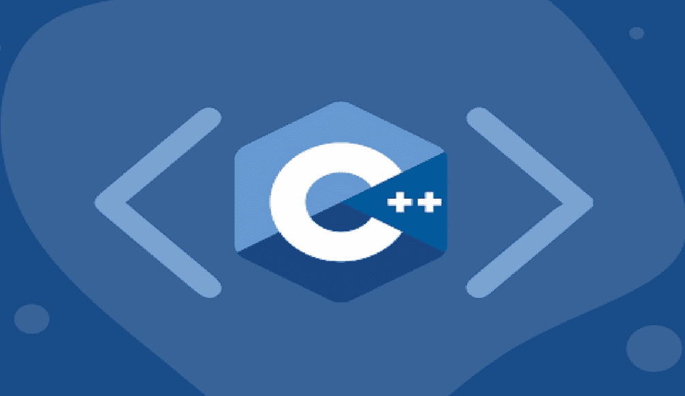
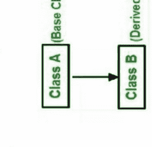
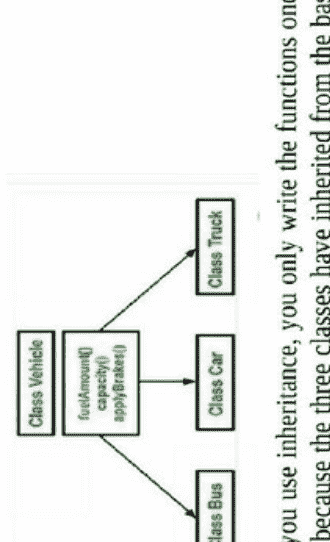
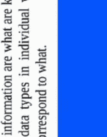

# C++ 指南：一书三个编程境界：C++ 编程示例



书中的三个编程层级

```cpp
#include <iostream>
using namespace std;

int main() {
    long dividend, divisor;
    int ch;
    //start of do-loop
    do {
        cin >> dividend >> divisor;
        cout << "dividend: " << dividend << endl;
        cout << "divisor: " << divisor << endl;
        cout << "quotient: " << (dividend / divisor) << endl;
        cout << "remainder: " << (dividend % divisor) << " do it again?" << endl;
        cin >> ch;
    } while (ch == 1);
    return 0;
}
```

`while` 循环在循环开始处被高亮并结束循环。你应该注意到该语句与 `while` 循环看起来相似。

# 你知道该使用哪种循环吗？

当你已经知道循环应该执行多少次时，使用 `while` 关键字。`while` 语句看起来与 `while` 循环相似。

# 你知道该使用哪种循环吗？

当你已经知道循环应该运行多少次时，`for` 循环效果最好。对于 `while` 和 `do` 循环，当你不知道循环应该运行的次数时，它们是最佳选择。此外，当你想要至少执行一次循环体时，请使用该循环。另一方面，当你不想至少执行一次循环体时，可以使用 `do` 循环。虽然这是你如何熟练地使用这些循环，但你可以根据手头的情况使用任何循环。循环的类型主要取决于你的偏好和风格。

## 决策

循环中的决策决定了是否应该在循环体中执行给定操作。在所有程序中，决策会导致程序跳转并执行程序的某部分。C++ 程序有几种决策语句。最常见的是 `if-else` 语句。其他的包括 `Switch` 语句。让我们简要学习每种决策语句。

### If语句

这是决策语句中最简单、直接的形式。它包含一个布尔表达式和一些语句。下面是 `if` 语句的语法。

当 `isPregnant` 为真时，将创建一个 `Mammal` 对象。`Mammal(false)` 会产生相反的结果。

说完这些，我们可以谈谈面向对象编程如何应用于“抽象”概念，这是我们需要触到的第二个大支柱。显而易见，面向对象编程允许程序员让事物变得更加抽象，但这实际上是面向对象编程的核心关注之一。虽然它在远离计算机核心的语言中更为明显，但它仍然很重要，因为你同样可以使用 C++ 抽象概念，将其转化为非常标准的想法，并在其基础上进行构建。

C++ 面向对象编程范式在模块化方面提供了很多支持，这种理念认为你的程序是高度扩展的。人们可以进去添加或移除组件而不会破坏整艘船。你还可以编辑一部分并让整个程序受到影响，而无需遍历并重构整个内容。面向对象编程为此提供了一个主要的途径。

人们可以进去添加或移除组件而不会破坏整艘船。你还可以编辑一部分并让整个程序立即受到影响，而无需遍历并重构整个内容。面向对象编程为此提供了一个主要的途径。

到此，我们涵盖了面向对象编程的三个主要思想。继承和多态比此本书允许的复杂得多，所以我们必须在此停止。

实例化的基本概念。你可以随心所欲创建一个类的实例，这个实例将拥有你为类泛定义的所有属性。这意味着，你不仅仅有硬编码或重新定义代码的选项，你实际上可以随心所欲地创建给定属性的新实例。

这些实例被定义为对象。因此，面向对象编程是围绕对象的概念展开的。让我们回想一下哺乳例子。如果我们想推这些这些概念以在伪代码中形成 `mammal` 类，我们会这样做：

```cpp
class mammal {
  attribute numberOFLimbs;
  attribute backbone;
  mammal giveBirth() {
  }
}
```

虽然这是定义类基本外壳的好方法，但它未能涵盖一些关键概念。然而，在我们进入这些内容之前，我们需要涵盖一个更广泛的概念：封装。这是面向对象哲学的第一个关键原则，它讨论了这一切的要点；其核心思想是你能够将面向对象编程的关键思想整合到这一本小小的书中。这使得你以后不需要再引用它们。

封装与实例化的思想紧密相成。因为我们已经定义了所有这些特性，现在我们可以创建一个 `mammal` 类的的新实例。例如，狗：

如你所看到的，它的工作方式与定义变量非常相似；这实际上是定义对象的 C++ 代码的工作方式，不仅仅是伪代码。

因此，我们发现了所有面向对象编程中最纯粹、最相关的思想之一的结晶：封装和...

`new mammal();`

可能的处理

一旦有一个指针变量指向某些内容，下一步要做的就是对指针进行解引用，以便获取它所指向内容的值。

## 修饰符类型

C++ 语言也不允许直接将整数赋值给指针。

整数可以存储地址。如果你尝试运行此字面量，它没有内存地址。编译器将发送警告，说明无法将 `int` 转换为整数指针。

整数可以存储地址。如果你尝试运行此字面量，它没有内存地址。编译器将发送警告，说明无法将 `int` 转换为整数指针。

这是因为指针可以存储。

搞定！我们的整个代码看起来像这样：

```cpp
#include <iostream>
#include <fstream>
#include <string>
using namespace std;

int main() {
    ofstream my_file("numbers.txt");
    int my_int;
    string current_line;
    ifstream read_in;
}
```

```cpp
string current_line;
ifstream read_in;
if (my_file.is_open()) {
    my_file << "2\n3\n4\n5\n6\n7\n8\n9\n";
    my_file.close();
} else {
    cout << "File could not be opened.\n";
}
read_in.open("numbers.txt");
if (read_in.is_open()) {
    while (getline(read_in, current_line, sit)) {
        my_int = atoi(current_line);
        cout << my_int << "\n";
    }
}
```

编译器之后的任何内容都应被视为字符串中的命令或非标准文本。我们稍后会进一步讨论字符串，但现在，只需将其理解为引号包含的字符序列即可。

你可以通过输出运算符（例如 `<<`）分隔数据，在同一输出行中引用多个数据：

```cpp
int smallDogs = 32;
int totalDogs = smallDogs + bigDogs;
cout << "Small dogs: " << smallDogs << " " << totalDogs << endl;
cout << "Small dogs: " << bigDogs << " " << "in";
cout << "Total dogs: " << totalDogs;
cin.get();
```

正如我所说，请随意尝试这些代码，以开始处理数据和输出数据。

```cpp
cout << "Total dogs: " << totalDogs;
cin.get();
```

正如我所说，请随意尝试这些代码，以开始处理并输出这些数据。

`cout << "hello, world" << endl;`

"cout" 是标准输出。符号 `<<` 是流插入运算符，它在屏幕上打印字符串 "hello, world"。语句 `endl;` 表示换行。

`return 0;` 结束了 `main()` 函数。当程序向操作系统返回值为 0 时，它表示程序的结束。非零值表示意外终止；然而，当程序员忘记编写时，在 `main` 函数末尾不必包含此返回语句。

`return 0;`

以下是创建 C++ 程序的简要步骤：

- 1. 编写源代码并将其保存为 .cpp，并包含头文件。

- 2. 根据头文件指令对源代码进行预处理。

- 3. 在编译器中运行带有调试代码的源代码。

编写源代码并将其保存为 .cpp，并包含头文件 `.h`。

- 1. 根据头文件指令对源代码进行预处理。

- 2. 在编译器中运行源代码以生成对象代码。

- 3. 将编译的对象代码与库对象代码集成。

- 4. 一旦获得可执行代码，将其加载到计算机内存中。

- 5. 运行代码以所需的结果。

```cpp
my_file << "2\n3\n4\n5\n6\n7\n8\n9";
my_file.close();
} else {
    cout << "File could not be opened";
}
```

现在，我们将从该文件中读取每一行，加 1，将其打印到控制台。读取文件的过程相对简单。首先，你需要用输入流打开文件。然后，你需要使用 `getline` 方法。`getline` 方法返回一个真或假值 - 如果有行可以获取返回真，如果没有则返回假。它接受两个参数：输入流和目标字符串。

`getline` 方法的语法如下：

`getline(istream,targetString);`

`getline` 方法的语法如下：

`getline(stream,target);`

`target` 目标字符串

让我们在定义输出流的地方定义两个新变量。定义一个输入流变量 - 但要注意，我们不会打开它，所以我们不会将文件名作为参数传递。让我们定义一个可以存储当前行的字符串。我们的变量看起来像这样：

```cpp
string read_in;
ofstream my_file("numbers.txt");
string current_line;
read_in >> current_line;
```

现在，我们实际上可以开始处理这些内容了。在文件关闭且我们定义了 `else` 语句后，让我们用输入流打开数字文件：

现在，我们可以在文件打开时读取所有文本。

`if (read_in.open("numbers.txt"))`

{

## 初始化表达式

此表达式在循环开始后运行一次。基本上，它分配了循环值。

## 测试表达式

这包含一个关系运算符。测试表达式总会在循环体开始前在循环中评估。测试表达式的功能是决定循环是否再次“执行”一次。

## 递增表达式

此表达式改变循环值。测试表达式的功能是决定循环是否再次“执行”一次。测试表达式的功能是决定循环是否再次“执行”一次。

### 循环样式

循环是填充我们生活的逻辑的重要组成部分。尽管如此，我们发现自己很少关注循环的真正作用。

## 控制流 - 2

循环是填充我们生活的逻辑的重要组成部分。尽管如此，我们发现自己很少关注循环的真正作用。

# 当……发生什么时

循环是填充我们生活的逻辑的重要组成部分。尽管如此，我们发现自己很少关注循环的真正作用。

# 第 5 章

从不真正使用行来欣赏机械；我们的眼睛从一个单词开始，我们称之为 n。然后它移动到 n+1。我们处理新单词，因此 n+1 变成了 n。我们也在检查是否有任何单词 n，然后重复。

当然，读书看起来可能很简单，但这是我们从不花时间去做的。我们的眼睛从一个单词开始，我们称之为 n。然后它移动到 n+1。我们处理新单词，我们也在检查是否有任何单词 n，然后重复。

运算符。C++ 中的算术运算符如下：

- `valueX + valueY`：加法 - 将 `valueX` 和 `valueY` 相加创建 `valueZ`。

- `valueX - valueY`：减法 - 从 `valueY` 中减去 `valueX` 以创建 `valueZ`。

- `valueX * valueY`：乘法 - 将 `valueX` 乘以 `valueY` 以创建 `valueZ`。

- `valueX / valueY`：除法 - 将 `valueX` 除以 `valueY`，以 `valueX` 为除数。

- `valueX % valueY`：取模 - 将 `valueX` 除以 `valueY`，余数为 `valueZ`。

注意，任何值出现的地方，变量都可以代替它。因此，你可以通过以下算术语句为我的整数加三：

取模 - 将 `valueX` 除以 `valueY` 并得到余数 `valueZ`。注意，在任何需要值的地方，都可以用变量代替。因此，你可以通过以下算术语句给 `myInteger` 加 3：

同样，你也可以通过操作给 `myInteger` 赋值的变量来专门给 `myInteger` 加 3：

```cpp
int myInteger = 3;
```

```cpp
int myInteger = 5;
```

或者，你可以将结果存储在一个新值中。例如：

```cpp
int myInteger2 = myInteger + 3; // 结果为 8
```

这基本上是你目前关于值和变量需要了解的。在接下来的章节中，你将学习关于它们的更多知识。你可以像我们在第一章中做的那样，通过编写程序使用 `cout` 输出文本。你可以这样打印变量：

```cpp
int myInteger = 36;
```

```cpp
cout << myInteger << "\n";
```

在所谓的转义序列中。你使用这些是为了告诉

语句(s):

`While (condition):`

## 嵌套循环

当你想要在代码中编写循环时，你可以选择的第三种循环是嵌套另一个循环内部的。两个循环都将同时运行，直到它们的条件都满足，只有那时它们才会结束。这就是你发现嵌套循环的时候。这种循环允许你创建一个连续的循环嵌套，这可能非常容易处理，而且正如你可能会感到困惑的，随着学习 C++ 的进步和知识的扩展，你可能会发现你使用嵌套循环次数比你想的要多得多。要使用 C++ 编程语言编写嵌套循环，请参考此示例：

`while (condition):`

可能，要使用 C++ 编程语言编写嵌套循环，请参考此示例：

```cpp
while (condition)
{
    statement(s)
}
```

`statement(s)` // 如果你可以放入更多语句

到此为止，你可能好奇为什么这一切对你的编程至关重要。现在，你可能在问自己：“为什么我必须用数组和循环来编写自己的代码？这些东西看起来有点复杂，你可能觉得只想学一些基础知识来为初学者编写良好的代码，而不是进入那些更高级的内容。”

总有一天，你必须决定想要扩展领域并增加你对已经熟悉的某些主题的知识。

## 结语

再次感谢你购买这本书！我希望这本书能够帮助你学习 C++ 的细微之处，因为确实有很多内容需要涵盖。下一步是开始使用你所学的知识来成为一个更好的程序员。一个事实是，编程是困难的。大量的细微差别会让它比你认为应该的要复杂。这仅仅是因为你还没有学习这些规则，或者还没有掌握逻辑。一旦你掌握了逻辑，其他一切都会一帆风顺。

但不要误解；无论是在 C++ 还是任何其他语言工作，总会有新东西供你学习，或者有新的范式供你尝试掌握。编程不是、也将永远关于知道底层的逻辑；相反，需要知道的是你能学到的所有东西。

总会有让你想要抓狂头发的时候，但重要的是无论发生什么你都要坚持下去，并不断尝试改进。即使你遇到那些无论如何都似乎无法解决的烦人 Bug，你也必须硬挺过去。

如果你决定想看别人的代码，互联网上有海量的项目供你尝试。找一些你感兴趣的，也许最好的学习方法就是通过制作它们。例如，如果我想阅读代码，那么查看 WebKit 代码库将很有帮助。如果你想成为游戏开发者，想研究游戏引擎系统，那么就查看用 C++ 编写引擎，查看开源 Linux 版本并检查它们的代码。

不仅如此，你也可以启动自己的项目。当你学习编程时，世界真正属于你。

最后，如果你喜欢这本书，那么我想请你帮个忙，你是否愿意在 Amazon 上给这本书留个评价？我将不胜感激！

谢谢，祝你好运！

下所示所示。

```cpp
#include <iostream>
using namespace std;
void func1() {
    int x = 4;
    cout << x << endl;
}
void func2() {
    int x = 5;
    cout << x << endl;
}
int main() {
    func1();
    func2();
    return 0;
}
```

## 输出

变量 `x` 在 `func1` 中声明并初始化为值 4。这意味着它位于函数 `func1` 的体内部。

变量 `x` 在函数 `func1` 的体内部声明并初始化为值 4。这个变量存在于函数 `func1` 的体内部。

变量 `x` 在函数 `func1` 的体内部声明并初始化为值 4。这个变量存在于函数 `func1` 的体内部。

变量 `x` 在函数 `func1` 的体内部声明并初始化为值 4。这个变量存在于函数 `func1` 的体内部。

变量 `x` 在函数 `func1` 的体内部声明并初始化为值 4。这个变量存在于函数 `func1` 的体内部。

变量 `x` 在函数 `func1` 的体内部声明并初始化为值 4。这个变量存在于函数 `func1` 的体内部。

变量 `x` 在函数 `func1` 的体内部声明并初始化为值 4。这个变量存在于函数 `func1` 的体内部。

变量 `x` 在函数 `func1` 的体内部声明并初始化为值 4。这个变量存在于函数 `func1` 的体内部。

变量 `x` 在函数 `func1` 的体内部声明并初始化为值 4。这个变量存在于函数 `func1` 的体内部。

变量 `x` 在函数 `func1` 的体内部声明并初始化为值 4。这个变量存在于函数 `func1` 的体内部。

变量 `x` 在函数 `func1` 的体内部声明并初始化为值 4。这个变量存在于函数 `func1` 的体内部。

变量 `x` 在函数 `func1` 的体内部声明并初始化为值 4。这个变量存在于函数 `func1` 的体内部。


# C++ 初学者终极指南：有效学习与理解 C++ 编程

## 第 1 章：什么是 C++？

寻找一个具有丰富历史的编程语言时，选择 C++ 不会出错。事实上，它是世界上最早使用的语言之一，可以帮助你学习编写代码。因为它已经存在了很久，所以有一个庞大的粉丝群体，严肃的程序员和代码人员会确保他们至少了解 C++ 语言的知识。

变量 `x` 在 `func1` 中声明并初始化为值 4。这意味着它是这个变量存在于函数 `func1` 的体内部。

- (输出)

变量 `x` 在函数 `func1` 的体内部声明并初始化为值 4。这个变量存在于函数 `func1` 的体内部。

## 全局变量

全局变量这个术语对程序员来说不应该是陌生。全局变量存在于所有编程语言中。

## 第 2 章：如何编写你的第一个程序

现在我们对 C++ 程序有了一定的了解，是时候开始编写我们自己的代码了。这是一项兴奋的活动，你可能对想写什么样的代码有很多想法，但让我们先从一些基础知识开始。开始编写自己的代码的第一件事是环境。环境是你编写代码并执行各种任务的地方，这就是为什么它是要关注的重点部分。好消息是，网上有很多环境供你选择，取决于你想要使用的功能，其中许多是免费的。

一旦你下载了想要使用的 C++ 环境，我们将直接开始你的第一段代码。尝试这个简单的代码，它只占用几行，但内部已经存在非常基本的语法部分，使学习更容易。为了让这段代码运行，你需要使用的代码包括：

```cpp
#include <iostream>
using namespace std;
int main() {
    cout << "Use This One";
    return 0;
}
```

在编写这些内容时，你有几个选项，这些选项将在你的环境中可用，或者你可以选择在编译器中编写，或者写出来并保存到计算机中。第二种选项很好，因为你保存了代码，可以在代码中需要任何时候复制和粘贴。

无论哪种，你都应该仔细考虑你使用的文本编辑器类型。

### 布尔值 (Boolean)

在后续的章节中，我们将更深入地讨论这一点，当我们开始讨论编程和逻辑中的真或假值以及它们如何被使用时。基本上，布尔值持有一个布尔真或假值。

### 字符 (Character)

可以包含任何字母、数字或符号 ASCII 字符。这些最终被计算机理解为具有可计算的数值，尽管它们在屏幕上可能代表一个字符。

这些不同的值可以存储在计算机中你可以想象成盒子的东西里。这些盒子被称为变量。定义变量后，人们可以返回获取存储在其中的值。它们可以更改变量，或者仅仅查看它正在积极存储的内容。

这些变量可能有一个类型，对应于变量的数据类型。例如，你可以定义一个变量并持有一个整数。假设我们有一个整数，它等于 56。在 C++ 中声明变量的语法如下：

```cpp
data type variable_name;
int myInteger = 56;
```

你还可以使用赋值运算符来初始化变量 `=`，这将右侧的值赋值给左侧的变量。

## Switch 语句 (Switch Statement)

该语句允许将变量与一组值进行相等性测试。Case 是每个值的称呼。被切换的变量将对每个 case 进行检查。

```cpp
switch(expression) {
    case constant-expression :
        statement(s);
        break; // 可选
    default : // 可选
        statement(s);
}
```

```cpp
/*
如果表达式1为真
   / 如果表达式2为真
   / 如果表达式3为真
   / 否则
   / 当上述条件都不为真时 */
```

```cpp
case constant-expression :
    statement(s);
    // 你可以任意数量的 case 语句
    break; // 可选
    default: // 可选
        statement(s);
}
```

## 指针与循环的优势

5. 指针允许人们在处理继承时实现多态。
6. 指针允许你在一个结构体中创建另一个结构体，以构建一棵树。

正如你所看到的，使用指针有很多优势。然而，如果你不理解其中的某些内容，也不要害怕。到目前，你已经对 C++ 中的指针有了基础的了解，这应该帮助你对指针有更深入的理解。

这样想，如果你想让计算机写出一个程序，列出从 1 到 20 的所有数字？或者你想让代码生成一个从 1 到 10x10 的乘法表？根据我们在本章节之前讨论的一些内容，你可以想象，如果你不使用循环，这将会花费大量的时间和编码工作。

你真的想写很多次代码吗？你想要重复编写代码的相同部分十次、二十次或一百次吗？这是对宝贵努力的浪费，而且会让你代码中的循环部分看起来像一团糟。取决于你想要完成什么种的任务以及你需要完成该任务所需的循环类型，可能只需要几行简单的代码来启动循环，就可以获得所有的代码行。

如果你计划在代码中使用循环，查看哪种循环最适合你的需求是一个好主意。每种类型都是可用的，并将帮助你完成工作，但它们完成工作的方式取决于你将使用的循环。学习每种循环如何确保你的代码行为正常。

虽然这些可能处理起来稍微困难一点，但你会发现数组和循环也可以为你正在编写的代码添加很多内容。确保尝试它们并对其进行一些实验，这样你就可以在你计划编写的程序和应用程序看到你想要的结果。

## 进阶主题：数组、循环与面向对象编程

这种成功超越了初学者水平的成就感，将让你那些挥之不去的疑虑烟消云散。

如果你学会了创建和执行循环语句，你可以做很多事情。数组最常用于视频游戏和机器人。它们需要在没有创作者在场通过输入单条代码来手动协助功能的情况下运行。最后收尾工作，让它自行运行即可。

数组被用于创建网页（例如网站），因为你可以添加变量列表，而且在初始设置之后，就不再需要真正做很多事情。你会发现，在未来的某个时刻，你可能想开发一个自己的网站。无论你是有兴趣为客户从零开始制作网站，还是认为使用你自己的网站更好。如果你选择使用我们提供的代码之一，了解如何使用数组会让理解代码变得更容易，并且可能像本指南中讨论的那样，在需要时对程序代码进行一些自己的更改。

随着计算机能够处理更抽象的数据结构，面向对象的编程最终会变得更加流行。然而，如果对什么是面向对象的编程没有正确的概念，它就发挥不了作用。

面向对象的哲学可能是由 Sun 微系统公司在 Java 的早期定义中勾勒出来的，Java 是第一个完全面向对象的主要的编程语言。他们对面向对象哲学的结晶围绕着五个核心概念：抽象、封装、模块化、多态。

在我们进入这些内容之前，重要的是我们要以一种非常原子且本质的方式讨论什么是面向对象的编程。虽然这对于正确理解面向对象的编程确实是非常基础的，但若要以任何有意义的方式来做到这一点会变得非常困难。虽然理解事实上去碎片化的面向对象编程的方法是理解其哲学，但你必须首先理解最核心的概念。

这些核心概念建立在两个关键想法的实现之上：类和对象。所以，让我们从第一个开始吧。

### 什么是类？

编程中的类稍微有点难以定义，但本质上，它是属性、变量和函数的组合，这些元素结合在一起形成一个单一的结构。定义这种概念的一种好方法是考虑哺乳动物。

所有哺乳动物都有一组共同点。因为它们有一定数量的肢体，通常都有脊柱，并能生下幼崽。我们可以利用此来定义一个关于哺乳动物的原始示例。

假设你正试图在你的游戏或程序中编写多个哺乳动物。一段时间后，你会发现自己正在反复不断地定义函数和变量，这样做浪费了大量时间。所以你还会意识到，如果你需要一个新哺乳动物，你没有办法直接创建一个；相反，你必须硬编码一个新的哺乳动物，而不是仅仅在代码中生成一个。

这引出了面向对象编程的第一个目的。

## 第 7 章：面向对象编程

随着编程语言的不断进步，使用过程化语言带来了很多问题。例如，过程化语言要求人们根据函数来做事。如你所知，存在全局变量，这为数据变化提供了可能。这个问题以及许多其他问题导致了被称为“面向对象编程”的新编程系统的开发。涉及到 OOP 时，很多重点放在它作为 OOP 本身，而不是过程。

OOP 中的对象通过两个属性定义：对象的行为和对象的属性。如果你在观察一辆车辆，你会看到关于车辆的某些属性，如颜色、形状、大小等等。

对象而不是过程。

## 第 8 章：面向对象编程入门

在本章中，我们将接触可能是你目前为止所涵盖的最密集的话题之一。这就是面向对象编程的主题。面向对象编程之所以意义重大，是因为它与你在此之前处理过的几乎一切内容提供了一个重大的范式转变。当它在 C++ 中实现时，也代表了这种转变。

C++ 最初被称为“带有类的 C 语言”（C with Classes）；这是指的是它是如何作为一种扩展——而且确实是迭代——实现了面向对象范式的 C 语言。

C++ 最初也被称为 C++。

允许我在 C++ 出现并帮助催生面向对象编程之前解释这一点。大多数编程遵循的是函数式或过程化范式。

函数式范式是指程序主要由函数组成，并且所有内容都自成包含在函数中。那么，函数就是编程语言的扩展和结果，也是编程语言开发流程的自然部分。

过程化程序与面向对象和函数式编程都构成了对比，是 C 等语言的主要操作模式。这些本质上只是应该以非常线性的方式完成的任务。这被称为 C 语言中的程序。这也称为命令式编程。

这两种模式成为主流编程模式的原因，主要是一个实用性问题。由于计算机硬件的限制，以及这些硬件限制给相关程序员带来的挑战，更密集、更功能强大的编程范式当时是不容易实现的。


# C++ 学习指南

## OOP 与过程化语言的区别

在 OOP 中，对象通过两个属性定义：对象的行为和对象的属性。如果你在观察一辆车辆，你会看到关于车辆的某些属性，如颜色、形状、大小等等。此外，车辆具有某些行为，例如它可以改变方向、发出声音等。对象被定义为某种具有数据和行为的东西。

当涉及到 OOP 时，属性和行为位于同一个对象中。而在过程化语言中，属性和行为是分离的。通常，你会发现数据来自过程。测试和调试变得困难，因为人们没有访问数据的自由。

## 类和对象

变量与数据类型的关系与对象与类的关系是相同的。对象是类的一部分。类是实现抽象对象的自定义数据类型。类有两种类型的成员：即公共和私有。

类成员是类成员的名称。类中声明的数据称为数据成员，而类中声明的函数称为成员函数。

# 第 1 章：C++ - 什么是以及为什么？

如果你正在阅读这些，是因为你想学习 C++。有很多不同的原因让你可能想学习 C++。也许你即将参加一门教授该语言的大学课程，你想抢先一步；或者，你学习它是为了提升自己的职业前景，让自己成为一个更全面的员工。

这是完全合理的。在这个过程中学到的底层概念如果教学得当，也可以为你学习 C++ 之外的编程提供一个极好的跳板。

无论你是在计算机行业还是在完全无关的行业工作，这让你对雇主更有吸引力。在这个过程中学到的底层概念——我认为它们也能为你学习 C++ 之外的编程提供一个极好的跳板。

因此，对于所有人，我们将通过深入探讨开始对 C++ 的讨论：什么是 C++ 以及我们为什么需要这样的东西。稍后，我们将展示如何配置你的计算机，我们也会聊到这一点，请期待。我们有很多内容要处理！

C++ 被认为是一门编程语言。虽然这个术语本身看起来很简单，但它实际上包含了深厚的历史和底蕴。理解 C++ 的必要性以及它是如何产生的，也是学习 C++ 的起点。

简单来说，计算机并不像我们一样理解事物。我们将在接下来的章节中更深入地讨论这一点，但本质上，一切都必须翻译成计算机能理解的语言。虽然我们人类能够以抽象、直观和逻辑的方式理解复杂且深入的话题，但这意味着为了让计算机理解我们想做什么，我们必须告诉它一切——不仅要告诉它一切，还要以计算机能理解的方式说出来。

## C++ 的历史

C++ 是当今最流行的编程语言之一。这种语言被许多行业用于他们的系统，因此，与其花费大量时间创建一种新语言，他们只需要对 C++ 进行调整以适应许多不同的需求，因为它是最通用的。

## 为什么程序员要使用这种语言？

市上有许多不同的编程语言可供选择，你可能好奇为什么有些程序员会选择 C++ 而不是其他语言。首先，许多程序员喜欢 C++ 具有快速的速度和灵活性。这是一门较老的语言，但它可以为你提供一个让你感到自豪的程序或应用程序。C++ 编程语言也非常适合初学者尝试，因为一旦你学会了它工作原理的基础，你就会发现它可以帮助你学习其他编码语言的基础。

此外，如果你想学习一种对于计算机编程之外的其他用途也很好的编程语言，C++ 就是你需要学习的。虽然它在你想要为网站或在计算机上编写的代码方面效果显著，但它在履行其他功能方面也表现良好。

这些只是人们如此喜爱使用 C++ 语言的几个原因。当你开始学习这门编程语言时，你会真正受益的其他优点还包括：

### 库

由于 C++ 已经存在了很久，它们拥有一个非常丰富的库。这些库供你使用，你可以在脚本中挑选你需要的代码，节省一些时间甚至学习一些东西。你也可以创建一些自己的代码（如果你愿意的话），但这个库对于仍在学习的初学者来说非常有帮助，它绝对可以帮助编写代码变得更容易。

### 与语言协作的能力

C++ 是一门与其他语言配合使用的优秀语言，可以真正处理你想要的部分，因为你可以从不同的语言中添加你喜欢的部分并结合在一起，创造出惊喜。

# 第 2 章：如何编写你的第一个程序

## C++ 编译器

就像文本编辑器一样，虽然你有很多选择可以挑选，但问题是其中许多是昂贵的。这是因为你遇到的大多数编译器是为已经掌握了低级编译器的精英黑客设计的，他们现在想要确保能将其推向下一个水平。

好消息是，有很多编译器可以免费获得。你只需要小心并确保你获得的是良好的且具有你寻找的所有功能的编译器。一个与 C++ 配合良好且适合初学者的编译器是 `GNU`。它最适用于 `Linux` 系统，你可能已经在系统中有了它。要检查 `GNU` 编译器是否属于你，使用以下代码：

```bash
$ g++ -v
```

如果编译器已安装，你应该会在屏幕上看到这条消息：

```
Using built-in specs.
Target: i386--redhat-linux
Configured with: ../configure --prefix=/usr...
Thread model: posix
gcc version 4.1.2 20080704 (Red Hat 4.1.2-46)
```

## 基础语法

大多数是特定设备的，所以你需要寻找适合你特定电脑的。你可以的选择包括 `Windows Notepad`、`Vim`、`EMACS`。

当你编写代码时，你应该先在编辑器中编写它们作为草稿，然后移动到编译器。这有助于你检查工作，并避免你正在编写的代码出现错误。

# 第 3 章：C++ 语法

## 程序注释

## 数据类型

## 为什么在 C++ 中存储换行符很重要？

## C++ 中的函数

整数以及显示两个整数的和。很快，你将发现函数是所有编程语言中的重要元素。你将编写的所有程序都要求你使用函数。本章将帮助你学习如何编写 C++ 语言函数。

### 函数定义

函数由函数体和头组成。下面显示了 C++ 语言定义函数的基本语法。

```cpp
type return_type name(argument1, ...)
{
    body of the function
}
```

函数定义的组成包括：

- **类型 (`Type`)** - 这描述了函数返回的数据类型。
- **函数名 (`Function_name`)** - 函数必须有一个名称。
- **参数 (`Arguments`)** - 函数中的每个参数都包含一个数据类型，后面跟着一个标识符。参数允许在调用函数时向函数传递参数。
- **函数体** - 这可能包含语句或块语句。函数应该有一个用大括号 `{}` 包围的函数体。

下面是一个如何定义函数的示例。

考虑一个要求声明名为 `multiply` 的函数问题。函数中必须包含两个参数，并返回两个整数的乘积。

#### 关于这个函数你脑海中第一个想法是什么？

首先，函数名和要返回的数据类型已经定义。接下来，将此信息替换到通用函数声明中。使用函数定义的基本语法。

```cpp
int multiply(argument1, argument2...)
{
    // Body of the function
}
```

## 修饰符类型

## 异常处理

### 监控堆内存

忘记监控堆内存是许多发布程序中致命错误的主要来源之一。这又是一类特定的错误，很难追踪、定位和移除。大多数情况下，它存在于你购买的程序中。这需要你运行程序很多小时问题才会开始出现。根据原则，程序员需要分配和释放堆内存。

### 使用异常修复错误

为了处理 C++ 语言中的错误，构建了异常机制。通常，发送错误指示比返回错误标志要好。使用异常处理真实的错误。从发送某些未正常工作指示的函数中抛出异常是无关的。

#### 提示

##### 在删除指针所指向的内容后移除指针

确保在删除指针所指向的内容后移除该指针。你通过为指针分配空值来实现这一点。当你不知道这样做时，你会很容易学到这一点。99% 的情况下，内存块将返回到堆中，但在失效时，要识别分配的是哪块内存将很困难。

如果情况下将指针为空并尝试使用它们存储值，你类中的构造函数将立即崩溃。程序崩溃是一件坏事，但它揭示了问题。问题确实存在，只是你能否找到它的问题。

##### 虚析构函数的声明

确保你在类中定义了一个析构函数，用于在对象结束时释放应该返回的资源。在定义析构函数时将其设置为虚。

##### 拷贝构造函数和重载赋值运算符

# 第 4 章：创建基础输入输出程序

你的电脑允许你与运行在不同平台上的应用程序进行交互。此外，它允许这些应用程序以不同的方式与你交互。你可以通过鼠标或键盘交互，也可以在打印机的帮助下让信息以文本、复杂图形的形式出现在屏幕上或打印在纸上。本章将讨论使用 C++ 语言输入和显示数据的简单方法，用于编写和读取信息。

## C++ 语言的输入与输出

各种输入输出形式包含在 C++ 语言的文件库中。使用控制台输入一系列流或字节流来写入和读取信息。

输入流：当字节流从键盘流向主内存时，它被称为输入。

输出流：当字节的方向不同时。这可以从主内存流向设备。这被称为输出。

### C++ 中用于输入输出操作的头文件

`iostream` 代表标准输入输出流。该头文件包含了如 `cout`、`cin` 和 `cerr` 等对象的定义。

`iomanip` 是输入输出操纵符的缩写。在这些文件中声明的方法用于操纵流。在该文件中，你将找到 `setprecision` 和 `setw` 的定义。

- `iostream`
- `iomanip`
- `fstream`

## 数组初始化示例

你可以根据需要添加任意数量。你可以这样写：

```cpp
double balance[] {1000.0, 2.0, 3.4, 17.0, 50.0};
```

这个示例将为你提供与你在上一个示例中得到的相同的数组，但你开始时没有指定数组的大小。这让程序和代码替你完成了这一工作。

现在我们已经花了一些时间研究如何编写数组，现在是时候学习你如何亲自使用这些信息让数组在你的程序内部运行了。这个程序被认为比我们之前能做的稍微高级一点，而我们通过的示例是一个很好的方法，将帮助你学习这些数组是如何工作的，并将帮助你确保代码按照你想要的方式运行。一个你可以在代码中使用的良好示例是：

```cpp
#include <iostream>
using namespace std;

int main() {
    int n[10] = {0}; // n 是一个十个整数的数组 n 到 9
    // 初始化数组 n 的元素为 0
    for (int i = 0; i < 10; i++) {
        n[i] = i + 100; // 将位置 i 元素设置为 i+100
    }
    cout << "element" << setw(13) << "value" << endl;
    for (int j = 0; j < 10; j++) {
        // 输出每个数组元素的值
        cout << setw(7) << j << setw(13) << n[j] << endl;
    }
    return 0;
}
```

```cpp
#include <iostream>
#include <fstream>
#include <string>
#include <cstdlib>
using namespace std;

int main() {
    ifstream my_file;
    string current_line;
    int my_int;

    my_file.open("numbers.txt", ios::in);
    if (my_file.is_open()) {
        while (getline(my_file, current_line)) {
            my_int = atoi(current_line.c_str());
            cout << my_int << "\n";
            my_int++;
        }
        my_file.close();
    } else {
        cout << "<< File could be opened.\n";
    }
    return 0;
}
```

到此，我们已经涵盖了一个计算机科学的重要课题，并真正开始深入研究它。我们现在可以从这个主题转向我们的最后一个主题 - 面向对象编程。

# 第 5 章：数组与循环

现在是时候深入学习一下在 C++ 中编写代码时可以做的其他事情了。当你开始将数组和循环引入其中时，你可以实现一些惊人的事情，本章将花一些时间关注如何让这两个组件充分发挥作用。你将惊讶于仅通过这两个强大的选项，就能在你的代码中完成多少成就。所以，让我们开始学习如何在编写代码中使用数组和循环吧。

## 数组

让我们从数组开始。数组是一种数据结构，它们基本上是相同类型的数据，并且能够存储元素。它是一个相同大小的集合。通过处理单个变量，你可以找到 0 到 99 的变量，然后每个元素可以通过数组的索引来访问。

这些与变量相似，因为它们都位于内存中，但它们比你找到变量时更加连续。最低的是第一个元素，最高的应该是最后一个元素。你有几种选项来逐个初始化它们，你也可以通过数组来完成。以下是一个很好的例子：

```cpp
double balance[5] = {1000.0, 2.0, 34.7, 50.0};
```

我们在括号中写的数字永远不应该高于你计划使用的元素数量。这意味着如果你在括号中放置一个五（如我们上面所做的那样），然后向数组中放入六个数字，那么数组将没有足够的空间。然而，也可以不指定数组的大小。这是因为你预先不确定数组有多大，而这是一个非常好的开始点。

## 循环操作

### `While` 循环

### `For` 循环

### 嵌套循环

# 第 6 章：运算符在 C++ 中的重要性

现在是时候谈谈 C++ 中使用的运算符了。运算符的操作非常基础，但通过它们，可以为你正在编写的代码增加巨大的力量，无论我们是在讨论 C++ 还是其他编码语言。对于你决定学习的任何语言，花一些时间学习如何使用这些运算符都是重要的。这些运算符负责告诉程序你想让它完成什么，并能让你所有的代码都更有威力。

在程序内部，你可以处理四种主要类型的运算符，每一种都能帮助确保程序的行为完全符合你编程的预期。你将很快看到这些运算符中的每一个是如何投入工作的，你不需要多长时间就能弄明白该如何使用它们。我们在 C++ 中重点关注的四种主要类型的运算符是：

- 关系运算符
- 算术运算符
- 赋值运算符
- 逻辑运算符

## 逻辑运算符

我们将查看的第一种运算符是逻辑运算符。这些逻辑运算符将帮助你理解它们是真是假、它们是否在一起等。你可以使用的一些常用逻辑运算符有：

- `!`：此运算符被称为“非”。如果你有任何逻辑，可以使用它。这被认为是假的。
- `&&`：此运算符被称为“与”。如果你有任何，可以使用它。
- `||`：此运算符被称为“或”。如果你有任何，可以使用它。

## 算术运算符

算术运算符是最容易处理的。

- `+` 是加法运算符，用于两个数相加。
- `-` 是减法运算符。它获取右侧的操作数并从左侧减去。
- `*` 是乘法运算符，使乘法可能。

## 赋值运算符

### 特殊赋值表达式

表达式的定义取决于如何赋值给变量。

#### 链式赋值

链式赋值是指在一个语句中将一个值分配给多个变量。学习下面的示例：`u = v = 11`。

你可以看到 11 同时被赋值给 `u` 和 `v`。

#### 嵌入赋值

嵌入赋值围绕着另一个表达式。学习下面的示例：`f = (g = 10)`。

#### 复合赋值

顾名思义，它包含一个赋值运算符和一个二元运算符。让我们使用例子：`w += 10`。

## 关系运算符

## 位运算符

此表达式将数据转换为位级。例如，`w >> 4` 和 `z << 2`。

## 指针表达式

指针表达式的功能是将地址值作为输出显示。下面的示例显示了一些指针表达式：`&ptr` 和 `--ptr`。

在这个示例中，`z` 是一个变量。它可以是 `int`、`float` 或 `double` 变量，而 `ptr` 是指针。

# C++ 中的决策控制

我们将讨论的下一个主题是如何处理条件语句或“决策控制”语句。在编写程序时，你希望确保它能够为你做一些决定，即使你不在时。这可能发生在你希望用户或其他程序员输入某些信息，然后你希望程序根据你设置的条件做出反应时。

你可以根据添加的条件让程序以某种方式运行。决策能力是确保程序按照你希望的方式运行的一种极好的方法，尽管更复杂，但有很多时候你可能需要添加这个。

## `switch` 语句

第一种条件语句对你有很大帮助，因为它们允许你检查变量是否与你在代码中概述的其他值或其他情况相等。在这里进行检查的变量将由语句与多种情况进行比较。用于创建 `switch` 语句的语法示例是：

```cpp
switch (expression) {
    case constant1:
        // statements
        break;
    case constant2:
        // statements
        break;
    default:
        // statements
}
```

# 面向对象编程进阶

## 构造函数

正如名称所示，它可以接收来自其所属类的对象。当对象的数据值以与同类另一个对象相同的方式初始化时，这种构造函数类型非常有用。

### 重载构造函数

如果你认为只有函数可以被重载，那么你就错了。构造函数是可以重载的。当构造函数被强制显示不同的输出时，它就会被重载。

### 析构函数

构造函数创建对象，而析构函数删除对象。当程序员没有提供构造函数时，编译器会创建一个。但编译器生成的析构函数对于没有执行动态内存分配的基础类是有效的。

## 继承

### 单继承

这种继承类型允许一个类。基类只被一个子类继承。



### 多级继承

多级继承涉及派生类继承另一个派生类。

### 多重继承

在这种继承类型中，一个类可以从多个类继承。

```cpp
// Code: the diamond colour
```

### 多重继承


在这种继承类型中，一个类可以从多个类继承。请看下图。

- 派生类


### 层次继承

多个子类从单一个基类中继承。

### 基类成员对派生类的可访问性总结

1. 派生类可以访问基类的公共成员。
2. 派生类的对象无法访问基类的受保护成员。
3. 派生类可以通过派生类对象访问基类成员。

## 第3章 C++ 语法

在上一章节中，我们花时间看了一个代码示例，以及你在代码中可能经常发现的一些内容。现在这些工作已经完成，是时候深入了解一下你编写自己代码的语法了。语法非常重要，因为它有助于确保你的代码是以编译器能够理解的方式编写的。让我们进一步拆解基础 C++ 代码的几个部分，以便你学习如何编写你想要的程序。

我们将首先查看的是注释。当你想要在你编写的代码中留一点小笔记时，这些注释非常有用。

### 程序注释

当你在你编写的代码中留一点小笔记时，这些注释非常有用。这些注释可以帮助查看代码的人理解你试图通过代码做什么。作为一个初学者，你可能会发现很多包含这些注释的代码，因为它们是为了让你知道代码在发生什么。

这些注释可以引导你，你可以添加尽可能多的注释来完成你所需的代码，尽管你应该尽量保持它们最少，以免过分干扰代码。当使用 `//` 符号时，它会告诉代码你正在编写注释。程序完全不会干扰你的代码。只需在代码前添加这些符号，然后准备好后继续编写其余代码即可。

在使用 C++ 语言时，你还可以编写稍长的注释，这是其他编程语言可能没有的。当你想要双行或多行注释时，将使用 `/*` 开始注释并使用 `*/` 结束。当编译器看到这些符号时，它会停止读取直到第二部分出现。

```cpp
while ( // there is a line to get ) {
    // internal logic with each line
    read_in.close();
} else {
    cout << "File could not be opened.";
}

while (getline(read_in, current_line)) {
    // internal logic with each line
}
```

我们将 `getline` 方法插入到 `while` 循环中。只要该方法返回 `true`，循环就会执行。当它返回 `false` —— 即没有更多行可以返回时，循环将终止，文件也将关闭。

```cpp
while (getline(read_in, current_line)) {
    // internal logic with each line
}
```

现在，我们想要开始一些解析。我们要做的是将读取的每个字符串转换为整数并加 1；然后我们将该数字打印到控制台。为了做到这一点，我们还需要定义一个名为 `my_int` 的 `int` 变量。之后，`while` 循环内部逻辑如下：

```cpp
my_int = atoi(current_line_c.str());
my_int++;
cout << my_int << " in";
```

这样我们现在就有了这样一个文件输入循环：

```cpp
while (getline(read_in, current_line)) {
    my_int = atoi(current_line_c.str());
    my_int++;
    cout << my_int << " in";
}
```

```cpp
#include <iostream>
using namespace std;
int main() {
    // local variable declaration:
    char grade = 'D';
    switch (grade) {
        case 'A':
            cout << "Excellent" << endl;
            break;
        case 'B':
            cout << "Well done" << endl;
            break;
        case 'C':
            cout << "You passed" << endl;
            break;
        case 'D':
            cout << "Better try again" << endl;
            break;
        case 'F':
            cout << "Invalid grade" << endl;
            break;
        default:
            cout << "Your grade is " << grade << endl;
    }
    return 0;
}
```

你希望你的代码完成的任务。

使用 `if` 语句和 `if else` 语句可以让你的编程体验变得好得多。它允许系统根据用户输入系统的内容来做决策，而不是由你亲自并每次都手动操作。务必尝试几种不同类型的语句，看看它们在你的代码中如何工作，并继续练习这些语句，以便你发现它们可以实现的功能。

### `elif` 语句

你可以使用的另一个选项是 `elif` 语句。这些语句允许你将事情提升一个水平。这将允许你在你的方面更进一步，并让你的程序变得更好。这些 `elif` 语句将列出你希望为用户提供的选项。把它想象成游戏中的菜单。你可以列出一个菜单，让用户选择一个他们想要执行的。

这是一个很棒的选项，因为你可以为你的代码添加很多功能。

### `For` 循环

你可以使用的第二种循环被称为 `for` 循环。这种类型的循环只有在条件为真时才会重复。对于 `while` 循环，它会至少通过一次循环然后检查条件是否为真。对于 `for` 循环，程序会在运行循环之前检查条件是否为真。

## 第3章 用户输入与输出

在上一章中，我们主要讨论了数据的读取和处理，至少只是停留在非常浅的层次。在本章中，我们将讨论如何从用户获取信息，以及更深层次的向控制台输出信息的方法。目前为止，我们只讨论了使用控制台输出流来实现这一点，但我们需要讨论更多方法，允许你以更细致的方式打印信息。

我们首先想要谈论的是用户输入。用户输入以多种形式体现。第一种也是最简单的是控制台输入方法。这允许你通过控制台中的输入流获取整体数据。

我们首先想要谈论的是用户输入。用户输入以多种形式体现。第一种也是最简单的是控制台输入方法。这允许你通过输入流获取整体数据并将其存储起来。让我用一个整数来举例说明。

例如，使用控制台输入流，你可以获取整数或浮点数，然后使用整数类型将它们存储。

```cpp
int my_var;
cout << "You entered: " << my_var;
cin >> my_var;
```

在大多数情况下，这是一种向控制台输入信息非常简单且直接的方式。然而，它确实有一个陷阱。我们还没有深入讨论过字符串，或许现在还不是最好的时机，但理解字符串最好的方法是：字符字符串在这一语境下是可以解析的。这意味着，以此类推，它们并不是以标准方式读取到控制台的。

通过包含 `string` 头文件，你可以访问所谓的标准模板库（STL）。然后你可以创建 `string` 类型的变量。然而，



如你所见，当你使用继承时，你只需要编写函数，而不是写三次，因为这三个类都继承自基类。

## 如何在 C++ 中实现继承

要创建一个被基类继承的子类，请使用以下语法：

```cpp
class subclass_name : access_mode base_class_name
{
    // 子类体
}
```

在此语法中，子类的名称是 `subclass_name`。

```cpp
class subclass_name : access_name base_class_name
    // 子类体
```

在此语法中，子类的名称是 `subclass_name`。`access_mode` 是想要继承子类的方法。它可以是 `public`（公共）或 `private`（私有）。要继承子类的基类名称是 `base_class_name`。

> **注意**
>
> 保护成员不能被派生类访问。然而，它继承了一个完整的父类对象，该对象包含了由类声明的私有成员。

```cpp
// 继承的实现示例
// https://cppreference.com/w/cpp/inheritance

class BaseClass {
public:
    int x;
};

// 子类继承自 BaseClass(父类)
class subclass : BaseClass {
public:
    int y;
};
```

它由名称、参数列表和函数返回类型组成。函数原型的基本语法类似于函数头的语法。它应该以分号结束。

函数原型告诉编译器函数定义在程序中的给定位置。一旦函数被调用，编译器会立即跳转到该位置。下面显示了如何编写上一个程序的函数头示例。

```cpp
int mult(int a, int b);
```

正如我们之前所说的，函数原型描述了“名称”、参数和“返回类型”。作为格式化使用的风格的一部分，函数头应该在常量、全局变量和预处理指令之后声明。许多内置的 C++ 函数包含函数原型。然而，开发者和程序员在定义自己的函数时应该包含他们自己的函数原型。

# 如何访问函数？

使用函数名和所有参数来调用函数。

然而，开发者和程序员在定义自己的函数时应该包含他们自己的函数原型。

# 如何访问函数？

当你想要调用某个函数时，使用函数名及其参数。这些参数应该括在括号中。提供的程序将帮助你理解它的函数。示例程序使用“addition”函数确定了通过它的参数值总数。

从这个程序中，主函数启动了执行模式。`sum`（也是 `int` 类型）被声明。接下来，使用语句对函数“addition”进行调用：

# 第 5 章 C++ 函数

在本章中，你将学习更多关于函数的知识。

你非常清楚，如果你有一个只有少量指令要处理的大型程序，很难去理解、管理和维护它。很好，C++ 程序中的函数帮助人们完成给定的任务，并促进了模块化编程的设计。为了帮助你理解函数在程序中的重要性，请阅读示例：

假设你有一个程序提示用户输入两个值的平均值。首先，你如何通过程序计算这两个值的平均值呢？下面的截图有这个问题？为它开发一个解决方案，你的代码解决方案可能会出现。

```cpp
#include <iostream>

int main() {
    float number1, number2;
    std::cout << "Enter first number: ";
    std::cin >> number1;
    std::cout << "Enter second number: ";
    std::cin >> number2;
    float average = (number1 + number2) / 2;
    std::cout << "Average is: " << average << std::endl;
    return 0;
}
```

该程序提示用户输入两个值的平均值。首先，你如何通过程序计算这两个值的平均值呢？下面的截图有这个问题？为它开发一个解决方案，你的代码解决方案可能会出现。

另一个问题是你想计算每个数字的百分比。根据我们拥有的知识，我们会编写如下代码：

```cpp
int numbers[] = {10, 20, 30, 40, 50};
int sum = 0;
for (int i = 0; i < 5; i++) {
    sum += numbers[i];
}
for (int i = 0; i < 5; i++) {
    int percentage = (numbers[i] * 100) / sum;
    System::println(numbers[i] + " is " + percentage + "%");
}
```

### for 循环的变化

`for` 循环仍然允许你在初始化部分添加多个表达式，只要你用逗号分隔表达式。此外，你还可以包含另一个增加表达式。但测试表达式只能有一个。这是一个检查的示例：


```cpp
for (int i = 38; i < 100; i += 5) {
    // 循环体
}
```

在这个示例中，有一个循环变量 `j`。还有变量 `alpha` 的初始化和变量 `beta` 的递减。注意它们是如何用逗号分隔的。

### while 循环

for 循环以固定次数执行操作。与此同时，你永远不知道循环执行了多少次。查看下面的示例：


```cpp
int counter = 0; // 如果计数器没有初始化为 0
while (counter < 10) {
    System.println("counter = " + counter);
    counter++;
}
```

这个程序提示用户输入一组数字，但一旦输入 0，循环就会结束。你应该看到程序无法得知用户在输入 0 之前会输入多少数字。

while 循环就像 for 循环的简单版本。它有测试表达式，但没有初始化增加表达式。

### do 循环

测试表达式在循环开始时建立。如果测试表达式为假，循环体将不会执行。有时这是你预期的。然而，当你想要至少执行一次循环体，无论测试表达式结果是真是假时，就会出现这种情况。do 循环是这种情况下最佳选择。查看示例你就能理解 do 循环是如何运行的。

有几种方法，而且你希望你的代码易于阅读。然而，从长期来看，这会让管理变得困难，请记住这一点。

```cpp
#include <iostream>
using namespace std;
int main() {
    int computeAreaOfSquare(int x, int y);
    int computeAreaOfSquare(3,5) + 3;
    int myValue << << myValue;
    cin >> myValue;
    return 0;
}
int computeAreaOfSquare(int x, int y) {
```

```cpp
return 0;

int computeAreaOfSquare(int x, int y) {
    return x * y;
}
```

现在是时候综合指针和函数这两个课了。

为什么这些内容最初有什么关系呢？嗯，简单的答案是，如果我在这里列出两个变量：

```cpp
int length = -3;
int width = 6;
```

假设我有一个函数，我想给第一个值加 1，给第二个值加 2：

```cpp
void plusMinus(int arg1, int arg2) {
    arg1++;
    arg2--;
}
```

然后我从主函数中调用这个函数，并传入我的

```cpp
read_in.close();
} else {
    cout << "File could not be opened.\n";
}
```

足够简单！这就是你的最终文件可能的样子。不过，请记住我们关于 `/fstream` 和参数的讨论。利用这些知识，我们实际上可以这样清理文件：

```cpp
#include <iostream>
#include <fstream>
#include <string>
using namespace std;
```

```cpp
#include <iostream>
#include <fstream>
using namespace std;

int main() {
    int my_int;
    string current_line;
    fstream my_file;
    my_file.open("numbers.txt", ios::out);
    if (my_file.is_open()) {
        my_file << "2\n3\n4\n5\n6\n7\n8\n9\n";
        my_file.close();
    } else {
        cout << "File could not be opened\n";
    }
    return 0;
}
```

“if”语句。在涉及条件语句时，你可以创建的最基本的东西之一就是语句。这些是基于真（true）或假（false）语句的。如果系统判断输入匹配你设置的条件，程序将运行你添加它的部分。例如，如果你将其设置为 2+，用户输入了正确答案 4，那么这将被视为真，并且你选择的消息，类似于“正确！”将显示在屏幕上。

每当你让用户输入某些信息时，并且如果添加的信息符合或其他事情符合你的条件，那么它就会继续显示语句。或者，如果用户输入了错误答案会发生什么呢？但如果用户输入问题“2+2 等于？”会发生什么？如果用户输入 5 作为答案，代码将无法满足你设置的条件，程序将认为此为假。

由于 if 语句是条件语句最基本的形式之一，你会发现它不能很好地处理错误答案。如果用户输入任何非 4 的数字作为答案，程序将认为这是假。然后我们放置的问题，

由于 if 语句是条件语句最基本的形式之一，你会发现它不能很好地处理错误答案。如果用户对我们放置的问题输入任何非数字的答案，那么语句将是为假的，因为它会留空屏幕，没有其他事情会发生。这是因为你想写代码，而这就是为什么你不会总是发现自己一直在和 if 语句工作。

## 'if' 语句

正如我们在前面的部分讨论的那样，使用 if 语句会让你在过程中遇到一些局限性。如果用户最终输入了错误答案，并且程序根据代码中设置的条件认为此为假语句，你会有各种问题需要修复的问题。这就是 'else' 语句派上用场的地方。

if 语句可以用于各种情况。它不仅能帮助满足你的条件，而且有时你可能想让用户开始从几个不同的选项中进行选择。if 语句可以帮助你完成这一切，而且它的语法非常简单。为了创建一个语法的示例：

```cpp
if(boolean_expression)
```

# 第 6 章

## 指针和函数

在本章中，我们将深入探讨 C++ 指针中最难掌握的概念之一的细节之处。为了更好地理解指针，你还需要理解变量和值在计算机内存和硬件方面是如何运作的。

计算机在程序执行过程中处理的所有数据都存储在随机访问存储器（RAM）中，这很恰当，然后以随机存储在内存中的方式访问。

116


# 引言

恭喜购买《C++ 21 示例代码与 C++ 编程高级崩溃教程》，感谢您的支持。

C++ 语言是最流行的编程语言之一。它是一种静态类型、编译型的中间级通用编程语言。简单来说，它是一种基于 C 语言的高效且复杂的语言。

今天大多数系统、操作系统、浏览器和游戏都使用 C 语言。因此，C++ 语言非常强大，因为它是 C 语言的升级。C 和 C++ 语言通常统称为 C/C++。

在选择学习什么编程语言之前，通常有很多问题需要问。问自己这些问题并不是坏事，因为它们将帮助你对语言范围、实际应用以及你可以从那里获得多少支持的理解。

有很多问题需要思考。问问自己这些问题并不坏，因为它们将帮助你对语言范围、实际可用性以及你能从其中获得多少支持建立理解。

学习 C++ 语言是非常重要的，因为它是不可替代的。由于这种语言在现代游戏、浏览器、操作系统等许多领域的开发中至关重要，可以说它是不可替代的。

C++ 是一门中级语言，要求你编写直接与计算机内部硬件交互的代码。这意味着你将有机会理解计算机的内部结构，你将理解计算机内存是如何工作的、信息是如何存储的，以及你如何取回信息。简而言之，你将熟悉计算机硬件的内部状态。

本文为你提供了关于 C++ 语言概念的详细分步描述。每一章都将为你提供正确的信息，帮助你成为 C++ 语言的专家。我们还提供了示例 C++ 代码来阐释每个概念。

```
return 0
```

在我们继续之前，请花些时间打开编译器并编写这段代码。这是一个很好的示例，展示了数组是如何工作的，并将为你提供一些练习，以理解数组应该是如何工作的。程序将能够使用数组调用 `sew` 函数，以便你可以格式化你获得的输出。这只是你如何处理数组并让它们产生最佳结果的一个例子。

## 使用循环

现在是时候了解代码内部的循环是如何运作的。这些循环是为了在你编写 C++ 代码时节省一些时间。如果你需要代码重复某一个部分几次或很多次，你不希望在每次重复时手动浪费这么多时间。这会占用你大量的时间，并可能在编写代码时让代码看起来复杂且难以阅读。

通过循环，你可以获取想要重复的代码部分，你只需要写一次即可。它的设置方式使得代码在满足你的条件之前会一次又一次地重复。如果你忘记了循环，你的代码可能会死锁，因为它没有到达应该停止的地方。但如果你用正确的方法执行，你就会知道何时完成，它将帮助你同时完成大量工作，让你的代码语句看起来很美观，并在当时完成大部分任务。

在 C++ 语言中，你可以使用不同类型的循环，我们将花时间仔细查看每一个。

### `while` 循环

我们将查看的第一种循环是 `while` 循环。`while` 循环会在满足特定条件时继续执行循环并重复它。程序每次进入循环时都会通过并重启循环周期，直到条件满足。一旦条件不再成立，循环就会停止。

## 第 2 章

## C++ 表达式与变量作用域

在上一节中，你已经看到表达式被定义为变量、操作符和常量的集合，表示一种计算。根据表达式中使用的操作数类型，表达式有不同的类别。这些表达式不仅存在于 C++ 程序中，也存在于 Java、Python 等其他语言中。

### 常数表达式

这些是只有常量值的表达式。常数表达式的示例包括 `40`、`"b"` 和 `4/2 + 8`。

### 整数表达式

这些是在完成每次转换后，最终结果为整数的表达式。

### 浮点数表达式

这些表达式在完成每次转换后，产生浮点作为最终值。

### 布尔表达式

这些表达式将产生 `bool` 类型。布尔表达式可以是假（`False`）或真（`True`）。它也被称为关系操作。

### 逻辑表达式

逻辑表达式在整合两个或多个关系操作后输出一个 `bool` 类型。例如，`y=4&&x=7` 就是一个逻辑表达式。

### 位运算表达式

## 第 6 章

## 使用指针

到目前，你已经学习了如何编写和输入 C++ 语言。由于指针具有地址，每当你给指针分配一个值时，该值都应该是一个地址。指针的一种常用做法是让它们存储另一个变量的地址。使用 `&` 操作符获取变量的地址。例如：

```
int var = 10; int *ptr = &var;
```

在下面演示这一点：

指针的声明方式与普通变量相同。唯一的区别是星号应该出现在数据类型和变量名之间。

```
int *ptr; // 指向整数值的指针
double *ptr; // 指向双精度浮数的指针
char *ptr; // 指向字符数组的指针
int **ptr; // 声明两个指向整数变量的指针
```

C++ 要求星号靠近变量名或位于中间。然而，你应该记住，这个星号并不是解引用符号。相反，它属于指针声明的语法。

而且，当你声明多个指针变量时，每个变量中都应该存在星号。如果你习惯将星号与类型而非变量名相关联，很容易忘记这一点。

因此，建议将星号放在声明的变量旁边。然而，从函数返回的指针其星号应该靠近返回类型。

这让程序员知道函数将返回 `*int` 而不是其他。

### `Int* disassembling()`

与普通变量一样，指针在声明时不会初始化。由于这个原因，它们包含垃圾值。关于指针命名的重要说明：“X 指针”是“指针 X”的缩写。因此，当程序员说“一个整数指针”时，他或她基本上指的是指向整数的指针。

### 给指针赋值

由于指针具有地址，每当你给指针分配一个值时，该值都应该是一个地址。指针的一种常用做法是让它们存储另一个变量的地址。使用 `&` 操作符获取变量的地址。例如：

```
int var = 10; int *ptr = &var;
```

在下面演示这一点：

## 输出

在这个例子中，`g` 是一个全局变量。它不同于仅对 `main` 函数可见的局部变量 `a`。变量 `g` 可以在程序中的所有函数中使用。

更高效的方法。这是因为我们使用了 `while` 循环进行迭代，虽然 `while` 循环确实有其 `for` 循环无法比拟的优势，但迭代并不是其中之一。

这里是 `for` 循环的语法：

```cpp
for (iterator definition; condition; step) {
    // 代码放在这里
}
```

这里是同一个循环，通过 `for` 循环实现，从一数到十。

```cpp
for (int i = 0; i < 10; i++) {
    cout << i << endl;
}
```

同样值得注意的是，在 C++ 中，无论语句是什么，如果你在控制流括号内只有一行代码，你完全可以移除括号并仅进行缩进。

至此，我们攻克了 C++ 中控制流的最后一个堡垒。所有的程序最终都涉及到这一点，除了那些实际上做不了多少事的单用途程序。在大范围内构建更复杂的程序取决于你单独掌握逻辑和控制流基础的能力。

在接下来的章节中，当我们在讨论 C++ 编程范式的其他主要部分时，我们将快速在这些概念的基础上构建。

这个运算符帮助你在 C++ 中进行除法。

`/`

这个运算符是增运算符。它会增加你的操作数的值。

`++`

这是递减运算符。它会将你的操作数的值减少一。

`-`

`+` 一个。

`-` 递减运算符。

## 赋值运算符

你在代码中可能需要使用的第三种运算符是“赋值”运算符。这也很常用，你不会花费太长时间就能开始识别你可能使用和编写的代码中的某些运算符。这个赋值运算符负责让你更容易地为变量分配名称，然后你可以使用这些运算符在你正在编写的代码中进行保存、搜索等更多操作。你在代码中可以使用的常用的赋值运算符有：

这个运算符是简单赋值运算符。它将右侧操作数的值赋给左侧。

`=`

这个被称为“加法赋值”运算符。它将两个操作数的值相加，并将它们的和赋值给左侧的操作数。

`+=`

这是“乘法赋值”运算符。它将两个操作数相乘，然后将结果交给左侧的操作数。

`*=` 

这个运算符将右侧操作数的值从左侧的值减去，然后将差值赋给左侧。

`-=` 

这是除法赋值运算符。它将左侧的值除以右侧的值，并将该结果赋给左侧。

`/=`

重要的是，这些赋值运算符只是你可能使用的最常用的。在编写 C++ 代码时，你可能会遇到一些其他运算符，但那些是留给更复杂的代码的，不应该是你必须关注的重点。在大多数情况下，你编写的代码使用 `=` 作为赋值运算符，这样你就可以为你正在使用的变量分配正确的值，但有时其他赋值运算符也会派上用场。

在涉及到算术运算符时，有几种不同的选择。首先，你可以同时使用这些运算符中的多个。所以你可以将几个不同的数字加在一起，或者添加多种类型的算术运算符。如果你决定除法，请记住你需要处理运算顺序以确保获得正确的答案。

算术运算符，记住你需要处理算术运算顺序以确保获得正确的答案。

## 关系运算符

我们将讨论的最后一种类型的运算符是关系运算符。这些运算符有不同的方式帮助你以正确的方式工作。你可以用来编写自己代码的某些关系运算符有：

`==`

这个运算符将检查你的两个操作数的相等性。如果它们相等，则条件被视为真。

`>`

这个运算符将检查你操作数的值。如果左侧的操作数比右侧的高，则条件被视为真。

`<`

这个运算符基本上与上一个相反。如果你发现左侧操作数的值小于右侧，则条件被视为真。

`!=`

这个检查你两个操作数的相等性，并且如果值不相等则为真。

`<=`

这个运算符检查左侧的操作数是否小于或等于右侧的操作数。如果满足这些标准，则条件被视为真。

`>=`

这个将检查左侧操作数的值是否大于等于右侧。如果满足这些标准，则条件被视为真。

## 消费，生产

多线程最受欢迎的例子之一是生产者示例。换句话说，有一个线程发布值供一个计算，而另一个线程接收这些值。

```java
// 生产者：使用生产者模型的简单示例
public class Producer {
    private BlockingQueue<Integer> queue;

    public Producer(BlockingQueue<Integer> queue) {
        this.queue = queue;
    }

    public void run() {
        for (int i = 0; i < 10; i++) {
            queue.put(i);
            System.out.println("Produced: " + i);
        }
    }
}
```

在这个示例中，你会发现有三个相关的线程结构。它是一个单的对象。它代表一个互斥锁。

这三个线程解释如下：

- `std::mutex`
- `std::lock_guard`

```cpp
for (int i = 0; i < 5; ++i) {
    std::mutex mtx;
    {
        std::lock_guard<std::mutex> lock(mtx);
        std::cout << "Thread " << i << " is working" << std::endl;
        std::this_thread::sleep_for(std::chrono::milliseconds(500));
    }
}
```

## 变量作用域

作用域指的是程序的区域。因此，变量根据声明的位置分为两种类型。

### 局部变量

当变量在块或函数内部声明时，它被称为局部变量。然后被认为具有局部作用域。局部变量只能在声明它的块或函数内部使用。

```cpp
#include <iostream>
using namespace std;

int multiply(int a, int b) {
    int *a = &b;
    return *a;
}

int main() {
    int x = 3, y = 5;
    int *x = &y;
    cout << multiply(x);
    return 0;
}
```

首先，变量 `a` 和 `b` 在函数内部声明。在这种情况下，这些变量具有局部作用域。这些变量 `a` 和 `b` 分别是 `x` 和 `y` 的拷贝。这些变量存储了相应的值。因此，`a` 和 `b` 值的改变不会影响原始值。

在这个示例中，`a` 和 `b` 是主函数的局部变量，而 `x` 和 `y` 是主函数的局部变量。另一个示例说明了局部变量属于它们被定义的函数。

## 开启警告和错误消息

然而，如果你想禁用警告，可以使用静默警告。

### 提示

禁用警告是一个非常糟糕的主意。这就像拔掉汽车上的检查引擎指示灯一样。记住：忽略问题并不是解决办法。

## 代码注释

在对代码进行注释时，可以防止错误。养成在编写代码时就注释的习惯，而不是等写完之后再回来注释。注释是帮助你理解自己正在尝试做的事情的极佳方法。在修改程序时，简短的注释更好。

## 限制可见性

减少类内部成员对外部世界的可访问性是面向对象编程的关键部分。类必须被视为成员来考虑。如果类中出现任何问题，那是程序员的错。

限制可见性要求数据成员以保护超出类范围的访问权限。简而言之，数据成员应该被保护。此外，应用程序软件不应该感知的成员函数也必须被保护。

受保护的推测良好/ 如果你尝试使用它，你可能只会导致你的代码比实际需要的复杂得多。

通用的做法是在私有（`private`）标记下定义你所有的属性，然后通过称为 `get()` 和 `set()` 的函数进行修改。不过，在我们进入这些之前，让我们尝试修改我们的类，以便我们获得有效的 C++ 代码。

## 限制

### 异常处理

这是你在尝试编写代码时可以处理的另一件事。异常是你决定执行程序时可能出现的问题。C++ 异常是在程序运行期间通常发生的特殊情况对异常响应时会发生的情况。最常见的异常类型是当用户尝试除以零时抛出的异常。

在你的代码中拥有异常是有用的，因为它们将为你提供一种方法，将控制权从程序的一个部分转移到另一个部分。C++ 异常处理构建在三个主要关键字之上，它们是 `throw`、`catch` 和 `try`。让我们看看它们在 C++ 内部是如何运作的：

被 `restrict` 限定的指针最初是访问其指向对象的唯一手段。

#### Throw

将其移动到另一个部分。C++ 异常处理构建在三个关键字之上，它们是 `throw`、`catch` 和 `try`。让我们看看这些在 C++ 内部是如何运作的。

#### Throw

你可以使用的第一个关键字是 `throw` 关键字。它的作用是当问题出现时可以让程序抛出一个异常。这可以通过简单地使用 `throw` 关键字来实现。

#### Catch

程序可以在程序中你想要处理问题的地方“捕获”（`catch`）异常，即一个异常处理器。如果你使用 `catch` 关键字，它将告诉程序你想捕获该异常。

#### Try

当你使用 `try` 关键字时，它会识别一个特定异常可以激活的代码块。当你使用这一个时，通常后面跟着至少一个 `catch` 块。

假设你的块将抛出异常，方法可以使用 `try` 和 `catch` 关键字的组合来捕获异常。这些将放置在可能产生该异常的代码周围。这并不意味着异常总是会发生，但存在发生的可能性。

`data_type` 数据类型在括号中。

## 文件输入流

此前，我们还将学习如何使用文件输入流来打开和操作文件。


所以，让我们简要讨论一下这一点——输入流和输出流。我们已经在基础章节中涵盖了输入，但我们并没有真正进入到逻辑意义上可以认为是“无限”的程度；我们讨论的是与控制台相关的输入输出流。

然而，输入流和输出流只是一个模糊的概念；与其说是数据流的体现，不如说是符号。例如，输入流表示数据正在被程序接收。相反，输出流仅表示数据正在流出程序。这就是输入和输出流的全部含义。

通过任何一系列事件被损坏。这始终是一个良好的实践习惯。你可以在 `if` 语句中这样做，如下所示：

```cpp
if (my_file.is_open()) {
    // my_file.close();
}
```

```cpp
if (my_file.is_open()) {
    // 代码在此处
}
```

现在，我们想要做的最后件事是非常基础的异常处理。让我们为这个函数定义一个 `else` 语句，如果 `my_file` 未打开，它将告诉用户打开文件出现问题。我们实际上可以处理得更细致一些，检查文件是否存在，但考虑到所有因素，这是一个非常好的起点。

```cpp
if (my_file.is_open()) {
    // 代码在此处
    my_file.close();
} else {
    cout << "File could not be opened!" << endl;
}
```

目前，我们的代码看起来像这样：

```cpp
#include <iostream>
#include <string>
// 因为我们要处理字符串，所以必须定义一个字符串
using namespace std;
int main() {
    ofstream my_file("numbers.txt");
    if (my_file.is_open()) {
```


```cpp
class Mammal (
    private:
        int limbs = 4;
        bool backbone = true;
        bool isPregnant;

    public:
        // get; set; 方法可以放在这里
);
```

```cpp
// public:
    // get; set; 方法可以放在这里
    :();
```

有时，在方法中，你将需要以某种方式引用给定实例的特定类成员。你可以通过 `this->` 关键字和指针操作符来实现。例如：

借此，我们有了一个非常基础的 C++ 类定义，旨在定义哺乳动物。从这里开始，我们实际上可以开始讨论其他想法了。让我们谈谈实例引用的想法。

这在类定义中指的是 `limbs` 的定义，你可以专门针对给定的类对其进行更改。这意味着一个类的给定实例的值，实际上不需要在你的代码主体中进行操作。你可以在类的定义内部手动编写函数和语句，以更改类中数据成员的值。

所以，假设我们有一个名为 `giveBirth()` 的函数。在这里，我们需要假设给定的动物是怀孕的，并且此函数只有在动物怀孕时才会被调用。当然，你也可以专门检查这种情况，这就是明智程序员的做法。

# 如果布尔表达式为真，则将执行 #语句(s)

# 如果布尔表达式为假，则将执行 #语句(s)

然后你可以根据意愿在 `if` 语句中添加尽可能多的此类点。如果你想尝试创建一个自己的程序，能够将人们分为五或六个不同的年龄，你可以在这些 `if-else` 语句的帮助下完成。你只需要额外添加一些 `else` 关键字来实现这一点。

所以，让我们看看这一切是如何运作的，并保持非常简单。

假设你正在编写一个程序，要求用户求解方程 `2 + 2`。如果某人猜中了正确答案并输入了 `4`，你可以设置让第一部分为真语句，然后显示消息。

```cpp
{

}

Else

{}
```

所以，让我们看看这一切是如何运作的，并保持简单。

假设你正在编写一个程序，要求用户求解方程 `2 - 2`。如果某人猜中了正确答案并输入了 `4`，你可以设置让第一部分为真语句并出现在屏幕上。但是，如果你的用户想要告知用户是正确的，或者输入了除 4 以外的任何内容，那么程序将根据你设置的条件将答案赋值为假。与其留白，你可以添加另一个选项并获得另一个语句，如“抱歉，是正确的”，这样就会出现。

正如你所见，这为你操作程序提供了很大的自由度。你可以像上面做的示例那样让它保持简单，也可以添加其他内容使其变得更复杂，并确保它的兼容性，使其能与你编写的代码协同工作。

在处理语句时需要记住的另一点是，如果有需要，你可以添加更多的 `if-else` 语句，甚至将其中一些语句放在其他语句内部也是可能的。这对于初学者来说很复杂，但只要稍加练习并耐心学习如何使用语法，你会发现它将为这个过程增加大量的力量和灵活性，并使某些各种操作变得容易得多。

```cpp
// 如果语句为真则运行
// if (statement) {
    // else if (statement) {
        // 如果语句为真则运行 ..
    // } else if (statement) {
        // 如果语句为真则运行
    // }
    // 如果语句为真则运行
// } else {
    // 捕获所有
// }
```

这是逻辑的首要用途。通过此，我们成功地将大量的离散数学浓缩成一节正洁的课程，并讨论了入门编程的主要支柱之一。在接下来的章节中，我们将构建……离散数学浓缩成一节正洁的课程，以及讨论了入门编程的主要支柱之一。在接下来的章节中，我们将构建……这对控制流是重要的。

## 缓冲错误流

这是另一个 `istream` 类的实例，用于显示错误。然而，它与 `cerr` 不同，错误首先被插入缓冲区中，直到填满。错误消息也会出现在屏幕上。

仔细思考并尝试拆解它，你开始看到它是如何运作的。所有数据根据这些地址连接，并可以通过这些地址访问。

你可以通过引用和引用的组合看到这些。这些理解起来有点复杂，但并不困难。

理解引用运算符指向变量的地址。该运算符就是符号符号 (`&`)。

所以，假设我们有一个名为 `amountCats` 的变量。变量本身 `amountCats` 在被引用时将引用 `amountCats` 空间中包含的显式拷贝。

`&amountCats` 反之将专门指向变量的地址。你可以将其看作一个给定的位置。你可以引用特定位置的地址。当你引用某个特定位置时，你指的是类定义中 `limbs` 的定义——即，该处那个特定的 `Wendy's` 的地址。当你引用地址时，你指的是 `Wendy's` 当前所在空间中的任何内容，这仅仅是获取该地址的方法——它是在说，“嘿，给我 `Wendy's` 的地址。”

`Wendy's` 在某个特定位置。当你引用餐厅 `Wendy's` 时，你指的是地址的概念——即，该处那个东西。当你引用地址时，你指的是 `Wendy's` 当前所在空间中的任何内容，这仅仅是获取该地址的方法。你可以通过解引用操作符来实现，该操作符是一个星号 (`*`)。

现在，假设你想更改引用的地址，然后更改该特定地址的值。所以，例如，在一个闭合函数中，这些功能上具有相同的含义。

```cpp
int myCats = 3;
myCats = 4;
```

```cpp
int myCats = 3;
int *myPtr = myCats; // 创建一个名为 myPtr 的指针
myPtr = &myCats;
```

## 第 4 章

## 控制流 1
- 逻辑与条件

上一章我们讨论了如何从用户接收信息以及向控制台输出信息。本章将重点讨论编程的基础石之一：逻辑是计算机编程中发生的一切的最根基，如果你不能理解逻辑，就无法真正掌握。

逻辑通过离散数学这一学科被严格定义，事实上，它可以被视为该学科的延伸。例如，离散数学定义并巩固了许多关于逻辑的底层概念。

逻辑通过离散数学这一学科被严格定义，事实上，它可以被视为该学科的延伸。例如，离散数学定义并巩固了许多关于逻辑的底层概念。

因此，你可以将本章看作逻辑的入门，也是离散数学的入门。这些主题对于正确理解数学是绝对基础且关键的。如果对它们有深入的知识，你在未来在进行任何通用的实践操作时可能会遇到困难，或者无法程序化和逻辑化地拆解你的思考。

首先，让我们从逻辑开始。什么是逻辑？从抽象的角度来说，逻辑是一个人利用结论来得出另一个结论的能力。一切都基于对其他事物的结论。因此，所有的逻辑都基于先前的逻辑。

```cpp
// Header Files
#include <iostream.h>
#include <conio.h>

// Main function
void main() {
    clrr();
    int a, b;
    float average=0;
    float percentage=0;
    float sum=0;
    getch();
    printf("Enter two numbers: ");
    scanf("%d%d", &a, &b);
    sum = a + b;
    printf("Sum of two numbers is %f\n", sum);
    printf("Average of each number is %f\n", average);
    printf("Percentage of each number is %f\n", percentage);
    printf("The average of two numbers is %f\n", average=sum/2);
    getch();
    break;
}
```

## 你认为完成了什么？

```c
int main() {
    int number1, number2;
    printf("enter first number: ");
    scanf("%d", &number1);
    printf("enter second number: ");
    scanf("%d", &number2);
    int sum = number1 + number2;
    float percentage = (float)sum * 100 / number1;
    printf("The sum of two numbers is %d\n", sum);
    printf("The percentage of sum is %.f%%\n", percentage);
    return 0;
}
```

首先使用之前的代码确定了两个整数的和。然后使用相同的代码来计算整数和的百分比。这节省了时间，你可以将重复的代码存储在块中并在每次调用它，而不是在需要时都输入相同的代码。在此时，你必须理解函数的工作原理有多重要。函数指的是一组程序的集合。这等同于 MS Word 中其他程序的复制粘贴请求。例如，程序员可以创建一个函数来给两个数相加。

## C++ 中的变量及更多内容

在 C++ 中工作时，变量是一个重要的方面。变量确保了你代码的所有方面都具有实际意义，因为程序可以在需要时随时调用它们。当你在代码中使用这些变量时，你基本上是在计算机的存储器上留了一个位置。这有助于你在代码执行时调出它们。你将处理的所有变量都可以附加到不同的类型上，然后这些类型将决定分配给该变量的内存大小。它还会设置你可以在特定内存位置存储的布局和值范围。

你会发现命名变量与命名你的标识符相似。你可以选择使用数字、字母甚至下划线来命名变量。在创建名称时不能以数字开头，因为它必须以字母开头，并且你使用的所有字母必须区分大小写。除此之外，你可以用任何你喜欢的名称命名变量。

有很多变量类型供你选择。常用的变量有：

- `wchar_t`：这被称为宽字符类型的变量。
- `Double`：这是一个具有双精度的浮点值。
- `Void`：这是表示没有使用某种类型的变量。
- `Int`
- `Float`

'g' 的值在 fncl 中变为 20。因此此程序输出 20。接下来，在 main 函数中将 'g' 赋值为 30。这把 'g' 的值更改为 30。所以此程序打印 30。

### 特殊类型的变量

有一种尚未讨论过的特殊关键字。这些关键字为程序中的变量增加了特殊的特性。两个主要的关键字包括：

- `Final`：一旦初始化，就无法更改。
- `Static`：这些是在调用之间存储值的变量。

### 基础语法

C++ 语言可以定义为一个使用对象来保持一切整洁的程序。它带有四个重要的部分，包括：

- `Classes` (类)：这些是你语言的组织工具。它们可以被看作可以存放相似对象的盒子。你可以为你的类命名为任何你，但将对象放在同一个类中是一个良好的习惯。
- `Method` (方法)：这是编码中用于行为的术语。你可以根据需要使用尽可能多或尽可能少的方法。这是你根据正在处理的方法来操纵数据和动作的方式。如果没有正确的方法，程序将无法执行它应该执行。
- `Instant variable` (实例变量)：这些指的是你正在处理的单个对象。每个对象都通过一组唯一的变量进行分类，这些变量就像指纹。你在创建对象时可以使用值为对象分配正确的变量。
- `Object` (对象)：对象是你代码中具有状态和行为的东西。这些可以可以是颜色、纹理等。你通常会将对象归类到相似对象的类中。如果你有一个关于狗的类，你可以将不同种类的狗放在同一个类中。

这样做，你仍然无法通过控制台输入流输入字符串——至少不是那些带有空格的字符串。

相反，你必须使用一个函数。这个函数 `cin.getline()` 使用控制台输入流接收文本，但它的方式使得从控制台读取的下一行——例如用户按下回车键之前输入控制台的内容——被保存为字符串，而不仅仅是到输入空格为止的内容。

当你使用标准控制台输入方法输入空格时，被视为参数分隔符。因此，例如，你在一个参数中输入多个内容。

```cpp
#include <string>
#include <iostream>
using namespace std;
int main() {
```

```cpp
#include <iostream>
#include <string>
using namespace std;
int main() {
    int catAge;
    string catName, catBreed;
    cin >> catName >> catBreed >> catAge;
    // 你可以在控制台中输入字符串 "Rocky tabby 3"，这三个值将分别被保存为 catName、catBreed 和 catAge 的值。然而，你不能输入这样的内容：
    cout << "What is your catchphrase?" << catName;
    return 0;
}
```

话虽如此，这个想法实际上有很多非常有价值的内容，是你真正需要识别的。例如，什么定义了数据？更重要的是，数据可以从哪里来？

数据来源的关键之一是文件系统。文件系统实际上是计算机上长期存储数据的地方，因此，了解如何围绕它工作并充分利用它的优势是至关重要的。如果你不知道如何与文件系统工作，你就不是一个优秀的程序员员，事实就是如此。

文件输入和输出有许多用途。尽管你并不总是能意识到这些用途。每当你需要保存数据以在另一个时间点使用，甚至从计算机本身获取基本数据时，这都是轻而易举的。

让我们进一步讨论这如何应用于 C++。具体来说，我们如何利用这段关于文件输入输出的讨论来对 C++ 进行一些有生产性的工作？我们要讨论的第一点是文件输出。

你可以以完全相同的方式访问文件输入输出流。

我们如何利用这段关于文件输入输出的讨论来对 C++ 进行一些生产性的工作？我们要讨论的第一点是文件输出。

你可以以完全相同的方式访问文件输入输出流。你所做的就是在程序中包含 `fstream` 库，如下：

```cpp
#include <iostream>
#include <fstream>
int main() {
    using namespace std;
    // ...
    return 0;
}
```

从这里开始，你需要做的第一件事是打开一个文件进行写入。要做到这一点，你只需要实例化一个新的输出流 `ofstream`。如下：

```cpp
int main() {
    ofstream my_file;
    // ...
```

这些不同类型的信息被称为数据类型。计算机以单独的方式解析这些数据类型，因此知道什么数据类型对应什么内容是很重要的。

这些单独的数据片段被称为值。计算机的全部目的是为了这些值——这就是为什么它们被称为计算机的原因。这些值可以被划分为不同的类别，以便计算机理解它们，而这些不同的类别被称为数据类型。

C++ 有许多不同的数据类型。这里是它们，以及简短的介绍：



这些值可以被划分为不同的类别，以便计算机更好地理解它们，这些不同的类别被称为数据类型。这里是它们，以及关于它们可以存储什么类型数据的简短描述：

C++ 有许多不同的数据类型。

### Integer（整数）

顾如其名，它可以存储任何特定正或负范围内的整数（整数字）。

### Float（浮点型）

存储浮点数，通常称为小数。默认情况下，这些浮点数只精确到大约 5 位小数。

### Double（双精度）

可以存储比浮点数范围长倍、精确度四倍的数据，在计算机内存空间更多。（我们稍后会讨论这一点）对于现代软件解决方案，你通常希望使用 `double` 而不是 `float`。

我们需要做的下一件事是打开文件。现在，请注意，你可以创建一个模糊的 `fstream` 变量，而不是创建一个用于接收或推送信息的变量（分别为 `fstream` 或 `ofstream`）。如果你这样做，你可以通过 `open` 函数对文件进行更多操作。`fstream`、`ofstream` 和 `ifstream` 允许你定义如何打开给定的文件。然而，`fstream` 方法如下，并可以使用以下语法传递：

在这些情况下，`fileMethod` 可以是以下任何一个：

```cpp
fstream my_file;
my_file.open("filename.txt", fileMethod);
ios::out;
```


这在功能上与 `ofstream` 相同。它只是声明你正在打开一个指定名称的文件进行写入。如果已经存在一个同名文件，则该文件将被新数据覆盖。

`ios::out`

这在功能上与 `fstream` 相同。它允许你从指定名称的文件中读取数据。超级简单！

`ios::in`

这允许你向给定的文件追加数据。这意味着你实际上可以在文件末尾添加文本，而不是覆盖文件。这在需要向已存在的文件添加数据的许多情况下非常有用。

`ios::app`

这允许你以二进制模式打开文件，允许你对给定的文件执行输入和输出操作。然而，此特定参数的使用相当高级，超出了本书的范围，因此我们不会过度担心它。

`ios::binary`

假设我们现在打开了一个名为 `numbers.txt` 的文件。我们的主方法如下：

## 与 Bugs 作战

花费更多时间寻找和删除 Bug 比编写 C++ 程序要令人沮丧得多。因此，以下建议可以帮助你减少错误。

## 开发清晰一致的编码风格

通过以清晰一致的方式编写 C++ 程序，不仅提高了其他程序员阅读程序的便利性，而且减少了错误。

当你阅读整洁且清晰的遵循给定风格的代码时，你将花费少量的时间解析 C++ 语句。这让你有大量的精力来决定程序逻辑，而且也减少了错误。

当你阅读整洁且清晰的遵循给定风格的代码时，你将花费少量的时间解析 C++ 语句。这让你有大量的精力来决定程序要做什么。良好的编码风格应该具备：

- 根据名称理解函数、类和对象。
- 区分对象名称、函数名称和类符号。
- 在同一级别搜索代码块。

此外，你必须为模块头开发标准格式，并提供与类、函数、作者-日期以及关于修改历史的信息。

单人项目的所有程序员都应该使用相同的编码风格。

## Tip（提示）

防止你访问类外部函数和数据。因此，如果你想访问类中的某些函数或数据，请不要使用它。

## Data encapsulation（封装）

面向对象编程的一个关键特性是“数据封装”。这意味着特定类型的数据对类是私有的，无法访问。这通常被认为是一种好事，因为如果不同的程序员进来并更改类的数据，可能会导致严重后果。因此，通过为其他程序员提供查看你提供的界面，可以减少此类情况发生的概率。

## Getter and Setter Methods（Getter 和 Setter 方法）

通常，使用类的程序员总是希望与之交互，以便获取或设置类内部的数据。在这种情况下，程序员提供了“getter”和“setter”方法，以便类的任何用户都能继续使用和与之交互。

一如既常，这些使用你类的程序总是希望与其交互，以便获取其内部的数据。在这种情况下，程序员提供了“getter（获取器）”和“setter（设置）”方法，以便该类的任何用户都能继续使用并与其交互。

大多数时候，setter 方法和 getter 方法将帮助你理解它们的作用。例如，你可以拥有 `GetName`、`SetName` 以及许多其他方法。

## 对象作为参数

对象与任何其他数据类型相似，因此它们可以作为参数传递。按值调用和按引用调用都可以调用函数。当按值调用函数时，没有办法修改数据的原始副本。另一方面，按引用调用是有风险的，因为对数据的任何更改都是永久的。

## 多态与函数重载

面向对象编程支持多态。多态允许人们对不同的输入类型使用同一个函数来达到不同的目的。多态的一个例子是函数重载。它是指单个函数支持不同类型的参数以实现各种功能的过程。请学习下面的示例。

如果语句内的内容为假，则该命题成立。这被称为否定操作符。它可以被读作“非”。

你可以在所谓的 if 语句中使用这些内容。这是控制流的一个基本方面，实际上为你的程序提供了可以执行的操作。例如，你可以检查一个表达式是否为真，然后根据此采取行动，如下：

```cpp
if (statement) {
  // 代码位于内部
}
```

然而，有时这并不足够。偶尔，你可能需要定义某种全捕获（catch-all），如果语句没有正常执行或者语句的条件不成立则执行。在这些情况下，你可以使用 `else` 语句。如果 if 语句的条件为假，这些将会启动。

如果语句为假。

```cpp
// 如果语句为真则运行
if (statement) {
    // 全捕获
} else {
    // 全捕获
}
```

当然，你可能还需要测试多个条件。在这些情况下，你实际上可以定义所谓的 `else if` 语句。这些语句位于语句和 `else` 语句之间。这些条件语句顺序测试条件，所以如果第一个语句不成立，那么如果 `else if` 真，则将测试 `else` 语句。如果两者都不成立，你可以根据需要创建多个 `else if` 语句来测试所有条件。

如果语句为真

```cpp
// 如果 (statement2) 则运行
if (statement) {
} else if (statement2) {
} 以便测试所有条件。
```

## 适用于许多项目

大多数其他编程语言只能专注于某一个或两个项目。例如，使用 JavaScript 意味着你将只是在网站上工作。但通过 C++，你可以使用它来帮助许多不同的项目。无论你是想开发网站，还是用编程做其他事情，你都可以在 C++ 的帮助下完成这一切。

- 快速且可靠

如果你用过过去流行的一些其他编程语言，你会发现它们有时并不最可靠。信息可能会泄露，或者它们不会按照你想要的方式工作。如果你想要一种第一次运行就能正常工作且可靠的东西，那么选择 C++ 是一个好主意。

- 提供强大的力量

那些喜欢编程工作并希望在创建项目时拥有巨大力量的人会发现 C++ 是他们选择的正确选项。它比你知道的所有其他编程语言提供了更多的力量。

一旦你学会了如何使用 C++ 编程，这些只是你可以享受的优点……某些其他语言（如 Python）可能看起来这样，但它拥有你需要的很多力量，而且还可以与其他所有编程语言一起工作。通过练习，你将通过做很多事情掌握这门编程语言的所有基础，并真正享受以前从未想过的东西。

以防用户不想要你列出的任何披萨选择。

正如你可以想象的，当你尝试使用 `switch` 语句时，有很多不同的选项可以选择。你可以自由地根据自己的意愿添加尽可能或尽可能少的这些选项来让你的程序运行。

你有许多方法可以处理条件语句。这些语句非常有用，并将帮助你让你的程序按照你想要的方式运行。你可以让它为你做决策，甚至让它以你喜欢的方式运行。务必尝试这些不同的选项，以便你能够准确理解它们是如何运作的，并学习如何使用它们为你正在的工作添加更多功能。

# 第 8 章：C++ 中的继承

这指的是类如何从另一个类派生属性。这在面向对象编程中非常重要。有两个主要的术语是你应该意识到的：
- 子类（Sub Class）：该类的属性派生自父类。
- 超类（Super Class）：这是父类（注：此处原文描述可能有误，通常指父类）。

在本节中，你将学习：

- 为什么要以及何时应用继承？
- 继承中存在的模式
- 继承的类型

准备好学习很多有趣的内容。

## 为什么要以及何时使用继承？

让我们以一组车辆作为示例。你应该为每种车辆创建不同的类，如巴士、卡车和汽车。这些类的方法包括 `capacity()`、`applyBrakes()` 和 `accelerate()`。这些方法对于所有类都是相似的。假设创建这些类并避免使用继承。如果是这样，这意味着每个类都必须拥有所有函数。

这在编程中是一个非常糟糕的局面，因为会导致相同代码出现三次的情况。代码的多次重复会导致数据冗余而产生更高的错误风险。为了消除这类问题，通过继承将这三个函数分配给 `Vehicle` 类，这样就有很大机会避免重复和冗余。考虑下面的图，其中有三个类继承自 `vehicle` 类。

## 数据类型

你也可以处理各种数据点。你经常会处理所谓的“变量”，它们只是内存中预留的位置，这确保了代码的部分是完全安全的。你可以使用多种数据点，它们包括：

- 布尔型 (Boolean)
- 字符 (Character)
- 整数 (Integer)
- 浮点数 (Floating point)
- 宽字符 (Wide character)
- 无值 (Valueless)

再次阅读代码。

# 为什么在 C++ 中开启新行很重要？

在编写你想创建和使用的代码时，使用正确的间距非常重要。将整个代码写在一行并不是好主意，尽管从技术上你可以这样做，而且整个代码也能运行良好。然而，编译器会将代码分成不同的行；如果代码是一行长代码，或者为了在 C++ 或其他语言中结束代码而你将每一行拆分出来，而不是全部写出来。

考虑一下：

```cpp
cout << endl; << Try();>> endl; << 6-(7-1)>> endl;
Math>> endl;
today()>> endl;
{
  return 0
}
```

但出于空间和实用主义的考虑，我们将特意避免这样做。

这将定义在公共访问说明符（public）中，以便我们可以在代码的主体内部调用它。初看起来看起来可能像这样：

```cpp
Mammal giveBirth() {
    isPregnant = false;
    return new Mammal;
}
```

然而，这实际上是错误的。至少在理论上，这将试图修改整个类以及所有派自它的对象的私有值。相反，你可以通过这个关键字声明你想要更改给定特定实例的值，如下：

```cpp
Mammal giveBirth() {
    this->isPregnant = false;
}
```

从它。相反，你可以通过这个关键字声明你想要更改给定实例的值，如下：

```cpp
Mammal giveBirth() {
    this->isPregnant = false;
    return Mammal;
}
```

这将更改哺乳动物类特定实例的变量 `isPregnant`。继续将此代码添加到你的代码中。现在我们假设在章节剩余部分，我们开发了一个包含这个特定 `giveBirth` 函数的类。

在进入继承概念之前，我们还需要讨论构造函数的概念。构造函数允许你在获取-设置时定义私有成员变量。有时，你可以在创建新对象时定义这些值，通过要求使用特定数据作为构造构造函数的参数来初始化对象。如果这看起来有点奇怪，不要担心，它很快就会完全清晰。

回顾我们对 `Mammal` 类的定义，你会注意到，在我们当前的迭代中，我们定义了哺乳动物是否怀孕。

苏格拉底著名格言中逻辑推理的一个常见例子：


人皆有死。
苏格拉底是人。
因此，苏格拉底是死的。

这种逻辑公式允许我们根据先验的更结晶的东西观察概念之间，并使用这些信息——首先人皆死，其次苏格拉底是人。
因此，苏格拉底是死的。

这种逻辑公式允许我们朝着更结晶的东西观察概念，并根据先验信息（首先人皆死，其次苏格拉底是人）来得出苏格拉底是死的结论。

逻辑的基础是寻找真理。那么，什么是真理？真理终究是某物为真或非真的状态。所有逻辑都归于此，因为逻辑是应用陈述的真理，以得出结论。

通过给定的语句寻找真理时使用的所有事物都可以被视为逻辑。这些陈述的最终结果可以被视为陈述的真理——真或假。

正是从这一基本公理开始，我们实际上开始开发“表达式”的概念。通过表达式，我们实际上既能够定义陈述，也能定义该陈述的真理。连接两个语句及其关系的整个逻辑可以称为一个表达式。

你可以通过所谓的比较运算符（或对比运算符）来关联两个事物。（取决于谁在说话）

C++ 中的比较运算符如下：

完成此操作后，剩余的是函数体以及参数列表。查看问题的陈述，此函数接受两个 `integer` 类型的参数。因此，为这两个参数分配任何名称。然而，使用与上下文相关的名称很好。例如，整数 `a` 和 `b`。

## 函数体

```cpp
Int multiply(int a, int b) {
  // 在程序的规范中，必须确定并解决整数的乘积。在返回存储函数结果的乘积变量之前进行声明可以实现这一点。如下文所示。
  Int multiply(int a, int b);
}
```

在这个示例中，`int` 和 `b` 都可以以相同的方式在函数中使用。

对于程序，必须确定并解决整数的乘积。在返回存储函数结果的乘积变量之前进行声明可以实现这一点。如下所示：

```cpp
Int multiply(int a, int b) {
  Int product;
  product = a * b;
  return product;
}
```

返回类型和 `product` 变量被观察为具有相同类型。当函数没有要返回的数据类型时，不需要编写 `return` 语句。在这种情况下，`void` 关键字作为函数名的前缀。`void` 表示函数为空。

## 函数原型

如果你想在另一个函数中使用函数，确保该函数在调用之前已声明是非常重要的。函数原型在这方面提供了优势。

# 结论

感谢你读到《C++ 2 示例代码与 C++ 编程课程》的最后。希望这本书是有启发性的，并为你提供了实现目标所需的所有工具。

你已经学了很多东西。C++ 是 C 语言的升级。C++ 拥有更多功能，具有与 C 语言类似的优势，但学习曲线更陡，这可能对初级学者缺乏吸引力。C++ 编程对于想要编写速度和可扩展性程序的人来说是一个很好的语言。

你已经看到 C++ 程序支持面向对象。类用于定义对象。你学习了 C++ 程序的通用格式从一个或多个头文件开始，这些文件包含了定义的函数和类。通过 `#include` 关键字，你可以使用这些文件并允许程序访问它们定义的类和函数。在头文件之后，接下来是在定义 `main` 函数之前声明全局变量。

到目前，你已经阅读并尝试涵盖了内容，至少有些主题没有被涵盖。但这不应该是你阅读 C++ 语言的最后一本书。要成为任何语言的专家，你需要阅读大量的书籍。因此，你的挑战是寻找高级 C++ 书籍并深化你的编程知识。

最终，在过去的 75 年左右里，我们与计算机交流并让它们准确理解我们想要它们做什么的方法，一直是计算机科学领域发展和关注的重点。C++ 是这一重点的众多分支之一，其最终结果就是让计算机能够理解我们想要它们做什么这一非常简单的需求。

C++ 在其领域内非常出色。从历史角度来看，它是一门非常受欢迎的语言，尽管由于现在的计算机更强大，它被现代编程应用所淹没，而且其他语言以更快的部署速度完成 C++ 所做的事情，但它是第一个将深入硬件的其他语言的效率、有效性与其他语言的抽象性结合起来的语言。具体而言，它将 C 的原始效率与 Ada 等其他语言的面向对象能力结合在一起。

在许多应用中，你会发现 C++ 是首选语言，因为它允许你深入计算机架构并进入非常原始的底层，同时又为程序员提供了大量的命令和表达能力。这些应用诸如游戏引擎、硬件受限的设备或任何其他对性能和精度至关重要的领域。

C++ 也是一个非常棒的入门语言，原因在于：你将学到大量的编程知识，以及关于其他一切在底层是如何运作的。

首先，让我们谈谈 C++ 如何翻译成计算机可以理解的语言。大多数编程语言通过两种方式之一处理此问题：它们要么编译代码（这意味着代码被直接翻译成机器代码），要么让代码在虚拟机中运行，虚拟机本质上充当操作系统和硬件之间的中间层。

让我们进入核心内容，讨论你如何确保将事物按共同组组合在一起，以便在整个程序中更易操作，并从根本上减轻程序员的压力。

我们还没有讨论的是伪代码如何无法完全转换为可运行的 C++ 代码。我们首先真正需要讨论的是访问修饰符（access modifiers）的概念。

访问修饰符是一个稍后就会会有更有意义的概念，但为了构建初始类，我们需要处理它。那么，访问修饰符（access specifier）到底是什么？

在 C++ 以及通常的编程中，许多人倾向于混杂。事物并不完全保持清晰。而面向对象编程的特点是，它特别暗示并支持更复杂、更抽象的编程结构，这导致有时事物会出现在不该出现的地方。

解决这个问题的明显方法是为数据设置边界。C++ 中的这些边界是：`private`（私有）、`public`（公共）和 `protected`（受保护）。

`public` 数据意味着访问修饰符下的数据可以从程序的任何地方进行编辑。这意味着在你的主函数或任何其他函数中，如果你创建了一个对象，你可以更改该对象的任何属性，而无需对其实际值进行任何保护。

另一方面，`private` 意味着完全相反。`private` 访问修饰符下的数据和函数只会修改类内部的数据。换句话说，唯一可以更改对象数据的是类定义内部的函数或发生的事情。其他任何都不允许更改数据。

`protected` 是最后一个访问修饰符，它意味着唯一可以更改对象值的是其派生类定义内部的内容。也就是说，只有那些拥有原始类定义或派生自原始类的对象才能更改这些值。

`protected` 在很多情况下通常被认为是坏习惯。相反地，它并不一定是坏习惯，而是使用极其困难。

```cpp
Sum = addition(1, 2);
```

上述语句给出值 "sum=3"。一旦程序控制权从传递给函数的最后一点切换回主函数，执行就会继续。多次调用几次函数也是可能的。然而，函数的输出将取决于传递它的参数类型。

## 默认参数

C++ 语言允许为参数分配默认值。当被调用函数中存在空参数时，这些参数非常有用。

```cpp
#include <iostream>
using namespace std;

void multiply(int &x, int &y) {
    x = y;
    y = x;
}

int main() {
    // 第一次调用函数 'product'
    return 0;
}
```

```cpp
int multiply(int x, int y) {
    return x * y;
}

void main() {
    int product = multiply(5, 6);
}
```


```cpp
printf("product: %d\n", product);
}
```

这个程序中的 `product` 被声明了两次。在第一次调用中，参数 `x` 的值为 `3`，而参数 `y` 取了默认值。结果指定了 `10`。常量参数与默认参数没有区别。例如：

```cpp
float example(int day, int month, const int year = 2005);
```


C++ 中的注释如上所示被高亮。在所有编程语言中，注释从不会被执行。换句话说，注释提高了程序的可读性。以下是给程序添加注释的两种方式：

- 多行注释：以 `/*` 开头，以 `*/` 结束。
- 行尾注释：以 `//` 开始，在行结束处结束。

`Include` 是一个预处理器指令。这种类型的指令以 `#` 符号开头。它们在编译之前运行。因此，这意味着它们向预处理器运行一个消息，包含头文件 `iostream`，这结束了命名空间操作。有一个名为 `iostream` 的头文件。它声明 `std` 为默认语句（`using namespace`）。

```cpp
#include <iostream>

using namespace std;

int main() {
    ...正文...
    return 0;
}
```

函数可能返回多个一个值。然而，你可以定义一个数据结构并让它返回该特定的数据结构。事实上，函数可以可以是变量可以承担的任何类型。任何可以表示为值的内容都可以作为函数的类型。同样记住，函数不需要接受任何参数。在这种情况下，括号会存在，但它们里面不包含任何内容。

这就是我们如何计算正方形面积的函数。如果你对这个函数编写原型，你可以像这样做：

```cpp
int computeAreaOfSquare(int x, int y) {
    return x * y;
}
```

如果你想对这个函数进行原型声明，你可以这样做：
`int computeAreaOfSquare(int x, int y);`

如果你想在不进行原型声明的情况下运行这个函数，你的代码可能看起来如下：

```cpp
#include <iostream>

using namespace std;

int computeAreaOfSquare(int x, int y) {
    return x * y;
}

int main() {
    int myValue = computeAreaOfSquare(3, 5) + 3;
    cout << myValue;
    cin.get();
    return 0;
}
```

然而，你也可以对函数进行原型声明。当你……这很有用

# 引言

感谢购买本书，感谢你的支持。接下来的章节将讨论你学习 C++ 编程语言所需的所有内容。这是一门非常棒的语言，因为它允许你处理几乎任何种类型的程序或应用程序，而且学习如何使用它非常容易。本指南将涵盖你根据自己的需求开始学习 C++ 语言所需的所有内容。

在处理 C++ 语言时，有很多非常棒的话题供你探索。本指南将探索 C++ 的本质、如何入门、如何处理你自己的变量、循环和数组，甚至是代码内部条件语句和操作符的重要性。一旦你完成了本指南，你就准备好编写一些自己的代码了！

C++ 语言有许多值得学习的内容。它是一个极佳的选择，可以帮助你领先，并了解这门编程语言在代码内部是如何工作的。一旦你完成了本指南，你就准备好编写一些自己的代码了！

C++ 语言有许多值得学习的内容。这是一个极佳的选择，可以帮助你领先，而对这门编程语言用途的知识将帮助你处理任何任务或程序。当你准备好开始学习 C++ 语言时，务必仔细阅读本指南以获得帮助。

市场上有很多关于这个主题的书，再次感谢你选择这一本！我们尽了最大努力确保它包含尽可能有用的信息，请尽享！

## 指针大小

### 为什么使用指针？

# 第 7 章：面向对象编程

- 面向对象与过程化语言的区别
- 类与对象
- 进入类声明
- 公有（Public）与私有（Private）
- 数据封装
- Getter 和 Setter 方法
- 作为参数的对象
- 多态与函数重载
- 构造函数与析构函数
- 默认构造函数
- 参数化构造函数
- 拷贝构造函数
- 重载构造函数
- 析构函数
- 参数化构造函数
- 拷贝构造函数
- 重载构造函数
- 析构函数

# 第 8 章：C++ 中的继承

- 为什么以及何时应该使用继承？
- 如何在 C++ 中实现继承
- 不同的继承模式
- 继承类型
- 基类成员和派生类访问权限总结

# 第 9 章：C++ 多线程应用

- 什么是线程？
- 消费、生产
- 两个任务：一个进程

# 第 10 章：与 Bug 作战

- 开发清晰且一致的编码风格
- 开启警告和错误信息
- 代码注释
- 限制可见性
- 监控堆内存

# 结

感谢你读到最后，希望这本书对你有所帮助，并为你提供了实现目标所需的所有工具，无论目标是什么。

下一步是开始用 C++ 编码语言编写一些自己的代码。这是一门非常棒的编码语言，一旦你学会了使用第一批出的编码语言，学习其他其他编码语言就会变得更容易。这是一门容易学习的编码语言，可以帮助你构建网站、应用、数组等等很多内容。

本指南花时间探索了在处理 C++ 时可以做的各种事情。我们讨论了 C++ 语言的一些基础知识，如何设计这门编程语言的语法和你的第一段代码，如何处理变量、循环和操作符，以及在处理 C++ 时如何创建自己的决策控制语句。我们讨论了 C++ 语言的一些基础知识，如何设计这门编程语言的语法和你的第一个代码，如何处理变量、循环、数组和操作符，以及在那里创建自己的决策控制语句，你有许多不同的方法可以让代码按照你想要的方式运行，我们必须查看其中的一些基础知识。

当你准备好学习一种全新的编码语言并想要从中选择最好的语言之一时，你可以学习如何使用 C++ 语言。

最后，如果你觉得这本书在任何方面对你有帮助，我们将非常感谢你在 Amazon 上的评价！

假设你正在电话簿中查找一个以字母 `P` 开头的名字。首先，你打开电话簿的一半，并在页上寻找该名字。可能你看到了一个以 `M` 开头的名字。然后你可以问自己那个名字是在之前还是之后。显然，它在另一半部分。所以你不关注电话簿的前半部分。

接下来的工作是打开电话簿的后半部分。这在书中大约是 `T` 附近。接下来，问自己那个名字是在之前还是之后。在这种情况下，它在后面。所以你忽略电话簿的剩余部分。

这种方法是人们在字典或电话簿中查找信息时采用的方法。这种方法被称为二分查找。二分查找是针对排序数组的。必须不断将每个区间折半。从整个区间开始。当搜索值小于中间值时，移动到下半部分。否则，移动到上半部分。重复此检查直到找到该值。

## 合并数组

这个过程将两个排序数组合并为一个排序数组。假设数组 `a` 是排序的有 `r` 个元素，而数组 `b` 是排序的有 `s` 个元素。这个过程被称为合并，其中 `a` 的元素集成到 `b` 的元素中。

让我们将一组数字读入文件中，并用换行符来分隔这些数字。代码看起来像这样：

```cpp
#include <iostream>
#include <fstream>

using namespace std;

int main() {
    ofstream my_file("numbers.txt");
    // 你可以在创建文件时通过提供文件名参数
    // 来自动打开文件
    if (my_file.is_open()) {
        my_file << "2\n3\n4\n5\n6\n7\n8\n9\n";
    }
}
```

然而，我们还有一件事需要做——在完成后我们必须关闭文件。这确保了文件不会变成

```cpp
boolean_expression() {
    // 如果布尔表达式为真
    statement(i) execute
    // 如果值为假。
}

#include <iostream>

using namespace std;

int main() {
    // 局部变量声明
    int a=5;
    // 检查布尔条件
    // 如果条件为真则打印以下内容
    if (a is less than 20) {
        cout << "value of a is: " << a << endl;
    }
    return 0;
}
```

一旦 `if` 语句中的布尔表达式为真，黑块代码就会执行。如果值为假，代码将把控制权传递给闭合大括号之后的第一个语句。这里有一个示例来说明。

## If ... else 语句

语句可以有一个可选的 `else` 子句，当第一部分为假时执行该子句。以下是基础语法。

## 程序示例

```c
#include <stdio.h>

int main() {
    int a = 5;
    if (a > 3)
        printf("a is greater than 3\n");
    else if (a > 8)
        printf("a is greater than 8\n");
    else
        printf("a is not greater than 3\n");
    return 0;
}
```

## If Else 语句的变体

`if` 语句有不同的形式。另一种形式包括 `else...if...else` 语句，可以使用它来测试条件。以下是语法。

// 将指针指向 myCats 的地址
`*myPr=4;`
// 更改存储在 myCats 指针地址的值
// myCats 现在持有值 4

所以，指针背后的逻辑其实非常简单。但问题是，情况并不总是那样的。指针在我们将要讨论的语境下实际上非常有用……实际上，其实就是现在。

顺着这个巧妙的过渡，现在是时候开始讨论函数及其价值了。什么是函数？

回想一下你高中和大学的数学课程。你可能还记得处理过函数。函数就像：
$f(x) = y$

其中给定的 $x$ 的确切值会改变 $y$ 的值，$f(x)$ 可能会像这样：

你可能还记得处理过函数。函数是这样的：

其中 $x$ 的确切值会改变 $y$ 的值。$f(x)$ 被设置为如下所示：

$f(x) = y$
$4x+3$

使得方程实际上是：
$4x+3 = y$

任何关于 $x$ 的函数都会给你一个不同的 $y$，如下所示：
$4(0) = 3$
$4(1) = 7$
$4(2) = 11$
$4(3) = 15$

以此类推。这种关于函数的基本思想也适用于编程。例如，函数能够接受参数并转换该参数以返回一个符合编程逻辑的值，这是真实的。

编程中的函数在从文件中读取信息方面存在一些功能上的差异。计算机并没有直接接收信息并对其进行处理的概念。你必须定义这些操作是什么，并且必须手动告诉计算机逐行解析所有数据以及对这些数据要做什么。

在 C++ 中，有两种主要的循环形式。虽然有其他形式，但它们都基于这两种基本形式。基础形式是 `while` 循环和 `for` 循环。它们都依赖于上一章中定义的某些概念，因此它们实际上完美契合我们课程的进度。

只要给定条件为真，循环就会一直执行。一旦条件不再为真，循环将被认为已完成，代码将继续执行循环之后。`while` 循环的语法如下：

```cpp
while (condition) {
    // 代码位于内部
}
```

假设我们想使用 `while` 循环从 1 计数到 10。

// 代码位于内部

假设我们想使用 `while` 循环从 1 计数到 10。我们可以这样做：

```cpp
int i = 0;
while (i < 10) {
    i++;
    cout << i << endl;
}
```

这将打印数字 1 到 10。

另一个更有趣的循环是 `for` 循环。`for` 循环的语法如下：

```cpp
for (initialization; condition; increment) {
    // 代码位于内部
}
```

假设我们想使用 `for` 循环从 1 计数到 10。我们可以这样做：

```cpp
for (int i = 0; i < 10; i++) {
    cout << i << endl;
}
```

这将打印数字 1 到 10。

只要给定条件为真，循环就会一直执行。一旦条件不再为真，循环将被认为已完成，代码将继续执行循环之后。

`if` 语句可以有一个可选的 `else` 子句，当第一部分为假时执行该子句。以下是基础语法。

```cpp
if (condition) {
    // 如果条件为真执行的代码
} else {
    // 如果条件为假执行的代码
}
```

## 第 2 步构建可执行代码

一旦你输入并保存了文件，下一步是运行可执行代码。在这个示例中，代码是 `hello.exe`。

```cpp
#include <iostream>

int main() {
    // Print 'Hello, world!'
    std::cout << "Hello, world!" << std::endl;
    // End of main function
    return 0;
}
```

## 第 3 步运行可执行代码

接下来是运行可执行代码。如果你在使用 CodeBlocks 等 IDE，请点击“Run”（运行）按钮。在 Linux 的 Shell 或 Terminal 中请使用命令。

## 注释


如果你的类需要析构函数，那么它确实需要一个重载的赋值运算符加上拷贝构造函数。如果你的构造函数分配了堆内存等资源，赋值运算符和默认拷贝构造函数不会执行任何操作，从而导致产生多个指针的问题。

如果调用了这些对象的其中一个析构函数，它将释放资源。当另一个拷贝的析构函数出现时，它就会破坏程序。

## 遵循调试器中的每一步操作

作为一名程序员，你的职责是理解你的程序在做什么。仅仅程序显示出所需的值是不够的。你必须理解程序所做的一切。没有比单步执行（step by step）更能理解你的程序在做什么的方法了。获取一个好用的调试器并分步执行你的程序。

再次，在调试程序时，随身准备一些原始数据，以帮助确定程序运行时可能出现的任何奇怪行为。没有比监控每个函数的运行过程更彻底进行完整检查的方法了。

一旦一个函数结束并且你需要将其添加到程序中，你至少需要追踪一次逻辑路径。当你独立审查一个函数时，比在其他函数集合中更早地发现 bug。

`cin >> myCatchphrase;`

你的口号是什么？

向我的小朋友问好。[回车]

如果你这样做，那么只有 `Say` 单词会被保存为这样，因为空格之后的所有内容都将被解析为控制台输入流的额外参数，但编译器和控制台无法找到对应的变量来保存这些参数。

相反，你必须执行以下操作：

```cpp
#include <string>
#include <iostream>

using namespace std;

int main() {
    string myCatchphrase;
```

```cpp
#include <stdio.h>
#include <string>

using namespace std;

int main() {
    string myCatchphrase;
    cout << "What is your catchphrase?" << endl;
    getline(cin, myCatchphrase);
    // 然后，你在按下回车之前输入的内容都将保存到
    // string myCatchphrase;
    return 0;
}
```

你还可以输出格式化字符串。这些比你使用标准控制台输出流输出的字符串具有特定的格式。例如，你可以指定文本字段的大小，或者具体指定将什么类型的数据打印到控制台。

这是一个使用 `printf()` 方法输出整数 `PumpkinSize` 的示例，它可以打印格式化文本。

这锁定了作用范围内的互斥量。一旦超出作用范围，它会被移除。

## 两个任务：一个进程

- 这显示了单线程执行。
- `std::thread`

生产者将共享数据对象增加到 5，而主线程增加数据对象，直到生产者线程定义 5 为止。

最有趣的是创建线程的方式，特别是当你想要初始化一个 `std::thread` 时。这样做是为了提供一个函数供线程实现其加法函数修改。此外，全局互斥量有助于保护数据免受多次修改。最后，使用 `{...}` 定义显式作用范围，同时使用 `std::lock_guard` 控制访问。

如果你正在编写并行软件怎么办？所使用的示例需要为两个单独的值并行构建一个不同的函数。这种情况需要使用 `Future` 对象来完成异步计算。

## 两个任务：一个进程

如果你正在编写并行软件怎么办？所使用的示例需要为两个单独的值并行构建一个函数。这是使用 `Future` 对象完成同步计算的最佳用例。

`future` 是一种对象，它确保根据计算类型存在正确的值。这个对象类似于一个占位值。它帮助程序员开始计算并确认已产生的结果。

准确来说，异步结果会产生 `future` 对象。`std::promise`、`std::async` 和 `std::packaged_tasks` 代表了允许实现 `get(future)` 方法的接口。

这是一种高级方法，为 `future` 提供值并产生最小的灵活性。此外，它是实现异步计算最简单的方法。你需要记住这种方法与其他对象并不相似。

- `std::async`
- `std::promise`
- `std::packaged_tasks`

它是交付 `future` 的最佳方式之一。

```cpp
class Child : public Parent {
    public static void main(String[] args) {
```


# C++ 编程基础与概念中级课程指南

## 第一章 结构化 C++ 程序

计算机程序是指一组用于指示计算机做什么的指令。一个程序有三个基本部分：语句、函数和表达式。

### 语句

这是一条关于 C 语言的常用指令。`C++` 语句是语言中最小的独立单元。编写 `C++` 语句是为了向编译器发送消息，让其执行特定任务。`C++` 语句以分号结尾，尽管并非每次都如此。随着学习的深入，你会遇到许多不同类型的 `C++` 语句。目前，这里将不会涵盖这些内容。

编译器在 `C++` 程序的执行中至关重要。编译器会执行源代码。

### 表达式

表达式描述了必须执行的计算。例如，当你小时候，你被教导 `3 + 2` 等于 `5`。因此，在编程时，`3 * 2` 就是一个表达式，其结果为 `5`。

在 `C++` 语言中，你会发现语句被分组为称为函数的特定单元。函数是按顺序方式定义的。每个 `C++` 程序都应该有一个 `main` 函数。`C++` 程序的执行从 `main` 函数后的第一个语句开始。创建函数是为了能够执行特定的工作。你将在后面的章节中学习到这些。

可以使用基本结构编写 `C++` 程序。不过，本节使用了数学中的函数概念。首先，在编程中，函数不需要有参数。它们可以完成内部的所有事情并完全自成体系。然而，如果你愿意，也可以发送一个参数，供它们计算某些值。

给定的值可能是返回值。返回值也可以称为函数最终返回的值。在数学中，这就是你的 `y` 值。注意，在表达式 `f(x) = y` 中，我们实际上是在说这是你的 `y` 值，但我们将 `f(x)` 的值赋给 `f(x)`，这可能与 `y` 相同，而 `y` 是我们定义的变量——不是——我们将该值赋给 `y`，它是我们定义的变量。

同样地，在编程中创建函数时，你为它指定了要返回的值。这是函数本身的总值。同样，它也可以被用作值使用。它可以被存储在变量中，或在原始方程中使用。例如，假设我们想计算一个值然后加 `3`。我们可以这样操作：

```cpp
computeAreaOfSquare(3, 5) + 3;
```

这将得到最终值 `18`。（`3 * 5 = 15 + 3 = 18`）

例如，假设我们想计算一个面积然后加 `3`。我们可以这样做：

```cpp
computeAreaOfSquare(3, 5) + 3;
```

这将得到最终值 `18`。（`3 * 5 + 3 = 18`）

你也可以调用一个函数。调用函数等同于使用它。上面就是调用函数的示例。然而，由于 `C++` 是以线性方式处理程序的，你必须在调用函数之前定义它，或者进行所谓的“原型声明”（然后在调用它之后再定义它）。

在定义函数时，你必须说明返回类型。返回类型是函数返回的值的类型。`Void` 意味着什么都不返回。这对于为你的程序增加模块化并将某些内容封装成较小的部分非常有用，这样你的函数就不会只是一长块代码。

函数的定义如下：

```cpp
// 在此处代码
type function(argumentX, argumentY, ...) {
  return value;
}
```

## 让我们进入类声明

被称为成员函数。如果某个类的变量没有定义该类，则无法使用它们。然而，你仍然可以通过描述它持有的任何成员数据来声明一个类，并为其提供一个可用函数列表以及函数接受的参数类型。通常，这发生在以 `.h` 后缀结尾头文件中。此外，人们可以在单独的类中定义函数。

假设你想监控某门课程的学生。细节将包括学生的姓名、期中成绩和该课程的项目成绩。当你想要计算课程总分时，这些成绩将非常有用。

对象是类的实例。没有对象的类类型被称为抽象类。另一方面，具体类是包含对象的类。每个对象都有自己的行为、身份和状态。对象的身份指的是它的唯一属性。对象的函数是类的实例。没有对象的类类型被称为抽象类。另一方面，具体类是包含对象的类。每个对象都有自己的行为、身份和状态。对象指的是它的唯一属性。对象可以具有静态身份或动态属性。对象的函数暗示了对象的行为。以下是你想声明类时需要使用的语法：

```cpp
// 写 private 访问修饰符是可选的
class Class {
    protected data_members;
    private data_members;
    protected member_function;
    public member_function;
    private member_function;
}
```

---

// 如果整数 x 和整数 y 相等
obj1 = new Child();
System.out.println("Parent " + obj1.id);
System.out.println("Child " + obj1.id);
return 0;
}

```

上面的程序有一个继承自 `Parent` 的类 `Child`。这意味着基类的公共成员被子类继承。

## 继承的不同模式

1. **公共模式**：从公共基类继承时，公共基类保持公开。
2. **保护模式**：从保护基类选择子类会产生保护模式。
3. **私有模式**：当从私有基类创建子类时发生私有模式。

注意：基类中的私有成员在派生类中无法直接访问。然而，保护成员可以直接访问。

下表提供了这三种模式的总结。

| 基类访问 | 公共 | 保护 | 私有 |
| :--- | :--- | :--- | :--- |
| 接口 | 公共 | 保护 | 私有 |
| 子类 | 公共 | 不可用（可访问） | 不可用（可访问） |
| 子类 | 公共 | 保护 | 不可用（可访问） |

### 继承类型

- `x == y`：X 等于 Y。
- `x <= y`：X 小于等于 Y。
- `x < y`：X 小于 Y。
- `x >= y`：X 大于等于 Y。
- `x > y`：X 大于 Y。
- `x != y`：X 不等于 Y。

通过这些，我们可以形成更宽泛的语句。请注意这些语句本身具有真值。给定一个整数 `x` 和一个整数 `y`，我们可以开始逻辑上处理这些内容。

第一个示例，如果整数 `x` 和整数 `y` 相等，则为真。否则为假。

你可以通过所谓的逻辑运算符将这些逻辑表达式组合在一起。这些类似于：

- `statement1 && statement2`：只有当表达式 1 和表达式 2 都为真时，它才为真。否则，这可以读为“与”。
- `statement1 || statement2`：只要当表达式 1 或表达式 2 为真时，它才为真。两者也可以都为真。然而，两者不能都为假。如果其中一个不为真，语句求值为假。可以读为“或”。

```cpp
void main() {
    clear();
    int min, max, sum, mid, count;
    int players[5];
    // 输入五个值
    // 对这些值进行排序
    // 计算五个值的之和
    printf("The sum of the five values: %d\n", sum);
}
```

这段代码声明了五个不同的整数值。使用数组，人们可以将内存中的五个位置赋值给一个数组变量。数组下标指的是数组的大小。在这种情况下，我们的数组将包含 5 个整数，因为它存储了 5 个整数。要声明这一点，请使用下面的语法。

`数据类型 数组名 [下标范围];`
`int players[11];`

示例：
此语句声明了一个名为 `players` 的数组，并存储了整数 `11`。需要强调的是，数组的索引是从 `0` 开始的，而不是从 `1`。

## 传递数组

引用参数允许将一个数组传递给函数。编写数组名称时不要带方括号 `[]`，以便向函数传递参数。使用下方的语法将数组传递给函数。

```
返回类型 函数名(数据类型, 类型 数组名)
```

## 遍历数组

这是从数组的第一个元素移动到最后一个元素的过程。这取决于程序规范。

## 线性查找

此过程将数组中的每个元素与搜索“键”进行比较。

## 二分查找

为了帮助你理解二分查找是如何发生的，请阅读这个示例。

## 构造函数和析构函数

运行上述代码时，首先调用函数 1。接下来编译器执行函数 2。注意，这些函数的名称相同，但根据输入会有不同的行为。

需要注意的点是，当你定义名称相同的函数时，请确保它们的顺序、类型和数量是不同的。

构造函数和析构函数指的是类对象如何初始化、销毁、复制等。它们是函数的成员，其名称与其他函数不同。构造函数与它们所属的类同名。析构函数和构造函数在类内部声明，但在类外部定义。最关键的是它们具有独特的优先级。

```cpp
// 函数 1
int maximum(int a, int b, int c);
// 函数 2
int sequence(int a, int b, int c);
// 调用函数
maximum(3, 2, 1);
```

初始化、销毁、复制等。它们是函数的成员，其名称与其他函数不同。构造函数与它们所属的类同名。析构函数和构造函数在类内部声明，但在类外部定义。最关键的是它们具有独特的属性。构造函数是独特的函数，因为程序员在创建对象时可以选择将其包含在类中。构造函数支持初始化，而不是拥有一个默认值。

### 默认构造函数

当没有构造函数来定义类时，编译器会自动创建此构造函数。

### 参数构造函数

此构造函数将接受值作为参数。它也可以定义为普通构造函数。这些构造函数之间的区别在于函数头中有参数。由于原因，人们可以为对象分配独特的值。

### 拷贝构造函数

`C++` 语言有另一种类型的构造函数称为拷贝构造函数。

## 循环

在编写 `C++` 程序时，不要重复你的程序部分。请使用循环代替。循环的重复将在条件为真时继续进行。假值会停止循环并从程序离开的地方恢复。`C++` 有三种类型的循环。即是 `do` 循环、`for` 循环和 `while` 循环。

### for 循环

这是最容易学习和使用的循环。`for` 循环的所有组件都在一个地方，易于理解。`for` 循环将运行你的代码几次。下面的示例展示了如何使用 `for` 循环。

```cpp
#include <iostream>
using namespace std;
int main() {
    int n = 10;
    for (int i = 0; i < n; i++)
        cout << "square of " << i*i << endl;
    return 0;
}
```

```cpp
#include <iostream>
using namespace std;
int main() {
    int i;
    for (i = 0; i < 10; i++) {
        cout << "displaying " << i << endl;
    }
    return 0;
}
```

```cpp
int pumpkinSize = 35;
printf("%s %d %%s", "Man, that was a big pumpkin! That pumpkin was a big pumpkin", pumpkinSize, " inches in diameter.");
}
```

这将会输出“天哪，那是一个大南瓜！那个南瓜直径有35英寸。”真是一个超大号南瓜！你可以看到使用 `print` 来打印带有格式化数据的长字符串链是多么方便。

你可以像下面这样格式化格式化字符串输出的数据：
`%[可选的 '-' 将指定左对齐，否则它将右对齐][可选的列宽] [可选的 '*' 后跟数字以指定小数位数] [格式符号]`

以下格式符号对你的目标非常重要：
- `s` - 输出字符串或指定的字符。
- `c` - 输出单个字符，尽管对于此目的，`putchar` 可能更好。
- `d` - 输出十进制数字（基 10）。
- `f` - 输出浮点数，例如 `double` 或 `float`。

如果你要使用 `printf()` 函数，你必须包含 `stdio.h` 库：

```cpp
#include <iostream>
#include <stdio.h>
```

注意，如果你的程序专门使用 `print` 而不使用 `cout` / `cin`，在这种情况下你可以不包含 `iostream`。
到此，我们已经涵盖了 `C++` 的主要输入输出函数。在接下来的章节中，我们将进入一些非常复杂的话题——所以请等好！

## 关于引用无效指针的警告

`C++` 语言中的指针是微妙的，指针的任何错误用法都会导致你的应用程序崩溃。当你引用指针时，应用程序会尝试访问存储指针的内存位置并提取内存内容。出于安全考虑，现代操作系统阻止它们与其他应用程序交互，并确保操作系统的稳定性。如果应用程序尝试进入未由操作系统分配给它的内存位置，系统可能会关闭该应用程序。

## 指针大小

指针的大小由其编译的架构决定。例如，32 位可执行文件具有 32 位内存地址。另一方面，64 位可执行文件具有 8 字节。因此，32 位的指针有 4 字节。无论指针指向什么，这一点都是如此。

因此，指针的大小始终与内存地址相同。请记住，在任何特定机器上访问内存地址所需的位数不会改变。

# 为什么需要指针？

你可能看着指针这个想法，觉得它没有必要。你可能会问自己，既然可以使用原始变量，为什么要用指针呢？

如果你不知道，指针在无数方式上都非常有用。

1. 数组是使用指针实现的。可以使用指针来遍历或迭代数组。
2. 指针提供了将大量数据传输到函数而无需复制数据的唯一手段。
3. 在 `C++` 中，你可以使用指针将函数传递给另一个函数。
4. 你可以使用它们传递参数。

第 1 步：编写源代码
第 2 步：构建可执行代码
第 3 步：运行可执行代码

注释
预处理器指令
主函数
返回 R：

# 第二章 C++ 表达式与变量作用域

- 常量表达式
- 整数表达式
- 浮点表达式
- 布尔表达式
- 逻辑表达式
- 位运算表达式
- 指针表达式
- 特殊赋值表达式
- 链式赋值
- 嵌入式环境
- 位运算表达式
- 指针表达式
- 特殊赋值表达式
- 链式赋值
- 嵌入式赋值
- 复合赋值
- 类型转换
- 隐式转换
- 强制类型转换
- 变量作用域
- 局部变量
- 全局变量
- 输出
- 特殊类型的变量

# 第三章 循环与决策

- 关系运算符
- 循环
- 初始化表达式
- 测试表达式
- 递增表达式
- 循环样式
- While 循环

# 第九章 C++ 中的多线程应用

如果你是 `C++` 编程专家，或者你已经在过去的五年里一直在构建软件，那么很有可能你已经知道 `Win32` 线程。当你使用 `C++` 创建跨平台程序时，经历过的最大挑战之一就是如何正确地处理线程。由于许多系统有不同的多线程方法，你的源代码可能会因为各种定义每个平台行为的预处理器条件而变得混乱。`C++` 有一种名为 `std::thread` 的东西。

好消息是任何 `C++` 编译器都可以实现这种线程。所以如果你被迫使用 `Dev-C++`，那么现在是时候你应该考虑其他东西了。让我们假设你现在有一个可以帮助你而不是拖你后腿的编译器。编写线程软件的最佳方法是……

## 什么是线程？

并不是所有人都了解线程，如果你是编程初学者，你应该花时间读读关于它们的文章。线程支持软件并发和并行运行。这使得性能变得重要。如果你仍然不知道线程是什么以及它们为什么有用，那么这一章是正确的。

```cpp
switch(expression) {
    case constant_expression:
        statement(s);
        break; // 可选
    case constant_expression:
        statement(s);
        break; // 可选
    // 你可以在这种语法中添加尽可能多的 case 语句
    default: // 可选
        statement(s);
}
```

当你处理 `switch` 语句时，有一些规则需要你遵循以确保它们在代码中正常工作。首先，一旦变量找到与它相等的值，它将继续运行，直到找到打破语句的方法。当它终于找到 `break` 语句时，`switch` 将停止它当前正在执行的操作。然后，控制流将进入代码的下一个部分。你不需要为每个 `case` 添加 `break` 语句。如果你没有这些 `break` 语句之一，你的控制流将直接跳过。

## 'if' 语句

你可以处理的下一种类型的条件语句被称为


## 公有与私有

声明为“公有”的数据成员和函数只能由类外部的代码访问。然而，声明为“私有”的函数只能由已声明的代码使用。作为一名程序员，你需要了解私有属性。

## 网页

有很多网页依赖于 C++ 语言，因为这种语言很容易操作，你可以用它快速制作任何网站。像 eBay 这样流行的网站就使用了这种语言。

## 手机应用

如果你喜欢使用智能手机并尝试各种应用程序，你可能会发现使用 C++ 可以让它们变得更好。这种编程语言可以帮助你快速创建手机应用。

## C++ 的历史

C++ 是一门历史悠久的编程语言，因为它实际上是编程语言的起点。它在计算机编程还未成为一种事物之前就已经存在。在人们开始以此为生之前，它一直追溯到 1979 年的网络黑客时代。这就是计算机历史可以追溯的远度。没有其他编程语言可以追溯到这么远。

Bjarne Stroustrup 正在写他的博士论文，他决定使用一种名为 Simula 的编程语言。Simula 是计算机时代最早的编程语言之一。然而，它非常缓慢且充满了 Bug。

Stroustrup 提出了“带类的 C语言”的想法。一种比 Simula 更快的编程语言，“带类的 C语言”后来变成了 `Cfront`，它加速了编程语言的创建，因为它为语言增加了编译器，使其比任何 C 语言都更容易、更快，甚至比当时的任何其他编程语言都更容易使用。从那以后，出现了注释参考指南和语言更新，使其变得更好、更快，也更容易使用。《C++ For Dummies》是该编程语言的一本流行指南。

### 章节目录

- 第 1 章：C++ - 什么是以及为什么
- 第 2 章：值与变量
- 第 3 章：用户输入与输出
- 第 4 章：控制流 - 逻辑与条件
- 第 5 章：控制流 - 2 - 循环
- 第 6 章：指针与函数
- 第 7 章：文件的读写
- 第 8 章：入门 - 面向对象编程
- 结论

## 21 个示例代码与高级强化课程指南（C++ 编程中）

- 第 1 章：C++ 程序的结构
- 引言
- 语句
- 表达式
- 函数

## 类型转换

一个表达式可以包含具有不同或相似数据类型的变量和常量。然而，当一个表达式包含不同数据类型时，必须先将这些数据类型转换为一种形式。

将不同数据类型的表达式转换为统一类型的主要原因之一是消除兼容性问题。这通常通过类型转换来实现。类型转换涉及将预定义的数据类型转换为另一种形式。类型转换包括隐式转换和显式转换。让我们分别查看每种转换类型。

### 隐式转换

这也被称为自动类型转换，因为转换是自动发生的。编译器会自动完成转换。因此，每当编译器遇到不同类型的表达式时，它会首先将数据类型转换为一种类型。例如，`char` 和 `short int` 会自动转换为 `int`。

编译器会选择操作数最大的数据类型，并将所有其他表达式转换为该形式。因此，最终结果将是具有最大操作数的数据类型。下表显示了从最小到最大的数据类型隐式转换。

| 数据类型 | char | short | int | long | double |
|---|---|---|---|---|---|

### 类型强制转换

这指的是通过类型转换符显式完成的类型转换。C++ 语言中的类型转换以两种不同的方式进行，如下所示：

- 表达式位于括号中。
- 通过对象的实例化进行。

## 构造函数与重载

这意味着它实际上从未被赋予真正的真或假值。对于这种情况，可以做什么？

我们可以通过构造函数和通过指针提供的自引用来解决此问题。构造函数允许你通过实例化对象的方法来定义多个构造函数，这称为重载，它与多态的理念一致。这只是应用于构造函数的参数重载的一种形式。目前，我们只为 `Mammal` 类定义一个单一的构造函数。

构造函数始终位于 `public` 访问空间。它们有点像函数，但它们允许你定义类可以接收的参数以便创建一个新对象。如果你不提供任何参数，只需像往常一样创建一个新对象。

这里是基础构造函数的语法：

```cpp
ClassName(argumentX, argumentY, ..., argument-N) {
    // 初始化数据放在这里
}
```

让我们创建一个接受 `pregnant` 作为布尔参数的构造函数：

```cpp
Mammal(bool pregnant) {
    // 初始化数据放在这里
}
```

随后我们可以这样定义函数：

```cpp
Mammal(bool pregnant) {
    this->isPregnant = pregnant;
    // 这意味着已初始化对象的 isPregnant 值将等于给定的参数。所以：
    Mammal(true);
}
```

程序员将根据逻辑选择并划分每个函数，使其每个函数执行自己的任务。

函数声明是一个告诉编译器关于函数名称、参数和“返回”类型的组件。另一方面，函数定义是提供函数实际主体的内容。

C 标准库提供了许多你可以使用的函数，例如用于拼接字符串的 `strcpy` 和用于复制内存的 `memcpy`。

```cpp
return_type function_name(parameter list) {
    // 函数体
}
```

## 值与变量

现在几乎不知道如何创建一个带有行文本的控制台窗口吗？

嗯，此外，我可以告诉你，这并不像它看起来那么困难。在本章中，我们将学习两个重要概念——值和变量的定义，学习你如何操作这些东西，以及你如何将它们结合起来使你的程序既活跃又具有交互性。

我们需要解决的首要问题是什么是值。在书的早期，我们简单讨论了计算机如何理解我们所做的事情。与我们不同，对于计算机来说，一切都是数字。单词是数字，短语是数字，所有深层的内容由它们所代表的数字持有并理解，然后通过另一序列被称为二进制的 1 和 0 来表示。二进制序列通过位（bits）存储和表示，位是极小的信息片段，可以持有二进制信息的特定对应关系。

计算机认为大多数信息在某种方面本质上是不同的，而这些区别基于计算机解析信息的方式。因此，尽管 23、23.00、'23' 和 23.00000 在逻辑上是相同的，但计算机会将这四个值视为不同的形式，并以不同的方式对它们进行解析。

## 第 3 章：循环与决策

程序是不同的。某些程序会根据当前情况执行。这意味着执行流将根据程序的操作从程序的一部位移动到另一个部分。控制语句是那些让程序从一段代码跳转到另一段代码的语句。主要类型是循环和决策。

循环运行次数或给定的决策是否能影响代码的执行取决于布尔表达式的结果。这些表达式大多数使用关系运算符。你知道这些表达式创建了两个值之间的比较。

### 关系运算符

这些表达式大多数使用关系运算符。关系运算符创建了两个值之间的比较。

此运算符比较两个值。这些值可以包括 `int`、`char`、`float` 或用户定义的类。这些运算符创建的大于、小于和等于比较的结果将取一个布尔值（真或假）。此程序演示了关系运算符。

```c
int main() {
    int num;
    printf("Enter a number: ");
    scanf("%d", &num);
    if (num < 10) {
        printf("less than 10\n");
    } else if (num > 10) {
        printf("greater than 10\n");
    } else {
        printf("equal to 10\n");
    }
    return 0;
}
```

此程序展示了三种比较。比较是在 10 和用户输入的任何数字之间的。当用户输入的数字小于 10 时，第一个表达式为真。在第二个表达式中，当数字大于 10 时它为真。最后，当数字等于 10 时，表达式为真。真表达式打印为 1，假表达式打印为 0。当你……不要害怕。

# 引言

我想感谢你并祝贺你购买了这本书《C++：C++ 编程基础与概念最中级课程指南》。

这本书包含了关于如何学习 C++ 的经过证明的步骤和策略，简单来说。

我曾帮助过许多人在一天内学会如何编程。在这段时间里，我了解了许多其他方法往往会失败。为了给你提供最好的学习体验，我决定将我所有的经验和所学到的知识汇成此书。

结果是一本引人入胜的读物，不仅教你 C++，还教你一般的编程和逻辑。事实是，编程是一种心态，只有通过学习这种心态——即绝对且完全的逻辑——你才能学会如何最好地应对这头巨兽。

如果你完全是一个新手并全心地投入这本书，你将带着这种心态出来，而只有通过学习这种心态——这种绝对且完全的逻辑方法——你才能学会如何最好地应对这头巨兽。

如果你对这本书投入耐心和全部自我，你将对编程和通用计算机的各种不同事物有深入的理解。原因在于，这本书不仅仅是为了让你成为一名 C++ 程序员，更重要的是，它将你培养得更像一个思考者。

有了这本书，你将准备好应对编程世界中的许多不同问题。你也将乐于扩展你在书中建立的知识，以便在其他领域工作。

再次感谢你购买此书，希望你喜欢它！

## 文件流与输入输出

此头文件通常描述文件流。它被用于处理从文件中读取作为输入的数据，或写入文件作为输出的数据。

在 C++ 中，这两个短语——`cout` 和 `cin` 用于接受输入和输出。它们是获取输入和显示输出的基本方法之一。然而，如果你使用 `cin` 和 `cout`，你必须在程序中包含 `iostream` 流。

这部分将查看头文件 `iostream` 流中对象的定义，如 `cin` 和 `cout`。

### 标准输出流 (cout)

这是数据显示的地方。`iostream` 类的一个例子是 `(<<)` 运算符。`cout` 在设备输出上显示输出。插入运算符将数据插入标准输出流中。

```cpp
#include <iostream>
using namespace std;
int main() {
    cout << "Welcome home";
    return 0;
}
```

此程序将输出以下消息：
Welcome home- We promise you to enjoy this place.

上面的示例说明了插入运算符 `(<<)` 的用途，将字符串值插入到变量中，随后是字符串“We promise you to enjoy this place.”。

### 标准输入流 (cin)

在大多数情况下，键盘是最常用的输入设备。`istream` 类实例用于从标准输入设备读取输入。提取运算符 `(>>)` 与对象 `cin` 配合使用读取输入。该运算符从 `cin` 对象中提取键盘输入的数据。

输出


