# 金融系统高性能 C++ 高级指南

## 贡献者

### 关于作者

Ariel Silahian 是一位资深软件工程师，在行业内拥有 20 多年的经验。凭借在 C++ 和 .NET C# 方面的深厚背景，Ariel 磨练了他的技术技能，为国内外各类金融机构（包括银行和金融交易公司）交付了成功项目。

得益于对高频和电子交易系统的热情，他对金融市场有了深刻的理解，使其在从零开始交付顶级系统方面拥有了卓越的记录。他还参与过监控系统、机器学习研究和管理决策树系统等其他关键系统，并因其卓越工作获得了认可。

### 关于评审员

Lukasz Forynski 拥有编程和软件设计的深厚背景，是一位经验丰富的专业人士，致力于简化复杂的概念。他的历程包括对跨多种技术的突破性项目做出贡献。他曾为高可靠电信系统、移动操作系统的内核、预智能表技术以及重塑电视收视体验的项目开发过软件。在金融领域，他从事过核心低延迟外汇（FX）定价系统，并实现了延迟监控。目前，他正参与开发运行在数千个 CPU 和 GPU 上的软件，用于计算衍生合约的风险。他致力于推广最佳软件实践和有效沟通。

## 前言

金融行业复杂且瞬息万变，需要先进的技术解决方案。C++ 因其速度和可靠性，成为金融领域创建强大软件的流行语言。本书探讨了 C++ 如何应用于金融和交易领域，并指导你如何应用它来构建高效的交易系统。

无论你是精通技术的开发者，还是想要获取更多技术知识的金融专业人士，本书都能帮助你应对金融科技领域。它涵盖了构建交易系统的技术基础，包括网络协议和其他基本考量。

《金融系统的高性能 C++》带你进入应用于金融交易领域的高性能计算 (HPC) 复杂领域，特别是通过 C++ 开发低延迟系统的视角。

它逐步揭示了创建稳健、高效交易平台的复杂性，这些平台能够处理高频交易 (HFT) 的快速节奏。每一章都深入探讨交易系统的关键组件，从市场数据处理和执行机制到风险管理和合规性，最后提供了关于扩展性和影响该行业的未来技术（如 AI/ML 和量子计算）的全面指南。借鉴现实世界中的挑战和多年经验磨炼出的创新解决方案，本书为渴望在快速演变的金融交易蓝图中脱颖而出的软件工程师和量化分析师提供了一份实用的路线图。

通过本书，我开启了一段旅程，分享我在金融领域软件开发（特别是专注于高频交易的对冲基金和自营交易公司）一线多年的结晶。我的职业生涯始于编写用于分析金融衍生品的软件，创建复杂的定价模型，并基于这些模型生成交易策略。早期的尝试为后来深耕高频交易世界奠定了基础，标志着我转向重新工程一家自营交易公司的软件基础设施。正是在高频交易这种高风险环境中，我被迫精通创建极低延迟系统的细微差别。这一时期的特点是行业内部的高度保密，而《闪电交易》一书的出版放大了这一点，使高频交易处于争议性的光芒下。在秘密和污名化的背景下，对知识的追求变成了一种孤独的努力，推动了创新、有时是非常规的编程方法的发展。由于缺乏关于优化高频交易系统或任何高性能计算系统的可用信息，我走上了一条坚持不懈的实验、基准测试和学习之路。

受我在职业生涯早期因共享知识匮乏而面临挑战的启发，我决定为其他进军低延迟交易系统领域的人指明道路。本书源于整合和分享我积累的技术知识，在不泄露专利秘密的情况下提供见解。我从撰写博客文章到为知名媒体贡献文章的历程，最终形成了这本全面的指南。虽然它的根源于高频交易领域，但本书涵盖了更广泛的范围，详细阐述了构成系统的复杂组件网络。

### 本书的读者群体

本书为软件工程师、量化分析师和金融工程师量身定制。它旨在为寻求深化专业知识的 C++ 开发者、投资银行、资产经理和研究人员消除鸿沟。读完本书后，读者将能够应对该领域的复杂性。

### 本书内容

- **第一章：金融与交易中的 C++ 简介** – 提供了 C++ 的概述、作用、应用、优势和挑战。
- **第二章：系统设计与架构** – 涉及系统设计最重要的方面及其相互依赖关系。
- **第三章：金融系统中的高性能计算** – 深入探讨实现稳健、可扩展系统的细节。
- **第四章：金融系统中的机器学习** – 教授金融领域机器学习的所有知识、如何实现算法以及如何集成机器学习模型。
- **第五章：金融系统的可扩展性** – 研究我们如何扩展系统以适应日益增长的流量，理解权衡和监控。
- **第六章：低延迟编程策略与技术** – 涵盖对任何系统都关键的低延迟方面。
- **第七章：金融系统中的高级主题** – 涵盖算法交易、高频交易和新兴技术等高级主题。

### 如何充分利用本书

本书假设读者熟悉 C++ 编程语言、数据结构和算法。此外，读者应该对金融和交易概念有基本的了解。

| 硬件/软件 | 操作系统要求 |
|---|---|
| g++ 编译器 | Windows, macOS 或 Linux |
| VS Code | Windows, macOS 或 Linux |
| Intel oneTBB | Windows, macOS 或 Linux |
| Google Benchmarks | Windows, macOS 或 Linux |
| Ubuntu 客户端虚拟机 | Windows, macOS 或 Linux |

> **注意**
>
> 章节中提供的代码作为说明性示例，说明人们可能如何实现高性能交易系统。然而，重要的是，这些代码可能缺少某些重要功能，不应直接用于生产环境。在部署到实时交易环境之前，必须进行彻底测试并添加必要的功能，以确保系统的稳健性和可靠性。

## 下载示例代码文件

您可以从 GitHub 下载本书的示例代码文件，地址为 `https://github.com/PacktPublishing/C-High-Performance-for-Financial-Systems-`。如果代码有更新，将在 GitHub 仓库中进行更新。

我们从丰富的书籍和视频目录中还提供了其他代码包，访问地址为：`https://github.com/PacktPublishing/`。欢迎去查看！

## 下载彩色图片

在某些情况下，章节中代码片段的屏幕截图可能难以阅读。我们在此处上传了书中使用的所有代码片段的高质量截图，供您参考：`https://github.com/PacktPublishing/C-High-Performance-for-Financial-Systems-/tree/main/Code%20screenshots`。

## 使用的规范

本书各处使用了多种文本规范。

**文内代码**：表示文中的代码词、数据库表名、文件夹名、文件名、扩展名、路径名、虚拟 URL、用户输入和 Twitter 标识。例如：“Header 包含关键字段，如 `BeginString`（定义 FIX 版本）、`SenderCompID`、`TargetCompID` 和 `MsgType`。”

> **提示或重要说明**
>
> 显示如下所示。

## 联系我们

我们随时欢迎读者的反馈。

**通用反馈**：如果您对本书的任何方面有疑问，请发送邮件至 `customcare@packpub.com`，并在邮件主题中注明书名。

**勘误说明**：尽管我们已尽全力确保内容的准确性，但错误仍然在所难免。如果您在书中发现任何错误，我们将不胜感激您告知我们。请访问 `www.packpub.com/support/errata` 并填写表单。

**盗版**：如果您在互联网上遇到任何形式的我们作品的非法副本，我们将不胜感激您提供所在地址或网站名称。请通过材料链接联系我们：`copyright@packt.com`。如果您对金融系统的高性能 C++ 感兴趣，我们希望听到您的反馈。

## 分享您的观点

一旦您阅读了《C++ 高性能金融系统》...

# C++ 及其他语言在金融与交易中的角色

随着投资银行和对冲基金开始采用电子交易，他们面临着若干计算挑战。首先，金融交易涉及的数据量正在迅速增长，这给计算资源带来了压力。这意味着银行和基金需要找到快速、高效处理和存储海量数据的方法。

另一个挑战是对实时处理的需求。金融市场瞬息万变，交易员需要能够实时做出决策并执行交易。这需要一种能够快速处理数据并在微秒级做出响应的计算基础设施。

除了这些挑战，投资银行和对冲基金还必须处理与安全和可靠性相关的问题。金融交易涉及敏感信息，银行和基金需要确保这些信息免受网络威胁的侵害。他们还需要确保其交易系统始终是可靠且随时可用的；即使是短暂的服务中断也会导致巨大的损失。

为了应对这些挑战，投资银行和对冲基金转向了高性能计算技术。他们投资了强大的服务器和数据存储系统，以及先进的网络和通信技术。他们还开发了专门用于处理和分析金融数据的特种软件，包括用于高频交易（HFT）的算法。

C++ 在这一场计算革命中发挥了至关重要的作用，因为其性能和效率使其非常适合开发高速、实时的交易系统。其面向对象的架构使其更容易开发复杂、模块化的系统，这些系统可以随时间的推移进行更新和维护。

结果，C++ 成为寻求高性能交易系统的投资银行和对冲基金的首选语言之一。今天，C++ 仍然是金融行业的关键语言之一，许多银行和基金继续使用它处理最核心的交易系统。

随着电子交易的日益普及，显而易见，速度对于获得市场竞争优势至关重要。金融机构开始通过投资更快、更强大的计算机、优化交易算法以及降低交易系统的延迟来竞争速度。

这种速度竞争的一个例子是 21 世纪初（20 年代初）直接市场准入（DMA）的引入。DMA 允许交易员跳过传统的经纪商-交易商模式，直接在交易所下订单，从而显著缩短了执行时间。这种新技术迅速被高频交易公司采纳，他们利用其先进的算法和高速基础设施在市场中获得优势。

另一个推动对速度需求的因素是算法交易的兴起。随着交易变得日益自动化，执行交易所需的时间成为盈利的关键因素。公司开始投资更强大的计算系统并优化代码，以最小化延迟并最大化执行效率。

## 金融与交易中的 C++ 简介

随着金融交易对速度的需求不断增加，一种新型交易模式应运而生：高频交易（HFT）。HFT 指利用算法和先进技术以极速执行交易。它依赖复杂的算法和技术来确保每个过程都能发挥最大的性能，并通过快速执行来利用市场低效性，甚至在几分之一秒内完成交易。高频交易在 21 世纪初变得更加流行，越来越多的金融机构投资这项技术以获得市场优势。算法交易的增长也促进了高频交易的兴起，因为交易员寻求自动化交易策略以获得更高的效率和一致性。今天，高性能算法交易是金融行业不可或缺的一部分，而 C++ 在实现这些技术方面发挥着至关重要的作用。

在计算技术、电信和数据存储进步的推动下，算法交易在 20 世纪 90 年代后期和世纪初迅速发展。这些进步让金融机构能够实现运营自动化并以比以往任何时候都快的速度执行交易。因此，算法交易在投资银行、对冲基金以及寻求优势的个人交易员中变得越来越流行。

这一切的兴起与电子交易平台的日益普及相一致。电子交易平台为交易员提供了实时数据访问，并允许他们快速高效地执行交易。由于其性能和灵活性，C++ 是构建这些平台的自然选择。

然而，它们也受到了严密的审查和批评。一些批评者认为，算法和电子交易正在制造市场不稳定并加剧了市场波动。另一些人则认为，高频交易和算法交易让大型金融机构获得了相对于小型交易员的不公平优势。

尽管有这些批评，高频交易和算法交易在金融行业继续发挥着重要作用。C++ 仍然是开发高性能交易系统的关键编程语言，对具有金融专业知识的 C++ 开发者的需求不断增长。

然而，投资银行和对冲基金也面临着若干挑战。

# 金融与交易中的 C++ 介绍

随着金融行业变得日益复杂，并开始更加依赖技术，Java 和 Python 等语言变得流行起来。Java 凭借其“一次编写，随处运行”的哲学和强大的面向对象编程能力，特别适用于构建大规模分布式系统。Python 则凭借其易用性和海量的科学计算包库，成为原型设计和构建复杂分析模型的理想选择。

尽管出现了这些新语言，但 C++ 凭借其卓越的性能、低级控制能力和健壮的库，仍然是金融行业的中流砥柱。它特别适用于构建高性能、低延迟的交易系统，这些系统对内存分配和 CPU 利用率有精确控制要求。在最近几年，另一种被认为是 C++ 潜在继任者的语言是 Rust。Rust 是一种设计用于快速、安全且支持并发的编程语言。它特别适用于构建高性能、低延迟系统，这使其成为金融和交易应用极具吸引力的选择。Rust 的语法设计也比 C++ 更友好，这可能让开发者更容易适应。

然而，Rust 在金融行业也面临着一系列挑战。一个显著的问题是，与 C++ 和 Java 等更成熟的语言相比，它过于新颖。这使得寻找经验丰富的开发者更具挑战性，并增加了代码错误的风险。此外，Rust 严格的内存管理特性可能会增加开发者编写代码的难度。

Python 是另一种在金融和交易领域用途日益增长的语言。Python 是一种高级解释型语言，易于学习和使用。它特别适用于数据分析和机器学习应用。近年来，Python 在构建交易算法和对金融数据进行定量分析方面广受欢迎。然而，Python 的性能不如 C++，这限制了它在高频交易（HFT）中的应用。

C# 是另一种在金融和交易领域日益受欢迎的语言。C# 是由微软开发的一种语言，在许多方面与 Java 相似。它特别适用于基于 Windows 的应用程序，使其成为构建前端交易系统的良好选择。然而，与 Java 一样，C# 的速度不如 C++，这限制了它在 HFT 中的使用。

C++ 持续流行的原因之一是它的速度和性能。在一个每一毫秒都关键的行业中，C++ 处理大量数据和快速执行复杂算法的能力备受重视。此外，C++ 的低级控制和内存管理使其非常适合构建高性能系统。

投资银行和对冲基金是金融行业 C++ 的主要用户。这些机构需要健壮、可靠的软件，能够处理海量数据并快速执行复杂算法。C++ 非常符合这些需求，它在这些机构中的流行并没有消减的迹象。

除了用于 HFT 和风险管理外，C++ 还常用于金融的其他领域，例如定价模型、投资组合优化和后台处理。许多金融机构在这些应用中依赖 C++ 库和框架，例如用于定价模型的 `QuantLib` 库和用于通用编程的 `Boost` 库。

# C++ 及其他语言在金融与交易中的角色

此外，C++ 的多功能性意味着它可以用于不同的系统和架构。它通常与 Python 和 Java 等其他语言结合使用，在混合系统中利用每种语言的优势。

近年来，人们对使用 C++ 进行金融领域的机器学习应用的兴趣也日益增加。C++ 的性能和低级控制使其非常适合处理海量数据的高性能机器学习模型。然而，主要问题之一是缺乏精通 C++ 且理解金融领域的熟练开发者。此外，C++ 可能很难学习和有效使用，需要对计算机科学和软件工程原理有深入的理解。

总而言之，C++ 仍然是金融行业中至关重要的语言，其角色将继续扩展。随着金融机构日益依赖复杂系统和高性能计算，对熟练的 C++ 开发者的需求只会不断增长。

正如我们所知，金融行业继续高度依赖技术，对熟练工程师的需求比以往任何时候都更加关键。HFT 的增长、算法交易以及对实时处理的需求，为能够创建可靠、高效且可扩展的软件系统的专业人士创造了需求。

# 金融与交易所需的技能

在技术技能方面，在金融领域工作的软件工程师应该精通几个关键领域。这些包括编程语言和框架、数据结构和算法，以及软件开发方法：

- 首先，工程师需要在编程语言方面拥有坚实的基础，由于 C++ 在金融行业的广泛使用，重点应放在 C++。此外，了解 Python、Java 和 R 等其他语言有所帮助，熟悉 `Boost`、`QuantLib` 和 `TensorFlow` 等流行框架和库也将具有优势。

- 其次，数据结构和算法的专业知识对于从事金融工作的软件工程师来说至关重要。精通数据操作和分析是必不可少的，而机器学习和优化算法等高级技术的知识正变得越来越重要。此外，通常需要熟悉 SQL 和 NoSQL 等数据库技术。

- 最后，了解敏捷、Scrum 和瀑布模型等软件开发方法对于与其他团队成员和利益相关者的有效协作至关重要。这包括使用 `Git` 等版本控制系统的经验、持续集成和部署实践，以及测试驱动开发。

通过拥有这些技术技能，软件工程师可以为复杂交易系统和其他金融软件应用程序的开发做出有效贡献。然而，理解金融行业的特定挑战和要求同样重要。

但仅有技术技能是不够的。除了编程语言和软件开发方法方面的专业知识外，金融领域的工程师还必须具备一系列非技术技能，使他们能够与利益相关者有效协作、应对复杂环境并处理压力情况：


# C++ 及其他语言在金融与交易中的作用

## 软件工程师核心素质

- 软件工程师应该具备优秀的沟通能力，因为他们通常需要与交易员和其他非技术人员密切合作，设计并开发满足业务需求的交易系统。他们应该仔细倾听非技术用户的需求，并将这些需求转化为技术规范。
- 强大的解决问题能力。他们被要求分析复杂系统并识别可能影响性能或导致意外结果的问题。他们应该能够为复杂问题设计创新的解决方案并在问题出现之前进行预见。
- 关注细节对于从事金融工作的软件工程师来说也是至关重要的。他们应该能够仔细检查代码，并在错误或潜在问题导致交易系统问题之前识别出来。
- 具备时间管理技能是必要的。他们通常同时处理多个项目，需要有效地对工作进行排序，以确保按时交付并提供高质量工作。他们应该能够独立工作并有效管理时间以最大化其生产力。
- 最后，他们应该能够在压力下良好工作。金融行业是一个快节奏且变化的环境，工程师通常被要求在压力下快速高效地工作，即使在截止日期紧的情况下也能交付高质量的工作。

## C++ 在金融与交易中的未来

C++ 的未来是光明的，特别是在资本市场行业，在该行业编程语言的选择往往受到高频交易（`HFA`）、实时数据处理和复杂金融建模等特定需求的影响。尽管新编程语言和技术的出现，C++ 仍然是资本市场中使用最广泛的语言之一，并预计在未来几年内继续保持其增长。

多年来，许多金融机构在 C++ 开发上投入了大量资金，导致他们现在拥有海量的代码。用其他语言重写所有代码将是一项极其巨大的工程，而且对于大多数公司而言，在转型过程中引入新漏洞和错误的风险绝不是没有。

C++ 持续增长的另一个原因是其持续不断的发展。C++ 是一门已经存在三十年的成熟语言，但仍在不断进化和改进。2020 年发布的 `C++20` 带来了一系列增强功能，提升了它的效率和能力。凭借如用于直观比较的飞船运算符（`spaceship operator`）、用于加速编译的模块（`modules`）以及改进的日期时间管理工具，`C++20` 成为该语言更强大的迭代版本。此外，C++ 社区活跃且投入度高，世界各地的开发者定期进行更新和贡献。

特别是在金融行业中，C++ 非常适合高性能计算的需求。随着金融交易变得日益复杂，并需要更快、更精确的执行，利用资源变得至关重要。C++ 是一门低级语言，为开发者提供了对系统资源更大的控制力，允许他们精调和优化其应用程序以满足特定的性能要求。

另一方面，驱动该行业持续使用 C++ 的另一个因素是存在熟练的开发者来持续学习这门语言。虽然 Python 和 Java 等较新的语言近年来变得非常流行，但精通 C++ 的开发者群体仍然庞大。金融机构在建立和培训 C++ 开发团队方面投入了大量资金，这些开发者所获得的技能和知识是轻易被取代的。

展望未来，预计 C++ 将在金融行业内的几个领域继续增长和演进。最显著的增长领域之一可能是机器学习和人工智能（`AI`）。随着金融公司越来越多地转向 `AI` 和机器学习以获得竞争优势，C++ 提供高性能计算的能力将是关键的。此外，用于机器学习的 C++ 框架和库的持续开发，将使开发者更容易在应用程序中利用这些强大的技术。

## 金融与交易中的 C++

C++ 的另一个增长领域可能是分布式系统和网络。随着金融交易变得日益全球化和复杂，管理和优化分布式系统及网络的能力将至关重要。C++ 为网络协议和分布式系统生成高效、优化代码的能力非常符合金融行业的需求。

这方面的一个例子是市场数据处理，在该领域，快速处理海量信息的能力可能意味着市场上的成败之分。通过 C++，金融机构可以开发出快速高效执行的交易策略，从而在竞争中占据优势。随着数据在行业中继续发挥着日益重要的作用，对更快、更高效的数据处理的需求不断增加。C++ 凭借其速度和低级内存访问，非常适合处理这种需求，使其成为金融大规模处理中极具吸引力的语言。C++ 以其处理大量数据的极卓越效率而闻名。这是因为 C++ 是一门编译语言，意味着它被编译成由 CPU 直接执行的机器码。因此，C++ 程序的性能可以比 Python 或 Ruby 等解释型语言好得多。

C++ 设计同样是低级且高效的，具有指针和手动内存管理等特性。这意味着 C++ 程序可以运行非常接近硬件，允许对内存和 CPU 周期等系统资源进行细粒度的控制。此外，C++ 提供了广泛的强大库可用于数据处理，例如标准模板库（`STL`），以及广泛使用的外部库，如 `Boost` 和 Intel 的线程构建块（`TBB`）。

除了技术优势外，C++ 还拥有一个庞大且活跃的开发者社区，该社区产生了大量用于数据处理的强大库和工具。许多开源 C++ 库和框架在高性能任务中表现出色，涵盖了从数据可视化引擎、机器学习到并行处理的各个领域。

随着每天生成和处理的数据越来越多，对高效且可扩展的数据处理解决方案的需求将继续增长。C++ 高效的内存管理和强大的库使其成为需要高性能和可扩展性数据处理任务的理想选择。

另一个例子是实时数据处理和复杂系统，这主要归功于它们的速度和高效的内存管理。该语言处理原生系统资源的能力，结合零成本抽象（`zero-cost abstractions`）和内联汇编，提供了独特的性能优势。虽然许多语言支持多线程，但 C++ 对并发机制的细粒度控制和确定性资源分配使其成为高性能系统场景下的首选。该语言的性能是无可比拟的，使其成为需要高速执行和低延迟应用的首选。交易系统通常涉及高频交易（`HFA`）、算法交易和其他复杂的金融模型，所有这些都需要实时处理和快速决策。C++ 提供了必要的性能和内存控制，以高效地处理此类应用程序。

## C++ 及其他语言在金融与交易中的作用

C++ 的主要优势之一是它处理低级内存操作的能力。与 Python 等高级语言不同，C++ 允许开发者直接操作内存，赋予他们对系统如何使用资源更多的控制权。这一特性对于实时应用至关重要，因为 C++ 提供了高级的数据结构和算法，能够更高效地处理数据并减少开销。

多线程是 C++ 成为交易系统优秀选择的关键特性。正确使用时，它允许开发者并发处理任务，从而显著提升性能。随着数据量的增加，系统需要实时处理更多数据，多线程可以帮助跟上负载。

金融行业表现出另一个领域是风险管理。实时处理大量数据的能力对于快速响应市场变化至关重要。C++ 提供了对系统资源的低级控制，并针对性能进行了高度优化，是构建这些系统的理想语言。

C++ 提供了一种灵活的编程范式，允许创建处理实时数据处理的复杂算法。它支持多线程，这对于同时处理数据至关重要。它还具有良好的移植性，便于构建在各种平台上运行的系统。

此外，C++ 具有高度的可扩展性，允许开发者构建自定义库和框架。这种灵活性允许开发者定制 C++ 应用程序以满足特定需求，从而获得更高效的结果。

正如之前提到的，C++ 继续蓬勃发展的的另一个原因是机器学习和人工智能的兴起。

# C++ 在金融与交易中的介绍

| 优势 | 缺点 |
|---|---|
| 高效处理海量数据集的能力。 | 学习曲线陡峭，且需要底层编程和内存管理方面的专业知识。 |
| 许多金融数据集包含数百万甚至数十亿个数据点，C++ 的高效性和底层控制能力使得实时处理数据集成为可能。这对于高频交易（`HFT`）和算法交易尤为重要，因为在这些领域可以根据最新的市场数据快速做出决策。 | 这需要专门的技能组合，在人才池中可能很难找到，导致公司寻求替代语言或将开发外包。 |
| 为机器学习和 `AI` 提供了丰富的库和工具，例如 `TensorFlow`、`Caffe` 和 `Torch`。这些库为数据分析、模式识别和预测建模提供了广泛的算法和技术。 | |
| （接上）C++ 的灵活性和底层控制允许开发者针对特定的用例和硬件架构优化这些算法，进一步提升性能。 | |
| 与其他语言和工具的兼容性。C++ 可以轻松与 Python、R 以及其他高级语言集成，允许开发者在利用它们的库和工具的同时，仍受益于 C++ 的性能和底层控制。这种集成还允许具有不同技能和背景的团队之间进行更容易的协作。 | |
| 由于硬件技术的不断进步，C++ 在机器学习和 `AI` 领域拥有广阔的未来。随着 GPU 和 TPU 等专用硬件的发展，C++ 可以利用这些技术进一步提高性能，并加速复杂模型的交易和推理。 | |

表 1.1 – 优缺点概览

C++ 是金融和交易领域机器学习和 `AI` 的强大语言，能够提供高性能计算和对海量数据集的实时处理。它的灵活性、底层控制能力以及与其他语言和工具的兼容性，使其成为希望将这些技术应用于业务的开发者和金融机构极具吸引力的选择。随着硬件技术的不断进步以及新库和工具的发展，C++ 在机器学习和 `AI` 领域的前景一片光明。

## C++ 在金融领域的热门应用

在本节中，我们将深入探讨 C++ 在金融和交易中的一些热门应用，以及它们是如何塑造这一行业的。

### 算法交易平台

算法交易平台是 C++ 在金融领域的一种热门应用。这些平台根据预设规则自动执行交易决策，允许交易快速、高效地执行而无需人工干预。它们结合数学模型、技术分析和统计方法来识别潜在交易，并在合适的时机和价格执行交易。

其主要优势之一是速度。它们可以在几分之一秒内处理实时市场数据并执行交易，这对于依赖瞬时决策的交易策略至关重要。C++ 非常适合这些高速系统，因为它是一门底层语言，能够对硬件资源提供精确的控制。

另一个优势是它们能够从交易过程中消除人类情感。它们可以被程序为始终如一地遵循一套规则，而不受市场噪声或可能影响人类交易员的情绪偏见的影响。这可以带来更客观、更有纪律的交易决策，从而提高交易性能。

算法交易平台被许多金融机构使用，包括投资银行、对冲基金和自营交易公司。它们通常用于高频交易（`HFT`），这涉及在短时间内执行大量交易以利用微小的价格波动。

构建算法交易平台面临的一些挑战包括管理海量数据、应对瞬息万变的市场状况以及确保系统的可靠性和安全性。C++ 通过提供高效的内存管理、多线程支持以及对底层硬件资源的访问来应对这些挑战。

总而言之，算法交易平台是 C++ 在金融领域的关键应用。它们提供了一种自动化交易决策、提高交易性能并快速响应市场状况变化的方法。随着金融业的不断演变和新技术的出现，算法交易平台可能仍是金融机构寻求竞争优势的关键工具。

### 高频交易（HFT）系统

高频交易是指一种交易策略，涉及使用算法对市场数据进行分析并实时做出决策，同时以极快的速度执行交易。这些系统需要极低延迟和高性能计算能力，以便在市场中获得竞争优势。

C++ 是开发 `HFT` 系统的首选语言，因为它能够为高频交易提供必要的速度和性能。C++ 对底层硬件访问的支持及其高效的内存管理使其非常适合开发需要高吞吐量和低延迟的 `HFT` 系统。

`HFT` 系统通过硬件和软件技术的结合来构建以达到所需的性能。通常使用基于 `FPGA` 的硬件加速器来实时处理市场数据并执行交易。这些硬件加速器使用 `Verilog` 或 `VHDL` 等高级硬件描述语言进行编程，然后使用 `Vivado` 或 `Quartus` 等工具将其编译成低级硬件代码。

`HFT` 系统的软件部分通常使用 C++ 构建，用于开发交易算法以及与硬件加速器接口的软件。`HFT` 系统中使用的算法通常基于统计模型和机器学习技术，这些技术是在海量历史市场数据上训练的。

除了提供必要的速度和性能外，C++ 还具有一种可移植且广泛使用的语言的优势。C++ 在金融业的普及导致了多个开源库和框架的发展，这些框架可以加速 `HFT` 系统的开发。

尽管具有这些优势，但由于对其对市场稳定公平影响的担忧，`HFT` 系统的使用近年来一直是争议的焦点。批评者认为，`HFT` 系统可能导致市场操纵并为某些人带来不公平的优势。

总结，C++ 在金融领域的使用实现了速度和性能的新高度。然而，`HFT` 系统的使用仍受到持续关注。

### 风险管理

风险管理是该行业至关重要的方面。风险管理的核心特征之一是实时衡量和分析风险的能力。C++ 处理大量数据的能力非常适合这一点。

风险管理的另一个重要方面是处理多个资产类别的能力。C++ 的灵活性和对面向对象的支持使其成为开发软件的理想语言。除了这些技术考虑外，风险管理软件还需要用户友好且直观。这需要关注用户体验设计和测试，以确保软件易于使用。

### 定价引擎

定价引擎负责计算复杂金融工具的价格。这些工具可能包括期权、衍生品以及需要复杂数学模型和定价算法的金融产品。交易员使用定价引擎来对买卖金融工具做出明智决策，风险经理也使用它们来确保这些工具的价格准确并反映了当前市场状况。

作为一种面向对象的编程语言，C++ 对于开发模块化、可扩展且可维护的定价引擎至关重要。面向对象编程允许开发者将复杂的定价模型分解为更小、更容易管理的部分，以便进行测试和调试。这使得根据市场变化维护和更新定价引擎变得更加容易。

示例包括：

- **Black-Scholes 定价引擎**：这是一种广泛用于评估期权合约的模型。它涉及复杂的计算并对精确性有很高要求。C++ 非常适合这项任务，因为它允许高效的数学运算并能处理海量数据集。
- **蒙特卡洛模拟定价引擎**：这种定价引擎用于奇异期权等复杂金融的定价。它涉及运行多次模拟以获得准确价格。C++ 是此类任务的理想选择，因为它能够高效地执行大规模模拟。
- **利率曲线构建**：这涉及构建一条显示利率与时间之间关系的曲线。它是许多金融工具定价的关键组件。C++ 非常适合这项任务，因为它允许高效的数学运算并能处理海量数据集。
- **收益率曲线插值（Bootstrapping）**：这是一种用于从观测到的收益率曲线中提取隐含远期利率的过程。它涉及复杂的计算并对精确性有很高要求。C++ 是此类任务的理想选择，因为它允许高效的数学运算并能处理海量数据集。

### 市场数据基础设施

市场数据基础设施涉及收集和处理与金融工具及市场相关的海量数据。随着金融市场速度和复杂性的增加，使用高性能算法来处理市场数据的需求变得比以往任何时候都更加重要。这正是 C++ 成为构建此类基础设施的理想语言之处。

C++ 是一门提供了实时处理海量数据所需的性能和底层控制的语言。它处理内存管理和低层系统操作的能力使其成为构建高性能市场数据基础设施的理想之选。在市场数据基础设施中使用 C++ 可以提供低延迟、高吞吐量的系统，这对于实时交易是至关重要的。

市场数据基础设施通常由几个需要高性能算法的模块组成。其中一个模块是行情处理机（`ticker plant`），它负责收集和处理来自各种来源的实时市场数据馈。C++ 可以用于构建行情处理机，因为其能够以低延迟实时处理数据流。

市场数据基础设施的另一个模块是订单簿（`order book`），负责维护特定金融工具的市场当前状态。订单簿是交易系统的关键组件，其高效实现需要高性能算法。C++ 可以用于构建订单簿，因为它能够以低延迟实时处理大量数据。

除了行情处理机和订单簿之外，市场数据基础设施还包括其他模块，如市场流处理器、数据分析引擎和报告系统。这些模块需要高性能算法和低延迟，使得 C++ 成为构建它们的合适语言。

### 市场数据流处理器

市场数据流处理器负责收集、处理并将市场数据分发到金融机构内部的各种系统。市场数据包括来自交易所、经纪商和数据供应商等各种来源的实时和历史数据。这些数据流处理器是交易系统的关键组件，需要高性能算法来处理海量数据并提供实时响应。

这些数据的来源（不同的交易所）使用不同的协议传输数据，例如金融信息交换（`FIX`）协议或专有协议。C++ 非常适合开发市场数据流处理器，因为它允许高效的数据处理、快速处理和低延迟。此外，C++ 提供了底层的网络编程接口（例如套接字编程），允许开发者对应用程序的数据处理和通信性能进行调优。

### C++ 在金融领域的热门应用（续）

市场数据处理器的通信需求非常复杂，因为它们需要实时处理来自多个源的数据并将其分发到多个系统。消耗市场数据的系统有不同的需求并可能位于不同的地区，这使得通信过程更具挑战性。市场数据处理器使用的通信协议需要快速、高效且可靠，以确保数据能按时递送给目标接收者。

使用 C++ 构建的市场数据处理器的某些示例包括 `Thomson Reuters Enterprise Platform`、`Bloomberg Open API` 和 `Kx Systems kd+`。这些系统被金融机构用于实时收集、处理和分发市场数据。它们使用高效的算法和底层内存访问来处理大量数据，并为交易系统提供实时响应。

C++ 还用于开发所获取市场数据的重要方面，例如数据归一化、数据增强和数据过滤。这些模块需要高性能算法来处理大量数据并提供准确的结果。例如，数据归一化涉及将来自不同源的数据转换为通用格式，这需要高效算法来处理不同的数据结构和格式。数据过滤从市场数据中剔除无关数据，这需要高效算法扫描大量数据并识别相关点。

### FIX 协议的实现

`FIX` 协议是一种广泛采用的标准，金融机构通过它以快速可靠的方式进行相互通信。`FIX` 是一种消息协议，允许金融机构之间交换证券交易的电子消息。它最早于 20 世纪 90 年代初引入，作为交易员、经纪商和其他市场参与者之间自动化和标准化通信的方法。从那时起，`FIX` 已成为金融行业交易通信的事实标准，并被主要的交易所、买方公司和卖方公司采用。该协议多年来不断进化以满足行业变化的需求，并仍然是金融生态系统的组成部分。

由于几个关键点，`FIX` 协议已成为金融行业电子交易的标准：

- 首先，它为金融机构相互通信提供了标准化方式，使得交易操作更加高效和可靠
- 其次，它是一个开放协议，意味着任何机构都可以使用它，而无需支付昂贵的许可费用，为许多公司提供了极具成本效益的解决方案
- 第三，它是一个灵活的协议，允许公司根据特定需求和要求对其进行定制，使其能够更好地满足客户需求
- 最后，它是一个广泛采用的协议，拥有庞大且不断增长的用户和开发者社区，确保其能够保持相关性并与行业最新进展同步

这要求 `FIX` 引擎不仅要快速，而且可靠，并能够处理大量数据而不崩溃或变慢。此外，`FIX` 引擎需要可扩展性，允许金融机构随着交易业务的增长处理日益增加的数据。因此，这些 `FIX` 引擎的速度和效率对于电子交易业务的成功至关重要。威胁是金融机构巨资开发和维护高性能 `FIX` 引擎的主要原因，而使用 C++ 非常常见，因为它能够以高速处理复杂的数据结构和算法。

### 数据分析

数据分析用于各种目的，包括性能分析、风险分析和交易分析。在查看高性能交易系统时，这些分析必须是实时的，特别是在市场状况可能发生快速变化的交易领域。

**交易成本分析（`TCA`）**是金融行业广泛使用的方法，用于衡量执行交易的成本。随着算法交易和高频交易（`HFT`）的增长，`TCA` 变得更加重要。`TCA` 用于评估交易策略的有效性、识别改进领域并管理执行成本。

C++ 的速度和低开销使其成为实时处理大量数据的理想选择。C++ 的内存管理能力能够高效处理超出内存的数据。


在实现 TCA 时，健壮且可扩展的架构是关键，能够处理大量数据、多个数据源以及来自多个资产类别的数据。C++ 提供了创建处理大量数据和多个数据源的高效扩展应用程序的能力。此外，C++ 拥有丰富的数据处理和分析函数库，是数据分析应用的理想选择。

## 订单管理系统

订单管理系统（OMS）负责代表客户管理和执行交易。随着交易量的激增，这些系统多年来变得日益复杂和精密。它们被设计用于处理来自多个源的大量订单，管理订单流并确保订单高效准确地执行。快速准确地处理大量订单的能力对于任何交易公司的成功都至关重要。

随着金融工具复杂性的增加和交易场所的激增，对高速、低延迟交易系统的需求变得至关重要。C++ 提供了处理现代交易系统产生的海量数据所需的性能和扩展性。

## C++ 在金融领域的流行应用

C++ 被广泛应用于对冲基金、投资银行和其他金融机构的订单管理系统（OMS）开发。例如，全球对冲基金之一的富达资本（Citadel）在其交易系统（包括其 OMS）的开发中大量使用 C++。行业内的主要参与者，如高盛、摩根士丹和摩根大通，在开发交易系统时也高度依赖 C++。

## 量化分析

量化分析是指使用统计和数学模型来识别金融数据中的模式和关系，其最终目标是做出更好的交易决策。

投资银行和对冲基金利用量化分析来开发交易策略和算法，帮助他们在决定何时买入或卖出金融工具时做出更充分的决策。这种分析通常涉及复杂的统计模型和机器学习算法，这些需要强大的计算能力来处理大量数据。

## 回测平台

回测软件是交易员、量化分析师和金融研究人员使用的重要工具，通过对历史市场数据进行测试来评估投资策略的有效性。该软件允许用户通过将所选策略应用于历史数据来模拟交易场景，以观察其过去的表现如何。通过这种方式，交易员可以在将其应用于实时市场之前，对策略的盈利能力、风险和可靠性获得洞察。回测软件是量化分析的关键组成，会对投资决策产生重大影响。

在实现回测系统时，必须考虑几个关键组件：

- 首先，系统需要能够快速处理大量的历史市场数据。
- 此外，回测引擎需要能够执行各种定价模型和统计分析，并适应各种交易策略的复杂性。这需要稳健且灵活的架构，可以通过使用 C++ 设计良好的面向对象方法来实现。
- 此外，回测系统通常需要执行实时优化和参数调优的能力。C++ 与 Python 或 R 等其他编程语言接口的能力允许集成额外的优化工具和技术。

## 机器学习应用

机器学习彻底改变了金融业，特别是在交易系统中。分析大量数据、识别模式和做出预测的能力，已成为对冲基金和投资银行做出交易决策至关重要的因素。机器学习算法可以从数据中提取人类无法察觉的价值见解，从而在市场中提供竞争优势。因此，机器学习已成为金融行业不可或缺的工具，导致了更复杂的交易策略和更明智的投资决策。

一种常见的方法是使用机器学习算法构建预测模型，这些模型考虑了多种因素，如历史价格数据、交易量、新闻文章和社交媒体情绪。这些模型可以用于对未来趋势或单笔交易进行预测。

另一种方法是使用机器学习算法识别数据中的异常或离群值，这些可能是市场异常行为或交易活动的信号。这些异常可以被用于实时触发交易或其他行动，允许交易员利用市场低效性或识别潜在风险。

## 使用 C++ 的挑战

我们讨论了在金融和交易行业中使用 C++ 的所有优点。它的效率、速度和多功能性使其成为从算法交易到风险管理和机器学习许多应用的首选。然而，与任何技术一样，使用 C++ 也会带来一些挑战和复杂性。在本节中，我们将探索这些问题以及行业是如何解决它们的。

## 复杂性与学习曲线

使用 C++ 的主要挑战之一是它的复杂性和陡峭的学习曲线。与其他一些编程语言不同，C++ 需要大量的知识和经验才能有效使用。C++ 的语法非常复杂，有许多需要理解的特性和概念，例如指针、内存管理、模板和面向对象编程。

这种复杂性使得初接触该语言的开发者很难快速精通。学习 C++ 可能是一个耗时的过程，并且可能需要在培训和资源上投入大量资金。此外，即使是经验丰富的开发者有时也会发现调试复杂的 C++ 代码很困难。

然而，许多金融机构愿意投入必要的时间和资源来掌握 C++，因为它在性能和灵活性方面提供了优势。尽管存在学习曲线，但许多人认为为了在高性能系统中使用 C++ 的长期利益，这种投资是值得的。

## 人才短缺

C++ 人才的短缺是金融行业面临的另一个挑战。对经验丰富且熟练的 C++ 开发者的需求很大，但供应有限。这是因为 C++ 是一种复杂的语言，需要大量的时间精力才能精通。此外，金融行业竞争激烈，C++ 开发者在游戏、国防和航空航天等领域通常拥有更具吸引力的工作机会。

因此，投资银行和对冲基金必须竞争有限的技能 C++ 开发者人才。他们提供高薪、丰厚的奖金和其他激励来吸引和留住顶级人才。一些公司还与大学和其他教育机构建立了合作伙伴关系，以建立 C++ 人才储备。

行业解决人才挑战的另一种方法是为现有员工投资培训和开发计划。他们为开发者提供使用 C++ 学习新技能和技术的机会。这不仅有助于提升现有劳动力的技能，还创造了一个更加多样化和多能团队。

总体而言，人才短缺的问题短期内不太可能消失。行业需要继续投资培训和开发计划，与大学和其他教育机构建立强大的合作伙伴关系，并提供具有吸引力的激励以吸引和留住顶级 C++ 人才。

## 领域知识

开发这些系统的开发者需要对金融行业和交易有深入理解，以创建有效高效的解决方案。这包括金融工具、交易策略、市场数据、法规、风险管理等知识。

如果没有这些领域知识，开发者可能难以创建准确反映行业需求和要求的系统。他们可能无法考虑到交易的细微差别和复杂性，导致性能欠佳，甚至可能对业务造成昂贵的错误。

金融公司应对这一挑战的方法之一是聘用具有金融或交易领域经验的开发者。这些开发者带来了丰富的行业特定知识，有助于确保生成的软件符合业务需求。另一种方法是为现有员工提供培训和开发机会，使其能够在相关领域建立知识和专业技能。

值得注意的是，领域专业知识不仅对于开发交易系统的开发人员至关重要，对于那些从事风险管理或合规等系统的人员也是如此。这些系统需要准确反映行业的监管要求和风险需求，而这可以通过对相关法律法规的深度理解来实现。

总的来说，对领域专业知识的需求是公司在金融和交易系统中使用 C++ 面临的一项重大挑战。然而，通过投资人才和培训，并寻找具有先前行业经验的开发者，公司可以帮助克服这一挑战，并构建出满足业务需求的有效高效的系统。

## 遗留系统

金融和交易系统在采用新技术时面临的最大挑战之一是遗留系统问题。这些是旧的系统，通常深植于组织的核心流程中，使其难以被替换或修改。遗留系统通常使用过时的技术或编程语言构建，升级它们可能是一个复杂且耗时的过程。

对于金融和交易系统而言，遗留系统可能特别棘手，因为它们通常是任务关键型的。这些系统负责处理海量数据并实时执行复杂的交易策略。因此，任何中断或停机都可能导致巨大的财务损失。

遗留系统的挑战由于许多正在使用的系统是使用 C++ 构建的而变得更加复杂。这意味着即使引入了新技术，许多金融和交易系统将继续依赖 C++ 来支持这些遗留系统。

为了解决遗留系统的挑战，金融和交易公司必须采取策略性的现代化方法。这可能涉及制定一个路线图，概述将遗留系统迁移到新技术（如云平台或微服务架构）所需的步骤。

然而，这说易做难。遗留系统的现代化过程可能是复杂、昂贵且耗时的。它要求对现有系统和流程有深入理解，以及应对复杂监管环境的能力。

尽管遗留系统带来了挑战，金融和交易公司也必须解决这个问题。未能解决这个问题可能会导致风险增加、灵活性降低以及错失机会。通过采取策略性的现代化方法并利用 C++ 等新技术的力量，公司可以保持竞争领先地位，并继续推动金融和交易行业的创新。

## 本书的目标

在涵盖了这么多内容之后，让我们更详细地看看本书的意图、目标和具体任务。

### 帮助经验丰富的开发者进入金融行业

本书的目标是帮助有意向在金融行业追求职业的经验丰富的开发者。由于金融领域对熟练软件工程师的需求（特别是在算法交易、高频交易 HFT 和风险管理等领域），迫切需要能够使用 C++ 和其他高性能语言的开发者。在本节中，我们将探索本书中涵盖的一些主题，包括如何进入金融行业、对 C++ 开发者的需求、人才的匮乏，以及金融行业中软件工程师提供的不同职位。

金融行业是世界上最丰厚且最具挑战性的行业之一，因此它吸引了技术领域一些最顶尖的人才。如果你是一个寻求进入金融行业的经验丰富的开发者，有几条路可以走。开发者选择在金融行业开始职业，而另一些人会在职业后期进行转型。无论你选择哪条路径，金融行业都提供了一个独特且令人兴奋的机会，让你参与世界上最复杂、最具挑战性的软件系统。

金融行业对 C++ 开发者有如此高需求的原因之一是许多金融应用对性能的要求。金融行业处理海量数据，其系统能够快速高效地处理数据。C++ 是一种以高性能著称的语言，并因这个原因在金融行业被广泛使用。因此，对能够处理驱动金融业的复杂软件系统的熟练 C++ 开发者有着巨大的需求。

尽管金融行业对 C++ 开发者需求量巨大，但人才仍然匮乏。这部分是因为金融业的复杂性以及其陡峭的学习曲线。此外，许多开发者并没有意识到金融行业提供的机会，或者因为金融业的复杂性而对转型犹豫不决。因此，金融行业严重缺乏熟练的 C++ 开发者，这种局面预计在未来几年内将持续。

如果你感兴趣作为软件工程师在金融行业追求职业，有几个职位供选择。这包括量化分析师、软件开发人员、数据科学家和金融工程师等角色。每个角色都需要独特的技能和专业知识，并在金融行业中起至关重要的作用。作为软件工程师，你将有机会处理世界上最复杂、最具挑战性的软件系统，并对金融行业产生重大影响。

在本书中，我们将更详细地探索这些每一个主题，为你提供作为软件工程师进入金融行业所需的信息。我们将涵盖如不同类型的金融机构、金融领域使用的软件系统类型，以及成为金融行业成功的软件工程师所需的特定技能和专业知识等主题。我们将就如何开始金融之旅、如何建立你的技能和专业知识，以及如何应对在这个充满活力且动态变化的行业中工作的独特挑战提供实用建议。

## 金融与交易中的 C++ 简介

总的来说，金融行业为希望将其职业更上一层楼的经验丰富的开发者提供了令人兴奋且充满挑战的机会。随着对熟练 C++ 开发者的巨大需求以及人才的短缺，现在是追求金融事业的最佳时机之一。本书旨在为你提供进入金融行业并在这一动态领域作为软件工程师成功所需的信息和指导。

## 学习构建金融交易系统

本书的目标不仅限于帮助经验丰富的开发者进入金融行业，还旨在教他们如何构建金融交易系统。这包括各种主题，如行情数据处理器、交易所协议、流动性聚合器、订单管理系统（OMS）、智能路由（SOR）以及风险管理系统。

你将学习行情数据处理器，它是交易系统的核心组件，接收实时行情数据并将其提供给系统的其他部分。它们负责管理来自多个源的数据并过滤掉无关数据，数据处理器必须能够实时处理大量数据并确保交易应用程序的低延迟。

书中还将涵盖如 FIX 和 ITCH 等交易所协议。FIX 是一种广泛使用的电子交易协议，用于不同交易系统之间的通信。ITCH 是用于 NASDAQ 交易的高速协议。你将学习 FIX 协议的不同版本以及如何在交易系统中实现它们。

流动性聚合器是交易系统的其他重要组件，提供对多个流动性源的访问。它们聚合来自交易所、暗池和做市商等各种源的流动性，并提供给交易系统。流动性聚合器必须处理大量数据并提供低延迟的流动性访问。

OMS 负责管理订单从下单到执行的整个生命周期。它们被用于将订单路由到交易所、暗池和做市商等各种目的地。你将学习不同类型的 OMS 以及如何在交易系统中实现它们。

SOR 是一种用于交易系统的技术，根据价格、流动性和订单大小等标准自动将订单路由到最合适的目的地。你将学习不同类型的 SOR 算法以及如何在交易系统中实现它们。

风险管理系统用于管理和监控与交易活动相关的风险。它们负责监控仓位、分析市场数据并生成风险报告。你将学习不同类型的风险管理系统以及如何在交易系统中实现它们。

## 本书的目标与任务

本书将帮助你对如何构建金融交易系统有全面的理解。通过涵盖市场数据处理程序、交易所协议、流动性聚合器、OMS、SOR 以及风险管理系统等各种主题，你将获得构建高性能交易系统所需的知识和技能。

## 实现高性能计算技术

本书的目标还是为你提供实现高性能计算技术所需的技能。高性能计算在金融行业中至关重要，因为涉及到实时处理海量数据。该领域要求使用先进的硬件和软件技术，以达到跟上该行业快速节奏发展所需的性能水平。本书旨在帮助你对高性能计算的各个方面有全面的理解，包括并行编程模型、优化技术、硬件加速器、内存管理、负载均衡、任务调度和数据移动。

本书涵盖的主要议题之一是并行计算的介绍及其在高性能计算中的重要性。并行计算涉及使用多个处理器或核心同时执行多个任务，从而提高性能。本书将概述不同的编程模型（如共享内存和分布式内存）以及在何时情况下使用它们。此外，本书还涵盖了优化代码性能的技巧，如循环展开、向量化和缓存优化。这些技术对于实现高性能计算所需的性能至关重要。

金融行业中高性能计算的另一个关键方面是使用 GPU 和 FPGA 等硬件加速器。本书涵盖了这些硬件加速器在高性能计算中的作用，以及如何使用 C++ 对它们进行编程。使用这些加速器可以显著提高金融交易系统的性能，特别是对于计算密集型任务。

内存管理是金融行业高性能计算的另一个关键方面。本书涵盖了高性能计算环境中管理内存的各种技术，包括内存分配、释放和缓存。本书还提供了最小化数据移动和最大化数据局部性的策略，这些策略对于在金融交易系统中实现高性能至关重要。

除了优化代码性能和利用硬件加速器外，高性能计算还涉及有效管理内存。这在金融和交易系统中尤为重要，因为这些系统需要实时处理和存储海量数据。本书将涵盖 C++ 中内存管理的各种技术，包括内存分配和释放，以及缓存策略。

为了进一步提高性能，本书将深入研究最小化数据移动和最大化数据局部性的策略。这包括数据分区、数据复制和数据压缩等技术。通过最小化数据移动和最大化数据局部性，可以极大地增强系统的整体性能。我们还将涵盖用于 C++ 高性能计算的一系列工具和库。这些包括允许循环和其他任务并行化的 OpenMP；用于分布式计算的消息传递接口 MPI；由 NVIDIA 开发的并行计算平台和编程模型 CUDA；以及 Boost，它是一组用于 C++ 编程的库，其中包含了多种用于高性能计算的工具。

读完本书后，你将对 C++ 中的高性能计算技术有全面的理解，并了解它们如何被应用于构建高效且可扩展的金融交易系统。你还将拥有在 C++ 中构建高性能计算应用所需的知识和技能。凭借这些知识，你将能够很好地在金融行业作为软件工程师或开发人员追求职业。

## 了解金融领域的机器学习

接上一节，本书的另一个目标是帮助你理解用于金融和交易系统的机器学习。机器学习已成为金融行业中日益流行的工具，其应用范围从风险管理到预测性分析不等。通过掌握机器学习技术，你将在职场市场上获得竞争优势，并能更好地应对复杂的金融问题。

本书将通过 C++ 实现各种机器学习模型，为金融机器学习提供一种实用的方法。你将学习如何对数据进行预处理和清洗、如何选择合适的特征，以及如何训练和测试模型。本书还将涵盖评估模型性能的技巧，理解基础概念以及它们如何应用于金融。这包括监督学习和无监督学习的区别，以及如何使用序列分析构建模型。你还将学习特征工程的重要性，以及如何为机器学习准备数据。

此外，对金融交易的良好理解将使开发人员能够识别并使用各种数据来源。这包括市场数据、新闻、经济指标以及替代数据源。一旦你对机器学习有了坚实的基础，你将了解决策树、神经网络和支持向量机等算法，以及如何为特定任务选择合适的算法。

然而，理解机器学习中的挑战和局限性至关重要。例如，数据质量问题会对机器学习产生重大影响。此外，模型的可解释性是金融领域的一个关键考虑。你还将学习金融机器学习相关的伦理问题，如偏见和歧视。

本书将为经验丰富的开发人员提供进入金融行业并构建高性能交易系统所需的技能和知识。本书将涵盖从市场数据基础设施到机器学习的广泛主题，以及这些技术如何在实际应用中使用。通过实际示例和案例研究，读完本书后，你将对金融行业有全面的理解，并掌握作为软件工程师所需的技术技能。

## 理解构建高性能交易系统的技术要求

开发人员需要对构成交易系统的组件以及它们如何相互作用有深入理解。这种知识对于设计能够处理金融交易所需的数据量和复杂处理的高可靠软件至关重要。

要构建高性能金融交易系统，开发人员必须具备跨领域的技能。理解金融交易的能力，结合精通 C++ 编程以及对软件工程和架构的知识，都是成功的关键。在本节中，我们将深入探讨这些技能的重要性，以及它们对于构建成功的交易系统是何必要的。

此外，C++ 是构建许多行业标准交易平台和定价引擎的首选语言。精通 C++ 编程的开发者在金融行业中将供不应求。此外，随着对高性能计算需求的日益增长，理解 C++ 的开发者能够开发出实时处理海量数据的系统，从而做出快速且明智的交易决策。

最后，软件工程和架构知识对于构建高性能的金融交易系统至关重要。开发者必须理解软件开发生命周期，包括需求收集、设计、编码、测试和部署。他们还必须理解如何开发具有可扩展性、可维护性和扩展性的软件。

此外，开发者必须对软件架构有深入理解，包括设计模式以及如何在现实场景中应用它们。对软件工程和架构的理解将允许开发者构建灵活、模块化且易于维护的系统。这在金融行业尤为重要，因为交易系统的复杂性很高，必须快速高效地进行系统更改。

## 总结

总之，构建高性能的金融交易系统需要多样化的技能组合，包括对金融交易的理解、精通 C++ 编程以及软件工程和架构知识。这些技能中的每一项对于开发高效处理海量数据、降低风险并做出快速明智交易决策的交易系统都至关重要。拥有这些技能的开发者将非常适应金融行业的需求，随着行业的不断演变和增长，他们将持续被需求。

## 2 系统设计与架构

在金融和交易世界中，构建高性能、低延迟的系统对于成功至关重要。然而，实现这一目标需要对支撑此类系统的架构和设计原则有深入的理解。在本章中，我们将探索创建一个既可靠又可扩展的金融交易系统所需的关键组件和考虑因素。

首先，金融交易系统的架构必须以性能为考量进行设计。这意味着系统必须能够以低延迟处理海量数据，同时具有容错能力并能够快速从故障中恢复。实现这需要一个设计了冗余和故障机制的健壮架构。

此外，考虑系统各个组件之间的相互依赖性至关重要。系统的设计必须能够处理市场数据和订单的流，同时确保这些数据点在系统的所有组件中都是准确且一致的。这需要对市场数据系统、订单管理系统 (OMS) 以及执行和交易管理系统进行仔细设计。


在设计金融交易系统时，考虑性能与成本之间的权衡也很重要。并行处理、向量化和缓存等高性能计算技术可以显著提高系统性能，但它们也带来了成本。平衡速度需求与实现这些技术的成本对于确保系统的长期可行性至关重要。

另一个关键考虑因素是实时监控和分析系统性能的能力。这需要实现一个健壮的监控系统，能够对系统行为提供洞察并在潜在问题变得严重之前识别它们。

最后，金融交易系统的实现需要采用软件工程和架构的最佳实践。这包括使用敏捷开发方法、实施持续集成和持续交付 (`CI/CD`) 流水线，以及使用代码审查和测试来确保质量和可靠性。

## 系统设计与架构

在本章中，我们将深入探讨这些主题，为设计和实现既可靠又可扩展的金融交易系统提供指导和最佳实践。

# 理解金融交易系统的组件及其相互依赖性

金融交易系统是复杂的软件系统，需要仔细的设计和工程，以确保它们能够处理现代金融市场的需求。这些系统通常由许多相互连接的组件组成，具有特定的功能和需求。任何交易系统的核心都是处理海量市场数据、根据这些数据做出决策并快速高效地执行交易的能力。

为了实现这一点，内部的组件和模块的设计必须考虑几个关键因素：

- 高吞吐量
- 低延迟
- 可维护性

为了实现这些目标，仔细考虑系统内部每个组件和模块的设计是非常重要的。从数据输入和处理模块到订单管理和执行系统，每个组件在系统的整体性能中都起着至关重要的作用。

为了确保每个组件的设计都符合这些目标，仔细分析和理解系统需求至关重要。这包括识别将要处理的数据类型、数据的频率和量，以及每个组件的预期延迟和吞吐量。还需要对交易系统的业务需求和目标有深入理解，并具备平衡竞争优先事项和权衡的能力。

最终，成功取决于每个组件的仔细设计和工程，以及这些组件无缝工作的能力。通过理解系统内部各个组件和模块的相互依赖关系，并以可扩展性、可维护性和低延迟为考虑设计每个组件，就可能创建一个能够处理即使是最复杂的金融市场需求的交易系统。

现在，让我们更多地了解这些组件。

## 市场数据和馈送处理器

市场数据是金融交易的命脉。没有准确且及时的市场数据，交易员和其他市场参与者将无法就买卖哪些证券以及以什么价格做出明智决策。因此，系统设计人员需要彻底了解交易所和场所如何流送其市场数据，以及在设计消费和处理这些数据的系统时需要考虑哪些因素。

首先，让我们看看交易所和场所通常如何分配市场数据。在大多数情况下，市场数据通过数据馈送及时交付，其形式取决于交易所或场所。例如，某些交易所可能通过专有协议提供市场数据，而另一些交易所则使用更标准的协议，如金融信息交换协议 (`FIX`) 或智能交易枢纽协议 (`ITCH`)。这两种是金融交易系统中用于交换市场数据和交易信息的常用协议。`FIX` 开发于 20 世纪 90 年代，作为金融交易中不同实体（包括经纪人、交易所和机构投资者）之间通信的消息协议。另一方面，`ITCH` 是纳斯达克交易所使用的专用协议，用于发布实时报价和交易数据。

在设计消费市场数据的系统时，一个重要的考虑因素是产生的数据量和速度。在高频交易环境中，市场数据的生成速度可达每秒数千甚至百万次更新。因此，系统设计人员需要确保他们的系统能够处理这种水平的数据吞吐量，而不会引入任何级别的延迟或其他性能问题。

为了实现这一点，第一步是同托管。

某些交易所和场所提供同托管服务，允许交易员将交易系统物理上位于靠近交易所的数据中心，从而减少接收和处理市场数据时涉及的网络延迟。除了物理距离外，交易所还为其同托管客户提供高速网络解决方案。例如，`CME` 在其匹配引擎与其托管数据中心之间提供高速光纤网络，可以提供亚毫秒级的延迟。这种高速网络允许交易员快速传输订单并接收市场数据更新，进一步降低了延迟并提高了系统性能：

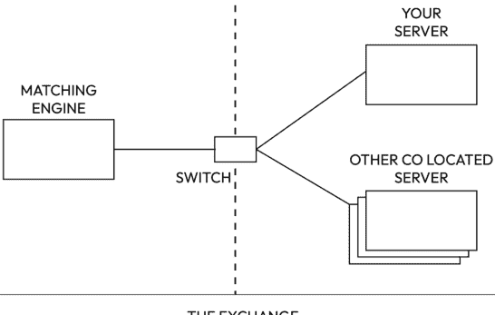

图 2.1 – 交易所工作原理（简化版）

为了充分利用系统同托管的优势，设计师还必须精心设计其交易系统以优化性能。这包括使用高性能网络设备，例如网络接口卡 (`NIC`) 和交换机，这些设备能够处理高频交易系统产生的大量数据流量。设计师还必须仔细管理其软件架构，以最小化降低延迟，并确保在交易量增加时能够进行扩展。

针对超低延迟和高带宽优化的网卡对于快速数据传输系统至关重要。它们利用硬件和软件的双重进步来实现这些速度。网卡的一项关键特性是使用 `OpenOnload` 绕过操作系统 (`OS`) 内核。`OpenOnload` 在应用程序和网卡之间建立了直接连接，消除了内核开销，从而显著降低了延迟并提高了吞吐量。虽然 `Solarflare` 开创了这项技术，但 `OpenOnload` 是一个开源项目，允许在不同的供应商和平台之间进行采用和适配。

通过绕过操作系统内核，`OpenOnload` 在应用程序和网卡之间建立了直接连接，消除了内核开销。

内核旁路旨在通过绕过传统内核的网络协议栈来降低延迟。它利用的一种技术是直接内存访问 (`DMA`)，这使得如网卡等设备无需 `CPU` 持续参与即可与系统内存交互。网卡使用系统内存中的环形缓冲区管理数据包，而 `DMA` 则促进了数据在缓冲区之间的高效传输。

在传统的网络设置中，数据由网卡接收，在提供给应用程序之前，它必须经过若干层软件协议和操作系统函数。这为过程增加了显著的延迟，在速度至关重要的高速交易系统中，这会对性能产生负面影响。通过内核旁路，网卡可以直接访问应用程序的内存，绕过操作系统并加速处理过程。

内核旁路的概念非常通用，其范围超过了网卡，扩展到存储等硬件设备。在应用程序与网络硬件交互的背景下，内核旁路通过一种称为用户级网络 (`ULN`) 的功能实现的。`ULN` 允许应用程序跳过内核，通过内存映射授予直接访问网络硬件权限，这种技术将网卡内存集成到应用程序的地址空间中。结果是应用程序可以在没有内核干预的情况下读写网卡内存。因此，数据传输到网络硬件时绕过了内核的网络协议栈，显著降低了延迟。

内核旁路的主要优势之一是降低延迟。通过绕过内核并允许应用程序访问网络硬件用于数据传输的内存区域，处理和传输数据的时间被显著缩短。这种直接内存访问在高速交易系统中至关重要，即使几微秒的延迟也会对交易性能产生巨大影响。

除了降低延迟外，内核旁路还提供了改进的可扩展性。

通过绕过内核的网络协议栈，它最小化了开销，简化了数据处理。这种效率使系统能够管理更大容量的数据和更多的交易。

为了利用内核旁路的优势，应用程序必须经过专门设计才能使用。这需要对软件架构进行更改，以确保应用程序可以在不依赖内核的情况下访问网络硬件。这可能涉及使用专用库和 `API` 来允许应用程序直接访问网络硬件。

为了从内核旁路中充分受益，软件必须有针对性地为其定制。这涉及重构软件基础，使其能够与网络设备交互并绕过常规程序。这种直接连接通常在专门为此目的设计的专用库和 `API` 的帮助下实现。

然而，在金融交易系统中实现低延迟高吞吐量不仅仅是使用正确的网卡。还需要高性能网络设备，如交换机和路由器，它们能够处理高频交易系统产生的大量数据流量。

它们利用先进的硬件和软件优化（如直通转发 `cut-through`）来确保快速的数据包路由。高效的拥塞管理技术防止了高负载场景下的瓶颈。`服务质量 (QoS)` 是另一项关键特性，它根据应用程序类型、用户需求和数据敏感性等各种参数对网络流量进行分类和排序，确保关键任务数据在传输层次中获得最高优先级。这些机制共同确保了数据包的交付既快速又可靠。

此外，低延迟交换机还支持先进的网络协议，如 `组播`，它可以高效地将市场数据分发到多个交易系统。组播分发市场数据的有效方式，因为它允许单个数据包同时传输到多个系统，减少了网络流量并最小化了延迟。

组播是一种网络协议，它通过向指定的组播组地址发送单个数据包来实现向多个端点的数据包交付。组播不像广播那样泛洪网络，也不像单播那样建立多个点对点的连接，而是依靠路由器和交换机仅对感兴趣的接收端复制数据包。在金融交易中，这种方法促进了市场数据的实时传播，极大地优化了带宽利用率。然而，组播模型确实存在缺点。它需要健壮的组播协议（如 `PIM` 或 `IGMP`）来管理组成关系并确保数据只到达感兴趣的方。此外，如果底层网络基础设施提供或配置不当，组播会导致数据包丢失，因此需要使用稳健的恢复机制。

在金融交易系统中使用组播时，考虑几个指标以确保最佳性能很重要。一个关键指标是组播延迟，即市场数据馈到达组播组内所有客户端所需的时间。其他指标包括丢包率（测量传输过程中丢失数据包的百分比）和抖动（测量数据包交付延迟的变化情况）。

组播广泛用于金融交易系统的市场数据分发。了解这一点非常重要，因为它将帮助我们进一步设计系统。交易所和交易场所通常将其馈源组播给客户端，客户端通过低延迟交换机和网卡连接到它们的网络。通过使用组播，交易所可以以最小延迟向大量客户交付市场数据。

使用组播的交易系统示例是 `NASDAQ ITCH` 协议。`ITCH` 是一种用于分发 `NASDAQ` 上市证券数据的二进制协议。该协议在特定的 `IP` 地址和端口上进行组播，客户端可以订阅组播组以接收数据。组播的使用允许 `NASDAQ` 实时向大量客户交付市场数据。

`ITCH` 是交易所用于向市场参与者流式传输市场数据的二进制协议。它是一种高效的协议，专为低延迟数据传输设计，是高频交易系统的理想选择。

`ITCH` 协议运行在 `OSI` 模型的数据链路层，并基于 `UDP` 进行传输。`UDP` 是一种不保证数据包交付或顺序的协议，但针对低延迟和高吞吐量进行了优化。这使其成为市场交付的理想选择，因为它允许市场数据在没有 `TCP` 开销的情况下快速分发。

处理入站 `ITCH` 消息的主要挑战之一是处理交易所产生的大量数据。为了处理这些数据，设计师必须管理其软件架构以最小化延迟，并确保系统在量增加时可以进行扩展。这包括使用高性能网络设备，如网卡和交换机，它们能够处理高频交易系统产生的大量数据。

`ITCH` 使用二进制编码来减少传输数据的大小，其某些特性如下：

- **基于消息的架构**：`ITCH` 本身是消息驱动的。每个消息都采用二进制编码以提高效率，并通过消息类型字段识别每个消息类型。这使得该协议紧凑且快速，适用于实时应用程序。
- **订单构建**：`ITCH` 的主要目标之一是促进订单簿的构建。因此，它提供了详细说明订单添加、修改和删除事件的消息。通过按顺序处理这些消息，系统可以重建任何时间点的订单簿状态。
- **时间戳**：`ITCH` 中的每条消息都带有时间戳，以确保数据的完整性和顺序。这使得能够准确地重构市场事件的序列。
- **交易消息**：除了订单簿消息外，`ITCH` 还会传输详细说明成交交易的交易消息，不仅指示了交易的价格和数量，还指明了执行的是哪一个特定订单。
- **事件指示器**：该协议提供了系统事件消息，用于标识特定情况，例如市场交易时的开始和结束，或失衡的时刻。
- **带宽与恢复**：为了管理带宽，`ITCH` 使用了有序消息通道。在消息丢失或中断的情况下，`NASDAQ` 提供了一种恢复服务，订阅者可以请求重传特定序列的消息。
- **订阅模型**：为了高效分发数据，该协议利用了组播模型。不同类型的数据（例如股票和期权）在不同的通道上进行组播。订阅者可以根据其数据需求选择加入哪些通道。
- **数据压缩**：`ITCH` 还整合了压缩机制以提高效率，特别是在处理海量快速变化的数据时。

所有这些都需要对线程池进行仔细管理并使用非阻塞 `I/O`，设计者可以确保系统不会被缓慢或无响应的客户端阻塞，并确保系统能够持续处理每个加载的消息。这可以通过使用线程并行处理传入的消息来进一步优化，从而实现更大的可扩展性和吞吐量。

金融交易系统中使用组播的另一个例子是 `芝加哥衍生品交易所 (CME)` 使用的 `市场数据平台 (MDP)`。`MDP` 是一种基于组播的协议，用于分发涵盖广泛金融工具的实时市场数据。交易员和市场参与者使用该协议来实时获取价格波动和其他市场信息的更新。

`FIX` 是一种广泛使用的消息协议，能够在交易对手双方之间实时交换金融信息。它是一项行业标准协议，为订单状态、执行情况和市场数据等交易信息提供了标准格式。

`FIX` 的设计极具灵活性，允许在不同的交易系统之间进行无缝交互，同时保持金融行业所需的必要特殊性。让我们来看它的一些技术细节：

- **传输协议**：`FIX` 消息通过 `TCP/IP` 传输以保证递送性。
- **FIX 版本**：多年来发布了多个版本的 `FIX`，其中 `FIX 4.2` 和 `FIX 4.4` 是采用最广泛的版本。然而，行业正逐渐转向 `FIX 5.0` 和 `FIXT 1.1`，这些版本引入了更多功能并满足了现代交易的需求。
- **标签-值编码**：`FIX` 的核心使用一种简单的标签-值编码方案。消息由一系列字段组成，每个字段由一个标签数字、一个等号和一个值表示。例如，`55=MSFT` 表示标签 (`55`) 代表微软。
- **消息结构**：每条 `FIX` 消息都以标准头部开始，随后是消息正文，最后以标准尾部结束。头部包含关键字段，如 `BeginString`（`FIX` 版本）、`SenderCompID`、`TargetCompID` 和 `MsgType`。
- **消息类型**：`FIX` 定义了各种消息类型以方便不同的交易活动。范围从管理消息（如心跳 (`D`) 和测试请求 (`1`)）到应用消息（如新订单-单一 (`D`) 和执行报告 (`8`)）。
- **性能优化**：鉴于现代交易系统对低延迟的要求，存在 `FIX` 的适配版本，例如 `Simple Binary Encoding (SBE)` 和 `FAST` 协议，其旨在减小消息大小和解析开销。

作为设计交易系统的软件架构师，考虑使用 `FIX` 以及任何这些协议来与其他市场参与者通信至关重要。这涉及到设计一个能够处理传入和传出消息的 `FIX` 引擎，并确保该模块是可扩展、可靠且高效的。

现在我们理解了交易所是如何分发其数据的，是时候谈谈我们的系统如何连接并消费这些传入的数据了。

请记住，大多数交易系统都有到不同交易所的多个连接，因此在这些情况下必须并行处理市场数据。这将带来更深层次的设计挑战，我们将在本书的后续解决这些问题：

为了保持订单最新，数据处理器必须通过归一化过程，这是所有传入数据都会执行的步骤。总的来说，市场数据的处理和归一化是任何高性能交易系统的关键组件。通过仔细设计市场处理程序并使用优化的数据结构和算法，交易系统可以在保持订单簿准确性和一致性的同时，实现低延迟和高吞吐量。

## 限制价格簿 (LIMIT BOOK)

| 卖出限价 | |
|---|---|
| 100.03 | 360 |
| 100.02 | 390 |
| 100.01 | 200 |
| 100.00 | 175 |
| 99.99 | 80 |
| 99.98 | 175 |
| 99.97 | 220 |
| 99.96 | 500 |

## 系统动态

当市场数据进入我们的系统、经过良好解析并且在 `LOB` 结构中保持最新后，我们需要考虑它在系统内其他模块中的分发。几乎所有模块在某些时刻都需要访问市场数据，因此分发是关键。

我们将其分为两个部分：实时分发和其他部分（非关键模块、批处理、存储等）。

### 实时分发

对于实时分发，我们可以使用多种模型和设计模式来处理整个系统的数据。在这里，我们将导航到对实时、低延迟市场数据处理感兴趣的模式。我们将从最不合适到最可能的进行说明。请记住，在处理对延迟不敏感的数据时，情况会有所不同。

### 观察者设计模式

这种情况下最常用的是观察者设计模式。该模式可以为同时运行的多个策略提供市场数据实时数据的解决方案。该模式维护一个依赖项（或观察者）列表，并自动通知它们任何变化。在交易系统的案例中，主体可以是市场数据馈，而观察者可以是交易策略。

图 2.3 – LOB

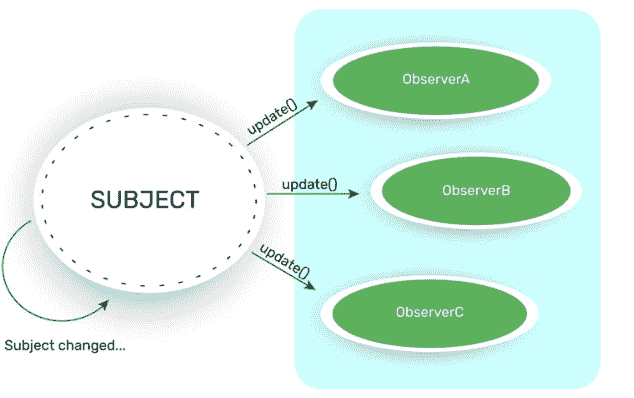

图 2.4 – 观察者模式图

然而，响应主题的通知逐顺序处理每种策略可能会导致策略执行的延迟，这对于低延迟至关重要的高频交易系统来说是不可接受的。

为了解决这个问题，可以对观察者模式进行修改，允许对多个策略进行并行处理。一种方法是使用 `发布-订阅模式 (publish-subscribe pattern)`，它是观察者模式的一种变体，允许将事件高效且并行地分发给多个订阅者。在发布-订阅模式中，主题（发布者）向多个订阅者（观察者）广播事件或消息，而不需要了解或与每个订阅者直接通信。相反，订阅者通过订阅主题 (`topic`) 或通道来表示对特定类型事件或消息的兴趣，而发布者只需向该主题或通道发送事件和消息。

这种方法允许多个策略并行接收市场数据更新，提高了整体吞吐量并降低了延迟。此外，它为向多个消费者分发市场数据提供了一个更具扩展性和灵活性的解决方案。

在实现发布-订阅模式时，考虑系统架构并选择合适的技术和消息协议至关重要。例如，使用高性能消息中间件（如 `Apache Kafka` 或 `ZeroMQ`）有助于优化消息传递过程并降低延迟。

然而，在管理高吞吐量数据并尝试获得最低延迟时，这些模式可能会因为消息传递和处理带来的额外开销而力不从心。在这些模式中，发布者/主题向所有订阅者/观察者发送消息，无论他们是否对该消息感兴趣。这可能导致大量不必要的消息处理并减慢整个系统的速度。此外，在低延迟系统中，消息处理的任何延迟都会对系统性能产生重大影响。这些模式依赖异步消息传递，这可能会给系统引入额外的延迟。如果消息对时间敏感并需要快速处理，这就会变得格外麻烦。

此外，这些模式还可能产生竞争和同步问题。在观察者模式中，多个观察者可能需要并发访问主题的数据，导致潜在的冲突和竞态条件。在发布-订阅模式中，订阅者可能需要竞争访问发布者的数据，导致竞争和延迟。

为了解决这些问题，低延迟系统的设计人员可能需要探索替代模式或调整这些模式以最小化它们对系统性能的影响。这可能涉及优化消息传递和处理机制、实现缓存策略，或使用专为高性能系统设计的特殊模式。

另一种设计模式是信号与槽模式。

### 信号与槽模式

信号槽机制以其在各种软件环境（包括某些交易平台）中的适应性而闻名。这种模式促进了系统组件之间的解耦通信。与观察者模式类似，信号和槽允许策略高效地传播和处理市场事件。在这种设置中，市场数据更新发出信号，作为槽 (`slots`) 的交易策略或算法可以迅速处理这些信号：

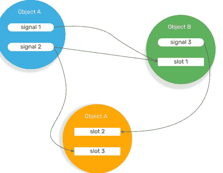

图 2.5 – 信号槽模式图


# 理解交易系统的组件及其相互依赖关系

信号槽模式的主要优势之一是它确保了回调参数的类型正确性。这是通过利用 C++ 语言特性作为模板实现的，允许信号和槽在编译时进行连接。这有助于减少运行时可能出现的错误，产生更高效、更健壮的系统。

在交易系统架构设计的背景下，信号槽模式有多种方式使用。例如，它可以连接系统内的不同模块，允许它们进行实时通信。这在处理市场数据时特别有用，因为市场数据需要快速处理和分析以做出及时的交易决策。这使得系统模块化且易于维护。通过解耦模块，可以对单个模块进行更改而不影响系统的其他部分。这使得适应变化的市场条件或业务需求变得更容易。

与之前的模式类似，它对于低延迟系统也可能存在问题，因为它引入了额外的开销。为了发送信号，发射对象必须遍历所有槽并逐个调用它们。这可能导致消息传播延迟，并由于遍历所有槽所需的时间增加了延迟。

此外，信号槽模式可能不是低延迟系统中处理市场数据的最佳选择，因为其主要设计是用于一多通信的。换句话说，单一个对象可以发射一个被多个槽接收的信号。虽然这对于某些类型的通信很有用，但对于市场数据来说可能有问题，因为每个槽可能对数据的不同子集感兴趣。这意味着发射对象必须向所有槽发送整个数据集，即使某些槽只对数据的一小部分感兴趣。

# 环形缓冲区模式

环形缓冲区模式，也称为循环缓冲区模式，由于其高性能和在低层应用中的有效实现而被广泛应用于交易系统。

它作为一个循环队列数据结构运行，维持先进先出（FIFO）行为，由两个索引引导：一个用于读取，另一个用于写入。它的主要优势之一是具有“无锁”实现的潜力，这消除了对同步的需求。这一属性在正确实现时，提供了比其他数据结构显著的性能优势：

## 系统设计与架构

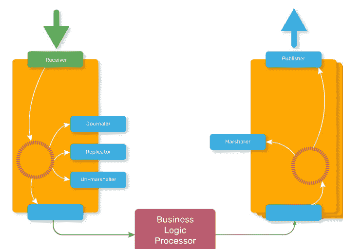

图 2.6 – 环形缓冲区模式图

这种模式对于速度和效率关键的交易系统特别有用。通过使用环形缓冲区，系统可以以极小的同步开销高度高效的方式处理传入的市场数据，降低延迟并使系统对市场的变化更灵敏。环形缓冲区模式最著名的采用者之一是 LMAX，这是一家金融交易所，它在其撮合引擎中使用 disruptor（环形缓冲区模式的一种实现）。disruptor 允许 LMAX 获得市场上最快的响应时间之一，并且一直是其成功的关键因素。

环形缓冲区模式的使用不仅限于市场数据处理。它在系统的其他部分也有用，例如订单管理和风险管理，在这些部分，系统需要以非常高效的方式处理大量的订单和交易。

在设计交易系统时，考虑环形缓冲区模式及其在系统架构中的实现至关重要。这包括确保系统能够处理数据量，并确保环形缓冲区的大小适当以避免溢出。此外，考虑系统的硬件规格也是至关重要的。环形缓冲区具有可预测和顺序的访问模式，擅长通过增加缓存命中来优化 CPU 缓存。同时，考虑到交易系统对实时、海量数据处理的需求，环形缓冲区会增加对内存带宽的消耗。因此，确保足够的内存带宽对于充分利用缓冲器的潜力而不产生瓶颈至关重要。

# 理解金融交易系统的组件及其相互依赖性

环形缓冲区是一种高效的模式，使我们能够在处理市场数据时实现极低延迟和高吞吐量。在接下来的章节中，我们将探索一种受环形缓冲区启发的改进技术，用于实现订单簿（LOB）。这种方法将确保我们的主要数据结构保持无锁状态，从而优化性能。

# 忙等等待（自旋）技术

为了在交易系统中实现最佳延迟，设计人员经常结合使用环形缓冲区模式和忙等等待（自旋）技术。环形缓冲区擅长管理快速的数据流，并提供了循环队列的高效实现。这种先入先出（FIFO）结构可以在无锁的情况下执行，从而增强性能。然而，瓶颈通常不在于缓冲区，而在于处理数据的 CPU 密集型任务。为了克服数据到达时传统睡眠/唤醒周期引入的延迟，设计人员使用了忙等等待技术。这确保了线程保持警觉，并准备在数据到达时进行处理。

忙等等待或自旋是在紧凑循环中重复检查特定条件是否满足，这被称为自旋循环。该循环持续到条件满足为止，使线程能够移动到后续任务。当线程被绑定到 CPU 核心时，这种技术可以增强系统的响应能力，特别是在延迟敏感型应用程序中。虽然自旋会消耗 CPU 周期，但如果设计得当，减少上下文切换带来的收益通常大于其成本，特别是当必须对高速数据流采取行动时。值得注意的是，在系统中，单个 CPU 核心运行在 100% 利用率并不罕见，特别是对于延迟敏感进程。剑桥大学 2013 年发表的一篇研究论文显示，忙等等待可以将延迟降低至 10 微秒，与毫秒级的方法相比。

然而，重要的是，忙等等待也会导致 CPU 使用率增加，因此应审慎使用。此外，这种技术通常与 CPU 绑定相结合，涉及将特定的 CPU 核心分配给线程或进程。这可以帮助线程或进程拥有专用访问权限，进一步优化性能。总的来说，环形缓冲区模式、忙等等待技术和 CPU 绑定的组合在实现交易系统最佳延迟方面是非常有效的。通过精心设计系统架构并优化 CPU 使用率，设计人员可以创建一个适用于现代市场需求的高性能系统。

# 非实时分发

现在，让我们看看批量处理市场数据（非实时）。在这种模型中，市场数据被收集并存储，直到达到特定的时间间隔或批量大小，然后进行批量处理。这种方法通常用于对延迟不敏感的历史数据。

## 系统设计与架构

将实时数据与非延迟敏感模块分离有助于提高系统的整体性能。在本节中，我们将探索如何设计实时分发和非延迟敏感模块以实现高性能。目标是使系统解耦，以便在不干扰热路径的情况下处理数据。中心纽负责重建订单簿（LOB），它是整个系统的实时数据源。

为了实现这一点，我们可以使用如 `ZeroMQ` 等消息系统。这些消息系统提供了一个层，可以将实时数据与非延迟敏感模块分离。中心纽可以设置为发布者，接收 LOB 的实时数据并将其发布到消息系统。对热路径的影响是微乎其微的，因为中心纽向消息系统发布数据，而热路径仅负责重建 LOB。

因此，对于非延迟敏感模块，我们将采用发布/订阅模式。这种模式允许中心纽作为发布者和订阅者之间的中间人，以及时且高效的方式将数据传递给相关方。

# 交易系统


图 2.7 - 我们交易系统的模块

通过这种方式，每个模块都可以订阅它所需的特定数据，中心纽会相应发布市场数据。这将热路径与系统的其余部分分离，确保其不会因为为多个模块提供数据而崩溃。

# 理解金融交易系统的组件及其相互依赖性

发布/订阅模式具有高度的灵活可扩展性，是现代交易系统中实时数据分发的流行选择。通过这种模式，中心纽充当发布者和订阅者的代理，确保数据以及时高效的方式递送。它还允许动态订阅管理，意味着可以在不影响现有基础设施的情况下向系统添加或删除新模块。

总的来说，这种架构结合高性能消息系统，提供了一种在整个交易系统中分发市场数据的灵活高效的方法。通过将热路径与非延迟敏感模块分离，我们可以确保每个组件都能以最高效率运行，同时根据需要向其他部分提供实时数据。

在这一节中，我们介绍了市场数据流以及如何构建其流。另一个重要事实决定了我们的交易系统如何向交易场所发送订单、如何维护状态以允许其他模块跟踪，以及它如何根据这些状态做出决策。这个模块就是 OMS（订单管理系统）。

# OMS

另一个关键组件是处理所有发送的订单并在交易操作期间接收其状态更新的模块。OMS 是金融机构和经纪人用于管理和执行证券交易的组件。它负责管理订单的生命周期，从订单输入到执行，并跟踪状态、持仓和风险敞口等相关信息。

它是交易系统中的关键组件，维护订单执行的状态，包括特定证券的所有未结订单。OMS 必须在交易所发送更新时跟踪订单状态，从订单发送的那一刻到交易所的确认，然后根据订单价值和市场情况进行接受或拒绝。如果被接受，交易所将继续发送有关订单是否已成交或部分成交的更新。

在 OMS 内部更新所有订单的状态至关重要，这样其他模块就能感知每个订单的最新情况。OMS 通常还包含图形用户界面（GUI），允许用户一目了然地监控其订单状态。

请记住，在我们的设计中，该模块有两个输入：市场数据和来自交易所的订单更新。我们将这两个输入进行区分：市场数据是实时（非延迟敏感），而订单更新是超低延迟输入。这是一个重要的区分，以避免在市场数据上产生额外开销。

为了确保高性能和可靠性，低延迟交易系统的订单管理系统（OMS）需要一种由若干协同工作的特定架构。该架构可以包含一个哈希表，为订单状态提供易于查找和更新的机制。此外，应该使用非阻塞队列来接收来自交易所的所有传入更新，以最大地减少订单更新通知的延迟。OMS 的核心组件是订单队列，负责接收和处理新订单。该队列必须是非阻塞的，以避免处理新订单时出现任何延迟。此外，它必须支持并发访问，以确保 OMS 能够同时处理多个订单而不产生冲突。

## 执行与交易管理系统

执行管理系统（EMS）是一个模块，为系统提供单一接口，用于访问多个交易所并执行交易。EMS 允许系统在多个市场和资产类别中下单并管理其头寸。EMS 是公司交易基础设施的关键组件，旨在确保交易执行高效、准确并符合监管要求。此外，值得提到的是该模块与 OMS 密切相关且始终保持通信，通常由两个主要部分组成——订单路由与管理以及交易管理：

- 交易所接口：EMS 通过各自的 API 与交易所交互，这些 API 大多数使用 `FIX` 协议，如果可用则使用 `OUT` 协议以实现更快的通信。EMS 必须支持交易所的订单类型，并提供与交易所之间快速可靠的连接。EMS 还必须能够处理包括订单更新在内的大量数据。

- 执行质量分析：EMS 必须提供分析执行质量的工具。这包括监控成交率、执行速度和滑点。EMS 还必须提供用于识别任何问题根源的工具，并优化交易策略以提高执行质量。

- 最佳执行要求和法规：EMS 必须遵守最佳执行要求和法规，这些规定要求公司采取所有合理步骤为客户获得尽可能可能的执行结果。这包括价格、速度和执行可能性等因素。EMS 必须提供衡量和报告执行质量的工具，以确保符合这些要求。

- 智能订单路由 (SOR)：EMS 必须有一套复杂的 SOR 算法，能够将订单路由到最佳交易场所。SOR 在决定订单路由位置时，必须考虑价格、流动性和市场影响等因素。SOR 还必须能够适应不断变化的市场状况并相应地调整其路由策略。近年来，SOR 模块已经配备了机器学习工具，使其拥有了智能的方式来路由订单。

- 交易管理系统：EMS 必须有一个健壮的交易管理系统，能够处理交易对账、头寸管理和风险管理。交易管理系统必须能够与其他系统（如后台系统）集成，以确保交易准确及时地结算。

- 捕获与交易处理：EMS 必须实时捕获并处理交易数据。这包括捕获价格、数量和执行时间等交易细节。EMS 还必须为风险管理、监管报告等目的处理交易数据。

- 交易确认与结算：EMS 必须提供确认和结算工具。这包括向交易对手发送确认消息，以及与结算中心和托管机构进行交易结算。EMS 还必须提供对账交易和解决任何差异的工具。

- 报告与分析：EMS 必须提供报告和分析工具。这包括生成关于执行质量、交易性能和其他指标的报告。EMS 还必须提供分析交易数据以识别趋势并优化交易策略。

- 高可用性与灾难恢复：EMS 必须建立高可用性和灾难恢复计划。这包括冗余硬件软件系统、备份数据中心和灾难恢复程序。EMS 还必须有一份应对和从意外事件（如系统故障）中恢复的计划。

- 性能与可扩展性：该模块应针对延迟性能进行高度优化。这意味着使用高级技术，如 `CPU pinning` 和 `busy-wait`，以最小化延迟并使吞吐量最大化。

## 模型与策略

在软件设计模式方面，忙等待技术是一种提供最低延迟性能的方法。本质上说，这种技术涉及模型或策略模块反复查询订单簿（LOB）以获取市场数据的更新。虽然这种方法可以提供极快的数据访问，但如果多个策略同时运行，它可能会产生大量的开销。因此，这种方法并不总是所有情况下都是最高效的。

总的来说，模型和策略模块是交易系统的关键组成部分。它负责做出直接影响公司盈利和风险的决策。因此，在设计该模块时，考虑到高性能、可扩展性和容错性至关重要。

## 风险与合规管理系统

风险与合规管理系统对于金融交易系统至关重要，能够确保交易环境的稳定与安全。金融交易系统相关的风险可以分为市场、信用、流动性、运营和监管风险。风险管理在缓解这些风险以及确保符合监管要求方面发挥着重要作用。在本节中，我们将讨论风险管理系统（RMS）的组成部分、监管遵守要求、最佳实践以及在金融交易中实施风险与合规管理系统的常见挑战。

## 金融交易系统风险与合规管理概述

金融交易系统的风险与合规管理涉及与交易活动相关的风险的识别、评估和缓解。其目标是确保交易环境的稳定安全并符合监管要求。金融交易系统相关的风险可以分为市场、信用、流动性、运营和监管风险。

金融交易系统中可能会发生以下类型的风险：

- **市场风险**：由于市场状况发生不利变化而导致损失的风险
- **信用风险**：由于交易对手违约或无法履行合同义务而导致损失的风险
- **流动性风险**：由于无法到期时履行财务义务而导致损失的风险
- **运营风险**：由于内部流程、人员、系统缺陷或失败以及外部事件导致损失的风险
- **监管风险**：由于不符合监管要求而导致损失的风险

## 风险管理在缓解金融交易系统风险中的作用

风险管理通过识别、评估和监控与交易活动相关的风险，在缓解金融交易系统风险方面发挥着重要作用。RMS 的核心组件包括风险识别、评估、监控和报告：

- **风险识别**：识别和评估与交易活动相关风险的过程
- **风险评估**：评估已识别风险的概率和影响的过程
- **风险监控**：监控已识别风险及其相关控制措施的过程
- **风险报告**：向利益相关者报告已识别风险、相关控制措施及其状态的过程

## RMS 的关键特性

RMS 应该具备以下特性：

- **风险登记簿**：包含所有已识别风险及其发生概率和影响的数据库
- **风险评估方法**：评估已识别风险的概率和影响的方法
- **风险监控系统**：监控已识别风险及其相关控制措施的系统
- **风险报告系统**：向利益相关者报告已识别风险、相关控制措施及其状态的系统

## 金融交易系统的监管合规要求

监管合规是金融交易系统风险与合规管理的一个关键方面。金融交易系统的主要监管合规要求如下：

- **金融工具市场指令 II (MiFID II)**：这是一项**欧盟 (EU)** 规则，旨在增加金融市场的透明度和投资者保护。
- **通用数据保护条例 (GDPR)**：这是一项规定企业在处理在欧盟成员国内发生的交易时，必须保护欧盟公民的个人数据和隐私。
- **证券交易委员会 (SEC)**：这是美国的一家监管机构，负责监管金融市场并保护投资者。

## 系统设计与架构

| 实现 RMS 的最佳实践 | 常见挑战 |
| :--- | :--- |
| - **定义风险管理流程**：定义一个清晰且全面的风险管理流程至关重要。该流程应包括识别风险、评估每个风险的概率和影响、确定适当的响应、监控风险以及报告。 | - **数据质量**：数据质量对于有效的风险管理至关重要。最大的挑战之一是确保数据的准确性和完整性。为了克服这一挑战，组织可以实施数据验证并在数据质量管理工具。 |
| - **建立风险容度水平**：建立风险容度水平对于确定组织可接受的风险敞口水平是必要的。可以通过这种方式实现。 | - **集成**：将 RMS 与其他部门集成具有挑战性。为了克服这一点，组织可以使用数据集成工具。 |
| - **使用复杂的风险分析工具**：先进的分析工具有助于更准确地识别和衡量风险。 | - **复杂性**：金融交易系统可能非常复杂，跨系统的管理具有挑战性。为了克服这一点，组织可以简化风险流程。 |
| - **将风险管理与其他部门集成**：风险管理应与合规、运营和 IT 等部门集成。这些工具包括风险模型。 | - **监管合规**：遵守监管要求是一项重大挑战。为了克服这一点，组织可以投资合规管理工具并建立专门的合规团队。 |
| - **培养风险管理文化**：应在整个组织推广风险管理文化。这包括向员工培训、鼓励他们报告风险并奖励良好的管理实践。 | - **技术基础设施**：技术基础设施对有效的风险管理至关重要。最大的挑战之一是维护系统的性能和可靠性。为了克服这一点，组织可以投资技术基础设施并建立 IT 团队。 |

表 2.1 – RMS – 最佳实践对比

## 理解交易系统的组件及其依赖关系

设计 RMS 涉及多个组件，每个组件都协同工作以确保高性能和可靠性。以下是涉及的一些组件和技术：

- **数据接入与预处理（输入）**：
  - 市场数据输入：从消息总纽收集并预处理市场数据。
  - 持仓数据输入：从订单管理系统 (OMS) 获取持仓数据。

- **风险指标计算**：
  - 实时风险计算：计算 VaR、条件价值 (CVaR)、压力测试和场景分析等各种风险指标
  - 敏感性分析：计算敏感性（如 Delta、Gamma、Vega、Theta 和 Rho），以衡量市场状况变化对组合的影响。

- **交易前风险检查**：
  - 订单验证：确保订单符合公司的风险限额和交易规则。
  - 投资组合风险评估：评估新订单对投资组合整体风险状况的影响。

- **实时监控与告警**：
  - 风险仪表板：实时监控风险指标、持仓和交易活动
  - 告警系统：当突破预定义的阈值或检测到异常交易模式时发送。

- **交易后分析与报告**：
  - 交易分析：分析执行的交易以评估其对风险状况的影响，并识别交易执行的潜在改进空间。这通常被称为 TCA，它可以作为独立模块包含在此模块之外。
  - 风险报告：为内部外部利益相关者（例如管理层和监管机构）生成风险敞口、限额和违规的定期报告。

- **可扩展的模块化架构**：
  - 微服务：使用微服务架构设计系统，以实现扩展性、模块化和易于维护。
  - 分布式计算：利用分布式计算技术（例如集群和云服务）来处理大规模数据处理和风险计算。

## 系统设计与架构

- 与其他系统的集成：
    - 交易系统：将风险管理系统（RMS）与交易系统集成，以执行风险检查并管理仓位
    - 组合管理系统：与组合管理系统连接，获取仓位数据并传输风险信息
    - 合规交易报告

- 可靠性：


- 错误处理与恢复：开发稳健的错误处理机制，以确保系统可靠性并尽可能地减少停机时间

以下是一个显示 RMS 结构的简单示意图：

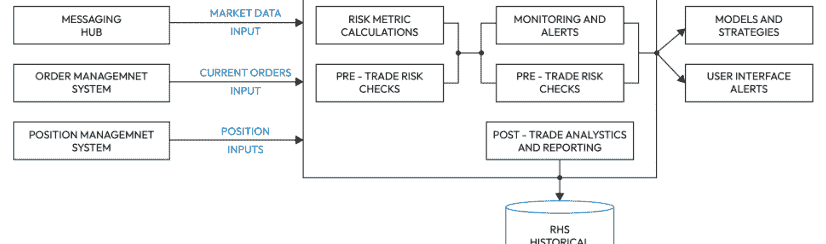

图 2.9 – RMS 架构图

RMS 在保护投资和确保交易操作稳定方面发挥着至关重要的作用。然而，实施有效的 RMS 也面临着一系列挑战。让我们讨论常见的挑战并探索克服这些问题的潜在解决方案：

- RMS 面临的最大挑战之一是实时处理海量数据。金融市场产生大量信息，RMS 需要持续处理和分析数据。为了克服这一挑战，投资高性能计算基础设施并采用高效的数据处理技术至关重要。此外，使用机器学习算法和并行处理可以有效帮助分析大型数据集。

- RMS 的另一个挑战是在波动且不可预测的市场条件下准确地对风险进行建模和预测。传统模型可能无法捕捉不同资产和市场因素之间的复杂性和依赖关系。为了解决这个问题，开发更先进的风险模型至关重要，同时要整合各种风险来源，并采用机器学习和人工智能等技术。这些方法有助于识别数据中隐藏的模式和依赖关系，从而对风险进行更准确的评估。

- 跟上不断变化的监管要求是 RMS 面临的另一个障碍。金融机构必须确保其 RMS 符合现行法规，同时能够适应未来的变化。为了应对这一挑战，组织可以投资于灵活的模块化系统，随着法规的演变可以轻松进行更新和重新配置。与监管机构保持定期沟通并关注即将发生的变化也有助于为任何必要的调整做好准备。

- 与现有交易系统和组合管理系统的集成也可能带来挑战，因为不同的系统具有独特的数据格式、接口和工作流。为了解决这个问题，在设计 RMS 时必须考虑互操作性。采用行业标准的数据格式和 API 可以促进与其他系统的无缝集成，确保交易生态系统中不同组件之间信息的顺畅流动。

- 最后，RMS 必须平衡速度和准确性，因为在金融交易中做出快速决策至关重要。然而，过于简单的风险模型可能导致风险评估不准确，而复杂的模型可能计算时间过长。为了取得正确的平衡，组织可以采用并行处理、优化算法和硬件加速等技术。实施实时监控和报警系统还可以确保交易员获知潜在风险并及时缓解这些风险。

# 监控系统

在快速变化的交易系统世界中，监控是确保您的平台稳定性、可靠性和安全的关键组件。交易系统处理海量数据，以闪电般执行订单并实时管理风险。设计良好的监控系统可以为您的交易平台性能提供宝贵的见解，帮助您在问题升级为更严重的问题之前识别潜在问题。

在本节中，我们将讨论交易系统环境下监控系统的设计和架构。我们还将涵盖监控各个方面，包括网络和延迟监控、内部延迟监控、整体系统健康监控、市场数据监控、风险监控和执行监控。

# 监控系统应该如何实现？

监控系统是一种帮助观察和衡量交易系统性能、行为和健康的工具。它可以为系统的功能、效率、可靠性和安全性提供宝贵的见解。监控系统还可以帮助检测和诊断问题、排除故障并优化系统性能。

它应该被设计为独立且非侵入性的，以确保它不会干预交易系统的核心功能。通过将监控系统与主交易平台分离，您可以最大限度地减少性能下降的风险和对核心功能的负面影响。例如，如果我们想监控市场数据是如何被感知的，我们希望拦截网络包并对其进行分析，且与主系统独立运行。这样，我们可以避免为市场数据馈送增加额外的负载或延迟，这可能会影响交易决策和结果：

# 网络延迟监控

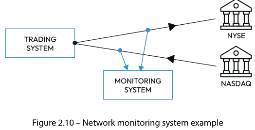

监控系统还应该设计为具有扩展性和适应性，使其能够处理不同类型和规模的数据，以及不同的场景和需求。监控系统应该能够从各种来源收集和处理数据，例如网络流量、日志、数据库、API、传感器等。监控系统还应该能够通过仪表、图表、告警、报告等以有意义且可操作的方式展示和可视化数据。最后，监控系统应该能够根据用户和利益相关者的特定需求和偏好调整并自定义其设置和参数。

让我们来看看我们需要监控的主要内容。

## 网络延迟监控

在交易系统中，网络延迟会对订单执行和整体性能产生重大影响。监控延迟和容错能力对于维护高性能平台至关重要。

为了有效监控网络延迟，可以考虑实施测量交易系统与各种数据源和执行场所之间往返时间的工具。此外，跟踪网络错误、丢包和其他影响网络的问题。

## 内部延迟监控

内部延迟监控专注于衡量交易系统处理传入市场数据、做出决策和提交订单所需的时间。通常被称为“端到端”（tick-to-trade）延迟。准确衡量内部延迟有助于识别交易系统中的瓶颈和低效环节。

为了监控内部延迟，可以在交易系统的各个点实施跟踪，例如市场数据接入、信号生成和订单提交。通过分析收集的数据，可以发现改进领域。

## 整体系统健康监控

监控交易系统的整体健康涉及跟踪各种性能指标和系统资源利用率。这包括监控 CPU 使用、内存消耗、磁盘 IO 以及其他资源。

建立正常行为的基准并设置告警，在偏离基准时通知您。通过主动监控系统健康，可以快速识别并解决影响交易系统性能或稳定性的问题。

## 交易所市场数据监控

在交易系统中，市场数据是做出决策的关键输入。监控从不同交易所接收的市场数据的质量和及时性对于确保交易信号的准确性至关重要。

实施监控工具跟踪每个交易所市场数据的完整性、准确延迟。为缺失或延迟的数据设置告警，并监控更新频率，以确保您的交易系统获取最新的信息。

## 风险监控

风险监控是任何交易系统中不可缺的一部分。这包括监控敞口、保证金、信贷和其他影响交易系统性能和稳定性的风险因素。

实施监控工具实时跟踪并评估各种风险因素。针对违反预定义阈值设置告警，并建立自动化操作以缓解风险，例如调整头寸规模、执行止损订单或减少整体敞口。

## 执行监控

执行监控专注于跟踪交易系统订单执行的性能。这包括监控成交率、执行时间和滑点。

为了监控执行性能，请实现能够跟踪和分析订单执行数据的工具。将您的交易系统性能与相关的基准（如 VWAP 或到场价格）进行比较，以评估您的执行策略的有效性。

现在我们已经对整个金融交易系统的所有组件有了清晰的认识，让我们开始学习如何设计它的模块，随后我们将定义我们寻求的一些技术特性。

## 概念架构

设计一个健壮且可扩展的系统架构对于任何软件项目的成功都至关重要。它是整个系统构建的基础，并将决定系统的性能、可靠性和可维护性。系统架构的设计应该考虑项目的特定需求和要求，包括功能性需求和非功能性需求，例如延迟、吞吐量和扩展性。

系统架构的设计应从理解系统的目的、用户及其环境开始。这包括定义系统的目标和任务、识别利益相关者，以及分析可能影响系统设计的外部和内部因素。在完成这些初始阶段后，设计过程可以转向更具技术性的考虑，例如选择合适的硬件和软件组件、定义系统接口以及确定将要使用的通信协议。

系统架构应以模块化和可扩展的方式进行设计，以便于维护、更新和未来的扩展。它还应该考虑到安全和隐私，包括防止未经授权访问的机制以及确保数据机密性和完整性的机制。系统架构应该具有良好的文档，并向所有利益相关者（包括开发人员、测试人员和用户）清晰地传递。

在本节中，我们将讨论设计金融交易系统架构的关键考虑因素和最佳实践。我们将涵盖数据存储与管理、消息系统、风险管理和合规等主题。我们还将讨论可用于构建高性能、可靠且安全系统的设计模式和架构。在本节结束时，您将对如何设计满足金融交易系统特定需求的系统架构有深入理解。

## 架构的结构视图

软件架构的本质在于系统的结构——组件组合及其相互作用的方式。架构的结构视图提供了一个蓝图，使能够理解系统的复杂性，确保它是组织、可维护的，并能够进化以满足未来的需求。

本节将研究我们软件系统的结构方面，提供其设计和运行的全面概述。我们将对统一建模语言（UML）图进行评估——用例图、活动图、时序图和过程视图图——每种图都为系统的结构和操作提供了不同的视角。

这些图共同构成了我们系统结构的多维度视图，使利益相关者理解其设计和运行的复杂性。我们邀请您探索接下来的章节，在这些章节中，将详细讨论每类型的图，提供对我们软件系统架构结构的深度见解。

## 用例

系统的用例视图从用户的角度代表了系统的功能。它捕捉了系统预期的功能及其交互。系统中的每个主要模块，无论是市场数据馈、LOB、策略、消息枢纽、OMS、EMS、RMS 还是历史数据库，都有特定的职责，这些职责构成了用例的基础：

- **市场数据馈 (Market data feed)**：市场数据馈模块从各种交易所接收原始数据。该模块的每个实例（可以是一个或多个）负责特定的交易所。它包含一个 FIX 引擎，将原始数据转换为适用于交易系统使用的归一化格式。

- **LOB（订单簿）**：LOB 是中心数据结构，持有来自所有交易所的归一化市场数据。它从市场数据馈接收市场数据并发送到策略和消息枢纽。对于策略来说，它提供了极低延迟的数据。

- **策略 (Strategies)**：策略利用来自 LOB 和消息枢纽的市场数据。它们直接从 LOB 接收极低延迟数据以执行高速交易。

- **消息枢纽 (Messaging hub)**：消息枢纽是分发极低延迟数据到其他模块（包括 OMS、RMS 和历史数据库）的中心。它根据特定的交易策略生成订单。

- **OMS（订单管理系统）**：...

## 系统设计与架构


图 2.11 – 用例块和系统及其交互

之前的用例分析基于图和系统架构。它为功能和交互提供了清晰的理解。注意，某些模块可能具有图中未捕捉的功能，但提供的用例涵盖了主要的功能和交互。

## 活动图

活动图是 UML 图的一种，直观地表示系统中的控制流或对象流。它们对于建模业务流程、工作流或算法交易系统的复杂算法特别有用。

在我们算法交易系统的背景下，活动图有助于说明系统承担的各种活动、发生的顺序以及它们如何相互关联。这包括接收和处理市场数据、触发和执行订单、风险管理和数据存储等活动。

该图有助于理解系统的行为，突出并行进程并识别潜在的改进区域。通过研究活动图，您可以获得对系统如何运行的见解，使其成为开发人员和利益相关者极具价值的工具。

让我们看看发生了活动：

- **接收市场数据**：这是流程的起点，市场数据馈模块在此从各种交易所接收实时消息。这些消息通常是 FIX 或 ITCH 格式，这些是传输数据的数据的格式。

- **解析市场数据**：该活动发生在市场数据馈模块内部。输入消息（通常为 FIX 格式）由 FIX 引擎解析为系统所需的格式，提取所需信息，如价格、成交和其他交易细节。

- **归一化市场数据**：在市场数据馈模块内部，FIX 引擎解析输入消息后，数据被发送到模块进行归一化。此步骤确保了来自不同交易所的市场数据采用统一格式，便于后续处理。

- **更新 LOB**：归一化数据随后被引导到 LOB。在这里，根据输入进行更新。这些更新可能是新订单（插入）、取消（删除）或对现有订单的修改。

- **发布市场数据**：LOB 然后将更新的数据分发到策略模块和消息枢纽。为了实现尽可能低的延迟，此过程通常采用环形缓冲区设计和忙等（busy/wait）技术，确保数据在到达时就能被处理。

- **处理市场数据**：此活动与上一个活动并行发生。策略处理低延迟数据以可能生成订单，而消息枢纽将非低延迟数据分发到其他模块，如 RMS、OMS 和历史数据库。

- **触发订单**：在策略模块中，根据预定义的条件和处理过的市场数据做出决策以触发订单。这些订单随后被发送到 OMS 进行进一步处理。

- **管理订单**：OMS 承担多项职责。它从策略模块接收订单，从交易所接收订单状态，并将订单状态传回给策略。此外，它将订单发送到 EMS 执行，并将其存储在订单和持仓数据库中进行记录。

- **执行订单**：EMS 接收来自 OMS 的订单，并使用智能路由器决定最佳执行路径。订单随后被发送到相应的交易所。在某些情况下，如果策略有特殊规定，订单可能会直接发送到特定交易所，而跳过智能路由器。

- **监控风险**：RMS 从 OMS 接收敞口和持仓数据。如果风险参数超过预设限制，RMS 将向策略模块发送风险信号，以可能停止交易或修改策略。

- **存储历史数据**：历史数据库负责存储从消息枢纽接收的所有市场数据。这些数据对于策略回测、合规和审计目的至关重要。

- **存储订单执行**：OMS 还有负责存储策略模块发送的所有订单及其从交易所接收到的状态。这些信息对于记录、审计和策略优化至关重要。

- **验证订单**：作为额外的控制层，在 EMS 之前，它根据某些预定义的标准对订单进行验证。这可能包括检查以确保细节正确，并且订单符合任何适用的法规或风险指南。这一步对于避免昂贵的交易错误和确保监管合规至关重要。

以下是活动图：

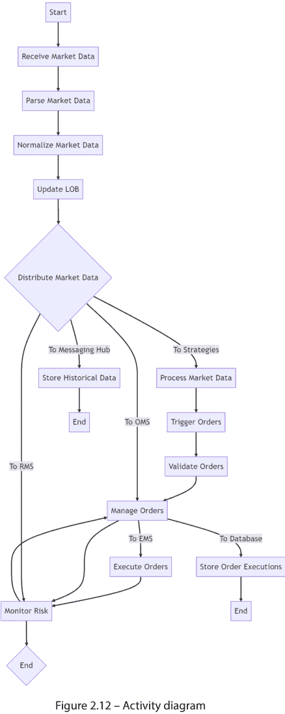

让我们仔细观察一下它的流程：

1. 在算法交易系统中，如 UML 活动图所示，我们从“接收市场数据”活动开始，市场数据馈送模块从各个交易所收集消息。这些消息采用特定的协议，通常是 FIX 或 ITCH。

2. 系统转换到“解析市场数据”活动，进入的 FIX 格式消息由市场数据馈送模块中的 FIX 引擎处理。解析后，我们移动到“标准化市场数据”活动，解析后的数据由特定的子模块进行标准化，将其转换为系统更易处理的格式。

3. 这些归一化数据随后被用于“更新 LOB”，这可能涉及对 LOB 中数据的插入、删除或修改。一旦 LOB 更新完成，系统进入“分发市场数据”活动。在这里，LOB 通过环形缓冲区设计和忙等待相结合将数据与策略模块和消息枢纽共享，以确保尽可能低的延迟。

4. “处理市场数据”活动与数据分发并行启动。活动中，策略模块处理来自 LOB 的低延迟数据以生成订单。同时，消息枢纽也将非延迟数据分发到 OMS、RMS 和历史数据库等模块。

5. 当策略模块处理数据并识别出机会时，根据预定义的条件“触发订单”。这些订单被发送到 OMS 执行后续操作。在 OMS 接受并处理这些订单之前，它会在“验证订单”活动中对其进行验证，以确保它们符合特定标准，例如订单细节的正确性以及任何适用的法规或风险指南。

6. 一旦通过验证，系统进入“管理订单”活动，OMS 接收策略的订单，并将订单状态传回策略。OMS 还将订单发送到 EMS 执行并发送到订单和持仓数据库进行存储。

7. 在“执行订单”活动中，EMS 接收来自 OMS 的订单，通过智能路由决定最佳执行路径并将订单发送到交易所。有时，如果策略模块进行了指定，订单可能会直接发送到特定交易所，跳过智能路由。

8. 在这些活动进行的同时，系统通过 RMS 监控风险，RMS 接收来自 OMS 的敞口和持仓数据。如有必要，它会将风险信号发回策略模块。

9. 在所有这些活动期间，系统还会存储数据。“存储历史数据”活动涉及存储从消息枢纽接收的所有市场数据。同样，在“存储订单执行”活动中，OMS 将策略发送的所有订单及其从交易所接收的状态存储为执行记录。

10. 整个过程持续到系统停止，标志着该时期交易活动的结束。

# 时序图

算法交易系统的有效性不仅取决于它的组件，还取决于它们之间复杂的相互作用。当我们遍历交易系统的复杂性时，时序图是可视化这些相互作用的顺序以及对象在特定事件序列期间生命周期的强大工具。

以下的时序图揭示了我们交易系统的内部运作，阐明了从市场数据处理到风险管理和数据存储的系统化操作流程。这些图封装了系统的动态行为，并突出了事件的时间顺序。

每个用例代表系统内部的一段特定活动序列，强调了不同系统组件之间的相互作用。通过仔细研究这些图中的事件流，我们可以洞察系统的运行机制并增强我们的理解。

这些描述封装了系统的动态行为，并突出了事件的时间顺序。

## 市场数据处理时序图

该时序图说明了处理市场数据时涉及的相互作用。它从从交易所接收数据开始，对其进行解析、标准化，最后将数据分发到其他组件：

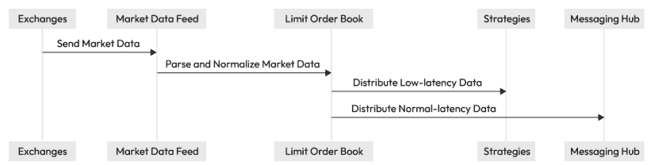

## 订单生成与验证时序图

此图显示了策略模块如何使用处理后的数据生成并验证订单。这些订单随后被传递给 OMS：

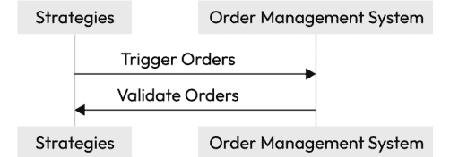

## 订单执行时序图

该时序图详述了订单执行的过程。它展示了订单如何被路由和执行，以及订单状态如何更新并传回策略：

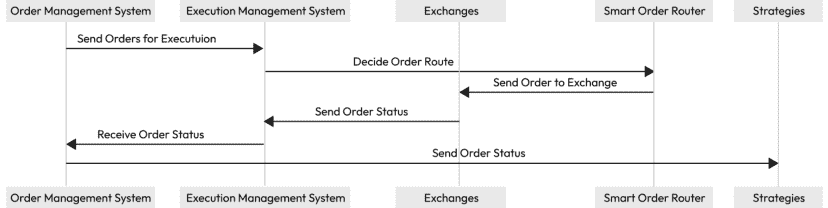

## 风险管理与数据存储时序图

最后一张图显示了与风险管理和数据存储的操作序列。它展示了敞口和持仓如何通信给 RMS、风险信号如何发送给策略，以及数据如何存储在历史数据库和持仓数据库中：


## 过程视图

我们交易系统架构的过程视图提供了系统运行时的视角。它关注系统的进程、任务和交互，阐明了系统的运行时行为及其动态方面。

11. 过程视图为系统架构提供了一个关键视角，阐明了系统的动态方面并揭示了系统组件在运行时如何相互作用。

## 概念架构 69

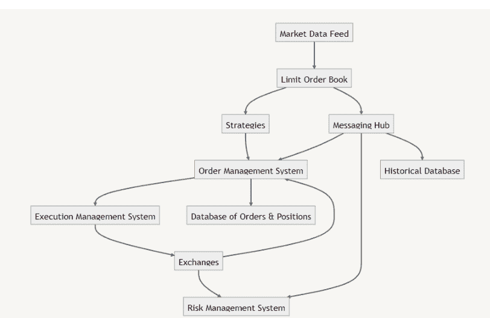

图 2.17 – 过程视图图

让我们仔细观察这张图：

1. 市场数据馈入 LOB（订单簿）。

2. LOB 馈给策略，然后发送到消息枢纽。

3. 策略生成订单，然后发送到 OMS（订单管理系统）。

4. 消息枢纽将数据分发 OMS、RMS（风险管理系统）和历史数据库。

5. OMS 将执行订单发送到 EMS（执行管理系统），并将订单及其状态存储在数据库中。

6. EMS 与交易所通信以执行订单。

7. 交易所分别向 OMS 和 RMS 反馈订单状态和风险更新。

现在我们已经定义了软件系统的结构布局，对其各个组件及其相互作用提供了全面的观察。通过用例图、活动图、序列图和过程视图图，我们剥开了系统的层级，揭示了进程、线程和数据之间复杂的交织，这使其作为一个整体得以运行。

这些图不仅仅是静态的表示；它们是理解的工具，引导我们理解系统的复杂性并突出其内部运作机制。它们是开发者的路线图、项目经理的指南，以及未来增强和扩展的蓝图。

结构视图形成了我们软件架构的骨干，我们相信这一部分为系统的设计和运行提供了宝贵的见解。随着我们的推进，我们将在此基础之上，探索塑造系统的其他架构视图和方面。

## 设计模式及其在我们系统中的应用


# 软件设计模式在低延迟交易系统中的应用

软件设计模式是构建健壮、高效且可扩展软件系统的基础。它们为软件设计过程中出现的常见问题提供了可重用的解决方案。这些模式本身并不复杂，而是更像模板，提供了一种结构化代码以解决特定关注点的方法。在开发我们这样的低延迟交易系统时，选择能够最小化延迟、最大化吞吐量并确保数据完整性的设计模式至关重要。

设计模式的魅力在于其经过证明的记录以及它们为开发者提供的通用语言。开发者不需要描述整个设计的细节，而是可以使用模式的名称来抽象设计背后的整体思想。本节将深入探讨支撑我们交易系统的软件设计模式，它们如何融入宏大体系，以及为什么它们是我们低延迟系统中不可或缺的一部分。

## 作为发布者/订阅者的消息枢纽

这种模式与我们交易系统的消息枢纽特别相关。消息枢纽承担着发布者的角色。它负责分发通过环形缓冲区（`ring buffer`）从 LOB 接收的市场数据。然而，LOB 的首要考虑是实现尽可能低的延迟，因此它不处理订阅者管理。这一责任落给了消息枢纽，使其成为实现发布/订阅模式的理想场所。

在这种设置中，订阅者是非延迟策略以及 OMS、RMS 和历史数据库模块。与使用忙/等待（`busy/wait`）持续轮询 LOB 数据的低延迟策略不同，这些非延迟模块基于事件模型运行。它们订阅消息枢纽，并在任何新市场数据可用时接收更新。这种方法允许模块无需持续轮询即可保持最新的市场数据，而对于它们的运行来说，这可能没有低延迟策略那样关键。

### 概念架构

该用例提供了几处优势：

- **解耦**：它将消息枢纽与模块解耦，提升了系统的灵活性。消息枢纽不需要知道订阅其数据的特定模块；它只需要在有新数据可用时向所有订阅者发送更新。同样，订阅者模块不需要知道数据从哪里来；它们只需要订阅消息枢纽并在数据到达时对其进行处理。
- **动态订阅**：它允许动态订阅和取消订阅，这在一个可能动态添加、删除或修改新模块的环境中是有益的。
- **关注点分离**：它提供了清晰的关注点分离。LOB 专注于通过环形缓冲区对市场数据进行低延迟分发，而消息枢纽处理订阅者管理以及向非低延迟模块分发数据。

此外，在我们的系统中使用发布/订阅模式增强了可扩展性。随着系统的增长和演进，我们可以轻松地向消息枢纽添加更多订阅者，而不会影响它或系统其余部分的性能。每个新订阅者只需表达他们对消息枢纽更新的兴趣并开始接收即可。

在性能方面，发布/订阅模式允许高效的数据分发，因为它消除了轮询的需求。订阅者不是持续检查更新，而是在更新发生时接收更新。这种实时通信在我们的高频交易系统中特别有益，因为速度和效率是至关重要的：

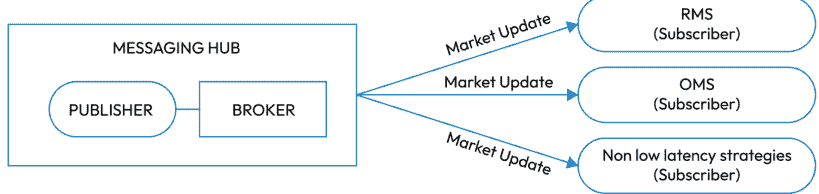

**图 2.18 – 发布/订阅图**

发布/订阅模式在我们交易系统中起着关键作用。它实现了不同模块之间高效、实时的通信，对系统的整体性能和可扩展性做出贡献。当我们深入研究系统架构时，我们将看到其他设计模式和技术如何补充发布/订阅模式来实现这一点。

## 环形缓冲区的使用

在我们的交易系统中，LOB 使用环形缓冲区将市场数据分发到策略模块和消息枢纽。当 LOB 接收新数据时，将其写入环形缓冲区。同时，策略模块和消息枢纽持续从缓冲区读取。如果写入快于读取，写入指针可能会追上读取指针，这意味着缓冲区已满。在这种情况下，系统可以设计为覆盖旧数据或等待有空间后再写入新数据。

正如我们所见，在该场景中使用环形缓冲区有许多优势。首先，它有助于在市场数据激增时保持流量平稳且可控。缓冲器的无锁特性允许 LOB、策略模块和消息枢纽在没有任何昂贵操作的情况下运行。这对于每一微秒必争的高频交易尤为重要。

让我们考虑一个场景来阐明。假设市场活动激增，导致 LOB 有大量更新。LOB 快速将这些更新写入环形缓冲区。同时，策略模块正在从环形缓冲区读取、处理数据并可能生成订单。消息枢纽也在从缓冲区读取并分发数据。得益于环形缓冲区模式，这一切在没有任何锁的情况下并发进行：

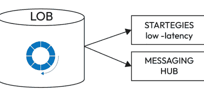

**图 2.19 – 我们系统中的环形缓冲区**

结论，环形缓冲区模式是我们系统架构工具箱中的一种强大工具。它高效、无锁的设计对系统的整体性能以及以最小延迟处理大量市场数据的能力具有重大贡献。

## 忙/等待的使用

在并发编程和高性能系统中，忙/等待是一种技术，进程反复检查条件是否成立（例如锁是否可用或特定数据是否已计算）。如果条件尚未满足，进程将继续等待。这与阻塞不同，在阻塞中进程无法继续，直到其必要条件被满足才会被移出 CPU。

忙/等待初听起来可能是违背直觉或低效的。毕竟，一个进程为什么要花费 CPU 周期仅仅为了等待某个条件变为真呢？然而，在某些高性能、低延迟的系统中（例如我们的交易系统），忙/等待可能是一种极具优势的技术。

问题的核心在于延迟与 CPU 利用率之间的权衡。在我们这样的延迟是关键因素的系统中，忙/等待可以提供最佳性能。

在我们的交易系统背景下，忙/等待被应用于策略模块中的低延迟策略中。这些策略通过环形缓冲区（`ring buffer`）持续监控来自订单簿（LOB）的市场数据。策略并不是通过事件驱动来对传入的数据做出反应，而是主动轮询或“忙等”环形缓冲区中新数据的出现。

LOB 用市场数据更新环形缓冲区，而策略模块则不断检查——或忙等——这些更新。当新数据到达环形缓冲区时，策略模块可以立即处理它并可能生成订单，然后将其发送到 OMS 执行。这种直接轮询机制确保了策略对市场数据的变化具有尽可能的响应。

我们系统中的忙/等待技术在应用时应仔细考虑底层硬件和系统配置。特别是，系统应该采用 CPU 绑定（CPU pinning），将特定的 CPU 核心分配给特定的进程或线程。如果没有 CPU 绑定，忙/等待技术可能无法达到预期的低延迟优势。

因此，在我们的系统中使用忙/等待时，实现 CPU 绑定至关重要。这种组合确保了我们的系统能够保持所需的延迟，并对市场数据的更新做出快速响应：

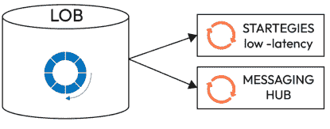

**图 2.20 – 我们系统中的环形缓冲区**

## 工厂方法模式的使用

工厂方法模式应用于策略模块中，便于创建各种类型的订单。如你可能记得，我们有不同类型的策略——低延迟和非低延迟。这些策略根据其特定的逻辑和市场数据生成不同类型的订单，例如市价单、限价单或停止单：

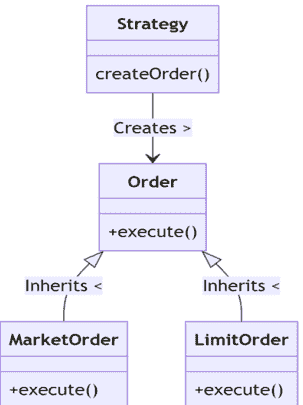

**图 2.21 – 工厂方法模式**

这就是工厂方法模式发挥作用的地方。我们没有让策略类代码库直接实例化这些订单（这可能导致复杂且难以维护的代码库），而是使用工厂方法模式。我们定义了一个接口（或抽象类）——“工厂”，它封装了对象的创建过程。然后，每个策略都将有一个特定的工厂实现，用于创建它所需的 `Order` 类型。

例如，如果某个特定策略需要生成市价单，相应的工厂实现将创建并返回一个 `MarketOrder` 对象。如果另一个策略要求限价单，它的工厂将生成并返回一个 `LimitOrder` 对象。这种方法允许我们封装对象的创建过程，并确保每个策略都能生成其所需的订单类型，而不会影响其他策略。

在这种背景下，使用工厂方法模式的优势在于跨策略标准订单创建过程的能力。它促进了策略与订单类型之间的松散耦合，使系统更加灵活且易于维护。如果未来需要引入新的订单类型，我们只需为该订单类型创建一个新工厂，并将其集成到相关的策略中，而不影响系统的其他部分。

另一个显著优势是它提供的一致性和控制力。通过这种模式，我们可以确保系统中的每个 `Order` 对象都被正确实例化，并完全符合所需的接口。如果在每次创建 `Order` 对象时需要执行特定操作或日志记录，它提供了一个单一的控制点。

该模式是我们高频交易系统中的一种关键设计工具。它在订单创建过程中提供了必要的灵活性和控制力，使系统更加健壮且可维护。通过将策略与特定订单类型解耦，我们可以确保系统能够轻松适应新需求或交易策略的变更。

## 装饰器模式的使用

在我们的高频交易系统中，装饰器模式被应用于 OMS，在订单发送执行之前对其进行验证。如你所知，OMS 承担着管理订单生命期的关键责任。它从策略接收订单，将其发送到 EMS 执行，并根据交易所的响应更新订单状态。

OMS 的核心任务之一是在发送执行之前对订单进行验证。这种验证可能包括检查以确保订单详情是正确的，并且订单符合任何适用的法规或风险准则。这就是装饰器模式发挥作用的地方：

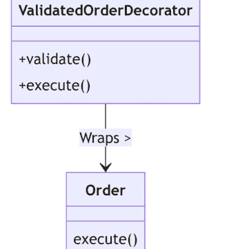

**图 2.22 – 装饰器模式**

我们创建了一个包含基本订单功能的 `Order` 类。然后，我们创建一个 `ValidatedOrder` 类作为 `Order` 类的装饰器。该装饰器类接收 `Order` 对象作为输入并为其添加验证功能。

### 系统设计与架构

当接收到新订单时，它被实例化为 `Order`。它被传递给 `ValidatedOrder`，后者检查订单详情并验证订单是否符合必要的法规和风险准则。如果订单通过验证，则将其发送到 EMS 执行。如果订单未通过验证，则会被拒绝。

装饰器模式在这一背景下提供了多项优势。首先，它允许我们动态地为订单添加验证功能，而无需修改 `Order` 类。它还使系统更加灵活且易于维护。如果未来需要引入新的验证检查，我们可以为这些检查创建一个新的装饰器，而不会影响现有代码。

通过在 OMS 中使用装饰器模式，我们可以确保所有订单在发送执行之前都经过了彻底的验证，从而降低了错误交易的风险。

## 性能与可维护性的权衡

例如，在我们的系统中，LOB（订单簿）使用了环形缓冲区数据结构，以确保能够尽可能快地处理传入的市场数据。这种数据结构虽然高效，但也非常复杂，处理起来具有挑战性。同样，我们低延迟策略中的忙/等待（`busy/wait`）机制确保了这些策略能够以最小延迟对市场变化做出反应。然而，忙/等待会带来其特有的复杂性，在没有工作可做时增加高 CPU 使用率的风险。

另一方面，可维护性关乎确保系统随着时间的推移能够被理解、更新和扩展。一个可维护的系统可以轻松适应不断变化的业务需求，或整合新技术。这涉及到编写清晰、结构良好的代码，遵循既定的编码规范，并以促进模块化和减少组件间耦合的方式来设计系统。

在我们的交易系统中，可维护性可以体现在我们设计 OMS（订单管理系统）的方式上。OMS 是模块化的，与系统的其它组件松散耦合，这意味着它可以在不影响系统其他部分的情况下更新或扩展。例如，我们可以添加新类型的订单验证，或者更改订单的路由方式，而无需修改策略或市场数据馈送。

然而，促进可维护性的技术和方法往往与最大化性能的方法背道而驰。高性能代码可能是复杂且难以理解的，特别是当它涉及高级数据结构或并发模型时。此外，可维护系统对模块化和松散耦合的关注可能会引入降低性能的开销。例如，虽然我们 OMS 的模块化使其更容易维护和扩展，但也意味着每笔订单都必须经过多个处理阶段（例如验证、路由和执行），每个阶段都会产生少量的延迟。

权衡这些取舍需要对系统的技术方面及其运行的业务背景有深入的理解。这涉及决定何处优先考虑性能，在何处优先考虑可维护性。例如，在系统的某些绝对性能至关重要的部分（如 LOB 和低延迟策略），可能需要接受某种程度的复杂性和可维护性的降低，以达到所需的速度。相反，在系统中变化更频繁或性能要求不那么关键的部分（如 OMS），优先考虑可维护性可能更为合适。

归根结底，目标是达成一种平衡，在提供必要的性能的同时，仍允许系统进行维护和演进。这需要仔细的设计、严谨的测试以及持续的监控和优化。它还需要一种持续学习和改进的文化，团队始终在寻找让系统更快速、更可靠且更容易维护的方法。

## 分布式架构还是单体架构？

系统的架构设计极大影响了其性能、可维护性和可扩展性。在设计我们的高性能交易系统时，我们在分布式架构和单体架构之间陷入了抉择，最终选择了混合方法。

### 单体架构分析

从纯粹的形式来看，单体架构是一种单层软件应用程序，所有组件都运行在同一个进程中。这意味着系统的所有组件——LOB、OMS、消息枢纽和策略模块——都在同一个代码库和进程中运行。这使得开发和部署更加简单，因为你只需要处理一个代码库，而且组件间的通信是在进程内进行的，这可能比网络调用更快。

然而，单体架构也有其缺点。一个主要问题是，系统任何部分的故障都可能导致整个系统的崩溃。对于交易系统来说，停机会导致财务损失，这是一个重大的风险。此外，扩展单体应用程序可能是困难的，因为即使只有其中一个部分承受高负载，你也可能需要扩展整个应用程序。此外，单体架构在维护和演进上更具挑战性，特别是随着代码库的增长变得越来越复杂。

### 分布式架构分析

另一方面，分布式架构将系统分解为较小的、独立的服务，它们之间相互通信。这意味着，例如，为 LOB、OMS、消息枢纽拥有单独的服务，这些每个服务都可以独立地开发、部署和扩展，这提供了很大的灵活性。分布式架构还可以提高容错性，因为一个服务的故障并不一定会导致其他服务的崩溃。

然而，权衡是分布式系统的开发和管理更加复杂。服务间通信的需求引入了额外的延迟，跨多个服务的事务协调和数据一致性具有挑战性。此外，分布式系统引入了额外的故障点，并需要复杂的监控和容错机制。

### 混合架构方案

考虑到我们交易系统的独特需求和限制，我们选择了一种结合了单体和分布式架构元素的混合方法。高频和时间敏感的组件保留在单体架构中以使延迟至最低。同时，需要更多灵活性的组件（如 OMS 和消息枢纽）被设计为独立的服务，可以独立地开发和扩展。

这种混合方法允许我们在系统的关键部分利用单体架构的低延迟和简单性，同时在对时间不敏感的组件部分受益于分布式架构的灵活性和容错性。这是一个具有挑战性的平衡，需要仔细的设计和严谨的测试才能做到。但如果处理得当，它可以提供两者的兼长，在提供高性能和可维护性的同时，能够随着交易系统随时间推移的变化而演进和扩展。

## 可维护性

在高性能交易系统领域，在追求速度和性能的过程中，可维护性的概念有时会被忽视。然而，随着我们系统的增长和演进，可维护性的重要性变得越来越明显。这是一个关键方面，可以决定系统在面对不断变化的市场条件和监管要求时的生命力和适应能力。

可维护性可以被认为是软件系统易于理解、纠正、适应和增强的程度。在我们的语境下，它适用于系统的每个组件——LOB、OMS、消息枢纽和策略模块。这些每个组件都需要以某种方式设计和实现，以便我们在需要时进行修改，而不对系统运行产生重大影响。

系统的单体部分包含 LOB 和低延迟策略，在可维护性方面面临着独特的挑战。由于单体架构的紧耦合特性，代码库的任何修改都可能影响其他部分。这需要仔细的计划和彻底的测试，以确保任何更改都不会意外引入回归或功能性缺陷。结构良好的模块化代码库，结合严谨的自动化测试，有助于缓解这些风险并增强可维护性。

另一方面，我们系统的分布式组件（即 OMS 和消息枢纽）在可维护性方面提供了更大的灵活性。由于每个服务都是独立的，它们可以单独进行更新或增强而不影响其他部分。然而，这种独立性也带来了自己的挑战。例如，确保跨服务的一致性和管理依赖是复杂的，需要仔细的协调。

可维护性的一个关键方面是文档。清晰、全面的文档允许开发者理解系统组件是如何工作的以及它们如何相互作用，从而在需要时更容易修改或增强系统。考虑到我们架构的混合性质和交易逻辑的复杂性，这一点尤为重要。

遵循编码标准和最佳实践是另一个要素。一致的编码风格、设计模式的使用以及良好的注释可以显著提高代码的可读性和可维护性。经常的代码审查和重构有助于保持代码库的整洁和可维护。

最后，值得提到的是可维护性不仅关乎修改系统的易用性，它还关乎系统诊断和恢复故障的能力。健壮的日志记录、监控和告警机制可以通过提供系统运行的可视性显著增强可维护性，并有助于快速识别和修复问题。

总而言之，可维护性通常被视为相对于性能或可扩展性的“软”方面，但它是影响我们高性能交易系统长期成功和适应性的关键因素。它需要一种全面的方法，考虑从架构设计、编码规范、测试策略到文档、日志记录和监控的所有各个方面。一个维护良好的系统不仅更容易修改和增强，而且更具韧性和可靠性，这些品质在高风险的交易系统领域是无价之宝。

## 可扩展性

当我们进入高性能交易系统的世界时，操作扩展的能力不仅是锦上添花，更是一项至关重要的必要需求。当我们谈论可扩展性时，我们说的不仅仅是处理负载或更大规模的数据。它还包含了集成新数据源、容纳更多模块以及扩展到多用户 GUI 的灵活性。在我们特定的交易系统背景下，让我们探讨我们是如何进行可扩展性设计的、我们所做的考量以及涉及的权衡。

我们的架构是单体和分布式组件的结合，这是迈向可扩展性的战略举措。系统的单体部分（包括订单簿 LOB、低延迟策略和订单管理系统 OMS）受益于组件的高内聚性和接近性。这确保了快速且高效的执行，这在高性能交易环境中至关重要。然而，这种单体设计并不利于水平扩展——即通过向系统添加节点来增加容量。

在我们的 OMS 场景下，由于它需要向策略快速返回订单状态，因此将其保持在单体内部是关键的。因此，我们接受了为了维持低延迟而牺牲 OMS 可扩展性的权衡。然而，像部位管理这样的组件（它们是 OMS 的一部分但对延迟不敏感）可以被设计为独立的、可扩展的服务。这允许我们在不损害性能的情况下，在 OMS 内部实现某种程度的可扩展性。

我们系统的分布式组件——消息枢纽和非低延迟策略——为我们提供了可扩展性。消息枢纽被设计为独立的服务，可以独立扩展以适应市场数据的增加。这种细粒度的扩展性增强了我们系统的整体容量，并通过确保某个组件的激增不会导致整个系统过载，增加了一层韧性。

可扩展性的另一个方面是集成新模块的能力。我们在策略模块中使用工厂模式创建订单就是这方面的完美示例。通过在工厂中封装订单创建过程，我们可以轻松地添加新类型的订单或修改现有订单，而不影响策略本身。这种模块化设计允许我们在扩展系统功能的同时将更改的影响局部化，从而增强了可扩展性。

可扩展性还延伸到我们的系统与新系统接口的能力。无论是新的市场数据提供商还是第三方风险管理系统 (RMS)，我们的系统设计都定义了良好的接口和数据交换协议，以确保与不断发展的外部系统生态系统进行流畅交互。

最后但同样重要的是，让我们考虑一个我们需要引入多用户 GUI 来监控和控制系统的场景。我们的非低延迟策略和消息枢纽所使用的事件驱动特性使其能够很好地处理大量用户。与市场数据更新或订单状态相关的事件可以高效地广播给所有连接的用户，提供对系统运行的实时洞察。

然而，实现可扩展性并非没有权衡。随着扩展的进行，我们需要管理协调更多组件之间所增加的复杂性、维护数据一致性以及处理性能瓶颈的挑战。可扩展性和性能之间的平衡是一项持续的挑战——这需要架构决策、设计模式和实施策略的明智结合。


# 结论

可扩展性是我们高性能交易系统不可或缺的质量。它不仅衡量了系统处理日益增长的负载的能力，也是其适应性和未来就绪性的证明。总之，我们的混合架构、模块化设计和定义良好的接口为可扩展性提供了坚实的基础，允许我们的系统随着不断变化的高性能交易格局同步演进和增长。

# 硬件考量

在设计高性能交易系统时，软件架构和设计模式起着重要作用，但考虑系统运行的底层硬件也同样重要。硬件构成了我们系统的基础，正确的选择可以显著提高系统的性能、可靠性和可扩展性。本节将探讨我们交易系统的关键硬件考量，重点关注服务器和中央处理器 (CPU)、网络和网卡 (NIC) 以及现场可编程逻辑门阵列 (FPGA)。

对硬件基础设施的全面理解使我们能够精调系统以利用硬件的全部潜力，确保我们获得尽可能高的性能。在即使是毫秒都可能产生巨大差异的高风险交易环境中，这些硬件考量是关键的。

需要提到的是，虽然这些硬件元素在系统的整体性能中起着关键作用，但我们讨论的重点仍主要留在软件端。这并不是要贬低硬件的重要性，而是反映了一个事实：软件设计和架构在满足高性能交易系统需求方面提供了更高程度的灵活性和适应性。

尽管如此，软件和硬件之间的协同对于充分发挥高性能交易系统的潜力至关重要。因此，让我们深入探讨这些硬件考量，以及它们如何与我们的软件架构交互以驱动系统性能。

## 服务器和 CPU

任何交易系统硬件架构的基石都是服务器及其 CPU 的选择。服务器的选择过程为系统的整体性能及其处理高频交易任务奠定了基础。从软件的角度来看，服务器及其 CPU 构成了底层平台，所有的交易策略、OMS、市场数据处理和其他模块都将在其上运行。

在设计高性能交易系统时，服务器的选择至关重要。服务器需要是强大、可靠的，最重要的是，能够处理高频负载。在硬件配置方面，必须在性能和成本之间取得平衡。在写作期间，推荐的配置包括带有高频处理器的 2U 机架式服务器、至少 32 GB 的最新内存以及支持 RAID 的存储器。然而，技术进步非常快，因此参考基准测试和评论是至关重要的。始终优先考虑优化延迟和高速数据处理的配置。

CPU 是服务器的大脑，负责执行交易软件生成的所有指令。因此，CPU 的性能与系统的性能直接挂钩。在高性能交易系统的背景下，CPU 必须能够处理多个任务并根据需要快速切换任务，这引入了多核处理的概念。

现代 CPU 拥有多个核心，每个核心独立地执行任务。这种多核架构允许并发处理，即多个任务可以同时执行。在我们交易系统的背景下，这意味着系统的不同模块运行在单独的核心上，从而高效地利用 CPU 资源。例如，一个核心可以专门处理传入的市场数据，而另一个核心可以运行交易策略。另一个核心可以专门处理订单执行。通过将特定核心用于任务，我们减少了上下文切换开销并提升了系统的整体性能。

然而，必须记住，核心更多并不等同于性能更好。多核处理的优势只有在软件设计为充分利用它时才能实现。因此，我们的交易系统在设计时需要考虑并发，将任务合理地分配给可用核心。

考虑核心数量与 CPU 主频之间的权衡是至关重要的。主频较高的 CPU 可以更快地执行指令，但核心数量可能较少。相反，核心更多的 CPU 其主频可能较低。正确的平衡取决于交易系统的特定工作负载。


图 2.23 – 服务器机列部署在专门的数据中心内，以降低延迟

服务器和 CPU 的选择与配置对我们交易系统的性能起着至关重要的作用。在处理能力和成本之间取得正确的平衡、适当使用多核处理以及对任务进行仔细分配，都有提高系统的整体性能和效率。然而，重要的是，优化硬件只是等式的一部分。随着市场状况的变化，可能会出现性能瓶颈。定期的性能监控和调优有助于在问题影响系统之前识别并解决这些问题。此外，硬件正在不断进步。新一代的服务器和 CPU 可以比前代产品提供性能提升。

在进入下一节之前，我们将探索网卡（NIC）在高性能交易系统中的作用，以及我们如何优化这些组件来提高性能。请记住，从服务器到网卡，每一件硬件在确保所有组件以最优化的方式协同工作以交付预期性能方面都发挥着关键性作用。

## 网络与网卡

高性能交易系统架构中的下一个关键元素是网络。这些组件的作用是促进系统不同部分之间快速、可靠的通信。在本节中，我们将深入探讨网卡的重要性以及我们如何针对特定需求对其进行优化。在我们交易系统的核心，网络充当了数据传输的高速公路。网络的设计和配置必须能够最大限度地降低延迟，并提供足够的带宽来处理流量。在配置方面，典型的网络可能包含高速交换机和路由器。至关重要的是确保这些设备具有足够的处理能力和内存来处理冗余，这样当某条路径失败时，数据可以无缝重路由。

选择网卡同样关键。`Solarflare` 网卡以其高性能而闻名。`Solarflare Openload` 架构值得特别提及。`Openload` 是一种先进的网络协议栈，它可以绕过内核直接将应用程序连接到网络，从而降低延迟。这对于每一微秒都至关重要的交易系统来说特别有益。在配置方面，我们交易系统中的每台服务器都可以配备一个 `Solarflare 10GbE` 服务器适配器。这种高性能网卡结合 `Openload` 网络栈，可以显著降低延迟并提高数据传输速度。

然而，与服务器和 CPU 一样，优化网卡是一项持续性任务。定期的性能监控和调优对于维持最佳性能以及识别任何新出现的瓶颈是必要的。总之，网卡是高性能交易系统中至关重要的组件。它们需要经过仔细选择和配置以满足我们系统的特定需求。通过正确的网络设计和网卡选择，我们可以创建一个稳健且高效的数据高速公路，使我们的交易系统以巅峰性能运行。

接下来，我们将介绍 FPGA，这是高性能交易系统中的另一个关键硬件组件。虽然在书中我们不会深入探讨 FPGA，而是更多地关注软件方面，但理解它们的作用和潜在收益是必不可少的。

## FPGA

FPGA 是一种独特的硬件，可以编程以极快速且高效的方式执行特定的计算或任务。在高性能交易系统的背景下，它们在最小化延迟和增强系统整体性能方面可以起到关键作用。FPGA 是一种包含可编程逻辑组件和可编程互连结的半导体设备。这些组件允许它被编程以执行各种不同的计算任务。FPGA 与通用 CPU 区别开的关键特征是，它们可以被定制以在硬件中执行特定任务，从而带来显著的性能提升。

在交易系统等低延迟环境中，FPGA 可用于多个目的。例如，它们可能被用于分担 CPU 的处理任务，释放 CPU 资源以用于其他任务。它们还可能被用于市场数据处理和订单执行等任务，其并行处理数据的能力可以显著降低延迟。

例如，想象一个场景，其中 FPGA 被编程用于处理传入的数据流。FPGA 可以被配置为处理传入的数据，并将相关数据传递给 CPU 进行进一步处理。这种将任务卸载到 FPGA 的做法可以带来巨大的性能提升，因为 CPU 可以专注于其他任务，且它需要处理的数据量大大减少。

然而，尽管 FPGA 在性能方面提供了巨大的收益，但也面临着自己的挑战。编写 FPGA 需要专业的知识和技能，与软件解决方案相比，其开发周期可能更长。此外，对 FPGA 配置进行更改或更新比更新软件代码更复杂且耗时。

考虑到这一点，在书中我们将更多地关注我们高性能交易系统的软件侧。虽然 FPGA 是许多高性能交易系统的重要组件，但我们的目标是探索如何通过软件设计和架构来实现优化性能。

总结，FPGA 是高性能交易系统工具箱中的强大工具，但它们需要专业的编程，并且可能适用于特定场景。

### 图形处理器 (GPU)

GPU 传统上与游戏中的图形相关，但现在已演变成能够快速执行计算的强大处理器。在金融行业，GPU 因其加速某些类型计算的能力（特别是称为数据并行的计算类型）而受到了广泛关注。在高性能交易系统的背景下，在特定领域使用 GPU 可以提供巨大的益处。例如，它们可以被用于加速复杂的模型或算法，释放 CPU 资源用于其他任务。

考虑这样一个例子：交易策略需要实时处理海量数据。GPU 利用其同时执行数千次操作的能力，可以用来比传统 CPU 快得多地处理这些数据。

# 总结

本章探讨了高性能、低延迟金融交易系统的设计与架构。我们讨论了设计一个能够快速可靠地处理海量数据的系统的重要性，并重点关注冗余和故障转移机制。我们还强调了考虑各种系统组件之间相互依赖性的重要性，例如市场数据系统与订单管理系统（OMS），以及执行系统和交易管理系统。

首先，我们探索了性能与成本之间的权衡，强调了平衡高性能计算技术带来的收益与其实现成本的必要性。我们还强调了实时系统性能监控的重要性以及采用最佳软件工程实践的需求。

然后，我们详细概述了金融交易系统的各个组件及其相互依赖关系。我们强调了系统需要处理高流量和大数据量的能力、保持低延迟，并具备可扩展性和可维护性。

我们还讨论了市场数据和数据馈处理程序（feed handlers）的作用，解释了交易所和交易场所如何传输其市场数据，以及在设计消费和处理这些数据的系统时需要考虑的因素。我们强调了托管服务（co-location services）、高性能网络设备和内核绕过（kernel bypass）对于实现 LOB（订单簿）低延迟和高吞吐量的重要性。

接下来，我们讨论了 LOB 的概念，它是市场数据处理的关键组件，提供了有关证券供需的实时信息。我们强调了处理 LOB 由于其规模大且更新频繁而面临的挑战，并建议使用高性能数据结构和如批处理（batching）和流水线（pipelining）等技术来应对这些挑战。

最后，我们强调了市场数据归一化的重要性，这涉及到将来自不同交易所的数据转换为标准格式，以便集成和分析。

所有这些都将帮助我们进入下一章，在下一章中，我们将实现主要模块并选择合适的数据结构，以寻求可能的最佳性能。

# 3 金融系统中的高性能计算

金融世界以惊人的速度运行，每秒都在产生和消耗海量数据。这种数据流的巨大规模和速度要求系统必须具备高性能计算的能力——这些系统必须能够实时检索、处理、存储和分析数据，同时确保效率、可靠性和可扩展性。在这样的动态格局中，正是我们的战略选择和明智实现决定了成功与平庸之间的差异。

在本章中，我们将深入研究实现健壮、可扩展且高效的金融系统的细节。这些系统不仅必须适应海量、复杂数据流的需求，还要促进复杂交易算法和策略的执行。这项任务类似于组装一个精密时钟；每个组件都必须经过仔细挑选、精细校准，并与其他组件精确集成，以保持系统的和谐与效率。

我们的旅程从探索数据结构开始，这些是支撑我们管理和操作数据能力的基础构建块。选择正确的数据结构类似于为任务选择正确的工具；糟糕的选择可能导致性能低下，或者更严重地导致系统失败。我们将深入探讨错误选择的潜在陷阱，并讨论实现过程中可能出现的权衡和挑战。在这方面，我们将探索不同的数据结构并观察性能如何受到影响。

接下来，我们将转向同步和非阻塞数据结构的概念，这些是决定我们系统在不牺牲准确性或性能的情况下处理并发操作能力的关键概念。在这里，我们将面对竞争（contention）问题，并努力减轻其对我们系统吞吐量和可扩展性的影响。

在这些基础的基础上，我们将引导你实现特定的模块，例如数据馈、限价订单簿（LOB）以及模型和策略模块。这些每一个部分都代表了我们金融系统复杂机器中的一个齿轮，我们将探索它们如何融入我们的整体架构中。

## 金融系统中的高性能计算

然而，我们的工作并不止于实现。在高性能计算领域，我们必须时刻警惕，持续优化系统的性能。我们将讨论如何利用并行计算和多线程的力量来提高系统的吞吐量和响应速度。我们还将探索优化内存和磁盘 I/O 技术，以及如何监控和测量系统的性能与可扩展性，以确保其继续满足不断演变的金融格局的需求。

在本章中，预计你将应对复杂的问题，并做出构成我们金融系统骨干的关键决策。每一节都将启迪你，并赋予你构建金融领域构建、维护和增强高性能计算系统所需的技能。

## 技术要求

> ### 重要说明
>
> 本章提供的代码仅作为如何实现高性能交易系统的示例性示例。然而，重要的一点是，这些代码可能缺少某些重要功能，不应直接在生产环境中使用其现状。在将其部署到实时交易环境之前，进行测试并添加必要的功能以确保系统的健壮性和可靠性，是至关重要的。你可以在此处找到代码片段的高质量截图：`https://github.com/PacktPublishing/C-High-Performance-for-Financial-Systems-/tree/main/Code%20screenshots`。

# 实现 LOB 并选择正确的数据结构

在金融行业中，决策的效率和有效性取决于快速准确地处理实时数据的能力。我们将检查检索和存储这些数据的本质任务，为金融系统如何处理每秒流经其脉络的海量数据奠定基础。

我们面对的不仅仅是数据的巨大量，还有它们到达和变化的速度。在金融市场中，价格和其他市场指标可能在微秒内发生变化，导致不同品种和市场之间产生连锁反应。如果一个系统没有准备好以这种速度处理此类数据，可能会错失获利的机会或遭受重大损失。为了跟上不断演变的金融格局，设计能够高效管理数据的系统是至关重要的，并且要考虑到数据的类型。

## 实现 LOB 并选择正确的数据结构

我们将讨论实现 LOB 的各种策略和技术，关注数据结构的细微差别。我们的目标是提供如何在高性能环境中不仅生存而且卓越的全面理解。LOB 是市场数据处理的关键组件；它是按价格水平组织的证券未成交记录，在促进买卖匹配方面起着至关重要的作用。然而，维护高效的 LOB 由于高频更新和多读取者是一项挑战性任务。

选择 LOB 的数据结构将显著影响其整体性能。例如，`vector` 是一种简单且常用的数据结构，访问复杂度为 `O(1)`，但插入或删除的复杂度为 `O(n)`。其他数据结构，如列表（`list`）、哈希（`hash`）和树（`tree`），都有它们自己的权衡，我们将对此探讨。此外，在 LOB 快速更新的高性能交易系统中，竞争成为关键问题。当多个线程同时访问或修改相同数据时就会发生竞争，导致性能下降。为了缓解这一点，我们需要考虑允许并发访问的非阻塞数据结构。

在我们的系统架构中，LOB 将被多个模块访问。例如，市场数据模块负责通过新订单、取消和修改更新 LOB。另一方面，策略模块需要持续访问订单顶部以做出交易决策，而风险管理模块可能需要访问整个深度以评估市场流动性。因此，LOB 数据结构的选择将对整体性能产生重大影响。

我们将讨论用于实现限价订单簿（LOB）的各种数据结构，检查各自的优缺点，并提供 C++ 代码来演示这些概念。在高性能计算背景下，特别是考虑到高频更新和管理多个并发读取者的挑战，选择合适的数据结构是至关重要的。LOB 的效率和性能深受这一选择的影响。

在我们的探索中，我们将从性能最低到最高的数据结构进行遍历，分析它们对 LOB 整体效率以及所涉及算法的 Big O 表示法的影响。这种方法将让我们全面理解为什么某些数据结构更适合高频金融环境。

## 平衡二叉搜索树

用于确保高效实时数据处理和管理的数据结构之一是平衡二叉搜索树（BBST）。

BBST 是一种二叉树，其中每个节点的两个子树的高度差不会超过一个。这一属性确保了树保持平衡，防止了树退化成节点线性链的最坏情况。

具体在我们的语境下，LOB（订单簿）维护了一个针对特定证券或金融工具的买单和卖单列表，并按价格水平进行组织。由于 BBST 具有高效的搜索、插入和删除操作，它是实现 LOB 的合适数据结构。

在 LOB 中，新订单不断被添加，而现有订单会频繁被取消或删除。此外，经常需要查询最优买价或卖价。正如讨论过的，这些操作可以使用 BBST（如红黑树或 AVL 树）高效管理。这些结构允许在 `O(log n)` 时间内完成操作，确保了 LOB 能够有效地进行实时更新和查询。

然而，重要的是，虽然 BBST 允许以键值排序的方式维护 LOB，但这等同于排序。BBST 通过确保对于任何给定节点，其左子树中的所有元素值都较小，实现了高效的二分搜索能力……排序对于快速识别树中的最小值（最优买价）和最大值（最优卖价）至关重要，这些是 LOB 中的关键操作。尽管如此，应该澄清的是，这种排序是树的分层结构的结果，而不是线性排序的指示。元素的排序外观是树的中序遍历结果，中序遍历根据键的顺序顺序访问元素。

在我们的实现中，我们使用了 C++ 标准库中的 `std::set` 容器，它通常被实现为红黑树。树中的每个节点代表一个订单，它是 `Order` 类的一个对象，包含 `id`、`price` 和 `quantity` 属性。`Order` 类中重载了 `<` 运算符来比较订单的价格，这使得 `std::set` 能够不通过传统意义上的排序，而是通过确定它们在树结构中的位置来组织元素。这种位置确保了当我们遍历 `std::set` 时，可以按照价格上升的顺序访问元素。同样，反向中序遍历将按照价格下降的顺序访问元素。

`add_order` 函数使用 C++ 标准库中的 `std::set` 容器将新订单添加到 LOB 中。该容器高效地管理订单的插入和检索。当添加订单时，如果现有订单数量少于 LOB 容量，则直接插入。然而，如果 `std::set` 已满且新订单的价格超过了集合中的最高价格，我们将移除价格最低的订单以容纳新的、更高的订单。这种策略确保了 `std::set` 始终维护价格最高的订单：

```cpp
void add_order(const Order& order, bool is_bid) {
  if (orders.size() < depth) {
    orders.insert(order);
  } else if (order.price > *(orders.rbegin()).price) {
    orders.erase(--orders.end());
    orders.insert(order);
  }
}
```

图 3.1 – BBST：Add order 函数

`delete_order` 函数用于从树中删除订单。它遍历树以找到具有相同 `id` 的订单并将其移除。

```cpp
void delete_order(const Order& order, bool is_bid) {
  for (auto it = orders.begin(); it != orders.end(); ++it) {
    if (it->id == order.id) {
      orders.erase(it);
      break;
    }
  }
}
```

图 3.2 – BBST：Delete order 函数

`get_best_bid` 函数返回最高订单的价格，由于 `std::set` 的自动排序特性，它是树中的最后一个元素：


```cpp
double get_best_bid() {
  if (orders.empty()) {
    throw "Order book is empty";
  }
  return (orders.rbegin()).price;
}
```

图 3.3 – BBST：Get best bid 函数

BBST 中添加和删除操作的时间复杂度为 O(log n)，其中 n 是树中的节点数量。然而，当我们获取最优价格时，复杂度为 O(1)，这是理想的。

这使得 BBST 成为我们语境下的良好选择，因为这些操作是高效且可以快速执行，这对于高性能交易系统至关重要。然而，我们将探索更好的选项。

BBST 并不特别友好缓存，因为树节点散落在内存各处，会导致大量的缓存缺失。然而，可以通过使用感知访问模式并能以缓存友好方式分配节点的内存分配器来缓解这种影响。

总结来说，我们有以下特性：

- 插入操作：O(log n)
- 删除操作：O(log n)
- 获取价格：O(1)
- 缓存友好性：低

虽然 BBST 提供了高效的操作，但其缓存友好性较低。现在让我们探索哈希表，另一种可能为我们的 LOB 实现提供不同优势的数据结构。

代码示例：`https://github.com/PacktPublishing/C-High-Performance-for-Financial-Systems/blob/main/chapter03/exploring_tree.hpp`

## 哈希表

哈希表（哈希映射）是一种使用哈希函数将键映射到数组值的数据结构。这允许搜索、插入和删除操作的平均时间复杂度达到 O(1)。在 LOB 中，哈希表可以按价格水平存储订单。然而，哈希表不维护元素的顺序，这可能导致难以找到最优买价或卖价。

要在 LOB 中使用哈希表，我们需要另一个数据结构来跟踪最优买价和卖价。例如，我们可以使用优先级队列或平衡二叉搜索树。这会增加实现的复杂性，但它可能比单独使用 BBST 快。

总结来说，我们有以下特性：

- 插入操作：平均 O(1)
- 删除操作：平均 O(1)
- 获取价格：O(n)
- 缓存友好性：中

虽然哈希表提供了快速的插入和删除，但缺乏顺序性是 LOB 的一个显著缺点。现在让我们探索其他数据结构。

## 金融系统中的高性能计算

`delete_order` 函数根据订单的价格，通过从 `book_bids` 或 `book_offers` 中删除对应的键值对来从限价订单簿（LOB）中移除订单。同样，我在这里简化了过程，没有实现对最低和最高订单指针的更新：

```cpp
void delete_order(const Order& order, bool is_bid) {
    if (is_bid)
        book_bids.erase(order.price);
    else
        book_offers.erase(order.price);

    //移除订单后，我们需要检查它是否影响了
    // 任何指针。
    // 如果影响了，我们需要更新它们，这将需要遍历 map。
    // 这不是理想的情况。
}
```

图 3.5 – 哈希表：删除订单函数

`get_best_bid` 函数返回 LOB 中价格最高的买入订单，`get_best_offer` 返回价格最低的卖出订单，这两者在我们的基于 `std::unordered_map` 的实现中，都通过 `highestBid` 和 `lowestOffer` 指针高效访问。

这就是为什么维护这些指针的准确值至关重要的原因：

```cpp
Order get_best_bid() {
    return *highestBid;
}
Order get_best_offer() {
    return *lowestOffer;
}
```

图 3.6 – 哈希表：获取买入/卖出函数

在哈希表中，添加、删除和获取操作的平均时间复杂度为 O(1)，前提是有一个能够均匀分布键的高效哈希函数。然而，在最坏的情况下（例如当我们将哈希映射到同一个桶中时），这种复杂度可能会增加到 O(n)，其中 n 是表中键的数量。

我们对高性能交易系统的实现使用了 `std::unordered_map`，遵循了哈希表结构。虽然哈希表通常提供高效的操作，但人们必须考虑它们的缓存友好性，这种友好性可能中等或较低。这是由于元素在内存中可能是散乱分布的，可能会增加缓存未命中率。尽管缓存感知分配器可以缓解这一点，但它仍然是一个性能考量因素。

# 实现 LOB 并选择合适的数据结构

此外，在我们的 LOB 实现中，我们维护了指针（`highestBid`、`lowestBid`、`highestOffer` 和 `lowestOffer`）来快速访问特定订单。虽然直接访问这些订单的复杂度是 O(1)，但更新这些指针（特别是在删除后）会引入额外的复杂度。这可能需要遍历 map 来正确更新指针，影响整体性能效率。

因此，在我们的语境下，时间复杂度如下：

- 插入操作：平均 O(1)；最坏情况 O(n)（加上更新指针的潜在遍历）
- 删除操作：平均 O(1)；最坏情况 O(n)（加上更新指针的潜在遍历）
- 获取买入/卖出：O(1)（通过指针直接访问）
- 缓存友好性：中等到低

使用指针跟踪订单虽然简单，但带来了复杂性，特别是在删除后的更新期间。选择这种方法是为了强调该数据结构在金融应用中的特定细微差别，而不是最优解决方案。

代码示例：`https://github.com/PacktPublishing/C-High-Performance-for-Financial-Systems/blob/main/chapter03/exploring_hash_table.hpp`

## 队列

队列是一种遵循先进先出（FIFO）规则的数据结构。先进入的项先出来。然而，在优先级队列（队列的一种）背景下，元素被分配了一个优先级，优先级最高的元素优先于其他元素被处理。

在我们的语境下，LOB 维护了一个特定证券或金融工具的买入和卖出订单列表，并按价格水平组织。由于高效的插入和删除操作，优先级队列可以是实现 LOB 的合适数据结构。

在 LOB 中，新订单不断被添加，现有订单不断被取消（删除），并且频繁查询最佳买入或卖出价。这些操作可以在优先级队列中高效执行。优先级队列确保了 LOB 可以实时进行更新和查询。

在我们的实现中，我们使用了 C++ 标准库中的 `std::priority_queue` 容器。队列中的每个元素代表一个订单，它是 `Order` 类的一个对象，包含 `id`、`price` 和 `quantity`。比较类用于比较订单的价格，这允许 `std::priority_queue` 自动按价格降序排列对元素进行排序。

## 金融系统中的高性能计算

`add_order` 函数用于向队列中添加新订单。如果订单数量少于 LOB 的深度，则将订单直接插入队列。然而，如果队列满了且新订单的价格高于队列中的最高价格，则移除价格最低的订单并插入新订单。这确保了队列始终包含价格最高的订单：

```cpp
void add_order(const Order& order, bool is_bid) {
  if (orders.size() < depth) {
    orders.push(order);
  } else if (order.price > orders.top().price) {
    orders.pop();
    orders.push(order);
  }
}
```

图 3.7 – 队列：添加订单函数

`delete_order` 函数用于从队列中移除订单。它创建一个临时队列，并将原始队列中的所有订单复制到临时队列中，排除掉要删除的订单。然后，它用临时队列替换原始队列：

```cpp
void delete_order(const Order& order, bool is_bid) {
  priority_queue<Order, vector<Order>, Compare> temp;
  while (!orders.empty()) {
    if (orders.top().price != order.price) {
      temp.push(orders.top());
    }
    orders.pop();
  }
  orders = temp;
}
```

图 3.8 – 队列：删除订单函数

`get_best_bid` 函数返回价格最高订单的价格，由于 `std::priority_queue` 的自动排序，它是队列顶部的元素：

```cpp
int get_best_bid() {
  if (orders.empty()) {
    throw "Order book is empty";
  }
  return orders.top().price;
}
```

图 3.9 – 队列：获取最佳买入函数

# 实现 LOB 并选择合适的数据结构

优先级队列中添加和删除操作的时间复杂度为 O(log n)，其中 n 是队列中的元素数量。然而，当我们获取最佳价格时，复杂度是 O(1)。这使得优先级队列在我们的语境下是一个很好的选择，因为这些操作非常高效，这对于高性能系统至关重要。

总结来说，我们拥有：

- 插入操作：O(log n)
- 删除操作：O(log n)
- 获取最佳价格：O(1)
- 缓存友好性：中等

虽然优先级队列提供了高效的操作，但其缓存友好性中等。让我们继续探索 LOB 实现的下一种数据结构。

代码示例：`https://github.com/PacktPublishing/C-High-Performance-for-Financial-Systems/`

```cpp
void add_order(const Order& order, bool is_bid) {
    Order* newNode = new Order(order);
    if (size == depth) {
        if (order->price <= head->price) {
            // discard
            delete newNode;
            return;
        } else {
            // remove the head (lowest value)
            Order* temp = head;
            head = head->next;
            delete temp;
            size--;
        }
    }

    if (head == NULL || head->price >= order.price) {
        newNode->next = head;
        head = newNode;
        if (tail == NULL) {
            tail = head;
        }
    } else {
        Order* current = head;
        while (current->next != NULL && current->next->price < order.price) {
            current = current->next;
        }
        newNode->next = current->next;
        current->next = newNode;
        if (newNode->next == NULL) {
            tail = newNode;
        }
    }
    size++;
}
```

图 3.10 - 链表：添加订单的函数

`delete_order` 函数用于从列表中删除订单。它通过遍历列表找到价格相同的订单并将其删除：

```cpp
void delete_order(const Order& order, bool is_bid) {
    if (head == NULL) return;
    if (head->price == order.price) {
        Order* temp = head;
        head = head->next;
        delete temp;
        size--;
        return;
    }
    Order* current = head;
    while (current->next != NULL && current->next->price != order.price) {
        current = current->next;
    }
    if (current->next != NULL) {
        Order* temp = current->next;
        current->next = current->next->next;
        delete temp;
        size--;
    }
}
```

图 3.11 - 链表：删除订单的函数

`get_best_bid` 返回价格最高的订单，由于我们添加新订单的方式，它是列表中的最后一个元素：

```cpp
Order get_best_bid() {
    if (head == NULL) {
        throw "Order book is empty";
    }
    return *tail;
}
```

图 3.12 - 链表：获取最佳买价的函数

在列表头部添加订单的时间复杂度为 O(1)，但对于任何其他需要遍历列表以找到正确位置的位置，其时间复杂度为 O(N)。删除订单的时间复杂度也是 O(N)，因为我们需要先找到该订单。寻找最佳买价或卖价的时间复杂度为 O(1)，因为这只需访问尾部节点。

在缓存友好性方面，链表并不是非常缓存友好，因为列表节点可能分散在内存各处，导致大量的缓存缺失。然而，这种影响可以通过使用感知访问模式并能以缓存友好方式分配节点的内存分配器来缓解。

总结来说，我们得到了以下结果：

- 插入操作：在头部为 O(1)；在任何其他位置为 O(N)
- 删除操作：O(N)
- 获取最佳价格：O(1)
- 缓存友好性：低

虽然链表在某些情况下提供了高效的操作，但它的缓存友好性较低，且获取最佳价格的效率不高。让我们继续探索循环数组，这是另一种可能为我们的 LOB 实现提供不同优势的数据结构。

代码示例：`https://github.com/PacktPublishing/C-High-Performance-for-Financial-Systems.`

# 优选方案 – 循环数组

我们将讨论的最后一个数据结构是带有固定数组的循环缓冲区。在我们讨论过的结构中，这种结构效率最高，由于其卓越的性能，它是我们实现的优选。

循环缓冲区，也称为环形缓冲区（ring buffer），是一种使用单一固定大小缓冲区且像首尾相连一样的数据结构。这种结构是队列的一种，使用固定大小的数组和两个指针来跟踪开始和结束。当到达缓冲区末尾时，下一个要读取或写入的元素位于数组的开头，形成一个虚拟的圆或环。

循环缓冲区在数据产生和消费速度不断变化的场景中特别具有优势。虽然它像双端队列（deque）一样在两端都提供常数时间 O(1) 的插入和删除，但它优于其他结构（如动态数组），动态数组通常在这两种操作上都不提供常数时间。对于链表而言，在已知点插入是 O(1)，但在排序列表中找到插入点是 O(n)，这区分了循环缓冲区在某些场景下的效率。

在 LOB 的背景下，循环缓冲区可能特别有利。限价订单簿是证券未成交订单记录，按价格水平组织。最高买价和最低卖价位于订单簿的顶部，它们分别是对于想要出售或购买该证券的交易者提供的最佳可用价格。

然而，使用数组的挑战之一是在添加或删除订单时维护限价订单簿的排序。为了处理这个问题，我们使用一种技术将价格水平映射到其在循环数组中的实际位置。这涉及到维护一个跟踪数组中元素顺序的索引。当添加或删除订单时，我们不需要移动所有元素，而是更新索引。这允许我们以常数时间执行操作（O(1)）。

# 实现 LOB 并选择正确的数据结构

在此实现中，我选择使用固定大小的循环缓冲区，通过避免动态内存分配来优先考虑延迟。这种固定容量的设计反映了可预测的延迟性能与处理无限数量订单之间的权衡。

例如，在对订单处理速度至关重要的高频交易环境中，这种权衡是必须考虑的。因此，在设计此结构时，你必须留出足够的空间。

内存分配对数据结构的性能起着至关重要的作用。它涉及到存储块，这一过程会显著影响系统效率。

然而，在我们 LOB 的循环缓冲区实现中，通过使用预分配缓冲区采取了不同的方法。这种方法规避了与动态内存相关的开销。`LimitOrder` 类高效地管理两个缓冲区：一个用于买单，另一个用于卖单，分别对应买卖订单。这种设置通过确保提前处理内存来增强性能。

`add_order` 方法向相应的缓冲区中添加新订单。`price_to_index` 方法用于确定订单应该所在的缓冲区索引；它将是我们的映射函数。该方法更新 `ptr_bid_ini`、`ptr_bid_end`、`ptr_offer_ini` 和 `ptr_offer_end` 指针，这些指针跟踪缓冲区有效范围的开始和结束，并将能够在 O(1) 常数时间获取最佳买价和卖价。


# 104 金融系统中的高性能计算

```cpp
void add_order(const Order& order, bool is_bid) {
    if (is_bid) {
        int index = price_to_index(order.price, true);
        if (index > -1)
            bids[index] = order;
    } else {
        int index = price_to_index(order.price, false);
        if (index > -1)
            offers[index] = order;
    }
}
```

图 3.13 - 循环数组：添加订单的函数

`update_order` 和 `delete_order` 方法用于从缓冲区中修改或删除现有订单。它们也使用 `price_to_index` 方法找到订单在缓冲区中的索引。

```cpp
void update_order(const Order& order, bool is_bid) {
    int index = price_to_index(order.price, is_bid);
    if (index == -1) {
        return;
    }
    if (is_bid) {
        bids[index] = order;
    } else {
        offers[index] = order;
    }
}
void delete_order(const Order& order, bool is_bid) {
    int index = price_to_index(order.price, is_bid);
    if (index == -1) {
        return;
    }
    if (is_bid) {
        bids[index] = Order();
    } else {
        offers[index] = Order();
    }
}
```

图 3.14 - 循环数组：更新订单函数

`get_best_bid` 和 `get_best_offer` 方法分别返回最佳买价和最佳卖价。它们简单地返回相应指针所指向位置的订单：

```cpp
Order get_best_bid() {
    return *ptr_bid;
}
Order get_best_offer() {
    return *ptr_offer;
}
```

图 3.15 - 循环数组：获取最佳买/卖价函数

结论，这种使用“循环数组”实现的 LOB 展示了极高的效率，我们将在下一节中验证这一点。通过利用固定大小的数组，内存分配被简化为单个实例，与其它结构相比增强了性能。此外，使用指针来界定缓冲区的开始和结束可以实现常数时间的插入和删除。重要的是，这些指针在连续内存的限制范围内运行，通过最少化缓存缺失有助于维护缓存效率。

## 实现正确的结构

设计的这一方面增强了循环缓冲区在高性能数据结构中的适用性，在这种情况下快速订单处理至关重要。需要注意的是，这些类型的结构本身在任何方面都不是独特的，但它们在 LOB 中的用法可能是。其他工程师可能过类似的想法；然而，在 LOB 中使用循环缓冲区并不常见，这使得这种实现有些特殊。这是一个非常特殊的设计，展示了数据结构在创造性使用时的威力。

总结来说，我们拥有以下特性：

- 插入操作：O(1)
- 删除操作：O(1)
- 获取最佳价格：O(1)
- 缓存友好性：高

## 结论与基准测试

正如我们看到的，数据结构的选择对限订单簿（LOB）的性能起着至关重要的作用。我们已经研究了各种数据结构的细节，每种结构都有其优缺点，并展示了它们在 LOB 背景下的实现。理论分析只描绘了画面的局部。为了真正理解我们选择的影响，我们需要看到这些数据结构的运行情况。基准测试（或性能测试）提供了数据结构在不同场景下性能的可量衡量。它们允许我们比较不同实现的性能，并根据经验证据做出明智的决策。

在这里，我们展示了对不同数据结构进行的基准测试结果。这些基准测试模拟了金融市场典型的高频、高量条件，提供了真实的性能评估。顺带提，重要的是理解基准测试是一个带有许多变量的复杂过程。数据结构的性能可能会受到其运行硬件、使用的编译器、工作负载特征，甚至数据结构特定实现的影响。因此，虽然这些基准测试提供了宝贵的见解，但它们应该被视为拼图的一部分，而不是最终答案。

如此，让我们看看基准测试结果，并分析它们告诉了关于我们在 LOB 背景下所选数据结构的性能：

| 基准测试 | 时间 | 时间 | 迭代次数 |
| :--- | :--- | :--- | :--- |
| AddOrder_BinaryTree | 533 ns | 532 ns | 120683 |
| AddOrder_HashTable | 535 ns | 534 ns | 120628 |
| AddOrder_LinkedList | 539 ns | 538 ns | 92513 |
| AddOrder_LinkedList | 181 ns | 180 ns | 324196 |
| DeleteOrder_BinaryTree | 60.7 ns | 61.2 ns | 264113 |
| DeleteOrder_HashTable | 972 ns | 972 ns | 57605 |
| DeleteOrder_LinkedList | 240 ns | 240 ns | 77554 |
| DeleteOrder_CircularArray | 246 ns | 246 ns | 215894 |
| GetPrice_BinaryTree | 136.1 ns | 136.0 ns | 175172 |
| GetPrice_HashTable | 29.6 ns | 30.0 ns | 264011 |
| GetPrice_LinkedList | 37.3 ns | 37.3 ns | 1664281 |
| GetPrice_LinkedList | 7.25 ns | 7.23 ns | 992526 |
| GetPrice_CircularArray | 3.76 ns | 3.75 ns | 1584935 |

图 3.1 - 基准测试

这里提供的基准测试是使用 Google Benchmark 的，这是一个声誉良好且广泛认可的、用于稳健性能比较的库。

LOB 的设置已设置为 100 层深度。经过基准测试的操作有 `add_order`、`delete_order` 和 `get_best_price`，这些是最常见的操作。

- add_order：O(1)
- delete_order：O(1)
- get_best_price：O(1)
- 缓存友好性：高

结论，循环缓冲区是一种强大的数据结构，提供了显著优势，特别是在涉及 LOB 的高频场景下。我们的实现充分利用了这些优势，得到了一个高效的 LOB。

代码示例：https://github.com/PacktPublishing/High-Performance-for-Financial-Systems-/blob/main/chapter03/exploring_circular_array.hpp

在我们的系统中，当多个线程（例如来自市场数据、策略和风险管理模块的线程）尝试访问 LOB（限订单簿）时，可能会发生竞争。例如，如果市场数据模块持有锁以更新 LOB，策略模块将必须等待读取买口顶端，这可能会错过交易机会。同样，如果策略和风险管理模块频繁访问 LOB，它们可能会导致竞争，从而减慢市场数据模块的更新速度。

因此，虽然同步对于维护数据一致性是必要的，但最大限度地减少竞争以确保高性能也同样重要。这可以通过设计系统来减少获取锁的频率和持续时间来实现。例如，我们可以使用细粒度锁，即对 LOB 的不同部分进行单独锁定，允许多个线程并发访问 LOB 的不同部分。或者，我们可以使用无锁或无等待数据结构，我们将在稍后的章节中讨论。

接下来，让我们讨论针对这些情况可以应用哪些策略。

## 并发读/写者

C++ 通过其标准库为多线程和同步提供了稳健的支持。其关键特性之一是能够使用 `std::shared_mutex` 和 `std::shared_lock` 等同步原语创建并发读者和写者。

在典型场景中，互斥锁（mutual exclusion 的缩写）用于保护数据不被多个线程同时访问。然而，标准的互斥锁不区分读和写操作，这可能导致不必要的阻塞。例如，多个线程可以并发读取共享数据，但标准互斥锁仍然会阻塞它们。这就是 `std::shared_mutex` 派用用场。它允许多个线程并发读取共享数据，但一次只允许一个线程写入，为同步提供了更细粒度的控制。这在我们场景中特别有利，因为 LOB 经常被策略、数据风险管理模块读取，并由市场数据模块以不同的频率更新（不一定更快或更慢）。

通过使用 `std::shared_mutex`，我们可以允许多个线程并发读取 LOB，提高系统的整体性能。然而，当市场数据模块需要更新 LOB 时，它可以锁定 `std::shared_mutex` 以进行写入，阻塞其他线程的读取或写入，直到更新完成。

虽然 `std::shared_mutex` 允许多个并发读取者，与排他锁相比减少了竞争，但它并没有完全消除竞争。写操作仍然需要排他访问，导致其他操作产生可能的等待时间。这种机制在提高读取效率的同时，凸显了高频环境中读取优化与潜在写竞争之间的权衡。

## 实现 LOB 并选择恰当的数据结构

```cpp
class SynchronizedLimitOrderBook : public LimitOrderBook {
private:
    std::shared_mutex lob_mutex;
public:
    SynchronizedLimitOrderBook(int precision, int depth): LimitOrderBook(precision, depth) {}
    void add_order(const Order& order, bool is_bid) override {
        std::unique_lock<std::shared_mutex> lock(lob_mutex);
        // 调用基类方法
        LimitOrderBook::add_order(order, is_bid);
    }

    Order get_best_bid() override {
        std::shared_lock<std::shared_mutex> lock(lob_mutex);
        // 调用基类方法
        return LimitOrderBook::get_best_bid();
    }
};
```

图 3.17 – 并发读/写者

代码示例：https://github.com/PacktPublishing/C-High-Performance-for-Financial-Systems/blob/main/chapter03/synchronized_limitorderbook.hpp

接下来，我们将使用非阻塞数据结构，它提供了一种同步的替代方法，可以进一步减少竞争并提高性能。

## 无锁结构


# 线程构建块（TBBs）

线程构建块（TBBs）是 Intel 开发的一个 C++ 库，简化了利用多核处理器性能的过程。它为在 C++ 程序中表达并行性提供了丰富且完整的方法，使得构建能够随可用硬件扩展的软件变得更加容易。TBB 不是替代线程的库，而是一个广泛的并行框架，包含了并行算法、并发容器、可扩展内存分配器、工作窃取任务调度器以及低级同步原语。

我们从 TBB 中使用的关键组件是：`tbb::concurrent_vector`。这是一个允许多个线程并发访问和修改元素的容器。它的设计旨在提供线程安全的操作，而不需要显式锁定。

在我们的实现中，我们使用两个 `tbb::concurrent_vector` 实例（`bids` 和 `offers`）分别存储买单和卖单。当我们调用 `add_order` 函数时，我们计算订单价格的索引，然后将订单直接定向到 `bids` 或 `offers` 向量中的相应索引。因为 `tbb::concurrent_vector` 是线程安全的，此操作可以由多个线程并发执行而不会引起数据竞争或其他并发问题。

`get_best_bid()` 和 `get_best_offer()` 函数通过直接访问 `bids` 和 `offers` 向量中的相应元素来返回最佳买卖价。同样得益于 `tbb::concurrent_vector` 的线程安全性，这些操作可以由多个线程并发执行。

## 金融系统中的高性能计算

在底层，`tbb::concurrent_vector` 使用原子操作和细粒度锁的组合来确保安全。当向量中添加新元素时，它使用原子操作增加向量的大小并确定新元素的索引。如果新元素符合向量的当前容量，则在不进行任何锁的情况下添加。如果向量需要调整大小，`tbb::concurrent_vector` 将使用锁来确保只有一个线程执行调整操作。这种方法允许 `tbb::concurrent_vector` 在添加和访问元素时提供高并发性，使其成为性能至关重要的高性能交易场景的极选择。

在我们的 LOS 系统中，TBB 相比传统锁具有若干优势，相比其他方案提升了 10 倍，其实现将如下：

```cpp
using namespace array;
class LockFreeLimitOrderBook : public LimitOrderBook {
private:
    tbb::concurrent_vector<Order> bids;
    tbb::concurrent_vector<Order> offers;
public:
    LockFreeLimitOrderBook(int precision, int depth) : LimitOrderBook(precision, depth) {
        bids.resize(depth);
        offers.resize(depth);
    }
    void add_order(const Order& order, bool is_bid) override {
        if (is_bid) {
            int index = price_to_index(order.price, true);
            bids[index] = order;
        } else {
            int index = price_to_index(order.price, false);
            offers[index] = order;
        }
    }
    Order get_best_bid() override {
        return bids[0]; // 简化处理
    }
    Order get_best_offer() override {
        return offers[0]; // 简化处理
    }
};
```

图 3.18 – 无锁结构

## 高性能网络技术

另一种技术是使用高性能网络硬件和软件。例如，Solarflare Communications 提供了专为高性能交易设计的网络解决方案。他们的网卡（NIC）和 Onload 软件提供了极低延迟的通信，能够绕过内核直接从用户空间进行通信。

需要注意的是，虽然这些技术可以显著降低网络延迟，但它们要求对网络协议和底层系统编程有深层的理解。此外，它们通常涉及复杂性、成本和可维护性之间的权衡。

虽然我们在这节中不会深入探讨这些低延迟数据处理技术的细节，但意识到它们的存在及其潜在收益至关重要。在我们高性能交易系统的背景下，可以利用这些技术来优化我们的系统与交易所之间的通信，确保我们能够尽可能快地接收市场数据并发送订单。

## FIX 协议与引擎

根据通信协议，金融信息交换（FIX）协议已成为用于交易相关消息通信的事实标准。全球的交易所、经纪商和交易系统都使用它来发送和接收有关证券交易的信息。FIX 协议支持广泛的消息类型，如订单提交、修改、取消和市场数据请求，使其成为电子交易的多功能工具。

然而，从零开始实现 FIX 协议是一项复杂且耗时的任务。它要求对协议规范有深入理解，并具备处理网络通信、消息解析和会话管理的能力。这正是 FIX 引擎（FIX engine）大显身手的地方。

FIX 引擎是一个处理 FIX 协议细节的软件库或应用程序。它提供了一个 API，允许开发者发送和接收 FIX 消息，而无需担心底层的协议细节。通过使用 FIX 引擎，开发者可以专注于实现自己的交易逻辑，而引擎则负责与交易所的通信。此外，你可以在行业中找到大量的商业格式和开源格式的现用 FIX 引擎。

行业中最常用的 FIX 引擎之一是 QuickFIX。QuickFIX 是一个用 C++ 实现的开源 FIX 引擎。它提供了一个简单直观的 API，用于发送和接收 FIX 消息，并处理 FIX 协议的所有细节，如消息编码、解码和会话管理。

值得提到的是，除了 FIX 外，高频交易中还使用了其他协议。诸如 ITCH/OUCH、适用于流传输的 FIX（FAST）以及各种专用协议通常用于市场数据分发和订单路由。ITCH 用于传输市场数据，OUCH 用于订单输入。FAST 是一种用于优化数据传输的协议。专用协议通常由交易所或公司开发，以满足特定需求。虽然我们不会深入研究这些，但意识到它们在交易生态系统中的存在是重要的。

在我们高性能交易系统的背景下，使用如 QuickFIX 这样的 FIX 引擎可以显著简化我们数据馈送的实现。它允许我们使用 FIX 协议与交易所通信，确保我们的订单格式正确并被交易所理解。此外，QuickFIX 对 C++ 的支持使其完美契合我们的系统，使我们能够利用 C++ 的性能优势，同时简化我们自己 FIX 连接的实现。

```cpp
class MyFIXApplication : public FIX::Application, public FIX::MessageCracker {
public:
    MyFIXApplication(circular_array::LimitOrderBook& lob) : orderBook(lob) {}

    void onCreate(const FIX::SessionID&) override {}
    void onLogon(const FIX::SessionID&) override {}
    void onLogout(const FIX::Message&, const FIX::SessionID&) override {}
    void toSend(FIX::Message& message, const FIX::SessionID& sessionID) override {};
    void fromApp(const FIX::Message& message, const FIX::SessionID& sessionID) override {
        crash(message, message);
    }

    void onMarketData(const FIX::Message& message, const FIX::SessionID& sessionID) override {
        // 解析所有条目
        int numUpdates = message.groupCount(FIX::NumDEntries);
        for (int i = 0; i < numUpdates; i++) {
            FIX::44::MarketIncrementalRefresh::NumDEntries group;
            message.get(group);
            Order order;
            // 订单 ID
            FIX::MDntryID mdntryID;
            if (group.has(mdntryID)) {
                group.get(mdntryID);
                order.id = std::stoi(mdntryID.getValue());
            }
            // 提取价格
            FIX::MDntryPx mdntryPx;
            if (group.has(mdntryPx)) {
                group.get(mdntryPx);
                order.price = mdntryPx.getValue();
            }
            // 提取数量
            FIX::MDntrySize mdntrySize;
            if (group.has(mdntrySize)) {
                group.get(mdntrySize);
                order.quantity = static_cast<int>(mdntrySize.getValue());
            }
            // 根据 MDntryType 字段判断是买入还是卖
            FIX::MDntryType mdntryType;
            bool isBid = mdntryType.getValue() == FIX::MDntryType::BID;
            // 处理更新
            FIX::MDUpdateaction mdpUpdateaction;
            group.get(mdpUpdateaction);
            switch (mdpUpdateaction.getValue()) {
                case FIX::MDUpdateaction::NEW:
                    orderBook.add(order);
                    break;
                case FIX::MDUpdateaction::CHANGE:
                    orderBook.update(order);
                    break;
                case FIX::MDUpdateaction::DELETE:
                    orderBook.remove(order);
                    break;
            }
        }
    }

private:
    circular_array::LimitOrderBook& orderBook;
};
```

# 实现模型与策略模块

该设计具有灵活性和适应性，能够根据交易系统的特定需求实现各种策略。它可以下单买单或卖单，并根据实时市场数据触发订单决策。

市场读取过程是策略模块操作的第一步。它通过循环缓冲区（ring buffer）持续从订单簿（LOB）读取市场数据。

在忙等循环中，策略模块通过调用 `get_best_bid` 和 `get_best_offer` 函数从 LOB 读取最佳买价和卖价。这些函数返回的订单被策略模块用于做出交易决策。

以下是市场读取过程的代码片段：

```cpp
namespace strategy {
    using circular_array;
    class StrategyModule {
    private:
        LimitOrderBook& orderBook;
    public:
        StrategyModule(LimitOrderBook& lob) : orderBook(lob) {}
        void run() {
            // 将线程绑定到第一个 CPU 核心
            cpu_set_t cpuset;
            CPU_ZERO(&cpuset);
            CPU_SET(0, &cpuset);
            pthread_setaffinity_np(pthread_self(), sizeof(cpu_set_t), &cpuset);
            // 忙等循环
            while (true) {
                Order best_bid = orderBook.get_best_bid();
                Order best_offer = orderBook.get_best_offer();

                // 示例策略逻辑
                if (best_bid.price > 100 && best_offer.price < 200) {
                    // 下买单
                    Order buy_order;
                    buy_order.price = best_offer.price - 1;
                    buy_order.quantity = 100;
                    orderBook.add(buy_order, true);
                    std::cout << "Placed buy order at price: " << buy_order.price << "\n";
                } else if (best_offer.price > 300 && best_bid.price < 400) {
                    // 下卖单
                    Order sell_order;
                    sell_order.price = best_bid.price + 1;
                    sell_order.quantity = 100;
                    orderBook.add(sell_order, false);
                    std::cout << "Placed sell order at price: " << sell_order.price << "\n";
                }
            }
        }
    }; // namespace strategy
}
```


代码示例：https://github.com/PacktPublishing/C-High-Performance-for-Financial-Systems-/blob/main/chapter03/strategy.hpp

正如代码所示，它在忙等循环中持续从 LOB 读取最佳买价和卖价。然后检查买价或卖价是否发生了变化。如果有变化，意味着有新的市场更新，然后进入交易决策的下一步。如果没有变化，策略模块继续轮询缓冲区获取新数据。

这种实现确保了市场数据一到达就能立即处理，为高频交易提供了低延迟。

在下一节中，我们将讨论策略模块应用于市场数据以做出决策的逻辑。

# 实现消息中心（Messaging Hub）

消息中心作为 LOB 与系统内各种延迟敏感模块之间实时市场数据的传输通道。它的主要功能是解耦热路径（即来自 LOB 的实时数据流）与系统的其他部分，确保热路径不会被向多个模块提供数据的任务所负担。

该模块的设计旨在 LOB 和策略模块并发运行，接收 LOB 的实时数据更新并分发给订阅模块。这种设计允许 LOB 专注于维护市场状态的核心任务。


```cpp
class messaging_hub {
private:
    zmq::context_t context;
    zmq::socket_t publisher;
    LimitOrderBook& lob;
public:
    messaging_hub(LimitOrderBook& lob) : context(1), publisher(context, ZMQ_PUB), lob(lob) {
        publisher.bind("tcp://*:5556");
    }

    void run() {
        // 将线程固定到特定核心以获得更好的性能
        cpu_set_t cpuset;
        CPU_ZERO(&cpuset);
        CPU_SET(0, &cpuset);
        sched_setaffinity(0, sizeof(cpu_set_t), &cpuset);

        while (true) {
            if (lob.has_changed()) {
                std::string update = lob.get_update();
                zmq::message message(update.data(), update.size());
                publisher.send(message);
            }
        }
    }
};
```

图 3.21 – 消息中心实现

代码示例：https://github.com/PacktPublishing/C-High-Performance-for-Financial-Systems-/blob/main/chapter03/messaging_hub.hpp

结论：消息传递是我们高性能交易系统中的关键组件，负责高效地分发市场数据。虽然我们选择 `ZeroMQ` 是因为其高性能和异步特性，但消息库的选择是灵活的，应当符合系统的需求。消息中心采用“发布-订阅”模式的设计确保了所有组件的高效运行。

接下来，我们将探索 `OMS`、`EMS` 和 `RMS` 的实现，以完成整个交易系统。

## 实现 OMS 和 EMS

`OMS` 和 `EMS` 是系统接收到的订单的关键组件。`OMS` 负责订单在整个生命周期内的管理和跟踪，而 `EMS` 负责将订单路由到相应的场所。两个系统都需要以高性能和高可靠性运行，以确保交易操作高效有效。

`OMS` 设计用于管理活动订单和已成交订单。它验证从策略模块接收的订单，将其保存在活动订单向量中，然后发送给 `EMS`。`OMS` 还会接收 `FIX` 引擎的执行报告，更新订单状态，并将已成交订单移动到成交订单向量中。如果订单取消，它将从活动订单中移除。

`OMS` 还可以连接到消息中心以接收市场数据更新。这些更新在单独线程中处理，以确保 `OMS` 可以继续管理订单而不会被新传入的市场数据消息阻塞。`EMS` 仅供 `OMS` 使用，它接收 `OMS` 的订单并根据智能决策函数决定路由位置，然后通过 `FIX` 引擎将订单发送到选定的场所。`EMS` 维护一个高性能队列来管理其收到的订单。

```cpp
class OMS {
    unordered_map<int, Order> activeOrders;
    unordered_map<int, Order> filledOrders;
    mutex mtx;
    condition_variable cv;
    std::thread marketDataThread;

public:
    OMS(context* ctx, context* sub, subscriber* sub)
        : subscriber(sub) {
        subscriber->setCallback("onMessage", oms_callback, this);
        subscriber->setCallback("onStatus", oms_callback, this);
    }

    // onMarketData handles messages from the Messaging Hub
    void onMarketData(Data data) {
        marketDataThread = std::thread([this]() {
            while (true) {
                Order update = getUpdate();
                subscriber->update(update.id, update.size);
                // Process the update
            }
        });
    }

    void run() {
        Order order = getUpdates();
        while (true) {
            subscriber->update(order.id, order.status);
            ProcessOrder(order);
        }
    }

    void postOrder(Order order) {
        // Pin thread to the first CPU core
        cpu_set_t cpuset;
        CPU_ZERO(&cpuset);
        CPU_SET(0, &cpuset);
        pthread_setaffinity_np(pthread_self(), sizeof(cpu_set_t), &cpuset);
        while (true) {
            ProcessOrders();
        }
    }

    void getOrder(Order order) {
        // Send order to OMS
        activeOrders.push_back(order);
        return true;
    }

    void onStatus(int id, string status) {
        if (activeOrders.count(id)) {
            activeOrders[id].status = status;
            if (status == "filled") {
                filledOrders.push_back(activeOrders[id]);
                activeOrders.erase(id);
            }
        }
    }

    void ProcessOrders() {
        // If filled, move to filled
        while (!updates.empty()) {
            Order update = updates.front();
            updates.pop();
            if (activeOrders.count(update.id)) {
                activeOrders[update.id].status = update.status;
                if (update.status == "filled") {
                    filledOrders.push_back(activeOrders[update.id]);
                    activeOrders.erase(update.id);
                }
            }
        }
    }

    void persistOrders() {
        // persist orders to DB
        // This function should be called by another thread,
        // that periodically polls filled orders,
        // and then persists them in DB
    }
}
```

图 3.22 – OMS 实现。截图仅供说明。

在 GitHub 仓库中提供了高质量的截图供参考。

接下来，下面的图片是执行管理系统 (`EMS`) 的外观：

```cpp
// EMS class
class EMS {
private:
    UpdatesQueue<Order> orderQueue;
    FIXEngine smart_decision(const Order& order) {
        // based on the order and any other logic,
        // decide where to send the order.
        return FIXEngine();
    }

public:
    void SendOrder(const Order& order) {
        // Keep it on queue
        orderQueue.push(order);
    }
    void ProcessOrderQueue() {
        while (!orderQueue.empty()) {
            Order order = orderQueue.pop();

            // Send order to venue
            FIXEngine venue = smart_decision(order);
            venue.sendOrder(order);
        }
    }
};
```

图 3.23 – EMS 实现

代码示例：https://github.com/PacktPublishing/C-High-Performance-for-Financial-Systems/blob/main/chapter03/oms_ems.hpp

接下来，我们将查看风险管理系统 (`RMS`) 模块以及如何实现它。

## 实现 RMS

`RMS` 负责评估和管理与交易活动相关的风险。有效的 `RMS` 可确保交易活动符合公司的风险承受能力并遵从监管要求。它提供了对风险指标的实时监控，执行交易前风险检查，并进行交易后分析。

`RMS` 设计为模块化系统，便于扩展和维护。它与 `OMS` 和 `EMS` 集成，以接收和处理订单及持仓数据。`RMS` 同样连接到消息枢纽，以摄取并预处理市场数据，以便在需要计算敞口和当前价格的情况下使用。

# 衡量系统性能和可扩展性

它还由多个组件组成，每个组件负责特定的功能：

- **数据摄取和预处理**：该组件从消息枢纽收集市场数据从 `OMS` 收集持仓数据。然后对数据进行预处理以供进一步分析。

- **风险指标计算**：该组件计算各种风险指标，例如 `VaR`（价值）、`CVaR`（条件价值）和敏感性（希腊字母）。它还执行压力测试和场景分析。

- **交易前风险检查**：该组件根据公司的风险限制和交易规则验证传入的订单。它还会评估新订单对投资组合整体风险的影响。

- **实时监控和告警**：该组件实时监控风险指标、持仓和交易活动。当突破预定义的风险阈值或检测到异常交易模式时，发送告警。

- **交易后分析**：该组件在交易执行后分析数据，以识别模式或性能问题。

## 测量系统性能和可扩展性

```
# 开始记录性能数据
perf record -g ./your_program

# 一段时间后停止记录并分析数据
perf report – perf command line
```

图 3.24 – perf 命令行

`perf report` 的输出将向你显示程序中的函数列表，并按 CPU 时间消耗量进行排序。这可以帮助你识别潜在的瓶颈函数。

`perf report` 默认从当前目录下的名为 `perf.data` 的文件中读取，该文件是由 `perf record` 生成的输出文件。它会生成的报告显示了占用最多 CPU 时间的函数，并按 CPU 时间消耗百分比进行排序：

| Overhead | Command | Shared Object | Symbol |
|---|---|---|---|
| 60.00% | my_program | libmylib.so.1 | [ ] my_function |
| 20.00% | my_program | libanotherlib.so | [ ] another_function |
| 10.00% | my_program | my_program | [ ] main |
| 10.00% | my_program | libc-2.27.so | [ ] _libc_start_main |

图 3.25 – perf 输出报告

在此示例中，以下内容代表：

- **Overhead**（开销）列显示了每个函数消耗的 CPU 时间百分比。在这种情况下，`my_function` 消耗了 60% 的 CPU 时间。
- **Command**（命令）列显示了运行的进程名称。在这种情况下，它是 `my_program`。
- **Shared Object**（共享对象）列显示函数所在的库或可执行文件。例如，`my_function` 存在于 `libmylib.so.1` 中。
- **Symbol**（符号）列显示消耗 CPU 时间的函数名称。如果函数名称不可用，它将显示该函数的内存地址。

你可以使用方向键在报告中导航，并按 `Enter` 键查看有关特定函数的详细信息。按 `h` 键可以获取关于 `perf report` 中可以使用更多命令和选项的帮助。

## 金融系统中的高性能计算

请记住 `perf` 是一个强大的工具，具有许多选项和功能。`perf report` 命令有许多选项供你自定义报告，例如按线程、CPU 或时间进行过滤、对源代码进行注释，你可以通过运行 `perf-report` 或 `perf report --help` 来查看所有选项。

总之，这简要介绍了 `perf` 的潜力，其程度已经超过了本书的目标。然而，在测试、添加新功能或尝试实现特定流程时，这是你需要不断掌握和使用的。

性能分析（Profiling）和基准测试（Benchmarking）是识别和理解 Linux 环境瓶颈的强大工具。通过使用此类工具，你可以深入理解系统在何处消耗时间和资源，以及这些因素如何影响整体性能。你的知识对于就优化重点在哪里做出明智决策至关重要。

## 关键性能指标

我们选择监控和衡量的指标会对系统的整体性能和可靠性产生重大影响。这些指标可以从底层系统指标（如 CPU 使用率和内存消耗）到高层应用指标（如订单延迟和吞吐量）。

最重要的指标之一（通常也是组织唯一选择的指标）是**委托交易延迟**（tick-to-trade-to-trade latency），它是高频交易（`HFT`）系统中的关键性能指标。它衡量了交易系统响应市场数据（“tick”）并向市场发送订单（“trade”）所需的时间。在速度至上的高频交易极竞争世界中，最小化委托交易延迟可能是盈利交易与错失机会之间的区别。

委托交易延迟包含几个组件：

- **数据处理延迟**：系统接收和处理市场数据更新所需。这涉及从交易所接收数据、解码消息以及更新内部市场数据。
- **信号生成延迟**：一旦处理完数据，交易系统需要根据其交易算法决定是否发送订单。在处理市场数据后生成交易信号的时间就是信号生成延迟。
- **订单创建延迟**：生成交易信号后，系统需要创建订单。这涉及生成订单消息并准备将其传输到交易所。
- **传输延迟**：订单消息从交易系统传输到交易所所需。

为了测量委托交易延迟，这里有一个你可能使用的简化示例：

```cpp
// 记录市场数据到达的时间戳
auto start = std::chrono::high_resolution_clock::now();
for (int i = 0; i < 1000000; ++i) {
    trading_system.SendOrder(order);
}
auto end = std::chrono::high_resolution_clock::now();
std::chrono::duration<double> diff = end - start;
std::cout << "Throughput: " << 100000 / diff.count() << " orders per second\n";

// 计算纳秒级延迟
auto latency = std::chrono::duration_cast<std::chrono::nanoseconds>(end - start).count();
std::cout << "Tick-to-trade latency: " << latency << " ns\n";
```

图 3.26 - 使用 chrono 测量延迟

通过监控这些指标，我们可以识别任何资源瓶颈并解决它们。以下是一些示例：

- **吞吐量**（Throughput）：这将显示交易系统进程的 CPU 利用率，帮助我们识别任何 CPU 瓶颈。如果 CPU 利用率持续高位，可能表明系统受限于 CPU，并可能从优化或扩展容量中受益。
- **可靠性**（Reliability）：指交易系统在指定时间内无故障运行的能力。在高性能交易环境中，系统可靠性至关重要，任何停机都可能导致巨大的财务损失。
- **资源利用率**（Resource utilization）：指系统资源的使用，如 CPU、内存、磁盘和网络。高资源利用率可能表明性能瓶颈，并导致系统变慢或失败。

图 3.27 - 测量吞吐量

# 衡量系统性能与可扩展性


- **订单执行质量**：除了系统级指标外，监控直接影响订单执行质量的应用级指标也同样重要。这些指标可以包括滑点（交易预期价格与实际执行价格之间的差异）、订单拒绝率和成交回报率等。这些指标可以通过分析订单和执行数据来计算。例如，滑点可以计算为所有执行订单的订单价格与执行价格之差的平均值。高滑点可能意味着执行质量不佳，可能需要进行调查。

识别关键性能指标和衡量系统性能是维护和优化高性能交易系统的关键方面。通过仔细选择和监控这些指标，我们可以获得有关系统性能的宝贵见解，并识别待改进的领域。然而，重要的是，这些指标不应被孤立地看待，而应被视为系统性能整体视图的一部分。通过综合考虑所有这些指标，你将获得系统性能的更完整的图景，并在优化和扩展方面做出更明智的决策。

# 扩展系统以管理日益增长的数据量

随着世界变得日益以数据为驱动，对能够处理海量数据的系统的需求至关重要。这在自动化交易领域尤为如此，实时处理和分析市场数据的能力可以提供显著的竞争优势。在本节中，我们将探索自动化交易系统的各个组件，并讨论如何扩展每个组件以管理不断增长的数据量。

## 扩展消息枢纽 (Messaging Hub)

随着数据量的增加，消息枢纽必须能够扩展以处理负载。

扩展消息枢纽的一种常用方法是使用分布式系统架构。这涉及在不同的服务器或位置部署多个消息枢纽实例。消息枢纽的每个实例可以处理部分数据，从而分配负载并提高系统处理更大容量数据的能力。

在硬件配置方面，这种方法需要一个具有高速网络连接的服务器网络，以确保消息枢纽不同实例之间快速的数据传输。每台服务器都应该拥有高性能的 `CPU` 和足够的内存，以处理数据处理负载。此外，服务器应该位于地理位置多样化的区域，以提供冗余并确保在某个地点发生故障时能够持续运行。

然而，以这种方式扩展消息枢纽会带来一些性能影响。将数据处理负载分布在多个服务器上可能会因为服务器之间传输数据的时间而引入延迟。因此，优化网络连接至关重要。

## 扩展订单管理系统 (OMS)

`OMS` 承担着管理订单和与执行管理系统 (`EMS`) 协调的责任。随着订单量的增加，`OMS` 必须具备高效扩展的能力，以适应增加的负载。

扩展 `OMS` 的一种可行策略是实施负载均衡。这种技术涉及将入站订单划分到多个 `OMS` 实例中，从而防止任何单个实例成为性能瓶颈。通过将总订单的比例分配给每个 `OMS` 实例，系统处理更大订单量的能力将得到显著增强。

扩展 `OMS` 的另一种方法是采用微服务架构。在这种模型中，`OMS` 内的每个服务（如订单验证、订单路由和图形用户界面）都可以根据需求进行独立扩展。例如，在交易量高峰期间，订单验证服务可以进行扩展，以高效管理增加的负载。

图形用户界面 (`GUI`) 服务也可以扩展以满足组织的需求。由于这些操作是由人类用户发起的，且对延迟不敏感，因此扩展 `GUI` 服务体可以在不影响系统整体性能的情况下改善用户体验。

## 扩展风险管理系统 (RMS)

随着交易量的增加和风险计算复杂性的提高，有必要扩展 `RMS` 以保持性能和准确性。

扩展 `RMS` 的有效方法是利用分布式计算框架，例如 `Apache Spark` 或 `Hadoop`。这些强大的工具允许使用简单的编程模型在计算机集群上高效处理大型数据集。这种模型意味着，如需要处理大型数据集的风险指标等计算密集型任务可以分布在计算机集群上进行。这种分布式处理方法可以显著加快计算速度，使 `RMS` 能够跟上不断增加交易交易。

此外，这种设置确保了与核心 `RMS` 的直接通信，核心 `RMS` 位于中心位置以获得最佳性能。此中心 `RMS` 负责关键任务，例如处理市场数据以及与交易所和交易场所进行交互。通过保持分布式 `RMS` 组件与中心 `RMS` 之间的直接通信，我们可以确保系统的所有部分都能访问最新、最准确的信息，这对于有效的风险管理至关重要。

## 扩展限价订单簿 (LOB)

`LOB` 在扩展方面面临着独特的挑战，因为其固有的需求是对低延迟和高吞吐量的极高。`LOB` 是任何交易系统的关键组件，其性能会显著影响系统的整体效率。

扩展 `LOB` 的一种潜在方法是根据某些标准（如证券类型：股票、期权、外汇，或交易量）对其进行分区。例如，我们可以为高交易量和低交易量的证券分离 `LOB`，或者为不同类型的证券分离 `LOB`。这种分区方法通常称为“分片 (sharding)”，允许我们将负载分布在多个服务器上，增强系统处理海量数据的能力。

然而，这种方法确实引入了额外的复杂性。每个 `LOB` 独立运行，这意味着不同 `LOB` 之间的通信和数据一致性变成了关键考虑因素。例如，订单可能需要根据证券类型或交易量路由到特定的 `LOB`，这需要高效的 `LOB` 间通信机制。同样，维护不同 `LOB` 之间的数据一致性对于确保系统所有部分对市场有统一且准确的视图至关重要。

因此，虽然分区 `LOB` 可以增强可扩展性，但它也对 `LOB` 间的通信和数据一致性提出了稳健机制的要求。必须仔细处理这些挑战，以确保扩展性的优势不会被复杂性的增加所破坏。

## 扩展策略模块

策略模块作为交易系统中不可或的一部分，可以通过采用类似于 `OMS` 和 `RMS` 的分布式计算模型来有效扩展。这种模型允许多个策略并行执行，从而增强系统处理大量数据和更复杂计算的能力。

在这种模型中，每个策略都可以在单独的服务器上执行。这种方法不仅有助于并行处理，还提供了根据每个策略的计算需求灵活分配资源的灵活性。例如，需要密集计算的策略可以分配更多的处理能力，而需求较低的策略可以在配置较低的服务器上运行。

此外，策略可以根据用户需求进行地理分布。例如，与特定区域相关的策略可以托管在这些区域的服务器上。这种方法有助于降低用户的延迟，并确保获得响应、高效的交易体验。

然而，重要的是，这种分布式模型对于延迟敏感型策略最为有效。对于延迟是关键因素的策略，可能需要考虑其他优化技术。

## 总结

在本章中，我们深入探讨了高性能系统的核心内容，探索了数据结构、系统架构以及关键模块实现的复杂细节。我们研究了 `LOB`（订单簿）的关键性作用，以及选择正确数据结构以确保最佳性能重要性。我们还讨论了其他基本模块的实现，例如订单管理系统、执行管理系统和风险管理系统。

我们进一步探讨了识别性能瓶颈的重要性。我们讨论了各种分析和基准测试技术，以识别潜在的改进领域并确保系统运行在峰值。我们还触及了关键性能指标的重要性，以及如何使用它们来衡量系统性能。

最后，我们讨论了扩展系统以处理日益增长的数据量所需的挑战和策略。我们探索了扩展每个模块的不同方法以及其对系统性能的潜在影响。

最后，我想补充的是，改进和优化高性能交易系统的过程是一个持续的程。本章讨论的观点和策略并非详尽无遗。作为工程师，我们必须不断寻找新方法来增强系统性能，适应不断变化的市场状况，并满足不断发展的监管要求。高性能交易的世界是动态且快节奏的，要保持领先需要对持续学习和改进做出承诺。

下一章将深入探讨金融与人工智能之间迷人的交汇点，探索如何利用机器学习算法来改进风险管理并驱动交易系统的创新。

# 4 金融系统中的机器学习

在金融交易系统快速演变的格局中，技术和创新始终处于前沿，推动着重新定义传统范式的转型。正如我们在之前的章节中所回顾过的那样，我们探索了 `C++` 在构建高效且强大的生态系统方面的深远影响。然而，当我们站在数据爆炸式增长和计算进步的交汇点时，另一种技术范式正准备彻底改变金融领域：**机器学习（ML）。**

金融世界本质上是动态且多面的，充斥着数据。每一笔交易、事务和逐跳（tick）都会产生数字足迹，汇聚成巨大的信息海洋。几十年来，交易员和金融分析师一直在试图利用这些数据，希望提取模式、洞察和预测，从而在竞争激烈的市场中获得优势。传统的统计方法在某种程度上是有效的，但往往会被金融数据的海量和复杂性所淹没。这正是机器学习的用，凭借其破解复杂模式和适应新数据的能力，提供了变革性的潜力。

然而，为什么机器学习在当今的金融世界备受关注？答案在于多种因素的共同。首先，我们拥有的计算能力呈指数级增长。现代处理器结合先进算法，可以处理以前被认为无法实现的大型数据集。其次，数据本身变得更加丰富。随着金融服务的数字化和替代数据源的兴起，有了更广泛、更多的信息来训练我们的算法。第三，金融世界固有的不可预测性——其影响因素从地缘政治事件到衡量社交情绪的推文等——使得我们需要能够学习和进化的自适应系统。机器学习模型根据其本质在这样的环境中茁勃成长，随着新数据的流入不断精炼其预测。

然而，将机器学习引入交易系统世界不仅仅是为了利用更多数据或实现更快的计算。它关乎重新想象交易策略的本质。传统模型可能严重依赖设定的规则或特定指标，可以被从数据中学习的算法所补充甚至替代，这些算法实时调整策略以优化收益或降低风险。想象一个交易系统不仅能根据历史数据识别短期价格波动，还能考虑从新闻文章或社交媒体中提取的市场情绪等细微差别。这些可能性是巨大且迷人的。

但是，像任何强大的工具一样，机器学习也带来了一系列挑战。某些算法的极端复杂性，尤其是**深度学习（DL）**模型，要求对其解释性和可靠性进行仔细考虑。此外，虽然机器学习依赖数据，但数据质量变得至关重要。正如俗所说，“垃圾进，垃圾出”。确保数据的完整性和相关性至关重要，尤其在一个基于错误数据的决策可能导致重大财务影响的领域中，更是如此如此。

在本章中，我们开始探索机器学习与金融系统之间复杂的舞蹈。从预测性分析（我们寻求预测市场波动）到风险管理（我们旨在识别并减轻潜在威胁），机器学习在交易领域提供了大量的应用。然而，在理论和潜力之外，我们还 Practical实践了这些算法的实现细节，特别是在 `C++` 中，以确保它们能够无缝集成到高性能交易系统中。

## 技术要求

> 免责声明
>
> 本章提供的代码仅作为如何实现高性能交易系统的说明性示例。然而，需要注意的是，此代码可能缺少某些重要功能，不应直接在生产环境中使用。在部署到实时交易环境之前，必须进行测试并添加必要的功能，以确保系统的稳健性和可靠性。您可以在此处找到代码片段的高质量截图：https://github.com/PacktPublishing/C-High-Performance-for-Financial-Systems/tree/main/Code%20screenshots

# 交易中的机器学习简介

金融市场世界是一个复杂的生态系统，其特点是无数的交易和多种全球影响。在这个巨大而复杂的格局中，交易员和金融机构一直在寻求先进的工具和方法，以破解模式、预测结果并最终获得竞争优势。这一追求中的一个重要盟友（在近年来脱颖而出）是机器学习。

从预测性分析（我们寻求预测市场波动）到风险管理（我们旨在识别并减轻潜在威胁），机器学习在交易领域提供了大量的应用。然而，在理论和潜力之外，我们还 实践了这些算法的实现细节，特别是在 `C++` 中，以确保它们能够无缝集成到高性能交易系统中。

# 机器学习算法类型及其机制

在本节中，我们将深入探讨金融和交易中频繁使用的机器学习算法。虽然此列表很全面，但并非穷尽所有。算法的选择通常取决于特定的需求和场景。我们按顺序介绍这些算法，不进行任何排名或重要性排序。

## 线性回归

线性回归是金融领域一种基础的机器学习工具，通过寻找变量之间的最佳拟合线来预测值。交易者利用它根据利率等因素进行价格预测。过程涉及数据收集、特征选择、模型训练、预测和评估。主要用途包括价格预测、风险评估和策略优化。虽然它具有清晰的可解释性和速度，但其局限性包括对线性关系的假设以及潜在的过拟合风险。尽管原理简单，但在交易中有效使用时，意识到这些挑战至关重要。

## 决策树

交易中的决策树类似于流程图，从关键因素开始，根据后续决策进行分支。它们被用于根据收益和市场情绪等各种因素做出买卖股票的决策。实施涉及数据收集、特征选择、树构建、防止过拟合的剪枝以及性能评估。应用包括策略决策、风险分析和投资组合多元化。优点包括其清晰的视觉化表示和处理非线性数据的能力。缺点是有过拟合风险和对数据变化的不稳定。决策树在不同的交易场景中因其透明性和适应性非常有价值。

## 随机森林

随机森林是一种集成学习方法，结合了多个决策树以获得更准确的预测。每棵树使用不同的数据集，从而减少过拟合并提高泛化能力。在交易中，随机森林通过聚合各种树的预测来预测股价。实施涉及数据收集、特征选择、构建多棵树以及聚合它们的预测。它们用于价格预测、风险管理和投资组合优化（`PO`）。优点包括对单个树错误的鲁棒性和适用于大型数据集。缺点与单个树相比，复杂性增加且可解释性降低。随机森林为复杂的交易场景提供了一种平衡的方法。

## 支持向量机

**支持向量机 (`SVM`)** 是一种用于分类和回归的监督机器学习（`SML`）算法。在交易中，`SVM` 根据性能和波动等特征寻找最佳分离超平面，将股票分为“买入”或“不买”等类别。过程包括数据收集、特征选择、内核选择、模型训练和评估。`SVM` 在高维空间中表现出色，并关注最具挑战性的数据点，以确保稳健的分类。然而，它们对噪声敏感，并且需要完整数据集进行更新。`SVM` 在交易信号的生成、`PO` 和市场预测方面是有效的。

## k-近邻

**k-近邻 (`k-NN`)** 是一种基于相似性原理的简单分类和回归机器学习算法。它通过分析数据集中最最近的“k”个训练示例来预测结果。在交易中，`k NN` 使用市盈率和股息率等特征预测股票走势。实施涉及数据收集、特征缩放、确定“k”值、距离计算和模型评估。它用于价格预测、投资组合多元化和市场 `SA`。优点包括简单和多功能；缺点是计算开销大且对无关特征敏感。

## 神经网络

**神经网络 (`NNs`)** 人类脑的功能，用于建模复杂数据关系的深度学习（`DL`）算法。它们使用互连接的节点层将输入处理为输出，有效地捕捉数据模式。在交易中，它们通过分析过去价格和经济指标等各种因素来预测股价。实施包括数据收集、特征预处理、网络设计、训练和评估。神经网络用于股价预测、算法交易、投资组合管理和市场 `SA`。它们擅长处理复杂关系，但可能会过拟合且计算量大，被称为“黑箱”。

这种将神经网络描述为“黑箱”的特征源于其复杂的内部机制，这些机制虽然非常有效，但对于创建它们的开发者来说可能是不透明的。“黑箱”一词指的是向系统输入数据并接收输出，而不清楚中间发生了什么的情况。在神经网络的背景下，这意味着尽管网络可以做出非常准确的预测或分类，但它得出这些结论的精确路径或权重和偏置的组合并不容易识别。这种不透明性源于神经网络复杂的层和节点结构，其中每个节点的决策都受到许多连接的影响。对于金融部门的利益相关者来说，决策过程既需要透明又要可解释，这构成了重大挑战。它迫使人们在利用神经网络的预测能力与决策过程中对问责和理解的需求之间取得平衡。

## 时间序列分析

时间序列分析使用统计方法来分析和预测序贯数据（如股价）的趋势。它涉及数据收集、分解为趋势、季节性和残差、模型选择（例如 `ARIMA`、`ETS`）、训练、预测和评估。它用于预测股价、经济指标、市场波动并为组合配置提供信息。优点包括历史背景和对各种模型的灵活性。缺点是对平数据的假设以及对突然变化的敏感。这种分析在交易中至关重要，为未来预测提供了过去的洞察，但由于市场波动需要谨慎使用。

## 梯度提升机 (GBMs)

梯度提升机使用顺序模型构建来改进预测。从一个简单模型开始，每个后续模型都专注于纠正之前模型的错误。`GBM` 在交易中用于股价预测、`PO` 和风险管理。其优势包括高准确率和针对各种任务的灵活性。然而，它对计算要求很高，且如果没有仔细调优可能会过拟合。`GBM` 的迭代改进使其在复杂场景中成为一种强大的工具，平衡了高准确性与计算及过拟合挑战。

## 主成分分析 (PCA)

主成分分析 (`PCA`) 是一种减少高维数据集复杂性的技术。它通过关注捕捉重要信息的主成分来简化交易中的数据分析。实施步骤包括数据收集、标准化、协方差矩阵计算、特征分解、组件选择和数据转换。`PCA` 辅助投资组合多元化、风险因素建模、资产定价和交易策略开发。其主要优势是降维和数据可视化，而局限性包括可解释性的丢失和对线性关系的依赖。`PCA` 对于简化复杂的交易数据很有价值，但需要仔细考虑其假设和可解释性挑战。

在我们学习了各种机器学习（`ML`）算法之后，显然数据的海量本身在驱动这些模型方面起着至关重要的作用。但在机器学习模型中，海量数据是如何被有效管理、处理和利用的？我们将探索大数据和云计算对机器学习的变革性影响，特别是在金融和交易领域的背景下。这些技术不仅放大了上述算法的能力，还重新定义了金融分析和决策的格局。

## 大数据与云计算的影响

全球金融市场的演变见证数据量、多样性和速度的剧烈增长。这种“大数据”包含了多样化的数据集，例如高频交易（`HFT`）记录和经济指标，这些数据对于传统数据库来说过于庞大了。从手记账目录入到 TB 级的实时数据，金融业已经经历了重大的变化。这一时间线跨越了 1980 年代以前的手工数据、1980 年代电子交易的出现、1990 年代互联网的渗透、2000 年代高频交易的到来，直到如今受社交媒体等多元化数据源影响的时代。金融领域的大数据由结构化数据（组织在数据库中）、半结构化数据（如 `XML` 或 `JSON` 文件）和非结构化数据（如新闻、社交媒体和财务报告）组成，每种数据提供了独特的见解和挑战。这一巨大的数据格局是金融系统中机器学习进步的关键动力。

接下来，我们将理解大数据是如何塑造当今架构中的机器学习进展的。

## 数据对机器学习模型的影响

机器学习模型随着数据的增加而改进，揭示出微妙的模式和关系。例如，一个股票预测模型在包括经济指标和新闻情绪在内的多样化数据集上训练后，会变得更加准确。大数据的出现使得复杂的模型（如深度学习 `DL` 模型）成为可能，这些模型在算法交易等领域依赖于大型数据集来识别复杂的模式。这种大数据与先进模型的协同效应实现了实时分析，高频交易算法就是其中的例子，它们能够快速处理信息以做出明智的交易决策。

让我们探讨在这种背景下大数据的一些挑战和收益。

## 大数据带来的挑战

挑战包括验证多样化的数据源、确保数据一致性、管理缺失值、区分错误与真实的异常值，以及在时间上对齐数据（特别是在高频交易中）。高维数据集面临“维度灾咒”（`COD`），导致数据稀疏、计算复杂度增加和收益递减等问题。考虑到容量、速度、多样性和成本，高效的数据存储和检索至关重要，而安全性是重中之重。云计算凭借其扩展性、灵活性先进分析能力为这些挑战提供了解决方案，将大数据转化为可操作的洞察。

## 云计算的收益

云计算与机器学习的集成在金融领域至关重要，增强了规模运营效率和分析能力。它允许金融机构动态扩展资源，高效地处理大型数据集，并访问用于快速开发和分析的复杂工具。这种协同效应带来了成本效益、全球市场和增强的安全等收益。它还支持跨团队的协作和稳健的灾难恢复（`DR`）方案，确保了业务的连续性以及与现有系统的集成。随着金融业拥抱这项技术，应对数据安全和操作完整性的挑战仍然至关重要。

## 金融领域的云计算


从本质上说，云计算通过互联网提供计算服务，允许租用计算资源而不是拥有和维护它们。这种范式转移也渗透到了金融行业，机构意识到云解决方案所提供的灵活性、可扩展性和成本效益。

在金融领域，需求是多方面的。从处理海量的交易数据和支持实时交易平台，到复杂的风险模拟，计算需求是巨大的。传统的 IT 基础设施由于其预付成本、可扩展性局限性和维护挑战，往往难以跟上这些动态需求。

云计算进入了领域。凭借其按需付费的模式，机构可以根据需求扩大或缩小规模，确保只为所使用的内容付费。这种灵活性在金融世界特别有益，因为计算需求在交易高峰时段或月底财务结算期间可能会波动。

此外，金融业的特点是其全球性。云计算提供了分布式架构，允许团队在全球范围内进行协作。为了做出明智的决策，理解这些服务模型至关重要：

- **基础设施即服务 (IaaS)**：`IaaS` 提供了运行应用程序所需的底层构建块，用户按需管理服务器、虚拟机（`VM`）、存储和网络。对于需要对环境进行细粒度控制的金融机构，`IaaS` 提供了灵活性。例如，对冲基金可能会使用 `IaaS` 来运行复杂的算法。

    - 示例：`Amazon Elastic Cloud (EC2)`、`Google Compute Engine (GCE)`、`Azure Virtual Machines`。

- **平台即服务 (PaaS)**：`PaaS` 提供了一个框架，允许客户创建、运行和管理应用程序，而无需构建和维护必要的基础设施。这种模型极大地简化了部署，对于旨在内部使用、客户互动或数据分析构建定制应用程序的金融机构，`PaaS` 非常有价值。其内置工具和服务加速了开发过程，使机构能够更快地向市场推出创新。

    - 示例：`Amazon Web Services (AWS) Elastic Beanstalk`、`Google App Engine (GAE)`、`Azure App Service`。

## 案例研究——实际落地

大数据、云计算和机器学习结合的理论优势显而易见。然而，实际落地提供了这些技术潜力的具体示例。通过研究有效利用这些技术的金融机构历程，我们可以获得最佳实践、成功案例和相关的教训。

### 摩根大通——拥抱云与人工智能

作为金融服务的全球领导者，摩根大通在集成云计算和机器学习方面处于前沿。意识到其拥有的海量数据，该机构开启了利用这些数据潜力以驱动洞察、优化运营并增强客户体验的旅程。

以其合约智能（`COIN`）平台为例。银行每年处理大量的法律文件。手动处理这些文件需要大量资源并可能导致错误。`COIN` 使用机器学习的一个分支——自然语言处理（`NLP`）来自动化此任务。它可以快速处理成千上万份文件，准确完成工作，并节省了大量人类花费的时间。

`COIN` 的成功强调了机器学习与大数据结合的潜力。然而，银行并未止步于此。意识到此类平台的计算需求，摩根大通转向了云计算。通过利用云的可扩展性，银行确保了像 `COIN` 这样的平台高效运行，处理海量数据集。

这段旅程并非没有挑战。对数据安全和监管合规性的担忧是重中之重。然而，通过选择混合云解决方案并与云供应商紧密合作以确保符合全球金融法规，银行有效地缓解了这些挑战。

## 高盛 – 大数据与云计算在投资策略中的应用

高盛（`Goldman Sachs`）作为金融世界的另一大巨头，大数据和云计算在投资策略中的应用提供了极具吸引力的案例。传统的投资模型虽然有效，但通过整合多样化的数据源可以显著增强。

高盛利用从卫星图像到社交媒体的海量数据来理解市场行为。这些非传统数据源构成了其现代交易策略的基石。通过分析这些数据集，高盛获得了深刻的洞察，从而获得了竞争优势。

然而，这种集成面临挑战。高频交易（`HFT`）需要在毫秒级内执行，对计算效率要求极高。高盛利用云计算处理这些海量数据，确保了成本效率。机器学习（`ML`）通过增强预测准确性并确保最优交易执行，提升了运营效率。此外，机器学习模型还可以优化数据存储和检索等运营方面，进一步提升了成本效率。

技术格局是动态的，新的挑战不断出现。金融机构需要培养持续学习和适应的文化，以处于技术进步的前沿。

总结来说，虽然将机器学习集成到高频交易中面临这些挑战，但理解并解决这些问题是充分利用其潜力的关键。

## 用于预测分析的机器学习

预测性分析的核心在于利用历史数据来预测未来结果。金融行业拥有海量的数据储备和固有的复杂性，是应用预测性分析的理想领域。机器学习（`ML`）凭借其先进的数据处理和模式识别能力，已成为该领域的一个变革性工具。通过利用机器学习，金融机构可以获得细粒度的洞察，以更高的准确性预测市场行为，并因此做出明智的交易决策。

金融市场在本质上受到多种因素的影响。这些涵盖了从利率和 `GDP` 增长等宏观经济指标，到公司财报或高管变动新闻等微观因素的范围。此外，全球性事件（如地缘政治紧张局势或重大政策转变）可能对市场产生重大的连锁反应。预测性分析旨在理解这些复杂的汇入信号，通过分析历史数据来预测市场行为。

目标不仅是预测股票的上涨或下跌，而是理解影响这些波动的底层因素。通过理解这些因素，交易员和投资者不仅可以做出明智的决策，还能制定出对市场波动具有韧性的策略。

作为人工智能的一个分支，机器学习在识别数据模式方面超越了人类能力。在金融预测性分析的背景下，机器学习模型在历史金融数据上进行训练。一旦完成，这些模型就可以分析当前数据以预测未来的市场行为。机器学习究竟是如何实现这一点的？让我们详细探讨：

- **模式识别**：机器学习的基础能力之一是模式识别。金融市场尽管复杂，但表现出特定的模式。这些人类分析师难以察觉的模式可以被机器学习模型识别。无论是特定股票价值在季度报告后的反复下跌，还是跨越多个市场指标的更复杂模式，机器学习都能识别这些因素，为潜在未来行为提供有价值的洞察。

- **特征工程与选择**：并非所有数据都是相关的。机器学习模型（尤其是配备特征选择模型的）可以识别哪些数据点（或特征）对预测未来市场行为最为关键。例如，公司股票价值受其季度财报或其他因素（如原油价格）的影响，机器学习确保模型在相关数据上进行训练，从而增强其预测准确性。

- **实时数据处理**：金融市场是动态的，状况变化迅速。机器学习模型（尤其是为实时分析设计的模型）可以快速处理海量数据，并实时调整预测。这种能力确保了交易员和投资者能够获得最新的洞察，增强了他们的决策能力。

- **复杂模型部署**：传统的预测模型可能依赖于简单的算法，而机器学习促进了更复杂的部署。神经网络（`NN`）、深度学习（`DL`）模型和集成模型可以分析具有多个复杂层次的数据，识别出简单模型可能会错过的错综模式。

## 使用机器学习预测价格走势

价格预测可以说是交易的“圣杯”。无论是寻求从短期价格波动中获利的交易员，还是寻求优化投资组合的长期投资者，预测价格如何移动都是至关重要的。以下是机器学习在此方面提供的帮助：

- **历史数据分析**：机器学习模型在历史价格数据上进行训练。通过分析过去价格如何响应各种因素的移动，这些模型可以预测未来的趋势。值得注意的是，虽然历史数据无价，但它并非无懈可击。过去的市场行为并不总能预测未来，特别是在面对前所未有的事件时。

- **情绪分析 (SA)**：随着数字媒体的普及，情绪分析（`SA`）已成为价格预测的强有力工具。机器学习模型可以分析来自新闻文章、财务报告甚至社交媒体的海量数据，以评估市场情绪。积极情绪（例如在获利增长后）可能预示着价格上涨，而消极情绪可能暗示相反的情况。

- **事件驱动预测**：金融市场通常对计划内的事件（如季度报告）或计划外的事件（如地缘政治紧张局势）做出反应。机器学习模型可以经过训练，以识别此类事件对价格的潜在影响。例如，科技股如何对突破性产品发布的消息做出反应？机器学习可以根据类似事件的历史数据提供预测。

## 预测市场趋势和行为

除了个体价格预测，机器学习在预测更广泛的市场趋势和行为方面也起着关键作用：

- **趋势分析**：金融市场经常表现出趋势，即市场向特定方向移动的时期。识别这些趋势的开始和潜在持续对交易员和投资者来说是无价的。在历史趋势数据上训练的机器学习模型可以预测这些趋势（无论是牛市还是熊市）的开始、持续时间和潜在影响。

- **波动率预测**：波动以快速且显著的价格变动为特征，对交易员来说既是机会也是风险。机器学习通过分析历史上影响波动的因素可以提供预测。这些预测可以指导策略，无论是利用波动获利还是对潜在风险进行对冲。

- **相关性分析**：金融工具通常表现出相关性，即一个工具的价格移动会影响另一个。机器学习可以分析这些相关性，提供对潜在连锁反应的洞察。例如，原油价格的大幅波动可能会影响能源公司的股票价值。

正如我们所看到的，整合机器学习对于转型交易策略、优化投资组合以及在往往波云诡变的金融市场中航行的潜力是巨大的。在奠定了预测性分析的基础上，我们现在转向另一个关键方面：机器学习在金融交易系统中最敏感模块中的作用和实际实施。

## 用于风险管理系统的机器学习

风险管理是金融领域的一项基本学科，在量化交易时代经历了范式转变。传统上，风险管理的作用是通过多元化、对冲和其他策略来减轻潜在损失。然而，随着量化交易的出现（即由算法和数学模型驱动决策），风险管理承担了更具动态性和主动的角色。

先进的量化交易操作需要即时决策和实时投资组合调整。传统的风险管理策略在各种情况下虽然有效，但并不总是能跟上当今金融市场的复杂性。

这就是机器学习发挥作用的地方。机器学习作为人工智能的一个分支，涉及从数据中学习并做出决策的算法。这些算法不是显式编程的，而是适应其处理的数据，使其非常适合量化交易动态世界。

那么，为什么机器学习特别适用于量化交易的风险管理？原因有很多：

- **数据熟练度**：量化交易涉及多种数据类型，从高频报价数据到宏观经济指标。机器学习算法受益于数据，其熟练度提高了数据的价值。这使其能够适应发现传统算法可能会错过的隐藏模式、关系或异常。

- **适应性**：金融市场不是静态的。它们不断进化，受到全球事件、经济政策和众多因素的影响。机器学习模型（特别是基于深度学习的模型）可以适应这些变化，确保风险管理策略保持相关且有效。

- **预测能力**：风险管理的核心依赖于预测来预测不利事件。机器学习通过提供对市场行为（如波动率）的先进分析完善了这一点，并在特定背景下提高了准确性。它们是增强而非取代传统方法，为导航复杂的金融环境提供了细致的方法。

- **实时决策**：在高频交易（`HFT`）的世界中，决策需要在毫秒内做出。机器学习模型（特别是在动力强大的计算基础设施上部署时）可以实时处理海量数据，对于实时风险评估和缓解至关重要。

- **复杂性处理**：量化交易策略可能非常复杂，考虑了多个变量和条件。机器学习（特别是强化学习（`RL`）或神经网络（`NN`））可以处理这种复杂性，在平衡风险和回报的同时优化交易策略。

虽然机器学习（`ML`）在风险管理中的潜力显而易见，但理解其应用领域至关重要。如前文所述，重点领域包括以下内容：

- **压力测试与场景分析**：评估投资组合在极端市场状况下的稳健性。

- **市场风险评估**：衡量由于不利的市场波动带来的潜在损失。

- **模型风险管理**：确保交易模型的可靠性和准确性。

- **流动性风险评估**：评估在不产生重大市场影响的情况下变现头寸的潜在挑战。

- **动态投资组合优化 (DPO)**：在跨资产间高效配置资源，以在最小化风险的同时优化收益。

每一个领域都面临着独特的挑战与机遇。在随后的章节中，对这些领域的深层次探索将阐明如何有效利用机器学习技术来应对内在挑战并优化风险管理策略。

## 压力测试与场景分析

金融领域的压力测试和场景分析（特别是结合机器学习后）超越了传统方法。机器学习允许对极端市场状况进行更复杂、更微妙的模拟。这不仅仅是应用历史数据，而是让算法学习并预测不同因素如何以不可预见的方式相互作用。

这些机器学习驱动的测试可以揭示传统分析可能忽略的金融策略中隐藏的模式和脆弱性。例如，机器学习模型可以模拟利率的突变伴随市场冲击，为这些综合因素如何影响投资组合提供见解。

另一个关键是场景分析。在这里，机器学习可以生成大量可能的市场状况，其中某些状况可能是罕见的或从未发生过的。这使得金融机构能够为更广泛的可能性做好准备，确保对最极少数发生的事件具有稳健性。

机器学习还实现了这些压力测试快速迭代和完善。随着新数据的可用，模型可以快速更新，从而进行更具时效性和相关性的压力测试。在市场状况瞬息万变的金融格局中，这种灵活性至关重要。

总之，将机器学习整合到压力测试和场景分析中，使金融机构能够对潜在风险进行更全面、预测性和动态的评估，极大地增强了它们的风险管理能力。

## 市场风险评估

任何金融交易中，风险都是不可避免的。然而，量化交易的性质放大了敏锐理解并管理风险的必要性。这些风险的核心是市场风险，有时被称为“系统性风险”或“不可分散风险”。这代表了投资者因影响市场整体表现的因素而遭受损失的可能。与特定风险不同，市场风险以类似的方式影响几乎所有资产，使其通过多元化来缓解变得尤为具有挑战性。

在我们的语境下，由于依赖算法和数学模型，交易通常在极薄的利润空间运行。盈利和亏损交易之间的差异可能仅为百分之几点。这种极薄的利润留下的错误空间极小，使得有效的市场风险评估至关重要。此外，许多量化交易策略的高频特性意味着，即使是微小的未预见的市场波动，也可能在短时间内导致巨额累计损失。

当考虑到风险管理不当可能产生的级联效应时，市场风险评估在量化交易中的重要性显而易见。量化交易策略依赖于利用模型来放大收益。虽然这在有利的市场条件下可以增加利润，但当市场走势与头寸反向移动时，它同样会放大损失。一系列未预料的市场波动如果得不到充分对冲，会迅速侵蚀投资组合的价值。

但在量化交易领域，我们通过市场风险评估究竟想实现什么？首要目标是量化不利市场波动带来的潜在损失。通过理解潜在的下行风险，交易者可以设置止损、对冲头寸，甚至决定不采取特定策略。次要但同样重要的目标是理解投资组合中资产之间的波动性和相关性。这种理解有助于创建在给定风险配置下实现收益最大化的策略。

## 模型风险管理

模型风险管理与机器学习日益紧密结合。这些先进模型非常强大，但也带来了它们自身的挑战。它们基于历史数据进行训练并基于复杂的算法，因此始终存在无法捕捉市场瞬息万变的细微特征的风险。

当我们把这些模型放在显微镜下时，我们会针对各种市场状况对其进行测试，而不只是快速变化的环境。这是为了确保它们的稳健性，无论市场是平淡还是剧烈的过山车行情。我们不断调整这些模型。随着新数据的加入，我们对其进行完善以保持领先市场趋势。

另一个方面是留意偏差。机器学习模型可能会无意中学习训练数据中存在的偏差，这可能会扭曲它们的预测。定期审核这些模型是否存在此类偏差有助于维护它们的完整性和可靠性。

最后，要确保这些模型与监管规定良好互动。金融市场受到严格监管，确保这些机器学习模型遵守所有规则至关重要，特别是当它们做出的不仅影响投资组合，还会影响整个金融市场的决策时。

## 流动性风险评估

机器学习模型通过分析海量数据集（涵盖市场趋势、交易历史和经济指标）在预测流动性场景方面表现出色。它们可以识别微妙的模式和相关性，这些模式可能指示传统统计方法可能会忽略的即将出现的流动性问题。

这些模型模拟各种市场状况以评估对流动性的影响。例如，它们可能分析突然的大规模抛售或市场情绪的变化如何影响机构变现资产而不产生重大损失的能力。

另一个关键方面是实时分析。机器学习算法可以持续监控市场，提供流动性风险的即时见解。实时监控允许金融机构快速响应不断变化的市场动态，这对于防止或缓解流动性危机至关重要。

机器学习还有助于优化资产配置以维持流动性。通过预测未来的市场状况和资产行为，这些模型可以建议平衡投资组合的策略，确保资产在需要时变现而不产生巨大的市场影响。

总体而言，机器学习将流动性风险管理从被动变为主动。通过利用预测分析和即时数据处理，金融机构可以走在潜在流动性挑战之前，确保金融运营更加稳定和富有韧性。

## DPO

资本的实时策略配置至关重要。`DPO` 并不是一个新概念；传统的投资组合理论（如现代投资组合理论 `MPT`）长期以来一直用于确定在各种资产之间进行最佳资本配置，以在给定风险水平下实现收益最大。虽然这些理论提供了宝贵的见解，但其建议的静态性质往往不适用于量化交易的动态环境。

让我们通过例子来澄清这一点。在传统的投资策略中，投资者可能会根据市场状况的变化或其财务目标每季度或每年重新平衡投资组合。相比之下，量化交易系统可能需要每天重新优化其投资组合几次，甚至更高。这种差异源于量化交易的根本目标：利用短期市场失灵。这些失灵现象可能在几分钟甚至几秒钟内出现并消失。因此，在实时快速准确地重新分配资本的能力成为成功的关键因素。

## 用于风险管理系统的机器学习

此外，市场数据的来源及其庞大的数量已呈指数级增长。交易者不再仅仅考虑收盘价；他们现在可以访问高频数据、订单簿数据，甚至是如卫星图像或社交媒体情绪等替代数据源。这些数据的复杂性和速度意味着，投资组合决策需要近实时重新校准，以考虑最新信息。

接下来，我们将重点关注如何在 `DPO` 中实现机器学习的细节。我们将涵盖分步执行的方法和真实世界的实现示例，以准确展示具体的操作方法。

让我们从可选的某些机器学习技术开始。

## 机器学习驱动的优化技术

鉴于传统 `PO` 方法在这一动态格局下的局限性，许多由机器学习驱动的新技术已成为主导地位。让我们来看看这些技术：

- **从高层次来说，RL 是关于通过一系列决策来实现奖励最大化。** 在 `PO` 的背景下，“奖励”通常是投资组合收益，决策涉及向每个资产分配多少资金。**深度强化学习 (DRL)** 结合 `RL` 可以对复杂的高维金融数据建模，特别适用于这种应用。`RL` 算法在不同的市场条件下迭代学习采取最佳行动，允许它们在数据可用时调整投资组合建议。

- **贝叶斯优化**：这是一种基于模型的优化技术，用于寻找评估成本昂贵的函数的最大值。在 `PO` 中，该函数可以代表预期投资组合收益，而“昂贵的评估”可能是在历史数据上模拟交易策略的计算成本。贝叶斯优化构建函数的概率模型，并利用它选择最有前景的资产配置进行评估，使其既高效又有效。

- **遗传算法 (GAs)**：遗传算法灵感来自自然演化过程，用于寻找优化和搜索问题的近似解。在 `PO` 中，潜在的解决方案（即跨资产的配置）被视为群体中的一个个体。这些个体根据选择、交叉和变异原理跨代进化，而最适应环境的个体——即那些产生最佳投资组合性能的配置——被选择进入下一代。

- **粒子群优化 (PSO)**：`PSO` 是一种受鸟群或鱼群群体动态启发的优化方法。它通过不断改进针对问题的潜在解决方案（称为粒子）来工作。每个粒子通过学习自身过去的表现以及周围其他粒子的表现进化，在迭代过程中逐渐向最佳解决方案移动。

虽然这些技术都为 `PO` 提供了独特的方法，但它们有一个共同目标：根据交易者的风险偏好，实时动态确定资本资产的最佳配置以实现收益最大化。


# DPO 不仅仅是一项练习；它是当今量化交易世界中的必需品

金融市场的极快速度和复杂性要求实时响应，而机器学习提供了这种可能的工具。无论是利用 `RL` 的适应能力、贝叶斯优化的概率建模，还是遗传算法的演化原理，交易者现在都有系列先进技术可供使用，以确保投资组合在不断的市场格局中得到优化。随后的章节将深入探讨上述技术的实际操作性，提供见解和示例实现，指导交易者利用机器学习的力量。

## 深度探讨实现——用于 DPO 的 RL

在风险管理背景下，`RL` 为 `DPO` 提供了一个充满前景的途径。其核心是 `RL` 处理在环境中采取行动以最大化累计奖励概念的代理。在投资组合管理领域，代理体是交易策略，环境是金融市场，奖励是利润或投资组合收益。

### 为什么 PO 要用 RL？

以下是几个原因：

- **环境交互**：在交易中，决策不是孤立的。你采取的行动会影响市场，而市场的反应会影响随后的决策。`RL` 的代理与环境交互的框架反映了这一点。
- **持续学习**：金融市场是非平稳的。`RL` 代理可以持续更新其策略，允许它们适应新的市场状况。
- **探索与利用**：`RL` 自然地处理探索（尝试新策略）与利用（坚持已知策略）之间的平衡。这种平衡在交易中至关重要。

`RL` 模型通过探索环境并接收奖励或惩罚形式的反馈来学习做出决策。这种迭代反馈机制对于交易尤为相关，因为过去的决策会影响未来的结果。

在这种背景下，挑战在于如何在不确定性下做出序列投资决策。

## 用于风险管理系统的机器学习

- **灵活性**：机器学习模型可以适应变化的市场状况。
- **可扩展性**：它们可以处理海量的市场数据。
- **丰富的生态系统**：有许多库和工具可用于在金融领域实现 `RL`。

### Portfolio 类实现

```cpp
class Portfolio // 用于存储资产及其数量的数据结构。
{
private:
    std::map<std::string, double> assets; // Key: 股票代码, Value: 数量
    double cashBalance; // 投资组合中的现金余额。
public:
    // 构造函数，用初始现金初始化投资组合。
    Portfolio(double initialCash) : cashBalance(initialCash) {}
    // 向投资组合添加资产的方法。
    void addAsset(std::string ticker, double quantity) {
        assets[ticker] = quantity;
    }
    // 从投资组合中移除资产的方法。
    void removeAsset(std::string ticker, double quantity) {
        if (assets.find(ticker) != assets.end()) {
            throw std::runtime_error("没有足够的资产进行移除.");
        }
        assets[ticker] -= quantity;
    }
    // 获取特定资产数量的方法。
    double getQuantity(std::string ticker) const {
        if (assets.find(ticker) != assets.end()) {
            return assets.at(ticker);
        }
        return 0.0;
    }
    // 在买卖资产时调整现金余额的方法。
    void adjustCashBalance(double amount) {
        cashBalance += amount;
    }
    // 获取当前现金余额的方法。
    double getCashBalance() const {
        return cashBalance;
    }
    void buy(std::string ticker, double quantity, const MarketData& marketData) {
        double cost = marketData.getCurrentData(ticker).close * quantity;
        if (cashBalance < cost) {
            throw std::runtime_error("没有足够的现金购买.");
        }
        addAsset(ticker, quantity);
        adjustCashBalance(-cost);
    }
    void sell(std::string ticker, double quantity, const MarketData& marketData) {
        double earnings = marketData.getCurrentData(ticker).close * quantity;
        if (getQuantity(ticker) < quantity) {
            throw std::runtime_error("没有足够的资产出售.");
        }
        removeAsset(ticker, quantity);
        adjustCashBalance(earnings);
    }
    // 使用市场数据计算投资组合总价值的方法。
    double getTotalValue(const MarketData& marketData) const {
        double totalValue = cashBalance;
        for (const auto& [ticker, quantity] : assets) {
            if (marketData.getCurrentData(ticker).close != 0) {
                totalValue += quantity * marketData.getCurrentData(ticker).close;
            }
        }
        return totalValue;
    }
};
```

图 4.3 - Portfolio 类

该类维护资产及其数量，管理资产的买卖，相应调整现金余额，并计算投资组合的总价值。它是交易系统的基础，允许我们模拟真实世界的交易行为并评估结果。

## 状态表示

`State` 代表环境在任何给定时刻的当前状态：

```cpp
class State {
  private:
    Portfolio currentPortfolio; // 我们投资组合的当前状态。
    MarketData currentMarketData; // 最新的市场数据。
    double historicalPerformance; // 投资组合过去的性能指标。
    // ... 其他任何与状态相关的成员
  public:
    // 使用状态和市场数据初始化的构造函数。
    State(Portfolio portfolio, MarketData marketData)
      : currentPortfolio(portfolio), currentMarketData(marketData), historicalPerformance(0.0) {}

    // 获取投资组合的 Getter。
    Portfolio getPortfolio() {
      return currentPortfolio;
    }

    // 获取市场数据的 Getter。
    MarketData getMarketData() {
      return currentMarketData;
    }

    // 获取历史性能的 Getter。
    double getHistoricalPerformance() const {
      return historicalPerformance;
    }

    // 设置历史性能的 Setter。
    void setHistoricalPerformance(double performance) {
      historicalPerformance = performance;
    }

    // 根据新的市场数据更新状态的方法。
    void updateState(MarketData marketData, MarketData newData) {
      currentMarketData = marketData.next();
    }

    tensor toTensor() {
      // 在示例中，我们将使用单个股票代码的历史数据
      auto historicalData = getHistoricalData("TICKER", 10); // 最后 10 天
      tensor tensor = tensor::zeros(kFLOAT, {10, 6}); // 10 天 + 6 个数据点
      for (const auto dataPoint : historicalData) {
        mapped(0, idx++) = dataPoint.open;
        mapped(1, idx++) = dataPoint.close;
        mapped(2, idx++) = dataPoint.high;
        mapped(3, idx++) = dataPoint.low;
        mapped(4, idx++) = dataPoint.volume;
        mapped(5, idx++) = dataPoint.adjustedClose;
      }
      return tensor;
    }
};
```

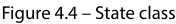

该类封装了我们投资组合的当前状态、最新的市场数据、过去的性能指标以及与其他状态相关的成员。状态的张量进入模型。`toTensor()` 方法。

## 操作定义

`Action` 类定义了代理可以采取的操作：

```cpp
class Action {
public:
    enum ActionType {
        BUY,
        SELL,
        HOLD
    };
private:
    ActionType type; // 操作类型
    std::string ticker; // 股票代码
    double quantity; // 数量

public:
    // 使用类型、代码和数量初始构造函数。
    Action(ActionType t, std::string tk, double q)
        : type(t), ticker(tk), quantity(q) {}

    // 获取操作类型的 Getter。
    ActionType getType() const {
      return type;
    }

    // 获取股票代码的 Getter。
    std::string getTicker() const {
      return ticker;
    }

    // 获取数量的 Getter。
    double getQuantity() const {
      return quantity;
    }
};
```

图 4.5 - Action 类

## 经验存储

每个经验由当前状态、采取的操作、收到的奖励、后续状态以及指示是否完成的标志组成。

```cpp
class Experience {
public:
    State state; // 状态
    Action action; // 的操作
    double reward; // 奖励
    State nextState; // 后续状态
    bool done; // 是否完成的标志

    // 使用状态、操作、奖励、后续状态和完成标志初始化构造函数。
    Experience(const State& s, const Action& a, double r, const State& ns, bool d)
        : state(s), action(a), reward(r), nextState(ns), done(d) {}
};
```

图 4.6 - Experience 类

## 环境交互

`TradingEnvironment` 类模拟环境：

```cpp
class TradingEnvironment {
    private:
        // 交易系统的当前状态。
        State currentState;
        double initialBalance; // 系统的初始余额。
        int currentDay; // 当前日期
        int maxTradingDays = 252; // 假设的一年的天数。

    public:
        // 初始化环境的构造函数。
        TradingEnvironment(const State& initialState, double balance)
            : currentState(initialState), initialBalance(balance), currentDay(0) {}

        // 在环境中执行操作。
        std::tuple<State, double, bool> execute(State& state, double step, const Action& action) {
            double previousPortfolioValue = currentState.getPortfolio().totalValue(currentState.getMarketData());
            // 更新当前状态。
            switch(action.getType()) {
                case BUY:
                    currentState.getPortfolio().buy(action.getTicker(), action.getQuantity(), currentState.getMarketData());
                    break;
                case SELL:
                    currentState.getPortfolio().sell(action.getTicker(), action.getQuantity(), currentState.getMarketData());
                    break;
                case HOLD:
                    // 什么都不做。
                    break;
            }
            // 更新下一天的市场数据（简单起见，我们假设市场数据在别处更新）。
            currentDay++;
            currentState.updateState();
            double newPortfolioValue = currentState.getPortfolio().totalValue(currentState.getMarketData());
            // 奖励是组合价值的变化
            double reward = newPortfolioValue - previousPortfolioValue;
            // 检查交易期是否结束。
            bool done = (currentDay >= maxTradingDays);
            return std::tuple(currentState, reward, done);
        }
        // 将环境重置为初始状态。
        State reset() {
            currentState = State(initialBalance, MarketData({"TICKER"}));
            currentDay = 0;
            return currentState;
        }

        int size() const {
            return 0;
        }

        int actionSize() const {
            return 3;
        }
    };
};
```


## DQN 代理

现在，我们到了实现的核心：`DQNAgent` 类。

此处解决的核心挑战是开发一种能够实时调整策略的系统，以便在波动的市场条件下实现收益最大化。

此实现使用了简化的市场环境，侧重于 `DQN` 智能体的学习机制。它将市场数据抽象为结构化输入，并将交易策略建模为一系列可操作的决策（买入、卖出、持有），目标随时间推学习最优策略。


首先，我们需要在类构造函数中初始化所有变量：

```python
class DQNAgent:
    def __init__(self, scope):
        self.scope = scope
        self.session = session

        self.modelInput = tensorflow.OutputInput(...)  # 神经网络的占位符
        self.modelOutput = tensorflow.Output(...)  # 由神经网络计算的结果。

        self.targetValues = tensorflow.OutputInput(...)  # 目标 Q值的占位符。
        self.loss = tensorflow.Loss(...)  # 损失函数。
        self.trainOp = tensorflow.TrainOp(...)  # 训练操作。
        self.initOp = tensorflow.initOp()

        self.epsilon = double(...)  # 探索率 // 根据需要定义超参数
        self.discountFactor = 0.95  # 经验记忆
        self.memory = Memory(...)  # 经验记忆
        self.capacity = 10000
        self.batchSize = 64

    def __call__(self, input, output):
        with self.scope("DQNAgent"):
            # 为了演示，初始化一个带隐藏层的神经网络。
            modelInput = tensorflow.placeholder(Variable.WithName("input"), (inputSize), tensorflow:DT.FLOAT32)
            weightsHidden = tensorflow.Variable(Variable.WithName("weightsHidden"), (inputSize, 120), tensorflow:DT.FLOAT32)
            basesHidden = tensorflow.Variable(Variable.WithName("basesHidden"), (120,), tensorflow:DT.FLOAT32)

            weightsOutput = tensorflow.Variable(Variable.WithName("weightsOutput"), (120, outputSize), tensorflow:DT.FLOAT32)
            basesOutput = tensorflow.Variable(Variable.WithName("basesOutput"), (outputSize,), tensorflow:DT.FLOAT32)

            targetValues = tensorflow.placeholder(Variable.WithName("target"), tensorflow:DT.FLOAT32)
            loss = tensorflow.ReduceMean(tensorflow.square(qValues - targetValues))

            # 此演示使用 Adam 优化器。
            self.trainOp = tensorflow.optimizers.AdamOptimizer([weightsHidden, basesHidden, weightsOutput, basesOutput], (0.0, 0.0, 0.0, 0.0), (0.001, 0.999, 1e-8, 0))

            # 定义经验回放记忆
            self.memory = Memory(self.capacity)

            # Tensorflow 的全局变量
            self.initOp = tensorflow.GlobalVariablesInitializer(scope)
            self.session.run((), (self.initOp))

            # 更新 epsilon 以进行探索。
            self.epsilon = 1.0.
```

图 4.8 – DQNAgent 类。截图仅供说明。GitHub 仓库中提供了高分辨率的截图。

## 用于风险管理系统的机器学习 159

接下来，我们定义了以下函数：

- `selectAction(const State state)`：此方法根据当前状态决定要采取的动作。根据 `epsilon`（探索率）的值，智能体要么通过采取随机动作进行探索，要么通过选择具有最高 Q 动作进行利用。
- `train(const std::vector<Experience>& experienceBatch)`：使用批量经验来训练神经网络（NN）。智能体根据奖励和神经网络的估计值确定目标 Q 值，然后更新网络权重以最小化预测 Q 值与目标 Q 值之间的差异。
- `remember(...)`：此方法将新经验添加到智能体的内存中，确保如果旧经验超过智能体的容量，则将其移除。

```cpp
// 根据当前状态选择动作。
int selection(const State state) {
    std::real_distribution<double> distribution(0.0, 1.0);
    std::mt19937 generator(rd());
    if (distribution(generator) < epsilon) {
        return random_action();
    } else {
        std::vector<tensor> outputs = target_model->forward(state.tensor());
        int bestIndex = std::max_element(outputs.begin(), outputs.end()) - outputs.begin();
        return action[bestIndex];
    }
}
```

```cpp
void train(const std::vector<Experience>& experienceBatch) {
    // Experience 是包含状态、动作、奖励和完成标记的结构体。
    std::vector<tensor> current_states;
    std::vector<tensor> next_states;
    for (auto const& exp : experienceBatch) {
        current_states.push_back(exp.state.tensor());
    }

    // 计算所选动作的目标 Q 值
    std::vector<tensor> targets = target_model->forward(next_states.tensor());
    if (exp.done) {
        targets[i] = tensor(exp.reward);
    } else {
        std::vector<tensor> next_values = model->forward(exp.state.tensor());
        double maxQValue = next_values[0].value().max();
        targets[i] = tensor(exp.reward + discount * maxQValue);
    }

    // 训练神经网络
}
```

图 4.9 – DQN 类（续）。截图仅供说明。GitHub 仓库中提供了高分辨率的截图。

## 用于风险管理系统的机器学习

智能体的学习过程使用了经验回放（`experience replay`），这使其能够从过去的动作及其结果中进行学习，从而增强学习过程的稳定性和效率。随着智能体的演变，它从探索新动作转变为利用能够最大化奖励的已知策略，其行为越来越多地受到从市场数据交互中获得的洞察的驱动。

## 训练循环

在 `main` 函数中，初始化了环境和智能体，并在一系列回合（`episodes`）中训练智能体。在每个回合中，智能体与环境交互、采取动作、存储经验，并定期对某批经验进行训练：

```cpp
int main() {
    // 初始化环境和智能体
    TradingEnvironment env(State(Portfolio(1000.0), MarketData(({"TICKER"})))));
    DQAgent agent(state.reset(), env.action());

    int numberOfEpisodes = 1000;
    int maxStepsPerEpisode = 200;

    for (int episode = 0; episode < numberOfEpisodes; ++episode) {
        State state = env.reset(); // 重置环境以开始新回合
        double episodeReward = 0;

        for (int step = 0; step < maxStepsPerEpisode; ++step) {
            // 在环境中执行动作
            auto [nextstate, reward, done] = env.step(action);
            // 将经验存储在智能体的内存中
            agent.remember(state, action, nextstate, done);
            // 更新状态并累积奖励
            state = nextstate;
            episodeReward += reward;
            // 使用批经验训练智能体
            if (agent.memory.size() > agent.batchSize()) {
                std::vector<Experience> batch = agent.memory.sample();
                agent.train(batch);
            }
            // 如果回合结束，跳出循环
            if (done) {
                break;
            }
        }
        std::cout << "Episode: " << episode + 1 << " | Reward: " << episodeReward << std::endl;

        // 可选地，你可以定期保存模型
        if ((episode + 1) % 100 == 0) {
            agent.saveModel("path_to_save_directory/" + std::to_string(episode + 1) + ".ckpt");
        }
    }
    return 0;
}
```

图 4.11 – 程序入口（示例）

智能体开始倾向于探索，这种倾向会逐渐减少，使其随着时间的推移更多地利用其学习到的策略。每个回合结束后，都会记录智能体的性能并定期保存模型。

通过将强化学习（RL）与深度学习（DL）相结合，这种实现捕捉了金融市场的复杂性并动态优化了交易策略。DQN 提供了一种估计动作预期奖励的机制，使智能体能够做出明智决策以实现长期收益最大化。

TensorFlow的使用有助于DL，实现了高效的训练和预测。这种方法说明了机器学习在金融系统中的变革潜力，能够实现适应市场变化的动态策略。

## 免责声明

提供的代码主要用于说明目的，提供了关于使用强化学习进行 DPO 的业务介绍。它不用于实际交易或财务决策。虽然我们努力确保其准确性，但我们无法保证它能够完美编译或无故障运行。金融市场错综复杂，受许多因素影响，所展示的模型是一个简化的表示，可能无法捕捉所有的现实复杂性。

前文中提到了各种高级优化技术，但代码仅关注强化学习。理解交易和投资具有内在风险至关重要。所讨论的策略是理论性的，应审慎对待。在做出任何投资决策之前，请务必咨询财务专业人士，并在实际应用之前彻底审查并测试所有模型。

机器学习已经巩固了其在风险管理系统（RMS）中的角色。通过利用算法和数据分析，它促进了潜在风险的预测和缓解策略的制定。

- **实时异常检测**：金融市场有时会因为技术故障、“闪崩”或异常算法表现出异常行为。在海量数据集上训练的先进 ML 模型几乎可以瞬间检测到这些异常。通过识别这些不规则情况，ML 驱动的执行策略可以导致订单错误、重新路由或调整订单规模，以确保负面影响降最低，为突发扰动提供一层保护。
- **市场影响预测建模**：在市场上的每笔订单都会产生某种影响，尤其是大订单。ML 可以通过分析市场状况、历史数据甚至类似的过去订单，在订单执行前预测其市场影响。这种预测洞察允许实时修改订单策略，确保市场扰动最小化并获得更好的执行价格。
- **多目标环境下的优化**：订单执行不仅是为了获得最佳价格，还为了最小化市场影响和管理机会成本。ML 可以在这些多目标场景中优化订单执行，根据实时市场状况和历史见解在不同目标之间动态平衡。例如，在快速变化的市场中，ML 可能会优先考虑速度而非最小市场影响，以确保交易者捕捉机会。

将 ML 引入订单执行提供了一种动态、自适应的方法，能够不断从市场中学习，基于海量数据点和复杂的算法做出决策。这种智能方法有望彻底改变订单执行方式，提高交易运营的效率和盈利能力。

## 深入研究实现——使用 DRL 进化智能订单路由器

传统的，交易公司依赖基于规则的策略进行订单路由。通过集成深度强化学习（DRL），目标是进化出一个智能订单路由器（IOR），通过接触市场数据来逐步完善路由决策。其成功将通过量化进行评估，并根据关键性能指标（KPI）如成本效率和执行速度，与传统方法进行比较。

## 为什么选择 DRL？

让我们探索为什么我们选择使用 DRL：

- **环境交互**：DRL 可以与不同的市场场所（交易所、暗池）交互，并根据流动性、手续费和过往成交率等各种因素，学习哪一个能提供最佳执行效果。
- **持续学习**：DRL 智能体可以适应不断变化的市场动态，从每笔交易中学习并不断更新路由策略。
- **状态复杂性**：DRL 可以处理复杂的状态空间。在订单执行的背景下，这意味着要考虑当前订单簿深度、近期交易甚至宏观经济指标等因素。

## 方法论

让我们探索我们将要使用的方法论：

- **状态表示**：通过关注执行质量并通过滑点、拒绝率和取消率等指标理解场所微观结构，智能订单路由器可以做出更明智的决策。它考虑场所不仅基于最佳可用价格，还基于订单最有可能高效且可靠地执行的地方。这种细致的方法可以显著提高整体执行质量，并减少与执行不良相关的隐藏成本。
  - **当前投资组合状态**：包括各种资产的当前持仓、现金和待处理订单。
  - **近期市场数据**
    - **价格**：包括买卖差差、最后价以及近期数据的加权平均价格（VWAP）。
    - **订单簿**：订单簿深度，可以表示为不同价格水平上的买/卖单量。
    - **成交量**：近期时间段内发生的交易量。
  - **场所质量指标**：此指标可以衡量特定场所执行价格与预期价格之间的差异程度。
    - **拒绝率**：某些场所可能有较高的订单拒绝率。此指标可以帮助模型避免订单拒绝概率高的场所。
    - **订单取消率**：频繁取消订单的场所可靠性较低，此指标将帮助模型衡量这种可靠性。
    - **历史成交率**：这提供了关于订单在特定场所成交概率的想法。
  - **内部指标**
    - **历史执行数据**：包括我们自己执行的历史数据，这可以帮助模型理解我们的订单如何影响市场。
    - **延迟数据**：如果策略是高频的，那么下单和执行的延迟可能是一个关键因素。
- **动作**
  - 将订单路由到特定场所。
  - 将订单拆分到多个场所。
  - 延迟订单（等待更好的机会）。
- **奖励函数**
  - 对于实现优于预期的成交率、最小滑点和降低成本给予正奖励。
  - 对于不利选择、信息泄露或次优成交给予负奖励。
- **DQN**
  - 使用 DQN 来逼近 Q 值。鉴于状态空间的复杂性，深度神经网络（DNN）可以捕捉复杂的模式和关系。
  - 定期更新目标网络以稳定学习。
- **经验回放**
  - 将过去的经验（状态、动作、奖励、下一个状态）存储在内存缓冲区中。
  - 从该缓冲区随机采样以打破相关性并稳定训练。
- **探索-利用策略**
  - 从高探索率开始以探索不同的路由策略，并逐渐降低以利用已学习的策略。
- **训练**
  - 模拟交易环境，让 DRL 智能体与模拟场所交互。使用历史数据模拟订单簿动态并根据智能体的决策模拟交易结果。
  - 根据收到的奖励不断更新 DQN，并使用经验回放进行训练。

接下来，让我们探索该实现的特征。

## 此实现的独特功能

以下是该实现的概述：

- **多场所分析**：DRL 智能体考虑所有可用场所及其历史性能指标，确保全局优化而非局部规则决策。
- **实时自适应性**：DRL 智能体可以根据市场动态实时调整路由策略，确保在市场异常或突发事件期间做出决策
- **宏观指标整合**：通过考虑外部信号，我们的 DRL 智能体可以预判市场波动

通过实现这种 IOR DRL，我们将获得订单执行领域端技术的见解。该模型的适应性、实时决策能力和多目标优化使其成为复杂交易系统的有力补充。

## C++ 代码解读


# IOR：智能订单路由系统

IOR 是一种用于优化路由决策的复杂交易系统组件。传统的系统依赖基础规则或启发式决策。相比之下，IOR 利用 DRL 随着时间的学习优化路由决策。通过与交易所和暗池等不同场所交互，系统能够适应市场动态并进化其策略。这不仅确保了最佳交易，还最小化了与滑点、拒绝和其他不利条件相关的成本。

## IOR 组件

让我们看看 IOR 的组件：

- **数据结构**：如 `PortfolioState`、`MarketData` 和 `VenueMetrics` 等结构共同表示市场和交易投资组合的当前状态。这种全面的状态使 DRL 智能体能够做出明智的决策。

- **环境**：模拟训练环境允许 DRL 智能体与模拟市场交互、采取动作并以奖励或惩罚的形式接收反馈。

- **DRL 智能体**：核心是 DRL 智能体，它使用 `DQN` 预测不同动作的潜在奖励。它做出决策、从经验中学习并随着时间提炼其策略。

- **经验回放**：一种存储过去动作及其结果的机制，允许智能体从近期和旧经验混合中学习，确保学习稳定有效。

## 实现步骤

以下是实现步骤：

- **状态表示**：捕捉当前市场状况、投资组合状态和场所指标。

- **决策制定**：使用 epsilon-贪婪策略在探索（尝试新动作）和利用（使用已知最佳动作）之间做出决策。

- **与环境交互**：在环境中执行所选动作，并观察新的状态和奖励。

- **学习**：存储奖励并定期调整深度强化学习（DRL）模型以优化其策略。

- **持续适应**：调整探索率等参数，以在尝试新策略与优化已知策略之间保持平衡。

## PortfolioState

该结构捕获了交易投资组合的当前状态。它提供了当前资产持仓、现金和待处理订单等细节。这些信息至关重要，因为决定了代理（agent）可以采取的动作。示例：https://github.com/PacktPublishing/C-High-Performance-for-Financial-Systems/blob/main/chapter04/SOR.cpp 例如，代理无法出售它未拥有的资产：

```cpp
class PortfolioState {
    private:
        double cashHand;
        int current_asset_count;
        std::map<string, double> assets; // 资产名称到数量的映射
        std::map<string, double> pendingOrders; // 资产名称到待处理订单数量的映射

    public:
        PortfolioState(double cashHand, int asset_count)
            : cashHand(cashHand), current_asset_count(asset_count) {}

        // 设置并获取现金
        void setCash(double cash) {
            cashHand = cash;
        }

        double getCashHand() {
            return cashHand;
        }

        int getCurrentAssetCount() {
            return current_asset_count;
        }

        // 设置资产持仓
        void setAssetPosition(const std::string assetName, double quantity) {
            assets[assetName] = quantity;
        } // 注意：原始代码中有处错误：current_asset_count = asset_count;

        // 获取资产持仓
        double getAsset(const std::string assetName) const {
            if (assets.find(assetName) != assets.end()) {
                return assets.at(assetName);
            }
            return 0.0; // 如果未找到资产则默认为 0
        }

        // 待处理订单方法
        void setPendingOrder(const std::string assetName, double quantity) {
            pendingOrders[assetName] = quantity;
        }

        double getPendingOrder(const std::string assetName) const {
            if (pendingOrders.find(assetName) != pendingOrders.end()) {
                return pendingOrders.at(assetName);
            }
            return 0.0; // 如果未找到订单则默认为零
        }

        // 清除待处理订单
        void clearPendingOrder(const std::string assetName) {
            pendingOrders.erase(assetName);
        }
};
```

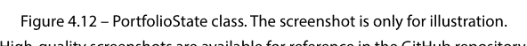

## MarketData

该结构反映了当前的市场状况，包含了买卖差、成交加权平均价（VWAP）和订单簿深度。理解即时市场背景对于实时交易决策至关重要：

```cpp
class MarketData {
  private:
    // 价格信息
    double bidPrice;
    double askPrice;
    double lastTradedPrice;
    double vwap;

    // 订单簿深度（为了简单，我们将代表买入和卖价的总量）
    double bidVolume;
    double askVolume;

    // 成交量
    double tradeVolume;

  public:
    // 构造函数
    MarketData() : bidPrice(0.0), askPrice(0.0), vwap(0.0), bidVolume(0.0), askVolume(0.0), tradeVolume(0.0) {}

    // 价格信息的 setter 和 getter
    void setBidPrice(double bid) { bidPrice = bid; }
    double getBidPrice() const { return bidPrice; }
    void setAskPrice(double ask) { askPrice = ask; }
    double getAskPrice() const { return askPrice; }
    void setLastTradedPrice(double lastPrice) { lastTradedPrice = lastPrice; }
    double getLastTradedPrice() const { return lastTradedPrice; }
    void setVWAP(double volumeWeightedAvgPrice) { vwap = volumeWeightedAvgPrice; }
    double getVWAP() const { return vwap; }

    // 订单簿深度的 setter 和 getter
    void setBidVolume(double volume) { bidVolume = volume; }
    double getBidVolume() const { return bidVolume; }
    void setAskVolume(double volume) { askVolume = volume; }
    double getAskVolume() const { return askVolume; }

    // 成交量的 setter 和 getter
    void setTradeVolume(double volume) { tradeVolume = volume; }
    double getTradeVolume() const { return tradeVolume; }
};
```

图 4.13 – MarketData 类此代码段演示了所讨论概念的实际实现，提供了一个真实示例，说明如何将买卖差、VWAP 和订单簿深度等市场状况整合到交易算法中，以实现有效的决策。

## VenueMetrics

该数据代表与不同场所相关的历史指标，此处封装的数据包含了滑点率、拒绝率和成交率等指标。这有助于代理评估哪些场所在历史上提供了最有利条件：

```cpp
class VenueMetrics {
private:
    std::string venueName;
    // 与执行质量相关的指标
    double slippageRate; // 滑点率百分比
    double rejectionRate; // 订单拒绝百分比
    double fillRate; // 成交率百分比

public:
    VenueMetrics(std::string name) : venueName(name), slippageRate(0.0), rejectionRate(0.0), fillRate(0.0) {}

    // setters
    void setSlippageRate(double rate) { slippageRate = rate; }
    void setRejectionRate(double rate) { rejectionRate = rate; }
    void setFillRate(double rate) { fillRate = rate; }

    // getters
    double getSlippageRate() const { return slippageRate; }
    double getRejectionRate() const { return rejectionRate; }
    double getFillRate() const { return fillRate; }
    std::string getVenueName() const { return venueName; }
};
```

图 4.14 – VenueMetrics 类

## 模拟环境

环境在执行中起着至关重要的作用。代理发送订单并观察结果。环境对订单执行做出反馈：

### ML 订单

```cpp
class Environment {
    public:
        // 环境包含当前状态
        PortfolioState portfolio_state;
        MarketData market_data;
        VenueMetrics venue_metrics;

        // 构造函数初始化状态
        Environment(PortfolioState ps, MarketData md, VenueMetrics vm)
            : portfolio_state(ps), market_data(md), venue_metrics(vm) {}

        // 模拟市场反应
        double simulate_market_reaction(Action action) {
            // 此处模拟价格波动逻辑
            return ((double)rand() / RAND_MAX - 0.5) * 2.0; 
        }

        // 执行动作步骤
        double step(Action action) {
            // 记录之前的状态以计算奖励
            PortfolioState prev_state = portfolio_state;
            double reward = 0;

            double price_change = simulate_market_reaction(action);
            double new_price = market_data.getLastTradedPrice() + price_change;

            if (action == Action::BUY) {
                if (portfolio_state.getCashHand() >= new_price) {
                    portfolio_state.setCash(portfolio_state.getCashHand() - new_price);
                    portfolio_state.setAssetPosition("BTC", portfolio_state.getAsset("BTC") + 1);
                    // 奖励逻辑：资产价值增加
                    reward = 1.0; 
                }
            } else if (action == Action::SELL) {
                if (portfolio_state.getCurrentAssetCount() > 0) {
                    portfolio_state.setCash(portfolio_state.getCashHand() + new_price);
                    portfolio_state.setAssetPosition("BTC", portfolio_state.getAsset("BTC") - 1);
                    // 奖励逻辑：现金价值增加
                    reward = 1.0;
                }
            } else if (action == Action::HOLD) {
                // 持有时的奖励较小
                reward = 0.1;
            }

            // 更新市场数据
            market_data.setLastTradedPrice(new_price);
            return reward;
        }
    };
};
```

## DRL 智能体

DRL 智能体是 IOR 的核心。它使用神经网络（NN），具体为 `DQN`，根据当前状态为每个可能的动作预测 Q 值。这些 Q 值代表了每个动作的预期未来奖励。关键组件和流程包括：

- **Epsilon-贪婪策略**：平衡探索与利用至关重要。在训练早期，智能体会进行更多探索以发现良好的策略。随着时间的推移，当它对策略产生信心，会更频繁地进行利用。

- **经验回放**：智能体将最近的经验（状态、动作、奖励、下一个状态）存储在内存中。通过定期从该内存中采样来训练其 `DQN`，智能体确保了学习经验的多样性和稳定性。

- **训练**：利用其内存中的经验计算 Q 值并训练其 `DQN`，以最小化预测 Q 值与目标 Q 值之间的差异。这一迭代过程不断精炼智能体的策略。


## 超参数设置

```python
train_steps = 100000
batch_size = 64
learning_rate = 0.001
epsilon_start = 1.0
epsilon_end = 0.01
epsilon_decay = 0.99995
gamma = 0.99
n_actions = 10
```

## 目标网络设置

```python
target_model = build_model(_input_shape=state_input_shape, n_actions)
target_model.set_weights(model.get_weights())
```

## 主网络设置

```python
model = build_model(_input_shape=state_input_shape, n_actions)
model.compile(optimizer=Adam(learning_rate=learning_rate), loss='mse')
```

## 训练循环

```python
for step in range(train_steps):
    state = env.reset()
    action = epsilon_greedy(state, epsilon)
    next_state, reward, done, _ = env.step(action)
    memory.append((state, action, reward, next_state, done))
    if len(memory) > batch_size:
        batch = memory.sample(batch_size)
        states, actions, rewards, next_states, dones = zip(*batch)
        targets = model.predict(states)
        next_q = target_model.predict(next_states)
        for i in range(batch_size):
            if dones[i]:
                targets[i][actions[i]] = rewards[i]
            else:
                targets[i][actions[i]] = rewards[i] + gamma * np.max(next_q[i])
        model.fit(states, targets, verbose=0)
    epsilon = max(epsilon_end, epsilon * epsilon_decay)
```

图 4.16 – DRL 智能体类。截图仅用于说明。GitHub 仓库中提供了高质量的截图供参考。

## 持续适应与实时决策

IOR 系统通过其 DRL 智能体不断更新策略，以适应变化的市场动态。这种适应性在以下领域显而易见：

- **动态探索率**：探索率（`epsilon`）随时间衰减，确保智能体随着经验的积累，更多地依赖其所学到的策略。
- **经验回放**：智能体不仅从最近的经验中学习，还从新旧经验的混合中学习，确保了丰富的学习上下文：

```cpp
class ExperienceReplay {
private:
    std::deque<Experience> memory; // 用于存储经验的双端队列
    int capacity; // 存储的最大经验数量

public:
    // 构造函数，给定容量初始化 ExperienceReplay
    ExperienceReplay(int capacity) : capacity(capacity) {}

    // 向回放内存添加经验的方法
    void add(const Experience& experience) {
        // 如果内存满了，移除最旧的经验
        if (memory.size() == capacity) {
            memory.pop_front();
        }

        // 添加新经验
        memory.push_back(experience);
    }

    // 采样批次经验的方法
    std::vector<Experience> sample(int batch_size) {
        if (batch_size > memory.size()) {
            throw std::runtime_error("Batch size is larger than current memory size");
        }

        std::random_device rd;
        std::mt19937 generator(rd);
        std::uniform_int_distribution distribution(0, memory.size() - 1);

        std::vector<Experience> batch;
        for (int i = 0; i < batch_size; i++) {
            int idx = distribution(generator);
            batch.push_back(memory[idx]);
        }

        return batch;
    }

    // 获取内存当前大小的方法
    int size() const {
        return memory.size();
    }
};
```

图 4.17 – `ExperienceReplay` 类

接下来，让我们看看 `main()` 函数是如何将所有内容整合在一起的。

## 主执行流程详解

`main()` 函数首先开始定义 DRL 训练过程的关键参数：

- `total_episodes`：此参数设置了智能体训练的轮数（episodes）。每回合代表与环境的单次交互循环。
- `epsilon`：初始探索率。它决定了智能体采取随机动作（探索）而非依赖现有知识（利用）的概率。
- `epsilon_decay`：这些参数控制探索率随时间减少的频率。
- `training_interval`：指定智能体根据其经验进行训练的频率。

```cpp
int main() {
    // 参数
    int total_episodes = 100000;
    double epsilon = 1.0;
    double epsilon_end = 0.01;
    double epsilon_decay = 0.99995;
    int training_interval = 100;
    double episode_reward = 0;

    for (int episode = 0; episode < total_episodes; episode++) {
        // 重置环境
        State state = env.reset();
        bool done = false;

        while (!done) {
            // 决策动作
            int action;
            if ((double)rand() / RAND_MAX < epsilon) {
                action = explore(); // 探索
            } else {
                action = exploit(state); // 利用
            }

            // 执行动作
            Result result = env.step(action);
            episode_reward += result.reward;
            done = result.done;

            // 存储经验
            memory.add({state, action, result.reward, result.next_state, done});
            state = result.next_state;

            // 定期训练
            if (episode % training_interval == 0) {
                agent.train(memory);
            }
        }

        // 衰减探索率
        if (epsilon > epsilon_end) {
            epsilon *= epsilon_decay;
        }

        std::cout << "episode " << episode << ": Reward = " << episode_reward << std::endl;
    }

    return 0;
}
```

图 4.18 – 主程序（示例）。截图仅用于说明。GitHub 仓库中提供了高质量的截图供参考。

## 挑战

机器学习（ML）已成为金融系统中的变革性力量，驱动了算法交易、风险管理和智能订单路由等领域的创新。然而，尽管机器学习的潜力巨大，但其部署仍面临多重挑战。从在历史数据上训练模型的细微差别，到实时预测和生产部署的复杂性，金融专业人士需要在一个复杂的环境中穿行前行。本节将探索在将机器学习集成到金融系统时面临的一些关键挑战。

### 使用历史数据训练模型（离线）与进行实时预测之间的差异

在历史数据上训练机器学习模型具有受控环境的优势。工程师和数据科学家可以使用海量的过去数据来验证模型、精炼超参数并评估性能指标。然而，从这种离线训练转向实时预测引入了以下几个问题：

- **非平稳性**：金融市场是动态的，底层模式和关系随着时间推移而演变。在过去数据上训练的模型可能没有这些变化，导致在实时场景中产生次优或错误的预测。
- **延迟考量**：在实时交易中，特别是在高频设置中，决策需要非常敏捷。处理新数据、运行预测和执行交易的时间通常有限。任何延迟都可能导致错失机会或增加成本。
- **新鲜性**：与静态的历史数据不同，实时数据流可能存在缺失值、离群值或噪声。在实时环境中确保数据质量和一致性比离线设置更具挑战性。
- **反馈循环**：在现场环境中，模型的预测或行为可能会影响未来的数据。例如，交易模型的行为可能会影响市场价格。这创建了反馈循环，即模型的决策塑造了它所训练的数据本身——这种场景在离线训练中很少遇到。

### 将研究发现转化为生产级代码的挑战

将研究中发现的新颖机器学习技术或算法集成到生产系统中往往不是易举的。在这一转化过程中会出现几种挑战：

- **速度优化**：研究代码的编写通常侧重于灵活性和实验，而非速度。在生产环境中，特别是在毫秒必争的金融领域，代码需要经过高度优化以降低延迟。
- **健壮性**：虽然研究模型在特定条件或数据集下运行良好，但它们需要对现场环境中的各种场景具有健壮性。这包括优雅地处理边界情况、异常或意外的输入。
- **与现有系统的集成**：金融系统错综复杂，有多个组件相互接口。新开发的机器学习模型需要与这些系统无缝集成，这些系统可能是使用不同的技术或架构构建的。
- **可扩展性**：在小型数据集上表现良好的模型在部署到具有海量数据流的现场环境时可能会不从心。确保机器学习的有效扩展至关重要。
- **可维护性**：研究代码可能不遵循最佳编码实践或标准。在生产环境中，代码需要是可维护的、模块化的且文档完善的，以便其他工程师理解、修改或扩展它。
- **持续学习与适应**：金融模型可能需要频繁更新以反映最新的市场状况。构建持续学习的基础设施（即定期重新训练或微调模型）变得至关重要。

### 基于我们用例的机器学习的局限性

在 IOR（订单路由）和其他金融系统（如 RMS 风险管理系统或 PO 系统）的背景下，机器学习带来了不可否认的优势。然而，理解其局限性至关重要：

- **模型可解释性**：深度学习（DL）模型（如 IOR 中的 DQN）可能是“黑箱”，使得解释其决策具有挑战性。在金融领域，问责制至关重要，这种透明度的缺失可能是一个重大问题。
- **对历史数据的过拟合**：虽然 IOR 在历史数据上进行训练以学习最佳路由决策，但存在过拟合的风险，即模型过度适应过去的事件，而无法泛化到新的不可预测的市场状况。
- **对特征工程的敏感性**：IOR 的有效性在很大程度上取决于它考虑的特征（或输入）。选择错误或工程不当的特征可能导致次优决策。
- **对奖励设计的依赖**：强化学习（RL）中的学习过程依赖于奖励的设计。
- **缺乏完美信息**：在金融市场，模型可能无法获得完美信息，这种场景在离线训练中是少见的。
- **外部因素与异常**：金融模型可能会受到外部因素或市场异常的影响，导致不可预测的结果。

将机器学习集成到金融系统呈现了充满前景的创新。然而，需要对于理解其优势和局限性。通过识别并主动应对其固有风险，金融机构可以利用机器学习的优势。

## 结论

当我们应对机器学习在金融系统中的复杂图谱时，显然我们正处于一个变革时代的边缘。传统金融策略与尖端机器学习技术的汇聚，预示着前所未有的潜力，同时也带来了新的挑战。在结论部分，我们将展望未来，总结本次探索的关键收获。

### 未来趋势与创新

随着机器学习继续巩固在金融系统中的作用，我可以预见到一些将塑造未来的趋势和创新：

- **自适应模型**：随着金融市场的快速演变，能够适应变化的模型将成为主流。持续学习机制（即模型实时进行微调）将获得关注。
- **传统金融与机器学习的融合**：将传统金融理论（如有效市场假说 EMH 或布莱克-斯科尔模型）与先进机器学习相结合的混合模型可以提供智慧与适应性的结合。
- **金融领域的伦理 AI**：随着 AI 和机器学习在金融决策中发挥着日益决定性的作用，行业需要解决伦理考虑，确保算法交易和其他机器学习过程的公平性、透明度和问责制。
- **跨学科协作**：金融、机器学习与行为经济学或神经科学等其他领域的交叉可能会带来考虑到交易和投资定量与心理方面的创新解决方案。

### 量子计算

量子计算（QC）领域及其同时处理海量信息的能力，为金融和机器学习的未来提供了令人期待的可能性。一些预期影响和创新包括：

- **金融量子算法**：量子算法（如量子傅里叶变换 QFT 或 Grover 算法）具有极大加速期权定价、风险分析和 PO 等任务的潜力。
- **增强安全性**：量子加密和量子密钥分发可能彻底改变金融交易的安全格局，提供理论上经典计算机无法破解的加密水平。
- **复杂模拟**：量子计算机可以模拟具有许多变量和参数的复杂金融系统，可能导致更准确的模型和预测。
- **挑战**：虽然量子计算具有潜力，但也带来了挑战。量子比特（qubits）极其不稳定，目前的量子计算机容易出错。弥合理论潜力与实际应用之间的差距将是一个关键障碍。
- **混合模型**：在不久的将来，我们可能会看到混合系统，经典计算机处理某些任务，而量子计算机处理特定的密集型操作，结合两者的优势。

### 总结

在本章中，我们揭示了一个充满机遇与创新的领域。机器学习（ML）凭借其在模式识别和预测方面的专长，已经开始重塑金融策略和决策的范式。通过 IOR 等应用，我们观察到深度强化学习（DRL）如何彻底改变订单执行，以传统方法无法实现的方式对其进行优化。

然而，随着这些进步也带来了挑战。实时决策的复杂性、将研究转化为生产就绪解决方案的障碍，以及机器学习模型固有的局限性，凸显了采取平衡且知智的方法的必要性。

展望未来，新兴趋势描绘了一幅持续演变的蓝图。传统金融智慧与机器学习洞察的融合、AI驱动金融中的伦理考量，以及跨学科协作承诺了一个多维面的未来。此外，量子计算（QC）的黎明正召唤着尚未被开发的可能，具有重新定义金融计算边界的潜力。

## 5 金融系统的可扩展性

金融系统不断应对日益增长的数据量和交易负载。随着全球市场的扩张和交易量的激增，曾经无缝管理日常运营的系统现在面临着潜在的瓶颈。因此，可扩展性不仅是一个理想的特征，更是一种需求。

虽然初期的系统设计和实施奠定了基础，但扩展确保了系统的寿命和韧性。它关乎预测数据、用户、交易甚至互联系统的增长，并确保系统能够顺畅地处理这种增长。

在时机至关重要的金融系统中，任何延迟或停机都可能导致错失良机或重大损失。仅仅增加硬件或扩展服务器容量并不是一个全面的解决方案。本章的重点在于理解金融领域扩展的更细微差别。

读者将学习到专门为金融系统定制的各种扩展方法。从理解基础权衡到实施最佳实践，重点在于可操作的知识。本章还探讨了监控在扩展中的关键作用，强调了其在资源优化和瓶颈识别中的重要性。

到本章结束时，读者将学习到增强关键金融系统组件可扩展性的策略。在意识到扩展整个系统具有挑战性的同时，我们将关注于改进关键区域的实用方法，目标是实求在日益增长的需求下实现稳健且高效的运行。

## 金融交易系统的扩展方法

在金融市场不断演变的格局中，对交易系统的需求是无休止的。从适应交易量的激增到处理多样且复杂的数据流，系统在不断变化的容量和性能的环境中运行。这不仅关乎处理今天的数据和交易负载，还为了应对明天的需求做好准备。

在金融交易系统的背景下，扩展指的是系统处理增长的能力。它是增强系统以管理增加的负载的过程，无论这种负载是以更多用户、更多交易还是更多数据的形式。虽然扩展的概念看起来显而易见，但在金融领域实现这一目标的方法和策略需要仔细的考虑和规划。

有几个因素促成了金融系统对扩展的需求：

- **交易量的增长**：随着金融市场的全球扩张以及交易对更多的人口变得更容易获得，这对系统必须处理的交易数量产生了直接影响。这种增长不是线性的；在交易量的高峰时期，交易量会激增，给系统带来突然且巨大的负载。


- 数据复杂性：现代交易策略整合了多样化的数据。它不再仅仅关乎市场数据。从卫星图像追踪货运到社交媒体的实时情感分析，所有另类数据源都贡献了数据的洪流。每个数据源都具有其独特的结构和更新频率，又增添了一层复杂性。

- 用户预期：今天的交易员运行在一个近乎即时满足的世界。十年前可能接受的延迟现在已不再适用。交易员期望实时数据处理、瞬时交易执行和即时反馈。随着用户群的增长，这些预期也随之增长，将系统推向性能极限。

- 监管和合规需求：金融市场是受监管最严的行业之一。随着监管机构引入新规则或修改现有规则，交易系统必须适应。这通常意味着整合新的数据源、更改数据处理方法或添加新的数据源。

# 在垂直扩展和水平扩展之间进行选择

在金融交易系统中，垂直扩展与水平扩展之间的选择并非二选一，而是取决于多个因素，包括成本、复杂性、风险承受能力以及现有的系统架构。这通常是在垂直扩展的简单性和快速的性能提升，与水平扩展的灵活性、容错性和可扩展性之间进行权衡。

对于正在进行重大重构的新系统，水平扩展通常是首选方案，因为其具有长期收益。然而，对于面临即时性能挑战的现有系统，垂直扩展可以提供短期解决方案，同时可以计划并实施更全面的扩展策略。

在性能和可用性不容妥协的金融交易领域，通常采用混合方法。这种方法结合了用于快速见效的垂直扩展和用于长期增长的水平扩展，平衡了即时性能需求与战略性可扩展性目标。

从这里开始，我们将注意力转向如何有效地分配数据和管理工作负载。这对于增强交易系统的性能和可扩展性至关重要。

## 数据分区与负载均衡

数据分区对于将数据集分布在系统的不同节点上至关重要，从而增强性能和可扩展性。该技术涉及将数据库划分为更小、更易管理的片段（即分区），这些分区可以分布在各个服务器上。

交易系统中常见的分区策略是基于资产类别。例如，股票、固定收益、衍生品和货币可能存储在不同的分区中。另一种方法是基于时间的分区，根据时间戳（如交易日）对分段，这在历史数据分析和交易策略回测中特别有用。

这是一个技术示例：考虑一个处理多个资产类别订单的交易系统。通过按资产类别对订单进行分区，每个分区可以由不同的服务器管理。这种设置不仅通过减少单个服务器的工作负载来促进更快的下单，还允许对某类资产进行维护或更新，而不会影响其他资产的可用性。

另一方面，负载均衡对于将工作负载均匀地分布在金融交易系统的服务器上至关重要。它确保没有单个服务器成为瓶颈，瓶颈会导致延迟增加和可靠性下降。

在交易系统中，负载均衡器可以将入站订单分配到多个服务器上，确保处理负载被共享。这在交易高峰期或订单量可能急剧增的市场事件期间尤为重要。

在实际场景中，考虑一个实现轮询负载均衡器的交易平台来分发交易。

其工作原理如下：每个入站交易订单按顺序分配给服务器池——首先分配给服务器 1，然后是服务器 2，以此类推。在最后一个服务器接收到交易后，它将循环回到服务器 1。

这种设置中的每台服务器都为快速高效的交易处理进行了精细调整。它们不仅为快速执行做好准备，而且不断与市场数据保持同步，并连接以实现快速下单。

现在，如果某台服务器变得拥挤或遇到故障，轮询系统不会停滞。它会自动将入站交易重新路由到其他服务器，保持流向稳定并避免任何性能波动。

更具技术性的是，服务器正受到持续的监控；包括思考速度、队列大小和错误率。这些信息对于负载均衡器来说是黄金数据，帮助它做出更明智的分配选择，即使在服务器接近其限制之前迁移负载也是如此。

由于在交易中停机是不可接受的，因此总有一个备份计划。额外的服务器随时待命，如果一个主服务器发生故障，它们将无缝接管，确保平台无论如何都保持运行。

结论是，通过实施数据分区和负载均衡，金融交易系统可以实现更高水平的效率和可靠性。这些策略允许系统在处理大量交易和数据的同时保持快速响应时间，这对于竞争激烈的交易环境至关重要。

## 实现分布式系统

实现分布式系统是那些旨在在不断增长的需求中保持高性能和可用性的交易系统的关键策略。金融领域的分布式系统利用互连节点网络共同工作，形成一个连贯的系统，以同步的方式管理交易订单、市场数据处理和风险评估。

### 基础概念

在深入研究分布式交易系统的具体细节之前，理解一些基础概念至关重要：

- **节点 (`Nodes`)**：在分布式系统中，节点指的是执行任务和服务的单个计算机或服务器。每个节点独立运行又协作工作，以实现系统的整体功能。

- **网络通信 (`Network communication`)**：节点通过网络相互通信，交换消息以确保一致性并协调操作。网络的可靠性和延迟直接影响系统的性能。

### 金融系统中的可扩展性

- **共识算法 (`Consensus algorithms`)**：这些算法对于维护系统的统一状态至关重要。它们确保所有节点对数据的当前状态达成共识，这对于交易执行的完整性至关重要。

- **容错性 (`Fault tolerance`)**：分布式系统的设计旨在即使在一个或多个节点失败的情况下继续运行。这种韧性对于高可用性是强制性要求的交易系统至关重要。

### 技术亮点

- **实时数据分布 (`Real-time data distribution`)**：在交易环境中，市场数据实时分发到各个节点进行处理。实现发布-订阅消息模式可以促进这种分布，确保对特定类型数据（如某些证券的价格更新）感兴趣的节点无延迟地接收信息。

- **订单匹配引擎 (`Order matching engine`)**：在交易所背景下，其核心是订单匹配引擎，它配对买卖订单。在分布式系统中，该引擎可以在多个节点上进行复制，以处理更大数量的订单并提供备份。

- **分布式账本技术 (`Distributed ledger technology`)**：对于交易结算和记录，可以使用区块链等分布式账本技术。这种方法确保了交易记录的透明性、安全性和防篡改性，这些记录在网络中分布存储，而不是存储在中央数据库中。

- **微服务架构 (`Microservices architecture`)**：通过将交易系统分解为微服务，每个服务都可以根据特定需求独立扩展。例如，在外汇市场波动剧烈时，处理货币兑换的微服务可以进行扩展。

- **风险管理与合规性 (`Risk management and compliance`)**：分布式系统能够并行处理风险评估和合规检查。这种并行性确保了在系统执行必要的风险计算和遵守监管要求时，交易操作不会变慢。

### 挑战与考虑

- **数据一致性 (`Data consistency`)**：在节点之间确保数据一致性（特别是在网络分区或延迟的情况下）具有挑战性。最终一致性和无冲突可复制数据类型 (`CRDTs`) 等技术可以解决这些问题。

- **事务原子性 (`Transaction atomicity`)**：原子事务在金融领域至关重要，以避免出现交易部分完成的情况。分布式事务通常采用两阶段提交协议来确保跨节点的原子性。

- **可扩展性 (`Scalability`)**：随着交易量的增长，系统必须在不降低性能的情况下进行扩展。这种可扩展性可以通过向网络添加节点并采用负载均衡技术来分配工作负载来实现。

# 实现可扩展性的最佳实践

金融交易中分布式系统的实现，是应对现代金融需求的一项复杂但必要的演进。通过考虑技术亮点和挑战，并采用最佳实践，此类系统可以实现在快速变化的交易世界中成功所需的扩展性、性能和可靠性。

## 故障设计

为故障设计是弹性系统开发中一个深深植根的概念，这在金融交易系统领域尤为关键，因为在那里，停机或单点故障的成本可能是天文数字。

当我们谈论金融系统中的故障设计时，我们本质上是在接受这样一种哲学：我们的系统并不是对故障免疫的。无论系统多么健壮或经过了充分测试，失败的可能性始终存在。在这种环境中，成功的关键不在于消除故障，而是将其影响降至最低。

这一概念始于接受金融交易系统中的每个组件——从低延迟市场数据馈送处理器到复杂的算法交易策略——都有失败的可能性。这种认识并非一种悲观的观点，而是一种构建更强大、更具弹性的系统的务实方法。从前面的章节关于系统架构和计算中汲取的教训在这里发挥作用，为理解故障可能何时以及如何发生提供了基础。

### 容错 – 第一道防线

容错能力是系统在某些组件故障时继续正常运行的能力。在金融交易系统的背景下，容错不仅是一个特性，更是一种必须。它始于架构本身。容错系统本质上通常是分布式的，将其操作分散在多个服务器、数据中心和地域，以降低灾难性故障的风险。

容错系统经过了精细的划分，确保`订单管理系统 (OMS)`和`执行管理系统 (EMS)`等关键组件不仅被隔离，而且被复制。每个组件都有备份，在主系统故障时准备好接管。从主系统到备用系统的转换是无缝的，通常由复杂的软件管理，这些软件可以在毫秒内检测故障并在无需人工干预的情况下切换操作。

### 冗余 – 复制的艺术

冗余是对系统关键组件或功能的复制，目的是增加系统的可靠性。在高风险交易的世界中，冗余并非“多余”；它是必不可少的。冗余可以通过多种形式实现：数据冗余、服务器冗余、网络冗余，甚至是地理冗余。

具有冗余的系统确保所有关键数据都实时备份，采用数据库复制等技术。服务器冗余涉及多个服务器，它们可以接管故障服务器的任务。网络冗余确保关键组件之间存在多条网络路径，这样如果其中一条路径失败，系统可以通过另一条重新路由流量。

### 故障转移机制 – 安全网

故障转移是在主活动系统故障后切换到冗余或备用系统的过程。故障转移的设计是一门复杂的艺术，不仅涉及硬件和软件，还涉及对工作流的深度理解。金融系统中的故障转移机制被设计为自动，由预定义的条件触发，无需人工干预。

这些机制范围从本地故障转移（例如切换到同一数据中心内的备份）到全局故障转移（涉及切换到完全不同位置的服务器）。故障转移系统可以是热、温或冷的，每种都代表备用系统接管的就绪程度。热系统与主系统并行运行，温系统处于待命状态并可以快速激活，冷系统需要较长时间才能运行。

### 灾难恢复 – 超越即时故障转移

虽然故障转移机制处理系统故障的直接后果，但灾难恢复是在灾难性事件后恢复正常运行的长期计划。灾难恢复关于建立记录在案、经过演练的计划，涵盖数据恢复、系统恢复，甚至在交易厅或数据中心遭受物理损坏时的区域恢复。

灾难恢复计划涉及定期备份、异地存储以及使用灾难恢复站点，这些站点可以位于距离主站点较远的地方，以确保不受相同灾难的影响。这些站点具备接管交易系统全部操作的能力，确保即使在最不利的情况下交易继续。

### 拥抱失败以锻造弹性

为故障设计是一种范式，它承认系统故障的不可避免性，同时赋予系统抵御和从中恢复的能力。这是一种整体方法，涵盖了从架构设计阶段到运行阶段的策略。

## 持续运行

其理念是设计一种不仅在正常条件下健壮，而且在面对升级、故障或任何意外中断时保持无缝运行的系统。

实现持续运行始于冗余概念，我们在之前关于故障设计的章节中提到过这一点。冗余确保对于每个关键组件，都有一个准备好接管的副本，而不会中断系统的功能。冗余延伸从硬件扩展到数据的冗余副本、冗余网络路径，甚至是冗余电源。

确保持续运行的下一层是实施微服务架构，我们在早些章节中剖析过它。微服务允许交易系统的单个组件进行更新或维护，而不必关闭整个系统。这种模块化方法意味着，如果市场数据需要更新或需要部署新的交易策略，可以在不影响订单执行或风险管理服务的情况下完成。

实时系统更新（或热补丁，`hotfixes`）对于持续运行也至关重要。这些更新是在不终止正在进行的进程的情况下对系统进行的更新。它们需要复杂的部署流程和回滚策略，以防更新引入新问题。诸如金丝雀发布（`canary releasing`）等技术，在全量部署之前将新更新推送到一小部分用户，可以确保系统在进行更改时仍保持运行。

为了进一步增强持续运行能力，金融交易系统采用了负载均衡器，将传入的请求分配到服务器集群中。这不仅优化了资源利用，还意味着当某一台服务器故障时，负载均衡器会将流量重定向到剩余服务器，确保服务不中断。

监控和告警系统在持续运行中发挥着关键作用。这些系统持续监控交易系统，检测并告警异常情况，从异常的交易模式到系统性能下降。自动化监控工具可以在问题影响系统运行之前解决它们；如果无法解决，它们可以确保系统立即引起关注以便快速修复。

正如在“故障设计”（`design for failure`）背景下概述的那样，灾难恢复策略是持续运行不可或缺的一部分。它们确保系统在发生重大故障时有一套可遵循的计划，从而快速恢复并恢复正常运行。

总结来说，金融交易系统的持续运行在于预判意外之外的情况并对其制定计划。它关乎确保系统具有适应变化的内置灵活性。关乎拥有一个安全网，在故障导致停机之前捕获它们。通过将这些原则嵌入金融交易系统的 DNA 中，我们确保了市场保持稳健，交易者对系统充满信心。

## 使用灵活性和模块化构建系统

考虑到灵活性和模块化进行构建是一种架构策略，使交易系统能够适应市场动态、监管要求和技术进步的变化。模块化是一种设计原则，将系统划分为不同的功能或服务，允许各个模块独立进行开发、测试或扩展。在金融交易背景下，模块化转变为交易执行、风险管理和分析等离散组件。

另一方面，灵活性是指系统在不需要完全重构的情况下进行适应的能力。这需要一种前瞻性的设计方法，考虑到潜在的集成。通过拥抱模块化和灵活性，交易系统可以快速响应机会和挑战，确保保持竞争力。这种方法最大限度地减少了单体系统相关的风险，因为在单体系统中更改往往是非常耗时的。

## 考虑网络和通信开销的影响

在金融交易系统的构建中，网络和通信开销是对可扩展性和性能产生深远影响的一个方面。当我们提到开销时，指的是管理通信所需的额外时间和资源。为了减轻这种影响，我们考虑了以下几个关键因素：

- 网络基础设施：底层物理网络必须针对低延迟进行优化。这包括使用可以处理数据吞吐量的高性能硬件，如交换机和路由器。布局也关重要，较短的路径可以减少数据包传输的时间。

- 网络协议：网络协议的选择会影响通信速度并降低延迟。在某些情况下，金融系统可能会采用针对特定类型数据精炼的专有协议，尽管是以牺牲互操作性为代价。

- 数据序列化和反序列化：将数据结构或对象转换为可以存储或传输的格式并重建原始对象的过程可能会引入巨大的开销。高效的序列化和反序列化技术至关重要，特别是在处理复杂工具或大量交易数据时。

- 消息压缩：在传输前压缩数据可以减小网络发送消息的大小，从而提高传输速度。然而，压缩和解压缩过程本身会引入计算开销，因此它们必须足够高效以确保降低整体延迟。

- 连接管理：组件之间使用持久连接，而不是为每次通信建立新连接，可以减少开销。这缓解了耗时的连接建立过程，该过程包括握手和身份验证。

- 数据缓存：在网络中需要数据的地方内存中缓存频繁访问的数据。有效的缓存策略可以显著减少必须传输的数据以及相关的延迟。

- 使用内容分发网络 (`CDN`)：在需要将数据分发到广泛地理区域的系统中，可以使用 `CDN` 在靠近终端用户的边缘位置缓存内容，缩短数据传输距离，从而降低延迟。

- 负载均衡：智能负载均衡可以将流量均匀地分布在网络资源上，防止任何单一服务器或网络路径成为瓶颈。先进的负载均衡器可以根据当前的网络状况、服务器负载甚至请求类型路由流量。

- 网络监控和优化：对网络性能进行持续监控可以识别瓶颈或低效之处。网络优化可能涉及重新路由流量、调整负载均衡器设置或升级网络路径。

通过解决这些每一个领域，可以设计金融交易系统以最大限度地减少网络和通信开销对其运行的影响。目标是创建一个数据流动自由且快速、决策几乎瞬间执行的系统，并且系统的可扩展性不受其内部或与外部世界通信能力的限制。

## 理解性能、可扩展性和成本之间的权衡

性能、可扩展性和成本之间的权衡是一项平衡与优先排序的练习，在金融交易系统的开发和维护中起着非常重要的作用。

金融交易系统中的性能特征是系统处理数据、执行交易和响应市场事件的速度和效率。可扩展性是系统随着规模和复杂性的增长保持性能水平的能力，以容纳更多用户、更高的交易量或额外的市场工具。成本涵盖了开发和持续的运营费用，必须进行审慎管理，以确保系统的经济可行性。

在诸此类项目中，我们始终寻找允许系统架构师和开发者达成最佳平衡的策略，在控制成本的同时实现高性能且可扩展的系统。通过架构选择、技术投资和运营效率的结合，我们旨在勾勒出一个框架，指导创建一个不仅能满足当前市场需求，而且随着时间推移保持适应性和成本效益的系统。

### 平衡性能与扩展性需求

平衡这两者需要一种细致的方法，以协调高频交易的即时需求与未来增长的预见性。

实现这种平衡的一个基本策略是采用弹性架构。这些架构设计旨在根据系统当前的负载动态地扩展或收缩资源利用率。基于云的架构或虚拟化环境通常是弹性解决方案的关键组成部分，提供了按需扩展计算资源的能力。虽然弹性可以解决扩展性问题，但必须对其进行管理，以确保扩展行为本身不会引入性能惩罚。

性能调优是另一个关键方面。它涉及优化代码、采用高效的算法以及选择合适的数据结构。在高频交易系统中，降低复杂性的算法优化可以带来显著的性能提升。然而，这些优化不能损害系统的扩展能力。例如，内存数据库可以提供对数据的快速访问，但它们需要精细的管理，以确保它们能够随着数据量的增长而有效扩展。

使用尖端硬件也是一个关键考虑因素。加速处理单元、高吞吐量网络接口和快速存储解决方案可以为高性能交易系统提供必要的原始速度。然而，此类硬件的成本以及由于技术进步导致快速过时的可能性，必须与它们提供的性能进行权衡。


平衡性能与扩展性的另一种技术是实现解耦组件的模块化设计。这允许对系统的各个部分进行优化，而不影响系统的整体扩展性。例如，处理交易执行的模块可以针对速度进行优化，而处理交易结算的另一个模块可能针对高吞吐量进行设计。跨多个服务器或实例的负载均衡也有助于均匀分布系统负载，防止任何单个组件成为瓶颈。然而，这种方法需要智能路由机制，以确保分布不会导致延迟不一致或资源利用不足。

缓存访问的数据可以显著提高性能，减少从较慢的存储介质获取数据的需求。然而，分布式系统中的缓存同步可能具有挑战性，必须制定策略以防止过时或不一致的数据影响交易决策。

在优化性能和扩展性时，性能分析（`profiling`）和基准测试（`benchmarking`）是不可或缺的。它们提供了关于系统变化如何影响性能以及系统扩展性何时开始下降的见解。通过理解这些特性，架构师可以决定何时投资性能增强以及如何构建系统以支持增长。

## 理解性能、扩展性与成本之间的权衡

最后，纳入分析和机器学习洞察来预测扩展性需求和性能瓶颈至关重要。通过分析过去的性能和使用模式，系统可以主动调整资源，或在问题影响性能之前向管理员发出潜在问题警告。

平衡性能与扩展性不是一次性的努力，而是要求对系统负载模式有深入理解、对资源分配有战略性方法以及对持续改进的承诺。通过成功管理这种平衡，金融交易系统可以实现当今市场所需的高速执行，同时保持敏捷和稳健，以随未来的需求进行增长。

## 衡量与优化成本

在金融交易系统中衡量和优化成本是一项基本实践，确保了运营的经济可持续性。此类系统中的成本可以大致分为初始资本支出（`CapEx`）、经常运营支出（`OpEx`）以及较不具形的机会成本。

## 资本支出 (CapEx)

`CapEx` 代表构建交易系统所需的预付投资。这包括硬件、软件许可、开发工具和初始开发劳力的成本。如需优化 `CapEx`，请执行以下操作：

- **采用开源解决方案**：在可能的情况下，利用开源软件减少许可费用
- **考虑云计算**：云服务可以减少初始硬件成本，将部分 `CapEx` 转换为 `OpEx`，后者在管理上更灵活且随用量可扩展
- **投资可扩展架构**：设计一个可以从小开始并根据需要进行扩展的系统，避免过度配置的预付成本

## 运营支出 (OpEx)

`OpEx` 涵盖运行交易系统的持续成本，如维护、更新、能源消耗和人力资源。如需优化 `OpEx`，请执行以下操作：

- **自动化**：自动化重复和常规任务以减少对人工干预的需求，这可以节省人工成本并减少错误。
- **计算效率**：专注于优化计算和基础设施成本（包括硬件、软件和维护），这些占据了 `OpEx` 的大部分。效率虽然有益，但在整体支出中的作用较小。
- **云服务**：在定价模型与使用模式对齐的情况下利用云服务，在非峰期间提供成本节省。

## 机会成本

机会成本代表公司采取替代方案可能获得的收益。在金融交易系统中，这可能意味着由于系统停机或延迟问题导致潜在利润损失。为了解决机会成本，请执行以下操作：

- **性能基准测试**：定期对系统性能进行基准测试，以确保其符合支持的交易策略的需求
- **扩展性规划**：实施主动的扩展性规划，以处理增加的交易量而不错失机会
- **风险评估**：进行彻底的风险评估，以理解系统故障导致的潜在损失，并投资稳健的故障转移机制

## 成本优化策略

- **总拥有成本 (TCO) 分析**：执行 `TCO` 分析，包括系统生命周期内的所有直接和间接成本，以做出明智的预算决策
- **供应商谈判**：与供应商进行谈判以获得批量折扣或长期合同，从而降低成本
- **定期成本审计**：进行定期审计以识别并消除浪费性支出或利用不足的资源
- **成本效益分析 (CBA)**：对于每次系统升级或扩展决策，执行 `CBA` 以确保潜在收益证明成本合理
- **使用情况监控**：监控系统使用情况以识别峰值和低谷期，并相应调整资源分配以优化成本

## 云成本管理

- **动态资源分配**：利用云环境中的动态资源分配，在需求较低时缩减资源
- **竞价实例 (Spot instances)**：针对非关键、可中断的任务利用竞价实例以降低计算成本
- **云成本监控工具**：使用云成本监控工具直观了解成本产生并识别优化机会

# 实现示例——针对增加的量和复杂性扩展我们的金融交易系统

## 投资未来

- **培训与发展**：投资于员工的培训和发展以保持技能更新，减少对外部顾问的需求
- **研发 (R&D)**：分配预算用于研发，以探索可能提供长期成本节省的新技术

综上所述，在金融交易系统中衡量和优化成本是一项多维度的工作，需要战略性规划、持续监控和定期重新评估。通过考虑即时和长期财务影响，并将其与系统的性能和扩展性需求相平衡，公司可以构建并维护既符合运营目标又符合其财务目标的交易系统。

重要的是，随着我们通过水平扩展来增强金融交易系统以适应日益增长的容量和复杂性，承认这种方法固有的权衡至关重要。特别是，当我们将市场数据处理器、`OMS`、`EMS` 等组件分发到多个节点上时，对延迟会产生不可避免的影响。

虽然向外扩展在系统吞吐量和韧性方面具有显著优势，但由于分布式服务之间通信的增加，它可能会引入额外的网络开销和延迟。尽管我们努力通过先进网络技术和策略架构设计来优化网络性能并最小化延迟，但某些延迟是扩展型系统的固有属性。为了评估向外扩展的影响，实施基于经验数据（例如各种负载下的延迟基准测试和吞吐量性能）的决策框架是一种良好的做法；此外，探索计算需求大于延迟考虑的成本-效益场景，可以为优化扩展策略提供洞察。这种分析方法能够使决策过程更具明智，从而在可扩展性优势与潜在的延迟和成本影响之间取得平衡。

用户和利益相关者必须理解，这种权衡是一个刻意的决定，旨在平衡系统的整体性能、可靠性以及处理更高容量的能力，与更中心化系统的超低延迟操作之间的关系。我们的承诺是不断优化和完善基础设施，以减轻这些影响，同时提供一个稳健、可扩展且高效的交易平台。

## 设计水平可扩展的系统

扩展我们之前章节中的交易系统，向水平可扩展性的转变始于将系统拆解为无状态节点。这种范式转变使得系统能够在多个节点上复制服务，共享负载，并在需求激增时允许无缝集成额外资源。

在此背景下，第一个要扩展的元素是市场数据处理组件。鉴于其在处理输入数据流中的关键作用，确保随着数据量的增加，系统仍能够熟练地以最小的延迟处理消息至关重要。

扩展市场数据处理组件是一项多层面的任务，涉及对现有基础设施的几项策略性和技术增强。

首先，市场数据处理器必须从任何单体架构中解耦，成为一个微服务。每个微服务实例将负责处理特定类型的市场数据或数据流的特定部分。例如，一个实例可能处理标普 500 指数内的股票，而其他实例则处理所有其他数据。

## 实现示例——为增加容量和复杂性扩展我们的金融系统

为了有效管理任务分配，我们采用了以低延迟和高吞吐量为特征的高负载均衡器。负载均衡器利用哈希算法确保市场数据流均匀地分布在各个处理器实例上，增强了可扩展性和效率。具体而言，它通过根据数据划分任务，来支持我们的水平扩展策略，每个节点处理总数据的子集，促进了高效的扩展和资源利用。这种方法允许在需求波动时进行无缝扩展并获得最佳性能，证明了我们选择高性能解决方案的合理性。

每个市场数据处理器节点都将是无状态的，并设计为独立运行，确保没有可能成为瓶颈的共享状态。节点针对计算密集型任务进行了优化，特别关注利用现代 CPU 的单指令多数据 (`SIMD`) 和多线程能力来并行处理多个数据点，从而降低延迟。

负载均衡器将配备实时监控功能，利用算法测量如每条消息的 CPU 周期、内存带宽和队列长度等性能指标。根据这些指标，负载均衡器可以做出明智的决策，将消息路由到延迟最低且吞吐量最高的节点。

每个市场数据处理节点将运行在针对网络调优的轻量级、高吞吐量内核上。操作系统将通过优化来优先考虑与市场数据相关的网络和处理任务，例如，在必要时调整优先级并使用实时内核：

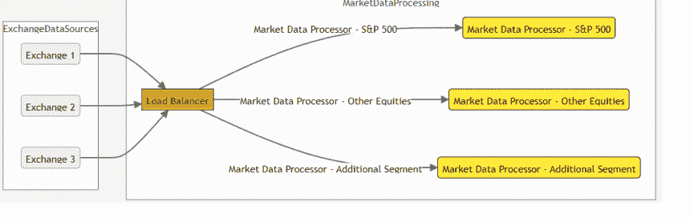

接下来，订单管理系统 (`OMS`) 和执行管理系统 (`EMS`) 将进行水平扩展。这些系统分别是处理订单生命周期和执行逻辑的核心。这是增强系统吞吐量和韧性的关键工作。为了实现这一目标，必须实施详细的技术策略，关注组件的分布和冗余以确保容错能力。

对于负责管理订单生命周期的 `OMS` 而言，扩展的一个关键方面涉及分区划分订单空间。订单可以根据资产类别、订单类型或客户 ID 等各种标准进行分片（`sharding`）。每个分片应由一个运行在单独节点上的专用 `OMS` 实例管理。这不仅平衡了负载，还分担了潜在的故障。例如，特定资产类别的问题不会影响其他类别订单的处理。

为了管理分片并确保跨分片的数据一致性，可以使用如 `Redis` 之类的分布式缓存或具有分片能力的全局数据库（如 `Amazon DynamoDB`）。这允许在分布式实例之间正确检索和更新订单状态。

同时，处理执行逻辑的 `EMS` 必须以最小的延迟将订单路由到正确的交易场所。`EMS` 实例将是式的，每个实例负责执行逻辑的一个子集，可能按交易场所或资产进行划分。这种分布允许并行处理订单数量增加，并增强了系统从单个节点故障中恢复的能力。

`OMS` 和 `EMS` 都将利用消息队列系统进行进程间通信，确保系统之间的订单流以非阻塞方式维持。例如，可以使用 `RabbitMQ` 或 `Apache Kafka` 来促进这种消息传递，其额外优点是具有内置的容错和消息持久性功能。

为了确保我们的订单管理系统 (`OMS`) 和执行管理系统 (`EMS`) 分布式实例之间的一致性和同步性，我们建议使用 `Raft` 或 `Paxos` 等共识算法。这些算法在协调系统动作方面起着关键作用，为所有节点提供订单和执行逻辑的统一视图。它们的设计对于在系统范围内复制数据、实现容错以及维护一致状态（即使在组件故障时）至关重要。

由于在不可靠处理器之间管理共识的稳健性，采用 `Raft` 和 `Paxos` 具有其意义。它们确保每笔交易都按照正确顺序精确执行一次，这对于金融交易的完整性至关重要。通过选举领导者来提议共识操作，这些算法保证了即使某些节点故障，系统也能保持运行。这种弹性对于我们的高频交易系统至关重要，因为交易的准确性和顺序是不妥协的。

此外，`Raft` 和 `Paxos` 在需要分区和高吞吐量的环境中表现出色，在可扩展性和容错性之间取得了平衡。虽然单个组件可能是不可靠的，但只要大多数组件正常运行，整个系统就能达成共识并保持运行。这种机制不仅确保了系统的可靠性，还支持了我们的扩展性需求，允许根据市场情况无缝扩展或收缩系统资源。

# 实现示例 – 针对增加的量和复杂性扩展我们的金融交易系统

在实践中，要在 `OMS` 和 `EMS` 中实现此类共识算法，我们将遵循以下通用步骤：

- 节点识别：每个 `OMS` 和 `EMS` 实例都将在集群内被分配一个唯一标识符。
- 领导者选举：当系统启动或当前领导节点发生故障时，`Raft` 或 `Paxos` 算法将启动领导选举过程。被选为领导的节点将协调跨 `OMS` 和 `EMS` 实例的动作。
- 日志复制：每个操作（如订单创建、更新或执行指令）都将记录在日志条目中。领导节点会将此日志条目复制到所有跟随者节点。
- 一致性检查：领导节点等待大多数跟随者节点写入日志条目后，才认为该操作已提交。这确保了即使某些节点尚未达到最新状态，系统也能保持一致性。
- 状态机应用：一旦订单提交，它就会被应用于状态机，从而有效率改变系统状态。对于 `OMS` 和 `EMS` 而言，这意味着更新订单状态或执行交易。
- 故障处理：如果领导节点发生故障，剩余节点将重启选举过程以选择新的领导。由于日志复制过程的存在，任何新领导者都将拥有所需的信息，从上一个领导者中断的地方继续。

共识算法作为分布式系统的协调层，确保每项更改都得到大多数人的共识，并在整个系统中维护单一事实来源，这在一致性和可靠性至关重要的领域是极其的。

最后，将集成监控和可观测性工具，以提供对每个 `OMS` 和 `EMS` 实例性能和健康的实时洞察。诸如用于指标集的 `Prometheus` 和用于可视化的 `Grafana` 工具将使运维团队能够及时检测并响应问题，最大限度地减少任何系统异常的影响。

通过实施这些详细的技术策略，`OMS` 和 `EMS` 将跨多个节点进行有效扩展，增强系统处理更高数量订单的能力，同时保持其对系统故障的鲁棒性。

## 金融系统中的可扩展性

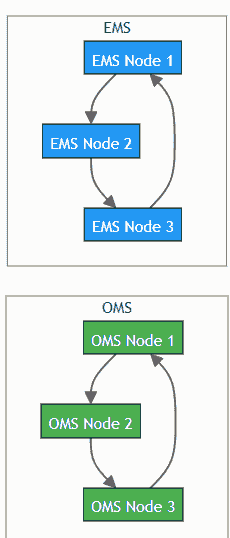

图 5.2 – 扩展 `OMS` 和 `EMS`

我们要扩展的下一个组件是限价订单簿（`LOB`），它是交易系统的心脏，由于订单更新频率高且对快速访问当前订单状态有需求，它通常是扩展最具挑战性的组件。为了解决这个问题，分片（`Sharding`）成为关键策略。

`LOB` 分片涉及将数据集分为不同的子集，这些子集可以在分布式系统的不同节点上独立处理和存储。然而，通过基于资产类别或订单类型等标准的分片，我们可以将 `LOB` 分布在多个节点上。每个节点将独立处理其分片，并设有机制在需要时同步节点状态——例如，在发生跨资产策略或为了报告目的合并订单簿时。

以下是我们如何在技术上详细说明分片过程：

- 分片键选择：第一步是选择合适的分片，它可以是一个资产类别、特定的证券范围，甚至是某种订单类型。分片键的选择至关重要，因为它影响数据分布以及系统的整体平衡和性能。
- 分片管理：每个分片（代表总订单簿的子集）被分配到不同的节点。这允许每个节点管理总订单集中较小、更易于管理的份额，从而缩短处理时间和内存开销。

# 实现示例 – 针对增加的量和复杂性扩展我们的金融交易系统

- **数据分布**：订单通过分片键路由到各自的分片。例如，所有特定股票的订单将发送到处理股票资产类别分片的节点。这种分布确保了订单操作的本地化，最大限度地减少了跨节点流量并提高了响应时间。
- **跨分片操作**：对于涉及多个资产类的操作（例如跨资产策略或聚合风险计算），需要跨分片编排。这可以通过确保跨分片原子性的分布式事务协议来实现，或者通过采用松散的最终一致性模型，通过运行对齐过程来定期对齐不同的分片。
- **状态同步**：为了保持分片间的状态同步，每个节点将将其状态快照广播到分布式账本。可以使用区块链等分布式账本技术来实现，它提供了跨所有分片的 `LOB` 状态的防篡改和高可用记录。
- **报告与聚合**：对于报告，可以使用单独聚合服务来编译 `LOB` 的全局视图。该服务将从每个分片提取数据、进行合并并呈现给最终用户或报告工具。这种聚合可以实时用于实时仪表板，也可以按计划用于定期报告。
- **容错与恢复**：每个包含其分片副本的节点在发生节点故障时都会与一个副本节点配对，副本节点将接管，确保 `LOB` 的持续可用性。
- **一致性保证**：根据一致性要求的严格程度，可以使用不同的模型，从强一致性（每笔交易都立即反映在所有节点上）到最终一致性（交易在短暂延迟后进行调和）。

通过实施分片以及这些技术策略，`LOB` 可以扩展以处理不断增加的量和复杂性，同时确保系统在订单执行中保持高吞吐量和低延迟。这种方法还允许系统随着交易系统需求的增加，通过添加更多节点来实现水平扩展。

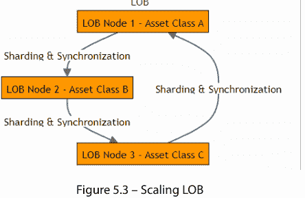

## 金融系统中的可扩展性

对于策略模块，扩展意味着策略实例可以在不同节点上运行，每个节点可能处理不同的资产或市场条件。这不仅允许计算负载的分布，还实现了并行实验和快速部署。

以下是关于如何在技术上实现这一点的详细扩展：

- **策略模块化**：每种交易策略应封装为独立的模块。这种模块化允许每个策略作为微服务运行，可以独立部署和扩展。例如，一个策略模块可能专注于高频交易，而另一个专门负责债券市场策略。
- **节点分配与策略部署**：将不同的策略模块分配到单独的节点。这种分配可以基于策略的计算强度、运行的市场或交易的资产类型。需要更多计算能力和低延迟的高频策略可以分配给更强大的节点或更靠近的节点。
- **策略实例的高效数据分布**：实现一种机制，不仅平衡这些节点之间的负载，还确保它们订阅并处理与特定策略相关的市场数据。这种针对的方法防止了单个节点成为瓶颈，特别是在市场剧波动期间，允许每个策略以最高效率对其所在的细分市场做出响应。
- **并行实验框架**：开发一个允许在各种市场条件下并行测试交易策略的框架。这可能涉及模拟市场状况或使用历史数据测试不同策略。通过在多个节点上并行运行这些测试，可以快速迭代和完善策略。
- **自动化部署与扩展**：利用容器化和编排工具（如 `Docker` 和 `Kubernetes`）进行策略模块的部署。这些工具允许根据预定义的指标（如 CPU 利用率或内存使用）自动扩展策略实例，确保资源的有效分配。
- **模块间通信**：建立一种通信协议，允许策略模块之间以及与其他交易系统的组件（如 `OMS` 或市场数据处理器）进行交互。这种扩展方法成功的关键采用适用于高吞吐量和低延迟的消息系统，如 `ZeroMQ` 或 `RabbitMQ`，它们将用于促进分布式组件之间的通信，允许策略在需要时共享见解或协调行动。
- **性能监控**：实现一个监控系统来实时跟踪每个策略模块的性能。这可能涉及收集交易执行时间、胜率和资源利用率等指标，以便快速识别和解决性能问题。
- **快速部署流水线**：为部署新的或更新的交易策略创建自动化流水线。该流水线在策略部署之前，应包括代码测试、合规性检查和性能评估阶段。该流水线能够在确保快速部署的同时，确保所有策略都符合必要的标准和法规。

通过在多个节点上对策略模块进行水平扩展并实施这些技术策略，交易系统获得了部署多样化交易算法的灵活性。这种方法增强了系统适应不同市场状况的能力、高效分配计算负载，并促进了策略开发的创新。

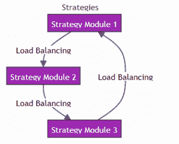

图 5.4 – 策略扩展

在我们的交易系统的水平扩展中，容器化和编排技术起着至关重要的作用。这里选择 `Docker` 和 `Kubernetes` 是因为它们在分布式环境中管理和部署应用程序具有强大能力。这允许我们根据实时指标和性能阈值动态伸缩实例，确保我们的系统不仅具有韧性，而且具有成本效益，避免了资源的过度配置。

容器化是全机虚拟化的轻量级替代方案，它将应用程序封装在具有独立运行环境的容器中。这种方法提供了多处优势：

- **跨环境的一致性**：`Docker` 容器确保应用程序无论部署在何处（无论是开发者的笔记本还是生产服务器），表现都是相同的。这种一致性消除了“在我的机器上可以运行”的问题。


- **资源效率**：容器比传统的虚拟机更轻量，因为它们共享宿主机内核，不需要为每个应用程序运行一个操作系统，从而更好地利用系统资源。

## 金融系统中的可扩展性

- **隔离**：Docker 提供了进程和文件系统隔离，这提高了安全性，并允许多个应用程序或服务在单个主机上运行而互不干扰。
- **快速部署**：容器可以在几秒钟内创建、启动、停止和销毁，实现快速扩展和部署。

在探索了扩展性的各个方面之后，让我们现在转向容器化的实际操作。容器化（特别是使用 Docker）是实现高效扩展性的关键策略。

## 使用 Docker 实现容器化

在本节中，我们将看到交易系统的每个组件（如市场数据处理器、OMS、EMS 等）如何被有效地封装到 Docker 容器中。这种方法不仅确保了精简的部署，还增强了系统的整体安全性和资源效率。

实现方式如下：

- **将每个组件容器化**：将交易系统的组件（如市场数据处理器、OMS、EMS、LOB 和策略模块）封装到独立的 Docker 容器中。这些容器包含了运行应用程序所需的应用程序代码、运行时环境、库和依赖项。
- **创建 Docker 镜像**：为每个组件开发 Docker 镜像。这些镜像充当容器的蓝图，确保了系统范围内统一且快速部署。
- **安全的镜像注册库**：将这些镜像存储在安全、可访问的仓库中（例如 Docker Hub 或私有仓库），确保它们可以随时供部署使用。

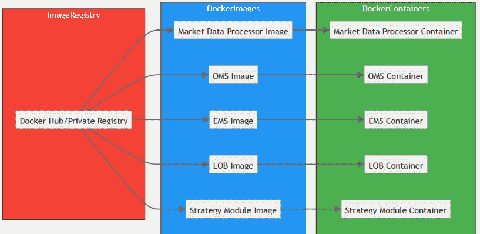

图 5.5 – 使用 Docker 进行容器化

随着每个交易系统组件被有效地容器化且 Docker 镜像已就绪，我们现在有了一个健壮且高效的框架。

## 为什么选择 Kubernetes 进行编排？

Kubernetes 是一种在集群环境中管理容器化应用程序的编排工具。选择它是基于以下特性：

- **自动调度和自愈能力**：Kubernetes 根据容器的资源需求和其他约束自动放置容器，同时不会牺牲可用性。它会自动重启失败的容器，在节点死亡时替换并重启，并杀死不响应的容器。
- **自动扩展和负载均衡**：Kubernetes 可以根据需要自动伸缩应用程序以应对 CPU 使用。它还能平衡并分配网络流量。
- **发布和回滚**：Kubernetes 逐步发布更改到应用程序并监控健康状况，如果出现问题，可以进行回滚。

## 通过 Kubernetes 实现可扩展性

在 Docker 中设置好我们的组件后，我们现在转向通过 Kubernetes 实现可扩展性。本节概述了 Kubernetes 在动态管理和扩展这些元素方面所发挥的关键作用，确保系统灵活并响应需求。

接下来，需要的一些步骤包括：

- **Kubernetes 集群设置**：建立 Kubernetes 集群以托管容器。该集群包括用于管理的主节点和用于部署应用程序的工作节点。
- **Pod 和服务配置**：定义 Kubernetes Pod（每个 Pod 可能包含多个协作的容器）以及用于网络终端的服务。
- **水平 Pod 扩展器**：实现水平 Pod 扩展器，根据需要调整 Pod 的数量。
- **资源管理**：设置资源配额和限制范围，以确保组件之间的公平分配，防止某个组件占用过多资源。
- **监控和可观测性**：集成 Prometheus 和 Grafana 等工具进行实时监控，确保持续跟踪系统状况。

## 金融系统中的可扩展性

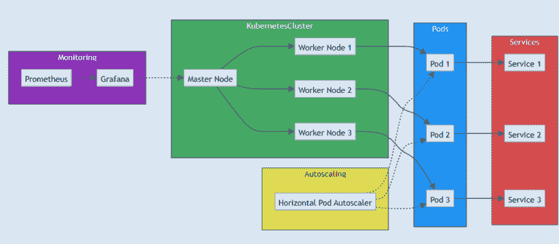

图 5.6 - 使用 Kubernetes 实现扩展性

通过采用 Docker 进行容器化并使用 Kubernetes 进行编排，交易系统实现了动态扩展性、韧性和高效的资源管理，这对于处理高频交易环境的需求至关重要。

最后，底层基础设施的设计将考虑网络优化。这包括对网络拓扑的考虑以及对高级网络功能的使用（例如内核绕过和直接内存访问 DMA），以最大限度地减少网络延迟。

优化网络基础设施对于高性能交易系统至关重要，特别是在水平扩展时。网络延迟会显著影响交易操作的速度和效率。因此，必须对网络拓扑和高级网络功能的结合进行关注。以下是这些方面的技术扩展：

- **优化的网络拓扑**：网络拓扑的设计应最小化传输距离，从而减少延迟。这涉及到将服务器策略性地部署在市场数据源和执行场所附近（通常称为托管）。在分布式系统中，确保节点间的连接方式能够优化数据路径并减少瓶颈也同样重要。
- **高性能网络硬件**：利用高性能网络硬件，例如低延迟交换机和专用网卡 (NIC)。这些组件旨在处理高数据吞吐量并减少网络拥塞，这在交易量高峰时期至关重要。
- **内核旁路 (Kernel Bypass)**：实现内核旁路技术，如数据面开发包 (DPDK) 或根 I/O 虚拟化 (SR-IOV)。这些技术允许网络流量绕过操作系统内核直接到达应用程序，显著降低延迟。在市场数据处理和执行速度至关重要的场景下，内核旁路尤为有效。
- **直接内存访问 (DMA)**：利用支持 DMA 能力的网络接口适配器 (NIC)。DMA 允许网络设备直接访问系统内存，跳过 CPU 移动数据。这减少了 CPU 负载和内存拷贝开销，从而带来更低延迟和更高的吞吐量。
- **网络调优与配置**：微调网络设置以获得最佳性能。这包括配置 TCP/IP 栈参数、缓冲区大小和流控制设置，以匹配交易系统的特定需求。例如，禁用不必要的网络协议和服务可以减少开销和潜在的漏洞。
- **服务质量 (QoS) 与流量优先级排序**：实施 QoS 策略，使关键交易流量优于其他类型的网络流量。通过优先考虑市场数据和交易流量，可以确保这些对时间敏感的数据包优先处理，减少高流量期间的延迟概率。
- **冗余网络路径**：设计具有冗余的网络以确保高可用性和容错性。这涉及建立替代路径以防止单点故障。如果某条路径出现问题，系统可以切换到备份路径，将停机时间降至最低。
- **实时网络监控**：集成实时网络监控工具，持续监控网络性能并快速识别解决问题。这些工具应该提供对带宽使用、延迟、丢包和其他关键性能指标的洞察。

通过关注这些技术方面，该交易系统的网络基础设施将针对高频交易环境进行稳健优化，确保最小延迟和最大可靠性，这对于在金融市场中保持竞争优势至关重要。

通过细致地扩展这些组件，我们的系统将准备好处理增加的量和复杂性，保持金融交易竞争格局所需的高性能和可靠性标准。

# 实现示例——针对增加的量和复杂性扩展我们的交易系统

# 衡量和监控系统性能与可扩展性

我们已经细致地扩展了交易系统以处理增加的量和复杂性，实施一个稳健的框架来衡量和监控其性能和可扩展性也变得同样关重要。该框架不仅确保系统高效运行，还为系统如何响应不断变化的市场条件和不同负载提供洞察。我们现在转向将使我们能够持续评估和优化系统性能的策略和工具。

# 性能指标收集

在我们的高频交易系统中，性能指标的收集对于评估系统的健康和效率至关重要。我们关注对理解整体性能和单个组件行为至关重要的指标：

- **系统级指标**：包括 CPU 利用率、内存使用情况、磁盘 I/O 操作和网络 I/O。监控这些指标有助于识别资源瓶颈。例如，CPU 使用率过高可能表明处理算法需要负载均衡或优化。
- **应用特定指标**：这些指标针对我们交易系统的独特操作而定制。关键指标包括：
  - **延迟指标**：处理市场数据所需的时间、订单执行延迟以及数据请求的往返时间。低延迟在高频交易中至关重要，跟踪这些指标有助于定位延迟源。
  - **吞吐量分析**：每秒处理的订单数和处理的市场数据消息数。这表明了系统高效处理大量数据和交易的能力。
  - **错误率**：跟踪在各种组件内部发生的错误和异常。高错误率可能表明系统存在底层问题。
- **组件特定指标**：交易系统的每个组件（如市场数据处理器、OMS 和 EMS）都将有定制的指标。例如，必须监控市场数据处理器的消息速率和队列延迟。
- **基础设施指标**：对于分布式系统，监控底层基础设施的健康和性能至关重要。这包括容器健康、Kubernetes 中的节点状态和网络性能参数的指标。
- **自定义指标开发**：根据交易系统的独特需求，我们开发自定义指标。这些可能包括算法效率、风险分析和合规监控的指标。

这些指标的收集将以非侵入的方式进行，以确保对系统性能的影响最小。将利用可以在低开销运行的高级数据收集机制。收集到的指标不仅作为监控系统健康的基础，还为可扩展性和优化提供了数据驱动决策的基础。

# 实现示例——针对增加的量和复杂性扩展我们的金融系统 213

# 实时监控

在高性能交易环境中，实时监控对于维持系统性能和可靠性至关重要。这涉及建立一个稳健的监控系统，提供对系统运行状态的即时洞察：

- **实时数据收集的实施**：利用机制从所有系统组件持续收集运行数据。这包括对性能指标收集阶段识别的指标进行实时跟踪。关键是以足够详细以供深度分析但不会让系统崩溃的粒度捕捉数据。
- **监控系统架构**：设计一个能够处理交易系统生成的规模数据的分布式监控系统。它应该能够处理实时数据流，提供系统性能的聚合和详细视图。
- **阈值与告警**：为关键性能指标定义阈值。如果超过了这些阈值，系统应触发告警。例如，如果订单处理延迟超过了预定义的限制，将触发告警，指示需要立即关注的潜在问题。
- **自定义仪表板**：使用可视化工具创建自定义仪表板。这些仪表板以易理解的格式显示关键指标，允许系统操作人员和工程师快速评估系统的健康和性能。仪表板可以根据不同角色进行定制，例如，系统管理员的仪表板可能侧重于基础设施健康，而交易策略师的仪表板可能显示算法性能指标。
- **异常检测**：实施用于异常检测的高级算法。通过分析历史数据，系统可以学习识别模式并将偏离这些模式的情况标记为潜在问题。这有助于在问题升级之前主动处理。
- **与事件管理工具集成**：确保监控系统与事件管理工具集成。这种集成允许自动创建和跟踪事件，简化问题解决过程。
- **定期更新与维护**：保持监控系统的更新，以适应交易系统的任何变化。随着新组件的添加或现有组件的修改，监控设置应该演进，以准确反映这些变化。

实时监控不仅关乎技术，还关乎流程和人员。它需要一个专业的团队来监控系统、分析数据并在问题出现时做出响应。该团队在维护交易系统的健康和效率方面发挥着至关重要的作用。

## 日志聚合与分析

在分布式、高频交易环境中，有效的日志管理至关重要。它涉及聚合来自各种系统组件的日志，对其进行分析以获取深度洞察，并利用这些信息进行性能调优和问题解决。

- **集中式日志聚合**：实现集中式日志聚合系统，收集来自交易系统所有组件、基础设施组件和网络设备的日志。该聚合系统必须能够处理海量日志数据，确保关键信息不丢失。
- **结构化日志**：在所有组件中强制执行结构化日志实践。这意味着日志以标准格式（如 JSON）生成，这使其更易解析和分析。结构化日志确保了日志中的数据（如时间戳、错误代码和性能指标）易于访问。
- **实时分析**：利用能够实时分析日志数据的工具。这种分析包括搜索特定模式、识别趋势和检测异常。例如，与特定组件相关的错误消息突然激增，可以迅速提醒团队注意潜在问题。
- **关联与上下文化**：开发关联来自不同源日志的机制。这在分布式系统中至关重要，因为一个组件的问题可能会对其他组件产生级联影响。通过关联日志，你可以更有效地追踪问题的根源。
- **告警与报告**：基于日志分析设置告警机制。例如，如果日志显示特定进程反复失败，系统应触发告警。此外，定期生成报告，以提供系统性能的洞察，并帮助识别长期趋势和模式。
- **留存策略**：实施数据留存策略，平衡历史数据需求与存储限制之间的关系。这涉及根据日志的相关性和合规性要求来确定存储时长。
- **合规性与审计追踪**：确保日志管理系统支持相关法规。这包括对交易、系统访问和系统配置更改维护审计追踪。

日志聚合与分析提供了对系统运行方面的深度洞察，允许对交易系统进行主动管理和精细调整，以保持高性能和可靠性。

## 实现示例 —— 为了增加的量和复杂性扩展我们的金融交易系统

## 可扩展性衡量

衡量可扩展性对于确保交易系统能够处理不断增加的负载而不降低性能至关重要。这涉及一系列步骤和工具，用于评估系统在各种条件下的扩展情况。

- **负载测试**：模拟真实的交易场景进行负载测试。这包括创建一系列场景，从正常交易条件到市场峰值事件。系统对这些模拟条件的响应，特别是其维持性能标准的能力至关重要。
- **压力测试**：压力测试超出了正常运行能力，以观察系统在极端条件下的表现。这有助于识别系统能力的上限及其开始失效的点。
- **容量规划**：利用从负载和压力测试中收集的数据进行容量规划。这涉及确定处理预期和峰值负载的基础设施和资源需求。容量规划应该是一个持续的过程，根据交易策略、市场状况和系统增强的变化进行调整。
- **性能瓶颈识别**：分析测试结果以识别任何性能瓶颈。这可能包括数据库性能、网络延迟或特定组件的局限性。一旦识别，可以通过优化或增加资源来解决这些瓶颈。
- **弹性测试**：测试系统的弹性，即根据工作负载动态扩展或收缩资源的能力。这在云环境或使用编排平台（如 Kubernetes）时尤为重要。
- **关键性能指标 (KPI) 基准测试**：建立如交易吞吐量、数据处理率和响应时间等 KPI。定期针对这些 KPI 进行基准测试有助于随着时间的推移评估系统的可扩展性。
- **历史数据分析**：分析历史性能和可扩展性数据，以理解系统如何响应负载条件。这种分析可以为未来的可扩展性规划提供洞察。

可扩展性衡量是一个持续的过程，随着交易环境和系统能力的演变，需要定期的审查和调整。

## 健康检查与自愈机制

在高频交易环境中，系统的韧性与性能同等重要。实施健康检查和自愈机制对于维护系统的可用性和可靠性至关重要。

- **基于 Kubernetes 的健康检查**：利用 Kubernetes 的存活（liveness）和就绪（readiness）探针对容器化组件进行健康检查。存活探针确保容器内的应用程序正在运行，如果没有运行，Kubernetes 将其重启。就绪探针确定容器何时准备好接受流量，确保流量仅被发送到健康实例。
- **自愈基础设施**：配置 Kubernetes 环境以自动替换或重启失败的 Pod 和节点。这确保了在发生故障时，系统无需人工干预即可恢复，最大限度地缩短停机时间。
- **自动扩展响应**：将健康检查与自动伸缩能力相结合。例如，如果某个组件负载过重并触发健康检查，系统可以自动扩展该组件的实例，以更有效地分配负载。
- **数据库和存储系统监控**：为数据库和持久存储系统实施健康检查。这是至关重要的，因为数据完整性和可用性在交易系统中至关重要。
- **网络健康监控**：持续监控网络基础设施的健康状况。这包括检查延迟激增、丢包或影响性能的带宽问题。
- **健康检查的定期更新与测试**：定期审查并更新健康检查参数，以适应不断变化的系统动态。此外，定期测试这些机制，以确保它们在各种故障场景下都能按预期运行。

通过这些健康检查和自愈机制，系统保持了高可用性并及时解决问题，确保在组件故障时仍能持续高效运行。

## 网络性能监控

鉴于网络性能在高频交易系统中的至关重要性，专门的网络监控策略是必不可少的。这涉及密切跟踪各种网络相关参数，并实施措施确保最佳网络性能。

- **往返时间 (RTT) 监控**：持续监控关键组件（如数据源、处理节点和执行场所）之间的 RTT。RTT 是交易系统结果的关键指标。
- **带宽利用率**：跟踪每个网段的带宽利用率。这有助于识别拥堵点并实现主动容量规划。
- **丢包分析**：监控系统的丢包情况，这会显著影响数据完整性和系统响应。
- **高级网络功能的使用与监控**：实施并监控高级网络功能，如内核旁路（使用 DPDK）和直接内存访问（DMA）。这些技术降低了延迟并提高了吞吐量，但需要仔细监控以确保其按预期运行。
- **网络设备健康**：监控网络设备（包括路由器、交换机和网卡）的健康和性能。这包括检查硬件故障、固件问题和性能下降。
- **服务质量 (QoS) 强制**：确保 QoS 策略有效优先关键流量（如市场数据馈送和交易订单）。
- **冗余检查**：定期测试网络冗余机制，确保它们能够有效处理故障转移场景而不对系统性能产生重大影响。
- **与系统监控集成**：将网络性能监控集成到更广泛的系统框架中，以关联网络性能与应用性能。

交易系统的网络性能监控不仅是为了速度，更是为了确保稳定可靠的网络行为，这对于整体系统性能至关重要。

## 总结

在本章中，我们探讨了扩展高频交易系统以应对日益增加的量和复杂性的复杂领域。我们从理解可扩展性的需求开始，考虑了交易量、数据复杂度、用户预期和合规需求等因素。

深入探讨了扩展的关键策略。我们讨论了垂直扩展与水平扩展，分析了各自的优缺点以及适用场景。强调了数据分区和负载均衡对于高效系统性能的重要性。

讨论了分布式系统的实现，重点关注实时数据分发、订单引擎以及分布式账本技术的使用。我们强调了微服务架构在构建可扩展且具韧性的系统中的作用。

我们涵盖了可扩展性的最佳实践，确保系统设计能够适应和演进。引入了“为失败设计”（designing for failure）的概念，强调了金融系统中容错和冗余的必要性。

我们探索了持续运行策略，重点关注冗余、微服务架构和系统在线更新。我们还讨论了网络和通信开销的重要性，以及最大限度地减少其对系统性能影响的策略。

最后，我们提供了一个实用的实现示例，展示了如何扩展金融交易系统。这包括了扩展单个组件的详细方法，例如市场数据处理器、OMS（订单管理系统）、EMS（执行管理系统）和限价订单簿。我们强调了使用容器化和编排技术（如 Docker 和 Kubernetes）以实现动态可扩展性。我们还强调了网络性能监控的重要性，以确保一致且可靠的网络行为。

在整个章节中，我们始终关注扩展系统时所需的细致平衡，确保系统既健壮高效，又具有足够的活性来适应不断变化的金融交易格局。

总结来说，本章提出的见解和策略构成了一份扩展高性能交易系统的全面指南，为读者提供了构建不仅能够满足当前需求、还能应对未来挑战的系统的知识。

随着我们的系统现在具有了可扩展性和健壮性，下一章将重点转向最小化延迟这一关键方面。我们将深入探讨 C++ 编程中的技术策略和核心组件，这些对于实现金融系统中的低延迟至关重要，也是保持竞争优势的关键因素。

## 6

## 低延迟编程策略与技术

本章将进入 C++ 低延迟编程这一关键领域，这是构建高性能金融系统的核心组成部分。在运营效率直接关系到成功的环境中，实施最大限度减少延迟的策略不仅是有优势的，更是必不可少的。

我们将从探索硬件与软件之间的相互作用开始。深入理解现代 CPU 架构以及 C++ 代码如何翻译机器指令的复杂性至关重要。这一基础对于理解后续关于优化代码执行速度的讨论是必不可少的。


我们将聚焦于缓存优化，检查缓存运行的机制，揭示编写缓存友好型（cache-friendly）C++ 代码的方法。我们将展示真实的案例研究，以证明优化数据结构以提高缓存效率的显著收益。

本章还将解决低延迟环境中关键但经常被忽视的系统预热（system warmup）问题。我们将讨论有效的预热程序策略，为 CPU 和内存的最佳性能做好准备，并以`高频交易 (HFT)`系统的示例提供支持。

本章很大一部分内容致力于最小化内核交互，这是低延迟编程中的关键考虑因素。我们将比较用户空间和内核空间的操作，探索减少系统调用（system calls）的技术，并讨论上下文切换（context switching）对性能的影响。

分支预测对性能的影响也将彻底检查。我们将为开发分支预测友好的代码提供指导，以及精炼分支密集代码的技术，使其符合 CPU 的处理模式。

在进入高级 C++ 优化技术后，我们将仔细审视诸如浮点运算、内联函数、编译时多态、现代 C++ 特性以及有效使用编译器优化标志来增强性能等主题。

性能分析工具和方法将是此讨论至关重要的部分。我们将涵盖各种性能分析（profiling）和基准测试（benchmarking）工具，重点关注有助于识别和解决性能瓶颈的指标。

在结束本章时，我们将展望金融系统中低延迟编程的未来，总结关键见解，并为这一快速发展领域中即将出现的趋势做好准备。

## 技术要求

> **注意事项**
>
> 本章提供的代码作为如何实现高性能交易系统的插图示例。然而，需要注意的是，此代码可能缺少某些重要功能，不应直接在生产环境中使用。在部署到实时交易环境之前，至关重要的是进行稳健性测试并添加必要的功能，以确保系统的健壮性和可靠性。你可以在此处找到代码的高质量截图：`https://github.com/PacktPublishing/C-High-Performance-for-Financial-Systems/tree/main/Code20screenshots`。

# 硬件架构与代码执行简介

理解低延迟金融交易系统世界中硬件架构与代码执行之间复杂的关系。本节侧重于揭秘现代 CPU 架构的复杂性及其对 C++ 代码执行的后续影响。

对于开发者最小化延迟来说，理解高层 C++ 指令如何转换为机器语言并与计算机硬件交互至关重要。这些见解是在`高频交易 (HFT)`中获得那些至关重要的纳秒级性能优势的关键。

我们将检查现代 CPU 的内部工作原理，探索进程指令如何管理内存以及执行任务。这种检查对于深入理解低延迟环境下的代码执行至关重要。此外，我们阐明 C++ 代码的编译过程，强调编译器优化和决策如何显著影响性能。通过弥合高层 C++ 编程与机器级执行之间的技术差距，我们为开发者提供了必要的知识来以速度和效率优化交易算法。

# 理解现代 CPU 架构

理解现代 CPU 架构的复杂性不仅是技术上的需要，更是一种竞争优势。CPU 作为计算机的心脏，决定了交易系统内部每个操作、每个计算和每个决策的效率和速度。当我们深入 CPU 架构的世界时，我们关注这些硅基大脑是如何设计的，以及它们的设计如何影响 C++ 编写的交易算法的性能。

# CPU 基础

CPU 是性能和效率的基石。理解 CPU 的核心组件——核心（cores）、缓存系统和指令流水线（instruction pipelines）对于理解它如何影响低延迟编程至关重要。让我们简单看看这些内容：

- **核心基础：** 每个 CPU 核心本质上是处理器内部的处理器。它是程序指令被读取和执行的地方，作为计算机指令集的主要执行器。多年来，CPU 核心已从单核演变为多核设计，显著提升了处理能力。每个核心可以独立地执行指令，这种特性对于需要同时处理多个任务的交易系统非常有益。

- **缓存系统：** 缓存是 CPU 内部的一种更小、更快的内存形式，旨在加速常用数据的访问。它作为 CPU 可能重复使用的数据和指令的临时区域。现代 CPU 通常具有多级缓存系统，通常被称为 L1、L2 和 L3 缓存。L1最小且最快，距离 CPU 核心最近，而 L3 通常更大更慢，但仍比访问内存快。缓存系统的效率影响 CPU 的性能。良好的缓存减少了 CPU 等待主内存数据的时间，这是高性能系统中的关键因素。

- **指令流水线：** 流水线是一种重叠多个指令阶段的技术。就像工厂中的流水线一样，指令处理的不同阶段（取指、解码、执行等）是以流水线方式进行的。这并不会减少完成单个指令所需的时间；而是增加了可以同时处理的指令数量；这显著增加了 CPU 的整体吞吐量。

对 CPU 核心、缓存系统和指令流水线的这些基础理解为深入探讨这些元素如何相互作用以优化低延迟环境下的 C++ 执行奠定了基础。这些基础是构建更复杂的 CPU 架构及其对`高频交易 (HFT)`性能的影响等概念的基石。

# 核心架构

CPU 核心架构是决定其性能的关键因素，特别是在对速度和效率至关重要的应用中。`高频交易 (HFT)`系统依赖这些核心来执行复杂的算法并做出快速决策，因此其设计和能力对系统性能至关重要。

## 核心设计与功能

CPU 核心设计的演变标志着计算能力和效率的飞跃，直接影响交易系统的性能：

- **单核与多核处理器：** 起初，CPU 包含单个核心。然而，现代处理器配备了多个核心，允许它们同时处理多个任务。这种多核设计对于增强交易算法至关重要的处理能力和多任务能力具有决定性作用。

- **超标量架构：** 许多现代 CPU 核心基于超标量架构设计，使其每个时钟周期内执行多条指令。这一特性加速了任务处理，在对时间高度敏感的环境中是一个巨大的优势。

理解这些核心设计至关重要，因为它们是交易系统以所需的速度和效率运行的基础。

## 超线程与同步多线程 (SMT)

超线程和 SMT 的引入为优化 CPU 性能开辟了新途径，特别是在金融交易中常见的多线程应用中：

- **超线程概念：** 超线程是英特尔对 SMT 的实现，允许单个 CPU 核心同时处理多个线程。这可以有效双倍核心进程内独立线程的数量，提高吞吐量和效率。

- **对`高频交易 (HFT)`的影响：** 在交易系统中，这意味着单个核心可以并发执行数据分析、风险计算和订单执行等各种任务，增强系统的响应速度和吞吐量。

这种每个核心处理多个线程的能力对于最大化交易平台中 CPU 的处理能力至关重要。

## 核心频率与性能

CPU 核心的时钟频率是其性能潜力的直接指标，特别是在快速数据处理至关重要的应用中：

- **主频的作用：** CPU 核心的主频以吉赫兹 (GHz) 衡量，表示其每秒可以执行的周期数。较高的频率通常意味着更快的处理能力，这对于交易算法的快速执行至关重要。

- **睿频 (Turbo Boost) 与动态频率缩放：** 技术如英特尔睿频等技术允许核心在密集工作负载下动态增加主频，在需要时提供性能提升。

优化频率并理解其影响，是开发能够跟上`高频交易 (HFT)`需求的系统的关键。

## 集成图形处理器 (GPU)

将 GPU 集成到 CPU 架构中是处理器不断演变的证明，满足了更广泛的计算任务需求：

- **集成 GPU 的出现：** 某些现代 CPU 带有集成 GPU。虽然它们主要对图形任务有益，但它们也可以协助计算负载，特别是交易系统中常见的并行处理任务。

- **在金融系统中的应用：** 集成 GPU 从 CPU 中卸载某些可并行的任务，优化了系统的整体性能。

集成 GPU 的策略性使用可以对金融交易系统的效率和速度做出重大贡献，为复杂任务提供多样化的方法。

## 核心架构的未来

展望未来，CPU 核心架构的演变格局持续为增强交易系统性能提供新的可能性。

随着 CPU 技术的不断演进，我们看到诸如核心数量增加、能效提高以及纳米技术进步等趋势。这些创新承诺进一步增强对`高频交易 (HFT)`系统至关重要的处理能力。

对于金融交易领域的人来说，跟进这些发展至关重要，因为核心架构的未来进步无疑将塑造下一代交易系统。

## 缓存机制

CPU 缓存在桥接处理器和内存之间的差距方面起着关键作用。在高性能系统中，由于以最快速度访问数据至关重要，理解缓存机制对于优化系统性能是必须的。

## CPU 缓存基础

CPU 缓存虽然讨论较少，但它是决定处理器访问数据和指令快慢的关键因素。

缓存位于 CPU 内部的较小、更快的内存，旨在临时存储来自主内存 (RAM) 中频繁使用的数据和指令的副本。其主要目的是加速 CPU 的数据访问。

通过存储 CPU 可能再次使用的数据，缓存减少了重复访问较慢的主内存的需求，从而显著缩短了数据检索时间。

## 低延迟编程策略与技术

缓存机制的效率直接影响交易系统处理数据的速度，使其成为优化的关键领域。

## 缓存分级与类型

现代 CPU 采用分级缓存系统，每一层在速度和存储容量之间提供不同的平衡：

- **缓存层级：** 通常，CPU 缓存分为三级——L1、L2 和 L3。L1 缓存最小且速度最快，最接近 CPU 核心，而 L3 缓存通常作为主内存之前的最后一级缓存。

- **缓存层级之间的差异：** 每个缓存层级在大小、速度和功能方面都有自己的特性。L1 缓存通常用于最关键的数据，而 L2 和 L3 缓存则存储访问频率较低但对性能仍然至关重要的大型数据集：

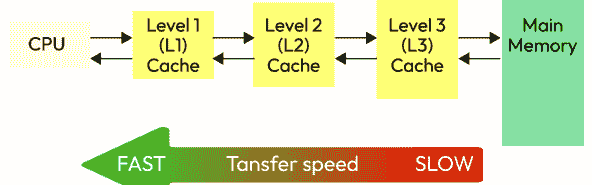

图 6.1 – 现代 CPU 架构中的内存布局

理解每个缓存级的细微差别可以实现更有效的编程策略，确保交易算法的关键数据位于最合适的缓存层级中。

## 缓存缺失对性能的影响

缓存有效性的关键因素是缓存缺失率，当 CPU 需要的数据在缓存中未找到，就会发生缓存缺失。

当在缓存中找不到所需数据时，就会发生缓存缺失，迫使 CPU 从主内存中提取。这个过程要慢得多且消耗更多资源，导致延迟增加。缓存缺失有不同类型，包括强制缺失（数据从未在缓存中过）、容量缺失（缓存太小，无法容纳所有数据）和冲突缺失（由缓存替换策略引起）。

## 硬件与代码执行简介

缓存应用程序的性能受缓存命中与缺失比例的显著影响。高命中率意味着延迟最小的高效检索，而高缓存缺失率会导致处理时间变慢，影响系统快速高效执行交易的能力：

- **缓存缺失类型：** 缓存缺失分为指令缺失和数据缺失，每种对系统性能的影响不同。

- **减少缓存缺失的策略：** 诸如循环展开、数据结构对齐和避免数据依赖等技术有助于减少缓存缺失，从而提高性能：

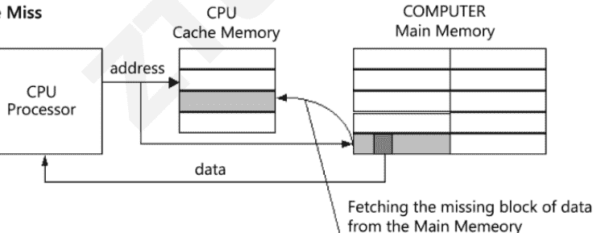

图 6.2 – 缓存缺失

在`高频交易 (HFT)`中减少缓存缺失至关重要，因为每次缺失都会导致数据处理和执行的延迟。

## 缓存一致性与多线程

在多核心处理器中，维护缓存一致性——不同核心本地缓存中存储的数据的一致性是一个复杂但重要的任务：

- **缓存一致性挑战：** 由于多核心处理器中的核心可能会访问并修改相同的数据，确保所有核心拥有最新数据对于系统完整性和性能至关重要。

- **确保缓存一致性的技术：** 使用如修改、专属、共享、无效 (MESI) 协议等机制来维护跨核心的缓存一致性。

有效的缓存一致性策略对于多线程交易系统至关重要，确保所有处理核心都能访问最新且最相关的数据。

# 为高性能系统优化缓存使用

接下来，我们将介绍减少缓存缺失和开发缓存友好型（cache-friendly）代码的实用策略，以确保在交易环境中的高效数据处理。

当所需数据不在缓存中时，就会发生缓存缺失，导致高昂的内存访问。减少这些缺失对于维持高速的系统性能至关重要。通常，这些缓存缺失分为三类：强制性缺失（首次访问）、容量缺失（超过缓存大小）和冲突性缺失（多个数据竞争同一个缓存）。

缓存缺失对性能的影响是巨大的，因为每次缺失都会导致 CPU 从主内存检索数据而产生延迟，这种延迟在对时间敏感的环境中尤为不利。

为了在处理速度至关重要的情况下保持最佳系统性能，采用减少缓存缺失的策略是必不可少的。以下方法对于开发高效缓存的代码具有工具性作用：

- **数据局部性（Data locality）**：通过结构化数据来提高数据局部性，确保频繁访问的数据连续存储。在前面的章节中已经强调了这种方法在减少缓存缺失方面的有效性。

- **循环嵌套与分块（Loop nesting and blocking）**：使用循环嵌套和分块技术以缓存友的方式访问数据。这些技术可以保持工作集较小并处于缓存大小限制之内。

- **预取技术（Prefetching techniques）**：实施预取以在处理器需要数据之前将其加载到缓存中，正如之前的章节所讨论。

这些策略对于有效利用 CPU 缓存来开发持续以最高水平运行的系统是积分。

此外，关于使用何种数据结构的策略以及将其与缓存行（cache lines）对齐，可以显著降低缓存未命中率。

- **缓存行大小考虑**：在设计数据结构时考虑缓存行大小，以避免缓存行分裂（即单个数据结构跨越了多个缓存行）。

- **填充与对齐（Padding and alignment）**：使用填充和对齐指令确保数据结构在缓存行中处于优化位置，如前面的章节所示。

对数据结构进行适当对齐和填充可以显著减少缓存缺失，提高高性能系统的效率。

最后，定期性能分析（profiling）和监控对于理解缓存行为和识别优化区域至关重要。利用缓存分析工具分析缓存使用模式，并识别导致缓存缺失的问题区域。并根据性能分析的结果，不断精炼数据结构和算法以提高缓存效率，正如前面的章节所强调的。

持续的监控和优化过程确保系统保持高效，并能够处理高性能交易严苛的要求。

# 指令流水线（Instruction pipelining）

指令流水线是现代 CPU 架构的基本方面，在增强程序指令效率方面起着重要作用。这种技术涉及将执行过程分解为离散的阶段，如取指、解码、内存访问和回写。不同指令阶段的并发处理类似于流水线，提高了系统的整体吞吐量。

# 功能与影响

流水线通常包括指令取指、解码、执行、内存访问和回写等阶段。这些阶段由处理器的不同部分处理，允许同时处理多条指令。

虽然流水线没有减少单条指令的执行时间，但它显著增加了在给定时间内可以处理的指令数量，这对于需要快速数据处理和决策的系统至关重要。

# 分支预测（Branch prediction）

分支预测是现代处理器中的关键技术，预测程序中条件分支（如 if-else 语句）的方向，以保持指令流水线的稳定流动。准确的分支预测至关重要，因为每次预测错误的分支都会导致流水线停顿（stalls），导致后续指令必须丢弃并重新取指。

工作机制是 CPU 使用复杂的算法来猜测分支的结果。例如，简单形式的分支预测可能会查看特定分支的历史，并假设它将像以前一样采取路径。

因此，需要注意的是，我们作为软件工程师生成的代码中的可预测模式可以导致更高效的执行。例如，安排数据或操作的方式使分支不那么随机且更可预测，可以显著增强性能。

此外，除了分支预测，CPU 还采用各种策略来优化流水线性能。乱序执行（out-of-order execution）等技术有助于缓解流水线停顿和冲突的影响，确保指令流更加流畅。

指令流水线和分支预测是现代 CPU 设计不可或缺的一部分，增强了高性能系统的性能能力。深入理解这些概念对于开发者至关重要，特别是在金融交易领域，处理速度和效率是首要任务。这些知识为深入研究高级 C++ 优化技术奠定了基础，这些将在后续章节中探讨，重点关注如何利用这些架构特性增强性能。

# 并行处理与多线程（Parallel processing and multithreading）

这些概念对于理解如何充分利用 CPU 架构的潜力来优化高性能系统场景下的 C++ 代码执行至关重要。

并行处理涉及同时执行多个进程。这是通过多个 CPU 核心的存在实现的，每个核心都能并发处理单独的任务。在高性能系统中，同时处理多个数据流和执行交易算法的能力是无价之宝。并行处理允许将不同的任务分配到各个核心上，增强系统的整体效率和响应速度。

另一方面，多线程是并行处理的一种形式，将单个进程拆分为多个线程。这些线程可以并发运行，共享相同资源但独立操作。

超线程技术（Intel 的 hyper-threading）和 SMT（同步多线程）将多线程更进了一步，允许单个核心同时处理多个线程。这提升了核心的吞吐量和效率，在决策和数据处理至关重要的环境中特别有益。

并行处理和多线程是现代 CPU 架构不可或缺的一部分，在实现金融交易系统低延迟方面起着关键作用。通过理解并有效利用这些概念。

# 向量处理与单指令多数据流（SIMD）

向量处理涉及在多个数据点上同时执行单一操作。这是通过向量处理器或数组处理器实现的，这些处理器专门处理向量操作。向量处理对于涉及大型数据集或可以在多个数据点上并行执行的操作（如复杂计算）非常有益。

SIMD 是一种并行处理类型，其中单个指令在多个数据元素上同时执行。这通过现代 CPU 中的 SIMD 扩展来实现，例如 Intel 的 SSE 和 AVX 或 ARM 的 NEON。SIMD 通过允许单指令处理多个数据点显著增强了数据吞吐量和处理速度。这种能力对于优化计算密集型任务的性能至关重要。在 C++ 等语言中有效使用 SIMD 需要识别可以向量化的机会，并利用相应的编译器扩展或内置函数（intrinsics）。这可以更高效地处理大型数组。

使用 SIMD 优化性能需要密切关注两个挑战。首先，必须仔细管理数据对齐和内存访问模式以确保高效处理。其次，SIMD 编程的内在复杂性要求对底层硬件能力以及应用程序的具体需求有深入理解。这些方面对于有效利用 SIMD 的全部潜力至关重要。

硬件与代码执行简介

向量处理和 SIMD 是现代 CPU 架构中强大的技术，提供了显著的性能益处。有效利用这些技术是释放数据密集型操作中更高吞吐量和效率的关键。

## CPU 时钟频率与超频

这些元素是决定 CPU 原始处理速度的关键，直接影响着计算密集型应用的性能能力。

CPU 的时钟频率以 GHz 为单位，表示它每秒可以执行的周期数。较高的时钟频率通常意味着 CPU 每秒可以执行更多操作，从而导致更快的处理速度。它影响系统响应的快慢。

另一方面，超频是指以高于官方最高速度的速度运行 CPU。这样做是为了获得超出标准规格的性能。

虽然超频可以带来性能提升，但也引入了如发热量增加和系统不稳定等风险。适当的冷却机制和系统监控对于管理这些风险至关重要。

在进行性能优化时，在获得更高处理速度与确保系统稳定性和使用寿命之间存在权衡。在速度和可靠性都是关键的系统中，这种平衡至关重要。因此，是否超频的决定可能有所不同。对于对时间敏感事务优先考虑原始速度的系统，从超频中受益更多；而那些需要持续长期稳定的系统则可能会选择标准时钟频率。

## 热管理与电源管理


热管理和电源管理是影响系统性能和使用寿命的关键方面。有效的热管理对于维持最佳 CPU 性能至关重要。过多的热量会导致热节流，即 CPU 降低其时钟频率以防止过热，从而影响性能。实施有效的冷却解决方案（如先进的风冷或液冷系统）对于维持稳定的工作温度至关重要，特别是在超频或高负载场景下。

CPU 采用动态电压和频率缩放（DVFS），这允许 CPU 根据工作负载调整电压和频率。这有助于根据实时需求优化功耗和热排放。

有效的热管理和电源管理确保高性能金融系统能够以最高效率运行，而不受过热或功率效率低下的影响。保持最佳温度和功率使用可以延长硬件寿命并确保性能一致性，这对于需要高可靠性和可用性的金融系统至关重要。

## 低延迟编程策略与技术

高性能系统可能具有复杂的配置，以及特定的冷却和电源需求。设计和维护此类系统需要深层次的技术知识和资源。

对于高性能系统，即使是性能的微小波动也可能产生重大影响，这些方面尤为关键。对这些因素的有效管理确保系统不仅在各种工作负载下运行良好，而且随着时间的推移保持其完整性和可靠性。

总而言之，理解现代 CPU 架构是优化高性能系统的基础。对并行处理、SIMD、CPU 时钟频率、超频和电源管理的探索凸显了原始计算能力与高效系统运行之间复杂的平衡。

每个组件在最大化性能的同时确保稳定性和可靠性方面都发挥着至关重要的作用。你获得的见解为深入理解 C++ 代码铺平了道路，代码可以经过专门定制以利用这些架构特性并充分发挥它们。

当我们进入下一节时，我们将在此基础之上，理解 CPU 架构的复杂性如何直接影响并受编译过程的影响。这些知识对于编写不仅运行高效而且与底层硬件协调以在高风险应用中实现顶峰性能的 C++ 代码至关重要。

## 理解编译器如何将 C++ 翻译为机器码

软件开发中的编译过程（特别是对于 C++）是一个从高级代码到可执行机器指令的复杂旅程。这个过程不仅仅是直接翻译；它是实现代码效率和性能优化的关键阶段。

编译器在增强编写的代码方面起着不可缺的作用，以确保其在目标硬件上优化运行。理解这一过程涉及识别编译器如何将机器码与特定的 CPU 架构对齐，从而实现硬件化。

## 编译阶段

C++ 代码的编译过程可以分为几个不同的阶段，每个阶段在将高级代码转换为高效机器码方面都起着至关重要的作用。这些阶段如下：

- **预处理**：这是第一阶段，编译器处理如 `#include` 和宏指令。本质上，它通过处理这些初始命令为后续阶段做好准备。

- **解析**：在解析期间，编译器分析代码的语法和结构。它检查语法正确性并构建抽象语法树（`AST`），代表代码的层次结构。

- **优化**：这是最关键的阶段之一，优化涉及精炼代码以提高性能和效率。编译器应用各种优化技术来提高执行速度并减少资源消耗。

- **代码生成**：在最后一个阶段，编译器将优化后的高级代码翻译成特定于目标 CPU 架构的机器码。机器码是在硬件上执行的内容。

此过程的每个阶段都紧密相连，对于理解对最终可执行文件性能和效率的影响至关重要。

## C++ 中的编译器优化技术与细节

C++ 编译涉及许多影响性能和效率的特性。以下是最重要的几个：

- **模板实例化**：编译器为每个模板实例生成特定代码。开发者在使用大量模板时应谨慎，因为这可能导致代码膨胀，影响编译时间和可执行文件的大小。

- **OOP 优化**：对于继承等 OOP 特性，编译器会优化内存布局和虚函数调用。高效的类设计、避免深层继承体系、减少虚代码路径以降低性能损失。

- **内存管理**：C++ 允许控制内存分配。编译器对此进行优化，但开发者应避免在性能关键的代码路径中进行不必要的动态分配和释放，以减少开销。

- **内联函数**：编译器决定哪些函数内联以减少函数调用开销。开发者可以通过 `inline` 关键字建议内联，但应与二进制文件体积增大取得平衡。

- **循环和条件优化**：编译器优化循环和条件，可能会展开循环。编写简单的循环和深度嵌套的条件可以帮助编译器更有效地优化这些结构。

- **常量表达式**：C++ 中的 `constexpr` 标识符表示变量的值是常量，并且可以在编译时计算。对函数和变量使用 `constexpr` 允许某些计算从运行时转移到编译时，从而通过减少运行时开销来显著增强性能。

- **分支预测优化**：这涉及编写更具预测性的分支条件，并按照常见模式组织代码，以辅助编译器的分支预测机制。

通过理解并配合这些编译器机制，开发者可以编写更高效的 C++ 代码，避免常见的陷阱并利用编译器的能力生成优化的机器码。

## 与 CPU 架构的交互

理解编译器与 CPU 架构之间的交互对于优化代码至关重要。这种协同作用影响代码如何利用 CPU 的能力，从而影响指令集的使用、缓存优化和分支预测。开发者可以通过使代码与以下硬件特征对齐来增强性能：

- 指令集优化：编译器生成针对目标 CPU 特有指令集（如 x86 或 ARM）优化的机器码。开发者可以使用编译器标志来针对特定的架构，以确保充分利用可用的指令集。

- CPU 特有特性和扩展：现代 CPU 具有各种特性和扩展，例如 SIMD 指令。编译器可以生成利用这些特性的专门代码，提供显著的性能提升。

- 流水线优化：编译器还会考虑 CPU 的流水线架构来优化指令序列，从而减少延迟并提高吞吐量。

- 缓存利用：了解缓存架构后，编译器会优化数据访问模式以最大化缓存效率，这对于高性能计算至关重要。

开发者需要意识到这些交互，并可以通过特定的标志或代码结构来引导编译器，以更好地利用架构的特性，从而为其目标硬件生成优化的执行文件。以下是一些示例：

- 使用编译器标志：可以使用特定的编译器标志来针对特定的 CPU 架构或指令集。例如，在 GCC 中使用 `-march=native` 告诉编译器生成针对编译代码的机器架构优化的代码。

- 内联汇编：对于关键部分，开发者可以使用内联汇编来控制硬件指令，对代码如何与 CPU 交互提供精确的控制。

- 为缓存效率优化数据结构：组织数据结构以与行大小对齐并尽可能地减少缓存缺失（`cache misses`），可以显著提高性能。

- 利用内置函数利用 CPU 特性：许多编译器提供了直接利用 CPU 特有性的内置函数，例如 SIMD 指令。

这些技术允许开发者对编译器生成机器码的方式产生更直接的影响，针对目标 CPU 架构的特定特性进行优化。

将 C++ 代码翻译为优化后的机器码的过程，是程序员的理解、编译器能力和 CPU 架构之间复杂的相互作用。通过采用这些实践、关注关键优化领域并在性能与可维护性之间保持平衡，开发者可以有效利用编译器的力量产生高效、高性能的执行文件。这些知识对于构建不仅能满足当今高性能系统需求，而且对未来具有健壮性和适应性的软件至关重要。

## 代码硬件执行概述

从代码到执行的历程涉及 CPU 内部一系列协调良好的步骤。本概述将引导你了解这一过程，增强你对硬件执行过程的理解：

- **指令取回和解码**：CPU 从系统内存中“取回”下一条指令。此步骤涉及访问程序计数器（`program counter`）标识的内存位置，程序计数器跟踪 CPU 在程序指令序列中的位置。一旦取回，指令就会发送到解码器。解码器将二进制指令翻译成 CPU 可以理解并执行的格式。此解码过程涉及解释指令的**操作码（`opcode`）**和任何操作数。操作码指定了要执行的操作（如加法、减法等），而操作数则是执行该操作的数据或内存地址。每条指令都会经过这个过程，允许 CPU 有条不紊地处理程序的指令。

- **分支预测**：分支预测的主要目标是尽量减少代码中条件分支的性能开销，条件分支会破坏指令流水线的流。当遇到条件分支指令（如 `if` 语句）时，CPU 会预测分支是否会被跳转。根据预测，CPU 会推测执行后续指令。如果预测错误，将导致流水线的平畅流动并减少等待时间：

- **预测算法**：现代 CPU 使用复杂的算法进行分支预测，通常基于分支结果的历史数据。常见方法包括静态预测（基于固定规则）和动态预测（根据运行时行为进行调整）。如果预测错误，CPU 必须丢弃推测执行的指令并重定向到正确路径，这会导致性能惩罚。

- **操作执行**：CPU 执行解码后指令指定的操作。每项操作都会经过详细且精确的过程。这涉及 CPU **算术逻辑单元（`ALU`）** 执行实际计算，范围从算术运算（如加法和减法）到更复杂的逻辑函数。在此阶段，CPU 还会访问其寄存器（寄存器是极小但极快的内存位置），为这些操作检索和存储操作数。这一步的效率至关重要，因为它直接影响程序执行的整体速度。每个操作无论多小，都会被严密地执行，反映了现代 CPU 复杂而强大的本质。这一详细的执行过程突显了 CPU 处理复杂计算任务时卓越的效率和精确性。

## 低延迟编程策略与技术

- **内存访问**：CPU 核心通过多级缓存（L1、L2、L3）与内存交互并访问数据，最后到达主内存。我们在本章开头已经学习了缓存机制。L1 缓存分为数据缓存和指令缓存，提供最快的访问，但大小有限。L2 缓存更大但速度较慢，充当中间环节，减少许多内存访问。最后，L3 缓存在核心之间共享，作为数据缓冲区。核心交互包括缓存共享（这会导致潜在的竞争和更快的数据访问）和同步（这可能会引入延迟）。有效管理这些交互（例如优化线程亲和性和减少资源竞争）对于增强低延迟环境至关重要。理解这些机制允许开发出极高效、性能优化的软件。

- **流水线处理**：这指的是将任务划分为多个具有不同操作的阶段的技术，类似于工厂中的流水线。流水线的每个阶段完成任务的一部分，并向下传递进行进一步处理。这种方法允许并行处理，显著缩短了任务的完成时间。在 C++ 中，高效的流水线处理可以使用适当的并发和线程技术来实现，优化数据和指令通过 CPU 的流动。通过利用流水线处理，金融系统可以更高效地处理海量数据，从而更快做出决策并提升 HFT（高频交易）环境的性能。

到此，我们已经为现代 CPU 架构和内存访问机制奠定了基础。我们看到了现代 CPU 架构、缓存优化、系统预热、内核交互和流水线处理是如何紧密结合的，为理解低延迟编程奠定了坚实的基础。

接下来，我们将详细学习特定的技术。这些技术将帮助我们利用目前所学的一切。

## 缓存优化技术

本节将介绍各种编码技术，演示如何优化 C++ 代码与 CPU 缓存系统之间的交互。我们将学习在应用中增强缓存利用的实用方法，这在金融系统背景下尤为重要，因为即使微小的性能提升也会产生巨大影响。本节旨在赋予你编写缓存优化代码的能力，这对于实现低延迟环境至关重要。

### 为空间局部性构建数据

这种方法涉及将数据元素关联，使它们在内存中相邻存储，从而增加了在访问某个元素时，附近的其他元素很快被访问的概率。这种邻近性提高了缓存行（`cache line`）的使用效率，因为获取的数据在从缓存中剔出之前，更有可能被使用。空间局部性原理利用了典型的缓存行为，即整个内存块会被一次加载到缓存中。通过将数据访问模式与这种行为对齐，应用程序可以显著减少缓存缺失，从而提高性能，特别是在内存访问速度成为瓶颈的系统中。

### 缓存行对齐

这项技术确保数据结构从缓存行的开始位置，防止其跨越多个缓存行。当数据未对齐时，访问它可能需要获取额外的缓存行，从而增加缓存缺失和内存访问延迟。将数据结构与缓存行对齐可以优化利用率，确保每个缓存行都得到有效利用，从而提升整体性能，特别是在内存访问速度至关重要的环境中。

### 数据结构的大小和填充

调整数据结构的大小和填充（`padding`）直接影响其缓存效率。大小合适且适合单个缓存行内的结构可以最大限度地减少缓存缺失。当结构较大时，引入填充可以确保频繁访问的元素不会跨越缓存行，减少对多次缓存取取的需求。这在多线程场景下尤为相关，可以防止“伪共享”（`false sharing`），即多个线程修改同一缓存行的不同部分，导致不必要的相干性流量。对结构大小和填充进行深思熟虑可以增强缓存性能和应用程序速度。

### 使用连续内存块

使用连续内存块（如数组或向量）进行数据存储可以显著提高缓存效率。这种方法受益于空间局部性，因为连续块确保了在访问某个数据元素时，相邻元素可能被预加载到缓存中，准备好快速访问。这最小化了缓存缺失并降低了内存访问延迟，对于每一微秒都关重要的高性能计算至关重要。通过在连续块中组织数据，应用程序在充分利用缓存系统时，可以实现更具预测性且更快的数据访问模式。

### 基准测试与分析

基准测试（`Benchmark`）和分析（`Profiling`）是理解和优化软件性能的关键，特别是在缓存效率方面。通过使用诸如 `perf` 进行分析以及 `Google Benchmark` 进行性能测量的工具，开发者可以获得关于软件如何与硬件（特别是缓存系统）交互的详细见解。

这些工具有助于识别热点、缓存缺失和低效的数据访问模式。GPU 周期、指令计数和停顿（`stalls`）等指标为评估性能改进提供了定量依据。我们将重点关注的某些指标如下：

- **CPU 周期**：该指标衡量了在执行代码块时消耗的处理器周期总数。它是执行时间的直接指标，周期越少表示代码越高效。在频率固定下运行的系统使得 CPU 周期和总时间大致等同，从而提供了使用处理器时间查看程序效率的清晰视角。

- **指令计数**：这代表了 CPU 完成任务时执行的指令总数。较低的计数可能代码更高效，但考虑指令的类型及其开销也至关重要。

- **停顿**：当 CPU 等待数据从内存加载到缓存中或等待其他资源可用时，就会发生停顿周期。高停顿周期可能表明内存访问模式低效或数据处理存在瓶颈，增强了缓存优化可以显著影响性能的领域。

- **每周期指令数（`IPC`）**：`IPC` 衡量每个处理器周期执行的平均指令数。较高的 `IPC` 值表明 CPU 资源的利用率更高，而优化的数据结构通常会通过提高缓存效率和减少延迟来提高 `IPC`。

接下来，我们将实际应用这些概念。

### 编写缓存友好代码

在本节中，我们将讨论一系列缓存优化技术，同时查看为 C++ 编程中增强缓存效率提供实战策略的编码示例。

每种技术都针对缓存行为的一个特定方面，解决高性能计算中面临的常见挑战。这些技术从改进数据局部性到有效利用预取（`prefetching`）不等，为缓存优化提供了全面的工具包。

#### 增强数据局部性

数据局部性指的是数据在内存中的组织和访问方式。增强数据局部性可以提高缓存利用率，提升 C++ 应用程序的性能。

有效的数据局部性优化与 CPU 的缓存设计对齐，显著减少缓存缺失和内存访问延迟。

来看以下代码示例：

#### 缓存优化技术

```
void run_unoptimized() {
  for (int i = 0; i < matrix_size; ++i) {
    for (int j = 0; j < matrix_size; ++j) {
      matrix[j][i] = performCalculation();
    }
  }
}
```

图 6.3 – 数据局部性 – 未优化

前面的代码按列遍历矩阵。在 C++ 中，数组是以行主序存储的，这意味着同一行的元素在内存中是连续存储的。通过逐元素访问，代码频繁地跳转到不同的内存位置，导致缓存使用效率低下，并且由于每次访问都包含来自同一行的数据，可能会置换缓存行。

每当访问 `matrix[j][i]` 时，CPU 可能会获取一个新的缓存行。鉴于行主排序，同一列的元素在内存中的存储相隔很远。这种模式会导致缓存缺失，因为 CPU 几乎每次访问都需要加载新的缓存行，从而增加了延迟并降低了整体性能。

通过交换顺序，代码现在访问 `matrix[i][j]`，与行主存储对齐并访问连续的内存位置。这种更改确保了在加载缓存行时，大部分数据在被替换之前都能使用，从而最大化了缓存效率：

```
void run_optimized() {
  for (int i = 0; i < matrix_size; ++i) {
    for (int j = 0; j < matrix_size; ++j) {
      matrix[i][j] = performCalculation();
    }
  }
}
```

图 6.4 – 数据局部性 – 优化

这种优化利用了空间局部性。空间局部性指的是使用位于较近位置的数据元素。通过访问连续的内存位置，所需数据位于缓存中的概率显著增加，减少了缓存缺失。这符合这样一个原则：一旦访问了某个内存位置，附近的内存位置很可能也会被访问。

在运行基准测试后，我们发现按列主序访问矩阵的未优化版本与优化版本相比耗时明显得多。这是由于缓存利用低效，因为列主序访问模式与 C++ 数组的行主内存布局不契合，导致了频繁的缓存缺失。

#### 低延迟编程策略与技术

相比之下，按行主序访问矩阵的优化版本在性能上显示出显著提高。所需时间几乎是未优化版本的一半。这种改进归于数据局部性的增强，允许通过以连续的方式访问数据更有效地利用缓存。这导致了更少的缓存缺失，从而显著减少了执行时间：

```
$ build/Benchmark_cache
2024-02-02 05:21:25-32
Running /home/siam/projects/book_performance_systems/chapter/6/build/Benchmark_cache
Run on 2 Xeon CPU(s)
CPU Caches:
L1 Data: 32KB (x4)
L2 Unified: 256KB (x4)
L3 Unified: 8MB (x1)
***WARNING*** CPU scaling is enabled, the benchmark real time measurements may be noisy and incur extra overhead.
```

| Benchmark | Time | CPU | Iterations |
|---|---|---|---|
| DataLocality:Unoptimized/10000 | 136975313 ns | 136990190 ns | 1 |


| DataLocality:Optimized/10000 | 64879011 ns | 64849362 ns | 1 |

图 5 – 数据局部性基准测试结果

这些基准测试证明了数据局部性在缓存优化中的重要性，显示了惊人的 52.7% 的提升。

通过简单地交换访问顺序，我们观察到执行时间剧减，凸显了缓存友好代码对高性能应用程序的影响，特别是在计算密集型任务中。

源代码位于：https://github.com/PacktPublishing/C-High-Performance-for-Financial-Systems/blob/main/chapter06/data_locality_example.hpp。

# 循环展开与分块

循环展开和分块（tiling）是通过优化 CPU 使用和减少循环开销来增强 C++ 应用程序性能的优化技术。

循环展开通过在单个循环周期执行多次迭代来扩展循环。这减少了循环的次数，从而减少了每次循环迭代相关的开销（例如计数器递增和循环结束条件的检查）。

考虑一个对数组元素求和的简单循环：

## 缓存优化技术

```cpp
int loop_unoptimized() {
  int sum = 0;
  for (size_t i = 0; i < data_.size(); ++i) {
    sum += data_[i];
  }
  return sum;
}
```

图 6.6 – 优化前的常规循环

在未优化的版本中，每次迭代处理数组的单个元素，每次迭代都会产生增加循环计数器和保持循环终止条件的开销。

我们可以使用循环展开（loop unrolling）技术来优化循环：

```cpp
int loop_optimized_unrolling() {
  int sum = 0;
  size_t i = 0;
  for (i; i + 3 < data_.size(); i += 4) {
    sum += data_[i] + data_[i + 1] + data_[i + 2] + data_[i + 3];
  }
  for (i; i < data_.size(); ++i) {
    sum += data_[i];
  }
  return sum;
}
```

图 6.7 – 优化后的展开循环

在优化后的版本中，循环被展开为每次迭代处理四个元素，大幅减少了循环开销。这种方法利用了 CPU 并执行多个操作的能力，有效减少了总迭代次数，从而减少了与之相关的开销。结尾的残留循环处理数组大小不是 4 的倍数时剩余的元素，确保所有元素都得到处理。

接下来，我们将分析分块（tiling，循环阻塞）技术。

分块优化了嵌套循环中矩阵乘法等操作的数据处理。它重构了计算以处理较小的数据子集，通过确保工作量能够放入 CPU 缓存中来提高缓存效率。

朴素的矩阵乘法通过嵌套循环遍历矩阵，由于工作集大小巨大，通常会导致缓存使用效率低下：

## 低延迟编程策略与技术

```cpp
void matrix_multiply(std::vector<std::vector<int>> a, const std::vector<std::vector<int>>& b, std::vector<std::vector<int>>& c) {
  int N = a.size();
  for (size_t i = 0; i < N; i++) {
    for (size_t j = 0; j < N; j++) {
      c[i][j] = 0;
      for (size_t k = 0; k < N; k++) {
        c[i][j] += a[i][k] * b[k][j];
      }
    }
  }
}
```

> 图 6.8 – 矩阵乘法（优化前）。截图仅用于说明。

GitHub 仓库中提供了供参考的高质量截图。

此矩阵乘法函数以简单的嵌套循环方式执行操作。结果矩阵 `c` 的每个元素都是通过遍历矩阵 `a` 的每一行和矩阵 `b` 的每一列来计算的，通过将元素相乘并累加结果得到结果。虽然这种方法简单直接，但没有考虑到 CPU 的缓存行为，导致数据模式可能出现低效，特别是在处理较大矩阵时。

为了优化这种矩阵乘法，我们使用了分块版本。分块的核心思想是将矩阵分成较小的块或“瓦片”，使得每次只有有一块数据能够放入缓存。这种方法通过确保数据块一旦加载到缓存中，在被逐出之前会被多次重复，最大限度地减少了缓存缺失：

```cpp
void matrix_multiply(std::vector<std::vector<int>> a, const std::vector<std::vector<int>>& b, std::vector<std::vector<int>>& c) {
  int N = a.size();
  int blockSize = 32; // 适合缓存的块大小
  for (size_t i = 0; i < N; i += blockSize) {
    for (size_t j = 0; j < N; j += blockSize) {
      for (size_t ii = 0; ii < blockSize; ii++) {
        for (size_t jj = 0; jj < blockSize; jj++) {
          for (size_t kk = 0; kk < blockSize; kk++) {
            c[i + ii][j + jj] += a[i + ii][j + kk] * b[i + kk][j + jj];
          }
        }
      }
    }
  }
}
```

> 图 6.9 – 分块矩阵乘法（优化后）。截图仅用于说明。GitHub 仓库中提供了供参考的高质量截图。

使用此优化版本，将计算分解为更小的、缓存友好的块，显著提升了性能，特别是对于大矩阵。这是其工作原理：

- 外层循环 (`i`)

- 选择 `blockSize` 是分块版本性能的关键因素。它必须足够大以确保高效计算，又要足够小以使数据块能够放入缓存。常见的选择是 16 或 32，但最优尺寸取决于特定的缓存大小。

正如从基准测试中看到的，优化数据局部性减少了缓存缺失并增强了整体效率。运行基准测试揭示了这些技术的重要性。

| 循环展开指标 | 优化前 | 优化后 | 改进情况 |
| :--- | :--- | :--- | :--- |
| 缓存缺失 (Cache Misses) | 49234 | 33385 | +32.0% |
| 缓存引用 (Cache References) | 66106 | 57968 | +13.9% |
| 周期数 (Cycles) | 10874021 | 9523971 | +14.1% |
| 指令数 (Instructions) | 22571214 | 27669653 | -22.6% |
| 耗时 (Time Elapsed (s)) | 0.00770447 | 0.00590637 | +32.0% |
| 每周期指令 (Instructions/Cycle) | 2.08 | 2.91 | -39.9% |

表 6.1 – 循环展开基准测试

优化版本减少了 32.0% 的缓存缺失，表明每次迭代处理多个元素提高了缓存利用率。尽管优化版本执行了更多指令，但周期数更少，证明了计算效率和指令级并行性的增强。我们还可以看到展开减少循环开销并增加每个周期工作量的有效性。

对于分块基准测试，我们可以看到类似的结果：

| 分块指标 | 优化前 | 优化后 | 改进情况 |
| :--- | :--- | :--- | :--- |
| 缓存缺失 (Cache Misses) | 1372207 | 392992 | +71.4% |
| 缓存引用 (Cache References) | 15431341 | 2837912 | +81.6% |
| 周期数 (Cycles) | 11170609392 | 9010081575 | +24% |
| 指令数 (Instructions) | 26463107322 | 16457493474 | +61% |
| 耗时 (Time Elapsed (s)) | 3.087415889 | 2.593991209 | +19% |
| 每周期指令 (Instructions/Cycle) | 2.37 | 2.19 | +8% |

表 6.2 – 分块基准测试

缓存缺失和引用的巨大改进（分别为 71.4% 和 81.6%）表明分块显著增强了数据局部性，允许直接从缓存中处理更多数据。优化版本正如我们预期的那样，所有指标都有增加。

基准测试表明，循环展开和分块都提供了巨大的性能提升。循环展开减少了开销并增加了指令级并行性，而分块通过确保数据局部性增强了缓存效率。这些技术在合理应用时可以显著加速程序的执行，特别是涉及密集数据处理任务的任务。

源代码位于：https://github.com/PacktPublishing/C-High-Performance-for-Financial-Systems/blob/main/chapter06/loop_unrolling_and_tiling_example.hpp。

# 缓存行对齐

缓存行对齐是一种重要的优化策略，通过组织数据结构使其与缓存边界对齐，最大限度地提高处理器缓存的效率。这种做法防止了缓存分裂（即单个数据结构跨越多个缓存行，导致额外的缓存访问并可能使内存操作延迟翻倍）。

考虑一个表示二维空间点的未显式缓存行对齐的结构：

```cpp
// 定义一个无缓存行对齐的简单 Point 结构
struct PointUnaligned {
    double x;
    double y;
};
// 未优化的处理点方法
void run_unoptimized() {
    double sumX = 0.0, sumY = 0.0;
    for (const auto &point : pointsUnaligned) {
        sumX += point.x;
        sumY += point.y;
    }
    std::cout << "Unoptimized Sum X: " << sumX << ", Sum Y: " << sumY << std::endl;
}
```

图 6.10 – 使用无缓存行对齐的结构

在这个未优化的版本中，`PointUnaligned` 实例可能与缓存行边界不对齐，特别是当缓存行大小大于结构大小时。这种不对齐可能会导致访问单个 `PointUnaligned` 实例时跨越两个缓存行，导致缓存使用效率低下和缓存缺失率增加。

为了解决这些低效率问题，我们可以使用 `__attribute__((aligned(16)))` 属性将 `PointAligned` 结构对齐到缓存行边界：

```cpp
// 定义一个具有缓存行对齐的结构
struct __attribute__((aligned(16))) PointAligned {
    double x;
    double y;
};
// 处理具有缓存行对齐点的方法
void run_optimized() {
    double sumX = 0.0, sumY = 0.0;
    for (const auto& point : pointsAligned) {
        sumX += point.x;
        sumY += point.y;
    }
    std::cout << "Optimized Sum X: " << sumX << ", Sum Y: " << sumY << std::endl;
}
```

图 6.11 - 使用具有缓存行对齐的结构

通过将 `PointAligned` 结构对齐到 16 字节边界（假设此示例的缓存大小为 16 字节），可以确保每个实例位于单个缓存行内。这种对齐确保了访问 `PointAligned` 实例的 `x` 和 `y` 成员时产生的缺失最少，因为整个结构可以在单次缓存行读取中获取，从而优化了缓存利用率并降低了内存访问延迟。

处理百万个点的基准测试结果证明了缓存对齐对性能的影响：

- **总周期（Total cycles）**：
  - 未优化版本：160,509,397 周期
  - 优化版本：153,549,328 周期
  - 改进：优化版本的总周期减少了约 4.34%，表明执行效率更高，CPU 执行资源的利用率更好。

- **停顿周期（Stall cycles，等待缓存缺失消耗的周期）**：
  - 未优化版本：37,136,459 次停顿周期
  - 优化版本：34,741,645 次停顿周期
  - 改进：优化版本的停顿周期减少了约 6.45%，证明了缓存效率的提高和内存访问等待时间的缩短。

优化版本显示总周期和停顿周期均有所减少，表明缓存使用效率提高。虽然运行时间显示出略微优化，但这归功于系统状态的开销，而不是直接源于缓存优化本身。

将数据结构与缓存行边界对齐是一项至关重要的优化，可以显著提升性能，特别是在数据密集型应用中。`cache_line_aligned` 类示例及相关基准测试强调了理解和利用缓存架构以最大限度地减少缺失并优化内存访问模式的重要性。这种技术与数据局部性增强和循环展开等其他技术相结合，构成了性能优化工具包的关键组成部分，使开发人员通过紧密结合底层硬件特性，编写出更快、更高效的代码。

源代码可用于：https://github.com/PacktPublishing/C-High-Performance-for-Financial-Systems/blob/main/chapter06/cache_line_aligned.hpp。

# 避免伪共享（False sharing）

伪共享发生在多线程应用中，当位于不同处理器核心的线程修改变量时，尽管这些变量是独立的，但它们位于同一缓存行上。这种情况迫使核心之间进行不必要的缓存行传输，导致性能下降。这是缓存一致性协议的副作用，该协议确保所有核心都能看到数据的最新值，即使数据本身并未在线程间共享。问题的关键在于内存中数据布局欠佳导致缓存系统使用效率低下，而不是数据共享行为本身。

本质上，伪共享引入了以下问题：

- **增加延迟**：由于跨核心的缓存行失效和更新过程导致这种情况。
- **降低并行效率**：由于管理缓存一致性的开销，并行化收益会缩水。
- **更高的内存流量**：更多数据在缓存和主内存之间执行了不必要的传输，增加了内存子系统的压力。

避免伪共享涉及组织数据结构，使其与缓存行边界对齐，并对变量进行填充（padding）以确保它们不共享缓存行，从而提高多线程的性能。

以下未优化的示例展示了导致伪共享的情况：

```cpp
// 可能会导致伪共享的结构
struct DataUnoptimized {
    volatile int a;
    volatile int b;
};

void run_unoptimized() {
    DataUnoptimized data;
    std::thread t1([&]() {
        for (int i = 0; i < 10000000; ++i) data.a++;
    });
    std::thread t2([&]() {
        for (int i = 0; i < 10000000; ++i) data.b++;
    });
    t1.join();
    t2.join();
}
```

图 6.12 - 使用可能会产生伪共享的结构

在 `DataUnoptimized` 结构中，`a` 和 `b` 彼此相邻，没有考虑缓存边界。当它们被不同的线程访问时，由于位于同一缓存行，这会导致缓存频繁失效和重新加载，增加内存访问延迟。

优化版本通过引入填充来消除伪共享：

```cpp
// 带有填充以避免伪共享的结构
struct DataOptimized {
    volatile int a;
    char padding[60]; // 假设缓存行为 64 字节，sizeof(int) 为 4
    volatile int b;
};

void run_optimized() {
    DataOptimized data;
    std::thread t1([&]() {
        for (int i = 0; i < 10000000; ++i) data.a++;
    });
    std::thread t2([&]() {
        for (int i = 0; i < 10000000; ++i) data.b++;
    });
    t1.join();
    t2.join();
}
```

图 6.13 - 使用带有“填充”的结构以避免伪共享

# 系统预热（System warmup）技术

系统预热在高性能系统中至关重要，旨在为系统提供最佳性能做准备。它涉及确保 CPU 和内存都准备好以极低延迟处理操作的任务。本节将探讨系统预热的重要性，讨论旨在激活 CPU 和内存的有效预热策略，并查看金融交易（HFT）领域的实际案例，以说明良好的预热程序的影响。

## 理解低延迟系统中预热的重要性

理解低延迟系统中预热的重要性至关重要，特别是在 HFT 等领域，微秒级的差异就会显著影响结果。预热程序旨在激活系统的热路径（hotpath），即运行过程中频繁使用的关键执行路径。这些程序确保必要的代码和数据被加载到 CPU 缓存中，从而在系统完全运行之前减少缓存缺失和指令流水线停顿。

热路径指的是对应用程序性能至关重要的代码序列和数据访问。在 HFT 系统中，这可能包括处理市场数据、订单执行逻辑或风险管理计算的代码路径。保持这些内容的预热可以确保指令和数据在 CPU 缓存中随时可用，从而缩短访问时间并提高系统响应速度。

高频交易（HFT）系统热预热流程的一个实际示例可能涉及策略模块与实时市场数据馈的交互。当它处理这些数据时，特定条件的出现可能会触发信号，从而激活系统内的其他关键模块。这种设置确保了关键处理路径已处于优化状态，从而优化系统性能，以便对市场变化做出快速且准确的响应。


如果没有预热技术，系统可能会遇到所谓的“冷启动”问题。在这种状态下，CPU 缓存不包含热路径（`hotpath`）数据和指令，导致缓存缺失（`cache misses`）增加。每次缺失都会产生巨大的代价，因为 CPU 必须从主内存中获取数据，而主内存的访问速度比缓存慢几个数量级。这种延迟会导致订单执行和数据处理时间变慢，可能在节奏极快的交易环境中导致错失交易机会。

让我们看看当系统在没有预热的情况下运行时会发生什么：

- 缓存缺失增加：初始阶段，CPU 缓存尚未学习应用程序的访问模式，导致频繁缺失。
- 发生流水线停顿：CPU 流水线在等待数据获取时可能会停顿，浪费了没有执行任何有用工作的周期。
- 性能下降：缓存缺失增加和流水线停顿的累积效应导致系统性能在最常用的数据和指令填充缓存之前出现明显的下降。

预热过程是通过在实际操作开始时故意执行热路径来缓解这些问题，使系统处于优化状态。这种主动方法确保了 HFT 系统能够以最低延迟运行，在市场中保持优势。

## 有效预热策略——准备 CPU 和内存

确保 CPU 和内存都已就绪并准备好以最低延迟执行操作至关重要。本节深入探讨了从一开始优化系统性能至关重要的有效预热策略：

- **预热 CPU**：CPU 预热是为了让处理器高效地执行关键任务。这涉及将常用的代码路径预加载到 CPU 缓存中以避免缓存缺失，并执行空操作来训练分支预测器，提高其准确性。执行代表性操作等技术可以确保 CPU 的分支预测和指令缓存机制针对后续工作负载进行了优化。
- **预热内存**：正如 CPU 受益于预优化一样，预热内存涉及确保数据结构和必要的指令加载到最近的缓存级。这减少了从慢内存获取数据的需要。利用将数据预取到缓存以及在应用程序周期早期访问关键数据等技术，可以确保访问模式针对性能进行了优化。

在低延迟交易系统中，有效预热策略包括在市场开市之前对市场数据模拟交易活动。这不仅预热了 CPU 和内存，还确保了网络路径和 I/O 系统准备好处理传入的数据流。通过模拟全预期活动，系统可以减少执行路径的波动并提高缓存命中率，这两者对于维持低延迟至关重要。将这些预热策略整合到系统的启动流程中可以显著缩短启动时间并提高整体响应速度。这是确保你的 C++ 应用程序从部署的那刻起就以最高效率运行的关键步骤，使你在 HFT 的竞争格局中占据优势。

## 案例研究——HFT 中的预热流程

每当函数执行时，CPU 都会准备获取指令并更新寄存器，而对于内存，缓存并不包含所需的数据。通过这种技术，目标是最小化启动时间，并确保从接入的那刻起就以最高效率运行。由于这个原因，我们将在系统中创建预热逻辑。预热流程的设计是为了在实际操作期间预热系统的关键组件——CPU 和内存。

重要的是要承认虽然预热流程显著提高了性能，但它们可能无法消除延迟。其他因素（如硬件限制和外部系统延迟）会导致延迟。

下面的代码模拟了一个简化的交易系统，它持续检查关键消息（例如市场数据更新和交易执行命令），并在它们到达时进行处理。引入预热模式允许我们说明如何将预热操作集成到真实的应用程序中：

```cpp
bool check_for_critical_message() {
    auto msg = check_network_message();
    return msg == true;
}

void process_critical_message(bool warmup_mode) {
    if (warmup_mode) {
        // Warm-up logic
    }
}

void run_system() {
    while (check_for_critical_message()) {
        process_critical_message(false); // Real operation
    }
}
```

图 6.14 案例研究——预热

## 低延迟编程策略与技术

确保 CPU 和内存都已就绪并准备好以最低延迟执行操作至关重要。本节深入探讨了从一开始优化系统性能至关重要的有效预热策略：

- **预热 CPU**：CPU 预热是为了让处理器高效地执行关键任务。这涉及将常用的代码路径预加载到 CPU 缓存中以避免缓存缺失，并执行空操作来训练分支预测器，提高其准确性。执行代表性操作等技术可以确保 CPU 的分支预测和指令缓存机制针对后续工作负载进行了优化。
- **预热内存**：正如 CPU 受益于预优化一样，预热内存涉及确保数据结构和必要的指令加载到最近的缓存级。这减少了从慢内存获取数据的需要。利用将数据预取到缓存以及在应用程序周期早期访问关键数据等技术，可以确保访问模式针对性能进行了优化。

在低延迟交易系统中，有效预热策略包括在市场开市之前对市场数据模拟交易活动。这不仅预热了 CPU 和内存，还确保了网络路径和 I/O 系统准备好处理传入的数据流。通过模拟全预期活动，系统可以减少执行路径的波动并提高缓存命中率，这两者对于维持低延迟至关重要。我们将在下一节中介绍更具体的示例。

将这些预热策略整合到系统的启动流程中可以显著缩短启动时间并提高整体响应速度。这是确保你的 C++ 应用程序从部署的那刻起就以最高效率运行的关键步骤，使你在 HFT 的竞争格局中占据优势。

## 最小化内核交互

理解系统调用和上下文切换对低延迟的影响至关重要。通过探索减少系统调用的技术并检查上下文切换的影响，我们可以找到优化系统。这种知识不仅对于编写高性能代码，对于设计快速系统也同样重要。

## 用户空间与内核空间

在现代操作系统的架构中，用户空间和内核空间之间存在基本的区分。这种分离对于系统的安全、效率稳定至关重要。理解这两个领域对于优化低延迟应用程序是必要的：

- **内核空间**：内核空间是操作系统核心运行的地方。它对硬件和系统资源具有完全权限。内核执行各种关键任务，包括内存访问、执行硬件指令、处理系统调用以及管理文件系统和网络连接。由于它在高权限级别运行，内核空间运行的代码可以直接与硬件交互，这种操作非常高效，但在稳定性方面存在风险。
- **用户空间**：相比之下，用户空间是应用程序运行的领域。用户空间中的应用程序间接与硬件交互，通过内核系统调用。这种分离确保了用户应用程序无法直接访问硬件或内核级资源，保护系统免受意外损坏或恶意攻击。用户空间为应用程序提供了一个稳定、安全的环境，用户系统作为资源访问的媒介。

用户空间与内核空间之间的交互主要通过系统调用管理。系统调用是一种允许用户空间应用程序请求内核服务的机制，例如读取文件、发送网络数据或分配内存。这种请求涉及到从用户空间到内核空间的上下文切换，虽然这是必要的，但会由于 CPU 需要更改执行上下文而产生性能代价。

## 最小化内核交互

系统调用是用户应用程序执行需要硬件访问或系统资源操作的操作至关重要的。然而，每次系统调用都涉及开销，因为 CPU 必须在用户空间和内核空间之间切换、验证请求、执行请求，并将控制权交还给用户空间应用程序。在性能至关重要的低延迟系统中，最小化这些切换可以显著影响整个系统的效率。

对于低延迟系统的开发者而言，理解用户空间和内核空间的细微差别至关重要。优化这两个空间之间的交互可以带来巨大的性能提升。诸如**批处理系统调用**、使用用户态库来最小化内核交互，以及利用**内核绕过（`kernel bypass`）**技术等手段，可以大幅降低延迟并提高吞吐量。

## 减少系统调用的技术

在低延迟应用中减少系统调用的数量是一个至关重要的优化策略。每次调用都会因为用户空间和内核空间之间的上下文切换而产生开销，影响到以性能为核心的系统性能。在这里，我们将探索几种最小化这些高昂调用的技术，以确保应用程序尽可能高效地运行：

- **操作批处理（`Batching operations`）**：将多个任务聚合到单个调用中，以显著减少开销。这种技术利用了系统调用处理多个项目的能力，最小化了上下文切换和处理成本。例如，应用程序不再为每条数据发布一次 `write()` 调用，而是将数据累积到较大的缓冲区中并执行一次 `write()` 调用。这对于开销巨大的网络 I/O 特别有效。在文本日志中，消息被收集在内存缓冲区中，并在缓冲区填满或一段时间后通过单次操作写入磁盘，例如 Nigel 的 TCP/IP 算法，该算法会批处理传出的数据包。减少系统调用次数并优化了系统资源的使用，增强了缓存利用率和 I/O 效率。它需要精细的缓冲区管理以及在实时性和效率之间取得平衡，通过优化系统调用开销，在高频交易（HFT）环境中提供了显著的性能提升。

- **内存映射 (`mmap`)**：通过 `mmap` 进行内存映射允许通过内存操作直接访问文件内容，绕过传统的读/写系统调用。这种方法将文件或其部分映射到进程的虚拟地址空间，允许应用程序将数据视为应用程序内存的一部分。利用 `mmap` 具有双重优势：它减少了与 I/O 相关的系统调用开销，并利用操作系统的虚拟内存管理来访问文件数据，提高了缓存利用率和访问速度。当一个文件被内存映射后，后续对映射数据的访问不再需要系统调用；而是导致内核处理的页错误（`page faults`），透明地将必要数据加载到 RAM 中。这对于频繁读取或写入大文件的应用程序特别有益，因为它可以通过利用内存访问模式的效率来最小化磁盘 I/O 瓶颈。此外，`mmap` 促进了进程间的共享内存，允许多个应用程序访问同一物理内存进行进程间通信（IPC）或文件共享，从而减少了对昂贵系统调用的需求。这种机制对于开发者优化低延迟系统至关重要，提供了一种减少 I/O 相关的系统调用开销同时增强整体性能的强大工具。

- **避免系统调用**：该策略涉及细致的分析和优化，以消除或减少不直接贡献于访问性能的系统调用。在访问共享内存结构的背景下，通过采用无锁数据结构和算法，可以最小化对互斥锁（`mutexes`）或信号量（`semaphores`）等同步原语的过度调用，从而减少上下文切换和开销。在网络领域，诸如批处理网络请求或使用高效 I/O 操作（如 Linux 上的 `epoll`）的技术可以减少 `send()` 和 `recv()` 系统调用次数，优化通信。使用这些策略需要对应用程序特定需求和底层系统行为有深入理解。通过关注减少系统调用（特别是在共享内存和网络等关键领域），开发者可以显著增强系统性能，确保其以最低的延迟和最高的吞吐量运行。

- **非阻塞 I/O (`Non-blocking I/O`)**：在 C++ 中使用非阻塞 I/O 可以增强响应能力和效率，这在低延迟系统中至关重要。这种技术允许执行 I/O 操作（如网络或磁盘访问）而无需等待完成，从而允许继续执行或并行处理。例如，开发者可以通过方法实现非阻塞 I/O，如使用 `fcntl()` 和 `O_NONBLOCK` 标志将套接字设置为非阻塞模式，或使用如 `Boost.Asio` 类的异步 I/O 库。这些方法允许在 I/O 操作无法立即完成时立即返回，允许应用程序更有效地管理任务。异步库为处理 I/O 操作提供了直观的接口，提高了吞吐量并降低了延迟。在处理市场数据和快速执行交易至关重要的 HFT 环境中，系统必须对市场变化做出即时反应，以确保竞争优势。

- **使用用户态库 (`Using user-space libraries`)**：在 C++ 中使用用户态库允许开发者通过利用专为数据包处理、内存管理和进程间通信等操作设计的专用库来增强性能。这些库为高速操作定制，允许应用程序在减少对内核调解功能依赖的情况下执行关键任务。例如，数据平面开发套件（DPDK）提供了一套库和驱动，用于直接在用户态中进行快速数据包处理，在不涉及内核网络栈的情况下优化网络操作。同样，`Boost.Interprocess` 等库促进了进程之间直接、高效的共享内存访问和通信，简化了数据交换和同步，且没有传统内核 IPC 机制的开销。通过集成这些用户态库，C++ 可以实现显著的性能提升，利用优化的数据处理路径。这种方法与内核绕过技术不同，后者消除了特定操作对内核的参与，为关键应用领域的性能优化提供了互补的策略。

- **内核绕过 (`Kernel bypass`)**：内核绕过是 HFT 系统的一项关键技术，通过消除特定操作对内核的参与来降低延迟。远程直接内存访问（RDMA）等技术体现了内核绕过的特点，它允许计算机之间进行不经过内核的数据传输，从而降低了延迟和 CPU 占用。同样，DPDK 提供的用户态栈促进了直接的网络通信，优化了数据包处理。实施内核绕过需要硬件知识，但对于 HFT 降低延迟至关重要，在竞争格局中提供了巨大的优势。

实施这些技术需要对应用程序的特定需求和底层系统架构有深入理解。每种方法都有其优势，但技术的选择应基于应用程序的性能目标和运行上下文。

通过仔细选择和应用这些策略，开发者可以显著减少系统调用对性能的影响。

## 上下文切换对性能的影响

上下文切换是操作系统多任务处理的基础机制，由于其引发的状态转换会产生性能开销。当操作系统调度程序决定从一个进程切换到另一个进程执行时，它必须保存当前进程的 CPU 寄存器、程序计数器和栈，然后加载目标进程的保存状态。此操作涉及大量的内存访问，包括对存储每个进程状态的内存位置进行写入和读取。

上下文切换的技术细节还影响到 CPU 缓存和流水线。保存和恢复进程状态会导致缓存失效，即进入进程的相关数据不在缓存中，从而需要更慢的内存访问。此外，为执行单个进程指令而优化的 CPU 流水线会被刷新并重新填充新进程的指令，导致流水线停顿。这些停顿的发生是因为流水线设计用于持有正在解码、执行或完成的指令序列，它必须等待填充可以处理的指令。

此外，上下文切换固有的用户空间和内核空间之间的转换引入了额外的开销。切换不仅涉及硬件状态，还涉及内核数据结构（如进程控制块），增加了操作的延迟。

为了减轻上下文切换对系统性能的影响，我们可以应用在书中已经过的某些特定策略，但让我们考虑以下策略：

- **核心亲和性（`Core affinity`）**：将进程绑定到特定的核心，以最大限度地减少缓存失效，并确保数据尽可能长时间留在缓存中。
- **减少内核调用（`Reduce kernel calls`）**：尽量减少系统调用和内核操作的数量，因为这些操作通常会导致非自愿上下文切换。
- **线程池（`Thread pooling`）**：使用线程池来管理固定数量的线程以执行任务，减少创建和销毁线程的开销。
- **实时优先级（`Real-time priorities`）**：在实时操作系统为关键任务分配更高的优先级，或在通用操作系统中配置调度器以优先考虑重要进程。
- **无锁算法（`Lock-free algorithms`）**：实现无锁数据结构和算法，以减少对会导致阻塞和后续上下文切换的锁机制的需求。
- **优化任务粒度（`Optimize task granularity`）**：设计具有最佳大小的任务，通过确保每个任务都需要较长的处理时间来减少上下文切换的频率。
- **批量处理（`Batch processing`）**：在可能聚合操作，以便在单个执行帧中处理多个任务，减少对上下文切换的需求。

理解上下文切换的低层行为及其对系统性能的影响，对于在进程效率和执行速度至关重要的环境中优化软件至关重要。通过解决上下文切换开销的根源，开发者可以设计出更高效的系统，降低延迟并提高整体性能。

## 分支预测及其对性能的影响

现代处理器使用分支预测在条件操作（分支）执行之前猜测其结果，允许 CPU 预取指令并保持流水线效率。当 CPU 遇到分支时（例如 `if` 语句或循环），它必须决定执行哪些指令中的哪些。预测错误会导致流水线刷新（`pipeline flushes`），即预取的指令被丢弃，导致 CPU 在获取正确指令时处于空闲状态，从而显著影响性能。

分支预测的效率取决于代码分支行为的可预测性。可预测的模式允许 CPU 的分支预测器做出准确判断，最大限度地减少停顿并保持高执行吞吐量。相反，不可预测的模式会导致频繁的误判、增加流水线刷新并降低性能。

针对分支预测优化代码涉及理解分支预测器的工作原理，并结构化代码以使分支尽可能可预测。此外，分析和优化分支密集型代码可以识别瓶颈以及重构以提高预测准确性的机会。

## 分支预测如何工作

分支预测是现代 CPU 采用的一种高级技术，通过在完全评估条件之前猜测条件分支的结果来提高指令流水线效率。这种机制对于维持执行速度至关重要，特别是在流水线架构中，不间断顺序执行指令对于最大化性能至关重要。

分支预测的核心涉及两个组件：分支预测器和分支目标缓冲区（BTB）。分支预测器的作用是预测条件分支（例如 `if` 语句或循环）是否会被跳转。分支目标缓冲区存储了如果预测为真 CPU 应该获取的指令序列地址：


- 静态分支预测（Static branch prediction）：在简单或早期方案中，CPU 可能采用静态规则，例如始终预测向后分支（通常在循环中）将跳转而正向分支不会跳转。这种方法不适应运行时行为，但可以提高典型循环密集代码的性能。

- 动态分支预测（Dynamic branch prediction）：复杂的 CPU 使用动态预测，它适应程序的实际执行模式。动态预测器使用历史表来记录最近分支指令的结果。这些表通常实现为分支历史表（BHTs）或模式历史表（PHTs），跟踪分支之前的哪些实例跳转了或没有。CPU 使用这些历史信息来预测未来的行为：

- 二级适应预测器（Two-level adaptive predictors）：这些预测器不仅考虑分支上一次执行的结果，还考虑之前执行的结果，允许预测器识别随时间演变的模式。这种方法可以显著提高复杂分支行为的预测准确性。

- BTB：BTB 通过存储最近跳转的分支地址起着至关重要的作用。当预测指示分支将跳转时，CPU 可以立即从 BTB 存储的地址获取指令，减少因计算分支目标地址而产生的延迟。

准确的预测允许 CPU 预取指令并继续执行而无需等待。然而，当预测错误时，CPU 必须丢弃预取的指令并获取正确的指令，导致流水线停顿和周期浪费。因此，CPU 分支预测算法的效率通过减少这些误判，直接影响分支密集型应用程序的性能。

## 低延迟编程策略与技术

理解分支预测的内部机制使开发者能够编写与 CPU 预测机制对齐的代码，利用可预测的分支模式来最小化流水线停顿并优化应用程序性能。

## 编写有利于分支预测的代码

编写有利于分支预测的代码涉及以某种方式组织 C++ 程序，使其符合现代 CPU 预测和执行分支指令的方式。通过使分支结果变得可预测并最小化误判的代价，开发者可以显著增强应用程序性能。让我们来看一些关键策略及示例。

## 优先使用线性代码（Favor straight-line code）

在热点路径中避免不必要的分支，以减少 CPU 必须做的预测数量。尽可能使用条件运算符或查找来代替 if-else 链：

```cpp
// 之前：使用 if-else
int getSpeedModifier(bool isRainy) {
    if (isRainy) {
        return 2;
    } else {
        return 1;
    }
}

// 之后：使用条件运算符
int getSpeedModifier(bool isRainy) {
    return isRainy ? 2 : 1;
}
```

图 6.15 – 优先使用线性代码

## 优化循环条件

具有可预测迭代次数循环允许 CPU 准确预测循环结束：

分支预测及其对性能的影响 257


## 根据概率重排分支

将可能的分支结果放在前面。如果某些条件预期发生得频繁，请组织代码以尽早检查这些条件：


## 使用编译器提示（gcc编译器）

某些编译器允许开发者对分支的方向提供显式提示，这有助于分支预测：

```cpp
#define likely(x) __builtin_expect((x), 1)
#define unlikely(x) __builtin_expect((x), 0)

if (likely(commonCase)) {
    handleCommonCase();
} else {
    handleRareCase();
}
```

## 简化条件

将复杂的条件分解为更简单、更可预测的测试，特别是当条件的某些部分更有可能为真或假时：

```cpp
// 之前：复杂条件
if (isHoliday && numberOfVisitors > 500) {
    // 特殊处理
}

// 之后：简化的条件
bool isBusyHoliday = isHoliday && (numberOfVisitors > 500);
if (isBusyHoliday) {
    // 特殊处理}
```

图 6.19 – 简化 C++ 中的复杂条件

# 分析与优化分支密集代码

此过程涉及识别分支密度较高的代码段，这些代码可能会因为分支预测错误导致流水线停顿（pipeline stalls），然后应用针对性的优化来提高预测准确性和执行流。

以下是我们分析代码时采取的一些步骤：

- **性能剖析 (Profiling)**：从性能分析工具开始，准确定位应用程序中的热点。如 Linux 上的 `perf`、Intel VTune 或 Visual Studio 的性能分析器等工具可以帮助识别执行时间长或预测错误率高的函数或循环。

- **分支统计分析 (Branch statistics analysis)**：某些性能分析器提供详细的分支统计数据，包括分支数量、预测错误次数和分支预测错误率。高预测错误率是优化的目标。

- **代码审查 (Code review)**：手动审查识别出的分支密集代码部分，关注分支的逻辑和模式。寻找可能误导分支预测器的反模式或复杂的条件逻辑。

一旦我们确定了问题代码区域，就可以应用之前讨论的所有优化策略。

分析和优化分支密集代码需要工具与技术的结合来识别并解决低效问题。通过系统地应用优化策略，开发者可以显著减少分支对 C++ 性能的影响，从而获得更快、更可预测的执行路径。

## 总结

在本章中，我们对 C++ 低延迟编程进行了关键探索，重点关注了其在开发高性能、低延迟系统中的核心作用。我们涵盖了代码执行速度的优化，强调了缓存优化、系统预热策略、最小化内核交互以及高级 C++ 技术。讨论还延伸到了分支预测对性能的影响以及性能分析工具。通过应用这些策略，开发者可以显著提高金融系统的性能，使其能够应对该领域不断变化的挑战和趋势。

在下一章中，我们将学习更高级的主题，因为软件开发正不断突破速度和性能的边界。

# 7

金融系统中的高级主题

在本章中，我们将对当前正在变革金融领域的前沿技术和复杂方法进行深入研究。本章结构严谨，涵盖了广泛的创新领域，包括量子计算在金融领域的颠覆潜力、区块链和加密货币在现代金融交易中的基础性作用，以及高级衍生品定价背后的复杂策略。

此外，它还探讨了算法博弈论对金融市场的战略意义，并应对管理高维风险的关键挑战。通过穿插这些高级主题，本章不仅阐明了理论基础，还强调了它们的实际应用，特别是通过 C++ 编程的视角。

我们的目标是让读者对这些尖端技术有全面的理解，提供对其实现挑战的见解，并预测它们对金融行业的未来影响。

# 金融领域的量子计算

虽然量子力学的复杂性和量子计算的基础原理非常迷人，但对这些主题的详细探索超出了本书的范围。相反，我们的重点将完全留在基础知识以及量子计算在金融行业内的实际影响和变革潜力，以及它在各个领域高性能计算（HPC）中更广泛的应用。我们的目标是说明这些先进技术如何解决复杂的计算挑战、增强数据分析能力并最终驱动金融系统及其他领域的创新。通过关注应用而非理论，我们希望为金融技术的未来提供宝贵的见解，量子计算在解决曾被认为不可逾越的问题上起着关键作用。

# 金融系统中的高级主题

量子计算作为一种变革力量出现，在几个根本上与传统的经典计算有所不同。经典计算依赖二进制位（0和1）进行数据处理，而量子计算使用量子比特（qubits），得益于量子叠加，它可以同时表示并处理多种状态下的数据。这种能力允许量子计算机以经典系统无法实现的速度执行复杂计算，可能彻底改变期权定价、风险分析和投资组合优化等任务。

经典计算机在二进制框架内线性或并行处理信息，限制了处理海量数据或复杂计算的效率。相比之下，量子计算在多维空间中运行，能够同时分析海量数据集。这种量子优势来自于纠缠和叠加等属性，这些属性允许量子比特同时处于多种状态，极大地提高了计算能力和速度。

在我写这些文字时，量子计算当前的要求也大不同。量子系统通常需要在接近绝对零度的温度运行以保持量子相干性，尽管向低温量子计算机的研究正在进行。这种对环境的敏感性带来了独特的挑战。

# 期权定价和风险分析的量子算法

蒙特卡洛模拟对于期权定价和风险评估至关重要，但它们是计算密集型的。它们需要大量的迭代才能产生准确的结果，特别是对于复杂的金融工具和市场场景。“随机过程”（stochastic process）是指一个随时间以随机方式演变的系统。在金融领域，这种随机性源于市场波动。蒙特卡洛模拟通过使用随机输入模拟各种可能的市场结果来应对这种不可预测性，提供未来资产价格的概率估计。

然而，尽管具有多功能性和有效性，蒙特卡洛模拟仍然计算密集型的。量子计算利用叠加和纠缠等原理，为这些任务的计算效率提供了潜在的量子飞跃。量子算法（如量子振幅估计 QAE）可以比经典方法提供显著加速。QAE 利用量子的叠加属性同时评估一组结果，而不是像经典计算那样逐个评估。这可以减少准确估计期权价格和风险所需的时间和计算资源，实现更复杂的分析和更大规模的数据处理。

通过将金融分析从经典计算转向量子计算，行业将实现更快、更准确的定价和风险评估，即使对于高度复杂的衍生品也是如此。这种转变有望改变金融策略、对冲操作和整体市场效率。

# 金融系统中的高级主题

首先，让我们来看看量子计算本身在实现方面的挑战：

- 量子硬件的局限性：目前的量子计算机处于嘈杂中尺度量子（NISQ）时代，其特点是量子比特数量有限且错误率高。实现复杂的金融模型（如期权定价和风险分析所需的模型）需要比大多数可用量子系统所提供的更多的量子比特和更低的错误率。

- 算法复杂度：用于金融应用的量子算法（如 QAE 量子幅度估计）需要复杂的量子电路。设计这些电路以使其能够在可用硬件上有效运行，同时最大限度地减少错误并针对量子比特有限的相干时间进行优化，是一项重大挑战。

- 数据编码：将金融数据翻译成量子算法可以处理的格式涉及复杂的编码方案。为了利用量子叠加和纠缠特性，这是非常必要的，但需要创新的方法将经典数据完全映射到量子系统中。

- **混合量子-经典系统**：一些实际的金融应用可能会依赖于同时利用量子和经典计算资源的混合系统。在量子和经典组件之间划分任务、管理数据传输以及整合结果，开发有效的策略面临着巨大的挑战。

此外，我们还涉及到这些量子算法与经典系统的实际集成，在我们的案例中是 C++。其中一些挑战和特征如下：

- 量子软件开发工具包 (SDKs)：目前有多种量子 SDK 和 API 可用，有助于量子计算集成到现有的 C++ 中。这些工具通常为量子算法提供高级抽象，允许开发者专注于应用程序逻辑，而不是量子编程的复杂细节。

- 混合计算框架：为混合量子-经典计算设计的框架可以管理量子算法与用 C++ 编写的经典金融模型集成的复杂性。这些框架抽象了与量子硬件交互的细节，提供了更平滑的集成路径。

- 仿真与模拟：在实现量子优势之前，金融模型和算法需要经过测试和验证。可以在经典计算机上运行的量子模拟器允许开发者仿真量子算法并评估其性能。C++ 可用于与这些模拟器接口，从而在熟悉的开发环境中为量子算法提供测试场。

# 金融领域中的量子计算

- 错误缓解技术：鉴于当前量子硬件容易产生错误的特性，错误缓解成为实现的一个关键方面。错误纠正和缓解技术必须集成到量子计算工作流中，需要仔细考虑如何在 C++ 框架内实现和优化这些技术。

- 性能优化：将量子算法集成到金融系统中要求确保量子-经典交互不会成为瓶颈。这涉及优化经典系统与量子系统之间的数据传输、高效管理量子算法的执行，以及利用经典后处理中的并行性。

我们所见，虽然将量子计算与 C++ 集成于金融系统充满了挑战，但它提供了一条通往前所未有的计算能力的途径。克服这些障碍需要对量子算法和传统金融建模有深入理解，还需要通过创新方法来利用现有工具并开发新的集成策略。随着量子技术的成熟和更强大的量子计算机的出现，对金融分析和决策产生变革性潜力变得日益可行。

# 交易系统中量子计算的未来前景

量子计算在交易系统中的未来前景广阔且多样，对金融市场的各种利益相关者包括卖家、买家、匹配者（如交易平台和经纪商）以及规则制定者具有重大影响。量子计算的主要用途在于它能够以高效率和准确性创建大型非结构化数据集和实时数据流（如实时价格）。这种能力在人工智能和机器学习大幅提高效率和预测任务的领域特别有利。

在算法交易领域，量子计算有望精炼现有策略、引入新方法，并更有效地应对全球金融市场的复杂性。通过利用量子计算机卓越的并行处理能力，交易员可以使用更复杂的风险管理策略来优化其投资组合，更高效地识别细微的交易模式，并从更快的决策过程中获益。在交易中早期采用量子计算，可以通过增强交易执行的准确性并解决互联全球市场的复杂性，来提供实质性的竞争优势。

此外，量子计算与金融系统的集成不仅将改变交易策略，还将改变数据安全和加密方法。随着量子计算的出现，基于数学传统加密方法可能会变得脆弱。然而，利用量子力学原理的抗量子加密正在开发中，以确保量子时代金融交易和信息的安全性。

# 金融系统中的高级主题

截至目前，金融市场对量子计算的需求是由计算资源的稀缺、解决高维和组合优化问题的以及当前密码学的局限性驱动的。量子计算处理海量数据的能力使其成为金融市场的变革性力量，提供了效率和安全的新途径。

知名的金融实体已经在探索量子计算在演进中的金融实践中的潜力，表明了向量子增强风险缓解和决策的积极转变。

例如，摩根大通（JPMorgan Chase）与 QC Ware 合作，一直是金融领域探索量子计算应用的前沿，专门关注通过量子计算增强对冲策略。他们最近的研究显示了量子深度学习改进经典对冲框架的潜力，以及利用量子强化学习建立量子深度对冲框架。

另一个例子是金融监管（FINRA），它强调了量子计算对证券业的变革潜力。报告概述了量子计算如何显著增强交易执行、交易结算和投资组合管理的优化系统。通过利用处理许多金融结果的能力，金融机构可以改进决策过程并更有效地应对市场不确定性。此外，量子计算与人工智能的集成可能会进一步增强分析大数据的能力，为证券业带来机遇和新的风险。

这些只是例子，但它们正日益成为许多机构研究的一部分。这些计划强调了金融业对量子计算变革性潜力的认可。通过利用量子计算的先进计算能力，金融机构不仅希望增强当前的业务，还希望防御技术威胁，确保量子时代金融交易的安全高效。

总之，量子计算集成到交易系统和整个金融市场预示着计算金融的新时代，量子技术的能力可能会重新定义金融分析、交易策略和数据安全的格局。随着技术的不断发展，其在金融服务中的应用有望开启前所未有的效率和创新水平。

# 区块链与加密货币

区块链技术的出现及其在加密货币中的应用，标志着全球金融系统范式的转变。本节将深入探讨区块链技术的基础方面、其对金融系统的变革性影响、智能合约与去中心化金融（DeFi）的角色、使用 C++ 开发区块链应用的复杂性，以及加密货币交易的细分领域。在探索这些主题时，我们旨在提供全面的理解，即区块链技术如何不仅改变传统的金融范式，并为金融交易的创新、效率和安全性提供了新途径。

区块链技术的核心是跨网络所有交易的去中心化账本。这项技术使加密货币成为可能，并允许在不需要中心化机构的情况下，对交易数据进行安全、透明且防篡改的管理。这项技术的影响远超数字货币的创造，触及了金融服务的各个方面，包括但不限于银行、保险等。

智能合约和 DeFi 已成为区块链技术的突破性应用，分别实现了合同协议的自动化并为金融服务提供了去中心化的框架。这些应用不仅简化了流程，还降低了传统金融运营相关的成本和复杂性。

加密货币交易引入了一系列新挑战与机遇，其中波动性、监管考量和安全问题处于领先地位。然而，它为交易者、投资者和机构提供了前所未有的机会，使其参与一种超越传统金融边界的新数字资产类别。

# 金融系统中的区块链技术基础

区块链技术从根本上重新定义了金融系统的基础设施和运行，利用其独特特性提供了前所未有的透明度、安全性和效率。区块链的核心是跨多个站点、机构或地理区域同步并访问的分布式账本或数据库，通过密码学原理确保安全。

我们可以列出区块链的以下关键特性：

- **去中心化：** 与依赖中心机构（如银行或政府机构）验证交易的传统金融系统不同，区块链运行在去中心化的节点网络上。每个节点都持有整个账本的副本，确保没有单一实体可以控制网络。这种去中心化降低了单点故障和攻击的风险，增强了系统应对欺诈和网络威胁的韧性。

- **透明性与不可篡改性：** 区块链上的每笔交易都记录在区块中并按时间顺序添加到链中。一旦交易通过验证并附加到链，它就变得不可篡改，这意味着它无法被更改或删除。这确保了交易历史不被篡改，培养了参与者之间的透明度和信任。

- **共识机制：** 区块链网络采用共识机制在交易添加到账本之前对其有效性达成共识。流行的共识算法包括工作量证明（PoW）和权益证明（PoS），每种机制都有其确保所有参与者在不需要中心机构的情况下对账本的当前状态达成一致。这些机制对于维护区块链的完整性和安全性至关重要。

区块链与金融系统的整合提供了系列应用，从增强传统银行运营到启用如 DeFi 等新金融形式。它可以简化支付、结算和跨境转账，降低交易方风险，并提高金融服务的获取能力。此外，区块链通过为发行和交易数字资产提供安全高效的平台，可以显著改进证券交易、贷款和众筹。

尽管潜力巨大，区块链与金融系统的整合面临技术、监管和操作方面的挑战。可扩展性问题、能量消耗（特别是使用 PoW 共识机制时）以及不同区块链平台之间的互操作性是技术障碍。此外，区块链和加密货币的监管格局仍在演变中，不同司法管辖区的差异为全球化实施带来了挑战。

# 智能合约与 DeFi

智能合约和 DeFi 代表了区块链技术中的关键创新，重塑了金融服务的格局，并为金融交易和协议提供了新范式。

智能合约是区块链上在满足预设条件时运行的程序。它们是自执行的，协议条款直接写入代码中。区块链提供了一个防止篡改或更改的去中心化环境，确保合约按照编写的内容执行。让我们探索其中的一些特性：

- **技术基础：** 智能合约的概念由尼克·萨博（Nick Szabo）于 1994 年首次提出，但直到区块链技术的出现，它们才变得可行。以太坊引入了**以太坊虚拟机（EVM）**，这是一个执行智能合约的去中心化计算引擎。这些合约使用高级编程语言（如 **Solidity**）编写，然后被编译为字节码并由 EVM 执行。

- **运行机制：** 智能合约的运行机制涉及几个步骤。首先，编写合约并部署到区块链上。一旦部署，它就变得不可篡改。当满足预定义的条件时，合约会自动执行编码的函数。这一过程是透明的，并可由所有网络参与者验证，确保了对合约执行的信任。


- **用例：** 智能合约用于各种应用，包括自动代币分发、去中心化交易所、自动流动性提供以及更复杂的金融工具，如衍生品和保险单。它们能够在没有中介的情况下实现自动化、透明且公平的交易，降低了成本和执行时间。

这些技术的另一个创新是 DeFi，它代表了从传统中心化金融系统向基于区块链的去中心化技术的点对点金融转变。DeFi 平台允许用户通过智能合约对资产进行贷款、借贷、交易和收益。值得注意的是，DeFi 生态构建在公共区块链（主要是以太坊）上，利用其智能合约能力。DeFi 应用（dApps）被开发为智能合约，相互以及与用户的钱包交互，促进了去中心化的金融交易。其核心组件之一是：

- **流动性池：** 许多 DeFi 平台的核心，流动性池是锁定在智能合约中的资金集合，为去中心化交易、贷款和其他金融服务提供流动性。

- **去中心化交易所（DEXs）：** 这些平台允许用户直接从其钱包交易加密货币，而不需要中心化交易所。交易由智能合约促进。

- **贷款平台：** DeFi 平台使用智能合约管理加密货币的贷款和借贷。利率通常根据供需关系通过算法确定。

总而言，智能合约和 DeFi 是区块链技术在金融领域应用的前沿，为商户提供了信任、透明和高效金融交易的范式。随着技术的演进，解决可扩展性、安全性和监管等挑战对于实现其全部潜力至关重要。

在这些领域航行需要一种策略性的方法，在追求机会与严谨的风险管理之间取得平衡。对市场趋势和区块链技术的持续教育对于做出明智交易至关重要。实施风险管理策略可以抵御市场波动，而采用稳健的安全措施则可以防止数字资产威胁。走在监管变化之前可以确保合规性并最大限度地降低法律风险。

从本质上说，加密货币交易提供了金融机会的前沿，但也伴随着数字资产特有的挑战。拥有知识和战略远见并明智管理这些风险的交易者，可以驾驭加密市场以发挥其全部潜力。

## 高级衍生品定价技术

衍生品是价值源于底层资产的金融工具，在全球金融中发挥着至关重要的作用，为风险管理、投资和投机提供了机制。然而，复杂衍生品的定价（例如具有复杂收益结构的奇异期权或具有路径依赖需求的期权）需要精密的数学和计算技术来准确捕获其价值和资产风险。

衍生品定价模型的演变标志着对更高准确性和效率的持续追求。从彻底改变期权定价的底层 `Black-Scholes` 模型，到局部波动率模型和随机波动率模型的开发，该领域不断扩展，以解决早期模型的局限性并更好地反映金融市场的复杂性。在这种背景下，数值方法成为必不可缺的工具，能够对没有解析解的衍生品进行定价。蒙特卡洛模拟和有限差分法等技术提供了灵活且强大的手段，通过数值求解控制其行为的偏微分方程，来近似复杂衍生品的价格。这些方法虽然计算密集型，但特别适合在 `C++` 或任何高性能语言中实现，以处理数值任务。

通过案例研究，我们探索了这些技术的实际应用（在我们的案例中使用 `C++`），说明了它们如何被用于对奇异期权和其他复杂衍生品进行定价和风险管理。这些示例不仅突显了所涉及的技术挑战，还强调了计算效率、数值准确性以及模型对不断变化的金融格局的适应性的重要性。

## 复杂衍生品定价的前沿模型

复杂衍生品的定价需要应用超越传统方法的领先模型。这些模型在数学基础上非常深奥，对于捕捉现代金融工具的细微动态至关重要。它们在 `C++` 等语言中的实现展示了金融与软件工程之间迷人的交汇。

那么，让我们探索一些模型。

## 局部波动率模型

局部波动率模型代表了衍生产品金融建模的重大进展，提供了一种更精细的方法来理解和预测市场行为。这些波动率模型考虑了波动率的动态性质，允许其随底层资产和时间的变化。这种适应性使得局部波动率模型对于奇异期权和具有复杂特征的衍生品特别有用。

让我们简要了解它。局部波动率模型的核心是 `Dupire` 公式，由 `Bruno Dupire` 在 20 世纪 90 年代初提出。该公式提供了一种从欧洲期权的市场价格中提取确定性表面的方法。底层资产的局部波动率是资产价格和时间的函数，与假设恒定波动率的简单模型不同。通过整合整个波动率曲面，局部波动率模型可以更准确地反映市场对于不同行权价和期限的隐含波动率模式。

在 `C++` 中实现局部波动率模型涉及几个步骤，重点是构建和利用从市场数据衍生波动率曲面。以下是该过程的概念概述：

1. **数据收集与准备：** 第一步涉及收集不同行权价和到期日的期权价格市场数据。然后使用这些数据计算隐含波动率，其作为构建局部波动率曲面的输入。

2. **构建波动率曲面：** 利用 `Dupire` 公式从隐含波动率中推导出局部波动率曲面。在 `C++` 中实现这需要求解偏微分方程 (PDE) 的数值方法，因为公式本身推导出期权价格相对于行权价和时间的导数。像 `QuantLib`（一个定量金融的免费/开源库）在这一过程中可以发挥重要作用，提供 PDE 求解和插值方法，这些是构建曲面所需的。

3. **表面插值的数值方法：** 鉴于市场数据的离散性，需要插值技术来估计任何给定行权价和期限的波动率。`C++` 提供了丰富的数值分析库，包括插值和优化算法，可以利用它们创建一个平滑且连续的波动率曲面。

4. **使用局部波动率曲面衍生品定价：** 构建好波动率曲面后，可以在数值 PDE 求解器中使用它对奇异期权和其他衍生品定价。这涉及将底层资产的价格和时间离散化，并应用有限差分法求解期权定价的 PDE。例如，`Boost` 库对数值计算提供了广泛支持，可用于这些目的。

5. **性能优化：** 鉴于求解 PDE 和构建波动率曲面的计算密集性，性能优化至关重要。通过 `C++` 对多线程的支持以及 GPU 计算库促进的并行计算等技术可以显著缩短计算时间。

## 金融系统中的高级课题

实现局部波动率模型需要对模型的理论方面和实际软件工程原则有深入理解。高效的内存管理、算法优化和数值稳定性对于确保衍生品的准确和及时定价至关重要。

## 随机波动率模型

随机波动率模型标志着金融建模领域的一种精深方法，提供了一个捕捉波动率随时间变化的随机性的动态框架。与将波动率衍生为底层资产价格和时间的确定函数的局部波动率模型不同，随机波动率模型将波动率本身引入为随机过程。这种引入为市场行为提供了更细致的视角，特别是捕捉了“波动率微笑”（volatility smile）——即当期权处于虚值或价外时，隐含波动率与传统模型预测的值不同的现象。

随机波动率模型的本质在于能够将资产收益的波动率建模为独立于资产价格的随机过程。这种模型的一个著名例子是 `Steven Heston` 在 1993 年提出的 `Heston` 模型。`Heston` 模型规定资产的方差（波动率的平方）遵循均值回归方根过程。这一特性对于建模市场观察到的波动率微笑和偏斜至关重要。

在 `C++` 中实现如 `Heston` 模型等随机波动率模型涉及模拟两个相关过程：底层资产的过程和其波动率的过程。以下是实现过程的详细介绍：

- **数学框架：** 首先定义描述底层资产价格及其波动率动态特性的随机微分方程 (SDEs)。例如，`Heston` 模型涉及一个双 SDE 系统，一个用于几何布朗运动的资产价格，另一个用于方差。

- **数值模拟：** 下一步是对 SDEs 进行离散化以进行数值模拟。通常使用 `Euler-Maruyama` 方法来实现此目的。在技术上，这涉及使用随机数生成器生成资产价格和波动率的路径，因为 `Boost`（使用 `C++`）可以提供必要的随机数生成和统计分布基础设施。

- **过程之间的相关性：** 随机波动率模型的一个关键方面是资产价格与其波动率之间的相关性。实现这一功能需要生成相关的随机变量，可以通过 `Cholesky` 分解等方法实现。实现必须确保生成的路径准确反映指定的相关性结构，从而影响衍生品的定价。

## 高级衍生品定价技术

- **蒙特卡洛模拟定价：** 通过对价格和波动率进行路径模拟，蒙特卡洛方法可用于期权和其他衍生品的定价。这涉及到对大量模拟路径中的衍生品期权收益进行平均值处理。与许多其他语言一样，`C++` 对高性能计算和并行处理的支持可以显著加速这一计算密集型过程。

- **市场数据校准：** 为了确保模型能够准确反映市场状况，必须对市场数据进行校准。这通常涉及优化模型参数，使模型生成的衍生品价格尽可能地接近观察到的市场价格。正如前几章节所示，使用优化算法，并可能利用诸如 `NLopt` 的库或从零实现的算法，在这一校准过程中起着关键作用。

- **性能与优化：** 鉴于随机波动率模型对计算的需求，特别是在蒙特卡洛模拟的背景下，优化 `C++` 实现的性能至关重要。向量化、并行化和高效内存管理等技术可以极大提高模型的执行速度和可扩展性。

随机波动率模型为理解和预测金融市场的复杂行为提供了强大的工具。它们的实现需要高级数学建模、数值模拟和软件工程技能的结合。通过仔细处理计算挑战，特别是在我们的案例中，利用 `C++` 的能力，开发者可以为金融行业构建定价、对冲和风险管理的复杂系统。

## 跳跃扩散模型

跳跃扩散模型是另一个核心组成部分，特别是对于价格路径呈现不连续性或突然跳跃的衍生品定价。这些模型将几何布朗运动建模的连续价格波动与突然的离散价格变化相结合，为捕捉资产价格的真实行为提供了更全面的框架。

跳跃扩散模型考虑了除了传统随机过程捕捉的连续价格波动外，资产价格可能由于市场事件发生突然且巨大的波动（跳跃）。跳跃扩散模型的一个著名例子是 `Merton` 模型，它通过引入泊松过程来模拟资产价格跳跃的发生和幅度，扩展了 `Black-Scholes` 模型。

在 `C++` 中实现跳跃扩散模型涉及模拟反映连续运动和离散跳跃的资产价格路径。这种双重性给开发者带来了独特的挑战和考虑：

1. **定义模型：** 第一步涉及指定规范资产价格动态的数学方程。这包括几何布朗运动的漂移项和扩散项，以及由泊松过程建模的跳跃部分。每个跳跃大小通常由对数正态分布建模，允许跳跃幅度具有变异。

2. **模拟技术：** 为了模拟跳跃扩散模型的路径，开发者可以使用组合技术为连续部分和跳跃部分生成随机路径。连续部分可以使用几何布朗运动的标准方法进行模拟，而跳跃部分需要从泊松分布中采样以确定跳跃次数，并从对数正态分布确定跳跃大小。

3. **数值稳定性和精度：** 鉴于跳跃扩散模型的复杂性，确保模拟的数值稳定性和准确性至关重要。这涉及到仔细选择离散化连续部分的步长以及生成随机数的算法。`C++` 的标准模板库（STL）等库为数字生成和分布采样提供了健壮的工具。

4. **蒙特卡洛定价：** 利用模拟的资产价格路径，在跳跃扩散框架下使用蒙特卡洛方法为期权和其他衍生品定价。这需要计算大量模拟路径的收益并对结果取平均。考虑到蒙特卡洛模拟的计算密集性，尤其是增加了跳跃的复杂性后，针对性能优化实现至关重要。

5. **市场数据校准：** 将模型参数（如跳跃强度、平均跳跃大小和波动率）校准以适应市场数据是一个关键步骤。这通常涉及一个优化问题，以减少模型价格与观察到的衍生品市场价格之间的差异。

6. **利用并行计算：** 考虑到跳跃扩散模型的计算需求，利用并行计算技术可以显著提高性能。与其他许多语言一样，`C++` 对多线程的支持以及与并行计算库的集成允许高效分发计算任务，缩短模拟和定价所需的时间。

跳跃扩散模型为资产价格建模提供了一种复杂的方法，捕捉了金融市场观察到的连续和离散变化。

## 使用并行计算和 GPU 加速计算

金融建模中对增强计算效率的追求，特别是在衍生品定价和风险评估等复杂任务中，导致了并行计算和 GPU 的广泛采用。这些技术代表了加速计算的飞跃，允许金融机构和研究人员处理海量数据并以以前无法实现的速度进行计算。在金融应用中利用 GPU 的关键在于其架构，该架构包含了成百或数千个能够并行执行计算的小型核心。这使得它们特别适用于向量化操作和可以分解为大量微小、独立计算的任务。

并行计算涉及将计算划分为较小的子任务，并可以在多个核心上同时处理。这种方法与传统的顺序处理形成对比，后者是一个接一个执行任务。在金融建模背景下，并行计算允许同时验证大量衍生品或并发模拟随机路径，显著缩短了计算时间。

实现并行计算通常会识别出理想情况下互不干扰执行的独立任务。例如，在执行期权定价的蒙特卡洛模拟时，每个模拟路径都可以被视为一个独立任务，适用于并行执行。`C++` 通过 `OpenMP` 和 `Intel Thread Building Blocks (TBB)` 等库为并行计算提供了强大的支持，这些库抽象了管理线程和同步的复杂性。

尽管并行计算和 GPU 在计算速度上有显著优势，但它们的有效实现面临挑战。关键考虑因素包括管理并行任务的开销、GPU 编程的复杂性，以及对专门并行执行设计或调整算法的需求。此外，如果管理不当，CPU 内存和 GPU 内存之间的数据传输可能会成为瓶颈。

尽管存在这些挑战，金融建模中加速计算的优势显而易见。更快的计算允许更广泛的模拟、更复杂的模型以及实时风险分析，为金融专业人员提供了更深的见解和快速响应市场变化的能力。

结论，并行计算和 GPU 集成到金融建模中代表了关键的进展，特别是在计算金融领域。通过这些工具，开发者可以显著提高模型的性能，为金融领域的分析、预测和决策开启新的可能性。

## 金融市场中的算法博弈论

算法博弈论将数学博弈论的精确性与算法的计算能力相结合，以解决金融市场中的复杂问题。博弈论的核心研究理性代理人之间的策略互动，其中任何参与者的结果不仅取决于自己的决定，还取决于他人的选择。这一框架在金融市场中尤为契合，金融市场的特点是包括交易员、公司、监管机构和投资者在内的众多参与者之间的策略互动。

博弈论在金融市场中的广泛应用归功于其在竞争和合作环境中对结果建模和预测的能力。它提供了一种结构化的方法，来分析市场参与者在不确定性和相互影响的环境下如何决策。例如，博弈论有助于理解交易员在高频交易环境中是如何制定策略的、公司如何在金融生态系统中进行竞争或合作，以及监管政策如何影响市场行为。

博弈论的基本概念之一是 `Nash equilibrium`（纳什均衡），这是一种给定其他玩家策略的情况下，任何玩家都无法通过单方面改变策略来获得利益的状态。识别纳什均衡对于预测市场稳定结果以及设计引导高效市场运行的机制至关重要。在算法交易中，博弈论被用于设计能够超越市场表现或通过预测其他交易员行为来降低风险的策略。这涉及到复杂的数学建模和计算模拟，以探索各种策略场景及其结果。

博弈论与计算算法的交叉为金融分析和策略开发开启了新前沿。通过利用博弈论的分析能力结合算法的速度和规模，金融市场参与者可以对市场动态获得更深的洞察，增强决策，并优化交易策略以在竞争激烈的金融环境中获得更好的表现。

## 博弈论在算法交易中的应用

博弈论在算法交易中的应用利用策略模型来预测并利用受各种参与者行为影响的市场波动。在这种竞争格局中，交易员使用基于博弈论原理的算法策略来预测其他市场参与者的反应，从而获得策略优势。

一些最常见的应用如下：

- **算法交易中的策略建模：** 在算法交易中，博弈论被用于模拟交易员在不同市场条件下的行为，并设计能够应对或利用这些策略的策略。例如，基于博弈论的模型有助于预测其他交易员可能对大额交易、新闻发布或市场情绪变化做出反应。这些模型考虑了多种因素，包括交易时机、交易场所的选择和订单规模，以优化执行策略，从而最小化市场影响并最大化收益。

- **预测竞争对手行为：** 博弈论在算法交易中的关键应用之一是预测竞争对手的行为。通过将市场建模为游戏，算法可以分析行动的概率并相应地调整策略。这可能涉及诸如欺诈（下达并无执行意图的订单，以误导竞争对手）、模仿（复制成功交易员的策略）或策略性报单（以向有利的方向影响市场价格）等策略。

- **动态定价与拍卖理论：** 博弈论也应用于动态定价模型，其中算法交易员根据市场中他人的预期行为调整其出价和要卖价。拍卖理论作为博弈论的一个分支，在以类拍卖设置撮合买卖单的市场中尤为相关。理解在这些设置下导致 `Nash equilibrium` 的策略，允许交易员优化其出价策略以使成本最低。

- **限价订单簿与做市：** 基于博弈论的算法策略被用于做市，交易员通过持续挂出限价单从买卖价差中获利。博弈论模型有助于确定这些订单的最优定价和位置，同时考虑了其他市场参与者的行动以及订单执行的概率。

在算法交易中实施博弈论策略需要大量的计算资源，特别是这些算法的效率取决于它们快速处理市场数据、求解博弈论模型并根据这些模型得出的策略执行交易的能力。这需要使用先进的计算技术，包括并行处理和机器学习，以增强策略性决策的速度和准确性。

## 策略行为与市场效率

策略行为是指市场参与者为了获得竞争优势而采取的行动，通常是通过对他人行为的预测。

## 金融系统中的高级主题

让我们探讨这如何影响市场效率：

- **信息不对称与套利机会：** 策略行为通常源于信息不对称，某些市场参与者拥有尚未反映在市场价格中的信息。算法交易员可以通过部署利用套利机会的策略利用这一点，实现更有效的价格发现。然而，对信息不对称的过度利用可能导致市场操纵担忧，强调了监管的必要性。

- **流动性提供与市场深度：** 算法交易员的策略行为（特别是从事做市的交易员）提供了流动性。通过持续挂买卖单，他们缩小了买卖价差并增强了市场深度，有助于整体市场效率。他们根据市场状况快速调整订单的能力有助于稳定价格，而在压力时期撤单可能会加剧市场波动性。

- **对价格形成的影响：** 买卖之间的策略互动（包括算法和高频交易策略的使用）影响着价格形成。虽然这些互动可以根据可用信息对资产进行更准确的定价，但在策略过度激进或操纵时，也可能导致短期价格扭曲。

- **竞争与创新：** 市场参与者的策略行为驱动了金融市场的竞争与创新。随着公司和交易员争夺利润，他们投资开发更复杂的交易算法和技术，推向交易和投资策略的边界。这种竞争通过激励创建更好地分析市场数据和更有效执行交易的工具来促进市场效率。

总之，策略行为是金融市场中的双刃剑。它通过竞争和创新驱动效率，但也带来了需要管理的挑战，以确保市场保持公平、透明和高效。理解策略行为及其对市场效率的影响，对于交易员、监管机构和政策制定者营造健康的金融生态至关重要。

## 拍卖市场中的纳什均衡及其计算挑战

在金融市场中，拍卖起着至关重要的作用，特别是在新证券的分配（如首次公开募股或国债拍卖）以及撮合买卖单的交易平台上。`Nash equilibrium` 概念有助于理解拍卖中价格是如何形成的，以及资产如何根据参与者的估值进行高效分配。此外，正如我们所学的，博弈论的基本概念之一是纳什均衡，这在拍卖市场中代表了一种没有任何参与者能单方面改变

# 金融市场中的算法博弈论

以下是一些示例：

- **算法解决方案：** 采用算法方法（包括迭代法和优化技术）来寻找 `Nash equilibrium` 点。这些方法需要大量的计算资源，特别是随着竞标者人数和战略选项数量的增加，问题规模也随之扩大时。

- **博弈论与人工智能的应用：** 先进的博弈论模型和 `AI`（人工智能）技术（如强化学习）被越来越多地用于模拟拍卖市场，并探索策略空间以识别均衡策略。这些模型能够适应金融拍卖的复杂性和动态性，但需要复杂的算法和高性能的计算能力。


## 实时性考量

在实时拍卖市场（如金融工具交易）中，实时识别并对纳什均衡做出反应面临着额外的挑战。算法交易者必须使用高效的计算和数据处理技术来分析市场状况、预测其他参与者的行动，并迅速调整其策略。

## 可扩展性与精度

确保计算方法的可扩展性，以处理具有许多参与者的大规模拍卖，同时保持均衡计算的精确性，这是一项关键挑战。这通常涉及计算速度与所识别均衡解决方案准确性之间的权衡。

总之，纳什均衡为理解拍卖市场中的策略行为提供了一个强大的框架，为资产如何进行估值和分配提供了见解。识别这些均衡点相关的计算挑战是重大的，需要使用先进算法、博弈论和人工智能技术。克服这些挑战对于寻求优化竞标策略的参与者，以及对于市场设计者创建高效且竞争激烈的拍卖环境至关重要。

我们已经阐明了博弈论的战略见解结合算法精度，是如何塑造金融交易和决策的。这种合成不仅增强了对市场的理解，还驱动了创新策略的开发，凸显了计算博弈论在推进金融市场效率和策略制定方面的关键作用。

## 总结

在本章中，我们考察了量化金融复杂且不断演变的格局，探索了通过先进建模、计算技术和博弈论的战略应用所取得的重大进展。这些进步强调了量化金融技术对行业的转型性影响，为更复杂、高效和透明的金融市场铺平了道路。

这些技术的影响超出了简单的分析能力，影响了金融市场的结构以及参与者所采用的策略。从随机模型的整合到博弈论在算法交易中的应用，我们看到了向更数据驱动、更具预测性的金融决策方法的转变。这些进步有助于增强市场效率、风险管理以及发现新投资机会的潜力。

新兴趋势，如机器学习、区块链和量子计算的应用，有望进一步变革金融业。这些技术提供了更深层次的分析、更快的处理能力以及安全和透明度的新颖方法。随着这些趋势的演变，它们对金融业的影响无疑是深远的，将挑战现有范式并促进创新。

在我们的案例中，`C++` 作为一种高效的编程语言，一直是这些先进量化金融技术开发和实现的核心。凭借其性能效率、丰富的库以及高级抽象能力，`C++` 仍然是创建复杂金融模型和算法最不可或缺的工具之一。此外，在我们编写本书时，它持续的演进和适应性确保了 `C++` 将留在金融系统开发的前沿，实现新兴技术的无缝集成并发挥其全部潜力。

总之，金融与技术的持续融合（以 `C++` 等语言发挥关键作用）以及新技术（如量子计算）预示着一个前所未有的可能和挑战的时代，驱动着金融业向更加复杂和高效的方向持续演进。

## 结论

在利用 `C++` 构建交易系统的**高性能计算 (HPC)** 旅程中，本书深入探讨了定义低延迟交易开发前沿的方法论、优化和最佳实践。然而，值得注意的是，本文对 `C++` 和软件优化的探索并未扩展到**现场可编程逻辑门阵列 (FPGA)** 领域。`FPGA` 代表了延迟优化的独特途径，有望通过硬件加速实现更低的延迟，这是一个值得探讨的主题。

## 索引

### 数字

- 285
- 隔离 208
- 加密货币交易 208
- 挑战 269
- 资源效率 207
- 机会 270
- 容器化，使用 `Docker`
- 维度灾难 (COD) 137
- `Docker` 镜像创建 208
- 用于定价的尖端模型
- 复杂衍生品 270
- 每一个组件的容器化 208
- 跳跃扩散模型 273, 274
- 镜像注册表安全 208
- 局部波动率模型 271, 272
- 实施 208
- 随机波动率模型 272, 273
- 循环缓冲区 102
- 内容切换 253, 254
- 持续集成与持续交付 (CI/CD) 29

### D

- 合约智能 (COIN) 平台 139
- 成本 195
- 数据分析 18
- 数据馈
- 面向未来发展的投资 199
- 测量 197
- 实施 111-114
- 数据分区的 186
- 机会成本 198
- 优化 197
- 优化策略 198
- 数据平面开发包 (DPDK) 211, 252
- 用于 LOB 实现的数据结构
- CPU 缓存机制 221-223
- 缓存一致性与多线程 224
- 缓存缺失对性能的影响 224, 225
- 用于高性能系统中的缓存使用 226, 227
- 平衡二叉搜索树 (BBST) 92-94
- 环形数组 102-105
- 结论与基准测试 105, 106
- 哈希表 94-97
- 链表 99-102
- 基础知识 223
- 层次与类型 224
- 队列 97-99
- 选择 91
- CPU 时钟频率 221
- 设计与功能 222
- 频率与性能 222
- 未来 223
- 面向缓存效率优化的数据结构 234
- 基准测试与分析 235, 236
- 缓存行对齐 235
- 连续内存块 235
- 用于空间局部性 235
- 大小与填充的调整 235
- 超线程 222
- 集成式图形处理器 (GPUs) 223
- 同时多线程 (SMT) 222
- 去中心化交易所 (DEXs) 269
- 去中心化金融 (DeFi) 267-269
- 信贷风险 50
- 加密货币 267
- 关键组件 269
- 决策树 134

### E

- 深度学习 (DL) 模型 132
- 有效市场假说 (EMH) 179
- 深度神经网络 (DNN) 166
- 弹性工作台 (Elastic Beanstalk) 139
- Deep Q 网络 (DQN) 代理 151, 157-160
- Epsilon-greedy 策略 172
- 深度强化学习 (DRL) 149, 164, 165
- 以太坊虚拟机 (EVM) 268
- `delete_order` 操作 106
- 欧盟 (EU) 监管 51
- 衍生品 270
- 交易所 31
- 执行管理系统 (EMS) 46, 59, 190, 201
- 故障设计理念 189
- 灾难恢复 191
- 故障转移机制 190
- 最优执行要求
- 故障，拥抱韧性 191
- 与灾难恢复 47
- 容错 190
- 执行质量分析 46
- 冗余 190
- 高可用性 47
- 交易架构设计模式
- 实施 118, 120
- 忙等/等待用法 72, 73
- 交易所的接口 46
- 装饰器模式用法 75, 76
- 性能与稳定性考量 47
- 工厂方法用法 74, 75
- 作为发布者/订阅者的消息枢纽 70, 71
- 智能订单路由 (SOR) 47
- 环缓冲区用法 72
- 交易捕获 47
- 交易确认与结算 47
- 交易管理系统 47
- 交易处理 47
- 直接市场接入 (DMA) 32, 125, 210, 211
- 灾难恢复 (DR) 138
- 执行监控 71
- 分布式系统
- 挑战 188, 189
- 共识算法 188
- 考量 188, 189
- 容错 188
- 基础概念 187
- 实施 187
- 网络通信 187
- 节点 187
- 技术亮点 188

### 动态 PO (DPO) 146-150

- `C++` 代码示例分析 191

### 数据馈处理器 31

- 现场可编程逻辑门阵列 (FPGAs) 81, 85

### 金融与交易

- `C++` 的未来 9-12
- `C++` 的历史背景 1, 2
- `C++` 及其他语言的角色 2-7
- 技能要求 7, 8
- 美国金融业行业监管局 (FINRA) 266
- 金融信息交换 (FIX) 协议 16, 17, 24, 31, 35, 112
- 消息结构 36
- 消息类型 36
- 标签-值编码 36
- 传输协议 35
- 版本 35
- 用于流式传输的 FIX (FAST) 112
- FIX 引擎 112
- 自动伸缩响应 216
- 数据库和存储监控 216
- 基于 Kubernetes 的健康检查 216
- 网络健康监控 216
- 自愈能力基础设施 216
- 高频交易 (HFT) 系统 45, 13, 14, 219
- 高性能计算 (HPC) 25, 261
- 高性能交易 124
- 27, 28
- 高性能交易系统，硬件考量 81
- CPU 82, 83
- 网络 83
- 网卡 (NICs) 84
- 服务器 82
- 历史数据库模块 59
- 优势 185
- 复杂度 185
- 与垂直扩展的对比 216
- 热路径 246
- 通用数据保护条例 (GDPR) 51
- 遗传算法 (GAs) 149
- Google App Engine (GAE) 139
- Google Compute Engine (GCE) 138
- 梯度提升机 (GBMs) 136
- Grafana 203
- 图形用户界面 (GUI) 45, 128
- 图形处理器 (GPUs) 85, 86, 275

### H

- Hadoop 128
- 硬件架构 220
- 硬件执行概览 233, 234
- 哈希表 94-97
- 健康检查与自愈机制 216

### I

- 基础设施即服务 (IaaS) 138
- 指令流水 221, 227
- 分支预测 227
- 功能与影响 227
- 智能交易控制枢纽 (ITCH) 24, 31, 36, 112
- 带宽与恢复 35
- 数据压缩 35
- 事件指标 35

### L

- 基于消息的架构 34
- 订单簿构建 34
- 订阅模型 35
- 时间戳 35
- 交易消息 35
- 智能路由器 (IOR) 164, 167
- 数据结构 167
- 租赁平台 269
- 限价簿 (LOB) 37, 38, 59, 204
- 实施 90
- 多线程环境 107
- 伸缩性 129
- DRL 代理 167
- 线性回归 134
- 链表 99-102
- 流动性聚合器 24
- 流动性池 269
- 流动性风险 50
- 流动性风险评估 146-148
- 负载均衡 186
- 局部波动率模型 271, 272
- 无锁结构 109-111
- 日志聚合与分析 214
- 告警 214
- 集中日志聚合 214
- 合规与审计追踪 214
- 关联与上下文化 214
- 实时日志分析 214
- 报告 214
- 结构化日志 214
- 经验回放 167
- 特性 167
- 方法论 165, 166
- Intel 交易构建块 (TBB) 275
- 利率曲线构建 15
- 中间层 193
- 内部延迟监控 (滴答到交易) 57
- 进程间通信 (IPC) 252

### J

- Java 6
- Java 虚拟机 (JVM) 5
- 跳跃扩散模型 273, 274

### K

- 内核旁路 32, 211
- 内核交互 250
- 内核空间 250
- 关键性能指标 (KPIs) 164
- K-Means 聚类 136
- K-近邻 (k-NN) 135
- 用于 Kubernetes 的编排
- 自动调度与自愈 209
- 发布与回滚 209
- 伸缩性与负载均衡 209

### M

- 机器学习 (ML) 131, 132
- 用于金融 26, 27
- ML 应用 20
- 金融系统中的机器学习 (ML)
- 未来趋势与创新 179
- 交易中的机器学习 (ML) 132, 133
- 市场数据 30, 31
- 按交易所监控 57
- 非实时分布 43-45
- 实时分布 38
- 优势 166
- 市场数据馈 59
- 原因 163
- 用于预测分析的 ML 143
- 市场数据基础设施 16
- 市场趋势与行为预测 144
- 市场数据规范化 38
- 价格波动预测 144
- 市场数据平台 (MDP) 35
- 用于风险管理的 ML 145, 146
- 市场处理延迟 124
- 动态 PO (DPO) 146-150
- 市场处理场景图 65
- 流动性风险评估 146, 148
- 市场风险 50
- 市场风险评估 146, 147
- 金融工具市场指令 (MiFID II) 51
- 模型风险评估 147
- 消息枢纽 59
- 场景分析 146
- 伸缩 127
- ML 集成到 HFT 系统 140
- 消息枢纽模块
- 优势 141
- 实施 116, 117
- 挑战 142
- 微前端 193
- 模型风险管理 146, 147
- Microsoft Azure App 服务 139
- 模型 47-50
- Microsoft Azure 虚拟机 138
- 实施 114, 116
- ML 算法 133, 134
- 现代 CPU 架构 220
- 现代投资组合理论 (MPT) 148
- 修改、排他、共享、无效 (MESI) 协议 225
- 线性回归 134
- 监控 55
- 神经网络 (NNs) 135
- 执行监控 57
- 主成分分析 (PCA) 134
- 内部延迟监控
- 随机森林 134
- 支持向量机 (SVM) 135
- 时间序列分析 136
- 按交易所监控市场数据 57
- 网络与延迟监控 57
- 整体系统健康监控 57
- ML 驱动的优化技术
- 风险监控 57
- 贝叶斯优化 149
- 监控系统 55, 56
- 遗传算法 (GAs) 149
- 蒙特洛模拟定价引擎 215
- 粒子群优化 (PSO) 149
- 蒙特卡洛模拟 262
- RL 149
- 多组播 33
- 用于订单执行优化的 ML 162
- 多组播 33

### 多线程 228

- 多线程环境，限制
- 订单簿 (LOB) 107
- 并发读/写 108
- 竞争 108
- 无锁结构 109-111
- 同步 107, 108
- 往返时间 (RTT) 监控 216
- 网络拓扑
- 直接内存访问 (DMA) 211
- 高性能网络硬件 210
- 内核旁路 211
- 网络调优与配置 211
- 优化的网络拓扑 210
- 服务质量 (QoS) 与流量优先级排序 211

### N

- NASDAQ ITCH 协议 34
- 纳什均衡 278, 279
- 自然语言处理 (NLP) 139
- 网络与通信头部考量
- 实时网络监控 219
- 冗余网络路径 211
- 神经网络 (NNs) 135
- 嘈杂中尺度量子 (NISQ) 264
- 实时分布，市场数据 43-45
- 连接管理 194
- 内容分发网络 (CDNs) 使用 194
- 数据缓存 194
- 数据序列化与反序列化 194
- 负载均衡 195
- 消息压缩 194
- 网络基础设施 194
- 网络监控与优化 195
- 网络协议 194

### O

- 网络与延迟监控 56
- 网络接口卡 (NIC) 32, 111, 250
- 网络性能监控 426
- 高级网络功能使用与监控 217
- 与全系统监控集成 217
- 网络设备健康 217
- 数据包丢失分析 217
- 服务质量 (QoS) 强制 217
- 冗余检查 217
- 观察者设计模式 38-40
- 持续运营支出 (OpEx) 197
- 优化 197
- OpenMP 275
- OpenOnload 32
- 操作系统 (OS) 内核 32
- 操作风险 50
- 操作码 (opcode) 233
- 订单创建延迟 124
- 订单执行序列图 266
- 订单生成与验证序列 66
- 订单管理系统 (OMS) 18, 19, 29, 45, 46, 59, 190, 201
- 实现 118
- 扩展 128
- 订单路由与管理 46

### OUCH 112

### RMS 68

- 整体系统健康监控 57
- 策略 68
- 超频 229
- 性能剖析 122-124
- 场外交易 (OTC) 场所 163
- Prometheus 203
- 权益量证明 (PoS) 268
- 工作量证明 (PoW) 268
- 发布-订阅模式 39

### P

- Python 6
- 并行计算 275
- 部分处理 228
- 偏微分方程 (PDEs) 271
- 粒子群优化算法 (PSO) 149
- 分区 186
- 模式历史表 (PHTs) 255

### Q

- Paxos 202
- `perf` 235
- 服务质量 (QoS) 33 与流量优先级排序 211
- 性能 195
- 可扩展性平衡 196
- 定量分析 19
- 量子算法
- 性能指标 124, 125
- 用于期权定价和风险分析 262, 263
- 量子振幅估计 (QAE) 263
- 订单执行质量 127
- 量子比特 (qubits) 180
- 量子计算 (QC) 180
- 可靠性 126
- `C++` 集成 264, 265
- 吞吐量 125, 126
- 交易系统中的前景 265, 266
- 性能调优 196
- 实现挑战 263, 264
- 平台即服务 (PaaS) 139
- 金融中的量子傅里叶变换 (QFT) 180
- 投资组合优化 (PO) 134
- 队列 97-99
- 预测分析 143
- QuickFix 112
- 定价引擎 15

### R

- Black-Scholes 模拟定价引擎 15
- 蒙特卡洛模拟定价引擎 15
- RabbitMQ 206
- 主成分分析 (PCA) 136
- Raft 202
- 进程视图，交易系统架构 67-69
- 随机森林 134
- 实时分布，市场数据 38
- EMS 68
- 忙等或自旋技术 43
- 历史数据库 68
- 观察者设计 38-40
- LOB 68
- 环形缓冲区模式 41-43
- 市场数据馈送 68
- 信号与槽模式 40, 41
- 消息枢纽 68
- 实时监控 213
- OMS 68
- 异常检测 213
- 与其他系统集成 54
- 自定义仪表盘 213
- 交易后分析与报告 53, 121
- 事件管理工具集成 213
- 交易前风险检查 53, 121
- 实时数据采集
- 实时监控与告警 53, 121
- 实现 213
- 可靠性 54
- 定期更新与维护 213
- 风险指标 53, 121
- 系统架构监控 213
- 可扩展模块化架构 53
- 阈值与告警 213
- 扩展 128

### 线性单元 (ReLU) 160

- 风险监控 51, 57
- 监管合规 51
- 风险注册 51
- 远程内存访问 (RDMA) 253
- 环形缓冲区模式 41-43
- 强化学习 (RL) 149
- 用于 DPO 的 RL 150
- 信用风险 50
- 流动性风险 50
- 市场风险 50


# 索引

## A
- **操作风险** 50

## D
- **动态 PO (DPO)** 151
- **数据结构与初始设置** 51, 52

## F
- **风险与合规管理** 50
- **风险评估** 51
- **风险管理** 14, 51
- **风险管理与数据存储** 67
- **风险管理系统 (RMS)** 50, 59
- **分片过程** 204
  - 跨分片操作 205
  - 数据分布 205
  - 容错与恢复 205
  - 报告与聚合 205
  - 分片键选择 204
  - 分片管理 204
  - 状态同步 205

## G
- **监管风险** 50

## H
- **高频交易 (HFT) 中的预热程序** 248-250

## J
- **交易成本分析 (TCA)** 18
- **交易场所** 31
- **交易算法** 129
- **交易管理** 46
- **交易系统架构** 58
  - 活动图 61-64
  - 进程视图 67-69
  - 序列视图 65
  - 结构视图 58, 59
  - 用例 59, 60
- **交易系统架构序列图** 65

## K
- **可扩展性** 189, 195
  - 与性能平衡 196
  - 故障设计 189
  - 持续运行 191, 192
  - 灵活性 192, 193
  - 模块化 192, 193
  - 网络与通信开销 194, 195
  - 可扩展性测量 215
  - 容量规划 215
  - 弹性测试 215
  - 历史数据分析 215
  - 性能瓶颈 215
  - 压力测试 215
- **可扩展性指标** 215

## L
- **联邦学习** 146

## M
- **模拟交易环境** 170
- **模块间通信** 206
- **市场数据处理序列图** 65

## N
- **节点分配与策略减少技术** 251-253

## P
- **持续适应与最佳实践，挑战** 51, 52
- **扑克牌问题** 272

## Q
- **全局解释器锁 (GIL)** 251

## R
- **实时决策** 173
- **实时监控** 213

## S
- **收益率曲线引导值法** 15
- **数据摄入与预处理** 121
- **数据摄入与预处理 (input)** 53
- **随机微分方程 (SDEs)** 272
- **随机波动率模型** 272, 273
- **上下文感知** 133
- **设计模式** 70
- **深度 Q 网络 (DQN) 代理** 157-160
- **环境交互** 156
- **经验存储** 156
- **投资组合管理** 152-154
- **状态表示** 161
- **序列图** 67
- **执行优化** 167, 168
- **应对挑战** 55
- **主执行** 174
- **组件** 121
- **特征** 51
- **实现** 120, 121
- **训练循环** 176
- **Metrics** 175
- **服务定向架构 (SOA)** 193
- **情感分析 (SA)** 133
- **信号与槽模式** 40, 41
- **信号生成延迟** 124
- **简单二进制编码 (SBE)** 36
- **单指令多数据 (SIMD)** 201, 228
- **单根 I/O 虚拟化 (SR-IOV)** 211
- **智能合约** 267, 268
  - 特性 268
- **智能订单路由 (SOR)** 24, 47
- **TensorFlow** 150
- **TensorFlow Agents** 151
- **Solidity** 268
- **TensorFlow Extended (TFX)** 151
- **标准模板库 (STL)** 10, 274
- **热量与电源管理** 229
- **线程块 (TBB)** 10, 109, 110
- **策略模块** 114-116
- **支持向量机 (SVM)** 135
- **策略模块化** 206
- **系统调用** 251
- **部署** 206
- **系统性能并行实验框架** 206
- **系统性能测量** 121
- **性能监控** 207
- **系统性能与可扩展性测量** 211
- **快速部署流水线** 207
- **健康检查与自愈机制** 216
- **挑战与权衡** 76-81
- **日志聚合与分析** 214
- **监控** 211
- **网络性能监控** 216, 217
- **性能指标收集** 212
- **系统预热** 246
- **低延迟系统** 246, 247
- **策略** 247, 248
- **统一建模语言 (UML) 图** 59
- **用户级网络 (ULN)** 32
- **用户空间** 250

## T
- **证券交易委员会 (SEC)** 51
- **同步** 107, 108
- **自动化部署与扩展** 206
- **高效数据分布** 206

## V
- **风险价值 (VaR)** 52-53
- **向量化处理** 228
- **垂直扩展** 185
  - 优势 185
  - 局限性 185
  - 与水平扩展的对比 186
- **虚拟机 (VMs)** 138
- **成交量加权平均价格 (VWAP)** 165

## W
- **水平扩展** 185
- **水平可扩展系统设计** 200-207
- **水平 pod 自动伸缩器** 210
- **使用 Docker 实现** 208, 209
- **使用 Kubernetes** 209-211
- **Kubernetes 编排选择** 209
- **Kubernetes 集群设置** 209
- **监控与可观测性** 209
- **pods 和服务的配置** 209
- **资源管理** 209
- **带 Kubernetes 的可扩展性** 209
- **订单执行序列图** 66
- **订单生成与验证序列图** 66

## X
- **系统级指标** 212
- **系统预热** 246

## Y
- **预热程序** 248-250

## Z
- **ZeroMQ** 44, 206

# 金融交易系统中的扩展

## 方法 183
## 因素 184
## 水平扩展 185
## 垂直扩展 185
## 垂直扩展对比水平扩展 186
## 用于管理大量数据 127

# 分析 146

# 证券交易委员会 (SEC) 51

# 情感分析 (SA) 133

# 服务定向架构 (SOA) 193

# 信号与槽模式 40, 41

# 信号生成延迟 124

# 简单二进制编码 (SBE) 36

# 单指令多数据 (SIMD) 201, 228

# 单根 I/O 虚拟化 (SR-IOV) 211

# 智能合约 267, 268

# TensorFlow 150

# TensorFlow Agents 151

# TensorFlow Extended (TFX) 151

# 标准模板库 (STL) 10, 274

# 向量化处理 228

# 垂直扩展 185

# 虚拟机 (VMs) 138

# 成交量加权平均价格 (VWAP) 165

# 高频交易 (HFT) 中的预热程序 248-250

# 收益率曲线引导值法 15

# ZeroMQ 44, 206
