# C++ 编程指南（第7版）

## Deitel®系列图书

### 《编程入门》系列

- 《Java编程入门》，第8版
- 《Java编程入门》（后置对象版本），第8版
- 《C++编程入门》，第7版
- 《C编程入门》，第6版
- 《Internet与万维网编程入门》，第4版
- 《Visual Basic® 2008编程入门》
- 《Visual C#® 2008编程入门》，第3版
- 《Visual C++® 2008编程入门》，第2版
- 《小型Java™编程入门》，第6版
- 《小型C++编程入门》，第5版

### Simply系列

- 《Simply C++：以应用为导向的教程方法》
- 《Simply C#：以应用为导向的教程方法》
- 《Simply Java™编程：以应用为导向的教程方法》
- 《Simply Visual Basic® 2008》，第3版：以应用为导向的教程方法

### CourseSmart网络图书

www.deitel.com/books/CourseSmart/

- 《C++编程入门》，第5版和第6版
- 《Java编程入门》，第6版、第7版和第8版
- 《Simply C++：以应用为导向的教程方法》
- 《Simply Visual Basic 2008：以应用为导向的教程方法》，第3版
- 《小型C++编程入门》，第5版
- 《小型Java编程入门》，第6版
- 《Visual Basic 2008编程入门》
- 《Visual C# 2008编程入门》，第3版

### Deitel®开发者系列

- 《AJAX、富Internet应用程序与面向程序员的Web开发》
- 《面向程序员的C++》
- 《面向程序员的C# 2008》，第3版
- 《面向程序员的iPhone》
- 《面向程序员的Java》
- 《面向程序员的JavaScript》

### LiveLessons视频学习产品

www.deitel.com/books/LiveLessons/

- Java基础，第1部分和第2部分
- C#基础，第1部分和第2部分
- C++基础，第1部分和第2部分
- JavaScript基础，第1部分和第2部分

如需接收Deitel出版物、资源中心、培训课程、合作伙伴优惠等信息，请在以下网址注册免费的Deitel® Buzz Online电子邮件简报：

www.deitel.com/newsletter/subscribe.html

在Twitter®上关注我们：

@deitel

并成为Deitel & Associates在Facebook®上的粉丝：

www.deitel.com/deitel/fan/

如需与作者联系，请发送电子邮件至：

deitel@deitel.com

如需了解Deitel & Associates, Inc.在全球范围内提供的政府和企业*Dive-Into®系列*现场研讨会信息，请访问：

www.deitel.com/training/

或发送邮件至：

deitel@deitel.com

如需持续了解Prentice Hall/Deitel出版物的最新信息，请访问：

www.deitel.com  
www.pearsonhighered.com/deitel

请浏览我们的资源中心，获取有价值的网络资源，帮助您掌握Java、其他重要编程语言、软件以及与Internet和Web相关的主题：

www.deitel.com/ResourceCenters.html


保罗·戴特尔和哈维·戴特尔

## Deitel资源中心

我们的资源中心专注于网络上大量的免费内容。您可以在这里找到有关当今热门编程和技术主题的资源、下载内容、教程、文档、图书、电子书、期刊、文章、博客、RSS订阅源等。有关我们资源中心的最新列表，请访问：

www.deitel.com/ResourceCenters.html

请告诉我们您还希望看到哪些资源中心！此外，请在以下网址注册免费的*Deitel® Buzz Online*电子邮件简报：

www.deitel.com/newsletter/subscribe.html

- 计算机科学
  - 函数式编程
  - 正则表达式
- 编程
  - Apple iPhone
  - ASP.NET 3.5
  - Adobe Flex
  - Ajax
  - Apex
  - ASP.NET Ajax
  - ASP.NET
  - C
  - C++
  - C++ Boost库
  - C++游戏编程
  - C#
  - 代码搜索引擎和代码网站
  - 计算机游戏编程
  - CSS
  - CSS 2.1
  - Dojo
  - Facebook开发者平台
  - Flash 9
  - 函数式编程
  - Java
  - Java认证与评估测试
  - Java设计模式
  - Java EE 5
  - Java SE 6
  - Java SE 7（Dolphin）
    - 资源中心
  - JavaFX
  - JavaScript
  - JSON
  - Microsoft LINQ
  - Microsoft Popfly
  - .NET
  - .NET 3.0
  - .NET 3.5
  - OpenGL
  - Perl
  - PHP
  - 编程项目
  - Python
  - 正则表达式
  - Ruby
- Ruby on Rails
- Silverlight
- UML
- Visual Basic
- Visual C++
- Visual Studio Team System
- Web 3D技术
- Web服务
- Windows Presentation Foundation
- XHTML
- XML
- 游戏与游戏编程
  - 计算机游戏编程
  - 计算机游戏
  - 移动游戏
  - 数独
- 互联网商业
  - 联盟计划
  - 竞争分析
  - Facebook社交广告
  - Google AdSense
  - Google Analytics
  - Google服务
  - 互联网广告
  - 互联网商业倡议
  - 互联网公共关系
  - 链接建设
  - 基于位置的服务
  - 在线潜在客户生成
  - 播客
  - 搜索引擎优化
  - 数字内容销售
  - SiteMaps
  - Web分析
  - 网站盈利
  - YouTube和AdSense
- Java
  - Java认证与评估测试
  - Java设计模式
  - Java EE 5
- Java SE 6
- Java SE 7（Dolphin）
  - 资源中心
- JavaFX
- Microsoft
  - ASP.NET
  - ASP.NET 3.5
  - ASP.NET Ajax
  - C#
  - DotNetNuke（DNN）
  - Internet Explorer 7（IE7）
  - Microsoft LINQ
  - .NET
  - .NET 3.0
  - .NET 3.5
  - SharePoint
  - Silverlight
  - Visual Basic
  - Visual C++
  - Visual Studio Team System
  - Windows Presentation Foundation
  - Windows Vista
  - Microsoft Popfly
- 开源与LAMP技术栈
  - Apache
  - DotNetNuke（DNN）
  - Eclipse
  - Firefox
  - Linux
  - MySQL
  - 开源
  - Perl
  - PHP
  - Python
  - Ruby
- 软件
  - Apache
  - DotNetNuke（DNN）
  - Eclipse
  - Firefox
  - Internet Explorer 7（IE7）
  - Linux
  - MySQL
  - 开源
- 搜索引擎
- SharePoint
- Skype
- Web服务器
- Wiki
- Windows Vista
- Web 2.0
  - 警报服务
  - 注意力经济
  - 博客
  - Web社区建设
  - 社区生成内容
  - Facebook开发者平台
  - Facebook社交广告
  - Google Base
  - Google Video
  - Google Web Toolkit
  - GPS
  - 互联网视频
  - Joost
  - 基于位置的服务
  - Mashup
  - 微格式
  - 推荐系统
  - RSS
  - 社交图谱
  - 社交媒体
  - 社交网络
  - 软件即服务（SaaS）
  - 虚拟世界
  - Web 2.0
  - Web 3.0
  - 小部件
- Dive Into® Web 2.0电子书
  - Web 2电子书
- 其他主题
  - 计算机游戏
  - 计算机行业工作
  - 小工具和新奇设备
  - 铃声
  - 数独


## 前言

> “语言最重要的优点是清晰……”  
> ——盖伦

欢迎来到 C++ 编程的世界，欢迎阅读 *C++ How to Program，第七版！* 本书面向学生、教师和软件开发专业人员，介绍了最前沿的计算技术。

本书的核心是 Deitel 标志性的“实时编码方法”。我们不是通过代码片段，而是在完整、可运行的 C++ 程序环境中介绍各种概念。每个代码示例之后都会立即给出一个或多个运行示例。所有源代码均可在 www.deitel.com/books/cpphtp7/ 获取。

### 新增和更新的特性

以下是我们针对 *C++ How to Program，第 7 版* 所做的更新：

- *“改变世界”练习集。* 我们鼓励你使用计算机和互联网来研究并解决真正重要的问题。这些新练习旨在提高大家对世界所面临重要问题的认识。我们希望你能以自己的价值观、政治立场和信念来思考和处理这些问题。
- *优先使用 string 对象，而不是 C 字符串。* C++ 提供两种字符串类型——string 类对象（从第 3 章开始使用）和基于指针的 C 风格字符串。我们仍然会在前面几章中介绍一些 C 字符串，以便让你练习指针操作，说明如何使用 new 和 delete 进行动态内存分配，并为你在行业中接触“遗留代码”时处理 C 字符串做好准备。在新开发的程序中，应优先使用 string 类对象。我们已将大多数 C 字符串替换为 C++ 类 string 的实例，从而使程序更加健壮，并消除许多因操作 C 字符串而引发的安全问题。
- *优先使用 vector，而不是 C 数组。* 类似地，C++ 提供两种数组类型——vector 类对象（从第 7 章开始使用）和基于指针的 C 风格数组。在适当的情况下，我们在全书中使用类模板 vector，而不是 C 数组。不过，我们会在第 7 章开始讨论 C 数组，为你处理遗留代码做好准备，并以此为基础，在第 11 章“运算符重载”中构建自定义的 Array 类。
- *全新的配套网站（www.pearsonhighered.com/deitel/）。* 本版的配套网站包含丰富的材料，可帮助你学习 C++ 编程。我们提供了大量 VideoNotes，对 14 个重点章节中的代码示例进行讲解；还提供了许多书中练习的答案、附加章节等内容（参见本前言稍后的“配套网站”部分）。
- *基于范围的 for 语句。* 这是 `for` 语句的一种形式，可遍历数组或容器（例如 vector 类对象）的所有元素。
- *Lambda 表达式。* Lambda 表达式使你能够创建可作为参数传递给其他函数的匿名函数。
- *概念。* 概念使模板程序员能够指定将与特定模板一起使用的数据类型所必须满足的要求。当数据类型不符合模板要求时，编译器可以提供更有意义的错误消息。

### 其他特性

* C++ How to Program，第 7 版* 还包含以下特性：

- *游戏编程。* 目前，电脑游戏行业的收入已经超过首轮电影行业的收入，因此创造了大量职业机会。第 27 章“使用 Ogre 进行游戏编程”介绍了游戏编程，以及使用开源 Ogre 3D 图形引擎进行图形处理的相关内容。我们讨论了游戏编程涉及的基本问题，然后演示如何使用 Ogre 创建一个简单的游戏。该游戏采用了类似经典电子游戏 Pong® 的游戏机制，Pong® 最初由 Atari 开发。我们将演示如何创建具有 3D 彩色图形的场景、平滑地对移动对象进行动画处理、使用计时器控制动画速度、检测对象之间的碰撞、添加声音、接收键盘输入以及显示文本输出。
- *C++ 的未来。* 第 23 章讨论 C++ 的未来——我们介绍 Boost C++ 库、技术报告 1（TR1）和 C++0x。免费的 Boost 开源库由 C++ 社区成员创建。技术报告 1 描述了对 C++ 标准库拟议的修改，其中许多修改都基于当前的 Boost 库。C++ 标准委员会正在修订 C++ 标准。新标准的主要目标是让 C++ 更容易学习、提升库的构建能力，并增强与 C 编程语言的兼容性。上一个标准于 1998 年发布。新标准可能于 2010 年或 2011 年发布。它将包括对核心语言以及 TR1 中许多库的修改。我们将概述 Boost 库，并为“正则表达式”和“智能指针”库提供代码示例。正则表达式用于匹配文本中特定的字符模式。例如，它们可用于验证数据是否符合某种格式、将一个字符串的一部分替换为另一个字符串，或拆分字符串。C 和 C++ 代码中的许多常见错误都与指针有关。指针是一种强大的编程能力，你将在第 8 章“指针”中学习相关内容。智能指针通过为标准指针提供额外功能，帮助你避免错误。
- *综合案例研究。* 我们提供了多个跨越不同小节和章节的案例研究。其中包括第 3–7 章中的 GradeBook 类、第 9–10 章中的 Time 类、第 12–13 章中的 Employee 类，以及第 25–26 章中可选的 OOD/UML/ATM 案例研究。
- *综合 GradeBook 案例研究。* GradeBook 案例研究在第 3–7 章中使用类和对象，逐步构建一个 GradeBook 类。该类代表教师的成绩册，并根据一组学生成绩执行各种计算，例如计算平均成绩、查找最高分和最低分，以及打印条形图。
- *统一建模语言™ 2（UML 2）。* 统一建模语言（UML）已经成为面向对象系统设计人员首选的图形建模语言。我们使用 UML 类图直观地表示类及其继承关系，并使用 UML 活动图演示 C++ 各种控制语句中的控制流。在可选的 OOD/UML/ATM 案例研究中，我们使用了六种 UML 图。
- *多源文件程序的编译和链接过程。* 第 3 章包含一个详细的图示和说明，介绍生成可执行程序的编译和链接过程。
- *函数调用栈说明。* 第 6 章通过图示详细讨论函数调用栈和活动记录，以解释 C++ 如何跟踪当前正在执行的函数、如何在内存中维护函数的自动变量，以及函数执行完毕后如何知道返回的位置。
- *经过优化的继承和多态讲解。* 第 12–13 章经过精心设计，使用 Employee 类层次结构，使初学面向对象编程的学生能够清晰、容易地理解继承和多态。
- *对多态工作原理“幕后机制”的讨论和说明。* 第 13 章通过详细的图示和解释，介绍 C++ 如何在内部实现多态、虚函数和动态绑定。这有助于学生深入理解这些功能的实际工作方式。
- *标准模板库（STL）。* 就软件复用而言，这可能是本书中最重要的主题之一。STL 定义了功能强大、基于模板且可复用的组件，实现了许多用于处理常见数据结构的数据结构和算法。第 22 章介绍 STL，并讨论其三个关键组成部分——容器、迭代器和算法。我们将展示，使用 STL 组件可以提供极强的表达能力，通常可以将许多行代码缩减为一条语句。
- *符合 ISO/IEC C++ 标准。* 我们已根据最新的 ISO/IEC C++ 标准文档，对本书的讲解内容进行了审核。
- *调试器附录。* 我们在本书配套网站上提供了两个“使用调试器”附录——附录 H“使用 Visual Studio 调试器”和附录 I“使用 GNU C++ 调试器”。
- *在多个平台上测试代码。* 我们在多个流行的 C++ 平台上测试了代码示例，包括 Linux 上的 GNU C++ 和 Windows 上的 Microsoft Visual C++。在大多数情况下，本书中的示例都可以移植到流行的、符合标准的编译器上。

我们相信，本书及其配套材料将为你带来内容丰富、有趣、具有挑战性且富有娱乐性的 C++ 学习体验。

阅读本书时，如果你有任何问题，请发送电子邮件至 deitel@deitel.com；我们会及时回复。有关本书及所有配套 C++ 软件的更新信息，以及 Deitel 出版物和服务的最新消息，请访问 www.deitel.com。


## 可选案例研究：使用 UML 2 开发面向对象的 ATM 设计

第25章和第26章中的可选软件工程案例研究以精心安排的节奏介绍了使用 UML 进行面向对象设计。它将帮助你为在业界会遇到的各种大型项目做好准备。我们设计并完整实现了一个简单自动取款机（ATM）的软件。该案例研究经过许多版本的审阅，审阅者包括一支由 OOD/UML 学术界和行业专业人士组成的杰出团队，其中包括来自 Rational（UML 的创建者）和对象管理组织（Object Management Group，负责 UML 的演进）的该领域领军人物。

我们介绍 UML 的一个简单、简洁的子集，然后引导你完成面向初学者的第一次设计体验。该案例研究不是练习——它是一次端到端的学习体验，最后会详细讲解完整的 C++ 代码（850 行）。

在第1章末尾，我们介绍 OOD 的基本概念和术语。在第25章中，我们分析一份指定待构建系统的典型需求文档，确定实现该系统所需的对象，确定这些对象需要具有的属性，确定这些对象需要表现出的行为，并规定这些对象必须如何相互交互以满足系统需求。在第26章中，我们包含 ATM 的完整 C++ 代码实现，使用关键的面向对象编程概念，包括类、对象、封装、可见性、组合、继承和多态。

### 配套网站

我们为本书提供了一套免费的、基于 Web 的学生补充材料——配套网站——随从 Pearson 购买的新书提供（请查看书前的刮刮卡以获取访问代码）。要访问配套网站，请访问 www.pearsonhighered.com/deitel/，并在本书所在部分选择 Companion Website 链接。*如果书前的访问代码已被兑换，你可以直接从配套网站购买此材料的访问权限。*

配套网站包含以下可搜索 PDF 格式的章节和附录：

- Chapter 23, Boost Libraries, Technical Report 1 and C++0x
- Chapter 24, Other Topics
- Chapter 25, ATM Case Study, Part 1: Object-Oriented Design with the UML
- Chapter 26, ATM Case Study, Part 2: Implementing an Object-Oriented Design
- Chapter 27, Game Programming with Ogre
- Appendix F, C Legacy Code Topics
- Appendix G, UML 2: Additional Diagram Types
- Appendix H, Using the Visual Studio Debugger
- Appendix I, Using the GNU C++ Debugger

配套网站还包括：

- VideoNotes，你可以在其中观看并聆听 Paul Deitel 展示第2–13章以及第16章和第17章部分内容的代码示例的重要特性。
- 每节两道判断题及答案，供自我复习。
- 本书中约一半已解答练习的答案。

以下附加材料同时发布在配套网站和 www.deitel.com/books/cpphtp7/ 上。

- 函数指针数组示例以及额外的函数指针练习（来自第8章）。
- string 类运算符重载案例研究（来自第11章）。
- 构建你自己的编译器练习说明（来自第20章）。

### 依赖关系图

下一页的图表显示了各章之间的依赖关系，以帮助教师规划教学大纲。*《C++大学教程（第7版）》* 适用于 CS1 和 CS2 课程。

### 教学方法

*《C++大学教程（第7版）》* 包含丰富的示例集合。本书专注于良好软件工程的原则，并强调程序的清晰性。我们通过示例来教学。我们是教育工作者，在世界各地的学术、政府、军事和行业课堂中教授前沿编程语言和软件相关主题。

*活代码方法。* *《C++大学教程（第7版）》* 充满了“活代码”示例。大多数新概念都在完整可运行的 C++ 应用程序的上下文中呈现，随后是一次或多次执行，展示程序输入和输出。

*语法着色。* 为了提高可读性，我们对所有 C++ 代码进行语法着色，类似于大多数 C++ 集成开发环境和代码编辑器对代码进行语法着色的方式。我们的语法着色约定如下：

```
comments appear in green
keywords appear in dark blue
errors appear in red
constants and literal values appear in light blue
all other code appears in black
```

*代码突出显示。* 我们在关键代码段周围放置黄色矩形。

*使用字体强调。* 我们将关键术语以及索引中每个定义出现处的页码引用置于**深红色粗体**文本中，以便参考。我们用**Helvetica粗体**字体强调屏幕上的组件（例如，文件菜单），并用 Lucida 字体表示 C++ 程序文本（例如，`int x = 5;`）。

*Web 访问。* 所有源代码示例均可从以下地址下载：

```
www.deitel.com/books/cpphtp7/
www.pearsonhighered.com/deitel/
```

*引文。* 每章都以引文开头。我们希望你喜欢将这些引文与章节内容联系起来。

*目标。* 引文之后是章节目标列表。

*插图/图。* 包含大量图表、表格、线条图、UML 图、程序和程序输出。

**章依赖关系图**

[注：指向某一章的箭头表示该章的依赖关系。]

- **引言**
- 1. 计算机、Internet 和 Web 导论
- **编程、类和对象导论**
- 2. C++ 编程导论
- 3. 类和对象导论
- **控制语句、方法和数组**
- 4. 控制语句：第1部分
- 5. 控制语句：第2部分
- 6. 函数和递归导论
- 7. 数组和 vector
- 8. 指针
- **C 遗留主题**
- 21. 位、字符、C 字符串和 struct
- **使用 UML 进行面向对象设计**
- 25. （可选）使用 UML 进行面向对象设计
- 26. （可选）实现面向对象设计
- **面向对象编程**
- 9. 类：更深入的考察，第1部分
- 10. 类：更深入的考察，第2部分
- 11. 运算符重载
- 12. OOP：继承
- 13. OOP：多态
- 14. 模板
- 16. 异常处理
- **流、文件和字符串**
- 15. 流输入/输出
- 17. 文件处理
- 18. string 类和流字符串处理
- **数据结构**
- 6.19–6.21. 递归
- 19. 搜索和排序
- 20. 数据结构
- 22. 标准模板库
- **其他主题、C++ 的未来和游戏编程**
- 24. 其他主题
- 23. Boost 库、技术报告1和 C++0x
- 27. 使用 Ogre 进行游戏编程

1. 第15章的大部分内容在第7章之后即可阅读。一小部分需要第12章和第14章。

*编程提示。* 我们包含编程提示，以帮助你关注程序开发的重要方面。这些提示和实践代表了我们从合计七十年的编程和教学经验中汲取的精华。

**良好编程习惯**

*良好编程习惯提醒人们注意有助于编写更清晰、更易理解和更易维护的程序的技巧。*

**常见编程错误**

*指出这些常见编程错误可降低你犯这些错误的可能性。*

**错误预防提示**

*这些提示包含有关发现和消除程序中缺陷的建议；许多提示描述了 C++ 中从一开始就防止缺陷进入程序的方面。*

**性能提示**

*这些提示强调使程序运行更快或最小化程序占用内存量的机会。*

**可移植性提示**

*可移植性提示帮助你编写可在多种平台上运行的代码。*

**软件工程观察**

*软件工程观察强调影响软件系统构建的体系结构和设计问题，尤其是大型系统。*

*小结部分。* 每章末尾都会回顾本章内容，然后过渡到下一章。

*小结要点。* 我们提供本章逐节的项目符号列表摘要。

*术语。* 我们包含每章中定义的重要术语的按字母顺序排列的列表，并附有每个术语定义出现处的页码，以便参考。

*自我复习练习和答案。* 包含大量自我复习练习和答案，供自学使用。可选 ATM 案例研究中的所有练习均已完整解答。

*练习。* 每章末尾都有一组大量练习，包括：

- 简单回忆重要术语和概念，
- 识别代码示例中的错误，
- 编写单独的 C++ 语句，
- 编写函数和类的小部分，
- 编写完整的 C++ 函数、类和程序，以及
- 大型项目。

教师可以使用这些练习来布置家庭作业、小测验、大型考试和学期项目。[注：请勿写信向我们索取 Pearson 教师资源中心的访问权限，该中心包含本书的教师补充材料——

补充材料，包括习题解答。访问权限严格限于使用本书教学的高校教师。教师只能通过其培生代表获得访问权限。“项目”习题*不*提供解答。请查看我们的编程项目资源中心（www.deitel.com/ProgrammingProjects/），获取大量额外习题和项目机会。

*索引。* 我们包含了一个详尽的索引，当你将本书用作参考时尤其有用。关键术语的定义出现处用粗体栗色页码突出显示。

## 学生资源

有许多可用的 C++ 开发工具。我们主要使用微软免费的 Visual C++ Express Edition（可在 www.microsoft.com/express/vc/ 免费下载）和免费的 GNU C++（gcc.gnu.org/install/binaries.html）编写了*《C++大学教程（第7版）》*，后者已安装在大多数 Linux 系统上，也可以安装在 Mac OS X 和 Windows 系统上。你可以在 msdn.microsoft.com/vstudio/express/visualc 了解更多关于 Visual C++ Express 的信息。你可以在 gcc.gnu.org 了解更多关于 GNU C++ 的信息。苹果将 GNU C++ 包含在其 Xcode 开发工具中，Mac OS X 用户可以从 developer.apple.com/tools/xcode 下载。

有关更多资源和软件下载，请参阅我们的 C++ 资源中心：

```text
www.deitel.com/cplusplus/
```

其他可免费下载的 C++ 编译器：

```text
www.thefreecountry.com/developercity/compilers.shtml
www.compilers.net/Dir/Compilers/CCpp.htm
```

## CourseSmart 网络教材

当今的学生和教师对时间和金钱的要求越来越高。培生通过 CourseSmart 在线提供数字教材和课程材料来满足这一需求。CourseSmart 允许教师在线审阅课程材料，节省时间和成本。它也具有环保优势，并为学生提供高质量的教材数字版本，价格可比纸质版教材低至 50%。学生获得与纸质教材相同的内容，并增强了搜索、笔记和打印工具。更多信息请访问 www.coursesmart.com。

## 教师补充材料

以下补充材料仅通过培生教育的教师资源中心（www.pearsonhighered.com/irc）提供给合格教师：

- *解答手册*，包含大多数章末习题和实验手册习题的解答。我们还对书中每道编程练习的难度进行了分级，并发布了一个为每道编程练习分配等级（按难度递增顺序：1、2、3 和 Project）的文件。
- *试题文件*，包含选择题（每节大约两道）
- 可定制的 PowerPoint® 幻灯片，包含正文中的所有代码和图表，以及总结正文要点的项目符号条目

通过 Deitel & Associates, Inc.，他已为行业客户提供了 C++、C、Java、C#、Visual Basic 和互联网编程课程，客户包括 Cisco、IBM、Sun Microsystems、Dell、Lucent Technologies、Fidelity、肯尼迪航天中心的 NASA、国家强风暴实验室、白沙导弹靶场、Rogue Wave Software、Boeing、SunGard Higher Education、Stratus、Cambridge Technology Partners、Open Environment Corporation、One Wave、Hyperion Software、Adra Systems、Entergy、Cable-Data Systems、Nortel Networks、Puma、iRobot、Invensys 以及许多其他客户。他持有 Java 认证程序员和 Java 认证开发者认证，并被 Sun Microsystems 指定为 Java Champion。他还为美国计算机协会波士顿分会讲授 Java 和 C++。他和他的合著者哈维·M·迪特尔博士是世界最畅销的编程语言教材作者。

**哈维·M·迪特尔博士**，Deitel & Associates, Inc. 董事长兼首席战略官，在计算机领域拥有 48 年的学术和行业经验。迪特尔博士在麻省理工学院获得学士和硕士学位，在波士顿大学获得博士学位。他拥有丰富的大学教学经验，包括终身教职，并在与儿子保罗·J·迪特尔共同创立 Deitel & Associates, Inc. 之前担任波士顿学院计算机科学系主任。他和保罗合著了数十本书和多媒体包，并且正在撰写更多作品。迪特尔父子的教材已被翻译成日语、德语、俄语、繁体中文、简体中文、西班牙语、韩语、法语、波兰语、意大利语、葡萄牙语、希腊语、乌尔都语和土耳其语出版，赢得了国际认可。迪特尔博士已为大型企业、学术机构、政府组织和军队举办了数百场专业研讨会。

## 关于 Deitel & Associates, Inc.

Deitel & Associates, Inc. 是一家国际公认的写作和企业培训组织，专门从事计算机编程语言、互联网和 Web 软件技术、对象技术教育以及互联网业务开发。该公司在世界各地的客户现场提供由讲师主导的课程，涵盖主要编程语言和平台，如 C++、Visual C++®、C、Java™、Visual C#®、Visual Basic®、XML®、Python®、对象技术、互联网和 Web 编程，以及越来越多其他编程和软件开发相关课程。Deitel & Associates, Inc. 的创始人是保罗·J·迪特尔和哈维·M·迪特尔博士。该公司的客户包括许多世界最大的公司、政府机构、军种和学术机构。通过与 Prentice Hall/Pearson 长达 33 年的出版合作，Deitel & Associates, Inc. 出版前沿编程教材、专业书籍、交互式多媒体网络课堂、基于 DVD 和基于 Web 的 LiveLessons 视频课程，以及用于流行课程管理系统的电子内容。可通过电子邮件 deitel@deitel.com 联系 Deitel & Associates, Inc. 和作者。

要了解更多关于 Deitel & Associates, Inc.、其出版物以及其在世界各地客户现场提供的 *Dive Into® Series* 企业培训课程的信息，请访问：www.deitel.com/training/，并在 www.deitel.com/newsletter/subscribe.html 订阅免费的 *Deitel*® *Buzz Online* 电子邮件通讯。

希望购买 Deitel 图书以及 *LiveLessons* DVD 和基于 Web 的培训课程的个人可以通过 www.deitel.com 购买。企业、政府、军队和学术机构的批量订单应直接向培生下订。更多信息请访问 www.prenhall.com/mischnth/support.html#order。

# 计算机、互联网和万维网导论


> *语言的主要优点是清晰。*
> ——盖伦

> *我们的生活被细节消耗……简化，简化。*
> ——亨利·戴维·梭罗

> *人仍然是所有计算机中最非凡的。*
> ——约翰·F·肯尼迪

## 目标

本章你将学习：

- 基本硬件和软件概念。
- 对象技术概念，如类、对象、属性、行为、封装和继承。
- 不同类型的编程语言。
- 典型的 C++ 程序开发环境。
- 行业标准面向对象系统建模语言 UML 的历史。
- 互联网和万维网的历史，以及 Web 2.0 现象。
- 在 Linux 上的 GNU C++ 和 Windows® 上的 Microsoft Visual C++ 中试运行 C++ 应用程序。

## 大纲

- **1.1** 引言
- **1.2** 计算机：硬件和软件
- **1.3** 计算机组成
- **1.4** 个人计算、分布式计算和客户端/服务器计算
- **1.5** 互联网和万维网
- **1.6** Web 2.0
- **1.7** 机器语言、汇编语言和高级语言
- **1.8** C 和 C++ 的历史
- **1.9** C++ 标准库
- **1.10** Java 的历史
- **1.11** Fortran、COBOL、Pascal 和 Ada
- **1.12** BASIC、Visual Basic、Visual C++、C# 和 .NET
- **1.13** 关键软件趋势：对象技术
- **1.14** 典型的 C++ 开发环境
- **1.15** 关于 C++ 和《C++大学教程（第7版）》的说明
- **1.16** 试运行 C++ 应用程序
- **1.17** 软件技术
- **1.18** C++ 的未来：开源 Boost 库、TR1 和 C++0x
- **1.19** 软件工程案例研究：对象技术和 UML 简介
- **1.20** 小结
- **1.21** Web 资源

*摘要 | 术语 | 自测练习 | 自测练习答案 | 练习 | 有所作为*

## 1.1 引言

欢迎学习 C++！我们努力打造一种我们希望你会觉得内容丰富、有趣且富有挑战性的学习体验。C++ 是一种强大的计算机编程语言，既适合几乎没有或完全没有编程经验的技术型人员，也适合经验丰富的程序员用来构建大型信息系统。*《C++大学教程（第7版）》*对这两类读者都是有效的学习工具。

本书的核心强调通过经证明有效的面向对象编程技术实现程序清晰性。我们在完整可运行的 C++ 程序上下文中讲授 C++ 特性，并展示这些程序在计算机上运行时的输出——我们称之为活代码方法。你可以从 www.deitel.com/books/cpphtp7/ 下载示例程序。

前几章介绍计算机、计算机编程和 C++ 计算机编程语言的基础知识，为后面章节更深入地讲解 C++ 打下坚实基础。

大多数人对计算机所做的令人兴奋的事情至少有些熟悉。使用本教材，你将学习如何命令计算机完成这些事情。计算机（通常称为硬件）由软件（即你编写的、用于命令计算机执行操作和做出决策的指令）控制。C++ 是当今最流行的软件开发语言之一。本书介绍的是通过美国国家标准协会（ANSI）在美国标准化、并通过国际标准化组织（ISO）的努力在全球标准化的 C++ 版本中的编程。


计算机的使用在大多数活动领域都在增加。由于硬件和软件技术的快速发展，计算成本已大幅下降。几十年前可能占据大房间、花费数百万美元的计算机，现在可以刻在比指甲还小的硅芯片上，每块只需几美元。那些大型计算机被称为大型机，当前版本如今广泛应用于商业、政府和工业领域。幸运的是，硅是地球上最丰富的材料之一——它是普通沙子的一种成分。硅芯片技术使计算变得如此经济，以至于全球有超过十亿台通用计算机在使用，帮助商业、工业、政府中的人们以及他们的个人生活。

多年来，许多程序员学习了称为结构化编程的编程方法。你将学习结构化编程以及一种令人兴奋的更新方法——面向对象编程。为什么我们两者都教？面向对象是当今程序员使用的关键编程方法。在本书中，你将创建并使用许多软件对象。然而，你会发现它们的内部结构通常是用结构化编程技术构建的。此外，操作对象的逻辑偶尔也用结构化编程来表达。

要了解 Deitel & Associates 在 C++ 方面的最新发展，请注册我们的免费电子邮件新闻通讯 *Deitel® Buzz Online*，网址为 www.deitel.com/newsletter/subscribe.html

请查看我们不断增加的 C++ 及相关资源中心列表，网址为 www.deitel.com/ResourceCenters.html

在你阅读本书时会对你有价值的一些资源中心包括 C++、Visual C++、C++ 游戏编程、C++ Boost 库、代码搜索引擎和代码网站、计算机游戏编程、编程项目、Eclipse、Linux 和开源。每周我们在新闻通讯中公布最新的资源中心。本书的勘误和更新发布在 www.deitel.com/books/cpphtp7/

你正踏上一条充满挑战且富有回报的道路。在前进过程中，如有任何问题，请发送电子邮件至 deitel@deitel.com

我们会及时回复。我们希望你会喜欢使用 C++ *How to Program，第七版* 来学习。

## 1.2 计算机：硬件与软件

计算机是一种能够执行计算并做出逻辑决策的设备，其速度比人类快数十亿倍。例如，当今许多个人计算机每秒可以执行数十亿次加法。一个操作台式计算器的人可能花一辈子进行计算，仍然无法完成一台强大的个人计算机在一秒钟内能完成的计算量！（值得思考的问题：你如何知道这个人把数字加对了？你如何知道计算机把数字加对了？）当今最快的超级计算机每秒可以执行*数千万亿（quadrillions）*条指令！换个角度看，一台每秒执行千万亿条指令的计算机，可以为地球上每个人每秒执行超过 100,000 次计算！

计算机在称为计算机程序的一组组指令控制下处理数据。这些程序引导计算机完成由称为计算机程序员的人指定的一系列有序动作。

计算机由各种称为硬件的设备组成（例如键盘、屏幕、鼠标、硬盘、内存、DVD 和处理单元）。在计算机上运行的程序称为软件。近年来硬件成本急剧下降，以至于个人计算机已成为一种商品。在本书中，你将学习降低软件开发成本的可靠方法——面向对象编程，以及（在第 25–26 章构建自动取款机的可选软件工程案例研究中）面向对象设计。

## 1.3 计算机组成

尽管外观不同，几乎每台计算机都可以设想为分为六个逻辑单元或部分：

- **1. 输入单元。** 这个“接收”部分从输入设备获取信息（数据和计算机程序），并将其交由其他单元处理。大多数信息通过键盘和鼠标设备输入计算机。信息也可以通过许多其他方式输入，包括对着计算机说话、扫描图像和条形码、从辅助存储设备（如硬盘驱动器、CD 驱动器、DVD 驱动器和 USB 驱动器——也称为“拇指驱动器”）读取信息，以及让计算机从互联网接收信息（例如从 YouTube™ 下载视频、从 Amazon 下载电子书等）。
- **2. 输出单元。** 这个“发送”部分接收计算机已处理的信息，并将其放到各种输出设备上，使计算机外部可以使用。当今计算机输出的大多数信息显示在屏幕上、打印在纸上、在音频播放器（如苹果广受欢迎的 iPod）上播放，或用于控制其他设备。计算机也可以将其信息输出到网络，例如互联网。
- **3. 内存单元。** 这个快速访问、容量相对较低的“仓库”部分保留通过输入单元输入的信息，使其在需要时可立即用于处理。内存单元还保留已处理的信息，直到输出单元可以将其放到输出设备上。内存单元中的信息是易失的——当计算机关闭电源时通常会丢失。内存单元通常称为内存或主存储器。
- **4. 算术逻辑单元（ALU）。** 这个“制造”部分执行计算，例如加法、减法、乘法和除法。它还包含决策机制，使计算机例如可以比较内存单元中的两个项目以确定它们是否相等。在当今系统中，ALU 通常作为下一个逻辑单元 CPU 的一部分实现。
- **5. 中央处理器（CPU）。** 这个“管理”部分协调并监督其他部分的操作。CPU 告诉输入单元何时应将信息读入内存单元，告诉 ALU 何时应使用内存单元中的信息进行计算，并告诉输出单元何时将信息从内存单元发送到某些输出设备。当今许多计算机有多个 CPU，因此可以同时执行许多操作——这样的计算机称为多处理器。多核处理器在单个集成电路芯片上实现多处理——例如，双核处理器有两个 CPU，四核处理器有四个 CPU。
- **6. 辅助存储单元。** 这是长期、高容量的“仓储”部分。其他单元当前未 actively 使用的程序或数据通常放在辅助存储设备（例如你的硬盘）上，直到再次需要它们，可能是数小时、数天、数月甚至数年之后。因此，辅助存储设备上的信息被称为持久的——即使计算机关闭电源，它也会保留。访问辅助存储信息所需的时间比访问主存信息长得多，但辅助存储的单位成本远低于主存。辅助存储设备的例子包括 CD、DVD 和闪存驱动器（有时称为记忆棒），它们可以容纳数亿到数十亿个字符。

## 1.4 个人计算、分布式计算与客户端/服务器计算

1977 年，Apple Computer 推广了个人计算。计算机变得如此经济，以至于人们可以购买它们用于个人或商业用途。1981 年，世界上最大的计算机供应商 IBM 推出了 IBM 个人计算机（PC）。这很快使个人计算在商业、工业和政府组织中得到认可，这些组织大量使用 IBM 大型机。

这些计算机是“独立”单元——人们在它们之间来回传输磁盘以共享信息（这通常被称为“sneakernet”）。这些机器可以在计算机网络中连接在一起，有时通过电话线，有时在组织内的局域网（LAN）中。这导致了分布式计算现象，在这种现象中，组织的计算不再只在某个中央计算机设施执行，而是通过网络分布到组织执行工作的地点。个人计算机足够强大，可以处理单个用户的计算需求，以及以电子方式在计算机之间传递信息的基本通信任务。

当今的个人计算机与几十年前价值百万美元的机器一样强大。信息通过计算机网络轻松共享，其中称为服务器（文件服务器、数据库服务器、Web 服务器等）的计算机提供公共数据存储，可供分布在整个网络中的客户端计算机使用，因此有客户端/服务器计算这一术语。C++ 已广泛用于为操作系统、计算机网络和分布式客户端/服务器应用程序编写软件。当今流行的操作系统，如 UNIX、Linux、Mac OS X 和微软基于 Windows 的系统，提供了本节讨论的各类能力。


## 1.5 互联网与万维网

互联网——一个由计算机组成的全球网络——始建于20世纪60年代末，其资金由美国国防部提供。互联网最初旨在连接大约十所大学和研究机构的主要计算机系统，如今已可供全世界的计算机访问。

随着万维网的引入——万维网允许计算机用户通过互联网查找和查看几乎任何主题的多媒体文档——互联网迅速发展成为世界首要的通信机制。

互联网和万维网无疑是人类最重要、最深远的创造之一。在过去，大多数计算机应用程序运行在彼此并未连接的计算机上。如今，应用程序可以编写为在全世界的计算机之间进行通信。互联网将计算技术与通信技术融为一体。它使我们的工作更加轻松，使信息能够在全球范围内即时、便捷地获取，使个人和当地小型企业获得全球曝光度。它正在改变商业的运作方式。人们几乎可以为任何产品或服务搜索最优惠的价格。具有特殊兴趣的社群能够彼此保持联系。研究人员可以即时了解到最新的突破。

## 1.6 Web 2.0¹

2006年，《时代》杂志评选的“年度人物”²是“你”。在这篇文章中，Web 2.0及其相关的社会现象被认为标志着权力从少数强势者转移到多数获得赋能者。Web 2.0没有统一的定义，但可以通过一系列互联网趋势来解释，其中之一就是赋予用户更大的力量。eBay、Facebook和Twitter等公司几乎完全建立在社区生成的内容之上。Web 2.0利用集体智慧这一理念，即协作将产生智慧成果。例如，维基百科这样的维基允许用户编辑内容。标签，即为内容添加标记，也是Web 2.0协作主题的重要组成部分，这一点可以在Flickr（一家照片共享网站）和del.icio.us（一家社会化书签网站）等网站中看到。

社交网络网站会记录用户之间的人际关系，它们作为Web 2.0的一部分经历了非凡的增长。MySpace、Facebook和LinkedIn等网站严重依赖网络效应：只有当用户的朋友或同事也是会员时，它们才能吸引用户。同样，YouTube（在线视频网站）和Last.fm（社交音乐平台）等社交媒体网站也获得了巨大的人气，这部分得益于宽带互联网日益普及；宽带互联网通常也被称为高速互联网。

博客——以按时间倒序排列的简短帖子为特征的网站——已经成为Web 2.0中的一种重要社会现象。许多博客作者被视为媒体的一部分，而各家公司也在积极接触博客圈，即博客社区，以追踪消费者的意见。

开源软件日益流行——开源软件是一种软件开发方式，个人和公司开发、维护并不断改进软件，以换取为自身目的使用该软件的权利——这使得创办Web 2.0公司更加便宜、容易。Web服务——可由应用程序（或其他软件组件）通过互联网访问的软件组件——正在兴起，在许多新的开发项目中更倾向于使用“网络桌面”而不是桌面。混搭应用将两个或更多现有的Web应用程序组合起来，以实现新的用途，并且依赖于对Web服务的开放访问。例如，housingmaps.com就是Google Maps与Craigslist房地产信息的混搭应用。在我们的著作*《互联网与万维网编程指南（第4版）》*中，我们介绍了包括XML、RSS、Ajax、RIA、播客、互联网视频等在内的关键Web 2.0技术。

许多Web 2.0公司将广告作为其主要的盈利来源。Google AdSense等互联网广告程序会将广告商与网站出版商进行匹配。另一种网站盈利模式是高级内容，即用户付费后获得额外的服务或信息。

Web 3.0指的是Web开发的下一次发展——实现Web的全部潜力。目前的互联网是由大量彼此联系松散的单一网站组成的巨大集合。Web 3.0将通过朝语义网——即“有意义的网络”——发展来解决这一问题。在语义网中，Web将成为一个巨大的数据库，计算机可以对其进行有意义的搜索。有关更多信息，请参阅我们的Web 3.0资源中心：www.deitel.com/web3.0/。

¹ O’Reilly, T.《什么是Web 2.0：面向下一代软件的设计模式与商业模式》。2005年9月 <http://www.oreillynet.com/pub/a/oreilly/tim/news/2005/09/30/what-is-web-20.html?page=1>。

² Grossman, L.《〈时代〉年度人物：你》。发表于《时代》杂志，2006年12月 <http://www.time.com/time/magazine/article/0,9171,1569514,00.html>。

## 1.7 机器语言、汇编语言和高级语言

程序员使用各种编程语言编写指令，其中一些语言可以被计算机直接理解，另一些则需要经过中间翻译步骤。目前正在使用的计算机语言有数百种。这些语言可以分为三种基本类型：

- 机器语言
- 汇编语言
- 高级语言

任何计算机都只能直接理解它自己的机器语言。机器语言是计算机的“自然语言”，因此由计算机的硬件设计决定。[注意：机器语言通常被称为目标代码。这个术语早于“面向对象编程”一词。“对象”在这两种用法中的含义并不相关。]机器语言通常由数字字符串组成（最终归约为1和0），用于指示计算机一次执行一个最基本的操作。机器语言依赖于机器（即，一种特定的机器语言只能用于一种类型的计算机）。对于人类而言，这类语言使用起来十分烦琐，下面是一段早期机器语言程序，它将加班工资加到基本工资上，并将结果存储到总工资中：

```
    +1300042774
    +1400593419
    +1200274027
```

对于大多数程序员来说，使用机器语言编程实在太慢、太烦琐，而且容易出错。程序员不再使用计算机能够直接理解的数字字符串，而是开始使用类似英语的缩写来表示基本操作。这些缩写构成了汇编语言的基础。人们开发了称为汇编器的翻译程序，以计算机的速度将早期汇编语言程序转换为机器语言。下面是一段汇编语言程序，它同样将加班工资加到基本工资上，并将结果存储到总工资中：

```
load    basepay
add     overpay
store   grosspay
```

尽管这类代码对人类来说更加清晰，但在被翻译成机器语言之前，计算机无法理解它。

随着汇编语言的出现，计算机的使用迅速增加，但程序员即使要完成最简单的任务，仍然必须使用大量指令。为了加快编程过程，人们开发了高级语言。在高级语言中，可以通过编写单条语句来完成复杂的任务。称为编译器的翻译程序会将高级语言程序转换为机器语言。高级语言允许程序员编写看起来几乎像日常英语的指令，并且包含常用的数学表示法。用高级语言编写的工资计算程序可能包含如下语句：

```
grossPay = basePay + overTimePay;
```

显然，从你的角度来看，高级语言优于机器语言和汇编语言。C、C++、Microsoft的.NET语言（例如Visual Basic、Visual C++和Visual C#）以及Java，都是使用最广泛的高级编程语言之一。

将高级语言程序编译为机器语言的过程可能需要耗费相当多的计算机时间。人们开发了解释器程序，使其能够直接执行高级语言程序（无需编译所带来的延迟），但其运行速度比已编译的程序慢。

## 1.8 C和C++的历史

C++源于C，而C又源于此前的两种编程语言BCPL和B。BCPL由Martin Richards于1967年开发，最初用于编写操作系统软件和操作系统编译器。Ken Thompson在其语言B中仿照了BCPL中的许多特性，并于1970年在贝尔实验室使用B创建了UNIX操作系统的早期版本。

C语言由贝尔实验室的Dennis Ritchie在B的基础上发展而来。C采用了BCPL和B中的许多重要概念。C最初作为UNIX操作系统的开发语言而广为人知。如今，大多数操作系统都使用C和/或C++编写。C适用于大多数计算机，并且与硬件无关。经过精心设计，可以编写出能够移植到大多数计算机上的C程序。

C在各种类型的计算机（有时称为硬件平台）中的广泛使用，不幸地导致了许多变体的出现。这对程序开发人员来说是一个严重问题，因为他们需要编写能够在多个平台上运行的可移植程序。


需要一种C语言的标准版本。美国国家标准协会（ANSI）与国际标准化组织（ISO）合作，在全球范围内对C进行标准化；联合标准文件于1990年发布，被称为**ANSI/ISO 9899: 1990**。

C99是C编程语言最新的ANSI标准。开发它是为了使C语言不断演进，以跟上日益强大的硬件和越来越高的用户需求。C99还使C与C++更加一致。有关C和C99的更多信息，请参阅我们的书*C语言程序设计（第6版）*以及我们的C资源中心（位于www.deitel.com/C）。


> **可移植性提示 1.1**
> 
> *因为C是一种标准化、与硬件无关且广泛可用的语言，所以用C编写的应用程序可以在多种计算机上几乎无需修改或完全无需修改地运行。*

C++是C的扩展，由Bjarne Stroustrup于20世纪80年代初在贝尔实验室开发。C++提供了许多“修饰”C语言的功能，但更重要的是，它提供了**面向对象编程**的能力。

软件界正在酝酿一场革命。快速、正确且经济地构建软件仍然是一个难以实现的目标，而与此同时，对更新、更强大的软件的需求正在飙升。**对象**本质上是可复用的软件组件，用于对现实世界中的事物建模。软件开发人员发现，模块化、面向对象的设计与实现方法能让他们比以往流行的编程技术大幅提高效率。面向对象的程序更易于理解、修正和修改。

你将在第1.9节了解对象技术的基本概念和术语，并将在第3章《类和对象简介》中开始开发定制的、可复用的类和对象。本书在适当之处从开头到全书都采用面向对象的方法。面向对象编程绝非轻而易举，但编写面向对象程序很有趣，而且你会立即看到成果。

我们还在第25—26章提供了一个可选的自动取款机（ATM）案例研究，其中包含完整的C++实现。该案例研究以精心安排的节奏介绍如何使用UML进行面向对象设计——UML是一种用于开发面向对象系统的行业标准图形建模语言。我们引导你经历一次面向初学者的友好设计体验。

## 1.9 C++标准库

C++程序由称为类和函数的片段组成。你可以自己编写每个片段，但大多数C++程序员会利用**C++标准库**中丰富的类和函数集合。因此，学习C++“世界”实际上有两个部分。第一部分是学习C++语言本身；第二部分是学习如何使用C++标准库中的类和函数。我们会讨论其中许多类和函数。P. J. Plauger的书*标准C库*（Upper Saddle River, NJ: Prentice Hall PTR, 1992）是程序员需要深入理解C++中包含的ANSI C库函数时的必读之作。许多专用类库由独立软件供应商提供。

> **软件工程观察 1.1**
> 
> *采用“构建块”方法来创建程序。避免重复发明轮子。尽可能使用现有的片段。这种做法称为软件复用，是面向对象编程的核心。*


> **软件工程观察 1.2**
> 
> *使用C++编程时，你通常将使用以下构建块：来自C++标准库的类和函数、你和同事创建的类和函数，以及来自各种流行第三方库的类和函数。*


我们在全书中包含许多**软件工程观察**，用于解释影响并改进软件系统整体架构与质量的概念。我们还强调其他类型的提示，包括**良好编程实践**（帮助你编写更清晰、更易理解、更易维护、更易测试和调试——或消除编程错误——的程序）、**常见编程错误**（需要注意并避免的问题）、**性能提示**（编写运行更快、使用内存更少的程序的技术）、**可移植性提示**（帮助你编写几乎无需修改或完全无需修改即可在各种计算机上运行的程序的技术）以及**错误预防提示**（从程序中消除编程错误——也称为bug——的技术，更重要的是，从一开始就编写无bug程序的技术）。

创建自己的函数和类的优势在于，你会确切知道它们如何工作。你将能够检查C++代码。缺点在于，设计、开发和维护正确且高效运行的新函数和类需要耗费大量时间且过程复杂。

> **性能提示 1.1**
> 
> *使用C++标准库函数和类而不是编写自己的版本，可以提高程序性能，因为它们是经过精心编写以实现高效运行的。这种技术还能缩短程序开发时间。*


> **可移植性提示 1.2**
> 
> *使用C++标准库函数和类而不是编写自己的版本，可以提高程序的可移植性，因为它们包含在每个C++实现中。*


## 1.10 Java的历史

微处理器正在对智能消费电子设备产生深远影响。Sun Microsystems认识到这一点，于1991年资助了一个代号为Green的公司内部研究项目。该项目最终开发出一种基于C++的语言，其创造者James Gosling以他位于Sun办公室窗外的橡树将其命名为Oak。后来人们发现已经存在一种名为Oak的计算机语言。当一群Sun的人去当地一家咖啡店时，有人提议使用Java这个名字，于是这个名字就沿用下来。

Green项目遇到了一些困难。智能消费电子设备的市场在20世纪90年代初并没有像Sun预期的那样快速发展。该项目面临被取消的危险。纯属好运，万维网在1993年迅速普及，Sun看到了使用

程序。BASIC的主要目的是让初学者熟悉编程技术。Microsoft的Visual Basic语言于20世纪90年代初推出，用于简化Microsoft Windows应用程序的开发，现已成为世界上最流行的编程语言之一。

Microsoft最新的开发工具是其全公司战略的一部分，该战略旨在将互联网和Web集成到计算机应用程序中。这一战略在Microsoft的.NET平台中实现，该平台提供了开发人员创建和运行可在分布于互联网上的计算机上执行的计算机应用程序所需的能力。Microsoft的三种主要编程语言是Visual Basic（基于最初的BASIC）、Visual C++（基于C++）和Visual C#（一种基于C++和Java的新语言，专为.NET平台开发）。

## 1.13 关键软件趋势：对象技术

作者之一Harvey Deitel记得，20世纪60年代软件开发组织——尤其是那些从事大型项目的组织——感受到了巨大的挫败感。在他的本科岁月里，他有机会在夏季到一家领先的计算机供应商工作，参与开发分时、虚拟内存操作系统的团队。这对一个大学生来说是一次很棒的经历。但是，1967年夏天，现实降临了：公司“撤销承诺”，不再将数百人多年来一直在开发的某个特定系统作为商业产品生产。要把这个软件做对很困难——软件是“复杂的东西”。

软件技术的改进确实出现了，结构化编程（以及结构化系统分析与设计等相关学科）的益处到20世纪70年代得以实现。然而，直到20世纪90年代面向对象编程技术得到广泛使用，软件开发人员才感到他们拥有了在软件开发过程中取得重大进展所必需的工具。

实际上，对象技术可以追溯到20世纪60年代中期。C++编程语言由Bjarne Stroustrup于20世纪80年代初在AT&T开发，基于两种语言——C和Simula 67，后者是一种在欧洲开发并于1967年发布的仿真编程语言。C++吸收了C的特性，并增加了Simula创建和操作对象的能力。C和C++最初都不打算在AT&T研究实验室之外广泛使用。但两者都迅速获得了基层支持。

对象技术是一种封装机制，可帮助我们创建有意义的软件单元。有日期对象、时间对象、工资单对象、发票对象、音频对象、视频对象、文件对象、记录对象等等。事实上，几乎任何*名词*都可以合理地表示为一个对象。

我们生活在一个由对象组成的世界中。这里有汽车、飞机、人、动物、建筑物、交通灯、电梯等等。在面向对象语言出现之前，过程式编程语言（如Fortran、COBOL、Pascal、BASIC和C）关注的是动作（动词），而不是事物或对象（名词）。生活在对象世界中的程序员主要用动词来编程。这使编写程序变得别扭。现在，随着C++、Java和C#等流行面向对象语言的出现，程序员继续生活在一个面向对象的世界中，并可以以面向对象的方式编程。这比过程式编程更自然，并带来了显著的生产力提升。


过程化编程的一个关键问题是程序单元不能有效地反映现实世界中的实体，因此这些单元并不特别可重用。程序员在每个新项目上都“从零开始”并不得不“从头”编写类似软件的情况并不少见。这浪费了时间和金钱，因为人们反复“重造轮子”。采用对象技术后，所创建的软件实体（称为类）如果设计得当，往往可以在未来的项目中重用。使用可重用组件库可以大大减少实现某类系统所需的工作量（与在新项目中重新实现这些功能所需的工作量相比）。

> **软件工程观察 1.3**  
> *互联网上提供了大量的可重用软件组件类库。*  
> *其中许多库是免费的。*


一些组织报告说，面向对象编程的主要好处不是软件重用，而是他们生产的软件更易于理解、组织得更好，并且更易于维护、修改和调试。这一点可能很重要，因为软件成本中多达80%或许不是与最初的软件开发工作相关，而是与软件在其生命周期中的持续演进和维护相关。不管人们认为的好处是什么，很明显，面向对象编程将在未来几十年成为关键的编程方法论。

## 1.14 典型的C++开发环境

让我们考虑使用C++开发环境创建和执行C++应用程序的步骤（如图1.1所示）。C++系统通常由三部分组成：程序开发环境、语言和C++标准库。C++程序通常经历六个阶段：编辑、预处理、编译、链接、加载和执行。下面的讨论将解释一个典型的C++程序开发环境。

### 阶段1：创建程序

阶段1包括用编辑器程序（通常简称为编辑器）编辑文件。你使用编辑器输入C++程序（通常称为源代码），进行修改并将程序保存到辅助存储设备（例如硬盘）上。C++源代码文件名通常以.cpp、.cxx、.cc或.c扩展名结尾（注意C是大写），这表示文件包含C++源代码。有关文件扩展名的更多信息，请参阅你的C++编译器的文档。

UNIX系统上广泛使用的两种编辑器是vi和emacs。Microsoft Windows的C++软件包，如Microsoft Visual C++（msdn.microsoft.com/vstudio/express/visualc/default.aspx），已将编辑器集成到编程环境中。你也可以使用简单的文本编辑器（如Windows中的记事本）来编写C++代码。

### 阶段2和3：预处理和编译C++程序

在阶段2中，你发出编译程序的命令。在C++系统中，预处理器程序在编译器的翻译阶段开始之前自动执行（因此我们将预处理称为阶段2，编译称为阶段3）。C++预处理器遵循称为预处理器指令的命令，这些指令指示在编译之前要对程序执行某些操作。这些操作通常包括将其他文本文件包含进来以进行编译，并执行各种文本替换。最常见的预处理器指令在前几章中讨论；预处理器功能的详细讨论见附录E，预处理器。在阶段3中，编译器将C++程序翻译成机器语言代码（也称为目标代码）。

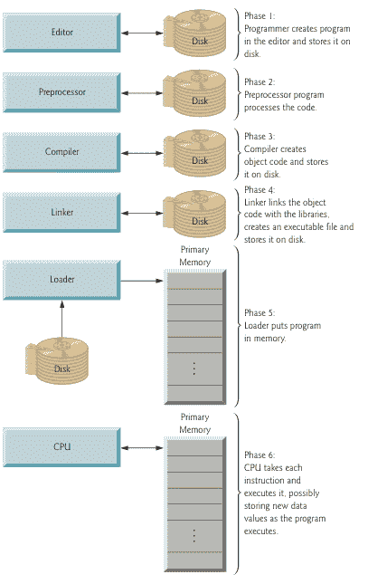

**图1.1** | 典型的C++环境。

### 阶段4：链接

阶段4称为链接。C++程序通常包含对其他地方定义的函数和数据的引用，例如在标准库中，或在从事特定项目的程序员团队的私有库中。C++编译器生成的目标代码通常会因为缺少这些部分而含有“空洞”。链接器将目标代码与缺失函数的代码链接起来，以生成一个没有缺失部分的可执行程序。如果程序编译和链接正确，则会产生可执行映像。

### 阶段5：加载

阶段5称为加载。程序在执行之前必须首先装入内存。这由加载器完成，加载器将可执行映像从磁盘取出并传输到内存。支持该程序的共享库中的其他组件也会被加载。

### 阶段6：执行

最后，计算机在其CPU的控制下，一次一条指令地执行程序。

### 执行时可能出现的问题

程序并不总是在第一次尝试时就正常工作。前面每个阶段都可能因为我们在本书中讨论的各种错误而失败。例如，正在执行的程序可能尝试除以零（在C++中，对于整数运算这是非法操作）。这将导致C++程序显示错误消息。如果发生这种情况，你必须返回编辑阶段，进行必要的更正，然后再次经历其余阶段，以确定更正解决了问题。

大多数C++程序都要输入和/或输出数据。某些C++函数从`cin`（标准输入流；读作“see-in”）获取输入，`cin`通常是键盘，但`cin`可以被重定向到其他设备。数据通常输出到`cout`（标准输出流；读作“see-out”），`cout`通常是计算机屏幕，但`cout`可以被重定向到其他设备。当我们说程序打印结果时，通常意味着结果显示在屏幕上。数据可以输出到其他设备，如磁盘和硬拷贝打印机。还有一个称为`cerr`的标准错误流。`cerr`流（通常连接到屏幕）用于显示错误消息。用户通常将`cout`分配给屏幕以外的设备，同时保持`cerr`分配给屏幕，以便正常输出与错误分离。

> **常见编程错误 1.1**
> 
> 诸如除以零之类的错误在程序运行期间发生，因此它们被称为运行时错误或执行时错误。致命的运行时错误会导致程序立即终止，无法成功完成其工作。非致命的运行时错误允许程序运行完成，但通常会生成错误的结果。[注：在某些系统中，除以零不是致命错误。请参阅你的系统文档。]

## 1.15 关于C++和《C++程序设计教程（第7版）》的说明

有经验的C++程序员有时会为能创造奇怪、复杂的语言用法而自豪。这是一种不好的编程实践。它使程序更难阅读，更可能行为异常，更难以测试和调试，也更难以适应不断变化的需求。本书面向初学者，因此我们强调程序清晰性。这是我们的第一条“良好编程实践”。

> **良好编程实践 1.1**
> 
> 以简单直接的方式编写C++程序。这有时被称为KIS（“保持简单”）。不要试图通过怪异的用法来“拉伸”语言。

你听说过C和C++是可移植语言，用C和C++编写的程序可以在许多不同的计算机上运行。可移植性是一个难以捉摸的目标。ANSI C标准文档包含一长串可移植性问题，并且已有整本书讨论可移植性。

> **可移植性提示 1.3**
> 
> 虽然编写可移植程序是可能的，但不同的C和C++编译器以及不同的计算机之间存在许多可能使可移植性难以实现的问题。用C和C++编写程序并不能保证可移植性。你通常需要直接处理编译器和计算机的差异。这些差异统称为平台差异。

如果你需要有关C++的其他技术细节，可以阅读C++标准文档，可以从ANSI订购，网址为webstore.ansi.org。该文档的标题是“信息技术——编程语言——C++”，其文档编号是INCITS/ISO/IEC 14882-2003。

我们在www.deitel.com/cplusplus/的C++资源中心列出了许多与C++和面向对象编程相关的网站，该网站提供免费C++编译器、资源站点、一些有趣的C++游戏、游戏编程教程等的链接。

> **良好编程实践 1.2**
> 
> 阅读你正在使用的C++版本的文档。经常查阅该文档，以确保你了解C++丰富的功能集合，并正确使用它们。

> **良好编程实践 1.3**
> 
> 如果阅读了C++语言文档后，你仍然不确定C++某个功能的用法，请使用一个小型测试程序进行试验，看看会发生什么。将编译器选项设置为“最大警告”。研究编译器生成的每条消息，并更正程序以消除这些消息。

## 1.16 测试运行一个C++应用程序

在本节中，你将运行并与你的第一个C++应用程序交互。你将首先运行一个有趣的猜数字游戏，它会从1到1000中选择一个数字，并提示你猜测。如果你的猜测正确，游戏结束。如果你的猜测不正确，应用程序会指示你的猜测是高于还是低于正确数字。你可以猜测的次数没有限制。[注：仅为了本次测试运行，我们修改了这个应用程序，它原本是你将在第6章“函数与递归导论”中被要求创建的练习。通常此应用程序会随机选择


程序执行时给出的正确答案。修改后的应用程序在每次执行时都会使用相同的正确答案（尽管这可能因编译器而异），因此您可以使用我们在本节中使用的相同猜测，并在我们引导您与第一个 C++ 应用程序交互时看到相同的结果。

我们将演示如何使用 Windows 命令提示符和 Linux 上的 shell 运行 C++ 应用程序。该应用程序在两个平台上的运行方式类似。有许多开发环境可用于编译、构建和运行 C++ 应用程序，例如 CodeGear 的 C++Builder、GNU C++、Microsoft Visual C++ 等。请咨询您的老师以了解您的特定开发环境。

在以下步骤中，您将运行已完成的应用程序，并输入各种数字来猜测正确的数字。您在此应用程序中看到的元素和功能是您将在本书中学习编程的典型内容。我们使用不同的字体来区分屏幕上看到的功能（如命令提示符）和与屏幕不直接相关的元素。我们使用半粗无衬线 Helvetica 字体强调标题和菜单等屏幕功能（如“文件”菜单），并使用无衬线 Lucida 字体强调文件名、应用程序显示的文本以及您应向应用程序输入的值（如 `GuessNumber` 或 `500`）。正如您所注意到的，每个术语的定义出现处使用栗色粗体。在本节的图中，我们指出了应用程序的重要部分。为了使这些功能更明显，我们修改了命令提示符窗口的背景颜色（仅适用于 Windows 测试驱动）。要修改系统上的命令提示符颜色，请通过选择“开始 > 所有程序 > 附件 > 命令提示符”打开命令提示符，然后右键单击标题栏并选择“属性”。在出现的“命令提示符”属性对话框中，单击“颜色”选项卡，然后选择您喜欢的文本和背景颜色。

## 从 Windows 命令提示符运行 C++ 应用程序

- **1. 检查您的设置。** 务必阅读 `www.deitel.com/books/cpphtp7/` 上的“开始之前”部分，以确保您已将书中的示例正确复制到硬盘上。

- **2. 找到已完成的应用程序。** 打开命令提示符窗口。要更改已完成的 GuessNumber 应用程序的目录，请键入 `cd C:\examples\ch01\GuessNumber\Windows`，然后按 Enter（图 1.2）。`cd` 命令用于更改目录。

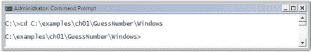

**图 1.2** | 打开**命令提示符**窗口并更改目录。

- **3. 运行 GuessNumber 应用程序。** 现在您已进入包含 GuessNumber 应用程序的目录，请键入命令 `GuessNumber`（图 1.3），然后按 Enter。*注意：* GuessNumber.exe 是应用程序的实际名称；但 Windows 默认假定 `.exe` 扩展名。

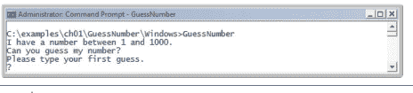

**图 1.3** | 运行 GuessNumber 应用程序。

- **4. 输入您的第一次猜测。** 应用程序显示“请输入您的第一次猜测。”，然后在下一行显示一个问号 (?) 作为提示符（图 1.3）。在提示符处输入 500（图 1.4）。

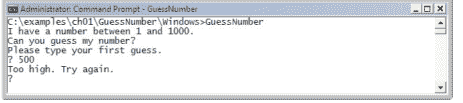

**图 1.4** | 输入您的第一次猜测。

- **5. 输入另一个猜测。** 应用程序显示“太高了。请再试一次。”，表示您输入的值大于应用程序选定的正确猜测数。因此，您应该在下次猜测时输入一个较小的数字。在提示符处输入 250（图 1.5）。应用程序再次显示“太高了。请再试一次。”，因为您输入的值仍大于应用程序选定的正确猜测数。

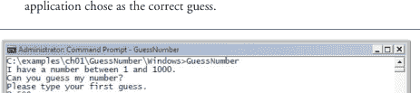

**图 1.5** | 输入第二个猜测并接收反馈。

- **6. 输入更多猜测。** 继续输入数值进行游戏，直到猜中正确的数字。应用程序将显示“太棒了！您猜对了！”（图 1.6）。

- **7. 再次玩游戏或退出应用程序。** 猜对后，应用程序会询问您是否想再玩一局（图 1.6）。在“您想再玩一次吗 (y 或 n)?”提示符处，输入字符 `y` 将使应用程序选择一个新数字并显示消息“请输入您的第一次猜测。”，随后显示一个问号提示符（图 1.7），以便您在新游戏中做出第一次猜测。输入字符 `n` 将结束应用程序并返回到命令提示符下的应用程序目录（图 1.8）。每次从头开始执行此应用程序（即第 3 步）时，它都会选择相同的数字供您猜测。

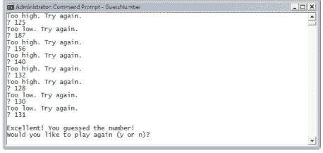

**图 1.6** | 输入更多猜测并猜中正确的数字。

- **8.** 关闭命令提示符窗口。

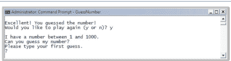

**图 1.7** | 再次玩游戏。

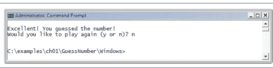

**图 1.8** | 退出游戏。

### 使用 GNU C++ 在 Linux 上运行 C++ 应用程序

对于本次测试驱动，我们假设您知道如何将示例复制到您的主目录。如果您对将文件复制到 Linux 系统有任何疑问，请咨询您的老师。此外，在本节的图中，我们使用粗体高亮来标出每一步所需的用户输入。您系统上的 shell 提示符使用波浪号 (~) 字符表示主目录，每个提示符以美元符号 ($) 字符结尾。Linux 系统之间的提示符会有所不同。

- **1. 找到已完成的应用程序。** 在 Linux shell 中，通过键入以下命令更改到已完成的 GuessNumber 应用程序目录（图 1.9）：

```bash
cd Examples/ch01/GuessNumber/GNU_Linux
```

然后按 *Enter*。`cd` 命令用于更改目录。

```text
~$ cd examples/ch01/GuessNumber/GNU_Linux
~/examples/ch01/GuessNumber/GNU_Linux$
```

**图 1.9** | 更改 GuessNumber 应用程序的目录。

- **2. 编译 GuessNumber 应用程序。** 要在 GNU C++ 编译器上运行应用程序，必须先通过键入以下命令进行编译：

```bash
g++ GuessNumber.cpp -o GuessNumber
```

如图 1.10 所示，此命令编译应用程序并生成一个名为 GuessNumber 的可执行文件。

```text
~/examples/ch01/GuessNumber/GNU_Linux$ g++ GuessNumber.cpp -o GuessNumber
~/examples/ch01/GuessNumber/GNU_Linux$
```

**图 1.10** | 使用 `g++` 命令编译 GuessNumber 应用程序。

- **3. 运行 GuessNumber 应用程序。** 要运行可执行文件 GuessNumber，请在下一个提示符处键入 `./GuessNumber`，然后按 *Enter*（图 1.11）。

```text
~/examples/ch01/GuessNumber/GNU_Linux$ ./GuessNumber
I have a number between 1 and 1000.
Can you guess my number?
Please type your first guess.
?
```

**图 1.11** | 运行 GuessNumber 应用程序。

- **4. 输入您的第一次猜测。** 应用程序显示“请输入您的第一次猜测。”，然后在下一行显示一个问号 (?) 作为提示符（图 1.11）。在提示符处输入 500（图 1.12）。*注意：* 这是我们为 Windows 修改并试运行的同一个应用程序，但输出可能因使用的编译器而异。

- **5. 输入另一个猜测。** 应用程序显示“太高了。请再试一次。”，表示您输入的值大于应用程序选定的正确猜测数（图 1.12）。在下一个提示符处输入 **250**（图 1.13）。这次应用程序显示“太低了。请再试一次。”，因为您输入的值小于正确猜测数。

```text
~/examples/ch01/GuessNumber/GNU_Linux$ ./GuessNumber
I have a number between 1 and 1000.
Can you guess my number?
Please type your first guess.
? 500
Too high. Try again.
?
```

**图 1.12** | 输入初始猜测。

```text
~/examples/ch01/GuessNumber/GNU_Linux$ ./GuessNumber
I have a number between 1 and 1000.
Can you guess my number?
Please type your first guess.
? 500
Too high. Try again.
? 250
Too low. Try again.
?
```

**图 1.13** | 输入第二个猜测并接收反馈。

- **6. 输入更多猜测。** 继续输入数值进行游戏（图 1.14），直到猜中正确的数字。当您猜对时，应用程序会显示“太棒了！您猜对了。” （图 1.14）。

```text
Too low. Try again.
? 375
Too low. Try again.
? 437
Too high. Try again.
? 406
Too high. Try again.
? 391
Too high. Try again.
? 383
Too low. Try again.
? 387
Too high. Try again.
? 385
Too high. Try again.
? 384
Excellent! You guessed the number.
Would you like to play again (y or n)?
```

**图 1.14** | 输入更多猜测并猜中正确的数字。


7. *再次玩游戏或退出应用程序。* 在你猜中正确数字后，应用程序会询问你是否想再玩一局。在“是否想再玩一次（y 或 n）？”提示下，输入单个字符 y 会让应用程序选择一个新数字，并显示消息“请输入你的第一次猜测，”，随后是一个问号提示（图 1.15），以便你在新游戏中进行第一次猜测。输入字符 n 会结束应用程序，并让你返回到 shell 中该应用程序的目录（图 1.16）。每次你从头执行此应用程序（即步骤 3）时，它都会选择相同的数字供你猜测。

```
Excellent! You guessed the number.
Would you like to play again (y or n)? y

I have a number between 1 and 1000.
Can you guess my number?
Please type your first guess.
?
```

**图 1.15** | 再次玩游戏。

```
Excellent! You guessed the number.
Would you like to play again (y or n)? n

~/examples/ch01/GuessNumber/GNU_Linux$
```

**图 1.16** | 退出游戏。

## 1.17 软件技术

在本节中，我们讨论一些你在软件开发社区中会听到的软件工程流行术语。我们已针对其中大多数术语创建了资源中心。

敏捷软件开发是一组方法论，力求以比以往方法论更少的资源快速实现软件。请查看敏捷联盟（www.agilealliance.org）和敏捷宣言（www.agilemanifesto.org）。

重构涉及重写代码，使其更清晰、更易于维护，同时保留其功能。它被广泛用于敏捷开发方法。许多重构工具可自动完成大部分重写工作。

设计模式是用于构建灵活且可维护的面向对象软件的经过验证的架构。设计模式领域试图列举那些反复出现的模式，鼓励软件设计人员复用它们，以更少的时间、金钱和精力开发更高质量的软件。

**游戏编程。** 计算机游戏产业比首轮电影产业更大。大学课程甚至专业现在都致力于游戏编程中使用的复杂软件技术。请查看我们的游戏编程、C++ 游戏编程和编程项目资源中心。

开源软件是一种软件开发风格，与软件早期占主导地位的专有开发相对。在开源开发中，个人和公司贡献自己的力量来开发、维护和演进软件，以换取将该软件用于自身目的的权利，通常免费。开源代码通常比专有软件受到更广泛受众的审查，因此错误被更快地消除。开源还鼓励更多创新。Sun 最近宣布将 Java 开源。在开源社区中，你会经常听说的组织包括 Eclipse 基金会（Eclipse IDE 在 C++ 和 Java 软件开发中很流行）、Mozilla 基金会（Firefox 浏览器的创造者）、Apache 软件基金会（Apache Web 服务器的创造者）和 SourceForge（提供管理开源项目的工具，目前有数十万个开源项目正在开发中）。

Linux 是一种开源操作系统，也是开源运动最伟大的成功之一。MySQL 是一种开源数据库管理系统。PHP 是用于开发基于互联网的应用程序的最流行的开源服务器端“脚本”语言。LAMP 是许多开发者用来构建 Web 应用程序的一组开源技术的缩写——它代表 Linux、Apache、MySQL 和 PHP（或 Perl 或 Python——用于类似目的的另外两种语言）。

Ruby on Rails 将脚本语言 Ruby 与公司 37Signals 开发的 Rails Web 应用程序框架结合在一起。他们的书 *《Getting Real》* 是当今 Web 应用程序开发者的必读之作；可在 `gettingreal.37signals.com/toc.php` 免费阅读。许多 Ruby on Rails 开发者报告称，在开发数据库密集型 Web 应用程序时，与使用其他语言相比，生产力显著提高。

软件通常被视为一种产品；大多数软件仍以这种方式提供。如果你想运行某个应用程序，你从软件供应商处购买软件包。然后你将软件安装到计算机上，并按需运行。当软件的新版本出现时，你升级软件，通常需要花费大量费用。对于拥有数万个系统、且必须在各种计算机设备上维护的组织来说，这个过程可能变得繁琐。借助软件即服务（SaaS），软件运行在互联网其他位置的服务器上。当这些服务器更新时，全球所有客户端都能看到新功能；无需本地安装。你通常通过浏览器访问该服务——浏览器具有很强的可移植性，因此你可以在世界任何地方的不同类型计算机上运行相同的应用程序。Salesforce.com、Google 以及 Microsoft 的 Office Live 和 Windows Live 都提供 SaaS。

## 1.18 C++ 的未来：开源 Boost 库、TR1 和 C++0x

C++ 的创造者 Bjarne Stroustrup 表达了他对 C++ 未来的愿景。新标准的主要目标是使 C++ 更易于学习、改进库构建能力，并提高与 C 编程语言的兼容性。

第 23 章讨论 C++ 的未来——我们介绍 Boost C++ 库、技术报告 1（TR1）和 C++0x。Boost C++ 库是由 C++ 社区成员创建的免费开源库。Boost 已发展到 80 多个库，并且定期还会增加更多库。如今，Boost 开源社区中有数千名程序员。Boost 为 C++ 程序员提供有用且设计良好的库，这些库能与现有的 C++ 标准库很好地配合。使用各种平台和许多不同编译器的 C++ 程序员都可以使用 Boost 库。我们概述 TR1 中包含的库，并提供“正则表达式”和“智能指针”库的代码示例。

**正则表达式**用于匹配文本中的特定字符模式。它们可用于验证数据以确保其符合特定格式、用另一字符串替换某个字符串的一部分，或拆分字符串。

C 和 C++ 代码中的许多常见错误与指针有关，指针是 C++ 从 C 吸收的一项强大编程能力。**智能指针**通过提供标准指针之外的其他功能来帮助你避免错误。此功能通常会增强内存分配和释放过程。

**技术报告 1** 描述了对 C++ 标准库的拟议更改，其中许多基于当前的 Boost 库。这些库为 C++ 增加了有用的功能。C++ 标准委员会目前正在修订 C++ 标准。上一个标准于 1998 年发布。新标准（目前称为 C++0x）的工作始于 2003 年。新标准可能很快就会发布。它将包括对核心语言的更改以及 TR1 中大多数库的更改。

## 1.19 软件工程案例研究：对象技术与 UML 简介

现在我们开始对面向对象进行早期介绍，这是一种思考世界和编写计算机程序的自然方式。可选的第 25～26 章以精心安排的节奏介绍面向对象。这里的目标是帮助你培养面向对象的思维方式，并向你介绍统一建模语言™（UML™）——一种图形语言，使设计面向对象软件系统的人能够使用行业标准符号来表示这些系统。

在本节中，我们介绍基本的面向对象概念和术语。可选章节展示一个简单自动柜员机（ATM）系统的软件的面向对象设计与实现。在第 25 章中，我们将

- 分析描述将要构建的软件系统（ATM）的典型需求规格说明
- 确定实现该系统所需的对象
- 确定这些对象将具有的属性
- 确定这些对象将表现出的行为
- 规定这些对象如何相互交互以满足系统需求

在第 26 章中，我们修改并增强第 25 章中给出的设计，并给出面向对象 ATM 系统的完整、可运行的 C++ 实现。

尽管我们的案例研究是行业级问题的缩减版本，但我们涵盖了许多常见的行业实践。你将体验使用 UML 进行面向对象设计的扎实入门。此外，你将通过浏览 ATM 的完整、精心编写且文档齐全的 C++ 实现，提高代码阅读技能。

### *对象技术基本概念*

我们以一些关键术语开始对面向对象的介绍。在现实世界中，你随处都能看到对象——人、动物、植物、汽车、飞机、建筑物、计算机、显示器等等。人类以对象的方式思考。电话、房屋，


交通信号灯、微波炉和饮水机只是我们每天在身边看到的另外几个对象。

我们有时将对象分为两类：有生命的和无生命的。有生命对象在某种意义上是有“生命”的——它们会四处移动并做事。无生命对象不会自行移动。然而，这两种类型的对象有一些共同之处。它们都具有属性（例如大小、形状、颜色和重量），并且都表现出行为（例如，球会滚动、弹跳、充气和放气；婴儿会哭、睡觉、爬行、行走和眨眼；汽车会加速、刹车和转弯；毛巾会吸水）。我们将研究软件对象所具有的属性和行为的种类。

人类通过研究现有对象的属性并观察其行为来了解它们。不同的对象可以具有相似的属性，也可以表现出相似的行为。例如，可以在婴儿与成人之间、人类与黑猩猩之间进行比较。

面向对象设计（OOD）使用与人们描述现实世界对象相似的方式来为软件建模。它利用类关系：某个类（例如车辆类）的对象具有相同的特征——汽车、卡车、红色小拖车和旱冰鞋有许多共同点。OOD 利用继承关系：新的对象类通过吸收现有类的特征并添加自身独有的特征而派生出来。“敞篷车”类的对象当然具有更一般的“汽车”类的特征，但更具体地说，它的车顶可以升起和降下。

面向对象设计提供了一种自然且直观的方式来审视软件设计过程——即像我们描述现实世界对象那样，通过属性、行为和相互关系来为对象建模。OOD 还会对对象之间的通信进行建模。正如人们彼此发送消息（例如，中士命令士兵立正），对象也通过消息进行通信。银行账户对象可能收到一条消息，要求将其余额减少一定金额，因为客户已取走该金额的钱。

OOD 将属性和操作（行为）封装（即包装）到对象中——对象的属性和操作紧密联系在一起。对象具有信息隐藏的特性。这意味着对象可能知道如何通过定义良好的接口彼此通信，但通常不允许知道其他对象是如何实现的——实现细节隐藏在对象自身内部。例如，我们可以有效地驾驶汽车，而不必了解发动机、变速器、制动器和排气系统内部如何工作的细节——只要我们懂得如何使用加速踏板、制动踏板、方向盘等即可。正如我们将看到的，信息隐藏对于良好的软件工程至关重要。

像 C++ 这样的语言是面向对象的。用这类语言编程称为面向对象编程（OOP），它使计算机程序员能够将面向对象设计实现为可工作的软件系统。另一方面，像 C 这样的语言是过程式的，因此编程往往以动作为导向。在 C 中，编程单元是函数。在 C++ 中，编程单元是类，对象最终由该类实例化（OOP 中表示“创建”的术语）。C++ 类包含实现操作的函数和实现属性的数据。

C 程序员专注于编写函数。程序员将执行某些常见任务的动作组合成函数，再将函数组合成程序。数据在 C 中当然很重要，但其观点是：数据的存在主要是为了支持函数所执行的动作。系统规格说明中的动词帮助 C 程序员确定将协同实现该系统的函数集合。

### 类、数据成员和成员函数

C++ 程序员专注于创建自己的用户定义类型，称为类。每个类既包含数据，也包含一组函数，这些函数操作该数据并向客户（即使用该类的其他类或函数）提供服务。类的数据组成部分称为数据成员。例如，银行账户类可能包含账号和余额。类的函数组成部分称为成员函数（在 Java 等其他面向对象编程语言中通常称为方法）。例如，银行账户类可能包含用于存款（增加余额）、取款（减少余额）和查询当前余额的成员函数。你使用内置类型（以及其他用户定义类型）作为“构建块”来构造新的用户定义类型（类）。系统规格说明中的名词帮助 C++ 程序员确定一组类，从这些类创建出的对象将协同实现该系统。

类与对象的关系就像蓝图与房子的关系——类是构建该类的对象的“计划”。正如我们可以根据一张蓝图建造许多房子，我们也可以从一个类实例化（创建）许多对象。你不能在蓝图的厨房里做饭；你可以在房子的厨房里做饭。你不能在蓝图的卧室里睡觉；你可以在房子的卧室里睡觉。

类可以与其他类存在关系——称为关联。例如，在银行的面向对象设计中，“银行柜员”类需要与其他类相关联，例如“客户”类、“现金抽屉”类、“保险柜”类等。

将软件打包为类使未来的软件系统能够重用这些类。相关类的组通常打包为可重用组件。许多人说，影响软件开发未来的最重要因素是重用。


> **软件工程观察 1.4**
>
> *在构建新类和程序时重用现有类可以节省时间和金钱。重用还有助于你构建更可靠、更有效的系统，因为现有类和组件通常已经经过了大量测试、调试和性能调优。*

的确，借助对象技术，你可以通过组合现有类来构建你所需的大部分新软件，就像汽车制造商组合可互换零件一样。你创建的每个新类都有可能成为有价值的软件资产，你和别的程序员可以重用它，以加快并提高未来软件开发工作的质量。

### 面向对象分析与设计（OOAD）简介

很快你就要用 C++ 编写程序。你将如何为程序创建代码？也许，像许多初学者程序员一样，你会直接打开电脑开始输入。这种方法可能适用于小型程序，但如果你被要求为一家大型银行创建一个控制数千台自动取款机的软件系统，那该怎么办？或者假设你被要求加入一个由 1000 名软件开发人员组成的团队，构建美国下一代空中交通管制系统。对于如此庞大而复杂的项目，你不能只是坐下来就开始编写程序。

UML 的持续维护和修订职责。本书通篇介绍 UML 2 的术语和表示法。

### 什么是 UML？

UML 现在是用于为面向对象系统建模的最广泛使用的图形表示方案。它统一了各种流行的表示法方案。设计系统的人使用该语言（以图的形式）来为他们的系统建模。UML 建模者可以在设计系统时自由使用各种过程，但现在所有开发者都能用一套标准的图形表示法来表达他们的设计。在可选的第 25—26 章软件工程案例研究中，我们介绍 UML 的一个简单、简洁的子集。如需更多信息，请访问我们的 UML 资源中心：www.deitel.com/UML/。

## 1.19 节 自测练习

- 1.1  列出三个我们未提及的现实世界对象示例。对于每个对象，列出若干属性和行为。
- 1.2  伪代码是 ________。
  - a) OOAD 的另一种说法
  - b) 一种用于显示 UML 图的编程语言
  - c) 一种表达程序逻辑的非正式手段
  - d) 一种用于为面向对象系统建模的图形表示方案
- 1.3  UML 主要用于 ________。
  - a) 测试面向对象系统
  - b) 设计面向对象系统
  - c) 实现面向对象系统
  - d) a 和 b 两者

## 1.19 节自测练习答案

- 1.1  [注：答案可能有所不同。] a) 电视的属性包括屏幕尺寸、可显示的颜色数量、当前频道和当前音量。电视可以打开和关闭、切换频道、显示视频并播放声音。b) 咖啡机的属性包括其可容纳的最大水量、冲泡一壶咖啡所需的时间以及咖啡壶下方加热板的温度。咖啡机可以打开和关闭、冲泡咖啡并加热咖啡。c) 乌龟的属性包括年龄、龟壳大小和体重。乌龟会行走、缩回壳内、从壳中出来并吃植物。
- 1.2  c。
- 1.3  b。

## 1.20 小结

本章介绍了基本的硬件和软件概念。你学习了互联网和万维网的历史，并了解了 Web 2.0 现象。我们讨论了不同类型的编程语言、它们的历史以及哪些编程语言使用最广泛。我们还讨论了 C++ 标准库，它包含可重用的类和函数，可帮助 C++ 程序员创建可移植的 C++ 程序。

我们介绍了基本的对象技术概念，包括类、对象、属性、行为、封装和继承。你还了解了历史和目的。


UML——用于对面向对象软件系统进行建模的业界标准图形语言。

你了解了创建和执行 C++ 应用程序的典型步骤，并对单个 C++ 应用程序进行了“测试驱动”。我们讨论了几项关键的软件技术和概念，并展望了 C++ 的未来。在后续章节中，你将学习 Boost 开源库，了解如何全面增强 C++ 标准库的功能。

在下一章中，你将创建自己的第一个 C++ 应用程序。你将看到几个示例，这些示例演示程序如何在屏幕上显示消息，以及如何从键盘获取用户输入的信息并进行处理。

## 1.21 Web 资源

本节提供了 C++ 及相关资源中心的链接。在学习 C++ 的过程中，这些资源会对你很有帮助。这些资源中心包括各种 C++ 资源、面向学生和专业人士的 C++ 开发工具，以及使用 C++ 构建的游戏链接。

### Deitel & Associates 网站

Deitel & Associates 的 C++ *《C++ 编程：从入门到精通》，第 7 版*网站。在这里，你可以找到本书示例及其他资源的链接。

- `www.deitel.com/cplusplus/`
- `www.deitel.com/visualcplusplus/`
- `www.deitel.com/cplusplusgameprogramming/`
- `www.deitel.com/cplusplusboostlibraries/`
- `www.deitel.com/codesearchengines`
- `www.deitel.com/programmingprojects`

请访问这些资源中心，获取编译器、代码下载、教程、文档、书籍、电子书、文章、博客、RSS 订阅源等更多内容，这些资源将帮助你开发 C++ 应用程序。

`www.deitel.com`  
访问此网站，获取所有 Deitel 出版物的更新、勘误和其他资源。

`www.deitel.com/newsletter/subscribe.html`  
访问此网站，订阅 *Deitel® Buzz Online* 电子邮件通讯，以了解 Deitel & Associates 的出版计划，包括 *《C++ 编程：从入门到精通》，第 7 版*的更新和勘误信息。

## 总结

### 第 1.1 节　简介

- 计算机（通常称为硬件）由软件控制（即，你编写的用于命令计算机执行操作和做出决策的指令）。
- 由于硬件和软件技术的快速发展，计算成本一直在大幅降低。
- 面向对象是当今程序员使用的关键编程方法。

### 第 1.2 节　计算机：硬件和软件

- 计算机能够以比人类快数十亿倍的速度进行计算和做出逻辑判断。
- 计算机在称为计算机程序的指令集控制下处理数据；这些程序引导计算机按照计算机程序员指定的有序操作步骤运行。

- 博客是以逆时间顺序发布简短文章的网站，已经成为 Web 2.0 中的一种重大社会现象。许多博主被视为媒体的一部分，企业也开始接触博客圈，以跟踪消费者的意见。

- 开源软件使创建 Web 2.0 公司变得更加便宜和容易。

- Mashup 将两个或更多现有 Web 应用程序组合起来，以实现新的用途；它依赖于小型模块化组件以及对 Web 服务 API 的开放访问，这些 API 允许开发人员将其他 Web 服务集成到自己的应用程序中。

### 第 1.7 节　机器语言、汇编语言和高级语言

- 任何计算机都只能直接理解自己的机器语言，而机器语言通常由数字字符串组成，用于指示计算机执行最基本的操作。

- 类似英语的缩写构成了汇编语言的基础。称为汇编器的翻译程序会将汇编语言程序转换为机器语言。

- 编译器将高级语言程序翻译为机器语言程序。高级语言（例如 C++）包含英语单词和常规数学符号。

- 解释器程序可以直接执行高级语言程序，从而不必将其编译为机器语言。

### 第 1.8 节　C 和 C++ 的历史

- C++ 对 C 语言进行了增强，并提供了面向对象编程的功能。

- 对象是可复用的软件组件，用于对现实世界中的事物进行建模。采用模块化的面向对象设计和实现方法，可以使软件开发团队比使用以前的编程技术更加高效。

### 第 1.9 节　C++ 标准库

- 你可以编写自己需要的每个类和函数，但大多数 C++ 程序员都会利用 C++ 标准库中丰富的现有类和函数集合。

### 第 1.10 节　Java 的历史

- Java 用于为网页创建动态和交互式内容、开发企业应用程序、增强 Web 服务器功能、为消费类设备提供应用程序等。

### 第 1.11 节　Fortran、COBOL、Pascal 和 Ada

- FORTRAN 由 IBM 公司于 20 世纪 50 年代开发，用于需要复杂数学计算的科学和工程应用。

- COBOL 于 20 世纪 50 年代开发，用于需要精确、高效数据处理的商业应用。

- Ada 在 20 世纪 70 年代和 80 年代初期由美国国防部（DoD）资助开发。Ada 提供多任务处理功能，允许程序员指定同时执行多个活动。

### 第 1.12 节　BASIC、Visual Basic、Visual C++、C# 和 .NET

- BASIC 于 20 世纪 60 年代在达特茅斯学院开发，面向编程初学者。

- Visual Basic 于 20 世纪 90 年代推出，旨在简化 Windows 应用程序的开发。

- Microsoft 制定了在计算机应用程序中整合 Internet 和 Web 的企业整体战略。这一战略通过 Microsoft 的 .NET 平台实现。

- 计算机程序员 4
- 计算机程序 4
- 数据 4
- 数据成员 26
- 调试 10
- 决策 2
- 设计 27
- 设计模式 22
- 分布式计算 5
- 动态内容 11
- 编辑阶段 13
- 编辑器 13
- 编辑器程序 13
- 封装 25
- 错误预防提示 10
- 可执行程序 26
- 执行阶段 13
- 执行 15
- 执行时错误 15
- 致命运行时错误 15
- FORTRAN（FORMULA TRANslator，公式翻译器）11
- 函数 9, 25
- 游戏编程 22
- 良好编程实践 10
- Google AdSense 7
- 硬件 2
- 硬件平台 8
- 高级语言 8
- 信息隐藏 25
- 继承 25
- 输入设备 4
- 输入单元 4
- 实例化 25
- 接口 25
- 国际标准化组织（ISO）2
- Internet 6
- 解释器 8
- Java 10
- LAMP 23
- 链接阶段 13
- 链接器 15
- 链接 15
- Linux 23
- 实时代码方法 2
- 加载阶段 13
- 加载器 15
- 加载 15
- 局域网（LAN）5
- 逻辑单元 4
- 依赖机器 7
- 机器语言 7
- 大型机 3
- Mashup 7
- 成员函数 26
- 内存 4
- 存储单元 4
- 方法 26
- 多核处理器 5
- 多处理器 5
- 多任务处理 11
- MySQL 23
- .NET 平台 12
- 社交网络的网络效应 6
- 非致命运行时错误 15
- 名词 26
- 目标代码 7
- 对象管理组织™（OMG™）27
- 面向对象 25
- 面向对象的分析与设计（OOAD）27
- 面向对象设计（OOD）25
- 面向对象编程（OOP）9, 25
- 对象 9, 24
- 开源 7
- 开源软件 22
- 操作 25
- 输出设备 4
- 输出单元 4
- Pascal 11
- 性能提示 10
- 持久存储 5
- 个人计算 5
- PHP 23
- 平台 16
- 可移植性提示 10
- 可移植的 8
- 高级内容 7
- 预处理阶段 13
- 预处理器 13
- 预处理器指令 13
- 主存储器 4
- 过程式 25
- 伪代码 27
- 重构 22
- 正则表达式 24
- 需求规格说明 27
- 复用 26
- Ruby on Rails 23
- 运行时错误 15
- 辅助存储单元 5
- 语义 Web 7
- 服务器 5


- 智能指针 24
- 社交网络 6
- 软件 2
- 软件即服务（SaaS）23
- 软件工程观察 10
- 软件复用 10
- 源代码 13
- 标准错误流 15
- 标准输入流 15
- 标准输出流 15
- 结构化程序设计 11
- 结构化系统分析与设计 12
- 超级计算机 4
- 标记 6
- 技术报告 1 24
- 翻译 7
- 翻译器程序 8
- UML 合作伙伴 27
- 统一建模语言™（UML™）24
- 用户定义类型 26
- 动词 26
- Visual Basic 12
- Visual C# 12
- Visual C++ 12
- volatile 4
- Web 2.0 6
- Web 3.0 7
- Web 服务 7
- webtop 7
- 维基 6
- 万维网 6

## 自测练习

- **1.1** 填写下列各题中的空白：
  - a) 推广个人计算的公司是 ________。
  - b) 使个人计算在商业和工业中得到认可的计算机是 ________。
  - c) 计算机在称为计算机 ________ 的指令集控制下处理数据。
  - d) 计算机的六个关键逻辑单元是 ________、________、________、________、________ 和 ________。
  - e) 本章讨论的三种语言类型是 ________、________ 和 ________。
  - f) 将高级语言程序翻译成机器语言的程序称为 ________。
  - g) C 被广泛认为是 ________ 操作系统的开发语言。
  - h) ________ 语言由 Wirth 开发，用于教授结构化程序设计。
  - i) 美国国防部开发了 Ada 语言，它具有称为 ________ 的能力，允许程序员指定可以并行进行的活动。
  - j) ________，或称内容标注，是 Web 2.0 协作主题的另一个关键部分。
  - k) 借助 Internet 应用程序，桌面演变为 ________。
  - l) ________ 涉及重构代码，使其更清晰、更易于维护，同时保留其功能。
  - m) 通过 ________ 开发，个人和公司贡献其努力来开发、维护和演进软件，以换取将软件用于自身目的的权利，通常免费。
  - n) ________ 用于匹配文本中的特定字符模式。它们可用于验证数据以确保其采用特定格式，用另一个字符串替换某个字符串的一部分，或拆分字符串。

- **1.2** 填写下列关于 C++ 环境的句子中的空白。
  - a) C++ 程序通常使用 ________ 程序键入计算机。
  - b) 在 C++ 系统中，________ 程序在编译器的翻译阶段开始之前执行。

- d) 计算机的哪个逻辑单元将计算机已处理的信息发送到各种设备，以便信息可在计算机外部使用？________。
- e) 计算机的哪些逻辑单元保留信息？________。
- f) 计算机的哪个逻辑单元执行计算？________。
- g) 计算机的哪个逻辑单元做出逻辑决策？________。
- h) 最适合你快速轻松编写程序的计算机语言级别是 ________。
- i) 计算机直接理解的唯一语言称为该计算机的 ________。
- j) 计算机的哪个逻辑单元协调所有其他逻辑单元的活动？________。

- **1.7** 为什么今天如此关注面向对象程序设计？
- **1.8** 区分术语致命错误和非致命错误。为什么你可能更愿意经历致命错误而不是非致命错误？
- **1.9** 简要回答下列每个问题：
  - a) 为什么本教材除了面向对象程序设计外还讨论结构化程序设计？
  - b) 人们互相发送哪些类型的消息？
  - c) 对象通过定义良好的接口相互发送消息。汽车收音机（对象）向其用户（人对象）呈现哪些接口？
- **1.10** *（行动中的手表）* 你可能正戴在手腕上的世界上最常见的对象之一——手表。讨论下列每个术语和概念如何应用于手表这一概念：对象、属性、行为、类、继承（例如，考虑闹钟）、封装、接口、信息隐藏、数据成员和成员函数。
- **1.11** 填写下列每个陈述中的空白（基于 1.17 节）：
  - a) LAMP 开发中使用的开源数据库管理系统是 ________。
  - b) 软件即服务（SaaS）的一个关键优势是 ________。
  - c) ________ 是用于构建灵活且可维护的面向对象软件的成熟架构。
  - d) ________ 是用于开发基于 Internet 的应用程序的最流行的开源服务器端“脚本”语言。

## 产生影响

- **1.12** *（试驾：碳足迹计算器）* 一些科学家认为，碳排放（尤其是燃烧化石燃料产生的碳排放）会显著加剧全球变暖，如果个人采取措施限制碳基燃料的使用，就可以应对这一问题。组织和个人越来越关注自己的“碳足迹”。TerraPass 和 Carbon Footprint 等网站提供碳足迹计算器。试用这些计算器来确定你的碳足迹。后续章节的练习将要求你编写自己的碳足迹计算器。为此，请使用网络研究计算碳足迹的公式。

    www.terrapass.com/carbon-footprint-calculator/

    以及 Carbon Footprint

    www.carbonfootprint.com/calculator.aspx

# 2 C++ 程序设计入门


> *名字有什么关系？我们称为玫瑰的那种花*
> *换成任何别的名字，闻起来都一样香甜。*
> —威廉·莎士比亚

> *面对抉择时，我总是问：“什么会最有意思？”*
> —佩吉·沃克

> *“再喝点茶吧，”三月兔非常认真地对爱丽丝说。“我还什么都没喝呢，”爱丽丝不高兴地回答，“所以我不能再喝了。”“你是说不能再少喝了吧，”帽匠说，“比什么都没有多喝一点很容易。”*
> —刘易斯·卡罗尔

> *“高尚的思想必须有高尚的语言。”*
> —阿里斯托芬

### 目标

本章你将学习：

- 用 C++ 编写简单的计算机程序。
- 编写简单的输入和输出语句。
- 使用基本类型。
- 基本的计算机内存概念。
- 使用算术运算符。
- 算术运算符的优先级。
- 编写简单的决策语句。

### 大纲

- 2.1 引言
- 2.2 第一个 C++ 程序：打印一行文本
- 2.3 修改我们的第一个 C++ 程序
- 2.4 另一个 C++ 程序：整数相加
- 2.5 内存概念
- 2.6 算术
- 2.7 决策：相等和关系运算符
- 2.8 小结
- 摘要 | 术语 | 自测练习 | 自测练习答案 | 练习 | 产生影响

## 2.1 引言

现在我们介绍 C++ 程序设计，它有助于采用规范的方法进行程序设计。本书中你将学习的大多数 C++ 程序都会处理信息并显示结果。本章给出五个示例，演示程序如何显示消息以及如何从用户那里获取信息进行处理。前三个示例仅在屏幕上显示消息。下一个示例从用户处获取两个数，计算它们的和并显示结果。随附的讨论向你展示如何执行各种算术计算并保存结果以供以后使用。第五个示例演示决策基础，展示如何比较两个数，然后根据比较结果显示消息。我们逐行分析每个程序，帮助你轻松进入 C++ 程序设计。为帮助你应用所学技能，本章练习中提供了许多编程问题。

## 2.2 第一个 C++ 程序：打印一行文本

C++ 使用的表示法对非程序员来说可能显得奇怪。现在我们考虑一个打印一行文本的简单程序（图 2.1）。该程序说明了 C++ 语言的几个重要特性。我们详细考虑每一行。

```cpp
1  // Fig. 2.1: fig02_01.cpp
2  // Text-printing program.
3  #include <iostream> // allows program to output data to the screen
4
5  // function main begins program execution
6  int main()
7  {
8     std::cout << "Welcome to C++!\n"; // display message
9
10    return 0; // indicate that program ended successfully
11 } // end function main
```

```
Welcome to C++!
```

图 2.1 | 文本打印程序。


### 第 1 行和第 2 行

```cpp
// Fig. 2.1: fig02_01.cpp
// Text-printing program.
```

这两行都以 `//` 开头，表示每行剩余部分是**注释**。插入注释是为了给程序编写文档，并帮助其他人阅读和理解程序。注释在程序运行时不会导致计算机执行任何操作——它们会被 C++ 编译器忽略，也不会生成任何机器语言目标代码。注释 Text-printing program 描述了程序的用途。以 `//` 开头的注释称为**单行注释**，因为它在当前行末尾结束。*[注意：你也可以使用 C 语言风格，注释可能包含多行，以 `/*` 开头并以 `*/` 结束。]*


> **良好编程实践 2.1**
> 
> *每个程序都应该以一条描述程序用途的注释开始。*

### 第 3 行

```cpp
#include <iostream> // allows program to output data to the screen
```

`#include <iostream>` 是一个**预处理器指令**，它是发给 C++ 预处理器的一条消息（在 1.14 节介绍）。以 `#` 开头的行会在程序编译前由预处理器处理。这一行通知预处理器将输入/输出流头文件 `<iostream>` 的内容包含到程序中。任何使用 C++ 风格流输入/输出向屏幕输出数据或从键盘输入数据的程序，都必须包含这个文件。图 2.1 中的程序将数据输出到屏幕，稍后你就会看到。我们将在第 6 章更详细地讨论头文件，并在第 15 章解释 `<iostream>` 的内容。


> **常见编程错误 2.1**
> 
> *在从键盘输入数据或向屏幕输出数据的程序中忘记包含 `<iostream>` 头文件，会导致编译器发出错误消息，因为编译器无法识别对流组件（如 `cout`）的引用。*

第 4 行只是一个空行。使用空行、空格字符和制表符字符（即“Tab”）可以使程序更易于阅读。这些字符统称为空白字符。编译器通常会忽略空白字符。在本章及随后几章中，我们将讨论使用空白字符来增强程序可读性的约定。


> **良好编程实践 2.2**
> 
> *使用空行、空格字符和制表符来增强程序的可读性。*

### 第 5 行

```cpp
// function main begins program execution
```

这是另一个单行注释，表示程序执行从下一行开始。

光标（即当前屏幕位置指示器）移动到屏幕下一行的开头。图 2.2 列出了一些常见的转义序列。

| 转义序列 | 描述 |
|---|---|
| `\n` | 换行。将屏幕光标定位到下一行的开头。 |
| `\t` | 水平制表符。将屏幕光标移动到下一个制表位。 |
| `\r` | 回车。将屏幕光标定位到当前行的开头；不前进到下一行。 |
| `\a` | 警报。发出系统提示音。 |
| `\\` | 反斜杠。用于打印反斜杠字符。 |
| `\'` | 单引号。用于打印单引号字符。 |
| `\"` | 双引号。用于打印双引号字符。 |

**图 2.2** | 转义序列。

> **常见编程错误 2.2**
> 
> 在 C++ 语句末尾省略分号是一种语法错误。（同样，预处理器指令不以分号结尾。）编程语言的语法规定了在该语言中创建正确程序的规则。当编译器遇到违反 C++ 语言规则（即语法）的代码时，就会发生语法错误。编译器通常会发出错误消息，帮助你定位并修复错误的代码。语法错误也称为编译器错误、编译时错误或编译错误，因为编译器是在编译阶段检测到它们的。在修正程序中所有语法错误之前，你无法执行程序。正如你将看到的，有些编译错误并非语法错误。


### 第 10 行

```cpp
return 0; // indicate that program ended successfully
```

`return 0;` 是我们退出函数要使用的几种方法之一。当 return 语句用在 main 的末尾时，如这里所示，值 0 表示程序已成功终止。我们将在第 6 章详细讨论函数，届时包含这条语句的原因就会变得清晰。右花括号 }（第 11 行）表示 main 函数的结束。根据 C++ 标准，如果程序执行到 main 的末尾而没有遇到 return 语句，则假定程序已成功终止——这与 main 中的最后一条语句是值为 0 的 return 语句完全相同。因此，在之后的程序中，我们在 main 末尾省略 return 语句。

> **良好编程实践 2.3**
> 
> 将每个函数的整个函数体在界定函数体的花括号内缩进一级。这能突出程序的功能结构，使程序更易于阅读。


> **良好编程实践 2.4**
> 
> 为你偏好的缩进大小设定一个约定，然后统一应用它。Tab 键可用于创建缩进，但制表位可能有所不同。我们建议使用 1/4 英寸的制表位，或者（最好）用三个空格来形成一级缩进。

## 2.3 修改我们的第一个 C++ 程序

本节通过两个示例继续我们对 C++ 编程的介绍，展示如何修改图 2.1 中的程序，以使用多条语句在一行上打印文本，以及使用单条语句在多行上打印文本。

### 使用多条语句打印单行文本

可以通过多种方式输出 Welcome to C++!。例如，图 2.3 使用多条语句（第 8–9 行）执行流插入，但产生的输出与图 2.1 的程序相同。[注意：从现在开始，我们用黄色背景突出显示每个程序引入的关键特性。] 每次流插入都会在先前停止的位置继续打印。第一次流插入（第 8 行）打印 Welcome 和一个空格，因为该字符串不是以 `\n` 结尾，所以第二次流插入（第 9 行）在同一行空格之后立即开始打印。总的来说，C++ 允许你用多种方式表达语句。

```cpp
1 // Fig. 2.3: fig02_03.cpp
2 // Printing a line of text with multiple statements.
3 #include <iostream> // allows program to output data to the screen
4
5 // function main begins program execution
6 int main()
7 {
8    std::cout << "Welcome ";
9    std::cout << "to C++!\n";
10 } // end function main
```

```
Welcome to C++!
```

**图 2.3** | 使用多条语句打印一行文本。

### 使用单条语句打印多行文本

单条语句可以使用换行字符打印多行，如图 2.4 中的第 8 行所示。每当输出流中出现 `\n`（换行）转义序列时，屏幕光标就会被定位到下一行的开头。要在输出中得到一个空行，可以将两个换行字符连续放置，如第 8 行所示。

```cpp
1 // Fig. 2.4: fig02_04.cpp
2 // Printing multiple lines of text with a single statement.
3 #include <iostream> // allows program to output data to the screen
4
5 // function main begins program execution
6 int main()
7 {
8     std::cout << "Welcome\nto\n\nC++!\n";
9 } // end function main
```

```
    Welcome
    to

    C++!
```

**图 2.4** | 使用单条语句打印多行文本。

## 2.4 另一个 C++ 程序：整数相加

我们的下一个程序使用输入流对象 `std::cin` 和流提取运算符 `>>` 获取用户在键盘上输入的两个整数，计算这些值的总和，并使用 `std::cout` 输出结果。图 2.5 显示了该程序以及示例输入和输出。在输出窗口中，我们用粗体突出显示用户的输入。

```cpp
1  // Fig. 2.5: fig02_05.cpp
2  // Addition program that displays the sum of two integers.
3  #include <iostream> // allows program to perform input and output
4
5  // function main begins program execution
6  int main()
7  {
8     // variable declarations
9     int number1; // first integer to add
10    int number2; // second integer to add
11    int sum; // sum of number1 and number2
12
13    std::cout << "Enter first integer: "; // prompt user for data
14    std::cin >> number1; // read first integer from user into number1
15
16    std::cout << "Enter second integer: "; // prompt user for data
17    std::cin >> number2; // read second integer from user into number2
18
19    sum = number1 + number2; // add the numbers; store result in sum
20
21    std::cout << "Sum is " << sum << std::endl; // display sum; end line
22 } // end function main
```

```
    Enter first integer: 45
    Enter second integer: 72
    Sum is 117
```

图 2.5 | 显示从键盘输入的两个整数之和的加法程序。


### 良好编程实践 2.6

选择有意义的标识符能使程序自文档化——人们只需阅读程序就能理解它，而不必参考手册或注释。


### 良好编程实践 2.7

避免在标识符中使用缩写。这有助于提高程序的可读性。


### 良好编程实践 2.8

避免使用以下划线或双下划线开头的标识符，因为 C++ 编译器可能会在内部将这些名称用于自己的目的。这样可以防止你选择的名称与编译器选择的名称混淆。


### 错误预防提示 2.1

像 C++ 这样的语言是“移动的目标”。随着它们的发展，语言中可能会添加更多关键字。避免使用像“object”这样有特殊含义的词作为标识符。尽管“object”目前不是 C++ 中的关键字，但它将来可能成为关键字；因此，将来用新编译器编译时可能会破坏现有代码。

变量声明几乎可以放在程序中的任何位置，但它们必须出现在程序中相应变量被使用之前。例如，在图 2.5 的程序中，第 9 行的声明

```cpp
int number1; // first integer to add
```

本可以放在第 14 行之前

```cpp
std::cin >> number1; // read first integer from user into number1
```

第 10 行的声明

```cpp
int number2; // second integer to add
```

本可以放在第 17 行之前

```cpp
std::cin >> number2; // read second integer from user into number2
```

第 11 行的声明

```cpp
int sum; // sum of number1 and number2
```

本可以放在第 19 行之前

```cpp
sum = number1 + number2; // add the numbers; store result in sum
```


### 良好编程实践 2.9

始终在声明与相邻的可执行语句之间放置一个空行。这能使声明在程序中更突出，并有助于提高程序的清晰度。

第 13 行

```cpp
std::cout << "Enter first integer: "; // prompt user for data
```

该语句显示字符串 Sum is，随后是变量 sum 的数值，再随后是 std::endl——即所谓的流操纵符。名称 endl 是“end line”的缩写，属于命名空间 std。std::endl 流操纵符输出一个换行符，然后“刷新输出缓冲区”。这仅仅意味着，在某些系统中，输出会在机器中累积，直到足够多而“值得”显示在屏幕上时，std::endl 会强制在那一刻显示所有已累积的输出。当输出用于提示用户执行操作（例如输入数据）时，这一点可能很重要。

前面的语句输出了多个不同类型的值。流插入运算符“知道”如何输出每种类型的数据。在单个语句中使用多个流插入运算符（<<）称为连接、链式或级联流插入操作。没有必要用多条语句来输出多份数据。

计算也可以在输出语句中执行。我们可以将第 19 行和第 21 行的语句合并为

```cpp
std::cout << "Sum is " << number1 + number2 << std::endl;
```

从而无需使用变量 sum。

C++ 的一个强大特性是用户可以创建自己的数据类型，称为类（我们在第 3 章介绍这一能力，并在第 9 章和第 10 章深入探讨）。然后，用户可以使用 >> 和 << 运算符“教会”C++ 如何输入和输出这些新数据类型的值（这称为运算符重载——我们将在第 11 章探讨这一主题）。

## 2.5 内存概念

变量名（如 number1、number2 和 sum）实际上对应于计算机内存中的位置。每个变量都有一个名称、一个类型、一个大小和一个值。

在图 2.5 的加法程序中，当执行第 14 行的语句

```cpp
std::cin >> number1; // read first integer from user into number1
```

时，用户键入的字符会被转换为一个整数，并放入一个内存位置，C++ 编译器已将名称 number1 分配给该位置。假设用户输入数字 45 作为 number1 的值。计算机将把 45 放入位置 number1，如图 2.6 所示。

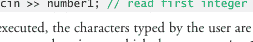

**图 2.6 | 显示变量 number1 的名称和值的内存位置。**

当一个值被放入某个内存位置时，该值会覆盖该位置中先前的值；因此，将新值放入内存位置被认为是破坏性的。

回到我们的加法程序，当执行语句

```cpp
std::cin >> number2; // read second integer from user into number2
```

- 运算符从左到右应用。乘法、除法和取模被认为处于同一优先级。
- 3. 加法和减法运算最后应用。如果表达式包含多个加法和减法运算，运算符从左到右应用。加法和减法也具有相同的优先级。

运算符优先级规则集定义了 C++ 应用运算符的顺序。当我们说某些运算符从左到右应用时，我们指的是运算符的结合性。例如，在表达式

```cpp
a + b + c
```

中，加法运算符（+）从左到右结合，因此先计算 a + b，然后将 c 加到该和上，以确定整个表达式的值。我们将会看到，有些运算符从右到左结合。图 2.10 总结了这些运算符优先级规则。随着更多 C++ 运算符的引入，该表将会扩展。完整的优先级表包含在附录 A 中。

| 运算符 | 运算 | 求值顺序（优先级） |
|---|---|---|
| ( ) | 圆括号 | 首先求值。如果圆括号是嵌套的，则最内层的一对圆括号中的表达式首先求值。如果有多对“同一层”的圆括号（即不嵌套），则从左到右求值。 |
| *, /, % | 乘法、除法、取模 | 第二求值。如果有多个，则从左到右求值。 |
| + - | 加法、减法 | 最后求值。如果有多个，则从左到右求值。 |

**图 2.10 | 算术运算符的优先级。**

### 代数表达式和 C++ 表达式示例

现在根据运算符优先级规则来考虑几个表达式。每个示例列出一个代数表达式及其 C++ 等价形式。以下是五项算术平均值（平均数）的示例：

```cpp
Algebra:    m = (a + b + c + d + e) / 5
```

圆括号是必需的，因为除法的优先级高于加法。整个量 (a + b + c + d + e) 要除以 5。如果错误地省略圆括号，我们会得到 a + b + c + d + e / 5，其求值结果错误地为

```cpp
a + b + c + d + e / 5
```

以下是直线方程的示例：

```cpp
Algebra:    y = mx + b
C++:        y = m * x + b;
```

| 标准代数相等或关系运算符 | C++ 相等或关系运算符 | 示例 C++ 条件 | C++ 条件的含义 |
|---|---|---|---|
| *关系运算符* | | | |
| > | > | x > y | x 大于 y |
| < | < | x < y | x 小于 y |
| ≥ | >= | x >= y | x 大于或等于 y |
| ≤ | <= | x <= y | x 小于或等于 y |
| *相等运算符* | | | |
| = | == | x == y | x 等于 y |
| ≠ | != | x != y | x 不等于 y |

**图 2.12 | 相等运算符和关系运算符。**

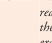

### 常见编程错误 2.7

将相等运算符 `==` 与赋值运算符 `=` 混淆会导致逻辑错误。相等运算符应读作“等于”，赋值运算符应读作“获得”或“被赋值为”。有些人喜欢把相等运算符读作“双等号”。正如我们在 5.9 节中讨论的，混淆这些运算符不一定会导致容易识别的语法错误，但可能会导致极其微妙的逻辑错误。

下面的示例使用六个 `if` 语句来比较用户输入的两个数。如果这些 `if` 语句中的任何一个条件得到满足，就会执行与该 `if` 语句关联的输出语句。图 2.13 显示了该程序以及三个示例执行的输入/输出对话框。

```cpp
1  // Fig. 2.13: fig02_13.cpp
2  // Comparing integers using if statements, relational operators
3  // and equality operators.
4  #include <iostream> // allows program to perform input and output
5
6  using std::cout; // program uses cout
7  using std::cin; // program uses cin
8  using std::endl; // program uses endl
9
10 // function main begins program execution
11 int main()
12 {
13    int number1; // first integer to compare
14    int number2; // second integer to compare
15
16    cout << "Enter two integers to compare: "; // prompt user for data
17    cin >> number1 >> number2; // read two integers from user
```

**图 2.13 | 使用 if 语句、关系运算符和相等运算符比较整数。（第 1 部分，共 2 部分。）**


```cpp
18  if ( number1 == number2 )
19      cout << number1 << " == " << number2 << endl;

21  if ( number1 != number2 )
22      cout << number1 << " != " << number2 << endl;

24  if ( number1 < number2 )
25      cout << number1 << " < " << number2 << endl;

27  if ( number1 > number2 )
28      cout << number1 << " > " << number2 << endl;

30  if ( number1 <= number2 )
31      cout << number1 << " <= " << number2 << endl;

33  if ( number1 >= number2 )
34      cout << number1 << " >= " << number2 << endl;
35  } // end function main
```

```text
Enter two integers to compare: 3 7
3 != 7
3 < 7
3 <= 7
```

```text
Enter two integers to compare: 22 12
22 != 12
22 > 12
22 >= 12
```

```text
Enter two integers to compare: 7 7
7 == 7
7 <= 7
7 >= 7
```

**图 2.13** | 使用 if 语句、关系运算符和相等运算符比较整数。（第 2 部分，共 2 部分。）

## 第 6–8 行

```cpp
using std::cout; // program uses cout
using std::cin;  // program uses cin
using std::endl; // program uses endl
```

是 using 声明，它们消除了像之前程序那样重复 std:: 前缀的需要。插入这些 using 声明后，在程序的其余部分中，我们可以分别写 cout 而不是 std::cout、cin 而不是 std::cin、endl 而不是 std::endl。

许多程序员喜欢用声明

```cpp
using namespace std;
```

代替第 6–8 行，这使程序能够使用程序可能包含的任何标准 C++ 头文件（如 `<iostream>`）中的所有名称。从本书此处开始，我们将在程序中使用前述声明。

## 第 13–14 行

```cpp
int number1;  // first integer to compare
int number2;  // second integer to compare
```

声明程序中使用的变量。请记住，变量可以在一条声明中声明，也可以在分开的声明中声明。

该程序使用级联流提取操作（第 17 行）输入两个整数。请记住，由于第 7 行，我们可以写 cin（而不是 std::cin）。首先将一个值读入变量 number1，然后将一个值读入变量 number2。

```cpp
if ( number1 == number2 )
    cout << number1 << " == " << number2 << endl;
```

比较变量 number1 和 number2 的值以测试是否相等。如果值相等，第 20 行的语句显示一行文本，表明这些数字相等。如果从第 22、25、28、31 和 34 行开始的 if 语句中的一个或多个条件为真，则相应的主体语句显示适当的文本行。

图 2.13 中的每个 if 语句的主体中都只有一条语句，并且每条主体语句都缩进。第 4 章将展示如何指定具有多语句主体的 if 语句（通过将主体语句括在一对花括号 { } 中，创建所谓的复合语句或块）。


## 良好编程习惯 2.12

将 if 语句主体中的语句缩进，以增强可读性。


## 良好编程习惯 2.13

为了可读性，程序中每行不应超过一条语句。


## 常见编程错误 2.8

在 if 语句中条件的右括号之后立即放置分号通常是逻辑错误（尽管不是语法错误）。分号使 if 语句的主体为空，因此无论条件是否为真，if 语句都不执行任何操作。更糟的是，if 语句原来的主体语句现在变成与 if 语句顺序执行的一条语句，并且总是执行，常常导致程序产生错误结果。

注意图 2.13 中空白的使用。回想一下，制表符、换行符和空格等空白字符通常会被编译器忽略。因此，语句可以分成多行，并可以按你的喜好调整间距。将标识符、字符串（如 "hello"）和常量（如数字 1000）拆分成多行是语法错误。

- 引导用户采取特定操作的消息称为提示。

- C++ 关键字 return 是退出函数的几种方式之一。

### 2.4 节 另一个 C++ 程序：整数相加

- C++ 程序中的所有变量都必须先声明才能使用。

- C++ 中的变量名是任何不是关键字的有效标识符。标识符是由字母、数字和下划线（ _ ）组成的一系列字符。标识符不能以数字开头。C++ 标识符可以是任意长度；但是，某些系统和/或 C++ 实现可能会对标识符长度施加一些限制。

- C++ 区分大小写。

- 大多数计算在赋值语句中执行。

- 变量是内存中的一个位置，可以在其中存储供程序使用的值。

- int 类型的变量保存整数值，即整数，例如 7、-11、0、31914。

### 2.5 节 内存概念

- 存储在计算机内存中的每个变量都有名称、值、类型和大小。

- 每当将新值放入内存位置时，该过程是破坏性的；即新值替换该位置中的先前值。先前的值丢失。

- 当从内存读取值时，该过程是非破坏性的；即读取该值的一个副本，原值在内存位置中保持不变。

- std::endl 流操纵器输出一个换行符，然后“刷新输出缓冲区”。

### 2.6 节 算术

- C++ 按照由运算符优先级和结合性规则确定的精确顺序计算算术表达式。

- 可以使用圆括号对表达式进行分组。

- 整数除法（即分子和分母都是整数）产生整数商。整数除法中的任何小数部分都会被截断——不会发生舍入。

- 取模运算符 % 产生整数除法后的余数。取模运算符只能用于整数操作数。

### 2.7 节 决策：相等运算符和关系运算符

- if 语句允许程序根据是否满足条件采取替代操作。if 语句的格式为

```cpp
if ( condition )
    statement;
```

如果条件为真，则执行 if 主体中的语句。如果条件不满足，即条件为假，则跳过主体语句。

- if 语句中的条件通常通过使用相等运算符和关系运算符构成。使用这些运算符的结果始终是值 true 或 false。

- 声明

```cpp
using std::cout;
```

是一条 using 声明，它告知编译器在哪里找到 cout（命名空间 std），并消除了重复 std:: 前缀的需要。声明

```cpp
using namespace std;
```

使程序能够使用任何包含的标准库头文件中的所有名称。

- b) 一个 ______ 开始每个函数的主体，一个 ______ 结束主体。
- c) 每条 C++ 语句以 ______ 结束。
- d) 转义序列 \n 表示 ______ 字符，它使光标定位到屏幕上下一行的开头。
- e) ______ 语句用于做出决策。

## 2.2

判断下列各项是真还是假。如果为假，请解释原因。假设使用了语句 using `std::cout;`：

- a) 注释会使计算机在程序执行时在屏幕上打印 // 之后的文本。
- b) 当使用 cout 和流插入运算符输出转义序列 \n 时，会使光标定位到屏幕上下一行的开头。
- c) 所有变量都必须先声明后使用。
- d) 所有变量在声明时都必须指定类型。
- e) C++ 认为变量 number 和 NumbeR 是相同的。
- f) 声明几乎可以出现在 C++ 函数主体中的任何位置。
- g) 取模运算符（%）只能用于整数操作数。
- h) 算术运算符 *、/、% 和 + - 都具有相同的优先级。
- i) 打印三行输出的 C++ 程序必须包含三条使用 cout 和流插入运算符的语句。

## 2.3

编写一条 C++ 语句来完成下列各项（假设尚未使用 using 声明）：

- a) 声明变量 c、thisIsAVariable、q76534 和 number 为 int 类型。
- b) 提示用户输入一个整数。在提示消息末尾使用冒号（:）后跟一个空格，并使光标位于该空格之后。
- c) 从键盘读取用户输入的一个整数，并将其存储到整型变量 age 中。
- d) 如果变量 number 不等于 7，则打印 "The variable number is not equal to 7"。
- e) 在一行中打印消息 "This is a C++ program"。
- f) 将消息 "This is a C++ program" 打印为两行。第一行以 C++ 结尾。
- g) 打印消息 "This is a C++ program"，每个单词占一行。
- h) 打印消息 "This is a C++ program"。用制表符分隔每个单词。

## 2.4

编写一条语句（或注释）来完成下列各项（假设已为 cin、cout 和 endl 使用 using 声明）：

- a) 说明一个程序计算三个整数的乘积。
- b) 声明变量 x、y、z 和 result 为 int 类型（在分开的语句中）。
- c) 提示用户输入三个整数。
- d) 从键盘读取三个整数，并将它们存储到变量 x、y 和 z 中。
- e) 计算变量 x、y 和 z 中包含的三个整数的乘积，并将结果赋给变量 result。
- f) 打印 "The product is "，后跟变量 result 的值。
- g) 从 main 返回一个值，表明程序成功终止。

## 2.5

使用你在练习 2.4 中编写的语句，编写一个完整程序，计算并显示三个整数的乘积。在代码中的适当位置添加注释。*[注意：你需要编写必要的 using 声明。]*

## 2.6

指出并改正下列各语句中的错误（假设使用了语句 using `std::cout;`）：

```
a) if (c < 7);
       cout << c is less than \n;
```

```
b) if (c >= 7)
       cout << "c is equal to or greater than 7\n";
```


## 自测练习答案

- 2.1 a) main。b) 左花括号（{），右花括号（}）。c) 分号。d) 换行符。e) if。

- 2.2
  - a) 错误。程序执行时，注释不会导致任何操作被执行。注释用于记录程序并提高其可读性。
  - b) 正确。
  - c) 正确。
  - d) 正确。
  - e) 错误。C++ 区分大小写，因此这些变量是唯一的。
  - f) 正确。
  - g) 正确。
  - h) 错误。运算符 *、/ 和 % 具有相同的优先级，而运算符 + 和 - 的优先级较低。
  - i) 错误。一条包含 cout 和多个 \n 转义序列的语句可以打印多行。

- 2.3
  - a) int c, thisIsAVariable, q76354, number;
  - b) std::cout << "Enter an integer: ";
  - c) std::cin >> age;
  - d) if ( number != 7 )
        std::cout << "The variable number is not equal to 7\n";
  - e) std::cout << "This is a C++ program\n";
  - f) std::cout << "This is a C++\nprogram\n";
  - g) std::cout << "This\nis\na\nC++\nprogram\n";
  - h) std::cout << "This\tis\ta\tC++\tprogram\n";

- 2.4
  - a) // Calculate the product of three integers
  - b) int x;
        int y;
        int z;
        int result;
  - c) cout << "Enter three integers: ";
  - d) cin >> x >> y >> z;
  - e) result = x * y * z;
  - f) cout << "The product is " << result << endl;
  - g) return 0;

2.5（见下面的程序。）

```cpp
1  // Calculate the product of three integers
2  #include <iostream> // allows program to perform input and output
3  using namespace std; // program uses names from the std namespace
4
5  // function main begins program execution
6  int main()
7  {
8     int x; // first integer to multiply
9     int y; // second integer to multiply
10    int z; // third integer to multiply
11    int result; // the product of the three integers
12
13    cout << "Enter three integers: "; // prompt user for data
14    cin >> x >> y >> z; // read three integers from user
15    result = x * y * z; // multiply the three integers; store result
16    cout << "The product is " << result << endl; // print result; end line
17 } // end function main
```

- 2.6
  - a) *错误*：if 语句条件右括号后的分号。
    *更正*：删除右括号后的分号。[*注意*：此错误的结果是，无论 if 语句中的条件是否为真，输出语句都会执行。] 右括号后的分号是一个空（或空白）语句，不执行任何操作。我们将在第 4 章进一步学习空语句。
  - b) *错误*：关系运算符 =>。
    *更正*：将 => 改为 >=，你可能还想将“等于或大于”改为“大于或等于”。

## 练习

- 2.7 讨论以下每个对象的含义：
  - a) `std::cin`
  - b) `std::cout`

- 2.8 填写以下各项中的空白：
  - a) _______ 用于记录程序并提高其可读性。
  - b) 用于在屏幕上打印信息的对象是 _______。
  - c) C++ 中做出决策的语句是 _______。
  - d) 大多数计算通常由 _______ 语句执行。
  - e) _______ 对象从键盘输入值。

- 2.9 编写一条 C++ 语句或代码行来完成以下各项：
  - a) 打印消息“Enter two numbers”。
  - b) 将变量 b 和 c 的乘积赋给变量 a。
  - c) 说明程序执行工资计算（即使用有助于记录程序的文本）。
  - d) 从键盘输入三个整数值到整型变量 a、b 和 c。

- 2.10 说明以下各项中哪些是*正确*，哪些是*错误*。如果*错误*，请解释你的答案。
  - a) C++ 运算符从左到右求值。
  - b) 以下都是有效变量名：`_under_bar_`, `m928134`, `t5`, `j7`, `her_sales`, `h5_account_total`, `a`, `b`, `c`, `z`, `z2`。
  - c) 语句 `cout << "a = 5;";` 是赋值语句的典型示例。
  - d) 不带括号的有效 C++ 算术表达式从左到右求值。
  - e) 以下都是无效变量名：`3g`, `87`, `67h2`, `h22`, `2h`。

- 2.11 填写以下各项中的空白：
  - a) 哪些算术运算与乘法具有相同的优先级？_______
  - b) 当括号嵌套时，算术表达式中先计算哪组括号？_______
  - c) 计算机内存中在程序执行期间可能在不同时间包含不同值的位置称为 _______

- 2.12 执行以下每条 C++ 语句时，如果有输出，会打印什么？如果什么都不打印，则回答“无”。假设 `x = 2` 且 `y = 3`。
  - a) `cout << x;`
  - b) `cout << x + x;`
  - c) `cout << "x=";`
  - d) `cout << "x = " << x;`
  - e) `cout << x + y << " = " << y + x;`
  - f) `z = x + y;`
  - g) `cin >> x >> y;`

**2.29** *（表格）* 使用本章的技术，编写一个程序，计算从 0 到 10 的整数的平方和立方。使用制表符打印以下格式整齐的值表：

| 整数 | 平方 | 立方 |
| --- | --- | --- |
| 0 | 0 | 0 |
| 1 | 1 | 1 |
| 2 | 4 | 8 |
| 3 | 9 | 27 |
| 4 | 16 | 64 |
| 5 | 25 | 125 |
| 6 | 36 | 216 |
| 7 | 49 | 343 |
| 8 | 64 | 512 |
| 9 | 81 | 729 |
| 10 | 100 | 1000 |

## 改变世界

**2.30** *（身体质量指数计算器）* 我们已在练习 1.12 中介绍了身体质量指数（BMI）计算器。计算 BMI 的公式为

$$BMI = \frac{weightInPounds \times 703}{heightInInches \times heightInInches}$$

或

$$BMI = \frac{weightInKilograms}{heightInMeters \times heightInMeters}$$

创建一个 BMI 计算器应用程序，读取用户以磅为单位的体重和以英寸为单位的身高（或者，如果你愿意，读取用户以千克为单位的体重和以米为单位的身高），然后计算并显示用户的身体质量指数。此外，该应用程序应显示以下来自美国卫生与公众服务部/美国国立卫生研究院的信息，以便用户评估自己的 BMI：

| BMI 数值 | |
| --- | --- |
| 体重不足： | 低于 18.5 |
| 正常： | 18.5 至 24.9 之间 |
| 超重： | 25 至 29.9 之间 |
| 肥胖： | 30 或以上 |

[注：在本章中，你学习了使用 int 类型表示整数。使用 int 值进行 BMI 计算时，两者都会产生整数结果。在第 4 章中，你将学习使用 double 类型表示带小数点的数。使用 double 执行 BMI 计算时，两者都会产生带小数点的数——这些数称为“浮点数”。]

**2.31** *（拼车节省计算器）* 研究几个拼车网站。创建一个应用程序，计算你每天的驾驶成本，以便你可以估算拼车能节省多少钱，拼车还具有其他优点，例如减少碳排放和缓解交通拥堵。该应用程序应输入以下信息，并显示用户每天开车上班的成本：

- a) 每天行驶的总英里数。
- b) 每加仑汽油的成本。
- c) 平均每加仑行驶英里数。
- d) 每天的停车费。
- e) 每天的通行费。

# 3

# 类和对象简介

> *任何没有使用价值的东西都不可能具有价值。*
> —卡尔·马克思

> *你们的公仆理应为你们服务。*
> —阿德莱·E·史蒂文森

> *懂得如何回答说话的人，*
> *懂得如何回复传递消息的人。*
> —阿蒙尼莫佩

### 目标

在本章中，你将学习：

- 如何定义类并使用它创建对象。
- 如何在类中定义成员函数以实现类的行为。
- 如何在类中声明数据成员以实现类的属性。
- 如何调用对象的成员函数来执行任务。
- 类的数据成员与函数的局部变量之间的区别。
- 如何使用构造函数在创建对象时初始化对象的数据。
- 如何设计类，使其接口与实现分离，并鼓励重用。


类定义从第 8 行开始，其中使用关键字 class，后面跟着类名 GradeBook。按照惯例，用户定义类的名称以大写字母开头；为了提高可读性，类名中后续每个单词也都以大写字母开头。这种大小写风格通常称为驼峰式命名法，因为大写字母和小写字母的排列模式类似于骆驼的轮廓。

每个类的主体都包含在一对左、右花括号（{ 和 }）中，如第 9 行和第 16 行所示。类定义以分号结束（第 16 行）。

> **常见编程错误 3.1**
>
> *忘记在类定义末尾添加分号会导致语法错误。*

回想一下，执行程序时，函数 main 总是会被自动调用。大多数函数不会被自动调用。正如你很快将看到的那样，你必须显式调用成员函数 displayMessage，告诉它执行相应的任务。

第 10 行包含访问说明符标签 public:。关键字 public 是一种访问说明符。第 12～15 行定义了成员函数 displayMessage。该成员函数出现在访问说明符 public: 之后，表示该函数“对公众可用”——也就是说，它可以被程序中的其他函数（例如 main）调用，也可以被其他类的成员函数调用（如果存在其他类的话）。访问说明符后总是跟着冒号（:）。在本文后面的内容中，当我们提到访问说明符 public 时，将像本句一样省略冒号。第 3.5 节将介绍第二种访问说明符 private。本书后面还会学习访问说明符 protected。

程序中的每个函数都会执行某项任务，并且在任务完成时可能返回一个值。例如，一个函数可能执行某项计算，然后返回该计算的结果。定义函数时，必须指定返回类型，以表明函数完成任务时所返回值的类型。在第 12 行中，函数名 displayMessage 左侧的关键字 void 就是该函数的返回类型。返回类型 void 表示 displayMessage 完成任务后不会向调用它的函数返回（即给回）任何数据（在本例中，调用它的函数是 main，我们稍后会看到）。在图 3.5 中，你将看到一个返回值的函数示例。

成员函数的名称 displayMessage 位于返回类型之后。按照惯例，函数名的第一个字母使用小写，名称中后续每个单词的首字母使用大写。成员函数名后面的圆括号表明这是一个函数。空圆括号（如第 12 行所示）表示该成员函数不需要额外数据即可执行其任务。你将在第 3.4 节中看到一个确实需要额外数据的成员函数示例。第 12 行通常称为函数头。每个函数的主体都由左、右花括号（{ 和 }）界定，如第 13 行和第 15 行所示。

函数主体包含执行函数任务的语句。在本例中，成员函数 displayMessage 包含一条语句（第 14 行），用于显示消息 "Welcome to the Grade Book!"。该语句执行后，函数就完成了它的任务。

> **常见编程错误 3.2**
>
> *从返回类型声明为 void 的函数中返回值会导致编译错误。*

```cpp
// Fig. 3.3: fig03_03.cpp
// Define a GradeBook with a member function that takes a parameter;
// Create a GradeBook object and call its displayMessage function.
#include <iostream>
#include <string> // program uses C++ standard string class
using namespace std;

// GradeBook class definition
class GradeBook
{
public:
   // function that displays a welcome message to the GradeBook user
   void displayMessage( string courseName )
   {
      cout << "Welcome to the grade book for\n" << courseName << "!"
           << endl;
   } // end function displayMessage
}; // end class GradeBook

// function main begins program execution
int main()
{
   string nameOfCourse; // string of characters to store the course name
   GradeBook myGradeBook; // create a GradeBook object named myGradeBook

   // prompt for and input course name
   cout << "Please enter the course name:" << endl;
   getline( cin, nameOfCourse ); // read a course name with blanks
   cout << endl; // output a blank line

   // call myGradeBook's displayMessage function
   // and pass nameOfCourse as an argument
   myGradeBook.displayMessage( nameOfCourse );
} // end main
```

**图 3.3** | 定义类 GradeBook 及其带参数的成员函数，创建 GradeBook 对象并调用其 displayMessage 函数。

以获取课程名称。在我们的示例程序执行过程中，我们使用课程名称“CS101 Introduction to C++ Programming”，该名称包含多个单词。（回想一下，我们会将用户提供的输入以粗体显示。）当使用流提取运算符和 cin 时，它会一直读取字符，直到遇到第一个空白字符。因此，前面的语句只能读取“CS101”。课程名称的其余部分必须通过后续的输入操作读取。

在本例中，我们希望用户输入完整的课程名称，然后按 Enter 将其提交给程序；同时，我们希望将完整的课程名称存储在字符串变量 nameOfCourse 中。第 28 行中的函数调用 `getline(cin, nameOfCourse)` 会从标准输入流对象 `cin`（即键盘）中读取字符，包括输入内容中用于分隔单词的空格字符，直到遇到换行符；然后将这些字符放入字符串变量 `nameOfCourse` 中，并丢弃换行符。当你在输入程序数据时按下 *回车*，输入流中就会插入一个换行符。此外，程序必须包含 `<string>` 头文件，才能使用函数 `getline`，并且必须声明名称 `getline` 属于命名空间 `std`。

第 33 行调用 `myGradeBook` 的成员函数 `displayMessage`。圆括号中的变量 `nameOfCourse` 是传递给成员函数 `displayMessage` 的实参，使该函数能够执行其任务。main 中变量 `nameOfCourse` 的值会成为第 13 行成员函数 `displayMessage` 的参数 `courseName` 的值。执行该程序时，成员函数 `displayMessage` 会将你输入的课程名称作为欢迎消息的一部分输出（在我们的示例执行中，该名称为 CS101 Introduction to C++ Programming）。

### 关于实参和形参的更多内容

要指定函数需要数据来执行其任务，可以将其他信息放入函数的参数列表中。参数列表位于函数名后面的圆括号中。参数列表可以包含任意数量的参数，也可以不包含参数（如图 3.1 第 12 行中的空圆括号所示），以表示函数不需要任何参数。成员函数 `displayMessage` 的参数列表（图 3.3 第 13 行）声明该函数需要一个参数。每个参数都必须指定一个类型和一个标识符。在本例中，类型 `string` 和标识符 `courseName` 表明成员函数 `displayMessage` 需要一个字符串来执行其任务。成员函数主体使用参数 `courseName` 来访问函数调用中传递给该函数的值（即 `main` 中的第 33 行）。第 15～16 行将参数 `courseName` 的值作为欢迎消息的一部分显示出来。参数变量的名称（第 13 行）可以与实参变量的名称（第 33 行）相同，也可以不同——你将在第 6 章“函数和面向对象编程简介”中了解其中的原因。

通过使用逗号将各个参数分隔开，函数可以指定多个参数（我们将在图 6.4～6.5 中看到一个示例）。函数调用中的实参数量和顺序必须与被调用函数函数头中参数列表的参数数量和顺序相匹配。此外，函数调用中的实参类型必须与函数头中相应参数的类型一致。（正如你将在后续章节中学习的那样，实参的类型及其对应参数的类型并不总是必须完全相同，但它们必须“保持一致”。）在本例中，函数调用中的一个 `string` 实参（即 `nameOfCourse`）与成员函数定义中的一个 `string` 参数（即 `courseName`）完全匹配。

> **常见编程错误 3.4**
>
> *在函数定义中包围参数列表的右圆括号后添加分号会导致语法错误。*

> **常见编程错误 3.5**
>
> *在函数主体中再次将函数参数定义为变量会导致编译错误。*


> **良好的编程实践 3.1**
>
> *为避免歧义，不要对传递给函数的实参和函数定义中对应的形参使用相同的名称。*

> **良好的编程实践 3.2**
>
> *选择有意义的函数名和参数名可以提高程序的可读性，并有助于避免过度使用注释。*

### GradeBook 类的更新 UML 类图

图 3.4 的 UML 类图对图 3.3 中的 GradeBook 类进行了建模。与图 3.1 中定义的 GradeBook 类一样，该 GradeBook 类包含公共成员函数 `displayMessage`。不过，这个版本的 `displayMessage` 具有一个参数。UML 通过在操作名称后的括号中列出参数名，后跟冒号和参数类型，来表示参数。UML 具有类似于 C++ 的自身数据类型。UML 与语言无关——它可用于许多不同的编程语言——因此其术语与 C++ 并不完全匹配。例如，UML 类型 `String` 对应于 C++ 类型 `string`。GradeBook 类的成员函数 `displayMessage`（图 3.3，第 13～17 行）具有一个名为 `courseName` 的 `string` 类型参数，因此图 3.4 在操作名称 `displayMessage` 后的括号中列出了 `courseName : String`。这个版本的 GradeBook 类仍然没有任何数据成员。

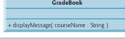

**图 3.4** | UML 类图表示 GradeBook 类具有一个公共的 `displayMessage` 操作，该操作包含一个 UML 类型为 `String` 的 `courseName` 参数。

## 3.5 数据成员、set 函数和 get 函数

在第 2 章中，我们在程序的 `main` 函数中声明了程序的所有变量。在函数定义体中声明的变量称为局部变量，它们只能从函数中声明该变量的那一行开始，一直到声明它们的代码块的右花括号（`}`）处使用。局部变量必须先声明，之后才能在函数中使用。局部变量不能在声明它的函数之外访问。当函数终止时，其局部变量的值就会丢失。（在第 6 章讨论 `static` 局部变量时，你将看到这种情况的一个例外。）回顾第 3.2 节，对象具有随其在程序中使用而存在的属性。这些属性在对象的整个生命周期内都存在。

一个类通常由一个或多个成员函数组成，这些成员函数用于操作属于该类某个特定对象的属性。在类定义中，属性以变量的形式表示。这些变量称为数据成员，它们声明在类定义内部，但位于类成员函数定义的函数体之外。类的每个对象都会在内存中保存一份自己的属性副本。本节中的示例演示了一个 GradeBook 类，该类包含一个 `courseName` 数据成员，用于表示某个 GradeBook 对象的课程名称。

### 包含数据成员、set 函数和 get 函数的 GradeBook 类

在下一个示例中，GradeBook 类（图 3.5）将课程名称保存为数据成员，因此在程序执行期间可以随时使用或修改该名称。该类包含成员函数 `setCourseName`、`getCourseName` 和 `displayMessage`。成员函数 `setCourseName` 将课程名称存储在 GradeBook 数据成员中。成员函数 `getCourseName` 从该数据成员中获取课程名称。成员函数 `displayMessage`——现在不再指定任何参数——仍然会显示一条包含课程名称的欢迎消息。不过，正如你将看到的，该函数现在通过调用同一个类中的另一个函数——`getCourseName`——来获取课程名称。


> **良好的编程实践 3.3**
>
> *在成员函数定义之间放置空行，以增强程序的可读性。*

一名典型的教师会教授多门课程，每门课程都有自己的课程名称。第 34 行声明 `courseName` 是一个 `string` 类型的变量。由于该变量声明在类定义（第 10～35 行）中，但位于类成员函数定义（第 14～17 行、第 20～23 行以及第 26～32 行）的函数体之外，因此该变量是一个数据成员。GradeBook 类的每个实例（即对象）都包含该类每个数据成员的一份副本——如果有两个 GradeBook 对象，那么每个对象都有自己的 `courseName` 副本（每个对象一份），正如你将在图 3.7 的示例中看到的。将 `courseName` 设为数据成员的一个好处是，该类的所有成员函数（本例中为 GradeBook 类）都可以操作类定义中出现的任何数据成员（本例中为 `courseName`）。

```cpp
// Fig. 3.5: Fig03_05.cpp
// Define a class GradeBook that contains a courseName data member
// and member functions to set and get its value;
// Create and manipulate a GradeBook object with these functions.
#include <iostream>
#include <string> // program uses C++ standard string class
using namespace std;

// GradeBook class definition
class GradeBook
{
public:
    // function that sets the course name
    void setCourseName( string name )
    {
        courseName = name; // store the course name in the object
    } // end function setCourseName

    // function that gets the course name
    string getCourseName()
    {
        return courseName; // return the object's courseName
    } // end function getCourseName

    // function that displays a welcome message
    void displayMessage()
    {
        // this statement calls getCourseName to get the
        // name of the course this GradeBook represents
        cout << "Welcome to the grade book for\n" << getCourseName() << "!"
            << endl;
    } // end function displayMessage
private:
    string courseName; // course name for this GradeBook
}; // end class GradeBook

// function main begins program execution
int main()
{
    string nameOfCourse; // string of characters to store the course name
    GradeBook myGradeBook; // create a GradeBook object named myGradeBook

    // display initial value of courseName
    cout << "Initial course name is: " << myGradeBook.getCourseName()
        << endl;

    // prompt for, input and set course name
    cout << "\nPlease enter the course name: " << endl;
    getline( cin, nameOfCourse ); // read a course name with blanks
    myGradeBook.setCourseName( nameOfCourse ); // set the course name

    cout << endl; // outputs a blank line
    myGradeBook.displayMessage(); // display message with new course name
} // end main
```

```text
Initial course name is:

Please enter the course name:
CS101 Introduction to C++ Programming

Welcome to the grade book for
CS101 Introduction to C++ Programming!
```

**图 3.5** | 定义和测试包含数据成员以及 *set* 和 *get* 函数的 GradeBook 类。（第 1 部分，共 2 部分。）

**图 3.5** | 定义和测试包含数据成员以及 *set* 和 *get* 函数的 GradeBook 类。（第 2 部分，共 2 部分。）

### 访问说明符 public 和 private

大多数数据成员声明都出现在访问说明符标签 `private:` 之后（第 33 行）。与 `public` 一样，关键字 `private` 也是一种访问说明符。在访问说明符 `private` 之后（以及下一个访问说明符之前）声明的变量或函数，只能由声明它们的类的成员函数访问。因此，数据成员 `courseName` 只能由该类的成员函数访问。

### 成员函数 setCourseName 和 getCourseName

成员函数 `setCourseName`（定义在第 14～17 行）在完成任务时不返回任何数据，因此其返回类型为 `void`。该成员函数接收一个参数——`name`——它表示将作为实参传递给该函数的课程名称（正如我们将在 `main` 函数的第 50 行看到的）。第 16 行将 `name` 赋给数据成员 `courseName`。在本例中，`setCourseName` 不会尝试验证课程名称——也就是说，该函数不会检查课程名称是否符合某种特定格式，或是否遵循关于“有效”课程名称外观的其他规则。例如，假设某所大学只能打印包含 25 个或更少字符的课程名称的学生成绩单。在这种情况下，我们可能希望 GradeBook 类确保其数据成员 `courseName` 永远不会包含超过 25 个字符。我们将在第 3.9 节讨论基本的验证技术。

成员函数 `getCourseName`（定义在第 20～23 行）返回某个 GradeBook 对象的 `courseName`。该成员函数的参数列表为空，因此不需要额外的数据来执行其任务。该函数指定其返回一个 `string`。当一个指定了非 `void` 返回类型的函数被调用并完成任务时，该函数会使用 `return` 语句（如第 22 行所示）将结果返回给调用它的函数。例如，当你前往自动取款机（ATM）并查询账户余额时，你希望 ATM 返回一个表示账户余额的值。同样，当一条语句在 GradeBook 对象上调用成员函数 `getCourseName` 时，该语句期望接收到 GradeBook 的课程名称（本例中为 `string`，这由函数的返回类型指定）。如果有一个名为 `square` 的函数，它返回其参数的平方，那么语句

```
result = square( 2 );
```

会从函数 `square` 返回 4，并将值 4 赋给变量 `result`。如果有一个名为 `maximum` 的函数，它返回三个整数参数中的最大值，那么语句

```
biggest = maximum( 27, 114, 51 );
```

会从函数 `maximum` 返回 114，并将值 114 赋给变量 `biggest`。

> **常见编程错误 3.7**
>
> *应该返回值的函数没有返回值，会导致编译错误。*

第 16 行和第 22 行的语句都使用了变量 `courseName`（第 34 行），尽管该变量没有在任何成员函数中声明。我们可以在 GradeBook 类的成员函数中使用 `courseName`，因为 `courseName` 是该类的数据成员。因此，成员函数 `getCourseName` 可以定义在成员函数 `setCourseName` 之前。

### 成员函数 displayMessage

成员函数 `displayMessage`（第 26～32 行）在完成任务时不返回任何数据，因此其返回类型为 `void`。该函数不接收参数，所以其参数列表为空。第 30～31 行输出一条包含数据成员 `courseName` 值的欢迎消息。第 30 行调用成员函数 `getCourseName` 来获取 `courseName` 的值。成员函数 `displayMessage` 也可以直接访问数据成员 `courseName`，就像成员函数 `setCourseName` 和 `getCourseName` 所做的那样。


我们简要解释为什么选择调用成员函数 `getCourseName` 来获取 `courseName` 的值。

### *测试类 GradeBook*

主函数（第 38–54 行）创建一个 GradeBook 类的对象，并使用它的每个成员函数。第 41 行创建一个名为 myGradeBook 的 GradeBook 对象。第 44–45 行通过调用该对象的 getCourseName 成员函数显示初始课程名称。输出的第一行不显示课程名称，因为该对象的 courseName 数据成员（即一个字符串）最初为空——默认情况下，字符串的初始值是所谓的空字符串，即不包含任何字符的字符串。显示空字符串时，屏幕上不会出现任何内容。

第 48 行提示用户输入课程名称。局部 string 变量 nameOfCourse（在第 40 行声明）被设置为用户输入的课程名称，该名称通过调用 getline 函数获得（第 49 行）。第 50 行调用对象 myGradeBook 的 setCourseName 成员函数，并将 nameOfCourse 作为该函数的实参提供。调用该函数时，实参的值被复制到成员函数 setCourseName 的形参 name（第 14 行）。然后，形参的值被赋给数据成员 courseName（第 16 行）。第 52 行跳过一行；然后第 53 行调用对象 myGradeBook 的 displayMessage 成员函数，显示包含课程名称的欢迎消息。

### *使用 Set 和 Get 函数的软件工程*

一个类的私有数据成员只能由该类的成员函数（以及该类的“友元”，我们将在第 10 章看到）操作。因此，一个对象的客户——即从对象外部调用该对象成员函数的任何类或函数——调用类的公有成员函数，为类的特定对象请求类的服务。这就是为什么函数 main 中的语句会调用 GradeBook 对象的成员函数 setCourseName、getCourseName 和 displayMessage。类通常提供公有成员函数，允许类的客户设置（即给私有数据成员赋值）或获取（即取得私有数据成员的值）私有数据成员。这些成员函数名不必以 set 或 get 开头，但这种命名约定很常见。在本例中，设置 courseName 数据成员的成员函数称为 setCourseName，获取 courseName 数据成员的值的成员函数称为 getCourseName。设置函数有时也称为修改器（因为它们修改或改变值），获取函数有时也称为访问器（因为它们访问值）。

回想一下，使用访问说明符 private 声明数据成员会强制实现数据隐藏。提供公有的 set 和 get 函数允许类的客户访问隐藏的数据，但只能间接访问。客户知道它试图修改或获取对象的数据，但客户不知道对象如何执行这些操作。在某些情况下，一个类可能在内部以某种方式表示一段数据，但以另一种方式将该数据暴露给客户。例如，假设一个 Clock 类将一天中的时间表示为一个私有 int 数据成员 time，它存储自午夜以来的秒数。然而，当客户调用 Clock 对象的 getTime 成员函数时，该对象可以以 "HH:MM:SS" 格式的字符串返回小时、分钟和秒的时间。类似地，假设 Clock 类提供一个名为 setTime 的设置函数，它接受一个 "HH:MM:SS" 格式的字符串参数。使用第 18 章介绍的 string 功能，setTime 函数可以将此字符串转换为秒数，并将该秒数存储在其私有数据成员中。设置函数还可以检查它接收的值是否表示有效时间（例如，"12:30:45" 有效，但 "42:85:70" 无效）。set 和 get 函数允许客户与对象交互，但对象的私有数据仍然安全地封装（即隐藏）在对象本身中。

类的 set 和 get 函数也应该由类内的其他成员函数用来操作类的私有数据，尽管这些成员函数可以直接访问私有数据。在图 3.5 中，成员函数 setCourseName 和 getCourseName 是公有成员函数，因此类的客户以及类本身都可以访问它们。成员函数 displayMessage 调用成员函数 getCourseName 来获取数据成员 courseName 的值以进行显示，即使 displayMessage 可以直接访问 courseName——通过 get 函数访问数据成员可以创建更好、更健壮的类（即更容易维护且更不容易停止工作的类）。如果我们决定以某种方式更改数据成员 courseName，displayMessage 的定义将不需要修改——只有直接操作该数据成员的 get 和 set 函数体需要更改。例如，假设我们希望将课程名称表示为两个独立的数据成员——courseNumber（例如 "CS101"）和 courseTitle（例如 "Introduction to C++ Programming"）。成员函数 displayMessage 仍然可以发出对成员函数 getCourseName 的单个调用，以获取完整的课程名称作为欢迎消息的一部分进行显示。在这种情况下，getCourseName 需要构建并返回一个包含 courseNumber 后跟 courseTitle 的字符串。成员函数 displayMessage 将继续显示完整的课程标题 "CS101 Introduction to C++ Programming"，因为它不受类数据成员更改的影响。从类的另一个成员函数调用设置函数的好处将在第 3.9 节讨论验证时变得清晰。

> **良好的编程实践 3.6**
>
> 始终尝试通过 get 和 set 函数访问和操作数据成员，从而将类数据成员更改的影响局部化。这样，数据成员名称的更改或用于存储数据成员的数据类型的更改只影响相应的 get 和 set 函数，而不影响这些函数的调用者。

> **软件工程观察 3.3**
>
> 编写可理解且易于维护的程序。变化是规则而非例外。你应该预料到你的代码会被修改。

> **软件工程观察 3.4**
>
> 仅在适当的时候为每个私有数据项提供 set 或 get 函数。对客户有用的服务通常应在类的公有接口中提供。

### *带有数据成员以及 set 和 get 函数的 GradeBook UML 类图*

图 3.6 包含图 3.5 中类 GradeBook 版本的更新 UML 类图。此图将 GradeBook 的数据成员 courseName 建模为中间隔间中的属性。UML 通过列出属性名称，后跟冒号和属性类型，将数据成员表示为属性。属性 courseName 的 UML 类型是 String，对应于 C++ 中的 string。数据成员 courseName 在 C++ 中是私有的，因此类图在相应属性名称前列出减号（-）。UML 中的减号等价于 C++ 中的 private 访问说明符。类 GradeBook 包含三个公有成员函数，因此类图在第三个隔间中列出三个操作。操作 `setCourseName` 有一个名为 `name` 的 `String` 参数。UML 通过在操作名后的括号之后放置冒号和返回类型来表示操作的返回类型。类 `GradeBook` 的成员函数 `getCourseName` 在 C++ 中具有 string 返回类型，因此类图在 UML 中显示 `String` 返回类型。操作 `setCourseName` 和 `displayMessage` 不返回值（即它们返回 void），因此 UML 类图在这些操作的括号后未指定返回类型。

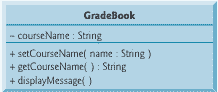

**图 3.6** 类 GradeBook 的 UML 类图，包含私有 courseName 属性和公有操作 setCourseName、getCourseName 和 displayMessage。

## 3.6 使用构造函数初始化对象

如第 3.5 节所述，当创建类 GradeBook（图 3.5）的对象时，其数据成员 courseName 默认初始化为空字符串。如果你想在创建 GradeBook 对象时提供课程名称，该怎么办？你声明的每个类都可以提供一个构造函数，用于在创建对象时初始化该类的对象。构造函数是一种特殊的成员函数，必须定义为与类同名，以便编译器将其与类的其他成员函数区分开。构造函数与其他函数的一个重要区别是构造函数不能返回值，因此它们不能指定返回类型（甚至不能是 void）。通常，构造函数声明为公有。

C++ 要求为创建的每个对象调用构造函数，这有助于确保每个对象在程序中使用之前被初始化。构造函数调用在创建对象时隐式发生。如果类没有显式包含构造函数，编译器会提供一个默认构造函数——即没有参数的构造函数。例如，当图 3.5 的第 4 行创建一个 GradeBook 对象时，将调用默认构造函数。编译器提供的默认构造函数创建 GradeBook 对象时，不会给该对象的基本类型数据成员任何初始值。[**注意：** 对于作为其他类对象的数据成员，默认构造函数会隐式调用每个数据成员的默认构造函数，以确保该数据成员被正确初始化。这就是为什么 string 数据成员 courseName（图 3.5 中）被初始化为空字符串——类 string 的默认构造函数将字符串的值设置为空字符串。你将在第 10.3 节了解更多关于初始化作为其他类对象的数据成员的内容。]

在图 3.7 的示例中，我们在创建 GradeBook 对象时为其指定课程名称（例如第 46 行）。在这种情况下，实参 “CS101 Introduction to C++”

“Programming”被传递给 GradeBook 对象的构造函数（第 14–17 行），并用于初始化 courseName。图 3.7 定义了一个修改后的 GradeBook 类，其中包含一个带 string 参数的构造函数，该参数接收初始课程名称。

```cpp
1  // Fig. 3.7: fig03_07.cpp
2  // Instantiating multiple objects of the GradeBook class and using
3  // the GradeBook constructor to specify the course name
4  // when each GradeBook object is created.
5  #include <iostream>
6  #include <string> // program uses C++ standard string class
7  using namespace std;
8
9  // GradeBook class definition
10 class GradeBook
11 {
12 public:
13    // constructor initializes courseName with string supplied as argument
14    GradeBook( string name )
15    {
16       setCourseName( name ); // call set function to initialize courseName
17    } // end GradeBook constructor
18
19    // function to set the course name
20    void setCourseName( string name )
21    {
22       courseName = name; // store the course name in the object
23    } // end function setCourseName
24
25    // function to get the course name
26    string getCourseName()
27    {
28       return courseName; // return object's courseName
29    } // end function getCourseName
30
31    // display a welcome message to the GradeBook user
32    void displayMessage()
33    {
34       // call getCourseName to get the courseName
35       cout << "Welcome to the grade book for\n" << getCourseName()
36          << "!" << endl;
37    } // end function displayMessage
38 private:
39    string courseName; // course name for this GradeBook
40 }; // end class GradeBook
41
42 // function main begins program execution
43 int main()
44 {
45    // create two GradeBook objects
46    GradeBook gradeBook1( "CS101 Introduction to C++ Programming" );
47    GradeBook gradeBook2( "CS102 Data Structures in C++" );
48
49    // display initial value of courseName for each GradeBook
50    cout << "gradeBook1 created for course: " << gradeBook1.getCourseName()
51         << "\ngradeBook2 created for course: " << gradeBook2.getCourseName()
52         << endl;
53 } // end main
```

```
gradeBook1 created for course: CS101 Introduction to C++ Programming
gradeBook2 created for course: CS102 Data Structures in C++
```

**图 3.7** | 实例化 GradeBook 类的多个对象，并在创建每个 GradeBook 对象时使用 GradeBook 构造函数指定课程名称。

### 定义构造函数

图 3.7 的第 14–17 行定义了类 GradeBook 的构造函数。注意，该构造函数与其类同名，均为 GradeBook。构造函数在其参数列表中指定它执行任务所需的数据。创建新对象时，需要将这些数据放在对象名后的圆括号中（如第 46–47 行所做的那样）。第 14 行表明类 GradeBook 的构造函数有一个名为 name 的 string 参数。第 14 行没有指定返回类型，因为构造函数不能返回值（甚至不能返回 void）。

构造函数体中的第 16 行将构造函数的参数 name 传递给成员函数 setCourseName（第 20–23 行），后者只是将其参数值赋给数据成员 courseName。你可能想知道为什么要在第 16 行调用 setCourseName——构造函数当然可以执行赋值 courseName = name。在第 3.9 节中，我们会修改 setCourseName 以执行验证（确保在此情况下 courseName 的长度不超过 25 个字符）。到那时，从构造函数调用 setCourseName 的好处就会变得清楚。构造函数（第 14 行）和 setCourseName 函数（第 20 行）都使用名为 name 的参数。你可以在不同函数中使用相同的参数名，因为参数是各函数的局部变量；它们互不干扰。

### 测试 GradeBook 类

图 3.7 的第 43–53 行定义了 main 函数，用于测试类 GradeBook，并演示如何使用构造函数初始化 GradeBook 对象。第 46 行创建并初始化一个名为 gradeBook1 的 GradeBook 对象。执行该行时，C++ 会隐式调用 GradeBook 构造函数（第 14–17 行），并传入实参 "CS101 Introduction to C++ Programming" 来初始化 gradeBook1 的课程名称。第 47 行对名为 gradeBook2 的 GradeBook 对象重复此过程，这次传入实参 "CS102 Data Structures in C++" 来初始化 gradeBook2 的课程名称。第 50–51 行使用每个对象的 getCourseName 成员函数获取课程名称，并显示这些名称确实在对象创建时已被初始化。输出确认每个 GradeBook 对象都维护自己的数据成员 courseName 副本。

### 为类提供默认构造函数的两种方式

不接受任何参数的构造函数称为默认构造函数。类可以通过以下两种方式之一获得默认构造函数：

在任何 C++ 程序中，通过包含头文件 `<string>` 来使用标准库类型 `string`（并且，正如我们将看到的，能够链接到该库的目标代码）。

希望使用我们的 `GradeBook` 类的程序员不能简单地将图 3.7 中的文件包含到另一个程序中。正如你在第 2 章所学，函数 `main` 开始执行每个程序，而每个程序必须恰好有一个 `main` 函数。如果其他程序员包含图 3.7 中的代码，他们就会得到额外的负担——我们的 `main` 函数——然后他们的程序将有两个 `main` 函数。尝试在 Microsoft Visual C++ 中编译含有两个 `main` 函数的程序时，会产生如下错误

```
    error C2084: function 'int main(void)' already has a body
```

当编译器尝试编译它遇到的第二个 `main` 函数时就会报此错误。类似地，GNU C++ 编译器会产生如下错误

```
    redefinition of 'int main()'
```

这些错误表明程序已经有一个 `main` 函数。因此，将 `main` 与类定义放在同一文件中，会阻止该类被其他程序重用。在本节中，我们演示如何通过将类 `GradeBook` 与 `main` 函数分离到另一个文件中，使该类可重用。

### 头文件

本章前面的每个示例都由单个 `.cpp` 文件（也称为源代码文件）组成，其中包含 `GradeBook` 类定义和 `main` 函数。在构建面向对象的 C++ 程序时，通常将可重用的源代码（例如类）定义在按惯例以 `.h` 文件名扩展名命名的文件中——这种文件称为头文件。程序使用 `#include` 预处理指令来包含头文件，并利用可重用的软件组件，例如 C++ 标准库中提供的类型 `string` 以及像类 `GradeBook` 这样的用户定义类型。

我们的下一个示例将图 3.7 中的代码分成两个文件——`GradeBook.h`（图 3.9）和 `fig03_10.cpp`（图 3.10）。当你查看图 3.9 中的头文件时，注意它只包含 `GradeBook` 类定义（第 8–38 行）、相应的头文件和一个 `using` 声明。使用类 `GradeBook` 的 `main` 函数定义在源代码文件 `fig03_10.cpp`（图 3.10）的第 8–18 行中。为了帮助你为本书后面及行业中遇到的更大程序做好准备，我们经常使用一个包含函数 `main` 的单独源代码文件来测试我们的类（这称为驱动程序）。你很快就会学到，包含 `main` 的源代码文件如何使用头文件中的类定义来创建类的对象。

```cpp
    1  // Fig. 3.9: GradeBook.h
    2  // GradeBook class definition in a separate file from main.
    3  #include <iostream>
    4  #include <string> // class GradeBook uses C++ standard string class
    5  using namespace std;
    6
    7  // GradeBook class definition
    8  class GradeBook
    9  {
```

**图 3.9** | 与 main 分离的文件中的 GradeBook 类定义。（第 1 部分，共 2 部分。）


```cpp
public:
   // constructor initializes courseName with string supplied as argument
   GradeBook( string name )
   {
      setCourseName( name ); // call set function to initialize courseName
   } // end GradeBook constructor

   // function to set the course name
   void setCourseName( string name )
   {
      courseName = name; // store the course name in the object
   } // end function setCourseName

   // function to get the course name
   string getCourseName()
   {
      return courseName; // return object's courseName
   } // end function getCourseName

   // display a welcome message to the GradeBook user
   void displayMessage()
   {
      // call getCourseName to get the courseName
      cout << "Welcome to the grade book for\n" << getCourseName()
           << "!" << endl;
   } // end function displayMessage
private:
   string courseName; // course name for this GradeBook
}; // end class GradeBook
```

*图 3.9 | 与 main 分离的文件中的 GradeBook 类定义。（第 2 部分，共 2 部分。）*

```cpp
// Fig. 3.10: fig03_10.cpp
// Including class GradeBook from file GradeBook.h for use in main.
#include <iostream>
#include "GradeBook.h" // include definition of class GradeBook
using namespace std;

// function main begins program execution
int main()
{
   // create two GradeBook objects
   GradeBook gradeBook1( "CS101 Introduction to C++ Programming" );
   GradeBook gradeBook2( "CS102 Data Structures in C++" );

   // display initial value of courseName for each GradeBook
   cout << "gradeBook1 created for course: " << gradeBook1.getCourseName()
        << "\ngradeBook2 created for course: " << gradeBook2.getCourseName()
        << endl;
} // end main
```

*图 3.10 | 为了在 main 中使用 GradeBook 类而包含文件 GradeBook.h。（第 2 部分，共 2 部分。）*

```
gradeBook1 created for course: CS101 Introduction to C++ Programming
gradeBook2 created for course: CS102 Data Structures in C++
```

*图 3.10 | 为了在 main 中使用 GradeBook 类而包含文件 GradeBook.h。（第 2 部分，共 2 部分。）*

### 包含含有用户自定义类的头文件

像 GradeBook.h（图 3.9）这样的头文件不能用于启动程序执行，因为它不包含 main 函数。如果尝试单独编译并链接 GradeBook.h 来创建可执行应用程序，Microsoft Visual C++ 2008 会产生以下链接器错误消息：

```
error LNK2001: unresolved external symbol _mainCRTStartup
```

要在 Linux 上为 GNU C++ 进行编译和链接，必须先将头文件包含在 `.cpp` 源代码文件中，然后 GNU C++ 会产生包含以下内容的链接器错误消息：

```
undefined reference to `main'
```

此错误表示链接器无法找到程序的 main 函数。要测试 GradeBook 类（定义于图 3.9 中），必须编写一个包含 main 函数的独立源代码文件（例如图 3.10），该函数实例化并使用这个类的对象。

编译器并不知道 GradeBook 是什么，因为它是一个用户自定义类型。事实上，编译器甚至也不知道 C++ 标准库中的类。为了帮助编译器了解如何使用一个类，我们必须显式地向编译器提供该类的定义——例如，要使用 string 类型，程序必须包含 `<string>` 头文件。这使编译器能够确定必须为该类的每个对象预留多少内存，并确保程序正确调用该类的成员函数。

要在图 3.10 的第 11–12 行中创建 GradeBook 对象 gradeBook1 和 gradeBook2，编译器必须知道 GradeBook 对象的大小。虽然从概念上讲，对象包含数据成员和成员函数，但 C++ 对象实际上只包含数据。编译器只创建一份类的成员函数副本，并在该类的所有对象之间共享这份副本。当然，每个对象都需要拥有自己的类数据成员副本，因为这些成员的内容可能因对象而异（例如，两个不同的 BankAccount 对象拥有两个不同的 balance 数据成员）。然而，成员函数的代码不可修改，因此可以由该类的所有对象共享。因此，对象的大小取决于存储类数据成员所需的内存量。通过在第 4 行包含 GradeBook.h，我们向编译器提供了它所需的信息（图 3.9，第 37 行），使其能够确定 GradeBook 对象的大小，并确定该类的对象是否被正确使用（图 3.10 的第 11–12 行和第 15–16 行）。

第 4 行指示 C++ 预处理器在编译程序之前，用 GradeBook.h 的内容副本（即 GradeBook 类定义）替换该指令。编译源代码文件 fig03_10.cpp 时，它现在包含 GradeBook 类定义（这是由 `#include` 导致的），因此编译器能够确定如何创建 GradeBook 对象，并检查是否正确调用了它们的成员函数。现在，类定义位于一个头文件中（其中不包含 main 函数），我们可以在任何需要复用 GradeBook 类的程序中包含这个头文件。

### 头文件的定位方式

请注意，图 3.10 第 4 行中的 GradeBook.h 头文件名称使用引号（`""`）括起来，而不是使用尖括号（`< >`）。通常，程序的源代码文件和用户自定义头文件位于同一目录中。当预处理器遇到使用引号括起来的头文件名称时，它会尝试在包含 `#include` 指令的文件所在的同一目录中查找该头文件。如果预处理器无法在该目录中找到头文件，就会在与 C++ 标准库头文件相同的位置中搜索。当预处理器遇到使用尖括号括起来的头文件名称（例如 `<iostream>`）时，它会假定该头文件属于 C++ 标准库，而不会在正在进行预处理的程序目录中查找。

> **错误预防提示 3.3**
>
> 为确保预处理器能够正确定位头文件，`#include` 预处理器指令应将用户自定义头文件的名称放在引号中（例如 `"GradeBook.h"`），并将 C++ 标准库头文件的名称放在尖括号中（例如 `<iostream>`）。

### 其他软件工程问题

现在，GradeBook 类定义在一个头文件中，因此该类可以复用。遗憾的是，如图 3.9 所示，将类定义放在头文件中仍会向类的客户端公开该类的全部实现——GradeBook.h 只是一个任何人都可以打开和阅读的文本文件。传统的软件工程观点认为，要使用一个类的对象，客户端代码只需要知道要调用哪些成员函数、为每个成员函数提供哪些参数，以及每个成员函数应返回什么类型。客户端代码不需要知道这些函数是如何实现的。

如果客户端代码确实知道类的实现方式，编写客户端代码的程序员可能会基于类的实现细节来编写代码。理想情况下，如果实现方式发生变化，该类的客户端不应需要进行更改。隐藏类的实现细节可以更容易地更改类的实现，同时最大限度地减少，甚至希望完全消除对客户端代码的修改。

在第 3.8 节中，我们将展示如何将 GradeBook 类拆分为两个文件，从而使：

- 1. 该类可以复用；
- 2. 类的客户端能够知道该类提供哪些成员函数、如何调用这些函数以及应期待哪些返回类型；并且
- 3. 类的客户端*不知道*该类的成员函数是如何实现的。

## 3.8 将接口与实现分离

在前一节中，我们展示了如何通过将类定义与使用该类的客户端代码（例如函数 main）分离来提高软件的可复用性。现在，我们介绍优秀软件工程的另一个基本原则——将接口与实现分离。

### 类的接口

接口定义并规范了事物（例如人员和系统）彼此交互的方式。例如，收音机的控制装置充当了以下两者之间的接口：


收音机的用户及其内部组件。控件允许用户执行一组有限的操作（例如更换电台、调节音量，以及在 AM 和 FM 电台之间进行选择）。不同的收音机可能以不同方式实现这些操作——有些提供按钮，有些提供旋钮，还有些支持语音命令。接口规定了收音机允许用户执行的操作，但不规定这些操作在收音机内部是*如何*实现的。

类似地，类的接口描述了类的客户可以使用的*服务*以及*请求这些服务的方式*，但不描述类*如何*执行这些服务。类的公共接口由类的公共成员函数组成（也称为类的**公共**服务）。例如，GradeBook 类的接口（图 3.9）包含一个构造函数，以及成员函数 setCourseName、getCourseName 和 displayMessage。GradeBook 的客户（例如图 3.10 中的 main）使用这些函数来请求类提供的服务。你很快就会看到，可以通过编写一个仅列出成员函数名称、返回类型和参数类型的类定义来指定类的接口。

### 将接口与实现分离

在前面的示例中，每个类定义都包含类的公共成员函数的完整定义，以及其私有数据成员的声明。不过，从更好的软件工程实践角度来看，最好将成员函数定义在类定义*外部*，这样就可以向客户代码隐藏这些函数的实现细节。这种做法*确保*你不会编写依赖于类实现细节的客户代码。如果这样做，那么一旦类的实现发生变化，客户代码就更有可能“出错”。

图 3.11–3.13 所示的程序通过将图 3.9 中的 GradeBook 类定义拆分到两个文件中，将 GradeBook 类的接口与其实现分离开来——头文件 GradeBook.h（图 3.11）中定义了 GradeBook 类，源代码文件 GradeBook.cpp（图 3.12）中定义了 GradeBook 的成员函数。按照惯例，成员函数定义应放在与类的头文件具有相同基本名称（例如 GradeBook）的源代码文件中，但文件名扩展名为 .cpp。源代码文件 fig03_13.cpp（图 3.13）定义了函数 main（客户代码）。图 3.13 中的代码及其输出与图 3.10 完全相同。图 3.14 从 GradeBook 类程序员和客户代码程序员的角度展示了如何编译这个由三个文件组成的程序——我们稍后将详细解释该图。

### GradeBook.h：使用函数原型定义类的接口

头文件 GradeBook.h（图 3.11）包含了 GradeBook 类定义的另一个版本（第 9–18 行）。该版本与图 3.9 中的版本类似，但这里用函数*原型*（第 12–15 行）替换了图 3.9 中的函数定义。函数原型描述了类的公共接口，但不会揭示类成员函数的具体实现。函数原型是函数的一种声明，它告诉编译器函数的名称、返回类型以及参数的类型。此外，头文件仍然指定了类的私有数据成员（第 17 行）。同样，编译器必须知道类的数据成员，才能确定需要为该类的每个对象预留多少内存。在客户代码中包含 GradeBook.h 头文件（图 3.13 的第 5 行），可以向编译器提供必要的信息，从而确保客户代码能够正确调用 GradeBook 类的成员函数。

```cpp
1  // Fig. 3.11: GradeBook.h
2  // GradeBook class definition. This file presents GradeBook's public
3  // interface without revealing the implementations of GradeBook's member
4  // functions, which are defined in GradeBook.cpp.
5  #include <string> // class GradeBook uses C++ standard string class
6  using namespace std;
7
8  // GradeBook class definition
9  class GradeBook
10 {
11 public:
12    GradeBook( string ); // constructor that initializes courseName
13    void setCourseName( string ); // function that sets the course name
14    string getCourseName(); // function that gets the course name
15    void displayMessage(); // function that displays a welcome message
16 private:
17    string courseName; // course name for this GradeBook
18 }; // end class GradeBook
```

**图 3.11** | 包含函数原型的 GradeBook 类定义，这些函数原型指定了该类的接口。

第 12 行（图 3.11）的函数原型表明，该构造函数需要一个字符串参数。请记住，构造函数没有返回类型，因此函数原型中不会出现返回类型。成员函数 setCourseName 的函数原型表明，setCourseName 需要一个字符串参数，并且不返回值（即其返回类型为 void）。成员函数 getCourseName 的函数原型表明，该函数不需要参数，并且返回一个字符串。最后，成员函数 displayMessage 的函数原型（第 15 行）指定 displayMessage 不需要参数，也不返回值。这些函数原型与图 3.9 中相应的函数头相同，只是没有包含参数名称（原型中的参数名称是可选的），并且每个函数原型都必须以分号结尾。

**常见编程错误 3.8**

*忘记在函数原型末尾添加分号会导致语法错误。*


**良好编程实践 3.7**

*虽然函数原型中的参数名称是可选的（编译器会忽略它们），但许多程序员会使用这些名称来提供文档说明。*


**错误预防提示 3.4**

*如果函数原型中使用的参数名称与函数定义中的名称不一致，那么函数原型中的参数名称（同样，编译器会忽略它们）可能会造成误导。因此，许多程序员会通过复制相应函数定义的第一行来创建函数原型（当函数的源代码可用时），然后在每个原型末尾添加分号。*


### GradeBook.cpp：在单独的源代码文件中定义成员函数

源代码文件 GradeBook.cpp（图 3.12）定义了 GradeBook 类的成员函数，这些函数在图 3.11 的第 12–15 行中进行了声明。定义位于第 9–32 行，与图 3.9 第 12–35 行中的成员函数定义几乎完全相同。

```cpp
1  // Fig. 3.12: GradeBook.cpp
2  // GradeBook member-function definitions. This file contains
3  // implementations of the member functions prototyped in GradeBook.h.
4  #include <iostream>
5  #include "GradeBook.h" // include definition of class GradeBook
6  using namespace std;
7
8  // constructor initializes courseName with string supplied as argument
9  GradeBook::GradeBook( string name )
10 {
11   setCourseName( name ); // call set function to initialize courseName
12 } // end GradeBook constructor
13
14 // function to set the course name
15 void GradeBook::setCourseName( string name )
16 {
17   courseName = name; // store the course name in the object
18 } // end function setCourseName
19
20 // function to get the course name
21 string GradeBook::getCourseName()
22 {
23   return courseName; // return object's courseName
24 } // end function getCourseName
25
26 // display a welcome message to the GradeBook user
27 void GradeBook::displayMessage()
28 {
29   // call getCourseName to get the courseName
30   cout << "Welcome to the grade book for\n" << getCourseName()
31     << "!" << endl;
32 } // end function displayMessage
```

**图 3.12** | GradeBook 成员函数的定义，表示 GradeBook 类的实现。

请注意，在函数头中，每个成员函数名称（第 9、15、21 和 27 行）前面都带有类名称和 ::，这称为二元作用域解析运算符。这会将每个成员函数“绑定”到（现在独立存在的）GradeBook 类定义（图 3.11），该定义声明了类的成员函数和数据成员。如果每个函数名称前面没有“GradeBook::”，编译器就不会将这些函数识别为 GradeBook 类的成员函数，而会将它们视为类似 main 的“自由”函数或“独立”函数。这些函数也称为全局函数。此类函数无法访问 GradeBook 的私有数据，也无法调用该类的成员函数，除非指定一个对象。因此，编译器将无法编译这些函数。例如，访问变量 courseName 的第 17 行和第 23 行就会导致编译错误。


因为 courseName 并未在每个函数中声明为局部变量——编译器不会知道 courseName 已经声明为类 GradeBook 的数据成员。

> **常见编程错误 3.9**
> 
> *在类外定义类的成员函数时，如果省略函数名前的类名和二元作用域解析运算符（::），会导致编译错误。*


为了表明 GradeBook.cpp 中的成员函数是类 GradeBook 的一部分，我们必须首先包含 GradeBook.h 头文件（图 3.12 第 5 行）。这使我们能够在 GradeBook.cpp 文件中访问类名 GradeBook。编译 GradeBook.cpp 时，编译器使用 GradeBook.h 中的信息来确保

- 1. 每个成员函数的第一行（第 9、15、21 和 27 行）与其在 GradeBook.h 文件中的原型匹配——例如，编译器确保 getCourseName 不接受参数并返回一个 string，并且
- 2. 每个成员函数都知道类的数据成员和其他成员函数——例如，第 17 和 23 行可以访问变量 courseName，因为它在 GradeBook.h 中声明为类 GradeBook 的数据成员；第 11 和 30 行可以分别调用函数 setCourseName 和 getCourseName，因为它们在 GradeBook.h 中都被声明为该类的成员函数（并且因为这些调用符合相应的原型）。

### 测试类 GradeBook

图 3.13 执行与图 3.10 相同的 GradeBook 对象操作。将 GradeBook 的接口与其成员函数的实现分离，不会影响该客户端代码使用类的方式。它只影响程序的编译和链接方式，我们稍后将详细讨论。

```cpp
// Fig. 3.13: fig03_13.cpp
// GradeBook class demonstration after separating
// its interface from its implementation.
#include <iostream>
#include "GradeBook.h" // include definition of class GradeBook
using namespace std;

// function main begins program execution
int main()
{
    // create two GradeBook objects
    GradeBook gradeBook1( "CS101 Introduction to C++ Programming" );
    GradeBook gradeBook2( "CS102 Data Structures in C++" );

    // display initial value of courseName for each GradeBook
    cout << "gradeBook1 created for course: " << gradeBook1.getCourseName()
         << "\ngradeBook2 created for course: " << gradeBook2.getCourseName()
         << endl;
} // end main
```

**图 3.13** | 将 GradeBook 类的接口与其实现分离后的 GradeBook 类演示。（第 1 部分，共 2 部分。）

```
gradeBook1 created for course: CS101 Introduction to C++ Programming
gradeBook2 created for course: CS102 Data Structures in C++
```

**图 3.13** | 将 GradeBook 的接口与其实现分离后的 GradeBook 演示。（第 2 部分，共 2 部分。）

与图 3.10 一样，图 3.13 的第 5 行包含了 GradeBook.h 头文件，以便编译器能够确保在客户端代码中正确创建和操作 GradeBook 对象。在执行此程序之前，图 3.12 和图 3.13 中的源代码文件都必须先编译，然后链接在一起——也就是说，客户端代码中的成员函数调用需要与类成员函数的实现绑定——这项工作由链接器完成。

### 编译和链接过程

图 3.14 中的示意图展示了编译和链接过程，该过程最终生成一个可供教师使用的可执行 GradeBook 应用程序。通常，类的接口和实现由一位程序员创建并编译，然后由另一位单独的程序员使用，后者实现使用该类的客户端代码。因此，该示意图展示了类实现程序员和客户端代码程序员分别需要什么。图中的虚线分别表示类实现程序员、客户端代码程序员和 GradeBook 应用程序用户所需的组成部分。[*注意：图 3.14 不是 UML 图。*]

负责创建可复用 GradeBook 类的类实现程序员会创建头文件 GradeBook.h 和包含该头文件的源代码文件 GradeBook.cpp，然后编译该源代码文件以创建 GradeBook 的目标代码。为了隐藏类成员函数的实现细节，类实现程序员会向客户端代码程序员提供头文件 GradeBook.h（其中指定了类的接口和数据成员）以及 GradeBook 目标代码（即表示 GradeBook 成员函数的机器语言指令）。客户端代码程序员不会得到 GradeBook.cpp，因此客户端仍然不知道 GradeBook 的成员函数是如何实现的。

客户端代码只需要知道 GradeBook 的接口即可使用该类，并且必须能够链接其目标代码。由于类的接口是 GradeBook.h 头文件中类定义的一部分，客户端代码程序员必须能够访问该文件，并将其包含在客户端的源代码文件中。编译客户端代码时，编译器使用 GradeBook.h 中的类定义来确保 main 函数正确创建和操作类 GradeBook 的对象。

要创建可执行的 GradeBook 应用程序，最后一步是链接

- 1. main 函数（即客户端代码）的目标代码，
- 2. 类 GradeBook 的成员函数实现的目标代码，以及
- 3. 类实现程序员和客户端代码程序员所使用的 C++ 类（例如 `string`）的 C++ 标准库目标代码。

链接器的输出是可执行的 GradeBook 应用程序，教师可以使用它来管理学生的成绩。编译器和 IDE 通常会在编译代码后为你调用链接器。

### 盲点

下午六点，我回到家，看到陌生人等在门口。他说是来修水管的。我低头看他手里的工具箱，像是一台打印机。他穿着黑袜子，在玄关地板上留下一串湿脚印。我说，我家没有水管。他说，有的。然后他径直走进厨房，开始拆洗水槽边的柜子。

我在客厅坐下，翻开一本杂志。翻到第三页时，我发现所有图片里的人物都闭着眼睛。细看，他们不是闭眼，而是原本眼白被涂黑，瞳仁被挖空——只剩下一圈淡淡的轮廓。我放下杂志，去看水槽。陌生人正在切一段蓝色的软管，切得很细。他问我，你家里有孩子吗？我说没有。他说，那就好。然后他把软管一圈一圈盘进垃圾袋里。

我回到卧室，打开窗。楼下有人在遛狗，狗在叫。每叫一声，路灯就亮一盏。等我数到第八盏，整条街都亮了起来。狗停住，回头看我。我瞬间明白，它不是在叫，它是在数数。

```cpp
// Fig. 3.16: GradeBook.cpp
// Implementation of the GradeBook member-function definitions.
// The setCourseName function performs validation.
#include <iostream>
#include "GradeBook.h" // include definition of class GradeBook
using namespace std;

// constructor initializes courseName with string supplied as argument
GradeBook::GradeBook( string name )
{
    setCourseName( name ); // validate and store courseName
} // end GradeBook constructor

// function that sets the course name;
// ensures that the course name has at most 25 characters
void GradeBook::setCourseName( string name )
{
    if ( name.length() <= 25 ) // if name has 25 or fewer characters
        courseName = name; // store the course name in the object

    if ( name.length() > 25 ) // if name has more than 25 characters
    {
        // set courseName to first 25 characters of parameter name
        courseName = name.substr( 0, 25 ); // start at 0, length of 25

        cout << "Name \"" << name << "\" exceeds maximum length (25).\n"
             << "Limiting courseName to first 25 characters.\n" << endl;
    } // end if
} // end function setCourseName

// function to get the course name
string GradeBook::getCourseName()
{
    return courseName; // return object's courseName
} // end function getCourseName

// display a welcome message to the GradeBook user
void GradeBook::displayMessage()
{
    // call getCourseName to get the courseName
    cout << "Welcome to the grade book for\n" << getCourseName()
         << "!" << endl;
} // end function displayMessage
```

**图 3.16** | 类 GradeBook 的成员函数定义，其中包含一个验证数据成员 courseName 长度的 set 函数。

如果 name 太长，我们仍然希望让 GradeBook 对象保持在一个一致的状态——也就是说，在该状态下，对象的数据成员 courseName 包含一个有效值（即一个不超过 25 个字符的字符串）。因此，我们截断指定的课程名称，并将 name 的前 25 个字符赋给 courseName 数据成员（不幸的是，这可能会生硬地截断课程名称）。标准类 string 提供了成员函数 substr（“substring”的缩写），它返回一个新的 string 对象，该对象通过复制一个

现有 string 对象。第 24 行的调用（即 `name.substr(0, 25)`）将两个整数（0 和 25）传给 name 的成员函数 substr。这些实参指示 substr 应返回 string name 的哪一部分。第一个实参指定原始字符串中开始复制字符的起始位置——每个字符串中的第一个字符都被视为位于位置 0。第二个实参指定要复制的字符数。因此，第 24 行的调用返回 name 中从位置 0 开始的 25 个字符的子串（即 name 中的前 25 个字符）。例如，如果 name 的值为 "CS101 Introduction to Programming in C++"，则 substr 返回 "CS101 Introduction to Pro"。在调用 substr 后，第 24 行将 substr 返回的子串赋给数据成员 courseName。这样，setCourseName 确保 courseName 始终被赋予一个包含 25 个或更少字符的字符串。如果成员函数必须截断课程名以使其有效，则第 26–27 行会显示一条警告消息。

第 21–28 行的 `if` 语句包含两条主体语句——一条将 courseName 设置为参数 name 的前 25 个字符，另一条向用户打印一条伴随消息。当 name 太长时，两条语句都应执行，因此我们将它们放在一对花括号 `{ }` 中。回忆第 2 章，这会创建一个块。你将在第 4 章进一步学习如何将多条语句放入控制语句的主体中。

第 26–27 行的语句也可以不在该语句第二行开头使用流插入运算符，如下所示：

```cpp
cout << "Name " << name << " exceeds maximum length (25).\n"
     "Limiting courseName to first 25 characters.\n" << endl;
```

C++ 编译器会合并相邻的字符串字面量，即使它们出现在程序的不同行上。因此，在上述语句中，C++ 编译器会将字符串字面量 `" exceeds maximum length (25).\n"` 和 `"Limiting courseName to first 25 characters.\n"` 合并为一个字符串字面量，其产生的输出与图 3.16 中第 26–27 行的输出相同。这种行为允许你通过在程序中将长字符串分成多行来打印它们，而无需包含额外的流插入操作。

### 测试 GradeBook 类

图 3.17 演示了具有验证功能的类 GradeBook 的修改版本（图 3.15–3.16）。第 12 行创建一个名为 gradeBook1 的 GradeBook 对象。回忆一下，GradeBook 构造函数调用 setCourseName 来初始化数据成员 courseName。在该类的早期版本中，在构造函数中调用 setCourseName 的好处并不明显。然而现在，构造函数利用了 setCourseName 提供的验证。构造函数只是调用 setCourseName，而不是重复其验证代码。当图 3.17 的第 12 行将初始课程名 "CS101 Introduction to Programming in C++" 传给 GradeBook 构造函数时，构造函数将该值传给 setCourseName，实际的初始化在那里发生。由于该课程名包含超过 25 个字符，第二个 `if` 语句的主体执行，导致 courseName 被初始化为截断后的 25 个字符的课程名 "CS101 Introduction to Pro"（截断部分在第 12 行中以红色突出显示）。图 3.17 中的输出包含成员函数 setCourseName 中图 3.16 第 26–27 行输出的警告消息。第 13 行创建另一个名为 gradeBook2 的 GradeBook 对象——传给构造函数的有效课程名恰好为 25 个字符。

图 3.17 的第 16–19 行显示 gradeBook1 的截断课程名（我们在程序输出中以红色突出显示）和 gradeBook2 的课程名。第 22 行调用

```cpp
// Fig. 3.17: fig03_17.cpp
// Create and manipulate a GradeBook object; illustrate validation.
#include <iostream>
#include "GradeBook.h" // include definition of class GradeBook
using namespace std;

// function main begins program execution
int main()
{
   // create two GradeBook objects
   // initialize course name of gradeBook1 is too long
   GradeBook gradeBook1( "CS101 Introduction to Programming in C++" );
   GradeBook gradeBook2( "CS102 C++ Data Structures" );

   // display each GradeBook's courseName
   cout << "gradeBook1's initial course name is: "
        << gradeBook1.getCourseName()
        << "\ngradeBook2's initial course name is: "
        << gradeBook2.getCourseName() << endl;

   // modify gradeBook1's courseName (with a valid-length string)
   gradeBook1.setCourseName( "CS101 C++ Programming" );

   // display each GradeBook's courseName
   cout << "gradeBook1's course name is: "
        << gradeBook1.getCourseName()
        << "\ngradeBook2's course name is: "
        << gradeBook2.getCourseName() << endl;
} // end main
```

```text
Name "CS101 Introduction to Programming in C++" exceeds maximum length (25).
Limiting courseName to first 25 characters.

gradeBook1's initial course name is: CS101 Introduction to Pro
gradeBook2's initial course name is: CS102 C++ Data Structures

gradeBook1's course name is: CS101 C++ Programming
gradeBook2's course name is: CS102 C++ Data Structures
```

**图 3.17** | 创建和操作一个 GradeBook 对象，其中课程名长度限制为 25 个字符。

我们直接调用 gradeBook1 的 setCourseName 成员函数，将 GradeBook 对象中的课程名改为一个不需要截断的较短名称。然后，第 25–28 行再次输出这些 GradeBook 对象的课程名。

### 关于 set 函数的补充说明

像 setCourseName 这样的公共 set 函数应仔细审查任何修改数据成员（例如 courseName）值的尝试，以确保新值适合该数据项。例如，尝试将月份中的日期设置为 37 应被拒绝，尝试将人的体重设置为零或负值应被拒绝，尝试将考试成绩设置为 185（而正确范围是 0 到 100）应被拒绝，等等。

- 类定义以关键字 class 开始，后面紧跟类名。
- 按照惯例，用户定义类的名称以大写字母开头，并且为了可读性，类名中后续每个单词都以大写字母开头。
- 每个类的主体都包含在一对花括号（{ 和 }）中，并以分号结尾。
- 出现在访问说明符 public 之后的成员函数，可以由程序中的其他函数以及其他类的成员函数调用。
- 访问说明符后面总是跟一个冒号（:）。
- 关键字 void 是一种特殊的返回类型，表示函数将执行任务，但在完成任务时不会向调用它的函数返回任何数据。
- 按照惯例，函数名以小写字母开头，名称中后续所有单词都以大写字母开头。
- 函数名后的一对空括号表示该函数执行任务不需要额外数据。
- 每个函数的主体由左花括号和右花括号（{ 和 }）界定。
- 通常，在创建其类的对象之前，不能调用成员函数。
- 你创建的每个新类都会成为 C++ 中的一种新类型。
- 在 UML 中，每个类在类图中建模为一个带有三个分区的矩形。顶部分区包含类名。中间分区包含类的属性。底部分区包含类的操作。
- UML 将操作建模为操作名后跟括号。名称前的加号（+）表示公共操作（即 C++ 中的公共成员函数）。

### 第 3.4 节 定义带参数的成员函数

- 成员函数可以要求一个或多个参数，这些参数表示其执行任务所需的额外数据。函数调用为函数的每个参数提供实参。
- 调用成员函数时，在对象名后依次跟点运算符（.）、函数名和一对包含函数实参的括号。
- C++ 标准库类 string 的变量表示一个字符串。该类定义在头文件 `<string>` 中，名称 string 属于命名空间 std。
- 函数 getline（来自头文件 `<string>`）从其第一个实参读取字符，直到遇到换行符，然后将这些字符（不包括换行符）放入作为其第二个实参指定的 string 变量中。换行符被丢弃。
- 参数列表可以包含任意数量的参数，包括完全没有参数（由空括号表示），以表示函数不需要任何参数。
- 函数调用中的实参数量必须与被调用成员函数头部的参数列表中的参数数量匹配。此外，函数调用中的实参类型必须与函数头部中对应参数的类型一致。
- UML 对操作参数的建模方式是：在操作名后的括号中列出参数名，后跟冒号和参数类型。
- UML 有自己的数据类型。并非所有 UML 数据类型都与对应的 C++ 类型同名。UML 类型 String 对应于 C++ 类型 string。

### 第 3.5 节 数据成员、set 函数和 get 函数

- 在函数体中声明的变量是局部变量，只能从其在函数中的声明点开始使用，直到紧随其后的右花括号（}）。当函数终止时，其局部变量的值会丢失。


- 局部变量必须先声明才能在函数中使用。局部变量不能在声明它的函数之外被访问。
- 数据成员通常为 `private`。声明为 `private` 的变量或函数只能被声明它们的类的成员函数或该类的友元访问。
- 当程序创建（实例化）某个类的对象时，其 `private` 数据成员被封装（隐藏）在对象中，只能由该对象所属类的成员函数访问。
- 当指定返回类型不是 `void` 的函数被调用并完成任务时，该函数会向调用它的函数返回一个结果。
- 默认情况下，`string` 的初始值是空字符串——即不包含任何字符的字符串。显示空字符串时，屏幕上不会出现任何内容。
- 类通常提供 `public` 成员函数，允许类的客户端 `set`（设置）或 `get`（获取）私有数据成员。这些成员函数的名称通常以 `set` 或 `get` 开头。
- `Set` 和 `get` 函数允许类的客户端间接访问隐藏的数据。客户端不知道对象如何执行这些操作。
- 类的其他成员函数应使用类的 `set` 和 `get` 函数来操作类的 `private` 数据。如果类的数据表示发生变化，仅通过 `set` 和 `get` 函数访问数据的成员函数将不需要修改。
- 公共 `set` 函数应仔细审查任何修改数据成员值的尝试，以确保新值对该数据项是合适的。
- UML 将数据成员表示为属性，列出属性名，后跟冒号和属性类型。私有属性在 UML 中以减号（-）开头。
- UML 通过在操作名称后的括号后面放置冒号和返回类型来表示操作的返回类型。
- UML 类图不为不返回值的操作指定返回类型。

### 第 3.6 节 使用构造函数初始化对象

- 每个类都应提供一个构造函数，以便在创建对象时初始化该类的对象。构造函数必须与类同名。
- 构造函数与函数的一个区别是：构造函数不能返回值，因此它们不能指定返回类型（甚至不能是 `void`）。通常，构造函数声明为 `public`。
- C++ 要求在创建每个对象时调用构造函数，这有助于确保每个对象在程序中使用之前都被初始化。
- 没有参数的构造函数是默认构造函数。如果你没有提供构造函数，编译器会提供一个默认构造函数。你也可以显式地定义默认构造函数。如果你为类定义了构造函数，C++ 将不会创建默认构造函数。
- UML 将构造函数建模为类图第三栏中的操作，在构造函数名称前用书名号（`<<` 和 `>>`）括起 `constructor`（构造函数）字样。

### 第 3.7 节 将类放在单独的文件中以便重用

- 类定义如果封装得当，可以被全世界的程序员重用。
- 习惯上将类定义在扩展名为 `.h` 的头文件中。
- 如果类的实现发生变化，类的客户端不应被要求更改。
- 接口定义并标准化了人与人、系统与系统之间交互的方式。
- 类的 `public` 接口描述了可供类的客户端使用的 `public` 成员函数。接口描述了客户端可以使用*哪些*服务以及如何*请求*这些服务，但不指定类*如何*执行这些服务。

### 第 3.8 节 将接口与实现分离

- 将接口与实现分离使程序更容易修改。只要类的接口保持不变，类实现的更改不会影响客户端。
- 函数原型包含函数名、返回类型以及函数期望接收的参数数量、类型和顺序。
- 一旦定义了类并声明了其成员函数（通过函数原型），成员函数应在单独的源代码文件中定义。
- 对于在相应类定义外部定义的每个成员函数，函数名前必须加上类名和二元作用域解析运算符（`::`）。

### 第 3.9 节 使用 set 函数验证数据

- string 类的 length 成员函数返回字符串对象中的字符数。
- string 类的 substr 成员函数返回一个新的字符串对象，其中包含现有字符串对象部分内容的副本。第一个参数指定原字符串中的起始位置。第二个参数指定要复制的字符数。

### 术语表

| 术语 | 页码 |
| --- | --- |
| 访问说明符 | 72 |
| 访问说明符标签 public: | 72 |
| 访问器 | 82 |
| 实参 | 74 |
| 二元作用域解析运算符（::） | 94 |
| 类定义体 | 72 |
| 调用函数 | 72 |
| 驼峰式命名 | 72 |
| 类定义 | 71 |
| class 关键字 | 71 |
| 对象的客户端 | 82 |
| 一致状态 | 99 |
| 构造函数 | 84 |
| 数据隐藏 | 80 |
| 数据成员 | 77 |
| 默认构造函数 | 84 |
| 定义类 | 71 |
| 点运算符（.） | 73 |
| 驱动程序 | 88 |
| 空字符串 | 82 |
| 可扩展语言 | 73 |
| 函数头 | 72 |
| 函数原型 | 92 |
| get 函数 | 82 |
| `<string>` 库的 getline 函数 | 74 |
| 头文件 | 88 |
| 类的接口 | 92 |
| 接口 | 91 |
| string 类的 length 成员函数 | 98 |
| 局部变量 | 77 |
| 成员函数调用 | 70 |
| 消息（发送给对象） | 70 |
| 更改器 | 82 |
| 形参 | 74 |
| 参数列表 | 76 |
| private: 访问说明符 | 79 |
| public 访问说明符 | 72 |
| 类的公共服务 | 92 |
| 向对象请求服务 | 70 |
| return 语句 | 81 |
| 返回类型 | 72 |
| 将接口与实现分离 | 91 |
| set 函数 | 82 |
| 源代码文件 | 88 |
| string 类 | 74 |
| `<string>` 头文件 | 74 |
| string 类的 substr 成员函数 | 99 |
| UML 类图 | 73 |
| 用户定义类型 | 73 |
| 验证 | 98 |
| 有效性检查 | 98 |
| void 返回类型 | 72 |

### 自测练习

**3.1** 填写下列各题中的空白：

- a) 房子之于蓝图，如同 ______ 之于类。
- b) 每个类定义都包含关键字 ______，其后紧跟类的名称。
- c) 类定义通常存储在扩展名为 _____ 的文件中。
- d) 函数头中的每个参数必须同时指定 ______ 和 ______。
- e) 当类的每个对象都维护自己的一份属性副本时，表示该属性的变量也称为 ______。
- f) 关键字 `public` 是 ______。
- g) 返回类型 _____ 表示函数将执行任务但在完成任务时不返回任何信息。
- h) 来自 `<string>` 库的函数 _____ 读取字符直到遇到换行符，然后将这些字符复制到指定的字符串中。
- i) 当成员函数在类定义外部定义时，函数头必须包含类名和 _____，后跟函数名，以将成员函数“绑定”到类定义。
- j) 源代码文件和任何使用类的其他文件可以通过 _____ 预处理器指令包含类的头文件。

**3.2** 判断下列各题是 **正确** 还是 **错误**。如果 **错误**，请解释原因。

- a) 按照惯例，函数名以大写字母开头，名称中后续单词均以大写字母开头。
- b) 函数原型中函数名后面的空括号表示该函数不需要任何参数即可执行任务。
- c) 使用访问说明符 `private` 声明的数据成员或成员函数可以被声明它们的类的所有成员函数访问。
- d) 在特定成员函数体中声明的变量称为数据成员，可以在类的所有成员函数中使用。
- e) 每个函数体都用左花括号和右花括号（`{` 和 `}`）分隔。
- f) 任何包含 `int main()` 的源代码文件都可以用来执行程序。
- g) 函数调用中实参的类型必须与函数原型参数列表中对应形参的类型一致。

**3.3** 局部变量和数据成员之间有什么区别？

**3.4** 解释函数参数的目的。形参和实参之间有什么区别？

### 自测练习答案

**3.1** a) 对象。 b) 类。 c) `.h` d) 类型，名称。 e) 数据成员。 f) 访问说明符。 g) void。 h) getline。 i) 二元作用域解析运算符（`::`）。 j) `#include`。

**3.2** a) 错误。函数名以小写字母开头，名称中后续单词均以大写字母开头。 b) 正确。 c) 错误。此类变量是局部变量，只能在声明它们的成员函数中使用。 d) 正确。 e) 正确。 f) 正确。 g) 正确。

**3.3** 局部变量在函数体中声明，只能从其声明处到声明它的块的右花括号处使用。数据成员在类中声明，但不在类的某个成员函数体中。类的每个对象都有该类数据成员的单独副本。数据成员可被类的所有成员函数访问。

**3.4** 形参表示函数执行任务所需的附加信息。函数所需的每个形参都在函数头中指定。实参是在函数调用中提供的值。调用函数时，实参值被传入函数形参，以便函数能够执行其任务。


**3.15**（*日期类*）创建一个名为 Date 的类，其中包含三个数据成员：月份（int 类型）、日（int 类型）和年份（int 类型）。该类应有一个带三个参数的构造函数，使用这些参数初始化三个数据成员。就本练习而言，假设提供的年份和日期的值是正确的，但确保月份值在 1–12 范围内；如果不是，则将月份设置为 1。为每个数据成员提供 set 和 get 函数。提供一个成员函数 displayDate，显示用正斜杠（/）分隔的月份、日和年份。编写一个测试程序，演示类 Date 的功能。

## 有所作为

**3.16**（*目标心率计算器*）锻炼时，你可以使用心率监测器来确保心率保持在教练和医生建议的安全范围内。根据美国心脏协会（AHA）的数据（www.americanheart.org/presenter.jhtml?identifier=4736），计算最大心率（每分钟心跳次数）的公式是 220 减去你的年龄（岁）。你的目标心率是一个范围，即最大心率的 50%–85%。[注意：这些公式是 AHA 提供的估计值。最大心率和目标心率可能因个体的健康状况、体能和性别而异。在开始或修改锻炼计划前，务必咨询医生或合格的医疗保健专业人员。] 创建一个名为 HeartRates 的类。类属性应包括人的名字、姓氏和出生日期（由出生月份、日和年份的单独属性组成）。类应有一个构造函数，接收这些数据作为参数。为每个属性提供 set 和 get 函数。该类还应包含一个函数 getAge，计算并返回此人的年龄（岁）；一个函数 getMaximumHeartRate，计算并返回此人的最大心率；以及一个函数 getTargetHeartRate，计算并返回此人的目标心率。由于你还不知道如何从计算机获取当前日期，函数 getAge 应在计算年龄之前提示用户输入当前的月份、日和年份。编写一个应用程序，提示输入此人信息，实例化一个 HeartRates 类的对象，并打印该对象的信息——包括此人的名字、姓氏和出生日期——然后计算并打印此人的年龄（岁）、最大心率和目标心率范围。

**3.17**（*健康记录的计算机化*）最近新闻中经常出现的医疗保健问题是健康记录的计算机化。由于敏感的隐私和安全等问题，这一可能性正在被谨慎对待。[我们在后面的练习中处理这些担忧。] 健康记录的计算机化可以使患者更容易在不同的医疗保健专业人员之间共享他们的健康档案和病史。这可以提高医疗保健质量，帮助避免药物冲突和错误的药物处方，降低成本，并且在紧急情况下可以挽救生命。在本练习中，你将为一个人员设计一个“入门版”的 HealthProfile 类。类属性应包括此人的名字、姓氏、性别、出生日期（由出生月份、日和年份的单独属性组成）、身高（英寸）和体重（磅）。该类应有一个构造函数，接收这些数据。为每个属性提供 set 和 get 函数。该类还应包含一些函数，计算并返回用户的年龄（岁）、最大心率和目标心率范围（参见练习 3.16），以及身体质量指数（BMI；参见练习 2.30）。编写一个应用程序，提示输入此人信息，为该人员实例化一个 HealthProfile 类的对象，并打印该对象的信息——包括此人的名字、姓氏、性别、出生日期、身高和体重——然后计算并打印此人的年龄（岁）、BMI、最大心率和目标心率范围。它还应显示练习 2.30 中的“BMI 值”图表。使用与练习 3.16 相同的技术来计算此人的年龄。

## 大纲

| 章节 | 主题 | 章节 | 主题 |
|---|---|---|---|
| 4.1 | 引言 | 4.8 | 算法的制定：计数器控制循环 |
| 4.2 | 算法 | 4.9 | 算法的制定：哨兵控制循环 |
| 4.3 | 伪代码 | 4.10 | 算法的制定：嵌套控制语句 |
| 4.4 | 控制结构 | 4.11 | 赋值运算符 |
| 4.5 | if 选择语句 | 4.12 | 递增和递减运算符 |
| 4.6 | if...else 双选择语句 | 4.13 | 总结 |
| 4.7 | while 循环语句 |  |  |

**摘要** | **术语** | **自测练习** | **自测练习答案** | **练习** | **有所作为**

## 4.1 引言

在编写程序解决问题之前，我们必须对问题有透彻的理解，并仔细规划解决它的方法。编写程序时，我们还必须了解可用的构建块类型，并采用经过验证的程序构建技术。在本章以及第 5 章“控制语句：第二部分”中，我们将在介绍结构化编程的理论和原则时讨论这些问题。这里提出的概念对于构建有效的类和操作对象至关重要。

在本章中，我们介绍 C++ 的 if、if...else 和 while 语句，它们是允许你指定成员函数执行任务所需逻辑的构建块。我们用了本章的一部分（以及第 5 章和第 7 章）来进一步开发第 3 章中引入的 GradeBook 类。特别是，我们向 GradeBook 类添加了一个成员函数，该函数使用控制语句来计算一组学生成绩的平均值。另一个示例演示了组合控制语句的其他方式。我们介绍 C++ 的赋值运算符，并探讨 C++ 的递增和递减运算符。这些额外的运算符可以简化和缩短许多程序语句。

## 4.2 算法

任何可计算的问题都可以通过按特定顺序执行一系列操作来解决。用以下方式描述解决问题的过程：

- 1. 要执行的操作，以及
- 2. 操作执行的顺序

被称为算法。以下示例说明正确指定操作执行顺序的重要性。

考虑一位初级主管执行的“起床与出发算法”，用于起床并去上班：（1）起床，（2）脱掉睡衣，（3）洗澡，（4）穿好衣服，（5）吃早餐，（6）拼车上班。这个例行程序让这位主管准备好做出关键决策。假设以不同的顺序执行相同的步骤：

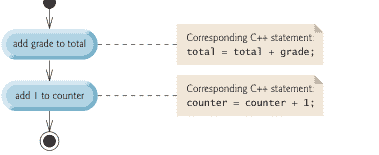

**图 4.2** | 顺序结构活动图。

在此图中，两条语句将一个成绩添加到 total 变量中，并将值 1 添加到 counter 变量中。这些语句可能出现在一个计算多个学生成绩平均值的程序中。要计算平均值，将所平均的成绩总和除以成绩的数量。counter 变量将用于跟踪被平均值的数量。你将在第 4.8 节的程序中看到类似的语句。

活动图是 UML 的一部分。活动图对软件系统某一部分的工作流（也称为活动）进行建模。这些工作流可能包括算法的一部分，例如图 4.2 中的顺序结构。活动图由专用的符号组成，例如动作状态符号（一个矩形，其左右两边替换为向外弯曲的弧线）、菱形和小圆圈；这些符号通过转换箭头连接，表示活动的流程。

活动图帮助你开发和表示算法，但许多程序员更喜欢伪代码。活动图清晰地显示了控制结构如何运作。

考虑图 4.2 的顺序结构活动图。它包含两个动作状态，表示要执行的动作。每个动作状态包含一个动作表达式——例如，“将成绩添加到 total”或“将 1 添加到 counter”——指定要执行的特定动作。其他动作可能包括计算或输入/输出操作。活动图中的箭头称为转换箭头。这些箭头表示转换，指示动作状态所代表的动作发生的顺序——实现图 4.2 中活动图所示活动的程序首先将成绩添加到 total，然后将 1 添加到 counter。

图顶部的实心圆表示活动的初始状态——程序执行建模活动之前工作流的开始。活动图底部出现的带空心圆的实心圆表示最终状态——程序执行其活动之后工作流的结束。

图 4.2 还包括右上角折叠的矩形。在 UML 中，这些称为注释。注释是描述图中符号用途的解释性说明。注释可以用在任何 UML 图中，而不仅仅是活动图。图 4.2 使用 UML 注释来显示与活动图中每个动作状态相关联的 C++ 代码。虚线将每个注释与注释所描述的元素连接起来。活动图通常不显示实现活动的 C++ 代码。我们在这里使用注释来说明该图如何与 C++ 代码相关联。有关 UML 的更多信息，请参阅我们的可选案例研究，该案例研究出现在第 25–26 章中，或访问我们的 UML 资源中心 www.deitel.com/UML/。


**常见编程错误 4.1**  
*将关键字用作标识符是语法错误。*

**常见编程错误 4.2**  
*关键字拼写中包含大写字母是语法错误。C++ 的所有关键字仅包含小写字母。*

## C++ 控制语句总结

C++ 只有三种控制结构，从此刻起我们称之为控制语句：顺序语句、选择语句（三种类型——if、if...else 和 switch）以及重复语句（三种类型——while、for 和 do...while）。每个程序根据其实现的算法恰当地组合这些控制语句。我们可以将每种控制语句建模为一个活动图，图中包含一个初始状态和一个最终状态，分别代表控制语句的入口点和出口点。这些单入口/单出口的控制语句使得程序构建变得容易——控制语句通过将一个的出口点连接到下一个的入口点而相互连接。这类似于儿童堆叠积木的方式，因此我们称之为控制语句堆叠。我们很快会了解到，连接控制语句只有另一种方式——称为控制语句嵌套，即将一个控制语句包含在另一个控制语句内部。因此，C++ 程序中的算法仅由三种控制语句以两种方式组合而成。

**软件工程观察 4.1**  
*我们将要构建的任何 C++ 程序都可以仅由七种不同类型的控制语句（顺序、if、if...else、switch、while、do...while 和 for）以两种方式（控制语句堆叠和控制语句嵌套）组合而成。*

## 4.5 if 选择语句

程序使用选择语句在备选操作方案中进行选择。例如，假设考试的及格分数是 60。伪代码语句

```
If student's grade is greater than or equal to 60
    Print "Passed"
```

确定条件“学生的成绩大于或等于 60”是真还是假。如果条件为真，则打印“Passed”，并按顺序“执行”下一条伪代码语句（请记住，伪代码不是真正的编程语言）。如果条件为假，则忽略打印语句，并按顺序执行下一条伪代码语句。第二行的缩进是可选的，但建议缩进，因为它强调结构化程序的内在结构。

**良好编程实践 4.1**  
*在程序中始终如一地应用合理的缩进约定可以大大提高程序的可读性。我们建议在语句之间使用三个空行。有些人喜欢使用制表符，但这些在不同编辑器中可能有所不同，导致在一个编辑器中编写的程序在另一个编辑器中使用时对齐方式不同。*

设想七个箱子，每个箱子仅包含七种控制语句类型之一的空 UML 活动图。那么，你的任务就是根据算法所需，从这些活动图中选取每种控制语句适当数量来组装程序，仅以两种可能的方式（堆叠或嵌套）组合这些活动图，然后用动作表达式和监护条件填充动作状态和判定，以适当的方式为算法形成结构化实现。我们将讨论动作和判定的各种编写方式。

## 4.6 if...else 双选择语句

if 单选择语句仅当条件为真时执行指定动作；否则跳过该动作。if...else 双选择语句允许你指定当条件为真时要执行的动作，以及当条件为假时要执行的不同动作。例如，伪代码语句

```
If student's grade is greater than or equal to 60
    Print "Passed"
Else
    Print "Failed"
```

如果学生的成绩大于或等于 60，则打印“Passed”；如果学生的成绩小于 60，则打印“Failed”。无论哪种情况，打印完成后，按顺序执行下一条伪代码语句。

前面的伪代码 If...Else 语句可以用 C++ 编写为

```cpp
if ( grade >= 60 )
    cout << "Passed";
else
    cout << "Failed";
```

`else` 的主体同样缩进。

**良好编程实践 4.2**  
*无论你选择何种缩进约定，都应在整个程序中始终如一地应用。不遵循统一间距约定的程序难以阅读。*

**良好编程实践 4.3**  
*对 if...else 语句的两个主体语句都进行缩进。*

**良好编程实践 4.4**  
*如果存在多级缩进，每一级应缩进相同的额外空间量，以提高可读性和可维护性。*

图 4.5 展示了 *if...else* 语句的控制流。同样，UML 活动图中的符号（除了初始状态、转换箭头和最终状态）表示动作状态和判定。

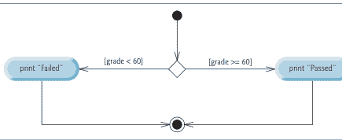

**图 4.5** | if...else 双选择语句活动图。

### 条件运算符（?:）

C++ 提供了条件运算符（?:），它与 if...else 语句密切相关。条件运算符是 C++ 唯一的三元运算符——它接受三个操作数。操作数与条件运算符一起构成条件表达式。第一个操作数是条件，第二个操作数是条件为真时整个条件表达式的值，第三个操作数是条件为假时整个条件表达式的值。例如，输出语句

```
cout << ( grade >= 60 ? "Passed" : "Failed" );
```

包含一个条件表达式 `grade >= 60 ? "Passed" : "Failed"`，当条件 `grade >= 60` 为真时，其值为字符串“Passed”；当条件为假时，其值为“Failed”。因此，带条件运算符的语句与前面的 if...else 语句本质上执行相同的操作。我们稍后会看到，条件运算符的优先级较低，因此前面的表达式需要括号。

**错误预防提示 4.1**  
*为避免优先级问题（并为了清晰起见），请将条件表达式（出现在较大表达式中时）放在括号中。*

条件表达式中的值也可以是可执行的动作。例如，下面的条件表达式同样会打印“Passed”或“Failed”：

```
grade >= 60 ? cout << "Passed" : cout << "Failed";
```

前面的条件表达式可读作：“如果 grade 大于或等于 60，则 cout << "Passed"；否则，cout << "Failed"。”这与前面的 if...else 语句也是可比的。条件表达式可以出现在 if...else 语句无法出现的某些程序位置。

### 嵌套 if...else 语句

嵌套 if...else 语句通过在其他 if...else 选择语句内部放置 if...else 选择语句来测试多种情况。例如，下面的伪代码 if...else 语句对大于或等于 90 的考试分数打印 A，对 80 到 89 范围内的分数打印 B，对 70 到 79 范围内的分数打印 C，对 60 到 69 范围内的分数打印 D，对其他所有分数打印 F：

```
If student's grade is greater than or equal to 90
    Print "A"
Else
    If student's grade is greater than or equal to 80
        Print "B"
    Else
        If student's grade is greater than or equal to 70
            Print "C"
        Else
            If student's grade is greater than or equal to 60
                Print "D"
            Else
                Print "F"
```

这段伪代码可以用 C++ 编写为

```cpp
if ( studentGrade >= 90 ) // 90 and above gets "A"
    cout << "A";
else
    if ( studentGrade >= 80 ) // 80–89 gets "B"
        cout << "B";
    else
        if ( studentGrade >= 70 ) // 70–79 gets "C"
            cout << "C";
        else
            if ( studentGrade >= 60 ) // 60–69 gets "D"
                cout << "D";
            else // less than 60 gets "F"
                cout << "F";
```

如果 studentGrade 大于或等于 90，则前四个条件为真，但只有第一个测试后的输出语句被执行。然后，程序跳过“最外层”if...else 语句的 else 部分。大多数人将前面的 if...else 语句编写为

```cpp
if ( studentGrade >= 90 ) // 90 and above gets "A"
    cout << "A";
else if ( studentGrade >= 80 ) // 80–89 gets "B"
    cout << "B";
else if ( studentGrade >= 70 ) // 70–79 gets "C"
    cout << "C";
else if ( studentGrade >= 60 ) // 60–69 gets "D"
    cout << "D";
else // less than 60 gets "F"
    cout << "F";
```

这两种形式除了空格和缩进之外完全相同，而编译器忽略这些。后一种形式更受欢迎，因为它避免了代码向右过分缩进，从而可能导致行换行。


**性能提示 4.1**  
*嵌套 if...else 语句的执行速度可能比一系列单选择 if 语句快得多，因为在其中一个条件满足后有可能提前退出。*


> **性能提示 4.2**
>
> *在嵌套的 if...else 语句中，将更可能为真的条件放在嵌套语句的开头进行测试。与先测试频繁出现的情况相比，这会使嵌套的 if...else 语句更早退出，从而运行得更快。*

## 悬空 else 问题

C++ 编译器总是将 else 与紧邻其前的 if 关联，除非通过花括号（{ 和 }）的位置另有指示。这种行为可能导致所谓的悬空 else 问题。例如，

```cpp
if ( x > 5 )
    if ( y > 5 )
        cout << "x and y are > 5";
    else
        cout << "x is <= 5";
```

看起来表示如果 x 大于 5，则嵌套的 if 语句决定 y 是否也大于 5。如果是，则输出 "x and y are > 5"。否则，看起来如果 x 不大于 5，则 if...else 的 else 部分输出 "x is <= 5"。

注意！这个嵌套的 if...else 语句并不像看起来那样执行。编译器实际上将该语句解释为

```cpp
if ( x > 5 )
    if ( y > 5 )
        cout << "x and y are > 5";
    else
        cout << "x is <= 5";
```

其中第一个 if 的主体是一个嵌套的 if...else。外层 if 语句测试 x 是否大于 5。如果是，则继续测试 y 是否也大于 5。如果第二个条件为真，则显示正确的字符串——"x and y are > 5"。然而，如果第二个条件为假，则显示字符串 "x is <= 5"，即使我们知道 x 大于 5。

要强制嵌套的 if...else 语句按原本意图执行，我们可以将其写为如下形式：

```cpp
if ( x > 5 )
{
    if ( y > 5 )
        cout << "x and y are > 5";
}
else
    cout << "x is <= 5";
```

花括号（{}）向编译器指示第二个 if 语句位于第一个 if 的主体中，并且 else 与第一个 if 关联。练习 4.23–4.24 进一步探讨悬空 else 问题。

## 块

if 选择语句的主体中只期望有一条语句。类似地，if...else 语句的 if 和 else 部分各期望只有一条主体语句。要包含多个

从该点开始。此外，每个从判定符号指出的转换箭头旁边都有一个守卫条件。合并符号有两条或更多转换箭头指向菱形，且只有一条转换箭头从菱形指出，表示多个活动流合并以继续活动。与判定符号不同，合并符号在 C++ 代码中没有对应物。

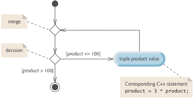

**图 4.6** | *while 重复语句的 UML 活动图。*

图 4.6 的图清晰地展示了本节前面讨论的 while 语句的重复。从动作状态引出的转换箭头指向合并，合并再转换回每次循环中都要测试的判定，直到守卫条件 product > 100 变为真。然后 while 语句退出（到达其最终状态），控制按程序中的顺序传递给下一条语句。

想象一个很深的箱子，里面装满了空的 UML 重复语句活动图——数量多到你可能需要将它们与其他控制语句的活动图堆叠和嵌套，以形成算法的结构化实现。你用适合该算法的动作表达式和守卫条件填充动作状态和判定符号。

> **性能提示 4.3**
>
> *本文提到的许多性能提示只能带来很小的改进，因此你可能会想忽略它们。然而，对于在循环中执行很多次的代码，小的性能改进可以带来显著的整体性能提升。*

## 4.8 算法制定：计数器控制的重复

为了说明程序员如何开发算法，本节和 4.9 节解决班级平均分问题的两个变体。考虑以下问题陈述：

> *一个班有十名学生参加了一次测验。这次测验的成绩（0 到 100 范围内的整数）已提供给你。计算并显示所有学生成绩的总分以及该测验的班级平均分。*

班级平均分等于成绩总和除以学生人数。在计算机上解决这个问题的算法必须输入每个成绩，计算平均分并打印结果。

### 使用计数器控制重复的伪代码算法

让我们使用伪代码列出要执行的动作，并指定这些动作应发生的顺序。我们使用计数器控制的重复来一次输入一个成绩。这种技术使用一个称为计数器的变量来控制一组语句将执行的次数（也称为循环的迭代次数）。

计数器控制的重复通常称为确定性重复，因为重复次数在循环开始执行之前就已知。在此示例中，当计数器超过 10 时重复终止。本节展示一个完整开发的伪代码算法（图 4.7）以及一个在 C++ 中实现该算法的 GradeBook 类版本（图 4.8–图 4.9）。成员函数 getAverage，当与一个演示该算法实际运行的应用（图 4.10）一起呈现时。在 4.9 节中，我们演示如何使用伪代码从头开发这样的算法。

> **软件工程观察 4.3**
>
> *经验表明，在计算机上解决问题最困难的部分是开发解决方案的算法。从算法生成可工作的 C++ 程序的过程通常是直接的。*


```text
1  Set total to zero
2  Set grade counter to one
3
4  While grade counter is less than or equal to ten
5      Prompt the user to enter the next grade
6      Input the next grade
7      Add the grade into the total
8      Add one to the grade counter
9
10 Set the class average to the total divided by ten
11 Print the total of the grades for all students in the class
12 Print the class average
```

**图 4.7**  使用计数器控制重复解决班级平均分问题的伪代码。

注意图 4.7 的伪代码算法中对 total 和 counter 的引用。total 是用于累加多个值之和的变量。counter 是用于计数的变量——在此情况下，grade counter 指示用户即将输入 10 个成绩中的哪一个。用于存储 total 的变量在程序中使用前通常初始化为零；否则，总和将包括存储在 total 内存位置中的先前值。

### 增强 GradeBook 验证

让我们考虑对 GradeBook 类所做的一项增强。在图 3.16 中，我们的 setCourseName 成员函数使用 if 语句测试课程名称的长度是否小于或等于 25 个字符，以此验证课程名称。如果为真，则设置课程名称。此代码之后是一个 if 语句，测试课程名称的长度是否大于 25 个字符（在这种情况下，课程名称将被缩短）。第二个 if 语句的条件与第一个 if 语句的条件完全相反。如果一个条件求值为真，另一个必定求值为假。这种情况非常适合 if...else 语句，因此我们修改了代码，用一条 if...else 语句替换两条 if 语句（图 4.9 的第 18–25 行）。

### 在 GradeBook 类中实现计数器控制的重复

GradeBook 类（图 4.8–图 4.9）包含一个构造函数（在图 4.8 的第 11 行声明，并在图 4.9 的第 9–12 行定义），它为该类的数据成员 courseName（在图 4.8 的第 17 行声明）赋值。图 4.9 的第 16–26 行、29–32 行和 35–39 行分别定义了成员函数 setCourseName、getCourseName 和 displayMessage。第 42–68 行定义了成员函数 determineClassAverage，它实现图 4.7 中伪代码所描述的班级平均分算法。

```cpp
1  // Fig. 4.8: GradeBook.h
2  // Definition of class GradeBook that determines a class average.
3  // Member functions are defined in GradeBook.cpp
4  #include <string> // program uses C++ standard string class
5  using namespace std;
6
7  // GradeBook class definition
8  class GradeBook
9  {
10 public:
11    GradeBook( string ); // constructor initializes course name
12    void setCourseName( string ); // function to set the course name
13    string getCourseName(); // function to retrieve the course name
14    void displayMessage(); // display a welcome message
15    void determineClassAverage(); // averages grades entered by the user
16 private:
17    string courseName; // course name for this GradeBook
18 }; // end class GradeBook
```

**图 4.8** | 使用计数器控制重复的班级平均分问题：GradeBook 头文件。

```cpp
1  // Fig. 4.9: GradeBook.cpp
2  // Member-function definitions for class GradeBook that solves the
3  // class average program with counter-controlled repetition.
4  #include <iostream>
5  #include "GradeBook.h" // include definition of class GradeBook
6  using namespace std;
7
8  // constructor initializes courseName with string supplied as argument
9  GradeBook::GradeBook( string name )
10 {
```

**图 4.9** | 使用计数器控制重复的班级平均分问题：GradeBook 源代码文件。（第 1 部分，共 3 部分。）


## 演示 GradeBook 类

图4.10包含该应用程序的main函数，它创建一个GradeBook类的对象并演示其功能。图4.10的第9行创建一个名为myGradeBook的新GradeBook对象。第9行中的字符串被传递给GradeBook构造函数（图4.9的第9–12行）。图4.10的第11行调用myGradeBook的displayMessage成员函数，向用户显示欢迎消息。第12行随后调用myGradeBook的determineClassAverage成员函数，允许用户输入10个成绩，然后该成员函数计算并打印平均值——该成员函数执行图4.7伪代码中所示的算法。

```cpp
// Fig. 4.10: fig04_10.cpp
// Create GradeBook object and invoke its determineClassAverage function.
#include "GradeBook.h" // include definition of class GradeBook

int main()
{
   // create GradeBook object myGradeBook and
   // pass course name to constructor
   GradeBook myGradeBook( "CS101 C++ Programming" );

   myGradeBook.displayMessage(); // display welcome message
   myGradeBook.determineClassAverage(); // find average of 10 grades
} // end main
```

图4.10 | 使用计数器控制重复的班级平均分问题：创建GradeBook类的对象（图4.8–图4.9）并调用其determineClassAverage成员函数。（第1部分，共2部分。）

```text
Welcome to the grade book for
CS101 C++ Programming

Enter grade: 67
Enter grade: 78
Enter grade: 89
Enter grade: 67
Enter grade: 87
Enter grade: 98
Enter grade: 93
Enter grade: 85
Enter grade: 82
Enter grade: 100

Total of all 10 grades is 846
Class average is 84
```

**图4.10** | 使用计数器控制重复的班级平均分问题：创建GradeBook类的对象（图4.8–图4.9）并调用其`determineClassAverage`成员函数。（第2部分，共2部分。）

## 关于整数除法与截断的说明

响应图4.10第12行中的函数调用而执行的平均值计算产生一个整数结果。示例执行表明，成绩值之和为846，当除以10时，应得到84.6——一个带小数点的数。然而，计算`total / 10`（图4.9的第63行）的结果是整数84，因为`total`和10都是整数。两个整数相除会得到整数除法——计算中的任何小数部分都会丢失（即被截断）。我们将在下一节中看到如何从平均值计算中获得包含小数点的结果。


> **常见编程错误 4.7**
> 
> *假设整数除法会四舍五入（而不是截断）可能导致错误结果。例如，7 ÷ 4 在常规算术中得1.75，在整数算术中截断为1，而不是四舍五入为2。*

在图4.9中，如果第63行使用`gradeCounter`而不是10，该程序的输出将显示一个不正确的值76。之所以会发生这种情况，是因为在`while`语句的最后一次迭代中，`gradeCounter`在第59行被递增到值11。


> **常见编程错误 4.8**
> 
> *在循环之后使用循环的计数器控制变量进行计算，通常会导致一种称为差一错误的常见逻辑错误。在每次循环都将计数加1的计数器控制循环中，当计数器的值比其最后一个合法值高1时（即从1计数到10时为11），循环终止。*

## 4.9 构造算法：哨兵控制重复

让我们推广班级平均分问题。考虑以下问题：

*开发一个班级平均分程序，每次运行时处理任意数量学生的成绩。*


在前面的示例中，问题描述指定了学生人数，因此成绩数量（10）是预先已知的。在这个示例中，没有说明用户将在程序执行期间输入多少成绩。程序必须处理任意数量的成绩。程序如何确定何时停止输入成绩？它如何知道何时计算并打印班级平均分？

为了解决这个问题，我们可以使用一个特殊值，称为哨兵值（也称为信号值、哑值或标志值），来表示“数据输入结束”。用户输入合法成绩后，再输入哨兵值，表示最后一个成绩已经输入。哨兵控制重复通常称为不定重复，因为在循环开始执行之前，重复次数是未知的。

必须选择不会与可接受输入值混淆的哨兵值。成绩通常是非负整数，因此 −1 是可接受的哨兵值。这样，程序的一次运行可能会处理 95、96、75、74、89 和 −1 等输入。程序随后会计算并打印成绩 95、96、75、74 和 89 的班级平均分。由于 −1 是哨兵值，它不应参与平均分计算。

> **常见编程错误 4.9**
>
> *选择一个同时也是合法数据值的哨兵值是一种逻辑错误。*

## 使用自顶向下、逐步细化的方法开发伪代码算法：顶层与第一次细化

我们使用一种称为**自顶向下、逐步细化**的技术来处理班级平均分程序，这项技术对于开发结构良好的程序至关重要。我们首先给出**顶层**的伪代码表示——一条传达程序整体功能的语句：

```text
Determine the class average for the quiz for an arbitrary number of students
```

实际上，顶层是程序的*完整表示*。遗憾的是，顶层（如本例所示）很少能提供足以编写程序的详细信息。因此，我们现在开始细化过程。我们将顶层划分为一系列较小的任务，并按需要执行的顺序列出这些任务。这样便得到下面的第一次细化。

- 初始化变量
- 输入、求和并统计测验成绩
- 计算并打印所有学生成绩的总和以及班级平均分

这次细化只使用了顺序结构——这些步骤按顺序执行。

> **软件工程观察 4.4**
>
> *每一次细化以及顶层本身，都是算法的完整规范；只是详细程度不同。*

> **软件工程观察 4.5**
>
> *许多程序在逻辑上可以分为三个阶段：初始化阶段，用于初始化程序变量；处理阶段，用于输入数据值并相应地调整程序变量（如计数器和总计）；终止阶段，用于计算并输出最终结果。*

## 进入第二次细化

前面的*软件工程观察*通常就是自顶向下过程中第一次细化所需的全部内容。在**第二次细化**中，我们确定具体的变量。在这个示例中，我们需要一个数字的累计总和、一个已处理数字数量的计数、一个用于接收用户输入的每个成绩值的变量，以及一个用于保存计算出的平均分的变量。伪代码语句

```text
Initialize variables
```

可以细化为：

```text
Initialize total to zero
Initialize counter to zero
```

只有变量 total 和 counter 需要在使用前初始化。变量 *average* 和 *grade*（分别用于计算出的平均分和用户输入）不需要初始化，因为它们会在计算或输入时被替换为相应的值。

伪代码语句

```text
Input, sum and count the quiz grades
```

需要一个重复语句（即循环），依次输入每个成绩。我们事先不知道要处理多少个成绩，因此将使用**哨兵控制重复**。用户一次输入一个合法成绩。输入最后一个合法成绩后，用户输入哨兵值。程序在每次输入成绩后检查是否为哨兵值，并在用户输入哨兵值时终止循环。于是，前述伪代码语句的第二次细化如下：

```text
Prompt the user to enter the first grade
Input the first grade (possibly the sentinel)
While the user has not yet entered the sentinel
    Add this grade into the running total
    Add one to the grade counter
    Prompt the user to enter the next grade
    Input the next grade (possibly the sentinel)
```

在伪代码中，我们不在构成 *While* 结构体的语句周围使用花括号。我们只需将语句缩进到 *While* 下方，以表明它们属于 While。同样，伪代码只是一种非正式的程序开发辅助工具。

伪代码语句

```text
Calculate and print the total of all student grades and the class average
```

可以细化为：

```text
If the counter is not equal to zero
    Set the average to the total divided by the counter
    Print the total of the grades for all students in the class
    Print the class average
else
    Print “No grades were entered”
```

这里我们要仔细测试除以零的可能性——这通常是一种致命逻辑错误，如果未被发现，会导致程序失败（通常称为“崩溃”）。班级平均分问题的伪代码的完整第二次细化如图 4.11 所示。


> **常见编程错误 4.10**
>
> *尝试除以零通常会导致致命的运行时错误。*


> **错误预防提示 4.3**
>
> *当执行除以一个值可能为零的表达式时，应显式测试这种可能性，并在程序中妥善处理（例如打印错误消息），而不是任由致命错误发生。*

```text
 1  Initialize total to zero
 2  Initialize counter to zero
 3
 4  Prompt the user to enter the first grade
 5  Input the first grade (possibly the sentinel)
 6
 7  While the user has not yet entered the sentinel
 8      Add this grade into the running total
 9      Add one to the grade counter
10      Prompt the user to enter the next grade
11      Input the next grade (possibly the sentinel)
12
13  If the counter is not equal to zero
14      Set the average to the total divided by the counter
15      Print the total of the grades for all students in the class
16      Print the class average
17  else
18      Print "No grades were entered"
```

**图 4.11** | 使用哨兵控制重复的班级平均分问题伪代码算法。

在图 4.7 和图 4.11 中，我们在伪代码中加入了一些空行和缩进，使其更具可读性。空行将伪代码算法分隔成各个阶段，缩进则强调控制语句体。

图 4.11 中的伪代码算法解决了更一般的班级平均分问题。这个算法只经过两层细化就开发出来了。有时需要更多层细化。


> **软件工程观察 4.6**
>
> *当伪代码算法被指定得足够详细，使你能够将伪代码转换为 C++ 时，就终止自顶向下、逐步细化过程。通常，随后实现 C++ 程序就很直接。*

> **软件工程观察 4.7**
>
> 
>
> 许多有经验的程序员在编写程序时从不使用伪代码之类的程序开发工具。这些程序员认为，他们的最终目标是在计算机上解决问题，而编写伪代码只会延迟最终输出的产生。尽管这种方法可能适用于简单且熟悉的问题，但在长期、复杂的项目中可能导致严重困难。

## 在 GradeBook 类中实现哨兵控制重复

图 4.12–4.13 展示了 GradeBook 类，其中包含成员函数 determineClassAverage，该函数实现了图 4.11 的伪代码算法（这个类在图 4.14 中演示）。尽管输入的每个成绩都是整数，但平均分计算很可能产生带小数点的数字——换句话说，实数或浮点数（例如 7.33、0.975 或 1000.12345）。int 类型无法表示这样的数字，因此这个类必须使用另一种类型来表示。C++ 提供了几种在内存中存储浮点数的数据类型，包括 float 和 double。这些类型的主要区别在于，与 float 变量相比，double 变量通常能够存储数量级更大、细节更精细的数字（即小数点右侧更多位数——也称为该数的精度）。本程序引入了一种称为强制类型转换运算符的特殊运算符，以强制平均分计算产生浮点数结果。我们将在讨论程序时详细解释这些特性。

在这个示例中，我们看到控制语句可以像孩子堆叠积木一样（按顺序）层层叠加。while 语句（图 4.13 的第 60–68 行）紧接着按顺序是一个 if…else 语句（第 71–83 行）。该程序中的许多代码与图 4.9 中的代码相同，因此我们重点讨论新特性和问题。

第 48 行声明了 double 变量 average。回想一下，在前面的示例中，我们使用 int 变量存储班级平均分。在当前示例中使用 double 类型，使我们能够将班级平均分计算的结果存储为浮点数。第 52 行

```cpp
// Fig. 4.12: GradeBook.h
// Definition of class GradeBook that determines a class average.
// Member functions are defined in GradeBook.cpp
#include <string> // program uses C++ standard string class
using namespace std;

// GradeBook class definition
class GradeBook
{
public:
   GradeBook( string ); // constructor initializes course name
   void setCourseName( string ); // function to set the course name
   string getCourseName(); // function to retrieve the course name
   void displayMessage(); // display a welcome message
   void determineClassAverage(); // averages grades entered by the user
private:
   string courseName; // course name
}; // end class GradeBook
```

**图 4.12** | 使用哨兵控制重复的班级平均分问题：GradeBook 头文件。


```cpp
gradeCounter = 0; // initialize loop counter

// processing phase
// prompt for input and read grade from user
cout << "Enter grade or -1 to quit: ";
cin >> grade; // input grade or sentinel value

// loop until sentinel value read from user
while ( grade != -1 ) // while grade is not -1
{
   total = total + grade; // add grade to total
   gradeCounter = gradeCounter + 1; // increment counter

   // prompt for input and read next grade from user
   cout << "Enter grade or -1 to quit: ";
   cin >> grade; // input grade or sentinel value
} // end while

// termination phase
if ( gradeCounter != 0 ) // if user entered at least one grade...
{
   // calculate average of all grades entered
   average = static_cast< double >( total ) / gradeCounter;

   // display total and average (with two digits of precision)
   cout << "\nTotal of all " << gradeCounter << " grades entered is "
        << total << endl;
   cout << "Class average is " << setprecision( 2 ) << fixed << average
        << endl;
} // end if
else // no grades were entered, so output appropriate message
   cout << "No grades were entered" << endl;
} // end function determineClassAverage
```

**图 4.13** | 使用哨兵控制的重复实现班级平均成绩问题：GradeBook 源代码文件。（共 2 部分，第 2 部分。）

第 55 行将变量 `gradeCounter` 初始化为 0，因为此时还没有输入任何成绩。请记住，该程序使用哨兵控制的重复。为了准确记录输入的成绩数量，程序仅在用户输入有效的成绩值（即不是哨兵值）并且程序完成输入处理时，才递增变量 `gradeCounter`。请注意，两个输入语句（第 57 行和第 67 行）之前都有输出语句，用于提示用户输入。


## 良好的编程实践 4.8

对于每次键盘输入，都应提示用户。提示应说明输入的形式以及任何特殊的输入值。例如，在哨兵控制的循环中，请求输入数据的提示应明确提醒用户哨兵值是什么。

## 哨兵控制的重复与计数器控制的重复的程序逻辑

将本例中的哨兵控制重复的程序逻辑与图 4.9 中的计数器控制重复逻辑进行比较。在计数器控制的重复中，`while` 语句的每次迭代（图 4.9 的第 54～60 行）都会从用户处读取一个值，迭代次数由指定的次数决定。在哨兵控制的重复中，程序在执行到 `while` 之前读取第一个值（图 4.13 的第 56～57 行）。该值决定程序的控制流是否应进入 `while` 的循环体。如果 `while` 的条件为假，说明用户输入了哨兵值，因此 `while` 的循环体不会执行（即没有输入任何成绩）。另一方面，如果条件为真，循环体便开始执行，循环将成绩值加到总成绩中（第 62 行），并递增 `gradeCounter`（第 63 行）。随后，循环体中的第 66～67 行提示用户输入下一个值，并从用户处读取该值。接着，程序控制到达第 68 行循环体的右大括号（`}`），因此执行继续进行 `while` 条件的测试（第 60 行）。该条件使用用户最近输入的成绩来确定循环体是否应再次执行。变量 `grade` 的值总是在程序测试 `while` 条件之前立即从用户处读取。这样，程序就能在处理刚输入的值之前（即将其加到总成绩并递增 `gradeCounter` 之前）判断该值是否为哨兵值。如果输入的是哨兵值，循环终止，程序不会将 `-1` 加到总成绩中。

```cpp
// Fig. 4.14: fig04_14.cpp
// Create GradeBook object and invoke its determineClassAverage function.
#include "GradeBook.h" // include definition of class GradeBook

int main()
{
   // create GradeBook object myGradeBook and
   // pass course name to constructor
   GradeBook myGradeBook( "CS101 C++ Programming" );

   myGradeBook.displayMessage(); // display welcome message
   myGradeBook.determineClassAverage(); // find average of 10 grades
} // end main
```

```text
Welcome to the grade book for
CS101 C++ Programming

Enter grade or -1 to quit: 97
Enter grade or -1 to quit: 88
Enter grade or -1 to quit: 72
Enter grade or -1 to quit: -1

Total of all 3 grades entered is 257
Class average is 85.67
```

**图 4.14** | 使用哨兵控制的重复实现班级平均成绩问题：创建 `GradeBook` 对象并调用其 `determineClassAverage` 成员函数。

循环终止后，第 71～83 行的 `if...else` 语句会执行。第 71 行的条件用于判断是否输入了任何成绩。如果没有输入成绩，`if...else` 语句的 `else` 部分（第 82～83 行）会执行，显示消息 `"No grades were entered"`，然后成员函数将控制权返回给调用函数。

请注意图 4.13 中 `while` 循环里的代码块。如果没有大括号，循环体中的最后三条语句就会位于循环之外，导致计算机错误地解释这段代码，如下所示：

```cpp
// loop until sentinel value read from user
while ( grade != -1 )
    total = total + grade; // add grade to total
    gradeCounter = gradeCounter + 1; // increment counter

// prompt for input and read next grade from user
cout << "Enter grade or -1 to quit: ";
cin >> grade;
```

如果用户没有在第一次输入成绩时（第 57 行）输入 `-1`，这将导致程序进入无限循环。

## 常见编程错误 4.11

省略用于界定代码块的大括号可能导致逻辑错误，例如无限循环。为了避免此问题，一些程序员会将每条控制语句的循环体都放在大括号中，即使循环体只包含一条语句。

### 浮点数精度和内存需求

`float` 类型的变量表示单精度浮点数，在大多数 32 位系统上具有 7 位有效数字。`double` 类型的变量表示双精度浮点数。这类变量所需的内存是 `float` 变量的两倍，并且在大多数 32 位系统上可提供 15 位有效数字——精度大约是 `float` 变量的两倍。对于大多数程序所需的数值范围，`float` 类型的变量应该足够使用，但你也可以使用 `double` 来“确保万无一失”。在某些程序中，即使 `double` 类型的变量也不够用——这类程序超出了本书的范围。大多数程序员使用 `double` 类型表示浮点数。事实上，默认情况下，C++ 会将你在程序源代码中输入的所有浮点数（例如 7.33 和 0.0975）视为 `double` 值。源代码中的这类值称为浮点常量。有关 `float` 和 `double` 的取值范围，请参阅附录 C“基本类型”。

浮点数通常是除法运算的结果。在常规算术中，将 10 除以 3，结果为 3.3333333……，其中 3 的序列会无限重复。计算机只能分配固定大小的空间来存储这样的值，因此显然，存储的浮点值只能是一个近似值。

## 常见编程错误 4.12

以假设浮点数能够被精确表示的方式使用浮点数（例如，在相等性比较中使用浮点数），可能导致错误结果。浮点数只能以近似值表示。

尽管浮点数并不总能达到 100% 的精确度，但它们有许多应用场景。例如，当我们说“正常”的体温是 98.6 时，并不需要精确到很多位数字。当我们从温度计上读到 98.6 时，它实际的值可能是 98.5999473210643。在大多数涉及体温的应用中，将这个数简单地称为 98.6 是没有问题的。由于浮点数具有不精确的特性，因此相比 `float` 类型，更推荐使用 `double` 类型，因为 `double` 变量能够更准确地表示浮点数。基于这一原因，本书始终使用 `double` 类型。


## 在基本类型之间进行显式转换和隐式转换

变量 average 被声明为 double 类型（图4.13第48行），以捕获计算的小数结果。然而，total 和 gradeCounter 都是整型变量。回想一下，两个整数相除会执行整数除法，计算中的任何小数部分都会丢失（即被截断）。在下面的语句中：

```
average = total / gradeCounter;
```

除法先执行——结果的小数部分在赋值给 average 之前就已丢失。为了用整数执行浮点计算，我们必须创建临时浮点值。C++ 提供一元强制转换运算符来完成此任务。第74行使用强制转换运算符 `static_cast<double>(total)` 创建其操作数——total 的临时浮点副本。以这种方式使用强制转换运算符称为显式转换。存储在 total 中的值仍然是整数。

现在计算由一个浮点值（total 的临时 double 版本）除以整数 gradeCounter 组成。编译器只知道如何求值操作数类型相同的表达式。为确保操作数类型相同，编译器对选定的操作数执行一种称为提升（也称为隐式转换）的操作。例如，在包含 int 和 double 数据类型值的表达式中，C++ 将 int 操作数提升为 double 值。在我们的示例中，我们将 total 当作 double 处理（通过使用一元强制转换运算符），因此编译器将 gradeCounter 提升为 double，从而可以执行计算——浮点除法的结果被赋值给 average。在第6章“函数与递归简介”中，我们将讨论所有基本数据类型及其提升顺序。

> **常见编程错误 4.13**
>
> 强制转换运算符可用于在基本数值类型（如 int 和 double）之间转换，也可在相关的类类型之间转换（如第13章“面向对象编程：多态”所讨论）。强制转换为错误的类型可能导致错误。


强制转换运算符可用于每种数据类型，也可用于类类型。`static_cast` 运算符的构成方式是：在关键字 `static_cast` 后跟尖括号（`<` 和 `>`），括号内为数据类型名称。强制转换运算符是一元运算符——只接受一个操作数的运算符。在第2章中，我们学习了二元算术运算符。C++ 还支持加号（+）和减号（−）运算符的一元版本，因此可以编写诸如 −7 或 +5 这样的表达式。强制转换运算符的优先级高于其他一元运算符，例如一元 + 和一元 −。该优先级高于乘法运算符 `*`、`/` 和 `%` 的优先级，低于括号的优先级。在优先级表中，我们用记号 `static_cast<type>()` 表示强制转换运算符。

## 浮点数的格式设置

这里简要讨论图4.13中的格式设置功能，第15章“流输入/输出”将深入解释。第79行对 `setprecision` 的调用（参数为2）表示 double 值应打印为小数点右侧两位精度（例如 92.37）。此调用称为参数化流操纵符（因为括号中有2）。使用这些调用的程序必须包含预处理指令（第5行）

```
#include <iomanip>
```

操纵符 `endl` 是无参数流操纵符（因为其后面没有括号中的值或表达式），并且不需要 `<iomanip>` 头文件。如果未指定精度，浮点值通常以六位精度输出（即当今大多数32位系统上的默认精度），不过我们马上会看到一个例外。

流操纵符 `fixed`（第79行）表示浮点值应以所谓的定点格式输出，而不是科学记数法。科学记数法是一种将数字显示为介于 1.0 和 10.0 之间的浮点数再乘以 10 的幂的方法。例如，值 3,100.0 用科学记数法显示为 3.1 × 10³。科学记数法在显示非常大或非常小的值时很有用。使用科学记数法的格式设置将在第15章进一步讨论。另一方面，定点格式设置用于强制浮点数显示特定数量的数字。指定定点格式设置还会强制打印小数点和末尾零，即使该值是整数金额，例如 88.00。如果没有定点格式设置选项，这样的值在 C++ 中会打印为 88，不带末尾零，也不带小数点。当程序中使用了流操纵符 `fixed` 和 `setprecision` 时，打印的值会舍入到传递给 `setprecision` 的值所指示的小数位数（例如第79行中的值2），尽管内存中的值保持不变。例如，值 87.946 和 67.543 分别输出为 87.95 和 67.54。也可以通过使用流操纵符 `showpoint` 强制显示小数点。如果指定了 `showpoint` 而未指定 `fixed`，则不会打印末尾零。与 `endl` 一样，流操纵符 `fixed` 和 `showpoint` 不需要参数，也不需要 `<iomanip>` 头文件。两者都可在头文件 `<iostream>` 中找到。

图4.13的第79和80行输出班级平均分。在此示例中，我们显示舍入到最接近百分位的班级平均分，并输出小数点右侧恰好两位数字。参数化流操纵符 `setprecision( 2 )`（第79行）表示变量 average 的值应显示为小数点右侧两位精度。在图4.14的程序示例执行期间输入的三个成绩总计为257，得到的平均值为 85.666666…。参数化流操纵符 `setprecision` 会使值舍入到指定数字位数。在此程序中，平均值舍入到百分位并显示为 85.67。

## 4.10 制定算法：嵌套控制语句

对于下一个示例，我们再次使用伪代码和自顶向下、逐步细化的方法制定算法，并编写相应的 C++ 程序。我们已经看到，控制语句可以像孩子堆叠积木一样一个叠一个地（按顺序）堆叠。在本案例研究中，我们考察控制语句可以连接的另一种结构化方式，即把一个控制语句嵌套在另一个控制语句中。

考虑以下问题陈述：

> 一所大学开设了一门课程，为学生参加房地产经纪人的州执照考试做准备。去年，完成这门课程的十名学生参加了考试。学院想知道其学生在考试中的表现如何。有人要求你编写一个程序来汇总结果。你已获得这10名学生的名单。每个名字旁边写着1（如果该学生通过了考试）或2（如果该学生未通过）。

你的程序应按如下方式分析考试结果：

- 1. 输入每个考试结果（即1或2）。每次程序请求另一个考试结果时，显示提示信息“Enter result”。
- 2. 统计每种类型的考试结果数量。
- 3. 显示考试结果摘要，指出通过和未通过的学生人数。
- 4. 如果有超过八名学生通过了考试，则打印信息“给教师发奖金！”

仔细阅读问题陈述后，我们得出以下观察结果：

- 1. 程序必须处理10名学生的考试结果。可以使用计数器控制的循环，因为考试结果的数量是预先已知的。
- 2. 每个考试结果都是一个数字——要么是1，要么是2。每次程序读取一个考试结果时，程序必须确定该数字是1还是2。我们的算法中测试是否为1。如果该数字不是1，我们就假定它是2。（练习4.20考虑了这种假设的后果。）
- 3. 使用两个计数器来跟踪考试结果——一个统计通过考试的学生人数，一个统计未通过考试的学生人数。
- 4. 程序处理完所有结果后，必须判断是否有超过八名学生通过了考试。

让我们继续进行自顶向下、逐步细化。我们从顶层的伪代码表示开始：

```
Analyze exam results and decide whether tuition should be raised
```

再次强调，顶层表示是程序的完整表示，但在伪代码自然演变为 C++ 程序之前，可能还需要进行若干次细化。

我们的第一次细化是

```
Initialize variables
Input the 10 exam results, and count passes and failures
Print a summary of the exam results and decide if tuition should be raised
```

在这里同样如此，尽管我们已经有了整个程序的完整表示，但仍需要进一步细化。现在我们确定具体的变量。需要计数器来记录通过和未通过的数量，还需要一个计数器来控制循环过程，并需要一个变量来存储用户输入。最后一个变量未初始化，因为它的值在循环的每次迭代中从用户处读取。

伪代码语句

```
Initialize variables
```


可以细化如下：

```
Initialize passes to zero
Initialize failures to zero
Initialize student counter to one
```

请注意，在算法开始时只初始化了计数器。

伪代码语句

```
Input the 10 exam results, and count passes and failures
```

需要一个循环来依次输入每个考试成绩。这里事先已经知道恰好有 10 个考试成绩，因此采用计数器控制循环是合适的。在循环内部（即嵌套在循环中），if...else 语句将判断每个考试成绩是及格还是不及格，并递增相应的计数器。上述伪代码语句的细化结果如下：

```
While student counter is less than or equal to 10
    Prompt the user to enter the next exam result
    Input the next exam result

    If the student passed
        Add one to passes
    Else
        Add one to failures
    Add one to student counter
```

我们使用空行将 If...Else 控制结构隔开，以提高可读性。

伪代码语句

```
Print a summary of the exam results and decide whether tuition should be raised
```

可以细化如下：

```
Print the number of passes
Print the number of failures
If more than eight students passed
    Print "Bonus to instructor!"
```

完整的第二次细化如图 4.15 所示。使用空行将 While 结构隔开以提高可读性。该伪代码现在已细化到足以转换为 C++。

```
1    Initialize passes to zero
2    Initialize failures to zero
3    Initialize student counter to one

5    While student counter is less than or equal to 10
6       Prompt the user to enter the next exam result
7       Input the next exam result

9       If the student passed
10         Add one to passes
11      Else
12         Add one to failures

14      Add one to student counter

16      Print the number of passes
17      Print the number of failures

19      If more than eight students passed
20         Print "Bonus to instructor!"
```

图 4.15 | 考试成绩问题的伪代码。

## 转换为 C++

实现该伪代码算法的程序以及两次示例执行如图 4.16 所示。

```cpp
  1   // Fig. 4.16: fig04_16.cpp
  2   // Examination-results problem: Nested control statements.
  3   #include <iostream>
  4   using namespace std;

  6   int main()
  7   {
  8      // initializing variables in declarations
  9      int passes = 0; // number of passes
 10      int failures = 0; // number of failures
 11      int studentCounter = 1; // student counter
 12      int result; // one exam result (1 = pass, 2 = fail)

 14      // process 10 students using counter-controlled loop
 15      while ( studentCounter <= 10 )
 16      {
 17         // prompt user for input and obtain value from user
 18         cout << "Enter result (1 = pass, 2 = fail): ";
 19         cin >> result; // input result

 21         // if...else nested in while
 22         if ( result == 1 )           // if result is 1,
 23            passes = passes + 1;      // increment passes;
 24         else
 25            failures = failures + 1;  // increment failures

 27         // increment studentCounter so loop eventually terminates
 28         studentCounter = studentCounter + 1;
 29      } // end while

 31      // termination phase; display number of passes and failures
 32      cout << "Passed " << passes << "\nFailed " << failures << endl;

 34      // determine whether more than eight students passed
 35      if ( passes > 8 )
 36         cout << "Bonus to instructor!" << endl;
 37   } // end main
```

```text
Enter result (1 = pass, 2 = fail): 1
Enter result (1 = pass, 2 = fail): 1
Enter result (1 = pass, 2 = fail): 1
Enter result (1 = pass, 2 = fail): 1
Enter result (1 = pass, 2 = fail): 2
Enter result (1 = pass, 2 = fail): 1
Enter result (1 = pass, 2 = fail): 1
Enter result (1 = pass, 2 = fail): 1
Enter result (1 = pass, 2 = fail): 1
Enter result (1 = pass, 2 = fail): 1
Passed 9
Failed 1
Bonus to instructor!
```

```text
Enter result (1 = pass, 2 = fail): 1
Enter result (1 = pass, 2 = fail): 2
Enter result (1 = pass, 2 = fail): 2
Enter result (1 = pass, 2 = fail): 1
Enter result (1 = pass, 2 = fail): 1
Enter result (1 = pass, 2 = fail): 1
Enter result (1 = pass, 2 = fail): 2
Enter result (1 = pass, 2 = fail): 1
Enter result (1 = pass, 2 = fail): 1
Enter result (1 = pass, 2 = fail): 2
Passed 6
Failed 4
```

图 4.16 | 考试成绩问题：嵌套控制语句。

第 9～12 行声明了用于处理考试成绩的变量。我们利用了 C++ 的一项特性，允许在声明中同时进行变量初始化（passes 初始化为 0，failures 初始化为 0，studentCounter 初始化为 1）。循环程序可能需要在每次重复开始时进行初始化；这种重新初始化通常应通过赋值语句执行，而不是在声明中执行，也不应通过将声明移到循环体内来实现。

while 语句（第 15～29 行）循环 10 次。每次迭代输入并处理一个考试成绩。用于处理每个成绩的 if...else 语句（第 22～25 行）嵌套在 while 语句中。如果成绩为 1，if...else 语句将递增 passes；否则，它假定成绩为 2 并递增 failures。第 28 行递增 studentCounter，然后在第 15 行再次测试循环条件。输入 10 个值后，循环终止，第 32 行显示及格人数和不及格人数。第 35～36 行的 if 语句判断是否有超过 8 名学生通过了考试，如果是，则输出消息 "Bonus to instructor!"。

图 4.16 显示了程序两次示例执行的输入和输出。在第一次示例执行结束时，第 35 行的条件为真——超过 8 名学生通过了考试，因此程序输出一条消息，表明教师应获得奖金。

## 4.11 赋值运算符

C++ 提供了几种赋值运算符，用于简化赋值表达式。例如，语句

```
c = c + 3;
```

可以用加法赋值运算符 += 缩写为

```
c += 3;
```

+= 运算符将运算符右侧表达式的值与运算符左侧变量的值相加，并将结果存储在运算符左侧的变量中。任何形如下面的语句：

```
variable = variable operator expression;
```

其中赋值运算符两侧出现相同的变量，且 operator 是二元运算符 +、−、*、/ 或 %（或本书后续将讨论的其他运算符）之一，都可以写成以下形式：

```
variable operator= expression;
```

因此，赋值 c += 3 将 3 加到 c 上。图 4.17 显示了算术赋值运算符、使用这些运算符的示例表达式及其说明。

| 赋值运算符 | 示例表达式 | 说明 | 赋值 |
|---|---|---|---|
| *假设：int c = 3, d = 5, e = 4, f = 6, g = 12* |  |  |  |
| += | c += 7 | c = c + 7 | 10 赋给 c |
| -= | d -= 4 | d = d - 4 | 1 赋给 d |
| *= | e *= 5 | e = e * 5 | 20 赋给 e |
| /= | f /= 3 | f = f / 3 | 2 赋给 f |
| %= | g %= 9 | g = g % 9 | 3 赋给 g |

图 4.17 | 算术赋值运算符。

## 4.12 自增与自减运算符

除了算术赋值运算符之外，C++ 还提供了两个一元运算符，用于将数值变量的值加 1 或减 1。它们是一元自增运算符 ++ 和一元自减运算符 --，图 4.18 对它们进行了总结。程序可以使用自增运算符 ++ 将名为 c 的变量的值加 1，而不必使用表达式 c = c + 1 或 c += 1。放在变量前面（前缀）的自增或自减运算符分别称为**前缀自增**或**前缀自减运算符**。放在变量后面（后缀）的自增或自减运算符分别称为**后缀自增**或**后缀自减运算符**。

| 运算符 | 名称 | 示例表达式 | 说明 |
|---|---|---|---|
| ++ | 前自增 | ++a | 先将 a 加 1，然后在 a 所在的表达式中使用 a 的新值。 |
| ++ | 后自增 | a++ | 先在 a 所在的表达式中使用 a 的当前值，然后将 a 加 1。 |
| -- | 前自减 | --b | 先将 b 减 1，然后在 b 所在的表达式中使用 b 的新值。 |
| -- | 后自减 | b-- | 先在 b 所在的表达式中使用 b 的当前值，然后将 b 减 1。 |

图 4.18 | 自增与自减运算符。

使用前缀自增（或自减）运算符将变量加 1（或减 1）称为对变量进行前自增（或前自减）。前自增（或前自减）会使变量先加（或减）1，然后在该变量所在的表达式中使用它的新值。使用后缀自增（或自减）运算符将变量加 1（或减 1）称为对变量进行后自增（或后自减）。后自增（或后自减）会先在该变量所在的表达式中使用它的当前值，然后将变量的值加（或减）1。

> **良好编程实践 4.9**
> 
> *与二元运算符不同，一元自增和自减运算符应紧邻其操作数放置，中间不应有空格。*


图 4.19 演示了 ++ 自增运算符的前缀自增版本与后缀自增版本之间的区别。自减运算符（--）的工作方式与此类似。此示例不包含类——它只包含一个源代码文件，其中函数 main 执行应用程序的所有工作。在本章和第 3 章中，你已经看到了一些示例，这些示例由一个类（包括该类的头文件和源代码文件）以及另一个测试该类的源代码文件组成。该源代码文件包含函数 main，它创建了该类的一个对象并调用了其成员函数。在此示例中，我们只想展示 ++ 运算符的机制，因此只使用一个包含函数 main 的源代码文件。有时，当试图创建一个可复用的类来演示一个简单的概念没有意义时，我们会使用一个完全包含在单个源代码文件的 main 函数中的机械式示例。


```cpp
1  // Fig. 4.19: fig04_19.cpp
2  // Preincrementing and postincrementing.
3  #include <iostream>
4  using namespace std;
5
6  int main()
7  {
8     int c;
9
10    // demonstrate postincrement
11    c = 5; // assign 5 to c
12    cout << c << endl; // print 5
13    cout << c++ << endl; // print 5 then postincrement
14    cout << c << endl; // print 6
15
16    cout << endl; // skip a line
17
18    // demonstrate preincrement
19    c = 5; // assign 5 to c
20    cout << c << endl; // print 5
21    cout << ++c << endl; // preincrement then print 6
22    cout << c << endl; // print 6
23 } // end main
```

```text
5
5
6

5
6
6
```

图 4.19 | 前置递增和后置递增。

第 11 行将 c 初始化为 5，第 12 行输出 c 的初始值。第 13 行输出表达式 c++ 的值。该表达式对变量 c 进行后置递增，因此先输出 c 的原值（5），然后 c 的值被递增。因此，第 13 行再次输出 c 的初始值（5）。第 14 行输出 c 的新值（6），以证明变量在第 13 行中已被递增。

第 19 行将 c 的值重置为 5，第 20 行输出该值。第 21 行输出表达式 ++c 的值。该表达式对 c 进行前置递增，因此先递增其值，然后输出新值（6）。第 22 行再次输出 c 的值，以表明在第 21 行执行后 c 的值仍然是 6。

算术赋值运算符以及递增和递减运算符可用于简化程序语句。图 4.16 中的三条赋值语句：

```cpp
passes = passes + 1;
failures = failures + 1;
studentCounter = studentCounter + 1;
```

可以使用赋值运算符更简洁地写成

```cpp
passes += 1;
failures += 1;
studentCounter += 1;
```

使用前缀递增运算符写成

```cpp
++passes;
++failures;
++studentCounter;
```

或使用后缀递增运算符写成

```cpp
passes++;
failures++;
studentCounter++;
```

当你单独在一条语句中递增（++）或递减（--）一个变量时，前置递增与后置递增形式具有相同的效果，前置递减与后置递减形式也具有相同的效果。只有当变量出现在更大的表达式中时，前置递增和后置递增才会产生不同的效果（前置递减和后置递减也是如此）。


> **常见编程错误 4.14**
>
> **试图对不是可修改变量名或引用的表达式使用递增或递减运算符，例如编写 ++(x + 1)，这是一个语法错误。**

图 4.20 显示了迄今为止介绍的运算符的优先级和结合性。运算符按优先级从高到低自上而下排列。第二列表示每级优先级上运算符的结合性。注意条件运算符（?:）、一元运算符前置递增（++）、前置递减（--）、正号（+）和负号（-），以及赋值运算符 +=、-=、*=、/= 和 %= 从右向左结合。图 4.20 运算符优先级表中的所有其他运算符从左向右结合。第三列命名了不同的运算符组。

| 运算符 | 结合性 | 类型 |
|---|---|---|
| `::` | 从左到右 | 作用域解析 |
| `()` | 从左到右 | 括号 |
| `++` `--` `static_cast<type>()` | 从左到右 | 一元（后缀） |
| `++` `--` `+` `-` | 从右到左 | 一元（前缀） |
| `*` `/` `%` | 从左到右 | 乘法 |
| `+` `-` | 从左到右 | 加法 |
| `<<` `>>` | 从左到右 | 插入/提取 |
| `<` `<=` `>` `>=` | 从左到右 | 关系 |
| `==` `!=` | 从左到右 | 相等 |
| `?:` | 从右到左 | 条件 |
| `=` `+=` `-=` `*=` `/=` `%=` | 从右到左 | 赋值 |

**图 4.20** | 截至本文目前所遇到的运算符的优先级。

## 4.13 小结

本章介绍了构建类以及为这些类开发成员函数时所使用的基本问题求解技术。我们演示了如何用伪代码构造算法（即解决问题的方法），然后如何通过伪代码开发来完善算法，最终生成可作为函数一部分执行的 C++ 代码。你学习了如何使用自顶向下、逐步求精的方法来规划函数必须执行的操作以及这些操作的执行顺序。

你了解到，只需要三种控制结构——顺序、选择和循环——就可以开发任何算法。我们演示了 C++ 的两种选择语句——if 单选择语句和 if…else 双选择语句。if 语句用于根据条件执行一组语句——如果条件为真，则执行这些语句；如果条件为假，则跳过这些语句。if…else 双选择语句用于在条件为真时执行一组语句，在条件为假时执行另一组语句。然后我们讨论了 while 循环语句，只要条件为真，就重复执行一组语句。我们使用控制语句堆叠，通过计数器控制和哨兵控制的循环来对一组学生成绩进行求和并计算平均值，并使用控制语句嵌套来分析一组考试成绩并做出决策。我们介绍了赋值运算符，可用于简化语句。我们介绍了递增和递减运算符，可用于对变量加 1 或减 1。在第 5 章“控制语句：第 2 部分”中，我们将继续讨论控制语句，介绍 for、do…while 和 switch 语句。

## 小结

### 第 4.2 节 算法

- 算法是一种用要执行的操作以及执行这些操作的顺序来解决问题的方法。
- 指定程序中语句执行的顺序称为程序控制。

### 第 4.3 节 伪代码

- 伪代码帮助你在用编程语言编写程序之前先构思程序。
- 活动图是 UML 的一部分——UML 是软件系统建模的行业标准。

### 第 4.4 节 控制结构

- 活动图对软件系统的工作流程（也称为活动）进行建模。
- 活动图由符号组成，如动作状态符号、菱形和小圆圈，这些符号通过表示活动流程的转换箭头连接。
- 与伪代码一样，活动图帮助你开发和表示算法。
- 动作状态表示为一个矩形，其左右两边被替换为向外弯曲的圆弧。动作表达式显示在动作状态内部。
- 活动图中的箭头表示转换，它表明了动作状态所表示的动作发生的顺序。
- 活动图中的实心圆表示初始状态——程序执行所建模的动作之前工作流的开始。
- 活动图底部出现的被空心圆包围的实心圆表示最终状态——程序执行完其动作之后工作流的结束。
- 右上角折叠的矩形在 UML 中称为注释。虚线将每个注释与它所描述的元素连接起来。
- 活动图中的决策符号表示需要做出决策。工作流沿由相关监护条件确定的路径前进。从决策符号发出的每个转换箭头都有一个监护条件。如果监护条件为真，工作流进入该转换箭头指向的动作状态。
- 合并符号有两个或多个指向该菱形的转换箭头，但只有一个从它发出的转换箭头，表示多个活动流合并以继续该活动。
- 自顶向下、逐步求精是一种通过保持每次求精时程序的完整表示来细化伪代码的过程。
- 有三种类型的控制结构——顺序、选择和循环。
- 顺序结构是内置的——默认情况下，语句按它们出现的顺序执行。
- 选择结构在备选的动作过程之间进行选择。

### 第 4.5 节 if 选择语句

- if 单选择语句在条件为真时执行（选择）一个动作，或者在条件为假时跳过该动作。

### 第 4.6 节 if…else 双选择语句

- if…else 双选择语句在条件为真时执行（选择）一个动作，而在条件为假时执行另一个不同的动作。
- 要在 if 的体内（或 if…else 语句的 else 体内）包含多条语句，请将这些语句括在花括号（{ 和 }）中。包含在花括号中的一组语句称为块。块可以放置在程序中任何可以放置单条语句的位置。
- 空语句表示不执行任何动作，用分号（;）表示。

### 第 4.7 节 while 循环语句

- 循环语句在某个条件保持为真时重复执行一个动作。
- 包含小数部分的值称为浮点数，由 float 和 double 等数据类型近似表示。

### 第 4.8 节 算法设计：计数器控制的循环

- 当循环开始执行前已知重复次数时，即存在确定性重复时，使用计数器控制的循环。
- 一元强制转换运算符 `static_cast<double>` 可用于创建其操作数的临时浮点副本。
- 一元运算符只接受一个操作数；二元运算符接受两个操作数。
- 参数化流操纵符 `setprecision` 指示应显示在小数点右侧的精度位数。
- 流操纵符 `fixed` 指示浮点值应以所谓的定点格式输出，而不是科学记数法。

### 第 4.9 节 算法设计：哨兵控制的循环

- 当循环开始执行前不知道重复次数时，即存在不确定性重复时，使用哨兵控制的循环。


### 第 4.10 节 算法设计：嵌套控制语句

- 嵌套控制语句出现在另一个控制语句的语句体中。

### 第 4.11 节 赋值运算符

- 算术运算符 `+=`、`-=`、`*=`、`/=` 和 `%=` 是赋值表达式的简写形式。

## 第 4.12 节 自增和自减运算符

- 自增运算符 `++` 和自减运算符 `--` 分别将变量递增或递减 1。如果运算符位于变量之前，则先将变量递增或递减 1，然后在出现该变量的表达式中使用其新值。如果运算符位于变量之后，则先在出现该变量的表达式中使用该变量，然后将该变量的值递增或递减 1。

## 术语

- 编程的动作/决策模型 116
- 动作 110
- 动作表达式 113
- 动作状态符号 113
- 活动 113
- 活动图 112
- 加法赋值运算符（`+=`）144
- 算法 110
- 赋值运算符 144
- 块 121
- bool 基本类型 116
- 强制类型转换运算符 133
- 复合语句 121
- 条件表达式 118
- 条件运算符（`?:`）118
- 控制语句嵌套 115
- 控制语句堆叠 115
- 控制语句 111
- 控制结构 112
- 计数器 124
- 计数器控制的重复 124
- “崩溃” 132
- 悬空 else 问题 120
- 判断符号 116
- 自减运算符（`--`）145
- 默认精度 139
- 确定性重复 124
- 菱形 113
- 除以零 132
- `do...while` 重复语句 114
- 虚线 113
- double 基本类型 133
- 双精度浮点数 137
- 双选择语句 114
- 哑值 130
- 空语句 121
- 可执行语句 111
- 显式转换 138
- 假 116
- 致命逻辑错误 132
- 最终状态符号 113
- 第一次细化 130
- 固定的 139
- 定点格式 139
- 固定流操纵符 139
- 标志值 130
- float 基本类型 133
- 浮点常量 137
- 浮点数 133
- `for` 重复语句 114
- “垃圾”值 127
- goto 消除 112
- goto 语句 112
- 守卫条件 116
- 隐式转换 138
- 自增运算符（`++`）145
- 不确定性重复 130
- 初始状态 113
- 循环的迭代 124
- 循环继续条件 114
- 循环语句 114
- 循环 114
- 合并符号 122
- 多选择语句 114
- 乘法运算符 138
- 嵌套控制语句 139
- 嵌套 `if...else` 语句 118
- 无参数流操纵符 139
- UML 中的注释 113
- 空语句 121
- 差一错误 129
- 顺序 110
- 参数化流操纵符 138
- 后置自减 145
- 后缀自减运算符 145
- 后缀自增运算符 145
- 后置自增 145
- 精度 133
- 前置自减 145
- 前缀自减运算符 145
- 前缀自增运算符 145
- 前置自增 145
- 过程 110
- 程序控制 111
- 提升 138
- 提升 138
- 伪代码 111
- 重复语句 122
- 重复结构 112
- 浮点数舍入 139
- 舍入 129
- 科学记数法 139
- 第二次细化 131
- 选择结构 112
- 标记值 130
- 标记值控制的重复 131
- 顺序结构 112
- 顺序执行 112
- `setprecision` 流操纵符 138
- `showpoint` 流操纵符 139
- 信号值 130
- 单入口/单出口控制语句 115
- 单精度浮点数 137
- 单选择语句 114
- 实心圆符号 113
- `static_cast` 运算符 138
- 结构化程序设计 110
- 三元运算符 118
- 顶部 130
- 自顶向下、逐步细化 130
- 总计 124
- 控制转移 112
- 转换 113
- 转换箭头符号 113
- 真 116
- 截断 129
- 一元强制类型转换运算符 138
- 一元运算符 138
- 未定义值 127
- `while` 重复语句 114
- 工作流 113

## 自测练习

**4.1** 回答下列问题。

a) 所有程序都可以用三种控制结构来编写：________、________ 和 ________。

b) ________ 选择语句用于在条件为真时执行一个动作，或在条件为假时执行另一个动作。

c) 将一组指令重复特定次数称为 ________ 重复。

d) 当事先不知道一组语句将被重复多少次时，可以使用 ________ 值来终止重复。

**4.2** 编写四条不同的 C++ 语句，将整数变量 `x` 加 1。

**4.3** 编写 C++ 语句完成下列各项：

a) 用一条语句将 `x` 和 `y` 当前值之和赋给 `z`，并对 `x` 的值进行后置自增。

b) 判断变量 `count` 的值是否大于 10。如果大于 10，则输出 `"Count is greater than 10."`

c) 将变量 `x` 前置自减 1，然后从变量 `total` 中减去它。

d) 计算 `q` 除以 `divisor` 后的余数，并将结果赋给 `q`。用两种不同方式编写此语句。

**4.4** 编写 C++ 语句完成下列各项任务：

a) 声明 `sum` 和 `x` 为 `int` 类型的变量。

b) 将变量 `x` 设为 1。

c) 将变量 `sum` 设为 0。

d) 将变量 `x` 加到变量 `sum`，并将结果赋给变量 `sum`。

e) 输出 `"The sum is: "`，后跟变量 `sum` 的值。

**4.5** 将练习 4.4 中编写的语句组合成一个程序，计算并输出 1 到 10 的整数之和。使用 `while` 语句循环执行计算和递增语句。当 `x` 的值变为 11 时，循环应终止。

**4.6** 说明计算执行后每个变量的值。假设每条语句开始执行时，所有变量的整数值均为 5。

a) `product *= ++x;`

b) `quotient /= ++x;`

**4.7** 编写完成下列操作的单个 C++ 语句或语句片段：

a) 使用 `cin` 和 `>>` 输入整数变量 `x`。

b) 使用 `cin` 和 `>>` 输入整数变量 `y`。

c) 将整数变量 `i` 设为 1。

d) 将整数变量 `power` 设为 1。

e) 将变量 `power` 乘以 `x`，并将结果赋给 `power`。

f) 将变量 `i` 前置自增 1。

g) 判断 `i` 是否小于或等于 `y`。

h) 使用 `cout` 和 `<<` 输出整数变量 `power`。

**4.8** 编写一个 C++ 程序，使用练习 4.7 中的语句计算 `x` 的 `y` 次幂。该程序应包含 `while` 重复语句。

**4.9** 指出并改正下列各项中的错误：

```cpp
a) while ( c <= 5 )
   {
      product *= c;
      ++c;
   }

b) cin << value;

c) if ( gender == 1 )
      cout << "Woman" << endl;
   else;
      cout << "Man" << endl;
```

**4.10** 下面的 `while` 重复语句有什么问题？

```cpp
while ( z >= 0 )
   sum += z;
```

## 自测练习答案

**4.1** a) 顺序、选择和重复。b) `if...else`。c) 计数器控制的或确定性的。d) 标记值、信号值、标志值或哑值。

**4.2**

```cpp
x = x + 1;
x += 1;
++x;
x++;
```

**4.3**

a) `z = x++ + y;`

b)
```cpp
if ( count > 10 )
   cout << "Count is greater than 10" << endl;
```

c) `total -= --x;`

d)
```cpp
q %= divisor;
q = q % divisor;
```

## 4.4

a)
```cpp
int sum;
int x;
```

b) `x = 1;`

c) `sum = 0;`

d)
```cpp
sum += x;
```

或

```cpp
sum = sum + x;
```

e) `cout << "The sum is: " << sum << endl;`

## 4.5

参见以下代码：

```cpp
// Exercise 4.5 Solution: ex04.05.cpp
// Calculate the sum of the integers from 1 to 10.
#include <iostream>
using namespace std;

int main()
{
    int sum; // stores sum of integers 1 to 10
    int x; // counter

    x = 1; // count from 1
    sum = 0; // initialize sum

    while ( x <= 10 ) // loop 10 times
    {
        sum += x; // add x to sum
        ++x; // increment x
    } // end while

    cout << "The sum is: " << sum << endl;
} // end main
```

The sum is: 55

## 4.6

a) `product = 25, x = 6;`

b) `quotient = 0, x = 6;`

```cpp
// Exercise 4.6 Solution: ex04.06.cpp
// Calculate the value of product and quotient.
#include <iostream>
using namespace std;

int main()
{
    int x = 5;
    int product = 5;
    int quotient = 5;

    // part a
    product *= x++; // part a statement
    cout << "Value of product after calculation: " << product << endl;
    cout << "Value of x after calculation: " << x << endl << endl;
```


```cpp
17    // part b
18    x = 5; // reset value of x
19    quotient /= x; // part b statement
20    cout << "Value of quotient after calculation: " << quotient << endl;
21    cout << "Value of x after calculation: " << x << endl << endl;
22  } // end main
```

```
Value of product after calculation: 25
Value of x after calculation: 6

Value of quotient after calculation: 0
Value of x after calculation: 6
```

### 4.7

- a) `cin >> x;`
- b) `cin >> y;`
- c) `i = 1;`
- d) `power = 1;`
- e) `power *= x;`

  或

  `power = power * x;`
- f) `++i;`
- g) `if ( i <= y )`
- h) `cout << power << endl;`

### 4.8

见以下代码：

```cpp
 1   // Exercise 4.8 Solution: ex04_08.cpp
 2   // Raise x to the y power.
 3   #include <iostream>
 4   using namespace std;
 5
 6   int main()
 7   {
 8      int x; // base
 9      int y; // exponent
10      int i; // counts from 1 to y
11      int power; // used to calculate x raised to power y
12
13      i = 1; // initialize i to begin counting from 1
14      power = 1; // initialize power
15
16      cout << "Enter base as an integer: "; // prompt for base
17      cin >> x; // input base
18
19      cout << "Enter exponent as an integer: "; // prompt for exponent
20      cin >> y; // input exponent
21
22      // count from 1 to y and multiply power by x each time
23      while ( i <= y )
24      {
25         power *= x;
26         ++i;
27      } // end while
28
29      cout << power << endl; // display result
30   } // end main
```

```
Enter base as an integer: 2
Enter exponent as an integer: 3
8
```

### 4.9

a) *错误：* `while` 循环体缺少右花括号。  
*更正：* 在语句 `c++;` 后添加一个右花括号。

b) *错误：* 使用了流插入而不是流提取。  
*更正：* 将 `<<` 改为 `>>`。

c) *错误：* `else` 后的分号导致逻辑错误。第二条输出语句将总是执行。  
*更正：* 删除 `else` 后的分号。

### 4.10

变量 `z` 的值在 `while` 语句中从未改变。因此，如果循环继续条件（`z >= 0`）最初为真，就会产生无限循环。为了防止无限循环，必须递减 `z`，使其最终小于 0。

## 练习

### 4.11

指出并改正以下各项中的错误：

#### a)

```cpp
if ( age >= 65 );
    cout << "Age is greater than or equal to 65" << endl;
else
    cout << "Age is less than 65" << endl;
```

#### b)

```cpp
if ( age >= 65 )
    cout << "Age is greater than or equal to 65" << endl;
else;
    cout << "Age is less than 65" << endl;
```

#### c)

```cpp
int x = 1, total;

while ( x <= 10 )
{
    total = x;
    ++x;
}
```

#### d)

```cpp
while ( x <= 100 )
    total += x;
    ++x;
```

#### e)

```cpp
while ( y > 0 )
{
    cout << y << endl;
    ++y;
}
```

### 4.12

以下程序输出什么？

```cpp
1  // Exercise 4.12: ex04_12.cpp
2  // What does this program print?
3  #include <iostream>
4  using namespace std;
5
6  int main()
7  {
   8    int y; // declare y
    9    int x = 1; // initialize x
   10    int total = 0; // initialize total
   11
   12    while ( x <= 10 ) // loop 10 times
   13    {
   14        y = x * x; // perform calculation
   15        cout << y << endl; // output result
   16        total += y; // add y to total
   17        x++; // increment counter x
   18    } // end while
   19
   20    cout << "Total is " << total << endl; // display result
   21 } // end main
```

*对于练习 4.13–4.16，执行以下每个步骤：*

- a) 阅读问题陈述。
- b) 使用伪代码和自顶向下、逐步细化方法制定算法。
- c) 编写一个 C++ 程序。
- d) 测试、调试并执行该 C++ 程序。

### 4.13 *(汽油里程)*

驾驶员关心其汽车的里程数。一位驾驶员通过记录每次加满油时行驶的英里数和使用的加仑数，跟踪了若干次加满油的情况。开发一个 C++ 程序，使用 `while` 语句输入每次加满油时行驶的英里数和使用的加仑数。程序应计算并显示每次加满油所获得的每加仑英里数，并打印到目前为止所有加满油合计的每加仑英里数。

```
Enter miles driven (-1 to quit): 287
Enter gallons used: 13
MPG this tankful: 22.076923
Total MPG: 22.076923

Enter miles driven (-1 to quit): 200
Enter gallons used: 10
MPG this tankful: 20.000000
Total MPG: 21.173913

Enter miles driven (-1 to quit): 120
Enter gallons used: 5
MPG this tankful: 24.000000
Total MPG: 21.678571

Enter the miles used (-1 to quit): -1
```

### 4.14 *(信用额度计算器)*

开发一个 C++ 程序，用于确定某百货商店客户是否已超过赊账账户的信用额度。对于每位客户，可获得以下信息：

- a) 账号（一个整数）
- b) 月初余额
- c) 该客户本月所有消费项目总额
- d) 本月应用到该客户账户的所有信用总额
- e) 允许的信用额度

程序应使用 `while` 语句输入上述每一项信息，计算新余额（= 月初余额 + 消费 – 信用），并确定新余额是否超过客户的信用额度。对于信用额度被超过的客户，程序应显示该客户的账号、信用额度、新余额以及消息 `"Credit Limit Exceeded."`

```
Enter account number (or -1 to quit): 100
Enter beginning balance: 5394.78
Enter total charges: 1000.00
Enter total credits: 500.00
Enter credit limit: 5500.00
New balance is 5894.78
Account:       100
Credit limit: 5500.00
Balance:       5894.78
Credit Limit Exceeded.

Enter Account Number (or -1 to quit): 200
Enter beginning balance: 1000.00
Enter total charges: 123.45
Enter total credits: 321.00
Enter credit limit: 1500.00
New balance is 802.45

Enter Account Number (or -1 to quit): -1
```

### 4.15 *(销售佣金计算器)*

一家大公司按佣金制向销售人员支付报酬。每位销售人员每周获得 200 美元，外加该周总销售额的 9%。例如，某销售人员一周销售了价值 5000 美元的化学品，则获得 200 美元加上 5000 美元的 9%，总计 650 美元。开发一个 C++ 程序，使用 `while` 语句输入每位销售人员上周的总销售额，并计算和显示该销售人员的收入。每次处理一位销售人员的数据。

```
Enter sales in dollars (-1 to end): 5000.00
Salary is: $650.00

Enter sales in dollars (-1 to end): 6000.00
Salary is: $740.00

Enter sales in dollars (-1 to end): 7000.00
Salary is: $830.00

Enter sales in dollars (-1 to end): -1
```

### 4.16 *(薪资计算器)*

开发一个 C++ 程序，使用 `while` 语句确定若干员工的工资总额。公司对每位员工工作的前 40 小时支付“正常工时”工资，对超过 40 小时的所有工作时间支付“一倍半”工资。给定公司员工名单、每位员工上周工作的小时数以及每位员工的时薪。程序应为每位员工输入这些信息，并确定和显示该员工的工资总额。

```
Enter hours worked (-1 to end): 39
Enter hourly rate of the employee ($00.00): 10.00
Salary is $390.00

Enter hours worked (-1 to end): 40
Enter hourly rate of the employee ($00.00): 10.00
Salary is $400.00

Enter hours worked (-1 to end): 41
Enter hourly rate of the employee ($00.00): 10.00
Salary is $415.00

Enter hours worked (-1 to end): -1
```

### 4.17 *(找出最大值)*

在计算机应用中，查找最大数（即一组数中的最大值）的过程经常被使用。例如，一个确定销售竞赛获胜者的程序会输入每位销售员售出的单位数。售出单位数最多的人赢得竞赛。编写一个 C++ 程序，使用 `while` 语句确定并打印用户输入的 10 个数中的最大数。程序应使用以下三个变量：

- **counter：** 一个计数到 10 的计数器（即跟踪已输入多少个数字，并确定何时已处理完所有 10 个数字）。
- **number：** 当前输入到程序中的数字。
- **largest：** 到目前为止找到的最大数字。

### 4.18 *(表格输出)*

编写一个 C++ 程序，使用 `while` 语句和制表符转义序列 `\t` 打印以下数值表：

| N | 10*N | 100*N | 1000*N |
|---:|---:|---:|---:|
| 1 | 10 | 100 | 1000 |
| 2 | 20 | 200 | 2000 |
| 3 | 30 | 300 | 3000 |
| 4 | 40 | 400 | 4000 |
| 5 | 50 | 500 | 5000 |

### 4.19 *(找出两个最大值)*

使用与练习 4.17 类似的方法，在 10 个数中找出两个最大值。*[注意：每个数字只能输入一次。]*

### 4.20 *(验证用户输入)*

图 4.16 的考试成绩程序假定用户输入的任何不是 1 的值都必须是 2。修改该应用程序以验证其输入。对于任何输入，如果输入的值不是 1 或 2，就继续循环，直到用户输入正确的值。

### 4.21

以下程序输出什么？

```cpp
// Exercise 4.21: ex04_21.cpp
// What does this program print?
#include <iostream>
using namespace std;

int main()
{
   int count = 1; // initialize count

   while ( count <= 10 ) // loop 10 times
   {
      // output line of text
      cout << ( count % 2 ? "*****" : "++++++++" ) << endl;
      ++count; // increment count
   } // end while
} // end main
```

### 4.22

以下程序输出什么？

```cpp
// Exercise 4.22: ex04_22.cpp
// What does this program print?
#include <iostream>
using namespace std;
```


```cpp
int main()
{
    int row = 10; // initialize row
    int column; // declare column

    while ( row >= 1 ) // loop until row < 1
    {
        column = 1; // set column to 1 as iteration begins

        while ( column <= 10 ) // loop 10 times
        {
            cout << ( row % 2 ? "<" : ">" ); // output
            ++column; // increment column
        } // end inner while

        --row; // decrement row
        cout << endl; // begin new output line
    } // end outer while
} // end main
```

### 4.23 *悬空 else 问题*

当 x 为 9 且 y 为 11 时，以及当 x 为 11 且 y 为 9 时，给出以下各项的输出。在 C++ 程序中，编译器忽略缩进。C++ 编译器总是将 else 与前面最近的 if 关联，除非通过花括号（{}）的位置另行指示。乍看之下，你可能不确定哪个 if 和 else 匹配，因此这被称为“悬空 else”问题。我们删除了以下代码中的缩进，使匹配更具挑战性。[提示：应用你学过的缩进约定。]

```cpp
a) if ( x < 10 )
       if ( y > 10 )
          cout << "*****" << endl;
       else
          cout << "#####" << endl;
       cout << "$$$$$" << endl;

b) if ( x < 10 )
   {
       if ( y > 10 )
          cout << "*****" << endl;
   }
   else
   {
       cout << "#####" << endl;
       cout << "$$$$$" << endl;
   }
```

### 4.24 *另一个悬空 else 问题*

修改以下代码以产生所示输出。使用正确的缩进技巧。除了插入花括号外，你不得做任何其他修改。在 C++ 程序中，编译器忽略缩进。我们删除了以下代码中的缩进，使问题更具挑战性。[注意：可能不需要任何修改。]

```cpp
if ( y == 8 )
    if ( x == 5 )
        cout << "@@@@@" << endl;
    else
        cout << "#####" << endl;
cout << "$$$$$" << endl;
cout << "&&&&&" << endl;
```

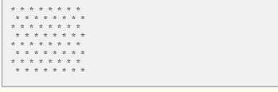

**4.29** *(带无限循环的 2 的倍数)* 编写一个程序，打印整数 2 的幂，即 2、4、8、16、32、64 等。你的 while 循环不应终止（即，应创建一个无限循环）。为此，只需使用关键字 true 作为 while 语句的表达式。运行此程序时会发生什么？

**4.30** 编写一个程序，读取圆的半径（作为 double 值），并计算和打印直径、周长和面积。使用 3.14159 作为 π 的值。

**4.31** 以下语句有什么问题？提供正确的语句，以完成程序员可能想要做的事情。

```cpp
cout << ++( x + y );
```

**4.32** *(三角形的边)* 编写一个程序，读取三个非零 double 值，并判断和打印它们是否能表示三角形的边。

**4.33** *(直角三角形的边)* 编写一个程序，读取三个非零整数，并判断和打印它们是否能成为直角三角形的边。

**4.34** *(阶乘)* 非负整数 *n* 的阶乘写作 *n*!（读作“*n* 的阶乘”），定义如下：

*n*! = *n* · (*n* - 1) · (*n* - 2) · ... · 1   （对于大于 1 的 *n* 值）

以及

*n*! = 1   （对于 *n* = 0 或 *n* = 1）。

例如，5! = 5 · 4 · 3 · 2 · 1，即 120。在以下各项中使用 while 语句：

- a) 编写一个程序，读取一个非负整数并计算、打印其阶乘。
- b) 编写一个程序，使用以下公式估算数学常数 *e* 的值：

  e = 1 + 1/1! + 1/2! + 1/3! + ...

  提示用户输入 *e* 的所需精度（即求和中的项数）。
- c) 编写一个程序，使用以下公式计算 *e*^x 的值：

  *e*^x = 1 + x/1! + x^2/2! + x^3/3! + ...

  提示用户输入 *e* 的所需精度（即求和中的项数）。

### 产生影响

**4.35** *(用密码学加强隐私保护)* 互联网通信以及联网计算机上的数据存储的爆炸式增长，极大地增加了隐私担忧。密码学领域关注对数据进行编码，使未经授权的用户难以（并且希望——借助最先进的方案——不可能）读取。在本练习中，你将研究一种用于加密和解密数据的简单方案。一家希望经由 In-

# 5 控制语句：第 2 部分


> 并非所有可计数的事物都重要，也并非所有重要的事物都可计数。
>
> —阿尔伯特·爱因斯坦
>
> *谁能掌控自己的命运？*
>
> —威廉·莎士比亚
>
> *常用的钥匙总是闪亮的。*
>
> —本杰明·富兰克林
>
> *智慧……是制造人造物、尤其是制造工具的工具的能力。*
>
> —亨利·柏格森

### 目标

本章你将学习：

- 计数器控制的重复的要点。
- 使用 `for` 和 `do...while` 在程序中重复执行语句。
- 使用 `switch` 选择语句实现多路选择。
- `break` 和 `continue` 如何改变控制流。
- 使用逻辑运算符在控制语句中构成复杂的条件表达式。
- 避免混淆相等运算符和赋值运算符带来的后果。

效果、可执行语句。在 C++ 中，将同时保留内存的声明称为定义更准确。因为定义也是声明，所以我们将使用术语“声明”，除非这种区别很重要。

```cpp
1  // Fig. 5.1: fig05_01.cpp
2  // Counter-controlled repetition.
3  #include <iostream>
4  using namespace std;
5
6  int main()
7  {
8      int counter = 1; // declare and initialize control variable
9
10     while ( counter <= 10 ) // loop-continuation condition
11     {
12         cout << counter << "  ";
13         counter++; // increment control variable by 1
14     } // end while
15
16     cout << endl; // output a newline
17 } // end main
```

```
1 2 3 4 5 6 7 8 9 10
```

**图 5.1** | 计数器控制的重复。

对 counter 的声明和初始化（第 8 行）也可以用以下语句完成

```cpp
int counter; // declare control variable
counter = 1; // initialize control variable to 1
```

我们使用这两种初始化变量的方法。

第 13 行在每次执行循环体时将循环计数器*递增* 1。while 语句中的循环继续条件（第 10 行）确定控制变量的值是否小于或等于 10（条件为真的最终值）。即使控制变量为 10，这个 while 的循环体也会执行。当控制变量大于 10（即 counter 为 11）时，循环终止。

通过将 counter 初始化为 0，并用以下代码替换 while 语句，可以使图 5.1 更简洁

```cpp
while ( ++counter <= 10 ) // loop-continuation condition
    cout << counter << "  ";
```

这段代码少了一条语句，因为递增在测试条件之前在 while 条件中完成。此外，这段代码去掉了 while 循环体周围的花括号，因为 while 现在只包含一条语句。以这种压缩方式编码可能导致程序更难阅读、调试和维护。

### 常见编程错误 5.1

*浮点值是近似值，因此用浮点变量控制计数循环可能导致计数器值不精确以及终止测试不准确。*


**错误预防提示 5.1**

使用整数值控制计数循环。

**良好编程实践 5.1**

在每个控制语句前后各留一个空行，使其在程序中更醒目。

**良好编程实践 5.2**

嵌套层次过多会使程序难以理解。通常，应尽量避免使用超过三层的缩进。

**良好编程实践 5.3**

在控制语句上下方留出垂直间距，并对控制语句的语句体进行缩进，可以使程序呈现出二维外观，从而提高可读性。

## 5.3 for 重复语句

除了`while`之外，C++还提供了`for`重复语句，它可以在单行代码中指定计数器控制重复的细节。为了说明`for`的强大功能，让我们重写图 5.1 中的程序。结果如图 5.2 所示。

```cpp
// Fig. 5.2: fig05_02.cpp
// Counter-controlled repetition with the for statement.
#include <iostream>
using namespace std;

int main()
{
   // for statement header includes initialization,
   // loop-continuation condition and increment.
   for (int counter = 1; counter <= 10; counter++)
      cout << counter << " ";

   cout << endl; // output a newline
} // end main
```


**图 5.2** | 使用`for`语句的计数器控制重复。

当`for`语句（第10–11行）开始执行时，声明控制变量`counter`并将其初始化为1。然后检查循环继续条件（第10行分号之间的内容）`counter <= 10`。`counter`的初始值为1，因此条件满足，语句体（第11行）打印`counter`的值，即1。接着，表达式`counter++`递增控制变量`counter`，循环再次从循环继续测试开始。此时控制变量等于2，因此没有超过最终值，程序再次执行语句体。这个过程持续到循环体执行10次，控制变量`counter`递增到11——这导致循环继续测试失败，重复终止。程序继续执行`for`语句之后的第一个语句（在本例中为第13行的输出语句）。

### for 语句头组成部分

图 5.3 更仔细地展示了图 5.2 中`for`语句头（第10行）。注意，`for`语句头“包办一切”——它指定了使用控制变量进行计数器控制重复所需的每一项。如果`for`的语句体中有多个语句，则需要用花括号将循环体括起来。

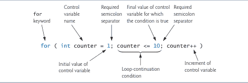

**图 5.3** | *for 语句头组成部分。*

如果你在图 5.2 中错误地将`counter < 10`写为循环继续条件，那么循环将只执行9次。这是一个常见的差一错误。

> **常见编程错误 5.2**
>
> 在`while`或`for`语句的条件中使用错误的关系运算符，或使用错误的循环计数器最终值，可能会导致差一错误。

> **良好编程实践 5.4**
>
> 在`while`或`for`语句的条件中使用最终值，并使用`<=`关系运算符，有助于避免差一错误。例如，对于用于打印值1到10的循环，循环继续条件应为`counter <= 10`，而不是`counter < 10`（这是差一错误）或`counter > 10`（这是不必要的错误）。许多程序员更喜欢所谓的从零开始计数，在这种方式下，要通过循环计数10次，`counter`将被初始化为零，循环继续测试将为`counter < 10`。

`for`语句的一般形式是

```cpp
for ( initialization; loopContinuationCondition; increment )
    statement
```

其中，初始化表达式初始化循环的控制变量，loopContinuationCondition 决定循环是否应继续执行，increment 递增控制变量。在大多数情况下，for 语句可以用等价的 while 语句表示，如下所示：

```text
initialization;

while ( loopContinuationCondition )
{
    statement
    increment;
}
```

这条规则有一个例外，我们将在第5.7节讨论。

如果**初始化**表达式声明了控制变量（即在其名称之前指定了其类型），则该控制变量只能在 for 语句的语句体中使用——在 for 语句之外，该控制变量将不可知。控制变量的这种受限使用称为变量的作用域。变量的作用域指定了它可以在程序中的何处使用。第6章将详细讨论作用域。


> **常见编程错误 5.3**
>
> _当在 for 语句的初始化部分声明控制变量时，在语句体之后使用该控制变量会导致编译错误。_

正如我们将看到的，初始化和递增表达式可以是用逗号分隔的表达式列表。这些表达式中使用的逗号是逗号运算符，它保证表达式列表从左到右求值。逗号运算符在所有 C++ 运算符中优先级最低。逗号分隔的表达式列表的值和类型是最右侧表达式的值和类型。逗号运算符常用于 for 语句。其主要用途是使你能够使用多个初始化表达式和/或多个递增表达式。例如，单个 for 语句中可能有多个必须初始化和递增的控制变量。


> **良好编程实践 5.5**
>
> _在 for 语句的初始化和递增部分中，只放置涉及控制变量的表达式。对其他变量的操作应出现在循环之前（如果它们只应执行一次，如初始化语句），或出现在循环体中（如果它们应在每次重复时执行一次，如递增或递减语句）。_

for 语句头中的三个表达式都是可选的（但两个分号分隔符是必需的）。如果省略 loopContinuationCondition，C++ 会假定条件为真，从而创建无限循环。如果控制变量在程序前面已经初始化，则可以省略初始化表达式。如果递增由 for 语句体中的语句计算，或者不需要递增，则可以省略递增表达式。for 语句中的递增表达式充当 for 语句体末尾的独立语句。因此，表达式

```text
counter = counter + 1
counter += 1
++counter
counter++
```

在 for 语句头的递增部分中（当该处没有其他代码时）都是等价的。许多程序员更喜欢 counter++ 这种形式，因为 for 循环在循环体执行之后才对递增表达式求值。因此，后置递增形式似乎更自然。这里被递增的变量不出现在更大的表达式中，所以前置递增和后置递增实际上具有相同的效果。

> **常见编程错误 5.4**
>
> _在 for 语句头中使用逗号代替两个必需的分号是语法错误。_

> **常见编程错误 5.5**
>
> _在 for 语句头的右括号右侧紧挨着放置一个分号，会使该语句的语句体成为空语句。这通常是逻辑错误。_

for 语句的初始化、循环继续条件和递增表达式可以包含算术表达式。例如，如果 x = 2、y = 10，并且 x 和 y 在循环体中没有被修改，则 for 语句头

```cpp
for ( int j = x; j <= 4 * x * y; j += y / x )
```

等价于

```cpp
for ( int j = 2; j <= 80; j += 5 )
```

for 语句的“递增”可以为负，在这种情况下，它实际上是递减，循环实际上向下计数（如第5.4节所示）。

如果循环继续条件最初为假，则不会执行 for 语句的语句体。相反，执行将继续进行 for 之后的语句。

通常，控制变量会在 for 语句体中被打印或用于计算，但这并不是必需的。常见做法是使用控制变量控制重复，而在 for 语句体中从不提及它。

> **错误预防提示 5.2**
>
> _尽管可以在 for 语句体中更改控制变量的值，但应避免这样做，因为这种做法可能导致细微的逻辑错误。_

### for 语句 UML 活动图

for 重复语句的 UML 活动图与 while 语句的活动图（图 4.6）类似。图 5.4 展示了图 5.2 中 for 语句的活动图。该图清楚地表明，初始化在第一次求值循环继续测试之前发生一次，而递增在语句体执行之后每次通过循环时发生。注意（除了初始状态、转移箭头、合并、最终状态和若干注释之外），该图只包含动作状态和一个判定。再次想象，你有一箱空的 for 语句 UML 活动图——数量随你需要，可以与其他控制语句的活动图堆叠和嵌套，以形成算法的结构化实现。你用适合该算法的动作表达式和守卫条件填充动作状态和判定符号。


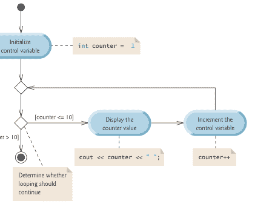

图 5.4 | 图 5.2 中 for 语句的 UML 活动图。

## 5.4 使用 for 语句的示例

下面的示例演示了在 for 语句中改变控制变量的方法。每种情形下，我们都编写相应的 for 语句头。请注意，对于递减控制变量的循环，关系运算符会有所变化。

- a) 将控制变量从 1 变到 100，每次增量为 1。

    ```cpp
    for ( int i = 1; i <= 100; i++ )
    ```

- b) 将控制变量从 100 递减到 1，每次减量为 1。

    ```cpp
    for ( int i = 100; i >= 1; i-- )
    ```

- c) 将控制变量从 7 变到 77，步长为 7。

    ```cpp
    for ( int i = 7; i <= 77; i += 7 )
    ```

- d) 将控制变量从 20 递减到 2，步长为 -2。

    ```cpp
    for ( int i = 20; i >= 2; i -= 2 )
    ```

- e) 将控制变量依次取以下值：2, 5, 8, 11, 14, 17。

    ```cpp
    for ( int i = 2; i <= 17; i += 3 )
    ```

- f) 将控制变量依次取以下值：99, 88, 77, 66, 55。

    ```cpp
    for ( int i = 99; i >= 55; i -= 11 )
    ```

> **常见编程错误 5.6**
>
> *在向下计数的循环的循环继续条件中未使用正确的关系运算符（例如，在向下计数到 1 的循环中错误地使用 `i <= 1` 而不是 `i >= 1`）是一种逻辑错误，会导致程序运行时产生不正确的结果。*

### 应用：对从 2 到 20 的偶数求和

图 5.5 中的程序使用 for 语句对从 2 到 20 的偶数求和。循环的每次迭代（第 11–12 行）都将控制变量 number 的值加到变量 total 上。

```cpp
// Fig. 5.5: fig05_05.cpp
// Summing integers with the for statement.
#include <iostream>
using namespace std;

int main()
{
   int total = 0; // initialize total

   // total even integers from 2 through 20
   for ( int number = 2; number <= 20; number += 2 )
      total += number;

   cout << "Sum is " << total << endl; // display results
} // end main
```

```
Sum is 110
```

**图 5.5** | 使用 for 语句对整数求和。

图 5.5 中 for 语句的循环体实际上可以通过逗号运算符合并到 for 语句头的增量部分中，如下所示：

```cpp
for ( int number = 2; // initialization
      number <= 20; // loop continuation condition
      total += number, number += 2 ) // total and increment
   ; // empty body
```

> **良好编程实践 5.6**
>
> *尽管 `for` 之前的语句和 `for` 循环体中的语句通常可以合并到 `for` 语句头中，但这样做可能使程序更难阅读、维护、修改和调试。*

> **良好编程实践 5.7**
>
> *如果可能，请将控制语句头的规模限制为一行。*

### 应用：复利计算

请考虑以下问题描述：

> *一个人将 1000.00 美元存入一个年利率为 5% 的储蓄账户。假设所有利息都留在账户中，计算并打印……的金额*

for 语句（第 21–28 行）执行循环体 10 次，控制变量从 1 递增到 10，每次增量为 1。C++ 没有指数运算符，因此我们使用标准库函数 pow（第 24 行）。函数 pow(x, y) 计算 x 的 y 次幂的值。在本例中，代数表达式 (1 + r)^n 写作 pow(1.0 + rate, year)，其中变量 rate 代表 r，变量 year 代表 n。函数 pow 接受两个 double 类型的参数，并返回一个 double 值。

如果不包含头文件 `<cmath>`（第 5 行），该程序将无法编译。函数 pow 需要两个 double 类型参数。变量 year 是一个整数。头文件 `<cmath>` 包含的信息告诉编译器在调用该函数之前将 year 的值转换为临时的 double 表示形式。这些信息包含在 pow 的函数原型中。第 6 章综述了其他数学库函数。

> **常见编程错误 5.7**
>
> *使用标准库函数时忘记包含相应的头文件（例如，在使用数学库函数的程序中忘记包含 `<cmath>`）是一个编译错误。*

### 关于使用 float 或 double 类型处理货币金额的警告

请注意，第 10–12 行声明了 double 类型变量 amount、principal 和 rate。我们这样做是为了简单，因为处理的是美元的小数部分，需要一种允许值中出现小数点的类型。不幸的是，这可能会带来麻烦。下面简单解释一下使用 float 或 double 表示美元金额时可能出现的问题（假设使用 setprecision(2) 指定打印时保留两位小数）：机器中存储的两个美元金额可能是 14.234（打印为 14.23）和 18.673（打印为 18.67）。当这些金额相加时，内部和为 32.907，打印为 32.91。因此，你的输出可能显示为

```text
  14.23
+ 18.67
-------
  32.91
```

但是，一个人按打印出的各个数字相加时，期望的和是 32.90！可要当心了！

> **良好编程实践 5.8**
>
> *不要使用 float 或 double 类型的变量进行货币计算。浮点数的不精确性可能导致错误的货币值。在练习中，我们将探讨使用整数进行货币计算。[注意：一些第三方供应商出售能够执行精确货币计算的 C++ 类库。]*

### 使用流操纵符格式化数值输出

for 循环之前的第 18 行输出语句和 for 循环中的第 27 行输出语句共同打印变量 year 和 amount 的值，其格式由参数化流操纵符 setprecision 和 setw 以及非参数化流操纵符 fixed 指定。流操纵符 setw(4) 规定下一个输出值应出现在宽度为 4 的字段中——也就是说，cout 打印该值时至少占用 4 个字符位置。如果要输出的值宽度小于 4 个字符位置，默认情况下该值在字段中右对齐。如果要输出的值宽度超过 4 个字符位置，则扩展字段宽度以容纳整个值。若要使值左对齐输出，只需输出非参数化流操纵符 `left`（在头文件 `<iostream>` 中）。要恢复右对齐，可输出非参数化流操纵符 `right`。

输出语句中的其他格式设置表明，变量 amount 以带小数点的定点数形式打印（第 18 行使用流操纵符 `fixed` 指定），在 21 个字符位置的字段中右对齐（第 27 行使用 `setw(21)` 指定），并且小数点右边保留两位精度（第 18 行使用操纵符 `setprecision(2)` 指定）。我们在 for 循环之前将流操纵符 `fixed` 和 `setprecision` 应用于输出流（即 `cout`），因为这些格式设置会一直保持有效，直到它们被更改——这类设置称为粘性设置，不需要在循环的每次迭代中都应用。不过，用 `setw` 指定的字段宽度只适用于下一个输出值。我们将在第 15 章“流输入/输出”中讨论 C++ 强大的输入/输出格式化功能。

计算 `1.0 + rate` 作为 `pow` 函数的参数出现在 for 语句的循环体中。实际上，该计算在循环的每次迭代中都会产生相同的结果，因此重复计算是一种浪费——它应该在循环之前执行一次。


### 性能提示 5.1

*避免将值不会改变的表达式放入循环内——不过，即使你这样做了，当今许多复杂的优化编译器也会在生成的机器语言代码中自动将这些表达式移到循环外。*


### 性能提示 5.2

*许多编译器都包含优化功能，可以改善你所编写代码的性能，但最好还是从一开始就编写良好的代码。*

务必尝试练习 5.29 中的 Peter Minuit 问题。该问题展示了复利的奇妙之处。

## 5.5 do…while 重复语句

`do…while` 重复语句与 `while` 语句类似。在 `while` 语句中，循环继续条件的测试发生在循环体执行之前的循环开始处。`do…while` 语句在循环体执行*之后*测试循环继续条件；因此，*循环体至少执行一次。* 当 `do…while` 终止时，执行将继续到 `while` 子句之后的语句。如果循环体中只有一条语句，则不必在 `do…while` 语句中使用花括号；但是，大多数程序员都会加上花括号，以避免混淆 `while` 和 `do…while` 语句。例如，

```cpp
while ( condition )
```

通常被视为 `while` 语句的头。不带花括号包围单条语句循环体的 `do…while` 如下所示：

```cpp
do
    statement
while ( condition );
```


这可能会令人困惑。你可能会将最后一行——while ( condition );——误解为一条 while 语句，其循环体为空语句。因此，为避免混淆，只包含一条语句的 do...while 通常写成如下形式：

```cpp
do
{
    statement
} while ( condition );
```

> **良好的编程实践 5.9**
>
> 在 do...while 语句中始终包含花括号，有助于消除 while 语句与只包含一条语句的 do...while 语句之间的歧义。

图 5.7 使用 do...while 语句打印数字 1–10。进入 do...while 语句后，第 12 行输出 counter 的值，第 13 行递增 counter。然后程序在循环底部求值循环继续测试（第 14 行）。如果条件为真，循环从 do...while 的第一条循环体语句（第 12 行）继续。如果条件为假，循环终止，程序继续执行循环之后的下一条语句（第 16 行）。

```cpp
1   // Fig. 5.7: fig05_07.cpp
2   // do...while repetition statement.
3   #include <iostream>
4   using namespace std;
5
6   int main()
7   {
8       int counter = 1; // initialize counter
9
10      do
11      {
12          cout << counter << " "; // display counter
13          counter++; // increment counter
14      } while ( counter <= 10 ); // end do...while
15
16      cout << endl; // output a newline
17  } // end main
```

```
1 2 3 4 5 6 7 8 9 10
```

**图 5.7** | *do...while 重复语句。*

## do...while 语句的 UML 活动图

```cpp
// Fig. 5.9: GradeBook.h
// Definition of class GradeBook that counts A, B, C, D and F grades.
// Member functions are defined in GradeBook.cpp
#include <string> // program uses C++ standard string class
using namespace std;

// GradeBook class definition
class GradeBook
{
public:
   GradeBook( string ); // constructor initializes course name
   void setCourseName( string ); // function to set the course name
   string getCourseName(); // function to retrieve the course name
   void displayMessage(); // display a welcome message
   void inputGrades(); // input arbitrary number of grades from user
   void displayGradeReport(); // display a report based on the grades
private:
   string courseName; // course name for this GradeBook
   int aCount; // count of A grades
   int bCount; // count of B grades
   int cCount; // count of C grades
   int dCount; // count of D grades
   int fCount; // count of F grades
}; // end class GradeBook
```

**图 5.9** | GradeBook 类定义。

针对输入的每个等级使用一个等级计数器。成员函数 displayGradeReport（在第 16 行声明）输出一份报告，其中包含获得每个字母等级的学生人数。

源代码文件 GradeBook.cpp（图 5.10）包含 GradeBook 类的成员函数定义。请注意，构造函数中的第 13–17 行将五个等级计数器初始化为 0——首次创建 GradeBook 对象时，尚未输入任何等级。你很快就会看到，当用户输入等级时，这些计数器会在成员函数 inputGrades 中递增。成员函数 setCourseName、getCourseName 和 displayMessage 的定义与 GradeBook 类早期版本中的定义相同。下面详细讨论 GradeBook 的新成员函数。

```cpp
// Fig. 5.10: GradeBook.cpp
// Member-function definitions for class GradeBook that
// uses a switch statement to count A, B, C, D and F grades.
#include <iostream>
#include "GradeBook.h" // include definition of class GradeBook
using namespace std;

// constructor initializes courseName with string supplied as argument;
// initializes counter data members to 0
GradeBook::GradeBook( string name )
{
   setCourseName( name ); // validate and store courseName
   aCount = 0; // initialize counter of A grades to 0
   bCount = 0; // initialize count of B grades to 0
   cCount = 0; // initialize count of C grades to 0
   dCount = 0; // initialize count of D grades to 0
   fCount = 0; // initialize count of F grades to 0
} // end GradeBook constructor

// function to set the course name; limits name to 25 or fewer characters
void GradeBook::setCourseName( string name )
{
   if ( name.length() <= 25 ) // if name has 25 or fewer characters
      courseName = name; // store the course name in the object
   else // if name is longer than 25 characters
   { // set courseName to first 25 characters of parameter name
      courseName = name.substr( 0, 25 ); // select first 25 characters
      cout << "Name \"" << name << "\" exceeds maximum length (25).\n"
         << "Limiting courseName to first 25 characters.\n" << endl;
   } // end if...else
} // end function setCourseName

// function to retrieve the course name
string GradeBook::getCourseName()
{
   return courseName;
} // end function getCourseName

// display a welcome message to the GradeBook user
void GradeBook::displayMessage()
{
   // this statement calls getCourseName to get the
   // name of the course this GradeBook represents
   cout << "Welcome to the grade book for\n" << getCourseName() << "!" << endl;
} // end function displayMessage

// input arbitrary number of grades from user; update grade counter
void GradeBook::inputGrades()
{
   int grade; // grade entered by user

   cout << "Enter the letter grades." << endl
      << "Enter the EOF character to end input." << endl;

   // loop until user types end-of-file key sequence
   while ( ( grade = cin.get() ) != EOF )
   {
      // determine which grade was entered
      switch ( grade ) // switch statement nested in while
      {
         case 'A': // grade was uppercase A
         case 'a': // or lowercase a
            aCount++; // increment aCount
            break; // necessary to exit switch

         case 'B': // grade was uppercase B
         case 'b': // or lowercase b
            bCount++; // increment bCount
            break; // exit switch

         case 'C': // grade was uppercase C
         case 'c': // or lowercase c
            cCount++; // increment cCount
            break; // exit switch

         case 'D': // grade was uppercase D
         case 'd': // or lowercase d
            dCount++; // increment dCount
            break; // exit switch

         case 'F': // grade was uppercase F
         case 'f': // or lowercase f
            fCount++; // increment fCount
            break; // exit switch

         case '\n': // ignore newlines,
         case '\t': // tabs,
         case ' ': // and spaces in input
            break; // exit switch

         default: // catch all other characters
            cout << "Incorrect letter grade entered."
                 << " Enter a new grade." << endl;
            break; // optional; will exit switch anyway
      } // end switch
   } // end while
} // end function inputGrades

// display a report based on the grades entered by user
void GradeBook::displayGradeReport()
{
    // output summary of results
    cout << "\n\nNumber of students who received each letter grade:"
         << "\nA: " << aCount // display number of A grades
         << "\nB: " << bCount // display number of B grades
         << "\nC: " << cCount // display number of C grades
         << "\nD: " << dCount // display number of D grades
         << "\nF: " << fCount // display number of F grades
         << endl;
} // end function displayGradeReport
```

**图 5.10** | GradeBook 类使用 switch 语句统计字母等级。

## 读取字符输入

用户在成员函数 inputGrades（第 49–98 行）中为某门课程输入字母等级。在 while 头部内，第 57 行会首先执行带括号的赋值表达式 (grade = cin.get())。cin.get() 函数从键盘读取一个字符，并将该字符存储到整型变量 grade 中（在第 51 行声明）。通常，字符存储在 char 类型的变量中；不过，字符也可以存储在任何整数数据类型中，

因为类型 `short`、`int` 和 `long` 保证至少与类型 `char` 一样大。因此，我们可以根据用途将字符视为整数或字符。例如，下面的语句

```cpp
cout << "The character 'a' has the value "
     << static_cast<int>( 'a' ) << endl;
```

会输出字符 a 及其整数值，如下所示：

```
The character 'a' has the value 97
```

整数 97 是该字符在计算机中的数值表示。如今大多数计算机使用 Unicode 字符集，其中 97 表示小写字母 `'a'`。附录 B 展示了 ASCII（美国信息交换标准代码）字符集中的字符及其十进制等价值，该字符集是 Unicode 的子集。

通常，赋值语句的值就是赋给 `=` 左侧变量的值。因此，赋值表达式 `grade = cin.get()` 的值与 `cin.get()` 返回并赋给变量 `grade` 的值相同。

赋值表达式具有值这一事实，对于将同一个值赋给多个变量很有用。例如，

```cpp
a = b = c = 0;
```

首先计算 `c = 0`（因为 `=` 运算符从右向左结合）。然后，将 `c = 0` 的值（即 0）赋给变量 `b`。接着，将 `b (= 0)` 的值（也是 0）赋给 `a`。在该程序中，将 `grade = cin.get()` 的值与 `EOF` 的值进行比较（`EOF` 这个符号的缩写表示“文件结束”）。我们使用 `EOF`（通常值为 −1）作为哨兵值。但是，你不应键入值 −1，也不应键入字母 `EOF` 作为哨兵值。相反，你应键入一种依赖于系统的组合键，它表示“文件结束”，以表明没有更多数据要输入。`EOF` 是在 `<iostream>` 头文件中定义的符号整数常量。如果赋给 `grade` 的值等于 `EOF`，则 `while` 循环（第 57–97 行）终止。我们选择将输入到该程序中的字符表示为 `int`，因为 `EOF` 的类型是 `int`。

在 UNIX/Linux 系统以及许多其他系统上，通过键入以下内容来输入文件结束：

```
<Ctrl> d
```

单独一行。这种表示法意味着按住 Ctrl 键，然后按 d 键。在 Microsoft Windows 等其他系统上，可以通过键入以下内容来输入文件结束：

```
<Ctrl> z
```

> *[注意：在某些情况下，必须在前面的按键序列之后按 Enter。此外，屏幕上有时会出现字符 ^Z 来表示文件结束，如图 5.11 所示。]*


## 可移植性提示 5.1

> 用于输入文件结束的按键组合取决于系统。


## 可移植性提示 5.2

> 测试符号常量 `EOF` 而不是 −1，可以使程序更具可移植性。C++ 从 ANSI/ISO C 标准中采用 `EOF` 的定义，该标准规定 `EOF` 是一个负整数值，因此 `EOF` 在不同系统上可能具有不同的值。

在该程序中，用户通过键盘输入成绩。当用户按下 *Enter*（或 *Return*）键时，`cin.get()` 函数会逐个字符地读取这些字符。如果输入的字符不是文件结束，控制流将进入 `switch` 语句（第 60–96 行），该语句会递增相应的字母等级计数器。

## switch 语句详解

`switch` 语句由一系列 `case` 标签和一个可选的 `default` 分支组成。在本例中，它们用于根据成绩确定要递增哪个计数器。当控制流到达 `switch` 时，程序会计算关键字 `switch` 后括号中的表达式（即 `grade`）（第 60 行）。这称为控制表达式。`switch` 语句将控制表达式的值与每个 `case` 标签进行比较。假设用户输入字母 C 作为成绩。程序会将 C 与 `switch` 中的每个 `case` 进行比较。如果发生匹配（第 72 行的 `case 'C':`），程序将执行该分支的语句。对于字母 C，第 74 行会将 `cCount` 递增 1。`break` 语句（第 75 行）使程序控制转到 `switch` 之后的第一个语句——在本程序中，控制转移到第 97 行。该行标志着输入成绩的 `while` 循环体（第 57–97 行）的结束，因此控制流会转到 `while` 的条件（第 57 行），以判断循环是否应继续执行。

我们的 `switch` 中的各个分支显式测试字母 A、B、C、D 和 F 的小写和大写形式。请注意第 62–63 行中测试值 `'A'` 和 `'a'` 的分支（两者都表示成绩 A）。将这些分支连续列出且中间没有任何语句，可使这些分支执行同一组语句——当控制表达式的值为 `'A'` 或 `'a'` 时，将执行第 64–65 行中的语句。每个分支可以有多条语句。`switch` 选择语句不要求在每个分支的多条语句周围加大括号。

如果没有 `break` 语句，则每次在 `switch` 中发生匹配时，该分支及后续分支的语句都会执行，直到遇到 `break` 语句或 `switch` 的末尾。这通常称为“贯穿”到后续分支的语句。（这一特性非常适合编写简洁的程序，用于显示练习 5.28 中的叠句歌曲《圣诞节的十二天》。）

### 常见编程错误 5.8

*在 `switch` 语句需要 `break` 语句时忘记写它，是一种逻辑错误。*

### 常见编程错误 5.9

*在 `switch` 语句中省略单词 `case` 与被测试整数值之间的空格——例如，写成 `case3:` 而不是 `case 3:`——是一种逻辑错误。当控制表达式的值为 3 时，`switch` 语句将不会执行适当的操作。*

## 提供 `default` 分支

如果控制表达式的值与任何 `case` 标签都不匹配，则执行 `default` 分支（第 92–95 行）。在本例中，我们使用 `default` 分支来处理所有既不是有效成绩、也不是换行符、制表符或空格字符的控制表达式值。如果没有匹配项，则执行 `default` 分支，第 93–94 行会输出一条错误消息，指出输入了不正确的字母等级。如果在不包含 `default` 分支的 `switch` 语句中没有匹配项，则程序控制会继续执行 `switch` 之后的第一个语句。

## 良好编程习惯 5.10

*在 `switch` 语句中提供 `default` 分支。在不带 `default` 分支的 `switch` 语句中，未显式测试的分支会被忽略。包含 `default` 分支能让你关注处理异常情况的需要。有些情况下不需要 `default` 处理。尽管 `switch` 语句中的 `case` 子句和 `default` 分支子句可以按任意顺序出现，但通常的做法是将 `default` 子句放在最后。*

## 良好编程习惯 5.11

*`switch` 语句中的最后一个 `case` 不需要 `break` 语句。有些程序员为了清晰以及与其他分支保持对称而包含这个 `break`。*

### 忽略输入中的换行符、制表符和空白字符

图 5.10 的 `switch` 语句中第 87–90 行使程序跳过换行符、制表符和空白字符。逐个读取字符可能会引发一些问题。要让程序读取字符，我们必须通过按 Enter 键将它们发送到计算机。这会在我们希望处理的字符之后向输入中放置一个换行符。通常，必须对这个换行符进行特殊处理。通过在我们的 `switch` 语句中包含前面这些分支，可以防止每次在输入中遇到换行符、制表符或空格时都输出 `default` 分支中的错误消息。

### 常见编程错误 5.10

*逐个读取字符时，不处理输入中的换行符和其他空白字符，可能会导致逻辑错误。*

### 测试 GradeBook 类

图 5.11 创建了一个 `GradeBook` 对象（第 8 行）。第 10 行调用其 `displayMessage` 成员函数，向用户输出一条欢迎消息。第 11 行调用该对象的 `inputGrades` 成员函数，从用户处读取一组成绩，并记录每个成绩等级有多少学生。图 5.11 的输出窗口显示了在输入无效成绩（即 E）时显示的错误消息。第 12 行调用 `GradeBook` 成员函数 `displayGradeReport`（定义在图 5.10 的第 101–111 行），该函数根据输入的成绩输出报告（如图 5.11 中的输出所示）。

```cpp
// Fig. 5.11: fig05_11.cpp
// Create GradeBook object, input grades and display grade report.
#include "GradeBook.h" // include definition of class GradeBook

int main()
{
   // create GradeBook object
   GradeBook myGradeBook( "CS101 C++ Programming" );

   myGradeBook.displayMessage(); // display welcome message
```

**图 5.11** | 创建 GradeBook 对象并调用其成员函数。（第 1 部分，共 2 部分。）


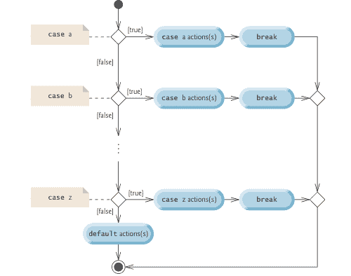

**图 5.12** | 带 break 语句的 switch 多选择语句 UML 活动图。

> **常见编程错误 5.11**
>
> 在 switch 的 case 标签中指定非常量整型表达式是语法错误。

> **常见编程错误 5.12**
>
> 在 switch 语句中提供相同的 case 标签是编译错误。提供包含不同表达式但求值为相同值的 case 标签也是编译错误。例如，在同一个 switch 语句中放置 `case 4 + 1` 和 `case 3 + 2` 是编译错误，因为二者都等价于 `case 5`。

在第 13 章中，我们将介绍一种更优雅的实现 switch 逻辑的方法。我们将使用一种称为多态的技术来创建程序，这些程序通常比使用 switch 逻辑的程序更清晰、更简洁、更易于维护和扩展。

## 数据类型说明

C++ 具有灵活的数据类型大小（见附录 C“基本类型”）。例如，不同的应用程序可能需要不同大小的整数。C++ 提供了多种整数类型。每种类型的整数值范围取决于特定计算机的硬件。除了 `int` 和 `char` 类型之外，C++ 还提供 `short` 类型（`short int` 的缩写）和 `long` 类型（`long int` 的缩写）。短整型的最小取值范围是 –32,768 到 32,767。对于绝大多数整数计算，长整型已经足够。长整型的最小取值范围是 –2,147,483,648 到 2,147,483,647。在大多数计算机上，int 等价于 short 或 long。int 的取值范围至少与短整型相同，并且不大于长整型。数据类型 char 可用于表示计算机字符集中的任意字符。它也可以用于表示小整数。


> **可移植性提示 5.3**
>
> *因为 int 的大小可能因系统而异，所以如果你预计要处理超出 –32,768 到 32,767 范围的整数，并且希望程序能在多种不同的计算机系统上运行，请使用长整型。*


> **性能提示 5.3**
>
> *如果内存非常宝贵，可能最好使用较小的整数类型。*

## 5.7 break 和 continue 语句

C++ 还提供了 break 和 continue 语句来改变控制流。上一节展示了如何使用 break 终止 switch 语句的执行。本节讨论如何在重复语句中使用 break。

### break 语句

**break 语句**在 while、for、do...while 或 switch 语句中执行时，会导致立即退出该语句。程序执行将继续执行下一条语句。break 语句的常见用途是提前跳出循环或跳过 switch 语句的剩余部分。图 5.13 演示了 break 语句（第 13 行）退出 for 重复语句。

```cpp
1 // Fig. 5.13: fig05_13.cpp
2 // break statement exiting a for statement.
3 #include <iostream>
4 using namespace std;
5
6 int main()
7 {
8     int count; // control variable also used after loop terminates
9
10     for ( count = 1; count <= 10; count++ ) // loop 10 times
11     {
12         if ( count == 5 )
13             break; // break loop only if count is 5
14
15         cout << count << " ";
16     } // end for
17
18     cout << "\nBroke out of loop at count = " << count << endl;
19 } // end main
```

图 5.13 | 退出 for 语句的 break 语句。（第 1 部分，共 2 部分。）

while 语句跟在 continue 语句之后。在这种情况下，增量操作不会在程序测试循环继续条件之前执行，并且 while 不会像 for 那样以相同方式执行。


> **良好编程习惯 5.2**
>
> 有些程序员认为 break 和 continue 违反了结构化编程。这些语句的效果可以通过我们即将学习到的结构化编程技术来实现，因此这些程序员不使用 break 和 continue。大多数程序员认为在 switch 语句中使用 break 是可以接受的。


> **性能提示 5.4**
>
> 如果使用得当，break 和 continue 语句比相应的结构化技术执行得更快。


> **软件工程观察 5.1**
>
> 在实现高质量软件工程与实现最佳性能软件之间存在一种矛盾。通常，实现其中一个目标会以牺牲另一个目标为代价。除了对性能要求极高的情况之外，请遵循以下准则：首先，使代码简单且正确；然后，仅在必要时使其快速且小巧。

## 5.8 逻辑运算符

到目前为止，我们只学习了简单条件，例如 counter <= 10、total > 1000 和 number != -1（哨兵值）。我们用关系运算符 >、<、>= 和 <=，以及相等运算符 == 和 != 来表示这些条件。每个判断只精确测试一个条件。为了在做出判断时测试多个条件，我们在单独的语句中或嵌套的 if 或 if...else 语句中执行这些测试。

C++ 提供了逻辑运算符，用于通过组合简单条件来构成更复杂的条件。逻辑运算符有 &&（逻辑与）、||（逻辑或）和 !（逻辑非，也称为逻辑取反）。

### *逻辑与（&&）运算符*

假设我们希望在选择某条执行路径之前确保两个条件都为真。在这种情况下，我们可以使用 &&（逻辑与）运算符，如下所示：

```cpp
if ( gender == 1 && age >= 65 )
        seniorFemales++;
```

这个 if 语句包含两个简单条件。条件 gender == 1 在这里用于判断一个人是否为女性。条件 age >= 65 用于判断一个人是否为老年人。&& 运算符左侧的简单条件首先求值。如有必要，&& 运算符右侧的简单条件接下来求值。正如我们稍后将讨论的，逻辑与表达式的右侧仅在左侧为真时才会求值。然后，if 语句会考虑组合条件

```cpp
gender == 1 && age >= 65
```

当且仅当两个简单条件都为真时，该条件才为真。最后，如果这个组合条件确实为真，则 if 语句主体中的语句会递增 seniorFemales 的计数。如果两个简单条件中的任意一个（或两个）为假，则程序跳过递增，并继续执行 if 之后的语句。可以通过添加冗余括号使前面的组合条件更具可读性：

```cpp
( gender == 1 ) && ( age >= 65 )
```

> **常见编程错误 5.13**
>
> 尽管 3 < x < 7 在数学上是正确的条件，但它在 C++ 中不会按你预期的方式求值。请使用 `( 3 < x && x < 7 )` 来在 C++ 中获得正确的求值。


图 5.15 总结了 && 运算符。该表显示了表达式1 和表达式2 的假值和真值的所有四种可能组合。此类表通常称为真值表。C++ 会将所有包含关系运算符、相等运算符和/或逻辑运算符的表达式求值为 false 或 true。

| 表达式1 | 表达式2 | 表达式1 && 表达式2 |
|---|---|---|
| 假 | 假 | 假 |
| 假 | 真 | 假 |
| 真 | 假 | 假 |
| 真 | 真 | 真 |

**图 5.15**  |  &&（逻辑与）运算符真值表。

### *逻辑或（||）运算符*

现在我们来讨论 ||（逻辑或）运算符。假设我们希望在选择某条执行路径之前确保两个条件中至少一个为真，或者两个都为真。在这种情况下，我们使用 || 运算符，如下面的程序段所示：

```cpp
if ( ( semesterAverage >= 90 ) || ( finalExam >= 90 ) )
    cout << "Student grade is A" << endl;
```

前面的条件包含两个简单条件。简单条件 semesterAverage >= 90 的求值用于判断学生是否因为整个学期表现扎实而应在该课程中获得“A”。简单条件 finalExam >= 90 的求值用于判断学生是否因为期末考试表现优异而应在该课程中获得“A”。然后，if 语句会考虑组合条件

```cpp
( semesterAverage >= 90 ) || ( finalExam >= 90 )
```

并且如果两个简单条件中的任意一个为真，或者两个都为真，则授予该学生“A”。除非两个简单条件都为假，否则会打印消息“Student grade is A”。图 5.16 是逻辑或运算符（||）的真值表。

&& 运算符的优先级高于 || 运算符。两个运算符都从左到右结合。包含 && 或 || 运算符的表达式只求值到能够确定该表达式为真或假为止。因此，对表达式

```cpp
( gender == 1 ) && ( age >= 65 )
```


## 运算符优先级和结合性总结

图 5.19 将逻辑运算符和逗号运算符加入了运算符优先级和结合性图表。这些运算符自上而下按优先级递减排列。

| 运算符 | 结合性 | 类型 |
|---|---|---|
| :: | 从左到右 | 作用域解析 |
| () | 从左到右 | 括号 |
| ++ -- | 从左到右 | 一元（后缀） |
| ++ -- + - ! static_cast<type> () | 从右到左 | 一元（前缀） |
| * / % | 从左到右 | 乘法 |
| + - | 从左到右 | 加法 |
| << >> | 从左到右 | 插入/提取 |
| < <= > >= | 从左到右 | 关系 |
| == != | 从左到右 | 相等性 |
| && | 从左到右 | 逻辑 AND |
| \|\| | 从左到右 | 逻辑 OR |
| ?: | 从右到左 | 条件 |
| = += -= *= /= %= | 从右到左 | 赋值 |
| , | 从左到右 | 逗号 |

图 5.19 | 运算符优先级和结合性。

## 5.9 混淆相等运算符（==）与赋值运算符（=）

有一类错误，C++ 程序员无论经验多么丰富，都常常会犯，以至于我们觉得有必要单独用一节来讨论。这个错误就是意外地把 ==（相等）和 =（赋值）这两个运算符弄混。这些混淆之所以危害极大，是因为它们通常不会导致语法错误。相反，含有这些错误的语句往往能正确编译，程序也能运行到结束，但常常会因运行时逻辑错误而产生不正确的结果。[注：当 = 出现在通常期望 == 的上下文中时，有些编译器会发出警告。]

C++ 有两个方面会导致这些问题。其一，任何产生值的表达式都可以用于任何控制语句的判定部分。如果表达式的值为零，就按 false 处理；如果值非零，就按 true 处理。其二，赋值会产生一个值——即赋给赋值运算符左侧变量的值。例如，假设我们想写

```
if ( payCode == 4 )
    cout << "You get a bonus!" << endl;
```

但不小心写成了

```
if ( payCode = 4 )
    cout << "You get a bonus!" << endl;
```

第一个 if 语句会正确地向 payCode 等于 4 的人发放奖金。第二个语句——也就是有错误的那个——会把 if 条件中的赋值表达式求值为常量 4。*任何非零值都会被解释为 true*，因此这个条件始终为 true，无论实际的 payCode 是什么，这个人都会收到奖金！更糟的是，本来只应检查 payCode，它却被修改了！

> **常见编程错误 5.14**
>
> *将运算符 == 用于赋值、将运算符 = 用于相等判断，都是逻辑错误。*


> **错误预防提示 5.3**
>
> *程序员通常把 x == 7 这样的条件写成变量名在左、常量在右。如果把常量放在左边，如 7 == x，那么当你不小心把 == 运算符替换成 = 时，编译器会保护你。编译器会将其视为编译错误，因为你不能改变常量的值。这可以防止运行时逻辑错误可能造成的严重破坏。*


变量名被称为 *lvalues*（即“left values”），因为它们可以用在赋值运算符的*左*侧。常量被称为 *rvalues*（即“right values”），因为它们只能用在赋值运算符的*右*侧。*Lvalues* 也可以当作 *rvalues* 使用，但反过来不行。

还有另一种同样令人不快的情况。假设你想用下面这样的简单语句给变量赋值

```
x = 1;
```

却写成了

```
x == 1;
```

这里同样不是语法错误。相反，编译器只是对条件表达式求值。如果 x 等于 1，条件为真，表达式的求值结果为 true。如果 x 不等于 1，条件为假，表达式的求值结果为 false。无论表达式的值是什么，由于没有赋值运算符，这个值就直接丢失了。x 的值保持不变，这很可能导致执行时逻辑错误。遗憾的是，我们没有一种便捷技巧可以帮助你避免这个问题！

> **错误预防提示 5.4**
>
> *使用文本编辑器搜索程序中所有出现的 =，并检查每一处使用的是正确的赋值运算符还是逻辑运算符。*


## 5.10 结构化编程总结

正如建筑师运用其行业的集体智慧来设计建筑一样，程序员也应当运用集体智慧来设计程序。我们这个领域比建筑学年轻，我们的集体智慧也还不够丰富。我们已经认识到，与非结构化程序相比，结构化编程产生的程序更易于理解、测试、调试、修改，甚至在数学意义上证明其正确性。

图 5.20 使用活动图总结了 C++ 的控制语句。初始状态和最终状态表示每条控制语句的单一入口点和单一出口点。

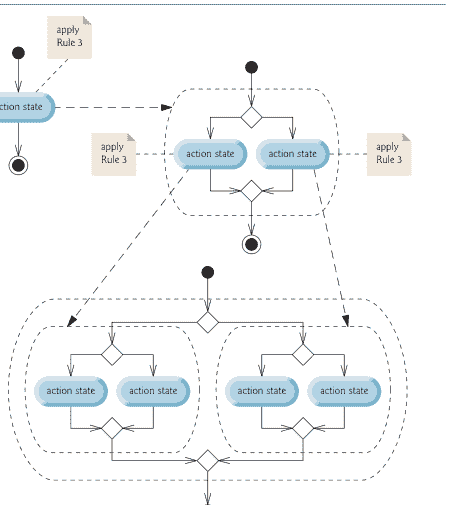

**图 5.24** | 将图 5.21 的规则 3 多次应用于最简单的活动图。

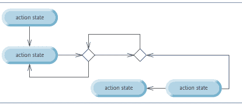

**图 5.25** | 具有非法语法的活动图。

选择通过以下三种方式之一实现：

- `if` 语句（单分支选择）
- `if...else` 语句（双分支选择）
- `switch` 语句（多分支选择）

很容易证明，简单的 `if` 语句足以提供任何形式的选择——用 `if...else` 语句和 `switch` 语句能做到的一切，都可以通过组合 `if` 语句来实现（尽管可能不如前者清晰和高效）。

重复通过以下三种方式之一实现：

- `while` 语句
- `do...while` 语句
- `for` 语句

很容易证明，`while` 语句足以提供任何形式的重复。用 `do...while` 语句和 `for` 语句能做到的一切，都可以用 `while` 语句完成（尽管可能不如前者顺畅）。

综合这些结果可以看出，C++ 程序中可能需要的任何控制形式都可以用以下内容来表达：

- 顺序
- `if` 语句（选择）
- `while` 语句（重复）

并且这些控制语句只能以两种方式组合——堆叠和嵌套。的确，结构化编程推崇简洁性。

## 5.11 小结

现在我们已经完成了控制语句的介绍，这些语句使你能够控制函数中的执行流。第 4 章讨论了 `if`、`if...else` 和 `while` 语句。本章演示了 `for`、`do...while` 和 `switch` 语句。我们说明了，任何算法都可以通过组合顺序结构、三种选择语句——`if`、`if...else` 和 `switch`——以及三种重复语句——`while`、`do...while` 和 `for`——来开发。我们讨论了如何组合这些构建块，以运用经过验证的程序构造和问题求解技术。你使用了 `break` 和 `continue` 语句来改变重复语句的控制流。本章还介绍了逻辑运算符，它们使你能够在控制语句中使用更复杂的条件表达式。最后，我们讨论了混淆相等运算符和赋值运算符的常见错误，并提供了避免这些错误的建议。在第 6 章中，我们将更深入地探讨函数。

## 总结

*5.2 节 计数器控制重复的要点*

- 在 C++ 中，将同时保留内存的声明称为定义更为准确。


-   连续列出多个 case 且它们之间没有语句时，这些 case 会执行同一组语句。
-   每个 case 可以包含多条语句。switch 选择语句与其他控制语句的不同之处在于，它不要求每个 case 中的多条语句用花括号括起来。
-   每个 case 只能用于测试一个常量整型表达式。字符常量表示为单引号中的特定字符，例如 `'A'`。整型常量就是整数值。此外，每个 case 标签只能指定一个常量整型表达式。
-   C++ 提供了多种数据类型来表示整数——`int`、`char`、`short` 和 `long`。每种类型的整数值范围取决于特定计算机的硬件。

## 5.7 节 break 和 continue 语句

-   在某个重复语句（`for`、`while` 和 `do...while`）中执行 `break` 语句时，会立即退出该语句。
-   在某个重复语句（`for`、`while` 和 `do...while`）中执行 `continue` 语句时，会跳过重复语句体中剩余的任何语句，并继续进行循环的下一次迭代。在 `while` 或 `do...while` 语句中，执行继续于条件的下一次求值。在 `for` 语句中，执行继续于 `for` 语句头中的增量表达式。

## 5.8 节 逻辑运算符

-   逻辑运算符使您能够通过组合简单条件来形成复杂条件。逻辑运算符是 `&&`（逻辑与）、`||`（逻辑或）和 `!`（逻辑非）。
-   `&&`（逻辑与）运算符确保两个条件都为真。
-   `||`（逻辑或）运算符确保两个条件中有一个为真或两个都为真。
-   包含 `&&` 或 `||` 运算符的表达式仅求值到表达式的真假已知为止。这种逻辑与和逻辑或表达式求值的性能特性称为短路求值。
-   `!`（逻辑非，也称为逻辑否定）运算符使程序员能够“反转”条件的含义。一元逻辑非运算符放置在条件之前，以便在原始条件（不带逻辑非运算符）为假时选择一条执行路径。在大多数情况下，您可以通过使用适当的关系运算符或相等性运算符来表达条件，从而避免使用逻辑非。
-   当用作条件时，任何非零值都会隐式转换为 `true`；0（零）隐式转换为 `false`。
-   默认情况下，`bool` 值 `true` 和 `false` 由 `cout` 分别显示为 `1` 和 `0`。流操纵符 `boolalpha`（一种粘性操纵符）指定每个 `bool` 表达式的值应显示为单词“true”或“false”。

## 5.9 节 混淆相等性（`==`）和赋值（`=`）运算符

-   任何产生值的表达式都可以用于任何控制语句的决策部分。如果表达式的值为零，则被视为假；如果值非零，则被视为真。
-   赋值会产生一个值——即赋值给赋值运算符左侧变量的值。

## 5.10 节 结构化编程总结

-   任何形式的控制都可以用顺序、选择和重复语句来表达，并且这些语句只能以两种方式组合——堆叠和嵌套。

### 术语

-   `!`，逻辑非运算符 189
-   `&&`，逻辑与运算符 187
-   `||`，逻辑或运算符 188
-   ASCII（美国信息交换标准代码）字符集 180
-   `boolalpha` 流操纵符 190
-   `break` 语句 185
-   case 标签 181
-   `char` 基本类型 179
-   逗号运算符 168
-   常量整型表达式 176
-   `continue` 语句 186
-   switch 的控制表达式 181
-   递减控制变量 164
-   switch 中的默认 case 181
-   定义 165
-   字段宽度 173
-   控制变量的最终值 164
-   `for` 重复语句 166
-   递增控制变量 164
-   控制变量的初始值 164
-   左对齐 174
-   `left` 流操纵符 174
-   逻辑与（`&&`）187
-   逻辑非（`!`）189
-   逻辑非（`!`）189
-   逻辑运算符 187
-   逻辑或（`||`）188
-   循环继续条件 164
-   左值（“left value”）192
-   控制变量的名称 164
-   嵌套循环 194
-   差一错误 167
-   `pow` 标准库函数 173
-   右对齐 175
-   `right` 流操纵符 174
-   右值（“right value”）192
-   变量的作用域 168
-   `setw` 流操纵符 173
-   短路求值 189
-   简单条件 187
-   堆叠循环 194
-   粘性设置 174
-   `switch` 多重选择语句 176
-   真值表 188
-   基于零的计数 167

### 自测练习

-   **5.1** 判断下列说法是*真*还是*假*。如果答案是*假*，请解释原因。
    -   a. `switch` 选择语句中必须包含默认 case。
    -   b. 在 `switch` 选择语句的默认 case 中必须使用 `break` 语句才能正确退出 `switch`。
    -   c. 如果表达式 `x > y` 为真或表达式 `a < b` 为真，则表达式 `( x > y && a < b )` 为真。
    -   d. 如果包含 `||` 运算符的表达式的任一操作数为真或两个操作数都为真，则该表达式为真。

-   **5.2** 编写一条 C++ 语句或一组 C++ 语句来完成以下各项任务：
    -   a. 使用 `for` 语句对 1 到 99 之间的奇数求和。假设整型变量 `sum` 和 `count` 已声明。
    -   b. 在 15 个字符宽的字段中打印值 333.546372，精度分别为 1、2 和 3。将每个数字打印在同一行。每个数字在其字段中左对齐。打印出的三个值是什么？
    -   c. 使用函数 `pow` 计算 2.5 的 3 次幂的值。以 2 位精度在 10 个位置的字段宽度内打印结果。打印出的内容是什么？
    -   d. 使用 `while` 循环和计数器变量 `x` 打印从 1 到 20 的整数。假设变量 `x` 已声明，但未初始化。每行只打印 5 个整数。[*提示*：当 `x % 5` 为 0 时，打印换行符；否则，打印制表符。]
    -   e. 使用 `for` 语句重复练习 5.2(d)。

-   **5.3** 找出以下每个代码段中的错误，并说明如何纠正它们。

    a.

    ```cpp
    x = 1;
    while ( x <= 10 ) ;
       x++;
    }
    ```

    b.

    ```cpp
    for ( y = .1; y != 1.0; y += .1 )
         cout << y << endl;
    ```

    c.

    ```cpp
    switch ( n )
    {
      case 1:
        cout << "The number is 1" << endl;
      case 2:
        cout << "The number is 2" << endl;
        break;
      default:
        cout << "The number is not 1 or 2" << endl;
        break;
    }
    ```

    d. 以下代码应打印 1 到 10 的值。

    ```cpp
    n = 1;
    while ( n < 10 )
      cout << n++ << endl;
    ```

### 自测练习答案

**5.1**

a）**假。** 默认 case 是可选的。然而，始终提供默认 case 被认为是良好的软件工程实践。

b）**假。** `break` 语句用于退出 `switch` 语句。当默认 case 是最后一个 case 时，不需要 `break` 语句。如果让控制流程继续执行下一个 case 是合理的，也不需要 `break` 语句。

c）**假。** 使用 `&&` 运算符时，两个关系表达式都必须为真，整个表达式才为真。

d）**真。**

**5.2**

a)

```cpp
sum = 0;
for ( count = 1; count <= 99; count += 2 )
  sum += count;
```

b)

```cpp
cout << fixed << left
     << setprecision( 1 ) << setw( 15 ) << 333.546372
     << setprecision( 2 ) << setw( 15 ) << 333.546372
     << setprecision( 3 ) << setw( 15 ) << 333.546372
     << endl;
```

输出为：

```
333.5               333.55              333.546
```

c)

```cpp
cout << fixed << setprecision( 2 )
     << setw( 10 ) << pow( 2.5, 3 )
     << endl;
```

输出为：

```
     15.63
```

d)

```cpp
x = 1;
while ( x <= 20 )
{
  if ( x % 5 == 0 )
    cout << x << endl;
  else
    cout << x << '\t';
  x++;
}
```


- c)

  ```cpp
  for ( x = 1; x <= 20; x++ )
  {
      if ( x % 5 == 0 )
          cout << x << endl;
      else
          cout << '\t';
  }
  ```

### 5.3

- a) *错误：* `while` 头后的分号会导致无限循环。  
  *更正：* 将分号替换为 `{`，或者同时删除 `;` 和 `{`。

- b) *错误：* 使用浮点数控制 `for` 重复语句。  
  *更正：* 使用 `int` 并执行适当的计算以获得所需的值。

  ```cpp
  for ( y = 1; y <= 10; ++y )
      cout << ( static_cast<double>( y ) / 10 ) << endl;
  ```

- c) *错误：* 第一个 case 中缺少 `break` 语句。  
  *更正：* 在第一个 case 末尾添加 `break` 语句。如果你希望每次执行 case 1: 语句时都执行 case 2: 的语句，那么这不是错误。

- d) *错误：* 循环继续条件中使用了不恰当的关系运算符。  
  *更正：* 使用 `<=` 而不是 `<`，或者将 10 改为 11。

## 练习

### 5.4

找出下列各项中的错误（如果有）：

- a)

  ```cpp
  For ( x = 100, x >= 1, x++ )
  cout << x << endl;
  ```

- b) 下面的代码应打印一个整数值是奇数还是偶数：

  ```cpp
  switch ( value % 2 )
  {
      case 0:
          cout << "Even integer" << endl;
      case 1:
          cout << "Odd integer" << endl;
  }
  ```

- c) 下面的代码应输出从 19 到 1 的奇数：

  ```cpp
  for ( x = 19; x >= 1; x += 2 )
      cout << x << endl;
  ```

- d) 下面的代码应输出从 2 到 100 的偶数：

  ```cpp
  counter = 2;
  do
  {
      cout << counter << endl;
      counter += 2;
  } while ( counter < 100 );
  ```

### 5.5（整数求和）

编写一个程序，使用 `for` 语句对一系列整数求和。假设读入的第一个整数指定剩余要输入的值的个数。程序每个输入语句应只读取一个值。一个典型的输入序列可能是

```
5 100 200 300 400 500
```

其中 5 表示后续 5 个值将被求和。

### 5.6（整数求平均值）

编写一个程序，使用 `for` 语句计算若干个整数的平均值。假设最后读入的值是哨兵值 9999。一个典型的输入序列可能是

```
10 8 11 7 9 9999
```

表示程序应计算 9999 之前所有值的平均值。

### 5.7 下面的程序做什么？

```cpp
// Exercise 5.7: ex05_07.cpp
// What does this program print?
#include <iostream>
using namespace std;

int main()
{
   int x; // declare x
   int y; // declare y

   // prompt user for input
   cout << "Enter two integers in the range 1-20: ";
   cin >> x >> y; // read values for x and y

   for (int i = 1; i <= y; i++) // count from 1 to y
   {
      for (int j = 1; j <= x; j++) // count from 1 to x
         cout << '@'; // output @

      cout << endl; // begin new line
   } // end outer for
} // end main
```

### 5.8（寻找最小整数）

编写一个程序，使用 `for` 语句找出若干个整数中的最小值。假设读入的第一个值指定剩余值的个数。

### 5.9（奇整数之积）

编写一个程序，使用 `for` 语句计算并打印从 1 到 15 的奇整数之积。

### 5.10（阶乘）

阶乘函数在概率问题中经常使用。使用练习 4.34 中阶乘的定义，编写一个程序，使用 `for` 语句计算从 1 到 5 的整数的阶乘。以表格形式打印结果。什么困难可能阻止你计算 20 的阶乘？

### 5.11（复利）

修改 5.4 节中的复利程序，使其对利率 5%、6%、7%、8%、9% 和 10% 重复执行各步骤。使用 `for` 语句改变利率。

### 5.12（使用嵌套 `for` 循环绘制图案）

编写一个程序，使用 `for` 语句分别打印以下图案，一个图案位于另一个图案下方。使用 `for` 循环生成这些图案。所有星号（*）都应通过形式为 `cout << '*';` 的单条语句打印（这会使星号并排打印）。[提示：最后两个图案要求每行以适当数量的空格开头。**额外加分：** 将四个独立问题的代码合并为一个程序，通过巧妙使用嵌套 `for` 循环并排打印全部四个图案。]

```text
(a)          (b)          (c)          (d)
*            **********   **********          *
**           *********    *********          **
***          ********     ********          ***
****         *******      *******          ****
*****        ******       ******          *****
******       *****        *****          ******
*******      ****         ****          *******
********     ***          ***          ********
*********    **           **          *********
**********   *            *          **********
```

### 5.13（条形图）

计算机的一个有趣应用是绘制图形和条形图。编写一个程序，读取五个数字（每个数字在 1 到 30 之间）。假设用户只输入有效值。对于读入的每个数字，程序应打印一行，其中包含该数字对应数量的相邻星号。例如，如果程序读入数字 7，则应打印 `*******`。

### 5.14（计算总销售额）

一家邮购公司销售五种不同的产品，其零售价格为：产品 1——2.98 美元，产品 2——4.50 美元，产品 3——9.98 美元，产品 4——4.49 美元，产品 5——6.87 美元。编写一个程序，读取一系列数字对，如下所示：

- a) 产品编号
- b) 销售数量

程序应使用 `switch` 语句确定每种产品的零售价格。程序应计算并显示所有已售产品的总零售价值。使用哨兵控制的循环来确定程序何时应停止循环并显示最终结果。

### 5.15（GradeBook 修改）

修改图 5.9–图 5.11 中的 GradeBook 程序，以计算平均绩点。成绩 A 值 4 分，B 值 3 分，依此类推。

### 5.16（复利计算）

修改图 5.6，使其仅使用整数计算复利。[提示：将所有货币金额视为以美分为单位的数。然后使用除法和取模运算将结果“拆分”为美元和美分部分。插入小数点。]

### 5.17（输出什么？）

假设 `i = 1`、`j = 2`、`k = 3` 且 `m = 2`。每条语句打印什么？

- a) `cout << ( i == 1 ) << endl;`
- b) `cout << ( j == 3 ) << endl;`
- c) `cout << ( i >= 1 && j < 4 ) << endl;`
- d) `cout << ( m <= 99 && k < m ) << endl;`
- e) `cout << ( j >= i || k == m ) << endl;`
- f) `cout << ( k + m < j || 3 - j >= k ) << endl;`
- g) `cout << ( ! m ) << endl;`
- h) `cout << ( ! ( j - m ) ) << endl;`
- i) `cout << ( ! ( k > m ) ) << endl;`

### 5.18（数制表）

编写一个程序，打印 1–256 范围内十进制数的二进制、八进制和十六进制等值表。如果你不熟悉这些数制，请先阅读附录 D“数制”。[提示：可以使用流操纵符 `dec`、`oct` 和 `hex` 分别以十进制、八进制和十六进制格式显示整数。]

### 5.19（计算 π）

根据无穷级数计算 π 的值

$$\pi = 4 - \frac{4}{3} + \frac{4}{5} - \frac{4}{7} + \frac{4}{9} - \frac{4}{11} + \cdots$$

打印一个表格，显示该级数前 1000 项中每一项之后 π 的近似值。

### 5.20（毕达哥拉斯三元组）

直角三角形可以有边长全为整数的边。直角三角形三条边的一组三个整数值称为毕达哥拉斯三元组。这三条边必须满足以下关系：其中两条边的平方和等于斜边的平方。找出边1、边2 和斜边均不大于 500 的所有毕达哥拉斯三元组。使用三重嵌套的 `for` 循环尝试所有可能性。这是暴力计算的一个例子。你将在更高级的计算机科学课程中了解到，有许多有趣的问题，除了纯粹的暴力法之外，没有已知的算法方法。

### 5.21（计算工资）

一家公司向员工支付工资，员工类型包括经理（领取固定周薪）、小时工（前 40 小时按固定时薪支付，加班时间按“一倍半”——即时薪的 1.5 倍——支付）、佣金工（领取 250 美元加上其每周总销售额的 5.7%）或计件工（每生产一件商品获得固定金额——该公司每名计件工只生产一种商品）。编写一个程序计算每名员工的周薪。你不知道员工人数。每种员工都有自己的工资代码：


| 函数 | 描述 | 示例 |
|---|---|---|
| `ceil( x )` | 将 x 舍入为不小于 x 的最小整数 | ceil( 9.2 ) is 10.0<br>ceil( -9.8 ) is -9.0 |
| `cos( x )` | x 的三角余弦（x 以弧度为单位） | cos( 0.0 ) is 1.0 |
| `exp( x )` | 指数函数 e^x | exp( 1.0 ) is 2.718282<br>exp( 2.0 ) is 7.389056 |
| `fabs( x )` | x 的绝对值 | fabs( 5.1 ) is 5.1<br>fabs( 0.0 ) is 0.0<br>fabs( -8.76 ) is 8.76 |
| `floor( x )` | 将 x 舍入为不大于 x 的最大整数 | floor( 9.2 ) is 9.0<br>floor( -9.8 ) is -10.0 |
| `fmod( x, y )` | x/y 的余数（以浮点数表示） | fmod( 2.6, 1.2 ) is 0.2 |
| `log( x )` | x 的自然对数（底为 e） | log( 2.718282 ) is 1.0<br>log( 7.389056 ) is 2.0 |
| `log10( x )` | x 的对数（底为 10） | log10( 10.0 ) is 1.0<br>log10( 100.0 ) is 2.0 |
| `pow( x, y )` | x 的 y 次幂（x^y） | pow( 2, 7 ) is 128<br>pow( 9, .5 ) is 3 |
| `sin( x )` | x 的三角正弦（x 以弧度为单位） | sin( 0.0 ) is 0 |
| `sqrt( x )` | x 的平方根（其中 x 为非负值） | sqrt( 9.0 ) is 3.0 |
| `tan( x )` | x 的三角正切（x 以弧度为单位） | tan( 0.0 ) is 0 |

**图 6.2** | 数学库函数。

## 6.4 具有多个参数的函数定义

第 3 章至第 5 章介绍了包含最多只有一个参数的简单函数的类。函数在执行任务时通常需要不止一条信息。现在我们讨论具有多个参数的函数。

图 6.3–6.5 中的程序修改了我们的 GradeBook 类，增加了一个名为 maximum 的用户自定义函数，该函数确定并返回三个 int 值中的最大值。当应用程序开始执行时，main 函数（图 6.5 的第 5–13 行）创建了一个 GradeBook 类对象（第 8 行），并调用该对象的 inputGrades 成员函数（第 11 行）从用户读取三个整数成绩。在类 GradeBook 的实现文件（图 6.4）中，成员函数 inputGrades 的第 52–53 行提示用户输入三个整数值并从用户处读取它们。第 56 行调用成员函数 maximum（定义在第 60–73 行）。函数 maximum 确定最大值，然后 return 语句（第 72 行）将该值返回到函数 inputGrades 调用 maximum 的位置（第 56 行）。随后，成员函数 inputGrades 将 maximum 的返回值存储在数据成员 maximumGrade 中。然后通过调用函数 displayGradeReport（图 6.5 的第 12 行）输出该值。[注意：我们之所以将此函数命名为 displayGradeReport，是因为后续版本的 GradeBook 类将使用此函数显示完整的成绩报告，包括最高分和最低分。] 在第 7 章"数组和向量"中，我们将增强 GradeBook 类，以处理任意数量的成绩。

```cpp
1  // Fig. 6.3: GradeBook.h
2  // Definition of class GradeBook that finds the maximum of three grades.
3  // Member functions are defined in GradeBook.cpp
4  #include <string> // program uses C++ standard string class
5  using namespace std;
6
7  // GradeBook class definition
8  class GradeBook
9  {
10 public:
11    GradeBook( string ); // constructor initializes course name
12    void setCourseName( string ); // function to set the course name
13    string getCourseName(); // function to retrieve the course name
14    void displayMessage(); // display a welcome message
15    void inputGrades(); // input three grades from user
16    void displayGradeReport(); // display a report based on the grades
17    int maximum( int, int, int ); // determine max of 3 values
18 private:
19    string courseName; // course name for this GradeBook
20    int maximumGrade; // maximum of three grades
21 }; // end class GradeBook
```

**图 6.3** | GradeBook 头文件。

```cpp
1  // Fig. 6.4: GradeBook.cpp
2  // Member-function definitions for class GradeBook that
3  // determines the maximum of three grades.
4  #include <iostream>
5  using namespace std;
6
7  #include "GradeBook.h" // include definition of class GradeBook
8
9  // constructor initializes courseName with string supplied as argument;
10 // initializes maximumGrade to 0
11 GradeBook::GradeBook( string name )
12 {
13    setCourseName( name ); // validate and store course name
14    maximumGrade = 0; // this value will be replaced by the maximum grade
15 } // end GradeBook constructor
16
17 // function to set the course name; limits name to 25 or fewer characters
18 void GradeBook::setCourseName( string name )
19 {
20    if ( name.length() <= 25 ) // if name has 25 or fewer characters
21       courseName = name; // store the course name in the object
22    else // if name is longer than 25 characters
23    {
24       // set courseName to first 25 characters of parameter name
25       courseName = name.substr(0, 25); // select first 25 characters
26       cout << "Name \"" << name << "\" exceeds maximum length (25).\n"
27            << "Limiting courseName to first 25 characters.\n" << endl;
28    } // end if...else
29 } // end function setCourseName
30
31 // function to retrieve the course name
32 string GradeBook::getCourseName()
33 {
34    return courseName;
35 } // end function getCourseName
36
37 // display a welcome message to the GradeBook user
38 void GradeBook::displayMessage()
39 {
40    // this statement calls getCourseName to get the
41    // name of the course this GradeBook represents
42    cout << "Welcome to the grade book for\n" << getCourseName() << "!\n"
43         << endl;
44 } // end function displayMessage
45
46 // input three grades from user; determine maximum
47 void GradeBook::inputGrades()
48 {
49    int grade1; // first grade entered by user
50    int grade2; // second grade entered by user
51    int grade3; // third grade entered by user
52    cout << "Enter three integer grades: ";
53    cin >> grade1 >> grade2 >> grade3;
54
55    // store maximum in member maximumGrade
56    maximumGrade = maximum(grade1, grade2, grade3);
57 } // end function inputGrades
58
59 // returns the maximum of its three integer parameters
60 int GradeBook::maximum( int x, int y, int z )
61 {
62    int maximumValue = x; // assume x is the largest to start
63
64    // determine whether y is greater than maximumValue
65    if ( y > maximumValue )
66       maximumValue = y; // make y the new maximumValue
67
68    // determine whether z is greater than maximumValue
69    if ( z > maximumValue )
70       maximumValue = z; // make z the new maximumValue
71
72    return maximumValue;
73 } // end function maximum
74
75 // display a report based on the grades entered by user
76 void GradeBook::displayGradeReport()
77 {
78    // output maximum of grades entered
79    cout << "Maximum of grades entered: " << maximumGrade << endl;
80 } // end function displayGradeReport
```

**图 6.4** | GradeBook 类定义了函数 maximum。（第 1–3 部分，共 3 部分。）

```cpp
1  // Fig. 6.5: fig06_05.cpp
2  // Create GradeBook object, input grades and display grade report.
3  #include "GradeBook.h" // include definition of class GradeBook
4
5  int main()
6  {
7      // create GradeBook object
8      GradeBook myGradeBook("CS101 C++ Programming");
9
10     myGradeBook.displayMessage(); // display welcome message
11     myGradeBook.inputGrades(); // read grades from user
12     myGradeBook.displayGradeReport(); // display report based on grades
13 } // end main
```

```text
Welcome to the grade book for
CS101 C++ Programming!

Enter three integer grades: 86 67 75
Maximum of grades entered: 86
```

```text
Welcome to the grade book for
CS101 C++ Programming!

Enter three integer grades: 67 86 75
Maximum of grades entered: 86
```

```text
Welcome to the grade book for
CS101 C++ Programming!

Enter three integer grades: 67 75 86
Maximum of grades entered: 86
```

**图 6.5** | 演示函数 maximum。

> **软件工程观察 6.3**
> 
> *图 6.4 第 56 行中用于分隔函数 maximum 参数的逗号并不是第 5.3 节所讨论的运算符。逗号运算符保证其操作数按从左到右的顺序求值。然而，函数参数的求值顺序并未由 C++ 标准规定。因此，不同的编译器可能以不同的顺序对函数参数求值。C++ 标准确实保证函数调用中的所有参数都在被调函数执行之前完成求值。*


### 可移植性提示 6.1

*有时，当函数的实参是表达式时，例如包含对其他函数的调用，编译器计算这些实参的顺序可能会影响一个或多个实参的值。如果不同编译器之间的计算顺序发生变化，传递给函数的实参值也可能不同，从而导致微妙的逻辑错误。*

### 错误预防提示 6.1

*如果你对函数实参的计算顺序以及该顺序是否会影响传递给函数的值存有疑问，请在函数调用之前用单独的赋值语句计算这些实参，将每个表达式的结果赋给一个局部变量，然后将这些变量作为实参传递给函数。*

成员函数`maximum`的原型（图6.3第17行）表明该函数返回一个整数值，名称为`maximum`，并且需要三个整型参数来执行其任务。函数头（图6.4第60行）与函数原型匹配，并表明参数名为`x`、`y`和`z`。当调用`maximum`时（图6.4第56行），参数`x`用实参`grade1`的值初始化，参数`y`用实参`grade2`的值初始化，参数`z`用实参`grade3`的值初始化。函数调用中必须为函数定义中的每个形参（也称为形式参数）提供一个实参。

注意，函数原型和函数头中的多个参数都以逗号分隔列表的形式指定。编译器参考函数原型来检查对`maximum`的调用是否包含正确数量和类型的实参，以及实参类型是否按正确顺序排列。此外，编译器使用原型来确保函数返回的值可以在调用该函数的表达式中正确使用（例如，返回`void`的函数调用不能用作赋值语句的右侧）。每个实参必须与对应形参的类型一致。例如，`double`类型的形参可以接收7.35、22或-0.03456这样的值，但不能接收像"hello"这样的字符串。如果传递给函数的实参与函数原型中指定的类型不匹配，编译器会尝试将实参转换为这些类型。6.5节讨论了这种转换。

### 常见编程错误 6.1

*将同类型的函数参数声明为`double x, y`而不是`double x, double y`是语法错误——参数列表中的每个参数都需要一个类型。*

### 常见编程错误 6.2

*如果函数原型、函数头和调用在实参和形参的数量、类型和顺序以及返回类型上不完全一致，就会发生编译错误。*

### 软件工程观察 6.4

*具有许多参数的函数可能执行了过多任务。考虑将该函数拆分为执行独立任务的较小函数。如果可能，将函数头限制为一行。*

为了确定最大值（图6.4第60–73行），我们首先假设参数`x`包含最大值，因此函数`maximum`的第62行

唯一签名。函数的作用域是程序中函数已知且可访问的区域。我们将在6.10节进一步讨论作用域。

### 常见编程错误 6.4

*如果同一作用域中的两个函数具有相同的签名但返回类型不同，则会发生编译错误。*

在图6.3中，如果第17行的函数原型写成

```
void maximum( int, int, int );
```

编译器将报告错误，因为函数原型中的void返回类型与函数头中的int返回类型不同。同样，这样的原型会导致语句

```
cout << maximum( 6, 7, 0 );
```

产生编译错误，因为该语句依赖maximum返回一个要显示的值。

## 实参强制转换

函数原型的一个重要特性是实参强制转换——即强制实参转换为参数声明指定的适当类型。例如，程序可以用整型实参调用函数，即使函数原型指定的是double实参——函数仍将正确工作。

## 实参提升规则

有时，与函数原型中形参类型不完全对应的实参值，可以在调用函数之前由编译器转换为正确的类型。这些转换按照C++的提升规则进行。提升规则指明了如何在不丢失数据的情况下在类型之间进行转换。int可以转换为double而不改变其值。然而，将double转换为int会截断double值的小数部分。请记住，double变量可以保存比int变量大得多的数值，因此数据丢失可能相当大。将大整数类型转换为小整数类型（例如long转换为short）、有符号转换为无符号或无符号转换为有符号时，值也可能被修改。无符号整数的范围从0到大约对应有符号类型正范围的两倍。

提升规则适用于包含两种或更多数据类型值的表达式；此类表达式也称为混合类型表达式。混合类型表达式中每个值的类型都会提升为该表达式中的“最高”类型（实际上会为每个值创建临时版本并用于表达式——原始值保持不变）。当函数实参的类型与函数定义或原型中指定的形参类型不匹配时，也会发生提升。图6.6按从“最高类型”到“最低类型”的顺序列出了基本数据类型。

将值转换为较低的基本类型可能导致不正确的值。因此，只有通过将值显式赋给较低类型的变量（某些编译器在这种情况下会发出警告），或通过使用强制类型转换运算符（参见4.9节），才能将值转换为较低的基本类型。函数实参值会转换为函数原型中的形参类型，就像它们被直接赋给变量一样。

| 标准库头文件 | 说明 |
|---|---|
| `<fstream>` | 包含执行从磁盘文件输入和向磁盘文件输出的函数的函数原型（在第17章“文件处理”中讨论）。此头文件取代头文件`<fstream.h>`。 |
| `<string>` | 包含C++标准库中类string的定义（在第18章“类string和字符串流处理”中讨论）。 |
| `<sstream>` | 包含执行从内存中的字符串输入和向内存中的字符串输出的函数的函数原型（在第18章“类string和字符串流处理”中讨论）。 |
| `<functional>` | 包含C++标准库算法使用的类和函数。此头文件在第22章中使用。 |
| `<iterator>` | 包含用于访问C++标准库容器中数据的类。此头文件在第22章中使用。 |
| `<algorithm>` | 包含用于操作C++标准库容器中数据的函数。此头文件在第22章中使用。 |
| `<cassert>` | 包含用于添加辅助程序调试的诊断信息的宏。这取代标准C++之前的头文件`<assert.h>`。此头文件在附录E“预处理器”中使用。 |
| `<cfloat>` | 包含系统的浮点大小限制。此头文件取代头文件`<float.h>`。 |
| `<climits>` | 包含系统的整数大小限制。此头文件取代头文件`<limits.h>`。 |
| `<cstdio>` | 包含C风格标准输入/输出库函数的函数原型。此头文件取代头文件`<stdio.h>`。 |
| `<locale>` | 包含流处理通常使用的类和函数，以按不同语言的天然形式处理数据（例如，货币格式、字符串排序、字符表示等）。 |
| `<limits>` | 包含用于定义每个计算机平台上数值数据类型限制的类。 |
| `<utility>` | 包含许多C++标准库头文件使用的类和函数。 |

图6.7 | C++标准库头文件。（第2部分，共2部分。）

## 6.7 案例研究：随机数生成

现在，我们简要地——也希望是有趣地——转向一个流行的编程应用，即模拟和游戏。在本节和下一节中，我们将开发一个包含多个函数的游戏程序。该程序使用了许多到目前为止讨论过的控制语句和概念。

通过使用C++标准库函数`rand`，可以将随机因素引入计算机应用。考虑以下语句：

```
i = rand();
```

## 掷六面骰子 6,000,000 次

为了说明 rand 产生的数字出现概率大致相等，图 6.9 模拟了掷骰子 6,000,000 次。1 到 6 范围内的每个整数应大约出现 1,000,000 次。程序的输出证实了这一点。

如输出所示，我们可以通过对 rand 产生的值进行缩放和平移来模拟掷六面骰子。程序永远不应进入 switch 结构中的 default 分支（第 45–46 行），因为 switch 的控制表达式（face）始终具有 1–6 范围内的值；不过，我们提供 default 分支作为一种良好实践。在第 7 章学习数组之后，我们将展示如何用单行语句优雅地替换图 6.9 中的整个 switch 结构。

> **错误预防提示 6.2**
>
> > 在 switch 中提供 default 分支，以便即使你绝对、肯定地确信自己没有 bug，也能捕获错误！


```cpp
// Fig. 6.9: fig06_09.cpp
// Roll a six-sided die 6,000,000 times.
#include <iostream>
#include <iomanip>
#include <cstdlib> // contains function prototype for rand
using namespace std;

int main()
{
    int frequency1 = 0; // count of 1s rolled
    int frequency2 = 0; // count of 2s rolled
    int frequency3 = 0; // count of 3s rolled
    int frequency4 = 0; // count of 4s rolled
    int frequency5 = 0; // count of 5s rolled
    int frequency6 = 0; // count of 6s rolled

    int face; // stores most recently rolled value

    // summarize results of 6,000,000 rolls of a die
    for ( int roll = 1; roll <= 6000000; roll++ )
    {
        face = 1 + rand() % 6; // random number from 1 to 6

        // determine roll value 1-6 and increment appropriate counter
        switch ( face )
        {
            case 1:
                ++frequency1; // increment the 1s counter
                break;
            case 2:
                ++frequency2; // increment the 2s counter
                break;
            case 3:
                ++frequency3; // increment the 3s counter
                break;
            case 4:
                ++frequency4; // increment the 4s counter
                break;
            case 5:
                ++frequency5; // increment the 5s counter
                break;
            case 6:
                ++frequency6; // increment the 6s counter
                break;
            default: // invalid value
                cout << "Program should never get here!";
        } // end switch
    } // end for

    cout << "Face" << setw(13) << "Frequency" << endl; // output headers
    cout << "\n  1" << setw(13) << frequency1
         << "\n  2" << setw(13) << frequency2
         << "\n  3" << setw(13) << frequency3
         << "\n  4" << setw(13) << frequency4
         << "\n  5" << setw(13) << frequency5
         << "\n  6" << setw(13) << frequency6 << endl;
} // end main
```

**图 6.9** | 掷六面骰子 6,000,000 次。（第 1 部分，共 2 部分。）

| 面 | 频率 |
|---:|---:|
| 1 | 999702 |
| 2 | 1000823 |
| 3 | 999378 |
| 4 | 998898 |
| 5 | 1000777 |
| 6 | 1000422 |

**图 6.9** | 掷六面骰子 6,000,000 次。（第 2 部分，共 2 部分。）

## 随机化随机数生成器

再次执行图 6.8 的程序会生成

| | | | | |
|---|---|---|---|---|
| 6 | 6 | 5 | 5 | 6 |
| 5 | 1 | 1 | 5 | 3 |
| 6 | 6 | 2 | 4 | 2 |
| 6 | 2 | 3 | 4 | 1 |

注意，该程序打印的数值序列与图 6.8 中显示的完全相同。这些怎么可能是随机数？讽刺的是，这种可重复性是函数 rand 的一个重要特性。在调试模拟程序时，这种可重复性对于证明对程序的修正确实有效至关重要。

函数 rand 实际上生成的是伪随机数。重复调用 rand 会产生一个看似随机的数字序列。然而，该序列在程序每次执行时都会重复自身。一旦程序经过彻底调试，就可以将其设置为在每次执行时产生不同的随机数序列。这称为随机化，并通过 C++ 标准库函数 **srand** 完成。函数 srand 接受一个无符号整数实参，并为 rand 函数提供种子，以便在每次执行时产生不同的随机数序列。

### 使用函数 srand

图 6.10 演示了函数 srand。该程序使用数据类型 unsigned，它是 unsigned int 的缩写。int 至少存储在内存的两个字节中（在 32 位系统上通常为四个字节，在 64 位系统上最多为八个字节），并且可以具有正值和负值。unsigned int 类型的变量也至少存储在内存的两个字节中。两字节的 unsigned int 只能具有 0–65535 范围内的非负值。四字节的 unsigned int 只能具有 0–4294967295 范围内的非负值。函数 srand 接受一个 unsigned int 值作为实参。srand 函数的函数原型在头文件 `<cstdlib>` 中。

```cpp
// Fig. 6.10: fig06_10.cpp
// Randomizing die-rolling program
#include <iostream>
#include <iomanip>
#include <cstdlib> // contains prototypes for functions srand and rand
using namespace std;

int main()
{
    unsigned seed; // stores the seed entered by the user

    cout << "Enter seed: ";
    cin >> seed;
    srand( seed ); // seed random number generator

    // loop 10 times
    for ( int counter = 1; counter <= 10; counter++ )
    {
        // pick random number from 1 to 6 and output it
        cout << setw( 10 ) << ( 1 + rand() % 6 );

        // if counter is divisible by 5, start a new line of output
        if ( counter % 5 == 0 )
            cout << endl;
    } // end for
} // end main
```


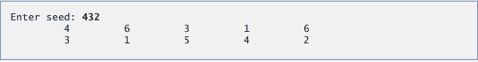

**图 6.10** | 随机化掷骰子程序。（第 1 部分，共 2 部分。）


**图 6.10** | 随机化掷骰子程序。（第 2 部分，共 2 部分。）

让我们多次运行该程序并观察结果。注意，只要用户输入不同的种子，程序每次执行时都会产生 *不同* 的随机数序列。我们在第一个和第三个示例输出中使用了相同的种子，因此这两个输出中都显示了相同的 10 个数字序列。

为了不必每次都输入种子就能进行随机化，我们可以使用类似下面的语句

```
srand( time( 0 ) );
```

这会使计算机读取其时钟以获取种子值。函数 *time*（如上述语句中所写，实参为 0）通常返回当前时间，即自 1970 年 1 月 1 日午夜格林尼治标准时间（GMT）以来的秒数。该值被转换为无符号整数，并用作随机数生成器的种子。time 的函数原型在 `<ctime>` 中。

## 随机数的广义缩放和平移

前面，我们演示了如何用下面的语句编写单条语句来模拟掷六面骰子

```
face = 1 + rand() % 6;
```

该语句始终将 1 ≤ face ≤ 6 范围内的一个整数（随机地）赋给变量 *face*。该范围的宽度（即范围内连续整数的个数）为 6，范围中的起始数字为 1。参考前面的语句，我们看到范围的宽度由用于通过模运算符缩放 rand 的数字（即 6）决定，而范围的起始数字等于加到表达式 rand % 6 上的数字（即 1）。我们可以将这个结果推广为

```
number = shiftingValue + rand() % scalingFactor;
```

其中 *shiftingValue* 等于所需连续整数范围中的第一个数字，*scalingFactor* 等于所需连续整数范围的宽度。

## 6.8 案例研究：机会游戏；介绍 enum

最受欢迎的机会游戏之一是一种称为“craps”的骰子游戏，世界各地的大小赌场和小巷中都在玩这种游戏。游戏规则很直接：

> 玩家掷两个骰子。每个骰子有六个面。这些面包含 1、2、3、4、5 和 6 个点。骰子停止后，计算两个朝上的面上的点数之和。如果第一次掷出的和为 7 或 11，则玩家赢。如果第一次掷出的和为 2、3 或 12（称为“craps”），则玩家输（即“庄家”赢）。如果第一次掷出的和为 4、5、6、8、9 或 10，则该和成为玩家的“点”。要获胜，你必须继续掷骰子，直到你“达成你的点”。如果在达成点之前掷出 7，则玩家输。


图6.11中的程序模拟了该游戏。在规则中，注意玩家在第一次掷骰子以及所有后续掷骰中都必须掷两个骰子。我们定义函数`rollDice`（第63–75行）来掷骰子，计算并打印它们的和。该函数只定义一次，但从第21行和第45行调用。函数不接收参数，返回两个骰子的和，因此在函数原型（第8行）和函数头（第63行）中使用了空括号和返回类型`int`。

```cpp
// Fig. 6.11: fig06_11.cpp
// Craps simulation.
#include <iostream>
#include <cstdlib> // contains prototypes for functions srand and rand
#include <ctime> // contains prototype for function time
using namespace std;

int rollDice(); // rolls dice, calculates and displays sum

int main()
{
   // enumeration with constants that represent the game status
   enum Status { CONTINUE, WON, LOST }; // all caps in constants

   int myPoint; // point if no win or loss on first roll
   Status gameStatus; // can CONTINUE, WON or LOST

   // randomize random number generator using current time
   srand( time( 0 ) );

   int sumOfDice = rollDice(); // first roll of the dice

   // determine game status and point (if needed) based on first roll
   switch ( sumOfDice )
   {
      case 7: // win with 7 on first roll
      case 11: // win with 11 on first roll
         gameStatus = WON;
         break;
      case 2: // lose with 2 on first roll
      case 3: // lose with 3 on first roll
      case 12: // lose with 12 on first roll
         gameStatus = LOST;
         break;
      default: // did not win or lose, so remember point
         gameStatus = CONTINUE; // game is not over
         myPoint = sumOfDice; // remember the point
         cout << "Point is " << myPoint << endl;
         break; // optional at end of switch
   } // end switch

   // while game is not complete
   while ( gameStatus == CONTINUE ) // not WON or LOST
   {
```

图 6.11 | Craps 模拟。（第 1 部分，共 3 部分。）

```cpp
45    sumOfDice = rollDice();  // roll dice again

47    // determine game status
48    if ( sumOfDice == myPoint )  // win by making point
49        gameStatus = WON;
50    else
51        if ( sumOfDice == 7 )  // lose by rolling 7 before point
52            gameStatus = LOST;
53 }  // end while

55 // display win or lose message
56 if ( gameStatus == WON )
57     cout << "Player wins" << endl;
58 else
59     cout << "Player loses" << endl;
60 } // end main

62 // roll dice, calculate sum and display results
63 int rollDice()
64 {
65     // pick random die values
66     int die1 = 1 + rand() % 6; // first die roll
67     int die2 = 1 + rand() % 6; // second die roll

69     int sum = die1 + die2; // compute sum of die values

71     // display results of this roll
72     cout << "Player rolled " << die1 << " + " << die2
73          << " = " << sum << endl;
74     return sum; // end function rollDice
75 } // end function rollDice
```

```text
Player rolled 2 + 5 = 7
Player wins
```

```text
Player rolled 6 + 6 = 12
Player loses
```

```text
Player rolled 1 + 3 = 4
Point is 4
Player rolled 4 + 6 = 10
Player rolled 2 + 4 = 6
Player rolled 6 + 4 = 10
Player rolled 2 + 3 = 5
Player rolled 2 + 4 = 6
Player rolled 1 + 1 = 2
Player rolled 4 + 4 = 8
Player rolled 4 + 3 = 7
Player loses
```

图 6.11 | Craps 模拟。（第 2 部分，共 3 部分。）

`CONTINUE`。在`while`的每次迭代中，程序调用`rollDice`来产生一个新的和。如果该和与`myPoint`匹配，程序将`gameStatus`设置为`WON`（第49行），`while`测试失败，`if...else`语句打印“Player wins”，执行终止。如果和等于7，程序将`gameStatus`设置为`LOST`（第52行），`while`测试失败，`if...else`语句打印“Player loses”，执行终止。

注意我们讨论过的各种程序控制机制的巧妙结合。这个 Craps 程序使用了两个函数——`main`和`rollDice`——以及`switch`、`while`、`if...else`、嵌套的`if...else`和嵌套的`if`语句。在练习中，我们将进一步研究 Craps 游戏。


> **良好编程习惯 6.3**
>
> *使用枚举而不是整数常量可以使程序更清晰。你可以在枚举声明中一次性设置枚举常量的值。*


> **常见编程错误 6.7**
>
> *将枚举常量的整数等价形式（而不是枚举常量本身）赋给枚举类型的变量是一个编译错误。*


> **常见编程错误 6.8**
>
> *在枚举常量被定义之后，试图为枚举常量赋另一个值是一个编译错误。*

## 6.9 存储类

到目前为止你看到的程序都使用标识符作为变量名。变量的属性包括名称、类型、大小和值。本章还将标识符用作自定义函数的名称。实际上，程序中的每个标识符还有其他属性，包括**存储类**、作用域和链接。

C++ 提供了五种存储类说明符：`auto`、`register`、`extern`、`mutable`和`static`。本节讨论存储类说明符`auto`、`register`、`extern`和`static`；`mutable`（在第24章“其他主题”中讨论）仅用于类。

### 存储类、作用域和链接

标识符的存储类决定了该标识符在内存中存在的时间段。有些存在时间很短，有些被反复创建和销毁，有些则在整个程序执行期间存在。首先我们讨论存储类`static`和自动存储类。

标识符的作用域是它在程序中可以被引用的位置。有些标识符可以在整个程序中被引用；其他标识符只能从程序的有限部分中被引用。第6.10节讨论标识符的作用域。

标识符的链接决定了它是仅在声明它的源文件中可见，还是在被编译后链接在一起的多个文件中可见。标识符的存储类说明符有助于确定其存储类和链接。

### 存储类类别

存储类说明符可以分为两类：自动存储类和静态存储类。关键字`auto`和`register`用于声明自动存储类的变量。这样的变量在程序执行进入定义它们的块时被创建，它们在块处于活动状态期间存在，并在程序退出该块时被销毁。

### 局部变量

只有函数的局部变量才能具有自动存储类。函数的局部变量和参数通常属于自动存储类。存储类说明符`auto`显式声明自动存储类的变量。例如，下面的声明表明 double 变量`x`是自动存储类的局部变量——它仅存在于定义所在函数体内最内层的一对花括号中：

```c
auto double x;
```

局部变量默认具有自动存储类，因此关键字`auto`很少使用。在本书的其余部分，我们将自动存储类的变量简称为自动变量。

**性能提示 6.1**

自动存储是节省内存的一种手段，因为自动存储类变量只在定义它们的块执行时才存在于内存中。

### 寄存器变量

在程序的机器语言版本中，数据通常被加载到寄存器中以进行计算和其他处理。

**性能提示 6.2**

存储类说明符`register`可以放在自动变量声明之前，以建议编译器将该变量保存在计算机的高速硬件寄存器之一中，而不是保存在内存中。如果频繁使用的变量（如计数器或累加器）保存在硬件寄存器中，则消除了反复将变量从内存加载到寄存器并将结果存回内存的开销。

编译器可能会忽略`register`声明。例如，可能没有足够数量的寄存器可供编译器使用。下面的定义建议将整数变量`counter`放在计算机的某个寄存器中；无论编译器是否这样做，`counter`都被初始化为1：

```c
register int counter = 1;
```

`register`关键字只能用于局部变量和函数参数。

**性能提示 6.3**

通常，`register`是不必要的。优化编译器能够识别频繁使用的变量，并且可能在没有`register`声明的情况下将它们放入寄存器。


### 静态存储类

关键字 extern 和 static 用于为静态存储类的变量和函数声明标识符。静态存储类变量从程序开始执行时起就存在，并持续到程序结束。静态存储类变量的存储空间在程序开始执行时分配。这类变量在其声明被遇到时初始化一次。对于函数，函数名在程序开始执行时就存在，就像所有其他函数一样。然而，尽管这些变量和函数名从程序执行开始时就存在，这并不意味着这些标识符可以在整个程序中使用。存储类和作作用域（名称可被使用的范围）是两个独立的问题，我们将在 6.10 节中看到。

### 具有静态存储类的标识符

具有静态存储类的标识符有两种——外部标识符（如全局变量和全局函数名）和使用存储类说明符 static 声明的局部变量。全局变量通过将变量声明放在任何类或函数定义之外来创建。全局变量在程序整个执行期间保留其值。全局变量和全局函数可以被源文件中在其声明或定义之后的任何函数引用。

> **软件工程观察 6.8**
>
> *将变量声明为全局变量而非局部变量，会在不需要访问该变量的函数意外或恶意修改它时，产生非预期的副作用。这是最小权限原则的又一个例子。一般来说，除了 `cin` 和 `cout` 这类真正的全局资源外，除非某些具有独特性能要求的情况，否则应避免使用全局变量。*

> **软件工程观察 6.9**
>
> *仅在特定函数中使用的变量，应声明为该函数中的局部变量，而不是全局变量。*

声明为 static 的局部变量仍然只在其被声明的函数中可见，但与自动变量不同，静态局部变量在函数返回调用者时会保留其值。下一次调用该函数时，静态局部变量包含函数上次执行完毕时的值。下面的语句将局部变量 count 声明为 static，并初始化为 1：

```c
static int count = 1;
```

静态存储类的所有数值变量，如果你没有显式初始化它们，都会被初始化为零；不过，显式初始化所有变量仍然是一种良好实践。

存储类说明符 extern 和 static 在显式应用于外部标识符（如全局变量和全局函数名）时具有特殊含义。在附录 F“C 遗留代码专题”中，我们讨论将 extern 和 static 与外部标识符以及多源文件程序一起使用。

## 6.10 作用域规则

程序中标识符可以被使用的部分称为它的作用域。例如，当我们在一个块中声明局部变量时，它只能在该块以及嵌套于该块内的块中被引用。本节讨论标识符的四种作用域——函数作用域、全局命名空间作用域、局部作用域和函数原型作用域。稍后我们还将看到另外两种作用域——类作用域（第 9 章）和命名空间作用域（第 24 章）。

在任何函数或类之外声明的标识符具有全局命名空间作用域。这种标识符从声明处起到文件末尾，在所有函数中都是“已知的”。放在函数之外的全局变量、函数定义和函数原型都具有全局命名空间作用域。

标签（后跟冒号的标识符，如 `start:`）是唯一具有函数作用域的标识符。标签可以在其所在函数中的任何位置使用，但不能在该函数体之外引用。标签用于 goto 语句（附录 F）。标签是实现细节，函数之间会相互隐藏这些细节。

在块内声明的标识符具有局部作用域。局部作用域从标识符的声明处开始，到声明该标识符的块的结束右花括号（}）处结束。局部变量具有局部作用域，函数参数也是如此，它们也是函数的局部变量。任何块都可以包含变量声明。当块嵌套，且外层块中的标识符与内层块中的标识符同名时，外层块中的标识符会被“隐藏”，直到内层块终止。内层块看到的是它自己的局部标识符的值，而不是外围块中同名标识符的值。声明为 `static` 的局部变量仍然具有局部作用域，尽管它们从程序开始执行时起就存在。存储持续时间不影响标识符的作用域。

唯一具有函数原型作用域的标识符是函数原型参数列表中使用的标识符。如前所述，函数原型不要求参数列表中有名称——只需要类型。函数原型参数列表中出现的名称会被编译器忽略。函数原型中使用的标识符可以在程序的其他地方重用，而不会产生歧义。在单个原型中，特定标识符只能使用一次。

> **常见编程错误 6.9**
>
> *当内层块中的标识符意外使用了与外层块中某个标识符相同的名称，而实际上你希望外层块中的标识符在内层块整个持续期间保持有效时，这通常是一个逻辑错误。*

> **良好编程实践 6.4**
>
> *避免使用会隐藏外层作用域中名称的变量名。可以通过避免在程序中使用重复标识符来实现这一点。*

图 6.12 的程序演示了全局变量、自动局部变量和 `static` 局部变量的作用域问题。

第 10 行声明全局变量 `x` 并将其初始化为 1。这个全局变量在任何声明了名为 `x` 的变量的块（或函数）中都会被隐藏。在 `main` 中，第 14 行显示全局变量 `x` 的值。第 16 行声明一个局部变量 `x`，并将其初始化为 5。第 19 行输出这个变量，以表明全局变量 `x` 在 `main` 中被隐藏。接下来，第 20–24 行在 `main` 中定义一个新块，其中另一个局部变量 `x` 被初始化为 7（第 21 行）。第 23 行输出这个变量，以表明它隐藏了 `main` 外层块中的 `x`。当该块退出时，值为 7 的变量 `x` 会被自动销毁。接下来，第 26 行输出 `main` 外层块中的局部变量 `x`，以表明它不再被隐藏。

```cpp
// Fig. 6.12: fig06_12.cpp
// A scoping example
#include <iostream>
using namespace std;

void useLocal(); // function prototype
void useStaticLocal(); // function prototype
void useGlobal(); // function prototype

int x = 1; // global variable

int main()
{
   cout << "global x in main is " << x << endl;

   int x = 5; // local variable to main

   cout << "local x in main's outer scope is " << x << endl;

   { // start new scope
      int x = 7; // hides both x in outer scope and global x

      cout << "local x in main's inner scope is " << x << endl;
   } // end new scope

   cout << "local x in main's outer scope is " << x << endl;

   useLocal(); // useLocal has local x
   useStaticLocal(); // useStaticLocal has static local x
   useGlobal(); // useGlobal uses global x
   useLocal(); // useLocal reinitializes its local x
   useStaticLocal(); // static local x retains its prior value
   useGlobal(); // global x also retains its prior value

   cout << "\nlocal x in main is " << x << endl;
} // end main

// useLocal reinitializes local variable x during each call
void useLocal()
{
   int x = 25; // initialized each time useLocal is called

   cout << "\nlocal x is " << x << " on entering useLocal" << endl;
   x++;
   cout << "local x is " << x << " on exiting useLocal" << endl;
} // end function useLocal

// useStaticLocal initializes static local variable x only the
// first time the function is called; value of x is saved
// between calls to this function
void useStaticLocal()
{
   static int x = 50; // initialized first time useStaticLocal is called
}
```

图 6.12 | 作用域示例。（第 1 部分，共 2 部分。）


```cpp
cout << "\nlocal static x is " << x << " on entering useStaticLocal"
     << endl;
x++;
cout << "local static x is " << x << " on exiting useStaticLocal"
     << endl;
} // end function useStaticLocal

// useGlobal modifies global variable x during each call
void useGlobal()
{
    cout << "\nglobal x is " << x << " on entering useGlobal" << endl;
    x = 10;
    cout << "global x is " << x << " on exiting useGlobal" << endl;
} // end function useGlobal
```

```text
global x in main is 1
local x in main's outer scope is 5
local x in main's inner scope is 7
local x in main's outer scope is 5

local x is 25 on entering useLocal
local x is 26 on exiting useLocal

local static x is 50 on entering useStaticLocal
local static x is 51 on exiting useStaticLocal

global x is 1 on entering useGlobal
global x is 10 on exiting useGlobal

local x is 25 on entering useLocal
local x is 26 on exiting useLocal

local static x is 51 on entering useStaticLocal
local static x is 52 on exiting useStaticLocal

global x is 10 on entering useGlobal
global x is 10 on exiting useGlobal

local x in main is 5
```

*图 6.12* | 作用域示例。（第 2 部分，共 2 部分）

为了演示其他作用域，该程序定义了三个函数，每个函数都不接受参数且不返回值。函数 useLocal（第 39—46 行）声明自动变量 x（第 41 行）并将其初始化为 25。当程序调用 useLocal 时，该函数打印该变量，将其递增，然后再次打印，之后函数将程序控制权返回给其调用者。每次程序调用此函数时，该函数都会重新创建自动变量 x 并将其重新初始化为 25。

函数 useStaticLocal（第 51—60 行）声明静态变量 x 并将其初始化为 50。声明为 static 的局部变量即使在超出作用域时（即声明它们的函数未在执行时）也会保留其值。当程序调用 useStaticLocal 时，该函数打印 x，将其递增，然后再次打印，之后函数将程序控制权返回给其调用者。在下次调用此函数时，静态局部

会调用其他函数。但是当被调用函数返回其调用者时，被调用函数的自动变量需要“消失”。被调用函数的栈帧是为被调用函数的自动变量保留内存的理想位置。只要被调用函数处于活动状态，该栈帧就存在。当该函数返回时——并且不再需要其局部自动变量时——其栈帧会从栈中弹出，程序也不再知道这些局部自动变量。

当然，计算机中的内存量是有限的，因此只能使用一定量的内存来在函数调用栈上存储活动记录。如果发生的函数调用多到无法将其活动记录存储在函数调用栈上，就会发生称为栈溢出的错误。

### 函数调用栈实战

因此，正如我们所见，调用栈和活动记录支持函数调用/返回机制以及自动变量的创建和销毁。现在让我们考虑调用栈如何支持由 main 调用的 square 函数的运行（图 6.13 的第 9—14 行）。首先，操作系统调用 main——这会将一个活动记录压入栈中（如图 6.14 所示）。该活动记录告诉 main 如何返回操作系统（即转移到返回地址 R1），并包含 main 的自动变量（即 a，它被初始化为 10）所需的空间。

函数 main——在返回操作系统之前——现在调用图 6.13 第 13 行中的函数 square。这会导致 square 的栈帧（第 17—20 行）被压入函数调用栈（图 6.15）。该栈帧包含 square 返回 main 所需的返回地址（即 R2）以及 square 的自动变量（即 x）所需的内存。

```cpp
// Fig. 6.13: fig06_13.cpp
// square function used to demonstrate the function
// call stack and activation records.
#include <iostream>
using namespace std;

int square( int ); // prototype for function square

int main()
{
   int a = 10; // value to square (local automatic variable in main)

   cout << a << " squared: " << square( a ) << endl; // display a squared
} // end main

// returns the square of an integer
int square( int x ) // x is a local variable
{
   return x * x; // calculate square and return result
} // end function square
```

```text
10 squared: 100
```

图 6.13 | 用于演示函数调用栈和活动记录的 square 函数。

规定函数 `print` 不接受参数且不返回值。图 6.17 展示了声明和使用空参数列表函数的两种方式。

```cpp
// Fig. 6.17: fig06_17.cpp
// Functions that take no arguments.
#include <iostream>
using namespace std;

void function1(); // function that takes no arguments
void function2( void ); // function that takes no arguments

int main()
{
    function1(); // call function1 with no arguments
    function2(); // call function2 with no arguments
} // end main

// function1 uses an empty parameter list to specify that
// the function1 receives no arguments
void function1()
{
    cout << "function1 takes no arguments" << endl;
} // end function1

// function2 uses a void parameter list to specify that
// the function2 receives no arguments
void function2( void )
{
    cout << "function2 also takes no arguments" << endl;
} // end function2
```

```text
function1 takes no arguments
function2 also takes no arguments
```

**图 6.17** | 不接受参数的函数。

> **常见编程错误 6.10**
> 
> *除非为每个函数提供函数原型，或者每个函数在调用之前已经定义，否则 C++ 程序无法编译。*


## 6.13 内联函数

从软件工程的角度来看，将程序实现为一组函数是良好的做法，但函数调用会涉及执行时开销。C++ 提供内联函数来帮助减少函数调用开销——尤其是对于小型函数。在函数定义中将限定符 `inline` 放在函数的返回类型之前，会“建议”编译器在适当情况下就地生成函数代码的副本，以避免函数调用。权衡之处在于，程序中会插入函数代码的多份副本（通常会使程序更大），而不是只保留一份函数代码，并在每次调用函数时将控制权传递给它。编译器可以忽略 inline 限定符，并且对于除最小函数之外的所有函数通常都会这样做。

### 软件工程观察 6.10

对内联函数的任何更改都要求重新编译该函数的所有使用方。在某些程序开发和维护场景中，这可能很重要。


### 良好编程实践 6.5

`inline` 限定符应仅用于小型且频繁使用的函数。


### 性能提示 6.4

使用内联函数可以减少执行时间，但可能增加程序大小。


图 6.18 使用内联函数 cube（第 9—12 行）计算立方体的体积。函数 cube 的参数列表（第 9 行）中的关键字 const 告诉编译器，该函数不修改变量 side。这确保在计算过程中 side 的值不会被该函数更改。（关键字 const 将在第 7、8 和 10 章详细讨论。）注意，函数 cube 的完整定义出现在程序中使用它之前。这是必需的，以便编译器知道如何将 cube 函数调用展开为其内联代码。因此，可复用的内联函数通常放在头文件中，以便其定义可以包含在使用它们的每个源文件中。

### 软件工程观察 6.11

应使用 const 限定符来实施最小权限原则。使用最小权限原则正确设计软件可以大大减少调试时间和不适当的副作用，并使程序更易于修改和维护。


```cpp
// Fig. 6.18: fig06_18.cpp
// Using an inline function to calculate the volume of a cube.
#include <iostream>
using namespace std;

// Definition of inline function cube. Definition of function appears
// before function is called, so a function prototype is not required.
// First line of function definition acts as the prototype.
inline double cube( double side )
{
   return side * side * side; // calculate cube
} // end function cube

int main()
{
   double sideValue; // stores value entered by user
   cout << "Enter the side length of your cube: ";
   cin >> sideValue; // read value from user

   // calculate cube of sideValue and display result
   cout << "Volume of cube with side "
        << sideValue << " is " << cube( sideValue ) << endl;
} // end main
```

**图 6.18** | 计算立方体体积的内联函数。（第 1 部分，共 2 部分。）


## 按值传递和按引用传递实参

图 6.19 比较了使用引用参数的按值传递和按引用传递。在调用函数 squareByValue 和函数 squareByReference 时，实参的“风格”完全相同——两个变量在函数调用中都只是通过名称被提及。如果不检查函数原型或函数定义，仅从调用本身无法判断任一函数是否能修改其实参。由于函数原型是必需的，编译器可以毫无困难地消除这种歧义。

> **常见的编程错误 6.11**
> 
> *由于引用参数在被调用函数体中仅通过名称提及，你可能会无意中把引用参数当作按值传递参数来处理。如果原变量被函数修改，这可能导致意外的副作用。*


```cpp
// Fig. 6.19: fig06_19.cpp
// Comparing pass-by-value and pass-by-reference with references.
#include <iostream>
using namespace std;

int squareByValue( int ); // function prototype (value pass)
void squareByReference( int & ); // function prototype (reference pass)

int main()
{
   int x = 2; // value to square using squareByValue
   int z = 4; // value to square using squareByReference

   // demonstrate squareByValue
   cout << "x = " << x << " before squareByValue\n";
   cout << "Value returned by squareByValue: "
        << squareByValue( x ) << endl;
   cout << "x = " << x << " after squareByValue\n" << endl;

   // demonstrate squareByReference
   cout << "z = " << z << " before squareByReference" << endl;
   squareByReference( z );
   cout << "z = " << z << " after squareByReference" << endl;
} // end main

// squareByValue multiplies number by itself, stores the
// result in number and returns the new value of number
int squareByValue( int number )
{
   return number * number; // caller's argument not modified
} // end function squareByValue

// squareByReference multiplies numberRef by itself and stores the result
// in the variable to which numberRef refers in function main
void squareByReference( int &numberRef )
{
   numberRef *= numberRef; // caller's argument modified
} // end function squareByReference
```

*图 6.19* | 按值传递和按引用传递实参。（第 1 部分，共 2 部分。）

```text
x = 2 before squareByValue
Value returned by squareByValue: 4
x = 2 after squareByValue

z = 4 before squareByReference
z = 16 after squareByReference
```

**图 6.19** | 按值传递和按引用传递实参。（第 2 部分，共 2 部分。）

第 8 章讨论指针；指针支持另一种形式的按引用传递，在这种形式中，调用的风格清楚地表明是按引用传递（以及可能修改调用者的实参）。


### 性能提示 6.7

对于传递大型对象，使用 const 引用参数来模拟按值传递的外观和安全性，并避免传递大型对象副本的开销。

要指定对常量的引用，请在参数声明中将 const 限定符放在类型说明符之前。注意 & 在函数 squareByReference 参数列表中的位置（图 6.19 第 35 行）。一些 C++ 程序员更喜欢写成等价形式 int& numberRef。

### 函数内作为别名的引用

引用也可以在函数内用作其他变量的别名（尽管它们通常如图 6.19 所示与函数一起使用）。例如，以下代码

```cpp
int count = 1; // declare integer variable count
int &cRef = count; // create cRef as an alias for count
cRef++; // increment count (using its alias cRef)
```

通过其别名 cRef 递增变量 count。引用变量必须在其声明中初始化（见图 6.20 和图 6.21），并且不能重新赋值为其他变量的别名。一旦引用被声明为另一个变量的别名，所有据称对别名（即引用）执行的操作实际上都是对原变量执行的。别名只是原变量的另一个名称。除非是对常量的引用，否则引用实参必须是 *左值*（例如变量名），而不是返回 *右值* 的常量或表达式（例如计算结果）。有关术语 *左值* 和 *右值* 的定义，请参见 5.9 节。

```cpp
// Fig. 6.20: fig06_20.cpp
// Initializing and using a reference.
#include <iostream>
using namespace std;

int main()
{
    int x = 3;
    int &y = x; // y refers to (is an alias for) x

    cout << "x = " << x << endl << "y = " << y << endl;
    y = 7; // actually modifies x
    cout << "x = " << x << endl << "y = " << y << endl;
} // end main
```

**图 6.20** | 初始化并使用引用。（第 1 部分，共 2 部分。）

```text
x = 3
y = 3
x = 7
y = 7
```

**图 6.20** | 初始化并使用引用。（第 2 部分，共 2 部分。）

```cpp
// Fig. 6.21: fig06_21.cpp
// references must be initialized.
#include <iostream>
using namespace std;

int main()
{
    int x = 3;
    int &y; // Error: y must be initialized

    cout << "x = " << x << endl << "y = " << y << endl;
    y = 7;
    cout << "x = " << x << endl << "y = " << y << endl;
} // end main
```

*Microsoft Visual C++ 编译器错误消息：*

```text
C:\cpphtp7_examples\ch06\Fig06_21\fig06_21.cpp(9) : error C2530: 'y' :
    references must be initialized
```

*GNU C++ 编译器错误消息：*

```text
fig06_21.cpp:9: error: 'y' declared as a reference but not initialized
```

**图 6.21** | 未初始化的引用导致语法错误。

### 从函数返回引用

函数可以返回引用，但这可能很危险。当返回对被调用函数中声明的变量的引用时，该变量应在该函数中声明为 static。否则，该引用指向一个在函数终止时被丢弃的自动变量；这样的变量被称为“未定义”，程序的行为不可预测。对未定义变量的引用称为悬空引用。


> **常见的编程错误 6.12**
> 
> *在被调用函数中返回对自动变量的引用是逻辑错误。发生这种情况时，一些编译器会发出警告。*

### *未初始化引用的错误消息*

C++ 标准并未规定编译器用来指示特定错误的错误消息。因此，图 6.21 显示了 Microsoft Visual C++ 2008 编译器和 GNU C++ 编译器在引用未初始化时产生的错误消息。

## 6.15 默认实参

程序针对某个特定形参反复以相同的实参值调用函数并不少见。在这种情况下，可以指定该形参具有默认实参，即要传递给该形参的默认值。当程序在函数调用中省略具有默认实参的形参对应的实参时，编译器会重写该函数调用并插入该实参的默认值。

默认实参必须是函数形参列表中最右边（尾部）的实参。当调用具有两个或更多默认实参的函数时，如果省略的实参不是实参列表中最右边的实参，那么该实参右侧的所有实参也必须省略。默认实参必须在函数名第一次出现时指定——通常是在函数原型中。如果省略了函数原型，因为函数定义也充当原型，则应在函数头中指定默认实参。默认值可以是任何表达式，包括常量、全局变量或函数调用。默认实参也可以与内联函数一起使用。

图 6.22 演示了使用默认实参计算盒子的体积。boxVolume 的函数原型（第 7 行）指定三个形参都已被赋予默认值 1。为了提高可读性，我们在函数原型中提供了变量名。一如既往，函数原型中并不要求变量名。

```cpp
// Fig. 6.22: fig06_22.cpp
// Using default arguments.
#include <iostream>
using namespace std;

// function prototype that specifies default arguments
int boxVolume( int length = 1, int width = 1, int height = 1 );

int main()
{
   // no arguments--use default values for all dimensions
   cout << "The default box volume is: " << boxVolume();

   // specify length; default width and height
   cout << "\n\nThe volume of a box with length 10,\n"
        << " width 1 and height 1 is: " << boxVolume( 10 );

   // specify length and width; default height
   cout << "\n\nThe volume of a box with length 10,\n"
        << " width 5 and height 1 is: " << boxVolume( 10, 5 );
}
```

图 6.22 | 函数的默认实参。（第 1 部分，共 2 部分。）


```cpp
// specify all arguments
cout << "\nThe volume of a box with length 10,\n"
     << "width 5 and height 2 is: " << boxVolume(10, 5, 2)
     << endl;
} // end main

// function boxVolume calculates the volume of a box
int boxVolume( int length, int width, int height )
{
    return length * width * height;
} // end function boxVolume
```

```
The default box volume is: 1

The volume of a box with length 10,
width 1 and height 1 is: 10

The volume of a box with length 10,
width 5 and height 1 is: 50

The volume of a box with length 10,
width 5 and height 2 is: 100
```

**图 6.22** | 函数的默认实参。

对 `boxVolume` 的第一次调用（第 12 行）没有指定任何实参，因此使用全部三个默认值 1。第二次调用（第 16 行）仅传递了一个长度实参，因此宽度和高度实参使用默认值 1。第三次调用（第 20 行）只传递了长度和宽度实参，因此高度实参使用默认值 1。最后一次调用（第 24 行）传递了长度、宽度和高度实参，因此不使用任何默认值。传递给函数的任何实参都会按照从左到右的顺序显式赋给函数的形参。因此，当 `boxVolume` 接收一个实参时，函数会将该实参的值赋给其 `length` 形参（即形参列表中最左侧的形参）。当 `boxVolume` 接收两个实参时，函数会依次将这些实参的值赋给其 `length` 和 `width` 形参。最后，当 `boxVolume` 接收全部三个实参时，函数会分别将这些实参的值赋给其 `length`、`width` 和 `height` 形参。


> **良好的编程实践 6.6**
>
> 使用默认实参可以简化函数调用的编写。不过，一些程序员认为，显式指定所有实参更加清晰。


> **软件工程观察 6.13**
>
> 如果函数的默认值发生改变，则所有使用该函数的客户端代码都必须重新编译。


> **常见编程错误 6.13**
>
> 指定并尝试使用一个不是最右侧形参的默认实参（同时又没有为其右侧的所有形参设置默认值）会导致语法错误。

## 6.16 一元作用域解析运算符

可以声明名称相同的局部变量和全局变量。C++ 提供了一元作用域解析运算符（`::`），用于在同名局部变量处于作用域内时访问全局变量。不能使用一元作用域解析运算符访问外层代码块中名称相同的局部变量。如果全局变量的名称与当前作用域中的局部变量名称不同，则无需使用一元作用域解析运算符即可直接访问该全局变量。

图 6.23 展示了局部变量和全局变量名称相同的情况下如何使用一元作用域解析运算符（第 6 行和第 10 行）。为了强调变量 `number` 的局部版本和全局版本是不同的，程序将其中一个变量声明为 `int`，另一个声明为 `double`。

```cpp
// Fig. 6.23: fig06_23.cpp
// Using the unary scope resolution operator.
#include <iostream>
using namespace std;

int number = 7; // global variable named number

int main()
{
    double number = 10.5; // local variable named number

    // display values of local and global variables
    cout << "Local double value of number = " << number
         << "\nGlobal int value of number = " << ::number << endl;
} // end main
```

```
Local double value of number = 10.5
Global int value of number = 7
```

**图 6.23** | 一元作用域解析运算符。

当指定名称的唯一变量是全局变量时，使用一元作用域解析运算符（`::`）和给定的变量名是可选的。

> **良好的编程实践 6.7**
>
> 始终使用一元作用域解析运算符（`::`）引用全局变量，可以使程序更易于阅读和理解，因为这样可以明确表明你打算访问的是全局变量，而不是非全局变量。

> **软件工程观察 6.14**
>
> 始终使用一元作用域解析运算符（`::`）引用全局变量，可以通过降低与非全局变量发生名称冲突的风险，使程序更易于修改。

> **错误预防提示 6.3**
>
> 始终使用一元作用域解析运算符（`::`）引用全局变量，可以避免因非全局变量隐藏全局变量而可能出现的逻辑错误。

> **错误预防提示 6.4**
>
> 避免在程序中使用名称相同但用途不同的变量。尽管在各种情况下这是允许的，但它可能导致错误。


## 6.17 函数重载

C++ 允许定义多个名称相同的函数，只要它们具有不同的签名。这称为函数重载。C++ 编译器通过检查调用中实参的数量、类型和顺序来选择要调用的正确函数。函数重载用于创建多个名称相同、执行相似任务但处理不同数据类型的函数。例如，数学库中的许多函数针对不同的数值类型进行了重载——C++ 标准要求本节 6.3 中讨论的数学库函数提供 `float`、`double` 和 `long double` 的重载版本。

> **良好的编程实践 6.8**
>
> 对执行密切相关任务的函数进行重载，可以使程序更具可读性和可理解性。


### 重载的平方函数

图 6.24 使用重载的平方函数计算 `int` 的平方（第 7～11 行）和 `double` 的平方（第 14～18 行）。第 22 行通过传递字面值 7 调用函数 `square` 的 `int` 版本。C++ 将整数形式的字面值视为 `int` 类型。同样，第 24 行通过传递字面值 7.5 调用函数 `square` 的 `double` 版本，C++ 将 7.5 视为 `double` 值。在每种情况下，编译器都会根据实参的类型选择要调用的正确函数。输出窗口中的最后两行确认了每次调用的都是正确的函数。

```cpp
// Fig. 6.24: fig06_24.cpp
// Overloaded functions.
#include <iostream>
using namespace std;

// function square for int values
int square( int x )
{
   cout << "square of integer " << x << " is ";
   return x * x;
} // end function square with int argument

// function square for double values
double square( double y )
{
   cout << "square of double " << y << " is ";
   return y * y;
} // end function square with double argument

int main()
{
    cout << square( 7 );     // calls int version
    cout << endl;
    cout << square( 7.5 );   // calls double version
    cout << endl;
} // end main
```

```
square of integer 7 is 49
square of double 7.5 is 56.25
```

**图 6.24** | 重载的平方函数。

### 编译器如何区分重载函数

重载函数通过其签名进行区分。签名是函数名称及其形参类型（按顺序排列）的组合。编译器会根据每个函数的形参数量和类型对其函数标识符进行编码（有时称为名称修饰或名称装饰），以实现类型安全的链接。类型安全的链接可以确保调用正确的重载函数，并确保实参的类型符合形参的类型。

图 6.25 使用 GNU C++ 编译。我们没有像通常那样展示程序的执行输出，而是展示 GNU C++ 在汇编语言中生成的经过修饰的函数名称。每个经过修饰的名称（`main` 除外）都以两个下划线（`_`）开头，后跟字母 `Z`、一个数字和函数名称。`Z` 后面的数字指定函数名称中包含的字符数。例如，函数 `square` 的名称包含 6 个字符，因此其修饰名称以 `_Z6` 开头。函数名称后面接着是其形参列表的编码。在函数 `nothing2` 的形参列表中（第 25 行；参见第四个输出行），`c` 表示 `char`，`i` 表示 `int`，`Rf` 表示 `float &`（即对 `float` 的引用），而 `Rd` 表示 `double &`（即对 `double` 的引用）。在函数 `nothing1` 的形参列表中，`i` 表示 `int`，`f` 表示 `float`，`c` 表示 `char`，而 `Ri` 表示 `int &`。两个 `square` 函数通过其形参列表进行区分；一个使用 `d` 表示 `double`，另一个使用 `i` 表示 `int`。函数的返回类型不会出现在修饰名称中。重载函数可以具有不同的返回类型，但在这种情况下，它们还必须具有不同的形参列表。换言之，不能有两个签名相同但返回类型不同的函数。函数名称修饰与编译器有关。此外，函数 `main` 不会被修饰，因为它不能被重载。

```cpp
// Fig. 6.25: fig06_25.cpp
// Name mangling.

// function square for int values
int square( int x )
{
    return x * x;
} // end function square
```

**图 6.25** | 通过名称修饰实现类型安全的链接。


```cpp
// function square for double values
double square( double y )
{
    return y * y;
} // end function square

// function that receives arguments of types
// int, float, char and int &
void nothing1( int a, float b, char c, int & )
{
    // empty function body
} // end function nothing1

// function that receives arguments of types
// char, int, float and double &
int nothing2( char a, int b, float &, double & )
{
    return 0;
} // end function nothing2

int main()
{
} // end main
```

```text
_Z6squarei
_Z6squared
_Z8nothing1ifcRi
_Z8nothing2icfRd
_main
```

**图 6.25** | 用名称修饰实现类型安全的链接。（第 2 部分，共 2 部分）


> **常见编程错误 6.14**
>
> 创建参数列表完全相同但返回类型不同的重载函数会导致编译错误。

编译器仅使用参数列表来区分重载函数。这类函数的参数数量不必相同。重载带有默认参数的函数时要特别谨慎，因为这可能导致歧义。


> **常见编程错误 6.15**
>
> 省略默认实参的函数可能会与另一个重载函数被以相同的方式调用；这会导致编译错误。例如，假设一个程序同时包含一个显式声明为不接受任何参数的函数，以及一个同名但包含默认参数的函数，那么当尝试在不传递参数的情况下使用该函数名进行调用时，就会产生编译错误。编译器不知道应选择哪个版本的函数。

## 重载运算符

在第 11 章中，我们将讨论如何重载运算符，以定义它们应如何作用于用户自定义数据类型的对象。（事实上，到目前为止我们一直在使用许多重载运算符，包括流插入运算符 `<<` 和流提取运算符 `>>`；这两个运算符都经过重载，因此能够显示所有基本类型的数据。关于如何进一步重载 `<<` 和 `>>` 以处理用户自定义类型的对象，我们将在第 11 章中详细介绍。）第 6.18 节将介绍函数模板，用于自动生成能够对不同数据类型执行相同任务的重载函数。

## 6.18 函数模板

重载函数通常用于对不同数据类型执行相似的操作，而针对不同数据类型的程序逻辑各不相同。如果针对每种数据类型的程序逻辑和操作都相同，则可以使用函数模板，以更简洁、更方便的方式进行重载。你只需编写一个函数模板定义。根据调用该函数时提供的实参类型，C++ 会自动生成独立的函数模板特化，以适当地处理每种调用。因此，定义一个函数模板实际上就定义了一个完整的重载函数族。

图 6.26 包含一个函数模板的定义（第 3—17 行），该模板用于定义一个确定三个值中最大值的最大值函数。所有函数模板定义都以 `template` 关键字（第 3 行）开头，后面跟着用尖括号（`<` 和 `>`）括起来的函数模板参数列表。模板参数列表中的每个参数（通常称为形式类型参数）前面都必须有关键字 `typename` 或关键字 `class`（二者是同义词）。形式类型参数是基本类型或用户自定义类型的占位符。这些占位符用于指定函数参数的类型（第 4 行）、指定函数的返回类型（第 4 行），以及在函数定义体内声明变量（第 6 行）。函数模板的定义方式与其他函数相同，但使用形式类型参数作为实际数据类型的占位符。

```cpp
// Fig. 6.26: maximum.h
// Definition of function template maximum
template < class T >    // or template< typename T >
T maximum( T value1, T value2, T value3 )
{
   T maximumValue = value1; // assume value1 is maximum

   // determine whether value2 is greater than maximumValue
   if ( value2 > maximumValue )
      maximumValue = value2;

   // determine whether value3 is greater than maximumValue
   if ( value3 > maximumValue )
      maximumValue = value3;

   return maximumValue;
} // end function template maximum
```

图 6.26 | 函数模板 `maximum` 头文件。

图 6.26 中的函数模板声明了一个形式类型参数 `T`（第 3 行），作为函数 `maximum` 要测试的数据类型的占位符。对于特定的模板定义，类型参数的名称必须在模板参数列表中唯一。当编译器在程序源代码中检测到对 `maximum` 的调用时，会将传递给 `maximum` 的数据类型替换模板定义中的所有 `T`，C++ 随后会创建一个完整的函数，用于确定指定数据类型的三个值中的最大值——由于本例只使用一个类型参数，因此这三个值必须具有相同的类型——然后编译新创建的函数。因此，模板是一种代码生成手段。

图 6.27 使用 `maximum` 函数模板（第 17、27 和 37 行）分别确定三个 `int` 值、三个 `double` 值和三个 `char` 值中的最大值。这些函数分别由第 17、27 和 37 行中的调用创建；这些调用分别需要三个 `int` 值、三个 `double` 值和三个 `char` 值。为 `int` 类型创建的函数模板特化会将每个 `T` 替换为 `int`，如下所示：

```cpp
int maximum( int value1, int value2, int value3 )
{
    int maximumValue = value1;  // assume value1 is maximum

    // determine whether value2 is greater than maximumValue
    if ( value2 > maximumValue )
        maximumValue = value2;

    // determine whether value3 is greater than maximumValue
    if ( value3 > maximumValue )
        maximumValue = value3;

    return maximumValue;
}  // end function template maximum
```

```cpp
// Fig. 6.27: fig06_27.cpp
// Function template maximum test program.
#include <iostream>
#include "maximum.h"  // include definition of function template maximum
using namespace std;

int main()
{
    // demonstrate maximum with int values
    int int1, int2, int3;

    cout << "Input three integer values: ";
    cin >> int1 >> int2 >> int3;

    // invoke int version of maximum
    cout << "The maximum integer value is: "
         << maximum( int1, int2, int3 );

    // demonstrate maximum with double values
    double double1, double2, double3;

    cout << "\n\nInput three double values: ";
    cin >> double1 >> double2 >> double3;
```

图 6.27 | 演示函数模板 `maximum`。（第 1 部分，共 2 部分）

```cpp
// invoke double version of maximum
cout << "The maximum double value is: "
     << maximum( double1, double2, double3);

// demonstrate maximum with char values
char char1, char2, char3;

cout << "\nInput three characters: ";
cin >> char1 >> char2 >> char3;

// invoke char version of maximum
cout << "The maximum character value is: "
     << maximum( char1, char2, char3) << endl;
} // end main
```

```text
Input three integer values: 1 2 3
The maximum integer value is: 3

Input three double values: 3.3 2.2 1.1
The maximum double value is: 3.3

Input three characters: A C B
The maximum character value is: C
```

图 6.27 | 演示函数模板 `maximum`。（第 2 部分，共 2 部分）

## 6.19 递归

我们讨论过的程序通常被组织为函数，这些函数以有条理的层次化方式相互调用。对于某些问题，让函数调用自身会很有用。递归函数是调用自身的函数，这种调用可以是直接调用，也可以是间接调用（通过另一个函数）。[注意：尽管许多编译器允许函数 `main` 调用自身，但 C++ 标准文档第 3.6.1 节第 3 段和第 5.2.2 节第 9 段指出，不应在程序中调用 `main`，也不应递归调用它。`main` 的唯一用途是作为程序执行的起点。] 递归是一个重要主题，高级计算机科学课程会对其进行深入讨论。本节和下一节将介绍递归的简单示例。本书对递归进行了广泛讲解。图 6.33（位于第 6.21 节末尾）总结了本书中的递归示例和练习。

我们首先从概念上考察递归，然后研究两个包含递归函数的程序。递归解决问题的方法具有许多共同要素。调用递归函数来解决一个问题。该函数实际上只知道如何解决最简单的情况，即所谓的基本情况。如果使用基本情况调用函数，函数就会简单地返回一个结果。如果使用更复杂的问题调用函数，它通常会将问题划分为两个概念上的部分——一部分是函数知道如何处理的，另一部分是函数不知道如何处理的。为了使递归可行，后一个部分必须与原始问题相似，但应是稍微简单或更小的版本。这个新问题看起来与原始问题相似，因此函数会调用自身的一个副本来处理这个较小的问题——这被称为递归调用，并


也称为递归步骤。递归步骤通常包含关键字 `return`，因为它的结果将与函数知道如何求解的那部分问题组合起来，形成传回原始调用者（可能是 `main`）的结果。

递归步骤在函数的原始调用仍处于“打开”状态（即尚未执行完毕）时执行。递归步骤可能导致更多这样的递归调用，因为函数不断将调用它时传入的每个新子问题划分为两个概念部分。为了使递归最终终止，每次函数计算原始问题的一个稍微简单的版本时，这一系列越来越小的问题最终必须收敛到基本情况。此时，函数识别出基本情况，并将结果返回给该函数的前一个副本，随后沿调用链发生一系列返回，直到原始调用最终将最终结果返回给 `main`。与我们到目前为止所使用的问题求解方式相比，这听起来相当奇特。作为这些概念实际应用的例子，让我们编写一个递归程序来执行一种常见的数学计算。

非负整数 n 的阶乘，写作 n!（读作“n 的阶乘”），是乘积

$$n \cdot (n - 1) \cdot (n - 2) \cdot \ldots \cdot 1$$

其中 1! 等于 1，0! 定义为 1。例如，5! 是乘积 5 · 4 · 3 · 2 · 1，等于 120。

大于或等于 0 的整数的阶乘，可以使用 `for` 语句以迭代（非递归）方式计算如下：

```cpp
factorial = 1;
for ( int counter = number; counter >= 1; counter-- )
    factorial *= counter;
```

通过观察以下代数关系，可以得出阶乘函数的递归定义：

$$n! = n \cdot (n - 1)!.$$

例如，5! 显然等于 5 * 4!，如下所示：

```text
5! = 5 · 4 · 3 · 2 · 1
5! = 5 · (4 · 3 · 2 · 1)
5! = 5 · (4!)
```

5! 的求值过程如图 6.28 所示。图 6.28(a) 展示了连续递归调用如何进行，直到 1! 被求值为 1，从而终止递归。图 6.28(b) 展示了从每次递归调用返回给其调用者的值，直到计算出并返回最终值。

图 6.29 使用递归计算并打印整数 0–10 的阶乘。（稍后解释选择数据类型 `unsigned long` 的原因。）递归函数 `factorial`（第 18–24 行）首先判断终止条件 `number <= 1`（第 20 行）是否为真。如果 `number` 小于或等于 1，则 `factorial` 函数返回 1（第 21 行），不需要进一步递归，函数终止。如果 `number` 大于 1，第 23 行将问题表示为 `number` 与一次递归调用 `factorial`（计算 `number - 1` 的阶乘）的乘积，这比原始计算 `factorial(number)` 稍微简单一些。

```text
0! = 1
1! = 1
2! = 2
3! = 6
4! = 24
5! = 120
6! = 720
7! = 5040
8! = 40320
9! = 362880
10! = 3628800
```

**图 6.29** | 演示递归函数 `factorial`。（第 2 部分，共 2 部分。）

函数 `factorial` 已声明为接收 `unsigned long` 类型的参数并返回 `unsigned long` 类型的结果。这是 `unsigned long int` 的简写形式。C++ 标准要求 `unsigned long int` 类型的变量至少与 `int` 一样大。通常，`unsigned long int` 至少存储在四个字节（32 位）中；这样的变量可以保存从 0 到至少 4294967295 范围内的值。（数据类型 `long int` 也至少存储在四个字节中，并且至少可以保存 –2147483648 到 2147483647 范围内的值。）如图 6.29 所示，阶乘值会迅速变大。我们选择数据类型 `unsigned long`，以便程序在整数较小（例如两字节）的计算机上能够计算大于 7! 的阶乘。不幸的是，函数 `factorial` 产生大值的速度如此之快，以至于即使使用 `unsigned long`，也会在计算出许多阶乘值之前就超出 `unsigned long` 变量的大小。

可以使用 `double` 类型的变量来计算更大数字的阶乘。这指出了许多编程语言的一个弱点，即这些语言不易扩展以处理各种应用的独特需求。正如我们将在更深入讨论面向对象编程时看到的，C++ 是一种可扩展的语言，它允许我们在需要时创建能够表示任意大整数的类。这类类已经可以在流行的类库中获得，¹ 我们将在练习 9.14 和练习 11.9 中处理自己的类似类。

> **常见编程错误 6.16**
>
> 省略基本情况，或者错误地编写递归步骤以致其不收敛到基本情况，都会导致“无限”递归，最终耗尽内存。这类似于迭代（非递归）解决方案中的无限循环问题。

## 6.20 使用递归的示例：斐波那契数列

斐波那契数列

```text
0, 1, 1, 2, 3, 5, 8, 13, 21, ...
```

以 0 和 1 开始，并且具有这样的性质：后续每个斐波那契数都是前两个斐波那契数之和。

1. 这类类可以在 clidehnap.cop.uop.edu/~hetrick/c-sources.html 和 www.trumphurst.com/cpplibs/datapage.phtml?category='intro' 找到。

```text
fibonacci( 0 ) = 0
fibonacci( 1 ) = 1
fibonacci( 2 ) = 1
fibonacci( 3 ) = 2
fibonacci( 4 ) = 3
fibonacci( 5 ) = 5
fibonacci( 6 ) = 8
fibonacci( 7 ) = 13
fibonacci( 8 ) = 21
fibonacci( 9 ) = 34
fibonacci( 10 ) = 55
fibonacci( 20 ) = 6765
fibonacci( 30 ) = 832040
fibonacci( 35 ) = 9227465
```

**图 6.30** | 演示函数 `fibonacci`。（第 2 部分，共 2 部分。）

每次程序调用 `fibonacci`（第 22–28 行）时，该函数立即测试基本情况，以判断 `number` 是否等于 0 或 1（第 24 行）。如果为真，第 25 行返回 `number`。有趣的是，如果 `number` 大于 1，递归步骤（第 27 行）会生成两个递归调用，每个调用所处理的问题都比对 `fibonacci` 的原始调用稍微小一些。

图 6.31 展示了函数 `fibonacci` 将如何求值 `fibonacci(3)`。该图提出了关于 C++ 编译器求值运算符操作数的顺序的一些有趣问题。这与运算符作用于其操作数的顺序（即由运算符优先级和结合性规则决定的顺序）是不同的问题。图 6.31 表明，求值 `fibonacci(3)` 会导致两次递归调用，即 `fibonacci(2)` 和 `fibonacci(1)`。这些调用以什么顺序进行？

大多数程序员只是假设操作数从左到右求值。C++ 并未规定大多数运算符（包括 `+`）的操作数的求值顺序。因此，不得假设这些调用的执行顺序。这些调用实际上可能先执行 `fibonacci(2)`，然后执行 `fibonacci(1)`，也可能

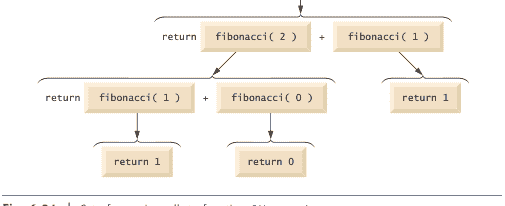

**图 6.31** | 对函数 `fibonacci` 的递归调用集合。

以相反顺序执行：先 `fibonacci(1)`，然后 `fibonacci(2)`。在这个程序以及大多数其他程序中，最终结果都是相同的。然而，在某些程序中，操作数的求值可能产生副作用（数据值的变化），从而可能影响表达式的最终结果。

C++ 只规定了四种运算符操作数的求值顺序——`&&`、`||`、逗号（`,`）和 `?:`。前三种是二元运算符，其两个操作数保证从左到右求值。最后一种运算符是 C++ 中唯一的三元运算符。其最左侧操作数总是最先求值；如果它求值为非零（真），则接下来求值中间操作数，而忽略最后一个操作数；如果最左侧操作数求值为零（假），则接下来求值第三个操作数，而忽略中间操作数。

> **常见编程错误 6.17**
>
> *编写依赖于 `&&`、`||`、`?:` 和逗号（`,`）运算符之外的其他运算符操作数求值顺序的程序，可能会导致逻辑错误。*


> **可移植性提示 6.2**
>
> *依赖于 `&&`、`||`、`?:` 和逗号（`,`）运算符之外的其他运算符操作数求值顺序的程序，在不同编译器下可能运行结果不同。*


对于像我们这里用来生成斐波那契数的递归程序，有必要提醒一句。函数 `fibonacci` 中的每一层递归都会使函数调用数量翻倍；也就是说，计算第 n 个斐波那契数所需的递归调用数量约为 2ⁿ 的数量级。这会迅速失控。仅计算第 20 个斐波那契数就需要约 2²⁰ 次调用，即约一百万次调用；计算第 30 个斐波那契数需要约 2³⁰ 次调用，即约十亿次调用，依此类推。计算机科学家将此称为指数复杂度。这类问题甚至会让世界上最强大的计算机相形见绌！一般性的复杂度问题，尤其是指数复杂度，将在通常称为“算法”的高年级计算机科学课程中详细讨论。

> **性能提示 6.8**
>
> *避免产生调用的指数级“爆炸”的斐波那契式递归程序。*


## 6.21 递归与迭代

在前两节中，我们研究了两个可以轻松地用递归或迭代实现的函数。本节比较这两种方法，并讨论在特定情况下为什么可能选择其中一种方法而不是另一种。

迭代和递归都基于控制语句：迭代使用重复结构；递归使用选择结构。迭代和递归都涉及重复：迭代显式使用重复结构；递归通过重复的函数调用实现重复。迭代和递归都涉及终止测试：迭代在循环继续条件失败时终止；递归在识别出基本情况时终止。使用计数器控制重复的迭代和递归都逐渐接近终止：迭代修改计数器，直到计数器取某个值使循环继续条件失败；递归产生原始问题的更简单版本，直到达到基本情况。迭代和


递归有许多缺点。它会反复调用函数调用机制，并因此带来相应的开销。这在处理器时间和内存空间上可能都很昂贵。每次递归调用都会导致函数的另一份副本（实际上只是函数的变量）被创建；这可能会消耗大量内存。迭代通常发生在函数内部，因此重复函数调用的开销和额外的内存分配就会被省略。那么为什么还要选择递归呢？

### 软件工程观察 6.15

*任何可以用递归解决的问题也都可以用迭代（非递归）方式解决。通常当递归方法更自然地反映问题，并且产生的程序更容易理解和调试时，才会选择递归方法。选择递归解决方案的另一个原因是迭代解决方案不明显。*

### 性能提示 6.9

*在性能敏感的情况下避免使用递归。递归调用需要时间并消耗额外内存。*

### 常见编程错误 6.18

*不小心让非递归函数直接或间接（通过另一个函数）调用自身，是一个逻辑错误。*

图 6.33 总结了正文中的递归示例和练习。

| 正文中的位置 | 递归示例和练习 |
| --- | --- |
| *第 6 章* |  |
| 第 6.19 节，图 6.29 | 阶乘函数 |
| 第 6.20 节，图 6.30 | 斐波那契函数 |
| 练习 6.36 | 整数提升为整数幂 |
| 练习 6.38 | 汉诺塔 |
| 练习 6.40 | 可视化递归 |
| 练习 6.41 | 最大公约数 |
| 练习 6.45，练习 6.46 | 神秘的“这个程序做什么？”练习 |
| *第 7 章* |  |
| 练习 7.18 | 神秘的“这个程序做什么？”练习 |
| 练习 7.21 | 神秘的“这个程序做什么？”练习 |
| 练习 7.31 | 选择排序 |
| 练习 7.32 | 判断字符串是否为回文 |
| 练习 7.33 | 线性搜索 |
| 练习 7.34 | 八皇后 |
| 练习 7.35 | 打印数组 |
| 练习 7.36 | 反向打印字符串 |
| 练习 7.37 | 数组中的最小值 |

图 6.33 | 正文中递归示例和练习的总结。（第 1 部分，共 2 部分。）

## 1. 实验目的

了解流水线的基本概念；理解流水线中数据相关的概念及解决办法。

## 2. 实验环境

- 计算机一台
- Windows 10 操作系统
- Logisim 或 Logisim Evolution 软件

## 3. 实验内容

设计一个简单的 5 级流水线 CPU，支持以下指令：

- 算术运算指令：add, sub, and, or, slt
- 逻辑移位指令：sll, srl
- 访存指令：lw, sw
- 分支指令：beq
- 跳转指令：j

要求实现转发（forwarding）和阻塞（stall）机制解决数据相关。

## 4. 实验原理

流水线将指令执行过程分为取指（IF）、译码（ID）、执行（EX）、访存（MEM）和写回（WB）五个阶段。

数据相关是指后面指令需要用到前面指令的结果，而前面指令的结果尚未写回寄存器。

解决数据相关的常用方法有：转发、阻塞和调整指令顺序。

## 5. 实验步骤

- 使用 Logisim 搭建 5 级流水线数据通路
- 添加控制信号和转发单元
- 设计冒险检测单元（Hazard Detection Unit）
- 编写测试程序并仿真验证

## 6. 实验结果

仿真结果表明，在存在数据相关时，流水线能够正确通过转发和阻塞机制获得正确结果。

在第 7 章中，你将学习如何在数组和面向对象的向量中维护列表和数据表。你将看到一个更优雅的基于数组的骰子滚动应用程序实现，以及我们在第 3 章到第 6 章中展示的 GradeBook 案例研究的两个增强版本，它们将使用数组来存储实际输入的分数。

## 总结

### 第 6.1 节 引言

- 经验表明，开发和维护大型程序的最佳方式是用小的、简单的片段或组件来构造它。这种技术称为分而治之。

### 第 6.2 节 C++ 中的程序组件

- C++ 程序通常通过将你编写的新函数和类与 C++ 标准库中可用的“预打包”函数和类组合来编写。
- 函数允许你通过将程序的任务划分为独立的单元来模块化程序。
- 函数体中的语句只编写一次，可以在程序中的多个位置重用，并且对其他函数隐藏。

### 第 6.3 节 数学库函数

- 有时函数不是类的成员。这样的函数称为全局函数。
- 全局函数的原型放在头文件中，以便它们可以在任何包含该头文件并能链接到该函数目标代码的程序中重用。

### 第 6.4 节 带多个参数的函数定义

- 编译器引用函数原型来检查对函数的调用是否包含正确数量和类型的参数，参数的类型顺序是否正确，以及函数返回的值是否能在调用该函数的表达式中正确使用。
- 如果函数不返回结果，则当程序到达函数结束的右花括号时，或通过执行语句

```
return;
```

控制返回。

如果函数返回结果，则语句

```
return expression;
```

计算 expression 并将 expression 的值返回给调用者。

### 第 6.5 节 函数原型和参数强制转换

- 函数原型中包含函数名称及其参数类型的那部分称为函数签名，或简称为签名。
- 函数原型的一个重要特性是参数强制转换——即强制将参数转换为参数声明指定的适当类型。
- 编译器可以根据 C++ 的提升规则将参数提升为参数类型。提升规则指示如何在不丢失数据的情况下在类型之间进行转换。

### 第 6.6 节 C++ 标准库头文件

- C++ 标准库被分为许多部分，每个部分都有自己的头文件。头文件还包含各种类类型、函数和常量的定义。
- 头文件“指示”编译器如何与库组件进行接口。

### 第 6.17 节 函数重载

- 编译器用其参数的数量和类型对每个函数标识符进行编码，以实现类型安全链接。类型安全链接确保调用正确的重载函数，并确保参数的类型与参数的类型一致。

### 第 6.18 节 函数模板

- 重载函数通常对不同的数据类型执行类似的操作，但涉及不同的程序逻辑。如果每种数据类型的程序逻辑和操作相同，则可以使用函数模板更紧凑、更方便地执行重载。
- 根据对函数模板的调用中提供的参数类型，C++ 会自动生成单独的函数模板特化，以适当地处理每种调用类型。
- 所有函数模板定义都以 template 关键字开头，后跟用尖括号（< 和 >）括起来的函数模板参数列表。
- 正式的模板参数是基本类型或用户定义类型的占位符。这些占位符用于指定函数参数的类型、指定函数的返回类型以及声明函数定义体内的变量。

### 第 6.19 节 递归

- 递归函数直接或间接调用自身。
- 递归函数只知道如何解决最简单的情况，即所谓的基本情况。如果使用基本情况调用函数，则该函数仅返回结果。
- 如果使用更复杂的问题调用函数，则该函数通常会将问题分为两个概念部分——一个函数知道如何做的部分和一个它不知道如何做的部分。为了使递归可行，后一部分必须与原始问题相似，但必须是其稍简单或稍小的版本。
- 为了终止递归，递归调用的序列必须收敛于基本情况。

### 第 6.20 节 使用递归的示例：斐波那契数列

- 连续斐波那契数的比率收敛于一个常数值 1.618... 这个数字在自然界中经常出现，被称为黄金比例或黄金分割。

### 第 6.21 节 递归与迭代

- 迭代和递归有许多相似之处：两者都基于控制语句，都涉及重复，都涉及终止测试，都逐渐接近终止，并且都可能无限发生。
- 递归反复调用函数调用机制，并因此带来相应的开销。这在处理器时间和内存空间上可能都很昂贵。每次递归调用都会导致函数变量的另一份副本被创建；这可能会消耗大量内存。

## 术语

- 活动记录 235
- 参数强制转换 217
- auto 存储类说明符 229
- 自动存储类 229
- 基本情况 253
- 类作用域 232
- const 关键字 240
- 悬空引用 244
- 默认参数 245
- 分而治之 208
- enum 关键字 228
- 枚举 228
- 枚举常量 228
- 指数复杂度 259
- extern 存储类说明符 229
- 形式参数 215
- 形参类型 251
- 函数调用栈 235
- 函数声明 216
- 函数重载 248


```cpp
int a;
int b;
int c;
int result;
cout << "Enter three integers: ";
cin >> a >> b >> c;
result = a * b * c;
cout << "Result is " << result;
return result;
}
```

- **6.8** 为什么函数原型会包含诸如 `double &` 这样的参数类型声明？
- **6.9** （对/错）C++ 中所有函数调用的实参都是按值传递的。
- **6.10** 编写一个完整程序，提示用户输入球体的半径，并计算和打印该球体的体积。使用内联函数 `sphereVolume`，它返回以下表达式的结果：`(4.0 / 3.0 * 3.14159 * pow(radius, 3))`。

## 自测练习答案

- **6.1** a) 函数、类。b) 函数调用。c) 局部变量。d) 返回。e) void。f) 作用域。g) 返回；返回表达式；或遇到函数的右花括号。h) 函数原型。i) rand。j) srand。k) auto、register、extern、static。l) auto。m) register。n) 全局。o) static。p) 函数作用域；全局命名空间作用域、局部作用域、函数原型作用域、类作用域、命名空间作用域。q) 递归。r) 基例。s) 重载。t) 一元作用域解析运算符 (::)。u) const。v) 模板。
- **6.2** a) 局部作用域。b) 局部作用域。c) 全局命名空间作用域。d) 全局命名空间作用域。e) 全局命名空间作用域。f) 函数原型作用域。
- **6.3** 见以下程序：

```cpp
1  // Exercise 6.3: Ex06_03.cpp
2  // Testing the math library functions.
3  #include <iostream>
4  #include <iomanip>
5  #include <cmath>
6  using namespace std;
7
8  int main()
9  {
10     cout << fixed << setprecision( 1 );
11
12     cout << "sqrt(" << 900.0 << ") = " << sqrt( 900.0 )
13          << "\nsqrt(" << 9.0 << ") = " << sqrt( 9.0 );
14     cout << "\nexp(" << 1.0 << ") = " << setprecision( 6 )
15          << exp( 1.0 ) << "\nexp(" << setprecision( 6 ) << 2.0
16          << ") = " << setprecision( 6 ) << exp( 2.0 );
17     cout << "\nlog(" << 2.718282 << ") = " << setprecision( 1 )
18          << log( 2.718282 )
19          << "\nlog(" << setprecision( 6 ) << 7.389056 << ") = "
20          << setprecision( 1 ) << log( 7.389056 );
21     cout << "\nlog10(" << 1.0 << ") = " << log10( 1.0 )
22          << "\nlog10(" << 10.0 << ") = " << setprecision( 6 )
23          << log10( 100.0 ) << " = " << log10( 100.0 ) ;
```

- c) **错误：** 没有返回 `n + sum( n - 1 )` 的结果；`sum` 返回了不正确的结果。
- **更正：** 将 else 子句中的语句返回为 `return n + sum( n - 1 );`
- d) **错误：** 包围参数列表的右括号后有多余分号，并且在函数定义中重新定义了参数 `a`。
- **更正：** 删除参数列表右括号后的分号，并删除声明 `float a;`。
- e) **错误：** 该函数在本不应返回值时返回了值。
- **更正：** 删除 return 语句或更改返回类型。

**6.8** 这会创建一个类型为“对 double 的引用”的引用参数，使函数能够修改调用函数中的原始变量。

**6.9** 错。C++ 通过引用参数（以及指针，我们将在第8章讨论）支持按引用传递。

**6.10** 见以下程序：

```cpp
// Exercise 6.10 Solution: Ex06_10.cpp
// Inline function that calculates the volume of a sphere.
#include <iostream>
#include <cmath>
using namespace std;

const double PI = 3.14159; // define global constant PI

// calculates volume of a sphere
inline double sphereVolume( const double radius )
{
   return 4.0 / 3.0 * PI * pow( radius, 3 );
} // end inline function sphereVolume

int main()
{
   double radiusValue;

   // prompt user for radius
   cout << "Enter the length of the radius of your sphere: ";
   cin >> radiusValue; // input radius

   // use radiusValue to calculate volume of sphere and display result
   cout << "Volume of sphere with radius " << radiusValue
        << " is " << sphereVolume( radiusValue ) << endl;
} // end main
```

## 练习题

- **6.11** 执行下列各语句后，给出 `x` 的值：
  - a) `x = fabs( 7.5 )`
  - b) `x = floor( 7.5 )`
  - c) `x = fabs( 0.0 )`
  - d) `x = ceil( 0.0 )`
  - e) `x = fabs( -6.4 )`
  - f) `x = ceil( -6.4 )`
  - g) `x = ceil( fabs( -8 + floor( -5.5 ) ) )`

- e) −1 ≤ n ≤ 1
- f) −3 ≤ n ≤ 11

**6.17** 编写一条语句，从下列每个集合中随机打印一个数：

- a) 2, 4, 6, 8, 10。
- b) 3, 5, 7, 9, 11。
- c) 6, 10, 14, 18, 22。

**6.18** *（幂运算）* 编写函数 `integerPower(base, exponent)`，返回 `base^exponent` 的值。例如，`integerPower(3, 4) = 3 * 3 * 3 * 3`。假设 `exponent` 是正整数且非零，`base` 是整数。不要使用任何数学库函数。

**6.19** *（斜边计算）* 定义一个函数 `hypotenuse`，当给定直角三角形的另外两条边时计算斜边。该函数应接受两个 double 参数，并以 double 返回斜边。在一个程序中使用该函数，确定下表中每个三角形的斜边。

| 三角形 | 边1 | 边2 |
|---|---:|---:|
| 1 | 3.0 | 4.0 |
| 2 | 5.0 | 12.0 |
| 3 | 8.0 | 15.0 |

**6.20** *（倍数）* 编写函数 `multiple`，判断一对整数中第二个是否为第一个的倍数。该函数应接受两个整数参数，如果第二个是第一个的倍数则返回 true，否则返回 false。在一个程序中输入一系列整数对并使用该函数。

**6.21** *（偶数）* 编写一个程序，输入一系列整数，并将它们逐个传递给函数 `isEven`，该函数使用取模运算符判断一个整数是否为偶数。该函数应接受一个整数参数，如果该整数为偶数则返回 true，否则返回 false。

**6.22** *（星号正方形）* 编写一个函数，在屏幕左边缘显示一个实心星号正方形，其边长由整数参数 `side` 指定。例如，如果 `side` 为 4，该函数显示如下：

```text
****
****
****
****
```

**6.23** *（任意字符正方形）* 修改练习 6.22 中创建的函数，用字符参数 `fillCharacter` 中包含的任意字符构成正方形。因此，如果 `side` 为 5 且 `fillCharacter` 为 `#`，则该函数应打印如下：

```text
#####
#####
#####
#####
#####
```

**6.24** *（分离数字）* 编写程序段完成以下各项：

- a) 计算整数 a 除以整数 b 时商的整数部分。
- b) 计算整数 a 除以整数 b 时的整数余数。
- c) 使用 (a) 和 (b) 中开发的程序片段编写一个函数，输入一个 1 到 32767 之间的整数，并将其打印为一系列数字，每对数字之间用两个空格分隔。例如，整数 4562 应打印如下：

```text
4  5  6  2
```

**6.25** *（计算秒数）* 编写一个函数，接受时间作为三个整数参数（小时、分钟和秒），并返回自时钟上次“敲响12点”以来经过的秒数。使用该函数计算两个时间之间的秒数，这两个时间都在时钟的一个12小时周期内。

**6.26** *（摄氏温度和华氏温度）* 实现以下整数函数：

- a) 函数 celsius 返回华氏温度对应的摄氏温度。
- b) 函数 fahrenheit 返回摄氏温度对应的华氏温度。
- c) 使用这些函数编写一个程序，打印图表，显示 0 到 100 摄氏度对应的所有华氏温度，以及 32 到 212 华氏度对应的所有摄氏温度。以整齐的表格格式输出，在保持可读性的同时尽量减少输出行数。

**6.27** *（求最小值）* 编写一个程序，输入三个双精度浮点数，并将它们传递给一个返回最小数的函数。

**6.28** *（完全数）* 如果一个整数的所有因子（包括 1，但不包括该数本身）之和等于该数，则称该整数为完全数。例如，6 是完全数，因为 6 = 1 + 2 + 3。编写函数 `isPerfect`，判断参数 number 是否为完全数。在一个程序中使用该函数，确定并打印 1 到 1000 之间的所有完全数。打印每个完全数的因子以确认该数确实是完全数。通过测试远大于 1000 的数来挑战计算机的能力。

**6.29** *（素数）* 如果一个整数只能被 1 和它本身整除，则称该整数为素数。例如，2、3、5 和 7 是素数，但 4、6、8 和 9 不是。

- a) 编写一个函数，判断一个数是否为素数。
- b) 在一个程序中使用该函数，确定并打印 2 到 10,000 之间的所有素数。在确定已找到所有素数之前，你真正需要测试其中多少个数？
- c) 起初，你可能认为 n/2 是测试一个数是否为素数时必须测试的上限，但实际上只需要测试到 n 的平方根。为什么？重写程序，并分别用两种方式运行。估计性能改进。

**6.30** *（反转数字）* 编写一个函数，接受一个整数值并返回其数字反转后的数。例如，给定数字 7631，该函数应返回 1367。

**6.31** *（最大公约数）* 两个整数的最大公约数（GCD）是能同时整除这两个数的最大整数。编写函数 `gcd`，返回两个整数的最大公约数。

**6.32** *（数值成绩的质量点）* 编写函数 `qualityPoints`，输入学生的平均成绩：如果平均成绩为 90-100 则返回 4，如果为 80-89 则返回 3，如果为 70-79 则返回 2，如果为 60-69 则返回 1，如果低于 60 则返回 0。

**6.33** *（掷硬币）* 编写一个程序模拟掷硬币。每次掷硬币时，程序应打印 Heads 或 Tails。让程序掷硬币 100 次并统计数量


汉诺塔是每一位初学计算机科学者都必须面对的最著名的经典问题之一。传说在远东的一座寺庙里，僧侣们正试图将一叠金盘从一根菱形柱移动到另一根柱子上（图 6.35）。最初，这叠盘子共有 64 个，全部穿在一根柱子上，并且从底部到顶部按尺寸递减排列。僧侣们试图将整叠盘子从一根柱子移动到另一根柱子，同时必须遵守以下限制：每次只能移动一个盘子，并且任何时候都不能将较大的盘子放在较小的盘子上面。现场提供了三根柱子，其中一根用于临时存放盘子。据说，当僧侣们完成任务时，世界就会毁灭，因此我们没有太大动力去帮助他们完成这项工作。

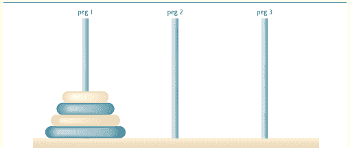

**图 6.35** | 有四个盘子时的汉诺塔。

假设僧侣们正试图将盘子从柱子 1 移动到柱子 3。我们希望编写一个算法，输出精确的柱子间盘子移动顺序。

如果采用传统方法解决这个问题，我们很快就会在管理盘子的过程中陷入一团乱麻。相反，如果从递归的角度来处理这个问题，步骤就会变得十分简单。移动 n 个盘子可以归结为只移动 n – 1 个盘子（这就是递归），具体如下：

- a) 将 n – 1 个盘子从柱子 1 移动到柱子 2，使用柱子 3 作为临时存放区。
- b) 将最后一个盘子（最大的盘子）从柱子 1 移动到柱子 3。
- c) 将 n – 1 个盘子从柱子 2 移动到柱子 3，使用柱子 1 作为临时存放区。

当最后一个任务变成移动 n = 1 个盘子时（即基本情形），整个过程结束。此时只需直接移动盘子，不需要临时存放区。编写一个程序来解决汉诺塔问题。使用一个包含以下四个参数的递归函数：

- a) 要移动的盘子数量
- b) 这些盘子最初穿在哪根柱子上
- c) 要将这叠盘子移动到哪根柱子上
- d) 用作临时存放区的柱子

显示将盘子从起始柱子移动到目标柱子的精确指令。要将三个盘子从柱子 1 移动到柱子 3，程序应显示以下移动步骤：

```text
1 → 3 (This means move one disk from peg 1 to peg 3.)
1 → 2
3 → 2
1 → 3
2 → 1
2 → 3
1 → 3
```

**6.39** *（汉诺塔：迭代版本）* 任何可以用递归实现的程序，也可以用迭代实现，尽管有时实现起来会更困难，而且清晰度较低。尝试编写汉诺塔的迭代版本。如果成功，将你的迭代版本与练习 6.38 中编写的递归版本进行比较。研究两种程序在性能、清晰度以及你证明程序正确性的能力方面存在的问题。

**6.40** *（递归的可视化）* 观察递归“实际运行”是很有趣的。修改图 6.29 中的阶乘函数，使其输出局部变量和递归调用参数。对于每次递归调用，将输出显示在单独的一行中，并增加一级缩进。尽最大努力使输出清晰、有趣且有意义。你的目标是设计并实现一种输出格式，帮助人们更好地理解递归。你还可以考虑将这种显示功能添加到本书中其他许多递归示例和练习中。

**6.41** *（递归求最大公约数）* 整数 x 和 y 的最大公约数，是能够同时整除 x 和 y 的最大整数。编写一个递归函数 `gcd`，返回 x 和 y 的最大公约数，其递归定义如下：如果 y 等于 0，则 `gcd(x, y)` 为 x；否则，`gcd(x, y)` 为 `gcd(y, x % y)`，其中 `%` 是取模运算符。[注意：对于此算法，x 必须大于 y。]

**6.42** *（递归调用 main）* 在你的系统上，`main` 可以递归调用自身吗？编写一个包含 `main` 函数的程序。其中包含静态局部变量 `count`，并将其初始化为 1。每次调用 `main` 时，先后自增并输出 `count` 的值。编译你的程序。会发生什么？

**6.43** *（点之间的距离）* 编写函数 `distance`，计算两点 `(x1, y1)` 和 `(x2, y2)` 之间的距离。所有数字和返回值都应为 `double` 类型。

**6.44** 下面的程序有什么问题？

```cpp
// Exercise 6.44: ex06.44.cpp
// What is wrong with this program?
#include <iostream>
using namespace std;

int main()
{
   int c;

   if ( ( c = cin.get() ) != EOF )
   {
      main();
      cout << c;
   } // end if
} // end main
```

**6.45** 下面的程序执行什么操作？

```cpp
// Exercise 6.45: ex06.45.cpp
// What does this program do?
#include <iostream>
using namespace std;

int mystery( int, int ); // function prototype

int main()
{
   int x, y;

   cout << "Enter two integers: ";
```

人民对美好生活的向往，就是我们的奋斗目标

——在十八届中央政治局常委同中外记者见面时的讲话（2012年11月15日）

刚才，我们召开了中国共产党第十八届中央委员会第一次全体会议，选举产生了新一届中央领导机构，选举我为中央委员会总书记。我代表新一届中央领导机构成员向全党同志表示感谢。

这次中央委员会组成人员中，有很多同志是新面孔，他们都来自各个地区、各个部门、各个行业，有着丰富的实际工作经验。在这里，我代表新一届中央领导机构，向各位同志表示衷心的感谢。

我们的人民热爱生活，期盼有更好的教育、更稳定的工作、更满意的收入、更可靠的社会保障、更高水平的医疗卫生服务、更舒适的居住条件、更优美的环境，期盼着孩子们能成长得更好、工作得更好、生活得更好。人民对美好生活的向往，就是我们的奋斗目标。

人世间的一切幸福都是要靠辛勤的劳动来创造的。我们的责任，就是要团结带领全党全国各族人民，继续解放思想，坚持改革开放，不断解放和发展社会生产力，努力解决群众的生产生活困难，坚定不移走共同富裕的道路。

这个重大的责任，就是对党的责任。我们的党是全心全意为人民服务的政党。党领导人民已经取得了举世瞩目的成就，我们完全有理由因此而自豪，但我们自豪而不自满，决不会躺在过去的功劳簿上。新形势下，我们党面临着许多严峻挑战，党内存在着许多亟待解决的问题。尤其是一些党员干部中发生的贪污腐败、脱离群众、形式主义、官僚主义等问题，必须下大气力解决。全党必须警醒起来。打铁还需自身硬。我们的责任，就是同全党同志一道，坚持党要管党、从严治党，切实解决自身存在的突出问题，切实改进工作作风，密切联系群众，使我们党始终成为中国特色社会主义事业的坚强领导核心。

这个重大的责任，就是对民族的责任。我们的民族是伟大的民族。在五千多年的文明发展历程中，中华民族为人类文明进步作出了不可磨灭的贡献。近代以后，我们的民族历经磨难，中华民族到了最危险的时候。自那时以来，为了实现中华民族伟大复兴，无数仁人志士奋起抗争，但一次又一次地失败了。

下注，输出新的银行余额，检查银行余额是否已经变为零，如果是，则输出消息“抱歉，你破产了！”随着游戏进行，输出各种消息来制造一些“闲聊”，例如“哦，你这是要孤注一掷，是吧？”，“哎，来嘛，试一把！”或者“你现在赢了很多。此时正是把筹码兑现的时候！”

**6.50（圆的面积）** 编写一个 C++ 程序，提示用户输入圆的半径，然后调用内联函数 `circleArea` 计算该圆的面积。

**6.51（按值传递与按引用传递）** 编写一个完整的 C++ 程序，其中包含下面指定的两个可选函数。这两个函数都只执行同一项操作：将 `main` 中定义的变量 `count` 乘以 3。然后比较并说明两种方法的异同。这两个函数是：

- a) 函数 `tripleByValue` 按值传递 `count` 的副本，将副本乘以 3，并返回新值；
- b) 函数 `tripleByReference` 通过引用参数按引用传递 `count`，并通过其别名（即引用参数）将 `count` 的原始值乘以 3。

**6.52** 一元作用域解析运算符的用途是什么？

**6.53（函数模板 minimum）** 编写一个使用名为 `minimum` 的函数模板的程序，用于确定两个参数中较小的一个。使用整数、字符和浮点数参数测试该程序。

**6.54（函数模板 maximum）** 编写一个使用名为 `maximum` 的函数模板的程序，用于确定两个参数中较大的一个。使用整数、字符和浮点数参数测试该程序。

**6.55（找出错误）** 判断下面的程序片段是否包含错误。对于每个错误，解释应如何修正。[注意：某个程序片段也可能不存在任何错误。]

a)

```cpp
template < class A >
int sum( int num1, int num2, int num3 )
{
    return num1 + num2 + num3;
}
```

b)

```cpp
void printResults( int x, int y )
{
    cout << "The sum is " << x + y << '\n';
    return x + y;
}
```

c)

```cpp
template < A >
A product( A num1, A num2, A num3 )
{
    return num1 * num2 * num3;
}
```

d)

```cpp
double cube( int );
int cube( int );
```

## 创造改变

随着计算机成本下降，无论经济状况如何，每一位学生都能够拥有一台计算机并在学校使用它，这逐渐变得可行。这为改善全世界学生的教育体验创造了令人振奋的可能性，正如接下来的五道练习所展示的那样。[注意：了解一下“每个孩子一台笔记本电脑”项目等倡议（www.laptop.org）。此外，研究“绿色”笔记本电脑，并注意这些设备具备哪些关键的“绿色环保”特征？进一步了解……


# 7 数组和 vector


> *现在去吧，将它*
> *写在它们面前的板上，*
> *并记在书中。*
> ——以赛亚书，30:8

> *从开头开始，……*
> *一直走到结尾；*
> *然后停下。*
> ——刘易斯·卡罗尔

> *过犹不及。*
> ——孔子

### 目标

在本章中，你将学习：

- 使用数组数据结构来表示一组相关的数据项。
- 使用数组来存储、排序和搜索列表及数值表。
- 声明数组、初始化数组并引用数组的各个元素。
- 将数组传递给函数。
- 基本的搜索和排序技术。
- 声明和操作多维数组。
- 使用 C++ 标准库类模板 vector。

要计算 `c[6]` 除以 2 并将结果赋给变量 `x`，我们可以这样写：

```cpp
x = c[6] / 2;
```


> **常见编程错误 7.1**
>
> 注意“数组的第七个元素”与“数组元素 7”之间的区别。数组下标从 0 开始，因此“数组的第七个元素”的下标为 6，而“数组元素 7”的下标为 7，实际上是数组的第八个元素。遗憾的是，这种区别经常是差一错误（off-by-one errors）的来源。为了避免这类错误，我们通过数组名和下标号明确地引用特定的数组元素（例如，`c[6]` 或 `c[7]`）。

用于括起数组下标的方括号实际上是一个运算符。方括号与圆括号具有相同的优先级。图 7.2 显示了迄今为止所介绍的运算符的优先级和结合性。方括号（`[]`）已添加到图 7.2 的第二行。运算符按优先级从高到低自上而下排列，并标注了结合性和类型。

| 运算符 | 结合性 | 类型 |
|---|---|---|
| `::` | 左到右 | 作用域解析 |
| `()` `[]` | 左到右 | 最高 |
| `++` `--` `static_cast<type>(operand)` | 左到右 | 一元（后缀） |
| `++` `--` `+` `-` `!` | 右到左 | 一元（前缀） |
| `*` `/` `%` | 左到右 | 乘法 |
| `+` `-` | 左到右 | 加法 |
| `<<` `>>` | 左到右 | 插入/提取 |
| `<` `<=` `>` `>=` | 左到右 | 关系 |
| `==` `!=` | 左到右 | 相等性 |
| `&&` | 左到右 | 逻辑与 |
| `\|\|` | 左到右 | 逻辑或 |
| `?:` | 右到左 | 条件 |
| `=` `+=` `-=` `*=` `/=` `%=` | 右到左 | 赋值 |
| `,` | 左到右 | 逗号 |

**图 7.2** | 运算符优先级与结合性。

## 7.3 声明数组

数组在内存中占据空间。要指定数组元素的类型和所需元素的数量，请使用如下形式的声明：

```cpp
type arrayName[ arraySize ];
```

编译器会保留适当数量的内存。（回想一下，在 C++ 中，保留内存的声明更准确地称为定义。）arraySize 必须是大于零的整数常量。例如，要告诉编译器为整数数组 `c` 保留 12 个元素，可以使用声明：

```cpp
int c[ 12 ]; // c is an array of 12 integers
```

可以使用一条声明为多个数组保留内存。

> **良好编程实践 7.1**
>
> 为了可读性、可修改性和便于注释，我们每次声明只声明一个数组。

数组可以声明为包含任何非引用数据类型的值。例如，可以使用 string 类型的数组来存储字符串。

## 7.4 数组使用示例

本节提供许多示例，演示如何声明数组、如何初始化数组以及如何执行常见的数组操作。

### 7.4.1 声明数组并使用循环初始化数组元素

图 7.3 中的程序声明了包含 10 个元素的整数数组 n（第 9 行）。第 12–13 行使用 *for* 语句将数组元素初始化为零。与其他自动变量一样，自动数组不会隐式地初始化为零，尽管静态数组会。第一个输出语句（第 15 行）显示后续 *for* 语句（第 18–19 行）所打印列的列标题，该语句以表格格式打印数组。请记住，`setw` 指定的是仅下一个要输出的值的字段宽度。

```cpp
1  // Fig. 7.3: fig07_03.cpp
2  // Initializing an array.
3  #include <iostream>
4  #include <iomanip>
5  using namespace std;
6
7  int main()
8  {
9      int n[ 10 ]; // n is an array of 10 integers
10
11     // initialize elements of array n to 0
12     for ( int i = 0; i < 10; i++ )
13         n[ i ] = 0; // set element at location i to 0
14
15     cout << "Element" << setw( 13 ) << "Value" << endl;
16
17     // output each array element's value
18     for ( int j = 0; j < 10; j++ )
19         cout << setw( 7 ) << j << setw( 13 ) << n[ j ] << endl;
20  } // end main
```

**图 7.3** | 将数组元素初始化为零并打印数组。（第 1 部分，共 2 部分。）

| 元素 | 值 |
| --- | --- |
| 0 | 0 |
| 1 | 0 |
| 2 | 0 |
| 3 | 0 |
| 4 | 0 |
| 5 | 0 |
| 6 | 0 |
| 7 | 0 |
| 8 | 0 |
| 9 | 0 |

**图 7.3** | 将数组元素初始化为零并打印数组。（第 2 部分，共 2 部分。）

### 7.4.2 在声明中使用初始化列表初始化数组

数组的元素也可以在数组声明中初始化，方法是在数组名后加上等号和用花括号括起来的、以逗号分隔的初始化器列表。图 7.4 中的程序使用初始化列表将包含 10 个值的整数数组初始化（第 10 行），并以表格格式打印该数组（第 12–16 行）。

```cpp
1  // Fig. 7.4: fig07_04.cpp
2  // Initializing an array in a declaration.
3  #include <iostream>
4  #include <iomanip>
5  using namespace std;
6
7  int main()
8  {
9      // use initializer list to initialize array n
10     int n[ 10 ] = { 32, 27, 64, 18, 95, 14, 90, 70, 60, 37 };
11
12     cout << "Element" << setw( 13 ) << "Value" << endl;
13
14     // output each array element's value
15     for ( int i = 0; i < 10; i++ )
16         cout << setw( 7 ) << i << setw( 13 ) << n[ i ] << endl;
17 } // end main
```

| 元素 | 值 |
| --- | --- |
| 0 | 32 |
| 1 | 27 |
| 2 | 64 |
| 3 | 18 |
| 4 | 95 |
| 5 | 14 |
| 6 | 90 |
| 7 | 70 |
| 8 | 60 |
| 9 | 37 |

**图 7.4** | 在数组声明中初始化数组元素。

```cpp
4 int main()
5 {
6     const int x; // Error: x must be initialized
7
8     x = 7; // Error: cannot modify a const variable
9 } // end main
```

Microsoft Visual C++ 编译器错误消息：

```text
C:\cpphtp7_examples\ch07\fig07_07.cpp(6) : error C2734: 'x' : const object
    must be initialized if not extern
C:\cpphtp7_examples\ch07\fig07_07.cpp(8) : error C3892: 'x' : you cannot
    assign to a variable that is const
```

GNU C++ 编译器错误消息：

```text
fig07_07.cpp:6: error: uninitialized const 'x'
fig07_07.cpp:8: error: assignment of read-only variable 'x'
```

**图 7.7** | const 变量必须初始化。（第 2 部分，共 2 部分。）

> **常见编程错误 7.4**
>
> *在可执行语句中给常量变量赋值是一个编译错误。*

在图 7.7 中，Microsoft Visual C++ 产生的编译错误将 int 变量 x 称为“const 对象”。ISO/IEC C++ 标准将“对象”定义为任何“存储区域”。与类的对象一样，基础类型变量也占用内存空间，因此它们通常被称为“对象”。

常量变量可以放置在需要常量表达式的任何位置。在图 7.5 中，常量变量 arraySize 在第 12 行指定了数组 s 的大小。

> **常见编程错误 7.5**
>
> *只有常量才能用于声明自动数组和静态数组的大小。不为此目的使用常量是一个编译错误。*

使用常量变量指定数组大小可以使程序更具可扩展性。在图 7.5 中，只需将声明中 arraySize 的值从 10 改为 1000，第一个 for 语句就可以填充一个包含 1000 个元素的数组。如果未使用常量变量 arraySize，我们将不得不修改程序的第 12、14 和 20 行，才能将程序扩展为处理 1000 个数组元素。随着程序变得越来越大，这种技术对于编写更清晰、更易修改的程序变得更加有用。

> **软件工程观察 7.1**
>
> *将每个数组的大小定义为常量变量而不是字面常量，可以使程序更具可扩展性。*


特别是较大的数值。用条形图以图形方式显示数值数据的一种简单方法是，将每个数值显示为星号（*）的条形。

教授们经常喜欢检查考试分数的分布。教授可能会将几个类别中的分数数量绘制成图表，以可视化分数分布。假设分数为 87、68、94、100、83、78、85、91、76 和 87。有一个 100 分，两个 90 多分，四个 80 多分，两个 70 多分，一个 60 多分，没有低于 60 分的分数。我们的下一个程序（图 7.9）将这个分数分布数据存储在一个包含 11 个元素的数组中，每个元素对应一个分数类别。例如，`n[0]` 表示 0-9 分数段的数量，`n[7]` 表示 70-79 分数段的数量，`n[10]` 表示 100 分的数量。本章后面的两个版本的 GradeBook 类（图 7.15-7.16 和图 7.22-7.23）包含基于一组分数计算这些分数频率的代码。现在，我们通过查看这组分数手动创建数组。

程序从数组中读取数字，并将信息绘制成条形图，显示每个分数段，后跟一个星号条形，表示该分数段的数量。为了标记每个条形，第 18-23 行根据计数器变量 i 的当前值输出一个分数段（例如，"70-79: "）。嵌套的 for 语句（第 26-27 行）

```cpp
1  // Fig. 7.9: fig07_09.cpp
2  // Bar chart printing program.
3  #include <iostream>
4  #include <iomanip>
5  using namespace std;
6
7  int main()
8  {
9      const int arraySize = 11;
10     int n[ arraySize ] = { 0, 0, 0, 0, 0, 0, 1, 2, 4, 2, 1 };
11
12     cout << "Grade distribution:" << endl;
13
14     // for each element of array n, output a bar of the chart
15     for ( int i = 0; i < arraySize; i++ )
16     {
17         // output bar labels ("0-9: ", ..., "90-99: ", "100: ")
18         if ( i == 0 )
19             cout << " 0-9: ";
20         else if ( i == 10 )
21             cout << " 100: ";
22         else
23             cout << i * 10 << "-" << ( i * 10 ) + 9 << ": ";
24
25         // print bar of asterisks
26         for ( int stars = 0; stars < n[ i ]; stars++ )
27             cout << '*';
28
29         cout << endl; // start a new line of output
30     } // end outer for
31 } // end main
```

**图 7.9** | 条形图打印程序。（第 1 部分，共 2 部分。）

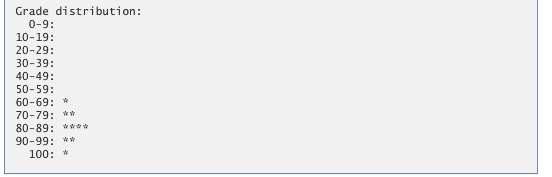

**图 7.9** | 条形图打印程序。（第 2 部分，共 2 部分。）

输出条形。注意第 26 行的循环继续条件（`stars < n[i]`）。每次程序到达内部 for 时，循环从 0 计数到 `n[i]`，从而使用数组 `n` 中的值来确定要显示的星号数量。在此示例中，`n[0]`-`n[5]` 包含 0，因为没有学生的分数低于 60。因此，程序在前六个分数段旁边不显示星号。

> **常见编程错误 7.6**
>
> *尽管可以在一个 for 语句和嵌套在其中的第二个 for 语句中使用相同的控制变量，但这会令人困惑，并可能导致逻辑错误。*

### 7.4.6 使用数组元素作为计数器

有时，程序使用计数器变量来汇总数据，例如调查结果。在图 6.9 中，我们在掷骰子程序中使用单独的计数器来跟踪程序掷骰子 6,000,000 次时骰子每一面出现的次数。该程序的数组版本如图 7.10 所示。

```cpp
 1   // Fig. 7.10: fig07_10.cpp
 2   // Roll a six-sided die 6,000,000 times.
 3   #include <iostream>
 4   #include <iomanip>
 5   #include <cstdlib>
 6   #include <ctime>
 7   using namespace std;
 8
 9   int main()
 10   {
 11      const int arraySize = 7; // ignore element zero
 12      int frequency[ arraySize ] = {}; // initialize elements to 0
 13
 14      srand( time( 0 ) ); // seed random number generator
 15
 16      // roll die 6,000,000 times; use die value as frequency index
 17      for ( int roll = 1; roll <= 6000000; roll++ )
 18          frequency[ 1 + rand() % 6 ]++;
```

**图 7.10** | 使用数组而不是 switch 的掷骰子程序。（第 1 部分，共 2 部分。）

```cpp
1  // Fig. 7.11: fig07_11.cpp
2  // Poll analysis program.
3  #include <iostream>
4  #include <iomanip>
5  using namespace std;
6
7  int main()
8  {
9     // define array sizes
10    const int responseSize = 40; // size of array responses
11    const int frequencySize = 11; // size of array frequency
12
13    // place survey responses in array responses
14    const int responses[ responseSize ] = { 1, 2, 6, 4, 8, 5, 9, 7, 8,
15       10, 1, 6, 3, 8, 6, 10, 3, 8, 2, 7, 6, 5, 7, 6, 8, 6, 7,
16       5, 6, 6, 5, 6, 7, 5, 6, 4, 8, 6, 8, 10 };
17
18    // initialize frequency counters to 0
19    int frequency[ frequencySize ] = {};
20
21    // for each answer, select responses element and use that value
22    // as frequency subscript to determine element to increment
23    for ( int answer = 0; answer < responseSize; answer++ )
24        frequency[ responses[ answer ] ]++;
25
26    cout << "Rating" << setw( 17 ) << "Frequency" << endl;
27
28    // output each array element's value
29    for ( int rating = 1; rating < frequencySize; rating++ )
30        cout << setw( 6 ) << rating << setw( 17 ) << frequency[ rating ]
31           << endl;
32 } // end main
```

| 评级 | 频率 |
| --- | --- |
| 1 | 2 |
| 2 | 2 |
| 3 | 2 |
| 4 | 2 |
| 5 | 5 |
| 6 | 11 |
| 7 | 5 |
| 8 | 7 |
| 9 | 1 |
| 10 | 3 |

**图 7.11** | 调查分析程序。

第一个 for 语句（第 23-24 行）从数组 `responses` 中逐个取出响应，并递增 `frequency` 数组中的 10 个计数器之一（`frequency[1]` 到 `frequency[10]`）。循环中的关键语句是第 24 行，它根据 `responses[answer]` 的值递增相应的频率计数器。

让我们考虑 for 循环的几次迭代。当控制变量 `answer` 为 0 时，`responses[answer]` 的值是 `responses[0]` 的值（即第 14 行中的 1），因此程序将 `frequency[responses[answer]]++` 解释为

```cpp
frequency[ 1 ]++
```

这会递增数组元素 1 中的值。要计算该表达式，请从最内层方括号中的值（`answer`）开始。一旦知道 `answer` 的值（即第 23 行循环控制变量的值），就将其代入表达式，并计算下一层外层方括号（即 `responses[answer]`，它是从第 14-17 行的 `responses` 数组中选择的一个值）。然后使用结果值作为 `frequency` 数组的下标，以指定要递增的计数器。

当 `answer` 为 1 时，`responses[answer]` 的值是 `responses[1]`，即 2，因此程序将 `frequency[responses[answer]]++` 解释为

```cpp
frequency[ 2 ]++
```

这会递增数组元素 2。

当 `answer` 为 2 时，`responses[answer]` 的值是 `responses[2]`，即 6，因此程序将 `frequency[responses[answer]]++` 解释为

```cpp
frequency[ 6 ]++
```

这会递增数组元素 6，依此类推。无论调查中处理多少响应，程序只需要一个 11 元素的数组（忽略元素 0）来汇总结果，因为所有响应值都在 1 到 10 之间，而 11 元素数组的下标值是从 0 到 10。

如果 `responses` 中的数据包含无效值，例如 13，程序将尝试将 1 加到 `frequency[13]` 上，这超出了数组的边界。C++ 没有数组边界检查来防止计算机引用不存在的元素。因此，正在执行的程序可能会在没有任何警告的情况下“走偏”到数组的任意一端。您应确保所有数组引用都保持在数组的边界之内。


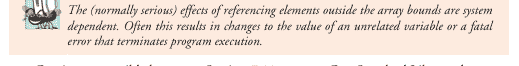

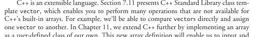

C++ 是一种可扩展的语言。第 7.11 节介绍了 C++ 标准库类模板 `vector`，它使您能够执行许多 C++ 内置数组无法执行的操作。例如，我们可以直接比较 `vector` 并将一个 `vector` 赋给另一个 `vector`。在第 11 章中，我们将通过将数组实现为我们自己的用户定义类来进一步扩展 C++。这个新的数组定义将使我们能够使用 `cin` 和 `cout` 输入和输出整个数组，在创建数组时初始化数组，并防止访问超出范围的数组元素。我们甚至可以使用非整数下标。


```cpp
25  // initializes elements to 0 first time function is called
26  static int array1[ arraySize ]; // static local array
27
28  cout << "\nValues on entering staticArrayInit:\n";
29
30  // output contents of array1
31  for ( int i = 0; i < arraySize; i++ )
32      cout << "array1[" << i << "] = " << array1[ i ] << "  ";
33
34  cout << "\nValues on exiting staticArrayInit:\n";
35
36  // modify and output contents of array1
37  for ( int j = 0; j < arraySize; j++ )
38      cout << "array1[" << j << "] = " << ( array1[ j ] += 5 ) << "  ";
39
40  } // end function staticArrayInit
41
42  // function to demonstrate an automatic local array
43  void automaticArrayInit( void )
44  {
45      // initializes elements each time function is called
46      int array2[ arraySize ] = { 1, 2, 3 }; // automatic local array
47
48      cout << "\n\nValues on entering automaticArrayInit:\n";
49
50      // output contents of array2
51      for ( int i = 0; i < arraySize; i++ )
52          cout << "array2[" << i << "] = " << array2[ i ] << "  ";
53
54      cout << "\nValues on exiting automaticArrayInit:\n";
55
56      // modify and output contents of array2
57      for ( int j = 0; j < arraySize; j++ )
58          cout << "array2[" << j << "] = " << ( array2[ j ] += 5 ) << "  ";
```

```text
First call to each function:

Values on entering staticArrayInit:
array1[0] = 0  array1[1] = 0  array1[2] = 0
Values on exiting staticArrayInit:
array1[0] = 5  array1[1] = 5  array1[2] = 5

Values on entering automaticArrayInit:
array2[0] = 1  array2[1] = 2  array2[2] = 3
Values on exiting automaticArrayInit:
array2[0] = 6  array2[1] = 7  array2[2] = 8

Second call to each function:

Values on entering staticArrayInit:
array1[0] = 5  array1[1] = 5  array1[2] = 5
Values on exiting staticArrayInit:
array1[0] = 10  array1[1] = 10  array1[2] = 10
```

图 7.12 | 静态数组初始化和自动数组初始化。（第2部分，共3部分。）

### 性能提示 7.2


*出于性能原因，按引用传递数组是有意义的。按值传递需要复制每个元素。对于大型且频繁传递的数组，这会耗时，并且需要相当多的存储空间来保存数组元素的副本。*

### 软件工程观察 7.3


*可以按值传递数组（使用我们在第21章解释的一个简单技巧）——然而，这样做的情况很少。*

尽管整个数组是按引用传递的，但单个数组元素却像简单变量一样按值传递。这种简单的数据片段称为标量或标量值。要将数组的一个元素传递给函数，请在函数调用中使用该数组元素的带下标名字作为实参。在第6章中，我们展示了如何使用引用按引用传递标量（即单个变量和数组元素）。在第8章中，我们将展示如何使用指针按引用传递标量。

函数要通过函数调用接收数组，其参数列表必须指明该函数期望接收一个数组。例如，函数 `modifyArray` 的函数头可以写成

```cpp
void modifyArray( int b[], int arraySize )
```

这表明 `modifyArray` 期望在参数 `b` 中接收一个整数数组的地址，并在参数 `arraySize` 中接收数组元素个数。数组方括号中不需要指定大小。如果包含大小，编译器会忽略它；因此，任意大小的数组都可以传递给该函数。C++ 按引用将数组传递给函数——当被调用函数使用数组名 `b` 时，它引用的是调用者中的实际数组（即本节开头讨论的数组 `hourlyTemperatures`）。

注意 `modifyArray` 的函数原型看起来有些奇怪：

```cpp
void modifyArray( int [], int );
```

这个原型也可以写成：

```cpp
void modifyArray( int anyArrayName[], int anyVariableName );
```

但是，正如我们在第3章中学到的，C++ 编译器会忽略原型中的变量名。请记住，原型告诉编译器实参的个数以及每个实参的类型（按照期望实参出现的顺序）。

图 7.13 中的程序演示了传递整个数组与传递数组元素之间的区别。第19–20行打印整数数组 `a` 的五个原始元素。第25行将 `a` 及其大小传递给函数 `modifyArray`（第40–45行），该函数将 `a` 的每个元素乘以2（通过参数 `b`）。然后，第29–30行在 `main` 中再次打印数组 `a`。如输出所示，`a` 的元素确实被 `modifyArray` 修改了。接下来，第33行打印标量 `a[3]` 的值，然后第35行将元素 `a[3]` 传递给函数 `modifyElement`（第49–53行），该函数将其参数乘以2并打印新值。当第36行在 `main` 中再次打印 `a[3]` 时，该值并未被修改，因为单个数组元素是按值传递的。

在你的程序中，可能会出现不允许函数修改数组元素的情况。C++ 提供了类型限定符 `const`，可用于防止被调用函数中的代码修改调用者中的数组值。当函数指定一个前面带有 const 限定符的数组参数时，该数组的元素在函数体中变为常量，任何在函数体中修改数组元素的尝试都会导致编译错误。这使你能够防止函数体中对数组元素的意外修改。

图 7.14 演示了 const 限定符。函数 `tryToModifyArray`（第18–23行）定义为参数 `const int b[]`，这指定数组 `b` 是常量，不能被修改。该函数三次尝试修改数组 `b` 的元素（第20–22行）中的每一次都会导致编译错误。例如，有些编译器会产生类似“Cannot modify a const object.”的错误。此消息表明，将 const 对象（例如 `b[0]`）用作左值是错误的——你不能通过将 const 对象放在赋值运算符左侧来为其赋新值。编译器错误消息因编译器而异（如图 7.14 所示）。第10章将再次讨论 const 限定符。

### 软件工程观察 7.4

*在函数定义中为数组参数应用 const 类型限定符，以防止原数组在函数体中被修改，这是最小权限原则的另一个示例。除非绝对必要，否则不应赋予函数修改数组的能力。*

```cpp
// Fig. 7.14: fig07_14.cpp
// Demonstrating the const type qualifier.
#include <iostream>
using namespace std;

void tryToModifyArray( const int [] ); // function prototype

int main()
{
    int a[] = { 10, 20, 30 };
```

**图 7.14** | 应用于数组参数的 const 类型限定符。（第1部分，共2部分。）

```cpp
11
12    tryToModifyArray( a );
13    cout << a[ 0 ] << ' ' << a[ 1 ] << ' ' << a[ 2 ] << '\n';
14 } // end main
15
16 // In function tryToModifyArray, "b" cannot be used
17 // to modify the original array "a" in main.
18 void tryToModifyArray( const int b[] )
19 {
20    b[ 0 ] /= 2; // compilation error
21    b[ 1 ] /= 2; // compilation error
22    b[ 2 ] /= 2; // compilation error
23 } // end function tryToModifyArray
```

*Microsoft Visual C++ 编译器错误消息：*

```text
c:\\cpphtp7_examples\\ch07\\fig07_14\\fig07_14.cpp(20) : error C3892: 'b' : you
   cannot assign to a variable that is const
c:\\cpphtp7_examples\\ch07\\fig07_14\\fig07_14.cpp(21) : error C3892: 'b' : you
   cannot assign to a variable that is const
c:\\cpphtp7_examples\\ch07\\fig07_14\\ch07\\fig07_14.cpp(22) : error C3892: 'b' : you
   cannot assign to a variable that is const
```

*GNU C++ 编译器错误消息：*

```text
fig07_14.cpp:20: error: assignment of read-only location
fig07_14.cpp:21: error: assignment of read-only location
fig07_14.cpp:22: error: assignment of read-only location
```

图 7.14 | 应用于数组参数的 const 类型限定符。（第2部分，共2部分。）

```text
Effects of passing entire array by reference:

The values of the original array are:
  0  1  2  3  4
The values of the modified array are:
  0  2  4  6  8

Effects of passing array element by value:

a[3] before modifyElement: 6
Value of element in modifyElement: 12
a[3] after modifyElement: 6
```

**图 7.13** | 将数组和单个数组元素传递给函数。（第2部分，共2部分。）

## 7.6 案例研究：使用数组存储成绩的 GradeBook 类

本节进一步演进 GradeBook 类，该类在第3章中介绍，并在第4–6章中扩展。回想一下，这个类表示教授用来存储和分析学生成绩的成绩册。该类的早期版本处理用户输入的成绩，但不在类的数据成员中维护各个成绩值。因此，重复计算需要用户重新输入成绩。解决此问题的一种方法是将输入的每个成绩存储在类的一个单独数据成员中。例如，我们可以在 GradeBook 类中创建数据成员 `grade1`、`grade2`、...、`grade10` 来存储10个学生成绩。然而，对成绩求和并确定班级平均分的代码会很繁琐。在本节中，我们通过将成绩存储在数组中来解决问题。

### 在 GradeBook 类中使用数组存储学生成绩

这里介绍的 GradeBook 类版本（图 7.15–7.16）使用一个整数数组来存储若干学生在一次考试中的成绩。这消除了重复输入同一组成绩的需要。数组 `grades` 在图 7.15 的第28行被声明为数据成员——因此，每个 GradeBook 对象都维护自己的一组成绩。


```cpp
// Fig. 7.15: GradeBook.h
// Definition of class GradeBook that uses an array to store test grades.
// Member functions are defined in GradeBook.cpp
#include <string> // program uses C++ Standard Library string class
using namespace std;

// GradeBook class definition
class GradeBook
{
public:
    // constant -- number of students who took the test
    static const int students = 10; // note public data

    // constructor initializes course name and array of grades
    GradeBook( string, const int [] );

    void setCourseName( string ); // function to set the course name
    string getCourseName(); // function to retrieve the course name
    void displayMessage(); // display a welcome message
    void processGrades(); // perform various operations on the grade data
    int getMinimum(); // find the minimum grade for the test
    int getMaximum(); // find the maximum grade for the test
    double getAverage(); // determine the average grade for the test
    void outputBarChart(); // output bar chart of grade distribution
    void outputGrades(); // output the contents of the grades array
private:
    string courseName; // course name for this GradeBook
    int grades[ students ]; // array of student grades
}; // end class GradeBook
```

*图 7.15 | 使用数组存储考试成绩的 GradeBook 类定义。*

```cpp
// Fig. 7.16: GradeBook.cpp
// Member-function definitions for class GradeBook that
// uses an array to store test grades.
#include <iostream>
#include <iomanip>
#include "GradeBook.h" // GradeBook class definition
using namespace std;

// constructor initializes courseName and grades array
GradeBook::GradeBook( string name, const int gradesArray[] )
{
    setCourseName( name ); // initialize courseName

    // copy grades from gradesArray to grades data member
    for ( int grade = 0; grade < students; grade++ )
        grades[ grade ] = gradesArray[ grade ];
} // end GradeBook constructor

// function to set the course name
void GradeBook::setCourseName( string name )
{
    courseName = name; // store the course name
} // end function setCourseName

// function to retrieve the course name
string GradeBook::getCourseName()
{
    return courseName;
} // end function getCourseName

// display a welcome message to the GradeBook user
void GradeBook::displayMessage()
{
    // this statement calls getCourseName to get the
    // name of the course this GradeBook represents
    cout << "Welcome to the grade book for\n" << getCourseName() << "!"
        << endl;
} // end function displayMessage

// perform various operations on the data
void GradeBook::processGrades()
{
    outputGrades(); // output grades array

    // display average of all grades and minimum and maximum grades
    cout << "\nClass average is " << setprecision( 2 ) << fixed <<
        getAverage() << "\nLowest grade is " << getMinimum() <<
        "\nHighest grade is " << getMaximum() << endl;

    outputBarChart(); // print grade distribution chart
} // end function processGrades

// find minimum grade
int GradeBook::getMinimum()
{
    int lowGrade = 100; // assume lowest grade is 100

    // loop through grades array
    for ( int grade = 0; grade < students; grade++ )
    {
        // if current grade lower than lowGrade, assign it to lowGrade
        if ( grades[ grade ] < lowGrade )
            lowGrade = grades[ grade ]; // new lowest grade
    } // end for

    return lowGrade; // return lowest grade
} // end function getMinimum

// find maximum grade
int GradeBook::getMaximum()
{
    int highGrade = 0; // assume highest grade is 0

    // loop through grades array
    for ( int grade = 0; grade < students; grade++ )
    {
        // if current grade higher than highGrade, assign it to highGrade
        if ( grades[ grade ] > highGrade )
            highGrade = grades[ grade ]; // new highest grade
    } // end for

    return highGrade; // return highest grade
} // end function getMaximum

// determine average grade for test
double GradeBook::getAverage()
{
    int total = 0; // initialize total

    // sum grades in array
    for ( int grade = 0; grade < students; grade++ )
        total += grades[ grade ];

    // return average of grades
    return static_cast<double>( total ) / students;
} // end function getAverage

// output bar chart displaying grade distribution
void GradeBook::outputBarChart()
{
    cout << "\nGrade distribution:" << endl;

    // stores frequency of grades in each range of 10 grades
    const int frequencySize = 11;
    int frequency[ frequencySize ] = {}; // initialize elements to 0

    // for each grade, increment the appropriate frequency
    for ( int grade = 0; grade < students; grade++ )
        ++frequency[ grades[ grade ] / 10 ];

    // for each grade frequency, print bar in chart
    for ( int count = 0; count < frequencySize; count++ )
    {
        // output bar labels ("0-9": ..., "90-99":, "100":)
        if ( count == 0 )
            cout << "  0-9: ";
        else if ( count == 10 )
            cout << "  100: ";
        else
            cout << count * 10 << "-" << ( count * 10 ) + 9 << ": ";

        // print bar of asterisks
        for ( int stars = 0; stars < frequency[ count ]; stars++ )
            cout << '*';
    }
```

*图 7.16 | 操作成绩数组的 GradeBook 类成员函数。（第 1 部分，共 4 部分）*

*图 7.16 | 操作成绩数组的 GradeBook 类成员函数。（第 2 部分，共 4 部分）*

*图 7.16 | 操作成绩数组的 GradeBook 类成员函数。（第 3 部分，共 4 部分）*

成员函数 `processGrades`（在图 7.15 的第 20 行声明，在图 7.16 的第 41–51 行定义）包含一系列成员函数调用，用于输出汇总成绩的报告。第 43 行调用成员函数 `outputGrades` 来打印数组 `grades` 的内容。成员函数 `outputGrades` 中的第 136–138 行使用 `for` 语句输出每个学生的成绩。尽管数组下标从 0 开始，但教授通常从 1 开始对学生编号。因此，第 137–138 行将 `student + 1` 作为学生编号输出，以生成"Student 1: "、"Student 2: "等成绩标签。

成员函数 `processGrades` 接着调用成员函数 `getAverage`（第 47 行），以获取数组中成绩的平均值。成员函数 `getAverage`（在图 7.15 的第 23 行声明，在图 7.16 的第 86–96 行定义）在计算平均值之前，使用 `for` 语句对数组 `grades` 中的值求和。第 95 行的平均值计算使用 `static const` 数据成员 `students` 来确定被平均的成绩个数。

成员函数 `processGrades` 中的第 47–48 行分别调用成员函数 `getMinimum` 和 `getMaximum`，以确定考试中任何学生的最低成绩和最高成绩。让我们来看成员函数 `getMinimum` 是如何找到较低成绩的。由于允许的最高成绩是 100，我们首先假设 100 就是最低成绩（第 56 行）。然后，我们将数组中的每个元素与最低成绩进行比较，寻找更小的值。成员函数 `getMinimum` 中的第 59–64 行遍历数组，第 62 行将每个 `grade` 与 `lowGrade` 进行比较。如果某个 `grade` 小于 `lowGrade`，则将 `lowGrade` 设置为该成绩。当执行到第 66 行时，`lowGrade` 中保存的就是数组中的最低成绩。成员函数 `getMaximum`（第 70–83 行）的工作方式与成员函数 `getMinimum` 类似。

最后，成员函数 `processGrades` 中的第 50 行调用成员函数 `outputBarChart`，使用与图 7.9 类似的技术打印成绩数据的分布图。在该示例中，我们通过直接查看一组成绩，手动计算了每个类别（即 0–9、10–19、...、90–99 和 100）中的成绩个数。在本示例中，第 108–109 行使用与图 7.10 和图 7.11 类似的技术来计算每个类别中成绩出现的频率。第 105 行声明并创建包含 11 个 `int` 的数组 `frequency`，用于存储每个成绩类别中成绩的频率。对于数组 `grades` 中的每个成绩，第 108–109 行递增 `frequency` 数组中相应的元素。为了确定要递增哪个元素，第 109 行使用整数除法将当前成绩除以 10。例如，如果成绩为 85，第 109 行递增 `frequency[8]`，以更新 80–89 范围内的成绩计数。接下来，第 112–127 行根据数组 `frequency` 中的值打印条形图（见图 7.17）。与图 7.9 的第 26–27 行一样，图 7.16 的第 123–124 行使用数组 `frequency` 中的值来确定每个条形中要显示的星号数量。

## *测试 GradeBook 类*

图 7.17 中的程序使用 `int` 数组 `gradesArray`（在第 9–10 行声明并初始化）创建了类 `GradeBook`（图 7.15–7.16）的一个对象。表达式 "`GradeBook::students`"（第 9 行）中使用了二元作用域解析运算符（::），以访问类 `GradeBook` 的 `static const` 数据成员 `students`。我们在此使用这个常量来创建一个与类 `GradeBook` 中作为数据成员存储的数组 `grades` 大小相同的数组。第 12–13 行将课程名称和 `gradesArray` 传递给 `GradeBook` 构造函数。第 14 行显示欢迎消息，第 15 行调用 `GradeBook` 对象的 `processGrades` 成员函数。输出结果显示了 `myGradeBook` 中 10 个成绩的汇总。


```text
Enter integer search key: 36
Found value in element 18
```

```text
Enter integer search key: 37
Value not found
```

**图 7.18** | 数组的线性查找。

线性查找方法适用于小数组或未排序数组（即元素没有特定顺序的数组）。然而，对于大数组，线性查找效率低下。如果数组已排序（例如，其元素按升序排列），则可以使用高速的二分查找技术，你将在第 19 章“查找与排序”中学习该技术。

## 7.8 使用插入排序对数组排序

排序数据（即，将数据按某种特定顺序排列，如升序或降序）是最重要的计算应用之一。银行按账号对所有支票排序，以便在每月月底准备各个银行对账单。电话公司按姓氏对其电话簿排序，并在姓氏内按名字排序，以便轻松查找电话号码。几乎每个组织都必须对某些数据进行排序，而且在许多情况下要对海量数据进行排序。数据排序是一个引人入胜的问题，它吸引了计算机科学领域一些最密集的研究工作。本章讨论一种简单的排序方案。第 19 章将研究能带来更优性能的更复杂方案，并介绍大 O（读作“Big Oh”）记号，用于刻画每种方案完成任务所需的工作量。

> **性能提示 7.3**
>
> *简单算法可能表现不佳。它们的优点是易于编写、测试和调试。有时需要更复杂的算法才能实现最佳性能。*

### *插入排序*

图 7.19 中的程序将 10 元素数组 data 的值按升序排序。我们使用的技术称为**插入排序**——一种简单但低效的排序算法。该算法的第一次迭代取第二个元素，如果它小于第一个元素，就将其与第一个元素交换（即程序将第二个元素*插入*到第一个元素前面）。第二次迭代查看第三个元素，并将其插入相对于前两个元素的正确位置，因此这三个元素都有序。在该算法的第 *i* 次迭代时，原始数组中的前 *i* 个元素将已排序。

图 7.19 的第 10 行用以下值声明并初始化数组 data：

```text
34  56  4  10  77  51  93  30  5  52
```

程序首先查看 `data[0]` 和 `data[1]`，它们的值分别为 34 和 56。这两个元素已经有序，因此程序继续执行——如果它们无序，程序会交换它们。

| | 列 0 | 列 1 | 列 2 | 列 3 |
|---|---|---|---|---|
| 行 0 | `a[0][0]` | `a[0][1]` | `a[0][2]` | `a[0][3]` |
| 行 1 | `a[1][0]` | `a[1][1]` | `a[1][2]` | `a[1][3]` |
| 行 2 | `a[2][0]` | `a[2][1]` | `a[2][2]` | `a[2][3]` |

*列下标*
*行下标*
*数组名*

**图 7.20** | 具有三行四列的二维数组。

> **常见编程错误 7.9**
>
> 将二维数组元素 `a[x][y]` 错误地引用为 `a[x, y]` 是一种错误。实际上，`a[x, y]` 会被当作 `a[y]`，因为 C++ 会将表达式 `x, y`（包含逗号运算符）简单地求值为 `y`（逗号分隔表达式中的最后一个）。

多维数组可以在其声明中初始化，很像一维数组。例如，一个二维数组 b，其第 0 行元素为值 1 和 2，第 1 行元素为值 3 和 4，可以这样声明和初始化：

```cpp
int b[ 2 ][ 2 ] = { { 1, 2 }, { 3, 4 } };
```

这些值在花括号中按行分组。因此，1 和 2 分别初始化 `b[0][0]` 和 `b[0][1]`，3 和 4 分别初始化 `b[1][0]` 和 `b[1][1]`。如果给定行的初始化器不足，该行剩余元素会被初始化为 0。因此，声明

```cpp
int b[ 2 ][ 2 ] = { { 1 }, { 3, 4 } };
```

会将 `b[0][0]` 初始化为 1，`b[0][1]` 初始化为 0，`b[1][0]` 初始化为 3，`b[1][1]` 初始化为 4。

图 7.21 演示了在声明中初始化二维数组。第 12–14 行声明了三个数组，每个数组有两行三列。

```cpp
1  // Fig. 7.21: fig07_21.cpp
2  // Initializing multidimensional arrays.
3  #include <iostream>
4  using namespace std;
5
6  void printArray( const int [][ 3 ] ); // prototype
7  const int rows = 2;
8  const int columns = 3;
9
10 int main()
11 {
12     int array1[ rows ][ columns ] = { { 1, 2, 3 }, { 4, 5, 6 } };
13     int array2[ rows ][ columns ] = { 1, 2, 3, 4, 5 };
14     int array3[ rows ][ columns ] = { { 1, 2 }, { 4 } };
15     cout << "Values in array1 by row are:" << endl;
16     printArray( array1 );
17
18     cout << "\nValues in array2 by row are:" << endl;
19     printArray( array2 );
20
21     cout << "\nValues in array3 by row are:" << endl;
22     printArray( array3 );
23 } // end main
24
25 // output array with two rows and three columns
26 void printArray( const int a[][ columns ] )
27 {
28     // loop through array's rows
29     for ( int i = 0; i < rows; i++ )
30     {
31         // loop through columns of current row
32         for ( int j = 0; j < columns; j++ )
33             cout << a[ i ][ j ] << ' ';
34
35         cout << endl; // start new line of output
36     } // end outer for
37 } // end function printArray
```

```text
Values in array1 by row are:
1 2 3
4 5 6

Values in array2 by row are:
1 2 3
4 5 0

Values in array3 by row are:
1 2 0
4 0 0
```

**图 7.21** | 初始化多维数组。

array1 的声明（第 12 行）在两个子列表中提供了六个初始化器。第一个子列表将数组第 0 行初始化为值 1、2 和 3；第二个子列表将数组第 1 行初始化为值 4、5 和 6。如果从 array1 初始化器列表中移除每个子列表周围的花括号，编译器会先初始化第 0 行的元素，再初始化第 1 行的元素，从而得到相同的结果。

array2 的声明（第 13 行）只提供了五个初始化器。这些初始化器被赋给第 0 行，然后赋给第 1 行。任何没有显式初始化器的元素都会被初始化为零，因此 `array2[1][2]` 被初始化为零。

array3 的声明（第 14 行）在两个子列表中提供了三个初始化器。第 0 行的子列表将第 0 行的前两个元素显式初始化为 1 和 2；第三个元素被隐式初始化为零。第 1 行的子列表将第一个元素显式初始化为 4，并隐式将最后两个元素初始化为零。

程序调用函数 printArray 输出每个数组的元素。注意，函数原型（第 6 行）和定义（第 27–38 行）指定参数为 const int `a[][columns]`。当函数接收一维数组作为参数时，函数参数列表中的数组方括号为空。二维数组第一维的大小（即行数）也不是必需的，但所有后续维度的大小都是必需的。编译器使用这些大小来确定多维数组中元素在内存中的位置。无论有多少维，所有数组元素都在内存中连续存储。在二维数组中，第 0 行存储在内存中，随后是第 1 行。每一行都是一个一维数组。为了定位特定行中的元素，函数必须确切知道每一行有多少个元素，以便在访问数组时跳过适当数量的内存位置。因此，当访问 `a[1][2]` 时，函数知道要在内存中跳过第 0 行的三个元素以到达第 1 行。然后，函数访问该行的元素 2。

许多常见的数组操作使用重复语句。例如，下面的 for 语句将图 7.20 中数组 a 第 2 行的所有元素设置为零：

```cpp
for ( column = 0; column < 4; column++ )
    a[ 2 ][ column ] = 0;
```

该 for 语句只改变第二个下标（即列下标）。前面的 for 语句等价于以下赋值语句：

```cpp
a[ 2 ][ 0 ] = 0;
a[ 2 ][ 1 ] = 0;
a[ 2 ][ 2 ] = 0;
a[ 2 ][ 3 ] = 0;
```

下面的嵌套 for 语句计算数组 a 中所有元素的总和：

```cpp
total = 0;
for ( row = 0; row < 3; row++ )
    for ( column = 0; column < 4; column++ )
        total += a[ row ][ column ];
```

该 for 语句一次一行地对数组元素求和。外层 for 语句首先将 row（即行下标）设置为 0，因此内层 for 语句可以对第 0 行的元素求和。然后，外层 for 语句将 row 递增到 1，因此可以对第 1 行的元素求和。接着，外层 for 语句将 row 递增到 2，因此可以对第 2 行的元素求和。当嵌套 for 语句终止时，total 包含所有数组元素的和。

## 7.10 案例研究：使用二维数组的 GradeBook 类

在第 7.6 节中，我们介绍了 GradeBook 类（图 7.15–7.16），它使用一维数组存储学生在一次考试中的成绩。在大多数学期中，学生要参加多次考试。教授可能希望分析整个学期的成绩，既包括单个学生的成绩，也包括整个班级的成绩。

### 在 GradeBook 类中使用二维数组存储学生成绩

图 7.22–7.23 包含 GradeBook 类的一个版本，它使用二维数组 grades 存储多名学生在多次考试中的成绩。该……的每一行


```cpp
112        cout << "\nOverall grade distribution:" << endl;
113
114        // stores frequency of grades in each range of 10 grades
115        const int frequencySize = 11;
116        int frequency[ frequencySize ] = {}; // initialize elements to 0
117
118        // for each grade, increment the appropriate frequency
119        for ( int student = 0; student < students; student++ )
120
121           for ( int test = 0; test < tests; test++ )
122              ++frequency[ grades[ student ][ test ] ];
123
124        // for each grade frequency, print bar in chart
125        for ( int count = 0; count < frequencySize; count++ )
126        {
127           // output bar label ("0-9:", ..., "90-99:", "100:")
128           if ( count == 0 )
129              cout << "  0-9: ";
130           else if ( count == 10 )
131              cout << "  100: ";
132           else
133              cout << count * 10 << "-" << ( count * 10 ) + 9 << ": ";
134
135           // print bar of asterisks
136           for ( int stars = 0; stars < frequency[ count ]; stars++ )
137              cout << '*';
138
139           cout << endl; // start a new line of output
140        } // end outer for
141     } // end function outputBarChart
142
143     // output the contents of the grades array
144     void GradeBook::outputGrades()
145     {
146        cout << "\nThe grades are:\n\n";
147        cout << "                 "; // align column heads
148
149        // create a column heading for each of the tests
150        for ( int test = 0; test < tests; test++ )
151           cout << "Test " << test + 1 << "  ";
152
153        cout << "Average" << endl; // student average column heading
154
155        // create rows/columns of text representing array grades
156        for ( int student = 0; student < students; student++ )
157        {
158           cout << "Student " << setw( 2 ) << student + 1;
159
160           // output student's grades
161           for ( int test = 0; test < tests; test++ )
162              cout << setw( 8 ) << grades[ student ][ test ];
```

图 7.23 | GradeBook 类成员函数定义：操作一个二维成绩数组。（第 4 部分，共 5 部分）

分别输出 `test + 1` 和 `student + 1`，以生成从 1 开始的测试编号和学生编号（参见图 7.24）。第 161–162 行中的内层 `for` 语句使用外层 `for` 语句的计数器变量 `student` 来遍历 grades 数组的特定行，并输出每位学生的测试成绩。最后，第 166 行通过将当前行成绩（即 `grades[student]`）传递给成员函数 `getAverage` 来获得每位学生的学期平均分。

成员函数 `getAverage`（第 97–107 行）接受两个参数——某个学生的一维测试成绩数组以及该数组中的测试成绩个数。当第 166 行调用 `getAverage` 时，第一个参数是 `grades[student]`，它指定应将二维数组 grades 的特定行传递给 `getAverage`。例如，根据图 7.24 中创建的数组，参数 `grades[1]` 表示存储在二维数组 grades 第 1 行中的三个值（一个一维成绩数组）。二维数组可以被视为其元素是一维数组的数组。成员函数 `getAverage` 计算数组元素的总和，将总和除以测试成绩个数，并将浮点结果作为 `double` 值返回（第 106 行）。

## 测试 GradeBook 类

图 7.24 中的程序使用名为 `gradesArray`（在第 10–20 行声明并初始化）的 `int` 二维数组创建了一个 `GradeBook` 类的对象（图 7.22–7.23）。第 10 行访问 `GradeBook` 类的 `static` 常量 `students` 和 `tests`，以指示数组 `gradesArray` 每个维度的大小。第 22–23 行将课程名称和 `gradesArray` 传递给 `GradeBook` 构造函数。然后，第 24–25 行调用 `GradeBook` 的 `displayMessage` 和 `processGrades` 成员函数，分别显示欢迎消息并获取一份总结学生学期成绩的报告。

```cpp
// Fig. 7.24: fig07_24.cpp
// Creates GradeBook object using a two-dimensional array of grades.

#include "GradeBook.h" // GradeBook class definition

// function main begins program execution
int main()
{
    // two-dimensional array of student grades
    int gradesArray[GradeBook::students][GradeBook::tests] =
        { { 87, 96, 70 },
          { 68, 87, 90 },
          { 94, 100, 90 },
          { 100, 81, 82 },
          { 83, 65, 85 },
          { 78, 87, 65 },
          { 85, 75, 83 },
          { 91, 94, 100 },
          { 76, 72, 84 },
          { 87, 93, 73 } };
```

**图 7.24** | 使用二维成绩数组创建 `GradeBook` 对象，然后调用成员函数 `processGrades` 来分析这些成绩。（第 1 部分，共 2 部分）

```cpp
21
22      GradeBook myGradeBook(
23          "CS101 Introduction to C++ Programming", gradesArray );
24      myGradeBook.displayMessage();
25      myGradeBook.processGrades();
26  } // end main
```

```text
Welcome to the grade book for
CS101 Introduction to C++ Programming!

The grades are:
```

| 学生 | 测试1 | 测试2 | 测试3 | 平均分 |
| --- | ---: | ---: | ---: | ---: |
| 1 | 87 | 96 | 70 | 84.33 |
| 2 | 68 | 87 | 90 | 81.67 |
| 3 | 94 | 100 | 90 | 94.67 |
| 4 | 100 | 81 | 82 | 87.67 |
| 5 | 83 | 65 | 85 | 77.67 |
| 6 | 78 | 87 | 65 | 76.67 |
| 7 | 85 | 75 | 83 | 81.00 |
| 8 | 91 | 94 | 100 | 95.00 |
| 9 | 76 | 72 | 84 | 77.33 |
| 10 | 87 | 93 | 73 | 84.33 |

```text
Lowest grade in the grade book is 65
Highest grade in the grade book is 100

Overall grade distribution:
 0-9:
10-19:
20-29:
30-39:
40-49:
50-59:
60-69: ***
70-79: *******
80-89: **********
90-99: ******
   100: ***
```

图 7.24 | 使用二维成绩数组创建 GradeBook 对象，然后调用成员函数 processGrades 来分析这些成绩。（第 2 部分，共 2 部分）

## 7.11 C++ 标准库类模板 vector 简介

我们现在介绍 C++ 标准库类模板 vector，它代表一种更健壮的数组类型，具有许多额外功能。正如你将在后续章节中看到的，基于指针的 C 风格数组（即迄今为止介绍的数组类型）存在很大的出错可能性。例如，如前所述，程序很容易“越过”数组的任一端，因为 C++ 不检查下标是否超出数组范围。两个数组无法用相等运算符或关系运算符进行有意义的比较。正如你将在第 8 章中学到的，指针变量（通常称为指针）以内存地址作为其值。数组名只是指向数组在内存中起始位置的指针，当然，两个数组总是位于不同的内存位置。当数组传递给一个设计用于处理任意大小数组的通用函数时，必须将数组的大小作为附加参数传递。此外，一个数组不能用赋值运算符赋给另一个数组——数组名是常量指针，而正如你将在第 8 章中学到的，常量指针不能出现在赋值运算符的左侧。这些以及其他功能对于处理数组来说当然似乎是“理所当然”的，但 C++ 并不提供这些功能。然而，C++ 标准库提供了类模板 vector，使你可以创建一种比数组更强大且更不易出错的替代方案。在第 11 章中，我们将介绍实现 vector 所提供的这类数组功能的方法。你将学习如何自定义运算符以用于你自己的类（这种技术称为运算符重载）。

vector 类模板可供任何使用 C++ 构建应用程序的人使用。vector 示例使用的符号你可能不熟悉，因为 vector 使用模板符号。回想一下，第 6.18 节讨论了函数模板。在第 14 章中，我们将讨论类模板。目前，你可以通过模仿本节示例中的语法来轻松使用类模板 vector。当我们学习第 14 章的类模板时，你将加深理解。第 22 章将详细介绍类模板 vector（以及其他几个标准 C++ 容器类）。

图 7.25 中的程序演示了 C++ 标准库类模板 vector 所提供的功能，这些功能是基于指针的 C 风格数组所不具备的。标准类模板 vector 提供了许多与我们在第 11 章中构建的 Array 类相同的功能。标准类模板 vector 定义在头文件 <vector>（第 5 行）中，并属于命名空间 std。第 22 章将讨论标准类模板 vector 的全部功能。

```cpp
 1  // Fig. 7.25: fig07_25.cpp
 2  // Demonstrating C++ Standard Library class template vector.
 3  #include <iostream>
 4  #include <iomanip>
 5  #include <vector>
 6  using namespace std;
 7
 8  void outputVector( const vector< int > & ); // display the vector
 9  void inputVector( vector< int > & ); // input values into the vector
10
11  int main()
12  {
13     vector< int > integers1( 7 ); // 7-element vector< int >
14     vector< int > integers2( 10 ); // 10-element vector< int >
15
16     // print integers1 size and contents
17     cout << "Size of vector integers1 is " << integers1.size()
18        << "\nVector after initialization:" << endl;
19     outputVector( integers1 );
20
```

图 7.25 | C++ 标准库类模板 vector。（第 1 部分，共 4 部分）


```cpp
74
75 // attempt to use out-of-range subscript
76 cout << "\nAttempt to assign 1000 to integers1.at( 15 )" << endl;
77 integers1.at( 15 ) = 1000; // ERROR: out of range
78 } // end main
79
80 // output vector contents
81 void outputVector( const vector< int > &array )
82 {
83     size_t i; // declare control variable
84
85     for ( i = 0; i < array.size(); i++ )
86     {
87         cout << setw( 12 ) << array[ i ];
88
89         if ( ( i + 1 ) % 4 == 0 ) // 4 numbers per row of output
90             cout << endl;
91
92     } // end for
93
94     if ( i % 4 != 0 )
95         cout << endl;
96 } // end function outputVector
97
98 // input vector contents
99 void inputVector( vector< int > &array )
100 {
101     for ( size_t i = 0; i < array.size(); i++ )
102         cin >> array[ i ];
} // end function inputVector
```

```text
Size of vector integers1 is 7
vector after initialization:
        0           0           0           0
        0           0           0

Size of vector integers2 is 10
vector after initialization:
        0           0           0           0
        0           0           0           0
        0           0

Enter 17 integers:
1 2 3 4 5 6 7 8 9 10 11 12 13 14 15 16 17

After input, the vectors contain:
integers1:
        1           2           3           4
        5           6           7

integers2:
        8           9          10          11
       12          13          14          15
       16          17
```

图 7.25 | C++ 标准库类模板 vector。（第 3 部分，共 4 部分。）

```text
Evaluating: integers1 != integers2
integers1 and integers2 are not equal

Size of vector integers1 is 7
vector after initialization:
             1          2          3          4
             5          6          7

Assigning integers2 to integers1:
integers1:
             8          9          10         11
             12         13         14         15
             16         17
integers2:
             8          9          10         11
             12         13         14         15
             16         17

Evaluating: integers1 == integers2
integers1 and integers2 are equal

integers1[5] is 13

Assigning 1000 to integers1[5]
integers1:
             8          9          10         11
             12         1000       14         15
             16         17

Attempt to assign 1000 to integers1.at(15)

abnormal program termination
```

图 7.25 | C++ 标准库类模板 vector。（第 4 部分，共 4 部分。）

第 13–14 行创建了两个存储 int 类型值的 vector 对象——integers1 包含 7 个元素，integers2 包含 10 个元素。默认情况下，每个 vector 对象的所有元素都被设置为 0。注意，vector 可以定义为存储任何数据类型，只需将 vector<int> 中的 int 替换为适当的数据类型。这种指定 vector 中存储的类型的记法，类似于 6.18 节在函数模板中引入的模板记法。

第 17 行使用 vector 成员函数 size 获取 integers1 的大小（即元素个数）。第 19 行将 integers1 传递给函数 outputVector（第 81–95 行），该函数使用方括号 []（第 87 行）获取 vector 中每个元素的值以进行输出。注意这个记法与访问数组元素值的记法的相似性。第 22 行和第 24 行对 integers2 执行相同的操作。

类模板 vector 的成员函数 size 返回 vector 中元素的个数，其类型为 size_t（在许多系统上表示 unsigned int 类型）。因此，第 83 行也将控制变量 i 声明为 size_t 类型。在某些编译器上，将 i 声明为 int 会导致编译器发出警告消息，因为循环继续条件（第 85 行）会比较一个有符号值（即 int i）和一个无符号值（即函数 size 返回的 size_t 类型的值）。

第 28–29 行将 integers1 和 integers2 传递给函数 inputVector（第 98–102 行），以便从用户那里读取每个 vector 元素的值。该函数使用方括号（[]）构成 *左值*，用于将输入值存储到每个 vector 元素中。第 40 行演示了可以使用 != 运算符对 vector 对象进行比较。如果两个 vector 的内容不相等，该运算符返回 true；否则返回 false。

C++ 标准库类模板 vector 允许你创建一个新的 vector 对象，并用现有 vector 的内容进行初始化。第 45 行创建了一个 vector 对象 integers3，并用 integers1 的副本初始化它。这会调用 vector 所谓的拷贝构造函数来执行复制操作。你将在第 11 章详细了解拷贝构造函数。第 47–49 行输出 integers3 的大小和内容，以证明它被正确初始化。

第 53 行将 integers2 赋给 integers1，演示了赋值（=）运算符可以用于 vector 对象。第 55–58 行输出两个对象的内容，以表明它们现在包含相同的值。第 63 行随后使用相等（==）运算符比较 integers1 和 integers2，以确定在给第 53 行的赋值之后两个对象的内容是否相等（它们是相等的）。

第 67 行和第 71 行演示了程序可以分别使用方括号（[]）将 vector 元素作为 *右值* 和 *左值* 获取。回顾 5.9 节，*右值* 不能修改，但 *左值* 可以。与 C 风格基于指针的数组一样，当使用方括号访问 vector 元素时，C++ 不会执行任何边界检查。因此，你必须确保使用 [] 的操作不会意外地试图操作 vector 边界之外的元素。然而，标准类模板 vector 在其成员函数 at 中提供了边界检查，如果其参数是无效下标，它会“抛出异常”（参见第 16 章“异常处理”）。默认情况下，这会导致 C++ 程序终止。如果下标有效，函数 at 将指定位置的元素作为可修改的 *左值* 或不可修改的 *左值* 返回，这取决于调用出现的上下文。不可修改的 *左值* 是一个标识内存中对象（如 vector 中的元素）但不能用于修改该对象的表达式。第 77 行演示了对函数 at 的无效下标调用。产生的输出因编译器而异。

在本节中，我们演示了 C++ 标准库类模板 vector，它是一个健壮的、可重用的类，可以替代 C 风格基于指针的数组。在第 11 章中，你将看到 vector 通过“重载” C++ 的内置运算符来实现许多功能，并且你将学习如何以类似的方式自定义运算符以用于你自己的类。例如，我们创建了一个 Array 类，它类似于类模板 vector，改进了基本数组的能力。我们的 Array 类还提供了额外功能，例如能够分别使用运算符 >> 和 << 输入和输出整个数组。

## 7.12 小结

本章开始了我们对数据结构的介绍，探讨了使用数组和向量在值列表和值表中存储和检索数据。本章示例演示了如何声明数组、初始化数组以及引用数组的单个元素。我们还说明了如何将数组传递给函数，以及如何使用 `const` 限定符来实施最小权限原则。本章示例还介绍了基本的搜索和排序技术。你学习了如何声明和操作多维数组。最后，我们演示了 C++ 标准库类模板 vector 的功能，它为数组提供了更健壮的替代方案。

我们将在第 14 章“模板”中继续讨论数据结构，在那里我们将构建一个栈类模板；在第 20 章“数据结构”中，我们将介绍其他动态数据结构，如列表、队列、栈和树，它们可以在程序执行时增长和收缩。第 22 章介绍 C++ 标准库中几个预定义的数据结构，你可以使用它们，而不必自己构建。第 22 章将展示类模板 vector 的完整功能，并讨论许多其他数据结构类，包括 list 和 deque，它们是类似数组的数据结构，可以根据程序不断变化的存储需求而增长和收缩。

我们现在已经介绍了类、对象、控制语句、函数和数组的基本概念。在第 8 章中，我们将介绍 C++ 最强大的特性之一——指针。指针跟踪数据和函数在内存中的存储位置，这使我们能够以有趣的方式操作这些项目。在介绍基本指针概念之后，我们将详细研究数组、指针和字符串之间的密切关系。

## 总结

### 7.1 引言

- 数据结构是相关数据项的集合。数组是由相同类型的相关数据项组成的数据结构。数组是“静态”实体，在整个程序执行期间它们保持相同的大小。（当然，它们可以是自动存储类，因此每次进入和退出定义它们的块时都会创建和销毁。）

### 7.2 数组

- 数组是共享同一类型的一组连续内存位置。
- 为了引用数组中的特定位置或元素，我们指定数组的名称和该特定元素在数组中的位置编号。
- 程序通过给出数组名称后跟方括号（[]）中特定元素的索引来引用数组的任何元素。
- 每个数组的第一个元素的索引为零，有时称为第零个元素。
- 索引必须是整数或整数表达式（使用任何整型类型）。
- 用于括起索引的方括号是一个运算符，其优先级与圆括号相同。

### 7.3 声明数组

- 数组占用内存空间。你可以按如下方式指定每个元素的类型和数组所需的元素个数：

  ```cpp
  type arrayName[ arraySize ];
  ```

  编译器会保留适当的内存大小。

- 数组可以声明为包含任何数据类型。例如，char 类型的数组可用于存储字符串。

### 7.4 数组使用示例

- 数组的元素可以在数组声明中初始化，方法是在数组名后跟一个等号和一个初始化列表——一个用花括号括起来的逗号分隔的常量


初始化器。使用初始化列表初始化数组时，如果初始化器的数量少于数组中的元素数量，则其余元素被初始化为零。

-   如果在带有初始化列表的声明中省略数组大小，编译器会通过统计初始化列表中的元素数量来确定数组中的元素数量。
-   如果在数组声明中同时指定数组大小和初始化列表，则初始化器的数量必须小于或等于数组大小。
-   常量在声明时必须用常量表达式初始化，并且此后不能修改。常量可以放在任何需要常量表达式的地方。
-   C++ 不进行数组边界检查。应确保所有数组引用都保持在数组边界内。
-   函数定义中的静态局部变量在程序运行期间一直存在，但仅在函数体内可见。
-   程序在首次遇到静态局部数组的声明时初始化它们。如果你没有显式初始化静态数组，编译器在创建该数组时会将其中每个元素初始化为零。

## 7.5 节 将数组传递给函数

-   要将数组实参传递给函数，请指定数组名而不带任何方括号。要将数组的某个元素传递给函数，请在函数调用中将该数组元素的下标名称用作实参。
-   数组通过引用传递给函数——被调函数可以修改调用方原始数组中的元素值。数组名的值是数组第一个元素在计算机内存中的地址。由于传递的是数组的起始地址，被调函数能准确知道该数组存储在内存中的位置。
-   单个数组元素完全像简单变量一样按值传递。这种简单的单个数据项称为标量或标量值。
-   要接收数组实参，函数的参数列表必须指明该函数期望接收一个数组。方括号之间不需要指定数组大小。
-   C++ 提供了类型限定符 const，可用于防止被调函数中的代码修改调用方中的数组值。当数组参数前面带有 const 限定符时，该数组的元素在函数体中成为常量，任何在函数体中修改数组元素的尝试都会导致编译错误。

## 7.6 节 案例研究：使用数组存储成绩的 GradeBook 类

-   类变量（静态数据成员）由声明这些变量的类的所有对象共享。
-   静态数据成员可以像任何其他数据成员一样，在类定义和成员函数定义中访问。
-   公有静态数据成员还可以在类外部访问，即使该类不存在任何对象，方法是使用类名后跟二元作用域解析运算符（::）以及该数据成员的名称。

## 7.7 节 使用线性查找搜索数组

-   线性查找将每个数组元素与查找键进行比较。由于数组未按任何特定顺序排列，因此该值在第一个元素中被找到的可能性与在最后一个元素中被找到的可能性相同。平均而言，程序必须将查找键与一半的数组元素进行比较。要确定某个值不在数组中，程序必须将查找键与数组中的每个元素进行比较。

-   可扩展的 290
-   标量 300
-   标量值 300
-   查找键 310
-   查找 309
-   vector 的 size 成员函数 327
-   排序 311
-   静态数据成员 307
-   结构 283
-   下标 284
-   下标 0（零）284
-   值表 313
-   二维数组 313
-   元素的值 284
-   vector（C++ 标准库类模板）323
-   第零个元素 284

## 自测练习

### 7.1

回答下列各题：

-   a) 值的列表和表格可以存储在 __________ 或 __________ 中。
-   b) 数组的元素之间之所以相关，是因为它们具有相同的 __________ 和 __________。
-   c) 用于引用数组中特定元素的数字称为它的 __________。
-   d) 应使用 __________ 来声明数组的大小，因为这会使程序更具可扩展性。
-   e) 将数组元素按顺序排列的过程称为 __________ 该数组。
-   f) 确定数组是否包含特定键值的过程称为 __________ 该数组。
-   g) 使用两个下标的数组称为 __________ 数组。

### 7.2

说明下列说法是*正确*还是*错误*。如果答案是*错误*，请解释原因。

-   a) 一个数组可以存储许多不同类型的值。
-   b) 数组下标通常应为 float 数据类型。
-   c) 如果初始化列表中的初始化器少于数组中的元素数量，则其余元素被初始化为初始化列表中的最后一个值。
-   d) 如果初始化列表中的初始化器多于数组中的元素数量，则这是错误的。
-   e) 传递给函数并在该函数中被修改的单个数组元素，在被调函数执行完毕后将包含修改后的值。

### 7.3

为名为 `fractions` 的数组编写一条或多条语句，以完成以下任务：

-   a) 定义一个常量整数变量 `arraySize`，并将其初始化为 10。
-   b) 声明一个包含 `arraySize` 个 `double` 类型元素的数组，并将这些元素初始化为 0。
-   c) 命名该数组的第四个元素。
-   d) 引用数组元素 4。
-   e) 将值 1.667 赋给数组元素 9。
-   f) 将值 3.333 赋给该数组的第七个元素。
-   g) 打印数组元素 6 和 9，小数点右侧保留两位精度，并显示屏幕上实际显示的输出。
-   h) 使用 for 语句打印所有数组元素。定义整数变量 `i` 作为循环的控制变量。显示输出。

### 7.4

回答以下关于名为 `table` 的数组的问题：

-   a) 声明该数组为整数数组，并具有 3 行和 3 列。假设常量变量 `arraySize` 已定义为 3。
-   b) 该数组包含多少个元素？
-   c) 使用 for 语句将数组的每个元素初始化为其下标之和。假设整数变量 `i` 和 `j` 已声明为控制变量。

-   c) 将一维整数数组 g 的 5 个元素分别初始化为 8。
-   d) 计算并打印包含 100 个元素的浮点数组 c 的元素总和。
-   e) 将数组 a 复制到数组 b 的前一部分。假设有 double a[11], b[34];
-   f) 确定并打印包含 99 个元素的浮点数组 w 中的最小值和最大值。

### 7.9

考虑一个 2 行 3 列的整数数组 t。

-   a) 为 t 编写声明。
-   b) t 有多少行？
-   c) t 有多少列？
-   d) t 有多少个元素？
-   e) 写出 t 第 1 行中所有元素的名称。
-   f) 写出 t 第 2 列中所有元素的名称。
-   g) 编写一条语句，将 t 中第一行第二列的元素设置为零。
-   h) 编写一系列语句，将 t 的每个元素初始化为零。不要使用循环。
-   i) 编写一个嵌套 for 语句，将 t 的每个元素初始化为零。
-   j) 编写一条语句，从键盘输入 t 各元素的值。
-   k) 编写一系列语句，确定并打印数组 t 中的最小值。
-   l) 编写一条语句，显示 t 第 0 行中的元素。
-   m) 编写一条语句，对 t 第 3 列中的元素求和。
-   n) 编写一系列语句，以整齐的表格格式打印数组 t。在顶部横向列出列下标作为标题，并在每一行左侧列出该行的行下标。

### 7.10 *（销售人员薪资范围）*

使用一维数组解决以下问题。一家公司按佣金制向销售人员支付报酬。每位销售人员每周获得 200 美元，外加该周总销售额的 9%。例如，某位销售人员一周的总销售额为 5000 美元，则获得 200 美元加上 5000 美元的 9%，总计 650 美元。编写一个程序（使用计数器数组），确定有多少销售人员的薪资落在以下各个范围内（假设每位销售人员的薪资都被截断为整数金额）：

-   a) 200–299 美元
-   b) 300–399 美元
-   c) 400–499 美元
-   d) 500–599 美元
-   e) 600–699 美元
-   f) 700–799 美元
-   g) 800–899 美元
-   h) 900–999 美元
-   i) 1000 美元及以上

### 7.11 *（冒泡排序）*

在冒泡排序算法中，较小的值会像水中上升的气泡一样逐渐“冒泡”到数组顶部，而较大的值则下沉到底部。冒泡排序会对数组进行多趟处理。每一趟都会比较相邻的元素对。如果一对元素按升序排列（或两个值相同），则保持这些值不变。如果一对元素按降序排列，则在数组中交换它们的值。编写一个程序，使用冒泡排序对包含 10 个整数的数组进行排序。

### 7.12 *（冒泡排序增强）*

练习 7.11 中描述的冒泡排序对于大型数组效率低下。进行以下简单修改以提高冒泡排序的性能：

-   a) 第一趟之后，最大的数保证位于数组中编号最高的元素中；第二趟之后，两个最大的数已经“就位”，依此类推。不要每一趟都进行九次比较，而应修改冒泡排序，使第二趟进行八次比较，第三趟进行七次比较，依此类推。


- b) 数组中的数据可能已经处于正确的顺序或接近正确的顺序，那么如果更少的遍历就足够，为什么还要进行九次遍历？修改排序算法，在每次遍历结束时检查是否进行了交换。如果没有进行任何交换，那么数据必然已经处于正确的顺序，程序应终止。如果进行了交换，则至少还需要一次遍历。

### 7.13 编写执行下列一维数组操作的单个语句：

- a) 将整数数组 counts 的 10 个元素初始化为零。
- b) 将整数数组 bonus 的 15 个元素各加 1。
- c) 从键盘读取 double 数组 monthlyTemperatures 的 12 个值。
- d) 以列格式打印整数数组 bestScores 的 5 个值。

### 7.14 找出下列每条语句中的错误：

- a) 假设：`int a[ 3 ];`  
  `cout << a[ 1 ] << " " << a[ 2 ] << " " << a[ 3 ] << endl;`
- b) `double f[ 3 ] = { 1.1, 10.01, 100.001, 1000.0001 };`
- c) 假设：`double d[ 2 ][ 10 ];`  
  `d[ 1, 9 ] = 2.345;`

### 7.15 (重复消除)

使用一维数组解决以下问题。读入20个数字，每个数字都在10到100之间（含10和100）。每读入一个数字，验证它，并且仅当它不是已读数字的重复项时才将其存储在数组中。读取所有值后，仅显示用户输入的唯一值。要考虑“最坏情况”，即所有20个数字都不同。使用尽可能小的数组来解决此问题。

### 7.16 标记 3×5 二维数组 sales 的元素，以指示它们被以下程序段置零的顺序：

```cpp
for ( row = 0; row < 3; row++ )
    for ( column = 0; column < 5; column++ )
        sales[ row ][ column ] = 0;
```

### 7.17 (掷骰子)

编写一个模拟掷两个骰子的程序。程序应使用 rand 掷第一个骰子，再次使用 rand 掷第二个骰子。然后计算两个值的和。[注意：每个骰子可以显示1到6的整数值，因此两个值的和将在2到12之间变化，其中7是最常出现的和，而2和12是最不常出现的和。] 图7.26显示了两个骰子的36种可能组合。你的程序应掷两个骰子36,000次。使用一维数组统计每种可能和出现的次数。以表格形式打印结果。同时，确定总数是否合理（即，掷出7有六种方式，因此大约所有掷骰的六分之一应为7）。

|   | 1 | 2 | 3 | 4 | 5 | 6 |
|---|---|---|---|---|---|---|
| 1 | 2 | 3 | 4 | 5 | 6 | 7 |
| 2 | 3 | 4 | 5 | 6 | 7 | 8 |
| 3 | 4 | 5 | 6 | 7 | 8 | 9 |
| 4 | 5 | 6 | 7 | 8 | 9 | 10 |
| 5 | 6 | 7 | 8 | 9 | 10 | 11 |
| 6 | 7 | 8 | 9 | 10 | 11 | 12 |

图7.26 | 掷两个骰子的36种可能结果。

### 7.21 以下程序做了什么？

```cpp
// Ex. 7.21: Ex07_21.cpp
// What does this program do?
#include <iostream>
using namespace std;

void someFunction( int [], int, int ); // function prototype

int main()
{
    const int arraySize = 10;
    int a[ arraySize ] = { 1, 2, 3, 4, 5, 6, 7, 8, 9, 10 };

    cout << "The values in the array are:" << endl;
    someFunction( a, 0, arraySize );
    cout << endl;
} // end main

// What does this function do?
void someFunction( int b[], int current, int size )
{
    if ( current < size )
    {
        someFunction( b, current + 1, size );
        cout << b[ current ] << " ";
    } // end if
} // end function someFunction
```

### 7.22 (销售汇总)

使用二维数组解决以下问题。一家公司有四名销售人员（1至4），他们销售五种不同的产品（1至5）。每天，每名销售人员为所销售的每种不同类型的产品提交一张单据。每张单据包含以下内容：

- a) 销售人员编号
- b) 产品编号
- c) 该产品当天销售的总美元金额

因此，每名销售人员每天提交0到5张销售单据。假设上个月所有单据的信息都可用。编写一个程序，读取上个月销售的所有这些信息，并按销售人员和产品汇总总销售额。所有总计应存储在二维数组 *sales* 中。处理完上个月的所有信息后，以表格格式打印结果，每一列代表特定的销售人员，每一行代表特定的产品。对每一行进行交叉总计，得到上个月每个产品的总销售额；对每一列进行交叉总计，得到上个月每个销售人员的总销售额。你的表格输出应将这些交叉总计包含在总计行的右侧和总计列的底部。

### 7.23 (海龟绘图)

在小学儿童中流行的 Logo 语言使 *海龟绘图* 的概念闻名。想象一个在 C++ 程序控制下在房间里走动的机械海龟。海龟将笔保持在两个位置之一：抬起或放下。当笔放下时，海龟移动时描绘出形状；当笔抬起时，海龟自由移动而不写任何东西。在这个问题中，你将模拟海龟的操作，并创建一个计算机化的画板。

使用一个初始化为 `false` 的 20×20 数组 `floor`。从包含命令的数组中读取命令。始终跟踪海龟的当前位置以及笔当前是抬起还是放下。假设海龟总是在地板的 (0, 0) 位置开始，笔抬起。你的程序必须处理的海龟命令集如图7.27所示。

|   |   |   |   |   |   |   |   |
|---|---|---|---|---|---|---|---|
| 2 | 3 | 4 | 4 | 4 | 4 | 3 | 2 |
| 3 | 4 | 6 | 6 | 6 | 6 | 4 | 3 |
| 4 | 6 | 8 | 8 | 8 | 8 | 6 | 4 |
| 4 | 6 | 8 | 8 | 8 | 8 | 6 | 4 |
| 4 | 6 | 8 | 8 | 8 | 8 | 6 | 4 |
| 4 | 6 | 8 | 8 | 8 | 8 | 6 | 4 |
| 3 | 4 | 6 | 6 | 6 | 6 | 4 | 3 |
| 2 | 3 | 4 | 4 | 4 | 4 | 3 | 2 |

现在，使用可访问性启发式方法编写一个骑士巡游程序的版本。在任何时候，骑士都应移动到具有最低可访问性编号的方格。如果出现平局，骑士可以移动到任何平局的方格。因此，巡游可以从四个角中的任意一个开始。[注意：当骑士在棋盘上移动时，随着越来越多的方格被占据，你的程序应降低可访问性编号。这样，在巡游过程中的任何给定时间，每个可用方格的可访问性编号将保持精确等于该方格可被到达的方格数。] 运行这个版本的程序。你得到了完整巡游吗？现在修改程序以运行64次巡游，从棋盘的每个方格各开始一次。你得到了多少次完整巡游？

- d) 编写一个骑士巡游程序的版本，当遇到两个或多个方格之间的平局时，通过前瞻从“平局”方格可到达的那些方格来决定选择哪个方格。你的程序应移动到这样的一方格：从该方格下一步移动将到达具有最低可访问性编号的方格。

### 7.25 (骑士巡游：蛮力方法)

在练习7.24中，我们开发了骑士巡游问题的解决方案。所使用的方法称为“可访问性启发式方法”，它产生许多解并高效执行。

随着计算机能力的不断提高，我们将能够用纯粹的计算机能力和相对简单的算法来解决更多问题。这就是解决问题的“蛮力”方法。

- a) 使用随机数生成使骑士在棋盘上随机行走（当然，以其合法的 L 形移动方式）。你的程序应运行一次巡游并打印最终的棋盘。骑士走了多远？
- b) 很可能，前面的程序产生了相对较短的巡游。现在修改你的程序以尝试1000次巡游。使用一维数组跟踪每种长度的巡游次数。当你的程序完成尝试1000次巡游后，应以清晰的表格格式打印此信息。最佳结果是什么？
- c) 很可能，前面的程序给了你一些“可观”的巡游，但没有完整巡游。现在“全力以赴”，简单地让程序运行，直到产生完整巡游。[注意：此版本的程序在强大的计算机上可能运行数小时。] 再次，记录每种长度巡游次数的表，并在找到第一个完整巡游时打印此表。你的程序在产生完整巡游之前尝试了多少次巡游？花费了多少时间？
- d) 比较骑士巡游的蛮力版本和可访问性启发式版本。哪一个需要对问题进行更仔细的研究？哪种算法更难开发？哪一个需要更多的计算机能力？我们能（预先）确定使用可访问性启发式方法会获得完整巡游吗？我们能（预先）确定使用蛮力方法会获得完整巡游吗？总体上论证蛮力解决问题的优缺点。

### 7.26 (八皇后)

另一个对国际象棋爱好者的谜题是八皇后问题。简单地说：是否有可能将八个皇后放在空棋盘上，使得没有皇后“攻击”任何其他皇后，即没有两个皇后在同一行、同一列或同一对角线上？使用练习7.24中开发的思维来为八皇后问题制定一个启发式方法。运行


**7.30** *（桶排序）* 桶排序首先使用一个待排序的一维正整数数组，以及一个二维整数数组。二维数组的行下标从 0 到 9，列下标从 0 到 \(n - 1\)，其中 \(n\) 是待排序数组中的值的数量。二维数组的每一行称为一个桶。编写函数 `bucketSort`，该函数接收一个整数数组和数组大小作为参数，并执行以下操作：

- a) 根据一维数组中每个值的个位数字，将该值放入桶数组中相应的行。例如，97 放入第 7 行，3 放入第 3 行，100 放入第 0 行。这称为“分配过程”。
- b) 逐行遍历桶数组，并将其中的值复制回原数组。这称为“收集过程”。完成后，一维数组中上述值的新顺序为 100、3 和 97。
- c) 针对后续的每个数位（十位、百位、千位等）重复此过程。

在第二次处理时，100 放入第 0 行，3 放入第 0 行（因为 3 没有十位），97 放入第 9 行。完成收集过程后，一维数组中各值的顺序仍然是 100、3 和 97。在第三次处理时，100 放入第 1 行，3 放入第 0 行，97 放入第 0 行（排在 3 之后）。完成最后一次收集过程后，原数组就已经排好序了。

请注意，桶组成的二维数组大小是待排序整数数组大小的 10 倍。这种排序技术的性能优于插入排序，但需要更多的内存。插入排序只需要为一个额外的数据元素分配空间。这就是空间—时间权衡的一个例子：桶排序使用的内存比插入排序多，但性能更好。这个版本的桶排序需要在每次处理时将所有数据复制回原数组。另一种可能的方法是创建第二个二维桶数组，并在两个桶数组之间反复交换数据。

### 递归练习

**7.31** *（选择排序）* 选择排序会搜索数组以查找最小元素，然后将最小元素与数组的第一个元素交换。接着，对从数组第二个元素开始的子数组重复这一过程。数组的每次处理都会将一个元素放置到其正确的位置。此排序算法的性能与插入排序相当——对于包含 \(n\) 个元素的数组，必须进行 \(n - 1\) 次处理；对于每个子数组，都必须进行 \(n - 1\) 次比较才能找出最小值。当正在处理的子数组只包含一个元素时，数组即完成排序。编写递归函数 `selectionSort` 来执行此算法。

**7.32** *（回文）* 回文字符串正向和反向拼写都相同。回文的示例包括“radar”和“able was i ere i saw elba”。编写递归函数 `testPalindrome`：如果字符串是回文，则返回 true；否则返回 false。请注意，与数组类似，可以使用方括号（[]）运算符遍历字符串中的字符。

**7.33** *（线性搜索）* 修改图 7.18 中的程序，使用递归函数 `linearSearch` 对数组执行线性搜索。该函数应接收一个整数数组和数组大小作为参数。如果找到搜索关键字，则返回数组下标；否则返回 −1。

**7.34** *（八皇后）* 修改你在练习 7.26 中创建的八皇后程序，以递归方式解决该问题。

**7.35** *（打印数组）* 编写递归函数 `printArray`，该函数接收数组、起始下标和结束下标作为参数，不返回任何内容，并打印数组。当起始下标等于结束下标时，函数应停止处理并返回。

**7.36** *（反向打印字符串）* 编写递归函数 `stringReverse`，该函数接收字符串和起始下标作为参数，反向打印字符串且不返回任何内容。当遇到字符串末尾时，函数应停止处理并返回。请注意，与数组类似，可以使用方括号（[]）运算符遍历字符串中的字符。

## 指针


> 地址是上天用来掩饰我们行踪的安排。
> ——萨基（H. H. Munro）
>
> 通过间接寻找方向
> ——威廉·莎士比亚
>
> 许多事物，虽然都完全指向同一个目标，却可能产生相反的作用。
> ——威廉·莎士比亚
>
> 先生，您会发现，始终核实您的参考资料是一个非常好的习惯！
> ——劳思博士

### 目标

在本章中，你将学习：

- 指针是什么。
- 指针与引用之间的相似之处和区别，以及何时使用它们。
- 使用指针按引用向函数传递参数。
- 指针与数组之间的密切关系。
- 使用指针数组。
- 基于指针的基本字符串处理。
- 使用指向函数的指针。

### 目录

- 8.1 简介
- 8.2 指针变量的声明与初始化
- 8.3 指针运算符
- 8.4 使用指针按引用传递
- 8.5 在指针中使用 const
- 8.6 使用按引用传递实现选择排序
- 8.7 sizeof 运算符
- 8.8 指针表达式与指针算术
- 8.9 指针与数组之间的关系
- 8.10 基于指针的字符串处理
- 8.11 指针数组
- 8.12 函数指针
- 8.13 总结

总结 | 术语 | 自测练习 | 自测练习答案 | 练习 | 特别章节：构建自己的计算机

### 8.1 简介

本章讨论 C++ 编程语言中最强大的特性之一：指针。在第 6 章中，我们了解到可以使用引用来实现按引用传递。指针同样支持按引用传递，并且可以用于创建和操作能够增长和缩小的动态数据结构，例如链表、队列、栈和树。本章将解释指针的基本概念，并进一步阐释数组与指针之间的密切关系。将数组视为指针的观点源自 C 编程语言。正如我们在第 7 章中所看到的，C++ 标准库类 vector 提供了将数组实现为完整对象的方式。

类似地，C++ 实际上提供了两种字符串：字符串类对象（从第 3 章开始我们一直在使用）和 C 风格的、基于指针的字符串。本指针章节将简要介绍 C 字符串，以加深你对指针的理解。C 字符串广泛用于旧式 C 和 C++ 系统。我们将在第 21 章深入讨论 C 字符串。在新的软件开发项目中，应优先使用字符串类对象。

我们将在第 13 章“面向对象编程：多态”中研究指针与类的结合使用。在该章中我们会看到，与面向对象编程相关的所谓“多态处理”是通过指针和引用实现的。第 20 章“数据结构”将介绍使用指针实现动态数据结构的创建和使用示例。

### 8.2 指针变量的声明与初始化

指针变量将内存地址作为其值。通常，变量直接包含一个特定的值。指针包含某个变量的内存地址，而该变量又包含一个特定的值。从这个意义上说，变量名直接引用一个值，而指针则间接引用一个值（图 8.1）。通过指针引用值称为间接寻址。图示通常将指针表示为一条箭头：从包含地址的变量指向位于该内存地址处的变量。


**图 8.1** | 直接引用和间接引用变量。

指针和其他变量一样，必须先声明才能使用。例如，对于图 8.1 中的指针，声明

```c
int *countPtr, count;
```

将变量 countPtr 声明为 `int *` 类型（即指向 int 值的指针）；从右向左读作“countPtr 是一个指向 int 的指针”。同时，前述声明中的变量 count 被声明为 int，而不是指向 int 的指针。声明中的 * 只作用于 countPtr。声明为指针的每个变量前面都必须加上星号（*）。例如，声明

```c
double *xPtr, *yPtr;
```

表示 xPtr 和 yPtr 都是指向 double 值的指针。当 * 出现在声明中时，它不是运算符；相反，它表示正在声明的变量是一个指针。指针可以被声明为指向任何数据类型的对象。

> **常见编程错误 8.1**
>
> 假设用于声明指针的 * 会作用于声明中以逗号分隔的变量名列表中的所有变量名，可能会导致错误。每个指针都必须在其名称前加上 *（中间可以有空格，也可以没有空格——编译器会忽略空格）。每条声明只声明一个变量，有助于避免这类错误，并提高程序的可读性。

> **良好的编程实践 8.1**
>
> 虽然这并非强制要求，但在指针变量名中包含字母 Ptr，可以清楚地表明该变量是一个指针，并且必须按照指针的方式处理。

指针应在声明时进行初始化，或在赋值时进行初始化。指针可以初始化为 0、NULL 或相应类型的地址。值为 0 或 NULL 的指针不指向任何内容，称为空指针。符号常量 NULL 定义在头文件 `<iostream>`（以及其他几个标准库头文件）中，用于表示值 0。将指针初始化为 NULL 等价于将其初始化为 0，但在 C++ 中通常约定使用 0。当赋值为 0 时，0 会被转换为适当类型的指针。0 是唯一可以直接赋给指针变量的整数值，无需先将该整数强制转换为指针类型。

> **错误预防提示 8.2**
>
> 初始化指针，以防止其指向未知或未初始化的内存区域。


## 8.3 指针运算符

取地址运算符（`&`）是一元运算符，用于获取其操作数的内存地址。例如，使用以下声明

```cpp
int y = 5; // declare variable y
int *yPtr; // declare pointer variable yPtr
```

以下语句

```cpp
yPtr = &y; // assign address of y to yPtr
```

将变量 `y` 的地址赋给指针变量 `yPtr`。于是称变量 `yPtr`“指向”`y`。现在，`yPtr` 间接引用变量 `y` 的值。前一条语句中 `&` 的用法与引用变量声明中 `&` 的用法不同，后者前面总是一个数据类型名。声明引用时，`&` 是类型的一部分。在诸如 `&y` 这样的表达式中，`&` 是运算符。

图 8.2 展示了前一条赋值之后内存的示意图。“指向关系”通过从内存中表示指针 `yPtr` 的方框画一个箭头指向内存中表示变量 `y` 的方框来表示。


**图 8.2** | 指向内存中某个变量的指针的图形表示。

图 8.3 展示了另一种指针表示方式，其中整型变量 `y` 存储在内存位置 600000，指针变量 `yPtr` 存储在内存位置 500000。取地址运算符的操作数必须是左值；取地址运算符不能应用于常量或不产生引用的表达式。

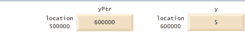

**图 8.3** | `y` 和 `yPtr` 在内存中的表示。

`*` 运算符通常称为**间接寻址运算符**或**解引用运算符**，它返回其指针操作数所指向对象的同义词（即别名或绰号）。例如（再次参考图 8.2），以下语句

```cpp
cout << *yPtr << endl;
```

打印变量 `y` 的值，即 5，就像以下语句

```cpp
cout << y << endl;
```

一样。以这种方式使用 `*` 称为解引用指针。解引用后的指针也可以用在赋值语句的左侧，如下所示

```cpp
*yPtr = 9;
```

这会将 9 赋给图 8.3 中的 `y`。解引用后的指针也可以用于接收输入值，如下所示

```cpp
cin >> *yPtr;
```

这会将输入值放入 `y`。解引用后的指针是左值。

**常见编程错误 8.2**

解引用未初始化的指针可能导致致命的执行时错误，或者可能意外修改重要数据并使程序运行至完成，但结果可能不正确。

**常见编程错误 8.3**

尝试解引用不是指针的变量会导致编译错误。

**常见编程错误 8.4**

解引用空指针通常是致命的执行时错误。

图 8.4 中的程序演示了 `&` 和 `*` 指针运算符。在此示例中，内存位置由 `<<` 以十六进制（即基 16）整数输出。（有关十六进制整数的更多信息，请参见附录 D“数制”。）该程序输出的十六进制内存地址取决于编译器和操作系统，因此运行程序时可能会得到不同的结果。

**可移植性提示 8.1**

指针输出的格式取决于编译器——有些使用十六进制整数，有些使用十进制整数，还有些使用其他格式。

```cpp
// Fig. 8.4: fig08_04.cpp
// Pointer operators & and *.
#include <iostream>
using namespace std;

int main()
{
   int a; // a is an integer
   int *aPtr; // aPtr is an int * which is a pointer to an integer

   a = 7; // assigned 7 to a
   aPtr = &a; // assign the address of a to aPtr

   cout << "The address of a is " << &a
      << "\nThe value of aPtr is " << aPtr;
   cout << "\n\nThe value of a is " << a
      << "\nThe value of *aPtr is " << *aPtr;
   cout << "\n\nShowing that * and & are inverses of "
      << "each other.\n*aPtr = " << *aPtr
      << "\n&*aPtr = " << &*aPtr << endl;
} // end main
```

**图 8.4** | 指针运算符 & 和 *（第 1 部分，共 2 部分）。

图 8.7 使用带指针实参的按引用传递，将变量 `number` 传递给函数 `cubeByReference`（第 15 行）——`number` 的地址被传递给该函数。函数 `cubeByReference`（第 21–24 行）指定形参 `nPtr`（指向 int 的指针）来接收其实参。该函数解引用指针，并对 `nPtr` 所指向的值求立方（第 23 行）。这会直接改变 `main` 中 `number` 的值。


**常见编程错误 8.5**

在需要解引用指针以获取该指针所指向的值时却不解引用指针，是一种错误。

```cpp
// Fig. 8.7: fig08_07.cpp
// Pass-by-reference with a pointer argument used to cube a
// variable’s value.
#include <iostream>
using namespace std;

void cubeByReference( int * ); // prototype

int main()
{
   int number = 5;

   cout << "The original value of number is " << number;

   cubeByReference( &number ); // pass number address to cubeByReference

   cout << "\nThe new value of number is " << number << endl;
} // end main

// Calculate cube of *nPtr; modifies variable number in main
void cubeByReference( int *nPtr )
{
   *nPtr = *nPtr * *nPtr * *nPtr; // cube *nPtr
} // end function cubeByReference
```

```text
The original value of number is 5
The new value of number is 125
```

**图 8.7** 使用指针实参的按引用传递来计算变量值的立方。

接收地址作为实参的函数必须定义指针形参来接收该地址。例如，函数 `cubeByReference` 的首部（第 21 行）指定 `cubeByReference` 接收一个 int 变量的地址（即指向 int 的指针）作为实参，将该地址局部存储在 `nPtr` 中，并且不返回值。

`cubeByReference` 的函数原型（第 7 行）在括号中包含 `int *`。与其他变量类型一样，不必在函数原型中包含指针形参的名称。为文档目的而包含的形参名称会被编译器忽略。

图 8.8–8.9 分别以图形方式分析图 8.6 和图 8.7 中程序的执行过程。

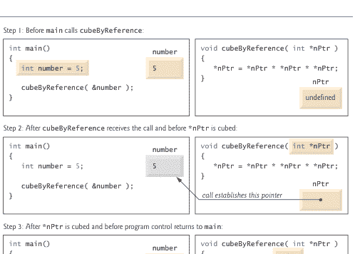

**图 8.9** | 图 8.7 程序的按引用传递分析（带指针实参）。

> **软件工程观察 8.1**
>
> 除非调用方明确要求被调用函数直接修改调用方中实参变量的值，否则应使用按值传递向函数传递实参。这是最小权限原则的另一个示例。

在函数首部和期望接收一维数组作为实参的函数原型中，可以使用 `cubeByReference` 形参列表中的指针表示法。编译器不区分接收指针的函数和接收一维数组的函数。当然，这意味着函数必须“知道”它接收的是数组，还是仅仅是一个按引用传递的单个变量。当编译器遇到形式为 `int b[]` 的一维数组函数形参时，编译器会将形参转换为指针表示法 `int *b`（读作“b 是指向整数的指针”）。将函数形参声明为一维数组的这两种形式可以互换。

## 8.5 将 const 与指针一起使用

回想一下，`const` 使您能够告知编译器不应修改特定变量的值。在函数形参中使用（或不使用）`const` 有许多可能。如何从这些可能中选择最合适的一种？让最小权限原则作为指导。始终赋予函数足够的权限来访问其形参中的数据以完成其指定任务，但不要赋予更多权限。本节讨论如何将 `const` 与指针声明结合，以强制执行最小权限原则。

第 6 章解释了，当实参按值传递时，会创建函数调用中实参的副本并传递给函数。如果副本在函数中被修改，调用方中的原始值不会改变。在许多情况下，传递给函数的值会在该函数中被修改。然而，在某些情况下，即使被调用函数只操作原始值的副本，该值也不应在被调用函数中被更改。

考虑一个函数，它接收一维数组及其大小作为实参，然后打印该数组。这样的函数应遍历数组并逐个输出每个元素。数组大小在函数体中用于确定数组的最高下标，以便在打印完成时循环可以终止。数组的大小在函数体中不会改变，因此应将其声明为 `const`。由于数组只是被打印，它也应声明为 `const`。这一点尤其重要，因为数组总是按引用传递，很容易在被调用函数中被更改。如果尝试修改 `const` 值，就会发生错误。


> **软件工程观察 8.2**
>
> *如果传递给函数的值在函数体中不会（或不应）改变，则该形参应声明为 `const`。*


> **错误预防提示 8.2**
>
> *在使用函数之前，请检查其函数原型，以确定它可以修改哪些形参。*

将指针传递给函数有四种方式：指向非常量数据的非常量指针、指向常量数据的非常量指针（图 8.10）、指向非常量数据的常量指针（图 8.11）以及指向常量数据的常量指针（图 8.12）。每种组合提供不同级别的访问权限。

### 指向非常量数据的非常量指针

最高访问权限由指向非常量数据的非常量指针授予——可以通过解引用后的指针修改数据，也可以修改指针使其指向其他数据。此类指针的声明（例如 `int *countPtr`）不包含 `const`。

### 指向常量数据的非常量指针

指向常量数据的非常量指针是一种可以修改以指向适当类型的任何数据项的指针，但不能通过该指针修改它所指向的数据。这样的指针可用于接收传递给函数的数组实参，该函数将处理每个数组元素，但不允许修改数据。在函数中任何修改数据的尝试都会导致编译错误。此类指针的声明将 `const` 放在指针类型的左侧，如下所示

```cpp
const int *countPtr;
```

该声明从右向左读作“countPtr 是指向整数常量的指针”。


图 8.10 演示了在尝试编译这样一个函数时产生的编译错误消息：该函数接收一个指向常量数据的非常量指针，然后试图使用该指针修改数据。

```cpp
// Fig. 8.10: fig08_10.cpp
// Attempting to modify data through a
// nonconstant pointer to constant data.

void f( const int * ); // prototype

int main()
{
    int y;

    f( &y ); // f attempts illegal modification
} // end main

// xPtr cannot modify the value of constant variable to which it points
void f( const int *xPtr )
{
    *xPtr = 100; // error: cannot modify a const object
} // end function f
```

*Microsoft Visual C++ 编译器错误消息：*

```text
c:\cpphtp7_examples\ch08\Fig08_10\fig08_10.cpp(17) :
error C3892: 'xPtr' : you cannot assign to a variable that is const
```

*GNU C++ 编译器错误消息：*

```text
fig08_10.cpp: In function 'void f(const int*)':
fig08_10.cpp:17: error: assignment of read-only location
```

**图 8.10** | 尝试通过指向常量数据的非常量指针修改数据。

众所周知，数组是聚合数据类型，它将相同类型的相关数据项存储在一个名称下。当以数组作为实参调用函数时，数组按引用传递给函数。然而，默认情况下，对象按值传递——传递整个对象的副本。这需要执行时开销：复制对象中的每个数据项并将其存储在函数调用栈上。当传递指向对象的指针时，只需复制对象的地址——对象本身不会被复制。


### 性能提示 8.1

如果大型对象不需要被调用函数修改，则使用指向常量数据的指针或常量数据的引用来传递它们，以获得按引用传递的性能优势。


### 软件工程观察 8.3

使用指向常量数据的指针或常量数据的引用来传递大型对象，以获得按值传递的安全性。

## 指向非常量数据的常量指针

指向非常量数据的常量指针是指始终指向同一内存位置的指针；该位置的数据*可以*通过该指针修改。这种指针的一个例子是数组名，它是指向数组起始位置的常量指针。通过使用数组名和数组下标，可以访问并更改数组中的所有数据。指向非常量数据的常量指针可用于接收数组，作为那些使用数组下标表示法访问数组元素的函数的实参。声明为 const 的指针必须在声明时初始化。如果该指针是函数参数，则用传递给函数的指针来初始化它。

> **常见编程错误 8.6**
>
> *未初始化声明为 const 的指针是编译错误。*

图 8.11 的程序尝试修改一个常量指针。第 11 行将指针 `ptr` 声明为 `int * const` 类型。该声明从右向左读作“`ptr` 是一个指向非常量整数的常量指针”。该指针用整型变量 `x` 的地址初始化。第 14 行尝试将 `y` 的地址赋给 `ptr`，但编译器会生成错误消息。当第 13 行将值 7 赋给 `*ptr` 时不会发生错误——即使 `ptr` 本身已声明为 `const`，也可以使用解引用后的 `ptr` 修改 `ptr` 所指向的非常量值。

```cpp
1   // Fig. 8.11: fig08_11.cpp
2   // Attempting to modify a constant pointer to nonconstant data.
3
4   int main()
5   {
6      int x, y;
7
8      // ptr is a constant pointer to an integer that can
9      // be modified through ptr, but ptr always points to the
10     // same memory location.
11     int * const ptr = &x; // const pointer must be initialized
12
13     *ptr = 7; // allowed: *ptr is not const
14     ptr = &y; // error: ptr is const; cannot assign to it a new address
15  } // end main
```

*Microsoft Visual C++ 编译器错误消息：*

```text
c:\cpphtp7_examples\ch08\Fig08_11\fig08_11.cpp(14) : error C3892: 'ptr' :
you cannot assign to a variable that is const
```

*GNU C++ 编译器错误消息：*

```text
fig08_11.cpp: In function 'int main()':
fig08_11.cpp:14: error: assignment of read-only variable 'ptr'
```

**图 8.11** | 尝试修改指向非常量数据的常量指针。

## 指向常量数据的常量指针

最小访问权限由指向常量数据的常量指针提供。这样的指针始终指向同一内存位置，并且不能通过该指针修改该位置的数据。当函数仅读取数组（使用数组下标表示法）且不修改数组时，就应以此方式将数组传递给该函数。图 8.12 的程序将指针变量 `ptr` 声明为 `const int * const` 类型（第 13 行）。该声明从右向左读作“ptr 是一个指向整型常量的常量指针”。该图显示了在尝试修改 `ptr` 所指向的数据时（第 17 行）以及在尝试修改指针变量中存储的地址时（第 18 行）生成的错误消息。当程序尝试解引用 `ptr`（第 15 行）时，或当程序尝试输出 `ptr` 所指向的值时，不会发生错误，因为此语句中既没有修改指针，也没有修改它指向的数据。

```cpp
// Fig. 8.12: fig08_12.cpp
// Attempting to modify a constant pointer to constant data.
#include <iostream>
using namespace std;

int main()
{
    int x = 5, y;

    // ptr is a constant pointer to a constant integer.
    // ptr always points to the same location; the integer
    // at that location cannot be modified.
    const int *const ptr = &x;

    cout << *ptr << endl;

    *ptr = 7; // error: 'ptr' is const; cannot assign new value
    ptr = &y; // error: ptr is const; cannot assign new address
}
```

Microsoft Visual C++ 编译器错误消息：

```text
c:\cpphtp7_examples\ch08\Fig08_12\fig08_12.cpp(17) : error C3892: 'ptr' :
   you cannot assign to a variable that is const
c:\cpphtp7_examples\ch08\Fig08_12\fig08_12.cpp(18) : error C3892: 'ptr' :
   you cannot assign to a variable that is const
```

GNU C++ 编译器错误消息：

```text
fig08_12.cpp: In function 'int main()':
fig08_12.cpp:17: error: assignment of read-only location '* ptr'
fig08_12.cpp:18: error: assignment of read-only variable 'ptr'
```

**图 8.12** | 尝试修改指向常量数据的常量指针。

## 8.6 使用按引用传递的选择排序

在本节中，我们定义一个排序程序，以演示按引用传递数组和单个数组元素。我们使用选择排序算法，这是一种易于编写但效率不高的排序算法。算法的第一次迭代选择数组中的最小元素，并将其与第一个元素交换。第二次迭代选择第二小的元素（即剩余元素中的最小元素），并将其与第二个元素交换。算法继续执行，直到最后一次迭代选择第二大的元素，并将其与倒数第二个索引处的元素交换，从而将最大元素留在最后一个索引中。在第 *i* 次迭代后，数组中最小的 *i* 个元素将按升序排列在数组的前 *i* 个元素中。

例如，考虑数组

|  |  |  |  |  |  |  |  |  |  |
|---|---|---|---|---|---|---|---|---|---|
| 34 | 56 | 4 | 10 | 77 | 51 | 93 | 30 | 5 | 52 |

实现选择排序的程序首先确定数组中的最小值（4），它位于元素 2 中。程序将 4 与元素 0 中的值（34）交换，得到

|  |  |  |  |  |  |  |  |  |  |
|---|---|---|---|---|---|---|---|---|---|
| 4 | 56 | **34** | 10 | 77 | 51 | 93 | 30 | 5 | 52 |

*[注：我们使用粗体突出显示了被交换的值。]* 然后，程序确定剩余元素（除 4 以外的所有元素）中的最小值，即 5，它位于元素 8 中。程序将 5 与元素 1 中的 56 交换，得到

|  |  |  |  |  |  |  |  |  |  |
|---|---|---|---|---|---|---|---|---|---|
| 4 | **5** | 34 | 10 | 77 | 51 | 93 | 30 | **56** | 52 |

在第三次迭代中，程序确定下一个最小值 10，并将其与元素 2 中的值（34）交换。

|  |  |  |  |  |  |  |  |  |  |
|---|---|---|---|---|---|---|---|---|---|
| 4 | 5 | **10** | **34** | 77 | 51 | 93 | 30 | 56 | 52 |

该过程继续进行，直到数组完全排序。

|  |  |  |  |  |  |  |  |  |  |
|---|---|---|---|---|---|---|---|---|---|
| 4 | 5 | 10 | 30 | 34 | 51 | 52 | 56 | 77 | 93 |

第一次迭代后，最小元素位于第一个位置。第二次迭代后，两个最小元素按顺序位于前两个位置。第三次迭代后，三个最小元素按顺序位于前三个位置。

图 8.13 使用函数 `selectionSort` 和 `swap` 实现选择排序。函数 `selectionSort`（第 32～49 行）对数组进行排序。第 34 行声明变量 `smallest`，它将存储剩余数组中最小的元素的索引。第 37～48 行循环 `size − 1` 次。第 39 行将最小元素的索引设置为当前索引。第 42～45 行遍历剩余的数组元素。对于每个元素，第 44 行将其值与最小元素的值进行比较。如果当前元素小于最小元素，第 45 行将当前元素的索引赋给 `smallest`。当这个循环结束时，`smallest` 将包含剩余数组中最小的元素的索引。第 47 行调用函数 `swap`（第 53～58 行），将剩余的最小元素放到数组中的下一个位置（即交换数组元素 `array[i]` 和 `array[smallest]`）。

```cpp
// Fig. 8.13: fig08_13.cpp
// Selection sort with pass-by-reference. This program puts values into an
// array, sorts them into ascending order and prints the resulting array.
#include <iostream>
#include <iomanip>
```

**图 8.13** | 使用按引用传递的选择排序。（第 1 部分，共 3 部分。）


函数的可重用性——只有处理特定大小的一维 int 数组、且该大小被“硬编码”到函数中的程序才能使用该函数。

**软件工程观察 8.4**

*将数组传递给函数时，还要传递数组的大小（而不是将数组大小的知识内建到函数中）——这会使函数更具可重用性。*

## 8.7 sizeof 运算符

一元运算符 `sizeof` 在程序编译期间确定数组（或任何其他数据类型、变量或常量）的大小（以字节为单位）。当应用于数组名时，如图 8.14（第 13 行）所示，`sizeof` 运算符返回数组中的总字节数，作为 `size_t` 类型的值（一种至少与 `unsigned int` 一样大的无符号整数类型）。例如，这与 `vector<int>` 的大小不同，后者是向量中整数元素的个数。我们用来编译此程序的计算机将 `double` 类型的变量存储在 8 字节内存中，而 `array` 被声明为具有 20 个元素（第 11 行），因此 `array` 在内存中使用 160 字节。当应用于接收数组作为实参的函数中的指针形参（第 22 行）时，`sizeof` 运算符返回指针的字节大小（在我们使用的系统上为 4）——而不是数组的大小。

**常见编程错误 8.7**

*在函数中使用 `sizeof` 运算符求数组形参的字节大小，得到的是指针的字节大小，而不是数组的大小。*

```cpp
1  // Fig. 8.14: fig08_14.cpp
2  // sizeof operator when used on an array name
3  // returns the number of bytes in the array.
4  #include <iostream>
5  using namespace std;
6  
7  size_t getSize( double * ); // prototype
8  
9  int main()
10 {
11     double array[ 20 ]; // 20 doubles; occupies 160 bytes on our system
12 
13     cout << "The number of bytes in the array is " << sizeof( array );
14 
15     cout << "\nThe number of bytes returned by getSize is "
16        << getSize( array ) << endl;
17 } // end main
18 
19 // return size of ptr
20 size_t getSize( double *ptr )
21 {
22     return sizeof( ptr );
23 } // end function getSize
```

**图 8.14** | 当 `sizeof` 运算符作用于数组名时，返回数组中的字节数。（第 1 部分，共 2 部分）

```cpp
23   << "sizeof(int) = " << sizeof( int )
24   << "\nsizeof 1 = " << sizeof 1
25   << "\nsizeof(long) = " << sizeof( long )
26   << "\nsizeof f = " << sizeof f
27   << "\nsizeof(float) = " << sizeof( float )
28   << "\nsizeof d = " << sizeof d
29   << "\nsizeof(double) = " << sizeof( double )
30   << "\nsizeof ld = " << sizeof ld
31   << "\nsizeof(long double) = " << sizeof( long double )
32   << "\nsizeof array = " << sizeof array
33   << "\nsizeof ptr = " << sizeof ptr << endl;
34 } // end main
```

```text
sizeof c = 1        sizeof(char) = 1
sizeof s = 2        sizeof(short) = 2
sizeof i = 4        sizeof(int) = 4
sizeof l = 4        sizeof(long) = 4
sizeof f = 4        sizeof(float) = 4
sizeof d = 8        sizeof(double) = 8
sizeof ld = 8       sizeof(long double) = 8
sizeof array = 80
sizeof ptr = 4
```

**图 8.15** | 使用 sizeof 运算符确定标准数据类型的大小。（第 2 部分，共 2 部分。）

> **可移植性提示 8.2**
>
> *用于存储特定数据类型的字节数可能因系统而异。编写依赖于数据类型大小且将在多个计算机系统上运行的程序时，请使用 sizeof 确定用于存储这些数据类型的字节数。*

运算符 sizeof 可应用于任何表达式或类型名。当 sizeof 应用于变量名（不是数组名）或其他表达式时，返回用于存储该表达式值的特定类型所占用的字节数。只有当类型名（例如 int）作为其操作数提供时，才需要使用与 sizeof 一起使用的圆括号。当 sizeof 的操作数是表达式时，不需要使用与 sizeof 一起使用的圆括号。请记住，sizeof 是运算符，而不是函数，并且它在编译时而非执行时起作用。

> **常见编程错误 8.8**
>
> *当操作数是类型名时，在 sizeof 运算中省略圆括号是编译错误。*

> **性能提示 8.2**
>
> *由于 sizeof 是编译时一元运算符，而不是执行时运算符，因此使用 sizeof 不会对执行性能产生负面影响。*

> **错误预防提示 8.3**
>
> *为避免因省略 sizeof 运算符操作数周围的圆括号而导致的错误，请在每个 sizeof 操作数周围都加上圆括号。*

## 8.8 指针表达式和指针算术

指针是算术表达式、赋值表达式和比较表达式中的有效操作数。然而，这些表达式中通常使用的并非所有运算符都对指针变量有效。本节介绍可以将指针作为操作数的运算符，以及这些运算符如何与指针一起使用。

C++ 支持指针算术——可以对指针执行某些算术运算。指针可以递增（++）或递减（--），可以将整数加到指针上（+ 或 +=），可以从指针中减去整数（- 或 -=），也可以从同一类型的另一个指针中减去一个指针。

假设已声明数组 `int v[5]`，并且其第一个元素位于内存位置 3000。假设指针 `vPtr` 已初始化为指向 `v[0]`（即 `vPtr` 的值为 3000）。图 8.16 展示了在整数为四字节的机器上的这种情况。变量 `vPtr` 可以用以下任一语句初始化为指向数组 `v`（因为数组名等价于其第一个元素的地址）：

```cpp
int *vPtr = v;
int *vPtr = &v[ 0 ];
```

> **可移植性提示 8.3**
>
> 如今大多数计算机使用两字节或四字节整数。一些较新的机器使用八字节整数。由于指针算术的结果取决于指针所指向对象的大小，因此指针算术是机器相关的。

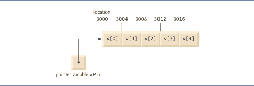

**图 8.16** — 数组 `v` 和指向 `v` 的指针变量 `int *vPtr`。

在常规算术中，加法 3000 + 2 得到的值是 3002。指针算术通常并非如此。当整数加到指针上或从指针中减去时，指针并不是简单地增加或减少该整数，而是增加或减少该整数乘以指针所指向对象的大小。字节数取决于对象的数据类型。例如，语句

```cpp
vPtr += 2;
```

将得到 3008（3000 + 2 * 4），假设 `int` 存储在 4 字节内存中。在数组 `v` 中，`vPtr` 现在将指向 `v[2]`（图 8.17）。如果整数存储在 2 字节内存中，那么前面的计算将得到内存位置 3004（3000 + 2 * 2）。如果数组元素是不同数据类型，前面的语句将使指针增加存储该数据类型对象所需字节数的两倍。对字符数组执行指针算术时，结果将与常规算术一致，因为每个字符长一字节。

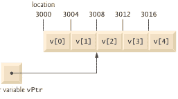

**图 8.17** 指针算术后的指针 vPtr。

如果 vPtr 已递增到 3016，即指向 v[4]，那么语句

```cpp
vPtr -= 4;
```

会将 vPtr 重新设置为 3000——数组的开头。如果指针要递增或递减 1，可以使用递增（++）和递减（--）运算符。以下每条语句

```cpp
++vPtr;
vPtr++;
```

都会使指针递增以指向数组的下一个元素。以下每条语句

```cpp
--vPtr;
vPtr--;
```

都会使指针递减以指向数组的前一个元素。

指向同一数组的指针变量可以相互相减。例如，如果 vPtr 包含地址 3000，v2Ptr 包含地址 3008，那么语句

```cpp
x = v2Ptr - vPtr;
```

会将从 vPtr 到 v2Ptr 之间的数组元素个数赋给 x——在本例中为 2。除非对指向数组的指针执行指针算术，否则指针算术没有意义。除非两个相同类型的变量是数组中的相邻元素，否则我们不能假定它们在内存中连续存储。

> **常见编程错误 8.9**  
> *对不指向数组的指针使用指针算术是逻辑错误。*

> **常见编程错误 8.10**  
> *对不指向同一数组元素的两个指针进行相减或比较是逻辑错误。*


假设有如下声明：

```cpp
int b[ 5 ]; // create 5-element int array b
int *bPtr; // create int pointer bPtr
```

因为数组名（不带下标）是指向数组第一个元素的（常量）指针，所以我们可以用下面的语句将 bPtr 设置为数组 b 中第一个元素的地址：

```cpp
bPtr = b; // assign address of array b to bPtr
```

这等价于按如下方式赋值数组第一个元素的地址：

```cpp
bPtr = &b[ 0 ]; // also assigns address of array b to bPtr
```

数组元素 b[ 3 ] 也可以用指针表达式

```cpp
*( bPtr + 3 )
```

来引用。前述表达式中的 3 是指针的偏移量。当指针指向数组开头时，偏移量表示应引用哪个数组元素，并且偏移量的值与下标相同。这种表示法称为指针/偏移量表示法。括号是必需的，因为 * 的优先级高于 +。没有括号时，前述表达式会将 3 加到 *bPtr 值的一个副本上（即，假设 bPtr 指向数组开头，则会将 3 加到 b[0]）。正如数组元素可以用指针表达式引用一样，地址

```cpp
&b[ 3 ]
```

也可以用指针表达式

```cpp
bPtr + 3
```

来书写。数组名（隐式地为 const）可以被当作指针，并用于指针运算。例如，表达式

```cpp
*( b + 3 )
```

也引用数组元素 b[ 3 ]。一般来说，所有带下标的数组表达式都可以用指针和偏移量来书写。在这种情况下，使用数组名作为指针的指针/偏移量表示法。前述表达式不会以任何方式修改数组名；b 仍指向数组的第一个元素。

指针可以像数组一样使用下标。例如，表达式

```cpp
bPtr[ 1 ]
```

引用数组元素 b[ 1 ]；该表达式使用指针/下标表示法。

请记住，数组名是常量指针；它始终指向数组开头。因此，表达式

```cpp
b += 3
```

会导致编译错误，因为它试图通过指针运算修改数组名的值（一个常量）。


### 常见编程错误 8.14

> 尽管数组名是指向数组开头的指针，但数组名不能在算术表达式中被修改，因为数组名是常量指针。


### 良好编程习惯 8.2

*为清晰起见，在操作数组时使用数组表示法而不是指针表示法。*

图 8.18 使用本节讨论的四种表示法来引用数组元素——数组下标表示法、以数组名作为指针的指针/偏移量表示法、指针下标表示法以及使用指针的指针/偏移量表示法——来完成同一任务，即打印整型数组 b 的四个元素。

```cpp
// Fig. 8.18: fig08_18.cpp
// Using subscripting and pointer notations with arrays.
#include <iostream>
using namespace std;

int main()
{
   int b[] = { 10, 20, 30, 40 }; // create 4-element array b
   int *bPtr = b; // set bPtr to point to array b

   // output array b using array subscript notation
   cout << "Array b printed with:\n\nArray subscript notation\n";

   for ( int i = 0; i < 4; i++ )
      cout << "b[" << i << "] = " << b[ i ] << '\n';

   // output array b using the array name and pointer/offset notation
   cout << "\nPointer/offset notation where\n"
      << "the pointer is the array name\n";

   for ( int offset1 = 0; offset1 < 4; offset1++ )
      cout << "*(b + offset1) = " << *( b + offset1 ) << '\n';

   // output array b using bPtr and array subscript notation
   cout << "\nPointer subscript notation\n";

   for ( int j = 0; j < 4; j++ )
      cout << "bPtr[" << j << "] = " << bPtr[ j ] << '\n';

   cout << "\nPointer/offset notation\n";

   // output array b using bPtr and pointer/offset notation
   for ( int offset2 = 0; offset2 < 4; offset2++ )
      cout << "*(bPtr + offset2) = "
         << *( bPtr + offset2 ) << '\n';
} // end main
```

```text
Array b printed with:

Array subscript notation
b[0] = 10
b[1] = 20
b[2] = 30
b[3] = 40

Pointer/offset notation where
the pointer is the array name
*(b + 0) = 10
*(b + 1) = 20
*(b + 2) = 30
*(b + 3) = 40

Pointer subscript notation
bPtr[0] = 10
bPtr[1] = 20
bPtr[2] = 30
bPtr[3] = 40

Pointer/offset notation
*(bPtr + 0) = 10
*(bPtr + 1) = 20
*(bPtr + 2) = 30
*(bPtr + 3) = 40
```

**图 8.18** | 使用数组名和指针引用数组元素。

## 8.10 基于指针的字符串处理

我们已经使用 C++ 标准库的 string 类将字符串表示为完备对象。例如，第 3～7 章的 GradeBook 类案例研究使用 string 对象表示课程名。第 18 章将详细介绍 string 类。本节介绍 C 风格、基于指针的字符串。在新程序中，首选 C++ 的 string 类，因为它消除了许多由操作 C 字符串可能引起的安全问题。我们在这里介绍 C 字符串，是为了更深入地理解数组。此外，如果你处理遗留 C++ 程序，可能需要操作这些基于指针的字符串。第 21 章将详细讨论 C 风格、基于指针的字符串。

字符是 C++ 源程序的基本构建块。每个程序都由一个字符序列组成；当这些字符有意义地组合在一起时，编译器会将其解释为一系列用于完成任务的指令。程序可以包含字符常量。字符常量是用单引号括起来的字符所表示的整数值。字符常量的值是该字符在机器字符集中的整数值。例如，'z' 表示 z 的整数值（在 ASCII 字符集中为 122；见附录 B），而 '\n' 表示换行符的整数值（在 ASCII 字符集中为 10）。

字符串是一系列被视为单个单元的字符。字符串可以包括字母、数字以及各种特殊字符，例如 +、-、*、/ 和 $。在 C++ 中，字符串字面量（或字符串常量）写在双引号中，如下所示：

```text
"John Q. Doe"       (a name)
"9999 Main Street"  (a street address)
"Maynard, Massachusetts" (a city and state)
"(201) 555-1212"    (a telephone number)
```

基于指针的字符串是一个以空字符（'\0'）结尾的字符数组，空字符标记字符串在内存中终止的位置。字符串通过指向其第一个字符的指针来访问。字符串字面量的值是其第一个字符的地址，但字符串字面量的 sizeof 是字符串的长度，*包括*终止空字符。基于指针的字符串类似数组，因为数组名也是指向其第一个元素的指针。

字符串字面量可以用作字符数组或 char * 类型变量声明中的初始值。以下声明

```cpp
char color[] = "blue";
const char *colorPtr = "blue";
```

都将变量初始化为字符串 "blue"。第一个声明创建一个包含字符 'b'、'l'、'u'、'e' 和 '\0' 的五个元素数组 color。第二个声明创建指针变量 colorPtr，它指向内存中某处字符串 "blue"（以 '\0' 结尾）中的字母 b。字符串字面量具有静态存储类（它们在程序整个运行期间都存在），并且如果同一字符串字面量在程序中的多个位置被引用，它们可能共享，也可能不共享。修改字符串字面量的效果是*未定义*的；因此，应始终将指向字符串字面量的指针声明为 const char *。

声明 char color[] = "blue"; 也可以写成

```cpp
char color[] = { 'b', 'l', 'u', 'e', '\0' };
```

它使用单引号（'）中的字符常量作为字符数组每个元素的初始值。当声明字符数组来存储字符串时，数组必须足够大，以存储该字符串及其终止空字符。前述声明根据初始化列表中提供的初始化项数量确定数组的大小。

### 常见编程错误 8.15

*未在字符数组中分配足够空间来存储终止字符串的空字符，是一种错误。*

### 常见编程错误 8.16

*创建或使用不包含终止空字符的 C 风格字符串可能导致逻辑错误。*

### 错误预防提示 8.4

*在字符数组中存储字符串时，请确保数组足够大，能够容纳将要存储的最长字符串。C++ 允许存储任意长度的字符串。如果字符串长于要存储它的字符数组，则超出数组末尾的字符将覆盖数组中后面的内存数据，从而导致逻辑错误。*

因为字符串是字符数组，所以我们可以直接用数组下标表示法访问字符串中的各个字符。例如，color[0] 是字符 'b'，color[2] 是字符 'u'，color[4] 是空字符。

可以使用 cin 的流提取操作将字符串读入字符数组。例如，以下语句将字符串读入字符数组 word[20]：

```cpp
cin >> word;
```

用户输入的字符串存储在 word 中。前述语句读取字符，直到遇到空白字符或文件结束指示符。该字符串应


参数用于将选项传递给程序。例如，在 Windows 计算机的命令行中，用户可以输入

```text
dir /p
```

以列出当前目录的内容，并在每显示一屏信息后暂停。当执行 dir 命令时，选项 /p 作为命令行参数传递给 dir。此类参数被放入一个字符串数组，main 将该数组作为参数接收。我们在附录 F，C 遗留代码专题中讨论命令行参数。

## 8.12 函数指针

指向函数的指针包含该函数在内存中的地址。我们知道，数组名实际上是第一个元素在内存中的地址。类似地，函数名实际上是执行该函数任务的代码在内存中的起始地址。函数指针可以传递给函数、从函数返回、存储在数组中、赋值给其他函数指针，并用于调用底层函数。

### 使用函数指针的多用途选择排序

为了说明函数指针的用法，图 8.20 修改了图 8.13 的选择排序程序。图 8.20 由 main（第 13–50 行）以及函数 selectionSort（第 54–71 行）、swap（第 75–80 行）、ascending（第 84–87 行）和 descending（第 91–94 行）组成。函数 selectionSort 除了接收要排序的整数数组和数组大小之外，还接收一个函数指针——函数 ascending 或函数 descending——作为参数。函数 ascending 和 descending 决定排序顺序。程序提示用户选择数组应按升序还是降序排序（第 20–22 行）。如果用户输入 1，则将指向函数 ascending 的指针传递给函数 selectionSort（第 33 行），从而使数组按递增顺序排序。如果用户输入 2，则将指向函数 descending 的指针传递给函数 selectionSort（第 41 行），从而使数组按递减顺序排序。

```cpp
// Fig. 8.20: fig08_20.cpp
// Multipurpose sorting program using function pointers.
#include <iostream>
#include <iomanip>
using namespace std;

// prototypes
void selectionSort( int [], const int, bool (*)( int, int ) );
void swap( int * const, int * const );
bool ascending( int, int ); // implements ascending order
bool descending( int, int ); // implements descending order

int main()
{
   const int arraySize = 10;
   int order; // 1 = ascending, 2 = descending
   int counter; // array index
   int a[ arraySize ] = { 2, 6, 4, 8, 10, 12, 89, 68, 45, 37 };

   cout << "Enter 1 to sort in ascending order,\n"
        << "Enter 2 to sort in descending order: ";
   cin >> order;
   cout << "\nData items in original order\n";

   // output original array
   for ( counter = 0; counter < arraySize; counter++ )
      cout << setw( 4 ) << a[ counter ];

   // sort array in ascending order; pass function ascending
   // as an argument to specify ascending sorting order
   if ( order == 1 )
   {
      selectionSort( a, arraySize, ascending );
      cout << "\nData items in ascending order\n";
   } // end if

   // sort array in descending order; pass function descending
   // as an argument to specify descending sorting order
   else
   {
      selectionSort( a, arraySize, descending );
      cout << "\nData items in descending order\n";
   } // end else part of if...else

   // output sorted array
   for ( counter = 0; counter < arraySize; counter++ )
      cout << setw( 4 ) << a[ counter ];

   cout << endl;
} // end main

// multipurpose selection sort; the parameter compare is a pointer to
// the comparison function that determines the sorting order
void selectionSort( int work[], const int size,
                    bool (*compare)( int, int ) )
{
   int smallestOrLargest; // index of smallest (or largest) element

   // loop over size - 1 elements
   for ( int i = 0; i < size - 1; i++ )
   {
      smallestOrLargest = i; // first index of remaining vector

      // loop to find index of smallest (or largest) element
      for ( int index = i + 1; index < size; index++ )
         if ( !(*compare)( work[ smallestOrLargest ], work[ index ] ) )
            smallestOrLargest = index;

      swap( &work[ smallestOrLargest ], &work[ i ] );
   } // end outer for
} // end function selectionSort
```

图 8.20 | *使用函数指针的多用途排序程序。*（第 1 部分，共 3 部分。）

图 8.20 | *使用函数指针的多用途排序程序。*（第 2 部分，共 3 部分。）

将最大元素留在最后一个索引中。经过第 *i* 次迭代后，数组中最小的 *i* 个元素将在数组的前 *i* 个元素中按递增顺序排好。

## 第 8.7 节 `sizeof` 运算符

- 运算符 `sizeof` 在编译时确定数据类型、变量或常量的大小（以字节为单位）。
- 当应用于数组名时，`sizeof` 返回数组中的总字节数。

## 第 8.8 节 指针表达式和指针算术

- 可对指针执行的算术运算包括：递增（`++`）指针、递减（`--`）指针、将整数加到指针上（`+` 或 `+=`）、从指针中减去整数（`-` 或 `-=`），以及用一个指针减去另一个指针。
- 当向指针加上或减去一个整数时，指针会按该整数乘以指针所指对象的大小进行递增或递减。
- 如果两个指针类型相同，则可以将一个指针赋值给另一个指针。否则，必须使用强制转换。例外情况是 `void *` 指针，它是一种通用指针类型，可以保存任何类型的指针值。
- 对 `void *` 指针唯一有效的操作是：将 `void *` 指针与其他指针进行比较、将地址赋给 `void *` 指针，以及将 `void *` 指针强制转换为有效的指针类型。
- 可以使用相等运算符和关系运算符比较指针。只有当指针指向同一数组的成员时，使用关系运算符进行比较才有意义。

## 第 8.9 节 指针与数组的关系

- 指向数组的指针可以像数组名一样使用下标。
- 在指针/偏移量表示法中，如果指针指向数组的第一个元素，则偏移量与数组下标相同。
- 所有带下标的数组表达式都可以用指针和偏移量来编写，既可以将数组名用作指针，也可以使用指向该数组的单独指针。

## 第 8.10 节 基于指针的字符串处理

- 字符常量是用单引号括起来的字符所表示的整数值。字符常量的值是该字符在机器字符集中的整数值。
- 字符串是作为单个单元处理的一系列字符。字符串可以包含字母、数字以及各种特殊字符，如 `+`、`-`、`*`、`/` 和 `$`。
- C++ 中的字符串字面量（或称字符串常量）写在双引号中。
- 基于指针的字符串是一个以空字符（`'\0'`）结尾的字符数组，空字符标记字符串在内存中终止的位置。字符串通过指向其第一个字符的指针来访问。
- 字符串字面量的值是其第一个字符的地址，但对字符串字面量使用 `sizeof` 得到的是字符串的长度，包括结尾的空字符。
- 字符串字面量可用作字符数组或 `char *` 类型变量的初始值。
- 字符串字面量具有静态存储类，并且如果同一字符串字面量在程序中的多个位置被引用，则可能共享，也可能不共享。
- 修改字符串字面量的效果是未定义的；因此，应始终将指向字符串字面量的指针声明为 `const char *`。
- 当声明用于包含字符串的字符数组时，该数组必须足够大，以存储该字符串及其结尾的空字符。
- 如果字符串长于用于存储它的字符数组，则超出数组末尾的字符将覆盖数组之后内存中的数据，从而导致逻辑错误。


## 8.11 指针数组

- 数组可以包含指针。
- 这种数据结构可用于构成基于指针的字符串数组，称为字符串数组。数组中的每个条目都是一个字符串，但在 C++ 中，字符串本质上是指向其第一个字符的指针，因此字符串数组中的每个条目只是指向字符串第一个字符的指针。
- 字符串数组通常与程序开始执行时传递给 `main` 的命令行参数一起使用。

## 8.12 函数指针

- 指向函数的指针是函数代码所在的内存地址。
- 指向函数的指针可用于调用它们所指向的函数、传给函数、从函数返回、存储在数组中以及赋给其他指针。

## 术语表

| 术语 | 页码 | 术语 | 页码 |
|---|---:|---|---:|
| `*`（指针解引用或间接运算符） | 348 | 指向非常量数据的非常量指针 | 355 |
| 地址运算符（`&`） | 348 | 空字符（`'\0'`） | 370 |
| 字符常量 | 370 | 空指针 | 347 |
| 命令行参数 | 373 | 指针的偏移量 | 368 |
| 指向常量数据的常量指针 | 358 | 使用指针参数的按引用传递 | 350 |
| 指向非常量数据的常量指针 | 357 | 使用引用参数的按引用传递 | 350 |
| 解引用指针 | 348 | 指针运算 | 365 |
| 解引用运算符（`*`） | 348 | 指针/偏移表示法 | 368 |
| 直接引用一个值 | 346 | 指针/下标表示法 | 368 |
| 函数指针 | 374 | 指向函数的指针 | 374 |
| `cin` 的 `getline` 函数 | 372 | 选择排序算法 | 358 |
| 间接引用 | 346 | `sizeof` 运算符 | 362 |
| 间接引用运算符（`*`） | 348 | 特殊字符 | 370 |
| 间接引用一个值 | 346 | 字符串数组 | 373 |
| 指向常量数据的非常量指针 | 355 | 字符串常量 | 370 |
|  |  | 字符串字面量 | 370 |

## 自测练习

- 8.1 回答下列各项：
  - a) 指针是一种变量，其值包含另一个变量的 ______。
  - b) 可用于初始化指针的三种值是 ______、______ 和 ______。
  - c) 唯一可以直接赋给指针的整数是 ______。
  - f) 使用一条 `for` 语句，以数组名作为指针，用指针/偏移表示法打印数组 `values` 的元素。
  - g) 使用一条 `for` 语句，通过对指向数组的指针进行下标引用，打印数组 `values` 的元素。
  - h) 使用数组下标表示法、以数组名作为指针的指针/偏移表示法、指针下标表示法和指针/偏移表示法引用 `values` 的第五个元素。
  - i) `vPtr + 3` 引用的是什么地址？该位置存储的值是什么？
  - j) 假设 `vPtr` 指向 `values[4]`，`vPtr - 4` 引用的是什么地址？该位置存储的值是什么？

**8.9** 对于下列各项，编写一条执行指定任务的语句。假设 long 变量 `value1` 和 `value2` 已声明，且 `value1` 已初始化为 200000。

- a) 声明变量 `longPtr` 为指向 `long` 类型对象的指针。
- b) 将变量 `value1` 的地址赋给指针变量 `longPtr`。
- c) 打印 `longPtr` 所指向对象的值。
- d) 将 `longPtr` 所指向对象的值赋给变量 `value2`。
- e) 打印 `value2` 的值。
- f) 打印 `value1` 的地址。
- g) 打印存储在 `longPtr` 中的地址。打印的值与 `value1` 的地址相同吗？

**8.10** 执行下列每条语句指定的任务：

- a) 为函数 `zero` 编写函数头，该函数接受一个 long 整数数组参数 `bigIntegers`，并且不返回值。
- b) 为 (a) 中的函数编写函数原型。
- c) 为函数 `add1AndSum` 编写函数头，该函数接受一个整数数组参数 `oneToSmall`，并返回一个整数。
- d) 为 (c) 中描述的函数编写函数原型。

**8.11** 找出下列每个代码段中的错误。如果错误可以纠正，请说明如何纠正。

- a)
  ```cpp
  int *number;
  cout << number << endl;
  ```
- b)
  ```cpp
  double *realPtr;
  long *integerPtr;
  integerPtr = realPtr;
  ```
- c)
  ```cpp
  int *x, y;
  x = y;
  ```
- d)
  ```cpp
  char s[] = "this is a character array";
  for ( ; *s != '\0'; s++)
      cout << *s << ' ';
  ```
- e)
  ```cpp
  short *numPtr, result;
  void *genericPtr = numPtr;
  result = *genericPtr + 7;
  ```
- f)
  ```cpp
  double x = 19.34;
  double *xPtr = &x;
  cout << *xPtr << endl;
  ```

**8.12** *(模拟：乌龟和兔子)* 在本练习中，你将重现乌龟和兔子的经典赛跑。你将使用随机数生成来开发这一难忘事件的模拟。

我们的参赛者从 70 个格子中的“第 1 格”开始比赛。每个格子代表赛道上的一个可能位置。终点线在第 70 格。第一个到达或超过第 70 格的参赛者将获得一桶新鲜胡萝卜和生菜。赛道沿着湿滑的山坡蜿蜒而上，因此参赛者偶尔会倒退。

有一个时钟每秒滴答一次。每次时钟滴答时，你的程序应使用函数 moveTortoise 和 moveHare 根据图 8.21 中的规则调整动物的位置。这些函数应使用基于指针的按引用传递来修改乌龟和兔子的位置。

| 动物 | 移动类型 | 时间百分比 | 实际移动 |
|---|---|---|---|
| 乌龟 | 快速爬行 | 50% | 向右移动 3 格 |
|  | 打滑 | 20% | 向左移动 6 格 |
|  | 慢速爬行 | 30% | 向右移动 1 格 |
| 兔子 | 睡觉 | 20% | 完全不移动 |
|  | 大跳 | 20% | 向右移动 9 格 |
|  | 大滑 | 10% | 向左移动 12 格 |
|  | 小跳 | 30% | 向右移动 1 格 |
|  | 小滑 | 20% | 向左移动 2 格 |

**图 8.21** | 移动乌龟和兔子的规则。

使用变量跟踪动物的位置（即位置编号为 1–70）。让每只动物从位置 1（即“起跑门”）开始。如果动物向左打滑到第 1 格之前，则将该动物移回第 1 格。

通过生成一个范围在 1 ≤ i ≤ 10 的随机整数 i 来产生上表中的百分比。对于乌龟，当 1 ≤ i ≤ 5 时执行“快速爬行”，当 6 ≤ i ≤ 7 时执行“打滑”，当 8 ≤ i ≤ 10 时执行“慢速爬行”。使用类似的技术移动兔子。

通过打印以下内容开始比赛：

```
BANG !!!!!
AND THEY'RE OFF !!!!!
```

每次时钟滴答（即每次循环重复）时，打印一行 70 个位置，在乌龟的位置显示字母 T，在兔子的位置显示字母 H。偶尔，参赛者会落在同一个格子上。在这种情况下，乌龟会咬兔子，你的程序应从该位置开始打印 OUCH!!!。除了 T、H 或 OUCH!!!（平局时）之外，所有打印位置都应为空白。

打印每一行后，测试是否有动物到达或超过第 70 格。如果是，打印获胜者并终止模拟。如果乌龟获胜，打印 TORTOISE WINS!!! YAY!!!。如果兔子获胜，打印 Hare wins. Yuch。如果两只动物在同一时钟滴答时都获胜，你可以偏向乌龟（“弱者”），也可以打印 It's a tie。如果两只动物都没有获胜，则再次执行循环以模拟下一次时钟滴答。

### 8.13 这个程序做了什么？

```cpp
1  // Ex. 8.13: ex08_13.cpp
2  // What does this program do?
3  #include <iostream>
4  using namespace std;
5
6  void mystery1( char *, const char * ); // prototype
7
```


```cpp
int main()
{
    char string1[ 80 ];
    char string2[ 80 ];

    cout << "Enter two strings: ";
    cin >> string1 >> string2;
    mystery1( string1, string2 );
    cout << string1 << endl;
} // end main

// What does this function do?
void mystery1( char *s1, const char *s2 )
{
    while ( *s1 != '\0' )
        s1++;

    for ( ; *s1 = *s2; s1++, s2++ )
        ; // empty statement
} // end function mystery1
```

## 8.14 这个程序做什么？

```cpp
// Ex. 8.14: ex08_14.cpp
// What does this program do?
#include <iostream>
using namespace std;

int mystery2( const char * ); // prototype

int main()
{
    char string1[ 80 ];

    cout << "Enter a string: ";
    cin >> string1;
    cout << mystery2( string1 ) << endl;
} // end main

// What does this function do?
int mystery2( const char *s )
{
    int x;

    for ( x = 0; *s != '\0'; s++ )
        x++;

    return x;
} // end function mystery2
```

## 8.15 *（快速排序）*

你之前已经见过桶排序和选择排序这两种排序技术。现在我们介绍一种称为快速排序的递归排序技术。对于单下标值数组，基本算法如下：

- a) *划分步骤：* 取未排序数组的第一个元素，并确定它在已排序数组中的最终位置（即数组中该元素左侧的所有值都小于该元素，而数组中该元素右侧的所有值都大于该元素）。现在，我们有一个元素位于其正确位置，并得到两个未排序的子数组。

- b) *递归步骤：* 对每个未排序的子数组执行步骤 1。

每次对一个子数组执行*步骤 1*时，都会有另一个元素被放置到已排序数组中的最终位置，并创建两个未排序的子数组。当一个子数组仅由一个元素组成时，该子数组必然已经有序；因此，该元素位于其最终位置。

基本算法看起来很简单，但我们如何确定每个子数组第一个元素的最终位置呢？例如，考虑下面这组值（粗体元素是划分元素——它将被放置到已排序数组中的最终位置）：

**37** 2 6 4 89 8 10 12 68 45

- a) 从数组最右侧的元素开始，将每个元素与 37 比较，直到找到一个小于 37 的元素。然后交换 37 和该元素。第一个小于 37 的元素是 12，因此交换 37 和 12。此时数组中的值如下：

  *12* 2 6 4 89 8 10 37 68 45

  元素 12 使用斜体表示它刚刚与 37 交换。

- b) 从数组左侧开始，但从 12 之后的元素开始，将每个元素与 37 比较，直到找到一个大于 37 的元素。然后交换 37 和该元素。第一个大于 37 的元素是 89，因此交换 37 和 89。此时数组中的值如下：

  12 2 6 4 37 8 10 *89* 68 45

- c) 从右侧开始，但从 89 之前的元素开始，将每个元素与 37 比较，直到找到一个小于 37 的元素。然后交换 37 和该元素。第一个小于 37 的元素是 10，因此交换 37 和 10。此时数组中的值如下：

  12 2 6 4 *10* 8 37 89 68 45

- d) 从左侧开始，但从 10 之后的元素开始，将每个元素与 37 比较，直到找到一个大于 37 的元素。然后交换 37 和该元素。没有更多大于 37 的元素，因此当我们将 37 与自身比较时，就知道 37 已被放置到已排序数组中的最终位置。

对数组应用划分后，得到两个未排序的子数组。值小于 37 的子数组包含 12、2、6、4、10 和 8。值大于 37 的子数组包含 89、68 和 45。排序继续进行，两个子数组都以与原始数组相同的方式进行划分。

基于前面的讨论，编写递归函数 `quickSort` 来对单下标整数数组进行排序。该函数应接收一个整数数组、一个起始下标和一个结束下标作为参数。函数 `partition` 应由 `quickSort` 调用来执行划分步骤。

## 8.16 *迷宫遍历*

图 8.22 中由井号（#）和点（.）组成的网格是迷宫的二维数组表示。在该二维数组中，井号表示迷宫的墙壁，点表示迷宫中可能路径上的方格。只能移动到数组中包含点的位置。

有一种简单的走迷宫算法，可以保证找到出口（假设存在出口）。如果不存在出口，你最终会再次回到起始位置。将右手放在右侧墙壁上，然后开始向前走。永远不要把手从墙上移开。如果迷宫向右转，你就沿着墙壁向右走。只要你不把手从墙上移开，最终就会到达迷宫出口。可能存在比你所走路径更短的路径，但只要遵循该算法，你就能保证走出迷宫。

| 操作码 | 含义 |
|---|---|
| *输入/输出操作* | |
| `const int READ = 10;` | 从键盘读取一个字到内存中的指定位置。 |
| `const int WRITE = 11;` | 将内存中指定位置的一个字写到屏幕上。 |
| *加载和存储操作* | |
| `const int LOAD = 20;` | 将内存中指定位置的一个字加载到累加器中。 |
| `const int STORE = 21;` | 将累加器中的一个字存储到内存中的指定位置。 |
| *算术操作* | |
| `const int ADD = 30;` | 将内存中指定位置的一个字与累加器中的字相加（结果留在累加器中）。 |
| `const int SUBTRACT = 31;` | 从累加器中的字减去内存中指定位置的一个字（结果留在累加器中）。 |
| `const int DIVIDE = 32;` | 将累加器中的字除以内存中指定位置的一个字（结果留在累加器中）。 |
| `const int MULTIPLY = 33;` | 将内存中指定位置的一个字与累加器中的字相乘（结果留在累加器中）。 |
| *控制转移操作* | |
| `const int BRANCH = 40;` | 分支到内存中的指定位置。 |
| `const int BRANCHNEG = 41;` | 如果累加器为负，则分支到内存中的指定位置。 |
| `const int BRANCHZERO = 42;` | 如果累加器为零，则分支到内存中的指定位置。 |
| `const int HALT = 43;` | 停机——程序已完成其任务。 |

**图 8.23** | Simpletron 机器语言（SML）操作码。

现在让我们考虑两个简单的 SML 程序。第一个程序（图 8.24）从键盘读取两个数，计算并打印它们的和。指令 +1007 从键盘读取第一个数，并将其放入位置 07（该位置已初始化为零）。指令 +1008 将下一个数读入位置 08。加载指令 +2007 将第一个数放置（复制）到累加器中，加法指令 +3008 将第二个数加到累加器中的数上。所有 SML 算术指令都会将结果留在累加器中。存储指令 +2109 将结果放置（复制）回内存位置 09。然后写指令 +1109 取出该数并打印它（作为有符号的四位十进制数）。停机指令 +4300 终止执行。

图 8.25 中的 SML 程序从键盘读取两个数，然后确定并打印较大的值。注意指令 +4107 的用法，它作为一种条件控制转移，与 C++ 的 if 语句非常相似。

```text
*** Please enter your program one instruction ***
*** (or data word) at a time. I will type the
*** location number and a question mark (?).
*** You then type the word for that location.
*** Type the sentinel -9999 to stop entering ***
*** your program. ***
```

你的程序应使用一个单下标、包含 100 个元素的数组内存来模拟 Simpletron 的内存。现在假设模拟器正在运行，让我们在输入习题 8.18 中示例 2 的程序时检查对话：

```text
00 ? +1009
01 ? +1010
02 ? +2009
03 ? +3110
04 ? +4107
05 ? +1109
06 ? +4300
07 ? +1110
08 ? +4300
09 ? +0000
10 ? +0000
11 ? -9999
```

```text
*** Program loading completed ***
*** Program execution begins   ***
```

前面对话框中每个 ? 右侧的数字表示用户输入的 SML 程序指令。

现在 SML 程序已被放置（或加载）到数组内存中。现在 Simpletron 执行你的 SML 程序。执行从位置 00 中的指令开始，并且像 C++ 一样，除非通过控制转移将程序引导到其他部分，否则会顺序继续执行。

使用变量 accumulator 表示累加器寄存器。使用变量 instructionCounter 跟踪内存中包含正在执行指令的位置。使用变量 operationCode 表示当前正在执行的操作（即指令字的左侧两位数字）。使用变量 operand 表示当前指令所操作的内存位置。因此，operand 是当前正在执行指令的最右侧两位数字。不要直接从内存执行指令。而应将下一条要执行的指令从内存传送到一个名为 instructionRegister 的变量中。然后“取出”左侧两位数字并将它们放入 operationCode，再“取出”右侧两位数字并将它们放入 operand。当 Simpletron 开始执行时，特殊寄存器都初始化为零。

现在让我们“走查”第一条 SML 指令的执行过程，即内存位置 00 中的 +1009。这称为*指令执行周期*。

instructionCounter 告诉我们下一条要执行指令的位置。我们通过使用下面的 C++ 语句从内存中取出该位置的内容

```cpp
instructionRegister = memory[ instructionCounter ];
```

操作码和操作数通过下面的语句从指令寄存器中提取

```cpp
operationCode = instructionRegister / 100;
operand = instructionRegister % 100;
```

现在，Simpletron 必须确定该操作码实际上是一次*读取*（而不是*写入*、*加载*等）。switch 语句用于区分 SML 的 12 种操作。在 switch 语句中，各种 SML 指令的行为按图 8.26 所示进行模拟（其余指令留给你完成）。


*停机*指令还会使 Simpletron 打印每个寄存器的名称和内容，以及内存的完整内容。这样的打印输出通常称为*寄存器和内存转储*。为帮助你编写转储函数，图 8.26 给出了一个示例转储格式。注意，在执行 Simpletron 程序后进行转储，将显示执行终止时指令和数据的实际值。要像转储中所示那样格式化带符号的数字，请使用流操纵器 `showpos`。对于少于四位数字的数，可以在输出值之前使用以下语句，在符号和数值之间格式化前导零：

```
cout << setfill('0') << internal;
```

**寄存器：**

| 寄存器 | 值 |
| --- | --- |
| 累加器 | +0000 |
| 指令计数器 | 00 |
| 指令寄存器 | +0000 |
| 操作码 | 00 |
| 操作数 | 00 |

**内存：**

|   | 0 | 1 | 2 | 3 | 4 | 5 | 6 | 7 | 8 | 9 |
|---|---|---|---|---|---|---|---|---|---|---|
| 0 | +0000 | +0000 | +0000 | +0000 | +0000 | +0000 | +0000 | +0000 | +0000 | +0000 |
| 10 | +0000 | +0000 | +0000 | +0000 | +0000 | +0000 | +0000 | +0000 | +0000 | +0000 |
| 20 | +0000 | +0000 | +0000 | +0000 | +0000 | +0000 | +0000 | +0000 | +0000 | +0000 |
| 30 | +0000 | +0000 | +0000 | +0000 | +0000 | +0000 | +0000 | +0000 | +0000 | +0000 |
| 40 | +0000 | +0000 | +0000 | +0000 | +0000 | +0000 | +0000 | +0000 | +0000 | +0000 |
| 50 | +0000 | +0000 | +0000 | +0000 | +0000 | +0000 | +0000 | +0000 | +0000 | +0000 |
| 60 | +0000 | +0000 | +0000 | +0000 | +0000 | +0000 | +0000 | +0000 | +0000 | +0000 |
| 70 | +0000 | +0000 | +0000 | +0000 | +0000 | +0000 | +0000 | +0000 | +0000 | +0000 |
| 80 | +0000 | +0000 | +0000 | +0000 | +0000 | +0000 | +0000 | +0000 | +0000 | +0000 |
| 90 | +0000 | +0000 | +0000 | +0000 | +0000 | +0000 | +0000 | +0000 | +0000 | +0000 |

**图 8.26** | 示例寄存器与内存转储。

参数化流操纵器 `setfill`（来自头文件 `<iomanip>`）指定当数字以五个字符的字段宽度显示但没有四位数字时，将出现在符号和数值之间的填充字符。（字段宽度中的一个位置保留给符号。）流操纵器 `internal` 表示填充字符应出现在符号和数值之间。

我们继续执行程序的第一条指令——位置 00 中的 `+1009`。如前所述，switch 语句通过执行以下 C++ 语句来模拟它：

```
cin >> memory[ operand ];
```

在执行 `cin` 语句之前，屏幕上应显示一个问号（?），以提示用户输入。Simpletron 等待用户输入一个值并按 *Enter* 键。然后该值被读入位置 09。

此时，第一条指令的模拟完成。剩下的只是准备 Simpletron 执行下一条指令。刚执行的指令不是控制转移，因此我们只需如下递增指令计数器寄存器：

```
++instructionCounter;
```

这完成了第一条指令的模拟执行。整个过程（即指令执行周期）从取下一条要执行的指令开始重新开始。

现在让我们考虑如何模拟指令的分支（即控制转移）。我们只需适当地调整 instructionCounter 中的值。因此，无条件分支指令（40）在 switch 中模拟为

- h) 修改模拟器，以处理按 (g) 部分格式存储的字符串的输出。[提示：添加一条机器语言指令，该指令将打印从某个 Simpletron 内存位置开始的字符串。该位置处字的前半部分是字符串中字符数的计数（即字符串长度）。每个后续半字包含一个以两位十进制数字表示的 ASCII 字符。机器语言指令检查长度，并通过将每个两位数字转换为其对应字符来打印字符串。]
- i) 修改模拟器以包含指令 `SML_DEBUG`，该指令在每条指令执行后打印内存转储。为 `SML_DEBUG` 分配操作码 44。字 +4401 打开调试模式，+4400 关闭调试模式。

# 9 类：深入探讨，第 I 部分


> *我的目标无比崇高*
> *我终将实现。*
> ——W. S. 吉尔伯特

> *这是一个可以隐藏美德的世界吗？*
> ——威廉·莎士比亚

> *不要“保持一致”，而要*
> *纯粹真实。*
> ——小奥利弗·温德尔·霍姆斯

### 目标

- 如何使用预处理器包装器来防止多重定义错误。
- 理解类作用域，以及通过对象名、对象引用或对象指针访问类成员。
- 定义带默认实参的构造函数。
- 析构函数如何在对象被销毁前对其执行“终止清理”。
- 构造函数和析构函数何时被调用，以及它们的调用顺序。
- 当 `public` 成员函数返回对 `private` 数据的引用时可能发生的逻辑错误。
- 通过默认的逐成员赋值，将一个对象的数据成员赋给另一个对象的数据成员。

**良好的编程实践 9.1**
为清晰和可读性，在类定义中每个访问说明符只使用一次。将 `public` 成员放在最前面，便于定位。

**软件工程观察 9.1**
类的每个元素都应具有 private 可见性，除非能够证明该元素需要 `public` 可见性。这是最小权限原则的另一个例子。

在图 9.1 中，类定义包含在以下预处理器包装器中（第 6、7 和 23 行）：

```cpp
// prevent multiple inclusions of header file
#ifndef TIME_H
#define TIME_H
   ...
#endif
```

当我们构建更大的程序时，其他定义和声明也会放在头文件中。前面的预处理器包装器会防止在名称 `TIME_H` 已定义时包含 `#ifndef`（意为“如果未定义”）和 `#endif` 之间的代码。如果该头文件之前尚未包含在文件中，则 `#define` 指令会定义名称 `TIME_H`，并包含头文件语句。如果该头文件之前已经包含，则 `TIME_H` 已定义，头文件不会再次包含。在大型程序中，许多头文件本身可能包含其他头文件，通常会发生（无意中）多次包含头文件的尝试。[*注*：预处理器指令中符号常量名称的常用约定是：将头文件名转为大写，并用下划线字符替换句点。]

**错误预防提示 9.1**
使用 `#ifndef`、`#define` 和 `#endif` 预处理器指令形成预处理器包装器，防止头文件在程序中被包含多次。

**良好的编程实践 9.2**
在头文件的 `#ifndef` 和 `#define` 预处理器指令中，使用头文件名的大写形式，并将句点替换为下划线。

### *Time* 类成员函数

在图 9.2 中，`Time` 构造函数（第 10–13 行）将数据成员初始化为 0——即凌晨 12 点的通用时间表示。这确保对象以一致的状态开始。无效值不能存储在 `Time` 对象的数据成员中，因为创建 `Time` 对象时会调用构造函数，而客户端之后修改数据成员的所有尝试都会受到函数 `setTime`（稍后讨论）的审查。最后，需要注意，可以为类定义多个重载构造函数。

类的数据成员不能在类体中声明时初始化。强烈建议由类的构造函数初始化这些数据成员（因为基本类型的数据成员没有默认初始化）。数据成员也可以通过 `Time` 的 `set` 函数赋值。[*注*：第 10 章演示-


```cpp
1  // Fig. 9.2: Time.cpp
2  // Member-function definitions for class Time.
3  #include <iostream>
4  #include <iomanip>
5  #include "Time.h" // include definition of class Time from Time.h
6  using namespace std;
7
8  // Time constructor initializes each data member to zero.
9  // Ensures all Time objects start in a consistent state.
10 Time::Time()
11 {
12     hour = minute = second = 0;
13 } // end Time constructor
14
15 // set new Time value using universal time; ensure that
16 // the data remains consistent by setting invalid values to zero
17 void Time::setTime( int h, int m, int s )
18 {
19     hour = ( h >= 0 && h < 24 ) ? h : 0; // validate hour
20     minute = ( m >= 0 && m < 60 ) ? m : 0; // validate minute
21     second = ( s >= 0 && s < 60 ) ? s : 0; // validate second
22 } // end function setTime
23
24 // print Time in universal-time format (HH:MM:SS)
25 void Time::printUniversal()
26 {
27     cout << setfill( '0' ) << setw( 2 ) << hour << ":"
28         << setw( 2 ) << minute << ":" << setw( 2 ) << second;
29 } // end function printUniversal
30
31 // print Time in standard-time format (HH:MM:SS AM or PM)
32 void Time::printStandard()
33 {
34     cout << ( ( hour == 0 || hour == 12 ) ? 12 : hour % 12 ) << ":"
35         << setfill( '0' ) << setw( 2 ) << minute << ":" << setw( 2 )
36         << second << ( hour < 12 ? " AM" : " PM" );
37 } // end function printStandard
```

**图 9.2** | Time 类成员函数定义。

这说明了只有类的整型或枚举类型的静态 const 数据成员才能在类体内初始化。

**常见编程错误 9.1**

在类定义中显式初始化类的非静态数据成员是语法错误。

函数 setTime（第 17–22 行）是一个公有函数，它声明了三个 int 参数，并用它们来设置时间。条件表达式测试每个参数，以确定该值是否在指定范围内。例如，hour 值（第 19 行）必须大于或等于 0 且小于 24；因为通用时间格式将小时表示为从 0 到 23 的整数（例如，下午 1 点是 13 点，下午 11 点是 23 点；午夜是 0 点，中午是 12 点）。类似地，minute 和 second 值（第 20 和 21 行）都必须大于或等于 0 且小于 60。任何超出这些范围的值都会被设置为零，以确保 Time 对象始终包含一致的数据——也就是说，对象的数据值始终保持在范围内，即使传递给函数 setTime 的参数值不正确也是如此。在本例中，零对于 hour、minute 和 second 来说是一致值。

传递给 setTime 的值，如果在其所初始化的成员的允许范围内，则为正确值。因此，0–23 范围内的任何数字都是 hour 的正确值。正确值始终是一致值。然而，一致值不一定是正确值。如果 setTime 因为接收到的参数超出范围而将 hour 设置为 0，那么只有当当前时间恰好是午夜时，hour 才是正确的。

函数 printUniversal（图 9.2 的第 25–29 行）不带参数，以通用时间格式输出时间，该格式由三对用冒号分隔的数字组成，分别表示 hour、minute 和 second。例如，如果时间是下午 1:30:07，函数 printUniversal 将输出 13:30:07。第 27 行使用参数化流操纵符 setfill 来指定填充字符，当整数输出在比该值位数更宽的字段中时，将显示该填充字符。默认情况下，填充字符出现在数字的左侧。在本例中，如果 minute 值为 2，它将显示为 02，因为填充字符被设置为零（'0'）。如果输出的数字填满了指定的字段，则不会显示填充字符。一旦使用 setfill 指定了填充字符，它将对所有后续以比显示值更宽的字段显示的值生效（即 setfill 是一种“粘性”设置）。这与 setw 相反，setw 仅适用于下一个显示的值（setw 是一种“非粘性”设置）。

> **错误预防提示 9.2**
> 
> 当不再需要时，每个粘性设置（如填充字符或浮点精度）都应恢复为其先前的设置。否则可能导致程序后续输出格式不正确。第 15 章“流输入/输出”讨论了如何重置填充字符和精度。

函数 printStandard（第 32–37 行）不带参数，以标准时间格式输出时间，该格式由用冒号分隔的 hour、minute 和 second 值组成，后跟 AM 或 PM 指示符（例如，1:27:06 PM）。与函数 printUniversal 一样，函数 printStandard 使用 setfill('0') 来将 minute 和 second 格式化为两位数，并在必要时用前导零填充。第 34 行使用条件运算符（?:）来确定要显示的 hour 值——如果 hour 为 0 或 12（AM 或 PM），则显示为 12；否则，hour 显示为 1 到 11 之间的值。第 36 行的条件运算符确定将显示 AM 还是 PM。

## 在类定义之外定义成员函数

尽管在类定义中声明的成员函数可以在该类定义之外定义（并通过二元作用域解析运算符“绑定”到该类），但该成员函数仍然在该类的作用域内；也就是说，除非通过类的对象、类的对象的引用、类的对象的指针或二元作用域解析运算符引用，否则它的名称仅对该类的其他成员可见。我们稍后将详细讨论类作用域。

如果成员函数在类定义的体内定义，编译器会尝试内联对该成员函数的调用。请记住，编译器保留不内联任何函数的权利。

> **性能提示 9.1**
> 
> 在类定义内部定义成员函数会内联该成员函数（如果编译器选择这样做）。这可以提高性能。


> **软件工程观察 9.2**
> 
> 在类定义内部定义小型成员函数并不利于最佳的软件工程实践，因为类的客户端将能够看到函数的实现，并且如果函数定义发生更改，客户端代码必须重新编译。


> **软件工程观察 9.3**
> 
> 只有最简单且最稳定的成员函数（即其实现不太可能更改的函数）才应在类头文件中定义。


## 成员函数与全局函数

printUniversal 和 printStandard 成员函数不带参数，因为这些成员函数隐式地知道它们要打印调用它们的特定 Time 对象的数据成员。这使得成员函数调用比过程式编程中的传统函数调用更简洁。

> **软件工程观察 9.4**
> 
> 使用面向对象的编程方法通常通过减少参数数量来简化函数调用。面向对象编程的这一好处源于以下事实：将数据成员和成员函数封装在对象中，使成员函数有权访问数据成员。


> **软件工程观察 9.5**
> 
> 成员函数通常比非面向对象程序中的函数更短，因为数据成员中存储的数据理想情况下已经由构造函数或存储新数据的成员函数验证过。由于数据已经在对象中，与典型的非面向对象语言中的函数调用相比，成员函数调用通常没有参数或更少的参数。因此，调用更短，函数定义更短，函数原型也更短。这改善了程序开发的许多方面。


> **错误预防提示 9.3**
> 
> 与非面向对象语言中的传统函数调用相比，成员函数调用通常不带参数或参数明显更少，这降低了传递错误参数、错误参数类型或错误参数数量的可能性。


## 使用 Time 类

一旦定义了 Time 类，就可以在对象、数组、指针和引用声明中将其用作类型，如下所示：

```cpp
Time sunset; // object of type Time
Time arrayOfTimes[ 5 ]; // array of 5 Time objects
Time &dinnerTime = sunset; // reference to a Time object
Time *timePtr = &dinnerTime; // pointer to a Time object
```


图 9.3 使用了 Time 类。第 10 行实例化了一个名为 t 的 Time 类对象。当该对象被实例化时，会调用 Time 构造函数将每个私有数据成员初始化为 0。然后，第 14 行和第 16 行分别以通用格式和标准格式打印时间，以确认成员已正确初始化。第 18 行通过调用成员函数 setTime 设置新时间，第 22 行和第 24 行再次以两种格式打印时间。第 26 行尝试使用 `setTime` 将数据成员设置为无效值——函数 `setTime` 会拒绝这样做，并将无效值设置为 0，以使对象保持一致状态。最后，第 31 行和第 33 行再次以两种格式打印时间。

```cpp
1 // Fig. 9.3: fig09_03.cpp
2 // Program to test class Time.
3 // NOTE: This file must be compiled with Time.cpp.
4 #include <iostream>
5 #include "Time.h" // include definition of class Time from Time.h
6 using namespace std;
7
8 int main()
9 {
10    Time t; // instantiate object t of class Time
11
12    // output Time object t's initial values
13    cout << "The initial universal time is ";
14    t.printUniversal(); // 00:00:00
15    cout << "\nThe initial standard time is ";
16    t.printStandard(); // 12:00:00 AM
17
18    t.setTime( 13, 27, 6 ); // change time
19
20    // output Time object t's new values
21    cout << "\n\nUniversal time after setTime is ";
22    t.printUniversal(); // 13:27:06
23    cout << "\nStandard time after setTime is ";
24    t.printStandard(); // 1:27:06 PM
25
26    t.setTime( 99, 99, 99 ); // attempt invalid settings
27
28    // output t's values after specifying invalid values
29    cout << "\n\nAfter attempting invalid settings:"
30        << "\nUniversal time: ";
31    t.printUniversal(); // 00:00:00
32    cout << "\nStandard time: ";
33    t.printStandard(); // 12:00:00 AM
34    cout << endl;
35 } // end main
```

```text
The initial universal time is 00:00:00
The initial standard time is 12:00:00 AM

Universal time after setTime is 13:27:06
Standard time after setTime is 1:27:06 PM

After attempting invalid settings:
Universal time: 00:00:00
Standard time: 12:00:00 AM
```

**图 9.3** | 测试 Time 类的程序。

### *展望组合与继承*

通常，类不必“从零开始”创建。相反，它们可以将其他类的对象作为成员包含在内，或者可以从其他类派生而来，这些类提供新类可以使用的属性和行为。这种软件复用可以极大地提高生产力并简化代码维护。将类对象作为其他类的成员包含在内称为**组合（或聚合）**，将在第 10 章讨论。从现有类派生新类称为**继承**，将在第 12 章讨论。

### *对象大小*

刚接触面向对象编程的人常常认为对象一定相当大，因为它们包含数据成员和成员函数。从逻辑上讲，这是对的——你可能会认为对象包含数据和函数（我们的讨论当然也鼓励这种观点）；然而，从物理上讲，这并不正确。


> **性能提示 9.2**
> 
> 对象只包含数据，因此对象比同时包含成员函数时要小得多。对类名或该类的对象应用运算符 `sizeof`，只会报告该类数据成员的大小。编译器会创建成员函数的一份副本（仅一份），并将其与类的所有对象分开。类的所有对象共享这一份副本。当然，每个对象都需要自己的一份类数据副本，因为数据可能因对象而异。函数代码不可修改，因此可以在一个类的所有对象之间共享。

## 9.3 类作用域与访问类成员

类的数据成员（在类定义中声明的变量）和成员函数（在类定义中声明的函数）属于该类的作用域。非成员函数定义在全局命名空间作用域中。

在类的作用域内，类成员可被该类的所有成员函数立即访问，并可按名称引用。在类的作用域外，公共类成员通过对象的一种句柄来引用——对象名、对象的引用或对象的指针。对象、引用或指针的类型指定了客户端可访问的接口（即成员函数）。[我们将在第 10 章看到，编译器会在从对象内部对数据成员或成员函数的每次引用中插入一个隐式句柄。]

类的成员函数可以重载，但只能由该类的其他成员函数重载。要重载成员函数，只需在类定义中为重载函数的每个版本提供一个原型，并为函数的每个版本提供单独的函数定义。

在成员函数中声明的变量具有局部作用域，只有该函数知道。如果成员函数定义了一个与类作用域变量同名的变量，则在局部作用域中，类作用域变量会被块作用域变量隐藏。这种被隐藏的变量可以通过在变量名前加上类名来访问。

```cpp
cout << "Set x to 1 and print using the object's name: ";
counter.setX( 1 ); // set data member x to 1
counter.print(); // call member function print

cout << "Set x to 2 and print using a reference to an object: ";
counterRef.setX( 2 ); // set data member x to 2
counterRef.print(); // call member function print

cout << "Set x to 3 and print using a pointer to an object: ";
counterPtr->setX( 3 ); // set data member x to 3
counterPtr->print(); // call member function print
} // end main
```

```text
Set x to 1 and print using the object's name: 1
Set x to 2 and print using a reference to an object: 2
Set x to 3 and print using a pointer to an object: 3
```

**图 9.4** | 通过每种对象句柄——对象名、对象的引用和对象的指针——访问对象的成员函数。（第 2 部分，共 2 部分。）

## 9.4 将接口与实现分离

在第 3 章中，我们开始将类的定义和成员函数定义包含在一个文件中。然后我们演示了将此代码分成两个文件——用于类定义（即类的接口）的头文件和用于类成员函数定义（即类的实现）的源代码文件。回想一下，这使得修改程序更容易——就类的客户端而言，只要最初提供给客户端的类接口保持不变，类实现中的更改就不会影响客户端。


> **软件工程观察 9.6**
> 
> *类的客户端不需要访问类的源代码即可使用该类。然而，客户端需要能够链接到类的目标代码（即类的编译版本）。这鼓励独立软件供应商（ISV）提供类库以供销售或授权。ISV 在其产品中只提供头文件和目标模块。不会泄露任何专有信息——如果提供源代码就会如此。C++ 用户社区因有更多 ISV 生产的类库可用而受益。*

实际上，情况并没有这么乐观。头文件确实包含实现的一些部分，并暗示其他部分。例如，内联成员函数应放在头文件中，这样当编译器编译客户端时，客户端可以就地包含内联函数定义。类的私有成员列在头文件的类定义中，因此这些成员对客户端可见，即使客户端可能无法访问私有成员。在第 10 章中，我们将展示如何使用“代理类”甚至对类的客户端隐藏类的私有数据。


### 软件工程观察 9.7

> 对类的接口很重要的信息应包含在头文件中。仅在类内部使用、类的客户端不需要的信息应包含在未公开的源文件中。这又是最小权限原则的另一个例子。

## 9.5 访问函数和实用函数

访问函数可以读取或显示数据。访问函数的另一种常见用途是测试条件的真或假——此类函数通常称为谓词函数。谓词函数的一个例子是用于任何容器类的 `isEmpty` 函数——容器类是一种能够容纳许多对象的类，如 vector。程序可能会在尝试从容器对象读取另一项之前测试其 `isEmpty`。`isFull` 谓词函数可以测试容器类对象，以确定它是否没有额外空间。对于我们的 `Time` 类，有用的谓词函数可能是 `isAM` 和 `isPM`。

图 9.5–9.7 的程序演示了实用函数（也称为辅助函数）的概念。实用函数不是类的公共接口的一部分；相反，它是支持类的公共成员函数操作的私有成员函数。实用函数不打算供类的客户端使用（但可以由类的友元使用，我们将在第 10 章看到）。

类 `SalesPerson`（图 9.5）声明了一个包含 12 个月度销售数字的数组（第 17 行），以及该类的构造函数和操作该数组的成员函数的原型。

```cpp
// Fig. 9.5: SalesPerson.h
// SalesPerson class definition.
// Member functions defined in SalesPerson.cpp.
#ifndef SALESP_H
#define SALESP_H

class SalesPerson
{
public:
   static const int monthsPerYear = 12; // months in one year
   SalesPerson(); // constructor
   void getSalesFromUser(); // input sales figures from keyboard
   void setSales( int, double ); // set sales for a specific month
   void printAnnualSales(); // summarize and print sales
private:
   double totalAnnualSales(); // prototype for utility function
   double sales[ monthsPerYear ]; // 12 monthly sales figures
}; // end class SalesPerson

#endif
```

**图 9.5** | SalesPerson 类定义。

在图 9.6 中，`SalesPerson` 构造函数（第 9–13 行）将数组 `sales` 初始化为零。公共成员函数 `setSales`（第 30–37 行）设置数组 `sales` 中某个月的销售数字。公共成员函数 `printAnnualSales`（第 40–45 行）打印最近 12 个月的总销售额。私有实用函数 `totalAnnualSales`（第 48–56 行）为 `printAnnualSales` 汇总 12 个月的销售数字。成员函数 `printAnnualSales` 将销售数字格式化为货币格式。

```cpp
// Fig. 9.6: SalesPerson.cpp
// SalesPerson class member-function definitions.
#include <iostream>
#include <iomanip>
#include "SalesPerson.h"  // include SalesPerson class definition
using namespace std;

// initialize elements of array sales to 0.0
SalesPerson::SalesPerson()
{
    for ( int i = 0; i < monthsPerYear; i++ )
        sales[ i ] = 0.0;
} // end SalesPerson constructor

// get 12 sales figures from the user at the keyboard
void SalesPerson::getSalesFromUser()
{
    double salesFigure;

    for ( int i = 1; i <= monthsPerYear; i++ )
    {
        cout << "Enter sales amount for month " << i << ": ";
        cin >> salesFigure;
        setSales( i, salesFigure );
    } // end for
} // end function getSalesFromUser

// set one of the 12 monthly sales figures; function subtracts
// one from month value for proper subscript in sales array
void SalesPerson::setSales( int month, double amount )
{
    // test for valid month and amount values
    if ( month >= 1 && month <= monthsPerYear && amount > 0 )
        sales[ month - 1 ] = amount; // adjust for subscripts 0-11
    else // invalid month or amount value
        cout << "Invalid month or sales figure" << endl;
} // end function setSales

// print total annual sales (with the help of utility function)
void SalesPerson::printAnnualSales()
{
    cout << setprecision( 2 ) << fixed
         << "\nThe total annual sales are: $"
         << totalAnnualSales() << endl; // call utility function
} // end function printAnnualSales
```

**图 9.6** | SalesPerson 类成员函数定义。（第 1 部分，共 2 部分。）

```cpp
47 // private utility function to total annual sales
48 double SalesPerson::totalAnnualSales()
49 {
50     double total = 0.0; // initialize total
51
52     for ( int i = 0; i < monthsPerYear; i++ ) // summarize sales results
53         total += sales[ i ]; // add month i sales to total
54
55     return total;
56 } // end function totalAnnualSales
```

**图 9.6** | SalesPerson 类成员函数定义。（第 2 部分，共 2 部分。）

在图 9.7 中，请注意应用程序的 `main` 函数只包含一系列简单的成员函数调用——没有控制语句。操作销售数组的逻辑完全封装在类 `SalesPerson` 的成员函数中。


### 软件工程观察 9.8

> 面向对象编程的一个现象是，一旦定义了类，创建和操作该类的对象通常只涉及发出一系列简单的成员函数调用——即使有，也很少需要控制语句。相比之下，在类的成员函数实现中通常会有控制语句。

```cpp
1 // Fig. 9.7: fig09_07.cpp
2 // Utility function demonstration.
3 // Compile this program with SalesPerson.cpp
4
5 // include SalesPerson class definition from SalesPerson.h
6 #include "SalesPerson.h"
7
8 int main()
9 {
10    SalesPerson s; // create SalesPerson object s
11
12    s.getSalesFromUser(); // note simple sequential code; there are
13    s.printAnnualSales(); // no control statements in main
14 } // end main
```

```text
Enter sales amount for month 1: 5314.76
Enter sales amount for month 2: 4292.38
Enter sales amount for month 3: 4589.83
Enter sales amount for month 4: 5534.03
Enter sales amount for month 5: 4376.34
Enter sales amount for month 6: 5698.45
Enter sales amount for month 7: 4439.22
Enter sales amount for month 8: 5893.57
Enter sales amount for month 9: 4909.67
Enter sales amount for month 10: 5123.45
Enter sales amount for month 11: 4024.97
Enter sales amount for month 12: 5923.92

The total annual sales are: $60120.59
```

**图 9.7** | 实用函数演示。（第 1 部分，共 2 部分。）

**图 9.7** | 实用函数演示。（第 2 部分，共 2 部分。）

## 9.6 Time 类案例研究：带默认实参的构造函数

图 9.8–9.10 的程序增强了类 `Time`，以演示实参如何隐式传递给构造函数。图 9.2 中定义的构造函数将 `hour`、`minute` 和 `second` 初始化为 0（即世界时的午夜）。与其他函数一样，构造函数可以指定默认实参。图 9.8 的第 13 行声明 `Time` 构造函数包含默认实参，为传递给构造函数的每个实参指定默认值零。在图 9.9 中，第 10–13 行定义了 `Time` 构造函数的新版本，它接收参数 `hr`、`min` 和 `sec` 的值，这些值将分别用于初始化私有数据成员 `hour`、`minute` 和 `second`。类 `Time` 为每个数据成员提供设置函数和获取函数。`Time` 构造函数现在调用 `setTime`，后者调用 `setHour`、`setMinute` 和 `setSecond` 函数来验证并给数据成员赋值。构造函数的默认实参确保：即使在构造函数调用中未提供任何值，构造函数仍会初始化数据成员，以保持 `Time` 对象处于一致状态。将其所有实参都默认的构造函数也是默认构造函数——即可以在不提供实参的情况下调用的构造函数。每个类最多只能有一个默认构造函数。

```cpp
1   // Fig. 9.8: Time.h
2   // Time class containing a constructor with default arguments.
3   // Member functions defined in Time.cpp.
4
5   // prevent multiple inclusions of header file
6   #ifndef TIME_H
7   #define TIME_H
8
9   // Time abstract data type definition
10  class Time
11  {
12  public:
13      Time( int = 0, int = 0, int = 0 ); // default constructor
14
15      // set functions
16      void setTime( int, int, int ); // set hour, minute, second
17      void setHour( int ); // set hour (after validation)
18      void setMinute( int ); // set minute (after validation)
19      void setSecond( int ); // set second (after validation)
20
21      // get functions
22      int getHour(); // return hour
```

**图 9.8** | 包含带默认实参构造函数的 Time 类。（第 1 部分，共 2 部分。）


```cpp
27    hour = ( h >= 0 && h < 24 ) ? h : 0; // validate hour
28 } // end function setHour
29
30    // set minute value
31 void Time::setMinute( int m )
32 {
33    minute = ( m >= 0 && m < 60 ) ? m : 0; // validate minute
34 } // end function setMinute
35
36    // set second value
37 void Time::setSecond( int s )
38 {
39    second = ( s >= 0 && s < 60 ) ? s : 0; // validate second
40 } // end function setSecond
41
42    // return hour value
43 int Time::getHour()
44 {
45    return hour;
46 } // end function getHour
47
48    // return minute value
49 int Time::getMinute()
50 {
51    return minute;
52 } // end function getMinute
53
54    // return second value
55 int Time::getSecond()
56 {
57    return second;
58 } // end function getSecond
59
60    // print Time in universal-time format (HH:MM:SS)
61 void Time::printUniversal()
62 {
63    cout << setfill( '0' ) << setw( 2 ) << getHour() << ":"
64        << setw( 2 ) << getMinute() << ":" << setw( 2 ) << getSecond();
65 } // end function printUniversal
66
67    // print Time in standard-time format (HH:MM:SS AM or PM)
68 void Time::printStandard()
69 {
70    cout << ( ( getHour() == 0 || getHour() == 12 ) ? 12 : getHour() % 12 )
71        << ":" << setfill( '0' ) << setw( 2 ) << getMinute()
72        << ":" << setw( 2 ) << getSecond() << ( hour < 12 ? " AM" : " PM" );
73 } // end function printStandard
```

图 9.9 | Time 类的成员函数定义，包括一个带参数的构造函数。（第 2 部分，共 2 部分。）

Time 构造函数可以写成包含与成员函数 setTime 相同的语句，甚至包含 setHour、setMinute 和 setSecond 函数中的各条语句。从构造函数调用 setHour、setMinute 和 setSecond 可能

```cpp
18    t1.printStandard(); // 12:00:00 AM
19
20    cout << "\n\t2: hour specified; minute and second defaulted\n ";
21    t2.printUniversal(); // 02:00:00
22    cout << "\n ";
23    t2.printStandard(); // 2:00:00 AM
24
25    cout << "\n\t3: hour and minute specified; second defaulted\n ";
26    t3.printUniversal(); // 21:34:00
27    cout << "\n ";
28    t3.printStandard(); // 9:34:00 PM
29
30    cout << "\n\t4: hour, minute and second specified\n ";
31    t4.printUniversal(); // 12:25:42
32    cout << "\n ";
33    t4.printStandard(); // 12:25:42 PM
34
35    cout << "\n\t5: all invalid values specified\n ";
36    t5.printUniversal(); // 00:00:00
37    cout << "\n ";
38    t5.printStandard(); // 12:00:00 AM
39    cout << endl;
40 } // end main
```

```text
Constructed with:

t1: all 0 arguments defaulted
    00:00:00
    12:00:00 AM

t2: hour specified; minute and second defaulted
    02:00:00
    2:00:00 AM

t3: hour and minute specified; second defaulted
    21:34:00
    9:34:00 PM

t4: hour, minute and second specified
    12:25:42
    12:25:42 PM

t5: all invalid values specified
    00:00:00
    12:00:00 AM
```

图 9.10 | 带默认参数的构造函数。（第 2 部分，共 2 部分）

### 关于 Time 类的 set 和 get 函数以及构造函数的说明

Time 的 set 和 get 函数在整个类体中被调用。特别是，函数 setTime（图 9.9 第 17–22 行）调用函数 setHour、setMinute 和 setSecond，而函数 printUniversal 和 printStandard 分别在第 63–64 行和第 70–72 行调用函数 getHour、getMinute 和 getSecond。在每种情况下，这些函数本来都可以直接访问类的私有数据。然而，考虑将时间的表示方式从三个 int 值（需要 12 字节内存）改为一个 int 值，该值表示自午夜以来经过的总秒数（仅需要 4 字节内存）。如果我们做出这样的修改，只有直接访问私有数据的函数体需要修改——特别是分别用于小时、分钟和秒的各个 set 和 get 函数。无需修改函数 setTime、printUniversal 或 printStandard 的函数体，因为它们不直接访问数据。以这种方式设计类，可以降低修改类的实现时出现编程错误的可能性。

同样，Time 构造函数可以写成包含函数 setTime 中相应语句的副本。这样做可能稍微更高效，因为消除了额外的构造函数调用和对 setTime 的调用。然而，在多个函数或构造函数中复制语句会使修改类的内部数据表示更加困难。让 Time 构造函数直接调用函数 setTime，则对 setTime 实现的任何修改只需进行一次。

**常见编程错误 9.2**

构造函数可以调用类的其他成员函数，例如 set 或 get 函数，但由于构造函数正在初始化对象，数据成员可能尚未处于一致状态。在数据成员被正确初始化之前使用它们可能导致逻辑错误。

## 9.7 析构函数

析构函数是另一种特殊成员函数。类的析构函数名称是波浪号字符（~）后跟类名。这种命名约定具有直观吸引力，因为正如我们将在后续章节中看到的，波浪号运算符是按位取补运算符，而从某种意义上说，析构函数是构造函数的补充。在文献中，析构函数通常用缩写“dtor”来指代。我们倾向于不使用这个缩写。

当对象被销毁时，类的析构函数会被隐式调用。例如，当程序执行离开实例化该对象的所在作用域时，自动对象被销毁，就会发生这种情况。析构函数本身并不实际释放对象的内存——它会在对象内存被回收之前执行终止清理工作，因此该内存可以被重新用于存放新对象。

析构函数不接收参数，也不返回值。析构函数不能指定返回类型——甚至不能指定 void。一个类只能有一个析构函数——不允许析构函数重载。析构函数必须是 public 的。

**常见编程错误 9.3**

试图向析构函数传递参数、为析构函数指定返回类型（甚至不能指定 void）、从析构函数返回值或重载析构函数，都是语法错误。

尽管到目前为止介绍的类都没有提供析构函数，但每个类都有一个析构函数。如果你没有显式提供析构函数，编译器会创建一个“空”析构函数。[注意：我们将看到，这种隐式创建的析构函数实际上会对通过组合（第 10 章）和继承（第 12 章）创建的对象执行重要操作。] 在第 11 章中，我们将为对象包含动态分配内存（例如，用于数组和字符串）或使用其他系统资源（例如，磁盘上的文件，我们将在第 17 章学习）的类构建合适的析构函数。我们将在第 10 章讨论如何动态分配和释放内存。

> **软件工程观察 9.11**
> 
> *正如我们将在本书剩余部分看到的，构造函数和析构函数在 C++ 和面向对象编程中的突出地位，远非我们在此简短介绍后所能充分传达的。*

## 9.8 构造函数和析构函数何时被调用

构造函数和析构函数由编译器隐式调用。这些函数调用的顺序取决于执行进入和离开实例化对象所在作用域的顺序。通常，析构函数调用按对应构造函数调用的逆序进行，但正如我们将在图 9.11–9.13 中看到的，对象的存储类可以改变析构函数被调用的顺序。

对于在全局作用域中定义的对象，会在该文件中任何其他函数（包括 main）开始执行之前调用构造函数（尽管不同文件之间全局对象构造函数的执行顺序无法保证）。相应的析构函数在 main 终止时被调用。函数 exit 强制程序立即终止，并且不执行自动对象的析构函数。当检测到输入错误，或程序要处理的文件无法打开时，通常使用该函数来终止程序。函数 abort 的行为与函数 exit 类似，但强制程序立即终止，不允许调用任何对象的析构函数。函数 abort 通常用于表示程序的异常终止。（有关函数 exit 和 abort 的更多信息，请参见附录 F。）

当执行到达定义自动局部对象的位置时，会调用该对象的构造函数——当执行离开该对象的作用域（即定义该对象的块执行完毕）时，会调用相应的析构函数。每次执行进入和离开自动对象的作用域时，都会调用自动对象的构造函数和析构函数。如果程序通过调用函数 exit 或函数 abort 终止，则不会调用自动对象的析构函数。

静态局部对象的构造函数只在执行首次到达定义该对象的位置时调用一次——相应的析构函数在 main 终止或程序调用函数 exit 时被调用。全局对象和静态对象按创建顺序的逆序销毁。如果程序通过调用函数 abort 终止，则不会调用静态对象的析构函数。

图 9.11–9.13 中的程序演示了在多个作用域中，不同存储类的 CreateAndDestroy 类（图 9.11 和图 9.12）对象调用构造函数和析构函数的顺序。每个 CreateAndDestroy 类的对象都包含一个整数（objectID）和一个字符串（message），它们用于在程序输出中标识该对象（图 9.11 第 16–17 行）。这个机械示例纯粹出于教学目的。因此，图 9.12 中析构函数的第 21 行会判断正在销毁的对象是否具有 objectID 值 1 或 6，如果是，则输出一个换行符。这一行使程序的输出更易于理解。


```cpp
// Fig. 9.11: CreateAndDestroy.h
// CreateAndDestroy class definition.
// Member functions defined in CreateAndDestroy.cpp.
#include <string>
using namespace std;

#ifndef CREATE_H
#define CREATE_H

class CreateAndDestroy
{
public:
    CreateAndDestroy( int, string ); // constructor
    ~CreateAndDestroy(); // destructor
private:
    int objectID; // ID number for object
    string message; // message describing object
}; // end class CreateAndDestroy

#endif
```

**图 9.11** | CreateAndDestroy 类定义。

```cpp
// Fig. 9.12: CreateAndDestroy.cpp
// CreateAndDestroy class member-function definitions.
#include <iostream>
#include "CreateAndDestroy.h" // include CreateAndDestroy class definition
using namespace std;

// constructor
CreateAndDestroy::CreateAndDestroy( int ID, string messageString )
{
    objectID = ID; // set object's ID number
    message = messageString; // set object's descriptive message

    cout << "Object " << objectID << "    constructor runs  "
         << message << endl;
} // end CreateAndDestroy constructor

// destructor
CreateAndDestroy::~CreateAndDestroy()
{
    // output newline for certain objects; helps readability
    cout << ( objectID == 1 ? "\n\n" : " " );

    cout << "Object " << objectID << "    destructor runs  "
         << message << endl;
} // end ~CreateAndDestroy destructor
```

**图 9.12** | CreateAndDestroy 类的成员函数定义。

图 9.13 在全局作用域中定义了对象 first（第 10 行）。实际上，它的构造函数在 `main` 中的任何语句执行之前就被调用，而它的析构函数在程序终止时、所有其他对象的析构函数都运行之后才被调用。

函数 `main`（第 12—23 行）声明了三个对象。对象 `second`（第 15 行）和 `fourth`（第 21 行）是局部自动对象，而对象 `third`（第 16 行）是静态局部对象。当执行到达声明每个对象的位置时，就会调用该对象的构造函数。当执行到达 `main` 末尾时，会先调用对象 `fourth` 的析构函数，再调用对象 `second` 的析构函数（即与它们构造函数被调用的顺序相反）。因为对象 `third` 是静态的，所以它会一直存在到程序终止。对象 `third` 的析构函数在全局对象 `first` 的析构函数之前、但在所有其他对象都被销毁之后被调用。

函数 `create`（第 26—33 行）声明了三个对象——`fifth`（第 29 行）和 `seventh`（第 31 行）是局部自动对象，`sixth`（第 30 行）是静态局部对象。当 `create` 终止时，会先调用对象 `seventh` 的析构函数，再调用对象 `fifth` 的析构函数（即与它们构造函数被调用的顺序相反）。因为 `sixth` 是静态的，所以它会一直存在到程序终止。对象 `sixth` 的析构函数在 `third` 和 `first` 的析构函数之前、但在所有其他对象都被销毁之后被调用。

```cpp
// Fig. 9.13: fig09_13.cpp
// Demonstrating the order in which constructors and
// destructors are called
#include <iostream>
#include "CreateAndDestroy.h" // include CreateAndDestroy class definition
using namespace std;

void create( void ); // prototype

CreateAndDestroy first( 1, "(global before main)" ); // global object

int main()
{
   cout << "\nMAIN FUNCTION: EXECUTION BEGINS" << endl;
   CreateAndDestroy second( 2, "(local automatic in main)" );
   static CreateAndDestroy third( 3, "(local static in main)" );

   create(); // call function to create objects

   cout << "\nMAIN FUNCTION: EXECUTION RESUMES" << endl;
   CreateAndDestroy fourth( 4, "(local automatic in main)" );
   cout << "\nMAIN FUNCTION: EXECUTION ENDS" << endl;
} // end main

// function to create
void create( void )
{
   cout << "\nCREATE FUNCTION: EXECUTION BEGINS" << endl;
   CreateAndDestroy fifth( 5, "(local automatic in create)" );
   static CreateAndDestroy sixth( 6, "(local static in create)" );
   CreateAndDestroy seventh( 7, "(local automatic in create)" );
   cout << "\nCREATE FUNCTION: EXECUTION ENDS" << endl;
} // end function create
```

```text
Object 1  constructor runs  (global before main)
MAIN FUNCTION: EXECUTION BEGINS
Object 2  constructor runs  (local automatic in main)
Object 3  constructor runs  (local static in main)

CREATE FUNCTION: EXECUTION BEGINS
Object 5  constructor runs  (local automatic in create)
Object 6  constructor runs  (local static in create)
Object 7  constructor runs  (local automatic in create)

CREATE FUNCTION: EXECUTION ENDS
Object 7  destructor runs  (local automatic in create)
Object 5  destructor runs  (local automatic in create)

MAIN FUNCTION: EXECUTION RESUMES
Object 4  constructor runs  (local automatic in main)

MAIN FUNCTION: EXECUTION ENDS
Object 4  destructor runs  (local automatic in main)
Object 2  destructor runs  (local automatic in main)
Object 6  destructor runs  (local static in create)
Object 3  destructor runs  (local static in main)

Object 1  destructor runs  (global before main)
```

**图 9.13** | 构造函数和析构函数的调用顺序。

## 9.9 `Time` 类案例研究：一个微妙的陷阱——返回对私有数据成员的引用

对象的引用是该对象名称的别名，因此可以用在赋值语句的左侧。在此上下文中，该引用构成一个完全可以接受的*左值*，可以接收值。使用这一能力的一种方式（不幸的是！）是让类的公有成员函数返回对该类某个私有数据成员的引用。如果函数返回 `const` 引用，那么该引用不能用作可修改的*左值*。

图 9.14—9.16 的程序使用一个简化的 `Time` 类（图 9.14 和图 9.15）来演示通过成员函数 `badSetHour` 返回对私有数据成员的引用（该函数在图 9.14 第 15 行声明，并在图 9.15 第 27—31 行定义）。这种引用返回实际上使对成员函数 `badSetHour` 的调用成为某个私有数据成员的别名！该函数调用可以以私有数据成员可被使用的任何方式使用，包括作为赋值语句中的*左值*，从而使类的客户端能够随意*破坏*类的私有数据！如果函数返回指向该私有数据的指针，也会出现同样的问题。

```cpp
// Fig. 9.14: Time.h
// Time class declaration.
// Member functions defined in Time.cpp

// prevent multiple inclusions of header file
#ifndef TIME_H
#define TIME_H

class Time
{
public:
    Time( int = 0, int = 0, int = 0 );
    void setTime( int, int, int );
    int getHour();
    int &badSetHour( int ); // DANGEROUS reference return
private:
    int hour;
    int minute;
    int second;
}; // end class Time

#endif
```

**图 9.14** | Time 类声明。

```cpp
// Fig. 9.15: Time.cpp
// Time class member-function definitions.
#include "Time.h" // include definition of class Time

// constructor function to initialize private data; calls member function
// setTime to set variables; default values are 0 (see class definition)
Time::Time( int hr, int min, int sec )
{
    setTime( hr, min, sec );
} // end Time constructor

// set values of hour, minute and second
void Time::setTime( int h, int m, int s )
{
    hour = ( h >= 0 && h < 24 ) ? h : 0; // validate hour
    minute = ( m >= 0 && m < 60 ) ? m : 0; // validate minute
    second = ( s >= 0 && s < 60 ) ? s : 0; // validate second
} // end function setTime

// return hour value
int Time::getHour()
{
    return hour;
} // end function getHour

// POOR PRACTICE: Returning a reference to a private data member.
int &Time::badSetHour( int hh )
{
    hour = ( hh >= 0 && hh < 24 ) ? hh : 0;
    return hour; // DANGEROUS reference return
} // end function badSetHour
```

**图 9.15** | Time 类成员函数定义。


> **错误预防提示 9.4**
> 
> 返回指向私有数据成员的引用或指针会破坏类的封装，并使客户端代码依赖于该类数据的表示方式；这是一种应当避免的危险做法。

## 9.10 默认逐成员赋值

赋值运算符（=）可用于将一个对象赋给同一类型的另一个对象。默认情况下，这种赋值通过逐成员赋值完成——赋值运算符右侧对象的每个数据成员被逐个赋给赋值运算符左侧对象中对应的同一数据成员。图 9.17–9.18 定义了供本示例使用的 Date 类。图 9.19 的第 18 行使用默认逐成员赋值，将 Date 对象 date1 的数据成员赋给 Date 对象 date2 的对应数据成员。在这种情况下，date1 的 month 成员被赋给 date2 的 month 成员，date1 的 day 成员被赋给 date2 的 day 成员，date1 的 year 成员被赋给 date2 的 year 成员。[注意：](#) 当用于其数据成员包含指向动态分配内存的指针的类时，逐成员赋值可能导致严重问题；我们将在第 11 章讨论这些问题，并说明如何处理它们。Date 构造函数不包含任何错误检查；我们将这一点留给练习。

```cpp
// Fig. 9.17: Date.h
// Date class declaration. Member functions are defined in Date.cpp.

// prevent multiple inclusions of header file
#ifndef DATE_H
#define DATE_H

// class Date definition
class Date
{
public:
   Date( int = 1, int = 1, int = 2000 ); // default constructor
   void print();
private:
   int month;
   int day;
   int year;
}; // end class Date

#endif
```

**图 9.17** | Date 类声明。

```cpp
// Fig. 9.18: Date.cpp
// Date class member-function definitions.
#include <iostream>
#include "Date.h" // include definition of class Date from Date.h
```

**图 9.18** | Date 类成员函数定义。（第 1 部分，共 2 部分。）

提供了一个默认复制构造函数，它将原始对象的每个成员复制到新对象的对应成员中。与逐成员赋值一样，当复制构造函数用于其数据成员包含指向动态分配内存的指针的类时，也可能导致严重问题。第 11 章讨论如何定义定制的复制构造函数，以正确复制包含指向动态分配内存的指针的对象。

> **性能提示 9.3**
>
> 从安全角度看，按值传递对象是好的，因为被调用函数无法访问调用方中的原始对象；但在复制大型对象时，按值传递可能会降低性能。可以通过传递指向对象的指针或对象的引用来按引用传递对象。按引用传递具有良好的性能，但从安全角度看较弱，因为被调用函数被授予了访问原始对象的权限。按 const 引用传递是一种安全且性能良好的替代方案（这可以通过 const 引用参数或指向常量数据的指针参数来实现）。

## 9.11 小结

本章加深了我们对类的讨论，并使用一个内容丰富的 Time 类案例研究来介绍若干新特性。你已看到，成员函数通常比全局函数短，因为成员函数可以直接访问对象的数据成员，因此成员函数接收的实参可以比过程式编程语言中的函数少。你学习了如何使用箭头运算符通过对象所属类类型的指针来访问对象的成员。

你学习了成员函数具有类作用域——成员函数的名称只对该类的其他成员可见，除非通过该类的对象、该类的对象引用、该类的对象指针或二元作用域解析运算符来引用它。我们还讨论了访问函数（通常用于获取数据成员的值或测试条件的真伪）和工具函数（支持类的公有成员函数操作的私有成员函数）。

你学习了构造函数可以指定默认实参，使其能够以多种方式被调用。你还学习了任何可以不传实参调用的构造函数都是默认构造函数，并且每个类最多只能有一个默认构造函数。我们讨论了析构函数及其用途：在类的对象被销毁之前对该对象执行终止清理工作。我们还演示了对象的构造函数和析构函数的调用顺序。

我们演示了当成员函数返回私有数据成员的引用时可能发生的问题，这会破坏类的封装。我们还说明了可以使用默认逐成员赋值将同一类型的对象相互赋值。我们还讨论了使用类库的好处：提高代码创建的速度并提升软件质量。

第 10 章将介绍更多类特性。我们将演示如何使用 const 来表明某个成员函数不修改类的对象。你将构建使用组合的类，组合允许一个类包含其他类的对象作为成员。我们将展示类如何允许所谓的“友元”函数访问该类的非公有成员。我们还将展示类的非静态成员函数如何使用名为 this 的特殊指针来访问对象的成员。

## 总结

### 第 9.2 节 Time 类案例研究

- 预处理指令 `#ifndef`（意为“if not defined”）和 `#endif` 用于防止头文件被多次包含。如果这些指令之间的代码此前尚未包含在应用程序中，则 `#define` 会定义一个可用于防止将来再次包含的名称，并且该代码会被包含到源代码文件中。
- 数据成员不能在类体中的声明处初始化（整型或枚举类型的类 `static const` 数据成员除外）。应在类的构造函数中初始化这些数据成员（因为基本类型的数据成员没有默认初始化）。
- 流操纵符 `setfill` 指定当整数在比该值位数更宽的字段中输出时所显示的填充字符。
- 默认情况下，填充字符出现在数字的各位数字之前。
- 流操纵符 `setfill` 是一种“粘性”设置，这意味着一旦设置了填充字符，它就会应用于之后打印的所有字段。
- 即使类定义中声明的成员函数可以在该类定义之外定义（并通过二元作用域解析运算符与该类“绑定”），该成员函数仍然处于该类的作用域内。
- 如果成员函数定义在类定义的主体中，C++ 编译器会尝试对该成员函数的调用进行内联。
- 类可以将其他类的对象包含为成员，也可以从其他类派生，这些类提供新类可以使用的属性和行为。

### 第 9.3 节 类作用域和访问类成员

- 类的数据成员和成员函数属于该类的作用域。
- 非成员函数定义在全局命名空间作用域中。
- 在类的作用域内，类成员可由该类的所有成员函数直接访问，并可按名称引用。
- 在类的作用域之外，类成员通过对象的一种句柄来引用——对象名、对象的引用或对象的指针。
- 类的成员函数可以被重载，但只能由该类的其他成员函数进行重载。
- 要重载成员函数，请在类定义中为被重载函数的每个版本提供一个原型，并为该函数的每个版本提供单独的定义。
- 在成员函数中声明的变量具有局部作用域，并且只对该函数可见。
- 如果成员函数定义了一个与具有类作用域的变量同名的变量，则在局部作用域中，类作用域变量会被块作用域变量隐藏。
- 点成员选择运算符（`.`）前接对象名或对象的引用，以访问该对象的公有成员。
- 箭头成员选择运算符（`->`）前接指向对象的指针，以访问该对象的公有成员。

### 第 9.4 节 将接口与实现分离

- 头文件包含类实现的一部分内容，以及对其他部分的提示。例如，内联成员函数应放在头文件中，这样当编译器编译客户端时，客户端可以在相应位置包含内联函数定义。
- 在头文件的类定义中列出的类的私有成员对客户端是可见的，即使客户端可能无法访问这些私有成员。


### 9.5 节 访问函数与工具函数

- 工具函数是支持类的公有成员函数操作的私有成员函数。工具函数不打算供类的客户使用。

### 9.6 节 Time 类案例研究：带默认参数的构造函数

- 与其他函数一样，构造函数也可以指定默认参数。

### 9.7 节 析构函数

- 当类的对象被销毁时，类的析构函数会被隐式调用。
- 类的析构函数名称是波浪号（~）后跟类名。
- 析构函数不会释放对象的存储空间——它在系统回收对象内存之前执行终止清理工作，这样内存可以被重新用来容纳新对象。
- 析构函数不接收参数，也不返回值。一个类只能有一个析构函数。
- 如果没有显式提供析构函数，编译器会创建一个“空”析构函数，因此每个类恰好有一个析构函数。

### 9.8 节 构造函数和析构函数的调用时机

- 构造函数和析构函数的调用顺序取决于执行进入和离开对象实例化所在作用域的顺序。
- 通常，析构函数的调用顺序与相应构造函数的调用顺序相反，但对象的存储类别可以改变析构函数的调用顺序。

### 9.9 节 Time 类案例研究：一个微妙的陷阱——返回私有数据成员的引用

- 对象的引用是对象名称的别名，因此可以用于赋值语句的左侧。在这种情况下，引用成为完全可以接受的左值，可以接收一个值。
- 如果函数返回 const 引用，则该引用不能用作可修改的左值。

### 9.10 节 默认的成员逐一赋值

- 赋值运算符（=）可用于将一个对象赋值给另一个相同类型的对象。默认情况下，这种赋值通过成员逐一赋值完成。
- 对象可以按值传递给函数，也可以按值从函数返回。C++ 会创建一个新对象，并使用复制构造函数将原对象的值复制到新对象中。
- 对于每个类，编译器都会提供一个默认复制构造函数，将原对象的每个成员复制到新对象的对应成员中。

### 术语

- abort 函数 415
- 派生 403
- 访问函数 406
- 析构函数 414
- 聚合 403
- #endif 预处理指令 398
- 箭头成员选择运算符（->）404
- exit 函数 415
- 类作用域 400
- 填充字符 400
- 组合 403
- 对象的句柄 403
- 复制构造函数 422
- 辅助函数 406
- 默认的成员逐一赋值 421
- #ifndef 预处理指令 398
- 内联
- 从另一个类派生一个类 403
- 继承 403
- 成员逐一赋值 421

# 10 类：深入探讨，第 2 部分


> *但是，为了满足我们私人的目的，*
> *是什么禁止我们欺骗朋友？*
> ——查尔斯·丘吉尔

> *与其把人荒谬地分为男女，不如把人分为静态和动态。*
> ——伊夫林·沃

> *不要结交不如自己的朋友。*
> ——孔子

### 目标

在本章中，你将学习：

- 指定 `const`（常量）对象和 `const` 成员函数。
- 创建由其他对象组成的对象。
- 使用 `friend` 函数和 `friend` 类。
- 使用 `this` 指针。
- 使用 `static` 数据成员和成员函数。
- 容器类的概念。
- 迭代器类的概念，迭代器类遍历容器类的元素。
- 使用代理类向类的客户隐藏实现细节。

### 目录

- 10.1 引言
- 10.2 const（常量）对象与 const 成员函数
- 10.3 组合：类的对象成员
- 10.4 friend 函数与 friend 类
- 10.5 使用 this 指针
- 10.6 static 类成员
- 10.7 数据抽象与信息隐藏
- 10.8 小结

总结 | 术语 | 自测练习 | 自测练习答案 | 练习 | 学以致用

### 10.1 引言

在本章中，我们继续研究类和数据抽象，并介绍几个更高级的主题。我们使用 const 对象和 const 成员函数来防止对对象的修改，并贯彻最小权限原则。我们讨论组合——一种复用形式，类可以将其他类的对象作为成员。接下来，我们介绍友元，它使类设计者能够指定可以访问类的非公有成员的非成员函数——这种技术通常用于运算符重载（第 11 章）以提高性能。我们讨论一个特殊的指针（称为 this），它是类的每个非静态成员函数的隐式参数。它允许这些成员函数访问正确对象的数据成员和其他非静态成员函数。最后，我们说明 static 类成员的必要性，并展示如何在自己的类中使用 static 数据成员和成员函数。

### 10.2 const（常量）对象与 const 成员函数

让我们看看最小权限原则如何应用于对象。有些对象需要可修改，有些则不需要。可以使用关键字 const 来指定对象不可修改，并且任何修改该对象的尝试都应导致编译错误。语句

```cpp
const Time noon( 12, 0, 0 );
```

声明了一个 Time 类的 const 对象 noon，并将其初始化为中午 12 点。

**软件工程观察 10.1**
修改 const 对象的尝试会在编译时被捕获，而不会导致执行时错误。

**性能提示 10.1**
在适当的时候将变量和对象声明为 const 可以提高性能——编译器可以对常量执行某些无法对变量执行的优化。

```cpp
class Time
{
public:
   Time( int = 0, int = 0, int = 0 ); // default constructor

   // set functions
   void setTime( int, int, int ); // set time
   void setHour( int ); // set hour
   void setMinute( int ); // set minute
   void setSecond( int ); // set second

   // get functions (normally declared const)
   int getHour() const; // return hour
   int getMinute() const; // return minute
   int getSecond() const; // return second

   // print functions (normally declared const)
   void printUniversal() const; // print universal time
   void printStandard(); // print standard time (should be const)
private:
   int hour; // 0 - 23 (24-hour clock format)
   int minute; // 0 - 59
   int second; // 0 - 59
}; // end class Time

#endif
```

图 10.1 | 带有 const 成员函数的 Time 类定义。（第 2 部分，共 2 部分）

```cpp
// Fig. 10.2: Time.cpp
// Time class member-function definitions.
#include <iostream>
#include <iomanip>
#include "Time.h" // include definition of class Time
using namespace std;

// constructor function to initialize private data;
// calls member function setTime to set variables;
// default values are 0 (see class definition)
Time::Time( int hour, int minute, int second )
{
   setTime( hour, minute, second );
} // end Time constructor

// set hour, minute and second values
void Time::setTime( int hour, int minute, int second )
{
   setHour( hour );
   setMinute( minute );
   setSecond( second );
} // end function setTime

// set hour value
void Time::setHour( int h )
{
   hour = ( h >= 0 && h < 24 ) ? h : 0; // validate hour
} // end function setHour

// set minute value
void Time::setMinute( int m )
{
   minute = ( m >= 0 && m < 60 ) ? m : 0; // validate minute
} // end function setMinute

// set second value
void Time::setSecond( int s )
{
   second = ( s >= 0 && s < 60 ) ? s : 0; // validate second
} // end function setSecond

// return hour value
int Time::getHour() const // get functions should be const
{
   return hour;
} // end function getHour

// return minute value
int Time::getMinute() const
{
   return minute;
} // end function getMinute

// return second value
int Time::getSecond() const
{
   return second;
} // end function getSecond

// print Time in universal-time format (HH:MM:SS)
void Time::printUniversal() const
{
   cout << setfill( '0' ) << setw( 2 ) << hour << ":"
        << setw( 2 ) << minute << ':' << setw( 2 ) << second;
} // end function printUniversal

// print Time in standard-time format (HH:MM:SS AM or PM)
void Time::printStandard() // note lack of const declaration
{
   cout << ( ( hour == 0 || hour == 12 ) ? 12 : hour % 12 )
        << ':' << setfill( '0' ) << setw( 2 ) << minute
        << ':' << setw( 2 ) << second << ( hour < 12 ? " AM" : " PM" );
} // end function printStandard
```

图 10.2 | Time 类成员函数定义。（第 1 部分，共 2 部分）

图 10.2 | Time 类成员函数定义。（第 2 部分，共 2 部分）


图10.3实例化两个Time对象——非const对象wakeUp（第7行）和const对象noon（第8行）。程序尝试在const对象noon上调用非const成员函数setHour（第13行）和printStandard（第20行）。每种情况下，编译器都会生成错误消息。程序还演示了对象上的另外三种成员函数调用组合——非const对象上的非const成员函数（第11行）、非const对象上的const成员函数（第15行）以及const对象上的const成员函数（第17–18行）。在const对象上调用非const成员函数生成的错误消息显示在输出窗口中。

```cpp
// Fig. 10.3: fig10_03.cpp
// Attempting to access a const object with non-const member functions.
#include "Time.h" // include Time class definition

int main()
{
   Time wakeUp( 6, 45, 0 ); // non-constant object
   const Time noon( 12, 0, 0 ); // constant object

                         // OBJECT        MEMBER FUNCTION
   wakeUp.setHour( 18 ); // non-const     non-const
   noon.setHour( 12 );   // const         non-const

   wakeUp.getHour();     // non-const     const
   noon.getHour();       // const         const

   noon.getMinute();     // const         const
   noon.printUniversal(); // const        const

   noon.printStandard(); // const         non-const
} // end main
```

*Microsoft Visual C++ 编译器错误消息：*

```text
C:\cpphtp7_examples\ch10\Fig10_01_03\fig10_03.cpp(13) : error C2662:
   'Time::setHour' : cannot convert 'this' pointer from 'const Time' to
   'Time &'
      Conversion loses qualifiers
C:\cpphtp7_examples\ch10\Fig10_01_03\fig10_03.cpp(20) : error C2662:
   'Time::printStandard' : cannot convert 'this' pointer from 'const Time' to
   'Time &'
      Conversion loses qualifiers
```

*GNU C++ 编译器错误消息：*

```text
fig10_03.cpp:13: error: passing 'const Time' as 'this' argument of
   'void Time::setHour(int)' discards qualifiers
fig10_03.cpp:20: error: passing 'const Time' as 'this' argument of
   'void Time::printStandard()' discards qualifiers
```

**图10.3** | const对象与const成员函数。

构造函数必须是非const成员函数（图10.2，第11–14行），但它仍然可以用于初始化const对象（图10.3，第8行）。Time构造函数的定义（图10.2，第11–14行）表明它调用了另一个非const成员函数——setTime（第17–22行）——来执行Time对象的初始化。在const对象初始化过程中，通过构造函数调用非const成员函数是允许的。const对象的“常量性”从构造函数完成对象初始化之时起，一直持续到该对象的析构函数被调用为止。

此外，图10.3中的第20行会产生编译错误，即使Time类的成员函数printStandard并不修改调用它的对象。成员函数不修改对象这一事实并不足以表明该函数是const的——该函数必须显式声明为const。

### 用成员初始化器初始化const数据成员

图10.4–10.6中的程序介绍了成员初始化器语法。所有数据成员都可以使用成员初始化器语法进行初始化，但const数据成员和引用类型的数据成员必须使用成员初始化器进行初始化。在本章后面，我们将看到成员对象也必须以这种方式初始化。

```cpp
// Fig. 10.4: Increment.h
// Definition of class Increment.
#ifndef INCREMENT_H
#define INCREMENT_H

class Increment
{
public:
   Increment( int c = 0, int i = 1 ); // default constructor

   // function addIncrement definition
   void addIncrement()
   {
      count += increment;
   } // end function addIncrement

   void print() const; // prints count and increment
private:
   int count;
   const int increment; // const data member
}; // end class Increment

#endif
```

**图10.4** | Increment类定义，包含非const数据成员count和const数据成员increment。

```cpp
// Fig. 10.5: Increment.cpp
// Member-function definitions for class Increment demonstrate using a
// member initializer to initialize a constant of a built-in data type.
```

**图10.5** | 用于初始化内置数据类型常量的成员初始化器。（第1部分，共2部分）

```cpp
#include <iostream>
#include "Increment.h" // include definition of class Increment
using namespace std;

// constructor
Increment::Increment( int c, int i )
    : count( c ),       // initializer for non-const member
      increment( i )    // required for initializer for const member
{
    // empty body
} // end constructor Increment

// print count and increment values
void Increment::print() const
{
    cout << "count = " << count << ", increment = " << increment << endl;
} // end function print
```

**图10.5** | 用于初始化内置数据类型常量的成员初始化器。（第2部分，共2部分）

```cpp
// Fig. 10.6: fig10_06.cpp
// Program to test class Increment.
#include <iostream>
#include "Increment.h" // include definition of class Increment
using namespace std;

int main()
{
    Increment value( 10, 5 );

    cout << "Before incrementing: ";
    value.print();

    for ( int j = 1; j <= 3; j++ )
    {
        value.addIncrement();
        cout << "After increment " << j << ": ";
        value.print();
    } // end for
} // end main
```

```text
Before incrementing: count = 10, increment = 5
After increment 1: count = 15, increment = 5
After increment 2: count = 20, increment = 5
After increment 3: count = 25, increment = 5
```

**图10.6** | 调用Increment对象的print和addIncrement成员函数。

构造函数定义（图10.5，第9–14行）使用成员初始化列表来初始化类Increment的数据成员——count和increment——非const整数count和const整数increment（在图10.4的第19–20行中声明）。成员初始化器出现在构造函数的参数列表和构造函数体的左花括号之间。成员初始化列表（图10.5，第10–11行）用冒号（:）与参数列表分隔。每个成员初始化器由数据成员名称后跟包含该成员初始值的括号组成。在此示例中，count使用构造函数参数c的值初始化。多个成员初始化器用逗号分隔。此外，成员初始化列表在构造函数体执行之前执行。

> **软件工程观察 10.3**
> 
> *const对象不能通过赋值来修改，因此必须对其进行初始化。当类的数据成员被声明为const时，必须使用成员初始化器向构造函数提供该数据成员对于类对象的初始值。引用也是如此。*

### 错误地尝试用赋值初始化const数据成员

图10.7–10.9中的程序说明了由尝试在Increment构造函数体中使用赋值语句（图10.8，第12行）而不是使用成员初始化器来初始化const数据成员increment所引起的编译错误。图10.8中的第11行不会产生编译错误，因为count没有被声明为const。

> **常见编程错误 10.5**
> 
> *不为const数据成员提供成员初始化器是编译错误。*

> **软件工程观察 10.4**
> 
> *常量数据成员（const对象和const变量）以及声明为引用的数据成员必须使用成员初始化器语法进行初始化；不允许在构造函数体中对这些类型的数据进行赋值。*

```cpp
// Fig. 10.7: Increment.h
// Definition of class Increment.
#ifndef INCREMENT_H
#define INCREMENT_H

class Increment
{
public:
   Increment( int c = 0, int i = 1 ); // default constructor

   // function addIncrement definition
   void addIncrement()
   {
      count += increment;
   } // end function addIncrement

   void print() const; // prints count and increment
private:
   int count;
   int increment;
```

**图10.7** | Increment类定义，包含非const数据成员count和非const数据成员increment。（第1部分，共2部分）


```cpp
const int increment; // const data member
}; // end class Increment

#endif
```

图 10.7 | 包含非 const 数据成员 count 和 const 数据成员 increment 的 Increment 类定义。（第 2 部分，共 2 部分。）

```cpp
// Fig. 10.8: Increment.cpp
// Erroneous attempt to initialize a constant of a built-in data
// type by assignment.
#include <iostream>
#include "Increment.h" // include definition of class Increment
using namespace std;

// constructor; constant member "increment" is not initialized
Increment::Increment( int c, int i )
{
   count = c; // allowed because count is not constant
   increment = i; // ERROR: Cannot modify a const object
} // end constructor Increment

// print count and increment values
void Increment::print() const
{
   cout << "count = " << count << ", increment = " << increment << endl;
} // end function print
```

图 10.8 | 通过赋值初始化内置数据类型常量的错误尝试。

```cpp
// Fig. 10.9: fig10_09.cpp
// Program to test class Increment.
#include <iostream>
#include "Increment.h" // include definition of class Increment
using namespace std;

int main()
{
   Increment value( 10, 5 );

   cout << "After incrementing: ";
   value.print();

   for ( int j = 1; j <= 3; j++ )
   {
      value.addIncrement();
      cout << "After increment " << j << ": ";
      value.print();
   } // end for
} // end main
```

**图 10.9** | 测试 Increment 类的程序会产生编译错误。（第 1 部分，共 2 部分。）

```text
C:\cpphtp7_examples\ch10\Fig10_07_09\Increment.cpp(10) : error C2758:
    'Increment::increment' : must be initialized in constructor base/member
    initializer list
        C:\cpphtp7_examples\ch10\Fig10_07_09\increment.h(20) : see
            declaration of 'Increment::increment'
C:\cpphtp7_examples\ch10\Fig10_07_09\Increment.cpp(12) : error C2166:
    l-value specifies const object
```

```text
Increment.cpp:9: error: uninitialized member 'Increment::increment' with
    'const int'
Increment.cpp:12: error: assignment of read-only data-member
    'Increment::increment'
```

**图 10.9** | 测试 Increment 类的程序会产生编译错误。（第 2 部分，共 2 部分。）

函数 print（图 10.8，第 16—19 行）被声明为 const。把这个函数标记为 const 可能显得有些奇怪，因为程序可能永远不会拥有 const Increment 对象。然而，程序有可能拥有指向 Increment 对象的 const 引用，或指向 Increment 对象的 const 指针。通常，当 Increment 类的对象被传递给函数或从函数返回时，就会出现这种情况。在这些情况下，只能通过该引用或指针调用 Increment 类的 const 成员函数。因此，将函数 print 声明为 const 是合理的——这样做可以防止在 Increment 对象被视为 const 对象的这些情况下出现错误。


### 错误预防提示 10.1

*将类中所有不修改其操作对象的成员函数声明为 const。偶尔这看起来可能不合适，因为您无意创建该类的 const 对象，也无意通过 const 引用或指向 const 的指针访问该类对象。不过，将这些成员函数声明为 const 确实有好处。如果该成员函数被无意中编写为修改对象，编译器将发出错误消息。*

## 10.3 组合：对象作为类的成员

AlarmClock 对象需要知道应在何时发出闹铃，那么为什么不将一个 Time 对象作为 AlarmClock 类的成员包含进来呢？这种能力称为组合，有时也称为 has-a 关系——一个类可以将其他类的对象作为成员。


### 软件工程观察 10.5

*软件复用的一种常见形式是组合，即一个类将其他类的对象作为成员。*

创建对象时，会自动调用其构造函数。前面我们已看到如何向在 main 中创建的对象构造函数传递实参。本节说明对象的构造函数如何通过成员初始化器将实参传递给成员对象的构造函数。

### 软件工程观察 10.6

> *成员对象按照它们在类定义中声明的顺序构造（而不是按照它们在构造函数的成员初始化器列表中列出的顺序），并且在其外围类对象（有时称为宿主对象）构造之前构造。*

下一个程序使用 Date 类（图 10.10—10.11）和 Employee 类（图 10.12—10.13）来演示组合。Employee 类的定义（图 10.12）包含私有数据成员 firstName、lastName、birthDate 和 hireDate。成员 birthDate 和 hireDate 是 Date 类的 const 对象，而 Date 类包含私有数据成员 month、day 和 year。Employee 构造函数的头部（图 10.13，第 10—11 行）指定该构造函数有四个形参（first、last、dateOfBirth 和 dateOfHire）。前两个形参通过成员初始化器传递给 string 类构造函数。后两个形参通过成员初始化器传递给 Date 类构造函数。

```cpp
1  // Fig. 10.10: Date.h
2  // Date class definition; Member functions defined in Date.cpp
3  #ifndef DATE_H
4  #define DATE_H
5  
6  class Date
7  {
8  public:
9      static const int monthsPerYear = 12; // number of months in a year
10     Date( int = 1, int = 1, int = 1900 ); // default constructor
11     void print() const; // print date in month/day/year format
12     ~Date(); // provided to confirm destruction order
13 private:
14     int month; // 1-12 (January-December)
15     int day; // 1-31 based on month
16     int year; // any year
17 
18     // utility function to check if day is proper for month and year
19     int checkDay( int ) const;
20 }; // end class Date
21 
22 #endif
```

图 10.10 | Date 类定义。

图 10.11 | Date 类成员函数定义。（第 1 部分，共 2 部分。）

```cpp
1  // Fig. 10.11: Date.cpp
2  // Date class member-function definitions.
3  #include <iostream>
4  #include "Date.h" // include Date class definition
5  using namespace std;
6  
7  // constructor confirms proper value for month; calls
8  // utility function checkDay to confirm proper value for day
9 Date::Date( int mn, int dy, int yr )
10 {
11    if ( mn > 0 && mn <= monthsPerYear ) // validate the month
12       month = mn;
13    else
14    {
15       month = 1; // invalid month set to 1
16       cout << "Invalid month (" << mn << ") set to 1.\n";
17    } // end else
18
19    year = yr; // could validate yr
20    day = checkDay( dy ); // validate the day
21
22    // output Date object to show when its constructor is called
23    cout << "Date object constructor for date ";
24    print();
25    cout << endl;
26 } // end Date constructor
27
28 // print Date object in form month/day/year
29 void Date::print() const
30 {
31    cout << month << '/' << day << '/' << year;
32 } // end function print
33
34 // output Date object to show when its destructor is called
35 Date::~Date()
36 {
37    cout << "Date object destructor for date ";
38    print();
39    cout << endl;
40 } // end Date destructor
41
42 // utility function to confirm proper day value based on
43 // month and year; handles leap years, too
44 int Date::checkDay( int testDay ) const
45 {
46    static const int daysPerMonth[ monthsPerYear + 1 ] =
47       { 0, 31, 28, 31, 30, 31, 30, 31, 31, 30, 31, 30, 31 };
48
49    // determine whether testDay is valid for specified month
50    if ( testDay > 0 && testDay <= daysPerMonth[ month ] )
51       return testDay;
52
53    // February 29 check for leap year
54    if ( month == 2 && testDay == 29 && ( year % 400 == 0 ||
55         ( year % 4 == 0 && year % 100 != 0 ) ) )
56       return testDay;
57
58    cout << "Invalid day (" << testDay << ") set to 1.\n";
59    return 1; // leave object in consistent state if bad value
60 } // end function checkDay
```

图 10.11 | Date 类成员函数定义。（第 2 部分，共 2 部分。）


```cpp
// Fig. 10.12: Employee.h
// Employee class definition showing composition.
// Member functions defined in Employee.cpp.
#ifndef EMPLOYEE_H
#define EMPLOYEE_H

#include <string>
#include "Date.h" // include Date class definition
using namespace std;

class Employee
{
public:
   Employee( const string &, const string &,
      const Date &, const Date & );
   void print() const;
   ~Employee(); // provided to confirm destruction order
private:
   string firstName; // composition: member object
   string lastName; // composition: member object
   const Date birthDate; // composition: member object
   const Date hireDate; // composition: member object
}; // end class Employee

#endif
```

图 10.12 | 展示组合关系的 Employee 类定义。

```cpp
// Fig. 10.13: Employee.cpp
// Employee class member-function definitions.
#include <iostream>
#include "Employee.h" // Employee class definition
#include "Date.h" // Date class definition
using namespace std;

// constructor uses member initializer list to pass initializer
// values to constructors of member objects
Employee::Employee( const string &first, const string &last,
   const Date &dateOfBirth, const Date &dateOfHire )
   : firstName( first ), // initialize firstName
     lastName( last ), // initialize lastName
     birthDate( dateOfBirth ), // initialize birthDate
     hireDate( dateOfHire ) // initialize hireDate
{
   // output Employee object to show when constructor is called
   cout << "Employee object constructor: "
      << firstName << ' ' << lastName << endl;
} // end Employee constructor
```

图 10.13 | Employee 类成员函数定义，包括带有成员初始化列表的构造函数。（第 1 部分，共 2 部分。）

```cpp
1  // Fig. 10.14: fig10_14.cpp
2  // Demonstrating composition--an object with member objects.
3  #include <iostream>
4  #include "Employee.h" // Employee class definition
5  using namespace std;
6
7  int main()
8  {
9     Date birth( 7, 24, 1949 );
10    Date hire( 3, 12, 1988 );
11    Employee manager( "Bob", "Blue", birth, hire );
12
13    cout << endl;
14    manager.print();
15
16    cout << "\nTest Date constructor with invalid values:\n";
17    Date lastDayOff( 14, 35, 1994 ); // invalid month and day
18    cout << endl;
19 } // end main
```

```text
Date object constructor for date 7/24/1949
Date object constructor for date 3/12/1988
Employee object constructor: Bob Blue
Blue, Bob  Hired: 3/12/1988  Birthday: 7/24/1949

Test Date constructor with invalid values:
Invalid month (14) set to 1.
Invalid day (35) set to 1.
Date object constructor for date 1/1/1994

Date object destructor for date 1/1/1994
Employee object destructor: Blue, Bob
Date object destructor for date 3/12/1988
Date object destructor for date 7/24/1949
Date object destructor for date 3/12/1988
Date object destructor for date 7/24/1949
```

实际上，构造一个 Employee 对象时会有五次构造函数调用——两次调用 string 类的构造函数（图 10.13 的第 12–13 行）、两次调用 Date 类的默认复制构造函数（图 10.13 的第 14–15 行），以及一次调用 Employee 类的构造函数。

图 10.14 | 演示组合——一个带有成员对象的对象。

Date 类和 Employee 类各自包含一个析构函数（分别是图 10.11 的第 35–40 行和图 10.13 的第 33–37 行），当类的对象被析构时会打印一条消息。这使我们能够在程序输出中确认对象是**从内向外**构造的，并以相反的顺序、**从外向内**销毁的（也就是说，Date 成员对象在包含它们的 Employee 对象之后被销毁）。请注意图 10.14 输出中的最后四行。最后两行分别是 Date 析构函数对对象 hire（第 10 行）和 birth（第 9 行）运行时的输出。这些输出确认了在 main 中创建的三个对象是按照构造顺序的相反顺序被销毁的。Employee 析构函数的输出位于倒数第五行。输出窗口的倒数第四行和第三行显示了 Employee 的成员对象 hireDate（图 10.12，第 22 行）和 birthDate（图 10.12，第 21 行）的析构函数运行。这些输出确认了 Employee 对象是**从外向内**被销毁的——即 Employee 析构函数首先运行（输出显示在输出窗口的倒数第五行），然后成员对象按照构造顺序的*逆序*被销毁。string 类的析构函数没有输出语句，因此我们看不到 *firstName* 和 *lastName* 对象被销毁的过程。同样，图 10.14 的输出没有显示成员对象 *birthDate* 和 *hireDate* 的构造函数运行，因为这些对象是用编译器提供的默认 *Date* 类复制构造函数初始化的。

### 如果不使用成员初始化列表会发生什么？

如果成员对象没有通过成员初始化器进行初始化，则会隐式调用该成员对象的默认构造函数。默认构造函数设置的任何值（如果有）都可以通过 *set* 函数覆盖。然而，对于复杂的初始化，这种方法可能需要大量的额外工作和时间。

**常见编程错误 10.6**

*如果成员对象未使用成员初始化器进行初始化，并且该成员对象的类没有提供默认构造函数（即该成员对象的类定义了一个或多个构造函数，但其中没有一个是默认构造函数），则会发生编译错误。*

**性能提示 10.2**

*通过成员初始化器显式初始化成员对象。这消除了“双重初始化”成员对象的开销——一次是在成员对象的默认构造函数被调用时，另一次是在构造函数体内（或之后）调用 set 函数来初始化成员对象时。*

**软件工程观察 10.7**

*如果类的成员是另一个类的对象，将该成员对象设为 public 并不会违反该成员对象私有成员的封装和隐藏。但是，它确实违反了包含该成员对象的类的实现的封装和隐藏，因此类类型的成员对象仍应像所有其他数据成员一样是 private 的。*

## 10.4 friend 函数和 friend 类

类的 *friend* 函数定义在该类的作用域之外，但有权访问该类的非公有（和公有）成员。独立函数、整个类或其他类的成员函数都可以声明为另一个类的友元。

使用 friend 函数可以提高性能。本节通过一个机械示例演示 friend 函数的工作原理。在本书后面，friend 函数被用于重载操作符以用于类对象（第 11 章），以及创建迭代器类（第 20 章，数据结构）。迭代器类的对象可以依次选择容器类对象中的项目，或对项目执行操作。容器类的对象可以存储项目。当成员函数无法用于某些操作时，使用友元通常是合适的，我们将在第 11 章中看到这一点。

要将一个函数声明为类的友元，请在类定义中的函数原型前加上关键字 *friend*。要将类 *ClassTwo* 的所有成员函数声明为类 *ClassOne* 的友元，请在类 *ClassOne* 的定义中放置如下形式的声明：

```cpp
friend class ClassTwo;
```

**软件工程观察 10.8**

尽管 friend 函数的原型出现在类定义中，但友元不是成员函数。

**软件工程观察 10.9**

private、protected 和 public 的成员访问概念与友元声明无关，因此友元声明可以放置在类定义中的任何位置。

**良好编程实践 10.1**

将所有友元声明放在类定义体的最前面，并且不要在其前面添加任何访问说明符。

友元关系是被授予的，而不是被索取的——也就是说，要使类 B 成为类 A 的友元，类 A 必须显式声明类 B 是其友元。此外，友元关系既不对称也不传递；也就是说，如果类 A 是类 B 的友元，且类 B 是类 C 的友元，你不能推断出类 B 是类 A 的友元（同样，友元关系不是对称的），也不能推断出类 C 是类 B 的友元（也因为友元关系不是对称的），更不能推断出类 A 是类 C 的友元（友元关系不是传递的）。

**软件工程观察 10.10**

面向对象编程社区中的一些人认为“友元”破坏了信息隐藏，并削弱了面向对象设计方法的价值。在本书中，我们指出了几个负责任地使用友元的示例。

### 使用 friend 函数修改类的 private 数据

图 10.15 是一个机械示例，其中我们定义了 friend 函数 setX 来设置类 Count 的私有数据成员 x。友元声明（第 9 行）按照惯例出现在类定义的最前面，甚至在公有成员函数声明之前。同样，该友元声明可以出现在类的任何位置。

```cpp
// Fig. 10.15: fig10_15.cpp
// Friends can access private members of a class.
#include <iostream>
using namespace std;

// Count class definition
class Count
{
    friend void setX( Count &, int ); // friend declaration
public:
    // constructor
    Count()
        : x( 0 ) // initialize x to 0
    {
        // empty body
    } // end constructor Count
```

**图 10.15**  |  友元可以访问类的私有成员。（第 1 部分，共 2 部分。）


```cpp
18    // output x
19    void print() const
20    {
21        cout << x << endl;
22    } // end function print
23    private:
24        int x; // data member
25    }; // end class Count

27    // function setX can modify private data of Count
28    // because setX is declared as a friend of Count (line 9)
29    void setX( Count &c, int val )
30    {
31        c.x = val; // allowed because setX is a friend of Count
32    } // end function setX

34    int main()
35    {
36        Count counter; // create Count object

38        cout << "counter.x after instantiation: ";
39        counter.print();

41        setX( counter, 8 ); // set x using a friend function
42        cout << "counter.x after call to setX friend function: ";
43        counter.print();
44    } // end main
```

```
counter.x after instantiation: 0
counter.x after call to setX friend function: 8
```

图 10.15 | 友元可以访问类的私有成员。（共 2 部分，第 2 部分。）

函数 setX（第 29–32 行）是一个 C 风格的独立函数，并不是类 Count 的成员函数。因此，在针对对象 counter 调用 setX 时，第 41 行将 counter 作为参数传递给 setX，而不是像下面这样使用句柄（例如对象的名称）调用函数：

```cpp
counter.setX( 8 );
```

如果删除第 9 行中的友元声明，将收到错误消息，指出函数 setX 无法修改类 Count 的私有数据成员 x。

正如我们所提到的，图 10.15 是使用 friend 构造的一 个机械式示例。通常，应将函数 setX 定义为类 Count 的成员函数。此外，通常还应将图 10.15 中的程序拆分为三个文件：

- 1. 头文件（例如 Count.h），其中包含 Count 类的定义，而该定义中又包含友元函数 setX 的原型
- 2. 实现文件（例如 Count.cpp），其中包含 Count 类成员函数的定义以及友元函数 setX 的定义
- 3. 测试程序（例如 Fig10_15.cpp），其中包含 main。

### 重载的友元函数

可以将重载函数指定为某个类的友元。每个要成为友元的函数都必须在类定义中显式声明为该类的友元。

## 10.5 使用 *this* 指针

我们已经了解到，对象的成员函数可以操作对象的数据。那么，成员函数如何知道要操作*哪个*对象的数据成员呢？每个对象都可以通过一个名为 *this* 的指针访问自身的地址（*this* 是 C++ 关键字）。*this* 指针本身并不是对象的一部分——也就是说，*this* 指针所占用的内存不会反映在对对象执行 `sizeof` 操作的结果中。相反，编译器会将 *this* 指针作为隐式参数传递给对象的每个非-*static* 成员函数。第 10.6 节将介绍 *static* 类成员，并解释为什么 *this* 指针不会隐式传递给 *static* 成员函数。

对象可以隐式地（正如我们目前所做的那样）或显式地使用 *this* 指针来引用其数据成员和成员函数。*this* 指针的类型取决于对象的类型，以及使用 *this* 的成员函数是否声明为 `const`。例如，在类 `Employee` 的非常量成员函数中，*this* 指针的类型为 `Employee * const`（指向非常量 `Employee` 对象的常量指针）。在类 `Employee` 的常量成员函数中，*this* 指针的数据类型为 `const Employee * const`（指向常量 `Employee` 对象的常量指针）。

下一个示例展示了 *this* 指针的隐式和显式用法；在本章后面的内容以及第 11 章中，我们还将展示一些使用 *this* 的重要且细微的示例。

### 隐式和显式使用 *this* 指针访问对象的数据成员

图 10.16 展示了如何隐式和显式使用 *this* 指针，使类 `Test` 的成员函数能够打印 `Test` 对象的私有数据 `x`。

```cpp
    1  // Fig. 10.16: fig10_16.cpp
    2  // Using the this pointer to refer to object members.
    3  #include <iostream>
    4  using namespace std;
    5
    6  class Test
    7  {
    8  public:
    9      Test( int = 0 ); // default constructor
    10     void print() const;
    11 private:
    12     int x;
    13 }; // end class Test
    14
    15 // constructor
    16 Test::Test( int value )
    17     : x( value ) // initialize x to value
    18 {
    19     // empty body
    20 } // end constructor Test
```

**图 10.16** | *this* 指针隐式和显式地访问对象的成员。（共 2 部分，第 1 部分。）

```cpp
    21     
    22     // print x using implicit and explicit this pointers;
    23     // the parentheses around *this are required
    24     void Test::print() const
    25     {
    26       // implicitly use the this pointer to access the member x
    27       cout << "x = " << x << endl;
    28
    29       // explicitly use the this pointer and the arrow operator
    30       // to access the member x
    31       cout << "this->x = " << this->x << endl;
    32
    33       // explicitly use the dereferenced this pointer and
    34       // the dot operator to access the member
    35       cout << "\n(*this).x = " << (*this).x << endl;
    36     } // end function print
    37
    38     int main()
    39     {
    40       Test testObject( 12 ); // instantiate and initialize testObject
    41
    42       testObject.print();
    43     } // end main
```

```
     x = 12
     this->x = 12
     (*this).x = 12
```

**图 10.16** | *this* 指针隐式和显式地访问对象的成员。（共 2 部分，第 2 部分。）

为便于说明，成员函数 `print`（第 24–36 行）首先通过隐式使用 `this` 指针来打印 x（第 27 行）——这里只指定了数据成员的名称。然后，`print` 使用两种不同的表示法，通过 `this` 指针访问 x：一种是使用 `this` 指针上的箭头运算符（`->`）（第 31 行），另一种是使用解引用后的 `this` 指针上的点运算符（`.`）（第 35 行）。请注意，在使用点成员选择运算符（`.`）时，`*this` 两侧的括号（第 35 行）是必需的。这是因为点运算符的优先级高于 `*` 运算符。如果没有括号，表达式 `*this.x` 将按照添加括号后的 `*(this.x)` 进行求值，这会导致编译错误，因为点运算符不能与指针一起使用。

> **常见编程错误 10.7**
>
> *尝试将成员选择运算符（.）与指向对象的指针一起使用会导致编译错误——点成员选择运算符只能与左值一起使用，例如对象的名称、对象的引用或指向对象的指针解引用后的结果。*

`this` 指针的一个有趣用途是防止对象被赋值给自身。正如我们将在第 11 章中看到的那样，当对象包含指向动态分配存储空间的指针时，自赋值可能会导致严重错误。

### 使用 *this* 指针实现链式函数调用

*this* 指针的另一个用途是实现链式成员函数调用，也就是在同一条语句中调用多个函数（如图 10.19 第 12 行所示）。图 10.17–10.19 中的程序修改了类 Time 的设置函数 setTime、setHour、setMinute 和 setSecond，使每个函数都返回一个 Time 对象的引用，从而实现链式成员函数调用。请注意，在图 10.18 中，这些成员函数各自函数体中的最后一条语句都将 `*this`（第 22、29、36 和 43 行）返回到 `Time &` 返回类型中。

```cpp
// Fig. 10.17: Time.h
// Cascading member function calls.

// Time class definition.
// Member functions defined in Time.cpp.
#ifndef TIME_H
#define TIME_H

class Time
{
public:
    Time( int = 0, int = 0, int = 0 ); // default constructor

    // set functions (the Time & return types enable cascading)
    Time &setTime( int, int, int ); // set hour, minute, second
    Time &setHour( int );            // set hour
    Time &setMinute( int );          // set minute
    Time &setSecond( int );          // set second

    // get functions (normally declared const)
    int getHour() const;   // return hour
    int getMinute() const; // return minute
    int getSecond() const; // return second

    // print functions (normally declared const)
    void printUniversal() const; // print universal time
    void printStandard() const;  // print standard time
private:
    int hour;   // 0 - 23 (24-hour clock format)
    int minute; // 0 - 59
    int second; // 0 - 59
}; // end class Time

#endif
```

**图 10.17** | 修改后的 Time 类定义，用于实现链式成员函数调用。

```cpp
// Fig. 10.18: Time.cpp
// Time class member-function definitions.
#include <iostream>
#include <iomanip>
#include "Time.h" // Time class definition
using namespace std;
```

**图 10.18** | 修改后的 Time 类成员函数定义，用于实现链式成员函数调用。（共 3 部分，第 1 部分。）


```cpp
// get second value
int Time::getSecond() const
{
   return second;
} // end function getSecond

// print Time in universal-time format (HH:MM:SS)
void Time::printUniversal() const
{
   cout << setfill( '0' ) << setw( 2 ) << hour << ":"
        << setw( 2 ) << minute << ":" << setw( 2 ) << second;
} // end function printUniversal

// print Time in standard-time format (HH:MM:SS AM or PM)
void Time::printStandard() const
{
   cout << ( ( hour == 0 || hour == 12 ) ? 12 : hour % 12 )
        << ":" << setfill( '0' ) << setw( 2 ) << minute
        << ":" << setw( 2 ) << second << ( hour < 12 ? " AM" : " PM" );
} // end function printStandard
```

**图 10.18** | 修改后的 `Time` 类成员函数定义，以支持级联成员函数调用。（第 3 部分，共 3 部分。）

```cpp
// Fig. 10.19: fig10_19.cpp
// Cascading member-function calls with the this pointer.
#include <iostream>
#include "Time.h" // Time class definition
using namespace std;

int main()
{
   Time t; // create Time object

   // cascaded function calls
   t.setHour( 18 ).setMinute( 30 ).setSecond( 22 );

   // output time in universal and standard formats
   cout << "Universal time: ";
   t.printUniversal();

   cout << "\nStandard time: ";
   t.printStandard();

   cout << "\n\nNew standard time: ";

   // cascaded function calls
   t.setTime( 20, 20, 20 ).printStandard();
   cout << endl;
} // end main
```

**图 10.19** | 使用 `this` 指针进行级联成员函数调用。（第 1 部分，共 2 部分。）

对于使用该类的任何客户端代码都是如此，因此我们只在 `.h` 文件中将它们声明为 `static`。数据成员 `count` 用于记录已经实例化的 `Employee` 类对象的数量。当 `Employee` 类对象存在时，可以通过 `Employee` 对象的任何成员函数引用成员 `count`——在图 10.21 中，构造函数第 22 行和析构函数第 32 行都引用了 `count`。

### 常见编程错误 10.8

> *在全局命名空间作用域中定义静态数据成员时包含关键字 `static`，会导致编译错误。*

```cpp
// Fig. 10.20: Employee.h
// Employee class definition with a static data member to
// track the number of Employee objects in memory
#ifndef EMPLOYEE_H
#define EMPLOYEE_H

#include <string>
using namespace std;

class Employee
{
public:
   Employee( const string &, const string & ); // constructor
   ~Employee(); // destructor
   string getFirstName() const; // return first name
   string getLastName() const; // return last name

   // static member function
   static int getCount(); // return number of objects instantiated
private:
   string firstName;
   string lastName;

   // static data
   static int count; // number of objects instantiated
}; // end class Employee

#endif
```

**图 10.20** | `Employee` 类定义，其中包含用于跟踪内存中 `Employee` 类对象数量的静态数据成员。

```cpp
// Fig. 10.21: Employee.cpp
// Employee class member-function definitions.
#include <iostream>
#include "Employee.h" // Employee class definition
using namespace std;
```

**图 10.21** | `Employee` 类成员函数定义。（第 1 部分，共 2 部分。）

```cpp
// define and initialize static data member at global namespace scope
int Employee::count = 0; // cannot include keyword static

// define static member function that returns number of
// Employee objects instantiated (declared static in Employee.h)
int Employee::getCount()
{
   return count;
} // end static function getCount

// constructor initializes non-static data members and
// increments static data member count
Employee::Employee( const string &first, const string &last )
   : firstName( first ), lastName( last )
{
   ++count; // increment static count of employees
   cout << "Employee constructor for " << firstName
      << " " << lastName << " called." << endl;
} // end Employee constructor

// destructor deallocates dynamically allocated memory
Employee::~Employee()
{
   cout << "~Employee() called for " << firstName
      << " " << lastName << endl;
   --count; // decrement static count of employees
} // end ~Employee destructor

// return first name of employee
string Employee::getFirstName() const
{
   return firstName; // return copy of first name
} // end function getFirstName

// return last name of employee
string Employee::getLastName() const
{
   return lastName; // return copy of last name
} // end function getLastName
```

**图 10.21** | `Employee` 类成员函数定义。（第 2 部分，共 2 部分。）

图 10.22 使用静态成员函数 `getCount`，确定程序在不同阶段内存中 `Employee` 对象的数量。程序在创建任何 `Employee` 对象之前（第 12 行）、创建两个 `Employee` 对象之后（第 23 行）以及这两个 `Employee` 对象被销毁之后（第 34 行）调用 `Employee::getCount()`。`main` 中第 16–29 行定义了一个嵌套作用域。请记住，局部变量会一直存在，直到定义它们的作用域结束。在本例中，我们在嵌套作用域内的第 17–18 行创建了两个 `Employee` 对象。每个构造函数执行时，都会递增 `Employee` 类的静态数据成员 `count`。当程序执行到第 29 行时，这些 `Employee` 对象会被销毁。此时，每个对象的析构函数都会执行，并递减 `Employee` 类的静态数据成员 `count`。

```cpp
// Fig. 10.22: fig10_22.cpp
// static data member tracking the number of objects of a class.
#include <iostream>
#include "Employee.h" // Employee class definition
using namespace std;

int main()
{
    // no objects exist; use class name and binary scope resolution
    // operator to access static member function getCount
    cout << "Number of employees before instantiation of any objects is "
         << Employee::getCount() << endl; // use class name

    // the following scope creates and destroys
    // Employee objects before main terminates
    {
        Employee e1("Susan", "Baker");
        Employee e2("Robert", "Jones");

        // two objects exist; call static member function getCount again
        // using the class name and the binary scope resolution operator
        cout << "Number of employees after objects are instantiated is "
             << Employee::getCount();

        cout << "\n\nEmployee 1: "
             << e1.getFirstName() << " " << e1.getLastName()
             << "\nEmployee 2: "
             << e2.getFirstName() << " " << e2.getLastName() << "\n\n";
    } // end nested scope in main

    // no objects exist, so call static member function getCount again
    // using the class name and the binary scope resolution operator
    cout << "\nNumber of employees after objects are deleted is "
         << Employee::getCount() << endl;
} // end main
```

```text
Number of employees before instantiation of any objects is 0
Employee constructor for Susan Baker called.
Employee constructor for Robert Jones called.
Number of employees after objects are instantiated is 2

Employee 1: Susan Baker
Employee 2: Robert Jones

~Employee() called for Robert Jones
~Employee() called for Susan Baker

Number of employees after objects are deleted is 0
```

**图 10.22** | 用于跟踪类对象数量的静态数据成员。

如果一个成员函数不访问该类的非静态数据成员或非静态成员函数，则应将其声明为静态成员函数。与非静态成员函数不同，静态成员函数没有 `this` 指针，因为静态数据成员和 `static` 成员函数独立于类的任何对象而存在。`this` 指针必须指向该类的某个特定对象，而调用 `static` 成员函数时，其所属类的对象可能尚不存在于内存中。


### 常见编程错误 10.9

在 `static` 成员函数中使用 `this` 指针会导致编译错误。

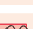

### 常见编程错误 10.10

将 `static` 成员函数声明为 `const` 会导致编译错误。`const` 限定符表示函数不能修改其操作对象的内容，但 `static` 成员函数独立于类的任何对象而存在并运行。

## 10.7 数据抽象与信息隐藏

类通常会对客户端隐藏其实现细节，这称为信息隐藏。作为示例，让我们考虑第 6.11 节介绍的栈数据结构。请记住，栈是一种后进先出（LIFO）数据结构——最后压入（插入）栈中的元素，是最先从栈中弹出（移除）的元素。

栈可以使用数组或其他数据结构（例如链表）实现。（我们将在第 14 章和第 20 章讨论栈。）栈类的客户端不需要关注栈的实现方式。客户端只需知道，当数据项放入栈中后，它们将按照后进先出的顺序取出。客户端关心的是栈提供哪些功能，而不是这些功能如何实现。这个概念称为数据抽象。尽管你可能了解某个类的实现细节，但不应编写依赖这些细节的代码，因为这些细节将来可能发生变化。这样一来，就可以用另一个版本替换某个特定的类（例如实现栈及其 `push` 和 `pop` 操作的类），而不会影响系统的其他部分。只要该类的 `public` 服务不发生变化（也就是说，原有的每个 `public` 成员函数在新的类定义中仍具有相同的原型），系统的其他部分就不会受到影响。

### 抽象数据类型

许多编程语言强调操作。在这些语言中，数据的存在是为了支持程序必须执行的操作。与操作相比，数据显得“没那么有趣”。数据是“粗糙的”。这类语言通常只有少数几种内置数据类型，而且很难创建新类型。C++ 和面向对象的编程风格提升了数据的重要性。C++ 面向对象编程的主要活动，是创建类型（即类）以及表达这些类型的对象之间的交互。为了创建强调数据的语言，程序设计语言领域需要将有关数据的一些概念形式化。我们在这里讨论的形式化概念就是抽象数据类型（ADT），它能够改进应用程序开发过程。

什么是抽象数据类型？考虑类型 `int`，大多数人会将它与数学中的整数联系起来。然而，`int` 实际上是整数的一种抽象表示。与数学整数不同，计算机中的 `int` 具有最大值范围——在 32 位机器上，通常限制在 –2,147,483,648 到 +2,147,483,647 之间。如果计算结果超出这个范围，就会发生“溢出”错误，并且计算机


表示形式；在ADT的公共接口中未提供的操作会以某种适当的方式被拒绝。这可能意味着发出错误消息、抛出异常（见第16章）、终止执行或简单地忽略该操作请求。

我们在第20章中创建了自己的队列类，并在第22章中研究标准库队列类。

## 10.8 总结

本章介绍了与类和数据抽象相关的几个高级主题。你学习了如何指定const对象和const成员函数以防止对对象的修改，从而强制执行最小权限原则。你还学习了，通过组合，一个类可以拥有其他类的对象作为成员。我们引入了友元的话题，并提供了演示如何使用友元函数的示例。

你学习了this指针作为隐式参数传递给类的每个非静态成员函数，使这些函数能够访问正确对象的数据成员和其他非静态成员函数。你还看到了显式使用this指针来访问类的成员，并实现级联成员函数调用。我们说明了静态数据成员的必要性，并演示了如何在自己的类中声明和使用静态数据成员和静态成员函数。

你学习了数据抽象和信息隐藏——面向对象编程的两个基本概念。最后，我们讨论了抽象数据类型——在计算机系统中以某种令人满意的精度表示现实世界或概念性概念的方式。

在第11章中，我们继续学习类和对象，展示如何让C++的运算符作用于对象——这个过程称为运算符重载。例如，你将看到如何“重载”<<运算符，使其能够在不显式使用重复语句的情况下输出整个数组。

## 小结

### 10.2节 const（常量）对象与const成员函数

- 关键字const可用于指定对象不可修改，任何试图修改该对象的操作都应导致编译错误。
- C++编译器禁止在const对象上调用非const成员函数。
- const成员函数试图修改其类对象会导致编译错误。
- 成员函数在其原型和定义中都被指定为const。
- const对象必须被初始化。
- 构造函数和析构函数不能声明为const。
- const数据成员和引用数据成员必须使用成员初始化器进行初始化。

### 10.3节 组合：类的对象作为成员

- 一个类可以拥有其他类的对象作为成员——这个概念称为组合。
- 成员对象按照它们在类定义中声明的顺序构造，并且在其所属类对象之前构造。
- 如果没有为成员对象提供成员初始化器，将隐式调用该成员对象的默认构造函数。

### 10.4节 友元函数和友元类

- 类的友元函数定义在该类的作用域之外，但有权访问该类的所有成员。独立函数或整个类都可以被声明为友元。
- 友元声明可以出现在类中的任何位置。
- 友元关系既不是对称的，也不是传递的。

### 10.5节 使用this指针

- 每个对象都可以通过this指针访问自己的地址。
- 对象的this指针不是对象本身的一部分——即，this指针所占用的内存大小不会反映在对该对象进行sizeof操作的结果中。
- this指针作为隐式参数传递给每个非静态成员函数。
- 对象隐式地（正如我们到目前为止所做的）或显式地使用this指针来引用其数据成员和成员函数。
- this指针实现了级联成员函数调用，即在同一语句中调用多个函数。

### 10.6节 静态类成员

- 静态数据成员表示“类级别”的信息（即由所有实例共享的类属性，而不是类的特定对象的属性）。
- 静态数据成员具有类作用域，可以声明为public、private或protected。
- 即使不存在该类的对象，类的静态成员也存在。
- 当不存在类的对象时，要访问公共静态类成员，只需在数据成员名称前加上类名和二元作用域解析运算符（::）。
- 如果成员函数不访问类的非静态数据成员或非静态成员函数，则应声明为static。与非静态成员函数不同，静态成员函数没有this指针，因为静态数据成员和静态成员函数独立于类的任何对象而存在。

### 10.7节 数据抽象与信息隐藏

- 抽象数据类型是在计算机系统中以某种令人满意的精度表示现实世界和概念性概念的方式。
- 抽象数据类型包含两个概念：数据表示以及可对该数据执行的操作。

## 术语表

- 抽象数据类型（ADTs）458
- 算术溢出 459
- 级联成员函数调用 449
- 组合 439
- 数据抽象 458
- 数据表示 459
- 出队（队列操作）459
- 入队（队列操作）459
- 先进先出（FIFO）459
- 友元函数 445
- has-a关系 439
- 宿主对象 440
- 信息隐藏 458
- 成员初始化器 435
- 成员初始化列表 436
- 成员初始化器语法 435
- 成员对象 439
- 成员对象构造函数 439
- ADT中的操作 460
- 队列 459
- 队列抽象数据类型 459
- 静态数据成员 453
- 静态成员函数 454
- this指针 448

现在编写一个驱动程序来测试你的IntegerSet类。实例化几个IntegerSet对象。测试你的所有成员函数是否正常工作。

**10.9** *（Time类修改）* 对于图10.17–10.18中的Time类来说，在内部将时间表示为自午夜以来的秒数，而不是三个整数值hour、minute和second，是完全合理的。客户端可以使用相同的公共方法并获得相同的结果。修改图10.17中的Time类，将时间实现为自午夜以来的秒数，并证明对于该类的客户端来说，功能没有可见的变化。[注意：本练习很好地展示了实现隐藏的优点。]

**10.10** *（洗牌与发牌）* 创建一个程序来洗牌和发一副牌。该程序应由Card类、DeckOfCards类和一个驱动程序组成。Card类应提供：

- a) 类型为int的数据成员face和suit。
- b) 一个构造函数，接收两个表示face和suit的int，并用它们初始化数据成员。
- c) 两个表示面值和花色的字符串静态数组。
- d) 一个toString函数，以“face of suit”的形式将Card作为字符串返回。你可以使用+运算符连接字符串。

DeckOfCards类应包含：

- a) 一个名为deck的Cards向量，用于存储Card。
- b) 一个整型currentCard，表示下一张要发的牌。
- c) 一个默认构造函数，用于初始化牌堆中的Card。构造函数应使用vector函数push_back，在每张Card创建并初始化后将其添加到vector的末尾。对于牌堆中的52张Card都应执行此操作。
- d) 一个shuffle函数，用于打乱牌堆中的Card。洗牌算法应遍历Card的vector。对于每张Card，随机选择牌堆中的另一张Card，并交换这两张Card。
- e) 一个dealCard函数，从牌堆返回下一个Card对象。
- f) 一个moreCards函数，返回一个bool值，指示是否还有更多的Card需要发。

驱动程序应创建一个DeckOfCards对象，洗牌，然后发这52张牌。

**10.11** *（洗牌与发牌）* 修改你在练习10.10中开发的程序，使其发五张牌的扑克手牌。然后编写函数完成以下各项：

- a) 判断手牌中是否包含一对。
- b) 判断手牌中是否包含两对。
- c) 判断手牌中是否包含三条（例如，三张J）。
- d) 判断手牌中是否包含四条（例如，四张A）。
- e) 判断手牌中是否包含同花（即五张牌花色相同）。
- f) 判断手牌中是否包含顺子（即五张牌面值连续）。

## 洗牌与发牌项目

**10.12** *（洗牌与发牌）* 使用练习10.11中的函数编写一个程序，发两副五张牌的扑克手牌，评估每副手牌并确定哪副更好。

**10.13** *（洗牌与发牌）* 修改你在练习10.12中开发的程序，使其能够模拟庄家。庄家的五张手牌以“背面朝上”发出，因此玩家无法看到。程序随后应评估庄家的手牌，并根据手牌的质量，庄家应再抽一张、两张或三张牌，以替换原手牌中相应数量的不需要的牌。然后程序应重新评估庄家的手牌。

**10.14** *（洗牌与发牌）* 修改你在练习10.13中开发的程序，使其处理庄家的手牌，但允许玩家决定玩家手牌中的哪些牌要


## 大纲

- 11.1 引言
- 11.2 运算符重载基础
- 11.3 运算符重载的限制
- 11.4 运算符函数作为类成员与全局函数
- 11.5 重载流插入和流提取运算符
- 11.6 重载一元运算符
- 11.7 重载二元运算符
- 11.8 动态内存管理
- 11.9 案例研究：Array 类
- 11.10 类型之间的转换
- 11.11 构建 String 类
- 11.12 重载 ++ 和 --
- 11.13 案例研究：Date 类
- 11.14 标准库类 string
- 11.15 explicit 构造函数
- 11.16 代理类
- 11.17 小结

小结 | 术语 | 自测练习 | 自测练习答案 | 练习题

## 11.1 引言

第9～10章介绍了C++类的基础知识。通过向对象发送消息（以成员函数调用的形式）从对象获得服务。对于某些类型的类（如数学类），这种函数调用表示法很繁琐。此外，许多常见操作通过运算符（例如输入和输出）执行。我们可以使用C++丰富的内置运算符来指定常见的对象操作。本章说明如何使C++的运算符能够处理对象——这一过程称为运算符重载。

C++内置的一个重载运算符示例是 <<，它既用作流插入运算符，又用作按位左移运算符（第21章“位、字符、字符串和结构体”中讨论）。类似地，>> 也被重载；它既用作流提取运算符，又用作按位右移运算符。这两个运算符都在C++标准库中被重载。

尽管运算符重载听起来像一种奇特的能力，但大多数程序员都在隐式地使用重载运算符。例如，C++语言重载了加法运算符（+）和减法运算符（-）。这些运算符在整数、浮点数和指针算术中的行为不同，具体取决于它们的上下文。

C++使你可以重载大多数运算符，使其对所使用的上下文敏感——编译器根据上下文（特别是操作数的类型）生成适当的代码。有些运算符经常被重载，尤其是赋值运算符、关系运算符以及各种算术运算符，如 + 和 -。重载运算符完成的工作也可以通过显式函数调用来完成，但运算符表示法通常更清晰，且程序员更熟悉。

我们讨论何时使用以及何时不使用运算符重载。我们创建 PhoneNumber、Array 和 Date 类来演示如何重载运算符，包括流插入、流提取、赋值、相等、关系、下标、逻辑非和自增运算符。我们演示 C++ 标准库类 string，它提供了许多重载运算符。在练习中，我们要求你实现几个带重载运算符的类。练习还使用 Complex 类（用于复数）和 HugeInt 类（用于大于计算机可用 long 类型表示的整数）来演示重载算术运算符 + 和 -，并要求你增强这些

### 创建新运算符

不可能创建新运算符；只能重载已有运算符。不幸的是，这使你无法使用其他一些编程语言中用于幂运算的 ** 运算符等流行表示法。[注意：你可以重载一个已有运算符来执行幂运算。]


> **常见编程错误 11.2**
> 
> *试图通过运算符重载创建新运算符是语法错误。*

### 基本类型的运算符

运算符重载不能改变运算符作用于基本类型对象时的含义。例如，你不能改变 + 将两个整数相加的含义。运算符重载仅适用于用户自定义类型的对象，或用户自定义类型对象与基本类型对象的混合。


> **软件工程观察 11.2**
> 
> *运算符函数的至少一个参数必须是用户自定义类型的对象或引用。这可以防止你改变运算符作用于基本类型的方式。*


> **常见编程错误 11.3**
> 
> *试图修改运算符作用于基本类型对象的方式是编译错误。*

### 相关运算符

重载赋值运算符和加法运算符以允许如下语句

```
object2 = object2 + object1;
```

并不意味着 += 运算符也被重载以允许如下语句

```
object2 += object1;
```

这种行为只能通过为该类显式重载运算符 += 来实现。


> **常见编程错误 11.4**
> 
> *假设重载 + 等运算符会重载 += 等相关运算符，或假设重载 == 会重载 != 等相关运算符，可能导致错误。运算符只能显式重载；不存在隐式重载。*

## 11.4 运算符函数作为类成员与全局函数

运算符函数可以是成员函数或全局函数；出于性能原因，全局函数通常被设为友元。成员函数隐式使用 this 指针来获取其类对象参数之一（二元运算符的左操作数）。在全局函数调用中，二元运算符的两个操作数的参数都必须显式列出。

### 必须重载为成员函数的运算符

重载 ()、[]、-> 或任何赋值运算符时，运算符重载函数必须声明为类成员。对于其他运算符，运算符重载函数可以是类成员或独立函数。

### 运算符作为成员函数和全局函数

无论运算符函数实现为成员函数还是全局函数，该运算符在表达式中的使用方式仍然相同。那么哪种最好？

当运算符函数实现为成员函数时，最左边（或唯一）的操作数必须是该运算符所属类的对象（或对象的引用）。如果左操作数必须是不同类的对象或基本类型，则该运算符函数必须实现为全局函数（正如我们将在 11.5 节中分别重载 << 和 >> 作为流插入和流提取运算符时所做的）。如果全局运算符函数必须直接访问某个类的私有或受保护成员，则可以将该函数设为该类的友元。

特定类的运算符成员函数仅当二元运算符的左操作数具体为该类的对象，或一元运算符的唯一操作数为该类的对象时，才会（由编译器隐式）调用。

### 为什么重载的流插入和流提取运算符被重载为全局函数

重载的流插入运算符（<<）用于左操作数类型为 ostream & 的表达式中，如 cout << classObject。要以这种方式在右操作数为用户自定义类对象时使用该运算符，必须将其重载为全局函数。若要作为成员函数，operator << 就必须是 ostream 类的成员。这对于用户自定义类是不可能的，因为我们不允许修改 C++ 标准库类。类似地，重载的流提取运算符（>>）用于左操作数类型为 istream & 的表达式中，如 cin >> classObject，而右操作数是用户自定义类对象，因此它也必须作为全局函数。此外，这些重载运算符函数中的每一个都可能需要访问被输出或输入类对象的私有数据成员，因此出于性能原因，这些重载运算符函数可以设为该类的友元函数。


### 性能提示 11.1

可以将运算符重载为全局的非友元函数，但这样的函数若需要访问类的私有或受保护数据，就需要使用该类公共接口中提供的 set 或 get 函数。调用这些函数的开销可能导致性能不佳，因此可以将这些函数内联以提高性能。

### 可交换运算符

选择用全局函数重载运算符的另一个原因，是使该运算符具有可交换性。例如，假设我们有一个 long int 类型的对象 number，以及一个 HugeInteger 类的对象 bigInteger1（该类中的整数可以任意大，而不受底层硬件机器字长的限制；HugeInteger 类在本章练习中开发）。加法运算符（+）产生一个临时 HugeInteger 对象，作为 HugeInteger 与 long int 之和（如表达式 bigInteger1 + number），或作为 long int 与 HugeInteger 之和（如表达式 number + bigInteger1）。因此，我们需要加法


运算符具有可交换性（与两个基本类型操作数时完全相同）。问题在于，如果要将加法运算符重载为成员函数，类对象必须出现在加法运算符的左侧。因此，我们将该运算符重载为全局函数，以允许 HugeInteger 出现在加法的右侧。处理左侧 HugeInteger 的 operator+ 函数仍然可以是成员函数。全局函数只是交换其参数并调用该成员函数。

## 11.5 重载流插入运算符和流提取运算符

你可以使用流提取运算符 >> 和流插入运算符 << 输入和输出基本类型数据。C++ 类库重载了这些运算符，以处理每种基本类型，包括指针和 C 风格 char * 字符串。你也可以重载这些运算符，为自己的类型执行输入和输出。图 11.3–11.5 中的程序重载了这些运算符，以按 "(000) 000-0000" 的格式输入和输出 PhoneNumber 对象。该程序假定电话号码输入正确。

```cpp
1   // Fig. 11.3: PhoneNumber.h
2   // PhoneNumber class definition
3   #ifndef PHONENUMBER_H
4   #define PHONENUMBER_H
5
6   #include <iostream>
7   #include <string>
8   using namespace std;
9
10  class PhoneNumber
11  {
12     friend ostream &operator<<( ostream &, const PhoneNumber & );
13     friend istream &operator>>( istream &, PhoneNumber & );
14  private:
15     string areaCode; // 3-digit area code
16     string exchange; // 3-digit exchange
17     string line; // 4-digit line
18  }; // end class PhoneNumber
19
20  #endif
```

图 11.3 | 将重载的流插入运算符和流提取运算符声明为友元函数的 PhoneNumber 类。

```cpp
1   // Fig. 11.4: PhoneNumber.cpp
2   // Overloaded stream insertion and stream extraction operators
3   // for class PhoneNumber.
4   #include <iomanip>
5   #include "PhoneNumber.h"
6   using namespace std;
```

图 11.4 | 类 PhoneNumber 的重载流插入运算符和流提取运算符。（第 1 部分，共 2 部分）

```cpp
// overloaded stream insertion operator; cannot be
// a member function if we would like to invoke it with
// cout << somePhoneNumber;
ostream& operator<<( ostream &output, const PhoneNumber &number )
{
    output << "(" << number.areaCode << ") "
        << number.exchange << "-" << number.line;
    return output; // enables cout << a << b << c;
} // end function operator<<

// overloaded stream extraction operator; cannot be
// a member function if we would like to invoke it with
// cin >> somePhoneNumber;
istream& operator>>( istream &input, PhoneNumber &number )
{
    input.ignore(); // skip (
    input >> setw( 3 ) >> number.areaCode; // input area code
    input.ignore( 2 ); // skip ) and space
    input >> setw( 3 ) >> number.exchange; // input exchange
    input.ignore(); // skip dash (-)
    input >> setw( 4 ) >> number.line; // input line
    return input; // enables cin >> a >> b >> c;
} // end function operator>>
```

图 11.4 | 类 PhoneNumber 的重载流插入运算符和流提取运算符。（第 2 部分，共 2 部分）

```cpp
// Fig. 11.5: fig11_05.cpp
// Demonstrating class PhoneNumber's overloaded stream insertion
// and stream extraction operators.
#include <iostream>
#include "PhoneNumber.h"
using namespace std;

int main()
{
    PhoneNumber phone; // create object phone

    cout << "Enter phone number in the form (123) 456-7890:" << endl;

    // cin >> phone invokes operator>> by implicitly issuing
    // the global function call operator>>( cin, phone )
    cin >> phone;

    cout << "The phone number entered was: ";

    // cout << phone invokes operator<< by implicitly issuing
    // the global function call operator<<( cout, phone )
    cout << phone << endl;
} // end main
```

图 11.5 | 重载的流插入运算符和流提取运算符。（第 1 部分，共 2 部分）

```text
    Enter phone number in the form (123) 456-7890:
    (800) 555-1212
    The phone number entered was: (800) 555-1212
```

图 11.5 | 重载的流插入运算符和流提取运算符。（第 2 部分，共 2 部分）

流提取运算符函数 operator>>（图 11.4，第 21–30 行）接受 istream 引用 input 和 PhoneNumber 引用 number 作为参数，并返回一个 istream 引用。函数 operator>> 将以下形式的电话号码输入

```text
    (800) 555-1212
```

到 PhoneNumber 类的对象中。当编译器看到表达式

```cpp
    cin >> phone
```

在图 11.5 第 16 行中，编译器会生成全局函数调用

```cpp
    operator>>( cin, phone );
```

当此调用执行时，引用参数 input（图 11.4，第 21 行）成为 cin 的别名，引用参数 number 成为 phone 的别名。该运算符函数将电话号码的三个部分作为字符串读入由参数 number 引用的 PhoneNumber 对象的 areaCode（第 24 行）、exchange（第 26 行）和 line（第 28 行）成员中。流操纵符 setw 限制读入每个字符串的字符数。当与 cin 和字符串一起使用时，setw 将读取的字符数限制为其参数指定的字符数（即 setw( 3 ) 允许读取三个字符）。通过调用 istream 成员函数 ignore（图 11.4，第 23、25 和 27 行）跳过括号、空格和短横线字符，该函数丢弃输入流中指定数量的字符（默认一个字符）。函数 operator>> 返回 istream 引用 input（即 cin）。这使得对 PhoneNumber 对象的输入操作可以与对其他 PhoneNumber 对象或其他数据类型对象的输入操作级联。例如，程序可以在一条语句中输入两个 PhoneNumber 对象，如下所示：

```cpp
    cin >> phone1 >> phone2;
```

首先，表达式 cin >> phone1 通过生成全局函数调用来执行

```cpp
    operator>>( cin, phone1 );
```

此调用随后返回 cin 的引用作为 cin >> phone1 的值，因此表达式的剩余部分被简单地解释为 cin >> phone2。它通过生成全局函数调用来执行

```cpp
    operator>>( cin, phone2 );
```

流插入运算符函数（图 11.4，第 11–16 行）接受一个 ostream 引用（output）和一个 const PhoneNumber 引用（number）作为参数，并返回一个 ostream 引用。函数 operator<< 显示 PhoneNumber 类型的对象。当编译器看到表达式

```cpp
    cout << phone
```

在图 11.5 第 22 行中，编译器会生成全局函数调用

```cpp
operator<<( cout, phone );
```

函数 operator<< 将电话号码的各个部分作为字符串显示，因为它们存储为 string 对象。


> **错误预防提示 11.1**
> 
> 从重载的 << 或 >> 运算符函数返回引用通常是成功的，因为 cout、cin 和大多数流对象是全局的，或者至少具有较长的生命周期。返回对自动变量或其他临时对象的引用是危险的——这可能创建指向不存在对象的“悬空引用”。

函数 operator>> 和 operator<< 在 PhoneNumber 中声明为全局友元函数（图 11.3，第 12–13 行）。它们是全局函数，因为 PhoneNumber 类的对象是该运算符的右操作数。请记住，二元运算符的重载运算符函数只有在左操作数是该函数所属类的对象时，才能作为成员函数。如果重载的输入和输出运算符出于性能原因需要直接访问非公有类成员，或者因为类可能不提供合适的 get 函数，则将它们声明为友元。此外，函数 operator<< 参数列表中的 PhoneNumber 引用（图 11.4，第 11 行）是 const，因为 PhoneNumber 将只是被输出；而函数 operator>> 参数列表中的 PhoneNumber 引用（第 21 行）是非 const，因为必须修改 PhoneNumber 对象，以将输入的电话号码存储到该对象中。


> **软件工程观察 11.3**
> 
> 为用户定义类型新增的输入/输出能力被添加到 C++ 中，而无需修改标准输入/输出库类。这是 C++ 可扩展性的另一个例子。

## 11.6 重载一元运算符

类的一元运算符可以重载为不带参数的非静态成员函数，或重载为带一个参数的全局函数，该参数必须是该类的一个对象（或对象的引用）。实现重载运算符的成员函数必须是非静态的，以便它们可以访问该类每个对象中的非静态数据。请记住，静态成员函数只能访问类的静态成员。

在本章后面，我们将重载一元运算符 !，以测试我们创建的 String 类（第 11.11 节）的对象是否为空，并返回一个 bool 结果。考虑表达式 !s，其中 s 是 String 类的对象。当像 ! 这样的一元运算符被重载为不带参数的成员函数，并且编译器看到表达式 !s 时，编译器会生成函数调用 s.operator!()。操作数 s 是正在对其调用 String 类成员函数 operator! 的类对象。该函数在类定义中声明如下：

```cpp
class String
{
public:
    bool operator!() const;
    ...
}; // end class String
```


像 ! 这样的一元运算符可以以两种不同方式重载为带一个参数的全局函数——要么参数是对象（这需要复制该对象，因此函数的副作用不会作用于原对象），要么参数是对对象的引用（不复制原对象，因此该函数的所有副作用都会作用于原对象）。如果 s 是 String 类对象（或对 String 类对象的引用），那么 !s 会被视为已经编写了调用 operator!(s)，从而调用声明如下的全局 operator! 函数：

```cpp
bool operator!( const String & );
```

## 11.7 重载二元运算符

二元运算符可以重载为带一个参数的非静态成员函数，或重载为带两个参数的全局函数（其中一个参数必须是类对象或对类对象的引用）。

本章后面，我们将重载 < 以比较两个 String 对象。当把二元运算符 < 重载为 String 类的带一个参数的非静态成员函数时，如果 y 和 z 是 String 类对象，那么 y < z 会被视为已经编写了 y.operator<(z)，从而调用下面声明的 operator< 成员函数

```cpp
class String
{
public:
    bool operator<( const String & ) const;

}; // end class String
```

作为全局函数，二元运算符 < 必须接受两个参数——其中一个必须是该类的对象（或对对象的引用）。如果 y 和 z 是 String 类对象或对 String 类对象的引用，那么 y < z 会被视为程序中已经编写了调用 operator<(y, z)，从而调用声明如下的全局函数 operator<：

```cpp
bool operator<( const String &, const String & );
```

## 11.8 动态内存管理

标准 C++ 数组数据结构一旦创建，其大小就是固定的。大小在编译时用常量指定。有时在执行时动态确定数组的大小并随后创建该数组是很有用的。C++ 使你能够在程序中控制对象以及任何内置类型或用户定义类型的数组的内存分配和释放。这称为动态内存管理，通过运算符 new 和 delete 来执行。

你可以使用 new 运算符在执行时动态分配（即预留）保存对象或数组所需的确切内存量。对象或数组创建在自由存储区（也称为堆）中——这是分配给每个程序用于存储动态分配对象的内存区域。一旦在自由存储区中分配了内存，就可以通过 operator new 返回的指针访问它。当你不再需要该内存时，可以使用 delete 运算符释放（即归还）该内存，将其返回给自由存储区，之后这些内存可被将来的 new 操作重用。

（例如，char 被初始化为空字符 `'\0'`）。虽然数组名是指向数组第一个元素的指针，但以下写法对于动态分配的内存是不允许的：

```cpp
int gradesArray[] = new int[ 10 ];
```

### 使用 `delete []` 释放动态分配的数组

要释放 gradesArray 所指向的内存，请使用语句

```cpp
delete [] gradesArray;
```

如果该指针指向对象数组，则该语句首先对数组中的每个对象调用析构函数，然后释放内存。如果前面的语句没有包含方括号（[]）而 gradesArray 指向对象数组，则结果是未定义的。一些编译器只对数组中的第一个对象调用析构函数。对空指针（即值为 0 的指针）使用 delete 没有效果。

> **常见编程错误 11.6**
> 
> *对对象数组使用 `delete` 而不是 `delete []` 可能导致运行时逻辑错误。为确保数组中的每个对象都收到析构函数调用，请始终使用运算符 `delete []` 删除作为数组分配的内存。同样，请始终使用运算符 `delete` 删除作为单个元素分配的内存——使用运算符 `delete []` 删除单个对象的结果是未定义的。*

## 11.9 案例研究：Array 类

我们在第 7 章讨论了数组。数组不过是指向内存中某个空间的指针。基于指针的数组有许多问题，包括：

- 程序很容易“走出”数组的任一端，因为 C++ 不检查下标是否超出数组范围（尽管你仍然可以显式地这样做）。
- 大小为 *n* 的数组必须将其元素编号为 0，…，*n* – 1；不允许使用其他下标范围。
- 整个数组不能一次输入或输出；每个数组元素必须单独读取或写入（除非该数组是以空字符结尾的 C 字符串）。
- 两个数组不能用相等或关系运算符进行有意义的比较（因为数组名只是指向数组在内存中开始位置的指针，而两个数组总是位于不同的内存位置）。
- 当数组传递给设计用于处理任意大小数组的通用函数时，必须将数组的大小作为附加参数传递。
- 一个数组不能使用赋值运算符赋给另一个数组（因为数组名是 const 指针，而*常量*指针不能用于赋值运算符的左侧）。

C++ 提供了通过类和运算符重载来实现更稳健的数组功能的方法。你可以开发一个优于“原始”数组的数组类。在本例中，我们创建一个功能强大的 `Array` 类，它执行范围检查以确保下标保持在 `Array` 的边界内。该类允许使用赋值运算符将一个数组对象赋给另一个数组对象。Array 对象知道自身的大小，因此不需要将大小单独传递给接收 Array 参数的函数。可以使用流提取运算符和流插入运算符分别输入或输出整个 Array。可以使用相等运算符 == 和 != 比较 Array。回想一下，C++ 标准库类模板 vector（在第 7 章介绍）也提供了许多这些功能。第 22 章详细解释了类模板 vector。

这个示例将加深你对数据抽象的理解。类开发是一项有趣、富有创造性且具有智力挑战性的活动——始终以“打造有价值的类”为目标。图 11.6–11.8 的程序演示了 Array 类及其重载运算符。首先我们逐步讲解 main（图 11.8），然后考虑类定义（图 11.6）及其每个成员函数定义（图 11.7）。

```cpp
// Fig. 11.6: Array.h
// Array class definition with overloaded operators.
#ifndef ARRAY_H
#define ARRAY_H

#include <iostream>
using namespace std;

class Array
{
   friend ostream &operator<<( ostream &, const Array & );
   friend istream &operator>>( istream &, Array & );
public:
   Array( int = 10 ); // default constructor
   Array( const Array & ); // copy constructor
   ~Array(); // destructor
   int getSize() const; // return size

   const Array &operator=( const Array & ); // assignment operator
   bool operator==( const Array & ) const; // equality operator

   // inequality operator; returns opposite of == operator
   bool operator!=( const Array &right ) const
   {
      return !( *this == right ); // invokes Array::operator==
   } // end function operator!=

   // subscript operator for non-const objects returns modifiable lvalue
   int &operator[]( int );

   // subscript operator for const objects returns rvalue
   int operator[]( int ) const;
private:
   int size; // pointer-based array size
   int *ptr; // pointer to first element of pointer-based array
}; // end class Array

#endif
```

图 11.6  |  带重载运算符的 Array 类定义。


```cpp
ptr = new int[ size ]; // create space for array copy
} // end if

for ( int i = 0; i < size; i++ )
    ptr[ i ] = right.ptr[ i ]; // copy array into object
} // end outer if

return *this; // enables x = y = z, for example
} // end function operator=

// determine if two Arrays are equal and
// return true, otherwise return false
bool Array::operator==( const Array& right ) const
{
    if ( size != right.size )
        return false; // arrays of different number of elements

    for ( int i = 0; i < size; i++ )
        if ( ptr[ i ] != right.ptr[ i ] )
            return false; // Array contents are not equal

    return true; // Arrays are equal
} // end function operator==

// overloaded subscript operator for non-const Arrays;
// reference return creates a modifiable lvalue
int &Array::operator[]( int subscript )
{
    // check for subscript out-of-range error
    if ( subscript < 0 || subscript >= size )
    {
        cerr << "\nError: Subscript " << subscript
             << " out of range" << endl;
        exit( 1 ); // terminate program; subscript out of range
    } // end if

    return ptr[ subscript ]; // reference return
} // end function operator[]

// overloaded subscript operator for const Arrays
// const reference return creates an rvalue
int Array::operator[]( int subscript ) const
{
    // check for subscript out-of-range error
    if ( subscript < 0 || subscript >= size )
    {
        cerr << "\nError: Subscript " << subscript
             << " out of range" << endl;
        exit( 1 ); // terminate program; subscript out of range
    } // end if

    return ptr[ subscript ]; // returns copy of this element
} // end function operator[]
```

*图 11.7 | Array 类的成员函数和友元函数定义。（第 2 部分，共 3 部分。）*

```cpp
107 // overloaded input operator for class Array;
108 // inputs values for entire Array
109 istream &operator>>( istream &input, Array & a )
110 {
111     for ( int i = 0; i < a.size; i++ )
112         input >> a.ptr[ i ];
113
114     return input; // enables cin >> x >> y;
115 } // end function
116
117 // overloaded output operator for class Array
118 ostream &operator<<( ostream &output, const Array & a )
119 {
120     int i;
121
122     // output private ptr-based array
123     for ( i = 0; i < a.size; i++ )
124     {
125         output << setw( 12 ) << a.ptr[ i ];
126
127         if ( ( i + 1 ) % 4 == 0 ) // 4 numbers per row of output
128             output << endl;
129     } // end for
130
131     if ( i % 4 != 0 ) // end last line of output
132         output << endl;
133
134     return output; // enables cout << x << y;
135 } // end function operator<<
```

*图 11.7 | Array 类的成员函数和友元函数定义。（第 3 部分，共 3 部分。）*

```cpp
1   // Fig. 11.8: fig11_08.cpp
2   // Array class test program.
3   #include <iostream>
4   #include "Array.h"
5   using namespace std;
6
7   int main()
8   {
9
10      Array integers1( 7 ); // seven-element Array
11      Array integers2; // 10-element Array by default
12
13      // print integers1 size and contents
14      cout << "Size of Array integers1 is "
15           << integers1.getSize()
16           << "\nArray after initialization:\n" << integers1;
17
18      // print integers2 size and contents
19      cout << "\nSize of Array integers2 is "
20           << integers2.getSize()
21           << "\nArray after initialization:\n" << integers2;
22
23      // input and print integers1 and integers2
24      cout << "\nEnter 17 integers: " << endl;
25      cin >> integers1 >> integers2;
26
27      cout << "\nAfter input, the Arrays contain:\n"
28           << "integers1:\n" << integers1
29           << "integers2:\n" << integers2;
30
31      // use overloaded inequality (!=) operator
32      cout << "\nEvaluating: integers1 != integers2" << endl;
33
34      if ( integers1 != integers2 )
35         cout << "integers1 and integers2 are not equal" << endl;
36
37      // create Array integers3 using integers1 as an
38      // initializer; print size and contents
39      Array integers3( integers1 ); // invokes copy constructor
40
41      cout << "\nSize of Array integers3 is "
42           << integers3.getSize()
43           << "\nArray after initialization:\n" << integers3;
44
45      // use overloaded assignment (=) operator
46      cout << "\nAssigning integers2 to integers1:" << endl;
47      integers1 = integers2; // note target Array is smaller
48
49      cout << "\nSize of integers1: " << integers1
50           << "\nintegers2:\n" << integers2;
51
52      // use overloaded equality (==) operator
53      cout << "\nEvaluating: integers1 == integers2" << endl;
54
55      if ( integers1 == integers2 )
56         cout << "integers1 and integers2 are equal" << endl;
57
58      // use overloaded subscript operator to create rvalue
59      cout << "\nintegers1[5] is " << integers1[ 5 ];
60
61      // use overloaded subscript operator to create lvalue
62      cout << "\nAssigning 1000 to integers1[5]" << endl;
63      integers1[ 5 ] = 1000;
64      cout << "\nintegers1:\n" << integers1;
65
66      // attempt to use out-of-range subscript
67      cout << "\nAttempting to assign 1000 to integers1[15]" << endl;
68      integers1[ 15 ] = 1000; // ERROR: out of range
69 } // end main
```

*图 11.8 | Array 类测试程序。（第 1 部分，共 3 部分。）*

```text
Size of Array integers1 is 7
Array after initialization:
        0          0          0          0
        0          0          0
        0          0          0

Size of Array integers2 is 10
Array after initialization:
        0          0          0          0
        0          0          0          0
        0          0          0          0
        0          0

Enter 17 integers:
1 2 3 4 5 6 7 8 9 10 11 12 13 14 15 16 17

After input, the Arrays contain:
integers1:
        1          2          3          4
        5          6          7
integers2:
        8          9          10         11
        12         13         14         15
        16         17

Evaluating: integers1 != integers2
integers1 and integers2 are not equal

Size of Array integers3 is 7
Array after initialization:
        1          2          3          4
        5          6          7

Assigning integers2 to integers1:
integers1:
        8          9          10         11
        12         13         14         15
        16         17
integers2:
        8          9          10         11
        12         13         14         15
        16         17

Evaluating: integers1 == integers2
integers1 and integers2 are equal

integers1[5] is 13

Assigning 1000 to integers1[5]
integers1:
        8          9          10         11
        12         1000       14         15
        16         17

Attempting to assign 1000 to integers1[15]

Error: Subscript 15 out of range
```

*图 11.8 | Array 类测试程序。（第 3 部分，共 3 部分。）*

### 使用重载的下标运算符

第 58 行使用重载的下标运算符引用 `integers1[5]`——`integers1` 中一个范围内的元素。这个带下标的名称用作右值，打印存储在 `integers1[5]` 中的值。第 62 行将 `integers1[5]` 用作赋值语句左侧的可修改左值，将新值 1000 赋给 `integers1` 的第 5 个元素。我们将看到，`operator[]` 在确认 5 是 `integers1` 的有效下标后，返回一个引用以用作可修改的左值。

第 67 行试图将值 1000 赋给 `integers1[15]`——一个越界元素。在此示例中，`operator[]` 判断下标越界，打印一条消息并终止程序。我们在程序中将第 67 行标红，以强调访问越界元素是错误的。这是一个运行时逻辑错误。

有趣的是，数组下标运算符 `[]` 并不限于只与数组一起使用；例如，它还可以用于从其他类型的容器类（如链表、字符串和字典）中选择元素。此外，定义 `operator[]` 函数后，下标不再必须是整数——字符、字符串、浮点数甚至用户定义类的对象也可以使用。第 22 章将讨论允许非整数下标的 STL `map` 类。

### Array 类定义

现在我们已经了解了这个程序如何运行，接下来逐步讲解类头文件（图 11.6）。当我们提到头文件中的每个成员函数时，会讨论图 11.7 中该函数的实现。在图 11.6 中，第 34–35 行表示 `Array` 类的私有数据成员。每个 `Array` 对象由一个 `size` 成员（表示 `Array` 中元素的数量）和一个 `int` 指针——`ptr`——组成，该指针指向由 `Array` 对象管理的、动态分配的基于指针的整数数组。

### 将流插入运算符和流提取运算符重载为友元

图 11.6 的第 11–12 行将重载的流插入运算符和重载的流提取运算符声明为 `Array` 类的友元。当编译器看到像 `cout << arrayObject` 这样的表达式时，会通过以下调用调用全局函数 `operator<<`：

```cpp
operator<<( cout, arrayObject )
```

当编译器看到像 `cin >> arrayObject` 这样的表达式时，会通过以下调用调用全局函数 `operator>>`：

```cpp
operator>>( cin, arrayObject )
```

我们再次指出，这些流插入和流提取运算符函数不能是 `Array` 类的成员，因为 `Array` 对象总是出现在流插入运算符和流提取运算符的右侧。如果这些运算符函数是 `Array` 类的成员，则必须使用以下别扭的语句来输出和输入一个 `Array`：

```cpp
arrayObject << cout;
arrayObject >> cin;
```

对大多数熟悉 `cout` 和 `cin` 分别作为 `<<` 和 `>>` 左操作数出现的 C++ 程序员来说，这样的语句会令人困惑。


### 重载下标运算符

图 11.6 中的第 29 行和第 32 行声明了两个重载的下标运算符（分别在图 11.7 的第 80–91 行和第 95–106 行中定义）。当编译器看到表达式 integers1[5]（图 11.8，第 58 行）时，它会通过生成下面的调用来调用相应的重载 operator[] 成员函数：

```cpp
integers1.operator[]( 5 )
```

当下标运算符用于 const Array 对象时，编译器会调用 operator[] 的 const 版本（图 11.7，第 95–106 行）。例如，如果用如下语句实例化 const 对象 z：

```cpp
const Array z( 5 );
```

那么执行如下语句时需要 operator[] 的 const 版本：

```cpp
cout << z[ 3 ] << endl;
```

记住，程序只能调用 const 对象的 const 成员函数。

operator[] 的每个定义都会判断它作为参数接收的下标是否在范围内。如果不在范围内，每个函数都会打印一条错误信息，并通过调用函数 exit（头文件 <cstdlib>）终止程序。² 如果下标在范围内，非 const 版本的 operator[] 返回相应数组元素的引用，以便将其用作可修改的左值（例如，在赋值语句的左侧）。如果下标在范围内，const 版本的 operator[] 返回数组相应元素的一个副本。返回的字符是一个右值。

## 11.10 类型之间的转换

大多数程序处理多种类型的信息。有时所有操作都“保持在同一种类型内”。例如，int 加 int 得到 int。然而，通常需要将一种类型的数据转换为另一种类型的数据。这可能发生在赋值、计算、向函数传递值以及从函数返回值的过程中。编译器知道如何在基本类型之间执行某些转换。你可以使用强制转换运算符来强制在基本类型之间进行转换。

但是用户定义类型呢？编译器无法预先知道如何在用户定义类型之间，以及在用户定义类型与基本类型之间进行转换，因此你必须指定如何进行这种转换。这种转换可以通过转换构造函数来完成——即单参数构造函数，它将其他类型（包括基本类型）的对象转换为特定类的对象。

转换运算符（也称为强制转换运算符）可用于将一个类的对象转换为另一个类的对象，或转换为基本类型的对象。这样的转换运算符必须是非静态成员函数。函数原型

```cpp
A::operator char *( ) const;
```

声明了一个重载的强制转换运算符函数，用于将用户定义类型 A 的对象转换为临时的 char * 对象。该运算符函数声明为 const，因为它不会修改原始对象。重载的强制转换运算符函数不指定返回类型——返回类型就是对象被转换成的目标类型。如果 s 是一个类对象，当编译器看到表达式 static_cast< char * >( s ) 时，编译器会生成调用

```cpp
s.operator char *()
```

操作数 s 就是类对象 s，成员函数 operator char * 正被该对象调用。

可以定义重载的强制转换运算符函数，将用户定义类型的对象转换为基本类型，或转换为其他用户定义类型的对象。原型

```cpp
A::operator int() const;
A::operator OtherClass() const;
```

分别声明了重载的强制转换运算符函数，它们可以将用户定义类型 A 的对象转换为整数或用户定义类型 OtherClass 的对象。

强制转换运算符和转换构造函数的一个优点是：在必要时，编译器可以隐式调用这些函数来创建临时对象。例如，如果用户定义的 String 类的对象 s 出现在程序中期望普通 char * 的位置，比如

```cpp
cout << s;
```

编译器可以调用重载的强制转换运算符函数 operator char * 将该对象转换为 char *，并在表达式中使用所得的 char *。如果为 String 类提供了这个强制转换运算符，就不必为了使用 cout 输出 String 而重载流插入运算符了。

## 11.11 构建 String 类

在 8.10 节中，我们介绍了使用字符数组进行 C 风格、基于指针的字符串处理。我们在 21.10 节继续讨论 C 字符串。作为构建有价值类的内容的一部分，我们实现了自己的 String 类，它封装了一个动态分配的 C 字符串，并提供了许多与我们在 Array 类中介绍的功能类似的能力。为了实现这个类，我们使用了 8.10 节和 21.10 节介绍的若干功能。由于 Array 类和 String 类非常相似，我们将 String 类的代码和讨论发布在 www.deitel.com/books/cpphtp7/ 的 Downloads and Resources for Registered Users 下。

在本节中，我们讨论 String 类中定义的一些功能。C++ 标准库中包含类似但更健壮的 string 类，我们将在 11.14 节中演示，并在第 18 章中详细研究。

### String 转换构造函数

我们的 String 类提供了一个转换构造函数，它接受一个 const char * 参数，并初始化一个包含相同字符串的 String 对象。回想一下，任何单参数构造函数都可以被视为转换构造函数。当我们使用 char * 参数执行任何 String 操作时，这样的构造函数很有用。转换构造函数可以将 char * 字符串转换为 String 对象，然后可以将其赋值给目标 String 对象。这种转换构造函数的存在意味着没有必要为将字符串赋值给 String 对象而提供重载的赋值运算符。当编译器遇到语句

myString = "hello";

其中 myString 是一个 String 对象，编译器会调用转换构造函数来创建一个包含字符串 "hello" 的临时 String 对象；然后调用 String 类的重载赋值运算符，将该临时 String 对象赋值给 String 对象 myString。


> **软件工程观察 11.8**
> 
> *当使用转换构造函数执行隐式转换时，C++ 只能应用一次隐式构造函数调用（即，一次用户定义转换）来满足另一个重载运算符的需求。编译器不会通过执行一系列隐式的用户定义转换来满足重载运算符的需求。*

String 转换构造函数可以在如下声明中调用：

```cpp
String s1( "happy" );
```

当你将 C 字符串传递给期望 String 参数的函数，或者从返回类型为 String 的函数返回 C 字符串时，也会调用该转换构造函数。

### 重载一元取反运算符

重载的取反运算符判断 String 对象是否为空。例如，当编译器看到表达式 !string1 时，它会生成函数调用

string1.operator!()

如果 String 的长度等于零，该函数返回 true，否则返回 false。

### 重载函数调用运算符

重载函数调用运算符 () 非常强大，因为函数可以接受任意数量的参数。在 String 类中，我们重载该运算符以从 String 中选择子字符串。该运算符的两个整数参数指定所选子字符串的起始位置和长度。如果起始位置超出范围或子字符串长度为负，该运算符只返回一个空的 String。如果子字符串长度为 0，则选择从起始位置到 String 对象末尾的子字符串。假设 string1 是一个包含字符串 "AEIOU" 的 String 对象。当编译器遇到表达式 string1(2, 2) 时，它会生成成员函数调用

string1.operator()(2, 2)

该调用返回一个包含 "IO" 的 String。

## 11.12 重载 ++ 和 --

递增和递减运算符的前缀和后缀版本都可以重载。我们将看到编译器如何区分递增或递减运算符的前缀版本和后缀版本。

为了重载递增运算符以同时支持前缀和后缀递增用法，每个重载的运算符函数必须具有不同的签名，以便编译器能够


能够确定意图使用的是哪个版本的 ++。前缀版本的重载方式与任何其他前缀一元运算符完全相同。

### 重载前缀自增运算符

例如，假设我们希望将 Date 对象 d1 中的日期加 1。当编译器看到前置自增表达式 ++d1 时，编译器会生成成员函数调用

```cpp
d1.operator++()
```

该运算符函数的原型将为

```cpp
Date &operator++();
```

如果前缀自增运算符实现为全局函数，那么当编译器看到表达式 ++d1 时，编译器会生成函数调用

```cpp
operator++( d1 )
```

该运算符函数的原型将在 Date 类中声明为

```cpp
Date &operator++( Date & );
```

### 重载后缀自增运算符

重载后缀自增运算符会带来一个挑战，因为编译器必须能够区分重载的前缀自增运算符函数与后缀自增运算符函数的签名。C++ 采用的约定是：当编译器看到后置自增表达式 d1++ 时，它会生成成员函数调用

```cpp
d1.operator++( 0 )
```

该函数的原型为

```cpp
Date operator++( int )
```

参数 0 严格来说是一个“哑值”，它使编译器能够区分前缀和后缀自增运算符函数。同样的语法也用于区分前缀和后缀自减运算符函数。

如果后缀自增实现为全局函数，那么当编译器看到表达式 d1++ 时，编译器会生成函数调用

```cpp
operator++( d1, 0 )
```

该函数的原型将为

```cpp
Date operator++( Date &, int );
```

同样，0 参数由编译器用来区分实现为全局函数的前缀和后缀自增运算符。请注意，后缀自增运算符按值返回 Date 对象，而前缀自增运算符按引用返回 Date 对象，因为后缀自增运算符通常返回一个临时对象，其中包含自增发生之前该对象的原始值。C++ 将此类对象视为右值，不能用于赋值语句的左侧。前缀自增运算符返回实际自增后的对象及其新值。这样的对象可以在连续表达式中用作左值。

### 性能提示 11.2

*后缀自增（或自减）运算符创建的额外对象可能导致显著的性能问题——尤其是当该运算符用于循环中时。因此，只有当程序的逻辑需要后置自增（或后置自减）时，才应使用后缀自增（或自减）运算符。*

本节中关于重载前缀和后缀自增运算符的所有说明，同样适用于重载前缀和后缀自减运算符。接下来，我们考察一个带有重载前缀和后缀自增运算符的 Date 类。

## 11.13 案例研究：Date 类

图 11.9–11.11 中的程序演示了一个 Date 类，它使用重载的前缀和后缀自增运算符将 Date 对象中的日期加 1，并在必要时对月份和年份进行相应的递增。Date 头文件（图 11.9）指明，Date 的公共接口包括一个重载的流插入运算符（第 11 行）、一个默认构造函数（第 13 行）、一个 setDate 函数（第 14 行）、一个重载的前缀自增运算符（第 15 行）、一个重载的后缀自增运算符（第 16 行）、一个重载的 += 加法赋值运算符（第 17 行）、一个用于测试闰年的函数（第 18 行）以及一个用于判断某天是否为该月最后一天的函数（第 19 行）。

```cpp
 1  // Fig. 11.9: Date.h
 2  // Date class definition with overloaded increment operators.
 3  #ifndef DATE_H
 4  #define DATE_H
 5
 6  #include <iostream>
 7  using namespace std;
 8
 9  class Date
10  {
11    friend ostream &operator<<( ostream &, const Date & );
12  public:
13    Date( int m = 1, int d = 1, int y = 1900 ); // default constructor
14    void setDate( int, int, int ); // set month, day, year
15    Date &operator++(); // prefix increment operator
16    Date operator++( int ); // postfix increment operator
17    const Date &operator+=( int ); // add days, modify object
18    static bool leapYear( int ); // is date in a leap year?
19    bool endOfMonth( int ) const; // is date at the end of month?
20  private:
21    int month;
22    int day;
23    int year;
24
25    static const int days[]; // array of days per month
26    void helpIncrement(); // utility function for incrementing date
27  }; // end class Date
28
29  #endif
```

*图 11.9 | 带重载自增运算符的 Date 类定义。*

```cpp
// Fig. 11.10: Date.cpp
// Date class member- and friend-function definitions.
#include <iostream>
#include <string>
#include "Date.h"

using namespace std;

// initialize static member; one classwide copy
const int Date::days[] =
   { 0, 31, 28, 31, 30, 31, 30, 31, 31, 30, 31, 30, 31 };

// Date constructor
Date::Date( int m, int d, int y )
{
   setDate( m, d, y );
} // end Date constructor

// set month, day and year
void Date::setDate( int mm, int dd, int yy )
{
   month = ( mm >= 1 && mm <= 12 ) ? mm : 1;
   year = ( yy >= 1900 && yy <= 2100 ) ? yy : 1900;

   // test for a leap year
   if ( month == 2 && leapYear( year ) )
      day = ( dd >= 1 && dd <= 29 ) ? dd : 1;
   else
      day = ( dd >= 1 && dd <= days[ month ] ) ? dd : 1;
} // end function setDate

// overloaded prefix increment operator
Date &Date::operator++()
{
   helpIncrement(); // increment date
   return *this; // reference return to create an lvalue
} // end function operator++

// overloaded postfix increment operator; note that the
// dummy integer parameter does not have a parameter name
Date Date::operator++( int )
{
   Date temp = *this; // hold current state of object
   helpIncrement();

   // return unincremented, saved, temporary object
   return temp; // value return; not a reference return
} // end function operator++

// add specified number of days to date
const Date &Date::operator+=( int additionalDays )
{
   for ( int i = 0; i < additionalDays; i++ )
      helpIncrement();

   return *this; // enables cascading
} // end function operator+=

// if the year is a leap year, return true; otherwise, return false
bool Date::leapYear( int testYear )
{
   if ( testYear % 400 == 0 ||
        ( testYear % 100 != 0 && testYear % 4 == 0 ) )
      return true; // a leap year
   else
      return false; // not a leap year
} // end function leapYear

// determine whether the day is the last day of the month
bool Date::endOfMonth( int testDay ) const
{
   if ( month == 2 && leapYear( year ) )
      return testDay == 29; // last day of Feb. in leap year
   else
      return testDay == days[ month ];
} // end function endOfMonth

// function to help increment the date
void Date::helpIncrement()
{
   // day is not end of month
   if ( !endOfMonth( day ) )
      day++; // increment day
   else
      if ( month < 12 ) // day is end of month and month < 12
      {
         month++; // increment month
         day = 1; // first day of new month
      } // end if
      else // last day of year
      {
         year++; // increment year
         month = 1; // first month of new year
         day = 1; // first day of new month
      } // end else
} // end function helpIncrement

// overloaded output operator
ostream &operator<<( ostream &output, const Date &d )
{
   static string monthName[ 13 ] = { "", "January", "February",
      "March", "April", "May", "June", "July", "August",
      "September", "October", "November", "December" };
   output << monthName[ d.month ] << " " << d.day << ", " << d.year;
   return output; // enables cascading
} // end function operator<<
```

*图 11.10 | Date 类的成员函数和友元函数定义。（第 2 部分，共 2 部分。）*


```cpp
 1 // Fig. 11.11: fig11_11.cpp
 2 // Date class test program.
 3 #include <iostream>
 4 #include "Date.h" // Date class definition
 5 using namespace std;
 6
 7 int main()
 8 {
 9    Date d1; // defaults to January 1, 1900
10    Date d2( 12, 27, 1992 ); // December 27, 1992
11    Date d3( 0, 99, 8045 ); // invalid date
12
13    cout << "d1 is " << d1 << "\nd2 is " << d2 << "\nd3 is " << d3;
14    cout << "\n\nd2 += 7 is " << ( d2 += 7 );
15
16    d3.setDate( 2, 28, 1992 );
17    cout << "\n\n  d3 is " << d3;
18    cout << "\n++d3 is " << ++d3 << "  (leap year allows 29th)";
19
20    Date d4( 7, 13, 2002 );
21
22    cout << "\n\nTesting the prefix increment operator:\n"
23         << "  d4 is " << d4 << endl;
24    cout << "++d4 is " << ++d4 << endl;
25    cout << "  d4 is " << d4;
26
27    cout << "\n\nTesting the postfix increment operator:\n"
28         << "  d4 is " << d4 << endl;
29    cout << "d4++ is " << d4++ << endl;
30    cout << "  d4 is " << d4 << endl;
31 } // end main
```

```text
d1 is January 1, 1900
d2 is December 27, 1992
d3 is January 1, 1900

d2 += 7 is January 3, 1993

  d3 is February 28, 1992
++d3 is February 29, 1992 (leap year allows 29th)

Testing the prefix increment operator:
  d4 is July 13, 2002
++d4 is July 14, 2002
  d4 is July 14, 2002

Testing the postfix increment operator:
  d4 is July 14, 2002
d4++ is July 14, 2002
  d4 is July 15, 2002
```

**图 11.11** | Date 类测试程序。

函数 main（图 11.11）创建三个 Date 对象（第 9–11 行）——d1 默认初始化为 1900 年 1 月 1 日；d2 初始化为 1992 年 12 月 27 日；d3 初始化为一个无效日期。Date 构造函数（定义于图 11.10 第 13–16 行）调用 setDate

```cpp
// test string member function substr
cout << "The substring of s1 starting at location 0 for\n"
     << "14 characters, s1.substr(0, 14), is:\n"
     << s1.substr(0, 14) << "\n\n";

// test substr "to-end-of-string" option
cout << "The substring of s1 starting at\n"
     << "location 15, s1.substr(15), is:\n"
     << s1.substr(15) << endl;

// test copy constructor
string s4(s1);
cout << "\ns4 = " << s4 << "\n\n";

// test overloaded assignment (=) operator with self-assignment
cout << "assigning s4 to s4" << endl;
s4 = s4;
cout << "s4 = " << s4 << endl;

// test using overloaded subscript operator to create lvalue
s1[0] = 'H';
s1[6] = 'B';
cout << "\ns1 after s1[0] = 'H' and s1[6] = 'B' is: "
     << s1 << "\n\n";

// test subscript out of range with string member function "at"
cout << "Attempt to assign 'd' to s1.at(30) yields: " << endl;
s1.at(30) = 'd'; // ERROR: subscript out of range
} // end main
```

```text
s1 is "happy"; s2 is " birthday"; s3 is ""

The results of comparing s2 and s1:
s2 == s1 yields false
s2 != s1 yields true
s2 > s1 yields false
s2 < s1 yields true
s2 >= s1 yields false
s2 <= s1 yields true

Testing s3.empty():
s3 is empty; assigning s1 to s3;
s3 is "happy"

s1 += s2 yields s1 == happy birthday

s1 += " to you" yields
s1 == happy birthday to you

The substring of s1 starting at location 0 for
14 characters, s1.substr(0, 14), is:
happy birthday
```

**图 11.12** | 标准库类 string。（第 2 部分，共 3 部分。）

```text
The substring of s1 starting at
location 15, s1.substr(15), is:
to you
s4 = happy birthday to you

assigning s4 to s4
s4 = happy birthday to you
s1 after s1[0] = 'H' and s1[6] = 'B' is: Happy Birthday to you
Attempt to assign 'd' to s1.at(30) yields:
This application has requested the Runtime to terminate it in an unusual way.
Please contact the application's support team for more information.
```

**图 11.12** | 标准库类 string。（第 3 部分，共 3 部分。）

第 9–11 行创建三个 string 对象——s1 用字面量 "happy" 初始化，s2 用字面量 " birthday" 初始化，s3 使用默认 string 构造函数创建一个空字符串。第 14–15 行使用 cout 和 operator << 输出这三个对象，string 类的设计者重载了该运算符以处理 string 对象。接着第 16–22 行展示将 s2 与 s1 比较的结果，比较使用类 string 重载的相等运算符和关系运算符，这些运算符使用每个字符串中字符的数值（见附录 B，ASCII 字符集）进行字典序比较。

类 string 提供成员函数 empty 来判断字符串是否为空，我们在第 27 行演示这一点。成员函数 empty 在字符串为空时返回 true；否则返回 false。

第 30 行通过将 s1 赋给 s3 演示类 string 重载的赋值运算符。第 31 行输出 s3，以证明赋值正确工作。

第 36 行演示类 string 重载的 += 运算符用于字符串拼接。在此例中，s2 的内容被追加到 s1。然后第 37 行输出存储在 s1 中的结果字符串。第 41 行演示可以使用 operator += 将 C 风格字符串字面量追加到 string 对象。第 42 行显示结果。

类 string 提供成员函数 substr（第 47 和 52 行），用于将字符串的一部分作为 string 对象返回。第 47 行对 substr 的调用获取 s1 从位置 0（由第一个实参指定）开始的 14 个字符的子字符串（由第二个实参指定）。第 52 行对 substr 的调用获取从 s1 的位置 15 开始的子字符串。当未指定第二个实参时，substr 返回调用它的字符串的剩余部分。

第 55 行创建 string 对象 s4，并用 s1 的副本初始化它。这会调用类 string 的复制构造函数。第 60 行使用类 string 重载的 = 运算符演示它能正确处理自赋值。

第 64–65 行使用类 string 重载的 [] 运算符创建左值，使新字符能够替换 s1 中的现有字符。第 67 行输出 s1 的新值。类 string 重载的 [] 运算符不执行任何边界检查。因此，必须确保使用标准类 string 重载的 [] 运算符的操作不会意外操作字符串边界之外的元素。类 string 确实在其成员函数 at 中提供边界检查，如果其实参是无效下标，该函数会“抛出异常”。默认情况下，这会导致 C++ 程序终止并显示系统特定的错误消息。³ 如果下标有效，函数 at 会将指定位置的字符作为可修改左值或不可修改左值（即 const 引用）返回，具体取决于调用出现的上下文。第 71 行演示使用无效下标调用函数 at。该程序输出末尾显示的错误消息是在 Windows Vista 上运行该程序时产生的。

## 11.15 显式构造函数

在第 11.9–11.10 节中，我们讨论了编译器可以使用任何单实参构造函数执行隐式转换——构造函数接收的类型被转换为定义该构造函数的类的对象。该转换是自动的，无需使用强制类型转换运算符。在某些情况下，隐式转换是不希望的或容易出错的。例如，图 11.6 中的 Array 类定义了一个接受单个 int 实参的构造函数。该构造函数的意图是创建一个 Array 对象，其中包含由 int 实参指定的元素个数。然而，编译器可能误用该构造函数来执行隐式转换。

> **常见编程错误 11.10**
> 不幸的是，编译器可能会在你没有预料到的情况下使用隐式转换，从而产生有歧义的表达式，导致编译错误或造成执行时逻辑错误。

### 意外地将单实参构造函数用作转换构造函数

该程序（图 11.13）使用图 11.6–11.7 的 Array 类演示一种不恰当的隐式转换。

```cpp
1  // Fig. 11.13: Fig11_13.cpp
2  // Driver for simple class Array.
3  #include <iostream>
4  #include "Array.h"
5  using namespace std;
6
7  void outputArray( const Array & ); // prototype
8
9  int main()
10 {
11    Array integers1( 7 ); // 7-element array
12    outputArray( integers1 ); // output Array integers1
13    outputArray( 3 ); // convert 3 to an Array and output Array's contents
14 } // end main
15
16 // print Array contents
17 void outputArray( const Array &arrayToOutput )
18 {
19    cout << "The Array received has " << arrayToOutput.getSize()
20        << " elements. The contents are:\n" << arrayToOutput << endl;
21 } // end outputArray
```

**图 11.13** | 单实参构造函数与隐式转换。（第 1 部分，共 2 部分。）

3. 同样，第 16 章演示了如何“捕获”并处理此类异常。


```cpp
9  class Array
10 {
11     friend ostream &operator<<( ostream &, const Array & );
12     friend istream &operator>>( istream &, Array & );
13 public:
14     explicit Array( int = 10 ); // default constructor
15     Array( const Array & ); // copy constructor
16     ~Array(); // destructor
17     int getSize() const; // return size
18
19     const Array &operator=( const Array & ); // assignment operator
20     bool operator==( const Array & ) const; // equality operator
21
22     // inequality operator; returns opposite of == operator
23     bool operator!=( const Array &right ) const
24     {
25        return ! ( *this == right ); // invokes Array::operator==
26     } // end function operator!=
27
28     // subscript operator for non-const objects returns lvalue
29     int &operator[]( int );
30
31     // subscript operator for const objects returns rvalue
32     const int &operator[]( int ) const;
33 private:
34     int size; // pointer-based array size
35     int *ptr; // pointer to first element of pointer-based array
36 }; // end class Array
37
38 #endif
```

图 11.14 | 带有显式构造函数的 Array 类定义。（第 2 部分，共 2 部分。）

图 11.15 展示了图 11.13 中程序的一个略作修改的版本。编译该程序时，编译器会生成一条错误消息，指出传递给第 13 行中 `outputArray` 的整数值无法转换为 `const Array &`。编译器错误消息（来自 Visual C++）显示在输出窗口中。第 14 行演示了如何使用显式构造函数创建一个包含 3 个元素的临时 Array，并将其传递给函数 `outputArray`。

```cpp
1  // Fig. 11.15: Fig11_15.cpp
2  // Driver for simple class Array.
3  #include <iostream>
4  #include "Array.h"
5  using namespace std;
6
7  void outputArray( const Array & ); // prototype
8
```

图 11.15 | 演示显式构造函数。（第 1 部分，共 2 部分。）

```cpp
 9  int main()
10  {
11      Array integers1( 7 ); // 7-element array
12      outputArray( integers1 ); // output Array integers1
13      outputArray( 3 ); // convert 3 to an Array and output Array's contents
14      outputArray( Array( 3 ) ); // explicit single-argument constructor call
15  } // end main
16
17  // print array contents
18  void outputArray( const Array &arrayToOutput )
19  {
20      cout << "The Array received has " << arrayToOutput.getSize()
21          << " elements. The contents are:\n" << arrayToOutput << endl;
22  } // end outputArray
```

```text
c:\cpphtp7_examples\ch11\fig11_14_15\fig11_15.cpp(13) : error C2664:
'outputArray' : cannot convert parameter 1 from 'int' to 'const Array &'
        Reason: cannot convert from 'int' to 'const Array'
        Constructor for class 'Array' is declared 'explicit'
```

**图 11.15** | 演示显式构造函数。（第 2 部分，共 2 部分。）

**常见编程错误 11.11**

尝试调用显式构造函数来执行隐式转换会导致编译错误。

**错误预防提示 11.3**

对于不应由编译器用于执行隐式转换的单参数构造函数，请使用 `explicit` 关键字。

## 11.16 代理类

请回忆一下，优秀软件工程的两个基本原则是将接口与实现分离，以及隐藏实现细节。我们努力通过在头文件中定义类，并在单独的实现文件中实现其成员函数来实现这些目标。然而，正如我们在第 9 章中指出的，头文件确实包含类实现的一部分以及关于其他实现部分的提示。例如，类的私有成员会列在头文件中的类定义内，因此这些成员对客户程序员是可见的，即使客户程序员可能无法访问这些私有成员。以这种方式公开类的私有数据，可能会将专有信息暴露给类的客户程序员。现在，我们介绍代理类这一概念，它允许你甚至对类的客户程序员隐藏类的私有数据。为类的客户程序员提供一个只了解该类公共接口的代理类，可以让客户程序员使用类所提供的服务，而不会让他们访问类的实现细节。

实现代理类需要经过几个步骤，我们将在图 11.16–11.19 中演示这些步骤。首先，我们为包含希望隐藏的专有实现的类创建类定义。我们的示例类名为 Implementa-

- 要对类对象使用某个运算符，该运算符**必须**被重载，但有三个例外——赋值运算符（=）、地址运算符（&）和逗号运算符（,）。

### 第 11.3 节 运算符重载的限制

- 不能通过重载运算符来改变运算符的优先级和结合性。
- 不能改变运算符的“元数”（即运算符所接受的操作数数量）。
- 不能创建新的运算符——只能重载现有的运算符。
- 不能改变运算符作用于基本类型对象时的含义。
- 为某个类重载赋值运算符和加法运算符，并不意味着 `+=` 运算符也会被重载。只有通过为该类显式重载 `operator +=`，才能实现这种行为。

### 第 11.4 节 作为类成员与全局函数的运算符函数

- 运算符函数可以是成员函数，也可以是全局函数——出于性能方面的考虑，全局函数通常会被声明为友元。成员函数会隐式使用 `this` 指针来获取其类对象参数中的一个（对于二元运算符来说，就是左操作数）。在全局函数调用中，二元运算符的两个操作数都必须显式列出。
- 重载的 `()`、`[]`、`->` 和赋值运算符必须声明为类成员。对于其他运算符，运算符重载函数可以是类成员，也可以是全局函数。
- 当运算符函数实现为成员函数时，最左侧的操作数（或唯一的操作数）必须是该运算符所属类的对象（或对象引用）。
- 如果左操作数必须是其他类的对象或基本类型，则该运算符函数必须实现为全局函数。
- 如果全局运算符函数必须直接访问某个类的私有成员或受保护成员，则可以将该函数声明为该类的友元。

### 第 11.5 节 重载流插入运算符和流提取运算符

- 重载的流插入运算符（`<<`）用于左操作数类型为 `ostream &` 的表达式中。因此，它必须重载为全局函数。若要将 `operator <<` 实现为成员函数，它就必须是 `ostream` 类的成员，但这是不可能的，因为我们不能修改 C++ 标准库类。同样，重载的流提取运算符（`>>`）也必须是全局函数。
- 选择全局函数来重载运算符的另一个原因，是可以使运算符具有交换性。
- 与 `cin` 一起使用时，`setw` 会将读取的字符数限制为其参数指定的字符数。
- `istream` 成员函数 `ignore` 会丢弃输入流中指定数量的字符（默认情况下为一个字符）。
- 如果出于性能原因，重载的输入和输出运算符需要直接访问类的非公有成员，则应将它们声明为友元。

### 第 11.6 节 重载一元运算符

- 类的一元运算符可以重载为不带参数的非静态成员函数，也可以重载为带一个参数的全局函数；该参数必须是该类的对象或该类对象的引用。
- 实现重载运算符的成员函数必须是非静态的，这样它们才能访问类中每个对象的非静态数据。


### 第 11.7 节 重载二元运算符

-   二元运算符可以重载为带一个参数的非静态成员函数，或者带两个参数的全局函数（其中一个参数必须是类对象或对类对象的引用）。

### 第 11.8 节 动态内存管理

-   动态内存管理使您能够控制程序中任何内置或用户定义类型的内存的分配和释放。
-   自由存储区（有时称为堆）是分配给每个程序的内存区域，用于存储在运行时动态分配的对象。
-   `new` 运算符为对象分配适当大小的存储空间，运行对象的构造函数并返回正确类型的指针。`new` 运算符可用于动态分配任何基本类型（如 `int` 或 `double`）或类类型。如果 `new` 无法在内存中为对象找到空间，它会通过“抛出”“异常”来指示发生了错误。这通常会导致程序立即终止，除非该异常被处理。
-   要销毁动态分配的对象并释放其空间，请使用 `delete` 运算符。
-   对象数组可以使用 `new` 动态分配，如下所示

  ```c++
  int *ptr = new int[ 100 ];
  ```

  这会分配一个包含 100 个整数的数组，并将数组的起始位置赋给 `ptr`。上述整数数组通过以下语句删除

  ```c++
  delete [] ptr;
  ```

### 第 11.9 节 案例研究：Array 类

-   复制构造函数通过复制现有对象的成员来初始化类的新对象。包含动态分配内存的类通常提供复制构造函数、析构函数和重载的赋值运算符。
-   成员函数 `operator=` 的实现应测试自赋值，即对象被赋值给自身的情况。
-   当下标运算符用于 `const` 对象时，编译器会调用 `operator[]` 的 `const` 版本；当它用于非 `const` 对象时，编译器会调用该运算符的非 `const` 版本。
-   数组下标运算符（`[]`）可用于从其他类型的容器中选择元素。此外，通过重载，索引值不再需要是整数。

### 第 11.10 节 类型之间的转换

-   编译器无法预先知道如何在用户定义类型之间以及用户定义类型与基本类型之间进行转换，因此您必须指定如何进行此类转换。这种转换可以通过转换构造函数（单参数构造函数，将其他类型（包括基本类型）的对象转换为特定类的对象）来执行。
-   任何单参数构造函数都可以被视为转换构造函数。
-   转换运算符可用于将一个类的对象转换为另一个类的对象或转换为基本类型的对象。这种转换运算符必须是非静态成员函数。可以定义重载的强制转换运算符函数，用于将用户定义类型的对象转换为基本类型或转换为其他用户定义类型的对象。
-   重载的强制转换运算符函数不指定返回类型——返回类型是该对象被转换成的类型。
-   必要时，编译器可以隐式调用强制转换运算符和转换构造函数来创建临时对象。

### 第 11.11 节 构建 String 类

-   重载函数调用运算符 `()` 非常强大，因为函数可以接受任意数量的参数。

### 第 11.12 节 重载 ++ 和 --

-   前缀和后缀的自增与自减运算符都可以重载。
-   要重载前自增和后自增运算符，每个重载的运算符函数必须具有不同的签名。前缀版本与任何其他一元运算符一样重载。后缀自增运算符的独特签名是通过提供第二个参数（其类型必须为 `int`）来实现的。此参数不会出现在客户端代码中。编译器使用它来隐式区分自增运算符的前缀和后缀版本。相同的语法也用于区分前缀和后缀自减运算符函数。

### 第 11.14 节 标准库类 string

-   标准类 `string` 定义在头文件 `<string>` 中，并属于命名空间 `std`。
-   类 `string` 提供了许多重载运算符，包括相等、关系、赋值、加赋值（用于连接）和下标运算符。
-   类 `string` 提供成员函数 `empty`，如果字符串为空则返回 `true`；否则返回 `false`。
-   标准类 `string` 的成员函数 `substr` 从第一个参数指定的位置开始，获取第二个参数指定长度的子字符串。当未指定第二个参数时，`substr` 返回调用它的字符串的其余部分。
-   类 `string` 的重载 `[]` 运算符不执行任何边界检查。因此，您必须确保使用标准类 `string` 的重载 `[]` 运算符的操作不会意外操作字符串边界之外的元素。
-   标准类 `string` 通过成员函数 `at` 提供边界检查，如果其参数是无效下标，则“抛出异常”。默认情况下，这会导致程序终止。如果下标有效，函数 `at` 会根据上下文返回指定位置字符的引用或 `const` 引用。

### 第 11.15 节 explicit 构造函数

-   C++ 提供了关键字 `explicit`，用于在不允许隐式转换时抑制通过转换构造函数进行的隐式转换。声明为 `explicit` 的构造函数不能用于隐式转换。

### 第 11.16 节 代理类

-   为您的类的客户端提供一个只知道您的类公共接口的代理类，可以使客户端使用您的类的服务，而无需让客户端访问您的类的实现细节（例如其私有数据）。
-   当类定义仅使用另一个类对象的指针或引用时，不需要使用 `#include` 包含该其他类的头文件（该头文件通常会暴露该类的私有数据）。您只需在该文件中使用该类型之前，通过前置类声明将该其他类声明为数据类型即可。
-   包含代理类成员函数的实现文件是唯一包含我们希望隐藏其私有数据的类的头文件的文件。
-   包含代理类成员函数的实现文件作为预编译的目标代码文件提供给客户端，同时提供的还有包含代理类所提供服务函数原型的头文件。

## 习题

**11.6** 比较并对比动态内存分配和释放运算符 `new`、`new []`、`delete` 和 `delete []`。

**11.7（重载圆括号运算符）** 重载函数调用运算符 `()` 的一个很好的例子是允许某些编程语言中流行的另一种双数组下标形式。与其写成

```c++
chessBoard[ row ][ column ]
```

用于对象数组，不如重载函数调用运算符以允许替代形式

```c++
chessBoard( row, column )
```

创建一个类 `DoubleSubscriptedArray`，其功能类似于图 11.6–11.7 中的类 `Array`。在构造时，该类应能够创建任意行数和任意列数的数组。该类应提供 `operator()` 来执行双下标操作。例如，在一个名为 `a` 的 3 行 5 列 `DoubleSubscriptedArray` 中，用户可以写 `a( 1, 3 )` 来访问第 1 行第 3 列的元素。请记住，`operator()` 可以接收任意数量的参数。双下标数组的底层表示应是一个包含 `rows * columns` 个元素的整数单下标数组。函数 `operator()` 应执行适当的指针运算来访问数组的每个元素。`operator()` 应有两个版本——一个返回 `int &`（以便 `DoubleSubscriptedArray` 的元素可以用作左值），另一个返回 `const int &`。该类还应提供以下运算符：`==`、`!=`、`=`、`<<`（用于按行和列格式输出数组）和 `>>`（用于输入整个数组内容）。

**11.8（Complex 类）** 考虑图 11.20–11.22 中所示的类 `Complex`。该类支持对所谓的复数进行运算。这些数的形式为 `realPart + imaginaryPart * i`，其中 `i` 的值为

`√-1`

-   a) 修改该类，通过重载的 `>>` 和 `<<` 运算符分别实现复数的输入和输出（您应从类中删除 `print` 函数）。
-   b) 重载乘法运算符，以实现两个复数的代数乘法。
-   c) 重载 `==` 和 `!=` 运算符以允许比较复数。

```c++
    1 // 图 11.20：Complex.h
    2 // Complex 类定义。
    3 #ifndef COMPLEX_H
    4 #define COMPLEX_H
    5
    6 class Complex
    7 {
    8 public:
    9    Complex( double = 0.0, double = 0.0 ); // 构造函数
    10   Complex operator+( const Complex & ) const; // 加法
    11   Complex operator-( const Complex & ) const; // 减法
    12   void print() const; // 输出
    13 private:
    14   double real; // 实部
    15   double imaginary; // 虚部
    16 }; // 结束类 Complex
```

图 11.20 | Complex 类定义。（第 1 部分，共 2 部分。）


### 图 11.20 | Complex 类定义。（第 2 部分，共 2 部分。）

```cpp
#endif
```

### 图 11.21 | Complex 类成员函数定义。

```cpp
// Fig. 11.21: Complex.cpp
// Complex class member-function definitions.
#include <iostream>
#include "Complex.h" // Complex class definition
using namespace std;

// Constructor
Complex::Complex( double realPart, double imaginaryPart )
   : real( realPart ),
     imaginary( imaginaryPart )
{
   // empty body
} // end Complex constructor

// addition operator
Complex Complex::operator+( const Complex &operand2 ) const
{
   return Complex( real + operand2.real,
                   imaginary + operand2.imaginary );
} // end function operator+

// subtraction operator
Complex Complex::operator-( const Complex &operand2 ) const
{
   return Complex( real - operand2.real,
                   imaginary - operand2.imaginary );
} // end function operator-

// display a Complex object in the form: (a, b)
void Complex::print() const
{
   cout << '(' << real << ", " << imaginary << ')';
} // end function print
```

### 图 11.22 | 复数。（第 1 部分，共 2 部分。）

```cpp
// Fig. 11.22: fig11_22.cpp
// Complex class test program.
#include <iostream>
#include "Complex.h"
using namespace std;

int main()
{
   Complex x;
   Complex y( 4.3, 8.2 );
   Complex z( 3.3, 1.1 );

   cout << "x: ";
   x.print();
   cout << "\ny: ";
```

### 图 11.23 | HugeInt 类定义。（第 2 部分，共 2 部分。）

```cpp
using namespace std;

class HugeInt
{
   friend ostream &operator<<( ostream &, const HugeInt & );
public:
   static const int digits = 30; // maximum digits in a HugeInt

   HugeInt( long = 0 ); // conversion/default constructor
   HugeInt( const string & ); // conversion constructor

   // addition operator; HugeInt + HugeInt
   HugeInt operator+( const HugeInt & ) const;

   // addition operator; HugeInt + int
   HugeInt operator+( int ) const;

   // addition operator;
   // HugeInt + string that represents large integer value
   HugeInt operator+( const string & ) const;
private:
   short integer[ digits ];
}; // end class HugeInt

#endif
```

### 图 11.24 | HugeInt 类成员函数和友元函数定义。

```cpp
// Fig. 11.24: HugeInt.cpp
// HugeInt member-function and friend-function definitions.
#include <cctype> // isdigit function prototype
#include "HugeInt.h" // HugeInt class definition
using namespace std;

// default constructor; conversion constructor that converts
// a long integer into a HugeInt object
HugeInt::HugeInt( long value )
{
   // initialize array to zero
   for ( int i = 0; i < digits; i++ )
      integer[ i ] = 0;

   // place digits of argument into array
   for ( int j = digits - 1; value != 0 && j >= 0; j-- )
   {
      integer[ j ] = value % 10;
      value /= 10;
   } // end for
} // end HugeInt default/conversion constructor

// conversion constructor that converts a character string
// representing a large integer into a HugeInt object
HugeInt::HugeInt( const string &number )
{
   // initialize array to zero
   for ( int i = 0; i < digits; i++ )
      integer[ i ] = 0;

   // place digits of argument into array
   int length = number.size();

   for ( int j = digits - length, k = 0; j < digits; j++, k++ )
      if ( isdigit( number[ k ] ) ) // ensure that character is a digit
         integer[ j ] = number[ k ] - '0';
} // end HugeInt conversion constructor

// addition operator; HugeInt + HugeInt
HugeInt HugeInt::operator+( const HugeInt &op2 ) const
{
   HugeInt temp; // temporary result
   int carry = 0;

   for ( int i = digits - 1; i >= 0; i-- )
   {
      temp.integer[ i ] = integer[ i ] + op2.integer[ i ] + carry;

      // determine whether to carry a 1
      if ( temp.integer[ i ] > 9 )
      {
         temp.integer[ i ] %= 10; // reduce to 0-9
         carry = 1;
      } // end if
      else // no carry
         carry = 0;
   } // end for

   return temp; // return copy of temporary object
} // end function operator+

// addition operator; HugeInt + int
HugeInt HugeInt::operator+( int op2 ) const
{
   // convert op2 to a HugeInt, then invoke
   // operator+ for two HugeInt objects
   return *this + HugeInt( op2 );
} // end function operator+

// addition operator;
// HugeInt + string that represents large integer value
HugeInt HugeInt::operator+( const string &op2 ) const
{
   // convert op2 to a HugeInt, then invoke
   // operator+ for two HugeInt objects
   return *this + HugeInt( op2 );
} // end operator+

// overloaded output operator
ostream& operator<<( ostream &output, const HugeInt &num )
{
   int i;

   for ( i = 0; ( num.integer[ i ] == 0 ) && ( i <= HugeInt::digits ); i++ )
      ; // skip leading zeros

   if ( i == HugeInt::digits )
      output << 0;
   else
      for ( ; i < HugeInt::digits; i++ )
         output << num.integer[ i ];

   return output;
} // end function operator<<
```

### 图 11.25 | 大整数。

```cpp
// Fig. 11.25: fig11_25.cpp
// HugeInt test program.
#include <iostream>
#include "HugeInt.h"
using namespace std;

int main()
{
   HugeInt n1( 7654321 );
   HugeInt n2( 7891234 );
   HugeInt n3( "999999999999999999999999999999" );
   HugeInt n4( "1" );
   HugeInt n5;

   cout << "n1 is " << n1 << "\nn2 is " << n2
      << "n3 is " << n3 << "\nn4 is " << n4
      << "\nn5 is " << n5 << "\n\n";

   n5 = n1 + n2;
   cout << n1 << " + " << n2 << " = " << n5 << "\n\n";

   cout << n3 << " + " << n4 << " = " << ( n3 + n4 ) << "\n\n";

   n5 = n1 + 9;
   cout << n1 << " + 9 = " << n5 << "\n\n";

   n5 = n2 + "10000";
   cout << n2 << " + " << "10000" << " = " << n5 << endl;
} // end main
```

```text
n1 is 7654321
n2 is 7891234
n3 is 999999999999999999999999999999
n4 is 1
n5 is 0

7654321 + 7891234 = 15545555

999999999999999999999999999999 + 1
= 1000000000000000000000000000000

7654321 + 9 = 7654330

7891234 + 10000 = 7901234
```

## 11.10（RationalNumber 类）

创建一个具有以下功能的 RationalNumber 类（分数）：

- a) 创建一个构造函数，防止分数中分母为 0，约分或化简未处于最简形式的分数，并避免出现负分母。

# 12 面向对象编程：继承


> 除非你曾与他分过遗产，否则不要说完全了解一个人。
> ——约翰·卡斯帕·拉瓦特

> 这种方法是将与给定类相似的所有类构成的类，定义为该类的数。
> ——伯特兰·罗素

> 继承一座图书馆固然好，但自己收藏一座更好。
> ——奥古斯丁·比勒尔

> 从他人的著作中保存基本权威。
> ——威廉·莎士比亚

### 目标

本章中你将学习：

- 通过继承现有类来创建类。
- 基类和派生类的概念以及它们之间的关系。
- protected 成员访问说明符。
- 继承层次中构造函数和析构函数的使用。
- 继承层次中构造函数和析构函数的调用顺序。
- public、protected 和 private 继承之间的区别。
- 使用继承定制现有软件。


## 大纲

- 12.1 引言
- 12.2 基类和派生类
- 12.3 受保护成员
- 12.4 基类与派生类之间的关系
  - 12.4.1 创建和使用 CommissionEmployee 类
  - 12.4.2 创建不使用继承的 BasePlusCommissionEmployee 类
  - 12.4.3 创建 CommissionEmployee-BasePlusCommissionEmployee 继承层次结构
  - 12.4.4 使用受保护数据的 CommissionEmployee-BasePlusCommissionEmployee 继承层次结构
  - 12.4.5 使用私有数据的 CommissionEmployee-BasePlusCommissionEmployee 继承层次结构
- 12.5 派生类中的构造函数和析构函数
- 12.6 公有、受保护和私有继承
- 12.7 使用继承的软件工程
- 12.8 小结

*摘要 | 术语 | 自测练习 | 自测练习答案 | 练习题*

### 12.1 引言

本章通过介绍面向对象编程（OOP）的另一个关键特性——继承，继续我们对面向对象编程的讨论。继承是一种软件复用形式，在这种形式中，你创建一个类，它吸收现有类的数据和行为，并用新能力增强它们。软件可复用性在程序开发期间节省时间。它还鼓励复用经过验证、调试过的高质量软件，从而提高系统被有效实现的可能性。

创建类时，不必编写全新的数据成员和成员函数，你可以指定新类应继承现有类的成员。这个现有类称为基类，新类称为派生类。（其他编程语言，如 Java，将基类称为超类，将派生类称为子类。）派生类表示一组更专门化的对象。通常，派生类包含从基类继承的行为以及附加行为。正如我们将看到的，派生类还可以定制从基类继承的行为。直接基类是派生类显式继承的基类。间接基类是从类层次结构中向上两级或更多级继承的基类。在单继承情况下，一个类派生自一个基类。C++ 还支持多重继承，其中派生类继承自多个（可能不相关的）基类。单继承很直接——我们展示几个示例，应能使你快速熟练掌握。多重继承可能复杂且容易出错。我们在第 24 章“其他主题”中讨论多重继承。

C++ 提供公有、受保护和私有继承。本章我们重点讨论公有继承，并简要解释另外两种。在第 20 章“数据结构”中，我们展示如何将私有继承用作组合的替代方案。第三种形式，受保护继承，很少使用。使用公有继承时，派生类的每个对象也是该派生类基类的对象。然而，基类对象不是其派生类的对象。例如，如果我们将 vehicle 作为基类、car 作为派生类，那么所有汽车都是车辆，但并非所有车辆都是汽车。正如我们

类。注意，我们使用了多重继承来构成 AdministratorTeacher 类。此外，这个继承层次结构可以包含许多其他类。例如，学生可以是研究生或本科生。本科生可以是大一、大二、大三和大四学生。

层次结构中的每个箭头（图 12.2）表示一种 is-a 关系。例如，当我们沿着这个类层次结构中的箭头看时，我们可以说“一个 Employee 是一个 CommunityMember”以及“一个 Teacher 是一个 Faculty 成员”。CommunityMember 是 Employee、Student 和 Alumnus 的直接基类。此外，CommunityMember 是图中所有其他类的间接基类。从图的底部开始，你可以沿着箭头向上，将 is-a 关系应用到最顶层的基类。例如，AdministratorTeacher 是 Administrator，是 Faculty 成员，是 Employee，也是 CommunityMember。

现在考虑图 12.3 中的 Shape 继承层次结构。该层次结构从基类 Shape 开始。类 TwoDimensionalShape 和 ThreeDimensionalShape 派生自基类 Shape——Shapes 要么是 TwoDimensionalShapes，要么是 ThreeDimensionalShapes。该层次结构的第三层包含一些更具体的 TwoDimensionalShapes 和 ThreeDimensionalShapes 类型。如图 12.2 中那样，我们可以从图的底部沿着箭头到该类层次结构中最顶层的基类，以识别若干 is-a 关系。例如，Triangle 是 TwoDimensionalShape，也是 Shape；而 Sphere 是 ThreeDimensionalShape，也是 Shape。该层次结构还可以包含许多其他类，例如 Rectangles、Ellipses 和 Trapezoids，它们都是 TwoDimensionalShapes。

要指定类 TwoDimensionalShape（图 12.3）派生自（或继承自）类 Shape，类 TwoDimensionalShape 的定义可以如下开始：

```cpp
class TwoDimensionalShape : public Shape
```

这是公有继承的示例，公有继承是最常用的形式。我们还将讨论私有继承和受保护继承（12.6 节）。对于所有形式的继承，基类的私有成员都不能从该类的派生类直接访问，但这些私有基类成员仍会被继承（即它们仍被视为派生类的一部分）。使用公有继承时，所有其他基类成员在成为派生类成员时保留其原来的成员访问权限（例如，基类的公有成员成为派生类的公有成员，并且正如我们很快将看到的，基类的受保护成员成为派生类的

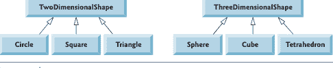

**图 12.3** Shapes 的继承层次结构。

- 2. 第二个示例定义类 `BasePlusCommissionEmployee`，其私有数据成员包括名字、姓氏、社会安全号码、佣金率、销售总额和基本工资。我们通过编写该类所需的每一行代码来创建后一个类——我们很快将看到，简单地通过继承类 `CommissionEmployee` 来创建这个类要高效得多。
- 3. 第三个示例定义类 `BasePlusCommissionEmployee` 的新版本，它直接继承自类 `CommissionEmployee`（即一个 `BasePlusCommissionEmployee` 是一个同时也拥有基本工资的 `CommissionEmployee`），并尝试访问类 `CommissionEmployee` 的私有数据成员——这会导致编译错误，因为派生类无权访问基类的私有数据。
- 4. 第四个示例表明，如果 `CommissionEmployee` 的数据被声明为受保护，那么继承自类 `CommissionEmployee` 的类 `BasePlusCommissionEmployee` 新版本可以直接访问该数据。为此，我们定义带有受保护数据的类 `CommissionEmployee` 新版本。继承版本和非继承版本的 `BasePlusCommissionEmployee` 类包含相同的功能，但我们展示继承自类 `CommissionEmployee` 的 `BasePlusCommissionEmployee` 版本如何更易于创建和管理。
- 5. 在讨论使用受保护数据的便利性之后，我们创建第五个示例，它将 `CommissionEmployee` 的数据成员重新设为私有，以实施良好的软件工程。该示例表明，派生类 `BasePlusCommissionEmployee` 可以使用基类 `CommissionEmployee` 的公有成员函数来操作 `CommissionEmployee` 的私有数据。

### 12.4.1 创建和使用 CommissionEmployee 类

让我们检查 CommissionEmployee 的类定义（图 12.4—12.5）。CommissionEmployee 头文件（图 12.4）指定类 CommissionEmployee 的公有服务，其中包括构造函数（第 12—13 行）以及成员函数 earnings（第 30 行）和 print（第 31 行）。第 15—28 行声明公有 get 和 set 函数，用于操作该类的数据成员（在第 33—37 行声明）firstName、lastName、socialSecurityNumber、grossSales 和 commissionRate。CommissionEmployee 头文件指定这些数据成员为私有，因此其他类的对象不能直接访问这些数据。将数据成员声明为私有，并提供非私有的 get 和 set 函数来操作和验证数据成员，有助于实施良好的软件工程。例如，成员函数 setGrossSales（定义于图 12.5 第 56—59 行）和 setCommissionRate（定义于图 12.5 第 68—71 行）在分别将值赋给数据成员 grossSales 和 commissionRate 之前验证其参数。

```cpp
// Fig. 12.4: CommissionEmployee.h
// CommissionEmployee class definition represents a commission employee.
#ifndef COMMISSION_H
#define COMMISSION_H
```

图 12.4 | CommissionEmployee 类头文件。（第 1 部分，共 2 部分。）


```cpp
#include <string> // C++ standard string class
using namespace std;

class CommissionEmployee
{
public:
   CommissionEmployee( const string &, const string &, const string &,
      double = 0.0, double = 0.0 );

   void setFirstName( const string & ); // set first name
   string getFirstName() const; // return first name

   void setLastName( const string & ); // set last name
   string getLastName() const; // return last name

   void setSocialSecurityNumber( const string & ); // set SSN
   string getSocialSecurityNumber() const; // return SSN

   void setGrossSales( double ); // set gross sales amount
   double getGrossSales() const; // return gross sales amount

   void setCommissionRate( double ); // set commission rate (percentage)
   double getCommissionRate() const; // return commission rate

   double earnings() const; // calculate earnings
   void print() const; // print CommissionEmployee object
private:
   string firstName;
   string lastName;
   string socialSecurityNumber;
   double grossSales; // gross weekly sales
   double commissionRate; // commission percentage

}; // end class CommissionEmployee
#endif
```

*图 12.4 | CommissionEmployee 类头文件。（第 2 部分，共 2 部分。）*

```cpp
// Fig. 12.5: CommissionEmployee.cpp
// Class CommissionEmployee member-function definitions.
#include <iostream>
#include "CommissionEmployee.h" // CommissionEmployee class definition
using namespace std;

// constructor
CommissionEmployee::CommissionEmployee(
   const string &first, const string &last, const string &ssn,
   double sales, double rate )
{
   firstName = first; // should validate
   lastName = last; // should validate
   socialSecurityNumber = ssn; // should validate
   setGrossSales( sales ); // validate and store gross sales
   setCommissionRate( rate ); // validate and store commission rate
} // end CommissionEmployee constructor

// set first name
void CommissionEmployee::setFirstName( const string &first )
{
   firstName = first; // should validate
} // end function setFirstName

// return first name
string CommissionEmployee::getFirstName() const
{
   return firstName;
} // end function getFirstName

// set last name
void CommissionEmployee::setLastName( const string &last )
{
   lastName = last; // should validate
} // end function setLastName

// return last name
string CommissionEmployee::getLastName() const
{
   return lastName;
} // end function getLastName

// set social security number
void CommissionEmployee::setSocialSecurityNumber( const string &ssn )
{
   socialSecurityNumber = ssn; // should validate
} // end function setSocialSecurityNumber

// return social security number
string CommissionEmployee::getSocialSecurityNumber() const
{
   return socialSecurityNumber;
} // end function getSocialSecurityNumber

// set gross sales amount
void CommissionEmployee::setGrossSales( double sales )
{
   grossSales = ( sales < 0.0 ) ? 0.0 : sales;
} // end function setGrossSales

// return gross sales amount
double CommissionEmployee::getGrossSales() const
{
   return grossSales;
} // end function getGrossSales

// set commission rate
void CommissionEmployee::setCommissionRate( double rate )
{
   commissionRate = ( rate > 0.0 && rate < 1.0 ) ? rate : 0.0;
} // end function setCommissionRate

// return commission rate
double CommissionEmployee::getCommissionRate() const
{
   return commissionRate;
} // end function getCommissionRate

// calculate earnings
double CommissionEmployee::earnings() const
{
   return commissionRate * grossSales;
} // end function earnings

// print CommissionEmployee object
void CommissionEmployee::print() const
{
   cout << "commission employee: " << firstName << ' ' << lastName
        << "\nsocial security number: " << socialSecurityNumber
        << "\ngross sales: " << grossSales
        << "\ncommission rate: " << commissionRate;
} // end function print
```

*图 12.5 | `CommissionEmployee` 类的实现文件，该类表示按销售额百分比获得报酬的员工。（第 3 部分，共 3 部分。）*

`CommissionEmployee` 构造函数定义在本节最初几个示例中刻意不使用成员初始化器语法，以便我们能够演示 private 和 protected 说明符如何影响派生类中的成员访问。如图 12.5 中第 12–14 行所示，我们在构造函数体中为数据成员 `firstName`、`lastName` 和 `socialSecurityNumber` 赋值。本节稍后，我们将重新在构造函数中使用成员初始化器列表。

在将构造函数的参数 first、last 和 ssn 赋值给相应数据成员之前，我们不会验证它们的值。我们当然可以验证名字和姓氏——也许通过确保它们的长度合理。类似地，可以验证社会安全号码，确保其包含九位数字，允许有或没有破折号（例如，123–45–6789 或 123456789）。

成员函数 `earnings`（第 80–83 行）计算 `CommissionEmployee` 的工资。第 82 行将 `commissionRate` 乘以 `grossSales` 并返回结果。成员函数 `print`（第 86–92 行）显示 `CommissionEmployee` 对象数据成员的值。

图 12.6 测试类 `CommissionEmployee`。第 11–12 行实例化 `CommissionEmployee` 类的 employee 对象，并调用 `CommissionEmployee` 的构造函数，用 "Sue" 作为名字、"Jones" 作为姓氏、"222-22-2222" 作为社会安全号码、10000 作为销售额、.06 作为佣金率来初始化该对象。

```cpp
// Fig. 12.6: fig12_06.cpp
// Testing class CommissionEmployee.
#include <iostream>
#include <iomanip>
#include "CommissionEmployee.h" // CommissionEmployee class definition
using namespace std;

int main()
{
   // instantiate a CommissionEmployee object
   CommissionEmployee employee(
      "Sue", "Jones", "222-22-2222", 10000, .06 );

   // set floating-point output formatting
   cout << fixed << setprecision( 2 );

   // get commission employee data
   cout << "Employee information obtained by get functions: \n"
        << "\nFirst name is " << employee.getFirstName()
        << "\nLast name is " << employee.getLastName()
        << "\nSocial security number is "
        << employee.getSocialSecurityNumber()
        << "\nGross sales is " << employee.getGrossSales()
        << "\nCommission rate is " << employee.getCommissionRate() << endl;

   employee.setGrossSales( 8000 ); // set gross sales
   employee.setCommissionRate( .10 ); // set commission rate

   cout << "\nUpdated employee information output by print function: \n"
        << endl;
   employee.print(); // display the new employee information

   // display the employee's earnings
   cout << "\nEmployee's earnings: $" << employee.earnings() << endl;
} // end main
```

```
Employee information obtained by get functions:

First name is Sue
Last name is Jones
Social security number is 222-22-2222
Gross sales is 10000.00
Commission rate is 0.06

Updated employee information output by print function:

commission employee: Sue Jones
social security number: 222-22-2222
gross sales: 8000.00
commission rate: 0.10

Employee's earnings: $800.00
```

*图 12.6 | CommissionEmployee 类测试程序。*

```cpp
34    double earnings( const ); // calculate earnings
35    void print() const; // print BasePlusCommissionEmployee object
36 private:
37    string firstName;
38    string lastName;
39    string socialSecurityNumber;
40    double grossSales; // gross weekly sales
41    double commissionRate; // commission percentage
42    double baseSalary; // base salary
43 }; // end class BasePlusCommissionEmployee
44
45 #endif
```

*图 12.7 | BasePlusCommissionEmployee 类头文件。（第 2 部分，共 2 部分。）*

```cpp
 1 // Fig. 12.8: BasePlusCommissionEmployee.cpp
 2 // Class BasePlusCommissionEmployee member-function definitions.
 3 #include <iostream>
 4 #include "BasePlusCommissionEmployee.h"
 5 using namespace std;
 6
 7 // constructor
 8 BasePlusCommissionEmployee::BasePlusCommissionEmployee(
 9    const string &first, const string &last, const string &ssn,
10    double sales, double rate, double salary )
11 {
12    firstName = first; // should validate
13    lastName = last; // should validate
14    socialSecurityNumber = ssn; // should validate
15    setGrossSales( sales ); // validate and store gross sales
16    setCommissionRate( rate ); // validate and store commission rate
17    setBaseSalary( salary ); // validate and store base salary
18 } // end BasePlusCommissionEmployee constructor
19
20 // set first name
21 void BasePlusCommissionEmployee::setFirstName( const string &first )
22 {
23    firstName = first; // should validate
24 } // end function setFirstName
25
26 // return first name
27 string BasePlusCommissionEmployee::getFirstName() const
28 {
29    return firstName;
30 } // end function getFirstName
31
32 // set last name
33 void BasePlusCommissionEmployee::setLastName( const string &last )
34 {
35    lastName = last; // should validate
36 } // end function setLastName
```

*图 12.8 | BasePlusCommissionEmployee 类表示除了佣金外还领取基本工资的员工。（第 1 部分，共 3 部分。）*


```cpp
37
38 // return last name
39 string BasePlusCommissionEmployee::getLastName() const
40 {
41    return lastName;
42 } // end function getLastName
43
44 // set social security number
45 void BasePlusCommissionEmployee::setSocialSecurityNumber(
46    const string &ssn )
47 {
48    socialSecurityNumber = ssn; // should validate
49 } // end function setSocialSecurityNumber
50
51 // return social security number
52 string BasePlusCommissionEmployee::getSocialSecurityNumber() const
53 {
54    return socialSecurityNumber;
55 } // end function getSocialSecurityNumber
56
57 // set gross sales amount
58 void BasePlusCommissionEmployee::setGrossSales( double sales )
59 {
60    grossSales = ( sales < 0.0 ) ? 0.0 : sales;
61 } // end function setGrossSales
62
63 // return gross sales amount
64 double BasePlusCommissionEmployee::getGrossSales() const
65 {
66    return grossSales;
67 } // end function getGrossSales
68
69 // set commission rate
70 void BasePlusCommissionEmployee::setCommissionRate( double rate )
71 {
72    commissionRate = ( rate > 0.0 && rate < 1.0 ) ? rate : 0.0;
73 } // end function setCommissionRate
74
75 // return commission rate
76 double BasePlusCommissionEmployee::getCommissionRate() const
77 {
78    return commissionRate;
79 } // end function getCommissionRate
80
81 // set base salary
82 void BasePlusCommissionEmployee::setBaseSalary( double salary )
83 {
84    baseSalary = ( salary < 0.0 ) ? 0.0 : salary;
85 } // end function setBaseSalary
86
```

**图 12.8** | BasePlusCommissionEmployee 类表示除佣金外还领取基本工资的员工。（第 2 部分，共 3 部分）

```cpp
// return base salary
double BasePlusCommissionEmployee::getBaseSalary() const
{
   return baseSalary;
} // end function getBaseSalary

// calculate earnings
double BasePlusCommissionEmployee::earnings() const
{
   return baseSalary + ( commissionRate * grossSales );
} // end function earnings

// print BasePlusCommissionEmployee object
void BasePlusCommissionEmployee::print() const
{
   cout << "base-salaried commission employee: " << firstName << ' '
        << lastName << "\nsocial security number: " << socialSecurityNumber
        << "\ngross sales: " << grossSales
        << "\ncommission rate: " << commissionRate
        << "\nbase salary: " << baseSalary;
} // end function print
```

**图 12.8** | BasePlusCommissionEmployee 类表示除佣金外还领取基本工资的员工。（第 3 部分，共 3 部分）

#### 定义 BasePlusCommissionEmployee 类

BasePlusCommissionEmployee 头文件（图 12.7）指定了 BasePlusCommissionEmployee 类的公有服务，包括 BasePlusCommissionEmployee 构造函数（第 13–14 行）以及成员函数 earnings（第 34 行）和 print（第 35 行）。第 16–32 行为类的私有数据成员（在第 37–42 行声明）firstName、lastName、socialSecurityNumber、grossSales、commissionRate 和 baseSalary 声明了公有的 get 和 set 函数。这些变量和成员函数封装了带基本工资的佣金员工的所有必要特性。请注意该类与 CommissionEmployee（图 12.4–12.5）之间的相似性。在本例中，我们还不会利用这种相似性。

BasePlusCommissionEmployee 类的 earnings 成员函数（在图 12.8 的第 94–97 行定义）计算带基本工资的佣金员工的收入。第 96 行返回将员工的基本工资与佣金率和员工总销售额的乘积相加的结果。

#### 测试 BasePlusCommissionEmployee 类

图 12.9 测试 BasePlusCommissionEmployee 类。第 1–12 行实例化了 BasePlusCommissionEmployee 类的 employee 对象，分别将 "Bob"、"Lewis"、"333-33-3333"、5000、.04 和 300 作为名字、姓氏、社会安全号码、总销售额、佣金率和基本工资传给构造函数。第 19–25 行使用 BasePlusCommissionEmployee 的 get 函数获取对象的数据成员值以进行输出。第 27 行调用对象的 setBaseSalary 成员函数来更改基本工资。成员函数 setBaseSalary（图 12.8，第 82–85 行）确保不会为数据成员 baseSalary 分配负值，因为员工的基本工资不能为负。图 12.9 的第 31 行调用对象的 print 成员函数以输出更新后的 BasePlusCommissionEmployee 信息，第 34 行调用成员函数 earnings 以显示 BasePlusCommissionEmployee 的收入。

```cpp
// Fig. 12.9: fig12_09.cpp
// Testing class BasePlusCommissionEmployee.
#include <iostream>
#include <iomanip>
#include "BasePlusCommissionEmployee.h"
using namespace std;

int main()
{
   // instantiate BasePlusCommissionEmployee object
   BasePlusCommissionEmployee
      employee( "Bob", "Lewis", "333-33-3333", 5000, .04, 300 );

   // set floating-point output formatting
   cout << fixed << setprecision( 2 );

   // get commission employee data
   cout << "Employee information obtained by get functions: \n"
        << "\nFirst name is " << employee.getFirstName()
        << "\nLast name is " << employee.getLastName()
        << "\nSocial security number is "
        << employee.getSocialSecurityNumber()
        << "\nGross sales is " << employee.getGrossSales()
        << "\nCommission rate is " << employee.getCommissionRate()
        << "\nBase salary is " << employee.getBaseSalary() << endl;

   employee.setBaseSalary( 1000 );  // set base salary

   cout << "\nUpdated employee information output by print function: \n"
        << endl;
   employee.print(); // display the new employee information

   // display the employee's earnings
   cout << "\nEmployee's earnings: $" << employee.earnings() << endl;
} // end main
```

```
Employee information obtained by get functions:

First name is Bob
Last name is Lewis
Social security number is 333-33-3333
Gross sales is 5000.00
Commission rate is 0.04
Base salary is 300.00

Updated employee information output by print function:

base-salaried commission employee: Bob Lewis
social security number: 333-33-3333
gross sales: 5000.00
commission rate: 0.04
base salary: 1000.00

Employee's earnings: $1200.00
```

**图 12.9** | `BasePlusCommissionEmployee` 类测试程序。

## *探索 BasePlusCommissionEmployee 类与 CommissionEmployee 类之间的相似性*

BasePlusCommissionEmployee 类（图 12.7–12.8）的大部分代码与 CommissionEmployee 类（图 12.4–12.5）的代码相似，即使不完全相同。例如，在 BasePlusCommissionEmployee 类中，私有数据成员 firstName 和 lastName 以及成员函数 setFirstName、getFirstName、setLastName 和 getLastName 与 CommissionEmployee 类完全相同。CommissionEmployee 类和 BasePlusCommissionEmployee 类也都包含私有数据成员 socialSecurityNumber、commissionRate 和 grossSales，以及用于操作这些成员的 get 和 set 函数。此外，BasePlusCommissionEmployee 构造函数几乎与 CommissionEmployee 类的构造函数相同，只是 BasePlusCommissionEmployee 的构造函数还设置了 baseSalary。BasePlusCommissionEmployee 类的其他新增内容为私有数据成员 baseSalary 以及成员函数 setBaseSalary 和 getBaseSalary。BasePlusCommissionEmployee 类的 print 成员函数与 CommissionEmployee 类的 print 成员函数几乎相同，只是 BasePlusCommissionEmployee 的 print 还会输出数据成员 baseSalary 的值。

我们确实从 CommissionEmployee 类复制了代码并粘贴到 BasePlusCommissionEmployee 类中，然后修改了 BasePlusCommissionEmployee 类以包含基本工资和操作基本工资的成员函数。这种“复制粘贴”方法容易出错且耗时。更糟的是，它会在整个系统中散布同一份代码的许多物理副本，造成代码维护的噩梦。有没有一种方法可以“吸收”一个类的数据成员和成员函数，使它们成为另一个类的一部分，而无需重复代码？在接下来的几个示例中，我们将使用继承来做到这一点。

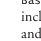

> **软件工程观察 12.3**
> *从一个类向另一个类复制粘贴代码可能会将错误扩展到多个源代码文件。为了避免重复代码（并可能避免错误），在希望一个类“吸收”另一个类的数据成员和成员函数的情况下，我们使用继承，而不是“复制粘贴”方法。*

> **软件工程观察 12.4**
> *使用继承时，层次结构中所有类的公共数据成员和成员函数都在基类中声明。当这些公共特性需要更改时，只需在基类中进行更改——派生类随后会继承这些更改。如果没有继承，则需要修改所有包含相关代码副本的源代码文件。*

### 12.4.3 创建 CommissionEmployee–BasePlusCommissionEmployee 继承层次结构

现在我们创建并测试一个新的 BasePlusCommissionEmployee 类（图 12.10–12.11），它派生自 CommissionEmployee 类（图 12.4–12.5）。在本例中，BasePlusCommissionEmployee 对象是一个 CommissionEmployee（因为继承


虽然继承了CommissionEmployee类的功能，但BasePlusCommissionEmployee类还有数据成员baseSalary（图12.10第23行）。类定义第11行的冒号（:）表示继承。关键字public指明继承的类型。作为派生类（通过public继承形成），BasePlusCommissionEmployee继承CommissionEmployee类的所有成员，但构造函数除外——每个类都提供其特有的构造函数。（析构函数同样不被继承。）因此，BasePlusCommissionEmployee的公有服务包括其构造函数（第14~15行）和从CommissionEmployee类继承的公有成员函数——虽然我们在BasePlusCommissionEmployee的源代码中看不到这些继承的成员函数，但它们仍然是派生类BasePlusCommissionEmployee的一部分。派生类的公有服务还包括成员函数setBaseSalary、getBaseSalary、earnings和print（第17~21行）。

```cpp
1  // Fig. 12.10: BasePlusCommissionEmployee.h
2  // BasePlusCommissionEmployee class derived from class
3  // CommissionEmployee.
4  #ifndef BASEPLUS_H
5  #define BASEPLUS_H
6
7  #include <string> // C++ standard string class
8  #include "CommissionEmployee.h" // CommissionEmployee class declaration
9  using namespace std;
10
11 class BasePlusCommissionEmployee : public CommissionEmployee
12 {
13 public:
14   BasePlusCommissionEmployee( const string &, const string &,
15      const string &, double = 0.0, double = 0.0, double = 0.0 );
16
17   void setBaseSalary( double ); // set base salary
18   double getBaseSalary() const; // return base salary
19
20   double earnings() const; // calculate earnings
21   void print() const; // print BasePlusCommissionEmployee object
22 private:
23   double baseSalary; // base salary
24 }; // end class BasePlusCommissionEmployee
25
26 #endif
```

**图12.10** | BasePlusCommissionEmployee类定义，说明与CommissionEmployee类的继承关系。

```cpp
1  // Fig. 12.11: BasePlusCommissionEmployee.cpp
2  // Class BasePlusCommissionEmployee member-function definitions.
3  #include <iostream>
4  #include "BasePlusCommissionEmployee.h"
5  using namespace std;

6
7 // constructor
8 BasePlusCommissionEmployee::BasePlusCommissionEmployee(
9    const string &first, const string &last, const string &ssn,
10   double sales, double rate, double salary )
11 // explicitly call base-class constructor
12   : CommissionEmployee( first, last, ssn, sales, rate )
13 {
14   setBaseSalary( salary ); // validate and store base salary
15 } // end BasePlusCommissionEmployee constructor
16
17 // set base salary
18 void BasePlusCommissionEmployee::setBaseSalary( double salary )
19 {
20   baseSalary = ( salary < 0.0 ) ? 0.0 : salary;
21 } // end function setBaseSalary
22
23 // return base salary
24 double BasePlusCommissionEmployee::getBaseSalary() const
25 {
26   return baseSalary;
27 } // end function getBaseSalary
28
29 // calculate earnings
30 double BasePlusCommissionEmployee::earnings() const
31 {
32   // derived class cannot access the base class's private data
33   return baseSalary + ( commissionRate * grossSales );
34 } // end function earnings
35
36 // print BasePlusCommissionEmployee object
37 void BasePlusCommissionEmployee::print() const
38 {
39   // derived class cannot access the base class's private data
40   cout << "base-salaried commission employee: " << firstName << ' '
41        << lastName << "\nsocial security number: " << socialSecurityNumber
42        << "\ngross sales: " << grossSales
43        << "\ncommission rate: " << commissionRate
44        << "\nbase salary: " << baseSalary;
45 } // end function print
```

**图12.11** | BasePlusCommissionEmployee实现文件：基类的private数据不能从派生类访问。（第1部分，共3部分）

```text
C:\cpphtp7_examples\ch12\Fig12_10_11\BasePlusCommissionEmployee.cpp(33) :
    error C2248: 'CommissionEmployee::commissionRate' :
        cannot access private member declared in class 'CommissionEmployee'

C:\cpphtp7_examples\ch12\Fig12_10_11\BasePlusCommissionEmployee.cpp(33) :
    error C2248: 'CommissionEmployee::grossSales' :
        cannot access private member declared in class 'CommissionEmployee'

C:\cpphtp7_examples\ch12\Fig12_10_11\BasePlusCommissionEmployee.cpp(40) :
    error C2248: 'CommissionEmployee::firstName' :
        cannot access private member declared in class 'CommissionEmployee'
```

**图12.11** | BasePlusCommissionEmployee实现文件：基类的private数据不能从派生类访问。（第2部分，共3部分）

程序所使用的任何派生类的直接和间接基类的目标代码。假设客户端想要创建一个使用类BasePlusCommissionEmployee的应用程序，该类是CommissionEmployee的派生类（我们将在12.4.4节看到这样的示例）。在编译客户端应用程序时，客户端的object code必须与类BasePlusCommissionEmployee和CommissionEmployee的object code链接，因为BasePlusCommissionEmployee从基类CommissionEmployee继承了成员函数。该代码还与类CommissionEmployee、类BasePlusCommissionEmployee或客户端代码中所使用的任何C++标准库类的目标代码链接。这使得程序可以访问其可能使用的所有功能的实现。

### 12.4.4 使用protected数据的CommissionEmployee–BasePlusCommissionEmployee继承层次结构

为了使类BasePlusCommissionEmployee能够直接访问CommissionEmployee的数据成员firstName、lastName、socialSecurityNumber、grossSales和commissionRate，我们可以将这些成员在基类中声明为protected。正如我们在12.3节所讨论的，基类的protected成员可以被基类的成员和友元以及从该基类派生的任何类的成员和友元访问。

> **良好编程实践12.1**
>
> *首先声明public成员，其次声明protected成员，最后声明private成员。*

#### 用protected数据定义基类CommissionEmployee

类CommissionEmployee（图12.12-12.13）现在将数据成员firstName、lastName、socialSecurityNumber、grossSales和commissionRate声明为protected（图12.12第32-37行）而不是private。图12.13中的成员函数实现与图12.5中的相同。

```cpp
// Fig. 12.12: CommissionEmployee.h
// CommissionEmployee class definition with protected data.
#ifndef COMMISSION_H
#define COMMISSION_H

#include <string> // C++ standard string class
using namespace std;

class CommissionEmployee
{
public:
   CommissionEmployee( const string &, const string &,
       double = 0.0, double = 0.0 );

   void setFirstName( const string & ); // set first name
   string getFirstName() const; // return first name

17    void setLastName( const string & ); // set last name
18    string getLastName() const; // return last name

20    void setSocialSecurityNumber( const string & ); // set SSN
21    string getSocialSecurityNumber() const; // return SSN

23    void setGrossSales( double ); // set gross sales amount
24    double getGrossSales() const; // return gross sales amount


27    void setCommissionRate( double ); // set commission rate
28    double getCommissionRate() const; // return commission rate

30    double earnings() const; // calculate earnings
31    void print() const; // print CommissionEmployee object
32 protected:
33    string firstName;
34    string lastName;
35    string socialSecurityNumber;
36    double grossSales; // gross weekly sales
37    double commissionRate; // commission percentage
38 }; // end class CommissionEmployee

40 #endif
```

**图12.12** | CommissionEmployee类定义，声明protected数据以允许派生类访问。（第1部分，共2部分）

**图12.12** | CommissionEmployee类定义，声明protected数据以允许派生类访问。（第2部分，共2部分）

```cpp
1    // Fig. 12.13: CommissionEmployee.cpp
2    // Class CommissionEmployee member-function definitions.
3    #include <iostream>
4    #include "CommissionEmployee.h" // CommissionEmployee class definition
5    using namespace std;
6
7    // constructor
8    CommissionEmployee::CommissionEmployee(
9       const string &first, const string &last, const string &ssn,
10      double sales, double rate )
11   {
12      firstName = first; // should validate
13      lastName = last; // should validate
14      socialSecurityNumber = ssn; // should validate
15      setGrossSales( sales ); // validate and store gross sales
16      setCommissionRate( rate ); // validate and store commission rate
17   } // end CommissionEmployee constructor
18
19   // set first name
20   void CommissionEmployee::setFirstName( const string &first )
21   {
22      firstName = first; // should validate
23   } // end function setFirstName
```

**图12.13** | 具有protected数据的CommissionEmployee类。（第1部分，共3部分）


```cpp
// return first name
string CommissionEmployee::getFirstName() const
{
   return firstName;
} // end function getFirstName

// set last name
void CommissionEmployee::setLastName( const string &last )
{
   lastName = last; // should validate
} // end function setLastName

// return last name
string CommissionEmployee::getLastName() const
{
   return lastName;
} // end function getLastName

// set social security number
void CommissionEmployee::setSocialSecurityNumber( const string &ssn )
{
   socialSecurityNumber = ssn; // should validate
} // end function setSocialSecurityNumber

// return social security number
string CommissionEmployee::getSocialSecurityNumber() const
{
   return socialSecurityNumber;
} // end function getSocialSecurityNumber

// set gross sales amount
void CommissionEmployee::setGrossSales( double sales )
{
   grossSales = ( sales < 0.0 ) ? 0.0 : sales;
} // end function setGrossSales

// return gross sales amount
double CommissionEmployee::getGrossSales() const
{
   return grossSales;
} // end function getGrossSales

// set commission rate
void CommissionEmployee::setCommissionRate( double rate )
{
   commissionRate = ( rate > 0.0 && rate < 1.0 ) ? rate : 0.0;
} // end function setCommissionRate

// return commission rate
double CommissionEmployee::getCommissionRate() const
{
76   return commissionRate;
77 } // end function getCommissionRate
78
79 // calculate earnings
80 double CommissionEmployee::earnings() const
81 {
82   return commissionRate * grossSales;
83 } // end function earnings
84
85 // print CommissionEmployee object
86 void CommissionEmployee::print() const
87 {
88   cout << "Commission employee: " << firstName << ' ' << lastName
89        << "\nsocial security number: " << socialSecurityNumber
90        << "\ngross sales: " << grossSales
91        << "\ncommission rate: " << commissionRate;
92 } // end function print
```

图 12.13 | 具有 protected 数据的 CommissionEmployee 类。（第 2 部分，共 3 部分。）

图 12.13 | 具有 protected 数据的 CommissionEmployee 类。（第 3 部分，共 3 部分。）

#### 修改派生类 BasePlusCommissionEmployee

图 12.14–12.15 中的 BasePlusCommissionEmployee 类版本继承自图 12.12–12.13 中的 CommissionEmployee 类。BasePlusCommissionEmployee 类的对象可以访问在 CommissionEmployee 类中声明为 protected 的继承数据成员（即数据成员 firstName、lastName、socialSecurityNumber、grossSales 和 commissionRate）。因此，编译器在编译图 12.15 中的 BasePlusCommissionEmployee 的 earnings 和 print 成员函数定义时（分别为第 30–34 行和第 37–45 行）不会生成错误。这显示了派生类被授予访问基类 protected 数据成员的特殊权限。派生类的对象也可以访问该派生类的任何间接基类中的 protected 成员。

```cpp
1 // Fig. 12.14: BasePlusCommissionEmployee.h
2 // BasePlusCommissionEmployee class derived from class
3 // CommissionEmployee.
4 #ifndef BASEPLUS_H
5 #define BASEPLUS_H
6
7 #include <string> // C++ standard string class
8 #include "CommissionEmployee.h" // CommissionEmployee class declaration
9 using namespace std;
10
11 class BasePlusCommissionEmployee : public CommissionEmployee
12 {
13 public:
14    BasePlusCommissionEmployee( const string &, const string &,
15       const string &, double = 0.0, double = 0.0, double = 0.0 );
16
```

图 12.14 | BasePlusCommissionEmployee 类头文件。（第 1 部分，共 2 部分。）

```cpp
10      // instantiate BasePlusCommissionEmployee object
11      BasePlusCommissionEmployee
12          employee( "Bob" , "Lewis" , "333-33-3333" , 5000 , .04, 300 );
13
14      // set floating-point output formatting
15      cout << fixed << setprecision( 2 );
16
17      // get commission employee data
18      cout << "Employee information obtained by get functions: \n"
19          << "\nFirst name is " << employee.getFirstName()
20          << "\nLast name is " << employee.getLastName()
21          << "\nSocial security number is "
22          << employee.getSocialSecurityNumber()
23          << "\nGross sales is " << employee.getGrossSales()
24          << "\nCommission rate is " << employee.getCommissionRate()
25          << "\nBase salary is " << employee.getBaseSalary() << endl;
26
27      employee.setBaseSalary( 1000 ); // set base salary
28
29      cout << "\nUpdated employee information output by print function: \n"
30          << endl;
31      employee.print(); // display the new employee information
32
33      // display the employee's earnings
34      cout << "\n\nEmployee's earnings: $" << employee.earnings() << endl;
35  } // end main
```

```text
Employee information obtained by get functions:

First name is Bob
Last name is Lewis
Social security number is 333-33-3333
Gross sales is 5000.00
Commission rate is 0.04
Base salary is 300.00

Updated employee information output by print function:

base-salaried commission employee: Bob Lewis
social security number: 333-33-3333
gross sales: 5000.00
commission rate: 0.04
base salary: 1000.00

Employee's earnings: $1200.00
```

图 12.16 | 派生类可以访问基类的 protected 数据。（第 2 部分，共 2 部分。）

#### 关于使用 protected 数据的说明

在本例中，我们将基类数据成员声明为 protected，这样派生类就可以直接修改数据。继承 protected 数据成员会稍微提高性能，因为我们可以直接访问这些成员，而无需承担调用 set 或 get 成员函数的开销。然而，在大多数情况下，最好使用 private 数据成员以鼓励正确的软件工程实践，并将代码优化问题留给编译器。你的代码将更易于维护、修改和调试。

使用 protected 数据成员会产生两个严重问题。首先，派生类对象不必使用成员函数来设置基类 protected 数据成员的值。很容易将无效值赋给 protected 数据成员，从而使对象处于不一致状态——例如，如果将 `CommissionEmployee` 的数据成员 `grossSales` 声明为 protected，派生类对象就可以将负值赋给 `grossSales`。使用 protected 数据成员的第二个问题是，派生类成员函数更有可能被编写为依赖于基类实现。派生类应仅依赖于基类服务（即非私有成员函数），而不应依赖基类实现。如果基类中有 protected 数据成员，当基类实现发生变化时，我们可能需要修改该基类的所有派生类。例如，如果出于某种原因我们将数据成员 `firstName` 和 `lastName` 的名称改为 `first` 和 `last`，那么我们必须对所有派生类直接引用这些基类数据成员的地方进行修改。这种软件被称为脆弱（fragile）或易碎（brittle），因为基类中的一个小改动就可能“破坏”派生类的实现。你应该能够在更改基类实现的同时，仍然向派生类提供相同的服务。（当然，如果基类服务发生变化，我们必须重新实现派生类——好的面向对象设计试图防止这种情况发生。）

> **软件工程观察 12.5**
> 
> *当基类只应向派生类和友元提供服务（即成员函数）时，使用 protected 访问说明符是合适的。*


> **软件工程观察 12.6**
> 
> *将基类数据成员声明为 private（而不是声明为 protected）使你可以更改基类实现，而无需更改派生类实现。*


> **错误预防提示 12.1**
> 
> *尽可能避免在基类中包含 protected 数据成员。相反，应包含访问 private 数据成员的非私有成员函数，以确保对象保持一致状态。*


### 12.4.5 使用 private 数据的 CommissionEmployee–BasePlusCommissionEmployee 继承层次结构

我们现在再次审视我们的层次结构，这次使用最佳的软件工程实践。类 `CommissionEmployee`（图 12.17–12.18）现在将数据成员 `firstName`、`lastName`、`socialSecurityNumber`、`grossSales` 和 `commissionRate` 声明为 private（图 12.17，第 32–37 行），并提供公有成员函数 `setFirstName`、`getFirstName`、`setLastName`、`getLastName`、`setSocialSecurityNumber`、`getSocialSecurityNumber`、`setGrossSales`、`getGrossSales`、`setCommissionRate`、`getCommissionRate`、earnings 和 print 来操作这些值。如果我们决定更改数据成员的名称，earnings 和 print 的定义将不需要修改——只有直接操作这些数据成员的 `get` 和 `set` 成员函数的定义需要更改。这些更改仅发生在基类内部——不需要对派生类进行任何更改。将此类更改的影响局部化是一种好的

```cpp
socialSecurityNumber = ssn; // should validate
} // end function setSocialSecurityNumber

// return social security number
string CommissionEmployee::getSocialSecurityNumber() const
{
   return socialSecurityNumber;
} // end function getSocialSecurityNumber

// set gross sales amount
void CommissionEmployee::setGrossSales( double sales )
{
   grossSales = ( sales < 0.0 ) ? 0.0 : sales;
} // end function setGrossSales

// return gross sales amount
double CommissionEmployee::getGrossSales() const
{
   return grossSales;
} // end function getGrossSales

// set commission rate
void CommissionEmployee::setCommissionRate( double rate )
{
   commissionRate = ( rate > 0.0 && rate < 1.0 ) ? rate : 0.0;
} // end function setCommissionRate

// return commission rate
double CommissionEmployee::getCommissionRate() const
{
   return commissionRate;
} // end function getCommissionRate

// calculate earnings
double CommissionEmployee::earnings() const
{
   return getCommissionRate() * getGrossSales();
} // end function earnings

// print CommissionEmployee object
void CommissionEmployee::print() const
{
   cout << "commission employee: "
        << getFirstName() << " " << getLastName()
        << "\nSocial security number: " << getSocialSecurityNumber()
        << "\nGross sales: " << getGrossSales()
        << "\nCommission rate: " << getCommissionRate();
} // end function print
```

**图 12.18** | *CommissionEmployee 类实现文件：CommissionEmployee 类使用成员函数操作其私有数据。（第 2 部分，共 2 部分。）*

类 BasePlusCommissionEmployee（图 12.19–12.20）的成员函数实现（图 12.20）有几处改动，使其有别于前一版本。

```cpp
14        setBaseSalary( salary ); // validate and store base salary
15    } // end BasePlusCommissionEmployee constructor
16
17    // set base salary
18    void BasePlusCommissionEmployee::setBaseSalary( double salary )
19    {
20        baseSalary = ( salary < 0.0 ) ? 0.0 : salary;
21    } // end function setBaseSalary
22
23    // return base salary
24    double BasePlusCommissionEmployee::getBaseSalary() const
25    {
26        return baseSalary;
27    } // end function getBaseSalary
28
29    // calculate earnings
30    double BasePlusCommissionEmployee::earnings() const
31    {
32        return getBaseSalary() + CommissionEmployee::earnings();
33    } // end function earnings
34
35    // print BasePlusCommissionEmployee object
36    void BasePlusCommissionEmployee::print() const
37    {
38        cout << "base-salaried ";
39
40        // invoke CommissionEmployee's print function
41        CommissionEmployee::print();
42
43        cout << "\nbase salary: " << getBaseSalary();
44    } // end function print
```

**图 12.20** | BasePlusCommissionEmployee 类继承自 CommissionEmployee 类，但不能直接访问该类的私有数据。（第 2 部分，共 2 部分。）

类 BasePlusCommissionEmployee 的 earnings 函数（图 12.20，第 30–33 行）重定义了类 CommissionEmployee 的 earnings 成员函数（图 12.18，第 78–81 行），用于计算带底薪的佣金制员工的收入。BasePlusCommissionEmployee 的 earnings 版本通过表达式 CommissionEmployee::earnings()（图 12.20，第 32 行）调用基类 CommissionEmployee 的 earnings 函数，从而仅根据佣金获得该员工收入的一部分。然后，BasePlusCommissionEmployee 的 earnings 函数将底薪加到这个值上，以计算该员工的总收入。注意从派生类调用被重定义的基类成员函数所用的语法——将基类名和二元作用域解析运算符 (::) 放在基类成员函数名之前。这种成员函数调用是一种良好的软件工程实践：回顾 *软件工程观察 9.9*，如果一个对象的成员函数执行另一个对象所需的操作，我们应调用该成员函数，而不是复制其代码体。通过让 BasePlusCommissionEmployee 的 earnings 函数调用 CommissionEmployee 的 earnings 函数来计算 BasePlusCommissionEmployee 对象的部分收入，我们避免了重复代码并减少了代码维护问题。

```cpp
employee.setBaseSalary( 1000 ); // set base salary
cout << "\nUpdated employee information output by print function: \n"
     << endl;
employee.print(); // display the new employee information

// display the employee's earnings
cout << "\nEmployee's earnings: $" << employee.earnings() << endl;
} // end main
```

```text
Employee information obtained by get functions:

First name is Bob
Last name is Lewis
Social security number is 333-33-3333
Gross sales is 5000.00
Commission rate is 0.04
Base salary is 300.00

Updated employee information output by print function:

base-salaried commission employee: Bob Lewis
social security number: 333-33-3333
gross sales: 5000.00
commission rate: 0.04
base salary: 1000.00

Employee's earnings: $1200.00
```

**图 12.21** | 基类的私有数据可通过派生类继承的公有或受保护成员函数被派生类访问。（第 2 部分，共 2 部分。）

在本节中，你看到了一组逐步演进的示例，它们经过精心设计，用于讲授利用继承实现良好软件工程的关键能力。你学习了如何使用继承创建派生类，如何使用基类的受保护成员使派生类能够访问继承的基类数据成员，以及如何重定义基类函数以提供更适合派生类对象的版本。此外，你学习了如何应用第 9–10 章和本章中的软件工程技术来创建易于维护、修改和调试的类。

## 12.5 派生类中的构造函数和析构函数

正如上一节所解释的，实例化派生类对象会开始一条构造函数调用链：派生类构造函数在完成自身任务之前，会显式（通过基类成员初始化器）或隐式（调用基类的默认构造函数）调用其直接基类的构造函数。类似地，如果基类派生自另一个类，则基类构造函数需要调用层次结构中上一层类的构造函数，依此类推。此调用链中最后被调用的构造函数是层次结构最底层类的构造函数，而它的函数体实际上最先执行完毕。最初的派生类构造函数的函数体最后执行完毕。每个基类构造函数都会初始化派生类对象所继承的基类数据成员。例如，考虑图 12.17–12.20 中的 CommissionEmployee/BasePlusCommissionEmployee 层次结构。当程序创建 BasePlusCommissionEmployee 类的对象时，会调用 CommissionEmployee 构造函数。由于 CommissionEmployee 类位于层次结构的底层，它的构造函数执行，初始化属于 BasePlusCommissionEmployee 对象一部分的 CommissionEmployee 私有数据成员。当 BasePlusCommissionEmployee 的构造函数完成执行时，它将控制权返回给 BasePlusCommissionEmployee 的构造函数，后者初始化 BasePlusCommissionEmployee 对象的 baseSalary。

> **软件工程观察 12.7**
> 
> *当程序创建派生类对象时，派生类构造函数立即调用基类构造函数，基类构造函数的函数体执行，然后派生类的成员初始化器执行，最后派生类构造函数的函数体执行。如果层次结构包含两级以上，此过程会沿层次结构向上级联。*

当派生类对象被销毁时，程序会调用该对象的析构函数。这会开始一条（或级联的）析构函数调用链，其中派生类析构函数、直接和间接基类的析构函数以及这些类的成员的析构函数，按照与构造函数执行顺序相反的顺序执行。当调用派生类对象的析构函数时，该析构函数执行其任务，然后调用层次结构中上一层基类的析构函数。此过程重复进行，直到调用层次结构最顶层最终基类的析构函数。然后，该对象从内存中移除。

> **软件工程观察 12.8**
> 
> *假设我们创建派生类的对象，其中基类和派生类都（通过组合）包含其他类的对象。创建该派生类的对象时，首先执行基类成员对象的构造函数，然后执行基类构造函数，接着执行派生类成员对象的构造函数，最后执行派生类构造函数。派生类对象的析构函数按其对应构造函数的调用顺序的逆序调用。*

基类的构造函数、析构函数和重载赋值运算符（见第 11 章“运算符重载”）不会被派生类继承。但是，派生类的构造函数、析构函数和重载赋值运算符可以调用基类的构造函数、析构函数和重载赋值运算符。

我们的下一个示例定义了类 CommissionEmployee（图 12.22–12.23）和类 BasePlusCommissionEmployee（图 12.24–12.25），它们的构造函数和析构函数在被调用时都会打印一条消息。正如你将在图 12.26 的输出中看到的，这些消息演示了继承层次结构中对象的构造函数和析构函数的调用顺序。

```cpp
1  // Fig. 12.22: CommissionEmployee.h
2  // CommissionEmployee class definition represents a commission employee.
3  #ifndef COMMISSION_H
4  #define COMMISSION_H
```

**图 12.22**  |  CommissionEmployee 类头文件。（第 1 部分，共 2 部分。）


```cpp
65 // set gross sales amount
66 void CommissionEmployee::setGrossSales( double sales )
67 {
68     grossSales = ( sales < 0.0 ) ? 0.0 : sales;
69 } // end function setGrossSales
70
71 // return gross sales amount
72 double CommissionEmployee::getGrossSales() const
73 {
74     return grossSales;
75 } // end function getGrossSales
76
77 // set commission rate
78 void CommissionEmployee::setCommissionRate( double rate )
79 {
80     commissionRate = ( rate > 0.0 && rate < 1.0 ) ? rate : 0.0;
81 } // end function setCommissionRate
82
83 // return commission rate
84 double CommissionEmployee::getCommissionRate() const
85 {
86     return commissionRate;
87 } // end function getCommissionRate
88
89 // calculate earnings
90 double CommissionEmployee::earnings() const
91 {
92     return getCommissionRate() * getGrossSales();
93 } // end function earnings
94
95 // print CommissionEmployee object
96 void CommissionEmployee::print() const
97 {
98     cout << "commission employee: "
99          << getFirstName() << ' ' << getLastName()
100         << "\nsocial security number: " << getSocialSecurityNumber()
101         << "\ngross sales: " << getGrossSales()
102         << "\ncommission rate: " << getCommissionRate();
103 } // end function print
```

**图 12.23** | CommissionEmployee 的构造函数和析构函数输出文本。（第 3 部分，共 3 部分。）

```cpp
1 // Fig. 12.24: BasePlusCommissionEmployee.h
2 // BasePlusCommissionEmployee class derived from class
3 // CommissionEmployee.
4 #ifndef BASEPLUS_H
5 #define BASEPLUS_H
6
7 #include <string> // C++ standard string class
8 #include "CommissionEmployee.h" // CommissionEmployee class declaration
9 using namespace std;
10
```

**图 12.24** | BasePlusCommissionEmployee 类头文件。（第 1 部分，共 2 部分。）

对于对象 employee2，BasePlusCommissionEmployee 和 CommissionEmployee 的析构函数按（该顺序）被调用。

```cpp
// Fig. 12.26: fig12_26.cpp
// Display order in which base-class and derived-class constructors
// and destructors are called.
#include <iostream>
#include <iomanip>
#include "BasePlusCommissionEmployee.h"
using namespace std;

int main()
{
   // set floating-point output formatting
   cout << fixed << setprecision( 2 );

   { // begin new scope
      CommissionEmployee employee1(
         "Bob", "Lewis", "333-33-3333", 5000, .04 );
   } // end scope

   cout << endl;
   BasePlusCommissionEmployee
      employee2( "Lisa", "Jones", "555-55-5555", 2000, .06, 800 );

   cout << endl;
   BasePlusCommissionEmployee
      employee3( "Mark", "Sands", "888-88-8888", 8000, .15, 2000 );
   cout << endl;
} // end main
```

```text
CommissionEmployee constructor:
commission employee: Bob Lewis
social security number: 333-33-3333
gross sales: 5000.00
commission rate: 0.04

CommissionEmployee destructor:
commission employee: Bob Lewis
social security number: 333-33-3333
gross sales: 5000.00
commission rate: 0.04

CommissionEmployee constructor:
commission employee: Lisa Jones
social security number: 555-55-5555
gross sales: 2000.00
commission rate: 0.06

BasePlusCommissionEmployee constructor:
base-salaried commission employee: Lisa Jones
social security number: 555-55-5555
```

**图 12.26** | 构造函数和析构函数的调用顺序。（第 1 部分，共 2 部分。）

| 基类成员访问说明符 | 继承类型 — 公有继承 | 继承类型 — 保护继承 | 继承类型 — 私有继承 |
|---|---|---|---|
| **公有** | 在派生类中为公有。<br><br>可被成员函数、友元函数和非成员函数直接访问。 | 在派生类中为保护。<br><br>可被成员函数和友元函数直接访问。 | 在派生类中为私有。<br><br>可被成员函数和友元函数直接访问。 |
| **保护** | 在派生类中为保护。<br><br>可被成员函数和友元函数直接访问。 | 在派生类中为保护。<br><br>可被成员函数和友元函数直接访问。 | 在派生类中为私有。<br><br>可被成员函数和友元函数直接访问。 |
| **私有** | 在派生类中隐藏。<br><br>可通过基类的公有或保护成员函数被成员函数和友元函数访问。 | 在派生类中隐藏。<br><br>可通过基类的公有或保护成员函数被成员函数和友元函数访问。 | 在派生类中隐藏。<br><br>可通过基类的公有或保护成员函数被成员函数和友元函数访问。 |

**图 12.27** | 派生类中基类成员可访问性总结。

从公有基类派生时，基类的公有成员成为派生类的公有成员，基类的保护成员成为派生类的保护成员。基类的私有成员永远不能直接从派生类访问，但可以通过对基类的公有和保护成员的调用来访问。

从保护基类派生时，基类的公有和保护成员成为派生类的保护成员。从私有基类派生时，基类的公有和保护成员成为派生类的私有成员（例如，这些函数成为工具函数）。私有和保护继承不是 *“是”* 关系。

### 12.7 使用继承的软件工程

在本节中，我们讨论使用继承来定制现有软件。当我们使用继承从现有类创建新类时，新类继承现有类的数据成员和成员函数，如图 12.27 所述。我们可以通过添加额外成员和重定义基类成员来定制新类以满足我们的需求。派生类程序员在 C++ 中做到这一点，无需访问基类的源代码。派生类必须能够链接到基类的目标代码。这种强大的能力对独立软件供应商（ISVs）很有吸引力。

ISV 可以开发专有类进行销售或许可，并以目标代码格式将这些类提供给用户。然后，用户可以快速地从这些库类中派生新类，而无需访问 ISV 的专有源代码。ISV 随目标代码一起需要提供的只是头文件。

有时学生很难体会行业大型软件项目设计者所面临问题的范围。有经验的人说，有效的软件重用能改进软件开发过程。面向对象编程促进了软件重用，从而缩短了开发时间并提高了软件质量。

大量有用类库的可用性通过继承实现了软件重用的最大效益。正如独立软件供应商生产的封装软件随着个人计算机的到来成为爆炸性增长的行业一样，类库的创建和销售的兴趣正在指数级增长。应用程序设计者使用这些库构建其应用，而库设计者因他们的库被包含在应用中而获得回报。随 C++ 编译器一起提供的标准 C++ 库往往相当通用且范围有限。然而，全世界有大量致力于为各种应用领域开发类库的努力。

> **软件工程观察 12.9**
>
> *在面向对象系统的设计阶段，设计者经常确定某些类是密切相关的。设计者应该“提取”共同的属性和行为，并将它们放入基类，然后使用继承形成派生类，赋予它们超出从基类继承的能力。*


> **软件工程观察 12.10**
>
> *派生类的创建不会影响其基类的源代码。继承保持了基类的完整性。*


> **性能提示 12.3**
>
> *如果通过继承产生的类比实际需要的更大（即包含太多功能），可能会浪费内存和处理资源。从功能“最接近”所需功能的类继承。*


阅读派生类定义可能会令人困惑，因为继承的成员没有物理地显示在派生类中，但它们确实存在。在记录派生类成员时也存在类似的问题。

### 12.8 小结

本章介绍了继承——通过吸收现有类的数据成员和成员函数并为其增添新功能来创建类的能力。通过使用雇员继承层次结构的系列示例，你学习了基类和派生类的概念，并使用公有继承创建了从基类继承成员的派生类。本章介绍了访问说明符 protected——派生类成员函数可以访问受保护的基类成员。你学习了如何通过用基类名和二元作用域解析运算符（::）限定重定义的基类成员的名字来访问它们。你还看到了顺序

对于属于继承层次结构的类的对象，会调用哪些构造函数和析构函数。最后，我们解释了三种继承方式——公有、保护和私有——以及在使用每种方式时，基类成员在派生类中的可访问性。

在第13章“面向对象编程：多态性”中，我们将在继承讨论的基础上引入多态——一种面向对象概念，使我们能够编写以更通用的方式处理由继承关联的各种类的对象的程序。学习第13章后，你将熟悉类、对象、封装、继承和多态——面向对象编程的基本概念。

## 小结

### 第12.1节 简介

- 软件复用减少了程序开发时间和成本。

### 第12.2节 基类和派生类

- 继承是一种软件复用形式，你创建一个类，它吸收现有类的数据和行为，并用新功能增强它们。现有类称为基类，新类称为派生类。
- 直接基类是派生类显式继承的类。间接基类是从类层次结构中向上两级或更多级继承的类。
- 单继承中，一个类从一个基类派生。多继承中，一个类继承多个（可能不相关的）基类。
- 派生类表示更专门的一组对象。通常，派生类包含从基类继承的行为以及额外的行为。派生类还可以自定义从基类继承的行为。
- 派生类的每个对象也是该派生类基类的对象。但是，基类对象不是该基类派生类的对象。
- *is-a*（是-a）关系表示继承。在*is-a*关系中，派生类的对象也可以当作其基类的对象处理。
- *has-a*（有-a）关系表示组合——一个对象包含一个或多个其他类的对象作为成员，但不在其接口中直接公开它们的行为。
- 派生类不能直接访问其基类的私有成员。派生类可以直接访问其基类的公有成员和保护成员。
- 派生类可以改变私有基类成员的状态，但只能通过基类中提供并继承到派生类中的非私有成员函数来实现。
- 基类成员函数可以在派生类中重定义。
- 单继承关系形成树状层次结构。
- 可以类似地处理基类对象和派生类对象；这些对象类型之间的共性在基类的数据成员和成员函数中表达。

### 第12.3节 protected 成员

- 基类的公有成员可以在程序持有该基类对象或该基类某个派生类对象的句柄的任何地方访问——或者，在使用二元作用域解析运算符时，只要类名在作用域内即可访问。

- d) 在________关系中，一个类对象拥有一个或多个其他类的对象作为成员。
- e) 在单继承中，一个类与其派生类之间存在________关系。
- f) 基类的________成员可在该基类内以及程序持有该类的对象或其某个派生类对象的句柄的任何地方访问。
- g) 基类的 protected 访问成员具有介于 public 和________访问之间的保护级别。
- h) C++ 提供________，它允许派生类继承多个基类，即使这些基类不相关。
- i) 当实例化派生类的对象时，会隐式或显式调用基类的________，以对派生类对象中的基类数据成员进行任何必要的初始化。
- j) 当以公有继承从基类派生类时，基类的公有成员成为派生类的________成员，基类的保护成员成为派生类的________成员。
- k) 当以保护继承从基类派生类时，基类的公有成员成为派生类的________成员，基类的保护成员成为派生类的________成员。

**12.2** 判断下列各题是否正确。如果错误，请解释原因。

- a) 基类构造函数不会由派生类继承。
- b) has-a 关系通过继承实现。
- c) Car 类与 SteeringWheel 和 Brakes 类具有 is-a 关系。
- d) 继承鼓励复用经过验证的高质量软件。
- e) 当派生类对象被销毁时，析构函数的调用顺序与构造函数相反。

## 自测练习答案

**12.1** a) 继承。b) protected。c) is-a 或继承。d) has-a 或组合或聚合。e) 层次结构。f) public。g) private。h) 多继承。i) 构造函数。j) public、protected。k) protected、protected。

**12.2** a) 正确。b) 错误。has-a 关系通过组合实现。is-a 关系通过继承实现。c) 错误。这是 has-a 关系的一个例子。Car 类与 Vehicle 类具有 is-a 关系。d) 正确。e) 正确。

## 练习题

**12.3**（*作为继承替代方案的组合*）许多用继承编写的程序也可以改用组合编写，反之亦然。重写 CommissionEmployee–BasePlusCommissionEmployee 层次结构中的 BasePlusCommissionEmployee 类，使其使用组合而不是继承。完成之后，评估这两种方法在设计 CommissionEmployee 和 BasePlusCommissionEmployee 类以及一般而言的面向对象程序时的相对优点。哪种方法更自然？为什么？

**12.4**（*继承的优点*）讨论继承促进软件复用、节省程序开发时间并帮助防止错误的方式。

**12.5**（*protected 与 private 基类*）有些程序员不喜欢使用 protected 访问，因为他们认为这会破坏基类的封装。讨论在基类中使用 protected 访问与使用 private 访问的相对优点。

**12.6**（*学生继承层次结构*）为大学中的学生绘制一个继承层次结构，类似于图 12.2 所示的层次结构。使用 Student 作为该层次结构的基类，然后 in-

应向当前余额增加金额。成员函数 `debit` 应从 Account 中取款，并确保取款金额不超过 Account 的余额。如果超过，则余额应保持不变，并且该函数应打印消息 "Debit amount exceeded account balance."。成员函数 `getBalance` 应返回当前余额。

派生类 **SavingsAccount** 应继承 Account 的功能，但还应包含一个 double 类型的数据成员，表示分配给该账户的利率（百分比）。SavingsAccount 的构造函数应接收初始余额，以及 SavingsAccount 利率的初始值。SavingsAccount 应提供一个公有成员函数 `calculateInterest`，返回一个 double，表示账户赚取的利息金额。成员函数 `calculateInterest` 应通过将利率乘以账户余额来确定该金额。*[注意：SavingsAccount 应按原样继承成员函数 credit 和 debit，而不重定义它们。]*

派生类 **CheckingAccount** 应从基类 Account 继承，并包含一个额外的 double 类型数据成员，表示每笔交易收取的费用。CheckingAccount 的构造函数应接收初始余额，以及一个表示费用金额的参数。CheckingAccount 类应重定义成员函数 credit 和 debit，以便在任一交易成功执行时从账户余额中减去费用。CheckingAccount 中这些函数的版本应调用基类 Account 的版本以执行账户余额的更新。CheckingAccount 的 `debit` 函数应仅在确实取款时（即取款金额不超过账户余额）收取费用。*[提示：将 Account 的 debit 函数定义为返回一个 bool，指示是否取款。然后使用返回值确定是否应收取费用。]*

在定义此层次结构中的类之后，编写一个程序，创建每个类的对象并测试它们的成员函数。通过首先调用 SavingsAccount 对象的 `calculateInterest` 函数，然后将返回的利息金额传递给该对象的 `credit` 函数，来为 SavingsAccount 对象添加利息。


# 13 面向对象编程：多态

> 至尊戒，驭众戒，<br>
> 至尊戒，寻众戒，<br>
> 至尊戒，引众戒，<br>
> 于黑暗中禁锢众戒。<br>
> ——约翰·罗纳德·瑞尔·托尔金

> 纯洁无辜的沉默<br>
> 常在言语无力时<br>
> 更具说服力。<br>
> ——威廉·莎士比亚

> 一般性命题不能裁决具体案件。<br>
> ——奥利弗·温德尔·霍姆斯

> 一位地位显赫的哲学家不会在真空中思考。即便他最抽象的观念，在某种程度上也受其生活的时代已知或未知之物的制约。<br>
> ——阿尔弗雷德·诺思·怀特海

### 目标

本章将学习：

- 多态如何使编程更便利，并使系统更可扩展。
- 抽象类与具体类的区别，以及如何创建抽象类。
- 使用运行时类型信息（RTTI）。
- C++如何实现虚函数与动态绑定。
- 虚析构函数如何确保对象上运行所有适当的析构函数。


### 大纲

- 13.1 引言
- 13.2 多态示例
- 13.3 继承层次结构中对象之间的关系
  - 13.3.1 从派生类对象调用基类函数
  - 13.3.2 让派生类指针指向基类对象
  - 13.3.3 通过基类指针调用派生类成员函数
  - 13.3.4 虚函数
  - 13.3.5 基类与派生类对象和指针之间允许的赋值总结
- 13.4 类型字段与`switch`语句
- 13.5 抽象类与纯虚函数
- 13.6 案例研究：使用多态的工资系统
  - 13.6.1 创建抽象基类`Employee`
  - 13.6.2 创建具体派生类`SalariedEmployee`
  - 13.6.3 创建具体派生类`HourlyEmployee`
  - 13.6.4 创建具体派生类`CommissionEmployee`
  - 13.6.5 创建间接具体派生类`BasePlusCommissionEmployee`
  - 13.6.6 演示多态处理
- 13.7 （可选）多态、虚函数与动态绑定的“底层实现”
- 13.8 案例研究：使用多态和运行时类型信息，结合向下转型、`dynamic_cast`、`typeid`和`type_info`的工资系统
- 13.9 虚析构函数
- 13.10 小结

*摘要 | 术语 | 自测练习 | 自测练习答案 | 练习题 | 有所作为*

### 13.1 引言

在第9—12章中，我们讨论了关键的面向对象编程技术，包括类、对象、封装、运算符重载和继承。现在，我们通过解释和演示继承层次结构中的多态来继续学习面向对象编程。多态使我们能够“针对一般情况编程”，而不是“针对具体情况编程”。特别地，多态使我们能够编写程序，将同一类层次结构中各个类的对象当作该层次结构基类的对象来处理。正如我们很快会看到的，多态通过基类指针句柄和基类引用句柄发挥作用，而不是通过名称句柄发挥作用。

假设我们创建一个多态程序，模拟几种动物在生物学研究中的运动。类`Fish`、`Frog`和`Bird`表示正在研究的三类动物。设想这些类都继承自基类`Animal`，该类包含一个函数`move`，并维护动物的当前位置。每个派生类都实现`move`。我们的程序维护一个由`Animal`指针组成的vector，指向派生类对象。为了模拟动物的运动，程序每秒向每个对象发送同一条消息——即`move`。然而，每种具体的`Animal`类型都以自己的方式响应`move`消息——`Fish`可能游两英尺，`Frog`可能跳三英尺，`Bird`可能飞十英尺。程序向每个动物对象发出同一条消息（即`move`），但每个对象都知道如何根据自己的具体运动类型修改其位置。依赖每个对象知道如何响应同一个函数调用并“做正确的事”，正是多态的关键概念。同一条消息发送给多种对象会产生“多种形式”的结果——因此有了“多态”这一术语。

`print`成员函数（图13.4第36–44行）重定义了类`CommissionEmployee`的版本（图13.2第84–91行），以显示相同的信息外加员工的基本工资。

```cpp
// Fig. 13.1: CommissionEmployee.h
// CommissionEmployee class definition represents a commission employee.
#ifndef COMMISSION_H
#define COMMISSION_H

#include <string> // C++ standard string class
using namespace std;

class CommissionEmployee
{
public:
   CommissionEmployee( const string &, const string &, const string &,
      double = 0.0, double = 0.0 );

   void setFirstName( const string & ); // set first name
   string getFirstName() const; // return first name

   void setLastName( const string & ); // set last name
   string getLastName() const; // return last name

   void setSocialSecurityNumber( const string & ); // set SSN
   string getSocialSecurityNumber() const; // return SSN

   void setGrossSales( double ); // set gross sales amount
   double getGrossSales() const; // return gross sales amount

   void setCommissionRate( double ); // set commission rate
   double getCommissionRate() const; // return commission rate

   double earnings() const; // calculate earnings
   void print() const; // print CommissionEmployee object
private:
   string firstName;
   string lastName;
   string socialSecurityNumber;
   double grossSales; // gross weekly sales
   double commissionRate; // commission percentage
}; // end class CommissionEmployee

#endif
```

**图 13.1** | CommissionEmployee 类头文件。

```cpp
// Fig. 13.2: CommissionEmployee.cpp
// Class CommissionEmployee member-function definitions.
#include <iostream>
#include "CommissionEmployee.h" // CommissionEmployee class definition
```

**图 13.2** | CommissionEmployee 类实现文件。（第1部分，共3部分。）

```cpp
// return gross sales amount
double CommissionEmployee::getGrossSales() const
{
   return grossSales;
} // end function getGrossSales

// set commission rate
void CommissionEmployee::setCommissionRate( double rate )
{
   commissionRate = ( rate > 0.0 && rate < 1.0 ) ? rate : 0.0;
} // end function setCommissionRate

// return commission rate
double CommissionEmployee::getCommissionRate() const
{
   return commissionRate;
} // end function getCommissionRate

// calculate earnings
double CommissionEmployee::earnings() const
{
   return getCommissionRate() * getGrossSales();
} // end function earnings

// print CommissionEmployee object
void CommissionEmployee::print() const
{
   cout << "commission employee: "
        << getFirstName() << ' ' << getLastName()
        << "\nsocial security number: " << getSocialSecurityNumber()
        << "\ngross sales: " << getGrossSales()
        << "\ncommission rate: " << getCommissionRate();
} // end function print
```

**图 13.2** | CommissionEmployee 类实现文件。（第3部分，共3部分。）

```cpp
// Fig. 13.3: BasePlusCommissionEmployee.h
// BasePlusCommissionEmployee class derived from class
// CommissionEmployee.
#ifndef BASEPLUS_H
#define BASEPLUS_H

#include <string> // C++ standard string class
#include "CommissionEmployee.h" // CommissionEmployee class declaration
using namespace std;

class BasePlusCommissionEmployee : public CommissionEmployee
{
public:
   BasePlusCommissionEmployee( const string &, const string &,
      const string &, double = 0.0, double = 0.0, double = 0.0 );
```

**图 13.3** | BasePlusCommissionEmployee 类头文件。（第1部分，共2部分。）


```cpp
void setBaseSalary( double ); // set base salary
double getBaseSalary() const; // return base salary

double earnings() const; // calculate earnings
void print() const; // print BasePlusCommissionEmployee object
private:
   double baseSalary; // base salary
}; // end class BasePlusCommissionEmployee

#endif
```

**图 13.3** | BasePlusCommissionEmployee 类头文件。（第 2 部分，共 2 部分。）

**图 13.4** | BasePlusCommissionEmployee 类实现文件。（第 1 部分，共 2 部分。）

```cpp
// Fig. 13.4: BasePlusCommissionEmployee.cpp
// Class BasePlusCommissionEmployee member-function definitions.
#include <iostream>
#include "BasePlusCommissionEmployee.h"
using namespace std;

// constructor
BasePlusCommissionEmployee::BasePlusCommissionEmployee(
   const string &first, const string &last, const string &ssn,
   double sales, double rate, double salary )
   : CommissionEmployee( first, last, ssn, sales, rate )
{
   setBaseSalary( salary ); // validate and store base salary
} // end BasePlusCommissionEmployee constructor

// set base salary
void BasePlusCommissionEmployee::setBaseSalary( double salary )
{
   baseSalary = ( salary < 0.0 ) ? 0.0 : salary;
} // end function setBaseSalary

// return base salary
double BasePlusCommissionEmployee::getBaseSalary() const
{
   return baseSalary;
} // end function getBaseSalary

// calculate earnings
double BasePlusCommissionEmployee::earnings() const
{
   return getBaseSalary() + CommissionEmployee::earnings();
} // end function earnings

// print BasePlusCommissionEmployee object
void BasePlusCommissionEmployee::print() const
{
   cout << "base-salaried ";
39  // invoke CommissionEmployee's print function
40  CommissionEmployee::print();
41
42  cout << "\nbase salary: " << getBaseSalary();
43  } // end function print
44
```

**图 13.4** | BasePlusCommissionEmployee 类实现文件。（第 2 部分，共 2 部分。）

在图 13.5 中，第 13–14 行创建了一个 CommissionEmployee 对象，第 17 行创建了一个指向 CommissionEmployee 对象的指针；第 20–21 行创建了一个 BasePlusCommissionEmployee 对象，第 24 行创建了一个指向 BasePlusCommissionEmployee 对象的指针。第 31 行和第 33 行使用每个对象的名称来调用其 print 成员函数。第 36 行将基类对象 commissionEmployee 的地址赋给基类指针 commissionEmployeePtr，第 39 行使用该指针在 CommissionEmployee 对象上调用成员函数 print。这将调用基类 CommissionEmployee 中定义的 print 版本。类似地，第 42 行将派生类对象 basePlusCommissionEmployee 的地址赋给派生类指针 basePlusCommissionEmployeePtr，第 46 行使用该指针在 BasePlusCommissionEmployee 对象上调用成员函数 print。这将调用派生类 BasePlusCommissionEmployee 中定义的 print 版本。第 49 行随后将派生类对象 basePlusCommissionEmployee 的地址赋给基类指针 commissionEmployeePtr，第 53 行使用该指针调用成员函数 print。这种“交叉”是允许的，因为派生类的对象也是其基类的对象。请注意，尽管基类 CommissionEmployee 指针指向派生类 BasePlusCommissionEmployee 对象，但调用的是基类 CommissionEmployee 的 print 成员函数（而不是 BasePlusCommissionEmployee 的 print 函数）。此程序中每次 print 成员函数调用的输出表明，所调用的功能取决于用于调用该函数的句柄类型（即指针或引用类型），而不是句柄所指向的对象类型。在 13.3.4 节中，当我们引入虚函数时，我们将证明可以调用对象类型的功能，而不是句柄类型的功能。我们将看到这对实现多态行为至关重要——这是本章的关键主题。

```cpp
1  // Fig. 13.5: fig13_05.cpp
2  // Aiming base-class and derived-class pointers at base-class
3  // and derived-class objects, respectively.
4  #include <iostream>
5  #include <iomanip>
6  #include "CommissionEmployee.h"
7  #include "BasePlusCommissionEmployee.h"
8  using namespace std;
9
10 int main()
11 {
```

**图 13.5** | 将基类和派生类对象的地址赋给基类和派生类指针。（第 1 部分，共 3 部分。）

```text
base-salaried commission employee: Bob Lewis
social security number: 333-33-3333
gross sales: 5000.00
commission rate: 0.04
base salary: 300.00

Calling print with base-class pointer to
base-class object invokes base-class print function:

commission employee: Sue Jones
social security number: 222-22-2222
gross sales: 1000.00
commission rate: 0.06

Calling print with derived-class pointer to
derived-class object invokes derived-class print function:

base-salaried commission employee: Bob Lewis
social security number: 333-33-3333
gross sales: 5000.00
commission rate: 0.04
base salary: 300.00

Calling print with base-class pointer to derived-class object
invokes base-class print function on that derived-class object:

commission employee: Bob Lewis
social security number: 333-33-3333
gross sales: 5000.00
commission rate: 0.04
```

**图 13.5** | 将基类和派生类对象的地址赋给基类和派生类指针。（第 3 部分，共 3 部分。）

### 13.3.2 将派生类指针指向基类对象

在 13.3.1 节中，我们将派生类对象的地址赋给基类指针，并说明了 C++ 编译器允许这种赋值，因为派生类对象也是基类对象。在图 13.6 中，我们采取相反的做法，将派生类指针指向基类对象。[注意：该程序使用了图 13.1–13.4 中的 CommissionEmployee 和 BasePlusCommissionEmployee 类。] 图 13.6 的第 8–9 行创建了一个 CommissionEmployee 对象，第 10 行创建了一个 BasePlusCommissionEmployee 指针。第 14 行尝试将基类对象 CommissionEmployee 的地址赋给派生类指针 basePlusCommissionEmployeePtr，但 C++ 编译器生成了一个错误。编译器阻止了这种赋值，因为 CommissionEmployee 不是 BasePlusCommissionEmployee。考虑一下如果编译器允许这种赋值会有什么后果。通过 BasePlusCommissionEmployee 指针，我们可以为指针所指向的对象（即基类对象 CommissionEmployee）调用所有 BasePlusCommissionEmployee 成员函数，包括 setBaseSalary。然而，CommissionEmployee 对象不提供 setBaseSalary 成员函数，也不提供要设置的 baseSalary 数据成员。这可能会导致问题，因为成员函数 setBaseSalary 会假设在 BasePlusCommissionEmployee 对象的“常规位置”上存在要设置的 baseSalary 数据成员。该内存不属于 CommissionEmployee 对象，因此成员函数 setBaseSalary 可能会覆盖内存中的其他重要数据，可能属于另一个对象的数据。

```cpp
1 // Fig. 13.6: fig13_06.cpp
2 // Aiming a derived-class pointer at a base-class object.
3 #include "CommissionEmployee.h"
4 #include "BasePlusCommissionEmployee.h"
5
6 int main()
7 {
8    CommissionEmployee employee(
9       "Sue", "Jones", "222-22-2222", 10000, .06 );
10   BasePlusCommissionEmployee *basePlusCommissionEmployeePtr = 0;
11
12   // aim derived-class pointer at base-class object
13   // Error: a CommissionEmployee is not a BasePlusCommissionEmployee
14   basePlusCommissionEmployeePtr = &employee;
15 } // end main
```

*Microsoft Visual C++ 编译器错误消息：*

```text
C:\cpphtp7_examples\ch13\Fig13_06\fig13_06.cpp(14) : error C2440: '=' :
cannot convert from 'CommissionEmployee *' to 'BasePlusCommissionEmployee *'
        Cast from base to derived requires dynamic_cast or static_cast
```

*GNU C++ 编译器错误消息：*

```text
fig13_06.cpp:14: error: invalid conversion from 'CommissionEmployee*' to 'BasePlusCommissionEmployee*'
```

**图 13.6** | 将派生类指针指向基类对象。

### 13.3.3 通过基类指针调用派生类成员函数

通过基类指针，编译器只允许我们调用基类成员函数。因此，如果基类指针指向派生类对象，并且尝试访问仅属于派生类的成员函数，则会发生编译错误。

图 13.7 展示了尝试通过基类指针调用派生类成员函数的后果。[注意：我们再次使用图 13.1–13.4 中的 CommissionEmployee 和 BasePlusCommissionEmployee 类。] 第 9 行创建了 commissionEmployeePtr——一个指向 CommissionEmployee 对象的指针——第 10–11 行创建了一个 BasePlusCommissionEmployee 对象。第 14 行将 commissionEmployeePtr 指向派生类对象 basePlusCommissionEmployee。回顾 13.1 节，这是允许的，因为 BasePlusCommissionEmployee 是一种 CommissionEmployee（从 BasePlusCommissionEmployee 对象包含 CommissionEmployee 对象的所有功能这个意义上说）。第 18–22 行通过该指针调用基类成员函数 getFirstName、getLastName、getSocialSecurityNumber、getGrossSales 和 getCommissionRate。


基类指针。所有这些调用都是合法的，因为 BasePlusCommissionEmployee 从 CommissionEmployee 继承了这些成员函数。我们知道 commissionEmployeePtr 指向一个 BasePlusCommissionEmployee 对象，因此在第26–27行，我们尝试调用 BasePlusCommissionEmployee 的成员函数 getBaseSalary 和 setBaseSalary。编译器对这两个调用都生成了错误，因为它们不是基类 CommissionEmployee 的成员函数。句柄只能用于调用与该句柄关联类类型的成员函数。（在这种情况下，通过 CommissionEmployee*，我们只能调用 CommissionEmployee 的成员函数 setFirstName、getFirstName、setLastName、getLastName、setSocialSecurityNumber、getSocialSecurityNumber、setGrossSales、getGrossSales、setCommissionRate、getCommissionRate、earnings 和 print。）

```cpp
1   // Fig. 13.7: fig13_07.cpp
2   // Attempting to invoke derived-class-only member functions
3   // through a base-class pointer.
4   #include "CommissionEmployee.h"
5   #include "BasePlusCommissionEmployee.h"
6
7   int main()
8   {
9      CommissionEmployee *commissionEmployeePtr = 0; // base class
10     BasePlusCommissionEmployee basePlusCommissionEmployee(
11        "Bob", "Lewis", "333-33-3333", 5000, .04, 300 ); // derived class
12
13     // aim base-class pointer at derived-class object
14     commissionEmployeePtr = &basePlusCommissionEmployee;
15
16     // invoke base-class member functions on derived-class
17     // object through base-class pointer (allowed)
18     string firstName = commissionEmployeePtr->getFirstName();
19     string lastName = commissionEmployeePtr->getLastName();
20     string ssn = commissionEmployeePtr->getSocialSecurityNumber();
21     double grossSales = commissionEmployeePtr->getGrossSales();
22     double commissionRate = commissionEmployeePtr->getCommissionRate();
23
24     // attempt to invoke derived-class-only member functions
25     // on derived-class object through base-class pointer (disallowed)
26     double baseSalary = commissionEmployeePtr->getBaseSalary();
27     commissionEmployeePtr->setBaseSalary( 500 );
28  } // end main
```

**Microsoft Visual C++ 编译器错误消息：**

```text
C:\cpphtp7_examples\ch13\Fig13_07\Fig13_07.cpp(26) : error C2039:
   'getBaseSalary' : is not a member of 'CommissionEmployee'
   C:\cpphtp7_examples\ch13\Fig13_07\CommissionEmployee.h(10) :
      see declaration of 'CommissionEmployee'
C:\cpphtp7_examples\ch13\Fig13_07\Fig13_07.cpp(27) : error C2039:
   'setBaseSalary' : is not a member of 'CommissionEmployee'
   C:\cpphtp7_examples\ch13\Fig13_07\CommissionEmployee.h(10) :
      see declaration of 'CommissionEmployee'
```

**图13.7** | 试图通过基类指针调用仅属于派生类的函数。（第1部分，共2部分。）

**GNU C++ 编译器错误消息：**

```cpp
fig13_07.cpp:26: error: 'getBaseSalary' undeclared (first use this function)
fig13_07.cpp:26: error: (Each undeclared identifier is reported only once for
    each function it appears in.)
fig13_07.cpp:27: error: 'setBaseSalary' undeclared (first use this function)
```

**图13.7** | 试图通过基类指针调用仅属于派生类的函数。（第2部分，共2部分。）

如果我们将指向派生类对象的基类指针显式转换为派生类指针——这称为向下转换（downcasting），编译器就允许通过该基类指针访问仅属于派生类的成员。如你所知，基类指针可以指向派生类对象。然而，正如我们在图13.7中演示的，基类指针只能用于调用在基类中声明的函数。向下转换允许对基类指针所指向的派生类对象执行仅属于派生类的操作。向下转换后，程序可以调用基类中没有的派生类函数。第13.8节将展示向下转换的具体示例。

> **软件工程观察 13.3**
>
> 如果派生类对象的地址已被赋值给其直接或间接基类的某个指针，那么将该基类指针转换回派生类类型的指针是可行的。实际上，为了向该派生类对象发送基类中不存在的消息，必须这样做。

### 13.3.4 虚函数

在第13.3.1节中，我们将基类 CommissionEmployee 指针指向派生类 BasePlusCommissionEmployee 对象，然后通过该指针调用成员函数 print。回想一下，句柄的类型决定了调用哪个类的功能。在那种情况下，CommissionEmployee 指针在 BasePlusCommissionEmployee 对象上调用了 CommissionEmployee 的成员函数 print，即使该指针指向的 BasePlusCommissionEmployee 对象有自己的定制 print 函数。对于虚函数，被指向对象的类型（而不是句柄的类型）决定了要调用哪个版本的虚函数。

首先，考虑为什么虚函数很有用。假设 Circle、Triangle、Rectangle 和 Square 等形状类都派生自基类 Shape。这些类中的每一个都可能被赋予通过成员函数 draw 绘制自己的能力。尽管每个类都有自己的 draw 函数，但每个形状的函数差别很大。在绘制一组形状的程序中，能够将所有形状泛化为基类 Shape 的对象来对待是很有用的。然后，要绘制任何形状，我们可以简单地使用基类 Shape 指针来调用函数 draw，并让程序根据基类 Shape 指针在任何给定时刻所指向的对象类型，动态地（即在运行时）决定使用哪个派生类的 draw 函数。

为了实现这种行为，我们在基类中将 draw 声明为虚函数，并在每个派生类中覆盖 draw 以绘制相应的形状。从实现的角度来看，覆盖函数与重新定义函数没有区别（这是我们到目前为止一直在使用的方法）。派生类中被覆盖的函数与其在基类中覆盖的函数具有相同的签名和返回类型（即原型）。如果我们不将基类函数声明为 `virtual`，我们可以重新定义该函数。相反，如果我们将基类函数声明为 `virtual`，我们可以覆盖该函数以实现多态行为。我们通过在基类中函数原型前加上关键字 `virtual` 来声明虚函数。例如，

```cpp
virtual void draw() const;
```

这行代码将出现在基类 Shape 中。上述原型声明函数 draw 是一个虚函数，它不接受任何参数且不返回任何值。该函数被声明为 const，因为 draw 函数通常不会修改被调用的 Shape 对象——虚函数不一定是 const 函数。


> **软件工程观察 13.4**
>
> 一旦一个函数被声明为虚函数，它从该点起在整个继承层次结构中一直保持为虚函数，即使派生类覆盖它时没有显式声明为虚函数。


> **良好编程实践 13.1**
>
> 即使某些函数因为类层次结构中较高层的声明而隐式成为虚函数，也要在层次结构的每一层显式地将这些函数声明为虚函数，以提高程序的清晰度。


> **防错提示 13.1**
>
> 当你浏览类层次结构以定位要复用的类时，该类中的某个函数可能会表现出虚函数行为，即使它没有被显式声明为虚函数。当该类从基类继承了一个虚函数时就会发生这种情况，并且可能导致微妙的逻辑错误。通过在整个继承层次结构中显式地声明所有虚函数，可以避免此类错误。


> **软件工程观察 13.5**
>
> 当派生类选择不覆盖基类的虚函数时，派生类只需继承基类的虚函数实现。

如果程序通过指向派生类对象的基类指针（例如 `shapePtr->draw()`）或指向派生类对象的基类引用（例如 `shapeRef.draw()`）调用虚函数，程序将根据对象类型——而不是指针或引用类型——动态地（即在执行时）选择正确的派生类 draw 函数。在执行时（而不是在编译时）选择合适的函数来调用称为动态绑定或后期绑定。

当通过名称引用特定对象并使用点成员选择运算符（例如 `squareObject.draw()`）调用虚函数时，函数调用在编译时解析（这称为静态绑定），并且所调用的虚函数是为该特定对象的类定义（或继承）的那个——这不是多态行为。因此，虚函数的动态绑定仅发生在指针（以及我们很快会看到的引用）句柄上。

现在让我们看看虚函数如何在我们的人员类层次结构中实现多态行为。图13.8–13.9分别是类 CommissionEmployee 和 BasePlusCommissionEmployee 的头文件。这些文件与图13.1和图13.3中的文件之间的唯一区别是，我们指定了每个类的 earnings 和


将成员函数 print 声明为虚函数（图 13.8 第 30–31 行和图 13.9 第 20–21 行）。因为函数 earnings 和 print 在类 CommissionEmployee 中是虚函数，所以类 BasePlusCommissionEmployee 的 earnings 和 print 函数会覆盖类 CommissionEmployee 的对应函数。现在，如果我们让一个基类 CommissionEmployee 指针指向派生类 BasePlusCommissionEmployee 对象，并且程序使用该指针调用函数 earnings 或 print，那么就会调用 BasePlusCommissionEmployee 对象的对应函数。类 CommissionEmployee 和 BasePlusCommissionEmployee 的成员函数实现没有更改，因此我们复用图 13.2 和图 13.4 的版本。

```cpp
// Fig. 13.8: CommissionEmployee.h
// CommissionEmployee class definition represents a commission employee.
#ifndef COMMISSION_H_
#define COMMISSION_H_

#include <string> // C++ standard string class
using namespace std;

class CommissionEmployee
{
public:
   CommissionEmployee( const string &, const string &, const string &,
      double = 0.0, double = 0.0 );

   void setFirstName( const string & ); // set first name
   string getFirstName() const; // return first name

   void setLastName( const string & ); // set last name
   string getLastName() const; // return last name

   void setSocialSecurityNumber( const string & ); // set SSN
   string getSocialSecurityNumber() const; // return SSN

   void setGrossSales( double ); // set gross sales amount
   double getGrossSales() const; // return gross sales amount

   void setCommissionRate( double ); // set commission rate
   double getCommissionRate() const; // return commission rate

   virtual double earnings() const; // calculate earnings
   virtual void print() const; // print CommissionEmployee object
private:
   string firstName;
   string lastName;
   string socialSecurityNumber;
   double grossSales; // gross weekly sales
   double commissionRate; // commission percentage
}; // end class CommissionEmployee

#endif
```

图 13.8 | CommissionEmployee 类头文件将 earnings 和 print 函数声明为虚函数。

```cpp
52  // aim base-class pointer at derived-class object and print
53  commissionEmployeePtr = &basePlusCommissionEmployee;
54  cout << "\n\nCalling virtual function print with base-class pointer"
55       << "\nto derived-class object invokes derived-class "
56       << "print function:\n\n";
57
58  // polymorphism; invokes BasePlusCommissionEmployee's print;
59  // base-class pointer to derived-class object
60  commissionEmployeePtr->print();
61  cout << endl;
62
63 } // end main
```

```
Invoking print function on base-class and derived-class
objects with static binding

commission employee: Sue Jones
social security number: 222-22-2222
gross sales: 10000.00
commission rate: 0.06

base-salaried commission employee: Bob Lewis
social security number: 333-33-3333
gross sales: 5000.00
commission rate: 0.04
base salary: 300.00

Invoking print function on base-class and derived-class
objects with dynamic binding

Calling virtual function print with base-class pointer
to base-class object invokes base-class print function:

commission employee: Sue Jones
social security number: 222-22-2222
gross sales: 10000.00
commission rate: 0.06

Calling virtual function print with derived-class pointer
to derived-class object invokes derived-class print function:

base-salaried commission employee: Bob Lewis
social security number: 333-33-3333
gross sales: 5000.00
commission rate: 0.04
base salary: 300.00

Calling virtual function print with base-class pointer
to derived-class object invokes derived-class print function:

base-salaried commission employee: Bob Lewis
social security number: 333-33-3333
gross sales: 5000.00
commission rate: 0.04
base salary: 300.00
```

图 13.10 | 通过基类指针指向派生类对象来调用派生类虚函数，演示多态。（第 2 部分，共 2 部分。）

### 13.3.5 基类与派生类对象和指针之间允许的赋值总结

既然你已经看到一个完整应用程序以多态方式处理各种对象，我们总结一下用基类和派生类对象及指针能做什么、不能做什么。虽然派生类对象也是基类对象，但这两个对象仍然不同。如前所述，派生类对象可以被当作基类对象处理。这是一种逻辑关系，因为派生类包含基类的所有成员。然而，基类对象不能被视为派生类对象——派生类可以拥有额外的仅属于派生类的成员。因此，未经显式强制转换，不允许让派生类指针指向基类对象——这样的赋值会使基类对象上的仅属于派生类的成员未定义。强制转换使编译器免于发出错误消息的责任。从某种意义上说，通过使用强制转换，你是在说：“我知道我正在做的事情很危险，我对自己的行为负全责。”

我们已经讨论了将基类指针和派生类指针指向基类对象和派生类对象的四种方式：

- 1. 让基类指针指向基类对象很直接——通过基类指针进行的调用只会调用基类功能。
- 2. 让派生类指针指向派生类对象很直接——通过派生类指针进行的调用只会调用派生类功能。
- 3. 让基类指针指向派生类对象是安全的，因为派生类对象是其基类的对象。但是，该指针只能用于调用基类成员函数。如果你试图通过基类指针引用仅属于派生类的成员，编译器会报告错误。为避免此错误，必须将基类指针强制转换为派生类指针。然后可以使用派生类指针调用派生类对象的完整功能。这种技术称为向下转型，是一种潜在危险的操作——13.8 节演示如何安全地使用向下转型。如果虚函数在基类和派生类中定义（无论是通过继承还是重写），并且如果通过基类指针在派生类对象上调用该函数，那么会调用该函数的派生类版本。这是仅虚函数才会发生的多态行为的一个例子。
- 4. 让派生类指针指向基类对象会产生编译错误。is-a 关系仅适用于从派生类到其直接和间接基类，反之则不适用。基类对象不包含可以通过派生类指针调用的仅属于派生类的成员。

### 常见编程错误 13.1

在让基类指针指向派生类对象之后，试图用基类指针引用仅属于派生类的成员是编译错误。

### 常见编程错误 13.2

将基类对象当作派生类对象处理可能导致错误。

## 13.4 类型字段与 switch 语句

确定对象类型的一种方式是使用 switch 语句检查对象中某个字段的值。这使我们能够区分对象类型，然后为特定对象调用合适的操作。例如，在一个形状层次结构中，每个形状对象都有一个 shapeType 属性，switch 语句可以检查对象的 shapeType 以确定调用哪个 print 函数。

使用 switch 逻辑会使程序面临各种潜在问题。例如，你可能在需要时忘记包含类型测试，或者可能忘记测试 switch 语句中所有可能的情况。通过添加新类型来修改基于 switch 的系统时，你可能忘记在所有相关 switch 语句中插入新情况。每次添加或删除类都需要修改系统中的每个 switch 语句；追踪这些语句可能耗时且容易出错。


### 软件工程观察 13.6

*多态编程可以消除对 switch 逻辑的需求。通过使用多态机制执行等效逻辑，你可以避免通常与 switch 逻辑相关的各种错误。*


### 软件工程观察 13.7

*使用多态的一个有趣结果是程序呈现出更简单的外观。它们包含更少的分支逻辑和更简单的顺序代码。这种简化有助于测试、调试和程序维护。*

## 13.5 抽象类与纯虚函数

当我们把类视为一种类型时，我们假设程序会创建该类型的对象。然而，有些情况下，定义从不打算从中实例化任何对象的类是有用的。这样的类称为抽象类。因为这些类通常用作继承层次结构中的基类，所以我们称它们为抽象基类。这些类不能用于实例化对象，因为正如我们很快会看到的，抽象类是不完整的——派生类必须定义“缺失的部分”。我们将在 13.6 节构建使用抽象类的程序。

抽象类提供一个基类，其他类可以从它继承。可用于实例化对象的类称为具体类。这样的类定义它们声明的每个成员函数。我们可以有一个抽象基类 TwoDimensionalShape，并派生 Square、Circle 和 Triangle 等具体类。我们也可以有一个抽象基类 ThreeDimensionalShape，并派生 Cube、Sphere 和 Cylinder 等具体类。抽象基类过于通用，无法定义真实对象；在考虑实例化对象之前，我们需要更具体。例如，如果有人让你“画这个二维形状”，你会画什么形状？具体类提供使实例化对象合理所需的细节。

继承层次结构不需要包含任何抽象类，但许多面向对象系统的类层次结构以抽象基类为首。在某些情况下，抽象类构成层次结构的顶部几层。一个很好的例子是图 12.3 中的形状层次结构，它以抽象基类 Shape 开始。在该层次结构的下一层，我们还有两个抽象基类，即 TwoDimensional-


TwoDimensionalShape 和 ThreeDimensionalShape。层次结构的下一层为二维形状（即 `Circle`、`Square` 和 `Triangle`）以及三维形状（即 `Sphere`、`Cube` 和 `Tetrahedron`）定义具体类。

类通过将其一个或多个虚函数声明为“纯”而成为抽象类。纯虚函数通过在声明中放置“= 0”来指定，如下所示

```cpp
virtual void draw() const = 0; // pure virtual function
```

“= 0”是纯说明符。纯虚函数不提供实现。每个具体派生类都*必须*用这些函数的具体实现来重写所有基类纯虚函数。虚函数与纯虚函数的区别在于，虚函数有实现，并让派生类*可以选择*是否重写该函数；相比之下，纯虚函数不提供实现，并且*要求*派生类重写该函数，才能使该派生类成为具体类；否则该派生类仍为抽象类。

当基类实现某个函数没有意义，但又希望所有具体派生类都实现该函数时，就使用纯虚函数。回到前面空间对象的例子，基类 `SpaceObject` 为函数 draw 提供实现没有意义（因为在不知道正在绘制何种空间对象的更多信息的情况下，无法绘制一个泛化的空间对象）。会被定义为虚函数（而非纯虚函数）的示例，是返回对象名称的函数。我们可以为泛化的 `SpaceObject` 命名（例如命名为“space object”），因此可以为该函数提供默认实现，并且该函数不需要是纯虚函数。不过，该函数仍声明为 `virtual`，因为预期派生类会重写该函数，以便为派生类对象提供更具体的名称。

**软件工程观察 13.8**

抽象类为类层次结构中的各种类定义通用公共接口。抽象类包含一个或多个纯 `virtual` 函数，具体派生类必须重写这些函数。

**常见编程错误 13.3**

试图实例化抽象类的对象会导致编译错误。

**常见编程错误 13.4**

未能重写派生类中的纯 `virtual` 函数，然后试图实例化该类的对象，是编译错误。

**软件工程观察 13.9**

抽象类至少有一个纯 `virtual` 函数。抽象类还可以有数据成员和具体函数（包括构造函数和析构函数），这些成员和函数受派生类继承的正常规则约束。

尽管不能实例化抽象基类的对象，但我们*可以*使用抽象基类声明指针和引用，这些指针和引用可以指向从该抽象类派生的任何具体类的对象。程序通常使用此类指针和引用来以多态方式操作派生类对象。

考虑多态的另一个应用。屏幕管理器需要显示各种对象，包括你在编写屏幕管理器之后添加到系统中的新类型对象。系统可能需要显示各种形状，例如 Circle、Triangle 或 Rectangle，它们派生自抽象基类 Shape。屏幕管理器使用 Shape 指针来管理所显示的对象。为了绘制任何对象（无论该对象的类出现在继承层次结构中的哪一层），屏幕管理器使用指向该对象的基类指针来调用该对象的 draw 函数，而该函数是基类 Shape 中的纯虚函数；因此，每个具体派生类都必须实现函数 draw。继承层次结构中的每个 Shape 对象都知道如何绘制自身。屏幕管理器不必担心每个对象的类型，也不必担心屏幕管理器以前是否遇到过该类型的对象。

多态对于实现分层软件系统特别有效。例如，在操作系统中，每种物理设备的操作方式可能与其他设备截然不同。即便如此，从设备读取数据或向设备写入数据的命令可能具有某种一致性。发送给设备驱动程序对象的写消息需要在该设备驱动程序的上下文中，以及该设备驱动程序如何操作特定类型设备的上下文中进行具体解释。然而，写调用本身实际上与向系统中任何其他设备写入并无不同——将内存中的若干字节放到该设备上。面向对象的操作系统可能使用抽象基类来提供适合所有设备驱动程序的接口。然后，通过从该抽象基类继承，形成所有操作方式相似的派生类。设备驱动程序提供的能力（即公共函数）在抽象基类中作为纯虚函数提供。这些纯虚函数的实现由与特定设备驱动程序类型相对应的派生类提供。这种架构还允许即使在操作系统定义之后，也能轻松向系统添加新设备。用户只需插入设备并安装其新的设备驱动程序。操作系统通过其设备驱动程序与此新设备“交谈”，该设备驱动程序具有与所有其他设备驱动程序相同的公共成员函数——这些函数在设备驱动程序抽象基类中定义。

在面向对象编程中，定义一个可以遍历容器（例如数组）中所有对象的迭代器类是很常见的。例如，程序可以通过创建一个迭代器对象，然后每次调用迭代器时使用该迭代器获取列表的下一个元素，来打印 vector 中的对象列表。迭代器常用于多态编程中，以遍历数组或指针链表，这些指针指向来自层次结构各个层次的对象。此类列表中的指针都是基类指针。（第 22 章“标准模板库（STL）”对迭代器进行了全面介绍。）一个指向基类 TwoDimensionalShape 对象的指针列表可以包含指向 Square、Circle、Triangle 等类对象的指针。使用多态通过 TwoDimensionalShape * 指针向列表中的每个对象发送 draw 消息，将在屏幕上正确绘制每个对象。

## 13.6 案例研究：使用多态的工资系统

本节重新审视我们在第 12.4 节中探讨过的 CommissionEmployee-BasePlusCommissionEmployee 层次结构。在本例中，我们使用抽象类和多态来根据员工类型执行工资计算。我们创建一个增强的员工层次结构来解决以下问题：

*一家公司每周向其员工支付工资。员工有四种类型：受薪员工无论工作多少小时都获得固定的周薪；计时员工按小时计酬，并且对超过 40 小时的所有工作时间获得加班费；佣金员工按其销售额的一定百分比获得报酬；底薪加佣金员工获得底薪加上其销售额的一定百分比。对于当前工资周期，公司决定奖励底薪加佣金员工，将他们的底薪增加 10%。公司希望实现一个 C++ 程序，以多态方式执行其工资计算。*

我们使用抽象类 Employee 来表示员工的一般概念。直接派生自 Employee 的类有 SalariedEmployee、CommissionEmployee 和 HourlyEmployee。类 BasePlusCommissionEmployee——派生自 CommissionEmployee——表示最后一种员工类型。图 13.11 中的 UML 类图显示了我们的多态员工工资应用程序的继承层次结构。按照 UML 的惯例，抽象类名 Employee 使用斜体。

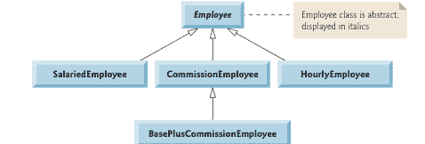

**图 13.11** | 员工层次结构 UML 类图。

抽象基类 Employee 声明了该层次结构的“接口”——即程序可以对所有 Employee 对象调用的成员函数集合。每个员工，无论其收入计算方式如何，都有名、姓和社会安全号，因此私有数据成员 firstName、lastName 和 socialSecurityNumber 出现在抽象基类 Employee 中。

> **软件工程观察 13.10**
>
> 派生类可以从基类继承接口或实现。为实现继承而设计的层次结构，其功能往往位于层次结构的高层——每个新的派生类继承一个或多个在基类中定义的成员函数，并且派生类使用基类的定义。为接口继承而设计的层次结构，其功能往往位于层次结构的低层——基类指定一个或多个应为层次结构中每个类定义的函数（即它们具有相同的原型），但各个派生类提供自己的函数实现。

以下各节实现 Employee 类层次结构。前五节分别实现一个抽象类或具体类。最后一节实现一个测试程序，该程序构建所有这些类的对象并以多态方式处理这些对象。


### 13.6.1 创建抽象基类 Employee

类 Employee（图 13.13–13.14，稍后将进一步详细讨论）除了提供各种用于操作 Employee 数据成员的 get 和 set 函数外，还提供函数 earnings 和 print。earnings 函数当然通用地适用于所有员工，但每个 earnings 计算取决于员工所属的类。因此，我们在基类 Employee 中将 earnings 声明为纯虚函数，因为默认实现对该函数没有意义——没有足够的信息来确定 earnings 应返回什么金额。每个派生类都用适当的实现重写 earnings。为了计算员工的工资，程序将一个 Employee 对象的地址赋给基类 Employee 指针，然后在该对象上调用 earnings 函数。我们维护一个 Employee 指针的 vector，其中每个指针都指向一个 Employee 对象（当然，不可能存在 Employee 对象，因为 Employee 是抽象类——然而，由于继承关系，Employee 的所有派生类的所有对象仍可被视为 Employee 对象）。程序遍历该 vector，并为每个 Employee 对象调用函数 earnings。C++ 会以多态方式处理这些函数调用。在 Employee 中将 earnings 包含为纯虚函数，会迫使 Employee 的每个希望成为具体类的直接派生类重写 earnings。这使类层次结构的设计者能够要求每个派生类提供适当的工资计算，如果该派生类确实要成为具体类的话。

类 Employee 中的函数 print 显示员工的名、姓和社会安全号码。正如我们将看到的，Employee 的每个派生类都重写函数 print，以输出员工类型（例如 "salaried employee:"），然后输出该员工的其他信息。函数 print 也可以调用 earnings，即使 earnings 是类 Employee 中的纯虚函数。

图 13.12 中的图在左侧纵向显示该层次结构中的五个类，并在顶部横向显示函数 earnings 和 print。对于每个类，该图显示每个函数的期望结果。类 Employee 为函数 earnings 指定 "= 0"，以表明这是一个纯虚函数。每个派生类都重写该函数以提供适当的实现。我们没有列出基类 Employee 的 get 和 set 函数，因为它们在任何派生类中都没有被重写——这些函数中的每一个都由每个派生类继承，并保持“原样”。

让我们考虑类 Employee 的头文件（图 13.13）。公有成员函数包括：一个构造函数，接受名、姓和社会安全号码作为参数（第 12 行）；设置名、姓和社会安全号码的 set 函数（分别在第 14、17 和 20 行）；返回名、姓和社会安全号码的 get 函数（分别在第 15、18 和 21 行）；纯虚函数 earnings（第 24 行）和虚函数 print（第 25 行）。

回想一下，我们将 earnings 声明为纯虚函数，因为首先必须知道具体的 Employee 类型，才能确定适当的 earnings 计算。将该函数声明为纯虚函数，表明每个具体派生类都必须提供 earnings 实现，并且程序可以使用基类 Employee 指针为任何类型的 Employee 多态地调用函数 earnings。

图 13.14 包含类 Employee 的成员函数实现。没有为虚函数 earnings 提供实现。Employee 构造函数（第 9–14 行）不验证社会安全号码。通常，应提供此类验证。

| 员工类型 | earnings | print |
| --- | --- | --- |
| Employee | `= 0` | *firstName lastName*<br>社会安全号码：*SSN* |
| Salaried-Employee | `weeklySalary` | 受薪员工：*firstName lastName*<br>社会安全号码：*SSN*<br>周薪：*weeklySalary* |
| Hourly-Employee | `if hours <= 40`<br>&nbsp;&nbsp;`wage * hours`<br>`if hours > 40`<br>&nbsp;&nbsp;`( 40 * wage ) +`<br>&nbsp;&nbsp;`( ( hours - 40 )`<br>&nbsp;&nbsp;`* wage * 1.5 )` | 小时工：*firstName lastName*<br>社会安全号码：*SSN*<br>时薪：*wage*；工作小时数：*hours* |
| Commission-Employee | `commissionRate *`<br>`grossSales` | 佣金员工：*firstName lastName*<br>社会安全号码：*SSN*<br>销售总额：*grossSales*；<br>佣金比例：*commissionRate* |
| BasePlus-Commission-Employee | `baseSalary +`<br>`( commissionRate *`<br>`grossSales )` | 底薪加佣金员工：<br>&nbsp;&nbsp;*firstName lastName*<br>社会安全号码：*SSN*<br>销售总额：*grossSales*；<br>佣金比例：*commissionRate*；<br>底薪：*baseSalary* |

**图 13.12** | Employee 层次结构类的多态接口。

**图 13.13 | Employee 类头文件。（第 1 部分，共 2 部分。）**

```cpp
// Fig. 13.13: Employee.h
// Employee abstract base class.
#ifndef EMPLOYEE_H
#define EMPLOYEE_H

#include <string> // C++ standard string class
using namespace std;

class Employee
{
public:
   Employee( const string &, const string &, const string & );

   void setFirstName( const string & ); // set first name
   string getFirstName() const; // return first name

   void setLastName( const string & ); // set last name
   string getLastName() const; // return last name

   void setSocialSecurityNumber( const string & ); // set SSN
   string getSocialSecurityNumber() const; // return SSN

   // pure virtual function makes Employee abstract base class
   virtual double earnings() const = 0; // pure virtual
   virtual void print() const; // virtual
private:
   string firstName;
   string lastName;
   string socialSecurityNumber;
}; // end class Employee

#endif // EMPLOYEE_H
```

**图 13.13 | Employee 类头文件。（第 2 部分，共 2 部分。）**

**图 13.14 | Employee 类实现文件。（第 1 部分，共 2 部分。）**

```cpp
// Fig. 13.14: Employee.cpp
// Abstract-base-class Employee member-function definitions.
// Note: No definitions are given for pure virtual functions.
#include <iostream>
#include "Employee.h" // Employee class definition
using namespace std;

// constructor
Employee::Employee( const string &first, const string &last,
   const string &ssn )
   : firstName( first ), lastName( last ), socialSecurityNumber( ssn )
{
   // empty body
} // end Employee constructor

// set first name
void Employee::setFirstName( const string &first )
{
   firstName = first;
} // end function setFirstName

// return first name
string Employee::getFirstName() const
{
   return firstName;
} // end function getFirstName

// set last name
void Employee::setLastName( const string &last )
{
   lastName = last;
} // end function setLastName

// return last name
string Employee::getLastName() const
{
   return lastName;
} // end function getLastName

// set social security number
void Employee::setSocialSecurityNumber( const string &ssn )
{
    socialSecurityNumber = ssn; // should validate
} // end function setSocialSecurityNumber

// return social security number
string Employee::getSocialSecurityNumber() const
{
    return socialSecurityNumber;
} // end function getSocialSecurityNumber

// print Employee's information (virtual, but not pure virtual)
void Employee::print() const
{
    cout << getFirstName() << ' ' << getLastName()
         << "\nsocial security number: " << getSocialSecurityNumber();
} // end function print
```

**图 13.14 | Employee 类实现文件。（第 2 部分，共 2 部分。）**

请注意，虚函数 `print`（图 13.14，第 53–57 行）提供了一个实现，该实现将在每个派生类中被重写。然而，这些函数中的每一个都将使用抽象类的 `print` 版本打印 Employee 层次结构中所有类共有的信息。

### 13.6.2 创建具体派生类 SalariedEmployee

类 SalariedEmployee（图 13.15–13.16）派生自类 Employee（图 13.15 第 8 行）。公有成员函数包括：一个构造函数，接受名、姓、社会安全号码和周薪作为参数（第 11–12 行）；一个 set 函数，用于为数据成员 weeklySalary 赋新值（第 14 行）；一个 get 函数，用于返回 weeklySalary 的值（第 15 行）；一个虚函数 earnings，用于计算 SalariedEmployee 的工资（第 18 行）；以及一个虚函数 print（第 19 行），它输出员工类型，即“salaried employee: ”，随后输出由基类 Employee 的 print 函数和 SalariedEmployee 的 getWeeklySalary 函数生成的员工特定信息。

**图 13.15 |** SalariedEmployee 类头文件。（第 1 部分，共 2 部分。）

```cpp
// Fig. 13.15: SalariedEmployee.h
// SalariedEmployee class derived from Employee.
#ifndef SALARIED_H
#define SALARIED_H

#include "Employee.h" // Employee class definition

class SalariedEmployee : public Employee
{
```


```cpp
14
15 // set salary
16 void SalariedEmployee::setWeeklySalary( double salary )
17 {
18    weeklySalary = ( salary < 0.0 ) ? 0.0 : salary;
19 } // end function setWeeklySalary
20
21 // return salary
22 double SalariedEmployee::getWeeklySalary() const
23 {
24    return weeklySalary;
25 } // end function getWeeklySalary
26
27 // calculate earnings;
28 // override pure virtual function earnings in Employee
29 double SalariedEmployee::earnings() const
30 {
31    return getWeeklySalary();
32 } // end function earnings
33
34 // print SalariedEmployee's information
35 void SalariedEmployee::print() const
36 {
37    cout << "salaried employee: ";
38    Employee::print(); // reuse abstract base-class print function
39    cout << "\nweekly salary: " << getWeeklySalary();
40 } // end function print
```

图 13.16 | SalariedEmployee 类实现文件。（第 2 部分，共 2 部分。）

SalariedEmployee 类的 print 函数（图 13.16 第 35—40 行）覆盖了 Employee 的 print 函数。如果 SalariedEmployee 类没有覆盖 print，SalariedEmployee 就会继承 Employee 版本的 print。在这种情况下，SalariedEmployee 的 print 函数只会返回员工的完整姓名和社会安全号码，这不能充分表示一个 SalariedEmployee。为了打印 SalariedEmployee 的完整信息，派生类的 print 函数会输出 "salaried employee: "，然后通过使用作用域解析运算符调用基类的 print 函数（第 38 行）来打印基类 Employee 特有的信息（即名字、姓氏和社会安全号码）——这是代码复用的一个很好的例子。SalariedEmployee 的 print 函数产生的输出包含通过调用该类的 getWeeklySalary 函数获得的员工周薪。

### 13.6.3 创建具体派生类 HourlyEmployee

HourlyEmployee 类（图 13.17—13.18）也派生自 Employee 类（图 13.17 第 8 行）。其公有成员函数包括一个构造函数（第 13—14 行），该构造函数接受名字、姓氏、社会安全号码、小时工资和工作小时数作为参数；分别用于给数据成员 wage 和 hours 赋新值的 set 函数（第 16 和 19 行）；分别返回 wage 和 hours 值的 get 函数（第 17 和 20 行）；一个计算 HourlyEmployee 收入的虚函数 earnings（第 23 行），以及一个输出员工类型（即 "hourly employee: "）和员工特有信息的虚函数 print（第 24 行）。

```cpp
1  // Fig. 13.17: HourlyEmployee.h
2  // HourlyEmployee class definition.
3  #ifndef HOURLY_H
4  #define HOURLY_H
5
6  #include "Employee.h" // Employee class definition
7
8  class HourlyEmployee : public Employee
9  {
10 public:
11    static const int hoursPerWeek = 168; // hours in one week
12
13    HourlyEmployee( const string &, const string &,
14       const string &, double = 0.0, double = 0.0 );
15
16    void setWage( double ); // set hourly wage
17    double getWage() const; // return hourly wage
18
19    void setHours( double ); // set hours worked
20    double getHours() const; // return hours worked
21
22    // keyword virtual signals intent to override
23    virtual double earnings() const; // calculate earnings
24    virtual void print() const; // print HourlyEmployee object
25 private:
26    double wage; // wage per hour
27    double hours; // hours worked for week
28 }; // end class HourlyEmployee
29
30 #endif // HOURLY_H
```

图 13.17 | HourlyEmployee 类头文件。

图 13.18 包含 HourlyEmployee 类的成员函数实现。第 17—20 行和第 29—33 行定义了分别给数据成员 wage 和 hours 赋新值的 set 函数。函数 setWage（第 17—20 行）确保 wage 非负，函数 setHours（第 29—33 行）确保数据成员 hours 介于 0 和 hoursPerWeek（即 168）之间。HourlyEmployee 类的 get 函数在第 23—26 行和第 36—39 行实现。我们没有将这些函数声明为 virtual，因此从 HourlyEmployee 类派生的类不能覆盖它们（尽管派生类当然可以重定义它们）。HourlyEmployee 构造函数与 SalariedEmployee 构造函数一样，将名字、姓氏和社会安全号码传递给基类 Employee 构造函数（第 10 行），以初始化基类中声明的继承私有数据成员。此外，HourlyEmployee 的 print 函数调用基类函数 print（第 55 行）来输出 Employee 特有的信息（即名字、姓氏和社会安全号码）——这是代码复用的另一个很好的例子。

```cpp
// Fig. 13.18: HourlyEmployee.cpp
// HourlyEmployee class member-function definitions.
#include <iostream>
#include "HourlyEmployee.h" // HourlyEmployee class definition
using namespace std;

// constructor
HourlyEmployee::HourlyEmployee( const string &first, const string &last,
   const string &ssn, double hourlyWage, double hoursWorked )
   : Employee( first, last, ssn )
{
   setWage( hourlyWage ); // validate hourly wage
   setHours( hoursWorked ); // validate hours worked
} // end HourlyEmployee constructor

// set wage
void HourlyEmployee::setWage( double hourlyWage )
{
   wage = ( hourlyWage < 0.0 ? 0.0 : hourlyWage );
} // end function setWage

// return wage
double HourlyEmployee::getWage() const
{
   return wage;
} // end function getWage

// set hours worked
void HourlyEmployee::setHours( double hoursWorked )
{
   hours = ( ( hoursWorked >= 0.0 ) &&
      ( hoursWorked <= hoursPerWeek ) ) ? hoursWorked : 0.0 );
} // end function setHours

// return hours worked
double HourlyEmployee::getHours() const
{
   return hours;
} // end function getHours

// calculate earnings;
// override pure virtual function earnings in Employee
double HourlyEmployee::earnings() const
{
   if ( getHours() <= 40 ) // no overtime
      return getWage() * getHours();
   else
      return 40 * getWage() + ( ( getHours() - 40 ) * getWage() * 1.5 );
} // end function earnings

// print HourlyEmployee's information
void HourlyEmployee::print() const
{
```

图 13.18 | HourlyEmployee 类实现文件。（第 1 部分，共 2 部分。）

### 13.6.5 创建间接具体派生类 BasePlusCommissionEmployee

BasePlusCommissionEmployee 类（图 13.21—13.22）直接继承自 CommissionEmployee 类（图 13.21 第 8 行），因此是 Employee 类的间接派生类。BasePlusCommissionEmployee 类的成员函数实现包括一个构造函数（图 13.22 第 8—14 行），该构造函数接受名字、姓氏、社会安全号码、销售额、佣金率和基本工资作为参数。然后它将名字、姓氏、社会安全号码、销售额和佣金率传递给 CommissionEmployee 构造函数（第 11 行），以初始化继承的成员。BasePlusCommissionEmployee 还包含一个 set 函数（第 17—20 行），用于给数据成员 baseSalary 赋新值，以及一个 get 函数（第 23—26 行），用于返回 baseSalary 的值。函数 earnings（第 30—33 行）计算 BasePlusCommissionEmployee 的收入。函数 earnings 中的第 32 行调用基类 CommissionEmployee 的 earnings 函数，以计算员工收入中基于佣金的部分。这是代码复用的一个很好的例子。BasePlusCommissionEmployee 的 print 函数（第 36—41 行）输出 "base-salaried"，然后输出基类 CommissionEmployee 的 print 函数的结果（代码复用的另一个例子），再输出基本工资。最终输出以 "base-salaried commission employee: " 开头，后面是 BasePlusCommissionEmployee 其余的信息。回想一下，CommissionEmployee 的 print 通过调用其基类（即 Employee）的 print 函数来显示员工的名字、姓氏和社会安全号码——这又是代码复用的一个例子。BasePlusCommissionEmployee 的 print 发起了一连串函数调用，跨越 Employee 层次结构的所有三个层次。

```cpp
1 // Fig. 13.21: BasePlusCommissionEmployee.h
2 // BasePlusCommissionEmployee class derived from CommissionEmployee.
3 #ifndef BASEPLUS_H
4 #define BASEPLUS_H
5 
6 #include "CommissionEmployee.h" // CommissionEmployee class definition
7 
8 class BasePlusCommissionEmployee : public CommissionEmployee
9 {
10 public:
11    BasePlusCommissionEmployee( const string &, const string &,
12       const string &, double = 0.0, double = 0.0, double = 0.0 );
13 
14    void setBaseSalary( double ); // set base salary
15    double getBaseSalary() const; // return base salary
16 
17    // keyword virtual signals intent to override
18    virtual double earnings() const; // calculate earnings
19    virtual void print() const; // print BasePlusCommissionEmployee object
20 private:
21    double baseSalary; // base salary per week
22 }; // end class BasePlusCommissionEmployee
23 
24 #endif // BASEPLUS_H
```

图 13.21 | BasePlusCommissionEmployee 类头文件。


```
base-salaried commission employee: Bob Lewis
social security number: 444-44-4444
gross sales: 5000.00; commission rate: 0.04; base salary: 300.00
earned $500.00

Employees processed polymorphically using dynamic binding:

Virtual function calls made off base-class pointers:

salaried employee: John Smith
social security number: 111-11-1111
weekly salary: 800.00
earned $800.00

hourly employee: Karen Price
social security number: 222-22-2222
hourly wage: 16.75; hours worked: 40.00
earned $670.00

commission employee: Sue Jones
social security number: 333-33-3333
gross sales: 10000.00; commission rate: 0.06
earned $600.00

base-salaried commission employee: Bob Lewis
social security number: 444-44-4444
gross sales: 5000.00; commission rate: 0.04; base salary: 300.00
earned $500.00

Virtual function calls made off base-class references:

salaried employee: John Smith
social security number: 111-11-1111
weekly salary: 800.00
earned $800.00

hourly employee: Karen Price
social security number: 222-22-2222
hourly wage: 16.75; hours worked: 40.00
earned $670.00

commission employee: Sue Jones
social security number: 333-33-3333
gross sales: 10000.00; commission rate: 0.06
earned $600.00

base-salaried commission employee: Bob Lewis
social security number: 444-44-4444
gross sales: 5000.00; commission rate: 0.04; base salary: 300.00
earned $500.00
```

**图 13.23** | Employee 类层次结构驱动程序。（第 3 部分，共 3 部分）

第 46 行分配了 vector employees，它包含四个 Employee 指针。第 49 行将 employees[0] 赋给对象 salariedEmployee。第 50 行将 employees[1] 赋给对象 hourlyEmployee。第 51 行将 employees[2] 赋给对象 commissionEmployee。第 52 行将 employees[3] 赋给对象 basePlusCommissionEmployee。编译器允许这些赋值，因为 SalariedEmployee 是一种 Employee，HourlyEmployee 是一种

首先，我们将解释 C++ 编译器在编译时构建、用于在运行时支持多态性的数据结构。你会看到，多态性是通过三级指针（即“三重间接”）实现的。然后，我们将展示正在运行的程序如何使用这些数据结构来执行虚函数，并实现与多态性相关的动态绑定。我们的讨论只解释一种可能的实现方式；这并不是语言上的强制要求。

当 C++ 编译一个含有一个或多个虚函数的类时，它会为该类构建一个虚函数表（vtable）。每当该类的虚函数被调用时，运行中的程序都会使用 vtable 来选择适当的函数实现。图 13.24 最左侧一列展示了类 Employee、SalariedEmployee、HourlyEmployee、CommissionEmployee 和 BasePlusCommissionEmployee 的 vtable。

在类 Employee 的 vtable 中，第一个函数指针被设置为 0（即空指针）。这样做是因为函数 earnings 是一个纯虚函数，因此没有实现。第二个函数指针指向函数 print，该函数显示雇员的完整姓名和社会保险号。[注意：为节省篇幅，我们在该图中省略了每个 print 函数的输出。] 任何在其 vtable 中有一个或多个空指针的类都是抽象类。没有任何空 vtable 指针的类（如 SalariedEmployee、HourlyEmployee、CommissionEmployee 和 BasePlusCommissionEmployee）是具体类。

类 SalariedEmployee 重写了函数 earnings，以返回员工的周薪，因此该函数指针指向类 SalariedEmployee 的 earnings 函数。SalariedEmployee 也重写了 print，因此相应的函数指针指向 SalariedEmployee 的成员函数，该函数打印出 "salaried employee: "，后跟员工的姓名、社会保险号和周薪。

类 HourlyEmployee 的 vtable 中的 earnings 函数指针指向 HourlyEmployee 的 earnings 函数，该函数返回员工的工资乘以工作小时数。为节省篇幅，我们省略了小时工加班时按 1.5 倍工资计酬这一事实。print 函数指针指向该函数的 HourlyEmployee 版本，它打印 "hourly employee: "、员工的姓名、社会保险号、时薪和工作小时数。这两个函数都重写了类 Employee 中的函数。

类 CommissionEmployee 的 vtable 中的 earnings 函数指针指向 CommissionEmployee 的 earnings 函数，该函数返回员工的总销售额乘以佣金率。print 函数指针指向该函数的 CommissionEmployee 版本，它打印员工的类型、姓名、社会保险号、佣金率和总销售额。与类 HourlyEmployee 一样，这两个函数都重写了类 Employee 中的函数。

类 BasePlusCommissionEmployee 的 vtable 中的 earnings 函数指针指向 BasePlusCommissionEmployee 的 earnings 函数，该函数返回员工的基本工资加上总销售额乘以佣金率。print 函数指针指向该函数的 BasePlusCommissionEmployee 版本，它打印员工的基本工资以及类型、姓名、社会保险号、佣金率和总销售额。这两个函数都重写了类 CommissionEmployee 中的函数。

请注意，在我们的 Employee 案例研究中，每个具体类都为虚函数 earnings 和 print 提供了自己的实现。你已经了解到，每个直接从抽象基类 Employee 继承的类都必须实现 earnings 才能成为具体类，因为 earnings 是一个纯虚函数。然而，这些类并不需要实现函数 print 即可被视为具体类——print 不是纯虚函数，派生类可以继承类 Employee 对 print 的实现。此外，类 BasePlusCommissionEmployee 不必实现 print 或 earnings——这两个函数实现都可以从类 CommissionEmployee 继承。如果我们的类层次结构中的某个类以这种方式继承函数实现，那么这些函数的 vtable 指针将直接指向被继承的函数实现。例如，如果 BasePlusCommissionEmployee 没有重写 earnings，那么类 BasePlusCommissionEmployee 的 vtable 中的 earnings 函数指针将指向与类 CommissionEmployee 的 vtable 相同的 earnings 函数。

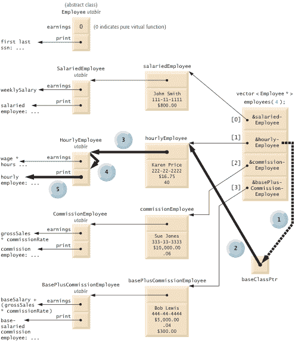

### 虚拟函数调用 `baseClassPtr->print()` 的流程：当 `baseClassPtr` 指向对象 `hourlyEmployee` 时

- 1. 将 `hourlyEmployee` 传递给 `baseClassPtr`
- 2. 到达 `hourlyEmployee` 对象
- 3. 到达 `hourlyEmployee` 的 vtable
- 4. 到达 vtable 中的 print 指针
- 5. 为 `hourlyEmployee` 执行 print

**图 13.24** | 虚函数调用的工作原理。

多态性是通过一种涉及三级指针的精巧数据结构实现的。我们已经讨论了一级指针——vtable 中的函数指针。它们指向虚函数被调用时实际执行的函数。

现在我们来考虑第二级指针。每当实例化一个含有一个或多个虚函数的类的对象时，编译器都会在该对象上附加一个指向该类的 vtable 的指针。这个指针通常位于对象的前部，但并非必须如此实现。在图 13.24 中，这些指针与图 13.23 中创建的对象相关联（SalariedEmployee、HourlyEmployee、CommissionEmployee 和 BasePlusCommissionEmployee 每种类型各有一个对象）。请注意，图中显示了每个对象的数据成员值。例如，salariedEmployee 对象包含一个指向 SalariedEmployee vtable 的指针；该对象还包含值 John Smith、111-11-1111 和 $800.00。

第三级指针仅包含接收虚函数调用的对象的句柄。这一级的句柄也可以是引用。图 13.24 描绘了包含 Employee 指针的 vector employees。

现在让我们看看典型的虚函数调用是如何执行的。考虑函数 virtualViaPointer（图 13.23 的第 75 行）中的调用 baseClassPtr->print()。假设 baseClassPtr 包含 employees[1]（即 employees 中对象 hourlyEmployee 的地址）。当编译器编译这条语句时，它会确定该调用确实是通过基类指针进行的，并且 print 是一个虚函数。

编译器确定 print 是每个 vtable 中的第二个条目。为了定位该条目，编译器注意到需要跳过第一个条目。因此，编译器会将一个四字节的偏移量或位移量（在当今流行的 32 位机器上每个指针占四个字节，并且只需要跳过一个指针）编译到机器语言目标代码指针表中，以找到将执行虚函数调用的代码。

编译器生成的代码将执行以下操作 [注意：列表中的编号对应于图 13.24 中带圆圈的编号]：

- 1. 选择 employees 的第 n 个条目（在本例中是对象 hourlyEmployee 的地址），并将其作为参数传递给函数 virtualViaPointer。这会将参数 baseClassPtr 设置为指向 hourlyEmployee。
- 2. 解引用该指针以到达 hourlyEmployee 对象——正如你记得的，该对象以一个指向 HourlyEmployee vtable 的指针开始。
- 3. 解引用 hourlyEmployee 的 vtable 指针以到达 HourlyEmployee vtable。


- 4. 跳过四个字节的偏移量，以选择打印函数指针。
- 5. 对打印函数指针进行解引用，以构成要执行的实际函数的“名称”，并使用函数调用运算符 `()` 执行相应的打印函数；在本例中，该函数打印员工的类型、姓名、社会安全号码、时薪和工作小时数。

图 13.24 的数据结构可能看起来复杂，但这种复杂性由编译器管理并对你隐藏，从而使多态编程变得简单直接。每次虚函数调用时发生的指针解引用操作和内存访问需要一些额外的执行时间。添加到对象中的 `vtables` 和 `vtable` 指针需要一些额外的内存。现在你已有足够的信息来判断虚函数是否适合你的程序。


> **性能提示 13.1**
> 
> *在 C++ 中通常通过虚函数和动态绑定实现的多态是高效的。你可以使用这些能力，而对性能的影响最小。*


> **性能提示 13.2**
> 
> *虚函数和动态绑定使多态编程成为 switch 逻辑编程的一种替代方案。优化编译器通常生成的多态代码，其运行效率与手工编写的基于 switch 的逻辑一样高。对于大多数应用而言，多态的开销是可以接受的。但在某些情况下——例如对性能要求严格的实时应用——多态的开销可能过高。*


> **软件工程观察 13.1**
> 
> *动态绑定使独立软件供应商（ISV）能够分发软件而不泄露专有秘密。软件分发可以只包含头文件和目标文件——无需公开源代码。软件开发人员随后可以使用继承从 ISV 提供的类派生新类。与 ISV 提供的类配合工作的其他软件仍将与派生类配合工作，并使用类中提供的重写虚函数（通过动态绑定）。*

## 13.8 案例研究：使用多态和运行时类型信息以及向下转型、dynamic_cast、typeid 和 type_info 的工资系统

回想第 13.6 节开头的问题陈述，对于当前支付周期，我们虚构的公司决定奖励 BasePlusCommissionEmployee，将其基本工资增加 10%。在第 13.6.6 节中以多态方式处理 Employee 对象时，我们不需要担心“具体细节”。然而现在，要调整 BasePlusCommissionEmployees 的基本工资，我们必须在执行时确定每个 Employee 对象的具体类型，然后采取相应操作。本节演示运行时类型信息（RTTI）和动态转换的强大能力，它们使程序能够在执行时确定对象的类型，并据此对该对象进行操作。

[注意：某些编译器要求先启用 RTTI，然后才能在程序中使用它。在 Visual C++ 2008 中，默认启用此选项。]

图 13.25 使用第 13.6 节中开发的 Employee 层次结构，并将每个 BasePlusCommissionEmployee 的基本工资增加 10%。第 22 行声明了一个四元素 vector employees，它存储指向 Employee 对象的指针。第 25–32 行用动态分配的 SalariedEmployee（图 13.15–13.16）、HourlyEmployee（图 13.17–13.18）、CommissionEmployee（图 13.19–13.20）和 BasePlusCommissionEmployee（图 13.21–13.22）类对象的地址填充该 vector。

```cpp
// Fig. 13.25: fig13_25.cpp
// Demonstrating downcasting and runtime type information.
// NOTE: You may need to enable RTTI on your compiler
// before you can execute this application.
#include <iostream>
#include <iomanip>
#include <vector>
#include <typeinfo>
#include "Employee.h"
#include "SalariedEmployee.h"
#include "HourlyEmployee.h"
#include "CommissionEmployee.h"
#include "BasePlusCommissionEmployee.h"
using namespace std;

int main()
{
   // set floating-point output formatting
   cout << fixed << setprecision( 2 );

   // create vector of four base-class pointers
   vector < Employee * > employees( 4 );

   // initialize vector with various kinds of Employees
   employees[ 0 ] = new SalariedEmployee(
      "John", "Smith", "111-11-1111", 800 );
   employees[ 1 ] = new HourlyEmployee(
      "Karen", "Price", "222-22-2222", 16.75, 40 );
   employees[ 2 ] = new CommissionEmployee(
      "Sue", "Jones", "333-33-3333", 10000, .06 );
   employees[ 3 ] = new BasePlusCommissionEmployee(
      "Bob", "Lewis", "444-44-4444", 5000, .04, 300 );

   // polymorphically process each element in vector employees
   for ( size_t i = 0; i < employees.size(); ++i )
   {
      employees[ i ]->print(); // output employee information
      cout << endl;

      // downcast pointer
      BasePlusCommissionEmployee *derivedPtr =
         dynamic_cast < BasePlusCommissionEmployee * >
            ( employees[ i ] );
```

**图 13.25** | 演示向下转型和运行时类型信息。（第 1 部分，共 2 部分）。

```cpp
// determine whether element points to base-salaried
// commission employee
if ( derivedPtr != 0 ) // 0 if not a BasePlusCommissionEmployee
{
    double oldBaseSalary = derivedPtr->getBaseSalary();
    cout << "old base salary: $" << oldBaseSalary << endl;
    derivedPtr->setBaseSalary( 1.10 * oldBaseSalary );
    cout << "new base salary with 10% increase is: $"
         << derivedPtr->getBaseSalary() << endl;
} // end if

cout << "earned $" << employees[ i ]->earnings() << "\n\n";
} // end for

// release objects pointed to by vector’s elements
for ( size_t j = 0; j < employees.size(); j++ )
{
    // output class name
    cout << "deleting object of "
         << typeid( *employees[ j ] ).name() << endl;

    delete employees[ j ];
} // end for
} // end main
```

```text
salaried employee: John Smith
social security number: 111-11-1111
weekly salary: 800.00
earned $800.00

hourly employee: Karen Price
social security number: 222-22-2222
hourly wage: 16.75; hours worked: 40.00
earned $670.00

commission employee: Sue Jones
social security number: 333-33-3333
gross sales: 10000.00; commission rate: 0.06
earned $600.00

base-salaried commission employee: Bob Lewis
social security number: 444-44-4444
gross sales: 5000.00; commission rate: 0.04; base salary: 300.00
old base salary: $300.00
new base salary with 10% increase is: $330.00
earned $530.00

deleting object of class SalariedEmployee
deleting object of class HourlyEmployee
deleting object of class CommissionEmployee
deleting object of class BasePlusCommissionEmployee
```

**图 13.25** | 演示向下转型和运行时类型信息。（第 2 部分，共 2 部分）。

第 35–57 行的 for 语句遍历 employees vector，并通过调用成员函数 print（第 37 行）显示每个 Employee 的信息。回想一下，由于 print 在基类 Employee 中声明为 virtual，系统会调用相应派生类对象的 print 函数。

在本例中，当我们遇到 BasePlusCommissionEmployee 对象时，我们希望将其基本工资增加 10%。由于我们以泛型方式（即多态方式）处理员工，因此（使用我们已学过的技术）无法确定在任何给定时间正在操作哪种类型的 Employee。这产生了一个问题，因为当我们遇到 BasePlusCommissionEmployee 员工时，必须识别出他们，以便他们能够获得 10% 的加薪。为此，我们使用运算符 dynamic_cast（第 42 行）来确定每个对象的类型是否为 BasePlusCommissionEmployee。这就是我们在第 13.3.3 节中提到的向下转型操作。第 41–43 行将 employees[ i ] 从 Employee * 类型动态向下转型为 BasePlusCommissionEmployee * 类型。如果该 vector 元素指向的对象是 BasePlusCommissionEmployee 对象，则将该对象的地址赋给 derivedPtr；否则，将 0 赋给派生类指针 derivedPtr。

如果第 41–43 行中 dynamic_cast 运算符返回的值不为 0，则该对象类型正确，if 语句（第 47–54 行）执行 BasePlusCommissionEmployee 对象所需的特殊处理。第 49、51 和 53 行调用 BasePlusCommissionEmployee 成员函数 getBaseSalary 和 setBaseSalary 来获取并更新该员工的工资。

第 56 行对 employees[ i ] 所指向的对象调用成员函数 earnings。回想一下，earnings 在基类中声明为 virtual，因此程序会调用派生类对象的 earnings 函数——这是动态绑定的另一个例子。

第 60–67 行显示每个员工的对象类型，并使用 delete 运算符释放每个 vector 元素所指向的动态内存。运算符 typeid（第 64 行）返回对 type_info 类对象的引用，该对象包含有关其操作数类型的信息，包括该类型的名称。调用时，type_info 成员函数 name（第 64 行）返回一个基于指针的字符串，其中包含传递给 typeid 的实参的类型名称（例如 "class BasePlusCommissionEmployee"）。要使用 typeid，程序必须包含头文件 <typeinfo>（第 8 行）。

> **可移植性提示 13.1**
> 
> *type_info 成员函数 name 返回的字符串可能因编译器而异。*

在这个例子中，我们通过将 Employee 指针向下转型为 BasePlusCommissionEmployee 指针（第 41–43 行），避免了若干编译错误。如果删除第 42 行中的 dynamic_cast，并试图将当前 Employee 指针直接赋给 BasePlusCommissionEmployee 指针 derivedPtr，我们将收到编译错误。C++ 不允许程序将基类指针赋给派生类指针，因为 is-a 关系不适用——CommissionEmployee 不是 BasePlusCommissionEmployee。is-a 关系仅适用于派生类及其基类之间，而不是反过来。

类似地，如果第 49、51 和 53 行使用 employees 中的当前基类指针，而不是派生类指针 derivedPtr，来调用仅属于派生类的函数 getBaseSalary 和 setBaseSalary，那么我们将在这些行中的每一行收到编译错误。正如你在第 13.3.3 节中学到的，不允许通过基类指针调用仅属于派生类的函数。尽管第 49、51 和 53 行只有在

如果 `commissionPtr` 不为 0（即可以执行转换），我们就不能尝试通过基类 `Employee` 指针调用派生类 `BasePlusCommissionEmployee` 的函数 `getBaseSalary` 和 `setBaseSalary`。请记住，使用基类 `Employee` 指针时，我们只能调用基类 `Employee` 中定义的函数——`earnings`、`print` 以及 `Employee` 的 `get` 和 `set` 函数。

## 13.9 虚析构函数

使用多态处理类层次结构中动态分配的对象时，可能会出现问题。到目前为止，你已经了解了普通析构函数——即未使用关键字 `virtual` 声明的析构函数。如果一个带有非虚析构函数的派生类对象被显式销毁，即对指向该对象的基类指针应用 `delete` 运算符，C++ 标准规定其行为是未定义的。

这个问题的简单解决方案是在基类中创建一个**虚析构函数**（即使用关键字 `virtual` 声明的析构函数）。这样会使所有派生类的析构函数都成为虚函数，*即使它们与基类析构函数的名称并不相同*。现在，如果通过对指向层次结构中某个对象的基类指针应用 `delete` 运算符来显式销毁该对象，系统将根据基类指针所指向的对象，调用相应类的析构函数。请记住，当派生类对象被销毁时，该派生类对象中的基类部分也会被销毁，因此派生类和基类的析构函数都执行是非常重要的。基类析构函数会在派生类析构函数执行后自动执行。


> **防止错误提示 13.2**
>
> 如果一个类包含虚函数，就应提供虚析构函数，即使该类并不要求这样做。这可以确保通过基类指针删除派生类对象时，自定义的派生类析构函数（如果存在）会被调用。


> **常见编程错误 13.5**
>
> 构造函数不能是虚函数。将构造函数声明为虚函数会导致编译错误。

## 13.10 总结

在本章中，我们讨论了多态。多态使我们能够“面向一般进行编程”，而不是“面向具体进行编程”，并且我们展示了这种方式如何使程序更具可扩展性。我们首先通过一个示例说明多态如何允许屏幕管理器显示多个“空间”对象。然后，我们演示了基类指针和派生类指针如何分别指向基类对象和派生类对象。我们指出，基类指针指向基类对象是自然的，派生类指针指向派生类对象也是自然的。基类指针指向派生类对象同样是自然的，因为派生类对象也是其基类的对象。你了解了为什么派生类指针指向基类对象是危险的，以及编译器为什么禁止这种赋值。我们介绍了 `virtual` 函数，它使得当继承层次结构中不同层级的对象在运行时通过基类指针被引用时，能够调用正确的函数。这称为动态绑定或后期绑定。随后，我们讨论了纯虚函数（不提供实现的 `virtual` 函数）和抽象类（包含一个或多个纯虚函数的类）。你了解到，抽象类不能用于实例化对象，而具体类可以。接着，我们演示了如何在继承层次结构中使用抽象类。你还了解了多态如何通过由编译器创建的 *vtables* 在底层实现。我们使用运行时类型信息（RTTI）和动态转换，在运行时确定对象的类型，并据此对对象执行相应操作。本章最后讨论了虚析构函数，以及当通过基类指针删除派生类对象时，虚析构函数如何确保继承层次结构中所有适当的析构函数都能对该对象执行。

下一章将讨论模板。模板是 C++ 的一项高级特性，它使你能够使用单个代码段定义一组相关的类或函数。

## 摘要

### *第 13.1 节 简介*

- 多态使我们能够“面向一般进行编程”，而不是“面向具体进行编程”。
- 多态使我们能够编写这样的程序：将属于同一类层次结构的类的对象视为该层次结构基类的对象，对它们进行处理。
- 借助多态，我们可以设计和实现易于扩展的系统——只需很少修改甚至无需修改程序中的通用部分，就可以添加新类。为了适应所添加的新类，程序中唯一必须修改的部分，是那些需要直接了解新类的部分。
- 运行时类型信息（RTTI）和动态转换使程序能够在运行时确定对象的类型，并据此对对象执行相应操作。

### *第 13.2 节 多态示例*

- 借助多态，一个函数可以根据调用该函数的对象的类型，执行不同的操作。
- 这使得设计和实现更具可扩展性的系统成为可能。程序可以被编写为处理在程序开发期间可能尚不存在的类型的对象。

### *第 13.3 节 继承层次结构中对象之间的关系*

- C++ 支持多态——通过继承相关联的不同类的对象能够对同一个成员函数调用做出不同响应。
- 多态通过虚函数和动态绑定实现。
- 当使用基类指针或引用调用虚函数时，C++ 会选择与该对象关联的适当派生类中的正确重写函数。
- 如果通过指定对象的名称并使用点成员选择运算符来引用特定对象并调用虚函数，则该引用会在编译时解析（这称为静态绑定）；被调用的虚函数是为该特定对象所属的类定义的函数。
- 如果需要，派生类可以为基类虚函数提供自己的实现；但如果不提供，则使用基类的实现。

### *第 13.4 节 类型字段和 `switch` 语句*

- 使用虚函数进行多态编程可以消除对 `switch` 逻辑的需要。你可以使用虚函数机制自动执行等效逻辑，从而避免通常与 `switch` 逻辑相关的错误。

### *第 13.5 节 抽象类和纯虚函数*

- 抽象类通常用作基类，因此我们将其称为抽象基类。抽象类不能实例化任何对象。
- 可以实例化对象的类称为具体类。
- 你可以在函数声明中使用纯说明符（`= 0`）声明一个或多个纯虚函数，从而创建抽象类。
- 如果一个类派生自包含纯虚函数的类，并且该派生类没有为该纯虚函数提供定义，那么该虚函数在派生类中仍然是纯虚函数。因此，该派生类也是抽象类。
- 虽然不能实例化抽象基类的对象，但可以声明指向抽象基类对象的指针和引用。这些指针和引用可用于对由具体派生类实例化的派生类对象执行多态操作。

### *第 13.7 节（可选）多态、虚函数和动态绑定的底层实现*

- 动态绑定要求在运行时将对虚成员函数的调用转发到适合该类的虚函数版本。虚函数表（称为 vtable）以包含函数指针的数组形式实现。每个包含虚函数的类都有一个 vtable。对于类中的每个虚函数，vtable 都包含一个条目，其中存放一个函数指针，指向该类对象应使用的虚函数版本。某个类应使用的虚函数，可能是在该类中定义的函数，也可能是从继承层次结构中更高层的基类直接或间接继承而来的函数。
- 当基类提供虚成员函数时，派生类可以重写该虚函数，但不必重写。
- 每个包含虚函数的类的对象都包含一个指向该类 vtable 的指针。当通过基类指针调用派生类对象的函数时，系统会获取 vtable 中适当的函数指针并对其解引用，从而在运行时完成调用。
- 任何包含一个或多个纯虚函数的类都是抽象类。不包含任何纯虚函数的类都是具体类。
- 系统会定期添加新类型的类，并通过动态绑定使系统能够处理这些类。

### *第 13.8 节 案例研究：使用多态和运行时类型信息的工资管理系统，包括向下转型、`dynamic_cast`、`typeid` 和 `type_info*

- `dynamic_cast` 运算符会检查指针所指向对象的类型，然后确定该类型与指针要转换成的类型之间是否存在 is-a 关系。如果存在，`dynamic_cast` 返回对象的地址；如果不存在，`dynamic_cast` 返回 0。
- `typeid` 运算符返回一个 `type_info` 对象的引用，该对象包含有关操作数类型的信息，包括类型名称。要使用 `typeid`，程序必须包含头文件 `<typeinfo>`。
- 调用时，`type_info` 成员函数 `name` 返回一个基于指针的字符串，其中包含 `type_info` 对象所表示类型的名称。
- `dynamic_cast` 和 `typeid` 运算符属于 C++ 的运行时类型信息（RTTI）特性，该特性允许程序在运行时确定对象的类型。

### *第 13.9 节 虚析构函数*

- 如果类包含虚函数，则应将基类析构函数声明为虚函数。这样会使所有派生类析构函数都成为虚函数，即使它们与基类析构函数的名称并不相同。如果通过应用 `delete` 运算符显式销毁层次结构中的某个对象


当通过基类指针删除派生类对象时，会调用相应类的析构函数。派生类析构函数运行后，该类的所有基类的析构函数会沿着继承层次一路向上运行。

### 术语

- 抽象基类 593
- 抽象类 593
- 具体类 593
- 进入*虚函数表*的位移 615
- 向下转型 586
- 动态绑定 587
- 动态转换 574
- dynamic_cast 619
- 实现继承 596
- 接口继承 596
- 迭代器类 595
- 晚绑定 587
- class type_info 的 name 函数 619
- 非虚析构函数 620
- *虚函数表*中的偏移量 615
- 重写 586
- 多态 573
- 纯说明符（用于虚函数）594
- 纯虚函数 594
- 运行时类型信息（RTTI）574
- 静态绑定 587
- typeid 运算符 619
- type_info 类 619
- `<typeinfo>` 头文件 619
- 虚析构函数 620
- 虚函数 586
- 虚函数表（*vtable*）613

### 自测练习

- 13.1 填写下列各句中的空白：
  - a) 将基类对象当作一个 ______ 处理可能导致错误。
  - b) 多态有助于消除 ______ 逻辑。
  - c) 如果一个类至少包含一个纯虚函数，那么它是一个 ______ 类。
  - d) 可以从中实例化对象的类称为 ______ 类。
  - e) 运算符 ______ 可用于安全地将基类指针向下转型。
  - f) 运算符 typeid 返回对 ______ 对象的引用。
  - g) ______ 涉及使用基类指针或引用来调用基类对象和派生类对象上的虚函数。
  - h) 可重写的函数使用关键字 ______ 声明。
  - i) 将基类指针转换为派生类指针称为 ______。

- 13.2 判断下列各题是否正确。如果错误，请解释原因。
  - a) 抽象基类中的所有虚函数都必须声明为纯虚函数。
  - b) 用基类句柄引用派生类对象是危险的。
  - c) 通过将该类声明为 virtual 可使类成为抽象类。
  - d) 如果基类声明了纯虚函数，派生类必须实现该函数才能成为具体类。
  - e) 多态编程可以消除对 switch 逻辑的需要。

### 自测练习答案

- 13.1 a) 派生类对象。b) switch。c) 抽象。d) 具体。e) dynamic_cast。f) type_info。
  g) 多态。h) virtual。i) 向下转型。

13.2 a) 错误。抽象基类可以包含带实现的虚函数。b) 错误。用派生类句柄引用基类对象是危险的。c) 错误。类永远不会被声明为 virtual。相反，通过在类中至少包含一个纯虚函数，类才成为抽象类。d) 正确。e) 正确。

### 练习

13.3 多态如何使你能够“面向一般”而不是“面向具体”编程？讨论“面向一般”编程的主要优点。

13.4 讨论使用 switch 逻辑编程的问题。解释为什么多态可以成为使用 switch 逻辑的有效替代方案。

13.5 区分继承接口和继承实现。为继承接口而设计的继承层次结构与为继承实现而设计的继承层次结构有何不同？

13.6 什么是虚函数？描述一种适合使用虚函数的情形。

13.7 区分静态绑定和动态绑定。解释虚函数和 vtable 在动态绑定中的使用。

13.8 区分虚函数和纯虚函数。

13.9 (*抽象基类*) 为本章讨论并在图 12.3 中所示的 Shape 层次结构建议一个或多个抽象基类层次。（第一层是 Shape，第二层由 TwoDimensionalShape 和 ThreeDimensionalShape 类组成。）

13.10 多态如何促进可扩展性？

13.11 你被要求开发一个具有精细图形输出的飞行模拟器。解释为什么多态编程对于这类问题可能特别有效。

13.12 (*工资单系统修改*) 修改图 13.13–13.23 中的工资单系统，在 Employee 类中包含私有数据成员 birthDate。使用图 11.9–11.10 中的 Date 类表示员工的生日。假设工资单每月处理一次。创建一个存储各种员工对象的 Employee 引用 vector。在循环中，（以多态方式）计算每个 Employee 的工资，如果当前月份是该 Employee 生日所在月份，则在该人的工资金额中增加 100.00 美元奖金。

13.13 (*形状层次结构*) 实现练习 12.7 中设计的 Shape 层次结构（该层次结构基于图 12.3 中的层次结构）。每个 TwoDimensionalShape 应包含函数 getArea 以计算二维形状的面积。每个 ThreeDimensionalShape 应具有成员函数 getArea 和 getVolume，分别计算三维形状的表面积和体积。创建一个程序，使用 Shape 指针的 vector 指向该层次结构中每个具体类的对象。程序应打印每个 vector 元素所指向的对象。此外，在处理 vector 中所有形状的循环中，判断每个形状是 TwoDimensionalShape 还是 ThreeDimensionalShape。如果形状是 TwoDimensionalShape，则显示其面积。如果形状是 ThreeDimensionalShape，则显示其面积和体积。

13.14 (*项目：使用形状层次结构的多态屏幕管理器*) 开发一个基本图形包。使用练习 13.13 中实现的 Shape 层次结构。将自己限制为二维形状，如正方形、矩形、三角形和圆形。与用户交互。让用户指定绘制每个形状时要使用的位置、大小、形状和填充字符。用户可以指定多个相同形状。在创建每个形状时，将指向每个新 Shape 对象的 Shape* 指针放入数组。现在每个 Shape 类都应具有自己的 draw 成员函数。编写一个多态屏幕管理器，遍历该数组，向数组中的每个对象发送 draw 消息以形成屏幕图像。每次用户指定附加形状时，重绘屏幕图像。

13.15 (*Package 继承层次结构*) 使用练习 12.9 中创建的 Package 继承层次结构创建一个程序，该程序显示地址信息并计算若干 Package 的运费。该程序应包含一个 Package 指针的 vector，指向……的对象

# 14 模板

> 在外表图案的背后，模糊的形状日益清晰。
> 它总是同样的形状，只是数量极多。
>
> ——夏洛特·珀金斯·吉尔曼

> 每个天才都以与同侪不同的角度观察世界。
>
> ——哈夫洛克·埃利斯

> ……我们独特的个性，有别于我们共有的人性。
>
> ——老奥利弗·温德尔·霍姆斯

### 目标

在本章中，你将学习：

- 使用函数模板方便地创建一组相关的（重载）函数。
- 区分函数模板和函数模板特化。
- 使用类模板创建一组相关类型。
- 区分类模板和类模板特化。
- 重载函数模板。
- 理解模板、友元、继承和静态成员之间的关系。


### 14.2 函数模板

重载函数通常对不同类型的数据执行相似或相同的操作。如果这些操作对每种类型都相同，那么使用函数模板可以更紧凑、更方便地表达它们。最初，你编写单个函数模板定义。根据显式提供的参数类型或从对该函数的调用中推断出的参数类型，编译器会生成单独的源代码函数（即函数模板特化），以适当地处理每个函数调用。在 C 中，这项任务可以使用由预处理指令 #define 创建的宏来完成（见附录 E，预处理器）。然而，宏可能产生严重的副作用，并且无法让编译器执行类型检查。函数模板提供了像宏一样紧凑的解决方案，但能够进行完整的类型检查。

> **错误预防提示 14.1**
>
> *函数模板与宏一样，能够实现软件复用。与宏不同，函数模板通过完整的 C++ 类型检查来帮助消除许多类型的错误。*

所有函数模板定义都以关键字 template 开始，后面跟一个用尖括号（< 和 >）括起来的函数模板参数列表；每个表示类型的模板参数前都必须加上可互换的关键字 class 或 typename 之一，如下所示

```cpp
template< typename T >
```

或

```cpp
template< class ElementType >
```

或

```cpp
template< typename BorderType, typename FillType >
```

函数模板定义的类型模板参数用于指定函数参数的类型、指定函数的返回类型以及在函数内声明变量。函数定义随后出现，看起来与任何其他函数定义一样。用于指定函数模板参数的关键字 typename 和 class 实际上表示“任何基本类型或用户定义类型”。

> **常见编程错误 14.1**
>
> *未在函数模板的每个类型模板参数前放置关键字 class 或关键字 typename 是语法错误。*

**示例：函数模板 printArray**

让我们查看图 14.1 中第 7–14 行的函数模板 printArray。函数模板 printArray 在第 7 行声明一个模板参数 T（T 可以是任何有效标识符），用于指定函数 printArray 要打印的数组的类型；T 称为类型模板参数或类型参数。你将在 14.5 节中看到非类型模板参数。


```cpp
 1  // Fig. 14.1: fig14_01.cpp
 2  // Using template functions.
 3  #include <iostream>
 4  using namespace std;
 5
 6  // function template printArray definition
 7  template< typename T >
 8  void printArray( const T * const array, int count )
 9  {
10    for ( int i = 0; i < count; i++ )
11       cout << array[ i ] << " ";
12
13    cout << endl;
14 } // end function template printArray
15
16 int main()
17 {
18    const int aCount = 5; // size of array a
19    const int bCount = 7; // size of array b
20    const int cCount = 6; // size of array c
21
22    int a[ aCount ] = { 1, 2, 3, 4, 5 };
23    double b[ bCount ] = { 1.1, 2.2, 3.3, 4.4, 5.5, 6.6, 7.7 };
24    char c[ cCount ] = "HELLO"; // 6th position for null
25
26    cout << "Array a contains:" << endl;
27
28    // call integer function-template specialization
29    printArray( a, aCount );
30
31    cout << "Array b contains:" << endl;
32
33    // call double function-template specialization
34    printArray( b, bCount );
35
36    cout << "Array c contains:" << endl;
37
38    // call character function-template specialization
39    printArray( c, cCount );
40 } // end main
```

```
Array a contains:
1 2 3 4 5
Array b contains:
1.1 2.2 3.3 4.4 5.5 6.6 7.7
Array c contains:
H E L L O
```

**图 14.1** | 函数模板 printArray 的函数模板特化。

当编译器在客户端程序中发现 printArray 函数调用时（例如第 29、34 和 39 行），编译器会利用其重载解析能力，找到与函数调用最匹配的 printArray 函数定义。在本例中，唯一具有适当参数数量的 printArray 函数是 printArray 函数模板（第 7–14 行）。考虑第 29 行的函数调用。编译器将 printArray 第一个参数的类型（第 29 行的 int *）与 printArray 函数模板的第一个参数（第 8 行的 const T * const）进行比较，并推断出：将类型参数 T 替换为 int 会使实参与形参一致。然后，编译器在整个模板定义中用 int 替换 T，并编译一个可显示 int 值数组的 printArray 特化。在图 14.1 中，编译器创建了三个 printArray 特化——一个期望 int 数组，一个期望 double 数组，一个期望 char 数组。例如，针对 int 类型的函数模板特化如下

```cpp
void printArray( const int * const array, int count )
{
   for ( int i = 0; i < count; ++i )
      cout << array[ i ] << " ";

   cout << endl;
} // end function printArray
```

与函数参数一样，模板参数的名称在模板定义内部必须唯一。模板参数名称在不同函数模板之间不必唯一。

图 14.1 演示了函数模板 printArray（第 7–14 行）。程序首先声明包含五个元素的 int 数组 a、包含七个元素的 double 数组 b 和包含六个元素的 char 数组 c（分别为第 22–24 行）。然后，程序通过调用 printArray 输出每个数组——一次第一个参数为 int * 类型（第 29 行），一次第一个参数 b 为 double * 类型（第 34 行），一次第一个参数 c 为 char * 类型（第 39 行）。例如，第 29 行的调用使编译器推断 T 为 int，并实例化一个 printArray 函数模板特化，其中类型参数 T 为 int。第 34 行的调用使编译器推断 T 为 double，并实例化第二个 printArray 函数模板特化，其中类型参数 T 为 double。第 39 行的调用使编译器推断 T 为 char，并实例化第三个 printArray 函数模板特化，其中类型参数 T 为 char。需要注意的是，如果 T（第 7 行）表示用户定义类型（在图 14.1 中并非如此），那么该类型必须存在重载的流插入运算符；否则，第 11 行中的第一个流插入运算符将无法编译。

> **常见编程错误 14.2**
>
> *如果模板使用用户定义类型调用，并且该模板使用该类的对象调用函数或运算符（例如 ==、+、<=），那么这些函数和运算符必须为用户定义类型重载。忘记重载此类运算符会导致编译错误。*

在本例中，模板机制使你不必编写三个单独的重载函数，其原型为

```cpp
void printArray( const int * const, int );
void printArray( const double * const, int );
void printArray( const char * const, int );
```

这些函数都使用相同的代码，只是类型 T 不同（如第 8 行所用）。

> **性能提示 14.1**
>
> *尽管模板提供了软件可重用性方面的好处，但请记住，多个函数模板特化和类模板特化会在程序中被实例化（在编译时），尽管这些模板只编写了一次。这些副本可能消耗大量内存。不过，这通常不是问题，因为模板生成的代码大小与为生成单独重载函数而编写的代码大小相同。*


## 14.3 重载函数模板

函数模板与重载密切相关。由一个函数模板生成的函数模板特化都具有相同的名称，因此编译器使用重载解析来调用正确的函数。

函数模板可以通过多种方式重载。我们可以提供其他函数模板，它们指定相同的函数名但不同的函数参数。例如，图 14.1 中的函数模板 printArray 可以重载为另一个 printArray 函数模板，该模板带有额外参数 lowSubscript 和 highSubscript，用于指定要输出的数组部分（见练习 14.4）。

函数模板还可以通过提供具有相同函数名但不同函数实参的非模板函数来重载。例如，图 14.1 中的函数模板 printArray 可以重载为一个非模板版本，该版本专门以整齐的表格格式打印字符串数组（见练习 14.5）。

当调用函数时，编译器会执行匹配过程以确定要调用哪个函数。首先，编译器尝试找到并使用精确匹配，即函数名和实参类型与函数调用一致。如果失败，编译器会判断是否有可用的函数模板，可用于生成函数名和实参类型精确匹配的函数模板特化。如果找到这样的函数模板，编译器会生成并使用相应的函数模板特化。如果未找到，编译器会生成一条错误消息。此外，如果函数调用存在多个匹配，编译器会认为该调用有歧义，并生成一条错误消息。

> **常见编程错误 14.3**
>
> *如果无法为特定函数调用找到匹配的函数定义，或者存在多个编译器认为有歧义的匹配，就会发生编译错误。*


## 14.4 类模板

可以在不依赖放入栈中项目类型的情况下理解“栈”的概念（一种数据结构，我们在其顶部插入项目，并按后进先出顺序取出这些项目）。然而，要实例化一个栈，必须指定数据类型。这为软件可重用性创造了极好的机会。我们需要一种方法来一般性地描述栈的概念，并实例化作为该泛型栈类特定类型版本的类。C++ 通过类模板提供了这种能力。

### 软件工程观察 14.2

*类模板通过允许实例化泛型类的特定类型版本，促进了软件可重用性。*

类模板被称为参数化类型，因为它们需要一个或多个类型参数来指定如何定制“泛型类”模板以形成类模板特化。

要生成各种类模板特化，你只需编写一个类模板定义。每次需要额外的类模板特化时，你编写简洁简单的表示法，编译器会为你所需的特化编写源代码。例如，一个 Stack 类模板可以因此成为创建程序中使用的许多 Stack 类（例如“double 的 Stack”“int 的 Stack”“char 的 Stack”“Employee 的 Stack”等）的基础。

### 创建类模板 Stack<T>

注意图 14.2 中的 Stack 类模板定义。它看起来像常规类定义，只是前面有头部（第 6 行）

```cpp
    template< typename T >
```

以指定一个带有类型参数 T 的类模板定义，T 充当要创建的 Stack 类类型的占位符。你不必专门使用标识符 T——任何有效标识符都可以使用。要在该 Stack 上存储的元素类型在整个 Stack 类头部和成员函数定义中一般性地表示为 T。稍后，我们将展示 T 如何与特定类型（例如 double 或 int）关联。由于该类模板的设计方式，用于该 Stack 的非基本数据类型有两个约束——它们必须具有默认构造函数（用于第 44 行创建存储栈元素的数组），并且它们的赋值运算符必须正确地将对象复制到 Stack 中（第 56 和 70 行）。

```cpp
    1   // Fig. 14.2: Stack.h
    2   // Stack class template.
    3   #ifndef STACK_H
    4   #define STACK_H
    5
    6   template< typename T >
    7   class Stack
    8   {
    9   public:
    10      Stack( int = 10 ); // default constructor (Stack size 10)
    11
    12      // destructor
    13      ~Stack()
    14      {
    15         delete [] stackPtr; // deallocate internal space for Stack
    16      } // end ~Stack destructor
    17
    18      bool push( const T & ); // push an element onto the Stack
    19      bool pop( T & ); // pop an element off the Stack
```

**图 14.2** | 类模板 Stack。（第 1 部分，共 3 部分。）


```cpp
73            return false; // pop unsuccessful
74        } // end function template pop
75    }
76  #endif
77
```

**图 14.2** | 类模板 Stack。（第 3 部分，共 3 部分。）

类模板的成员函数定义就是函数模板。出现在类模板定义外部的成员函数定义都以如下头部开始：

```cpp
template< typename T >
```

（第 40、51 和 65 行）。因此，每个定义都类似于传统的函数定义，只不过 Stack 元素类型始终以类型参数 T 的形式通用地列出。二元作用域解析运算符与类模板名称 Stack<T >（第 41、52 和 66 行）一起使用，将每个成员函数定义关联到类模板的作用域。在本例中，通用类名为 Stack<T >。当 doubleStack 被实例化为 Stack<double> 类型时，Stack 构造函数模板特化使用 new 创建一个 double 类型元素数组来表示栈（第 44 行）。Stack 类模板定义中的语句

```cpp
stackPtr( new T[ size ] );
```

由编译器在类模板特化 Stack<double> 中生成为：

```cpp
stackPtr( new double[ size ] );
```

### 创建用于测试类模板 Stack<T > 的驱动程序

现在，我们来考察用于操作 Stack 类模板的驱动程序（图 14.3）。驱动程序首先实例化一个大小为 5 的对象 doubleStack（第 9 行）。该对象声明为 Stack< double > 类的对象（读作“double 的 Stack”）。编译器将类型 double 与类模板中的类型参数 T 关联起来，从而生成 double 类型 Stack 类的源代码。虽然模板具有软件复用方面的优势，但请记住：程序中会实例化多个类模板特化（在编译时），即使模板只编写了一次。

```cpp
1   // Fig. 14.3: fig14_03.cpp
2   // Stack class template test program.
3   #include <iostream>
4   #include "Stack.h" // Stack class template definition
5   using namespace std;
6
7   int main()
8   {
9       Stack< double > doubleStack( 5 ); // line 9
10      double doubleValue = 1.1;
11
```

**图 14.3** | 类模板 Stack 测试程序。（第 1 部分，共 2 部分。）

第 15～19 行调用 push，将 double 值 1.1、2.2、3.3、4.4 和 5.5 放入 doubleStack。当驱动程序尝试将第六个值压入 doubleStack 时，while 循环终止（此时 doubleStack 已满，因为它最多容纳五个元素）。当无法将值压入栈时，函数 push 返回 false。^1

1. 类 Stack（图 14.2）提供了函数 isFull，可以使用它在尝试执行 push 操作之前确定栈是否已满。这样可以避免向已满栈中压入元素所带来的潜在错误。正如我们将在第 16 章“异常处理”中讨论的那样，如果操作无法完成，函数 push 将抛出异常。你可以编写代码捕获该异常，然后决定如何根据应用程序的需求对其进行适当处理。当尝试从空栈中弹出元素时，也可以对函数 pop 使用相同的技术。

第 25～26 行在 while 循环中调用 pop，从栈中移除五个值（注意，在图 14.3 的输出中，这些值确实按照后进先出的顺序弹出）。当驱动程序尝试弹出第六个值时，doubleStack 为空，因此 pop 循环终止。

第 30 行通过以下声明实例化整数栈 intStack：

```cpp
Stack< int > intStack;
```

（读作“intStack 是一个 int 的 Stack”）。由于没有指定大小，因此大小默认为 10，这是默认构造函数中指定的值（图 14.2，第 10 行）。第 35～38 行循环调用 push，将值放入 intStack，直到栈已满；随后第 44～45 行循环调用 pop，从 intStack 中移除值，直到栈为空。再次注意输出结果：这些值按照后进先出的顺序弹出。

### 创建用于测试类模板 Stack< T > 的函数模板

注意，图 14.3 中函数 main 的代码几乎完全相同：第 9～28 行对 doubleStack 的操作与第 30～47 行对 intStack 的操作几乎一致。这为使用函数模板提供了另一个机会。图 14.4 定义了函数模板 testStack（第 10～34 行），用于执行与图 14.3 中 main 相同的任务——将一系列值压入 Stack< T >，再从 Stack< T > 中弹出这些值。函数模板 testStack 使用模板参数 T（在第 10 行指定）表示 Stack< T > 中存储的数据类型。该函数模板接受四个参数（第 12～15 行）：一个 Stack< T > 类型对象的引用；一个 T 类型的值，作为压入 Stack< T > 的第一个值；一个 T 类型的值，用于递增所压入的值；以及一个表示 Stack< T > 对象名称的字符串，用于输出。函数 main（第 36～43 行）实例化了一个名为 doubleStack 的 Stack< double > 类型对象（第 38 行），以及一个名为 intStack 的 Stack< int > 类型对象（第 39 行），并在第 41 和 42 行使用这些对象。编译器根据用于实例化函数第一个参数的类型（即用于实例化 doubleStack 或 intStack 的类型）推断 testStack 中 T 的类型。图 14.4 的输出与图 14.3 的输出完全一致。

```cpp
1  // Fig. 14.4: fig14_04.cpp
2  // Stack class template test program. Function main uses a
3  // function template to manipulate objects of type Stack< T >.
4  #include <iostream>
5  #include <string>
6  #include "Stack.h" // Stack class template definition
```

**图 14.4** | 将 Stack 模板对象传递给函数模板。（第 1 部分，共 2 部分。）

能够正确复制对象。如果某个特定的用户定义类型无法与我们的 Stack 模板配合使用，或者需要定制化处理，则可以针对特定类型定义类模板的显式特化。假设我们希望为 Employee 对象创建 Stack 的显式特化。为此，创建一个名称为 Stack< Employee > 的新类，如下所示：

```cpp
template<>
class Stack< Employee >
{
    // body of class definition
};
```

Stack<Employee> 显式特化完全取代了专用于 Employee 类型的 Stack 类模板——它不使用原始类模板中的任何内容，甚至可以拥有不同的成员。

## 14.6 模板与继承注意事项

模板与继承之间存在多种关系：

- 类模板可以派生自类模板特化。
- 类模板可以派生自非模板类。
- 类模板特化可以派生自类模板特化。
- 非模板类可以派生自类模板特化。

## 14.7 模板与友元注意事项

我们已经看到，函数和整个类都可以声明为非模板类的友元。对于类模板，可以在类模板与全局函数、另一个类的成员函数（可能是类模板特化）甚至整个类（可能是类模板特化）之间建立友元关系。

在本节中，我们假定已经为名为 X 的类定义了一个包含单个类型参数 T 的类模板，如下所示：

```cpp
template< typename T > class X
```

在此假设下，可以将函数 f1 声明为从类 X 的类模板实例化而来的每个类模板特化的友元。为此，使用以下形式的友元声明：

```cpp
friend void f1();
```

例如，函数 f1 是 X< double >、X< string > 和 X< Employee > 等类模板特化的友元。

也可以仅将函数 f2 声明为具有相同类型实参的类模板特化的友元。为此，使用以下形式的友元声明：

```cpp
friend void f2( X< T > & );
```

例如，如果 T 是 float，则函数 f2( X< float > & ) 是类模板特化 X< float > 的友元，但不是类模板特化 X< string > 的友元。

你可以声明另一个类的成员函数，使其成为由该类模板生成的任意类模板特化的友元。为此，友元声明


必须使用类名和二元作用域解析运算符限定另一个类的成员函数名，如下所示：

```cpp
friend void A::f3();
```

该声明使类 A 的成员函数`f3`成为由前述类模板实例化的每个类模板特化的友元。例如，类 A 的函数`f3`是`X< double >`、`X< string >`和`X< Employee >`等的友元。

与全局函数一样，另一个类的成员函数只能成为具有相同类型实参的类模板特化的友元。如下形式的友元声明

```cpp
friend void C< T >::f4( X< T > & );
```

对于特定类型 T（例如`float`），使类 C 的成员函数`C< float >::f4( X< float > & )`仅成为类模板特化`X< float >`的友元函数。

在某些情况下，希望让整个类的成员函数集合成为某个类模板的友元。在这种情况下，如下形式的友元声明

```cpp
friend class Y;
```

使类 Y 的每个成员函数成为由类模板 X 生成的每个类模板特化的友元。

最后，可以使一个类模板特化的所有成员函数成为具有相同类型实参的另一个类模板特化的友元。例如，如下形式的友元声明

```cpp
friend class Z< T >;
```

表示当类模板特化以特定类型（例如`float`）作为 T 实例化时，类`Z< float >`的所有成员成为类模板特化`X< float >`的友元。我们将在第20章“数据结构”中使用这种特定关系。

## 14.8 关于模板和静态成员的说明

静态数据成员呢？回顾一下，对于非模板类，每个静态数据成员只有一份副本，由该类的所有对象共享，并且该静态数据成员必须在全局命名空间作用域中初始化。

由类模板实例化的每个类模板特化都有类模板的每个静态数据成员自己的副本；该特化的所有对象共享那一个静态数据成员。此外，与非模板类的静态数据成员一样，类模板特化的静态数据成员必须定义，并在必要时在全局命名空间作用域中初始化。每个类模板特化获得类模板静态成员函数自己的副本。

## 14.9 小结

本章介绍了 C++ 最强大的特性之一——模板。你学习了如何使用函数模板使编译器能够生成一组函数模板特化，这些特化表示一组相关的重载函数。我们还讨论了如何重载函数模板，以创建函数的专用版本，该版本以不同于其他函数模板特化的方式处理特定数据类型。接着，你学习了类模板和类模板特化。你看到了如何使用类模板创建一组相关类型的示例，这些类型各自对不同的数据类型执行相同的处理。最后，你学习了模板、友元、继承和静态成员之间的一些关系。在下一章中，我们将讨论 C++ 的许多 I/O 功能，并演示几个执行各种格式化任务的流操纵器。

## 摘要

### 14.1 节 简介

- 模板使我们能够指定一系列相关的（重载）函数——称为函数模板特化——或一系列相关的类——称为类模板特化。

### 14.2 节 函数模板

- 要使用函数模板特化，你只需编写一个函数模板定义。根据调用该函数时提供的实参类型，C++ 会生成单独的特化，以适当地处理每种类型的调用。
- 所有函数模板定义都以关键字`template`开头，后跟用尖括号（`<` 和 `>`）括起来的模板参数；每个表示类型的模板参数前面都必须有关键字`class`或`typename`。用于指定函数模板参数的关键字`typename`和`class`表示“任何基本类型或用户定义类型”。
- 模板定义中的模板参数用于指定函数的实参种类、函数的返回类型，以及在函数中声明变量。
- 与函数参数一样，模板参数的名称在模板定义内部必须唯一。不同函数模板之间的模板参数名称不必唯一。

### 14.3 节 重载函数模板

- 函数模板可以通过多种方式重载。我们可以提供其他函数模板，它们指定相同的函数名但不同的函数参数。还可以通过提供其他具有相同函数名但不同函数参数的非模板函数来重载函数模板。如果模板版本和非模板版本都匹配某次调用，将使用非模板版本。
- 类模板提供了以泛型方式描述类，以及实例化该泛型类的类型特定版本类的手段。

### 14.4 节 类模板

- 类模板称为参数化类型；它们需要类型参数来指定如何定制泛型类模板以形成特定的类模板特化。
- 要使用类模板特化，你只需编写一个类模板。当你需要新的类型特定类时，编译器会编写该类模板特化的源代码。
- 类模板定义看起来像常规类定义，只不过它前面有`template < typename T >`（或`template < class T >`）以表明这是类模板定义。类型参数`T`充当要创建的类的类型的占位符。类型`T`在整个类定义和成员函数定义中作为泛型类型名出现。
- 类模板外部的成员函数定义各自以`template<typename T>`（或`template<class T>`）开头。然后，每个函数定义类似于常规函数定义，只不过类中的泛型数据始终以类型参数`T`的形式泛型列出。二元作用域解析运算符与类模板名一起使用，将每个成员函数定义绑定到类模板的作用域。

### 14.5 节 类模板的非类型参数和默认类型

- 可以在类模板或函数模板的头部使用非类型参数。
- 可以在类型参数列表中为类型参数指定默认类型。
- 类模板的显式特化会针对特定类型覆盖类模板。

### 14.6 节 关于模板和继承的说明

- 类模板可以派生自类模板特化。类模板可以派生自非模板类。类模板特化可以派生自类模板特化。非模板类可以派生自类模板特化。

### 14.7 节 关于模板和友元的说明

- 函数和整个类可以声明为非模板类的友元。对于类模板，可以声明友元关系。可以在类模板与全局函数、另一个类（可能是类模板特化）的成员函数，甚至整个类（可能是类模板特化）之间建立友元关系。

### 14.8 节 关于模板和静态成员的说明

- 每个类模板特化都有每个静态数据成员自己的副本；该特化的所有对象共享该静态数据成员。此类数据成员必须定义，并在必要时在全局命名空间作用域中初始化。
- 每个类模板特化获得类模板静态成员函数的一个副本。

## 术语

| 术语 | 页码 |
|---|---|
| 尖括号（`<` 和 `>`） | 628 |
| 模板类型参数中的`class`关键字 | 628 |
| 类模板 | 627 |
| 类模板定义 | 632 |
| 类模板特化 | 627 |
| 类型参数的默认类型 | 638 |
| 显式特化 | 639 |
| 模板的友元 | 639 |
| 函数模板 | 627 |
| 函数模板定义 | 628 |
| 函数模板特化 | 627 |
| 泛型编程 | 627 |
| 宏 | 628 |
| 类模板特化的成员函数 | 639 |
| 非类型模板参数 | 638 |
| 重载函数模板 | 631 |
| 参数化类型 | 632 |
| 类模板的静态数据成员 | 640 |
| 类模板特化的静态数据成员 | 640 |
| 类模板的静态成员函数 | 640 |
| 类模板特化的静态成员函数 | 640 |
| 模板 | 627 |
| `template`关键字 | 628 |
| 模板参数 | 628 |
| 类型参数 | 628 |
| 类型模板参数 | 628 |
| `typename`关键字 | 628 |

## 自测练习

- **14.1** 指出以下各项中哪些是*真*，哪些是*假*。如果为*假*，请解释原因。
  - a) 函数模板定义的模板参数用于指定函数的实参类型、指定函数的返回类型，以及在函数内声明变量。


- b) 关键字 typename 和 class 在用作模板类型参数时，具体指的是“任何用户定义的类类型”。
- c) 函数模板可以被另一个具有相同函数名的函数模板重载。
- d) 模板定义中的模板参数名必须是唯一的。
- e) 类模板外部的每个成员函数定义都必须以模板头开始。
- f) 类模板的友元函数必须是函数模板特化。
- g) 如果从具有单个静态数据成员的单个类模板生成了多个类模板特化，则每个类模板特化共享该类模板静态数据成员的单个副本。

### 14.2 在下列各题中填空：

- a) 模板使我们能够用单个代码段指定一系列相关的函数，称为________，或一系列相关的类，称为________。
- b) 所有函数模板定义都以关键字________开头，后跟用________括起来的函数模板参数列表。
- c) 从函数模板生成的相关函数都具有相同的名称，因此编译器使用________解析来调用适当的函数。
- d) 类模板也称为________类型。
- e) ________运算符与类模板名称一起使用，将每个成员函数定义绑定到类模板的作用域。
- f) 与非模板类的静态数据成员一样，类模板特化的静态数据成员也必须在________作用域中定义，并在必要时进行初始化。

### 自测练习答案

- 14.1 a) 正确。 b) 错误。 在此上下文中，关键字 typename 和 class 也允许基本类型的类型参数。 c) 正确。 d) 错误。 函数模板之间的模板参数名不必是唯一的。 e) 正确。 f) 错误。 它可以是非模板函数。 g) 错误。 每个类模板特化都有自己的静态数据成员副本。
- 14.2 a) 函数模板特化，类模板特化。 b) template，尖括号（< 和 >）。 c) 重载。 d) 参数化。 e) 二元作用域解析。 f) 全局命名空间。

### 习题

- 14.3 *（选择排序函数模板）* 编写一个基于图 8.13 的函数模板 selectionSort。编写一个驱动程序，输入、排序并输出一个 int 数组和一个 float 数组。
- 14.4 *（打印数组范围）* 重载图 14.1 中的函数模板 printArray，使其接受两个额外的整数参数，即 int lowSubscript 和 int highSubscript。调用此函数将仅打印数组的指定部分。验证 lowSubscript 和 highSubscript；如果任一超出范围，或者 highSubscript 小于或等于 lowSubscript，则重载的 printArray 函数应返回 0；否则，printArray 应返回打印的元素数。然后修改 main 以在数组 a、b 和 c 上测试 printArray 的两个版本（图 14.1 的第 22–24 行）。务必测试 printArray 两个版本的所有功能。
- 14.5 *（函数模板重载）* 用非模板版本重载图 14.1 中的函数模板 printArray，该版本以整齐的表格列格式打印字符串数组。
- 14.6 *（模板中的运算符重载）* 为谓词函数 isEqualTo 编写一个简单的函数模板，该函数使用相等运算符（==）比较其两个相同类型的参数，如果相等则返回 true，否则返回 false。在程序中仅使用各种基本类型调用 isEqualTo 来使用此函数模板。现在编写该程序的单独版本

# 15 流输入/输出


> 意识……似乎不会将自己切成碎片。用“河”或“流”来比喻它是最自然的描述方式。
>
> ——威廉·詹姆斯

### 目标

在本章中，你将学习：

- 使用 C++ 面向对象的流输入/输出。
- 格式化输入和输出。
- 流 I/O 类层次结构。
- 使用流操纵符。
- 控制对齐和填充。
- 确定输入/输出操作的成功或失败。
- 将输出流绑定到输入流。

**错误预防提示 15.1**

C++ I/O 是类型安全的。

**软件工程观察 15.2**

C++ 使预定义类型和用户自定义类型的 I/O 能够得到统一处理。这种统一性促进了软件开发和重用。

### 15.2 流

C++ I/O 发生在流中，流是字节序列。在输入操作中，字节从设备（例如键盘、磁盘驱动器、网络连接等）流向主存。在输出操作中，字节从主存流向设备（例如显示屏、打印机、磁盘驱动器、网络连接等）。

应用程序将意义与字节相关联。这些字节可以表示字符、原始数据、图形图像、数字语音、数字视频或应用程序可能需要的任何其他信息。

系统 I/O 机制应一致且可靠地在设备与内存之间传输字节（反之亦然）。此类传输通常涉及一些机械运动，例如磁盘或磁带的旋转，或键盘上的按键输入。这些传输所花费的时间通常远大于处理器在内部处理数据所需的时间。因此，I/O 操作需要仔细规划和调整以确保最佳性能。

C++ 同时提供“低级”和“高级”I/O 功能。低级 I/O 功能（即非格式化 I/O）指定应将一定数量的字节从设备传输到内存或从内存传输到设备。在此类传输中，单个字节是关注的对象。这种低级功能提供高速、大容量的传输，但不太方便。

程序员通常更喜欢更高级的 I/O 视图（即格式化 I/O），其中字节被分组为有意义的单元，例如整数、浮点数、字符、字符串和用户自定义类型。除了大容量文件处理之外，这些面向类型的功能对于大多数 I/O 来说都令人满意。

**性能提示 15.1**

在大容量文件处理中，使用非格式化 I/O 以获得最佳性能。

**可移植性提示 15.1**

使用非格式化 I/O 可能会导致可移植性问题，因为非格式化数据并非在所有平台上都可移植。

#### 15.2.1 经典流与标准流

过去，C++ 标准流库支持 char 的输入和输出。由于 char 通常占用一个字节，它只能表示有限的字符集（例如 ASCII 字符集中的字符）。然而，许多语言使用的字母表包含的字符数超过了单字节 char 所能表示的字符数。ASCII 字符集不提供这些字符；Unicode® 字符集提供。Unicode 是一个广泛的国际字符集，代表了世界上大多数“具有商业价值”的语言、数学符号等。有关 Unicode 的更多信息，请访问 www.unicode.org。

C++ 包含标准流库，使开发人员能够构建能够使用 Unicode 字符执行 I/O 操作的系统。为此，C++ 包含了一种称为 **wchar_t** 的附加字符类型，它可以存储 2 字节的 Unicode 字符。C++ 标准还将仅处理 char 的经典 C++ 流类重新设计为类模板，分别具有处理 char 和 wchar_t 类型字符的独立特化。在本书中，我们使用类模板的 char 类型。

#### 15.2.2 iostream 库头文件

C++ iostream 库提供了数百种 I/O 功能。有几个头文件包含了该库接口的一部分。

大多数 C++ 程序都包含 `<iostream>` 头文件，它声明了所有流 I/O 操作所需的基本服务。`<iostream>` 头文件定义了 cin、cout、cerr 和 clog 对象，它们分别对应于标准输入流、标准输出流、无缓冲标准错误流和带缓冲标准错误流。（cerr 和 clog 将在第 15.2.3 节讨论。）同时提供非格式化和格式化 I/O 服务。

`<iomanip>` 头文件声明了用于执行格式化 I/O 的服务，这些服务使用所谓的参数化流操纵符，例如 **setw** 和 **setprecision**。

`<fstream>` 头文件声明了用于用户控制文件处理的服务。我们在第 17 章的文件处理程序中使用此头文件。

C++ 实现通常包含其他与 I/O 相关的库，这些库提供特定于系统的功能，例如控制用于音频和视频 I/O 的专用设备。

#### 15.2.3 流输入/输出类与对象

iostream 库提供了许多模板来处理常见的 I/O 操作。例如，类模板 **basic_istream** 支持流输入操作，类模板 **basic_ostream** 支持流输出操作，类模板 **basic_iostream** 同时支持流输入和流输出操作。每个模板都有一个预定义的模板特化，支持 char I/O。此外，iostream 库提供了一组 typedef，为这些模板特化提供别名。**typedef** 说明符为先前定义的数据类型声明同义词（别名）。程序员有时使用 **typedef** 来创建更短或更易读的类型名称。例如，语句

```cpp
typedef Card *CardPtr;
```

定义了一个附加类型名称 **CardPtr**，作为类型 `Card *` 的同义词。使用 **typedef** 创建名称并不会创建数据类型；**typedef** 仅创建可在程序中使用的类型名称。第 21.5 节详细讨论 **typedef**。**typedef** **istream** 表示 **basic_istream** 的一个特化，支持 char 输入。类似地，**typedef** **ostream** 表示 **basic_ostream** 的一个特化，支持 char 输出。此外，**typedef** **iostream** 表示 **basic_iostream** 的一个特化，同时支持 char 输入和输出。我们在本章中会用到这些 typedef。


### 流 I/O 模板层次结构与运算符重载

模板 `basic_istream` 和 `basic_ostream` 都通过单继承派生自基模板 `basic_ios`。¹ 模板 `basic_iostream` 通过多继承² 派生自模板 `basic_istream` 和 `basic_ostream`。图15.1的 UML 类图总结了这些继承关系。

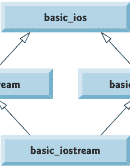

**图 15.1** | 流 I/O 模板层次结构（部分）。

运算符重载为执行输入/输出提供了便捷的表示法。左移运算符（`<<`）被重载用于表示流输出，称为流插入运算符。右移运算符（`>>`）被重载用于表示流输入，称为流提取运算符。这些运算符与标准流对象 `cin`、`cout`、`cerr` 和 `clog` 一起使用，通常也与用户自定义的流对象一起使用。

### 标准流对象 `cin`、`cout`、`cerr` 和 `clog`

预定义对象 `cin` 是一个 istream 实例，被称为“连接到”（或附加到）标准输入设备，该设备通常是键盘。如下语句中使用的流提取运算符（`>>`）会将整型变量 `grade`（假设 `grade` 已声明为 `int` 变量）的一个值从 `cin` 输入到内存：

```cpp
cin >> grade; // data "flows" in the direction of the arrows
```

编译器确定 `grade` 的数据类型，并选择合适的重载流提取运算符。假设 `grade` 已正确声明，流提取运算符不需要额外的类型信息（例如，C 风格 I/O 中就需要）。`>>` 运算符被重载，用于输入基本类型、字符串和指针值的数据项。

预定义对象 `cout` 是一个 ostream 实例，被称为“连接到”标准输出设备，该设备通常是显示屏幕。如下语句中使用的流插入运算符（`<<`）会将变量 `grade` 的值从内存输出到标准输出设备：

```cpp
cout << grade; // data "flows" in the direction of the arrows
```

- 1. 本章仅在 char I/O 的模板特化语境下讨论模板。
- 2. 多继承在第24章“其他主题”中讨论。

## 15.3 流输出

ostream 提供格式化和非格式化输出能力。这些能力包括：使用流插入运算符（<<）输出标准数据类型；通过 put 成员函数输出字符；通过 write 成员函数进行非格式化输出（15.5节）；以十进制、八进制和十六进制格式输出整数（15.6.1节）；以不同精度输出浮点值（15.6.2节）、强制显示小数点（15.7.1节）、以科学记数法和定点记数法输出浮点值（15.7.5节）；在指定宽度的字段中对齐输出数据（15.7.2节）；在由指定字符填充的字段中输出数据（15.7.3节）；以科学记数法和十六进制记数法输出大写字母（15.7.6节）。

### 15.3.1 输出 char * 变量

C++ 会自动确定数据类型——这是相对于 C 的一个改进。这一特性有时会“碍事”。例如，假设我们要打印存储在 char * 指针中的地址。<< 运算符已被重载，会将 char * 作为以空字符结尾的字符串输出。要输出地址，可以将 char * 强制转换为 void *（任何指针变量都可以这样做）。图15.3演示了以字符串和地址两种格式打印 char * 变量。该地址以十六进制（基数为16）数字形式打印，不同计算机上的结果可能不同。若要了解更多关于十六进制数字的内容，请阅读附录D。关于控制数字基数的更多内容，将在15.6.1节和15.7.4节中讨论。

```cpp
// Fig. 15.3: Fig15_03.cpp
// Printing the address stored in a char * variable.
#include <iostream>
using namespace std;

int main()
{
   const char *const word = "again";

   // display value of char *, then display value of char *
   // static_cast to void *
   cout << "Value of word is: " << word << endl
        << "Value of static_cast<void *>(word) is: "
        << static_cast<void *>(word) << endl;
} // end main
```

```text
Value of word is: again
Value of static_cast<void *>(word) is: 00428300
```

**图 15.3** | 打印存储在 char * 变量中的地址。

### 15.3.2 使用成员函数 put 输出字符

我们可以使用 put 成员函数输出字符。例如，语句

```cpp
cout.put( 'A' );
```

遇到文件结束标志时，while 语句结束，第20行显示 cin.eof() 的值，此时该值为 true（输出中显示为1），表明已在 cin 上设置了文件结束标志。该程序使用 istream 成员函数 get 的无参数版本，该版本返回正在输入的字符（第15行）。只有当程序试图读取流中最后一个字符之后的内容时，eof 函数才会返回 true。

```cpp
1  // Fig. 15.4: Fig15_04.cpp
2  // Using member functions get, put and eof.
3  #include <iostream>
4  using namespace std;
5
6  int main()
7  {
8      int character; // use int, because char cannot represent EOF
9
10     // prompt user to enter line of text
11     cout << "Before input, cin.eof() is " << cin.eof() << endl
12         << "Enter a sentence followed by end-of-file:" << endl;
13
14     // use get to read each character; use put to display it
15     while ( ( character = cin.get() ) != EOF )
16         cout.put( character );
17
18     // display end-of-file character
19     cout << "\nEOF in this system is: " << character << endl;
20     cout << "After input of EOF, cin.eof() is " << cin.eof() << endl;
21 } // end main
```

```text
Before input, cin.eof() is 0
Enter a sentence followed by end-of-file:
Testing the get and put member functions
Testing the get and put member functions
^Z
EOF in this system is: -1
After input of EOF, cin.eof() is 1
```

**图 15.4** | get、put 和 eof 成员函数。

带字符引用参数的 get 成员函数从输入流中读取下一个字符（即使它是空白字符），并将其存储在该字符参数中。这个版本的 get 返回一个引用，该引用指向正在调用 get 成员函数的 istream 对象。

get 的第三个版本接受三个参数——一个字符数组、一个大小限制和一个分隔符（默认值为 '\n'）。该版本从输入流中读取字符。它要么在读取的字符数比指定最大字符数少一个时终止，要么在读取到分隔符时立即终止。在程序用作缓冲区的字符数组中，会插入一个空字符以终止输入字符串。分隔符不会放入字符数组，但会保留在输入流中（该分隔符将成为下一个被读取的字符）。因此，连续第二次调用 get 的结果是一个空行，除非从输入流中移除分隔符（可以使用 cin.ignore() 移除）。

### 比较 cin 与 cin.get

图15.5比较了使用 cin 进行流提取输入（读取字符直到遇到空白字符）和使用 cin.get 进行输入。第22行对 cin.get 的调用未指定分隔符，因此使用默认的 "\n" 字符。

```cpp
1 // Fig. 15.5: Fig15_05.cpp
2 // Contrasting input of a string via cin and cin.get.
3 #include <iostream>
4 using namespace std;
5
6 int main()
7 {
8     // create two char arrays, each with 80 elements
9     const int SIZE = 80;
10     char buffer1[ SIZE ];
11     char buffer2[ SIZE ];
12
13     // use cin to input characters into buffer1
14     cout << "Enter a sentence:" << endl;
15     cin >> buffer1;
16
17     // display buffer1 contents
18     cout << "\nThe string read with cin was:" << endl
19         << buffer1 << endl << endl;
20
21     // use cin.get to input characters into buffer2
22     cin.get( buffer2, SIZE );
23
24     // display buffer2 contents
25     cout << "The string read with cin.get was:" << endl
26         << buffer2 << endl;
27 } // end main
```

```text
Enter a sentence:
Contrasting string input with cin and cin.get

The string read with cin was:
Contrasting

The string read with cin.get was:
 string input with cin and cin.get
```

**图 15.5** | 使用 cin 进行流提取输入字符串与使用 cin.get 输入字符串的对比。

### 使用成员函数 getline

成员函数 getline 的操作方式与 get 成员函数的第三个版本类似，并在字符数组中的该行之后插入一个空字符。getline 函数会从流中移除分隔符（即读取该字符并丢弃），但不会将其存储在字符数组中。图15.6中的程序演示了使用 getline 成员函数输入一行文本的用法（第13行）。


```cpp
// Fig. 15.6: Fig15_06.cpp
// Inputting characters using cin member function getline.
#include <iostream>
using namespace std;

int main()
{
   const int SIZE = 80;
   char buffer[ SIZE ]; // create array of 80 characters

   // input characters into buffer via cin function getline
   cout << "Enter a sentence: " << endl;
   cin.getline( buffer, SIZE );

   // display buffer contents
   cout << "\nThe sentence entered is:" << endl << buffer << endl;
} // end main
```

```text
Enter a sentence:
Using the getline member function

The sentence entered is:
Using the getline member function
```

图 15.6 | 使用 `cin` 成员函数 `getline` 输入字符数据。

### 15.4.2 `istream` 成员函数 `peek`、`putback` 和 `ignore`

`istream` 的 **`ignore`** 成员函数读取并丢弃指定数量的字符（默认为一个），或者在遇到指定分隔符时终止（默认分隔符为 EOF；从文件读取时，EOF 会使 `ignore` 跳过文件末尾）。

**`putback`** 成员函数将之前通过输入流的 `get` 操作获取的字符放回该输入流。此函数适用于扫描输入流、查找以特定字符开头的字段的应用程序。当输入该字符时，应用程序会将字符返回到输入流中，因此该字符可以包含在输入数据中。

**`peek`** 成员函数返回输入流中的下一个字符，但不会将该字符从输入流中移除。

### 15.4.3 类型安全的 I/O

C++ 提供类型安全的 I/O。`<<` 和 `>>` 运算符经过重载，可以接受特定类型的数据项。如果处理了意外的数据，系统会设置各种错误位，用户可以检查这些错误位，以确定 I/O 操作是成功还是失败。如果没有为用户定义类型重载 `operator <<`，而你却试图将数据输入到该用户定义类型的对象中，或输出该对象的内容，编译器就会报告错误。这使程序能够“保持控制”。我们将在第 15.8 节讨论这些错误状态。

### 15.5 使用 `read`、`write` 和 `gcount` 进行非格式化 I/O

非格式化输入/输出分别使用 `istream` 和 `ostream` 的 **`read`** 和 **`write`** 成员函数来执行。成员函数 `read` 将字节输入到内存中的字符数组；成员函数 `write` 从字符数组输出字节。这些字节不会以任何方式进行格式化，而是作为原始字节输入或输出。例如，调用

```cpp
char buffer[] = "HAPPY BIRTHDAY";
cout.write( buffer, 10 );
```

会输出 `buffer` 的前 10 个字节（包括其中可能存在的空字符；如果使用 `cout` 和 `<<` 输出，空字符会导致输出终止）。调用

```cpp
cout.write( "ABCDEFGHIJKLMNOPQRSTUVWXYZ", 10 );
```

会显示字母表中的前 10 个字符。

`read` 成员函数将指定数量的字符输入到字符数组中。如果读取的字符数少于指定数量，就会设置 `failbit`。第 15.8 节将介绍如何确定是否设置了 `failbit`。成员函数 `gcount` 报告上一次输入操作读取的字符数。

图 15.7 演示了 `istream` 的成员函数 `read` 和 `gcount`，以及 `ostream` 的成员函数 `write`。程序使用 `read` 将 20 个字符（来自一段更长的输入序列）输入数组 `buffer` 中（第 13 行），使用 `gcount` 确定输入的字符数（第 17 行），并使用 `write` 输出 `buffer` 中的字符（第 17 行）。

```cpp
1   // Fig. 15.7: Fig15_07.cpp
2   // Unformatted I/O using read, gcount and write.
3   #include <iostream>
4   using namespace std;
5
6   int main()
7   {
8      const int SIZE = 80;
9      char buffer[ SIZE ]; // create array of 80 characters
10
11     // use function read to input characters into buffer
12     cout << "Enter a sentence:" << endl;
13     cin.read( buffer, 20 );
14
15     // use functions write and gcount to display buffer characters
16     cout << endl << "The sentence entered was:" << endl;
17     cout.write( buffer, cin.gcount() );
18     cout << endl;
19  } // end main
```

```text
Enter a sentence:
Using the read, write, and gcount member functions
The sentence entered was:
Using the read, writ
```

图 15.7 | 使用 `read`、`gcount` 和 `write` 成员函数进行非格式化 I/O。

### 15.6 流操纵器简介

C++ 提供了各种流操纵器，用于执行格式化任务。流操纵器提供了设置字段宽度、设置精度、设置以及

### 15.6.2 浮点数精度（`precision`、`setprecision`）

我们可以使用 `setprecision` 流操纵器或 `ios_base` 的 `precision` 成员函数来控制浮点数的精度（即小数点右侧的位数）。调用其中任意一个函数后，所有后续输出操作都会采用所设置的精度，直到下一次调用设置精度的函数为止。不带参数调用成员函数 `precision` 会返回当前的精度设置（当不再需要某个“持久”设置时，为了最终恢复原始设置，就需要使用这一功能）。图 15.9 中的程序同时使用了成员函数 `precision`（第 22 行）和 `setprecision` 操纵器（第 31 行），输出一个表格，显示精度从 0 到 9 变化时 2 的平方根。

```cpp
1  // Fig. 15.9: Fig15_09.cpp
2  // Controlling precision of floating-point values.
3  #include <iostream>
4  #include <iomanip>
5  #include <cmath>
6  using namespace std;
7
8  int main()
9  {
10    double root2 = sqrt( 2.0 ); // calculate square root of 2
11    int places; // precision, vary from 0-9
12
13    cout << "Square root of 2 with precisions 0-9." << endl
14       << "Precision set by ios_base member function "
15       << "precision:" << endl;
16
17    cout << fixed; // use fixed-point notation
18
19    // display square root using ios_base function precision
20    for ( places = 0; places <= 9; places++ )
21    {
22       cout.precision( places );
23       cout << root2 << endl;
24    } // end for
25
26    cout << "\nPrecision set by stream manipulator "
27       << "setprecision:" << endl;
28
29    // set precision for each digit, then display square root
30    for ( places = 0; places <= 9; places++ )
31       cout << setprecision( places ) << root2 << endl;
32  } // end main
```

```text
Square root of 2 with precisions 0-9.
Precision set by ios_base member function precision:
1
1.4
1.41
1.414
```

图 15.9 | 浮点值的精度。（第 1 部分，共 2 部分）

```cpp
5     int main()
6     {
7         int widthValue = 4;
8         char sentence[ 10 ];
9
10
11        cout << "Enter a sentence:" << endl;
12        cin.width( 5 ); // input only 5 characters from sentence
13
14        // set field width, then display characters based on that width
15        while ( cin >> sentence )
16        {
17            cout.width( widthValue++ );
18            cout << sentence << endl;
19            cin.width( 5 ); // input 5 more characters from sentence
20        } // end while
21    } // end main
```

```text
Enter a sentence:
This is a test of the width member function
This
  is
    a
      test
        of
          the
            widt
              h
                memb
                  er
                    func
                      tion
```

图 15.10 | `ios_base` 类的 `width` 成员函数。（第 2 部分，共 2 部分）

[注：在图 15.10 中提示输入时，用户应输入一行文本并按 Enter，然后输入文件结束符（Microsoft Windows 系统中为 `<Ctrl>-z`，UNIX 和 Macintosh 系统中为 `<Ctrl>-d`）。]

### 15.6.4 用户自定义输出流操纵器

你可以创建自己的流操纵器。图 15.11 展示了新的无参数流操纵器 `bell`（第 8～11 行）、`carriageReturn`（第 14～17 行）、`tab`（第 20～23 行）和 `endLine`（第 27～30 行）的创建和使用。对于输出流操纵器，返回类型和参数必须为 `ostream &` 类型。当第 35 行将 `endLine` 操纵器插入输出流时，会调用 `endLine` 函数；第 29 行将转义序列 `\n` 和 `flush` 操纵器输出到标准输出流 `cout`。同样，当第 35～44 行将 `tab`、`bell` 和 `carriageReturn` 操纵器插入输出流时，会调用相应的函数——`tab`（第 20 行）、`bell`（第 8 行）和 `carriageReturn`（第 14 行），这些函数进而输出各种转义序列。


```cpp
// Fig. 15.11: Fig15_11.cpp
// Creating and testing user-defined, nonparameterized
// stream manipulators.
#include <iostream>
using namespace std;

// bell manipulator (using escape sequence \a)
ostream& bell( ostream& output )
{
   return output << '\a'; // issue system beep
} // end bell manipulator

// carriageReturn manipulator (using escape sequence \r)
ostream& carriageReturn( ostream& output )
{
   return output << '\r'; // issue carriage return
} // end carriageReturn manipulator

// tab manipulator (using escape sequence \t)
ostream& tab( ostream& output )
{
   return output << '\t'; // issue tab
} // end tab manipulator

// endLine manipulator (using escape sequence \n and member
// function flush)
ostream& endLine( ostream& output )
{
   return output << '\n' << flush; // issue endl-like end of line
} // end endLine manipulator

int main()
{
   // use tab and endLine manipulators
   cout << "Testing the tab manipulator:" << endLine
        << 'a' << tab << 'b' << tab << endLine;

   cout << "Testing the carriageReturn and bell manipulators:"
        << endLine << "--------";

   cout << bell; // use bell manipulator

   // use carriageReturn and endLine manipulators
   cout << carriageReturn << "------" << endLine;
} // end main
```

```text
Testing the tab manipulator:
    a        b
Testing the carriageReturn and bell manipulators:
--------
```

图 15.11 | 用户定义的、无参数的流操纵器。

## 15.7 流格式状态与流操纵器

可以使用各种流操纵器来指定在流 I/O 操作期间要执行的格式化类型。流操纵器控制输出的格式设置。图 15.12 列出了控制给定流格式状态的每个流操纵器。所有这些操纵器都属于类 `ios_base`。我们将在接下来的几节中展示其中大多数流操纵器的示例。

| 流操纵器 | 描述 |
| --- | --- |
| skipws | 跳过输入流上的空白字符。此设置可通过流操纵器 noskipws 重置。 |
| left | 在字段中左对齐输出。如有必要，填充字符出现在右侧。 |
| right | 在字段中右对齐输出。如有必要，填充字符出现在左侧。 |
| internal | 指示数字的符号应在字段中左对齐，而数字的数值应在同一字段中右对齐（即填充字符出现在符号和数字之间）。 |
| dec | 指定整数应被视为十进制（基 10）值。 |
| oct | 指定整数应被视为八进制（基 8）值。 |
| hex | 指定整数应被视为十六进制（基 16）值。 |
| showbase | 指定数字的基数应输出在数字之前（八进制为前导 0；十六进制为前导 0x 或 0X）。此设置可通过流操纵器 noshowbase 重置。 |
| showpoint | 指定浮点数应带小数点输出。这通常与 fixed 一起使用，以保证小数点右侧有特定数量的数字，即使这些数字为零。此设置可通过流操纵器 noshowpoint 重置。 |
| uppercase | 指定十六进制整数中应使用大写字母（即 X 以及 A 到 F），并且在以科学记数法表示浮点值时应使用大写 E。此设置可通过流操纵器 nouppercase 重置。 |
| showpos | 指定正数前应加上加号（+）。此设置可通过流操纵器 noshowpos 重置。 |
| scientific | 指定以科学记数法输出浮点值。 |
| fixed | 指定以定点表示法输出浮点值，并在小数点右侧具有特定数量的数字。 |

图 15.12 | 来自 `<iostream>` 的格式状态流操纵器。

### 15.7.1 尾随零和小数点（showpoint）

流操纵器 **showpoint** 强制浮点数输出其小数点和尾随零。例如，浮点值 79.0 在不使用 `showpoint` 时打印为 79，而使用 `showpoint` 时打印为 79.000000（或当前精度所指定的尽可能多的尾随零）。要重置 `showpoint` 设置，请输出流操纵器 **noshowpoint**。图 15.13 中的程序展示了如何使用流操纵器 `showpoint` 控制浮点值的尾随零和小数点的打印。回想一下，浮点数的默认精度为 6。当既未使用 `fixed` 也未使用 `scientific` 流操纵器时，精度表示要显示的有效数字位数（即要显示的总位数），而不是小数点后要显示的位数。

```cpp
// Fig. 15.13: Fig15_13.cpp
// Controlling the printing of trailing zeros and
// decimal points in floating-point values.
#include <iostream>
using namespace std;

int main()
{
   // display double values with default stream format
   cout << "Before using showpoint" << endl
        << "9.9900 prints as: " << 9.9900 << endl
        << "9.9000 prints as: " << 9.9000 << endl
        << "9.0000 prints as: " << 9.0000 << endl << endl;

   // display double value after showpoint
   cout << showpoint
        << "After using showpoint" << endl
        << "9.9900 prints as: " << 9.9900 << endl
        << "9.9000 prints as: " << 9.9000 << endl
        << "9.0000 prints as: " << 9.0000 << endl;
} // end main
```

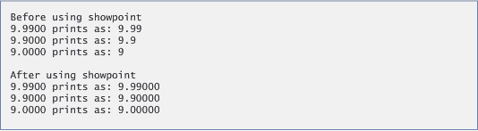

**图 15.13** | 控制浮点值中尾随零和小数点的打印。

### 15.7.2 对齐（left、right 和 internal）

流操纵器 `left` 和 `right` 分别使字段能够以填充字符在右侧的方式左对齐，以及以填充字符在左侧的方式右对齐。填充字符由 fill 成员函数或 `setfill` 参数化流操纵器指定（我们将在 15.7.3 节中讨论）。图 15.14 使用 `setw`、`left` 和 `right` 操纵器在字段中对整数数据进行左对齐和右对齐。

```cpp
// Fig. 15.14: Fig15_14.cpp
// Left and right justification with stream manipulators left and right.
#include <iostream>
#include <iomanip>
using namespace std;

int main()
{
   int x = 12345;

   // display x right justified (default)
   cout << "Default is right justified:" << endl
        << setw(10) << x;

   // use left manipulator to display x left justified
   cout << "\n\nUse std::left to left justify x:\n"
        << left << setw(10) << x;

   // use right manipulator to display x right justified
   cout << "\n\nUse std::right to right justify x:\n"
        << right << setw(10) << x << endl;
} // end main
```

```text
Default is right justified:
     12345

Use std::left to left justify x:
12345     

Use std::right to right justify x:
     12345
```

图 15.14 | 使用流操纵器 left 和 right 进行左对齐和右对齐。

流操纵器 **internal** 指示数字的符号（或使用流操纵器 showbase 时的基数）应在字段内左对齐，数字的数值应右对齐，并且中间的空格应使用填充字符填充。图 15.15 展示了 **internal** 流操纵器指定内部间距（第 10 行）。注意 **showpos** 强制打印加号（第 10 行）。要重置 showpos 设置，请输出流操纵器 **noshowpos**。

```cpp
// Fig. 15.15: Fig15_15.cpp
// Printing an integer with internal spacing and plus sign.
#include <iostream>
#include <iomanip>
using namespace std;

int main()
{
   // display value with internal spacing and plus sign
   cout << internal << showpos << setw(10) << 123 << endl;
} // end main
```

```text
+       123
```

图 15.15 | 打印带内部间距和加号的整数。（第 1 部分，共 2 部分。）

图 15.15 | 打印带内部间距和加号的整数。（第 2 部分，共 2 部分。）

### 15.7.3 填充（fill、setfill）

fill 成员函数指定用于对齐字段的填充字符；如果未指定值，则使用空格进行填充。fill 函数返回先前的填充字符。setfill 操纵器也设置填充字符。图 15.16 演示了使用成员函数 fill（第 30 行）和流操纵器 setfill（第 34 和 37 行）来设置填充字符。

```cpp
// Fig. 15.16: Fig15_16.cpp
// Using member function fill and stream manipulator setfill to change
// the padding character for fields larger than the printed value.
#include <iostream>
#include <iomanip>
using namespace std;

int main()
{
    int x = 10000;

    // display x
    cout << x << " printed as int right and left justified\n"
         << " and as hex with internal justification.\n"
         << "Using the default pad character (space):" << endl;

    // display x with base
    cout << showbase << setw(10) << x << endl;

    // display x with left justification
    cout << left << setw(10) << x << endl;

    // display x as hex with internal justification
    cout << internal << setw(10) << hex << x << endl << endl;

    cout << "Using various padding characters:" << endl;

    // display x using padded characters (right justification)
    cout << right;
    cout.fill('^');
    cout << setw(10) << dec << x << endl;

    // display x using padded characters (left justification)
    cout << left << setw(10) << setfill('%') << x << endl;
}
```

图 15.16 | 使用成员函数 fill 和流操纵器 setfill 更改字段（大于所打印值）的填充字符。（第 1 部分，共 2 部分。）


```cpp
    35
    36    // display x using padded characters (internal justification)
    37    cout << internal << setw( 10 ) << setfill( '^' ) << hex
    38         << x << endl;
    39    } // end main
```

```text
    10000 printed as int right and left justified
    and as hex with internal justification.
    Using the default pad character (space):
      10000
    0x  2710

    Using various padding characters:
    ****10000
    10000%%%%
    0x^^^^2710
```

图 15.16 | 使用成员函数 fill 和流操纵符 setfill 更改填充字符，以用于字段宽度大于所打印值的情况。（第 2 部分，共 2 部分。）

### 15.7.4 整数流基数（dec, oct, hex, showbase）

C++ 提供了流操纵符 dec、hex 和 oct，分别用于指定整数以十进制、十六进制和八进制值显示。如果未使用这些操纵符中的任何一个，流插入默认采用十进制。对于流提取，以 0（零）为前缀的整数被视为八进制值，以 0x 或 0X 为前缀的整数被视为十六进制值，所有其他整数被视为十进制值。一旦为某个流指定了特定基数，该流上的所有整数都会使用该基数处理，直到指定了不同的基数或程序终止。

流操纵符 showbase 强制输出整数值的基数。十进制数默认输出，八进制数输出时带前导 0，十六进制数输出时带前导 0x 或前导 0X（正如我们在 15.7.6 节讨论的，流操纵符 uppercase 决定选择哪个选项）。图 15.17 演示了使用流操纵符 showbase 强制整数以十进制、八进制和十六进制格式打印。要重置 showbase 设置，请输出流操纵符 noshowbase。

图 15.17 | 流操纵符 showbase。（第 1 部分，共 2 部分。）

```cpp
    1    // Fig. 15.17: fig15_17.cpp
    2    // Using stream manipulator showbase.
    3    #include <iostream>
    4    using namespace std;
    5
    6    int main()
    7    {
    8        int x = 100;
    9
    10       // use showbase to show number base
    11       cout << "Printing integers preceded by their base:" << endl
    12            << showbase;
    13    cout << x << endl;  // print decimal value
    14    cout << oct << x << endl;  // print octal value
    15    cout << hex << x << endl;  // print hexadecimal value
    16 }  // end main
    17
```

```text
Printing integers preceded by their base:
100
0144
0x64
```

**图 15.17** | 流操纵符 showbase。（第 2 部分，共 2 部分。）

### 15.7.5 浮点数：科学计数法和定点表示法（scientific, fixed）

流操纵符 scientific 和 fixed 控制浮点数的输出格式。流操纵符 scientific 强制浮点数输出以科学计数法格式显示。流操纵符 fixed 强制浮点数在小数点右侧显示指定位数（由成员函数 precision 或流操纵符 setprecision 指定）。如果不使用其他操纵符，则由浮点数值决定输出格式。

图 15.18 演示了使用流操纵符 scientific（第 18 行）和 fixed（第 22 行）以定点格式和科学计数法格式显示浮点数。科学计数法中的指数格式可能因不同编译器而异。

**图 15.18** | 以默认、科学计数法和定点格式显示的浮点值。（第 1 部分，共 2 部分。）

```cpp
1    // Fig. 15.18: Fig15_18.cpp
2    // Displaying floating-point values in system default,
3    // scientific and fixed formats.
4    #include <iostream>
5    using namespace std;
6
7    int main()
8    {
9       double x = 0.001234567;
10      double y = 1.946e9;
11
12      // display x and y in default format
13      cout << "Displayed in default format:" << endl
14         << x << '\t' << y << endl;
15
16      // display x and y in scientific format
17      cout << "\nDisplayed in scientific format:" << endl
18         << scientific << x << '\t' << y << endl;
19
20      // display x and y in fixed format
21      cout << "\nDisplayed in fixed format:" << endl
22         << fixed << x << '\t' << y << endl;
23   } // end main
```

```text
Displayed in default format:
0.00123457        1.946e+009

Displayed in scientific format:
1.234567e-003    1.946000e+009

Displayed in fixed format:
0.001235        1946000000.000000
```

**图 15.18** | 以默认、科学计数法和定点格式显示的浮点值。（第 2 部分，共 2 部分。）

### 15.7.6 大写/小写控制（uppercase）

流操纵符 **uppercase** 分别在使用十六进制整数值或科学计数法浮点值时输出大写 X 或 E（图 15.19）。使用流操纵符 uppercase 还会使十六进制值中的所有字母变为大写。默认情况下，十六进制值的字母以及科学计数法浮点值中的指数显示为小写。要重置 uppercase 设置，请输出流操纵符 **nouppercase**。

```cpp
// Fig. 15.19: Fig15_19.cpp
// Stream manipulator uppercase.
#include <iostream>
using namespace std;

int main()
{
   cout << "Printing uppercase letters in scientific" << endl
        << "notation exponents and hexadecimal values:" << endl;

   // use std::uppercase to display uppercase letters; use std::hex and
   // std::showbase to display hexadecimal value and its base
   cout << uppercase << 4.345e10 << endl
        << hex << showbase << 123456789 << endl;
} // end main
```

```text
Printing uppercase letters in scientific
notation exponents and hexadecimal values:
4.345E+010
0X75BCD15
```

**图 15.19** | 流操纵符 uppercase。

### 15.7.7 指定布尔格式（boolalpha）

C++ 提供了数据类型 bool，其值可以是 false 或 true，作为使用 0 表示 false、非零表示 true 的旧式做法的首选替代方案。bool 变量默认输出为 0 或 1。但是，我们可以使用流操纵符 **boolalpha** 将输出流设置为把 bool 值显示为字符串 "true" 和 "false"。使用流操纵符 **noboolalpha** 将输出流设置为把 bool 值显示为整数（即默认设置）。图 15.20 的程序演示了这些流操纵符。

在应用若干操纵符之后。不带参数的成员函数 `flags` 返回当前格式设置，类型为 `fmtflags`（属于 `ios_base` 类），它表示格式状态。带 `fmtflags` 参数的成员函数 `flags` 将格式状态设置为该参数所指定的状态，并返回先前的状态设置。`flags` 返回值的初始设置可能因不同系统而异。图 15.21 的程序使用成员函数 `flags` 保存流的原始格式状态（第 17 行），然后恢复原始格式设置（第 25 行）。

```cpp
// Fig. 15.21: Fig15_21.cpp
// Demonstrating the flags member function.
#include <iostream>
using namespace std;

int main()
{
   int integerValue = 1000;
   double doubleValue = 0.0947628;

   // display flags value, int and double values (original format)
   cout << "The value of the flags variable is: " << cout.flags()
      << "\nPrint int and double in original format:\n"
      << integerValue << '\t' << doubleValue << endl << endl;

   // use cout flags function to save original format
   ios_base::fmtflags originalFormat = cout.flags();
   cout << showbase << oct << scientific; // change format

   // display flags value, int and double values (new format)
   cout << "The value of the flags variable is: " << cout.flags()
      << "\nPrint int and double in a new format:\n"
      << integerValue << '\t' << doubleValue << endl << endl;

   cout.flags( originalFormat ); // restore format

   // display flags value, int and double values (original format)
   cout << "The restored value of the flags variable is: "
      << cout.flags()
      << "\nPrint values in original format again:\n"
      << integerValue << '\t' << doubleValue << endl;
} // end main
```

```text
The value of the flags variable is: 513
Print int and double in original format:
1000  0.0947628

The value of the flags variable is: 012011
Print int and double in a new format:
01750  9.476280e-002

The restored value of the flags variable is: 513
Print values in original format again:
1000  0.0947628
```

图 15.21 | flags 成员函数。


## 15.8 流错误状态

流的状态可以通过类 `ios_base` 中的位来测试。稍后，我们将在图 15.22 的示例中展示如何测试这些位。

当遇到文件结束符后，会为输入流设置 `eofbit`。在尝试从流中提取超出流末尾的数据后，程序可以使用成员函数 `eof` 判断流上是否遇到了文件结束符。如果 `cin` 上已遇到文件结束符，则调用 `cin.eof()` 返回 true，否则返回 false。

当流上发生格式错误且未输入任何字符时（例如，当您尝试读取一个数字而用户输入了一个字符串时），会为流设置 `failbit`。发生此类错误时，字符不会丢失。`fail` 成员函数报告流操作是否失败。通常，从此类错误中恢复是可能的。

```cpp
// Fig. 15.22: Fig15_22.cpp
// Testing error states.
#include <iostream>
using namespace std;

int main()
{
    int integerValue;

    // display results of cin functions
    cout << "Before a bad input operation:"
         << "\ncin.rdstate(): " << cin.rdstate()
         << "\n    cin.eof(): " << cin.eof()
         << "\n   cin.fail(): " << cin.fail()
         << "\n    cin.bad(): " << cin.bad()
         << "\n   cin.good(): " << cin.good()
         << "\n\nExpects an integer, but enter a character: ";

    cin >> integerValue; // enter character value
    cout << endl;

    // display results of cin functions after bad input
    cout << "After a bad input operation:"
         << "\ncin.rdstate(): " << cin.rdstate()
         << "\n    cin.eof(): " << cin.eof()
         << "\n   cin.fail(): " << cin.fail()
         << "\n    cin.bad(): " << cin.bad()
         << "\n   cin.good(): " << cin.good() << endl << endl;

    cin.clear(); // clear stream

    // display results of cin functions after clearing cin
    cout << "After cin.clear()" << "\ncin.fail(): " << cin.fail()
         << "\ncin.good(): " << cin.good() << endl;
} // end main
```

**图 15.22** | 测试错误状态。（第 1 部分，共 2 部分。）

```
Before a bad input operation:
cin.rdstate(): 0
  cin.eof(): 0
  cin.fail(): 0
  cin.bad(): 0
  cin.good(): 1

Expects an integer, but enter a character: A

After a bad input operation:
cin.rdstate(): 2
  cin.eof(): 0
  cin.fail(): 1
  cin.bad(): 0
  cin.good(): 0

After cin.clear()
cin.fail(): 0
cin.good(): 1
```

**图 15.22** | 测试错误状态。（第 2 部分，共 2 部分。）

当发生导致数据丢失的错误时，会为流设置**坏位（badbit）**。**bad** 成员函数报告流操作是否失败。通常，此类严重故障是不可恢复的。

如果流未设置 `eofbit`、`failbit` 或 `badbit` 中的任何一位，则会为流设置**正常位（goodbit）**。

如果 bad、fail 和 eof 函数都将返回 false，则 **good** 成员函数返回 true。只应在“良好”流上执行 I/O 操作。

**rdstate** 成员函数返回流的错误状态。例如，调用 `cout.rdstate()` 将返回流的状态，然后可以通过检查 `eofbit`、`badbit`、`failbit` 和 `goodbit` 的 switch 语句来测试该状态。测试流状态的首选方法是使用成员函数 `eof`、`bad`、`fail` 和 `good`——使用这些函数不需要您熟悉特定的状态位。

**clear** 成员函数用于将流的状态恢复为“良好”，以便可以在该流上继续执行 I/O。`clear` 的默认参数是 `goodbit`，因此语句 `cin.clear();` 会清除 `cin` 并为流设置 `goodbit`。语句 `cin.clear(ios::failbit);` 会设置 `failbit`。当使用用户定义类型在 `cin` 上执行输入并遇到问题时，您可能希望这样做。`clear` 这个名称在此上下文中可能看起来不合适，但它是正确的。

图 15.22 的程序演示了成员函数 `rdstate`、`eof`、`fail`、`bad`、`good` 和 `clear`。*[注意：实际输出的值可能因编译器不同而有所差异。]*

`basic_ios` 的 operator `!` 成员函数在设置了 `badbit`、设置了 `failbit` 或两者都设置时返回 true。operator `void *` 成员函数在设置了 `badbit`、设置了 `failbit` 或两者都设置时返回 false (0)。当在选择语句或重复语句的控制下测试 true/false 条件时，这些函数在文件处理中很有用。

## 15.9 将输出流绑定到输入流

交互式应用程序通常涉及用于输入的 istream 和用于输出的 ostream。当提示消息出现在屏幕上时，用户通过输入适当的数据来响应。显然，提示必须出现在输入操作继续之前。使用输出缓冲时，输出仅在缓冲区填满、程序显式刷新输出或程序结束时自动刷新时才会出现。C++ 提供成员函数 tie 来同步（即“绑定在一起”）istream 和 ostream 的操作，以确保输出出现在后续输入之前。调用 `cin.tie( &cout );` 将 cout（一个 ostream）绑定到 cin（一个 istream）。实际上，这个特定调用是多余的，因为 C++ 会自动执行此操作以创建用户的标准输入/输出环境。但是，用户会显式绑定其他 istream/ostream 对。要解除输入流 inputStream 与输出流的绑定，请使用调用 `inputStream.tie( 0 );`。

## 15.10 总结

本章总结了 C++ 如何使用流执行输入/输出。您学习了流 I/O 类和对象，以及流 I/O 模板类层次结构。我们讨论了 ostream 的格式化输出和无格式化输出能力，这些能力由 put 和 write 函数执行。您看到了使用 istream 的格式化输入和无格式化输入能力的示例，这些能力由 eof、get、getline、peek、putback、ignore 和 read 函数执行。接下来，我们讨论了执行格式化任务的流操纵器和成员函数——用于显示整数的 dec、oct、hex 和 setbase；用于控制浮点精度的 precision 和 setprecision；以及用于设置字段宽度的 width 和 setw。您还学习了其他格式化 istream 操纵器和成员函数——用于显示小数点和尾随零的 showpoint；用于对齐的 left、right 和 internal；用于填充的 fill 和 setfill；用于以科学记数法和定点记数法显示浮点数的 scientific 和 fixed；用于大写/小写控制的 uppercase；用于指定布尔格式的 boolalpha；以及用于重置格式状态的 flags 和 fmtflags。

下一章，我们将介绍异常处理，它允许您处理程序执行期间可能发生的某些问题。我们演示基本的异常处理技术，这些技术通常允许程序像未遇到问题一样继续执行。我们还介绍 C++ 标准库为处理异常提供的几个类。

## 小结

### 15.1 节 引言

- I/O 操作以对数据类型敏感的方式执行。

### 15.2 节 流

- C++ I/O 以流的方式进行。流是字节序列。
- I/O 机制高效且可靠地将字节从设备移动到内存，反之亦然。
- C++ 提供“低级”和“高级”I/O 能力。低级 I/O 能力指定字节应在设备到内存或内存到设备之间传输。高级 I/O 通过将字节分组为有意义的单位（如整数、字符串和用户定义类型）来执行。
- C++ 同时提供无格式化 I/O 和格式化 I/O 操作。无格式化 I/O 传输速度快，但处理的是人们难以使用的原始数据。格式化 I/O 以有意义的单位处理数据，但需要额外的处理时间，可能会降低性能。
- `<iostream>` 头文件声明所有流 I/O 操作。
- `<iomanip>` 头文件声明参数化流操纵器。
- `<fstream>` 头文件声明文件处理操作。
- `basic_istream` 模板支持流输入操作。
- `basic_ostream` 模板支持流输出操作。
- `basic_iostream` 模板同时支持流输入和流输出操作。
- 模板 `basic_istream` 和 `basic_ostream` 均派生自 `basic_ios` 模板。
- 模板 `basic_iostream` 同时派生自 `basic_istream` 和 `basic_ostream` 模板。
- `istream` 对象 `cin` 绑定到标准输入设备，通常是键盘。
- `ostream` 对象 `cout` 绑定到标准输出设备，通常是屏幕。
- `ostream` 对象 `cerr` 绑定到标准错误设备，通常是屏幕。输出到 `cerr` 是无缓冲的；每次插入到 `cerr` 都会立即出现。
- `ostream` 对象 `clog` 绑定到标准错误设备，通常是屏幕。输出到 `clog` 是带缓冲的。
- C++ 编译器自动确定输入和输出的数据类型。

### 15.3 节 流输出

- 默认情况下，地址以十六进制格式显示。
- 要打印指针变量中的地址，请将指针转换为 `void *`。
- 成员函数 `put` 输出一个字符。对 `put` 的调用可以级联。

### 15.4 节 流输入

- 流输入通过流提取运算符 `>>` 执行，它会自动跳过输入流中的空白字符，并在遇到文件结束符后返回 `false`。
- 对于不正确的输入，流提取会导致设置 `failbit`；如果操作失败，则会导致设置 `badbit`。
- 可以在 `while` 循环头中使用流提取操作输入一系列值。当遇到文件结束符或发生错误时，提取返回 `0`。
- 不带参数的 `get` 成员函数输入一个字符并返回该字符；如果流上遇到文件结束符，则返回 `EOF`。
- 带字符引用参数的成员函数 `get` 从输入流输入下一个字符，并将其存储在字符参数中。此版本的 `get` 返回对其调用 `get` 成员函数的 `istream` 对象的引用。
- 带三个参数（字符数组、大小限制和分隔符（默认值为换行符））的成员函数 `get` 从输入流读取字符，最多读取 `limit - 1` 个字符，或直到读取到分隔符为止。输入字符串以空字符终止。分隔符不会放入字符数组，而是保留在输入流中。
- `getline` 成员函数的行为类似于带三个参数的 `get` 成员函数。`getline` 函数从输入流中移除分隔符，但不会将其存储在字符串中。


- `ignore` 成员函数跳过输入流中指定数量的字符（默认值为 1）；如果遇到指定的分隔符（默认分隔符为 EOF），则终止。
- `putback` 成员函数将由 `get` 从流中获取的前一个字符放回该流。
- `peek` 成员函数返回输入流中的下一个字符，但不从流中提取（移除）该字符。
- C++ 提供类型安全的 I/O。如果 `<<` 和 `>>` 运算符处理了意外数据，就会设置各种错误位，可以对这些错误位进行测试，以确定 I/O 操作是成功还是失败。如果没有为用户定义类型重载 `operator<<`，则会报告编译器错误。

## 15.5 节 使用 `read`、`write` 和 `gcount` 进行无格式 I/O

- 无格式 I/O 通过成员函数 `read` 和 `write` 执行。这些函数从指定内存地址开始，将字节输入到内存或从内存输出。
- `gcount` 成员函数返回该流上一次 `read` 操作输入的字符数。
- 成员函数 `read` 将指定数量的字符输入到字符数组中；如果读取的字符数少于指定数量，则设置 `failbit`。

## 15.6 节 流操纵器简介

- 要更改整数输出的基数，可使用操纵器 `hex` 将基数设为十六进制（基 16），或使用 `oct` 将基数设为八进制（基 8）。使用操纵器 `dec` 将基数重置为十进制。在显式更改之前，基数保持不变。
- 带参数的流操纵器 `setbase` 也可设置整数输出的基数。`setbase` 接受一个为 10、8 或 16 的整数参数来设置基数。
- 浮点精度可通过 `setprecision` 流操纵器或 `precision` 成员函数控制。二者都会为后续所有输出操作设置精度，直到下一次设置精度调用。不带参数的 `precision` 成员函数返回当前精度值。
- 带参数的操纵器需要包含 `<iomanip>` 头文件。
- 成员函数 `width` 设置字段宽度并返回先前的宽度。比字段窄的值会用填充字符填充。字段宽度设置仅适用于下一次插入或提取；字段宽度会被隐式设为 0（后续值将按所需宽度输出）。比字段宽的值会完整打印。不带参数的函数 `width` 返回当前宽度设置。操纵器 `setw` 也可设置宽度。
- 对于输入，`setw` 流操纵器建立最大字符串大小；如果输入的字符串更大，则会将较长的行拆分成不超过指定大小的片段。
- 你可以创建自己的流操纵器。

## 15.7 节 流格式状态和流操纵器

- 流操纵器 `showpoint` 强制浮点数输出时带小数点，并按精度指定的有效数字位数输出。
- 流操纵器 `left` 和 `right` 使字段左对齐并在右侧填充填充字符，或右对齐并在左侧填充填充字符。
- 流操纵器 `internal` 表示数字的符号（或使用流操纵器 `showbase` 时的基数）应在字段内左对齐，其数值大小应右对齐，中间的空格应使用填充字符填充。
- 成员函数 `fill` 指定与流操纵器 `left`、`right` 和 `internal` 一起使用的填充字符（默认为空格）；返回先前的填充字符。流操纵器 `setfill` 也可设置填充字符。
- 流操纵器 `oct`、`hex` 和 `dec` 分别指定将整数视为八进制、十六进制或十进制值。如果这些位均未设置，整数输出默认为十进制；流提取按数据提供的形式处理数据。
- 流操纵器 `showbase` 强制输出整数值的基数。
- 流操纵器 `scientific` 用于以科学格式输出浮点数。流操纵器 `fixed` 用于按精度成员函数指定的精度输出浮点数。
- 流操纵器 `uppercase` 分别对十六进制整数和科学记数法浮点值输出大写 X 或 E。十六进制值全部以大写形式出现。
- 不带参数的成员函数 `flags` 返回当前格式状态设置的 long 值。带 long 参数的函数 `flags` 设置由参数指定的格式状态。

## 15.8 节 流错误状态

- 流的状态可通过类 `ios_base` 中的位来测试。
- 输入流在输入操作期间遇到文件结束符后，会设置 `eofbit`。`eof` 成员函数报告是否已设置 `eofbit`。
- 流发生格式错误时会设置流的 `failbit`。`fail` 成员函数报告流操作是否失败；通常可以从这类错误中恢复。
- 当发生导致数据丢失的错误时，会设置流的 `badbit`。成员函数 `bad` 报告此类流操作是否失败。这类严重故障通常不可恢复。
- 如果 `bad`、`fail` 和 `eof` 函数都将返回 false，则 `good` 成员函数返回 true。只应对“良好”流执行 I/O 操作。
- `rdstate` 成员函数返回流的错误状态。
- 成员函数 `clear` 将流的状态恢复为“良好”，以便 I/O 可以继续。

## 15.9 节 将输出流绑定到输入流

- C++ 提供 `tie` 成员函数来同步 iostream 和流操作，以确保输出出现在后续输入之前。

## 术语

|  |  |
|---|---|
| `basic_ios` 的 `bad` 成员函数 672 | `basic_ios` 的 `eof` 成员函数 672 |
| badbit 652 | eofbit 671 |
| `basic_fstream` 类模板 650 | `basic_ios` 的 `fail` 成员函数 672 |
| `basic_ifstream` 类模板 650 | failbit 652 |
| `basic_ios` 类模板 649 | 填充字符 659 |
| `basic_iostream` 类模板 648 | `basic_ios` 的 `fill` 成员函数 665 |
| `basic_istream` 类模板 648 | fixed 流操纵器 667 |
| `basic_ofstream` 类模板 650 | `ios_base` 的 `flags` 成员函数 670 |
| `basic_ostream` 类模板 648 | `fmtflags` 670 |
| `boolalpha` 流操纵器 668 | 格式状态 670 |
| 缓冲 650 | `fstream` 650 |
| 经典流库 647 | `basic_istream` 的 `gcount` 成员函数 656 |
| `basic_ios` 的 `clear` 成员函数 672 | `basic_istream` 的 `get` 成员函数 652 |
| dec 流操纵器 657 | `basic_istream` 的 `getline` 成员函数 654 |

- p) 输出 `124, 18.376, 'Z', 1000000` 和 `"String"`，以空格分隔。
- q) 使用对象 `cout` 的成员函数打印当前精度设置。
- r) 将一个整数值输入到 `int` 变量 `months`，并将一个浮点值输入到 `float` 变量 `percentage`。
- s) 使用流操纵器打印 `1.92`、`1.925` 和 `1.9258`，以制表符分隔，并保留 3 位精度。
- t) 使用流操纵器以八进制、十六进制和十进制打印整数 `100`，并用制表符分隔这些值。
- u) 使用流操纵器更改基数，以十进制、八进制和十六进制打印整数 `100`，并用制表符分隔。
- v) 在 10 位字段中右对齐打印 `1234`。
- w) 将字符读入字符数组 `line`，直到遇到字符 `'x'`，最多 20 个字符（包括终止空字符）。不要从流中提取分隔符字符。
- x) 使用整数变量 `x` 和 `y` 指定显示 double 值 `87.4573` 所用的字段宽度和精度，并显示该值。

## 15.4 指出下列各语句中的错误，并说明如何更正。

- a) `cout << "Value of x <= y is: " << x <= y;`
- b) 下列语句应打印 `'c'` 的整数值。

  `cout << 'c';`

- c) `cout << ""A string in quotes"";`

## 15.5 对于下列各项，给出输出结果。

### a)

```cpp
cout << "12345" << endl;
cout.width( 5 );
cout.fill( '*' );
cout << 123 << endl << 123;
```

### b)

`cout << setw( 10 ) << setfill( '#' ) << 1000;`

### c)

`cout << setw( 8 ) << setprecision( 3 ) << 1024.987654;`

### d)

`cout << showbase << oct << 99 << endl << 100;`

### e)

`cout << 100000 << endl << showpos << 100000;`

### f)

`cout << setw( 10 ) << setprecision( 2 ) << scientific << 444.93738;`

## 自测练习答案

**15.1** a) 流。b) `left`、`right` 和 `internal`。c) `flags`。d) `<iostream>`。e) `<iomanip>`。f) `<stream>`。g) `write`。h) `ostream`。i) `cerr` 或 `clog`。j) `cin`、`cout`、`cerr` 和 `clog`。m) `>>`、`oct`、`hex` 和 `dec`。o) 显示。

**15.2** a) 错误。带 `fmtflags` 参数的流成员函数 `flags` 将 flags 状态变量设置为其参数，并返回先前的状态设置。b) 错误。流插入和流提取运算符并未针对所有用户定义类型重载。必须专门提供重载的运算符函数，才能为你创建的每种用户定义类型重载流运算符。c) 错误。不带参数的流成员函数 `flags` 将当前格式设置作为 `fmtflags` 数据类型返回，该类型表示格式状态。d) 正确。e) 错误。要重载流插入运算符 `<<`，重载的运算符函数必须接受一个 `ostream` 引用和一个用户定义类型的引用作为参数，并返回一个 `ostream` 引用。f) 正确。g) 正确。h) 正确。i) 正确。j) 错误。`cin` 流连接到计算机的标准输入，通常为键盘。k) 正确。l) 正确。m) 正确。n) 错误。`ostream` 成员函数 `put` 输出其单字符参数。o) 错误。流操纵器 `dec`、`oct` 和 `hex` 将整数的输出格式状态设置为指定基数，直到基数被更改。

或者程序终止。p) 错误。内存地址默认以十六进制格式显示。要以长整数形式显示地址，必须将地址强制转换为 long 值。

### 15.3

- a) `cout << "Enter your name: ";`
- b) `cout << uppercase;`
- c) `cout << static_cast< void * >( myString );`
- d) `cout << scientific;`
- e) `cout << integerPtr;`
- f) `cout << showbase;`
- g) `cout << *floatPtr;`
- h) `cout.fill( ' ' );`
  `cout << setfill( '*' ) << setw( 10 ) << 123 << endl;`
- i) `cout.put( 'O' ).put( 'K' );`
- j) `cin.peek();`
- k) `charValue = cin.get();`
  `cin.get( charValue );`
- l) `cin.ignore( 6 );`
- m) `cin.read( line, 50 );`
- n) `cin.get( name, 10, '.' );`
  `cin.getline( name, 10, '.' );`
- o) `cout.write( line, cin.gcount() );`
- p) `cout << 124 << ' ' << 18.376 << ' ' << "Z" << 1000000 << " String";`
- q) `cout << cout.precision();`
- r) `cin >> months >> percentageRate;`
- s) `cout << setprecision( 2 ) << 1.92 << '\t' << 1.925 << '\t' << 1.9258;`
- t) `cout << oct << 100 << '\t' << hex << 100 << '\t' << dec << 100;`
- u) `cout << 100 << '\t' << setbase( 8 ) << 100 << '\t' << setbase( 16 ) << 100;`
- v) `cout << setw( 10 ) << 1234;`
- w) `cin.get( line, 20, 'z' );`
- x) `cout << setw( x ) << setprecision( y ) << 87.4573;`

### 15.4

- a) 错误：<< 运算符的优先级高于 ==，导致语句被错误地求值，并且还会引起编译错误。
  改正：将表达式 x == y 用圆括号括起来。
- b) 错误：在 C++ 中，字符不像在 C 中那样被当作小整数处理。
  改正：要打印字符在计算机字符集中的数值，必须将该字符强制转换为整数值，如下所示：
  `cout << static_cast< int >( 'c' );`
- c) 错误：除非使用转义序列，否则不能在字符串中打印引号字符。
  改正：采用以下方式之一打印该字符串：
  `cout << "\"A string in quotes\"";`

### 15.5

- a) 12345
  **123
  123
- b) $$$$$10000
- c) 1024.988
- d) 0143
  0x63
- e) 100000
  +100000
- f) 4.45e-002

## 练习

### 15.6 为下列各项各编写一条语句：

- a) 在 15 位宽的字段中左对齐打印整数 40000。
- b) 将字符串读入字符数组变量 state。
- c) 打印带符号和不带符号的 200。
- d) 以十六进制形式打印十进制值 100，前面带有 0x。
- e) 将字符读入数组 charArray，直到遇到字符 'p'，最多读取 10 个字符（包括终止空字符）。从输入流中提取定界符并将其丢弃。
- f) 在 9 位宽字段中打印 1.234，前面补零。

### 15.7（输入十进制、八进制和十六进制值）编写一个程序，测试以十进制、八进制和十六进制格式输入整数值，并以全部三种格式输出程序读取的每个整数。使用以下输入数据测试程序：10、010、0x10。

### 15.8（将指针值作为整数打印）编写一个程序，使用强制转换为所有整数数据类型来打印指针值。哪些会打印出奇怪的值？哪些会导致错误？

### 15.9（用字段宽度打印）编写一个程序，测试在不同大小的字段中打印整数值 12345 和浮点值 1.2345 的结果。当字段中的位数少于数值位数时，会发生什么？

### 15.10（舍入）编写一个程序，打印值 100.453627 舍入到最近的个位、十分位、百分位、千分位和万分位的值。

### 15.11 编写一个程序，从键盘输入一个字符串并确定该字符串的长度。以字符串长度两倍的字段宽度打印该字符串。

### 15.12（将华氏温度转换为摄氏温度）编写一个程序，将 0 到 212 度的整数华氏温度转换为具有 3 位精度的浮点摄氏温度。使用公式

```
celsius = 5.0 / 9.0 * ( fahrenheit - 32 );
```

进行计算。输出应打印在两列右对齐的列中，并且摄氏温度前面应为正值和负值都添加符号。

### 15.13 在一些编程语言中，字符串输入时用单引号或双引号括起来。编写一个程序，读取三个字符串 suzy、"suzy" 和 'suzy'。单引号和双引号是被忽略还是作为字符串的一部分被读取？

### 15.14（使用重载的流提取运算符读取电话号码）在图 11.5 中，流提取和流插入运算符被重载，用于 PhoneNumber 类对象的输入和输出。重写流提取运算符，以便对输入执行以下错误检查。需要重新实现 operator>> 函数。

- a) 将整个电话号码输入到一个数组中。测试是否输入了正确的字符数。对于形如 (800) 555-1212 的电话号码，应读取总共 14 个字符。使用 ios_base 成员函数 clear 来为不正确的输入设置 failbit。
- b) 区号和交换码不以 0 或 1 开头。测试电话号码中区号和交换码部分的第一位数字，确保两者都不以 0 或 1 开头。使用 ios_base 成员函数 clear 来为不正确的输入设置 failbit。
- c) 区号的中间一位数字过去仅限于 0 或 1（尽管最近已更改）。测试中间一位数字是否为 0 或 1。使用 ios_base 成员函数 clear 来为不正确的输入设置 failbit。如果上述操作均未导致因输入不正确而设置 failbit，则将电话号码的三个部分复制到 PhoneNumber 对象的 areaCode、exchange 和 line 成员中。如果输入上已设置 failbit，则让程序打印错误消息并结束，而不是打印电话号码。

### 15.15（Point 类）编写一个程序，完成以下各项：

- a) 创建一个用户自定义类 Point，包含私有整数数据成员 xCoordinate 和 yCoordinate，并将流插入和流提取重载运算符函数声明为类的友元。
- b) 定义流插入和流提取运算符函数。流提取运算符函数应确定输入的数据是否有效，如果无效，则应设置 failbit 以指示输入不正确。流插入运算符在发生输入错误后不应能够显示该点。
- c) 编写一个 main 函数，使用重载的流提取和流插入运算符测试用户自定义类 Point 的输入和输出。

### 15.16（Complex 类）编写一个程序，完成以下各项：

- a) 创建一个用户自定义类 Complex，包含私有整数数据成员 real 和 imaginary，并将流插入和流提取重载运算符函数声明为类的友元。
- b) 定义流插入和流提取运算符函数。流提取运算符函数应确定输入的数据是否有效，如果无效，则应设置 failbit 以指示输入不正确。输入应采用 `3 + 8i` 的形式。
- c) 值可以是负数或正数，并且两个值中可能有一个未提供，在这种情况下，相应的数据成员应设置为 0。如果发生输入错误，流插入运算符不应能够显示该点。对于负的虚数值，应打印减号而不是加号。
- d) 编写一个 main 函数，使用重载的流提取和流插入运算符测试用户自定义类 Complex 的输入和输出。

### 15.17（打印 ASCII 值表）编写一个程序，使用 for 语句打印 ASCII 字符集中从 33 到 126 的字符的 ASCII 值表。程序应为每个字符打印十进制值、八进制值、十六进制值和字符值。使用流操纵符 dec、oct 和 hex 来打印整数值。

### 15.18 编写一个程序，证明 getline 和三个参数的 get istream 成员函数都以字符串终止空字符结束输入字符串。另外，证明 get 会将定界符字符留在输入流上，而 getline 会提取定界符字符并将其丢弃。流中未读取的字符会怎样？


| 节 | 标题 |
|---|---|
| 16.1 | 引言 |
| 16.2 | 异常处理概述 |
| 16.3 | 示例：处理除零尝试 |
| 16.4 | 何时使用异常处理 |
| 16.5 | 重新抛出异常 |
| 16.6 | 异常规范 |
| 16.7 | 处理意外异常 |
| 16.8 | 栈展开 |
| 16.9 | 构造函数、析构函数与异常处理 |
| 16.10 | 异常与继承 |
| 16.11 | 处理 `new` 失败 |
| 16.12 | 类 `auto_ptr` 与动态内存分配 |
| 16.13 | 标准库异常层次结构 |
| 16.14 | 其他错误处理技术 |
| 16.15 | 收尾 |

**小结** | **术语** | **自测练习** | **自测练习答案** | **练习**

## 16.1 引言

本章介绍**异常处理**。异常是程序执行期间发生问题的指示。“异常”这一名称意味着问题不经常发生——如果“规则”是语句通常正确执行，那么“规则的例外”就是发生了问题。异常处理使你能够创建可以解决（或处理）异常的应用程序。在许多情况下，处理异常可使程序继续执行，就好像没有遇到问题一样。更严重的问题可能会阻止程序继续正常执行，反而要求程序在以受控方式终止之前通知用户该问题。本章介绍的特性使你能够编写健壮且容错的程序，这些程序可以处理可能出现的问题并继续执行或优雅地终止。C++ 异常处理的风格和细节部分基于 Andrew Koenig 和 Bjarne Stroustrup 的工作，如他们在论文“Exception Handling for C++ (revised)”中所述。


> **错误预防提示 16.1**  
> *异常处理有助于提高程序的容错性。*


> **软件工程观察 16.1**  
> *异常处理提供了一种处理错误的标准机制。在大型程序员团队项目中工作时，这一点尤其重要。*

我们先概述异常处理概念，然后演示基本异常处理技术。我们通过一个示例展示这些技术，该示例演示处理函数试图除以零时发生的异常。然后讨论其他异常处理问题，例如如何处理构造函数或析构函数中发生的异常，以及如何处理运算符 `new` 未能为对象分配内存时发生的异常。最后，我们介绍 C++ 标准库为处理异常提供的几个类。

1. Koenig, A. 和 B. Stroustrup，“Exception Handling for C++ (revised)，”*Proceedings of the Usenix C++ Conference*，第 149–176 页，旧金山，1990 年 4 月。

## 16.2 异常处理概述

程序逻辑经常测试决定程序执行流程的条件。考虑以下伪代码：

```text
Perform a task
    If the preceding task did not execute correctly
        Perform error processing
    Perform next task
    If the preceding task did not execute correctly
        Perform error processing
    …
```

在这段伪代码中，我们首先执行一个任务。然后测试该任务是否执行正确。如果没有，则执行错误处理。否则，继续下一个任务。尽管这种错误处理形式可行，但将程序逻辑与错误处理逻辑混在一起会使程序难以阅读、修改、维护和调试——尤其是在大型应用程序中。


> **性能提示 16.1**
>
> 如果潜在问题不经常发生，将程序逻辑与错误处理逻辑混在一起可能会降低程序性能，因为程序必须（可能频繁地）执行测试，以确定任务是否执行正确以及是否可以执行下一个任务。

异常处理使你能从程序执行的“主线”中移除错误处理代码，从而提高程序清晰度并增强可修改性。你可以决定处理所选择的任何异常——所有异常、某一类型的所有异常或一组相关类型的所有异常（例如，属于继承层次结构的异常类型）。这种灵活性降低了错误被忽视的可能性，从而使程序更健壮。

对于不支持异常处理的编程语言，程序员常常推迟编写错误处理代码，有时会忘记包含它。这导致软件产品不够健壮。C++ 使你能从项目一开始就轻松处理异常。

## 16.3 示例：处理除零尝试

让我们考虑一个简单的异常处理示例（图 16.1–16.2）。本示例的目的是展示如何防止一个常见的算术问题——除零。在 C++ 中，使用整数算术进行除零通常会导致程序过早终止。在浮点算术中，一些 C++ 实现允许除零，此时正无穷或负无穷分别显示为 INF 或 -INF。

在此示例中，我们定义一个名为 quotient 的函数，它接收用户输入的两个整数，并将其第一个 int 参数除以第二个 int 参数。在执行除法之前，该函数将第一个 int 参数的值强制转换为 double 类型。

每个 try 块。每个 catch 处理程序以关键字 **catch** 开头，并在括号中指定一个异常参数，该参数表示该 catch 处理程序可以处理的异常类型（本例中为 `DivideByZeroException`）。当 try 块中发生异常时，执行的 catch 处理程序是其类型与所发生异常类型匹配的处理程序（即 catch 块中的类型与抛出的异常类型完全匹配，或者是其子类）。如果异常参数包含可选参数名，则 catch 处理程序可以在 catch 处理程序体内使用该参数名与捕获的异常交互，处理程序体由花括号（`{` 和 `}`）界定。catch 处理程序通常向用户报告错误、将错误记录到文件、优雅地终止程序，或尝试用替代策略完成失败的任务。在本例中，catch 处理程序只是报告用户试图除以零。然后程序提示用户输入两个新的整数值。

> **常见编程错误 16.1**  
> *在 try 块与其对应的 catch 处理程序之间，或在 catch 处理程序之间放置代码是语法错误。*


> **常见编程错误 16.2**  
> *每个 catch 处理程序只能有一个参数——指定以逗号分隔的异常参数列表是语法错误。*


> **常见编程错误 16.3**  
> *在单个 try 块之后的两个不同 catch 处理程序中捕获相同类型是逻辑错误。*


## 异常处理的终止模型

如果异常因 try 块中的某条语句而发生，则该 try 块到期（即立即终止）。接下来，程序搜索第一个能够处理所发生异常类型的 catch 处理程序。程序通过将抛出的异常类型与每个 catch 的异常参数类型进行比较来定位匹配的 catch，直到找到匹配项。如果类型相同，或者抛出的异常类型是异常参数类型的派生类，则发生匹配。当匹配发生时，匹配的 catch 处理程序中包含的代码执行。当 catch 处理程序通过到达其右花括号（`}`）完成处理时，该异常被视为已处理，并且 catch 处理程序中定义的局部变量（包括 catch 参数）超出作用域。程序控制不会返回到异常发生的位置（称为抛出点），因为 try 块已经到期。相反，控制会从 try 块之后最后一个 catch 处理程序之后的第一条语句（第 44 行）继续。这称为异常处理的终止模型。[*注意：* 一些语言使用*异常处理的恢复模型*，其中，在处理异常之后，控制会从抛出点之后继续。] 与任何其他代码块一样，当 try 块终止时，该块中定义的局部变量超出作用域。

> **常见编程错误 16.4**  
> *如果你假定异常处理之后控制将返回到抛出点之后的第一条语句，则可能发生逻辑错误。*


**错误预防提示 16.2**

使用异常处理，程序在处理问题后可以继续执行（而不是终止）。这有助于确保健壮的应用程序，从而为所谓的任务关键型计算或业务关键型计算做出贡献。

如果 try 块成功完成执行（即 try 块中没有发生异常），程序就会忽略 catch 处理程序，程序控制继续执行该 try 块之后最后一个 catch 后面的第一条语句。

如果在没有匹配的 catch 处理程序的 try 块中发生异常，或者在没有处于 try 块中的语句发生异常，包含该语句的函数立即终止，程序尝试在调用函数中定位一个外层的 try 块。这个过程称为栈展开，将在第 16.8 节讨论。

**用户输入非零分母时程序控制的流程**

考虑用户输入分子 100 和分母 7（即图 16.2 输出的前两行）时的控制流。在第 13 行，函数 quotient 确定分母不等于零，因此第 17 行执行除法，并将结果 (14.2857) 作为 double 返回给第 35 行。程序控制随后从第 35 行开始顺序继续，因此第 36 行显示除法结果——第 37 行结束 try 块。由于 try 块成功完成且未抛出异常，程序不会执行 catch 处理程序（第 38–42 行）中包含的语句，控制继续到第 44 行（catch 处理程序后的第一行代码），提示用户再输入两个整数。

**用户输入分母为零时程序控制的流程**

现在让我们考虑一个更有趣的情况：用户输入分子 100 和分母 0（即图 16.2 输出的第三和第四行）。在第 13 行，quotient 确定分母等于零，这表示试图除以零。第 14 行抛出一个异常，我们将其表示为 DivideByZeroException 类的对象（图 16.1）。

为了抛出异常，第 14 行使用关键字 throw，后跟一个表示要抛出的异常类型的操作数。通常，throw 语句指定一个操作数。（在第 16.5 节中，我们讨论如何使用不带操作数的 throw 语句。）throw 的操作数可以是任何类型。如果操作数是对象，我们称之为异常对象——在本例中，异常对象是 DivideByZeroException 类型的对象。但是，throw 操作数也可以是其他值，例如不产生对象的表达式的值（如 throw x > 5）或 int 的值（如 throw 5）。本章中的示例只专注于抛出异常对象。

**常见编程错误 16.5**

在抛出条件表达式（?:）的结果时要小心——提升规则可能导致值的类型与预期不同。例如，当从同一个条件表达式抛出 int 或 double 时，int 会被提升为 double。因此，捕获 int 的 catch 处理程序永远不会基于这样的条件表达式执行。

作为抛出异常的一部分，throw 操作数被创建并用于初始化 catch 处理程序中的参数，我们稍后会讨论这一点。在本例中，第 14 行的 throw 语句创建了 DivideByZeroException 类的对象。当第 14 行抛出异常时，函数 quotient 立即退出。因此，第 14 行在函数 quotient 执行第 17 行的除法之前就抛出了异常。这是异常处理的一个核心特征：函数应该在错误有机会发生之前抛出异常。

因为我们将对 quotient 的调用（第 35 行）封装在 try 块中，程序控制进入紧随 try 块之后的 catch 处理程序（第 38–42 行）。该 catch 处理程序充当除零异常的异常处理程序。通常，当 try 块内抛出异常时，异常由指定与所抛出异常类型匹配的 catch 处理程序捕获。在本程序中，catch 处理程序指定它捕获 DivideByZeroException 对象——此类型与函数 quotient 中抛出的对象类型匹配。实际上，catch 处理程序捕获的是函数 quotient 的 throw 语句（第 14 行）创建的 DivideByZeroException 对象的引用。异常对象由异常处理机制维护。

**性能提示 16.2**

*通过引用捕获异常对象，消除了复制表示所抛出异常的对象的开销。*

**良好编程实践 16.1**

*将每种类型的运行时错误与一个名称恰当的异常对象关联起来，可以提高程序的清晰度。*

catch 处理程序的主体（第 40–41 行）打印调用基类 runtime_error 的 what 函数所返回的关联错误消息。该函数返回 DivideByZeroException 构造函数（图 16.1 中的第 12–13 行）传递给 runtime_error 基类构造函数的字符串。

## 16.4 何时使用异常处理

异常处理旨在处理同步错误，这些错误在语句执行时发生。这些错误的常见示例有：数组下标越界、算术溢出（即值超出可表示值范围）、除以零、无效的函数参数以及内存分配失败（由于内存不足）。异常处理并非旨在处理与异步事件（例如磁盘 I/O 完成、网络消息到达、鼠标点击和按键）相关的错误，这些事件与程序的控制流并行发生，且独立于程序的控制流。

**软件工程观察 16.3**

*从一开始就将异常处理策略纳入你的系统。在系统实现之后再加入有效的异常处理可能会很困难。*

**软件工程观察 16.4**

*异常处理提供了一种单一、统一的问题处理技术。这有助于大型项目中的程序员理解彼此的错误处理代码。*

> **软件工程观察 16.5**
>
> *避免将异常处理用作控制流的替代形式。这些“额外的”异常可能会“妨碍”真正的错误类型异常。*

> **软件工程观察 16.6**
>
> *异常处理使预定义的软件组件能够将问题传达给特定于应用程序的组件，然后这些组件可以以特定于应用程序的方式处理问题。*

异常处理机制也可用于处理程序与软件元素（如成员函数、构造函数、析构函数和类）交互时出现的问题。这些软件元素通常不会在内部处理问题，而是在问题出现时使用异常来通知程序。这使你可以为每个应用程序实现定制的错误处理。

> **性能提示 16.3**
>
> *当没有异常发生时，异常处理代码几乎不会带来性能损失。因此，实现异常处理的程序比将错误处理代码与程序逻辑混合在一起的程序运行得更高效。*

> **软件工程观察 16.7**
>
> *具有常见错误条件的函数应返回 0 或 NULL（或其他适当的值），而不是抛出异常。调用此类函数的程序可以检查返回值以确定函数调用是成功还是失败。*

复杂应用程序通常由预定义软件组件和使用这些预定义组件的特定于应用程序的组件组成。当预定义组件遇到问题时，该组件需要一种机制将问题传达给特定于应用程序的组件——预定义组件无法提前知道每个应用程序如何处理出现的问题。

## 16.5 重新抛出异常

异常处理程序在收到异常后，可能会决定它无法处理该异常，或者只能部分处理该异常。在这种情况下，异常处理程序可以将异常处理（或其中的一部分）推迟给另一个异常处理程序。无论哪种情况，你都可以通过以下语句重新抛出**异常**来实现这一点：

```cpp
throw;
```

无论处理程序能否处理（即使是部分处理）异常，处理程序都可以重新抛出异常，以便在处理程序之外进一步处理。下一个外层 `try` 块会检测到重新抛出的异常，而紧跟在该外层 `try` 块之后的 `catch` 处理程序会尝试处理该异常。

> **常见编程错误 16.6**
>
> *在 `catch` 处理程序之外执行空的 `throw` 语句会调用 `terminate` 函数，该函数放弃异常处理并立即终止程序。*


图 16.3 的程序演示了重新抛出异常。在 main 的 try 块（第 29-34 行）中，第 32 行调用函数 throwException（第 8-24 行）。throwException 函数也包含一个 try 块（第 11-15 行），其中第 14 行的 throw 语句抛出一个标准库类 exception 的实例。函数 throwException 的 catch 处理程序（第 16-21 行）捕获该异常，输出一条错误消息（第 18-19 行），并重新抛出该异常（第 20 行）。这会终止函数 throwException，并将控制权返回给 main 中 try...catch 块的第 32 行。try 块终止（因此第 33 行不会执行），main 中的 catch 处理程序（第 35-38 行）捕获该异常并输出一条错误消息（第 37 行）。[注意：由于本示例的 catch 处理程序中没有使用异常参数，我们省略异常参数名，只指定要捕获的异常类型（第 16 行和第 35 行）。]

```cpp
1  // Fig. 16.3: Fig16_03.cpp
2  // Demonstrating exception rethrowing.
3  #include <iostream>
4  #include <exception>
5  using namespace std;
6
7  // throw, catch and rethrow exception
8  void throwException()
9  {
10     // throw exception and catch it immediately
11     try
12     {
13         cout << "  Function throwException throws an exception\n";
14         throw exception(); // generate exception
15     } // end try
16     catch ( exception & ) // handle exception
17     {
18         cout << "  Exception handled in function throwException"
19             << "\n  Function throwException rethrows exception";
20         throw; // rethrow exception for further processing
21     } // end catch
22
23     cout << "This also should not print\n";
24 } // end function throwException
25
26 int main()
27 {
28     // throw exception
29     try
30     {
31         cout << "\nmain invokes function throwException\n";
32         throwException();
33         cout << "This should not print\n";
34     } // end try
35     catch ( exception & ) // handle exception
36     {
37         cout << "\n\nException handled in main\n";
38     } // end catch
```

图 16.3 | 重新抛出异常。（第 1 部分，共 2 部分。）

```cpp
    1  // Fig. 16.4: Fig16_04.cpp
    2  // Demonstrating stack unwinding.
    3  #include <iostream>
    4  #include <stdexcept>
    5  using namespace std;
    6
    7  // function3 throws runtime_error
    8  void function3() throw ( runtime_error )
    9  {
    10    cout << "In function 3" << endl;
    11
    12    // no try block, stack unwinding occurs, return control to function2
    13    throw runtime_error( "runtime_error in function3" ); // no print
    14  } // end function3
    15
    16  // function2 invokes function3
    17  void function2() throw ( runtime_error )
    18  {
    19    cout << "function3 is called inside function2" << endl;
    20    function3(); // stack unwinding occurs, return control to function1
    21  } // end function2
    22
    23  // function1 invokes function2
    24  void function1() throw ( runtime_error )
    25  {
    26    cout << "function2 is called inside function1" << endl;
    27    function2(); // stack unwinding occurs, return control to main
    28  } // end function1
    29
    30  // demonstrate stack unwinding
    31  int main()
    32  {
    33    // invoke function1
    34    try
    35    {
    36      cout << "function1 is called inside main" << endl;
    37      function1(); // call function1 which throws runtime_error
    38    } // end try
    39    catch ( runtime_error &error ) // handle runtime error
    40    {
    41      cout << "Exception occurred: " << error.what() << endl;
    42      cout << "Exception handled in main" << endl;
    43    } // end catch
    44  } // end main
```

```text
    function1 is called inside main
    function2 is called inside function1
    function3 is called inside function2
    In function 3
    Exception occurred: runtime_error in function3
    Exception handled in main
```

图 16.4 | 栈展开。

```cpp
 8  int main()
 9  {
10     double *ptr[ 50 ];
11
12     // aim each ptr[ i ] at a big block of memory
13     try
14     {
15        // allocate memory for ptr[ i ]; new throws bad_alloc on failure
16        for ( int i = 0; i < 50; ++i )
17        {
18           ptr[ i ] = new double[ 50000000 ]; // may throw exception
19           cout << "ptr[" << i << "] points to 50,000,000 new doubles\n";
20        } // end for
21     } // end try
22     catch ( bad_alloc &memoryAllocationException )
23     {
24        cerr << "Exception occurred: "
25           << memoryAllocationException.what() << endl;
26     } // end catch
27  } // end main
```

```text
ptr[0] points to 50,000,000 new doubles
ptr[1] points to 50,000,000 new doubles
ptr[2] points to 50,000,000 new doubles
ptr[3] points to 50,000,000 new doubles
Exception occurred: bad allocation
```

**图 16.5** | new 在失败时抛出 bad_alloc。（第 2 部分，共 2 部分。）

### *new 在失败时返回 0*

在旧版 C++ 中，operator new 在分配内存失败时返回 0。C++ 标准规定，符合标准的编译器可以继续使用在失败时返回 0 的 new 版本。为此，头文件 <new> 定义了对象 nothrow（类型为 nothrow_t），其用法如下：

```cpp
double *ptr = new( nothrow ) double[ 50000000 ];
```

上述语句使用不抛出 bad_alloc 异常（即 nothrow）的 new 版本，分配一个包含 50,000,000 个 double 的数组。

> **软件工程观察 16.9**
> *为了使程序更健壮，请使用在失败时抛出 bad_alloc 异常的 new 版本。*

### *使用函数 set_new_handler 处理 new 失败*

处理 new 失败的另一个特性是函数 set_new_handler（在标准头文件 <new> 中声明原型）。该函数接受一个指向函数的指针作为参数，该函数不接受参数并返回 void。这个指针指向在 new 失败时将调用的函数。这为你提供了一种统一的方法来处理所有 new 失败，无论失败发生在程序中的哪个位置。一旦 set_new_handler 在程序中注册了新的处理程序，operator new 在失败时不会抛出 bad_alloc；相反，它将错误处理推迟给 new 处理程序函数。

```text
ptr[0] points to 50,000,000 new doubles
ptr[1] points to 50,000,000 new doubles
ptr[2] points to 50,000,000 new doubles
ptr[3] points to 50,000,000 new doubles
customNewHandler was called
This application has requested the Runtime to terminate it in an unusual way.
Please contact the application's support team for more information.
```

图 16.6 | set_new_handler 指定在 new 失败时要调用的函数。（第 2 部分，共 2 部分。）

## 16.12 类 auto_ptr 与动态内存分配

一种常见的编程做法是分配动态内存，将该内存的地址赋给一个指针，使用该指针操作内存，并在不再需要该内存时用 `delete` 释放它。如果在成功分配内存之后、执行 delete 语句之前发生异常，就可能发生内存泄漏。C++ 标准在头文件 `<memory>` 中提供类模板 `auto_ptr` 来处理这种情况。

类 `auto_ptr` 的对象维护一个指向动态分配内存的指针。当调用 `auto_ptr` 对象的析构函数时（例如，当 `auto_ptr` 对象离开作用域时），它会对自己的指针数据成员执行 `delete` 操作。类模板 `auto_ptr` 提供重载运算符 `*` 和 `->`，因此 `auto_ptr` 对象可以像普通指针变量一样使用。图 16.9 演示了一个 `auto_ptr` 对象，它指向一个动态分配的 Integer 类对象（图 16.7–16.8）。

```cpp
1 // Fig. 16.7: Integer.h
2 // Integer class definition.
3
4 class Integer
5 {
6 public:
7     Integer( int i = 0 ); // Integer default constructor
8     ~Integer(); // Integer destructor
9     void setInteger( int i ); // functions to set Integer
10    int getInteger() const; // function to return Integer
11 private:
12    int value;
13 }; // end class Integer
```

图 16.7 | Integer 类定义。

```cpp
1 // Fig. 16.8: Integer.cpp
2 // Integer member function definitions.
3 #include <iostream>
4 #include "Integer.h"
5 using namespace std;
6
```

图 16.8 | Integer 类的成员函数定义。（第 1 部分，共 2 部分）。


```cpp
16
17    cout << "\nUsing the auto_ptr to manipulate the Integer\n";
18    ptrToInteger->setInteger( 99 ); // use auto_ptr to set Integer value
19
20    // use auto_ptr to get Integer value
21    cout << "Integer after setInteger: " << ( *ptrToInteger ).getInteger() << endl;
22 } // end main
```

```text
Creating an auto_ptr object that points to an Integer
Constructor for Integer 7

Using the auto_ptr to manipulate the Integer
Integer after setInteger: 99

Destructor for Integer 99
```

**图 16.9** *auto_ptr 对象管理动态分配的内存。（第 2 部分，共 2 部分。）*

因为`ptrToInteger`是`main`中的局部自动变量，所以当`main`终止时`ptrToInteger`会被销毁。`auto_ptr`析构函数强制对`ptrToInteger`所指向的`Integer`对象执行`delete`，这反过来调用`Integer`类的析构函数。无论控制流如何离开该块（例如通过`return`语句或异常），`Integer`占用的内存都会被释放。最重要的是，使用这种技术可以防止内存泄漏。例如，假设一个函数返回一个指向某个对象的指针。不幸的是，接收该指针的函数调用者可能不会删除该对象，从而导致内存泄漏。但是，如果函数返回指向该对象的`auto_ptr`，那么当`auto_ptr`对象的析构函数被调用时，该对象将被自动删除。

一次只能有一个`auto_ptr`拥有一个动态分配的对象，而且该对象不能是数组。通过使用其重载的赋值运算符或复制构造函数，`auto_ptr`可以转移其管理的动态内存的所有权。最后一个维护指向该动态内存的指针的`auto_ptr`对象将删除该内存。这使得`auto_ptr`成为将动态分配的内存返回给客户端代码的理想机制。当`auto_ptr`在客户端代码中离开作用域时，`auto_ptr`的析构函数会删除该动态内存。

> **常见编程错误 16.9**
>
> 因为`auto_ptr`对象在被复制时会转移内存的所有权，所以它们不能与`vector`之类的标准库容器类一起使用。容器类经常复制对象。这会导致容器元素的所有权被转移到另一个对象，而当该副本离开作用域时，这个对象可能会被意外删除。Boost.smart_ptr库（第23.6节）提供了类似于`auto_ptr`的内存管理功能，可与容器一起使用。

## 16.13 标准库异常层次结构

经验表明，异常可以很好地归入若干类别。C++标准库包含一个异常类层次结构，其中一些如图16.10所示。正如我们在第16.3节首次讨论的，该层次结构以基类`exception`（定义在头文件`<exception>`中）为首，它包含虚函数`what`，派生类可以重写该函数以发出适当的错误消息。

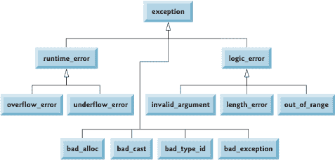

**图 16.10** 标准库的一些异常类。

基类`exception`的直接派生类包括`runtime_error`和`logic_error`（两者都定义在头文件`<stdexcept>`中），它们各自都有若干派生类。同样派生自`exception`的还有C++运算符抛出的异常——例如，`new`抛出`bad_alloc`（第16.11节），`dynamic_cast`抛出`bad_cast`（第13章），`typeid`抛出`bad_typeid`（第13章）。在函数的抛出列表中包含`bad_exception`意味着，如果发生意外异常，将调用函数`unexpected`来处理该异常，而不是（默认情况下）终止程序执行或调用由`set_unexpected`指定的另一个函数。

> **常见编程错误 16.10**
>
> 将捕获基类对象的`catch`处理程序放在捕获该基类派生类对象的`catch`之前是逻辑错误。基类的`catch`会捕获该基类派生类的所有对象，因此派生类的`catch`永远不会执行。

`logic_error`类是指示程序逻辑错误的若干标准异常类的基类。例如，`invalid_argument`类指示向函数传递了无效参数。（当然，正确的编码可以防止无效参数到达函数。）`length_error`类指示为被操作对象使用了大于该对象允许的最大长度的长度。`out_of_range`类指示某个值（例如数组下标）超出了其允许的取值范围。

`runtime_error`类（我们在第16.8节简要使用过）是若干其他指示执行时错误的标准异常类的基类。例如，`overflow_error`类描述算术溢出错误（即算术运算的结果大于计算机能存储的最大数），而`underflow_error`类描述算术下溢错误（即算术运算的结果小于计算机能存储的最小数）。


> **常见编程错误 16.11**
>
> 异常类不必派生自`exception`类，因此捕获`exception`类型并不保证能捕获程序可能遇到的所有异常。


> **错误预防提示 16.6**
>
> 要捕获`try`块中可能抛出的所有异常，请使用`catch(...)`。以这种方式捕获异常的一个缺点是，被捕获异常的类型在编译时未知。另一个缺点是，如果没有命名参数，就无法在异常处理程序内部引用该异常对象。


> **软件工程观察 16.10**
>
> 标准异常层次结构是创建异常的良好起点。你可以构建这样的程序：抛出标准异常、抛出派生自标准异常的异常，或抛出你自己未派生自标准异常的异常。


> **软件工程观察 16.11**
>
> 使用`catch(...)`执行不依赖于异常类型的恢复（例如释放公共资源）。可以重新抛出该异常，以通知更具体的外层`catch`处理程序。

## 16.14 其他错误处理技术

在本章之前，我们已经讨论了处理异常情况的几种方法。下面总结这些方法和其他错误处理技术：

- **忽略异常。** 如果发生异常，程序可能因未捕获的异常而失败。这对商业软件产品和特殊用途的关键任务软件是毁灭性的，但对于为自己目的开发的软件，忽略许多类型的错误很常见。
- **中止程序。** 当然，这会阻止程序运行至完成并产生不正确的结果。对于许多类型的错误，这是合适的，特别是对于使程序能够运行至完成的非致命错误（这可能会误导你认为程序运行正确）。此策略不适用于关键任务应用程序。资源问题在这里也很重要——如果程序获得了资源，程序应在终止前释放该资源。
- **设置错误指示器。** 这种方法的问题是，程序可能不会在所有错误可能造成麻烦的位置检查这些错误指示器。另一个问题是，程序在处理问题后可能不会清除错误指示器。
- **测试错误条件，发出错误消息，并调用`exit`（位于`<cstdlib>`中）向程序的环境传递适当的错误代码。


- 某些类型的错误具有专门处理它们的能力。例如，当打开或读取文件时分配内存失败，可以调用 `new_handler` 函数来处理该错误。如我们在 16.11 节中所讨论的，可以通过向 `set_new_handler` 提供函数名作为参数来自定义此函数。

## 16.15 本章小结

在本章中，你学习了如何使用异常处理来处理程序中的错误。你了解到，异常处理使你能够从程序执行的“主线”中移除错误处理代码。我们通过一个除零示例演示了异常处理。我们还展示了如何使用 try 块包围可能抛出异常的代码，以及如何使用 catch 处理程序处理可能出现的异常。你学习了如何抛出和重新抛出异常，以及如何处理构造函数中发生的异常。本章接着讨论了处理 new 失败、使用 `auto_ptr` 类进行动态内存分配以及标准库异常层次结构。下一章你将学习文件处理，包括持久数据如何存储以及如何操作它。

## 总结

### 16.1 节 简介

- 异常是程序执行期间发生问题的指示。
- 异常处理使你能够创建可以解决执行时发生的问题的程序——通常允许程序继续执行，就像没有遇到问题一样。更严重的问题可能要求程序在受控终止之前通知用户该问题。

### 16.2 节 异常处理概述

- 异常处理使你能够从程序执行的“主线”中移除错误处理代码，从而提高程序的清晰性并增强可修改性。

### 16.3 节 示例：处理除零尝试

- `exception` 类是 C++ 标准的异常基类。`exception` 类提供虚函数 `what`，它返回适当的错误消息，并可在派生类中重写。
- `runtime_error` 类（定义在头文件 `<stdexcept>` 中）是 C++ 标准中用于表示运行时错误的基类。
- C++ 使用异常处理的终止模型。
- `try` 块由关键字 `try` 后跟花括号（`{}`）组成，花括号定义了一个可能发生异常的代码块。`try` 块包含可能引发异常的语句以及在发生异常时不应执行的语句。
- `try` 块之后必须立即至少有一个 `catch` 处理程序。每个 `catch` 处理程序指定一个异常参数，该参数表示该 `catch` 处理程序可以处理的异常类型。
- 如果异常参数包含可选参数名，则 `catch` 处理程序可以使用该参数名与被捕获的异常对象交互。
- 程序中发生异常的点称为抛出点。

### 16.13 节 标准库异常层次结构

- C++ 标准库包含一个异常类层次结构。该层次结构以基类 `exception` 为首。
- 基类 `exception` 的直接派生类包括 `runtime_error` 和 `logic_error`（二者均定义在头文件 `<stdexcept>` 中），它们各自都有若干派生类。
- 若干运算符会抛出标准异常——`operator new` 抛出 `bad_alloc`，`operator dynamic_cast` 抛出 `bad_cast`，而 `operator typeid` 抛出 `bad_typeid`。
- 将 `bad_exception` 包含在函数的 throw 列表中意味着，如果发生意外异常，函数 `unexpected` 可以抛出 `bad_exception`，而不是终止程序执行或调用由 `set_unexpected` 指定的另一个函数。

## 术语

- `abort` 函数 695
- 算术溢出错误 704
- 算术下溢错误 705
- 异步事件 691
- `auto_ptr` 类模板 701
- `bad_alloc` 异常 698
- `bad_cast` 异常 704
- `bad_exception` 异常 704
- `bad_typeid` 异常 704
- catch 处理程序 688
- `catch` 关键字 689
- 空异常规范 694
- 异常 684
- `exception` 类 686
- 异常处理程序 688
- 异常处理 684
- `<exception>` 头文件 686
- 异常对象 690
- 异常参数 689
- 异常规范 694
- 容错程序 684
- `invalid_argument` 异常 704
- `length_error` 异常 704
- `logic_error` 异常 704
- `<memory>` 头文件 701
- new 处理程序 699
- `nothrow` 对象 699
- `out_of_range` 异常 704
- `overflow_error` 异常 704
- 资源泄漏 695
- 异常处理的恢复模型 689
- 重新抛出异常 692
- 健壮程序 684
- `runtime_error` 异常 686
- `set_new_handler` 函数 698
- `set_terminate` 函数 695
- `set_unexpected` 函数 694
- 栈展开 690
- `<stdexcept>` 头文件 686
- 同步错误 691
- `terminate` 函数 692
- 异常处理的终止模型 689
- 抛出 690
- 抛出异常 688
- `throw` 关键字 690
- throw 列表 694
- 抛出点 689
- `try` 块 688
- `try` 关键字 688
- `underflow_error` 异常 705
- `unexpected` 函数 694
- `exception` 类的 `what` 虚函数 686

## 自测练习

- **16.1** 列出五种常见的异常示例。
- **16.2** 给出若干理由，说明为什么不应将异常处理技术用于常规程序控制。
- **16.3** 为什么异常适合处理库函数产生的错误？
- **16.4** 什么是“资源泄漏”？
- **16.5** 如果 try 块中没有抛出异常，那么 try 块执行完毕后控制权会转到哪里？
- **16.6** 如果在 try 块之外抛出异常，会发生什么？
- **16.7** 给出使用 `catch(...)` 的一个主要优点和一个主要缺点。
- **16.8** 如果没有 catch 处理程序与所抛出对象的类型匹配，会发生什么？
- **16.9** 如果多个处理程序与所抛出对象的类型匹配，会发生什么？
- **16.10** 为什么你会将基类类型指定为 catch 处理程序的类型，然后抛出派生类类型的对象？
- **16.11** 假设有一个与异常对象类型精确匹配的 catch 处理程序可用。在什么情况下，对于该类型的异常对象，可能会执行不同的处理程序？
- **16.12** 抛出异常必须导致程序终止吗？
- **16.13** 当 catch 处理程序抛出异常时会发生什么？
- **16.14** 语句 `throw;` 做什么？
- **16.15** 如何限制一个函数可以抛出的异常类型？
- **16.16** 如果函数抛出的异常类型不在该函数的异常规范允许范围内，会发生什么？
- **16.17** 当 try 块抛出异常时，在该块中已构造的自动对象会怎样？

## 自测练习答案

**16.1** 内存不足以满足 new 请求、数组下标越界、算术溢出、除零、无效的函数参数。

**16.2** （a）异常处理旨在处理不常发生且通常导致程序终止的情况，因此不要求编译器编写者以实现最优性能的方式实现异常处理。（b）使用传统控制结构的控制流通常比使用异常更清晰、更高效。（c）可能会出现问题，因为发生异常时栈会展开，而异常发生之前分配的资源可能不会被释放。（d）“额外的”异常使你更难处理更多数量的异常情况。

**16.3** 库函数不太可能执行满足所有用户独特需求的错误处理。

**16.4** 突然终止的程序可能会使资源处于其他程序无法获取该资源的状态，或者程序本身可能无法重新获取“泄漏的”资源。

**16.5** 该 try 块的异常处理程序（在 catch 处理程序中）会被跳过，程序在最后一个 catch 处理程序之后继续执行。

**16.6** 在 try 块之外抛出的异常会导致调用 `terminate`。

**16.7** 形式 `catch(...)` 会捕获 try 块中抛出的任何类型的异常。优点是可以捕获所有可能的异常。缺点是 catch 没有参数，因此无法引用所抛出对象中的信息，也无法知道异常的原因。

**16.8** 这会导致在下一个外层 try 块（如果有）中继续搜索匹配项。随着此过程继续，最终可能确定程序中没有与所抛出对象类型匹配的处理程序；在这种情况下，会调用 `terminate`，默认情况下它会调用 `abort`。可以提供替代的 terminate 函数作为 `set_terminate` 的参数。

**16.9** 执行 try 块之后第一个匹配的异常处理程序。


**16.30** *（异常处理程序的顺序）* 编写一个程序，说明异常处理程序的顺序很重要。第一个匹配的处理程序将被执行。尝试以两种不同的方式编译和运行程序，以表明两个不同的处理程序会以两种不同的效果执行。

**16.31** *（构造函数抛出异常）* 编写一个程序，展示构造函数如何在 try 块之后将构造函数失败的信息传递给异常处理程序。

**16.32** *（重抛异常）* 编写一个程序，说明如何重抛异常。

**16.33** *（未捕获的异常）* 编写一个程序，说明带有自己的 try 块的函数不必捕获 try 内生成的每个可能的错误。某些异常可以漏到外部作用域并在那里得到处理。

**16.34** *（栈展开）* 编写一个程序，从一个深度嵌套的函数中抛出异常，并且仍然让包围调用链的 try 块之后的 catch 处理程序捕获该异常。

# 文件处理

# 17


> *我自始至终读了一部分。*  
> —塞缪尔·戈德温

> *伟大的记忆力不能造就哲学家，正如字典不能被称为语法一样。*  
> —约翰·亨利，红衣主教纽曼

> *我只能假设，“请勿存档”的文件归档在“请勿存档”的文件中。*  
> —参议员弗兰克·丘奇  
> 参议院情报小组委员会  
> 听证会，1975年

### 目标

在本章中，你将学习：

- 创建、读取、写入和更新文件。
- 顺序文件处理。
- 随机访问文件处理。
- 使用高性能的无格式 I/O 操作。
- 格式化数据与原始数据文件处理之间的差异。
- 使用随机访问文件处理构建事务处理程序。

正如字符由位组成，**字段**由字符组成。字段是一组具有一定含义的字符。例如，由大写字母和小写字母组成的字段可以表示一个人的姓名。

计算机处理的数据项构成一个数据层次结构（图17.1），随着我们从位到字符、到字段、再到更大的数据集合，数据项在结构上变得更大、更复杂。

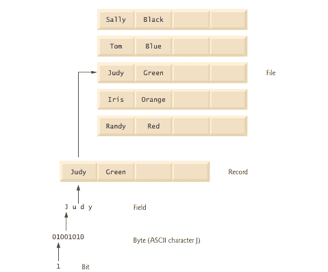

图17.1 | 数据层次结构。

通常，**记录**（在C++中可以表示为一个类）由几个字段（在C++中称为数据成员）组成。例如，在工资系统中，某个特定员工的记录可能包含以下字段：

- 员工标识号
- 姓名
- 地址
- 小时工资率
- 申报的免税额数量
- 年初至今的收入
- 预扣税款金额

因此，记录是一组相关字段的集合。在前面的示例中，每个字段都与同一员工相关联。文件是一组相关记录的集合。<sup>1</sup> 公司的工资文件通常为每个员工包含一条记录。因此，一家小公司的工资文件可能只包含22条记录，而大公司的工资文件可能包含100,000条记录。一家公司拥有许多文件并不罕见，有些文件包含数百万、数十亿、数万亿或更多字符的信息。

为了便于从文件中检索特定记录，每个记录中至少选择一个字段作为记录键。记录键标识记录属于特定的人或实体，并将该记录与其他所有记录区分开来。在前面描述的工资记录中，通常选择员工标识号作为记录键。

在文件中有许多组织记录的方法。一种常见的组织类型称为顺序文件，其中记录通常按记录键字段的顺序存储。在工资文件中，记录通常按员工标识号的顺序排列。文件中的第一条员工记录包含最低的员工标识号，后续记录包含逐渐升高的标识号。

大多数企业使用许多不同的文件来存储数据。例如，公司可能有工资文件、应收账款文件（列出客户欠款）、应付账款文件（列出欠供应商的款项）、库存文件（列出企业处理的所有项目的相关信息）以及许多其他类型的文件。一组相关文件通常存储在数据库中。设计用于创建和管理数据库的程序集合称为数据库管理系统（DBMS）。

### 17.3 文件与流

C++将每个文件视为一个字节序列（图17.2）。每个文件要么以文件结束标记结束，要么以操作系统维护的管理数据结构中记录的特定字节编号结束。当文件被打开时，会创建一个对象，并将流与该对象关联。在第15章中，我们看到当包含`<iostream>`时，会创建`cin`、`cout`、`cerr`和`clog`对象。与这些对象关联的流提供了程序与特定文件或设备之间的通信通道。例如，`cin`对象（标准输入流对象）使程序能够从键盘或其他设备输入数据，`cout`对象（标准输出流对象）使程序能够向屏幕或其他设备输出数据，而`cerr`和`clog`对象（标准错误流对象）使程序能够向屏幕或其他设备输出错误信息。

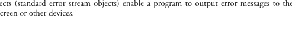

**图17.2** | C++对*n*字节文件的视图。

<sup>1</sup> 一般来说，文件可以包含任意格式的任意数据。在某些操作系统中，文件仅被视为字节的集合。在这样的操作系统中，文件中字节的任何组织（例如将数据组织成记录）都是应用程序员创建的视图。

要在C++中执行文件处理，必须包含头文件`<iostream>`和`<fstream>`。头文件`<fstream>`包含流类模板`basic_ifstream`（用于文件输入）、`basic_ofstream`（用于文件输出）和`basic_fstream`（用于文件输入和输出）的定义。每个类模板都有一个预定义的模板特化，支持 char 类型 I/O。此外，`<fstream>`库为这些模板特化提供了 typedef 别名。例如，typedef `ifstream` 表示 `basic_ifstream` 的一个特化，支持从文件的 char 输入。类似地，typedef `ofstream` 表示 `basic_ofstream` 的一个特化，支持向文件的 char 输出。此外，typedef `fstream` 表示 `basic_fstream` 的一个特化，支持从文件的 char 输入和向文件的 char 输出。

文件通过创建这些流模板特化的对象来打开。这些模板分别“派生”自类模板`basic_istream`、`basic_ostream`和`basic_iostream`。因此，属于这些模板的所有成员函数、运算符和操纵符（我们在第15章中已经描述过）也可以应用于文件流。图17.3总结了我们目前讨论的I/O类的继承关系。

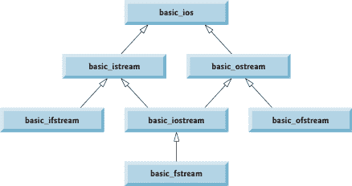

图17.3 | 流I/O模板层次结构的一部分。

### 17.4 创建顺序文件

C++不对文件施加任何结构。因此，像“记录”这样的概念在C++文件中并不存在。所以，你必须自行组织文件结构以满足应用程序的需求。在下面的示例中，我们将看到如何对文件施加简单的记录结构。

图17.4创建了一个顺序文件，该文件可用于应收账款系统，以帮助管理公司信用客户所欠的钱。对于每位客户，程序获取客户的账号、姓名和余额（即客户因过去收到的商品和服务而欠公司的金额）。为每位客户获取的数据构成该客户的一条记录。账号作为记录键；也就是说，程序按账号顺序创建和维护文件。该程序假设用户按账号顺序输入记录。在一个综合性的


模式可以是 `ios::out`，用于将数据输出到文件；也可以是 `ios::app`，用于将数据追加到文件末尾（不会修改文件中已有的任何数据）。使用模式 `ios::out` 打开的现有文件会被截断——文件中的所有数据都会被丢弃。如果指定的文件尚不存在，则 `ofstream` 对象会使用该文件名创建文件。

第 12 行创建了一个名为 `outClientFile` 的 `ofstream` 对象，并将其与以输出方式打开的文件 `clients.dat` 关联起来。参数 `"clients.dat"` 和 `ios::out` 被传递给 `ofstream` 构造函数，该构造函数打开文件——这就建立了与文件之间的“通信线路”。默认情况下，`ofstream` 对象以输出方式打开，因此第 12 行也可以使用下面的替代语句：

```cpp
ofstream outClientFile( "clients.dat" );
```

以输出方式打开 `clients.dat`。图 17.5 列出了文件打开模式。

> **常见编程错误 17.1**
>
> 使用输出方式（`ios::out`）打开现有文件时要特别谨慎，尤其是当你希望保留文件内容时，因为这些内容会在没有任何警告的情况下被丢弃。

| 模式 | 描述 |
|---|---|
| `ios::app` | 将所有输出追加到文件末尾。 |
| `ios::ate` | 以输出方式打开文件，并移动到文件末尾（通常用于向文件追加数据）。可以在文件中的任意位置写入数据。 |
| `ios::in` | 以输入方式打开文件。 |
| `ios::out` | 以输出方式打开文件。 |
| `ios::trunc` | 丢弃文件内容（这也是 `ios::out` 的默认操作）。 |
| `ios::binary` | 以二进制（即非文本）输入或输出方式打开文件。 |

**图 17.5** | 文件打开模式。

创建 `ofstream` 对象时，可以不打开特定文件——稍后可以再将文件附加到该对象。例如，语句

```cpp
ofstream outClientFile;
```

创建了一个名为 `outClientFile` 的 `ofstream` 对象。`ofstream` 成员函数 `open` 可以打开文件，并按如下方式将其附加到现有的 `ofstream` 对象：

```cpp
outClientFile.open( "clients.dat", ios::out );
```

> **常见编程错误 17.2**
>
> 在程序中尝试引用文件之前没有打开文件，将导致错误。

创建 `ofstream` 对象并尝试打开它之后，程序会测试打开操作是否成功。第 15～19 行中的 `if` 语句使用重载的 `ios` 成员函数 `operator!` 来确定打开操作是否成功。如果在打开流时设置了 `failbit` 或 `badbit`，该条件就会返回 `true` 值。可能发生的错误之一是尝试打开不存在的文件。

> **性能提示 17.1**
>
> *当程序不再需要引用文件时，显式关闭文件可以减少资源使用（尤其是在关闭文件后程序仍继续执行的情况下）。*


在图 17.4 所示程序的示例执行过程中，用户为五个账户输入信息，然后通过输入文件结束符来表示数据输入完成（Microsoft Windows 中会显示 `^Z`）。该对话框没有显示数据记录在文件中的形式。为了验证程序是否成功创建了文件，下一节将介绍如何创建一个读取该文件并打印其内容的程序。

## 17.5 从顺序文件读取数据

文件存储数据，以便在需要时检索并进行处理。上一节演示了如何创建一个用于顺序访问的文件。本节将讨论如何从文件中按顺序读取数据。

图 17.7 从使用图 17.4 所示程序创建的 `clients.dat` 文件中读取记录，并显示这些记录的内容。创建 `ifstream` 对象会以输入方式打开文件。`ifstream` 构造函数可以接收文件名和文件打开模式作为参数。第 15 行创建了一个名为 `inClientFile` 的 `ifstream` 对象，并将其与 `clients.dat` 文件关联起来。括号中的参数被传递给 `ifstream` 构造函数，该构造函数打开文件并建立与文件之间的“通信线路”。

> **良好的编程实践 17.1**
>
> *如果不应修改文件内容，则仅以输入方式（使用 `ios::in`）打开文件。这样可以防止意外修改文件内容，也是最小权限原则的一个示例。*


```cpp
// Fig. 17.7: Fig17_07.cpp
// Reading and printing a sequential file.
#include <iostream>
#include <fstream> // file stream
#include <iomanip>
#include <string>
#include <cstdlib>
using namespace std;

void outputLine( int, const string, double ); // prototype

int main()
{
   // ifstream constructor opens the file
   ifstream inClientFile( "clients.dat", ios::in );

   // exit program if ifstream could not open file
   if ( !inClientFile )
   {
      cerr << "File could not be opened" << endl;
21       exit( 1 );
22    } // end if
23
24    int account;
25    string name;
26    double balance;
27
28    cout << left << setw( 10 ) << "Account" << setw( 13 )
29         << "Name" << "Balance" << endl << fixed << showpoint;
30
31    // display each record in file
32    while ( inClientFile >> account >> name >> balance )
33       outputLine( account, name, balance );
34    } // end main
35
36    // display single record from file
37    void outputLine( int account, const string name, double balance )
38    {
39       cout << left << setw( 10 ) << account << setw( 13 ) << name
40            << setw( 7 ) << setprecision( 2 ) << right << balance << endl;
41    } // end function outputLine
```

**图 17.7** 从顺序文件读取并打印数据。（第 1 部分，共 2 部分。）

| 账户 | 姓名 | 余额 |
|---|---|---|
| 100 | Jones | 24.98 |
| 200 | Doe | 345.67 |
| 300 | White | 0.00 |
| 400 | Stone | -42.16 |
| 500 | Rich | 224.62 |

**图 17.7** | 从顺序文件读取并打印数据。（第 2 部分，共 2 部分。）

`ifstream` 类的对象默认以输入方式打开。我们可以使用下面的语句：

```cpp
ifstream inClientFile( "clients.dat" );
```

以输入方式打开 `clients.dat`。与 `ofstream` 对象一样，创建 `ifstream` 对象时也可以不打开特定文件，因为稍后可以将文件附加到该对象。

程序使用条件 `!inClientFile` 来确定文件是否已成功打开，然后再尝试从文件中获取数据。第 32 行从文件中读取一组数据（即一条记录）。该行第一次执行后，`account` 的值为 100，`name` 的值为 `"Jones"`，`balance` 的值为 24.98。每次第 32 行执行时，都会从文件中读取另一条记录，并将其存入变量 `account`、`name` 和 `balance`。第 33 行使用函数 `outputLine`（第 37～41 行）显示记录，该函数使用带参数的流操纵器来格式化要显示的数据。当到达文件末尾时，`while` 条件中对 `operator void *` 的隐式调用会返回空指针（该指针会转换为 `bool` 值 `false`），`ifstream` 析构函数会关闭文件，程序随即终止。

为了从文件中按顺序检索数据，程序通常从文件开头开始读取，并连续读取所有数据，直到找到所需的数据为止。在程序执行期间，可能需要从文件开头开始多次顺序处理文件。`istream` 和 `ostream` 都提供了用于重新定位文件位置指针的成员函数（该指针表示文件中下一个要读取或写入的字节的编号）。这些成员函数分别是 `istream` 的 **seekg**（“seek get”）和 `ostream` 的 **seekp**（“seek put”）。每个 *istream* 对象都有一个“获取指针”（get pointer），用于指示文件中下一次输入将从哪个字节编号开始；每个 *ostream* 对象都有一个“写入指针”（put pointer），用于指示文件中下一次输出应放置在哪个字节编号处。语句

```cpp
inClientFile.seekg( 0 );
```

会将附加到 *inClientFile* 的文件的位置指针重新定位到文件开头（位置 0）。**seekg** 的参数通常是一个长整型数。还可以指定第二个参数来表示搜索方向：**ios::beg**（默认值）表示相对于流的开头定位；**ios::cur** 表示相对于流的当前位置定位；**ios::end** 表示相对于流的末尾定位。文件位置指针是一个整数值，用于指定文件中的位置，表示为距离文件起始位置的字节数（这也称为相对于文件开头的偏移量）。下面是一些定位“获取”文件位置指针的示例：

```cpp
// position to the nth byte of fileObject (assumes ios::beg)
fileObject.seekg( n );
// position n bytes forward in fileObject
fileObject.seekg( n, ios::cur );
// position n bytes back from end of fileObject
fileObject.seekg( n, ios::end );
// position at end of fileObject
fileObject.seekg( 0, ios::end );
```

使用 **ostream** 成员函数 **seekp** 可以执行相同的操作。成员函数 **tellg** 和 **tellp** 分别用于返回当前“获取”指针和“写入”指针的位置。下面的语句将“获取”文件位置指针的值赋给 `long` 类型的变量 *location*：

```cpp
location = fileObject.tellg();
```

图 17.8 可以帮助信用管理员显示以下客户的账户信息：余额为零的客户（即不欠公司任何款项的客户）、贷方余额为负的客户（即公司欠其款项的客户）以及借方余额为正的客户（即因过去收到商品和服务而欠公司款项的客户）。程序显示一个菜单，并允许信用管理员输入三个选项之一来获取信用信息。选项 1 列出所有余额为零的账户。选项 2 列出所有具有贷方余额的账户。选项 3 列出所有具有借方余额的账户。选项 4 终止程序执行。输入无效选项时，会显示提示信息，要求输入其他选项。第 65～66 行使程序能够在读取 EOF 标记后从文件开头开始读取。

```cpp
1   // Fig. 17.8: Fig17_08.cpp
2   // Credit inquiry program.
3   #include <iostream>
4   #include <fstream>
```

**图 17.8** | 信用查询程序。（第 1 部分，共 4 部分。）


```cpp
#include <iomanip>
#include <iostream>
#include <cstdlib>
using namespace std;

enum RequestType { ZERO_BALANCE = 1, CREDIT_BALANCE, DEBIT_BALANCE, END };
int getRequest();
bool shouldDisplay( int, double );
void outputLine( int, const string, double );

int main()
{
   // ifstream constructor opens the file
   ifstream inClientFile( "clients.dat", ios::in );

   // exit program if ifstream could not open file
   if ( !inClientFile )
   {
      cerr << "File could not be opened" << endl;
      exit( 1 ); // end if
   }

   int request;
   int account;
   string name;
   double balance;

   //
   // get user's request (e.g., zero, credit or debit balance)
   request = getRequest();

   // process user's request
   while ( request != END )
   {
      switch ( request )
      {
         case ZERO_BALANCE:
            cout << "\nAccounts with zero balances:\n";
            break;
         case CREDIT_BALANCE:
            cout << "\nAccounts with credit balances:\n";
            break;
         case DEBIT_BALANCE:
            cout << "\nAccounts with debit balances:\n";
            break;
      } // end switch

      // read account, name and balance from file
      inClientFile >> account >> name >> balance;

      // display file contents (until eof)
      while ( !inClientFile.eof() )
      {
```

**图 17.8** | 信用查询程序。（第 2 部分，共 4 部分。）

```cpp
109    return false;
110 } // end function shouldDisplay
111
112 // display single record from file
113 void outputLine( int account, const string name, double balance )
114 {
115    cout << left << setw( 10 ) << account << setw( 13 ) << name
116         << setw( 7 ) << setprecision( 2 ) << right << balance << endl;
117 } // end function outputLine
```

```text
Enter request
1 - List accounts with zero balances
2 - List accounts with credit balances
3 - List accounts with debit balances
4 - End of run
? 1

Accounts with zero balances:
300        White          0.00

Enter request
1 - List accounts with zero balances
2 - List accounts with credit balances
3 - List accounts with debit balances
4 - End of run
? 2

Accounts with credit balances:
400        Stone          -42.16

Enter request
1 - List accounts with zero balances
2 - List accounts with credit balances
3 - List accounts with debit balances
4 - End of run
? 3

Accounts with debit balances:
100        Jones          24.98
200        Doe            345.67
500        Rich           224.62

Enter request
1 - List accounts with zero balances
2 - List accounts with credit balances
3 - List accounts with debit balances
4 - End of run
? 4
End of run.
```

**图 17.8** | 信用查询程序。（第 4 部分，共 4 部分。）

## 17.6 更新顺序文件

如第 17.4 节所示，格式化并写入顺序文件的数据在修改时存在破坏文件中其他数据的风险。例如，如果姓名

函数 write。对于这类必须将一种类型的指针转换为不相关指针类型的情况，C++ 提供了 **reinterpret_cast** 运算符。如果不使用 **reinterpret_cast**，输出整数的 write 语句将无法编译，因为编译器不允许将 `int*` 类型的指针（表达式 `&number` 返回的类型）传递给期望 `const char*` 类型实参的函数——就编译器而言，这些类型不兼容。

**reinterpret_cast** 在编译时执行，不会改变其操作数所指向对象的值。相反，它请求编译器将操作数重新解释为目标类型（在关键字 **reinterpret_cast** 后的尖括号中指定）。在图 17.12 中，我们使用 **reinterpret_cast** 将 ClientData 指针转换为 `const char*`，从而将 ClientData 对象重新解释为要输出到文件的字节。随机访问文件处理程序很少向文件写入单个字段。通常，它们一次写入一个类对象，如下例所示。

> **错误预防提示 17.1**
>
> *很容易使用 reinterpret_cast 执行危险操作，从而导致严重的执行时错误。*

> **可移植性提示 17.1**
>
> *使用 reinterpret_cast 依赖于编译器，并且可能导致程序在不同平台上表现不同。除非绝对必要，否则不应使用 reinterpret_cast 运算符。*

> **可移植性提示 17.2**
>
> *读取未格式化数据（由 write 写入）的程序必须与写入数据的程序在兼容的系统上编译和执行，因为不同系统可能以不同方式表示内部数据。*

### 信用处理程序

考虑以下问题陈述：

> 创建一个信用处理程序，最多可为一家最多拥有 100 名客户的公司存储 100 条定长记录。每条记录应由作为记录键的账号、姓氏、名字和余额组成。该程序应能够更新账户、插入新账户、删除账户，并将所有账户记录插入格式化的文本文件以供打印。

接下来的几节介绍创建此信用处理程序的技术。图 17.12 演示打开随机访问文件、使用 ClientData 类的对象定义记录格式（图 17.10–图 17.11）以及以二进制格式将数据写入磁盘。该程序使用函数 write 将 credit.dat 文件的所有 100 条记录初始化为空对象。每个空对象包含账号 0、姓氏和名字的空字符串（由空引号表示）以及余额 0.0。每条记录都初始化为将存储账户数据的空白空间大小。

string 类的对象大小并不统一，而是使用动态分配的内存来容纳各种长度的字符串。我们必须维护定长记录，因此 ClientData 类将客户的姓氏和名字存储在定长 char 数组中（在图 17.10 的第 32–33 行声明）。成员函数 setLastName（图 17.11，第 36–43 行）和 setFirstName（图 17.11，第 52–59 行）各自将 string 对象的字符复制到对应的 char 数组。在函数 setLastName 中，第 39 行调用 string 成员函数 size 获取 lastNameString 的长度。第 40 行确保长度小于 15 个字符，然后第 41 行使用 string 成员函数 copy 将 lastNameString 中的 length 个字符复制到 char 数组 lastName 中。成员函数 setFirstName 对名字执行相同步骤。

```cpp
// Fig. 17.10: ClientData.h
// Class ClientData definition used in Fig. 17.12–Fig. 17.15.
#ifndef CLIENTDATA_H
#define CLIENTDATA_H

#include <string>
using namespace std;

class ClientData
{
public:
   // default ClientData constructor
   ClientData( int = 0, string = "", string = "", double = 0.0 );

   // accessor functions for accountNumber
   void setAccountNumber( int );
   int getAccountNumber() const;

   // accessor functions for lastName
   void setLastName( string );
   string getLastName() const;

   // accessor functions for firstName
   void setFirstName( string );
   string getFirstName() const;

   // accessor functions for balance
   void setBalance( double );
   double getBalance() const;
private:
   int accountNumber;
   char lastName[ 15 ];
   char firstName[ 10 ];
   double balance;
}; // end class ClientData

#endif
```

**图 17.10** | ClientData 类头文件。

```cpp
// Fig. 17.11: ClientData.cpp
// Class ClientData stores customer's credit information.
#include <string>
```

**图 17.11** | ClientData 类表示客户的信用信息。（第 1 部分，共 3 部分。）

```cpp
57  firstNameString.copy( firstName, length );
58  firstName[ length ] = '\0'; // append null character to firstName
59  // end function setFirstName
60
61  // get balance value
62  double ClientData::getBalance() const
63  {
64      return balance;
65  } // end function getBalance
66
67  // set balance value
68  void ClientData::setBalance( double balanceValue )
69  {
70      balance = balanceValue;
71  } // end function setBalance
```

**图 17.11** | ClientData 类表示客户的信用信息。（第 3 部分，共 3 部分。）

在图 17.12 中，第 11 行为文件 credit.dat 创建一个 ofstream 对象。构造函数的第二个实参——`ios::out | ios::binary`——表明我们以二进制模式打开文件进行输出，如果要写入定长记录，这是必需的。第 24–25 行将 blankClient 写入与 ofstream 对象 outCredit 关联的 credit.dat 文件。请记住，运算符 `sizeof` 返回括号中对象的大小（以字节为单位）（见第 8 章）。第 24 行中函数 write 的第一个实参必须是 `const char *` 类型。然而，`&blankClient` 的数据类型是 `ClientData *`。为了将 `&blankClient` 转换为 `const char *`，第 24 行使用强制转换运算符 reinterpret_cast，因此对 write 的调用可以编译，而不会导致编译错误。

```cpp
1   // Fig. 17.12: Fig17_12.cpp
2   // Creating a randomly accessed file.
3   #include <iostream>
4   #include <fstream>
5   #include <cstdlib>
6   #include "ClientData.h" // ClientData class definition
7   using namespace std;
8
9   int main()
10  {
11      ofstream outCredit( "credit.dat", ios::out | ios::binary );
12
13      // exit program if ofstream could not open file
14      if ( !outCredit )
15      {
16          cerr << "File could not be opened." << endl;
17          exit( 1 );
18      } // end if
19
20      ClientData blankClient; // constructor zeros out each data member
21  }
```

**图 17.12** | 顺序创建一个包含 100 条空白记录的随机访问文件。（第 1 部分，共 2 部分。）


```cpp
34        // user enters last name, first name and balance
35        cout << "Enter lastname, firstname, balance\n? ";
36        cin >> lastName;
37        cin >> firstName;
38        cin >> balance;
39
40        // set record accountNumber, lastName, firstName and balance values
41        client.setAccountNumber( accountNumber );
42        client.setLastName( lastName );
43        client.setFirstName( firstName );
44        client.setBalance( balance );
45
46        // seek position in file of user-specified record
47        outCredit.seekp( ( client.getAccountNumber() - 1 ) *
48            sizeof( ClientData ) );
49
50        // write user-specified information in file
51        outCredit.write( reinterpret_cast< const char * >( &client ),
52            sizeof( ClientData ) );
53
54        // enable user to enter another account
55        cout << "Enter account number\n? ";
56        cin >> accountNumber;
57    } // end while
58 } // end main
```

```text
Enter account number (1 to 100, 0 to end input)
? 37
Enter lastname, firstname, balance
? Barker Doug 0.00
Enter account number
? 29
Enter lastname, firstname, balance
? Brown Nancy -24.54
Enter account number
? 96
Enter lastname, firstname, balance
? Stone Sam 34.98
Enter account number
? 88
Enter lastname, firstname, balance
? Smith Dave 258.34
Enter account number
? 33
Enter lastname, firstname, balance
? Dunn Stacey 314.33
Enter account number
? 0
```

**图 17.13** | 写入随机存取文件。（第 2 部分，共 2 部分。）

第 47–48 行将对象 outCredit 的“put”文件位置指针定位到由以下表达式计算出的字节位置：

```cpp
( client.getAccountNumber() - 1 ) * sizeof( ClientData )
```

因为账号介于 1 到 100 之间，所以在计算记录的字节位置时，要从账号中减去 1。因此，对于记录 1，文件位置指针被设置为文件的字节 0。第 16 行使用 fstream 对象 outCredit 打开现有的 credit.dat 文件。通过组合文件打开模式 ios::in、ios::out 和 ios::binary，该文件以二进制模式打开以供输入和输出。多个文件打开模式通过用按位包含 OR 运算符（|）分隔每个打开模式来组合。以这种方式打开现有的 credit.dat 文件可确保该程序能够操作图 17.12 的程序写入文件的记录，而不是从头创建该文件。第 21 章“位、字符、C 字符串和 structs”详细讨论了按位包含 OR 运算符。

## 17.10 从随机存取文件顺序读取

在前面的小节中，我们创建了一个随机存取文件并向该文件写入了数据。本节中，我们开发一个程序，该程序顺序读取文件，并且只打印那些包含数据的记录。这些程序还会带来一个额外好处。看看你能否确定它是什么；我们将在本节末尾揭晓。

istream 函数 read 从指定流中的当前位置读取指定数量的字节到对象中。例如，图 17.14 的第 30–31 行从与 ifstream 对象 inCredit 关联的文件中读取由 sizeof(ClientData) 指定的字节数，并将数据存储在 client 记录中。函数 read 要求第一个参数的类型为 char *。由于 &client 的类型为 ClientData *，因此必须使用强制转换运算符 reinterpret_cast 将 &client 强制转换为 char *。

**图 17.14** | 顺序读取随机存取文件。（第 1 部分，共 2 部分。）

```cpp
// Fig. 17.14: Fig17_14.cpp
// Reading a random-access file sequentially.
#include <iostream>
#include <iomanip>
#include <fstream>
#include <cstdlib>
#include "ClientData.h" // ClientData class definition
using namespace std;

void outputLine( ostream&, const ClientData & ); // prototype

int main()
{
    ifstream inCredit( "credit.dat", ios::in | ios::binary );

    // exit program if ifstream cannot open file
    if ( !inCredit )
    {
        cerr << "File could not be opened." << endl;
        exit( 1 );
    } // end if

    cout << left << setw( 10 ) << "Account" << setw( 16 )
         << "Last Name" << setw( 16 ) << "First Name"
         << setw( 10 ) << right << "Balance" << endl;

    ClientData client; // create record

    // read first record from file
    inCredit.read( reinterpret_cast< char * >( &client ),
                   sizeof( ClientData ) );

    // read all records from file
    while ( inCredit && !inCredit.eof() )
    {
       // display record
       if ( client.getAccountNumber() != 0 )
          outputLine( cout, client );

       // read next from file
       inCredit.read( reinterpret_cast< char * >( &client ),
                      sizeof( ClientData ) );
    } // end while
} // end main

// display single record
void outputLine( ostream &output, const ClientData &record )
{
   output << left << setw( 10 ) << record.getAccountNumber()
          << setw( 16 ) << record.getLastName()
          << setw( 16 ) << record.getFirstName()
          << setw( 10 ) << setprecision( 2 ) << right << fixed
          << showpoint << record.getBalance() << endl;
} // end function outputLine
```

| 账户 | 姓 | 名 | 余额 |
|---:|---|---|---:|
| 29 | Brown | Nancy | -24.54 |
| 33 | Dunn | Stacey | 314.33 |
| 37 | Barker | Doug | 0.00 |
| 88 | Smith | Dave | 258.34 |
| 96 | Stone | Sam | 34.98 |

**图 17.14** | 顺序读取随机存取文件。（第 2 部分，共 2 部分。）

图 17.14 顺序读取 credit.dat 文件中的每条记录，检查每条记录以确定其是否包含数据，并为包含数据的记录显示格式化输出。第 34 行的条件使用 ios 成员函数 eof 来确定何时到达文件末尾，并使 while 语句的执行终止。此外，如果从文件读取时发生错误，循环也会终止，因为 inCredit 的求值结果为 false。从文件输入的数据由函数 outputLine（第 47–54 行）输出，该函数接受两个参数——一个 ostream 对象和一个要输出的 ClientData 结构。ostream 参数类型很有意思，因为任何 ostream 对象（例如 cout）或 ostream 派生类的任何对象（例如 ofstream 类型的对象）都可以作为参数提供。这意味着，例如，同一个函数可用于向标准输出流和文件流执行输出，而无需编写单独的函数。

我们承诺的额外好处是什么？如果查看输出窗口，你会注意到记录按排序顺序（按账号）列出。这是我们使用直接存取技术将这些记录存储在文件中的结果。与第 7 章使用的插入排序相比，使用直接存取技术进行排序相对较快。这种速度是通过使文件足够大以容纳可能创建的每条记录来实现的。当然，这意味着文件在大多数时间可能只被稀疏占用，从而浪费存储空间。这是空间与时间权衡的另一个例子：通过使用大量空间，我们可以开发出快得多的排序算法。幸运的是，存储单元价格的持续下降已使这不再是大问题。

## 17.11 案例分析：一个事务处理程序

现在介绍一个较大的事务处理程序（图 17.15），它使用随机存取文件实现“即时访问”处理。该程序维护一家银行的账户信息。程序更新现有账户、添加新账户、删除账户，并将所有当前账户的格式化列表存储到一个文本文件中。我们假设已执行图 17.12 的程序以创建文件 `credit.dat`，并且已执行图 17.13 的程序以插入初始数据。

```cpp
// Fig. 17.15: Fig17_15.cpp
// This program reads a random-access file sequentially, updates
// data previously written to the file, creates data to be placed
// in the file, and deletes data previously stored in the file.
#include <iostream>
#include <fstream>
#include <iomanip>
#include <cstdlib>
#include "ClientData.h" // ClientData class definition
using namespace std;

int enterChoice();
void createTextFile( fstream & );
void updateRecord( fstream & );
void newRecord( fstream & );
void deleteRecord( fstream & );
void outputLine( ostream&, const ClientData & );
int getAccount( const char * const );

enum Choices { PRINT = 1, UPDATE, NEW, DELETE, END };

int main()
{
   // open file for reading and writing
   fstream inOutCredit( "credit.dat", ios::in | ios::out | ios::binary );
}
```

**图 17.15** | 银行账户程序。（第 1 部分，共 6 部分。）


```c++
131    // update record
132    if ( client.getAccountNumber() != 0 )
133    {
134       outputLine( cout, client ); // display the record
135
136       // request user to specify transaction
137       cout << "\nEnter charge (+) or payment (-): ";
138       double transaction; // charge or payment
139       cin >> transaction;
140
141       // update record balance
142       double oldBalance = client.getBalance();
143       client.setBalance( oldBalance + transaction );
144       outputLine( cout, client ); // display the record
145
146       // move file-position pointer to correct record in file
147       updateFile.seekp( ( accountNumber - 1 ) * sizeof( ClientData ) );
148
149       // write updated record over old record in file
150       updateFile.write( reinterpret_cast< const char * >( &client ),
151          sizeof( ClientData ) );
152    } // end if
153    else // display error if account does not exist
154       cerr << "Account #" << accountNumber
155          << " has no information." << endl;
156    } // end function updateRecord
157
158    // create and insert record
159    void newRecord( fstream &insertInFile )
160    {
161       // obtain number of account to create
162       int accountNumber = getAccount( "Enter new account number" );
163
164       // move file-position pointer to correct record in file
165       insertInFile.seekg( ( accountNumber - 1 ) * sizeof( ClientData ) );
166
167       // read record from file
168       ClientData client;
169       insertInFile.read( reinterpret_cast< char * >( &client ),
170          sizeof( ClientData ) );
171
172       // create record, if record does not previously exist
173       if ( client.getAccountNumber() == 0 )
174       {
175          string lastName;
176          string firstName;
177          double balance;
178
179          // user enters last name, first name and balance
180          cout << "Enter lastname, firstname, balance? ";
181          cin >> setw( 15 ) >> lastName;
182          cin >> setw( 10 ) >> firstName;
183          cin >> balance;
```

图 17.15 | 银行账户程序。（第 4 部分，共 6 部分）

### 17.5 从顺序文件读取数据

- 文件存储数据，以便在需要时检索数据进行处理。
- 创建 ifstream 对象会打开一个文件用于输入。ifstream 构造函数可以接收文件名和文件打开模式作为参数。
- 仅当文件内容不应被修改时，才以输入模式打开文件。
- ifstream 类的对象默认以输入模式打开。
- 可以创建一个 ifstream 对象而无需打开特定文件；之后可将文件关联到该对象。
- 要从文件顺序检索数据，程序通常从文件开头开始读取，并连续读取所有数据，直到找到所需数据。
- istream 和 ostream 都提供了用于重新定位文件位置指针的成员函数。这些成员函数分别是 istream 的 seekg（“seek get”）和 ostream 的 seekp（“seek put”）。每个 istream 对象都有一个“get 指针”，指示文件中下一次输入发生的字节号，每个 ostream 对象都有一个“put 指针”，指示文件中下一次输出应放置的字节号。
- seekg 的参数通常是一个长整数。可以指定第二个参数来表示查找方向，可以是 ios::beg（默认值），表示相对于流的开头定位；ios::cur，表示相对于流中的当前位置定位；或者 ios::end，表示相对于流的末尾定位。
- 文件位置指针是一个整数值，以距文件起始位置的字节数（即相对于文件开头的偏移量）指定文件中的位置。
- 提供了成员函数 tellg 和 tellp，分别返回“get”和“put”指针的当前位置。

### 17.6 更新顺序文件

- 已格式化并写入顺序文件的数据在修改时存在破坏文件中其他数据的风险。问题在于记录的大小可能不同。

### 17.7 随机访问文件

- 顺序文件不适用于即时访问应用程序，这类应用需要立即定位特定记录。
- 随机访问文件使即时访问成为可能。随机访问文件的单个记录可以直接（且快速）访问，无需查找其他记录。
- 为随机访问格式化文件的最简单方法是要求文件中的所有记录具有相同的固定长度。使用相同大小的固定长度记录，程序可以轻松地计算出任何记录相对于文件开头的精确位置（作为记录大小和记录键的函数）。
- 可以向随机访问文件中插入数据，而不会破坏文件中的其他数据。
- 可以更新或删除之前存储的数据，而无需重写整个文件。

### 17.8 创建随机访问文件

- ostream 成员函数 write 从内存中的特定位置开始，向指定流输出固定字节数。write 函数将数据写入由“put”文件位置指针指定的文件位置。

**17.3**

```c++
a) ifstream inOldMaster("oldmast.dat", ios::in );
b) fstream inTransaction ("trans.dat", ios::in );
c) ofstream outNewMaster ("newmast.dat", ios::out );
d) inOldMaster >> accountNumber >> name >> currentBalance;
e) inTransaction >> accountNum >> dollarAmount;
f) outNewMaster << accountNum << name << currentBalance;
```

**17.4**

a) *错误：* 在尝试向流输出数据之前，文件 `payables.dat` 尚未打开。

*纠正：* 使用 `ofstream` 函数 `open` 打开 `payables.dat` 以进行输出。

b) *错误：* 使用了错误的流对象从名为 `payables.dat` 的文件中读取记录。

*纠正：* 使用流对象 `inPayable` 来引用 `payables.dat`。

c) *错误：* 文件的内容被丢弃了，因为该文件是以输出模式（`ios::out`）打开的。

*纠正：* 要向文件添加数据，请以更新模式（`ios::ate`）或追加模式（`ios::app`）打开文件。

## 练习

**17.5** 在下列各题中填空：

a) 计算机将大量数据存储在辅助存储设备上，以 ________ 形式。
b) 一个 ________ 由几个字段组成。
c) 为了便于从文件中检索特定记录，每条记录中的一个字段被选为 ________。
d) 计算机系统中存储的绝大多数信息存储在 ________ 文件中。
e) 一组传达含义的相关字符称为 ________。
f) 由头文件 `<iostream>` 声明的标准流对象是 ________、________、________ 和 ________。
g) `ostream` 成员函数 ________ 向指定流输出一个字符。
h) `ostream` 成员函数 ________ 通常用于向随机访问文件写入数据。
i) `istream` 成员函数 ________ 重新定位文件中的文件位置指针。

**17.6** 判断下列说法哪些为*真*，哪些为*假*。如果为*假*，请说明原因。

a) 计算机执行的令人印象深刻的功能本质上涉及对零和一的操作。
b) 人们更喜欢操作位而不是字符和字段，因为位更紧凑。
c) 人们以字符形式指定程序和数据库项；然后计算机以零和一的分组形式操作和处理这些字符。
d) 一个人的 5 位邮政编码是数字字段的一个例子。
e) 在计算机应用中，一个人的街道地址通常被视为字母字段。
f) 计算机中表示的数据项形成一个数据层次结构，随着我们从字段到字符到位等的推进，数据项变得更大、更复杂。
g) 记录键标识一条记录属于特定字段。
h) 大多数组织将所有信息存储在一个文件中，以方便计算机处理。
i) 当程序创建文件时，计算机会自动保留该文件以供将来引用；也就是说，文件被认为是持久的。

**17.7** *（文件匹配）* 练习 17.3 要求你编写一系列单条语句。实际上，这些语句构成了一种重要的文件处理程序（即文件匹配程序）的核心。在商业数据处理中，每个应用程序通常有多个文件。


## **17.10** *(文件匹配增强)*

同一条记录键可能有多条交易记录，这很常见，因为某个特定客户在一个营业期间可能进行多次购买和现金支付。重写练习17.7的应收账款文件匹配程序，以处理具有相同记录键的多条交易记录的可能性。修改练习17.8的测试数据，以包含以下附加交易记录：

| 账户编号 | 美元金额 |
|---|---:|
| 300 | 83.89 |
| 700 | 80.78 |
| 700 | 1.53 |

## **17.11**

编写一系列语句来完成以下各项任务。假设我们已经定义了类 `Person`，它包含私有数据成员

```cpp
string lastName;
string firstName;
string age;
int id;
```

以及公共成员函数

```cpp
// accessor functions for id
void setId( int );
int getId() const;

// accessor functions for lastName
void setLastName( string );
string getLastName() const;

// accessor functions for firstName
void setFirstName( string );
string getFirstName() const;

// accessor functions for age
void setAge( string );
string getAge() const;
```

还假设任何随机访问文件都已正确打开。

- a) 初始化名为 `data` 的文件，使其包含100条记录，这些记录存储值 `lastName = "unassigned"`、`firstName = ""` 和 `age = "0"`。
- b) 输入10个姓氏、名字和年龄，并将它们写入该文件。
- c) 更新一条已包含信息的记录。如果该记录不包含信息，则通知用户“无信息”。
- d) 通过重新初始化该特定记录，删除一条包含信息的记录。

## **17.12** *(硬件库存)*

你是一家五金店的店主，需要维护一份库存清单，它能告诉你拥有哪些不同工具、每种工具现有多少以及每件工具的成本。编写一个程序，将随机访问文件 `hardware.dat` 初始化为100条空记录，允许你输入每种工具的数据，能够列出所有工具，允许你删除不再拥有的工具的记录，并允许你更新文件中的任何信息。工具标识号应为记录号。使用以下信息来初始化你的文件：

| 记录号 | 工具名称 | 数量 | 成本 |
|---:|:---|---:|---:|
| 3 | 电动砂光机 | 7 | 57.98 |
| 17 | 锤子 | 76 | 11.99 |
| 24 | 线锯 | 21 | 11.00 |
| 39 | 割草机 | 3 | 79.50 |
| 56 | 电锯 | 18 | 99.99 |
| 68 | 螺丝刀 | 106 | 6.99 |
| 77 | 大锤 | 11 | 21.50 |
| 83 | 扳手 | 34 | 7.50 |

## **17.13** *(电话号码单词生成器)*

标准电话键盘包含数字0到9。数字2到9每个都关联三个字母，如下表所示：

| 数字 | 字母 |
|---|---|
| 2 | A B C |
| 3 | D E F |
| 4 | G H I |
| 5 | J K L |
| 6 | M N O |
| 7 | P R S |
| 8 | T U V |
| 9 | W X Y |

许多人觉得记住电话号码很难，因此他们利用数字与字母之间的对应关系，构造出与其电话号码对应的七字母单词。例如，电话号码为686-2377的人可以使用上表所示的对应关系，构造出七字母单词“NUMBERS”。

企业经常试图获得易于客户记住的电话号码。如果企业能宣传一个简单的单词供客户拨打，那么毫无疑问，该企业会多接到一些电话。

每个七字母单词恰好对应一个七位电话号码。希望增加外卖业务的餐厅，肯定可以通过号码825-3688（即“TAKEOUT”）做到这一点。

每个七位电话号码对应许多不同的七字母单词。遗憾的是，其中大多数代表无法辨认的字母并置。不过，理发店老板可能会很高兴得知，店里的电话号码424-7288对应“HAIRCUT”。电话号码为738-2273的兽医会很高兴得知该号码对应“PETCARE”。

编写一个程序，在给定一个七位数字后，将与该数字对应的所有可能的七字母单词写入文件。这样的单词有2187个（3的7次方）。避免使用包含数字0和1的电话号码。

## 17.14

编写一个程序，使用 *sizeof* 运算符确定你的计算机系统上各种数据类型的大小（以字节为单位）。将结果写入文件 `datasize.dat`，以便稍后打印结果。结果应以两列格式显示，左列为类型名称，右列为该类型的大小，如下所示：

## 大纲

- 18.1 简介
- 18.2 字符串赋值与连接
- 18.3 比较字符串
- 18.4 子字符串
- 18.5 交换字符串
- 18.6 字符串特征
- 18.7 在字符串中查找子字符串和字符
- 18.8 替换字符串中的字符
- 18.9 将字符插入字符串
- 18.10 转换为基于C风格指针的 `char *` 字符串
- 18.11 迭代器
- 18.12 字符串流处理
- 18.13 小结

*小结 | 术语 | 自测练习 | 自测练习答案 | 练习题 | 产生影响*

## 18.1 简介

类模板 `basic_string` 提供典型的字符串操作，如复制、搜索等。模板定义和所有支持设施都定义在命名空间 `std` 中；其中包括 typedef 语句

```cpp
typedef basic_string< char > string;
```

该语句为 `basic_string<char>` 创建别名类型 `string`。还为 `wchar_t` 类型（`wstring`）提供了 typedef。类型 `wchar_t` 存储字符（例如双字节字符、四字节字符等），以支持其他字符集。本章通篇只使用 `string`。要使用字符串，请包含头文件 `<string>`。

字符串对象可以用构造函数参数初始化，例如

```cpp
string text( "Hello" ); // creates a string from a const char *
```

这会创建一个包含 "Hello" 中字符的字符串，或者用两个构造函数参数初始化，如下所示

```cpp
string name( 8, 'x' ); // string of 8 'x' characters
```

这会创建一个包含八个 'x' 字符的字符串。`string` 类还提供默认构造函数（创建空字符串）和复制构造函数。空字符串是不包含任何字符的字符串。

字符串也可以通过字符串定义中的替代构造函数语法进行初始化，如下所示

```cpp
string month = "March"; // same as: string month( "March" );
```

请记住，前面声明中的 `operator =` 不是赋值；它是对 `string` 类构造函数的隐式调用，由该构造函数完成转换。

`string` 类在字符串定义中不提供从 `int` 或 `char` 到 `string` 的转换。例如，以下定义

```cpp
string error1 = 'c';
string error2( 'u' );
string error3 = 22;
string error4( 8 );
```

会导致语法错误。在赋值语句中允许将单个字符赋给字符串对象，如下所示

```cpp
string1 = 'n';
```

> **常见编程错误 18.1**
>
> *尝试通过声明中的初始化或通过构造函数参数将 int 或 char 转换为 string 是编译错误。*

与C风格 `char *` 字符串不同，字符串不一定以空字符结尾。[注：C++标准文档仅提供 `string` 类接口的描述——实现依赖于平台。] 字符串的长度可以通过成员函数 `length` 和成员函数 `size` 获取。下标运算符 `[]` 可用于字符串，以访问和修改单个字符。与C风格字符串一样，字符串的第一个下标为0，最后一个下标为 `length() - 1`。

大多数字符串成员函数接受起始下标位置和要操作的字符数作为参数。

流提取运算符（`>>`）被重载以支持字符串。以下语句

```cpp
string stringObject;
cin >> stringObject;
```

声明一个字符串对象并从 `cin` 读取一个字符串。输入以空白字符分隔。遇到分隔符时，输入操作终止。函数 `getline` 也为字符串进行了重载。假设 `string1` 是一个字符串，则以下语句

```cpp
getline( cin, string1 );
```

从键盘读取一个字符串到 `string1`。输入以换行符（`'\n'`）分隔，因此 `getline` 可以将一行文本读入字符串对象。

## 18.2 字符串赋值与连接

图18.1演示了字符串赋值与连接。第4行包含用于 `string` 类的头文件 `<string>`。字符串 `string1`、`string2` 和 `string3` 在第9–11行创建。第13行将 `string1` 的值赋给 `string2`。赋值完成后，`string2` 是 `string1` 的副本。第14行使用成员函数 `assign` 将 `string1` 复制到 `string3`。会生成一个单独的副本（即 `string1` 和 `string3` 是独立对象）。`string` 类还提供成员函数 `assign` 的重载版本，该版本复制指定数量的字符，如下所示

```cpp
targetString.assign( sourceString, start, numberOfCharacters );
```

其中 `sourceString` 是要复制的字符串，`start` 是起始下标，`numberOfCharacters` 是要复制的字符数。


```cpp
string string1( "Testing the comparison functions." );
string string2( "Hello" );
string string3( "stinger" );
string string4( string2 );

cout << "string1: " << string1 << "\nstring2: " << string2
     << "\nstring3: " << string3 << "\nstring4: " << string4 << "\n\n";

// comparing string1 and string4
if ( string1 == string4 )
   cout << "string1 == string4\n";
else // string1 != string4
{
   if ( string1 > string4 )
      cout << "string1 > string4\n";
   else // string1 < string4
      cout << "string1 < string4\n";
} // end else

// comparing string1 and string2
int result = string1.compare( string2 );

if ( result == 0 )
   cout << "string1.compare( string2 ) == 0\n";
else // result != 0
{
   if ( result > 0 )
      cout << "string1.compare( string2 ) > 0\n";
   else // result < 0
      cout << "string1.compare( string2 ) < 0\n";
} // end else

// comparing string1 (elements 2-5) and string3 (elements 0-5)
result = string1.compare( 2, 5, string3, 0, 5 );

if ( result == 0 )
   cout << "string1.compare( 2, 5, string3, 0, 5 ) == 0\n";
else // result != 0
{
   if ( result > 0 )
      cout << "string1.compare( 2, 5, string3, 0, 5 ) > 0\n";
   else // result < 0
      cout << "string1.compare( 2, 5, string3, 0, 5 ) < 0\n";
} // end else

// comparing string2 and string4
result = string4.compare( 0, string2.length(), string2 );

if ( result == 0 )
   cout << "string4.compare( 0, string2.length(), "
        << "string2 ) == 0" << endl;
else // result != 0
{
   if ( result > 0 )
      cout << "string4.compare( 0, string2.length(), "
           << "string2 ) > 0" << endl;
   else // result < 0
      cout << "string4.compare( 0, string2.length(), "
           << "string2 ) < 0" << endl;
} // end else

// comparing string2 and string4
result = string2.compare( 0, 3, string4 );

if ( result == 0 )
   cout << "string2.compare( 0, 3, string4 ) == 0" << endl;
else // result != 0
{
   if ( result > 0 )
      cout << "string2.compare( 0, 3, string4 ) > 0" << endl;
   else // result < 0
      cout << "string2.compare( 0, 3, string4 ) < 0" << endl;
} // end else
} // end main
```

```text
string1: Testing the comparison functions.
string2: Hello
string3: stinger
string4: Hello

string1 > string4
string1.compare( string2 ) > 0
string1.compare( 2, 5, string3, 0, 5 ) == 0
string4.compare( 0, string2.length(), string2 ) == 0
string2.compare( 0, 3, string4 ) < 0
```

Fig. 18.2 | 比较字符串。（第 2 部分，共 3 部分）

Fig. 18.2  比较字符串。（第 3 部分，共 3 部分）

程序声明了四个字符串（第 9-12 行）并输出它们（第 14-15 行）。第 18 行使用重载的相等运算符将 string1 与 string4 进行比较以判断是否相等。如果条件为真，则输出 "string1 == string4"。如果条件为假，则测试第 22 行的条件。string 类所有重载的关系运算符和相等运算符函数都返回 bool 值。

第 29 行使用 string 成员函数 compare 将 string1 与 string2 进行比较。如果两个字符串相等，变量 result 被赋值为 0；如果 string1 按字典序大于 string2，则赋值为正数；如果 string1 按字典序小于 string2，则赋值为负数。因为以 'T' 开头的字符串在字典序上大于以 'H' 开头的字符串，所以 result 被赋值为大于 0 的值，输出结果也证实了这一点。lexicon 的意思是词典。当我们说一个字符串在字典序上小于另一个字符串时，是指 compare 方法使用每个字符串中字符的数值（参见附录 B，ASCII 字符集）来确定第一个字符串小于第二个字符串。

第 42 行使用成员函数 compare 的重载版本比较 string1 和 string3 的部分内容。前两个参数（2 和 5）指定了 string1 中要与 string3 进行比较的部分的起始下标和长度（即 "sting"）。后两个参数（0 和 5）是被比较字符串的起始下标和长度（同样为 "sting"）。如果相等，result 被赋值为 0；如果 string1 按字典序大于 string3，则赋值为正数；如果 string1 按字典序小于 string3，则赋值为负数。这里比较的两个部分完全相同，因此 result 被赋值为 0。

第 55 行使用函数 compare 的另一个重载版本比较 string4 和 string2。前两个参数相同——起始下标和长度。最后一个参数是比较字符串。返回值也相同——相等时为 0，string4 按字典序大于 string2 时为正数，string4 按字典序小于 string2 时为负数。由于这里比较的两个字符串部分完全相同，result 被赋值为 0。

第 71 行调用成员函数 compare 将 string2 中的前 3 个字符与 string4 进行比较。因为 "Hel" 小于 "Hello"，所以返回一个小于 0 的值。

## 18.4 子字符串

string 类提供了成员函数 substr，用于从字符串中获取子字符串。结果是一个从源字符串复制而来的新字符串对象。图 18.3 演示了 substr 的用法。程序在第 9 行声明并初始化了一个字符串。第 13 行使用成员函数 substr 从 string1 中获取一个子字符串。第一个参数指定所需子字符串的起始下标；第二个参数指定子字符串的长度。

```cpp
// Fig. 18.3: Fig18_03.cpp
// Demonstrating string member function substr.
#include <iostream>
#include <string>
using namespace std;

int main()
{
    string string1( "The airplane landed on time." );

    // retrieve substring "plane" which
    // begins at subscript 7 and consists of 5 characters
    cout << string1.substr( 7, 5 ) << endl;
} // end main
```

```text
plane
```

**图 18.3** | 演示 string 成员函数 substr。

## 18.5 交换字符串

string 类提供了成员函数 swap 用于交换字符串。图 18.4 交换了两个字符串。第 9-10 行声明并初始化了字符串 first 和 second。然后输出每个字符串。第 15 行使用 string 成员函数 swap 交换 first 和 second 的值。再次打印这两个字符串以确认它们确实被交换了。string 成员函数 swap 对于实现字符串排序的程序非常有用。

```cpp
// Fig. 18.4: Fig18_04.cpp
// Using the swap function to swap two strings.
#include <iostream>
#include <string>
using namespace std;

int main()
{
   string first( "one" );
   string second( "two" );

   // output strings
   cout << "Before swap:\n first: " << first << "\nsecond: " << second;

   first.swap( second ); // swap strings

   cout << "\n\nAfter swap:\n first: " << first
      << "\nsecond: " << second << endl;
} // end main
```

```text
Before swap:
  first: one
second: two

After swap:
  first: two
second: one
```

Fig. 18.4 | 使用函数 swap 交换两个字符串。

## 18.6 string 的特征

string 类提供了用于获取字符串大小、长度、容量、最大长度及其他特征的成员函数。字符串的 size 或 length 是当前存储在字符串中的字符数。字符串的 capacity 是在不分配更多内存的情况下可以存储的字符数。字符串的容量必须至少等于字符串当前的大小，但也可以更大。字符串的确切容量取决于实现。maximum size 是字符串可以拥有的最大可能大小。如果超过这个值，就会抛出 length_error 异常。图 18.5 演示了用于确定字符串各种特征的 string 类成员函数。

```cpp
// Fig. 18.5: Fig18_05.cpp
// Demonstrating member functions related to size and capacity.
#include <iostream>
#include <string>
using namespace std;

void printStatistics( const string & );
```

Fig. 18.5 | 打印字符串特征。（第 1 部分，共 3 部分）


```cpp
int main()
{
   string string1; // 空字符串

   cout << "输入前的统计信息：\n" << boolalpha;
   printStatistics( string1 );

   // 仅从 "tomato soup" 中读入 "tomato"
   cout << "\n请输入一个字符串：";
   cin >> string1; // 以空白字符为分隔符
   cout << "输入的字符串为：" << string1;

   cout << "\n\n输入后的统计信息：\n";
   printStatistics( string1 );

   // 读入 "soup"
   cin >> string1; // 以空白字符为分隔符
   cout << "\n\n剩余的字符串为：" << string1 << endl;
   printStatistics( string1 );

   // 向 string1 追加 46 个字符
   string1 += "1234567890abcdefghijklmnopqrstuvwxyz1234567890";
   cout << "\n\n此时的 string1 为：" << string1 << endl;
   printStatistics( string1 );

   // 向 string1 添加 10 个元素
   string1.resize( string1.length() + 10 );
   cout << "\n将长度增加 10 后的统计信息：\n";
   printStatistics( string1 );
   cout << endl;
} // main 结束

// 显示字符串统计信息
void printStatistics( const string &stringRef )
{
   cout << "容量：" << stringRef.capacity() << "\n最大大小："
        << stringRef.max_size() << "\n大小："
        << stringRef.size() << "\n长度：" << stringRef.length()
        << "\n是否为空：" << stringRef.empty();
} // printStatistics 结束
```

```text
输入前的统计信息：
capacity: 0
max size: 4294967293
size: 0
length: 0
empty: true

请输入一个字符串：tomato soup
输入的字符串为：tomato
输入后的统计信息：
capacity: 15
```

图 18.5 | 打印字符串特征。（第 2 部分，共 3 部分）

```cpp
// 搜索 string1 中不存在的字符
location = string1.find_first_not_of(
    "noon is 12 pm; midnight is not.");
cout << "\nfind_first_not_of(\"noon is 12 pm; midnight is not.\")"
     << " 返回：" << location << endl;
} // main 结束
```

```text
原始字符串：
noon is 12 pm; midnight is not.

(find) 找到 "is" 的位置：5
(rfind) 找到 "is" 的位置：24

(find_first_of) 在字符组 "misop" 中找到 'o'，位置：1

(find_last_of) 在字符组 "misop" 中找到 'o'，位置：29

(find_first_not_of) 在 "noi spm" 中不存在的字符 '1'，位置：8

(find_last_not_of) 在 "12noi spm" 中不存在的字符 '.'，位置：12

find_first_not_of("noon is 12 pm; midnight is not.") 返回：-1
```

**图 18.6** | 演示 string 的查找函数。（第 2 部分，共 2 部分）

第 9 行声明并初始化了字符串 `string1`。第 14 行尝试使用函数 `find` 在 `string1` 中查找 "is"。如果找到 "is"，则返回该子字符串起始位置的下标。如果未找到该字符串，则返回值 `string::npos`（在类 `string` 中定义的公有静态常量）。字符串查找相关函数会返回此值，以表示未在字符串中找到子字符串或字符。

第 15 行使用成员函数 `rfind` 从后向前（即从右向左）搜索 `string1`。如果找到 "is"，则返回其下标位置。如果未找到该字符串，则返回 `string::npos`。[*注意：*本节介绍的其余查找函数也会返回相同类型的值，除非另有说明。]

第 18 行使用成员函数 `find_first_of`，在 `string1` 中查找 "misop" 中任意字符第一次出现的位置。搜索从 `string1` 的开头开始。字符 'o' 在元素 1 处找到。

第 23 行使用成员函数 `find_last_of`，在 `string1` 中查找 "misop" 中任意字符最后一次出现的位置。搜索从 `string1` 的末尾开始。字符 'o' 在元素 29 处找到。

第 28 行使用成员函数 `find_first_not_of`，在 `string1` 中查找第一个不包含在 "noi spm" 中的字符。字符 '1' 在元素 8 处找到。搜索从 `string1` 的开头开始。

第 34 行使用成员函数 `find_last_not_of`，查找第一个不包含在 "12noi spm" 中的字符。字符 '.' 在元素 12 处找到。搜索从 `string1` 的末尾开始。

第 40–41 行使用成员函数 `find_first_not_of`，查找第一个不包含在 "noon is 12 pm; midnight is not." 中的字符。在本例中，被搜索的字符串包含参数中指定的所有字符。由于未找到任何字符，因此返回 `string::npos`（此处其值为 −1）。

```cpp
1  // 图 18.9：Fig18_09.cpp
2  // 转换为 C 风格字符串。
3  #include <iostream>
4  #include <string>
5  using namespace std;
6
7  int main()
8  {
9      string string1( "STRINGS" ); // 使用 char* 参数的字符串构造函数
10     const char *ptr1 = 0; // 初始化 *ptr1
11     int length = string1.length();
12     char *ptr2 = new char[ length + 1 ]; // 包含空字符
13
14     // 将 string1 中的字符复制到已分配的内存中
15     string1.copy( ptr2, length, 0 ); // 将 string1 复制到 ptr2 char*
16     ptr2[ length ] = '\0'; // 添加空字符终止符
17
18     cout << "字符串 string1 为 " << string1
19          << "\nstring1 转换为 C 风格字符串后为 "
20          << string1.c_str() << "\nptr1 为 ";
21
22     // 将函数 data() 返回的 const char * 赋给指针 ptr1。
23     // 注意：这是一个有潜在危险的赋值。如果修改 string1，
24     // 指针 ptr1 可能会失效。
25     ptr1 = string1.data();
26
27     // 使用指针输出每个字符
28     for ( int i = 0; i < length; i++ )
29         cout << *( ptr1 + i ); // 使用指针算术
30
31     cout << "\nptr2 为 " << ptr2 << endl;
32     delete [] ptr2; // 回收动态分配的内存
33  } // main 结束
```

```text
字符串 string1 为 STRINGS
string1 转换为 C 风格字符串后为 STRINGS
ptr1 为 STRINGS
ptr2 为 STRINGS
```

图 18.9 | 将字符串转换为 C 风格字符串和字符数组。

第 15 行使用 string 的成员函数 `copy`，将对象 `string1` 复制到 `ptr2` 指向的 char 数组中。第 16 行在 `ptr2` 指向的数组中手动放置一个空字符终止符。

第 20 行使用函数 `c_str` 获取一个 `const char *`，该指针指向一个与 `string1` 内容相同、以空字符终止的 C 风格字符串。该指针会传递给流插入运算符以供输出。第 26 行将类 string 的成员函数 `data` 返回的指针赋给 `const char *` 类型的 `ptr1`。此成员函数返回一个未以空字符终止的 C 风格字符数组。本例中我们不会修改 `string1`。如果修改了 `string1`（例如，调用 `string1.insert( 0, "abcd" );` 这样的成员函数导致字符串的动态内存地址发生变化），`ptr1` 就可能失效，从而导致不可预测的结果。

第 29–30 行使用指针算术输出 `ptr1` 指向的字符数组。第 32–33 行输出 `ptr2` 指向的 C 风格字符串，并删除为 `ptr2` 分配的内存，以避免内存泄漏。

**常见编程错误 18.4**

*未在 `data` 返回的字符数组末尾添加空字符，可能会导致运行时错误。*

**良好编程习惯 18.1**

*只要条件允许，就应使用更健壮的 string 类对象，而不是基于 C 风格指针的字符串。*

## 18.11 迭代器

类 string 提供了用于正向和反向遍历字符串的迭代器。迭代器提供了访问单个字符的方式，其语法与指针操作类似。迭代器不进行范围检查。本节提供一些“机械式示例”，演示迭代器的用法。第 22 章“标准模板库（STL）”将讨论更健壮的迭代器用法。图 18.10 演示了迭代器。

```cpp
// 图 18.10：Fig18_10.cpp
// 使用迭代器输出字符串。
#include <iostream>
#include <string>
using namespace std;

int main()
{
   string string1( "Testing iterators" );
   string::const_iterator iterator1 = string1.begin();

   cout << "string1 = " << string1
      << "\n(使用迭代器 iterator1) string1 为：";

   // 遍历字符串
   while ( iterator1 != string1.end() )
   {
      cout << *iterator1; // 解引用迭代器以获取字符
      iterator1++; // 将迭代器移至下一个字符
   } // while 结束

   cout << endl;
} // main 结束
```

```text
string1 = Testing iterators
(使用迭代器 iterator1) string1 为：Testing iterators
```

**图 18.10** | 使用迭代器输出字符串。


第 9–10 行声明 string 类型的 string1 和 `string::const_iterator` 类型的 iterator1。`const_iterator` 是一种不能修改 string 的迭代器——在这里，是它正在遍历的那个 string。迭代器 iterator1 通过 string 类的成员函数 `begin` 初始化为指向 string1 的开头。`begin` 有两个版本——一个返回用于遍历非 const string 的迭代器，另一个是 const 版本，返回用于遍历 const string 的 `const_iterator`。第 12 行输出 string1。

第 16–20 行使用迭代器 iterator1“遍历”string1。string 类的成员函数 `end` 返回一个迭代器（或 `const_iterator`），表示 string1 最后一个元素之后的位置。通过解引用迭代器来打印每个元素，就像解引用指针一样；并使用运算符 ++ 将迭代器前进一个位置。

string 类提供成员函数 `rend` 和 `rbegin`，用于从字符串末尾向开头反向访问各个字符串字符。成员函数 `rend` 和 `rbegin` 返回反向迭代器或 const 反向迭代器（取决于 string 是非 const 还是 const）。在练习题中，我们要求你编写一个程序来演示这些能力。第 22 章将更多地使用迭代器和反向迭代器。

> **错误预防提示 18.1**
> 当希望获得范围检查的好处时，请使用成员函数 at（而不是迭代器）。


> **良好编程实践 18.2**
> 当涉及迭代器的操作不应修改所处理的数据时，请使用 `const_iterator`。这是运用最小权限原则的另一个示例。


## 18.12 字符串流处理

除了标准流 I/O 和文件流 I/O 之外，C++ 流 I/O 还包括从内存中的字符串输入以及向内存中的字符串输出的能力。这些能力通常称为内存内 I/O 或字符串流处理。

从字符串输入由类 `istringstream` 支持。向字符串输出由类 `ostringstream` 支持。类名 `istringstream` 和 `ostringstream` 实际上是由以下 typedef 定义的别名：

```cpp
typedef basic_istringstream< char > istringstream;
typedef basic_ostringstream< char > ostringstream;
```

类模板 `basic_istringstream` 和 `basic_ostringstream` 提供与类 `istream` 和 `ostream` 相同的功能，以及特定于内存内格式化的其他成员函数。使用内存内格式化的程序必须包含 `<sstream>` 和 `<iostream>` 头文件。

这些技术的一个应用是数据验证。程序可以一次从输入流中读取一整行到字符串中。接下来，验证例程可以仔细检查字符串的内容，并在必要时修正（或修复）数据。然后，程序可以继续从该字符串输入，因为它知道输入数据格式正确。

向字符串输出是利用 C++ 流强大的输出格式化能力的一种好方法。可以在字符串中准备数据，以模拟编辑后的屏幕格式。该字符串可以写入磁盘文件，以保留屏幕图像。

- 大多数 string 成员函数接受起始下标位置和要操作的字符数作为参数。

### 18.2 节 字符串赋值与连接

- 类 `string` 提供重载的 operator= 和成员函数 `assign` 用于赋值。
- 下标运算符 `[]` 提供对字符串任意元素的读/写访问。
- `string` 成员函数 `at` 提供带检查的访问——越过字符串任一端都会抛出 `out_of_range` 异常。下标运算符 `[]` 不提供带检查的访问。
- 重载的 `+` 和 `+=` 运算符以及成员函数 `append` 执行字符串连接。

### 18.3 节 比较字符串

- 类 `string` 提供重载的 `==`、`!=`、`<`、`>`、`<=` 和 `>=` 运算符用于字符串比较。
- `string` 成员函数 `compare` 比较两个字符串（或子字符串），如果字符串相等则返回 0；如果第一个字符串按字典序大于第二个，则返回正数；如果第一个字符串按字典序小于第二个，则返回负数。

### 18.4 节 子字符串

- `string` 成员函数 `substr` 从字符串中获取子字符串。

### 18.5 节 交换字符串

- `string` 成员函数 `swap` 交换两个字符串的内容。

### 18.6 节 string 特性

- `string` 成员函数 `size` 和 `length` 返回字符串当前存储的字符数。
- `string` 成员函数 `capacity` 返回在不增加分配给该字符串的内存量的情况下，字符串可以存储的总字符数。
- `string` 成员函数 `max_size` 返回字符串可以具有的最大大小。
- `string` 成员函数 `resize` 更改字符串的长度。

### 18.7 节 在 string 中查找子字符串和字符

- 类 `string` 的函数 `find`、`rfind`、`find_first_of`、`find_last_of` 和 `find_first_not_of` 定位字符串中的子字符串或字符。

### 18.8 节 替换 string 中的字符

- `string` 成员函数 `erase` 删除字符串的元素。
- `string` 成员函数 `replace` 替换字符串中的字符。

### 18.9 节 将字符插入 string

- `string` 成员函数 `insert` 在字符串中插入字符。

### 18.10 节 转换为基于 C 风格指针的 `char *` 字符串

- `string` 成员函数 `c_str` 返回一个 `const char *`，指向一个以 null 结尾的 C 风格字符串，该字符串包含 string 中的所有字符。
- `string` 成员函数 `data` 返回一个 `const char *`，指向一个不以 null 结尾的 C 风格字符数组，该数组包含 string 中的所有字符。

### 18.11 节 迭代器

- 类 `string` 提供成员函数 `end` 和 `begin` 来遍历各个元素。

- **18.3** 找出以下各项中的错误，并解释如何更正：
  - a)

    ```cpp
    string string1( 28 ); // construct string1
    string string2( 'z' ); // construct string2
    ```

  - b)

    ```cpp
    // assume std namespace is known
    const char *ptr = name.data(); // name is "joe bob"
    ptr[ 3 ] = '-';
    cout << ptr << endl;
    ```

## 自测练习答案

- **18.1** a) `<string>`。b) `std::`。c) `erase`。d) `find_first_of`。
- **18.2** a) 正确。
  - b) 正确。
  - c) 正确。
  - d) 错误。string 是一个提供许多不同服务的对象。C 风格字符串不提供任何服务。C 风格字符串以 null 结尾；string 不一定以 null 结尾。C 风格字符串是指针，而 string 是对象。
- **18.3** a) string 类没有接受整数和字符参数的构造函数。应使用其他有效的构造函数——如有必要，将参数转换为字符串。
  - b) 函数 data 不添加 null 终止符。此外，代码试图修改一个 const char。将所有这些行替换为以下代码：

    ```cpp
    cout << name.substr( 0, 3 ) + "-" + name.substr( 4 ) << endl;
    ```

## 练习题

- **18.4** 填写以下各项中的空白：
  - a) 类 string 的成员函数 ______ 和 ______ 将字符串转换为 C 风格字符串。
  - b) 类 string 的成员函数 ______ 用于赋值。
  - c) ______ 是函数 rbegin 的返回类型。
  - d) 类 string 的成员函数 ______ 用于获取子字符串。
- **18.5** 指出以下陈述中哪些正确、哪些错误。如果陈述错误，请解释原因。
  - a) string 总是以 null 结尾。
  - b) 类 string 的成员函数 `max_size` 返回字符串的最大大小。
  - c) 类 string 的成员函数 `at` 可以抛出 `out_of_range` 异常。
  - d) 类 string 的成员函数 `begin` 返回一个迭代器。
- **18.6** 找出以下代码中的任何错误，并解释如何更正：
  - a) `std::cout << s.data() << std::endl; // s is "hello"`
  - b) `erase( s.rfind( "x" ), 1 ); // s is "xenon"`
  - c)

    ```cpp
    string& foo()
    {
       string s( "Hello" );
       ...
       // other statements
       return;
    } // end function foo
    ```

- **18.7（简单加密）** 互联网上的某些信息可能使用一种称为“rot13”的简单算法加密，该算法将每个字符在字母表中旋转 13 个位置。因此，'a' 对应 'n'，'x' 对应 'k'。rot13 是对称密钥加密的一个示例。使用对称密钥加密时，加密器和解密器使用相同的密钥。


- a) 编写一个使用 rot13 加密消息的程序。
- b) 编写一个使用 13 作为密钥解密乱序消息的程序。
- c) 编写完 (a) 和 (b) 部分的程序后，简要回答以下问题：如果你不知道 (b) 部分的密钥，你认为破解该密码有多困难？如果你可以使用强大的计算能力（例如超级计算机），又会怎样？在练习 18.25 中，我们要求你编写一个程序来完成这项任务。

**18.8** (*使用 string 迭代器*) 编写一个使用迭代器的程序，演示函数 rbegin 和 rend 的使用。

**18.9** (*以“r”或“ay”结尾的单词*) 编写一个程序，读入若干字符串，仅打印以“r”或“ay”结尾的字符串。只应考虑小写字母。

**18.10** (*string 连接*) 编写一个程序，分别输入名字和姓氏，并将二者连接成一个新字符串。展示完成此任务的两种技术。

**18.11** (*Hangman 游戏*) 编写一个玩 Hangman 游戏的程序。程序应选择一个单词（可以直接编码在程序中，或从文本文件读取）并显示以下内容：

```
    Guess the word:    XXXXXX
```

每个 X 代表一个字母。用户尝试猜测单词中的字母。每次猜测后应显示相应的回答 yes 或 no。每次错误猜测后，显示填入了另一个身体部位的图。在七次错误猜测后，用户应被绞死。显示应如下所示：

```
    0
   /|\
   / \
```

每次猜测后，显示用户的所有猜测。如果用户正确猜出单词，程序应显示

```
    Congratulations!!! You guessed my word. Play again? yes/no
```

**18.12** (*反向打印 string*) 编写一个程序，输入一个字符串并反向打印该字符串。将所有大写字符转换为小写，并将所有小写字符转换为大写。

**18.13** (*按字母顺序排列动物名称*) 编写一个程序，使用本章介绍的比较功能，将一系列动物名称按字母顺序排列。比较时只应使用大写字母。

**18.14** (*密码文*) 编写一个程序，从字符串创建密码文。密码文是一种消息或单词，其中每个字母都被替换为另一个字母。例如字符串

```
    The bird was named squawk
```

可能被打乱成

```
    cin vrjs otz ethns zxqtop
```

空格不会被扰乱。在这个特定例子中，'T' 被替换为 'x'，每个 'a' 被替换为 'h'，等等。在密码文中，大写字母会变成小写字母。使用与练习 18.7 类似的技术。

**18.15** (*求解密码文*) 修改练习 18.14，允许用户求解密码文。用户每次应输入两个字符：第一个字符指定密码文中的一个字母，第二个字符指定替换字母。如果替换字母正确，则将密码文中的该字母替换为对应的大写替换字母。

**18.16** (*统计回文*) 编写一个程序，输入一个句子并统计其中回文的数量。回文是指正读和反读都相同的单词。例如，“tree”不是回文，但“noon”是回文。

**18.17** (*统计元音*) 编写一个程序，统计一个句子中元音的总数。输出每个元音的频率。

**18.18** 编写一个程序，在字符串的正中间插入字符 "******"。

**18.19** (*从 string 中删除字符*) 编写一个程序，从字符串中删除序列 "by" 和 "By"。

**18.20** (*替换标点并分词 string*) 编写一个程序，输入一行文本，将所有标点符号替换为空格，并使用 C 字符串库函数 strtok 将该字符串分词为各个单词。

**18.21** (*使用迭代器反转 string*) 编写一个程序，输入一行文本并反向打印该文本。在解决方案中使用迭代器。

**18.22** (*使用递归和迭代器反转 string*) 编写练习 18.21 的递归版本。

**18.23** (*使用带迭代器实参的 erase 函数*) 编写一个程序，演示使用接受迭代器实参的 erase 函数。

**18.24** (*字母金字塔*) 编写一个程序，从字符串 "abcdefghijklmnopqrstuvwxyz" 生成以下内容：

```
        a
       bcb
      cdedc
     defgfed
    efghihgfe
   fghijkjihgf
  ghijklmlkjihg
 hijklmnonmlkjih
ijklmnopqponmlkji
jklmnopqrstsrqponmlkj
klmnopqrstuvwvutsrqponmlk
lmnopqrstuvwxyxwvutsrqponml
mnopqrstuvwxyzazyxwvutsrqponm
nopqrstuvwxyzzyxwvutsrqpon
```

**18.25** (*简单解密*) 在练习 18.7 中，我们要求你编写一个简单的加密算法。编写一个程序，尝试使用简单的频率替换来解密一条 "rot13" 消息。（假设你不知道密钥。）加密短语中出现最频繁的字母应替换为最常用的英文字母（a、e、i、o、u、s、t、r 等）。将各种可能性写入文件。是什么让破解密码变得容易？如何改进加密机制？

**18.26** (*排序 string*) 编写选择排序例程（图 8.20）的一个版本，用于对字符串排序。在解决方案中使用函数 swap。

**18.27** (*增强的 Employee 类*) 修改图 13.6–13.7 中的 Employee 类，添加一个名为 isValidSocialSecurityNumber 的私有工具函数。该成员函数应验证社会安全号码的格式（例如 ###-##-####，其中 # 是数字）。如果格式有效，返回 true；否则返回 false。

## 产生影响

**18.28** (*使用更健康的食材烹饪*) 美国的肥胖率正以惊人的速度上升。请查看美国疾病控制与预防中心（CDC）的地图：

# 19 查找与排序

> 他抽噎着，流着泪
> 挑出了
> 那些尺寸最大的……
> ——刘易斯·卡罗尔
>
> 坚持到底，绝不要
> 止步于怀疑；
> 没有什么如此困难，以至查找
> 不能将其发现。
> ——罗伯特·赫里克
>
> 它已锁在我的记忆中，
> 而你自己将保管
> 它的钥匙。
> ——威廉·莎士比亚
>
> 商业中有一条不变的法则：
> 话语就是话语，
> 解释就是解释，
> 承诺就是承诺——但
> 只有绩效才是现实。
> ——哈罗德·S·格林

### 学习目标

本章你将学习：

- 使用二分查找在 vector 中查找给定值。
- 使用大 O 记号表示查找和排序算法的效率，并比较它们的性能。
- 使用递归归并排序算法对 vector 排序。
- 理解常量、线性和二次运行时间算法的本质。


### 大纲

- **19.1** 引言
- **19.2** 查找算法
  - 19.2.1 线性查找的效率
  - 19.2.2 二分查找
- **19.3** 排序算法
  - **19.3.1** 选择排序的效率
  - **19.3.2** 插入排序的效率
  - **19.3.3** 归并排序（递归实现）
- **19.4** 小结

*摘要 | 术语 | 自测练习 | 自测练习答案 | 练习*

## 19.1 引言

查找数据包括确定某个值（称为查找键）是否存在于数据中，如果存在，还要找到该值的位置。两种常用的查找算法是简单的线性查找（在 7.7 节介绍）和更快但更复杂的二分查找，本章将介绍后者。

排序根据一个或多个排序键将数据按顺序排列，通常是升序或降序。姓名列表可以按字母顺序排序，银行账户可以按账号排序，员工工资记录可以按社会安全号码排序，等等。之前，你学习了插入排序（7.8 节）和选择排序（8.6 节）。本章介绍更高效但更复杂的归并排序。图 19.1 总结了本书示例和练习中讨论的查找和排序算法。本章还介绍大 O 记号，它用于估计算法的最坏情况运行时间——也就是算法解决问题可能需要付出多大努力。

| 算法 | 所在位置 |
|---|---|
| *查找算法* | |
| 线性查找 | 7.7 节 |
| 二分查找 | 19.2.2 节 |
| 递归线性查找 | 练习 19.8 |
| 递归二分查找 | 练习 19.9 |
| 二叉树查找 | 20.7 节 |
| 链表的线性查找 | 练习 20.21 |
| `binary_search` 标准库函数 | 22.5.6 节 |
| *排序算法* | |
| 插入排序 | 7.8 节 |
| 选择排序 | 8.6 节 |
| 递归归并排序 | 19.3.3 节 |
| 冒泡排序 | 练习 19.5 和 19.6 |
| 桶排序 | 练习 19.7 |
| 递归快速排序 | 练习 19.10 |

**图 19.1** 本书中的查找和排序算法。（第 1 部分，共 2 部分。）


现在假设你有一个算法，用于测试向量中是否有任何元素在向量的其他地方重复出现。第一个元素必须与向量中的其他每个元素进行比较。第二个元素必须与除第一个元素之外的每个其他元素进行比较（它已经与第一个元素比较过了）。第三个元素必须与除前两个元素之外的每个其他元素进行比较。最终，这个算法将进行 (n − 1) + (n − 2) + ... + 2 + 1 次比较，即 n²/2 − n/2 次比较。随着 n 增大，n² 项占主导地位，而 n 项变得无关紧要。同样，大 O 表示法突出 n² 项，留下 n²/2。然而，我们很快会看到，在大 O 表示法中常数因子会被省略。

大 O 关注的是算法的运行时间相对于所处理项目数量的增长方式。假设一个算法需要 n² 次比较。对于四个元素，该算法将需要 16 次比较；对于八个元素，需要 64 次比较。对于这个算法，元素数量翻倍会使比较次数变为四倍。考虑一个类似的算法，它需要 n²/2 次比较。对于四个元素，该算法将需要八次比较；对于八个元素，需要 32 次比较。同样，元素数量翻倍会使比较次数变为四倍。这两个算法都按 n 的平方增长，因此大 O 忽略常数，并且这两个算法都被认为是 O(n²)，这被称为二次运行时间，读作“按 n 的平方量级”或更简单地说“n 平方阶”。

当 n 很小时，O(n²) 算法（在当今每秒执行十亿次运算的个人计算机上运行）不会明显影响性能。但随着 n 增大，你就会开始注意到性能下降。一个在百万元素向量上运行的 O(n²) 算法将需要一万亿次“操作”（其中每次操作实际上可能需要执行若干条机器指令）。这可能需要几个小时才能执行完。而一个十亿元素向量将需要一百亿亿次操作，这个数字如此之大，以至于该算法可能需要几十年！不幸的是，O(n²) 算法往往很容易编写。在本章中，你将看到具有更有利大 O 度量的算法。这些高效算法通常需要多一点聪明才智和努力来创建，但它们的卓越性能可能值得付出额外的努力，尤其是当 n 变大以及算法被组合到更大的程序中时。

线性查找算法以 O(n) 时间运行。该算法的最坏情况是必须检查每个元素，以确定查找关键字是否存在于向量中。如果向量的大小翻倍，算法必须执行的比较次数也会翻倍。如果与查找关键字匹配的元素恰好位于向量前部或靠近前部，线性查找可以提供出色的性能。但我们寻求的是在所有查找中平均表现良好的算法，包括与查找关键字匹配的元素位于向量末尾附近的情况。

线性查找是最容易实现的查找算法，但与其他查找算法相比，它可能较慢。如果程序需要在大型向量上执行许多次查找，那么实现另一种更高效的算法可能更好，例如我们将在下一节介绍的二分查找。

## 性能提示 19.1

*有时最简单的算法性能很差。它们的优点在于易于编程、测试和调试。有时需要更复杂的算法才能实现最高性能。*

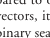

```cpp
1  // Fig. 19.2: BinarySearch.h
2  // Class that contains a vector of random integers and a function
3  // that uses binary search to find an integer.
4  #include <vector>
5  using namespace std;
6
7  class BinarySearch
8  {
9  public:
10     BinarySearch( int ); // constructor initializes vector
11     int binarySearch( int ) const; // perform a binary search on vector
12     void displayElements() const; // display vector elements
13  private:
14     int size; // vector size
15     vector< int > data; // vector of ints
16     void displaySubElements( int, int ) const; // display range of values
17  }; // end class BinarySearch
```

图 19.2 | BinarySearch 类定义。

```cpp
1  // Fig. 19.3: BinarySearch.cpp
2  // BinarySearch class member-function definition.
3  #include <iostream>
4  #include <cstdlib> // prototypes for functions srand and rand
5  #include <ctime> // prototype for function time
6  #include <algorithm> // prototype for sort function
7  #include "BinarySearch.h" // class BinarySearch definition
8  using namespace std;
9
10 // constructor initializes vector with random ints and sorts the vector
11 BinarySearch::BinarySearch( int vectorSize )
12 {
13     size = ( vectorSize > 0 ? vectorSize : 10 ); // validate vectorSize
14     srand( time( 0 ) ); // seed using current time
15
16     // fill vector with random ints in range 10-99
17     for ( int i = 0; i < size; i++ )
18         data.push_back( 10 + rand() % 90 ); // 10-99
19
20     std::sort( data.begin(), data.end() ); // sort the data
21 } // end BinarySearch constructor
22
23 // perform a binary search on the data
24 int BinarySearch::binarySearch( int searchElement ) const
25 {
26     int low = 0; // low end of the search area
27     int high = size - 1; // high end of the search area
28     int middle = ( low + high + 1 ) / 2; // middle element
29     int location = -1; // return value; -1 if not found
30
31     do // loop to search for element
32     {
```

图 19.3 | BinarySearch 类成员函数定义。（第 1 部分，共 2 部分。）

调用者。循环的每次迭代测试一个值（第 43 行），并排除向量中剩余值的一半（第 46 行或第 48 行）。

图 19.4 的第 22–38 行循环，直到用户输入值 -1。对于用户输入的每个其他数字，程序都会对数据执行二分查找，以确定它是否与向量中的某个元素匹配。该程序输出的第一行是按递增顺序排列的整数向量。当用户指示程序查找 38 时，程序首先测试中间元素，即 67（由 * 指示）。查找关键字小于 67，因此程序排除向量的后半部分，并测试向量前半部分的中间元素。查找关键字等于 38，因此程序返回索引 3。

```cpp
1  // Fig. 19.4: Fig19_04.cpp
2  // BinarySearch test program.
3  #include <iostream>
4  #include "BinarySearch.h" // class BinarySearch definition
5  using namespace std;
6
7  int main()
8  {
9     int searchInt; // search key
10    int position; // location of search key in vector
11
12    // create vector and output it
13    BinarySearch searchVector( 15 );
14    searchVector.displayElements();
15
16    // get input from user
17    cout << "\nPlease enter an integer value (-1 to quit): ";
18    cin >> searchInt; // read an int from user
19    cout << endl;
20
21    // repeatedly input an integer; -1 terminates the program
22    while ( searchInt != -1 )
23    {
24       // use binary search to try to find integer
25       position = searchVector.binarySearch( searchInt );
26
27       // return value of -1 indicates integer was not found
28       if ( position == -1 )
29          cout << "The integer " << searchInt << " was not found.\n";
30       else
31          cout << "The integer " << searchInt
32               << " was found in position " << position << ".\n";
33
34       // get input from user
35       cout << "\n\nPlease enter an integer value (-1 to quit): ";
36       cin >> searchInt; // read an int from user
37       cout << endl;
38    } // end while
39 } // end main
```

图 19.4 | BinarySearch 测试程序。（第 1 部分，共 2 部分。）


26 31 33 38 47 49 49 67 73 74 82 89 90 91 95

请输入一个整数值（-1 退出）：38

26 31 33 38 47 49 49 67 73 74 82 89 90 91 95
                    *
26 31 33 38 47 49 49
        *

整数 38 位于位置 3，已找到。

请输入一个整数值（-1 退出）：91

26 31 33 38 47 49 49 67 73 74 82 89 90 91 95
                                  *
73 74 82 89 90 91 95
        *
90 91 95
   *

整数 91 位于位置 13，已找到。

请输入一个整数值（-1 退出）：25

26 31 33 38 47 49 49 67 73 74 82 89 90 91 95
                 *
26 31 33 38 47 49 49
          *
26 31 33
   *
26
*

未找到整数 25。

请输入一个整数值（-1 退出）：-1

**图 19.4** | 二分查找测试程序。（共 2 部分，第 2 部分。）

## 二分查找的效率

在最坏情况下，使用二分查找在包含 1023 个元素的已排序向量中进行查找，只需 10 次比较。反复将 1023 除以 2（因为每次比较后，我们可以排除剩余向量中一半的元素），并向下取整（因为我们还会移除中间元素），可以得到数值 511、255、127、63、31、15、7、3、1 和 0。数字 1023（2<sup>10</sup> − 1）只需除以 2 共 10 次即可得到 0，这表示没有更多元素需要测试。除以 2 等价于二分查找算法中的一次比较。因此，包含 1,048,575（2<sup>20</sup> − 1）个元素的向量最多需要 20 次比较即可找到目标值，而包含约 10 亿个元素的向量最多需要 30 次比较即可找到目标值。与线性查找相比，这在性能上有了巨大的提升。对于包含 10 亿个元素的向量，线性查找平均需要进行 5 亿次比较，而二分查找最多只需进行 30 次比较，二者之间的差距极其显著！对任意已排序向量进行二分查找所需的最大比较次数，是大于向量元素数量的第一个 2 的幂的指数，用 log₂ n 表示。所有对数的增长速率大致相同，因此在大 O 表示法中可以省略底数。这就使二分查找的大 O 复杂度为 O(log n)，这也称为对数运行时间，读作“数量级为 log n”，或更简单地称为“log 阶”。

## 19.3 排序算法

排序数据（即按照某种特定顺序排列数据，例如升序或降序）是计算机应用中最重要的应用之一。银行会按照账号对所有支票进行排序，以便在每月底制作单独的银行对账单。电话公司会按照姓氏、再按照名字对账户列表进行排序，从而便于查找电话号码。几乎每个组织都必须对某些数据进行排序，而且通常需要处理海量数据。数据排序是一个引人入胜且计算密集型的问题，吸引了大量研究工作。

理解排序时，一个重要的要点是：无论使用哪种算法对向量进行排序，最终结果——排序后的向量——都是相同的。算法的选择只会影响程序的运行时间和内存使用情况。在前面的章节中，我们介绍了选择排序和插入排序——这两种算法易于实现，但效率较低。下一节将使用大 O 表示法分析这两种算法的效率。本章介绍的最后一种算法——归并排序——速度快得多，但实现起来也更加困难。

### 19.3.1 选择排序的效率

选择排序是一种易于实现但效率较低的排序算法。算法的第一次迭代会选出向量中的最小元素，并将其与第一个元素交换。第二次迭代会选出第二小的元素（即剩余元素中的最小元素），并将其与第二个元素交换。算法会持续执行，直到最后一次迭代选出倒数第二大的元素，并将其与倒数第二个元素交换，从而将最大的元素留在最后一个索引位置。经过第 *i* 次迭代后，向量中最小的 *i* 个元素将按递增顺序排列在向量的前 *i* 个位置中。

选择排序算法会迭代 *n* − 1 次，每次将剩余元素中的最小元素交换到其排序后的位置。定位剩余元素中的最小元素，在第一次迭代时需要进行 *n* − 1 次比较，在第二次迭代时需要进行 *n* − 2 次比较，之后依次为 *n* − 3、……、3、2、1。这总共需要进行 *n*(*n* − 1)/2 或 (*n*² − *n*)/2 次比较。在大 O 表示法中，较小的项会被舍去，常数也会被忽略，因此最终的大 O 复杂度为 O(*n*²)。

### 19.3.2 插入排序的效率

插入排序是另一种简单但效率较低的排序算法。算法的第一次迭代取出向量中的第二个元素，如果它小于第一个元素，就将它与第一个元素交换。第二次迭代查看第三个元素，并将其插入相对于前两个元素的正确位置，使这三个元素按顺序排列。在该算法的第 *i* 次迭代中，原始向量中的前 *i* 个元素将完成排序。

插入排序会迭代 *n* − 1 次，将一个元素插入到目前已排序元素中的适当位置。对于每次迭代，确定元素的插入位置可能需要将该元素与其前面的每个元素进行比较——在最坏情况下需要进行 *n* − 1 次比较。每条单独的重复语句都以 O(*n*) 的时间运行。在确定大 O 表示法时，嵌套语句意味着必须将比较次数相乘。对于外层循环的每次迭代，内层循环都会执行一定次数的迭代。在该算法中，外层循环的每次 O(*n*) 次迭代都会对应内层循环的 O(*n*) 次迭代，因此大 O 复杂度为 O(*n* × *n*) 或 O(*n*²)。

## 19.3.3 归并排序（递归实现）

归并排序是一种高效的排序算法，但其概念比选择排序和插入排序更加复杂。归并排序算法通过将向量拆分为两个大小相等的子向量，对每个子向量进行排序，然后将它们合并为一个更大的向量来完成排序。当元素数量为奇数时，算法会创建两个子向量，使其中一个比另一个多一个元素。

归并排序通过查看每个向量中的第一个元素来执行合并操作，这些元素同时也是各自向量中的最小元素。归并排序选出其中较小的元素，并将其放入较大的已排序向量中的第一个位置。如果子向量中仍有元素，归并排序就查看该子向量中的第二个元素（此时它是剩余元素中的最小元素），并将其与另一个子向量中的第一个元素进行比较。归并排序会持续这一过程，直到较大的向量被填满。

本例中的归并排序实现采用递归方式。基本情况是向量只包含一个元素。一个元素的向量当然已经排好序，因此当归并排序接收到只包含一个元素的向量时，会立即返回。递归步骤会将包含两个或更多元素的向量拆分为两个大小相等的子向量，递归地对每个子向量进行排序，然后将它们合并为一个更大且已排序的向量。[同样，如果元素数量为奇数，其中一个子向量会比另一个多一个元素。]

假设算法已经合并较小的向量，创建出了已排序的向量 A：

```text
4    10    34    56    77
```

以及 B：

```text
5    30    51    52    93
```

归并排序将这两个向量合并为一个更大且已排序的向量。A 中的最小值是 4（位于 A 的第 0 个元素位置）。B 中的最小值是 5（位于 B 的第 0 个元素位置）。为了确定较大向量中的最小元素，算法会比较 4 和 5。A 中的值较小，因此 4 成为合并向量中第一个元素的值。接下来，算法会将 10（A 中第二个元素的值）与 5（B 中第一个元素的值）进行比较。B 中的值较小，因此 5 成为较大向量中第二个元素的值。算法继续将 10 与 30 进行比较，10 成为向量中第三个元素的值，依此类推。

图 19.5 定义了类 MergeSort，图 19.6 的第 22–25 行定义了 sort 函数。第 24 行以 0 和 size − 1 作为参数调用 sortSubVector 函数。这些参数分别对应待排序向量的起始索引和结束索引，因此 sortSubVector 会作用于整个向量。sortSubVector 函数定义在第 28–52 行。第 31 行测试基本情况。如果向量的大小为 0，则该向量已经排好序，因此函数只需立即返回。如果向量的大小大于或等于 1，函数就会将向量拆分为两部分，递归调用 sortSubVector 函数对两个子向量进行排序，然后将它们合并。第 46 行递归调用 sortSubVector 函数。


对向量的前半部分调用函数 `sortSubVector`，第 47 行则在向量的后半部分上递归调用函数 `sortSubVector`。当这两个函数调用返回时，向量的每一半都已排序。第 50 行对向量的两半调用函数 `merge`（第 55–99 行），将两个已排序的向量合并成一个更大的已排序向量。

```cpp
// Fig. 19.5: MergeSort.h
// Class that creates a vector filled with random integers.
// Provides a function to sort the vector with merge sort.
#include <vector>
using namespace std;

// MergeSort class definition
class MergeSort
{
public:
   MergeSort( int ); // constructor initializes vector
   void sort(); // sort vector using merge sort
   void displayElements() const; // display vector elements
private:
   int size; // vector size
   vector< int > data; // vector of ints
   void sortSubVector( int, int ); // sort subvector
   void merge( int, int, int, int ); // merge two sorted vectors
   void displaySubVector( int, int ) const; // display subvector
}; // end class MergeSort
```

**图 19.5** | MergeSort 类的定义。

```cpp
// Fig. 19.6: MergeSort.cpp
// Class MergeSort member-function definition.
#include <iostream>
#include <vector>
#include <cstdlib> // prototypes for functions srand and rand
#include <ctime> // prototype for function time
#include "MergeSort.h" // class MergeSort definition
using namespace std;

// constructor fill vector with random integers
MergeSort::MergeSort( int vectorSize )
{
   size = ( vectorSize > 0 ? vectorSize : 10 ); // validate vectorSize
   srand( time( 0 ) ); // seed random number generator using current time

   // fill vector with random ints in range 10-99
   for ( int i = 0; i < size; i++ )
      data.push_back( 10 + rand() % 90 );
} // end MergeSort constructor

// split vector, sort subvectors and merge subvectors into sorted vector
void MergeSort::sort()
{
   sortSubVector( 0, size - 1 ); // recursively sort entire vector
} // end function sort

// recursive function to sort subvectors
void MergeSort::sortSubVector( int low, int high )
{
   // test base case; size of vector equals 1
   if ( ( high - low ) >= 1 ) // if not base case
   {
      int middle1 = ( low + high ) / 2; // calculate middle of vector
      int middle2 = middle1 + 1; // calculate next element over

      // output split step
      cout << "split:   ";
      displaySubVector( low, high );
      cout << endl << "          ";
      displaySubVector( low, middle1 );
      cout << endl << "          ";
      displaySubVector( middle2, high );
      cout << endl << endl;

      // split vector in half; sort each half (recursive calls)
      sortSubVector( low, middle1 ); // first half of vector
      sortSubVector( middle2, high ); // second half of vector

      // merge two sorted vectors after split calls return
      merge( low, middle1, middle2, high );
   } // end if
} // end function sortSubVector

// merge two sorted subvectors into one sorted subvector
void MergeSort::merge( int left, int middle1, int middle2, int right )
{
   int leftIndex = left; // index into left subvector
   int rightIndex = middle2; // index into right subvector
   int combinedIndex = left; // index into temporary working vector
   vector< int > combined( size ); // working vector

   // output two subvectors before merging
   cout << "merge:   ";
   displaySubVector( left, middle1 );
   cout << endl << "          ";
   displaySubVector( middle2, right );
   cout << endl;

   // merge vectors until reaching end of either
   while ( leftIndex <= middle1 && rightIndex <= right )
   {
      // place smaller of two current elements into result
      // and move to next space in vector
      if ( data[ leftIndex ] <= data[ rightIndex ] )
         combined[ combinedIndex++ ] = data[ leftIndex++ ];
```

**图 19.6** | MergeSort 类成员函数的定义。（第 1 部分，共 3 部分）

右向量的末尾。如果左向量尚未到达末尾，那么右向量必然已经到达末尾，第 87–88 行将左向量的元素填入组合向量。最后，第 92–93 行将组合向量复制回原向量。图 19.7 创建并使用 `MergeSort` 对象。该程序的输出显示了归并排序所执行的分割和合并，展示了算法在每一步的排序进展。

## 归并排序的效率

归并排序是一种远比插入排序或选择排序高效的算法（尽管看到图 19.7 中相当杂乱的输出时，这可能难以令人相信）。考虑对函数 `sortSubVector` 的第一次（非递归）调用（第 24 行）。这会导致两次对函数 `sortSubVector` 的递归调用，每个子向量的大小约为原向量的一半，以及一次对函数 `merge` 的调用。对函数 `merge` 的此次调用在最坏情况下需要 *n* − 1 次比较来填充原向量，即 O(*n*)。（回想一下，每个向量元素都是通过比较两个子向量中各一个元素来选择的。）对函数 `sortSubVector` 的两次调用又会引发对函数 `sortSubVector` 的另外四次递归调用——每个子向量的大小约为原向量的四分之一——以及两次对函数 `merge` 的调用。对函数 `merge` 的这两次调用在最坏情况下各自需要 *n*/2 − 1 次比较，因此比较的总数为 O(*n*)。这个过程持续进行，每次调用 `sortSubVector` 都会产生两次额外的对 `sortSubVector` 的调用和一次对 `merge` 的调用，直到算法将向量分割成单元素子向量。在每一层上，合并子向量都需要 O(*n*) 次比较。每一层都将向量的大小减半，因此向量大小加倍需要增加一层，扩大为四倍需要增加两层。这种模式是对数式的，会产生 log₂ *n* 层。因此总效率为 O(*n* log *n*)。

```cpp
// Fig. 19.7: Fig19_07.cpp
// MergeSort test program.
#include <iostream>
#include "MergeSort.h" // class MergeSort definition
using namespace std;

int main()
{
   // create object to perform merge sort
   MergeSort sortVector( 10 );

   cout << "Unsorted vector:" << endl;
   sortVector.displayElements(); // print unsorted vector
   cout << endl;

   sortVector.sort(); // sort vector

   cout << "Sorted vector:" << endl;
   sortVector.displayElements(); // print sorted vector
   cout << endl;
} // end main
```

**图 19.7** | MergeSort 测试程序。（第 1 部分，共 3 部分）

```
Unsorted vector:
   30 47 22 67 79 18 60 78 26 54

split:       30 47 22 67 79 18 60 78 26 54
             30 47 22 67 79
                         18 60 78 26 54

split:       30 47 22 67 79
             30 47 22
                      67 79

split:       30 47 22
             30 47
                22

split:       30 47
             30
                47

merge:       30
             47
             30 47

merge:       30 47
                22
             22 30 47

split:                67 79
                      67
                         79

merge:                67
                      79
                      67 79

merge:       22 30 47
                      67 79
             22 30 47 67 79

split:                      18 60 78 26 54
                            18 60 78
                                     26 54

split:                      18 60 78
                            18 60
                               78

split:                      18 60
                            18
                               60

merge:                      18
                            60
                            18 60

merge:                      18 60
                                  78
                            18 60 78
```

**图 19.7** | MergeSort 测试程序。（第 2 部分，共 3 部分）


```
split:
                            26 54
                            26
                            54
merge:
                            26
                            54
                            26 54
merge:
                        18 60 78
                        26 54
                        18 26 54 60 78
merge:
                22 30 47 67 79
                18 26 54 60 78
                18 22 26 30 47 54 60 67 78 79
Sorted vector:
        18 22 26 30 47 54 60 67 78 79
```

图 19.7 | 归并排序测试程序。（第 3 部分，共 3 部分）

图 19.8 总结了本书中涵盖的查找和排序算法，并列出了每种算法的 Big O。图 19.9 列出了本章介绍的 Big O 类别，以及若干 *n* 值，以突出增长率之间的差异。

| 算法 | 位置 | Big O |
|---|---|---|
| *查找算法* | | |
| 线性查找 | 第7.7节 | O(n) |
| 二分查找 | 第19.2.2节 | O(log n) |
| 递归线性查找 | 练习19.8 | O(n) |
| 递归二分查找 | 练习19.9 | O(log n) |
| *排序算法* | | |
| 插入排序 | 第7.8节 | O(n²) |
| 选择排序 | 第8.6节 | O(n²) |
| 归并排序 | 第19.3.3节 | O(n log n) |
| 冒泡排序 | 练习19.5和19.6 | O(n²) |
| 快速排序 | 练习19.10 | 最坏情况：O(n²)<br>平均情况：O(n log n) |

图 19.8 | 带有 Big O 值的查找和排序算法。

| *n* | 近似十进制值 | *O(log n)* | *O(n)* | *O(n log n)* | *O(n²)* |
|---|---|---|---|---|---|
| 2^10 | 1000 | 10 | 2^10 | 10 · 2^10 | 2^20 |
| 2^20 | 1,000,000 | 20 | 2^20 | 20 · 2^20 | 2^40 |
| 2^30 | 1,000,000,000 | 30 | 2^30 | 30 · 2^30 | 2^60 |

图 19.9 | 常见 Big O 表示法的近似比较次数。

## 19.4 本章小结

本章讨论了查找和排序数据。我们讨论了二分查找算法，它比线性查找更快，但也更复杂（第7.7节）。二分查找算法只适用于已排序的数组，但二分查找的每次迭代都会排除数组中大约一半的元素。你还学习了归并排序算法，它比插入排序（第7.8节）或选择排序（第8.6节）都更高效。我们还介绍了 Big O 表示法，它有助于你表达算法的效率。Big O 表示法衡量算法的最坏情况运行时间。Big O 值可用于比较算法，以选择最高效的算法。在下一章中，你将学习可在执行时增长或收缩的动态数据结构。

## 总结

### 第19.1节 引言

- 搜索数据包括确定数据中是否存在搜索关键字，如果存在，还要找到其位置。
- 排序包括将数据按顺序排列。
- 描述算法效率的一种方式是使用 Big O 表示法，它表示算法解决问题可能需要付出多大工作量。

### 第19.2节 查找算法

- 查找算法之间的一个关键区别在于返回结果所需的工作量。

### 第19.2.1节 线性查找的效率

- 对于查找和排序算法，Big O 描述特定算法的工作量如何随数据中元素数量的变化而变化。
- O(1) 算法被称为具有常数运行时间。这并不意味着该算法只需要一次比较——它只是意味着比较次数不会随着向量大小的增加而增长。
- O(n) 算法被称为具有线性运行时间。
- Big O 突出主导因素，忽略在 *n* 值较大时不重要的项。
- Big O 表示法表示算法运行时间的增长率，因此常数被忽略。
- 线性查找算法的运行时间为 O(n)。
- 在线性查找的最坏情况下，必须检查每个元素以确定搜索元素是否存在。如果搜索关键字是向量中的最后一个元素或不存在，就会出现这种情况。

### 第19.2.2节 二分查找

- 二分查找比线性查找更高效，但它要求向量首先已排序。只有当向量排序后会被多次搜索时，这才值得。
- 二分查找的第一次迭代检查中间元素。如果它就是搜索关键字，算法返回其位置。如果搜索关键字小于中间元素，二分查找继续在向量的前半部分进行。如果搜索关键字大于中间元素，二分查找继续在向量的后半部分进行。每次迭代检查剩余向量的中间值，如果未找到该元素，则将剩余元素的一半排除在考虑之外。
- 二分查找比线性查找更高效，因为每次比较都会将向量中一半的元素排除在考虑之外。
- 二分查找的运行时间为 O(log n)。
- 如果向量的大小翻倍，二分查找只需多进行一次比较即可完成。

### 第19.3.1节 选择排序的效率

- 选择排序是一种简单但低效的排序算法。
- 选择排序的第一次迭代选择最小元素，并将其与第一个元素交换。第二次迭代选择第二小元素（即剩余元素中的最小元素），并将其与第二个元素交换。此过程持续到最后一次迭代选择第二大元素，并将其与倒数第二个索引交换，从而将最大元素留在最后一个索引中。在第 *i* 次迭代时，最小的 *i* 个元素被排序到前 *i* 个元素中。

### 第19.3.2节 插入排序的效率

- 选择排序算法的运行时间为 O(n²)。
- 插入排序的第一次迭代取第二个元素值，如果它小于第一个元素，则将其与第一个元素交换。第二次迭代查看第三个元素值，并相对于前两个元素值将其插入正确位置。经过插入排序的第 *i* 次迭代后，原始向量中的前 *i* 个元素值已排序。只需 *n* − 1 次迭代。
- 插入排序算法的运行时间为 O(n²)。

### 第19.3.3节 归并排序（递归实现）

- 归并排序比选择排序和插入排序更快，但实现起来更复杂。
- 归并排序算法通过将向量拆分为两个大小相等的子向量、对每个子向量排序，再将子向量合并为一个更大的向量来对向量排序。
- 归并排序的基本情况是只有一个元素的向量。单元素向量已经有序，因此当以单元素向量调用归并排序时，它会立即返回。归并排序的合并部分接收两个已排序的向量（它们可以是单元素向量），并将它们合并为一个更大的已排序向量。
- 归并排序通过查看每个子向量中的第一个元素（它也是该子向量中最小的元素）来执行合并。归并排序取这些元素中最小的一个，并将其放入更大的已排序向量的第一个元素中。如果子向量中仍有元素，归并排序会查看该子向量中的第二个元素（它现在是剩余元素中最小的），并将其与另一个子向量中的第一个元素进行比较。归并排序继续此过程，直到更大的向量被填满。
- 在最坏情况下，第一次调用归并排序必须进行 O(n) 次比较，以填满最终向量中的 *n* 个槽位。
- 归并排序算法的合并部分在两个子向量上执行，每个子向量的大小约为 *n*/2。创建每个子向量需要为每个子向量进行 *n*/2 − 1 次比较，总共为 O(n) 次比较。此模式继续下去，因为每一层处理的向量数量是上一层的两倍，但每个向量的大小是上一层的一半。
- 与二分查找类似，这种折半会产生 log *n* 层，每层需要 O(n) 次比较，总效率为 O(n log n)。

## 术语表

|  |  |
|---|---|
| Big O 表示法 785 | 常数运行时间 786 |
| 二分查找算法 788 | 线性运行时间 786 |


- 对数运行时间 793
- 归并排序 794
- O(1) 786
- O(log n) 793
- O(n log n) 798
- O(n) 786
- O(n²) 787
- 1 阶 786
- log n 阶 793
- n 阶 786
- n 平方阶 787
- 二次运行时间 787
- 搜索键 785
- 搜索 785
- 选择排序 793
- 排序键 785
- 排序标准库函数 788
- 排序 785

## 自测练习题

- **19.1** 填写下列各句中的空白：
    - a) 一个选择排序应用程序在 128 个元素的向量上运行所需的时间大约是在 32 个元素的向量上的 ________ 倍。
    - b) 归并排序的效率是 ________。
- **19.2** 二分搜索和归并排序的哪个关键方面导致了它们各自大 O 表示中的对数部分？
- **19.3** 从什么意义上说，插入排序优于归并排序？从什么意义上说，归并排序优于插入排序？
- **19.4** 在正文中，我们说归并排序将向量分成两个子向量后，会对这两个子向量进行排序，然后合并它们。为什么有人可能会对我们“然后对这两个子向量进行排序”的说法感到困惑？

## 自测练习题答案

- **19.1** a) 16，因为 O(n²) 算法对四倍的信息量进行排序所需的时间是 16 倍。b) O(n log n)。
- **19.2** 这两种算法都包含“减半”——以某种方式将某物减少一半。二分搜索在每次比较后从考虑范围中排除向量的一半。归并排序每次被调用时都将向量分成两半。
- **19.3** 插入排序比归并排序更容易理解和实现。归并排序（O(n log n)）的效率远高于插入排序（O(n²)）。
- **19.4** 从某种意义上说，它并没有真正对这两个子向量进行排序。它只是不断将原始向量分成两半，直到得到单元素子向量，而单元素子向量当然是有序的。然后，它通过合并这些单元素向量来构建原来的两个子向量，形成更大的子向量，再合并这些更大的子向量，依此类推。

## 练习

*注：这里展示的大多数练习与第 7—8 章的练习重复。为了方便在本章学习搜索和排序的读者，我们在此再次列出这些练习。*

- **19.5** *（冒泡排序）* 实现冒泡排序——另一种简单但低效的排序技术。它被称为冒泡排序或下沉排序，因为较小的值会逐渐“冒泡”到向量的顶部（即朝向前端元素），而较大的值则下沉到向量的底部（末端）。该技术使用嵌套循环对向量进行多趟遍历。每趟比较相邻的元素对。如果一对元素按升序排列（或值相等），冒泡排序就保持这些值不变。如果一对元素按降序排列，冒泡排序就在向量中交换它们的值。

    第一趟比较向量的前两个元素值，并在必要时交换它们。然后比较向量中的第二个和第三个元素值。该趟结束时比较向量中的最后两个元素值，并在必要时交换它们。一趟之后，最大值将位于最后一个元素中。两趟之后，最大的两个值将位于最后两个元素中。解释为什么冒泡排序是 O(n²) 算法。

- **19.6** *（增强的冒泡排序）* 进行以下简单修改，以提高你在练习 19.5 中开发的冒泡排序的性能：
    - a) 第一趟之后，最大值保证位于向量中编号最高的元素中；第二趟之后，两个最大值“就位”；依此类推。对于 10 个元素的向量，与其在每一趟都进行九次比较，不如修改冒泡排序，使第二趟只进行八次必要的比较，第三趟进行七次，依此类推。
    - b) 向量中的数据可能已经处于正确顺序或接近正确顺序，那么如果更少的趟数就足够，为什么还要进行九趟（对于 10 个元素的向量）呢？修改排序，使它在每趟结束时检查是否发生了任何交换。如果没有发生交换，数据一定已经处于正确顺序，因此程序应终止。如果发生了交换，则至少还需要一趟。

- **19.7** *（桶排序）* 桶排序首先有一个待排序的正整数一维向量，以及一个整数二维向量，其行索引从 0 到 9，列索引从 0 到 n − 1，其中 n 是待排序值的数量。二维向量的每一行称为一个桶。编写一个名为 BucketSort 的类，其中包含一个名为 sort 的函数，其操作如下：
    - a) 根据每个值的“个位”（最右边）数字，将一维向量的每个值放入桶向量的某一行。例如，97 放入第 7 行，3 放入第 3 行，100 放入第 0 行。此过程称为分配趟。
    - b) 逐行遍历桶向量，并将这些值复制回原始向量。此过程称为收集趟。前面这些值在一维向量中的新顺序是 100、3 和 97。
    - c) 对后续的每个数字位（十位、百位、千位等）重复此过程。

    在第二趟（十位数字）中，100 放入第 0 行，3 放入第 0 行（因为 3 没有十位数字），97 放入第 9 行。收集趟之后，一维向量中值的顺序是 100、3 和 97。在第三趟（百位数字）中，100 放入第 1 行，3 放入第 0 行，97 放入第 0 行（在 3 之后）。在最后一次收集趟之后，原始向量便处于有序顺序。

    注意，桶的二维向量的长度是待排序整数向量的 10 倍。这种排序技术比冒泡排序性能更好，但需要多得多的内存——冒泡排序只需要为一个额外数据元素提供空间。这一比较是空间-时间权衡的一个例子：桶排序比冒泡排序使用更多内存，但性能更好。这个版本的桶排序要求在每一趟都将所有数据复制回原始向量。另一种做法是创建第二个二维桶向量，并在两个桶向量之间反复交换数据。

- **19.8** *（递归线性搜索）* 修改练习 7.33，使用递归函数 recursiveLinearSearch 对向量执行线性搜索。该函数应接收搜索键和起始索引作为参数。如果找到搜索键，则返回它在向量中的索引；否则返回 −1。每次调用递归函数应检查向量中的一个元素值。

- **19.9** *（递归二分搜索）* 修改图 19.3，使用递归函数 recursiveBinarySearch 对向量执行二分搜索。该函数应接收搜索键、起始

# 20 数据结构

> 我束缚的许多，  
> 我无法释放；  
> 我释放的许多  
> 又回到我身边。  
> ——李·威尔逊·多德

> “你能否走快一点？”  
> 一只牙鳕对蜗牛说，  
> “我们身后近处有一只鼠海豚，  
> 它正踩在我的尾巴上。”  
> ——刘易斯·卡罗尔

> 顶端总有空间。  
> ——丹尼尔·韦伯斯特

> 向前推进——继续前进。  
> ——托马斯·莫顿

> 我要翻开新的一页。  
> ——米格尔·德·塞万提斯

### 目标

在本章中，你将学习：

- 使用指针、自引用类和递归形成链式数据结构。
- 创建和操作动态数据结构，如链表、队列、栈和二叉树。
- 使用二叉搜索树进行高速搜索和排序。
- 理解链式数据结构的各种重要应用。
- 理解如何使用类模板、继承和组合创建可复用的数据结构。


### 大纲

| | |
|---|---|
| 20.1 引言 | 20.5 栈 |
| 20.2 自引用类 | 20.6 队列 |
| 20.3 动态内存分配与数据结构 | 20.7 树 |
| 20.4 链表 | 20.8 总结 |

*摘要* | *术语* | *自测练习* | *自测练习答案* | *练习题*

*特别章节——构建你自己的编译器*

### 20.1 引言

我们已经学习了固定大小的数据结构，例如一维数组和二维数组。本章介绍在执行期间增长和收缩的动态数据结构。链表是数据项在逻辑上“排成一行”的集合——插入和删除可以在链表中的任何位置进行。栈在编译器和操作系统中很重要：插入和删除只在栈的一端——栈顶——进行。队列表示等待线；插入在队列的后端（也称为尾部）进行，删除从队列的前端（也称为头部）进行。二叉树有助于高速搜索和排序数据、高效消除重复数据项、表示文件系统目录以及将表达式编译为机器语言。这些数据结构还有许多其他有趣的应用。

我们讨论几种流行且重要的数据结构，并实现创建和操作它们的程序。我们使用类、类模板、继承和组合来创建并封装这些数据结构，以实现可重用性和可维护性。

本章为第22章《标准模板库（STL）》打下了坚实基础。STL 是 C++ 标准库的主要部分。STL 提供容器、用于遍历这些容器的迭代器，以及用于处理容器元素的算法。你会看到，STL 已经将本章讨论的每一种数据结构都封装成了模板类。STL 代码经过精心编写，具有可移植性、高效性和可扩展性。一旦理解了数据结构的原理和构造，你就能充分利用 STL 中预打包的数据结构、迭代器和算法——这是一套世界级的可重用组件。

本章示例是实用程序，你可以在更高级的课程和行业应用中使用它们。这些程序大量使用指针操作。练习题包含丰富且有用的应用。

我们鼓励你尝试特别章节“构建你自己的编译器”中描述的大型项目。你一直在使用 C++ 编译器将程序翻译成机器语言，以便在计算机上执行这些程序。在这个项目中，你将实际构建自己的编译器。它将读取一个由语句组成的文件，这些语句用一种简单却强大的高级语言编写，类似于流行语言 BASIC 的早期版本。你的编译器会将这些语句翻译成一个由 Simpletron 机器语言（SML）指令组成的文件——SML 就是你在第8章特别章节“构建你自己的编译器”中学到的语言。然后，你的 Simpletron 模拟器程序将执行你的编译器生成的 SML 程序！特别节-

### 20.3 动态内存分配与数据结构

创建和维护动态数据结构需要动态内存分配，它使程序能够在执行时获取更多内存来保存新节点。当程序不再需要该内存时，可以释放该内存，以便将来重新分配其他对象。动态内存分配的上限可以达到计算机中可用物理内存的大小，或虚拟内存系统中可用虚拟内存的大小。通常，这些限制要小得多，因为可用内存必须在许多程序之间共享。

new 运算符以动态分配对象的类型作为参数，并返回指向该类型对象的指针。例如，语句

```cpp
Node *newPtr = new Node( 10 ); // create Node with data 10
```

分配 sizeof( Node ) 字节，运行 Node 构造函数，并将新 Node 的地址赋给 newPtr。如果没有可用内存，new 会抛出 bad_alloc 异常。值 10 被传递给 Node 构造函数，后者将 Node 的数据成员初始化为 10。

delete 运算符运行 Node 析构函数，并释放由 new 分配的内存——内存被返回给系统，以便将来可以重新分配。要释放由前面的 new 动态分配的内存，请使用以下语句

```cpp
delete newPtr;
```

注意，newPtr 本身并未被删除；被删除的是 newPtr 所指向的空间。如果指针 newPtr 的值为空指针值 0，则前面的语句没有任何效果。删除空指针并不是错误。

以下各节讨论链表、栈、队列和树。本章介绍的数据结构使用动态内存分配、自引用类、类模板和函数模板来创建和维护。

### 20.4 链表

链表是由称为节点的自引用类对象组成的线性集合，这些对象通过指针链接连接起来——因此称为“链表”。通过指向链表第一个节点的指针访问链表。每个后续节点通过存储在前一节点中的链接指针成员访问。按照惯例，链表最后一个节点中的链接指针被设置为空（0），以标记链表的结束。数据动态地存储在链表中——每个节点根据需要创建。一个节点可以包含任意类型的数据，包括其他类的对象。如果节点包含指向通过继承相关联的基类对象和派生类对象的基类指针，我们就可以拥有这种节点的链表，并使用虚函数调用以多态方式处理它们。栈和队列也是线性数据结构，而且正如我们将看到的，它们可以被视为链表的受约束版本。树是非线性数据结构。

数据列表可以存储在数组中，但链表具有若干优点。当一次要表示的数据元素数量不可预测时，链表是合适的。链表是动态的，因此链表的长度可以根据需要增加或减少。然而，“常规”C++ 数组的大小不能改变，因为数组大小在编译时是固定的。“常规”数组可能会变满。只有当系统没有足够内存来满足动态存储分配请求时，链表才会变满。

**性能提示 20.1**

可以将数组声明为包含比预期项数更多的元素，但这可能浪费内存。在这些情况下，链表可以提供更好的内存利用率。链表允许程序在运行时进行调整。类模板 vector（7.11节）实现了一种可动态调整大小的、基于数组的数据结构。

通过将每个新元素插入链表中的适当位置，可以按排序顺序维护链表。现有的链表元素不需要移动。只需更新指针，使其指向正确的节点。

**性能提示 20.2**

在排序数组中进行插入和删除可能很耗时——插入或删除元素之后的所有元素都必须适当地移动。链表允许在链表中的任何位置进行高效插入操作。

**性能提示 20.3**

数组的元素在内存中连续存储。这允许立即访问任何元素，因为可以根据元素相对于数组开头的位置直接计算其地址。链表不能为其元素提供这种立即的“直接访问”。因此，访问链表中的单个元素可能比访问数组中的单个元素代价高得多。数据结构的选择通常取决于程序所使用的特定操作的性能，以及数据项在数据结构中维护的顺序。例如，在排序链表中插入一项通常比在排序数组中插入更高效。

链表的节点在内存中不是连续存储的，但在逻辑上它们看起来是连续的。图 20.2 展示了一个包含若干节点的链表。

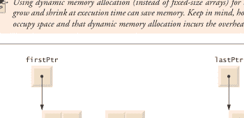

**图 20.2** | 链表的图形表示。

**性能提示 20.4**

对于在执行时增长和收缩的数据结构，使用动态内存分配（而不是固定大小的数组）可以节省内存。然而请记住，指针会占用空间，而且动态内存分配会带来函数调用的开销。

#### 链表实现

图 20.3-20.5 的程序使用 *List* 类模板（有关类模板的信息见第14章）来操作一个整数值链表和一个浮点值链表。驱动程序（图 20.5）提供五个选项：1）在开头插入一个值-


1）在链表开头插入一个值；2）在链表末尾插入一个值；3）从链表开头删除一个值；4）从链表末尾删除一个值；5）结束链表处理。下面将详细讨论该程序。练习 20.20 要求你实现一个递归函数，以逆序打印链表；练习 20.21 要求你实现一个递归函数，在链表中搜索特定的数据项。

该程序使用类模板 `ListNode`（图 20.3）和 `List`（图 20.4）。每个 `List` 对象中都封装了一个由 `ListNode` 对象组成的链表。类模板 `ListNode`（图 20.3）包含私有成员 `data` 和 `nextPtr`（第 19～20 行）、用于初始化这些成员的构造函数，以及用于返回节点中数据的函数 `getData`。成员 `data` 存储 `NODETYPE` 类型的值，`NODETYPE` 是传递给类模板的类型参数。成员 `nextPtr` 存储指向链表中下一个 `ListNode` 对象的指针。`ListNode` 类模板定义的第 13 行将 `List<NODETYPE>` 声明为友元类。这样，对于类模板 `List` 的某个特化版本，其所有成员函数都是类模板 `ListNode` 对应特化版本的友元，因此它们可以访问该类型 `ListNode` 对象的私有成员。由于友元声明中使用 `ListNode` 的模板参数 `NODETYPE` 作为 `List` 的模板实参，因此，使用某一特定类型特化的 `ListNode` 只能由使用相同类型特化的 `List` 进行处理（例如，`int` 值组成的 `List` 管理存储 `int` 值的 `ListNode` 对象）。

```cpp
// Fig. 20.3: ListNode.h
// Template ListNode class definition
#ifndef LISTNODE_H
#define LISTNODE_H

// forward declaration of class List required to announce that class
// List exists so it can be used in the friend declaration at line 13
template< typename NODETYPE > class List;

template< typename NODETYPE >
class ListNode
{
   friend class List< NODETYPE >; // make List a friend

public:
   ListNode( const NODETYPE & ); // constructor
   NODETYPE getData() const; // return data in node
private:
   NODETYPE data; // data
   ListNode< NODETYPE > *nextPtr; // next node in list
}; // end class ListNode

// constructor
template< typename NODETYPE>
ListNode< NODETYPE >::ListNode( const NODETYPE &info )
   : data( info ), nextPtr( 0 )
{
   // empty body
} // end ListNode constructor

// return copy of data in node
template< typename NODETYPE >
NODETYPE ListNode< NODETYPE >::getData() const
{
    return data;
} // end function getData

#endif
```

**图 20.3** | ListNode 类模板定义。（第 1 部分，共 2 部分。）

**图 20.3** | ListNode 类模板定义。（第 2 部分，共 2 部分。）

`List` 类模板（图 20.4）的第 23～24 行声明了私有数据成员 `firstPtr`（指向 `List` 中第一个 `ListNode` 的指针）和 `lastPtr`（指向 `List` 中最后一个 `ListNode` 的指针）。默认构造函数（第 31～36 行）将两个指针都初始化为 0（空指针）。析构函数（第 39～59 行）确保当某个 `List` 对象被销毁时，该 `List` 对象中的所有 `ListNode` 对象也会被销毁。`List` 的主要函数包括 `insertAtFront`（第 62～74 行）、`insertAtBack`（第 77～89 行）、`removeFromFront`（第 92～110 行）和 `removeFromBack`（第 113～140 行）。

函数 `isEmpty`（第 143～147 行）称为谓词函数——它不会修改 `List`，而是判断 `List` 是否为空（即，指向 `List` 第一个节点的指针是否为空）。如果 `List` 为空，则返回 true；否则返回 false。函数 `print`（第 158～178 行）显示 `List` 的内容。实用函数 `getNewNode`（第 150～155 行）返回一个动态分配的 `ListNode` 对象。该函数由函数 `insertAtFront` 和 `insertAtBack` 调用。

> **错误预防提示 20.1**
>
> 将 `null`（0）赋给新节点的链接成员。指针在使用前必须进行初始化。

```cpp
// Fig. 20.4: List.h
// Template List class definition.
#ifndef LIST_H
#define LIST_H

#include <iostream>
#include "ListNode.h" // ListNode class definition
using namespace std;

template< typename NODETYPE >
class List
{
public:
    List(); // constructor
    ~List(); // destructor
    void insertAtFront( const NODETYPE & );
    void insertAtBack( const NODETYPE & );
    bool removeFromFront( NODETYPE & );
    bool removeFromBack( NODETYPE & );
```

**图 20.4** | List 类模板定义。（第 1 部分，共 5 部分。）

```cpp
72        firstPtr = newPtr; // aim firstPtr at new node
73    } // end else
74 } // end function insertAtFront
75
76 // insert node at back of list
77 template< typename NODETYPE >
78 void List< NODETYPE >::insertAtBack( const NODETYPE &value )
79 {
80    ListNode< NODETYPE > *newPtr = getNewNode( value ); // new node
81
82    if ( isEmpty() ) // List is empty
83       firstPtr = lastPtr = newPtr; // new list has only one node
84    else // List is not empty
85    {
86       lastPtr->nextPtr = newPtr; // update previous last node
87       lastPtr = newPtr; // new last node
88    } // end else
89 } // end function insertAtBack
90
91 // delete node from front of list
92 template< typename NODETYPE >
93 bool List< NODETYPE >::removeFromFront( NODETYPE &value )
94 {
95    if ( isEmpty() ) // List is empty
96       return false; // delete unsuccessful
97    else
98    {
99       ListNode< NODETYPE > *tempPtr = firstPtr; // hold tempPtr to delete
100
101      if ( firstPtr == lastPtr )
102         firstPtr = lastPtr = 0; // no nodes remain after removal
103      else
104         firstPtr = firstPtr->nextPtr; // point to previous 2nd node
105
106      value = tempPtr->data; // return data being removed
107      delete tempPtr; // reclaim previous front node
108      return true; // delete successful
109   } // end else
110 } // end function removeFromFront
111
112 // delete node from back of list
113 template< typename NODETYPE >
114 bool List< NODETYPE >::removeFromBack( NODETYPE &value )
115 {
116    if ( isEmpty() ) // List is empty
117       return false; // delete unsuccessful
118    else
119    {
120       ListNode< NODETYPE > *tempPtr = lastPtr; // hold tempPtr to delete
121
122      if ( firstPtr == lastPtr ) // List has one element
123         firstPtr = lastPtr = 0; // no nodes remain after removal
124        else
125        {
126            ListNode< NODETYPE > *currentPtr = firstPtr;
127
128            // locate second-to-last element
129            while ( currentPtr->nextPtr != lastPtr )
130                currentPtr = currentPtr->nextPtr; // move to next node
131
132            lastPtr = currentPtr; // remove last node
133            currentPtr->nextPtr = 0; // this is now the last node
134        } // end else
135
136        value = tempPtr->data; // return value from old last node
137        delete tempPtr; // reclaim former last node
138        return true; // delete successful
139    } // end else
140 } // end function removeFromBack
141
142 // is List empty?
143 template< typename NODETYPE >
144 bool List< NODETYPE >::isEmpty() const
145 {
146     return firstPtr == 0;
147 } // end function isEmpty
148
149 // return pointer to newly allocated node
150 template< typename NODETYPE >
151 ListNode< NODETYPE > *List< NODETYPE >::getNewNode(
152     const NODETYPE &value )
153 {
154     return new ListNode< NODETYPE >( value );
155 } // end function getNewNode
156
157 // display contents of List
158 template< typename NODETYPE >
159 void List< NODETYPE >::print() const
160 {
161     if ( isEmpty() ) // List is empty
162     {
163         cout << "The list is empty\n\n";
164         return;
165     } // end if
166
167     ListNode< NODETYPE > *currentPtr = firstPtr;
168
169     cout << "The list is: ";
170
171     while ( currentPtr != 0 ) // get element data
172     {
173         cout << currentPtr->data << ' ';
174         currentPtr = currentPtr->nextPtr;
175     } // end while
176
```

**图 20.4** | List 类模板定义。（第 3 部分，共 5 部分。）


```cpp
177     cout << "\n\n";
178  } // end function print
179
180 #endif
```

图 20.4 | List 类模板定义。（第 5 部分，共 5 部分。）

在图 20.5 中，第 69 行和第 73 行分别创建了 int 和 double 类型的 List 对象。第 70 行和第 74 行调用 testList 函数模板来操作这些对象。

```cpp
1  // Fig. 20.5: Fig21_05.cpp
2  // List class test program.
3  #include <iostream>
4  #include <string>
5  #include "List.h" // List class definition
6  using namespace std;
7
8  // display program instructions to user
9  void instructions()
10 {
11     cout << "Enter one of the following:\n"
12          << "  1 to insert at beginning of list\n"
13          << "  2 to insert at end of list\n"
14          << "  3 to delete from beginning of list\n"
15          << "  4 to delete from end of list\n"
16          << "  5 to end list processing\n";
17 } // end function instructions
18
19 // function to test a List
20 template< typename T >
21 void testList( List< T > &listObject, const string &typeName )
22 {
23    cout << "Testing a List of " << typeName << " values\n";
24    instructions(); // display instructions
25
26    int choice; // store user choice
27    T value; // store input value
28
29    do // perform user-selected actions
30    {
31       cout << "? ";
32       cin >> choice;
33
34       switch ( choice )
35       {
36       case 1: // insert at beginning
37          cout << "Enter " << typeName << ": ";
38          cin >> value;
39          listObject.insertAtFront( value );
40          listObject.print();
41          break;
42        case 2: // insert at end
43            cout << "Enter " << typeName << ": ";
44            cin >> value;
45            listObject.insertAtBack( value );
46            listObject.print();
47            break;
48        case 3: // remove from beginning
49            if ( listObject.removeFromFront( value ) )
50                cout << value << " removed from list\n";
51
52            listObject.print();
53            break;
54        case 4: // remove from end
55            if ( listObject.removeFromBack( value ) )
56                cout << value << " removed from list\n";
57
58            listObject.print();
59            break;
60        } // end switch
61    } while ( choice < 5 ); // end do...while
62
63    cout << "End list test\n\n";
64 } // end function testList
65
66 int main()
67 {
68    // test List of int values
69    List< int > integerList;
70    testList( integerList, "integer" );
71
72    // test List of double values
73    List< double > doubleList;
74    testList( doubleList, "double" );
75 } // end main
```

图 20.5 | 操作链表。（第 1 部分，共 4 部分。）

图 20.5 | 操作链表。（第 2 部分，共 4 部分。）

```text
Testing a List of integer values
Enter one of the following:
 1 to insert at beginning of list
 2 to insert at end of list
 3 to delete from beginning of list
 4 to delete from end of list
 5 to end list processing
? 1
Enter integer: 1
The list is: 1

? 1
Enter integer: 2
The list is: 2 1

? 2
Enter integer: 3
The list is: 2 1 3
? 2
Enter integer: 4
The list is: 2 1 3 4

? 3
2 removed from list
The list is: 1 3 4

? 3
1 removed from list
The list is: 3 4

? 4
4 removed from list
The list is: 3

? 4
3 removed from list
The list is empty

? 5
End list test

Testing a List of double values
Enter one of the following:
  1 to insert at beginning of list
  2 to insert at end of list
  3 to delete from beginning of list
  4 to delete from end of list
  5 to end list processing
? 1
Enter double: 1.1
The list is: 1.1

? 1
Enter double: 2.2
The list is: 2.2 1.1

? 2
Enter double: 3.3
The list is: 2.2 1.1 3.3

? 2
Enter double: 4.4
The list is: 2.2 1.1 3.3 4.4

? 3
2.2 removed from list
The list is: 1.1 3.3 4.4

? 3
1.1 removed from list
The list is: 3.3 4.4

? 4
4.4 removed from list
The list is: 3.3
```

图 20.5 | 操作链表。（第 2 部分，共 4 部分。）

图 20.5 | 操作链表。（第 3 部分，共 4 部分。）

## *成员函数 `insertAtBack`*

函数 `insertAtBack`（图 20.4，第 77–89 行）在链表末尾放置一个新节点。该函数包含以下几个步骤：

1. 调用函数 `getNewNode`（第 80 行），向它传递 `value`，`value` 是要插入的新值的常量引用。

图 20.7 演示了一次 `insertAtBack` 操作。图中的 (a) 部分显示了操作前的链表和新节点。(b) 部分中的虚线箭头演示了函数 `insertAtBack` 的第 4 步，该步骤使新节点能够添加到非空链表的末尾。

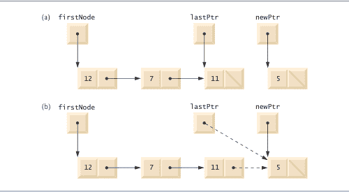

**图 20.7** | 以图形方式表示的 `insertAtBack` 操作。

## *成员函数 `removeFromFront`*

函数 `removeFromFront`（图 20.4，第 92–110 行）删除链表的前端节点，并将节点值复制到引用参数。如果试图从空链表中删除节点（第 95–96 行），该函数返回 false；如果删除成功，则返回 true。该函数包含以下几个步骤：

1. 将 `tempPtr` 赋值为 `firstPtr` 所指向的地址（第 99 行）。最终，`tempPtr` 将用于删除被移除的节点。
2. 如果 `firstPtr` 等于 `lastPtr`（第 101 行），即链表在删除操作之前只有一个元素，则将 `firstPtr` 和 `lastPtr` 设置为零（第 102 行），从而将该节点从链表中移除（使链表为空）。
3. 如果链表在删除之前有多个节点，则保持 `lastPtr` 不变，并将 `firstPtr` 设置为 `firstPtr->nextPtr`（第 104 行）；即修改 `firstPtr` 使其指向删除之前的第二个节点（现在是新的第一个节点）。
4. 完成所有这些指针操作后，将正在删除的节点的数据成员复制到引用参数 `value`（第 106 行）。
5. 现在删除 `tempPtr` 指向的节点（第 107 行）。
6. 返回 true，表示删除成功（第 108 行）。

图 20.8 演示了函数 removeFromFront。(a) 部分演示了删除操作前的链表。(b) 部分显示了从非空链表删除前端节点时的实际指针操作。

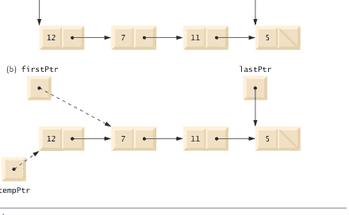

图 20.8 | 以图形方式表示的 removeFromFront 操作。

## 成员函数 removeFromBack

函数 removeFromBack（图 20.4，第 113–140 行）删除链表的末尾节点，并将节点值复制到引用参数。如果试图从空链表中删除节点（第 116–117 行），该函数返回 false；如果删除成功，则返回 true。该函数包含以下几个步骤：

1. 将 `tempPtr` 赋值为 `lastPtr` 所指向的地址（第 120 行）。最终，`tempPtr` 将用于删除被移除的节点。

该函数打印链表并输出每个节点中的值。函数将 `currentPtr` 初始化为 `firstPtr` 的副本（第 167 行），然后打印字符串 `"The list is: "`（第 169 行）。当 `currentPtr` 不为 null（第 171 行）时，打印 `currentPtr->data`（第 173 行），并将 `currentPtr` 赋值为 `currentPtr->nextPtr`（第 174 行）。注意，如果链表中最后一个节点的链接不为 null，打印算法将错误地尝试打印超过链表末尾的内容。该打印算法对于链表、栈和队列是相同的（因为我们基于相同的链表基础结构实现这些数据结构）。

## *循环链表和双向链表*

我们一直在讨论的链表类型是单向链表——链表以一个指向第一个节点的指针开始，每个节点包含一个指向“顺序”中下一个节点的指针。该链表以一个指针成员值为 0 的节点结束。单向链表只能沿一个方向遍历。

循环单向链表（图 20.10）以一个指向第一个节点的指针开始，每个节点包含一个指向下一个节点的指针。“最后一个节点”不包含 0 指针；相反，最后一个节点中的指针指回第一个节点，从而形成“环”。

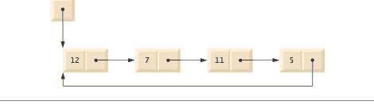

**图 20.10** | 循环单向链表。

双向链表（图 20.11）允许向前和向后遍历。这种链表通常用两个“起始指针”实现——一个指向链表的第一个元素，以便从头到尾遍历链表；另一个指向最后一个元素，以便从尾到头遍历链表。每个节点都有一个前向指针，指向列表中沿前向方向的下一个节点；还有一个后向指针，指向列表中沿后向方向的下一个节点。例如，如果你的列表包含一个按字母顺序排列的电话号码簿，搜索姓名以字母表前部附近的字母开头的人可能会

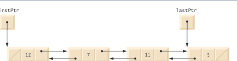

**图 20.11** | 双向链表。


从列表前端开始。搜索名字以字母表末尾附近字母开头的人时，可以从列表后端开始。

在循环双向链表（图 20.12）中，最后一个节点的前向指针指向第一个节点，第一个节点的后向指针指向最后一个节点，从而闭合这个“环”。

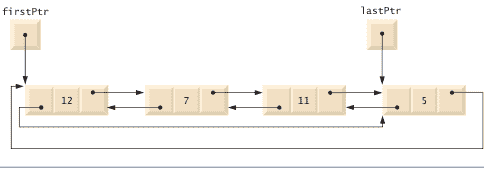

图 20.12 | 循环双向链表。

## 20.5 栈

第14章“模板”解释了具有底层数组实现的栈类模板的概念。本节中，我们使用基于指针的链表实现作为底层实现。我们还会在第22章“标准模板库（STL）”中讨论栈。

栈数据结构只允许在栈顶向栈中添加节点和从栈中删除节点。因此，栈被称为后进先出（LIFO）数据结构。实现栈的一种方式是将其作为链表的受限版本。在这种实现中，栈中最后一个节点的链接成员被设置为空（零），以表示栈底。

用于操作栈的主要成员函数是 push 和 pop。函数 push 在栈顶插入一个新节点。函数 pop 从栈顶删除一个节点，将弹出的值存储在传递给调用函数的引用变量中，并在弹出操作成功时返回 true（否则返回 false）。

栈有许多有趣的应用。例如，当进行函数调用时，被调用函数必须知道如何返回其调用者，因此返回地址被压入栈中。如果发生一系列函数调用，连续的返回地址值按后进先出顺序压入栈中，以便每个函数都能返回其调用者。栈以与传统非递归调用相同的方式支持递归函数调用。第6.11节详细讨论函数调用栈。

栈为函数每次调用时的自动变量提供内存，并存储这些变量的值。当函数返回其调用者或抛出异常时，会调用每个局部对象的析构函数（如果有），该函数的自动变量所占空间从栈中弹出，这些变量对程序而言不再可见。

编译器在表达式求值和生成机器语言代码的过程中使用栈。习题探讨了栈的几种应用，包括使用栈开发你自己的完整可运行的编译器。

我们将利用链表与栈之间的密切关系，主要通过复用 List 类来实现栈类。首先，我们通过私有继承 List 类来实现栈类。然后，我们通过将 List 类作为栈类的私有成员进行组合，实现一个行为相同的栈类。当然，本章中的所有数据结构（包括这两个栈类）都实现为模板，以促进进一步的可复用性。

图 20.13–20.14 的程序主要通过私有继承（第9行）图 20.4 的 List 类模板来创建 Stack 类模板（图 20.13）。我们希望 Stack 具有成员函数 push（第13–16行）、pop（第19–22行）、isStackEmpty（第25–28行）和 printStack（第31–34行）。注意，这些本质上就是 List 类模板的 insertAtFront、removeFromFront、isEmpty 和 print 函数。当然，List 类模板还包含其他成员函数（即 insertAtBack 和 removeFromBack），我们不会通过 Stack 类的公共接口使它们可访问。因此，当我们指明 Stack 类模板要从 List 类模板继承时，我们指定私有继承。这会使 List 类模板的所有成员函数在 Stack 类模板中成为私有成员。在实现 Stack 的成员函数时，我们让这些函数分别调用 List 类的相应成员函数——push 调用 insertAtFront（第15行），pop 调用 removeFromFront（第21行），isStackEmpty 调用 isEmpty（第27行），printStack 调用 print（第33行）——这称为委托。

```cpp
// Fig. 20.13: Stack.h
// Template Stack class definition derived from class List.
#ifndef STACK_H
#define STACK_H

#include "List.h" // List class definition

template< typename STACKTYPE >
class Stack : private List< STACKTYPE >
{
public:
   // push calls the List function insertAtFront
   void push( const STACKTYPE &data )
   {
      insertAtFront( data );
   } // end function push

   // pop calls the List function removeFromFront
   bool pop( STACKTYPE &data )
   {
      return removeFromFront( data );
   } // end function pop

   // isStackEmpty calls the List function isEmpty
   bool isStackEmpty() const
   {
      return this->isEmpty();
   } // end function isStackEmpty
```

图 20.13  |  Stack 类模板定义。（第1部分，共2部分。）

```text
The list is: 3.3 2.2 1.1
3.3 popped from stack
The list is: 2.2 1.1
2.2 popped from stack
The list is: 1.1
1.1 popped from stack
The list is empty
All nodes destroyed
All nodes destroyed
```

图 20.14 | 一个简单的栈程序。（第3部分，共3部分。）

实现 Stack 类模板的另一种方式是通过组合复用 List 类模板。图 20.15 是 Stack 类模板的新实现，其中包含一个名为 stackList 的 List< STACKTYPE > 对象（第38行）。这个版本的 Stack 类模板使用图 20.4 中的 List 类。要测试这个类，请使用图 20.14 中的驱动程序，但在该文件的第6行包含新的头文件——Stackcomposition.h。对于两个版本的 Stack 类，程序的输出完全相同。

```cpp
// Fig. 20.15: Stackcomposition.h
// Template Stack class definition with composed List object.
#ifndef STACKCOMPOSITION_H
#define STACKCOMPOSITION_H

#include "List.h" // List class definition

template< typename STACKTYPE >
class Stack
{
public:
   // no constructor; List constructor does initialization

   // push calls stackList object's insertAtFront member function
   void push( const STACKTYPE &data )
   {
      stackList.insertAtFront( data );
   } // end function push

   // pop calls stackList object's removeFromFront member function
   bool pop( STACKTYPE &data )
   {
      return stackList.removeFromFront( data );
   } // end function pop

   // isStackEmpty calls stackList object's isEmpty member function
   bool isStackEmpty() const
   {
      return stackList.isEmpty();
   } // end function isEmpty

   // printStack calls stackList object's print member function
   void printStack() const
   {
      stackList.print();
   } // end function printStack

private:
   List< STACKTYPE > stackList; // composed List object
}; // end class Stack
#endif
```

图 20.15 | 含组合 List 对象的 Stack 类模板。（第1部分，共2部分。）

图 20.15 | 含组合 List 对象的 Stack 类模板。（第2部分，共2部分。）

## 20.6 队列

队列类似于超市结账队伍——排在第一位的人先得到服务，其他顾客从队尾加入队伍并等待服务。队列节点只从队列头部删除，并且只插入到队列尾部。因此，队列被称为先进先出（FIFO）数据结构。插入和删除操作称为入队（enqueue）和出队（dequeue）。

队列在计算机系统中有许多应用。具有单处理器的计算机一次只能服务一个用户。其他用户的条目被放入队列。随着用户得到服务，每个条目逐渐前进到队列前端。队列前端的条目是下一个接受服务的条目。

队列还用于支持打印假脱机。例如，一台打印机可能由网络中的所有用户共享。许多用户可以将打印作业发送到打印机，即使打印机已经忙碌。这些打印作业被放入队列，直到打印机可用。一个称为假脱机程序的程序管理该队列，以确保每当一个打印作业完成时，下一个打印作业被发送到打印机。

数据包在计算机网络中也会在队列中等待。每当一个数据包到达网络节点时，必须沿着通往该包最终目的地的路径将其路由到网络上的下一个节点。路由节点一次路由一个数据包，因此额外的数据包会入队，直到路由器能够路由它们。

计算机网络中的文件服务器处理来自整个网络中许多客户端的文件访问请求。服务器服务客户端请求的能力有限。当超出该容量时，客户端请求会在队列中等待。

图 20.16–20.17 的程序通过私有继承（第9行）图 20.4 的 List 类模板来创建 Queue 类模板（图 20.16）。Queue 具有成员函数 enqueue（第13–16行）、dequeue（第19–22行）、isEmptyQueue（第25–28行）和 printQueue（第31–34行）。这些本质上就是 List 类模板的 insertAtBack、removeFront、isEmpty 和 print 函数。当然，List 类模板还包含其他成员函数，我们不希望它们通过 Queue 类的公共接口变得可访问。因此，当我们指明 Queue 类模板要继承 List 类模板时，我们指定私有继承。这会使 List 类模板的所有成员函数在 Queue 类模板中成为私有成员。当

我们实现 Queue 的成员函数；我们让每个成员函数都调用 list 类中相应的成员函数——enqueue 调用 insertAtBack（第 15 行），dequeue 调用 removeFromFront（第 21 行），isQueueEmpty 调用 isEmpty（第 27 行），printQueue 调用 print（第 33 行）。与图 20.13 中的 Stack 示例一样，这种委托要求在 isQueueEmpty 和 printQueue 中显式使用 this 指针，以避免编译错误。

```cpp
1  // Fig. 20.16: Queue.h
2  // Template Queue class definition derived from class List.
3  #ifndef QUEUE_H
4  #define QUEUE_H
5
6  #include "List.h" // List class definition
7
8  template< typename QUEUETYPE >
9  class Queue : private List< QUEUETYPE >
10 {
11 public:
12    // enqueue calls List member function insertAtBack
13    void enqueue( const QUEUETYPE &data )
14    {
15       insertAtBack( data );
16    } // end function enqueue
17
18    // dequeue calls List member function removeFromFront
19    bool dequeue( QUEUETYPE &data )
20    {
21       return removeFromFront( data );
22    } // end function dequeue
23
24    // isQueueEmpty calls List member function isEmpty
25    bool isQueueEmpty() const
26    {
27       return this->isEmpty();
28    } // end function isQueueEmpty
29
30    // printQueue calls List member function print
31    void printQueue() const
32    {
33       this->print();
34    } // end function printQueue
35 }; // end class Queue
36
37 #endif
```

**图 20.16** | Queue 类模板定义。

图 20.17 使用 Queue 类模板来实例化类型为 `Queue< int >` 的整数队列 intQueue（第 9 行）。整数 0 到 2 被入队到 intQueue（第 14–18 行），然后按先进先出顺序从 intQueue 出队（第 23–28 行）。接下来，程序实例化类型为 `Queue< double >` 的队列 doubleQueue（第 30 行）。值 1.1、2.2 和 3.3 被入队到 doubleQueue（第 36–41 行），然后按先进先出顺序从 doubleQueue 出队（第 46–51 行）。

```cpp
// Fig. 20.17: Fig20_17.cpp
// Template Queue class test program.
#include <iostream>
#include "Queue.h" // Queue class definition
using namespace std;

int main()
{
   Queue< int > intQueue; // create Queue of integers

   cout << "processing an integer Queue" << endl;

   // enqueue integers onto intQueue
   for ( int i = 0; i < 3; i++ )
   {
      intQueue.enqueue( i );
      intQueue.printQueue();
   } // end for

   int dequeueInteger; // store dequeued integer

   // dequeue integers from intQueue
   while ( !intQueue.isQueueEmpty() )
   {
      intQueue.dequeue( dequeueInteger );
      cout << dequeueInteger << " dequeued" << endl;
      intQueue.printQueue();
   } // end while

   Queue< double > doubleQueue; // create Queue of doubles
   double value = 1.1;

   cout << "processing a double Queue" << endl;

   // enqueue floating-point values onto doubleQueue
   for ( int j = 0; j < 3; j++ )
   {
      doubleQueue.enqueue( value );
      doubleQueue.printQueue();
      value += 1.1;
   } // end for

   double dequeueDouble; // store dequeued double

   // dequeue floating-point values from doubleQueue
   while ( !doubleQueue.isQueueEmpty() )
   {
      doubleQueue.dequeue( dequeueDouble );
      cout << dequeueDouble << " dequeued" << endl;
      doubleQueue.printQueue();
   } // end while
} // end main
```

**图 20.17** | 队列处理程序。（第 1 部分，共 2 部分。）

```
processing an integer Queue
The list is: 0

The list is: 0 1

The list is: 0 1 2

0 dequeued
The list is: 1 2

1 dequeued
The list is: 2

2 dequeued
The list is empty

processing a double Queue
The list is: 1.1

The list is: 1.1 2.2

The list is: 1.1 2.2 3.3

1.1 dequeued
The list is: 2.2 3.3

2.2 dequeued
The list is: 3.3

3.3 dequeued
The list is empty

All nodes destroyed

All nodes destroyed
```

**图 20.17** | 队列处理程序。（第 2 部分，共 2 部分。）

## 20.7 树

链表、栈和队列是线性数据结构。树是一种非线性、二维数据结构。树节点包含两个或更多链接。本节讨论二叉树（图 20.18）——其节点都包含两个链接（可能没有链接、一个链接，或两个链接均为空）的树。

### 基本术语

在本次讨论中，请参考图 20.18 中的节点 A、B、C 和 D。根节点（节点 B）是树中的第一个节点。根节点中的每个链接都指向一个子节点（节点 A 和 D）。左子节点（节点 A）是左子树的根节点（左子树仅包含节点 A），右子节点（节点 D）是右子树的根节点（右子树包含节点 D 和 C）。给定节点的子节点称为兄弟节点（例如，节点 A 和 D 是兄弟节点）。没有子节点的节点是叶节点（例如，节点 A 和 C 是叶节点）。计算机科学家通常从根节点开始绘制树——这与自然界中树的生长方式相反。

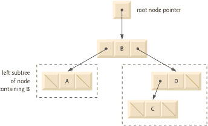

**图 20.18** | 二叉树的图形表示。

### 二叉搜索树

二叉搜索树（节点值不重复）具有这样的特性：任意左子树中的值都小于其父节点中的值，任意右子树中的值都大于其父节点中的值。图 20.19 展示了一棵包含 9 个值的二叉搜索树。请注意，与一组数据对应的二叉搜索树的形状可能有所不同，具体取决于这些值插入树中的顺序。


**图 20.19** | 一棵二叉搜索树。

### 实现二叉搜索树程序

图 20.20–20.22 中的程序创建一棵二叉搜索树，并以三种方式遍历它（即遍历其所有节点）——使用递归的中序、前序和后序遍历。我们很快会解释这些遍历算法。

我们从驱动程序（图 20.22）开始讨论，然后继续介绍类 Node（图 20.20）和类 Tree（图 20.21）的实现。函数 main（图 20.22）首先实例化类型为 `Tree<int>` 的整数树 intTree（第 10 行）。程序提示输入 10 个整数，每个整数都通过调用 insertNode（第 19 行）插入到二叉搜索树中。然后，程序分别对 intTree 执行前序、中序和后序遍历（这些遍历很快会解释）（第 23、26 和 29 行）。接着，程序实例化类型为 `Tree<double>` 的浮点树 doubleTree（第 31 行）。程序提示输入 10 个 double 值，每个值都会被插入到二叉

```cpp
// Tree class-template definition
template< typename NODETYPE > class Tree
{
public:
   Tree(); // constructor
   void insertNode( const NODETYPE & );
   void preOrderTraversal() const;
   void inOrderTraversal() const;
   void postOrderTraversal() const;
private:
   TreeNode< NODETYPE > *rootPtr;

   // utility functions
   void insertNodeHelper( TreeNode< NODETYPE > *&, const NODETYPE & );
   void preOrderHelper( TreeNode< NODETYPE > * ) const;
   void inOrderHelper( TreeNode< NODETYPE > * ) const;
   void postOrderHelper( TreeNode< NODETYPE > * ) const;
}; // end class Tree

// constructor
template< typename NODETYPE >
Tree< NODETYPE >::Tree()
{
   rootPtr = 0; // indicate tree is initially empty
} // end Tree constructor

// insert node in Tree
template< typename NODETYPE >
void Tree< NODETYPE >::insertNode( const NODETYPE &value )
{
   insertNodeHelper( &rootPtr, value );
} // end function insertNode

// utility function called by insertNode; receives a pointer
// to a pointer so that the function can modify pointer's value
template< typename NODETYPE >
void Tree< NODETYPE >::insertNodeHelper(
   TreeNode< NODETYPE > *&ptr, const NODETYPE &value )
{
   // subtree is empty; create new TreeNode containing value
   if ( ptr == 0 )
      ptr = new TreeNode< NODETYPE >( value );
   else // subtree is not empty
   {
      // data to insert is less than data in current node
      if ( value < ( ptr )->data )
         insertNodeHelper( &( ptr )->leftPtr, value );
      else
      {
         // data to insert is greater than data in current node
         if ( value > ( ptr )->data )
            insertNodeHelper( &( ptr )->rightPtr, value );
      }
   }
}
```

**图 20.21** | Tree 类模板定义。（第 2 部分，共 4 部分。）


```cpp
62        else // duplicate data value ignored
63            cout << value << " dup" << endl;
64        } // end else
65    } // end else
66 } // end function insertNodeHelper
67
68 // begin preorder traversal of Tree
69 template< typename NODETYPE >
70 void Tree< NODETYPE >::preOrderTraversal() const
71 {
72     preOrderHelper( rootPtr );
73 } // end function preOrderTraversal
74
75 // utility function to perform preorder traversal of Tree
76 template< typename NODETYPE >
77 void Tree< NODETYPE >::preOrderHelper( TreeNode< NODETYPE > *ptr ) const
78 {
79     if ( ptr != 0 )
80     {
81         cout << ptr->data << ' '; // process node
82         preOrderHelper( ptr->leftPtr ); // traverse left subtree
83         preOrderHelper( ptr->rightPtr ); // traverse right subtree
84     } // end if
85 } // end function preOrderHelper
86
87 // begin inorder traversal of Tree
88 template< typename NODETYPE >
89 void Tree< NODETYPE >::inOrderTraversal() const
90 {
91     inOrderHelper( rootPtr );
92 } // end function inOrderTraversal
93
94 // utility function to perform inorder traversal of Tree
95 template< typename NODETYPE >
96 void Tree< NODETYPE >::inOrderHelper( TreeNode< NODETYPE > *ptr ) const
97 {
98     if ( ptr != 0 )
99     {
100        inOrderHelper( ptr->leftPtr ); // traverse left subtree
101        cout << ptr->data << ' '; // process node
102        inOrderHelper( ptr->rightPtr ); // traverse right subtree
103    } // end if
104 } // end function inOrderHelper
105
106 // begin postorder traversal of Tree
107 template< typename NODETYPE >
108 void Tree< NODETYPE >::postOrderTraversal() const
109 {
110     postOrderHelper( rootPtr );
111 } // end function postOrderTraversal
112
113 // utility function to perform postorder traversal of Tree
114 template< typename NODETYPE >
115 void Tree< NODETYPE >::postOrderHelper(
116    TreeNode< NODETYPE > *ptr ) const
117 {
118    if ( ptr != 0 )
119    {
120       postOrderHelper( ptr->leftPtr ); // traverse left subtree
121       postOrderHelper( ptr->rightPtr ); // traverse right subtree
122       cout << ptr->data << ' '; // process node
123    } // end if
124 } // end function postOrderHelper
125
126 #endif
```

图 20.21 | Tree 类模板定义。（第 3 部分，共 4 部分。）

图 20.21 | Tree 类模板定义。（第 4 部分，共 4 部分。）

```cpp
1 // Fig. 20.22: Fig20_22.cpp
2 // Tree class test program.
3 #include <iostream>
4 #include <iomanip>
5 #include "Tree.h" // Tree class definition
6 using namespace std;
7
8 int main()
9 {
10    Tree< int > intTree; // create Tree of int values
11    int intValue;
12
13    cout << "Enter 10 integer values:\n";
14
15    // insert 10 integers into intTree
16    for ( int i = 0; i < 10; i++ )
17    {
18       cin >> intValue;
19       intTree.insertNode( intValue );
20    } // end for
21
22    cout << "\nPreorder traversal\n";
23    intTree.preOrderTraversal();
24
25    cout << "\nInorder traversal\n";
26    intTree.inOrderTraversal();
27
28    cout << "\nPostorder traversal\n";
29    intTree.postOrderTraversal();
30
31    Tree< double > doubleTree; // create Tree of double values
32    double doubleValue;
33
34    cout << fixed << setprecision( 1 )
35       << "\n\nEnter 10 double values:\n";
```

图 20.22 | 创建并遍历二叉树。（第 1 部分，共 2 部分。）

将指针 `leftPtr` 和 `rightPtr` 置零（从而将该节点初始化为叶节点）。成员函数 `getData`（第25–28行）返回数据值。

类模板 `Tree`（图20.21）具有私有数据 `rootPtr`（第20行），它是指向树根节点的指针。第15–18行声明了公有成员函数 `insertNode`（用于在树中插入新节点）以及 `preOrderTraversal`、`inOrderTraversal` 和 `postOrderTraversal`，每个函数都按指定方式遍历树。这些成员函数各自调用自己的递归工具函数，以便在树的内部表示上执行相应操作，因此程序无需访问底层私有数据即可执行这些功能。请记住，递归要求我们传入一个表示下一个待处理子树的指针。`Tree` 构造函数将 `rootPtr` 初始化为零，表示树初始为空。

Tree 类的工具函数 `insertNodeHelper`（第45–66行）由 `insertNode`（第37–41行）调用，以递归地将节点插入树中。*在二叉搜索树中，节点只能作为叶节点插入。* 如果树为空，则创建一个新的 `TreeNode`，初始化并将其插入树中（第51–52行）。

如果树不为空，程序将要插入的值与根节点中的数据值进行比较。如果插入值较小（第55行），程序递归调用 `insertNodeHelper`（第56行）将该值插入左子树。如果插入值较大（第60行），程序递归调用 `insertNodeHelper`（第61行）将该值插入右子树。如果要插入的值与根节点中的数据值相同，程序打印消息 `"dup"`（第63行）并返回，不将重复值插入树中。注意，`insertNode` 将 `rootPtr` 的地址传给 `insertNodeHelper`（第40行），以便它可以修改存储在 `rootPtr` 中的值（即根节点的地址）。为了接收指向 `rootPtr` 的指针（它本身也是一个指针），`insertNodeHelper` 的第一个参数被声明为指向 `TreeNode` 的指针的指针。

成员函数 `inOrderTraversal`（第88–92行）、`preOrderTraversal`（第69–73行）和 `postOrderTraversal`（第107–111行）遍历树并打印节点值。为便于以下讨论，我们使用图20.23中的二叉搜索树。


**图 20.23**  |  二叉搜索树。

### 中序遍历算法

函数 `inOrderTraversal` 调用工具函数 `inOrderHelper` 来执行二叉搜索树的中序遍历。中序遍历的步骤如下：

- 1. 用中序遍历遍历左子树。（这由第100行对 `inOrderHelper` 的调用来执行。）
- 2. 处理节点中的值——即打印节点值（第101行）。
- 3. 用中序遍历遍历右子树。（这由第102行对 `inOrderHelper` 的调用来执行。）

在左子树中的值被处理之前，不会处理节点中的值，因为每次调用 `inOrderHelper` 都会立即用指向左子树的指针再次调用 `inOrderHelper`。图20.23中树的中序遍历为

```
6  13  17  27  33  42  48
```

注意，二叉搜索树的中序遍历按升序打印节点值。创建二叉搜索树的过程实际上对数据进行了排序——因此，这一过程称为二叉树排序。

### 前序遍历算法

函数 `preOrderTraversal` 调用工具函数 `preOrderHelper` 来执行二叉树的前序遍历。前序遍历的步骤如下：

- 1. 处理节点中的值（第81行）。
- 2. 用前序遍历遍历左子树。（这由第82行对 `preOrderHelper` 的调用来执行。）
- 3. 用前序遍历遍历右子树。（这由第83行对 `preOrderHelper` 的调用来执行。）

访问节点时处理每个节点中的值。处理完给定节点中的值后，处理左子树中的值。然后处理右子树中的值。图20.23中树的前序遍历为

```
27  13  6  17  42  33  48
```

### 后序遍历算法

函数 `postOrderTraversal` 调用工具函数 `postOrderHelper` 来执行二叉树的后序遍历。后序遍历的步骤如下：

- 1. 用后序遍历遍历左子树。（这由第120行对 `postOrderHelper` 的调用来执行。）
- 2. 用后序遍历遍历右子树。（这由第121行对 `postOrderHelper` 的调用来执行。）
- 3. 处理节点中的值（第122行）。

直到其子节点的值被打印后，才会打印每个节点中的值。图20.23中树的后序遍历为

```
6  17  13  33  48  42  27
```

### 重复值消除

二叉搜索树便于消除重复值。在创建树的过程中，尝试插入重复值会被识别出来，因为重复值在每次比较时都会遵循与原值插入树中时相同的“向左走”或“向右走”决策。因此，重复值最终会与包含相同值的节点进行比较。此时可以丢弃重复值。

在二叉树中搜索与键值匹配的值也很快。如果树是平衡的，那么每个分支大约包含树中一半数量的节点。每次将节点与搜索键比较都会排除一半节点。这称为 O(log n) 算法（大O表示法在第19章讨论）。因此，具有 n 个元素的二叉搜索树


## 第20.3节 动态内存分配和数据结构

- 动态内存分配的上限可以大到计算机中可用的物理内存量，或虚拟内存系统中可用的虚拟内存量。

## 第20.4节 链表

- 链表是由指针链接连接起来的、称为节点的自引用类对象的线性集合——因此称为“链表”。
- 通过指向链表第一个节点的指针访问链表。每个后续节点通过前一个节点中存储的链接指针成员访问。
- 链表、栈和队列是线性数据结构。树是非线性数据结构。
- 当要表示的数据元素数量不可预测时，链表是合适的。
- 链表是动态的，因此链表的长度可以根据需要增加或减少。
- 单链表以指向第一个节点的指针开始，每个节点包含指向“按顺序”的下一个节点的指针。
- 循环单链表以指向第一个节点的指针开始，每个节点包含指向下一个节点的指针。“最后一个节点”不包含空指针；相反，最后一个节点中的指针指回第一个节点，从而闭合“环”。
- 双向链表允许向前和向后遍历。
- 双向链表通常用两个“起始指针”实现——一个指向第一个元素，以便对链表进行从前到后的遍历；另一个指向最后一个元素，以便进行从后到前的遍历。每个节点都有分别指向下一个节点和前一个节点的指针。
- 在循环双链表中，最后一个节点的前向指针指向第一个节点，第一个节点的后向指针指向最后一个节点，从而闭合“环”。

## 第20.5节 栈

- 栈数据结构只允许在栈顶添加节点和从栈顶移除节点。
- 栈被称为后进先出（LIFO）数据结构。
- 用于操作栈的主要成员函数是push和pop。函数push在栈顶插入新节点。函数pop从栈顶移除节点。
- 依赖名是依赖于模板参数值的标识符。依赖名的解析发生在模板实例化时。
- 非依赖名在定义模板的位置解析。

## 第20.6节 队列

- 队列类似于超市结账队伍——排在第一位的人先得到服务，其他顾客从队尾进入队伍并等待服务。
- 队列节点只从队头移除，并且只插入队尾。
- 队列被称为先进先出（FIFO）数据结构。插入和移除操作称为入队（enqueue）和出队（dequeue）。

## 第20.7节 树

- 二叉树是每个节点都包含两个链接的树（这两个链接可以都为空、一个为空或都不为空）。
- 根节点是树中的第一个节点。
- 根节点中的每个链接都指向一个孩子。左孩子是左子树的根节点，右孩子是右子树的根节点。
- 同一节点的孩子称为兄弟。没有孩子的节点称为叶节点。

- b) ________运算符用于动态分配内存并构造对象；该运算符返回指向该对象的指针。
- c) ________是链表的一种受限版本，其中只能从链表开头插入和删除节点，并且节点值按后进先出顺序返回。
- d) 不修改链表，而只查看链表以判断其是否为空的函数，是________函数的一个例子。
- e) 队列被称为________数据结构，因为最先插入的节点最先被移除。
- f) 链表中指向下一个节点的指针称为________。
- g) ________运算符用于销毁对象并释放动态分配的内存。
- h) ________是链表的一种受限版本，其中节点只能插入链表末尾，并且只能从链表开头删除。
- i) ________是一种非线性二维数据结构，包含具有两个或更多链接的节点。
- j) 栈被称为________数据结构，因为最后插入的节点最先被移除。
- k) ________树的节点包含两个链接成员。
- l) 树的第一个节点是________节点。
- m) 树节点中的每个链接都指向该节点的一个________或________。
- n) 没有孩子的树节点称为________节点。
- o) 我们在文中提到的二叉搜索树的四种遍历算法是________、________、________和________。

20.2 链表和栈之间有什么区别？

20.3 栈和队列之间有什么区别？

20.4 也许本章更合适的标题应该是“可复用数据结构”。请评论以下每个实体或概念如何促进数据结构的可复用性：

- a) 类
- b) 类模板
- c) 继承
- d) 私有继承
- e) 组合

20.5 手动给出图20.24的二叉搜索树的中序、前序和后序遍历。


图20.24 | 一棵15个节点的二叉搜索树。

- d) 函数pop，它从栈中弹出一个值
- e) 函数isEmpty，它判断栈是否为空
- f) 函数printStack，它打印栈

### **20.14** *（后缀表达式求值增强版）*

修改习题20.13的后缀表达式求值程序，使其能够处理大于9的整数操作数。

### **20.15** *（超市模拟）*

编写一个模拟超市结账队伍的程序。该队伍是一个队列对象。顾客（即顾客对象）以1–4分钟的随机整数间隔到达。此外，每位顾客以1–4分钟的随机整数间隔接受服务。显然，这些速率需要平衡。如果平均到达率大于平均服务率，队列将无限增长。即使速率“平衡”，随机性仍然可能导致长队。使用以下算法运行超市模拟，模拟12小时的一天（720分钟）：

- 1) 选择一个1到4之间的随机整数，以确定第一位顾客到达的分钟。
- 2) 在第一位顾客到达时：
  - 确定顾客的服务时间（1到4的随机整数）；
  - 开始为该顾客服务；
  - 安排下一位顾客的到达时间（将1到4的随机整数加到当前时间）。
- 3) 对于一天中的每一分钟：
  - 如果下一位顾客到达，
    - 说明这一情况，
    - 将该顾客入队，
    - 安排下一位顾客的到达时间；
  - 如果上一位顾客的服务已完成，
    - 说明这一情况，
    - 将下一位要服务的顾客出队，
    - 确定顾客的服务完成时间（将1到4的随机整数加到当前时间）。

现在运行模拟720分钟，并回答以下每个问题：

- a) 任意时刻队列中的最大顾客数是多少？
- b) 任意一位顾客经历的最长等待时间是多少？
- c) 如果到达间隔从1–4分钟改为1–3分钟，会发生什么？

### **20.16** *（允许二叉树中包含重复值）*

修改图20.20–20.22的程序，以允许二叉树对象包含重复值。

### **20.17** *（字符串二叉树）*

编写一个基于图20.20–20.22的程序，输入一行文本，将该句子分词为单独的单词（你可能想使用`istringstream`库类），将这些单词插入二叉搜索树，并打印该树的中序、前序和后序遍历。使用OOP方法。

### **20.18** *（重复项消除）*

在本章中，我们看到在创建二叉搜索树时消除重复项很直接。描述如何仅使用一维数组执行重复项消除。比较基于数组的重复项消除与基于二叉搜索树的重复项消除的性能。

### **20.19** *（二叉树的深度）*

编写一个接收二叉树并确定它有多少层的函数。

### **20.20** *（递归反向打印链表）*

编写一个成员函数`printListBackward`，递归地按相反顺序输出链表对象中的各项。编写一个测试程序，创建一个有序整数链表，并按相反顺序打印该链表。


## 20.21（递归搜索链表）

编写一个成员函数 `searchList`，它递归搜索链表对象中的指定值。如果找到该值，函数应返回指向该值的指针；否则应返回 null。在一个测试程序中使用该函数，该程序创建一个整数链表。程序应提示用户输入要在链表中查找的值。

## 20.22（二叉树删除）

从二叉搜索树中删除项并不像插入算法那样简单直接。删除项时会遇到三种情况——该项包含在叶节点中（即它没有子节点），该项包含在一个具有一个子节点的节点中，或者该项包含在一个具有两个子节点的节点中。

如果要删除的项包含在叶节点中，则删除该节点，并将父节点中的指针置为 null。

如果要删除的项包含在一个具有一个子节点的节点中，则将父节点中的指针设置为指向该子节点，并删除包含该数据项的节点。这会使该子节点在树中取代被删除的节点。

最后一种情况最困难。当删除一个具有两个子节点的节点时，树中的另一个节点必须取代它的位置。然而，不能将父节点中的指针赋值为指向待删除节点的某个子节点。在大多数情况下，得到的二叉搜索树将不遵循二叉搜索树的以下特性（无重复值）：*任意左子树中的值都小于父节点中的值，任意右子树中的值都大于父节点中的值。*

使用哪个节点作为替换节点来维持这一特性？可以是树中小于待删除节点值的最大值所在节点，也可以是树中大于待删除节点值的最小值所在节点。让我们考虑值较小的节点。在二叉搜索树中，小于父节点值的最大值位于该父节点的左子树中，并且一定包含在该子树的最右节点中。通过沿左子树向右下移动，直到当前节点的右子节点指针为 null，即可定位该节点。此时我们指向替换节点，它要么是叶节点，要么是一个左侧有一个子节点的节点。如果替换节点是叶节点，则执行删除的步骤如下：

- 1. 将指向待删除节点的指针存储在一个临时指针变量中（该指针用于删除动态分配的内存）。
- 2. 将待删除节点的父节点中的指针设置为指向替换节点。
- 3. 将替换节点的父节点中的指针置为 null。
- 4. 将替换节点中指向右子树的指针设置为指向待删除节点的右子树。
- 5. 删除临时指针变量所指向的节点。

对于带有左子节点的替换节点，其删除步骤与没有子节点的替换节点类似，但算法还必须将该子节点移动到替换节点在树中的位置。如果替换节点是一个带有左子节点的节点，则执行删除的步骤如下：

- 1. 将指向待删除节点的指针存储在一个临时指针变量中。
- 2. 将待删除节点的父节点中的指针设置为指向替换节点。
- 3. 将替换节点的父节点中的指针设置为指向替换节点的左子节点。
- 4. 将替换节点中指向右子树的指针设置为指向待删除节点的右子树。
- 5. 删除临时指针变量所指向的节点。

编写成员函数 `deleteNode`，它接受指向树对象根节点的指针和要删除的值作为参数。该函数应在树中定位包含要删除值的节点，并使用这里讨论的算法删除该节点。该函数应打印一条消息，指出该值是否被删除。修改图 20.20–20.22 中的程序以使用该函数。删除一项后，调用 inOrder、preOrder 和 postOrder 遍历函数，以确认删除操作已正确执行。

## 20.23（二叉树搜索）

编写成员函数 `binaryTreeSearch`，它尝试在二叉搜索树对象中定位指定值。该函数应接受指向二叉树根节点的指针和要定位的搜索键作为参数。如果找到包含该搜索键的节点，函数应返回指向该节点的指针；否则，函数应返回空指针。

## 20.24（二叉树层序遍历）

图 20.20–20.22 中的程序展示了遍历二叉树的三种递归方法——中序、前序和后序遍历。本练习介绍二叉树的层序遍历，其中节点值从根节点层开始逐层打印。每一层上的节点从左到右打印。层序遍历不是递归算法。它使用一个队列对象来控制节点的输出。算法如下：

- 1. 将根节点插入队列
- 2. 当队列中还剩余节点时，
  - 获取队列中的下一个节点
  - 打印该节点的值
  - 如果指向该节点左子节点的指针不为 null
    - 将左子节点插入队列
  - 如果指向该节点右子节点的指针不为 null
    - 将右子节点插入队列

编写成员函数 `levelOrder`，以对二叉树对象执行层序遍历。修改图 20.20–20.22 中的程序以使用该函数。[注意：你还需要修改并整合图 20.16 中的队列处理函数到这个程序中。]

## 20.25（打印树）

编写递归成员函数 `outputTree`，在屏幕上显示二叉树对象。该函数应逐行输出树，树顶位于屏幕左侧，树底朝向屏幕右侧。每一行垂直输出。例如，图 20.24 中所示的二叉树输出如图 20.25 所示。

```
               99
          97
               92
     83
               72
          71
               69
49
               44
          40
               32
     28
               19
          18
               11
```

图 20.25 | 显示二叉树时的输出。

注意，最右侧的叶节点出现在输出最右列的顶部，而根节点出现在输出的左侧。每一列输出都从上一列向右五个空格处开始。函数 `outputTree` 应接收一个参数 `totalSpaces`，表示要输出的值前面的空格数（该变量应从零开始，因此根节点输出在屏幕左侧）。该函数使用修改版中序遍历来输出树——它从树中最右侧的节点开始，然后向左回溯。算法如下：

- 当指向当前节点的指针不为 null 时
  - 用当前节点的右子树和 `totalSpaces + 5` 递归调用 `outputTree`
  - 使用 `for` 结构从 1 计数到 `totalSpaces`，并输出空格
  - 输出当前节点中的值
  - 将指向当前节点的指针设置为指向当前节点的左子树
  - 将 `totalSpaces` 增加 5

## 20.26（在链表中任意位置插入/删除）

我们的链表类模板只允许在链表的前端和后端进行插入和删除。当我们使用私有继承和组合，通过复用链表类模板以最少代码生成栈类模板和队列类模板时，这些功能很方便。实际上，链表比我们提供的更通用。修改本章开发的链表类模板，以处理链表中任意位置的插入和删除。

## 20.27（无尾指针的链表和队列）

我们的链表实现（图 20.3–20.5）同时使用了 `firstPtr` 和 `lastPtr`。`lastPtr` 对 List 类的 `insertAtBack` 和 `removeFromBack` 成员函数很有用。`insertAtBack` 函数对应于 Queue 类的 enqueue 成员函数。重写 List 类，使其不使用 `lastPtr`。因此，对链表尾部的任何操作都必须从头部开始搜索链表。这会影响我们对 Queue 类的实现（图 20.16）吗？

## 20.28

使用栈程序的组合版本（图 20.15）构成一个完整可工作的栈程序。修改该程序，将成员函数内联。比较这两种方法。总结内联成员函数的优缺点。

## 20.29（二叉树排序和查找的性能）

二叉树排序的一个问题是，数据插入的顺序会影响树的形状——对于同一组数据，不同的排序顺序可能产生形状截然不同的二叉树。二叉树排序和查找算法的性能对二叉树的形状很敏感。如果按递增顺序插入数据，二叉树会是什么形状？按递减顺序呢？树应具有什么形状才能实现最大查找性能？

## 20.30（索引链表）

如正文所述，链表必须顺序搜索。对于大型链表，这可能导致性能不佳。提高链表搜索性能的一种常用技术是创建并维护链表的索引。索引是一组指向链表中各个关键位置的指针。例如，一个搜索大型姓名列表的应用程序可以通过创建一个包含 26 个条目的索引来提高性能——字母表中每个字母对应一个条目。对于以 ‘Y’ 开头的姓氏的搜索操作，会先搜索索引以确定 ‘Y’ 条目从哪里开始，然后在该位置“跳入”链表并线性搜索，直到找到所需姓名。这将比从链表开头开始搜索快得多。使用图 20.3–20.5 中的 List 类作为 IndexedList 类的基础。编写一个演示索引链表操作的程序。确保包含成员函数 `insertInIndexedList`、`searchIndexedList` 和 `deleteFromIndexedList`。

## 特别章节：构建你自己的编译器

在练习 8.18–8.19 和 8.20 中，我们介绍了 Simpletron 机器语言（SML），并且你实现了一个 Simpletron 计算机模拟器来执行 SML 程序。在练习 20.31–20.35 中，我们构建一个编译器，将用高级编程语言编写的程序转换为 SML。本节将整个编程过程“串联”起来。你将用这种新的高级语言编写程序，在你构建的编译器上编译它们，并在你在练习 8.19 中构建的模拟器上运行它们。你应尽一切努力以面向对象的方式实现你的编译器。[*注意。* 由于练习 20.31—20.35 的说明篇幅较长，我们已将它们发布在位于 www.deitel.com/books/cpphtp7/ 的 PDF 文档中。]


# 21 位、字符、C 字符串和结构体

> *同一个古老而善意的谎言*
> *随着岁月流逝一再重复*
> *永远让人产生错觉——*
> *“你真的一点儿都没变！”*
> ——*玛格丽特·菲什巴克*

> *亨利·金最大的缺点*
> *就是咀嚼一小段一小段的绳子。*
> ——*希莱尔·贝洛克*

> *有力的文字应当简洁。一个*
> *句子不应包含任何*
> *不必要的词语，一段文字*
> *不应包含任何不必要的句子。*
> ——*小威廉·斯特伦克*

### 学习目标

在本章中，你将学习：

- 创建和使用**结构体**。
- 按值和按引用传递结构体。
- 使用 **typedef** 为之前定义的数据类型和结构体创建别名。
- 使用位运算符操作数据，并创建位字段以紧凑地存储数据。
- 使用字符处理库 `<cctype>` 中的函数。
- 使用通用工具库 `<cstdlib>` 中的字符串转换函数。
- 使用字符串处理库 `<cstring>` 中的字符串处理函数。


### 目录

- 21.1 简介
- 21.2 结构体定义
- 21.3 初始化结构体
- 21.4 将结构体与函数结合使用
- 21.5 typedef
- 21.6 示例：洗牌和发牌模拟
- 21.7 位运算符
- 21.8 位字段
- 21.9 字符处理库
- 21.10 基于指针的字符串操作函数
- 21.11 基于指针的字符串转换函数
- 21.12 基于指针的字符串处理库中的搜索函数
- 21.13 基于指针的字符串处理库中的内存函数
- 21.14 总结

*总结* | *术语* | *自测练习* | *自测练习答案* | *练习* | *特别部分：高级字符串操作练习* | *具有挑战性的字符串操作项目*

### 21.1 简介

现在，我们来讨论结构体，以及位、字符和 C 风格字符串的操作。我们在这里介绍的许多技术，都是为了帮助那些将要使用传统 C 和 C++ 代码的读者。

C++ 的设计者将结构体发展成了类的概念。与类一样，C++ 结构体也可以包含访问说明符、成员函数、构造函数和析构函数。事实上，C++ 中结构体与类之间唯一的区别是：在未使用访问说明符时，结构体成员默认为公有访问，而类成员默认为私有访问；此外，结构体默认为公有继承，而类默认为私有继承。本书已经对类进行了全面介绍，因此没有必要再详细讨论结构体。本章对结构体的介绍，重点放在结构体在 C 语言中的使用上；在 C 语言中，结构体只包含公有数据成员。你在实际工作中看到的传统 C 代码和早期 C++ 代码，通常就是这样使用结构体的。

我们将讨论如何声明、初始化结构体，以及如何将结构体传递给函数。然后，我们将介绍一个高性能的洗牌和发牌模拟程序，其中使用结构体对象和 C 风格字符串来表示扑克牌。我们还将讨论位运算符，它们允许你访问和操作数据字节中的各个位。此外，我们还将介绍位字段——一种特殊的结构体，可用于指定变量在内存中占用的确切位数。这些位操作技术常见于直接与硬件设备交互的 C 和 C++ 程序中，因为这类设备的内存通常十分有限。本章最后将通过示例介绍许多字符和 C 字符串操作函数，其中一些函数用于将内存块作为字节数组进行处理。本章对 C 字符串的详细介绍，主要是出于支持传统代码的需要，同时也是因为 C++ 中仍然保留了一些 C 字符串的使用场景，例如命令行参数（附录 F）。在新的开发工作中，应使用 C++ 字符串对象，而不是 C 字符串。

### 21.2 结构体定义

结构体是聚合数据类型，也就是说，它们可以由多个类型的元素构成，其中还可以包括其他结构体。请考虑下面的结构体定义：

```
struct Card
{
   string face;
   string suit;
}; // end struct Card
```

关键字 **struct** 引入了结构体 Card 的定义。标识符 Card 是结构体名称，在 C++ 中用于声明结构体类型的变量（在 C 语言中，前述结构体的类型名称是 struct Card）。在本例中，结构体类型是 Card。在结构体定义的大括号内声明的数据（也可能包括函数——与类一样）称为结构体的成员。同一个结构体的成员必须具有唯一的名称，但两个不同的结构体可以包含同名成员而不会发生冲突。每个结构体定义都必须以分号结束。

> **常见编程错误 21.1**
>
> *忘记结构体定义末尾的分号会导致语法错误。*

Card 的定义包含两个字符串成员——face 和 suit。结构体成员可以是基本数据类型的变量（例如 int、double 等），也可以是聚合类型，例如数组、其他结构体和类。单个结构体定义中的数据成员可以具有多种数据类型。例如，Employee 结构体可能包含表示员工名和姓的字符串成员、表示员工年龄的 int 成员、包含 'M' 或 'F' 以表示员工性别的 char 成员、表示员工时薪的 double 成员，等等。

结构体不能包含自身的实例。例如，不能在结构体 Card 的定义中声明一个 Card 结构体变量。但是，可以包含一个指向 Card 结构体的指针。包含一个指向同类型结构体的指针成员的结构体，称为自引用结构体。在第 20 章“数据结构”中，我们使用了类似的构造——自引用类——来构建各种链式数据结构。

Card 结构体定义并不会在内存中保留任何空间；相反，它创建了一种新的数据类型，用于声明结构体变量。结构体变量的声明方式与其他类型的变量相同。以下声明：

```
Card oneCard;
Card deck[ 52 ];
Card *cardPtr;
```

将 oneCard 声明为 Card 类型的结构体变量，将 deck 声明为包含 52 个 Card 类型元素的数组，并将 cardPtr 声明为指向 Card 结构体的指针。也可以将变量名组成的逗号分隔列表放在结构体定义的右花括号与结束结构体定义的分号之间，从而声明指定结构体类型的变量。例如，前面的声明可以并入 Card 结构体定义中，如下所示：

```
struct Card
{
   string face;
   string suit;
} oneCard, deck[ 52 ], *cardPtr;
```

结构体名称是可选的。如果结构体定义不包含结构体名称，则只能在结构体定义的右花括号与结束该结构体定义的分号之间声明结构体类型的变量。

> **软件工程观察 21.1**
>
> *创建结构体类型时应提供结构体名称。稍后在程序中声明该结构体类型的新变量、声明该结构体类型的参数，以及在将结构体用作 C++ 类时指定构造函数和析构函数的名称，都需要使用结构体名称。*

可以对结构体对象执行的唯一有效内置操作包括：将一个结构体对象赋值给另一个相同类型的结构体对象、获取结构体对象的地址（`&`）、访问结构体对象的成员（访问方式与类成员相同），以及使用 `sizeof` 运算符确定结构体的大小。与类一样，大多数运算符都可以重载，使其能够处理结构体类型的对象。

结构体成员不一定存储在连续的内存字节中。有时，结构体中会存在“空洞”，因为出于性能方面的考虑，一些计算机只会将特定数据类型存储在特定的内存边界上，例如半字、字或双字边界。字是计算机中用于存储数据的标准内存单位，通常为两个字节或四个字节；在当今流行的 32 位系统中，通常为四个字节。请考虑下面的结构体定义，其中声明了两个 Example 类型的结构体对象 `sample1` 和 `sample2`：

```
    struct Example
    {
       char c;
       int i;
    } sample1, sample2;
```

采用双字节字的计算机可能要求 Example 的每个成员都按照字边界对齐（即位于一个字的开头——这取决于具体机器）。图 21.1 展示了 Example 类型对象的一种存储对齐方式：该对象被赋予字符 `'a'` 和整数 `97`（图中显示了这些值的位表示）。如果成员从字边界开始存储，那么 Example 类型对象的存储区域中就会有一个字节的空洞（图中的字节 1）。这个单字节空洞中的值是未定义的。如果 `sample1` 和 `sample2` 的成员值实际上相等，那么这两个结构体对象也不一定相等，因为这两个未定义的单字节空洞中不太可能包含相同的值。


**图 21.1** | `Example` 类型变量可能的存储对齐方式，显示了内存中的未定义区域。

> **常见编程错误 21.2**
>
> *比较结构体类型的变量会导致编译错误。*


### 可移植性提示 21.1

> 由于特定类型数据项的大小取决于机器，而且存储对齐的考虑也取决于机器，因此结构体的表示方式同样取决于机器。

## 21.3 初始化结构体

结构体可以像数组一样使用初始化列表进行初始化。例如，声明

```cpp
Card oneCard = { "Three", "Hearts" };
```

会创建 Card 变量 oneCard，并将成员 face 初始化为 "Three"，将成员 suit 初始化为 "Hearts"。如果列表中的初始化器少于结构体中的成员，则其余成员被初始化为其默认值。在函数定义之外（即外部）声明的结构体变量，如果在外部声明中没有显式初始化，则被初始化为其默认值。结构体变量也可以在赋值表达式中通过赋值同类型的结构体变量，或通过为结构体的各个数据成员赋值来设置。

## 21.4 将结构体与函数一起使用

将结构体中的信息传递给函数有两种方式。既可以传递整个结构体，也可以传递结构体的各个成员。默认情况下，结构体按值传递。通过传递引用或指针，结构体及其成员也可以按引用传递。要按引用传递结构体，可传递结构体对象的地址或对结构体对象的引用。

在第 7 章中，我们提到可以通过使用结构体来按值传递数组。要按值传递数组，可创建一个以该数组为成员的结构体（或类），然后按值将该结构体（或类）类型的对象传递给函数。由于结构体对象是按值传递的，数组成员也会按值传递。


### 性能提示 21.1

> 按引用传递结构体（尤其是大型结构体）比按值传递更高效（按值传递需要复制整个结构体）。

## 21.5 typedef

关键字 typedef 提供了一种为先前定义的数据类型创建同义词（或别名）的机制。结构体类型的名称通常用 typedef 定义，以创建更短、更简单或更易读的类型名。例如，语句

```cpp
typedef Card *CardPtr;
```

将新类型名 CardPtr 定义为类型 Card * 的同义词。


### 良好编程习惯 21.1

> 将 typedef 名称首字母大写，以强调它们是其他类型名的同义词。

用 typedef 创建新名称并不会创建新类型；typedef 只是创建一个新的类型名，之后可在程序中用作现有类型名的别名。

### 可移植性提示 21.2

> 可以用 typedef 为内置数据类型创建同义词，使程序更具可移植性。例如，程序可以用 typedef 为四字节整数创建别名 Integer。然后，在具有四字节整数的系统上，可以将 Integer 设为 int 的别名；在具有两字节整数且 long int 值占四字节的系统上，可以将 Integer 设为 long int 的别名。这样，只需将所有四字节整数变量声明为 Integer 类型即可。

## 21.6 示例：洗牌和发牌模拟

图 21.2–21.4 中的洗牌和发牌程序类似于练习 10.10 中描述的程序。该程序将一副牌表示为结构体的 vector，并使用高性能的洗牌和发牌算法。

构造函数（图 21.3 的第 12–32 行）按顺序用表示每种花色从 A 到 K 的字符串初始化 Card vector。函数 shuffle 实现高性能洗牌算法。该函数遍历全部 52 张牌（下标 0 到 51）。对于每张牌，随机选择一个 0 到 51 之间的数字。接着，在 vector 中交换当前 Card 结构和随机选中的 Card 结构。对整个 vector 的一次遍历中总共进行 52 次交换，Card 结构体的 vector 便完成洗牌。由于 Card 结构体是在 vector 中原地交换的，函数 deal 中实现的发牌算法只需对 vector 进行一次遍历即可发出洗牌后的牌。

```cpp
1  // Fig. 21.2: DeckOfCards.h
2  // Definition of class DeckOfCards that
3  // represents a deck of playing cards.
4  #include <string>
5  #include <vector>
6  using namespace std;
7  
8  // Card structure definition
9  struct Card
10 {
11    string face;
12    string suit;
13 }; // end structure Card
14 
15 // DeckOfCards class definition
16 class DeckOfCards
17 {
18 public:
19    static const int numberOfCards = 52;
20    static const int faces = 13;
21    static const int suits = 4;
22 
```

**图 21.2** | DeckOfCards 类的头文件。（第 1 部分，共 2 部分。）

```cpp
DeckOfCards(); // constructor initializes deck
void shuffle(); // shuffles cards in deck
void deal() const; // deals cards in deck

private:
    vector<Card> deck; // represents deck of cards
}; // end class DeckOfCards
```

图 21.2 | DeckOfCards 类的头文件。（第 2 部分，共 2 部分。）

```cpp
// Fig. 21.3: DeckOfCards.cpp
// Member-function definitions for class DeckOfCards that simulates
// the shuffling and dealing of a deck of playing cards.
#include <iostream>
#include <iomanip>
#include <cstdlib> // prototypes for rand and srand
#include <ctime>   // prototype for time
#include "DeckOfCards.h" // DeckOfCards class definition
using namespace std;

// no-argument DeckOfCards constructor initializes deck
DeckOfCards::DeckOfCards()
  : deck( numberOfCards )
{
    // initialize suit array
    static string suit[ ] =
       { "Hearts", "Diamonds", "Clubs", "Spades" };

    // initialize face array
    static string face[ ] =
       { "Ace", "Deuce", "Three", "Four", "Five", "Six", "Seven",
         "Eight", "Nine", "Ten", "Jack", "Queen", "King" };

    // set values for deck of 52 Cards
    for ( int i = 0; i < numberOfCards; i++ )
    {
        deck[ i ].face = face[ i % faces ];
        deck[ i ].suit = suit[ i / faces ];
    } // end for

    srand( time( 0 ) ); // seed random number generator
} // end no-argument DeckOfCards constructor

// shuffle cards in deck
void DeckOfCards::shuffle()
{
    // shuffle cards randomly
    for ( int i = 0; i < numberOfCards; i++ )
    {
        int j = rand() % numberOfCards;
        Card temp = deck[ i ];
        deck[ i ] = deck[ j ];
```

图 21.3 | DeckOfCards 的类文件。（第 1 部分，共 2 部分。）

```cpp
43     deck[j] = temp;
44   } // end for
45 } // end function shuffle

47 // deal cards in deck
48 void DeckOfCards::deal() const
49 {
50    // display each card’s face and suit
51    for (int i = 0; i < numberOfCards; ++i) {
52       cout << right << setw(5) << deck[i].face << " of "
53          << left << setw(8) << deck[i].suit
54          << ((i + 1) % 2 ? '\t' : '\n');
55    } // end for
56 } // end function deal
```

图 21.3 | DeckOfCards 的类文件。（第 2 部分，共 2 部分。）

```cpp
1  // Fig. 21.4: fig21_04.cpp
2  // Card shuffling and dealing program.
3  #include "DeckOfCards.h" // DeckOfCards class definition

5  int main()
6  {
7     DeckOfCards deckOfCards; // create DeckOfCards object
8     deckOfCards.shuffle();   // shuffle the cards in the deck
9     deckOfCards.deal();      // deal the cards in the deck
10 } // end main
```

|  |  |
| --- | --- |
| 梅花K | 方块10 |
| 方块5 | 梅花J |
| 黑桃7 | 梅花5 |
| 黑桃3 | 红桃K |
| 梅花10 | 黑桃8 |
| 红桃8 | 红桃6 |
| 方块9 | 梅花9 |
| 方块3 | 红桃Q |
| 梅花6 | 红桃7 |
| 方块7 | 方块J |
| 黑桃J | 方块K |
| 方块2 | 梅花4 |
| 梅花3 | 红桃4 |
| 梅花8 | 红桃A |
| 黑桃2 | 梅花A |
| 红桃10 | 方块8 |
| 方块10 | 黑桃6 |
| 方块Q | 红桃9 |
| 梅花7 | 梅花Q |
| 梅花2 | 黑桃Q |
| 红桃3 | 黑桃5 |
| 红桃2 | 红桃J |
| 红桃4 | 方块A |
| 黑桃9 | 方块4 |
| 黑桃A | 方块6 |
| 黑桃4 | 黑桃K |

图 21.4 | 高性能洗牌和发牌模拟。


## 21.7 位运算符

C++ 提供了广泛的位操作能力，可以深入到所谓的“位和字节”级别。操作系统、测试设备软件、网络软件以及许多其他类型的软件都要求你“直接与硬件通信”。本节及接下来几节讨论位操作。我们介绍 C++ 众多位运算符中的每一个，并讨论如何通过使用位域来节省内存。

所有数据在计算机内部都表示为比特序列。每个比特可以取值为0或1。在大多数系统上，8个比特的序列构成一个字节——这是 char 类型变量的标准存储单元。其他数据类型存储在更多字节中。位运算符用于操作整型操作数（char、short、int 和 long；有符号和无符号）的位。无符号整数通常与位运算符一起使用。


### 可移植性提示 21.3

> *位运算的数据操作依赖于机器。*

本节对位运算符的讨论展示了整数操作数的二进制表示。关于二进制（也称为基2）数制的详细说明，见附录 D“数制”。由于位操作具有机器相关性，其中一些程序未经修改可能无法在您的系统上运行。

位运算符包括：按位与（&）、按位包含或（|）、按位异或（^）、左移（<<）、右移（>>）和按位求补（~）——也称为一的补码。（注意，我们一直将 &、<< 和 >> 用于其他目的。这是运算符重载的经典示例。）按位与、按位包含或和按位异或运算符逐位比较它们的两个操作数。如果两个操作数中的对应位都为1，则按位与运算符将结果中的每一位设为1。如果任一（或两个）操作数中的对应位为1，则按位包含或运算符将结果中的每一位设为1。如果任一操作数——但不能两个同时——的对应位为1，则按位异或运算符将结果中的每一位设为1。左移运算符将其左操作数的位向左移动其右操作数指定的位数。右移运算符将其左操作数中的位向右移动其右操作数指定的位数。按位求补运算符将其操作数中的所有0位在结果中设为1，并将其操作数中的所有1位在结果中设为0。每个位运算符的详细讨论见以下示例。图21.5总结了这些位运算符。

| 运算符 | 名称 | 描述 |
| --- | --- | --- |
| & | 按位与 | 如果两个操作数中的对应位都为1，则结果中的位设为1。 |
| \| | 按位包含或 | 如果两个操作数中的对应位有一个或两个为1，则结果中的位设为1。 |
| ^ | 按位异或 | 如果两个操作数中的对应位恰好有一个为1，则结果中的位设为1。 |
| << | 左移 | 将第一个操作数的位向左移动第二个操作数指定的位数；从右侧填充0位。 |
| >> | 带符号扩展的右移 | 将第一个操作数的位向右移动第二个操作数指定的位数；从左侧填充的方法依赖于机器。 |
| ~ | 按位求补 | 所有0位设为1，所有1位设为0。 |

*图 21.5 | 位运算符。*

### 打印整数值的二进制表示

使用位运算符时，通过以二进制表示形式打印值来说明其精确效果是很有用的。图21.6的程序以每8位一组的形式打印无符号整数的二进制表示。

```cpp
1  // Fig. 21.6: fig21_06.cpp
2  // Printing an unsigned integer in bits.
3  #include <iostream>
4  #include <iomanip>
5  using namespace std;
6
7  void displayBits( unsigned ); // prototype
8
9  int main()
10 {
11    unsigned inputValue; // integral value to print in binary
12
13    cout << "Enter an unsigned integer: ";
14    cin >> inputValue;
15    displayBits( inputValue );
16 } // end main
17
18 // display bits of an unsigned integer value
19 void displayBits( unsigned value )
20 {
21    const int SHIFT = 8 * sizeof( unsigned ) - 1;
22    const unsigned MASK = 1 << SHIFT;
23
24    cout << setw( 10 ) << value << " = ";
25
26    // display bits
27    for ( unsigned i = 1; i <= SHIFT + 1; i++ )
28    {
29       cout << ( value & MASK ? '1' : '0' );
30       value <<= 1; // shift value left by 1
31
32        if ( i % 8 == 0 ) // output a space after 8 bits
33            cout << ' ';
34        } // end for
35
36    cout << endl;
37 } // end function displayBits
```

```
Enter an unsigned integer: 65000
        65000 = 00000000 00000000 11111101 11101000

Enter an unsigned integer: 29
            29 = 00000000 00000000 00000000 00011101
```

*图 21.6 | 以位的形式打印无符号整数。*

函数 displayBits（第19—37行）使用按位与运算符将变量 value 与常量 MASK 组合。通常，按位与运算符与一个称为掩码的操作数一起使用——掩码是一个将特定位置为1的整数值。掩码用于隐藏值中的某些位，同时选择其他位。在 displayBits 中，第22行将常量 MASK 赋值为 1 << SHIFT。常量 SHIFT 的值在第21行通过以下表达式计算：

```
8 * sizeof( unsigned ) - 1
```

该表达式将无符号对象在内存中所需的字节数乘以8（一个字节中的位数），以得到存储无符号对象所需的总位数，然后减去1。在将无符号对象表示为四字节内存的计算机上，1 << SHIFT 的位表示为

```
10000000 00000000 00000000 00000000
```

左移运算符将值1从 MASK 中的低位（最右）位移到高位（最左）位，并从右侧填充0位。第29行为变量 value 当前的最左位打印1或0。假设变量 value 包含65000（00000000 00000000 11111101 11101000）。当使用 & 组合 value 和 MASK 时，变量 value 中除最高位以外的所有位都被“屏蔽掉”（隐藏），因为任何位与0进行“与”运算都会得到0。如果最左位为0，则 value & MASK 的求值结果为

```
00000000 00000000 11111101 11101000    (value)
10000000 00000000 00000000 00000000    (MASK)
--------------------------------
00000000 00000000 00000000 00000000    (value & MASK)
```

该结果被解释为 false，并打印0。然后第30行用表达式 value <<= 1（即 value = value << 1）将变量 value 左移一位。对变量 value 的每一位重复这些步骤。最终，值为1的位被移入最左位位置，位操作如下：

```
11111101 11101000 00000000 00000000    (value)
10000000 00000000 00000000 00000000    (MASK)
--------------------------------
10000000 00000000 00000000 00000000    (value & MASK)
```

```cpp
// demonstrate bitwise |
number1 = 15;
setBits = 241;
cout << "\nThe result of combining the following\n";
displayBits( number1 );
displayBits( setBits );
cout << "using the bitwise inclusive OR operator is\n";
displayBits( number1 | setBits );

// demonstrate bitwise exclusive OR
number1 = 139;
number2 = 199;
cout << "\nThe result of combining the following\n";
displayBits( number1 );
displayBits( number2 );
cout << "using the bitwise exclusive OR operator ^ is\n";
displayBits( number1 ^ number2 );

// demonstrate bitwise complement
number1 = 21845;
cout << "\nThe one's complement of\n";
displayBits( number1 );
cout << "is " << endl;
displayBits( ~number1 );
} // end main

// display bits of an unsigned integer value
void displayBits( unsigned value )
{
   const int SHIFT = 8 * sizeof( unsigned ) - 1;
   const unsigned MASK = 1 << SHIFT;

   cout << setw( 10 ) << value << " = ";

   // display bits
   for ( unsigned i = 1; i <= SHIFT + 1; i++ )
   {
      cout << ( value & MASK ? '1' : '0' );
      value <<= 1; // shift value left by 1

      if ( i % 8 == 0 ) // output a space after 8 bits
         cout << ' ';
   } // end for

   cout << endl;
} // end function displayBits
```

```
The result of combining the following
2197876355 = 10000001 11011110 01011000 00000011
          1 = 00000000 00000000 00000000 00000001
using the bitwise AND operator & is
          1 = 00000000 00000000 00000000 00000001
```

*图 21.8 | 按位与、包含或、异或和求补运算符。*


```cpp
// demonstrate bitwise left shift
cout << "The result of left shifting\n";
displayBits( number1 );
cout << "8 bit positions using the left-shift operator is\n";
displayBits( number1 << 8 );

// demonstrate bitwise right shift
cout << "\nThe result of right shifting\n";
displayBits( number1 );
cout << "8 bit positions using the right-shift operator is\n";
displayBits( number1 >> 8 );
} // end main

// display bits of an unsigned integer value
void displayBits( unsigned value )
{
   const int SHIFT = 8 * sizeof( unsigned ) - 1;
   const unsigned MASK = 1 << SHIFT;

   cout << setw( 10 ) << value << " = ";

   // display bits
   for ( unsigned i = 1; i <= SHIFT + 1; i++ )
   {
      cout << ( value & MASK ? '1' : '0' );
      value <<= 1; // shift value left by 1

      if ( i % 8 == 0 ) // output a space after 8 bits
         cout << ' ';
   } // end for

   cout << endl;
} // end function displayBits
```

```
The result of left shifting
   960 = 00000000 00000000 00000011 11000000
8 bit positions using the left-shift operator is
  245760 = 00000000 00000011 11000000 00000000

The result of right shifting
   960 = 00000000 00000000 00000011 11000000
8 bit positions using the right-shift operator is
     3 = 00000000 00000000 00000000 00000011
```

图 2.11 | 按位移位运算符。（第 2 部分，共 2 部分。）

## 左移运算符

左移运算符（<<）将其左操作数的位向左移动，移动的位数由其右操作数指定。右侧空出的位用 0 填充；从左侧移出的位丢失。在图 2.11 的程序中，第 11 行将变量 `number1` 赋值为 960（00000000 00000000 00000011 11000000）。在表达式 `number1 << 8`（第 17 行）中，将变量 `number1` 左移 8 位的结果是 245760（00000000 00000011 11000000 00000000）。

## 右移运算符

右移运算符（>>）将其左操作数的位向右移动，移动的位数由其右操作数指定。对无符号整数执行右移会使左侧空出的位用 0 填充；从右侧移出的位丢失。在图 2.11 的程序中，表达式 `number1 >> 8`（第 23 行）中对 `number1` 进行右移的结果是 3（00000000 00000000 00000000 00000011）。

> **常见编程错误 21.5**
>
> *如果右操作数为负，或者右操作数大于或等于存储左操作数所用的位数，则移位值的结果是未定义的。*

> **可移植性提示 21.4**
>
> *对带符号值进行右移的结果取决于机器。有些机器用零填充，另一些则使用符号位。*

## 按位赋值运算符

每个按位运算符（按位求补运算符除外）都有对应的赋值运算符。这些按位赋值运算符如图 21.12 所示；它们的使用方式与第 2 章介绍的算术赋值运算符类似。

**按位赋值运算符**

| 运算符 | 描述 |
|---|---|
| `&=` | 按位与赋值运算符。 |
| `\|=` | 按位包含或赋值运算符。 |
| `^=` | 按位异或赋值运算符。 |
| `<<=` | 左移赋值运算符。 |
| `>>=` | 带符号扩展的右移赋值运算符。 |

**图 21.12** | 按位赋值运算符。

图 21.13 显示了本文到目前为止介绍过的运算符的优先级和结合性。它们按优先级从高到低从上到下排列。

| 运算符 | 结合性 | 类型 |
|---|---|---|
| `::`（一元；从右到左），`::`（二元；从左到右） | 从左到右 | 最高 |
| `() [] . -> ++ -- static_cast<type>()` | 从左到右 | 一元 |
| `++ -- + - ! delete sizeof` | 从右到左 | 一元 |
| `* / %` | 从左到右 | 乘法 |
| `+ -` | 从左到右 | 加法 |
| `<< >>` | 从左到右 | 移位 |

**图 21.13** | 运算符优先级和结合性。（第 1 部分，共 2 部分。）

```cpp
15        deck[ i ].face = i % faces; // faces in order
16        deck[ i ].suit = i / faces; // suits in order
17        deck[ i ].color = i / ( faces * colors ); // colors in order
18     } // end for
19  } // end no-argument DeckOfCards constructor
20
21  // deal cards in deck
22  void DeckOfCards::deal()
23  {
24     for ( int k1 = 0, k2 = k1 + numberOfCards / 2;
25           k1 < numberOfCards / 2 - 1; k1++, k2++ )
26        cout << "Card:" << setw( 3 ) << deck[ k1 ].face
27             << "  Suit:" << setw( 2 ) << deck[ k1 ].suit
28             << "  Color:" << setw( 2 ) << deck[ k1 ].color
29             << "\n          Card:" << setw( 3 ) << deck[ k2 ].face
30             << "  Suit:" << setw( 2 ) << deck[ k2 ].suit
31             << "  Color:" << setw( 2 ) << deck[ k2 ].color << endl;
32  } // end function deal
```

图 21.15 | DeckOfCards 的类文件。（第 2 部分，共 2 部分。）

```cpp
1   // Fig. 21.16: fig21_16.cpp
2   // Card shuffling and dealing program.
3   #include "DeckOfCards.h" // DeckOfCards class definition
4
5   int main()
6   {
7      DeckOfCards deckOfCards; // create DeckOfCards object
8      deckOfCards.deal(); // deal the cards in the deck
9   } // end main
```

```text
Card: 0 Suit: 0 Color: 0    Card: 0 Suit: 2 Color: 1
Card: 1 Suit: 0 Color: 0    Card: 1 Suit: 2 Color: 1
Card: 2 Suit: 0 Color: 0    Card: 2 Suit: 2 Color: 1
Card: 3 Suit: 0 Color: 0    Card: 3 Suit: 2 Color: 1
Card: 4 Suit: 0 Color: 0    Card: 4 Suit: 2 Color: 1
Card: 5 Suit: 0 Color: 0    Card: 5 Suit: 2 Color: 1
Card: 6 Suit: 0 Color: 0    Card: 6 Suit: 2 Color: 1
Card: 7 Suit: 0 Color: 0    Card: 7 Suit: 2 Color: 1
Card: 8 Suit: 0 Color: 0    Card: 8 Suit: 2 Color: 1
Card: 9 Suit: 0 Color: 0    Card: 9 Suit: 2 Color: 1
Card: 10 Suit: 0 Color: 0   Card: 10 Suit: 2 Color: 1
Card: 11 Suit: 0 Color: 0   Card: 11 Suit: 2 Color: 1
Card: 12 Suit: 0 Color: 0   Card: 12 Suit: 2 Color: 1
Card: 0 Suit: 1 Color: 0    Card: 0 Suit: 3 Color: 1
Card: 1 Suit: 1 Color: 0    Card: 1 Suit: 3 Color: 1
Card: 2 Suit: 1 Color: 0    Card: 2 Suit: 3 Color: 1
Card: 3 Suit: 1 Color: 0    Card: 3 Suit: 3 Color: 1
Card: 4 Suit: 1 Color: 0    Card: 4 Suit: 3 Color: 1
Card: 5 Suit: 1 Color: 0    Card: 5 Suit: 3 Color: 1
Card: 6 Suit: 1 Color: 0    Card: 6 Suit: 3 Color: 1
Card: 7 Suit: 1 Color: 0    Card: 7 Suit: 3 Color: 1
```

图 21.16 | 用于存储一副牌的位域。（第 1 部分，共 2 部分。）

```
Card:  8  Suit: 1  Color: 0   Card:  8  Suit: 3  Color: 1
Card:  9  Suit: 1  Color: 0   Card:  9  Suit: 3  Color: 1
Card: 10  Suit: 1  Color: 0   Card: 10  Suit: 3  Color: 1
Card: 11  Suit: 1  Color: 0   Card: 11  Suit: 3  Color: 1
Card: 12  Suit: 1  Color: 0   Card: 12  Suit: 3  Color: 1
```

**图 21.16** | 用于存储一副牌的位域。（第 2 部分，共 2 部分。）

可以指定无名位域，此时该字段在结构中用作填充。例如，下面的结构体定义使用一个无名的 3 位字段作为填充——这 3 位中不能存储任何内容。成员 `b` 存储在另一个存储单元中。

```cpp
struct Example
{
    unsigned a : 13;
    unsigned   : 3; // align to next storage-unit boundary
    unsigned b : 4;
}; // end struct Example
```

宽度为零的无名位域用于将下一个位域对齐到新的存储单元边界。例如，下面的结构体定义

```cpp
struct Example
{
    unsigned a : 13;
    unsigned   : 0; // align to next storage-unit boundary
    unsigned b : 4;
}; // end struct Example
```

使用一个无名的 0 位字段跳过存储 `a` 的存储单元中剩余的位（无论有多少位），并将 `b` 对齐到下一个存储单元边界。

> **可移植性提示 21.5**
>
> *位域操作取决于机器。例如，有些计算机允许位域跨越字边界，而另一些则不允许。*

> **常见编程错误 21.6**
>
> *试图像访问数组元素那样用下标访问位域的各个位，会导致编译错误。位域不是“位的数组”。*

> **常见编程错误 21.7**
>
> *试图取位域的地址（& 运算符不能用于位域，因为指针只能指定内存中的特定字节，而位域可能从字节中间开始）会导致编译错误。*

> **性能提示 21.3**
>
> *尽管位域节省空间，但使用它们可能导致编译器生成执行较慢的机器语言代码。这是因为仅访问可寻址存储单元的一部分需要额外的机器语言操作。这是计算机科学中出现的众多空间与时间权衡示例之一。*


## 21.9 字符处理库

大多数数据以字符形式输入计算机——包括字母、数字和各种特殊符号。本节讨论 C++ 检查和操作单个字符的能力。在本章剩余部分，我们继续讨论第 8 章开始的字符串操作。

字符处理库包含若干函数，用于对字符数据执行有用的测试和操作。每个函数接收一个字符——表示为 int——或 EOF 作为参数。字符通常以整数形式操作。请记住，EOF 的值通常为 -1，并且某些硬件架构不允许将负值存储在 char 变量中。因此，字符处理函数将字符作为整数操作。图 21.17 汇总了字符处理库的函数。使用字符处理库中的函数时，请包含 `<cctype>` 头文件。

| 原型 | 描述 |
| :--- | :--- |
| `int isdigit( int c )` | 如果 c 是数字则返回 1，否则返回 0。 |
| `int isalpha( int c )` | 如果 c 是字母则返回 1，否则返回 0。 |
| `int isalnum( int c )` | 如果 c 是数字或字母则返回 1，否则返回 0。 |
| `int isxdigit( int c )` | 如果 c 是十六进制数字字符则返回 1，否则返回 0。（有关二进制、八进制、十进制和十六进制数的详细说明，请参见附录 D“数制”。） |
| `int islower( int c )` | 如果 c 是小写字母则返回 1，否则返回 0。 |
| `int isupper( int c )` | 如果 c 是大写字母则返回 1；否则返回 0。 |
| `int tolower( int c )` | 如果 c 是大写字母，tolower 返回作为小写字母的 c。否则，tolower 返回未更改的参数。 |
| `int toupper( int c )` | 如果 c 是小写字母，toupper 返回作为大写字母的 c。否则，toupper 返回未更改的参数。 |
| `int isspace( int c )` | 如果 c 是空白字符——换行符（`'\n'`）、空格（`' '`）、换页符（`'\f'`）、回车符（`'\r'`）、水平制表符（`'\t'`）或垂直制表符（`'\v'`）——则返回 1，否则返回 0。 |
| `int iscntrl( int c )` | 如果 c 是控制字符，例如换行符（`'\n'`）、换页符（`'\f'`）、回车符（`'\r'`）、水平制表符（`'\t'`）、垂直制表符（`'\v'`）、警报符（`'\a'`）或退格符（`'\b'`）——则返回 1，否则返回 0。 |
| `int ispunct( int c )` | 如果 c 是除空格、数字或字母以外的可打印字符则返回 1，否则返回 0。 |
| `int isprint( int c )` | 如果 c 是可打印字符（包括空格（`' '`））则返回 1，否则返回 0。 |
| `int isgraph( int c )` | 如果 c 是除空格（`' '`）以外的可打印字符则返回 1，否则返回 0。 |

图 21.17 | 字符处理库函数。

图 21.18 演示了函数 `isdigit`、`isalpha`、`isalnum` 和 `isxdigit`。函数 `isdigit` 判断其参数是否为数字（0–9）。函数 `isalpha` 判断其参数是大写字母（A–Z）还是小写字母（a–z）。函数 `isalnum` 判断其参数是大写字母、小写字母还是数字。函数 `isxdigit` 判断其参数是否为十六进制数字（A–F、a–f、0–9）。

```cpp
// Fig. 21.18: fig21_18.cpp
// Character-handling functions isdigit, isalpha, isalnum and isxdigit.
#include <iostream>
#include <cctype> // character-handling function prototypes
using namespace std;

int main()
{
   cout << "According to isdigit:\n"
        << ( isdigit( '8' ) ? "8 is a" : "8 is not a" ) << " digit\n"
        << ( isdigit( '#' ) ? "# is a" : "# is not a" ) << " digit\n";

   cout << "\nAccording to isalpha:\n"
        << ( isalpha( 'A' ) ? "A is a" : "A is not a" ) << " letter\n"
        << ( isalpha( 'b' ) ? "b is a" : "b is not a" ) << " letter\n"
        << ( isalpha( '8' ) ? "8 is a" : "8 is not a" ) << " letter\n"
        << ( isalpha( '4' ) ? "4 is a" : "4 is not a" ) << " letter\n";

   cout << "\nAccording to isalnum:\n"
        << ( isalnum( 'A' ) ? "A is a" : "A is not a" )
        << " digit or a letter\n"
        << ( isalnum( '8' ) ? "8 is a" : "8 is not a" )
        << " digit or a letter\n"
        << ( isalnum( '#' ) ? "# is a" : "# is not a" )
        << " digit or a letter\n";

   cout << "\nAccording to isxdigit:\n"
        << ( isxdigit( 'F' ) ? "F is a" : "F is not a" )
        << " hexadecimal digit\n"
        << ( isxdigit( 'J' ) ? "J is a" : "J is not a" )
        << " hexadecimal digit\n"
        << ( isxdigit( '7' ) ? "7 is a" : "7 is not a" )
        << " hexadecimal digit\n"
        << ( isxdigit( '$' ) ? "$ is a" : "$ is not a" )
        << " hexadecimal digit\n"
        << ( isxdigit( 'f' ) ? "f is a" : "f is not a" )
        << " hexadecimal digit" << endl;
} // end main
```

```text
According to isdigit:
8 is a digit
# is not a digit
```

图 21.18 | 字符处理函数 `isdigit`、`isalpha`、`isalnum` 和 `isxdigit`。（第 1 部分，共 2 部分。）

```text
According to isalpha:
A is a letter
b is a letter
8 is not a letter
4 is not a letter

According to isalnum:
A is a digit or a letter
8 is a digit or a letter
# is not a digit or a letter

According to isxdigit:
F is a hexadecimal digit
J is not a hexadecimal digit
7 is a hexadecimal digit
$ is not a hexadecimal digit
f is a hexadecimal digit
```

图 21.18 | 字符处理函数 `isdigit`、`isalpha`、`isalnum` 和 `isxdigit`。（第 2 部分，共 2 部分。）

图 21.18 对每个函数使用条件运算符（`?:`），以确定对于所测试的每个字符，输出中应打印字符串 `" is a"` 还是字符串 `" is not a"`。例如，第 10 行表明，如果 `'8'` 是数字——即如果 `isdigit` 返回真（非零）值——则打印字符串 `"8 is a "`。如果 `'8'` 不是数字（即如果 `isdigit` 返回 0），则打印字符串 `"8 is not a "`。

图 21.19 演示了函数 `islower`、`isupper`、`tolower` 和 `toupper`。函数 `islower` 判断其参数是否为小写字母（a–z）。函数 `isupper` 判断其参数是否为大写字母（A–Z）。函数 `tolower` 将大写字母转换为小写字母并返回该小写字母——如果参数不是大写字母，`tolower` 返回未更改的参数值。函数 `toupper` 将小写字母转换为大写字母并返回该大写字母——如果参数不是小写字母，`toupper` 返回未更改的参数值。

```cpp
1  // Fig. 21.19: fig21_19.cpp
2  // Character-handling functions islower, isupper, tolower and toupper.
3  #include <iostream>
4  #include <cctype> // character-handling function prototypes
5  using namespace std;
6
7  int main()
8  {
9      cout << "According to islower:\n"
10         << ( islower( 'p' ) ? "p is a" : "p is not a" )
11         << " lowercase letter\n"
12         << ( islower( 'P' ) ? "P is a" : "P is not a" )
13         << " lowercase letter\n"
14         << ( islower( '5' ) ? "5 is a" : "5 is not a" )
15         << " lowercase letter\n"
16         << ( islower( '!' ) ? "! is a" : "! is not a" )
17         << " lowercase letter\n";
18
19  cout << "\nAccording to isupper:\n"
20     << ( isupper( 'D' ) ? "D is an" : "D is not an" )
21     << " uppercase letter\n"
22     << ( isupper( 'd' ) ? "d is an" : "d is not an" )
23     << " uppercase letter\n"
24     << ( isupper( '8' ) ? "8 is an" : "8 is not an" )
25     << " uppercase letter\n"
26     << ( isupper( '$' ) ? "$ is an" : "$ is not an" )
27     << " uppercase letter\n";
28
29  cout << "\nu converted to uppercase is "
30     << static_cast< char >( toupper( 'u' ) )
31     << "\n7 converted to uppercase is "
32     << static_cast< char >( toupper( '7' ) )
33     << "\n$ converted to uppercase is "
34     << static_cast< char >( toupper( '$' ) )
35     << "\nL converted to lowercase is "
36     << static_cast< char >( tolower( 'L' ) ) << endl;
37 } // end main
```

```text
According to islower:
p is a lowercase letter
P is not a lowercase letter
5 is not a lowercase letter
! is not a lowercase letter

According to isupper:
D is an uppercase letter
d is not an uppercase letter
8 is not an uppercase letter
$ is not an uppercase letter

u converted to uppercase is U
7 converted to uppercase is 7
$ converted to uppercase is $
L converted to lowercase is l
```

图 21.19 | 字符处理函数 `islower`、`isupper`、`tolower` 和 `toupper`。（第 2 部分，共 2 部分。）

图 21.20 演示了函数 **isspace**、**iscntrl**、**ispunct**、**isprint** 和 **isgraph**。函数 **isspace** 判断其参数是否为空白字符，例如空格（`' '`）、换页符（`'\f'`）、换行符（`'\n'`）、回车符（`'\r'`）、水平制表符（`'\t'`）或垂直制表符（`'\v'`）。函数 **iscntrl** 判断其参数是否为控制字符，例如水平制表符（`'\t'`）、垂直制表符（`'\v'`）、换页符（`'\f'`）、警报符（`'\a'`）、退格符（`'\b'`）、回车符（`'\r'`）或换行符（`'\n'`）。函数 **ispunct** 判断其参数是否为除空格、数字或字母以外的可打印字符，例如 `$`、`#`、`(`、`)`、`[`、`]`、`{`、`}`、`;`、`:` 或 `%`。函数 **isprint** 判断其参数是否为可在屏幕上显示的字符（包括空格字符）。函数 **isgraph** 测试与 **isprint** 相同的字符，但不包括空格字符。


```cpp
// Fig. 21.20: fig21_20.cpp
// Using functions isspace, iscntrl, ispunct, isprint, isgraph.
#include <iostream>
#include <cctype> // character-handling function prototypes
using namespace std;

int main()
{
	cout << "According to isspace:\nNewline "
		<< ( isspace( '\n' ) ? "is a" : "is not a" )
		<< " whitespace character\nHorizontal tab "
		<< ( isspace( '\t' ) ? "is a" : "is not a" )
		<< " whitespace character\n"
		<< ( isspace( '%' ) ? "% is a" : "% is not a" )
		<< " whitespace character\n";

	cout << "\nAccording to iscntrl:\nNewline "
		<< ( iscntrl( '\n' ) ? "is a" : "is not a" )
		<< " control character\n"
		<< ( iscntrl( '$' ) ? "$ is a" : "$ is not a" )
		<< " control character\n";

	cout << "\nAccording to ispunct:\n"
		<< ( ispunct( ';' ) ? "; is a" : "; is not a" )
		<< " punctuation character\n"
		<< ( ispunct( 'Y' ) ? "Y is a" : "Y is not a" )
		<< " punctuation character\n"
		<< ( ispunct( '#' ) ? "# is a" : "# is not a" )
		<< " punctuation character\n";

	cout << "\nAccording to isprint:\n"
		<< ( isprint( '$' ) ? "$ is a" : "$ is not a" )
		<< " printing character\nAlert "
		<< ( isprint( '\a' ) ? "is a" : "is not a" )
		<< " printing character\nSpace "
		<< ( isprint( ' ' ) ? "is a" : "is not a" )
		<< " printing character\n";

	cout << "\nAccording to isgraph:\n"
		<< ( isgraph( 'Q' ) ? "Q is a" : "Q is not a" )
		<< " printing character other than a space\nSpace "
		<< ( isgraph( ' ' ) ? "is a" : "is not a" )
		<< " printing character other than a space" << endl;
} // end main
```

```text
According to isspace:
Newline is a whitespace character
Horizontal tab is a whitespace character
% is not a whitespace character

According to iscntrl:
Newline is a control character
$ is not a control character

According to ispunct:
; is a punctuation character
Y is not a punctuation character
# is a punctuation character

According to isprint:
$ is a printing character
Alert is not a printing character
Space is a printing character

According to isgraph:
Q is a printing character other than a space
Space is not a printing character other than a space
```

图 21.20 | 字符处理函数 isspace、iscntrl、ispunct、isprint 和 isgraph。

## 21.10 基于指针的字符串操作函数

字符串处理库提供了许多有用的函数，用于操作字符串数据、比较字符串、在字符串中搜索字符和其他字符串、将字符串分词（将字符串分隔成逻辑片段，例如句子中的单个单词）以及确定字符串的长度。本节介绍字符串处理库（来自 C++ 标准库）中一些常见的字符串操作函数。这些函数汇总在图 21.21 中；然后每个函数都在一个活代码示例中使用。这些函数的原型位于头文件 `<cstring>` 中。

| 函数原型 | 函数描述 |
| --- | --- |
| `char *strcpy( char *s1, const char *s2 );` | 将字符串 s2 复制到字符数组 s1 中。返回 s1 的值。 |
| `char *strncpy( char *s1, const char *s2, size_t n );` | 将字符串 s2 中最多 n 个字符复制到字符数组 s1 中。返回 s1 的值。 |
| `char *strcat( char *s1, const char *s2 );` | 将字符串 s2 追加到 s1。s2 的第一个字符覆盖 s1 的终止空字符。返回 s1 的值。 |
| `char *strncat( char *s1, const char *s2, size_t n );` | 将字符串 s2 中最多 n 个字符追加到字符串 s1。s2 的第一个字符覆盖 s1 的终止空字符。返回 s1 的值。 |
| `int strcmp( const char *s1, const char *s2 );` | 比较字符串 s1 与字符串 s2。如果 s1 等于、小于或大于 s2，函数分别返回零、小于零或大于零的值。 |
| `int strncmp( const char *s1, const char *s2, size_t n );` | 将字符串 s1 与字符串 s2 的最多 n 个字符进行比较。如果 s1 的 n 字符部分等于、小于或大于 s2 的相应 n 字符部分，函数分别返回零、小于零或大于零的值。 |
| `char *strtok( char *s1, const char *s2 );` | 对 strtok 的一系列调用将字符串 s1 分解为“标记”——逻辑片段，例如一行文本中的单词。该字符串根据字符串 s2 中包含的字符进行分解。例如，如果我们根据字符 ':' 将字符串 "this:is:a:string" 分解为标记，则生成的标记将是 "this"、"is"、"a" 和 "string"。函数 strtok 一次只返回一个标记——第一次调用以 s1 作为第一个参数，后续继续对同一字符串进行分词时，第一个参数为 NULL。每次调用都会返回一个指向当前标记的指针。如果调用函数时没有更多标记，则返回 NULL。 |
| `size_t strlen( const char *s );` | 确定字符串 s 的长度。返回终止空字符之前的字符数。 |

图 21.21 | 字符串处理库的字符串操作函数。

图 21.21 中的几个函数包含数据类型为 `size_t` 的参数。该类型在头文件 `<string.h>` 中被定义为无符号整型，例如 unsigned int 或 unsigned long。


### 常见编程错误 21.8

> *使用字符串处理库中的函数时，忘记包含 `<string.h>` 头文件会导致编译错误。*

### 使用 strcpy 和 strncpy 复制字符串

函数 strcpy 将其第二个参数（一个字符串）复制到其第一个参数（一个字符数组）中，该字符数组必须足够大，以存储字符串及其终止空字符（该字符也会被复制）。函数 strcpy 与 strncpy 非常相似，区别在于 strncpy 指定要从字符串复制到数组中的字符数。函数 strncpy 不一定复制其第二个参数的终止空字符——仅当要复制的字符数至少比字符串长度多 1 时，才会写入终止空字符。例如，如果 "test" 是第二个参数，则只有当 strncpy 的第三个参数至少为 5（"test" 中的四个字符加一个终止空字符）时，才会写入终止空字符。如果第三个参数大于 5，则会在数组中追加空字符，直到写入第三个参数指定的总字符数为止。

### 常见编程错误 21.9

> *使用 `strncpy` 时，如果 `strncpy` 的第三个参数指定的字符数不大于第二个参数的长度，则第二个参数（一个 `char *` 字符串）的终止空字符不会被复制。在这种情况下，如果不手动用空字符终止生成的 `char *` 字符串，可能会发生致命错误。*

图 21.22 使用 `strncpy`（第 13 行）将数组 `x` 中的整个字符串复制到数组 `y` 中，并使用 `strncpy`（第 19 行）将数组 `x` 的前 14 个字符复制到数组 `z` 中。第 20 行向数组 `z` 追加一个空字符（`'\0'`），因为程序中对 `strncpy` 的调用没有写入终止空字符。（第三个参数小于第二个参数的字符串长度加 1。）

```cpp
1  // Fig. 21.22: fig21_22.cpp
2  // Using strncpy and strncat.
3  #include <iostream>
4  #include <cstring> // prototypes for strncpy and strncat
5  using namespace std;
6
7  int main()
8  {
9      char x[] = "Happy Birthday to You"; // string length 21
10     char y[ 25 ];
11     char z[ 15 ];
12
13     strncpy( y, x, 25 ); // copy contents of x into y
14
15     cout << "The string in array x is: " << x
16          << "\nThe string in array y is: " << y << '\n';
17
18     // copy first 14 characters of x into z
19     strncpy( z, x, 14 ); // does not copy null character
20     z[ 14 ] = '\0'; // append '\0' to z's contents
21
22     cout << "The string in array z is: " << z << endl;
23  } // end main
```

```text
The string in array x is: Happy Birthday to You
The string in array y is: Happy Birthday to You
The string in array z is: Happy Birthday
```

图 21.22 | strncpy 和 strncat。

### 使用 *strcat* 和 *strncat* 连接字符串

函数 `strcat` 将其第二个参数（一个字符串）追加到其第一个参数（一个包含字符串的字符数组）。第二个参数的第一个字符替换第一个参数中终止字符串的空字符（`'\0'`）。你必须确保用于存储第一个字符串的数组足够大，以存储第一个字符串、第二个字符串和终止空字符（从第二个字符串复制而来）的组合。函数

如果第一个字符串小于第二个字符串，则返回负值；如果第一个字符串大于第二个字符串，则返回正值。函数 `strcmp` 等价于 `strncmp`，不同之处在于 `strncmp` 最多比较指定数量的字符。函数 `strncmp` 在其某个字符串参数中遇到空字符后停止比较字符。程序打印每次函数调用返回的整数值。

### 常见编程错误 21.10


> 假定当 `strcmp` 和 `strncmp` 的参数相等时它们返回一（真值），这是一个逻辑错误。两个函数在相等时都返回零（C++ 的假值）。因此，在测试两个字符串是否相等时，应将 `strcmp` 或 `strncmp` 函数的结果与零比较，以确定字符串是否相等。

```cpp
// Fig. 21.24: fig21_24.cpp
// Using strcmp and strncmp.
#include <iostream>
#include <iomanip>
#include <cstring> // prototypes for strcmp and strncmp
using namespace std;

int main()
{
   char *s1 = "Happy New Year";
   char *s2 = "Happy New Year";
   char *s3 = "Happy Holidays";

   cout << "s1 = " << s1 << "\ns2 = " << s2 << "\ns3 = " << s3
      << "\n\nstrcmp(s1, s2) = " << strcmp(s1, s2)
      << "\nstrcmp(s1, s3) = " << strcmp(s1, s3)
      << "\nstrncmp(s1, s3, 6) = " << setw( 2 ) << strncmp(s1, s3, 6)
      << "\nstrncmp(s1, s3, 7) = " << setw( 2 )
      << strncmp(s1, s3, 7) << "\nstrncmp(s3, s1, 7) = " << setw( 2 )
      << strncmp(s3, s1, 7) << endl;
} // end main
```

```text
s1 = Happy New Year
s2 = Happy New Year
s3 = Happy Holidays

strcmp(s1, s2) = 0
strcmp(s1, s3) = 1
strcmp(s3, s1) = -1

strncmp(s1, s3, 6) = 0
strncmp(s1, s3, 7) = 1
strncmp(s3, s1, 7) = -1
```

**图 21.24** | strcmp 与 strncmp。

要理解一个字符串“大于”或“小于”另一个字符串意味着什么，可以考虑按姓氏字母排序的过程。毫无疑问，你会把“Jones”

本节介绍通用工具库 `<cstdlib>` 中基于指针的**字符串转换函数**。这些函数将基于指针的字符字符串转换为整数和浮点值。在新代码开发中，C++ 程序员通常使用第 18 章介绍的字符串流处理能力来执行此类转换。图 21.27 总结了基于指针的字符串转换函数。注意在函数头中使用 `const` 声明变量 `nPtr`（从右向左读作“nPtr 是指向字符常量的指针”）。使用通用工具库中的函数时，请包含 `<cstdlib>` 头文件。

| 原型 | 描述 |
|---|---|
| `double atof( const char *nPtr )` | 将字符串 `nPtr` 转换为 double。如果字符串无法转换，则返回 0。 |
| `int atoi( const char *nPtr )` | 将字符串 `nPtr` 转换为 int。如果字符串无法转换，则返回 0。 |
| `long atol( const char *nPtr )` | 将字符串 `nPtr` 转换为 long int。如果字符串无法转换，则返回 0。 |
| `double strtod( const char *nPtr, char **endPtr )` | 将字符串 `nPtr` 转换为 double。`endPtr` 是指向 double 之后字符串剩余部分的指针的地址。如果字符串无法转换，则返回 0。 |
| `long strtol( const char *nPtr, char **endPtr, int base )` | 将字符串 `nPtr` 转换为 long。`endPtr` 是指向 long 之后字符串剩余部分的指针的地址。如果字符串无法转换，则返回 0。base 参数表示要转换的数字的基数（例如，8 表示八进制，10 表示十进制，16 表示十六进制）。默认值为十进制。 |
| `unsigned long strtoul( const char *nPtr, char **endPtr, int base )` | 将字符串 `nPtr` 转换为 unsigned long。`endPtr` 是指向 unsigned long 之后字符串剩余部分的指针的地址。如果字符串无法转换，则返回 0。base 参数表示要转换的数字的基数（例如，8 表示八进制，10 表示十进制，16 表示十六进制）。默认值为十进制。 |

**图 21.27** | 通用工具库中基于指针的字符串转换函数。

函数 `atof`（图 21.28 第 9 行）将其参数——表示浮点数的字符串——转换为 double 值。该函数返回 double 值。如果字符串无法转换——例如，字符串的第一个字符不是数字——函数 `atof` 返回零。

函数 `atoi`（图 21.29 第 9 行）将其参数——表示整数的数字字符串——转换为 `int` 值。该函数返回 `int` 值。如果字符串无法转换，函数 `atoi` 返回零。

```cpp
// Fig. 21.28: fig21_28.cpp
// Using atof.
#include <iostream>
#include <cstdlib> // atof prototype
using namespace std;

int main()
{
   double d = atof( "99.0" ); // convert string to double

   cout << "The string \"99.0\" converted to double is " << d
      << "\nThe converted value divided by 2 is " << d / 2.0 << endl;
} // end main
```

```text
The string "99.0" converted to double is 99
The converted value divided by 2 is 49.5
```

**图 21.28** | 字符串转换函数 atof。

```cpp
// Fig. 21.29: fig21_29.cpp
// Using atoi.
#include <iostream>
#include <cstdlib> // atoi prototype
using namespace std;

int main()
{
   int i = atoi( "2593" ); // convert string to int

   cout << "The string \"2593\" converted to int is " << i
      << "\nThe converted value minus 593 is " << i - 593 << endl;
} // end main
```

```text
The string "2593" converted to int is 2593
The converted value minus 593 is 2000
```

**图 21.29** | 字符串转换函数 atoi。

函数 **atol**（图 21.30 第 9 行）将其参数——表示长整数的数字字符串——转换为 long 值。该函数返回 long 值。如果字符串无法转换，函数 **atol** 返回零。如果 **int** 和 **long** 都存储为四个字节，则函数 **atoi** 和函数 **atol** 的工作方式完全相同。

```cpp
// Fig. 21.30: fig21_30.cpp
// Using atol.
#include <iostream>
#include <cstdlib> // atol prototype
using namespace std;
```

**图 21.30** | 字符串转换函数 atol。（第 1 部分，共 2 部分。）

将字符串中已转换部分之后第一个字符的位置赋给。该整数指定要转换的值的基数。第 13 行表明，`x` 被赋值为从 `string` 转换而来的 long 值，并且 `remainderPtr` 被赋值为 `string1` 中已转换值（-1234567）之后第一个字符的位置。为第二个参数使用空指针会导致字符串的剩余部分被忽略。第三个参数 0 表示要转换的值可以是八进制（基 8）、十进制（基 10）或十六进制（基 16）。这由字符串中的初始字符决定——0 表示八进制数，0x 表示十六进制，1–9 的数字表示十进制。

```cpp
// Fig. 21.32: fig21_32.cpp
// Using strtol.
#include <iostream>
#include <cstdlib> // strtol prototype
using namespace std;

int main()
{
    long x;
    const char *string1 = "-1234567abc";
    char *remainderPtr;

    x = strtol( string1, &remainderPtr, 0 ); // convert characters to long

    cout << "The original string is \"" << string1
        << "\"\nThe converted value is " << x
        << "\nThe remainder of the original string is \"" << remainderPtr
        << "\"\nThe converted value plus 567 is " << x + 567 << endl;
} // end main
```

```text
The original string is "-1234567abc"
The converted value is -1234567
The remainder of the original string is "abc"
The converted value plus 567 is -1234000
```

**图 21.32** | 字符串转换函数 `strtol`。

在调用函数 `strtol` 时，基数可以指定为零，也可以指定为 2 到 36 之间的任何值。（有关八进制、十进制、十六进制和二进制数制的详细说明，请参见附录 D。）从基 11 到基 36 的整数数字表示使用字符 A–Z 表示值 10 到 35。例如，十六进制值可以由数字 0–9 和字符 A–F 组成。基 11 的整数可以由数字 0–9 和字符 A 组成。基 24 的整数可以由数字 0–9 和字符 A–N 组成。基 36 的整数可以由数字 0–9 和字符 A–Z 组成。[注：所用字母的大小写忽略。]

函数 `strtoul`（图 21.33）将表示无符号长整数的字符序列转换为 unsigned long。该函数的工作方式与 `strtol` 完全相同。第 14 行表明，`x` 被赋值为从 *string* 转换而来的 unsigned long 值，并且 `remainderPtr` 被赋值为 `string1` 中已转换值（1234567）之后第一个字符的位置。第三个参数 0 表示要转换的值可以是八进制、十进制或十六进制格式，具体取决于初始字符。


```cpp
1  // Fig. 21.33: fig21_33.cpp
2  // Using strtoul.
3  #include <iostream>
4  #include <cstdlib> // strtoul prototype
5  using namespace std;
6
7  int main()
8  {
9     unsigned long x;
10    const char *string1 = "1234567abc";
11    char *remainderPtr;
12
13    // convert a sequence of characters to unsigned long
14    x = strtoul( string1, &remainderPtr, 0 );
15
16    cout << "The original string is \"" << string1
17       << "\"\nThe converted value is " << x
18       << "\nThe remainder of the original string is \"" << remainderPtr
19       << "\"\nThe converted value minus 567 is " << x - 567 << endl;
20 } // end main
```

```text
The original string is "1234567abc"
The converted value is 1234567
The remainder of the original string is "abc"
The converted value minus 567 is 1234000
```

**图 21.33** | 字符串转换函数 `strtoul`。

### 21.12 基于指针的字符串处理库中的搜索函数

本节介绍字符串处理库中用于在字符串中搜索字符和其他字符串的函数。图 21.34 对这些函数进行了总结。函数 `strspn` 和 `strcspn` 指定返回类型为 `size_t`。类型 `size_t` 是由标准定义的一种类型，表示 `sizeof` 运算符返回值的整型类型。

| 原型 | 描述 |
| --- | --- |
| `char *strchr( const char *s, int c )` | 定位字符串 `s` 中字符 `c` 的首次出现位置。如果找到 `c`，则返回指向 `s` 中该字符的指针；否则返回空指针。 |
| `char *strrchr( const char *s, int c )` | 从字符串 `s` 的末尾开始搜索，并定位字符 `c` 在字符串 `s` 中最后一次出现的位置。如果找到 `c`，则返回指向字符串 `s` 中该字符的指针；否则返回空指针。 |
| `size_t strspn( const char *s1, const char *s2 )` | 确定并返回字符串 `s1` 初始部分的长度，该部分仅由字符串 `s2` 中包含的字符组成。 |
| `char *strpbrk( const char *s1, const char *s2 )` | 定位字符串 `s1` 中字符串 `s2` 的任意字符首次出现的位置。如果找到字符串 `s2` 中的某个字符，则返回指向字符串 `s1` 中该字符的指针；否则返回空指针。 |
| `size_t strcspn( const char *s1, const char *s2 )` | 确定并返回字符串 `s1` 初始部分的长度，该部分由字符串 `s2` 中不包含的字符组成。 |
| `char *strstr( const char *s1, const char *s2 )` | 定位字符串 `s2` 在字符串 `s1` 中首次出现的位置。如果找到该字符串，则返回指向 `s1` 中该字符串的指针；否则返回空指针。 |

**图 21.34** | 基于指针的字符串处理库中的搜索函数。

函数 **`strchr`** 用于搜索字符在字符串中首次出现的位置。如果找到该字符，`strchr` 将返回指向字符串中该字符的指针；否则，`strchr` 返回空指针。图 21.35 中的程序使用 `strchr`（第 14 行和第 22 行）在字符串 `"This is a test"` 中搜索 `'a'` 和 `'z'` 首次出现的位置。

```cpp
// Fig. 21.35: fig21_35.cpp
// Using strchr.
#include <iostream>
#include <cstring> // strchr prototype
using namespace std;

int main()
{
   const char *string1 = "This is a test";
   char character1 = 'a';
   char character2 = 'z';

   // search for character1 in string1
   if ( strchr( string1, character1 ) != NULL )
      cout << '\'' << character1 << "' was found in \""
         << string1 << "\"\n";
   else
      cout << '\'' << character1 << "' was not found in \""
         << string1 << "\"\n";

   // search for character2 in string1
   if ( strchr( string1, character2 ) != NULL )
      cout << '\'' << character2 << "' was found in \""
         << string1 << "\"\n";
```

**图 21.35** | 字符串搜索函数 `strchr`。（第 1 部分，共 2 部分。）

### 21.13 基于指针的字符串处理库中的内存函数

本节介绍的字符串处理库函数有助于操作、比较和搜索内存块。这些函数将内存块视为字节数组。这些函数可以操作任意数据块。图 21.41 总结了字符串处理库中的内存函数。在函数说明中，“对象”是指一个数据块。[注意：前几节中的字符串处理函数操作的是以空字符结尾的字符串。本节中的函数操作的是字节数组。空字符值（即包含 0 的字节）对本节中的函数没有特殊意义。]

| 原型 | 描述 |
| --- | --- |
| `void *memcpy( void *s1, const void *s2, size_t n )` | 将 `s2` 所指向对象中的 `n` 个字符复制到 `s1` 所指向的对象中。返回指向结果对象的指针。复制字符的区域不能与被复制到的区域重叠。 |
| `void *memmove( void *s1, const void *s2, size_t n )` | 将 `s2` 所指向对象中的 `n` 个字符复制到 `s1` 所指向的对象中。复制过程相当于先将字符从 `s2` 所指向的对象复制到临时数组中，再从临时数组复制到 `s1` 所指向的对象中。返回指向结果对象的指针。复制字符的区域可以与被复制到的区域重叠。 |
| `int memcmp( const void *s1, const void *s2, size_t n )` | 比较 `s1` 和 `s2` 所指向对象的前 `n` 个字符。如果 `s1` 分别等于、小于或大于 `s2`，函数返回 0、小于 0 或大于 0 的值。 |
| `void *memchr( const void *s, int c, size_t n )` | 在 `s` 所指向对象的前 `n` 个字符中定位 `c`（转换为 `unsigned char`）首次出现的位置。如果找到 `c`，则返回指向对象中该字符的指针；否则返回 0。 |
| `void *memset( void *s, int c, size_t n )` | 将 `c`（转换为 `unsigned char`）复制到 `s` 所指向对象的前 `n` 个字符中。返回指向结果的指针。 |

图 21.41 | 字符串处理库中的内存函数。

这些函数的指针参数声明为 `void *`。在第 8 章中，我们了解到，任何数据类型的指针都可以直接赋值给 `void *` 类型的指针。因此，这些函数可以接收指向任意数据类型的指针。请记住，`void *` 类型的指针不能直接赋值给任何其他数据类型的指针。由于 `void *` 指针不能被解引用，因此每个函数都接收一个大小参数，用于指定函数要处理的字符（字节）数量。为简单起见，本节中的示例操作字符数组（字符块）。

函数 **`memcpy`** 将指定数量的字符（字节）从其第二个参数所指向的对象复制到其第一个参数所指向的对象中。该函数可以接收指向任意类型对象的指针。如果两个对象在内存中重叠（即属于同一个对象），则该函数的结果未定义。图 21.42 中的程序使用 `memcpy`（第 14 行）将数组 `s2` 中的字符串复制到数组 `s1` 中。

```cpp
// Fig. 21.42: fig21_42.cpp
// Using memcpy.
#include <iostream>
#include <cstring> // memcpy prototype
using namespace std;

int main()
{
   char s1[ 17 ];

   // 17 total characters (includes terminating null)
   char s2[] = "Copy this string";

   memcpy( s1, s2, 17 ); // copy 17 characters from s2 to s1

   cout << "After s2 is copied into s1 with memcpy,\n"
        << "s1 contains \"" << s1 << "\"\n" << endl;
} // end main
```

```text
After s2 is copied into s1 with memcpy,
s1 contains "Copy this string"
```

**图 21.42** | 内存处理函数 `memcpy`。

函数 **`memmove`** 与 `memcpy` 类似，将指定数量的字节从其第二个参数所指向的对象复制到其第一个参数所指向的对象中。复制过程相当于先将字节从第二个参数复制到临时字符数组中，再从临时数组复制到第一个参数中。这使得我们能够将字符串某一部分中的字符复制到同一字符串的另一部分中。


图 21.43 中的程序使用 `memmove`（第 13 行）将数组 `x` 的最后 10 个字节复制到数组 `x` 的前 10 个字节中。

```cpp
// Fig. 21.43: fig21_43.cpp
// Using memmove.
#include <iostream>
#include <cstring> // memmove prototype
using namespace std;
```

**图 21.43** | 内存处理函数 `memmove`。（第 1 部分，共 2 部分。）


```cpp
6  int main()
7  {
8     char x[] = "Home Sweet Home";
9
10    cout << "The string in array x before memmove is: " << x;
11    cout << "\nThe string in array x after memmove is: "
12       << static_cast< char * >( memmove( x, &x[ 5 ], 10 ) ) << endl;
13
14 } // end main
```

```text
The string in array x before memmove is: Home Sweet Home
The string in array x after memmove is: Sweet Home Home
```

图 21.43 | 内存处理函数 memmove。（第 2 部分，共 2 部分）

函数 `memcmp`（图 21.44，第 14–16 行）将其第一个参数中指定数量的字符与第二个参数中的对应字符进行比较。如果第一个参数大于第二个参数，函数返回大于零的值；如果参数相等，返回零；如果第一个参数小于第二个参数，返回小于零的值。[注：在某些编译器中，函数 `memcmp` 返回 –1、0 或 1，如图 21.44 的示例输出所示。在其他编译器中，该函数返回 0，或返回被比较字符串中第一个不同字符的数字编码之差。例如，当比较 `s1` 和 `s2` 时，它们之间第一个不同的字符是各自字符串的第五个字符——`s1` 的 e（数字编码 69）和 `s2` 的 X（数字编码 72）。在这种情况下，返回值将是 19（当 `s2` 与 `s1` 比较时为 –19）。]

```cpp
1  // Fig. 21.44: fig21_38.cpp
2  // Using memcmp
3  #include <iostream>
4  #include <iomanip>
5  #include <cstring> // memcmp prototype
6  using namespace std;
7
8  int main()
9  {
10    char s1[] = "ABCDEFG";
11    char s2[] = "ABCDXYZ";
12
13    cout << "s1 = " << s1 << "\ns2 = " << s2
14       << "\n\nmemcmp(s1, s2, 4) = " << setw( 3 ) << memcmp( s1, s2, 4 )
15       << "\nmemcmp(s1, s2, 7) = " << setw( 3 ) << memcmp( s1, s2, 7 )
16       << "\nmemcmp(s2, s1, 7) = " << setw( 3 ) << memcmp( s2, s1, 7 )
17       << endl;
18 } // end main
```

```text
s1 = ABCDEFG
s2 = ABCDXYZ
```

图 21.44 | 内存处理函数 `memcmp`。（第 1 部分，共 2 部分）

```text
memcmp(s1, s2, 4) = 0
memcmp(s1, s2, 7) = -1
memcmp(s2, s1, 7) = 1
```

图 21.44 | 内存处理函数 `memcmp`。（第 2 部分，共 2 部分）

函数 **memchr** 在对象的指定字节数中搜索一个字节（表示为 unsigned char）的首次出现。如果在对象中找到该字节，则返回指向它的指针；否则，函数返回空指针。图 21.45 的第 13 行在字符串 "This is a string" 中搜索字符（字节）'r'。

```cpp
1  // Fig. 21.45: fig21_39.cpp
2  // Using memchr.
3  #include <iostream>
4  #include <cstring> // memchr prototype
5  using namespace std;
6
7  int main()
8  {
9      char s[] = "This is a string";
10
11     cout << "s = " << s << "\n" << endl;
12     cout << "The remainder of s after character 'r' is found is \""
13         << static_cast< char * >( memchr( s, 'r', 16 ) ) << '\"' << endl;
14 } // end main
```

```text
s = This is a string
The remainder of s after character 'r' is found is "ring"
```

图 21.45 | 内存处理函数 `memchr`。

函数 **memset** 将其第二个参数中的字节值复制到其第一个参数所指向对象的指定字节数中。图 21.46 的第 13 行使用 `memset` 将 'b' 复制到 `string1` 的前 7 个字节中。

```cpp
1  // Fig. 21.46: fig21_40.cpp
2  // Using memset.
3  #include <iostream>
4  #include <cstring> // memset prototype
5  using namespace std;
6
7  int main()
8  {
9      char string1[ 15 ] = "BBBBBBBBBBBBBBB";
10
11     cout << "string1 = " << string1 << endl;
12     cout << "string1 after memset = "
13         << static_cast< char * >( memset( string1, 'b', 7 ) ) << endl;
14  } // end main
```

图 21.46 | 内存处理函数 `memset`。（第 1 部分，共 2 部分）

```text
string1 = BBBBBBBBBBBBBB
string1 after memset = bbbbbbbbbbbbbb
```

图 21.46 | 内存处理函数 `memset`。（第 2 部分，共 2 部分）

## 21.14 本章小结

本章介绍了 struct 定义、初始化结构体以及在函数中使用结构体。我们讨论了 `typedef`，使用它创建别名以帮助提高可移植性。我们还介绍了用于操作数据的位运算符，以及用于紧凑存储数据的位域。你还学习了 `<cstdlib>` 中的字符串转换函数和 `<cstring>` 中的字符串处理函数。下一章，我们将通过讨论容器——C++ 标准模板库中定义的数据结构——继续讨论数据结构。我们还会介绍 STL 中定义的许多算法。

## 总结

### 第 21.2 节 结构体定义

- 结构体是在一个名称下的一组相关变量（或聚合体）的集合。
- 结构体可以包含不同数据类型的变量。
- 关键字 `struct` 开始每个结构体定义。结构体定义的花括号之间是结构体成员声明。
- 同一结构体的成员必须具有唯一的名称。
- 结构体定义创建一种新的数据类型，可用于声明变量。

### 第 21.3 节 初始化结构体

- 可以通过在声明中的变量后跟一个等号和一个用花括号括起来的逗号分隔的初始化器列表，来使用初始化器列表初始化结构体。如果列表中的初始化器少于结构体中的成员，则其余成员被初始化为零（对于指针成员则为空指针）。
- 整个结构体变量可以赋值给相同类型的结构体变量。
- 结构体变量可以用相同类型的结构体变量初始化。

### 第 21.4 节 在函数中使用结构体

- 结构体变量和单个结构体成员按值传递给函数。
- 要按引用传递结构体，可传递结构体变量的地址或结构体变量的引用。结构体数组按引用传递。要按值传递数组，可创建一个以该数组为成员的结构体。

### 第 21.5 节 typedef

- 用 `typedef` 创建新类型名并不会创建新类型；它创建一个与先前定义的类型同义的名称。

### 第 21.7 节 位运算符

- 按位与运算符（`&`）接受两个整型操作数。如果两个操作数中的对应位都为 1，则结果中的该位被置为 1。
- 掩码与按位与一起使用，以隐藏某些位而保留其他位。
- 按位包含或运算符（`|`）接受两个操作数。如果任一操作数中的对应位被置为 1，则结果中的该位被置为 1。
- 每个位运算符（按位取反运算符除外）都有一个对应的赋值运算符。
- 按位异或运算符（`^`）接受两个操作数。如果两个操作数中的对应位中恰好有一个被置为 1，则结果中的该位被置为 1。
- 左移运算符（`<<`）将其左操作数的位向左移动其右操作数指定的位数。右侧空出的位用零填充。
- 右移运算符（`>>`）将其左操作数的位向右移动其右操作数指定的位数。右移无符号整数时，左侧空出的位用零填充。有符号整数中空出的位可以用零或一填充。
- 按位取反运算符（`~`）接受一个操作数并反转其各位——这会生成操作数的反码。

### 第 21.8 节 位域

- 位域通过以所需的最少位数存储数据来减少存储空间的使用。位域成员必须声明为 `int` 或 `unsigned`。
- 位域的声明方式是在 unsigned 或 int 成员名后跟一个冒号和位域的宽度。
- 位域宽度必须是整型常量。
- 如果指定位域时没有名称，则该字段用作结构体中的填充。
- 宽度为 0 的未命名位域将下一个位域对齐到新的机器字边界。

### 第 21.9 节 字符处理库

- 函数 `islower` 判断其参数是否为小写字母（a-z）。函数 `isupper` 判断其参数是否为大写字母（A-Z）。
- 函数 `isdigit` 判断其参数是否为数字（0-9）。
- 函数 `isalpha` 判断其参数是否为大写字母（A-Z）或小写字母（a-z）。
- 函数 `isalnum` 判断其参数是否为大写字母（A-Z）、小写字母（a-z）或数字（0-9）。
- 函数 `isxdigit` 判断其参数是否为十六进制数字（A-F、a-f、0-9）。
- 函数 `toupper` 将小写字母转换为大写字母。函数 `tolower` 将大写字母转换为小写字母。
- 函数 `isspace` 判断其参数是否为以下空白字符之一：' '（空格）、'\f'、'\n'、'\r'、'\t' 或 '\v'。
- 函数 `iscntrl` 判断其参数是否为控制字符，例如 '\t'、'\v'、'\f'、'\a'、'\b'、'\r' 或 '\n'。
- 函数 `ispunct` 判断其参数是否为除空格、数字或字母之外的打印字符。
- 函数 `isprint` 判断其参数是否为任何打印字符，包括空格。
- 函数 `isgraph` 判断其参数是否为除空格之外的打印字符。

### 第 21.10 节 基于指针的字符串操作函数

- 函数 `strcpy` 将其第二个参数复制到第一个参数中。必须确保目标数组足够大，以存储该字符串及其终止空字符。


- 函数 strncpy 等价于 strcpy，但它指定了要从字符串复制到数组中的字符数。只有当要复制的字符数至少比字符串长度多 1 时，终止空字符才会被复制。
- 函数 strcat 将其第二个字符串参数（包括终止空字符）追加到第一个字符串参数中。第二个字符串的第一个字符会替换第一个字符串的空字符（'\0'）。必须确保用于存储第一个字符串的目标数组足够大，能够同时存储第一个字符串和第二个字符串。
- 函数 strncat 等价于 strcat，但它会将第二个字符串中的指定数量的字符追加到第一个字符串中。结果末尾会追加一个终止空字符。
- 函数 strcmp 逐字符比较其第一个字符串参数和第二个字符串参数。如果两个字符串相等，函数返回 0；如果第一个字符串小于第二个字符串，则返回负值；如果第一个字符串大于第二个字符串，则返回正值。
- 函数 strncmp 等价于 strcmp，但它会比较指定数量的字符。如果其中一个字符串的字符数少于指定数量，strncmp 会一直比较，直到遇到较短字符串中的空字符。
- 一系列 strtok 调用可以将字符串拆分为多个标记，这些标记由第二个字符串参数中包含的字符分隔。第一次调用时，将要进行标记化的字符串作为第一个参数；之后对同一字符串进行标记化时，将 NULL 作为第一个参数。函数每次调用都会返回一个指向当前标记的指针。如果调用 strtok 时已经没有更多标记，则返回 NULL。
- 函数 strlen 接收一个字符串作为参数，并返回字符串中的字符数——终止空字符不计入字符串长度。

### 第 21.11 节 基于指针的字符串转换函数

- 函数 atof 将其参数（一个以表示浮点数的一系列数字开头的字符串）转换为 double 值。
- 函数 atoi 将其参数（一个以表示整数的一系列数字开头的字符串）转换为 int 值。
- 函数 atol 将其参数（一个以表示长整数的一系列数字开头的字符串）转换为 long 值。
- 函数 strtod 将表示浮点值的一系列字符转换为 double。该函数接收两个参数——一个字符串（char *）和一个 char * 指针的地址。字符串包含要转换的字符序列，而 char * 指针则被赋值为转换后字符串剩余部分的位置。
- 函数 strtol 将表示整数的一系列字符转换为 long。该函数接收一个字符串（char *）、一个 char * 指针的地址和一个整数。字符串包含要转换的字符序列，char * 指针被赋值为转换后数值之后第一个字符的位置，而整数指定要转换的值所使用的进制。
- 函数 strtoul 将表示整数的一系列字符转换为 unsigned long。该函数接收一个字符串（char *）、一个 char * 指针的地址和一个整数。字符串包含要转换的字符序列，char * 指针被赋值为转换后数值之后第一个字符的位置，而整数指定要转换的值所使用的进制。

### 第 21.12 节 基于指针的字符串处理库的搜索函数

- 函数 `strchr` 搜索字符串中某个字符第一次出现的位置。如果找到，`strchr` 返回一个指向字符串中该字符的指针；否则，`strchr` 返回一个空指针。
- 函数 `strcspn` 确定其第一个参数字符串的初始部分的长度，该部分不包含其第二个参数字符串中的任何字符。该函数返回此片段的长度。
- 函数 `strpbrk` 在其第一个参数中搜索第二个参数中出现的任意字符第一次出现的位置。如果找到第二个参数中的某个字符，`strpbrk` 返回一个指向该字符的指针；否则，`strpbrk` 返回一个空指针。
- 函数 `strrchr` 搜索字符串中某个字符最后一次出现的位置。如果找到该字符，`strrchr` 返回一个指向字符串中该字符的指针；否则，返回一个空指针。
- 函数 `strspn` 确定其第一个参数的初始部分的长度，该部分只包含其第二个参数字符串中的字符，并返回此片段的长度。
- 函数 `strstr` 在其第一个字符串参数中搜索第二个字符串参数第一次出现的位置。如果在第一个字符串中找到第二个字符串，则返回一个指向第一个参数中该字符串位置的指针；否则返回 0。

### 第 21.13 节 基于指针的字符串处理库的内存函数

- 函数 `memcpy` 将其第二个参数所指向对象中的指定数量的字符复制到其第一个参数所指向的对象中。该函数可以接收指向任意对象的指针。这些指针以 void 指针形式接收，并在函数中转换为 char 指针。函数 `memcpy` 将其参数的字节作为字符进行处理。
- 函数 `memmove` 将其第二个参数所指向对象中的指定数量的字节复制到其第一个参数所指向的对象中。复制过程相当于先将字节从第二个参数复制到一个临时字符数组中，然后再从临时数组复制到第一个参数。
- 函数 `memcmp` 比较其第一个参数和第二个参数中的指定数量的字符。
- 函数 `memchr` 在对象的指定数量字节中搜索由 unsigned char 表示的某个字节第一次出现的位置。如果找到该字节，则返回一个指向它的指针；否则返回一个空指针。
- 函数 `memset` 将其第二个参数（按 unsigned char 处理）复制到第一个参数所指向对象中的指定数量字节中。

### 术语

- 聚合数据类型 853
- atof 函数 886
- atoi 函数 886
- atol 函数 887
- 位字段 869
- 按位赋值运算符 868
- 按位与（&）860
- 按位补码（~）860
- 按位异或（^）860
- 按位或（|）860
- 字节 860
- 分隔字符 883
- 通用实用程序库 `<stdlib.h>` 886
- isalnum 函数 874
- isalpha 函数 874
- iscntrl 函数 876
- isdigit 函数 874
- isgraph 函数 876
- islower 函数 875
- isprint 函数 876
- ispunct 函数 876
- isspace 函数 876
- isupper 函数 875
- isxdigit 函数 874
- 掩码 862
- struct 的成员 854
- memchr 函数 898
- memcmp 函数 897
- memcpy 函数 896
- memmove 函数 896
- memset 函数 898
- 一的补码 860
- 位字段中的填充 872
- 自引用结构 854

- c) 错误。typedef 用于为之前定义的数据类型创建别名。
- d) 错误。结构默认按值传递给函数，也可以按引用传递。

21.3

- a)
    ```cpp
    struct Part
    {
        int partNumber;
        char partName[ 26 ];
    };
    ```
- b) `typedef Part * PartPtr;`
- c)
    ```cpp
    Part a;
    Part b[ 10 ];
    Part *ptr;
    ```
- d) `cin >> a.partNumber >> a.partName;`
- e) `b[ 3 ] = a;`
- f) `ptr = b;`
- g)
    ```cpp
    cout << ( ptr + 3 )->partNumber << ' '
         << ( ptr + 3 )->partName << endl;
    ```

21.4

- a) 错误：应当括起 *ePtr 的括号被省略，导致表达式的求值顺序不正确。
- b) 错误：省略了数组下标。表达式应为 hearts[ 10 ].face。
- c) 错误：结构定义末尾必须使用分号。
- d) 错误：不同结构类型的变量不能相互赋值。

21.5

- a) `c = toupper( c );`
- b)
    ```cpp
    cout << '\"' << c << '\"'
         << ( isdigit( c ) ? "is a " : "is not a " )
         << "digit" << endl;
    ```
- c) `cout << atol( "1234567" ) << endl;`
- d)
    ```cpp
    cout << '\"' << c << '\"'
         << ( iscntrl( c ) ? "is a " : "is not a " )
         << " control character" << endl;
    ```
- e) `ptr = strrchr( s1, c );`
- f) `cout << atof( "8.63582" ) << endl;`
- g)
    ```cpp
    cout << '\"' << c << '\"'
         << ( isalpha( c ) ? "is a " : "is not a " )
         << " letter" << endl;
    ```
- h) `ptr = strstr( s1, s2 );`
- i)
    ```cpp
    cout << '\"' << c << '\"'
         << ( isprint( c ) ? "is a " : "is not a " )
         << " printing character" << endl;
    ```
- j) `ptr = strpbrk( s1, s2 );`
- k) `ptr = strchr( s1, c );`
- l) `cout << atoi( "-21" ) << endl;`

### 练习

21.6 为下面的每个结构提供定义：

- a) 结构 Inventory，包含字符数组 partName[ 30 ]、整数 partNumber、浮点数 price、整数 stock 和整数 reorder。


- b) 一个名为 `Address` 的结构，其中包含字符数组 `streetAddress[25]`、`city[20]`、`state[3]` 和 `zipCode[6]`。
- c) 结构 `Student`，其中包含数组 `firstName[ 15 ]` 和 `lastName[ 15 ]`，以及一个类型为第 (b) 部分中 `struct Address` 的变量 `homeAddress`。
- d) 结构 `Test`，其中包含 16 个宽度均为 1 位的位字段。位字段的名称为字母 `a` 到 `p`。

### 21.7 请考虑以下结构定义和变量声明：

```c
struct Customer {
    char lastName[ 15 ];
    char firstName[ 15 ];
    int customerNumber;

    struct {
        char phoneNumber[ 11 ];
        char address[ 50 ];
        char city[ 15 ];
        char state[ 3 ];
        char zipCode[ 6 ];
    } personal;

} customerRecord, *customerPtr;

customerPtr = &customerRecord;
```

为以下每个部分分别写出访问相应结构成员的表达式：

- a) 结构 `customerRecord` 的成员 `lastName`。
- b) `customerPtr` 所指向结构的成员 `lastName`。
- c) 结构 `customerRecord` 的成员 `firstName`。
- d) `customerPtr` 所指向结构的成员 `firstName`。
- e) 结构 `customerRecord` 的成员 `customerNumber`。
- f) `customerPtr` 所指向结构的成员 `customerNumber`。
- g) 结构 `customerRecord` 的成员 `personal` 的成员 `phoneNumber`。
- h) `customerPtr` 所指向结构的成员 `personal` 的成员 `phoneNumber`。
- i) 结构 `customerRecord` 的成员 `personal` 的成员 `address`。
- j) `customerPtr` 所指向结构的成员 `personal` 的成员 `address`。
- k) 结构 `customerRecord` 的成员 `personal` 的成员 `city`。
- l) `customerPtr` 所指向结构的成员 `personal` 的成员 `city`。
- m) 结构 `customerRecord` 的成员 `personal` 的成员 `state`。
- n) `customerPtr` 所指向结构的成员 `personal` 的成员 `state`。
- o) 结构 `customerRecord` 的成员 `personal` 的成员 `zipCode`。
- p) `customerPtr` 所指向结构的成员 `personal` 的成员 `zipCode`。

### 21.8（洗牌和发牌）

修改图 21.14，使用图 21.3 所示的高性能洗牌算法对纸牌进行洗牌。以两列格式打印洗牌后的牌组。在每张牌前标明其颜色。

### 21.9（移位并打印整数）

编写一个程序，将整型变量右移 4 位。程序应在移位操作前后，以位的形式打印该整数。你的系统会在空出的位中填入 0 还是 1？

### 21.10（通过位移实现乘法）

将无符号整数左移 1 位，等价于将该值乘以 2。编写函数 `power2`，该函数接受两个整型参数 `number` 和 `pow`，并计算

```
number *= 2^pow
```

使用移位运算符计算结果。程序应以整数和位两种形式打印这些值。

### 21.11（将字符打包到无符号整数中）

左移运算符可用于将两个字符值打包到一个双字节无符号整型变量中。编写一个程序，从键盘输入两个字符，并将它们传递给函数 `packCharacters`。要将两个字符打包到无符号整型变量中，先将第一个字符赋给该无符号变量，将该无符号变量左移 8 位，然后使用按位包含 OR 运算符将该无符号变量与第二个字符组合起来。程序应在字符被打包到无符号变量之前和之后，以位的形式输出这些字符，以证明它们确实已正确打包到无符号变量中。

### 21.12（从无符号整数中解包字符）

使用右移运算符、按位 AND 运算符和掩码，编写函数 `unpackCharacters`，该函数接收练习 21.11 中的无符号整数，并将其解包为两个字符。要从一个双字节无符号整数中解包两个字符，应将该无符号整数与掩码 65280（`11111111 00000000`）组合，然后将结果右移 8 位。将所得值赋给一个 `char` 变量；然后，将该无符号整数与掩码 255（`00000000 11111111`）组合。将结果赋给另一个 `char` 变量。程序应在解包前以位的形式打印无符号整数，然后以位的形式打印这些字符，以确认它们已被正确解包。

### 21.13（将字符打包到无符号整数中）

如果你的系统使用四字节整数，请改写练习 21.11 中的程序，以打包四个字符。

### 21.14（从无符号整数中解包字符）

如果你的系统使用四字节整数，请改写练习 21.12 中的函数 `unpackCharacters`，以解包四个字符。通过在掩码变量中将值 255 左移 8 位 0、1、2 或 3 次（取决于要解包的字节），创建解包这四个字符所需的掩码。

### 21.15（反转位）

编写一个程序，反转无符号整数值中各位的顺序。程序应从用户处输入该值，并调用函数 `reverseBits`，以逆序打印这些位。在位反转前后都以位的形式打印该值，以确认位已被正确反转。

### 21.16（按值传递数组）

编写一个演示按值传递数组的程序。[提示：使用结构。] 在被调用函数中修改数组副本，以证明传递的是副本。

### 21.17（使用 `<cctype>` 函数测试字符）

编写一个程序，从键盘输入一个字符，并使用字符处理库中的每个函数测试该字符。打印每个函数返回的值。

### 21.18

以下程序使用函数 `multiple` 来确定从键盘输入的整数是否是某个整数 X 的倍数。仔细检查函数 `multiple`，然后确定 X 的值。

```cpp
// Exercise 21.18: ex21_18.cpp
// This program determines if a value is a multiple of X.
#include <iostream>
using namespace std;

bool multiple( int );

int main()
{
    int y;

    cout << "Enter an integer between 1 and 32000: ";
    cin >> y;

    if ( multiple( y ) )
        cout << y << " is a multiple of X" << endl;
    else
        cout << y << " is not a multiple of X" << endl;
} // end main

// determine if num is a multiple of X
bool multiple( int num )
{
    bool mult = true;

    for ( int i = 0, mask = 1; i < 10; i++, mask <<= 1 )
        if ( ( num & mask ) != 0 )
        {
            mult = false;
            break;
        } // end if

    return mult;
} // end function multiple
```

### 21.19

以下程序执行什么操作？

```cpp
// Exercise 21.19: ex21_19.cpp
#include <iostream>
using namespace std;

bool mystery( unsigned );

int main()
{
    unsigned x;

    cout << "Enter an integer: ";
    cin >> x;
    cout << boolalpha
         << "The result is " << mystery( x ) << endl;
} // end main

// What does this function do?
bool mystery( unsigned bits )
{
    const int SHIFT = 8 * sizeof( unsigned ) - 1;
    const unsigned MASK = 1 << SHIFT;
    unsigned total = 0;

    for ( int i = 0; i < SHIFT + 1; i++, bits <<= 1 )
        if ( ( bits & MASK ) == MASK )
            ++total;

    return ( total % 2 );
} // end function mystery
```

### 21.20

编写一个程序，使用 `istream` 成员函数 `getline`（如第 15 章所示）将一行文本输入到字符数组 `s[100]` 中。以大写字母和小写字母两种形式输出该行文本。

### 21.21（将字符串转换为整数）

编写一个程序，输入四个表示整数的字符串，将这些字符串转换为整数，计算这些值的总和，并打印四个值的总和。只能使用本章介绍的 C 风格字符串处理技术。


### 21.22 *（将字符串转换为浮点数）*

编写一个程序，输入四个表示浮点值的字符串，将这些字符串转换为 `double` 值，计算这些值的总和，并输出这四个值的总和。只能使用本章介绍的 C 风格字符串处理技术。

### 21.23 *（搜索子字符串）*

编写一个程序，从键盘输入一行文本和一个搜索字符串。使用函数 `strstr` 在文本行中定位搜索字符串第一次出现的位置，并将该位置赋给 `char *` 类型的变量 `searchPtr`。如果找到搜索字符串，则输出从该搜索字符串开始的文本行剩余部分。然后再次使用 `strstr` 在文本行中定位搜索字符串的下一次出现位置。如果找到第二次出现的位置，则输出从第二次出现的位置开始的文本行剩余部分。*提示：*对 `strstr` 的第二次调用应将表达式 `searchPtr + 1` 作为第一个参数。

### 21.24 *（搜索子字符串）*

编写一个基于练习 21.23 中程序的程序，输入若干行文本和一个搜索字符串，然后使用函数 `strstr` 确定该字符串在这些文本行中出现的总次数。输出结果。

### 21.25 *（搜索字符）*

编写一个程序，输入若干行文本和一个搜索字符，并使用函数 `strchr` 确定该字符在这些文本行中出现的总次数。

### 21.26 *（搜索字符）*

编写一个基于练习 21.25 中程序的程序，输入若干行文本，并使用函数 `strchr` 确定文本中每个字母出现的总次数。大写字母和小写字母应合并计数。将每个字母的总次数存储在一个数组中，并在确定总次数后，以表格形式输出这些值。

### 21.27

*附录 B 中的图表显示了 ASCII 字符集中的字符所对应的数值代码表示。研究该图表，然后判断以下各项是真还是假：*

- a) 字母“A”排在字母“B”之前。
- b) 数字“9”排在数字“0”之前。
- c) 加法、减法、乘法和除法所使用的常见符号都排在任何数字之前。
- d) 数字排在字母之前。
- e) 如果一个排序程序按升序排列字符串，那么该程序会将右圆括号的符号排在左圆括号的符号之前。

### 21.28 *（以 b 开头的字符串）*

编写一个程序，读取一系列字符串，并只输出以字母“b”开头的字符串。

### 21.29 *（以 ED 结尾的字符串）*

编写一个程序，读取一系列字符串，并只输出以字母“ED”结尾的字符串。

### 21.30 *（显示给定 ASCII 代码对应的字符）*

编写一个程序，输入一个 ASCII 代码并输出相应的字符。修改该程序，使其生成范围为 000–255 的所有可能的三位数代码，并尝试输出相应的字符。运行该程序时会发生什么？

### 21.31 *（编写自己的字符处理函数）*

以附录 B 中的 ASCII 字符表为指导，编写图 21.17 中字符处理函数的自定义版本。

### 21.32 *（编写自己的字符串转换函数）*

编写图 21.27 中用于将字符串转换为数字的函数的自定义版本。

### 21.33 *（编写自己的字符串搜索函数）*

编写图 21.34 中用于搜索字符串的函数的自定义版本。

### 21.34 *（编写自己的内存处理函数）*

编写图 21.41 中用于处理内存块的函数的自定义版本。

### 21.35 该程序的作用是什么？

```cpp
// Ex. 21.35: ex21_35.cpp
// What does this program do?
#include <iostream>
using namespace std;

bool mystery3( const char *, const char * ); // prototype

int main()
{
   char string1[ 80 ], string2[ 80 ];

   cout << "Enter two strings: ";
   cin >> string1 >> string2;
   cout << "The result is " << mystery3( string1, string2 ) << endl;
} // end main

// What does this function do?
bool mystery3( const char *s1, const char *s2 )
{
   for ( ; *s1 != '\0' && *s2 != '\0'; s1++, s2++ )
   {
      if ( *s1 != *s2 )
         return false;
   }

   return true;
} // end function mystery3
```

### 21.36 *（比较字符串）*

编写一个程序，使用函数 `strcmp` 比较用户输入的两个字符串。程序应说明第一个字符串小于、等于还是大于第二个字符串。

### 21.37 *（比较字符串）*

编写一个程序，使用函数 `strncmp` 比较用户输入的两个字符串。程序应输入要比较的字符数，并说明第一个字符串小于、等于还是大于第二个字符串。

### 21.38 *（随机创建句子）*

编写一个使用随机数生成来创建句子的程序。程序应使用四个 `char` 指针数组，分别称为 `article`、`noun`、`verb` 和 `preposition`。程序应按照以下顺序，从每个数组中随机选择一个单词来创建句子：冠词、名词、动词、介词、冠词和名词。每选取一个单词，就将其连接到字符数组中此前的单词之后；该字符数组应足够大，能够容纳整个句子。单词之间应使用空格分隔。输出最终句子时，句首应为大写字母，句末应为句号。程序应生成 20 个这样的句子。

数组应按以下内容填充：冠词数组应包含冠词“the”“a”“one”“some”和“any”；名词数组应包含名词“boy”“girl”“dog”“town”和“car”；动词数组应包含动词“drove”“jumped”“ran”“walked”和“skipped”；介词数组应包含介词“to”“from”“over”“under”和“on”。

完成程序后，修改它，使其生成一篇由若干个这样的句子组成的短篇故事。（写一个随机生成学期论文的程序怎么样！）

### 21.39 *（五行打油诗）*

五行打油诗是一种幽默的五行诗，其中第一行和第二行与第五行押韵，第三行与第四行押韵。使用与练习 21.38 中所开发的技术类似的方法，编写一个能够生成随机五行打油诗的 C++ 程序。要改进该程序，使其生成优秀的五行打油诗，是一个富有挑战性的问题，但最终结果将值得付出努力！

### 21.40 *（猪拉丁语）*

编写一个将英语短语编码为猪拉丁语的程序。猪拉丁语是一种常用于娱乐的编码语言。将英语短语转换为猪拉丁语的方法有许多变体。为简单起见，使用以下算法：要将英语短语转换为猪拉丁语短语，使用函数 `strtok` 将该短语分词。要将每个英语单词转换为猪拉丁语单词，将英语单词的第一个字母放到该英语单词的末尾，并添加字母“ay”。因此，单词“jump”变为“umpjay”，单词“the”变为“hetay”，单词“computer”变为“omputercay”。单词之间的空格保持不变。假设英语短语由空格分隔的单词组成，不包含标点符号，并且所有单词都至少包含两个字母。函数 `printLatinWord` 应显示每个单词。*提示：*每次在调用 `strtok` 时找到一个标记，就将该标记指针传递给函数 `printLatinWord`，并输出猪拉丁语单词。

### 21.41 *（标记化电话号码）*

编写一个程序，以字符串形式输入电话号码，格式为 `(555) 555-5555`。程序应使用函数 `strtok`，将区号提取为一个标记，将电话号码的前三位数字提取为一个标记，并将最后四位数字提取为一个标记。电话号码中的七位数字应连接成一个字符串。区号和电话号码都应输出。

### 21.42 *（标记化并反转句子）*

编写一个程序，输入一行文本，使用函数 `strtok` 对该行进行标记化，并以相反的顺序输出这些标记。

### 21.43 *（按字母顺序排列字符串）*

使用第 21.10 节中讨论的字符串比较函数，以及第 7 章中介绍的数组排序技术，编写一个按照字母顺序排列字符串列表的程序。使用所在地区的 10 个城镇名称作为程序的数据。

### 21.44 *（编写自己的字符串复制和连接函数）*

为图 21.21 中的每个字符串复制函数和字符串连接函数编写两个版本。第一个版本应使用数组下标，第二个版本应使用指针和指针算术。

### 21.45 *（编写自己的字符串比较函数）*

为图 21.21 中的每个字符串比较函数编写两个版本。第一个版本应使用数组下标，第二个版本应使用指针和指针算术。

### 21.46 *（编写自己的字符串长度函数）*

编写图 21.21 中函数 `strlen` 的两个版本。第一个版本应使用数组下标，第二个版本应使用指针和指针算术。

## 专题：高级字符串处理练习

前面的练习与正文内容相对应，旨在检验你对字符串处理基本概念的理解。本节包含一组中级和高级字符串处理练习。你会发现这些问题既富有挑战性，又很有趣。这些问题的难度差异很大。有些问题需要一两个小时来编写和实现程序。另一些问题适合作为实验作业，可能需要两到三周的学习和实现时间。还有一些问题则是具有挑战性的学期项目。

### 21.47 *（文本分析）*

计算机具备字符串处理能力后，人们开始采用一些相当有趣的方法来分析伟大作家的作品。许多人一直关注威廉·莎士比亚是否确实存在过。一些学者认为，有大量证据表明，弗朗西斯·培根、克里斯托弗·马洛或其他作者实际上创作了那些被归于莎士比亚名下的杰作。研究人员使用计算机寻找这些作者作品之间的相似之处。本练习考察使用计算机分析文本的三种方法。包括莎士比亚作品在内的数千篇文本，可在网上的 www.gutenberg.org 获取。

- a) 编写一个程序，从键盘读取若干行文本，并输出一个表格，显示文本中每个字母出现的次数。例如，短语


“生存还是毁灭：这是个问题：”包含一个“a”、两个“b”、没有“c”，等等。

-   b) 编写一个程序，读取若干行文本，并打印一个表格，指出文本中出现的一个字母单词、两个字母单词、三个字母单词等的数量。例如，短语

```
whether 'tis nobler in the mind to suffer
```

包含以下单词长度和出现次数：

| 单词长度 | 出现次数 |
|---|---|
| 1 | 0 |
| 2 | 2 |
| 3 | 1 |
| 4 | 2（包括 'tis） |
| 5 | 0 |
| 6 | 2 |
| 7 | 1 |

-   c) 编写一个程序，读取若干行文本，并打印一个表格，指出文本中每个不同单词的出现次数。程序的第一版应按照单词在文本中出现的相同顺序将这些单词列入表中。例如，以下各行

```
To be, or not to be: that is the question:
Whether 'tis nobler in the mind to suffer
```

包含单词“to”三次、单词“be”两次、单词“or”一次，等等。然后应尝试一种更有趣（也更有用）的打印输出，其中单词按字母顺序排序。

## 21.48（文字处理）

文字处理系统中的一个重要功能是*两端对齐*——使单词与页面的左右页边距都对齐。这会生成外观专业的文档，使其看起来像是排版印刷的，而不是用打字机准备的。在计算机系统中，可以通过在行内单词之间插入空白字符来实现两端对齐，使最右侧的单词与右页边距对齐。

编写一个程序，读取若干行文本，并以两端对齐格式打印该文本。假设文本要打印在宽 8-1/2 英寸的纸上，并且左右两侧都允许留出一英寸的页边距。假设计算机每水平英寸打印 10 个字符。因此，你的程序应打印 6-1/2 英寸的文本，即每行 65 个字符。

## 21.49（以多种格式打印日期）

商业信函中通常以几种不同格式打印日期。两种较常见的格式是

```
07/21/1955
July 21, 1955
```

编写一个程序，读取第一种格式的日期，并以第二种格式打印该日期。

## 21.50（支票保护）

计算机经常用于支票开具系统，例如工资和应付账款应用。流传着许多离奇的故事，涉及每周工资支票（因错误）被打印为超过 100 万美元的金额。由于人为错误或机器故障，计算机关票系统会打印出奇怪的金额。系统设计人员在系统中内置控制措施，以防止签发此类错误支票。

另一个严重问题是，意图欺诈兑现支票的人故意更改支票金额。为了防止美元金额被更改，大多数计算机关票系统采用一种称为*支票保护*的技术。

为计算机压印而设计的支票包含固定数量的空格，计算机可在这些空格中打印金额。假设一张工资支票包含八个空白空格，计算机应在其中打印每周工资支票的金额。如果金额较大，那么这八个空格将全部被填满，例如，

```
1,230.60    (check amount)
----------
12345678    (position numbers)
```

另一方面，如果金额小于 1000 美元，那么通常会有几个空格留空。例如，

```
   99.87
----------
12345678
```

包含三个空白空格。如果支票打印时带有空白空格，别人就更容易更改支票金额。为了防止支票被更改，许多开票系统会插入*前导星号*来保护金额，如下所示：

```
****99.87
----------
12345678
```

编写一个程序，输入要打印在支票上的美元金额，然后以支票保护格式打印该金额，必要时带前导星号。假设有九个空格可用于打印金额。

## 21.51（写出支票金额的单词等价形式）

继续上一示例的讨论，我们重申设计开票系统以防止支票金额被更改的重要性。一种常见的安全方法要求支票金额既用数字书写，又用单词*拼写出来*。即使有人能够更改支票的数字金额，要更改单词金额也极其困难。

编写一个程序，输入数字支票金额，并写出该金额的单词等价形式。你的程序应能处理高达 999.99 美元的支票金额。例如，金额 112.43 应写为

```
ONE HUNDRED TWELVE and 43/100
```

## 21.52（摩尔斯电码）

也许所有编码方案中最著名的是摩尔斯电码，它由塞缪尔·摩尔斯于 1832 年开发，用于电报系统。摩尔斯电码为字母表中的每个字母、每个数字以及少数特殊字符（如句号、逗号、冒号和分号）分配一系列点和划。在面向声音的系统中，点代表短音，划代表长音。在面向光的系统和信号旗系统中，则使用点和划的其他表示方式。

单词之间的分隔由空格表示，或者很简单，由没有点或划表示。在面向声音的系统中，空格由一段不传输声音的短时间表示。国际版摩尔斯电码见图 21.47。

编写一个程序，读取一个英语短语并将其编码为摩尔斯电码。再编写一个程序，读取摩尔斯电码短语并将其转换为对应的英语。每个摩尔斯编码字母之间使用一个空格，每个摩尔斯编码单词之间使用三个空格。

这些单词是否应存储起来，以便于程序所需的复杂操作？真正有雄心的读者会想要生成谜题的“线索”部分，其中为填字游戏解题者打印每个“横向”单词和每个“纵向”单词的简短提示。仅仅打印空白谜题本身的一个版本并不是一个简单的问题。

## 21.55（拼写检查器）

许多流行的文字处理软件包都有内置拼写检查器。我们在编写本书时使用了拼写检查功能，并发现无论我们自认为写一章时多么仔细，软件总能比我们人工发现多几个拼写错误。

在这个项目中，要求你开发自己的拼写检查工具。我们提出一些建议来帮助你入门。然后你应该考虑添加更多功能。你可能会发现使用计算机化词典作为单词来源会很有帮助。

为什么我们会输入这么多拼写错误的单词？在某些情况下，是因为我们根本不知道正确拼写，所以做出“最佳猜测”。在某些情况下，是因为我们调换了两个字母（例如，把“default”打成“defualt”）。有时我们会意外地重复输入一个字母（例如，把“handy”打成“handyy”）。有时我们会按到附近的键，而不是本来想按的键（例如，把“birthday”打成“biryhday”）。等等。

设计并实现一个拼写检查程序。你的程序维护一个由字符串组成的数组 wordList。你可以输入这些字符串，也可以从计算机化词典中获取它们。

你的程序要求用户输入一个单词。然后程序在 wordList 数组中查找该单词。如果该单词存在于数组中，你的程序应打印“单词拼写正确。”

如果该单词不在数组中，你的程序应打印“单词拼写不正确。”然后你的程序应尝试在 wordList 中定位其他可能是用户想要输入的单词。例如，你可以尝试相邻字母的所有可能的一次换位，以发现单词“default”与 wordList 中的某个单词直接匹配。当然，这意味着你的程序将检查所有其他一次换位，例如“edfault”“defualt”“default”和“defeult”。当你找到一个与 wordList 中某个单词匹配的新单词时，以诸如“你是指‘default’吗？”之类的消息打印该单词。

实现其他测试，例如将每个双字母替换为单个字母，以及你可以开发的任何其他测试，以提高拼写检查器的价值。


- **22.1** 标准模板库（STL）简介
  - 22.1.1 容器简介
  - 22.1.2 迭代器简介
  - 22.1.3 算法简介

- **22.2** 序列容器
  - 22.2.1 `vector` 序列容器
  - 22.2.2 `list` 序列容器
  - 22.2.3 `deque` 序列容器

- **22.3** 关联容器
  - 22.3.1 `multiset` 关联容器
  - 22.3.2 `set` 关联容器
  - 22.3.3 `multimap` 关联容器
  - 22.3.4 `map` 关联容器

- **22.4** 容器适配器
  - 22.4.1 `stack` 适配器
  - 22.4.2 `queue` 适配器
  - 22.4.3 `priority_queue` 适配器

- **22.5** 算法
  - 22.5.1 `fill`、`fill_n`、`generate` 和 `generate_n`
  - 22.5.2 `equal`、`mismatch` 和 `lexicographical_compare`
  - 22.5.3 `remove`、`remove_if`、`remove_copy` 和 `remove_copy_if`
  - 22.5.4 `replace`、`replace_if`、`replace_copy` 和 `replace_copy_if`
  - 22.5.5 数学算法
  - 22.5.6 基本查找和排序算法
  - 22.5.7 `swap`、`iter_swap` 和 `swap_ranges`
  - 22.5.8 `copy_backward`、`merge`、`unique` 和 `reverse`
  - 22.5.9 `inplace_merge`、`unique_copy` 和 `reverse_copy`
  - 22.5.10 集合操作
  - 22.5.11 `lower_bound`、`upper_bound` 和 `equal_range`
  - 22.5.12 堆排序
  - 22.5.13 `min` 和 `max`
  - 22.5.14 本章未涵盖的 STL 算法

- **22.6** 类 `bitset`

- **22.7** 函数对象

- **22.8** 小结

- **22.9** STL Web 资源

小结 | 术语 | 自测练习 | 自测练习答案 | 练习 | 推荐阅读

## 22.1 标准模板库（STL）简介

我们一再强调软件复用的重要性。认识到许多数据结构和算法是常用的，C++标准委员会将标准模板库（STL）加入 C++标准库。STL 定义了许多强大、基于模板、可复用的组件，这些组件实现了许多常见的数据结构以及用于处理这些数据结构的算法。STL 为使用模板进行泛型编程提供了概念验证——模板在第14章“模板”中介绍，并在第20章“数据结构”中广泛使用。[注意：在业界，本章介绍的特性通常被称为标准模板库或 STL。然而，这些术语并未用于 C++标准文档中，因为这些特性只被视为 C++标准库的一部分。]

STL 由惠普的 Alexander Stepanov 和 Meng Lee 开发，基于他们在泛型编程领域的研究，David Musser 也做出了重要贡献。正如你将看到的，STL 的构思和设计都以性能和灵活性为目标。

本章介绍 STL，并讨论它的三个关键组件——容器（常用的模板化数据结构）、迭代器和算法。STL 容器是能够存储几乎任何数据类型对象的数据结构（有一些限制）。我们将看到，容器类有三种风格——第一类容器、适配器和近容器。

> **性能提示 22.1**
>
> *对于任何特定应用，可能有几个不同的 STL 容器都适用。应选择最合适的容器，使该应用获得最佳性能（即速度与大小的平衡）。效率是 STL 设计中的关键考虑因素。*

> **性能提示 22.2**
>
> *标准库功能在实现时已考虑在许多应用中高效运行。对于具有独特性能要求的某些应用，可能有必要编写自己的定制实现。*

每个 STL 容器都有相关的成员函数。这些成员函数的一个子集在所有 STL 容器中都有定义。我们在 STL 容器 vector（一种可动态调整大小的数组，我们在第7章介绍过）、list（双向链表）和 deque（双端队列，读音为“deck”）的示例中说明大部分这类常见功能。我们将在其他每个 STL 容器的示例中介绍容器特有的功能。

STL 迭代器具有与指针类似的属性，程序使用它们来操作 STL 容器元素。事实上，标准数组也可以用 STL 算法来操作，只需使用标准指针作为迭代器。我们将看到，用迭代器操作容器很方便，并且与 STL 算法结合时能提供强大的表达能力——在某些情况下，可将许多行代码缩减为一条语句。迭代器分为五类，我们将在第22.1.2节讨论每一类，并在本章中一直使用它们。

STL 算法是执行常见数据操作的函数，例如搜索、排序和比较元素（或整个容器）。STL 提供约 70 个算法。它们大多数使用迭代器访问容器元素。每个算法都对其可使用的迭代器类型有最低要求。我们将看到，每个第一类容器都支持特定的迭代器类型，有些迭代器比其他迭代器更强大。容器支持的迭代器类型决定该容器能否与特定算法一起使用。迭代器封装了用于访问容器元素的机制。这种封装使得许多 STL 算法可以应用于多个容器，而不必考虑底层容器实现。只要容器的迭代器满足算法的最低要求，该算法就能处理该容器的元素。这还使你能够创建可处理多种容器类型元素的新算法。

> **软件工程观察 22.1**
>
> *STL 方法允许编写通用程序，使代码不依赖于底层容器。这种编程风格称为泛型编程。*

在第20章中，我们学习了数据结构。我们构建了链表、队列、栈和树。我们小心地用指针将链接对象编织在一起。基于指针的代码很复杂，哪怕最细微的遗漏或疏忽也可能导致严重的内存访问违规和内存泄漏错误，而编译器不会给出任何警告。实现诸如双端队列、优先队列、集合和映射之类的额外数据结构需要大量额外工作。此外，如果大型项目中的许多程序员为不同任务实现类似的容器和算法，代码会变得难以修改、维护和调试。STL 的一个优点是，你可以复用 STL 容器、迭代器和算法来实现常见的数据表示和操作。这种复用可以节省大量开发时间、金钱和精力。

> **软件工程观察 22.2**
>
> *避免重复造轮子；使用 C++标准库的可复用组件编程。STL 将许多最流行的数据结构包含为容器，并提供各种流行算法来处理这些容器中的数据。*

> **错误预防提示 22.1**
>
> *在编写基于指针的数据结构和算法时，我们必须自己进行调试和测试，以确保数据结构、类和算法正常工作。在这种低层次上操作指针很容易出错。此类自定义代码中常见内存泄漏和内存访问违规。STL 预打包的模板化容器对大多数程序员来说已经足够。使用 STL 有助于减少测试和调试时间。需要注意的是，对于大型项目，模板编译时间可能相当可观。*

本章介绍 STL。它绝不是完整或全面的。然而，本章通俗易懂，应当能使你相信 STL 在软件复用中的价值，并鼓励你进一步学习。

### 22.1.1 容器简介

STL 容器类型如图22.1所示。容器分为三大类——序列容器、关联容器和容器适配器。

| 标准库容器类 | 描述 |
|---|---|
| *序列容器* | |
| `vector` | 在尾部快速插入和删除。可直接访问任意元素。 |
| `deque` | 在前端或后端快速插入和删除。可直接访问任意元素。 |
| `list` | 双向链表，可在任意位置快速插入和删除。 |
| *关联容器* | |
| `set` | 快速查找，不允许重复。 |
| `multiset` | 快速查找，允许重复。 |
| `map` | 一对一映射，不允许重复，基于键的快速查找。 |
| `multimap` | 一对多映射，允许重复，基于键的快速查找。 |

**图 22.1** | 标准库容器类。（第1部分，共2部分。）


| 标准库容器类 | 描述 |
| --- | --- |
| *容器适配器* | |
| `stack` | 后进先出（LIFO）。 |
| `queue` | 先进先出（FIFO）。 |
| `priority_queue` | 最高优先级元素总是第一个出队。 |

**图 22.1** | 标准库容器类。（第 2 部分，共 2 部分。）

### STL 容器概述

顺序容器表示线性数据结构，例如向量和链表。关联容器是非线性容器，通常可以快速定位存储在容器中的元素。此类容器可以存储值的集合或键/值对。顺序容器和关联容器统称为第一类容器。正如我们在第 20 章所见，栈和队列实际上是受限版本的顺序容器。因此，STL 将栈和队列实现为容器适配器，使程序能够以受限方式查看顺序容器。还有其他容器类型被视为“近容器”——类 C 的基于指针的数组（第 7 章讨论）、用于维护标志值集合的位集，以及用于执行高速数学向量运算的 valarrays（最后这个类针对计算性能进行了优化，不如第一类容器灵活）。这些类型被视为“近容器”，因为它们表现出与第一类容器相似的能力，但并不支持第一类容器的全部能力。string 类型（第 18 章讨论）支持与顺序容器相同的功能，但只存储字符数据。

### STL 容器常用函数

大多数 STL 容器提供相似的功能。许多通用操作（例如成员函数 size）适用于所有容器，而其他操作适用于相似容器的子集。这鼓励通过新类扩展 STL。图 22.2 描述了所有标准库容器共有的函数。[注意：没有为 priority_queues 提供重载运算符 operator、operator<、operator>、operator>=、operator== 和 operator!=。]

| 成员函数 | 描述 |
| --- | --- |
| `default constructor` | 用于创建空容器的构造函数。通常，每个容器都有多个构造函数，为容器提供不同的初始化方法。 |
| `copy constructor` | 将容器初始化为同一类型现有容器副本的构造函数。 |
| `destructor` | 容器不再需要后用于清理的析构函数。 |

**图 22.2** | 大多数 STL 容器的常用成员函数。（第 1 部分，共 2 部分。）

变量、函数参数和函数返回值。例如，每个容器中的 `value_type` 始终是一个 typedef，表示容器中存储的值类型。

| 头文件 | 描述 |
| --- | --- |
| `<vector>` | |
| `<list>` | |
| `<deque>` | |
| `<queue>` | 包含 queue 和 priority_queue。 |
| `<stack>` | |
| `<map>` | 包含 map 和 multimap。 |
| `<set>` | 包含 set 和 multiset。 |
| `<valarray>` | |
| `<bitset>` | |

**图 22.3** | 标准库容器头文件。

| typedef | 描述 |
| --- | --- |
| `allocator_type` | 用于分配容器内存的对象类型。 |
| `value_type` | 容器中存储的元素类型。 |
| `reference` | 对容器中存储的元素类型的引用。 |
| `const_reference` | 对容器中存储的元素类型的常量引用。这种引用只能用于读取容器中的元素和执行 const 操作。 |
| `pointer` | 指向容器中存储的元素类型的指针。 |
| `const_pointer` | 指向容器元素类型常量的指针。 |
| `iterator` | 指向容器元素类型的元素的迭代器。 |
| `const_iterator` | 指向容器中存储的元素类型的常量迭代器，只能用于读取元素。 |
| `reverse_iterator` | 指向容器中元素的逆向迭代器。这种迭代器用于逆向遍历容器。 |
| `const_reverse_iterator` | 指向容器中存储的元素类型的常量逆向迭代器，只能用于读取元素。这种迭代器用于逆向遍历容器。 |
| `difference_type` | 两个指向同一容器的迭代器相减的结果类型（列表和关联容器的迭代器未定义 operator -）。 |
| `size_type` | 用于对容器中的项进行计数，以及通过顺序容器进行索引的类型（不能通过 list 容器进行索引）。 |

**图 22.4** | 第一类容器中的 typedef。

使用 **istream_iterator** 从标准输入读取输入（输入到程序的数据序列），并使用 **ostream_iterator** 输出到标准输出（从程序输出的数据序列）。该程序从键盘接收用户输入的两个整数，并显示这两个整数的和。

```cpp
// Fig. 22.5: Fig22_05.cpp
// Demonstrating input and output with iterators.
#include <iostream>
#include <iterator> // ostream_iterator and istream_iterator
using namespace std;

int main()
{
   cout << "Enter two integers: ";

   // create istream_iterator for reading int values from cin
   istream_iterator<int> inputInt( cin );

   int number1 = *inputInt; // read int from standard input
   ++inputInt; // move iterator to next input value
   int number2 = *inputInt; // read int from standard input

   // create ostream_iterator for writing int values to cout
   ostream_iterator<int> outputInt( cout );

   cout << "The sum is: ";
   *outputInt = number1 + number2; // output result to cout
   cout << endl;
} // end main
```

```text
Enter two integers: 12 25
The sum is: 37
```

**图 22.5** | 输入和输出流迭代器

第 12 行创建一个 istream_iterator，它能够以类型安全的方式从标准输入对象 cin 中提取（输入）int 值。第 14 行对迭代器 inputInt 解引用，从 cin 读取第一个整数，并将该整数赋给 number1。应用于 inputInt 的解引用运算符 * 会从与 inputInt 关联的流中获取值；这类似于对指针解引用。第 15 行将迭代器 inputInt 定位到输入流中的下一个值。第 16 行从 inputInt 输入下一个整数，并将该整数赋给 number2。

第 19 行创建一个 ostream_iterator，它能够将 int 值插入（输出）到标准输出对象 cout 中。第 22 行通过将 number1 和 number2 的和赋给 *outputInt，向 cout 输出一个整数。注意这里使用解引用运算符 * 将 *outputInt 用作赋值语句中的左值。如果要使用 outputInt 输出另一个值，必须用 ++ 递增该迭代器（前缀和后缀自增都可以使用，但出于性能原因应优先使用前缀形式）。

> **软件工程观察 22.6**  
> *STL 的实现简洁。算法与容器分离，并且仅通过迭代器间接操作容器中的元素。这种分离使得编写适用于许多容器类的通用算法更加容易。*

> **软件工程观察 22.7**  
> *STL 算法可以操作 STL 容器以及基于指针的类 C 数组。*

> **可移植性提示 22.2**  
> *由于 STL 算法仅通过迭代器间接处理容器，因此一个算法常常可以与许多不同的容器一起使用。*

图 22.11 展示了许多可变序列算法——即会导致算法所应用的容器发生修改的算法。

| 可变序列算法 | | | |
| --- | --- | --- | --- |
| `copy` | `partition` | `replace_copy` | `stable_partition` |
| `copy_backward` | `random_shuffle` | `replace_copy_if` | `swap` |
| `fill` | `remove` | `replace_if` | `swap_ranges` |
| `fill_n` | `remove_copy` | `reverse` | `transform` |
| `generate` | `remove_copy_if` | `reverse_copy` | `unique` |
| `generate_n` | `remove_if` | `rotate` | `unique_copy` |
| `iter_swap` | `replace` | `rotate_copy` | |

**图 22.11** | 可变序列算法。

图 22.12 展示了许多非修改序列算法——即不会导致算法所应用的容器发生修改的算法。图 22.13 展示了头文件 `<numeric>` 中的数值算法。

| 非修改序列算法 | | | |
| --- | --- | --- | --- |
| `adjacent_find` | `equal` | `find_end` | `mismatch` |
| `count` | `find` | `find_first_of` | `search` |
| `count_if` | `for_each` | `find_if` | `search_n` |

**图 22.12** | 非修改序列算法。

| 来自头文件 `<numeric>` 的数值算法 | |
| --- | --- |
| `accumulate` | `partial_sum` |
| `inner_product` | `adjacent_difference` |

**图 22.13** | 来自头文件 `<numeric>` 的数值算法。


## 22.2 序列容器

C++ 标准模板库提供了三种序列容器——vector、list 和 deque。类模板 vector 和类模板 deque 都基于数组。类模板 list 实现了一种链表数据结构，类似于我们在第 20 章介绍的 list 类，但更健壮。

STL 中最流行的容器之一是 vector。回想一下，我们在第 7 章将类模板 vector 作为一种更健壮的数组类型进行了介绍。vector 可以动态改变大小。与 C 和 C++“原始”数组（见第 7 章）不同，vector 可以相互赋值。而基于指针的类 C 数组则无法做到这一点，因为这些数组名是常量指针，不能作为赋值目标。与 C 数组一样，vector 的下标操作不执行自动范围检查，但类模板 vector 确实通过成员函数 at 提供了这一能力（第 7 章也讨论过）。


> **性能提示 22.4**
>
> 在 vector 尾部插入元素的效率很高。如果需要，vector 只需增长以容纳新元素。在 vector 中间插入（或删除）元素的代价很高——插入（或删除）点之后的整个 vector 部分都必须移动，因为 vector 元素像 C 或 C++“原始”数组一样占用内存中的连续单元。

图 22.2 给出了所有 STL 容器共有的操作。除了这些操作之外，每种容器通常还提供各种其他能力。其中许多能力是若干容器共有的，但它们对每种容器并不总是同样高效。必须选择最适合应用需求的容器。


> **性能提示 22.5**
>
> 需要在容器两端频繁插入和删除元素的应用通常使用 deque，而不是 vector。尽管我们可以在 vector 和 deque 的前端和后端插入和删除元素，但类 deque 在前端执行插入和删除比 vector 更高效。


> **性能提示 22.6**
>
> 需要在容器中间和/或两端频繁插入和删除元素的应用通常使用 list，因为它在数据结构中的任意位置都能高效地实现插入和删除。

除了图 22.2 中描述的共有操作之外，序列容器还有若干其他共有操作——front 返回非空容器中第一个元素的引用，back 返回非空容器中最后一个元素的引用，push_back 在容器末尾插入一个新元素，pop_back 删除容器中的最后一个元素。

### 22.2.1 vector 序列容器

类模板 vector 提供了一种具有连续内存位置的数据结构。这使得可以通过下标运算符 [] 高效、直接地访问 vector 的任意元素，与 C 或 C++“原始”数组完全一样。当容器中的数据必须能通过下标轻松访问，或者数据将被排序时，类模板 vector 最为常用。当 vector 的内存耗尽时，vector 会分配一块更大的连续内存区域，将原有元素复制到新内存中，并释放旧内存。

> **性能提示 22.7**
>
> 如需最佳随机访问性能，请选择 vector 容器。

> **性能提示 22.8**
>
> 类模板 vector 的对象通过重载的下标运算符 [] 提供快速的索引访问，因为它们像 C 或 C++ 原始数组一样存储在连续内存中。

> **性能提示 22.9**
>
> 一次插入许多元素比逐个插入更快。

每个容器的一个重要组成部分是它所支持的迭代器类型。这决定了哪些算法可以应用于该容器。vector 支持随机访问迭代器——也就是说，图 22.10 中所示的所有迭代器操作都可以应用于 vector 迭代器。所有 STL 算法都可以对 vector 进行操作。vector 的迭代器有时实现为指向 vector 元素的指针。每个接受迭代器参数的 STL 算法都要求这些迭代器提供最低限度的功能。例如，如果某个算法要求前向迭代器，那么该算法可以操作任何提供前向迭代器、双向迭代器或随机访问迭代器的容器。只要容器支持该算法的最低迭代器功能，该算法就可以操作该容器。

#### 使用 vector 和迭代器

图 22.14 演示了 vector 类模板的若干函数。其中许多函数在每个第一类容器中都可用。要使用类模板 vector，必须包含头文件 <vector>。

```cpp
1   // Fig. 22.14: Fig22_14.cpp
2   // Demonstrating Standard Library vector class template.
3   #include <iostream>
4   #include <vector> // vector class-template definition
5   using namespace std;
6
7   // prototype for function template printVector
8   template < typename T > void printVector( const vector< T > &integers2 );
9
10  int main()
11  {
12     const int SIZE = 6; // define array size
13     int array[ SIZE ] = { 1, 2, 3, 4, 5, 6 }; // initialize array
14     vector< int > integers; // create vector of ints
15
16 cout << "The initial size of integers is: " << integers.size()
17      << "\nThe initial capacity of integers is: " << integers.capacity();
18
19 // function push_back is in every sequence collection
20 integers.push_back( 2 );
21 integers.push_back( 3 );
22 integers.push_back( 4 );
23
24 cout << "\nThe size of integers is: " << integers.size()
25      << "\nThe capacity of integers is: " << integers.capacity();
26 cout << "\n\nOutput array using pointer notation: ";
27
28 // display array using pointer notation
29 for ( int *ptr = array; ptr != array + SIZE; ptr++ )
30    cout << *ptr << ' ';
31
32 cout << "\nOutput vector using iterator notation: ";
33 printVector( integers );
34 cout << "\nReversed contents of vector integers: ";
35
36 // two const reverse iterators
37 vector< int >::const_reverse_iterator reverseIterator;
38 vector< int >::const_reverse_iterator tempIterator = integers.rend();
39
40 // display vector in reverse order using reverse_iterator
41 for ( reverseIterator = integers.rbegin();
42       reverseIterator != tempIterator; ++reverseIterator )
43    cout << *reverseIterator << ' ';
44
45 cout << endl;
46 } // end main
47
48 // function template for outputting vector elements
49 template < typename T > void printVector( const vector< T > &integers2 )
50 {
51    typename vector< T >::const_iterator constIterator; // const_iterator
52
53    // display vector elements using const_iterator
54    for ( constIterator = integers2.begin();
55          constIterator != integers2.end(); ++constIterator )
56       cout << *constIterator << ' ';
57 } // end function printVector
```

```text
The initial size of integers is: 0
The initial capacity of integers is: 0
The size of integers is: 3
The capacity of integers is: 4

Output array using pointer notation: 1 2 3 4 5 6
Output vector using iterator notation: 2 3 4
Reversed contents of vector integers: 4 3 2
```

图 22.14 | 标准库 vector 类模板。（第 2 部分，共 2 部分）。

在函数模板特化中，编译器在编译时无法判断 `vector<T>::const_iterator` 是否是一个类型。在某个特定特化中，`const_iterator` 可能是一个静态变量。编译器需要这一信息才能正确编译程序。因此，必须告诉编译器：当限定符是依赖类型时，限定名在每个特化中都被期望是一个类型。

`const_iterator` 使程序能够读取 vector 的元素，但不允许程序修改这些元素。第 54–56 行的 `for` 语句使用 vector 成员函数 `begin` 初始化 `constIterator`，该函数返回指向 vector 中第一个元素的 `const_iterator`——`begin` 还有另一个版本，返回可用于非 `const` 容器的迭代器。返回 `const_iterator` 是因为标识符 `integers2` 在函数 `printVector` 的参数列表中被声明为 `const`。只要 `constIterator` 尚未到达 vector 末尾，循环就继续。这通过将 `constIterator` 与 `integers2.end()` 的结果进行比较来确定，后者返回一个迭代器，指示 vector 最后一个元素之后的位置。如果 `constIterator` 等于该值，则已到达 vector 末尾。函数 begin 和 end 可用于所有第一类容器。循环体解引用迭代器 `constIterator`，以获取 vector 当前元素中的值。请记住，迭代器的作用类似于指向元素的指针，并且运算符 `*` 被重载为返回对该元素的引用。表达式 `++constIterator`（第 55 行）将迭代器定位到 vector 的下一个元素。

> **性能提示 22.11**
>
> 对 STL 迭代器使用前缀自增，因为前缀自增运算符不会返回一个必须存储在临时对象中的值。


> **错误预防提示 22.4**
>
> 只有随机访问迭代器支持 `+`；最好使用 `!=` 和 `end` 来测试是否到达容器末尾。


第 37 行声明了一个 `const_reverse_iterator`，可用于反向遍历 vector。第 38 行声明了一个 `const_reverse_iterator` 变量 `tempIterator`，并将其初始化为函数 `rend` 返回的迭代器（也就是说，反向遍历容器时的终点迭代器）。所有第一类容器都支持这种迭代器。第 41–43 行使用与函数 `printVector` 中类似的 `for` 语句遍历 vector。在此循环中，函数 `rbegin`（也就是说，反向遍历容器时的起点迭代器）和 `tempIterator` 界定了要输出的元素范围。与函数 begin 和 end 一样，rbegin 和 rend 可以返回 `const_reverse_iterator` 或 `reverse_iterator`，具体取决于容器是否为常量。

> **性能提示 22.12**
>
> 出于性能原因，在循环之前捕获循环结束值，并与该值进行比较，而不是在每次迭代中执行可能开销很大的函数调用。


#### vector 元素操作函数

图 22.15 演示了用于获取和操作 vector 元素的函数。第 15 行使用了一个重载的 vector 构造函数，它接受两个迭代器作为参-

```cpp
// erase remaining elements
integers.erase( integers.begin(), integers.end() );
cout << "\nAfter erasing all elements, vector integers "
     << ( integers.empty() ? "is" : "is not" ) << " empty";

// insert elements from array
integers.insert( integers.begin(), array, array + SIZE );
cout << "\nContents of vector of integers before clear: ";
copy( integers.begin(), integers.end(), output );

// empty integers; clear calls erase to empty a collection
integers.clear();
cout << "\nAfter clear, vector integers "
     << ( integers.empty() ? "is" : "is not" ) << " empty" << endl;
} // end main
```

```text
Vector integers contains: 1 2 3 4 5 6
First element of integers: 1
Last element of integers: 6

Contents of vector integers after changes: 7 22 2 10 4 5 6

Exception: invalid vector<T> subscript

Vector integers after erasing first element: 22 2 10 4 5 6
After erasing all elements, vector integers is empty

Contents of vector integers before clear: 1 2 3 4 5 6
After clear, vector integers is empty
```

**图 22.15** | vector类模板的元素操作函数。（第2部分，共2部分。）

第16行定义了一个名为`output`的`ostream_iterator`，可用于通过`cout`输出以单个空格分隔的整数。`ostream_iterator<int>`是一种类型安全的输出机制，只输出`int`类型或兼容类型的值。构造函数的第一个参数指定输出流，第二个参数是一个字符串，指定输出值之间的分隔符——在本例中，该字符串包含一个空格字符。在本示例中，我们使用`ostream_iterator`（定义在头文件`<iterator>`中）输出vector的内容。

第19行使用标准库中的算法`copy`，将整数vector的全部内容输出到标准输出。算法`copy`从第一个参数中的迭代器所指定的位置开始，复制容器中的每个元素，直到（但不包括）第二个参数中的迭代器所指定的位置。第一个和第二个参数必须满足输入迭代器要求——它们必须是可以从容器中读取值的迭代器。此外，对第一个迭代器反复应用`++`最终必须使其到达容器中第二个迭代器参数的位置。元素被复制到最后一个参数指定的输出迭代器（即可以通过其存储或输出值的迭代器）所指定的位置。在本例中，输出迭代器是附加到`cout`的`ostream_iterator`，因此元素被复制到标准输出。要使用标准库的算法，必须包含头文件`<algorithm>`。

应从容器中擦除。在此示例中，所有元素都从vector中擦除。第51行使用函数`empty`（适用于所有容器和适配器）来确认vector为空。

> **常见编程错误 22.4**
>
> *删除包含指向动态分配对象的指针的元素并不会删除该对象；这可能导致内存泄漏。*

第54行演示了函数`insert`的一个版本，该版本使用第二个和第三个参数来指定一段值序列（可能来自另一个容器；在本例中，来自整数数组`array`）中应插入vector的起始位置和结束位置。请记住，结束位置指定的是待插入序列中最后一个元素之后的位置；复制执行到（但不包括）该位置。

最后，第59行使用函数`clear`（所有第一类容器中都有）来清空vector。该函数调用第51行使用的`erase`版本来清空vector。

[注意：尚未涵盖所有容器共有以及所有序列容器共有的其他函数。我们将在接下来几节中介绍其中大部分内容。我们还将介绍许多特定于每种容器的函数。]

## 22.2.2 `list` 序列容器

`list`序列容器为在容器中任意位置进行插入和删除操作提供了高效实现。如果大多数插入和删除发生在容器两端，则`deque`数据结构（第22.2.3节）提供更高效的实现。类模板`list`实现为双向链表——链表中的每个节点都包含指向链表中前一个节点和后一个节点的指针。这使类模板`list`能够支持双向迭代器，从而允许向前和向后遍历容器。任何需要输入、输出、前向或双向迭代器的算法都可以在`list`上操作。许多`list`成员函数将容器元素作为有序元素集合进行操作。

除了图22.2中所有STL容器的成员函数以及第22.2节讨论的所有序列容器的公共成员函数之外，类模板`list`还提供另外九个成员函数——`splice`、`push_front`、`pop_front`、`remove`、`remove_if`、`unique`、`merge`、`reverse`和`sort`。其中几个成员函数是第22.5节中介绍的STL算法的list优化实现。图22.17演示了类`list`的几个特性。请记住，图22.14–22.15中介绍的许多函数都可以用于类`list`。使用类`list`必须包含头文件`<list>`。

```cpp
1 // Fig. 22.17: Fig22_17.cpp
2 // Standard library list class template test program.
3 #include <iostream>
4 #include <list> // list class-template definition
5 #include <algorithm> // copy algorithm
6 #include <iterator> // ostream_iterator
7 using namespace std;
```

*图 22.17 | 标准库list类模板。（第1部分，共4部分。）*

第69行使用函数`swap`（所有第一类容器都可用）将`values`的内容与`otherValues`的内容交换。

第76行使用`list`函数`assign`（所有序列容器都可用），用两个迭代器参数所指定范围内的`otherValues`内容替换`values`的内容。`assign`的第二个版本用第二个参数所指定值的副本替换原有内容。该函数的第一个参数指定副本数量。第85行使用`list`函数`remove`从`list`中删除值为4的所有副本。

## 22.2.3 `deque` 序列容器

类`deque`在一个容器中提供了`vector`和`list`的许多优点。术语`deque`是“double-ended queue”（双端队列）的缩写。类`deque`的实现可提供高效的索引访问（使用下标），以便读取和修改其元素，很像`vector`。类`deque`的实现也支持在其前端和后端进行高效插入和删除操作，很像`list`（尽管`list`也能在`list`中间进行高效插入和删除）。类`deque`支持随机访问迭代器，因此deque可用于所有STL算法。`deque`最常见的用途之一是维护元素的先进先出队列。事实上，`deque`是`queue`适配器（第22.4.2节）的默认底层实现。

`deque`的额外存储空间可以在`deque`的任一端分配，通常以内存块的形式维护为指向这些块的指针数组。¹ 由于`deque`的非连续内存布局，`deque`迭代器必须比用于遍历vector或基于指针的数组的指针更智能。

> **性能提示 22.13**
>
> *一般而言，deque的开销比vector高。*

> **性能提示 22.14**
>
> *在deque中间进行插入和删除时，会经过优化以最小化复制的元素数量，因此对于这类修改，它比vector高效，但不如list高效。*

类`deque`提供与类`vector`相同的基本操作，但像`list`一样增加了成员函数`push_front`和`pop_front`，分别允许在`deque`开头插入和删除元素。

图22.18演示了类`deque`的特性。请记住，图22.14、图22.15和图22.17中介绍的许多函数也可以用于类`deque`。使用类`deque`必须包含头文件`<deque>`。

第11行实例化一个可存储`double`值的`deque`。第15–17行使用函数`push_front`和`push_back`在`deque`的开头和末尾插入元素。


请记住，push_back 可用于所有序列容器，但 push_front 仅适用于类 list 和类 deque。

```cpp
// Fig. 22.18: Fig22_18.cpp
// Standard Library class deque test program.
#include <iostream>
#include <deque> // deque class-template definition
#include <algorithm> // copy algorithm
#include <iterator> // ostream_iterator
using namespace std;

int main()
{
   deque< double > values; // create deque of doubles
   ostream_iterator< double > output( cout, " " );

   // insert elements in values
   values.push_front( 2.2 );
   values.push_front( 3.5 );
   values.push_back( 1.1 );

   cout << "values contains: ";

   // use subscript operator to obtain elements of values
   for ( unsigned int i = 0; i < values.size(); ++i )
      cout << values[ i ] << ' ';

   values.pop_front(); // remove first element
   cout << "\nAfter pop_front, values contains: ";
   copy( values.begin(), values.end(), output );

   // use subscript operator to modify element at location 1
   values[ 1 ] = 5.4;
   cout << "\nAfter values[ 1 ] = 5.4, values contains: ";
   copy( values.begin(), values.end(), output );
   cout << endl;
} // end main
```

```text
values contains: 3.5 2.2 1.1
After pop_front, values contains: 2.2 1.1
After values[ 1 ] = 5.4, values contains: 2.2 5.4
```

图 22.18 | 标准库 deque 类模板。

第22–23行中的 for 语句使用下标运算符获取 deque 中每个元素的值以进行输出。条件使用函数 size 确保我们不会尝试访问 deque 边界之外的元素。

第25行使用函数 pop_front 演示移除 deque 的第一个元素。请记住，pop_front 仅适用于类 list 和类 deque（不适用于类 vector）。

第30行使用下标运算符创建一个*左值*。这使得值可以直接赋给 deque 的任意元素。

```text
Found value 15
Did not find value 20

After insert, intMultiset contains:
1 7 9 13 15 15 18 22 22 30 85 100

Lower bound of 22: 22
Upper bound of 22: 30

equal_range of 22:
  Lower bound: 22
  Upper bound: 30
```

**图 22.19** | 标准库 multiset 类模板。（第 3 部分，共 3 部分。）

第10行使用 typedef 为按升序排列的整数 multiset 创建一个新类型名（别名），使用函数对象 less< int >。升序是 multiset 的默认顺序，因此第10行可以省略 less< int >。然后这个新类型（Ins）用于实例化一个整数 multiset 对象 intMultiset（第16行）。

> **良好的编程实践 22.1**
> 
> *使用 typedef 使具有长类型名称（如 multiset）的代码更易读。*

第19行的输出语句使用函数 count（所有关联容器都可用）统计当前 multiset 中值 15 出现的次数。

第22–23行使用函数 insert 的三个版本之一，将值 15 两次添加到 multiset 中。insert 的第二个版本接受一个迭代器和一个值作为参数，并从指定的迭代器位置开始搜索插入点。insert 的第三个版本接受两个迭代器作为参数，它们指定从另一个容器添加到 multiset 的值范围。

第31行使用函数 find（所有关联容器都可用）在 multiset 中定位值 15。函数 find 返回一个迭代器或 const_iterator，指向找到该值的最早位置。如果未找到该值，find 返回一个迭代器或 const_iterator，其值等于调用 end 返回的值。第40行演示了这种情况。

第43行使用函数 insert 将数组 a 的元素插入 multiset。第45行中，copy 算法按升序将 multiset 的元素复制到标准输出。

第49和50行使用函数 lower_bound 和 upper_bound（所有关联容器都可用）定位 multiset 中值 22 的最早出现位置，以及 multiset 中值 22 最后一次出现之后的那个元素。这两个函数返回指向相应位置的迭代器或 const_iterator；如果该值不在 multiset 中，则返回 end 返回的迭代器。

第53行实例化一个名为 p 的 pair 类实例。pair 类的对象用于关联成对的值。在本例中，一个 pair 的内容是两个用于我们的基于整数的 multiset 的 const_iterator。p 的目的是存储 multiset 函数 equal_range 的返回值，该函数返回一个 pair，其中包含 lower_bound 和 upper_bound 两个操作的结果。类型 pair 包含两个名为 first 和 second 的公有数据成员。第57行使用函数 equal_range 确定 multiset 中 22 的 lower_bound 和 upper_bound。第60行分别使用 p.first 和 p.second 访问 lower_bound 和 upper_bound。我们解引用这些迭代器，以输出 equal_range 返回位置处的值。

### 22.3.2 set 关联容器

set 关联容器用于快速存储和检索唯一键。set 的实现与 multiset 相同，只是 set 必须具有唯一键。因此，如果尝试将重复键插入 set，该重复项会被忽略；由于这是集合的预期数学行为，我们不将其视为常见编程错误。set 支持双向迭代器（但不支持随机访问迭代器）。图 22.20 演示了一个 double 的 set。必须包含头文件 \<set\> 才能使用类 set。

```cpp
1 // Fig. 22.20: Fig22_20.cpp
2 // Standard Library class set test program.
3 #include <iostream>
4 #include <set>
5 #include <algorithm>
6 #include <iterator> // ostream_iterator
7 using namespace std;
8
9 // define short name for set type used in this program
10 typedef set< double, less< double > > DoubleSet;
11
12 int main()
13 {
14    const int SIZE = 5;
15    double a[ SIZE ] = { 2.1, 4.2, 9.5, 2.1, 3.7 };
16    DoubleSet doubleSet( a, a + SIZE );
17    ostream_iterator< double > output( cout, " " );
18
19    cout << "doubleSet contains: ";
20    copy( doubleSet.begin(), doubleSet.end(), output );
21
22    // p represents pair containing const_iterator and bool
23    pair< DoubleSet::const_iterator, bool > p;
24
25    // insert 13.8 in doubleSet; insert returns pair in which
26    // p.first represents location of 13.8 in doubleSet and
27    // p.second represents whether 13.8 was inserted
28    p = doubleSet.insert( 13.8 ); // value not in set
29    cout << "\n\n" << *( p.first )
30       << ( p.second ? " was " : " was not" ) << " inserted" );
31    cout << "\ndoubleSet contains: ";
32    copy( doubleSet.begin(), doubleSet.end(), output );
33
34    // insert 9.5 in doubleSet
35    p = doubleSet.insert( 9.5 ); // value already in set
```

图 22.20 | 标准库 set 类模板。（第 1 部分，共 2 部分。）

```cpp
36 cout << "\n\n" << *( p.first )
37   << ( p.second ? " was " : " was not" ) << " inserted";
38 cout << "\ndoubleSet contains: ";
39 copy( doubleSet.begin(), doubleSet.end(), output );
40 cout << endl;
41 } // end main
```

```text
doubleSet contains: 2.1 3.7 4.2 9.5

13.8 was inserted
doubleSet contains: 2.1 3.7 4.2 9.5 13.8

9.5 was not inserted
doubleSet contains: 2.1 3.7 4.2 9.5 13.8
```

图 22.20 | 标准库 set 类模板。（第 2 部分，共 2 部分。）

第10行使用 typedef 为按升序排列的 double 值的 set 创建一个新类型名（DoubleSet），使用函数对象 less< double >。

第16行使用新类型 DoubleSet 实例化对象 doubleSet。构造函数调用接受数组 a 到 a + SIZE 之间的元素（即整个数组），并将它们插入 set。第20行使用算法 copy 输出 set 的内容。注意，值 2.1——它在数组 a 中出现两次——在 doubleSet 中只出现一次。这是因为容器 set 不允许重复。

第23行定义一个 pair，由 DoubleSet 的 const_iterator 和一个 bool 值组成。该对象存储对 set 函数 insert 的调用结果。

第28行使用函数 insert 将值 13.8 放入 set。返回的 pair p 包含指向 set 中值 13.8 的迭代器 p.first，以及一个 bool 值：如果值已插入则为 true，如果值未插入（因为已在 set 中）则为 false。在本例中，13.8 不在 set 中，因此它被插入。第35行尝试插入 9.5，而它已经在 set 中。第36–37行的输出表明 9.5 未被插入。

### 22.3.3 multimap 关联容器

multimap 关联容器用于快速存储和检索键和关联值（通常称为键/值对）。许多用于 multiset 和 set 的函数也用于 multimap 和 map。multimap 和 map 的元素是键和值的对，而不是单个值。向 multimap 或 map 插入时，使用包含键和值的 pair 对象。键的顺序由比较器函数对象确定。例如，在使用整数作为键类型的 multimap 中，可以通过使用比较器函数对象 less< int > 对键排序，使其按升序排列。multimap 中允许重复键，因此多个值可以与单个键关联。这通常称为一对多关系。例如，在信用卡交易处理系统中，一个信用卡账户可以有许多关联交易；在大学中，一名学生可以选修多门课程，一位教授可以教许多学生；在军队中，一个军衔（如“列兵”）对应许多人。multimap 支持双向迭代器，但不支持随机访问迭代器。


图 22.21 演示了 multimap 关联容器。要使用类 multimap，必须包含头文件 `<map>`。


### 性能提示 22.15

*multimap 的实现能够高效地定位与给定键配对的所有值。*

第8行使用 typedef 为一种 multimap 类型定义别名 Mmid，其中键类型为 int，键关联值的类型为 double，元素按升序排列。第12行使用新类型实例化一个名为 pairs 的 multimap。第14行使用函数 count 确定键为 15 的键/值对的数量。

```cpp
// Fig. 22.21: Fig22_21.cpp
// Standard Library class multimap test program.
#include <iostream>
#include <map> // multimap class-template definition
using namespace std;

// define short name for multimap type used in this program
typedef multimap< int, double, less< int > > Mmid;

int main()
{
   Mmid pairs; // declare the multimap pairs

   cout << "There are currently " << pairs.count( 15 )
      << " pairs with key 15 in the multimap\n";

   // insert two value_type objects in pairs
   pairs.insert( Mmid::value_type( 15, 2.7 ) );
   pairs.insert( Mmid::value_type( 15, 99.3 ) );

   cout << "After inserts, there are " << pairs.count( 15 )
      << " pairs with key 15\n\n";

   // insert five value_type objects in pairs
   pairs.insert( Mmid::value_type( 30, 111.1 ) );
   pairs.insert( Mmid::value_type( 10, 22.22 ) );
   pairs.insert( Mmid::value_type( 25, 33.33 ) );
   pairs.insert( Mmid::value_type( 20, 9.345 ) );
   pairs.insert( Mmid::value_type( 5, 77.54 ) );

   cout << "Multimap pairs contains:\nKey\tValue\n";

   // use const_iterator to walk through elements of pairs
   for ( Mmid::const_iterator iter = pairs.begin();
         iter != pairs.end(); ++iter )
      cout << iter->first << '\t' << iter->second << '\n';

   cout << endl;
} // end main
```

**图 22.21** | 标准库 `multimap` 类模板。（第1部分，共2部分。）

当前 multimap 中有 0 个键为 15 的键/值对  
插入后，有 2 个键为 15 的键/值对

multimap pairs 包含：

| 键 | 值 |
|-----|-------|
| 5   | 77.54 |
| 10  | 22.22 |
| 15  | 2.7   |
| 15  | 99.3  |
| 20  | 9.345 |
| 25  | 33.33 |
| 30  | 111.1 |

图 22.21 | 标准库 multimap 类模板。（第2部分，共2部分。）

第18行使用函数 `insert` 向 `multimap` 中添加新的键/值对。表达式 `Mmid::value_type(15, 2.7)` 创建一个 `pair` 对象，其中 `first` 是类型为 `int` 的键（15），`second` 是类型为 `double` 的值（2.7）。类型 `Mmid::value_type` 是作为 `multimap` 的 `typedef` 的一部分定义的。第19行插入另一个 `pair` 对象，其键为 15、值为 99.3。然后第21–22行输出键为 15 的键/值对数量。第25–29行向 `multimap` 中再插入五个键/值对。第34–36行中的 `for` 语句输出 `multimap` 的内容，包括键和值。第36行使用名为 `iter` 的 `const_iterator` 访问 `multimap` 每个元素中 `pair` 的成员。请注意，输出中的键按升序出现。

### 22.3.4 map 关联容器

`map` 关联容器可对唯一键及其关联值进行快速存储和检索。不允许重复键——每个键只能关联一个值。这称为*一对一映射*。例如，一家使用唯一员工编号（如 100、200 和 300）的公司，可以有一个 `map`，将员工编号分别与其电话分机 4321、4115 和 5217 关联起来。使用 `map` 时，你指定键，就能快速取回关联数据。`map` 也称为*关联数组*。在 `map` 的下标运算符 `[]` 中提供键，即可定位到 `map` 中与该键关联的值。可以在 `map` 中的任意位置进行插入和删除。

图 22.22 演示了一个 `map`，并使用与图 22.21 相同的特性来演示下标运算符。要使用类 `map`，必须包含头文件 `<map>`。第31–32行使用类 `map` 的下标运算符。当下标是已经存在于 `map` 中的键时（第31行），该运算符返回对关联值的引用。当下标是不存在于 `map` 中的键时（第32行），该运算符会将该键插入 `map`，并返回一个可用于将值与这个键关联起来的引用。第31行将键 25 的值（之前在第19行指定为 33.33）替换为新值 9999.99。第32行在 `map` 中插入新的键/值对（称为*创建关联*）。

```cpp
1  // Fig. 22.22: Fig22_22.cpp
2  // Standard Library class map test program.
3  #include <iostream>
4  #include <map> // map class-template definition
```

图 22.22 | 标准库 map 类模板。（第1部分，共3部分。）

```cpp
// Fig. 22.23: Fig22_23.cpp
// Standard Library adapter stack test program.
#include <iostream>
#include <stack> // stack adapter definition
#include <vector> // vector class-template definition
#include <list> // list class-template definition
using namespace std;

// pushElements function-template prototype
template< typename T > void pushElements( T &stackRef );

// popElements function-template prototype
template< typename T > void popElements( T &stackRef );

int main()
{
   // stack with default underlying deque
   stack< int > intDequeStack;

   // stack with underlying vector
   stack< int, vector< int > > intVectorStack;

   // stack with underlying list
   stack< int, list< int > > intListStack;

   // push the values 0-9 onto each stack
   cout << "Pushing onto intDequeStack: ";
   pushElements( intDequeStack );
   cout << "\nPushing onto intVectorStack: ";
   pushElements( intVectorStack );
   cout << "\nPushing onto intListStack: ";
   pushElements( intListStack );
   cout << endl << endl;

   // display and remove elements from each stack
   cout << "Popping from intDequeStack: ";
   popElements( intDequeStack );
   cout << "\nPopping from intVectorStack: ";
   popElements( intVectorStack );
   cout << "\nPopping from intListStack: ";
   popElements( intListStack );
   cout << endl;
} // end main

// push elements onto stack object to which stackRef refers
template< typename T > void pushElements( T &stackRef )
{
   for ( int i = 0; i < 10; i++ )
   {
      stackRef.push( i ); // push element onto stack
      cout << stackRef.top() << ' '; // view (and display) top element
   } // end for
} // end function pushElements
```

图 22.23 | 标准库 stack 适配器类。（第1部分，共2部分。）

```cpp
// pop elements from stack object to which stackRef refers
template< typename T > void popElements( T &stackRef )
{
   while ( !stackRef.empty() )
   {
      cout << stackRef.top() << " ";  // view (and display) top element
      stackRef.pop(); // remove top element
   } // end while
} // end function popElements
```

```text
Pushing onto intDequeStack: 0 1 2 3 4 5 6 7 8 9
Pushing onto intVectorStack: 0 1 2 3 4 5 6 7 8 9
Pushing onto intListStack: 0 1 2 3 4 5 6 7 8 9

Popping from intDequeStack: 9 8 7 6 5 4 3 2 1 0
Popping from intVectorStack: 9 8 7 6 5 4 3 2 1 0
Popping from intListStack: 9 8 7 6 5 4 3 2 1 0
```

图 22.23 | 标准库 stack 适配器类。（第2部分，共2部分。）

一个以整数 vector 作为底层数据结构的整数 stack。第24行指定一个以整数 list 作为底层数据结构的整数 stack。

函数 pushElements（第46–53行）将元素压入每个 stack。第50行使用函数 push（每个适配器类中都有）将整数放到 stack 顶部。第51行使用 stack 函数 top 取回 stack 的顶部元素以便输出。函数 top 不会移除顶部元素。

函数 popElements（第56–63行）从每个 stack 中弹出元素。第60行使用 stack 函数 top 取回 stack 的顶部元素以便输出。第61行使用函数 pop（每个适配器类中都有）移除 stack 的顶部元素。函数 pop 不返回值。

### 22.4.2 队列适配器

类 queue 允许在底层数据结构的尾部插入、从头部删除（通常称为先进先出数据结构）。可以使用 STL 数据结构 list 或 deque 来实现 queue。默认情况下，queue 使用 deque 实现。常见的 queue 操作包括：push 在 queue 尾部插入元素（通过调用底层容器的函数 push_back 实现）；pop 移除 queue 头部的元素（通过调用底层容器的函数 pop_front 实现）；front 获取对 queue 中第一个元素的引用（通过调用底层容器的函数 front 实现）；back 获取对 queue 中最后一个元素的引用（通过调用底层容器的函数 back 实现）；empty 判断 queue 是否为空（通过调用底层容器的函数 empty 实现）；size 获取 queue 中元素的数量（通过调用底层容器的函数 size 实现）。


> **性能提示 22.18**
> 
> *为了获得最佳性能，请使用类 deque 作为队列的底层容器。*


> **性能提示 22.19**
>
> *队列的每种常用操作都实现为内联函数，该函数调用底层容器的相应函数。这避免了第二次函数调用的开销。*

图 22.24 演示了队列适配器类。使用队列必须包含头文件 `<queue>`。

```cpp
1  // Fig. 22.24: Fig22_24.cpp
2  // Standard Library adapter queue test program.
3  #include <iostream>
4  #include <queue> // queue adapter definition
5  using namespace std;
6
7  int main()
8  {
9      queue< double > values; // queue with doubles
10
11     // push elements onto queue values
12     values.push( 3.2 );
13     values.push( 9.8 );
14     values.push( 5.4 );
15
16     cout << "Popping from values: ";
17
18     // pop elements from queue
19     while ( !values.empty() )
20     {
21         cout << values.front() << ' '; // view front element
22         values.pop(); // remove element
23     } // end while
24
25     cout << endl;
26 } // end main
```

Popping from values: 3.2 9.8 5.4

**图 22.24** | 标准库队列适配器类模板。

第 9 行实例化一个存储 double 值的队列。第 12—14 行使用函数 push 向队列添加元素。第 19—23 行的 while 语句使用函数 empty（所有容器均可用）判断队列是否为空（第 19 行）。当队列中还有更多元素时，第 21 行使用队列函数 front 读取（但不删除）队列中的第一个元素以进行输出。第 22 行使用函数 pop（所有适配器类均可用）删除队列中的第一个元素。

### 22.4.3 `priority_queue` 适配器

类 `priority_queue` 提供的功能支持按排序顺序插入底层数据结构，并从底层数据结构的前端删除。`priority_queue` 可以用 STL 序列容器 vector 或 deque 实现。默认情况下，priority_queue 使用 vector 作为底层容器实现。当元素添加到 priority_queue 时，它们按优先级顺序插入，因此最高优先级的元素（即最大值）将是第一个从 priority_queue 中删除的元素。这通常通过将元素排列成一种称为堆的二叉树结构来实现，该结构始终将最大值（即最高优先级元素）保持在数据结构的前端。我们将在 22.5.12 节讨论 STL 的堆算法。默认情况下，元素比较使用比较器函数对象 less<T> 执行，但您可以提供不同的比较器。

priority_queue 有几种常用操作。push 根据 priority_queue 的优先级顺序将元素插入适当位置（实现方式是调用底层容器的函数 push_back，然后使用堆排序重新排列元素）。pop 删除 priority_queue 中最高优先级的元素（实现方式是先移除堆顶元素，然后调用底层容器的函数 pop_back）。top 获取 priority_queue 顶部元素的引用（实现方式是调用底层容器的函数 front）。empty 判断 priority_queue 是否为空（实现方式是调用底层容器的函数 empty）。size 获取 priority_queue 中元素的数量（实现方式是调用底层容器的函数 size）。

> **性能提示 22.20**
>
> *priority_queue 的每种常用操作都实现为内联函数，该函数调用底层容器的相应函数。这避免了第二次函数调用的开销。*


> **性能提示 22.21**
>
> *为获得最佳性能，请使用类 vector 作为 priority_queue 的底层容器。*


图 22.25 演示了 priority_queue 适配器类。要使用类 priority_queue，必须包含头文件 `<queue>`。

```cpp
// Fig. 22.25: Fig22_25.cpp
// Standard Library adapter priority_queue test program.
#include <iostream>
#include <queue> // priority_queue adapter definition
using namespace std;

int main()
{
   priority_queue< double > priorities; // create priority_queue

   // push elements onto priorities
   priorities.push( 3.2 );
   priorities.push( 9.8 );
   priorities.push( 5.4 );

   cout << "Popping from priorities: ";

   // pop element from priority_queue
   while ( !priorities.empty() )
   {
       cout << priorities.top() << ' '; // view top element
       priorities.pop(); // remove top element
   } // end while

   cout << endl;
} // end main
```

Popping from priorities: 9.8 5.4 3.2

**图 22.25** | 标准库 `priority_queue` 适配器类。

第 9 行实例化一个存储 double 值并使用 vector 作为底层数据结构的 priority_queue。第 12—14 行使用函数 push 向 priority_queue 添加元素。第 19—23 行的 while 语句使用函数 empty（所有容器均可用）判断 priority_queue 是否为空（第 19 行）。当还有更多元素时，第 21 行使用 priority_queue 函数 top 获取 priority_queue 中最高优先级的元素以进行输出。第 22 行使用函数 pop（所有适配器类均可用）删除 priority_queue 中最高优先级的元素。

## 22.5 算法

在 STL 出现之前，各供应商的容器类库和算法类库基本上互不兼容。早期的容器库通常使用继承和多态，并伴随虚函数调用的相关开销。早期的库将算法作为类行为构建到容器类中。STL 将算法与容器分离。这使得添加新算法容易得多。使用 STL 时，容器元素通过迭代器访问。接下来的几个小节将演示许多 STL 算法。

> **性能提示 22.22**
>
> *STL 为实现效率而设计。它避免了虚函数调用的开销。*

> **软件工程观察 22.8**
>
> *STL 算法不依赖于其操作容器的实现细节。只要容器（或数组）的迭代器满足算法的要求，STL 算法就可以用于 C 风格、基于指针的数组、STL 容器以及用户定义的数据结构。*

> **软件工程观察 22.9**
>
> *可以在不修改容器类的情况下轻松地向 STL 添加算法。*

```cpp
int main()
{
    const int SIZE = 10;
    int a1[ SIZE ] = { 1, 2, 3, 4, 5, 6, 7, 8, 9, 10 };
    int a2[ SIZE ] = { 1, 2, 3, 4, 1000, 6, 7, 8, 9, 10 };
    vector< int > v1( a1, a1 + SIZE ); // copy of a1
    vector< int > v2( a1, a1 + SIZE ); // copy of a1
    vector< int > v3( a2, a2 + SIZE ); // copy of a2
    ostream_iterator< int > output( cout, " " );

    cout << "Vector v1 contains: ";
    copy( v1.begin(), v1.end(), output );
    cout << "\nVector v2 contains: ";
    copy( v2.begin(), v2.end(), output );
    cout << "\nVector v3 contains: ";
    copy( v3.begin(), v3.end(), output );

    // compare vectors v1 and v2 for equality
    bool result = equal( v1.begin(), v1.end(), v2.begin() );
    cout << "\n\nVector v1 " << ( result ? "is" : "is not" )
         << " equal to vector v2.\n";

    // compare vectors v1 and v3 for equality
    result = equal( v1.begin(), v1.end(), v3.begin() );
    cout << "Vector v1 " << ( result ? "is" : "is not" )
         << " equal to vector v3.\n";

    // location represents pair of vector iterators
    pair< vector< int >::iterator, vector< int >::iterator > location;

    // check for mismatch between v1 and v3
    location = mismatch( v1.begin(), v1.end(), v3.begin() );
    cout << "\nThere is a mismatch between v1 and v3 at location "
         << ( location.first - v1.begin() ) << "\nwhere v1 contains "
         << *location.first << " and v3 contains " << *location.second
         << "\n";

    char c1[ SIZE ] = "HELLO";
    char c2[ SIZE ] = "BYE BYE";

    // perform lexicographical comparison of c1 and c2
    result = lexicographical_compare( c1, c1 + SIZE, c2, c2 + SIZE );
    cout << c1 << ( result ? " is less than " :
         " is greater than or equal to " ) << c2 << endl;
} // end main
```

```text
Vector v1 contains: 1 2 3 4 5 6 7 8 9 10
Vector v2 contains: 1 2 3 4 5 6 7 8 9 10
Vector v3 contains: 1 2 3 4 1000 6 7 8 9 10

Vector v1 is equal to vector v2.
Vector v1 is not equal to vector v3.
```

**图 22.27** | 算法 equal、mismatch 和 lexicographical_compare。（第 2 部分，共 3 部分。）


### 22.5.3 remove、remove_if、remove_copy 和 remove_copy_if

图 22.28 演示了使用算法 remove、remove_if、remove_copy 和 remove_copy_if 从序列中删除值。

```cpp
// Fig. 22.28: Fig22_28.cpp
// Standard Library functions remove, remove_if,
// remove_copy and remove_copy_if.
#include <iostream>
#include <algorithm> // algorithm definitions
#include <vector> // vector class-template definition
#include <iterator> // ostream_iterator
using namespace std;

bool greater9( int ); // prototype

int main()
{
   const int SIZE = 10;
   int a[ SIZE ] = { 10, 2, 10, 4, 16, 6, 14, 8, 12, 10 };
   ostream_iterator< int > output( cout, " " );
   vector< int > v( a, a + SIZE ); // copy of a
   vector< int >::iterator newLastElement;

   cout << "Vector v before removing all 10s:\n   ";
   copy( v.begin(), v.end(), output );

   // remove all 10s from v
   newLastElement = remove( v.begin(), v.end(), 10 );
   cout << "\nVector v after removing all 10s:\n   ";
   copy( v.begin(), newLastElement, output );

   vector< int > v2( a, a + SIZE ); // copy of a
   vector< int > c( SIZE, 0 ); // instantiate vector c
   cout << "\n\nVector v2 before removing all 10s and copying:\n   ";
   copy( v2.begin(), v2.end(), output );

   // copy from v2 to c, removing 10s in the process
   remove_copy( v2.begin(), v2.end(), c.begin(), 10 );
   cout << "\nVector c after removing all 10s from v2:\n   ";
   copy( c.begin(), c.end(), output );

   vector< int > v3( a, a + SIZE ); // copy of a
   cout << "\n\nVector v3 before removing all elements"
      << "\ngreater than 9:\n   ";
   copy( v3.begin(), v3.end(), output );

   // remove elements greater than 9 from v3
   newLastElement = remove_if( v3.begin(), v3.end(), greater9 );
   cout << "\nVector v3 after removing all elements"
      << "\ngreater than 9:\n   ";
   copy( v3.begin(), newLastElement, output );

        vector< int > v4( a, a + SIZE ); // copy of a
        vector< int > c2( SIZE, 0 ); // instantiate vector c2
        cout << "\n\nVector v4 before removing all elements"
             << "\ngreater than 9 and copying:\n  ";
        copy( v4.begin(), v4.end(), output );

        // copy elements from v4 to c2, removing elements greater
        // than 9 in the process
        remove_copy_if( v4.begin(), v4.end(), c2.begin(), greater9 );
        cout << "\nVector c2 after removing all elements"
             << "\ngreater than 9 from v4:\n  ";
        copy( c2.begin(), c2.end(), output );
        cout << endl;
    } // end main

    // determine whether argument is greater than 9
    bool greater9( int x )
    {
        return x > 9;
    } // end function greater9
```

图 22.28 | 算法 remove、remove_if、remove_copy 和 remove_copy_if（第 1 部分，共 2 部分）

```text
Vector v before removing all 10s:
    10 2 10 4 16 6 14 8 12 10
Vector v after removing all 10s:
    2 4 16 6 14 8 12

Vector v2 before removing all 10s and copying:
    10 2 10 4 16 6 14 8 12 10
Vector c after removing all 10s from v2:
    2 4 16 6 14 8 12 0 0 0

Vector v3 before removing all elements
greater than 9:
    10 2 10 4 16 6 14 8 12 10
Vector v3 after removing all elements
greater than 9:
    2 4 6 8

Vector v4 before removing all elements
greater than 9 and copying:
    10 2 10 4 16 6 14 8 12 10
Vector c2 after removing all elements
greater than 9 from v4:
    2 4 6 8 0 0 0 0 0 0
```

图 22.28 | 算法 remove_if、remove_copy 和 remove_copy_if（第 2 部分，共 2 部分）

第 24 行使用函数 remove 将 v 中从 v.begin() 到 v.end()（但不包括 v.end()）范围内所有值为 10 的元素删除。前两个迭代器参数必须是前向迭代器，以便算法能够修改序列中的元素。该函数不会修改 vector 中的元素数量，也不会销毁被删除的元素，但它会将所有未被删除的元素移到 vector 的前面。函数返回一个迭代器，指向未被删除的最后一个 vector 元素之后的位置。从该迭代器位置到 vector 末尾的元素具有未定义的值（在本例中，每个“未定义”位置的值都是 0）。

```cpp
int a[ SIZE ] = { 10, 2, 10, 4, 16, 6, 14, 8, 12, 10 };
ostream_iterator< int > output( cout, " " );

vector< int > v1( a, a + SIZE ); // copy of a
cout << "Vector v1 before replacing all 10s:\n  ";
copy( v1.begin(), v1.end(), output );

// replace all 10s in v1 with 100
replace(v1.begin(), v1.end(), 10, 100 );
cout << "\nVector v1 after replacing 10s with 100s:\n  ";
copy( v1.begin(), v1.end(), output );

vector< int > v2( a, a + SIZE ); // copy of a
vector< int > c1( SIZE ); // instantiate vector c1
cout << "\n\nVector v2 before replacing all 10s and copying:\n  ";
copy( v2.begin(), v2.end(), output );

// copy from v2 to c1, replacing 10s with 100s
replace_copy( v2.begin(), v2.end(), c1.begin(), 10, 100 );
cout << "\nVector c1 after replacing all 10s in v2:\n  ";
copy( c1.begin(), c1.end(), output );

vector< int > v3( a, a + SIZE ); // copy of a
cout << "\n\nVector v3 before replacing values greater than 9:\n  ";
copy( v3.begin(), v3.end(), output );

// replace values greater than 9 in v3 with 100
replace_if( v3.begin(), v3.end(), greater9, 100 );
cout << "\nVector v3 after replacing all values greater than 9\n"
     << "than 9 with 100s:\n  ";
copy( v3.begin(), v3.end(), output );

vector< int > v4( a, a + SIZE ); // copy of a
vector< int > c2( SIZE ); // instantiate vector c2
cout << "\n\nVector v4 before replacing all values greater "
     << "than 9 and copying:\n  ";
copy( v4.begin(), v4.end(), output );

// copy v4 to c2, replacing elements greater than 9 with 100
replace_copy_if( v4.begin(), v4.end(), c2.begin(), greater9, 100 );
cout << "\nVector c2 after replacing all values greater"
     << "than 9 in v4:\n  ";
copy( c2.begin(), c2.end(), output );
cout << endl;
} // end main

// determine whether argument is greater than 9
bool greater9( int x )
{
   return x > 9;
} // end function greater9
```

图 22.29 | 算法 replace、replace_if、replace_copy 和 replace_copy_if（第 2 部分，共 3 部分）

### 22.5.5 数学算法

图 22.30 演示了 STL 中的几个常见数学算法，包括 `random_shuffle`、`count`、`count_if`、`min_element`、`max_element`、`accumulate`、`for_each` 和 `transform`。

```cpp
// Fig. 22.30: Fig22_30.cpp
// Mathematical algorithms of the Standard Library.
#include <iostream>
#include <algorithm> // algorithm definitions
#include <numeric> // accumulate is defined here
#include <vector>
#include <iterator>
using namespace std;

bool greater9( int ); // predicate function prototype
void outputSquare( int ); // output square of a value
int calculateCube( int ); // calculate cube of a value

int main()
{
   const int SIZE = 10;
   int a1[ SIZE ] = { 1, 2, 3, 4, 5, 6, 7, 8, 9, 10 };
   vector< int > v( a1, a1 + SIZE ); // copy of a1
   ostream_iterator< int > output( cout, " " );

   cout << "Vector v before random_shuffle: ";
   copy( v.begin(), v.end(), output );

   random_shuffle( v.begin(), v.end() ); // shuffle elements of v
   cout << "\nVector v after random_shuffle: ";
   copy( v.begin(), v.end(), output );

   int a2[ SIZE ] = { 100, 2, 8, 1, 50, 3, 8, 8, 9, 10 };
   vector< int > v2( a2, a2 + SIZE ); // copy of a2
   cout << "\n\nVector v2 contains: ";
   copy( v2.begin(), v2.end(), output );

   // count number of elements in v2 with value 8
   int result = count( v2.begin(), v2.end(), 8 );
   cout << "\nNumber of elements matching 8: " << result;

   // count number of elements in v2 that are greater than 9
   result = count_if( v2.begin(), v2.end(), greater9 );
   cout << "\nNumber of elements greater than 9: " << result;

   // locate minimum element in v2
   cout << "\n\nMinimum element in Vector v2 is: "
      << *( min_element( v2.begin(), v2.end() ) );

   // locate maximum element in v2
   cout << "\nMaximum element in Vector v2 is: "
      << *( max_element( v2.begin(), v2.end() ) );
```

图 22.30 | 标准库的数学算法（第 1 部分，共 2 部分）


```cpp
// calculate sum of elements in v
cout << "\nThe total of the elements in Vector v is: "
     << accumulate( v.begin(), v.end(), 0 );

// output square of every element in v
cout << "\nThe square of every integer in Vector v is:\n";
for_each( v.begin(), v.end(), outputSquare );

vector< int > cubes( SIZE ); // instantiate vector cubes

// calculate cube of each element in v; place results in cubes
transform( v.begin(), v.end(), cubes.begin(), calculateCube );
cout << "\nThe cube of every integer in Vector v is:\n";
copy( cubes.begin(), cubes.end(), output );
cout << endl;
} // end main

// determine whether argument is greater than 9
bool greater9( int value )
{
   return value > 9;
} // end function greater9

// output square of argument
void outputSquare( int value )
{
   cout << value * value << ' ';
} // end function outputSquare

// return cube of argument
int calculateCube( int value )
{
   return value * value * value;
} // end function calculateCube
```

```
Vector v before random_shuffle: 1 2 3 4 5 6 7 8 9 10
Vector v after random_shuffle: 5 4 1 3 7 8 9 10 6 2

Vector v2 contains: 100 2 8 1 50 3 8 8 9 10
Number of elements matching 8: 3
Number of elements greater than 9: 3

Minimum element in Vector v2 is: 1
Maximum element in Vector v2 is: 100

The total of the elements in Vector v is: 55

The square of every integer in Vector v is:
25 16 1 9 49 64 81 100 36 4

The cube of every integer in Vector v is:
125 64 1 27 343 512 729 1000 216 8
```

**图 22.30** | 标准库的数学算法。（第 2 部分，共 2 部分。）

另一个源容器中的第一个元素，第四个参数是一个输出迭代器，指定转换后的值应放置的位置，最后一个参数是接受两个参数的通用函数。这个版本的 transform 从两个输入源中各取一个元素，将通用函数应用于这对元素，然后将转换后的值放置在第四个参数指定的位置。

## 22.5.6 基本搜索和排序算法

图 22.31 演示标准库的一些基本搜索和排序功能，包括 find、find_if、sort 和 binary_search。

```cpp
// Fig. 22.31: Fig22_31.cpp
// Standard Library search and sort algorithms.
#include <iostream>
#include <algorithm> // algorithm definitions
#include <vector>    // vector class-template definition
#include <iterator>
using namespace std;

bool greater10( int value ); // predicate function prototype

int main()
{
   const int SIZE = 10;
   int a[ SIZE ] = { 10, 2, 17, 5, 16, 8, 13, 11, 20, 7 };
   vector< int > v( a, a + SIZE ); // copy of a
   ostream_iterator< int > output( cout, " " );

   cout << "Vector v contains: ";
   copy( v.begin(), v.end(), output ); // display output vector

   // locate first occurrence of 16 in v
   vector< int >::iterator location;
   location = find( v.begin(), v.end(), 16 );

   if ( location != v.end() ) // found 16
      cout << "\nFound 16 at location " << ( location - v.begin() );
   else // 16 not found
      cout << "\n16 not found";

   // locate first occurrence of 100 in v
   location = find( v.begin(), v.end(), 100 );

   if ( location != v.end() ) // found 100
      cout << "\nFound 100 at location " << ( location - v.begin() );
   else // 100 not found
      cout << "\n100 not found";

   // locate first occurrence of value greater than 10 in v
   location = find_if( v.begin(), v.end(), greater10 );

   if ( location != v.end() ) // found value greater than 10
      cout << "\nThe first value greater than 10 is " << *location
           << "\nfound at location " << ( location - v.begin() );
   else // value greater than 10 not found
      cout << "\nNo values greater than 10 were found";

   // sort elements of v
   sort( v.begin(), v.end() );
   cout << "\n\nVector v after sort: ";
   copy( v.begin(), v.end(), output );

   // use binary_search to locate 13 in v
   if ( binary_search( v.begin(), v.end(), 13 ) )
      cout << "\n\n13 was found in v";
   else
      cout << "\n\n13 was not found in v";

   // use binary_search to locate 100 in v
   if ( binary_search( v.begin(), v.end(), 100 ) )
      cout << "\n\n100 was found in v";
   else
      cout << "\n\n100 was not found in v";

   cout << endl;
} // end main

// determine whether argument is greater than 10
bool greater10( int value )
{
    return value > 10;
} // end function greater10
```

```
Vector v contains: 10 2 17 5 16 8 13 11 20 7

Found 16 at location 4
100 not found

The first value greater than 10 is 17
found at location 2

Vector v after sort: 2 5 7 8 10 11 13 16 17 20

13 was found in v
100 was not found in v
```

**图 22.31** | 标准库的基本搜索和排序算法。（第 2 部分，共 2 部分。）

第 23 行使用函数 find 在 v 中从 v.begin() 到（但不包括）v.end() 的范围内定位值 16。该函数要求其两个迭代器参数至少是输入迭代器，并返回一个输入迭代器，该迭代器要么定位到第一个包含该值的元素，要么指示序列末尾（如第 31 行的情况）。

第 39 行使用函数 find_if 在 v 中从 v.begin() 到（但不包括）v.end() 的范围内定位第一个使一元谓词函数 greater10 返回 true 的值。函数 greater10（在第 71–74 行定义）接受一个整数并返回一个 bool 值，指示该整数参数是否大于 10。函数 find_if 要求其两个迭代器参数至少是输入迭代器。该函数返回一个输入迭代器，该迭代器要么定位到第一个包含使谓词函数返回 true 的值的元素，要么指示序列末尾。

第 48 行使用函数 sort 将 v 中从 v.begin() 到（但不包括）v.end() 范围内的元素按升序排列。该函数要求其两个迭代器参数是随机访问迭代器。该函数的第二个版本接受第三个参数，该参数是一个二元谓词函数，接受两个序列中的值作为参数，并返回一个指示排序顺序的 bool——如果返回值为 true，则被比较的两个元素处于已排序顺序。

> **常见编程错误 22.5**
>
> *尝试使用非随机访问迭代器对容器排序是编译错误。函数 sort 要求随机访问迭代器。*

第 53 行使用函数 binary_search 判断值 13 是否在 v 中从 v.begin() 到（但不包括）v.end() 的范围内。值序列必须首先按升序排序。函数 binary_search 要求其两个迭代器参数至少是前向迭代器。该函数返回一个 bool，指示是否在序列中找到该值。第 59 行演示了一次未找到值的函数 binary_search 调用。该函数的第二个版本接受第四个参数，该参数是一个二元谓词函数，接受两个序列中的值作为参数并返回一个 bool。如果被比较的两个元素处于已排序顺序，则该谓词函数返回 true。要获得搜索键在容器中的位置，请使用 lower_bound 或 find 算法。

## 22.5.7 swap、iter_swap 和 swap_ranges

图 22.32 演示用于交换元素的算法 swap、iter_swap 和 swap_ranges。第 18 行使用函数 swap 交换两个值。在此示例中，数组 a 的第一个和第二个元素被交换。该函数接受对被交换的两个值的引用作为参数。

```cpp
// Fig. 22.32: Fig22_32.cpp
// Standard Library algorithms iter_swap, swap and swap_ranges.
#include <iostream>
#include <algorithm> // algorithm definitions
#include <iterator>
using namespace std;

int main()
{
   const int SIZE = 10;
   int a[ SIZE ] = { 1, 2, 3, 4, 5, 6, 7, 8, 9, 10 };
   ostream_iterator< int > output( cout, " " );

   cout << "Array a contains:\n   ";
   copy( a, a + SIZE, output ); // display array a
```

**图 22.32** | 演示 swap、iter_swap 和 swap_ranges（第 1 部分，共 2 部分。）


```cpp
// swap elements at locations 0 and 1 of array a
swap( a[ 0 ], a[ 1 ] );

cout << "\nArray a after swapping a[0] and a[1] using swap:\n    ";
copy( a, a + SIZE, output ); // display a

// use iterators to swap elements at locations 0 and 1 of array a
iter_swap( a, a + 1 ); // swap with iterators
cout << "\nArray a after swapping a[0] and a[1] using iter_swap:\n    ";
copy( a, a + SIZE, output );

// swap elements in first five elements of array a with
// elements in last five elements of array a
swap_ranges( a, a + 5, a + 5 );

cout << "\nArray a after swapping the first five elements\n"
     << " with the last five elements:\n    ";
copy( a, a + SIZE, output );
cout << endl;
} // end main
```

```
Array a contains:
    1 2 3 4 5 6 7 8 9 10
Array a after swapping a[0] and a[1] using swap:
    2 1 3 4 5 6 7 8 9 10
Array a after swapping a[0] and a[1] using iter_swap:
    1 2 3 4 5 6 7 8 9 10
Array a after swapping the first five elements
with the last five elements:
    6 7 8 9 10 1 2 3 4 5
```

_图 22.32_ | 演示 swap、iter_swap 和 swap_ranges。（第 2 部分，共 2 部分。）

第 24 行使用函数 **iter_swap** 交换这两个元素。该函数接受两个前向迭代器实参（在本例中是指向数组元素的指针），并交换这些迭代器所引用元素中的值。

第 30 行使用函数 **swap_ranges** 将从 a 到（但不包括）a + 5 的元素与从位置 a + 5 开始的元素交换。该函数要求三个前向迭代器实参。前两个实参指定第一个序列中要与第二个序列中的元素交换的元素范围，第二个序列从第三个实参中的迭代器开始。在本例中，两个值序列位于同一数组中，但序列也可以来自不同的数组或容器。

## 22.5.8 copy_backward、merge、unique 和 reverse

图 22.33 演示 STL 算法 copy_backward、merge、unique 和 reverse。第 26 行使用函数 **copy_backward** 将范围从 v1.begin() 到（但不包括）v1.end() 的元素复制到 results 中，放置元素时从 results.end() 之前的元素开始，向 vector 的开头方向进行。该函数返回一个迭代器，它定位在最后一个被复制到 results 中的元素处（即由于反向复制，位于 results 的开头）。这些元素按与 v1 相同的顺序放入 results。该函数要求两个双向迭代器实参（这些迭代器可以分别递增和递减，以便在序列中向前和向后迭代）。copy_backward 与 copy 的一个区别是：copy 返回的迭代器定位在最后一个被复制元素之后，而 copy_backward 返回的迭代器定位在最后一个被复制元素处（即序列中的第一个元素）。此外，只要要复制的第一个元素不在目标元素范围内，copy_backward 就可以操作容器中重叠的元素范围。

```cpp
// Fig. 22.33: Fig22_33.cpp
// Standard Library functions copy_backward, merge, unique and reverse.
#include <iostream>
#include <algorithm> // algorithm definitions
#include <vector> // vector class-template definition
#include <iterator> // ostream_iterator
using namespace std;

int main()
{
   const int SIZE = 5;
   int a1[ SIZE ] = { 1, 3, 5, 7, 9 };
   int a2[ SIZE ] = { 2, 4, 5, 7, 9 };
   vector< int > v1( a1, a1 + SIZE ); // copy of a1
   vector< int > v2( a2, a2 + SIZE ); // copy of a2
   ostream_iterator< int > output( cout, " " );

   cout << "Vector v1 contains:\n";
   copy( v1.begin(), v1.end(), output ); // display vector output
   cout << "\nVector v2 contains:\n";
   copy( v2.begin(), v2.end(), output ); // display vector output

   vector< int > results( v1.size() );

   // place elements of v1 into results in reverse order
   copy_backward( v1.begin(), v1.end(), results.end() );
   cout << "\nAfter copy_backward, results contains:\n";
   copy( results.begin(), results.end(), output );

   vector< int > results2( v1.size() + v2.size() );

   // merge elements of v1 and v2 into results2 in sorted order
   merge( v1.begin(), v1.end(), v2.begin(), v2.end(), results2.begin() );

   cout << "\n\nAfter merge of v1 and v2 results2 contains:\n";
   copy( results2.begin(), results2.end(), output );

   // eliminate duplicate values from results2
   vector< int >::iterator endLocation;
   endLocation = unique( results2.begin(), results2.end() );

   cout << "\n\nAfter unique results2 contains:\n";
   copy( results2.begin(), endLocation, output );
}
```

图 22.33 | 演示 copy_backward、merge、unique 和 reverse。（第 1 部分，共 2 部分。）

值保留在序列中。该函数接受两个实参，它们至少必须是前向迭代器。该函数返回一个迭代器，它定位在唯一值序列中最后一个元素之后。容器中最后一个唯一值之后所有元素的值都是未定义的。该函数的第二个版本接受一个二元谓词函数作为第三个实参，用于指定如何比较两个元素是否相等。

第 46 行使用函数 `reverse` 将 `v1` 中从 `v1.begin()` 到（但不包括）`v1.end()` 范围内的所有元素反转。该函数接受两个实参，它们至少必须是双向迭代器。

## 22.5.9 inplace_merge、unique_copy 和 reverse_copy

图 22.34 演示算法 `inplace_merge`、`unique_copy` 和 `reverse_copy`。第 22 行使用函数 `inplace_merge` 合并同一容器中的两个已排序元素序列。在本例中，从 `v1.begin()` 到（但不包括）`v1.begin() + 5` 的元素与从 `v1.begin() + 5` 到（但不包括）`v1.end()` 的元素合并。该函数要求其三个迭代器实参至少为双向迭代器。该函数的第二个版本接受一个二元谓词函数作为第四个实参，用于比较两个序列中的元素。

```cpp
 1  // Fig. 22.34: Fig22_34.cpp
 2  // Standard Library algorithms inplace_merge,
 3  // reverse_copy and unique_copy.
 4  #include <iostream>
 5  #include <algorithm> // algorithm definitions
 6  #include <vector> // vector class-template definition
 7  #include <iterator> // back_inserter definition
 8  using namespace std;
 9
10  int main()
11  {
12      const int SIZE = 10;
13      int a1[ SIZE ] = { 1, 3, 5, 7, 9, 1, 3, 5, 7, 9 };
14      vector< int > v1( a1, a1 + SIZE ); // copy of a1
15      ostream_iterator< int > output( cout, " " );
16
17      cout << "Vector v1 contains: ";
18      copy( v1.begin(), v1.end(), output );
19
20      // merge first half of v1 with second half of v1 such that
21      // v1 contains sorted set of elements after merge
22      inplace_merge( v1.begin(), v1.begin() + 5, v1.end() );
23
24      cout << "\nAfter inplace_merge, v1 contains: ";
25      copy( v1.begin(), v1.end(), output );
26
27      vector< int > results1;
28
29      // copy only unique elements of v1 into results1
30      unique_copy( v1.begin(), v1.end(), back_inserter( results1 ) );
31      cout << "\nAfter unique_copy results1 contains: ";
32      copy( results1.begin(), results1.end(), output );
33
34      vector< int > results2;
35
36      // copy elements of v1 into results2 in reverse order
37      reverse_copy( v1.begin(), v1.end(), back_inserter( results2 ) );
38      cout << "\nAfter reverse_copy, results2 contains: ";
39      copy( results2.begin(), results2.end(), output );
40      cout << endl;
41  } // end main
```

图 22.34 | 算法 inplace_merge、unique_copy 和 reverse_copy。（第 1 部分，共 2 部分。）

```
Vector v1 contains: 1 3 5 7 9 1 3 5 7 9
After inplace_merge, v1 contains: 1 1 3 3 5 5 7 7 9 9
After unique_copy results1 contains: 1 3 5 7 9
After reverse_copy, results2 contains: 9 9 7 7 5 5 3 3 1 1
```

图 22.34 | 算法 inplace_merge、unique_copy 和 reverse_copy。（第 2 部分，共 2 部分。）

第 30 行使用函数 **unique_copy** 复制从 v1.begin() 到（但不包括）v1.end() 的已排序值序列中的所有唯一元素。被复制的元素放入 vector results1 中。前两个实参至少必须是输入迭代器，最后一个至少必须是输出迭代器。在本例中，我们没有在 results1 中预先分配足够的元素来存储从 v1 复制的所有元素。相反，我们使用函数 back_inserter（定义在头文件 <iterator> 中）向 v1 的末尾添加元素。back_inserter 使用类 vector 在 vector 末尾插入元素的能力。由于 back_inserter 插入元素而不是替换现有元素的值，因此 vector 能够增长以容纳额外元素。unique_copy 函数的第二个版本接受一个二元谓词函数作为第四个实参，用于比较元素是否相等。

第 37 行使用函数 **reverse_copy** 复制从 v1.begin() 到（但不包括）v1.end() 范围内元素的反向副本。被复制的元素使用 back_inserter 对象插入到 results2 中，以确保 vector 能够增长以容纳所复制的适当数量的元素。函数 reverse_copy 要求其前两个迭代器实参至少为双向迭代器，第三个至少为输出迭代器。

## 22.5.10 集合操作

图 22.35 演示用于操作已排序值集合的函数 includes、set_difference、set_intersection、set_symmetric_difference 和 set_union。为了演示 STL 函数可以应用于数组和容器，本例只使用数组（请记住，指向数组的指针是随机访问迭代器）。

第 25 行和第 31 行调用函数 **includes**。函数 includes 比较两个已排序值集合，以确定第二个集合的每个元素是否都在第一个集合中。如果是，includes 返回 true；否则返回 false。前两个迭代器实参至少必须是输入迭代器，并且必须描述第一个值集合。在第 25 行中，第一个集合由从 a1 到（但不包括）a1 + SIZE1 的元素组成。最后两个迭代器实参至少必须是输入迭代器，并且必须描述第二个值集合。在本例中，第二个集合由从 a2 到（但不包括）a2 的元素组成

SIZE2. 函数 `includes` 的第二个版本接受第五个参数，该参数是一个二元谓词函数，用于指示元素最初的排序顺序。两个序列必须使用相同的比较函数进行排序。

```cpp
// Fig. 22.35: Fig22_35.cpp
// Standard Library algorithms includes, set_difference,
// set_intersection, set_symmetric_difference and set_union.
#include <iostream>
#include <algorithm> // algorithm definitions
#include <iterator> // ostream_iterator
using namespace std;

int main()
{
   const int SIZE1 = 10, SIZE2 = 5, SIZE3 = 20;
   int a1[ SIZE1 ] = { 1, 2, 3, 4, 5, 6, 7, 8, 9, 10 };
   int a2[ SIZE2 ] = { 4, 5, 6, 7, 8 };
   int a3[ SIZE2 ] = { 4, 5, 6, 11, 15 };
   ostream_iterator< int > output( cout, " " );

   cout << "a1 contains: ";
   copy( a1, a1 + SIZE1, output ); // display array a1
   cout << "\na2 contains: ";
   copy( a2, a2 + SIZE2, output ); // display array a2
   cout << "\na3 contains: ";
   copy( a3, a3 + SIZE2, output ); // display array a3

   // determine whether set a2 is completely contained in a1
   if ( includes( a1, a1 + SIZE1, a2, a2 + SIZE2 ) )
      cout << "\n\na1 includes a2";
   else
      cout << "\n\na1 does not include a2";

   // determine whether set a3 is completely contained in a1
   if ( includes( a1, a1 + SIZE1, a3, a3 + SIZE2 ) )
      cout << "\n\na1 includes a3";
   else
      cout << "\n\na1 does not include a3";

   int difference[ SIZE1 ];

   // determine elements of a1 not in a2
   int *ptr = set_difference( a1, a1 + SIZE1,
      a2, a2 + SIZE2, difference );
   cout << "\n\nDifference of a1 and a2 is: ";
   copy( difference, ptr, output );

   int intersection[ SIZE1 ];

   // determine elements in both a1 and a2
   ptr = set_intersection( a1, a1 + SIZE1,
      a2, a2 + SIZE2, intersection );

   cout << "\n\nset_intersection of a1 and a2 is: ";
   copy( intersection, ptr, output );

   int symmetric_difference[ SIZE1 + SIZE2 ];

   // determine elements of a1 that are not in a2 and
   // elements of a2 that are not in a1
   ptr = set_symmetric_difference( a1, a1 + SIZE1,
      a3, a3 + SIZE2, symmetric_difference );
   cout << "\n\nset_symmetric_difference of a1 and a3 is: ";
   copy( symmetric_difference, ptr, output );

   int unionSet[ SIZE3 ];

   // determine elements that are in either or both sets
   ptr = set_union( a1, a1 + SIZE1, a3, a3 + SIZE2, unionSet );
   cout << "\n\nset_union of a1 and a3 is: ";
   copy( unionSet, ptr, output );
   cout << endl;
} // end main
```

**图 22.35** | 标准库的集合操作。（第 1 部分，共 2 部分。）

```text
a1 contains: 1 2 3 4 5 6 7 8 9 10
a2 contains: 4 5 6 7 8
a3 contains: 4 5 6 11 15

a1 includes a2
a1 does not include a3

set_difference of a1 and a2 is: 1 2 3 9 10

set_intersection of a1 and a2 is: 4 5 6 7 8

set_symmetric_difference of a1 and a3 is: 1 2 3 7 8 9 10 11 15

set_union of a1 and a3 is: 1 2 3 4 5 6 7 8 9 10 11 15
```

**图 22.35** | 标准库的集合操作。（第 2 部分，共 2 部分。）

第 39–40 行使用函数 `set_difference` 找出第一组已排序值中不在第二组已排序值中的元素（两组值都必须按升序排列）。不同的元素会被复制到第五个参数中（在本例中为数组 `difference`）。前两个迭代器参数至少必须是用于第一组值的输入迭代器。接下来的两个迭代器参数至少必须是用于第二组值的输入迭代器。第五个参数至少必须是一个输出迭代器，指示将不同值的副本存储到哪里。该函数返回一个输出迭代器，其位置紧跟在最后一个复制到第五个参数所指向集合中的值之后。函数 `set_difference` 的第二个版本接受第六个参数，该参数是一个二元谓词函数，用于指示元素最初的排序顺序。两个序列必须使用相同的比较函数进行排序。

第 47–48 行使用函数 `set_intersection` 确定第一组已排序值中也存在于第二组已排序值中的元素（两组值都必须按升序排列）。两个集合共有的元素会被复制到第五个参数中（在本例中为数组 `intersection`）。前两个迭代器参数至少必须是用于第一组值的输入迭代器。接下来的两个迭代器参数至少必须是用于第二组值的输入迭代器。第五个参数至少必须是一个输出迭代器，指示将相同值的副本存储到哪里。该函数返回一个输出迭代器，其位置紧跟在最后一个复制到第五个参数所指向集合中的值之后。函数 `set_intersection` 的第二个版本接受第六个参数，该参数是一个二元谓词函数，用于指示元素最初的排序顺序。两个序列必须使用相同的比较函数进行排序。

第 56–57 行使用函数 `set_symmetric_difference` 确定第一个集合中不在第二个集合中的元素，以及第二个集合中不在第一个集合中的元素（两个集合都必须按升序排列）。不同的元素会从两个集合复制到第五个参数中（数组 `symmetric_difference`）。前两个迭代器参数至少必须是用于第一组值的输入迭代器。接下来的两个迭代器参数至少必须是用于第二组值的输入迭代器。第五个参数至少必须是一个输出迭代器，指示将不同值的副本存储到哪里。该函数返回一个输出迭代器，其位置紧跟在最后一个复制到第五个参数所指向集合中的值之后。函数 `set_symmetric_difference` 的第二个版本接受第六个参数，该参数是一个二元谓词函数，用于指示元素最初的排序顺序。两个序列必须使用相同的比较函数进行排序。

第 64 行使用函数 `set_union` 创建一个集合，包含两个已排序集合中任一集合或两个集合中的所有元素（两组值都必须按升序排列）。元素会从两个集合复制到第五个参数中（在本例中为数组 `unionSet`）。同时出现在两个集合中的元素只从第一个集合复制。前两个迭代器参数至少必须是用于第一组值的输入迭代器。接下来的两个迭代器参数至少必须是用于第二组值的输入迭代器。第五个参数至少必须是一个输出迭代器，指示将复制的元素存储到哪里。该函数返回一个输出迭代器，其位置紧跟在最后一个复制到第五个参数所指向集合中的值之后。`set_union` 的第二个版本接受第六个参数，该参数是一个二元谓词函数，用于指示元素最初的排序顺序。两个序列必须使用相同的比较函数进行排序。

## 22.5.11 lower_bound、upper_bound 和 equal_range

图 22.36 演示了函数 `lower_bound`、`upper_bound` 和 `equal_range`。第 22 行使用函数 `lower_bound` 查找已排序值序列中的第一个位置，在该位置可以将第三个参数插入序列，同时序列仍按升序排列。前两个迭代器参数至少必须是前向迭代器。第三个参数是要确定其下界的值。该函数返回一个前向迭代器，指向可以执行插入的位置。函数 `lower_bound` 的第二个版本接受一个二元谓词函数作为第四个参数，用于指示元素最初的排序顺序。

第 28 行使用函数 `upper_bound` 查找已排序值序列中的最后一个位置，在该位置可以将第三个参数插入序列，同时序列仍按升序排列。前两个迭代器参数至少必须是前向迭代器。第三个参数是要确定其上界的值。该函数返回一个前向迭代器，指向可以插入的位置

插入可以发生。`upper_bound` 的第二个版本将二元谓词函数作为第四个参数，该函数指示元素最初排序的顺序。

```cpp
// Fig. 22.36: Fig22_36.cpp
// Standard Library functions lower_bound, upper_bound and
// equal_range for a sorted sequence of values.
#include <iostream>
#include <algorithm> // algorithm definitions
#include <vector> // vector class-template definition
#include <iterator> // ostream_iterator
using namespace std;

int main()
{
   const int SIZE = 10;
   int a1[ SIZE ] = { 2, 2, 4, 4, 4, 6, 6, 6, 6, 8 };
   vector< int > v( a1, a1 + SIZE ); // copy of a1
   ostream_iterator< int > output( cout, " " );

   cout << "\nVector v contains:\n";
   copy( v.begin(), v.end(), output );

   // determine lower-bound insertion point for 6 in v
   vector< int >::iterator lower;
   lower = lower_bound( v.begin(), v.end(), 6 );
   cout << "\nLower bound of 6 is element "
        << ( lower - v.begin() ) << " of vector v";

   // determine upper-bound insertion point for 6 in v
   vector< int >::iterator upper;
   upper = upper_bound( v.begin(), v.end(), 6 );
   cout << "\nUpper bound of 6 is element "
        << ( upper - v.begin() ) << " of vector v";

   // use equal_range to determine both the lower- and
   // upper-bound insertion points for 6
   pair< vector< int >::iterator, vector< int >::iterator > eq;
   eq = equal_range( v.begin(), v.end(), 6 );
   cout << "\nUsing equal_range:\n Lower bound of 6 is element "
        << ( eq.first - v.begin() ) << " of vector v";
   cout << "\n Upper bound of 6 is element "
        << ( eq.second - v.begin() ) << " of vector v";
   cout << "\nUse lower_bound to locate the first point\n"
        << "at which 5 can be inserted in order";

   // determine lower-bound insertion point for 5 in v
   lower = lower_bound( v.begin(), v.end(), 5 );
   cout << "\n Lower bound of 5 is element "
        << ( lower - v.begin() ) << " of vector v";
   cout << "\nUse upper_bound to locate the last point\n"
        << "at which 7 can be inserted in order";

   // determine upper-bound insertion point for 7 in v
   upper = upper_bound( v.begin(), v.end(), 7 );
   cout << "\n    Upper bound of 7 is element "
        << ( upper - v.begin() ) << " of vector v";
   cout << "\n\nUse equal_range to locate the first and\n"
        << "last point at which 5 can be inserted in order";

   // use equal_range to determine both the lower- and
   // upper-bound insertion points for 5
   eq = equal_range( v.begin(), v.end(), 5 );
   cout << "\n    Lower bound of 5 is element "
        << ( eq.first - v.begin() ) << " of vector v";
   cout << "\n    Upper bound of 5 is element "
        << ( eq.second - v.begin() ) << " of vector v" << endl;
} // end main
```

```text
Vector v contains:
2 2 4 4 4 6 6 6 6 8

Lower bound of 6 is element 5 of vector v
Upper bound of 6 is element 9 of vector v
Using equal_range:
    Lower bound of 6 is element 5 of vector v
    Upper bound of 6 is element 9 of vector v

Use lower_bound to locate the first point
at which 5 can be inserted in order
    Lower bound of 5 is element 5 of vector v

Use upper_bound to locate the last point
at which 7 can be inserted in order
    Upper bound of 7 is element 9 of vector v

Use equal_range to locate the first and
last point at which 5 can be inserted in order
    Lower bound of 5 is element 5 of vector v
    Upper bound of 5 is element 5 of vector v
```

**图 22.36** | 算法 `lower_bound`、`upper_bound` 和 `equal_range`。

第 35 行使用函数 `equal_range` 返回一对前向迭代器，其中包含同时执行 `lower_bound` 和 `upper_bound` 操作的结果。前两个参数至少必须是前向迭代器。第三个参数是要为其定位相等范围的值。该函数分别返回下界（`eq.first`）和上界（`eq.second`）的一对前向迭代器。

函数 `lower_bound`、`upper_bound` 和 `equal_range` 通常用于在有序序列中定位插入点。第 44 行使用 `lower_bound` 定位在 `v` 中按顺序插入 5 的第一个点。第 51 行使用 `upper_bound` 定位在 `v` 中按顺序插入 7 的最后一个点。第 59 行使用 `equal_range` 定位在 `v` 中按顺序插入 5 的第一个点和最后一个点。

## 22.5.12 堆排序

图 22.37 演示了用于执行**堆排序算法**的标准库函数。堆排序是一种排序算法，其中元素数组被排

## 22.5.14 本章未涉及的 STL 算法

图 22.39 总结了本章未涉及的 STL 算法。

| 算法 | 描述 |
| --- | --- |
| `inner_product` | 计算两个序列的乘积之和：取两个序列中的对应元素，将它们相乘，并将结果加到一个总数中。 |
| `adjacent_difference` | 从序列中的第二个元素开始，计算当前元素与前一个元素之间的差（使用 operator −），并存储结果。前两个输入迭代器参数指明容器中元素的范围，第三个参数指明结果应存储的位置。该算法的第二个版本将二元函数作为第四个参数，用于在当前元素和前一个元素之间执行计算。 |
| `partial_sum` | 使用 operator + 计算序列中值的累加总和。前两个输入迭代器参数指明容器中元素的范围，第三个参数指明结果应存储的位置。该算法的第二个版本将二元函数作为第四个参数，用于在序列中的当前值和累加总和之间执行计算。 |
| `nth_element` | 使用三个随机访问迭代器对元素范围进行分区。第一个和最后一个参数表示元素的范围。第二个参数是分区元素的位置。该算法执行后，分区元素之前的所有元素都小于该元素，分区元素之后的所有元素都大于或等于该元素。该算法的第二个版本将二元比较函数作为第四个参数。 |
| `partition` | 该算法类似于 `nth_element`，但需要功能较弱的双向迭代器，因此更加灵活。它需要两个双向迭代器来指明要分区的元素范围。第三个参数是一元谓词函数，用于帮助划分元素，使谓词为真的所有元素位于谓词为假的元素左侧（靠近序列开头）。返回一个双向迭代器，指明序列中谓词返回 false 的第一个元素。 |
| `stable_partition` | 与 partition 类似，但该算法保证等效元素将保持其原始顺序。 |
| `next_permutation` | 序列的下一个字典序排列。 |
| `prev_permutation` | 序列的上一个字典序排列。 |
| `rotate` | 使用三个前向迭代器，将第一个和最后一个参数所指示的序列旋转由第二个参数减去第一个参数所得的位置数。例如，序列 1, 2, 3, 4, 5 旋转两个位置后变为 4, 5, 1, 2, 3。 |

**图 22.39** | 本章未涉及的算法。（第 1 部分，共 2 部分。）

创建 bitset `b`，其中每个位初始为 0。语句

```cpp
b.set( bitNumber );
```

将 bitset `b` 的位 `bitNumber` 设为“开”。表达式 `b.set()` 将 `b` 中的所有位设为“开”。语句

```cpp
b.reset( bitNumber );
```

将 bitset `b` 的位 `bitNumber` 设为“关”。表达式 `b.reset()` 将 `b` 中的所有位设为“关”。语句

```cpp
b.flip( bitNumber );
```

“翻转” bitset `b` 的位 `bitNumber`（例如，如果该位为开，flip 将其设为关）。表达式 `b.flip()` 翻转 `b` 中的所有位。语句

```cpp
b[ bitNumber ];
```

返回对 bitset `b` 的位 `bitNumber` 的引用。类似地，

```cpp
b.at( bitNumber );
```

首先对 `bitNumber` 执行范围检查。然后，如果 `bitNumber` 在范围内，`at` 返回对该位的引用。否则，`at` 抛出 `out_of_range` 异常。语句

```cpp
b.test( bitNumber );
```

首先对 `bitNumber` 执行范围检查。如果 `bitNumber` 在范围内，`test` 在该位为开时返回 true，为关时返回 false。否则，`test` 抛出 `out_of_range` 异常。表达式

```cpp
b.size()
```

返回 bitset `b` 中的位数。表达式

```cpp
b.count()
```

返回 bitset `b` 中被置位的位数。表达式

```cpp
b.any()
```

如果 bitset `b` 中有任何位被置位，则返回 true。表达式

```cpp
b.none()
```

如果 bitset `b` 中没有位被置位，则返回 true。表达式

```cpp
b == b1
b != b1
```

分别比较两个 bitset 是否相等和不相等。

位赋值运算符 `&=`、`|=` 和 `^=` 中的每一个都可用于组合位集。例如，

```cpp
b &= b1;
```


对 bitset `b` 和 `b1` 逐位执行逻辑 AND。结果存储在 `b` 中。按位逻辑 OR 和按位逻辑 XOR 通过以下语句执行

```cpp
b |= b1;
b ^= b2;
```

表达式

```cpp
b >>= n;
```

将 bitset `b` 中的位向右移动 `n` 个位置。表达式

```cpp
b <<= n;
```

将 bitset `b` 中的位向左移动 `n` 个位置。表达式

```cpp
b.to_string()
b.to_ulong()
```

分别将 bitset `b` 转换为字符串和无符号长整型。

### 使用 bitset 的埃拉托斯特尼筛法

图 22.40 重新讨论我们在练习 7.29 中讨论过的用于寻找素数的埃拉托斯特尼筛法。该算法使用 bitset 而不是数组来实现。程序显示从 2 到 1023 的所有素数，然后允许用户输入一个数，以判断该数是否为素数。

```cpp
// Fig. 22.40: Fig22_40.cpp
// Using a bitset to demonstrate the Sieve of Eratosthenes.
#include <iostream>
#include <iomanip>
#include <cmath>
#include <bitset> // bitset class definition
using namespace std;

int main()
{
   const int SIZE = 1024;
   int value;
   bitset<SIZE> sieve; // create bitset of 1024 bits
   sieve.flip(); // flip all bits in bitset sieve
   sieve.reset( 0 ); // reset first bit (number 0)
   sieve.reset( 1 ); // reset second bit (number 1)

   // perform Sieve of Eratosthenes
   int finalBit = sqrt( static_cast<double >( sieve.size() ) ) + 1;

   // determine all prime numbers from 2 to 1024
   for ( int i = 2; i < finalBit; i++ )
   {
      if ( sieve.test( i ) ) // bit i is on
      {
```

**图 22.40** | 类 bitset 与埃拉托斯特尼筛法。（第 1 部分，共 3 部分。）

```text
Enter a value from 2 to 1023 (-1 to end): 389
389 is a prime number

Enter a value from 2 to 1023 (-1 to end): 88
88 is not a prime number

Enter a value from 2 to 1023 (-1 to end): -1
```

**图 22.40** | 类 bitset 与埃拉托斯特尼筛法。（第 3 部分，共 3 部分。）

第 13 行创建一个包含 `SIZE` 位的 bitset（本例中大小为 1024）。默认情况下，bitset 中的所有位都设置为“关”。第 14 行调用函数 flip 将所有位设置为“开”。数字 0 和 1 不是素数，因此第 15—16 行调用函数 reset 将第 0 位和第 1 位设置为“关”。第 22—29 行确定从 2 到 1023 的所有素数。整数 finalBit（第 19 行）用于确定算法何时完成。基本算法是：如果一个数除了 1 和它本身之外没有其他约数，那么它就是素数。从数字 2 开始，我们可以消除该数字的所有倍数。数字 2 只能被 1 和它本身整除，因此它是素数。因此，我们可以消除 4、6、8 等。数字 3 只能被 1 和它本身整除。因此，我们可以消除 3 的所有倍数（请记住，所有偶数都已经被消除）。

## 22.7 函数对象

许多 STL 算法允许你向算法传入函数指针，以帮助算法执行任务。例如，我们在 22.5.6 节讨论的 binary_search 算法有一个重载版本，它要求第四个参数是一个指向函数的指针，该函数接受两个参数并返回 bool 值。binary_search 算法使用这个函数将搜索键与集合中的元素进行比较。如果搜索键与被比较的元素相等，该函数返回 true；否则返回 false。这使得 binary_search 能够搜索这样的元素集合：其元素类型没有提供重载的相等 `==` 运算符。

STL 的设计者通过允许任何可接收函数指针的算法接收一个类对象，使算法更加灵活；该类重载了圆括号运算符，函数名为 `operator()`，前提是该重载运算符满足算法的要求——对于 binary_search 来说，它必须接收两个参数并返回 bool。这种类的对象称为函数对象，可以在语法和语义上像函数或函数指针一样使用——通过使用函数对象的名称后跟包含函数实参的圆括号来调用重载的圆括号运算符。函数对象与所使用的函数统称为仿函数。大多数算法可以互换使用函数对象和函数。

与函数指针相比，函数对象具有若干优点。由于函数对象通常实现为类模板，并被包含到每个使用它们的源代码文件中，因此编译器可以内联重载的 `operator()` 以提高性能。此外，由于它们是类的对象，函数对象可以拥有数据成员，`operator()` 可以使用这些数据成员来执行任务。

### 标准模板库的预定义函数对象

许多预定义函数对象可在头文件 `<functional>` 中找到。图 22.41 列出了若干 STL 函数对象，它们都实现为类模板。我们在 set、multiset 和 priority_queue 示例中使用了函数对象 less<T>，以指定容器中元素的排序顺序。

| STL 函数对象 | 类型 | STL 函数对象 | 类型 |
|---|---|---|---|
| `divides<T>` | 算术 | `logical_or<T>` | 逻辑 |
| `equal_to<T>` | 关系 | `minus<T>` | 算术 |
| `greater<T>` | 关系 | `modulus<T>` | 算术 |
| `greater_equal<T>` | 关系 | `negate<T>` | 算术 |
| `less<T>` | 关系 | `not_equal_to<T>` | 关系 |
| `less_equal<T>` | 关系 | `plus<T>` | 算术 |
| `logical_and<T>` | 逻辑 | `multiplies<T>` | 算术 |
| `logical_not<T>` | 逻辑 |  |  |

**图 22.41** | 标准库中的函数对象。

### 使用 STL accumulate 算法

图 22.42 演示了 accumulate 数值算法（在图 22.30 中讨论过）来计算 vector 中元素的平方和。accumulate 的第四个参数是一个二元函数对象（即其 `operator()` 接受两个参数的函数对象）或指向二元函数的函数指针（即接受两个参数的函数）。函数 accumulate 被演示了两次——一次使用函数指针，一次使用函数对象。

```cpp
1  // Fig. 22.42: Fig22_42.cpp
2  // Demonstrating function objects.
3  #include <iostream>
4  #include <vector> // vector class-template definition
5  #include <algorithm> // copy algorithm
6  #include <numeric> // accumulate algorithm
7  #include <functional> // binary_function definition
8  #include <iterator> // ostream_iterator
9  using namespace std;
10
11 // binary function adds square of its second argument and the
12 // running total in its first argument, then returns the sum
13 int sumSquares( int total, int value )
14 {
15    return total + value * value;
16 } // end function sumSquares
17
```

**图 22.42** | 二元函数对象。（第 1 部分，共 2 部分。）

第 13—16 行定义了一个函数 sumSquares，它将其第二个参数 value 平方，将该平方与其第一个参数 total 相加，并返回和。在示例中，函数 accumulate 会将它所迭代序列的每个元素作为第二个参数传递给 sumSquares。第一次调用 sumSquares 时，第一个参数将是 total 的初始值（作为 accumulate 的第三个参数提供；本程序中为 0）。随后对 sumSquares 的所有调用都会将上一次调用 sumSquares 返回的累计和作为第一个参数。当 accumulate 完成时，它返回序列中所有元素的平方和。

第 21—30 行定义了一个类 SumSquaresClass，它继承自类模板 **binary_function**（位于头文件 `<functional>` 中）——这是一个空基类，用于创建 `operator()` 接受两个参数并返回值的函数对象。类 binary_function 接受三个类型参数，分别表示 `operator()` 的第一个参数、第二个参数和返回值的类型。在此示例中，这些参数的类型为 T（第 22 行）。第一次调用该函数对象时，第一个参数将是 total 的初始值（作为 accumulate 的第三个参数提供：本程序中为 0），第二个参数将是 vector integers 中的第一个元素。随后对 `operator()` 的所有调用都会将上一次调用该函数对象返回的结果作为第一个参数，第二个参数将是 vector 中的下一个元素。当 accumulate 完成时，它返回 vector 中所有元素的平方和。

第 45—46 行调用函数 accumulate，并将指向函数 sumSquares 的指针作为其最后一个参数。第 53—54 行的语句调用函数 accumulate，并将类 SumSquaresClass 的对象作为最后一个参数。表达式 `SumSquaresClass< int >()` 创建类 SumSquaresClass 的一个实例（一个函数对象），该实例被传递给 accumulate，accumulate 向该对象发送消息（调用函数）`operator()`。该语句可以写成两条单独的语句，如下所示：

```cpp
SumSquaresClass< int > sumSquaresObject;
result = accumulate( integers.begin(), integers.end(),
    0, sumSquaresObject );
```

第一行定义类 SumSquaresClass 的一个对象。然后该对象被传递给函数 accumulate。

## 22.8 小结

本章中，我们介绍了标准模板库，并讨论了它的三个关键组成部分——容器、迭代器和算法。你学习了 STL 序列容器 vector、deque 和 list，它们表示线性数据结构。我们讨论了关联容器 set、multiset、map 和 multimap，它们表示非线性数据结构。你还了解到，容器适配器 stack、queue 和 priority_queue 可用于限制序列容器的操作，以实现容器适配器所表示的专用数据结构。随后，我们演示了许多 STL 算法，包括数学算法、基本搜索和排序算法以及集合操作。你学习了每种算法所需的迭代器类型，以及每种算法都可以与任何支持该算法所需最低迭代器功能的容器一起使用。你还学习了类 bitset，它使以容器方式创建和操作位变得容易。最后，我们介绍了

函数对象在语法和语义上与普通函数类似，但具有性能优势和存储数据的能力等优点。

下一章讨论 C++ 的未来。一个名为 C++0x 的新标准将于 2010 年或 2011 年发布。你将了解正在添加到 C++ 中的新库和核心语言特性。你还将了解 Boost 库，许多正在添加到 C++0x 中的库都基于它。我们将演示如何使用其中两个新库来处理正则表达式和智能指针。

## 22.9 STL Web 资源

我们的 C++ 资源中心（www.deitel.com/cpplustplust/）专注于网上可用的大量免费 C++ 内容。从这里开始搜索资源、下载、教程、文档、书籍、电子书、期刊、文章、博客、RSS 订阅源以及更多有助于你开发 C++ 应用程序的内容。C++ 资源中心包含许多 STL 资源和教程的链接。

## 小结

### 第 22.1 节 标准模板库（STL）简介

- 标准模板库定义了强大的、基于模板的、可复用的组件，这些组件实现了许多常见的数据结构以及用于处理这些数据结构的算法。
- STL 有三个关键组件——容器、迭代器和算法。
- STL 容器是能够存储任意数据类型对象的数据结构。容器类有三种风格——第一类容器、容器适配器和近容器。
- STL 算法是执行常见数据操作的函数，例如搜索、排序和比较元素或整个容器。

### 第 22.1.1 节 容器简介

- 容器分为顺序容器、关联容器和容器适配器。
- 顺序容器表示线性数据结构，例如向量和链表。
- 关联容器是非线性容器，可以快速定位其中存储的元素，例如值集合或键/值对。
- 顺序容器和关联容器统称为第一类容器。

### 第 22.1.2 节 迭代器简介

- 第一类容器函数 `begin` 返回一个指向容器第一个元素的迭代器。函数 `end` 返回一个指向容器末尾之后第一个元素的迭代器（该元素并不存在，通常用于循环中，以指示何时终止对容器元素的处理）。
- `istream_iterator` 能够以类型安全的方式从输入流中提取值。`ostream_iterator` 能够将值插入输出流中。
- 输入迭代器和输出迭代器只能沿前向（即从容器开头到末尾）一次移动一个元素。
- 前向迭代器结合了输入迭代器和输出迭代器的能力。
- 双向迭代器具有前向迭代器的能力，以及向后方向（即从容器末尾向开头）移动的能力。
- 随机访问迭代器具有双向迭代器的能力，以及直接访问容器中任意元素的能力。

### 第 22.1.3 节 算法简介

- 支持随机访问迭代器的容器可与 STL 中的所有算法一起使用。

### 第 22.2 节 顺序容器

- STL 提供顺序容器 `vector`、`list` 和 `deque`。类模板 `vector` 和 `deque` 基于数组。类模板 `list` 实现链表数据结构。

### 第 22.2.1 节 Vector 顺序容器

- 函数 `capacity` 返回向量在动态调整自身大小以容纳更多元素之前可以存储的元素数量。
- 顺序容器函数 `push_back` 将一个元素添加到容器末尾。
- 要使用 STL 的算法，必须包含头文件 `<algorithm>`。
- 算法 `copy` 复制容器中的每个元素，从第一个参数中迭代器指定的位置开始，直到（但不包括）第二个参数中迭代器指定的位置。
- 函数 `front` 返回对顺序容器中第一个元素的引用。函数 `begin` 返回一个指向顺序容器开头的迭代器。
- 函数 `back` 返回对顺序容器中最后一个元素的引用。函数 `end` 返回一个指向顺序容器末尾之后元素的迭代器。
- 顺序容器函数 `insert` 在特定位置的元素之前插入一个或多个值。
- 函数 `erase`（在所有第一类容器中）从容器中移除特定元素。
- 函数 `empty`（在所有容器和适配器中）如果容器为空则返回 `true`。
- 函数 `clear`（在所有第一类容器中）清空容器。

### 第 22.2.2 节 List 顺序容器

- list 顺序容器为在容器中任意位置进行插入和删除操作提供了高效实现。要使用类模板 `list`，必须包含头文件 `<list>`。
- list 成员函数 `push_front` 在 list 开头插入值。
- list 成员函数 `sort` 按升序排列 list 中的元素。
- list 成员函数 `splice` 从一个 list 中移除元素，并将它们插入另一个 list 的特定位置。
- list 成员函数 `unique` 移除 list 中的重复元素。
- list 成员函数 `assign` 用一个 list 的内容替换另一个 list 的内容。
- list 成员函数 `remove` 从 list 中删除指定值的所有副本。

### 第 22.2.3 节 Deque 顺序容器

- 类模板 `deque` 提供与 `vector` 相同的操作，但增加了成员函数 `push_front` 和 `pop_front`，分别允许在 deque 开头插入和删除。要使用类模板 `deque`，必须包含头文件 `<deque>`。

### 第 22.3 节 关联容器

- STL 的关联容器提供通过键直接存储和检索元素的访问方式。
- 四种关联容器是 `multiset`、`set`、`multimap` 和 `map`。
- 类模板 `multiset` 和 `set` 提供用于操作值集合的操作，其中值就是键——每个键没有单独关联的值。要使用类模板 `set` 和 `multiset`，必须包含头文件 `<set>`。
- multiset 允许重复键，而 set 不允许。

### 第 22.3.1 节 Multiset 关联容器

- multiset 关联容器提供键的快速存储和检索，并允许重复键。元素的顺序由比较器函数对象决定。
- 通过使用比较器函数对象 `less<T>` 对键进行排序，multiset 的键可按升序排列。
- 所有关联容器中键的类型必须支持基于所指定比较器函数对象的正确比较。
- multiset 支持双向迭代器。
- 要使用类 `multiset`，必须包含头文件 `<set>`。

### 第 22.3.2 节 Set 关联容器

- set 关联容器用于唯一键的快速存储和检索。
- 如果尝试将重复键插入 set，则该重复键会被忽略。
- set 支持双向迭代器。
- 要使用类 `set`，必须包含头文件 `<set>`。

### 第 22.3.3 节 Multimap 关联容器

- 容器 `multimap` 和 `map` 提供用于处理与键关联的值的操作。
- multimap 与 map 的主要区别在于：multimap 允许存储重复键及其关联值，而 map 只允许唯一键及其关联值。
- 函数 `count`（适用于所有关联容器）统计指定值当前在容器中的出现次数。
- 函数 `find`（适用于所有关联容器）在容器中定位指定值。
- 函数 `lower_bound` 和 `upper_bound`（在所有关联容器中可用）分别定位容器中指定值的最早出现位置，以及指定值最后一次出现之后的元素。
- 函数 `equal_range`（在所有关联容器中可用）返回一个 pair，其中包含 `lower_bound` 和 `upper_bound` 两种操作的结果。
- multimap 关联容器用于键及关联值（通常称为键/值对）的快速存储和检索。
- multimap 中允许重复键，因此多个值可以与单个键关联。这称为一对多关系。
- 要使用类模板 `map` 和 `multimap`，必须包含头文件 `<map>`。

### 第 22.3.4 节 Map 关联容器

- map 中不允许重复键，因此每个键只能关联一个值。这称为一对一映射。
- map 通常称为关联数组。

### 第 22.4 节 容器适配器

- STL 提供三种容器适配器——`stack`、`queue` 和 `priority_queue`。


- 适配器不是第一类容器，因为它们不提供实际的数据结构实现来存储元素，也不支持迭代器。
- 所有三种适配器类模板都提供成员函数 push 和 pop，分别向每种适配器数据结构中正确插入元素和删除元素。

### 22.4.1 节 stack 适配器

- 类模板 stack 是一种后进先出（last-in, first-out）的数据结构。要使用类模板 stack，必须包含头文件 `<stack>`。
- stack 的成员函数 top 返回栈顶元素的引用（通过调用底层容器的 back 函数实现）。
- stack 的成员函数 empty 判断栈是否为空（通过调用底层容器的 empty 函数实现）。
- stack 的成员函数 size 返回栈中的元素个数（通过调用底层容器的 size 函数实现）。

### 22.4.2 节 queue 适配器

- 类模板 queue 允许在底层数据结构的尾部插入元素，并从底层数据结构的头部删除元素（通常称为先进先出（first-in, first-out）数据结构）。要使用 queue 或 priority_queue，必须包含头文件 `<queue>`。
- queue 的成员函数 front 返回队列中第一个元素的引用（通过调用底层容器的 front 函数实现）。
- queue 的成员函数 back 返回队列中最后一个元素的引用（通过调用底层容器的 back 函数实现）。
- queue 的成员函数 empty 判断队列是否为空（通过调用底层容器的 empty 函数实现）。
- queue 的成员函数 size 返回队列中的元素个数（通过调用底层容器的 size 函数实现）。

### 22.4.3 节 priority_queue 适配器

- 类模板 priority_queue 提供的功能支持按排序顺序向底层数据结构插入元素，并从底层数据结构的前端删除元素。
- priority_queue 的常用操作有 push、pop、top、empty 和 size。

### 22.5.1 节 fill、fill_n、generate 和 generate_n

- 算法 fill 和 fill_n 将容器元素范围内的每个元素设置为特定值。
- 算法 generate 和 generate_n 使用生成器函数或函数对象为容器元素范围内的每个元素创建值。

### 22.5.2 节 equal、mismatch 和 lexicographical_compare

- 算法 equal 比较两个值序列是否相等。
- 算法 mismatch 比较两个值序列，并返回一对迭代器，分别指示两个序列中不匹配元素的位置。
- 算法 lexicographical_compare 比较两个序列的内容。

### 22.5.3 节 remove、remove_if、remove_copy 和 remove_copy_if

- 算法 remove 删除某一范围内所有具有特定值的元素。
- 算法 remove_copy 复制某一范围内所有不具有特定值的元素。
- 算法 remove_if 删除某一范围内所有满足 if 条件的元素。
- 算法 remove_copy_if 复制某一范围内所有满足 if 条件的元素。

### 22.5.4 节 replace、replace_if、replace_copy 和 replace_copy_if

- 算法 replace 替换某一范围内所有具有特定值的元素。
- 算法 replace_copy 复制某一范围内所有具有特定值的元素。
- 算法 replace_if 替换某一范围内所有满足 if 条件的元素。
- 算法 replace_copy_if 复制某一范围内所有满足 if 条件的元素。

### 22.5.5 节 数学算法

- 算法 random_shuffle 随机重新排列某一范围内的元素。
- 算法 count 统计某一范围内具有特定值的元素个数。
- 算法 count_if 统计某一范围内满足 if 条件的元素个数。
- 算法 min_element 定位某一范围内的最小元素。
- 算法 max_element 定位某一范围内的最大元素。
- 算法 accumulate 对某一范围内的值求和。
- 算法 for_each 将通用函数或函数对象应用于范围内的每个元素。
- 算法 transform 将通用函数或函数对象应用于范围内的每个元素，并用函数的结果替换每个元素。

### 22.5.6 节 基本查找与排序算法

- 算法 find 在某一范围内查找特定值。
- 算法 find_if 在某一范围内查找满足 if 条件的第一个值。
- 算法 sort 按升序或由谓词指定的顺序排列某一范围内的元素。
- 算法 binary_search 确定特定值是否位于已排序的元素范围内。

### 22.5.7 节 swap、iter_swap 和 swap_ranges

- 算法 swap 交换两个值。
- 算法 iter_swap 交换两个元素。
- 算法 swap_ranges 交换某一范围内的元素。

### 22.5.8 节 copy_backward、merge、unique 和 reverse

- 算法 copy_backward 复制一个范围内的元素，并将其放入容器中，从末尾开始向前逐个放置。
- 算法 merge 将两个已按升序排列的值序列合并为第三个按升序排列的序列。
- 算法 unique 移除已排序序列中某一范围内的重复元素。
- 算法 reverse 反转某一范围内的所有元素。

### 22.5.9 节 inplace_merge、unique_copy 和 reverse_copy

- 算法 inplace_merge 将同一容器中两个已排序的元素序列原地合并。
- 算法 unique_copy 对某一范围内已排序值序列中的所有唯一元素进行复制。
- 算法 reverse_copy 对某一范围内的元素进行反转复制。

- `<queue>` 头文件 955
- `<set>` 头文件 944
- `<stack>` 头文件 952
- accumulate 算法 969
- 适配器 918
- 算法 917
- 顺序容器的 assign 成员函数 942
- 关联数组 950
- 关联容器 919
- queue 的 back 成员函数 954
- 顺序容器的 back 成员函数 930
- back_insert_iterator 函数模板 975
- 第一类容器的 begin 成员函数 923
- 双向迭代器 925
- 二元函数 992
- 二元函数对象 992
- binary_function 类模板 994
- binary_search 算法 972
- 位集合 987
- bitset 987
- vector 的 capacity 成员函数 933
- 第一类容器的 clear 成员函数 938
- 比较器函数对象 944
- const_iterator 921
- const_reverse_iterator 921
- 容器 917
- 容器适配器 919
- copy 算法 936
- copy_backward 算法 973
- count 算法 969
- 关联容器的 count 成员函数 946
- count_if 算法 969
- 创建关联 950
- deque 顺序容器 918
- 容器的 empty 成员函数 938
- 第一类容器的 end 成员函数 923
- equal 算法 961
- equal_range 算法 982
- 关联容器的 equal_range 函数 946
- 第一类容器的 erase 成员函数 937
- fill 算法 958
- fill_n 算法 958
- find 算法 971
- 关联容器的 find 成员函数 946
- find_if 算法 971
- pair 的 first 数据成员 946
- 第一类容器 918
- bitset 的 flip 成员函数 991
- for_each 算法 969
- 前向迭代器 925
- front_insert_iterator 函数模板 975
- 顺序容器的 front 成员函数 930
- 函数对象 991
- 仿函数 991
- generate 算法 958
- generate_n 算法 958
- 生成器函数 958
- 堆 956
- 堆排序算法 982
- includes 算法 977
- inplace_merge 算法 976
- 输入迭代器 925
- 输入序列 923
- 第一类容器的 insert 成员函数 937
- inserter 函数模板 975
- istream_iterator 924
- 迭代器 917
- iter_swap 算法 973
- 键/值对 920
- 键 944
- `less<T>` 比较器函数对象 944
- lexicographical_compare 算法 961
- list 顺序容器 918
- lower_bound 算法 980
- 关联容器的 lower_bound 函数 946
- make_heap 算法 984
- map 关联容器 944
- 映射值 944
- max 算法 985
- max_element 算法 969
- 最大堆 983
- merge 算法 975
- list 的 merge 成员函数 941
- min 算法 985
- min_element 算法 969
- mismatch 算法 959
- multimap 关联容器 944
- multiset 关联容器 944


- 22.9（对/错）容器成员函数 `end` 返回容器最后一个元素的位置。
- 22.10 STL 算法通过 ______ 间接操作容器元素。
- 22.11 sort 算法需要 ______ 迭代器。

## 自测练习题答案

- 22.1 错。出于性能原因，这些做法被避免了。
- 22.2 关联式。
- 22.3 输入、输出、前向、双向、随机访问。
- 22.4 对。
- 22.5 对。
- 22.6 错。STL 算法不是成员函数。它们通过迭代器间接操作容器。
- 22.7 对。
- 22.8 stack、queue、priority_queue。
- 22.9 错。它实际上返回容器末尾之后的位置。
- 22.10 迭代器。
- 22.11 随机访问。

## 练习

- 22.12 **（回文）** 编写一个函数模板 `palindrome`，它接受一个 vector 参数，并根据该 vector 正读和反读是否相同返回 true 或 false（例如，包含 1、2、3、2、1 的 vector 是回文，但包含 1、2、3、4 的 vector 不是）。
- 22.13 **（埃拉托斯特尼筛法）** 修改图 22.40 中的埃拉托斯特尼筛法，使得如果用户输入程序中的数不是素数，程序就显示该数的素因子。请记住，素数的因子只有 1 和该素数本身。每个非素数都有唯一的素因子分解。例如，54 的因子是 2、3 和 3。将这些值相乘，结果为 54。对于数字 54，输出的素因子应为 2 和 3。
- 22.14 **（素数）** 修改练习 22.13，使得如果用户输入程序中的数不是素数，程序就显示该数的素因子以及每个素因子在唯一素因子分解中出现的次数。例如，数字 54 的输出应为

```
The unique prime factorization of 54 is: 2 * 3 * 3 * 3
```

## 推荐阅读

- Ammeraal, L. **面向 C++ 程序员的 STL。** New York: John Wiley & Sons, 1997.
- Austern, M. H. **泛型编程与 STL：使用和扩展 C++ 标准模板库。** Boston, MA: Addison-Wesley, 1998.
- Glass, G. 和 B. Schuchert. **STL 入门。** Upper Saddle River, NJ: Prentice Hall PTR, 1995.
- Henricson, M. 和 E. Nyquist. *工业级 C++：规则与建议*。Upper Saddle River, NJ: Prentice Hall, 1997.
- Josuttis, N. *C++ 标准库：教程与手册*。Boston, MA: Addison-Wesley, 1999.
- Koenig, A. 和 B. Moo. *C++ 沉思录*。Boston, MA: Addison-Wesley, 1997.
- Meyers, S. *Effective STL：改善标准模板库使用的 50 种具体方法*。Boston, MA: Addison-Wesley, 2001.
- Musser, D. R., G. Derge 和 A. Saini. *STL 教程与参考指南：使用标准模板库进行 C++ 编程，第二版*。Boston, MA: Addison-Wesley, 2002.
- Musser, D. R. 和 A. A. Stepanov. “面向算法的泛型库，” *软件实践与经验*，第 24 卷，第 7 期，1994 年 7 月。
- Nelson, M. *C++ 程序员标准模板库指南*。Foster City, CA: Programmer’s Press, 1995.
- Pohl, I. *C++ 精粹：简明 ANSI/ISO 参考与风格指南*。Boston, MA: Addison-Wesley, 1997.
- Pohl, I. *使用 C++ 的面向对象编程，第二版*。Boston, MA: Addison-Wesley, 1997.
- Reese, G. *C++ 标准库实用技巧*。Hingham, MA: Charles River Media, 2005.
- Robson, R. *使用 STL：C++ 标准模板库，第二版*。New York: Springer, 2010.
- Schildt, H. *STL 编程从基础开始*。New York: Osborne McGraw-Hill, 1999.
- Stepanov, A. 和 M. Lee. “标准模板库，” *互联网发布* 1995 年 10 月 31 日 <www.cs.rpi.edu/~musser/doc.ps>。
- Stroustrup, B. “使 vector 符合标准，” *C++ 报告*，1994 年 10 月。
- Stroustrup, B. *C++ 的设计与演化*。Boston, MA: Addison-Wesley, 1994.
- Stroustrup, B. *C++ 程序设计语言，第三版*。Boston, MA: Addison-Wesley, 1997.
- Vandevoorde, D. 和 N. Josuttis. *C++ 模板：完整指南*。Boston, MA: Addison-Wesley, 2002.
- Vilot, M. J. “标准模板库简介，” *C++ 报告*，第 6 卷，第 8 期，1994 年 10 月。
- Wilson, M. *扩展 STL，第 1 卷：集合与迭代器*。Boston, MA: Addison-Wesley, 2007


## 运算符优先级和结合性

运算符按优先级从高到低自上而下排列（图 A.1）。

| 运算符 | 类型 | 结合性 |
|---|---|---|
| `::` | 二元作用域解析 | 从左到右 |
| `::` | 一元作用域解析 |  |
| `()` | 圆括号 | 从左到右 |
| `[]` | 数组下标 |  |
| `.` | 通过对象选择成员 |  |
| `->` | 通过指针选择成员 |  |
| `++` | 一元后缀自增 |  |
| `--` | 一元后缀自减 |  |
| `typeid` | 运行时类型信息 |  |
| `dynamic_cast < type >` | 运行时类型检查转换 |  |
| `static_cast < type >` | 编译时类型检查转换 |  |
| `reinterpret_cast < type >` | 用于非标准转换的转换 |  |
| `const_cast < type >` | 去除 const 性质的转换 |  |
| `++` | 一元前缀自增 | 从右到左 |
| `--` | 一元前缀自减 |  |
| `+` | 一元加 |  |
| `-` | 一元减 |  |
| `!` | 一元逻辑非 |  |
| `~` | 一元按位取反 |  |
| `sizeof` | 确定字节大小 |  |
| `&` | 取地址 |  |
| `*` | 解引用 |  |
| `new` | 动态内存分配 |  |
| `new[]` | 动态数组分配 |  |
| `delete` | 动态内存释放 |  |
| `delete[]` | 动态数组释放 |  |
| `( type )` | C 风格一元转换 | 从右到左 |
| `.*` | 通过对象指向成员 | 从左到右 |
| `->*` | 通过指针指向成员 |  |

图 A.1 | 运算符优先级和结合性图表。（第 1 部分，共 2 部分。）


## C

### 基本类型

图 C.1 列出了 C++ 的基本类型。C++ 标准文档未规定在内存中存储这些类型变量所需的确切字节数。然而，C++ 标准文档确实指出了基本类型的内存需求之间的相互关系。按内存需求递增的顺序，有符号整数类型为 signed char、short int、int 和 long int。这意味着 short int 必须至少提供与 signed char 一样多的存储空间；int 必须至少提供与 short int 一样多的存储空间；long int 必须至少提供与 int 一样多的存储空间。每个有符号整数类型都有一个对应的无符号整数类型，其内存需求相同。无符号类型不能表示负值，但可表示的正值数量是对应有符号类型的两倍。按内存需求递增的顺序，浮点类型为 float、double 和 long double。与整数类型类似，double 必须至少提供与 float 一样多的存储空间，long double 必须至少提供与 double 一样多的存储空间。

| 整数类型 | 浮点类型 |
|---|---|
| `bool` | `float` |
| `char` | `double` |
| `signed char` | `long double` |
| `unsigned char` | |
| `short int` | |
| `unsigned short int` | |
| `int` | |
| `unsigned int` | |
| `long int` | |
| `unsigned long int` | |
| `wchar_t` | |

图 C.1 | C++ 基本类型。

基本类型的确切大小和值范围取决于具体实现。头文件 `<climits>`（用于整数类型）和 `<cfloat>`（用于浮点类型）规定了你的系统所支持的值范围。

一个类型所支持的值范围取决于表示该类型所用的字节数。例如，考虑一个具有 4 字节（32 位）int 的系统。对于 signed int 类型，非负值的范围为 0 到 2,147,483,647（$2^{31}-1$）。负值的范围为 -1 到 -2,147,483,648（$-2^{31}$）。这总共有 $2^{32}$ 个可能值。同一系统上的 unsigned int 会用相同的位数表示数据，但不表示任何负值。这导致值的范围为 0 到 4,294,967,295（$2^{32}-1$）。在同一系统上，short int 表示其数据所用的位数不能超过 32 位，而 long int 必须使用至少 32 位。

C++ 提供数据类型 bool，用于只能保存 true 和 false 值的变量。


## D 数制


> *此处唯有经认可的数字。*
>
> ——威廉·莎士比亚

### 目标

在本附录中，你将学习：

- 理解基本的数制概念，如基数、位值和符号值。
- 理解如何在二进制、八进制和十六进制数制中处理数字。
- 将二进制数缩写为八进制数或十六进制数。
- 将八进制数和十六进制数转换为二进制数。
- 在十进制数与其二进制、八进制和十六进制等价值之间来回转换。
- 理解二进制算术，以及如何使用补码表示法表示负二进制数。

| 二进制数字 | 八进制数字 | 十进制数字 | 十六进制数字 |
|---|---|---|---|
| 0 | 0 | 0 | 0 |
| 1 | 1 | 1 | 1 |
| | 2 | 2 | 2 |
| | 3 | 3 | 3 |
| | 4 | 4 | 4 |
| | 5 | 5 | 5 |
| | 6 | 6 | 6 |
| | 7 | 7 | 7 |
| | | 8 | 8 |
| | | 9 | 9 |
| | | | A（十进制值为 10） |
| | | | B（十进制值为 11） |
| | | | C（十进制值为 12） |
| | | | D（十进制值为 13） |
| | | | E（十进制值为 14） |
| | | | F（十进制值为 15） |

**图 D.1** | 二进制、八进制、十进制和十六进制数制的数字。

| 属性 | 二进制 | 八进制 | 十进制 | 十六进制 |
|---|---|---|---|---|
| 基数 | 2 | 8 | 10 | 16 |
| 最低位数字 | 0 | 0 | 0 | 0 |
| 最高位数字 | 1 | 7 | 9 | F |

**图 D.2** | 二进制、八进制、十进制和十六进制数制的比较。

| 十进制数制中的位值 | | | |
|---|---|---|---|
| 十进制数字 | 9 | 3 | 7 |
| 位名称 | 百位 | 十位 | 个位 |
| 位值 | 100 | 10 | 1 |
| 以基数（10）的幂表示的位值 | 10² | 10¹ | 10⁰ |

**图 D.3** | 十进制数制中的位值。

对于更长的十进制数，向左的下一个位置将是千位（10 的 3 次方）、万位（10 的 4 次方）、百-

假设 a 为 27，value 如前所述为 13。如果 value 的补码实际上是 value 的负值，那么将 value 的补码加到 a 上应得到结果 14。我们来试试：

```
a (i.e., 27)             00000000 00000000 00000000 00011011
+(-value + 1)            +11111111 11111111 11111111 11110011
                         ------------------------------------
                         00000000 00000000 00000000 00001110
```

这确实等于 14。

### 总结

- C++ 程序中的整数（如 19、227 或 -63）假定为十进制（基数 10）数制。十进制数制中的数字是 0、1、2、3、4、5、6、7、8 和 9。最低位数字是 0，最高位数字是 9——比基数 10 小 1。
- 计算机使用二进制（基数 2）数制。二进制数制只有两个数字，即 0 和 1。其最低位数字是 0，最高位数字是 1——比基数 2 小 1。
- 八进制数制（基数 8）和十六进制数制（基数 16）流行，主要是因为它们便于缩写二进制数。
- 八进制数制的数字范围从 0 到 7。
- 十六进制数制带来一个问题，因为它需要 16 个数字——最低位数字为 0，最高位数字的值相当于十进制 15（比基数 16 小 1）。按照惯例，我们使用字母 A 到 F 表示对应于十进制值 10 到 15 的十六进制数字。
- 每种数制都使用位置记数法——写入数字的每个位置都有不同的位值。
- 八进制和十六进制数制与二进制数制之间一个特别重要的关系是：它们的基数（分别为 8 和 16）是二进制数制基数（基数 2）的幂。
- 要从八进制转换为二进制，将每个八进制数字替换为其三位二进制等价值。
- 要将十六进制数转换为二进制数，只需将每个十六进制数字替换为其四位二进制等价值。
- 由于我们习惯于用十进制工作，因此将二进制、八进制或十六进制数转换为十进制，以便感受该数的“真实”价值会很方便。
- 要将其他基数的数转换为十进制，请将每个数字的十进制等价值乘以其位值，然后对乘积求和。
- 计算机使用补码表示法表示负数。
- 要在二进制中形成一个值的负数，首先通过应用 C++ 的按位取反运算符（~）形成其反码。这会反转该值的各位。要形成一个值的补码，只需在该值的反码上加一。

### 术语

| 术语 | 页码 | 术语 | 页码 |
|---|---|---|---|
| 基数 10 | 1012 | 十进制数制 | 1012 |
| 二进制数制 | 1012 | 十六进制数制 | 1012 |
| 八进制数制 | 1012 | 二进制数制 | 1012 |

## E 预处理器


> *坚守善；将其定义清楚。*
>
> ——阿尔弗雷德·丁尼生勋爵

> *我已为你找到论据；但我没有义务让你理解。*
>
> ——塞缪尔·约翰逊

> *一个好的符号是最好的论据，也是说服成千上万人的传教士。*
>
> ——拉尔夫·沃尔多·爱默生

> *情况从根本上说是稳健的。*
>
> ——赫伯特·胡佛 [1929 年 12 月]

### 目标

在本附录中，你将学习：

- 使用 `#include` 开发大型程序。
- 使用 `#define` 创建宏和带参数的宏。
- 理解条件编译。
- 在条件编译期间显示错误消息。
- 使用断言测试表达式的值是否正确。

### 大纲

- *E.1 引言*
- *E.2 #include 预处理指令*
- *E.3 #define 预处理指令：符号常量*
- *E.4 #define 预处理指令：宏*
- *E.5 条件编译*
- *E.6 #error 和 #pragma 预处理指令*
- *E.7 运算符 # 和 ##*
- *E.8 预定义符号常量*
- *E.9 断言*
- *E.10 小结*

*总结* | *术语* | *自测练习* | *自测练习答案* | *练习*

### E.1 引言

本章介绍预处理器。预处理在程序编译之前发生。一些可能的操作包括：在被编译的文件中包含其他文件、定义符号常量和宏、对程序代码进行条件编译，以及有条件地执行预处理指令。所有预处理指令都以 # 开头，并且在一行中，预处理指令之前只能出现空白字符。预处理指令不是 C++ 语句，因此它们不以分号（;）结尾。预处理指令在编译开始之前会被完全处理。


> **常见编程错误 E.1**
>
> 在预处理指令末尾放置分号可能导致各种错误，具体取决于预处理指令的类型。


> **软件工程观察 E.1**
>
> 许多预处理器特性（尤其是宏）更适合 C 程序员，而不是 C++ 程序员。C++ 程序员应熟悉预处理器，因为他们可能需要处理 C 遗留代码。

### E.2 #include 预处理指令

本书通篇都在使用 #include 预处理指令。#include 指令会使指定文件的副本被包含在指令所在的位置。#include 指令的两种形式是

```c
#include <filename>
#include "filename"
```

这两者的区别在于预处理器搜索要包含文件的位置。如果文件名括在尖括号（`<` 和 `>`）中——用于标准库头文件——预处理器会以依赖于实现的方式搜索指定文件，通常通过预先指定的目录进行。如果文件名括在引号中，预处理器会首先在被编译文件所在的同一目录中搜索，然后以与尖括号括起的文件名相同的、依赖于实现的方式搜索。这种方法通常用于包含程序员定义的头文件。

#include 指令用于包含标准头文件，如 `<iostream>` 和 `<iomanip>`。#include 指令也用于由多个

程序被编译。宏可以带*参数*定义，也可以不带*参数*定义。不带参数的宏会像符号常量一样被处理。在带参数的宏中，参数会被代入*替换文本*，然后宏被展开——也就是说，*替换文本*会替换程序中的宏标识符和参数列表。不会对宏参数进行数据类型检查。宏只是用于文本替换。

考虑下面这个用于计算圆面积、带一个参数的宏定义：

```c
#define CIRCLE_AREA( x ) ( PI * ( x ) * ( x ) )
```

在文件中无论何处出现 `CIRCLE_AREA( y )`，都会在替换文本中用 `y` 的值替换 `x`，符号常量 `PI` 会被其值（之前已定义）替换，并且该宏会在程序中展开。例如，语句

```c
area = CIRCLE_AREA( 4 );
```

会展开为

```c
area = ( 3.14159 * ( 4 ) * ( 4 ) );
```

由于该表达式仅由常量组成，在编译时就可以计算该表达式的值，并在运行时将结果赋给 `area`。替换文本中每个 `x` 两边的括号以及整个表达式两边的括号，会在宏参数为表达式时强制采用正确的求值顺序。例如，语句

```c
area = CIRCLE_AREA( c + 2 );
```

会展开为

```c
area = ( 3.14159 * ( c + 2 ) * ( c + 2 ) );
```

这会正确求值，因为括号强制了正确的求值顺序。如果省略括号，宏展开为

```c
area = 3.14159 * c + 2 * c + 2;
```

这会错误地求值为

```c
area = ( 3.14159 * c ) + ( 2 * c ) + 2;
```

因为运算符优先级规则。

> **常见编程错误 E.3**
> 
> *忘记在替换文本中用括号括住宏参数是一种错误。*

宏 `CIRCLE_AREA` 可以定义为一个函数。函数 `circleArea`，如下所示

```c
double circleArea( double x ) { return 3.14159 * x * x; }
```

执行与 `CIRCLE_AREA` 相同的计算，但函数调用开销会伴随函数 `circleArea`。`CIRCLE_AREA` 的优点是宏将代码直接插入程序——避免函数开销——并且程序仍保持可读性，因为 `CIRCLE_AREA` 是单独定义且命名有意义的。一个缺点是它的参数会被求值两次。另外，每次宏在程序中出现时，宏都会展开。如果宏很大，这会导致程序规模增大。因此，在执行速度和程序规模之间需要权衡（如果磁盘空间不足）。

注意，为了获得宏的性能以及函数的软件工程优势，通常首选内联函数（参见第6章）。

> **性能提示 E.1**
> 
> 有时可以在执行前使用宏将函数调用替换为内联代码。这消除了函数调用的开销。内联函数优于宏，因为它们提供函数的类型检查服务。

下面是一个用于计算矩形面积、带两个参数的宏定义：

```c
#define RECTANGLE_AREA( x, y ) ( ( x ) * ( y ) )
```

在程序中无论何处出现 RECTANGLE_AREA( a, b )，a 和 b 的值都会代入宏替换文本，并且宏会展开以替代宏名。例如，语句

```c
rectArea = RECTANGLE_AREA( a + 4, b + 7 );
```

会展开为

```c
rectArea = ( ( a + 4 ) * ( b + 7 ) );
```

表达式的值会被求值并赋给变量 rectArea。

宏或符号常量的替换文本通常是 #define 指令中标识符之后该行上的任何文本。如果宏或符号常量的替换文本长于该行的剩余部分，则必须在宏的每一行（最后一行除外）末尾放置一个反斜杠（`\`），表示替换文本在下一行继续。

可以使用 #undef 预处理指令丢弃符号常量和宏。#undef 指令会“取消定义”符号常量或宏名。符号常量或宏的作用域从其定义开始，直到使用 #undef 取消定义或到达文件末尾为止。一旦取消定义，就可以使用 #define 重新定义该名称。

注意，带有副作用的表达式（例如变量值被修改）不应传递给宏，因为宏参数可能会被求值多次。

> **常见编程错误 E.4**
> 
> 宏经常会替换一个本来并不打算使用该宏、只是恰好拼写相同的名称。这可能导致极其神秘的编译错误和语法错误。

## E.5 条件编译

条件编译使你可以控制预处理指令的执行以及程序代码的编译。每个条件预处理指令都会对一个常量整数表达式求值，以决定代码是否会被编译。强制转换表达式、sizeof 表达式和枚举常量不能在预处理指令中求值，因为这些都由编译器决定，而预处理发生在编译之前。

条件预处理结构很像 if 选择结构。考虑下面的预处理代码：

```c
#ifndef NULL
    #define NULL 0
#endif
```

它判断符号常量 NULL 是否已经定义。如果 NULL 未定义，表达式 `#ifndef NULL` 会包含直到 `#endif` 的代码；如果 NULL 已定义，则跳过这些代码。每个 `#if` 结构都以 `#endif` 结束。指令 `#ifdef` 和 `#ifndef` 分别是 `#if defined(name)` 和 `#if !defined(name)` 的简写。多部分条件预处理结构可以使用 `#elif`（相当于 `if` 结构中的 `else if`）和 `#else`（相当于 `if` 结构中的 `else`）指令来测试。

在程序开发期间，程序员常发现“注释掉”大段代码以防止其被编译很有帮助。如果代码包含 C 风格注释，则不能使用 `/*` 和 `*/` 来完成此任务，因为遇到的第一个 `*/` 会终止注释。此时可以使用下面的预处理结构：

```c
#if 0
    code prevented from compiling
#endif
```

要使代码能够被编译，只需将前面结构中的值 0 替换为值 1。

条件编译常用作调试辅助手段。输出语句常用于打印变量值并确认控制流。这些输出语句可以包含在条件预处理指令中，以便这些语句只在调试过程完成之前被编译。例如，

```c
#ifdef DEBUG
    cerr << "Variable x = " << x << endl;
#endif
```

如果符号常量 DEBUG 已在指令 `#ifdef DEBUG` 之前定义，则会使 `cerr` 语句在程序中被编译。这个符号常量通常由命令行编译器或 IDE（例如 Visual Studio）中的设置来设置，而不是通过显式的 `#define` 定义。调试完成后，会从源文件中移除 `#define` 指令，并且为调试目的插入的输出语句在编译期间会被忽略。在较大的程序中，可能需要在源文件的不同部分定义几个不同的符号常量来控制条件编译。

> **常见编程错误 E.5**
> 
> *在 C++ 当前期望单条语句的位置插入用于调试的条件编译输出语句，可能导致语法错误和逻辑错误。在这种情况下，条件编译语句应包含在复合语句中。这样，当程序带着调试语句编译时，程序的控制流不会改变。*

## E.6 #error 和 #pragma 预处理指令

`#error` 指令

```c
#error tokens
```

打印一条依赖于实现的消息，其中包含指令中指定的 *标记*。这些标记是由空格分隔的字符序列。例如，

```
#error 1 - Out of range error
```

包含六个标记。例如，在一个流行的 C++ 编译器中，当处理 #error 指令时，指令中的标记会作为错误消息显示，预处理停止，程序不会编译。

#pragma 指令

```
#pragma tokens
```

引发实现定义的动作。实现无法识别的 pragma 会被忽略。例如，某个特定的 C++ 编译器可能识别一些 pragma，使你能够利用该编译器的特定能力。有关 #error 和 #pragma 的更多信息，请参见你的 C++ 实现文档。

## E.7 运算符 `#` 和 `##`

# 和 ## 预处理运算符在 C++ 和 ANSI/ISO C 中可用。# 运算符使替换文本标记转换为用引号括起来的字符串。考虑以下宏定义：

```
#define HELLO( x ) cout << "Hello, " #x << endl;
```

当 HELLO(John) 出现在程序文件中时，它展开为

```
cout << "Hello, " "John" << endl;
```

字符串 "John" 替换替换文本中的 #x。预处理期间，由空白分隔的字符串会连接起来，因此上面的语句等价于

```
cout << "Hello, John" << endl;
```

注意，# 运算符必须用于带参数的宏中，因为 # 的操作数指宏的一个参数。

## 运算符连接两个标记。考虑以下宏定义：

```
#define TOKENCONCAT( x, y ) x ## y
```

当 TOKENCONCAT 出现在程序中时，其参数被连接起来并用于替换该宏。例如，TOKENCONCAT(O, K) 在程序中被替换为 OK。## 运算符必须有两个操作数。

## E.8 预定义符号常量

有六个预定义符号常量（图 E.1）。每个标识符都以双下划线 `__` 开头，并且（除 `__cplusplus` 外）以双下划线 `__` 结尾。这些标识符和预处理运算符 `defined`（E.5 节）不能在 `#define` 或 `#undef` 指令中使用。

## 小结

### E.2 节 `#include` 预处理指令

- 所有预处理指令都以 `#` 开头，并在程序编译之前处理。
- 一行中的预处理指令之前只能出现空白字符。
- `#include` 指令包含指定文件的副本。如果文件名用引号括起来，预处理器从正在编译的文件所在目录开始搜索要包含的文件。如果文件名用尖括号（`<` 和 `>`）括起来，则按实现定义的方式执行搜索。

### E.3 节 `#define` 预处理指令：符号常量

- `#define` 预处理指令用于创建符号常量和宏。
- 符号常量是常量的名称。

### E.4 节 `#define` 预处理指令：宏

- 宏是在 `#define` 预处理指令中定义的操作。宏可以带参数定义，也可以不带参数定义。
- 宏或符号常量的替换文本是 `#define` 指令中标识符（以及宏参数列表，如果有）之后该行上剩余的任何文本。如果宏或符号常量的替换文本太长，无法放在一行中，则在该行末尾放置一个反斜杠（`\`），表示替换文本在下一行继续。
- 可以使用 `#undef` 预处理指令丢弃符号常量和宏。`#undef` 指令“取消定义”符号常量或宏名称。
- 符号常量或宏的作用域从其定义开始，直到用 `#undef` 取消定义或到达文件末尾为止。

### E.5 节 条件编译

- 条件编译使你能够控制预处理指令的执行和程序代码的编译。
- 条件预处理指令对常量整数表达式求值。强制转换表达式、`sizeof` 表达式和枚举常量不能在预处理指令中求值。
- 每个 `#if` 结构都以 `#endif` 结束。
- `#ifdef` 和 `#ifndef` 指令是 `#if defined(name)` 和 `#if !defined(name)` 的简写形式。
- 多部分条件预处理结构使用 `#elif` 和 `#else` 指令进行测试。

### E.6 节 `#error` 和 `#pragma` 预处理指令

- `#error` 指令打印一条依赖于实现的消息，其中包含指令中指定的标记，并终止预处理和编译。
- `#pragma` 指令引发实现定义的动作。如果实现无法识别该 pragma，则忽略该 pragma。

### E.7 节 运算符 `#` 和 `##`

- `#` 运算符使后面的替换文本标记转换为用引号括起来的字符串。`#` 运算符必须用于带参数的宏中，因为 `#` 的操作数必须是宏的一个参数。
- `##` 运算符连接两个标记。`##` 运算符必须有两个操作数。

## 网上附录

以下附录以 PDF 文档形式提供，可从本书配套网站（www.pearsonhighered.com/deitel/）获取。

- 附录 F，C 遗留代码专题
- 附录 G，UML 2：其他图类型
- 附录 H，使用 Visual Studio 调试器
- 附录 I，使用 GNU C++ 调试器

这些文件可在 Adobe® Reader®（get.adobe.com/reader）中查看。这些附录的索引条目使用大写罗马数字页码。

本书的新书副本附带配套网站访问代码，该代码位于书内封面的卡片上。如果访问代码已经可见，或者没有卡片，则说明你购买的是二手书或不附带访问代码的版本。在这种情况下，你可以直接从配套网站购买访问权限。

- 访问联合成员 CCXX
- 访问器 82
- Account 类
  - ATM 案例研究 CXVI, CLVI
  - Account 类（ATM 案例研究）LXXV, LXXVIII, LXXIX, LXXXI, LXXXII, LXXXIX, XCII, XCIX, C, CI, CII, CIII, CIV
- Account 类（练习）107
- Account 继承层次结构（练习）570
- 应收账款文件 716
- 应收账款程序 751
- 应收账款系统 717
- accumulate 算法 929, 967, 969, 994
- accumulate STL 算法 992
- 累计输出 49
- 累加器 388, 389
- 动作 2, 110, 117, 118, 122, 458
- 动作表达式 113, 117, 123, 169
- UML 中的动作表达式 LXXXIX
- 对象的动作 LXXXVIII
- 面向动作 25
- 动作状态 113, 194
- UML 中的动作状态 LXXXIX
- 动作状态符号 113
- 编程的动作/决策模型 116
- UML 顺序图中的激活 CIII
- 活动记录 235
- 活动窗口 CCXXXV
- 活动图 112, 113, 117, 122, 169, 194
  - do...while 语句 176
  - for 语句 170
  - if 语句 116
  - if...else 语句 117
  - 在 UML 中 LXXXV, LXXXVII, XC, CVII
  - 顺序语句 113
  - switch 语句 184
  - while 语句 123
- UML 中的活动 LXXXV, LXXXVII, XCI
- 软件系统某部分的活动 113
- UML 中用例的参与者 LXXIV
- Ada Lovelace 11
- Ada 编程语言 11
- 适配器 918, 952
- 向文件添加新账户 743
- 将整数加到指针上 365
- 加法 4, 50, 51, 52
- 加法赋值运算符（+=）144
- 显示两个数之和的加法程序 45
- 附加组件 CLX
- ResourceGroupManager 类的 addResourceLocation 函数 CXCIV
- 结构的地址（&）855
- 位字段的地址 872
- 地址运算符（&）348, 349, 351, 361, 468, LII
- 可寻址存储单元 872
- adjacent_find 差分算法 929
- adjacent_find 算法 929, 987
- 计算机的“管理”部分 5
- ADT（抽象数据类型）458
- 聚合数据类型 356, 853
- 聚合 403, LXXX
- 敏捷软件开发 22
- 让派生类指针指向基类对象 584
- 空中交通管制项目 465
- 航班预订系统 727
- 航班预订系统练习 337
- 警报转义序列（`\a`）43, 876
- 代数表达式 51
- `<algorithm>` 220
- 算法 110, 117, 123, 132, 807, 917, 928, 957, IV
  - accumulate 967
  - 动作 110
  - 二分查找 788
  - binary_search 970
  - 冒泡排序 335, 803, 804
  - 桶排序 343, 804
  - count 967
  - count_if 967
  - equal_range 980
  - find 970
  - find_if 970
  - for_each 967
  - generate 958
  - 插入排序 793
  - iter_swap 973
  - lexicographical_compare 959
  - lower_bound 980
  - make_heap 984
  - max 985
  - max_element 969
  - merge 975
  - min 985
  - min_element 969
  - mismatch 961
  - pop_heap 985
  - push_heap 985
  - random_shuffle 969
  - remove 963
  - remove_copy 964
  - replace 966
  - replace_copy 966
  - replace_copy_if 964
  - reverse 976
  - reverse_copy 977
  - 选择排序 358
  - set_difference 977
  - set_intersection 979
  - sort 972
  - sort_heap 985
  - swap 972
  - swap_ranges 973
  - unique 975
  - unique_copy 977
- `<algorithm>` 头文件 936
- 算法 110, 117, 123, 132, 807, 917, 928, 957, IV
  - accumulate 967
  - binary_search 972
- 算法（续）
  - copy_backward 973
  - count 969
  - count_if 969
  - equal 961
  - equal_range 982
  - fill 958
  - find 971
  - for_each 969
  - generate 958
  - generate_n 958
  - includes 977
  - inplace_merge 976
  - 插入排序 311
  - iter_swap 973
  - lexicographical_compare 961
  - lower_bound 980
  - make_heap 984
  - max 985
  - max_element 969
  - merge 975
  - min 985
  - min_element 969
  - mismatch 961
  - pop_heap 985
  - push_heap 985
  - random_shuffle 969
  - remove 963
  - remove_copy_if 964
  - replace_copy 966
  - replace_copy_if 966
  - reverse 976
  - reverse_copy 977
  - 选择排序 358
  - set_difference 979
  - set_intersection 979
  - sort 972
  - sort_heap 985
  - swap 972
  - swap_ranges 973
  - unique 975
  - unique_copy 977
  - upper_bound 980
- 算法 copy_backward、merge、unique 和 reverse 974
- 算法 equal、mismatch 和 lexicographical_compare 959
- 算法 fill、fill_n、generate 和 generate_n 958
- 算法 inplace_merge、reverse 和 reverse_copy 976
- 算法 lower_bound、upper_bound 和 equal_range 981
- 算法 min 和 max 985
- STL 的算法 627
- 算法 remove、remove_if、remove_copy 和 remove_copy_if 962
- 算法 replace、replace_if、replace_copy 和 replace_copy_if 964


### B

- B 8
- 巴贝奇，查尔斯 11
- 队列的 back 成员函数 954
- 顺序容器的 back 成员函数 953
- 反向引用 XXXVIII
- back_insert_iterator 模板 975, 977
- back() 42, 1028
- 反斜杠转义序列 (\\) 43
- 后向指针 825
- 后向遍历 772
- bad 成员函数 672
- bad_alloc 异常 698, 699, 704, 805, 897
- bad_cast 异常 704
- bad_exception 异常 704
- bad_typeid 异常 704
- bad_weak_ptr 异常 XIX
- 错误标题 840
- 流的 badbit 652, 672
- 平衡树 841
- BalanceQuery 类（ATM 案例研究）LXXVIII, LXXXI, LXXXVIII, LXXXIX, XC, XCII, XCIII, XCV, XCVIII, XCIX, C, CI, CII, CIII, CXI, CXII, CXVII, CXIX
- Ball 类定义（表示弹跳球）CLXXIV
- Ball 类成员函数定义 CLXXV
- 银行账户程序 737
- BankDatabase 类（ATM 案例研究）LXXVIII, LXXXII, LXXXIV, XCII, XCIII, XCIV, XCVIII, C, CI, CII, CIII, CIV, CXI, CXII, CXIII
- 银行系统 727
- 条形图 203
- 条形图 203, 291, 292
- 条形图打印程序 292
- 星号条 292
- 基数 2 860
- 基类 253, 258, 260
- 基类 522, 523, 525, CXVII
    - 指针（或引用类型）809
- 基类 catch 704
- 基类构造函数 557
- 基类异常 703
- 派生类中基类成员的可访问性 565
- 指向派生类对象的基类指针 620
- 基类私有成员 526
- 基类子对象 521
- 基成员初始化 CXVII
- 结构体的基类说明符 566
- 十进制数系统 211, 662
- 十六进制数系统 662
- 八进制数系统 662
- 基类成员函数 540
- 在派生类中重定义的基类成员函数 555
- BasePlusCommissionEmployee 类定义 608
- BasePlusCommissionEmployee 类实现文件 608
- BasePlusCommissionEmployee 类表示除佣金外还领取底薪的雇员 565
- BasePlusCommissionEmployee 类测试程序 566
- 继承自 CommissionEmployee 类的 BasePlusCommissionEmployee 类，该类不提供 protected 类 553
- 从 CommissionEmployee 继承 protected 数据的 BasePlusCommissionEmployee 类 566
- BASIC 860
- 基本输入/输出系统（BIOS）11
- 标准库的基本搜索和排序算法 970
- basic_fstream 模板 650, 717
- basic_ifstream 模板 650, 717
- basic_iostream 模板 650
- basic_ios 模板 649
- basic_istream 类 650, 717
- basic_istream 模板 649, 717
- basic_istringstream 类 648, 717
- basic_istringstream 模板 649, 717
- basic_ofstream 类 650, 717
- basic_ofstream 模板 650, 717
- basic_ostream 类 650, 717
- basic_ostream 模板 717
- basic_ostringstream 类 648, 717
- basic_ostringstream 模板 650
- basic_string 类 650, 717
- BCPL 8
- begin 迭代器 773
- string 类的 begin 成员函数 773
- vector 类的 begin 成员函数 788
- 容器的 begin 成员函数 921
- 第一类容器的 begin 成员函数 921
- 初学者通用符号指令代码（BASIC）11
- 文件开头 722
- 流开头 723
- 行为 25, XCI
- 系统的行为 LXXXVII, LXXXVIII, XCI, CII
- UML 中的行为 85
- 响铃 43
- 贝尔实验室 8, 9
- 双向迭代器 925, 926, 931, 938, 944, 947, 948, 974, 976, 986
- 双向迭代器操作 927
- UML 的双向导航
- 大 O 793, 800
- 二分搜索（大 O）800
- 冒泡排序（O(n^2)）800
- 桶排序（O(n)）800
- 线性搜索（O(n)）800
- 归并排序（O(n log n)）800
- 快速排序，最坏情况（O(n^2)）800
- 快速排序，最好情况（O(n log n)）800
- 递归二分搜索（O(log n)）800
- 递归线性搜索（O(n)）800
- 选择排序（O(n^2)）800
- 大 O 表示法 311, 785, 786, 787, 793, 794, 799
- 二进制 722
- 二进制数系统 1012
- 二元算术运算符 138
- 二元比较函数 986
- 二进制位 714
- 二元函数 986, 992, 114
- 二元运算符 138, 139, 992
- 二进制整数 860
- 二进制数 873
- 二进制数 889
- 二元运算符 48, 50
- 二元谓词 991, 941, 969, 972, 978, 979, 985, 987
- 二元作用域解析运算符（::）94, XLV, III, LIV
- 二分搜索 310, 785, 791, 800
- 二分搜索算法 788, 792
- 二叉搜索树 252
- 二叉搜索树 833, 839, 840, 848
- 二叉搜索树实现 833
- 二叉树 807, 832, 833, 848
    - 删除 849
- 二叉树遍历 841, 850
- 二叉树搜索 850
    - 排序 850, 851
    - 带重复项 848
- 二叉树删除 262
- 字符串二叉树 848
- 二叉树排序 850
- 二元函数类 994
- binary_search 算法 970, 972
- binary_search STL 算法 991
- BinarySearch 类 788
- bind 213
- bind2nd 函数 IV
- 位 714, 853
- 位域 860, 869, 872
- 位域操作 872
- 结构的位域成员 870
- 位操作 714
- 位操作 714, 860
- bitand 运算符关键字 XLIX
- bitor 运算符关键字 XLIX
- “位与字节”级别 860
- `<bitset>` 219


- bitset 920, 987, 988, 989
- flip 991
- reset 991
- `<bitset>` 头文件 922
- 按位与(&) 860
- 按位与赋值 XLIX
- 按位与赋值运算符(&=) 868
- 按位与运算符(&) 860, 863, 865, 907
- 按位与、按位或、按位异或和按位取反运算符关键字 XLIX
- 按位赋值运算符 868, 988
- 按位取反 861, XLIX
- 按位取反运算符(~) 860, 863, 866, 868, 1019
- 按位异或 XLIX
- 按位异或赋值运算符(^=) 868
- 按位异或运算符(^) 860, 863, 866
- 按位或 XLIX
- 按位或赋值运算符(|=) 868
- 按位或运算符(|) 860, 863, 865
- 按位左移运算符(<<) 467, 866
- 按位逻辑或 989
- 按位运算符关键字 XLIX
- 按位运算符 862
- 按位右移运算符(>>) 467
- 按位移位运算符 866
- 空白 203
- 空行 47, 132
- 空行 57, 77, 121, 122, 136, 229, 230, 231, 232
- 块处于活动状态 230
- 块被退出 230
- 数据块 895
- 内存块 895, 942; CCXXVIII
- 块作用域 90
- 变量 403
- 博客 6
- 博客圈 7
- Blueford 字体 CLXXXIII
- Blueford 字体定义范围 CLXXXV
- 身体质量指数(BMI) 38
- 计算器 38
- 类定义体 72
- 函数体 42, 47
- 身体质量指数 37, 165, 169, 205
- Böhm, C. 112-195
- Booth, Grady 27
- bool 8; 数据类型 116
- bool 值 false 116
- bool 值 true 116
- boolalpha 流操纵符 190, 668
- UML 中的布尔属性 XXIII
- Boost
- Array 库 IV
- Bind 库 IV
- Function 库 IV
- Random 库 IV
- Regex 库 V, VI, XII, XXII
- Smart_ptr 库 V, XIV
- Boost（续）
- Tuple 库 V
- Type traits 库 V
- Boost C++ 库 xxv, 23, 744, II
- boost 命名空间 VI
- Boost Sandbox III
- Boost 软件许可证 III
- Boost Spirit 库 XXV
- Boost.Bind 库 IV, XXVII
- Boost.Function 库 IV
- function 类 IV
- Boost.Random 库 IV
- 均匀随机数生成器 IV
- 伪随机数生成器 IV
- 均匀分布 IV
- Boost.Regex 库 IV, XII, XXII
- basic_regex 类 VI, XII
- format_first_only XIV
- match_not_dot_newline XII
- match_results 类 XII
- regex_replace 算法 VI, XII
- regex_search 算法 VI, XII, XXII
- regex_search 算法 VI, XII, XXIII
- regex_token_iterator XII, XXII
- smatch 类型别名 VIII
- Boost.Smart_ptr 库 V, XIV
- shared_ptr 库 V, XII, XXII, XXVII
- weak_ptr 类 V, XXIX
- Boost.Tuple 库 V
- Boost.Type_traits 库 V
- Borland C++ 编译器 XXIV
- 边界检查 894
- 存储单元边界 872
- 边界检查 296
- 框 65
- 花括号({}) 43, 57, 100, 121, 136, 181
- 数组初始化中的花括号 184
- 方括号([]) 285
- break 调试器命令 CCL
- break 宏 CCXXVIII, CCXXVI, CCLI
- break 语句 182, 185, 205, 1067
- 退出 for 语句的 break 语句 185
- 断点 CCXXVIII, CCXXVIII
- 插入 CCL, CCLI
- 查看断点 CCXXVIII, CCXXIX, CCXXXVII
- 断点
- 插入 CCXXVIII, CCXXVIII
- 红圈 CCXXVIII
- Brecht, Steve 112
- 宽带 6
- 宽带互联网 6
- “暴力”计算 204
- 冒泡排序 335, 335
- 冒泡排序 335
- 练习 335
- 冒泡排序 808, 809, 894
- 提升性能 804
- 桶 804
- 桶（哈希表） XXV
- 桶排序 343
- 练习 343
- 桶排序 804
- 缓冲区被填满 650
- 缓冲区被刷新 650
- 缓冲输出 650
- 缓冲标准错误流 648
- 缺陷 6
- 缺陷 CCXXVII
- 积木式外观 194
- “构建模块” 26
- 构建自己的编译器 807
- 内置数组 276, 300, 810
- Bullet/俄语词典 CCXI
- 关键业务计算 690
- 商业软件 11
- 字节 714, 860

## C

- C 扩展 13
- C 遗留代码 1025, 1026, 1031, CCVI, CCVII, CCVIII
- 类 C 的基于指针的数组 920
- C 编程语言 8, XXV
- C99 XXV
- C 风格 char * 字符串 770
- C 风格动态内存分配 345
- C 风格基于指针的数组 957
- C 风格字符串 771
- C 字符串 771
- string 类的 C 字符串函数 778
- C++ 编程语言 12
- C++ xxviii, 5, 16
- C++ Boost 库 xxiii
- C++ 编译器 14
- C++ 开发环境 14
- C++11 19, 31
- C++ 游戏编程 xxiii
- C++ 语言 16
- C++ 预处理器 13, 41
- C++ 编程环境 209
- C++ 编程语言 12
- C++ 标准库 9, 19
- `<cstring>` 头文件 74
- 头文件位置 91
- string 类 74
- string 类 99
- C++ 标准库类模板 vector 324
- C++ 标准库头文件 218
- `<cstdlib>` xxv, 21, II, XXVII
- 计算器应用程序 48
- 委托构造函数 XXVII
- 右尖括号 XXVIII
- 右值引用 XXVI
- static_assert 声明 XXVII
- 用户自定义字面量 XXVII
- 变量模板 XXVII
- C99 XXV
- 计算销售员的收入 157
- 计算 π 的值 204
- 计算秒数练习 275
- 计算 204
- 计算薪资 204
- 计算总销售额 204
- 计算 5, 90, 112
- clog（标准错误缓冲） 648, 649, 716
- 流类 CCXII
- 流的 close 成员函数 720
- `<cmath>` 头文件 219, 173
- COBOL（面向商业的通用语言） 11
- Code::Blocks、MinGW 和 CodeLite xxiii
- 系数 520
- 抛硬币 221, 275
- 逗号输入 275
- 命令行参数 CCXII
- UML 中的协作图 LXXIV, CI
- UML 中的协作 XCVIII
- 协作智能 6
- 碰撞检测 CLXI
- 碰撞检测库
- Bullet CXCI
- Newton Game Dynamics CXCI
- Open Dynamics Engine (ODE) LXXXIX
- 冒号(:) 232, 441, 449, CXVIII
- 颜色类 CLXIX
- 颜色深度 CLXXI
- 颜色 313
- 列标题 286
- 列下标 313
- 组合时间和日期类的练习 428
- 以两种方式组合控制语句 191
- 逗号运算符(,) 168, 259, 468
- 逗号分隔的列表
- 参数的 215
- 46
- 指挥与控制软件系统 11
- 命令行 CCVI
- 命令行参数 373, CCX, 432, 447
- 命令行提示符 CCVI
- 逗号分隔的基类列表 IV
- 注释 41, 47
- 商业数据处理 750
- 常见错误 264
- CommissionEmployee 类头文件 605
- CommissionEmployee 类实现文件 606
- CommissionEmployee 类表示按总销售额百分比获得报酬的员工 528
- CommissionEmployee 类测试程序 531
- CommissionEmployee 类使用成员函数操作其私有数据 551
- 带有 protected 数据的 CommissionEmployee 类 543
- 常见编程错误 10
- 常见编程错误概述 xxv
- UML 中的通信图 LXXV, CI, CII
- 社区生成的内容 6
- 可交换的 471
- 可交换运算 472
- 可交换运算符 946, 948
- 比较器函数对象 less 944, 956
- 比较迭代器 947
- string 类的 compare 成员函数 761
- 比较
- 字符串 878, 881
- 比较内存块 895
- 比较字符串 910
- 比较字符串 799
- 编译错误 43
- 编译阶段 43
- 编译单元 XVII
- 编译 13
- 编译器错误 43
- 编译器 8, 63, 138, 824
- 依赖编译器 349
- 编译器错误 43
- 编译器优化 CCXIV
- 编译器选项 16
- 编译 807, 841, CCXXIV
- 完整源文件程序 CCXIV
- 编译多源文件程序 97
- complex 运算符关键字 XLIX
- complex 运算符+ (+) 800
- Complex 类示例 427, 514
- 练习 427
- Complex 类成员函数定义 427
- 复杂条件 187
- 复数 427, 514
- UML 中的组件 26
- 组件 208
- 组合（has-a 关系） 499, 459, 522, 523, 526, 528, LXXX, LXXX, CXV
- 组合作为继承的替代方案 569
- 复利 171, 203, 204, 206, 453
- 复利计算 204
- 使用 for 的复利计算 172
- 复合语句 57, 121
- 压缩 3
- 计算机
- 计算机辅助教学（CAI） 281
- 计算机辅助教学（CAI）：难度级别 281
- 计算机辅助教学（CAI）：监控学生表现 281
- 计算机辅助教学（CAI）：减少学生疲劳 281
- 计算机辅助教学（CAI）：变换问题类型 281
- 计算机网络 5, 829
- 计算机程序 3
- 计算机程序员 4
- 计算机模拟器 390
- 健康记录的计算机化 108
- 教育中的计算机 281
- 计算数组元素之和 297
- 连接 759
- 连接字符串 880
- 连接两个链表 845
- 连接列表 845
- 流插入运算符的串联 559
- 概念 XXXI
- 具体类 593
- 具体派生类 597
- 条件 54, 115, 118, 175, 187
- 条件编译 1025, 1028
- 条件表达式
- 条件运算符(?:) 118
- 条件表达式 118, 399, 690
- 条件运算符(?:) 118
- 条件预处理器指令 1028
- 按条件编译的输出语句 1029
- 混淆赋值(=)和相等(==)运算符 55
- 混淆相等(==)和赋值(=)运算符 55
- 混淆相等(==)和赋值(=)运算符 191
- 连续内存 230
- 控制台应用程序 99, 388, 410
- const 301, 302, 431, 473, 1026
- const 关键字 240
- const 成员函数 430
- const 对象上的 const 成员函数
- 非 const 对象上的 const 成员函数 434
- const 对象 289, 430, 434
- const 对象必须初始化 289
- const 对象和 const 成员函数 430
- const 指针 224, 478
- const 限定符 289, 354, XLI
- 参数声明中类型说明符之前的 const 限定符 243
- 数组参数上的 const 限定符 302
- const 变量必须初始化 289
- operator[] 的 const 版本 490
- const 与函数参数 354
- 常量 58
- 去除 const 属性 XCII
- const_cast 声明 XLII
- const_cast 运算符 XLI, XLII, XLIII
- const_cast 运算符 773, 921, 922, 925, 949, 967, 968
- const_pointer 922
- const_reference 922
- const_reverse_iterator 773, 921, 922, 927, 934
- 浮点 137
- 常量整数表达式 176, 183
- 常量指针 367, 448
- 指向整数常量 358
- 指向非常量指针 358
- 指向非常量数据 355, 357
- 常量引用 489
- 常量引用参数 243
- 常量运行时间 786
- 常量变量 289, 290, 291


- 演示字符串插入条件 770
- 演示命名空间的使用 XLV
- 德摩根定律 205
- 国防部（DOD）11
- 依赖名 826
- Deposit 类（ATM 案例研究）
  - LXXVIII、LXXXI、LXXXIII、LXXXIV、XCII、XCV、C、CI、CVIII、CXI、CXVIII、CXVIII
- Deposits 类（ATM 案例研究）
  - LXXVIII、LXXXI、LXXXIII、XCII、CXI
- 二叉树深度 848
- <deque> 头文件 219
- deque 类 918、930
  - push_front 函数 942
  - deque 序列容器 942
  - dequeue 829
- <deque> 头文件 922、942
- 出队操作 459
- 解引用
  - 空指针 349
  - 指针 348、349、352、355
- 解引用 const 迭代器 925
- 解引用迭代器 923、924、927
- 解引用位于其容器之外的迭代器 925
- 解引用运算符（*）348
- 从一个类派生另一个类 403
- 派生类 522、523、525、565、CXVII、CXVIII
  - 间接派生类 607
- 派生类析构函数 620
- 派生类 catch 704
- 描述性词语和短语 LXXXIII、LXXXV
- 反序列化对象 744
- 设计模式 228
- 设计模式 27、LXVIII、LXXIV、XCII、CXVIII、CXVII
- 设计规范 LXXXIII
- 破坏性写入 49
- 析构函数 414、538、920
  - 按构造函数的逆序调用 415
  - 重载 414
  - 不接收参数且不返回值 414
- 派生类中的析构函数 557
- 析构函数按逆序调用 557
- 从链表中删除节点 822
- 有助于程序调试的诊断信息 220
- 对话框 648、65、205
- 菱形继承 LVII
- 星号菱形 205
- 菱形符号 113、116
- 掷骰子游戏 225
- 掷骰子 336
- 掷骰子练习 336、344
- 使用数组而非 switch 的掷骰子程序 293
- difference-type 922
- 漫射光 CLXI
- 数字 46、370、1012
- 数字（正则表达式）VI
- 数字时钟应用程序
  - 显示 localTime 状态的“自动”窗口 CXXLII、CXXLIV
- 直接访问 810
- 直接基类 522
- Direct3D CLX、CLXXI
- 方向光 CLXXIII
- 直接引用一个值 346
- 磁盘 15
- 磁盘驱动器 647
- 磁盘 I/O 操作 691
- 磁盘空间 698、700、720
- 位移 615
- 显示屏 647、649
- 显示给定 ASCII 码对应的字符 909
- 点之间的距离练习 278
- 分布式客户端/服务器应用程序 5
- 分布式计算 5
- 桶排序中的分配趟 804
- 分治方法 208、209
- 除以零 132、CCXIV
- DivideByZeroException 691
- divides 函数对象 992
- 除法 4、51
- 除以零未定义 459
- do...while 重复语句 114、174、175、176、197
- 为程序编写文档 41
- 美元金额 173
- 点（.）运算符 73
- 点运算符（.）404、449、587、702
- double 116
- double 46、CCXV
- 二维数组下标 514
- double 数据类型 113、173、217
- 双端队列 942
- 双精度浮点数 137
- 双引号 42、43
- 双选择 197
- 双选择语句 114
- 双字边界 855
- “双重初始化”成员对象 445
- 双向链表 919、938、823
- 向下转换 586、592
- 从 www.deitel.com/books/cpphtp7 下载示例 2
- 使用嵌套 for 循环绘制图案 203
- 驱动程序 88
- Pong 游戏的驱动程序 CXCIV
- 双核处理器 5
- 哑值 130
- 重复消除 336、848
- 重复消除 807、840、848
- 重复消除练习 336
- 重复键 944、948
- 重复节点值 833
- DVD 714
- 动态数组 CCXVII
- 动态绑定 57、587、612、616
- 动态转换 574
- 动态内容 11
- 动态数据结构 346、807
- 动态内存 701
- 动态内存分配 809、810、CXCVIII
- 动态内存管理 476
- dynamic_cast 619、704
- 动态分配整数数组 486、CCXXVII
- 动态分配的内存 421、423、488、620、701
  - 分配和释放存储 415
- 为数组动态分配内存 CCXVII
- 动态分配存储 487
- 动态确定要执行的函数 586

### E

- 早期类和对象教学法 xxiii
- EBCDIC（扩展二进制编码十进制交换码）883
- Eclipse 基金会 23
- 编辑 13
- 编辑阶段 15
- 编辑文件 13
- 编辑器 13
- 效率
  - 二分查找 792
  - 冒泡排序 804
  - 插入排序 793
  - 线性查找 797
  - 归并排序 798
  - 选择排序 793
- 二分查找的效率 792
- 插入排序的效率 793
- 归并排序的效率 798
- 选择排序的效率 793
- 八皇后练习 341
- 递归八皇后练习 343
- 八皇后：暴力方法练习 342
- 数组元素 284
- 省略的 UML 图 LXXVIII
- #elif 1029
- 省略号 CCIX
- 函数原型中的省略号（…）CCVII
- emacs 13
- 嵌套括号 51
- 自发光 CLXI
- Employee 类
  - 增强版 781
- Employee 类 640
- Employee 类（练习）107
- 展示组合的 Employee 类定义 442
- 带有静态数据成员以跟踪内存中 Employee 对象数量的 Employee 类定义 455
- Employee 类头文件 598
- Employee 类层次结构驱动程序 609
- Employee 类实现文件 599
- Employee 类成员函数定义，包括带成员初始化列表的构造函数 442
- Employee 类成员函数定义 455
- 空异常规范 694

- 斐波那契数列 257、259
- 斐波那契数列练习 276
- 字段宽度 173、286、656、659
- 字段宽度大于所打印值 665
- FIFO 920、942、954
- FIFO 先进先出 459
- FILE 719、720、722、727
- fig_02.cpp CCXVII
- fig_03.cpp CCX
- fig_04.cpp CCXIII
- fig_06.cpp CCXVI
- fig_07.cpp CCXIII
- fig_08.cpp CCXVI
- fig_09.cpp CCXIII
- 文件 714、716、722
- 文件作为字节集合 716
- 文件匹配 752
- 文件匹配增强 752
- 文件匹配测试 751
- 文件匹配测试数据 751
- n 字节的文件 716
- 文件打开模式 718、721
- 文件打开模式
  - ios::app 719
  - ios::ate 719
  - ios::binary 719、732、735
  - ios::in 719、721
  - ios::out 719
  - ios::trunc 719
- __FILE__ 预定义符号常量 1031
- 文件处理 647、650
- 文件处理示例 750
- 文件作用域 232、403
- 文件系统目录 807
- 文件名 718、721
- 文件扩展名
  - .h 88
- 文件扩展名 13
- 文件位置指针 723、734、742
- 文件处理类 650
- fill 算法 929、958
- 填充字符 409、599、664、665
- fill 函数成员 663、665
- basic_ios 的 fill 成员函数 672
- fill n 算法 929、958
- 最终状态 113、194
- DFA 中的最终状态 LXXXIX
- 控制变量的最终值 164、169
- find 算法 929、970、971
- 关联容器的 find 函数 946
- string 类的 find 成员函数 766、767
- 查找错误练习 279、280
- 查找最大数练习 158
- 查找最小数练习 275
- 在 vector 中查找最小值练习 344
- 在数组中查找最小值练习 344
- 查找最小整数 203
- 查找两个最大数练习 158
- find_each 算法 929
- find_end 算法 929
- string 类的 find_first_not_of 成员函数 767
- find_first_of 算法 929
- string 类的 find_first_of 成员函数 767
- find_if 算法 929、970、971
- string 类的 find_last_of 成员函数 767
- 在字符串中查找字符串和字符 767
- 第一次机会异常 CCXVII
- pair 的第一个数据成员 946
- 先进先出（FIFO）459
- 第一步细化 130、140
- first 容器 918、921、923、926
  - begin 成员函数 923
  - clear 函数 938
  - end 成员函数 923
  - erase 函数 937
  - first 934
- fixed 954
- 定点表示法 829、920、942、954
- 定点表示法 651、662、667
- 定点格式 139
- 定点值 174
- fixed 流操纵符 663
- fixed 流操纵符 660、662、667
- 固定字长 459
- 标志值 130
- ios_base 的 flags 成员函数 670、671
- flags 670
- 闪存驱动器 714
- 翻转 bitset 的位 991
- float 714
- float CCXV
- float 数据类型 133、218
- float.h 头文件 220
- 浮点 660、662、667
- 浮点算术 467
- 浮点常量 137
- 浮点除法 138
- 浮点字面量 137
- 浮点表示法 137
- 浮点数 133、139
  - double 数据类型 133
  - 双精度 137
  - float 数据类型 133
  - 单精度 137
- 浮点大小限制 229
- 未加后缀的浮点常量 CCXV
- 浮点异常 CCXV
- 科学格式的浮点数 CCXV
- 以十进制、科学和定点格式显示的浮点值 667
- floor 273
- floor 函数 211
- 控制流 122、136
- if...else 语句中的控制流 117
- 虚函数调用的控制流 614
- 刷新流 CCXIII
- 刷新缓冲区 673
- 刷新输出缓冲区 49
- 刷新流 657
- fmod 函数 211
- fmt flags 数据类型 670
- 文件字体 CLXXVIII
- for 重复语句 114、166、167、169
- for 重复语句示例 169
- for_each 算法 967、969
- 强制小数点 651
- 强制加号 664
- 换页符（'\f'）873、876
- 换页转义序列 49
- 形式类型参数 251
- 格式错误 671
- 科学格式中浮点数的格式 667
- 输出格式 665
- 格式说明符 657、667
- 格式状态 667
- format_state 操纵符 662
- format_state_manipulators 662
- format，仅 first_st... XIV
- 格式化数据文件处理 714
- 格式化 I/O 647
- 格式化输入/输出 727
- 格式化 656
- 格式化标志 657
- 格式化浮点数 137
- 格式化函数 124、129
- FORTRAN（公式翻译器）11
- 前向声明 506
- 前向声明 CCXV
- 前向迭代器 925、931、966、972、973、976、986
- 前向迭代器操作 927
- 前向指针 825
- 分数 116、260
- 分数 519
- 脆弱软件 549
- 帧 CLXII
- 类的 framed 函数
  - FramedFunction CLXXVII、CLXXVIII、CXCV、CXCVIII
- FrameEvent 类 CLXXVI
- FrameEvent 类的 fTimeSinceLastFrame 数据成员 CLXXVI
- Framer 类 CLXXVII
- FrameEvent 函数 CLXXVII、CLXXVIII、CXCV
- FrameEvent 函数 CCX
- FrameEvent 函数 CLXXVII、CLXXVIII、CXCV
- FrameEvent 函数 CLXXVII、CLXXVIII、CXCV
- 释放内存 869
- 自由存储区 476
- 友元 470、627、639
- 友元函数 445、469、526
- 用于提高性能的友元函数 445
- 派生类的友元 LV
- 类模板的友元 639
- 友元不是成员函数 446
- 友元可以访问类的私有成员 446
- 友元关系是授予的，而不是取得的 446
- 友元关系不是对称的 446
- 友元关系不是传递的 446
- queue 的 front 成员函数 954
- 队列前端 954
- 序列容器的前端 930、937
- 队列前端 459
- front_insert_iterator 函数模板 975
- fstream 头文件 220


## G

- fstream 717, 718, 733, 742, 743
- fstream.h 头文件 220
- fstream 头文件 717
- 函数 10, 15, 25, 42, 216
    - 实参 74
    - 空括号 72, 73, 76
    - 函数头 72, 361
    - 局部变量 77
    - 多个形参 76
    - 函数名 374
    - 形参 74, 76
    - 形参列表 76
    - 原型 92, 352
    - 返回一个值 81
- 函数体 72
- 函数调用 74, 209, 215
- 函数调用运算符 () 492, 616
- 函数调用开销 239
- 函数调用栈 235, 356
- 函数类 IX
- 函数声明 216
- 函数定义 76, 215, 232
- 函数名 231, CCXIII, CCXVIII
- 函数对象 948, 998, IX, 195
- 函数对象类 197
    - 在 STL 中预定义 992
- 函数对象 less<int> 944
- 函数对象 less<T> 948, 950
- 函数对象
    - divides 992
    - equal_to 992
    - greater 992
    - greater_equal 992
    - less 992
    - less_equal 992
    - logical_and 992
    - logical_not 992
    - logical_or 992
    - minus 992
    - modulus 992
    - multiplies 992
    - negate 992
    - not_equal_to 992
    - plus 992
- 函数开销 1027
- 函数重载 248, 646, CCVII
- 函数参数作为局部变量 76
- 函数指针 374, 613, 616, 992
- 函数原型 92, 173, 215, 216, 232, 241, 445, 1026, CCVII, CCXII, CCXIII, CCXVIII
    - 形参名可选 93
- <cstdlib> 中 rand 的函数原型 1b 221
- <cstdlib> 中 srand 的函数原型 1b 224
- <ctime> 中 time 的函数原型 225
- 函数原型作用域 232
- 函数 raise CCXV
- 函数作用域 232
- 函数模板 232, 526, 629
    - 实参 240
- 函数模板 251, 627, 631
    - maximum 280
    - minimum 280
- 函数模板 maximum 练习 280
- 函数模板 minimum 练习 280
- 函数模板重载 643
- 函数模板特化 251
- 调用自身的函数 253
- 不接受实参的函数 239
- <functional> 头文件 220, 992, 994
- 程序的功能结构 45
- 函数
    - 用于操作标准库容器中的数据 220
    - 带空形参列表的函数 238, 239
- 函数模板定义 628
- 函数模板特化 627
- 函数（函数对象或函数） 991
- 基本类型 46

## G

- -g 命令行编译器选项 CCL
- 游戏 CCLXII
- “猜数字”游戏 276
- 机会游戏 225
- 游戏玩法 292
- 游戏编程 220
- 游戏编程 xxxii
- 游戏编程 22, CLIX
- 垃圾值 127
- 盖茨，比尔 856
- 盖茨的练习 156
- gawk 程序 834
- gcd 278
- istream 的 gcount 函数 656
- gdb 命令 CCL
- 通用班级平均分问题 129
- 递归的一般规律 1011
- 泛化 15
- UML 中的泛化 CXVII
- 泛化库实用工具 1b 886, CCXIII, CCXVII, 929, 958
- generate 算法 929, 958
- 生成随机数 262
- 生成要放入数组元素的值 288
- 生成器函数 958
- 泛型算法 637, 920
- 泛型类 632
- 泛型编程 627, 917, 918, 923
- 获取一个值 82
- get 和 set 函数 82
- get 成员函数 652, 655
- get 指针 783
- get、put 和 eof 成员函数 653
- 用于 string 类的 getline 函数 757
- cin 的 getline 函数 372, 654
- string 头文件的 getline 函数 74, 82
- SceneNode 类的 getPosition 函数 CLXXVIII
- SceneManager 类的 getRootSceneNode 函数 CLXXVIII
- 获取……的值 55
- SceneManager 类的 getSceneNode 函数 CLXXVIII
- OverlayManager 类的 getString 函数 CLXXV
- gettingreal.37signals.com/toc.php 23
- 全局 94
- 全局函数 210, 639
- 重载运算符的全局函数 471
- 全局标识符 XLV
- 全局命名空间 CXVII
- 全局命名空间作用域 232, 454, 640, CCXII
- 全局对象构造函数 415
- 全局作用域 416, XLVII
- 全局变量 379, 621, 235, 247, 299, XLVII, CCI, 212, 255
- 全局变量名 CCXII
- 全球变暖事实测验 206
- 全局、友元函数 475
- 全局命名空间函数 469
- 黄金均值 25
- 黄金比例 257
- ios_base 的 good 函数 672
- 良好编程实践 10, 16
- 良好编程实践概述 686
- 流的 goodbit 672
- Google AdSense 7
- goto 消除 112
- goto 语句 93
- 成绩簿 112, 232, CCXVIII
- 平均绩点 204
- GradeBook 修改 204
- GradeBook.cpp 125, 134
- GradeBook.h 125, 135
- 语法 246
- 图信息 292
- 二叉树的图形表示 833
- 图形 CLIX
- 图形包 624
- greater 函数对象 992
- greater_equal 函数对象 992
- 大于运算符 55
- 大于等于运算符 55
- 最大公约数 (GCD) 278, 279
- 最大公约数练习 275
- 贪婪量词 IX
- grep 57
- grep 命令 105
- 保护条件 116, 117, 123, 169
- UML 中的保护条件 LXXXIX
- 猜数字游戏练习 276
- 猜数字游戏修改练习 276
- UML 中的法式引号（« 和 »） 87

## H

- 半字 855
- 处理对象 403
- Hangman 780
- Hangman 游戏 780
- 硬盘 4, 714, 715
- 硬件 4, 6, 15, 16
- 硬件 2, 4, 7
- 硬件清单 752
- 硬件平台 8
- has-a 关系 523, LXXX, 439
- 散列函数 XXV
- 散列表 XXV
    - 桶 XXV
- 队列头 807, 829
- 头文件 88, 96, 218, 398, 566, 616, 1025, CCXII
    - <cmath> 173
    - <fstream> 717
    - <iomanip.h> 138
    - <iostream> 180
    - <string> 74
    - <vector> 324
    - 位置 91
    - 用尖括号（`< >`）括起的名称 91
    - 用引号（`" "`）括起的名称 91
- 头文件 `<csignal>` CCXV
- 头文件 `<stdexcept>` 704
- 头文件
    - <exception> 686
    - <memory> 701
    - <stdexcept> 686
- 头文件
    - <algorithm> 936
    - <map> 950
    - <queue> 956
    - <set> 944
- 头文件
    - <iostream> 41
    - <deque> 942
    - <functional> 992
    - <list> 938
    - <map> 949
    - <numeric> 929
    - <queue> 955
    - <stack> 952
    - <typeinfo> 619
- 堆 476, 956, 983, 985
- 堆排序算法 982
- help 调试器命令 CCLI
- 辅助函数 406
- 启发式 340
- 惠普 917
- hex 流操纵符 657, 662, 666
- 十六进制 204, 889
    - 整数 349
- 十六进制（基 16）数制 1012
- 十六进制（基 16）数 651, 657, 662, 666, 889
- 十六进制记法 651
- 十六进制数制 878
- 隐藏内部数据表示 459
- 隐藏实现细节 209, 445, 506
- 在外层作用域中隐藏名称 232
- 对客户隐藏私有数据 405
- 分层类函数/工作函数关系 210
- 异常类层次结构 703
- 形状层次结构 593
- 高级语言 8
- 最高优先级 51
- “最高”类型 217
- 高级 I/O 647
- 水平制表符（`\t`） 48, 873, 876
- 宿主环境 CCXII
- 宿主对象 446
- HourlyEmployee 类头文件 603
- HourlyEmployee 类实现文件 604
- 大整数 519
- HugeInt 类 516
- HugeInteger 类练习 428
- 斜边 204, 269, 274

## I

- IBM 公司 5, 11
- IBM 个人计算机 5
- 标识符 46, 114, 232
- 变量名标识符 229
- `#if` 1029
- `#if` 预处理指令 1029
- if 单选择语句 114, 116, 197
- if 语句 54, 57, 116
- if 语句活动图 116
- if...else 双选择语句 114, 117, 197
- if...else 语句活动图 117
- `#ifdef` 预处理指令 1029
- `#ifndef` 预处理指令 398, 1029
- if 语句 77, 718, 721, 722, 735, CCX
- ifstream 构造函数 721
- ignore 474
- ifstream 的 ignore 函数 655
- 整数指令 CCXV
- 实现类定义 506
- 实现文件 507
- 实现继承 596
- 成员函数实现的变化 412
- 归并排序的实现 794
- 实现阶段 CCXIII
- 隐式转换 138, 492, 502, 503, 505
- 隐式转换构造函数 503
- 隐式第一个实参 448
- 隐式句柄 405
- 隐式用户定义转换 492
- 显式虚 587
- 浮点数的不精确性 173
- 不正确的隐式转换 502
- 改进冒泡排序的性能 804
- 内存中格式化 773
- `#include` 1025
- `#include <cstring>` CCXI
- `#include <filename>` 1025
- `#include <iomanip>` 138
- `#include <iostream>` 41
- `#include <string>` 74
- `#include` 预处理指令 216, 1025
- includes 算法 977
- 包括
    - 多次包含一个头文件 398
    - 包含一个指针 365
- 递增控制变量 164, 168, 169
- 递增迭代器 927
- 递增运算符 492
- 递增运算符（`++`） 145
- 不定重复 130
- 缩进 57, 115, 119, 166
- 独立软件供应商 (ISV) 9, 405, 565, 616
- 索引 284
- 索引访问 942
- 间接基类 522, 525
- 间接派生类 607
- 间接 346
- 间接运算符（`*`） 348, 351
- 间接引用一个值 346
- 低效排序算法 793
- 不等运算符（`!=`） 479
- 不等 XLVIII
- 不等运算符关键字 XLVIII
- 无限循环 122, 137, 161, 168, 256
- 无限递归 487
- 中缀算术表达式 846
- 中缀记法 846
- 中缀转后缀转换算法 846
- 中缀转后缀转换 846
- info break 调试器命令 CCLI
- 信息隐藏 25, 361, 458
- 继承实现 624
- 继承接口 53, 624
- 继承现有类的成员 522
- 继承 25, 397, 403, 522, 525, 565, 616, 627, 957, CCXVII, CCXX, CCXI, CCXII
    - 实现继承与接口继承 596
    - 多重继承 III
- 继承优势 569
- 继承示例 524
- 继承层次结构 587, 595
    - 大学 CommunityMembers 的继承层次结构 524
- I/O 相关类的继承关系 650
- 继承的类 717
- 继承接口与继承实现 624
- 初始状态 113
- UML 中的初始状态 194, LXXXVIII, LXXXIX
- 控制变量的初始值 164, 166
- 属性初始值 LXXXV
- Root 类的 initialize 函数 CLXIII
- 初始化阶段 130
- 初始化内置数据类型的常量 435
- 初始化指针 347
- 将指针初始化为 0（空） 812
- 初始化为一致状态 410
- 用赋值语句初始化 437
- 初始化器 287
- 初始化列表 287, 288, 371
- initializer_list<T> 类模板 XXXIX


- 初始化声明为 const 的指针 357
- 初始化引用 243
- 将数组元素初始化为零并打印数组 286
- 初始化多维数组 314
- 通过声明初始化数组元素 28
- int a = 1, b = 2 489, 1028
- 内联函数 239
- int fn 函数 405, 851, 952, 955, 956, 1026, 1028
- 用于计算立方体体积的 int fn 函数 230
- int i; 关键字 239
- 内层块 232
- inner_product 算法 929
- 最内层的一对圆括号 51
- 中序遍历 639
- inorderTraversal 859
- inplace_merge 算法 976
- 输入一行文本 654
- 输入和输出流迭代器 924
- 输入数据 15
- 输入设备 4
- 从内存中的字符串输入 220
- 输入迭代器 925, 927, 961, 964, 966, 969, 975, 977, 979, 980, 987
- 将文本输入文件读入数组 572
- 输入文件流 570
- 输入文件流，关闭 577
- 输入文件流提取与使用 cin.get 的对比 654
- 输入/输出（I/O）209, 646
- 输入/输出库函数 220
- 文件的输入/输出 766
- 输入/输出操作 113
- 输入/输出流头文件 `<iostream>` 41
- 输入序列 923
- 输入流 113, 923
- 输入流迭代器 924
- 输入流对象（cin）45, 48
- 输入单元 4
- InputIterator 类 CCXXXVI
- 将字符插入字符串 571
- 成员函数 getline 655
- 插入十进制、八进制和十六进制值 681
- 从内存中的字符串插入 773
- 关联容器的插入和删除 946, 950
- string 类的 insert 成员函数 769
- 容器的 insert 成员函数 928
- 序列容器的 insert 成员函数 937
- 在链表中任意位置插入/删除 851
- 插入迭代器函数模板 975
- 插入反斜杠 CCXXXV
- 插入 807
- 在 vector 尾部插入 930
- 插入排序 793, 794, 798, 800
- 插入排序算法 800
- 插入排序效率 793
- 类的实例 78
- 即时访问处理 737
- 即时访问应用 727
- 实例化 25
- ios::trunc 文件打开模式 719
- `<istream>` 头文件 41, 219, 648, 649, 1025
- `<istream>` 头文件 218
- `<istream>` 头文件 180, 717
- is-a LI, LV
- is-a（继承）565
- is-a 关系（继承）523
- is-a 关系 573
- isnan 873, 874
- isalpha 873, 874
- iscntrl 873, 874
- isdigit 873, 874, 875
- isgraph 873, 874
- islower 873, 874
- isupper 873, 874
- ISO（国际标准化组织）CCXXVI
- ISO/IEC C++ 标准 xxvi
- isprint 873, 874
- isspace 873, 874
- istream 873, 874
- istream 类 70
- istream 类 722, 723, 728, 735, 742, 743, 773
  - peek 函数 655
  - putback 函数 723
  - tellg 函数 723
- istream 成员函数 ignore 474
- istream_iterator 924
- istringstream 类 773, 775
- isupper 873, 874
- 迭代器 873, 874
- 迭代器类 951
- iter_swap 算法 929, 972, 973
- 迭代 128
- 迭代 124, 259, 261
- 循环的迭代次数 124
- 迭代算法 260
- 迭代模型 LXXIII
- 迭代解法 254, 261
- `<iterator>` 975, 977
- `<iterator>` 头文件 220
- 迭代器 985, 627, 972, 977
- 迭代器类别 921, 923, 927, 946
- 迭代器类 445, 595
- 迭代器操作 927
- 指向容器末尾之后第一个元素的迭代器 923
- 指向容器第一个元素的迭代器 923
- 迭代器类型 926
- 迭代器类别层次结构 926

## J

- Jacobson, Ira 27
- Jacopin, G. 112, 195
- Java 10, 12
- 两端对齐字段 665

## K

- 键 944
- 键/值对 920, 948, 949
- 键盘 4, 15, 48, 179, 389, 647, 649, 716, CCXXVI
- Keyboard 类 CLXXXVII
  - Keyboard 类的 capture 函数 CLXXXVII
- 键盘输入 135
- KeyEvent 类 CLXXXVII
- KeyListener 类 CLXXXVII
- Keypad 类（ATM 案例研究）LXXXV, LXXXVI, LXXXVIII, XCIII, XCIV, CII, CIII, CXII
- 关键字 42
- 函数参数列表中的关键字 const 240
- 关键字
  - template 628
  - typename 628
- 关键字 114, 115
  - and XLVIII
  - and auto 29
  - bitand XLIX
  - bitor XLIX
  - catch 689
  - class 291, 293, 628
  - compl 290
  - const 240
  - enum 228
  - explicit 503
  - extern 259
  - friend 329
  - mutable XLIII
  - namespace XLVII, XLVII
  - not XLVIII
  - not_eq XLVIII
  - or_eq XLIX
  - private 79
  - public 72, 79
  - return 209
  - static 311
  - 关键字表 114
  - template 628
  - throw 690
  - try 688
  - typeid 628
  - void 72
  - xor XLIX
  - xor_eq XLIX
- KRS（保持简单）16
- Knight's Tour 349
- Knight's Tour 暴力方法练习 341
- Knight's Tour 闭合巡游练习 342
- Koenig, Andrew 684

- LAMP 23
- 大型对象 243
- 后进先出（LIFO）235
  - 数据结构 824, 920, 952
  - 顺序 631, 636
- 晚期绑定 587
- 懒惰量词 IX
- 前导 0x 208
- 前导 0x 和前导 0X 666
- 前导 0x 或 0x 十六进制 662
- 叶节点 832, 849
- Lee, Mengy 917
- 左孩子 842, 846
- 左孩子 832
- 左对齐 174, 664
- 使用流操纵符的左对齐和右对齐：left 和 right 664
- 左节点 839
- 左移运算符（<<）860, 866, 867, 907
- 左移运算符（<<）467
- 左移运算符（<<）860
- 从左到右结合性 292, 418, 486
- left 流操纵符 663
- left 流操纵符 174, 662, 663
- 左子树 832, 839, 840, 847
- 从左到右结合性 147
- 左值 192
- 左移赋值运算符（<<=）868
- 左移运算符（<<=）649
- 左对齐和右对齐
- 从左到右求值 52, 53
- 遗留代码 1026
- 遗留代码 1031, CCVI, CCXVII
- string 类的 length 成员函数 437
- 字符串长度 371
- 子串长度 492
- length_error 异常 704, 763, 937
- less 函数对象 997
- `less< T >` 948
- `less< double >` 948
- `less< int >` 944, 948
- 小于运算符 55
- 小于运算符 923
- 小于等于运算符 55
- 字母 714
- 字母金字塔 781
- 细节层次（LOD）CLXI
- 缩进层级 117
- 二叉树的层序遍历 841, 845
- 二叉树层序遍历 850
- 字典序 761
- 字典序参数 986
- 字典序比较算法 959, 961
- UML 序列图中对象的生命周期 113
- LIFO（后进先出）235, 920, 952
- LIFO 234
- Light 类 CLXXIII
- 光照 CLXXIII
- 五行打油诗 910
- `<limits>` 头文件 220
- `<limits.h>` 头文件 220
- 行 52
- 行号 1031
- 与文件通信的线路 719, 721
- 一行文本 654
- `__LINE__` 预定义符号常量 1031
- 线性数据结构 809, 832
- 线性运行时间 786
- 线性查找 310, 785, 800
  - 练习 343
  - 数组的线性查找 310
- 线性查找算法 786, 788, 792
- 链接 15, 808, 832
- 链接到类的目标代码 405
- 链接性 XXIX
- 链接规范 CCXXVIII
- 链表 807, 808, 810, 816, 823
- 链表类模板 851
- 链表实现 810
- 链接器 15, CCXI
- 链接器错误 XCV
- 链接 15, CCXII
- Linux 5
- 列表 35
- 列表提示 17
- `<list>` 头文件 219
- list 808, 952
- 无尾指针的链表和队列练习 344
- list 类 918, 930
- list 类模板 812, 825, 828, 829
- list 类模板定义 812
- list::iterator 命令 CCLXI
- list
  - assign 942
  - merge 941
  - pop_back 941
  - pop_front 941
  - push_back 941
  - remove 942
  - reverse 941
  - sort 941
  - splice 941
  - swap 942
- `list< int >` 943
- `list< int >` 头文件 922, 938
- list 处理 811
- list 查找性能 851
- list 序列容器 938
- list 标准库 808
- ListNode 类模板定义 811
- 活代码方法 xxv, 2
- 加载 15
- 加载器 15
- 加载 15
- 局域网（LAN）5
- 局部自动对象 417
- 局部作用域 252, 403
- 局部作用域 CLXXVI
- 局部变量 72, 201, 231, 232, CCXVI
- 局部变量声明 711
- `<locale>` 头文件 220
- 区域设置窗口 CCXXXVIII
- 区域设置窗口（Visual C++ 2005）CCXXXVIII
- 内存中的位置 49
- weak_ptr 类的 lock 成员函数 XIX, XX
- LOD（细节层次）CLXI
- log 函数 211

- not 运算符关键字 XLIII
- not_eq 运算符关键字 LXIV
- not_equal_to 函数对象 992
- 说明 113
- nothrow 对象 699
- nothrow_t 类型 699
- 名词 12
- 需求规格说明中的名词 LXXVI, LXXXIII
- 系统规格说明中的名词 26
- noskipws 流操纵符 662, 668
- nth_element 986
- NULL 747
- 空字符（'\0'）370, 372, 657, 808, 879, 885
- 空指针（0）347, 349, 720, 808, 849, 876
- 空语句 121
- 空字符串 729
- 以空字符终止 770
- 以空字符终止的字符串 372, 651, 373
- 参数个数 215
- 数组中的元素个数 363
- 数制表 204
- `numeric_limits` 969
- 数值算法 992
- numeric_base 字段 729
- 数值数据类型限制 220

## O

- O(1) 时间 786
- O(log n) 时间 793
- O(log n) 时间 798
- O(n) 798
- O(n) 时间 786, 787, 794
- O(n^2) 算法 787, 793
- O(n^2) 时间 787
- 对象 9, 12, 70
- 对象（或实例）3, 24, 25, CI
- 目标代码 7, 14, 96, 405
- 目标文件 616
- 对象句柄 404
- 对象离开作用域 414
- 对象管理组织（OMG）27
- 对象模型 405
- 派生类的对象 576, 581
- 派生类的对象被实例化 556
- 面向对象 24
- 面向对象分析与设计（OOAD）27, 27
- 面向对象设计（OOD）25, LXVIII, LXXV, LXXVI, LXXXII, LXXVII, XCI, XLVI
- 使用 UML 的面向对象设计 xxiii
- 面向对象输入系统（OIS）CLXXVII
- 面向对象语言 12, 25
- 面向对象编程（OOP）27, 397, 522, 3, 4, 9, 16, 25
- 面向对象设计 362
- 对象可见指针 615
- 面向对象图形渲染引擎（OOGRE）CLIX
- 对象只包含数据 403
- OCL 流操纵符 657, 662, 666
- 八进制 204
- 八进制（基 8）数制 657, 662, 889
- 八进制数 651, 666, 873, 889
- 八进制数制（基 8）1012
- 奇数 202
- 奇数 205
- OOD（面向对象系统）引擎
- 差一错误 129, 167, 285
- 偏移量 615
- 从文件开头算起的偏移量 723
- 指针的偏移量 368
- offsetof 735, 736, 739, 720, 732, 752, 753, 756
- 一维数组 416
- 反码 866, 1010
- 一对多映射 919
- 一对多关系 948, LXXXI
- 一对一映射 919, 950
- 一对一关系 LXXXVI
- OOAD（面向对象分析与设计）27
- OOD（面向对象设计）xxiv, 25, LXXVIII, LXXIV, LXXXI, LXXXVIII, XCI
- OOP（面向对象编程）2, 16, 27, 28
- 打开文件用于输入 719
- 打开文件用于输出 719
- 打开不存在的文件 719
- Open Dynamics Engine（ODE）CXCI
- open 函数 719
- 开源软件 22
- OpenAudio 库 CXIII
- 已打开 719
- 打开文件 CLX, CLXXI
- 运算符 42, 48, 50, 118, 388
- 操作系统 5, 8, 372, 720
- 操作（UML）73
- 操作码 388
- 类图中的操作栏 88
- UML 中的操作 25, 73, LXXVIII, XCI, XCII, XCIV, XCV, CXV, XCIII
- UML 中的操作参数 77, XCIII, XCIV
- 可对数据执行的操作 459
- 运算符 45
  - \*（指针解引用或间接寻址）45
  - 地址 6, 349
  - 箭头成员选择（->）404
  - delete 809
  - 成员选择（.）404
  - sizeof 862, 863, 865, 809
- operator() 786
- 运算符结合性 191
- 运算符函数 470
- operator 关键字 XLIX
- 运算符关键字 LXIII
- 运算符重载 25, 9, 16
- 运算符重载演示 XLIX
- 运算符重载 49, 250, 467, 646, 860
- operator* 602
- 自减运算符 492
- operator+ 491
- 模板中的运算符重载 643
- 运算符优先级 51, 147, 191, 868
- 运算符优先级和结合性表 58
- operator void* 472
- operator void* 成员函数 672
- 类的 operator! 成员函数 720
- operator() 成员函数 475, 672, 720
- operator+ 489, 490
- operator() 514
- operator[] 514
- operator() 重载运算符 991
- operator[] 514
- operator<< 常量 490
  - 非 const 版本 490
- operator+ 468
- operator+ 493, 498
- operator+=(int) 493
- operator+ 520


- operator<< 474, 486
- operator< 920
- operator<< 489, 920, 961
- operator< 920
- operator-> 474, 486
- operator->* 486
- static_cast 138
- 运算符
  - !（逻辑非运算符）187, 189
  - !=（不等运算符）54, 55
  - %（求余运算符）55
  - ()（圆括号运算符）51
  - *（乘法运算符）51
  - *= 乘法赋值 144
  - /（除法运算符）51
  - /*...*/（注释分隔符）44
  - //（注释分隔符）51
  - %（模运算符）51, 187
  - %= 模赋值 144
  - +（加法运算符）48, 51
  - += 加法赋值 144
  - <<（左移运算符）55
  - <<（流插入运算符）42, 49
  - <=（小于等于运算符）55
  - =（赋值运算符）48, 51, 189
  - -= 减法赋值 144
  - ==（相等运算符）55, 189
  - >（大于运算符）55
  - >=（大于等于运算符）55
  - >>（流提取运算符）49
  - |（逻辑或运算符）187, 188
  - 加法赋值 (+=) 144
  - 算术 144
  - 赋值 144
  - 二元逻辑函数 (:) 94
  - 条件运算符 (?:) 118
  - const_cast XLII
  - 递减 (-) 145, 145
  - delete 476
  - delete [] 476
  - 递增 (++) 145
  - 乘法 (*, /, %) 138
  - new 476
  - 圆括号 () 138
  - 后缀递减 145
  - 后缀递增 145, 147
  - 前缀递减 145
  - 前缀递增 145, 147
  - 三元 118
  - typeid 619
  - 一元减 (-) 138
  - 一元加 (+) 138
  - 一元作用域解析 (::) 247
- 可重载的运算符 469
- 不能重载的运算符
- 编译器优化 430
- 优化编译器 174, 230
- OR (||)（逻辑或）187
- or 运算符关键字 XLIII
- or_eq 运算符关键字 XLIII
- 顺序 786
- 操作应执行的顺序 110, 124
- 构造函数和析构函数的调用顺序 417
- 析构函数的调用顺序 415
- 运算符作用于其操作数的顺序 298
- 对数阶 793
- n 阶 786
- n 平方阶 787
- 求值顺序 259
- 求值顺序异常 65
- 异常处理器的顺序 712
- 序数格式设置 670
- ostream 728, 736, 743
- ostream 类 648
- ostream.h 723
- rep 函数 723
- ostream_iterator 924
- ostringstream 类 773, 774
- 其他字符集 756
- 越界数组下标 691
- 越界异常 486
- 超出作用域 234
- out_of_bounds 异常 937
- out_of_range 异常 704, 759, 937, 938
- outbuf 734
- outer 732
- 外层 for 结构 316
- 输出浮点值 662
- 输出缓冲 673
- 输出容器 298
- 输出内置类型的数据项 650
- 输出设备 4
- 浮点数的输出格式 666
- 输出迭代器 925, 927, 959, 966, 977, 979, 980, 987
- 输出 char 1
- 输出 char 字符 651
- 输出浮点值 651
- 输出字符序列 670
- 标准数据类型的输出 651
- 输出大写字母 651
- 输出序列 923
- 输出流 936
- 输出流缓冲区 920
- 将字符串输出到内存单元 770
- 输出到内存中的字符串 773
- 溢出 69, CXXIV
- 溢出错误 458
- 重载函数 404
- 函数调用的重载 102
- 整个函数调用的重载 489
- 虚函数的重载 957
- Overlay 类 CLXXXIII, CLXXVIII
- Overlay 类定义 CLXXXVIII
- Overlay 类层次结构 584
- Overlay 类的虚函数
- 当玩家暂停游戏时，Overlay 显示“Game Paused” CLXXVIII
- 记分中的 Overlay 显示 CLXXVIII
- OverlayIterator 类 CLXXXIII
- OverlayIterator 类 CLXXVIII
- OverlayManager 类 CLXXVIII, CLXXXIII
- OverlayManager 类 584
- OverlayManager 类的虚函数
- OverlayManager 类的虚函数在非成员函数中被重写 471
- 重载加法运算符 (+) 468
- 重载一元运算符 ! 475
- 重载 [] 运算符 486
- 重载 << 运算符 471
- 重载加法赋值运算符 (+=) 494
- 重载赋值运算符 (=) 485, 488, 492
- 重载二元运算符 469
- 重载除法运算符 (/) 490
- 重载相等运算符 (==) 485, 489
- 重载函数 249, 628, 630
- 重载函数调用运算符 () 492
- 重载自增运算符 494
- 重载自增运算符 494, 489
- 重载不等运算符 485, 489
- 重载取反运算符 492
- 重载运算符
- 重载运算符 += 498
- 重载 operator[] 成员函数 490
- 重载后缀自增运算符 494, 498
- 重载前缀自增运算符 494, 498
- 重载流插入和流提取运算符 473
- 重载流插入运算符 LV
- 重载流插入运算符 486, 490
- 重载一元运算符 469
- 重载 49, 248
  - 成员函数 493
  - 重载 + 470
  - 重载 << 470
  - 重载 << 和 >> 251
  - 重载赋值运算符 470
  - 重载二元运算符 < 476
  - 重载二元运算符 476
  - 重载二元运算符 492, 514
  - 重载函数调用运算符 () 492
  - 重载运算符 250
  - 重载后缀自增运算符 493, 498
  - 重载前缀和后缀自增运算符 494
  - 重载前缀和后缀自增运算符 494
  - 重载解析 631
  - 重载流插入和流提取运算符 472, 485, 486, 494, 498
  - 重载模板函数 631
  - 重载流插入运算符 480
- 重写函数 586

### P

- Package 继承层次结构 624
- Package 继承层次结构 570
- Package 继承层次结构练习 570
- 打包器 829
- 用字符填充无符号整数 907
- 用指定字符填充 651
- 填充 872
- 填充字符 659, 662, 663, 665
- 结构中的填充 872
- 正则表达式（续）
  - 量词 VIII
  - 验证用户输入 IX
  - 空白字符 VI
  - 单词字符 VI
  - 长表达式
    - 反向引用 XXXVII
- 检查生日的正则表达式 VI
- reinterpret_cast 运算符 367, 729, 732, 735
- 重复造轮子 10
- 关系运算符 54, 55
- 关系运算符 >、<、>= 和 <= 167, 187
- 相对模式 CLXXXIII
- 释放动态分配的内存 488
- 可靠软件 CCXVIII
- 整数除法后的余数 51
- remove 算法 929, 963
- list 的 remove 成员函数 942
- remove_copy 算法 929, 962, 964
- remove_copy_if 算法 929, 962, 964
- remove_if 算法 929, 962, 964
- 移除空格 XXXIX
- 移除 continue 语句 206
- string 类的 rend 成员函数 773
- 容器的 rend 成员函数 921
- vector 的 rend 成员函数 934
- 渲染 CLX, CLXI
- 渲染子系统 CLXXI
- RenderWindow 类 CLXXII
- 函数 rand 的可重复性 223
- 重复 195, 197
  - 计数器控制 124, 135
  - 定次数 124
  - 不定次数 130
  - 哨兵控制 130, 132
- 重复语句 112, 115, 122, 131
  - do...while 174, 175, 176, 197
  - for 166, 167, 197
  - while 122, 136, 165, 174, 197
- 重复要求 122
- replace 算法 964
- 用 = 替换 == 运算符 191
- replace 算法 929, 966
- string 类的 replace 成员函数 768, 769
- replace_copy 算法 929, 964, 966
- replace_copy_if 算法 929, 964, 966
- replace_if 算法 929, 964, 966
- 替换节点 849
- 宏或符号常量的替换文本 1028
- 宏的替换文本 1026
- 替换标点并标记化字符串 781
- 请求对象提供服务 70
- 需求 16, 27, LXXI
- 需求文档 LXXII, LXXIV
- 需求收集 LXXII
- 需求规格说明 24, LXXIII
- 重置 988
- shared_ptr 类的 reset 成员函数 XIX
- bitset 的重置 991
- string 类的 resize 成员函数 766
- 分辨率 CLXXI
- 资源中心，www.deitel.com/ResourceCenters.html 3
- 资源泄漏 695, 697
- ResourceGroupManager 类 CXXIII
  - ResourceGroupManager 类的 addResourceLocation 函数 CXIV
- 将流状态恢复为“good” 672
- 异常处理的恢复方法 689
- 返回异常 692
- 重新抛出异常 712
- 返回结果 216
- 返回值 42
- Return 键 648
- return 关键字 209
- UML 中的返回消息 CIII
- return 语句 43, 81, 209, 216, 254
- 返回类型 72
- 返回 72, 81
- 函数头中的返回类型 216
- UML 中的返回类型 XCI, XCVIII
- 从函数返回引用 244
- 返回对私有数据成员的引用 418
- 从 Time 类的 set 函数返回错误指示器练习 428
- 可复用性 326, 631, 634
- 可复用组件 13
- 可复用软件组件 9
- 复用 26, 87, 438
- 复用组件 13
- reverse 算法 929, 973, 976
- 反转数字练习 275
- 反转无符号整数中位的顺序 907
- reverse_copy 算法 929, 976, 977
- reverse_iterator 773, 921, 922, 927, 934
- 使用迭代器反转字符串 781
- 使用递归和迭代器反转字符串 781
- 反转位 907
- string 类的 rewind 成员函数 767
- Richards, Martin 8
- Richter 形状层次结构 570
- 右尖括号 XXVIII
- 右花括号 (}) 42, 43, 136
- 右对齐 173, 662, 663, 664
- 右操作数 42
- 右移 (>>) 860
- 右移运算符 (>>) 467
- 带符号扩展的右移赋值运算符 (>>=) 868
- right 流操纵符 174, 662, 663
- 右子树 832, 838, 839, 840
- 从右到左结合性 147
- 直角三角形 161, 204
- 右值 192
- 最右侧（尾部）实参 245
- 子树的最右侧节点 849
- 右移运算符 (>>) 649, 860, 861, 868, 907
- 对有符号值进行右移依赖于机器 868
- 从右到左结合性 58
- rise-and-shine 算法 110
- Ritchie, D. 8
- 健壮应用程序 684, 690
- UML 中的角色 LXXIX
- UML 中的角色名 LXXIX
- 掷骰子 222
- 掷六面骰子 6000 次 222
- 掷两个骰子 225, 226, 336
- 根类 CLXXII
  - Root 类的 __initialise 函数 CLXXII
  - Root 类的 showConfigDialog 函数 CLXXII
- 根节点 832, 839, CLXXIX
- 左子树的根节点 832
- 右子树的根节点 832
- rotate 算法 926, 986
- rotate_copy 算法 929
- 为显示目的对浮点数进行舍入 139
- 圆角矩形（用于表示 UML 状态图中的状态）CLXXXVIII
- 舍入 681
- 舍入 139
- 对数字进行舍入 211
- 数字舍入练习 273
- 行下标 313
- 行 313
- RTTI（运行时类型信息）574, 616, 621
- Ruby on Rails 23
- 构造结构化程序的规则 194
- 运算符优先级规则 51
- Rumbaugh, James 27
- run 调试器命令 CCL
- 累计总计 131
- 运行时错误 15
- 运行时类型信息 (RTTI) 574, 616, 621
- run-time_error 类 686, 697, 704
- 右值（right value）691, 243, 486, 490
- 右值引用 XXVI

### S

- SaaS（软件即服务）23
- SalariedEmployee 类头文件 600
- SalariedEmployee 类 1
- 薪资计算器练习 157
- 销售佣金计算器练习 157
- 销售汇总 338
- 销售汇总练习 338
- SalesPerson 类定义 406
- SalesPerson 类成员函数定义 407
- Salesperson 薪资范围练习 335, 344
- 储蓄账户 171
- SavingsAccount 类 463
- SavingsAccount 类 463


- 移位一组数字 221
- 移位、缩放整数 222
- 由 1 + rand() % 6 生成的移位、缩放整数 222
- 移位并打印一个整数 906
- shifting.Value 25
- 计算机简述中的“移位”部分 4
- 短路求值 189
- short 数据类型 184
- short int 数据类型 184
- showbase 流操纵符 662, 666
- ios 类的 ios 函数中的 showpoint 标志 662
- showpoint 流操纵符 139, 662
- showpos 流操纵符 392, 662, 666
- 收缩包装软件 566
- 洗牌 906
- 洗牌算法 857
- 兄弟节点 832
- 副作用 241
- 表达式中的副作用 231, 241, 259
- 副作用 834
- 直角三角形的边 161
- 直角三角形的边 练习 161
- 正方形的边 204
- 三角形的边 161
- 三角形的边 练习 161
- 埃拉托斯特尼筛法 389, 1003
- 埃拉托斯特尼筛法 练习 342
- SIGABRT CXXV
- SIGFPE CXXV
- SIGILL CXXV
- SIGINT CXXV
- 符号扩展 861
- 符号左对齐 662
- 信号 CXXV
- 信号 5 394
- 信号处理程序 CXXV
- 信号处理 CXXVI
- 信号处理库 CXXV
- 信号编号 CXXV
- 信号 394
- 在头文件 `<csignal>` 中定义的“信号” CXXV
- 签名 216, 249, 492
- 重载前缀和后缀自增运算符的签名 495
- 有效数字 663
- SIGSEGV CXXV
- SIGTERM CXXV
- 简单条件 187, 188
- 简单加密 781
- 简单循环活动图 194
- Simpletron 机器语言 (SML) 393, 807
- Simpletron 模拟器 393, 808
- Simpletron 模拟器 练习 393
- 仿真 399
- 仿真：龟兔赛跑 384
- 正弦函数 211
- 正弦 211
- 单参数构造函数 490, 491, 502, 503, 504
- 单入口点 192
- 单入口/单出口控制语句 115, 116, 194
- 单出口点 192
- 单继承 522, LVII
- 单行注释 41
- 单精度浮点数 13, 767
- 单引号 43
- 单引号 (') 370
- 单选 197
- 单选 if 语句 114, 119
- 单选语句 122
- 带大小的释放函数 652
- size_t 122
- size_t 参数 53
- 函数 strlen 的 size_t 参数 793
- 类 string 的 size_t 函数成员 592
- 函数 push_back 的 size_t 函数成员 1121
- queue 的 size_t 函数成员 954
- stack 的 size_t 函数成员 952
- vector 的 size_t 函数成员 229, 1075
- 字符串的大小 753
- 结构体的大小 855
- 变量的大小 49, 229
- 数组的大小 362
- int 的大小 48
- size_t 类型 122
- size_t 40, 748, 794, 1028
- size_t 运算符 362, 363, 405, 753, 809
- 用于确定标准数据类型大小的 size_t 365
- 应用于数组名时返回数组中字节数的 size_t 函数 365
- 基本数据类型的大小 754
- 跳过 switch 语句的剩余部分 185
- 跳过循环中的剩余代码 186
- 跳过空白 657
- 跳过空白字符 662
- 小圆圈符号 113
- 更小圆圈符号 113
- 小整数 185
- 最小 192
- 若干整数中的最小值 203
- “智能数组” 297, 229
- 智能指针 auto_ptr 24, XIV
- smatch typedef 788
- SML 388
- SML 操作码 388
- SMS 语言 783
- “笑脸”字符 5
- 社交网络 6
- 软件 2, 4
- 软件即服务 (SaaS) 23
- 软件资产 26
- 软件工程 71, 91
  - 封装 83
  - 复用 87, 91
  - 将接口与实现分离 91
- 软件工程案例研究 388
- 软件工程案例研究 xxvii
- 软件工程观察 10
- 软件工程观察概述 xxvi
- 软件生命周期 LXXII
- 软件复用 10, 209, 522, 628, 631, 632, 634, LXXI
- 在 UML 图中表示初始状态的实心圆 LXXVIII, LXXIX
- 空心圆内的实心圆（用于表示 UML 活动图的结束） LXXVIII
- 实心圆符号 113
- UML 中的实心菱形（表示组合） LXXIX
- 解决方案配置组合框 45
- 排序算法 970, 972
- 排序算法
  - 冒泡排序 335, 803, 804
  - 桶排序 343, 804
  - 插入排序 330, 341, 799
  - 归并排序 799
  - 快速排序 805
  - 选择排序 343, 358, 793
- sort 函数 627
- list 的 sort 函数 941
- sort 标准库函数 788, 788
- sort_heap 算法 985
- 排序 78, 807, 970
- 排序算法 793, 970
- 排序数据 787
- 排序数据 785, 793
- 排序顺序 972, 975
- 排序程序 781
- 源字符集 LXV, LXVII
- 源代码 CXLII
- sound 类 CXIII
  - Sound 类的 play 函数 CXIII
- SoundManager 类 CXIII
  - SoundManager 类的 createSound 函数 CXIII
- 源代码 13, 405, 565
- 源代码文件 88
- 空格 (' ') 46
- 可以分配空间 CXXVIII
- 用于填充的空格 665
- 时空权衡 737
- 西班牙语 30
- 与计算机交谈 4
- 特殊字符 370
- 特殊字符 46
- 专题：构建你自己的计算机 388
- 特殊符号 714
- UML 中的特化 CXXVII
- 特殊光 CXXI
- 拼写检查器 915
- 螺旋 729
- split 125
- list 的 splice 函数成员 941
- sprintf 829
- sqrt 287, LXXIII
- cmath 头文件的 sqrt 函数 211
- 平方 160
- square 函数 218
- 任意字符的正方形 练习 274

- 二进制补码表示法 1019
- 2 的位 1014
- 将输出流绑定到输入流 902
- 类型检查 628, 1027, 1028
- type 字段 744
- 类型信息 744
- （形式参数的）类型名 229
- 值的类型 49, 229
- this 指针的类型 448
- 类型参数 252, 628, 632, 638
- 类型限定符 302
- 类型说明符 649
- 类型模板参数 628
- type_info 类 619
- typedef 756, 773, 856, 921, 946, 949, 950
- typedef fstream 650
- typedef ifstream 650
- typedef iostream 648
- typedef istream 648
- typedef 关键字 648
- typedef 名称 650
- typedef ofstream 648
- 第一类容器中的 typedef 922
- typedef 704
- typeid 运算符 619
- `<typeinfo>` 头文件 219, 619
- typename 629
- typename 关键字 628
- 类型安全 I/O 646
- 类型安全链接 CXXCI

## U

- U 整数后缀 CXXIV
- u 整数后缀 CXXIV
- UL 整数后缀 CXXIV
- ul 整数后缀 CXXIV

### UML

- 动作表达式 113
- 动作状态 113
- 活动图 112
- 类图
- 判定符号 116
- 菱形符号 113
- 虚线 113
- 最终状态 113
- 初始状态 113
- 合并符号 122
- 注释 113
- 小圆圈符号 113
- 实心圆符号 113
- 转换 113
- 转换箭头 113

### UML（统一建模语言）

- xxiii, 24, 27, 73, 113, LXXVIII, LXXXIV, LXXXVII, LXXXIX, XCIII, XCIV, XCV, XCVI
- 动作表达式 117, 123
- 动作状态 113
- 活动图 113, 117, 122
- 箭头 113
- 箭头头部 73
- 数据类型 77
- 判定 117
- 图 LXXIV
- 菱形符号 116
- 卫条件 116, 117, 121

### UML（统一建模语言）（续）

- 法式引号（« 和 »） 87
- 减号 (-) 83
- 加号 (+) 73
- 公共操作 73
- 资源中心
  - (http://dev.omg.com/uml/)
  - LXXXVI
- Str 类型 77
- 转换箭头 116, 122, 123
- UML 活动图 112, 169
- UML 类图 112, 169
- UML 部署图 LXXIV
- UML 最终状态（用于表示初始状态） LXXXIX
- UML 中表示活动的实心圆 LXXXVII
- UML 用例图
  - 参与者 116
  - UML 中的参与者 LXXXVII
  - 用例 LXXXVII
- UML 用例图（续）
  - 用例 116
  - UML 中的用例 LXXXVII

## U

- 一元类型转换运算符 145
- 一元自减运算符 (--) 145
- 一元函数 IV
- 一元自增运算符 (++) 144
- 一元减号运算符 (-) 144
- 一元运算符 138, 189, 348
- 一元运算符重载 469, 475
- 一元加号 (+) 运算符 138
- 一元归约函数 941, 964, 966
- 一元作用域解析运算符 (::) 247
- 无缓冲输出 650
- 无缓冲标准错误流 648
- 未捕获异常 712
- 对象的未提交副本 498
- 无条件分支 30
- 无条件分支 goto 650
- #undef 预处理指令 1028, 1030
- 内存中未定义区域 855
- 未定义值 127
- 未定义值异常 705
- 底层容器 952
- 底层数据结构 955
- 下划线 (_) 46
- 意外结束 CXXIV
- 意外事件 CXXIV
- 意外处理程序 694, 704
- 无格式 I/O 647, 648, 655
- 使用 read、gcount 和 write 成员函数的无格式 I/O 656
- 无格式输出 651, 652
- unget 645
- Unicode 字符集 647, 714
- 统一建模语言 (UML) 24, 27, 113, LXXVIII, LXXIV, LXXXIII, LXXXIV, LXXXVII, LXXXIX, XCII, XCIV, XCV, XCVI
- 均匀分布 IV
- 未初始化复制 498
- 未初始化填充 498
- 未初始化的局部引用会导致运行时错误 344
- 未初始化值 127
- 联合 CXXIX, CCXX
- 联合构造函数 CCXX
- 联合函数不能是虚函数 CCXXI
- 无构造函数的联合 CCXX
- unique 算法 729, 973, 975
- 唯一键 944, 947, 950
- list 的 unique 成员函数 941
- map 的 unique 成员函数 976, 977
- 唯一格式形式 299
- UNIX S_5, 8, 660, 720, CCXIV, CCXII, CCXV
- UNIX 命令行 CCVI
- UNIX 环境
- 未命名位域 872
- 宽度为零的未命名位域 872
- 未命名命名空间 XLVI
- 未命名命名空间 CXXVI
- 无序映射 950
- unordered map 容器 XXV
- unordered_multimap 容器 XXV
- unordered_multiset 容器 XXV
- unordered_set 容器 XXV
- 从无符号整数中解包字符 506
- 不可达代码 87
- 未引用类 CXXIV
- unsigned 218, CCXIV
- unsigned char 数据类型 218
- unsigned 数据类型 220, 224
- unsigned int 218, 224, 362
- 位形式的无符号整数 861
- unsigned long 256, 889, CCXIV
- unsigned long 数据类型 218
- unsigned long int 256
- unsigned long int 数据类型 218
- unsigned short 数据类型 218
- unsigned short int 数据类型 218
- 未指定数量的参数 CCVII
- 不成功终止 CCXIII
- 无类型数据 871
- 将流从输出流向上转换 673
- 更新函数调用栈 695
- 更新记录 752
- 原地更新 787
- 上界算法 980
- 关联容器的 upper_bound 函数 946
- 大写字母 46, 66
- 大写字母 A-Z 875
- 大写字母 X 797
- uppercase 流操纵符 662, 666, 668
- usa. autodesk.com/adsk/servlet/ index?id=231123&id=64350
- 用户定义类 490
- UML 中的用例图 LXXXVII, LXXXV
- UML 中的用例 LXXXII, LXXXIV
- 用例建模 LXXXIII
- 用户定义函数 shared_ptr CXXVII
- USENIX C++ 会议 627
- 用户定义类名 72
- 用户定义函数 209, 211
- 用户定义类型 229, 490


- 用户输入 CLXLI, CLXXXVI
- 用户定义类型 26
- 用户定义的参数化流操纵符 661
- 使用动态分配的 ostrstream 对象 774
- 使用函数模板 251
- 使用静态数据成员维护类对象数量的计数 455
- 使用匿名联合体 CCXXII
- 使用迭代器输出字符串 772
- 使用数组代替 switch 293
- 使用命令行参数 CCX
- using 声明 56, XLV
- using 指令 XLV
- 使用函数 swap 交换两个字符串 765
- 使用函数 exit 和 atexit CCXIII
- 使用 goto CCXVIII
- 使用成员函数 fill 和流操纵符 setfill 更改大于所打印值的字段的填充字符 665
- 使用 regex_replace 算法 XIII
- 使用正则表达式转换为大写 XXVIII
- 使用信号处理 CCXVI
- 使用标准库函数执行任务 983
- 使用流操纵符 uppercase 668
- 使用模板函数 629
- 使用带迭代器参数的 erase 函数 781
- 使用可变长度参数列表 CCVIII
- 使用虚拟基类 LX
- <utility> 头文件 220
- 实用函数演示 408
- 实用工具 make_pair CCXII
- UML（统一建模语言） ML
  - 类图中的构造函数 87

## V

- va_arg CCVII, CCVIII
- va_end CCVII, CCVIII
- va_list CCVII, CCVIII
- va_start CCVII, CCVIII
- <valarray> 头文件 922
- 验证用户输入练习 158
- 使用正则表达式验证用户输入 IX
- 验证 98, V
- 有效性检查 98
- 值 48
- 变量的值 49, 229
- 数组元素的值 284
- value_type 922, 950
- 变量 46
- 可变参数头文件 <cstdarg> CCVII
- 可变长度参数列表 CCVIII
- 变量名 49
- 实参 76
- 形参 76
- 变量大小 49
- 变量类型 49
- 可变长度参数列表 CCVII
- 可变参数模板 XXIX
- VAX VMS 720
- <vector> 头文件 219
- vector 类 323, 498
  - capacity 函数 933, 933
  - push_back 函数 933
  - begin 函数 934
  - end 函数 934
- vector 类模板 931
- vector 类模板元素操作函数 935
- <vector> 头文件 324, 922
- vector 成员函数 begin 788
- vector 成员函数 end 788
- Vector3 CLXXXVI, CLXXXVII
- 系统规格说明中的动词 26
- 垂直间距 166
- 垂直制表符 (-\v) 873, 876
- vi 13
- 视频 I/O 648
- Viewport 类 CCLXIII
- 虚拟基类 LXI, LVIII, LX, LX, LXII
- 虚析构函数 620
- 虚函数 574, 586, 613, 615, 923, 957, LVIII, CCXXIX
- 虚函数调用 615
- 虚函数调用示例 614
- 虚函数表 (vtable) 613
- 虚拟继承 IX
- 虚拟内存 698, 700, 809
- 虚拟内存操作系统 12
- UML 中的可见性 CXL
- UML 中的可见性标记 CX
- Visual Basic 12
- Visual C# 编程语言 12
- Visual C++ xxiii, 12
- Visual Studio 2005
  - 快速信息框 CCXXXVI
- 可视化递归 278
- 可视化递归 261
- VMS CCXI
- void * 367, 895
- void 关键字 72, 81
- void 返回类型 217
- volatile CCXXIV
- volatile 信息 4
- volatile 限定符 XL
- 立方体体积 240
- vtable 613, 613, 616
- vtable 指针 616

## W

- 等待队列 459
- 遍历链表 832
- 越过数组任一端 478
- 墙壁材质脚本 CCXXXIX
- Watch 调试器命令 CCLIX
- Watch 窗口（Visual C++ 2005 调试器） CCXXXVII, CCXXXV
- 瀑布模型 LXXXIII
- 需求规格说明中的 where 短语 XCII
- wchar_t 756
- wchar_t 字符类型 648
- weak_ptr 类 V, XIX
  - bad_weak_ptr 异常 XIX
  - weak_ptr 类的 lock 成员函数 XIX, XX
  - weak_ptr 用于防止循环引用数据中的内存泄漏 XXIV
- “最弱”迭代器类型 925, 926
- Web 2.0 6
- Web 3.0 7
- Web 服务 7
- webtop 7
- exception 类的 what 虚函数 686, 691, 698
- while 重复语句 114, 122, 136, 165, 174, 197
- while 语句活动图 123
- 空白 41, 657
- 空白字符 42, 57, 182
- 空白 1030
- 空白字符 652, 653, 654
- 空白字符 VI
- 空白字符 873, 876, 1025
- 整数 46
- 整体/部分关系 LXXX
- 宽度隐式设置为 0 659
- _ios_base 类的 width 成员函数 659, 659
- 位字段的宽度 869
- 随机数范围的宽度 225
- 宽度设置 659
- wiki 6
- WIN32_LEAN_AND_MEAN CXCIV
- Windows 180, CCVI, CCXV
- WinMain CCXIV
- 取款类（ATM 案例研究） LXXXVIII, LXXXIX, LXXXI, LXXXII, LXXXIV, LXXXIX, XCII, XCIII, CIII, CIV, CXIII, CXIV, CXV, CXVI, CXVII, CXVIII, CXIX, CXXII, CXXIII
- 单词 388, 855
- 单词边界 855
- 单词字符（正则表达式） VI
- 支票金额的文字表示 913
- 文字处理 212
- 以“r”或“ay”结尾的单词 780
- 软件系统某部分的工作流 113
- UML 中对象的工作流 LXXXVIII
- 世界人口增长 162
- 世界空间 CLXXXVI
- 万维网 (WWW) 6
- 算法的最坏情况运行时间 785
- 环绕 498
- 写 909
- 写 728, 733
- ostringstream 的 write 函数 651, 655
- 编写自己的字符处理函数 909
- 编写自己的内存处理函数 909
- 编写自己的字符串比较函数 911
- 编写自己的字符串转换函数 911
- 编写自己的字符串复制和拼接函数 911
- 编写自己的字符串长度函数 911
- 编写自己的字符串搜索函数 909
- 将数据随机写入随机访问文件 733

## X

- XML（可扩展标记语言） 744
- xor_eq 运算符关键字 XLIX
- xor 运算符关键字 XLIX

## Y

- 中断模式下的黄色箭头 CCXXXV

## Z

- 从零开始的计数 167
- 零宽度位字段 872
- 零和一 714
- 第零个元素 284
- z 顺序 CLXXXIII

