# C++ 编程指南 第8版

## 前言

> “语言的首要优点是清晰……”
>
> ——盖伦

### 致学生

欢迎学习 C++ 计算机编程语言和《C++ 大学教程（第八版）》！本书介绍了前沿的计算技术，特别适合基于两个关键专业组织——ACM 和 IEEE——课程建议的入门课程系列。

全新的第 1 章呈现了引人入胜的事实和数据。我们的目标是让你对学习计算机和编程感到兴奋。该章包括一个由计算机推动的研究成果表格；当前技术趋势和硬件讨论；数据层次结构；社交网络；一个有助于你了解最新技术新闻、趋势和职业机会的商业与技术出版物和网站表格；更多“做出改变”练习等等。

我们专注于软件工程最佳实践。本书的核心是我们标志性的“活代码方法”——编程概念在完整可运行程序的上下文中呈现，而不是在代码片段中。每个 C++ 代码示例都附有实际的示例执行结果，因此你可以确切地看到每个程序在计算机上运行时的行为。所有源代码都可以在 www.deitel.com/books/cpphtp8/ 和 www.pearsonhighered.com/deitel/ 获取。

本前言的大部分内容是写给教师的。请务必阅读题为“教学特色”“教学方法”“《C++ 大学教程（第八版）》中使用的软件”“C++ IDE 资源工具包”和“CourseSmart 网络图书”的章节。

我们相信，本书及其配套材料将为你带来一次信息丰富、有趣、富有挑战性且令人愉悦的 C++ 学习体验。阅读本书时，如有任何问题，请发送电子邮件至 deitel@deitel.com——我们会及时回复。有关本书的更新，请访问 www.deitel.com/books/cpphtp8/，在 Facebook（www.deitel.com/deitelfan）和 Twitter（@deitel）上关注我们，并订阅《Deitel Buzz Online》新闻通讯（www.deitel.com/newsletter/subscribe.html）。祝你好运！

### 新增与更新特色

以下是我们为《C++ 大学教程（第八版）》所做的更新：

#### 即将到来的新 C++ 标准

- **可选章节。** 我们在第 23 章的*可选模块化章节*中介绍了新标准（有时称为 C++0x，预计于 2011 年底或 2012 年初发布）的各种特性。这些章节*易于包含或省略*。Microsoft Visual C++ 2010 和 GNU C++ 4.5 等主流编译器已经实现了其中的许多特性。为了


要在 GNU C++ 中启用新的标准特性，请在编译相应程序时使用 `-std=C++0x` 标志。

- **Boost C++ 库、技术报告 1（TR1）和 C++0x。** 在第23章，我们介绍 Boost C++ 库、技术报告 1（TR1）和 C++0x。免费的 Boost 开源库由 C++ 社区成员创建。技术报告 1 描述了对 C++ 标准库提议的更改，其中许多更改基于当前的 Boost 库。C++ 标准委员会正在修订 C++ 标准——主要目标是使 C++ 更易学、改进库构建能力，并提高与 C 编程语言的兼容性。新标准将包含 TR1 中的许多库以及对核心语言的更改。我们概述 Boost 库，并提供“正则表达式”和“智能指针”库的代码示例。正则表达式用于匹配文本中的特定字符模式。例如，它们可用于验证数据以确保其符合特定格式，用另一个字符串替换某个字符串的某些部分，或拆分字符串。C 和 C++ 代码中的许多常见错误都与指针有关，指针是一种强大的编程能力，您将在第8章学习。智能指针通过为标准指针提供额外功能来帮助您避免错误。
- **unique_ptr 与 auto_ptr。** 我们将 auto_ptr 示例替换为即将成为标准的类 unique_ptr，它修复了与类 auto_ptr 相关的各种问题。auto_ptr 的使用已被弃用，而 unique_ptr 已在许多流行编译器中实现，包括 Visual C++ 2010 和 GNU C++ 4.5。
- **用户定义类型的初始化器列表。** 这些使您自己的类型对象能够使用与内置数组相同的语法进行初始化。
- **基于范围的 for 语句。** for 语句的一种版本，它遍历数组或容器（例如 vector 类的对象）的所有元素。
- **Lambda 表达式。** 这些使您能够创建匿名函数，并将其作为参数传递给其他函数。
- **auto 存储类说明符。** 关键字 auto 不能再用作存储类说明符。
- **auto。** 此关键字现在从初始化器推断变量的类型。
- **nullptr。** 此关键字替代将零赋给空指针的做法。
- **static_assert。** 此功能允许您在编译时测试程序的某些方面。
- **新的 long long 和 unsigned long long 类型。** 这些新类型是为在 64 位机器上使用而引入的。

## 教学特色

- **增强的“有所作为”习题集。** 我们鼓励您使用计算机和互联网来研究和解决重大社会问题。这些习题旨在提高人们对世界所面临重要问题的认识并促进讨论。我们希望您以自己的价值观、政治立场和信仰来对待它们。请访问我们全新的“有所作为”资源中心 www.deitel.com/MakingADifference，了解您可能想进一步研究的更多想法。
- **章末小结中关键术语的页码。** 对于章末小结中出现的关键术语，我们给出每个术语在章中定义出现处的页码。
- **视频笔记（VideoNotes）。** 配套网站包含 15+ 小时的 VideoNotes，其中合著者 Paul Deitel 详细讲解了核心章节中的大多数程序。教师们告诉我们，他们的学生发现 VideoNotes 对于准备和复习讲座很有价值。
- **模块化呈现。** 我们将各章分组为教学模块。章依赖关系图（见本前言后文）反映了模块化。

## 面向对象技术

- **面向对象编程与设计。** 我们在第1章介绍面向对象技术的基本概念和术语。学生在第3章开发他们最初的定制类和对象。尽早介绍对象和类可以让学生立即“思考对象”，并更彻底地掌握这些概念。[对于需要较晚介绍对象的课程，可考虑 *C++ 程序设计教程：晚对象版（第7版）*，该书从六章程序设计基础开始（其中两章介绍控制语句），然后继续用七章逐步介绍面向对象编程概念。]
- **集成案例研究。** 我们提供若干跨多节和多章的案例研究。这些包括第3—7章中的 GradeBook 类开发、第9—10章中的 Time 类、第12—13章中的 Employee 类，以及第25—26章中可选的 OOD/UML ATM 案例研究。
- **集成的 GradeBook 案例研究。** GradeBook 案例研究在第3—7章中使用类和对象，逐步构建一个 GradeBook 类，它表示教师的成绩册，并根据一组学生成绩执行各种计算，例如计算平均成绩、查找最大值和最小值以及打印条形图。
- **异常处理。** 我们在本书前面就整合了基本的异常处理。教师可以轻松地从第16章“异常处理：深入探讨”中提前引入更详细的材料。
- **优先使用 vector 而不是 C 数组。** C++ 提供两种数组——vector 类对象（我们从第7章开始使用）和 C 风格、基于指针的数组。在适当情况下，我们在全书使用类模板 vector 而不是 C 数组。然而，我们首先在第7章讨论 C 数组，以便您为处理遗留代码做好准备，并以此为基础在第11章构建自己的定制 Array 类。
- **优先使用 string 对象而不是 C 字符串。** 类似地，C++ 提供两种字符串——string 类对象（我们从第3章开始使用）和 C 风格、基于指针的字符串。我们继续包含一些 C 字符串的早期讨论，让您练习指针操作，说明使用 new 和 delete 进行动态内存分配，并让您为处理业界会遇到的遗留代码中的 C 字符串做好准备。在新开发中，您应优先使用 string 类对象。我们已将大多数 C 字符串出现的地方替换为 C++ 类 string 的实例，使程序更健壮，并消除许多可能因使用 C 字符串而导致的安全问题。
- ***可选案例研究：使用 UML 为 ATM 开发面向对象设计并完成 C++ 实现。*** UML™（统一建模语言™）是用于为面向对象系统建模的行业标准图形化语言。第25—26章包含一个可选的在线案例研究，使用 UML 进行面向对象设计。我们为一个简单的自动取款机（ATM）设计和实现软件。我们分析一个典型的需求文档，该文档规定了要构建的系统。我们确定实现该系统所需的类、类需要具有的属性、类需要表现的行为，并规定类之间必须如何交互以满足系统需求。根据设计，我们生成完整的 C++ 实现。学生常常报告有“恍然大悟的时刻”——该案例研究帮助他们“把所有内容串联起来”，真正理解面向对象。
- ***标准模板库（STL）。*** 就您对软件复用的理解而言，这可能是本书中最重要的主题之一。STL 定义了强大的、基于模板的、可复用组件，这些组件实现了许多常见数据结构和用于处理这些数据结构的算法。第22章介绍 STL，并讨论其三个关键组件——容器、迭代器和算法。STL 组件提供了极强的表达力，常常将许多行代码缩减为一条语句。

## ***其他特色***

- ***印刷版图书包含核心内容；其他章节在线提供。*** 我们为更高级课程和专业人士提供了若干在线章节。这些章节以可搜索的 PDF 格式提供在本书受密码保护的配套网站上——请参阅本书前面的访问卡。
- ***重新组织的第11章“运算符重载：类 string”。*** 我们重新组织本章，从标准库类 string 开始，使读者在实现自己的运算符重载之前，能看到一种优雅的运算符重载用法。我们还将代理类一节移到第10章末尾，在那里更自然。
- ***增强 const 的使用。*** 我们在全书增加了 const 的使用，以鼓励更好的软件工程。
- ***软件工程概念。*** 第1章简要介绍最新的软件工程术语，包括敏捷软件开发、Web 2.0、Ajax、SaaS（软件即服务）、PaaS（平台即服务）、云计算、Web 服务、开源软件、设计模式、重构、LAMP 等。
- ***多源文件程序的编译与链接过程。*** 第3章包含详细的图表和讨论，说明生成可执行程序的编译与链接过程。


- **函数调用栈说明。** 在第6章中，我们通过图示详细讨论函数调用栈和活动记录，解释C++如何跟踪当前正在执行的是哪个函数、函数的自动变量如何保存在内存中，以及函数在执行完成后如何知道返回到哪里。

- **继承与多态的精细讲解。** 第12–13章使用一个简洁的Employee类层次结构进行了精心调整。我们在C++、Java、C#和Visual Basic教材中采用了同样的处理方式——我们的一位审稿人称之为他25年培训师和顾问生涯中见过的最佳方式。

- **多态“底层”工作原理的讨论与图示。** 第13章包含详细图示和解释，说明C++如何在内部实现多态、虚函数和动态绑定。这使学生对这些能力如何工作有扎实的理解。

- **符合ISO/IEC C++标准。** 我们已对照ISO/IEC C++标准文档审核了本书的讲解。

- **调试器附录。** 我们在本书配套网站上提供两个“使用调试器”附录——附录H“使用Visual Studio调试器”和附录I“使用GNU C++调试器”。

- **代码已在多个平台上测试。** 我们在各种流行的C++平台上测试了代码示例，包括Linux和Microsoft Windows上的GNU C++，以及Windows上的Visual C++。本书中的大多数示例都可移植到流行的符合标准的编译器上。

- **游戏编程。** 由于兴趣有限，我们从书中删除了第27章“使用Ogre进行游戏编程”（该章仅涉及Linux）。对于希望继续在 *C++程序设计（第8版）* 中使用这些材料的教师，我们已将 *C++程序设计（第7版）* 中的版本放在本书配套网站上。

## 我们的教材 + 数字化内容方法

我们调查了数百名教授C++课程的教师，了解到大多数教师希望教材内容聚焦于他们的入门课程。基于这一点，我们将各种高级章节移到了网上。以数字格式提供这些内容使其易于搜索，并使我们能够修正勘误并酌情添加新内容。本书配套网站可通过以下网址访问：

www.pearsonhighered.com/deitel/

（见书前的访问卡）包含以下章节，采用*可搜索*的PDF格式：

- 第25章，ATM案例研究，第1部分：使用UML的面向对象设计
- 第26章，ATM案例研究，第2部分：实现面向对象设计
- 使用Ogre进行游戏编程（摘自 *C++程序设计（第7版）*）
- 附录F，C语言遗留代码主题
- 附录G，UML 2：其他图类型
- 附录H，使用Visual Studio调试器
- 附录I，使用GNU C++调试器

配套网站还包括：

- 大量视频笔记（VideoNotes）——观看并聆听合著者Paul Deitel讨论第2–13章以及第16章和第17章部分内容中代码示例的关键特性。
- 每节两道判断题及答案，供自测。
- 本书约一半已解答习题的解答。

以下材料发布在配套网站和 www.deitel.com/books/cpphtp8/：

- 函数指针数组示例及额外的函数指针练习（来自第8章）。
- string类运算符重载案例研究（来自第11章）。
- 构建自己的编译器练习说明（来自第20章）。

## 依赖关系图

下一页的图表展示了各章之间的依赖关系，以帮助教师规划教学大纲。*C++程序设计（第8版）* 适用于CS1和CS2课程。

## 教学方法

*C++程序设计（第8版）* 包含丰富的示例。我们强调程序清晰性，并专注于构建设计良好的软件。

**实时代码方法。** 本书充满“实时代码”示例——大多数新概念都在完整可运行的C++应用程序上下文中呈现，随后给出一次或多次执行结果，展示程序输入和输出。在少数使用代码片段的情况下，我们会在完整可运行的程序中测试它，然后复制并粘贴到书中。

**语法着色。** 为便于阅读，我们为所有C++代码进行语法着色，类似于大多数C++集成开发环境和代码编辑器对代码进行语法着色的方式。我们的着色约定如下：

```
comments appear like this
keywords appear like this
constants and literals appear like this
all other code appears in black
```

**代码高亮。** 我们在每个程序的关键代码段周围放置浅蓝色阴影矩形。

**使用字体强调。** 我们将关键术语以及索引中每个定义出现处的页码引用放在**粗体**蓝色文本中，以便参考。我们用粗体Helvetica字体强调屏幕组件（例如File菜单），用Lucida字体表示C++程序文本（例如`int x = 5;`）。

## 章节依赖关系图

[注：指向某一章的箭头表示该章的依赖关系。]

### 引言

- 1. 计算机与C++导论

### 编程、类与对象入门

- 2. C++编程入门
- 3. 类与对象入门

### 控制语句、方法与数组

- 4. 控制语句：第1部分
- 5. 控制语句：第2部分
- 6. 函数与递归入门
- 7. 数组与向量
- 8. 指针

### C语言遗留主题

- 21. 位、字符、C字符串和struct

### 面向对象编程

- 9. 类：深入探讨，第1部分
- 10. 类：深入探讨，第2部分
- 11. 运算符重载
- 12. 面向对象编程：继承
- 13. 面向对象编程：多态
- 14. 模板
- 16. 异常处理：深入探讨

### 使用UML的面向对象设计

- 25. （可选）使用UML的面向对象设计
- 26. （可选）实现面向对象设计

### 流、文件和字符串

- 15. 流输入/输出
- 17. 文件处理
- 18. string类和字符串流处理

### 数据结构

- 6.19–6.21 递归
- 19. 搜索与排序
- 20. 自定义模板数据结构
- 22. 标准模板库

### 其他主题与C++的未来

- 23. Boost库、技术报告和C++0x
- 24. 其他主题

1. 第15章的大部分内容在第7章之后即可阅读。一小部分需要第12章和第14章。

***目标。*** 开篇引语之后是本章目标列表。

***插图/图。*** 包含大量表格、线条图、UML图、程序和程序输出。

***编程提示。*** 我们提供编程提示，帮助你关注程序开发的重要方面。这些提示和实践代表了我们从合计七十年的编程和教学经验中总结出的精华。


**良好的编程实践**  
良好的编程实践提醒注意一些技术，这些技术有助于你编写更清晰、更易理解和更易维护的程序。


**常见编程错误**  
指出这些常见编程错误可降低你犯这些错误的可能性。


**错误预防提示**  
这些提示包含发现并消除程序中错误的建议；许多提示描述了C++中从一开始就防止错误进入程序的方面。


**性能提示**  
这些提示强调让程序运行更快或最小化程序占用内存量的机会。


**可移植性提示**  
可移植性提示帮助你编写可在多种平台上运行的代码。


**软件工程观察**  
软件工程观察强调影响软件系统构建（尤其是大型系统）的体系结构和设计问题。

***小结要点。*** 我们提供本章逐节的要点列表总结，并给出每节中许多关键术语首次定义出现处的页码引用。

***自测习题与答案。*** 包含大量自测习题与答案供自学。可选ATM案例研究中的所有习题均已完整解答。

***习题。*** 每章末尾都有大量习题，包括：

- 简单回忆重要术语和概念
- 这段代码有什么问题？
- 这段代码做什么？
- 编写单条语句以及函数和类的小部分
- 编写完整的函数、类和程序
- 大型项目。

请不要写信向我们请求访问Pearson教师资源中心，该中心包含本书的教师补充材料，包括习题解答。Ac-

- *教师解决方案手册*，包含绝大多数章末习题和实验手册习题的解答。我们新增了数十个“有所作为”练习，其中大多数附有解答。
- *测试题库*，包含多项选择题（大约每节两道）
- 可定制的PowerPoint®幻灯片，包含正文中的所有代码和图表，以及概括正文要点的项目符号条目

如果您还不是注册教师，请联系您的Pearson代表，或访问 www.pearsonhighered.com/educator/replocator/。

## 致谢

我们要感谢Deitel & Associates, Inc.的Abbey Deitel和Barbara Deitel为该项目投入的大量时间。我们很幸运能与Pearson敬业奉献的出版专业团队合作。我们感谢计算机科学主编Michael Hirsch的指导、睿智和精力。Carole Snyder招募了本书的审稿人并管理审稿流程。Bob Engelhardt管理了本书的制作。

## 审稿人

我们谨此感谢第七版和第八版审稿人的努力。他们仔细审查了正文和程序，并提供了无数改进呈现方式的建议：Virginia Bailey（杰克逊州立大学）、Thomas J. Borrelli（罗切斯特理工学院）、Chris Cox（Adobe系统公司）、Gregory Dai（eBay）、Peter J. DePasquale（新泽西学院）、John Dibling（SpryWare）、Susan Gauch（阿肯色大学）、Doug Gregor（Apple公司）、Jack Hagemeister（华盛顿州立大学）、William M. Higdon（印第安纳大学）、Wing-Ning Li（阿肯色大学）、Dean Mathias（犹他州立大学）、Robert A. McLain（潮水社区学院）、April Reagan（微软）、José Antonio González Seco（西班牙安达卢西亚议会）、Dave Topham（奥洛尼学院）和Anthony Williams（作家、C++标准委员会成员）。

好了，以上就是全部内容！在您阅读本书时，我们诚挚地感谢您为改进本书提出的评论、批评、更正和建议。请将所有通信寄至：

```
deitel@deitel.com
```

我们将及时回复。希望您使用*《C++大学教程（第8版）》*时，能像我们撰写它时一样愉快！

*保罗和哈维·迪特尔*

## 关于作者

**保罗·J·迪特尔**，Deitel & Associates, Inc.首席执行官兼首席技术官，毕业于麻省理工学院，学习信息技术。通过Deitel & Associates, Inc.，他已向行业客户讲授数百门C++、Java、C#、Visual Basic、C和Internet编程课程，客户包括Cisco、IBM、Siemens、Sun Microsystems、Dell、Lucent Technologies、Fidelity、肯尼迪航天中心的NASA、国家强风暴实验室、白沙导弹靶场、Rogue Wave Software、Boeing、SunGard Higher Education、Stratus、Cambridge Technology Partners、One Wave、Hyperion Software、Adra Systems、Entergy、CableData Systems、Nortel Networks、Puma、iRobot、Invensys以及许多其他客户。他和合著者哈维·M·迪特尔博士是世界上畅销的编程语言教材作者。

**哈维·M·迪特尔博士**，Deitel & Associates, Inc.董事长兼首席战略官，在计算机领域拥有50年经验。迪特尔博士在麻省理工学院获得电气工程学士和硕士学位，在波士顿大学获得数学博士学位——在这两所学校，他都在计算机科学独立学位项目设立之前学习计算。他拥有丰富的大学教学经验，包括在与其子保罗·J·迪特尔共同创立Deitel & Associates, Inc.之前，在波士顿学院获得终身教职并担任计算机科学系主任。他和保罗合著了数十本书和LiveLessons多媒体套装。迪特尔父子的教材已被翻译成日语、德语、俄语、中文、西班牙语、韩语、法语、波兰语、意大利语、葡萄牙语、希腊语、乌尔都语和土耳其语出版，获得国际认可。迪特尔博士为大型企业、学术机构、政府组织和军方举办了数百场专业编程语言研讨会。

## 关于Deitel & Associates, Inc.

Deitel & Associates, Inc.是一家国际公认的企业培训和创作组织，专门从事计算机编程语言、Internet和Web软件技术、对象技术以及Android™和iPhone®教育及应用开发。公司提供讲师主导的课程，在全球客户现场讲授主要编程语言和平台，如C++、Visual C++®、C、Java™、Visual C#®、Visual Basic®、XML®、Python®、对象技术、Internet和Web编程、Android和iPhone应用开发，以及不断增加的额外编程和软件开发课程。Deitel & Associates, Inc.的创始人是保罗·J·迪特尔和哈维·M·迪特尔博士。公司的客户包括许多世界最大的公司、政府机构、军方分支机构和学术机构。通过与Prentice Hall/Pearson Higher Education长达35年的出版合作，Deitel & Associates, Inc.出版前沿编程教材、专业书籍、交互式多媒体*Cyber Classrooms*，以及*LiveLessons* DVD和基于Web的视频课程。可通过以下电子邮件联系Deitel & Associates, Inc.和作者：

```
deitel@deitel.com
```

要了解更多关于Deitel & Associates, Inc.、其出版物及其在全球客户现场讲授的*Dive Into® Series*企业培训课程的信息，请访问：

```
www.deitel.com/training/
```

订阅免费的*Deitel® Buzz Online*电子邮件通讯，请访问：

```
www.deitel.com/newsletter/subscribe.html
```

并在Facebook（www.deitel.com/deitelfan）和Twitter（@deitel）上关注作者。

希望购买Deitel书籍以及*LiveLessons* DVD和基于Web的培训课程的个人，可通过www.deitel.com购买。公司、政府、军方和学术机构的大宗订单应直接向Pearson订购。更多信息，请访问

```
www.pearsonhighered.com
```

# 1 计算机与C++导论


> 人仍然是所有计算机中最非凡的。
>
> —约翰·F·肯尼迪

> 好的设计就是好的生意。
>
> —托马斯·J·沃森，IBM创始人

> 多么美妙，人们无需等待一刻就能开始改善世界。
>
> —安妮·弗兰克

## 目标

本章你将学习：

- 计算机领域令人兴奋的最新发展。
- 计算机硬件、软件和网络基础。
- 数据层次结构。
- 不同类型的编程语言。
- 基本对象技术概念。
- Internet和Web的重要性。
- 典型的C++程序开发环境。
- 试运行一个C++应用程序。
- 一些关键的最新软件技术。
- 计算机如何帮助你有所作为。


## 大纲

- **1.1** 引言
- **1.2** 计算机：硬件和软件
- **1.3** 数据层次结构
- **1.4** 计算机组成
- **1.5** 机器语言、汇编语言和高级语言
- **1.6** 对象技术导论
- **1.7** 操作系统
- **1.8** 编程语言
- **1.9** C++与典型的C++开发环境
- **1.10** 试运行一个C++应用程序
- **1.11** Web 2.0：走向社交
- **1.12** 软件技术
- **1.13** C++的未来：TR1、新C++标准和开源Boost库
- **1.14** 跟上信息技术的最新发展
- **1.15** 小结

*自测练习 | 自测练习答案 | 练习 | 有所作为 | 有所作为资源*

## 1.1 引言

欢迎来到C++——一种强大的计算机编程语言，适合有一定技术倾向但几乎没有或没有编程经验的人，也适合有经验的程序员用来构建大型信息系统。你已经熟悉计算机执行的强大任务。使用本教材，你将编写指令，命令计算机执行这些任务。**软件**（即你编写的指令）控制**硬件**（即计算机）。

你将学习*面向对象编程*——当今关键的编程方法。你将在本书中创建并使用许多*软件对象*。

C++是当今最流行的软件开发语言之一。本书介绍通过**美国国家标准协会（ANSI）**在美国标准化、并通过**国际标准化组织（ISO）**的努力在全球标准化的C++版本的编程。

今天使用的通用计算机超过十亿台，另有数十亿部手机、智能手机和手持设备（如平板电脑）。根据eMarketer的一项研究，到2013年，移动互联网用户数量将达到约1.34亿。¹ 其他研究预测，2011年智能手机销量将超过个人电脑销量²，到2015年平板电脑销量将占所有个人电脑销量的20%以上³。到2014年，智能手机应用市场预计将超过400亿美元⁴，这为移动应用编程创造了重大机遇。

1. www.circleid.com/posts/mobile_internet_users_to_reach_134_million_by_2013/.
2. www.pcworld.com/article/171380/more_smartphones_than_desktop_pcs_by_2011.html.
3. www.forrester.com/ER/Press/Release/0,1769,1340,00.html.
4. Inc.，2010年12月/2011年1月，第116–123页。

#### 工业与研究中的计算

这是计算机领域激动人心的时代。过去二十年中许多最具影响力和最成功的企业都是技术公司，包括Apple、IBM、Hewlett-Packard，


惠普、戴尔、英特尔、摩托罗拉、思科、微软、谷歌、亚马逊、Facebook、Twitter、Groupon、Foursquare、雅虎、eBay 等众多公司——这些都是计算机科学、信息系统或相关专业毕业生的主要雇主。在撰写本书时，苹果公司是全球市值第二高的公司，也是市值最高的科技公司。⁵ 计算机也被广泛应用于学术和工业研究中。图 1.1 仅列举了计算机在研究界和工业界中一些激动人心的应用实例。

5. www.zdnet.com/blog/apple/apple-becomes-worlds-second-most-valuable-company/9047。

| 名称 | 描述 |
|---|---|
| 互联网 | 互联网——一个全球性的计算机网络——之所以成为可能，得益于*计算与通信的融合*。它起源于 20 世纪 60 年代，当时研究经费由美国国防部提供。互联网最初旨在连接约十几所大学和研究机构的主计算机系统，而如今，全球数十亿台计算机和受计算机控制的设备都可以访问互联网。计算机在发送端将冗长的传输内容分解为数据包，将数据包路由到预期的接收方，并确保这些数据包按顺序、无差错地到达接收端。根据 Forrester Research 的一项研究，美国普通网民现在花在网上的时间与看电视的时间相当（forrester.com/r/Research/understanding_changing_needs_of_us_online_consumer, q/v/id/57861/c/2）。 |
| 人类基因组计划 | 人类基因组计划旨在识别和分析人类 DNA 中的 20,000 多个基因。该计划使用计算机程序来分析复杂的遗传数据，确定构成人类 DNA 的数十亿个化学碱基对的序列，并将信息存储在数据库中，供多个领域的研究人员使用。这项研究促进了生物技术产业的巨大创新和增长。 |
| 世界共同体网格 | 世界共同体网格（www.worldcommunitygrid.org）是一个非营利的计算网格。世界各地的人们通过安装一个免费的安全软件程序，捐赠他们闲置的计算机处理能力，使世界共同体网格能够在计算机空闲时利用这些多余的计算能力。这些计算能力被用来代替超级计算机开展具有影响力的科学研究项目，包括开发可负担的太阳能、为发展中国家提供清洁用水、抗击癌症、治愈肌肉萎缩症、寻找流感抗病毒药物、为饥饿地区种植更有营养的水稻等等。 |
| 医学影像 | X 射线计算机断层扫描（CT），也称为 CAT（计算机轴向断层扫描），从数百个不同角度对人体进行 X 射线拍摄。计算机用于调整 X 射线的强度，针对每种组织类型优化扫描，然后整合所有信息生成三维图像。 |
| GPS | 全球定位系统（GPS）设备利用卫星网络获取基于位置的信息。多颗卫星向 GPS 设备发送带有时间戳的信号，设备根据信号离开卫星的时间与收到信号的时间计算出与每颗卫星的距离。结合每颗卫星的位置以及与每颗卫星的距离，即可确定设备的精确位置。根据你的位置，GPS 设备可以提供逐步导航指示、帮助你轻松找到附近的商家（餐厅、加油站等）和兴趣点，或者帮助你找到朋友。 |
| Microsoft 的 SYNC® | 许多福特汽车现在都采用了 Microsoft 的 SYNC 技术，该技术提供语音合成（用于向你朗读短信）和语音识别功能，使你能够使用语音命令浏览音乐、获取交通警报等。 |
| AMBER™ 警报 | AMBER（美国失踪人口：广播紧急响应）警报系统用于寻找被绑架的儿童。执法部门通知广播电视广播机构和州交通部门，然后这些机构通过电视、广播、计算机化高速公路标志、互联网和无线设备发布警报。AMBER 警报最近与 Facebook 合作。Facebook 用户可以按地点“点赞”AMBER 警报页面，以便在信息流中接收警报。 |
| 机器人 | 机器人是计算机化的机器，能够执行任务（包括体力任务）、对刺激做出反应等。它们可用于日常任务（例如 iRobot 的 Roomba 吸尘器）、娱乐（例如机器宠物）、军事作战、太空和深海探索、制造业等。2004 年，NASA 的遥控火星车——使用了 Java 技术——探索了火星表面，以了解该星球上水的历史。 |
| 每个孩子一台笔记本电脑（OLPC） | 每个孩子一台笔记本电脑（OLPC）项目正在向全球贫困儿童提供低功耗、廉价的联网笔记本电脑——促进学习并缩小数字鸿沟（one.laptop.org）。通过提供这些教育资源，OLPC 正在增加贫困儿童学习并在其社区中发挥积极作用的机会。 |
| 游戏编程 | 电脑游戏产业比首轮电影产业规模更大。最复杂的电子游戏开发成本可高达 1 亿美元。动视公司于 2009 年 11 月发布的《*使命召唤2：现代战争*》在北美和英国一天之内就赚得了 3.1 亿美元（news.cnet.com/8301-13772_3-10396953-52.html?tag=mncol;txt）。*在线社交游戏*使全球用户能够相互竞争，正在迅速发展。Zynga——热门在线游戏如《*Farmville*》和《*Mafia Wars*》的创造者——成立于 2007 年，每月已有超过 2.15 亿用户。为了适应流量的增长，Zynga 每周增加近 1000 台服务器（techcrunch.com/2010/09/22/zynga-moves-1-petabyte-of-data-daily-adds-1000-servers-a-week/）。视频游戏机也变得越来越复杂。Wii 遥控器使用*加速度计*（用于检测倾斜和加速度）和一个传感器来确定设备指向的位置，使设备能够响应运动。手持 Wii 遥控器做出手势，你就可以控制屏幕上的视频游戏。使用 Microsoft 的 Xbox 360 版 Kinect，你——玩家——本身就是控制器。Kinect 使用摄像头、深度传感器和精密软件来跟踪你的身体动作，让你控制游戏（en.wikipedia.org/wiki/Kinect）。Kinect 游戏包括跳舞、锻炼、运动、训练虚拟动物等等。 |
| 互联网电视 | 互联网电视机顶盒（如 Apple TV 和 Google TV）让你能够访问游戏、新闻、电影、电视节目等内容——让你按需访问海量内容：你不再需要依赖有线或卫星电视提供商来获取内容。 |

**图 1.1** | 计算机的一些应用。

## 1.2 计算机：硬件与软件

计算机是一种能够以比人类快得多的速度执行计算并做出逻辑判断的设备。当今许多个人计算机一秒钟能执行数十亿次计算——比一个人一生所能完成的还要多。*超级计算机*每秒已经能够执行*数千亿亿（千万亿）*条指令！换个角度来看，一台*每秒千万亿次指令*的计算机在一秒钟内能够执行的运算次数，比*地球上每个人*分摊到 10 万次还要多！而且，这些“上限”还在快速增长！

计算机在一组称为**计算机程序**的指令控制下处理数据。这些程序引导计算机按照计算机**程序员**指定的一系列有序操作执行。在计算机上运行的程序称为**软件**。在本书中，你将学习当今关键的编程方法论，它能提高程序员的生产力，从而降低软件开发成本——即*面向对象编程*。

计算机由各种称为**硬件**的设备组成（例如键盘、屏幕、鼠标、硬盘、内存、DVD 和处理单元）。由于硬件和软件技术的快速发展，计算成本正在*急剧下降*。几十年前可能需要占满整个房间、耗资数百万美元的计算机，如今都被蚀刻在比指甲还小的硅芯片上，每个成本可能只有几美元。讽刺的是，硅是地球上最丰富的材料之一——它是普通沙子的成分。硅芯片技术使计算变得如此廉价，以至于全球有超过十亿台通用计算机在使用，并且预计在未来几年内这一数字将*翻一番*。

计算机芯片（*微处理器*）控制着无数设备。这些**嵌入式系统**包括汽车防抱死制动系统、导航系统、智能家电、家庭安全系统、手机和智能手机、机器人、智能交通路口、防碰撞系统、视频游戏控制器等等。每年生产的绝大多数微处理器都嵌入在通用计算机以外的设备中。


### 摩尔定律

每年，对于大多数产品和服务，你可能都预期至少要多支付一点费用。而在计算机和通信领域，情况恰恰相反，尤其是在支持这些技术的硬件成本方面。几十年来，硬件成本一直在快速下降。每隔一两年，计算机的性能大约就会翻一番，而价格却没有任何上涨。这一非凡现象通常被称为摩尔定律，其名称源于发现这一趋势的人——戈登·摩尔。他是英特尔公司的联合创始人；英特尔是当今计算机和嵌入式系统处理器的主要制造商。摩尔定律及相关观察结果，在以下方面尤其明显：计算机用于存储程序的内存容量、用于在较长时间内保存程序和数据的辅助存储容量（例如磁盘存储），以及处理器速度——也就是计算机执行程序（即完成工作的）速度。通信领域也出现了类似的增长。由于对通信带宽（即信息承载能力）的巨大需求吸引了激烈的竞争，通信成本大幅下降。我们不知道还有哪个领域的技术进步如此迅速、成本下降如此快。如此惊人的进步，确实正在推动*信息革命*。

## 1.3 数据层次结构

计算机处理的数据项构成了一个数据层次结构。随着我们从位到字符，再到字段等逐步深入，这一结构会变得越来越庞大和复杂。图 1.2 展示了数据层次结构的一部分。图 1.3 总结了数据层次结构的各个层级。

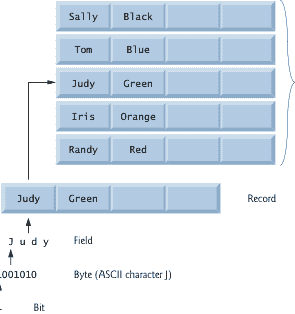

**图 1.2** | 数据层次结构。

尽管这种代码对人类来说更加清晰，但在被翻译成机器语言之前，计算机无法理解它。

随着汇编语言的出现，计算机的使用迅速增长，但程序员仍然必须使用许多条指令，即使是完成最简单的任务也是如此。为了加快编程过程，人们开发了**高级语言**，在这种语言中，只需编写一条语句就可以完成相当复杂的任务。称为*编译器*的翻译程序会将高级语言程序转换为机器语言。高级语言允许你编写看起来几乎像日常英语的指令，并且包含常用的数学表示法。用高级语言编写的工资计算程序可能包含如下*单条*语句：

```text
grossPay = basePay + overtimePay
```

从程序员的角度来看，高级语言优于机器语言和汇编语言。C++、C、微软的 .NET 语言（例如 Visual Basic、Visual C++ 和 Visual C#）以及 Java，都是使用最广泛的高级编程语言之一。

将大型高级语言程序编译为机器语言可能会占用相当多的计算机时间。人们开发了*解释器*程序，用于直接执行高级语言程序（无需等待编译），不过其运行速度比编译后的程序慢。

## 1.6 面向对象技术简介

在对新型且功能更强大的软件需求不断增长的今天，快速、正确且经济地构建软件仍然是一个难以实现的目标。*对象*，更准确地说——正如我们将在第 3 章看到的——对象所属的*类*，本质上都是可复用的软件组件。日期对象、时间对象、音频对象、视频对象、汽车对象、人员对象等不胜枚举。几乎任何名词都可以根据其*属性*（例如名称、颜色和大小）以及*行为*（例如计算、移动和通信）合理地表示为一个软件对象。软件开发人员逐渐发现，采用模块化、面向对象的设计和实现方法，可以使软件开发团队的生产效率远高于早期流行的“结构化编程”等技术所能达到的水平——面向对象的程序通常更容易理解、纠正和修改。

### 汽车作为对象

为了帮助你理解对象及其内容，我们先从一个简单的类比开始。假设你想要*驾驶汽车*，并通过*踩下加速踏板*让它加速。在你做到这一点之前，必须发生什么呢？在你能够驾驶汽车之前，必须有人先*设计*它。汽车通常始于工程图纸，这些图纸类似于描述房屋设计的*蓝图*。这些图纸包括加速踏板的设计。踏板向驾驶员*隐藏*了那些实际使汽车加速的复杂机制，正如制动踏板隐藏了使汽车减速的机制，方向盘“隐藏”了使汽车转向的机制一样。这使得即使不太了解或完全不了解发动机、制动和转向机制的人，也能轻松驾驶汽车。

正如没有蓝图就无法烹饪肉类一样，你也不能驾驶汽车的工程图纸。在你能够驾驶汽车之前，必须根据描述汽车的工程图纸将其*制造*出来。完成后的汽车拥有一个可以使汽车加速的*实际*加速踏板，但即使这样还不够——汽车不会自行加速（但愿如此！），所以驾驶员必须踩下踏板才能使汽车加速。

### 成员函数和类

让我们继续使用汽车的例子，介绍一些面向对象编程的关键概念。在程序中执行一项任务需要使用成员函数，成员函数包含实际执行该任务的程序语句。成员函数对使用者隐藏了这些语句，就像汽车的加速踏板向驾驶员隐藏了使汽车加速的机制一样。在 C++ 中，我们创建一个称为类的程序单元，用来容纳执行该类任务的一组成员函数。例如，一个表示银行账户的类可能包含一个用于向账户存款的成员函数、另一个用于从账户取款的成员函数，以及第三个用于查询账户当前余额的成员函数。类在概念上类似于汽车的工程图纸，后者包含加速踏板、方向盘等部件的设计。

### 实例化

正如必须有人根据汽车的工程图纸制造出汽车，你才能真正驾驶它一样，程序也必须先创建一个类的对象，才能执行该类成员函数所定义的任务。完成这一过程称为实例化。对象随后被称为其类的一个实例。

### 复用

正如汽车的工程图纸可以重复使用多次来制造许多辆汽车一样，你也可以多次复用一个类来创建许多对象。在构建新类和新程序时复用现有类，可以节省时间和精力。复用还有助于构建更加可靠和有效的系统，因为现有的类和组件通常已经经过了广泛的测试、调试和性能调优。正如可互换零件的理念对工业革命至关重要一样，可复用的类对于由面向对象技术推动的软件革命也至关重要。


### 软件工程观察 1.1

> 使用积木式方法创建程序。避免重复造轮子——尽可能使用现有的组件。这种软件复用是面向对象编程的一项重要优势。

### 消息和成员函数调用

驾驶汽车时，踩下油门踏板会向汽车发送一条消息，要求汽车执行一项任务——也就是加速。同样地，你也会向对象发送消息。每条消息都通过成员函数调用来实现，用于告知对象的某个成员函数执行其任务。例如，程序可能会调用某个特定银行账户对象的存款成员函数，以增加账户余额。

### 属性和数据成员

汽车除了具备完成任务的能力之外，还拥有各种属性，例如颜色、车门数量、油箱中的汽油量、当前速度，以及累计行驶里程记录（即里程表读数）。与汽车的功能一样，汽车的属性也会作为其设计的一部分，表示在工程图中（例如，其中包括一个


里程表和燃油表）。当你驾驶一辆真实的汽车时，这些属性随车携带。每辆车都维护自己的属性。例如，每辆车知道自己油箱里有多少油，但不知道其他车油箱里有多少油。

类似地，对象具有在程序中使用时随身携带的属性。这些属性作为对象类的一部分来指定。例如，银行账户对象有一个余额属性，表示账户中的金额。每个银行账户对象知道它所代表账户的余额，但不知道银行中其他账户的余额。属性由类的数据成员指定。

## 封装

类将属性和成员函数封装（即包装）到对象中——对象的属性与成员函数密切相关。对象可以相互通信，但通常不允许知道其他对象是如何实现的——实现细节隐藏在对象自身内部。正如我们将看到的，这种信息隐藏对良好的软件工程至关重要。

## 继承

通过继承，可以快速方便地创建新的对象类——新类吸收现有类的特征，可能对这些特征进行定制，并添加自己独有的特征。在我们的汽车类比中，“敞篷车”类的对象当然也是更一般的“汽车”类的对象，但更具体地说，其车顶可以升起或降下。

## 面向对象分析与设计（OOAD）

很快你将用 C++ 编写程序。你将如何为程序创建代码（即程序指令）？也许，像许多程序员一样，你只需打开计算机就开始输入。这种方法可能适用于小型程序（如本书前几章介绍的程序），但如果你被要求创建一个软件系统来控制一家大型银行的数千台自动取款机呢？或者假设你被要求加入一个由1,000名软件开发人员组成的团队，构建美国下一代空中交通管制系统呢？对于如此庞大而复杂的项目，你不应该只是坐下来就开始编写程序。

为了创建最佳解决方案，你应该遵循详细的分析过程来确定项目需求（即定义系统应该做什么），并开发满足这些需求的设计（即决定系统应该如何做）。理想情况下，你应该在编写任何代码之前完成这个过程并仔细审查设计（并让其他软件专业人员审查你的设计）。如果这个过程涉及从面向对象的角度分析和设计系统，那么它被称为面向对象分析与设计（OOAD）过程。像 C++ 这样的语言是面向对象的。用这种语言编程称为面向对象编程（OOP），它允许你将面向对象设计实现为可工作的系统。

## UML（统一建模语言）

尽管存在许多不同的 OOAD 过程，但一种用于交流任何 OOAD 过程结果的单一图形语言已得到广泛使用。这种语言称为统一建模语言（UML），现在是用于对面向对象系统建模的最广泛使用的图形方案。我们将在第3章和第4章给出第一批 UML 图，并在对面向对象编程的更深入讨论中使用它们，贯穿
以及更多功能，被整合到带有全彩*多点触控屏*的手持设备中——这些设备允许你通过涉及单点触控或多点同时触控的*手势*来控制设备。你可以通过 Android Market 和其他市场将应用直接下载到 Android 设备上。截至2010年12月，Google 的 Android Market 中已有超过 200,000 个应用。

## 1.8 编程语言

在本节中，我们简要评述几种流行的编程语言（图1.5）。下一节我们将介绍 C++。

| 编程语言 | 描述 |
|---|---|
| Fortran | Fortran（FORmula TRANslator，公式翻译器）由 IBM 公司于20世纪50年代中期开发，用于需要复杂数学计算的科学与工程应用。它至今仍被广泛使用，其最新版本支持面向对象编程。 |
| COBOL | COBOL（COmmon Business Oriented Language，面向商业的通用语言）于20世纪50年代末由计算机制造商、美国政府和工业计算机用户基于格蕾丝·霍珀开发的一种语言而开发，格蕾丝·霍珀是一位职业美国海军军官和计算机科学家。COBOL 至今仍广泛用于需要精确高效处理大量数据的商业应用。其最新版本支持面向对象编程。 |
| Pascal | 20世纪60年代的研究产生了*结构化编程*——一种编写程序的有纪律的方法，与以前技术产生的大型程序相比，这种程序更清晰、更易于测试和调试，也更易于修改。这项研究较具体的成果之一是尼克劳斯·维尔特教授于1971年开发了 Pascal。它旨在教授结构化编程，并在大学课程中流行了数十年。 |
| Ada | Ada 基于 Pascal，在20世纪70年代和80年代初由美国国防部（DOD）赞助开发。DOD 想要一种能满足其大部分需求的单一语言。这种基于 Pascal 的语言以诗人拜伦勋爵的女儿阿达·洛芙莱斯夫人命名。她因在19世纪初编写了世界上第一个计算机程序（用于查尔斯·巴贝奇设计的分析机机械计算设备）而受到赞誉。其最新版本支持面向对象编程。 |
| Basic | Basic 于20世纪60年代在达特茅斯学院开发，以使新手熟悉编程技术。其许多最新版本都是面向对象的。 |
| C | C 于1972年由贝尔实验室的 Dennis Ritchie 实现。它最初作为 UNIX 操作系统的开发语言而广为人知。如今，通用操作系统的大部分代码都是用 C 或 C++ 编写的。 |
| Objective-C | Objective-C 是一种基于 C 的面向对象语言。它于20世纪80年代初开发，后来被 NeXT 收购，NeXT 又随后被 Apple 收购。它已成为 Mac OS X 操作系统和所有 iOS 设备（如 iPod、iPhone 和 iPad）的关键编程语言。 |
| Java | Sun Microsystems 于1991年资助了一个由 James Gosling 领导的内部企业研究项目，该项目产生了名为 Java 的基于 C++ 的面向对象编程语言。Java 的一个关键目标是能够编写可在多种计算机系统和计算机控制设备上运行的程序。这有时被称为“一次编写，到处运行”。Java 用于开发大型企业应用，增强 Web 服务器（即提供我们在 Web 浏览器中看到的内容的计算机）的功能，为消费类设备（例如智能手机、电视机顶盒等）提供应用，以及用于许多其他目的。 |
| Visual Basic | Microsoft 的 Visual Basic 语言于20世纪90年代初推出，以简化 Microsoft Windows 应用程序的开发。其最新版本支持面向对象编程。 |
| Visual C# | Microsoft 的三种面向对象主要编程语言是 Visual Basic（基于原始 Basic）、Visual C++（基于 C++）和 C#（基于 C++ 和 Java，为将 Internet 和 Web 集成到计算机应用中而开发）。 |
| PHP | PHP 是一种面向对象的、“开源”（见第1.7节）“脚本”语言，由用户和开发者社区支持，并被包括维基百科和 Facebook 在内的众多网站使用。PHP 与平台无关——所有主要 UNIX、Linux、Mac 和 Windows 操作系统都有实现。PHP 还支持许多数据库，包括 MySQL。 |
| Perl | Perl（Practical Extraction and Report Language，实用提取与报告语言）是用于 Web 编程的最广泛使用的面向对象脚本语言之一，由 Larry Wall 于1987年开发。它具有丰富的文本处理能力和灵活性。 |
| Python | Python 是另一种面向对象脚本语言，于1991年公开发布。Python 由阿姆斯特丹国家数学与计算机科学研究所（CWI）的 Guido van Rossum 开发，大量借鉴了 Modula-3——一种系统编程语言。Python 是“可扩展的”——它可以通过类和编程接口进行扩展。 |

*图 1.5*  |  其他编程语言。（第1部分，共3部分。）

**图 1.5**  其他编程语言。（第2部分，共3部分。）


| 编程语言 | 描述 |
|---|---|
| JavaScript | JavaScript是使用最广泛的脚本语言。它主要用于为网页增加可编程性——例如动画和与用户的交互。所有主流Web浏览器都提供它。 |
| Ruby on Rails | Ruby——由松本行弘于20世纪90年代中期创建——是一种开源、面向对象的编程语言，其语法简单，类似于Perl和Python。Ruby on Rails将脚本语言Ruby与37Signals开发的Rails Web应用程序框架相结合。他们的书*真实呈现*（getting-real.37signals.com/toc.php）是Web开发者的必读之作。许多Ruby on Rails开发者报告说，在开发数据库密集型Web应用程序时，与其他语言相比，生产率有所提高。Ruby on Rails曾被用于构建Twitter的用户界面。 |
| Scala | Scala（www.scala-lang.org/node/273）——“可扩展语言”的缩写——由瑞士洛桑联邦理工学院（EPFL）的教授马丁·奥德斯基设计。Scala于2003年发布，同时使用面向对象编程和函数式编程范式，并设计为与Java集成。使用Scala编程可以显著减少应用程序中的代码量。Twitter和Foursquare使用Scala。 |

**图1.5** | 其他编程语言。（第3部分，共3部分。）

## 1.9 C++与典型的C++开发环境

C++从C演变而来，C由贝尔实验室的丹尼斯·里奇开发。C可用于大多数计算机，并且与硬件无关。通过精心设计，可以编写出可移植到大多数计算机的C程序。

C在各种计算机（有时称为**硬件平台**）上的广泛使用不幸地导致了许多变体。需要一个标准的C版本。美国国家标准协会（ANSI）与国际标准化组织（ISO）合作，在全球范围内标准化C语言；联合标准文件于1990年发布，称为*ANSI/ISO 9899: 1990*。

C99是C编程语言的最新ANSI标准。开发C99是为了使C语言不断发展，以跟上日益强大的硬件和越来越高的用户需求。C99还使C与C++更加一致。有关C和C99的更多信息，请参阅我们的书*C语言程序设计（第6版）*和我们的C资源中心（位于www.deitel.com/C）。

C++是C的扩展，由比雅尼·斯特劳斯特鲁普于20世纪80年代初在贝尔实验室开发。C++提供了许多“修饰”C语言的功能，但更重要的是，它提供了面向对象编程的能力。

你将在第3章“类、对象和字符串简介”中开始开发定制的、可复用的类和对象。本书在适当的地方从一开始并贯穿全文都是面向对象的。

我们还在第25–26章提供了一个可选的自动取款机（ATM）案例研究，其中包含一个完整的C++实现。该案例研究使用UML——一种用于开发面向对象系统的行业标准图形建模语言——精心 paced地介绍了面向对象设计。我们引导你完成一次适合初学者的友好设计体验。

### C++标准库

C++程序由称为**类**和**函数**的片段组成。你可以自己编写每个片段，但大多数C++程序员利用**C++标准库**中丰富的类和函数集合。因此，学习C++“世界”实际上有两个部分。第一部分是学习C++语言本身；第二部分是学习如何使用C++标准库中的类和函数。我们讨论了许多这样的类和函数。P. J. Plauger的书*标准C库*（Upper Saddle River, NJ: Prentice Hall PTR, 1992）是需要深入理解C++中包含的ANSI C库函数的程序员的必读之作。许多专用类库由独立软件供应商提供。

> **软件工程观察 1.2**
> 
> 使用“积木式”方法创建程序。避免重复造轮子。尽可能使用现有的组件。这种做法称为软件复用，是面向对象编程的核心。


> **软件工程观察 1.3**
> 
> 在使用C++编程时，你通常会使用以下构建块：来自C++标准库的类和函数、你和同事创建的类和函数，以及来自各种流行第三方库的类和函数。


创建自己的函数和类的优点是你会确切知道它们如何工作。你将能够检查C++代码。缺点是在设计、开发和维护正确且高效运行的新函数和类时需要耗费大量时间和复杂的工作。

> **性能提示 1.1**
> 
> 使用C++标准库函数和类而不是编写自己的版本可以提高程序性能，因为它们经过精心编写以高效执行。这种技术还缩短了程序开发时间。


> **可移植性提示 1.1**
> 
> 使用C++标准库函数和类而不是编写自己的版本可以提高程序可移植性，因为它们包含在每个C++实现中。


我们现在解释使用C++开发环境创建和执行C++应用程序的常用步骤（如图1.6–1.11所示）。C++系统通常由三部分组成：程序开发环境、语言和C++标准库。C++程序通常经历六个阶段：编辑、预处理、

### 阶段3：编译C++程序

在阶段3中，编译器将C++程序翻译成机器语言代码——也称为目标代码（图1.8）。


**图1.8** | *典型的C++开发环境——编译阶段。*

### 阶段4：链接

阶段4称为链接。C++程序通常包含对其他地方定义的函数和数据的引用，例如在标准库中或在从事特定项目的一组程序员的私有库中（图1.9）。C++编译器生成的目标代码通常由于这些缺失部分而包含“空洞”。链接器将目标代码与缺失函数的代码链接起来，生成可执行程序（没有缺失部分）。如果程序编译和链接正确，就会生成可执行映像。

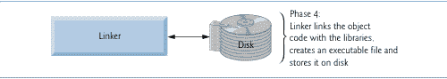

**图1.9** | *典型的C++开发环境——链接阶段。*

### 阶段5：加载

阶段5称为加载。在程序可以执行之前，必须首先将其放入内存（图1.10）。这是由加载器完成的，加载器从磁盘获取可执行映像并将其传输到内存。支持程序的共享库中的其他组件也会被加载。

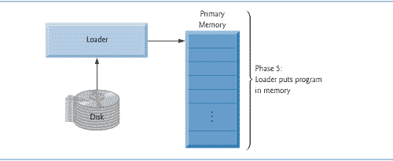

**图1.10** | *典型的C++开发环境——加载阶段。*

### 阶段6：执行

最后，计算机在其CPU的控制下，一次执行一条指令（图1.11）。一些现代计算机体系结构可以并行执行多条指令。

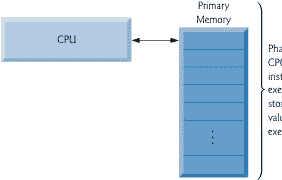

**图1.11** | 典型的C++开发环境——执行阶段。

### 执行时可能发生的问题

程序可能第一次尝试时无法工作。前面的每个阶段都可能因各种错误而失败，我们将在本书中讨论这些错误。例如，正在执行的程序可能尝试除以零（在C++中，整数算术的非法操作）。这会导致C++程序显示错误消息。如果发生这种情况，你必须返回编辑阶段，进行必要的更正，并再次经历其余阶段，以确定更正是否解决了问题。

**[注意：** 大多数C++程序输入或输出数据。某些C++函数从*标准输入流*（读作“see-in”）获取输入，通常来自键盘，但`cin`可以重定向到其他设备。数据通常输出到`cout`（*标准输出流*，读作“see-out”），通常是计算机屏幕，但`cout`可以重定向到其他设备。当我们说程序打印结果时，通常意味着结果显示在屏幕上。数据可以输出到其他设备，如磁盘和硬拷贝打印机。还有一个*标准错误流*称为`cerr`。`cerr`流（通常连接到屏幕）用于显示错误消息。**]**

> **常见编程错误 1.1**
> 
> 诸如除以零之类的错误在程序运行时发生，因此它们被称为*运行时错误*或*执行时错误*。*致命运行时错误*会导致程序立即终止，而未能成功完成其任务。*非致命运行时错误*允许程序运行到完成，通常产生不正确的结果。

## 1.10 测试驱动一个C++应用程序

在本节中，你将运行第一个C++应用程序并与之交互。你将首先运行一个有趣的猜数字游戏，该游戏从1到1000中选取一个数字，并

提示你猜出这个数字。如果你猜对了，游戏结束。如果你猜错了，应用程序会指出你猜的数字是高于还是低于正确数字。猜的次数没有限制。[注意：仅用于本次试运行，我们修改了这个应用程序，它源自你将在第6章“函数与递归简介”中被要求创建的练习。通常，该应用程序会在你执行程序时随机选择正确答案。修改后的应用程序在每次程序执行时使用相同的正确答案（尽管这可能因编译器而异），因此你可以使用我们在本节中使用的相同猜测，并在我们引导你与第一个 C++ 应用程序交互时看到相同的结果。]

我们将演示如何使用 Windows 命令提示符和 Linux 上的 shell 运行一个 C++ 应用程序。该应用程序在这两个平台上的运行方式类似。有许多可用的开发环境，你可以在其中编译、构建和运行 C++ 应用程序，例如 GNU C++、Dev C++、Microsoft Visual C++、CodeLite、NetBeans、Eclipse 等。有关你特定开发环境的信息，请咨询你的教师。

在以下步骤中，你将运行该应用程序并输入各种数字来猜正确数字。你在该应用程序中看到的元素和功能，与你在本书中将学习编写的程序类似。我们使用字体来区分屏幕上看到的功能（例如**命令提示符**）和与屏幕不直接相关的元素。我们用半粗体无衬线 Helvetica 字体强调屏幕功能，如标题和菜单（例如**文件**菜单），并用无衬线 Lucida 字体强调文件名、应用程序显示的文本以及应输入应用程序的值（例如 GuessNumber 或 500）。正如你所注意到的，每个术语的**定义性出现**都设置为蓝色粗体。对于本节的图，我们指出了应用程序的重要部分。为了使这些功能更明显，我们修改了**命令提示符**窗口的背景色（仅用于 Windows 试运行）。要修改系统上的命令提示符颜色，请选择**开始 > 所有程序 > 附件 > 命令提示符**打开命令提示符，然后右键单击标题栏并选择**属性**。在出现的**命令提示符**属性对话框中，单击**颜色**选项卡，然后选择你首选的文本和背景色。

## 从 Windows 命令提示符运行 C++ 应用程序

- **1. 检查你的设置。** 请务必阅读 www.deitel.com/books/cpphtp8/ 上的“开始之前”部分，以确保你已将本书的示例正确复制到硬盘。

- **2. 找到已完成的应用程序。** 打开一个命令提示符窗口。要切换到已完成的 **GuessNumber** 应用程序所在目录，请键入 `cd C:\examples\ch01\GuessNumber\Windows`，然后按*回车*键（图 1.12）。命令 `cd` 用于更改目录。

    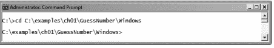

    **图 1.12** | 打开命令提示符窗口并更改目录。

- **3. 运行 GuessNumber 应用程序。** 既然你已进入包含 GuessNumber 应用程序的目录，请键入命令 `GuessNumber`（图 1.13）并按回车键。[**注意：** `GuessNumber.exe` 是应用程序的实际名称；但是，Windows 默认假定 `.exe` 扩展名。]

    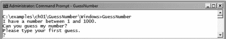

    **图 1.13** | 运行 GuessNumber 应用程序。

- **4. 输入你的第一次猜测。** 应用程序显示 `"Please type your first guess."`，然后在下一行显示一个问号（`?`）作为提示（图 1.13）。在提示符处，输入 `500`（图 1.14）。

    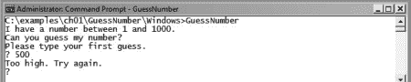

    **图 1.14** | 输入你的第一次猜测。

- **5. 输入另一次猜测。** 应用程序显示 `"Too high. Try again."`，表示你输入的值大于应用程序选作正确猜测的数字。因此，你应该在下次猜测时输入一个较小的数字。在提示符处，输入 `250`（图 1.15）。应用程序再次显示 `"Too high. Try again."`，因为你输入的值仍然大于应用程序选作正确猜测的数字。

    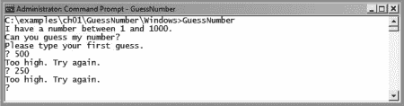

    **图 1.15** | 输入第二次猜测并接收反馈。

- **6. 输入更多猜测。** 继续通过输入值来玩这个游戏，直到你猜出正确数字。应用程序将显示 `"Excellent! You guessed the number!"`（图 1.16）。

    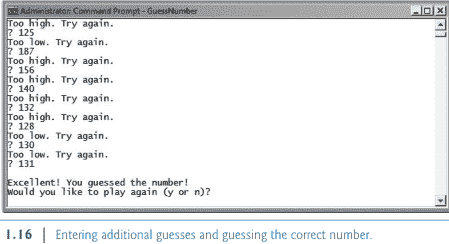

- **7. 再次玩游戏或退出应用程序。** 在你猜对之后，应用程序会询问你是否想再玩一局（图 1.16）。在“Would you like to play again (y or n)?”提示符处，输入单个字符 y 会使应用程序选择一个新数字，并显示消息“Please type your first guess.”，后跟一个问号提示（图 1.17），以便你在新游戏中进行第一次猜测。输入字符 n 会结束应用程序，并在命令提示符处返回到应用程序目录（图 1.18）。每次你从头开始执行此应用程序（即步骤 3）时，它都会选择相同的数字供你猜测。

    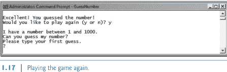

    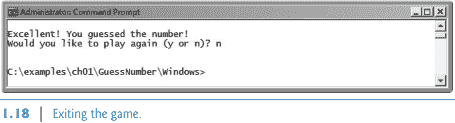

- **8. 关闭命令提示符窗口。**

## 使用 GNU C++ 在 Linux 上运行 C++ 应用程序

对于本次试运行，我们假设你知道如何将示例复制到你的主目录。如果你对将文件复制到 Linux 系统有任何疑问，请咨询你的教师。另外，对于本节的图，我们使用粗体高亮来指出每个步骤所需的用户输入。我们系统上 shell 中的提示符使用波浪号（~）字符表示主目录，并且每个提示符都以美元符号（$）字符结尾。不同 Linux 系统上的提示符会有所不同。

- **1. 找到已完成的应用程序。** 在 Linux shell 中，通过键入

    ```text
    cd Examples/ch01/GuessNumber/GNU_Linux
    ```

    然后按*回车*键，切换到已完成的 GuessNumber 应用程序目录（图 1.19）。命令 cd 用于更改目录。

    ```text
    ~$ cd examples/ch01/GuessNumber/GNU_Linux
    ~/examples/ch01/GuessNumber/GNU_Linux$
    ```

    **图 1.19** | 切换到 GuessNumber 应用程序的目录。

- **2. 编译 GuessNumber 应用程序。** 要在 GNU C++ 编译器上运行应用程序，你必须先通过键入以下命令来编译它：

    ```text
    g++ GuessNumber.cpp -o GuessNumber
    ```

    如图 1.20 所示。该命令编译应用程序并生成一个名为 GuessNumber 的可执行文件。

    ```text
    ~/examples/ch01/GuessNumber/GNU_Linux$ g++ GuessNumber.cpp -o GuessNumber
    ~/examples/ch01/GuessNumber/GNU_Linux$
    ```

    **图 1.20** | 使用 g++ 命令编译 GuessNumber 应用程序。

- **3. 运行 GuessNumber 应用程序。** 要运行可执行文件 GuessNumber，请在下一个提示符处键入 ./GuessNumber，然后按*回车*键（图 1.21）。

    ```text
    ~/examples/ch01/GuessNumber/GNU_Linux$ ./GuessNumber
    I have a number between 1 and 1000.
    Can you guess my number?
    Please type your first guess.
    ?
    ```

    **图 1.21** | 运行 GuessNumber 应用程序。

- **4. 输入你的第一次猜测。** 应用程序显示“Please type your first guess.”，然后在下一行显示一个问号（?）作为提示（图 1.21）。在提示符处，输入 500（图 1.22）。[*注意：* 这是我们为 Windows 修改并试运行的同一应用程序，但输出可能因所使用的编译器而异。]

- **5. 输入另一次猜测。** 应用程序显示 "Too high. Try again."，表示你输入的值大于应用程序选作正确猜测的数字（图 1.22）。在下一个提示符处，输入 **250**（图 1.23）。这次应用程序显示 "Too low. Try again."，因为你输入的值小于正确猜测。

- **6. 输入更多猜测。** 继续通过输入值来玩这个游戏（图 1.24），直到你猜出正确数字。当你猜对时，应用程序显示 "Excellent! You guessed the number."

    ```text
    ~/examples/ch01/GuessNumber/GNU_Linux$ ./GuessNumber
    I have a number between 1 and 1000.
    Can you guess my number?
    Please type your first guess.
    ? 500
    Too high. Try again.
    ?
    ```

    **图 1.22** | 输入初次猜测。

    ```text
    ~/examples/ch01/GuessNumber/GNU_Linux$ ./GuessNumber
    I have a number between 1 and 1000.
    Can you guess my number?
    Please type your first guess.
    ? 500
    Too high. Try again.
    ? 250
    Too low. Try again.
    ?
    ```

    **图 1.23** | 输入第二次猜测并接收反馈。

    ```text
    Too low. Try again.
    ? 375
    Too low. Try again.
    ? 437
    Too high. Try again.
    ? 406
    Too high. Try again.
    ? 391
    Too high. Try again.
    ? 383
    Too low. Try again.
    ? 387
    Too high. Try again.
    ? 385
    Too high. Try again.
    ? 384
    Excellent! You guessed the number.
    Would you like to play again (y or n)?
    ```

    **图 1.24** | 输入更多猜测并猜出正确数字。


7. *再次玩游戏或退出应用程序。* 猜对数字后，应用程序会询问你是否想再玩一局。在“是否再玩一次（y 或 n）？”提示符下，输入字符 y 会使应用程序选择一个新数字，并显示消息“请输入你的第一次猜测。”随后出现问号提示符（图 1.25），以便你在新游戏中做出第一次猜测。输入字符 n 则结束应用程序，并返回到 shell 中应用程序的目录（图 1.26）。每次从头开始执行此应用程序（即*步骤 3*）时，它都会选择相同的数字供你猜测。

```
Excellent! You guessed the number.
Would you like to play again (y or n)? y

I have a number between 1 and 1000.
Can you guess my number?
Please type your first guess.
?
```

**图 1.25**  |  再次玩游戏。

```
Excellent! You guessed the number.
Would you like to play again (y or n)? n

~/examples/ch01/GuessNumber/GNU_Linux$
```

**图 1.26**  |  退出游戏。

## 1.11 Web 2.0：走向社交

互联网在 20 世纪 90 年代中后期蓬勃发展，但“dot com”经济泡沫的破裂在 21 世纪初带来了艰难时期。大约从 2004 年开始的复苏被称为 **Web 2.0**。谷歌被广泛认为是 Web 2.0 的标志性公司。其他具有“Web 2.0 特征”的公司包括 YouTube（视频分享）、Facebook（社交网络）、Twitter（微博客）、Groupon（社交商务）、Foursquare（移动签到）、Salesforce（以在线服务形式提供的商业软件）、Craigslist（免费分类信息）、Flickr（照片分享）、Second Life（虚拟世界）、Skype（网络电话）和 Wikipedia（免费在线百科全书）。

### *谷歌*

1996 年，斯坦福大学计算机科学博士生拉里·佩奇和谢尔盖·布林开始合作开发一个新的搜索引擎。1997 年，他们将其更名为 Google——这是对数学术语 *googol* 的谐音创作，后者表示数字“1”后跟 100 个“零”（即 10^100）——一个极其巨大的数字。谷歌能够快速返回极其准确的搜索结果，这帮助它成为使用最广泛的搜索引擎，也是世界上最受欢迎的网站之一。

谷歌 continues 在搜索技术领域持续创新。例如，Google Goggles 是一款引人入胜的移动应用（可在 Android 和 iPhone 上使用），它允许你使用照片而非输入文字来执行 Google 搜索。你只需拍摄地标、书籍（封面或条形码）、标志、艺术品或葡萄酒瓶标签的照片，Google Goggles 就会扫描照片并返回搜索结果。你也可以拍摄一段文字（例如餐厅菜单或标牌）的照片，Google Goggles 会为你翻译。

### *Ajax*

Ajax 是主要的 Web 2.0 软件技术之一。Ajax 帮助基于互联网的应用表现得像桌面应用一样——这是一项艰巨的任务，因为此类应用在计算机与互联网服务器之间来回传输数据时会遇到传输延迟。借助 Ajax，像 Google Maps 这样的应用实现了出色的性能，并接近桌面应用的外观和感觉。

### *社交应用*

在过去几年中，网络上的社交应用数量急剧增加。尽管计算机行业已经成熟，但这些网站在相对较短的时间内仍然取得了惊人的成功。图 1.27 讨论了一些正在产生影响力的社交应用。

| 公司 | 描述 |
|---|---|
| Facebook | Facebook 于 2004 年由同学马克·扎克伯格、克里斯·休斯、达斯汀·莫斯科维茨和爱德华多·萨维林在哈佛宿舍发起，目前估值已达约 700 亿美元。到 2011 年 1 月，Facebook 已成为互联网上最活跃的网站，拥有超过 6 亿用户——约占地球人口的 9%——他们每月在 Facebook 上花费 7000 亿分钟（www.time.com/time/specials/packages/article/0,28804,2036683,00.html）。按照目前的增长速度（每月约 5%），Facebook 将在 2012 年达到 10 亿用户，而互联网用户总数只有 20 亿！网站上的活跃度使它对应用开发者极具吸引力。每天，Facebook 用户会安装超过 2000 万个应用（www.facebook.com/press/info.php?statistics）。 |
| Twitter | Twitter 由杰克·多尔西、埃文·威廉姆斯和艾萨克·“比兹”·斯通于 2006 年创立——他们都来自播客公司 Odeo。Twitter 彻底改变了 *微博客*。用户发布推文——每条不超过 140 个字符的消息。每天大约发布 9500 万条推文（twitter.com/about）。你可以关注朋友、名人、企业、政府代表（包括拥有 630 万粉丝的美国总统）等的推文，也可以按主题关注推文，以跟踪新闻、趋势等。在撰写本文时，Lady Gaga 的粉丝最多（超过 770 万）。Twitter 已成为全球许多突发新闻的源头。 |
| Groupon | Groupon 是一个社交商务网站，由安德鲁·梅森于 2008 年推出。到 2011 年 1 月，该公司估值约为 150 亿美元，成为有史以来增长最快的公司！它现在已覆盖全球数百个市场。Groupon 在每个市场每天提供一项针对餐厅、零售商、服务、景点等的折扣交易。只有当达到最低参与人数时，交易才会生效。如果你报名参加了一项交易，但还未达到最低人数，你可能会通过电子邮件、Facebook、Twitter 等方式告诉其他人这项交易。如果交易未达到最低销量，它就会被取消。迄今为止，最成功的全国性 Groupon 交易之一是一张价值 50 美元、售价 25 美元的大型服装公司商品券。一天之内售出了超过 44 万张券。 |
| Foursquare | Foursquare——由丹尼斯·克劳利和纳维恩·塞尔瓦杜赖于 2009 年推出——是一款移动签到应用，允许你通知朋友你的行踪。你可以将应用下载到智能手机，并将其链接到你的 Facebook 和 Twitter 账户，这样你的朋友就可以从多个平台关注你。如果你没有智能手机，也可以通过短信签到。Foursquare 使用 GPS 确定你的确切位置。企业使用 Foursquare 向该地区的用户发送优惠。Foursquare 于 2009 年 3 月推出，目前已在全球拥有超过 500 万用户。 |
| Skype | Skype 是一款软件产品，允许你通过互联网使用一种称为 VoIP（IP 语音，IP 代表“Internet Protocol”）的技术进行大多免费的语音和视频通话。Skype 由尼古拉斯·曾斯特罗姆和丹麦人贾纳斯·弗里斯于 2003 年创立。仅仅两年后，该公司就以 26 亿美元的价格卖给了 eBay。 |
| YouTube | YouTube 是一个视频分享网站，成立于 2005 年。一年之内，该公司就被谷歌以 16.5 亿美元收购。YouTube 现在占所有互联网流量的 10%（www.webpronews.com/topnews/2010/04/16/facebook-and-youtube-get-the-most-business-internet-traffic/）。在苹果 iPhone 3GS——第一款支持视频的 iPhone 型号——发布后的一周内，上传到 YouTube 的移动视频增长了 400%（www.hypebot.com/hypebot/2009/06/youtube-reports-1700-jump-in-mobile-video.html）。 |

**图 1.27**  |  社交应用。

## 1.12 软件技术

图 1.28 列出了许多你会在软件开发社区中听到的流行术语。我们已为其中大多数主题创建了资源中心，并且还在不断添加更多。

| 技术 | 描述 |
|---|---|
| 敏捷软件开发 | **敏捷软件开发**是一套方法论，旨在比以往的方法更快、用更少的资源来实现软件。请查看敏捷联盟（www.agilealliance.org）和敏捷宣言（www.agilemanifesto.org）。 |
| 重构 | **重构**涉及重新编写程序，使其更清晰、更易于维护，同时保持其正确性和功能。它被广泛用于敏捷开发方法中。许多 IDE 包含重构工具，可以自动完成大部分重新编写工作。 |

**图 1.28**  |  软件技术。（第 1 部分，共 2 部分。）


## 实验6 基于单片机的AD转换实验

### 一、实验目的

- 1. 了解A/D转换的基本原理。
- 2. 掌握ADC0809芯片的使用方法。
- 3. 掌握单片机与ADC0809的接口电路设计方法。

### 二、实验设备

- 1. 计算机
- 2. Keil C51 单片机开发套件
- 3. 单片机实验箱

### 三、实验原理

ADC0809是8位逐次逼近型A/D转换芯片，具有8路模拟量输入，转换时间约为100μs。其内部包含一个8位A/D转换器、8通道多路选择器、三态输出锁存器等电路。工作时，通过地址锁存信号ALE选通某一通道，将模拟量输入到转换器进行转换，转换结束后由EOC信号指示，通过OE信号控制输出转换结果。

> 注意：实验前，请确保实验箱电源已关闭，按照接线图连接各模块。


图 1.29 描述了软件产品发布类别。

| 版本 | 描述 |
|---|---|
| Alpha | *Alpha* 版软件是软件产品最早的发布版本，仍处于积极开发中。Alpha 版本通常有缺陷、不完整且不稳定，发布给相对少数开发者，用于测试新功能、获取早期反馈等。 |
| Beta | *Beta* 版本在开发过程后期、大多数主要缺陷已修复且新功能接近完成时，发布给更多开发者。Beta 软件更稳定，但仍可能变更。 |
| 发布候选版本 | *发布候选版本*通常*功能完整*，并且（据称）没有缺陷，可供社区使用；社区提供多样化的测试环境——软件在不同系统上使用，具有不同约束和多种用途。出现的任何缺陷都会被修正，最终产品会向公众发布。软件公司通常通过互联网分发增量更新。 |
| 持续 Beta | 使用这种方法开发的软件通常没有版本号（例如 Google 搜索或 Gmail）。该软件托管在云中（不安装在你的计算机上），并不断演进，以便用户始终拥有最新版本。 |

**图 1.29** | 软件产品发布术语

## 1.13 C++ 的未来：TR1、新的 C++ 标准与开源 Boost 库

C++ 的创造者 Bjarne Stroustrup 表达了他对 C++ 未来的愿景。新标准的主要目标是使 C++ 更易于学习、改进库构建能力，并提高与 C 编程语言的兼容性。

在本书中，我们在可选章节讨论新 C++ 标准的各种关键特性。此外，第 23 章介绍 Boost C++ 库、技术报告 1（TR1）以及更多新的 C++ 特性。

**技术报告 1** 描述了对 C++ 标准库的拟议更改。这些库为 C++ 增加了有用的功能。C++ 标准委员会目前正在最终确定 C++ 标准的修订版。上一版标准于 1998 年发布。新标准的工作始于 2003 年。当时它被称为 **C++0x**，因为该标准原计划在这个十年结束前发布。新标准包含 TR1 中的大部分库以及对核心语言的更改。

**Boost C++ 库**是由 C++ 社区成员创建的自由开源库。Boost 已发展到 100 多个库，并且定期增加更多库。如今，Boost 开源社区有数千名程序员。Boost 为 C++ 程序员提供有用的库，这些库能与现有的 C++ 标准库良好配合。C++ 程序员可以在各种平台上使用 Boost 库，并可使用许多不同的编译器。Boost 的几个库已包含在 TR1 中，并将成为新标准的一部分。我们概述 TR1 中包含的库，并提供“正则表达式”和“智能指针”库的代码示例。

**正则表达式**用于匹配文本中的特定字符模式。它们可用于验证数据以确保其符合特定格式、用另一部分替换字符串中的某些部分，或拆分字符串。

C 和 C++ 代码中的许多常见缺陷与指针有关，指针是 C++ 从 C 吸收的一种强大编程能力。**智能指针**通过提供额外功能来帮助避免错误，通常加强内存分配和释放过程。

## 1.14 跟上信息技术的发展

图 1.30 列出了关键的技术和商业出版物，它们将帮助你及时了解最新新闻、趋势和技术。你还可以在 www.deitel.com/resourcecenters.html 找到不断增加的互联网和 Web 相关资源中心列表。

| 出版物 | URL |
|---|---|
| Bloomberg BusinessWeek | www.businessweek.com |
| CNET | news.cnet.com |
| Computer World | www.computerworld.com |
| Engadget | www.engadget.com |
| eWeek | www.eweek.com |
| Fast Company | www.fastcompany.com/ |
| Fortune | money.cnn.com/magazines/fortune/ |
| InfoWorld | www.infoworld.com |
| Mashable | mashable.com |
| PCWorld | www.pcworld.com |
| SD Times | www.sdtimes.com |
| Slashdot | slashdot.org/ |
| Smarter Technology | www.smartertechnology.com |
| Technology Review | technologyreview.com |
| Techcrunch | techcrunch.com |
| Wired | www.wired.com |

**图 1.30** | 技术与商业出版物（许多免费）。

## 1.15 小结

在本章中，我们讨论了计算机硬件、软件、编程语言和操作系统。我们介绍了对象技术的基础知识。你了解了计算机领域近期一些激动人心的发展。我们概述了一个典型的 C++ 程序开发环境，并且你试运行了一个 C++ 应用程序。我们还讨论了一些关键的软件开发术语。

对象、属性、行为、类、继承（例如，考虑一个闹钟）、抽象、建模、消息、封装、接口和信息隐藏。

## 有所作为

在整本书中，我们加入了“有所作为”练习，要求你解决对个人、社区、国家和世界真正重要的问题。有关致力于有所作为的全球组织的更多信息，以及相关编程项目想法，请访问我们的“有所作为”资源中心 www.deitel.com/makingadifference。

- **1.8** _(**试驾：碳足迹计算器**)_ 一些科学家认为，碳排放（尤其是燃烧化石燃料产生的碳排放）会显著加剧全球变暖，如果个人采取措施限制碳基燃料的使用，就可以应对这一问题。组织和个人越来越关注自己的“碳足迹”。TerraPass www.terrapass.com/carbon-footprint-calculator/ 和 Carbon Footprint www.carbonfootprint.com/calculator.aspx 等网站提供碳足迹计算器。试用这些计算器来确定你的碳足迹。后续章节的练习将要求你编写自己的碳足迹计算器。为此，请研究计算碳足迹的公式。

- **1.9** _(**试驾：身体质量指数计算器**)_ 根据近期估计，美国三分之二的人超重，其中约一半肥胖。这导致糖尿病和心脏病等疾病显著增加。要判断一个人是超重还是肥胖，可以使用一种称为身体质量指数（BMI）的指标。美国卫生与公众服务部在 www.nhlbisupport.com/bmi/ 提供 BMI 计算器。用它计算你自己的 BMI。第 2 章的一个练习将要求你编写自己的 BMI 计算器。为此，请研究计算 BMI 的公式。

- **1.10** _(**混合动力汽车的属性**)_ 在本章中，你学习了类的基础知识。现在你将开始“充实”一个名为“混合动力汽车”的类的各个方面。混合动力汽车越来越受欢迎，因为它们通常比纯汽油动力汽车更省油。浏览网页并研究四五款当今流行混合动力汽车的特性，然后尽可能多地列出它们与混合动力相关的属性。例如，常见属性包括城市每加仑英里数和高速公路每加仑英里数。还要列出电池的属性（类型、重量等）。

- **1.11** _(**性别中立**)_ 许多人希望消除各种传播形式中的性别歧视。你被要求创建一个程序，该程序可以处理一段文本，并将特定性别的词语替换为性别中立的词语。假设已给你一份特定性别词语及其性别中立替换词的列表（例如，将“妻子”替换为“配偶”，将“男人”替换为“人”，将“女儿”替换为“孩子”等），请解释你将用来通读一段文本并手动执行这些替换的过程。你的过程如何可能生成像“woperdchild”这样奇怪的词，而该词实际上被列在 Urban Dictionary（www.urbandictionary.com）中？在第 4 章中，你将学习到“过程”的更正式术语是“算法”，算法指定要执行的步骤以及执行这些步骤的顺序。

- **1.12** _(**隐私**)_ 一些在线电子邮件服务会在一定时期内保存所有电子邮件通信。假设这些在线电子邮件服务中某个心怀不满的员工将数百万人的所有电子邮件通信（包括你的）发布到互联网上。讨论这些问题。

- **1.13** _(**程序员责任与法律责任**)_ 作为行业中的程序员，你可能会开发出影响人们健康甚至生命的软件。假设你的某个软件中存在一个软件缺陷

程序导致癌症患者在放射治疗期间接受过量剂量，并且该人要么严重受伤要么死亡。讨论这些问题。

**1.14**（2010 年“闪电崩盘”）我们过度依赖计算机的后果之一，是 2010 年 5 月 6 日发生的所谓“闪电崩盘”：美国股市在几分钟内暴跌，抹去数万亿美元的投资，随后又在几分钟内恢复。使用互联网调查此次崩盘的原因，并讨论它引发的问题。

## 有所作为资源

微软 Imagine Cup 是一项全球竞赛，学生利用技术尝试解决世界上一些最困难的问题，例如环境可持续性、消除饥饿、应急响应、扫盲、抗击 HIV/AIDS 等。欲了解有关该竞赛的更多信息并了解往届获奖者开发的项目，请访问 www.imaginecup.com/about。你还可以在 www.imaginecup.com/students/imagine-cup-solve-this 找到全球慈善组织提交的一些项目创意。如需更多能够有所作为的编程项目创意，请在网络上搜索“making a difference”，并访问以下网站：

- www.un.org/millenniumgoals
  联合国千年项目寻求解决重大全球性问题的方案，例如环境可持续性、性别平等、儿童和孕产妇健康、普及教育等。

- www.ibm.com/smarterplanet/
  IBM® Smarter Planet 网站讨论 IBM 如何利用技术解决与业务、云计算、教育、可持续性等相关的问题。

- www.gatesfoundation.org/Pages/home.aspx
  比尔及梅琳达·盖茨基金会向致力于缓解发展中国家饥饿、贫困和疾病的组织提供资助。在美国，该基金会专注于改善公共教育，尤其是为资源匮乏的人群。

- www.nethope.org/
  NetHope 是全球人道主义组织的合作项目，致力于解决连接性、应急响应等技术问题。

- www.rainforestfoundation.org/home
  雨林基金会致力于保护雨林，并保护以雨林为家的原住民的权利。该网站列出了你可以提供帮助的事项。

- www.undp.org/
  联合国开发计划署（UNDP）寻求应对全球挑战的解决方案，例如危机预防与恢复、能源与环境、民主治理等。

- www.unido.org
  联合国工业发展组织（UNIDO）致力于减少贫困，为发展中国家提供参与全球贸易的机会，并促进能源效率和可持续性。

- www.usaid.gov/
  美国国际开发署（USAID）促进全球民主、健康、经济增长、冲突预防、人道主义援助等。

- www.toyota.com/ideas-for-good/
  丰田的 Ideas for Good 网站介绍了几项正在产生积极影响的丰田技术——包括其高级停车引导系统、Hybrid Synergy Drive®、太阳能通风系统、T.H.U.M.S.（Total Human Model for Safety，全面人体安全模型）和触摸追踪显示系统。你可以通过提交一篇短文或视频，描述这些技术如何用于其他有益目的，来参加 Ideas for Good 挑战。

# 2 C++ 编程简介


> 名字有什么关系？我们称为玫瑰的，  
> 换成别的名字，闻起来也一样芬芳。  
> ——威廉·莎士比亚

> 面对抉择时，我总是问：“什么会最有意思？”  
> ——佩吉·沃克

> 高尚的思想必须有高尚的语言。  
> ——阿里斯托芬

> 一个人可以有所作为，每个人都应该尝试。  
> ——约翰·F·肯尼迪

### 目标

在本章中，你将学习：

- 用 C++ 编写简单的计算机程序。
- 编写简单的输入和输出语句。
- 使用基本类型。
- 基本的计算机内存概念。
- 使用算术运算符。
- 算术运算符的优先级。
- 编写简单的决策语句。

### 第 2 章大纲

- **2.1** 简介
- **2.2** C++ 的第一个程序：打印一行文本
- **2.3** 修改我们的第一个 C++ 程序
- **2.4** 另一个 C++ 程序：整数相加
- **2.5** 内存概念
- **2.6** 算术
- **2.7** 决策：相等与关系运算符
- **2.8** 小结

*小结 | 自测练习 | 自测练习答案 | 练习 | 有所作为*

## 2.1 简介

我们现在介绍 C++ 编程，它有助于采用有条理的方法进行程序设计。你将在本书中学习的大多数 C++ 程序都会处理信息并显示结果。在本章中，我们给出五个示例，演示程序如何显示消息以及从用户处获取信息进行处理。前三个示例只是在屏幕上显示消息。下一个示例从用户处获取两个数字，计算它们的和并显示结果。随附的讨论向你展示如何执行算术计算并保存结果以供以后使用。第五个示例演示决策，向你展示如何比较两个数字，然后根据比较结果显示消息。我们逐行分析每个程序，帮助你轻松进入 C++ 编程。

## 2.2 C++ 的第一个程序：打印一行文本

C++ 使用的记号对非程序员来说可能显得奇怪。我们现在考虑一个打印一行文本的简单程序（图 2.1）。该程序说明了 C++ 语言的几个重要特性。

```cpp
// Fig. 2.1: fig02_01.cpp
// Text-printing program.
#include <iostream> // allows program to output data to the screen

// function main begins program execution
int main()
{
   std::cout << "Welcome to C++!\n"; // display message

   return 0; // indicate that the program ended successfully
} // end function main
```

```text
Welcome to C++!
```

**图 2.1** | 文本打印程序。

### 注释

第 1 行和第 2 行

```cpp
// Fig. 2.1: fig02_01.cpp
// Text-printing program.
```

每行都以 `//` 开头，表示每行的其余部分是**注释**。你插入注释来记录程序，并帮助其他人阅读和理解它们。程序运行时，注释不会导致计算机执行任何操作——它们会被 C++ 编译器忽略，并且不会生成任何机器语言目标代码。注释 Text-printing program 描述了程序的用途。以 `//` 开头的注释称为**单行注释**，因为它在当前行末尾终止。[*注意：* 你也可以使用 C 的风格，其中注释——可能包含多行——以 `/*` 开头并以 `*/` 结尾。]

> **良好编程实践 2.1**
> 
> *每个程序都应从描述程序目的的注释开始。*


### #include 预处理指令

第 3 行

```cpp
#include <iostream> // allows program to output data to the screen
```

是一条**预处理指令**，即发送给 C++ 预处理器的消息（在第 1.9 节中介绍）。以 `#` 开头的行在程序编译*之前*由预处理器处理。这一行通知预处理器将**输入/输出流头文件 <iostream>**的内容包含到程序中。任何使用 C++ 的流输入/输出向屏幕输出数据或从键盘输入数据的程序，都必须包含此头文件。图 2.1 中的程序向屏幕输出数据，我们很快就会看到。我们将在第 6 章更详细地讨论头文件，并在第 15 章解释 <iostream> 的内容。

> **常见编程错误 2.1**
> 
> *在从键盘输入数据或向屏幕输出数据的程序中忘记包含 <iostream> 头文件，会导致编译器发出错误消息。*


### 空行和空白字符

第 4 行只是一条空行。你可以使用空行、空格字符和制表符（即“tab”）使程序更易读。这些字符统称为**空白字符**。空白字符通常会被编译器忽略。

### main 函数

第 5 行

```cpp
// function main begins program execution
```

是另一条单行注释，表示程序执行从下一行开始。

第 6 行

```cpp
int main()
```

是每个 C++ 程序的一部分。main 后面的圆括号表示 main 是一个称为函数的程序构建块。C++ 程序通常由一个或多个函数和类组成（你将在第 3 章学习）。每个程序中必须恰好有一个函数命名为 main。图 2.1 只包含一个函数。C++ 程序从 main 函数开始执行，即使 main 不是程序中的第一个函数。关键字 int 用于


指定我们使用的是一个名称，在此例中为 cout，它属于“命名空间”std。名称 cin（标准输入流）和 cerr（标准错误流）——在第 1 章中介绍——也属于命名空间 std。命名空间是 C++ 的高级特性，我们将在第 24 章“其他主题”中深入讨论。目前，你只需记住：在程序中每次提到 cout、cin 和 cerr 之前都要包含 std::。这可能很繁琐——在图 2.13 中，我们介绍 using 指令，它将使你能够在每次使用 std 命名空间中的名称之前省略 std::。

## 流插入运算符与转义序列

<< 运算符称为流插入运算符。当该程序执行时，运算符右侧的值（即右操作数）被插入到输出流中。请注意，该运算符指向数据流动的方向。右操作数的字符通常按它们在双引号之间的原样打印。然而，字符 `\n` 不会打印在屏幕上（图 2.1）。反斜杠（`\`）称为转义字符。它表示要输出一个“特殊”字符。当在字符串中遇到反斜杠时，下一个字符会与反斜杠组合成一个转义序列。转义序列 `\n` 表示换行。它使光标（即当前屏幕位置指示符）移动到屏幕下一行的开头。图 2.2 列出了一些常见的转义序列。

| 转义序列 | 描述 |
|---|---|
| `\n` | 换行。将屏幕光标定位到下一行的开头。 |
| `\t` | 水平制表。将屏幕光标移动到下一个制表位。 |
| `\r` | 回车。将屏幕光标定位到当前行的开头；不前进到下一行。 |
| `\a` | 警报。响系统铃。 |
| `\\` | 反斜杠。用于打印反斜杠字符。 |
| `\'` | 单引号。用于打印单引号字符。 |
| `\"` | 双引号。用于打印双引号字符。 |

图 2.2 | 转义序列。

## return 语句

第 10 行

```cpp
return 0; // indicate that program ended successfully
```

是我们将用来退出函数的几种方式之一。当 return 语句用在 main 末尾时，如此处所示，值 0 表示程序已成功终止。右花括号 `}`（第 11 行）表示函数 main 的结束。根据 C++ 标准，如果程序执行到达 main 末尾时没有遇到 return 语句，则假定程序已成功终止——这与 main 中最后一条语句是值为 0 的 return 语句时完全相同。因此，在后续程序中，我们省略 main 末尾的 return 语句。

## 2.3 修改我们的第一个 C++ 程序

现在我们给出两个示例，它们修改图 2.1 的程序，以通过使用多条语句在一行上打印文本，并通过使用一条语句在多行上打印文本。

### 用多条语句打印一行文本

Welcome to C++! 可以用多种方式打印。例如，图 2.3 在多个语句中执行流插入（第 8–9 行），却产生与图 2.1 的程序相同的输出。[注：从此处开始，我们使用黄色背景来突出每个程序引入的关键特性。]每次流插入都从上次停止的位置继续打印。第一次流插入（第 8 行）打印 Welcome，后跟一个空格；由于该字符串没有以 `\n` 结尾，第二次流插入（第 9 行）紧接着该空格在同一行开始打印。

```cpp
// Fig. 2.3: fig02_03.cpp
// Printing a line of text with multiple statements.
#include <iostream> // allows program to output data to the screen

// function main begins program execution
int main()
{
   std::cout << "Welcome ";
   std::cout << "to C++!\n";
} // end function main
```

```text
Welcome to C++!
```

图 2.3 | 用多条语句打印一行文本。

### 用一条语句打印多行文本

一条语句可以通过使用换行字符打印多行，如图 2.4 的第 8 行所示。每当输出流中遇到 `\n`（换行）转义序列时，屏幕光标就定位到下一行的开头。要在输出中得到一个空行，请将两个换行字符背靠背放置，如第 8 行所示。

```cpp
// Fig. 2.4: fig02_04.cpp
// Printing multiple lines of text with a single statement.
#include <iostream> // allows program to output data to the screen

// function main begins program execution
int main()
{
   std::cout << "Welcome\nto\n\nC++!\n";
} // end function main
```

```text
Welcome
to

C++!
```

图 2.4 | 用一条语句打印多行文本。

例如 7、−11、0 和 31914。所有变量在程序中可以使用之前，*必须*用*名称*和*数据类型*声明。同一类型的多个变量可以在一条声明中声明，也可以在多条声明中声明。我们本可以通过使用**逗号分隔列表**在一条声明中声明全部三个变量，如下所示：

```cpp
int number1, number2, sum;
```

这会降低程序的可读性，并使我们无法提供描述每个变量用途的注释。

> **良好的编程习惯 2.4**
>
> *在每个逗号（,）后放一个空格，使程序更易读。*

### 基本类型

我们很快将讨论用于指定实数的 double 类型，以及用于指定字符数据的 char 类型。实数是带小数点的数，例如 3.4、0.0 和 −11.19。char 变量只能保存单个小写字母、单个大写字母、单个数字或单个特殊字符（例如 $ 或 #）。诸如 int、double 和 char 之类的类型称为**基本类型**。基本类型名称是*关键字*，因此*必须出现*为全小写字母。附录 C 包含基本类型的完整列表。

### 标识符

变量名（例如 number1）是任何不是关键字的有效**标识符**。标识符是由字母、数字和下划线（_）组成的一系列字符，且不能以数字开头。C++ 是**区分大小写**的——大写字母和小写字母不同，因此 a1 和 A1 是不同的标识符。

> **可移植性提示 2.1**
>
> *C++ 允许任意长度的标识符，但你的 C++ 实现可能会限制标识符长度。为确保可移植性，请使用 31 个字符或更少的标识符。*

> **良好的编程习惯 2.5**
>
> *选择有意义的标识符可以使程序自我说明——人们只需阅读程序就能理解它，而不必参考手册或注释。*

> **良好的编程习惯 2.6**
>
> *避免在标识符中使用缩写。这可以提高程序的可读性。*

> **良好的编程习惯 2.7**
>
> *不要使用以下划线或双下划线开头的标识符，因为 C++ 编译器可能会在内部将这些名称用于自己的目的。这可以防止你选择的名称与编译器选择的名称混淆。*

### 变量声明的位置

变量声明几乎可以放在程序中的任何位置，但它们必须出现在程序中使用相应变量之前。例如，在图 2.5 的程序中，第 9 行的声明

```cpp
int number1; // first integer to add
```

本可以紧接在第 14 行之前：

```cpp
std::cin >> number1; // read first integer from user into number1
```

第 10 行的声明

```cpp
int number2; // second integer to add
```

本可以紧接在第 17 行之前：

```cpp
std::cin >> number2; // read second integer from user into number2
```

以及第 11 行的声明

```cpp
int sum; // sum of number1 and number2
```

本可以紧接在第 19 行之前：

```cpp
sum = number1 + number2; // add the numbers; store result in sum
```

> **良好的编程习惯 2.8**
>
> *始终在声明与相邻的可执行语句之间放置一个空行。这会使声明更醒目，并有助于程序清晰。*


### 从用户处获取第一个值

第 13 行

```cpp
std::cout << "Enter first integer: "; // prompt user for data
```

显示 Enter first integer: 后跟一个空格。此消息称为提示，因为它指示用户采取特定操作。我们喜欢将前面的语句读作“std::cout 获取字符串 `"Enter first integer: "`。”第 14 行

```cpp
std::cin >> number1; // read first integer from user into number1
```

使用标准输入流对象 cin（属于命名空间 std）和流提取运算符 >> 从键盘获取值。将流提取运算符与 std::cin 一起使用会从标准输入流（通常是键盘）获取字符输入。我们喜欢将前面的语句读作“std::cin 给 number1 一个值”，或简称为“std::cin 给出 number1”。

当计算机执行前面的语句时，它会等待用户为变量 number1 输入一个值。用户通过键入一个整数（作为字符），然后按 Enter 键（有时称为 Return 键）将字符发送到计算机来作出响应。计算机将该数字的字符表示转换为整数，并将此数字（或值）赋值（即复制）给变量 number1。此程序中对 number1 的任何后续引用都将使用这同一个值。

std::cout 和 std::cin 流对象促进用户与计算机之间的交互。由于这种交互类似于对话，因此通常称为交互式计算。

### 从用户处获取第二个值

第 16 行

```cpp
std::cout << "Enter second integer: "; // prompt user for data
```


在屏幕上打印 `Enter second integer:`，提示用户执行操作。第 17 行

```cpp
std::cin >> number2; // read second integer from user into number2
```

从用户处获得变量 number2 的值。

### 计算用户输入值之和

第 19 行中的赋值语句

```cpp
sum = number1 + number2; // add the numbers; store result in sum
```

将变量 number1 和 number2 的值相加，并使用赋值运算符 `=` 将结果赋给变量 sum。该语句读作：“sum 取得 number1 + number2 的值。”大多数计算都在赋值语句中执行。`=` 运算符和 `+` 运算符称为二元运算符，因为它们各有两个操作数。对于 `+` 运算符，两个操作数是 number1 和 number2。对于前面的 `=` 运算符，两个操作数是 sum 和表达式 `number1 + number2` 的值。

> **良好的编程习惯 2.9**
>
> 在二元运算符两侧各放一个空格。这会使运算符更醒目，并使程序更易读。


### 显示结果

第 21 行

```cpp
std::cout << "Sum is " << sum << std::endl; // display sum; end line
```

显示字符串 Sum is，随后是变量 sum 的数值，再随后是 `std::endl`——所谓的流操纵符。名称 `endl` 是“行结束”的缩写，属于命名空间 std。`std::endl` 流操纵符输出一个换行符，然后“刷新输出缓冲区”。这仅仅意味着，在某些系统中，输出会在机器中累积，直到积累到足够多、值得显示到屏幕上时，`std::endl` 会强制在那一刻显示所有已累积的输出。当输出正在提示用户执行操作（例如输入数据）时，这一点可能很重要。

前面的语句输出多个不同类型的值。流插入运算符“知道”如何输出每种类型的数据。在单条语句中使用多个流插入运算符（`<<`）称为连接、链式或级联流插入操作。不必使用多条语句来输出多项数据。

计算也可以在输出语句中执行。我们可以将第 19 行和第 21 行中的语句合并为如下语句

```cpp
std::cout << "Sum is " << number1 + number2 << std::endl;
```

从而不再需要变量 sum。

C++ 的一个强大特性是，你可以创建自己的数据类型，称为类（我们在第 3 章介绍这一能力，并在第 9 章和第 10 章深入探讨）。然后，你可以使用 `>>` 和 `<<` 运算符“教”C++ 如何输入和输出这些新数据类型的值（这称为运算符重载——我们将在第 11 章探讨这一主题）。

## 2.6 算术

大多数程序都会执行算术计算。图 2.9 总结了 C++ 算术运算符。请注意其中使用了代数中未使用的一些特殊符号。**星号（`*`）**表示乘法，**百分号（`%`）**是模运算符，稍后将讨论。图 2.9 中的算术运算符都是二元运算符，即接受两个操作数的运算符。例如，表达式 `number1 + number2` 包含二元运算符 `+` 以及两个操作数 `number1` 和 `number2`。

**整数除法**（即分子和分母都是整数）得到整数商；例如，表达式 `7 / 4` 求值为 1，表达式 `17 / 5` 求值为 3。整数除法中的任何小数部分都会被**丢弃**（即**截断**）——不会进行舍入。

| C++ 运算 | C++ 算术运算符 | 代数表达式 | C++ 表达式 |
|---|---|---|---|
| 加法 | `+` | *f + 7* | `f + 7` |
| 减法 | `-` | *p - c* | `p - c` |
| 乘法 | `*` | *bm* 或 *b · m* | `b * m` |
| 除法 | `/` | *x / y* 或 *x ÷ y* | `x / y` |
| 取模 | `%` | *r mod s* | `r % s` |

**图 2.9** | 算术运算符。

C++ 提供了模运算符 `%`，它得到整数除法后的余数。模运算符**只能**用于整数操作数。表达式 `x % y` 得到 x 除以 y 后的*余数*。因此，7 % 4 得到 3，17 % 5 得到 2。在后续章节中，我们将讨论模运算符的许多有趣应用，例如判断一个数是否是另一个数的倍数（其一个特例是判断一个数是奇数还是偶数）。

### 直线形式的算术表达式

C++ 中的算术表达式必须以**直线形式**输入计算机。因此，诸如“a 除以 b”的表达式必须写成 `a / b`，以便所有常量、变量和运算符都出现在一条直线上。代数记法

\[
\frac{a}{b}
\]

通常*不*被编译器接受，尽管一些专用软件包确实支持更自然的复杂数学表达式表示法。

### 用于分组子表达式的圆括号

C++ 表达式中的圆括号用法与代数表达式相同。例如，要将 a 乘以量 b + c，我们写成 `a * ( b + c )`。

### 运算符优先级规则

C++ 按照由这些**运算符优先级规则**确定的精确顺序应用算术表达式中的运算符，这些规则通常与代数中的规则相同。

1. 成对圆括号内表达式中的运算符最先求值。圆括号被认为处于“最高优先级”。在**嵌套**或**嵌入**圆括号的情况下，例如 `( a + ( b + c ) )`，*最内层*圆括号中的运算符最先应用。
2. 乘法、除法和取模运算接下来应用。如果表达式包含多个乘法、除法和取模运算，运算符按*从左到右*应用。乘法、除法和取模被认为处于*同一优先级*。
3. 加法和减法运算最后应用。如果表达式包含多个加法和减法运算，运算符按*从左到右*应用。加法和减法也具有*同一优先级*。

运算符优先级规则集合定义了 C++ 应用运算符的顺序。当我们说某些运算符从左到右应用时，指的是运算符的**结合性**。例如，表达式

```
a + b + c
```

中的加法运算符（`+`）从左到右结合，因此先计算 a + b，然后将 c 加到该和上，以确定整个表达式的值。我们将会看到，有些运算符从右到左结合。图 2.10 总结了这些运算符优先级规则。随着我们引入更多 C++ 运算符，可以扩充此表。完整的优先级表包含在附录 A 中。

| 运算符 | 运算 | 求值顺序（优先级） |
|---|---|---|
| `( )` | 圆括号 | 最先求值。如果圆括号嵌套，则最内层括号中的表达式最先求值。**注意：** 如果表达式如 `(a + b) * (c - d)` 中两组圆括号不嵌套，而是处于“同一层级”，则 C++ 标准未规定这些带圆括号子表达式的求值顺序。 |
| `*`, `/`, `%` | 乘法、除法、取模 | 第二求值。若有多个，则从左到右求值。 |
| `+`<br>`-` | 加法<br>减法 | 最后求值。若有多个，则从左到右求值。 |

**图 2.10** | 算术运算符的优先级。

### 代数表达式与 C++ 表达式示例

现在根据运算符优先级规则考虑几个表达式。每个示例列出一个代数表达式及其 C++ 等价形式。下面是一个五项算术平均值（平均数）的示例：

```text
Algebra:     m = (a + b + c + d + e) / 5
C++:         m = ( a + b + c + d + e ) / 5;
```


圆括号是必需的，因为除法的优先级*高于*加法。整个量 (a + b + c + d + e) 要除以 5。如果错误地省略圆括号，就得到 a + b + c + d + e / 5，它会错误地计算为

```
a + b + c + d + \frac{e}{5}
```

下面是一个直线方程的示例：

```
Algebra:      y = mx + b
C++:          y = m * x + b;
```

不需要圆括号。先进行乘法，因为乘法的优先级高于加法。

下面的示例包含取模（%）、乘法、除法、加法、减法和赋值运算：

```
Algebra:      z = p * r % q + w/x − y
C++:          z = p * r % q + w / x - y;

Order of evaluation: 6, 1, 2, 4, 3, 5
```

语句下方的带圈数字表示 C++ 应用运算符的顺序。乘法、取模和除法按从左到右的顺序*首先*求值（即它们从左到右结合），因为它们的优先级*高于*加法和减法。接下来应用加法和减法。它们同样从左到右应用。赋值运算符*最后*应用，因为它的优先级*低于*任何算术运算符。

### 二次多项式的求值

为了更好地理解运算符优先级规则，请考虑二次多项式 y = ax² + bx + c 的求值：

```
y = a * x * x + b * x + c;

Order of evaluation: 5, 1, 2, 4, 3, 5
```

语句下方的带圈数字表示 C++ 应用运算符的顺序。C++ 中没有用于幂运算的算术运算符，因此我们将 x² 表示为 x * x。我们很快会讨论执行幂运算的标准库函数 pow（“power”）。由于与 pow 所需数据类型相关的一些微妙问题，我们将 pow 的详细说明推迟到第 6 章。

假设前一个二次多项式中的变量 a、b、c 和 x 初始化如下：a = 2、b = 3、c = 7 且 x = 5。图 2.11 说明了运算符的应用顺序以及表达式的最终值。

与代数中一样，在表达式中放置*不必要的圆括号*以使表达式更清晰是可以接受的。这些圆括号称为*冗余圆括号*。例如，前面的赋值语句可以加圆括号如下：

```
y = ( a * x * x ) + ( b * x ) + c;
```

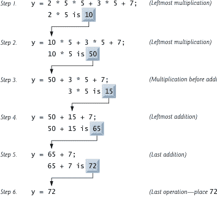

**图 2.11** | 二次多项式的求值顺序。

## 2.7 决策：相等运算符和关系运算符

现在我们介绍 C++ `if` 语句的一个简单版本，它允许程序根据条件为真还是为假来采取不同的操作。如果条件为真，则执行 `if` 语句主体中的语句。如果条件为假，则不执行 `if` 语句的主体。我们很快就会看到一个示例。

`if` 语句中的条件可以通过使用图 2.12 中总结的**相等运算符**和**关系运算符**来构成。关系运算符都具有相同的优先级，并且从左到右结合。相等运算符也都具有相同的优先级，该优先级低于关系运算符，并且从左到右结合。

> **常见编程错误 2.3**
> 
> 颠倒运算符 `!=`、`>=` 和 `<=` 中一对符号的顺序（分别写成 `=!`、`=>` 和 `=<`）通常是语法错误。在某些情况下，将 `!=` 写成 `=!` 不会是语法错误，但几乎肯定是会在执行时产生影响的逻辑错误。当你学习第 5 章的逻辑运算符时，就会明白原因。**致命逻辑错误**会导致程序失败并提前终止。**非致命逻辑错误**允许程序继续执行，但通常会产生错误结果。

> **常见编程错误 2.4**
> 
> 将相等运算符 `==` 与赋值运算符 `=` 混淆会导致逻辑错误。相等运算符应读作“等于”或“双等号”，赋值运算符应读作“取得……的值”或“被赋值为……”。正如我们在 5.9 节中讨论的，混淆这些运算符不一定导致容易识别的语法错误，但可能导致极其微妙的逻辑错误。

```cpp
27
28    if ( number1 > number2 )
29       cout << number1 << " > " << number2 << endl;
30
31    if ( number1 <= number2 )
32       cout << number1 << " <= " << number2 << endl;
33
34    if ( number1 >= number2 )
35       cout << number1 << " >= " << number2 << endl;
36 } // end of function main
```

```
Enter two integers to compare: 3 7
3 != 7
3 < 7
3 <= 7
```

```
Enter two integers to compare: 22 12
22 != 12
22 > 12
22 >= 12
```

```
Enter two integers to compare: 7 7
7 == 7
7 <= 7
7 >= 7
```

**图 2.13** | 使用 if 语句、关系运算符和相等运算符比较整数。（第 2 部分，共 2 部分。）

### 使用 using 指令

第 6～8 行

```cpp
using std::cout; // program uses cout
using std::cin;  // program uses cin
using std::endl; // program uses endl
```

是 **using 指令**，它们消除了像之前程序那样重复 std:: 前缀的需要。现在，在程序的其余部分中，我们可以分别编写 cout 而不是 std::cout、cin 而不是 std::cin、endl 而不是 std::endl。

许多程序员喜欢用以下指令代替第 6～8 行：

```cpp
using namespace std;
```

该指令使程序能够使用程序可能包含的任何标准 C++ 头文件（如 <iostream>）中的所有名称。从本书此处开始，我们将在程序中使用前面的指令。

### 变量声明和从用户处读取输入

第 13～14 行

```cpp
int number1; // first integer to compare
int number2; // second integer to compare
```

声明程序中使用的变量。

像 `x = y = 0` 这样的表达式，其求值方式就像写成 `x = (y = 0)` 一样；我们很快会看到，它先把 0 赋给 `y`，然后把该赋值的结果——0——赋给 `x`。

| 运算符 | 结合性 | 类型 |
|---|---|---|
| `()` | *[参见图 2.10 中的注意事项]* | 分组圆括号 |
| `*` `/` `%` | 从左到右 | 乘法类 |
| `+` `-` | 从左到右 | 加法类 |
| `<<` `>>` | 从左到右 | 流插入/提取 |
| `<` `<=` `>` `>=` | 从左到右 | 关系 |
| `==` `!=` | 从左到右 | 相等 |
| `=` | 从右到左 | 赋值 |

**图 2.14** | 目前讨论的运算符的优先级和结合性。


> **良好编程实践 2.12**
> 
> *在编写包含许多运算符的表达式时，请参考运算符优先级和结合性图表（附录 A）。确认表达式中的运算符正是你预期顺序中的那些运算符。如果你不确定复杂表达式的求值顺序，请将该表达式拆分成更小的语句，或使用圆括号强制指定求值顺序，就像在代数表达式中那样。务必注意，有些运算符（如赋值（=））是从右到左结合，而不是从左到右结合。*

## 2.8 小结

你在本章中学习了 C++ 的许多重要基本特性，包括在屏幕上显示数据、从键盘输入数据以及声明基本类型的变量。特别地，你学会了使用输出流对象 cout 和输入流对象 cin 来构建简单的交互式程序。我们探讨了变量如何存储在内存中以及如何从内存中取回。你还学会了如何使用算术运算符执行计算。我们讨论了 C++ 应用运算符的顺序（即运算符优先级规则），以及运算符的结合性。你还了解了 C++ 的 `if` 语句如何让程序作出决策。最后，我们介绍了相等运算符和关系运算符，你可以用它们在 `if` 语句中构成条件。

这里介绍的非面向对象应用程序向你介绍了基本编程概念。正如你将在第 3 章中看到的，C++ 应用程序通常只在函数 `main` 中包含几行代码——这些语句通常创建执行应用程序工作的对象，然后对象“从那里接管”。在第 3 章中，你将学习如何实现自己的类，并在应用程序中使用这些类的对象。

### 小结

**2.2 节 C++ 的第一个程序：打印一行文本**

- 单行注释（第 39 页）以 `//` 开头。使用注释记录程序并提高可读性。


- 注释不会导致计算机在程序运行时执行任何操作（第40页）——编译器会忽略它们，它们也不会导致生成任何机器语言目标代码。
- 预处理指令（第39页）以 `#` 开头，是发给 C++ 预处理器的消息。预处理器指令在程序编译之前处理，并且不以分号结尾。
- 行 `#include <iostream>`（第39页）告诉 C++ 预处理器包含输入/输出流头文件的内容，该头文件包含编译使用 `std::cin`（第43页）和 `std::cout`（第40页）以及流插入（`<<`，第40页）和流提取（`>>`，第43页）运算符的程序所必需的信息。
- 空白（即空行、空格字符和制表符，第39页）使程序更易读。字面量之外的空白字符会被编译器忽略。
- C++ 程序从 `main`（第39页）开始执行，即使 `main` 没有出现在程序的最前面。
- `main` 左侧的关键字 `int` 表示 `main`“返回”一个整数值。
- 每个函数的主体（第40页）必须包含在花括号（`{` 和 `}`）中。
- 双引号中的字符串（第40页）有时称为字符串、消息或字符串字面量。字符串中的空白字符*不*会被编译器忽略。
- 每条语句（第40页）必须以分号（也称为语句终止符）结尾。
- C++ 中的输出和输入通过字符流（第40页）完成。
- 输出流对象 `std::cout`——通常连接到屏幕——用于输出数据。通过连接流插入（`<<`）运算符，可以输出多个数据项。
- 输入流对象 `std::cin`——通常连接到键盘——用于输入数据。通过连接流提取（`>>`）运算符，可以输入多个数据项。
- 记号 `std::cout` 指明我们使用的是来自“命名空间”`std` 的 `cout`。
- 当在字符串中遇到反斜杠（即转义字符）时，下一个字符会与反斜杠组合形成转义序列（第41页）。
- 换行转义序列 `\n`（第41页）将光标移到屏幕上下一行的开头。
- 指示用户采取特定操作的消息称为提示（第45页）。
- C++ 关键字 `return`（第41页）是退出函数的几种方式之一。

### 2.4 节 另一个 C++ 程序：整数相加

- C++ 程序中的所有变量（第43页）在使用前都必须声明。
- 变量名是任何不是关键字的有效标识符（第44页）。标识符是由字母、数字和下划线（`_`）组成的一系列字符。标识符不能以数字开头。标识符可以是任意长度，但某些系统或 C++ 实现可能会施加长度限制。
- C++ 区分大小写（第44页）。
- 大多数计算在赋值语句（第46页）中执行。
- 变量是内存中的一个位置（第47页），可以在其中存储供程序使用的值。
- `int` 类型（第44页）的变量保存整数值，即整数，例如 7、-11、0、31914。

### 2.5 节 内存概念

- 存储在计算机内存中的每个变量都有名称、值、类型和大小。
- 每当新值被放入内存位置时，该过程是破坏性的（第47页）；也就是说，新值会替换该位置中的先前值。先前值会丢失。
- 当从内存读取值时，该过程是非破坏性的（第47页）；也就是说，读取的是该值的一个副本，原始值在内存位置中保持不变。
- `std::endl` 流操纵器（第46页）输出一个换行符，然后“刷新输出缓冲区”。

### 2.6 节 算术

- C++ 按照由运算符优先级（第48页）和结合性（第49页）规则确定的精确顺序计算算术表达式（第48页）。
- 可以使用括号对表达式分组。
- 整数除法（第48页）得到整数商。整数除法中的任何小数部分都会被截断。
- 取模运算符 `%`（第48页）得到整数除法后的余数。

### 2.7 节 决策制定：相等运算符和关系运算符

- `if` 语句（第51页）允许程序根据是否满足条件采取不同的操作。`if` 语句的格式为

```
if ( condition )
    statement;
```

如果条件为真，则执行 `if` 主体中的语句。如果条件不满足，即条件为假，则跳过主体语句。

- `if` 语句中的条件通常使用相等运算符和关系运算符（第51页）构成。使用这些运算符的结果始终是真值或假值。
- using 指令（第53页）

```
using std::cout;
```

告诉编译器在哪里找到 `cout`（命名空间 `std`），并消除重复 `std::` 前缀的需要。指令

```
using namespace std;
```

使程序能够使用任何包含的 C++ 标准库头文件中的所有名称。

## 自测练习

- **2.1** 填写下列各题中的空白。

  a) 每个 C++ 程序都从函数 ____________ 开始执行。
  b) 一个 ____________ 开始每个函数的主体，一个 ____________ 结束该主体。
  c) 每条 C++ 语句以 ____________ 结尾。
  d) 转义序列 `\n` 表示 ____________ 字符，它使光标定位到屏幕上下一行的开头。
  e) ____________ 语句用于做出决策。

- **2.2** 说明下列各项是*真*还是*假*。如果为*假*，请解释原因。假设使用了语句 `using std::cout;`。

  a) 注释会导致程序执行时计算机在屏幕上打印 `//` 之后的文本。
  b) 当使用 `cout` 和流插入运算符输出转义序列 `\n` 时，它会使光标定位到屏幕上下一行的开头。
  c) 所有变量在使用前都必须声明。
  d) 所有变量在声明时都必须指定类型。
  e) C++ 认为变量 number 和 `NuMBer` 是相同的。
  f) 声明几乎可以出现在 C++ 函数主体中的任何位置。
  g) 取模运算符（`%`）只能用于整数操作数。

- b) `std::cout << "Enter an integer: ";`
- c) `std::cin >> age;`
- d) `if (number != 7)`

  `std::cout << "The variable number is not equal to 7\n";`

- e) `std::cout << "This is a C++ program\n";`
- f) `std::cout << "This is a C++ program\n";`
- g) `std::cout << "This\nis\na\nC++\nprogram\n";`
- h) `std::cout << "This\nis\ta\nC++\nprogram\n";`

- **2.4**

  a) `// Calculate the product of three integers`

  b)
  ```cpp
  int x;
  int y;
  int z;
  int result;
  ```

  c) `cout << "Enter three integers: ";`
  d) `cin >> x >> y >> z;`
  e) `result = x * y * z;`
  f) `cout << "The product is " << result << endl;`
  g) `return 0;`

**2.5**（见下面的程序。）

```cpp
// Calculate the product of three integers
#include <iostream> // allows program to perform input and output
using namespace std; // program uses names from the std namespace

// function main begins program execution
int main()
{
    int x; // first integer to multiply
    int y; // second integer to multiply
    int z; // third integer to multiply
    int result; // the product of the three integers

    cout << "Enter three integers: "; // prompt user for data
    cin >> x >> y >> z; // read three integers from user
    result = x * y * z; // multiply the three integers; store result
    cout << "The product is " << result << endl; // print result; end line
} // end function main
```

- **2.6**

  a) *错误：* if 语句中条件右括号后有一个分号。

  *更正：* 删除右括号后的分号。*[注意：此错误的结果是，无论 if 语句中的条件是否为真，输出语句都会执行。]* 右括号后的分号是一个空（或空）语句，不执行任何操作。我们将在第4章进一步学习空语句。

  b) *错误：* 关系运算符 `=>`。

  *更正：* 将 `=>` 改为 `>=`，并且你可能还想将“等于或大于”改为“大于或等于”。

## 练习

- **2.7** 讨论下列每个对象的含义：

  a) `std::cin`

  b) `std::cout`


### 2.8 填写下列各题中的空白：

- a) ______ 用于为程序编写文档并提高其可读性。
- b) 用于在屏幕上打印信息的对象是 ______。
- c) 用于做出判断的 C++ 语句是 ______。
- d) 大多数计算通常由 ______ 语句执行。
- e) ______ 对象从键盘输入值。

### 2.9 编写一条 C++ 语句或一行代码来完成下列各项：

- a) 打印消息 "Enter two numbers"。
- b) 将变量 b 和 c 的乘积赋给变量 a。
- c) 说明程序执行工资计算（即使用有助于为程序编写文档的文本）。
- d) 从键盘输入三个整数值到整型变量 a、b 和 c 中。

### 2.10 指出下列各项中哪些是*真*，哪些是*假*。如果是*假*，请解释你的答案。

- a) C++ 运算符从左到右求值。
- b) 下列都是有效的变量名：`_under_bar_`、`m928134`、`t5`、`j7`、`her_sales`、`his_account_total`、`a`、`b`、`c`、`z`、`z2`。
- c) 语句 `cout << "a = 5;";` 是赋值语句的典型例子。
- d) 不带括号的有效 C++ 算术表达式从左到右求值。
- e) 下列都是无效的变量名：`3g`、`87`、`67h2`、`h22`、`2h`。

### 2.11 填写下列各题中的空白：

- a) 哪些算术运算与乘法具有相同的优先级？______。
- b) 当括号嵌套时，算术表达式中哪一组括号先求值？______。
- c) 计算机内存中在程序执行期间的不同时刻可能包含不同值的位置称为 ______。

### 2.12 执行下列各 C++ 语句时，会打印什么（如果有的话）？如果什么都不打印，则回答“nothing”。假设 `x = 2` 且 `y = 3`。

- a) `cout << x;`
- b) `cout << x + x;`
- c) `cout << "x=";`
- d) `cout << "x = " << x;`
- e) `cout << x + y << " = " << y + x;`
- f) `z = x + y;`
- g) `cin >> x >> y;`
- h) `// cout << "x + y = " << x + y;`
- i) `cout << "\n";`

### 2.13 下列哪些 C++ 语句包含其值会被替换的变量？

- a) `cin >> b >> c >> d >> e >> f;`
- b) `p = i + j + k + 7;`
- c) `cout << "variables whose values are replaced";`
- d) `cout << "a = 5";`

### 2.14 给定代数方程 *y = ax³ + 7*，下列哪些（如果有的话）是该方程的正确 C++ 语句？

- a) `y = a * x * x * x + 7;`
- b) `y = a * x * x * (x + 7);`
- c) `y = (a * x) * x * (x + 7);`
- d) `y = (a * x) * x * x + 7;`
- e) `y = a * ( x * x * x ) + 7;`
- f) `y = a * ( ( x * x + 7 );`

### 2.15 （*求值顺序*）说明下列各 C++ 语句中运算符的求值顺序，并给出每条语句执行后 x 的值。

- a) `x = 7 + 3 * 6 / 2 - 1;`
- b) `x = 2 % 2 + 2 * 2 - 2 / 2;`
- c) `x = ( 3 * 9 * ( 3 + ( 9 * 3 / ( 3 ) ) ) );`

### 2.16 （*算术*）编写一个程序，要求用户输入两个数，从用户处获取这两个数，并打印这两个数的和、积、差和商。

### 2.17 （*打印*）编写一个程序，在同一行打印数字 1 到 4，每对相邻数字之间用一个空格分隔。用几种方法完成：

- a) 使用一条带一个流插入运算符的语句。
- b) 使用一条带四个流插入运算符的语句。
- c) 使用四条语句。

### 2.18 （*比较整数*）编写一个程序，要求用户输入两个整数，从用户处获取这两个数，然后打印较大的数，后跟单词 "is larger."。如果两个数相等，则打印消息 "These numbers are equal."。

### 2.19 （*算术、最小值和最大值*）编写一个程序，从键盘输入三个整数，并打印这些数的和、平均值、乘积、最小值和最大值。屏幕对话应如下所示：

```
Input three different integers: 13 27 14
Sum is 54
Average is 18
Product is 4914
Smallest is 13
Largest is 27
```

### 2.20 （*圆的直径、周长和面积*）编写一个程序，读入圆的半径（整数），并打印该圆的直径、周长和面积。π 使用常量值 3.14159。所有计算都在输出语句中完成。[*注意：* 本章只讨论了整型常量和变量。第 4 章将讨论浮点数，即可以带小数点的值。]

### 2.21 （*用星号显示形状*）编写一个程序，按如下所示打印一个方框、一个椭圆、一个箭头和一个菱形：

```
*********       ***           *           *
*       *        *           ***         * *
*       *       * *          ***        *   *
*       *       * *         *****      *     *
*       *       * *           *        *       *
*       *       * *           *         *     *
*       *        *            *          *   *
*       *        *            *           * *
*********       ***           *            *
```

### 2.22 以下代码会打印什么？

```
cout << "**\n**\n**\n**\n**\n**" << endl;
```

### 2.23 （*最大和最小整数*）编写一个程序，读入五个整数，并确定和打印该组中最大和最小的整数。只使用本章学过的编程技术。

### 2.24 （*奇数或偶数*）编写一个程序，读入一个整数，并确定和打印它是奇数还是偶数。*[提示：使用取模运算符。偶数是 2 的倍数。任何 2 的倍数除以 2 时余数都为零。]*

### 2.25 （*倍数*）编写一个程序，读入两个整数，并确定和打印第一个数是否为第二个数的倍数。*[提示：使用取模运算符。]*

### 2.26 （*棋盘图案*）用八条输出语句显示以下棋盘图案，然后使用尽可能少的语句显示相同图案。

```
        * * * * * * * *
         * * * * * * * *
        * * * * * * * *
         * * * * * * * *
        * * * * * * * *
         * * * * * * * *
        * * * * * * * *
         * * * * * * * *
```

### 2.27 （*字符的整数等价值*）这里先提前看一下。本章你学习了整数和 `int` 类型。C++ 还可以表示大写字母、小写字母以及种类相当多的特殊符号。C++ 在内部使用小整数来表示每个不同的字符。计算机使用的字符集以及这些字符对应的整数表示称为该计算机的字符集。你可以通过将字符括在单引号中来打印该字符，如下所示：

```
cout << 'A'; // print an uppercase A
```

可以使用 `static_cast` 按如下方式打印字符的整数等价值：

```
cout << static_cast < int > ('A' ); // print 'A' as an integer
```

这称为强制转换操作（我们将在第 4 章正式介绍强制转换）。当前面的语句执行时，它会打印值 65（在使用 ASCII 字符集的系统上）。编写一个程序，打印从键盘输入的字符的整数等价值。将输入存储在 `char` 类型的变量中。使用大写字母、小写字母、数字和特殊字符（如 $）多次测试你的程序。

### 2.28 （*整数的各位数字*）编写一个程序，输入一个五位整数，将该整数分离成各位数字，并打印它们，每个数字之间用三个空格分隔。*[提示：使用整数除法和取模运算符。]* 例如，如果用户输入 42339，程序应打印：

```
4    2    3    3    9
```

### 2.29 （*表格*）使用本章的技术，编写一个程序，计算 0 到 10 的整数的平方和立方。使用制表符打印下面格式整齐的值表：

| 整数 | 平方 | 立方 |
|---:|---:|---:|
| 0 | 0 | 0 |
| 1 | 1 | 1 |
| 2 | 4 | 8 |
| 3 | 9 | 27 |
| 4 | 16 | 64 |
| 5 | 25 | 125 |
| 6 | 36 | 216 |
| 7 | 49 | 343 |
| 8 | 64 | 512 |
| 9 | 81 | 729 |
| 10 | 100 | 1000 |


## 产生影响

### 2.30（体重指数计算器）

我们在练习 1.9 中介绍了体重指数（BMI）计算器。计算 BMI 的公式为

$$BMI = \frac{weightInPounds \times 703}{heightInInches \times heightInInches}$$

或

$$BMI = \frac{weightInKilograms}{heightInMeters \times heightInMeters}$$

创建一个 BMI 计算器应用程序，读取用户以磅为单位的体重和以英寸为单位的身高（或者，如果你愿意，也可以读取用户以千克为单位的体重和以米为单位的身高），然后计算并显示用户的体重指数。此外，应用程序应显示来自卫生与公众服务部/美国国立卫生研究院的以下信息，以便用户评估其 BMI：

**BMI 值**

| 分类 | BMI |
|---|---|
| 体重过轻 | 小于 18.5 |
| 正常 | 介于 18.5 和 24.9 之间 |
| 超重 | 介于 25 和 29.9 之间 |
| 肥胖 | 30 或更高 |

> *[注意：在本章中，你学习了使用 `int` 类型表示整数。使用 `int` 值进行 BMI 计算时，两种计算都会产生整数结果。在第 4 章中，你将学习使用 `double` 类型表示带小数点的数。当使用 double 执行 BMI 计算时，两种计算都会产生带小数点的数——这些数称为“浮点数”。]*

### 2.31（拼车节省计算器）

研究几个拼车网站。创建一个计算你每日驾驶成本的应用程序，以便你可以估算拼车能节省多少钱，拼车还有其他优点，例如减少碳排放和缓解交通拥堵。该应用程序应输入以下信息，并显示用户每天开车上班的成本：

- a) 每天行驶的总英里数。
- b) 每加仑汽油的成本。
- c) 平均每加仑行驶英里数。
- d) 每天的停车费。
- e) 每天的过路费。

# 3 类、对象和字符串简介

> 任何事物若不具有实用性，便没有价值。
> —卡尔·马克思

> 你们的公仆理应为您服务。
> —阿德莱·E·史蒂文森

> 懂得如何回答说话的人，
> 如何回复送来信息的人。
> —阿蒙内莫普

### 目标

本章你将学习：

- 如何定义类并使用它创建对象。
- 如何将类的行为实现为成员函数。
- 如何将类的属性实现为数据成员。
- 如何调用对象的成员函数来执行任务。
- 类的数据成员与函数的局部变量之间的区别。
- 如何在创建对象时使用构造函数初始化对象的数据。
- 如何设计类，将其接口与实现分离并促进重用。
- 如何使用类 `string` 的对象。


- **3.1** 简介
- **3.2** 用成员函数定义类
- **3.3** 定义带参数的成员函数
- **3.4** 数据成员、`set` 函数和 `get` 函数
- **3.5** 用构造函数初始化对象
- **3.6** 将类放入单独文件以便重用
- **3.7** 将接口与实现分离
- **3.8** 用 `set` 函数验证数据
- **3.9** 小结

*摘要* | *自测练习* | *自测练习答案* | *练习* | *产生影响*

### 3.1 简介

在第 2 章中，你创建了简单程序，向用户显示消息、从用户处获取信息、执行计算并做出决策。本章中，你将开始编写使用面向对象编程基本概念的程序，这些概念我们在 1.6 节中介绍过。第 2 章中每个程序的一个共同特征是，所有执行任务的语句都位于函数 `main` 中。通常，你在本书中开发的程序将由函数 `main` 和一个或多个类组成，每个类包含数据成员和成员函数。如果你成为业界开发团队的一员，你可能会参与包含数百甚至数千个类的软件系统。本章中，我们开发一个简单且设计良好的框架，用于组织 C++ 中的面向对象程序。

我们以精心安排的节奏展示一系列完整可运行的程序，演示如何创建和使用自己的类。这些示例开始了我们的综合案例研究：开发一个教师可用于维护学生考试成绩的成绩册类。我们还介绍 C++ 标准库类 `string`。

### 3.2 用成员函数定义类

我们从一个示例（图 3.1）开始，它由 GradeBook 类（第 8—16 行）和 `main` 函数（第 19—23 行）组成——当 GradeBook 类在第 7 章完全开发后，它将表示一个教师可用于维护学生考试成绩的成绩册；而 `main` 函数创建一个 GradeBook 对象。`main` 函数使用该对象及其成员函数在屏幕上显示一条消息，欢迎教师使用成绩册程序。

```cpp
// Fig. 3.1: fig03_01.cpp
// Define class GradeBook with a member function displayMessage,
// create a GradeBook object and call its displayMessage function.
#include <iostream>
using namespace std;

// GradeBook class definition
class GradeBook
{
public:
   // function that displays a welcome message to the GradeBook user
   void displayMessage()
   {
      cout << "Welcome to the Grade Book!" << endl;
   } // end function displayMessage
}; // end class GradeBook

// function main begins program execution
int main()
{
   GradeBook myGradeBook; // create a GradeBook object named myGradeBook
   myGradeBook.displayMessage(); // call object's displayMessage function
} // end main
```

欢迎使用成绩册！

**图 3.1** | 定义带成员函数 displayMessage 的 GradeBook 类，创建 GradeBook 对象并调用其 displayMessage 函数。

#### GradeBook 类

在函数 `main`（第 19—23 行）创建 GradeBook 对象之前，我们必须告诉编译器该类包含哪些数据成员和成员函数。GradeBook 类定义（第 8—16 行）包含一个名为 `displayMessage` 的成员函数（第 12—15 行），它在屏幕上显示一条消息（第 14 行）。我们需要创建 GradeBook 类的对象（第 21 行），并调用其 `displayMessage` 成员函数（第 22 行），以使第 14 行执行并显示欢迎消息。我们很快就会详细解释第 21—22 行。

类定义从第 8 行开始，以关键字 `class` 开头，后面是类名 `GradeBook`。按照惯例，用户定义类的名称以大写字母开头，并且为了可读性，类名中后续每个单词都以大写字母开头。这种大小写风格通常称为 Pascal 命名法，因为大写和小写字母的模式类似骆驼的轮廓。

每个类的主体都包含在一对左花括号和右花括号（`{` 和 `}`）中，如第 9 行和第 16 行所示。类定义以分号结束（第 16 行）。

> **常见编程错误 3.1**
>
> *忘记在类定义末尾写分号是语法错误。*


回想一下，执行程序时函数 `main` 总是自动调用。大多数函数不会自动调用。正如你很快会看到的，必须显式调用成员函数 `displayMessage`，告诉它执行任务。

第 10 行包含关键字 `public`，它是一个访问说明符。第 12—15 行定义成员函数 `displayMessage`。这个成员函数出现在访问说明符 `public:` 之后，表示该函数“对公众可用”——也就是说，它可以由程序中的其他函数（如 `main`）调用，也可以由其他类的成员函数调用。


类（如果有的话）。访问说明符后面总是跟一个冒号（:）。在本文剩余部分，当我们提到访问说明符 `public` 时，将像本句一样省略冒号。第 3.4 节介绍访问说明符 `private`。本书后面我们将学习访问说明符 `protected`。

程序中的每个函数都执行一项任务，并可能在完成任务时*返回一个值*——例如，函数可能执行计算，然后返回该计算的结果。定义函数时，必须指定**返回类型**，以指明函数完成任务时返回的值的类型。在第 12 行，函数名 `displayMessage` 左侧的关键字 **void** 是该函数的返回类型。返回类型 `void` 表示 `displayMessage` 在完成任务时*不会*向它的**调用函数**（在此例中，即 `main` 的第 22 行，稍后我们将会看到）返回任何数据。在图 3.5 中，你将看到一个*确实*返回值的函数示例。

成员函数名 `displayMessage` 跟在返回类型之后（第 12 行）。按照惯例，函数名以*小写*首字母开头，名称中后续所有单词均以大写字母开头。这种大小写风格通常称为**驼峰命名法**，也用于变量名。成员函数名后的圆括号表示这是一个函数。如第 12 行所示，一对空圆括号表示该成员函数执行任务时*不*需要额外数据。你将在第 3.3 节看到一个*确实*需要额外数据的成员函数示例。第 12 行通常称为**函数头**。每个函数的*函数体*由左花括号和右花括号（{ 和 }）界定，如第 13 行和第 15 行所示。

*函数体*包含执行该函数任务的语句。在此例中，成员函数 `displayMessage` 包含一条语句（第 14 行），用于显示消息“Welcome to the Grade Book!”。该语句执行后，函数就完成了其任务。

### 测试 GradeBook 类

接下来，我们想在程序中使用 `GradeBook` 类。正如你在第 2 章所见，函数 `main`（第 19–23 行）开始执行每个程序。

在此程序中，我们想调用 GradeBook 类的 `displayMessage` 成员函数来显示欢迎消息。通常，在创建该类的对象之前，不能调用类的成员函数。（你将在第 10.6 节了解到，静态成员函数是例外。）第 21 行创建一个名为 `myGradeBook` 的 GradeBook 类对象。该变量的类型是 GradeBook——我们在第 8–16 行定义的类。当我们声明 `int` 类型的变量时（如第 2 章所做），编译器知道 `int` 是什么——它是“内置于”C++ 的*基本类型*。然而，在第 21 行，编译器*不*自动知道 GradeBook 是什么类型——它是**用户自定义类型**。我们通过包含*类定义*（第 8–16 行）来告诉编译器 GradeBook 是什么。如果省略这些行，编译器将发出错误消息。你创建的每个类都会成为一个新*类型*，可用于创建对象。你可以根据需要定义新的类类型；这也是 C++ 被称为**可扩展语言**的原因之一。

第 22 行使用变量 `myGradeBook` 调用成员函数 `displayMessage`，其后是**点运算符**（.）、函数名 `displayMessage` 和一对空圆括号。该调用使 `displayMessage` 函数执行其任务。在第 22 行开头，`myGradeBook.` 表示 `main` 应使用第 21 行创建的 GradeBook 对象。第 12 行中的空圆括号表示成员函数 `displayMessage` 执行任务时*不*需要额外数据，这就是我们在第 22 行用空圆括号调用该函数的原因。（在第 3.3 节中，你将看到如何向函数传递数据。）当 `displayMessage` 完成任务时，程序到达 `main` 的末尾（第 23 行）并终止。

### GradeBook 类的 UML 类图

回顾第 1.6 节，UML 是一种标准化图形语言，软件开发者用它来表示面向对象系统。在 UML 中，每个类在 UML 类图中建模为一个具有三个分区的矩形。图 3.2 给出了 GradeBook 类（图 3.1）的类图。*顶部分区*包含类的名称，水平居中并以粗体显示。*中间分区*包含类的属性，它们对应 C++ 中的数据成员。该分区当前为空，因为 GradeBook 类没有任何属性。（第 3.4 节将给出一个带属性的 GradeBook 类版本。）*底部分区*包含类的操作，它们对应 C++ 中的成员函数。UML 对操作的建模方式是列出操作名，后跟一对圆括号。GradeBook 类只有一个成员函数 `displayMessage`，因此图 3.2 的底部分区列出了一个具有该名称的操作。成员函数 `displayMessage` 执行任务不需要额外信息，因此类图中 `displayMessage` 后面的圆括号为空，正如图 3.1 第 12 行中该成员函数头中的圆括号一样。操作名前面的*加号（+）*表示 `displayMessage` 在 UML 中是 *public* 操作（即 C++ 中的公共成员函数）。


**图 3.2** | 表明 GradeBook 类有一个公共 displayMessage 操作的 UML 类图。

## 3.3 定义带参数的成员函数

在第 1.6 节的汽车类比中，我们提到踩下汽车的油门踏板会向汽车发送消息以执行一项任务——使汽车加速。但汽车应该*多快*加速？如你所知，踏板踩得越深，汽车加速越快。因此，发送给汽车的消息既包括*要执行的任务*，也包括*帮助汽车执行该任务的额外信息*。这种额外信息称为*参数*——参数值帮助汽车确定加速多快。类似地，成员函数可能需要一个或多个参数，这些参数表示它执行任务所需的额外数据。函数调用为函数的每个参数提供值——这些值称为*实参*。例如，要向银行账户存款，假设 Account 类的 deposit 成员函数指定了一个表示*存款金额*的参数。当调用 deposit 成员函数时，表示存款金额的实参值会被复制到该成员函数的参数中。然后，该成员函数将该金额加到账户余额中。

### 定义并测试 GradeBook 类

下一个示例（图 3.3）重新定义了 GradeBook 类（第 9–18 行），其中有一个 `displayMessage` 成员函数（第 13–17 行），用于将课程名作为欢迎消息的一部分显示。新版本的 `displayMessage` 需要一个参数（第 13 行中的 `courseName`），表示要输出的课程名。

```cpp
// Fig. 3.3: fig03_03.cpp
// Define class GradeBook with a member function that takes a parameter,
// create a GradeBook object and call its displayMessage function.
#include <iostream>
#include <string> // program uses C++ standard string class
using namespace std;

// GradeBook class definition
class GradeBook
{
public:
   // function that displays a welcome message to the GradeBook user
   void displayMessage( string courseName )
   {
      cout << "Welcome to the grade book for\n" << courseName << "!"
           << endl;
   } // end function displayMessage
}; // end class GradeBook

// function main begins program execution
int main()
{
   string nameOfCourse; // string of characters to store the course name
   GradeBook myGradeBook; // create a GradeBook object named myGradeBook

   // prompt for and input course name
   cout << "Please enter the course name:" << endl;
   getline( cin, nameOfCourse ); // read a course name with blanks
   cout << endl; // output a blank line

   // call myGradeBook's displayMessage function
   // and pass nameOfCourse as an argument
   myGradeBook.displayMessage( nameOfCourse );
} // end main
```

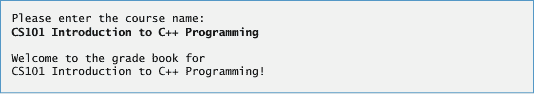

**图 3.3** 定义带有一个接收参数的成员函数的 GradeBook 类，创建一个 GradeBook 对象并调用其 displayMessage 函数。

在讨论 GradeBook 类的新特性之前，让我们看看新类如何在 `main`（第 21–34 行）中使用。第 23 行创建一个名为 `nameOfCourse` 的 `string` 类型变量

用于存储用户输入的课程名称。`string` 类型的变量表示一串字符，例如“CS101 Introduction to C++ Programming”。字符串实际上是 C++ 标准库类 `string` 的一个 *对象*。该类定义在头文件 `<string>` 中，并且名称 `string` 与 `cout` 一样属于命名空间 `std`。为使第 13 行和第 23 行能够编译，第 5 行包含了 `<string>` 头文件。第 6 行的 using 指令使我们能够简化第 23 行中 `string` 的写法，而不必写成 `std::string`。目前，你可以把 string 变量看作与其他类型（如 `int`）的变量类似。你将在 3.8 节和第 18 章学习更多字符串功能。

第 24 行创建一个名为 myGradeBook 的 GradeBook 类对象。第 27 行提示用户输入课程名称。第 28 行从用户处读取名称并将其赋给 nameOfCourse 变量，使用库函数 `getline` 执行输入。在解释这行代码之前，我们先解释为什么不能简单地写成

```cpp
cin >> nameOfCourse;
```

来获取课程名称。在示例程序执行中，我们使用课程名称“CS101 Introduction to C++ Programming”，其中包含由空格分隔的多个单词。（回想一下，我们用粗体突出显示用户提供的输入。）当 `cin` 与流提取运算符一起使用时，它会读取字符，*直到遇到第一个空白字符为止*。因此，前面的语句只会读取“CS101”。课程名称的其余部分必须由后续输入操作读取。

在此示例中，我们希望用户输入完整课程名称并按 *回车* 将其提交给程序，并且我们希望将整个课程名称存储在 string 变量 nameOfCourse 中。第 28 行中的函数调用 `getline( cin, nameOfCourse )` 从标准输入流对象 `cin`（即键盘）读取字符（*包括*输入中分隔单词的空格字符），直到遇到换行字符，将这些字符放入 string 变量 nameOfCourse 中，并 *丢弃* 换行字符。当你在输入程序输入时按 *回车*，输入流中会插入一个换行符。程序中必须包含 `<string>` 头文件才能使用函数 getline，该函数属于命名空间 std。

第 33 行调用 myGradeBook 的 displayMessage 成员函数。括号中的 nameOfCourse 变量是传递给成员函数 displayMessage 的 *实参*，以便该函数执行其任务。main 中变量 nameOfCourse 的值被复制到第 13 行成员函数 displayMessage 的形参 courseName。执行此程序时，成员函数 displayMessage 会将你输入的课程名称作为欢迎消息的一部分输出（我们的示例执行中为 CS101 Introduction to C++ Programming）。

## 关于实参和形参的更多内容

要在函数定义中指明该函数需要数据来执行其任务，需将附加信息放在函数的 *形参列表* 中，该列表位于函数名后面的括号内。形参列表可以包含任意数量的形参，包括完全不包含形参（如图 3.1 第 12 行中由一对空括号表示），以表示函数 *不* 需要任何形参。成员函数 displayMessage 的形参列表（图 3.3 第 13 行）声明该函数需要一个形参。每个形参都指定为一个 *类型* 和一个 *标识符*。类型 string 和标识符 courseName 表明成员函数 displayMessage 需要一个 string 来执行其任务。成员函数体使用形参 courseName 来访问在函数调用（main 中第 33 行）中传递给函数的值。第 15–16 行将形参 courseName 的值作为欢迎消息的一部分显示。

形参变量的名称（第 13 行中的 courseName）可以与实参变量的名称（第 33 行中的 nameOfCourse）相同或不同——你将在第 6 章了解原因。

函数可以通过用逗号分隔每个形参来指定多个形参。函数调用中实参的数量和顺序必须与被调用成员函数头部的形参列表中的形参数量和顺序匹配。此外，函数调用中的实参类型必须与函数头部中对应形参的类型一致。（你将在后续章节了解到，实参的类型与其对应形参的类型不必总是完全相同，但它们必须“一致”。）在我们的示例中，函数调用中的一个 string 实参（即 nameOfCourse）与成员函数定义中的一个 string 形参（即 courseName）完全匹配。

### 类 GradeBook 的更新 UML 类图

图 3.4 的 UML 类图对图 3.3 的类 GradeBook 建模。与图 3.1 中定义的类 GradeBook 一样，这个 GradeBook 类包含公共成员函数 displayMessage。不过，这个版本的 displayMessage 有一个形参。UML 通过在操作名后面的括号中列出形参名称、后跟冒号和形参类型来为形参建模。UML 有自己的数据类型，类似于 C++ 的数据类型。UML 与语言无关——它与许多不同的编程语言一起使用——因此其术语并不完全与 C++ 的术语匹配。例如，UML 类型 String 对应于 C++ 类型 string。类 GradeBook 的成员函数 displayMessage（图 3.3 第 13–17 行）有一个名为 courseName 的 string 形参，因此图 3.4 在操作名 displayMessage 后面的括号中列出 courseName : String。这个版本的 GradeBook 类仍然没有任何数据成员。

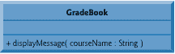

**图 3.4** | UML 类图，表示类 GradeBook 具有一个公共的 displayMessage 操作，该操作带有一个 UML 类型为 String 的 courseName 形参。

## 3.4 数据成员、set 函数和 get 函数

在第 2 章中，我们在程序的 main 函数中声明了程序的所有变量。在函数定义体内声明的变量称为局部变量，只能从函数中声明它们的那一行开始，到声明它们所在块的右花括号（}）为止使用。局部变量必须先声明，然后才能在函数中使用。局部变量不能在声明它的函数外部访问。当函数终止时，其局部变量的值将丢失。（你将在第 6 章讨论静态局部变量时看到这一规则的一个例外。）

类通常由一个或多个成员函数组成，这些成员函数操作属于该类特定对象的属性。属性在类定义中表示为变量。这类变量称为**数据成员**，它们在类定义内部声明，但在类成员函数定义体 *外部* 声明。类的每个对象在内存中都维护其自身属性的一份副本。这些属性在对象的整个生命周期内都存在。本节的示例演示了一个 GradeBook 类，其中包含一个 courseName 数据成员，用于表示特定 GradeBook 对象的课程名称。

### 带数据成员、set 函数和 get 函数的 GradeBook 类

在下一个示例中，类 GradeBook（图 3.5）将课程名称维护为一个 *数据成员*，以便在程序执行期间的任何时候使用或修改它。该类包含成员函数 setCourseName、getCourseName 和 displayMessage。成员函数 setCourseName 将课程名称存储在 GradeBook 数据成员中。成员函数 getCourseName 从该数据成员获取课程名称。成员函数 displayMessage——现在没有形参——仍然显示包含课程名称的欢迎消息。不过，正如你将看到的，该函数现在通过调用同一个类中的另一个函数 getCourseName 来获取课程名称。

```cpp
// Fig. 3.5: Fig03_05.cpp
// Define class GradeBook that contains a courseName data member
// and member functions to set and get its value.
// Create and manipulate a GradeBook object with these functions.
#include <iostream>
#include <string> // program uses C++ standard string class
using namespace std;

// GradeBook class definition
class GradeBook
{
public:
   // function that sets the course name
   void setCourseName( string name )
   {
      courseName = name; // store the course name in the object
   } // end function setCourseName

   // function that gets the course name
   string getCourseName()
   {
      return courseName; // return the object's courseName
   } // end function getCourseName

   // function that displays a welcome message
   void displayMessage()
   {
      // this statement calls getCourseName to get the
      // name of the course this GradeBook represents
      cout << "Welcome to the grade book for\n" << getCourseName() << "!"
           << endl;
   } // end function displayMessage
```

**图 3.5** | 定义并测试带有数据成员以及 *set* 和 *get* 函数的类 *GradeBook*。（第 1 部分，共 2 部分。）


```cpp
private:
    string courseName; // course name for this GradeBook
}; // end class GradeBook

// function main begins program execution
int main()
{
    string nameOfCourse; // string of characters to store the course name
    GradeBook myGradeBook; // create a GradeBook object named myGradeBook

    // display initial value of courseName
    cout << "Initial course name is: " << myGradeBook.getCourseName()
         << endl;

    // prompt for, input and set course name
    cout << "\nPlease enter the course name: " << endl;
    getline(cin, nameOfCourse); // read a course name with blanks
    myGradeBook.setCourseName(nameOfCourse); // set the course name

    cout << endl; // outputs a blank line
    myGradeBook.displayMessage(); // display message with new course name
} // end main
```

```text
Initial course name is:

Please enter the course name:
CS101 Introduction to C++ Programming

Welcome to the grade book for
CS101 Introduction to C++ Programming!
```

**图 3.5** | 定义并测试带有数据成员以及 *set* 和 *get* 函数的类 *GradeBook*。*（第 2 部分，共 2 部分）*

一位典型的教师会教授多门课程，每门课程都有自己的课程名称。第 34 行声明 courseName 是一个 string 类型的变量。由于该变量在类定义（第 10–35 行）中声明，但在类的成员函数定义体（第 14–17、20–23 和 26–32 行）之外，因此它是一个*数据成员*。类 GradeBook 的每个实例（即对象）都包含类中每个数据成员的一份副本——如果有两个 GradeBook 对象，则每个对象都有自己的 courseName 副本（每个对象一份），正如你将在图 3.7 的示例中看到的那样。将 courseName 设为数据成员的一个好处是，类的所有成员函数都可以操作类定义中出现的任何数据成员（此处即 courseName）。

## *访问说明符 public 和 private*

大多数数据成员声明出现在 *private* 访问说明符之后。在 *private* 访问说明符之后（如果存在下一个访问说明符，则在其之前）声明的变量或函数，仅对声明它们的类的成员函数（或类的“友元”，正如你将在第 10 章“类：更深入的探讨，第 2 部分”中看到的）可访问。因此，数据成员 courseName 只能在 GradeBook 类的成员函数（即 GradeBook 类的 getCourseName 和 displayMessage）中使用（或者，如果有的话，也可供类的“友元”使用）。


### 软件工程观察 3.1

通常，数据成员应声明为 private，成员函数应声明为 public。


### 错误预防提示 3.1

将类的数据成员设为 private，将类的成员函数设为 public。这有助于调试，因为数据处理问题被限制在类的成员函数或类的友元中。


### 常见编程错误 3.2

如果一个函数不是某个类的成员（也不是该类的友元），却试图访问该类的私有成员，则会产生编译错误。

类成员的默认访问权限是 private，因此类头之后、第一个访问说明符之前（如果有）的所有成员都是 private。访问说明符 public 和 private 可以重复使用，但没有必要，而且可能令人困惑。使用访问说明符 private 声明数据成员称为数据隐藏。当程序创建 GradeBook 对象时，数据成员 courseName 被封装（隐藏）在对象中，并且只能由该对象类的成员函数访问。在 GradeBook 类中，成员函数 setCourseName 和 getCourseName 直接操作数据成员 courseName。

## *成员函数 setCourseName 和 getCourseName*

成员函数 setCourseName（第 14–17 行）完成任务时不返回任何数据，因此其返回类型为 void。该成员函数接收一个参数——name——它表示将作为实参传递给它的课程名称（我们将在 main 的第 50 行看到）。第 16 行将 name 赋给数据成员 courseName。在本例中，setCourseName 并不验证课程名称——即该函数不检查课程名称是否符合任何特定格式，或遵循任何关于“有效”课程名称应是什么样的规则。例如，假设一所大学打印的学生成绩单只能包含 25 个或更少字符的课程名称。在这种情况下，我们可能希望 GradeBook 类确保其数据成员 courseName 永远不会超过 25 个字符。我们将在 3.8 节讨论验证。

成员函数 getCourseName（第 20–23 行）返回特定 GradeBook 对象的 courseName。该成员函数的参数列表为空，因此它不需要额外数据即可执行任务。该函数指定返回一个 string。当一个指定返回类型不是 void 的函数被调用并完成任务时，该函数使用 return 语句（如第 22 行所示）将结果返回给它的调用函数。例如，当你到自动取款机（ATM）前查询账户余额时，你期望 ATM 返回一个代表你余额的值。类似地，当一条语句对 GradeBook 对象调用成员函数 getCourseName 时，该语句期望收到 GradeBook 的课程名称（在本例中是一个 string，正如函数返回类型所指定的）。

如果你有一个函数 square，它返回其参数的平方，那么语句

```text
result = square( 2 );
```

将从函数 square 返回 4，并将值 4 赋给变量 result。如果你有一个函数 maximum，它返回三个整数参数中的最大值，那么语句

```text
biggest = maximum( 27, 114, 51 );
```

将从函数 maximum 返回 114，并将值 114 赋给变量 biggest。

第 16 行和第 22 行的语句都使用了变量 courseName（第 34 行），尽管它没有在任何一个成员函数中声明。我们之所以可以这样做，是因为 courseName 是类的数据成员。

## *成员函数 displayMessage*

成员函数 displayMessage（第 26–32 行）完成任务时不返回任何数据，因此其返回类型为 void。该函数不接收参数，因此其参数列表为空。第 30–31 行输出一条欢迎消息，其中包含数据成员 courseName 的值。第 30 行调用成员函数 getCourseName 来获取 courseName 的值。成员函数 displayMessage 也可以像成员函数 setCourseName 和 getCourseName 那样直接访问数据成员 courseName。我们稍后将解释为什么最好调用成员函数 getCourseName 来获取 courseName 的值。

## *测试类 GradeBook*

main 函数（第 38–54 行）创建了一个 GradeBook 类的对象，并使用其每个成员函数。第 41 行创建名为 myGradeBook 的 GradeBook 对象。第 44–45 行通过调用该对象的 getCourseName 成员函数显示初始课程名称。输出的第一行没有显示课程名称，因为对象的 courseName 数据成员（即 string）最初为空——默认情况下，string 的初始值就是所谓的空字符串，即不包含任何字符的字符串。当显示空字符串时，屏幕上不会出现任何内容。

第 48 行提示用户输入课程名称。局部 string 变量 nameOfCourse（在第 40 行声明）被设置为用户输入的课程名称，该名称通过调用 getline 函数（第 49 行）获得。第 50 行调用对象 myGradeBook 的 setCourseName 成员函数，并将 nameOfCourse 作为该函数的实参。函数被调用时，实参的值被复制到成员函数 setCourseName 的参数 name（第 14 行）中。然后，参数的值被赋给数据成员 courseName（第 16 行）。第 52 行跳行；然后第 53 行调用对象 myGradeBook 的 displayMessage 成员函数，以显示包含课程名称的欢迎消息。

## *使用 set 和 get 函数的软件工程*

类的私有数据成员只能由该类的成员函数（以及类的“友元”）操作。因此，对象的客户端——也就是从对象外部调用该对象成员函数的任何语句——会调用类的公有成员函数，以请求该类为特定对象提供服务。这就是为什么 main 函数中的语句要对 GradeBook 对象调用成员函数 setCourseName、getCourseName 和 displayMessage。类通常提供公有成员函数，允许类的客户端设置（即赋值给）或获取（即取得）私有数据成员。这些成员函数名不一定以 set 或 get 开头，但这种命名约定很常见。在本例中，设置 courseName 数据成员的成员函数称为 setCourseName，获取 courseName 数据成员值的成员函数称为 getCourseName。set 函数有时


设置函数有时也称为修改器（因为它们会修改或更改值），而 *获取* 函数也称为访问器（因为它们访问值）。

回顾一下，使用访问说明符 private 声明数据成员可强制实现数据隐藏。提供公有的 *设置* 和 *获取* 函数允许类的客户访问隐藏数据，但只能间接访问。客户知道它正试图修改或获取对象的数据，但客户不知道对象如何执行这些操作。在某些情况下，类可能在内部以某种方式表示一项数据，但以另一种方式向客户公开该数据。例如，假设一个 Clock 类将一天中的时间表示为私有 int 数据成员 time，该成员存储自午夜以来的秒数。然而，当客户调用 Clock 对象的 *getTime* 成员函数时，该对象可以以 "HH:MM:SS" 格式的字符串返回时、分、秒形式的时间。类似地，假设 Clock 类提供一个名为 *setTime* 的 *设置* 函数，该函数接受 "HH:MM:SS" 格式的字符串参数。利用第 18 章介绍的 string 功能，*setTime* 函数可以将此字符串转换为秒数，并将该秒数存储在其私有数据成员中。*设置* 函数还可以检查它接收的值是否表示有效时间（例如，"12:30:45" 有效，但 "42:85:70" 无效）。*设置* 和 *获取* 函数允许客户与对象交互，但对象的私有数据仍安全地封装（即隐藏）在对象自身中。

类的 *设置* 和 *获取* 函数也应由类内的其他成员函数用来操作类的私有数据，尽管这些成员函数可以直接访问私有数据。在图 3.5 中，成员函数 *setCourseName* 和 *getCourseName* 是公有成员函数，因此类的客户以及类本身都可以访问它们。成员函数 *displayMessage* 调用成员函数 *getCourseName* 来获取数据成员 *courseName* 的值以进行显示，尽管 *displayMessage* 可以直接访问 *courseName*——通过其 *获取* 函数访问数据成员可创建更好、更健壮的类（即更易于维护且更不易发生故障的类）。如果我们决定以某种方式更改数据成员 *courseName*，则 *displayMessage* 的定义不需要修改——只需要更改直接操作该数据成员的 *获取* 和 *设置* 函数的函数体。例如，假设我们希望将课程名称表示为两个单独的数据成员——*courseNumber*（例如 "CS101"）和 *courseTitle*（例如 "Introduction to C++ Programming"）。成员函数 *displayMessage* 仍可以只调用一次成员函数 *getCourseName*，以将完整课程名称作为欢迎消息的一部分显示。在这种情况下，*getCourseName* 需要构造并返回一个包含 *courseNumber* 后跟 *courseTitle* 的字符串。成员函数 *displayMessage* 可以继续显示完整课程标题（“CS101 Introduction to C++ Programming”）。从同一个类的另一个成员函数调用 *设置* 函数的好处，将在第 3.8 节讨论验证时变得清楚。


> **良好的编程实践 3.1**
>
> *始终尽量通过获取和设置函数访问和操作数据成员，从而将类数据成员更改的影响局部化。*


> **软件工程观察 3.2**
>
> *编写清晰且易于维护的程序。变化是常态而非例外。你应该预料到自己的代码会被修改。*

## 带数据成员及设置和获取函数的 GradeBook UML 类图

图 3.6 包含图 3.5 中类 GradeBook 版本的更新 UML 类图。该图将 GradeBook 的数据成员 courseName 建模为中间隔间中的一个属性。UML 通过列出属性名，后跟冒号和属性类型，将数据成员表示为属性。属性 courseName 的 UML 类型为 String，对应于 C++ 中的 string。数据成员 courseName 在 C++ 中是私有的，因此类图在相应属性名前列出减号（−）。UML 中的减号等价于 C++ 中的 private 访问说明符。类 GradeBook 包含三个公有成员函数，因此类图在第三个隔间中列出三个操作。操作 setCourseName 有一个名为 name 的 String 参数。UML 通过在操作名后的圆括号之后放置冒号和返回类型来表示操作的返回类型。类 GradeBook 的成员函数 getCourseName 在 C++ 中具有 string 返回类型，因此类图在 UML 中显示 String 返回类型。操作 setCourseName 和 displayMessage 不返回值（即它们在 C++ 中返回 void），因此 UML 类图在这些操作的圆括号之后不指定返回类型。

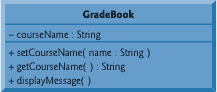

**图 3.6** | 类 *GradeBook* 的 UML 类图，包含私有 *courseName* 属性和公有操作 *setCourseName*、*getCourseName* 以及 *displayMessage*。

## 3.5 用构造函数初始化对象

如第 3.4 节所述，当创建类 GradeBook（图 3.5）的对象时，其数据成员 courseName 默认初始化为空字符串。如果希望在创建 GradeBook 对象时提供课程名称，该怎么办？你声明的每个类都可以提供一个构造函数，用于在创建对象时初始化该类的对象。构造函数是一种特殊的成员函数，必须与类同名定义，以便编译器能将其与类的其他成员函数区分开。构造函数与其他函数的一个重要区别是构造函数不能返回值，因此不能指定返回类型（甚至不能指定 void）。通常，构造函数声明为公有。

C++ 要求为每个创建的对象调用构造函数，这有助于确保每个对象在程序中使用之前被正确初始化。构造函数调用在创建对象时隐式发生。如果类没有显式包含构造函数，编译器会提供一个默认构造函数——即没有参数的构造函数。例如，当图 3.5 的第 41 行创建一个 GradeBook 对象时，会调用默认构造函数。编译器提供的默认构造函数在创建 GradeBook 对象时不会为该对象的基本类型数据成员提供任何初始值。[注意：对于作为其他类对象的数据成员，默认构造函数会隐式调用每个数据成员的默认构造函数，以确保该数据成员被正确初始化。这就是为什么 `string` 数据成员 `courseName`（在图 3.5 中）被初始化为空字符串——类 `string` 的默认构造函数将字符串的值设置为空字符串。你将在第 10.3 节中了解更多关于初始化作为其他类对象的数据成员的内容。]

在图 3.7 的示例中，我们在创建 GradeBook 对象时为该对象指定课程名称（例如第 46 行）。在这种情况下，实参 "CS101 Introduction to C++ Programming" 被传递给 GradeBook 对象的构造函数（第 14–17 行），并用于初始化 courseName。图 3.7 定义了一个修改后的 GradeBook 类，其中包含一个带 string 参数的构造函数，该参数接收初始课程名称。

```cpp
// Fig. 3.7: fig03_07.cpp
// Instantiating multiple objects of the GradeBook class and using
// the GradeBook constructor to specify the course name
// when each GradeBook object is created.
#include <iostream>
#include <string> // program uses C++ standard string class
using namespace std;

// GradeBook class definition
class GradeBook
{
public:
   // constructor initializes courseName with string supplied as argument
   GradeBook( string name )
   {
      setCourseName( name ); // call set function to initialize courseName
   } // end GradeBook constructor

   // function to set the course name
   void setCourseName( string name )
   {
      courseName = name; // store the course name in the object
   } // end function setCourseName

   // function to get the course name
   string getCourseName()
   {
      return courseName; // return object's courseName
   } // end function getCourseName

   // display a welcome message to the GradeBook user
   void displayMessage()
   {
      // call getCourseName to get the courseName
      cout << "\nWelcome to the grade book for\n" << getCourseName()
           << "!" << endl;
   } // end function displayMessage
private:
   string courseName; // course name for this GradeBook
}; // end class GradeBook
```

**图 3.7** 实例化 GradeBook 类的多个对象，并在创建每个 GradeBook 对象时使用 GradeBook 构造函数指定课程名称。（第 1 部分，共 2 部分。）


### 为类提供默认构造函数的两种方式

任何不接受参数的构造函数都称为默认构造函数。类可以通过以下两种方式之一获得默认构造函数：

- 1. 编译器会为一个未定义构造函数的类隐式创建默认构造函数。这样的构造函数不会初始化类的数据成员，但会为每个作为另一个类对象的数据成员调用默认构造函数。未初始化的变量通常包含“垃圾”值。
- 2. 你显式定义一个不接受参数的构造函数。这样的默认构造函数会为每个作为另一个类对象的数据成员调用默认构造函数，并执行你指定的额外初始化。

如果你定义了带参数的构造函数，C++ 将不会为该类隐式创建默认构造函数。对于图 3.1、图 3.3 和图 3.5 中每个版本的 GradeBook 类，编译器都隐式定义了默认构造函数。

> **错误预防提示 3.2**
>
> 除非类的数据成员不需要初始化（几乎从来不需要），否则应提供构造函数，以确保在创建类的每个新对象时，类的数据成员都用有意义的值初始化。

> **软件工程观察 3.3**
>
> 数据成员可以在构造函数中初始化，也可以在对象创建后设置它们的值。然而，良好的软件工程实践是确保在客户端代码调用对象的成员函数之前，对象已完全初始化。你不应依赖客户端代码来确保对象得到正确初始化。

### 将构造函数添加到 GradeBook 类的 UML 类图

图 3.8 的 UML 类图为图 3.7 的 GradeBook 类建模，该类有一个带 string 类型 name 参数的构造函数（在 UML 中由类型 String 表示）。与操作类似，UML 在类图的类的第三个隔间中建模构造函数。为了将构造函数与类的操作区分开，UML 在构造函数名称之前将单词“constructor”放在法式引号（« 和 »）之间。按照惯例，你在第三个隔间中将类的构造函数列在其他操作之前。

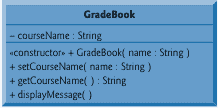

**图 3.8** | UML 类图，表明类 GradeBook 有一个带 UML 类型 String 的 name 参数的构造函数。

## 3.6 将类放在单独文件中以实现可重用性

创建类定义的优点之一是，经过适当打包后，你的类可以被其他程序员*重用*。例如，你可以通过包含头文件 `<string>`（并且，如你将看到的，通过能够链接到该库的目标代码），在任何 C++ 程序中重用 C++ 标准库类型 string。

希望使用我们的 GradeBook 类的程序员不能简单地将图 3.7 中的文件包含到另一个程序中。正如你在第 2 章学到的，函数 main 开始每个程序的执行，并且每个程序必须*恰好有一个* main 函数。如果其他程序员包含图 3.7 中的代码，他们会得到额外的“包袱”——我们的 main 函数——然后他们的程序将有两个 main 函数。当编译器尝试编译它遇到的第二个 main 函数时，尝试编译带有两个 main 函数的程序会产生错误。因此，将 main 与类定义放在同一个文件中*会阻止该类被其他程序重用*。在本节中，我们演示如何通过*将 GradeBook 类分离到另一个文件*（与 main 函数分开）来使其可重用。

### 头文件

本章前面的每个示例都由单个 .cpp 文件组成，也称为*源代码文件*，其中包含 GradeBook 类定义和 main 函数。在构建面向对象的 C++ 程序时，通常将*可重用的源代码*（例如类）定义在一个按惯例具有 .h 文件名扩展名的文件中——称为*头文件*。程序使用 #include 预处理器指令来包含头文件，并利用可重用的软件组件，例如 C++ 标准库中提供的类型 string 和用户定义类型（如类 GradeBook）。

我们的下一个示例将图 3.7 中的代码分离为两个文件——GradeBook.h（图 3.9）和 fig03_10.cpp（图 3.10）。当你查看图 3.9 中的头文件时，请注意它只包含 GradeBook 类定义（第 8–38 行）、相应的头文件和一条 using 指令。使用类 GradeBook 的 main 函数定义在源代码文件 fig03_10.cpp（图 3.10）的第 8–18 行中。为了帮助你为本书后面以及行业中会遇到的大型程序做好准备，我们经常使用一个包含函数 main 的单独源代码文件来测试我们的类（这称为*驱动程序*）。你很快就会了解，包含 main 的源代码文件如何使用头文件中的类定义来创建类的对象。

```cpp
// Fig. 3.9: GradeBook.h
// GradeBook class definition in a separate file from main.
#include <iostream>
#include <string> // class GradeBook uses C++ standard string class
using namespace std;

// GradeBook class definition
class GradeBook
{
public:
    // constructor initializes courseName with string supplied as argument
    GradeBook( string name )
    {
        setCourseName( name ); // call set function to initialize courseName
    } // end GradeBook constructor

    // function to set the course name
    void setCourseName( string name )
    {
        courseName = name; // store the course name in the object
    } // end function setCourseName

    // function to get the course name
    string getCourseName()
    {
        return courseName; // return object's courseName
    } // end function getCourseName

    // display a welcome message to the GradeBook user
    void displayMessage()
    {
        // call getCourseName to get the courseName
        cout << "Welcome to the grade book for\n" << getCourseName()
             << "!" << endl;
    } // end function displayMessage
private:
    string courseName; // course name for this GradeBook
}; // end class GradeBook
```

图 3.9 | *与 main 分离的文件中的 GradeBook 类定义。（第 1 部分，共 2 部分。）*

**图 3.9** | 与 main 分离的文件中的 GradeBook 类定义。（第 2 部分，共 2 部分。）

```cpp
// Fig. 3.10: fig03_10.cpp
// Including class GradeBook from file GradeBook.h for use in main.
#include <iostream>
#include "GradeBook.h" // include definition of class GradeBook
using namespace std;

// function main begins program execution
int main()
{
   // create two GradeBook objects
   GradeBook gradeBook1( "CS101 Introduction to C++ Programming" );
   GradeBook gradeBook2( "CS102 Data Structures in C++" );

   // display initial value of courseName for each GradeBook
   cout << "gradeBook1 created for course: " << gradeBook1.getCourseName()
        << "\ngradeBook2 created for course: " << gradeBook2.getCourseName()
        << endl;
} // end main
```

```text
gradeBook1 created for course: CS101 Introduction to C++ Programming
gradeBook2 created for course: CS102 Data Structures in C++
```

**图 3.10** | 从文件 GradeBook.h 包含类 GradeBook 以在 main 中使用。

### 包含用户定义类的头文件

像 GradeBook.h（图 3.9）这样的头文件不能作为完整程序使用，因为它不包含 main 函数。如果你尝试单独编译并链接 GradeBook.h 来创建可执行应用程序，Microsoft Visual C++ 2010 会产生以下链接器错误消息：

```
error LNK2001: unresolved external symbol _mainCRTStartup
```

要在 Linux 上使用 GNU C++ 编译并链接，你必须先将该头文件包含到一个 .cpp 源代码文件中，然后 GNU C++ 会产生包含以下内容的链接器错误消息：

```
undefined reference to `main'
```

此错误表明链接器无法定位程序的 main 函数。要测试类 GradeBook（在图 3.9 中定义），你必须编写一个包含 main 函数的单独源代码文件（例如图 3.10），该文件实例化并使用该类的对象。

编译器不知道 GradeBook 是什么，因为它是用户定义类型。事实上，编译器甚至不知道 C++ 标准库中的类。为了帮助它理解如何使用类，我们必须向编译器显式提供类的定义——这就是为什么，例如，要使用类型 string，程序必须包含 `<string>` 头文件。这使编译器能够确定为每个 string 对象必须保留的内存量，并确保程序正确调用 string 的成员函数。

要在图 3.10 的第 11–12 行创建 GradeBook 对象 gradeBook1 和 gradeBook2，编译器必须知道 GradeBook 对象的大小。虽然对象在概念上包含数据成员和成员函数，但 C++ 对象实际上只包含数据。编译器只创建类成员函数的一个副本，并在该类的所有对象之间共享该副本。当然，每个对象都需要自己的一份类数据成员副本，因为它们的内容可能因对象而异（例如两个不同的 BankAccount 对象具有两个不同的余额）。然而，成员函数代码不可修改，因此可以在该类的所有对象之间共享。因此，对象的大小取决于存储该类数据成员所需的内存量。通过在第 4 行包含 GradeBook.h，我们让编译器能够访问它所需的信息（图 3.9 第 37 行），以确定 GradeBook 对象的大小，并确定该类的对象是否被正确使用（在图 3.10 的第 11–12 行和第 15–16 行中）。

第 4 行指示 C++ 预处理器在程序编译之前用 GradeBook.h 内容（即 GradeBook 类定义）的副本替换该指令。当源代码文件 fig03_10.cpp 被编译时，它现在包含 GradeBook 类定义（因为 #include），编译器能够确定如何创建 GradeBook 对象，并看到它们的成员函数被正确调用。既然类定义位于头文件中（没有 main 函数），我们就可以在需要重用 GradeBook 类的任何程序中包含该头文件。

### 头文件如何定位

请注意，图 3.10 第 4 行中 GradeBook.h 头文件的名称用引号（" "）括起来，而不是用尖括号（< >）。通常，程序的源代码文件和用户定义的头文件放在同一目录中。当预处理器遇到用引号括起来的头文件名时，它会尝试在与出现 #include 指令的文件相同的目录中定位该头文件。如果预处理器在该目录中找不到该头文件


目录中，它会在与 C++ 标准库头文件相同的位置查找它。当预处理器遇到尖括号中的头文件名（例如 `<iostream>`）时，它会假定该头文件是 C++ 标准库的一部分，而不会在正在预处理的文件所在目录中查找。


> **错误预防提示 3.3**
> 
> *为确保预处理器能正确找到头文件，`#include` 预处理器指令应将用户定义的头文件名放在引号中（例如 "GradeBook.h"），并将 C++ 标准库头文件名放在尖括号中（例如 `<iostream>`）。*

## *其他软件工程问题*

既然类 GradeBook 已在头文件中定义，该类就是可重用的。遗憾的是，像图 3.9 那样将类定义放在头文件中，仍会向类的客户端暴露该类的整个实现——GradeBook.h 只是一个任何人都可以打开并阅读的文本文件。传统的软件工程智慧认为，要使用某个类的对象，客户端代码只需知道应调用哪些成员函数、应向每个成员函数提供什么参数，以及应从每个成员函数期望什么返回类型。*客户端代码不需要知道这些函数是如何实现的。*

如果客户端代码确实知道某个类是如何实现的，程序员就可能根据类的实现细节来编写客户端代码。理想情况下，如果该实现发生变化，类的客户端不应需要更改。*隐藏类的实现细节，可以在最大限度减少（并有望消除）对客户端代码的更改的同时，更容易地更改类的实现。*

在第 3.7 节中，我们将展示如何将 GradeBook 类拆分为两个文件，以便

1. 该类是*可重用的*，
2. 该类的客户端知道该类提供哪些成员函数、如何调用它们以及应期望什么返回类型，并且
3. 客户端*不*知道该类的成员函数是如何实现的。

## 3.7 将接口与实现分离

在上一节中，我们展示了如何通过将类定义与使用该类的客户端代码（例如函数 `main`）分离来促进软件可重用性。现在，我们介绍良好软件工程的另一条基本原则——*将接口与实现分离。*

### *类的接口*

接口定义并标准化了诸如人和系统等事物相互交互的方式。例如，收音机的控件充当收音机用户与其内部组件之间的接口。这些控件允许用户执行一组有限的操作（例如更换电台、调节音量以及在 AM 和 FM 电台之间选择）。各种收音机可能以不同方式实现这些操作——有些提供按钮，有些提供旋钮，还有些支持语音命令。接口规定了收音机允许其用户执行*哪些*操作，但没有规定这些操作在收音机内部是*如何*实现的。

类似地，类的接口描述了类的客户端可以使用*什么*服务以及*如何请求*这些服务，但没有描述类*如何*执行这些服务。类的公共接口由该类的公共成员函数（也称为该类的**公共服务**）组成。例如，类 GradeBook 的接口（图 3.9）包含一个构造函数以及成员函数 setCourseName、getCourseName 和 displayMessage。GradeBook 的客户端（例如图 3.10 中的 main）使用这些函数来请求该类的服务。正如你很快会看到的，可以通过编写一个*仅*列出成员函数名、返回类型和参数类型的类定义来指定类的接口。

### *将接口与实现分离*

在我们之前的示例中，每个类定义都包含该类公共成员函数的完整定义以及其私有数据成员的声明。然而，更好的软件工程做法是在类定义*外部*定义成员函数，以便它们的实现细节可以对客户端代码*隐藏*。这种做法*确保*你不会编写依赖于该类实现细节的客户端代码。如果你这样做了，那么一旦类的实现发生变化，客户端代码就更有可能“出问题”。鉴于一个类可能有许多客户端，这种变化可能会在软件系统中引起广泛的问题。

图 3.11–3.13 中的程序通过将图 3.9 的类定义拆分为两个文件，将类 GradeBook 的接口与其实现分离——头文件 GradeBook.h（图 3.11）中定义了类 GradeBook，源代码文件 GradeBook.cpp（图 3.12）中定义了 GradeBook 的成员函数。按照惯例，成员函数定义放在与类头文件基名相同（例如 GradeBook）但扩展名为 .cpp 的源代码文件中。源代码文件 fig03_13.cpp（图 3.13）指定了 main（客户端代码）。图 3.13 的代码和输出与图 3.10 相同。图 3.14 从 GradeBook 类程序员和客户端代码程序员的角度展示了这个三文件程序是如何编译的——我们将详细解释该图。

### ***GradeBook.h：用函数原型定义类的接口***

头文件 GradeBook.h（图 3.11）包含 GradeBook 类定义的另一个版本（第 9–18 行）。这个版本与图 3.9 中的版本类似，但图 3.9 中的函数定义在这里被替换为**函数原型**（第 12–15 行），这些原型*描述了类的公共接口，而没有揭示类的成员函数实现*。函数原型是函数的声明，它告诉编译器函数的名称、返回类型及其参数类型。此外，该头文件仍然指定了类的私有数据成员（第 17 行）。同样，编译器必须知道类的数据成员，才能确定为该类的每个对象预留多少内存。在客户端代码中包含头文件 GradeBook.h（图 3.13 第 5 行）可为编译器提供所需信息，以确保客户端代码正确调用类 GradeBook 的成员函数。

```cpp
// Fig. 3.11: GradeBook.h
// GradeBook class definition. This file presents GradeBook's public
// interface without revealing the implementations of GradeBook's member
// functions, which are defined in GradeBook.cpp.
#include <string> // class GradeBook uses C++ standard string class
using namespace std;

// GradeBook class definition
class GradeBook
{
public:
   GradeBook( string ); // constructor that initializes courseName
   void setCourseName( string ); // function that sets the course name
   string getCourseName(); // function that gets the course name
   void displayMessage(); // function that displays a welcome message
private:
   string courseName; // course name for this GradeBook
}; // end class GradeBook
```

**图 3.11** | 包含指定类接口的函数原型的 GradeBook 类定义。

第 12 行（图 3.11）中的函数原型表明，构造函数需要一个 string 参数。回想一下，构造函数没有返回类型，因此函数原型中不出现返回类型。成员函数 setCourseName 的函数原型表明，setCourseName 需要一个 string 参数且不返回值（即其返回类型为 void）。成员函数 getCourseName 的函数原型表明，该函数不需要参数并返回一个 string。最后，成员函数 displayMessage 的函数原型（第 15 行）指定 displayMessage 不需要参数且不返回值。这些函数原型与图 3.9 中相应的函数头相同，只是没有包含参数名（参数名在原型中是*可选的*），并且每个函数原型必须以分号结尾。

> **良好编程实践 3.2**
> 
> *尽管函数原型中的参数名是可选的（编译器会忽略它们），但许多程序员使用这些名称作为文档说明。*


> **错误预防提示 3.4**
> 
> *函数原型中的参数名（同样，编译器会忽略它们）如果与函数定义中使用的名称不匹配，可能会产生误导。因此，许多程序员在创建函数原型时，会复制相应函数定义的第一行（当函数的源代码可用时），然后在每个原型的末尾追加一个分号。*


### **GradeBook.cpp：在单独的源代码文件中定义成员函数**

源代码文件 *GradeBook.cpp*（图 3.12）定义了类 GradeBook 的成员函数，这些函数已在图 3.11 的第 12–15 行中声明。这些定义出现在第 9–32 行，并且与图 3.9 第 12–35 行中的成员函数定义几乎相同。

函数头（第 9、15、21 和 27 行）中的每个成员函数名前面都有类名和 `::`，这称为**二元作用域解析运算符**。这会将每个成员函数与（现在独立的）GradeBook 类定义（图 3.11）“绑定”起来，该定义声明了类的成员函数和数据成员。如果每个函数名前面没有 “GradeBook::”，这些函数就不会被编译器识别为类 GradeBook 的成员函数——编译器会把它们视为

```cpp
// Fig. 3.12: GradeBook.cpp
// GradeBook member-function definitions. This file contains
// implementations of the member functions prototyped in GradeBook.h.
#include <iostream>
#include "GradeBook.h" // include definition of class GradeBook
using namespace std;

// constructor initializes courseName with string supplied as argument
GradeBook::GradeBook( string name )
{
   setCourseName( name ); // call set function to initialize courseName
} // end GradeBook constructor

// function to set the course
void GradeBook::setCourseName( string name )
{
   courseName = name; // store the course name in the object
} // end function setCourseName

// function to get the course name
string GradeBook::getCourseName()
{
   return courseName; // return object's courseName
} // end function getCourseName

// display a welcome message to the GradeBook user
void GradeBook::displayMessage()
{
   // call getCourseName to get the courseName
   cout << "Welcome to the grade book for\n" << getCourseName()
        << "!" << endl;
} // end function displayMessage
```

**图 3.12** | GradeBook 的成员函数定义表示类 GradeBook 的实现。

像 main 这样的“自由”或“松散”函数。这些函数也称为 *全局函数*。此类函数如果不指定对象，就无法访问 GradeBook 的私有数据或调用该类的成员函数。因此，编译器将无法编译这些函数。例如，第 17 行和第 23 行访问变量 courseName，会导致编译错误，因为 courseName 并未在每个函数中声明为局部变量——编译器不知道 courseName 已经声明为类 GradeBook 的数据成员。


> **常见编程错误 3.3**
> 
> *在类外定义类的成员函数时，如果省略函数名前的类名和二元作用域解析运算符（`::`），会导致错误。*

为了表明 GradeBook.cpp 中的成员函数是类 GradeBook 的一部分，我们必须首先包含 GradeBook.h 头文件（图 3.12 的第 5 行）。这使我们能够在 GradeBook.cpp 文件中访问类名 GradeBook。编译 GradeBook.cpp 时，编译器使用 GradeBook.h 中的信息来确保

- 每个成员函数的第一行（第 9、15、21 和 27 行）与其在 GradeBook.h 文件中的原型匹配——例如，编译器确保 getCourseName 不接受参数并返回一个 string，并且
- 每个成员函数都知道类的数据成员和其他成员函数——例如，第 17 行和第 23 行可以访问变量 courseName，因为它在 GradeBook.h 中声明为类 GradeBook 的数据成员；第 11 行和第 30 行可以分别调用函数 setCourseName 和 getCourseName，因为二者都在 GradeBook.h 中声明为该类的成员函数（并且这些调用符合相应的原型）。

## 测试 GradeBook 类

图 3.13 执行与图 3.10 相同的 GradeBook 对象操作。将 GradeBook 的接口与其成员函数的实现分离，不会影响此客户端代码使用该类的方式。它只影响程序的编译和链接方式，我们稍后将详细讨论。

```
// Fig. 3.13: fig03_13.cpp
// GradeBook class demonstration after separating
// its interface from its implementation.
#include <iostream>
#include "GradeBook.h" // include definition of class GradeBook
using namespace std;

// function main begins program execution
int main()
{
   // create two GradeBook objects
   GradeBook gradeBook1( "CS101 Introduction to C++ Programming" );
   GradeBook gradeBook2( "CS102 Data Structures in C++" );

   // display initial value of courseName for each GradeBook
   cout << "gradeBook1 created for course: " << gradeBook1.getCourseName()
        << "\ngradeBook2 created for course: " << gradeBook2.getCourseName()
        << endl;
} // end main
```

```
gradeBook1 created for course: CS101 Introduction to C++ Programming
gradeBook2 created for course: CS102 Data Structures in C++
```

**图 3.13 |** 将 *GradeBook* 类的接口与其实现分离后的类演示。

与图 3.10 一样，图 3.13 的第 5 行包含 GradeBook.h 头文件，以便编译器能够确保在客户端代码中正确地创建和操作 GradeBook 对象。在执行此程序之前，图 3.12 和图 3.13 中的源代码文件都必须先编译，然后链接在一起——也就是说，客户端代码中的成员函数调用需要绑定到该类成员函数的实现——这是由链接器完成的工作。

### 编译和链接过程

图 3.14 中的图显示了编译和链接过程，该过程生成教师可以使用的可执行 GradeBook 应用程序。通常，类的接口和实现由一位程序员创建并编译，而由另一位实现使用该类的客户端代码的程序员使用。因此，该图显示了类实现程序员和客户端代码程序员分别需要什么。图中的虚线分别表示类实现程序员、客户端代码程序员和 GradeBook 应用程序用户所需的组成部分。[*注意：图 3.14 不是 UML 图。*]

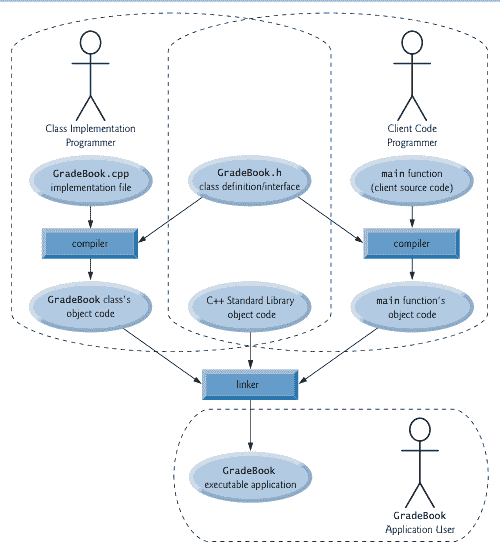

**图 3.14** | 生成可执行应用程序的编译和链接过程。

负责创建可复用 GradeBook 类的类实现程序员创建头文件 GradeBook.h 和包含该头文件的源代码文件 GradeBook.cpp，然后编译该源代码文件以生成 GradeBook 的目标代码。为了隐藏类的成员函数实现细节，类实现程序员会向客户端代码程序员提供头文件 GradeBook.h（它指定类的接口和数据成员）以及 GradeBook 目标代码（即表示 GradeBook 成员函数的机器语言指令）。客户端代码程序员**不会**获得 GradeBook.cpp，因此客户端仍然不知道 GradeBook 的成员函数是如何实现的。

客户端代码只需知道 GradeBook 的接口即可使用该类，并且必须能够链接其目标代码。由于类的接口是 GradeBook.h 头文件中类定义的一部分，客户端代码程序员必须能够访问此文件，并且必须在客户端源代码文件中 **#include** 它。编译客户端代码时，编译器使用 GradeBook.h 中的类定义来确保 main 函数正确地创建和操作类 GradeBook 的对象。

要创建可执行的 GradeBook 应用程序，最后一步是链接

- 主函数（即客户端代码）的目标代码。
- 类 GradeBook 的成员函数实现的目标代码，以及
- 类实现程序员和客户端代码程序员使用的 C++ 类（如 string）的 C++ 标准库目标代码。

链接器的输出是 *可执行* 的 GradeBook 应用程序，教师可以用它管理学生成绩。编译器和 IDE 通常会在编译代码后为你调用链接器。

有关编译多源文件程序的更多信息，请参阅编译器文档。我们在 C++ Resource Center（www.deitel.com/cplusplus/）中提供了各种 C++ 编译器的链接。

## 3.8 用 set 函数验证数据

在第 3.4 节中，我们介绍了 set 函数，允许类的客户端修改私有数据成员的值。在图 3.5 中，类 GradeBook 定义成员函数 setCourseName，仅将其参数 name 中接收的值赋给数据成员 courseName。此成员函数不确保课程名称遵循任何特定格式，也不遵循关于“有效”课程名称应是什么样子的任何其他规则。如我们之前所述，假设一所大学只能打印包含不超过 25 个字符的课程名称的学生成绩单。如果该大学使用包含 GradeBook 对象的系统来生成成绩单，我们可能希望类 GradeBook 确保其数据成员 courseName 永远不超过 25 个字符。图 3.15–3.17 的程序增强了类 GradeBook 的成员函数 setCourseName，以执行此验证（也称为有效性检查）。

### GradeBook 类定义

请注意，GradeBook 的类定义（图 3.15）——因而其接口——与图 3.11 的类定义相同。由于接口保持不变，当成员函数 setCourseName 的定义被修改时，该类的客户端无需更改。这使客户端只需将客户端代码链接到更新后的 GradeBook 目标代码，即可利用改进后的 GradeBook 类。


```cpp
// Fig. 3.15: GradeBook.h
// GradeBook class definition presents the public interface of
// the class. Member-function definitions appear in GradeBook.cpp.
#include <string> // program uses C++ standard string class
using namespace std;

// GradeBook class definition
class GradeBook
{
public:
   GradeBook( string ); // constructor that initializes a GradeBook object
   void setCourseName( string ); // function that sets the course name
   string getCourseName(); // function that gets the course name
   void displayMessage(); // function that displays a welcome message
private:
   string courseName; // course name for this GradeBook
}; // end class GradeBook
```

**图 3.15** | GradeBook 类定义。

## 使用 GradeBook 成员函数 setCourseName 验证课程名称

对 GradeBook 类的增强体现在 setCourseName 的定义中（图 3.16，第 16–29 行）。第 18–19 行的 if 语句判断参数 name 是否包含有效的课程名称（即长度不超过 25 个字符的字符串）。如果课程名称有效，第 19 行将其存入数据成员 courseName。注意第 18 行中的表达式 name.length()。这是一个成员函数调用，就像 myGradeBook.displayMessage() 一样。C++ 标准库的 string 类定义了一个成员函数 length，它返回 string 对象中的字符数。参数 name 是一个 string 对象，因此调用 name.length() 返回 name 中的字符数。如果该值小于或等于 25，则 name 有效，第 19 行执行。

```cpp
// Fig. 3.16: GradeBook.cpp
// Implementations of the GradeBook member-function definitions.
// The setCourseName function performs validation.
#include <iostream>
#include "GradeBook.h" // include definition of class GradeBook
using namespace std;

// constructor initializes courseName with string supplied as argument
GradeBook::GradeBook( string name )
{
   setCourseName( name ); // validate and store courseName
} // end GradeBook constructor

// function that sets the course name;
// ensures that the course name has at most 25 characters
void GradeBook::setCourseName( string name )
{
   if ( name.length() <= 25 ) // if name has 25 or fewer characters
      courseName = name; // store the course name in the object

   if ( name.length() > 25 ) // if name has more than 25 characters
   {
      // set courseName to first 25 characters of parameter name
      courseName = name.substr( 0, 25 ); // start at 0, length of 25

      cout << "\nName \"" << name << "\" exceeds maximum length (25).\n"
           << "Limiting courseName to first 25 characters.\n" << endl;
   } // end if
} // end function setCourseName

// function to get the course name
string GradeBook::getCourseName()
{
   return courseName; // return object's courseName
} // end function getCourseName

// display a welcome message to the GradeBook user
void GradeBook::displayMessage()
{
   // call getCourseName to get the courseName
   cout << "Welcome to the grade book for\n" << getCourseName()
        << "!" << endl;
} // end function displayMessage
```

**图 3.16** | 类 GradeBook 的成员函数定义，其中 set 函数验证数据成员 courseName 的长度。（第 1 部分，共 2 部分。）

**图 3.16** | 类 GradeBook 的成员函数定义，其中 set 函数验证数据成员 courseName 的长度。（第 2 部分，共 2 部分。）

第 21–28 行的 if 语句处理 setCourseName 收到无效课程名称（即长度超过 25 个字符的名称）的情况。即使参数 name 太长，我们仍希望让 GradeBook 对象保持一致性状态——即对象的数据成员 courseName 包含有效值（不超过 25 个字符的字符串）。因此，我们截断指定的课程名称，并将 name 的前 25 个字符赋给 courseName 数据成员（不幸的是，这可能会生硬地截断课程名称）。标准类 string 提供了成员函数 substr（“substring”的缩写），它返回一个通过复制现有 string 对象的一部分而创建的新 string 对象。第 24 行中的调用（即 name.substr( 0, 25 )）将两个整数（0 和 25）传递给 name 的成员函数 substr。这些参数指示 substr 应返回字符串 name 的哪一部分。第一个参数指定从原始字符串中复制字符的起始位置——每个字符串中的第一个字符被认为位于位置 0。第二个参数指定要复制的字符数。因此，第 24 行中的调用返回 name 的一个 25 字符子串，从位置 0 开始（即 name 中的前 25 个字符）。例如，如果 name 保存的值为 "CS101 Introduction to Programming in C++"，则 substr 返回 "CS101 Introduction to Pro"。在调用 substr 之后，第 24 行将 substr 返回的子串赋给数据成员 courseName。这样，setCourseName 确保 courseName 始终被赋予一个包含不超过 25 个字符的字符串。如果成员函数必须截断课程名称以使其有效，第 26–27 行会显示一条警告消息。

第 21–28 行的 if 语句包含两个语句体——一个将 courseName 设置为参数 name 的前 25 个字符，另一个向用户打印一条伴随消息。当 name 太长时，这两个语句都应执行，因此我们将它们放在一对花括号 { } 中。回想第 2 章，这会创建一个块。你将在第 4 章进一步学习在控制语句的语句体中放置多个语句。

第 26–27 行的语句也可以不在语句第二行开头使用流插入运算符，如下所示：

```cpp
cout << "\nName \"" << name << "\" exceeds maximum length (25).\n"
     "Limiting courseName to first 25 characters.\n" << endl;
```

C++ 编译器会合并相邻的字符串字面量，即使它们出现在程序的不同行。因此，在上面的语句中，C++ 编译器会将字符串字面量 "\nName \""、"\" exceeds maximum length (25).\n" 和 "Limiting courseName to first 25 characters.\n" 合并为一个字符串字面量，其产生的输出与图 3.16 中第 26–27 行的输出相同。这种行为允许你在程序中将长字符串分行书写来打印它们，而无需包含额外的流插入操作。

## 测试 GradeBook 类

图 3.17 演示了带有验证功能的 GradeBook 类的修改版本（图 3.15–3.16）。第 12 行创建了一个名为 gradeBook1 的 GradeBook 对象。回想一下，GradeBook 构造函数调用 setCourseName 来初始化数据成员 courseName。在该类的早期版本中，在构造函数中调用 setCourseName 的好处并不明显。然而现在，构造函数利用了 setCourseName 提供的验证。构造函数只是调用 setCourseName，而不是重复其验证代码。当图 3.17 的第 12 行将初始课程名称 "CS101 Introduction to Programming in C++" 传递给 GradeBook 构造函数时，构造函数将该值传递给 setCourseName，实际的初始化在那里发生。由于该课程名称包含超过 25 个字符，第二个 if 语句的语句体执行，导致 courseName 被初始化为截断后的 25 字符课程名称 "CS101 Introduction to Pro"（截断部分在第 12 行中以红色突出显示）。图 3.17 中的输出包含图 3.16 的成员函数 setCourseName 中第 26–27 行输出的警告消息。第 13 行创建另一个名为 gradeBook2 的 GradeBook 对象——传递给构造函数的有效课程名称恰好是 25 个字符。

图 3.17 中的第 16–19 行显示 gradeBook1 的截断课程名称（我们在程序输出中以蓝色突出显示）以及 gradeBook2 的课程名称。第 22 行直接调用 gradeBook1 的 setCourseName 成员函数，将 GradeBook 对象中的课程名称更改为另一个不需要截断的名称。然后，第 25–28 行再次输出这些 GradeBook 对象的课程名称。

```cpp
// Fig. 3.17: fig03_17.cpp
// Create and manipulate a GradeBook object; illustrate validation.
#include <iostream>
#include "GradeBook.h" // include definition of class GradeBook
using namespace std;
```

图 3.17 | 创建和操作一个课程名称长度限制为 25 个字符的 GradeBook 对象。（第 1 部分，共 2 部分。）


```cpp
// function main begins program execution
int main()
{
    // create two GradeBook objects
    // initial value of gradeBook1 is too long
    GradeBook gradeBook1("CS101 Introduction to Programming in C++");
    GradeBook gradeBook2("CS102 C++ Data Structures");

    // display each GradeBook's courseName
    cout << "gradeBook1's initial course name is: "
         << gradeBook1.getCourseName()
         << "\ngradeBook2's initial course name is: "
         << gradeBook2.getCourseName() << endl;

    // modify myGradeBook's courseName (with a valid-length string)
    gradeBook1.setCourseName("CS101 C++ Programming");

    // display each GradeBook's courseName
    cout << "gradeBook1's course name is: "
         << gradeBook1.getCourseName()
         << "\ngradeBook2's course name is: "
         << gradeBook2.getCourseName() << endl;
} // end main
```

```
Name "CS101 Introduction to Programming in C++" exceeds maximum length (25).
Limiting courseName to first 25 characters.

gradeBook1's initial course name is: CS101 Introduction to Pro
gradeBook2's initial course name is: CS102 C++ Data Structures

gradeBook1's course name is: CS101 C++ Programming
gradeBook2's course name is: CS102 C++ Data Structures
```

**图 3.17** | 创建并操作一个 GradeBook 对象，其中课程名称长度限制为 25 个字符。（第 2 部分，共 2 部分。）

## 关于 set 函数的补充说明

像 setCourseName 这样的公有 set 函数应仔细审查任何修改数据成员（例如 courseName）值的尝试，以确保新值适合该数据项。例如，将一个月中的某天设置为 37 的尝试应被拒绝，将一个人的体重设置为零或负值的尝试应被拒绝，将考试成绩设置为 185（而正确范围是 0 到 100）的尝试应被拒绝，等等。


**软件工程观察 3.4**  
*将数据成员设为私有，并通过公有成员函数控制对这些数据成员的访问（尤其是写访问），有助于确保数据完整性。*


**错误预防提示 3.5**  
*数据完整性的好处并不会仅仅因为将数据成员设为私有就自动实现——你必须提供适当的有效性检查并报告错误。*

类的 *set* 函数可以向类的客户端返回值，以表明曾尝试向该类的对象赋予无效数据。客户端可以测试 *set* 函数的返回值，以确定修改对象的尝试是否成功，并采取适当措施。在 C++ 中，对象的客户端可以通过*异常处理机制*获知无效值，我们将在第 7 章开始讨论该机制，并在第 16 章深入介绍。为了在本书这一较早阶段保持图 3.15–3.17 的程序简单，图 3.16 中的 setCourseName 只打印一条适当的消息。

## 3.9 小结

在本章中，你创建了用户自定义类，并创建和使用了这些类的对象。我们声明了类的数据成员，以维护该类的每个对象的数据。我们还定义了操作这些数据的成员函数。你学习了如何调用对象的成员函数以请求该对象提供的服务，以及如何将数据作为实参传递给这些成员函数。我们讨论了成员函数的局部变量与类的数据成员之间的区别。我们还展示了如何使用构造函数为对象的数据成员指定初始值。你学习了如何将类的接口与其实现分离，以促进良好的软件工程。我们给出了一幅图，展示类实现程序员和客户端代码程序员编译他们所编写的代码所需的文件。我们演示了如何使用 *set* 函数验证对象的数据，并确保对象保持一致状态。UML 类图用于对类及其构造函数、成员函数和数据成员建模。在下一章中，我们将开始介绍控制语句，控制语句规定函数动作的执行顺序。

## 摘要

### 3.2 节 使用成员函数定义类

- 类定义（第 66 页）包含数据成员和成员函数，它们分别定义类的属性和行为。
- 类定义以关键字 `class` 开始，后面紧跟类名。
- 按照惯例，用户自定义类（第 67 页）的名称以大写字母开头；为便于阅读，类名中后续每个单词也以大写字母开头。
- 每个类体（第 66 页）都包含在一对花括号（`{` 和 `}`）中，并以分号结束。
- 出现在访问说明符 `public`（第 66 页）之后的成员函数，可由程序中的其他函数以及其他类的成员函数调用。
- 访问说明符后面总是跟一个冒号（`:`）。
- 关键字 `void`（第 67 页）是一种特殊的返回类型，表示函数将执行一项任务，但在完成任务时不会向调用它的函数返回任何数据。
- 按照惯例，函数名（第 67 页）以小写首字母开头，名称中后续所有单词均以大写字母开头。
- 函数名后的一对空括号表示该函数执行任务不需要额外数据。
- 每个函数体都由左花括号和右花括号（`{` 和 `}`）界定。
- 通常，在创建其类的对象之前，不能调用成员函数。
- 你创建的每个新类都会成为 C++ 中的一种新类型。
- 在 UML 中，每个类都在类图（第 68 页）中建模为一个具有三个分隔区的矩形，这三个分隔区（从上到下）分别包含类名、属性和操作。
- UML 将操作建模为操作名后跟圆括号。名称前的加号（+）表示公有操作（即 C++ 中的公有成员函数）。

### 3.3 节 定义带参数的成员函数

- 成员函数可以要求一个或多个参数（第 68 页），这些参数表示它执行任务所需的额外数据。函数调用为每个函数参数提供一个实参（第 68 页）。
- 调用成员函数的方式是：在对象名后依次跟点（.）运算符（第 67 页）、函数名以及一对包含函数实参的圆括号。
- C++ 标准库类 string（第 69 页）的变量表示一个字符串。该类定义在头文件 `<string>` 中，名称 string 属于命名空间 `std`。
- 函数 `getline`（来自头文件 `<string>`，第 70 页）从其第一个实参读取字符，直到遇到换行符，然后将这些字符（不包括换行符）放入作为第二个实参指定的 string 变量中。换行符被丢弃。
- 参数列表（第 70 页）可以包含任意数量的参数，包括一个也没有（用空圆括号表示），以表明函数不需要任何参数。
- 函数调用中的实参数量必须与被调用成员函数头部的参数列表中的参数数量一致。此外，函数调用中的实参类型必须与函数头部中相应参数的类型一致。
- UML 对操作参数的建模方式是：在操作名后的圆括号内列出参数名，后跟一个冒号和参数类型。
- UML 有自己的数据类型。并非所有 UML 数据类型的名称都与相应的 C++ 类型相同。UML 类型 String 对应于 C++ 类型 string。

### 3.4 节 数据成员、set 函数和 get 函数

- 在函数体中声明的变量是局部变量（第 71 页），只能从它们在函数中的声明点开始，直到紧接着的右花括号（`}`）为止使用。
- 局部变量必须先声明，然后才能在函数中使用。局部变量不能在其声明的函数之外访问。
- 数据成员（第 71 页）通常是私有的（第 73 页）。声明为私有的变量或函数只能由声明它们的类的成员函数或该类的友元访问。
- 当程序创建（实例化）一个对象时，其私有数据成员被封装（隐藏，第 74 页）在对象中，并且只能由该对象所属类的成员函数访问。
- 当调用一个指定了非 void 返回类型的函数并完成其任务时，该函数会向调用它的函数返回结果。
- 默认情况下，string 的初始值是空字符串（第 75 页）——即不包含任何字符的字符串。显示空字符串时，屏幕上不显示任何内容。
- 类通常提供公有成员函数，以允许类的客户端设置或获取（第 75 页）私有数据成员。这些成员函数的名称通常以 set 或 get 开头。
- Set 和 get 函数允许类的客户端间接访问隐藏的数据。客户端并不知道对象如何执行这些操作。
- 类的其他成员函数应使用该类的 set 和 get 函数来操作类的私有数据。如果类的数据表示发生改变，仅通过 set 和 get 函数访问数据的成员函数将不需要修改。
- 公有 set 函数应仔细审查任何修改数据成员值的尝试，以确保新值适合该数据项。


-   UML 通过列出属性名、后跟冒号和属性类型，将数据成员表示为属性。在 UML 中，私有属性前面有一个减号（−）。
-   UML 在操作名后的圆括号之后放置冒号和返回类型，以此表示操作的返回类型。
-   对于不返回值的操作，UML 类图不指定其返回类型。

### 第 3.5 节 使用构造函数初始化对象

-   每个类都应提供一个构造函数（第 77 页），用于在创建对象时初始化该类的对象。构造函数的定义必须与类同名。
-   构造函数和函数的一个区别是：构造函数不能返回值，因此不能指定返回类型（连 `void` 也不行）。通常，构造函数声明为 `public`。
-   C++ 要求在每次创建对象时调用构造函数，这有助于确保每个对象在程序中投入使用之前都已被初始化。
-   不带形参的构造函数是默认构造函数（第 77 页）。如果你不提供构造函数，编译器会提供一个默认构造函数。你也可以显式定义默认构造函数。如果你为某个类定义了构造函数，C++ 就不会再创建默认构造函数。
-   UML 将构造函数建模为类图第三个分隔栏中的操作，在构造函数名之前加上放在法式引号（« 和 »）之间的单词“constructor”。

### 第 3.6 节 将类放入单独文件以实现可重用性

-   类定义如果被正确打包，就可以供全世界的程序员重用。
-   按惯例，类定义放在扩展名为 .h 的头文件（第 81 页）中。

### 第 3.7 节 将接口与实现分离

-   如果类的实现发生变化，不应要求类的客户端也发生变化。
-   接口定义并标准化了人、系统等事物之间的交互方式。
-   类的公共接口（第 85 页）描述了提供给该类客户端的 `public` 成员函数。接口描述客户端可以使用哪些服务（第 85 页）以及如何请求这些服务，但不指定类如何执行这些服务。
-   将接口与实现分离（第 84 页）使程序更易于修改。只要类的接口保持不变，类实现的变化就不会影响客户端。
-   函数原型（第 85 页）包含函数名、返回类型，以及函数期望接收的形参的数量、类型和顺序。
-   一旦定义了类并完成了其成员函数声明（通过函数原型），成员函数就应在单独的源代码文件中定义。
-   对于在其对应类定义之外定义的每个成员函数，函数名之前必须加上类名和二元作用域解析运算符（`::`，第 86 页）。

### 第 3.8 节 使用设置函数验证数据

-   string 类的 length 成员函数（第 91 页）返回字符串中的字符数。
-   string 类的成员函数 substr（第 92 页）返回一个新字符串，其中包含现有字符串一部分的副本。第一个实参指定原字符串中的起始位置。第二个实参指定要复制的字符数。

## 自测练习

**3.1** 填写以下各项中的空白：

-   a) 每个类定义都包含关键字 ______，其后紧跟类名。
-   b) 类定义通常存储在扩展名为 ______ 的文件中。
-   c) 函数头中的每个形参都指定一个 ______ 和一个 ______。
-   d) 当类的每个对象都维护自己的属性副本时，表示该属性的变量也称为 ______。
-   e) 关键字 `public` 是一种 ______。
-   f) 返回类型 `______` 表示函数将执行任务，但在完成任务时不返回任何信息。
-   g) `<string>` 库中的函数 `______` 读取字符，直到遇到换行符，然后将这些字符复制到指定的字符串中。
-   h) 当成员函数在类定义之外定义时，函数头必须包含类名和 ______，后跟函数名，以将成员函数“绑定”到类定义。
-   i) 源代码文件以及使用某个类的任何其他文件，都可以通过 `______` 预处理指令包含该类的头文件。

**3.2** 说明以下各项是**正确**还是**错误**。如果是**错误**，请解释原因。

-   a) 按惯例，函数名以大写字母开头，名称中后续每个单词都以大写字母开头。
-   b) 函数原型中函数名后的空圆括号表示该函数执行任务不需要任何形参。
-   c) 用访问说明符 `private` 声明的数据成员或成员函数，可由声明它们的类的成员函数访问。
-   d) 在特定成员函数体内声明的变量称为数据成员，并可在该类的所有成员函数中使用。
-   e) 每个函数体都由左花括号和右花括号（`{` 和 `}`）界定。
-   f) 任何包含 `int main()` 的源代码文件都可用于执行程序。
-   g) 函数调用中实参的类型必须与函数原型形参列表中对应形参的类型一致。

**3.3** 局部变量和数据成员之间有什么区别？

**3.4** 解释函数形参的用途。形参和实参之间有什么区别？

## 自测练习答案

**3.1** a) class。b) .h。c) 类型、名称。d) 数据成员。e) 访问说明符。f) void。g) getline。h) 二元作用域解析运算符（`::`）。i) `#include`。

**3.2** a) 错误。函数名以小写字母开头，名称中后续每个单词都以大写字母开头。b) 正确。c) 正确。d) 错误。此类变量是局部变量，只能在其声明的成员函数中使用。e) 正确。f) 正确。g) 正确。

**3.3** 局部变量在函数体中声明，只能从其声明处到其所在块的右花括号处使用。数据成员在类中声明，但不在该类的任何成员函数体中声明。类的每个对象都有该类数据成员的单独副本。数据成员可由该类的所有成员函数访问。

**3.4** 形参表示函数执行任务所需的附加信息。函数所需的每个形参都在函数头中指定。实参是函数调用中提供的值。调用函数时，实参值被传入函数形参，以便函数执行其任务。

## 练习题

**3.5** *(函数原型和函数定义)* 解释函数原型和函数定义之间的区别。

**3.6** *(默认构造函数)* 什么是默认构造函数？如果一个类只有隐式定义的默认构造函数，对象的数据成员如何初始化？

**3.7** *(数据成员)* 解释数据成员的用途。

**3.8** *(头文件和源代码文件)* 什么是头文件？什么是源代码文件？讨论各自的用途。

**3.9** *(不使用 using 指令使用类)* 解释程序如何在不插入 using 指令的情况下使用 `string` 类。

**3.10** *(设置函数和获取函数)* 解释类为什么可能为某个数据成员提供设置函数和获取函数。

**3.11** *(修改 GradeBook 类)* 按如下方式修改 GradeBook 类（图 3.11–3.12）：

-   a) 包含第二个 `string` 数据成员，表示课程教师姓名。
-   b) 提供一个设置函数来更改教师姓名，并提供一个获取函数来获取教师姓名。
-   c) 修改构造函数，以指定课程名称和教师姓名形参。
-   d) 修改函数 `displayMessage`，以输出欢迎消息和课程名称，然后输出字符串“本课程由以下教师讲授：”，后跟教师姓名。

在测试程序中使用修改后的类，以演示该类的新功能。

**3.12** *(Account 类)* 创建一个银行可能用来表示客户银行账户的 Account 类。包含一个 `int` 类型的数据成员来表示账户余额。[*注意：* 在后续章节中，我们将使用包含小数点的数字（例如 2.75）——称为浮点值——来表示美元金额。] 提供一个构造函数，它接收初始余额并用该值初始化数据成员。该构造函数应验证初始余额，确保其大于或等于 0。如果不是，则将余额设为 0，并显示一条错误消息，指出初始余额无效。提供三个成员函数。成员函数 `credit` 应将金额加到当前余额中。成员函数 `debit` 应从 Account 中取款，并确保取款金额不超过 Account 的余额。如果超过，则余额应保持不变，并且该函数应打印一条消息，指出“取款金额超过账户余额。”成员函数 `getBalance` 应返回当前余额。创建一个程序，创建两个 Account 对象并测试 Account 类的成员函数。

**3.13** *(Invoice 类)* 创建一个名为 Invoice 的类，五金店可能用它来表示商店售出商品的发票。Invoice 应包含四个数据成员——零件号（类型 `string`）、零件描述（类型 `string`）、所购商品数量（类型 `int`）和每件价格（类型 `double`）。[*注意：* 在后续章节中，我们将使用包含小数点的数字（例如 2.75）——称为浮点值——来表示美元金额。] 你的类应有一个初始化这四个数据成员的构造函数。为每个数据成员提供一个设置函数和一个获取函数。此外，提供一个名为 `getInvoiceAmount` 的成员函数，它计算发票金额（即数量乘以每件价格），然后以 `int` 值返回该金额。如果数量不是正数，应将其设为 0。如果每件价格不是正数，应将其设为 0。编写一个测试程序，演示 Invoice 类的功能。

**3.14** *(Employee 类)* 创建一个名为 Employee 的类，其中包含三条信息作为数据成员——名（类型 `string`）、姓（类型 `string`）和月薪（类型 `int`）。[*注意：* 在后续章节中，我们将使用包含小数点的数字（例如 2.75）——称为浮点值——来表示美元金额。] 你的类应有一个初始化这三个数据成员的构造函数。为每个数据成员提供一个设置函数和一个获取函数。如果月薪不是正数，将其设为 0。编写一个测试程序，演示 Employee 类的功能。创建两个 Employee 对象并显示每个对象的年薪。然后给每个 Employee 加薪 10%，并再次显示每个 Employee 的年薪。


**3.15** *（日期类）* 创建一个名为 Date 的类，其中包含三个数据成员作为信息——月份（int 类型）、日（int 类型）和年（int 类型）。你的类应有一个带三个参数的构造函数，用这些参数来初始化三个数据成员。就本练习而言，假定提供的年份和日期的值是正确的，但请确保月份值在 1–12 范围内；如果不在，则将月份设置为 1。为每个数据成员提供 *set* 和 *get* 函数。提供一个成员函数 *displayDate*，用正斜杠（/）分隔显示月、日和年。编写一个测试程序来演示类 Date 的功能。

## 做出改变

**3.16** *（目标心率计算器）* 锻炼时，你可以使用心率监测器来确保心率保持在教练和医生建议的安全范围内。根据美国心脏协会（AHA）的说法（www.americanheart.org/presenter.jhtml?identifier=4736），计算你的 *最大心率*（以每分钟心跳次数为单位）的公式是 220 减去你的年龄（以年为单位）。你的 *目标心率* 是一个范围，即最大心率的 50–85%。[注：这些公式是美国心脏协会提供的估计值。最大心率和目标心率可能因个人的健康状况、体能和性别而异。在开始或修改锻炼计划之前，请务必咨询医生或合格的医疗保健专业人员。] 创建一个名为 HeartRates 的类。类属性应包括人的名字、姓氏和出生日期（由出生月份、日和年三个单独属性组成）。你的类应有一个接收这些数据作为参数的构造函数。对于每个属性，提供 *set* 和 *get* 函数。该类还应包含一个函数 *getAge*，计算并返回人的年龄（以年为单位）；一个函数 *getMaximumHeartRate*，计算并返回人的最大心率；以及一个函数 *getTargetHeartRate*，计算并返回人的目标心率。由于你还不知道如何从计算机获取当前日期，函数 *getAge* 应在计算人的年龄之前提示用户输入当前月、日和年。编写一个应用程序，提示输入人的信息，实例化一个 HeartRates 类对象，打印该对象的信息——包括人的名字、姓氏和出生日期——然后计算并打印人的年龄（以年为单位）、最大心率和目标心率范围。

**3.17** *（健康记录计算机化）* 最近新闻中一个医疗保健问题是健康记录的计算机化。由于敏感隐私和安全问题等，这种可能性正被谨慎对待。[我们在后面的练习中处理这些问题。] 健康记录计算机化可以使患者更容易在各类医疗保健专业人员之间共享他们的健康档案和病史。这可以提高医疗保健质量，有助于避免药物冲突和错误的药物处方，降低成本，并且在紧急情况下可以挽救生命。在本练习中，你将为一个人员设计一个“入门级”的 HealthProfile 类。类属性应包括人的名字、姓氏、性别、出生日期（由出生月份、日和年三个单独属性组成）、身高（以英寸为单位）和体重（以磅为单位）。你的类应有一个接收这些数据的构造函数。对于每个属性，提供 *set* 和 *get* 函数。该类还应包含一些函数，用于计算并返回用户的年龄（以年为单位）、最大心率和目标心率范围（参见练习 3.16），以及身体质量指数（BMI；参见练习 2.30）。编写一个应用程序，提示输入人的信息，为该人实例化一个 HealthProfile 类对象，打印该对象的信息——包括人的名字、姓氏、性别、出生日期、身高和体重——然后计算并打印人的年龄（以年为单位）、BMI、最大心率和目标心率范围。它还应显示练习 2.30 中的“BMI 值”图表。使用与练习 3.16 相同的技术来计算人的年龄。

# 4 控制语句：第 1 部分


> 让我们都向前挪一位。
> ——刘易斯·卡罗尔

> 命运之轮又转回来了。
> ——威廉·莎士比亚

> 在牛顿领悟那个启示之前，有多少苹果落到他头上？
> ——罗伯特·弗罗斯特

> 我们所知的全部进化，都是从模糊走向明确。
> ——查尔斯·桑德斯·皮尔士

## 目标

在本章中，你将学习：

- 基本的问题解决技巧。
- 通过自顶向下、逐步求精的过程来开发算法。
- 使用 if 和 if...else 选择语句在备选操作中进行选择。
- 使用 while 重复语句使程序中的语句重复执行。
- 计数器控制重复和哨兵控制重复。
- 使用增量、减量和赋值运算符。

| 章节 | 标题 | 章节 | 标题 |
|---|---|---|---|
| 4.1 | 引言 | 4.8 | 算法构建：计数器控制重复 |
| 4.2 | 算法 | 4.9 | 算法构建：哨兵控制重复 |
| 4.3 | 伪代码 | 4.10 | 算法构建：嵌套控制语句 |
| 4.4 | 控制结构 | 4.11 | 赋值运算符 |
| 4.5 | if 选择语句 | 4.12 | 增量和减量运算符 |
| 4.6 | if...else 双重选择语句 | 4.13 | 总结 |
| 4.7 | while 重复语句 |  |  |

*摘要* | *自测练习* | *自测练习答案* | *练习* | *做出改变*

## 4.1 引言

在编写程序解决问题之前，我们必须对问题有透彻的理解，并仔细规划解决问题的方案。编写程序时，我们还必须理解可用的构建块，并采用经过验证的程序构造技术。在本章和第 5 章“控制语句：第 2 部分”中，我们在介绍结构化编程的理论和原则时讨论这些问题。这里介绍的概念对于构建有效的类和操作对象至关重要。

在本章中，我们介绍 C++ 的 if、if...else 和 while 语句，这三个构建块允许你指定成员函数执行其任务所需的逻辑。我们将本章（以及第 5 章和第 7 章）的一部分用于进一步开发 GradeBook 类。特别是，我们向 GradeBook 类添加一个成员函数，该函数使用控制语句计算一组学生成绩的平均值。另一个示例演示了组合控制语句的其他方式。我们介绍 C++ 的赋值、增量和减量运算符。这些附加运算符可以缩写和简化许多程序语句。

## 4.2 算法

任何可解决的计算问题都可以通过按特定顺序执行一系列操作来解决。以以下方式描述问题解决过程的步骤：

1. 要执行的**操作**和
2. 操作执行的**顺序**

称为**算法**。下面的示例演示了正确指定操作执行顺序的重要性。

考虑一位初级主管遵循的“起床算法”以起床并去上班：(1) 起床，(2) 脱掉睡衣，(3) 洗淋浴，(4) 穿好衣服，(5) 吃早餐，(6) 拼车去上班。这个例行程序让主管做好准备去工作并做出关键决策。假设同样的步骤以不同的顺序执行：(1) 起床，(2) 脱掉睡衣，(3) 穿好衣服，(4) 洗淋浴，(5) 吃早餐，(6) 拼车去上班。在这种情况下，我们的初级主管出现在工作时


## 4.4 控制结构

通常，程序中的语句按照书写顺序依次执行。这称为**顺序执行**。我们很快将讨论的各种 C++ 语句使您能够指定*下一个要执行的语句可能不是顺序中的下一条*。这称为**控制转移**。

20 世纪 60 年代，人们逐渐认识到，不加选择地使用控制转移是软件开发团队遭遇许多困难的根源。指责的矛头指向了 **goto 语句**，它允许您将控制转移到程序中众多可能目标之一（从而产生通常所谓的“意大利面条式代码”）。所谓的**结构化编程**概念几乎成了“**goto 消除**”的同义词。

Böhm 和 Jacopini[^1] 的研究表明，程序可以完全不使用任何 goto 语句来编写。对程序员而言，将风格转变为“无 goto 编程”成为那个时代的挑战。直到 20 世纪 70 年代，程序员才开始认真对待结构化编程。成果令人印象深刻，因为软件开发团队报告称开发时间缩短、系统更频繁地按时交付，软件项目也更频繁地在预算内完成。这些成功的关键在于，结构化程序更清晰，更易于调试、测试和修改，并且从一开始就更可能没有缺陷。

Böhm 和 Jacopini 的工作表明，所有程序都可以仅用三种**控制结构**来编写，即**顺序结构**、**选择结构**和**重复结构**。“控制结构”这一术语来自计算机科学领域。当我们介绍 C++ 对控制结构的实现时，将按照 C++ 标准文档中的术语称它们为“控制语句”。

### C++ 中的顺序结构

*顺序结构*内建于 C++ 中。除非另有指示，计算机按照语句的书写顺序——即按顺序——逐条执行 C++ 语句。图 4.2 的 UML **活动图**展示了一个典型的顺序结构，其中按顺序执行两个计算。

C++ 允许您在顺序结构中放置任意多个动作。您很快会看到，在任何可以放置单个动作的地方，都可以按顺序放置多个动作。

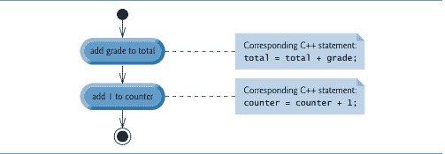

**图 4.2** | 顺序结构活动图。

[^1]: Böhm, C. 和 G. Jacopini，“流程图、图灵机与仅含两条形成规则的语言”，*Communications of the ACM*，第 9 卷第 5 期，1966 年 5 月，第 366–371 页。

在此图中，这两条语句将一个成绩加到 total 变量中，并将值 1 加到一个计数器变量中。这类语句可能出现在计算若干学生成绩平均值的程序中。要计算平均值，将要求平均的各成绩之和除以成绩数量。计数器变量将用于记录正在求平均的值的数量。您将在 4.8 节的程序中看到类似语句。

活动图对软件系统某一部分的**工作流**（也称为**活动**）建模。此类工作流可以包含算法的一部分，例如图 4.2 中的顺序结构。活动图由专用符号组成，例如**动作状态符号**（左右两边替换为向外弯曲弧线的矩形）、**菱形**和**小圆圈**；这些符号通过**转移箭头**连接，转移箭头表示活动的流向。

活动图清楚地展示了控制结构如何运作。考虑图 4.2 的顺序结构活动图。它包含两个**动作状态**，表示要执行的动作。每个动作状态包含一个**动作表达式**——例如“将成绩加到 total”或“将 1 加到 counter”——它指定要执行的特定动作。其他动作可能包括计算或输入/输出操作。活动图中的箭头称为**转移箭头**。这些箭头表示**转移**，它们指示动作状态所表示的动作发生顺序——实现图 4.2 活动图所示活动的程序首先将成绩加到 total，然后将 1 加到 counter。

图顶部的**实心圆**表示活动的**初始状态**——程序执行所建模活动之前*工作流的开始*。活动图底部出现的、被空心圆包围的实心圆表示**最终状态**——程序执行其活动之后*工作流的结束*。

图 4.2 还包含右上角折叠的矩形。在 UML 中，这些称为**注释**——用于描述图中符号用途的说明性文字。图 4.2 使用 UML 注释显示活动图中与每个动作状态关联的 C++ 代码。**虚线**将每个注释与其所描述的元素连接起来。活动图通常不显示实现该活动的 C++ 代码。这里我们为此目的使用注释，以说明该图与 C++ 代码的关系。有关 UML 的更多信息，请参阅我们的可选案例研究（见第 25～26 章），并访问我们的 UML 资源中心 www.deitel.com/UML/。

### C++ 中的选择语句

C++ 提供三种类型的选择语句（本章和第 5 章讨论）。**if** 选择语句在条件为真时执行（选择）一个动作，在条件为假时跳过该动作。**if...else** 选择语句在条件为真时执行一个动作，或在条件为假时执行另一个动作。**switch** 选择语句（第 5 章）根据整数表达式的值执行**多种**不同动作之一。

if 选择语句是**单选择语句**，因为它选择或忽略单个动作（或者，您很快会看到，单组动作）。if...else 语句称为**双选择语句**，因为它在两个不同动作（或动作组）之间选择。switch 选择语句称为**多选择语句**，因为它在许多不同动作（或动作组）之间选择。

### C++ 中的重复语句

C++ 提供三种类型的重复语句（也称为循环语句或循环），用于在条件（称为循环继续条件）保持为真时重复执行语句。它们是 **while**、**do...while** 和 **for** 语句。（第 5 章介绍 do...while 和 for 语句。）while 和 for 语句将其循环体中的动作（或动作组）执行零次或多次——如果循环继续条件最初为假，则动作（或动作组）不会执行。do...while 语句将其循环体中的动作（或动作组）至少执行一次。

if、else、switch、while、do 和 for 这些单词都是 C++ 关键字。关键字不得用作标识符，例如变量名，并且必须仅使用小写字母拼写。图 4.3 提供了 C++ 关键字的完整列表。


> **常见编程错误 4.1：**  
> 将关键字用作标识符是语法错误。

| C++ 关键字 |  |  |  |  |
|---|---|---|---|---|
| **C 和 C++ 编程语言共有的关键字** |  |  |  |  |
| auto | break | case | char | const |
| continue | default | do | double | else |
| enum | extern | float | for | goto |
| if | int | long | register | return |
| short | signed | sizeof | static | struct |
| switch | typedef | union | unsigned | void |
| volatile | while |  |  |  |
| **仅 C++ 的关键字** |  |  |  |  |
| and | and_eq | asm | bitand | bitor |
| bool | catch | class | compl | const_cast |
| delete | dynamic_cast | explicit | export | false |
| friend | inline | mutable | namespace | new |
| not | not_eq | operator | or | or_eq |
| private | protected | public | reinterpret_cast | static_cast |
| template | this | throw | true | try |
| typedef | typename | using | virtual | wchar_t |
| xor | xor_eq |  |  |  |
| **C++0x 关键字** |  |  |  |  |
| alignof | axiom | char16_t | char32_t | concept |
| concept_map | constexpr | decltype | late_check | nullptr |
| requires | static_assert | thread_local |  |  |

**图 4.3** | C++ 关键字。

### C++ 控制语句小结

C++ 只有三种控制结构，从现在起我们将其称为控制语句：顺序语句、选择语句（三种类型——if，

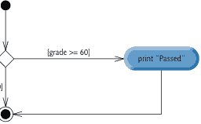

图 4.4 | if 单分支选择语句活动图。

你在第 2 章已经看到，判定可以基于包含关系运算符或相等运算符的条件。实际上，在 C++ 中，判定可以基于任何表达式——如果表达式求值为零，则被视为 false；如果表达式求值为非零，则被视为 true。C++ 提供了数据类型 **bool**，用于只能保存 **true** 和 **false** 值的变量——这两个值都是 C++ 关键字。

> **可移植性提示 4.1**
>
> 为了与早期使用整数表示布尔值的 C 版本兼容，bool 值 true 也可以用任何非零值表示（编译器通常使用 1），bool 值 false 也可以表示为值零。

if 语句是一种单入口/单出口语句。我们将会看到，其余控制语句的活动图也都包含初始状态、迁移箭头、表示要执行动作的动作状态、表示要做出判定的判定符号（以及相关联的监护条件）和最终状态。

设想有七个箱子，每个箱子里只装有七种控制语句类型中某一种类型的空 UML 活动图。那么，你的任务就是根据算法的需要，从每种控制语句所需数量的活动图中组装出一个程序，并且只能用两种可能的方式（堆叠或嵌套）组合这些活动图，然后用动作表达式和监护条件填充动作状态和判定，使其方式适合为该算法形成结构化实现。我们将继续讨论动作和判定可以采用的多种书写方式。

## 4.6 if...else 双分支选择语句

if 单分支选择语句仅在条件为 true 时执行指定动作；否则跳过该动作。if...else 双分支选择语句允许你指定条件为 true 时要执行的一个动作，以及条件为 false 时要执行的另一个不同动作。例如，下面的伪代码语句

```
If student’s grade is greater than or equal to 60
    Print “Passed”
Else
    Print “Failed”
```

> **错误预防提示 4.4**
>
> *为避免优先级问题（也为了清晰），请将（出现在较大表达式中的）条件表达式放在圆括号中。*


条件表达式中的值也可以是待执行的动作。例如，下面的条件表达式也会输出 "Passed" 或 "Failed"：

```
grade >= 60 ? cout << "Passed" : cout << "Failed";
```

前面的条件表达式读作：“如果 grade 大于或等于 60，则 cout << "Passed"；否则 cout << "Failed"。”这同样可与前面的 if...else 语句相比。条件表达式可以出现在一些 if...else 语句不能出现的程序位置。

### 嵌套 if...else 语句

嵌套 if...else 语句通过将 if...else 选择语句放在其他 if...else 选择语句内部来测试多种情况。例如，下面的伪代码 if...else 语句在考试成绩大于或等于 90 时输出 A，在 80 到 89 范围内输出 B，在 70 到 79 范围内输出 C，在 60 到 69 范围内输出 D，对所有其他成绩输出 F：

```
If student's grade is greater than or equal to 90
    Print “A”
Else
    If student's grade is greater than or equal to 80
        Print “B”
    Else
        If student's grade is greater than or equal to 70
            Print “C”
        Else
            If student's grade is greater than or equal to 60
                Print “D”
            Else
                Print “F”
```

这段伪代码可以用 C++ 写成

```
if ( studentGrade >= 90 ) // 90 and above gets "A"
    cout << "A";
else
    if ( studentGrade >= 80 ) // 80-89 gets "B"
        cout << "B";
    else
        if ( studentGrade >= 70 ) // 70-79 gets "C"
            cout << "C";
        else
            if ( studentGrade >= 60 ) // 60-69 gets "D"
                cout << "D";
            else // less than 60 gets "F"
                cout << "F";
```

正如块可以放在任何可放置单条语句的位置一样，也完全可以没有语句，这称为**空语句**（**null statement**）或**空语句**（**empty statement**）。空语句的表示方法是在通常应放语句的位置放置一个分号（`;`）。

> **常见编程错误 4.2**
>
> *在 if 语句的条件后放置分号，会在单分支 if 语句中导致逻辑错误，并在双分支 if...else 语句中导致语法错误（当 if 部分包含实际语句体时）。*


## 4.7 while 重复语句

**重复语句**规定程序应在某个条件保持为 true 时重复执行一个动作。下面的伪代码语句

```
While there are more items on my shopping list
    Purchase next item and cross it off my list
```

描述了购物过程中发生的重复。条件“我的购物清单上还有更多物品”要么为 true，要么为 false。如果为 true，则执行动作“购买下一件物品并将其从清单中划掉”。只要条件保持为 true，这个动作就会被重复执行。While 重复语句中包含的语句构成 While 的循环体，循环体可以是单条语句，也可以是一个块。最终，条件会变为 false（当购物清单上的最后一件物品被购买并从清单中划掉时）。此时，重复终止，并执行重复语句之后的第一个伪代码语句。

作为 C++ while 重复语句的一个例子，考虑一个用于查找大于 100 的第一个 3 的幂的程序段。假设整型变量 product 已初始化为 3。当下面的 while 重复语句执行完毕后，product 包含结果：

```
int product = 3;

while ( product <= 100 )
    product = 3 * product;
```

当 while 语句开始执行时，product 的值为 3。每次重复都将 product 乘以 3，因此 product 依次取值 9、27、81 和 243。当 product 变为 243 时，while 语句条件——product <= 100——变为 false。这终止了重复，所以 product 的最终值为 243。此时，程序继续执行 while 语句之后的下一条语句。

> **常见编程错误 4.3**
>
> *如果未在 while 语句的循环体中提供最终使 while 中的条件变为 false 的动作，通常会导致一种称为无限循环的逻辑错误，此时重复语句永远不会终止。如果循环体不包含与用户交互的语句，这可能使程序看起来“挂起”或“冻结”。*


图 4.6 的 UML 活动图说明了与前面 while 语句相对应的控制流。同样，图中的符号（除初始状态、迁移箭头、一个最终状态和三个注释外）表示一个动作状态和一个判定。该图还介绍了 UML 的**合并符号**，它将两个活动流合并为一个活动流。UML 将合并符号和判定符号都表示为菱形。在此图中，合并符号连接来自初始状态和动作状态的迁移，因此它们都流入用于确定循环是否应开始（或继续）执行的判定。判定符号和合并符号可以通过“入”迁移箭头和“出”迁移箭头的数量来区分。判定符号有一个指向菱形的迁移箭头，以及两个或更多从菱形指出来的迁移箭头，以表示从该点可能发生的迁移。此外，每个从判定符号指出的迁移箭头旁边都有一个监护条件。合并符号有两个或更多指向菱形的迁移箭头，并且只有一个从菱形指出的迁移箭头，以表示多个活动流合并后继续活动。与判定符号不同，合并符号在 C++ 代码中没有对应物。

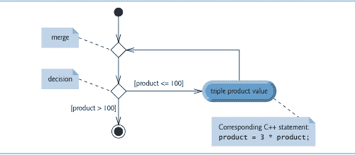

**图 4.6** | *while* 重复语句 UML 活动图。

图 4.6 清楚地显示了本节前面讨论的 while 语句的重复。从动作状态引出的迁移箭头指向合并符号，合并符号再迁回判定；每次循环重复时都会测试该判定，直到监护条件 product > 100 变为 true。然后 while 语句退出（到达其最终状态），控制权传递给程序中按顺序的下一条语句。

> **性能提示 4.3**
>
> *对于在循环中执行很多次的代码，小幅性能改进可能带来显著的总体性能提升。*

## 4.8 算法表述：计数器控制的重复

为了说明程序员如何开发算法，本节和第 4.9 节将求解班级平均分问题的两个变体。考虑下面的问题描述：

*一个班有十名学生参加了一次测验。这次测验的成绩（0 到 100）已经提供给你。计算并显示成绩总和与班级平均分。*


班级平均分等于所有成绩之和除以学生人数。要在计算机上求解此问题的算法必须输入每个成绩，计算平均分并打印结果。

## 带计数器控制的重复的伪代码算法

让我们使用伪代码列出要执行的操作，并指定这些操作应发生的顺序。我们使用**计数器控制的重复**一次输入一个成绩。该技术使用一个称为**计数器**的变量来控制一组语句将执行的次数（也称为循环的**迭代**次数）。

计数器控制的重复通常称为**确定性重复**，因为重复次数在循环开始执行*之前*就是已知的。在此示例中，当计数器超过 10 时重复终止。本节给出一个完整开发的伪代码算法（图 4.7）以及类 GradeBook 的一个版本（图 4.8—图 4.9），该版本在 C++ 成员函数中实现该算法。然后本节给出一个应用程序（图 4.10），演示该算法的实际运行。在 4.9 节中，我们将演示如何使用伪代码从头开发这样的算法。


> **软件工程观察 4.3**
> 
> *经验表明，在计算机上求解问题最困难的部分是开发求解算法。根据算法生成可运行的 C++ 程序的过程通常是直接的。*

```text
 1  Set total to zero
 2  Set grade counter to one
 3
 4  While grade counter is less than or equal to ten
 5      Prompt the user to enter the next grade
 6      Input the next grade
 7      Add the grade into the total
 8      Add one to the grade counter
 9
10  Set the class average to the total divided by ten
11  Print the total of the grades for all students in the class
12  Print the class average
```

**图 4.7** 使用计数器控制的重复求解班级平均分问题的伪代码。

注意图 4.7 伪代码算法中对 total 和 counter 的引用。**total** 是用于累加若干值之和的变量。**计数器**是用于计数的变量——在此例中，成绩计数器指示用户即将输入 10 个成绩中的哪一个。用于存储总和的变量通常应在程序中使用前初始化为零；否则，总和将包含 total 内存位置中先前存储的值。

## 增强 GradeBook 验证

让我们考虑对 GradeBook 类所做的一项增强。在图 3.16 中，我们的 setCourseName 成员函数使用 `if` 语句测试课程名长度是否小于或等于 25 个字符，以此验证课程名。如果为真，则设置课程名。此代码之后是一个 `if` 语句，测试课程名长度是否大于 25 个字符（在这种情况下课程名将被缩短）。第二个 `if` 语句的条件与第一个 `if` 语句的条件正好相反。如果一个条件求值为 `true`，另一个必定求值为 `false`。这种情况非常适合使用 `if...else` 语句，因此我们修改了代码，将两个 `if` 语句替换为一个 `if...else` 语句（图 4.9 第 18—25 行）。

## *在 GradeBook 类中实现计数器控制的重复*

GradeBook 类（图 4.8—图 4.9）包含一个构造函数（在图 4.8 第 11 行声明，并在图 4.9 第 9—12 行定义），它为该类的数据成员 `courseName`（在图 4.8 第 17 行声明）赋值。图 4.9 第 16—26、29—32 和 35—39 行分别定义了成员函数 `setCourseName`、`getCourseName` 和 `displayMessage`。第 42—68 行定义成员函数 `determineClassAverage`，它实现图 4.7 伪代码所描述的班级平均分算法。

```cpp
// Fig. 4.8: GradeBook.h
// Definition of class GradeBook that determines a class average.
// Member functions are defined in GradeBook.cpp
#include <string> // program uses C++ standard string class
using namespace std;

// GradeBook class definition
class GradeBook
{
public:
    GradeBook( string ); // constructor initializes course name
    void setCourseName( string ); // function to set course name
    string getCourseName(); // function to retrieve the course name
    void displayMessage(); // display a welcome message
    void determineClassAverage(); // averages grades entered by the user
private:
    string courseName; // course name for this GradeBook
}; // end class GradeBook
```

**图 4.8** | 使用计数器控制的重复的班级平均分问题：GradeBook 头文件。

```cpp
// Fig. 4.9: GradeBook.cpp
// Member-function definitions for class GradeBook that solves the
// class average program with counter-controlled repetition
#include <iostream>
#include "GradeBook.h" // include definition of class GradeBook
using namespace std;

// constructor initializes courseName with string supplied as argument
GradeBook::GradeBook( string name )
{
   setCourseName( name ); // validate and store courseName
} // end GradeBook constructor

// function to set the course name;
// ensures that the course name has at most 25 characters
void GradeBook::setCourseName( string name )
{
   if ( name.length() <= 25 ) // if name has 25 or fewer characters
      courseName = name; // store the course name in the object
   else // if name is longer than 25 characters
   { // set courseName to first 25 characters of parameter name
      courseName = name.substr( 0, 25 ); // select first 25 characters
      cout << "Name \"" << name << "\" exceeds maximum length (25).\n"
           << "Limiting courseName to first 25 characters.\n" << endl;
   } // end if...else
} // end function setCourseName

// function to retrieve the course name
string GradeBook::getCourseName()
{
   return courseName;
} // end function getCourseName

// display a welcome message to the GradeBook user
void GradeBook::displayMessage()
{
   cout << "Welcome to the grade book for\n" << getCourseName() << "!\n"
        << endl;
} // end function displayMessage

// determine class average based on 10 grades entered by user
void GradeBook::determineClassAverage()
{
   int total; // sum of grades entered by user
   int gradeCounter; // number of the grade to be entered next
   int grade; // grade value entered by user
   int average; // average of grades

   // initialization phase
   total = 0; // initialize total
   gradeCounter = 1; // initialize loop counter

   // processing phase
   while ( gradeCounter <= 10 ) // loop 10 times
   {
      cout << "Enter grade: "; // prompt for input
      cin >> grade; // input the next grade
      total = total + grade; // add grade to total
      gradeCounter = gradeCounter + 1; // increment counter by 1
   } // end while
```

**图 4.9** | 使用计数器控制的重复的班级平均分问题：GradeBook 源代码文件。（第 1—2 部分，共 3 部分。）

程序，因为程序在循环的每次迭代中从用户处获取 grade 的值。第 58 行将用户输入的新成绩加到 total 上，并将结果赋给 total，从而替换其先前的值。

第 59 行将 1 加到 gradeCounter 上，以表示程序已处理一个成绩，并准备好从用户处输入下一个成绩。递增 gradeCounter 最终会使 gradeCounter 超过 10。此时，while 循环终止，因为其条件（第 54 行）变为 false。

当循环终止时，第 63 行执行平均分计算并将其结果赋给变量 average。第 66 行显示文本 "Total of all 10 grades is "，后跟变量 total 的值。第 67 行随后显示文本 "Class average is "，后跟变量 average 的值。成员函数 determineClassAverage 随后将控制权返回给调用函数（即图 4.10 中的 main）。

## 演示 GradeBook 类

图 4.10 包含此应用程序的 main 函数，它创建 GradeBook 类的对象并演示其功能。图 4.10 第 9 行创建一个名为 myGradeBook 的新 GradeBook 对象。第 9 行中的字符串被传递给 GradeBook 构造函数（图 4.9 第 9—12 行）。图 4.10 第 11 行调用 myGradeBook 的 displayMessage 成员函数，向用户显示欢迎消息。第 12 行随后调用 myGradeBook 的 determineClassAverage 成员函数，允许用户输入 10 个成绩，然后该成员函数计算并打印平均分——该成员函数执行图 4.7 伪代码所示的算法。

```cpp
// Fig. 4.10: fig04_10.cpp
// Create GradeBook object and invoke its determineClassAverage function.
#include "GradeBook.h" // include definition of class GradeBook

int main()
{
   // create GradeBook object myGradeBook and
   // pass course name to constructor
   GradeBook myGradeBook( "CS101 C++ Programming" );

   myGradeBook.displayMessage(); // display welcome message
   myGradeBook.determineClassAverage(); // find average of 10 grades
} // end main
```

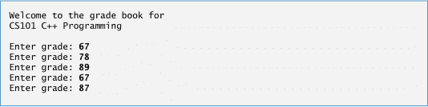

图 4.10 | 使用计数器控制的重复的班级平均分问题：创建 GradeBook 类（图 4.8—图 4.9）的对象并调用其 determineClassAverage 成员函数。（第 1 部分，共 2 部分。）


```text
Enter grade: 98
Enter grade: 93
Enter grade: 85
Enter grade: 82
Enter grade: 100

Total of all 10 grades is 846
Class average is 84
```

**图 4.10** | 使用计数器控制循环解决班级平均分问题：创建 `GradeBook` 类的对象（图 4.8–图 4.9）并调用其 `determineClassAverage` 成员函数。（第 2 部分，共 2 部分。）

## 关于整数除法与截断的说明

图 4.10 第 12 行函数调用所执行的平均值计算产生整数结果。示例执行结果显示，成绩总和为 846，除以 10 后应为 84.6——一个带小数点的数。然而，`total / 10` 的计算结果（图 4.9 第 63 行）是整数 84，因为 `total` 和 10 都是整数。两个整数相除产生整数除法——计算中的任何小数部分都会丢失（即被截断）。我们将在下一节中了解如何从平均值计算中得到包含小数点的结果。


> **常见编程错误 4.5**
>
> 假设整数除法会四舍五入（而非截断）可能导致错误结果。例如，`7 ÷ 4` 在常规算术中结果为 1.75，在整数算术中被截断为 1，而不是四舍五入为 2。

在图 4.9 中，如果第 63 行使用 `gradeCounter` 而不是 10，该程序的输出将显示错误的值 76。这是因为在 `while` 语句的最后一次迭代中，`gradeCounter` 在第 59 行被递增到了 11。


> **常见编程错误 4.6**
>
> 在循环之后使用循环的计数器控制变量进行计算，常常会导致一种常见的逻辑错误，称为差一错误。在每次循环计数加一的计数器控制循环中，当计数器的值比其最后一个合法值高一（例如，从 1 数到 10 时为 11）时，循环终止。

## 4.9 制定算法：哨兵控制循环

让我们推广班级平均分问题。考虑以下问题：

*开发一个班级平均分程序，每次运行时处理任意数量的学生成绩。*

在之前的示例中，问题陈述指定了学生数量，因此成绩数量（10）是预先已知的。在本示例中，没有说明用户在程序执行期间将输入多少个成绩。程序必须处理任意数量的成绩。程序如何确定何时停止输入成绩？它如何知道何时计算并打印班级平均分？

为了解决这个问题，我们可以使用一个称为**哨兵值**（也称为**信号值**、**哑值**或**标志值**）的特殊值来指示“数据输入结束”。在输入合法成绩后，用户输入哨兵值以指示最后一个成绩已输入。哨兵控制循环通常被称为**不定重复**，因为在循环开始执行之前重复次数*未知*。

必须选择哨兵值，使其不会与可接受的输入值混淆。成绩通常是非负整数，因此 −1 是可接受的哨兵值。因此，程序的一次运行可能处理诸如 95、96、75、74、89 和 −1 之类的输入。程序随后将计算并打印成绩 95、96、75、74 和 89 的班级平均分。由于 −1 是哨兵值，它不应进入平均值计算。

### 使用自顶向下、逐步细化制定伪代码算法：顶层和第一次细化

我们使用一种称为**自顶向下、逐步细化**的技术来处理班级平均分程序，这种技术对于开发结构良好的程序至关重要。我们从一个**顶层**的伪代码表示开始——一个传达程序整体功能的单一语句：

```text
确定任意数量学生测验的班级平均分
```

顶层实际上是对程序的*完整*表示。不幸的是，顶层（如本例中的情况）很少传达足够的细节来编写程序。因此，我们现在开始细化过程。我们将顶层划分为一系列较小的任务，并按需要执行的顺序列出这些任务。这产生了以下**第一次细化**。

- 1. 初始化变量
- 2. 输入、求和并计数测验成绩
- 3. 计算并打印所有学生成绩的总和及班级平均分

此细化仅使用顺序结构——这些步骤按顺序执行。

> **软件工程观察 4.4**
>
> 每一次细化以及顶层本身都是算法的完整规范；只是详细程度有所不同。


> **软件工程观察 4.5**
>
> 许多程序可以在逻辑上分为三个阶段：初始化阶段，初始化程序变量；处理阶段，输入数据值并相应地调整程序变量（如计数器和总数）；终止阶段，计算并输出最终结果。


### 进行第二次细化

前面的*软件工程观察*通常就是你进行自顶向下过程中的第一次细化所需的全部内容。在**第二次细化**中，我们确定具体的变量。在本示例中，我们需要一个数字的累计总数、一个已处理数字的计数、一个在用户输入每个成绩时接收其值的变量，以及一个保存计算所得平均值的变量。伪代码语句

```text
初始化变量
```

可以细化为：

```text
将 total 初始化为零
将 counter 初始化为零
```

只有变量 *total* 和 *counter* 在它们被使用之前需要初始化。变量 *average* 和 *grade*（分别用于计算的平均值和用户输入）不需要初始化，因为它们的值将在计算或输入时被替换。伪代码语句

```text
输入、求和并计数测验成绩
```

需要一个重复语句（即循环）来逐个输入每个成绩。我们事先不知道要处理多少个成绩，因此我们将使用**哨兵控制循环**。用户一次输入一个合法成绩。输入最后一个合法成绩后，用户输入哨兵值。程序在每次输入成绩后测试哨兵值，并在用户输入哨兵值时终止循环。上述伪代码语句的第二次细化如下：

```text
提示用户输入第一个成绩
输入第一个成绩（可能是哨兵值）
当用户尚未输入哨兵值时
    将该成绩加入累计总数
    将成绩计数器加一
    提示用户输入下一个成绩
    输入下一个成绩（可能是哨兵值）
```

在伪代码中，我们不在形成 *While* 结构体的语句周围使用花括号。我们只是将语句缩进在 *While* 下方，以表明它们属于该 *While*。同样，伪代码只是一种非正式的程序开发辅助手段。伪代码语句

```text
计算并打印所有学生成绩的总和及班级平均分
```

可以细化为：

```text
如果计数器不等于零
    将平均值设置为总数除以计数器
    打印班级所有学生的成绩总和
    打印班级平均分
否则
    打印“未输入任何成绩”
```

我们测试了*除以零*的可能性——这通常是一种**致命逻辑错误**，如果未被检测到，会导致程序失败（通常称为“崩溃”）。班级平均分问题伪代码的完整第二次细化如图 4.11 所示。


- 1 将总和初始化为零
- 2 将计数器初始化为零

- 4 提示用户输入第一个成绩
- 5 输入第一个成绩（可能是哨兵值）

- 7 当用户尚未输入哨兵值时
  - 8 将此成绩加入总和
  - 9 将成绩计数器加1
  - 10 提示用户输入下一个成绩
  - 11 输入下一个成绩（可能是哨兵值）

- 13 如果计数器不等于零
  - 14 将平均值设为总和除以计数器
  - 15 打印班级中所有学生的成绩总和
  - 16 打印班级平均分
- 17 否则
  - 18 打印“未输入任何成绩”

**图4.11** | 使用哨兵控制循环的班级平均分问题伪代码算法。


> **错误预防提示 4.3**
> 
> 当使用值可能为零的表达式进行除法时，应显式测试这种可能性并在程序中妥善处理（例如打印错误消息），而不是允许致命错误发生。我们在讨论异常处理时会进一步介绍如何处理这类错误。

图4.11中的伪代码解决了更一般的班级平均分问题。该算法只需要两级细化。有时需要更多级。


> **软件工程观察 4.6**
> 
> 当伪代码算法的细节足够充分，使你能将其转换成C++时，就应终止自顶向下、逐步细化的过程。通常，接下来的C++程序实现就很简单了。


> **软件工程观察 4.7**
> 
> 许多经验丰富的程序员编写程序时从不使用伪代码这类程序开发工具。他们认为最终目标是在计算机上解决问题，编写伪代码只会推迟最终产出的生成。虽然这种方法对于简单且熟悉的问题可能有效，但在长期、复杂的项目中可能导致严重困难。

## 在GradeBook类中实现哨兵控制循环

图4.12–4.13展示了包含成员函数determineClassAverage的GradeBook类，该函数实现了图4.11中的伪代码算法（该类在图4.14中进行演示）。虽然输入的每个成绩都是整数，但平均值计算很可能产生带小数点的数字——即实数或浮点数（例如7.33、0.0975或1000.12345）。int类型无法表示这种数字，因此该类必须使用其他类型。C++提供了多种在内存中存储浮点数的数据类型，包括**float**和**double**。这些类型的主要区别在于，与float变量相比，double变量通常可以存储更大数值和更精细的细节（即小数点右侧更多位数——也称为数字的**精度**）。本程序引入了一种称为**强制转换运算符**的特殊运算符，以强制平均值计算产生浮点数结果。

```cpp
// Fig. 4.12: GradeBook.h
// Definition of class GradeBook that determines a class average.
// Member functions are defined in GradeBook.cpp
#include <string> // program uses C++ standard string class
using namespace std;

// GradeBook class definition
class GradeBook
{
public:
   GradeBook( string ); // constructor initializes course name
   void setCourseName( string ); // function to set the course name
   string getCourseName(); // function to retrieve the course name
   void displayMessage(); // function to welcome message
   void determineClassAverage(); // averages grades entered by the user
private:
   string courseName; // course name
}; // end class GradeBook
```

**图4.12** | 使用哨兵控制循环的班级平均分问题：GradeBook头文件。

```cpp
// Fig. 4.13: GradeBook.cpp
// Member-function definitions for class GradeBook that solves the
// class average program with sentinel-controlled repetition.
#include <iostream>
#include <iomanip> // parameterized stream manipulators
#include "GradeBook.h" // include definition of class GradeBook
using namespace std;

// constructor initializes courseName with string supplied as argument
GradeBook::GradeBook( string name )
{
   setCourseName( name ); // validate and store courseName
} // end GradeBook constructor

// function to set the course name;
// ensures that course name has at most 25 characters
void GradeBook::setCourseName( string name )
{
```

**图4.13** | 使用哨兵控制循环的班级平均分问题：GradeBook源代码文件。（第1部分，共3部分。）

```cpp
// termination phase
if ( gradeCounter != 0 ) // if user entered at least one grade...
{
   // calculate average of all grades entered
   average = static_cast< double >( total ) / gradeCounter;

   // display total and average (with two digits of precision)
   cout << "\nTotal of " << gradeCounter << " grades entered is "
        << total << endl;
   cout << "Class average is " << setprecision( 2 ) << fixed << average
        << endl;
} // end if
else // no grades were entered, so output appropriate message
   cout << "No grades were entered" << endl;
} // end of function determineClassAverage
```

**图4.13** | 使用哨兵控制循环的班级平均分问题：GradeBook源代码文件。（第3部分，共3部分。）

```cpp
// Fig. 4.14: fig04_14.cpp
// Create GradeBook object and invoke its determineClassAverage function.
#include "GradeBook.h" // include definition of class GradeBook

int main()
{
   // create GradeBook object myGradeBook and
   // pass course name to constructor
   GradeBook myGradeBook( "CS101 C++ Programming" );

   myGradeBook.displayMessage(); // display welcome message
   myGradeBook.determineClassAverage(); // find average of 10 grades
} // end main
```

```text
Welcome to the grade book for
CS101 C++ Programming

Enter grade or -1 to quit: 97
Enter grade or -1 to quit: 88
Enter grade or -1 to quit: 72
Enter grade or -1 to quit: -1

Total of all 3 grades entered is 257
Class average is 85.67
```

**图4.14** | 使用哨兵控制循环的班级平均分问题：创建GradeBook对象并调用其determineClassAverage成员函数。

本例将控制语句逐个堆叠——while语句（图4.13中的第60–68行）之后紧跟一个if...else语句（第71–83行）。该程序中的大部分代码与图4.9中的代码相同，因此我们重点讨论新增特性和问题。

第48行声明了double变量average。回想一下，在前一个示例中我们使用int变量存储班级平均分。在当前示例中使用double类型可以将班级平均分计算的结果存储为浮点数。第52行将变量`gradeCounter`初始化为0，因为还没有输入任何成绩。请记住，本程序使用哨兵控制循环。为了准确记录输入的成绩数量，程序仅当用户输入有效成绩值且程序完成该成绩的处理后才递增变量`gradeCounter`。最后，注意两个输入语句（第57行和第67行）之前都有一个提示用户输入的输出语句。


> **良好编程实践 4.4**
> 
> 为每次键盘输入提示用户。提示应指明输入的形式以及任何特殊的输入值。在哨兵控制循环中，请求数据输入的提示应明确提醒用户哨兵值是什么。

### 哨兵控制循环与计数器控制循环的程序逻辑

将本应用中哨兵控制循环的程序逻辑与图4.9中计数器控制循环的逻辑进行比较。在计数器控制循环中，while语句（图4.9中的第54–60行）的每次迭代都会从用户处读取一个值，共读取指定的迭代次数。在哨兵控制循环中，程序在到达while之前先读取第一个值（图4.13中的第56–57行）。该值决定程序的控制流是否应进入while循环体。如果while的条件为假，说明用户输入了哨兵值，因此while循环体不会执行（即未输入任何成绩）。另一方面，如果条件为真，则循环体开始执行，循环将成绩值加入总和（第62行），并将gradeCounter加1（第63行）。然后循环体中的第66–67行提示用户并输入下一个值。接下来，程序控制到达第68行循环体的右花括号（}），因此执行继续测试while的条件（第60行）。该条件使用用户最近输入的成绩来决定是否应再次执行循环体。变量grade的值总是在程序测试while条件之前立即从用户处输入。这使程序能够在处理该值（即将其加入总和并递增gradeCounter）之前确定刚输入的值是否为哨兵值。如果输入了哨兵值，循环终止，程序不会将值−1加入总和。

循环终止后，执行第71–83行的if...else语句。第71行的条件确定是否输入了任何成绩。如果没有，则执行if...else语句的else部分（第82–83行）并显示消息“未输入任何成绩”，然后成员函数将控制权返回给调用函数。

注意图4.13中while循环中的块。如果没有大括号，循环体中的后三条语句将落在循环之外，导致计算机错误地解释此代码，如下所示：

```cpp
// loop until the sentinel value read from user
while ( grade != -1 ) {
    total = total + grade; // add grade to total
    gradeCounter = gradeCounter + 1; // increment counter

    // prompt for input and read next grade from user
    cout << "Enter grade or -1 to quit: ";
    cin >> grade;
}
```


如果用户没有为第一个成绩输入 −1（第 57 行），这将导致程序出现无限循环。

> **常见编程错误 4.3**
>
> 省略用于界定代码块的花括号可能导致逻辑错误，例如无限循环。为防止此问题，有些程序员会将每个控制语句的语句体都括在花括号中，即使该语句体只包含一条语句。

## 浮点数精度和内存需求

float 类型的变量表示单精度浮点数，在大多数 32 位系统上大约有 7 位有效数字。double 类型的变量表示双精度浮点数。它们所需的内存是 float 变量的两倍，并且在大多数 32 位系统上大约提供 15 位有效数字——约为 float 变量精度的两倍。大多数程序员用 double 类型表示浮点数。事实上，C++ 默认会将你在程序源代码中输入的所有浮点数（如 3.33 和 0.0975）视为 double 值。源代码中的这类值称为浮点常量。所有 float 和 double 的取值范围参见附录 C“基本类型”。

在常规算术中，浮点数常常由除法产生——例如用 10 除以 3 时，结果为 3.3333333...，其中数字 3 无限重复。计算机只分配固定大小的空间来存储这样的值，因此显然，所存储的浮点值只能是一个近似值。

> **常见编程错误 4.4**
>
> 以假定浮点数能被精确表示的方式使用浮点数（例如，用它们进行相等性比较）可能导致错误结果。浮点数只是近似表示。

尽管浮点数并不总是百分之百精确，但它们有大量应用。例如，当我们说“正常”体温为 98.6 时，并不需要精确到很多位数字。当我们将温度计上的温度读作 98.6 时，它实际上可能是 98.5999473210643。对于大多数涉及体温的应用而言，直接把这个数称为 98.6 是可以的。由于浮点数本质上不精确，因此优先使用 double 类型而不是 float 类型，因为 double 变量能更准确地表示浮点数。出于这个原因，本书通篇使用 double 类型。

## 在基本类型之间进行显式转换和隐式转换

变量 average 被声明为 double 类型（图 4.13 的第 48 行），以保存计算中的小数结果。然而，total 和 gradeCounter 都是整型变量。回顾一下，两个整数相除会执行整数除法，其中计算结果的任何小数部分都会被截断。在下面的语句中：

```
average = total / gradeCounter;
```

除法会先执行——结果的小数部分在赋值给 average 之前就已经丢失。为了用整数执行浮点计算，我们必须创建临时的浮点值。C++ 提供一元强制类型转换运算符来完成此任务。第 74 行使用强制类型转换运算符 `static_cast<double>(total)`，为其圆括号中的操作数 total 创建一个临时浮点副本。以这种方式使用强制类型转换运算符称为**显式转换**。total 中存储的值仍然是整数。

现在，计算由一个浮点值（total 的临时 double 版本）除以整数 gradeCounter 组成。编译器只知道如何求值操作数类型相同的表达式。为确保操作数类型相同，编译器会对选定的操作数执行一种称为提升（也称为隐式转换）的操作。例如，在包含 int 和 double 数据类型的表达式中，C++ 会将 int 操作数提升为 double 值。在我们的示例中，我们（通过使用一元强制类型转换运算符）将 total 当作 double 处理，因此编译器会将 gradeCounter 提升为 double，从而允许执行该计算——浮点除法的结果会赋值给 average。第 6 章“函数与递归简介”将讨论所有基本数据类型及其提升顺序。

强制类型转换运算符可用于每一种数据类型，也可用于类类型。static_cast 运算符由关键字 static_cast 后跟尖括号（< 和 >）以及其中的数据类型名构成。强制类型转换运算符是一元运算符——只接受一个操作数的运算符。第 2 章中，我们学习了二元算术运算符。C++ 也支持加号（+）和减号（−）的一元版本，因此可以编写诸如 −7 或 +5 这样的表达式。强制类型转换运算符的优先级高于其他一元运算符，例如一元 + 和一元 −。该优先级高于乘法运算符 *、/ 和 %，低于圆括号。在优先级表中，我们用 static_cast<type>() 表示强制类型转换运算符。

## 浮点数的格式化

这里简要讨论图 4.13 中的格式化功能，第 15 章“流输入/输出”将深入解释。第 79 行对 setprecision 的调用（参数为 2）表示 double 变量 average 应打印为小数点右边保留两位精度（例如 92.37）。这种调用称为参数化流操纵符（因为圆括号中有 2）。使用这些调用的程序必须包含预处理指令（第 5 行）

```
#include <iomanip>
```

操纵符 endl 是一种非参数化流操纵符（因为其后没有圆括号中的值或表达式），并且不需要 <iomanip> 头文件。如果未指定精度，浮点值通常输出为六位精度（即当今大多数 32 位系统上的默认精度），不过我们稍后会看到一个例外。

流操纵符 fixed（第 79 行）表示浮点值应以所谓的定点格式输出，而不是科学记数法。科学记数法是一种将数字显示为 1.0 到 10.0 之间的浮点数再乘以 10 的幂的方式。例如，值 3,100.0 用科学记数法会显示为 3.1 × 10³。科学记数法在显示非常大或非常小的值时很有用。第 15 章将进一步讨论使用科学记数法的格式化。另一方面，定点格式化用于强制浮点数显示特定数量的数字。指定定点格式化还会强制打印小数点和尾随零，即使该值是整数金额，例如 88.00。如果不使用定点格式化选项，这样的值在 C++ 中会打印为 88，既没有尾随零，也没有小数点。当程序中使用了流操纵符 fixed 和 setprecision 时，*打印值*会*舍入*到传给 setprecision 的值所指定的小数位数（例如第 79 行中的值 2），但内存中的值保持不变。例如，值 87.946 和 67.543 分别输出为 87.95 和 67.54。也可以使用流操纵符 *showpoint* 来*强制*显示小数点。如果在没有 fixed 的情况下指定 showpoint，则不会打印尾随零。与 endl 一样，流操纵符 fixed 和 showpoint 不使用参数，也不需要 `<iomanip>` 头文件。二者都可以在头文件 `<iostream>` 中找到。

图 4.13 的第 79 行和第 80 行输出班级平均分，*舍入*到最接近的百分位，并且小数点右边恰好有两位数字。参数化流操纵符（第 79 行）表示变量 average 的值应显示为小数点右边保留两位精度——由 setprecision(2) 指定。在图 4.14 中程序示例执行期间输入的三个成绩总计为 257，由此得到的平均分为 85.666666....

## 4.10 算法设计：嵌套控制语句

对于下一个示例，我们再次使用伪代码和自顶向下、逐步细化的方法来设计算法，并编写相应的 C++ 程序。我们已经看到，控制语句可以一个接一个地堆叠（按顺序）。这里，我们考察控制语句可以连接的另一种唯一结构化方式，即把一个控制语句嵌套在另一个控制语句中。考虑下面的问题陈述：

> 一所学院开设了一门课程，为学生参加房地产经纪人州执照考试做准备。去年，完成这门课程的十名学生参加了该考试。学院想知道其学生在这项考试中的表现如何。你被要求编写一个程序来汇总结果。你已获得这 10 名学生的名单。每个名字旁边写着 1（如果该学生通过了考试）或 2（如果该学生未通过考试）。
>
> 你的程序应按如下方式分析考试结果：

- 1. 输入每个考试结果（即 1 或 2）。每次程序请求另一个考试结果时，显示提示消息“Enter result”。
- 2. 统计每种类型的考试结果数量。
- 3. 显示考试结果汇总，指出通过和未通过的学生人数。
- 4. 如果超过八名学生通过了考试，则打印消息“Bonus to instructor”

仔细阅读问题陈述后，我们得出以下观察结果：

- 1. 程序必须处理 10 名学生的考试结果。由于考试结果的数量事先已知，因此可以使用计数器控制的循环。
- 2. 每个考试结果都是一个数字——1 或 2。每次程序读取一个考试结果时，程序必须判断该数字是 1 还是 2。我们的算法中测试是否为 1。如果该数字不是 1，我们就假定它是 2。（练习 4.20 讨论了这一假设的后果。）
- 3. 使用两个计数器来跟踪考试结果——一个统计通过考试的学生人数，一个统计未通过考试的学生人数。


## 伪代码语句

```
Display a summary of the exam results and decide whether a bonus should be paid
```

可以细化如下：

```
Display the number of passes
Display the number of failures
If more than eight students passed
    Display “Bonus to instructor”
```

完整的第二次细化如图4.15所示。空行将While结构分隔开，以提高可读性。该伪代码现在已足够细化，可转换为C++。

```
1  Initialize passes to zero
2  Initialize failures to zero
3  Initialize student counter to one

5  While student counter is less than or equal to 10
6      Prompt the user to enter the next exam result
7      Input the next exam result

9      If the student passed
10         Add one to passes
11     Else
12         Add one to failures

14     Add one to student counter

16 Display the number of passes
17 Display the number of failures

19 If more than eight students passed
20     Display “Bonus to instructor”
```

**图 4.15** | 考试结果问题的伪代码。

## 转换为类分析

实现该伪代码算法的程序如图4.16所示。此示例不包含类——它只包含一个源代码文件，其中函数main执行应用程序的所有工作。在本章和第3章中，你已看到由一个类（包括该类的头文件和源代码文件）以及另一个测试该类的源代码文件组成的示例。该源代码文件包含函数main，它创建该类的一个对象并调用其成员函数。偶尔，当试图创建一个可复用类来演示某个概念并不合理时，我们会使用一个完全包含在单个源代码文件的main函数中的示例。

```
Enter result (1 = pass, 2 = fail): 1
Enter result (1 = pass, 2 = fail): 1
Enter result (1 = pass, 2 = fail): 1
Enter result (1 = pass, 2 = fail): 1
Enter result (1 = pass, 2 = fail): 2
Enter result (1 = pass, 2 = fail): 1
Enter result (1 = pass, 2 = fail): 1
Enter result (1 = pass, 2 = fail): 1
Enter result (1 = pass, 2 = fail): 1
Passed 9
Failed 1
Bonus to instructor!
```

**图 4.16** | 考试结果问题：嵌套控制语句。（第2部分，共2部分。）

第9–12行声明用于处理考试结果的变量。我们利用了C++的一项特性，该特性允许将变量初始化并入声明中（passes初始化为0，failures初始化为0，studentCounter初始化为1）。循环程序可能需要在每次重复开始时进行初始化；此类重新初始化通常由赋值语句完成，而不是在声明中完成，也不是通过把声明移到循环体内部来完成。

while语句（第15–29行）循环10次。每次迭代输入并处理一个考试结果。用于处理每个结果的if...else语句（第22–25行）嵌套在while语句中。如果结果为1，if...else语句递增passes；否则，它假定结果为2并递增failures。第28行在第15行再次测试循环条件之前递增studentCounter。输入10个值后，循环终止，第32行显示通过人数和未通过人数。第35–36行的if语句判断是否有超过八名学生通过考试，如果是，则输出消息"Bonus to instructor!"。

图4.16显示了该程序两次示例执行的输入和输出。第二次示例执行结束时，第35行的条件为真——超过八名学生通过了考试，因此程序输出一条消息，表明教师应获得奖金。

## 4.11 赋值运算符

C++提供了若干赋值运算符来缩写赋值表达式。例如，语句

```
c = c + 3;
```

可以用加法赋值运算符+=缩写为

```
c += 3;
```

它将运算符右侧表达式的值加到运算符左侧变量的值上，并将结果存储在左侧变量中。任何如下形式的语句

```
variable = variable operator expression;
```

其中同一变量出现在赋值运算符两侧，且该运算符是二元运算符+、-、*、/或%之一（文中稍后还会讨论另外几个运算符），都可以写成如下形式

```
variable operator= expression;
```

因此赋值c += 3将3加到c上。图4.17展示了算术赋值运算符、使用这些运算符的示例表达式以及说明。

*假设：int c = 3, d = 5, e = 4, f = 6, g = 12;*

| 赋值运算符 | 示例表达式 | 说明 | 赋值结果 |
|---|---|---|---|
| += | c += 7 | c = c + 7 | 将10赋给c |
| -= | d -= 4 | d = d - 4 | 将1赋给d |
| *= | e *= 5 | e = e * 5 | 将20赋给e |
| /= | f /= 2 | f = f / 2 | 将2赋给f |
| %= | g %= 9 | g = g % 9 | 将3赋给g |

**图 4.17**  |  算术赋值运算符。

## 4.12 递增和递减运算符

除了算术赋值运算符外，C++还提供两个一元运算符，用于将数值变量的值加1或减1。它们是一元递增运算符++和一元递减运算符--，总结于图4.18。程序可以使用递增运算符++将名为c的变量的值加1，而不是使用表达式c = c + 1或c += 1。放在变量前面（置于变量*之前*）的递增或递减运算符分别称为**前置递增**或**前置递减**运算符。放在变量后面（置于变量*之后*）的递增或递减运算符分别称为**后置递增**或**后置递减**运算符。

| 运算符 | 名称 | 示例表达式 | 说明 |
|---|---|---|---|
| ++ | 前置递增 | ++a | 将a递增1，然后在包含a的表达式中使用a的新值。 |
| ++ | 后置递增 | a++ | 在包含a的表达式中使用a的当前值，然后将a递增1。 |
| -- | 前置递减 | --b | 将b递减1，然后在包含b的表达式中使用b的新值。 |
| -- | 后置递减 | b-- | 在包含b的表达式中使用b的当前值，然后将b递减1。 |

**图 4.18**  |  递增和递减运算符。

使用前置递增（或递减）运算符将变量加（或减）1，称为对该变量进行前置递增（或前置递减）。前置递增（或前置递减）使变量递增（递减）1，然后在变量所在的表达式中使用该变量的新值。使用后置递增（或递减）运算符将变量加（或减）1，称为**后置递增**（或**后置递减**）。后置递增（或后置递减）使变量的*当前*值用于其所在的表达式中，然后将变量的值递增（递减）1。


### 良好编程实践 4.5

与二元运算符不同，一元递增和递减运算符应紧挨其操作数放置，中间不留空格。

图4.19演示了++递增运算符的前置递增版本和后置递增版本之间的区别。递减运算符（--）的工作方式类似。

```cpp
// Fig. 4.19: fig04_19.cpp
// Preincrementing and postincrementing.
#include <iostream>
using namespace std;

int main()
{
    int c;

    // demonstrate postincrement
    c = 5; // assign 5 to c
    cout << c << endl; // print 5
    cout << c++ << endl; // print 5 then postincrement
    cout << c << endl; // print 6

    cout << endl; // skip a line

    // demonstrate preincrement
    c = 5; // assign 5 to c
    cout << c << endl; // print 5
    cout << ++c << endl; // preincrement then print 6
    cout << c << endl; // print 6
} // end main
```

```text
5
5
6

5
6
6
```

**图 4.19** | 前置递增和后置递增。

第11行将c初始化为5，第12行输出c的初始值。第13行输出表达式c++的值。这会后置递增变量c，因此输出c的原始值（5），然后将c的值递增。因此，第13行再次输出c的初始值（5）。第14行输出c的新值（6），以证明该变量的值在第13行已递增。第19行将c的值重置为5，第20行输出该值。第21行输出表达式++c的值。该表达式前置递增c，因此其值先递增，然后


新值(6)被输出。第22行再次输出c的值，以表明执行第21行后c的值仍然是6。

算术赋值运算符以及自增和自减运算符可用于简化程序语句。图4.16中的三条赋值语句：

```cpp
passes = passes + 1;
failures = failures + 1;
studentCounter = studentCounter + 1;
```

可以使用赋值运算符更简洁地写成：

```cpp
passes += 1;
failures += 1;
studentCounter += 1;
```

也可以使用前缀自增运算符写成：

```cpp
++passes;
++failures;
++studentCounter;
```

或者使用后缀自增运算符写成：

```cpp
passes++;
failures++;
studentCounter++;
```

当你在一条语句中对整数变量单独进行自增（`++`）或自减（`--`）时，前缀自增和后缀自增具有相同的逻辑效果，前缀自减和后缀自减也具有相同的逻辑效果。只有当变量出现在更大的表达式中时，前缀自增和后缀自增才会产生不同的效果（前缀自减和后缀自减也是如此）。

> **常见编程错误 4.10**
>
> 试图对可修改变量名或引用以外的表达式使用自增或自减运算符，例如编写 `++(x + 1)`，会导致语法错误。

图4.20展示了迄今介绍过的运算符的优先级和结合性。运算符按优先级从高到低自上而下排列。第二列表示各优先级层次上运算符的结合性。注意，条件运算符（`?:`）、一元运算符前缀自增（`++`）、前缀自减（`--`）、正号（`+`）和负号（`-`），以及赋值运算符 `+=`、`-=`、`*=`, `/=` 和 `%=` 是从右向左结合的。图4.20中所有其他运算符都是从左向右结合的。第三列列出了各类运算符组的名称。

| 运算符 | 结合性 | 类型 |
|---|---|---|
| `::` | 从左到右 | 作用域解析 |
| `()` | [见图2.10中的注意事项] | 分组括号 |
| `++  --  static_cast<type>()` | 从左到右 | 一元（后缀） |
| `++  --  +  -` | 从右到左 | 一元（前缀） |
| `*  /  %` | 从左到右 | 乘法 |
| `+  -` | 从左到右 | 加法 |
| `<<  >>` | 从左到右 | 插入/提取 |
| `<  <=  >  >=` | 从左到右 | 关系 |
| `==  !=` | 从左到右 | 相等 |
| `?:` | 从右到左 | 条件 |
| `=  +=  -=  *=  /=  %=` | 从右到左 | 赋值 |

图 4.20 | 本文迄今遇到的运算符的优先级。（第1部分，共2部分。）

**图 4.20** | 本文迄今遇到的运算符的优先级。（第2部分，共2部分。）

## 4.13 小结

本章介绍了构建类和为这些类开发成员函数时所使用的基本问题求解技术。我们演示了如何用伪代码构造算法（即解决问题的方法），然后如何通过伪代码的逐步细化来改进算法，最终生成可作为函数一部分执行的C++代码。你学习了如何使用自顶向下、逐步求精的方法来规划函数必须执行的动作以及执行这些动作的顺序。

你了解到，开发任何算法只需要三种类型的控制结构——顺序、选择和重复。我们演示了C++的两种选择语句——`if`单选择语句和`if...else`双选择语句。`if`语句用于根据条件执行一组语句——如果条件为真，则执行这些语句；如果条件为假，则跳过这些语句。`if...else`双选择语句用于在条件为真时执行一组语句，在条件为假时执行另一组语句。然后我们讨论了`while`重复语句，其中只要条件为真，一组语句就会重复执行。我们使用控制语句的堆叠，通过计数器控制和哨兵控制重复来求一组学生成绩的总和及平均值；我们还使用控制语句的嵌套来分析一组考试结果并基于结果做出决策。我们介绍了赋值运算符，可用于缩写语句。我们还介绍了自增和自减运算符，可用于将变量加1或减1。在下一章中，我们将继续讨论控制语句，介绍`for`、`do...while`和`switch`语句。

## 小结

### 4.2节 算法

- 算法（第102页）是一种解决问题的过程，它规定了要执行的动作以及这些动作的执行顺序。
- 指定程序中语句的执行顺序称为程序控制（第103页）。

### 4.3节 伪代码

- 伪代码（第103页）帮助你在用编程语言编写程序之前先思考程序的结构。

### 4.4节 控制结构

- 活动图对软件系统的工作流（也称为活动，第105页）进行建模。
- 活动图（第105页）由符号组成，如动作状态符号、菱形和小圆圈，这些符号通过表示活动流程的转换箭头连接。
- 与伪代码类似，活动图帮助您开发和表示算法。
- 动作状态表示为一个矩形，其左右两侧替换为向外弯曲的弧线。动作表达式（第105页）出现在动作状态内部。
- 活动图中的箭头表示转换（第105页），它指示动作状态所表示的动作发生的顺序。
- 活动图中的实心圆表示初始状态（第105页）——程序执行所建模的动作之前工作流的开始。
- 活动图底部出现的实心圆外包围空心圆表示最终状态（第105页）——程序执行其动作之后工作流的结束。
- 右上角折叠的矩形在UML中称为注释（第105页）。虚线（第105页）将每个注释与注释所描述的元素连接起来。
- 活动图中的判定符号（第107页）表示需要进行决策。工作流沿着由相关监护条件确定的路径前进。从判定符号发出的每条转换箭头都有一个监护条件。如果监护条件为真，工作流将进入该转换箭头所指的动作状态。
- 有三种类型的控制结构（第104页）——顺序、选择和重复。
- 顺序结构是内置的——默认情况下，语句按它们出现的顺序执行。
- 选择结构在备选的动作路径中进行选择。

### 4.5节 `if` 选择语句

- `if`单选择语句（第107页）在条件为真时执行（选择）一个动作，在条件为假时跳过该动作。

### 4.6节 `if…else` 双选择语句

- `if…else`双选择语句（第108页）在条件为真时执行（选择）一个动作，在条件为假时执行另一个不同的动作。
- 要在`if`的语句体（或`if…else`语句中`else`的语句体）中包含多条语句，请将这些语句用花括号（`{`和`}`）括起来。包含在花括号中的一组语句称为块（第112页）。块可以放置在程序中任何可以放置单条语句的位置。
- 空语句（第113页）表示不执行任何动作，用分号（`;`）表示。

### 4.7节 `while` 重复语句

- 重复语句（第113页）在某个条件保持为真时重复执行一个动作。
- UML合并符号（第114页）有两条或更多转换箭头指向菱形，并且只有一条转换箭头从菱形指出，以表示多个活动流合并后继续活动。

### 4.8节 算法设计：计数器控制的重复

- 当循环开始执行之前已知重复次数时，即存在确定性重复时，使用计数器控制的重复（第115页）。


- 流操纵器 `fixed`（第129页）指示浮点值应以所谓的定点格式输出，而不是科学记数法。

### 4.9 节 制定算法：哨兵控制重复

- 自顶向下、逐步求精（第121页）是一种通过在每个求精步骤中维护程序的完整表示来细化伪代码的过程。
- 哨兵控制重复（第122页）用于在循环开始执行之前不知道重复次数的情况，即存在不确定重复的情况。
- 包含小数部分的值称为浮点数，并由诸如 `float` 和 `double`（第124页）等数据类型近似表示。
- 一元强制转换运算符 `static_cast<double>`（第124页）可用于创建其操作数的临时浮点副本。
- 一元运算符（第129页）只接受一个操作数；二元运算符接受两个操作数。
- 参数化流操纵器 `setprecision`（第129页）指示应显示在小数点右侧的精度位数。

### 4.10 节 制定算法：嵌套控制语句

- 嵌套控制语句（第130页）出现在另一个控制语句的语句体中。

### 4.11 节 赋值运算符

- 算术运算符 `+=`、`-=`、`*=`、`/=` 和 `%=` 可缩写赋值表达式（第134页）。

### 4.12 节 自增和自减运算符

- 自增（`++`）和自减（`--`）运算符（第135页）分别将变量增加或减少1。如果运算符位于变量之前，则变量先增加或减少1，然后其新值用于它所在的表达式。如果运算符位于变量之后，则变量先在它所在的表达式中使用，然后将变量的值增加或减少1。

## 自测练习

### 4.1
回答以下每个问题。

- a) 所有程序都可以用三种控制结构来编写：________、________ 和 ________。
- b) ________ 选择语句用于在条件为真时执行一个操作，或在条件为假时执行另一个操作。
- c) 将一组指令重复特定次数称为 ________ 重复。
- d) 当事先不知道一组语句将重复多少次时，可以使用 ________ 值来终止重复。

### 4.2
编写四条不同的 C++ 语句，将整数变量 `x` 加 1。

### 4.3
编写 C++ 语句以完成以下各项：

- a) 用一条语句，将 `x` 和 `y` 当前值之和赋给 `z`，并对 `x` 的值进行后置自增。
- b) 判断变量 `count` 的值是否大于 10。如果大于 10，则打印 `"Count is greater than 10."`
- c) 将变量 `x` 前置自减 1，然后从变量 `total` 中减去它。
- d) 计算 `a` 除以 `divisor` 后的余数，并将结果赋给 `q`。用两种不同的方式编写此语句。

### 4.4
编写 C++ 语句以完成以下各项任务：

- a) 声明变量 `sum` 和 `x` 为 `int` 类型。
- b) 将变量 `x` 设置为 1。
- c) 将变量 `sum` 设置为 0。
- d) 将变量 `x` 加到变量 `sum`，并将结果赋给变量 `sum`。
- e) 打印 **“总和为：”**，后跟变量 `sum` 的值。

### 4.5
将你在练习 4.4 中编写的语句组合成一个程序，计算并打印从 1 到 10 的整数之和。使用 `while` 重复语句循环执行计算和自增语句。当 `x` 的值变为 11 时，循环应终止。

### 4.6
说明执行计算后以下每条语句中各变量的值。假设每条语句开始执行时，所有变量的整数值均为 5。

- a) `product *= x++;`
- b) `quotient /= ++x;`

### 4.7
编写单条 C++ 语句或语句片段以完成以下操作：

- a) 使用 `cin` 和 `>>` 输入整数变量 `x`。
- b) 使用 `cin` 和 `>>` 输入整数变量 `y`。
- c) 将整数变量 `i` 设置为 1。
- d) 将整数变量 `power` 设置为 1。
- e) 将变量 `power` 乘以 `x`，并将结果赋给 `power`。
- f) 将变量 `i` 前置自增 1。
- g) 判断 `i` 是否小于或等于 `y`。
- h) 使用 `cout` 和 `<<` 输出整数变量 `power`。

### 4.8
编写一个 C++ 程序，使用练习 4.7 中的语句计算 `x` 的 `y` 次幂。该程序应包含一个 while 重复语句。

### 4.9
指出并纠正以下各项中的错误：

```cpp
a) while ( c <= 5 )
   {
      product *= c;
      ++c;
   }

b) cin << x value;

c) if ( gender == 1 )
      cout << "Woman" << endl;
   else:
      cout << "Man" << endl;
```

### 4.10
以下 `while` 重复语句有什么问题？

```cpp
while ( z >= 0 )
   sum += z;
```

## 自测练习答案

### 4.1

- a) 顺序、选择和重复。
- b) `if...else`。
- c) 计数器控制或确定性。
- d) 哨兵、信号、标志或哑值。

### 4.2

```cpp
x = x + 1;
x += 1;
++x;
x++;
```

### 4.3

- a) `z = x++ + y;`
- b)
  ```cpp
  if ( count > 10 )
      cout << "Count is greater than 10" << endl;
  ```
- c) `total -= --x;`
- d)
  ```cpp
  q %= divisor;
  q = q % divisor;
  ```

### 4.4

- a)
  ```cpp
  int sum;
  int x;
  ```
- b) `x = 1;`
- c) `sum = 0;`
- d)
  ```cpp
  sum += x;
  ```
  或
  ```cpp
  sum = sum + x;
  ```
- e) `cout << "The sum is: " << sum << endl;`

参见以下代码：

```cpp
// Exercise 4.5 Solution: ex04_05.cpp
// Calculate the sum of the integers from 1 to 10.
#include <iostream>
using namespace std;

int main()
{
    int sum; // stores sum of integers 1 to 10
    int x;   // counter

    x = 1;   // count from 1
    sum = 0; // initialize sum

    while ( x <= 10 ) // loop 10 times
    {
        sum += x; // add x to sum
        ++x;      // increment x
    } // end while

    cout << "The sum is: " << sum << endl;
} // end main
```

总和为：55

### 4.6

- a) `product = 25, x = 6;`
- b) `quotient = 0, x = 6;`

```cpp
// Exercise 4.6 Solution: ex04_06.cpp
// Calculate the value of product and quotient.
#include <iostream>
using namespace std;

int main()
{
    int x = 5;
    int product = 5;
    int quotient = 5;

    // part a
    product *= x++; // part a statement
```

```cpp
int x = 1; // initialize x
int total = 0; // initialize total

while ( x <= 10 ) // loop 10 times
{
    y = x * x; // perform calculation
    cout << y << endl; // output result
    total += y; // add y to total
    x++; // increment counter x
} // end while

cout << "Total is " << total << endl; // display result
} // end main
```

## 对于练习 4.13–4.16，执行以下每个步骤：

- a) 阅读问题陈述。
- b) 使用伪代码以及自顶向下、逐步求精来制定算法。
- c) 编写一个 C++ 程序。
- d) 测试、调试并执行该 C++ 程序。

### 4.13 *(燃油里程)*

驾驶员关心其汽车获得的里程。一位驾驶员通过记录每次行程的行驶英里数和所用加仑数，跟踪了多次行程。开发一个使用 while 语句输入每次行程的行驶英里数和所用加仑数的 C++ 程序。该程序应计算并显示每次行程获得的每加仑英里数，并打印到目前为止所有满箱油获得的综合每加仑英里数。

```text
Enter miles driven (-1 to quit): 287
Enter gallons used: 13
MPG this trip: 22.076923
Total MPG: 22.076923

Enter miles driven (-1 to quit): 200
Enter gallons used: 10
MPG this trip: 20.000000
Total MPG: 21.173913

Enter miles driven (-1 to quit): 120
Enter gallons used: 5
MPG this trip: 24.000000
Total MPG: 21.678571

Enter miles driven (-1 to quit): -1
```

### 4.14 *(信用额度)*

开发一个 C++ 程序，用于确定百货商店客户是否超出了赊购账户的信用额度。对于每位客户，可获得以下信息：

- a) 账号（一个整数）
- b) 月初余额
- c) 该客户本月所有记账项目的总额
- d) 本月应用到该客户账户的所有贷项总额
- e) 允许的信用额度

该程序应使用 while 语句输入上述每项信息，计算新余额（= 月初余额 + 记账金额 − 贷项金额），并确定新余额是否超过客户的信用额度。对于信用额度被超出的客户，程序应显示客户的账号、信用额度、新余额以及消息“信用额度已超出。”


a) 假设 x = 5 且 y = 8，则产生以下输出。

```text
@@@@@
$$$$$
&&&&&
```

b) 假设 x = 5 且 y = 8，则产生以下输出。

```text
@@@@@
```

c) 假设 x = 5 且 y = 8，则产生以下输出。

```text
@@@@@
&&&&&
```

d) 假设 x = 5 且 y = 7，则产生以下输出。[*注意：* else 后的最后三条输出语句都属于一个块。]

```text
#####
$$$$$
&&&&&
```

**4.25**（*星号正方形*）编写一个程序，读入正方形边长的大小，然后用星号和空白打印出该大小的空心正方形。你的程序应适用于边长在 1 到 20 之间的所有正方形。例如，如果程序读入大小为 5，则应打印

```text
*****
*   *
*   *
*   *
*****
```

**4.26**（*回文*）回文是指正读和反读都相同的数字或文本短语。例如，以下每个五位数整数都是回文：12321、55555、45554 和 11611。编写一个程序，读入一个五位数整数并判断它是否为回文。[*提示：* 使用除法和取模运算符将该数分离成各个数字。]

**4.27**（*打印二进制数的十进制等价值*）输入一个仅包含 0 和 1 的整数（即“二进制”整数），并打印其十进制等价值。使用取模和除法运算符，从右到左逐个取出“二进制”数的数字。就像在十进制数系统中，最右边的数字位值为 1，向左下一位的位值为 10，然后是 100，再是 1000，依此类推；在二进制数系统中，最右边的数字位值为 1，向左下一位的位值为 2，然后是 4，再是 8，依此类推。因此，十进制数 234 可以解释为 2 * 100 + 3 * 10 + 4 * 1。二进制 1101 的十进制等价值为 1 * 1 + 0 * 2 + 1 * 4 + 1 * 8，即 1 + 0 + 4 + 8，也就是 13。[*注意：* 要了解更多关于二进制数的知识，请参阅附录 D。]

**4.28**（*星号棋盘图案*）编写一个程序，显示以下棋盘图案。你的程序必须仅使用三条输出语句，每种形式各一条：

```cpp
cout << "* ";
cout << ' ';
cout << endl;
```

```text
* * * * * * *
 * * * * * * *
* * * * * * *
 * * * * * * *
* * * * * * *
 * * * * * * *
* * * * * * *
```

**4.29**（*使用无限循环输出 2 的倍数*）编写一个程序，打印整数 2 的幂，即 2、4、8、16、32、64 等。你的 while 循环不应终止（即应创建一个无限循环）。为此，只需使用关键字 true 作为 while 语句的表达式。运行此程序时会发生什么？

**4.30**（*计算圆的直径、周长和面积*）编写一个程序，读入圆的半径（作为 double 值），并计算和打印直径、周长和面积。使用 3.14159 作为 π 的值。

**4.31** 以下语句有什么问题？提供正确的语句以实现程序员可能想要完成的操作。

```cpp
cout << ++( x + y );
```

**4.32**（*三角形的边*）编写一个程序，读入三个非零 double 值，并判断并打印它们是否能表示三角形的三条边。

**4.33**（*直角三角形的边*）编写一个程序，读入三个非零整数，并判断并打印它们是否为直角三角形的三条边。

**4.34**（*阶乘*）非负整数 *n* 的阶乘写作 *n*!（读作“n 的阶乘”），定义如下：

*n*! = *n* · (*n* − 1) · (*n* − 2) · · · 1（对于大于 1 的 *n* 值）

*n*! = 1（对于 *n* = 0 或 *n* = 1）。

例如，5! = 5 · 4 · 3 · 2 · 1，即 120。在以下各项中使用 while 语句：

- a) 编写一个程序，读入一个非负整数并计算并打印其阶乘。
- b) 编写一个程序，使用以下公式估算数学常量 *e* 的值：

\[
e = 1 + \frac{1}{1!} + \frac{1}{2!} + \frac{1}{3!} + \cdots
\]

提示用户输入 *e* 的期望精度（即求和中的项数）。

- c) 编写一个程序，使用以下公式计算 *eˣ* 的值：

\[
e^x = 1 + \frac{x}{1!} + \frac{x^2}{2!} + \frac{x^3}{3!} + \cdots
\]

提示用户输入 *e* 的期望精度（即求和中的项数）。

## 产生影响

**4.35**（*使用密码学保护隐私*）互联网通信和联网计算机上的数据存储的爆炸式增长极大地增加了隐私担忧。密码学领域关注对数据进行编码，使未经授权的用户难以（并且希望——借助最先进的方案——不可能）读取。在本练习中，你将研究一种简单的数据加密和解密方案。一家公司希望通过互联网发送数据，要求你编写一个程序来加密数据，以便更安全地传输。所有数据都以四位数整数传输。你的应用程序应读入用户输入的四位数整数，并按如下方式加密：将每个数字替换为将该数字加 7 后所得新值除以 10 的余数。然后交换第一位数字与第三位数字，并交换第二位数字与第四位数字。然后打印加密后的整数。编写另一个应用程序，输入一个加密的四位数整数，并将其解密（通过逆转加密方案）以形成原始数字。*（可选阅读项目：* 研究一般的“公钥密码学”以及 PGP（Pretty Good Privacy）特定的公钥方案。你可能还想研究 RSA 方案，它广泛用于工业级应用。）

**4.36**（*世界人口增长*）

几个世纪以来，世界人口大幅增长。持续增长最终可能挑战可呼吸空气、可饮用水、可耕地和其他有限资源的极限。有证据表明，近年来增长一直在放缓，世界人口可能在本世纪某个时候达到峰值，然后开始下降。

在本练习中，在线研究世界人口增长问题。*务必调查各种观点。* 获取当前世界人口及其增长率（今年可能增长的百分比）的估计值。编写一个程序，使用*当前增长率将保持不变的简化假设*，计算未来 75 年每年的世界人口增长。将结果打印在表格中。第一列应显示从第 1 年到第 75 年的年份。第二列应显示该年年底的预期世界人口。第三列应显示该年将发生的世界人口数值增长。使用你的结果，确定如果今年的增长率持续下去，人口将在哪一年达到今天的两倍。

# 5 控制语句：第 2 部分

> 并非所有能计算的东西都重要，也并非所有重要的东西都能计算。  
> ——阿尔伯特·爱因斯坦

> 谁能控制自己的命运？  
> ——威廉·莎士比亚

> 常用的钥匙总是光亮的。  
> ——本杰明·富兰克林

> 智能……是制造人造物的能力，尤其是制造工具的工具。  
> ——亨利·柏格森

### 目标

在本章中，你将学习：

- 计数器控制重复的基础知识。
- 使用 for 和 do...while 在程序中重复执行语句。
- 使用 switch 选择语句实现多重选择。
- break 和 continue 如何改变控制流。
- 使用逻辑运算符在控制语句中形成复杂的条件表达式。
- 避免混淆相等运算符和赋值运算符的后果。


## 5.3 for 重复语句

除了 while 之外，C++ 还提供 **for 重复语句**，它在一行代码中指定计数器控制的重复细节。为了说明 for 的强大功能，让我们重写图 5.1 的程序。结果如图 5.2 所示。

```cpp
// Fig. 5.2: Fig05_02.cpp
// Counter-controlled repetition with the for statement.
#include <iostream>
using namespace std;

int main()
{
   // for statement header includes initialization,
   // loop-continuation condition and increment.
   for ( int counter = 1; counter <= 10; ++counter )
      cout << counter << " ";

   cout << endl; // output a newline
} // end main

1 2 3 4 5 6 7 8 9 10
```

**图 5.2**  使用 for 语句的计数器控制重复。

当 for 语句（第 10–11 行）开始执行时，控制变量 counter 被声明并初始化为 1。然后，检查循环继续条件（第 10 行分号之间）counter <= 10。counter 的初始值为 1，因此条件满足，循环体语句（第 11 行）打印 counter 的值，即 1。然后，表达式 ++counter 递增控制变量 counter，循环再次从循环继续测试开始。控制变量现在等于 2，因此未超过最终值，程序再次执行循环体语句。此过程持续到循环体执行 10 次并且控制变量 counter 递增到 11——这导致循环继续测试失败，重复终止。程序继续执行 for 语句之后的第一个语句（在本例中为第 13 行的输出语句）。

### for 语句头组成部分

图 5.3 更仔细地查看图 5.2 的 for 语句头（第 10 行）。请注意，for 语句头“完成所有工作”——它指定使用控制变量进行计数器控制重复所需的每一项。如果 for 的循环体中有多个语句，则需要花括号来包围该块。

如果在图 5.2 中错误地将 counter < 10 写为循环继续条件，那么循环将只执行 9 次。这是一个常见的差一错误。

> **常见编程错误 5.2**
>
> 在 while 或 for 语句的条件中使用错误的关系运算符，或使用错误的循环计数器最终值，可能导致差一错误。

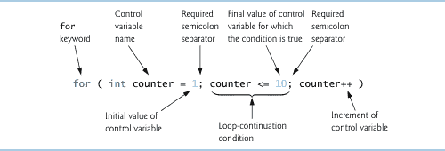

**图 5.3**  
*for 语句头组成部分。*

### 良好编程实践 5.2

在 while 或 for 语句的条件中使用最终值并使用 <= 关系运算符，有助于避免差一错误。例如，对于用于打印值 1 到 10 的循环，循环继续条件应为 counter <= 10，而不是 counter < 10（这是差一错误）或 counter = 10（这是差一错误）。许多程序员更喜欢所谓的从零开始计数，其中，为了通过循环计数 10 次，counter 将初始化为零，循环继续测试将是 counter < 10。

for 语句的一般形式是

```
for ( initialization; loopContinuationCondition; increment )
    statement
```

其中 *initialization* 表达式初始化循环的控制变量，*loopContinuationCondition* 决定循环是否应继续执行，*increment* 递增控制变量。在大多数情况下，for 语句可以用等效的 while 语句表示，如下所示：

```
initialization;

while ( loopContinuationCondition )
{
    statement
    increment;
}
```

这条规则有一个例外，我们将在 5.7 节讨论。

如果 *initialization* 表达式声明控制变量（即在其名称之前指定其类型），则控制变量*仅*可在 for 语句的循环体中使用——该控制变量在 for 语句外将*未知*。控制变量的这种受限使用称为变量的*作用域*。变量的作用域指定它可以在程序中的何处使用。作用域在第 6 章详细讨论。

正如我们将看到的，*initialization* 和 *increment* 表达式可以是逗号分隔的表达式列表。这些表达式中使用的逗号是 **逗号运算符**，它保证表达式列表从左到右求值。逗号运算符在所有 C++ 运算符中优先级最低。逗号分隔的表达式列表的值和类型是最右侧表达式的值和类型。逗号运算符常用于

### for 语句 UML 活动图

for 重复语句的 UML 活动图与 while 语句的活动图（图 4.6）类似。图 5.4 显示图 5.2 中 for 语句的活动图。该图清楚地表明，初始化在第一次求值循环继续测试之前发生一次，并且每次通过循环在循环体语句执行之后发生递增。请注意（除了初始状态、转换箭头、合并、最终状态和若干注释之外），该图只包含动作状态和判定。

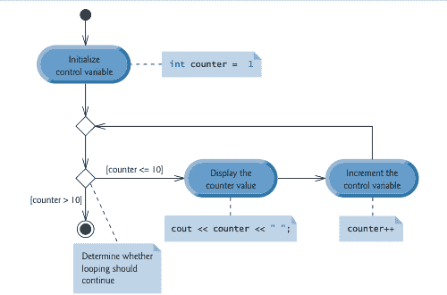

**图 5.4** | 图 5.2 中 for 语句的 UML 活动图。

## 5.4 使用 for 语句的示例

以下示例展示在 for 语句中改变控制变量的方法。在每种情况下，我们编写适当的 for 语句头。注意对于递减控制变量的循环，关系运算符的变化。

- a) 将控制变量从 1 到 100，以 1 为增量变化。
- b) 将控制变量从 100 向下到 1，以 1 为减量变化。
- c) 将控制变量从 7 到 77，以 7 为步长变化。
- d) 将控制变量从 20 向下到 2，以 −2 为步长变化。

```
for ( int i = 1; i <= 100; ++i )
```

```
for ( int i = 100; i >= 1; --i )
```

```
for ( int i = 7; i <= 77; i += 7 )
```

```
for ( int i = 20; i >= 2; i -= 2 )
```

| 年份 | 存款金额 |
|---:|---:|
| 1 | 1050.00 |
| 2 | 1102.50 |
| 3 | 1157.63 |
| 4 | 1215.51 |
| 5 | 1276.28 |
| 6 | 1340.10 |
| 7 | 1407.10 |
| 8 | 1477.46 |
| 9 | 1551.33 |
| 10 | 1628.89 |

**图 5.6**  使用 for 的复利计算。（第 2 部分，共 2 部分。）

如果不包含头文件 `<cmath>`（第 5 行），该程序将无法编译。函数 `pow` 需要两个 double 参数。变量 `year` 是整数。头文件 `<cmath>` 包含的信息告诉编译器在调用该函数之前将 `year` 的值转换为临时的 double 表示。此信息包含在 `pow` 的函数原型中。第 6 章概述其他数学库函数。

> **常见编程错误 5.5**
>
> *在使用数学库函数的程序中，使用标准库函数（例如 `<cmath>`）时忘记包含适当的头文件，是一种编译错误。*

### *关于使用 float 或 double 类型表示货币金额的注意事项*

第 10–12 行声明 double 变量 amount、principal 和 rate。我们这样做是为了简单，因为我们处理的是美元的小数部分，并且需要一种其值允许小数点的类型。不幸的是，这可能导致麻烦。下面简单解释使用 float 或 double 表示美元金额时可能出错的情况（假设打印时使用 setprecision(2) 指定两位精度）：机器中存储的两个美元金额可能是 14.234（打印为 14.23）和 18.673（打印为 18.67）。当这些金额相加时，它们产生的内部和为 32.907，打印为 32.91。因此，您的打印输出可能显示为

```
    14.23
  + 18.67
  --------
    32.91
```

但是，一个人按照打印出的各个数字相加，会期望总和为 32.90！已经警告过您了！在练习中，我们将探索使用整数执行货币计算。[注意：一些第三方供应商出售执行精确货币计算的 C++ 类库。]

> **良好编程实践 5.5**
>
> *不要使用 float 或 double 类型的变量执行货币计算。浮点数的不精确性可能导致不正确的货币值。*

### *使用流操纵符格式化数值输出*

for 循环之前第 18 行的输出语句和 for 循环中第 27 行的输出语句共同打印变量 year 和 amount 的值，并使用 for-


由带参数的流操纵符 `setprecision` 和 `setw` 以及无参数的流操纵符 `fixed` 指定的格式。流操纵符 `setw(4)` 指定下一个输出的值应出现在宽度为 4 的字段中——即 `cout` 打印该值时至少占 4 个字符位置。如果要输出的值少于 4 个字符位置宽，默认情况下该值在字段中**右对齐**。如果要输出的值多于 4 个字符位置宽，字段宽度会扩展以容纳整个值。要指示值应**左对齐**输出，只需输出无参数的流操纵符 `left`（位于头文件 `<iostream>` 中）。可以通过输出无参数的流操纵符 `right` 恢复右对齐。

输出语句中的其他格式设置表明，变量 amount 被打印为带小数点的定点值（在第 18 行用流操纵符 `fixed` 指定），在宽度为 21 个字符位置的字段中右对齐（在第 27 行用 `setw(21)` 指定），并且小数点右侧有两位精度（在第 18 行用操纵符 `setprecision(2)` 指定）。我们在 `for` 循环之前将流操纵符 `fixed` 和 `setprecision` 应用于输出流（即 `cout`），因为这些格式设置会一直生效，直到被更改——这种设置称为**粘性设置**，不需要在循环的每次迭代中应用。然而，用 `setw` 指定的字段宽度仅适用于下一个输出的值。我们将在第 15 章 *流输入/输出* 中讨论 C++ 强大的输入/输出格式化功能。

计算 `1.0 + rate` 作为 `pow` 函数的参数，包含在 `for` 语句的主体中。实际上，该计算在循环的每次迭代中都会产生相同的结果，因此重复执行它是浪费的——它应该在循环之前执行一次。

> **性能提示 5.1**
> 
> *避免将值不发生变化的表达式放在循环内部——但是，即使你这样做，当今许多复杂的优化编译器也会自动将此类表达式放在生成的机器语言代码中的循环之外。*

> **性能提示 5.2**
> 
> *许多编译器包含优化功能，可以提高你编写的代码的性能，但最好从一开始就编写好的代码。*

请务必尝试练习 5.29 中的 Peter Minuit 问题。这个问题展示了复利的奇妙之处。

## 5.5 do...while 重复语句

`do...while` 重复语句与 `while` 语句类似。在 `while` 语句中，循环继续条件测试在循环体执行之前发生在循环的开头。`do...while` 语句在循环体执行之后测试循环继续条件；因此，*循环体至少总是执行一次*。当 `do...while` 终止时，执行继续执行 `while` 子句之后的语句。如果循环体中只有一条语句，则 `do...while` 语句中不必使用花括号；然而，大多数程序员会包含花括号，以避免 `while` 和 `do...while` 语句之间的混淆。例如，

```cpp
while ( condition )
```

通常被视为 `while` 语句的头部。一个没有花括号包围单条语句体的 `do...while` 如下所示：

```cpp
do
    statement
while ( condition );
```

这可能会引起混淆。你可能将最后一行——`while( condition );`——误解为一条 `while` 语句，其循环体是一个空语句。因此，带有一条语句的 `do...while` 通常写成如下形式以避免混淆：

```cpp
do
{
    statement
} while ( condition );
```

图 5.7 使用 `do...while` 语句打印数字 1–10。进入 `do...while` 语句时，第 12 行输出 `counter` 的值，第 13 行递增 `counter`。然后程序在循环底部（第 14 行）评估循环继续测试。如果条件为真，循环从 `do...while` 中的第一条循环体语句（第 12 行）继续。如果条件为假，循环终止，程序继续执行循环之后的下一语句（第 16 行）。

```cpp
// Fig. 5.7: fig05_07.cpp
// do...while repetition statement.
#include <iostream>
using namespace std;

int main()
{
    int counter = 1; // initialize counter

    do
    {
        cout << counter << " "; // display counter
        ++counter; // increment counter
    } while (counter <= 10); // end do...while

    cout << endl; // output a newline
} // end main
```

```
1 2 3 4 5 6 7 8 9 10
```

**图 5.7 | do...while 重复语句。**

### do...while 语句 UML 活动图

图 5.8 包含 `do...while` 语句的 UML 活动图，它清楚地表明，循环继续条件直到循环至少执行一次其循环体之后才被评估。将此活动图与 `while` 语句的活动图（图 4.6）进行比较。

为输入的每个成绩计数。成员函数 `displayGradeReport`（在第 16 行声明）输出一份报告，其中包含获得每个字母等级的学生人数。

```cpp
// Fig. 5.9: GradeBook.h
// Definition of class GradeBook that counts A, B, C, D and F grades.
// Member functions are defined in GradeBook.cpp.
#include <string> // program uses C++ standard string class
using namespace std;

// GradeBook class definition
class GradeBook
{
public:
    GradeBook( string ); // constructor initializes course name
    void setCourseName( string ); // function to set the course name
    string getCourseName(); // function to retrieve the course name
    void displayMessage(); // display a welcome message
    void inputGrades(); // input arbitrary number of grades from user
    void displayGradeReport(); // display a report based on the grades
private:
    string courseName; // course name for this GradeBook
    int aCount; // count of A grades
    int bCount; // count of B grades
    int cCount; // count of C grades
    int dCount; // count of D grades
    int fCount; // count of F grades
}; // end class GradeBook
```

**图 5.9 | GradeBook 类定义**

源代码文件 GradeBook.cpp（图 5.10）包含类 GradeBook 的成员函数定义。注意构造函数中的第 13–17 行将五个成绩计数器初始化为 0——当 GradeBook 对象首次创建时，尚未输入任何成绩。你很快就会看到，这些计数器在用户输入成绩时在成员函数 inputGrades 中递增。成员函数 setCourseName、getCourseName 和 displayMessage 的定义与类 GradeBook 早期版本中的定义相同。

```cpp
// Fig. 5.10: GradeBook.cpp
// Member-function definitions for class GradeBook that
// uses a switch statement to count A, B, C, D and F grades.
#include <iostream>
#include "GradeBook.h" // include definition of class GradeBook
using namespace std;

// constructor initializes courseName with string supplied as argument;
// initializes counter data members to 0
GradeBook::GradeBook( string name )
{
    setCourseName( name ); // validate and store courseName
```

**图 5.10 | GradeBook 类使用 switch 语句统计字母等级。（第 1 部分，共 3 部分。）**

`char` 类型的变量；然而，字符可以存储在任何整数数据类型中，因为 `short`、`int` 和 `long` 类型保证至少与 `char` 类型一样大。因此，我们可以根据其用途将字符视为整数或字符。例如，语句

```cpp
cout << "The character (" << 'a' << ") has the value "
     << static_cast<int> ( 'a' ) << endl;
```

打印该字符及其整数值如下：

```
The character (a) has the value 97
```

整数 97 是该字符在计算机中的数值表示。当今大多数计算机使用 Unicode 字符集，其中 97 表示小写字母 `'a'`。附录 B 展示了 ASCII（美国信息交换标准代码）字符集中的字符和十进制等价值，该字符集是 Unicode 的子集。

通常，赋值语句具有赋给 `=` 左侧变量的值。因此，赋值表达式 `grade = cin.get()` 的值与 `cin.get()` 返回并赋给变量 `grade` 的值相同。

赋值表达式具有值这一事实对于将相同的值赋给*多个*变量很有用。例如，

```cpp
a = b = c = 0;
```

首先计算 `c = 0`（因为 `=` 运算符从右到左结合）。然后变量 `b` 被赋值为 `c = 0` 的值（即 0）。然后，`a` 被赋值为 `b` 的值（也是 0）。在程序中，将 `grade = cin.get()` 的值与 EOF 的值进行比较（EOF 是一个缩写代表“文件结束”的符号）。我们使用 EOF（通常值为 −1）作为哨兵值。*但是，我们不会输入值 −1，你也不会输入字母 EOF 作为哨兵值。* 相反，你输入一个系统相关的击键组合，表示“文件结束”，以表明你没有更多数据要输入。EOF 是一个符号整数常量，通过 `<iostream>` 头文件包含到程序中。如果赋给 `grade` 的值等于 EOF，则 `while` 循环（第 57–97 行）终止。我们选择将输入到该程序中的字符表示为 int，因为 EOF 的类型是 int。

在 UNIX/Linux 系统及许多其他系统上，通过输入以下内容来输入文件结束：

```
<Ctrl> d
```

单独一行。此表示法意味着按住 *Ctrl* 键，然后按 *d* 键。在其他系统（如 Microsoft Windows）上，可以通过输入以下内容来输入文件结束：

```
<Ctrl> z
```

[*注：* 在某些情况下，你必须在上述按键序列之后按 *Enter*。此外，字符 ^Z 有时会出现在屏幕上以表示文件结束，如图 5.11 所示。]


> **可移植性提示 5.1**
> 
> *输入文件结束的击键组合取决于系统。*

1. 要在 Linux 上编译此程序，你还需要包含头文件 `<cstdio>`，它定义了 EOF 常量。


> **可移植性提示 5.2**
>
> 测试符号常量 `EOF` 而不是 −1 会使程序更具可移植性。C++ 从 ANSI/ISO C 标准中采用了 `EOF` 的定义，该标准规定 `EOF` 是一个负整数值，因此 `EOF` 在不同系统上可能具有不同的值。

在此程序中，用户在键盘上输入成绩。当用户按下 Enter（或 Return）键时，字符被 `cin.get()` 函数一次读取一个。如果输入的字符不是文件结束符，控制流将进入 `switch` 语句（第 60–96 行），该语句会递增相应的字母成绩计数器。

## switch 语句详解

`switch` 语句由一系列 **case 标签**和一个可选的 **default 分支**组成。在本例中，这些用于根据成绩确定要递增哪个计数器。当控制流到达 switch 时，程序会计算关键字 `switch`（第 60 行）后面括号中的表达式（即 grade）。这称为 **控制表达式**。switch 语句将控制表达式的值与每个 case 标签进行比较。假设用户输入字母 C 作为成绩。程序将 C 与 switch 中的每个 case 进行比较。如果匹配（第 72 行的 `case 'C':`），程序将执行该 case 的语句。对于 case C，第 74 行将 `cCount` 递增 1。`break` 语句（第 75 行）使程序控制继续执行 `switch` 之后的第一条语句——在本程序中，控制转移到第 97 行。该行标记输入成绩的 `while` 循环体（第 57–97 行）的结束，因此控制流进入 `while` 的条件（第 57 行）以确定循环是否应继续执行。

switch 中的各个 case 显式测试字母 A、B、C、D 和 F 的小写和大写版本。注意第 62–63 行的 case 测试了值 `'A'` 和 `'a'`（两者都表示成绩 A）。将 case 连续列出且中间没有语句，可使这些 case 执行同一组语句——当控制表达式的值为 `'A'` 或 `'a'` 时，将执行第 64–65 行的语句。每个 case 可以有多个语句。switch 选择语句不要求用花括号括起每个 case 中的多条语句。

如果没有 break 语句，每次 switch 中发生匹配时，该 case *以及*后续 case 的语句都会执行，直到遇到 break 语句或 switch 结束。这一特性非常适合编写一个简洁的程序，在练习 5.28 中显示反复吟唱的歌曲《圣诞十二日》。

> **常见编程错误 5.6**
>
> 在 switch 语句中需要 break 语句时忘记添加，属于逻辑错误。

> **常见编程错误 5.7**
>
> 在 switch 语句中省略单词 `case` 与所测试整数值之间的空格——例如，编写 `case3` 而不是 `case 3`——是逻辑错误。当控制表达式的值为 3 时，switch 语句将不会执行适当的操作。

## 提供 default 分支

如果控制表达式的值与某个 case 标签之间没有匹配项，则执行 `default` 分支（第 92–95 行）。在此示例中，我们使用 default 分支处理所有既不是有效成绩也不是换行符、制表符或空格字符的控制表达式值。如果没有匹配项，则执行 `default` 分支，第 93–94 行打印一条错误消息，指示输入了不正确的字母成绩。如果在不包含 `default` 分支的 `switch` 语句中没有匹配项，则程序控制继续执行 switch 之后的第一条语句。


> **错误预防提示 5.3**
>
> 在 `switch` 语句中提供 `default` 分支。在没有 `default` 分支的 `switch` 语句中，未显式测试的 case 会被忽略。包含 `default` 分支会使您关注处理异常情况的必要性。在某些情况下，不需要 `default` 处理。尽管 `switch` 语句中的 `case` 子句和 `default` 分支可以按任何顺序出现，但通常将 `default` 子句放在最后。


> **良好编程实践 5.6**
>
> `switch` 语句中的最后一个 case 不需要 `break` 语句。有些程序员为了清晰并与其他 case 保持对称，会包含这个 `break`。

## 忽略输入中的换行符、制表符和空格字符

图 5.10 的 `switch` 语句中的第 87–90 行使程序跳过换行符、制表符和空格字符。一次读取一个字符可能会导致问题。要让程序读取这些字符，我们必须按 `Enter` 键将它们发送到计算机。这会在我们想要处理的字符之后在输入中放置一个换行符。通常，必须特别处理这个换行符。通过在 `switch` 语句中包含这些 case，我们可以防止每次在输入中遇到换行符、制表符或空格时都打印 `default` 分支中的错误消息。

## 测试 GradeBook 类

图 5.11 创建了一个 GradeBook 对象（第 8 行）。第 10 行调用对象的 `displayMessage` 成员函数，向用户输出欢迎消息。第 11 行调用对象的 `inputGrades` 成员函数，从用户读取一组成绩，并记录获得每种成绩的学生人数。图 5.11 中的输出窗口显示了输入无效成绩（即 E）时显示的错误消息。第 12 行调用 GradeBook 的成员函数 `displayGradeReport`（定义于图 5.10 的第 101–111 行），该函数根据输入的成绩输出报告（如图 5.11 的输出所示）。

```cpp
// Fig. 5.11: fig05_11.cpp
// Create GradeBook object, input grades and display grade report.
#include "GradeBook.h" // include definition of class GradeBook

int main()
{
    // create GradeBook object
    GradeBook myGradeBook("CS101 C++ Programming");

    myGradeBook.displayMessage(); // display welcome message
    myGradeBook.inputGrades(); // read grades from user
    myGradeBook.displayGradeReport(); // display report based on grades
} // end main
```

**图 5.11** | 创建 GradeBook 对象并调用其成员函数。（第 1 部分，共 2 部分。）

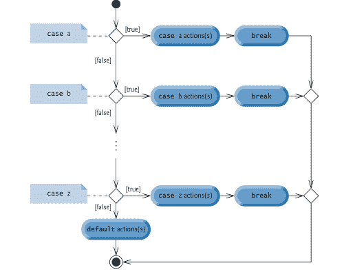

**图 5.12** | 带 break 语句的 switch 多路选择语句 UML 活动图。

> **常见编程错误 5.9**
>
> *在 switch 语句中提供具有相同值的 case 标签是编译错误。*

在第 13 章中，我们将介绍一种更优雅的实现 switch 逻辑的方法。我们将使用一种称为多态的技术来创建程序，这些程序通常比使用 switch 逻辑的程序更清晰、更简洁、更易于维护和扩展。

## *关于数据类型的说明*

C++ 具有灵活的数据类型大小（参见附录 C，基本类型）。例如，不同的应用程序可能需要不同大小的整数。C++ 提供了几种整数类型。每种类型的整数值范围取决于特定计算机的硬件。除了 int 和 char 类型之外，C++ 还提供了 short（short int 的缩写）和 long（long int 的缩写）类型。short 整数的最小取值范围是 −32,768 到 32,767。对于绝大多数整数计算，long 整数就足够了。long 整数的最小取值范围是 −2,147,483,648 到 2,147,483,647。在大多数计算机上，int 要么等同于 short，要么等同于 long。int 的取值范围至少与 short 整数相同，且不大于 long 整数的取值范围。char 数据类型可用于表示计算机字符集中的任意字符，也可用于表示小整数。


图5.14在for语句中使用continue语句（第11行），当嵌套的if语句（第10–11行）判定count的值为5时，跳过输出语句（第13行）。执行continue语句时，程序控制流转到for头（第8行）中控制变量的增量部分，并再循环五次。

```cpp
// Fig. 5.14: fig05_14.cpp
// continue statement terminating an iteration of a for statement.
#include <iostream>
using namespace std;

int main()
{
    for ( int count = 1; count <= 10; ++count ) // loop 10 times
    {
        if ( count == 5 ) // if count is 5,
            continue;     // skip remaining code in loop

        cout << count << " ";
    } // end for

    cout << "\nUsed continue to skip printing 5" << endl;
} // end main
```

```text
1 2 3 4 6 7 8 9 10
Used continue to skip printing 5
```

**图5.14** | 用continue语句终止一次for语句的迭代。

在5.3节中，我们指出在大多数情况下可以用while语句表示for语句。唯一的例外发生在while语句中的增量表达式位于continue语句之后时。在这种情况下，程序在测试循环继续条件之前不会执行增量，因此while语句的执行方式与for语句不同。

### 良好编程实践 5.7

一些程序员认为break和continue违反了结构化编程。这些语句的效果可以通过我们很快将要学习的结构化编程技术来实现，因此这些程序员不使用break和continue。大多数程序员认为在switch语句中使用break是可以接受的。

### 软件工程观察 5.1

在实现高质量软件工程与实现最佳性能软件之间存在矛盾。通常，这两个目标之一是以牺牲另一个为代价来实现的。除了大多数对性能要求极高的情况外，请遵循以下指导原则：首先，使代码简单且正确；然后，仅在必要时使其快速且精简。

## 5.8 逻辑运算符

到目前为止，我们只研究了简单条件，例如counter <= 10、total > 1000和number != sentinelValue。我们用关系运算符>、<、>=和<=以及相等运算符==和!=来表示这些条件。每个判定仅测试一个条件。要在做出决策时测试多个条件，我们在单独的语句中或在嵌套的if或if...else语句中执行这些测试。

C++提供了逻辑运算符，用于通过组合简单条件来形成更复杂的条件。逻辑运算符是&&（逻辑与）、||（逻辑或）和!（逻辑非，也称为逻辑否定）。

### 逻辑与（&&）运算符

假设我们希望确保两个条件都为真，然后才选择某条执行路径。在这种情况下，我们可以使用&&（逻辑与）运算符，如下所示：

```cpp
if ( gender == 1 && age >= 65 )
    ++seniorFemales;
```

这个if语句包含两个简单条件。条件gender == 1在此用于确定一个人是否为女性。条件age >= 65确定一个人是否为老年人。&&运算符左侧的简单条件首先求值。如有必要，&&运算符右侧的简单条件接着求值。我们稍后将讨论，逻辑与表达式的右侧仅在左侧为真时才求值。然后if语句考虑组合条件。

```cpp
gender == 1 && age >= 65
```

当且仅当两个简单条件都为真时，此条件才为真。最后，如果这个组合条件确实为真，则if语句体中的语句递增seniorFemales的计数。如果两个简单条件中的任何一个（或两个）为假，则程序跳过递增，继续执行if之后的语句。可以通过添加冗余括号使上述组合条件更易读：

```cpp
( gender == 1 ) && ( age >= 65 )
```

### 常见编程错误 5.10

尽管3 < x < 7在数学上是正确的条件，但在C++中它的求值结果与你的预期不同。请使用( 3 < x && x < 7 )在C++中获得正确的求值。

图5.15总结了&&运算符。该表显示了expression1和expression2的false和true值的所有四种可能组合。这类表通常称为真值表。C++对所有包含关系运算符、相等运算符和/或逻辑运算符的表达式求值为false或true。

| expression1 | expression2 | expression1 && expression2 |
|---|---|---|
| false | false | false |
| false | true | false |
| true | false | false |
| true | true | true |

**图5.15** | &&（逻辑与）运算符真值表。

### 逻辑或（`||`）运算符

现在让我们考虑`||`（逻辑或）运算符。假设我们希望确保两个条件中的任何一个或两个都为真，然后才选择某条执行路径。在这种情况下，我们使用`||`运算符，如以下程序段所示：

```cpp
if ( ( semesterAverage >= 90 ) || ( finalExam >= 90 ) )
    cout << "Student grade is A" << endl;
```

上述程序包含两个简单条件。简单条件`semesterAverage >= 90`用于确定学生是否因整个学期表现出色而在课程中获得“A”。简单条件`finalExam >= 90`用于确定学生是否因期末考试表现优异而在课程中获得“A”。然后if语句考虑组合条件

```cpp
( semesterAverage >= 90 ) || ( finalExam >= 90 )
```

如果两个简单条件中的任何一个或两个为真，则授予学生“A”。除非两个简单条件都为假，否则将打印消息“Student grade is A”。图5.16是逻辑或运算符（`||`）的真值表。

| expression1 | expression2 | expression1 \|\| expression2 |
|---|---|---|
| false | false | false |
| false | true | true |
| true | false | true |
| true | true | true |

**图5.16** | `||`（逻辑或）运算符真值表。

`&&`运算符的优先级高于`||`运算符。两个运算符都是从左到右结合。包含`&&`或`||`运算符的表达式仅求值到表达式的真或假已知为止。因此，表达式

```cpp
( gender == 1 ) && ( age >= 65 )
```

的求值在gender不等于1（即整个表达式为假）时立即停止，而在gender等于1（即如果条件age >= 65为真，整个表达式仍可能为真）时继续。这种用于逻辑与和逻辑或表达式求值的性能特性称为短路求值。

### 性能提示 5.3

在使用运算符`&&`的表达式中，如果各个条件相互独立，请将最可能为假的条件放在最左侧。在使用运算符`||`的表达式中，请将最可能为真的条件放在最左侧。因此，使用短路求值可以减少程序的执行时间。

### 逻辑非（`!`）运算符

C++提供了`!`（逻辑非，也称为逻辑否定）运算符来“反转”条件的含义。一元逻辑非运算符只有一个条件作为操作数。当我们感兴趣的是在原始条件（不带逻辑非运算符）为假时选择一条执行路径，则将一元逻辑非运算符放在条件*之前*，如以下程序段所示：

```cpp
if ( !( grade == sentinelValue ) )
    cout << "The next grade is " << grade << endl;
```

条件grade == sentinelValue周围的括号是必需的，因为逻辑非运算符的优先级高于相等运算符。

通常可以通过使用适当的关系或相等运算符来避免使用!运算符。例如，前面的if语句也可以写成如下形式：

```cpp
if ( grade != sentinelValue )
    cout << "The next grade is " << grade << endl;
```

这种灵活性通常可以帮助你以更“自然”或更方便的方式表达条件。图5.17是逻辑非运算符（!）的真值表。

| expression | !expression |
|---|---|
| false | true |
| true | false |

**图5.17** | `!`（逻辑非）运算符真值表。

### 逻辑运算符示例

图5.18通过生成逻辑运算符的真值表来演示它们。输出显示了每个被求值的表达式及其bool结果。默认情况下，bool值true和false由cout和流插入运算符分别显示为1和0。我们在第9行使用**流操纵符boolalpha**（一个粘性操纵符）来指定每个bool表达式的值应显示为单词“true”或“false”。例如，第10行中表达式false && false的结果为false，因此输出的第二行包含单词“false”。第9–13行生成&&的真值表。第16–20行生成||的真值表。第22–25行生成!的真值表。

```cpp
1  // Fig. 5.18: fig05_18.cpp
2  // Logical operators.
3  #include <iostream>
4  using namespace std;
5
6  int main()
7  {
8     // create truth table for && (logical AND) operator
9     cout << boolalpha << "Logical AND (&&)"
10        << "\nfalse && false: " << ( false && false )
11        << "\nfalse && true:  " << ( false && true )
12        << "\ntrue && false:  " << ( true && false )
13        << "\ntrue && true:   " << ( true && true ) << "\n\n";
```

**图5.18** | 逻辑运算符。（第1部分，共2部分。）


```cpp
// create truth table for || (logical OR) operator
cout << "Logical OR (||)"
     << "\nfalse || false: " << ( false || false )
     << "\nfalse || true: " << ( false || true )
     << "\ntrue || false: " << ( true || false )
     << "\ntrue || true: " << ( true || true ) << "\n\n";

// create truth table for ! (logical negation) operator
cout << "Logical NOT (!)"
     << "\n!false: " << ( !false )
     << "\n!true: " << ( !true ) << endl;
} // end main
```

```text
Logical AND (&&)
false && false: false
false && true: false
true && false: false
true && true: true

Logical OR (||)
false || false: false
false || true: true
true || false: true
true || true: true

Logical NOT (!)
!false: true
!true: false
```

*图 5.18 | 逻辑运算符。（2/2 部分。）*

### 运算符优先级和结合性总结

图 5.19 将逻辑运算符和逗号运算符添加到运算符优先级与结合性表中。运算符按优先级从高到低自上而下排列。

| 运算符 | 结合性 | 类型 |
|---|---|---|
| `::` | 从左到右 | 作用域解析 |
| `()` | [参见图 2.10 中的警告] | 分组括号 |
| `++  --  static_cast<type>()` | 从左到右 | 一元（后缀） |
| `++  --  +  -  !` | 从右到左 | 一元（前缀） |
| `*  /  %` | 从左到右 | 乘法 |
| `+  -` | 从左到右 | 加法 |
| `<<  >>` | 从左到右 | 插入/提取 |
| `<  <=  >  >=` | 从左到右 | 关系 |
| `==  !=` | 从左到右 | 相等 |

*图 5.19 | 运算符优先级和结合性。（1/2 部分。）*

| 运算符 | 结合性 | 类型 |
|---|---|---|
| `&&` | 从左到右 | 逻辑与 |
| `||` | 从左到右 | 逻辑或 |
| `?:` | 从右到左 | 条件 |
| `=   +=   -=   *=   /=   %=` | 从右到左 | 赋值 |
| `,` | 从左到右 | 逗号 |

*图 5.19 | 运算符优先级和结合性。（2/2 部分。）*

## 5.9 混淆相等运算符（==）和赋值运算符（=）

有一个错误，C++ 程序员无论多么有经验，都常常会犯，以至于我们觉得需要单独用一节来讨论。这个错误就是意外地把运算符 ==（相等）和 =（赋值）弄混。它之所以危害如此之大，是因为它通常不会导致语法错误——带有这些错误的语句往往能正确编译，程序也能运行到结束，但常常会通过运行时逻辑错误产生不正确的结果。有些编译器在期望使用 == 的上下文中使用了 = 时，会发出警告。

C++ 有两个方面会造成这些问题。其一，*任何产生值的表达式都可以用在任何控制语句的判定部分*。如果表达式的值为零，就视为 false；如果值非零，就视为 true。其二，赋值会产生一个值——即赋给赋值运算符左侧变量的值。例如，假设我们想写

```
if ( payCode == 4 )
    cout << "You get a bonus!" << endl;
```

但不小心写成了

```
if ( payCode = 4 )
    cout << "You get a bonus!" << endl;
```

第一个 if 语句会正确地向 payCode 等于 4 的人发放奖金。第二个——带有错误的那个——会把 if 条件中的赋值表达式求值为常量 4。*任何非零值都会被解释为 true*，所以这个条件始终为 true，无论实际的 payCode 是什么，这个人*总是*会收到奖金！更糟的是，payCode 本来只应被检查，却被修改了！

> **常见编程错误 5.11**
>
> *将运算符 == 用于赋值，以及将运算符 = 用于相等判断，都是逻辑错误。*


> **错误预防提示 5.4**
>
> 程序员通常会把 `x == 4` 这样的条件写成变量名在左、常量在右。把常量放在左边，如 `4 == x`，如果你不小心把 `==` 运算符替换成 `=`，编译器就会提醒你。编译器会把它视为编译错误，因为不能改变常量的值。这将防止运行时逻辑错误可能造成的破坏。


变量名被称为*左值*（lvalues，意为“left values”），因为它们可以用在赋值运算符的*左*侧。常量被称为*右值*（rvalues，意为“right values”），因为它们只能用在赋值运算符的*右*侧。*左值*也可以用作*右值*，但反过来不行。

还有另一种同样令人不快的情况。假设你想用类似

```
x = 1;
```

这样简单的语句给变量赋值，却写成了

```
x == 1;
```

这里同样不是语法错误。相反，编译器只是对条件表达式求值。如果 x 等于 1，条件为 true，表达式的求值结果为值 true。如果 x 不等于 1，条件为 false，表达式的求值结果为值 false。无论表达式的值是什么，都没有赋值运算符，所以这个值就丢失了。x 的值保持不变，很可能会导致执行时逻辑错误。不幸的是，我们没有一个简便技巧来帮你解决这个问题！

> **错误预防提示 5.5**
>
> 使用文本编辑器搜索程序中所有出现的 =，并检查每个位置使用的是正确的赋值运算符还是逻辑运算符。

## 5.10 结构化编程总结

正如建筑师运用本专业的集体智慧来设计建筑一样，程序员也应该设计程序。我们的领域比建筑学年轻，我们的集体智慧也更稀疏。我们已经认识到，结构化编程生成的程序比非结构化程序更容易理解、测试、调试、修改，甚至更容易在数学意义上证明其正确性。

图 5.20 使用活动图总结了 C++ 的控制语句。初始状态和最终状态表示每个控制语句的*单一入口点*和*单一出口点*。在活动图中任意连接各个符号会导致非结构化程序。因此，编程专业只使用一小组控制语句，这些语句只能通过两种简单方式组合来构建结构化程序。

为简单起见，只使用*单入口/单出口控制语句*——进入每个控制语句只有一种方式，退出每个控制语句也只有一种方式。按顺序连接控制语句以形成结构化程序很简单——一个控制语句的最终状态连接到下一个控制语句的初始状态——也就是说，它们在程序中一个接一个地放置。我们称这种控制语句的*堆叠*。形成结构化程序的规则还允许控制语句*嵌套*。

图 5.21 展示了形成结构化程序的规则。这些规则假定用动作状态表示任何动作。规则还假定我们从所谓的*最简单活动图*（图 5.22）开始，它仅由初始状态、动作状态、最终状态和转换箭头组成。

应用图 5.21 的规则总是会得到具有整洁积木式外观的活动图。例如，反复对最简单的

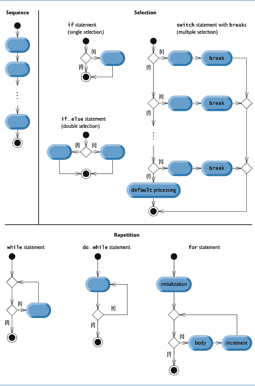

*图 5.20 | C++ 的单入口/单出口顺序、选择和重复语句。*

规则 3 是**嵌套规则**。反复对最简单活动图应用规则 3，会得到一个良好嵌套的控制语句。例如，在图 5.24 中，最简单活动图中的动作状态被替换为双选择（if…else）语句。然后再次对双选择语句中的动作状态应用规则 3，将每个动作状态替换为双选择语句。每个双选择语句周围的虚线动作状态符号表示在前一个活动图中被替换的动作状态。[*注意：*图 5.24 中显示的虚线箭头和虚线动作状态符号不属于 UML。它们在这里用作教学手段，以说明任何动作状态都可以替换为控制语句。]

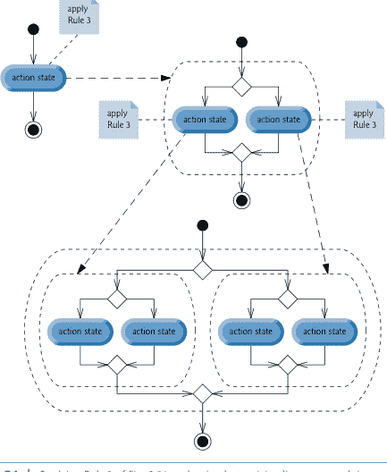

*图 5.24 | 将图 5.21 的规则 3 多次应用于最简单活动图。*

规则 4 生成更大、更复杂且嵌套更深的语句。应用图 5.21 中的规则所产生的图构成了所有可能的

活动图，因而也是所有可能的结构化程序的集合。结构化方法的美妙之处在于，我们只使用七种简单的单入口/单出口控制语句，并且仅用两种简单方式将它们组合起来。

如果遵循图 5.21 中的规则，就不能创建语法非法的活动图（例如图 5.25 中的活动图）。如果你不确定某个特定活动图是否合法，可以反向应用图 5.21 的规则，将该图简化为最简单的活动图。如果它能简化为最简单的活动图，那么原图就是结构化的；否则就不是。

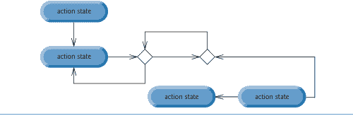

**图 5.25** | 语法非法的活动图。

结构化编程提倡简单性。Böhm 和 Jacopini 已经给出结果：只需要 *三* 种控制形式：

- 顺序
- 选择
- 重复

顺序结构很简单。只需按语句应执行的顺序列出要执行的语句。

选择通过以下三种方式之一实现：

- `if` 语句（单选择）
- `if…else` 语句（双选择）
- `switch` 语句（多选择）

很容易证明，*简单的 if 语句* 足以提供任何形式的选择——用 *if…else* 语句和 switch 语句可以完成的所有事情，都可以通过组合 if 语句来实现（尽管可能不如前者清晰和高效）。

重复通过以下三种方式之一实现：

- `while` 语句
- `do…while` 语句
- `for` 语句

很容易证明，*while 语句* 足以提供任何形式的重复。用 *do…while* 语句和 for 语句可以完成的所有事情，都可以用 while 语句完成（尽管可能不那么顺畅）。

### 5.4 节 使用 pow 函数的示例

- 标准库函数 `pow(x, y)`（第 160 页）计算 x 的 y 次幂的值。函数 `pow` 接受两个 double 类型的参数，并返回一个 double 值。
- 带参数的流操纵符 `setw`（第 162 页）指定下一个输出值应出现的字段宽度，默认右对齐。如果值大于字段宽度，则扩展字段宽度以容纳整个值。流操纵符 `left`（第 162 页）使值左对齐，而 `right` 可用于恢复右对齐。
- 粘性设置是指那些在更改之前一直有效的输出格式设置。

### 5.5 节 do...while 重复语句

- do...while 重复语句在循环末尾测试循环继续条件，因此循环体至少执行一次。do...while 语句的格式为

    ```cpp
    do
    {
        statement
    } while ( condition );
    ```

### 5.6 节 switch 多选择语句

- switch 多选择语句（第 164 页）根据其控制表达式的值执行不同的操作。
- switch 语句由一系列 case 标签（第 169 页）和一个可选的 default 分支（第 169 页）组成。
- 函数 `cin.get()` 从键盘读取一个字符。字符通常存储在 char 类型（第 168 页）的变量中。字符既可以作为整数处理，也可以作为字符处理。
- switch 后面括号中的表达式称为控制表达式（第 169 页）。switch 语句将控制表达式的值与每个 case 标签进行比较。
- 连续的 case 之间没有语句时，它们执行同一组语句。
- 每个 case 标签只能指定一个常量整型表达式。
- 每个 case 可以有多条语句。switch 选择语句与其他控制语句的不同之处在于，它不要求在每个 case 的多条语句周围加大括号。
- C++ 提供了几种表示整数的数据类型——int、char、short 和 long。每种类型的整数值范围取决于特定计算机的硬件。

### 5.7 节 break 和 continue 语句

- break 语句（第 173 页）在某个重复语句（for、while 和 do...while）中执行时，会立即退出该语句。
- continue 语句（第 173 页）在重复语句中执行时，会跳过循环体中剩余的语句，并继续循环的下一次迭代。在 while 或 do...while 语句中，执行会继续到下一次条件求值。在 for 语句中，执行会继续到 for 语句头中的增量表达式。

### 5.8 节 逻辑运算符

- 逻辑运算符（第 175 页）使你能够通过组合简单条件来构成复杂条件。逻辑运算符有 &&（逻辑与）、||（逻辑或）和 !（逻辑非）。
- &&（逻辑与，第 175 页）运算符确保两个条件都为真。
- ||（逻辑或，第 176 页）运算符确保两个条件中有一个或两个为真。
- 包含 && 或 || 运算符的表达式只求值到能够确定表达式的真或假为止。这种对逻辑与和逻辑或表达式求值的性能特性称为短路求值（第 176 页）。
- !（逻辑非，也称为逻辑取反，第 176 页）运算符使程序员能够“反转”条件的含义。一元逻辑非运算符放在条件之前，用于在原条件（不带逻辑非运算符）为假时选择一条执行路径。大多数情况下，可以通过用适当的关系运算符或相等运算符表达条件来避免使用逻辑非。
- 当用作条件时，任何非零值都会隐式转换为真；0（零）会隐式转换为假。
- 默认情况下，bool 值 true 和 false 由 cout 分别显示为 1 和 0。流操纵符 `boolalpha`（第 177 页）指定每个 bool 表达式的值应显示为单词“true”或单词“false”。

### 5.9 节 混淆相等（==）和赋值（=）运算符

- 任何产生值的表达式都可以用在任何控制语句的判定部分。如果表达式的值为零，则将其视为假；如果值为非零，则将其视为真。
- 赋值会产生一个值——即赋给赋值运算符左侧变量的值。

### 5.10 节 结构化编程总结

- 任何形式的控制都可以用顺序、选择和重复语句来表示，而这些语句只能以两种方式组合——堆叠和嵌套。

## 自测练习

- **5.1** 指出下列各题是 *真* 还是 *假*。如果答案是 *假*，请解释原因。
    - a) 在 switch 选择语句中，default 分支是必需的。
    - b) 在 switch 选择语句的 default 分支中，break 语句是正确退出 switch 所必需的。
    - c) 如果表达式 `x > y` 为真或表达式 `a < b` 为真，则表达式 `( x > y && a < b )` 为真。
    - d) 包含 `||` 运算符的表达式，如果其一个或两个操作数为真，则该表达式为真。

- **5.2** 编写一条 C++ 语句或一组 C++ 语句来完成下列各项：
    - a) 使用 `for` 语句求 1 到 99 之间的奇数之和。假设整型变量 `sum` 和 `count` 已声明。
    - b) 在 15 个字符宽的字段中分别以精度 1、2 和 3 输出值 333.546732。在同一行上输出每个数字。将每个数字在其字段中左对齐。会输出哪三个值？
    - c) 使用函数 `pow` 计算 2.5 的 3 次幂的值。在宽度为 10 个位置的字段中以精度 2 输出结果。会输出什么？
    - d) 使用 `while` 循环和计数器变量 `x` 输出 1 到 20 的整数。假设变量 `x` 已声明但未初始化。每行只输出 5 个整数。*[提示：当 x % 5 为 0 时，输出一个换行符；否则，输出一个制表符。]*
    - e) 使用 `for` 语句重复练习 5.2(d)。

**5.3** 找出下列各代码段中的错误，并说明如何改正。

a)

```cpp
x = 1;
while ( x <= 10 );
    ++x;
}
```


- b)

  ```cpp
  for ( y = .1; y != 1.0; y += .1 )
     cout << y << endl;
  ```

- c)

  ```cpp
  switch ( n )
  {
     case 1:
        cout << "The number is 1" << endl;
     case 2:
        cout << "The number is 2" << endl;
        break;
     default:
        cout << "The number is not 1 or 2" << endl;
        break;
  }
  ```

- d) 以下代码应输出值 1 到 10。

  ```cpp
  n = 1;
  while ( n < 10 )
     cout << n++ << endl;
  ```

## 自测练习答案

### 5.1

- a) 错误。default 分支是可选的。尽管如此，始终提供 default 分支被认为是良好的软件工程实践。
- b) 错误。break 语句用于退出 switch 语句。当 default 分支是最后一个分支时，不需要 break 语句。如果让控制流继续执行下一个分支是有意义的，也不需要 break 语句。
- c) 错误。使用 && 运算符时，两个关系表达式都必须为真，整个表达式才为真。
- d) 正确。

### 5.2

- a)

  ```cpp
  sum = 0;
  for ( count = 1; count <= 99; count += 2 )
     sum += count;
  ```

- b)

  ```cpp
  cout << fixed << left
       << setprecision( 1 ) << setw( 15 ) << 333.546372
       << setprecision( 2 ) << setw( 15 ) << 333.546372
       << setprecision( 3 ) << setw( 15 ) << 333.546372
       << endl;
  ```

  输出为：

  ```text
  333.5        333.55        333.546
  ```

- c)

  ```cpp
  cout << fixed << setprecision( 2 ) << setw( 10 ) << pow( 2.5, 3 ) << endl;
  ```

  输出为：

  ```text
     15.63
  ```

- d)

  ```cpp
  x = 1;
  while ( x <= 20 )
  {
     if ( x % 5 == 0 )
        cout << x << endl;
     else
        cout << x << '\t';
     ++x;
  }
  ```

- e)

  ```cpp
  for ( x = 1; x <= 20; ++x )
  {
      if ( x % 3 == 0 )
          cout << x << endl;
      else
          cout << x << '\t';
  }
  ```

### 5.3

- a) **错误：** while 头部后的分号导致无限循环。

  **更正：** 将下面的分号替换为 `{`，或者同时删除 `;` 和 `}`。

- b) **错误：** 使用浮点数控制 for 重复语句。

  **更正：** 使用 int，并进行适当的计算以获得所需的值。

  ```cpp
  for ( y = 1; y != 10; ++y )
      cout << ( static_cast< double >( y ) / 10 ) << endl;
  ```

- c) **错误：** 第一个 case 中缺少 break 语句。

  **更正：** 在第一个 case 末尾添加 break 语句。如果你希望每次执行 case 1: 语句时都执行 case 2 的语句，这就不是错误。

- d) **错误：** 循环继续条件中使用了不恰当的关系运算符。

  **更正：** 使用 `<=` 而不是 `<`，或者将 10 改为 11。

## 练习

### 5.4（查找代码错误）

找出以下各项中的错误（如果有）：

- a) `For ( x = 100, x >= 1; ++x )`

  ```cpp
  cout << x << endl;
  ```

- b) 以下代码应输出一个整数值是奇数还是偶数：

  ```cpp
  switch ( value % 2 )
  {
      case 0:
          cout << "Even integer" << endl;
      case 1:
          cout << "Odd integer" << endl;
  }
  ```

- c) 以下代码应输出从 19 到 1 的奇数：

  ```cpp
  for ( x = 19; y >= 1; x += 2 )
      cout << x << endl;
  ```

- d) 以下代码应输出从 2 到 100 的偶数：

  ```cpp
  counter = 2;
  do
  {
      cout << counter << endl;
      counter += 2;
  } while ( counter < 100 );
  ```

### 5.5（整数求和）

编写一个程序，使用 for 语句对一系列整数求和。假设读取的第一个整数指定剩余要输入的值的数量。你的程序每个输入语句只应读取一个值。一个典型的输入序列可能是

`5 100 200 300 400 500`

其中 5 表示后续 5 个值将被求和。

### 5.6（整数求平均值）

编写一个程序，使用 for 语句计算若干整数的平均值。假设最后读取的值是哨兵值 9999。例如，序列 `10 8 11 7 9 9999` 表示程序应计算 9999 之前所有值的平均值。

### 5.7（这个程序做什么？）

以下程序做什么？

```cpp
// Exercise 5.7: ex05_07.cpp
// What does this program print?
#include <iostream>
using namespace std;

int main()
{
   int x; // declare x
   int y; // declare y

   // prompt user for input
   cout << "Enter two integers in the range 1-20: ";
   cin >> x >> y; // read values for x and y

   for ( int i = 1; i <= y; ++i ) // count from 1 to y
   {
      for ( int j = 1; j <= x; ++j ) // count from 1 to x
         cout << '@'; // output @

      cout << endl; // begin new line
   } // end outer for
} // end main
```

### 5.8（查找最小整数）

编写一个程序，使用 `for` 语句查找若干整数中的最小值。假设读取的第一个值指定剩余值的数量。

### 5.9（奇数的乘积）

编写一个程序，使用 `for` 语句计算并输出从 1 到 15 的奇数的乘积。

### 5.10（阶乘）

阶乘函数在概率问题中经常使用。使用练习 4.34 中阶乘的定义，编写一个程序，使用 `for` 语句计算从 1 到 5 的整数的阶乘。以表格格式输出结果。什么困难可能妨碍你计算 20 的阶乘？

### 5.11（复利）

修改 5.4 节的复利程序，使其对利率 5%、6%、7%、8%、9% 和 10% 重复执行其步骤。使用 `for` 语句改变利率。

### 5.12（使用嵌套 for 循环绘制图案）

编写一个程序，使用 `for` 语句分别打印以下图案，一个接一个地排列。使用 `for` 循环生成这些图案。所有星号（*）都应通过形式为 `cout << '*';` 的单个语句输出（这会使星号并排打印）。[提示：最后两个图案要求每行以适当数量的空格开头。附加分：将四个独立问题的代码合并为一个程序，通过巧妙使用嵌套 `for` 循环并排打印所有四个图案。]

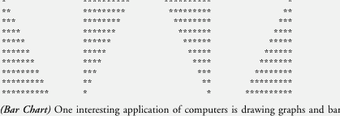

### 5.13（条形图）

计算机一个有趣的应用是绘制图形和条形图。编写一个程序，读取五个数字（每个在 1 到 30 之间）。假设用户只输入有效值。对于读取的每个数字，程序应输出一行，其中包含该数字个相邻星号。例如，如果程序读取数字 7，它应输出 `*******`。

### 5.14（计算总销售额）

一家邮购公司销售五种不同产品，其零售价为：产品 1——2.98 美元，产品 2——4.50 美元，产品 3——9.98 美元，产品 4——4.49 美元，产品 5——6.87 美元。编写一个程序，读取一系列数字对，如下所示：

- a) 产品编号
- b) 售出数量

你的程序应使用 `switch` 语句确定每种产品的零售价。程序应计算并显示所有售出产品的总零售价值。使用哨兵控制循环来确定程序何时应停止循环并显示最终结果。

### 5.15（GradeBook 修改）

修改图 5.9–图 5.11 的 GradeBook 程序，以计算平均绩点。成绩 A 值 4 分，B 值 3 分，依此类推。

### 5.16（复利计算）

修改图 5.6，使其仅使用整数计算复利。*[提示：将所有货币金额视为以美分为单位的数字。然后使用除法和取模运算将结果“拆分”为美元和美分部分。插入一个小数点。]*

### 5.17（输出什么？）

假设 `i = 1`、`j = 2`、`k = 3` 且 `m = 2`。每条语句输出什么？

- a) `cout << ( i == 1 ) << endl;`
- b) `cout << ( j == 3 ) << endl;`
- c) `cout << ( i >= 1 && j < 4 ) << endl;`
- d) `cout << ( m <= 99 && k < m ) << endl;`
- e) `cout << ( j >= i || k == m ) << endl;`
- f) `cout << ( k + m < j || 3 - j >= k ) << endl;`
- g) `cout << ( !m ) << endl;`
- h) `cout << ( !( j - m ) ) << endl;`
- i) `cout << ( !( k > m ) ) << endl;`

### 5.18（数制表）

编写一个程序，打印十进制数 1–256 范围内对应二进制、八进制和十六进制等价的表格。如果你不熟悉这些数制，请先阅读附录 D。*[提示：你可以使用流操纵符 `dec`、`oct` 和 `hex` 分别以十进制、八进制和十六进制格式显示整数。]*

### 5.19（计算 π）

根据以下无穷级数计算 π 的值：

\[\pi = 4 - \frac{4}{3} + \frac{4}{5} - \frac{4}{7} + \frac{4}{9} - \frac{4}{11} + \cdots\]

打印一个表格，显示该级数前 1000 项每一项之后 π 的近似值。

### 5.20（勾股三元组）

直角三角形可以有三条边均为整数的边。一组满足直角三角形三条边的三个整数值称为勾股三元组。这三条边必须满足其中两条边的平方和等于斜边的平方这一关系。找出 side1、side2 和 hypotenuse 均不大于 500 的所有勾股三元组。使用三重嵌套 `for` 循环尝试所有可能性。这是一个*暴力*计算的例子。你将在更高级的计算机科学课程中学到，有许多有趣的问题除了纯粹的暴力法之外没有已知的算法方法。

### 5.21（计算工资）

公司按以下方式向员工支付工资：经理（领取固定周薪）、计时工（在工作前 40 小时内领取固定时薪，加班小时领取“一倍半”——即时薪的 1.5 倍）、佣金制员工（领取 250 美元加上其每周总销售额的 5.7%），或计件工（为其生产的每件物品领取固定金额——该公司的每个计件工只从事一种类型的物品）。编写一个程序计算每个员工的周薪。你事先不知道员工人数。每类员工都有自己的工资代码：经理（Man-


- **5.27** *（移除`continue`语句）* 请大致描述如何从程序中的循环里移除任何`continue`语句，并用某种结构化等价形式替换它。运用你在此开发的技术，从图5.14的程序中移除`continue`语句。

- **5.28** *（圣诞十二天歌曲）* 编写一个程序，使用循环和`switch`语句打印歌曲《圣诞十二天》。用一个`switch`语句打印“第几天”（如“first”、“second”等）。再用一个单独的`switch`语句打印每节歌词的其余部分。访问网站 www.12days.com/library/carols/12daysxofxmas.htm 获取该歌曲的完整歌词。

- **5.29** *（彼得·米纽伊特问题）* 传说在1626年，彼得·米纽伊特用价值24美元的实物交换购买了曼哈顿岛。他做了一笔好投资吗？为了回答这个问题，修改图5.6的复利程序，以24美元为本金，并计算这笔钱如果一直存到今天（例如，到2010年共384年）的存款金额。将执行复利计算的`for`循环放在一个外层`for`循环中，让利率从5%变化到10%，以观察复利的神奇之处。

### 做出改变

- **5.30** *（全球变暖知识问答）* 全球变暖这一争议性问题已由前副总统阿尔·戈尔主演的电影《难以忽视的真相》广泛宣传。戈尔先生与联合国科学家网络——政府间气候变化专门委员会——共同分享了2007年诺贝尔和平奖，以表彰他们“努力建立和传播更多关于人为气候变化的知识”。请在线研究全球变暖问题的双方观点（你可能会想搜索“全球变暖怀疑论者”等短语）。创作一个关于全球变暖的五题多项选择问答，每题有四个可能答案（编号1–4）。保持客观，尽量公正地代表问题的双方。接下来，编写一个应用程序来主持问答，计算正确答案的数量（零到五），并向用户返回一条消息。如果用户正确回答了五个问题，打印“Excellent”；如果答对四个，打印“Very good”；如果答对三个或更少，打印“Time to brush up on your knowledge of global warming”，并附上你找到事实的网站列表。

- **5.31** *（税收计划替代方案；“公平税”）* 有许多使税收更公平的提案。请查看美国“公平税”倡议，网址为 www.fairtax.org/site/PageServer?pagename=calculator

  研究拟议的“公平税”是如何运作的。一项建议是取消所得税和大多数其他税种，转而对你购买的所有产品和服务征收23%的消费税。一些“公平税”反对者质疑23%这一数字，并表示由于税收的计算方式，更准确的说法是税率为30%——请仔细核实这一点。编写一个程序，提示用户输入他们在各种支出类别中的支出（例如，住房、食品、服装、交通、教育、医疗、度假），然后打印该人将支付的估算“公平税”。

- **5.32** *（Facebook用户基数增长）* 据CNNMoney.com报道，Facebook在2010年7月达到5亿用户，其用户基数一直以每月5%的速度增长。使用你在图5.6中学到的复合增长技术，并假设这一增长率持续下去，Facebook的用户基数需要多少个月才能增长到10亿用户？需要多少个月才能增长到20亿用户（在撰写本文时，这大约是互联网上的总人数）？

# 6 函数与递归入门

> *形式永远服从功能。*
> ——路易斯·亨利·沙利文
>
> *合众为一。*
> *（由众多组成的一个。）*
> ——维吉尔
>
> *啊！召回昨日，让时光倒流。*
> ——威廉·莎士比亚
>
> *用一个词回答我。*
> ——威廉·莎士比亚
>
> *总有一个时刻，方法会吞噬自身。*
> ——弗朗茨·法农

## 目标

在本章中，你将学习：

- 如何从函数出发模块化地构建程序。
- 如何使用常见的数学库函数。
- 向函数传递数据和返回结果的机制。
- 函数调用/返回机制如何由函数调用栈和活动记录支持。
- 使用随机数生成来实现游戏类应用程序。
- 标识符的可见性如何被限制在程序的特定区域。
- 如何编写和使用递归函数。


- 6.1 引言
- 6.2 C++中的程序组件
- 6.3 数学库函数
- 6.4 带多个参数的函数定义
- 6.5 函数原型与参数强制转换
- 6.6 C++标准库头文件
- 6.7 案例研究：随机数生成
- 6.8 案例研究：机会游戏：引入`enum`
- 6.9 存储类别
- 6.10 作用域规则
- 6.11 函数调用栈与活动记录
- 6.12 空参数列表的函数
- 6.13 内联函数
- 6.14 引用与引用参数
- 6.15 默认参数
- 6.16 一元作用域解析运算符
- 6.17 函数重载
- 6.18 函数模板
- 6.19 递归
- 6.20 使用递归的示例：斐波那契数列
- 6.21 递归与迭代
- 6.22 总结

摘要 | 自测练习 | 自测练习答案 | 练习 | 做出改变

## 6.1 引言

大多数解决实际问题的计算机程序都比本书前几章展示的程序大得多。经验表明，开发和维护大型程序的最佳方式是用小的、简单的片段或组件来构造它。这种技术称为**分而治之**。

我们将概述C++标准库数学函数的一部分。接下来，你将学习如何声明带多个参数的函数。我们还将介绍更多关于函数原型的信息，以及编译器如何在必要时使用它们将函数调用中实参的类型转换为函数参数列表中指定的类型。

接下来，我们将短暂转入使用随机数生成的模拟技术，并开发一个名为“掷双骰”的赌场骰子游戏版本，该版本将使用你已学过的大部分编程技术。

然后，我们介绍C++的存储类别和作用域规则。这些决定了对象在内存中存在的时间段，以及其标识符在程序中可被引用的位置。你将学习C++如何跟踪当前正在执行的函数，函数的参数和其他局部变量如何在内存中维护，以及函数在完成执行后如何知道返回到哪里。我们还会讨论有助于提高程序性能的主题——可以消除函数调用开销的内联函数，以及可用于高效地将大数据项传递给函数的引用参数。

你开发的大多数应用程序都会有多个同名函数。这种技术称为函数重载，用于实现对不同类型参数或可能不同数量参数执行类似任务的函数。我们还将讨论函数模板——一种定义一系列重载函数的机制。本章最后讨论直接或间接（通过另一个函数）调用自身的函数——这一主题称为递归。

## 6.2 C++中的程序组件

C++程序通常是将你编写的新函数和类与C++标准库中“预打包”的函数和类组合而成的。C++标准库提供了丰富的函数，用于常见的数学计算、字符串处理、字符处理、输入/输出、错误检查以及许多其他有用的操作。

函数允许你通过将程序的任务划分为独立的单元来实现模块化。在你编写的每个程序中，你都使用了库函数和自定义函数的组合。你编写的函数称为**用户自定义函数**或**程序员自定义函数**。函数体中的语句只编写一次，可在程序中的多个位置重用，并且对其他函数隐藏。

使用函数模块化程序有几个动机。一个是分而治之的方法。另一个是软件复用。例如，在之前的程序中，我们不必定义如何从键盘读取一行文本——C++通过`<string>`头文件中的`getline`函数提供了这一功能。第三个动机是避免重复代码。此外，将程序划分为有意义的函数使程序更容易调试和维护。

> **软件工程观察 6.1**
>
> *为了促进软件复用，每个函数都应限于执行单个明确的任务，并且函数名应有效表达该任务。*

如你所知，函数通过函数调用被调用，当被调用的函数完成其任务时，它要么返回结果，要么仅将控制权返回给调用者。这种程序结构的一个类比是层级式管理形式（图6.1）。老板（类似于调用函数）要求工人（类似于被调用函数）执行任务，并在完成任务后报告（即返回）结果。老板函数*不*知道工人函数如何执行其指定任务。工人也可能调用其他工人函数，而老板并不知道。这种*实现细节的隐藏*促进了良好的软件工程。图6.1展示了老板函数与多个工人函数的通信。老板函数将职责分配给各个工人函数，而worker1对worker4和worker5充当“老板函数”的角色。

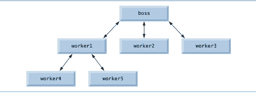

**图 6.1** | 层级式老板函数/工人函数关系。


## 6.3 数学库函数

有时，诸如 `main` 之类的函数**不是**类的成员。这类函数称为全局函数。与类的成员函数一样，全局函数的函数原型放在头文件中，这样，只要程序包含该头文件并且能够链接到该函数的对象代码，就可以在任何程序中复用这些全局函数。例如，回忆一下，我们在图 5.6 中使用了 `<cmath>` 头文件中的函数 `pow` 来对某个值求幂。这里我们介绍 `<cmath>` 头文件中的各种函数，以展示不属于特定类的全局函数的概念。

`<cmath>` 头文件提供了一组函数，使您能够执行常见的数学计算。例如，可以使用以下函数调用计算 900.0 的平方根

```cpp
sqrt( 900.0 )
```

前面的表达式求值为 30.0。函数 `sqrt` 接受一个 double 类型的参数，并返回一个 double 结果。调用函数 `sqrt` 之前无需创建任何对象。此外，`<cmath>` 头文件中的*所有*函数都是全局函数——因此，调用每个函数时，只需指定函数名，后跟包含该函数参数的圆括号。

函数参数可以是常量、变量或更复杂的表达式。如果 `c = 13.0`、`d = 3.0` 且 `f = 4.0`，那么语句

```cpp
cout << sqrt( c + d * f ) << endl;
```

将显示 13.0 + 3.0 * 4.0 = 25.0 的平方根——即 5.0。图 6.2 总结了一些数学库函数。在该图中，变量 x 和 y 的类型为 double。

| 函数 | 描述 | 示例 |
|---|---|---|
| `ceil( x )` | 将 x 向上舍入为不小于 x 的最小整数 | `ceil( 9.2 ) is 10.0`<br>`ceil( -9.8 ) is -9.0` |
| `cos( x )` | x 的三角余弦（x 的单位为弧度） | `cos( 0.0 ) is 1.0` |
| `exp( x )` | 指数函数 eˣ | `exp( 1.0 ) is 2.718282`<br>`exp( 2.0 ) is 7.389056` |
| `fabs( x )` | x 的绝对值 | `fabs( 5.1 ) is 5.1`<br>`fabs( 0.0 ) is 0.0`<br>`fabs( -8.76 ) is 8.76` |
| `floor( x )` | 将 x 向下舍入为不大于 x 的最大整数 | `floor( 9.2 ) is 9.0`<br>`floor( -9.8 ) is -10.0` |
| `fmod( x, y )` | x/y 的余数，表示为浮点数 | `fmod( 2.6, 1.2 ) is 0.2` |
| `log( x )` | x 的自然对数（以 e 为底） | `log( 2.718282 ) is 1.0`<br>`log( 7.389056 ) is 2.0` |
| `log10( x )` | x 的对数（以 10 为底） | `log10( 10.0 ) is 1.0`<br>`log10( 100.0 ) is 2.0` |
| `pow(x, y)` | *x* 的 *y* 次幂（*x*^*y*） | `pow(2, 7) is 128`<br>`pow(9, .5) is 3` |
| `sin(x)` | *x* 的三角正弦<br>（*x* 的单位为弧度） | `sin(0.0) is 0` |
| `sqrt(x)` | *x* 的平方根（其中 *x* 为非负值） | `sqrt(9.0) is 3.0` |
| `tan(x)` | *x* 的三角正切<br>（*x* 的单位为弧度） | `tan(0.0) is 0` |

**图 6.2**  数学库函数。

## 6.4 带多个参数的函数定义

让我们考虑带*多个*参数的函数。图 6.3–6.5 修改了类 GradeBook，加入一个名为 maximum 的用户定义函数，该函数确定并返回三个 int 成绩中的最大值。当应用程序执行时，main 函数（图 6.5 第 5–13 行）创建一个 GradeBook 对象（第 8 行），并调用其 inputGrades 成员函数（第 11 行）从用户处读取三个整数成绩。在类 GradeBook 的实现文件（图 6.4）中，成员函数 inputGrades 的第 52–53 行提示用户输入三个整数值，并从用户处读取它们。第 56 行调用成员函数 maximum（定义在第 60–73 行）。函数 maximum 确定最大值，然后 return 语句（第 72 行）将该值返回给函数 inputGrades 调用 maximum 的位置（第 56 行）。随后，成员函数 inputGrades 将 maximum 的返回值存储在数据成员 maximumGrade 中。然后，通过调用函数 displayGradeReport（图 6.5 第 12 行）输出该值。[*注意：* 我们将此函数命名为 displayGradeReport，因为类 GradeBook 的后续版本将使用该函数显示完整的成绩报告，包括最高分和最低分。] 在第 7 章“数组和向量”中，我们将增强类 GradeBook，使其能够处理任意数量的成绩。

```cpp
// Fig. 6.3: GradeBook.h
// Definition of class GradeBook that finds the maximum of three grades.
// Member functions are defined in GradeBook.cpp
#include <string> // program uses C++ standard string class
using namespace std;

// GradeBook class definition
class GradeBook
{
public:
    GradeBook( string ); // constructor initializes course name
    void setCourseName( string ); // function to set the course name
    string getCourseName(); // function to retrieve the course name
    void displayMessage(); // display a welcome message
    void inputGrades(); // input three grades from user
    void displayGradeReport(); // display a report based on the grades
    int maximum( int, int, int ); // determine maximum of 3 values
private:
   string courseName; // course name for this GradeBook
   int maximumGrade; // maximum of three grades
}; // end class GradeBook
```

**图 6.3** GradeBook 头文件。

```cpp
// Fig. 6.4: GradeBook.cpp
// Member-function definitions for class GradeBook that
// determines the maximum of three grades
#include <iostream>
using namespace std;

#include "GradeBook.h" // include definition of class GradeBook

// constructor initializes courseName with string supplied as argument;
// initializes maximumGrade to 0
GradeBook::GradeBook( string name )
{
   setCourseName( name ); // validate and store courseName
   maximumGrade = 0; // this value will be replaced by the maximum grade
} // end GradeBook constructor

// function to set the course name; limits name to 25 or fewer characters
void GradeBook::setCourseName( string name )
{
   if ( name.length() <= 25 ) // if name has 25 or fewer characters
   {
      courseName = name; // store the course name in the object
   }
   else // if name is too long
   { // set courseName to first 25 characters of parameter name
      courseName = name.substr( 0, 25 ); // select first 25 characters
      cout << "Name \"" << name << "\" exceeds maximum length (25).\n"
         << "Limiting courseName to first 25 characters.\n" << endl;
   } // end if...else
} // end function setCourseName

// function to retrieve the course name
string GradeBook::getCourseName()
{
   return courseName;
} // end function getCourseName

// display a welcome message to the GradeBook user
void GradeBook::displayMessage()
{
   // this statement calls getCourseName to get the
   // name of the course this GradeBook represents
   cout << "Welcome to the grade book for\n" << getCourseName() << "!\n"
      << endl;
} // end function displayMessage
```

**图 6.4** GradeBook 类定义函数 maximum。（第 1 部分，共 2 部分。）

```cpp
12    myGradeBook.displayGradeReport(); // display report based on grades
13 } // end main
```

```
Welcome to the grade book for
CS101 C++ Programming!

Enter three integer grades: 86 67 75
Maximum of grades entered: 86
```

```
Welcome to the grade book for
CS101 C++ Programming!

Enter three integer grades: 67 86 75
Maximum of grades entered: 86
```

```
Welcome to the grade book for
CS101 C++ Programming!

Enter three integer grades: 67 75 86
Maximum of grades entered: 86
```

**图 6.5** 演示函数 maximum。（第 2 部分，共 2 部分。）

> ### 软件工程观察 6.2
>
> *图 6.4 第 56 行中用于分隔函数 maximum 各参数的逗号，并不是 5.3 节讨论的逗号运算符。逗号运算符保证其操作数从左到右求值。然而，C++ 标准并未规定函数参数的求值顺序。因此，不同的编译器可以按不同顺序对函数参数求值。C++ 标准确实保证：在调用函数执行之前，函数调用中的所有参数都已求值。*

> ### 可移植性提示 6.1
>
> *有时，当函数的参数是表达式（例如包含对其他函数的调用）时，编译器对参数求值的顺序可能会影响一个或多个参数的值。如果不同编译器之间的求值顺序发生变化，传递给函数的参数值可能会不同，从而导致微妙的逻辑错误。*

> ### 错误预防提示 6.1
>
> *如果您不确定函数参数的求值顺序，也不确定该顺序是否会影响传递给函数的值，请在函数调用之前用单独的赋值语句对参数求值，将每个表达式的结果赋给一个局部变量，然后将这些变量作为参数传递给函数。*

成员函数 maximum 的原型（图 6.3 第 17 行）表明，该函数返回一个整数值，名称为 maximum，并且需要三个整数参数来执行其任务。函数头（图 6.4 第 60 行）与函数原型匹配，并表明参数名为 x、y 和 z。当调用 maximum 时（图 6.4 第 56 行），参数 x 用实参 grade1 的值初始化，参数 y 用实参 grade2 的值初始化，参数 z 用

## 6.5 函数原型与实参强制转换

函数原型（也称为**函数声明**）告诉编译器函数的名称、它返回的数据类型、它期望接收的形参数量、这些形参的类型以及这些类型的形参所期望的顺序。

> **软件工程观察 6.4**
> 
> 函数原型是必需的。使用 `#include` 预处理指令从相应库的头文件中获取 C++ 标准库函数的函数原型（例如，`sqrt` 的原型位于头文件 `<cmath>` 中；C++ 标准库头文件的部分列表见第 6.6 节）。还应使用 `#include` 获取包含你自己程序员编写的函数原型的头文件。


> **常见编程错误 6.3**
> 
> 如果函数在调用之前定义，那么其定义也充当该函数的原型，因此不需要单独的原型。如果函数在定义之前被调用，且该函数没有函数原型，则会发生编译错误。


> **软件工程观察 6.5**
> 
> 始终提供函数原型，尽管当函数在使用之前定义时可以省略它们（在这种情况下，函数头也充当函数原型）。提供原型可避免代码受函数定义顺序的束缚（而函数定义顺序可能随着程序演进而轻易改变）。


### 函数签名

函数原型中包括**函数名**和**其参数类型**的部分称为**函数签名**，或简称为**签名**。函数签名不指定函数的返回类型。同一作用域中的函数必须具有唯一的签名。函数的作用域是程序中该函数已知且可访问的区域。我们将在第 6.10 节进一步讨论作用域。

> **常见编程错误 6.4**
> 
> 如果同一作用域中的两个函数具有相同签名但返回类型不同，则属于编译错误。


在图 6.3 中，如果第 17 行的函数原型写成

```
void maximum( int, int, int );
```

编译器将报告错误，因为函数原型中的 void 返回类型与函数头中的 int 返回类型不同。类似地，这样的原型会导致语句

```
cout << maximum( 6, 7, 0 );
```

产生编译错误，因为该语句依赖 maximum 返回一个要显示的值。

### 实参强制转换

函数原型的一个重要特性是**实参强制转换**——即强制将实参转换为形参声明所指定的适当类型。例如，程序可以用整数实参调用函数，即使函数原型指定的是 double 形参——该函数仍能正确工作。

### *实参提升规则*

有时，与函数原型中的形参类型不完全对应的实参值，可以在调用函数之前由编译器转换为正确的类型。这些转换按照 C++ 的*提升规则*进行。提升规则指明编译器可以在基本类型之间执行的隐式转换。int 可以转换为 double。然而，将 double 转换为 int 会*截断* double 值的小数部分。请记住，double 值可以保存比 int 变量大得多的数值，因此数据丢失可能相当大。将大整数类型转换为小整数类型（例如，long 转换为 short）、有符号转换为无符号或无符号转换为有符号时，值也可能被修改。无符号整数的范围从 0 到相应有符号类型正范围的大约两倍。

提升规则适用于包含两种或更多数据类型值的表达式；此类表达式也称为*混合类型表达式*。混合类型表达式中每个值的类型会被提升为该表达式中的“最高”类型（实际上会创建每个值的*临时版本*并用于该表达式——原始值保持不变）。当函数实参的类型与函数定义或原型中指定的形参类型不匹配时，也会发生提升。图 6.6 按从“最高类型”到“最低类型”的顺序列出了基本数据类型。

| 数据类型 | 描述 |
|---|---|
| `long double` | |
| `double` | |
| `float` | |
| `unsigned long long int` | 与 `unsigned long long` 同义；在新标准中 |
| `long long int` | 与 `long long` 同义；在新标准中 |
| `unsigned long int` | 与 `unsigned long` 同义 |
| `long int` | 与 `long` 同义 |
| `unsigned int` | 与 `unsigned` 同义 |
| `int` | |
| `unsigned short int` | 与 `unsigned short` 同义 |
| `short int` | 与 `short` 同义 |
| `unsigned char` | |
| `char` | |
| `bool` | |

**图 6.6**  基本数据类型的提升层次结构

将值转换为较低的基本类型可能导致不正确的值。因此，只有通过将值显式赋给较低类型的变量（某些编译器在这种情况下会发出警告）或使用*强制转换运算符*（见第 4.9 节），才能将值转换为较低的基本类型。函数实参值会转换为函数原型中的形参类型，就像它们被直接赋给这些类型的变量一样。如果用一个浮点实参调用使用整数形参的 square 函数，该实参会转换为 int（较低类型），而 square 可能返回不正确的值。例如，square(4.5) 返回 16，而不是 20.25。

> **常见编程错误 6.5**
> 
> *从提升层次中的较高数据类型转换为较低类型，或在有符号与无符号之间转换，可能会破坏数据值，导致信息丢失。*

> **常见编程错误 6.6**
> 
> *如果函数调用中的实参与相应函数原型中声明的形参数量和类型不匹配，则属于编译错误。如果调用中的实参数量匹配，但实参无法隐式转换为期望的类型，也属于错误。*

## 6.6 C++ 标准库头文件

C++ 标准库分为许多部分，每个部分都有自己的头文件。头文件包含构成库每个部分的相关函数的函数原型。头文件还包含各种类类型和函数的定义，以及这些函数所需的常量。头文件“指示”编译器如何与库和用户编写的组件进行接口。

图 6.7 列出了一些常见的 C++ 标准库头文件，其中大多数将在本书后面讨论。图 6.7 中多次使用的术语“宏”将在附录 E“预处理器”中详细讨论。以 .h 结尾的头文件名是“旧式”头文件，已被 C++ 标准库头文件取代。本书只使用每个头文件的 C++ 标准库版本，以确保我们的示例能在大多数标准 C++ 编译器上工作。

| 标准库头文件 | 说明 |
|---|---|
| `<iostream>` | 包含 C++ 标准输入和输出函数的函数原型，第 2 章已介绍，并在第 15 章“流输入/输出”中更详细地讨论。 |
| `<iomanip>` | 包含用于格式化数据流的流操纵符的函数原型。该头文件首次在第 4.9 节使用，并在第 15 章“流输入/输出”中更详细地讨论。 |
| `<cmath>` | 包含数学库函数的函数原型（第 6.3 节）。 |
| `<cstdlib>` | 包含数字与文本相互转换、内存分配、随机数以及各种其他实用函数的函数原型。该头文件的部分内容在第 6.7 节、第 11 章“运算符重载；string 类”、第 16 章“异常处理：深入探讨”、第 21 章“位、字符、C 字符串和 struct”以及附录 F“C 遗留代码专题”中讨论。 |
| `<ctime>` | 包含用于操作时间和日期的函数原型和类型。该头文件在第 6.7 节使用。 |

**图 6.7**  |  C++ 标准库头文件。（第 1 部分，共 3 部分。）


| 标准库头文件 | 说明 |
|---|---|
| `<limits>` | 包含用于定义各计算机平台上数值数据类型限制的类。 |
| `<utility>` | 包含许多 C++ 标准库头文件所使用的类和函数。 |

**图 6.7** | C++ 标准库头文件。（第 3 部分，共 3 部分。）

## 6.7 案例分析：随机数生成

现在，我们短暂而希望是有趣地转向一个流行的编程应用，即模拟和游戏。在本节和下一节中，我们将开发一个包含多个函数的游戏程序。

可以通过使用 C++ 标准库函数 `rand` 将偶然性元素引入计算机应用。考虑以下语句：

```
i = rand();
```

函数 `rand` 生成一个介于 0 和 `RAND_MAX` 之间的无符号整数（`RAND_MAX` 是在 `<cstdlib>` 头文件中定义的符号常量）。只需显示该常量，就可以确定你的系统上 `RAND_MAX` 的值。如果 `rand` 真正随机地产生整数，那么每次调用 `rand` 时，0 到 `RAND_MAX` 之间的每个数都有相等的机会（或概率）被选中。

函数 `rand` 直接产生的值的范围通常与特定应用所需的范围不同。例如，一个模拟掷硬币的程序可能只需要 0 表示“正面”、1 表示“反面”。一个模拟掷六面骰子的程序需要 1 到 6 范围内的随机整数。一个在视频游戏中随机预测下一个飞过地平线的飞船类型（四种可能之一）的程序，可能需要 1 到 4 范围内的随机整数。

### 掷六面骰子

为了演示这一点，图 6.8 模拟掷 20 次六面骰子，并显示每次掷出的值。`rand` 函数的函数原型位于 `<cstdlib>` 中。为了产生 0 到 5 范围内的整数，我们按如下方式将取模运算符（`%`）与 `rand` 一起使用：

```
rand() % 6
```

这称为**缩放**。数字 6 称为**缩放因子**。然后，我们通过在前一结果上加 1 来**平移**所产生数字的范围。图 6.8 确认结果在 1 到 6 范围内。

**图 6.8** | 由 `1 + rand() % 6` 产生的经过平移和缩放的整数。（第 1 部分，共 2 部分。）

```cpp
// Fig. 6.8: fig06_08.cpp
// Shifted and scaled random integers.
#include <iostream>
#include <iomanip>
#include <cstdlib> // contains function prototype for rand
using namespace std;

int main()
{
   // loop 20 times
   for ( int counter = 1; counter <= 20; ++counter )
   {
      // pick random number from 1 to 6 and output it
      cout << setw( 10 ) << ( 1 + rand() % 6 );

      // if counter is divisible by 5, start a new line of output
      if ( counter % 5 == 0 )
         cout << endl;
   } // end for
} // end main
```

| 6 | 6 | 5 | 5 | 6 |
|---|---|---|---|---|
| 5 | 1 | 1 | 5 | 3 |
| 6 | 6 | 2 | 4 | 2 |
| 6 | 2 | 3 | 4 | 1 |

**图 6.8** | 由 `1 + rand() % 6` 产生的经过平移和缩放的整数。（第 2 部分，共 2 部分。）

### 掷六面骰子 6,000,000 次

为了表明 `rand` 产生的数字以近似相等的可能性出现，图 6.9 模拟掷骰子 6,000,000 次。1 到 6 范围内的每个整数应大约出现 1,000,000 次。程序的输出证实了这一点。

**图 6.9** | 掷六面骰子 6,000,000 次。（第 1 部分，共 2 部分。）

```cpp
// Fig. 6.9: fig06_09.cpp
// Rolling a six-sided die 6,000,000 times.
#include <iostream>
#include <iomanip>
#include <cstdlib> // contains function prototype for rand
using namespace std;

int main()
{
   int frequency1 = 0; // count of 1s rolled
   int frequency2 = 0; // count of 2s rolled
   int frequency3 = 0; // count of 3s rolled
   int frequency4 = 0; // count of 4s rolled
   int frequency5 = 0; // count of 5s rolled
   int frequency6 = 0; // count of 6s rolled

   int face; // stores most recently rolled value

   // summarize results of 6,000,000 rolls of a die
   for ( int roll = 1; roll <= 6000000; ++roll )
   {
      face = 1 + rand() % 6; // random number from 1 to 6

      // determine roll value 1-6 and increment appropriate counter
      switch ( face )
      {
         case 1:
            ++frequency1; // increment the 1s counter
            break;
         case 2:
            ++frequency2; // increment the 2s counter
            break;
         case 3:
            ++frequency3; // increment the 3s counter
            break;
         case 4:
            ++frequency4; // increment the 4s counter
            break;
         case 5:
            ++frequency5; // increment the 5s counter
            break;
         case 6:
            ++frequency6; // increment the 6s counter
            break;
         default: // invalid value
            cout << "Program should never get here!";
      } // end switch
   } // end for

   cout << "Face" << setw( 13 ) << "Frequency" << endl; // output headers
   cout << "\n    1" << setw( 13 ) << frequency1
        << "\n    2" << setw( 13 ) << frequency2
        << "\n    3" << setw( 13 ) << frequency3
        << "\n    4" << setw( 13 ) << frequency4
        << "\n    5" << setw( 13 ) << frequency5
        << "\n    6" << setw( 13 ) << frequency6 << endl;
} // end main
```

| 面 | 频率 |
|---:|---:|
| 1 | 999702 |
| 2 | 1000823 |
| 3 | 999378 |
| 4 | 998898 |
| 5 | 1000777 |
| 6 | 1000422 |

**图 6.9** | 掷六面骰子 6,000,000 次。（第 2 部分，共 2 部分。）

如输出所示，我们可以通过对 `rand` 产生的值进行缩放和平移来模拟掷六面骰子。程序绝不应进入 switch 结构中的 default 分支（第 45–46 行），因为 switch 的控制表达式（`face`）始终具有 1–6 范围内的值；不过，作为良好实践，我们提供了 default 分支。在第 7 章学习数组之后，我们将展示如何用单行语句优雅地替换图 6.9 中的整个 switch 结构。

### 错误预防提示 6.2

在 switch 中提供 default 分支以捕获错误，即使你绝对、肯定地确信自己没有 bug！


### 随机化随机数生成器

再次执行图 6.8 的程序会产生

|   |   |   |   |   |
|---|---|---|---|---|
| 6 | 6 | 5 | 5 | 6 |
| 5 | 1 | 1 | 5 | 3 |
| 6 | 6 | 2 | 4 | 2 |
| 6 | 2 | 3 | 4 | 1 |

该程序打印出的值与图 6.8 中显示的*完全相同序列*。这些怎么会是随机数呢？*在调试模拟程序时，这种可重复性对于证明对程序的修改能正常工作至关重要。*

函数 `rand` 实际上生成的是**伪随机数**。重复调用 `rand` 会产生一个看起来随机的数字序列。然而，每次程序执行时该序列都会重复自身。一旦程序被彻底调试，就可以让它每次执行时产生不同的随机数序列。这称为**随机化**，通过 C++ 标准库函数 `srand` 完成。函数 `srand` 接受一个无符号整数实参，并为 `rand` 函数**设置种子**，以便每次执行时产生不同的随机数序列。新的 C++ 标准提供了额外的随机数功能，可以产生**非确定性随机数**——一组无法预测的随机数。此类随机数生成器用于模拟和安全性场景中，在这些场景中不希望具有可预测性。

### 使用函数 srand

图 6.10 演示了函数 `srand`。该程序使用数据类型 `unsigned`，它是 `unsigned int` 的缩写。一个 `int` 至少存储在内存的两个字节中（在 32 位系统上通常为四个字节，在 64 位系统上最多可达八个字节），并且可以具有正值和负值。`unsigned int` 类型的变量也至少存储在内存的两个字节中。一个两字节的 `unsigned int` 只能具有 0–65535 范围内的非负值。一个四字节的 `unsigned int` 只能具有 0–4294967295 范围内的非负值。函数 `srand` 接受一个 `unsigned int` 值作为实参。`srand` 函数的函数原型位于头文件 `<cstdlib>` 中。

```cpp
// Fig. 6.10: fig06_10.cpp
// Randomizing the die-rolling program.
#include <iostream>
#include <iomanip>
#include <cstdlib> // contains prototypes for functions srand and rand
using namespace std;

int main()
{
   unsigned seed; // stores the seed entered by the user
```

**图 6.10** | 随机化掷骰子程序。（第 1 部分，共 2 部分。）


```cpp
cout << "Enter seed: ";
cin >> seed;
srand( seed ); // seed random number generator

// loop 10 times
for ( int counter = 1; counter <= 10; ++counter )
{
    // pick random number from 1 to 6 and output it
    cout << setw( 10 ) << ( 1 + rand() % 6 );

    // if counter is divisible by 5, start a new line of output
    if ( counter % 5 == 0 )
        cout << endl;
} // end for
} // end main
```

```text
Enter seed: 67
          6          1          4          6          2
          1          6          1          6          4
```

```text
Enter seed: 432
          4          6          3          1          6
          3          1          5          4          2
```

```text
Enter seed: 67
          6          1          4          6          2
          1          6          1          6          4
```

**图 6.10** | 随机化掷骰子程序。（第 2 部分，共 2 部分。）

我们多次运行该程序并观察结果。请注意，只要用户输入不同的种子，程序每次执行时都会产生*不同*的随机数序列。在第一个和第三个示例输出中，我们使用了*相同*的种子，因此这两个输出中都显示了*相同*的 10 个数字序列。

为了不必每次输入种子就能随机化，我们可以使用类似下面的语句

```cpp
srand( time( 0 ) );
```

这会使计算机读取其时钟以获取种子值。函数 `time`（如前述语句中写的那样，参数为 0）通常返回当前时间，即自 1970 年 1 月 1 日格林尼治标准时间（GMT）午夜以来的秒数。该值会被转换为无符号整数，并用作随机数生成器的种子。`time` 的函数原型位于 `<ctime>` 中。

### 随机数的通用缩放与偏移

此前，我们用下面的语句模拟掷一个六面骰子

```cpp
face = 1 + rand() % 6;
```

该语句总是（随机地）将一个整数赋给变量 `face`，范围为 1 ≤ face ≤ 6。该范围的宽度（即范围内连续整数的个数）为 6，范围内的起始数为 1。回顾前面的语句，我们可以看到范围的宽度由用于通过取模运算符缩放 `rand` 的数（即 6）决定，而范围的起始数等于加到表达式 `rand % 6` 上的数（即 1）。我们可以将该结果概括为

```text
number = shiftingValue + rand() % scalingFactor;
```

其中 `shiftingValue` 等于所需连续整数范围中的第一个数，`scalingFactor` 等于所需连续整数范围的宽度。

## 6.8 案例研究：机会游戏：引入 enum

最受欢迎的机会游戏之一是一种称为“双骰儿”（craps）的骰子游戏，世界各地赌场和偏僻街巷中都在玩这种游戏。游戏规则很直接：

> 玩家掷两个骰子。每个骰子有六个面。这些面分别包含 1、2、3、4、5 和 6 个点。骰子停止后，计算两个朝上的面上的点数之和。如果第一次掷出的点数和为 7 或 11，则玩家获胜。如果第一次掷出的点数和为 2、3 或 12（称为“craps”），则玩家输（即“庄家”赢）。如果第一次掷出的点数和为 4、5、6、8、9 或 10，则该和成为玩家的“点数”。要获胜，你必须继续掷骰子，直到“达成你的点数”。如果玩家在达成点数之前掷出 7，则输。

图 6.11 中的程序模拟该游戏。在规则中请注意，玩家必须在第一次掷骰以及之后所有掷骰中都掷两个骰子。我们定义函数 `rollDice`（第 63–75 行）来掷骰子并计算、打印其和。该函数只定义一次，但从第 21 和 45 行调用。该函数不接受参数并返回两个骰子的和，因此函数原型（第 8 行）和函数头（第 63 行）中指示了空括号和返回类型 `int`。

```cpp
// Fig. 6.11: fig06_11.cpp
// Craps simulation.
#include <iostream>
#include <cstdlib> // contains prototypes for functions srand and rand
#include <ctime> // contains prototype for function time
using namespace std;

int rollDice(); // rolls dice, calculates and displays sum

int main()
{
   // enumeration with constants that represent the game status
   enum Status { CONTINUE, WON, LOST }; // all caps in constants

   int myPoint; // point if no win or loss on first roll
   Status gameStatus; // can contain CONTINUE, WON or LOST

   // randomize random number generator using current time
   srand( time( 0 ) );

   int sumOfDice = rollDice(); // first roll of the dice
```

**图 6.11** | Craps 模拟。（第 1 部分，共 3 部分。）

```cpp
// determine game status and point (if needed) based on first roll
switch ( sumOfDice )
{
    case 7: // win with 7 on first roll
    case 11: // win with 11 on first roll
        gameStatus = WON;
        break;
    case 2: // lose with 2 on first roll
    case 3: // lose with 3 on first roll
    case 12: // lose with 12 on first roll
        gameStatus = LOST;
        break;
    default: // did not win or lose, so remember point
        gameStatus = CONTINUE; // game is not over
        myPoint = sumOfDice; // remember the point
        cout << "Point is " << myPoint << endl;
        break; // end of switch
} // end switch

// while game is not complete
while ( gameStatus == CONTINUE ) // not WON or LOST
{
    sumOfDice = rollDice(); // roll dice again

    // determine game status
    if ( sumOfDice == myPoint ) // win by making point
        gameStatus = WON;
    else
        if ( sumOfDice == 7 ) // lose by rolling 7 before point
            gameStatus = LOST;
} // end while

// display won or lost message
if ( gameStatus == WON )
    cout << "Player wins" << endl;
else
    cout << "Player loses" << endl;
} // end main

// roll dice, calculate sum and display results
int rollDice()
{
    // pick random die values
    int die1 = 1 + rand() % 6; // first die roll
    int die2 = 1 + rand() % 6; // second die roll

    int sum = die1 + die2; // compute sum of die values

    // display results of this roll
    cout << "Player rolled " << die1 << " + " << die2
         << " = " << sum << endl;
    return sum; // end function rollDice
} // end function rollDice
```

**图 6.11** | Craps 模拟。（第 2 部分，共 3 部分。）

```text
Player rolled 2 + 5 = 7
Player wins
```

```text
Player rolled 6 + 6 = 12
Player loses
```

```text
Player rolled 1 + 3 = 4
Point is 4
Player rolled 4 + 6 = 10
Player rolled 2 + 4 = 6
Player rolled 6 + 4 = 10
Player rolled 2 + 3 = 5
Player rolled 2 + 4 = 6
Player rolled 1 + 1 = 2
Player rolled 4 + 4 = 8
Player rolled 4 + 3 = 7
Player loses
```

```text
Player rolled 3 + 3 = 6
Point is 6
Player rolled 5 + 3 = 8
Player rolled 4 + 5 = 9
Player rolled 2 + 1 = 3
Player rolled 1 + 5 = 6
Player wins
```

**图 6.11** | Craps 模拟。（第 3 部分，共 3 部分。）

该游戏相当复杂。玩家可能在第一次掷骰时或之后任何一次掷骰时获胜或失败。程序使用变量 `gameStatus` 来跟踪这一点。变量 `gameStatus` 被声明为新类型 `Status`。第 13 行声明了一个称为枚举的用户定义类型。枚举由关键字 `enum` 引入，后跟类型名（本例中为 `Status`），是由标识符表示的整数常量集合。这些枚举常量的值从 0 开始（除非另有指定），并每次递增 1。在前面的枚举中，常量 `CONTINUE` 的值为 0，`WON` 的值为 1，`LOST` 的值为 2。enum 中的标识符必须唯一，但不同的枚举常量可以具有相同的整数值。


> **良好的编程习惯 6.1**
>
> *将用作用户定义类型名的标识符首字母大写。*


> **良好的编程习惯 6.2**
>
> *在枚举常量名中只使用大写字母。这会使这些常量在程序中更醒目，并提醒你枚举常量不是变量。*

用户定义类型 `Status` 的变量只能被赋值为该枚举中声明的三个值之一。当游戏获胜时，程序将变量 `gameStatus` 设置为 `WON`（第 28 和 49 行）。当游戏失败时，程序将变量


将 gameStatus 设置为 LOST（第 33 和 52 行）。否则，程序将变量 gameStatus 设置为 CONTINUE（第 36 行），表示必须再次掷骰子。

另一个常用的枚举是

```cpp
enum Months { JAN = 1, FEB, MAR, APR, MAY, JUN, JUL, AUG,
              SEP, OCT, NOV, DEC };
```

它创建了用户定义类型 Months，其中的枚举常量表示一年中的各个月份。上述枚举中的第一个值被显式设置为 1，因此其余值从 1 开始递增，得到的值为 1 到 12。在枚举定义中，可以为任意枚举常量指定一个整数值，而后续枚举常量在列表中每个都比前一个常量的值高 1，直到下一个显式设置为止。

第一次掷骰后，如果游戏获胜或失败，程序会跳过 while 语句体（第 43–53 行），因为 gameStatus 不等于 CONTINUE。程序继续执行第 56–59 行的 if...else 语句，如果 gameStatus 等于 WON，则输出“Player wins”；如果 gameStatus 等于 LOST，则输出“Player loses”。

第一次掷骰后，如果游戏尚未结束，程序会将点数之和保存到 myPoint（第 37 行）。由于 gameStatus 等于 CONTINUE，执行继续进入 while 语句。在 while 的每次迭代中，程序调用 rollDice 生成新的点数之和。如果 sum 与 myPoint 匹配，程序将 gameStatus 设置为 WON（第 49 行），while 测试失败，if...else 语句输出“Player wins”，执行终止。如果 sum 等于 7，程序将 gameStatus 设置为 LOST（第 52 行），while 测试失败，if...else 语句输出“Player loses”，执行终止。

craps 程序使用了两个函数——main 和 rollDice——以及 switch、while、if...else、嵌套 if...else 和嵌套 if 语句。在练习中，我们将进一步研究 craps 游戏。

> **常见编程错误 6.7**
>
> 将枚举常量的整数等效值（而不是枚举常量本身）赋给枚举类型的变量，是一种编译错误。

## 6.9 存储类

到目前为止，你看到的程序都使用标识符作为变量名。变量的属性包括*名称*、*类型*、*大小*和*值*。本章还使用标识符作为用户定义函数的名称。实际上，程序中的每个标识符还有其他属性，包括**存储类**、**作用域**和**链接**。

C++ 提供了五个**存储类说明符**：**auto**、**register**、**extern**、**mutable** 和 **static**。本节讨论存储类说明符 auto、register、extern 和 static；mutable（在第 24 章“其他主题”中讨论）仅用于类。

### 存储类、作用域和链接

标识符的*存储类*决定了该标识符在内存中存在的时期。有些存在时间很短，有些会被反复创建和销毁，还有些会在程序的整个执行期间一直存在。首先我们讨论**static**和**automatic**存储类。

标识符的*作用域*是指该标识符在程序中可以被引用的位置。有些标识符可以在整个程序中引用；另一些则只能在程序的有限部分中引用。6.10 节讨论标识符的作用域。

标识符的链接决定了它只在声明它的源文件中已知，还是在多个分别编译后链接在一起的文件中已知。标识符的存储类说明符有助于确定其存储类和链接。

### 存储类类别

存储类说明符可以分为两种存储类：自动存储类和静态存储类。关键字 auto 和 register 用于声明自动存储类的变量。这类变量在程序执行进入定义它们的块时创建，在块活动期间存在，并在程序退出该块时销毁。

### 局部变量

只有函数的局部变量才能属于自动存储类。函数的局部变量和参数通常属于自动存储类。存储类说明符 auto 显式声明自动存储类的变量。例如，下面的声明表明 double 变量 x 是自动存储类的局部变量——它只存在于该定义所在函数体内*最近的一对*花括号中：

```cpp
auto double x;
```

局部变量*默认*属于自动存储类，因此关键字 auto 很少使用。出于这个原因，新的 C++ 标准赋予了 auto 新的含义，我们将在 23.9 节讨论。在本书余下部分，我们将自动存储类的变量简称为自动变量。


> **性能提示 6.1**
>
> *自动存储是一种节省内存的手段，因为自动存储类变量仅在其定义所在的块执行时才存在于内存中。*


> **软件工程观察 6.6**
>
> *自动存储是最小权限原则的一个例子。在应用程序的上下文中，该原则指出，代码只应被授予完成其指定任务所需的权限和访问量，而不应更多。为什么要在不需要变量时仍将其存储在内存中并可访问呢？*

### 寄存器变量

程序的机器语言版本中的数据通常被加载到寄存器中进行计算和其他处理。


> **性能提示 6.2**
>
> *存储类说明符 register 可以放在自动变量声明之前，以建议编译器将该变量保存在计算机的高速硬件寄存器之一中，而不是内存中。如果频繁使用的变量（如计数器或总计值）保存在硬件寄存器中，就可以消除反复将变量从内存加载到寄存器并将结果存回内存的开销。*

编译器可能会忽略 register 声明。例如，可能没有足够数量的寄存器可用。下面的定义建议将整型变量 counter 放在计算机的某个寄存器中；无论编译器是否这样做，counter 都会被初始化为 1：

```cpp
register int counter = 1;
```

register 关键字只能用于局部变量和函数参数。


> **性能提示 6.3**
>
> 通常，寄存器是不必要的。优化编译器能够识别频繁使用的变量，并可能在没有 register 声明的情况下将它们放入寄存器中。

### 静态存储类

关键字 extern 和 static 为静态存储类的变量和函数声明标识符。静态存储类变量从程序开始执行时起就存在于内存中，并持续到程序结束。这类变量在遇到其声明时初始化一次。对于函数，函数名在程序开始执行时就存在，就像所有其他函数一样。然而，尽管变量和函数名从程序执行开始时就存在，这并不意味着这些标识符可以在整个程序中使用。存储类和作作用域（名称可以使用的位置）是不同的问题，我们将在 6.10 节中看到。

### 具有静态存储类的标识符

具有静态存储类的标识符有两种类型——外部标识符（如全局变量）和使用存储类说明符 static 声明的局部变量。全局变量通过将变量声明放在任何类或函数定义之外来创建。全局变量在程序执行期间保留其值。全局变量和全局函数可以被源文件中在其声明或定义之后的任何函数引用。


> **软件工程观察 6.7**
>
> 将变量声明为全局变量而不是局部变量，会在不需要访问该变量的函数意外或恶意修改它时产生意外副作用。这是最小权限原则的另一个例子。一般来说，除了 cin 和 cout 这类真正的全局资源外，除非有独特的性能需求，否则应避免使用全局变量。


> **软件工程观察 6.8**
>
> 只在特定函数中使用的变量应声明为该函数中的局部变量，而不是全局变量。

声明为 static 的局部变量仍然只在其声明的函数中已知，但与自动变量不同，静态局部变量在函数返回给调用者时会保留其值。下次调用该函数时，静态局部变量包含函数上次执行完成时的值。下面的语句声明局部变量 count 为静态变量，并初始化为 1：

```cpp
static int count = 1;
```

静态存储类的所有数值变量默认初始化为零，不过显式初始化所有变量仍然是一种好做法。


存储类说明符 extern 和 static 在显式应用于外部标识符（如全局变量和全局函数名）时具有特殊含义。在附录 F“C 遗留代码主题”中，我们讨论将 extern 和 static 与外部标识符及多源文件程序一起使用。

## 6.10 作用域规则

程序中可以使用标识符的部分称为它的作用域。例如，当我们在一个块中声明局部变量时，它只能在该块以及嵌套于该块内的块中被引用。本节讨论标识符的四种作用域——函数作用域、全局命名空间作用域、局部作用域和函数原型作用域。稍后我们将看到另外两种作用域——类作用域（第 9 章）和命名空间作用域（第 24 章）。

在任何函数或类之外声明的标识符具有全局命名空间作用域。这样的标识符从声明处到文件末尾在所有函数中都是“可见的”。放置在函数之外的全局变量、函数定义和函数原型都具有全局命名空间作用域。

**标号**（后跟冒号的标识符，例如 `start:`）是唯一具有函数作用域的标识符。标号可以在其出现的函数中的任何位置使用，但不能在函数体之外被引用。标号用于 `goto` 语句（附录 F）。

在块内声明的标识符具有局部作用域。局部作用域从标识符的声明处开始，到声明该标识符的块的终止右花括号（`}`）处结束。局部变量具有局部作用域，函数参数也是如此，它们也是函数的局部变量。任何块都可以包含变量声明。当块嵌套，且外层块中的标识符与内层块中的标识符同名时，外层块中的标识符会被“隐藏”，直到内层块终止。内层块“看到”的是自己的局部标识符的值，而不是外围块中同名标识符的值。声明为 `static` 的局部变量仍然具有局部作用域，尽管它们从程序开始执行时就存在。存储持续时间不影响标识符的作用域。

唯一具有函数原型作用域的标识符是那些用在函数原型参数列表中的标识符。如前所述，函数原型不要求在参数列表中包含名称——只需要类型。出现在函数原型参数列表中的名称会被编译器忽略。函数原型中使用的标识符可以在程序的其他地方重用而不会产生歧义。在单个原型中，一个特定标识符只能使用一次。

> **常见编程错误 6.8**
>
> 当实际上希望外层块中的标识符在内层块持续期间保持活动时，却不小心在内层块中使用了与外层块中某个标识符相同的名称，这通常是一个逻辑错误。

> **错误预防提示 6.3**
>
> 避免使用会隐藏外层作用域中名称的变量名。

图 6.12 的程序演示了全局变量、自动局部变量和静态局部变量的作用域问题。第 10 行声明全局变量 x 并将其初始化为 1。这个全局变量在任何声明了名为 x 的变量的块（或函数）中都会被隐藏。在 main 中，第 14 行显示全局变量 x 的值。第 16 行声明局部变量 x 并将其初始化为 5。第 19 行输出该变量，以表明全局 x 在 main 中被隐藏。接下来，第 20–24 行在 main 中定义一个新块，其中另一个局部变量 x 被初始化为 7（第 21 行）。第 23 行输出该变量，以表明它隐藏了 main 外层块中的 x。当块退出时，值为 7 的变量 x 被自动销毁。接下来，第 26 行输出 main 外层块中的局部变量 x，以表明它不再被隐藏。

```cpp
// Fig. 6.12: fig06_12.cpp
// Scoping example.
#include <iostream>
using namespace std;

void useLocal(); // function prototype
void useStaticLocal(); // function prototype
void useGlobal(); // function prototype

int x = 1; // global variable

int main()
{
    cout << "global x in main is " << x << endl;

    int x = 5; // local variable to main

    cout << "local x in main's outer scope is " << x << endl;

    { // start new scope
        int x = 7; // hides both x in outer scope and global x

        cout << "local x in main's inner scope is " << x << endl;
    } // end new scope

    cout << "local x in main's outer scope is " << x << endl;

    useLocal(); // useLocal has local x
    useStaticLocal(); // useStaticLocal has static local x
    useGlobal(); // useGlobal uses global x
    useLocal(); // useLocal reinitializes its local x
    useStaticLocal(); // static local retains its prior value
    useGlobal(); // global x also retains its prior value

    cout << "\nlocal x in main is " << x << endl;
} // end main

// useLocal reinitializes local variable x during each call
void useLocal()
{
    int x = 25; // initialized each time useLocal is called

    cout << "\nlocal x is " << x << " on entering useLocal" << endl;
    ++x;
    cout << "local x is " << x << " on exiting useLocal" << endl;
} // end function useLocal

// useStaticLocal initializes static local variable x only the
// first time the function is called; value of x is saved
// between calls to this function
void useStaticLocal()
{
    static int x = 50; // initialized first time useStaticLocal is called

    cout << "\nlocal static x is " << x << " on entering useStaticLocal"
         << endl;

    ++x;
    cout << "local static x is " << x << " on exiting useStaticLocal"
         << endl;
} // end function useStaticLocal

// useGlobal modifies global variable x during each call
void useGlobal()
{
    cout << "\nglobal x is " << x << " on entering useGlobal" << endl;
    x *= 10;
    cout << "global x is " << x << " on exiting useGlobal" << endl;
} // end function useGlobal
```

图 6.12 | 作用域示例。（第 1 部分，共 2 部分。）

```
global x in main is 1
local x in main's outer scope is 5
local x in main's inner scope is 7
local x in main's outer scope is 5

local x is 25 on entering useLocal
local x is 26 on exiting useLocal

local static x is 50 on entering useStaticLocal
local static x is 51 on exiting useStaticLocal

global x is 1 on entering useGlobal
global x is 10 on exiting useGlobal

local x is 25 on entering useLocal
local x is 26 on exiting useLocal

local static x is 51 on entering useStaticLocal
local static x is 52 on exiting useStaticLocal

global x is 10 on entering useGlobal
global x is 100 on exiting useGlobal

local x in main is 5
```

图 6.12 | 作用域示例。（第 2 部分，共 2 部分。）

为了演示其他作用域，该程序定义了三个函数，每个函数都不接受参数也不返回值。函数 useLocal（第 39–46 行）声明自动变量 x（第 41 行）并将其初始化为 25。当程序调用 useLocal 时，该函数打印该变量，将其递增，再次打印，然后将程序控制权返回给调用者。每次程序调用此函数时，该函数都会重新创建自动变量 x 并重新将其初始化为 25。

函数 useStaticLocal（第 51–60 行）声明静态变量 x 并将其初始化为 50。声明为 static 的局部变量即使离开作用域（即声明它们的函数未在执行）也会保留其值。当程序调用 useStaticLocal 时，该函数打印 x，将其递增，再次打印，然后将程序控制权返回给调用者。在下一次调用此函数时，静态局部变量 x 包含值 51。第 53 行的初始化只发生一次——即第一次调用 useStaticLocal 时。

函数 useGlobal（第 63–68 行）不声明任何变量。因此，当它引用变量 x 时，使用的是全局 x（第 10 行，位于 main 之前）。当程序调用 useGlobal 时，该函数打印全局变量 x，将其乘以 10，再次打印，然后将程序控制权返回给调用者。下一次程序调用 useGlobal 时，该全局变量具有修改后的值 10。在执行 useLocal、useStaticLocal 和 useGlobal 各两次之后，程序再次打印 main 中的局部变量 x，以表明没有任何函数调用修改了 main 中 x 的值，因为这些函数都引用了其他作用域中的变量。

## 6.11 函数调用栈与活动记录

要理解 C++ 如何执行函数调用，我们首先需要考虑一种称为栈的数据结构（即相关数据项的集合）。可以把栈想象成一摞盘子。当一个盘子放到这摞盘子上时，通常放在顶部（称为将盘子压入栈）。类似地，当一个盘子从这摞盘子上被拿走时，通常从顶部拿走（称为将盘子弹出栈）。栈被称为后进先出（LIFO）数据结构——最后压入（插入）栈的项是最先弹出（移除）栈的项。

计算机科学学生需要理解的最重要机制之一是函数调用栈（有时称为程序执行栈）。这种数据结构——在“幕后”工作——支持函数调用/返回机制。它还支持每个被调用函数的自动变量的创建、维护和销毁。我们用堆盘子的例子解释了栈的后进先出（LIFO）行为。正如我们将在图 6.14–6.16 中看到的，这种 LIFO 行为正是一个函数在返回到调用它的函数时所做的事情。

当每个函数被调用时，它可能依次调用其他函数，这些函数又可能依次调用其他函数——所有这些都发生在任何函数返回之前。每个函数最终必须将控制权返回给调用它的函数。因此，我们必须以某种方式跟踪每个函数返回控制权给调用函数所需的返回地址。函数调用栈是处理这种信息的完美数据结构。每当一个函数调用另一个函数时，一个条目会被压入栈。这个条目称为栈帧或活动记录，包含被调用函数为了返回调用函数所需的返回地址。它还包含一些我们很快会讨论的附加信息。如果被调用的函数返回，而不是在返回前调用另一个函数


返回时，函数调用的栈帧被弹出，控制权转移到被弹出栈帧中的返回地址。

调用栈的妙处在于，每个被调用函数总能在调用栈顶部找到返回其调用者所需的信息。而且，如果一个函数调用另一个函数，新函数调用的栈帧只会被压入调用栈。因此，新被调用函数返回其调用者所需的返回地址现在位于栈顶。

栈帧还有另一项重要职责。大多数函数都有自动变量——参数以及函数声明的任何局部变量。自动变量在函数执行期间需要存在。如果函数调用其他函数，它们需要保持活动状态。但当被调用函数返回其调用者时，被调用函数的自动变量需要“消失”。被调用函数的栈帧是为被调用函数的自动变量预留内存的理想位置。该栈帧在被调用函数活动期间一直存在。当该函数返回——并且不再需要其局部自动变量——时，其栈帧从栈中弹出，程序不再知道这些局部自动变量。

当然，计算机中的内存量是有限的，因此只能使用一定量的内存来在函数调用栈上存储活动记录。如果发生的函数调用多到其活动记录无法全部存储在函数调用栈上，就会发生称为栈溢出的错误。

## *函数调用栈的实际运行*

现在让我们考虑调用栈如何支持由 main 调用的 square 函数的运行（图 6.13 第 9—14 行）。首先操作系统调用 main——这会将一个活动记录压入栈中（如图 6.14 所示）。该活动记录告诉 main 如何返回操作系统（即转移到返回地址 R1），并包含 main 的自动变量（即 a，初始化为 10）所需的空间。

```cpp
// Fig. 6.13: fig06_13.cpp
// square function used to demonstrate the function
// call stack and activation records.
#include <iostream>
using namespace std;

int square( int ); // prototype for function square

int main()
{
   int a = 10; // value to square (local automatic variable in main)

   cout << a << " squared " << square(a) << endl; // display a squared
} // end main

// returns the square of an integer
int square( int x ) // x is a local variable
{
   return x * x; // calculate square and return result
} // end function square
```

*图 6.13* | 演示函数调用栈和活动记录。*（第 1 部分，共 2 部分。）*

```text
10 squared: 100
```

**图 6.13** | 演示函数调用栈和活动记录。（第 2 部分，共 2 部分。）

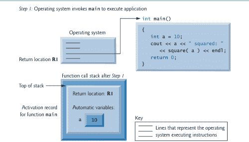

```cpp
int main()
{
    int a = 10;
    cout << a << " squared: "
         << square( a ) << endl;
    return 0;
}
```

**图 6.14** | 操作系统调用 `main` 执行程序后的函数调用栈。

函数 main 在返回操作系统之前，现在调用图 6.13 第 13 行中的函数 square。这会导致 square 的栈帧（第 17—20 行）被压入函数调用栈（图 6.15）。该栈帧包含 square 返回 main 所需的返回地址（即 R2）以及 square 的自动变量（即 x）所需的内存。

square 计算完其参数的平方后，需要返回 main——并且不再需要其自动变量 x 的内存。因此栈被弹出——把 main 中的返回位置（即 R2）交给 square，并丢弃 square 的自动变量。图 6.16 显示了 square 的活动记录被弹出后的函数调用栈。

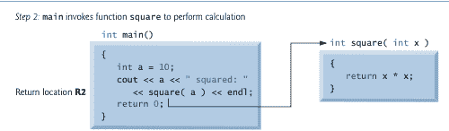

```cpp
int main()
{
    int a = 10;
    cout << a << " squared: "
         << square( a ) << endl;
    return 0;
}
```

```cpp
int square( int x )
{
    return x * x;
}
```

**图 6.15** | `main` 调用 `square` 执行计算后的函数调用栈。（第 1 部分，共 2 部分。）

你现在已经看到，栈数据结构在实现支持程序执行的关键机制方面多么有价值。数据结构在计算机科学中有许多重要应用。我们在第 20 章《自定义模板数据结构》和第 22 章《标准模板库（STL）》中讨论了栈、队列、列表、树和其他数据结构。

## 6.12 空参数列表的函数

在 C++ 中，空参数列表可以通过在括号中写 `void` 或什么都不写来指定。原型

`void print();`

指定函数 print 不接受参数，也不返回值。

图 6.17 展示了声明和使用空参数列表函数的两种方式。

```cpp
// Fig. 6.17: fig06_17.cpp
// Functions that take no arguments.
#include <iostream>
using namespace std;

void function1();            // function that takes no arguments
void function2( void );      // function that takes no arguments

int main()
{
   function1(); // call function1 with no arguments
   function2(); // call function2 with no arguments
} // end main

// function1 uses an empty parameter list to specify that
// the function receives no arguments
void function1()
{
   cout << "function1 takes no arguments" << endl;
} // end function1

// function2 uses a void parameter list to specify that
// the function receives no arguments
void function2( void )
{
   cout << "function2 also takes no arguments" << endl;
} // end function2
```

```text
function1 takes no arguments
function2 also takes no arguments
```

**图 6.17** | 不接受参数的函数。

## 6.13 内联函数

从软件工程的角度看，将程序实现为一组函数是好的，但函数调用会带来执行时开销。C++ 提供 **内联函数** 来帮助减少函数调用开销——尤其是对于小函数。在函数定义的返回类型前放置限定符 `inline` 会“建议”编译器在适当情况下就地生成函数体代码的副本，以避免函数调用。代价是程序中会插入多份函数代码副本（通常会使程序变大），而不是只有一份函数代码，并在每次调用函数时将控制权传递到该副本。编译器可以忽略 `inline` 限定符，而且对于除最小函数之外的所有函数，通常都会这样做。

> > **软件工程观察 6.9**
> >
> > *对内联函数的任何修改都要求该函数的所有使用方重新编译。*


图 6.18 使用内联函数 cube（第 9—12 行）计算立方体的体积。

函数 cube 参数列表中的关键字 `const`（第 9 行）告诉编译器，该函数不修改变量 side。这确保 side 的值在计算期间不会被该函数更改。（关键字 const 将在第 7、8 和 10 章详细讨论。）请注意，函数 cube 的完整定义出现在程序中使用它之前。这是必需的，以便编译器知道如何将 cube 函数调用展开为其内联代码。因此，可复用的内联函数通常放在头文件中，这样其定义就可以包含在每个使用它们的源文件中。

> > **软件工程观察 6.10**
> >
> > *应使用 `const` 限定符来贯彻最小权限原则。使用最小权限原则正确设计软件可以大大减少调试时间和不当副作用，并使程序更易于修改和维护。*


```cpp
// Fig. 6.18: fig06_18.cpp
// Using an inline function to calculate the volume of a cube.
#include <iostream>
using namespace std;

// Definition of inline function cube. Definition of function appears
// before function is called, so a function prototype is not required.
// First line of function definition acts as the prototype.
inline double cube( const double side )
{
   return side * side * side; // calculate cube
} // end function cube

int main()
{
   double sideValue; // stores value entered by user
   cout << "Enter the side length of your cube: ";
   cin >> sideValue; // read value from user

   // calculate cube of sideValue and display result
   cout << "Volume of cube with side "
        << sideValue << " is " << cube( sideValue ) << endl;
} // end main
```

**图 6.18**  计算立方体体积的内联函数。*（第 1 部分，共 2 部分。）*


```text
Enter the side length of your cube: 3.5
Volume of cube with side 3.5 is 42.875
```

**图 6.18** | *计算立方体体积的内联函数。（第 2 部分，共 2 部分。）*

## 6.14 引用和引用参数

在许多编程语言中，向函数传递实参的两种方式是**按值传递**和**按引用传递**。当实参按值传递时，会创建该实参值的副本，并将其（在函数调用栈上）传递给被调用函数。对副本的更改**不会**影响调用者中原始变量的值。这可以防止意外副作用，而这类副作用会极大地阻碍正确且可靠的软件系统的开发。本章中的每个实参都是按值传递的。


> **性能提示 6.4**
>
> *按值传递的一个缺点是，如果要传递大型数据项，复制该数据可能占用相当多的执行时间和内存空间。*

### 引用参数

本节介绍**引用参数**——这是 C++ 提供的两种执行按引用传递的方式中的第一种。使用按引用传递时，调用者赋予被调用函数直接访问调用者数据并修改该数据的能力。


> **性能提示 6.5**
>
> *出于性能原因，按引用传递是很好的，因为它可以消除按值传递时复制大量数据的开销。*


> **软件工程观察 6.1**
>
> *按引用传递可能削弱安全性；被调用函数可能破坏调用者的数据。*

稍后，我们将展示如何在获得按引用传递的性能优势的同时，也获得保护调用者数据不被破坏的软件工程优势。

引用参数是函数调用中对应实参的别名。要表示某个函数形参按引用传递，只需在函数原型中该形参的类型后面加上与号（&）；在函数头中列出该形参类型时也使用同样的约定。例如，函数头中的以下声明

```cpp
int &count
```

从*右向左*读作“count 是对一个 int 的引用”。在函数调用中，只需按名称写出变量即可按引用传递它。然后，在被调用函数体中以形参名提及该变量时，实际引用的是调用函数中的原始变量，并且被调用函数可以直接修改该原始变量。一如既往，函数原型和函数头必须一致。

### 按值传递实参和按引用传递实参

图 6.19 比较了按值传递和使用引用参数的按引用传递。在调用函数 squareByValue 和函数 squareByReference 时，实参的“风格”相同——两个变量都只是在函数调用中按名称提及。如果不检查函数原型或函数定义，仅从调用本身无法判断任一函数是否能修改其实参。由于函数原型是必需的，编译器可以毫无困难地消除这一歧义。

> **常见编程错误 6.9**
>
> *由于引用参数在被调用函数体中仅按名称提及，你可能无意中把引用参数当作按值传递参数。如果原始变量被该函数更改，这可能导致意外的副作用。*


```cpp
// Fig. 6.19: fig06_19.cpp
// Comparing pass-by-value and pass-by-reference with references.
#include <iostream>
using namespace std;

int squareByValue( int ); // function prototype (value pass)
void squareByReference( int & ); // function prototype (reference pass)

int main()
{
   int x = 2; // value to square using squareByValue
   int z = 4; // value to square using squareByReference

   // demonstrate squareByValue
   cout << "x = " << x << " before squareByValue\n";
   cout << "Value returned by squareByValue: "
        << squareByValue( x ) << endl;
   cout << "x = " << x << " after squareByValue\n" << endl;

   // demonstrate squareByReference
   cout << "z = " << z << " before squareByReference" << endl;
   squareByReference( z );
   cout << "z = " << z << " after squareByReference" << endl;
} // end main

// squareByValue multiplies number by itself, stores the
// result in number and returns the new value of number
int squareByValue( int number )
{
   return number *= number; // caller's argument not modified
} // end function squareByValue

// squareByReference multiplies numberRef by itself and stores the result
// in the variable to which numberRef refers in function main
void squareByReference( int &numberRef )
{
   numberRef *= numberRef; // caller's argument modified
} // end function squareByReference
```

**图 6.19** | 按值传递和按引用传递实参。（第 1 部分，共 2 部分。）

```text
x = 2 before squareByValue
Value returned by squareByValue: 4
x = 2 after squareByValue

z = 4 before squareByReference
z = 16 after squareByReference
```

**图 6.19** | 按值传递和按引用传递实参。（第 2 部分，共 2 部分。）

第 8 章讨论指针；指针提供了按引用传递的另一种形式，在这种形式中，调用风格清楚地表明是按引用传递（以及可能修改调用者实参）。


> **性能提示 6.6**
>
> *对于传递大型对象，请使用常量引用参数来模拟按值传递的外观和安全性，并避免传递大型对象副本的开销。*

要指定对常量的引用，请在参数声明中将 `const` 限定符放在类型说明符之前。注意 `&` 在函数 `squareByReference` 参数列表中的位置（图 6.19 第 35 行）。一些 C++ 程序员更喜欢写成等价形式 `int& numberRef`。

### 在函数中将引用用作别名

引用也可以在函数内用作其他变量的别名（尽管它们通常如图 6.19 所示与函数一起使用）。例如，以下代码

```cpp
int count = 1; // declare integer variable count
int &cRef = count; // create cRef as an alias for count
++cRef; // increment count (using its alias cRef)
```

使用变量 count 的别名 cRef 递增变量 count。引用变量必须在其声明中初始化（见图 6.20 和图 6.21），并且不能重新赋值为其他变量的别名。一旦引用被声明为另一个变量的别名，所有据称在别名（即引用）上执行的操作实际上都会在原始变量上执行。别名只是原始变量的另一个名称。除非它是对常量的引用，否则引用实参必须是左值（例如变量名），而不是返回右值的常量或表达式（例如计算结果）。有关术语左值和右值的定义，请参见 5.9 节。

```cpp
// Fig. 6.20: fig06_20.cpp
// Initializing and using a reference.
#include <iostream>
using namespace std;

int main()
{
   int x = 3;
   int &y = x; // y refers to (is an alias for) x

   cout << "x = " << x << endl << "y = " << y << endl;
   y = 7; // actually modifies x
   cout << "x = " << x << endl << "y = " << y << endl;
} // end main
```

**图 6.20** | 初始化和使用引用。（第 1 部分，共 2 部分。）

```text
x = 3
y = 3
x = 7
y = 7
```

**图 6.20** | 初始化和使用引用。（第 2 部分，共 2 部分。）

```cpp
// Fig. 6.21: fig06_21.cpp
// References must be initialized.
#include <iostream>
using namespace std;

int main()
{
   int x = 3;
   int &y; // Error: y must be initialized

   cout << "x = " << x << endl << "y = " << y << endl;
   y = 7;
   cout << "x = " << x << endl << "y = " << y << endl;
} // end main
```

*Microsoft Visual C++ 编译器错误消息：*

```text
C:\cpphtp8_examples\ch06\Fig06_21\fig06_21.cpp(9) : error C2530: 'y' :
   references must be initialized
```

*GNU C++ 编译器错误消息：*

```text
fig06_21.cpp:9: error: 'y' declared as a reference but not initialized
```

**图 6.21** | 未初始化的引用导致语法错误。

### 从函数返回引用

函数可以返回引用，但这可能很危险。当返回对被调用函数中声明的变量的引用时，除非该变量声明为 static，否则该引用引用的是函数终止时被丢弃的自动变量。这样的变量被称为“未定义”，程序行为不可预测。对未定义变量的引用称为**悬空引用**。

> **常见编程错误 6.10**
>
> *在被调用函数中返回对自动变量的引用是逻辑错误。某些编译器在发生这种情况时会发出警告。*


名称在作用域内。一元作用域解析运算符不能用于访问外层块中同名的局部变量。如果全局变量的名称与作用域内局部变量的名称不同，则可以直接访问全局变量，而不使用一元作用域解析运算符。

图 6.23 展示了一元作用域解析运算符用于同名的局部变量和全局变量（第 6 行和第 10 行）。为了强调变量 number 的局部版本和全局版本不同，程序将一个变量声明为 int，另一个声明为 double。

```cpp
// Fig. 6.23: fig06_23.cpp
// using the unary scope resolution operator.
#include <iostream>
using namespace std;

int number = 7; // global variable named number

int main()
{
    double number = 10.5; // local variable named number

    // display values of local and global variables
    cout << "Local double value of number = " << number
         << "\nGlobal int value of number = " << ::number << endl;
} // end main
```

```text
Local double value of number = 10.5
Global int value of number = 7
```

**图 6.23** | 一元作用域解析运算符。

当具有给定名称的唯一变量是全局变量时，使用一元作用域解析运算符（`::`）来引用该变量名是可选的。


> **良好编程实践 6.4**
> 
> *始终使用一元作用域解析运算符（`::`）来引用全局变量，可以使程序更易读、更易懂，因为这样可以清楚地表明你打算访问全局变量，而不是非全局变量。*


> **软件工程观察 6.13**
> 
> *始终使用一元作用域解析运算符（`::`）来引用全局变量，可以通过降低与非全局变量发生名称冲突的风险，使程序更易于修改。*


> **错误预防提示 6.4**
> 
> *始终使用一元作用域解析运算符（`::`）来引用全局变量，可以消除因非全局变量隐藏全局变量而可能发生的逻辑错误。*


> **错误预防提示 6.5**
> 
> *避免在程序中将同名变量用于不同目的。尽管这在各种情况下是允许的，但可能导致错误。*

## 6.17 函数重载

只要函数具有不同的签名，C++ 就允许定义多个同名函数。这称为**函数重载**。C++ 编译器通过检查调用中实参的数量、类型和顺序来选择要调用的正确函数。函数重载用于创建多个同名函数，它们执行类似的任务，但作用于不同的数据类型。例如，数学库中的许多函数针对不同数值类型进行了重载——C++ 标准要求第 6.3 节讨论的数学库函数具有 float、double 和 long double 的重载版本。


**良好编程实践 6.5**

*重载执行密切相关任务的函数可以使程序更易读、更易懂。*

### 重载的 square 函数

图 6.24 使用重载的 square 函数计算 int 的平方（第 7–11 行）和 double 的平方（第 14–18 行）。第 22 行通过传递字面值 7 调用函数 square 的 int 版本。C++ 将整数字面值视为 int 类型。类似地，第 24 行通过传递字面值 7.5 调用函数 square 的 double 版本，C++ 将 7.5 视为 double 值。在每种情况下，编译器都根据实参的类型选择要调用的正确函数。输出窗口的最后两行确认在每种情况下都调用了正确的函数。

```cpp
// Fig. 6.24: fig06_24.cpp
// Overloaded functions
#include <iostream>
using namespace std;

// function square for int values
int square( int x )
{
   cout << "square of integer " << x << " is ";
   return x * x;
} // end function square with int argument

// function square for double values
double square( double y )
{
   cout << "square of double " << y << " is ";
   return y * y;
} // end function square with double argument

int main()
{
   cout << square( 7 ); // calls int version
   cout << endl;
   cout << square( 7.5 ); // calls double version
   cout << endl;
} // end main
```

**图 6.24** | 重载的 square 函数。（第 1 部分，共 2 部分）

```text
square of integer 7 is 49
square of double 7.5 is 56.25
```

**图 6.24** | 重载的 square 函数。（第 2 部分，共 2 部分）

### 编译器如何区分重载函数

重载函数通过其签名来区分。签名是函数名及其参数类型（按顺序）的组合。编译器用其参数的数量和类型对每个函数标识符进行编码（有时称为名称修饰或名称装饰），以实现类型安全链接。类型安全链接确保调用正确的重载函数，并确保实参类型与形参类型一致。

图 6.25 是用 GNU C++ 编译的。这里没有展示程序的执行输出（通常我们会这样做），而是展示 GNU C++ 在汇编语言中生成的修饰后函数名。每个修饰名（main 除外）以两个下划线（`__`）开头，后跟字母 Z、一个数字和函数名。Z 后面的数字指定函数名中的字符数。例如，函数 square 的名称有 6 个字符，因此其修饰名以 `__Z6` 为前缀。函数名之后是参数列表的编码。

在函数 nothing2 的参数列表（第 25 行；见输出第四行）中，`c` 表示 char，`i` 表示 int，`Rf` 表示 float &（即对 float 的引用），`Rd` 表示 double &（即对 double 的引用）。在函数 nothing1 的参数列表，`i` 表示 int，`Rf` 表示 float &，`c` 表示 char，`Ri` 表示 int &。

两个 square 函数通过其参数列表来区分；一个为 double 指定 `d`，另一个为 int 指定 `i`。修饰名中未指定函数的返回类型。重载函数可以具有不同的返回类型，但如果不同，它们也必须具有不同的参数列表。同样，不能有两个签名相同但返回类型不同的函数。函数名修饰因编译器而异。此外，函数 main 不会被修饰，因为它不能被重载。

> **常见编程错误 6.1**
> 
> 创建参数列表相同但返回类型不同的重载函数是编译错误。

```cpp
// Fig. 6.25: fig06_25.cpp
// Name mangling.

// function square for int values
int square( int x )
{
   return x * x;
} // end function square

// function square for double values
double square( double y )
{
   return y * y;
} // end function square

// function that receives arguments of types
// int, float, char and int &
void nothing1(char a, float b, char c, int &d)
{
    // empty function body
} // end function nothing1

// function that receives arguments of types
// char, int, float & and double &
int nothing2(char a, int b, float &c, double &d)
{
    return 0;
} // end function nothing2

int main()
{
} // end main
```

**图 6.25** | 启用类型安全链接的名称修饰。（第 1 部分，共 2 部分）

```text
__Z6squarei
__Z6squared
__Z8nothing1ciRf
__Z8nothing2ciRfRd
_main
```

**图 6.25** | 启用类型安全链接的名称修饰。（第 2 部分，共 2 部分）

编译器仅使用参数列表来区分重载函数。这类函数不必具有相同数量的参数。重载带有默认参数的函数时要小心，因为这可能导致二义性。


> **常见编程错误 6.12**
> 
> *省略默认实参的函数可能以与另一个重载函数相同的方式被调用；这是编译错误。例如，如果程序同时包含一个显式不接受任何实参的函数和一个同名且包含所有默认实参的函数，那么当尝试在不传递任何实参的调用中调用该函数名时，会导致编译错误。编译器无法确定应选择函数的哪个版本。*

### 重载运算符

第 11 章讨论如何重载运算符，以定义它们应如何操作用户定义数据类型的对象。（事实上，到目前为止，我们一直在使用许多重载运算符，包括流插入 `<<` 和流提取 `>>` 运算符，它们已针对所有基本类型进行重载。第 11 章将更详细地讨论重载 `<<` 和 `>>` 以处理用户定义类型的对象。）

## 6.18 函数模板

重载函数通常用于在不同数据类型上执行涉及不同程序逻辑的类似操作。如果程序逻辑和操作相同


对于每种数据类型，通过使用**函数模板**可以更紧凑、更方便地执行重载。你只需编写一个函数模板定义。根据调用该函数时提供的实参类型，C++会自动生成单独的函数模板特化，以适当地处理每种类型的调用。因此，定义单个函数模板实质上定义了一整族重载函数。

图6.26定义了一个 maximum 函数模板（第3—17行），用于确定三个值中的最大值。所有函数模板定义都以 **template** 关键字（第3行）开始，后面是该函数模板的**模板参数列表**，用尖括号（< 和 >）括起来。模板参数列表中的每个参数（通常称为**形式类型参数**）前面都有关键字 typename 或关键字 class（在此上下文中它们是同义词）。形式类型参数是基本类型或用户定义类型的占位符。这些占位符（在本例中为 T）用于指定函数参数的类型（第4行）、指定函数的返回类型（第4行），以及在函数定义体内声明变量（第6行）。函数模板的定义与任何其他函数类似，但使用形式类型参数作为实际数据类型的占位符。

```cpp
// Fig. 6.26: maximum.h
// Definition of function template maximum.
template < typename T > // or template <typename T >
T maximum( T value1, T value2, T value3 )
{
   T maximumValue = value1; // assume value1 is maximum

   // determine whether value2 is greater than maximumValue
   if ( value2 > maximumValue )
      maximumValue = value2;

   // determine whether value3 is greater than maximumValue
   if ( value3 > maximumValue )
      maximumValue = value3;

   return maximumValue;
} // end function template maximum
```

**图 6.26** | 函数模板 maximum 头文件。

该函数模板声明了一个形式类型参数 T（第3行），作为函数 maximum 要测试的数据类型的占位符。对于特定模板定义，类型参数的名称在模板参数列表中必须唯一。当编译器在程序源代码中检测到 maximum 调用时，传递给 maximum 的数据的*类型*将在整个模板定义中替换 T，并且 C++ 会创建一个完整的函数，用于确定指定数据类型三个值中的最大值——这三个值必须具有相同类型，因为本例中只使用了一个类型参数。然后编译新创建的函数。因此，模板是一种代码生成手段。

图6.27使用该函数模板分别确定三个 int 值、三个 double 值和三个 char 值中的最大值（第17、27和37行）。第17、27和37行中的调用会分别创建单独的函数——分别期望三个 int 值、三个 double 值和三个 char 值。为 int 类型创建的函数模板特化将每个出现的 T 替换为 int，如下所示：

```cpp
int maximum( int value1, int value2, int value3 )
{
   int maximumValue = value1;  // assume value1 is maximum

   // determine whether value2 is greater than maximumValue
   if ( value2 > maximumValue )
      maximumValue = value2;

   // determine whether value3 is greater than maximumValue
   if ( value3 > maximumValue )
      maximumValue = value3;

   return maximumValue;
} // end function template maximum
```

```cpp
// Fig. 6.27: fig06_27.cpp
// Function template maximum test program.
#include <iostream>
#include "maximum.h" // include definition of function template maximum
using namespace std;

int main()
{
   // demonstrate maximum with int values
   int int1, int2, int3;

   cout << "Input three integer values: ";
   cin >> int1 >> int2 >> int3;

   // invoke int version of maximum
   cout << "The maximum integer value is: "
        << maximum( int1, int2, int3 );

   // demonstrate maximum with double values
   double double1, double2, double3;

   cout << "\n\nInput three double values: ";
   cin >> double1 >> double2 >> double3;

   // invoke double version of maximum
   cout << "The maximum double value is: "
        << maximum( double1, double2, double3 );

   // demonstrate maximum with char values
   char char1, char2, char3;

   cout << "\n\nInput three characters: ";
   cin >> char1 >> char2 >> char3;

   // invoke char version of maximum
   cout << "The maximum character value is: "
        << maximum( char1, char2, char3 ) << endl;
} // end main
```

**图 6.27** | 演示函数模板 maximum。（第1部分，共2部分。）

```text
Input three integer values: 1 2 3
The maximum integer value is: 3

Input three double values: 3.3 2.2 1.1
The maximum double value is: 3.3

Input three characters: A C B
The maximum character value is: C
```

**图 6.27** | 演示函数模板 maximum。（第2部分，共2部分。）

## 6.19 递归

对于某些问题，让函数调用自身是有用的。递归函数是直接或间接（通过另一个函数）调用自身的函数。[注：尽管许多编译器允许函数 main 调用自身，但 C++ 标准文档第3.6.1节第3段和第5.2.2节第9段指出，不应在程序中调用 main，也不应递归调用 main。它的唯一用途是作为程序执行的起点。] 递归是高级计算机科学课程中详细讨论的重要主题。本节和下一节给出递归的简单示例。图6.33（位于6.21节末尾）总结了书中大量的递归示例和练习。

我们首先从概念上考虑递归，然后考察两个包含递归函数的程序。递归问题求解方法有许多共同要素。调用递归函数来解决问题。该函数只知道如何求解最简单的情况，即所谓的基本情况。如果以基本情况调用该函数，函数只需返回一个结果。如果以更复杂的问题调用该函数，它通常将问题分成两个概念部分——函数知道如何做的部分和它不知道如何做的部分。为了使递归可行，后一部分必须类似于原始问题，但应是稍简单或稍小的版本。这个新问题看起来像原始问题，因此函数调用自身的一个副本来处理这个较小的问题——这称为递归调用，也称为递归步骤。递归步骤通常包含关键字 return，因为它的结果将与函数知道如何求解的问题部分组合起来，形成传回原始调用者（可能是 main）的结果。

递归步骤在函数的原始调用仍处于“打开”状态（即尚未执行完毕）时执行。递归步骤可能导致更多这样的递归调用，因为函数不断将调用它的每个新子问题分成两个概念部分。为了使递归最终终止，每次函数用原始问题的稍简单版本调用自身时，这个越来越小的问题序列必须最终收敛到基本情况。此时，函数识别出基本情况，并将结果返回给前一个函数副本，随后沿调用链发生一系列返回，直到原始调用最终将最终结果返回给 main。与我们到目前为止一直使用的问题求解方式相比，这听起来相当奇特。作为这些概念实际应用的示例，让我们编写一个递归程序来执行一种流行的数学计算。

非负整数 $n$ 的阶乘，写作 $n!$（读作“$n$ 的阶乘”），是乘积

$$n \cdot (n - 1) \cdot (n - 2) \cdot \cdots \cdot 1$$

其中 $1!$ 等于1，$0!$ 定义为1。例如，$5!$ 是乘积 $5 \cdot 4 \cdot 3 \cdot 2 \cdot 1$，等于120。

大于或等于0的整数的阶乘，可以使用 `for` 语句迭代地（非递归地）计算，如下所示：

```cpp
factorial = 1;
for ( int counter = number; counter >= 1; --counter )
    factorial *= counter;
```

通过观察以下代数关系，可以得到阶乘函数的递归定义：

$$n! = n \cdot (n - 1)!$$

例如，$5!$ 显然等于 $5 \cdot 4!$，如下所示：

$$\begin{aligned}
5! &= 5 \cdot 4 \cdot 3 \cdot 2 \cdot 1\\
5! &= 5 \cdot (4 \cdot 3 \cdot 2 \cdot 1)\\
5! &= 5 \cdot (4!)
\end{aligned}$$

$5!$ 的求值过程将如图6.28所示，该图说明了连续递归调用如何进行，直到 $1!$ 求值为1，从而终止递归。图6.28(b)显示了从每个递归调用返回给其调用者的值，直到计算出并返回最终值。

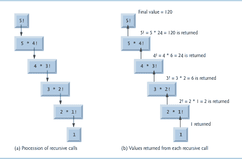

**图 6.28** | 5! 的递归求值。


图6.29使用递归计算并打印整数0–10的阶乘。（选择`unsigned long`数据类型的原因稍后解释。）递归函数`factorial`（第18–24行）首先判断终止条件`number <= 1`（第20行）是否为真。如果number小于等于1，factorial函数返回1（第21行），因此无需进一步递归，函数终止。如果number大于1，第23行将问题表示为number与对`factorial`的递归调用（计算number - 1的阶乘）的乘积，这比原函数`factorial(number)`的问题稍微简单一些。

```cpp
// Fig. 6.29: fig06_29.cpp
// Demonstrates the recursive function factorial.
#include <iostream>
#include <iomanip>
using namespace std;

unsigned long factorial( unsigned long ); // function prototype

int main()
{
   // calculate the factorials of 0 through 10
   for ( int counter = 0; counter <= 10; ++counter )
      cout << setw( 2 ) << counter << "! = " << factorial( counter )
           << endl;
} // end main

// recursive definition of function factorial
unsigned long factorial( unsigned long number )
{
   if ( number <= 1 ) // test for base case
      return 1; // base cases: 0! = 1 and 1! = 1
   else // recursion step
      return number * factorial( number - 1 );
} // end function factorial
```

```text
0! = 1
1! = 1
2! = 2
3! = 6
4! = 24
5! = 120
6! = 720
7! = 5040
8! = 40320
9! = 362880
10! = 3628800
```

**图6.29** | 演示递归函数`factorial`。

函数`factorial`已声明为接收`unsigned long`类型的参数并返回`unsigned long`类型的结果。这是`unsigned long int`的简写形式。C++标准要求`unsigned long int`类型的变量至少与`int`一样大。通常，`unsigned long int`至少存储在四个字节（32位）中；这样的一个

```cpp
// Fig. 6.30: fig06_30.cpp
// Testing the recursive fibonacci function.
#include <iostream>
using namespace std;

unsigned long fibonacci( unsigned long ); // function prototype

int main()
{
   // calculate the fibonacci values of 0 through 10
   for ( int counter = 0; counter <= 10; ++counter )
      cout << "fibonacci( " << counter << " ) = "
           << fibonacci( counter ) << endl;

   // display higher fibonacci values
   cout << "fibonacci( 20 ) = " << fibonacci( 20 ) << endl;
   cout << "fibonacci( 30 ) = " << fibonacci( 30 ) << endl;
   cout << "fibonacci( 35 ) = " << fibonacci( 35 ) << endl;
} // end main

// recursive function fibonacci
unsigned long fibonacci( unsigned long number )
{
   if ( ( number == 0 ) || ( number == 1 ) ) // base cases
      return number;
   else // recursion step
      return fibonacci( number - 1 ) + fibonacci( number - 2 );
} // end function fibonacci
```

```text
fibonacci( 0 ) = 0
fibonacci( 1 ) = 1
fibonacci( 2 ) = 1
fibonacci( 3 ) = 2
fibonacci( 4 ) = 3
fibonacci( 5 ) = 5
fibonacci( 6 ) = 8
fibonacci( 7 ) = 13
fibonacci( 8 ) = 21
fibonacci( 9 ) = 34
fibonacci( 10 ) = 55
fibonacci( 20 ) = 6765
fibonacci( 30 ) = 832040
fibonacci( 35 ) = 9227465
```

**图6.30** | 演示函数`fibonacci`。

该应用程序首先使用`for`语句计算并显示整数0–10的斐波那契值，随后三次调用分别计算整数20、30和35的斐波那契值（第16–18行）。`main`中对`fibonacci`的调用（第13行和第16–18行）不是递归调用，但`fibonacci`第27行中的调用是递归调用。每次调用`fibonacci`时，该函数（第22–28行）会立即测试基本情况，以确定number是否等于0或1（第24行）。如果为真，第25行返回number。有趣的是，如果number大于1，递归步骤（第27行）会产生两个递归调用，每个调用的规模都比最初对`fibonacci`的调用稍微小一些。

图6.31展示了函数`fibonacci`如何求值`fibonacci(3)`。该图提出了一些关于C++编译器求值运算符操作数顺序的有趣问题。这与运算符应用于其操作数的顺序（即由运算符优先级和结合性规则规定的顺序）是不同的问题。图6.31显示，求值`fibonacci(3)`会导致两个递归调用，即`fibonacci(2)`和`fibonacci(1)`。这些调用按什么顺序进行？

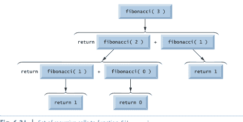

**图6.31** | 对函数`fibonacci`的一组递归调用。

### 操作数的求值顺序

大多数程序员只是假定操作数从左到右求值。C++并未规定大多数运算符（包括`+`）的操作数的求值顺序。因此，不能假定这些调用执行的顺序。这些调用实际上可能先执行`fibonacci(2)`，再执行`fibonacci(1)`，也可能按相反顺序执行：先`fibonacci(1)`，再`fibonacci(2)`。在这个程序以及大多数其他程序中，最终结果是相同的。然而，在某些程序中，操作数的求值可能产生副作用（数据值的改变），从而可能影响表达式的最终结果。

C++只规定了四个运算符的操作数求值顺序——`&&`、`||`、逗号（`,`）和`?:`。前三个是二元运算符，它们的两个操作数保证从左到右求值。最后一个运算符是C++唯一的三元运算符——其最左侧操作数总是先求值；如果它的求值结果非零（`true`），则接下来求值中间操作数，并忽略最后一个操作数；如果最左侧操作数求值为零（`false`），则接下来求值第三个操作数，并忽略中间操作数。

> **可移植性提示6.2**
> 
> 依赖`&&`、`||`和逗号（`,`）运算符以外的运算符的操作数求值顺序的程序，在不同编译器下可能表现不同。

> **常见编程错误6.14**
> 
> 编写依赖`&&`、`||`和逗号（`,`）运算符以外的运算符的操作数求值顺序的程序，可能导致逻辑错误。

```cpp
unsigned long factorial( unsigned long ); // function prototype

int main()
{
   // calculate the factorials of 0 through 10
   for ( int counter = 0; counter <= 10; ++counter )
      cout << setw( 2 ) << counter << "! = " << factorial( counter )
           << endl;
} // end main

// iterative function factorial
unsigned long factorial( unsigned long number )
{
   unsigned long result = 1;

   // iterative factorial calculation
   for ( unsigned long i = number; i >= 1; --i )
      result *= i;

   return result;
} // end function factorial
```

```text
0! = 1
1! = 1
2! = 2
3! = 6
4! = 24
5! = 120
6! = 720
7! = 5040
8! = 40320
9! = 362880
10! = 3628800
```

**图6.32** | 迭代式阶乘解决方案。（第2部分，共2部分。）

递归也有缺点。它会反复调用函数机制，因而带来函数调用的开销。这在处理器时间和内存空间上都可能代价高昂。每次递归调用都会创建函数的另一个副本（实际上只是函数的变量）；这可能消耗相当多的内存。迭代通常在一个函数内部进行，因此省略了重复函数调用和额外内存分配的开销。那么为什么选择递归呢？

> **软件工程观察6.14**
> 
> 任何可以用递归解决的问题也可以用迭代（非递归）方式解决。通常当递归方法更自然地反映问题，并且产生的程序更易于理解和调试时，会选择递归方法。选择递归解决方案的另一个原因是迭代解决方案并不明显。


> **性能提示6.8**
> 
> 在关注性能的场景中避免使用递归。递归调用耗时并消耗额外内存。


## 常见编程错误 6.15


*意外地让非递归函数直接或间接（通过另一个函数）调用自身，是一种逻辑错误。*

图6.33汇总了正文中的递归示例与练习。

| 文中位置 | 递归示例与练习 |
|---|---|
| *第6章* | |
| 第6.19节，图6.29 | 阶乘函数 |
| 第6.20节，图6.30 | 斐波那契函数 |
| 练习6.36 | 整数求整数次幂 |
| 练习6.38 | 汉诺塔 |
| 练习6.40 | 可视化递归 |
| 练习6.41 | 最大公约数 |
| 练习6.45，练习6.46 | 神秘“这个程序做什么？”练习 |
| *第7章* | |
| 练习7.18 | 神秘“这个程序做什么？”练习 |
| 练习7.21 | 神秘“这个程序做什么？”练习 |
| 练习7.31 | 选择排序 |
| 练习7.32 | 判断字符串是否为回文 |
| 练习7.33 | 线性查找 |
| 练习7.34 | 八皇后问题 |
| 练习7.35 | 打印数组 |
| 练习7.36 | 反向打印字符串 |
| 练习7.37 | 数组中的最小值 |
| *第8章* | |
| 练习8.15 | 快速排序 |
| 练习8.16 | 迷宫遍历 |
| 练习8.17 | 随机生成迷宫 |
| *第19章* | |
| 第19.3.3节，图19.5–19.7 | 归并排序 |
| 练习19.8 | 线性查找 |
| 练习19.9 | 二分查找 |
| 练习19.10 | 快速排序 |
| *第20章* | |
| 第20.7节，图20.20–20.22 | 二叉树插入 |
| 第20.7节，图20.20–20.22 | 二叉树的前序遍历 |
| 第20.7节，图20.20–20.22 | 二叉树的中序遍历 |
| 第20.7节，图20.20–20.22 | 二叉树的后序遍历 |
| 练习20.20 | 反向打印链表 |
| 练习20.21 | 搜索链表 |
| 练习20.22 | 二叉树删除 |
| 练习20.23 | 二叉树搜索 |
| 练习20.24 | 二叉树的层序遍历 |
| 练习20.25 | 打印树 |

**图6.33** | 正文中递归示例与练习汇总。

## 6.22 本章小结

在本章中，你进一步学习了函数声明，包括函数原型、函数签名、函数头和函数体。我们概述了数学库函数。你学习了实参强制转换，即强制将实参转换为函数形参声明所指定的适当类型。我们演示了如何使用函数 rand 和 srand 生成可用于模拟的随机数集合。我们展示了如何使用 enum 定义常量集合。你还学习了变量作用域和存储类。我们介绍了向函数传递实参的两种不同方式——按值传递和按引用传递。对于按引用传递，引用用作变量的别名。我们展示了如何实现内联函数和接收默认实参的函数。你了解到，通过提供同名但签名不同的函数，可以重载一个类中的多个函数。此类函数可用于执行相同或相似的任务，但使用不同类型或不同数量的形参。我们演示了使用函数模板重载函数的一种更简单方式，其中函数只定义一次，但可用于多种不同类型。随后你学习了递归，即函数调用自身来解决问题。

在第7章中，你将学习如何在数组和面向对象的 vector 中维护数据列表和表格。你将看到掷骰子应用程序更优雅的基于数组的实现，以及我们在第3～6章介绍的成绩簿案例研究的两个增强版本，它们将使用数组存储实际录入的成绩。

## 总结

### 6.1节 引言

- 经验表明，开发和维护大型程序的最佳方式是使用小型、简单的部件（或组件）来构建它。这种技术称为分而治之（p. 195）。

### 6.2节 C++ 中的程序组件

- C++ 程序通常通过将你编写的新函数和类与 C++ 标准库中可用的“预打包”函数和类组合在一起来编写。
- 函数允许你将程序的任务分离为自包含单元，从而实现程序的模块化。
- 函数体中的语句只编写一次，可在程序中的多个位置重用，并且对其他函数隐藏。

### 6.3节 数学库函数

- 有时函数不是类的成员。这些函数称为全局函数（p. 197）。
- 全局函数的原型放在头文件中，以便任何包含该头文件并能链接到该函数目标代码的程序都可以重用它们。

### 6.4节 带多个参数的函数定义

- 编译器会参考函数原型来检查对函数的调用是否包含正确数量和类型的实参、实参类型顺序是否正确，以及函数返回的值能否在调用该函数的表达式中正确使用。
- 如果函数不返回结果，则当程序到达函数结尾的右花括号时，或执行以下语句时，控制权返回：

  ```cpp
  return;
  ```

  如果函数确实返回结果，则语句

  ```cpp
  return expression;
  ```

  会计算 expression 的值并将该值返回给调用者。

### 6.5节 函数原型与实参强制转换

- 函数原型中包含函数名及其实参类型的部分称为函数签名（p. 203），或简称签名。
- 函数原型的一个重要特性是实参强制转换（p. 203），即强制将实参转换为形参声明所指定的适当类型。
- 编译器可以根据 C++ 的提升规则（p. 204）将实参提升为形参类型。提升规则指明了编译器可在基本类型之间执行的隐式转换。

### 6.6节 C++ 标准库头文件

- C++ 标准库分为许多部分，每个部分都有自己的头文件。头文件还包含各种类类型、函数和常量的定义。
- 头文件“指示”编译器如何与库组件交互。

### 6.7节 案例研究：随机数生成

- 反复调用 rand（p. 207）会生成一个伪随机数序列（p. 210）。每次程序执行时，该序列都会重复自身。
- 要使 rand 生成的数随机化，可向函数 srand（p. 210）传入一个无符号整数实参（通常来自函数 time；p. 211），该函数会为 rand 函数设置种子。
- 可以使用以下方式生成某个范围内的随机数：

  ```cpp
  number = shiftingValue + rand() % scalingFactor;
  ```

  其中 shiftingValue（p. 207）等于所需连续整数范围中的第一个数，scalingFactor（p. 207）等于所需连续整数范围的宽度。

### 6.8节 案例研究：碰运气的游戏；引入 enum

- 枚举由关键字 enum 引入，后跟类型名（p. 214），是一组具名整数常量（p. 214），除非另有指定，否则从 0 开始并以 1 递增。

### 6.9节 存储类

- 标识符的存储类（p. 215）决定其在内存中存在的时期。
- 标识符的作用域是程序中可以引用该标识符的位置。
- 标识符的链接（p. 215）决定它是仅在声明它的源文件中已知，还是在多个分别编译后链接在一起的文件中已知。
- 关键字 auto（p. 215）和 register（p. 215）声明自动存储类（p. 216）的变量。此类变量在程序执行进入定义它们的块时创建，在块活动期间存在，并在程序退出该块时销毁。
- 只有函数的局部变量可以属于自动存储类。
- 存储类说明符 auto（p. 215）显式声明自动存储类的变量。局部变量默认属于自动存储类，因此关键字 auto 很少使用。
- 关键字 extern（p. 215）和 static 声明静态存储类（p. 215）变量和函数的标识符。静态存储类变量从程序开始执行时存在，并持续到程序结束。
- 静态存储类变量的存储空间在程序开始执行时分配。此类变量在其声明被遇到时初始化一次。对于函数，函数名在程序开始执行时即存在，供所有其他函数使用。
- 外部标识符（如全局变量）以及用存储类说明符 static 声明的局部变量具有静态存储类（p. 215）。
- 全局变量（p. 217）声明放在任何类或函数定义之外。全局变量在整个程序执行期间保留其值。全局变量和函数可由其声明或定义之后的任何函数引用。

### 6.10节 作用域规则

- 与自动变量不同，静态局部变量在声明它们的函数返回给调用者时仍保留其值。
- 在任何函数或类之外声明的标识符具有全局命名空间作用域（p. 218）。
- 标签是唯一具有函数作用域（p. 218）的标识符。标签可在其所在函数的任何位置使用，但不能在函数体之外引用。
- 在块内声明的标识符具有局部作用域（p. 218），该作用域从标识符声明处开始，到声明该标识符的块的终止右花括号（}）结束。
- 函数原型参数列表中的标识符具有函数原型作用域（p. 218）。

### 6.11节 函数调用栈与活动记录

- 栈（p. 221）被称为后进先出（LIFO）数据结构——最后压入（插入；p. 221）栈的项最先从栈中弹出（移除；p. 221）。
- 函数调用栈（p. 221）支持函数调用/返回机制，以及每个被调用函数的自动变量的创建、维护和销毁。
- 每当一个函数调用另一个函数时，就会将一个栈帧或活动记录（p. 221）压入栈中，其中包含被调用函数返回调用函数所需的返回地址，以及该函数调用的自动变量和形参。
- 只要被调用函数处于活动状态，该栈帧（p. 221）就存在。当被调用函数返回时，其栈帧从栈中弹出，其局部自动变量不再存在。

### 6.12节 空参数列表的函数

- 在 C++ 中，空参数列表通过在圆括号中写 void 或什么都不写来指定。


函数的参数，用于指定函数的返回类型，并在函数定义体内声明变量。

## 第6.19节 递归

- 递归函数（第239页）直接或间接地调用自身。
- 递归函数只知道如何解决最简单的情形，即所谓的基本情形。如果以基本情形（第239页）调用函数，函数只需返回一个结果。
- 如果以更复杂的问题调用函数，函数通常将问题分为两个概念部分——一部分是函数知道如何做的，另一部分是函数不知道如何做的。为使递归可行，后一部分必须与原问题相似，但应是其略微更简单或略微更小的版本。
- 为使递归终止，递归调用（第239页）的序列必须收敛于基本情形。

## 第6.20节 使用递归的示例：斐波那契数列

- 连续的斐波那契数之比收敛于常数1.618……。这个数在自然界中频繁出现，被称为黄金比例或黄金分割（第242页）。

## 第6.21节 递归与迭代

- 迭代（第240页）和递归类似：两者都基于控制语句，都涉及重复，都涉及终止测试，都逐渐接近终止，并且都可能无限进行。
- 递归反复调用函数机制，并产生函数调用的开销。这在处理器时间和内存空间上都可能代价高昂。每次递归调用（第239页）都会创建函数变量的另一个副本；这可能消耗大量内存。

## 自测练习

### 6.1 回答以下各项：

- a) C++中的程序组件称为______和______。
- b) 函数通过一次______调用。
- c) 只在其定义所在函数内已知的变量称为______。
- d) 被调用函数中的______语句将表达式的值传回调用函数。
- e) 关键字______在函数头中用于表示函数不返回值或表示函数不包含参数。
- f) 标识符的______是程序中可以使用该标识符的部分。
- g) 将控制权从被调用函数返回调用函数的三种方式是______、______和______。
- h) ______允许编译器检查传递给函数的参数的数量、类型和顺序。
- i) 函数______用于产生随机数。
- j) 函数______用于设置随机数种子，以随机化函数rand生成的数字序列。
- k) 存储类别说明符包括mutable、______、______、______和______。
- l) 在块中或函数参数列表中声明的变量，除非另有指定，否则假定为存储类别______。
- m) 存储类别说明符______是对编译器的建议，将变量存储在计算机的某个寄存器中。
- n) 在任何块或函数外部声明的变量是______变量。
- o) 要使函数中的局部变量在函数调用之间保持其值，必须使用______存储类别说明符声明它。
- p) 标识符的六种可能作用域是________、________、________、________、________和________。
- q) 直接或间接（即通过另一个函数）调用自身的函数是________函数。
- r) 递归函数通常有两个部分——一个通过测试________情形来提供递归终止的方法，另一个将问题表示为对比原始调用略微更简单的问题的递归调用。
- s) 可以有多个同名函数，对不同的类型或参数个数进行操作。这称为函数________。
- t) ________允许访问与当前作用域中的变量同名的全局变量。
- u) ________限定符用于声明只读变量。
- v) 函数________使得可以定义一个函数来对许多不同的数据类型执行任务。

### 6.2 对于图6.34中的程序，指出以下每个元素的作用域（函数作用域、全局命名空间作用域、局部作用域或函数原型作用域）：

- a) main中的变量x。
- b) cube中的变量y。
- c) 函数cube。
- d) 函数main。
- e) cube的函数原型。
- f) cube的函数原型中的标识符y。

```cpp
// Exercise 6.2: Ex06_02.cpp
#include <iostream>
using namespace std;

int cube( int y ); // function prototype

int main()
{
   int x;

   for ( x = 1; x <= 10; x++ ) // loop 10 times
      cout << cube( x ) << endl; // calculate cube of x and output results
} // end main

// definition of function cube
int cube( int y )
{
   return y * y * y;
} // end of function cube
```

**图6.34** | 练习6.2的程序。

### 6.3 编写一个程序，测试图6.2中所示的数学库函数调用示例是否确实产生了指示的结果。

### 6.4 给出以下每个函数的函数头：

- a) 函数hypotenuse，接受两个双精度浮点参数side1和side2，并返回双精度浮点结果。
- b) 函数smallest，接受三个整数x、y和z，并返回一个整数。
- c) 函数instructions，不接收任何参数且不返回值。[注意：此类函数通常用于向用户显示指令。]
- d) 函数`intToDouble`，接受一个整数参数`number`，并返回双精度浮点结果。

### 6.5 给出以下每个函数的函数原型（不带参数名）：

- a) 练习6.4(a)中描述的函数。
- b) 练习6.4(b)中描述的函数。
- c) 练习6.4(c)中描述的函数。
- d) 练习6.4(d)中描述的函数。

### 6.6 为以下各项编写声明：

- a) 整数count，应保存在寄存器中。将count初始化为0。
- b) 双精度浮点变量lastVal，它在其定义所在函数的调用之间保持其值。

### 6.7 找出以下每个程序段中的错误，并说明如何纠正错误（另请参见练习6.48）：

a)

```cpp
int g()
{
    cout << "Inside function g" << endl;
    int h()
    {
        cout << "Inside function h" << endl;
    }
}
```

b)

```cpp
int sum( int x, int y )
{
    int result;

    result = x + y;
}
```

c)

```cpp
int sum( int n )
{
    if( n == 0 )
        return 0;
    else
        n + sum( n - 1 );
}
```

d)

```cpp
void f( double a );
{
    float a;
    cout << a << endl;
}
```

e)

```cpp
void product()
{
    int a;
    int b;
    int c;
    int result;
    cout << "Enter three integers ";
    cin >> a >> b >> c;
    result = a * b * c;
    cout << "Result is " << result;
    return result;
}
```

### 6.8 为什么函数原型会包含诸如`double &`的参数类型声明？

### 6.9 （对/错）C++中对函数调用的所有参数都是按值传递的。

### 6.10 编写一个完整程序，提示用户输入球体的半径，并计算和打印该球体的体积。使用内联函数`sphereVolume`，该函数返回以下表达式的结果：`(4.0 / 3.0 * 3.14159 * pow(radius, 3))`。

## 自测练习答案

### 6.1

a) 函数、类。 b) 函数调用。 c) 局部变量。 d) return。 e) void。 f) 作用域。 g) return；return表达式；或遇到函数的右花括号。 h) 函数原型。 i) rand。 j) srand。 k) auto、register、extern、static。 l) auto。 m) register。 n) 全局。 o) static。 p) 函数作用域、全局命名空间作用域、局部作用域、函数原型作用域、类作用域、命名空间作用域。 q) 递归。 r) 基本。 s) 重载。 t) 一元作用域解析运算符（`::`）。 u) const。 v) 模板。

### 6.2

a) 局部作用域。 b) 局部作用域。 c) 全局命名空间作用域。 d) 全局命名空间作用域。 e) 全局命名空间作用域。 f) 函数原型作用域。

### 6.3

参见以下程序：

```cpp
// Exercise 6.3: Ex06_03.cpp
// Testing the math library functions.
#include <iostream>
#include <iomanip>
#include <cmath>
using namespace std;

int main()
{
   cout << fixed << setprecision( 1 );

   cout << "sqrt(" << 900.0 << ") = " << sqrt( 900.0 );
   cout << "sqrt(" << -90.0 << ") = " << sqrt( -90.0 );
   cout << " " << "exp(" << setprecision( 6 )
      << exp( 1.0 ) << "\n" << setprecision( 1 ) << 2.0
      << " ) = " << setprecision( 6 ) << exp( 2.0 );
   cout << " " << "log(" << 2.718282 << ") = " << setprecision( 1 )
      << log( 2.718282 )
      << " " << "log(" << setprecision( 6 ) << 7.389056 << ") = "
      << setprecision( 1 ) << log( 7.389056 );
   cout << "\nlog10(" << 1.0 << ") = " << log10( 1.0 )
      << " " << "log10(" << 100.0 << ") = " << log10( 100.0 );
   cout << "\nfabs(" << -1.0 << ") = " << fabs( -1.0 )
      << " " << "fabs(" << 0.0 << ") = " << fabs( 0.0 );
   cout << "\nfabs(" << -8.76 << ") = " << fabs( -8.76 );
   cout << "\nceil(" << 9.2 << ") = " << ceil( 9.2 )
      << " " << "ceil(" << -9.8 << ") = " << ceil( -9.8 );
   cout << "\nfloor(" << 9.2 << ") = " << floor( 9.2 )
      << " " << "floor(" << -9.8 << ") = " << floor( -9.8 );
   cout << "\npow(" << 2.0 << ", " << 7.0 << ") = "
      << pow( 2.0, 7.0 );
   cout << " " << pow( 9.0, 0.5 );
   cout << setprecision(3) << 2.6 << " " << 1.2
      << fmod( 2.6, 1.2 ) << setprecision( 1 );
   cout << "\nsin(" << 0.0 << ") = " << sin( 0.0 );
```


```cpp
38    cout << "\ncos(" << 0.0 << ") = " << cos(0.0);
39    cout << "\ntan(" << 0.0 << ") = " << tan(0.0) << endl;
40 } // end main
```

```text
sqrt(900.0) = 30.0
sqrt(9.0) = 3.0
exp(1.0) = 2.718282
exp(2.0) = 7.389056
log(2.718282) = 1.0
log(7.389056) = 2.0
log10(1.0) = 0.0
log10(10.0) = 1.0
pow(2.0, 2.0) = 4.0
pow(2.0, 7.0) = 128.0
pow(9.0, 0.5) = 3.0
fmod(2.600, 1.200) = 0.200
sin(0.0) = 0.0
cos(0.0) = 1.0
tan(0.0) = 0.0
```

**6.4**

- a) `double hypotenuse( double side1, double side2 )`
- b) `int smallest( int x, int y, int z )`
- c) `void instructions()`
- d) `double intToDouble( int number )`

**6.5**

- a) `double hypotenuse( double, double );`
- b) `int smallest( int, int, int );`
- c) `void instructions();`
- d) `double intToDouble( int );`

**6.6**

- a) `register int count = 0;`
- b) `static double lastVal;`

**6.7**

- a) *错误：* 函数 h 是在函数 g 内部定义的。  
  *纠正：* 将 h 的定义从 g 的定义中移出。
- b) *错误：* 函数应当返回一个整数，但实际上没有返回。  
  *纠正：* 删除变量 result，并在函数中放入以下语句：

  ```cpp
  return x + y;
  ```

- c) *错误：* `n + sum( n - 1 )` 的结果没有被返回；sum 返回了不正确的结果。  
  *纠正：* 将 else 子句中的语句改写为：

  ```cpp
  return n + sum( n - 1 );
  ```

- d) *错误：* 参数列表的右括号后出现分号，并且在函数定义中重新定义了参数 a。  
  *纠正：* 删除参数列表右括号后的分号，并删除声明 `float a;`。
- e) *错误：* 函数在不应返回值时返回了值。  
  *纠正：* 删除 return 语句或更改返回类型。

**6.8** 这会创建一个“指向 double 的引用”类型的引用参数，使函数能够修改调用函数中的原始变量。

**6.9** 错误。C++ 使用引用参数（以及指针，正如我们在第 8 章讨论的）实现了按引用传递。

**6.10** 请看下面的程序：

```cpp
// Exercise 6.10 Solution: Ex06_10.cpp
// Inline function that calculates the volume of a sphere.
#include <iostream>
#include <cmath>
using namespace std;

const double PI = 3.14159; // define global constant PI

// calculates volume of a sphere
inline double sphereVolume( const double radius )
{
   return 4.0 / 3.0 * PI * pow( radius, 3 );
} // end inline function sphereVolume

int main()
{
   double radiusValue;

   // prompt user for radius
   cout << "Enter the length of the radius of your sphere: ";
   cin >> radiusValue; // input radius

   // use radiusValue to calculate volume of sphere and display result
   cout << "Volume of sphere with radius " << radiusValue
        << " is " << sphereVolume( radiusValue ) << endl;
} // end main
```

## 练习

### 6.11 执行以下每条语句后，显示 x 的值：

- a) `x = fabs( 7.5 )`
- b) `x = floor( 7.5 )`
- c) `x = fabs( 0.0 )`
- d) `x = ceil( 0.0 )`
- e) `x = fabs( -6.4 )`
- f) `x = ceil( -6.4 )`
- g) `x = ceil( fabs( -8 + floor( -5.5 ) ) )`

### 6.12（停车费）

一个停车场收取最低 2.00 美元的停车费，可停车最多三小时。超过三小时后，每小时或不足一小时的部分额外收取 0.50 美元。任何 24 小时内的最高收费为 10.00 美元。假设没有一辆车一次停车超过 24 小时。编写一个程序，计算并打印昨天在此停车场停车的三位顾客各自的停车费。你应该输入每位顾客的停车小时数。程序应以清晰的表格格式打印结果，并计算和打印三张收据的总金额。程序应使用函数 `calculateCharges` 来确定每位顾客的费用。你的输出应如下格式所示：

| 车辆 | 小时 | 费用 |
| --- | ---: | ---: |
| 1 | 1.5 | 2.00 |
| 2 | 4.0 | 2.50 |
| 3 | 24.0 | 10.00 |
| 总计 | 29.5 | 14.50 |

### 6.13（四舍五入）

函数 `floor` 的一个应用是将数值四舍五入到最接近的整数。

```
y = floor( x + .5 );
```

将数字 x 四舍五入到最接近的整数，并把结果赋给 y。编写一个程序，读取若干数字，并使用前面的语句将每个数字四舍五入到最接近的整数。对于每个被处理的数字，同时打印原始数字和四舍五入后的数字。

### 6.14（四舍五入）

函数 `floor` 可用于将数字四舍五入到指定的小数位。以下语句

```
y = floor( x * 10 + .5 ) / 10;
```

将 x 四舍五入到十分位（小数点右边第一位）。以下语句

```
y = floor( x * 100 + .5 ) / 100;
```

将 x 四舍五入到百分位（小数点右边第二位）。编写一个程序，定义四个函数，以不同方式对数字 x 进行四舍五入：

- a) `roundToInteger( number )`
- b) `roundToTenths( number )`
- c) `roundToHundredths( number )`
- d) `roundToThousandths( number )`

对于读取的每个值，你的程序应打印原始值、四舍五入到最接近整数的值、四舍五入到最接近十分位的值、四舍五入到最接近百分位的值以及四舍五入到最接近千分位的值。

### 6.15（简答题）

回答以下每个问题：

- a) 选择数字“随机”是什么意思？
- b) 为什么 `rand` 函数对于模拟机会游戏很有用？
- c) 为什么要使用 `srand` 来随机化程序？在什么情况下不希望进行随机化？
- d) 为什么通常需要缩放或移动 `rand` 产生的值？
- e) 为什么对现实世界情况进行计算机模拟是一种有用的技术？

### 6.16（随机数）

编写语句，将随机整数赋给变量 n，并使其处于以下范围内：

- a) `1 ≤ n ≤ 2`
- b) `1 ≤ n ≤ 100`
- c) `0 ≤ n ≤ 9`
- d) `1000 ≤ n ≤ 1112`
- e) `−1 ≤ n ≤ 1`
- f) `−3 ≤ n ≤ 11`

### 6.17（随机数）

编写一条语句，从以下每个集合中随机打印一个数字：

- a) 2, 4, 6, 8, 10.
- b) 3, 5, 7, 9, 11.
- c) 6, 10, 14, 18, 22.

### 6.18（求幂）

编写一个函数 `integerPower(base, exponent)`，返回 `base^exponent` 的值。例如，`integerPower(3, 4) = 3 * 3 * 3 * 3`。假设 exponent 是一个正的非零整数，base 是一个整数。不要使用任何数学库函数。

### 6.19（斜边计算）

定义一个函数 `hypotenuse`，在给定直角三角形另外两条边时计算其斜边。该函数应接受两个 double 类型的参数，并返回 double 类型的斜边。在程序中使用该函数来确定下表中每个三角形的斜边。

| 三角形 | 边 1 | 边 2 |
| --- | ---: | ---: |
| 1 | 3.0 | 4.0 |
| 2 | 5.0 | 12.0 |
| 3 | 8.0 | 15.0 |

### 6.20（倍数）

编写一个函数 `multiple`，对于一对整数，判断第二个整数是否是第一个整数的倍数。该函数应接受两个整数参数，如果第二个是第一个的倍数，则返回 true，否则返回 false。在一个输入一系列整数对的程序中使用该函数。

### 6.21（偶数）

编写一个程序，输入一系列整数，并将它们逐一传递给函数 `isEven`，该函数使用取模运算符判断一个整数是否为偶数。该函数应接受一个整数参数，如果该整数是偶数则返回 true，否则返回 false。

### 6.22（星号正方形）

编写一个函数，在屏幕左边缘显示一个实心的星号正方形，其边长由整数参数 `side` 指定。例如，如果 `side` 为 4，该函数显示如下：

```
****
****
****
****
```

### 6.23（任意字符的正方形）

修改练习 6.22 中创建的函数，使其使用字符参数 `fillCharacter` 中包含的任意字符来构成正方形。因此，如果 `side` 为 5 且 `fillCharacter` 为 `#`，该函数应打印以下内容：

```
#####
#####
#####
#####
#####
```

### 6.24（分隔数字）

编写实现以下各项的程序片段：

- a) 计算整数 `a` 除以整数 `b` 时商的整数部分。
- b) 计算整数 `a` 除以整数 `b` 时的整数余数。
- c) 使用 (a) 和 (b) 中开发的程序片段，编写一个函数，该函数输入一个介于 1 和 32767 之间的整数，并将其打印为一系列数字，每对数字之间用两个空格分隔。例如，整数 4562 应打印为：

```
4  5  6  2
```

### 6.25（计算秒数）

编写一个函数，将时间作为三个整数参数（小时、分钟和秒）接收，并返回自上次钟声“敲响 12 点”以来的秒数。使用该函数计算两个时间点之间的秒数，这两个时间点都在时钟的同一个 12 小时周期内。


x 和 y 的最大公约数，递归定义如下：如果 y 等于 0，则 gcd(x, y) 为 x；否则，gcd(x, y) 为 gcd(y, x % y)，其中 % 是取模运算符。[注意：对于此算法，x 必须大于 y。]

### 6.42（递归 main）

main 能否在你的系统上被递归调用？编写一个包含函数 main 的程序。包含静态局部变量 count 并将其初始化为 1。每次调用 main 时，对 count 的值进行后置递增并打印。编译你的程序。会发生什么？

### 6.43（两点间距离）

编写函数 distance，计算两点 (x₁, y₁) 和 (x₂, y₂) 之间的距离。所有数字和返回值都应为 double 类型。

### 6.44

下面的程序有什么问题？

```cpp
// Exercise 6.44: ex06_44.cpp
// What is wrong with this program?
#include <iostream>
using namespace std;

int main()
{
    int c;

    if ( ( c = cin.get() ) != EOF )
    {
        main();
        cout << c;
    } // end if
} // end main
```

### 6.45

下面的程序做什么？

```cpp
// Exercise 6.45: ex06_45.cpp
// What does this program do?
#include <iostream>
using namespace std;

int mystery( int, int ); // function prototype

int main()
{
    int x, y;

    cout << "Enter two integers: ";
    cin >> x >> y;
    cout << "The result is " << mystery( x, y ) << endl;
} // end main

// Parameter b must be a positive integer to prevent infinite recursion
int mystery( int a, int b )
{
    if ( b == 1 ) // base case
        return a;
    else // recursion step
        return a + mystery( a, b - 1 );
} // end function mystery
```

### 6.46

在你确定习题 6.45 的程序做什么之后，修改该程序，使其在去掉第二个参数必须为非负的限制后仍能正确运行。

### 6.47（数学库函数）

编写一个程序，测试图 6.2 中尽可能多的数学库函数。通过让程序打印针对各种参数值的返回值表格，来逐一练习这些函数。

### 6.48（查找错误）

找出下列各程序段中的错误，并解释如何改正：

a)
```cpp
float cube( float );  // function prototype

cube( float number )  // function definition
{
    return number * number * number;
}
```

b)
```cpp
register auto int x = 7;
```

c)
```cpp
int randomNumber = srand();
```

d)
```cpp
float y = 123.45678;
int x;

x = y;
cout << static_cast< float >( x ) << endl;
```

e)
```cpp
double square( double number )
{
    double number;
    return number * number;
}
```

f)
```cpp
int sum( int n )
{
    if ( n == 0 )
        return 0;
    else
        return n + sum( n );
}
```

### 6.49（craps 游戏修改）

修改图 6.11 的 craps 程序，使其允许下注。将程序中运行一局 craps 的部分封装为函数。将变量 `bankBalance` 初始化为 1000 美元。提示玩家输入下注额。使用 while 循环检查下注额是否小于或等于 `bankBalance`，如果不是，则提示用户重新输入下注额，直到输入有效下注额。输入正确的下注额后，运行一局 craps。如果玩家获胜，则将 `bankBalance` 增加下注额并打印新的 `bankBalance`。如果玩家失败，则将 `bankBalance` 减少下注额，打印新的 `bankBalance`，检查 `bankBalance` 是否已变为零，如果是，则打印消息“抱歉。你输光了！”。随着游戏进行，打印各种消息以制造一些“闲聊”，例如“哦，你要孤注一掷了，是吧？”“哎呀，来吧，碰碰运气！”或“你赢大了。现在是兑现筹码的时候了！”。

### 6.50（圆面积）

编写一个 C++ 程序，提示用户输入圆的半径，然后调用内联函数 `circleArea` 计算该圆的面积。

### 6.51（按值传递 vs. 按引用传递）

编写一个完整的 C++ 程序，包含下面指定的两个替代函数，每个函数都只是将 `main` 中的变量变为原来的三倍。然后比较和对比这两种方法。这两个函数是：

- a) 函数 `tripleByValue`，它按值传递 `count` 的副本，将副本变为三倍并返回新值；以及
- b) 函数 `tripleByReference`，它通过引用参数按引用传递 `count`，并通过其别名（即引用参数）将 `count` 的原始值变为三倍。

### 6.52

一元作用域解析运算符的用途是什么？

### 6.53（函数模板 minimum）

编写一个程序，使用名为 `minimum` 的函数模板确定两个参数中较小的一个。分别用整数、字符和浮点数参数测试该程序。

### 6.54（函数模板 maximum）

编写一个程序，使用名为 `maximum` 的函数模板确定两个参数中较大的一个。分别用整数、字符和浮点数参数测试该程序。

### 6.55（查找错误）

判断下列程序段是否包含错误。对于每个错误，解释如何改正。[注意：对于某个特定程序段，该段中可能不存在错误。]

a)
```cpp
template < class A >
int sum( int num1, int num2, int num3 )
{
    return num1 + num2 + num3;
}
```

b)
```cpp
void printResults( int x, int y )
{
    cout << "The sum is " << x + y << '\n';
    return x + y;
}
```

c)
```cpp
template < A >
A product( A num1, A num2, A num3 )
{
    return num1 * num2 * num3;
}
```

d)
```cpp
double cube( int );
int cube( int );
```

## 产生影响

随着计算机成本下降，每个学生——无论经济状况如何——都拥有一台计算机并在学校使用它变得可行。正如接下来五个练习所表明的那样，这为改善全世界所有学生的教育体验创造了令人兴奋的可能性。[注意：查看“每个儿童一台笔记本电脑”项目（www.laptop.org）等倡议。另外，研究“绿色”笔记本电脑——并注意这些设备的关键“环保”特征。了解电子产品环境评估工具（www.epeat.net），它可以帮助你评估台式机、笔记本和显示器的“绿色程度”，以帮助你决定购买哪些产品。]

### 6.56（计算机辅助教学）

计算机在教育中的应用被称为*计算机辅助教学*（*CAI*）。编写一个程序，帮助小学生学习乘法。使用 rand 函数生成两个正的一位数整数。然后程序应向用户提示一个问题，例如

> 6 乘 7 等于多少？

然后学生输入答案。接下来，程序检查学生的答案。如果正确，显示消息“很好！”并询问另一道乘法题。如果答案错误，显示消息“不对。请再试一次。”并让学生反复尝试同一道题，直到学生最终答对。应使用单独的函数生成每个新问题。该函数应在应用程序开始执行时调用一次，并在用户每次正确回答问题后调用。

### 6.57（计算机辅助教学：减少学生疲劳）

CAI 环境中的一个问题是学生疲劳。可以通过改变计算机的响应来保持学生的注意力，从而减少这种疲劳。修改习题 6.56 的程序，使每个答案显示如下各种评论：

- **正确答案的可能响应：**
  - 很好！
  - 太棒了！
  - 干得好！
  - 继续保持！
- **错误答案的可能响应：**
  - 不对。请再试一次。
  - 错了。再试一次。
  - 不要放弃！
  - 不对。继续尝试。

使用随机数生成选择一个 1 到 4 之间的数，用于为每个正确或错误答案选择四种适当响应之一。使用 switch 语句发出响应。

### 6.58（计算机辅助教学：监控学生表现）

更复杂的计算机辅助教学系统会在一段时间内监控学生的表现。开始新主题的决定通常基于学生对先前主题的掌握情况。修改习题 6.57 的程序，统计学生输入的正确和错误回答的数量。在学生输入 10 个答案后，程序应计算正确回答的百分比。如果百分比低于 75%，显示“请向老师寻求额外帮助。”，然后重置程序，以便另一个学生可以尝试。如果百分比为 75% 或更高，显示“恭喜，你已准备好进入下一级！”，然后重置程序，以便另一个学生可以尝试。

### 6.59（计算机辅助教学：难度级别）

习题 6.56–6.58 开发了一个计算机辅助教学程序，帮助教小学生乘法。修改该程序，允许用户输入难度级别。在难度级别 1 下，程序应只在题目中使用一位数；在难度级别 2 下，使用最大为两位数的数字，依此类推。

### 6.60（计算机辅助教学：改变题目类型）

修改习题 6.59 的程序，允许用户选择要练习的算术题类型。选项 1 表示只有加法题，2 表示只有减法题，3 表示只有乘法题，4 表示只有除法题，5 表示所有这些类型的随机混合。


# 7 数组和向量


> 现在去吧，将它
> 在他们面前写在版上，
> 并记在书上。
> ——《以赛亚书》30:8

> 从开头开始……然后
> 一直走到结尾：
> 然后停下。
> ——刘易斯·卡罗尔

> 过与不及
> 同样是错误的。
> ——孔子

## 目标

在本章中，你将学习：

- 使用数组数据结构表示一组相关的数据项。
- 使用数组存储、排序和搜索值的列表与表格。
- 声明数组、初始化数组，并引用数组的各个元素。
- 将数组传递给函数。
- 基本的搜索和排序技术。
- 声明并操作多维数组。
- 使用 C++ 标准库类模板 vector。


- 7.1 引言
- 7.2 数组
- 7.3 声明数组
- 7.4 使用数组的示例
  - 7.4.1 声明数组并使用循环初始化数组元素
  - 7.4.2 在声明中使用初始化列表初始化数组
  - 7.4.3 使用常量变量指定数组大小并通过计算设置数组元素
  - 7.4.4 求数组元素之和
  - 7.4.5 使用条形图以图形方式显示数据
  - 7.4.6 将数组元素用作计数器
  - 7.4.7 使用数组汇总调查结果
  - 7.4.8 静态局部数组和自动局部数组
- 7.5 将数组传递给函数
- 7.6 案例研究：使用数组存储成绩的 GradeBook 类
- 7.7 使用线性搜索搜索数组
- 7.8 使用插入排序对数组排序
- 7.9 多维数组
- 7.10 案例研究：使用二维数组的 GradeBook 类
- 7.11 C++ 标准库类模板 vector 简介
- 7.12 小结

*小结 | 自测练习 | 自测练习答案 | 练习 | 递归练习 | vector 练习 | 有所作为*

## 7.1 引言

本章介绍**数据结构**这一主题——相关数据项的集合。**数组**是由同类型相关数据项组成的数据结构。你在第 3 章学习了类。第 21 章将讨论**结构体**的概念。结构体和类都可以保存可能为不同类型的相关数据项。数组、结构体和类都是“静态”实体，因为它们在程序执行期间大小保持不变。（当然，它们可能属于自动存储类，因此每次进入和退出定义它们的程序块时都会被创建和销毁。）

在讨论数组如何声明、创建和初始化之后，我们给出了一系列实际示例，演示几种常见的数组操作。我们给出一个搜索数组以查找特定元素的示例。本章还介绍最重要的计算应用之一——排序数据（即按某种特定顺序排列数据）。本章有两节通过使用数组来增强 GradeBook 类，使该类能够在内存中维护一组成绩，并分析一学期中多次考试的学生成绩。

本章大部分内容使用的数组风格是 C 风格、基于指针的数组。（我们将在第 8 章学习指针。）在 7.11 节以及第 22 章“标准模板库（STL）”中，我们将介绍 C++ 中称为 vector 的成熟对象。我们将发现，这些基于对象的数组比本章前半部分讨论的 C 风格、基于指针的数组更安全、更通用。作为 vector 示例的一部分，我们介绍异常处理机制，并用它使程序在试图访问不存在的 vector 元素时仍能继续执行。

## 7.2 数组

数组是一组连续的内存位置，它们都具有相同类型。要引用数组中的特定位置或元素，我们指定数组名以及该特定元素在数组中的位置编号。

图 7.1 显示了一个名为 c 的整数数组，它包含 12 个元素。要引用其中任一元素，需给出数组名，后跟方括号（[]）中的该元素位置编号。位置编号更正式地称为下标或索引（该编号指定从数组开头算起的元素序号）。第一个元素的下标为 0（零），有时称为第零个元素。因此，数组 c 的元素是 c[0]（读作“c 下标零”）、c[1]、c[2] 等。数组中的最高下标是 c[11]，它比数组元素个数（12）少 1。数组名遵循与其他变量名相同的约定。

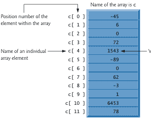

**图 7.1** | 包含 12 个元素的数组。

下标必须是整数或整数表达式（可使用任意整型类型）。如果程序将表达式用作下标，则程序会计算该表达式以确定下标。例如，假设变量 a 等于 5，变量 b 等于 6，那么语句

```
c[ a + b ] += 2;
```

会向数组元素 c[11] 加 2。带下标的数组名是左值——它可以像普通变量名一样用于赋值语句的左侧。

让我们更仔细地检查图 7.1 中的数组 c。整个数组的名称是 c。它的 12 个元素称为 c[0] 到 c[11]。c[0] 的值是 -45，c[1] 的值是 6，c[2] 的值是 0，c[7] 的值是 62，c[11] 的值是 78。要打印数组 c 前三个元素所含值之和，我们会写

```
cout << c[ 0 ] + c[ 1 ] + c[ 2 ] << endl;
```

要将 c[6] 的值除以 2，并将结果赋给变量 x，我们会写

```
x = c[ 6 ] / 2;
```


### 常见编程错误 7.1

注意“数组的第七个元素”与“数组元素 7”之间的区别。下标从 0 开始，因此“数组的第七个元素”的下标是 6，而“数组元素 7”的下标是 7，实际上是数组的第八个元素。这一区别是差一错误的常见来源。为避免此类错误，我们通过数组名和下标编号明确引用特定数组元素（例如 c[6] 或 c[7]）。

括住下标的方括号实际上是一个运算符，其优先级与圆括号相同。图 7.2 显示了目前介绍的运算符的优先级和结合性。运算符按优先级从高到低自上而下显示，并列出其结合性类型。

| 运算符 | 结合性 | 类型 |
|---|---|---|
| `::` | *[参见图 2.10 中关于括号的注意事项]* | 作用域解析 |
| `()  []` | 从左到右 | 函数调用/数组访问 |
| `++  --  static_cast<type>(operand)` | 从左到右 | 一元（后缀） |
| `++  --  +  -  !` | 从右到左 | 一元（前缀） |
| `*  /  %` | 从左到右 | 乘法 |
| `+  -` | 从左到右 | 加法 |
| `<<  >>` | 从左到右 | 插入/提取 |
| `<  <=  >  >=` | 从左到右 | 关系 |
| `==  !=` | 从左到右 | 相等 |
| `&&` | 从左到右 | 逻辑与 |
| `\|\|` | 从左到右 | 逻辑或 |
| `?:` | 从右到左 | 条件 |
| `=  +=  -=  *=  /=  %=` | 从右到左 | 赋值 |
| `,` | 从左到右 | 逗号 |

**图 7.2** | 运算符优先级和结合性。

## 7.3 声明数组

数组会占用内存空间。要指定数组元素的类型和数组所需的元素个数，请使用如下形式的声明：

```
type arrayName[arraySize];
```

编译器会保留适当数量的内存。（回想一下，保留内存的声明更准确地称为定义。）arraySize 必须是大于零的整数常量。例如，要告诉编译器为整数数组 c 保留 12 个元素，请使用声明

```
int c[12]; // c is an array of 12 integers
```


数组可以声明为包含任何非引用数据类型的值。例如，string 类型的数组可用于存储字符串。

## 7.4 使用数组的示例

本节给出许多示例，演示如何声明、初始化和操作数组。

### 7.4.1 声明数组并使用循环初始化数组元素

图 7.3 中的程序声明了一个包含 10 个元素的整数数组 n（第 9 行）。第 12–13 行使用 `for` 语句将数组元素初始化为零。与其他自动变量一样，自动数组不会被隐式初始化为零，尽管静态数组会。第一个输出语句（第 15 行）显示后续 for 语句（第 18–19 行）所打印各列的列标题，该语句以表格格式打印数组。请记住，`setw` 指定字段宽度，其中只输出下一个值。

```cpp
// Fig. 7.3: fig07_03.cpp
// Initializing an array’s elements to zeros and printing the array.
#include <iostream>
#include <iomanip>
using namespace std;

int main()
{
   int n[10]; // n is an array of 10 integers

   // initialize elements of array n to 0
   for (int i = 0; i < 10; ++i)
      n[i] = 0; // set element at location i to 0

   cout << "Element" << setw(13) << "Value" << endl;

   // output each array element’s value
   for (int j = 0; j < 10; ++j)
      cout << setw(7) << j << setw(13) << n[j] << endl;
} // end main
```

| 元素 | 值 |
|---:|---:|
| 0 | 0 |
| 1 | 0 |
| 2 | 0 |
| 3 | 0 |
| 4 | 0 |
| 5 | 0 |
| 6 | 0 |
| 7 | 0 |
| 8 | 0 |
| 9 | 0 |

**图 7.3** | 将数组元素初始化为零并打印数组。

如果在数组声明中同时指定数组大小和初始化列表，则初始化器的数量必须小于或等于数组大小。如下数组声明

`int n[5] = { 32, 27, 64, 18, 95, 14 };`

会导致编译错误，因为有六个初始化器而数组只有五个元素。

### 7.4.3 使用常量变量指定数组大小并通过计算设置数组元素

图 7.5 将一个包含 10 个元素的数组 s 的各元素设置为偶数整数 2、4、6、...、20（第 14–15 行），并以表格格式打印该数组（第 17–21 行）。这些数字（第 15 行）通过将循环计数器的每个连续值乘以 2 再加 2 生成。

```cpp
// Fig. 7.5: fig07_05.cpp
// Set array s to the even integers from 2 to 20.
#include <iostream>
#include <iomanip>
using namespace std;

int main()
{
   // constant variable can be used to specify array size
   const int arraySize = 10;

   int s[ arraySize ]; // array s has 10 elements

   for ( int i = 0; i < arraySize; ++i ) // set the values
      s[ i ] = 2 + 2 * i;

   cout << "Element" << setw( 13 ) << "Value" << endl;

   // output contents of array s in tabular format
   for ( int j = 0; j < arraySize; ++j )
      cout << setw( 7 ) << j << setw( 13 ) << s[ j ] << endl;
} // end main
```

| 元素 | 值 |
|---:|---:|
| 0 | 2 |
| 1 | 4 |
| 2 | 6 |
| 3 | 8 |
| 4 | 10 |
| 5 | 12 |
| 6 | 14 |
| 7 | 16 |
| 8 | 18 |
| 9 | 20 |

**图 7.5** | 生成要放入数组元素中的值。

第 10 行使用 **const 限定符** 声明一个所谓的 **常量变量** `arraySize`，其值为 10。常量变量在声明时必须用常量表达式初始化，并且此后 *不能* 修改（如图 7.6 和图 7.7 所示）。常量变量也称为 *命名常量* 或 *只读变量*。

> **常见编程错误 7.2**
>
> *声明常量变量时未初始化它，属于编译错误。*


> **常见编程错误 7.3**
>
> *在可执行语句中给常量变量赋值，属于编译错误。*


```cpp
// Fig. 7.6: fig07_06.cpp
// Using a properly initialized constant variable.
#include <iostream>
using namespace std;

int main()
{
    const int x = 7;  // initialized constant variable

    cout << "The value of constant variable x is: " << x << endl;
} // end main
```

```text
The value of constant variable x is: 7
```

**图 7.6** | 使用正确初始化的常量变量。

```cpp
// Fig. 7.7: fig07_07.cpp
// A const variable must be initialized.

int main()
{
    const int x;  // Error: x must be initialized

    x = 7;  // Error: cannot modify a const variable
} // end main
```

*Microsoft Visual C++ 编译器错误消息：*

```text
C:\cpphtp8_examples\ch07\fig07_07.cpp(6) : error C2734: 'x' : const object
    must be initialized if not extern
C:\cpphtp8_examples\ch07\fig07_07.cpp(8) : error C3892: 'x' : you cannot
    assign to a variable that is const
```

*GNU C++ 编译器错误消息：*

```text
fig07_07.cpp:6: error: uninitialized const ‘x’
fig07_07.cpp:7: error: assignment of read-only variable ‘x’
```

**图 7.7** | const 变量必须初始化。

在图 7.7 中，Microsoft Visual C++ 产生的编译错误将 int 变量 x 称为“const 对象”。ISO/IEC C++ 标准将“对象”定义为任何“存储区域”。与类对象一样，基本类型变量也占用内存空间，因此它们常被称为“对象”。

常量变量可以放在任何需要常量表达式的位置。在图 7.5 中，常量变量 `arraySize` 在第 12 行指定数组 `s` 的大小。

> **常见编程错误 7.4**
>
> *只能使用常量来声明自动数组和静态数组的大小。为此目的不使用常量属于编译错误。*


使用常量变量指定数组大小可使程序更具可扩展性。在图 7.5 中，只需将其声明中的 `arraySize` 值从 10 改为 1000，第一个 for 语句就能填充一个包含 1000 个元素的数组。如果未使用常量变量 `arraySize`，我们就必须修改程序的第 12、14 和 20 行，才能让程序处理 1000 个数组元素。随着程序变大，这种技术对于编写更清晰、更易于修改的程序会更有用。

> **软件工程观察 7.1**
>
> *将每个数组的大小定义为常量变量而不是字面常量，可使程序更具可扩展性。*


> **良好编程习惯 7.1**
>
> *将数组的大小定义为常量变量而不是字面常量，可使程序更清晰。这种技术消除了所谓的魔法数。例如，在处理包含 10 个元素的数组的代码中反复提到大小 10，会给数字 10 赋予人为的重要意义，并且当程序还包含与数组大小无关的其他 10 时，可能会造成混淆。*


### 7.4.4 对数组元素求和

通常，数组的元素表示要在计算中使用的一系列值。例如，如果数组的元素表示考试成绩，教授可能希望将数组元素求和，并使用该总和计算该考试的全班平均分。

图 7.8 中的程序对包含 10 个元素的整数数组 `a` 中的值求和。该程序在第 9 行声明、创建并初始化该数组。for 语句（第 13–14 行）执行计算。作为数组 `a` 初始化器提供的值也可以由用户从键盘输入到程序中，或从磁盘文件读入（见第 17 章“文件处理”）。例如，下面的 for 语句

```cpp
for ( int j = 0; j < arraySize; ++j )
    cin >> a[ j ];
```

每次从键盘读取一个值，并将该值存入元素 `a[j]`。

```cpp
1  // Fig. 7.8: fig07_08.cpp
2  // Compute the sum of the elements of the array.
3  #include <iostream>
```

**图 7.8** | 计算数组元素之和。（第 1 部分，共 2 部分。）


```cpp
using namespace std;

int main()
{
   const int arraySize = 10; // constant variable indicating size of array
   int a[ arraySize ] = { 87, 68, 94, 100, 83, 78, 85, 91, 76, 87 };
   int total = 0;

   // sum contents of array a
   for ( int i = 0; i < arraySize; ++i )
      total += a[ i ];

   cout << "Total of array elements: " << total << endl;
} // end main
```

数组元素总和为：849

**图 7.8** 计算数组元素之和。

### 7.4.5 使用条形图以图形方式显示数组数据

许多程序以图形方式向用户展示数据。例如，数值通常以条形图中的条形显示。在这样的图表中，较长的条形表示按比例较大的数值。以图形方式显示数值数据的一种简单方法是使用条形图，将每个数值显示为星号（*）组成的条形。

教授们通常喜欢检查一次考试中成绩的分布情况。教授可能会将几个分数段中的成绩数量绘制成图表，以直观地显示成绩分布。假设成绩为 87、68、94、100、83、78、85、91、76 和 87。其中有 1 个 100 分，2 个 90 多分，4 个 80 多分，2 个 70 多分，1 个 60 多分，没有低于 60 分的成绩。我们的下一个程序（图 7.9）将这一成绩分布数据存储在一个包含 11 个元素的数组中，每个元素对应一个成绩类别。例如，`n[0]` 表示 0–9 区间内的成绩数量，`n[7]` 表示 70–79 区间内的成绩数量，`n[10]` 表示 100 分的成绩数量。本章后面的两个 GradeBook 类版本（图 7.15–7.16 和图 7.22–7.23）包含根据一组成绩计算这些成绩频率的代码。目前，我们通过观察这组成绩来手动创建数组。

```cpp
// Fig. 7.9: fig07_09.cpp
// Bar chart printing program.
#include <iostream>
#include <iomanip>
using namespace std;

int main()
{
   const int arraySize = 11;
   int n[ arraySize ] = { 0, 0, 0, 0, 0, 0, 1, 2, 4, 2, 1 };

   cout << "Grade distribution:" << endl;

   // for each element of array n, output a bar of the chart
   for ( int i = 0; i < arraySize; ++i )
   {
      // output bar labels ("0-9:", ... , "90-99:", "100:")
      if ( i == 0 )
         cout << " 0-9: ";
      else if ( i == 10 )
         cout << " 100: ";
      else
         cout << i * 10 << "-" << ( i * 10 ) + 9 << ": ";

      // print bar of asterisks
      for ( int stars = 0; stars < n[ i ]; ++stars )
         cout << '*';

      cout << endl; // start a new line of output
   } // end outer for
} // end main
```

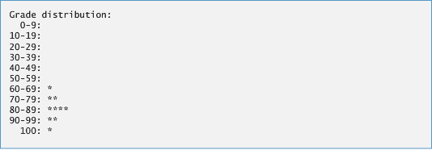

**图 7.9** 条形图打印程序。

程序从数组中读取数字，并将信息绘制为条形图，显示每个成绩区间，后跟一个星号条形，表示该区间内的成绩数量。为了标记每个条形，第 18–23 行根据计数器变量 i 的当前值输出一个成绩区间（例如“70–79: ”）。嵌套的 for 语句（第 26–27 行）输出条形。注意第 26 行中的循环继续条件（`stars < n[i]`）。每次程序到达内部 for 时，循环从 0 计数到 n[i]，从而使用数组 n 中的值来确定要显示的星号数量。在此示例中，`n[0]`–`n[5]` 包含零，因为没有学生获得低于 60 分的成绩。因此，程序不会在前六个成绩区间旁边显示星号。

### 7.4.6 使用数组元素作为计数器

有时，程序使用计数器变量来汇总数据，例如调查结果。在图 6.9 中，我们在掷骰子程序中使用单独的计数器来跟踪骰子每一面出现的次数，该程序掷骰子 6,000,000 次。该程序的数组版本如图 7.10 所示。

```cpp
// Fig. 7.10: fig07_10.cpp
// Roll a six-sided die 6,000,000 times.
#include <iostream>
#include <iomanip>
#include <cstdlib>
#include <ctime>
using namespace std;

int main()
{
   const int arraySize = 7; // ignore element zero
   int frequency[ arraySize ] = {}; // initialize elements to 0

   srand( time( 0 ) ); // seed random number generator

   // roll die 6,000,000 times; use die value as frequency index
   for ( int roll = 1; roll <= 6000000; ++roll )
      ++frequency[ 1 + rand() % 6 ];

   cout << "Face" << setw( 13 ) << "Frequency" << endl;

   // output each array element's value
   for ( int face = 1; face < arraySize; ++face )
   {
      cout << setw( 4 ) << face << setw( 13 ) << frequency[ face ]
           << endl;
   } // end for
} // end main
```

| 面值 | 频率 |
|---:|---:|
| 1 | 1000167 |
| 2 | 1000149 |
| 3 | 1000152 |
| 4 | 998748 |
| 5 | 999626 |
| 6 | 1001158 |

**图 7.10** 使用数组代替 switch 的掷骰子程序。

图 7.10 使用数组 frequency（第 12 行）来计算骰子每一面出现的次数。该程序第 18 行中的单条语句取代了图 6.9 第 25–47 行中的 switch 语句。第 18 行使用一个随机值来确定在每次循环迭代时递增哪个 frequency 元素。第 18 行中的计算产生一个 1 到 6 的随机下标，因此数组 frequency 必须足够大以存储六个计数器。但是，我们使用了一个七元素数组，并忽略 `frequency[0]`——将骰子面值 1 递增 `frequency[1]` 比递增 `frequency[0]` 更为合理。因此，每个面值都用作数组 frequency 的下标。我们还通过遍历数组 frequency 来输出结果（第 23–25 行），取代了图 6.9 中的第 51–56 行。

### 7.4.7 使用数组汇总调查结果

下一个示例使用数组来汇总调查中收集的数据结果。考虑以下问题陈述：

*二十名学生被要求以 1 到 5 的等级评价学生食堂的食品质量，其中 1 表示“糟糕”，5 表示“优秀”。将这 20 个回答放入一个整数数组，并确定每个评级的频率。*

这是一个典型的数组处理应用（图 7.11）。我们希望汇总每种类型（即 1–5）的回答数量。数组 `responses`（第 14–15 行）是一个包含 20 个元素的整数数组，存储了学生对调查的回答。数组 `responses` 被声明为 `const`，因为其值不会（也不应）改变。我们使用一个包含 6 个元素的数组 `frequency`（第 18 行）来计算每个回答出现的次数。数组的每个元素被用作一个调查回答的计数器，并初始化为零。与图 7.10 一样，我们忽略 `frequency[0]`。

第一个 `for` 语句（第 22–23 行）从数组 `responses` 中逐个取出回答，并递增 `frequency` 数组中的五个计数器之一（`frequency[1]` 到 `frequency[5]`，具体取决于回答）。第二个 `for` 语句输出表格。

```cpp
// Fig. 7.11: fig07_11.cpp
// Poll analysis program.
#include <iostream>
#include <iomanip>
using namespace std;

int main()
{
   // define array sizes
   const int responseSize = 20; // size of array responses
   const int frequencySize = 6; // size of array frequency

   // place survey responses in array responses
   const int responses[ responseSize ] = { 1, 2, 5, 4, 3, 5, 2, 1, 3,
      1, 4, 3, 3, 3, 2, 3, 3, 2, 2, 5 };

   // initialize frequency counters to 0
   int frequency[ frequencySize ] = {};

   // for each answer, select responses element and use that value
   // as frequency subscript to determine element to increment
   for ( int answer = 0; answer < responseSize; ++answer )
      ++frequency[ responses[ answer ] ];

   cout << "Rating" << setw( 17 ) << "Frequency" << endl;

   // output each array element's value
   for ( int rating = 1; rating < frequencySize; ++rating )
      cout << setw( 6 ) << rating << setw( 17 ) << frequency[ rating ]
         << endl;
} // end main
```

| 评级 | 频率 |
|---:|---:|
| 1 | 3 |
| 2 | 5 |
| 3 | 7 |
| 4 | 2 |
| 5 | 3 |

**图 7.11** 民意调查分析程序。


> **错误预防提示 7.2**
> 
> 在第一章中，我们将看到如何开发一个表示“智能数组”的类，它会在运行时检查所有下标引用是否在边界内。使用这样的智能数据类型有助于消除错误。

### 7.4.8 静态局部数组与自动局部数组

第6章讨论了存储类别说明符 `static`。函数定义中的静态局部变量在程序运行期间存在，但仅在函数体内可见。

> **性能提示 7.1**
> 
> 我们可以将 `static` 应用于局部数组声明，这样每次程序调用函数时不会创建和初始化该数组，每次函数终止时也不会销毁它。这可以提高性能，尤其是在使用大型数组时。

程序在首次遇到静态局部数组的声明时对其进行初始化。如果你没有显式初始化静态数组，那么当数组被创建时，编译器会将数组的每个元素初始化为零。回想一下，C++ 不会对自动变量执行这种默认初始化。

图 7.12 演示了带有静态局部数组（第26行）的函数 `staticArrayInit`（第23–39行）以及带有自动局部数组（第45行）的函数 `automaticArrayInit`（第42–58行）。

```cpp
// Fig. 7.12: fig07_12.cpp
// Static arrays are initialized to zero.
#include <iostream>
using namespace std;

void staticArrayInit( void ); // function prototype
void automaticArrayInit( void ); // function prototype
const int arraySize = 3;

int main()
{
   cout << "First call to each function:\n";
   staticArrayInit();
   automaticArrayInit();

   cout << "\n\nSecond call to each function:\n";
   staticArrayInit();
   automaticArrayInit();
   cout << endl;
} // end main

// function to demonstrate a static local array
void staticArrayInit( void )
{
   // initializes elements to 0 first time function is called
   static int array1[ arraySize ]; // static local array

   // output contents of array1
   for ( int i = 0; i < arraySize; ++i )
      cout << "array1[" << i << "] = " << array1[ i ] << " ";

   cout << "\nValues on exiting staticArrayInit:\n";

   // modify and output contents of array1
   for ( int j = 0; j < arraySize; ++j )
      cout << "array1[" << j << "] = " << ( array1[ j ] += 5 ) << " ";
} // end function staticArrayInit

// function to demonstrate an automatic local array
void automaticArrayInit( void )
{
   // initializes elements each time function is called
   int array2[ arraySize ] = { 1, 2, 3 }; // automatic local array

   cout << "\n\nValues on entering automaticArrayInit:\n";

   // output contents of array2
   for ( int i = 0; i < arraySize; ++i )
      cout << "array2[" << i << "] = " << array2[ i ] << " ";

   cout << "\nValues on exiting automaticArrayInit:\n";

   // modify and output contents of array2
   for ( int j = 0; j < arraySize; ++j )
      cout << "array2[" << j << "] = " << ( array2[ j ] += 5 ) << " ";
} // end function automaticArrayInit
```

**图 7.12** | 静态数组初始化与自动数组初始化。（第1部分，共2部分。）

```text
First call to each function:

Values on entering staticArrayInit:
array1[0] = 0  array1[1] = 0  array1[2] = 0
Values on exiting staticArrayInit:
array1[0] = 5  array1[1] = 5  array1[2] = 5

Values on entering automaticArrayInit:
array2[0] = 1  array2[1] = 2  array2[2] = 3
Values on exiting automaticArrayInit:
array2[0] = 6  array2[1] = 7  array2[2] = 8

Second call to each function:

Values on entering staticArrayInit:
array1[0] = 5  array1[1] = 5  array1[2] = 5
Values on exiting staticArrayInit:
array1[0] = 10  array1[1] = 10  array1[2] = 10

Values on entering automaticArrayInit:
array2[0] = 1  array2[1] = 2  array2[2] = 3
Values on exiting automaticArrayInit:
array2[0] = 6  array2[1] = 7  array2[2] = 8
```

**图 7.12** | 静态数组初始化与自动数组初始化。（第2部分，共2部分。）

函数 `staticArrayInit` 被调用了两次（第13行和第17行）。编译器在第一次调用函数时将静态局部数组初始化为零。该函数打印数组，将每个元素加上5，然后再次打印数组。当第二次调用该函数时，静态数组中包含了第一次函数调用期间存储的修改后的值。函数 `automaticArrayInit` 也被调用了两次（第14行和第18行）。自动局部数组的元素在第45行被初始化为值 1、2 和 3。该函数打印数组，将每个元素加上5，然后再次打印数组。当第二次调用该函数时，数组元素被重新初始化为 1、2 和 3。该数组具有自动存储类别，因此每次调用 `automaticArrayInit` 时数组都会被重新创建并重新初始化。

> **常见编程错误 7.6**
> 
> *假设函数局部静态数组的元素在每次调用函数时都会被初始化，可能会导致程序中的逻辑错误。*

## 7.5 向函数传递数组

要将数组参数传递给函数，请指定不带任何方括号的数组名称。例如，如果数组 `hourlyTemperatures` 已声明为

```cpp
int hourlyTemperatures[ 24 ];
```

则函数调用

```cpp
modifyArray( hourlyTemperatures, 24 );
```

将数组 `hourlyTemperatures` 及其大小传递给函数 `modifyArray`。当向函数传递数组时，通常也会传递数组大小，以便函数能够处理数组中特定数量的元素。否则，我们需要将此信息构建到被调用的函数本身中，或者更糟糕的是，将数组大小放在全局变量中。在第7.11节中，当我们介绍 C++ 标准库类模板 `vector` 来表示一种更健壮的数组类型时，你会看到 `vector` 的大小是内置的——每个 `vector` 对象“知道”自己的大小，可以通过调用 `vector` 对象的 `size` 成员函数来获得。因此，当我们将 `vector` 对象传递给函数时，不必将 `vector` 的大小作为参数传递。

C++ 按引用将数组传递给函数——被调用的函数可以修改调用者原始数组中的元素值。数组名称的值是数组第一个元素在计算机内存中的地址。由于传递了数组的起始地址，被调用的函数确切地知道数组在内存中的存储位置。因此，当被调用的函数在其函数体中修改数组元素时，它修改的是数组中位于其原始内存位置的实际元素。

> **性能提示 7.2**
> 
> *按引用传递数组在性能方面是有意义的。按值传递需要复制每个元素。对于大型且频繁传递的数组，这将非常耗时，并且需要大量的存储空间来存储数组元素的副本。*

> **软件工程观察 7.2**
> 
> *可以通过将数组作为类的数据成员嵌入，并传递该类的对象（默认为按值传递）来按值传递数组。*

尽管整个数组是按引用传递的，但单个数组元素与简单变量一样是按值传递的。要将数组元素传递给函数，请在函数调用中使用数组元素的下标名称作为参数。在第6章中，我们展示了如何使用引用按引用传递单个变量和数组元素——在第8章中，我们将展示如何使用指针按引用传递它们。

为了使函数通过函数调用接收数组，函数的参数列表必须指定该函数期望接收一个数组。例如，函数 `modifyArray` 的函数头可以写成

```cpp
void modifyArray( int b[], int arraySize )
```

这表明 `modifyArray` 期望在参数 `b` 中接收整数数组的地址，并在参数 `arraySize` 中接收数组元素的数量。数组的大小在数组方括号中不是必需的。如果包含它，编译器会忽略它；因此，任意大小的数组都可以传递给函数。C++ 按引用将数组传递给函数——当被调用的函数使用数组名称 `b` 时，它引用的是调用者中的实际数组（即本节开头讨论的数组 `hourlyTemperatures`）。

请注意 `modifyArray` 函数原型的奇怪外观

```cpp
void modifyArray( int [], int );
```

这个原型本来可以写成（出于文档目的）

```cpp
void modifyArray( int anyArrayName[], int anyVariableName );
```

但正如我们在第3章中学到的，C++ 编译器会忽略原型中的变量名称。请记住，原型告诉编译器参数的数量和每个参数的类型（按参数预期出现的顺序）。

图 7.13 中的程序演示了传递整个数组与传递数组元素之间的区别。第19–20行打印整数数组 `a` 的五个原始元素。第25行将 `a` 及其大小传递给函数 `modifyArray`（第40–45行），该函数通过参数 `b` 将 `a` 的每个元素乘以2。然后，第29–30行在 `main` 中再次打印数组 `a`。如输出所示，`a` 的元素确实被 `modifyArray` 修改了。接下来，第33行打印 `a[3]` 的值，然后第35行将元素 `a[3]` 传递给函数 `modifyElement`（第49–53行），该函数将其参数乘以2并打印新值。当第36行在 `main` 中再次打印 `a[3]` 时，该值没有被修改，因为单个数组元素是按值传递的。

```cpp
// Fig. 7.13: fig07_13.cpp
// Passing arrays and individual array elements to functions.
#include <iostream>
#include <iomanip>
using namespace std;

void modifyArray( int [], int ); // appears strange; array and size
void modifyElement( int ); // receive array element value

int main()
{
```

**图 7.13** | 向函数传递数组和单个数组元素。（第1部分，共2部分。）


在程序中，有时可能会遇到这样的情况：某个函数不应该被允许修改数组元素。类型限定符 `const` 可用于防止被调函数中的代码修改调用者中的数组值。当函数指定一个带有 `const` 限定符的数组参数时，该数组的元素在函数体内将变为常量，任何在函数体内修改数组元素的尝试都会导致编译错误。这使您能够防止在函数体内意外修改数组元素。

图 7.14 演示了将 `const` 限定符应用于数组参数的情况。函数 `tryToModifyArray`（第 18-21 行）定义时带有参数 `const int b[]`，这表示数组 `b` 是常量且不能被修改。该函数尝试修改数组 `b` 的第 0 个元素（第 20 行）会导致编译错误。例如，某些编译器会产生类似“Cannot modify a const object.”的错误。此消息表明，将 const 对象（`b[0]`）用作左值是错误的——您不能为 const 对象赋新值。


> **软件工程观察 7.3**
> 
> *在函数定义中将 `const` 类型限定符应用于数组参数，以防止原始数组在函数体中被修改，这是最小特权原则的另一个示例。除非绝对必要，否则不应赋予函数修改数组的能力。*

```cpp
// Fig. 7.14: fig07_14.cpp
// Demonstrating the const type qualifier.
#include <iostream>
using namespace std;

void tryToModifyArray( const int b[] ); // function prototype

int main()
{
   int a[] = { 10, 20, 30 };

   tryToModifyArray( a );
   cout << a[ 0 ] << ' ' << a[ 1 ] << ' ' << a[ 2 ] << '\n';
} // end main

// In function tryToModifyArray, "b" cannot be used
// to modify the original array "a" in main.
void tryToModifyArray( const int b[] )
{
   b[ 0 ] /= 2; // compilation error
} // end function tryToModifyArray
```

*Microsoft Visual C++ 编译器错误消息：*

```text
c:\cpphtp_examples\ch07\fig07_14\fig07_14.cpp(20) : error C3892: 'b' : you
cannot assign to a variable that is const
```

*GNU C++ 编译器错误消息：*

```text
fig07_14.cpp:20: error: assignment of read-only location
```

**图 7.14** | 应用于数组参数的 `const` 类型限定符。

## 7.6 案例研究：使用数组存储成绩的 GradeBook 类

本节将进一步演进类 GradeBook，该类在第 3 章中引入，并在第 4-6 章中扩展。回想一下，该类表示教授用来存储和分析学生成绩的成绩簿。以前版本的类处理用户输入的成绩，但不在类的数据成员中维护各个成绩值。因此，重复计算需要用户重新输入成绩。解决此问题的一种方法是将输入的每个成绩存储在类的单独数据成员中。例如，我们可以在类 GradeBook 中创建数据成员 grade1、grade2、…、grade10 来存储 10 个学生成绩。然而，对成绩求和并确定班级平均分的代码将会很繁琐。在本节中，我们通过将成绩存储在数组中来解决此问题。

### 在类 GradeBook 中将学生成绩存储在数组中

此处给出的类 GradeBook 版本（图 7.15-7.16）使用整数数组来存储若干学生在一次考试中的成绩。这消除了重复输入同一组成绩的需要。数组 `grades` 在图 7.15 的第 28 行被声明为数据成员——因此，每个 GradeBook 对象都维护自己的一组成绩。

```cpp
// Fig. 7.15: GradeBook.h
// Definition of class GradeBook that uses an array to store test grades.
// Member functions are defined in GradeBook.cpp
#include <string> // program uses C++ Standard Library string class
using namespace std;

// GradeBook class definition
class GradeBook
{
public:
   // constant -- number of students who took the test
   static const int students = 10; // note public data

   // constructor initializes course name and array of grades
   GradeBook( string, const int [] );

   void setCourseName( string ); // function to set the course name
   string getCourseName(); // function to retrieve the course name
   void displayMessage(); // display a welcome message
   void processGrades(); // perform various operations on the grade data
   int getMinimum(); // find the minimum grade for the test
   int getMaximum(); // find the maximum grade for the test
   double getAverage(); // determine the average grade for the test
   void outputBarChart(); // output bar chart of grade distribution
   void outputGrades(); // output the contents of the grades array
private:
   string courseName; // course name for this grade book
   int grades[ students ]; // array of student grades
}; // end class GradeBook
```

**图 7.15** | 使用数组存储测试成绩的类 GradeBook 的定义。

```cpp
// Fig. 7.16: GradeBook.cpp
// Member-function definitions for class GradeBook that
// uses an array to store test grades.
#include <iostream>
#include <iomanip>
#include "GradeBook.h" // GradeBook class definition
using namespace std;

// constructor that initializes courseName and grades array
GradeBook::GradeBook( string name, const int gradesArray[] )
{
   setCourseName( name ); // initialize courseName

   // copy grades from gradesArray to grades data member
   for ( int grade = 0; grade < students; grade++ )
      grades[ grade ] = gradesArray[ grade ];
} // end GradeBook constructor

// function to set the course name
void GradeBook::setCourseName( string name )
{
   courseName = name; // store the course name
} // end function setCourseName

// function to retrieve the course name
string GradeBook::getCourseName()
{
   return courseName;
} // end function getCourseName

// display a welcome message to the GradeBook user
void GradeBook::displayMessage()
{
   // this statement calls getCourseName to get the
   // name of the course this GradeBook represents
   cout << "Welcome to the grade book for\n" << getCourseName() << "!"
        << endl;
} // end function displayMessage

// perform various operations on the data
void GradeBook::processGrades()
{
   outputGrades(); // output grades array

   // display average of all grades and minimum and maximum grades
   cout << "\nClass average is " << setprecision(2) << fixed <<
      getAverage() << "\nLowest grade is " << getMinimum() <<
      "\nHighest grade is " << getMaximum() << endl;

   outputBarChart(); // print grade distribution chart
} // end function processGrades

// find minimum grade
int GradeBook::getMinimum()
{
   int lowGrade = 100; // assume lowest grade is 100

   // loop through grades array
   for ( int grade = 0; grade < students; ++grade )
   {
      // if current grade lower than lowGrade, assign it to lowGrade
      if ( grades[ grade ] < lowGrade )
         lowGrade = grades[ grade ]; // new lowest grade
   } // end for

   return lowGrade; // return lowest grade
} // end function getMinimum

// find maximum grade
int GradeBook::getMaximum()
{
   int highGrade = 0; // assume highest grade is 0

   // loop through grades array
   for ( int grade = 0; grade < students; ++grade )
   {
      // if current grade higher than highGrade, assign it to highGrade
      if ( grades[ grade ] > highGrade )
         highGrade = grades[ grade ]; // new highest grade
   } // end for

   return highGrade; // return highest grade
} // end function getMaximum

// determine average grade for test
double GradeBook::getAverage()
{
   int total = 0; // initialize total

   // sum grades in array
   for ( int grade = 0; grade < students; ++grade )
      total += grades[ grade ];

   // return average of grades
   return static_cast< double >( total ) / students;
} // end function getAverage

// output bar chart displaying grade distribution
void GradeBook::outputBarChart()
{
   cout << "\nGrade distribution:" << endl;

   // stores frequency of grades in each range of 10 grades
   const int frequencySize = 11;
   int frequency[ frequencySize ] = {}; // initialize elements to 0
```

**图 7.16** | GradeBook 类成员函数操作成绩数组。


```cpp
// for each grade, increment the appropriate frequency
for ( int grade = 0; grade < students; ++grade )
   ++frequency[ grades[ grade ] / 10 ];

// for each grade frequency, print bar in chart
for ( int count = 0; count < frequencySize; ++count )
{
   // output bar labels ("0-9", ..., "90-99", "100:")
   if ( count == 0 )
      cout << "  0-9: ";
   else if ( count == 10 )
      cout << "100: ";
   else
      cout << count * 10 << "-" << ( count * 10 ) + 9 << ": ";

   // print bar of asterisks
   for ( int stars = 0; stars < frequency[ count ]; ++stars )
      cout << '*';

   cout << endl; // start a new line of output
} // end for
} // end function outputBarChart

// output the contents of the grades array
void GradeBook::outputGrades()
{
   cout << "\nThe grades are:\n\n";

   // output each student's grade
   for ( int student = 0; student < students; ++student )
      cout << "Student " << setw( 2 ) << student + 1 << ": " << setw( 3 )
           << grades[ student ] << endl;
} // end function outputGrades
```

**图 7.16** | 操作成绩数组的 *GradeBook* 类成员函数。（第 3 部分，共 3 部分。）

图 7.15 第 28 行中数组的大小由 **public static const** 数据成员 students（在第 12 行声明）指定，它是 public 的，因此类的客户端可以访问它。我们很快就会看到一个使用该常量的客户端程序示例。用 const 限定符声明 students 表示该数据成员是常量——其值在初始化后不能更改。此变量声明中的关键字 static 表示该数据成员由该类的所有对象共享——所有 GradeBook 对象都为相同数量的学生存储成绩。回想 3.4 节，当一个类的每个对象都维护某个属性的自己的副本时，表示该属性的变量称为数据成员——该类的每个对象（实例）在内存中都有该变量的单独副本。有些变量并不是类的每个对象都有单独的副本。静态数据成员就是这种情况，它们也称为类变量。当创建包含静态数据成员的类的对象时，所有对象共享该类静态数据成员的一份副本。静态数据成员可以像任何其他数据成员一样在类定义和成员函数定义中访问。你很快就会看到，public 静态数据成员也可以在类外部访问，即使该类没有任何对象

各成绩类别中的成绩频率。对于数组 grades 中的每个成绩，第 108–109 行递增 frequency 数组中相应的元素。为确定要递增哪个元素，第 109 行使用整数除法将当前成绩除以 10。例如，如果成绩是 85，第 109 行将 frequency[8] 递增，以更新 80–89 范围内的成绩计数。接下来，第 112–127 行根据数组 frequency 中的值打印条形图（见图 7.17）。与图 7.9 的第 26–27 行类似，图 7.16 的第 123–124 行使用数组 frequency 中的一个值来确定每个条形中要显示的星号数量。

### 测试 GradeBook 类

图 7.17 的程序使用 int 数组 gradesArray（在第 9–10 行声明并初始化）创建 GradeBook 类（图 7.15–7.16）的一个对象。表达式 “GradeBook::students”（第 9 行）中使用作用域解析运算符（::）来访问 GradeBook 类的静态常量 students。这里我们使用该常量创建一个与作为数据成员存储在 GradeBook 类中的数组 grades 大小相同的数组。第 12–13 行将课程名和 gradesArray 传递给 GradeBook 构造函数。第 14 行显示欢迎消息，第 15 行调用 GradeBook 对象的 processGrades 成员函数。输出显示了 myGradeBook 中 10 个成绩的摘要。

```cpp
// Fig. 7.17: fig07_17.cpp
// Creates GradeBook object using an array of grades.
#include "GradeBook.h" // GradeBook class definition

// function main begins program execution
int main()
{
   // array of student grades
   int gradesArray[ GradeBook::students ] =
      { 87, 68, 94, 100, 83, 78, 85, 91, 76, 87 };

   GradeBook myGradeBook(
      "CS101 Introduction to C++ Programming", gradesArray );
   myGradeBook.displayMessage();
   myGradeBook.processGrades();
} // end main
```

```text
Welcome to the grade book for
CS101 Introduction to C++ Programming!

The grades are:

Student  1: 87
Student  2: 68
Student  3: 94
Student  4: 100
Student  5: 83
Student  6: 78
Student  7: 85
Student  8: 91
Student  9: 76
Student 10: 87

Class average is 84.90
Lowest grade is 68
Highest grade is 100

Grade distribution:
  0–9:
10–19:
20–29:
30–39:
40–49:
50–59:
60–69: *
70–79: **
80–89: ****
90–99: **
   100: *
```

**图 7.17** | 使用成绩数组创建 GradeBook 对象，然后调用成员函数 `processGrades` 分析这些成绩。（第 1 部分，共 2 部分。）

**图 7.17** | 使用成绩数组创建 GradeBook 对象，然后调用成员函数 `processGrades` 分析这些成绩。（第 2 部分，共 2 部分。）

## 7.7 使用线性查找搜索数组

通常可能需要确定数组是否包含与某个**键值**匹配的值。查找数组中特定元素的过程称为**搜索**。本节讨论简单的线性查找。本章末尾的练习 7.33 要求你实现线性查找的递归版本。在第 19 章 *搜索与排序* 中，我们将介绍更复杂但更高效的二分查找。

### *线性查找*

**线性查找**（图 7.18，第 33–40 行）将数组的每个元素与一个**搜索键**（第 36 行）进行比较。由于数组未按任何特定顺序排列，值在第一个元素中被找到的可能性与在最后一个元素中被找到的可能性相同。因此，平均而言，程序必须将搜索键与数组的一半元素进行比较。要确定某个值不在数组中，程序必须将搜索键与数组的每个元素进行比较。

```cpp
// Fig. 7.18: fig07_18.cpp
// Linear search of an array.
#include <iostream>
using namespace std;

int linearSearch( const int [], int, int ); // prototype

int main()
{
   const int arraySize = 100; // size of array a
   int a[ arraySize ]; // create array a
   int searchKey; // value to locate in array a

   for ( int i = 0; i < arraySize; ++i )
      a[ i ] = 2 * i; // create some data

   cout << "Enter integer search key: ";
   cin >> searchKey;

   // attempt to locate searchKey in array a
   int element = linearSearch( a, searchKey, arraySize );

   // display results
   if ( element != -1 )
      cout << "Found value in element " << element << endl;
   else
      cout << "Value not found" << endl;
} // end main

// compare key to every element of array until location is
// found or until end of array is reached; return subscript of
// element if key is found or -1 if key not found
int linearSearch( const int array[], int key, int sizeOfArray )
{
   for ( int j = 0; j < sizeOfArray; ++j )
      if ( array[ j ] == key ) // if found,
         return j; // return location of key

   return -1; // key not found
} // end function linearSearch
```

```text
Enter integer search key: 36
Found value in element 18
```

```text
Enter integer search key: 37
Value not found
```

**图 7.18** | 数组的线性查找。（第 1 部分，共 2 部分。）

**图 7.18** | 数组的线性查找。（第 2 部分，共 2 部分。）

线性查找方法适用于小数组或未排序数组（即元素没有特定顺序的数组）。然而，对于大数组，线性查找效率低下。如果数组已排序（例如，其元素按升序排列），则可以使用高速二分查找技术，你将在第 19 章学习该技术。

## 7.8 使用插入排序对数组排序

**排序**数据（即，将数据按某种特定顺序放置，例如升序或降序）是最重要的计算应用之一。银行按账号对所有支票进行排序，以便在每月月底编制个人银行对账单。电话公司按姓氏、并在姓氏内按名字对其电话簿进行排序，以便于查找电话号码。几乎每个组织都必须对某些数据进行排序，而且在许多情况下，数据量巨大。排序数据是一个引人入胜的问题，它吸引了计算机科学领域一些最深入的研究工作。本章讨论一种简单的排序方案。在第 19 章中，我们将研究性能更优的更复杂方案，并介绍大 O

（读作“Big Oh”）表示法，用于描述每种方案完成任务必须付出多大代价。

## 插入排序

图 7.19 中的程序将包含 10 个元素的数组 data 的值按升序排序。我们使用的技术称为插入排序——一种简单但效率不高的排序算法。该算法的第一次迭代取出第二个元素，如果它小于第一个元素，就将其与第一个元素交换（即程序将第二个元素插入到第一个元素之前）。第二次迭代查看第三个元素，并将其插入到相对于前两个元素的正确位置，因此这三个元素都有序。在该算法的第 i 次迭代时，原数组中的前 i 个元素将是有序的。

图 7.19 的第 10 行声明并初始化数组 data，其值如下：

|  |  |  |  |  |  |  |  |  |  |
|---:|---:|---:|---:|---:|---:|---:|---:|---:|---:|
| 34 | 56 | 4 | 10 | 77 | 51 | 93 | 30 | 5 | 52 |

程序首先查看 data[0] 和 data[1]，它们的值分别为 34 和 56。这两个元素已经有序，因此程序继续执行——如果它们无序，程序就会交换它们。

```cpp
// Fig. 7.19: fig07_19.cpp
// This program sorts an array's values into ascending order.
#include <iostream>
#include <iomanip>
using namespace std;

int main()
{
    const int arraySize = 10; // size of array a
    int data[ arraySize ] = { 34, 56, 4, 10, 77, 51, 93, 30, 5, 52 };
    int insert; // temporary variable to hold element

    cout << "Unsorted array:\n";

    // output original array
    for ( int i = 0; i < arraySize; ++i )
        cout << setw( 4 ) << data[ i ];

    // insertion sort
    // loop over the elements of the array
    for ( int next = 1; next < arraySize; ++next )
    {
        insert = data[ next ]; // store the value in the current element

        int moveItem = next; // initialize location to place element

        // search for the location in which to put the current element
        while ( ( moveItem > 0 ) && ( data[ moveItem - 1 ] > insert ) )
        {
            // shift element one slot to the right
            data[ moveItem ] = data[ moveItem - 1 ];
            moveItem--;
        } // end while

        data[ moveItem ] = insert; // place inserted element into the array
    } // end for

    cout << "\nSorted array:\n";

    // output sorted array
    for ( int i = 0; i < arraySize; ++i )
        cout << setw( 4 ) << data[ i ];

    cout << endl;
} // end main
```

```text
Unsorted array:
   34  56   4  10  77  51  93  30   5  52
Sorted array:
    4   5  10  30  34  51  52  56  77  93
```

**图 7.19** | 使用插入排序对数组排序。

第二次迭代中，程序查看 data[2] 的值，即 4。该值小于 56，因此程序将 4 存入临时变量，并将 56 向右移动一个元素。程序随后检查并确定 4 小于 34，因此将 34 向右移动一个元素。此时程序已到达数组开头，因此将 4 放入 data[0]。数组现在为

```text
  4   34   56   10   77   51   93   30   5   52
```

第三次迭代中，程序将 data[3] 的值 10 存入临时变量。然后程序将 10 与 56 比较，因为 56 大于 10，所以将 56 向右移动一个元素。程序接着将 10 与 34 比较，将 34 向右移动一个元素。当程序将 10 与 4 比较时，发现 10 大于 4，于是将 10 放入 data[1]。数组现在为

```text
  4   10   34   56   77   51   93   30   5   52
```

使用该算法时，在第 iᵗʰ 次迭代，原数组的前 i 个元素是有序的。不过，它们可能不在最终位置上，因为更小的值可能位于数组后面的位置。

排序由第 21–36 行的 for 语句执行，该语句遍历数组的元素。在每次迭代中，第 23 行将要插入数组已排序部分的元素值临时存入变量 insert（在第 11 行声明）。第 25 行声明并初始化变量 moveItem，它跟踪元素应插入的位置。第 28–33 行循环查找元素应插入的正确位置。当程序到达数组前端，或到达一个小于待插入值的元素时，循环终止。第 31 行将一个元素向右移动，第 32 行递减下一个元素的插入位置。while 循环结束后，第 35 行将元素插入到位。当第 21–36 行的 for 语句终止时，数组元素已排序。

插入排序的主要优点在于易于编程；然而，它运行缓慢。在对大型数组排序时，这一点会变得明显。在练习中，我们将研究一些用于数组排序的替代算法。我们将在第 19 章更深入地研究排序和搜索。

## 7.9 多维数组

二维（即两个下标）数组通常表示由按行和列排列的信息组成的值表。要标识某个特定表元素，必须指定两个下标。按照惯例，第一个下标标识元素所在的行，第二个下标标识元素所在的列。需要两个下标来标识特定元素的数组称为二维数组或 2-D 数组。具有两个或更多维度的数组称为多维数组，并且可以具有两个以上维度。图 7.20 展示了一个二维数组。该数组包含三行四列，因此称为 3×4 数组。一般来说，具有 m 行 n 列的数组称为 m×n 数组。

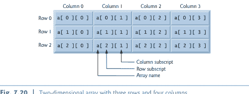

**图 7.20** | 具有三行四列的二维数组。

图 7.20 中，数组 a 的每个元素都通过形如 a[i][j] 的元素名来标识，其中 a 是数组名，i 和 j 是唯一标识 a 中每个元素的下标。注意，第 0 行中元素名的第一个下标均为 0；第 3 列中元素名的第二个下标均为 3。

> **常见编程错误 7.7**
> 
> 将二维数组元素 `a[x][y]` 错误地引用为 `a[x, y]` 是一种错误。实际上，`a[x, y]` 会被当作 `a[x]`，因为 C++ 会把表达式 `x, y`（包含逗号运算符）简单地求值为 `y`（逗号分隔表达式中的最后一个）。

多维数组可以像一维数组一样在声明中初始化。例如，一个二维数组 b，其第 0 行元素为 1 和 2，第 1 行元素为 3 和 4，可以这样声明并初始化：

```cpp
int b[ 2 ][ 2 ] = { { 1, 2 }, { 3, 4 } };
```

这些值在花括号中按行分组。因此，1 和 2 分别初始化 `b[0][0]` 和 `b[0][1]`，3 和 4 分别初始化 `b[1][0]` 和 `b[1][1]`。如果给定行的初始化值不够，该行剩余元素初始化为 0。因此，声明

```cpp
int b[2][2] = { { 1 }, { 3, 4 } };
```

会将 `b[0][0]` 初始化为 1，`b[0][1]` 初始化为 0，`b[1][0]` 初始化为 3，`b[1][1]` 初始化为 4。图 7.21 演示了在声明中初始化二维数组。第 12–14 行声明了三个数组，每个数组都有两行三列。`array1` 的声明（第 12 行）在两个子列表中提供了六个初始化值。第一个子列表将数组的第 0 行初始化为值 1、2 和 3；第二个子列表将数组的第 1 行初始化为

```cpp
// Fig. 7.21: fig07_21.cpp
// Initializing multidimensional arrays.
#include <iostream>
using namespace std;

void printArray( const int a[][ 3 ] ); // prototype
const int rows = 2;
const int columns = 3;

int main()
{
   int array1[ rows ][ columns ] = { { 1, 2, 3 }, { 4, 5, 6 } };
   int array2[ rows ][ columns ] = { { 1, 2, 3, 4, 5 } };
   int array3[ rows ][ columns ] = { { 1, 2 }, { 4 } };

   cout << "Values in array1 by row are:" << endl;
   printArray( array1 );

   cout << "\nValues in array2 by row are:" << endl;
   printArray( array2 );

   cout << "\nValues in array3 by row are:" << endl;
   printArray( array3 );
} // end main

// output array with two rows and three columns
void printArray( const int a[][ columns ] )
{
   // loop through array's rows
   for ( int i = 0; i < rows; ++i )
   {
      // loop through columns of current row
      for ( int j = 0; j < columns; ++j )
         cout << a[ i ][ j ] << ' ';

      cout << endl; // start new line of output
   } // end for
} // end function printArray
```

**图 7.21** | 初始化多维数组。（第 1 部分，共 2 部分。）


```
Values in array1 by row are:
1 2 3
4 5 6

Values in array2 by row are:
1 2 3
4 5 0

Values in array3 by row are:
1 2 0
4 0 0
```

*图7.21* | 初始化多维数组。（第2部分，共2部分。）

值4、5和6。如果从array1的初始化列表中删除每个子列表周围的花括号，编译器将先初始化第0行的元素，再初始化第1行的元素，得到相同的结果。

array2的声明（第13行）只提供了五个初始化值。这些初始化值被依次赋给第0行、第1行。任何没有显式初始化值的元素都被初始化为零，因此array2[1][2]被初始化为零。

array3的声明（第14行）在两个子列表中提供了三个初始化值。第0行的子列表将第0行的前两个元素显式初始化为1和2；第三个元素隐式初始化为零。第1行的子列表将第一个元素显式初始化为4，并将最后两个元素隐式初始化为零。

程序调用函数printArray输出每个数组的元素。请注意，函数原型（第6行）和定义（第27-38行）将参数指定为const int a[][columns]。当函数接收一维数组作为参数时，函数参数列表中的数组方括号为空。二维数组第一维（即行数）的大小同样不需要指定，但所有后续维度的大小都需要指定。编译器使用这些大小来确定多维数组中元素在内存中的位置。无论维度数量是多少，所有数组元素都连续存储在内存中。在二维数组中，第0行存储在内存中，随后是第1行。每一行都是一维数组。要定位特定行中的元素，函数必须确切地知道每行有多少个元素，以便在访问数组时跳过适当数量的内存位置。因此，当访问a[1][2]时，函数知道在内存中跳过第0行的三个元素才能到达第1行。然后，函数访问该行的元素2。

许多常见的数组操作都会使用for语句。例如，下面的for语句将图7.20中数组a的第2行的所有元素设置为零：

```cpp
for ( int column = 0; column < 4; ++column )
    a[ 2 ][ column ] = 0;
```

该for语句只改变第二个下标（即列下标）。前面的for语句等价于下列赋值语句：

```cpp
a[ 2 ][ 0 ] = 0;
a[ 2 ][ 1 ] = 0;
a[ 2 ][ 2 ] = 0;
a[ 2 ][ 3 ] = 0;
```

下面的嵌套`for`语句确定数组`a`中*所有*元素的总和：

```cpp
total = 0;
for ( int row = 0; row < 3; ++row )
    for ( int column = 0; column < 4; ++column )
        total += a[ row ][ column ];
```

该`for`语句一次一行地累加数组元素。外层`for`语句首先将row（即行下标）设置为0，这样第0行元素就可以由内层`for`语句累加。然后外层`for`语句将row递增为1，累加第1行元素。接着外层`for`语句将row递增为2，累加第2行元素。当嵌套的`for`语句终止时，`total`中包含所有数组元素的总和。

## 7.10 案例研究：使用二维数组的GradeBook类

在7.6节中，我们介绍了GradeBook类（图7.15-7.16），它使用一维数组存储学生在一次考试中的成绩。在大多数学期中，学生要参加多次考试。教授们可能希望分析整个学期的成绩，既针对单个学生，也针对整个班级。

### *在GradeBook类中使用二维数组存储学生成绩*

图7.22-图7.23包含了GradeBook类的一个版本，它使用一个二维成绩数组来存储多名学生在多次考试中的成绩。该数组的每一行代表一个学生整个课程的成绩，每一列代表所有学生在某一次考试中的成绩。客户端程序（如图7.24所示）将该数组作为参数传递给GradeBook构造函数。在本例中，我们使用一个10×3的数组，其中包含10名学生在3次考试中的成绩。

```cpp
// Fig. 7.22: GradeBook.h
// Definition of class GradeBook that uses a
// two-dimensional array to store test grades.
// Member functions are defined in GradeBook.cpp
#include <string> // program uses C++ Standard Library string class
using namespace std;

// GradeBook class definition
class GradeBook
{
public:
    // constants
    static const int students = 10; // number of students
    static const int tests = 3; // number of tests

    // constructor initializes course name and array of grades
    GradeBook( string, const int [][ tests ] );
```

**图7.22** | 使用二维数组存储考试成绩的GradeBook类定义。（第1部分，共2部分。）

```cpp
void setCourseName( string ); // function to set the course name
string getCourseName(); // function to retrieve the course name
void displayMessage(); // display a welcome message
void processGrades(); // perform various operations on the grade data
int getMinimum(); // find the minimum grade in the grade book
int getMaximum(); // find the maximum grade in the grade book
double getAverage( const int [], const int ); // get student's average
void outputBarChart(); // output bar chart of grade distribution
void outputGrades(); // output the contents of the grades array
private:
   string courseName; // course name for this grade book
   int grades[ students ][ tests ]; // two-dimensional array of grades
}; // end class GradeBook
```

**图7.22** | 使用二维数组存储考试成绩的GradeBook类定义。（第2部分，共2部分。）

```cpp
// Fig. 7.23: GradeBook.cpp
// Member-function definitions for class GradeBook that
// uses a two-dimensional array to store grades.
#include <iostream>
#include <iomanip> // parameterized stream manipulators
using namespace std;

// include definition of class GradeBook from GradeBook.h
#include "GradeBook.h"

// two-argument constructor initializes courseName and grades array
GradeBook::GradeBook( string name, const int gradesArray[][ tests ] )
{
   setCourseName( name ); // initialize courseName

   // copy grades from gradesArray to grades
   for ( int student = 0; student < students; ++student )
   {
      for ( int test = 0; test < tests; ++test )
         grades[ student ][ test ] = gradesArray[ student ][ test ];
   } // end for
} // end two-argument GradeBook constructor

// function to set the course name
void GradeBook::setCourseName( string name )
{
   courseName = name; // store the course name
} // end function setCourseName

// function to retrieve the course name
string GradeBook::getCourseName()
{
```

**图7.23** | 使用二维数组存储成绩的GradeBook类的成员函数定义。（第1部分，共4部分。）

```cpp
// loop through columns of current row
for ( int test = 0; test < tests; ++test )
{
   // if current grade greater than highGrade, assign to highGrade
   if ( grades[ student ][ test ] > highGrade )
      highGrade = grades[ student ][ test ]; // new highest grade
} // end inner for
} // end outer for

return highGrade; // return highest grade
} // end function getMaximum

// determine average grade for particular set of grades
double GradeBook::getAverage( const int setOfGrades[], const int grades )
{
   int total = 0; // initialize total

   // sum grades in array
   for ( int grade = 0; grade < grades; ++grade )
      total += setOfGrades[ grade ];

   // return average of grades
   return static_cast< double >( total ) / grades;
} // end function getAverage

// output bar chart displaying grade distribution
void GradeBook::outputBarChart()
{
   cout << "\nOverall grade distribution:" << endl;

   // stores frequency of grades in each range of 10 grades
   const int frequencySize = 11;
   int frequency[ frequencySize ] = {}; // initialize elements to 0

   // for each grade, increment the appropriate frequency
   for ( int student = 0; student < students; ++student )
   {
      for ( int test = 0; test < tests; ++test )
         ++frequency[ grades[ student ][ test ] / 10 ];
   }

   // for each grade frequency, print a bar chart
   for ( int count = 0; count < frequencySize; ++count )
   {
      // output bar label ("0-9:", ..., "90-99:", "100:")
      if ( count == 0 )
         cout << "  0-9: ";
      else if ( count == 10 )
         cout << "  100: ";
      else
         cout << count * 10 << "-" << ( count * 10 ) + 9 << ": ";
   }
}
```

**图7.23** 使用二维数组存储成绩的GradeBook类的成员函数定义。（第3部分，共4部分。）


```cpp
135    // print bar of asterisks
136    for ( int stars = 0; stars < frequency[ count ]; ++stars )
137       cout << '*';
138
139       cout << endl; // start a new line of output
140    } // end outer for
141 } // end function outputBarChart
142
143 // output the contents of the grades array
144 void GradeBook::outputGrades()
145 {
146    cout << "\nThe grades are:\n\n";
147    cout << setw( 8 ) << " "; // align column heads
148
149    // create a column heading for each of the tests
150    for ( int test = 0; test < tests; ++test )
151       cout << "Test " << test + 1 << "   ";
152
153    cout << "Average" << endl; // student average column heading
154
155    // create rows/columns of text representing array grades
156    for ( int student = 0; student < students; ++student )
157    {
158       cout << "Student " << setw( 2 ) << student + 1;
159
160       // output student's grades
161       for ( int test = 0; test < tests; ++test )
162          cout << setw( 8 ) << grades[ student ][ test ];
163
164       // call member function getAverage to calculate student's average;
165       // pass row of grades and the value of tests as the arguments
166       double average = getAverage( grades[ student ], tests );
167       cout << setw( 9 ) << setprecision( 2 ) << fixed << average << endl;
168    } // end outer for
169 } // end function outputGrades
```

**图 7.23** 使用二维数组存储成绩的 GradeBook 类的成员函数定义。（第 4 部分，共 4 部分。）

五个成员函数（在图 7.22 的第 23–27 行中声明）执行数组操作以处理成绩。这些成员函数中的每一个都类似于早期一维数组版 GradeBook 类（图 7.15–7.16）中的对应函数。成员函数 getMinimum（定义于图 7.23 的第 57–74 行）确定该学期所有学生中的最低成绩。成员函数 getMaximum（定义于图 7.23 的第 77–94 行）确定该学期所有学生中的最高成绩。成员函数 getAverage（图 7.23 的第 97–107 行）确定某个学生的学期平均成绩。成员函数 outputBarChart（图 7.23 的第 110–141 行）输出该学期所有学生成绩分布的条形图。成员函数 outputGrades（图 7.23 的第 144–169 行）以表格格式输出二维数组，以及每个学生的学期平均成绩。

成员函数 getMinimum、getMaximum、outputBarChart 和 outputGrades 都使用嵌套 for 语句遍历数组 grades。例如，考虑下面的

```cpp
// Fig. 7.24: fig07_24.cpp
// Creates GradeBook object using a two-dimensional array of grades.

#include "GradeBook.h" // GradeBook class definition

// function main begins program execution
int main()
{
   // initialize two-dimensional array of student grades
   int gradesArray[ GradeBook::students ][ GradeBook::tests ] =
      { { 87, 96, 70 },
        { 68, 87, 90 },
        { 94, 100, 90 },
        { 100, 81, 82 },
        { 83, 65, 85 },
        { 78, 87, 65 },
        { 85, 75, 83 },
        { 91, 94, 100 },
        { 76, 72, 84 },
        { 87, 93, 73 } };

   GradeBook myGradeBook(
      "CS101 Introduction to C++ Programming", gradesArray );
   myGradeBook.displayMessage();
   myGradeBook.processGrades();
} // end main
```

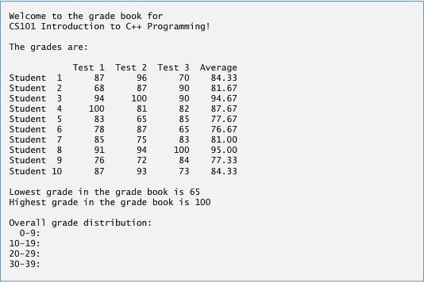

**图 7.24** | 使用二维成绩数组创建一个 GradeBook 对象，然后调用成员函数 `processGrades` 分析这些成绩。*(第 1 部分，共 2 部分。)*

```
40–49:
50–59:
60–69: ***
70–79: *******
80–89: ***********
90–99: ***************
100: ***
```

**图 7.24** | 使用二维成绩数组创建一个 GradeBook 对象，然后调用成员函数 processGrades 分析这些成绩。（第 2 部分，共 2 部分。）

## 7.11 C++ 标准库类模板 vector 简介

现在我们介绍 C++ 标准库类模板 vector，它表示一种更健壮的数组类型，具有许多附加功能。正如你将在后续章节中看到的，C 风格基于指针的数组（即到目前为止所表示的数组类型）很容易出错。例如，如前所述，程序很容易“走出”数组的任一端，因为 C++ 不检查下标是否超出数组范围。不能用相等运算符或关系运算符对两个数组进行有意义的比较。正如你将在第 8 章学到的，指针变量（更常称为指针）的值是内存地址。数组名只是指向数组在内存中起始位置的指针，当然，两个数组总是位于不同的内存位置。当把数组传递给旨在处理任意大小数组的通用函数时，必须将数组大小作为附加参数传递。此外，不能使用赋值运算符将一个数组赋给另一个数组——数组名是 const 指针，而且正如你将在第 8 章学到的，常量指针不能用在赋值运算符的左侧。这些以及其他功能对于处理数组来说显然像是“自然而然”的，但 C++ 并未提供此类功能。不过，C++ 标准库提供了类模板 vector，使你能够创建比数组更强大且更不易出错的替代方案。第 11 章将介绍实现 vector 所提供的这类数组功能的方法。你将学习如何自定义运算符以用于自己的类（这种技术称为运算符重载）。

vector 类模板可供任何使用 C++ 构建应用程序的人使用。vector 示例使用的表示法可能对你不熟悉，因为 vector 使用模板表示法。回想一下，6.18 节讨论了函数模板。第 14 章将讨论类模板。目前，你应能通过模仿本节所示示例中的语法，自如地使用类模板 vector。随着我们在第 14 章学习类模板，你的理解将会加深。第 22 章将详细介绍类模板 vector（以及若干其他标准 C++ 容器类）。

图 7.25 的程序演示了 C++ 标准库类模板 vector 提供的、C 风格基于指针的数组所不具备的功能。标准类模板 vector 提供了许多与我们在第 11 章构建的 Array 类相同的功能。标准类模板 vector 定义在头文件 <vector>（第 5 行）中，属于 std 命名空间。第 22 章讨论 vector 的完整功能。本节末尾，我们将演示 vector 类的边界检查功能，并介绍 C++ 的异常处理机制，该机制可用于检测和处理越界的 vector 索引。

```cpp
// Fig. 7.25: fig07_25.cpp
// Demonstrating C++ Standard Library class template vector.
#include <iostream>
#include <iomanip>
#include <vector>
using namespace std;

void outputVector( const vector< int > & ); // display the vector
void inputVector( vector< int > & ); // input values into the vector

int main()
{
   vector< int > integers1( 7 ); // 7-element vector< int >
   vector< int > integers2( 10 ); // 10-element vector< int >

   // print integers1 size and contents
   cout << "Size of vector integers1 is " << integers1.size()
        << "\nVector after initialization:" << endl;
   outputVector( integers1 );

   // print integers2 size and contents
   cout << "\nSize of vector integers2 is " << integers2.size()
        << "\nVector after initialization:" << endl;
   outputVector( integers2 );

   // input and print integers1 and integers2
   cout << "\nEnter 17 integers:" << endl;
   inputVector( integers1 );
   inputVector( integers2 );

   cout << "\nAfter input, the vectors contain:\n"
        << "integers1: " << endl;
   outputVector( integers1 );
   cout << "integers2: " << endl;
   outputVector( integers2 );

   // use inequality (!=) operator with vector objects
   cout << "\nEvaluating: integers1 != integers2" << endl;

   if ( integers1 != integers2 )
      cout << "integers1 and integers2 are not equal" << endl;

   // create vector integers3 using integers1 as an
   // initializer; print size and contents
   vector< int > integers3( integers1 ); // copy constructor

   cout << "\nSize of vector integers3 is " << integers3.size()
        << "\nVector after initialization:" << endl;
   outputVector( integers3 );
```

**图 7.25** | 演示 C++ 标准库类模板 vector。（第 1 部分，共 4 部分。）


```cpp
// use overloaded assignment (=) operator
cout << "\nAssigning integers2 to integers1:" << endl;
integers1 = integers2; // assign integers2 to integers1

cout << "integers1:" << endl;
outputVector( integers1 );
cout << "integers2:" << endl;
outputVector( integers2 );

// use equality (==) operator with vector objects
cout << "\nEvaluating: integers1 == integers2" << endl;

if ( integers1 == integers2 )
   cout << "integers1 and integers2 are equal" << endl;

// use square brackets to create rvalue
cout << "integers1[5] is " << integers1[ 5 ];

// use square brackets to create lvalue
cout << "\n\nAssigning 1000 to integers1[5]" << endl;
integers1[ 5 ] = 1000;
cout << "integers1:" << endl;
outputVector( integers1 );

// attempt to use out-of-range subscript
try
{
   cout << "\nAttempt to display integers1.at( 15 )" << endl;
   cout << integers1.at( 15 ) << endl; // ERROR: out of range
} // end try
catch ( out_of_range &ex )
{
   cout << "\nAn exception occurred: " << ex.what() << endl;
} // end catch
} // end main

// output vector contents
void outputVector( const vector< int > &array )
{
   size_t i; // declare control variable

   for ( i = 0; i < array.size(); ++i )
   {
      cout << setw( 12 ) << array[ i ];

      if ( ( i + 1 ) % 4 == 0 ) // 4 numbers per row of output
         cout << endl;
   } // end for

   if ( i % 4 != 0 )
      cout << endl;
} // end function outputVector
```

**图 7.25** | 演示 C++ 标准库类模板 vector。（第 2 部分，共 4 部分。）

```text
Assigning 1000 to integers1[5]
integers1:
        8              9             10             11
        12           1000             14             15
        16             17

Attempt to display integers1.at( 15 )
An exception occurred: invalid vector<> subscript
```

**图 7.25** | 演示 C++ 标准库类模板 vector。（第 4 部分，共 4 部分。）

### 创建 vector 对象

第 13–14 行创建两个存储 int 类型值的 vector 对象——integers1 包含 7 个元素，integers2 包含 10 个元素。默认情况下，每个 vector 对象的所有元素都被设置为 0。注意，通过将 vector<int> 中的 int 替换为相应的数据类型，可以定义存储任何数据类型的 vector。这种指定 vector 中存储类型的表示法，与 6.18 节在函数模板中引入的模板表示法类似。

### vector 成员函数 size；函数 outputVector

第 17 行使用 vector 成员函数 size 获取 integers1 的大小（即元素个数）。第 19 行将 integers1 传递给函数 outputVector（第 88–102 行），该函数使用方括号 []（第 94 行）获取 vector 中每个元素的值以进行输出。注意这种表示法与用于访问数组元素值的表示法相似。第 22 行和第 24 行对 integers2 执行相同的任务。

类模板 vector 的成员函数 size 返回 vector 中的元素个数，返回值为 size_t 类型（在许多系统上表示 unsigned int 类型）。因此，第 90 行也将控制变量 i 声明为 size_t 类型。在某些编译器上，将 i 声明为 int 会导致编译器发出警告消息，因为循环继续条件（第 92 行）会比较有符号值（即 int i）和无符号值（即函数 size 返回的 size_t 类型的值）。

### 函数 inputVector

第 28–29 行将 integers1 和 integers2 传递给函数 inputVector（第 105–109 行），以从用户读取值到每个 vector 的元素中。该函数使用方括号（[]）构成左值，用于将输入值存储到每个 vector 元素中。

### 比较 vector 对象是否不相等

第 40 行演示了可以使用 != 运算符比较 vector 对象。如果两个 vector 的内容不相等，该运算符返回 true；否则返回 false。

### 用一个 vector 的内容初始化另一个 vector

C++ 标准库类模板 vector 允许你创建一个新 vector 对象，并用现有 vector 的内容初始化它。第 45 行创建 vector 对象 integers3，并用 integers1 的副本对其进行初始化。这将调用 vector 所谓的复制构造函数来执行复制操作。你将在第 11 章详细了解复制构造函数。第 47–49 行输出 integers3 的大小和内容，以证明它已正确初始化。

### 赋值 vector 和比较 vector 是否相等

第 53 行将 integers2 赋给 integers1，演示了赋值（=）运算符可用于 vector 对象。第 55–58 行输出两个对象的内容，以表明它们现在包含相同的值。第 63 行接着用相等（==）运算符比较 integers1 和 integers2，以确定在第 53 行赋值后两个对象的内容是否相等（结果是相等的）。

### 使用 [] 运算符访问和修改 vector 元素

第 67 行和第 71 行分别使用方括号（[]）获取 vector 元素作为右值和左值。回忆 5.9 节，右值不能修改，但左值可以。与 C 风格的基于指针的数组一样，C++ 在使用方括号访问 vector 元素时不执行任何边界检查。因此，你必须确保使用 [] 的操作不会意外地尝试操作超出 vector 边界的元素。标准类模板 vector 的成员函数 at 确实提供了边界检查，我们将在第 79 行使用它，稍后讨论。

### 异常处理：处理越界下标

异常表示程序执行过程中出现的问题。“异常”这个名称表明问题很少发生——如果“规则”是一条语句通常正确执行，那么问题就代表了“规则的例外”。异常处理使你能够创建容错程序，这些程序可以解决（或处理）异常。在许多情况下，这允许程序继续执行，就好像没有遇到问题一样。例如，图 7.25 即使在尝试访问越界下标时仍能运行到完成。更严重的问题可能会阻止程序继续正常执行，而是要求程序通知用户该问题，然后终止。当函数检测到问题时，例如无效的数组下标或无效参数，它会抛出异常——也就是说，发生了一个异常。这里我们简要介绍异常处理。我们将在第 16 章“异常处理：深入探讨”中详细讨论。

### try 语句

要处理异常，请将可能抛出异常的代码放在 try 语句中（第 76–84 行）。try 块（第 76–80 行）包含可能抛出异常的代码，catch 块（第 81–84 行）包含在发生异常时处理异常的代码。你可以有许多 catch 块来处理相应 try 块中可能抛出的不同类型的异常。如果 try 块中的代码成功执行，则忽略第 81–84 行。分隔 try 和 catch 块主体的花括号是必需的。

vector 成员函数 at 提供边界检查，如果其参数是无效下标则抛出异常。默认情况下，这会导致 C++ 程序终止。如果下标有效，函数 at 根据调用出现的上下文，将指定位置的元素作为可修改的左值或不可修改的左值返回。不可修改的左值是一个标识内存中对象（例如 vector 中的元素）的表达式，但不能用于修改该对象。

### 执行 catch 块

当程序以参数 15（第 79 行）调用 vector 成员函数 at 时，该函数尝试访问位置 15 处的元素，而该元素位于 vector 的边界之外——此时 integers1 只有 10 个元素。因为执行了边界检查。


现在我们已经介绍了类、对象、控制语句、函数和数组的基本概念。在第8章中，我们将介绍C++最强大的特性之一——指针。指针记录数据和函数在内存中的存储位置，这使我们能够以有趣的方式操作这些项。在介绍指针的基本概念之后，我们将详细考察数组、指针和字符串之间的密切关系。

## 小结

### 7.1节 引言

- 数据结构（p. 268）是相关数据项的集合。数组（p. 268）是由相同类型的相关数据项组成的数据结构。数组是“静态”实体，因为它们在程序执行过程中始终保持相同的大小。（当然，它们可以属于自动存储类，因此每次进入和退出定义它们的块时都会被创建和销毁。）

### 7.2节 数组

- 数组是一组连续的内存位置，它们共享相同的类型。
- 要引用数组中的特定位置或元素，我们指定数组名（p. 269）和该特定元素在数组中的位置编号。
- 程序通过给出数组名，后跟方括号（`[]`）中特定元素的下标（p. 269）来引用数组中的任一元素。
- 每个数组的第一个元素的索引为零（p. 269），有时称为第零个元素。
- 索引必须是整数或整数表达式（使用任意整型类型）。
- 用于括住索引的方括号是一个运算符，其优先级与圆括号相同。

### 7.3节 声明数组

- 数组在内存中占用空间。如下所示指定每个元素的类型和数组所需的元素数量：

    ```cpp
    type arrayName[arraySize];
    ```

    编译器会保留适当数量的内存。
- 数组可以声明为包含任何数据类型。例如，`char` 类型的数组可用于存储字符串。

### 7.4节 使用数组的示例

- 可以在数组声明中通过在数组名后跟等号和初始化器列表（p. 272）来初始化数组元素——初始化器列表是用逗号分隔的常量初始化器（p. 272）列表（括在花括号中）。使用初始化器列表初始化数组时，如果初始化器数量少于数组中的元素数量，则其余元素初始化为零。
- 如果在带有初始化器列表的声明中省略数组大小，编译器将通过计算初始化器列表中元素的数量来确定数组中的元素数量。
- 如果在数组声明中同时指定数组大小和初始化器列表，则初始化器的数量必须小于或等于数组大小。
- 常量在声明时必须用常量表达式初始化，此后不能修改。常量可以放在任何需要常量表达式的地方。
- C++没有数组边界检查（p. 280）。应确保所有数组引用都保持在数组边界内。
- 函数定义中的静态局部变量在程序持续期间存在，但仅在函数体内可见。
- 程序在首次遇到静态局部数组的声明时初始化它们。如果没有显式初始化静态数组，则编译器在创建该数组时将每个元素初始化为零。

### 7.5节 将数组传递给函数

- 要将数组实参传递给函数，指定数组名而不带任何方括号。要将数组的元素传递给函数，在函数调用中使用该数组元素带下标的名称作为实参。
- 数组按引用传递给函数——被调用函数可以修改调用者原始数组中的元素值。数组名的值是数组第一个元素在计算机内存中的地址。由于传递的是数组的起始地址，被调用函数能确切知道数组在内存中的存储位置。
- 单个数组元素像简单变量一样按值传递。
- 要接收数组实参，函数的参数列表必须指明该函数期望接收一个数组。数组方括号之间不需要指定数组大小。
- 类型限定符 `const`（p. 273）可用于防止被调用函数中的代码修改调用者中的数组值。当数组参数前面带有 `const` 限定符时，数组元素在函数体中成为常量，任何在函数体中修改数组元素的尝试都会导致编译错误。

### 7.6节 案例研究：使用数组存储成绩的GradeBook类

- 类变量（静态数据成员；p. 290）由声明该变量的类的所有对象共享。
- 静态数据成员可以在类定义和成员函数定义中像任何其他数据成员一样被访问。
- 公有静态数据成员也可以在类外部访问，即使该类没有对象存在，方法是使用类名后跟作用域解析运算符（`::`）和数据成员名。

### 7.7节 使用线性搜索查找数组

- 线性搜索（p. 293）将每个数组元素与搜索键（p. 293）进行比较。由于数组未按任何特定顺序排列，值在第一个元素中找到的可能性与在最后一个元素中找到的可能性一样大。平均而言，程序必须将搜索键与一半的数组元素进行比较。要确定某个值不在数组中，程序必须将搜索键与数组中的每个元素进行比较。

### 7.8节 使用插入排序对数组排序

- 可以使用插入排序（p. 295）对数组进行排序。该算法的第一次迭代取第二个元素，如果它小于第一个元素，则将其与第一个元素交换（即程序将第二个元素插入到第一个元素之前）。第二次迭代查看第三个元素，并将其插入相对于前两个元素的正确位置，从而使所有三个元素有序。在该算法的第 i 次迭代时，原始数组中的前 i 个元素将有序。对于小数组，插入排序是可以接受的，但对于较大的数组，与其他更复杂的排序算法相比，它效率较低。

### 7.9节 多维数组

- 具有两个维度的多维数组（p. 297）常用于表示值表（p. 297），其中信息按行和列排列。
- 需要两个下标来标识特定元素的数组称为二维数组（p. 297）。具有 *m* 行和 *n* 列的数组称为 *m*×*n* 数组（p. 297）。

### 7.11节 C++标准库类模板 `vector` 简介

- C++标准库类模板 `vector`（p. 307）是数组的一种更健壮的替代方案，具有许多C风格基于指针的数组所不具备的功能。
- 默认情况下，整数 vector 对象的所有元素都设置为0。
- 可以使用如下形式的声明将 vector 定义为存储任何数据类型：

    ```cpp
    vector< type > name( size );
    ```

- 类模板 `vector` 的成员函数 `size`（p. 311）返回调用它的 vector 中元素的数量。
- vector 元素的值可以使用方括号（`[]`）访问或修改。
- 标准类模板 `vector` 的对象可以直接用相等（`==`）和不相等（`!=`）运算符进行比较。赋值（`=`）运算符也可用于 vector 对象。
- 不可修改的左值是一个标识内存中对象（例如 vector 中的元素）但不能用于修改该对象的表达式。可修改的左值也标识内存中的对象，但可用于修改该对象。
- 异常（p. 312）表示程序执行时发生的问题。“异常”这一名称暗示问题不常发生——如果“规则”是语句通常正确执行，那么该问题就代表“规则的例外”。
- 异常处理（p. 312）使您能够创建可容错程序（p. 312），这些程序可以解决异常。
- 要处理异常，请将可能抛出异常（p. 312）的任何代码放在 `try` 语句中。
- `try` 块（p. 312）包含可能抛出异常的代码，`catch` 块（p. 312）包含在发生异常时处理异常的代码。
- 当 `try` 块终止时，在 `try` 块中声明的任何变量都将离开作用域。
- `catch` 块（p. 312）声明一个类型和一个异常参数。在 `catch` 块内部，可以使用参数的标识符与捕获的异常对象交互。
- 异常对象的 `what` 方法（p. 313）返回异常的错误消息。

## 自测练习

- **7.1** *（填空）* 回答下列各题：

    - a) 值列表和值表可以存储在 __________ 或 __________ 中。
    - b) 数组元素之所以相关，是因为它们具有相同的 __________ 和 __________。
    - c) 用于引用数组中特定元素的数字称为它的 __________。
    - d) 应使用 __________ 来声明数组的大小，因为它使程序更具可伸缩性。
    - e) 将数组元素按顺序放置的过程称为 __________ 数组。
    - f) 确定数组是否包含特定键值的过程称为 __________ 数组。
    - g) 使用两个下标的数组称为 __________ 数组。

- **7.2** *（判断正误）* 指出下列说法是*正确*还是*错误*。如果答案是*错误*，请解释原因。

    - a) 数组可以存储许多不同类型的值。
    - b) 数组下标通常应为 `float` 数据类型。


## 代码评审规范

本规范适用于所有项目的代码评审流程，旨在提高代码质量、统一评审标准、促进团队协作。

- 评审范围
- 评审流程
- 评审标准

| 等级 | 说明 |
| --- | --- |
| P0 | 必须修复 |
| P1 | 建议修复 |
| P2 | 可选建议 |

> 评审不是为了挑错，而是为了共同进步。

评审完成后，需要在系统中填写评审记录，并跟踪问题修复情况。

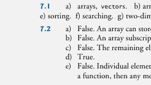

## 7.3

```cpp
a) const int arraySize = 10;
b) double fractions[ arraySize ] = { 0.0 };
c) fractions[ 3 ]
d) fractions[ 4 ]
e) fractions[ 9 ] = 1.667;
f) fractions[ 6 ] = 3.333;
g) cout << fixed << setprecision( 2 );
   cout << fractions[ 6 ] << ' ' << fractions[ 9 ] << endl;
   Output: 3.33 1.67.

h) for ( int i = 0; i < arraySize; ++i )
       cout << "fractions[" << i << "] = " << fractions[ i ] << endl;
   Output:
   fractions[ 0 ] = 0.0
   fractions[ 1 ] = 0.0
   fractions[ 2 ] = 0.0
   fractions[ 3 ] = 0.0
   fractions[ 4 ] = 0.0
   fractions[ 5 ] = 0.0
   fractions[ 6 ] = 3.333
   fractions[ 7 ] = 0.0
   fractions[ 8 ] = 0.0
   fractions[ 9 ] = 1.667
```

## 7.4

```cpp
a) int table[ arraySize ][ arraySize ];
b) Nine.
c) for ( i = 0; i < arraySize; ++i )
       for ( j = 0; j < arraySize; ++j )
           table[ i ][ j ] = i + j;
d) cout << "     [0] [1] [2]" << endl;

   for ( int i = 0; i < arraySize; ++i ) {
       cout << '[' << i << "] ";

       for ( int j = 0; j < arraySize; ++j )
           cout << setw( 3 ) << table[ i ][ j ] << " ";
       cout << endl;
   }

   Output:
       [0]  [1]  [2]
   [0]   1    8    0
   [1]   2    4    6
   [2]   5    0    0
```

## 7.5

- a) *错误：* `#include` 预处理指令末尾有分号。  
  *更正：* 删除分号。

- b) *错误：* 使用赋值语句给常量变量赋值。  
  *更正：* 在 `const int arraySize` 声明中初始化该常量变量。

- c) *错误：* 引用数组边界之外的数组元素（b[10]）。  
  *更正：* 将控制变量的最终值改为 9，或将 `<=` 改为 `<`。

- d) *错误：* 数组下标使用不正确。  
  *更正：* 将该语句改为 `a[ 1 ][ 1 ] = 5;`

```cpp
for ( row = 0; row < 3; ++row )
   for ( column = 0; column < 5; ++column )
      sales[ row ][ column ] = 0;
```

## **7.17** (*掷骰子*)

编写一个模拟掷两个骰子的程序。程序应使用 `rand` 掷第一个骰子，并再次使用 `rand` 掷第二个骰子。然后应计算两个值之和。[*注：* 每个骰子可以显示 1 到 6 的整数值，因此两个值之和将在 2 到 12 之间变化，其中 7 是最常见的和，2 和 12 是最不常见的和。] 图 7.26 显示了两个骰子的 36 种可能组合。你的程序应掷两个骰子 36,000 次。使用一维数组统计每个可能和出现的次数。以表格格式打印结果。同时，判断总计是否合理（即，掷出 7 有六种方式，因此所有投掷中大约六分之一应为 7）。


**图 7.26**  掷两个骰子的 36 种可能结果。

## **7.18** (*这段代码做什么？*) 下面的程序做什么？

```cpp
// Ex. 7.18: Ex07_18.cpp
// What does this program do?
#include <iostream>
using namespace std;

int whatIsThis( int [], int ); // function prototype

int main()
{
   const int arraySize = 10;
   int a[ arraySize ] = { 1, 2, 3, 4, 5, 6, 7, 8, 9, 10 };

   int result = whatIsThis( a, arraySize );

   cout << "Result is " << result << endl;
} // end main

// What does this function do?
int whatIsThis( int b[], int size )
{
   if ( size == 1 ) // base case
      return b[0];
   else // recursive step
      return b[ size - 1 ] + whatIsThis( b, size - 1 );
} // end function whatIsThis
```

## **7.19**  *(掷骰子游戏修改)*

修改图 6.11 的程序，使其进行 1000 局掷骰子游戏。程序应记录统计信息并回答以下问题：

- a) 在第 1 次投掷、第 2 次投掷……第 20 次投掷以及第 20 次投掷之后，分别赢了多少局？
- b) 在第 1 次投掷、第 2 次投掷……第 20 次投掷以及第 20 次投掷之后，分别输了多少局？
- c) 掷骰子游戏的获胜概率是多少？*[注：你应该会发现掷骰子游戏是赌场中最公平的游戏之一。你认为这意味着什么？]*
- d) 一局掷骰子游戏的平均长度是多少？
- e) 获胜概率会随着游戏长度增加而提高吗？

## **7.20**  *(航空公司预订系统)*

一家小型航空公司刚刚为其新的自动预订系统购买了一台计算机。你被要求为新系统编写程序。你要编写一个程序，为航空公司唯一飞机的每个航班分配座位（容量：10 个座位）。

你的程序应显示以下备选菜单——请输入 1 表示“头等舱”，输入 2 表示“经济舱”。如果此人输入 1，你的程序应在头等舱区域分配一个座位（座位 1–5）。如果此人输入 2，你的程序应在经济舱区域分配一个座位（座位 6–10）。你的程序应打印登机牌，标明此人的座位号以及该座位位于飞机的头等舱还是经济舱区域。

使用一维数组表示飞机的座位图。将数组的所有元素初始化，以表示所有座位均为空。每分配一个座位时，将数组的对应元素设置为 true，以表示该座位不再可用。

当然，你的程序绝不应分配已经分配过的座位。当头等舱区域满员时，你的程序应询问此人是否可接受被安排到经济舱区域（反之亦然）。如果同意，则进行适当的座位分配。如果不同意，则打印消息“下一班航班将在 3 小时后起飞。”

## **7.21**  *(这段代码做什么？)*

下面的程序做什么？

```cpp
// Ex. 7.21: Ex07_21.cpp
// What does this program do?
#include <iostream>
using namespace std;

void someFunction( int [], int, int ); // function prototype

int main()
{
   const int arraySize = 10;
   int a[ arraySize ] = { 1, 2, 3, 4, 5, 6, 7, 8, 9, 10 };

   cout << "The values in the array are:" << endl;
   someFunction( a, 0, arraySize );
   cout << endl;
} // end main

// What does this function do?
void someFunction( int b[], int current, int size )
{
   if ( current < size )
   {
      someFunction( b, current + 1, size );
      cout << b[ current ] << ' ';
   } // end if
} // end function someFunction
```

```text
5, 12
1
6
9
```

当海龟落笔移动时，将数组 floor 的相应元素设置为 true。当给出 6 命令（打印）时，在数组中为 true 的位置显示星号或你选择的其他字符。在为零的位置显示空白。编写一个程序实现这里讨论的海龟图形功能。编写几个海龟图形程序来绘制有趣的形状。添加其他命令以增强你的海龟图形语言的能力。

## 7.24 (骑士巡游)

对国际象棋爱好者来说，更有趣的谜题之一是骑士巡游问题。问题是：被称为骑士的棋子能否在空棋盘上移动，并且恰好一次访问 64 个方格中的每一个？我们在本练习中深入研究这个有趣的问题。

骑士走 L 形移动（先沿一个方向移动两格，再沿垂直方向移动一格）。因此，从空棋盘中央的方格出发，骑士可以做出八种不同的移动（编号 0 到 7），如图 7.28 所示。

- a) 在一张纸上画一个 8×8 棋盘，并尝试手工完成骑士巡游。在你移动到的第一个方格中写 1，第二个方格写 2，第三个写 3，依此类推。开始巡游前，估计你认为自己能走多远，记住完整巡游包含 64 步。你走了多远？这接近你的估计吗？

- b) 现在让我们开发一个程序，让骑士在棋盘上移动。棋盘用 8×8 二维数组 board 表示。每个方格初始化为零。我们用水平和垂直分量描述八种可能的移动。例如，如图 7.28 所示，类型 0 的移动由水平向右移动两格、垂直向上移动一格组成。移动 2 由水平向左移动一格、垂直向上移动两格组成。向左的水平移动和向上的垂直移动用负数表示。这八种移动可以用两个一维数组 horizontal 和 vertical 描述如下：

```cpp
horizontal[ 0 ] =  2    vertical[ 0 ] = -1
horizontal[ 1 ] =  1    vertical[ 1 ] = -2
horizontal[ 2 ] = -1    vertical[ 2 ] = -2
horizontal[ 3 ] = -2    vertical[ 3 ] = -1
horizontal[ 4 ] = -2    vertical[ 4 ] =  1
horizontal[ 5 ] = -1    vertical[ 5 ] =  2
horizontal[ 6 ] =  1    vertical[ 6 ] =  2
horizontal[ 7 ] =  2    vertical[ 7 ] =  1
```


图 7.28 | 骑士的八种可能移动。


让变量 `currentRow` 和 `currentColumn` 表示骑士当前位置的行和列。要执行类型为 `moveNumber` 的移动（其中 `moveNumber` 介于 0 和 7 之间），程序使用以下语句

```
currentRow += vertical[ moveNumber ];
currentColumn += horizontal[ moveNumber ];
```

维护一个从 1 到 64 变化的计数器。在骑士移动到的每个方格中记录最新的计数。记得测试每个可能的移动，以判断骑士是否已经访问过该方格；当然，还要测试每个可能的移动，以确保骑士不会落到棋盘之外。现在编写一个程序，让骑士在棋盘上移动。运行该程序。骑士一共移动了多少次？

- **c)** 在尝试编写并运行骑士巡游程序之后，你可能已经形成了一些有价值的见解。我们将利用这些见解来开发一种用于移动骑士的启发式方法（或策略）。启发式方法不能保证成功，但精心开发的启发式方法会大大提高成功的机会。你可能已经观察到，外侧方格比靠近棋盘中心的方格更麻烦。事实上，最麻烦或者说最难到达的方格是四个角。

直觉可能表明，你应该先尝试将骑士移动到最麻烦的方格，并保留那些最容易到达的方格，这样当巡游接近尾声、棋盘变得拥挤时，成功的机会就会更大。

我们可以开发一种“可访问性启发式”：根据每个方格的可访问程度对其进行分类，然后总是将骑士移动到（当然是在骑士的 L 形走法范围内）最难以访问的方格。我们用一个二维数组 `accessibility` 来标记，其中的数字表示每个特定方格可从多少个方格到达。在空棋盘上，每个中心方格的评级为 8，每个角方格的评级为 2，其他方格的可访问性数字为 3、4 或 6，如下所示：

|  |  |  |  |  |  |  |  |
|---|---|---|---|---|---|---|---|
| 2 | 3 | 4 | 4 | 4 | 4 | 3 | 2 |
| 3 | 4 | 6 | 6 | 6 | 6 | 4 | 3 |
| 4 | 6 | 8 | 8 | 8 | 8 | 6 | 4 |
| 4 | 6 | 8 | 8 | 8 | 8 | 6 | 4 |
| 4 | 6 | 8 | 8 | 8 | 8 | 6 | 4 |
| 4 | 6 | 8 | 8 | 8 | 8 | 6 | 4 |
| 3 | 4 | 6 | 6 | 6 | 6 | 4 | 3 |
| 2 | 3 | 4 | 4 | 4 | 4 | 3 | 2 |

现在编写一个使用可访问性启发式的骑士巡游程序版本。在任何时候，骑士都应移动到可访问性数字最低的方格。如果出现并列，骑士可以移动到任何一个并列的方格。因此，巡游可以从四个角中的任意一个开始。[注意：当骑士在棋盘上移动时，随着越来越多的方格被占用，程序应降低可访问性数字。这样，在巡游过程中的任意给定时刻，每个可用方格的可访问性数字都将恰好等于可从多少个方格到达该方格。] 运行这个版本的程序。你得到一次完整巡游了吗？现在修改程序，运行 64 次巡游，每次从棋盘的一个方格开始。你得到了多少次完整巡游？

- **d)** 编写一个骑士巡游程序版本，当遇到两个或多个方格并列时，通过前瞻从“并列”方格可到达的那些方格来决定选择哪个方格。你的程序应移动到这样一个方格：从该方格进行下一步移动将到达可访问性数字最低的方格。

## 7.25（骑士巡游：暴力方法）

在练习 7.24 中，我们开发了骑士巡游问题的一种解法。所使用的方法称为“可访问性启发式”，它能生成许多解并且执行效率高。

- b) 使用穷举技术，即尝试棋盘上八皇后的所有可能组合。
- c) 你认为为什么穷举暴力法可能不适合求解骑士巡游问题？
- d) 总体比较并对比随机暴力法和穷举暴力法。

## 7.28（骑士巡游：闭合巡游测试）

在骑士巡游中，当骑士进行 64 次移动，并且每个棋盘方格都被访问一次且仅一次时，就出现一次完整巡游。当第 64 次移动距离骑士开始巡游的位置只有一步之遥时，就出现闭合巡游。修改你在练习 7.24 中编写的骑士巡游程序，以便在出现完整巡游时测试是否为闭合巡游。

## 7.29（埃拉托色尼筛法）

素数（质数）是只能被自身和 1 整除的整数。埃拉托色尼筛法是一种寻找素数的方法。其工作原理如下：

- a) 创建一个所有元素都初始化为 1（真）的数组。下标为素数的数组元素将保持为 1。所有其他数组元素最终都会被置为 0。本练习中你将忽略元素 0 和 1。
- b) 从数组下标 2 开始，每当找到一个值为 1 的数组元素时，就遍历数组的剩余部分，并将所有下标为该值为 1 的元素下标倍数的元素置为 0。对于数组下标 2，数组中 2 之后所有为 2 的倍数的元素都将被置为 0（下标 4、6、8、10 等）；对于数组下标 3，数组中 3 之后所有为 3 的倍数的元素都将被置为 0（下标 6、9、12、15 等）；依此类推。

当这个过程完成时，仍然被置为 1 的数组元素表示其下标是素数。然后可以打印这些下标。编写一个使用 1000 个元素的数组来确定并打印 2 到 999 之间素数的程序。忽略数组的元素 0。

## 7.30（桶排序）

桶排序首先需要一个待排序的正整数一维数组，以及一个整数二维数组，其行下标从 0 到 9，列下标从 0 到 n − 1，其中 n 是待排序数组中的值的个数。这个二维数组的每一行称为一个桶。编写一个函数 bucketSort，它接受一个整数数组和数组大小作为参数，并执行以下操作：

- a) 根据每个值的一位数（个位数字），将一维数组中的每个值放入桶数组的相应行。例如，97 放入第 7 行，3 放入第 3 行，100 放入第 0 行。这称为“分配趟”。
- b) 逐行遍历桶数组，并将这些值复制回原数组。这称为“收集趟”。前面这些值在一维数组中的新顺序是 100、3 和 97。
- c) 对每个后续数位（十位、百位、千位等）重复这个过程。

在第二趟中，100 放入第 0 行，3 放入第 0 行（因为 3 没有十位数字），97 放入第 9 行。收集趟之后，一维数组中值的顺序是 100、3 和 97。在第三趟中，100 放入第 1 行，3 放入第 0 行，97 放入第 0 行（在 3 之后）。在最后一趟收集之后，原数组现在已按排序顺序排列。

请注意，桶的二维数组大小是待排序整数数组的 10 倍。这种排序技术比插入排序性能更好，但需要多得多的内存。插入排序只需要额外一个数据元素的空间。这是空间-时间权衡的一个例子：桶排序比插入排序使用更多内存，但性能更好。这个版本的桶排序要求在每一趟中将所有数据复制回原数组。另一种可能是创建第二个二维桶数组，并在两个桶数组之间反复交换数据。

## 递归练习

**7.31** *（选择排序）* 选择排序会搜索数组以寻找最小元素。然后，将最小元素与数组的第一个元素交换。对从数组第二个元素开始的子数组重复此过程。数组的每一趟都会使一个元素被放到正确位置。这种排序的性能与插入排序相当——对于包含 *n* 个元素的数组，必须进行 *n* − 1 趟，并且对于每个子数组，必须进行 *n* − 1 次比较才能找到最小值。当正在处理的子数组只包含一个元素时，数组就已排序。编写递归函数 selectionSort 来执行此算法。

**7.32** *（回文）* 回文是一种正读和反读都相同的字符串。回文的例子包括 “radar” 和 “able was I ere I saw elba”。编写一个递归函数 testPalindrome，如果字符串是回文则返回 true，否则返回 false。请注意，与数组一样，方括号（[]）运算符可用于遍历字符串中的字符。

**7.33** *（线性查找）* 修改图 7.18 中的程序，使用递归函数 linearSearch 对数组执行线性查找。该函数应接受一个整数数组和数组大小作为参数。如果找到查找键，则返回数组下标；否则返回 −1。

**7.34** *（八皇后）* 修改你在练习 7.26 中创建的八皇后程序，以递归方式解决该问题。

**7.35** *（打印数组）* 编写一个递归函数 printArray，它接受一个数组、起始下标和结束下标作为参数，不返回值并打印该数组。当起始下标等于结束下标时，函数应停止处理并返回。

**7.36** *（反向打印字符串）* 编写一个递归函数 stringReverse，它接受一个字符串和起始下标作为参数，反向打印该字符串并且不返回值。当遇到字符串末尾时，函数应停止处理并返回。请注意，与数组一样，方括号（[]）运算符可用于遍历字符串中的字符。

**7.37** *（查找数组中的最小值）* 编写一个递归函数 recursiveMinimum，它接受一个整数数组、起始下标和结束下标作为参数，并返回数组中的最小元素。当起始下标等于结束下标时，函数应停止处理并返回。

## vector 练习

**7.38** *（使用 vector 的销售人员工资范围）* 使用一个整数 vector 来解决练习 7.10 中描述的问题。

**7.39** *（使用 vector 的掷骰子）* 修改你在练习 7.17 中创建的掷骰子程序，使用 vector 存储两个骰子每种可能和出现的次数。

**7.40** *（查找 vector 中的最小值）* 修改你对练习 7.37 的解决方案，改为在 vector 中而不是数组中查找最小值。

## 产生影响

**7.41** *（民意调查）* 互联网和 Web 使更多人能够建立联系、加入某项事业、表达意见等等。2008 年的总统候选人密集使用互联网来传播他们的信息并为竞选筹款。在本练习中，你将编写一个简单的民意调查程序，允许用户对五个社会意识问题按 1（最不重要）到 10（最重要）进行评分。选择五个对你重要的事业（例如政治问题、全球环境问题）。使用一个一维数组 topics（string 类型）存储这五个事业。为了汇总调查响应，使用一个 5 行 10 列的二维数组 responses（int 类型），每一行对应 topics 数组中的一个元素。当程序运行时，它应该


# 8 指针

> 人们给我们地址，是为了指明我们的所在。
> ——萨基（H. H. 门罗）

> 迂回曲折，方能找到方向。
> ——威廉·莎士比亚

> 许多事物，尽管完全关联于  
> 同一意图，却可能背道而驰。
> ——威廉·莎士比亚

> 先生，您会发现，始终核对您的参考文献是一种非常好的做法！
> ——劳思博士

## 目标

本章您将学习：

- 什么是指针。
- 指针与引用的异同，以及何时使用二者。
- 使用指针按引用向函数传递实参。
- 指针与数组之间的密切关系。
- 使用指针数组。
- 基于指针的基本字符串处理。
- 使用指向函数的指针。


**图 8.1** | 直接和间接引用变量。

声明变量 countPtr 为 `int *` 类型（即指向 int 值的指针），并从右向左读作“countPtr 是一个指向 int 的指针”。另外，前面的声明中变量 count 被声明为 int，而不是指向 int 的指针。声明中的 * 只作用于 countPtr。每个声明为指针的变量前都必须有星号（*）。例如，声明

```cpp
double *xPtr, *yPtr;
```

表示 xPtr 和 yPtr 都是指向 double 值的指针。当 * 出现在声明中时，它不是运算符；而是表明所声明的变量是一个指针。指针可以声明为指向任何数据类型的对象。

> **常见编程错误 8.1**  
> 假设用于声明指针的 * 会分配到声明中逗号分隔的变量列表中的所有名称，可能会导致错误。每个指针都必须以 * 作为名称前缀来声明（中间可有或没有空格）。每次声明只声明一个变量有助于避免这类错误并提高程序可读性。

> **良好编程实践 8.1**  
> 虽然不是要求，但在指针变量名中包含字母 Ptr 可以清楚表明该变量是指针，并且必须相应地处理。

指针应在声明时或赋值时初始化为 0、NULL 或相应类型的地址。值为 0 或 NULL 的指针“不指向任何对象”，称为空指针。符号常量 NULL 在若干标准库头文件中定义，用于表示值 0。将指针初始化为 NULL 等价于初始化为 0，但在 C++ 中按惯例使用 0。当赋值 0 时，它会被转换为适当类型的指针。值 0 是唯一可以直接赋给指针变量而无需先将该整数强制转换为指针类型的整数值。[注意：在新标准中，应使用常量 nullptr 初始化指针，而不是 0 或 NULL。一些 C++ 编译器已经实现了该常量。]

> **错误预防提示 8.1**  
> 初始化指针，以防止其指向未知或未初始化的内存区域。

## 8.3 指针运算符

地址运算符（&）是一元运算符，用于获取其操作数的内存地址。例如，假设有如下声明

```cpp
int y = 5;  // declare variable y
int *yPtr;  // declare pointer variable yPtr
```

则语句

```cpp
yPtr = &y;  // assign address of y to yPtr
```

将变量 y 的地址赋给指针变量 yPtr。变量 yPtr 被称为“指向”y。现在，yPtr 间接引用变量 y 的值。前面语句中 & 的用法与引用变量声明中 & 的用法不同，后者前面总是有数据类型名。声明引用时，& 是类型的一部分。在像 &y 这样的表达式中，& 是地址运算符。

图 8.2 显示了上述赋值后的内存示意图。“指向关系”通过从内存中表示指针 yPtr 的框画一个箭头到内存中表示变量 y 的框来表示。


**图 8.2** | 指针指向内存中变量的图形表示。

图 8.3 显示了内存中的另一种指针表示，其中整数变量 y 存储在内存位置 600000，指针变量 yPtr 存储在内存位置 500000。地址运算符的操作数必须是左值；地址运算符不能应用于常量或不产生引用的表达式。


**图 8.3** | y 和 yPtr 在内存中的表示。

* 运算符通常称为间接运算符或解引用运算符，用作其指针操作数所指向对象的同义词（即别名或昵称）。例如（再次参考图 8.2），语句

```cpp
cout << *yPtr << endl;
```

打印变量 y 的值，即 5，正如语句

```cpp
cout << y << endl;
```

会做的那样。以这种方式使用 * 称为对指针解引用。解引用的指针也可以用在赋值语句左侧，如

```cpp
*yPtr = 9;
```

这将在图 8.3 中把 9 赋给 y。解引用的指针也可以用于接收输入值，如

```cpp
cin >> *yPtr;
```

将输入值放入 y。解引用的指针是左值。

输出中 a 的地址（第 14 行）和 aPtr 的值（第 15 行）相同，这确认 a 的地址确实被赋给了指针变量 aPtr。& 和 * 运算符互为逆运算——当它们以任意顺序连续应用于 aPtr 时，它们会“相互抵消”，产生相同结果（aPtr 中的值）。

图 8.5 列出了到目前为止介绍过的运算符的优先级和结合性。地址（&）和解引用运算符（*）是第三级的一元运算符。

| 运算符 | 结合性 | 类型 |
|---|---|---|
| `::` `()` | *（参见图 2.10 中的注意事项）* | 最高 |
| `()` `[]` | 从左到右 | 函数调用/数组访问 |
| `++` `--` `static_cast<type>(operand)` | 从左到右 | 一元（后缀） |
| `++` `--` `+` `-` `!` `&` `*` | 从右到左 | 一元（前缀） |
| `*` `/` `%` | 从左到右 | 乘法 |
| `+` `-` | 从左到右 | 加法 |
| `<<` `>>` | 从左到右 | 插入/提取 |
| `<` `<=` `>` `>=` | 从左到右 | 关系 |
| `==` `!=` | 从左到右 | 相等 |
| `&&` | 从左到右 | 逻辑与 |
| `\|\|` | 从左到右 | 逻辑或 |
| `?:` | 从右到左 | 条件 |
| `=` `+=` `-=` `*=` `/=` `%=` | 从右到左 | 赋值 |
| `,` | 从左到右 | 逗号 |

**图 8.5** | 运算符优先级和结合性。

## 8.4 使用指针进行按引用传递

C++ 中有三种将实参传递给函数的方式——按值传递、使用引用实参按引用传递，以及使用指针实参按引用传递。第 6 章比较并对比了按值传递和使用引用实参的按引用传递。本节解释使用指针实参的按引用传递。

正如第 6 章所见，return 可用于从被调用函数向调用者返回一个值（或仅返回控制权）。我们还看到，可以使用引用实参将实参传递给函数。这类实参使被调用函数能够修改调用者中实参的原始值。引用实参还使程序能够将大型数据对象传递给函数，并避免按值传递对象的开销（当然，按值传递需要复制对象）。指针和引用一样，也可用于修改调用者中的一个或多个变量，或传递指向大型数据对象的指针，以避免按值传递对象的开销。

可以使用指针和间接运算符（*）来实现按引用传递（与 C 程序中按引用传递的做法完全相同——C 没有引用）。当调用函数时，如果某个实参应被修改，该实参的地址


步骤 1：在 main 调用 cubeByValue 之前：

```c
int main()
{
    int number = 5;
    number = cubeByValue( number );
}

// number: 5
```

```c
int cubeByValue( int n )
{
    return n * n * n;
}

// n: undefined
```

步骤 2：cubeByValue 收到调用后：

```c
int main()
{
    int number = 5;
    number = cubeByValue( number );
}

// number: 5
```

```c
int cubeByValue( int n )
{
    return n * n * n;
}

// n: 5
```

步骤 3：cubeByValue 对参数 n 求立方后，且在 cubeByValue 返回 main 之前：

```c
int main()
{
    int number = 5;
    number = cubeByValue( number );
}

// number: 5
```

```c
int cubeByValue( int n )
{
    return n * n * n;   // 125
}

// n: 5
```

步骤 4：cubeByValue 返回 main 后，且在将结果赋给 number 之前：

```c
int main()
{
    int number = 5;
    number = cubeByValue( number );   // 125
}

// number: 5
```

```c
int cubeByValue( int n )
{
    return n * n * n;
}

// n: undefined
```

步骤 5：main 完成对 number 的赋值后：

```c
int main()
{
    int number = 5;
    number = cubeByValue( number );
}

// number: 125
// returned value: 125
```

```c
int cubeByValue( int n )
{
    return n * n * n;
}

// n: undefined
```

**图 8.8** | 图 8.6 中程序的按值传递分析。

第 6 章解释过，当实参按值传递时，函数调用中的实参副本会被创建并传递给函数。如果副本在函数中被修改，调用方中的原始值不会改变。在许多情况下，传递给函数的值会在该函数中被修改。然而，在某些情况下，即使被调用函数只操作原始值的副本，该值也不应在被调用函数中被更改。

考虑一个函数，它接收一维数组及其大小作为实参，然后打印该数组。这样的函数应循环遍历数组并逐个输出每个元素。数组的大小在函数体中用于确定数组的最高下标，以便在打印完成时循环可以终止。数组的大小不需要在函数体中改变，因此应将其声明为 const 以确保它不会改变。因为数组只是被打印，所以它也应被声明为 const。这一点尤其重要，因为数组总是按引用传递，并且很容易在被调用函数中被更改。如果尝试修改 const 值，就会发生错误。

> **软件工程观察 8.2**
> 
> *如果一个值在它被传递到的函数体中不会（或不应）改变，则该参数应声明为 const。*


> **防错提示 8.2**
> 
> *在使用函数之前，检查其函数原型，以确定它可以修改和不能修改的参数。*


将指针传递给函数有四种方式：指向非常量数据的非常量指针、指向常量数据的非常量指针（图 8.10）、指向非常量数据的常量指针（图 8.11）以及指向常量数据的常量指针（图 8.12）。每种组合提供不同级别的访问权限。

## 指向非常量数据的非常量指针

最高访问权限由指向非常量数据的非常量指针授予——可以通过解引用后的指针修改数据，并且可以修改指针使其指向其他数据。此类指针的声明（例如 `int *countPtr`）不包含 const。

## 指向常量数据的非常量指针

指向常量数据的非常量指针是一种可以修改为指向适当类型的任何数据项的指针，但不能通过该指针修改它所指向的数据。这样的指针可用于接收传递给函数的数组实参，该函数将处理每个数组元素，但不应允许修改数据。在函数中任何修改数据的尝试都会导致编译错误。此类指针的声明将 const 放在指针类型的左侧，如下所示

```cpp
const int *countPtr;
```

该声明从右到左读作“countPtr 是一个指向整型常量的指针”。图 8.10 展示了尝试编译一个函数时产生的编译错误消息，该函数接收指向常量数据的非常量指针，然后试图使用该指针修改数据。

```cpp
// Fig. 8.10: fig08_10.cpp
// Attempting to modify data through a
// nonconstant pointer to constant data.

void f( const int * ); // prototype

int main()
{
    int y;

    f( &y ); // f attempts illegal modification
} // end main

// xPtr cannot modify the value of constant variable to which it points
void f( const int *xPtr )
{
    *xPtr = 100; // error: cannot modify a const object
} // end function f
```

*Microsoft Visual C++ 编译器错误消息：*

```text
c:\cpphtp8_examples\ch08\Fig08_10\fig08_10.cpp(17) :
    error C3892: 'xPtr' : you cannot assign to a variable that is const
```

*GNU C++ 编译器错误消息：*

```text
fig08_10.cpp: In function 'void f(const int*)':
fig08_10.cpp:17: error: assignment of read-only location
```

**图 8.10** | 尝试通过指向常量数据的非常量指针修改数据。

如你所知，数组是聚合数据类型，它们在同一个名称下存储相同类型的相关数据项。当以数组作为实参调用函数时，数组会按引用传递给函数。然而，默认情况下，对象按值传递——传递整个对象的副本。这需要执行时开销：复制对象中的每个数据项并将其存储在函数调用栈上。当传递指向对象的指针时，只需复制对象的地址——对象本身不会被复制。


> **性能提示 8.1**
> 
> *如果大型对象不需要被调用函数修改，请使用指向常量数据的指针或对常量数据的引用传递它们，以获得按引用传递的性能优势。*


> **软件工程观察 8.3**
> 
> *使用指向常量数据的指针或对常量数据的引用传递大型对象，以获得按值传递的安全性。*

## 指向非常量数据的常量指针

指向非常量数据的常量指针是一种始终指向同一内存位置的指针；可以通过该指针修改该位置的数据。通过该指针修改数据的一个示例。数组应以这种方式传递给一个*只读取*该数组（使用数组下标表示法）且*不修改*该数组的函数。图 8.12 的程序将指针变量 `ptr` 声明为 `const int * const` 类型（第 13 行）。该声明从*右到左*读作“ptr 是一个指向整型常量的常量指针”。该图展示了在尝试修改 ptr 所指向的数据时（第 17 行）以及尝试修改指针变量中存储的地址时（第 18 行）所产生的错误消息。当程序尝试解引用 `ptr`（第 15 行）时，或当程序尝试输出 ptr 所指向的值时，不会发生错误，因为在此语句中，指针及其指向的数据都没有被修改。

```cpp
// Fig. 8.12: fig08_12.cpp
// Attempting to modify a constant pointer to constant data.
#include <iostream>
using namespace std;

int main()
{
   int x = 5, y;

   // ptr is a constant pointer to a constant integer.
   // ptr always points to the same location; the integer
   // at that location cannot be modified.
   const int *const ptr = &x;

   cout << *ptr << endl;

   *ptr = 7; // error: *ptr is const; cannot assign new value
   ptr = &y; // error: ptr is const; cannot assign new address
} // end main
```

*Microsoft Visual C++ 编译器错误消息：*

```text
c:\cpphtp8_examples\ch08\Fig08_12\fig08_12.cpp(17) : error C3892: 'ptr' :
   you cannot assign to a variable that is const
c:\cpphtp8_examples\ch08\Fig08_12\fig08_12.cpp(18) : error C3892: 'ptr' :
   you cannot assign to a variable that is const
```

*GNU C++ 编译器错误消息：*

```text
fig08_12.cpp: In function ‘int main()’:
fig08_12.cpp:17: error: assignment of read-only location
fig08_12.cpp:18: error: assignment of read-only variable ‘ptr’
```

**图 8.12** | 尝试修改指向常量数据的常量指针。

## 8.6 使用按引用传递的选择排序

在本节中，我们定义一个排序程序，以演示按引用传递数组和单个数组元素。我们使用**选择排序**算法，这是一种易于编写但遗憾的是效率较低的排序算法。该算法的第一次迭代


选择数组中最小的元素，并将其与第一个元素交换。第二次迭代选择第二小的元素（即剩余元素中最小的元素），并将其与第二个元素交换。该算法继续执行，直到最后一次迭代选择第二大的元素，并将其与倒数第二个索引交换，从而将最大的元素留在最后一个索引中。第 *i* 次迭代后，数组中最小的 *i* 个项将按递增顺序排列在数组的前 *i* 个元素中。

例如，考虑以下数组

|  |  |  |  |  |  |  |  |  |  |
|---|---|---|---|---|---|---|---|---|---|
| 34 | 56 | 4 | 10 | 77 | 51 | 93 | 30 | 5 | 52 |

实现选择排序的程序首先确定数组中的最小值（4），它包含在元素 2 中。程序将 4 与元素 0（34）中的值交换，结果为

|  |  |  |  |  |  |  |  |  |  |
|---|---|---|---|---|---|---|---|---|---|
| 4 | 56 | 34 | 10 | 77 | 51 | 93 | 30 | 5 | 52 |

然后，程序确定剩余元素（除 4 之外的所有元素）中的最小值，即 5，它包含在元素 8 中。程序将 5 与元素 1 中的 56 交换，结果为

|  |  |  |  |  |  |  |  |  |  |
|---|---|---|---|---|---|---|---|---|---|
| 4 | 5 | 34 | 10 | 77 | 51 | 93 | 30 | 56 | 52 |

在第三次迭代中，程序确定下一个最小值 10，并将其与元素 2（34）中的值交换。

|  |  |  |  |  |  |  |  |  |  |
|---|---|---|---|---|---|---|---|---|---|
| 4 | 5 | 10 | 34 | 77 | 51 | 93 | 30 | 56 | 52 |

该过程一直持续到数组完全排序。

|  |  |  |  |  |  |  |  |  |  |
|---|---|---|---|---|---|---|---|---|---|
| 4 | 5 | 10 | 30 | 34 | 51 | 52 | 56 | 77 | 93 |

第一次迭代后，最小元素位于第一个位置。第二次迭代后，两个最小元素按顺序位于前两个位置。第三次迭代后，三个最小元素按顺序位于前三个位置。

图 8.13 使用函数 selectionSort 和 swap 实现选择排序。函数 selectionSort（第 32–49 行）对数组进行排序。第 34 行声明变量 smallest，它将存储剩余数组中最小的元素的索引。第 37–48 行循环 size − 1 次。第 39 行将最小元素的索引设置为当前索引。第 42–45 行循环遍历剩余数组元素。对于每个元素，第 44 行将其值与最小元素的值进行比较。如果当前元素小于最小元素，第 45 行将当前元素的索引赋给 smallest。当这个循环结束时，smallest 将包含剩余数组中最小的元素的索引。第 47 行调用函数 swap（第 53–58 行），将剩余的最小元素放到数组中的下一个位置（即交换数组元素 array[i] 和 array[smallest]）。

```cpp
// Fig. 8.13: fig08_13.cpp
// Selection sort with pass-by-reference. This program puts values into an
// array, sorts them into ascending order and prints the resulting array.
#include <iostream>
#include <iomanip>
using namespace std;
```

**图 8.13**  |  按引用传递的选择排序。（第 1 部分，共 3 部分。）

```
Data items in original order
    2    6    4    8   10   12   89   68   45   37
Data items in ascending order
    2    4    6    8   10   12   37   45   68   89
```

**图 8.13** | 按引用传递的选择排序。（第 3 部分，共 3 部分。）

现在让我们更仔细地看看函数 swap。请记住，函数之间强制实施*信息隐藏*，因此 swap 无法访问 selectionSort 中的各个数组元素。由于 selectionSort *希望*能够访问要交换的数组元素，因此 selectionSort 将每个元素按引用传递给 swap——每个数组元素的地址被显式传递。尽管整个数组是按引用传递的，但单个数组元素通常按值传递。因此，selectionSort 在 swap 调用（第 47 行）中对每个数组元素使用地址运算符（&），以实现按引用传递。函数 swap（第 53–58 行）在指针变量 `element1Ptr` 中接收 `array[i]`。信息隐藏使 swap 无法“知道”名称 `array[i]`，但 swap 可以将 `*element1Ptr` 用作 `array[i]` 的同义词。因此，当 swap 引用 `*element1Ptr` 时，它实际上引用的是 selectionSort 中的 `array[i]`。类似地，当 swap 引用 `*element2Ptr` 时，它实际上引用的是 selectionSort 中的 `array[smallest]`。

尽管在图 8.13 的 swap 函数中，swap 不允许使用以下语句

```
hold = array[i];
array[i] = array[smallest];
array[smallest] = hold;
```

但通过以下代码可以达到完全相同的效果

```
int hold = *element1Ptr;
*element1Ptr = *element2Ptr;
*element2Ptr = hold;
```

应当注意函数 selectionSort 的几个特点。函数头（第 32 行）将 array 声明为 `int * const array`，而不是 `int array[]`，以表明该函数接收一维数组作为参数。参数 array 的指针和参数 size 都声明为 const，以强制实施最小权限原则。尽管参数 size 接收 main 中某个值的副本，但修改该副本不能改变 main 中的值；selectionSort 不需要修改 size 来完成其任务——在 selectionSort 执行期间，数组大小保持不变。因此，size 被声明为 const，以确保它不会被修改。如果在排序过程中修改数组的大小，排序算法将无法正确运行。

函数 selectionSort 接收数组的大小作为参数，因为该函数必须拥有该信息才能对数组进行排序。当数组传递给函数时，函数*仅*接收数组第一个元素的内存地址；数组大小必须单独传递给函数。

通过将函数 selectionSort 定义为接收数组大小作为参数，我们使该函数可供*任何*对*任意*大小的一维 int 数组进行排序的程序使用。数组大小本可以直接编程到函数中，但这会限制函数只能处理特定大小的数组，并降低函数的可重用性——只有处理函数中“硬编码”的特定大小的一维 int 数组的程序才能使用该函数。

> **软件工程观察 8.4**  
> *将数组传递给函数时，还要传递数组的大小（而不是在函数中内置对数组大小的了解）——这会使函数更具可重用性。*

## 8.7 sizeof 运算符

编译时一元运算符 sizeof 在程序编译期间以字节为单位确定数组（或任何其他数据类型、变量或常量）的大小。当应用于数组名时，如图 8.14（第 13 行）所示，sizeof 运算符返回数组中总的字节数，作为 size_t 类型的值（一种无符号整数类型，至少与 unsigned int 一样大）。例如，这与 vector<int> 的大小不同，后者是 vector 中整数元素的个数。我们用来编译此程序的计算机将 double 类型的变量存储在 8 字节内存中，而 array 被声明为具有 20 个元素（第 11 行），因此 array 在内存中使用 160 字节。当应用于接收数组作为参数的函数中的指针参数（第 22 行）时，sizeof 运算符返回指针的大小（以字节为单位）（在我们使用的系统上为 4）——而不是数组的大小。

> **常见编程错误 8.7**  
> *在函数中使用 sizeof 运算符查找数组参数的字节大小时，得到的是指针的字节大小，而不是数组的字节大小。*

```cpp
// Fig. 8.14: fig08_14.cpp
// Sizeof operator when used on an array name
// returns the number of bytes in the array.
#include <iostream>
using namespace std;

size_t getSize( double * ); // prototype

int main()
{
   double array[ 20 ]; // 20 doubles; occupies 160 bytes on our system

   cout << "The number of bytes in the array is " << sizeof( array );

   cout << "The number of bytes returned by getSize is "
        << getSize( array ) << endl;
} // end of main

// return size of ptr
size_t getSize( double *ptr )
{
   return sizeof( ptr );
} // end of function getSize
```

**图 8.14** | sizeof 运算符应用于数组名时返回数组中的字节数。（第 1 部分，共 2 部分。）


```text
The number of bytes in the array is 160
The number of bytes returned by getSize is 4
```

**图 8.14** | 当 *sizeof* 运算符应用于数组名时，返回数组中的字节数。*（第 2 部分，共 2 部分。）*

数组中的元素个数也可以使用两个 `sizeof` 运算的结果来确定。例如，考虑下面的数组声明：

```cpp
double realArray[ 22 ];
```

如果 `double` 数据类型的变量存储在 8 字节内存中，则数组 `realArray` 总共包含 176 字节。为确定数组中的元素个数，可以使用下面的表达式（该表达式在编译时求值）：

```cpp
sizeof realArray / sizeof( realArray[ 0 ] )
```

该表达式确定数组 `realArray` 中的字节数（176），并将该值除以在内存中存储数组第一个元素所用的字节数（对于 double 值通常为 8）——结果是 `realArray` 中的元素个数（22）。

## 确定基本类型、数组和指针的大小

图 8.15 使用 `sizeof` 计算用于存储大多数标准数据类型的字节数。输出显示类型 double 和 long double 的大小相同。类型的大小可能因运行程序的平台而异。例如，在另一个系统上，double 和 long double 的大小可能不同。

```cpp
// Fig. 8.15: fig08_15.cpp
// Demonstrating the sizeof operator.
#include <iostream>
using namespace std;

int main()
{
   char c; // variable of type char
   short s; // variable of type short
   int i; // variable of type int
   long l; // variable of type long
   float f; // variable of type float
   double d; // variable of type double
   long double ld; // variable of type long double
   int array[ 20 ]; // array of int
   int *ptr = array; // variable of type int *

   cout << "sizeof c = " << sizeof c
      << "\nsizeof(char) = " << sizeof( char )
      << "\nsizeof s = " << sizeof s
      << "\nsizeof(short) = " << sizeof( short )
      << "\nsizeof i = " << sizeof i
```

**图 8.15** | 用于确定标准数据类型大小的 *sizeof* 运算符。*（第 1 部分，共 2 部分。）*

```c
int *vPtr = v;
int *vPtr = &v[ 0 ];
```

### 可移植性提示 8.2

如今大多数计算机的整数为两字节或四字节。一些较新的机器使用八字节整数。由于指针算术的结果取决于指针所指向对象的大小，因此指针算术依赖于机器。

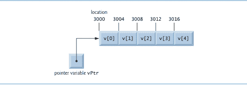

**图 8.16**  |  数组 v 和指向 v 的指针变量 int *vPtr。

在常规算术中，3000 + 2 的加法结果为 3002。指针算术通常不是这样。当整数与指针相加或从指针中减去时，指针不是简单地增加或减少该整数，而是增加或减少该整数乘以指针所指对象的大小。字节数取决于对象的数据类型。例如，语句

```c
vPtr += 2;
```

将产生 3008（由计算 3000 + 2 * 4 得出），假设一个 int 存储在四字节内存中。在数组 v 中，vPtr 现在将指向 v[2]（图 8.17）。如果一个整数存储在兩字节内存中，则前面的计算将得到内存位置 3004（3000 + 2 * 2）。如果数组元素是不同的数据类型，则前面的语句会将指针增加存储该数据类型对象所需字节数的两倍。

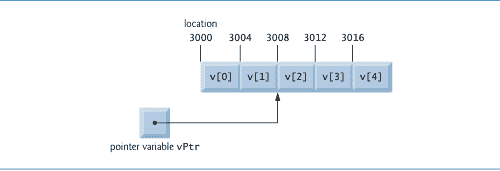

**图 8.17**  |  指针算术后的指针 vPtr。

如果 vPtr 已被增加到 3016，即指向 v[4]，则语句

```c
vPtr -= 4;
```

会将 vPtr 重新设置为 3000——数组的起始位置。如果指针要增加或减少 1，则可以使用自增（++）和自减（--）运算符。下列每条语句

```c
++vPtr;
vPtr++;
```

都会将指针增加，使其指向数组的*下一个*元素。下列每条语句

```c
--vPtr;
vPtr--;
```

都会将指针减少，使其指向数组的*前一个*元素。

指向*同一*数组的指针变量可以彼此相减。例如，如果 vPtr 包含地址 3000，而 v2Ptr 包含地址 3008，则语句

```c
x = v2Ptr - vPtr;
```

会将从 vPtr 到 v2Ptr 的*数组元素个数*赋给 x——在本例中为 2。除非对指向数组的指针执行指针算术，否则指针算术没有意义。我们不能假定同一类型的两个变量在内存中连续存储，除非它们是数组的相邻元素。

> **常见编程错误 8.8**
> 
> *相减或比较两个不指向同一数组元素的指针是逻辑错误。*

如果两个指针是*相同*类型，则可以将一个指针赋给另一个指针。否则，必须使用强制类型转换运算符（通常是 reinterpret_cast；在第 17.7 节讨论）将赋值右侧的指针值转换为赋值左侧的指针类型。此规则的例外是指向 void 的指针（即 void *），它是一种通用指针，能够表示任何指针类型。所有指针类型都可以赋值给 void * 类型的指针而无需强制转换。然而，void * 类型的指针**不能**直接赋值给另一种类型的指针——必须先将 void * 类型的指针强制转换为适当的指针类型。

> **软件工程观察 8.5**
> 
> *非常量指针实参可以传递给常量指针形参。*

void * 指针*不能*被解引用。例如，编译器“知道”在整数为四字节的机器上，指向 int 的指针引用四字节内存，但指向 void 的指针仅包含一个未知数据类型的存储地址——编译器*不*知道该指针所引用的确切字节数以及数据类型。编译器必须知道数据类型才能确定特定指针要解引用的字节数——对于指向 void 的指针，无法确定该字节数。

数组名（隐式为 const）可以当作指针处理，并用于指针算术。例如，表达式

```c
*( b + 3 )
```

也引用数组元素 b[3]。一般来说，所有带下标的数组表达式都可以用指针和偏移量来编写。在本例中，使用了以数组名作为指针的指针/偏移量表示法。前面的表达式不会以任何方式修改数组名；b 仍然指向数组中的第一个元素。

指针可以像数组一样使用下标。例如，表达式

```c
bPtr[ 1 ]
```

引用数组元素 b[1]；此表达式使用指针/下标表示法。

请记住，数组名是常量指针；它始终指向数组的起始位置。因此，表达式

```c
b += 3
```

会导致编译错误，因为它试图通过指针算术修改数组名（常量）的值。


> **常见编程错误 8.11**
> 
> *尽管数组名是指向数组起始位置的指针，但数组名不能在算术表达式中修改，因为数组名是常量指针。*


> **良好编程习惯 8.2**
> 
> *为清晰起见，在操作数组时使用数组表示法而不是指针表示法。*

图 8.18 使用本节讨论的四种表示法来引用数组元素——数组下标表示法、以数组名作为指针的指针/偏移量表示法、指针下标表示法以及使用指针的指针/偏移量表示法——以完成同一任务，即打印整数数组 b 的四个元素。

```cpp
// Fig. 8.18: fig08_18.cpp
// Using subscripting and pointer notations with arrays.
#include <iostream>
using namespace std;

int main()
{
    int b[] = { 10, 20, 30, 40 }; // create 4-element array b
    int *bPtr = b; // set bPtr to point to array b

    // output array b using array subscript notation
    cout << "Array b printed with:\n\nArray subscript notation\n";

    for ( int i = 0; i < 4; ++i )
        cout << "b[" << i << "] = " << b[ i ] << '\n';
```

**图 8.18** | 使用数组名和指针引用数组元素。（第 1 部分，共 2 部分。）


```cpp
17    // output array b using the array name and pointer/offset notation
18    cout << "\nPointer/offset notation"
19         << "the pointer is the array name\n";

21    for ( int offset1 = 0; offset1 < 4; ++offset1 )
22       cout << "\n*(b + " << offset1 << ") = " << *( b + offset1 ) << '\n';

24    // output array b using bPtr and array subscript notation
25    cout << "\nPointer subscript notation\n";

27    for ( int j = 0; j < 4; ++j )
28       cout << "\nbPtr[" << j << "] = " << bPtr[ j ] << '\n';

30    cout << "\nPointer/offset notation\n";

32    // output array b using bPtr and pointer/offset notation
33    for ( int offset2 = 0; offset2 < 4; ++offset2 )
34       cout << "\n*(bPtr + " << offset2 << ") = "
35            << *( bPtr + offset2 ) << '\n';
36 } // end main
```

```text
Array b printed with:

Array subscript notation
b[0] = 10
b[1] = 20
b[2] = 30
b[3] = 40

Pointer/offset notation where the pointer is the array name
*(b + 0) = 10
*(b + 1) = 20
*(b + 2) = 30
*(b + 3) = 40

Pointer subscript notation
bPtr[0] = 10
bPtr[1] = 20
bPtr[2] = 30
bPtr[3] = 40

Pointer/offset notation
*(bPtr + 0) = 10
*(bPtr + 1) = 20
*(bPtr + 2) = 30
*(bPtr + 3) = 40
```

**图 8.18** | 使用数组名和指针引用数组元素。（第2部分，共2部分。）

## 8.10 基于指针的字符串处理

我们已经使用 C++ 标准库 string 类将字符串表示为功能完善的对象。例如，第3–7章中的 GradeBook 类案例研究使用 string 对象表示课程名称。第18章将详细讨论 string 类。本节介绍基于指针的 C 风格字符串。在新程序中使用 C++ 的 string 类更可取，因为它消除了许多因操作 C 字符串而导致的安全问题和 bug。我们在这里介绍 C 字符串是为了更深入地理解数组。此外，如果你处理的是遗留的 C 和 C++ 程序，你很可能会遇到这些基于指针的字符串。我们将在第21章详细讨论基于指针的 C 风格字符串。

### 字符与字符常量

字符是 C++ 源程序的基本构建块。每个程序都由一系列字符组成——当这些字符有意义地组合在一起时，编译器会将其解释为用于完成某项任务的一系列指令。程序可以包含字符常量。字符常量是用单引号括起来的字符所表示的整数值。字符常量的值是该字符在机器字符集中的整数值。例如，'z' 表示 z 的整数值（在 ASCII 字符集中为 122；参见附录 B），而 '\n' 表示换行符的整数值（在 ASCII 字符集中为 10）。

### 字符串

字符串是作为一个整体处理的一系列字符。字符串可以包含字母、数字以及各种特殊字符，例如 +、-、*、/ 和 $。C++ 中的字符串字面量（或字符串常量）用双引号编写，如下所示：

```text
"John Q. Doe"                 (a name)
"9999 Main Street"            (a street address)
"Maynard, Massachusetts"      (a city and state)
"(201) 555-1212"              (a telephone number)
```

### 基于指针的字符串

基于指针的字符串是以空字符（'\0'）结尾的字符数组，空字符标记字符串在内存中的终止位置。字符串通过指向其第一个字符的指针来访问。字符串字面量的值是其第一个字符的地址，但字符串字面量的大小是字符串的长度加上终止空字符。基于指针的字符串类似于数组——数组名也是指向其第一个元素的指针。

### 字符串字面量作为初始化器

字符串字面量可以用作字符数组或 char * 类型变量声明中的初始化器。以下声明：

```cpp
char color[] = "blue";
const char *colorPtr = "blue";
```

每个都将变量初始化为字符串 "blue"。第一个声明创建了一个包含字符 'b'、'l'、'u'、'e' 和 '\0' 的五元素数组 color。第二个声明创建指针变量 colorPtr，它指向内存中某处字符串 "blue"（以 '\0' 结尾）中的字母 b。字符串字面量具有静态存储类（它们在程序运行期间存在），并且如果在程序中的多个位置引用了相同的字符串字面量，它们可能会也可能不会被共享。修改字符串字面量的效果是未定义的；因此，你应始终将指向字符串字面量的指针声明为 const char *。

### 字符常量作为初始化器

声明 char color[] = "blue"; 也可以写成

```cpp
char color[] = { 'b', 'l', 'u', 'e', '\0' };
```

它使用单引号（'）中的字符常量作为数组每个元素的初始化器。当声明一个字符数组来存储字符串时，数组必须足够大以存储字符串*及其*终止空字符。编译器根据初始化器列表中初始化器的数量来确定前面声明中的数组大小。

> **常见编程错误 8.12**
> 
> 在字符数组中未分配足够的空间来存储终止字符串的空字符，这是一个逻辑错误。

> **常见编程错误 8.13**
> 
> 创建或使用不包含终止空字符的 C 风格字符串可能导致逻辑错误。

> **防错提示 8.3**
> 
> 当在字符数组中存储字符串时，请确保数组足够大以容纳将要存储的最大字符串。如果字符串比要存储它的字符数组长，超出数组末尾的字符将覆盖数组中之后的内存数据，导致逻辑错误和潜在的安全漏洞。

### 访问 C 字符串中的字符

由于 C 风格字符串是字符数组，我们可以直接使用数组下标表示法访问字符串中的单个字符。例如，在前面的声明中，`color[0]` 是字符 `'b'`，`color[2]` 是 `'u'`，`color[4]` 是空字符。

### 使用 cin 将字符串读入 char 数组

可以使用带 `cin` 的流提取将字符串读入字符数组。例如，以下语句将字符串读入字符数组 `word[20]`：

```cpp
cin >> word;
```

用户输入的字符串存储在 `word` 中。前面的语句读取字符，直到遇到空白字符或文件结束指示符。字符串的长度不应超过 19 个字符，以便为终止空字符留出空间。可以使用 `setw` 流操纵符确保读入 `word` 的字符串不超过数组的大小。例如，语句

```cpp
cin >> setw(20) >> word;
```

指定 `cin` 最多将 19 个字符读入数组 `word`，并保存数组中的第 20 个位置以存储字符串的终止空字符。`setw` 流操纵符*仅*适用于下一个输入的值。如果输入的字符超过 19 个，多余的字符不会保存在 `word` 中，但它们会留在输入流中，并可由下一个输入操作读取。

### 使用 cin.getline 将文本行读入 char 数组

在某些情况下，需要将*整行文本*输入到字符数组中。为此，`cin` 对象提供了成员函数 `getline`，它接受三个参数——一个用于存储文本行的字符数组、一个长度和一个分隔符。例如，语句

```cpp
char sentence[ 80 ];
cin.getline( sentence, 80, '\n' );
```

声明了一个包含 80 个字符的数组 sentence，并将键盘输入的一行文本读入该数组。当遇到分隔符 '\n'、输入文件结束指示符或到目前为止读取的字符数比第二个参数中指定的长度少一时，函数停止读取字符。数组中的最后一个字符保留给终止空字符。如果遇到分隔符，它会被读取并丢弃。cin.getline 的第三个参数默认值为 '\n'，因此前面的函数调用可以写成：

```cpp
cin.getline( sentence, 80 );
```

第15章“流输入/输出”详细讨论了 cin.getline 及其他输入/输出函数。

### 显示 C 风格字符串

表示以空字符结尾的字符串的字符数组可以使用 cout 和 << 输出。语句

```cpp
cout << sentence;
```

打印数组 sentence。请注意，cout << 与 cin >> 一样，不关心字符数组有多大。字符串中的字符一直输出到遇到终止空字符为止；空字符不会被打印。[注意：cin 和 cout 假定字符数组应作为以空字符结尾的字符串处理；cin 和 cout 不提供对其他数组类型的类似输入和输出处理能力。]

## 8.11 指针数组

数组可以包含指针。这种数据结构的一个常见用途是形成基于指针的字符串数组，简称为字符串数组。数组中的每个条目都是一个字符串，但在 C++ 中，字符串本质上是指向第一个字符的指针，因此字符串数组中的每个条目仅仅是指向字符串第一个字符的指针。考虑字符串数组 suit 的声明，它可能有助于表示一副扑克牌：

```cpp
const char * const suit[ 4 ] =
    { "Hearts", "Diamonds", "Clubs", "Spades" };
```

声明中的 suit[4] 部分表示一个包含四个元素的数组。声明中的 const char * 部分表示数组 suit 的每个元素都是“指向字符常量数据的指针”类型。要放入数组的四个值是 "Hearts"、"Diamonds"、"Clubs" 和 "Spades"。每个值在内存中都存储为以空字符结尾的字符串，其长度比引号之间的字符数多一个。这四个字符串的长度分别为七、九、六和七个字符（包括它们的终止空字符）。虽然看起来这些字符串被放入了 suit 数组，但实际上只有指针存储在数组中，如图 8.19 所示。每个指针指向其对应字符串的第一个字符。因此，即使 suit 数组的大小是固定的，它也可以访问任意长度的字符串。这种灵活性是 C++ 强大的数据结构化能力的一个例子。


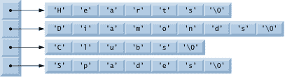

**图 8.19** | 花色数组的图形表示。

可以将花色字符串放入一个二维数组中，其中每一行表示一种花色，每一列表示花色名称中的一个字母。这种数据结构每行必须有固定的列数，并且该列数必须与最长字符串的长度一样大。因此，当我们存储大量字符串时，会浪费相当多的内存，因为这些字符串中大多数都比最长的字符串短。在下一节中，我们将使用字符串数组来帮助表示一副扑克牌。

字符串数组通常与命令行参数配合使用，这些参数在程序开始执行时传递给函数 `main`。当从命令行执行程序时，这类参数跟在程序名之后。命令行参数的一种典型用法是向程序传递选项。例如，在 Windows 计算机的命令行中，用户可以输入

```text
dir /p
```

以列出当前目录的内容，并在每屏信息后暂停。当执行 `dir` 命令时，选项 `/p` 会作为命令行参数传递给 `dir`。这类参数会被放入一个字符串数组，`main` 将该数组作为参数接收。我们将在附录 F“C 遗留代码主题”中讨论命令行参数。

## 8.12 函数指针

指向函数的指针包含该函数在内存中的地址。我们知道，数组名实际上是第一个元素在内存中的地址。类似地，函数名实际上是执行该函数任务的代码在内存中的起始地址。函数指针可以传递给函数、从函数返回、存储在数组中、赋值给其他函数指针，并用于调用底层函数。

### 使用函数指针的多用途选择排序

为了说明函数指针的用法，图 8.20 修改了图 8.13 的选择排序程序。图 8.20 由 `main`（第 13—50 行）以及函数 `selectionSort`（第 54—71 行）、`swap`（第 75—80 行）、`ascending`（第 84—87 行）和 `descending`（第 91—94 行）组成。除了要排序的整数数组和数组大小之外，函数 `selectionSort` 还接收一个指向函数的指针——即函数 `ascending` 或函数 `descending`——作为参数。函数 `ascending` 和 `descending` 决定排序顺序。程序提示用户选择是按升序还是按降序对数组排序（第 20—22 行）。如果用户输入 1，则将指向函数 `ascending` 的指针传递给函数 `selectionSort`（第 33 行），使数组按递增顺序排序。如果用户输入 2，则将指向函数 `descending` 的指针传递给函数 `selectionSort`（第 41 行），使数组按递减顺序排序。

```cpp
// Fig. 8.20: fig08_20.cpp
// Multipurpose sorting program using function pointers.
#include <iostream>
#include <iomanip>
using namespace std;

// prototypes
void selectionSort( int [], const int, bool (*)( int, int ) );
void swap( int * const, int * const );
bool ascending( int, int ); // implements ascending order
bool descending( int, int ); // implements descending order

int main()
{
    const int arraySize = 10;
    int order; // 1 == ascending, 2 == descending
    int counter; // array index
    int a[ arraySize ] = { 2, 6, 4, 8, 10, 12, 89, 68, 45, 37 };

    cout << "Enter 1 to sort in ascending order,\n"
         << "Enter 2 to sort in descending order: ";
    cin >> order;
    cout << "\nData items in original order\n";

    // output original array
    for ( counter = 0; counter < arraySize; ++counter )
        cout << setw( 4 ) << a[ counter ];

    // sort array in ascending order; pass function ascending
    // as an argument to specify ascending sorting order
    if ( order == 1 )
    {
        selectionSort( a, arraySize, ascending );
        cout << "\nData items in ascending order\n";
    } // end if

    // sort array in descending order; pass function descending
    // as an argument to specify descending sorting order
    else
    {
        selectionSort( a, arraySize, descending );
        cout << "\nData items in descending order\n";
    } // end else part of if...else

    // output sorted array
    for ( counter = 0; counter < arraySize; ++counter )
        cout << setw( 4 ) << a[ counter ];

    cout << endl;
} // end main

// multipurpose selection sort; the parameter compare is a pointer to
// the comparison function that determines the sorting order
void selectionSort( int work[], const int size,
                    bool (*compare)( int, int ) )
{
   int smallestOrLargest; // index of smallest (or largest) element

   // loop over size - 1 elements
   for ( int i = 0; i < size - 1; ++i )
   {
      smallestOrLargest = i; // first index of remaining vector

      // loop to find index of smallest (or largest) element
      for ( int index = i + 1; index < size; ++index )
         if ( !(*compare)( work[ smallestOrLargest ], work[ index ] ) )
            smallestOrLargest = index;

      swap( &work[ smallestOrLargest ], &work[ i ] );
   } // end for
} // end function selectionSort

// swap values at memory locations to which
// element1Ptr and element2Ptr point
void swap( int * const element1Ptr, int * const element2Ptr )
{
   int hold = *element1Ptr;
   *element1Ptr = *element2Ptr;
   *element2Ptr = hold;
} // end function swap

// determine whether element a is less than
// element b for an ascending order
bool ascending( int a, int b )
{
   return a < b; // returns true if a is less than b
} // end function ascending

// determine whether element a is greater than
// element b for a descending order
bool descending( int a, int b )
{
   return a > b; // returns true if a is greater than b
} // end function descending
```

**图 8.20** | 使用函数指针的多用途排序程序。（第 1 部分，共 3 部分。）

```text
Enter 1 to sort in ascending order,
Enter 2 to sort in descending order: 1

Data items in original order
   2   6   4   8  10  12  89  68  45  37
Data items in ascending order
   2   4   6   8  10  12  37  45  68  89
```

**图 8.20** | 使用函数指针的多用途排序程序。（第 2 部分，共 3 部分。）

```text
Enter 1 to sort in ascending order,
Enter 2 to sort in descending order: 2

Data items in original order
   2   6   4   8  10  12  89  68  45  37
Data items in descending order
  89  68  45  37  12  10   8   6   4   2
```

**图 8.20** | 使用函数指针的多用途排序程序。（第 3 部分，共 3 部分。）

以下参数出现在 `selectionSort` 函数头的第 55 行：

```cpp
bool ( *compare )( int, int )
```

该参数指定一个指向函数的指针。关键字 `bool` 表示被指向的函数返回一个 bool 值。文本 `(*compare)` 表示该函数指针的名称（`*` 表示参数 `compare` 是一个指针）。文本 `(int, int)` 表示 `compare` 所指向的函数接受两个整数参数。`*compare` 两侧需要加括号，以表示 `compare` 是一个指向函数的指针。如果没有包含括号，则声明将会是

```cpp
bool *compare( int, int )
```

这会声明一个接收两个 int 并返回指向 bool 值的指针的函数。`selectionSort` 的函数原型（第 8 行）中对应的参数是

```cpp
bool (*)( int, int )
```

其中只包含了类型。一如既往，为了文档说明目的，你可以包含编译器会忽略的名称。

传递给 `selectionSort` 的函数在第 66 行中按如下方式调用：

```cpp
( *compare )( work[ smallestOrLargest ], work[ index ] )
```

正如通过解引用指向变量的指针来访问变量的值一样，通过解引用指向函数的指针来执行该函数。`*compare` 两侧的括号是必需的——如果省略它们，`*` 运算符将试图解引用函数调用返回的值。也可以在不显式解引用指针的情况下调用该函数，如下所示：

```cpp
compare( work[ smallestOrLargest ], work[ index ] )
```

这里直接将指针用作函数名。我们更倾向于通过指针调用函数的第一种方法，因为它明确说明了 `compare` 是一个指向函数的指针，并通过解引用该指针来调用函数。通过指针调用函数的第二种方法会让人觉得 `compare` 是程序中某个实际函数的名称。这可能会让使用我们代码的用户感到困惑，因为他们想查看函数 `compare` 的定义，却发现该函数并未在文件中定义。第 22 章“标准模板库（STL）”介绍了函数指针的许多常见用法。

## 8.13 小结

本章详细介绍了指针——一种以内存地址作为值的变量。我们首先演示了如何声明和初始化

使指针更加清晰。您已经了解了如何使用地址运算符（&）将变量的地址赋给指针，以及如何使用间接运算符（*）访问指针间接引用的变量中存储的数据。我们讨论了通过指针参数和引用参数进行按引用传递。

您学习了如何将 const 与指针结合使用，以贯彻最小权限原则。我们演示了使用指向非常量数据的非常量指针、指向常量数据的非常量指针、指向非常量数据的常量指针，以及指向常量数据的常量指针。随后，我们使用选择排序法演示了如何按引用传递数组和单个数组元素。我们讨论了编译时 sizeof 运算符，它可以在程序编译期间用于确定数据类型和变量的大小（以字节为单位）。

我们演示了如何在算术和比较表达式中使用指针。您看到了指针算术可以用来从数组的一个元素跳转到另一个元素。您学习了如何使用指针数组，更具体地说是字符串数组（字符串数组）。我们讨论了函数指针，它使您能够将函数作为参数传递。我们还简要介绍了基于指针的字符串。

在下一章中，我们将开始对类进行更深入的讨论。您将了解类成员的作用域，以及如何使对象保持一致的状态。您还将了解如何使用称为构造函数和析构函数的特殊成员函数，它们分别在对象创建和销毁时执行，并且我们将讨论构造函数和析构函数何时被调用。此外，我们将演示如何将默认参数与构造函数一起使用，以及如何使用默认成员逐一赋值将一个类的对象赋给该类的另一个对象。我们还将讨论返回对类的私有数据成员的引用所带来的危险。

## 小结

### 第 8.2 节 指针变量声明与初始化

- 指针是包含其他变量内存地址作为其值的变量。
- 声明

  ```
  int *ptr;
  ```

  将 ptr 声明为指向 int 类型变量的指针，读作“ptr 是指向 int 的指针”。此处声明中的 * 表示该变量是指针。
- 有三个值可用于初始化指针：0、NULL 或同类型对象的地址。新的 C++ 标准还提供了 nullptr 常量，这是更推荐的方式。
- 无需强制转换即可赋给指针的唯一整数是零。

### 第 8.3 节 指针运算符

- &（地址）运算符（第 332 页）获取其操作数的内存地址。
- 地址运算符的操作数必须是变量名（或其他左值）；地址运算符不能应用于常量或不返回引用的表达式。
- * 间接（或解引用）运算符（第 333 页）返回其操作数在内存中指向的对象的名称的同义词。这称为解引用指针（第 333 页）。

### 第 8.4 节 使用指针进行按引用传递

- 当调用函数时，如果调用者希望被调函数修改某个参数，可以传递该参数的地址。然后被调函数使用间接运算符（*）解引用指针并修改调用函数中参数的值。
- 接收地址作为参数的函数必须将其对应参数声明为指针。

### 第 8.5 节 将 const 与指针一起使用

- const 限定符使您可以告知编译器，特定变量的值不能通过指定的标识符进行修改。
- 有四种方式将指针传递给函数——指向非常量数据的非常量指针（第 340 页）、指向常量数据的非常量指针（第 340 页）、指向非常量数据的常量指针（第 341 页）以及指向常量数据的常量指针（第 341 页）。
- 数组名的值是数组第一个元素的地址。
- 要使用指针按引用传递单个数组元素，请传递该元素的地址。

### 第 8.6 节 使用按引用传递的选择排序

- 选择排序算法（第 343 页）是一种易于编程但效率不高的排序算法。算法的第一次迭代选择数组中最小的元素并将其与第一个元素交换。第二次迭代选择第二小的元素（即剩余元素中最小的元素）并将其与第二个元素交换。算法继续执行，直到最后一次迭代选择第二大的元素并将其与倒数第二个索引交换，将最大的元素留在最后一个索引处。经过第 *i* 次迭代后，数组中最小的 *i* 个元素将按递增顺序排列在数组的前 *i* 个元素中。

### 第 8.7 节 sizeof 运算符

- sizeof（第 347 页）在编译时确定类型、变量或常量的大小（以字节为单位）。
- 当应用于数组名时，sizeof 返回数组中字节的总数。

### 第 8.8 节 指针表达式与指针算术

- 可以对指针执行的算术运算包括：递增（++）指针、递减（--）指针、将整数与指针相加（+ 或 +=）、从指针中减去整数（- 或 -=）以及两个指针相减。
- 当整数与指针相加或从指针中减去时，指针会增加或减少该整数乘以指针所指向对象的大小。
- 如果指针类型相同，则可以相互赋值。否则，必须使用强制转换。void * 指针是一个例外，它是一种通用指针类型，可以保存任何类型的指针值。
- 对 void * 指针唯一有效的操作是将 void * 指针与其他指针进行比较、将地址赋给 void * 指针，以及将 void * 指针强制转换为有效的指针类型。
- 可以使用相等和关系运算符比较指针。只有当指针指向同一数组的成员时，使用关系运算符进行的比较才有意义。

### 第 8.9 节 指针与数组的关系

- 指向数组的指针可以像数组名一样使用下标（第 353 页）。
- 在指针/偏移量表示法（第 352 页）中，如果指针指向数组的第一个元素，则偏移量与数组下标相同。
- 所有带下标的数组表达式都可以使用指针和偏移量（第 352 页）编写，既可以使用数组名作为指针，也可以使用单独的指针指向该数组。

### 第 8.10 节 基于指针的字符串处理

- 字符常量（第 355 页）是用单引号括起来的字符表示的整数值。字符常量的值是字符在机器字符集中的整数值。
- 字符串是作为单个单元处理的一系列字符。字符串可以包含字母、数字以及各种特殊字符，如 +、-、*、/ 和 $。
- 在 C++ 中，字符串字面量（或字符串常量）用双引号（第 355 页）括起来。
- 基于指针的字符串是以空字符（'\0'；第 355 页）结尾的字符数组，该空字符标记字符串在内存中的终止位置。字符串通过指向其第一个字符的指针进行访问。
- 字符串字面量的值是它第一个字符的地址，但字符串字面量的 `sizeof` 是字符串的长度，包括终止的空字符。
- 字符串字面量可以用作字符数组或 `char *` 类型变量的初始化器。
- 字符串字面量具有静态存储类，如果同一字符串字面量在程序中的多个位置被引用，则可能共享也可能不共享。
- 修改字符串字面量的效果是未定义的；因此，您应该始终将指向字符串字面量的指针声明为 `const char *`。
- 当声明一个字符数组来存储字符串时，该数组必须足够大，以存储字符串及其终止空字符。
- 如果字符串长于要存储它的字符数组，则超出数组末尾的字符将覆盖数组之后的内存中的数据，导致逻辑错误。
- 您可以直接使用数组下标表示法访问字符串中的各个字符。
- 可以使用 `cin` 的流提取运算符将字符串读入字符数组。
- 可以使用 `setw` 流操纵符来确保读入字符数组的字符串不超过数组的大小。
- `cin` 对象提供成员函数 `getline`（第 356 页）来将整行文本输入到字符数组中。该函数接受三个参数——用于存储文本行的字符数组、长度和分隔符字符。第三个参数默认值为 '\n'。
- 表示以空字符结尾的字符串的字符数组可以使用 `cout` 和 `<<` 输出。字符串的字符将一直输出，直到遇到终止空字符为止。

### 第 8.11 节 指针数组

- 数组可以包含指针。
- 这种数据结构可用于形成基于指针的字符串数组，称为字符串数组（第 357 页）。数组中的每个条目都是一个字符串，但在 C++ 中，字符串本质上是指向其第一个字符的指针，因此字符串数组中的每个条目仅仅是指向字符串第一个字符的指针。
- 字符串数组通常与命令行参数（第 358 页）一起使用，这些参数在程序开始执行时传递给 `main`。

### 第 8.12 节 函数指针

- 指向函数的指针（第 358 页）是函数代码所在位置的地址。
- 指向函数的指针可用于调用它们所指向的函数、传递给函数、从函数返回、存储在数组中以及赋值给其他指针。

## 自测练习

**8.1** 回答以下各项：

- a) 指针是一种变量，它的值是另一个变量的 ________。
- b) 可用于初始化指针的三个值是 ________、________ 和 ________。
- c) 可以直接赋给指针的唯一整数是 __________。


### 8.2

判断下列各题是*正确*还是*错误*。如果答案是*错误*，请解释原因。

- a) 地址运算符 `&` 只能用于常量和表达式。
- b) 声明为 `void *` 类型的指针可以被解引用。
- c) 一种类型的指针不能在不进行强制转换的情况下赋值给另一种类型的指针。

### 8.3

对于下列各项，编写执行指定任务的 C++ 语句。假设双精度浮点数存储在八个字节中，并且数组的起始地址位于内存位置 1002500。练习的每一部分应在适当情况下使用前面部分的结果。

- a) 声明一个名为 `numbers` 的 double 类型数组，包含 10 个元素，并将元素初始化为值 0.0、1.1、2.2、...、9.9。假设符号常量 `SIZE` 已定义为 10。
- b) 声明一个指向 double 类型变量的 `double` 指针 `nPtr`。
- c) 使用 `for` 语句，通过数组下标表示法打印数组 `numbers` 的元素。打印每个数字时保留小数点后一位精度。
- d) 编写两条单独的语句，每条都将数组 `numbers` 的起始地址赋给指针变量 `nPtr`。
- e) 使用 `for` 语句，通过指针 `nPtr` 的指针/偏移量表示法打印数组 `numbers` 的元素。
- f) 使用 `for` 语句，以数组名作为指针，通过指针/偏移量表示法打印数组 `numbers` 的元素。
- g) 使用 `for` 语句，通过指针 `nPtr` 的指针/下标表示法打印数组 `numbers` 的元素。
- h) 分别使用数组下标表示法、以数组名作为指针的指针/偏移量表示法、使用 `nPtr` 的指针下标表示法以及使用 `nPtr` 的指针/偏移量表示法引用数组 `numbers` 的第四个元素。
- i) 假设 `nPtr` 指向数组 `numbers` 的开头，`nPtr + 8` 引用的是什么地址？该位置存储的是什么值？
- j) 假设 `nPtr` 指向 `numbers[5]`，执行 `nPtr -= 4` 后，`nPtr` 引用的是什么地址？该位置存储的值是什么？

### 8.4

对于下列各项，编写一条执行指定任务的语句。假设浮点变量 `number1` 和 `number2` 已声明，并且 `number1` 已初始化为 7.3。假设变量 `ptr` 的类型为 `char *`。假设数组 `s1` 和 `s2` 都是 100 个元素的 char 数组，并且已用字符串字面量初始化。

- a) 声明变量 `fPtr` 为指向 double 类型对象的指针。
- b) 将变量 `number1` 的地址赋给指针变量 `fPtr`。
- c) 打印 `fPtr` 所指向对象的值。
- d) 将 `fPtr` 所指向对象的值赋给变量 `number2`。
- e) 打印 `number2` 的值。
- f) 打印 `number1` 的地址。
- g) 打印存储在 `fPtr` 中的地址。打印出的值与 `number1` 的地址相同吗？

### 8.5

执行下列各语句所指定的任务：

- a) 为名为 `exchange` 的函数编写函数头，该函数接受两个指向双精度浮点数的指针 `x` 和 `y` 作为参数，并且不返回值。
- b) 为 (a) 部分中的函数编写函数原型。
- c) 为名为 `evaluate` 的函数编写函数头，该函数返回整数，并接受整数 `x` 和指向函数 `poly` 的指针作为参数。函数 `poly` 接受一个整数参数并返回一个整数。
- d) 为 (c) 部分中的函数编写函数原型。
- e) 编写两条语句，每条都用元音字符串 "AEIOU" 初始化字符数组 `vowel`。

### 8.6

找出下列各程序段中的错误。假设有以下声明和语句：

```cpp
int *zPtr; // zPtr will reference array z
void *sPtr = 0;
int number;
int z[5] = { 1, 2, 3, 4, 5 };
```

- a) `++zPtr;`
- b)
  ```cpp
  // use pointer to get first value of array
  number = zPtr;
  ```
- c)
  ```cpp
  // assign array element 2 (the value 3) to number
  number = *zPtr[2];
  ```
- d)
  ```cpp
  // print entire array z
  for ( int i = 0; i <= 5; ++i )
      cout << zPtr[i] << endl;
  ```
- e)
  ```cpp
  // assign the value pointed to by sPtr to number
  number = *sPtr;
  ```
- f) `++z;`

## 自测练习答案

### 8.1

a) 地址。b) 0、NULL、一个地址。c) 0。

### 8.2

a) 错误。地址运算符的操作数必须是*左值*；地址运算符不能应用于常量或不会产生引用的表达式。

b) 错误。指向 void 的指针不能被解引用。这种指针没有类型，编译器无法确定要解引用的内存字节数以及指针所指向数据的类型。

c) 错误。任何类型的指针都可以赋给 void 指针。只有使用显式类型转换，void 类型的指针才能赋给其他类型的指针。

### 8.3

a)
```cpp
double numbers[ SIZE ] = { 0.0, 1.1, 2.2, 3.3, 4.4, 5.5, 6.6, 7.7, 8.8, 9.9 };
```

b)
```cpp
double *nPtr;
```

c)
```cpp
cout << fixed << showpoint << setprecision( 1 );
for ( int i = 0; i < SIZE; ++i )
    cout << numbers[ i ] << ' ';
```

d)
```cpp
nPtr = numbers;
nPtr = &numbers[ 0 ];
```

e)
```cpp
cout << fixed << showpoint << setprecision( 1 );
for ( int j = 0; j < SIZE; ++j )
    cout << *( nPtr + j ) << ' ';
```

f)
```cpp
cout << fixed << showpoint << setprecision( 1 );
for ( int k = 0; k < SIZE; ++k )
    cout << *( numbers + k ) << ' ';
```

g)
```cpp
cout << fixed << showpoint << setprecision( 1 );
for ( int m = 0; m < SIZE; ++m )
    cout << nPtr[ m ] << ' ';
```

h)
```cpp
numbers[ 3 ]
*( numbers + 3 )
nPtr[ 3 ]
*( nPtr + 3 )
```

i) 该地址是 1002500 + 8 * 8 = 1002564。值是 8.8。

j) `numbers[ 5 ]` 的地址是 1002500 + 5 * 8 = 1002540。  
`nPtr` 所引用的地址是 1002540 - 4 * 8 = 1002508。  
该位置的值是 1.1。

### 8.4

a) `double *fPtr;`

b) `fPtr = &number1;`

c) `cout << "The value of *fPtr is " << *fPtr << endl;`

d) `number2 = *fPtr;`

e) `cout << "The value of number2 is " << number2 << endl;`

f) `cout << "The address of number1 is " << &number1 << endl;`

g) `cout << "The address stored in fPtr is " << fPtr << endl;`

是的，该值相同。

### 8.5

a) `void exchange( double *x, double *y )`

b) `void exchange( double *, double * );`

c) `int evaluate( int x, int (*y)( int ) )`

d) `int evaluate( int, int (*)( int ) );`

e) `char vowel[] = "AEIOU";`

f) `char vowel[] = { 'A', 'E', 'I', 'O', 'U', '\0' };`

### 8.6

a) *错误：* zPtr 尚未初始化。  
*更正：* 用 `zPtr = z;` 初始化 zPtr。

b) *错误：* 指针未被解引用。  
*更正：* 将该语句改为 `number = *zPtr;`

c) *错误：* `zPtr[ 2 ]` 不是指针，不应被解引用。  
*更正：* 将 `*zPtr[ 2 ]` 改为 `zPtr[ 2 ]`。

d) *错误：* 使用指针下标引用数组边界之外的元素。  
*更正：* 为防止此问题，将 `for` 语句中的关系运算符改为 `<`，或将 `5` 改为 `4`。

e) *错误：* 解引用 void 指针。  
*更正：* 要解引用 void 指针，必须先将其转换为整数指针。将该语句改为 `number = *static_cast<int *>(sPtr);`

f) *错误：* 试图用指针算术修改数组名。  
*更正：* 使用指针变量代替数组名来完成指针算术，或对数组名使用下标以引用特定元素。

## 练习题

### 8.7 *（判断题）*

判断下列各题是*正确还是错误*。如果是错误，请解释原因。

- a) 指向不同数组的两个指针无法进行有意义的比较。
- b) 因为数组名是指向数组第一个元素的指针，所以数组名可以完全像指针一样被操作。

### 8.8 *（编写 C++ 语句）*

对于下列各项，编写执行指定任务的 C++ 语句。假设无符号整数存储在两个字节中，并且数组的起始地址位于内存位置 1002500。

- a) 声明一个名为 `values` 的 `unsigned int` 类型数组，包含五个元素，并将元素初始化为从 2 到 10 的偶数。假设符号常量 `SIZE` 已定义为 5。
- b) 声明一个指向 `unsigned int` 类型对象的指针 `vPtr`。
- c) 使用 `for` 语句，通过数组下标表示法打印数组 `values` 的元素。
- d) 编写两条单独的语句，每条都将数组 `values` 的起始地址赋给指针变量 `vPtr`。
- e) 使用 `for` 语句，通过指针/偏移量表示法打印数组 `values` 的元素。


- f) 使用 for 语句，以数组名作为指针，采用指针/偏移量表示法打印数组 values 的元素。
- g) 使用 for 语句，通过对数组的指针进行下标操作来打印数组 values 的元素。
- h) 分别使用数组下标表示法、以数组名作为指针的指针/偏移量表示法、指针下标表示法和指针/偏移量表示法引用 values 的第五个元素。
- i) `vPtr + 3` 引用的是什么地址？该位置存储的是什么值？
- j) 假设 `vPtr` 指向 `values[4]`，则 `vPtr -= 4` 引用的是什么地址？该位置存储的是什么值？

### 8.9（编写 C++ 语句）

对于以下各项，编写一条执行指定任务的单条语句。假设已声明长整型变量 `value1` 和 `value2`，并且 `value1` 已初始化为 200000。

- a) 声明变量 `longPtr` 为指向 long 类型对象的指针。
- b) 将变量 `value1` 的地址赋给指针变量 `longPtr`。
- c) 打印 `longPtr` 所指向对象的值。
- d) 将 `longPtr` 所指向对象的值赋给变量 `value2`。
- e) 打印 `value2` 的值。
- f) 打印 `value1` 的地址。
- g) 打印存储在 `longPtr` 中的地址。打印的值与 `value1` 的地址相同吗？

### 8.10（函数头和函数原型）

执行以下各语句指定的任务：

- a) 为函数 `zero` 编写函数头，该函数接受一个长整型数组参数 `bigIntegers`，且不返回值。
- b) 为第 (a) 部分中的函数编写函数原型。
- c) 为函数 `add1AndSum` 编写函数头，该函数接受一个整型数组参数 `oneTooSmall`，并返回一个整数。
- d) 为第 (c) 部分中描述的函数编写函数原型。

### 8.11（查找代码错误）

找出以下各代码段中的错误。如果错误可以更正，请说明如何更正。

```cpp
a)  int *number;
    cout << number << endl;

b)  double *realPtr;
    long *integerPtr;
    integerPtr = realPtr;

c)  int *x, y;
    x = y;

d)  char s[] = "this is a character array";
    for ( ; *s != '\0'; ++s)
        cout << *s << ' ';

e)  short *numPtr, result;
    void *genericPtr = numPtr;
    result = *genericPtr + 7;

f)  double x = 19.34;
    double xPtr = &x;
    cout << xPtr << endl;
```

### 8.12（模拟：龟兔赛跑）

在本练习中，你将重新创建经典的龟兔赛跑。你将使用随机数生成来开发这一令人难忘事件的模拟。

我们的参赛者从 70 个方格中的“第 1 格”开始比赛。每个方格代表赛道上一个可能的位置。终点线在第 70 格。第一个到达或越过第 70 格的参赛者将获得一桶新鲜胡萝卜和生菜。赛道沿着湿滑的山坡蜿蜒而上，因此参赛者偶尔会失去地盘。

有一个每秒滴答一次的时钟。每当时钟滴答一次，你的程序应使用函数 moveTortoise 和 moveHare，按照图 8.21 中的规则调整动物的位置。这些函数应使用基于指针的按引用传递来修改乌龟和兔子的位置。

| 动物 | 移动类型 | 时间百分比 | 实际移动 |
| --- | --- | ---: | --- |
| 乌龟 | 快速爬行 | 50% | 向右 3 格 |
| 乌龟 | 滑倒 | 20% | 向左 2 格 |
| 乌龟 | 缓慢爬行 | 30% | 向右 1 格 |
| 兔子 | 睡觉 | 20% | 完全不移动 |
| 兔子 | 大跳 | 20% | 向右 9 格 |
| 兔子 | 大滑倒 | 10% | 向左 12 格 |
| 兔子 | 小跳 | 30% | 向右 1 格 |
| 兔子 | 小滑倒 | 20% | 向左 2 格 |

图 8.21  |  移动乌龟和兔子的规则。

使用变量跟踪动物的位置（即位置编号为 1–70）。每只动物从位置 1（即“起跑门”）开始。如果动物在第 1 格之前向左滑倒，则将该动物移回第 1 格。

通过在 1 ≤ i ≤ 10 范围内生成随机整数 i 来产生上表中的百分比。对于乌龟，当 1 ≤ i ≤ 5 时执行“快速爬行”，当 6 ≤ i ≤ 7 时执行“滑倒”，或当 8 ≤ i ≤ 10 时执行“缓慢爬行”。使用类似技术移动兔子。

通过打印以下内容开始比赛

```
BANG !!!!!
AND THEY'RE OFF !!!!!
```

对于时钟的每次滴答（即循环的每次重复），打印一行 70 个位置，在乌龟的位置显示字母 T，在兔子的位置显示字母 H。偶尔，参赛者会落在同一个方格上。在这种情况下，乌龟会咬兔子，你的程序应从该位置开始打印 OUCH!!!。除 T、H 或 OUCH!!!（在平局情况下）之外的所有打印位置都应为空白。

打印每一行后，测试任一动物是否已到达或越过第 70 格。如果是，打印获胜者并终止模拟。如果乌龟获胜，打印 TORTOISE WINS!!! YAY!!!。如果兔子获胜，打印 Hare wins. Yuch.。如果两只动物在同一时钟滴答中获胜，你可能希望偏向乌龟（“弱者”），或者你可能希望打印 It’s a tie.。如果两只动物都未获胜，则再次执行循环以模拟时钟的下一次滴答。

### 8.13（这段代码做什么？）

这个程序做什么？

```cpp
// Ex. 8.13: ex08_13.cpp
// What does this program do?
#include <iostream>

using namespace std;

void mystery1( char *, const char * ); // prototype

int main()
{
    char string1[ 80 ];
    char string2[ 80 ];

    cout << "Enter two strings: ";
    cin >> string1 >> string2;
    mystery1( string1, string2 );
    cout << string1 << endl;
} // end main

// What does this function do?
void mystery1( char *s1, const char *s2 )
{
    while ( *s1 != '\0' )
        ++s1;

    for ( ; *s1 = *s2; ++s1, ++s2 )
        ; // empty statement
} // end function mystery1
```

### 8.14（这段代码做什么？）

这个程序做什么？

```cpp
// Ex. 8.14: ex08_14.cpp
// What does this program do?
#include <iostream>
using namespace std;

int mystery2( const char * ); // prototype

int main()
{
    char string1[ 80 ];

    cout << "Enter a string: ";
    cin >> string1;
    cout << mystery2( string1 ) << endl;
} // end main

// What does this function do?
int mystery2( const char *s )
{
    int x;

    for ( x = 0; *s != '\0'; ++s )
        ++x;

    return x;
} // end function mystery2
```

### 8.15（快速排序）

你之前已经见过桶排序和选择排序技术。现在我们介绍一种称为快速排序的递归排序技术。对于单下标数组的值，基本算法如下：

Simpletron 的内存可能包含一条指令、一个程序使用的数据值，或一块未使用（因而未定义）的内存区域。每条 SML 指令的前两位是*操作码*，用于指定要执行的操作。SML 操作码如图 8.23 所示。

SML 指令的最后两位是*操作数*——包含该操作所适用字的内存位置的地址。

| 操作码 | 含义 |
| --- | --- |
| *输入/输出操作* | |
| `const int READ = 10;` | 从键盘读取一个字到内存中的指定位置。 |
| `const int WRITE = 11;` | 将内存中指定位置的一个字写到屏幕上。 |
| *加载和存储操作* | |
| `const int LOAD = 20;` | 将内存中指定位置的一个字加载到累加器中。 |
| `const int STORE = 21;` | 将累加器中的一个字存储到内存中的指定位置。 |
| *算术操作* | |
| `const int ADD = 30;` | 将内存中指定位置的一个字与累加器中的字相加（结果留在累加器中）。 |
| `const int SUBTRACT = 31;` | 从累加器中的字减去内存中指定位置的一个字（结果留在累加器中）。 |
| `const int DIVIDE = 32;` | 用累加器中的字除以内存中指定位置的一个字（结果留在累加器中）。 |
| `const int MULTIPLY = 33;` | 将内存中指定位置的一个字与累加器中的字相乘（结果留在累加器中）。 |
| *控制转移操作* | |
| `const int BRANCH = 40;` | 分支到内存中的指定位置。 |
| `const int BRANCHNEGATIVE = 41;` | 如果累加器为负，则分支到内存中的指定位置。 |
| `const int BRANCHZERO = 42;` | 如果累加器为零，则分支到内存中的指定位置。 |
| `const int HALT = 43;` | 停止——程序已完成其任务。 |

**图 8.23** | Simpletron 机器语言（SML）操作码。

现在让我们考虑两个简单的 SML 程序。第一个（图 8.24）从键盘读取两个数，计算并打印它们的和。指令 +1007 从键盘读取第一个数并将其放入位置 07（该位置已初始化为零）。指令 +1008 将下一个数读入位置 08。*加载*指令 +2007 将第一个


- a) 使用哨兵控制循环读取正数，计算并打印它们的和。输入负数时终止输入。
- b) 使用计数器控制循环读取七个数，其中一些为正数、一些为负数，计算并打印它们的平均值。
- c) 读取一系列数，确定并打印最大的数。读取的第一个数表示应处理多少个数字。

## 8.19（计算机模拟器）

乍看之下可能有些离谱，但在本题中你将构建自己的计算机。不，你不需要把元件焊接在一起。相反，你将使用强大的*基于软件的模拟*技术来创建 Simpletron 的*软件模型*。你的 Simpletron 模拟器将把你正在使用的计算机变成一台 Simpletron，而你实际上将能够运行、测试和调试你在练习 8.18 中编写的 SML 程序。

当你运行自己的 Simpletron 模拟器时，它应首先打印

```
*** Welcome to Simpletron! ***

*** Please enter your program one instruction ***
*** (or data word) at a time. I will type the ***
*** location number and a question mark (?) ***
*** You then type the word for that location. ***
*** Type the sentinel -99999 to stop entering ***
*** your program. ***
```

你的程序应使用一个单下标、包含 100 个元素的数组 memory 来模拟 Simpletron 的内存。现在假设模拟器正在运行，让我们检查输入练习 8.18 第二个示例程序时的对话：

```
00 ? +1009
01 ? +1010
02 ? +2009
03 ? +3110
04 ? +4107
05 ? +1109
06 ? +4300
07 ? +1110
08 ? +4300
09 ? +0000
10 ? +0000
11 ? -9999

*** Program loading completed ***
*** Program execution begins ***
```

前面对话框中每个 ? 右侧的数字表示用户输入的 SML 程序指令。

现在，SML 程序已被放入（或加载到）数组 memory 中。接下来 Simpletron 执行你的 SML 程序。执行从位置 00 的指令开始，并且像 C++ 一样顺序继续，除非通过控制转移被定向到程序的另一部分。

使用变量 accumulator 表示累加器寄存器。使用变量 instructionCounter 跟踪内存中包含正在执行的指令的位置。使用变量 operationCode 表示当前正在执行的操作（即指令字的左边两位数字）。使用变量 operand 表示当前指令所操作的内存位置。因此，operand 是当前正在执行的指令的最右边两位数字。不要直接从内存执行指令。相反，将下一条要执行的指令从内存传送到名为 instructionRegister 的变量。然后“取出”左边两位数字并将它们放入 operationCode，再“取出”右边两位数字并将它们放入 operand。当 Simpletron 开始执行时，所有特殊寄存器都初始化为零。

现在让我们“走一遍”第一条 SML 指令的执行过程，即内存位置 00 中的 +1009。这称为*指令执行周期*。

instructionCounter 告诉我们下一条要执行的指令的位置。我们使用以下 C++ 语句从内存中取出该位置的内容

```
instructionRegister = memory[ instructionCounter ];
```

通过以下语句从指令寄存器中提取操作码和操作数

```
operationCode = instructionRegister / 100;
operand       = instructionRegister % 100;
```

现在，Simpletron 必须确定操作码实际上是否是*读取*（相对于*写入*、*加载*等）。一个 switch 区分 SML 的 12 种操作。在 switch 语句中，各种 SML 指令的行为如图 8.26 所示进行模拟（其余留给你完成）。

| 指令 | 操作 |
|---|---|
| `read:` | `cin >> memory[ operand ];` |
| `load:` | `accumulator = memory[ operand ];` |
| `add:` | `accumulator += memory[ operand ];` |
| `branch:` | 我们很快将讨论分支指令。 |
| `halt:` | 此指令打印消息<br>`*** Simpletron execution terminated ***` |

**图 8.26**  |  SML 指令的行为。

*halt* 指令还会使 Simpletron 打印每个寄存器的名称和内容，以及内存的完整内容。这样的打印输出通常称为*寄存器和内存转储*。为帮助你编写转储函数，图 8.27 展示了一种示例转储格式。注意，在执行 Simpletron 程序之后进行转储，将显示执行终止那一刻指令和数据值的实际值。要像转储中所示那样格式化带符号的数字，请使用流操纵符 *showpos*。要禁用符号显示，请使用流操纵符 *noshowpos*。对于少于四位的数字，你可以在输出值之前使用以下语句，将数字格式化为符号和值之间带前导零：

```
cout << setfill('0') << internal;
```

```text
REGISTERS:
accumulator                    +0000
instructionCounter              00
instructionRegister           +0000
operationCode                    00
operand                         00

MEMORY:
             0      1      2      3      4      5      6      7      8      9
 0 +0000 +0000 +0000 +0000 +0000 +0000 +0000 +0000 +0000 +0000
10 +0000 +0000 +0000 +0000 +0000 +0000 +0000 +0000 +0000 +0000
20 +0000 +0000 +0000 +0000 +0000 +0000 +0000 +0000 +0000 +0000
30 +0000 +0000 +0000 +0000 +0000 +0000 +0000 +0000 +0000 +0000
40 +0000 +0000 +0000 +0000 +0000 +0000 +0000 +0000 +0000 +0000
50 +0000 +0000 +0000 +0000 +0000 +0000 +0000 +0000 +0000 +0000
60 +0000 +0000 +0000 +0000 +0000 +0000 +0000 +0000 +0000 +0000
70 +0000 +0000 +0000 +0000 +0000 +0000 +0000 +0000 +0000 +0000
80 +0000 +0000 +0000 +0000 +0000 +0000 +0000 +0000 +0000 +0000
90 +0000 +0000 +0000 +0000 +0000 +0000 +0000 +0000 +0000 +0000
```

**图 8.27**  |  一个示例寄存器和内存转储。

参数化流操纵符 `setfill`（来自头文件 `<iomanip>`）指定当数字以五个字符的字段宽度显示但不具有四位数字时，将出现在符号和值之间的填充字符。（字段宽度中的一个位置保留给符号。）流操纵符 `internal` 指示填充字符应出现在符号和数值之间。

让我们继续执行程序的第一条指令——位置 00 中的 +1009。正如我们已经指出的，`switch` 语句通过执行以下 C++ 语句来模拟它

```
cin >> memory[ operand ];
```

在 cin 语句执行之前，屏幕上应显示一个问号（?）以提示用户输入。Simpletron 等待用户输入一个值并按 Enter 键。然后该值被读入位置 09。

至此，第一条指令的模拟已完成。剩下要做的是准备 Simpletron 执行下一条指令。刚刚执行的指令不是控制转移，因此我们只需如下递增指令计数器寄存器：

```
++instructionCounter;
```

这完成了第一条指令的模拟执行。整个过程（即指令执行周期）将随着取下一条要执行的指令而重新开始。

现在让我们考虑如何模拟分支指令（即控制转移）。我们只需适当地调整 `instructionCounter` 中的值。因此，无条件分支指令（40）在 `switch` 中模拟为

```
instructionCounter = operand;
```

条件“若累加器为零则分支”指令模拟为

```
if ( accumulator == 0 )
    instructionCounter = operand;
```

此时，你应该实现你的 Simpletron 模拟器，并运行你在练习 8.18 中编写的每个 SML 程序。表示 Simpletron 模拟器内存和寄存器的变量应在 main 中定义，并酌情按值或按引用传递给其他函数。

你的模拟器应检查各种类型的错误。例如，在程序加载阶段，用户输入到 Simpletron 内存中的每个数字都必须位于 −9999 到 +9999 的范围内。你的模拟器应使用 while 循环测试输入的每个数字是否在此范围内；如果不在，就持续提示用户重新输入该数字，直到用户输入正确的数字。

在执行阶段，你的模拟器应检查各种严重错误，例如试图除以零、试图执行无效操作码、累加器溢出（即算术运算结果大于 +9999 或小于 −9999）等。这类严重错误称为致命错误。当检测到致命错误时，你的模拟器应打印类似如下的错误消息

```
*** Attempt to divide by zero ***
*** Simpletron execution abnormally terminated ***
```

并且应按照我们之前讨论的格式打印完整的寄存器和内存转储。这将帮助用户定位程序中的错误。

## 8.20 *（项目：Simpletron 模拟器的修改）*

在练习 8.19 中，你编写了一个计算机的软件模拟，该计算机执行用 Simpletron 机器语言（SML）编写的程序。在本练习中，我们提出对 Simpletron 模拟器的若干修改和增强。在练习 20.31–20.35 中，我们提出构建一个编译器，将用高级编程语言（BASIC 的一种变体）编写的程序转换为 SML。以下一些修改

并且可能需要增强功能来执行编译器生成的程序。**[注：** 某些修改可能与其他修改冲突，因此必须分开完成。]**

- a) 将 Simpletron 模拟器的内存扩展到包含 1000 个内存位置，使 Simpletron 能够处理更大的程序。
- b) 允许模拟器执行取模运算。这需要增加一条 Simpletron 机器语言指令。
- c) 允许模拟器执行幂运算。这需要增加一条 Simpletron 机器语言指令。
- d) 修改模拟器，使用十六进制值而不是整数值来表示 Simpletron 机器语言指令。
- e) 修改模拟器，允许输出换行符。这需要增加一条 Simpletron 机器语言指令。
- f) 修改模拟器，使其除整数值外还能处理浮点值。
- g) 修改模拟器以处理字符串输入。**[提示：** 每个 Simpletron 字可分为两组，每组存放一个两位整数。每个两位整数表示一个字符的 ASCII 十进制等价值。添加一条机器语言指令，用于输入字符串并将该字符串从指定的 Simpletron 内存位置开始存储。该位置处字的前半部分将是字符串中的字符数（即字符串长度）。每个后续半字包含一个以两位十进制数字表示的 ASCII 字符。该机器语言指令将每个字符转换为其 ASCII 等价值，并将其赋给一个半字。]
- h) 修改模拟器以处理按 (g) 部分格式存储的字符串的输出。**[提示：** 添加一条机器语言指令，用于打印从某个 Simpletron 内存位置开始的字符串。该位置处字的前半部分是字符串中的字符数（即字符串长度）。每个后续半字包含一个以两位十进制数字表示的 ASCII 字符。该机器语言指令检查长度，并通过将每个两位数字转换为其对应字符来打印字符串。]
- i) 修改模拟器，加入指令 SML_DEBUG，该指令在每条指令执行后打印内存转储。为 SML_DEBUG 指定操作码 44。字 +4401 打开调试模式，+4400 关闭调试模式。

# 9 类：深入探讨，第 I 部分


> *我的目标无比崇高，  
> 我终将实现。*  
> —W. S. Gilbert

> *难道这是一个隐藏美德的世界吗？*  
> —威廉·莎士比亚

> *不要“保持一致”，而要纯粹真实。*  
> —小奥利弗·温德尔·霍姆斯

### 目标

本章你将学习：

- 如何使用预处理器包装器来防止多重定义错误。
- 理解类作用域，以及如何通过对象名、对象引用或对象指针访问类成员。
- 定义带默认实参的构造函数。
- 析构函数如何用于在对象被销毁前对对象执行“终止清理”。
- 构造函数和析构函数何时被调用以及它们的调用顺序。
- 公有成员函数返回对私有数据的引用时可能发生的逻辑错误。
- 如何通过默认逐成员赋值将一个对象的数据成员赋给另一个对象的数据成员。

本章中 Time 类案例研究的最后一个示例展示了一种危险的编程实践：成员函数返回对私有数据的引用。我们讨论这如何*破坏类的封装*，并允许客户端代码直接访问对象的数据。最后一个示例表明，同一类的对象可以使用默认逐成员赋值相互赋值；该赋值会将赋值右侧对象中的数据成员复制到赋值左侧对象的对应数据成员中。本章最后讨论软件可重用性。

## 9.2 Time 类案例研究

我们的第一个示例（图 9.1–9.3）创建类 Time 和一个测试该类的驱动程序。我们演示一个重要的 C++ 软件工程概念——在头文件中使用“预处理器包装器”，防止头文件中的代码被多次包含到同一个源代码文件中。由于类只能定义一次，使用此类预处理指令可以防止多重定义错误。

```cpp
// Fig. 9.1: Time.h
// Time class definition
// Member functions are defined in Time.cpp

// prevent multiple inclusions of header
#ifndef TIME_H
#define TIME_H

// Time class definition
class Time
{
public:
   Time(); // constructor
   void setTime( int, int, int ); // set hour, minute and second
   void printUniversal(); // print time in universal-time format
   void printStandard(); // print time in standard-time format
private:
   int hour; // 0 - 23 (24-hour clock format)
   int minute; // 0 - 59
   int second; // 0 - 59
}; // end class Time

#endif
```

**图 9.1**  |  Time 类定义。

### Time 类定义

类定义（图 9.1）包含成员函数 Time、setTime、printUniversal 和 printStandard 的原型（第 13–16 行），并包含私有整型成员 hour、minute 和 second（第 18–20 行）。类 Time 的私有数据成员*只能*由其四个公有成员函数访问。第 12 章将介绍第三个访问说明符 protected，届时我们学习继承以及它在面向对象编程中所起的作用。

> **良好编程实践 9.1**  
> 为清晰和可读性，在类定义中每个访问说明符只使用一次。将公有成员放在最前面，便于定位。

> **软件工程观察 9.1**  
> 类的每个元素都应具有私有可见性，除非能证明该元素需要公有可见性。这是最小权限原则的另一个示例。

在图 9.1 中，类定义被包含在以下预处理器包装器中（第 6、7 和 23 行）：

```cpp
// prevent multiple inclusions of header
#ifndef TIME_H
#define TIME_H
    ...
#endif
```

当我们构建更大的程序时，其他定义和声明也会放在头文件中。前面的预处理器包装器会防止 #ifndef（意为“如果未定义”）与 #endif 之间的代码在名称 TIME_H 已定义时被包含。如果该头文件之前尚未包含在文件中，则 #define 指令会定义名称 TIME_H，并包含头文件语句。如果该头文件之前已被包含，则 TIME_H 已定义，头文件不会再次包含。多次（无意中）包含头文件的尝试通常发生在大程序中，这些程序有许多头文件，而这些头文件本身可能又包含其他头文件。

> **错误预防提示 9.1**  
> 使用 #ifndef、#define 和 #endif 预处理指令构成预处理器包装器，防止头文件在程序中被包含多次。

> **良好编程实践 9.2**  
> 按照惯例，在头文件的 #ifndef 和 #define 预处理指令中，使用头文件名的大写形式，并将句点替换为下划线。

### Time 类成员函数

在图 9.2 中，Time 构造函数（第 11–14 行）将数据成员初始化为 0——即午夜 12 点在通用时间中的等价值。无效值不能存储在 Time 对象的数据成员中，因为创建 Time 对象时会调用构造函数，而客户端随后修改数据成员的所有尝试都会由函数 setTime（稍后讨论）审查。最后，务必注意，可以为类定义多个重载构造函数。

```cpp
// Fig. 9.2: Time.cpp
// Member-function definitions for class Time.
#include <iostream>
#include <iomanip>
#include <stdexcept> // for invalid_argument exception class
```

**图 9.2**  |  Time 类成员函数定义。（第 1 部分，共 2 部分。）


```cpp
#include "Time.h" // include definition of class Time from Time.h

using namespace std;

// Time constructor initializes each data member to zero.
Time::Time()
{
   hour = minute = second = 0;
} // end Time constructor

// set new Time value using universal time
void Time::setTime( int h, int m, int s )
{
   // validate hour, minute and second
   if ( ( h >= 0 && h < 24 ) && ( m >= 0 && m < 60 ) &&
        ( s >= 0 && s < 60 ) )
   {
      hour = h;
      minute = m;
      second = s;
   } // end if
   else
   {
      throw invalid_argument(
         "hour, minute and/or second was out of range" );
   }
} // end function setTime

// print Time in universal-time format (HH:MM:SS)
void Time::printUniversal()
{
   cout << setfill( '0' ) << setw( 2 ) << hour << ":"
        << setw( 2 ) << minute << ":" << setw( 2 ) << second;
} // end function printUniversal

// print Time in standard-time format (HH:MM:SS AM or PM)
void Time::printStandard()
{
   cout << ( ( hour == 0 || hour == 12 ) ? 12 : hour % 12 ) << ":"
        << setfill( '0' ) << setw( 2 ) << minute << ":"
        << setw( 2 ) << second << ( hour < 12 ? " AM" : " PM" );
} // end function printStandard
```

**图 9.2** | Time 类成员函数定义。（第 2 部分，共 2 部分。）

除了静态 const int 数据成员（你在第 7 章已经见过）之外，类的数据成员只能在类体中声明它们的位置进行初始化——不过下一版 C++ 标准将允许这样做。强烈建议由类的构造函数初始化这些数据成员，因为基本类型的数据成员没有默认初始化。数据成员也可以通过 Time 的 set 函数赋值。


> **常见编程错误 9.1**
>
> 试图在类定义中显式初始化类的非静态数据成员属于语法错误。

## Time 类成员函数 `setTime` 与抛出异常

函数 `setTime`（第 17—30 行）是一个公有函数，它声明三个 int 参数并用这些参数设置时间。第 20—21 行测试每个实参以确定其值是否在范围内；如果在范围内，第 23—25 行将这些值赋给 hour、minute 和 second 数据成员。hour 值必须大于或等于 0 且小于 24，因为通用时间格式将小时表示为 0 到 23 的整数（例如，下午 1 点是 13 时，晚上 11 点是 23 时；午夜是 0 时，中午是 12 时）。类似地，minute 和 second 都必须大于或等于 0 且小于 60。对于超出这些范围的值，`setTime` 抛出类型为 `invalid_argument` 的异常（第 28—29 行），它通知客户端代码收到了无效实参。正如你在 7.11 节所学，可以使用 `try...catch` 捕获异常并尝试从中恢复，我们将在图 9.3 中这样做。`throw` 语句（第 28—29 行）创建一个 `invalid_argument` 类型的新对象。该类名后的圆括号表示调用 `invalid_argument` 构造函数，允许我们指定自定义错误消息字符串。异常对象创建后，`throw` 语句立即终止函数 `setTime`，并将异常返回给尝试设置时间的代码。*[注意：为避免 GNU C++ 编译错误，你可能需要包含头文件 `<stdexcept>` 才能使用类 `invalid_argument`。]*

> **错误预防提示 9.2**
>
> 每个粘性设置（例如填充字符或浮点精度）在不再需要时都应恢复为之前的设置。否则可能导致程序后面输出格式不正确。第 15 章“流输入/输出”讨论了如何重置填充字符和精度。


## Time 类成员函数 `printUniversal`

函数 `printUniversal`（图 9.2 的第 33—37 行）不接受实参，并以通用时间格式输出时间，该格式由三对用冒号分隔的、分别表示小时、分钟和秒的数字组成。例如，如果时间为下午 1:30:07，函数 `printUniversal` 将显示 13:30:07。第 35 行使用参数化流操纵符 `setfill` 指定当整数在比其数字位数更宽的字段中输出时显示的填充字符。默认情况下，填充字符出现在数字的左侧。在本例中，如果 minute 值为 2，它将显示为 02，因为填充字符被设置为零（'0'）。如果要输出的数字填满了指定字段，则不会显示填充字符。一旦使用 `setfill` 指定了填充字符，它就会应用于后续所有在比所显示值更宽的字段中显示的值（也就是说，`setfill` 是“粘性”设置）。这与 `setw` 相反，后者只应用于下一个显示的值（`setw` 是“非粘性”设置）。

## Time 类成员函数 `printStandard`

函数 `printStandard`（第 40—45 行）不接受实参，并以标准时间格式输出时间，该格式由用冒号分隔的小时、分钟和秒值组成，后面跟 AM 或 PM 指示符（例如，1:27:06 PM）。与函数 `printUniversal` 一样，函数 `printStandard` 使用 `setfill('0')` 将 minute 和 second 格式化为必要时带前导零的两位数值。第 42 行使用条件运算符 (?:) 确定要显示的小时值——如果小时为 0 或 12（AM 或 PM），则显示为 12；否则，小时显示为 1 到 11 的值。第 44 行中的条件运算符确定将显示 AM 还是 PM。

## 在类定义之外定义成员函数；类作用域

即使成员函数在类定义中声明，也可以在该类定义之外定义（并通过作用域解析运算符“绑定”到类），该成员函数仍然处于该类的类作用域中——也就是说，除非被隐藏，否则它的名字对该类的其他成员是已知的。我们稍后将进一步讨论类作用域。

如果成员函数在类定义的主体中定义，则该成员函数被隐式声明为内联。请记住，编译器保留不对任何函数进行内联的权利。


> **性能提示 9.1**
>
> 在类定义内部定义成员函数会使该成员函数内联（如果编译器选择这样做）。这可以提高性能。


> **软件工程观察 9.2**
>
> 在类定义内部定义小型成员函数并不有助于实现最佳的软件工程，因为该类的客户端将能够看到函数的实现，而且如果函数定义发生更改，客户端代码必须重新编译。


> **软件工程观察 9.3**
>
> 只应在类头文件中定义最简单、最稳定的成员函数（即其实现不太可能更改的成员函数）。

## 成员函数与全局函数

`printUniversal` 和 `printStandard` 成员函数不接受实参，因为这些成员函数隐式地知道要打印的是调用它们的那个特定 Time 对象的数据成员。这使得成员函数调用比过程式编程中的传统函数调用更简洁。


> **软件工程观察 9.4**
>
> 使用面向对象编程方法通常通过减少参数数量来简化函数调用。面向对象编程的这一优点源于以下事实：将数据成员和成员函数封装在对象中，使成员函数有权访问数据成员。


> **软件工程观察 9.5**
>
> 成员函数通常比非面向对象程序中的函数更短，因为数据成员中存储的数据理想情况下已由构造函数或存储新数据的成员函数验证过。由于数据已经在对象中，成员函数调用通常没有实参，或者比非面向对象语言中的函数调用具有更少的实参。因此，调用、函数定义和函数原型都更短。这改善了程序开发的许多方面。


> **错误预防提示 9.3**
>
> 成员函数调用通常不接受实参，或者比非面向对象语言中的传统函数调用接受少得多的实参，这一事实降低了传递错误实参、错误类型实参或错误数量实参的可能性。


## 使用 Time 类

一旦定义，Time 就可以像下面这样在声明中用作类型：

```cpp
Time sunset; // object of type Time
Time arrayOfTimes[ 5 ]; // array of 5 Time objects
Time &dinnerTime = sunset; // reference to a Time object
Time *timePtr = &dinnerTime; // pointer to a Time object
```

图 9.3 使用了 Time 类。第 10 行实例化了一个名为 t 的 Time 类对象。对象实例化时，会调用 Time 构造函数将每个私有数据成员初始化为 0。然后，第 14 行和第 16 行分别以通用格式和标准格式打印时间，以确认这些成员已被正确初始化。第 18 行通过调用成员函数 setTime 设置新时间，第 22 行和第 24 行再次以两种格式打印时间。

```cpp
// Fig. 9.3: fig09_03.cpp
// Program to test class Time.
// NOTE: This file must be compiled with Time.cpp.
#include <iostream>
#include "Time.h" // include definition of class Time from Time.h
using namespace std;

int main()
{
    Time t; // instantiate object t of class Time

    // output Time object t's initial values
    cout << "The initial universal time is ";
    t.printUniversal(); // 00:00:00
    cout << "\nThe initial standard time is ";
    t.printStandard(); // 12:00:00 AM

    t.setTime( 13, 27, 6 ); // change time

    // output Time object t's new values
    cout << "\nUniversal time after setTime is ";
    t.printUniversal(); // 13:27:06
    cout << "\nStandard time after setTime is ";
    t.printStandard(); // 1:27:06 PM

    // attempt to set the time with invalid values
    try
    {
        t.setTime( 99, 99, 99 ); // all values out of range
    } // end try
    catch ( invalid_argument &e )
    {
        cout << "Exception: " << e.what() << endl << endl;
    } // end catch

    // output t's values after specifying invalid settings
    cout << "\nAfter attempting invalid settings:"
         << "\nUniversal time: ";
    t.printUniversal(); // 00:00:00
    cout << "\nStandard time: ";
    t.printStandard(); // 12:00:00 AM
    cout << endl;
} // end main
```

**图 9.3** | 测试 Time 类的程序。（第 1 部分，共 2 部分。）

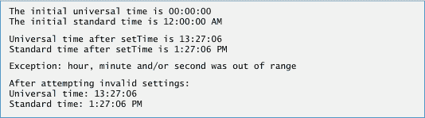

**图 9.3** | 测试类 `Time` 的程序。（第 2 部分，共 2 部分。）

### 使用无效值调用 `setTime`

为了说明方法 `setTime` 会验证其参数，第 29 行用无效参数 99 分别作为小时、分钟和秒来调用 `setTime`。该语句放在 try 块（第 27—30 行）中，以防 `setTime` 抛出 `invalid_argument` 异常——由于所有参数都无效，它确实会抛出异常。发生这种情况时，异常会在第 31—34 行被捕获，第 33 行通过调用异常对象的 `what` 成员函数显示其错误消息。第 37—41 行再次以两种格式输出时间，以确认在提供无效参数时 `setTime` 没有更改时间。

### 展望组合与继承

通常，类不必“从零开始”创建。相反，它们可以将其他类的对象作为成员包含进来，或者可以从其他类派生，这些类提供新类可以使用的属性和行为。这种软件复用可以极大地提高生产力并简化代码维护。将类对象作为其他类的成员包含进来称为组合（或聚合），将在第 10 章讨论。从现有类派生新类称为继承，将在第 12 章讨论。

### 对象大小

刚接触面向对象编程的人常常认为对象一定相当大，因为对象包含数据成员和成员函数。从逻辑上讲，这是对的——你可能会认为对象包含数据和函数（我们的讨论当然也鼓励这种观点）；然而，从物理上讲，这并不正确。

### 性能提示 9.2

> 对象只包含数据，因此对象比它们还包含成员函数时要小得多。对类名或该类对象应用 `sizeof` 运算符时，只会报告该类数据成员的大小。编译器会在所有类对象之外创建成员函数的一份副本（仅一份）。该类的所有对象共享这一份副本。当然，每个对象都需要自己的一份类数据副本，因为数据可能因对象而异。函数代码不可修改，因此可以在一个类的所有对象之间共享。

## 9.3 类作用域与访问类成员

类的数据成员（在类定义中声明的变量）和成员函数（在类定义中声明的函数）属于该类的作用域。非成员函数定义在*全局命名空间作用域*中。

在类的作用域内，类成员可由该类的所有成员函数直接访问，并可按名称引用。在类的作用域外，公有类成员通过对象上的某个**句柄**来引用——对象名、对象的引用或对象的指针。对象、引用或指针的类型指定了客户端可访问的接口（即成员函数）。[我们将在第 10 章看到，编译器会在从对象内部每次引用数据成员或成员函数时插入一个*隐式句柄*。]

*类的成员函数可以重载，但只能由该类的其他成员函数重载。* 要重载成员函数，只需在类定义中为重载函数的每个版本提供一个原型，并为函数的每个版本提供单独的函数定义。这也适用于类的构造函数。

在成员函数中声明的变量具有*局部作用域*，并且只有该函数知道这些变量。如果成员函数定义了一个与类作用域变量同名的变量，则类作用域变量会被局部作用域中的块作用域变量*隐藏*。要访问这样的隐藏变量，可以在变量名前加上类名，后跟作用域解析运算符（`::`）。隐藏的全局变量可以通过作用域解析运算符访问（见第 6 章）。

点成员选择运算符（`.`）前面是对象名或对象的引用，用于访问对象的成员。**箭头成员选择运算符（`->`）** 前面是对象的指针，用于访问对象的成员。

图 9.4 使用一个名为 Count 的简单类（第 7—24 行），其中有一个 int 类型的私有数据成员 x（第 23 行）、公有成员函数 setX（第 11—14 行）和公有成员函数 print（第 17—20 行），用来演示如何使用成员选择运算符访问类成员。为简单起见，我们将这个小类包含在与 main 相同的文件中。第 28—30 行创建了三个与 Count 类型相关的变量——counter（一个 Count 对象）、counterPtr（指向 Count 对象的指针）和 counterRef（对 Count 对象的引用）。变量 counterRef *引用* counter，变量 counterPtr *指向* counter。在第 33—34 行和第 37—38 行中，注意程序通过使用点（`.`）成员选择运算符来调用成员函数 setX 和 print，该运算符前面是对象名（counter）或对象的引用（counterRef，它是 counter 的别名）。类似地，第 41—42 行演示了程序可以使用指针（counterPtr）和箭头（`->`）成员选择运算符来调用成员函数 setX 和 print。

```cpp
// Fig. 9.4: fig09_04.cpp
// Demonstrating the class member access operators . and ->
#include <iostream>
using namespace std;

// class Count definition
class Count
{
public: // public data is dangerous
   // sets the value of private data member x
   void setX( int value )
   {
      x = value;
   } // end function setX

   // prints the value of private data member x
   void print()
   {
      cout << x << endl;
   } // end function print

private:
   int x;
}; // end class Count

int main()
{
   Count counter; // create counter object
   Count *counterPtr = &counter; // create pointer to counter
   Count &counterRef = counter; // create reference to counter

   cout << "Set x to 1 and print using the object's name: ";
   counter.setX( 1 ); // set data member x to 1
   counter.print(); // call member function print

   cout << "Set x to 2 and print using a reference to an object: ";
   counterRef.setX( 2 ); // set data member x to 2
   counterRef.print(); // call member function print

   cout << "Set x to 3 and print using a pointer to an object: ";
   counterPtr->setX( 3 ); // set data member x to 3
   counterPtr->print(); // call member function print
} // end main
```

```text
Set x to 1 and print using the object's name: 1
Set x to 2 and print using a reference to an object: 2
Set x to 3 and print using a pointer to an object: 3
```

**图 9.4** | 通过每种对象句柄——对象名、对象的引用和对象的指针——访问对象的成员函数。（第 1 部分，共 2 部分。）

**图 9.4** | 通过每种对象句柄——对象名、对象的引用和对象的指针——访问对象的成员函数。（第 2 部分，共 2 部分。）

## 9.4 将接口与实现分离

在第 3 章中，我们一开始将类的定义和成员函数定义包含在一个文件中。然后我们演示了如何将此代码分离到两个文件中——一个用于类定义的头文件（即类的接口）和一个用于类成员函数定义的源代码文件（即类的实现）。回想一下，这使修改程序更加容易——


```cpp
setSales( i, salesFigure );
} // end for
} // end function getSalesFromUser

// set one of the 12 monthly sales figures; function subtracts
// one from month value for proper subscript in sales array
void SalesPerson::setSales( int month, double amount )
{
    // test for valid month and amount values
    if ( month >= 1 && month <= monthsPerYear && amount > 0 )
        sales[ month - 1 ] = amount; // adjust for subscripts 0-11
    else // invalid month or amount value
        cout << "Invalid month or sales figure" << endl;
} // end function setSales

// print total annual sales (with the help of utility function)
void SalesPerson::printAnnualSales()
{
    cout << setprecision( 2 ) << fixed
         << "\nThe total annual sales are: $"
         << totalAnnualSales() << endl; // call utility function
} // end function printAnnualSales

// private utility function to total annual sales
double SalesPerson::totalAnnualSales()
{
    double total = 0.0; // initialize total

    for ( int i = 0; i < monthsPerYear; ++i ) // summarize sales results
        total += sales[ i ]; // add month i sales to total

    return total;
} // end function totalAnnualSales
```

**图 9.6** | SalesPerson 类的成员函数定义。（第 2 部分，共 2 部分。）

在图 9.7 中，请注意，应用程序的 main 函数只包含一系列简单的成员函数调用——没有控制语句。操作 sales 数组的逻辑完全封装在 SalesPerson 类的成员函数中。

> **软件工程观察 9.8**
>
> 面向对象编程的一个现象是：一旦定义了类，创建和操作该类的对象通常只需发出一系列简单的成员函数调用——需要的控制语句很少，甚至没有。相比之下，在类成员函数的实现中通常会有控制语句。

```cpp
// Fig. 9.7: fig09_07.cpp
// Utility function demonstration.
// Compile this program with SalesPerson.cpp

// include SalesPerson class definition from SalesPerson.h
#include "SalesPerson.h"

int main()
{
    SalesPerson s; // create SalesPerson object s

    s.getSalesFromUser(); // note simple sequential code; there are
    s.printAnnualSales(); // no control statements in main
} // end main
```

**图 9.7** | 实用函数演示。（第 1 部分，共 2 部分。）

```text
Enter sales amount for month 1: 5314.76
Enter sales amount for month 2: 4292.38
Enter sales amount for month 3: 4589.83
Enter sales amount for month 4: 5534.03
Enter sales amount for month 5: 4376.34
Enter sales amount for month 6: 5698.45
Enter sales amount for month 7: 4439.22
Enter sales amount for month 8: 5893.57
Enter sales amount for month 9: 4909.67
Enter sales amount for month 10: 5123.45
Enter sales amount for month 11: 4024.97
Enter sales amount for month 12: 5923.92

The total annual sales are: $60120.59
```

**图 9.7** | 实用函数演示。（第 2 部分，共 2 部分。）

## 9.6 Time 类案例研究：带默认实参的构造函数

图 9.8–9.10 中的程序增强了 Time 类，以演示实参如何隐式传递给构造函数。图 9.2 中定义的构造函数将 hour、minute 和 second 初始化为 0（即通用时间午夜）。与其他函数一样，构造函数可以指定默认实参。图 9.8 的第 13 行声明 Time 构造函数包含默认实参，为传递给构造函数的每个实参指定默认值零。在图 9.9 中，第 10–13 行定义了 Time 构造函数的新版本，它接收参数 hour、minute 和 second 的值，这些值将分别用于初始化私有数据成员 hour、minute 和 second。Time 类为每个数据成员提供 set 和 get 函数。Time 构造函数现在调用 setTime，后者调用 setHour、setMinute 和 setSecond 函数来验证并实际将数据设置到数据成员中。构造函数的默认实参确保：即使在构造函数调用中未提供任何值，构造函数仍会初始化数据成员。将其所有实参都设为默认值的构造函数也是默认构造函数——也就是说，是可以在不带实参的情况下调用的构造函数。每个类最多只能有一个默认构造函数。

> **软件工程观察 9.9。**
>
> 对函数默认实参值的任何更改都要求重新编译客户端代码（以确保程序仍能正确运行）。

```cpp
// Fig. 9.8: Time.h
// Time class containing a constructor with default arguments.
// Member functions defined in Time.cpp.

// prevent multiple inclusions of header
#ifndef TIME_H
#define TIME_H

// Time abstract data type definition
class Time
{
public:
   Time( int = 0, int = 0, int = 0 ); // default constructor

   // set functions
   void setTime( int, int, int ); // set hour, minute, second
   void setHour( int ); // set hour (after validation)
   void setMinute( int ); // set minute (after validation)
   void setSecond( int ); // set second (after validation)

   // get functions
   int getHour(); // return hour
   int getMinute(); // return minute
   int getSecond(); // return second

   void printUniversal(); // output time in universal-time format
   void printStandard(); // output time in standard-time format
private:
   int hour; // 0 - 23 (24-hour clock format)
   int minute; // 0 - 59
   int second; // 0 - 59
}; // end class Time

#endif
```

**图 9.8** | 包含带默认实参构造函数的 Time 类。

在图 9.9 中，构造函数的第 12 行使用传递给构造函数的值（或默认值）调用成员函数 setTime。函数 setTime 调用 setHour 以确保为 hour 提供的值在 0–23 范围内，然后调用 setMinute 和 setSecond 以确保 minute 和 second 的值分别在 0–59 范围内。函数 setHour（第 24–30 行）、setMinute（第 33–39 行）和 setSecond（第 42–48 行）在接收到超出范围的实参时都会抛出异常。

```cpp
// Fig. 9.9: Time.cpp
// Member-function definitions for class Time.
#include <iostream>
#include <iomanip>
```

**图 9.9** | Time 类的成员函数定义，包括一个接收实参的构造函数。（第 1 部分，共 3 部分。）

```cpp
// return minute value
int Time::getMinute()
{
   return minute;
} // end function getMinute

// return second value
int Time::getSecond()
{
   return second;
} // end function getSecond

// print Time in universal-time format (HH:MM:SS)
void Time::printUniversal()
{
   cout << setfill( '0' ) << setw( 2 ) << getHour() << ":"
        << setw( 2 ) << getMinute() << ":" << setw( 2 ) << getSecond();
} // end function printUniversal

// print Time in standard-time format (HH:MM:SS AM or PM)
void Time::printStandard()
{
   cout << ( ( getHour() == 0 || getHour() == 12 ) ? 12 : getHour() % 12 )
        << ":" << setfill( '0' ) << setw( 2 ) << getMinute()
        << ( hour < 12 ? " AM" : " PM" );
} // end function printStandard
```

**图 9.9** | Time 类的成员函数定义，包括一个接收实参的构造函数。（第 3 部分，共 3 部分。）

图 9.10 中的函数 main 初始化五个 Time 对象——一个在隐式构造函数调用中三个实参全部采用默认值（第 10 行），一个指定一个实参（第 11 行），一个指定两个实参（第 12 行），一个指定三个实参（第 13 行），还有一个指定三个无效实参（第 38 行）。程序以通用时间格式和标准时间格式显示每个对象。对于 Time 对象 t5（第 38 行），程序显示错误消息，因为构造函数实参超出范围。

```cpp
// Fig. 9.10: fig09_10.cpp
// Demonstrating a default constructor for class Time.
#include <iostream>
#include <stdexcept>
#include "Time.h" // include definition of class Time from Time.h
using namespace std;

int main()
{
   Time t1;             // all arguments defaulted
   Time t2( 2 );        // hour specified; minute and second defaulted
   Time t3( 22, 34 );   // hour and minute specified; second defaulted
   Time t4( 12, 25, 42 ); // hour, minute and second specified
```

**图 9.10** | 带默认实参的构造函数。（第 1 部分，共 2 部分。）


```cpp
cout << "Constructed with:\n\tt1: all arguments defaulted\n ";
t1.printUniversal(); // 00:00:00
cout << "\n ";
t1.printStandard(); // 12:00:00 AM

cout << "\n\tt2: hour specified; minute and second defaulted\n ";
t2.printUniversal(); // 02:00:00
cout << "\n ";
t2.printStandard(); // 2:00:00 AM

cout << "\n\tt3: hour and minute specified; second defaulted\n ";
t3.printUniversal(); // 21:34:00
cout << "\n ";
t3.printStandard(); // 9:34:00 PM

cout << "\n\tt4: hour, minute and second specified\n ";
t4.printUniversal(); // 12:25:42
cout << "\n ";
t4.printStandard(); // 12:25:42 PM

// attempt to initialize t5 with invalid values
try
{
    Time t5(27, 74, 99); // all bad values specified
} // end try
catch ( invalid_argument &e )
{
    cout << "\n\nException while initializing t5: " << e.what() << endl;
} // end catch
// end main
```

```text
Constructed with:

t1: all arguments defaulted
  00:00:00
  12:00:00 AM

t2: hour specified; minute and second defaulted
  02:00:00
  2:00:00 AM

t3: hour and minute specified; second defaulted
  21:34:00
  9:34:00 PM

t4: hour, minute and second specified
  12:25:42
  12:25:42 PM

Exception while initializing t5: hour must be 0-23
```

图9.10 | 带默认参数的构造函数。（第2部分，共2部分。）

## 关于Time类的set和get函数及构造函数的说明

在类的整个主体中都会调用Time的set和get函数。特别是，函数`setTime`（图9.9中的第17-22行）调用函数`setHour`、`setMinute`和`setSecond`，而函数`printUniversal`和`printStandard`分别在第72-73行和第79-81行调用函数`getHour`、`getMinute`和`getSecond`。在每种情况下，这些函数本可以直接访问类的私有数据。但是，考虑将时间的表示从三个`int`值（需要12字节内存）改为一个`int`值，表示自午夜以来经过的总秒数（只需要4字节内存）。如果我们进行这样的更改，只需更改直接访问私有数据的函数体——特别是针对hour、minute和second的各个set和get函数。无需修改函数`setTime`、`printUniversal`或`printStandard`的函数体，因为它们不直接访问数据。以这种方式设计类会降低在更改类的实现时出现编程错误的可能性。

类似地，Time构造函数可以写成包含来自函数`setTime`的适当语句的副本。这样做可能会稍微高效一些，因为消除了额外的构造函数调用和对`setTime`的调用。然而，在多个函数或构造函数中复制语句会使类的内部数据表示的更改更加困难。让Time构造函数调用`setTime`，并让`setTime`调用`setHour`、`setMinute`和`setSecond`，可以将验证hour、minute或second的代码更改限制在相应的set函数中。这降低了在更改类的实现时出错的可能性。此外，通过显式声明它们为`inline`或在类定义中定义它们（这会隐式地将函数定义为内联），可以（可能）提高Time构造函数和`setTime`的性能。


> **软件工程观察 9.10**
>
> 如果类的某个成员函数已经提供了该类构造函数（或其他成员函数）所需的全部或部分功能，请从构造函数（或其他成员函数）中调用该成员函数。这简化了代码的维护，并在修改代码实现时降低出错的可能性。一般规则：避免重复代码。


> **常见编程错误 9.2**
>
> 构造函数可以调用类的其他成员函数，例如set或get函数，但因为在构造函数初始化对象时，数据成员可能尚未初始化。在数据成员被正确初始化之前使用它们可能导致逻辑错误。

## 9.7 析构函数

析构函数是另一种特殊成员函数。类的析构函数名称是波浪号（~）后跟类名。这种命名约定具有直观的吸引力，因为在后续章节中我们会看到，波浪号运算符是按位取反运算符，而从某种意义上说，析构函数是构造函数的补集。

当对象被销毁时，类的析构函数会被隐式调用。例如，当程序执行离开自动对象实例化的作用域时，该自动对象被销毁，就会发生这种情况。*析构函数本身实际上并不释放对象的内存*——它是在对象的内存被回收之前执行终止清理工作，以便该内存可以被重新用于容纳新对象。

> **常见编程错误 9.3**
>
> *试图向析构函数传递参数、为析构函数指定返回类型（甚至不能指定`void`）、从析构函数返回值或重载析构函数都是语法错误。*


尽管到目前为止所展示的类都没有提供析构函数，但*每个类都有一个析构函数。*如果你没有显式提供析构函数，编译器会创建一个“空”析构函数。[*注：*我们将看到，这种隐式创建的析构函数实际上确实对通过组合（第10章）和继承（第12章）创建的对象执行重要操作。]在第11章中，我们将为对象包含动态分配内存（例如数组和字符串）或使用其他系统资源（例如磁盘上的文件，我们在第17章中研究）的类构建合适的析构函数。我们将在第10章讨论如何动态分配和释放内存。

## 9.8 构造函数和析构函数的调用时机

构造函数和析构函数由编译器*隐式*调用。这些函数调用的顺序取决于执行进入和离开实例化对象的作用域的顺序。通常，析构函数调用按照相应构造函数调用的*相反顺序*进行，但正如我们将在图9.11–9.13中看到的，对象的存储类别可以改变析构函数调用的顺序。

### 全局作用域中对象的构造函数和析构函数

对于在全局作用域中定义的对象，其构造函数会在该文件中任何其他函数（包括`main`）开始执行*之前*被调用（尽管不同文件之间全局对象构造函数的执行顺序不保证）。相应的析构函数在`main`终止时被调用。函数`exit`强制程序立即终止，并且*不会*执行自动对象的析构函数。该函数通常用于在输入中检测到错误或程序要处理的文件无法打开时终止程序。函数`abort`与`exit`函数类似，但强制程序*立即*终止，而不允许调用任何对象的析构函数。函数`abort`通常用于指示程序的异常终止。（有关函数`exit`和`abort`的更多信息，请参见附录F。）

### 局部自动对象的构造函数和析构函数

当执行到达定义自动局部对象的位置时，会调用该对象的构造函数；当执行离开对象的作用域（即定义该对象的块执行完毕）时，会调用相应的析构函数。每次执行进入和离开对象作用域时，都会调用自动对象的构造函数和析构函数。如果程序调用函数`exit`或函数`abort`而终止，则不会调用自动对象的析构函数。

### 静态局部对象的构造函数和析构函数

静态局部对象的构造函数只在执行第一次到达定义该对象的位置时被调用一次——相应的析构函数在`main`


终止，或者程序调用函数 `exit`。全局对象和静态对象按创建顺序的逆序销毁。如果程序因调用函数 `abort` 而终止，则不会为静态对象调用析构函数。

## 演示构造函数和析构函数何时被调用

图 9.11–9.13 的程序演示了在若干作用域中，不同存储类的 CreateAndDestroy 类对象（图 9.11 和图 9.12）的构造函数和析构函数的调用顺序。每个 CreateAndDestroy 类对象都包含一个整数（对象 ID）和一个字符串（消息），它们在程序输出中用于标识该对象（图 9.11 第 16–17 行）。这个机械性的示例纯粹用于教学目的。因此，图 9.12 中析构函数的第 21 行判断正在销毁的对象其对象 ID 值是否为 1 或 6，如果是，则输出一个换行符。这一行使程序输出更易于理解。

```cpp
// Fig. 9.11: CreateAndDestroy.h
// CreateAndDestroy class definition.
// Member functions defined in CreateAndDestroy.cpp.
#include <string>
using namespace std;

#ifndef CREATE_H
#define CREATE_H

class CreateAndDestroy
{
public:
   CreateAndDestroy( int, string ); // constructor
   ~CreateAndDestroy(); // destructor
private:
   int objectID; // ID number for object
   string message; // message describing object
}; // end class CreateAndDestroy

#endif
```

**图 9.11** | CreateAndDestroy 类定义。

```cpp
// Fig. 9.12: CreateAndDestroy.cpp
// CreateAndDestroy class member-function definitions.
#include <iostream>
#include "CreateAndDestroy.h" // include CreateAndDestroy class definition
using namespace std;

// constructor
CreateAndDestroy::CreateAndDestroy( int ID, string messageString )
{
   objectID = ID; // set object's ID number
   message = messageString; // set object's descriptive message
   cout << "Object " << objectID << "  constructor runs  "
        << message << endl;
} // end CreateAndDestroy constructor

// destructor
CreateAndDestroy::~CreateAndDestroy()
{
   // output newline for certain objects; helps readability
   cout << (objectID == 1 || objectID == 6 ? "\n" : "");

   cout << "Object " << objectID << "  destructor runs  "
        << message << endl;
} // end ~CreateAndDestroy destructor
```

**图 9.12** | CreateAndDestroy 类的成员函数定义。（第 1 部分，共 2 部分。）

**图 9.12** | CreateAndDestroy 类的成员函数定义。（第 2 部分，共 2 部分。）

图 9.13 在全局作用域中定义对象 first（第 10 行）。它的构造函数实际上在 main 中的任何语句执行*之前*被调用，而它的析构函数在程序终止时、所有其他对象的析构函数运行*之后*被调用。

函数 main（第 12–23 行）声明了三个对象。对象 second（第 15 行）和 fourth（第 24 行）是局部自动对象，对象 third（第 16 行）是静态局部对象。当执行到达这些对象各自声明的位置时，会调用每个对象的构造函数。当执行到达 main 末尾时，会调用对象 fourth 然后 second 的析构函数（即其构造函数调用顺序的*逆序*）。因为对象 third 是静态的，所以它会一直存在到程序终止。对象 third 的析构函数在全局对象 first 的析构函数*之前*被调用，但在所有其他对象被销毁*之后*被调用。

函数 create（第 26–33 行）声明了三个对象——fifth（第 29 行）和 seventh（第 31 行）是局部自动对象，sixth（第 30 行）是静态局部对象。当 create 终止时，会调用对象 seventh 然后 fifth 的析构函数（即其构造函数调用顺序的*逆序*）。因为 sixth 是静态的，所以它会一直存在到程序终止。sixth 的析构函数在 third 和 first 的析构函数*之前*被调用，但在所有其他对象被销毁*之后*被调用。

```cpp
// Fig. 9.13: fig09_13.cpp
// Demonstrates the order in which constructors and
// destructors are called.
#include <iostream>
#include "CreateAndDestroy.h" // include CreateAndDestroy class definition
using namespace std;

void create( void ); // prototype

CreateAndDestroy first( 1, "(global before main)" ); // global object

int main()
{
   cout << "\nMAIN FUNCTION: EXECUTION BEGINS" << endl;

15  CreateAndDestroy second( 2, "{local automatic in main}" );
16  static CreateAndDestroy third( 3, "{local static in main}" );

18  create(); // call function to create objects

20  cout << "\nMAIN FUNCTION: EXECUTION RESUMES" << endl;
21  CreateAndDestroy fourth( 4, "{local automatic in main}" );
22  cout << "\nMAIN FUNCTION: EXECUTION ENDS" << endl;
23 } // end main

25  // function to create objects
26  void create( void )
27  {
28      cout << "\nCREATE FUNCTION: EXECUTION BEGINS" << endl;
29      CreateAndDestroy fifth( 5, "{local automatic in create}" );
30      static CreateAndDestroy sixth( 6, "{local static in create}" );
31      CreateAndDestroy seventh( 7, "{local automatic in create}" );
32      cout << "\nCREATE FUNCTION: EXECUTION ENDS" << endl;
33 } // end function create
```

```text
Object 1  constructor runs   (global before main)

MAIN FUNCTION: EXECUTION BEGINS
Object 2  constructor runs   (local automatic in main)
Object 3  constructor runs   (local static in main)

CREATE FUNCTION: EXECUTION BEGINS
Object 5  constructor runs   (local automatic in create)
Object 6  constructor runs   (local static in create)
Object 7  constructor runs   (local automatic in create)

CREATE FUNCTION: EXECUTION ENDS
Object 7  destructor runs    (local automatic in create)
Object 5  destructor runs    (local automatic in create)

MAIN FUNCTION: EXECUTION RESUMES
Object 4  constructor runs   (local automatic in main)

MAIN FUNCTION: EXECUTION ENDS
Object 4  destructor runs    (local automatic in main)
Object 2  destructor runs    (local automatic in main)

Object 6  destructor runs    (local static in create)
Object 3  destructor runs    (local static in main)

Object 1  destructor runs    (global before main)
```

**图 9.13** | 构造函数和析构函数的调用顺序。（第 1 部分，共 2 部分。）

**图 9.13** | 构造函数和析构函数的调用顺序。（第 2 部分，共 2 部分。）

## 9.9 Time 类案例研究：一个微妙的陷阱——返回私有数据成员的引用

对象的引用是该对象名称的别名，因此可用于赋值语句的左侧。在此上下文中，该引用构成了一个完全可以接受的左值，可以接收值。使用这一能力的一种方式（不幸的是！）

```cpp
// Fig. 9.16: fig09_16.cpp
// Demonstrating a public member function that
// returns a reference to a private data member.
#include <iostream>
#include "Time.h" // include definition of class Time
using namespace std;

int main()
{
   Time t; // create Time object

   // initialize hourRef with the reference returned by badSetHour
   int &hourRef = t.badSetHour( 20 ); // 20 is a valid hour

   cout << "Valid hour before modification: " << hourRef;
   hourRef = 30; // use hourRef to set invalid value in Time object t
   cout << "\nInvalid hour after modification: " << t.getHour();

   // Dangerous: Function call that returns
   // a reference can be used as an lvalue!
   t.badSetHour( 12 ) = 74; // assign another invalid value to hour

   cout << "\n\n" << "*********************************************\n"
      << "POOR PROGRAMMING PRACTICE!!!!!!!!!!!!!!!\n"
      << "t.badSetHour( 12 ) as an lvalue, invalid hour: "
      << t.getHour()
      << "\n" << "*********************************************" << endl;
} // end main
```

```text
Valid hour before modification: 20
Invalid hour after modification: 30

*********************************************
POOR PROGRAMMING PRACTICE!!!!!!!!!!!!!!!
t.badSetHour( 12 ) as an lvalue, invalid hour: 74
*********************************************
```

**图 9.16** | 返回私有数据成员的引用。

## 9.10 默认的逐成员赋值

赋值运算符（=）可用于将一个对象赋值给另一个同类型对象。默认情况下，这种赋值通过**逐成员赋值**执行——赋值运算符右侧对象的每个数据成员分别赋值给赋值运算符左侧对象中的同一数据成员。图 9.17–9.18 定义了本例中使用的 Date 类。图 9.19 的第 18 行使用**默认逐成员赋值**将 Date 对象 date1 的数据成员赋值给 Date 对象 date2 的对应数据成员。在这种情况下，date1 的 month 成员被赋值给 date2 的 month 成员，date1 的 day 成员被赋值给 date2 的 day 成员，date1 的 year 成员被赋值给 date2 的 year 成员。**[注意：** 当用于数据成员包含指向动态分配内存的指针的类时，逐成员赋值可能导致严重问题；我们


在第11章讨论这些问题并展示如何处理它们。）Date构造函数不包含任何错误检查；我们将其留给练习。

对象可以作为函数参数传递，也可以从函数返回。这种传递和返回默认使用按值传递——即传递或返回对象的一个副本。在这种情况下，C++会创建一个新对象，并使用拷贝构造函数将原始对象的值复制到新对象中。对于每个类，编译器都提供一个默认拷贝构造函数，用于复制原始对象的每个成员。

```cpp
// Fig. 9.17: Date.h
// Date class declaration. Member functions are defined in Date.cpp.

// prevent multiple inclusions of header
#ifndef DATE_H
#define DATE_H

// class Date definition
class Date
{
public:
   Date( int = 1, int = 1, int = 2000 ); // default constructor
   void print();
private:
   int month;
   int day;
   int year;
}; // end class Date

#endif
```

**图9.17** | Date类声明

```cpp
// Fig. 9.18: Date.cpp
// Date class member-function definitions.
#include <iostream>
#include "Date.h" // include definition of class Date from Date.h
using namespace std;

// Date constructor (should do range checking)
Date::Date( int m, int d, int y )
{
   month = m;
   day = d;
   year = y;
} // end constructor Date

// print Date in the format mm/dd/yyyy
void Date::print()
{
   cout << month << '/' << day << '/' << year;
} // end function print
```

**图9.18** | Date类成员函数定义。

```cpp
// Fig. 9.19: fig09_19.cpp
// Demonstrating that class objects can be assigned
// to each other using default memberwise assignment.
#include <iostream>
#include "Date.h" // include definition of class Date from Date.h
using namespace std;

int main()
{
   Date date1( 7, 4, 2004 );
   Date date2; // date2 defaults to 1/1/2000

   cout << "date1 = ";
   date1.print();
   cout << "\n\ndate2 = ";
   date2.print();

   date2 = date1; // default memberwise assignment

   cout << "\n\nAfter default memberwise assignment, date2 = ";
   date2.print();
   cout << endl;
} // end main
```

```text
date1 = 7/4/2004
date2 = 1/1/2000

After default memberwise assignment, date2 = 7/4/2004
```

**图9.19** | 默认逐成员赋值。

到新对象的相应成员中。与逐成员赋值一样，当类的数据成员包含指向动态分配内存的指针时，拷贝构造函数可能会导致严重问题。第11章将讨论如何定义自定义拷贝构造函数，以正确复制包含指向动态分配内存的指针的对象。

> **性能提示 9.3**
>
> *从安全角度讲，按值传递对象是好的，因为被调函数无法访问调用方中的原始对象，但按值传递在复制大对象时可能会降低性能。可以通过传递指针或引用来按引用传递对象。按引用传递具有良好的性能，但从安全角度讲较弱，因为被调函数可以访问原始对象。按const引用传递是一种安全且高性能的替代方案（这可以通过const引用参数或指向const数据的指针参数来实现）。*

## 9.11 小结

本章基于我们对类的介绍，通过一个丰富的Time类案例研究引入了几个新特性。你了解到，成员函数通常比全局函数更短，因为成员函数可以直接访问对象的数据成员，因此与过程式编程语言中的函数相比，成员函数可以接收更少的参数。你学习了如何使用箭头运算符通过对象类类型的指针访问对象的成员。

你了解到，成员函数具有类作用域——除非通过类的对象、类的对象引用、类的对象指针或作用域解析运算符引用，否则成员函数名仅对该类的其他成员可见。我们还讨论了访问函数（通常用于获取数据成员的值或测试条件的真假）和工具函数（支持类的公共成员函数操作的私有成员函数）。

你了解到，构造函数可以指定默认参数，使其能以多种方式被调用。你还了解到，任何可以不使用参数调用的构造函数都是默认构造函数，并且每个类最多只能有一个默认构造函数。我们讨论了析构函数及其目的——在对象被销毁之前对该类对象执行终止清理工作。我们还演示了对象的构造函数和析构函数的调用顺序。

我们演示了当成员函数返回对私有数据成员的引用时可能出现的问题，这会破坏类的封装性。我们还展示了相同类型的对象可以使用默认的逐成员赋值相互赋值。我们还讨论了使用类库加快代码编写速度并提高软件质量的益处。

第10章介绍更多类特性。我们将演示如何使用const来表明成员函数不会修改类的对象。你将使用组合（composition）构建类，这允许一个类将其他类的对象作为成员。我们将展示类如何允许“友元”函数访问类的非公有成员。我们还将展示类的非静态成员函数如何使用名为this的特殊指针来访问对象的成员。

## 总结

### 9.2节 Time类案例研究

- 预处理指令`#if`和`#ifdef`（意思是“如果未定义”；第382页）以及`#endif`（第382页）用于防止头文件被多次包含。如果这些指令之间的代码之前未被包含在应用程序中，`#define`（第382页）定义一个名称以防止将来再次包含，然后代码被包含在源代码中。
- 数据成员不能在类体内声明的位置进行初始化（除了类的整型或枚举类型的静态const数据成员）。应在类的构造函数中初始化这些数据成员（因为基本类型的数据成员没有默认初始化）。
- 类的函数可以抛出（第384页）异常（例如`invalid_argument`，第384页）以指示无效数据。
- 流操纵符`setfill`（第384页）指定填充字符（第384页），当整数在比其位数更宽的字段中输出时，会显示该填充字符。
- 默认情况下，填充字符出现在数字的数字之前。
- 流操纵符`setfill`是一种“粘性”设置，意味着一旦设置了填充字符，它将应用于所有后续打印的字段。
- 即使类定义中声明的成员函数可能在类定义外部定义（并通过作用域解析运算符与该类“绑定”），该成员函数仍然在该类的作用域内。
- 类可以包含其他类的对象作为成员，或者可以从其他类派生（第387页），这些类提供新类可以使用的属性和行为。

### 9.3节 类作用域与访问类成员

- 类的数据成员和成员函数属于该类的作用域。
- 非成员函数在全局命名空间作用域中定义。
- 在类的作用域内，类的所有成员函数都可以直接访问类成员，并且可以按名称引用。
- 在类的作用域之外，类成员通过对象的句柄之一来引用——对象名、对象引用或对象指针。
- 类的成员函数可以被重载，但只能由该类的其他成员函数重载。
- 要重载成员函数，请在类定义中为每个重载函数版本提供原型，并为每个版本提供单独的定义。
- 在成员函数中声明的变量具有局部作用域，仅对该函数可见。
- 如果成员函数定义的变量与类作用域变量（第385页）同名，则类作用域变量会被局部作用域中的块作用域变量隐藏。
- 点成员选择运算符(.)前面是对象名或对象引用，用于访问对象的公有成员。
- 箭头成员选择运算符(->；第388页)前面是对象指针，用于访问该对象的公有成员。

### 9.4节 分离接口与实现

- 头文件包含类实现的一部分以及关于其他部分的提示。例如，内联成员函数应放在头文件中，这样当编译器编译客户端程序时，客户端可以就地包含内联函数定义。
- 头文件中的类定义列出的私有成员对客户端可见，即使客户端不能访问这些私有成员。

### 9.5节 访问函数与工具函数

- 工具函数是支持类的公有成员函数操作的私有成员函数。工具函数不打算供类的客户端使用。

### 9.6节 Time类案例研究：带默认参数的构造函数

- 与其他函数一样，构造函数可以指定默认参数。

### 9.7节 析构函数

- 当类的对象被销毁时，类的析构函数（第398页）会被隐式调用。
- 类的析构函数名是波浪号(~)后跟类名。
- 析构函数不释放对象的存储空间——它在系统回收对象内存之前执行终止清理（第399页），以便内存可以重新用于容纳新对象。
- 析构函数不接收参数，也不返回值。一个类只能有一个析构函数。
- 如果未显式提供析构函数，编译器会创建一个“空”析构函数，因此每个类恰好有一个析构函数。


## 第9.8节 构造函数和析构函数何时被调用

- 构造函数和析构函数的调用顺序取决于执行进入和离开对象被实例化的作用域的顺序。
- 通常，析构函数的调用顺序与对应的构造函数调用顺序相反，但对象的存储类别可能会改变析构函数的调用顺序。

## 第9.9节 Time 类案例研究：一个微妙的陷阱——返回私有数据成员的引用

- 对象的引用是该对象名称的别名，因此可用于赋值语句的左侧。在此上下文中，该引用构成一个完全可以接受的*左值*，可以接收值。
- 如果函数返回 const 引用，则该引用不能用作可修改的*左值*。

## 第9.10节 默认逐成员赋值

- 赋值运算符（=）可用于将一个对象赋值给另一个同类型的对象。默认情况下，这种赋值通过逐成员赋值（第405页）执行。
- 对象可以按值传递给函数，也可以从函数按值返回。C++ 会创建一个新对象，并使用拷贝构造函数（第406页）将原对象的值复制到新对象中。
- 对于每个类，编译器都会提供一个默认拷贝构造函数，它将原对象的每个成员复制到新对象的对应成员中。

## 自测练习

- **9.1** 填写下列各题中的空白：

  - a) 类成员可通过 ______ 运算符结合该类对象（或对象的引用）的名称来访问，或通过 ______ 运算符结合指向该类对象的指针来访问。
  - b) 指定为 ______ 的类成员只能由该类的成员函数和该类的友元访问。
  - c) 指定为 ______ 的类成员在该类对象处于作用域内的任何地方均可访问。
  - d) ______ 可用于将一个类的对象赋值给同一个类的另一个对象。

- **9.2** 找出下列各项中的错误，并解释如何更正：

  - a) 假设在 Time 类中声明了以下原型：

    ```cpp
    void ~Time( int );
    ```

  - b) 以下是 Time 类的部分定义：

    ```cpp
    class Time
    {
    public:
       // function prototypes

    private:
       int hour = 0;
       int minute = 0;
       int second = 0;
    }; // end class Time
    ```

  - c) 假设在 Employee 类中声明了以下原型：

    ```cpp
    int Employee( string, string );
    ```

## 自测练习答案

**9.1** a) 点（.）、箭头（->），b) private。c) public。d) 默认逐成员赋值（由赋值运算符执行）。

**9.2**

- a) *错误：* 析构函数不允许返回值（甚至不允许指定返回类型）或接受参数。

  *更正：* 从声明中移除返回类型 `void` 和参数 `int`。

- b) *错误：* 成员不能在类定义中显式初始化。

  *更正：* 从类定义中移除显式初始化，并在构造函数中初始化数据成员。

- c) *错误：* 构造函数不允许返回值。

  *更正：* 从声明中移除返回类型。

## 练习题

**9.3** *（作用域解析运算符）* 作用域解析运算符的用途是什么？

**9.4** *（增强 Time 类）* 提供一个构造函数，它能够使用 `time` 和 `localtime` 函数（在 C++ 标准库头文件 `<ctime>` 中声明）获得的当前时间来初始化 `Time` 类的对象。

**9.5** *（复数类）* 创建一个名为 Complex 的类，用于执行复数的算术运算。编写一个程序来测试你的类。复数形式为

```text
realPart + imaginaryPart * i
```

其中 i 是 √−1。使用 double 变量表示该类的私有数据。提供一个构造函数，使该类的对象在声明时能够被初始化。构造函数应包含默认值，以防未提供初始化器。提供执行以下任务的公有成员函数：

- a) 将两个 Complex 数相加：实部相加，虚部相加。
- b) 将两个 Complex 数相减：用左操作数的实部减去右操作数的实部，并用左操作数的虚部减去右操作数的虚部。
- c) 以 (a, b) 的形式输出 Complex 数，其中 a 是实部，b 是虚部。

**9.6** *（有理数类）* 创建一个名为 Rational 的类，用于执行分数的算术运算。编写一个程序来测试你的类。

使用整数变量表示该类的私有数据——分子和分母。提供一个构造函数，使该类的对象在声明时能够被初始化。构造函数应包含默认值，以防未提供初始化器，并应以最简形式存储分数。例如，分数 2/4 在对象中将存储为分子 1、分母 2。提供执行以下各项任务的公有成员函数：

- a) 将两个 Rational 数相加。结果应以最简形式存储。
- b) 将两个 Rational 数相减。结果应以最简形式存储。
- c) 将两个 Rational 数相乘。结果应以最简形式存储。
- d) 将两个 Rational 数相除。结果应以最简形式存储。
- e) 以 a/b 的形式输出 Rational 数，其中 a 是分子，b 是分母。
- f) 以浮点格式输出 Rational 数。

**9.7** *（增强 Time 类）* 修改图 9.8–9.9 的 Time 类，使其包含一个 tick 成员函数，该函数将 Time 对象中存储的时间增加一秒。编写一个程序，在循环中测试 tick 成员函数，并在循环的每次迭代中以标准格式输出时间，以说明 tick 成员函数工作正确。务必测试以下情况：

- a) 递增到下一分钟。
- b) 递增到下一小时。
- c) 递增到第二天（即，11:59:59 PM 到 12:00:00 AM）。

**9.8** *（增强 Date 类）* 修改图 9.17–9.18 的 Date 类，对日期、月份和年份的初始化值执行错误检查。另外，提供一个成员函数 nextDay，将日期增加一天。编写一个程序，在循环中测试函数 nextDay，并在每次迭代中输出日期，以说明 nextDay 工作正确。务必测试以下情况：

- a) 递增到下个月。
- b) 递增到下一年。

**9.9** *（合并 Time 类和 Date 类）* 将练习 9.7 中修改后的 Time 类和练习 9.8 中修改后的 Date 类合并为一个名为 DateAndTime 的类。（在第 12 章中，我们将讨论继承，它将使我们能够在不修改现有类定义的情况下快速完成此任务。）修改 tick 函数，以便在时间递增到第二天时调用 nextDay 函数。修改函数 printStandard 和 printUniversal，以输出日期和时间。编写一个程序来测试新类 DateAndTime。特别要测试将时间递增到第二天。

**9.10** *（从 Time 类的 set 函数返回错误指示）* 修改图 9.8–9.9 的 Time 类中的 set 函数，以便在尝试将 Time 类对象的数据成员设置为无效值时返回适当的错误值。编写一个程序来测试你的新版 Time 类。当 set 函数返回错误值时显示错误消息。

**9.11** *（Rectangle 类）* 创建一个 Rectangle 类，具有属性 length 和 width，二者默认值均为 1。提供计算矩形周长和面积的成员函数。还要为 length 和 width 属性提供 set 和 get 函数。set 函数应验证 length 和 width 均为大于 0.0 且小于 20.0 的浮点数。

**9.12** *（增强 Rectangle 类）* 创建一个比练习 9.11 中创建的 Rectangle 类更完善的 Rectangle 类。该类只存储矩形四个角的笛卡尔坐标。构造函数调用一个 set 函数，该函数接受四组坐标，并验证每组坐标都在第一象限内，且任一 x 坐标或 y 坐标都不大于 20.0。该 set 函数还验证所提供的坐标确实能指定一个矩形。提供计算 length、width、周长和面积的成员函数。length 是两个维度中较大的那个。包含一个谓词函数 square，用于判断该矩形是否为正方形。

**9.13** *（增强 Rectangle 类）* 修改练习 9.12 中的 Rectangle 类，使其包含一个 draw 函数，该函数在一个 25×25 的框内显示矩形，该框包围矩形所在的第一象限部分。包含一个 setFillCharacter 函数，用于指定绘制矩形主体所用的字符。包含一个 setPerimeterCharacter 函数，用于指定绘制矩形边框所用的字符。如果你有雄心，还可以包含一些函数来缩放矩形大小、旋转它，并在第一象限的指定区域内移动它。


- **9.14** *（HugeInteger 类）* 创建一个 HugeInteger 类，使用一个包含 40 个元素的数字数组来存储最大可达 40 位的整数。提供成员函数 input、output、add 和 subtract。为了比较 HugeInteger 对象，提供函数 isEqualTo、isNotEqualTo、isGreaterThan、isLessThan、isGreaterThanOrEqualTo 和 isLessThanOrEqualTo——其中每个都是一个“谓词”函数，如果两个 HugeInteger 之间的关系成立，就简单地返回 true；如果关系不成立，则返回 false。另外，提供一个谓词函数 isZero。如果你有雄心，提供成员函数 multiply、divide 和 modulus。

- **9.15** *（TicTacToe 类）* 创建一个 TicTacToe 类，使你能够编写一个完整的程序来玩井字棋游戏。该类包含一个 3×3 的整数二维数组作为私有数据。构造函数应将空棋盘初始化为全零。允许两名人类玩家。第一位玩家无论在哪里落子，都在指定方格中放置 1。第二位玩家无论在哪里落子，都放置 2。每次落子都必须落在空方格上。每次落子后，判断游戏是已经获胜还是平局。如果你有雄心，修改程序，让计算机为其中一位玩家落子。另外，允许玩家指定他或她想先手还是后手。如果你特别有雄心，开发一个能在 4×4×4 棋盘上玩三维井字棋的程序。[*注意：* 这是一个极具挑战性的项目，可能需要花费数周的努力！]

# 10 类：更深入的探讨，第 2 部分

> > 但是，为了满足我们个人的目的，又是什么禁止我们欺骗朋友呢？
> > ——查尔斯·丘吉尔

> > 与其进行这种荒谬的性别划分，他们倒不如把人分为静态的和动态的。
> > ——伊芙琳·沃

> > 无友不如己者。
> > ——孔子

## 目标

本章你将学习：

- 指定 const（常量）对象和 const 成员函数。
- 创建由其他对象组成的对象。
- 使用 friend 函数和 friend 类。
- 使用 this 指针。
- 使用 static 数据成员和成员函数。
- 容器类的概念。
- 使用代理类向类的客户端隐藏实现细节。


- 10.1 引言
- 10.2 const（常量）对象与 const 成员函数
- 10.3 组合：对象作为类的成员
- 10.4 friend 函数与 friend 类
- 10.5 使用 this 指针
- 10.6 static 类成员
- 10.7 代理类
- 10.8 小结
- 摘要 | 自测练习 | 自测练习答案 | 练习 | 产生影响


## 10.1 引言

在本章中，我们继续学习类，并讨论几个更高级的主题。我们使用 const 对象和 const 成员函数来防止对象被修改，并强制实施最小权限原则。我们讨论组合——一种重用形式，其中类可以将其他类的对象作为成员。接下来，我们介绍友元关系，它使类设计者能够指定可以访问类非公有成员的非成员函数——这种技术出于性能原因常用于运算符重载（第 11 章）。我们讨论一个特殊指针（称为 this），它是类每个非静态成员函数的隐式参数。它允许这些成员函数访问正确对象的数据成员和非静态成员函数。我们说明静态类成员的必要性，并展示如何在自己的类中使用静态数据成员和成员函数。最后，我们展示如何创建代理类，向客户端隐藏类的实现细节（包括其私有数据）。

## 10.2 const（常量）对象与 const 成员函数

我们来看看最小权限原则如何应用于对象。有些对象需要可修改，有些则不需要。可以使用关键字 const 指定对象不可修改，并且任何修改该对象的尝试都应导致编译错误。语句

```cpp
const Time noon( 12, 0, 0 );
```

声明了类 Time 的一个 const 对象 noon，并将其初始化为中午 12 点。

> **软件工程观察 10.1**
> 
> *修改 const 对象的尝试会在编译时被捕获，而不会导致执行时错误。*

> **性能提示 10.1**
> 
> *在适当的时候将变量和对象声明为 const 可以提高性能——编译器可以对常量执行无法对变量执行的优化。*

C++ 不允许对 const 对象调用成员函数，除非成员函数本身也声明为 const。即使是不修改对象的 get 成员函数也是如此。

成员函数被指定为 *const* 的方式是：在其原型中，将关键字 `const` 插入到函数参数列表之后；对于函数定义，则插入到开始函数体的左花括号之前。

> **常见编程错误 10.1**
> 
> *将修改对象数据成员的成员函数定义为 const 是编译错误。*


> **常见编程错误 10.2**
> 
> *将调用同一对象上该类的非 const 成员函数的成员函数定义为 const 是编译错误。*


> **常见编程错误 10.3**
> 
> *在 const 对象上调用非 const 成员函数是编译错误。*


> **软件工程观察 10.2**
> 
> *const 成员函数可以用非 const 版本重载。编译器根据调用该函数的对象选择使用哪个重载成员函数。如果对象是 const，编译器使用 const 版本。如果对象不是 const，编译器使用非 const 版本。*


构造函数和析构函数会出现一个有趣的问题，它们通常都会修改对象。构造函数*必须*被允许修改对象，以便正确初始化对象。析构函数必须能够在对象内存被系统回收之前执行其终止清理工作。

> **常见编程错误 10.4**
> 
> *尝试将构造函数或析构函数声明为 const 是编译错误。*


### 定义和使用 const 成员函数

图 10.1–10.3 的程序通过将其 `get` 函数和 `printUniversal` 函数设为 `const`，修改了图 9.8–9.9 中的 Time 类。在头文件 Time.h（图 10.1）中，第 19–21 行和第 24 行现在在每个函数原型的参数列表之后包含关键字 `const`。图 10.2 中每个函数的对应定义（分别在第 53、59、65 和 71 行）也在每个函数的参数列表之后指定了关键字 `const`。

```cpp
    1  // Fig. 10.1: Time.h
    2  // Time class definition with const member functions.
    3  // Member functions defined in Time.cpp.
    4  #ifndef TIME_H
    5  #define TIME_H
    6
    7  class Time
    8  {
public:
    Time( int = 0, int = 0, int = 0 ); // default constructor

    // set functions
    void setTime( int, int, int ); // set time
    void setHour( int ); // set hour
    void setMinute( int ); // set minute
    void setSecond( int ); // set second

    // get functions (normally declared const)
    int getHour() const; // return hour
    int getMinute() const; // return minute
    int getSecond() const; // return second

    // print functions (normally declared const)
    void printUniversal() const; // print universal time
    void printStandard(); // print standard time (should be const)
private:
    int hour; // 0 - 23 (24-hour clock format)
    int minute; // 0 - 59
    int second; // 0 - 59
}; // end class Time

#endif
```

**图 10.1** | 带有 const 成员函数的 Time 类定义。（第 1 部分，共 2 部分。）

**图 10.1** | 带有 const 成员函数的 Time 类定义。（第 2 部分，共 2 部分。）

```cpp
// Fig. 10.2: Time.cpp
// Time class member-function definitions.
#include <iostream>
#include <iomanip>
#include <stdexcept>
#include "Time.h" // include definition of class Time
using namespace std;

// constructor function to initialize private data;
// calls member function setTime to set variables;
// default values are 0 (see class definition)
Time::Time( int hour, int minute, int second )
{
    setTime( hour, minute, second );
} // end Time constructor

// set hour, minute and second values
void Time::setTime( int hour, int minute, int second )
{
    setHour( hour );
    setMinute( minute );
    setSecond( second );
} // end function setTime
```

**图 10.2** | Time 类成员函数定义。（第 1 部分，共 3 部分。）


```cpp
// set hour value
void Time::setHour( int h )
{
   if ( h >= 0 && h < 24 )
      hour = h;
   else
      throw invalid_argument( "hour must be 0-23" );
} // end function setHour

// set minute value
void Time::setMinute( int m )
{
   if ( m >= 0 && m < 60 )
      minute = m;
   else
      throw invalid_argument( "minute must be 0-59" );
} // end function setMinute

// set second value
void Time::setSecond( int s )
{
   if ( s >= 0 && s < 60 )
      second = s;
   else
      throw invalid_argument( "second must be 0-59" );
} // end function setSecond

// return hour value
int Time::getHour() const // get functions should be const
{
   return hour;
} // end function getHour

// return minute value
int Time::getMinute() const
{
   return minute;
} // end function getMinute

// return second value
int Time::getSecond() const
{
   return second;
} // end function getSecond

// print Time in universal-time format (HH:MM:SS)
void Time::printUniversal() const
{
   cout << setfill( '0' ) << setw( 2 ) << hour << ":"
        << setw( 2 ) << minute << ":" << setw( 2 ) << second;
} // end function printUniversal

// print Time in standard-time format (HH:MM:SS AM or PM)
void Time::printStandard() // note lack of const declaration
{
   cout << ( ( hour == 0 || hour == 12 ) ? 12 : hour % 12 )
        << ":" << setfill( '0' ) << setw( 2 ) << minute
        << ":" << setw( 2 ) << second << ( hour < 12 ? "AM" : "PM" );
} // end function printStandard
```

**图10.2** | Time类成员函数定义。

图10.3实例化了两个Time对象——非const对象`wakeUp`（第7行）和const对象`noon`（第8行）。程序尝试在const对象`noon`上调用非const成员函数`setHour`（第13行）和`printStandard`（第20行）。在这两种情况下，编译器都会生成错误消息。程序还演示了对象上另外三种成员函数调用组合——在非const对象上调用非const成员函数（第11行）、在非const对象上调用const成员函数（第15行）以及在const对象上调用const成员函数（第17–18行）。在const对象上调用非const成员函数时生成的错误消息显示在输出窗口中。

```cpp
// Fig. 10.3: fig10_03.cpp
// Attempting to access a const object with non-const member functions.
#include "Time.h" // include Time class definition

int main()
{
   Time wakeUp( 6, 45, 0 ); // non-const object
   const Time noon( 12, 0, 0 ); // constant object

                         // OBJECT        MEMBER FUNCTION
   wakeUp.setHour( 18 ); // non-const    non-const

   noon.setHour( 12 );   // const        non-const

   wakeUp.getHour();     // non-const    const

   noon.getMinute();     // const        const
   noon.printUniversal();// const        const

   noon.printStandard();// const        non-const
} // end of main
```

*Microsoft Visual C++ 编译器错误消息：*

```text
C:\cpphtp8_examples\ch10\Fig10_01_03\fig10_03.cpp(13) : error C2662:
   'Time::setHour' : cannot convert 'this' pointer from 'const Time' to 'Time &'
   Conversion loses qualifiers
C:\cpphtp8_examples\ch10\Fig10_01_03\fig10_03.cpp(20) : error C2662:
   'Time::printStandard' : cannot convert 'this' pointer from 'const Time' to
   'Time &'
   Conversion loses qualifiers
```

**图10.3** | const对象和const成员函数。

构造函数必须是*非const成员函数*（图10.2，第11–14行），但它仍然可以用来初始化const对象（图10.3，第8行）。Time构造函数的定义（图10.2，第11–14行）表明它调用了另一个非const成员函数——`setTime`（第17–22行）——来执行Time对象的初始化。在const对象初始化过程中，从构造函数调用中调用非const成员函数是允许的。对象的“const性”从构造函数完成对象初始化之时起强制执行，直到该对象的析构函数被调用为止。

图10.3中的第20行产生编译错误，即使Time类的成员函数`printStandard`没有修改调用它的对象。成员函数不修改对象这一事实不足以表明该函数是常量函数——函数必须显式声明为const。

## 使用成员初始化器初始化const数据成员

图10.4–10.6中的程序介绍了成员初始化器语法的使用。所有数据成员都可以使用成员初始化器语法进行初始化，但const数据成员和引用类型的数据成员必须使用成员初始化器进行初始化。在本章后面，我们将看到成员对象也必须以这种方式初始化。

```cpp
// Fig. 10.4: Increment.h
// Definition of class Increment.
#ifndef INCREMENT_H
#define INCREMENT_H

class Increment
{
public:
   Increment( int c = 0, int i = 1 ); // default constructor

   // function addIncrement definition
   void addIncrement()
   {
      count += increment;
   } // end function addIncrement

   void print() const; // prints count and increment
private:
   int count;
   const int increment; // const data member
}; // end class Increment

#endif
```

**图10.4** | 包含非const数据成员count和const数据成员increment的*Increment*类定义。

```cpp
// Fig. 10.5: Increment.cpp
// Member-function definitions for class Increment demonstrate using a
// member initializer to initialize a constant of a built-in data type.

#include <iostream>
#include "Increment.h" // include definition of class Increment
using namespace std;

// constructor
Increment::Increment( int c, int i )
   : count( c ),        // initializer for non-const member
     increment( i )     // required initializer for const member
{
   // empty body
} // end constructor Increment

// print count and increment values
void Increment::print() const
{
   cout << "count = " << count << ", increment = " << increment << endl;
} // end function print
```

**图10.5** | 使用成员初始化器初始化内置数据类型的常量。

```cpp
// Fig. 10.6: fig10_06.cpp
// Program to test class Increment.
#include <iostream>
#include "Increment.h" // include definition of class Increment
using namespace std;

int main()
{
   Increment value( 10, 5 );

   cout << "Before incrementing: ";
   value.print();

   for ( int j = 1; j <= 3; ++j )
   {
      value.addIncrement();
      cout << "After increment " << j << ": ";
      value.print();
   } // end for
} // end main
```

```text
Before incrementing: count = 10, increment = 5
After increment 1: count = 15, increment = 5
After increment 2: count = 20, increment = 5
After increment 3: count = 25, increment = 5
```

**图10.6** | 调用Increment对象的print和addIncrement成员函数。

构造函数定义（图10.5，第9–14行）使用成员初始化器列表来初始化类Increment的数据成员——非const整数count和const整数increment（在图10.4的第19–20行声明）。成员初始化器出现在构造函数的参数列表和构造函数体开始的左花括号之间。成员初始化器列表（图10.5，第10–11行）用冒号（:）与参数列表分隔。每个成员初始化器由数据成员名称后跟包含成员初始值的括号组成。在这个例子中，count用构造函数参数c的值初始化，increment用构造函数参数i的值初始化。多个成员初始化器用逗号分隔。此外，成员初始化器列表在构造函数体执行*之前*执行。

> **软件工程观察 10.3**
>
> *const对象不能通过赋值修改，因此必须初始化。当一个类的数据成员被声明为const时，必须使用成员初始化器向构造函数提供该数据成员对该类对象的初始值。引用类型也是如此。*

### *为什么函数print要声明为const？*

函数print（图10.5，第17–20行）被声明为const。将此函数标记为const似乎很奇怪，因为程序可能永远不会有一个const Increment对象。但是，程序可能有对Increment对象的const引用或指向Increment对象的const指针。通常，当Increment类对象作为参数传递给函数或从函数返回时，会出现这种情况。在这些情况下，只能通过引用或指针调用Increment类的const成员函数。因此，将函数print声明为const是合理的——这样做可以防止在将Increment对象视为const对象的情况下出错。

> **错误预防提示 10.1**
>
> *将类中所有不修改其操作对象的成员函数声明为const。有时这可能看起来不合适，因为你可能无意创建该类的const对象，也不会通过const引用或指向const的指针访问该类的对象。然而，将此类成员函数声明为const确实有一个好处：如果该成员函数被无意中编写为修改对象，编译器将发出错误消息。*

### *错误地尝试使用赋值来初始化const数据成员*

图10.7显示了尝试在Increment构造函数体中使用赋值语句而不是成员初始化器来初始化const数据成员increment时所导致的编译错误。

*Microsoft Visual C++ 编译器错误消息：*

```text
C:\cpphtp8_examples\ch10\consterror\Increment.cpp(10) : error C2758:
    'Increment::increment' : must be initialized in constructor base/member
    initializer list
        C:\cpphtp8_examples\ch10\consterror\Increment.h(20) : see
        declaration of 'Increment::increment'
C:\cpphtp8_examples\ch10\consterror\Increment.cpp(12) : error C2166:
    l-value specifies const object
```

**图10.7** | 在构造函数体而不是成员初始化器列表中尝试初始化const数据成员时生成的编译错误。


*GNU C++ 编译器错误消息：*

```text
Increment.cpp:9: error: uninitialized member 'Increment::increment' with
    'const' type 'int'
Increment.cpp:12: error: assignment of read-only data-member
    'Increment::increment'
```

**图 10.7** | 尝试在构造函数体内而非成员初始化列表中初始化 const 数据成员所产生的编译错误。（第 2 部分，共 2 部分。）


> **常见编程错误 10.5**
> 
> *未为 const 数据成员提供成员初始化器是编译错误。*

## 10.3 组合：类的成员对象

AlarmClock 对象需要知道何时应该响铃，那么为什么不把 Time 对象作为 AlarmClock 类的成员呢？这种能力称为*组合*，有时也被称为*has-a 关系*——一个类可以将其他类的对象作为成员。


> **软件工程观察 10.4**
> 
> *一种常见的软件复用形式是组合，即一个类拥有其他类的对象作为成员。*

之前，我们看到了如何向在 main 中创建的对象的构造函数传递实参。现在，我们展示对象的构造函数如何*通过成员初始化器将实参传递给成员对象的构造函数*。


> **软件工程观察 10.5**
> 
> *成员对象按照它们在类定义中声明的顺序（而不是在构造函数的成员初始化器列表中列出的顺序）构造，并且在其外层类对象（有时称为宿主对象）构造之前构造。*

下一个程序使用 Date 类（图 10.8–10.9）和 Employee 类（图 10.10–10.11）来演示组合。Employee 类的定义（图 10.10）包含私有数据成员 firstName，lastName，birthDate 和 hireDate。成员 birthDate 和 hireDate 是 Date 类的 const 对象，Date 类包含私有数据成员 month，day 和 year。Employee 构造函数头（图 10.11，第 10–11 行）指定构造函数有四个参数（first，last，dateOfBirth 和 dateOfHire）。前两个参数通过成员初始化器传递给 string 类的构造函数。后两个参数通过成员初始化器传递给 Date 类的构造函数。

```cpp
1   // Fig. 10.8: Date.h
2   // Date class definition; Member functions defined in Date.cpp
3   #ifndef DATE_H
#define DATE_H

class Date
{
public:
   static const int monthsPerYear = 12; // number of months in a year
   Date( int = 1, int = 1, int = 1900 ); // default constructor
   void print() const; // print date in month/day/year format
   ~Date(); // provided to confirm destruction order
private:
   int month; // 1-12 (January-December)
   int day; // 1-31 based on month
   int year; // any year

   // utility function to check if day is proper for month and year
   int checkDay( int ) const;
}; // end class Date

#endif
```

**图 10.8** | Date 类的定义。

```cpp
// Fig. 10.9: Date.cpp
// Date class member-function definitions.
#include <iostream>
#include <stdexcept>
#include "Date.h" // include Date class definition
using namespace std;

// constructor confirms proper value for month; calls
// utility function checkDay to confirm proper value for day
Date::Date( int mn, int dy, int yr )
{
   if ( mn > 0 && mn <= monthsPerYear ) // validate the month
      month = mn;
   else
      throw invalid_argument( "month must be 1-12" );

   year = yr; // could validate yr
   day = checkDay( dy ); // validate the day

   // output Date object to show when its constructor is called
   cout << "Date object constructor for date ";
   print();
   cout << endl;
} // end Date constructor

// print Date object in form month/day/year
void Date::print() const
{
   cout << month << '/' << day << '/' << year;
} // end function print

// output Date object to show when its destructor is called
Date::~Date()
{
    cout << "Date object destructor for date ";
    print();
    cout << endl;
} // end ~Date destructor

// utility function to confirm proper day value based on
// month and year; handles leap years, too
int Date::checkDay( int testDay ) const
{
    static const int daysPerMonth[ monthsPerYear + 1 ] =
        { 0, 31, 28, 31, 30, 31, 30, 31, 31, 30, 31, 30, 31 };

    // determine whether testDay is valid for specified month
    if ( testDay > 0 && testDay <= daysPerMonth[ month ] )
        return testDay;

    // February 29 check for leap year
    if ( month == 2 && testDay == 29 && ( year % 400 == 0 ||
        ( year % 4 == 0 && year % 100 != 0 ) ) )
        return testDay;

    throw invalid_argument( "Invalid day for current month and year" );
} // end function checkDay
```

**图 10.9** | Date 类成员函数的定义。

```cpp
// Fig. 10.10: Employee.h
// Employee class definition showing composition.
// Member functions defined in Employee.cpp.
#ifndef EMPLOYEE_H
#define EMPLOYEE_H

#include <string>
#include "Date.h" // include Date class definition
using namespace std;

class Employee
{
public:
    Employee( const string &, const string &,
        const Date &, const Date & );
    void print() const;
    ~Employee(); // provided to confirm destruction order
private:
    string firstName; // composition: member object
    string lastName;  // composition: member object
    const Date birthDate; // composition: member object
    const Date hireDate; // composition: member object
}; // end class Employee

#endif
```

**图 10.10** | 显示组合的 Employee 类定义。

```cpp
// Fig. 10.11: Employee.cpp
// Employee class member-function definitions.
#include <iostream>
#include "Employee.h" // Employee class definition
#include "Date.h" // Date class definition
using namespace std;

// constructor uses member initializer list to pass initializer
// values to constructors of member objects
Employee::Employee( const string &first, const string &last,
   const Date &dateOfBirth, const Date &dateOfHire )
   : firstName( first ), // initialize firstName
     lastName( last ), // initialize lastName
     birthDate( dateOfBirth ), // initialize birthDate
     hireDate( dateOfHire ) // initialize hireDate
{
   // output Employee object to show when constructor is called
   cout << "Employee object constructor: "
        << firstName << " " << lastName << endl;
} // end Employee constructor

// print Employee object
void Employee::print() const
{
   cout << lastName << ", " << firstName << " Hired: ";
   hireDate.print();
   cout << " Birthday: ";
   birthDate.print();
   cout << endl;
} // end function print

// output Employee object to show when its destructor is called
Employee::~Employee()
{
   cout << "Employee object destructor: "
        << lastName << " " << firstName << endl;
} // end ~Employee destructor
```

**图 10.11** | Employee 类成员函数的定义，包括带有成员初始化器列表的构造函数。

### Employee 构造函数的成员初始化器列表

构造函数头（图 10.11，第 12 行）后面的冒号（:）开始成员初始化器列表。成员初始化器指定将 Employee 构造函数的参数传递给 string 和 Date 数据成员的构造函数。参数 first、last、dateOfBirth 和 dateOfHire 分别传递给对象 firstName（图 10.11，第 12 行）、lastName（图 10.11，第 13 行）、birthDate（图 10.11，第 14 行）和 hireDate（图 10.11，第 15 行）的构造函数。同样，成员初始化器之间用逗号分隔。

### Date 类的默认复制构造函数

在学习 Date 类（图 10.8）时，请注意该类没有提供接收 Date 类型参数的构造函数。那么，为什么 Employee 构造函数的成员初始化器列表可以通过将 Date 对象传递给它们的 Date 构造函数来初始化 birthDate 和 hireDate 对象呢？正如我们在第 9 章提到的，编译器为每个类提供了一个*默认复制构造函数*，它将构造函数参数对象的每个数据成员复制到正在初始化的对象的相应成员中。第 11 章将讨论如何定义定制的复制构造函数。

### 测试 Date 类和 Employee 类

图 10.12 创建了两个 Date 对象（第 9–10 行），并将它们作为实参传递给在第 11 行创建的 Employee 对象的构造函数。第 14 行输出 Employee 对象的数据。当在第 9–10 行创建每个 Date 对象时，图 10.9 第 9–26 行定义的 Date 构造函数会显示一行输出，以表明构造函数已被调用（请参见示例输出的前两行）。[注意：图 10.12 的第 11 行导致另外两次 Date 构造函数调用，这些调用未出现在程序输出中。当每个

```cpp
// Fig. 10.12: fig10_12.cpp
// Demonstrating composition--an object with member objects.
#include <iostream>
#include "Employee.h" // Employee class definition
using namespace std;

int main()
{
   Date birth( 7, 24, 1949 );
   Date hire( 3, 12, 1988 );
   Employee manager( "Bob", "Blue", birth, hire );

   cout << endl;
   manager.print();
} // end main
```

| 程序输出 | 备注 |
|---|---|
| Date object constructor for date 7/24/1949<br>Date object constructor for date 3/12/1988<br>Employee object constructor: Bob Blue<br><br>Blue, Bob Hired: 3/12/1988 Birthday: 7/24/1949<br>Employee object destructor: Blue, Bob<br>Date object destructor for date 3/12/1988<br>Date object destructor for date 7/24/1949<br>Date object destructor for date 3/12/1988<br>Date object destructor for date 7/24/1949 | 实际上，构造一个 Employee 时有五次构造函数调用——两次调用 string 类的构造函数（图 10.11 的第 12–13 行），两次调用 Date 类的默认复制构造函数（图 10.11 的第 14–15 行），以及一次调用 Employee 类的构造函数。 |

**图 10.12** | 演示组合——具有成员对象的对象。


Employee的Date成员对象在Employee构造函数的成员初始化列表（图10.11，第14-15行）中被初始化，此时会调用类Date的默认拷贝构造函数。由于该构造函数是由编译器隐式定义的，因此它不包含任何输出语句来演示何时调用它。

类Date和类Employee各自包含一个析构函数（分别为图10.9的第33-38行和图10.11的第33-37行），当类的对象被析构时会打印一条消息。这使我们能够在程序输出中确认：对象是*由内向外*构造的，而以*相反*顺序、*由外向内*析构的（即，Date成员对象在包含它们的Employee对象之后被销毁）。注意图10.12输出的最后四行。最后两行是Date析构函数分别对日期对象hire（第10行）和birth（第9行）运行的输出。这些输出确认，在main中创建的三个对象按照构造顺序的*相反*顺序被析构。Employee析构函数的输出位于底部起第五行。输出窗口底部起第四行和第三行显示了Employee的成员对象hireDate（图10.10，第22行）和birthDate（图10.10，第21行）的析构函数运行情况。这些输出确认Employee对象是*由外向内*析构的——即，Employee析构函数先运行（输出显示在输出窗口底部起第五行），然后成员对象按照构造时的*相反顺序*被析构。string类的析构函数不包含输出语句，因此我们看不到firstName和lastName对象的析构。同样，图10.12的输出也没有显示birthDate和hireDate成员对象的构造函数运行情况，因为这些对象是使用编译器提供的Date类默认拷贝构造函数初始化的。

## 如果不使用成员初始化列表会怎样？

如果成员对象未通过成员初始化器进行初始化，则会隐式调用该成员对象的默认构造函数。默认构造函数设置的任何值都可以通过设置函数覆盖。然而，对于复杂的初始化，这种方法可能需要大量额外的工作和时间。

> **常见编程错误10.6**
> 
> 如果成员对象没有使用成员初始化器进行初始化，并且该成员对象的类没有提供默认构造函数（即，该成员对象的类定义了一个或多个构造函数，但没有一个是默认构造函数），则会发生编译错误。


> **性能提示10.2**
> 
> 通过成员初始化器显式地初始化成员对象。这消除了“双重初始化”成员对象的开销——一次是在调用成员对象的默认构造函数时，另一次是在构造函数体内（或之后）调用设置函数来初始化该成员对象时。


> **软件工程观察10.6**
> 
> 如果类成员是另一个类的对象，将该成员对象设为public并不会违反该成员对象私有成员的封装和信息隐藏。但是，它确实违反了包含类的实现的封装和信息隐藏，因此类类型的成员对象应该像所有其他数据成员一样保持private。


## 10.4 友元函数和友元类

类的**友元函数**定义在该类的作用域之外，但有权访问该类的非公有（和公有）成员。独立函数、整个类或其他类的成员函数都可以被声明为另一个类的友元。

使用友元函数可以提高性能。本节给出了一个关于友元函数如何工作的机械示例。在本书后面，友元函数将被用于重载运算符，以便用于类对象（第11章），并用于创建迭代器类（第20章，自定义模板化数据结构）。迭代器类的对象可以连续地选择容器类中的项目，或对它们执行操作。容器类的对象可以存储项目。当成员函数无法用于某些操作时，使用友元通常是合适的，我们将在第11章中看到。

要将一个函数声明为类的友元，请在类定义中的函数原型前加上关键字`friend`。要将类`ClassTwo`的所有成员函数声明为类`ClassOne`的友元，请在类`ClassOne`的定义中放置如下形式的声明：

```
friend class ClassTwo;
```


> **软件工程观察10.7**  
> *尽管友元函数的原型出现在类定义中，但友元不是成员函数。*


> **软件工程观察10.8**  
> *private、protected和public的成员访问概念与友元声明无关，因此友元声明可以放在类定义中的任何位置。*


> **良好编程实践10.1**  
> *将所有友元声明放在类定义体内部的前面，并且不要在它们前面加任何访问说明符。*

友谊是授予的，而不是索取的——即，若要让类B成为类A的友元，类A必须显式声明类B是其友元。此外，友元关系既不是对称的，也不是传递的；即，如果类A是类B的友元，类B是类C的友元，那么你不能推断出类B是类A的友元（再次说明，友元关系不是对称的），不能推断出类C是类B的友元（也因为友元关系不是对称的），也不能推断出类A是类C的友元（友元关系不是传递的）。


> **软件工程观察10.9**  
> *面向对象（OOP）社区中的一些人认为“友元”破坏了信息隐藏，并削弱了面向对象设计方法的价值。我们将提供几个合理使用友元的示例。*

### 使用友元函数修改类的私有数据

图10.13是一个机械示例，其中我们定义了友元函数`setX`来设置类`Count`的私有数据成员`x`。友元声明（第9行）按照惯例出现在类定义中的最前面，甚至先于公有成员函数的声明。同样，这个友元声明可以出现在类中的任何位置。

```cpp
// Fig. 10.13: fig10_13.cpp
// Friends can access private members of a class.
#include <iostream>
using namespace std;

// Count class definition
class Count
{
   friend void setX( Count &, int ); // friend declaration
public:
   // constructor
   Count()
      : x( 0 ) // initialize x to 0
   {
      // empty body
   } // end constructor Count

   // output x
   void print() const
   {
      cout << x << endl;
   } // end function print
private:
   int x; // data member
}; // end class Count

// function setX can modify private data of Count
// because setX is declared as a friend of Count (line 9)
void setX( Count & c, int val )
{
   c.x = val; // allowed because setX is a friend of Count
} // end function setX

int main()
{
   Count counter; // create Count object

   cout << "counter.x after instantiation: ";
   counter.print();

   setX( counter, 8 ); // set x using a friend function
   cout << "counter.x after call to setX friend function: ";
   counter.print();
} // end main
```

```
counter.x after instantiation: 0
counter.x after call to setX friend function: 8
```

图10.13 | 友元可以访问类的私有成员。

函数setX（第29-32行）是一个C风格的独立函数——它不是类Count的成员函数。因此，当setX被对象counter调用时，第41行


将 counter 作为参数传递给 `setX`，而不是使用句柄（例如对象名）来调用该函数，如下所示：

```
counter.setX( 8 );
```

如果删除第 9 行的 friend 声明，你将收到错误消息，指出函数 `setX` 无法修改类 Count 的私有数据成员 `x`。

正如我们提到的，图 10.13 是使用友元结构的一个机械示例。通常更适合将函数 `setX` 定义为类 Count 的成员函数。通常也适合将图 10.13 的程序分成三个文件：

- 1. 一个头文件（例如 `Count.h`），包含 Count 类定义，其中又包含友元函数 `setX` 的原型
- 2. 一个实现文件（例如 `Count.cpp`），包含 Count 类的成员函数定义以及友元函数 `setX` 的定义
- 3. 一个测试程序（例如 `fig10_13.cpp`），其中包含 `main`。

## 重载友元函数

可以将重载函数指定为类的友元。每个打算成为友元的函数都必须在类定义中显式声明为该类的友元。

## 10.5 使用 this 指针

我们已经看到，对象的成员函数可以操作对象的数据。成员函数如何知道要操作哪个对象的数据成员？每个对象都可以通过一个名为 `this` 的指针（C++ 关键字）访问自己的地址。`this` 指针不是对象本身的一部分——也就是说，`this` 指针占用的内存不会反映在对对象执行 `sizeof` 运算的结果中。相反，`this` 指针（由编译器）作为隐式参数传递给对象的每个非静态成员函数。10.6 节介绍静态类成员，并解释为什么 `this` 指针不会隐式传递给静态成员函数。

对象会隐式地（正如我们到目前为止所做的那样）或显式地使用 `this` 指针来引用其数据成员和成员函数。`this` 指针的类型取决于对象的类型，以及使用 `this` 的成员函数是否声明为 `const`。例如，在类 Employee 的非 const 成员函数中，`this` 指针的类型为 `Employee * const`（指向非 const Employee 对象的常量指针）。在类 Employee 的 const 成员函数中，`this` 指针的数据类型为 `const Employee * const`（指向 const Employee 对象的常量指针）。

下一个示例展示 `this` 指针的隐式和显式使用；本章后面以及第 11 章中，我们将展示一些重要而微妙的 `this` 使用示例。

### 隐式和显式使用 `this` 指针访问对象的数据成员

图 10.14 演示了隐式和显式使用 `this` 指针，使类 Test 的成员函数能够打印 Test 对象的私有数据 `x`。

为便于说明，成员函数 `print`（第 24—36 行）首先隐式使用 `this` 指针打印 `x`（第 27 行）——只指定数据成员的名称。然后，`print` 使用两种不同的记法通过 `this` 指针访问 `x`——通过 `this` 指针使用箭头运算符（`->`）（第 31 行），以及通过对解引用后的 `this` 指针使用点运算符（`.`）（第 35 行）。

```cpp
// Fig. 10.14: fig10_14.cpp
// Using the this pointer to refer to object members.
#include <iostream>
using namespace std;

class Test
{
public:
   Test( int = 0 ); // default constructor
   void print() const;
private:
   int x;
}; // end class Test

// constructor
Test::Test( int value )
   : x( value ) // initialize x to value
{
   // empty body
} // end constructor Test

// print x using implicit and explicit this pointers;
// the parentheses around *this are required
void Test::print() const
{
   // implicitly use the this pointer to access the member x
   cout << "        x = " << x;

   // explicitly use the this pointer and the arrow operator
   // to access the member x
   cout << "\n this->x = " << this->x;

   // explicitly use the dereferenced this pointer and
   // the dot operator to access the member x
   cout << "\n(*this).x = " << (*this).x << endl;
} // end function print

int main()
{
   Test testObject( 12 ); // instantiate and initialize testObject

   testObject.print();
} // end main
```

```
x = 12
this->x = 12
(*this).x = 12
```

**图 10.14** | 使用 `this` 指针引用对象成员。

注意第 35 行中 `*this` 与点成员选择运算符（`.`）一起使用时外面的括号。这些括号是必需的，因为点运算符的优先级高于 `*` 运算符。如果没有括号，表达式 `*this.x` 将被按 `*(this.x)` 加括号的方式求值，这会导致编译错误，因为点运算符不能用于指针。

> **常见编程错误 10.7**
>
> *尝试对指向对象的指针使用成员选择运算符（`.`）会导致编译错误——点成员选择运算符只能用于左值，例如对象名、对象的引用或解引用后的对象指针。*


`this` 指针的一个有趣用途是防止对象被赋值给自身。正如我们将在第 11 章看到的，当对象包含指向动态分配存储的指针时，*自赋值*可能导致严重错误。

### 使用 `this` 指针实现级联函数调用

`this` 指针的另一个用途是实现级联成员函数调用——即，在同一条语句中调用多个函数（如图 10.17 第 12 行）。图 10.15—10.17 的程序修改了类 Time 的设置函数 `setTime`、`setHour`、`setMinute` 和 `setSecond`，使每个函数都返回一个 Time 对象的引用，以实现级联成员函数调用。注意，在图 10.16 中，这些成员函数各自函数体中的最后一条语句都返回 `*this`（第 22、33、44 和 55 行），返回类型为 `Time &`。

```cpp
// Fig. 10.15: Time.h
// Cascading member function calls.

// Time class definition.
// Member functions defined in Time.cpp.
#ifndef TIME_H
#define TIME_H

class Time
{
public:
   Time( int = 0, int = 0, int = 0 ); // default constructor

   // set functions (the Time & return types enable cascading)
   Time &setTime( int, int, int ); // set hour, minute, second
   Time &setHour( int );            // set hour
   Time &setMinute( int );          // set minute
   Time &setSecond( int );          // set second

   // get functions (normally declared const)
   int getHour() const;             // return hour
   int getMinute() const;           // return minute
   int getSecond() const;           // return second

   // print functions (normally declared const)
   void printUniversal() const;     // print universal time
   void printStandard() const;      // print standard time
private:
   int hour;                        // 0 - 23 (24-hour clock format)
   int minute;                      // 0 - 59
   int second;                      // 0 - 59
}; // end class Time

#endif
```

**图 10.15** | 为启用级联成员函数调用而修改的 Time 类。

```cpp
// Fig. 10.16: Time.cpp
// Time class member-function definitions.
#include <iostream>
#include <iomanip>
#include "Time.h" // Time class definition
using namespace std;

// constructor function to initialize private data;
// calls member function setTime to set variables;
// default values are 0 (see class definition)
Time::Time( int hr, int min, int sec )
{
   setTime( hr, min, sec );
} // end Time constructor

// set values of hour, minute, and second
Time &Time::setTime( int h, int m, int s ) // note Time & return
{
   setHour( h );
   setMinute( m );
   setSecond( s );
   return *this; // enables cascading
} // end of function setTime

// set hour value
Time &Time::setHour( int h ) // note Time & return
{
   if ( h >= 0 && h < 24 )
      hour = h;
   else
      throw invalid_argument( "hour must be 0-23" );

   return *this; // enables cascading
} // end of function setHour

// set minute value
Time &Time::setMinute( int m ) // note Time & return
{
   if ( m >= 0 && m < 60 )
      minute = m;
   else
      throw invalid_argument( "minute must be 0-59" );
```

**图 10.16** | 为启用级联成员函数调用而修改的 Time 类成员函数定义。（第 1 部分，共 2 部分。）


```cpp
return *this; // enables cascading
} // end function setMinute

// set second value
Time &Time::setSecond( int s ) // note Time & return
{
   if ( s >= 0 && s < 60 )
      second = s;
   else
      throw invalid_argument( "second must be 0-59" );

   return *this; // enables cascading
} // end function setSecond

// get hour value
int Time::getHour() const
{
   return hour;
} // end function getHour

// get minute value
int Time::getMinute() const
{
   return minute;
} // end function getMinute

// get second value
int Time::getSecond() const
{
   return second;
} // end function getSecond

// print Time in universal-time format (HH:MM:SS)
void Time::printUniversal()
{
   cout << setfill( '0' ) << setw( 2 ) << hour << ":"
        << setw( 2 ) << minute << ":" << setw( 2 ) << second;
} // end function printUniversal

// print Time in standard-time format (HH:MM:SS AM or PM)
void Time::printStandard()
{
   cout << ( ( hour == 0 || hour == 12 ) ? 12 : hour % 12 )
        << ":" << setfill( '0' ) << setw( 2 ) << minute
        << ":" << setw( 2 ) << second << ( hour < 12 ? " AM" : " PM" );
} // end function printStandard
```

**图 10.16** | 修改后的 Time 类成员函数定义，以支持级联成员函数调用。（第 2 部分，共 2 部分。）

图 10.17 的程序创建 Time 对象 t（第 9 行），然后在级联成员函数调用中使用它（第 12 行和第 24 行）。返回 *this 作为引用的技术为什么有效？点运算符（.）从左到右结合，因此第 12 行首先计算

```cpp
// Fig. 10.17: fig10_17.cpp
// Cascading member-function calls with the this pointer.
#include <iostream>
#include "Time.h" // Time class definition
using namespace std;

int main()
{
   Time t; // create Time object

   // cascaded function calls
   t.setHour( 18 ).setMinute( 30 ).setSecond( 22 );

   // output time in universal and standard formats
   cout << "Universal time: ";
   t.printUniversal();

   cout << "\nStandard time: ";
   t.printStandard();

   cout << "\n\nNew standard time: ";

   // cascaded function calls
   t.setTime( 20, 20, 20 ).printStandard();
   cout << endl;
} // end main
```

```
Universal time: 18:30:22
Standard time: 6:30:22 PM

New standard time: 8:20:20 PM
```

图 10.17 | 使用 this 指针的级联成员函数调用。

t.setHour(18)，然后返回对象 t 的引用作为该函数调用的值。剩余表达式随后被解释为

`t.setMinute( 30 ).setSecond( 22 );`

t.setMinute( 30 ) 调用执行并返回对象 t 的引用。剩余表达式被解释为

`t.setSecond( 22 );`

第 24 行也使用了级联。这些调用必须按第 24 行所示的顺序出现，因为类中定义的 printStandard 不返回对 t 的引用。在第 24 行中，将 printStandard 的调用放在 setTime 的调用之前会导致编译错误。第 11 章给出了几个使用级联函数调用的实际示例。其中一个示例将多个 << 运算符与 cout 一起使用，在一条语句中输出多个值。

## 10.6 静态类成员

类的每个对象都拥有该类所有数据成员的一份自己的副本，这一规则有一个重要例外。在某些情况下，变量的一个副本应当*由类的所有对象共享*。**静态数据成员**用于这些原因以及其他原因。这样的变量表示“类范围”信息（即一种由所有实例共享、不特定于类中任一对象的属性）。回想第 7 章中 GradeBook 类的各个版本使用静态数据成员来存储常量，这些常量表示所有 GradeBook 对象可容纳的成绩数量。

### *说明类范围数据的必要性*

我们用一个例子进一步说明对静态类范围数据的需要。假设我们有一个包含火星人和其他太空生物的电子游戏。当火星人意识到至少存在五个火星人时，每个火星人往往很勇敢，并愿意攻击其他太空生物。如果存在的火星人少于五个，每个火星人就会变得胆小。因此每个火星人都需要知道 martianCount。我们可以为 Martian 类的每个实例赋予 martianCount 作为数据成员。如果这样做，每个火星人都将拥有该数据成员的*单独*副本。每次创建新的火星人时，我们都必须更新所有火星人对象中的数据成员 martianCount。这样做将要求每个火星人对象拥有或能够访问内存中所有其他火星人对象的句柄。这会因冗余副本而浪费空间，并因更新各个副本而浪费时间。相反，我们将 martianCount 声明为 static。这使 martianCount 成为类范围数据。每个火星人都可以像访问 Martian 的数据成员一样访问 martianCount，但 C++ 只维护静态变量 martianCount 的一个副本。这节省了空间。我们让 Martian 构造函数递增静态变量 martianCount，并让 Martian 析构函数递减 martianCount，从而节省时间。因为只有一个副本，我们不必为每个火星人对象递增或递减 martianCount 的各个副本。

> **性能提示 10.3**
> *当类所有对象的数据只需一个副本就足够时，使用静态数据成员来节省存储空间。*

### *静态数据成员的作用域和初始化*

类的静态数据成员虽然看起来像全局变量，但具有类作用域。此外，静态成员可以声明为 public、private 或 protected。基本类型的静态数据成员默认初始化为 0。如果需要不同的初始值，静态数据成员只能初始化*一次*。int 或 enum 类型的静态 const 数据成员可以在类定义中的声明处初始化。然而，所有其他静态数据成员必须在*全局命名空间作用域*（即类定义体之外）定义，并且只能由这些定义初始化一次——同样，下一版 C++ 标准将允许在类定义中声明这些变量的地方进行初始化。如果静态数据成员是某个提供默认构造函数的类的对象，则该静态数据成员不必初始化，因为将调用其默认构造函数。

### *访问静态数据成员*

类的 private 和 protected 静态数据成员通常通过类的 public 成员函数或友元访问。*即使该类没有对象存在，类的静态成员也存在。* 当类没有对象存在时，要访问 public 静态类成员，只需在数据成员名称前加上类名和作用域解析运算符（::）。例如，如果前面的变量 `martianCount` 是 public，那么在没有 Martian 对象时，可以用表达式 `Martian::martianCount` 访问它。（当然，不鼓励使用 public 数据。）

当类没有对象存在时，要访问 private 或 protected 静态类成员，请提供一个 public **静态成员函数**，并通过在函数名之前加上类名和作用域解析运算符来调用该函数。静态成员函数是*类*的服务，而不是类中特定对象的服务。

> **软件工程观察 10.10**
>
> 即使没有实例化该类的任何对象，类的静态数据成员和静态成员函数也存在并且可以使用。

### 演示 *静态* 数据成员

图 10.18–10.20 的程序演示了一个名为 count 的 private 静态数据成员（图 10.18，第 25 行）和一个名为 getCount 的 public 静态成员函数（图 10.18，第 19 行）。在图 10.19 中，第 8 行在全局命名空间作用域定义数据成员 count 并将其初始化为零，第 12–15 行定义静态成员函数 getCount。注意，第 8 行和第 12 行都不包含关键字 static，但两行都涉及静态类成员。当 static 应用于全局命名空间作用域中的项时，该项只在该文件中可见。静态类成员需要可供使用该类的任何客户端代码使用，因此我们只在 .h 文件中声明 static。数据成员 count 维护已实例化的 Employee 类对象数量的计数。当 Employee 类的对象存在时，成员 count 可以通过 Employee 对象的任何成员函数引用——在图 10.19 中，构造函数中的第 22 行和析构函数中的第 32 行都引用了 count。

> **常见编程错误 10.8**
>
> 在全局命名空间作用域中定义静态数据成员时包含关键字 `static` 会导致编译错误。

```cpp
// Fig. 10.18: Employee.h
// Employee class definition with a static data member to
// track the number of Employee objects in memory
#ifndef EMPLOYEE_H
#define EMPLOYEE_H

#include <string>
using namespace std;

class Employee
{
public:
   Employee( const string &, const string & ); // constructor
   ~Employee(); // destructor
   string getFirstName() const; // return first name
   string getLastName() const; // return last name
```

**图 10.18** — *Employee 类定义，带有一个静态数据成员以跟踪内存中的 Employee 对象数量。（第 1 部分，共 2 部分。）*


```cpp
// static member function
static int getCount(); // return number of objects instantiated
private:
   string firstName;
   string lastName;

// static data
static int count; // number of objects instantiated
}; // end of class Employee

#endif
```

图 10.18 | 带有静态数据成员的 Employee 类定义，用于跟踪内存中 Employee 对象的数量。（第 2 部分，共 2 部分。）

```cpp
// Fig. 10.19: Employee.cpp
// Employee class member-function definitions.
#include <iostream>
#include "Employee.h" // Employee class definition
using namespace std;

// define and initialize static data member at global namespace scope
int Employee::count = 0; // cannot include keyword static

// define static member function that returns number of
// Employee objects instantiated (declared static in Employee.h)
int Employee::getCount()
{
   return count;
} // end static function getCount

// constructor initializes non-static data members and
// increments static data member count
Employee::Employee( const string &first, const string &last )
   : firstName( first ), lastName( last )
{
   ++count; // increment static count of employees
   cout << "Employee constructor for " << firstName
        << " " << lastName << " called." << endl;
} // end Employee constructor

// destructor prints message and decrements static count
Employee::~Employee()
{
   cout << "~Employee() called for " << firstName
        << " " << lastName << endl;
   --count; // decrement static count of employees
} // end ~Employee destructor

// return first name of employee
string Employee::getFirstName() const
{
   return firstName; // return copy of first name
} // end function getFirstName

// return last name of employee
string Employee::getLastName() const
{
   return lastName; // return copy of last name
} // end function getLastName
```

图 10.19 | Employee 类的成员函数定义。（第 1 部分，共 2 部分。）

图 10.19 | Employee 类的成员函数定义。（第 2 部分，共 2 部分。）

图 10.20 使用静态成员函数 getCount 来确定程序各执行点内存中 Employee 对象的数量。程序在尚未创建任何 Employee 对象之前（第 12 行）、创建两个 Employee 对象之后（第 23 行）以及这些 Employee 对象被销毁之后（第 34 行）调用 Employee::getCount()。main 中的第 16–29 行定义了一个嵌套作用域。回顾一下，局部变量会一直存在，直到定义它的作用域结束。在此示例中，我们在嵌套作用域内的第 17–18 行创建两个 Employee 对象。每个构造函数执行时，都会递增类 Employee 的静态数据成员 count。当程序执行到第 29 行时，这些 Employee 对象被销毁。此时，每个对象的析构函数都会执行，并递减类 Employee 的静态数据成员 count。

```cpp
// Fig. 10.20: fig10_20.cpp
// static data member tracking the number of objects of a class.
#include <iostream>
#include "Employee.h" // Employee class definition
using namespace std;

int main()
{
   // no objects exist; use class name and binary scope resolution
   // operator to access static member function getCount
   cout << "Number of employees before instantiation of any objects is "
        << Employee::getCount() << endl; // use class name

   // the following scope creates and destroys
   // Employee objects before main terminates
   {
      Employee e1( "Susan", "Baker" );
      Employee e2( "Robert", "Jones" );

      // two objects exist; call static member function getCount again
      // using the class name and scope resolution operator
      cout << "Number of employees after objects are instantiated is "
           << Employee::getCount();

      cout << "\n\nEmployee 1: "
           << e1.getFirstName() << " " << e1.getLastName()
           << "\nEmployee 2: "
           << e2.getFirstName() << " " << e2.getLastName() << "\n\n";
   } // end nested scope in main

   // no objects exist, so call static member function getCount again
   // using the class name and the scope resolution operator
   cout << "\nNumber of employees after objects are deleted is "
        << Employee::getCount() << endl;
} // end main
```

图 10.20 | 跟踪类对象数量的静态数据成员。（第 1 部分，共 2 部分。）

```text
Number of employees before instantiation of any objects is 0
Employee constructor for Susan Baker called.
Employee constructor for Robert Jones called.
Number of employees after objects are instantiated is 2

Employee 1: Susan Baker
Employee 2: Robert Jones

~Employee() called for Robert Jones
~Employee() called for Susan Baker

Number of employees after objects are deleted is 0
```

图 10.20 | 跟踪类对象数量的静态数据成员。（第 2 部分，共 2 部分。）

如果成员函数不访问类的非静态数据成员或非静态成员函数，则应将其声明为 static。与非静态成员函数不同，静态成员函数没有 this 指针，因为静态数据成员和静态成员函数独立于类的任何对象而存在。this 指针必须指向类的特定对象，而调用静态成员函数时，其类在内存中可能没有任何对象。


> **常见编程错误 10.9**
> 在静态成员函数中使用 this 指针是编译错误。


> **常见编程错误 10.10**
> 将静态成员函数声明为 const 是编译错误。const 限定符表示函数不能修改其操作对象的内容，但静态成员函数独立于类的任何对象而存在并运行。

## 10.7 代理类

良好软件工程的两个基本原则是将接口与实现分离，以及隐藏实现细节。我们通过在头文件中定义类，并在单独的实现文件中实现其成员函数，努力实现这些目标。然而，正如第 9 章指出的，头文件确实包含类实现的一部分以及关于其他部分的提示。例如，类的私有成员列在头文件的类定义中，因此这些成员对客户端可见，即使客户端可能无法访问私有成员。以这种方式公开类的私有数据，可能会向类的客户端泄露专有信息。现在我们引入代理类的概念，它使你可以对类的客户端隐藏类的私有数据。为类的客户端提供一个仅了解类公共接口的代理类，使客户端能够使用类的服务，而无需让客户端访问类的实现细节。

实现代理类需要几个步骤，我们将在图 10.21–10.24 中演示。首先，我们创建包含希望隐藏的专有实现的类的类定义。我们的示例类名为 Implementation，如图 10.21 所示。代理类 Interface 如图 10.22–10.23 所示。测试程序和示例输出如图 10.24 所示。

类 Implementation（图 10.21）提供一个名为 value 的私有数据成员（我们希望向客户端隐藏的数据）、一个用于初始化 value 的构造函数以及函数 setValue 和 getValue。

```cpp
// Fig. 10.21: Implementation.h
// Implementation class definition.

class Implementation
{
public:
   // constructor
   Implementation( int v )
      : value( v ) // initialize value with v
   {
      // empty body
   } // end constructor Implementation

   // set value to v
   void setValue( int v )
   {
      value = v; // should validate v
   } // end function setValue

   // return value
   int getValue() const
   {
      return value;
   } // end function getValue
private:
   int value; // data that we would like to hide from the client
}; // end class Implementation
```

图 10.21 | Implementation 类定义。

我们定义一个名为 Interface 的代理类（图 10.22），其公共接口与类 Implementation 相同（构造函数和析构函数声明除外）。该代理类唯一的私有成员是指向 Implementation 对象的指针。以这种方式使用指针，使我们能够向客户端隐藏类 Implementation 的实现细节。注意，类 Interface 中唯一提及专有 Implementation 类的地方是指针声明（第 17 行）和第 6 行的前向类声明。


声明。当一个类定义只使用指向另一个类对象的指针或引用时（如本例所示），通常需要包含该另一个类的类头文件（该头文件会揭示该类的私有数据），但此时*不*需要通过 `#include` 包含它。这是因为编译器不需要为该类的对象预留空间。编译器*确实*需要为指针或引用预留空间。指针和引用的大小是编译器所运行硬件平台的特征，因此编译器已经知道这些大小。你只需在文件中使用该类型之前，用*前向类声明*（第 6 行）将该另一个类声明为一种数据类型即可。

```cpp
// Fig. 10.22: Interface.h
// Proxy class Interface definition.
// Client sees this source code, but the source code does not reveal
// the data layout of class Implementation.

class Implementation; // forward class declaration required by line 17

class Interface
{
public:
    Interface( int ); // constructor
    int setValue( int ); // same public interface as
    int getValue() const; // class Implementation has
    ~Interface(); // destructor
private:
    // requires previous forward declaration (line 6)
    Implementation *ptr;
}; // end class Interface
```

**图 10.22** | 代理类 Interface 的定义。

代理类 Interface 的成员函数实现文件（图 10.23）是唯一包含头文件 Implementation.h（第 5 行）的文件，该头文件包含类 Implementation。文件 Interface.cpp（图 10.23）作为预编译目标代码文件提供给客户端，同时提供头文件 Interface.h，其中包含代理类所提供服务的函数原型。由于文件 Interface.cpp 仅以目标代码形式提供给客户端，客户端无法看到代理类与专有类之间的交互（第 9、17、23 和 29 行）。代理类增加了一层额外的函数调用，作为隐藏类 Implementation 私有数据所付出的“代价”。鉴于当今计算机的速度，以及许多编译器能够自动*内联*简单函数调用这一事实，这些额外函数调用对性能的影响通常可以忽略不计。

```cpp
// Fig. 10.23: Interface.cpp
// Implementation of class Interface--client receives this file only
// as precompiled object code, keeping the implementation hidden.
#include "Interface.h" // Interface class definition
#include "Implementation.h" // Implementation class definition
```

**图 10.23** | Interface 类的成员函数定义。（第 1 部分，共 2 部分。）

- 成员对象（第 423 页）按照它们在类定义中声明的顺序构造，并且在其外围类对象构造之前构造。
- 如果没有为成员对象提供成员初始化器，则会隐式调用该成员对象的默认构造函数（第 423 页）。

### 10.4 节 *友元函数与友元类*

- 类的友元函数（第 429 页）定义在该类的作用域之外，但有权访问该类的所有成员。独立函数或整个类都可以声明为友元。
- 友元声明可以出现在类中的任何位置。
- 友元关系既不是对称的，也不是传递的。

### 10.5 节 *使用 this 指针*

- 每个对象都可以通过 this 指针（第 431 页）访问自己的地址。
- 对象的 this 指针不是对象本身的一部分——也就是说，this 指针所占内存的大小不会反映在对该对象执行 sizeof 运算的结果中。
- this 指针作为隐式参数传递给每个非静态成员函数。
- 对象可以隐式地（如到目前为止我们所做的那样）或显式地使用 this 指针来引用其数据成员和成员函数。
- this 指针支持级联成员函数调用（第 433 页），即在同一条语句中调用多个函数。

### 10.6 节 *static 类成员*

- 静态数据成员（第 437 页）表示“类范围”的信息（即类所有实例共享的类属性，而不是类中特定对象的属性）。
- 静态数据成员具有类作用域，可以声明为 public、private 或 protected。
- 类的静态成员即使在该类没有任何对象存在时也存在。
- 当类没有任何对象存在时，要访问公有静态类成员，只需在类成员名称前加上类名和作用域解析运算符（::）。
- 如果成员函数不访问类的非静态数据成员或非静态成员函数，则应将其声明为 static（第 438 页）。与非静态成员函数不同，静态成员函数没有 this 指针，因为静态数据成员和静态成员函数独立于类的任何对象存在。

### 10.7 节 *代理类*

- 为类的客户端提供一个代理类（第 442 页），该代理类只知道该类的公有接口，可使客户端使用类的服务，而不让客户端访问类的实现细节，例如其私有数据。
- 当一个类定义只使用指向另一个类对象的指针或引用时，不需要通过 #include 包含该另一个类的类头文件（该头文件通常会揭示该类的私有数据）。你只需在文件中使用该类型之前，用前向类声明（第 443 页）将该另一个类声明为一种数据类型即可。
- 包含代理类成员函数的实现文件是唯一包含我们要隐藏其私有数据的类的头文件的文件。
- 包含代理类成员函数的实现文件作为预编译目标代码文件提供给客户端，同时提供头文件，该头文件包含代理类所提供服务的函数原型。

## 自测练习

- **10.1** 填写下列各题中的空白：
    - a) 必须使用 ______ 来初始化类的常量成员。
    - b) `nonmember function` 必须声明为类的 ______，才能访问该类的私有数据成员。
    - c) 常量对象必须被 ______；创建后不能修改。
    - d) 一个 ______ 数据成员表示类范围的信息。
    - e) 对象的非静态成员函数可以访问指向该对象的“自指针”，该指针称为 ______ 指针。
    - f) 关键字 ______ 指定对象或变量不可修改。
    - g) 如果没有为类的成员对象提供成员初始化器，则会调用该对象的 ______。
    - h) 如果成员函数不访问 ______ 类成员，则应将其声明为 static。
    - i) 成员对象在 ______ 其外围类对象之前构造。

**10.2** 找出以下类中的错误，并说明如何改正：

```cpp
class Example
{
public:
   Example( int y = 10 )
      : data( y )
   {
      // empty body
   } // end Example's constructor

   int getIncrementedData() const
   {
      return ++data;
   } // end of function getIncrementedData

   static int getCount()
   {
      cout << "Data is " << data << endl;
      return count;
   } // end function getCount
private:
   int data;
   static int count;
}; // end class Example
```

## 自测练习答案

**10.1** a) 成员初始化器。b) 友元。c) 初始化。d) 静态。e) this。f) const。g) 默认构造函数。h) 非静态。i) 之前。

**10.2** *错误：* Example 的类定义中有两个错误。第一个错误出现在函数 getIncrementedData 中。该函数被声明为 const，但它修改了对象。

*改正：* 要改正第一个错误，请从 getIncrementedData 的定义中删除 const 关键字。

*错误：* 第二个错误出现在函数 getCount 中。该函数被声明为 static，因此不允许访问类的任何非静态成员（即 data）。

*改正：* 要改正第二个错误，请从 getCount 定义中删除输出行。

## 练习

- **10.3** *（友元关系）* 解释友元关系的概念。解释文中所述的友元关系的负面方面。


### 10.4（构造函数重载）

一个正确的`Time`类定义能否**同时**包含以下两个构造函数？如果不能，请解释原因。

```
Time( int h = 0, int m = 0, int s = 0 );
Time();
```

### 10.5（构造函数和析构函数）

如果为构造函数或析构函数指定返回类型（即使是`void`），会发生什么？

### 10.6（Date类修改）

修改图10.8中的Date类，使其具有以下功能：

- a) 以多种格式输出日期，例如

  ```text
  DDD YYYY
  MM/DD/YY
  June 14, 1992
  ```

- b) 使用重载构造函数创建Date对象，并用第(a)部分中各种格式的日期初始化这些对象。

- c) 创建一个Date构造函数，使用`<ctime>`头文件的标准库函数读取系统日期并设置Date成员。（有关`<ctime>`头文件中函数的信息，请参阅编译器的参考文档或 www.cplusplus.com/ref/ctime/index.htm。）

在第11章中，我们将能够创建运算符，用于测试两个日期是否相等，以及比较日期以确定一个日期是在另一个日期之前还是之后。

### 10.7（SavingsAccount类）

创建一个SavingsAccount类。使用静态数据成员`annualInterestRate`存储每个储户的年利率。该类的每个对象包含一个私有数据成员`savingsBalance`，表示该储户当前存款金额。提供成员函数`calculateMonthlyInterest`，通过将余额乘以`annualInterestRate`再除以12来计算月利息；该利息应加到`savingsBalance`中。提供静态成员函数`modifyInterestRate`，将静态成员`annualInterestRate`设置为新值。编写一个驱动程序测试SavingsAccount类。实例化SavingsAccount类的两个不同对象`saver1`和`saver2`，余额分别为$2000.00和$3000.00。将`annualInterestRate`设置为3%。然后计算月利息并打印每个储户的新余额。然后将`annualInterestRate`设置为4%，计算下个月的利息并打印每个储户的新余额。

### 10.8（IntegerSet类）

创建一个IntegerSet类，其每个对象可以保存0到100范围内的整数。在内部将集合表示为bool值向量。如果整数`i`在集合中，则元素`a[i]`为true。如果整数`j`不在集合中，则元素`a[j]`为false。默认构造函数将集合初始化为所谓的“空集”，即所有元素均为false的集合。

为常见集合操作提供成员函数。例如，提供`unionOfSets`成员函数，创建一个第三个集合，它是两个现有集合的集合论并集（即如果某个元素在现有两个集合中的一个或两个中为true，则结果中该元素被置为true；如果该元素在现有两个集合中均为false，则结果中该元素被置为false）。

提供`intersectionOfSets`成员函数，创建一个第三个集合，它是两个现有集合的集合论交集（即如果某个元素在现有两个集合中的一个或两个中为false，则结果中该元素被置为false；如果该元素在现有两个集合中均为true，则结果中该元素被置为true）。

提供`insertElement`成员函数，通过将`a[k]`置为true，将新整数`k`放入集合。提供`deleteElement`成员函数，通过将`a[m]`置为false来删除整数`m`。

提供`printSet`成员函数，将集合打印为以空格分隔的数字列表。只打印集合中存在的元素（即其在向量中的位置值为true）。对空集打印`---`。

提供`isEqualTo`成员函数，判断两个集合是否相等。

提供一个额外的构造函数，接收一个整数数组及该数组的大小，并使用该数组初始化集合对象。

现在编写一个驱动程序测试你的`IntegerSet`类。实例化若干`IntegerSet`对象。测试所有成员函数是否正常工作。

### 10.9（Time类修改）

对于图10.15–10.16中的Time类，最好在内部将时间表示为自午夜起的秒数，而不是hour、minute和second这三个整数值。客户端可以使用相同的公有方法并得到相同的结果。修改图10.15中的Time类，将时间实现为自午夜起的秒数，并证明该类客户端在功能上不会看到可见变化。

> *[注意：这个练习很好地展示了实现隐藏的优点。]*

### 10.10（洗牌与发牌）

创建一个程序来洗牌并发放一副纸牌。该程序应由`Card`类、`DeckOfCards`类和驱动程序组成。`Card`类应提供：

- a) 类型为`int`的数据成员`face`和`suit`。
- b) 一个构造函数，接收两个表示点数和花色的int，并用它们初始化数据成员。
- c) 两个表示点数和花色的静态字符串数组。
- d) 一个`toString`函数，以“face of suit”的形式将Card作为字符串返回。可以使用`+`运算符连接字符串。

`DeckOfCards`类应包含：

- a) 一个名为`deck`的Card向量，用于存储纸牌。
- b) 一个整数`currentCard`，表示下一张要发的牌。
- c) 一个默认构造函数，用于初始化牌堆中的纸牌。该构造函数应在创建并初始化每张Card后，使用vector函数`push_back`将每张Card添加到向量末尾。应对牌堆中的52张牌都执行此操作。
- d) 一个`shuffle`函数，用于洗牌堆中的牌。洗牌算法应遍历Card向量。对于每张Card，随机选择牌堆中的另一张Card并交换这两张Card。
- e) 一个`dealCard`函数，返回牌堆中的下一张Card对象。
- f) 一个`moreCards`函数，返回一个bool值，指示是否还有更多牌可发。

驱动程序应创建一个`DeckOfCards`对象，洗牌，然后发放52张牌。

### 10.11（洗牌与发牌）

修改你在练习10.10中开发的程序，使其发放一手五张牌的扑克手牌。然后编写函数完成以下各项：

- a) 判断手牌是否包含一对。
- b) 判断手牌是否包含两对。
- c) 判断手牌是否包含三条（例如三张J）。
- d) 判断手牌是否包含四条（例如四张A）。
- e) 判断手牌是否包含同花（即五张牌均为同一花色）。
- f) 判断手牌是否包含顺子（即五张牌点数连续）。

## 洗牌与发牌项目

### 10.12（洗牌与发牌）

使用练习10.11中的函数编写一个程序，发放两手五张牌的扑克手牌，评估每手牌并确定哪手牌更好。

### 10.13（洗牌与发牌）

修改练习10.12中开发的程序，使其能够模拟庄家。庄家的五张手牌以“面朝下”的方式发放，因此玩家看不到。程序随后应评估庄家的手牌，并根据手牌质量，庄家应再抽一张、两张或三张牌，以替换原手牌中相应数量的不需要的牌。然后程序应重新评估庄家的手牌。

### 10.14（洗牌与发牌）

修改练习10.13中开发的程序，使其处理庄家的手牌，但允许玩家决定替换自己手牌中的哪些牌。然后程序应评估两手牌并确定谁获胜。现在使用这个新程序与计算机玩20局。谁赢的局数更多，你还是计算机？让你的一个朋友与计算机玩20局。谁赢的局数更多？根据这些游戏的结果，进行适当的修改以改进你的扑克程序。再玩20局。你修改后的程序玩得更好吗？

## 有所作为

### 10.15（项目：紧急响应类）

北美紧急响应服务9-1-1将呼叫者连接到当地的公共安全应答点（PSAP）。传统上，PSAP会向呼叫者询问身份信息——包括呼叫者的地址、电话号码和紧急情况的性质，然后派遣相应的紧急响应人员（例如警察、救护车或消防部门）。*增强型9-1-1（或E9-1-1）*使用计算机和数据库确定呼叫者的实际地址，将呼叫转接到最近的PSAP，并向接听人员显示呼叫者的电话号码和地址。*无线增强型9-1-1*为接听人员提供无线呼叫的身份信息。该服务分两个阶段推出：第一阶段要求运营商提供无线电话号码以及发射呼叫的蜂窝站点或基站的位置。第二阶段要求运营商提供呼叫者的位置（使用GPS等技术）。要了解更多关于9-1-1的信息，请访问 www.fcc.gov/pshs/services/911-services/welcome.html 和 people.howstuffworks.com/9-1-1.htm。

创建类的一个重要部分是确定类的属性（实例变量）。对于这个类设计练习，请在互联网上研究9-1-1服务。然后，设计一个名为Emergency的类，它可用于面向对象的9-1-1紧急响应系统。列出该类的对象可能用于表示紧急情况的属性。例如，该类可能包含报告紧急情况者的信息（包括其电话号码）、紧急情况的位置、报告时间、紧急情况的性质、响应类型以及响应状态。类属性应完整描述问题的性质以及正在采取什么措施来解决该问题。


# 11 运算符重载：类 string


> 艺术家的内心里有两个人：诗人和工匠。一个人生来就是诗人，一个人则成为工匠。
> ——埃米尔·左拉
>
> 美的事物是永恒的喜悦。
> ——约翰·济慈

## 目标

在本章中，你将学习：

- 运算符重载如何帮助你构建有价值的类。
- 重载一元和二元运算符。
- 将对象从一个类转换为另一个类。
- 使用重载运算符以及 C++ `string` 类的其他特性。
- 创建提供重载运算符的 `PhoneNumber`、`Date` 和 `Array` 类。
- 使用关键字 `explicit` 指明构造函数不能用于隐式转换。
- 体验一个“顿悟时刻”，届时你将真正领会类概念的价值。


## 大纲

- **11.1** 引言
- **11.2** 使用重载运算符
  - 标准库类 `string`
- **11.3** 运算符重载基础
- **11.4** 重载二元运算符
- **11.5** 重载二元流插入和流提取运算符
- **11.6** 重载一元运算符
- **11.7** 重载一元前缀和后缀 `++` 与 `--` 运算符
- **11.8** 案例研究：Date 类
- **11.9** 动态内存管理
- **11.10** 案例研究：Array 类
  - **11.10.1** 使用 Array 类
  - **11.10.2** Array 类定义
- **11.11** 作为成员函数与非成员函数的运算符
- **11.12** 在类型之间转换
- **11.13** 显式构造函数
- **11.14** 构建 String 类
- **11.15** 小结

总结 | 自测练习 | 自测练习答案 | 练习题

## 11.1 引言

本章展示如何使 C++ 的运算符能够作用于类对象——这一过程称为**运算符重载**。C++ 内置的一个重载运算符示例是 `<<`，它既用作流插入运算符，也用作按位左移运算符（第 21 章将讨论）。类似地，`>>` 也被重载；它既用作流提取运算符，也用作按位右移运算符。这两个运算符都在 C++ 标准库中被重载。从本书前面开始，你就一直在使用重载运算符。这些重载内置于 C++ 基础语言本身。例如，C++ 重载了加法运算符（`+`）和减法运算符（`-`），使它们根据在基本类型数据的整数、浮点数和指针算术中的上下文而具有不同的行为。

你可以重载*大多数*运算符，使其可用于类对象——编译器会根据操作数的*类型*生成适当的代码。重载运算符所完成的工作也可以通过显式函数调用来完成，但运算符表示法通常更自然。

我们的示例首先演示 C++ 标准库的 `string` 类，它有许多重载运算符。这使你能够在实现自己的重载运算符之前，先看到重载运算符的实际使用。接下来，我们创建一个 PhoneNumber 类，它使我们能够使用重载运算符 `<<` 和 `>>` 方便地输出和输入完整格式的 10 位电话号码。然后，我们展示一个 Date 类，它重载前缀和后缀自增（`++`）运算符，以便将 Date 的值增加一天。该类还重载了 `+=` 运算符，使程序能够按运算符右侧指定的天数递增 Date。

接下来，我们展示一个综合性案例研究——一个 Array 类，它使用重载运算符和其他功能来解决基于指针的数组的各种问题。这是本书中最重要的案例研究之一。我们的许多学生表示，Array 案例研究是他们在真正理解类和对象技术的意义时的“顿悟时刻”。作为这个类的一部分，我们将重载流插入、流提取、赋值、相等、关系以及下标运算符。一旦你掌握了这个 Array 类，你就会真正理解对象技术的精髓——构建、使用和复用有价值的类。

本章最后讨论如何在类型之间转换（包括类类型）、某些隐式转换带来的问题，以及如何防止这些问题。

## 11.2 使用标准库类 `string` 的重载运算符

图 11.1 演示了 `string` 类的许多重载运算符以及另外几个有用的成员函数，包括 empty、substr 和 at。函数 empty 判断字符串是否为空，函数 substr 返回一个表示现有字符串一部分的字符串，函数 at 返回字符串中特定索引处的字符（先检查索引是否在范围内）。第 18 章将详细介绍 `string` 类。

```cpp
// Fig. 11.1: fig11_01.cpp
// Standard Library string class test program.
#include <iostream>
#include <string>
using namespace std;

int main()
{
   string s1( "happy" );
   string s2( "birthday" );
   string s3;

   // test overloaded equality and relational operators
   cout << "s1 is \"" << s1 << "\"; s2 is \"" << s2
        << "\"; s3 is \"" << s3 << "\""
        << "\nThe results of comparing s2 and s1:"
        << "\ns2 == s1 yields " << ( s2 == s1 ? "true" : "false" )
        << "\ns2 != s1 yields " << ( s2 != s1 ? "true" : "false" )
        << "\ns2 > s1 yields " << ( s2 > s1 ? "true" : "false" )
        << "\ns2 < s1 yields " << ( s2 < s1 ? "true" : "false" )
        << "\ns2 >= s1 yields " << ( s2 >= s1 ? "true" : "false" )
        << "\ns2 <= s1 yields " << ( s2 <= s1 ? "true" : "false" );

   // test string member-function empty
   cout << "\nTesting s3.empty()" << endl;

   if ( s3.empty() )
   {
      cout << "s3 is empty; assigning s1 to s3;" << endl;
      s3 = s1; // assign s1 to s3
      cout << "s3 is \"" << s3 << "\"";
   } // end if

   // test overloaded string concatenation operator
   cout << "\n\ns1 += s2 yields s1 = ";
```

**图 11.1** | 标准库 `string` 类测试程序。（第 1 部分，共 3 部分。）

```cpp
s1 += s2;  // test overloaded concatenation
cout << s1;

// test overloaded string concatenation operator with a char * string
cout << "\n\ns1 += \" to you\" yields" << endl;
s1 += " to you";
cout << "s1 = " << s1 << "\n\n";

// test string member function substr
cout << "The substring of s1 starting at location 0 for\n"
     << "14 characters, s1.substr(0, 14), is:\n"
     << s1.substr( 0, 14 ) << "\n\n";

// test substr 'to-end-of-string' option
cout << "The substring of s1 starting at\n"
     << "location 15, s1.substr(15), is:\n"
     << s1.substr( 15 ) << "\n\n";

// test copy constructor
string s4( s1 );
cout << "\ns4 = " << s4 << "\n\n";

// test overloaded assignment (=) operator with self-assignment
cout << "assigning s4 to s4" << endl;
s4 = s4;
cout << "s4 = " << s4 << endl;

// test using overloaded subscript operator to create lvalue
s1[ 0 ] = 'H';
s1[ 6 ] = 'B';
cout << "\ns1 after s1[0] = 'H' and s1[6] = 'B' is: "
     << s1 << "\n\n";

// test subscript out of range with string member function "at"
try
{
   cout << "Attempt to assign 'd' to s1.at(30) yields:" << endl;
   s1.at( 30 ) = 'd';  // ERROR: subscript out of range
} // end try
catch ( out_of_range & ex )
{
   cout << "An exception occurred: " << ex.what() << endl;
} // end catch
} // end main
```

**图 11.1** | 标准库 string 类测试程序。（第 2 部分，共 3 部分。）

```
s2 >= s1 yields false
s2 <= s1 yields true

Testing s3.empty()
s3 is empty; assigning s1 to s3;
s3 is "happy"

s1 += s2 yields s1 = happy birthday

s1 += " to you" yields
s1 = happy birthday to you

The substring of s1 starting at location 0 for
14 characters, s1.substr(0, 14), is:
happy birthday

The substring of s1 starting at
location 15, s1.substr(15), is:
to you

s4 = happy birthday to you

assigning s4 to s4
s4 = happy birthday to you

s1 after s1[0] = 'H' and s1[6] = 'B' is: Happy Birthday to you

Attempt to assign 'd' to s1.at(30) yields:
An exception occurred: invalid string position
```

**图 11.1**  标准库 string 类测试程序。（第 3 部分，共 3 部分。）

第 9～11 行创建三个 string 对象——s1 用字面量 "happy" 初始化，s2 用字面量 "birthday" 初始化，s3 使用默认 string 构造函数创建一个空字符串。第 14～15 行使用 cout 和运算符 << 输出这三个对象，string 类的设计者重载了该运算符以处理 string 对象。接着，第 16～22 行展示将 s2 与 s1 进行比较的结果，使用 string 类重载的相等和关系运算符，这些运算符使用每个字符串中字符的数值（参见附录 B，ASCII 字符集）进行字典序比较。

string 类提供成员函数 **empty** 来判断字符串是否为空，我们在第 27 行演示这一点。成员函数 empty 在字符串为空时返回 true；否则返回 false。

第 30 行通过将 s1 赋给 s3 演示 string 类重载的赋值运算符。第 31 行输出 s3，以表明赋值正确工作。

第 36 行演示 string 类用于字符串连接的重载 += 运算符。在这里，s2 的内容被追加到 s1。然后第 37 行输出存储在 s1 中的结果字符串。第 41 行演示可以使用运算符 += 将字符串字面量追加到 string 对象。第 42 行显示结果。

string 类提供成员函数 substr（第 47 和 52 行），用于将字符串的一部分作为 string 对象返回。第 47 行对 substr 的调用获取 s1 中从位置 0（由第一个参数指定）开始的 14 个字符的子字符串（由第二个参数指定）。第 52 行对 substr 的调用获取从 s1 的位置 15 开始的子字符串。


当未指定第二个实参时，`substr` 返回调用它的字符串的*剩余部分*。

第55行创建 string 对象 s4，并用 s1 的副本初始化它。这会调用 string 类的复制构造函数。第60行使用 string 类重载的 `=` 运算符来演示它能正确处理*自赋值*——本章后面构建 Array 类时我们将看到，自赋值可能很危险，并将展示如何处理这些问题。

第64–65行使用 string 类重载的 `[]` 运算符创建*左值*，使新字符能够替换 s1 中的现有字符。第67行输出 s1 的新值。*string 类重载的 `[]` 运算符不执行任何边界检查。因此，必须确保使用标准 string 类重载的 `[]` 运算符的操作不会意外操作字符串边界之外的元素。* string 类确实在其成员函数 `at` 中提供边界检查，如果其参数是无效下标，则会抛出异常。默认情况下，这会导致 C++ 程序终止并显示特定于系统的错误消息。如果下标有效，函数 `at` 会将指定位置的字符作为可修改的*左值*或不可修改的*左值*（即 const 引用）返回，具体取决于调用出现的上下文。第73行演示了用无效下标调用函数 `at`；这会抛出 `out_of_range` 异常。

## 11.3 运算符重载基础

正如你在图11.1中所见，运算符为操作 string 对象提供了简洁的表示法。你也可以将运算符用于自己定义的用户自定义类型。尽管 C++ *不允许创建新*运算符，但它*确实*允许重载大多数现有运算符，以便当它们与对象一起使用时，具有适合这些对象的含义。

运算符重载不是自动的——你必须编写运算符重载函数来执行所需操作。重载运算符的方法是像平常一样编写非静态成员函数定义或非成员函数定义，只是函数名以关键字 `operator` 开头，后跟被重载运算符的符号。例如，函数名 `operator+` 将用于为特定类的对象重载加法运算符（+）。当运算符被重载为成员函数时，它们必须是非静态的，因为*它们必须在类的对象上调用*并对该对象进行操作。

要在类的对象上使用运算符，必须为该类重载该运算符——但有三个例外：

- 赋值运算符（`=`）可用于*每个*类，以执行该类数据成员的*逐成员赋值*——每个数据成员都从赋值运算的“源”对象（右侧）赋给“目标”对象（左侧）。*对于带有指针成员的类，逐成员赋值是危险的*，因此我们将为这类类显式重载赋值运算符。
- 取地址（`&`）运算符返回指向该对象的指针；这个运算符也可以被重载。
- 逗号运算符先计算其左侧的表达式，再计算其右侧的表达式，并返回后一个表达式的值。这个运算符也可以被重载。

### 不能重载的运算符

C++ 的大多数运算符都可以重载。图11.2显示了不能重载的运算符。

| 不能重载的运算符 |
|---|
| `.`, `.*`, `::`, `?:` |

图11.2 | 不能重载的运算符。

### 运算符重载的规则和限制

当你准备为自己的类重载运算符时，应牢记以下几条规则和限制：

- *运算符的优先级不能通过重载改变。* 不过，可以使用圆括号来强制表达式中重载运算符的求值顺序。
- *运算符的结合性不能通过重载改变*——如果一个运算符通常从左到右结合，那么它的所有重载版本也是如此。
- *不能改变运算符的“元数”*（即运算符接受的操作数个数）——重载的一元运算符仍然是一元运算符；重载的二元运算符仍然是二元运算符。运算符 `&`、`+` 和 `-` 都有一元和二元版本；这些一元和二元版本可以分别重载。
- *不能创建新运算符；只能重载现有运算符。*
- 运算符作用于基本类型值时的含义*不能*通过运算符重载改变。例如，不能让 `+` 运算符对两个 int 执行减法。运算符重载只适用于*用户自定义类型*的对象，或用户自定义类型对象与基本类型对象的混合运算。
- 相关运算符（如 `+` 和 `+=`）必须分别重载。
- 重载 `()`、`[]`、`->` 或任何赋值运算符时，运算符重载函数*必须*声明为类成员。对于所有其他可重载运算符，运算符重载函数可以是成员函数或非成员函数。

## 11.4 重载二元运算符

二元运算符可以重载为带一个参数的非静态成员函数，或带两个参数的非成员函数（其中一个参数必须是类对象或类对象的引用）。出于性能原因，非成员运算符函数通常声明为类的友元。

### 作为成员函数的二元重载运算符

考虑使用 < 比较你定义的 String 类的两个对象。当把二元运算符 < 重载为 String 类的非静态成员函数时，如果 y 和 z 是 String 类对象，那么 y < z 会被视为编写了 `y.operator<(z)`，从而调用下面声明的带一个参数的 operator< 成员函数：

```
class String
{
public:
    bool operator<( const String & ) const;
    ...
}; // end class String
```

二元运算符的重载运算符函数*只有*在*左*操作数是该函数所属类的对象时，才能是成员函数。

### 作为非成员函数的二元重载运算符

作为非成员函数，二元运算符 < 必须接受两个参数——其中一个必须是该类的对象（或对象的引用）。如果 y 和 z 是 String 类对象或 String 类对象的引用，那么 y < z 会被视为程序中编写了调用 operator<(y, z)，从而调用如下声明的函数 operator<：

```
bool operator<( const String &, const String & );
```

> **性能提示 11.1**
> 可以将运算符重载为非成员、非友元函数，但如果这样的函数需要访问类的私有或受保护数据，则需要使用该类公共接口中提供的 set 或 get 函数。调用这些函数的开销可能导致性能不佳，因此可以将这些函数内联以提高性能。

## 11.5 重载二元流插入和流提取运算符

你可以使用流提取运算符 >> 和流插入运算符 << 输入和输出基本类型数据。C++ 类库为每种基本类型重载了这些二元运算符，包括指针和 char * 字符串。你也可以重载这些运算符，为自己的类型执行输入和输出。图11.3–11.5中的程序重载这些运算符，以格式 (000) 000–0000 输入和输出 PhoneNumber 对象。该程序假定电话号码输入正确。

```
// Fig. 11.3: PhoneNumber.h
// PhoneNumber class definition
#ifndef PHONENUMBER_H
#define PHONENUMBER_H

#include <iostream>
#include <string>
using namespace std;

class PhoneNumber
{
```

**图 11.3** | 具有作为友元函数重载的流插入和流提取运算符的 PhoneNumber 类。（第1部分，共2部分。）


```cpp
friend ostream &operator<<( ostream &, const PhoneNumber & );
friend istream &operator>>( istream &, PhoneNumber & );
private:
    string areaCode;  // 3-digit area code
    string exchange;  // 3-digit exchange
    string line;      // 4-digit line
}; // end class PhoneNumber

#endif
```

**图 11.3** | 将重载的流插入和流提取运算符声明为友元函数的 PhoneNumber 类。（第 2 部分，共 2 部分）。

```cpp
// Fig. 11.4: PhoneNumber.cpp
// Overloaded stream insertion and stream extraction operators
// for class PhoneNumber.
#include <iostream>
#include "PhoneNumber.h"
using namespace std;

// overloaded stream insertion operator; cannot be
// a member function if we would like to invoke it with
// cout << somePhoneNumber;
ostream &operator<<( ostream &output, const PhoneNumber &number )
{
    output << "(" << number.areaCode << ") "
           << number.exchange << "-" << number.line;
    return output; // enables cout << a << b << c;
} // end function operator<<

// overloaded stream extraction operator; cannot be
// a member function if we would like to invoke it with
// cin >> somePhoneNumber;
istream &operator>>( istream &input, PhoneNumber &number )
{
    input.ignore(); // skip (
    input >> setw( 3 ) >> number.areaCode; // input area code
    input.ignore( 2 ); // skip ) and space
    input >> setw( 3 ) >> number.exchange; // input exchange
    input.ignore( 2 ); // skip dash (-)
    input >> setw( 4 ) >> number.line; // input line
    return input; // enables cin >> a >> b >> c;
} // end function operator>>
```

**图 11.4** | PhoneNumber 类的重载流插入和流提取运算符。

```cpp
// Fig. 11.5: fig11_05.cpp
// Demonstrating the PhoneNumber's overloaded stream insertion
// and stream extraction operators.
```

**图 11.5** | 重载的流插入和流提取运算符。（第 1 部分，共 2 部分。）

从而可以与其他 PhoneNumber 对象或其他数据类型的输入操作级联。例如，程序可以在一条语句中输入两个 PhoneNumber 对象，如下所示：

```cpp
cin >> phone1 >> phone2;
```

首先，表达式 `cin >> phone1` 通过调用非成员函数

```cpp
operator>>( cin, phone1 );
```

来执行。这个调用随后返回对 cin 的引用，作为 `cin >> phone1` 的值，因此表达式的剩余部分就被简单地解释为 `cin >> phone2`。它通过调用非成员函数

```cpp
operator>>( cin, phone2 );
```

来执行。

> **良好编程习惯 11.1**
>
> *重载运算符应模仿其内置对应运算符的功能——例如，+ 运算符应被重载为执行加法，而不是减法。避免过度或不一致地使用运算符重载，因为这会使程序晦涩难懂且难以阅读。*

### 重载流插入（<<）运算符

流插入运算符函数（图 11.4，第 11–16 行）接受一个 ostream 引用（output）和一个 const PhoneNumber 引用（number）作为参数，并返回一个 ostream 引用。函数 operator<< 显示 PhoneNumber 类型的对象。当编译器在图 11.5 第 22 行看到表达式

```cpp
cout << phone
```

时，编译器会生成非成员函数调用

```cpp
operator<<( cout, phone );
```

函数 operator<< 将电话号码的各个部分作为字符串显示，因为它们存储为 string 对象。

> **错误预防提示 11.1**
>
> *从重载的 << 或 >> 运算符函数返回引用通常是成功的，因为 cout 和大多数流对象是全局的，或者至少生命周期较长。返回对自动变量或其他临时对象的引用是危险的——这可能会创建指向不存在对象的“悬空引用”。*

### 作为非成员友元函数的重载运算符

函数 operator>> 和 operator<< 在 PhoneNumber 中被声明为非成员友元函数（图 11.3，第 12–13 行）。它们是非成员函数，因为 PhoneNumber 类的对象必须是运算符的右操作数。如果它们要成为 PhoneNumber 的成员函数，就必须使用以下笨拙的语句来输出和输入对象：

```cpp
phone << cout;
phone >> cin;
```

这样的语句会让大多数 C++ 程序员感到困惑，因为他们熟悉 cout 和 cin 分别作为 << 和 >> 的左操作数出现。

二元运算符的重载运算符函数只有在左操作数是该函数所属类的对象时，才能是成员函数。*如果重载的输入和输出运算符出于性能原因需要直接访问非公有类成员，或者因为类可能没有提供合适的 get 函数，那么它们就被声明为友元。* 此外，函数 `operator<<` 参数列表中的 PhoneNumber 引用（图 11.4，第 11 行）是 `const`，因为 PhoneNumber 只是被输出；而函数 `operator>>` 参数列表中的 PhoneNumber 引用（第 21 行）是非 const 的，因为必须修改 PhoneNumber 对象，以便将输入的电话号码存储到该对象中。

> **软件工程观察 11.1**
>
> 为用户定义类型新增的输入/输出能力被添加到 C++ 中，而无需修改标准输入/输出库类。这是 C++ 可扩展性的又一个例子。

### 为什么重载的流插入和流提取运算符要作为非成员函数重载

重载的流插入运算符（`<<`）用于左操作数类型为 `ostream&` 的表达式中，例如 `cout << classObject`。要以这种方式使用该运算符，并且右操作数是用户定义类的对象，就必须把它重载为非成员函数。若要成为成员函数，`operator<<` 就必须是 `ostream` 类的成员。这对用户定义类来说是不可能的，因为我们不允许修改 C++ 标准库类。类似地，重载的流提取运算符（`>>`）用于左操作数类型为 `istream&` 的表达式中，例如表达式 `cin >> classObject`，而右操作数是用户定义类的对象，所以它也必须是非成员函数。此外，这些重载运算符函数中的每一个都可能需要访问被输出或输入的类对象的私有数据成员，因此，出于*性能原因*，这些重载运算符函数可以被设为该类的友元函数。

## 11.6 重载一元运算符

类的一元运算符可以重载为不带参数的非静态成员函数，或重载为带一个参数的非成员函数，该参数必须是该类的对象（或对象的引用）。实现重载运算符的成员函数必须是非静态的，以便它们能够访问该类每个对象中的非静态数据。

### 作为成员函数的一元重载运算符

考虑重载一元运算符 `!`，用于测试你自己的 String 类对象是否为空。这样的函数将返回一个 `bool` 结果。当诸如 `!` 这样的一元运算符被重载为不带参数的成员函数，并且编译器看到表达式 `!s`（其中 `s` 是 String 类的对象）时，编译器会生成函数调用 `s.operator!()`。操作数 `s` 是正在对其调用 String 类成员函数 `operator!` 的 String 对象。该函数声明如下：

```cpp
class String
{
public:
    bool operator!() const;
    ...
}; // end class String
```

参数 0 严格来说是一个“占位值”，它使编译器能够区分前缀和后缀自增运算符函数。同样的语法也用于区分前缀和后缀自减运算符函数。

如果后缀自增实现为*非成员函数*，那么当编译器看到表达式 `d1++` 时，编译器会生成函数调用

```cpp
operator++( d1, 0 );
```

该函数的原型将是

```cpp
Date operator++( Date &, int );
```

同样，0 参数被编译器用来区分实现为非成员函数的前缀和后缀自增运算符。注意，*后缀自增运算符*按值返回 Date 对象，而前缀自增运算符按引用返回 Date 对象——后缀自增运算符通常返回一个临时对象，该对象包含自增发生之前对象的原始值。C++ 将这样的对象视为*右值*，不能用于赋值语句的左侧。前缀自增运算符返回实际自增后的对象及其新值。这样的对象可以在后续表达式中用作*左值*。


> **性能提示 11.2**
>
> *后缀自增（或自减）运算符创建的额外对象可能导致性能问题——尤其是当该运算符在循环中使用时。因此，应优先使用重载的前缀自增和自减运算符。*

## 11.8 案例研究：Date 类

图 11.6–11.8 的程序演示了一个 Date 类，它使用重载的前缀和后缀自增运算符将 Date 对象中的日加 1，同时在必要时对月和年进行适当的递增。Date 头文件（图 11.6）指定 Date 的公有接口包括一个重载的流插入运算符（第 11 行）、一个默认构造函数（第 13 行）、一个 setDate 函数（第 14 行）、一个重载的前缀自增运算符（第 15 行）、一个重载的后缀自增运算符（第 16 行）、一个重载的 `+=` 加法运算符（第 17 行）、一个用于设置闰年的函数（第 18 行）以及一个用于判断某天是否为当月最后一天（第 19 行）的函数。

```cpp
// Fig. 11.6: Date.h
// Date class definition with overloaded increment operators.
#ifndef DATE_H
#define DATE_H

#include <iostream>
using namespace std;

class Date
{
    friend ostream &operator<<( ostream &, const Date & );
```

**图 11.6** | 带有重载自增运算符的 Date 类定义。（第 1 部分，共 2 部分。）


```cpp
// test for a leap year
if ( ( month == 2 && leapYear( year ) && dd >= 1 && dd <= 29 ) ||
     ( dd >= 1 && dd <= days[ month ] ) )
   day = dd;
else
   throw invalid_argument(
      "Day is out of range for current month and year" );
} // end function setDate

// overloaded prefix increment operator
Date &Date::operator++()
{
   helpIncrement(); // increment date
   return *this; // reference return to create an lvalue
} // end function operator++

// overloaded postfix increment operator; note that the
// dummy integer parameter does not have a parameter name
Date Date::operator++( int )
{
   Date temp = *this; // hold current state of object
   helpIncrement();

   // return unincremented, saved, temporary object
   return temp; // value return; not a reference return
} // end function operator++

// add specified number of days to date
const Date &Date::operator+=( int additionalDays )
{
   for ( int i = 0; i < additionalDays; ++i )
      helpIncrement();

   return *this; // enables cascading
} // end function operator+=

// if the year is a leap year, return true; otherwise, return false
bool Date::leapYear( int testYear )
{
   if ( testYear % 400 == 0 ||
        ( testYear % 100 != 0 && testYear % 4 == 0 ) )
      return true; // a leap year
   else
      return false; // not a leap year
} // end function leapYear

// determine whether the day is the last day of the month
bool Date::endOfMonth( int testDay ) const
{
   if ( month == 2 && leapYear( year ) )
      return testDay == 29; // last day of Feb. in leap year
   else
      return testDay == days[ month ];
} // end function endOfMonth

// function to help increment the date
void Date::helpIncrement()
{
   // day is not end of month
   if ( !endOfMonth( day ) )
      ++day; // increment day
   else
      if ( month < 12 ) // day is end of month and month < 12
      {
         ++month; // increment month
         day = 1; // first day of new month
      } // end if
      else // last day of year
      {
         ++year; // increment year
         month = 1; // first month of new year
         day = 1; // first day of new month
      } // end of else
} // end function helpIncrement

// overloaded output operator
ostream &operator<<( ostream &output, const Date &d )
{
   static string monthName[ 13 ] = { "", "January", "February",
      "March", "April", "May", "June", "July", "August",
      "September", "October", "November", "December" };
   output << monthName[ d.month ] << " " << d.day << ", " << d.year;
   return output; // enables cascading
} // end of function operator<<
```

图 11.7 | Date 类的成员函数和友元函数定义。（第2部分，共3部分。）

图 11.7 | Date 类的成员函数和友元函数定义。（第3部分，共3部分。）

```cpp
// Fig. 11.8: fig11_08.cpp
// Date class test program.
#include <iostream>
#include "Date.h" // Date class definition
using namespace std;

int main()
{
   Date d1( 12, 27, 2010 ); // December 27, 2010
   Date d2; // defaults to January 1, 1900

   cout << "d1 is " << d1 << "\nd2 is " << d2;
   cout << "\n\nd1 += 7 is " << ( d1 += 7 );

   d2.setDate( 2, 28, 2008 );
   cout << "\n\n d2 is " << d2;
   cout << "\n++d2 is " << ++d2 << " (leap year allows 29th)";

   Date d3( 7, 13, 2010 );

   cout << "\nTesting the prefix increment operator:\n"
        << "  d3 is " << d3 << endl;
   cout << "++d3 is " << ++d3 << endl;
   cout << "     d3 is " << d3;

   cout << "\nTesting the postfix increment operator:\n"
        << "  d3 is " << d3 << endl;
   cout << "d3++ is " << d3++ << endl;
   cout << "     d3 is " << d3 << endl;
} // end main
```

图 11.8 | Date 类测试程序。（第1部分，共2部分。）

```text
d1 is December 27, 2010
d2 is January 1, 1900

d1 += 7 is January 3, 2011

  d2 is February 28, 2008
++d2 is February 29, 2008 (leap year allows 29th)
Testing the prefix increment operator:
  d3 is July 13, 2010
++d3 is July 14, 2010
  d3 is July 14, 2010

Testing the postfix increment operator:
  d3 is July 14, 2010
d3++ is July 14, 2010
  d3 is July 15, 2010
```

*图 11.8* | Date 类测试程序。（第2部分，共2部分。）

函数 main（图 11.8）创建两个 Date 对象（第9—10行）——d1 初始化为2010年12月27日，d2 默认初始化为1900年1月1日。Date 构造函数（定义于图 11.7 第13—16行）调用 setDate（定义于图 11.7 第19—38行）来验证指定的月、日、年。为月、日或年指定无效值会导致 invalid_argument 异常。

main 的第12行使用重载的流插入运算符（定义于图 11.7 第107—114行）输出每个 Date 对象。main 的第13行使用重载的 += 运算符（定义于图 11.7 第59—65行）向 d1 加7天。第15行使用函数 setDate 将 d2 设置为2008年2月28日，该年是闰年。然后，第17行对 d2 进行前缀自增，以表明日期正确递增到2月29日。接着，第19行创建 Date 对象 d3，并用日期2010年7月13日初始化。然后第23行使用重载的前缀自增运算符将 d3 递增1。第21—24行在前缀自增操作前后输出 d3，以确认其工作正常。最后，第28行使用重载的后缀自增运算符递增 d3。第26—29行在后缀自增操作前后输出 d3，以确认其工作正常。

## Date 类的前缀自增运算符

重载前缀自增运算符很直接。前缀自增运算符（定义于图 11.7 第41—45行）调用工具函数 helpIncrement（定义于

### 11.10.1 使用 Array 类

图 11.9—11.11 的程序演示了 Array 类及其重载运算符。首先我们逐步分析 main（图 11.9）和程序的输出，然后考虑类定义（图 11.10）及其每个成员函数定义（图 11.11）。

```cpp
// Fig. 11.9: fig11_09.cpp
// Array class test program.
#include <iostream>
#include "Array.h"
using namespace std;

int main()
{
    Array integers1( 7 ); // seven-element Array
    Array integers2; // 10-element Array by default

    // print integers1 size and contents
    cout << "Size of Array integers1 is "
         << integers1.getSize()
         << "\nArray after initialization:\n" << integers1;

    // print integers2 size and contents
    cout << "\nSize of Array integers2 is "
         << integers2.getSize()
         << "\nArray after initialization:\n" << integers2;

    // input and print integers1 and integers2
    cout << "\nEnter 17 integers:" << endl;
    cin >> integers1 >> integers2;

    cout << "\nAfter input, the Arrays contain:\n"
         << "integers1:\n" << integers1
         << "integers2:\n" << integers2;

    // use overloaded inequality (!=) operator
    cout << "\nEvaluating: integers1 != integers2" << endl;

    if ( integers1 != integers2 )
        cout << "integers1 and integers2 are not equal" << endl;

    // create Array integers3 using integers1 as an
    // initializer; print size and contents
    Array integers3( integers1 ); // invokes copy constructor

    cout << "\nSize of Array integers3 is "
         << integers3.getSize()
         << "\nArray after initialization:\n" << integers3;

    // use overloaded assignment (=) operator
    cout << "\nAssigning integers2 to integers1:" << endl;
    integers1 = integers2; // note target Array is smaller
```

图 11.9 | Array 类测试程序。（第1部分，共3部分。）

```text
Evaluating: integers1 != integers2
integers1 and integers2 are not equal

Size of Array integers3 is 7
Array after initialization:
        1           2           3           4
        5           6           7

Assigning integers2 to integers1:
integers1:
        8           9           10          11
        12          13          14          15
        16          17

integers2:
        8           9           10          11
        12          13          14          15
        16          17

Evaluating: integers1 == integers2
integers1 and integers2 are equal

integers1[5] is 13

Assigning 1000 to integers1[5]
integers1:
        8           9           10          11
        12          1000        14          15
        16          17

Attempt to assign 1000 to integers1[15]
An exception occurred: Subscript out of range
```

**图 11.9** | Array 类测试程序。（第3部分，共3部分。）

### 创建数组、输出其大小并显示其内容

程序首先实例化两个 Array 类对象——integers1（图 11.9 第9行）含七个元素，integers2（第10行）使用默认 Array 大小——10个元素（由图 11.10 第14行中 Array 默认构造函数的原型指定）。第13—15行使用成员函数 getSize 确定 integers1 的大小，然后使用 Array 重载的流插入运算符输出 integers1 的内容。示例输出确认构造函数已正确地将 Array 元素设置为零。接着，第18—20行输出 Array integers2 的大小，然后使用 Array 重载的流插入运算符输出 integers2 的内容。

### 使用重载的流提取运算符填充数组

第23行提示用户输入17个整数。第24行使用 Array 重载的流提取运算符将前七个值读入 integers1，其余10个值读入 integers2。第26—28行使用重载的 Array 流插入运算符输出这两个数组，以确认输入执行正确。

### 使用重载的不等运算符

第33行通过求值以下条件来测试重载的不等运算符

```text
integers1 != integers2
```

程序输出表明这些 Array 不相等。


### *使用现有数组内容的副本初始化新数组*

第 38 行实例化了第三个名为 integers3 的数组，并用数组 integers1 的副本对其进行初始化。这会调用类 Array 的复制构造函数，将 integers1 的元素复制到 integers3 中。我们稍后将详细讨论复制构造函数。也可以将第 38 行写成如下形式来调用复制构造函数：

```
Array integers3 = integers1;
```

前面语句中的等号*不是*赋值运算符。当等号出现在对象的声明中时，它调用该对象的构造函数。这种形式可用于向构造函数指定一个参数——具体来说，就是 `=` 符号右侧的值。

第 40–42 行输出 integers3 的大小，然后使用 Array 重载的流插入运算符输出 integers3 的内容，以确认复制构造函数正确设置了 integers3 的元素。

### *使用重载的赋值运算符*

第 46 行通过将 integers2 赋值给 integers1 来测试重载的赋值运算符（=）。第 48–49 行显示两个 Array 对象的内容，以确认赋值成功。integers1 最初包含 7 个整数，但被调整为包含 integers2 中 10 个元素的副本。正如我们将看到的，重载的赋值运算符以对客户端代码透明的方式执行此调整大小操作。

### *使用重载的相等运算符*

第 54 行使用重载的相等运算符（==）来确认在第 46 行赋值后，对象 integers1 和 integers2 确实相同。

### *使用重载的下标运算符*

第 58 行使用重载的下标运算符来引用 integers1[5]——integers1 中一个在范围内的元素。该下标名称用作 *rvalue*（右值）来打印存储在 integers1[5] 中的值。第 62 行将 integers1[5] 用作赋值语句左侧的可修改 *lvalue*（左值），为 integers1 的元素 5 赋予新值 1000。我们将看到，在运算符确认 5 是 integers1 的有效下标后，operator[] 返回一个引用，用作可修改的 *lvalue*。

第 69 行尝试将值 1000 赋给 integers1[15]——一个*超出范围*的元素。在此示例中，operator[] 确定该下标超出范围，并抛出 out_of_range 异常。

有趣的是，*数组下标运算符 []* 并不局限于仅用于数组；它还可以用于从其他类型的*容器*类中选择元素，例如链表、字符串和字典。此外，当定义了重载的 operator[] 函数时，*下标不再必须是整数*——字符、字符串，甚至用户定义类的对象也可以使用。在第 22 章中，我们讨论了允许使用字符串下标的 STL map 类。

### 11.10.2 Array 类定义

现在我们已经了解了该程序如何运行，让我们逐步浏览类头文件（图 11.10）。当我们在头文件中引用每个成员函数时，我们会在图 11.11 中讨论该函数的实现。在图 11.10 中，第 34–35 行表示类 Array 的私有数据成员。每个 Array 对象由一个 size 成员（指示 Array 中的元素数量）和一个 int 指针组成——该指针指向由 Array 对象管理的动态分配的基于指针的整数数组。

图 11.10 | 带有重载运算符的 Array 类定义。

```cpp
// Fig. 11.10: Array.h
// Array class definition with overloaded operators.
#ifndef ARRAY_H
#define ARRAY_H

#include <iostream>
using namespace std;

class Array
{
   friend ostream &operator<<( ostream &, const Array & );
   friend istream &operator>>( istream &, Array & );
public:
   Array( int = 10 );                 // default constructor
   Array( const Array & );             // copy constructor
   ~Array();                           // destructor
   int getSize() const;                // return size

   const Array operator=( const Array & ); // assignment operator
   bool operator==( const Array & ) const; // equality operator

   // inequality operator; returns opposite of == operator
   bool operator!=( const Array &right ) const
   {
      return !( *this == right ); // invokes Array::operator==
   } // end function operator!=

   // subscript operator for non-const objects returns modifiable lvalue
   int &operator[]( int );

   // subscript operator for const objects returns rvalue
   int operator[]( int ) const;

private:
   int size; // pointer-based array size
   int *ptr; // pointer to first element of pointer-based array
}; // end class Array

#endif
```

图 11.11 | Array 类成员函数和友元函数定义。（第 1 部分，共 4 部分。）

```cpp
// Fig 11.11: Array.cpp
// Array class member- and friend-function definitions.
#include <iostream>
#include <iomanip>
#include <cstdlib> // exit function prototype
#include "Array.h" // Array class definition

using namespace std;

// default constructor for class Array (default size 10)
Array::Array( int arraySize )
{
   // validate arraySize
   if ( arraySize > 0 )
      size = arraySize;
   else
      throw invalid_argument( "Array size must be greater than 0" );

   ptr = new int[ size ]; // create space for pointer-based array

   for ( int i = 0; i < size; ++i )
      ptr[ i ] = 0; // set each pointer-based array element
} // end Array default constructor

// copy constructor for class Array;
// must receive a reference to prevent infinite recursion
Array::Array( const Array &arrayToCopy )
   : size( arrayToCopy.size )
{
   ptr = new int[ size ]; // create space for pointer-based array

   for ( int i = 0; i < size; ++i )
      ptr[ i ] = arrayToCopy.ptr[ i ]; // copy into object
} // end Array copy constructor

// destructor for class Array
Array::~Array()
{
   delete [] ptr; // release pointer-based array space
} // end destructor

// return number of elements of Array
int Array::getSize() const
{
   return size; // number of elements in Array
} // end function getSize

// overloaded assignment operator;
// const return avoids: ( a1 = a2 ) = a3
const Array& Array::operator=( const Array &right )
{
   if ( &right != this ) // avoid self-assignment
   {
      // for Arrays of different sizes, deallocate original
      // left-side array, then allocate new left-side array
      if ( size != right.size )
      {
         delete [] ptr; // release space
         size = right.size; // resize this object
```

图 11.11 | Array 类成员函数和友元函数定义。（第 2 部分，共 4 部分。）

类 Array 的默认构造函数将 Array 的大小设置为 10 个元素。默认构造函数（定义于图 11.1 的第 10–22 行）验证参数并将其赋给数据成员 size，使用 new 为此数组的内部基于指针的表示获取内存，并将 new 返回的指针赋给数据成员 ptr。然后构造函数使用 for 语句将数组的所有元素设置为零。如果某些成员稍后读取，则 Array 类可以不初始化其成员；但这被认为是一种不良的编程实践。数组以及一般的对象，应该在创建时正确初始化。

### Array 复制构造函数

图 11.10 的第 15 行声明了一个复制构造函数（定义于图 11.11 的第 26–33 行），它通过复制现有 Array 对象来初始化一个 Array。必须小心进行此类复制，以避免两个 Array 对象指向同一块动态分配内存的陷阱。如果编译器允许为此类定义默认的复制构造函数，则默认的逐成员复制恰恰会导致此问题。每当需要对象的副本时，都会调用复制构造函数，例如：

- 按值将对象传递给函数
- 按值从函数返回对象
- 用同一类的另一个对象的副本初始化对象。

当实例化一个 Array 类的对象并用另一个 Array 类的对象初始化时，会在声明中调用复制构造函数，如图 11.9 中的第 38 行声明。

Array 的复制构造函数使用成员初始化器（图 11.11 的第 27 行）将初始化器 Array 的大小复制到数据成员 size 中，使用 new（第 29 行）为此 Array 的内部基于指针的表示获取内存，并将 new 返回的指针赋给数据成员 ptr。¹ 然后复制构造函数使用 for 语句将初始化器 Array 的所有元素复制到新的 Array 对象中。类的对象可以查看该类的任何其他对象的私有数据（使用指示要访问哪个对象的句柄）。

> **软件工程观察 11.2**
>
> 复制构造函数的参数应为 const 引用，以允许复制 const 对象。


> **常见编程错误 11.3**
>
> 复制构造函数必须通过引用接收其参数，而不是按值。否则，复制构造函数调用会导致无限递归（致命的逻辑错误），因为按值接收对象需要复制构造函数制作参数对象的副本。回想一下，任何时候需要对象的副本时，都会调用类的复制构造函数。如果复制构造函数按值接收其参数，则复制构造函数将递归调用自身来制作其参数的副本。


### 常见编程错误 11.4

> 如果复制构造函数只是简单地将源对象中的指针复制到目标对象的指针，那么这两个指针将指向同一块动态分配的内存。第一个执行的析构函数会删除动态分配的内存，而另一个对象的ptr将变为未定义，这种情况称为悬空指针——当使用该指针时，很可能会导致严重的运行时错误（例如程序提前终止）。

### 数组析构函数

图11.10中的第16行声明了类的析构函数（在图11.11的第36–39行中定义）。当Array类的对象超出作用域时，析构函数被调用。析构函数使用delete []释放构造函数中通过new动态分配的内存。

### 错误预防提示 11.2

> 如果在删除动态分配的内存后，指针仍将存在于内存中，请将指针的值设置为0，以指示该指针不再指向自由存储区中的内存。通过将指针设置为0，程序将失去对该自由存储区空间的访问，而该空间可能被重新分配用于其他用途。如果不将指针设置为0，你的代码可能会无意中访问已重新分配的内存，从而导致微妙的、不可重现的逻辑错误。

### getSize 成员函数

图11.10中的第17行声明了函数getSize（在图11.11的第42–45行中定义），该函数返回Array中元素的数量。

### 重载赋值运算符

图11.10中的第19行声明了该类的重载赋值运算符函数。当编译器在图11.9第46行看到表达式integers1 = integers2时，编译器会以下面的调用形式调用成员函数operator=：

```
integers1.operator=( integers2 )
```

成员函数operator=的实现（图11.11，第49–67行）测试自赋值（第51行），即Array对象被赋值给自身。当this等于右操作数的地址时，说明正在尝试自赋值，因此跳过赋值（即，该对象已经是其自身；稍后我们将看到自赋值为何危险）。如果不是自赋值，则该函数判断两个数组的大小是否相同（第55行）；在这种情况下，左侧Array对象中的原始整数数组不会被重新分配。否则，operator=使用delete（第57行）释放原先分配给目标数组的内存，将源数组的大小复制给目标数组的大小（第58行），使用new为目标数组分配内存，并将new返回的指针放入数组的ptr成员中。然后，第62–63行中的for语句将数组元素从源数组复制到目标数组。无论是否是自赋值，该成员函数都会将当前对象（即第66行的*this）作为常量引用返回；这使得级联的Array赋值能够进行，如x = y = z，但阻止了诸如(x = y) = z之类的操作，因为z不能被赋值给(x = y)返回的const Array引用。如果发生自赋值，而函数operator=没有测试这种情况，则operator=将不必要地把Array的元素复制到其自身中。

然后，为了执行如下语句，需要使用const版本的operator[]：

```
cout << z[ 3 ] << endl;
```

请记住，程序只能调用const对象的const成员函数。

每个operator[]的定义都会判断它作为参数接收的下标是否*在范围内*——如果不在，则抛出out_of_range异常。如果下标在范围内，非const版本的operator[]会将相应的数组元素作为引用返回，以便可以用作可修改的左值（例如，在赋值语句的左侧）。如果下标在范围内，const版本的operator[]会返回数组中相应元素的一个副本。返回的字符是一个右值。

## 11.11 运算符作为成员函数与非成员函数

无论运算符函数是作为成员函数还是作为非成员函数实现，运算符在表达式中的使用方式仍然相同。那么哪种方式最好呢？

当运算符函数作为成员函数实现时，最左侧（或唯一）的操作数必须是该运算符所属类的对象（或对象的引用）。如果左操作数必须是其他类的对象或基本类型，则此运算符函数必须作为非成员函数实现（如我们在11.5节中所做的那样，分别将<<和>>重载为流插入和流提取运算符）。如果非成员运算符函数需要直接访问类的私有或受保护成员，则可以将该函数声明为类的友元。

特定类的运算符成员函数仅在二元运算符的*左*操作数正好是该类的对象，或一元运算符的*单一操作数*是该类的对象时，才会被（编译器隐式地）调用。

### 可交换运算符

选择非成员函数重载运算符的另一个原因是使运算符具有*可交换性*。例如，假设有一个*基本类型变量*number，类型为long int，以及一个*对象*bigInteger1，类型为HugeInteger类（该类中的整数可以是任意大的，而不受底层硬件机器字长的限制；HugeInteger类在章节练习中开发）。加法运算符（+）生成一个*临时*HugeInteger对象，作为HugeInteger和long int之和（如表达式bigInteger1 + number），或作为long int和HugeInteger之和（如表达式number + bigInteger1）。因此，我们需要加法运算符是*可交换的*（实际上，两个基本类型操作数相加就是如此）。问题在于，如果该运算符要重载为成员函数，则类对象*必须*出现在加法运算符的*左侧*。因此，我们还将其重载为非成员函数，以允许HugeInteger出现在加法的*右侧*。处理左侧HugeInteger的operator+函数仍然可以是成员函数。非成员函数可以简单地交换其参数并调用成员函数。

## 11.12 类型之间的转换

大多数程序处理多种类型的信息。有时所有操作“都保持在同一类型内”。例如，将一个int与一个int相加得到一个int。然而，通常需要将一种类型的数据转换为另一种类型的数据。这可以发生在赋值、计算、向函数传递值和从函数返回值中。编译器知道如何在基本类型之间执行某些转换。你可以使用*强制转换运算符*来强制在基本类型之间进行转换。

但是用户自定义类型呢？编译器无法预先知道如何在用户自定义类型之间以及用户自定义类型与基本类型之间进行转换，因此你必须指定如何执行此操作。这种转换可以通过转换构造函数——将其他类型（包括基本类型）的对象转换为特定类的对象的单参数构造函数——来执行。

转换运算符（也称为*强制转换运算符*）可用于将一个类的对象转换为另一个类的对象或转换为基本类型的对象。这种转换运算符必须是非静态成员函数。函数原型

```
A::operator char *() const;
```

声明了一个*重载强制转换运算符函数*，用于将用户自定义类型A的对象转换为临时的char *对象。该运算符函数被声明为const，因为它不会修改原始对象。重载强制转换运算符函数不指定返回类型——返回类型是要转换成的目标类型。如果s是一个类对象，当编译器看到表达式`static_cast<char *>(s)`时，编译器会生成调用

```
s.operator char *()
```

操作数s是要调用成员函数operator char *的类对象。

可以定义重载的强制转换运算符函数，将用户自定义类型的对象转换为基本类型或转换为其他用户自定义类型的对象。原型

```
A::operator int() const;
A::operator OtherClass() const;
```

声明了两个*重载强制转换运算符函数*，分别将用户自定义类型A的对象转换为整数或用户自定义类型OtherClass的对象。

强制转换运算符和转换构造函数的一个良好特性是，在必要时，编译器可以隐式调用这些函数来创建临时对象。例如，如果用户自定义String类的对象s出现在程序中期望普通char *的位置，例如

```
cout << s;
```

编译器可以调用重载的强制转换运算符函数operator char *将该对象转换为char *，并在表达式中使用得到的char *。如果为String类提供了此强制转换运算符，则不必重载流插入运算符即可使用cout输出String。


### 软件工程观 11.6

> 当使用转换构造函数执行隐式转换时，C++只能应用一次隐式构造函数调用（即单个用户自定义转换）来尝试匹配另一个重载运算符的需求。编译器不会通过执行一系列隐式的用户自定义转换来满足重载运算符的需求。


## 11.13 显式构造函数

任何单参数构造函数（复制构造函数除外）都可以被编译器用来执行隐式转换。构造函数的参数被转换为定义该构造函数的类的对象。这种转换是自动的，你无需使用强制转换运算符。在某些情况下，隐式转换是不受欢迎的或容易出错的。例如，我们在图 11.10 中的 Array 类定义了一个接受单个 int 参数的构造函数。该构造函数的意图是创建一个包含 int 参数所指定元素数量的 Array 对象。然而，编译器可能会误用此构造函数来执行隐式转换。


> **常见编程错误 11.6**
>
> *遗憾的是，编译器可能会在你未预料的情况下使用隐式转换，导致产生编译错误的二义性表达式，或在运行时产生逻辑错误。*

### 意外地将单参数构造函数用作转换构造函数

下面的程序（图 11.12）使用图 11.10–11.11 中的 Array 类来演示一种不恰当的隐式转换。

```cpp
// Fig. 11.12: Fig11_12.cpp
// Driver for simple class Array.
#include <iostream>
#include "Array.h"
using namespace std;

void outputArray( const Array & ); // prototype

int main()
{
   Array integers1( 7 ); // 7-element array
   outputArray( integers1 ); // output Array integers1
   outputArray( 3 ); // convert 3 to an Array and output Array’s contents
} // end main

// print Array contents
void outputArray( const Array &arrayToOutput )
{
   cout << "The Array received has " << arrayToOutput.getSize()
        << " elements. The contents are:\n" << arrayToOutput << endl;
} // end outputArray
```

```text
The Array received has 7 elements. The contents are:
             0             0             0             0
             0             0             0

The Array received has 3 elements. The contents are:
             0             0             0
```

**图 11.12** | 单参数构造函数与隐式转换。

```cpp
void outputArray( const Array & ); // prototype

int main()
{
   Array integers1( 7 ); // 7-element array
   outputArray( integers1 ); // output Array integers1
   outputArray( 3 ); // convert 3 to an Array and output Array's contents
   outputArray( Array( 3 ) ); // explicit single-argument constructor call
} // end main

// print array contents
void outputArray( const Array &arrayToOutput )
{
   cout << "The Array received has " << arrayToOutput.getSize()
        << " elements. The contents are:\n" << arrayToOutput << endl;
} // end outputArray
```

```text
c:\cpphtp8_examples\ch11\fig11_13\fig11_13.cpp(13) : error C2664:
'outputArray' : cannot convert parameter 1 from 'int' to 'const Array &'
             cannot convert from 'int' to 'Array'
             Constructor for class 'Array' is declared 'explicit'
```

**图 11.13** | 演示显式构造函数。（第 2 部分，共 2 部分）

## 11.14 构建 String 类

在第 8.10 节中，我们介绍了使用字符数组进行 C 风格、基于指针的字符串处理。我们对 char * 字符串的讨论将在第 21.10 节继续。作为设计有价值类的一部分，我们实现了自己的 String 类，它封装了一个动态分配的 char * 字符串，并提供了许多与我们在 Array 类中引入的功能类似的能力。为了实现这个类，我们使用了第 8.10 节和第 21.10 节中介绍的若干功能。由于 Array 和 String 类非常相似，我们将 String 类的代码和讨论放在 www.deitel.com/books/cpphtp8/ 的“注册用户下载和资源”下。C++ 标准库包含了类似的、更健壮的 string 类，我们在第 11.12 节中演示了它，并在第 18 章中详细研究。在本节中，我们讨论 String 类的一个关键特性。

### 重载函数调用运算符

重载函数调用运算符 `()` 非常强大，因为函数可以接受任意数量的参数。在我们的 String 类中，我们重载此运算符以从 String 中选择子字符串。该运算符的两个整数参数指定要选择的子字符串的起始位置和长度。如果起始位置超出范围或子串长度为负数，则该运算符仅返回一个空的 String。如果子串长度为 0，则选择从该位置到 String 对象末尾的子串。假设 string1 是一个包含字符串 "AEIOU" 的 String 对象。当编译器遇到表达式 `string1( 2, 2 )` 时，它会生成成员函数调用

```cpp
string1.operator()( 2, 2 )
```

该调用返回一个包含 "IO" 的 String。

## 11.15 本章小结

在本章中，你学习了如何重载运算符以处理类对象。我们演示了标准 C++ 类 string，它大量使用重载运算符来创建一个健壮、可重用的类，可以替代 C 风格的基于指针的字符串。接下来，我们讨论了 C++ 标准对重载运算符施加的若干限制。然后，我们展示了一个 PhoneNumber 类，它重载了 << 和 >> 运算符，以便方便地输出和输入电话号码。你还看到了一个 Date 类，它重载了前缀和后缀自增运算符（++），并且我们展示了区分自增运算符（++）前缀与后缀版本所需的特殊语法。

接下来，我们引入了动态内存管理的概念。你学习了可以使用 new 和 delete 运算符分别动态创建和销毁对象。然后，我们展示了一个压轴的 Array 类案例研究，它使用重载运算符和其他功能来解决基于指针的数组的各种问题。这个案例研究帮助你真正理解类和对象技术的全部含义——设计、使用和重用有价值的类。作为该类的一部分，你看到了重载的流插入、流提取、赋值、相等、关系和下标运算符。

你学习了将重载运算符实现为成员函数或非成员函数的原因。本章最后讨论了类型之间的转换（包括类类型）、单参数构造函数定义的某些隐式转换所带来的问题，以及如何通过使用显式构造函数来防止这些问题。

在下一章中，我们将继续讨论类，引入一种称为继承的软件复用形式。我们将看到，当类共享共同的属性和行为时，可以在一个共同的“基”类中定义这些属性和行为，并将这些能力“继承”到新的类定义中，从而使你能够用最少的代码创建新类。

## 摘要

### 第 11.1.1 节 引言

- C++ 允许你重载大多数运算符，使其对使用它们的上下文敏感——编译器会根据操作数的类型生成相应的代码。
- C++ 内置重载运算符的一个例子是 operator <<，它既用作流插入运算符，也用作按位左移运算符。类似地，>> 也被重载；它既用作流提取运算符，也用作按位右移运算符。这两个运算符都在 C++ 标准库中被重载。
- C++ 重载了 + 和 -，使其根据在整数运算、浮点运算和指针运算中的上下文而执行不同的操作。
- 重载运算符所执行的工作也可以通过显式函数调用来完成，但运算符表示法通常更自然。

### 第 11.1.2 节 使用标准库类 string 的重载运算符

- 标准类 string 定义在头文件 <string> 中，属于命名空间 std。
- string 类提供了许多重载运算符，包括相等、关系、赋值、加赋值（用于连接）和下标运算符。
- string 类提供了成员函数 empty（第 455 页），如果字符串为空则返回 true，否则返回 false。


- 标准类 `string` 的成员函数 `substr`（第455页）获取一个子串，其长度由第二个实参指定，起始位置由第一个实参指定。如果未指定第二个实参，`substr` 返回调用它的字符串的剩余部分。
- 类 `string` 的重载 `[]` 运算符不执行任何边界检查。因此，必须确保使用标准类 `string` 的重载 `[]` 运算符的操作不会意外操作字符串边界之外的元素。
- 标准类 `string` 通过成员函数 `at`（第456页）提供边界检查；如果其参数是无效下标，该函数会“抛出异常”。默认情况下，这会导致程序终止。如果下标有效，函数 `at` 会根据上下文返回指定位置字符的引用或 `const` 引用。

### 第11.3节 运算符重载基础

- 重载运算符的方法是编写一个非静态成员函数定义或非成员函数定义，其中函数名是关键字 `operator` 后跟被重载运算符的符号。
- 当运算符被重载为成员函数时，它们必须是非静态的，因为它们必须通过类的一个对象来调用，并对该对象进行操作。
- 要对类对象使用运算符，该运算符必须被重载，但有三个例外——赋值运算符（`=`）、取地址运算符（`&`）和逗号运算符（`,`）。
- 不能通过重载改变运算符的优先级和结合性。
- 不能改变运算符的“元数”（即运算符接受的操作数个数）。
- 不能创建新运算符——只能重载已有运算符。
- 不能改变运算符作用于基本类型对象时的含义。
- 为类重载赋值运算符和加法运算符，并不意味着 `+=` 运算符也被重载。只有为该类显式重载运算符 `+=`，才能实现这种行为。
- 重载的 `()`、`[]`、`->` 和赋值运算符必须声明为类成员。对于其他运算符，重载的运算符函数可以是类成员，也可以是非成员函数。

### 第11.4节 重载二元运算符

- 二元运算符可以重载为带一个实参的非静态成员函数，或重载为带两个实参的非成员函数（其中一个实参必须是类对象或类对象的引用）。

### 第11.5节 重载二元流插入运算符和流提取运算符

- 重载的流插入运算符（`<<`）用于左操作数类型为 `ostream &` 的表达式中。因此，它必须重载为非成员函数。若要成为成员函数，运算符 `<<` 就必须是 ostream 类的成员，但这是不可能的，因为我们不允许修改 C++ 标准库类。类似地，重载的流提取运算符（`>>`）必须是非成员函数。
- 选择非成员函数来重载运算符的另一个原因，是使该运算符具有可交换性。
- 与 `cin` 一起使用时，`setw` 将读取的字符数限制为其实参指定的字符数。
- `istream` 成员函数 `ignore` 丢弃输入流中指定数量的字符（默认情况下为一个字符）。
- 如果重载的输入和输出运算符出于性能原因需要直接访问类的非公有成员，则将它们声明为友元。

### 第11.6节 重载一元运算符

- 类的一元运算符可以重载为不带实参的非静态成员函数，或重载为带一个实参的非成员函数；该实参必须是类的对象或类对象的引用。
- 实现重载运算符的成员函数必须是非静态的，以便它们能够访问类中每个对象的非静态数据。

### 第11.7节 重载一元前缀和后缀 `++` 与 `--` 运算符

- 前缀和后缀自增、自减运算符都可以被重载。
- 要重载前置和后置自增运算符，每个重载运算符函数都必须具有不同的签名。前缀版本像任何其他一元运算符一样重载。后缀自增运算符的独特签名通过提供一个第二实参来实现，该实参必须是 int 类型。这个实参不在客户端代码中提供。编译器隐式使用它来区分自增运算符的前缀版本和后缀版本。区分前缀和后缀自减运算符函数也使用相同的语法。

### 第11.9节 动态内存管理

- 动态内存管理（第469页）使您能够控制程序中任何内置类型或用户定义类型的内存分配和释放。
- 自由存储区（有时称为堆；第469页）是分配给每个程序的一块内存区域，用于存储执行时动态分配的对象。
- new 运算符（第469页）为对象分配适当大小的存储空间，运行对象的构造函数，并返回正确类型的指针。new 运算符可用于动态分配（第469页）任何基本类型（如 int 或 double）或类类型。如果 new 无法在内存中为对象找到空间，它会通过“抛出”一个“异常”来指示发生了错误。这通常会导致程序立即终止，除非该异常被处理。
- 要销毁动态分配的对象并释放其空间，请使用 delete 运算符（第469页）。
- 可以使用 new 动态分配对象数组，如下所示：

```cpp
int *ptr = new int[100];
```

- 该语句分配一个包含 100 个整数的数组，并将该数组的起始位置赋给 ptr。前面的整数数组通过以下语句删除（第469页）：

```cpp
delete [] ptr;
```

### 第11.10节 案例研究：Array 类

- 复制构造函数通过复制现有对象的成员来初始化类的新对象。包含动态分配内存的类通常提供复制构造函数、析构函数和重载的赋值运算符。
- 成员函数 `operator=` 的实现应测试自赋值（第481页），即一个对象被赋值给自身。
- 当对 const 对象使用下标运算符时，编译器调用 `operator[]` 的 const 版本；当对非 const 对象使用时，调用该运算符的非 const 版本。
- 数组下标运算符（`[]`）可用于从其他类型的容器中选择元素。此外，通过重载，索引值不再需要是整数。

### 第11.11节 运算符作为成员函数与非成员函数

- 运算符函数可以是成员函数或非成员函数——出于性能原因，非成员函数通常被设为友元。成员函数隐式使用 this 指针来获取其类对象实参之一（二元运算符的左操作数）。二元运算符两个操作数的实参必须在非成员函数调用中显式列出。
- 当运算符函数实现为成员函数时，最左边（或唯一）的操作数必须是该运算符所属类的对象（或对象的引用）。
- 如果左操作数必须是不同类的对象或基本类型，则该运算符函数必须实现为非成员函数。
- 如果非成员运算符函数必须直接访问类的私有或受保护成员，则可以将其设为该类的友元。

### 第11.12节 类型之间的转换

- 编译器无法预先知道如何在用户定义类型之间，以及用户定义类型与基本类型之间进行转换，因此必须指定如何执行转换。此类转换可以通过转换构造函数（第484页）执行——即把其他类型（包括基本类型）的对象转换为特定类的对象的单实参构造函数（第484页）。
- 任何单实参构造函数都可以视为转换构造函数。
- 转换运算符（第484页）必须是非静态成员函数。可以定义重载的类型转换运算符函数（第484页），用于将用户定义类型的对象转换为基本类型，或转换为其他用户定义类型的对象。
- 重载的类型转换运算符函数不指定返回类型——返回类型是对象要转换成的目标类型。
- 必要时，编译器可以隐式调用类型转换运算符和转换构造函数来创建临时对象。

### 第11.13节 explicit 构造函数

- C++ 提供关键字 `explicit`（第486页），以便在不允许通过转换构造函数进行隐式转换时抑制此类转换。声明为 explicit 的构造函数不能用于隐式转换。

### 第11.14节 构建 String 类

- 重载函数调用运算符 `()`（第487页）非常强大，因为函数可以接受任意数量的参数。

## 自测练习

- 11.1 填写下列各题中的空白：
    - a) 假设 a 和 b 是整数变量，我们构成和 a + b。现在假设 c 和 d 是浮点变量，我们构成和 c + d。这里的两个 + 运算符显然用于不同目的。这是 __________ 的一个例子。
    - b) 关键字 __________ 引入重载运算符函数定义。
    - c) 要对类对象使用运算符，必须重载这些运算符，但运算符 __________、__________ 和 __________ 除外。
    - d) 运算符的 __________、__________ 和 __________ 不能通过重载该运算符来改变。
    - e) 不能重载的运算符是 __________、__________、__________ 和 __________。
    - f) __________ 运算符回收先前由 new 分配的内存。


- g) ______ 运算符动态分配指定类型对象的内存，并返回一个指向该类型的______。

- 11.2 解释运算符 << 和 >> 的多种含义。

- 11.3 在什么上下文中可能会使用名称 operator()？

- 11.4 （对/错）只有现有的运算符才能被重载。

- 11.5 重载运算符的优先级与原始运算符的优先级相比如何？

## 自测练习答案

- 11.1 a) 运算符重载。b) 运算符。c) 赋值（=）、地址（&）、逗号（,）。d) 优先级、结合性、“元数”。e) ?、:、::、* 和 ::。f) delete。g) new，指针。

- 11.2 >> 运算符既是右移运算符，又是流提取运算符，具体取决于其上下文。<< 运算符既是左移运算符，又是流插入运算符，具体取决于其上下文。

- 11.3 对于运算符重载：它将是某个函数的名称，该函数为特定类提供 () 运算符的重载版本。

- 11.4 正确。

- 11.5 优先级相同。

## 练习

- 11.6 *（内存分配和释放运算符）* 比较并对比动态内存分配和释放运算符 new、new [ ]、delete 和 delete [ ]。

- 11.7 *（重载括号运算符）* 重载函数调用运算符 () 的一个很好的例子是允许在某些编程语言中流行的另一种形式的双数组下标。与其使用

  ```
  chessBoard[ row ][ column ]
  ```

  来对对象数组进行下标操作，不如重载函数调用运算符以允许替代形式

  ```
  chessBoard( row, column )
  ```

  创建一个类 DoubleSubscriptedArray，其特性与图 11.10–11.11 中的 Array 类相似。在构造时，该类应该能够创建任意行数和任意列数的数组。该类应该支持 operator() 来执行双下标操作。例如，在一个名为 a 的 3×5 DoubleSubscriptedArray 中，用户可以写 a(1, 3) 来访问第 1 行第 3 列的元素。记住 operator() 可以接收任意数量的参数。双下标数组的底层表示应该是一个带有 rows * columns 个元素的整数单下标数组。函数 operator() 应该执行正确的指针运算来访问数组的每个元素。应该有两个版本的 operator()——一个返回 int &（这样 DoubleSubscriptedArray 的元素可以用作左值），另一个返回 const int &。该类还应提供以下运算符：=、!=、==、<<（用于以行和列格式输出数组）和 >>（用于输入整个数组内容）。

- 11.8 *（Complex 类）* 考虑图 11.14–11.16 中所示的 Complex 类。该类支持对所谓的复数进行运算。这些数的形式为 realPart + imaginaryPart * i，其中 i 的值为

  √−1

  - a) 修改该类，分别通过重载的 `>>` 和 `<<` 运算符支持复数的输入和输出（您应该从类中删除 print 函数）。
  - b) 重载乘法运算符，以支持像代数中那样实现两个复数的乘法。
  - c) 重载 `==` 和 `!=` 运算符以允许比较复数。

图 11.14 | Complex 类定义

```cpp
// Fig. 11.14: Complex.h
// Complex class definition.
#ifndef COMPLEX_H
#define COMPLEX_H

class Complex
{
public:
   Complex( double = 0.0, double = 0.0 ); // constructor
   Complex operator+( const Complex & ) const; // addition
   Complex operator-( const Complex & ) const; // subtraction
   void print() const; // output
private:
   double real; // real part
   double imaginary; // imaginary part
}; // end class Complex

#endif
```

图 11.15 | Complex 类成员函数定义。（第 1 部分，共 2 部分）

```cpp
// Fig. 11.15: Complex.cpp
// Complex class member-function definitions.
#include <iostream>
#include "Complex.h" // Complex class definition
using namespace std;

// Constructor
Complex::Complex( double realPart, double imaginaryPart )
   : real( realPart ),
     imaginary( imaginaryPart )
{
   // empty body
} // end Complex constructor

// addition operator
Complex Complex::operator+( const Complex &operand2 ) const
{
   return Complex( real + operand2.real,
                   imaginary + operand2.imaginary );
} // end function operator+

// subtraction operator
Complex Complex::operator-( const Complex &operand2 ) const
{
   return Complex( real - operand2.real,
                   imaginary - operand2.imaginary );
} // end function operator-
```

图 11.15 | Complex 类成员函数定义。（第 2 部分，共 2 部分）

```cpp
// display a Complex object in the form: (a, b)
void Complex::print() const
{
   cout << '(' << real << ", " << imaginary << ')';
} // end function print
```

图 11.16 | Complex 类测试程序

```cpp
// Fig. 11.16: fig11_16.cpp
// Complex class test program.
#include <iostream>
#include "Complex.h"
using namespace std;

int main()
{
   Complex x;
   Complex y(4.3, 8.2);
   Complex z(3.3, 1.1);

   cout << "x: ";
   x.print();
   cout << "\ny: ";
   y.print();
   cout << "\nz: ";
   z.print();

   x = y + z;
   cout << "\n\nx = y + z:" << endl;
   x.print();
   cout << " = ";
   y.print();
   cout << " + ";
   z.print();

   x = y - z;
   cout << "\n\nx = y - z:" << endl;
   x.print();
   cout << " = ";
   y.print();
   cout << " - ";
   z.print();
   cout << endl;
} // end main
```

```
x: (0, 0)
y: (4.3, 8.2)
z: (3.3, 1.1)

x = y + z:
(7.6, 9.3) = (4.3, 8.2) + (3.3, 1.1)

x = y - z:
(1, 7.1) = (4.3, 8.2) - (3.3, 1.1)
```

- **11.9 （HugeInt 类）** 一台具有 32 位整数的机器可以表示大约 −20 亿到 +20 亿范围内的整数。这种固定大小的限制很少会带来麻烦，但在某些应用中，我们希望能够使用范围更广的整数。这正是 C++ 的用途所在，即创建功能强大的新数据类型。考虑图 11.17–11.19 中的 HugeInt 类。仔细研究该类，然后回答以下问题：

  - a) 精确描述它是如何运作的。
  - b) 该类有哪些限制？
  - c) 重载 * 乘法运算符。
  - d) 重载 / 除法运算符。
  - e) 重载所有关系和相等运算符。

  > 注意：我们没有为 HugeInt 类展示赋值运算符或复制构造函数，因为编译器提供的赋值运算符和复制构造函数能够正确地复制整个数据成员。

**图 11.17** | HugeInt 类定义

```cpp
// Fig. 11.17: HugeInt.h
// HugeInt class definition.
#ifndef HUGEINT_H
#define HUGEINT_H

#include <iostream>
#include <string>
using namespace std;

class HugeInt
{
   friend ostream &operator<<( ostream &, const HugeInt & );
public:
   static const int digits = 30; // maximum digits in a HugeInt

   HugeInt( long = 0 ); // conversion/default constructor
   HugeInt( const string & ); // conversion constructor

   // addition operator; HugeInt + HugeInt
   HugeInt operator+( const HugeInt & ) const;

   // addition operator; HugeInt + int
   HugeInt operator+( int ) const;

   // addition operator;
   // HugeInt + string that represents large integer value
   HugeInt operator+( const string & ) const;
private:
   short integer[ digits ];
}; // end class HugeInt

#endif
```

**图 11.18** | HugeInt 成员函数和友元函数定义。（第 1 部分，共 3 部分）

```cpp
// Fig. 11.18: HugeInt.cpp
// HugeInt member-function and friend-function definitions.
#include <cctype> // isdigit function prototype
#include "HugeInt.h" // HugeInt class definition
using namespace std;

// default constructor; conversion constructor that converts
// a long integer into a HugeInt object
HugeInt::HugeInt( long value )
{
```


# 12 面向对象编程：继承


> 除非你与某人分过遗产，否则不要说你完全了解他。
>
> ——约翰·卡斯帕·拉瓦特

> 这种方法把与给定类相似的所有类的类定义为该类的数。
>
> ——伯特兰·罗素

> 继承一座图书馆固然好，但自己收集一座更好。
>
> ——奥古斯丁·比勒尔

> 要从他人的著作中保存基本的权威。
>
> ——威廉·莎士比亚

## 目标

本章你将学习：

- 什么是继承，以及它如何促进软件复用。
- 基类和派生类的概念以及它们之间的关系。
- protected 成员访问说明符。
- 继承层次中构造函数和析构函数的使用。
- 继承层次中构造函数和析构函数的调用顺序。
- `public`、`protected` 和 `private` 继承之间的区别。
- 使用继承定制现有软件。

## 大纲

- **12.1** 引言
- **12.2** 基类和派生类
- **12.3** protected 成员
- **12.4** 基类和派生类之间的关系
  - 12.4.1 创建和使用 *CommissionEmployee* 类
  - 12.4.2 不使用继承创建 *BasePlusCommissionEmployee* 类
  - 12.4.3 创建 *CommissionEmployee–BasePlusCommissionEmployee* 继承层次
  - 12.4.4 使用 protected 数据的 *CommissionEmployee–BasePlusCommissionEmployee* 继承层次
  - 12.4.5 使用 private 数据的 *CommissionEmployee–BasePlusCommissionEmployee* 继承层次
- **12.5** 派生类中的构造函数和析构函数
- **12.6** public、protected 和 private 继承
- **12.7** 使用继承的软件工程
- **12.8** 小结

*小结* | *自测练习* | *自测练习答案* | *习题*

## 12.1 引言

本章继续讨论面向对象编程（OOP），介绍**继承**——一种软件复用形式，其中你创建一个类，吸收现有类的功能，然后*定制*或增强这些功能。软件复用通过利用经过验证的高质量软件，节省程序开发时间。

创建类时，不必编写全新的数据成员和成员函数，你可以指定新类应**继承**现有类的成员。这个现有类称为**基类**，新类称为**派生类**。

其他编程语言（如 Java 和 C#）将基类称为**超类**，将派生类称为**子类**。派生类表示一组*更专门化*的对象。

C++ 提供公有、保护和私有继承。本章重点讨论公有继承，并简要说明另外两种。使用*公有继承时，派生类的每个对象也是该派生类基类的对象。*然而，基类对象不是其派生类的对象。例如，如果 Vehicle 是基类，Car 是派生类，那么所有 Car 都是 Vehicle，但并非所有 Vehicle 都是 Car——例如，Vehicle 也可能是 Truck 或 Boat。

我们区分 *is-a 关系* 和 *has-a 关系*。*is-a* 关系表示继承。在 *is-a* 关系中，派生类的对象也可以当作其基类的对象处理——例如，Car 是 Vehicle，因此 Vehicle 的任何属性和行为也是 Car 的属性和行为。相比之下，*has-a* 关系表示组合，第10章已讨论过。在 *has-a* 关系中，一个对象包含一个或多个其他类的对象作为成员。例如，Car 有许多组件——它有方向盘、有刹车踏板、有变速箱等。

## 12.2 基类和派生类

图12.1列出了基类和派生类的几个简单示例。基类往往*更通用*，派生类往往*更具体*。

```cpp
// initialize array to zero
for ( int i = 0; i < digits; ++i )
    integer[ i ] = 0;

// place digits of argument into array
for ( int j = digits - 1; value != 0 && j >= 0; j-- )
{
    integer[ j ] = value % 10;
    value /= 10;
} // end for
} // end HugeInt default-conversion constructor

// conversion constructor that converts a character string
// representing a large integer into a HugeInt object
HugeInt::HugeInt( const string &number )
{
    // initialize array to zero
    for ( int i = 0; i < digits; ++i )
        integer[ i ] = 0;

    // place digits of argument into array
    int length = number.size();

    for ( int j = digits - length, k = 0; j < digits; ++j, ++k )
        if ( isdigit( number[ k ] ) ) // ensure that character is a digit
            integer[ j ] = number[ k ] - '0';
} // end HugeInt conversion constructor

// addition operator; HugeInt + HugeInt
HugeInt HugeInt::operator+( const HugeInt &op2 ) const
{
    HugeInt temp; // temporary result
    int carry = 0;

    for ( int i = digits - 1; i >= 0; i-- )
    {
        temp.integer[ i ] = integer[ i ] + op2.integer[ i ] + carry;

        // determine whether to carry a 1
        if ( temp.integer[ i ] > 9 )
        {
            temp.integer[ i ] %= 10; // reduce to 0-9
            carry = 1;
        } // end if
        else // no carry
            carry = 0;
    } // end for

    return temp; // return copy of temporary object
} // end of function operator+

// addition operator; HugeInt + int
HugeInt HugeInt::operator+( int op2 ) const
{
    // convert op2 to a HugeInt, then invoke
    // operator+ for two HugeInt objects
    return *this + HugeInt( op2 );
} // end function operator+

// addition operator;
// HugeInt + string that represents large integer value
HugeInt HugeInt::operator+( const string &op2 ) const
{
   // convert op2 to a HugeInt, then invoke
   // operator+ for two HugeInt objects
   return *this + HugeInt( op2 );
} // end operator+

// overloaded output operator
ostream& operator<<( ostream &output, const HugeInt &num )
{
   int i;

   for ( i = 0; ( num.integer[ i ] == 0 ) && ( i < HugeInt::digits ); ++i )
      ; // skip leading zeros

   if ( i == HugeInt::digits )
      output << 0;
   else
      for ( ; i < HugeInt::digits; ++i )
         output << num.integer[ i ];

   return output;
} // end function operator<<
```

**图 11.18** | HugeInt 成员函数和友元函数定义。（第 2 部分，共 3 部分。）

**图 11.18** | HugeInt 成员函数和友元函数定义。（第 3 部分，共 3 部分。）

```cpp
// Fig. 11.19: fig11_19.cpp
// HugeInt test program.
#include <iostream>
#include "HugeInt.h"
using namespace std;

int main()
{
   HugeInt n1( 7654321 );
   HugeInt n2( 7891234 );
   HugeInt n3( "999999999999999999999999999999" );
   HugeInt n4( "1" );
   HugeInt n5;

   cout << "n1 is " << n1 << "\nn2 is " << n2
        << "\nn3 is " << n3 << "\nn4 is " << n4
        << "\nn5 is " << n5 << "\n\n";

   n5 = n1 + n2;
   cout << n1 << " + " << n2 << " = " << n5 << "\n\n";

   cout << n3 << " + " << n4 << "\n= " << ( n3 + n4 ) << "\n\n";

   n5 = n1 + 9;
   cout << n1 << " + " << 9 << " = " << n5 << "\n\n";

   n5 = n2 + "10000";
   cout << n2 << " + " << "10000" << " = " << n5 << endl;
} // end main
```

**图 11.19** | HugeInt 测试程序。（第 1 部分，共 2 部分。）

```
n1 is 7654321
n2 is 7891234
n3 is 999999999999999999999999999999
n4 is 1
n5 is 0

7654321 + 7891234 = 15545555

999999999999999999999999999999 + 1
= 1000000000000000000000000000000

7654321 + 9 = 7654330

7891234 + 10000 = 7901234
```

**图 11.19** | *HugeInt* 测试程序。（第 2 部分，共 2 部分。）

**11.10（RationalNumber 类）** 创建一个 `RationalNumber` 类（分数），具有以下功能：

- a) 创建一个构造函数，防止分数中出现 0 分母，约分或化简未处于最简形式的分数，并避免负分母。
- b) 为该类重载加法、减法、乘法和除法运算符。
- c) 为该类重载关系运算符和相等运算符。

**11.11（Polynomial 类）** 开发一个 `Polynomial` 类。`Polynomial` 的内部表示是项数组。每一项包含系数和指数，例如，项

$$2x^4$$

的系数为 2，指数为 4。开发一个完整的类，包含适当的构造函数和析构函数以及 `set` 和 `get` 函数。该类还应提供以下重载运算符功能：

- a) 重载加法运算符（+）以将两个 Polynomial 相加。
- b) 重载减法运算符（-）以将两个 Polynomial 相减。
- c) 重载赋值运算符以将一个 Polynomial 赋给另一个。
- d) 重载乘法运算符（*）以将两个 Polynomial 相乘。
- e) 重载加法赋值运算符（+=）、减法赋值运算符（-=）和乘法赋值运算符（*=）。


| 基类 | 派生类 |
|---|---|
| Student | GraduateStudent, UndergraduateStudent |
| Shape | Circle, Triangle, Rectangle, Sphere, Cube |
| Loan | CarLoan, HomeImprovementLoan, MortgageLoan |
| Employee | Faculty, Staff |
| Account | CheckingAccount, SavingsAccount |

**图 12.1** | 继承示例。

因为每个派生类对象都是其基类的对象，而且一个基类可以有许多派生类，所以基类所表示的对象集合通常大于其任何派生类所表示的对象集合。例如，基类 Vehicle 表示所有交通工具，包括汽车、卡车、船、飞机、自行车等。相比之下，派生类 Car 表示所有交通工具中更小、更具体的一个子集。

继承关系形成类层次结构。基类与其派生类之间存在层次关系。尽管类可以独立存在，但一旦用于继承关系，它们就彼此关联。一个类可以成为基类——向其他类提供成员，成为派生类——从其他类继承成员，或者二者兼有。

### CommunityMember 类层次结构

让我们开发一个具有五个层级的简单继承层次结构（由图 12.2 中的 UML 类图表示）。一所大学社区有数千个 CommunityMember。

这些 CommunityMember 由 Employee、Student 和校友（每个都是 Alumnus 类）组成。Employee 要么是 Faculty，要么是 Staff。Faculty 要么是 Administrator，要么是 Teacher。然而，有些 Administrator 也是 Teacher。我们使用了*多重继承*来形成 AdministratorTeacher 类。使用*单继承*时，一个类派生自*一个基类*。使用*多重继承*时，一个派生类继承自*两个或更多*（可能不相关的）基类。我们在第24章“其他主题”中讨论多重继承。

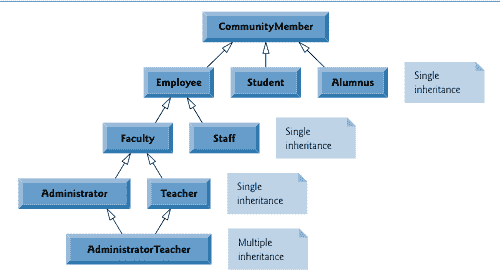

**图 12.2** | 大学 CommunityMember 的继承层次结构。

层次结构（图 12.2）中的每个箭头都表示一个*is-a*关系。例如，沿着这个类层次结构中的箭头，我们可以说“一个 Employee 是一个 CommunityMember”，以及“一个 Teacher 是一个 Faculty 成员”。CommunityMember 是 Employee、Student 和 Alumnus 的*直接基类*。此外，CommunityMember 是图中所有其他类的*间接基类*。间接基类是从类层次结构中向上两级或更多级继承而来的。

从图的底部开始，你可以沿着箭头向上，并将*is-a*关系应用到最顶层的基类。例如，一个 AdministratorTeacher *是一个 Administrator*，*是一个 Faculty 成员*，*是一个 Employee*，并且*是一个 CommunityMember*。

### Shape 类层次结构

现在考虑图 12.3 中的 Shape 继承层次结构。该层次结构从基类 Shape 开始。类 TwoDimensionalShape 和 ThreeDimensionalShape 派生自基类 Shape——一个 Shape *是一个* TwoDimensionalShape 或*是一个* ThreeDimensionalShape。该层次结构的第三层包含更具体的 TwoDimensionalShape 和 ThreeDimensionalShape 类型。如图 12.2 中那样，我们可以沿着箭头从图的底部向上到该层次结构中最顶层的基类，以识别若干*is-a*关系。例如，一个 Triangle *是一个* TwoDimensionalShape，并且*是一个* Shape；而一个 Sphere *是一个* ThreeDimensionalShape，并且*是一个* Shape。

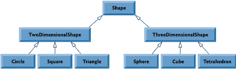

**图 12.3** | Shape 的继承层次结构。

要指定类 TwoDimensionalShape（图 12.3）派生自（或继承自）类 Shape，类 TwoDimensionalShape 的定义可以如下开始：

```cpp
class TwoDimensionalShape : public Shape
```

这是*公有继承*的一个例子，它是最常用的形式。我们还将讨论*私有继承*和*保护继承*（12.6节）。在所有形式的继承中，基类的 private 成员*不能*直接从该类的派生类访问，但这些基类的 private 成员仍会被继承（即，它们仍被视为派生类的一部分）。使用公有继承时，所有其他基类成员在成为派生类的成员时都保留其原来的成员访问权限（例如，基类的 public 成员成为派生类的 public 成员，而且我们很快会看到，基类的 protected 成员成为派生类的 protected 成员）。通过这些继承来的基类成员，派生类可以操纵基类的 private 成员（如果这些继承来的成员在基类中提供了此类功能）。注意，友元函数不会被继承。

继承并不适用于每一种类关系。在第10章中，我们讨论了 has-a 关系，其中类拥有作为其他类对象的成员。这种关系通过组合现有类来创建类。例如，给定类 Employee、BirthDate 和 TelephoneNumber，说一个 Employee 是一个 BirthDate 或一个 Employee 是一个 TelephoneNumber 是不恰当的。然而，说一个 Employee 有一个 BirthDate 以及一个 Employee 有一个 TelephoneNumber 是恰当的。

可以将基类对象和派生类对象类似地处理；它们的共性表现在基类的成员中。派生自同一基类的所有类的对象都可以当作该基类的对象来处理（即，此类对象与基类具有 is-a 关系）。在第13章中，我们将考虑许多利用这种关系的例子。

## 12.3 protected 成员

第3章介绍了访问说明符 public 和 private。基类的 public 成员可在其类体内以及程序中拥有该基类或其某个派生类对象的句柄（即名称、引用或指针）的任何位置访问。基类的 private 成员只能在其类体内以及该基类的友元中访问。本节中，我们介绍访问说明符 protected。

使用 protected 访问提供了介于 public 和 private 访问之间的中间保护级别。基类的 protected 成员可在该基类的类体内、由该基类的成员和友元、以及由派生自该基类的任何类的成员和友元访问。

派生类的成员函数只需使用成员名就可以引用基类的 public 和 protected 成员。当派生类的成员函数重新定义基类的成员函数时，仍可以从派生类访问基类成员，方法是在基类成员名前加上基类名和作用域解析运算符（::）。我们在12.4.5节讨论访问基类中被重新定义的成员，并在12.4.4节讨论使用 protected 数据。

## 12.4 基类与派生类之间的关系

在本节中，我们使用一个包含公司工资单应用程序中员工类型的继承层次结构，来讨论基类与派生类之间的关系。佣金制员工（将表示为基类的对象）按其销售额的一定百分比获得报酬，而底薪加佣金制员工（将表示为派生类的对象）获得底薪加上其销售额的一定百分比。我们将关于佣金制员工与底薪加佣金制员工之间关系的讨论，分为五个精心安排的示例。

### 12.4.1 创建并使用 CommissionEmployee 类

让我们检查 CommissionEmployee 的类定义（图 12.4–12.5）。CommissionEmployee 头文件（图 12.4）指定了类 CommissionEmployee 的 public 服务，其中包括构造函数（第12–13行）以及成员函数 earnings（第30行）和 print（第31行）。第15–28行声明了用于操纵该类数据成员（在第33–37行声明）的 public get 和 set 函数——firstName、lastName、socialSecurityNumber、grossSales 和 commissionRate。例如，成员函数 setGrossSales（在图 12.5 第56–62行定义）和 setCommissionRate（在图 12.5 第71–77行定义）在将值分别赋给数据成员 grossSales 和 commissionRate 之前会验证其参数。

```cpp
// Fig. 12.4: CommissionEmployee.h
// CommissionEmployee class definition represents a commission employee.
#ifndef COMMISSION_H
#define COMMISSION_H

#include <string> // C++ standard string class
using namespace std;

class CommissionEmployee
{
public:
   CommissionEmployee( const string &, const string &, const string &,
      double = 0.0, double = 0.0 );

   void setFirstName( const string & ); // set first name
   string getFirstName() const; // return first name

   void setLastName( const string & ); // set last name
   string getLastName() const; // return last name

   void setSocialSecurityNumber( const string & ); // set SSN
   string getSocialSecurityNumber() const; // return SSN

   void setGrossSales( double ); // set gross sales amount
   double getGrossSales() const; // return gross sales amount

   void setCommissionRate( double ); // set commission rate (percentage)
   double getCommissionRate() const; // return commission rate

   double earnings() const; // calculate earnings
   void print() const; // print CommissionEmployee object
private:
   string firstName;
   string lastName;
   string socialSecurityNumber;
   double grossSales; // gross weekly sales
   double commissionRate; // commission percentage
}; // end class CommissionEmployee

#endif
```

**图 12.4** | *CommissionEmployee 类头文件。*


```cpp
return socialSecurityNumber;
} // end function getSocialSecurityNumber

// set gross sales amount
void CommissionEmployee::setGrossSales( double sales )
{
   if ( sales >= 0.0 )
      grossSales = sales;
   else
      throw invalid_argument( "Gross sales must be >= 0.0" );
} // end function setGrossSales

// return gross sales amount
double CommissionEmployee::getGrossSales() const
{
   return grossSales;
} // end function getGrossSales

// set commission rate
void CommissionEmployee::setCommissionRate( double rate )
{
   if ( rate > 0.0 && rate < 1.0 )
      commissionRate = rate;
   else
      throw invalid_argument( "Commission rate must be > 0.0 and < 1.0" );
} // end function setCommissionRate

// return commission rate
double CommissionEmployee::getCommissionRate() const
{
   return commissionRate;
} // end function getCommissionRate

// calculate earnings
double CommissionEmployee::earnings() const
{
   return commissionRate * grossSales;
} // end function earnings

// print CommissionEmployee object
void CommissionEmployee::print() const
{
   cout << "Commission employee: " << firstName << ' ' << lastName
        << "\nSocial security number: " << socialSecurityNumber
        << "\nGross sales: " << grossSales
        << "\nCommission rate: " << commissionRate;
} // end function print
```

**图 12.5** | CommissionEmployee 类的实现文件，该类表示按总销售额百分比获得报酬的员工。（第 2 部分，共 2 部分。）

### CommissionEmployee 构造函数

CommissionEmployee 构造函数定义在本节的前几个示例中有意不使用成员初始化列表语法，以便我们演示 private 和 protected 说明符如何影响派生类中的成员访问。

如图 12.5 第 12–14 行所示，我们在构造函数体中为数据成员 `firstName`、`lastName` 和 `socialSecurityNumber` 赋值。在本节稍后，我们将回到构造函数中使用成员初始化列表。

在将构造函数参数 first、last 和 ssn 赋值给相应数据成员之前，我们没有对这些参数值进行验证。我们当然可以验证名和姓——例如通过确保它们的长度合理。类似地，可以对社会保障号码进行验证，以确保它包含九位数字，带或不带连字符（例如 123-45-6789 或 123456789）。

### CommissionEmployee 成员函数 earnings 和 print

成员函数 earnings（第 86–89 行）计算 CommissionEmployee 的收益。第 88 行将 commissionRate 乘以 grossSales 并返回结果。成员函数 print（第 92–98 行）显示 CommissionEmployee 对象的数据成员值。

### 测试类 CommissionEmployee

图 12.6 测试类 CommissionEmployee。第 11–12 行实例化类 CommissionEmployee 的对象 employee，并调用 CommissionEmployee 的构造函数，用 "Sue" 作为名、"Jones" 作为姓、"222-22-2222" 作为社会保障号码、10000 作为总销售额和 .06 作为佣金率来初始化该对象。第 19–24 行使用 employee 的 get 函数显示其数据成员的值。第 26–27 行调用对象的成员函数 setGrossSales 和 setCommissionRate，分别更改数据成员 grossSales 和 commissionRate 的值。第 31 行随后调用 employee 的 print 成员函数以输出更新后的 CommissionEmployee 信息。最后，第 34 行显示 CommissionEmployee 的收益，该收益由对象的 earnings 成员函数使用更新后的数据成员 grossSales 和 commissionRate 的值计算得出。

```cpp
// Fig. 12.6: fig12_06.cpp
// Testing class CommissionEmployee.
#include <iostream>
#include <iomanip>
#include "CommissionEmployee.h" // CommissionEmployee class definition
using namespace std;

int main()
{
   // instantiate a CommissionEmployee object
   CommissionEmployee employee(
      "Sue", "Jones", "222-22-2222", 10000, .06 );

   // set floating-point output format
   cout << fixed << setprecision( 2 );

   // get commission employee data
   cout << "Employee information obtained by get functions: \n"
        << "\nFirst name is " << employee.getFirstName()
20    << "\nLast name is " << employee.getLastName()
21    << "\nSocial security number is "
22    << employee.getSocialSecurityNumber()
23    << "\nGross sales is " << employee.getGrossSales()
24    << "\nCommission rate is " << employee.getCommissionRate() << endl;
25
26 employee.setGrossSales( 8000 ); // set gross sales
27 employee.setCommissionRate( .1 ); // set commission rate
28
29 cout << "\nUpdated employee information output by print function: \n"
30      << endl;
31 employee.print(); // display the new employee information
32
33 // display the employee's earnings
34 cout << "\nEmployee's earnings: $" << employee.earnings() << endl;
35 } // end main
```

**图 12.6** | CommissionEmployee 类测试程序。（第 1 部分，共 2 部分。）

**图 12.6** | CommissionEmployee 类测试程序。（第 2 部分，共 2 部分。）

```text
Employee information obtained by get functions:

First name is Sue
Last name is Jones
Social security number is 222-22-2222
Gross sales is 10000.00
Commission rate is 0.06

Updated employee information output by print function:

Commission employee: Sue Jones
Social security number: 222-22-2222
Gross sales: 8000.00
Commission rate: 0.10

Employee's earnings: $800.00
```

### 12.4.2 不使用继承创建 BasePlusCommissionEmployee 类

现在，我们通过创建并测试（一个全新的、独立的）类 BasePlusCommissionEmployee（图 12.7–12.8）来讨论继承介绍的第二个部分，该类包含名、姓、社会保障号码、总销售额、佣金率和*基本*工资。

```cpp
// Fig. 12.7: BasePlusCommissionEmployee.h
// BasePlusCommissionEmployee class definition represents an employee
// that receives a base salary in addition to commission.
#ifndef BASEPLUS_H
#define BASEPLUS_H

#include <string> // C++ standard string class
using namespace std;

class BasePlusCommissionEmployee
{
public:
   BasePlusCommissionEmployee( const string &, const string &,
      const string &, double = 0.0, double = 0.0, double = 0.0 );

   void setFirstName( const string & ); // set first name
   string getFirstName() const; // return first name

   void setLastName( const string & ); // set last name
   string getLastName() const; // return last name

   void setSocialSecurityNumber( const string & ); // set SSN
   string getSocialSecurityNumber() const; // return SSN

   void setGrossSales( double ); // set gross sales amount
   double getGrossSales() const; // return gross sales amount

   void setCommissionRate( double ); // set commission rate
   double getCommissionRate() const; // return commission rate

   void setBaseSalary( double ); // set base salary
   double getBaseSalary() const; // return base salary

   double earnings() const; // calculate earnings
   void print() const; // print BasePlusCommissionEmployee object
private:
   string firstName;
   string lastName;
   string socialSecurityNumber;
   double grossSales; // gross weekly sales
   double commissionRate; // commission percentage
   double baseSalary; // base salary
}; // end class BasePlusCommissionEmployee

#endif
```

**图 12.7** | *BasePlusCommissionEmployee 类头文件。*（第 1 部分，共 2 部分。）

**图 12.7** | `BasePlusCommissionEmployee` 类头文件。（第 2 部分，共 2 部分。）

```cpp
// Fig. 12.8: BasePlusCommissionEmployee.cpp
// Class BasePlusCommissionEmployee member-function definitions.
#include "stdafx.h"
#include "BasePlusCommissionEmployee.h"
using namespace std;

// constructor
BasePlusCommissionEmployee::BasePlusCommissionEmployee(
   const string &first, const string &last, const string &ssn,
   double sales, double rate, double salary )
{
```

**图 12.8** | `BasePlusCommissionEmployee` 类表示一个除了佣金之外还领取基本工资的员工。（第 1 部分，共 4 部分。）


```cpp
    firstName = first; // should validate
    lastName = last; // should validate
    socialSecurityNumber = ssn; // should validate
    setGrossSales( sales ); // validate and store gross sales
    setCommissionRate( rate ); // validate and store commission rate
    setBaseSalary( salary ); // validate and store base salary
} // end BasePlusCommissionEmployee constructor

// set first name
void BasePlusCommissionEmployee::setFirstName( const string &first )
{
    firstName = first; // should validate
} // end function setFirstName

// return first name
string BasePlusCommissionEmployee::getFirstName() const
{
    return firstName;
} // end function getFirstName

// set last name
void BasePlusCommissionEmployee::setLastName( const string &last )
{
    lastName = last; // should validate
} // end function setLastName

// return last name
string BasePlusCommissionEmployee::getLastName() const
{
    return lastName;
} // end function getLastName

// set social security number
void BasePlusCommissionEmployee::setSocialSecurityNumber(
    const string &ssn )
{
    socialSecurityNumber = ssn; // should validate
} // end function setSocialSecurityNumber

// return social security number
string BasePlusCommissionEmployee::getSocialSecurityNumber() const
{
    return socialSecurityNumber;
} // end function getSocialSecurityNumber

// set gross sales amount
void BasePlusCommissionEmployee::setGrossSales( double sales )
{
    if ( sales >= 0.0 )
        grossSales = sales;
    else
        throw invalid_argument( "Gross sales must be >= 0.0" );
} // end function setGrossSales

// return gross sales amount
double BasePlusCommissionEmployee::getGrossSales() const
{
    return grossSales;
} // end function getGrossSales

// set commission rate
void BasePlusCommissionEmployee::setCommissionRate( double rate )
{
    if ( rate > 0.0 && rate < 1.0 )
        commissionRate = rate;
    else
        throw invalid_argument( "Commission rate must be > 0.0 and < 1.0" );
} // end function setCommissionRate

// return commission rate
double BasePlusCommissionEmployee::getCommissionRate() const
{
    return commissionRate;
} // end function getCommissionRate

// set base salary
void BasePlusCommissionEmployee::setBaseSalary( double salary )
{
    if ( salary >= 0.0 )
        baseSalary = salary;
    else
        throw invalid_argument( "Salary must be >= 0.0" );
} // end function setBaseSalary

// return base salary
double BasePlusCommissionEmployee::getBaseSalary() const
{
    return baseSalary;
} // end function getBaseSalary

// calculate earnings
double BasePlusCommissionEmployee::earnings() const
{
    return baseSalary + ( commissionRate * grossSales );
} // end function earnings

// print BasePlusCommissionEmployee object
void BasePlusCommissionEmployee::print() const
{
    cout << "base-salaried commission employee: " << firstName << ' '
        << lastName << "\nsocial security number: " << socialSecurityNumber
```

**Fig. 12.8** | *BasePlusCommissionEmployee* 类表示除佣金外还领取底薪的雇员。（第 2 部分，共 4 部分。）

**Fig. 12.8** | *BasePlusCommissionEmployee* 类表示除佣金外还领取底薪的雇员。（第 3 部分，共 4 部分。）

```cpp
    // instantiate BasePlusCommissionEmployee object
    BasePlusCommissionEmployee
        employee( "Bob", "Lewis", "333-33-3333", 5000, .04, 300 );

    // set floating-point output formatting
    cout << fixed << setprecision( 2 );

    // get commission employee data
    cout << "\nEmployee information obtained by get functions: \n"
        << "\nFirst name is " << employee.getFirstName()
        << "\nLast name is " << employee.getLastName()
        << "\nSocial security number is "
        << employee.getSocialSecurityNumber()
        << "\nGross sales is " << employee.getGrossSales()
        << "\nCommission rate is " << employee.getCommissionRate()
        << "\nBase salary is " << employee.getBaseSalary() << endl;

    employee.setBaseSalary( 1000 ); // set base salary

    cout << "\nUpdated employee information output by print function: \n"
        << endl;
    employee.print(); // display the new employee information

    // display the employee's earnings
    cout << "\nEmployee's earnings: $" << employee.earnings() << endl;
} // end main
```

```text
Employee information obtained by get functions:

First name is Bob
Last name is Lewis
Social security number is 333-33-3333
Gross sales is 5000.00
Commission rate is 0.04
Base salary is 300.00

Updated employee information output by print function:

base-salaried commission employee: Bob Lewis
social security number: 333-33-3333
gross sales: 5000.00
commission rate: 0.04
base salary: 1000.00

Employee's earnings: $1200.00
```

**Fig. 12.9** | *BasePlusCommissionEmployee 类测试程序。（第 2 部分，共 2 部分。）*

## 探讨类 BasePlusCommissionEmployee 与类 CommissionEmployee 之间的相似性

类 BasePlusCommissionEmployee（图 12.7–12.8）的大部分代码与类 CommissionEmployee（图 12.4–12.5）的代码相似，甚至完全相同。例如，在类 BasePlusCommissionEmployee 中，私有数据成员 firstName 和 lastName，以及成员函数 `setFirstName`、`getFirstName`、`setLastName` 和 `getLastName` 与类 `CommissionEmployee` 中的相应内容完全相同。类 `CommissionEmployee` 和 `BasePlusCommissionEmployee` 也都包含私有数据成员 `socialSecurityNumber`、`commissionRate` 和 `grossSales`，以及用于操作这些成员的 get 和 set 函数。此外，`BasePlusCommissionEmployee` 构造函数与类 `CommissionEmployee` 的构造函数*几乎*相同，区别在于 `BasePlusCommissionEmployee` 的构造函数还设置了 `baseSalary`。类 BasePlusCommissionEmployee 的其他新增内容是私有数据成员 `baseSalary` 以及成员函数 `setBaseSalary` 和 `getBaseSalary`。类 `BasePlusCommissionEmployee` 的 `print` 成员函数与类 `CommissionEmployee` 的 `print` 成员函数*几乎相同*，区别在于 `BasePlusCommissionEmployee` 的 `print` 还输出数据成员 `baseSalary` 的值。

我们实际上从类 `CommissionEmployee` *复制*代码并*粘贴*到类 `BasePlusCommissionEmployee` 中，然后修改类 `BasePlusCommissionEmployee`，使其包含底薪以及操作底薪的成员函数。这种*复制粘贴*方法容易出错且耗时。


### 软件工程观察 12.1

从一个类复制粘贴代码到另一个类，会散布同一代码的许多实体副本，并可能在整个系统中传播错误，造成代码维护噩梦。为避免重复代码（以及可能的错误），当你希望一个类“吸收”另一个类的数据成员和成员函数时，应使用继承，而不是“复制粘贴”方法。


### 软件工程观察 12.2

使用继承时，层次结构中所有类的公共数据成员和成员函数都在基类中声明。当需要修改这些公共特性时，只需在基类中进行修改——派生类随后会继承这些修改。如果不使用继承，则需要对所有包含相关代码副本的源代码文件进行修改。

### 12.4.3 创建 CommissionEmployee–BasePlusCommissionEmployee 继承层次结构

现在，我们创建并测试一个新的 `BasePlusCommissionEmployee` 类（图 12.10–12.11），它*派生自*类 `CommissionEmployee`（图 12.4–12.5）。在此示例中，`BasePlusCommissionEmployee` 对象是一个 `CommissionEmployee` 对象（因为继承传递了类 `CommissionEmployee` 的能力），但类 `BasePlusCommissionEmployee` 还具有数据成员 `baseSalary`（图 12.10，第 23 行）。类定义第 11 行中的*冒号*（`:`）表示继承。关键字 `public` 表示*继承类型*。作为派生类（通过公有继承形成），`BasePlusCommissionEmployee` 继承类 `CommissionEmployee` 的*所有*成员，*除了*构造函数——每个类都提供自己特有的构造函数。（析构函数也不被继承。）因此，`BasePlusCommissionEmployee` 的公共服务包括其构造函数（第 14–15 行）以及继承自类 `CommissionEmployee` 的公有成员函数——尽管在 `BasePlusCommissionEmployee` 的源代码中看不到这些继承的成员函数，但它们仍然是派生类 `BasePlusCommissionEmployee` 的一部分。派生类的公共服务还包括派生成员函数 `setBaseSalary`、`getBaseSalary`、`earnings` 和 `print`（第 17–21 行）。


```cpp
// Fig. 12.10: BasePlusCommissionEmployee.h
// BasePlusCommissionEmployee class derived from class
// CommissionEmployee.
#ifndef BASEPLUS_H
#define BASEPLUS_H

#include <string> // C++ standard string class
#include "CommissionEmployee.h" // CommissionEmployee class declaration
using namespace std;

class BasePlusCommissionEmployee : public CommissionEmployee
{
public:
   BasePlusCommissionEmployee( const string &, const string &,
      const string &, double = 0.0, double = 0.0, double = 0.0 );

   void setBaseSalary( double ); // set base salary
   double getBaseSalary() const; // return base salary

   double earnings() const; // calculate earnings
   void print() const; // print BasePlusCommissionEmployee object
private:
   double baseSalary; // base salary
}; // end class BasePlusCommissionEmployee

#endif
```

**图 12.10** | BasePlusCommissionEmployee 类定义，表示与 CommissionEmployee 类的继承关系。

```cpp
// Fig. 12.11: BasePlusCommissionEmployee.cpp
// Class BasePlusCommissionEmployee member-function definitions.
#include <iostream>
#include "BasePlusCommissionEmployee.h"
using namespace std;

// constructor
BasePlusCommissionEmployee::BasePlusCommissionEmployee(
   const string &first, const string &last, const string &ssn,
   double sales, double rate, double salary )
   // explicitly call base-class constructor
   : CommissionEmployee( first, last, ssn, sales, rate )
{
   setBaseSalary( salary ); // validate and store base salary
} // end BasePlusCommissionEmployee constructor

// set base salary
void BasePlusCommissionEmployee::setBaseSalary( double salary )
{
```

**图 12.11** | BasePlusCommissionEmployee 实现文件：派生类无法访问基类的私有数据。（第 1 部分，共 3 部分。）

```
C:\chhpt8_examples\ch12\Fig12_10_11\BasePlusCommissionEmployee.cpp(46) :
    error C2248: 'CommissionEmployee::commissionRate':
    cannot access private member declared in class 'CommissionEmployee'
```

**图 12.11** | *BasePlusCommissionEmployee 实现文件：派生类无法访问基类的私有数据。*（第 3 部分，共 3 部分。）

图 12.11 展示了 BasePlusCommissionEmployee 的成员函数实现。构造函数（第 8–15 行）引入了**基类初始化器语法**（第 12 行），它使用成员初始化器将参数传递给基类（CommissionEmployee）构造函数。C++ 要求派生类的构造函数必须调用其基类的构造函数，以初始化继承到派生类中的基类数据成员。第 12 行通过*显式*调用 CommissionEmployee 构造函数来实现这一点，将构造函数的参数 first、last、ssn、sales 和 rate 作为实参，用于初始化基类数据成员 firstName、lastName、socialSecurityNumber、grossSales 和 commissionRate。如果 BasePlusCommissionEmployee 的构造函数没有*显式*调用 CommissionEmployee 类的构造函数，C++ 会尝试隐式调用 CommissionEmployee 类的默认构造函数——但该类没有这样的构造函数，因此编译器会报错。回顾第 3 章可知，对于任何*没有*显式包含构造函数的类，编译器都会提供一个无参默认构造函数。但是，CommissionEmployee *确实*显式包含了一个构造函数，因此*不会*提供默认构造函数。

> **常见编程错误 12.1**
>
> 当派生类构造函数调用基类构造函数时，传递给基类构造函数的实参必须与某个基类构造函数所指定的形参数量和类型一致；否则会发生编译错误。


> **性能提示 12.1**
>
> 在派生类构造函数中，在成员初始化器列表中显式调用基类构造函数并初始化成员对象，可以避免重复初始化：先调用默认构造函数，然后在派生类构造函数体中再次修改数据成员。


## 访问基类私有成员导致的编译错误

编译器会针对图 12.11 中的第 36 行生成错误，因为基类 CommissionEmployee 的数据成员 commissionRate 和 grossSales 是私有的——不允许派生类 BasePlusCommissionEmployee 的成员函数访问基类 CommissionEmployee 的私有数据。由于相同原因，编译器还会在 BasePlusCommissionEmployee 的 print 成员函数第 43–46 行产生额外错误。可以看出，C++ 对访问私有数据成员实施了严格限制，因此即使是*与其基类关系密切的派生类，也不能访问基类的私有数据。*

## 避免 BasePlusCommissionEmployee 中的错误

我们在图 12.11 中特意包含了错误代码，以强调派生类的成员函数不能访问其基类的私有数据。BasePlusCommissionEmployee 中的错误本可以通过使用从 CommissionEmployee 类继承的 *get* 成员函数来避免。例如，第 36 行可以调用 getCommissionRate 和 getGrossSales，分别访问 CommissionEmployee 的私有数据成员 commissionRate 和 grossSales。类似地，第 43–46 行可以使用相应的 *get* 成员函数来获取基类数据成员的值。在下一个示例中，我们将展示如何使用 protected 数据也能避免本例中遇到的错误。

### 在派生类头文件中使用 #include 包含基类头文件

注意，我们在派生类的头文件中使用 #include 包含了基类的头文件（图 12.10 的第 8 行）。这样做有三个原因。首先，为了让派生类能在第 11 行使用基类的名称，我们必须告诉编译器基类存在——CommissionEmployee.h 中的类定义正是这样做的。

第二个原因是，编译器使用类定义来确定该类对象的大小（正如我们在 3.6 节所讨论的）。创建某类对象的客户端程序必须 #include 该类定义，以便编译器为该对象预留适当的内存。使用继承时，派生类对象的大小取决于其类定义中显式声明的数据成员，以及从其直接和间接基类继承的数据成员。在第 8 行包含基类的定义，使编译器能够确定基类数据成员的内存需求，这些数据成员会成为派生类对象的一部分，从而影响派生类对象的总体大小。

第 8 行的最后一个原因是让编译器能够判断派生类是否正确使用了基类的继承成员。例如，在图 12.10–12.11 的程序中，编译器使用基类头文件来确定派生类正在访问的数据成员在基类中是私有的。由于派生类无法访问这些成员，编译器会生成错误。编译器还使用基类的*函数原型*来验证派生类对继承的基类函数所进行的函数调用。

### 继承层次结构中的链接过程

在 3.7 节中，我们讨论了创建可执行 GradeBook 应用程序的链接过程。在那个示例中，你看到客户端的对象代码与 GradeBook 类的对象代码链接，同时还要与该示例或 GradeBook 类中使用的任何 C++ 标准库类的对象代码链接。

对于在继承层次结构中使用类的程序，链接过程与此类似。该过程需要程序中使用的所有类的对象代码，以及程序所使用的任何派生类的直接和间接基类的对象代码。假设客户端想要创建一个使用 BasePlusCommissionEmployee 类的应用程序，该类是 CommissionEmployee 的派生类（我们将在 12.4.4 节看到这样的示例）。在编译客户端应用程序时，客户端的对象代码必须与 BasePlusCommissionEmployee 和 CommissionEmployee 类的对象代码链接，因为 BasePlusCommissionEmployee 从其基类 CommissionEmployee 继承了成员函数。代码还会与在 CommissionEmployee 类、BasePlusCommissionEmployee 类或客户端代码中使用的任何 C++ 标准库类的对象代码链接。这使程序能够访问其可能使用的所有功能的实现。


```cpp
double grossSales;       // gross weekly sales
double commissionRate;   // commission percentage
};                       // end class CommissionEmployee

#endif
```

**图 12.12** | 声明 protected 数据以允许派生类访问的 CommissionEmployee 类定义。（第 2 部分，共 2 部分。）

## BasePlusCommissionEmployee 类

图 12.10–12.11 中 BasePlusCommissionEmployee 类的定义保持不变，因此这里不再展示。既然 BasePlusCommissionEmployee 类继承自更新后的 CommissionEmployee 类（图 12.12），BasePlusCommissionEmployee 对象就可以访问在 CommissionEmployee 类中声明为 protected 的继承数据成员（即数据成员 firstName、lastName、socialSecurityNumber、grossSales 和 commissionRate）。因此，在编译图 12.11 中的 BasePlusCommissionEmployee 程序和 print 成员函数定义（分别位于第 33–37 行和第 40–48 行）时，编译器不会产生错误。这体现了派生类被授予访问 protected 基类数据成员的特殊权限。派生类的对象还可以访问该派生类的*任意*间接基类中的 protected 成员。

BasePlusCommissionEmployee 类不继承 CommissionEmployee 类的构造函数。不过，BasePlusCommissionEmployee 类的构造函数（图 12.11，第 8–15 行）使用成员初始化器语法（第 12 行）显式调用 CommissionEmployee 类的构造函数。回想一下，BasePlusCommissionEmployee 的构造函数必须显式调用 CommissionEmployee 类的构造函数，因为 CommissionEmployee 不包含可被隐式调用的默认构造函数。

## 测试修改后的 BasePlusCommissionEmployee 类

为了测试更新后的类层次结构，我们复用了图 12.9 中的测试程序。如图 12.13 所示，输出与图 12.9 的输出相同。我们创建了第一个*不使用继承*的 BasePlusCommissionEmployee 类，并创建了*使用继承*的 BasePlusCommissionEmployee 版本；不过，这两个类提供*相同*的功能。此外，BasePlusCommissionEmployee 类的代码（即头文件和实现文件）有 74 行，比该类的非继承版本的代码（有 161 行）要*短*得多，因为继承版本从 CommissionEmployee 吸收了部分功能，而非继承版本不吸收任何功能。此外，现在只有一份在 CommissionEmployee 类中声明和定义的 CommissionEmployee 功能副本。这使得源代码更易于维护、修改和调试，因为与 CommissionEmployee 相关的源代码仅存在于 CommissionEmployee.h 和 CommissionEmployee.cpp 文件中。

```text
Employee information obtained by get functions:

First name is Bob
Last name is Lewis
Social security number is 333-33-3333

Gross sales is 5000.00
Commission rate is 0.04
Base salary is 300.00

Updated employee information output by print function:

base-salaried commission employee: Bob Lewis
social security number: 333-33-3333
gross sales: 5000.00
commission rate: 0.04
base salary: 1000.00

Employee's earnings: $1200.00
```

**图 12.13** | protected 基类数据可从派生类访问。

## 关于使用 **protected** 数据的说明

在此示例中，我们将基类数据成员声明为 protected，因此派生类可以直接修改数据。继承 protected 数据成员会略微提高性能，因为我们可以直接访问这些成员，而无需承担调用 set 或 get 成员函数的开销。


### 软件工程观察 12.3

*在大多数情况下，最好使用 private 数据成员以鼓励正确的软件工程，并将代码优化问题留给编译器。你的代码将更易于维护、修改和调试。*

使用 protected 数据成员会产生两个严重问题。第一，派生类对象不必使用成员函数来设置基类的 protected 数据成员的值。无效值很容易被赋给 protected 数据成员，从而使对象处于不一致状态——例如，当 CommissionEmployee 的数据成员 grossSales 声明为 protected 时，派生类对象可以将负值赋给 grossSales。使用 protected 数据成员的第二个问题是，派生类成员函数更可能被写成依赖于基类实现。派生类应仅依赖于基类服务（即非 private 成员函数），而不依赖于基类实现。当基类中有 protected 数据成员时，如果基类实现发生变化，我们可能需要修改该基类的所有派生类。例如，如果由于某种原因我们将数据成员 firstName 和 lastName 的名称改为 first 和 last，那么在所有派生类直接引用这些基类数据成员的地方都必须做相应修改。这样的软件被称为脆弱或易碎，因为基类中的一个小改动就可能“破坏”派生类实现。你应当能够更改基类实现，同时仍向派生类提供相同的服务。当然，如果基类服务发生变化，我们必须重新实现派生类——良好的面向对象设计试图防止这种情况。


### 软件工程观察 12.4

*当基类应仅向其派生类和友元提供服务（即成员函数）时，使用 protected 访问说明符是合适的。*


### 软件工程观察 12.5

*将基类数据成员声明为 private（而不是声明为 protected）使你能够更改基类实现，而无需更改派生类实现。*

### 12.4.5 使用 private 数据的 CommissionEmployee–BasePlusCommissionEmployee 继承层次结构

现在我们再次重新审视我们的层次结构，这次采用最佳软件工程实践。CommissionEmployee 类现在将数据成员 firstName、lastName、socialSecurityNumber、grossSales 和 commissionRate 声明为 private，如前面图 12.4 的第 32–37 行所示。

### CommissionEmployee 类成员函数定义的更改

在 CommissionEmployee 构造函数实现（图 12.14，第 8–15 行）中，我们使用成员初始化器（第 11 行）设置成员 firstName、lastName 和 socialSecurityNumber 的值。我们展示了派生类 BasePlusCommissionEmployee（图 12.15）如何调用非 private 基类成员函数（setFirstName、getFirstName、setLastName、getLastName、setSocialSecurityNumber 和 getSocialSecurityNumber）来操作这些数据成员。

在构造函数体以及成员函数 earnings（第 84–87 行）和 print（第 90–97 行）的函数体中，我们调用该类的 set 和 get 成员函数来访问该类的 private 数据成员。如果我们决定更改数据成员名称，earnings 和 print 的定义将不需要修改——只有直接操作这些数据成员的 get 和 set 成员函数的定义需要更改。这些更改仅发生在基类内部——不需要更改派生类。像这样将更改的影响局部化是一种良好的软件工程实践。


### 性能提示 12.2

使用成员函数访问数据成员的值可能比直接访问数据稍慢。不过，如今的优化编译器经过精心设计，会隐式执行许多优化（例如内联 set 和 get 成员函数调用）。你应当编写遵循正确软件工程原则的代码，并将优化留给编译器。一条好规则是：“不要妄自猜测编译器。”

```cpp
// Fig. 12.14: CommissionEmployee.cpp
// Class CommissionEmployee member-function definitions.
#include <iostream>
#include "CommissionEmployee.h" // CommissionEmployee class definition
using namespace std;

// constructor
CommissionEmployee::CommissionEmployee(
   const string &first, const string &last, const string &ssn,
   double sales, double rate )
```

**图 12.14** | CommissionEmployee 类实现文件：CommissionEmployee 类使用成员函数操作其 private 数据。（第 1 部分，共 3 部分。）


```cpp
: firstName( first ), lastName( last ), socialSecurityNumber( ssn )
{
    setGrossSales( sales ); // validate and store gross sales
    setCommissionRate( rate ); // validate and store commission rate
} // end CommissionEmployee constructor

// set first name
void CommissionEmployee::setFirstName( const string &first )
{
    firstName = first; // should validate
} // end function setFirstName

// return first name
string CommissionEmployee::getFirstName() const
{
    return firstName;
} // end function getFirstName

// set last name
void CommissionEmployee::setLastName( const string &last )
{
    lastName = last; // should validate
} // end function setLastName

// return last name
string CommissionEmployee::getLastName() const
{
    return lastName;
} // end function getLastName

// set social security number
void CommissionEmployee::setSocialSecurityNumber( const string &ssn )
{
    socialSecurityNumber = ssn; // should validate
} // end function setSocialSecurityNumber

// return social security number
string CommissionEmployee::getSocialSecurityNumber() const
{
    return socialSecurityNumber;
} // end function getSocialSecurityNumber

// set gross sales amount
void CommissionEmployee::setGrossSales( double sales )
{
    if ( sales >= 0.0 )
        grossSales = sales;
    else
        throw invalid_argument( "Gross sales must be >= 0.0" );
} // end function setGrossSales

// return gross sales amount
double CommissionEmployee::getGrossSales() const
{
   return grossSales;
} // end function getGrossSales

// set commission rate
void CommissionEmployee::setCommissionRate( double rate )
{
   if ( rate > 0.0 && rate < 1.0 )
      commissionRate = rate;
   else
      throw invalid_argument( "Commission rate must be > 0.0 and < 1.0" );
} // end function setCommissionRate

// return commission rate
double CommissionEmployee::getCommissionRate() const
{
   return commissionRate;
} // end function getCommissionRate

// calculate earnings
double CommissionEmployee::earnings() const
{
   return getCommissionRate() * getGrossSales();
} // end function earnings

// print CommissionEmployee object
void CommissionEmployee::print() const
{
   cout << "commission employee: "
      << getFirstName() << ' ' << getLastName()
      << "\nsocial security number: " << getSocialSecurityNumber()
      << "\ngross sales: " << getGrossSales()
      << "\ncommission rate: " << getCommissionRate();
} // end function print
```

**图 12.14** | CommissionEmployee 类实现文件：CommissionEmployee 类使用成员函数操作其私有数据。（第 2 部分，共 3 部分。）

**图 12.14** | *CommissionEmployee 类实现文件：CommissionEmployee 类使用成员函数操作其私有数据。（第 3 部分，共 3 部分。）*

### BasePlusCommissionEmployee 类成员函数定义的更改

BasePlusCommissionEmployee 类继承 CommissionEmployee 的 public 成员函数，并可通过继承的成员函数访问基类的 private 成员。BasePlusCommissionEmployee 类的头文件与图 12.10 相比保持不变。该类对其成员函数实现做了若干更改（图 12.15），使其有别于该类的先前版本（图 12.10–12.11）。成员函数 earnings（图 12.15，第 33–36 行）和 print（第 39–47 行）各自调用成员函数 getBaseSalary 来获取基本工资值，而不是直接访问 baseSalary。这使 earnings 和 print 免受数据成员 baseSalary 实现可能更改的影响。例如，如果我们决定重命名数据成员 baseSalary 或更改其类型，则只需更改成员函数 setBaseSalary 和 getBaseSalary。

```cpp
// Fig. 12.15: BasePlusCommissionEmployee.cpp
// Class BasePlusCommissionEmployee member-function definitions.
#include <iostream>
#include "BasePlusCommissionEmployee.h"
using namespace std;

// constructor
BasePlusCommissionEmployee::BasePlusCommissionEmployee(
   const string &first, const string &last, const string &ssn,
   double sales, double rate, double baseSalary )
   // explicitly call base-class constructor
   : CommissionEmployee( first, last, ssn, sales, rate )
{
   setBaseSalary( baseSalary ); // validate and store base salary
} // end BasePlusCommissionEmployee constructor

// set base salary
void BasePlusCommissionEmployee::setBaseSalary( double salary )
{
   if ( salary >= 0.0 )
      baseSalary = salary;
   else
      throw invalid_argument( "Salary must be >= 0.0" );
} // end function setBaseSalary

// return base salary
double BasePlusCommissionEmployee::getBaseSalary() const
{
   return baseSalary;
} // end function getBaseSalary

// calculate earnings
double BasePlusCommissionEmployee::earnings() const
{
   return BasePlusCommissionEmployee::earnings();
} // end function earnings

// print BasePlusCommissionEmployee object
void BasePlusCommissionEmployee::print() const
{
   cout << "base-salary: " << baseSalary;

   // invoke CommissionEmployee's print function
   CommissionEmployee::print();

   cout << "\nbase salary: " << getBaseSalary();
} // end function print
```

**图 12.15** | 继承自 CommissionEmployee 类但不能直接访问该类私有数据的 BasePlusCommissionEmployee 类。

### BasePlusCommissionEmployee 成员函数 earnings

BasePlusCommissionEmployee 类的 earnings 函数（图 12.15，第 33–36 行）重新定义了 CommissionEmployee 类的 earnings 成员函数（图 12.14，第 84–87 行），使其

受保护继承很少见。第 20 章演示了私有继承作为组合的替代方案。图 12.16 总结了每种继承类型中基类成员在派生类中的可访问性。第一列包含基类访问说明符。

| 基类成员访问说明符 | 公有继承 | 受保护继承 | 私有继承 |
|---|---|---|---|
| **public** | **在派生类中为 public。** 可由成员函数、友元函数和非成员函数直接访问。 | **在派生类中为 protected。** 可由成员函数和友元函数直接访问。 | **在派生类中为 private。** 可由成员函数和友元函数直接访问。 |
| **protected** | **在派生类中为 protected。** 可由成员函数和友元函数直接访问。 | **在派生类中为 protected。** 可由成员函数和友元函数直接访问。 | **在派生类中为 private。** 可由成员函数和友元函数直接访问。 |
| **private** | **在派生类中隐藏。** 可通过基类的 public 或 protected 成员函数由成员函数和友元函数访问。 | **在派生类中隐藏。** 可通过基类的 public 或 protected 成员函数由成员函数和友元函数访问。 | **在派生类中隐藏。** 可通过基类的 public 或 protected 成员函数由成员函数和友元函数访问。 |

**图 12.16** | 派生类中基类成员可访问性总结。

当从公有基类派生类时，基类的 public 成员成为派生类的 public 成员，基类的 protected 成员成为派生类的 protected 成员。基类的 private 成员永远不能从派生类直接访问，但可以通过调用基类的 public 和 protected 成员来访问。

当从受保护基类派生时，基类的 public 和 protected 成员成为派生类的 protected 成员。当从私有基类派生时，基类的 public 和 protected 成员成为派生类的 private 成员（例如，这些函数成为实用函数）。私有继承和受保护继承不是 is-a 关系。

## 12.7 继承的软件工程

有时，学生很难理解在工业界从事大型软件项目的设计人员所面临问题的范围。有此类项目经验的人——


软件工程专家指出，有效的软件复用能够改进软件开发过程。面向对象编程促进了软件复用，从而缩短开发时间并提高软件质量。

当我们使用继承从现有类创建新类时，新类继承现有类的数据成员和成员函数，如图12.16所述。我们可以通过重定义基类成员和包含额外成员来定制新类以满足需求。派生类程序员在C++中无需访问基类的源代码即可做到这一点（派生类必须能够链接到基类的目标代码）。这种强大的能力对软件开发人员很有吸引力。他们可以开发专有类用于销售或授权，并以目标代码格式将这些类提供给用户。然后用户可以从这些库类快速派生新类，而无需访问专有源代码。软件开发人员需要随目标代码一起提供头文件。

大量有用类库的可用性通过继承带来了软件复用的最大收益。创建和销售类库的兴趣呈指数级增长。标准C++库往往是通用的，且范围有限。全世界都在致力于为各种应用领域开发类库。


### 软件工程观察 12.8

> 在面向对象系统的设计阶段，设计人员常常确定某些类密切相关。设计人员应“提取出”共同的属性和行为，并将它们放入基类，然后使用继承形成派生类。


### 软件工程观察 12.9

> 创建派生类不会影响其基类的源代码。继承保持了基类的完整性。

## 12.8 小结

本章介绍了继承——通过吸收现有类的数据成员和成员函数并用新能力加以修饰来创建类的能力。通过一系列使用员工继承层次结构的示例，你学习了基类和派生类的概念，并使用公有继承创建了从基类继承成员的派生类。本章介绍了访问说明符protected——派生类的成员函数可以访问基类的protected成员。你学习了如何通过用基类名和作用域解析运算符（::）限定重定义的基类成员的名称来访问它们。你还了解了对于属于继承层次结构的类的对象，构造函数和析构函数的调用顺序。最后，我们解释了三种继承类型——公有、保护和私有——以及使用每种类型时派生类中基类成员的可访问性。

在第13章“面向对象编程：多态”中，我们在继承讨论的基础上介绍多态——一种面向对象概念，它使我们能够编写程序，以更通用的方式处理通过继承相关联的各种类的对象。学习第13章后，你将熟悉类、对象、封装、继承和多态——面向对象编程的基本概念。

- 当从公有基类（第502页）派生类时，基类的公有成员成为派生类的公有成员，基类的保护成员成为派生类的保护成员。
- 当从保护基类（第502页）派生类时，基类的公有和保护成员成为派生类的保护成员。
- 当从私有基类（第502页）派生类时，基类的公有和保护成员成为派生类的私有成员。

## 自测练习

- **12.1** 填写下列各句中的空白：

  a) ________是一种软件复用形式，其中新类吸收现有类的数据和行为，并用新能力修饰这些类。

  b) 基类的________成员可以在基类定义、派生类定义以及基类及其派生类的友元中访问。

  c) 在________关系中，派生类的对象也可以被当作其基类的对象处理。

  d) 在________关系中，一个类对象将一个或多个其他类的对象作为成员。

  e) 在单继承中，一个类与其派生类之间存在________关系。

  f) 基类的________成员可在该基类内部以及程序能够访问该类或其某个派生类对象的任何位置访问。

  g) 基类的保护成员具有介于公有和________访问之间的保护级别。

  h) C++提供了________，它允许派生类从多个基类继承，即使这些基类互不相关。

  i) 当实例化派生类的对象时，会隐式或显式调用基类的________，以对派生类对象中的基类数据成员进行任何必要的初始化。

  j) 当使用公有继承从基类派生类时，基类的公有成员成为派生类的________成员，基类的保护成员成为派生类的________成员。

  k) 当使用保护继承从基类派生类时，基类的公有成员成为派生类的________成员，基类的保护成员成为派生类的________成员。

- **12.2** 指出下列各项是*正确*还是*错误*。如果*错误*，请解释原因。

  a) 基类构造函数不会被派生类继承。

  b) *有-a*关系通过继承实现。

  c) 汽车与SteeringWheel和Brakes类之间存在*是-a*关系。

  d) 继承鼓励复用经过验证的高质量软件。

  e) 当派生类对象被销毁时，析构函数的调用顺序与构造函数相反。

## 自测练习答案

- **12.1** a) 继承。b) protected。c) *是-a*或继承（对于公有继承）。d) *有-a*或组合或聚合。e) 分层。f) public。g) private。h) 多重继承。i) 构造函数。j) public，protected。k) protected，protected。

- **12.2** a) *正确*。b) *错误*。*有-a*关系通过组合实现。*是-a*关系通过继承实现。c) *错误*。这是一个*有-a*关系的例子。Car类与Vehicle类之间存在*是-a*关系。d) *正确*。e) *正确*。

## 练习题

- **12.3** *(作为继承替代方案的组合)* 许多用继承编写的程序可以改用组合编写，反之亦然。重写CommissionEmployee—BasePlusCommissionEmployee层次结构中的BasePlusCommissionEmployee类，使其使用组合而非继承。完成之后，评估这两种方法在设计CommissionEmployee和BasePlusCommissionEmployee类以及一般面向对象程序时的相对优点。哪种方法更自然？为什么？

- **12.4** *(继承的优点)* 讨论继承促进软件复用、节省程序开发时间并帮助防止错误的方式。

- **12.5** *(保护基类与私有基类)* 一些程序员不喜欢使用保护访问，因为他们认为这会破坏基类的封装。讨论在基类中使用保护访问与使用私有访问的相对优点。

- **12.6** *(学生继承层次结构)* 为大学中的学生绘制一个类似于图12.2所示层次结构的继承层次结构。使用Student作为该层次结构的基类，然后包含从Student派生的UndergraduateStudent和GraduateStudent类。继续尽可能深地（即尽可能多层地）扩展层次结构。例如，Freshman、Sophomore、Junior和Senior可以从UndergraduateStudent派生，DoctoralStudent和MastersStudent可以从GraduateStudent派生。绘制层次结构后，讨论类之间存在的关系。[注意：本练习不需要编写任何代码。]

- **12.7** *(更丰富的形状层次结构)* 形状的世界远比图12.3继承层次结构中包含的形状丰富得多。写下你能想到的所有形状——包括二维和三维形状——并将它们组织成一个尽可能多层的更完整的Shape层次结构。你的层次结构应具有基类Shape，并从其派生TwoDimensionalShape类和ThreeDimensionalShape类。[注意：本练习不需要编写任何代码。]我们将在第13章的练习中使用此层次结构，将一组不同的形状作为基类Shape的对象来处理。（这种技术称为多态，是第13章的主题。）

- **12.8** *(四边形继承层次结构)* 为Quadrilateral、Trapezoid、Parallelogram、Rectangle和Square类绘制一个继承层次结构。使用Quadrilateral作为该层次结构的基类。使层次结构尽可能深。

- **12.9** *(包裹继承层次结构)* 包裹递送服务，如FedEx®、DHL®和UPS®，提供许多不同的运输选项，每个选项都有相关的特定费用。创建一个继承层次结构来表示各种类型的包裹。使用Package类作为该层次结构的基类，然后包含从Package派生的TwoDayPackage和OvernightPackage类。基类Package应包含表示包裹发送方和接收方的姓名、地址、城市、州和邮政编码的数据成员，以及存储包裹重量（以盎司为单位）和每盎司运输费用的数据成员。Package的构造函数应初始化这些数据成员。确保重量和每盎司费用包含正值。Package应提供一个公有成员函数calculateCost，返回一个double值，表示与运输包裹相关的费用。Package的calculateCost函数应通过将重量乘以每盎司费用来确定费用。派生类TwoDayPackage应继承基类Package的功能，但还应包含一个数据成员，表示运输公司为两天送达服务收取的固定费用。TwoDayPackage的构造函数应接收一个值来初始化此数据成员。TwoDayPackage应重定义成员函数calculateCost，以便通过将固定费用加到由基类Package的calculateCost函数计算的基于重量的费用上来计算运输费用。OvernightPackage类应直接从Package类继承，并包含一个额外的数据成员，表示隔夜送达服务收取的每盎司额外费用。OvernightPackage应重定义成员函数calculateCost。

调整 calculateCost，使其在计算运费之前，将每盎司的额外费用加到每盎司的标准费用上。编写一个测试程序，创建每种 Package 类型的对象，并测试成员函数 `calculateCost`。

## 12.10（账户继承层次结构）

创建一个银行可能用来表示客户银行账户的继承层次结构。该银行的所有客户都可以将钱存入（即贷记）其账户，也可以从其账户中取钱（即借记）。还存在更具体的账户类型。例如，储蓄账户会对其持有的资金赚取利息。另一方面，支票账户会按每笔交易（即贷记或借记）收取费用。

创建一个继承层次结构，其中包含基类 Account 以及从类 Account 继承的派生类 SavingsAccount 和 CheckingAccount。基类 Account 应包含一个 double 类型的数据成员来表示账户余额。该类应提供一个构造函数，接收初始余额并用它初始化该数据成员。构造函数应验证初始余额，确保其大于或等于 0.0。如果不是，则应将余额设置为 0.0，并且构造函数应显示一条错误消息，指出初始余额无效。该类应提供三个成员函数。成员函数 credit 应向当前余额增加一笔金额。成员函数 debit 应从 Account 中取钱，并确保借记金额不超过 Account 的余额。如果超过，则余额应保持不变，并且该函数应打印消息 "Debit amount exceeded account balance."。成员函数 getBalance 应返回当前余额。

派生类 SavingsAccount 应继承 Account 的功能，但还应包含一个 double 类型的数据成员，表示分配给该账户的利率（百分比）。SavingsAccount 的构造函数应接收初始余额，以及 SavingsAccount 利率的初始值。SavingsAccount 应提供一个公共成员函数 `calculateInterest`，返回一个 double，表示账户赚取的利息金额。成员函数 `calculateInterest` 应通过将利率乘以账户余额来确定该金额。[注意：SavingsAccount 应原样继承成员函数 credit 和 debit，而无需重新定义它们。]

派生类 CheckingAccount 应从基类 Account 继承，并包含一个额外的 double 类型数据成员，表示每笔交易收取的费用。CheckingAccount 的构造函数应接收初始余额，以及一个表示费用金额的参数。类 CheckingAccount 应重新定义成员函数 credit 和 debit，以便在任一交易成功执行时从账户余额中减去费用。CheckingAccount 中这些函数的版本应调用基类 Account 的版本，以执行对账户余额的更新。CheckingAccount 的 debit 函数应仅在确实取钱时（即借记金额不超过账户余额）收取费用。[提示：将 Account 的 debit 函数定义为返回一个 bool，表示是否取出了钱。然后使用返回值来确定是否应收取费用。]

在此层次结构中定义这些类之后，编写一个程序，创建每个类的对象并测试它们的成员函数。通过先调用 SavingsAccount 对象的 `calculateInterest` 函数，然后将返回的利息金额传递给该对象的 `credit` 函数，为 SavingsAccount 对象增加利息。

## 13.2 多态性简介：多态视频游戏

假设我们设计一个视频游戏，它操作许多不同类型的对象，包括类 Martian、Venusian、Plutonian、SpaceShip 和 LaserBeam 的对象。设想这些类都继承自公共基类 SpaceObject，该类包含成员函数 draw。每个派生类都以适合该类的方式实现此函数。屏幕管理器程序维护一个容器（例如 vector），其中保存指向各种类对象的 SpaceObject 指针。为了刷新屏幕，屏幕管理器定期向每个对象发送同一条消息——即 draw。每种类型的对象都以独特的方式响应。例如，Martian 对象可能用红色绘制自身，并带有适当数量的触角；SpaceShip 对象可能将自身绘制为一个银色飞碟；LaserBeam 对象可能将自身绘制为横跨屏幕的一道亮红色光束。同一条消息（在此例中为 draw）发送给各种对象会产生多种形式的结果——因此有了术语“多态”。

多态屏幕管理器有助于以最小的代码修改向系统添加新类。假设我们想向视频游戏中添加类 Mercurian 的对象。为此，我们必须构建一个继承自 SpaceObject 的类 Mercurian，但提供自己的成员函数 draw 定义。然后，当指向类 Mercurian 对象的指针出现在容器中时，你不需要修改屏幕管理器的代码。屏幕管理器会调用容器中每个对象的成员函数 draw，而不管对象的类型是什么，因此新的 Mercurian 对象只需“直接接入”。因此，无需修改系统（除了构建并包含这些类本身），你就可以使用多态来容纳额外的类，包括系统创建时甚至未曾设想的类。

> **软件工程观察 13.1**
>
> *多态使你能够处理一般性，而让执行时环境自行处理具体细节。你可以指示各种对象以适合这些对象的方式行事，甚至无需知道它们的类型——只要这些对象属于同一继承层次结构，并且通过公共基类指针或公共基类引用来访问。*
>
> 

> **软件工程观察 13.2**
>
> *多态促进可扩展性。为调用多态行为而编写的软件，其编写独立于接收消息的对象类型。因此，能够响应现有消息的新对象类型可以并入此类系统，而无需修改基础系统。只有实例化新对象的客户端代码必须修改，以适应新类型。*
>
> 

## 13.3 继承层次结构中对象之间的关系

第 12.4 节创建了一个员工类层次结构，其中类 BasePlusCommissionEmployee 继承自类 CommissionEmployee。第 12 章的示例通过使用以下内容来操作 CommissionEmployee 和 BasePlusCommissionEmployee 对象：

```cpp
52    << "function on that derived-class object: \n\n";
53    commissionEmployeePtr->print(); // invokes base-class print
54    cout << endl;
55 } // end main
```

```text
Print base-class and derived-class objects:

commission employee: Sue Jones
social security number: 222-22-2222
gross sales: 10000.00
commission rate: 0.06

base-salaried commission employee: Bob Lewis
social security number: 333-33-3333
gross sales: 5000.00
commission rate: 0.04
base salary: 300.00

Calling print with base-class pointer to
base-class object invokes base-class print function:

commission employee: Sue Jones
social security number: 222-22-2222
gross sales: 10000.00
commission rate: 0.06

Calling print with derived-class pointer to
derived-class object invokes derived-class print function:

base-salaried commission employee: Bob Lewis
social security number: 333-33-3333
gross sales: 5000.00
commission rate: 0.04
base salary: 300.00

Calling print with base-class pointer to derived-class object
invokes base-class print function on that derived-class object:

commission employee: Bob Lewis
social security number: 333-33-3333
gross sales: 5000.00
commission rate: 0.04
```

**图 13.1 |** 将基类和派生类对象的地址赋给基类和派生类指针。（第 2 部分，共 2 部分。）

回想一下，每个 BasePlusCommissionEmployee 对象都是一个 CommissionEmployee，并且还有一个基本工资。类 BasePlusCommissionEmployee 的 earnings 成员函数（图 12.15 第 33–36 行）重新定义了类 CommissionEmployee 的 earnings 成员函数（图 12.14 第 84–87 行），以包含该对象的基本工资。类 BasePlusCommissionEmployee 的 print 成员函数（图 12.15 第 39–47 行）重新定义了类 CommissionEmployee 的版本（图 12.14 第 90–97 行），以显示相同的信息外加员工的基本工资。


没有定义 `setBaseSalary` 成员函数，也没有提供要设置的 `baseSalary` 数据成员。这可能导致问题，因为成员函数 `setBaseSalary` 会假设在 `BasePlusCommissionEmployee` 对象的“常规位置”上存在一个要设置的 `baseSalary` 数据成员。该内存不属于 `CommissionEmployee` 对象，因此成员函数 `setBaseSalary` 可能会覆盖内存中其他重要的数据，甚至可能覆盖属于另一个对象的数据。

```cpp
// Fig. 13.2: Fig13_02.cpp
// Aiming a derived-class pointer at a base-class object.
#include "CommissionEmployee.h"
#include "BasePlusCommissionEmployee.h"

int main()
{
   CommissionEmployee commissionEmployee(
      "Sue", "Jones", "222-22-2222", 10000, .06 );
   BasePlusCommissionEmployee *basePlusCommissionEmployeePtr = 0;

   // aim derived-class pointer at base-class object
   // Error: a CommissionEmployee is not a BasePlusCommissionEmployee
   basePlusCommissionEmployeePtr = &commissionEmployee;
} // end main
```

*Microsoft Visual C++ 编译器错误信息：*

```text
C:\cpphtp8_examples\ch13\Fig13_02.cpp(14): error C2440: '=':
  cannot convert from 'CommissionEmployee *' to 'BasePlusCommissionEmployee *'
  Cast from base to derived requires dynamic_cast or static_cast
```

**图 13.2** | 将派生类指针指向基类对象。

## 13.3.3 通过基类指针调用派生类成员函数

通过基类指针，编译器只允许我们调用基类成员函数。因此，如果基类指针指向派生类对象，并且尝试访问仅属于派生类的成员函数，就会发生编译错误。

图 13.3 展示了尝试通过基类指针调用派生类成员函数会产生的后果。[*注：* 我们再次使用第 12.4.5 节中的 `CommissionEmployee` 和 `BasePlusCommissionEmployee` 类版本。] 第 9 行创建了 `commissionEmployeePtr`——一个指向 `CommissionEmployee` 对象的指针——第 10–11 行创建了一个 `BasePlusCommissionEmployee` 对象。第 14 行将 `commissionEmployeePtr` 指向派生类对象 `basePlusCommissionEmployee`。回想第 13.3.1 节可知这是允许的，因为 `BasePlusCommissionEmployee` 是一种 `CommissionEmployee`（从 `BasePlusCommissionEmployee` 对象包含 `CommissionEmployee` 对象的所有功能这个意义上说）。第 18–22 行通过基类指针调用基类成员函数 `getFirstName`、`getLastName`、`getSocialSecurityNumber`、`getGrossSales` 和 `getCommissionRate`。所有这些调用都是合法的，因为 `BasePlusCommissionEmployee` 从 `CommissionEmployee` 继承了这些成员函数。我们知道 `commissionEmployeePtr` 指向一个 `BasePlusCommissionEmployee` 对象，因此在第 26–27 行尝试调用 `BasePlusCommissionEmployee` 成员函数 `getBaseSalary` 和 `setBaseSalary`。编译器对这两个调用都生成错误，因为它们不是对基类 `CommissionEmployee` 的成员函数进行的。句柄只能用于调用与该句柄关联类类型所属的成员函数。（在此情况下，通过 `CommissionEmployee *`，我们只能调用 `CommissionEmployee` 的成员函数 `setFirstName`、`getFirstName`、`setLastName`、`getLastName`、`setSocialSecurityNumber`、`getSocialSecurityNumber`、`setGrossSales`、`getGrossSales`、`setCommissionRate`、`getCommissionRate`、`earnings` 和 `print`。）

```cpp
// Fig. 13.3: fig13_03.cpp
// Attempt to invoke derived-class-only member functions
// through a base-class pointer.
#include "CommissionEmployee.h"
#include "BasePlusCommissionEmployee.h"

int main()
{
   CommissionEmployee *commissionEmployeePtr = 0; // base class
   BasePlusCommissionEmployee basePlusCommissionEmployee(
      "Bob", "Lewis", "333-33-3333", 5000, .04, 500 ); // derived class

   // aim base-class pointer at derived-class object
   commissionEmployeePtr = &basePlusCommissionEmployee;

   // invoke base-class member functions on derived-class
   // object through base-class pointer (allowed)
   string firstName = commissionEmployeePtr->getFirstName();
   string lastName = commissionEmployeePtr->getLastName();
   string ssn = commissionEmployeePtr->getSocialSecurityNumber();
   double grossSales = commissionEmployeePtr->getGrossSales();
   double commissionRate = commissionEmployeePtr->getCommissionRate();

   // attempt to invoke derived-class-only member functions
   // on derived-class object through base-class pointer (disallowed)
   double baseSalary = commissionEmployeePtr->getBaseSalary();
   commissionEmployeePtr->setBaseSalary( 500 );
} // end main
```

*Microsoft Visual C++ 编译器错误信息：*

```text
C:\cpphtp8_examples\ch13\Fig13_03\fig13_03.cpp(26) : error C2039:
   'getBaseSalary' : is not a member of 'CommissionEmployee'
      C:\cpphtp8_examples\ch13\Fig13_03\CommissionEmployee.h(10) :
         see declaration of 'CommissionEmployee'
C:\cpphtp8_examples\ch13\Fig13_03\fig13_03.cpp(27) : error C2039:
   'setBaseSalary' : is not a member of 'CommissionEmployee'
      C:\cpphtp8_examples\ch13\Fig13_03\CommissionEmployee.h(10) :
         see declaration of 'CommissionEmployee'
```

*GNU C++ 编译器错误信息：*

```text
fig13_03.cpp:26: error: 'getBaseSalary' undeclared (first use this function)
fig13_03.cpp:27: error: 'setBaseSalary' undeclared (first use this function)
```

**图 13.3** | 尝试通过基类指针调用仅属于派生类的函数。

如果我们显式地将基类指针强制转换为派生类指针，编译器就允许通过指向派生类对象的基类指针访问仅属于派生类的成员——这称为**向下转换**。如你所知，基类指针可以指向派生类对象。然而，正如我们在图 13.3 中演示的，基类指针只能用来调用*仅*在基类中声明的函数。向下转换允许对基类指针所指向的派生类对象执行派生类特有的操作。向下转换后，程序*可以*调用不在基类中的派生类函数。向下转换是一种潜在的危险操作。第 13.8 节将演示如何*安全地*使用向下转换。

> **软件工程观察 13.3**
>
> *如果派生类对象的地址已被赋给其某个直接或间接基类的指针，那么将该基类指针强制转换回派生类类型的指针是可以接受的。事实上，要向该派生类对象发送不在基类中出现的消息，必须这样做。*


## 13.3.4 虚函数

在第 13.3.1 节中，我们将基类 `CommissionEmployee` 指针指向派生类 `BasePlusCommissionEmployee` 对象，然后通过该指针调用成员函数 `print`。回想一下，是句柄的*类型*决定了调用哪个类的功能。在那一种情况下，`CommissionEmployee` 指针在 `BasePlusCommissionEmployee` 对象上调用了 `CommissionEmployee` 的成员函数 `print`，即使该指针指向的 `BasePlusCommissionEmployee` 对象有自己自定义的 `print` 函数。

> **软件工程观察 13.4**
>
> *使用虚函数时，由对象的类型而非用于调用成员函数的句柄类型，决定调用虚函数的哪个版本。*


首先，我们考虑为什么虚函数是有用的。假设 `Circle`、`Triangle`、`Rectangle` 和 `Square` 等形状类都派生自基类 `Shape`。这些类中的每一个都可能通过成员函数 `draw` 获得绘制自身的能力。虽然每个类都有自己的 `draw` 函数，但每个形状的绘制函数差别很大。在绘制一组形状的程序中，能够将所有形状作为基类 `Shape` 的对象统一处理将是很有用的。然后，要绘制任何形状，我们只需使用一个基类 `Shape` 指针调用函数 `draw`，并让程序根据基类 `Shape` 指针在任何给定时刻所指向的对象类型，*动态地*（即在运行时）决定使用哪个派生类 `draw` 函数。

为了实现这种行为，我们在基类中将 `draw` 声明为**虚函数**，并在每个派生类中**重写** `draw` 以绘制相应的形状。从实现的角度看，*重写*一个函数与*重定义*一个函数并无不同（后者是我们迄今为止一直采用的方法）。派生类中被重写的函数与其在基类中重写的函数具有*相同的签名和返回类型*（即*原型*）。如果我们不将基类函数声明为虚函数，我们可以重定义该函数。相反，如果我们将基类函数声明为虚函数，我们可以重写该函数以实现多态行为。我们通过在基类中函数原型前加上关键字 `virtual` 来声明一个虚函数。例如，

```cpp
virtual void draw() const;
```


将出现在基类 Shape 中。前面的原型声明函数 draw 是一个不接受参数且不返回任何内容的虚函数。该函数被声明为 const，因为 draw 函数通常不会更改调用它的 Shape 对象——虚函数不必是 const 函数。


> **软件工程观察 13.5**
> 
> *一旦函数被声明为虚函数，从该点开始沿继承层次结构向下，它始终保持为虚函数，即使派生类重写它时没有显式声明为虚函数。*


> **良好编程实践 13.1**
> 
> *即使某些函数由于在类层次结构中较高位置所作的声明而成为隐式虚函数，也应在类层次结构的每一层显式声明这些函数为虚函数，以提高程序清晰性。*


> **错误预防提示 13.1**
> 
> *当浏览类层次结构以定位可复用的类时，该类中的某个函数可能表现出虚函数行为，即使它未被显式声明为虚函数。当该类从其基类继承虚函数时就会发生这种情况，并可能导致微妙的逻辑错误。通过在继承层次结构中处处显式声明所有虚函数为虚函数，可以避免此类错误。*


> **软件工程观察 13.6**
> 
> *当派生类选择不重写其基类的虚函数时，派生类只是继承其基类的虚函数实现。*

如果程序通过指向派生类对象的基类指针（例如 `shapePtr->draw()`）或指向派生类对象的基类引用（例如 `shapeRef.draw()`）调用虚函数，程序将根据对象类型——而不是指针或引用类型——动态地（即在执行时）选择正确的派生类 draw 函数。在执行时（而不是编译时）选择要调用的适当函数称为动态绑定或晚绑定。

当通过按名称引用特定对象并使用点成员选择运算符（例如 `squareObject.draw()`）来调用虚函数时，函数调用在编译时解析（这称为静态绑定），所调用的虚函数是为该特定对象的类定义（或继承）的那个——这不是多态行为。因此，虚函数的动态绑定仅通过指针（以及我们很快会看到的引用）句柄发生。

现在让我们看看虚函数如何在我们员工层次结构中实现多态行为。图 13.4–13.5 分别是类 CommissionEmployee 和 BasePlusCommissionEmployee 的头文件。这些文件中唯一的新特性是我们将每个类的 earnings 和 print 成员函数指定为虚函数（图 13.4 的第 30–31 行和图 13.5 的第 20–21 行）。由于函数 earnings 和 print 在类 CommissionEmployee 中是虚函数，类 BasePlusCommissionEmployee 的 earnings 和 print 函数重写了类 CommissionEmployee 的对应函数。现在，如果我们让一个基类 CommissionEmployee 指针指向派生类 BasePlusCommissionEmployee 对象，并且程序使用该指针调用函数 earnings 或 print，则将调用 BasePlusCommissionEmployee 对象的对应函数。类 CommissionEmployee 和 BasePlusCommissionEmployee 的成员函数实现没有更改，因此我们复用图 12.14 和 12.15 中的版本。

```cpp
// Fig. 13.4: CommissionEmployee.h
// CommissionEmployee class definition represents a commission employee.
#ifndef COMMISSION_H
#define COMMISSION_H

#include <string> // C++ standard string class
using namespace std;

class CommissionEmployee
{
public:
   CommissionEmployee( const string &, const string &, const string &,
      double = 0.0, double = 0.0 );

   void setFirstName( const string & ); // set first name
   string getFirstName() const; // return first name

   void setLastName( const string & ); // set last name
   string getLastName() const; // return last name

   void setSocialSecurityNumber( const string & ); // set SSN
   string getSocialSecurityNumber() const; // return SSN

   void setGrossSales( double ); // set gross sales amount
   double getGrossSales() const; // return gross sales amount

   void setCommissionRate( double ); // set commission rate
   double getCommissionRate() const; // return commission rate

   virtual double earnings() const; // calculate earnings
   virtual void print() const; // print CommissionEmployee object
private:
   string firstName;
   string lastName;
   string socialSecurityNumber;
   double grossSales; // gross weekly sales
   double commissionRate; // commission percentage
}; // end class CommissionEmployee

#endif
```

**图 13.4** | CommissionEmployee 类头文件将 earnings 和 print 声明为虚函数。

```cpp
// Fig. 13.5: BasePlusCommissionEmployee.h
// BasePlusCommissionEmployee class derived from class
// CommissionEmployee
#ifndef BASEPLUS_H
#define BASEPLUS_H

#include <string> // C++ standard string class
#include "CommissionEmployee.h" // CommissionEmployee class declaration
using namespace std;

class BasePlusCommissionEmployee : public CommissionEmployee
{
public:
   BasePlusCommissionEmployee( const string &, const string &,
      const string &, double = 0.0, double = 0.0, double = 0.0 );

   void setBaseSalary( double ); // set base salary
   double getBaseSalary() const; // return base salary

   virtual double earnings() const; // calculate earnings
   virtual void print() const; // print BasePlusCommissionEmployee object
private:
   double baseSalary; // base salary
}; // end class BasePlusCommissionEmployee

#endif
```

**图 13.5** | BasePlusCommissionEmployee 类头文件将 earnings 和 print 函数声明为虚函数。

我们修改图 13.1 以创建图 13.6 的程序。第 40–51 行再次证明，一个指向 `CommissionEmployee` 对象的 `CommissionEmployee` 指针可用于调用 `CommissionEmployee` 功能，而一个指向 `BasePlusCommissionEmployee` 对象的 `BasePlusCommissionEmployee` 指针可用于调用 `BasePlusCommissionEmployee` 功能。第 54 行让基类指针 `commissionEmployeePtr` 指向派生类对象 `basePlusCommissionEmployee`。注意，当第 61 行通过基类指针调用成员函数 `print` 时，将调用派生类 `BasePlusCommissionEmployee` 的 `print` 成员函数，因此第 61 行输出的文本与图 13.1 中第 53 行（当时成员函数 `print` 未声明为虚函数）输出的文本不同。我们看到，将成员函数声明为 `virtual` 会使程序*根据句柄所指向对象的类型，而不是句柄类型*，动态确定要调用哪个函数。再次注意，当 `commissionEmployeePtr` 指向 `CommissionEmployee` 对象（第 40 行）时，调用类 `CommissionEmployee` 的 `print` 函数；当 `commissionEmployeePtr` 指向 `BasePlusCommissionEmployee` 对象时，调用类 `BasePlusCommissionEmployee` 的 `print` 函数。因此，同一条消息——在本例中是 `print`——（通过基类指针）发送给与该基类有继承关系的各种对象时，会呈现多种形式——这就是多态行为。

```cpp
// Fig. 13.6: fig13_06.cpp
// Introducing polymorphism, virtual functions and dynamic binding.
#include <iostream>
```

**图 13.6** | 通过指向派生类对象的基类指针调用派生类虚函数来演示多态。（第 1 部分，共 3 部分。）


```cpp
#include <iomanip>
#include "CommissionEmployee.h"
#include "BasePlusCommissionEmployee.h"
using namespace std;

int main()
{
   // create base-class object
   CommissionEmployee commissionEmployee(
      "Sue", "Jones", "222-22-2222", 10000, .06 );

   // create base-class pointer
   CommissionEmployee *commissionEmployeePtr = 0;

   // create derived-class object
   BasePlusCommissionEmployee basePlusCommissionEmployee(
      "Bob", "Lewis", "333-33-3333", 5000, .04, 300 );

   // create derived-class pointer
   BasePlusCommissionEmployee *basePlusCommissionEmployeePtr = 0;

   // set floating-point output formatting
   cout << fixed << setprecision( 2 );

   // output objects using static binding
   cout << "Invoking print function on base-class and derived-class "
      << "\nobjects with static binding\n\n";
   commissionEmployee.print(); // static binding
   cout << "\n\n";
   basePlusCommissionEmployee.print(); // static binding

   // output objects using dynamic binding
   cout << "\nInvoking print function on base-class and "
      << "derived-class \nobjects with dynamic binding";

   // aim base-class pointer at base-class object and print
   commissionEmployeePtr = &commissionEmployee;
   cout << "\n\nCalling virtual function print with base-class pointer"
      << "\n\tto base-class object invokes base-class"
      << "\n\tprint function:\n\n";
   commissionEmployeePtr->print(); // invokes base-class print

   // aim derived-class pointer at derived-class object and print
   basePlusCommissionEmployeePtr = &basePlusCommissionEmployee;
   cout << "\n\nCalling virtual function print with derived-class "
      << "pointer\n\tto derived-class object invokes derived-class"
      << "\n\tprint function:\n\n";
   basePlusCommissionEmployeePtr->print(); // invokes derived-class print

   // aim base-class pointer at derived-class object and print
   commissionEmployeePtr = &basePlusCommissionEmployee;
   cout << "\n\nCalling virtual function print with base-class pointer"
      << "\n\tto derived-class object invokes derived-class "
      << "print function:\n";

   // polymorphism; invokes BasePlusCommissionEmployee's print;
   // base-class pointer to derived-class object
   commissionEmployeePtr->print();
   cout << endl;
} // end main
```

```text
Invoking print function on base-class and derived-class
objects with static binding

commission employee: Sue Jones
social security number: 222-22-2222
gross sales: 10000.00
commission rate: 0.06

base-salaried commission employee: Bob Lewis
social security number: 333-33-3333
gross sales: 5000.00
commission rate: 0.04
base salary: 300.00


Invoking print function on base-class and derived-class
objects with dynamic binding

Calling virtual function print with base-class pointer
to base-class object invokes base-class print function:

commission employee: Sue Jones
social security number: 222-22-2222
gross sales: 10000.00
commission rate: 0.06

Calling virtual function print with derived-class pointer
to derived-class object invokes derived-class print function:

base-salaried commission employee: Bob Lewis
social security number: 333-33-3333
gross sales: 5000.00
commission rate: 0.04
base salary: 300.00

Calling virtual function print with base-class pointer
to derived-class object invokes derived-class print function:

base-salaried commission employee: Bob Lewis
social security number: 333-33-3333
gross sales: 5000.00
commission rate: 0.04
base salary: 300.00
```

**图 13.6** | 通过指向派生类对象的基类指针调用派生类虚函数，演示多态性。（共 3 部分中的第 2–3 部分。）

## 13.4 类型字段与 switch 语句

确定对象类型的一种方法是使用 switch 语句检查对象中字段的值。这使我们能够区分对象类型，然后为特定对象调用适当的操作。例如，在形状层次结构中，每个形状对象都有一个 shapeType 属性，switch 语句可以检查对象的 shapeType，以确定调用哪个 print 函数。

使用 switch 逻辑会使程序面临各种潜在问题。例如，你可能在需要类型测试时忘记包含它，或者可能忘记在 switch 语句中测试所有可能的情况。在通过添加新类型来修改基于 switch 的系统时，你可能忘记在*所有*相关的 switch 语句中插入新 case。每添加或删除一个类，都需要修改系统中的每一个 switch 语句；逐一查找这些语句可能既耗时又容易出错。


> **软件工程观察 13.7**
>
> *多态编程可以消除对 switch 逻辑的需求。通过使用多态机制来执行等效逻辑，可以避免通常与 switch 逻辑相关的各类错误。*


> **软件工程观察 13.8**
>
> *使用多态的一个有趣结果是程序呈现出简化的外观。它们包含更少的分支逻辑和更简单的顺序代码。这种简化有助于测试、调试和程序维护。*

## 13.5 抽象类与纯虚函数

当我们把一个类视为一种类型时，我们假设程序会创建该类型的对象。然而，在某些情况下，定义*你从未打算实例化任何对象的类*是有用的。这样的类称为抽象类。由于这些类通常用作继承层次结构中的基类，我们称之为**抽象基类**。这些类不能用于实例化对象，因为，正如我们很快将看到的，抽象类是*不完整的*——派生类必须定义“缺失的部分”，之后才能实例化这些类的对象。我们将在 13.6 节中使用抽象类构建程序。

抽象类提供了一个基类，其他类可以从中继承。可用于实例化对象的类称为**具体类**。这样的类定义或继承它们声明的每个成员函数的实现。我们可以有一个*抽象基*类 TwoDimensionalShape，并派生诸如 Square、Circle 和 Triangle 等*具体*类。我们还可以有一个*抽象*基类 ThreeDimensionalShape，并派生诸如 Cube、Sphere 和 Cylinder 等*具体*类。抽象基类*过于通用*，无法定义真实对象；在考虑实例化对象之前，我们需要*更具体*。例如，如果有人让你“画二维形状”，你会画什么形状？具体类提供了*具体细节*，使得实例化对象变得合理。

继承层次结构不需要包含任何抽象类，但许多面向对象系统的类层次结构以抽象基类为根。在某些情况下，抽象类构成了层次结构的顶层。图 12.3 中的形状层次结构就是一个很好的例子，它以抽象基类 Shape 开头。在层次结构的下一层，我们还有两个抽象基类——TwoDimensionalShape 和 ThreeDimensionalShape。层次结构的下一层定义了二维形状（即 Circle、Square 和 Triangle）和三维形状（即 Sphere、Cube 和 Tetrahedron）的**具体**类。

### 纯虚函数

通过将其一个或多个虚函数声明为“纯”虚函数，可以将一个类变为抽象类。**纯虚函数**是通过在其声明中放置“= 0”来指定的，如下所示：

```cpp
virtual void draw() const = 0;  // pure virtual function
```

“= 0”是一个**纯说明符**。纯虚函数*不*提供实现。每个具体派生类*必须用*这些函数的具体实现覆盖所有基类纯虚函数。虚函数和纯虚函数之间的区别在于，虚函数有一个实现，并赋予派生类覆盖该函数的*选项*；相比之下，纯虚函数*不*提供实现，并且*要求*派生类覆盖该函数，才能使该派生类成为具体类；否则，派生类仍然是抽象的。

当基类拥有函数的实现*没有意义*时，会使用纯虚函数，但你希望所有具体派生类都实现该函数。回到我们之前关于太空对象的示例，基类 SpaceObject 拥有 draw 函数的实现是没有意义的（因为在没有更多关于所绘制太空对象类型的信息的情况下，无法绘制一个通用的太空对象）。一个被定义为虚函数（而非纯虚函数）的示例是返回对象名称的函数。我们可以命名一个通用的 SpaceObject（例如，作为“space object”），因此可以为该函数提供默认实现，并且该函数不需要是纯虚函数。然而，该函数仍被声明为虚函数，因为期望派生类会覆盖该函数，以提供面向派生类对象的*更具体*名称。


> **软件工程观察 13.9**
>
> 抽象类为类层次结构中的各种类定义了公共接口。抽象类包含一个或多个具体派生类必须覆盖的纯虚函数。


> **常见编程错误 13.1**
>
> 在派生类中未能覆盖纯虚函数会使该类变为抽象类。尝试实例化抽象类的对象会导致编译错误。


> **软件工程观察 13.10**
>
> 抽象类至少有一个纯虚函数。抽象类还可以有数据成员和具体函数（包括构造函数和析构函数），这些函数受派生类正常继承规则的约束。

虽然我们不能实例化抽象基类的对象，但可以使用抽象基类声明指针和引用，这些指针和引用可以指向从抽象类派生的任何具体类的对象。程序通常使用这样的指针和引用来多态地操作派生类对象。


表示最后一种员工类型。图 13.7 中的 UML 类图展示了我们的多态员工薪资应用程序的继承层次结构。根据 UML 的惯例，抽象类名 *Employee* 使用斜体表示。

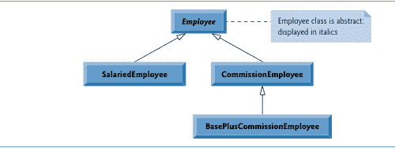

**图 13.7** | *Employee 层次结构 UML 类图。*

抽象基类 Employee 声明了该层次结构的“接口”——即程序可以对所有 Employee 对象调用的一组成员函数。每个员工，无论其薪资计算方式如何，都有名字、姓氏和社会安全号码，因此私有数据成员 firstName、lastName 和 socialSecurityNumber 出现在抽象基类 Employee 中。

> **软件工程观察 13.1.1**
>
> *派生类可以从基类继承接口和/或实现。为实现继承而设计的层次结构往往将功能放在层次结构的高层——每个新的派生类继承一个或多个在基类中定义的成员函数，并且派生类使用基类的定义。为接口继承而设计的层次结构往往将功能放在层次结构的低层——基类指定一个或多个应为层次结构中每个类定义的函数（即它们具有相同的原型），但各个派生类提供自己的函数实现。*

以下各节实现 Employee 类层次结构。前五节分别实现一个抽象类或具体类。最后一节实现一个测试程序，该程序构建所有这些类的对象并以多态方式处理这些对象。

### 13.6.1 创建抽象基类 Employee

类 Employee（图 13.9–13.10，稍后将进一步详细讨论）提供函数 earnings 和 print，以及操作 Employee 数据成员的各种 get 和 set 函数。earnings 函数当然普遍适用于所有员工，但每个薪资计算取决于员工的类。因此，我们在基类 Employee 中将 earnings 声明为纯虚函数，因为默认实现对该函数没有意义——没有足够的信息来确定 earnings 应返回多少金额。每个派生类用适当的实现重写 earnings。要计算员工的薪资，程序将员工对象的地址赋给基类 Employee 指针，然后对该对象调用 earnings 函数。我们维护一个 Employee 指针的 vector，每个指针指向一个 Employee 对象。*当然，不可能存在 Employee 对象，因为 Employee 是抽象类——然而，由于继承，Employee 的所有派生类的所有对象仍然可以被视为 Employee 对象。* 程序遍历该 vector，并为每个 Employee 对象调用函数 earnings。C++ 以多态方式处理这些函数调用。将 earnings 作为纯虚函数包含在 Employee 中，迫使每个希望成为具体类的 Employee 直接派生类重写 earnings。

类 Employee 中的函数 print 显示员工的名字、姓氏和社会安全号码。正如我们将看到的，Employee 的每个派生类都重写函数 print，以输出员工类型（例如，"salaried employee:"），随后输出员工的其余信息。派生类中的函数 print 也可以调用 earnings，即使 earnings 是基类 Employee 中的纯虚函数。

图 13.8 中的图在左侧向下显示层次结构中的四个类，并在顶部横向显示函数 earnings 和 print。对于每个类，该图显示每个函数的期望结果。类 Employee 为函数 earnings 指定“= 0”，以表示这是一个纯虚函数，因此没有实现。每个派生类重写该函数以提供适当的实现。我们不列出基类 Employee 的 get 和 set 函数，因为它们在任何派生类中都没有被重写——这些函数中的每一个都被每个派生类继承并“按原样”使用。

| 类 | earnings | print |
|---|---|---|
| Employee | = 0 | *firstName lastName*<br>社会安全号码：*SSN* |
| Salaried-Employee | *weeklySalary* | 受薪员工：*firstName lastName*<br>社会安全号码：*SSN*<br>周薪：*weeklySalary* |
| Commission-Employee | *commissionRate × grossSales* | 佣金员工：*firstName lastName*<br>社会安全号码：*SSN*<br>总销售额：*grossSales*<br>佣金率：*commissionRate* |
| BasePlus-Commission-Employee | (*commissionRate × grossSales*) + *baseSalary* | 底薪加佣金员工：*firstName lastName*<br>社会安全号码：*SSN*<br>总销售额：*grossSales*<br>佣金率：*commissionRate*<br>底薪：*baseSalary* |

**图 13.8** | Employee 层次结构类的多态接口。

### Employee 类头文件

让我们考虑类 Employee 的头文件（图 13.9）。公有成员函数包括一个构造函数，它接受名字、姓氏和社会安全号码作为参数

```cpp
// Fig. 13.10: Employee.cpp
// Abstract-base-class Employee member-function definitions.
// Note: No definitions are given for pure virtual functions.
#include <iostream>
#include "Employee.h" // Employee class definition
using namespace std;

// constructor
Employee::Employee( const string &first, const string &last,
   const string &ssn )
   : firstName( first ), lastName( last ), socialSecurityNumber( ssn )
{
   // empty body
} // end Employee constructor

// set first name
void Employee::setFirstName( const string &first )
{
   firstName = first;
} // end function setFirstName

// return first name
string Employee::getFirstName() const
{
   return firstName;
} // end function getFirstName

// set last name
void Employee::setLastName( const string &last )
{
   lastName = last;
} // end function setLastName

// return last name
string Employee::getLastName() const
{
   return lastName;
} // end function getLastName

// set social security number
void Employee::setSocialSecurityNumber( const string &ssn )
{
   socialSecurityNumber = ssn; // should validate
} // end function setSocialSecurityNumber

// return social security number
string Employee::getSocialSecurityNumber() const
{
   return socialSecurityNumber;
} // end function getSocialSecurityNumber
```

**图 13.10** | Employee 类实现文件。（第 1 部分，共 2 部分。）

```cpp
// print Employee's information (virtual, but not pure virtual)
void Employee::print() const
{
   cout << getFirstName() << ' ' << getLastName()
      << "\nSocial security number: " << getSocialSecurityNumber();
} // end function print
```

**图 13.10** | Employee 类实现文件。（第 2 部分，共 2 部分。）

虚函数 print（图 13.10，第 53–57 行）提供了一个*实现*，该实现将在每个派生类中被*重写*。然而，这些函数中的每一个都将使用抽象类的 print 版本打印 Employee 层次结构中*所有类共有的*信息。

### 13.6.2 创建具体派生类 SalariedEmployee

类 SalariedEmployee（图 13.11–13.12）派生自类 Employee（图 13.11 第 8 行）。公有成员函数包括：一个构造函数，接受名字、姓氏、社会安全号码和周薪作为参数（第 11–12 行）；一个 set 函数，用于为数据成员 weeklySalary 分配新的非负值（第 14 行）；一个 get 函数，用于返回 weeklySalary 的值（第 15 行）；一个计算 SalariedEmployee 薪资的虚函数（第 18 行）；以及一个虚函数 print（第 19 行），它输出员工类型，即 "salaried employee,"，随后输出由基类 Employee 的 print 函数和 SalariedEmployee 的 getWeeklySalary 函数生成的员工特定信息。

```cpp
// Fig. 13.11: SalariedEmployee.h
// SalariedEmployee class derived from Employee.
#ifndef SALARIED_H
#define SALARIED_H

#include "Employee.h" // Employee class definition

class SalariedEmployee : public Employee
{
public:
   SalariedEmployee( const string &, const string &,
      const string &, double = 0.0 );

   void setWeeklySalary( double ); // set weekly salary
   double getWeeklySalary() const; // return weekly salary

   // keyword virtual signals intent to override
   virtual double earnings() const; // calculate earnings
   virtual void print() const; // print SalariedEmployee object
private:
   double weeklySalary; // salary per week
}; // end class SalariedEmployee

#endif // SALARIED_H
```

**图 13.11** | SalariedEmployee 类头文件。


### SalariedEmployee 类成员函数定义

图 13.12 包含了 SalariedEmployee 的成员函数实现。该类的构造函数将名字、姓氏和社会安全号码传递给 Employee 构造函数（第 10 行），以初始化从基类继承但无法在派生类中直接访问的私有数据成员。函数 earnings（第 32–35 行）重写了 Employee 中的纯虚函数 earnings，提供了一个具体实现，返回 SalariedEmployee 的周薪。如果我们不实现 earnings，那么 SalariedEmployee 类将是抽象类，任何尝试实例化该类的对象都会导致编译错误（当然，这里我们希望 SalariedEmployee 是一个具体类）。在 SalariedEmployee 类的头文件中，我们将成员函数 earnings 和 print 声明为 virtual（图 13.11 第 18–19 行）——实际上，在这些成员函数前加上 virtual 关键字是多余的。我们在基类 Employee 中已经将它们定义为 virtual，因此它们在类层次结构中始终是虚函数。在层次结构的每一层显式声明这样的函数为 virtual 可以提高清晰度。不将 earnings 声明为纯虚函数表明我们打算在这个具体类中提供实现。

```cpp
// Fig. 13.12: SalariedEmployee.cpp
// SalariedEmployee class member-function definitions.
#include <iostream>
#include "SalariedEmployee.h" // SalariedEmployee class definition
using namespace std;

// constructor
SalariedEmployee::SalariedEmployee( const string &first,
    const string &last, const string &ssn, double salary )
    : Employee( first, last, ssn )
{
    setWeeklySalary( salary );
} // end SalariedEmployee constructor

// set salary
void SalariedEmployee::setWeeklySalary( double salary )
{
    if ( salary >= 0.0 )
        weeklySalary = salary;
    else
        throw invalid_argument( "Weekly salary must be >= 0.0" );
} // end function setWeeklySalary

// return salary
double SalariedEmployee::getWeeklySalary() const
{
    return weeklySalary;
} // end function getWeeklySalary

// calculate earnings;
// override pure virtual function earnings in Employee
double SalariedEmployee::earnings() const
{
    return getWeeklySalary();
} // end function earnings

// print SalariedEmployee's information
void SalariedEmployee::print() const
{
    cout << "salaried employee: ";
    Employee::print(); // abstract base-class print function
    cout << "weekly salary: " << getWeeklySalary();
} // end function print
```

**图 13.12** | SalariedEmployee 类实现文件。（共 2 部分，此为第 1 和 2 部分。）

SalariedEmployee 类的函数 print（图 13.12 第 38–43 行）重写了 Employee 的 print 函数。如果 SalariedEmployee 类没有重写 print，那么 SalariedEmployee 将继承 Employee 版本的 print。在这种情况下，SalariedEmployee 的 print 函数只会返回雇员的全名和社会安全号码，这不足以表示一个 SalariedEmployee。为了打印 SalariedEmployee 的完整信息，派生类的 print 函数输出“salaried employee:”，后跟通过使用作用域解析运算符（第 41 行）调用基类的 print 函数所打印的基类 Employee 特有信息（即名字、姓氏和社会安全号码）——这是一个很好的代码复用示例。如果没有作用域解析运算符，print 调用将导致无限递归。SalariedEmployee 的 print 函数产生的输出包含通过调用该类的 getWeeklySalary 函数获得的雇员周薪。

### 13.6.3 创建具体派生类 CommissionEmployee

类 CommissionEmployee（图 13.13–13.14）派生自 Employee（图 13.13 第 8 行）。其成员函数实现（图 13.14）包括一个构造函数（第 8–14 行），该构造函数接受名字、姓氏、社会安全号码、销售额和佣金率；set 函数（第 17–23 行和第 32–38 行）分别用于为数据成员 commissionRate 和 grossSales 赋值；get 函数（第 26–29 行和第 41–44 行）用于获取这些值；函数 earnings（第 47–50 行）用于计算 CommissionEmployee 的收入；函数 print（第 53–59 行）用于输出雇员类型，即“commission employee:”以及雇员特有信息。构造函数将名字、姓氏和社会安全号码传递给 Employee 构造函数（第 10 行），以初始化 Employee 的私有数据成员。函数 print 调用基类的 print 函数（第 56 行）来显示 Employee 特有的信息。

```cpp
// Fig. 13.13: CommissionEmployee.h
// CommissionEmployee class derived from Employee.
#ifndef COMMISSION_H
#define COMMISSION_H

#include "Employee.h" // Employee class definition

class CommissionEmployee : public Employee
{
public:
   CommissionEmployee( const string &, const string &,
      const string &, double = 0.0, double = 0.0 );

   void setCommissionRate( double ); // set commission rate
   double getCommissionRate() const; // return commission rate

   void setGrossSales( double ); // set gross sales amount
   double getGrossSales() const; // return gross sales amount

   // keyword virtual signals intent to override
   virtual double earnings() const; // calculate earnings
   virtual void print() const; // print CommissionEmployee object
private:
   double grossSales; // gross weekly sales
   double commissionRate; // commission percentage
}; // end class CommissionEmployee

#endif // COMMISSION_H
```

**图 13.13** | CommissionEmployee 类头文件。（共 2 部分，此为第 1 和 2 部分。）

```cpp
// Fig. 13.14: CommissionEmployee.cpp
// CommissionEmployee class member-function definitions.
#include <iostream>
#include "CommissionEmployee.h" // CommissionEmployee class definition
using namespace std;

// constructor
CommissionEmployee::CommissionEmployee( const string &first,
   const string &last, const string &ssn, double sales, double rate )
   : Employee( first, last, ssn )
{
   setGrossSales( sales );
   setCommissionRate( rate );
} // end CommissionEmployee constructor

// set gross sales amount
void CommissionEmployee::setGrossSales( double sales )
{
   if ( sales >= 0.0 )
      grossSales = sales;
   else
      throw invalid_argument( "Gross sales must be >= 0.0" );
} // end function setGrossSales

// return gross sales amount
double CommissionEmployee::getGrossSales() const
{
   return grossSales;
} // end function getGrossSales

// set commission rate
void CommissionEmployee::setCommissionRate( double rate )
{
   if ( rate > 0.0 && rate < 1.0 )
      commissionRate = rate;
   else
      throw invalid_argument( "Commission rate must be > 0.0 and < 1.0" );
} // end function setCommissionRate

// return commission rate
double CommissionEmployee::getCommissionRate() const
{
   return commissionRate;
} // end function getCommissionRate

// calculate earnings; override pure virtual function earnings in Employee
double CommissionEmployee::earnings() const
{
   return getCommissionRate() * getGrossSales();
} // end function earnings

// print CommissionEmployee's information
void CommissionEmployee::print() const
{
   cout << "commission employee: ";
   Employee::print(); // code reuse
   cout << "\ngross sales: " << getGrossSales()
        << "\ncommission rate: " << getCommissionRate();
} // end function print
```

**图 13.14** | CommissionEmployee 类实现文件。（共 2 部分，此为第 1 和 2 部分。）

### 13.6.4 创建间接具体派生类 BasePlusCommissionEmployee

类 BasePlusCommissionEmployee（图 13.15–13.16）直接继承自类 CommissionEmployee（图 13.15 第 8 行），因此是 Employee 的间接派生类。BasePlusCommissionEmployee 类的成员函数实现包括一个构造函数（图 13.16 第 8–14 行），该构造函数接受名字、姓氏、社会安全号码、销售额、佣金率和基本工资作为参数。然后它将名字、姓氏、社会安全号码、销售额和佣金率传递给 CommissionEmployee 构造函数（第 11 行），以初始化继承的成员。BasePlusCommissionEmployee 还包含一个 set 函数（第 17–23 行）用于为数据成员 baseSalary 赋值，以及一个 get 函数（第 26–29 行）用于返回 baseSalary 的值。函数 earnings（第 33–36 行）计算 BasePlusCommissionEmployee 的收入。函数 earnings 中的第 35 行调用基类 CommissionEmployee 的 earnings 函数来计算雇员收入中基于佣金的部分。这是另一个很好的代码复用示例。BasePlusCommissionEmployee 的 print 函数（第 39–44 行）输出“base-salaried”，后接基类 CommissionEmployee 的


print 函数（代码复用的另一个示例），然后是基本工资。生成的输出以 “base-salaried commission employee: ” 开头，后面是 BasePlusCommissionEmployee 的其余信息。回想一下，CommissionEmployee 的 print 通过调用其基类（即 Employee）的 print 函数来显示员工的名字、姓氏和社会保障号——这又是一个代码复用的示例。BasePlusCommissionEmployee 的 print 会发起一条函数调用链，该调用链跨越 Employee 层次结构的所有三个层级。

```cpp
// Fig. 13.15: BasePlusCommissionEmployee.h
// BasePlusCommissionEmployee class derived from CommissionEmployee.
#ifndef BASEPLUS_H
#define BASEPLUS_H

#include "CommissionEmployee.h" // CommissionEmployee class definition

class BasePlusCommissionEmployee : public CommissionEmployee
{
public:
   BasePlusCommissionEmployee( const string &, const string &,
      const string &, double = 0.0, double = 0.0 );

   void setBaseSalary( double ); // set base salary
   double getBaseSalary() const; // return base salary

   // keyword virtual signals intent to override
   virtual double earnings() const; // calculate earnings
   virtual void print() const; // print BasePlusCommissionEmployee object
private:
   double baseSalary; // base salary per week
}; // end class BasePlusCommissionEmployee

#endif // BASEPLUS_H
```

**图 13.15** | BasePlusCommissionEmployee 类头文件。

```cpp
// Fig. 13.16: BasePlusCommissionEmployee.cpp
// BasePlusCommissionEmployee member-function definitions.
#include <iostream>
#include "BasePlusCommissionEmployee.h"
using namespace std;

// constructor
BasePlusCommissionEmployee::BasePlusCommissionEmployee(
   const string &first, const string &last, const string &ssn,
   double sales, double rate, double salary )
   : CommissionEmployee( first, last, ssn, sales, rate )
{
   setBaseSalary( salary ); // validate and store base salary
} // end BasePlusCommissionEmployee constructor
```

**图 13.16** | BasePlusCommissionEmployee 类实现文件。（第 1 部分，共 2 部分。）

```cpp
// set base salary
void BasePlusCommissionEmployee::setBaseSalary( double salary )
{
   if ( salary >= 0.0 )
      baseSalary = salary;
   else
      throw invalid_argument( "Salary must be >= 0.0" );
} // end function setBaseSalary

// return base salary
double BasePlusCommissionEmployee::getBaseSalary() const
{
   return baseSalary;
} // end function getBaseSalary

// calculate earnings;
// override virtual function earnings in CommissionEmployee
double BasePlusCommissionEmployee::earnings() const
{
   return getBaseSalary() + CommissionEmployee::earnings();
} // end function earnings

// print BasePlusCommissionEmployee's information
void BasePlusCommissionEmployee::print() const
{
   cout << "base-salaried ";
   CommissionEmployee::print(); // code reuse
   cout << "; base salary: " << getBaseSalary();
} // end function print
```

**图 13.16** | BasePlusCommissionEmployee 类实现文件。（第 2 部分，共 2 部分。）

### 13.6.5 演示多态处理

为了测试 Employee 层次结构，图 13.17 中的程序分别创建三个具体类 SalariedEmployee、CommissionEmployee 和 BasePlusCommissionEmployee 的对象。该程序先使用静态绑定，然后使用 Employee 指针的 vector 以多态方式操作这些对象。第 32–37 行创建三个具体 Employee 派生类各自的对象。第 32–38 行输出每个 Employee 的信息和收入。第 32–37 行中的每次成员函数调用都是静态绑定的示例——在编译时，因为我们使用的是名称句柄（而不是可在执行时设置的指针或引用），编译器可以识别每个对象的类型，以确定调用的是哪个 print 和 earnings 函数。

```cpp
// Fig. 13.17: fig13_17.cpp
// Processing Employee derived-class objects individually
// and polymorphically using dynamic binding.
#include <iostream>
#include <iomanip>
#include <vector>
```

**图 13.17** | Employee 类层次结构驱动程序。（第 1 部分，共 4 部分。）

```cpp
#include "Employee.h"
#include "SalariedEmployee.h"
#include "CommissionEmployee.h"
#include "BasePlusCommissionEmployee.h"
using namespace std;

void virtualViaPointer( const Employee * const ); // prototype
void virtualViaReference( const Employee & ); // prototype

int main()
{
   // set floating-point output formatting
   cout << fixed << setprecision( 2 );

   // create derived-class objects
   SalariedEmployee salariedEmployee(
      "John", "Smith", "111-11-1111", 800 );
   CommissionEmployee commissionEmployee(
      "Sue", "Jones", "333-33-3333", 10000, .06 );
   BasePlusCommissionEmployee basePlusCommissionEmployee(
      "Bob", "Lewis", "444-44-4444", 5000, .04, 300 );

   cout << "Employees processed individually using static binding:\n\n";

   // output each Employee’s information and earnings using static binding
   salariedEmployee.print();
   cout << "\nearned $" << salariedEmployee.earnings() << "\n\n";
   commissionEmployee.print();
   cout << "\nearned $" << commissionEmployee.earnings() << "\n\n";
   basePlusCommissionEmployee.print();
   cout << "\nearned $" << basePlusCommissionEmployee.earnings()
      << "\n\n";

   // create vector of three base-class pointers
   vector < Employee * > employees( 3 );

   // initialize vector with Employees
   employees[ 0 ] = &salariedEmployee;
   employees[ 1 ] = &commissionEmployee;
   employees[ 2 ] = &basePlusCommissionEmployee;

   cout << "Employees processed polymorphically via dynamic binding:\n\n";

   // call virtualViaPointer to print each Employee's information
   // and earnings using dynamic binding
   cout << "Virtual function calls made off base-class pointers:\n\n";

   for ( size_t i = 0; i < employees.size(); ++i )
      virtualViaPointer( employees[ i ] );

   // call virtualViaReference to print each Employee's information
   // and earnings using dynamic binding
   cout << "Virtual function calls made off base-class references:\n\n";
```

**图 13.17** | Employee 类层次结构驱动程序。（第 2 部分，共 4 部分。）

```cpp
   for ( size_t i = 0; i < employees.size(); ++i )
      virtualViaReference( *employees[ i ] ); // note dereferencing
// end main
```

```cpp
// call Employee virtual functions print and earnings off a
// base-class pointer using dynamic binding
void virtualViaPointer( const Employee * const baseClassPtr )
{
   baseClassPtr->print();
   cout << "\nearned $" << baseClassPtr->earnings() << "\n\n";
} // end function virtualViaPointer
```

```cpp
// call Employee virtual functions print and earnings off a
// base-class reference using dynamic binding
void virtualViaReference( const Employee &baseClassRef )
{
   baseClassRef.print();
   cout << "\nearned $" << baseClassRef.earnings() << "\n\n";
} // end function virtualViaReference
```

```text
Employees processed individually using static binding:

salaried employee: John Smith
social security number: 111-11-1111
weekly salary: 800.00
earned $800.00

commission employee: Sue Jones
social security number: 333-33-3333
gross sales: 10000.00; commission rate: 0.06
earned $600.00

base-salaried commission employee: Bob Lewis
social security number: 444-44-4444
gross sales: 5000.00; commission rate: 0.04; base salary: 300.00
earned $500.00

Employees processed polymorphically using dynamic binding:

Virtual function calls made off base-class pointers:

salaried employee: John Smith
social security number: 111-11-1111
weekly salary: 800.00
earned $800.00

commission employee: Sue Jones
social security number: 333-33-3333
gross sales: 10000.00; commission rate: 0.06
earned $600.00

base-salaried commission employee: Bob Lewis
social security number: 444-44-4444
gross sales: 5000.00; commission rate: 0.04; base salary: 300.00
earned $500.00
```

**图 13.17** | Employee 类层次结构驱动程序。（第 3 部分，共 4 部分）


```
Virtual function calls made off base-class references:

salaried employee: John Smith
social security number: 111-11-1111
weekly salary: 800.00
earned $800.00

commission employee: Sue Jones
social security number: 333-33-3333
gross sales: 10000.00; commission rate: 0.06
earned $600.00

base-salaried commission employee: Bob Lewis
social security number: 444-44-4444
gross sales: 5000.00; commission rate: 0.04; base salary: 300.00
earned $500.00
```

图 13.17 | Employee 类层次结构驱动程序。（第 4 部分，共 4 部分。）

第 41 行分配了 vector employees，它包含三个 Employee 指针。第 44 行让 employees[0] 指向对象 salariedEmployee。第 45 行让 employees[1] 指向对象 commissionEmployee。第 46 行让 employees[2] 指向对象 basePlusCommissionEmployee。编译器允许这些赋值，因为 SalariedEmployee 是一种 Employee，CommissionEmployee 是一种 Employee，BasePlusCommissionEmployee 也是一种 Employee。因此，即使 Employee 是抽象类，我们也可以将 SalariedEmployee、CommissionEmployee 和 BasePlusCommissionEmployee 对象的地址赋给基类 Employee 指针。

第 54–55 行的循环遍历 vector employees，并对 employees 中的每个元素调用函数 virtualViaPointer（第 67–71 行）。函数 virtualViaPointer 在参数 baseClassPtr 中接收存储在某个 employees 元素中的地址。每次调用 virtualViaPointer 都使用 baseClassPtr 调用虚函数 print（第 69 行）和 earnings（第 70 行）。函数 virtualViaPointer 不包含任何 SalariedEmployee、CommissionEmployee 或 BasePlusCommissionEmployee 类型信息。该函数只知道基类类型 Employee。因此，编译器无法知道要通过 baseClassPtr 调用哪个具体类的函数。然而在执行时，每次虚函数调用都会调用 baseClassPtr 当时所指向对象上的函数。输出表明，确实调用了每个类相应的函数，并且显示了每个对象的正确信息。例如，SalariedEmployee 显示周薪，CommissionEmployee 和 BasePlusCommissionEmployee 显示总销售额。此外，在第 70 行以多态方式获取每个 Employee 的 earnings，与在第 33、35 和 37 行通过静态绑定获取这些员工的 earnings 产生相同的结果。所有对 print 和 earnings 的虚函数调用都在运行时通过动态绑定解析。

最后，另一个 for 语句（第 61–62 行）遍历 employees，并对 vector 中的每个元素调用函数 virtualViaReference（第 75–79 行）。函数 virtualViaReference 在其参数 baseClassRef（类型为 const Employee &）中接收一个引用，该引用指向通过解引用每个 employees 元素中存储的指针而获得的对象（第 62 行）。每次调用 virtualViaReference 都通过引用 baseClassRef 调用虚函数 print（第 77 行）和 earnings（第 78 行），以证明多态*处理也会通过基类引用发生。* 每次虚函数调用都会在运行时调用 `baseClassRef` 所引用的对象上的函数。这是*动态绑定*的另一个例子。使用基类引用产生的输出与使用基类指针产生的输出完全相同。

## 13.7（可选）多态、虚函数与动态绑定（“底层揭秘”）

C++ 使多态易于编程。当然，在 C 等非面向对象语言中也可以为多态编程，但这样做需要复杂且可能危险的指针操作。本节讨论 C++ 如何在内部实现多态、虚函数和动态绑定。这将使你扎实地理解这些能力实际上如何工作。更重要的是，它将帮助你认识多态的开销——就额外的内存消耗和处理器时间而言。这将帮助你确定何时使用多态、何时避免使用它。正如你将在第 22 章看到的，STL 组件是在*没有*多态和虚函数的情况下实现的——这样做是为了避免相关的执行时开销，并达到最佳性能，以满足 STL 的独特需求。

首先，我们将解释编译器在*编译时*构建的数据结构，以在执行时支持多态。你将看到，多态是通过三级指针实现的，即*三重间接寻址*。然后，我们将展示正在执行的程序如何使用这些数据结构来执行虚函数，并实现与多态相关的动态绑定。我们的讨论解释了一种可能的实现；这并不是语言要求。

当 C++ 编译一个具有一个或多个虚函数的类时，它会为该类构建一个[虚函数表 (vtable)](#)。正在执行的程序使用 `vtable` 在该类的某个虚函数每次被调用时选择正确的函数实现。图 13.18 最左列展示了类 Employee、SalariedEmployee、CommissionEmployee 和 BasePlusCommissionEmployee 的 `vtables`。

### Employee 类 vtable

在类 Employee 的 `vtable` 中，第一个函数指针被设为 0（即空指针）。这样做是因为函数 earnings 是纯虚函数，因此*缺少实现*。第二个函数指针指向函数 print，它显示员工的全名和社会安全号码。[*注意：* 为节省篇幅，我们缩写了本图中每个 print 函数的输出。] 任何在其 `vtable` 中有一个或多个空指针的类都是*抽象*类。没有任何空 `vtable` 指针的类（如 SalariedEmployee、CommissionEmployee 和 BasePlusCommissionEmployee）是*具体*类。

### SalariedEmployee 类 vtable

类 SalariedEmployee 重写函数 earnings，以返回员工的周薪，因此该函数指针指向类 SalariedEmployee 的 earnings 函数。SalariedEmployee 还重写 print，因此相应的函数指针指向 SalariedEmployee 成员函数，该函数打印 "salaried employee: "，后跟员工姓名、社会安全号码和周薪。

为了调整 BasePlusCommissionEmployee 的基本工资，我们必须在执行时确定每个 Employee 对象的具体类型，然后采取适当的操作。本节演示 **运行时类型信息 (RTTI)** 和 **动态转换** 的强大能力，它们使程序能够在执行时确定对象的类型，并据此对该对象进行操作。

> 注意：某些编译器要求先启用 RTTI，然后才能在程序中使用它。在 Visual C++ 2010 中，此选项默认启用。

图 13.19 使用第 13.6 节开发的 Employee 层次结构，并将每个 BasePlusCommissionEmployee 的基本工资增加 10%。第 21 行声明了包含三个元素的 vector employees，它存储指向 Employee 对象的指针。第 24–29 行用类 SalariedEmployee（图 13.13–13.14）、CommissionEmployee（图 13.13–13.14）和 BasePlusCommissionEmployee（图 13.15–13.16）的动态分配对象的地址填充该 vector。

```cpp
// Fig. 13.19: fig13_19.cpp
// Demonstrating downcasting and runtime type information.
// NOTE: You may need to enable RTTI on your compiler
// before you can execute this application.
#include <iostream>
#include <iomanip>
#include <vector>
#include <typeinfo>
#include "Employee.h"
#include "SalariedEmployee.h"
#include "CommissionEmployee.h"
#include "BasePlusCommissionEmployee.h"
using namespace std;

int main()
{
   // set floating-point output formatting
   cout << fixed << setprecision( 2 );

   // create vector of three base-class pointers
   vector < Employee * > employees( 3 );

   // initialize vector with various kinds of Employees
   employees[ 0 ] = new SalariedEmployee(
      "John", "Smith", "111-11-1111", 800 );
   employees[ 1 ] = new CommissionEmployee(
      "Sue", "Jones", "333-33-3333", 1000, .06 );
   employees[ 2 ] = new BasePlusCommissionEmployee(
      "Bob", "Lewis", "444-44-4444", 5000, .04, 300 );

   // polymorphically process each element in vector employees
   for ( size_t i = 0; i < employees.size(); ++i )
   {
      employees[ i ]->print(); // output employee information
      cout << endl;
   }
}
```

**图 13.19** | 演示向下转型和运行时类型信息。（第 1 部分，共 2 部分。）


`commissionPtr` 不为 0（即，如果转换可以执行），我们*不能*尝试在基类 `Employee` 指针上调用派生类 `BasePlusCommissionEmployee` 的函数 `getBaseSalary` 和 `setBaseSalary`。回想一下，使用基类 `Employee` 指针时，我们只能调用基类 `Employee` 中存在的函数——`earnings`、`print` 以及 `Employee` 的 *get* 和 *set* 函数。

## 13.9 虚析构函数

当使用多态处理类层次结构中动态分配的对象时，可能会出现问题。到目前为止，你已经见过**非虚析构函数**——即未使用关键字 `virtual` 声明的析构函数。如果一个带有非虚析构函数的派生类对象，通过将 `delete` 运算符应用于指向该对象的基类指针而被显式销毁，则 C++ 标准规定该行为是*未定义*的。

这个问题的简单解决方案是在基类中创建一个**虚析构函数**（即使用关键字 `virtual` 声明的析构函数）。这使得所有派生类的析构函数都成为虚函数，*即使它们与基类析构函数名称不同*。现在，如果通过将 `delete` 运算符应用于基类指针来显式销毁层次结构中的对象，则会根据基类指针所指向的对象调用相应类的析构函数。记住，当销毁派生类对象时，派生类对象的基类部分也会被销毁，因此派生类和基类的析构函数都执行很重要。基类析构函数会在派生类析构函数之后自动执行。

> **错误预防提示 13.2**
>
> *如果一个类有虚函数，就应提供虚析构函数，即使该类并不需要虚析构函数。这确保当通过基类指针删除派生类对象时，会调用自定义的派生类析构函数（如果存在）。*


> **常见编程错误 13.2**
>
> 构造函数不能是虚函数。将构造函数声明为虚函数是编译错误。


## 13.10 小结

在本章中，我们讨论了多态，它使我们能够“面向一般编程”而不是“面向特定编程”，并展示了这如何使程序更具可扩展性。我们从一个示例开始，说明多态如何让屏幕管理器显示多个“太空”对象。然后我们演示了基类指针和派生类指针如何分别指向基类对象和派生类对象。我们说，让基类指针指向基类对象是自然的，让派生类指针指向派生类对象也是自然的。让基类指针指向派生类对象同样自然，因为派生类对象*是*其基类的一个对象。你了解了为什么让派生类指针指向基类对象是危险的，以及为什么编译器不允许这种赋值。我们介绍了虚函数，它使得当通过基类指针或引用（在执行时）引用继承层次结构中不同层次的对象时，能够调用正确的函数。这称为动态绑定或晚绑定。然后我们讨论了纯虚函数和抽象类（包含一个或多个纯虚函数的类）。你了解到抽象类不能用于实例化对象，而具体类可以。然后我们演示了在继承层次结构中使用抽象类。你了解了多态如何通过编译器创建的 vtable“在底层”工作。我们使用运行时类型信息（RTTI）和动态转换来确定执行时对象的类型，并据此对该对象进行操作。本章最后讨论了虚析构函数，以及它们如何确保当通过基类指针或引用删除派生类对象时，继承层次结构中所有适当的析构函数都会在该对象上运行。

在下一章中，我们将讨论模板，这是 C++ 的一项高级特性，使你能够用单个代码段定义一组相关的类或函数。

## 总结

### 13.1 节 引言

- 多态（第 535 页）使我们能够“面向一般编程”而不是“面向特定编程”。
- 多态使我们能够编写处理同一类层次结构中各对象所属类的程序，就像它们都是该层次结构基类的对象一样。
- 借助多态，我们可以设计和实现易于扩展的系统——添加新类时，只需对程序的通用部分做很少或不做修改。程序中唯一必须修改以适应新类的部分，是那些需要直接了解你添加到层次结构中的新类的部分。

### 13.2 节 多态简介：多态视频游戏

- 借助多态，一个函数可以根据调用它的对象类型产生不同的动作。
- 这使得设计和实现更可扩展的系统成为可能。可以编写程序来处理程序开发时可能还不存在的类型的对象。

### 13.3 节 继承层次结构中对象之间的关系

- C++ 支持多态——通过继承相关联的不同类的对象能够对同一成员函数调用作出不同响应。
- 多态通过虚函数（第 543 页）和动态绑定（第 544 页）实现。
- 当使用基类指针或引用调用虚函数时，C++ 会在与该对象关联的相应派生类中选择正确的重写函数。
- 如果通过按名称引用特定对象并使用点成员选择运算符来调用虚函数，则该引用在编译时解析（这称为静态绑定；第 544 页）；所调用的虚函数是为该特定对象所属类定义的函数。
- 派生类可以在必要时提供基类虚函数自己的实现，但如果它们不提供，则使用基类的实现。

### 13.4 节 类型字段和 switch 语句

- 使用虚函数进行多态编程可以消除对 switch 逻辑的需要。你可以使用虚函数机制自动执行等效逻辑，从而避免通常与 switch 逻辑相关的各类错误。

### 13.5 节 抽象类和纯虚函数

- 抽象类（第 550 页）通常用作基类，因此我们称它们为抽象基类（第 550 页）。不能实例化抽象类的任何对象。
- 可以从中实例化对象的类称为具体类（第 550 页）。
- 通过在声明中使用纯说明符（= 0）声明一个或多个纯虚函数（第 551 页）来创建抽象类。
- 如果一个类派生自带有纯虚函数的类，并且该派生类没有为该纯虚函数提供定义，那么该虚函数在派生类中仍然是纯虚函数。因此，该派生类也是抽象类。
- 虽然我们不能实例化抽象基类的对象，但可以声明指向抽象基类对象的指针和引用。此类指针和引用可用于对从具体派生类实例化的派生类对象进行多态操作。

### 13.7 节 （可选）多态、虚函数和动态绑定“在底层”

- 动态绑定要求在运行时将虚成员函数调用路由到适合该类的虚函数版本。称为 vtable（第 567 页）的虚函数表实现为一个包含函数指针的数组。每个有虚函数的类都有一个 vtable。对于类中的每个虚函数，vtable 都有一个条目，其中包含指向该类的对象要使用的虚函数版本的函数指针。特定类要使用的虚函数可以是该类中定义的函数，也可以是从层次结构中更高层的基类直接或间接继承的函数。
- 当基类提供虚成员函数时，派生类可以重写该虚函数，但不是必须重写。
- 有虚函数的类的每个对象都包含一个指向该类的 vtable 的指针。当从指向派生类对象的基类指针进行函数调用时，会获取 vtable 中相应的函数指针并解引用，以在执行时完成调用。
- 任何 vtable 中有一个或多个 0 指针的类都是抽象类。没有任何 0 vtable 指针的类是具体类。
- 新的类类型会定期添加到系统中，并由动态绑定加以适应。

### 13.8 节 案例研究：使用多态和运行时类型信息以及向下转换、dynamic_cast、typeid 和 type_info 的工资系统

- 运算符 dynamic_cast（第 571 页）检查指针所指向对象的类型，然后确定该类型与指针要转换到的类型之间是否具有 is-a 关系。如果是，dynamic_cast 返回该对象的地址。如果不是，dynamic_cast 返回 0。
- 运算符 typeid（第 573 页）返回对 type_info 对象（第 573 页）的引用，该对象包含有关操作数类型的信息，包括类型名称。要使用 typeid，程序必须包含头文件 `<typeinfo>`（第 573 页）。
- 调用时，type_info 的成员函数 name（第 573 页）返回一个基于指针的字符串，其中包含该 type_info 对象所表示类型的名称。
- 运算符 dynamic_cast 和 typeid 是 C++ 运行时类型信息（RTTI；第 571 页）特性的一部分，该特性允许程序在运行时确定对象的类型。

### 13.9 节 虚析构函数

- 如果类包含虚函数，则将基类析构函数声明为虚函数（第 574 页）。这会使所有派生类析构函数都成为虚函数，即使它们与基类析构函数名称不同。


基类析构函数。如果层次结构中的某个对象通过将 `delete` 运算符应用于派生类对象而被显式销毁，则会调用相应类的析构函数。派生类析构函数运行后，该类的所有基类的析构函数会沿着层次结构一路向上运行。

## 自测练习

- **13.1** 填空完成下列各句：
  - a) 将基类对象当作______可能引发错误。
  - b) 多态有助于消除______逻辑。
  - c) 如果一个类至少包含一个纯虚函数，那么它是______类。
  - d) 可以从中实例化对象的类称为______类。
  - e) 运算符______可用于安全地向下转换基类指针。
  - f) 运算符 `typeid` 返回对______对象的引用。
  - g) ______涉及使用基类指针或引用来调用基类对象和派生类对象上的虚函数。
  - h) 可覆盖函数使用关键字______声明。
  - i) 将基类指针转换为派生类指针称为______。

- **13.2** 判断下列说法是*真*还是*假*。若为假，请解释原因。
  - a) 抽象基类中的所有虚函数都必须声明为纯虚函数。
  - b) 使用基类句柄引用派生类对象是危险的。
  - c) 通过将类声明为 virtual 可使类成为抽象类。
  - d) 如果基类声明了纯虚函数，派生类必须实现该函数才能成为具体类。
  - e) 多态编程可以消除对 switch 逻辑的需要。

## 自测练习答案

- **13.1** a) 派生类对象。b) switch。c) 抽象。d) 具体。e) `dynamic_cast`。f) `type_info`。g) 多态。h) virtual。i) 向下转换。

- **13.2** a) 假。抽象基类可以包含带有实现的虚函数。b) 假。使用派生类句柄引用基类对象是危险的。c) 假。类永远不会被声明为 virtual。相反，类通过包含至少一个纯虚函数而成为抽象类。d) 真。e) 真。

## 练习

- **13.3** *（通用编程）* 多态如何使你能够“进行通用编程”而不是“进行特定编程”？讨论“通用编程”的关键优势。

- **13.4** *（多态与 switch 逻辑）* 讨论使用 switch 逻辑编程的问题。解释为什么多态可以成为使用 switch 逻辑的有效替代方案。

- **13.5** *（继承接口与继承实现）* 区分继承接口和继承实现。为继承接口而设计的继承层次结构与为继承实现而设计的继承层次结构有何不同？

- **13.6** *（虚函数）* 什么是虚函数？描述适合使用虚函数的一种情形。

- **13.7** *（动态绑定与静态绑定）* 区分静态绑定和动态绑定。解释虚函数和 *vtable* 在动态绑定中的使用。

- **13.8** *（虚函数）* 区分虚函数和纯虚函数。

- **13.9** *（抽象基类）* 为本章讨论并在图12.3中展示的 Shape 层次结构建议一个或多个抽象基类层次。（第一层是 Shape，第二层由 TwoDimensionalShape 和 ThreeDimensionalShape 类组成。）

- **13.10** *（多态与可扩展性）* 多态如何促进可扩展性？

- **13.11** *（多态应用）* 你被要求开发一个具有复杂图形输出的飞行模拟器。解释为什么多态编程对于这类问题可能特别有效。

- **13.12** *（工资单系统修改）* 修改图13.9–13.17中的工资单系统，在 Employee 类中包含私有数据成员 birthDate。使用图11.6–11.7中的 Date 类表示员工的生日。假设工资单每月处理一次。创建一个 Employee 指针的 vector 来存储各种员工对象。在循环中（以多态方式）计算每个 Employee 的工资，如果当前月份是 Employee 生日所在月份，则在该人的工资总额中增加 100.00 美元奖金。

- **13.13** *（形状层次结构）* 实现练习12.7中设计的 Shape 层次结构（该层次结构基于图12.3中的层次结构）。每个 TwoDimensionalShape 应包含函数 getArea 以计算二维形状的面积。每个 ThreeDimensionalShape 应具有成员函数 getArea 和 getVolume，分别计算三维形状的表面积和体积。创建一个程序，使用 Shape 指针的 vector 指向该层次结构中每个具体类的对象。程序应打印每个 vector 元素所指向的对象。此外，在处理 vector 中所有形状的循环中，确定每个形状是 TwoDimensionalShape 还是 ThreeDimensionalShape。如果形状是 TwoDimensionalShape，则显示其面积。如果形状是 ThreeDimensionalShape，则显示其面积和体积。

- **13.14** *（项目：使用形状层次结构的多态屏幕管理器）* 开发一个基本图形包。使用练习13.13中实现的 Shape 层次结构。只使用二维形状，如正方形、矩形、三角形和圆形。与用户交互。让用户指定绘制每个形状时要使用的位置、大小、形状和填充字符。用户可以指定多个相同形状。创建每个形状时，将指向每个新 Shape 对象的 Shape * 指针放入数组中。现在每个形状类都应具有自己的 draw 成员函数。编写一个多态屏幕管理器，遍历该数组，向数组中的每个对象发送 draw 消息以形成屏幕图像。每次用户指定一个额外形状时，重新绘制屏幕图像。

- **13.15** *（Package 继承层次结构）* 使用练习12.9中创建的 Package 继承层次结构创建一个程序，显示地址信息并计算若干 Package 的运费。该程序应包含一个 Package 指针的 vector，指向 TwoDayPackage 和 OvernightPackage 类的对象。循环遍历该 vector，以多态方式处理 Package。对于每个 Package，调用 get 函数获取寄件人和收件人的地址信息，然后按邮件标签上的显示方式打印这两个地址。同时，调用每个 Package 的 calculateCost 成员函数并打印结果。跟踪 vector 中所有 Package 的总运费，并在循环终止时显示该总计。

- **13.16** *（使用 Account 层次结构的多态银行程序）* 使用练习12.10中创建的 Account 层次结构开发一个多态银行程序。创建一个 Account 指针的 vector，指向 SavingsAccount 和 CheckingAccount 对象。对于 vector 中的每个 Account，允许用户使用成员函数 debit 指定要从该 Account 取出的金额，并使用成员函数 credit 指定要存入该 Account 的金额。处理每个 Account 时，确定其类型。如果 Account 是 SavingsAccount，则使用成员函数 calculateInterest 计算应支付给该 Account 的利息金额，然后使用成员函数 credit 将利息加到账户余额中。处理完一个 Account 后，通过调用基类成员函数 getBalance 打印更新后的账户余额。

- **13.17** *（工资单系统修改）* 修改图13.9–13.17中的工资单系统，增加额外的 Employee 子类 PieceWorker 和 HourlyWorker。计件工表示其薪酬基于生产的商品件数的员工。小时工表示其薪酬基于小时工资和工作小时数的员工。小时工对超过40小时的所有工作时间获得加班工资（小时工资的1.5倍）。PieceWorker 类应包含私有实例变量 wage（存储员工每件工资）和 pieces（存储生产的件数）。HourlyWorker 类应包含私有实例变量 wage（存储员工每小时工资）和 hours（存储工作小时数）。在 PieceWorker 类中，提供方法 earnings 的具体实现，通过将生产件数乘以每件工资来计算员工收入。在 HourlyWorker 类中，提供方法 earnings 的具体实现，通过将工作小时数乘以每小时工资来计算员工收入。如果工作小时数超过40，确保向 HourlyWorker 支付加班工资。在 main 中，将指向每个新类对象的指针添加到 Employee 指针的 vector 中。对于每个 Employee，显示其字符串表示和收入。

## 产生影响

- **13.18** *（CarbonFootprint 抽象类：多态）* 使用仅含纯虚函数的抽象类，可以为可能互不相关的类指定相似的行为。世界各地的政府和公司越来越关注碳足迹（建筑物燃烧各种燃料供热、车辆燃烧燃料提供动力等每年向大气排放的二氧化碳）。许多科学家将这些温室气体归咎于全球变暖现象。创建三个彼此没有继承关系的小类——Building、Car 和 Bicycle。为每个类提供一些它与其他类不共有的独特且合适的属性和行为。编写一个抽象类 CarbonFootprint，其中只有一个纯虚方法 getCarbonFootprint。让每个类都继承该抽象类，并实现 getCarbonFootprint 方法，以计算该类的适当碳足迹（查看一些解释如何计算碳足迹的网站）。编写一个应用程序，创建这三个类的对象，将指向这些对象的指针放入 CarbonFootprint 指针的 vector 中，然后遍历该 vector，以多态方式调用每个对象的 getCarbonFootprint 方法。对于每个对象，打印一些标识信息和该对象的碳足迹。


- 14.1 引言
- 14.2 函数模板
- 14.3 函数模板的重载
- 14.4 类模板
- 14.5 类模板的非类型参数和默认类型
- 14.6 小结

小结 | 自测练习 | 自测练习答案 | 练习题

## 14.1 引言

在本章中，我们讨论 C++ 中更强大的软件复用特性之一，即**模板**。**函数模板**和**类模板**使您能够用单一代码段指定一整系列相关的（重载）函数——称为*函数模板特化*——或一整系列相关的类——称为*类模板特化*。这种技术称为*泛型编程*。

我们可以为数组排序函数编写一个函数模板，然后让 C++ 生成独立的函数模板特化，分别对 int 数组、float 数组、string 数组等进行排序。我们在第6章中介绍了函数模板。本章将给出额外的讨论和示例。

我们可以为栈类编写一个类模板，然后让 C++ 生成独立的类模板特化，例如 int 栈类、float 栈类、string 栈类等等。

注意模板和模板特化之间的区别：函数模板和类模板类似于我们从中描摹形状的模板；函数模板特化和类模板特化则类似于独立的描摹结果，它们都具有相同的形状，但例如可以用不同颜色绘制。

本章中，我们介绍一个函数模板和一个类模板。本章只是模板的入门。第22章“标准模板库（STL）”将详细介绍 STL 的模板容器类、迭代器和算法。第22章包含数十个完整的基于模板的示例，演示了比此处更复杂的模板编程技术。

> **软件工程观察 14.1**
>
> 大多数 C++ 编译器要求模板的完整定义出现在使用该模板的客户端源代码文件中。为此以及为了可复用性，模板通常定义在头文件中，然后通过 `#include` 包含到相应的客户端源代码文件中。对于类模板，这意味着成员函数也定义在头文件中。


## 14.2 函数模板

重载函数通常对不同类型的数据执行相似或相同的操作。如果对每种类型的操作完全相同，则可以使用函数模板更简洁、更方便地表达。最初，您编写一个函数模板定义，基于显式提供或从函数调用推断出的参数类型，编译器生成独立的源代码函数（即*函数模板特化*）来适当地处理每个函数调用。在 C 语言中，可以使用预处理器指令 `#define` 创建的宏来执行此任务（参见附录 E“预处理器”）。然而，宏可能产生严重的副作用，并且无法使编译器执行类型检查。

**错误预防提示 14.1**

> 函数模板与宏一样，实现软件复用。与宏不同，函数模板通过完整的 C++ 类型检查的审视，帮助消除许多类型的错误。


所有函数模板定义都以关键字 `template` 开头，后跟用尖括号（`<` 和 `>`）括起来的函数模板参数列表；每个表示类型的模板参数必须由可互换的关键字 `class` 或 `typename` 之一修饰，如

```cpp
template< typename T >
```

或

```cpp
template< class ElementType >
```

或

```cpp
template< typename BorderType, typename FillType >
```

函数模板定义的类型模板参数用于指定函数参数的类型、指定函数的返回类型以及在函数内声明变量。函数定义随后出现，看起来与任何其他函数定义一样。用于指定函数模板参数的关键字 `typename` 和 `class` 实际上表示“任何基本类型或用户定义类型”。

**常见编程错误 14.1**

> 未在函数模板的每个类型模板参数前放置关键字 `class` 或关键字 `typename` 是语法错误。


### 示例：函数模板 `printArray`

让我们检查图 14.1 中的函数模板 `printArray`（第 7–14 行）。函数模板 `printArray` 在第 7 行声明了一个模板参数 T（T 可以是任何有效标识符），用于表示要由函数 `printArray` 打印的数组的类型；T 称为类型模板参数或类型参数。您将在 14.5 节中看到非类型模板参数。

```cpp
// Fig. 14.1: fig14_01.cpp
// Using function-template specializations.
#include <iostream>
using namespace std;

// function template printArray definition
template< typename T >
void printArray( const T * const array, int count )
{
   for ( int i = 0; i < count; ++i )
      cout << array[ i ] << " ";

   cout << endl;
} // end function template printArray

int main()
{
   const int aCount = 5; // size of array a
   const int bCount = 7; // size of array b
   const int cCount = 6; // size of array c

   int a[aCount] = { 1, 2, 3, 4, 5 };
   double b[bCount] = { 1.1, 2.2, 3.3, 4.4, 5.5, 6.6, 7.7 };
   char c[cCount] = { "HELLO" }; // 6th position for null

   cout << "Array a contains:" << endl;

   // call integer function-template specialization
   printArray( a, aCount );

   cout << "Array b contains:" << endl;

   // call double function-template specialization
   printArray( b, bCount );

   cout << "Array c contains:" << endl;

   // call character function-template specialization
   printArray( c, cCount );
} // end main
```

```text
Array a contains:
1 2 3 4 5
Array b contains:
1.1 2.2 3.3 4.4 5.5 6.6 7.7
Array c contains:
H E L L O
```

**图 14.1** | 函数模板 `printArray` 的函数模板特化。

当编译器在客户端程序中检测到 `printArray` 函数调用时（例如第 29 行和第 34 行），编译器使用其重载解析能力来查找与函数调用最匹配的 `printArray` 函数定义。在这种情况下，唯一具有适当参数数量的 `printArray` 函数是 `printArray` 函数模板（第 7–14 行）。考虑第 29 行的函数调用。编译器将 `printArray` 的第一个实参的类型（第 29 行的 `int *`）与 `printArray` 函数模板的第一个形参（第 8 行的 `const T * const`）进行比较，并推断用 int 替换类型参数 `T` 将使实参与形参一致。然后，编译器在整个模板定义中用 int 替换 `T`，并编译一个能够显示 int 值数组的 `printArray` 特化。在图 14.1 中，编译器创建了三个 `printArray` 特化——一个期望 int 数组，一个期望 double 数组，一个期望 char 数组。例如，类型为 int 的函数模板特化是

```cpp
void printArray( const int * const array, int count )
{
    for ( int i = 0; i < count; ++i )
        cout << array[i] << " ";

    cout << endl;
} // end function printArray
```

与函数参数一样，模板参数名称在模板定义内必须是**唯一**的。模板参数名称在*不同*的函数模板之间不必唯一。

图 14.1 演示了函数模板 `printArray`（第 7–14 行）。程序首先声明一个包含五个元素的 int 数组 `a`、一个包含七个元素的 double 数组 `b` 和一个包含六个元素的 char 数组 `c`（第 22–24 行）。然后，程序通过调用 `printArray` 输出每个数组——第一次使用 `int *` 类型的第一个实参（第 29 行），第二次使用 `double *` 类型的第一个实参（第 34 行），第三次使用 `char *` 类型的第一个实参（第 39 行）。例如，第 29 行的调用使编译器推断 `T` 为 int，并实例化一个 `printArray` 函数模板特化，其类型参数 `T` 为 int。第 34 行的调用使编译器推断 `T` 为 double，并实例化第二个 `printArray` 函数模板特化，其类型参数 `T` 为 double。重要的是要注意，如果 `T`（第 7 行）表示用户定义类型（在图 14.1 中并非如此），则该类型必须存在重载的流插入运算符；否则，第 11 行中的第一个流插入运算符将无法编译。


> **常见编程错误 14.2**
>
> 如果模板使用用户定义类型调用，并且该模板使用函数或运算符（例如 `==`、`+`、`<=`）与该类类型的对象一起操作，则必须为用户定义类型重载这些函数和运算符。忘记重载这些运算符会导致编译错误。

在此示例中，模板机制使您免于编写三个单独的重载函数，其原型为

```cpp
void printArray( const int * const, int );
void printArray( const double * const, int );
void printArray( const char * const, int );
```

除了 `T`（如第 8 行所用）之外，这些函数都使用相同的代码。


> **性能提示 14.1**
>
> 尽管追求软件复用的好处，但请记住，尽管模板只编写一次，程序中仍会实例化多个函数模板特化和类模板特化（在编译时）。这些副本可能消耗大量内存。但这通常不是问题，因为模板生成的代码与您为生成单独的重载函数而编写的代码大小相同。

## 14.3 函数模板的重载

函数模板和重载密切相关。从函数模板生成的函数模板特化都具有相同的名称，因此编译器使用重载解析来调用适当的函数。


## 14.4 类模板

理查德·S·萨顿、安德鲁·G·巴托

第二版，编写中

MIT 出版社，马萨诸塞州剑桥，2017

这是该书的预印本版本，可在网上获取。该书是 1998 年经典版的第二版。主要变化是新增了一章关于深度强化学习，以及新增了一章关于强化学习与心理学和神经科学的关系。其他几章也进行了大幅修订。

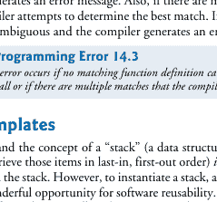

### 目录

-   前言
-   1. 强化学习问题
-   2. 多臂老虎机
-   3. 有限马尔可夫决策过程
-   4. 动态规划
-   5. 蒙特卡洛方法
-   6. 时序差分学习
-   7. n 步自举
-   8. 基于表格方法的规划与学习
-   9. 带近似的同策略预测
-   10. 带近似的同策略控制
-   11. 带近似的异策略方法
-   12. 资格迹
-   13. 策略梯度方法
-   14. 心理学
-   15. 神经科学
-   16. 应用与案例研究
-   17. 前沿
-   A. 记号
-   B. 注释参考书目

```cpp
// constructor template
template< typename T >
Stack< T >::Stack( int s )
   : size( s > 0 ? s : 10 ), // validate size
     top( -1 ), // Stack initially empty
     stackPtr( new T[ size ] ) // allocate memory for elements
{
   // empty body
} // end Stack constructor template

// push element onto Stack;
// if successful, return true; otherwise, return false
template< typename T >
bool Stack< T >::push( const T &pushValue )
{
   if ( !isFull() )
   {
      stackPtr[ ++top ] = pushValue; // place item on Stack
      return true; // push successful
   } // end if

   return false; // push unsuccessful
} // end function template push

// pop element off Stack;
// if successful, return true; otherwise, return false
template< typename T >
bool Stack< T >::pop( T &popValue )
{
   if ( !isEmpty() )
   {
      popValue = stackPtr[ top-- ]; // remove item from Stack
      return true; // pop successful
   } // end if

   return false; // pop unsuccessful
} // end function template pop

#endif
```

图 14.2 | Stack 类模板。（第 2 部分，共 2 部分。）

*类模板的成员函数定义是函数模板。* 出现在类模板定义之外的成员函数定义都以如下头部开始

```cpp
template< typename T >
```

（第 40、51 和 65 行）。因此，每个定义都类似于常规函数定义，只不过 Stack 类元素类型始终以类型参数 T 泛型列出。作用域解析运算符与类模板名 Stack<T>（第 41、52 和 66 行）一起使用，以将每个成员函数定义绑定到类模板的类型。在此情况下，泛型类名是 Stack<T>。当 doubleStack 被实例化为类型 Stack<double> 时，Stack 构造函数函数模板特化使用 new 创建一个 double 类型元素的数组来表示栈（第 44 行）。语句

```cpp
stackPtr( new T[ size ] );
```

在 Stack 类模板定义中，由编译器在类模板特化 Stack<double> 中生成如下

```cpp
stackPtr( new double[ size ] );
```

### 测试类模板 Stack<T> 的驱动程序

现在，让我们考虑用于测试 Stack 类模板的驱动程序（图 14.3）。该驱动程序首先实例化大小为 5 的对象 doubleStack（第 9 行）。此对象声明为 Stack<double> 类（读作“double 的 Stack”）。编译器将类型 double 与类模板中的类型参数 T 关联，以生成 double 类型的 Stack 类的源代码。尽管模板带来了软件可复用性的好处，但请记住，即使模板只编写一次，程序中也会（在编译时）实例化多个类模板特化。

```cpp
// Fig. 14.3: fig14_03.cpp
// Stack class template test program.
#include <iostream>
#include "Stack.h" // Stack class template definition
using namespace std;

int main()
{
   Stack< double > doubleStack( 5 ); // size 5
   double doubleValue = 1.1;

   cout << "Pushing elements onto doubleStack\n";

   // push 5 doubles onto doubleStack
   while ( doubleStack.push( doubleValue ) )
   {
      cout << doubleValue << ' ';
      doubleValue += 1.1;
   } // end while

   cout << "\nStack is full. Cannot push " << doubleValue
      << "\nPopping elements from doubleStack\n";

   // pop elements from doubleStack
   while ( doubleStack.pop( doubleValue ) )
      cout << doubleValue << ' ';

   cout << "\nStack is empty. Cannot pop\n";

   Stack< int > intStack; // default size 10
   int intValue = 1;
   cout << "\nPushing elements onto intStack\n";
```

**图 14.3** | Stack 类模板测试程序。（第 1 部分，共 2 部分。）

```cpp
// push 10 integers onto intStack
while ( intStack.push( intValue ) )
{
   cout << intValue++ << ' ';
} // end while

cout << "\nStack is full. Cannot push " << intValue
     << "\nPopping elements from intStack\n";

// pop elements from intStack
while ( intStack.pop( intValue ) )
   cout << intValue-- << ' ';

cout << "\nStack is empty. Cannot pop" << endl;
} // end main
```

```text
Pushing elements onto doubleStack
1.1 2.2 3.3 4.4 5.5
Stack is full. Cannot push 6.6

Popping elements from doubleStack
5.5 4.4 3.3 2.2 1.1
Stack is empty. Cannot pop

Pushing elements onto intStack
1 2 3 4 5 6 7 8 9 10
Stack is full. Cannot push 11

Popping elements from intStack
10 9 8 7 6 5 4 3 2 1
Stack is empty. Cannot pop
```

**图 14.3** | Stack 类模板测试程序。（第 2 部分，共 2 部分）

第 15–19 行调用 push，将 double 值 1.1、2.2、3.3、4.4 和 5.5 压入 `doubleStack`。当驱动程序尝试将第六个值压入 doubleStack 时（此时该栈已满，因为它最多容纳五个元素），while 循环终止。当函数 push 无法将值压入栈时，它返回 false。

第 25–26 行在 while 循环中调用 pop，以从栈中移除这五个值（请注意，在图 14.3 的输出中，这些值确实按后进先出顺序弹出）。当驱动程序尝试弹出第六个值时，doubleStack 为空，因此 pop 循环终止。第 30 行通过以下声明实例化整数栈 intStack

```cpp
Stack< int > intStack;
```

（读作“intStack 是 int 的 Stack”）。由于未指定大小，大小默认为默认构造函数中指定的 10（图 14.2，第 10 行）。第 35–38 行循环并调用 push 将值压入 intStack，直到它满；然后第 44–45 行循环并调用 pop 从 intStack 中移除值，直到它为空。再次请注意，在输出中，这些值按后进先出顺序弹出。

-   **Stack 类（图 14.2）** 提供了函数 isFull，您可以在尝试 push 操作之前用它来确定栈是否已满。这避免了向满栈压入元素可能导致的错误。我们也可以让函数 push 抛出异常。您可以捕获该异常，然后决定如何针对应用程序适当地处理它。当尝试从空栈中弹出元素时，同样的技术也可用于函数 pop。

### 创建函数模板以测试类模板 Stack<T>

请注意，图 14.3 中函数 main 的代码对于第 9–28 行中的 doubleStack 操作和第 30–47 行中的 intStack 操作几乎完全相同。这提供了另一个使用函数模板的机会。图 14.4 定义了函数模板 testStack（第 10–34 行），以执行与图 14.3 中 main 相同的任务——将一系列值压入 Stack<T>，并从 Stack<T> 中弹出这些值。函数模板 testStack 使用模板参数 T（在第 10 行指定）表示存储在 Stack<T> 中的数据类型。该函数模板接受四个参数（第 12–15 行）——一个对 Stack<T> 类型对象的引用、一个类型为 T 的值（该值将作为第一个压入 Stack<T> 的值）、一个用于递增压入 Stack<T> 的值的类型为 T 的值，以及一个表示 Stack<T> 对象名称以用于输出的字符串。函数 main（第 36–43 行）实例化一个名为 doubleStack 的 Stack<double> 类型对象（第 38 行）和一个名为 intStack 的 Stack<int> 类型对象（第 39 行），并在第 41 和 42 行使用这些对象。编译器根据用于实例化该函数第一个参数的类型（即用于实例化 doubleStack 或 intStack 的类型）推断 testStack 的 T 类型。图 14.4 的输出与图 14.3 的输出完全一致。

```cpp
// Fig. 14.4: fig14_04.cpp
// Stack class template test program. Function main uses a
// function template to manipulate objects of type Stack<T>.
#include <iostream>
#include <string>
#include "Stack.h"  // Stack class template definition
using namespace std;

// function template to manipulate Stack<T>
template< typename T >
void testStack(
   Stack< T > &theStack, // reference to Stack<T>
   T value,              // initial value to push
   T increment,          // increment for subsequent values
   const string stackName ) // name of the Stack<T> object
{
   cout << "\nPushing elements onto " << stackName << '\n';

   // push element onto Stack
   while ( theStack.push( value ) )
   {
      cout << value << ' ';
      value += increment;
   } // end while
}
```

**图 14.4** | 将 Stack 模板对象传递给函数模板。（第 1 部分，共 2 部分。）


```cpp
cout << "\nStack is full. Cannot push " << value
     << "\nPopping elements from " << stackName << '\n';

// pop elements from Stack
while ( theStack.pop( value ) )
    cout << value << ' ';

cout << "\nStack is empty. Cannot pop" << endl;
// end of function template testStack

int main()
{
    Stack< double > doubleStack( 5 ); // size 5
    Stack< int > intStack; // default size 10

    testStack( doubleStack, 1.1, 1.1, "doubleStack" );
    testStack( intStack, 1, 1, "intStack" );
} // end main
```

```text
Pushing elements onto doubleStack
1.1 2.2 3.3 4.4 5.5
Stack is full. Cannot push 6.6

Popping elements from doubleStack
5.5 4.4 3.3 2.2 1.1
Stack is empty. Cannot pop

Pushing elements onto intStack
1 2 3 4 5 6 7 8 9 10
Stack is full. Cannot push 11

Popping elements from intStack
10 9 8 7 6 5 4 3 2 1
Stack is empty. Cannot pop
```

**图 14.4** | 将 Stack 模板对象传递给函数模板。（第 2 部分，共 2 部分。）

## 14.5 类模板的非类型参数与默认类型

14.4 节的类模板 Stack 在模板头中只使用了一个类型参数（图 14.2，第 6 行）。也可以使用**非类型模板参数**，它们可以有默认实参，并被当作常量（const）处理。例如，可以将模板头修改为接受一个 `int elements` 参数，如下所示：

```cpp
template< typename T, int elements > // nontype parameter elements
```

然后，如下声明

```cpp
Stack< double, 100 > mostRecentSalesFigures;
```

可用于（在编译时）实例化一个名为 mostRecentSalesFigures 的、包含 100 个元素的 double 值 Stack 类模板特化；该类的模板特化类型为 Stack<double, 100>。随后，类定义可能包含一个私有数据成员，其数组声明如下：

表示一组相关重载函数的特化。我们还讨论了如何重载函数模板，以创建函数的特化版本，使其以不同于其他函数模板特化的方式处理特定数据类型。接下来，你学习了类模板和类模板特化。你看到了如何使用类模板创建一组相关类型的示例，这些类型各自对不同的数据类型执行相同的处理。下一章，我们将讨论 C++ 的许多 I/O 功能，并演示几个执行各种格式化任务的流操纵器。

## 小结

### 第 14.1 节 引言

- 模板（第 580 页）使我们能够指定一系列相关的（重载）函数——称为函数模板特化——或一系列相关的类——称为类模板特化。

### 第 14.2 节 函数模板

- 要使用函数模板特化（第 580 页），只需编写一个函数模板定义（第 581 页）。根据调用该函数时提供的实参类型，C++ 会生成各自独立的特化，以恰当地处理每种调用类型。
- 所有函数模板定义都以关键字 `template`（第 581 页）开头，后面跟着包含在尖括号（`<` 和 `>`）中的模板参数（第 581 页）；每个模板参数表示一种类型，并且前面必须有 `class` 或 `typename` 关键字（第 581 页）。用于指定函数模板参数的关键字 `typename` 和 `class` 表示“任何基本类型或用户定义类型”。
- 模板定义中的模板参数用于指定传递给函数的实参种类、函数的返回类型，以及在函数中声明变量。
- 与函数形参一样，模板参数的名字在单个模板定义内必须唯一。不同函数模板之间的模板参数名不必唯一。

### 第 14.3 节 重载函数模板

- 函数模板可以通过多种方式重载。我们可以提供其他函数模板，它们指定相同的函数名但不同的函数参数。函数模板也可以通过提供其他非模板函数来重载，这些函数具有相同的函数名但不同的函数参数。如果模板版本和非模板版本都匹配某个调用，则将使用非模板版本。

### 第 14.4 节 类模板

- 类模板提供了一种方式，可以通用地描述类，并实例化作为该泛型类类型特定版本的类。
- 类模板称为参数化类型（第 584 页）；它们需要类型参数来指定如何定制泛型类模板，以形成特定的类模板特化。
- 要使用类模板特化，只需编写一个类模板。当需要新的类型特定类时，编译器会编写该类模板特化的源代码。
- 类模板定义（第 584 页）看起来像常规类定义，但前面有 `template<typename T>`（或 `template<class T>`），以表明这是类模板定义。类型参数 T 充当要创建的类的类型的占位符。类型 T 在整个类定义和成员函数定义中作为泛型类型名出现。
- 类模板之外的成员函数定义每个都以 `template<typename T>`（或 `template<class T>`）开头。随后，每个函数定义都类似于常规函数定义，不同之处在于类中的泛型数据始终以类型参数 `T` 的形式泛型列出。二元作用域解析运算符与类模板名一起使用，将每个成员函数定义绑定到类模板的作用域。

### 第 14.5 节 类模板的非类型参数与默认类型

- 可以在类模板或函数模板的头部使用非类型参数（第 590 页）。
- 可以在类型参数列表中为类型参数指定默认值（第 591 页）。
- 类模板的显式特化（第 591 页）会针对特定类型覆盖类模板。

## 自测练习

- 14.1 判断下列陈述哪些为真、哪些为假。若为假，请解释原因。
  - a) 函数模板定义的模板参数用于指定函数实参的类型、指定函数的返回类型，以及在函数内声明变量。
  - b) 与模板类型参数一起使用的关键字 `typename` 和 `class` 具体表示“任何用户定义的类类型”。
  - c) 一个函数模板可以由另一个具有相同函数名的函数模板重载。
  - d) 不同模板定义之间的模板参数名必须唯一。
  - e) 类模板之外的每个成员函数定义都必须以模板头开始。
- 14.2 填写下列各句中的空白：
  - a) 模板使我们能够用单个代码段指定一整组相关函数，称为__________；或指定一整组相关类，称为__________。
  - b) 所有函数模板定义都以关键字__________开头，后面跟着包含在__________中的函数模板的模板参数列表。
  - c) 由函数模板生成的相关函数都具有相同的名称，因此编译器使用__________解析来调用正确的函数。
  - d) 类模板也称为__________类型。
  - e) __________运算符与类模板名一起使用，将每个成员函数定义绑定到类模板的作用域。

## 自测练习答案

**14.1** a) 真。b) 假。在此上下文中，关键字 typename 和 class 也允许基本类型的类型参数。c) 真。d) 假。不同函数模板之间的模板参数名不必唯一。e) 真。

**14.2** a) 函数模板特化、类模板特化。b) template、尖括号（< 和 >）。c) 重载。d) 参数化。e) 作用域解析。

## 练习

- **14.3** *（选择排序函数模板）* 编写一个基于图 8.13 的函数模板 `selectionSort`。编写一个驱动程序，输入、排序并输出一个 int 数组和一个 float 数组。
- **14.4** *（打印数组范围）* 重载图 14.1 中的函数模板 `printArray`，使其接受两个额外的整数实参，即 `int lowSubscript` 和 `int highSubscript`。调用该函数时，只打印数组的指定部分。验证 `lowSubscript` 和 `highSubscript`。


# 15 流输入/输出


> 意识……在自身看来并不像被切成碎片……用“河流”或“溪流”来比喻它，是最自然不过的描述。  
> ——威廉·詹姆斯

### 目标

本章你将学习：

- 使用 C++ 面向对象的流输入/输出。
- 格式化输入和输出。
- 流 I/O 类层次结构。
- 使用流操纵器。
- 控制对齐和填充。
- 判断输入/输出操作的成功或失败。
- 将输出流与输入流绑定。


| 节 | 主题 |
|---|---|
| **15.1** | 引言 |
| **15.2** | 流<br>15.2.1 经典流与标准流<br>15.2.2 iostream 库头文件<br>15.2.3 流输入/输出类与对象 |
| **15.3** | 流输出<br>15.3.1 char * 变量的输出<br>15.3.2 使用成员函数 put 进行字符输出 |
| **15.4** | 流输入<br>15.4.1 get 和 getline 成员函数<br>15.4.2 istream 成员函数 peek、putback 和 ignore<br>15.4.3 类型安全的 I/O |
| **15.5** | 使用 read、write 和 gcount 进行无格式 I/O |
| **15.6** | 流操纵器简介<br>15.6.1 整数流基数：dec、oct、hex 和 setbase<br>15.6.2 浮点精度（precision、setprecision）<br>15.6.3 字段宽度（width、setw） |
| **15.6.4** | 用户定义的输出流操纵器 |
| **15.7** | 流格式状态与流操纵器<br>15.7.1 尾随零和小数点（showpoint）<br>15.7.2 对齐（left、right 和 internal）<br>15.7.3 填充（fill、setfill）<br>15.7.4 整数流基数（dec、oct、hex、showbase）<br>15.7.5 浮点数：科学计数法和定点表示法（scientific、fixed）<br>15.7.6 大写/小写控制（uppercase）<br>15.7.7 指定布尔格式（boolalpha）<br>15.7.8 通过成员函数 flags 设置和重置格式状态 |
| **15.8** | 流错误状态 |
| **15.9** | 将输出流绑定到输入流 |
| **15.10** | 总结 |

*小结 | 自测练习 | 自测练习答案 | 练习*

## 15.1 引言

C++ 标准库提供了一套广泛的输入/输出能力。本章讨论足以执行大多数常见 I/O 操作的一系列能力，并概述其余能力。我们在正文前面已讨论过其中一些特性；现在提供更完整的讲解。我们将讨论的许多 I/O 特性都是面向对象的。这种 I/O 风格利用了其他 C++ 特性，如引用、函数重载和运算符重载。

C++ 使用类型安全的 I/O。每个 I/O 操作都以对数据类型敏感的方式执行。如果一个 I/O 函数已定义为处理特定数据类型，则调用该成员函数来处理该数据类型。如果实际数据的类型与处理该数据类型的函数不匹配，编译器会生成错误。因此，不适当的数据不能“偷偷”通过系统（正如在 C 中可能发生的那样，从而导致一些隐蔽而离奇的错误）。

用户可以通过重载流插入运算符（<<）和流提取运算符（>>）来指定如何对用户定义类型的对象执行 I/O。这种可扩展性是 C++ 最有价值的特性之一。

> **软件工程观察 15.1**
> 
> *在 C++ 程序中只使用 C++ 风格的 I/O，即使 C 风格 I/O 可供 C++ 程序员使用。*

> **错误预防提示 15.1**
> 
> *C++ I/O 是类型安全的。*

> **软件工程观察 15.2**
> 
> *C++ 能够对预定义类型和用户定义类型采用统一的 I/O 处理方式。这种统一性促进了软件开发和复用。*

## 15.2 流

C++ I/O 发生在**流**中，流是字节序列。在输入操作中，字节从设备（例如键盘、磁盘驱动器、网络连接等）流向主存。在输出操作中，字节从主存流向设备（例如显示屏、打印机、磁盘驱动器、网络连接等）。

应用程序将含义赋予字节。这些字节可以表示字符、原始数据、图形、图像、数字语音、数字视频或应用程序可能需要的任何其他信息。系统 I/O 机制应一致且可靠地将字节从设备传输到内存（以及反过来）。此类传输通常涉及某种机械运动，例如磁盘或磁带的旋转，或在键盘上键入击键。这些传输所花费的时间通常远大于处理器在内部操作数据所需的时间。因此，I/O 操作需要仔细规划和调优，以确保最佳性能。

C++ 同时提供“低级”和“高级”I/O 能力。低级 I/O 能力（即**无格式 I/O**）指定应将一定数量的字节从设备传输到内存或从内存传输到设备。在此类传输中，单个字节是关注项。此类低级能力提供高速、大批量传输，但并不是特别方便。

程序员通常更喜欢较高层次的 I/O 视图（即**格式化 I/O**），其中字节被分组为有意义的单元，例如整数、浮点数、字符、字符串和用户定义类型。这些面向类型的能力对于大多数 I/O 来说是令人满意的，但大批量文件处理除外。

> **性能提示 15.1**
> 
> *在大批量文件处理中使用无格式 I/O 以获得最佳性能。*

> **可移植性提示 15.1**
> 
> *使用无格式 I/O 可能导致可移植性问题，因为无格式数据并非在所有平台上都可移植。*

### 15.2.1 经典流与标准流

过去，C++ **经典流库**支持 char 的输入和输出。因为 char 通常占一个字节，所以它只能表示有限的字符集（例如本书大多数读者使用的 ASCII 字符集或其他常用字符集）。然而，许多语言使用的字母表包含的字符多于单字节 char 所能表示的数量。ASCII 字符集不提供这些字符；**Unicode® 字符集**则提供。Unicode 是一个广泛的国际字符集，表示世界上大多数“具有商业价值”的语言、数学符号以及更多内容。有关 Unicode 的更多信息，请访问 www.unicode.org。

C++ 包含标准流库，使开发者能够构建可使用 Unicode 字符执行 I/O 操作的系统。为此，C++ 包含一种称为 `wchar_t` 的附加字符类型，除其他用途外，它可以存储 Unicode 字符。C++ 标准还将只处理 char 的经典 C++ 流类重新设计为类模板，并分别针对处理 `char` 类型和 `wchar_t` 类型的字符提供单独的特化。本书通篇使用类模板的 char 类型。

### 15.2.2 iostream 库头文件

C++ iostream 库提供数百种 I/O 能力。多个头文件包含该库接口的部分内容。

大多数 C++ 程序包含 `<iostream>` 头文件，它声明所有流 I/O 操作所需的基本服务。`<iostream>` 头文件定义 `cin`、`cout`、`cerr` 和 `clog` 对象，它们分别对应标准输入流、标准输出流、无缓冲标准错误流和有缓冲标准错误流。（`cerr` 和 `clog` 将在 15.2.3 节讨论。）它同时提供无格式和格式化 I/O 服务。

`<iomanip>` 头文件声明一些服务，这些服务对于使用所谓参数化流操纵器（如 `setw` 和 `setprecision`）执行格式化 I/O 很有用。

`<fstream>` 头文件声明文件处理服务。我们将在第 17 章的文件处理程序中使用此头文件。

C++ 实现通常还包含其他与 I/O 相关的库，它们提供特定于系统的能力，例如控制用于音频和视频 I/O 的特殊用途设备。

### 15.2.3 流输入/输出类与对象

iostream 库提供许多用于处理常见 I/O 操作的模板。例如，类模板 `basic_istream` 支持流输入操作，类模板 `basic_ostream` 支持流输出操作，类模板 `basic_iostream` 同时支持流输入和流输出操作。每个模板都有一个预定义的模板特化，支持 char I/O。此外，iostream 库提供一组 typedef，为这些模板特化提供别名。`typedef` 说明符为数据类型声明同义词（别名）。你有时会使用 typedef 创建更短或更易读的类型名。例如，语句

```cpp
typedef Card *CardPtr;
```

定义了一个附加类型名 `CardPtr`，作为类型 `Card *` 的同义词。使用 typedef 创建名称并不会创建数据类型；typedef 只创建类型名。21.5 节详细讨论 typedef。typedef `istream` 表示 `basic_istream` 的一个特化，支持 char 输入。类似地，typedef `ostream` 表示 `basic_ostream` 的一个特化，支持 char 输出。此外，typedef `iostream` 表示 `basic_iostream` 的一个特化，同时支持 char 输入和输出。本章通篇使用这些 typedef。


## 流 I/O 模板层次结构与运算符重载

模板 `basic_istream` 和 `basic_ostream` 均通过单继承派生自基模板 `basic_ios`。¹ 模板 `basic_iostream` 通过多重继承² 派生自模板 `basic_istream` 和 `basic_ostream`。图 15.1 的 UML 类图总结了这些继承关系。

-   ¹ 本章仅在 `char` I/O 的模板特化背景下讨论模板。
-   ² 多重继承在第 24 章“其他主题”中讨论。

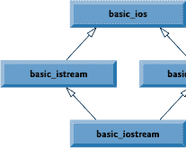

**图 15.1** | 流 I/O 模板层次结构的一部分。

运算符重载为执行输入/输出提供了一种便捷的表示法。左移运算符（`<<`）被重载用于表示流输出，并称为流插入运算符。右移运算符（`>>`）被重载用于表示流输入，并称为流提取运算符。这些运算符与标准流对象 `cin`、`cout`、`cerr` 和 `clog` 一起使用，并且通常与用户定义的流对象一起使用。

### 标准流对象 cin、cout、cerr 和 clog

预定义对象 `cin` 是一个 `istream` 实例，并被称为“连接到”（或附加到）标准输入设备，该设备通常是键盘。如下列语句中所使用的流提取运算符（`>>`）会使整数变量 `grade` 的值（假设 `grade` 已声明为 `int` 变量）从 `cin` 输入到内存中：

```cpp
cin >> grade;  // data "flows" in the direction of the arrows
```

编译器确定 `grade` 的数据类型，并选择合适的重载流提取运算符。假设 `grade` 已正确声明，则流提取运算符不需要额外的类型信息（例如，在 C 风格 I/O 中就是这种情况）。`>>` 运算符被重载以输入基本类型、字符串和指针值的数据项。

预定义对象 `cout` 是一个 `ostream` 实例，并被称为“连接到”标准输出设备，该设备通常是显示屏。如下列语句中所使用的流插入运算符（`<<`）会使变量 `grade` 的值从内存输出到标准输出设备：

```cpp
cout << grade;  // data "flows" in the direction of the arrows
```

编译器确定 `grade` 的数据类型（假设 `grade` 已正确声明），并选择合适的流插入运算符。`<<` 运算符被重载以输出基本类型、字符串和指针值的数据项。

预定义对象 `cerr` 是一个 `ostream` 实例，并被称为“连接到”标准错误设备，通常是屏幕。输出到对象 `cerr` 是**无缓冲的**，这意味着每次向 `cerr` 的流插入都会使其输出立即出现——这适合及时通知用户有关错误的信息。

预定义对象 `clog` 是 `ostream` 类的实例，并被称为“连接到”标准错误设备。输出到 `clog` 是**有缓冲的**。这意味着每次向 `clog` 插入都可能使其输出保存在缓冲区（即内存中的区域）中，直到缓冲区被填满或缓冲区被刷新。缓冲是一种 I/O 性能增强技术，在操作系统课程中讨论。

### 文件处理模板

C++ 文件处理使用类模板 `basic_ifstream`（用于文件输入）、`basic_ofstream`（用于文件输出）和 `basic_fstream`（用于文件输入和输出）。每个类模板都有一个预定义的模板特化，用于启用 `char` I/O。C++ 提供了一组 typedef，为这些模板特化提供别名。例如，typedef `ifstream` 表示 `basic_ifstream` 的一个特化，用于启用从文件进行 `char` 输入。类似地，typedef `ofstream` 表示 `basic_ofstream` 的一个特化，用于启用向文件进行 `char` 输出。此外，typedef `fstream` 表示 `basic_fstream` 的一个特化，用于启用从文件进行 `char` 输入以及向文件进行 `char` 输出。模板 `basic_ifstream` 继承自 `basic_istream`，`basic_ofstream` 继承自 `basic_ostream`，`basic_fstream` 继承自 `basic_iostream`。图 15.2 的 UML 类图总结了 I/O 相关类的各种继承关系。完整的流 I/O 类层次结构提供了你需要的大部分功能。有关其他文件处理信息，请查阅你的 C++ 系统的类库参考。

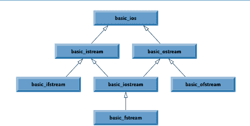

**图 15.2** | 流 I/O 模板层次结构的一部分，展示主要的文件处理模板。

## 15.3 流输出

`ostream` 提供格式化和无格式化输出能力。这些能力包括：使用流插入运算符（`<<`）输出标准数据类型；通过 `put` 成员函数输出字符；通过 `write` 成员函数进行无格式化输出（15.5 节）；以十进制、八进制和十六进制格式输出整数（15.6.1 节）；以各种精度输出浮点值（15.6.2 节），强制显示小数点（15.7.1 节），以科学计数法和定点表示法输出（15.7.5 节）；在指定宽度的字段中按对齐方式输出数据（15.7.2 节）；在用指定字符填充的字段中输出数据（15.7.3 节）；以及以科学计数法和十六进制表示法输出大写字母（15.7.6 节）。

### 15.3.1 输出 char * 变量

C++ 自动确定数据类型——这是对 C 的改进。这一特性有时会“碍事”。例如，假设我们想打印存储在 `char *` 指针中的地址。`<<` 运算符已被重载为将 `char *` 输出为以空字符结尾的字符串。要输出地址，可以将 `char *` 强制转换为 `void *`（这可以对任何指针变量执行）。图 15.3 演示了以字符串和地址两种格式打印 `char *` 变量。此处地址打印为十六进制（基数为 16）数——一般来说，地址的打印方式取决于具体实现。要了解更多关于十六进制数的内容，请阅读附录 D。我们将在 15.6.1 节和 15.7.4 节进一步讨论控制数字的基数。

```cpp
// Fig. 15.3: Fig15_03.cpp
// Printing the address stored in a char * variable.
#include <iostream>
using namespace std;

int main()
{
   const char *const word = "again";

   // display value of char *, then display value of char *
   // static_cast to void *
   cout << "Value of word is: " << word << endl
      << "Value of static_cast<void *>( word ) is: "
      << static_cast< void * >( word ) << endl;
} // end main
```

```text
Value of word is: again
Value of static_cast<void *>( word ) is: 00428300
```

**图 15.3** | 打印存储在 `char *` 变量中的地址。

### 15.3.2 使用成员函数 put 输出字符

我们可以使用 `put` 成员函数输出字符。例如，语句

```cpp
cout.put( 'A' );
```

显示单个字符 `A`。对 `put` 的调用可以级联，如下列语句所示：

```cpp
cout.put('A').put('\n');
```

它输出字母 `A`，后跟一个换行字符。与 `<<` 一样，前一条语句以这种方式执行，因为点运算符（`.`）从左到右结合，并且 `put` 成员函数返回对接收 `put` 调用的 `ostream` 对象（`cout`）的引用。`put` 函数也可以用一个表示 ASCII 值的数值表达式来调用，如下列语句所示，它同样输出 `A`：

```cpp
cout.put(65);
```

## 15.4 流输入

现在我们来考虑流输入。`istream` 提供格式化和无格式化输入能力。流提取运算符（`>>`）通常会跳过输入流中的空白字符（如空格、制表符和换行符）；稍后我们将看到如何改变这一行为。每次输入后，流提取运算符会返回对接收提取消息的流对象的引用（例如表达式 `cin >> grade` 中的 `cin`）。如果该引用被用作条件（例如在 `while` 语句的循环继续条件中），则流的重载 `void *` 转换运算符函数会被隐式调用，以根据输入操作的成功或失败将该引用转换为非空指针值或空指针。非空指针转换为 `bool` 值 `true` 以表示成功，空指针转换为 `bool` 值 `false` 以表示失败。当尝试读取超过流末尾时，流的重载 `void *` 转换运算符返回空指针以表示文件结束。

每个流对象包含一组状态位，用于控制流的状态（即格式化、设置错误状态等）。流的重载 `void *` 转换运算符使用这些位来确定是返回非空指针还是空指针。如果输入的数据类型错误，流提取会导致流的 `failbit` 被设置；如果操作失败，则会导致流的 `badbit` 被设置。15.7 节和 15.8 节将详细讨论流状态位，然后展示在 I/O 操作之后如何测试这些位。

### 15.4.1 get 和 getline 成员函数

不带参数的 `get` 成员函数从指定流中输入一个字符（包括空白字符和其他非图形字符，例如表示文件结束的按键序列），并将其作为函数调用的值返回。当在流上遇到文件结束时，此版本的 `get` 返回 `EOF`。

### 使用成员函数 eof、get 和 put

图 15.4 演示了在输入流 `cin` 上使用成员函数 `eof` 和 `get`，以及在输出流 `cout` 上使用成员函数 `put`。程序首先打印 `cin.eof()` 的值——即 `false`（输出中为 `0`）——以表明 `cin` 上尚未发生文件结束。用户输入一行文本，并按 Enter，然后按文件结束（在 Microsoft Windows 系统上为 `<Ctrl>-z`，在 UNIX 和 Macintosh 系统上为 `<Ctrl>-d`）。第 15 行读取每个字符，第 16 行使用成员函数 `put` 将其输出到 `cout`。当遇到文件结束时，`while` 语句结束，第 20 行显示 `cin.eof()` 的值，此时为 `true`（输出中为 `1`），以表明 `cin` 上已设置文件结束。该程序使用不接受参数且

返回正在输入的字符（第15行）。只有当程序试图读取流中最后一个字符之后的字符时，`eof`函数才返回true。

带字符引用参数的get成员函数从输入流输入下一个字符（即使它是空白字符）并将其存储在该字符参数中。此版本的get返回对所调用get成员函数的istream对象的引用。

get的第三个版本接受三个参数——字符数组、大小限制和分隔符（默认值为'\n'）。该版本从输入流读取字符。它要么读取比指定最大字符数少一个字符后终止，要么在读取到分隔符时立即终止。程序在用作缓冲区的字符数组中插入一个空字符来终止输入字符串。分隔符不会放入字符数组，但会保留在输入流中（分隔符将是下一个读取的字符）。因此，连续第二次调用get的结果是一个空行，除非从输入流中移除了分隔符（可能使用`cin.ignore()`）。

```cpp
// Fig. 15.4: Fig15_04.cpp
// Using member functions get, put and eof.
#include <iostream>
using namespace std;

int main()
{
   int character; // use int, because char cannot represent EOF

   // prompt user to enter line of text
   cout << "Before input, cin.eof() is " << cin.eof() << endl;
        << "Enter a sentence followed by end-of-file: " << endl;

   // use get to read each character; use put to display it
   while ( ( character = cin.get() ) != EOF )
      cout.put( character );

   // display end-of-file character
   cout << "\nEOF in this system is: " << character << endl;
   cout << "After input of EOF, cin.eof() is " << cin.eof() << endl;
} // end main
```

```text
Before input, cin.eof() is 0
Enter a sentence followed by end-of-file:
Testing the get and put member functions
Testing the get and put member functions
^Z

EOF in this system is: -1
After input of EOF, cin.eof() is 1
```

**图15.4** | get、put和eof成员函数。

## 比较 `cin` 和 `cin.get`

图15.5比较了使用`cin`的流提取（它读取字符直到遇到空白字符）和使用`cin.get`的输入。对`cin.get`（第22行）的调用未指定分隔符，因此使用默认的'\n'字符。

```cpp
// Fig. 15.5: Fig15_05.cpp
// Contrasting input of a string via cin and cin.get.
#include <iostream>
using namespace std;

int main()
{
   // create two char arrays, each with 80 elements
   const int SIZE = 80;
   char buffer1[ SIZE ];
   char buffer2[ SIZE ];

   // use cin to input characters into buffer1
   cout << "Enter a sentence: " << endl;
   cin >> buffer1;

   // display buffer1 contents
   cout << "\nThe string read with cin was:" << endl
        << buffer1 << endl << endl;

   // use cin.get to input characters into buffer2
   cin.get( buffer2, SIZE );

   // display buffer2 contents
   cout << "\nThe string read with cin.get was:" << endl
        << buffer2 << endl;

} // end main
```

```text
Enter a sentence:
Contrasting string input with cin and cin.get

The string read with cin was:
Contrasting

The string read with cin.get was:
 string input with cin and cin.get
```

图15.5 | 通过cin和cin.get进行字符串输入的对比。

## 使用成员函数 `getline`

成员函数`getline`的操作类似于`get`成员函数的第三个版本，并在字符数组中的一行后插入一个空字符。`getline`函数从流中移除分隔符（即读取该字符并将其丢弃），但不会将其存储在字符数组中。图15.6中的程序演示了使用`getline`成员函数输入一行文本（第13行）。

```cpp
// Fig. 15.6: Fig15_06.cpp
// Inputting characters using cin member function getline.
#include <iostream>
using namespace std;

int main()
{
   const int SIZE = 80;
   char buffer[SIZE]; // create array of 80 characters

   // input characters in buffer via cin function getline
   cout << "Enter a sentence: " << endl;
   cin.getline( buffer, SIZE );

   // display buffer contents
   cout << "\nThe sentence entered is:" << endl << buffer << endl;
} // end main
```

```text
Enter a sentence:
Using the getline member function

The sentence entered is:
Using the getline member function
```

图15.6 | 使用cin成员函数`getline`输入字符。（第1部分，共2部分）

**图15.6** | 使用cin成员函数getline输入字符。（第2部分，共2部分）

## 15.4.2 istream成员函数peek、putback和ignore

istream的**ignore**成员函数读取并丢弃指定数量的字符（默认是一个），或在遇到指定分隔符时终止（默认是EOF，这会导致ignore在从文件读取时跳到文件末尾）。

**putback**成员函数将从输入流中通过get获得的前一个字符放回该流中。此函数对于扫描输入流以查找以特定字符开头的字段的应用程序很有用。当输入该字符时，应用程序将该字符返回给流，以便该字符可以包含在输入数据中。

**peek**成员函数从输入流返回下一个字符，但不会从流中移除该字符。

## 15.4.3 类型安全的I/O

C++提供类型安全的I/O。<<和>>运算符被重载以接受特定类型的数据项。如果处理了意外数据，会设置各种错误位，用户可以测试这些错误位以确定I/O操作何时成功或失败。如果未为自定义类型重载<<和>>运算符，而您尝试输入或输出该自定义类型对象的内容，编译器将报告错误。这使程序能够“保持控制”。我们将在15.8节讨论这些错误状态。

## 15.5 使用read、write和gcount的无格式I/O

无格式输入/输出分别使用istream和ostream的**read**和**write**成员函数执行。成员函数read将字节输入到内存中的字符数组；成员函数write从字符数组输出字节。这些字节不以任何方式格式化。它们作为原始字节输入或输出。例如，调用

```cpp
char buffer[] = "HAPPY BIRTHDAY";
cout.write( buffer, 10 );
```

输出buffer的前10个字节（包括任何空字符，如果有的话，这些空字符会导致使用cout和<<的输出终止）。调用

```cpp
cout.write("ABCDEFGHIJKLMNOPQRSTUVWXYZ", 10);
```

显示字母表的前10个字符。

read成员函数将指定数量的字符输入到字符数组中。如果读取的字符数少于指定数量，则设置failbit。15.8节展示如何确定是否已设置failbit。成员函数**gcount**报告上一次输入操作读取的字符数。

图15.7演示了istream成员函数read和gcount以及ostream成员函数write。该程序使用read（第13行）将20个字符（来自更长的输入序列）输入到数组buffer中，使用gcount（第17行）确定输入的字符数，并使用write（第17行）输出buffer中的字符。

```cpp
// Fig. 15.7: Fig15_07.cpp
// Unformatted I/O using read, gcount and write.
#include <iostream>
using namespace std;

int main()
{
   const int SIZE = 80;
   char buffer[SIZE]; // create array of 80 characters

   // use function read to input characters into buffer
   cout << "Enter a sentence: " << endl;
   cin.read( buffer, 20 );

   // use functions write and gcount to display buffer characters
   cout << endl << "The sentence entered was: " << endl;
   cout.write( buffer, cin.gcount() );
   cout << endl;
} // end main
```

```text
Enter a sentence:
Using the read, write, and gcount member functions
The sentence entered was:
Using the read, writ
```

**图15.7** 使用read、gcount和write成员函数的无格式I/O。

## 15.6 流操纵算子简介

C++提供了各种**流操纵算子**来执行格式化任务。流操纵算子提供了设置字段宽度、设置精度、设置和取消设置格式状态、设置字段中的填充字符、刷新流、向输出流插入换行符（并刷新流）、向输出流插入空字符以及跳过输入流中的空白字符等功能。这些特性将在以下各节中描述。


### 15.6.1 整数流基数：dec、oct、hex 和 setbase

整数通常按十进制（基 10）值解释。要更改流中整数的解释基数，可插入 `hex` 操纵器将基数设置为十六进制（基 16），或插入 `oct` 操纵器将基数设置为八进制（基 8）。插入 `dec` 操纵器可将流基数重置为十进制。这些都是粘性操纵器。

流的基数也可以通过 `setbase` 流操纵器更改，它接受一个 int 参数 10、8 或 16，分别将基数设置为十进制、八进制或十六进制。因为 `setbase` 接受参数，所以它被称为参数化流操纵器。使用 `setbase`（或任何其他参数化操纵器）需要包含 `<iomanip>` 头文件。流基数值保持不变，直到被显式更改；`setbase` 设置是“粘性的”。图 15.8 演示了流操纵器 `hex`、`oct`、`dec` 和 `setbase`。

```cpp
// Fig. 15.8: Fig15_08.cpp
// Using stream manipulators hex, oct, dec and setbase.
#include <iostream>
#include <iomanip>
using namespace std;

int main()
{
   int number;

   cout << "Enter a decimal number: ";
   cin >> number; // input number

   // use hex stream manipulator to show hexadecimal number
   cout << number << " in hexadecimal is: " << hex
        << number << endl;

   // use oct stream manipulator to show octal number
   cout << dec << number << " in octal is: "
        << oct << number << endl;

   // use setbase stream manipulator to show decimal number
   cout << setbase( 10 ) << number << " in decimal is: "
        << number << endl;
} // end main
```

```text
Enter a decimal number: 20
20 in hexadecimal is: 14
20 in octal is: 24
20 in decimal is: 20
```

图 15.8 | 流操纵器 hex、oct、dec 和 setbase。

### 15.6.2 浮点精度（precision、setprecision）

我们可以通过使用 `setprecision` 流操纵器或 `ios_base` 的 `precision` 成员函数来控制浮点数的精度（即小数点右边的数字位数）。调用其中任何一个都会为所有后续输出操作设置精度，直到下一次设置精度调用。无参数调用成员函数 `precision` 会返回当前精度设置（当不再需要“粘性”设置后，最终可以用它恢复原始精度）。图 15.9 的程序同时使用成员函数 `precision`（第 22 行）和 `setprecision` 操纵器（第 31 行）打印一个表格，显示 2 的平方根，精度从 0 变化到 9。

```cpp
// Fig. 15.9: Fig15_09.cpp
// Controlling precision of floating-point values.
#include <iostream>
#include <iomanip>
#include <cmath>
using namespace std;

int main()
{
    double root2 = sqrt( 2.0 ); // calculate square root of 2
    int places; // precision, vary from 0–9

    cout << "Square root of 2 with precisions 0–9:" << endl
         << "Precision set by ios_base member function precision:"
         << "\n";

    cout << fixed; // use fixed-point notation

    // display square root using ios_base function precision
    for ( places = 0; places <= 9; ++places )
    {
        cout.precision( places );
        cout << root2 << endl;
    } // end for

    cout << "\nPrecision set by stream manipulator "
         << "setprecision: " << endl;

    // set precision for each digit, then display square root
    for ( places = 0; places <= 9; ++places )
        cout << setprecision( places ) << root2 << endl;
} // end main
```

```text
Square root of 2 with precisions 0-9.
Precision set by ios_base member function precision:
1
1.4
1.41
1.414
1.4142
1.41421
1.414214
1.4142136
1.41421356
1.414213562
```

**图 15.9**  |  浮点值的精度。（第 1 部分，共 2 部分。）

```text
Precision set by stream manipulator setprecision:
1
1.4
1.41
1.414
1.4142
1.41421
1.414214
1.4142136
1.41421356
```

**图 15.9** | 浮点值的精度。（第 2 部分，共 2 部分。）

### 15.6.3 字段宽度（width、setw）

`width` 成员函数（基类 `ios_base` 的）设置字段宽度（即一个值应输出占用的字符位置数，或应输入的最大字符数），并返回先前的宽度。如果输出的值比字段宽度窄，则插入填充字符作为填充。比指定宽度宽的值不会被截断——完整的数字将被打印。无参数的 `width` 函数返回当前设置。

> **常见编程错误 15.1**
> 
> 宽度设置仅适用于下一次插入或提取（即宽度设置不是“粘性的”）；之后，宽度被隐式设置为 0（即输入和输出将使用默认设置执行）。假设宽度设置适用于所有后续输出是一种逻辑错误。


> **常见编程错误 15.2**
> 
> 当字段宽度不足以处理输出时，输出会按所需宽度打印，这可能会产生令人困惑的输出。


图 15.10 演示了 `width` 成员函数在输入和输出上的使用。向 char 数组输入时，最多读取比宽度少一个的字符，因为要为放入输入字符串的空字符预留位置。请记住，当遇到非前导空白字符时，流提取会终止。`setw` 流操纵器也可以用来设置字段宽度。[注意：在图 15.10 中提示输入时，用户应输入一行文本并按 Enter，然后按文件结束符（在 Microsoft Windows 系统上为 \<Ctrl>-z，在 UNIX 和 Macintosh 系统上为 \<Ctrl>-d）。]

**图 15.10** | 类 ios_base 的 width 成员函数。（第 1 部分，共 2 部分。）

```cpp
// Fig. 15.10: Fig15_10.cpp
// Demonstrating member function width.
#include <iostream>
using namespace std;

int main()
{
   int widthValue = 4;
   char sentence[ 10 ];

   cout << "Enter a sentence: " << endl;
   cin.width( 5 ); // input only 5 characters from sentence

   // set field width, then display characters based on that width
   while ( cin >> sentence )
   {
      cout.width( widthValue++ );
      cout << sentence << endl;
      cin.width( 5 ); // input 5 more characters from sentence
   } // end while
} // end of main
```

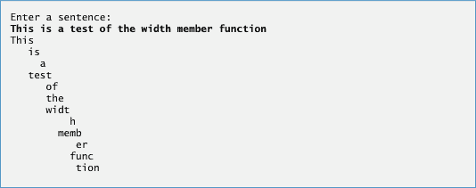

**图 15.10** | 类 ios_base 的 width 成员函数。（第 2 部分，共 2 部分。）

### 15.6.4 用户定义的输出流操纵器

你可以创建自己的流操纵器。³ 图 15.11 展示了新的参数化流操纵器 `bell`（第 8–11 行）、`carriageReturn`（第 14–17 行）、`tab`（第 20–23 行）和 `endLine`（第 27–30 行）的创建和使用。对于输出流操纵器，返回类型和参数必须是 `ostream &` 类型。当第 35 行将 `endLine` 操纵器插入输出流时，函数 `endLine` 被调用，第 29 行将转义序列 `\n` 和 `flush` 操纵器输出到标准输出流。类似地，当第 35–44 行将操纵器 `tab`、`bell` 和 `carriageReturn` 插入输出流时，它们对应的函数——`tab`（第 20 行）、`bell`（第 8 行）和 `carriageReturn`（第 14 行）被调用，进而输出各种转义序列。

## 15.7 流格式状态和流操纵器

各种流操纵器可用于指定流 I/O 操作期间要执行的格式类型。流操纵器控制输出的格式设置。图 15.12 列出了控制给定流格式状态的每个流操纵器。所有这些操纵器都属于类 `ios_base`。我们将在接下来几节中展示其中大多数流操纵器的示例。

| 操纵器 | 描述 |
|---|---|
| `skipws` | 跳过输入流上的空白字符。此设置通过流操纵器 `noskipws` 重置。 |
| `left` | 在字段中左对齐输出。如有必要，填充字符出现在右侧。 |
| `right` | 在字段中右对齐输出。如有必要，填充字符出现在左侧。 |
| `internal` | 指示数字的符号应在字段中左对齐，而数字的数值应在同一字段中右对齐（即填充字符出现在符号和数字之间）。 |
| `boolalpha` | 指定 bool 值应显示为单词 true 或 false。操纵器 `noboolalpha` 将流恢复为将 bool 值显示为 1（true）和 0（false）。 |
| `dec` | 指定整数应被视为十进制（基 10）值。 |
| `oct` | 指定整数应被视为八进制（基 8）值。 |
| `hex` | 指定整数应被视为十六进制（基 16）值。 |
| `showbase` | 指定数字的基数应输出在数字之前（八进制为前导 0；十六进制为前导 0x 或 0X）。此设置通过流操纵器 `noshowbase` 重置。 |
| `showpoint` | 指定浮点数应输出小数点。通常与 `fixed` 一起使用，以保证小数点右侧有一定位数的数字，即使它们是零。此设置通过流操纵器 `noshowpoint` 重置。 |
| `uppercase` | 指定十六进制整数中应使用大写字母（即 X 以及 A 到 F），并且以科学记数法表示浮点值时应使用大写 E。此设置通过流操纵器 `nouppercase` 重置。 |
| `showpos` | 指定正数前应加正号（+）。此设置通过流操纵器 `noshowpos` 重置。 |
| `scientific` | 指定以科学记数法输出浮点值。 |
| `fixed` | 指定以定点记数法输出浮点值，并在小数点右侧有特定数量的数字。 |

**图 15.12** 来自 `<iostream>` 的格式状态流操纵器。

### 15.7.1 尾随零和小数点（showpoint）

流操纵器 `showpoint` 强制浮点数输出其小数点和尾随零。例如，浮点值 79.0 会打印为 79，后跟-


```cpp
// Fig. 15.14: Fig15_14.cpp
// Left and right justification with stream manipulators left and right.
#include <iostream>
#include <iomanip>
using namespace std;

int main()
{
    int x = 12345;

    // display x right justified (default)
    cout << "Default is right justified:" << endl
         << setw(10) << x << endl;

    // use left manipulator to display x left justified
    cout << "\n\nUse std::left to left justify x:\n"
         << left << setw(10) << x << "\n";

    // use right manipulator to display x right justified
    cout << "\n\nUse std::right to right justify x:\n"
         << right << setw(10) << x << endl;
} // end main
```

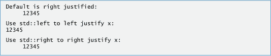

**Fig. 15.14** | 使用流操纵符 left 和 right 进行左对齐和右对齐。

流操纵符 **internal** 表示：数字的符号（或使用流操纵符 showbase 时的基数）应在字段内左对齐，数字的量值应右对齐，并且中间的空隙应使用填充字符填充。图 15.15 展示了使用 internal 流操纵符指定内部间距（第 10 行）。注意，**showpos** 强制打印加号（第 10 行）。要重置 showpos 设置，请输出流操纵符 **noshowpos**。

```cpp
// Fig. 15.15: Fig15_15.cpp
// Printing an integer with internal spacing and plus sign.
#include <iostream>
#include <iomanip>
using namespace std;

int main()
{
    // display value with internal spacing and plus sign
    cout << internal << showpos << setw(10) << 123 << endl;
} // end main
```

**Fig. 15.15** | 打印具有内部间距和加号的整数。（第 1 部分，共 2 部分。）


**Fig. 15.15** | 打印具有内部间距和加号的整数。（第 2 部分，共 2 部分。）

### 15.7.3 填充（fill、setfill）

成员函数 `fill` 指定用于对齐字段的填充字符；默认使用空格填充。该函数返回之前的填充字符。操纵符 `setfill` 也设置填充字符。图 15.16 演示了使用函数 `fill`（第 30 行）和流操纵符 `setfill`（第 34 和 37 行）设置填充字符。

```cpp
// Fig. 15.16: Fig15_16.cpp
// Using member function fill and stream manipulator setfill to change
// the padding character for fields larger than the printed value.
#include <iostream>
#include <iomanip>
using namespace std;

int main()
{
   int x = 10000;

   // display x
   cout << x << " printed as int right and left justified\n"
        << " and as hex with internal justification.\n"
        << "Using the default pad character (space):" << endl;

   // display x with basefield
   cout << showbase << setw( 10 ) << x << endl;

   // display x with left justification
   cout << left << setw( 10 ) << x << endl;

   // display x as hex with internal justification
   cout << internal << setw( 10 ) << hex << x << endl;

   cout << "Using various padding characters:" << endl;

   // display x using padded characters (right justification)
   cout << right;
   cout.fill( '*' );
   cout << setw( 10 ) << dec << x << endl;

   // display x using padded characters (left justification)
   cout << left << setw( 10 ) << setfill( '%' ) << x << endl;

   // display x using padded characters (internal justification)
   cout << internal << setw( 10 ) << setfill( '^' ) << hex
        << x << endl;
}
```

**Fig. 15.16** | 使用成员函数 `fill` 和流操纵符 `setfill` 为大于所打印值的字段更改填充字符。（第 1 部分，共 2 部分。）

```
Printing integers preceded by their base:
100
0144
0x64
```

**Fig. 15.17** | 流操纵符 showbase。（第 2 部分，共 2 部分。）

### 15.7.5 浮点数、科学记数法和定点表示法（scientific、fixed）

流操纵符 scientific 和 fixed 控制浮点数的输出格式。流操纵符 **scientific** 强制浮点数输出以科学记数法格式显示。流操纵符 **fixed** 强制浮点数在小数点右侧显示特定数量的数字（由成员函数 precision 或流操纵符 setprecision 指定）。如果不使用其他操纵符，浮点数的值决定输出格式。

图 15.18 演示了使用流操纵符 scientific（第 18 行）和 fixed（第 22 行）以定点格式和科学记数法格式显示浮点数。科学记数法中的指数格式可能因编译器不同而有所差异。

```cpp
// Fig. 15.18: Fig15_18.cpp
// Displaying floating-point values in system default,
// scientific and fixed formats.
#include <iostream>
using namespace std;

int main()
{
   double x = 0.001234567;
   double y = 1.946e+009;

   // display x and y in default format
   cout << "Displayed in default format:" << endl
        << x << '\t' << y << endl;

   // display x and y in scientific format
   cout << "\nDisplayed in scientific format:" << endl
        << scientific << x << '\t' << y << endl;

   // display x and y in fixed format
   cout << "\nDisplayed in fixed format:" << endl
        << fixed << x << '\t' << y << endl;
} // end main
```

```
Displayed in default format:
0.00123457    1.946e+009

Displayed in scientific format:
1.234567e-003    1.946000e+009
```

**Fig. 15.18** | 以默认、科学记数法和定点格式显示的浮点值。（第 1 部分，共 2 部分。）


**Fig. 15.18** | 以默认、科学记数法和定点格式显示的浮点值。（第 2 部分，共 2 部分。）

### 15.7.6 大写/小写控制（uppercase）

流操纵符 **uppercase** 分别在十六进制整数值中或科学记数法浮点值中输出大写 X 或 E（图 15.19）。使用流操纵符 uppercase 还会使十六进制值中的所有字母变为大写。默认情况下，十六进制值的字母和科学记数法浮点值中的指数以小写形式出现。要重置 uppercase 设置，请输出流操纵符 **nouppercase**。

```cpp
// Fig. 15.19: Fig15_19.cpp
// Stream manipulator uppercase.
#include <iostream>
using namespace std;

int main()
{
   cout << "Printing uppercase letters in scientific" << endl
        << "notation exponents and hexadecimal values:" << endl;

   // use std::uppercase to display uppercase letters; use std::hex and
   // std::showbase to display hexadecimal value and its base
   cout << uppercase << 4.345e10 << endl
        << hex << showbase << 123456789 << endl;
} // end main
```


**Fig. 15.19** | 流操纵符 uppercase。

### 15.7.7 指定布尔格式（boolalpha）

C++ 提供数据类型 bool，其值可以为 false 或 true，作为使用 0 表示 false、非零表示 true 的旧式做法的首选替代方案。bool 变量默认输出为 0 或 1。但是，我们可以使用流操纵符 **boolalpha** 将输出流设置为以字符串 "true" 和 "false" 显示 bool 值。使用流操纵符 **noboolalpha** 将输出流设置为以整数显示 bool 值（即默认设置）。图 15.20 的程序演示了这些流操纵符。第 11 行将第 8 行设置为 true 的 bool 值显示为整数。第 15 行使用操纵符 boolalpha 将 bool 值显示为字符串。第 18–19 行随后更改 bool 的值并使用操纵符 noboolalpha，因此第 22 行可以将 bool 值显示为整数。第 26 行使用操纵符 boolalpha 将 bool 值显示为字符串。boolalpha 和 noboolalpha 都是“粘性”设置。


```cpp
// Fig. 15.22: Fig15_22.cpp
// Testing error states
#include <iostream>
using namespace std;

int main()
{
    int integerValue;

    // display results of cin functions
    cout << "Before a bad input operation:"
         << "\ncin.rdstate(): " << cin.rdstate()
         << "\n    cin.eof(): " << cin.eof()
         << "\n   cin.fail(): " << cin.fail()
         << "\n    cin.bad(): " << cin.bad()
         << "\n   cin.good(): " << cin.good()
         << "\n\nExpects an integer, but enter a character: ";

    cin >> integerValue; // enter character value
    cout << endl;

    // display results of cin functions after bad input
    cout << "After a bad input operation:"
         << "\ncin.rdstate(): " << cin.rdstate()
         << "\n    cin.eof(): " << cin.eof()
         << "\n   cin.fail(): " << cin.fail()
         << "\n    cin.bad(): " << cin.bad()
         << "\n   cin.good(): " << cin.good() << endl << endl;

    cin.clear(); // clear stream

    // display results of cin functions after clearing cin
    cout << "After cin.clear()" << "\ncin.fail(): " << cin.fail()
         << "\n   cin.good(): " << cin.good() << endl;
} // end main
```

```
Before a bad input operation:
  cin.rdstate(): 0
      cin.eof(): 0
     cin.fail(): 0
      cin.bad(): 0
     cin.good(): 1

Expects an integer, but enter a character: A

After a bad input operation:
  cin.rdstate(): 2
      cin.eof(): 0
     cin.fail(): 1
      cin.bad(): 0
     cin.good(): 0

After cin.clear()
  cin.fail(): 0
  cin.good(): 1
```

图 15.22 | 测试错误状态。

成员函数 **tie** 用于同步（即“绑定在一起”）istream 和 ostream 的操作，以确保输出出现在后续输入之前。调用

```cpp
cin.tie( &cout );
```

将 cout（一个 ostream）绑定到 cin（一个 istream）。实际上，这个特定调用是多余的，因为 C++ 会自动执行此操作以创建用户的标准输入环境。然而，用户可以显式绑定其他 istream/ostream 对。要解除输入流 inputStream 与输出流的绑定，请使用以下调用

```cpp
inputStream.tie( 0 );
```

## 15.10 本章小结

本章总结了 C++ 如何使用流执行输入/输出。你学习了流 I/O 类和对象，以及流 I/O 模板类层次结构。我们讨论了 ostream 由 put 和 write 函数执行的格式化与非格式化输出能力。你看到了使用 istream 由 eof、get、getline、peek、putback、ignore 和 read 函数执行的格式化与非格式化输入能力的示例。我们讨论了执行格式化任务的流操纵符和成员函数——用于显示整数的 dec、oct、hex 和 setbase；用于控制浮点精度的 precision 和 setprecision；以及用于设置字段宽度的 width 和 setw。你还学习了其他格式化 istream 操纵符和成员函数——用于显示小数点和尾随零的 showpoint；用于对齐的 left、right 和 internal；用于填充的 fill 和 setfill；用于以科学计数法和定点表示法显示浮点数的 scientific 和 fixed；用于大写/小写控制的 uppercase；用于指定布尔格式的 boolalpha；以及用于重置格式状态的 flags 和 fmtflags。

本书前面在讨论数组时介绍了异常处理。下一章，我们将更深入地探讨 C++ 丰富的异常处理能力。

## 总结

### 第 15.1 节 引言

- I/O 操作以对数据类型敏感的方式执行。

### 第 15.2 节 流

- C++ I/O 以流（第 597 页）的形式发生。流是字节序列。
- 低级 I/O 能力规定字节应在设备与内存之间或内存与设备之间传输。高级 I/O 使用按有意义单元（如整数、字符串和用户定义类型）分组的字节来执行。
- C++ 同时提供非格式化 I/O 和格式化 I/O 操作。非格式化 I/O（第 597 页）传输速度快，但处理的是人们难以使用的原始数据。格式化 I/O 按有意义的单元处理数据，但需要额外的处理时间，可能降低性能。
- `<iostream>` 头文件声明所有流 I/O 操作（第 598 页）。
- `<iomanip>` 头文件声明参数化流操纵符（第 598 页）。
- `<fstream>` 头文件声明文件处理操作（第 600 页）。
- basic_istream 模板（第 598 页）支持流输入操作。

- 流操纵符 uppercase（第 612 页）分别对十六进制整数和科学计数法浮点值输出大写 X 或 E。十六进制值以全大写形式出现。
- 不带参数的成员函数 flags（第 619 页）以 long 值返回当前格式状态（第 619 页）。带 long 参数的函数 flags 设置由参数指定的格式状态。

### 第 15.8 节 流错误状态

- 流的状态可通过类 `ios_base` 中的位来测试。
- 当输入操作期间遇到文件结束符后，输入流的 eofbit（第 622 页）会被设置。eof 成员函数（第 622 页）报告 eofbit 是否已被设置。
- 当发生格式错误时，流的 failbit 会被设置。fail 成员函数（第 622 页）报告流操作是否失败；通常可以从这类错误中恢复。
- 当发生导致数据丢失的错误时，流的 badbit 会被设置。成员函数 bad 报告流操作是否失败。这类严重故障通常不可恢复。
- 如果 bad、fail 和 eof 函数都返回 false，则 good 成员函数（第 622 页）返回 true。只应在“良好”的流上执行 I/O 操作。
- rdstate 成员函数（第 622 页）返回流的错误状态。
- 成员函数 clear（第 622 页）将流的状态恢复为“良好”，以便 I/O 可以继续。

### 第 15.9 节 将输出流绑定到输入流

- C++ 提供 tie 成员函数（第 623 页）来同步 istream 和 ostream 操作，以确保输出出现在后续输入之前。

## 自测练习

- **15.1** *（填空题）* 回答以下各题：
  - a) C++ 中的输入/输出以字节的 ______ 形式发生。
  - b) 用于对齐的流操纵符是 ______、______ 和 ______。
  - c) 成员函数 ______ 可用于设置和重置状态。
  - d) 大多数执行 I/O 的 C++ 程序应包含 ______ 头文件，该头文件包含所有流 I/O 操作所需的声明。
  - e) 使用参数化操纵符时，必须包含头文件 ______。
  - f) 头文件 ______ 包含文件处理所需的声明。
  - g) ostream 成员函数 ______ 用于执行非格式化输出。
  - h) 输入操作由类 ______ 支持。
  - i) 标准错误流输出被定向到流对象 ______ 或 ______。
  - j) 输出操作由类 ______ 支持。
  - k) 流插入运算符的符号是 ______。
  - l) 对应系统上标准设备的四个对象包括 ______、______、______ 和 ______。
  - m) 流提取运算符的符号是 ______。
  - n) 流操纵符 ______、______ 和 ______ 分别指定整数应以八进制、十六进制和十进制形式显示。
  - o) ______ 流操纵符使正数显示带加号。

- **15.2** *（判断题）* 判断以下陈述是否正确。如果答案为错误，请解释原因。
  - a) 带 long 参数的流成员函数 flags 将 flags 状态变量设置为其参数，并返回其先前值。
  - b) 流插入运算符 `<<` 和流提取运算符 `>>` 被重载以处理所有标准数据类型——包括字符串和内存地址（仅流插入）——以及所有用户定义数据类型。


- c) 不带参数的流成员函数 `flags` 重置流的格式状态。

- d) 流提取运算符 `>>` 可以通过一个运算符函数重载，该函数以 `istream` 引用和对用户自定义类型的引用作为参数，并返回 `istream` 引用。

- e) 流插入运算符 `<<` 可以通过一个运算符函数重载，该函数以 `istream` 引用和对用户自定义类型的引用作为参数，并返回 `istream` 引用。

- f) 默认情况下，使用流提取运算符 `>>` 进行输入时，总会跳过输入流中前导的空白字符。

- g) 流成员函数 `rdstate` 返回流的当前状态。

- h) `cout` 流通常连接到显示屏。

- i) 如果 `bad`、`fail` 和 `eof` 成员函数都返回 false，则流成员函数 `good` 返回 true。

- j) `cin` 流通常连接到显示屏。

- k) 如果流操作期间发生不可恢复的错误，`bad` 成员函数将返回 true。

- l) 输出到 `cerr` 是无缓冲的，而输出到 `clog` 是缓冲的。

- m) 流操纵符 `showpoint` 强制浮点值以默认的六位精度打印，除非精度值已被更改，在这种情况下，浮点值以指定的精度打印。

- n) 流成员函数 `put` 输出指定数量的字符。

- o) 流操纵符 `dec`、`oct` 和 `hex` 仅影响下一次整数输出操作。

### 15.3（编写一条 C++ 语句）

对于下列各项，编写一条执行指定任务的语句。

- a) 输出字符串 `Enter your name: `。

- b) 使用一个流操纵符，使科学记数法中的指数和十六进制值中的字母以大写字母打印。

- c) 输出类型为 `char *` 的变量 `myString` 的地址。

- d) 使用一个流操纵符，确保浮点值以科学记数法打印。

- e) 输出类型为 `int *` 的变量 `integerPtr` 中的地址。

- f) 使用一个流操纵符，使得在输出整数值时，显示八进制和十六进制值的整数基（即进制前缀）。

- g) 输出类型为 `float *` 的指针 `floatPtr` 所指向的值。

- h) 使用流成员函数将填充字符设置为 `'$'`，用于在比所输出值更宽的字段宽度中打印。再用流操纵符重复此语句。

- i) 使用流函数在一条语句中输出字符 `'0'` 和 `'K'`。

- j) 获取要输入的下一个字符的值，但不将其从流中提取出来。

- k) 使用 iostream 成员函数 `get`，以两种不同方式将单个字符输入到类型为 `char` 的变量 `charValue` 中。

- l) 输入并丢弃输入流中的下六个字符。

- m) 使用其流成员函数 `read` 将 50 个字符读入字符数组 `line`。

- n) 将 10 个字符读入字符数组 `name`。如果遇到 `','` 分隔符，则停止读取字符。不要从输入流中移除该分隔符。再编写一条执行此任务并从输入中移除分隔符的语句。

- o) 使用 `istream` 成员函数 `count` 确定上次调用 `istream` 成员函数 `read` 时输入到字符数组 `line` 的字符数，并使用 `ostream` 成员函数 `write` 输出该数量的字符。

- p) 输出 `124、18.376、'Z'、1000000` 和 `"String"`，用空格分隔。

- q) 使用对象 `cout` 的成员函数打印当前精度设置。

- r) 将一个整数值输入到 int 变量 months 中，并将一个浮点值输入到 float 变量 percentageRate 中。

- s) 使用流操纵符打印 1.92、1.925 和 1.9258，以制表符分隔，精度为 3 位小数。

- t) 使用流操纵符以八进制、十六进制和十进制打印整数 100，并以制表符分隔。

- u) 使用流操纵符更改进制，以十进制、八进制和十六进制打印整数 100，并以制表符分隔。

- v) 在 10 位宽的字段中右对齐打印 1234。

- w) 将字符读入字符数组 line，直到遇到字符 'z' 为止，最多读取 20 个字符（包括一个终止空字符）。不要从流中提取该分隔符字符。

- x) 使用整数变量 x 和 y 指定用于显示 double 值 87.4573 的字段宽度和精度，并显示该值。

### 15.4（查找并更正代码错误）

找出下列每条语句中的错误，并说明如何更正。

- a) `cout << "Value of x <= y is: " << x <= y;`

- b) 下面的语句应打印 `c` 的整数值。
  ```cpp
  cout << 'c';
  ```

- c) `cout << "A string in quotes";`

### 15.5（显示输出）

对于下列各项，给出输出。

- a)
  ```cpp
  cout << "12345" << endl;
  cout.width(5);
  cout.fill('!');
  cout << 123 << endl << 123;
  ```

- b) `cout << setw(10) << setfill('$') << 10000;`

- c) `cout << setw(8) << setprecision(3) << 1024.987654;`

- d) `cout << showbase << oct << 99 << endl << hex << 99;`

- e) `cout << 100000 << endl << showpos << 100000;`

- f) `cout << setw(10) << setprecision(2) << scientific << 444.93738;`

## 自测练习答案

### 15.1

- a) 流。
- b) left、right 和 internal。
- c) flags。
- d) iostream。
- e) `<iomanip>`。
- f) 流。
- g) write。
- h) istream。
- i) cerr 或 clog。
- j) 流。
- k) l) cin、cout、cerr 和 clog。
- m) `>>`，而不是 hex、dec 或 showpos。

### 15.2

- a) 错误。带 fmtflags 参数的流成员函数 flags 将标志状态变量设置为其参数，并返回先前的状态设置。
- b) 错误。流插入运算符和流提取运算符并未针对所有用户自定义类型重载。你必须专门提供重载的运算符函数，以便为你创建的每个用户自定义类型重载流运算符。
- c) 错误。不带参数的流成员函数 flags 以 fmtflags 数据类型返回当前格式设置，该类型表示格式状态。
- d) 正确。
- e) 错误。要重载流插入运算符 `<<`，重载的运算符函数必须以 `ostream` 引用和对用户自定义类型的引用作为参数，并返回 `ostream` 引用。
- f) 正确。
- g) 正确。
- h) 正确。
- i) 错误。`cin` 流连接到计算机的标准输入，通常为键盘。
- k) 正确。
- l) 正确。
- m) 正确。
- n) 错误。`ostream` 成员函数 `put` 输出其单字符参数。
- o) 错误。流操纵符 `dec`、`oct` 和 `hex` 将整数的输出格式状态设置为指定进制，直到再次更改进制或程序终止。
- p) 错误。内存地址默认以十六进制格式显示。要以长整数显示地址，必须将地址强制转换为 long 值。

### 15.3

- a) `cout << "Enter your name: ";`

- b) `cout << uppercase;`

- c) `cout << static_cast< void * >( myString );`

- d) `cout << scientific;`

- e) `cout << integerPtr;`

- f) `cout << showbase;`

- g) `cout << *floatPtr;`

- h)
  ```cpp
  cout.fill( '$' );
  cout << setfill( '$' );
  ```

- i) `cout.put( '0' ).put( 'K' );`

- j) `cin.peek();`

- k)
  ```cpp
  charValue = cin.get();
  cin.get( charValue );
  ```

- l) `cin.ignore( 6 );`

- m)
  ```cpp
  cin.read( line, 50 );
  cin.get( name, 10, '\n' );
  cin.getline( name, 10, '\n' );
  ```

- n) `cout.write( line, cin.gcount() );`

- o) `cout << 124 << " " << 18.376 << " " << 'Z' << " " << 1000000 << " " << "String";`

- p) `cout << cout.precision();`

- q) `cin >> months >> percentageRate;`

- r) `cout << setprecision( 3 ) << 1.92 << '\t' << 1.925 << '\t' << 1.9258;`

- s) `cout << oct << 100 << '\t' << hex << 100 << '\t' << dec << 100;`

- t) `cout << 100 << '\t' << setbase( 8 ) << 100 << '\t' << setbase( 16 ) << 100;`

- u) `cout << setw( 10 ) << 1234;`

- v) `cin.get( line, 20, 'z' );`

- w) `cout << setw( x ) << setprecision( y ) << 87.4573;`

### 15.4

- a) *错误：* `<<` 运算符的优先级高于 `<=`，导致语句被错误地求值，并且还会导致编译错误。

  *更正：* 在表达式 `x <= y` 周围加上括号。

- b) *错误：* 在 C++ 中，字符不像在 C 中那样被视为小整数。

  *更正：* 要打印计算机字符集中某个字符的数值，必须将该字符强制转换为整数值，如下所示：
  ```cpp
  cout << static_cast< int >( 'c' );
  ```

- c) *错误：* 除非使用转义序列，否则不能在字符串中打印引号字符。

  *更正：* 使用以下方式之一打印字符串：
  ```cpp
  cout << "\"A string in quotes\"\n";
  ```

### 15.5

- a)
  ```text
  12345
  !!123
  123
  ```

- b)
  ```text
  $$$$$10000
  ```

- c)
  ```text
  1024.988
  ```

- d)
  ```text
  0143
  0x63
  ```

- e)
  ```text
  100000
  +100000
  ```

- f)
  ```text
  4.45e+002
  ```


## 练习

### 15.6 (编写 C++ 语句)
为下列各项编写一条语句：

- a) 在 15 位字段中左对齐打印整数 4000。
- b) 将字符串读入字符数组变量 `state`。
- c) 打印带符号和不带符号的 200。
- d) 以十六进制形式打印十进制值 100，并在前面加上 `0x`。
- e) 将字符读入数组 `charArray`，直到遇到字符 `'p'`，最多 10 个字符（包括终止空字符）。从输入流中提取分隔符并丢弃它。
- f) 在 9 位字段中以前导零打印 `1.234`。

### 15.7 (输入十进制、八进制和十六进制值)
编写一个程序，测试以十进制、八进制和十六进制格式输入整数值。以所有三种格式输出程序读取的每个整数。使用以下输入数据测试该程序：`10, 010, 0x10`。

### 15.8 (将指针值作为整数打印)
编写一个程序，使用到所有整数数据类型的强制转换来打印指针值。哪些会打印出奇怪的值？哪些会导致错误？

### 15.9 (使用字段宽度打印)
编写一个程序，测试在不同大小的字段中打印整数值 `12345` 和浮点值 `1.2345` 的结果。当值打印在位数少于该值的字段中时会发生什么？

### 15.10 (舍入)
编写一个程序，打印将值 `100.453627` 舍入到最接近的个位、十分位、百分位、千分位和万分位后的结果。

### 15.11 (字符串长度)
编写一个程序，从键盘输入一个字符串并确定该字符串的长度。以字符串长度两倍的字段宽度打印该字符串。

### 15.12 (将华氏温度转换为摄氏温度)
编写一个程序，将 0 到 212 度的整数华氏温度转换为保留 3 位精度的浮点摄氏温度。使用以下公式：

```cpp
celsius = 5.0 / 9.0 * ( fahrenheit - 32 );
```

执行计算。输出应打印为两个右对齐的列，并且摄氏温度在正值和负值前都应带有符号。

### 15.13
在某些编程语言中，字符串输入时由单引号或双引号包围。编写一个程序读取三个字符串 `szy`、`szy` 和 `suz`。单引号和双引号是被忽略，还是作为字符串的一部分被读取？

### 15.14 (使用重载流提取运算符读取电话号码)
在图 11.5 中，流提取和流插入运算符被重载，用于 PhoneNumber 类对象的输入和输出。重写流提取运算符，以对输入执行以下错误检查。`operator>>` 函数需要重新实现。

- a) 将整个电话号码输入到一个数组中。测试是否输入了正确数量的字符。对于形式为 `(800) 555-1212` 的电话号码，总共应读取 14 个字符。使用 `ios_base` 成员函数 `clear` 为不正确的输入设置 `failbit`。
- b) 区号和交换号不以 0 或 1 开头。测试电话号码的区号部分和交换号部分的第一个数字，以确保两者都不以 0 或 1 开头。使用 `ios_base` 成员函数 `clear` 为不正确的输入设置 `failbit`。
- c) 区号的中间数字过去被限制为 0 或 1（尽管这一点已经改变）。测试中间数字的值是否为 0 或 1。使用 `ios_base` 成员函数 `clear` 为不正确的输入设置 `failbit`。如果上述操作均未因输入不当而设置 `failbit`，则将电话号码的各部分复制到 PhoneNumber 对象的 `areaCode`、`exchange` 和 `line` 成员中。如果输入已设置 `failbit`，让程序打印一条错误消息，并返回，而不是打印电话号码。

### 15.15 (Point 类)
编写一个程序，完成下列各项：

- a) 创建一个用户定义类 `Point`，其中包含私有整数数据成员 `xCoordinate` 和 `yCoordinate`，并将流插入和流提取重载运算符函数声明为该类的友元。
- b) 定义流插入和流提取运算符函数。流提取运算符函数应确定输入的数据是否有效；如果无效，则应设置 `failbit` 以指示输入不当。在发生输入错误后，流插入运算符应无法显示该点。
- c) 编写一个 main 函数，使用重载的流提取和流插入运算符测试用户定义类 `Point` 的输入和输出。

### 15.16 (Complex 类)
编写一个程序，完成下列各项：

- a) 创建一个用户定义类 `Complex`，其中包含私有整数数据成员 `real` 和 `imaginary`，并将流插入和流提取重载运算符函数声明为该类的友元。
- b) 定义流插入和流提取运算符函数。流提取运算符函数应确定输入的数据是否有效；如果无效，则应设置 `failbit` 以指示输入不当。输入应采用 `3 + 8i` 的形式。
- c) 这些值可以为负数或正数，并且可能未提供两个值中的一个，在这种情况下，应将相应的数据成员设置为 0。如果发生输入错误，流插入运算符应无法显示该复数对象。对于负的虚数值，应打印减号而不是加号。
- d) 编写一个 main 函数，使用重载的流提取和流插入运算符测试用户定义类 `Complex` 的输入和输出。

### 15.17 (打印 ASCII 值表)
编写一个程序，使用 `for` 语句打印 ASCII 字符集中从 33 到 126 的字符的 ASCII 值表。该程序应打印每个字符的十进制值、八进制值、十六进制值和字符值。

使用流操纵符 `dec`、`oct` 和 `hex` 打印整数值。

### 15.18 (字符串终止空字符)
编写一个程序，说明 `getline` 和带三个参数的 `get` 流成员函数都会用字符串终止空字符结束输入字符串。同时说明，`get` 将分隔字符留在输入流中，而 `getline` 提取分隔字符并将其丢弃。流中未读取的字符会发生什么？


- **16.1** 简介
- **16.2** 示例：处理除以零的尝试
- **16.3** 何时使用异常处理
- **16.4** 重新抛出异常
- **16.5** 异常规范
- **16.6** 处理意外异常
- **16.7** 栈展开
- **16.8** 构造函数、析构函数与异常处理
- **16.9** 异常与继承
- **16.10** 处理 `new` 失败
- **16.11** 类 `unique_ptr` 与动态内存分配
- **16.12** 标准库异常层次结构
- **16.13** 小结

*小结 | 自测练习 | 自测练习答案 | 练习*

## 16.1 简介

如你所知，**异常**是程序执行期间发生问题的指示。**异常处理**使你能够创建可以解决（或处理）异常的应用程序。在许多情况下，处理异常允许程序像未遇到问题一样继续执行。本章介绍的特性使你能够编写**健壮**且**容错**的程序，这些程序可以处理问题并继续执行或优雅地终止。

我们首先通过一个示例回顾异常处理概念，该示例演示如何处理函数尝试除以零时发生的异常。我们展示如何处理构造函数或析构函数中发生的异常，以及 operator new 无法为对象分配内存时发生的异常。我们介绍几个 C++ 标准库异常处理类。


> **软件工程观察 16.1**
>
> *异常处理为处理错误提供了一种标准机制。当与大型程序员团队合作开展项目时，这一点尤为重要。*


> **软件工程观察 16.2**
>
> *从项目一开始就将异常处理策略纳入系统。在系统实现之后才加入有效的异常处理可能会很困难。*

## 16.2 示例：处理除以零的尝试

让我们考虑一个简单的异常处理示例（图 16.1–16.2）。我们展示如何处理一个常见的算术问题——除以零。在 C++ 中，使用整数算术的*除以零*通常会导致程序过早终止。在浮点算术中，一些 C++ 实现允许除以零，在这种情况下，正无穷或负无穷的结果分别显示为 INF 或 -INF。

在本示例中，我们定义一个名为 `quotient` 的函数，它接收用户输入的两个整数，并将其第一个 int 参数除以第二个 int 参数。在执行除法之前，该函数将第一个 int 参数的值强制转换为 double 类型。然后，第二个 int 参数的值被（隐式）提升为 double 类型以进行计算。因此，函数 `quotient` 实际上使用两个 double 值执行除法，并返回一个 double 结果。


尽管浮点运算中通常允许除以零，但在本示例中，我们将任何试图除以零的操作都视为错误。因此，函数 `quotient` 会测试其第二个参数，以确保在允许除法继续之前该参数不为零。如果第二个参数为零，该函数会抛出异常，向调用者表明发生了问题。随后，调用者（本例中为 main）可以处理该异常，并允许用户输入两个新值，然后再调用函数 `quotient`。这样，即使输入了不合适的值，程序也可以继续执行，从而使程序更加健壮。

该示例由两个文件组成。`DivideByZeroException.h`（图 16.1）定义了一个异常类，表示该示例中可能发生的问题类型；`fig16_02.cpp`（图 16.2）定义了 `quotient` 函数以及调用它的 main 函数。main 函数包含演示异常处理的代码。

## 定义异常类以表示可能发生的问题类型

图 16.1 将类 DivideByZeroException 定义为标准库类 `runtime_error`（定义于头文件 `<stdexcept>` 中）的派生类。类 `runtime_error`——标准库类 `exception`（定义于头文件 `<exception>` 中）的派生类——是 C++ 中用于表示运行时错误的标准基类。类 exception 是所有异常的标准 C++ 基类。（第 16.12 节详细讨论类 exception 及其派生类。）一个典型的派生自 `runtime_error` 类的异常类只定义一个构造函数（例如第 12–13 行），该构造函数将错误消息字符串传递给基类 `runtime_error` 的构造函数。每个直接或间接派生自 exception 的异常类都包含虚函数 `what`，它返回异常对象的错误消息。你并不需要从 C++ 提供的标准异常类派生自定义异常类（如 DivideByZeroException）。但是，这样做可以使用虚函数 `what` 来获取适当的错误消息。在图 16.2 中，我们使用此 DivideByZeroException 类的对象来表示何时尝试除以零。

```cpp
// Fig. 16.1: DivideByZeroException.h
// Class DivideByZeroException definition.
#include <stdexcept> // stdexcept header contains runtime_error
using namespace std;

// DivideByZeroException objects should be thrown by functions
// upon detecting division-by-zero exceptions
class DivideByZeroException : public runtime_error
{
public:
   // constructor specifies default error message
   DivideByZeroException()
      : runtime_error("attempted to divide by zero")
   {
   }
}; // end class DivideByZeroException
```

**图 16.1 |** 类 `DivideByZeroException` 定义。

## 演示异常处理

图 16.2 使用异常处理来包装可能抛出“除零”异常的代码，并在异常发生时处理该异常。用户输入两个整数，这些整数作为参数传递给函数 `quotient`（第 10–18 行）。该函数将其第一个

```cpp
43    cout << "\nEnter two integers (end-of-file to end): ";
44 } // end while

46    cout << endl;
47 } // end main
```

```text
Enter two integers (end-of-file to end): 100 7
The quotient is: 14.2857

Enter two integers (end-of-file to end): 100 0
Exception occurred: attempted to divide by zero

Enter two integers (end-of-file to end): ^Z
```

**图 16.2** | 在尝试除以零时抛出异常的异常处理示例。*（第 2 部分，共 2 部分。）*

## 将代码包含在 try 块中

程序首先提示用户输入两个整数。这些整数在 while 循环的条件中读入（第 29 行）。第 35 行将这些值传递给函数 `quotient`（第 10–18 行），该函数要么对整数进行除法并返回结果，要么在尝试除以零时抛出异常（即表明发生了错误）。异常处理适用于检测到错误的函数无法处理该错误的情形。

正如你在第 7.11 节所学，try 块可启用异常处理。try 块包含可能引发异常的语句，以及发生异常时应跳过的语句。第 33–37 行中的 try 块包含对函数 `quotient` 的调用以及显示除法结果的语句。在本示例中，由于对函数 `quotient` 的调用（第 35 行）可能抛出异常，我们将该函数调用包含在 try 块中。将输出语句（第 36 行）包含在 try 块中，可确保仅当函数 `quotient` 返回结果时才执行输出。

> **软件工程观察 16.3**
> 
> *异常可能通过 try 块中显式提到的代码、通过调用其他函数，以及通过由 try 块中的代码发起的深度嵌套函数调用而显现。*

## 定义 catch 处理程序以处理 DivideByZeroException

你在第 7.11 节中看到，异常由 catch 处理程序处理。每个 try 块之后必须紧跟至少一个 catch 处理程序（第 38–42 行）。异常参数被声明为对 catch 处理程序可处理的异常类型的引用（本例中为 `DivideByZeroException`）。当 try 块中发生异常时，执行的 catch 处理程序是其类型与所发生异常的类型匹配的那个（即 catch 块中的类型与抛出的异常类型完全匹配，或者是其基类）。如果异常参数包含可选参数名，则 catch 处理程序可以在其主体中使用该参数名与被捕获的异常交互，主体由花括号（`{` 和 `}`）界定。catch 处理程序通常向用户报告错误、将其记录到文件、正常终止程序，或尝试替代策略来完成失败的任务。在本示例中，catch 处理程序仅报告用户试图除以零。然后程序提示用户输入两个新的整数值。

> **常见编程错误 16.1**  
> *在 try 块与其对应的 catch 处理程序之间，或在各 catch 处理程序之间放置代码，属于语法错误。*

> **常见编程错误 16.2**  
> *每个 catch 处理程序只能有一个参数——指定以逗号分隔的异常参数列表属于语法错误。*

> **常见编程错误 16.3**  
> *在单个 try 块之后的两个不同 catch 处理程序中捕获同一类型，属于逻辑错误。*

## 异常处理的终止模型

如果 try 块中的某条语句导致异常发生，则该 try 块立即失效（即立即终止）。接下来，程序会搜索第一个能够处理所发生异常类型的 catch 处理程序。程序通过将抛出的异常类型与每个 catch 的异常参数类型进行比较来定位匹配的 catch，直到找到匹配项。如果类型相同，或者抛出的异常类型是异常参数类型的派生类，则发生匹配。匹配发生时，匹配的 catch 处理程序中包含的代码将执行。当 catch 处理程序执行到其右花括号（}）而完成处理时，异常被视为已处理，catch 处理程序中定义的局部变量（包括 catch 参数）离开作用域。程序控制不会返回到异常发生的位置（称为抛出点），因为 try 块已经失效。相反，控制会从该 try 块之后最后一个 catch 处理程序之后的第一条语句（第 44 行）继续。这称为异常处理的终止模型。有些语言使用异常处理的恢复模型，即处理异常后，控制从抛出点之后继续。与任何其他代码块一样，当 try 块终止时，块中定义的局部变量离开作用域。

> **常见编程错误 16.4**  
> *如果你假设异常处理之后控制会返回到抛出点之后的第一条语句，就可能发生逻辑错误。*

> **错误预防提示 16.1**  
> *借助异常处理，程序可以在处理问题后继续执行（而不是终止）。这有助于确保应用程序具有健壮性，从而有助于实现所谓的任务关键型计算或业务关键型计算。*

如果 try 块成功完成执行（即 try 块中未发生异常），则程序会忽略这些 catch 处理程序，程序控制将继续执行该 try 块之后最后一个 catch 之后的第一条语句。

如果 try 块中发生的异常没有匹配的 catch 处理程序，或者如果某条不在 try 块中的语句发生异常，则包含该语句的函数……

语句立即终止，程序试图在调用函数中定位一个外围的 try 块。这个过程称为**栈展开**，将在 16.7 节讨论。

### 用户输入非零分母时的程序控制流

考虑用户输入分子 100 和分母 7 时的控制流。在第 13 行，函数 quotient 确定分母不等于零，因此第 17 行执行除法并将结果（14.2857）作为 double 返回到第 35 行。程序控制随后从第 35 行顺序继续，因此第 36 行显示除法结果——第 37 行结束 try 块。由于 try 块成功完成且未抛出异常，程序不执行 catch 处理程序中包含的语句（第 38–42 行），控制继续到第 44 行（catch 处理程序之后的第一行代码），提示用户再输入两个整数。

### 用户输入分母为零时的程序控制流

现在考虑用户输入分子 100 和分母 0 的情况。在第 13 行，quotient 确定分母等于零，这表明试图除以零。第 14 行抛出一个异常，我们将其表示为类 **DivideByZeroException** 的对象（图 16.1）。

为了抛出异常，第 14 行使用关键字 **throw**，后跟一个操作数，表示要抛出的异常类型。通常，throw 语句指定一个操作数。（在 16.4 节中，我们讨论如何使用不带操作数的 throw 语句。）throw 的操作数可以是任何类型。如果操作数是对象，我们称其为**异常对象**——在此示例中，异常对象是 DivideByZeroException 类型的对象。然而，throw 操作数也可以采用其他值，例如不产生类对象的表达式的值（例如 `throw x > 5`）或 int 的值（例如 `throw 5`）。本章中的示例专门关注抛出异常类的对象。

> **常见的编程错误 16.5**
>
> *在抛出条件表达式（`?:`）的结果时要小心——提升规则可能导致值的类型与预期不同。例如，当从同一个条件表达式中抛出 `int` 或 `double` 时，`int` 会被提升为 `double`。因此，基于这样的条件表达式，捕获 `int` 的 catch 处理程序将永远不会执行。*


作为抛出异常的一部分，throw 操作数被创建并用于初始化 catch 处理程序中的参数，我们稍后讨论。第 14 行的 throw 语句创建一个 DivideByZeroException 对象。当第 14 行抛出异常时，函数 quotient 立即退出。因此，第 14 行在函数 quotient 能够执行第 17 行的除法*之前*抛出异常。这是异常处理的一个核心特征：*函数应在错误有机会发生之前抛出异常。*

由于我们将对 quotient 的调用（第 35 行）包含在 try 块中，程序控制进入紧跟在 try 块之后的 catch 处理程序（第 38–42 行）。这个 catch 处理程序充当除零异常的异常处理程序。一般来说，当 try 块内抛出异常时，该异常由指定类型与所抛异常匹配的 catch 处理程序捕获。在此程序中，catch 处理程序指定它捕获 DivideByZeroException 对象——此类型与函数 quotient 中抛出的对象类型匹配。实际上，catch 处理程序捕获的是对函数 `quotient` 的 `throw` 语句（第 14 行）所创建的 `DivideByZeroException` 对象的*引用*，因此 catch 处理程序不会复制异常对象。

catch 的主体（第 40–41 行）打印基类 `runtime_error` 的 `what` 函数返回的错误消息——即 `DivideByZeroException` 构造函数（图 16.1 中的第 12–13 行）传递给 `runtime_error` 基类构造函数的字符串。

> **性能提示 16.1**
>
> *通过引用捕获异常对象，消除了复制表示所抛异常对象的开销。*


> **良好的编程实践 16.1**
>
> *将每种运行时错误与命名恰当的异常对象关联起来，可以提高程序的清晰性。*


## 16.3 何时使用异常处理

异常处理旨在处理*同步错误*，这些错误在语句执行时发生，例如*数组下标越界*、*算术溢出*（即值超出可表示的值范围）、*除零*、*无效函数参数*和*内存分配失败*（由于内存不足）。异常处理并非设计用于处理与*异步事件*相关的错误（例如，磁盘 I/O 完成、网络消息到达、鼠标点击和击键），这些事件与程序控制流并行发生且独立于程序控制流。

> **软件工程观察 16.4**
>
> *异常处理提供了一种单一、统一的技术来处理问题。这有助于大型项目中的程序员理解彼此的错误处理代码。*


> **软件工程观察 16.5**
>
> *避免将异常处理用作控制流的替代形式。这些“额外的”异常可能会“妨碍”真正的错误类型异常。*


> **软件工程观察 16.6**
>
> *异常处理使预定义软件组件能够将问题传达给应用程序特定的组件，然后这些组件可以以应用程序特定的方式处理问题。*


异常处理对于处理程序与软件元素（如成员函数、构造函数、析构函数和类）交互时发生的问题也很有用。此类软件元素通常使用异常来在问题发生时通知程序。这使您可以为每个应用程序实现*定制错误处理*。

> **性能提示 16.2**
>
> *当没有异常发生时，异常处理代码几乎没有或没有性能损失。因此，实现异常处理的程序比将错误处理代码与程序逻辑混合在一起的程序运行得更高效。*


> **软件工程观察 16.7**
>
> 具有常见错误条件的函数应返回 0 或 NULL（或其他适当的值，例如 bool），而不是抛出异常。调用此类函数的程序可以检查返回值，以确定函数调用成功还是失败。


复杂应用程序通常由预定义软件组件和使用预定义组件的应用程序特定组件组成。当预定义组件遇到问题时，该组件需要一种机制将问题传达给应用程序特定组件——预定义组件无法提前知道每个应用程序如何处理发生的问题。

## 16.4 重新抛出异常

异常处理程序在接收到异常时，可能决定它无法处理该异常，或者只能部分处理该异常。在这种情况下，异常处理程序可以**将异常处理（或其中的一部分）推迟到另一个异常处理程序**。无论哪种情况，都可以通过以下语句**重新抛出异常**来实现：

```
throw;
```

无论处理程序能否处理异常，处理程序都可以*重新抛出*异常，以便在处理程序之外进行进一步处理。下一个外围 try 块检测到重新抛出的异常，该外围 try 块之后列出的 catch 处理程序尝试处理该异常。

> **常见的编程错误 16.6**
>
> 在 catch 处理程序之外执行空的 throw 语句会调用函数 `terminate`，该函数放弃异常处理并立即终止程序。


图 16.3 的程序演示了重新抛出异常。在 main 的 try 块（第 29–34 行）中，第 32 行调用函数 throwException（第 8–24 行）。throwException 函数还包含一个 try 块（第 11–15 行），其中第 14 行的 throw 语句抛出标准库类 `exception` 的一个实例。函数 throwException 的 catch 处理程序（第 16–21 行）捕获此异常，打印错误消息（第 18–19 行）并重新抛出该异常（第 20 行）。这终止函数 throwException，并将控制返回到 main 中 try…catch 块的第 32 行。try 块终止（因此第 33 行不执行），main 中的 catch 处理程序（第 35–38 行）捕获此异常并打印错误消息（第 37 行）。由于我们在本示例的 catch 处理程序中不使用异常参数，因此省略异常参数名，仅指定要捕获的异常类型（在第 16 行和第 35 行）。

```
1  // Fig. 16.3: Fig16_03.cpp
2  // Demonstrating exception rethrowing.
3  #include <iostream>
4  #include <exception>
5  using namespace std;
```

**图 16.3**  |  重新抛出异常。（第 1 部分，共 2 部分。）


```cpp
// throw, catch and rethrow exception
void throwException()
{
    // throw exception and catch it immediately
    try
    {
        cout << " Function throwException throws an exception\n";
        throw exception(); // generate exception
    } // end try
    catch ( exception & ) // handle exception
    {
        cout << " Exception handled in function throwException"
             << "\n Function throwException rethrows exception";
        throw; // rethrow exception for further processing
    } // end catch

    cout << "This also should not print\n";
} // end function throwException

int main()
{
    // throw exception
    try
    {
        cout << "\nmain invokes function throwException\n";
        throwException();
        cout << "This should not print\n";
    } // end try
    catch ( exception & ) // handle exception
    {
        cout << "\nException handled in main\n";
    } // end catch

    cout << "Program control continues after catch in main\n";
} // end main
```

```text
main invokes function throwException
  Function throwException throws an exception
  Exception handled in function throwException
  Function throwException rethrows exception

Exception handled in main
Program control continues after catch in main
```

**图 16.3**  重新抛出异常。（第 2 部分，共 2 部分。）

## 16.5 异常规范

可选的异常规范（也称为抛出列表）列举了函数可以抛出的异常列表。例如，将

```
throw ( ExceptionA, ExceptionB, ExceptionC )
```

紧接在函数参数列表的右括号之后，表示该函数可以抛出 ExceptionA、ExceptionB 和 ExceptionC 类型或其派生类型的异常。如果函数抛出任何其他异常类型，异常处理机制会调用函数 `unexpected`，默认情况下该函数会终止程序。

不提供异常规范的函数可以抛出任何异常。在函数参数列表后放置 `throw()`——一个空的异常规范——表示该函数不抛出异常。如果函数尝试抛出异常，则会调用函数 unexpected。

1. 异常规范在新的 C++ 标准中已被弃用。我们将在第 23 章讨论新 C++ 标准的异常处理特性。大多数当前编译器会忽略异常规范。

## 16.6 处理意外异常

函数 unexpected 调用通过函数 `set_unexpected` 注册的函数（定义在头文件 <exception> 中）。如果没有以这种方式注册任何函数，默认会调用函数 terminate。调用函数 terminate 的情况包括：

- 1. 异常机制无法为抛出的异常找到匹配的 catch
- 2. 析构函数在栈展开期间尝试抛出异常
- 3. 在当前没有正在处理的异常时尝试重新抛出异常
- 4. 对函数 unexpected 的调用默认会调用函数 terminate

（C++ 标准文档第 15.5.1 节讨论了若干其他情况。）函数 `set_terminate` 可以指定在调用 terminate 时要调用的函数。否则，terminate 会调用 **abort**，后者终止程序，而不调用任何剩余的自动或静态存储类对象的析构函数。当程序过早终止时，这可能导致资源泄漏。


> **常见编程错误 16.7**
> 
> *在未捕获异常的处理过程中中止程序，可能会使某个资源——例如文件流或 I/O 设备——处于其他程序无法获取该资源的状态。这称为资源泄漏。*

函数 set_terminate 和函数 set_unexpected 各自返回一个指针，分别指向 terminate 和 unexpected 最后调用的函数（第一次调用时返回 0）。这使你能够保存该函数指针，以便以后恢复。函数 set_terminate 和 set_unexpected 接受指向返回类型为 void 且不接受参数的函数的指针作为参数。

如果程序员定义的终止函数的最后一个动作不是退出程序，则会调用函数 abort 来结束程序执行。

## 16.7 栈展开

当异常被抛出但在某个特定作用域中未被捕获时，函数调用栈会“展开”，并尝试在下一个外层 try…catch 块中捕获该异常。展开函数调用栈意味着未捕获异常的函数会终止，该函数中的所有局部变量会被销毁，控制权返回到最初调用该函数的语句。如果 try 块包围了该语句，则会尝试捕获该异常。如果 try 块没有包围该语句，则会再次发生栈展开。如果没有 catch 处理程序捕获此异常，则会调用函数 terminate 来终止程序。图 16.4 的程序演示了栈展开。

```cpp
// Fig. 16.4: Fig16_04.cpp
// Demonstrating stack unwinding.
#include <iostream>
#include <stdexcept>
using namespace std;

// function3 throws runtime_error
void function3() throw ( runtime_error )
{
    cout << "In function 3" << endl;

    // no try block, stack unwinding occurs, return control to function2
    throw runtime_error( "runtime_error in function3" ); // no print
} // end function3

// function2 invokes function3
void function2() throw ( runtime_error )
{
    cout << "function3 is called inside function2" << endl;
    function3(); // stack unwinding occurs, return control to function1
} // end function2

// function1 invokes function2
void function1() throw ( runtime_error )
{
    cout << "function2 is called inside function1" << endl;
    function2(); // stack unwinding occurs, return control to main
} // end function1

// demonstrate stack unwinding
int main()
{
    // invoke function1
    try
    {
        cout << "function1 is called inside main" << endl;
        function1(); // call function1 which throws runtime_error
    } // end try
    catch ( runtime_error &error ) // handle runtime error
    {
        cout << "Exception occurred: " << error.what() << endl;
        cout << "Exception handled in main" << endl;
    } // end catch
} // end main
```

图 16.4 | 栈展开。（第 1 部分，共 2 部分。）

不接受参数并返回 void。这个指针指向如果 new 失败时将调用的函数。这为你提供了一种统一的方法来处理所有 new 失败，无论失败发生在程序中的何处。一旦 set_new_handler 在程序中注册了新的处理函数，operator new 在失败时不会抛出 bad_alloc；相反，它会将错误处理推迟给 new-handler 函数。

如果 new 成功分配内存，它会返回指向该内存的指针。如果 new 分配内存失败且 set_new_handler 没有注册 new-handler 函数，则 new 会抛出 bad_alloc 异常。如果 new 分配内存失败且已注册 new-handler 函数，则会调用该 new-handler 函数。C++ 标准规定 new-handler 函数应执行以下任务之一：

- 1. 通过删除其他动态分配的内存（或告诉用户关闭其他应用程序）来提供更多可用内存，并返回到 operator new 以再次尝试分配内存。
- 2. 抛出 bad_alloc 类型的异常。
- 3. 调用函数 abort 或 exit（二者都位于头文件 <cstdlib> 中）来终止程序。

图 16.6 演示了 set_new_handler。函数 customNewHandler（第 9–13 行）打印一条错误消息（第 11 行），然后调用 abort（第 12 行）来终止程序。输出显示循环迭代了四次后 new 失败并调用了函数 customNewHandler。你的输出可能会因系统中的物理内存、可用于虚拟内存的磁盘空间以及编译器而有所不同。

```cpp
1   // Fig. 16.6: Fig16_06.cpp
2   // Demonstrating set_new_handler.
3   #include <iostream>
4   #include <new>       // set_new_handler function prototype
5   #include <cstdlib>   // abort function prototype
6   using namespace std;
7
8   // handle memory allocation failure
9   void customNewHandler()
10  {
11      cerr << "customNewHandler was called";
12      abort();
13  } // end function customNewHandler
14
15  // using set_new_handler to handle failed memory allocation
16  int main()
17  {
18      double *ptr[50];
19
20      // specify that customNewHandler should be called on
21      // memory allocation failure
22      set_new_handler( customNewHandler );
```

图 16.6 | set_new_handler 指定在 new 失败时要调用的函数。（第 1 部分，共 2 部分。）


```cpp
private:
    int value;
}; // end class Integer
```

**图 16.7** | Integer 类定义。（第 2 部分，共 2 部分。）

```cpp
// Fig. 16.8: Integer.cpp
// Integer member function definitions.
#include <iostream>
#include "Integer.h"
using namespace std;

// Integer default constructor
Integer::Integer( int i )
   : value( i )
{
   cout << "Constructor for Integer " << value << endl;
} // end Integer constructor

// Integer destructor
Integer::~Integer()
{
   cout << "Destructor for Integer " << value << endl;
} // end Integer destructor

// set Integer value
void Integer::setInteger( int i )
{
   value = i;
} // end function setInteger

// return Integer value
int Integer::getInteger() const
{
   return value;
} // end function getInteger
```

**图 16.8** | Integer 类的成员函数定义。

图 16.9 的第 15 行创建了 `unique_ptr` 对象 `ptrToInteger`，并用一个指向动态分配的 Integer 对象的指针初始化它，该对象包含值 7。第 18 行使用 `unique_ptr` 重载的 `->` 运算符，在 `ptrToInteger` 管理的 Integer 对象上调用函数 `setInteger`。第 21 行使用 `unique_ptr` 重载的 `*` 运算符解引用 `ptrToInteger`，然后使用点（`.`）运算符在 Integer 对象上调用函数 `getInteger`。与普通指针一样，`unique_ptr` 的 `->` 和 `*` 重载运算符可用于访问 `unique_ptr` 所指向的对象。

由于 `ptrToInteger` 是 `main` 中的局部自动变量，因此当 `main` 终止时，`ptrToInteger` 会被销毁。`unique_ptr` 析构函数会强制删除 `ptrToInteger` 所指向的 Integer 对象，进而调用 Integer 类的析构函数。无论控制流如何离开该块（例如，通过 `return` 语句或通过异常），Integer 所占用的内存都会被释放。最重要的是，使用这种技术可以防止*内存泄漏*。例如，假设某个函数返回一个指向某个对象的指针。不幸的是，接收该指针的函数调用者可能不会删除该对象，从而导致*内存泄漏*。然而，如果函数返回指向该对象的 `unique_ptr`，那么当 `unique_ptr` 对象的析构函数被调用时，该对象就会被自动删除。

```cpp
// Fig. 16.9: Fig16_09.cpp
// Demonstrating unique_ptr.
#include <iostream>
#include <memory>

using namespace std;

#include "Integer.h"

// use unique_ptr to manipulate Integer object
int main()
{
   cout << "Creating a unique_ptr object that points to an Integer\n";

   // "aim" unique_ptr at Integer object
   unique_ptr<Integer> ptrToInteger( new Integer( 7 ) );

   cout << "\nUsing the unique_ptr to manipulate the Integer\n";
   ptrToInteger->setInteger( 99 ); // use unique_ptr to set Integer value

   // use unique_ptr to get Integer value
   cout << "Integer after setInteger: " << ( *ptrToInteger ).getInteger();
} // end main
```

```text
Creating a unique_ptr object that points to an Integer
Constructor for Integer 7

Using the unique_ptr to manipulate the Integer
Integer after setInteger: 99

Destructor for Integer 99
```

**图 16.9** | `unique_ptr` 对象管理动态分配的内存。

同一时间只能有一个 `unique_ptr` 拥有一个动态分配的对象，并且该对象不能是数组。通过使用其重载的赋值运算符或复制构造函数，`unique_ptr` 可以转移其所管理的动态内存的所有权。最后一个持有指向该动态内存指针的 `unique_ptr` 对象将删除该内存。这使得 `unique_ptr` 成为将动态分配的内存返回给客户端代码的理想机制。当 `unique_ptr` 在客户端代码中离开作用域时，`unique_ptr` 的析构函数会删除该动态内存。

## 16.12 标准库异常层次结构

经验表明，异常可以很好地归入若干类别。C++ 标准库包含一个异常类层次结构，其中一些如图 16.10 所示。正如我们在 16.2 节中首次讨论的那样，该层次结构以基类 `exception`（定义在头文件 `<exception>` 中）为首，它包含虚函数 `what`，派生类可以重写该函数以发出适当的错误消息。


**图 16.10** | 标准库异常类的一部分。

基类 `exception` 的直接派生类包括 `runtime_error` 和 `logic_error`（二者均定义在头文件 `<stdexcept>` 中），它们各自都有若干派生类。同样派生自 `exception` 的还有 C++ 运算符抛出的异常——例如，`new` 抛出 `bad_alloc`（16.10 节），`dynamic_cast` 抛出 `bad_cast`（第 13 章），`typeid` 抛出 `bad_typeid`（第 13 章）。在函数的抛出列表中包含 `bad_exception` 意味着，如果发生意外异常，函数 `unexpected` 可以抛出 `bad_exception`，而不是终止程序执行（默认行为）或调用由 `set_unexpected` 指定的另一个函数。

> **常见编程错误 16.8**
> 
> 将捕获基类对象的 catch 处理程序放在捕获该基类派生类对象的 catch 之前，是逻辑错误。基类 catch 会捕获该基类派生类的所有对象，因此派生类 catch 永远不会执行。

类 `logic_error` 是若干标准异常类的基类，这些异常类表示程序逻辑中的错误。例如，类 `invalid_argument` 表示向函数传递了无效参数。（当然，正确的编码可以防止无效参数到达函数。）类 `length_error` 表示用于被操作对象的长度大于该对象允许的最大长度。类 `out_of_range` 表示某个值（例如数组下标）超出了其允许的取值范围。

类 `runtime_error`（我们在 16.7 节中简要使用过）是另外若干标准异常类的基类，这些异常类表示执行时错误。例如，类 `overflow_error` 描述算术溢出错误（即算术运算的结果大于计算机可存储的最大数），类 `underflow_error` 描述算术下溢错误（即算术运算的结果小于计算机可存储的最小数）。


> **常见编程错误 16.9**
> 
> 异常类不必派生自 `exception` 类，因此捕获 `exception` 类型并不能保证捕获程序可能遇到的所有异常。


> **错误预防提示 16.4**
> 
> 要捕获 `try` 块中可能抛出的所有异常，请使用 `catch(...)`。以这种方式捕获异常的一个弱点是，被捕获异常的类型在编译时未知。另一个弱点是，如果没有命名参数，就无法在异常处理程序内部引用异常对象。


> **软件工程观察 16.9**
> 
> 标准异常层次结构是创建异常的良好起点。你可以构建这样的程序：抛出标准异常、抛出派生自标准异常的异常，或者抛出你自己定义的、并非派生自标准异常的异常。


> **软件工程观察 16.10**
> 
> 使用 `catch(...)` 执行不依赖于异常类型的恢复（例如，释放公共资源）。可以重新抛出该异常，以便更具体的外层 catch 处理程序处理。

## 16.13 本章小结

在本章中，你学习了如何使用异常处理来处理程序中的错误。你了解到，异常处理使你能够从程序执行的“主线”中移除错误处理代码。我们结合除零示例演示了异常处理。我们回顾了如何使用 `try` 块包围可能抛出异常的代码，以及如何使用 catch 处理程序处理可能出现的异常。你学习了如何抛出和重新抛出异常，以及如何处理构造函数中发生的异常。本章随后讨论了处理 `new` 失败、使用 `unique_ptr` 类进行动态内存分配以及标准库异常层次结构。在下一章中，你将学习文件处理，包括持久数据如何存储以及如何操作它。

## 小结

*16.1 节 引言*

- 异常（第 633 页）表示程序执行期间发生的问题。
- 异常处理使你能够创建可以解决执行时发生的问题的程序——通常允许程序继续执行，就像没有遇到问题一样。更严重的问题可能需要程序在受控终止之前通知用户该问题。


- 函数 `set_new_handler`（第645页）接受一个指向函数的指针作为其参数，该函数不接受参数并返回 `void`。这个指针指向在 `new` 失败时将被调用的函数。
- 一旦 `set_new_handler` 在程序中注册了新的处理函数（第647页），运算符 `new` 在失败时不会抛出 `bad_alloc`；相反，它会将错误处理推迟给该新处理函数。
- 如果 `new` 成功分配内存，它会返回指向该内存的指针。
- 如果在内存分配成功之后、`delete` 语句执行之前发生异常，就可能发生内存泄漏。

### 第16.11节 类 `unique_ptr` 与动态内存分配

- C++ 标准库提供类模板 `unique_ptr`（第648页）来处理内存泄漏。
- 类 `unique_ptr` 的对象维护一个指向动态分配内存的指针。`unique_ptr` 的析构函数对 `unique_ptr` 的指针数据成员执行删除操作。
- 类模板 `unique_ptr` 提供重载运算符 `*` 和 `->`，使 `unique_ptr` 对象可以像普通指针变量一样使用。`unique_ptr` 还通过其拷贝构造函数和重载赋值运算符转移其所管理的动态内存的所有权。

### 第16.12节 标准库异常层次结构

- C++ 标准库包含一个异常类层次结构。该层次结构以基类 `exception` 为首。
- 基类 `exception` 的直接派生类包括 `runtime_error` 和 `logic_error`（二者均定义在头文件 `<stdexcept>` 中），它们各自都有若干派生类。
- 若干运算符会抛出标准异常——运算符 `new` 抛出 `bad_alloc`，运算符 `dynamic_cast` 抛出 `bad_cast`（第651页），运算符 `typeid` 抛出 `bad_typeid`（第651页）。
- 在函数的抛出列表中包含 `bad_exception`（第651页）意味着，如果发生意外异常，函数 `unexpected` 可以抛出 `bad_exception`，而不是终止程序执行或调用由 `set_unexpected` 指定的另一个函数。

## 自测练习

- **16.1** 列出五个常见的异常示例。
- **16.2** 给出几个理由，说明为什么不应将异常处理技术用于常规程序控制。
- **16.3** 为什么异常适合处理由库函数产生的错误？
- **16.4** 什么是“资源泄漏”？
- **16.5** 如果 `try` 块中未抛出异常，那么 `try` 块执行完毕后控制流会转到哪里？
- **16.6** 如果在 `try` 块之外抛出异常，会发生什么？
- **16.7** 说明使用 `catch(...)` 的一个关键优点和一个关键缺点。
- **16.8** 如果没有 catch 处理程序与所抛出对象的类型匹配，会发生什么？
- **16.9** 如果有多个处理程序与所抛出对象的类型匹配，会发生什么？
- **16.10** 为什么你会将基类类型指定为 catch 处理程序的类型，然后抛出派生类类型的对象？
- **16.11** 假设有一个与异常对象类型精确匹配的 catch 处理程序可用。在什么情况下，针对该类型的异常对象可能会执行另一个处理程序？
- **16.12** 抛出异常一定会导致程序终止吗？
- **16.13** 当 catch 处理程序抛出异常时会发生什么？
- **16.14** 语句 `throw;` 有什么作用？

## 自测练习答案

- **16.1** 没有足够内存满足新的请求、数组下标越界、算术溢出、除以零、无效的函数参数。
- **16.2** (a) 异常处理旨在处理不常发生且常常导致程序终止的情况，因此并不要求编译器编写者将异常处理实现得性能最优。(b) 使用常规控制结构的控制流通常比使用异常更清晰、更高效。(c) 发生异常时栈会展开，而在异常发生之前分配的资源可能不会被释放，因此可能出现问题。(d) 这些“额外的”异常使你更难处理数量更多的异常情况。
- **16.3** 库函数不太可能执行能满足所有用户独特需求的错误处理。
- **16.4** 突然终止的程序可能使资源处于其他程序无法获取该资源的状态，或者该程序本身可能无法重新获取“泄漏的”资源。
- **16.5** 该 try 块的异常处理程序（位于 catch 处理程序中）会被跳过，程序会在最后一个 catch 处理程序之后继续执行。
- **16.6** 在 try 块之外抛出的异常会导致调用 terminate。
- **16.7** 形式 `catch(...)` 会捕获 try 块中抛出的任何类型的异常。优点是可以捕获所有可能的异常。缺点是该 catch 没有参数，因此它无法引用所抛出对象中的信息，也无法知道异常的原因。
- **16.8** 这会使匹配搜索在下一个外层 try 块（如果存在）中继续。随着此过程继续，最终可能确定程序中没有与所抛出对象类型匹配的处理程序；在这种情况下，会调用 `terminate`，它默认调用 `abort`。可以将备用的 terminate 函数作为参数提供给 `set_terminate`。
- **16.9** 执行 try 块之后第一个匹配的异常处理程序。
- **16.10** 这是捕获相关类型异常的一种好方法。
- **16.11** 基类处理程序会捕获所有派生类类型的对象。
- **16.12** 不会，但它会终止抛出异常所在的块。
- **16.13** 如果存在包围引发该异常的 catch 处理程序的 try 块，则该异常将由与该 try 块关联的 catch 处理程序（如果存在）处理。
- **16.14** 如果它出现在 catch 处理程序中，则抛出该异常；否则，调用函数 `unexpected`。

## 练习

- **16.15** *（异常情况）* 列出本文中出现的各种异常情况。尽可能多地列出其他异常情况。对于这些异常中的每一个，使用本章讨论的异常处理技术，简要描述程序通常将如何处理该异常。一些典型的异常包括除以零、算术溢出、数组下标越界、自由存储区耗尽等。
- **16.16** *（catch 参数）* 在定义将由处理程序捕获的对象类型时，什么情况下你不会提供参数名？

- **17.1** 引言
- **17.2** 文件和流
- **17.3** 创建顺序文件
- **17.4** 从顺序文件读取数据
- **17.5** 更新顺序文件
- **17.6** 随机存取文件
- **17.7** 创建随机存取文件
- **17.8** 将数据随机写入随机存取文件
- **17.9** 从随机存取文件顺序读取
- **17.10** 案例研究：事务处理程序
- **17.11** 对象序列化
- **17.12** 总结

*小结 | 自测练习 | 自测练习答案 | 练习 | 产生影响*

## 17.1 引言

内存中的数据存储是临时的。文件用于**数据持久化**——永久保留数据。计算机将文件存储在**二级存储设备**上，如硬盘、CD、DVD、闪存驱动器和磁带。在本章中，我们将说明如何构建创建、更新和处理数据文件的 C++ 程序。我们会讨论顺序文件和随机存取文件。我们会比较格式化数据文件处理和面向流的文件数据处理。我们将在第18章“类 string 和字符串流处理”中研究从字符串流（而不是文件）输入数据以及向字符串流输出数据的技术。

## 17.2 文件和流

C++ 将每个文件简单地视为一个*字节序列*（图 17.1）。每个文件要么以**文件结束标记**结尾，要么在操作系统维护的管理数据结构中记录的特定字节编号处结束。当文件被*打开*时，会创建一个对象，并将一个流与该对象关联。在第15章中，我们看到当包含 `<iostream>` 时会创建对象 cin、cout、cerr 和 clog。与这些对象关联的流提供程序与特定文件或设备之间的通信通道。例如，cin 对象（标准输入流对象）使程序能够从键盘或其他设备输入数据，cout 对象（标准输出流对象）使程序能够向屏幕或其他设备输出数据，而 cerr 和 clog 对象（标准错误流对象）使程序能够向屏幕或其他设备输出错误消息。


**图 17.1** | C++ 对 *n* 字节文件的简单视图。

要在 C++ 中执行文件处理，必须包含头文件 `<iostream>` 和 `<fstream>`。头文件 `<fstream>` 包含流类模板 `basic_ifstream`（用于文件输入）、`basic_ofstream`（用于文件输出）和 `basic_fstream` 的定义。


使用 `ios::out` 打开的文件会被**截断**——文件中的所有数据都将被丢弃。如果指定的文件尚不存在，则 `ofstream` 对象会使用该文件名创建文件。

第 12 行创建一个名为 `outClientFile` 的 ofstream 对象，它与为输出而打开的文件 `clients.dat` 相关联。参数 `clients.dat` 和 `ios::out` 被传递给 ofstream 构造函数，该构造函数打开文件——这建立了与文件的“通信线路”。默认情况下，ofstream 对象是为输出而打开的，因此第 12 行本可以使用替代语句

```
ofstream outClientFile( "clients.dat" );
```

来为输出打开 `clients.dat`。图 17.4 列出了文件打开模式。这些模式也可以组合使用，正如我们在 17.8 节中讨论的那样。

> **常见编程错误 17.1**
> 
> 打开现有文件用于输出（`ios::out`）时要小心，尤其是当你希望保留文件内容时，这些内容会在没有警告的情况下被丢弃。


| 模式 | 描述 |
|---|---|
| `ios::app` | 将所有输出追加到文件末尾。 |
| `ios::ate` | 打开文件用于输出并移动到文件末尾（通常用于向文件追加数据）。数据可以写入文件中的任何位置。 |
| `ios::in` | 打开文件用于输入。 |
| `ios::out` | 打开文件用于输出。 |
| `ios::trunc` | 丢弃文件内容（这也是 `ios::out` 的默认操作）。 |
| `ios::binary` | 打开文件用于二进制（即非文本）输入或输出。 |

**图 17.4**  文件打开模式。

ofstream 对象可以*无需*打开特定文件的情况下创建——文件可以在之后附加到该对象。例如，语句

```
ofstream outClientFile;
```

创建一个名为 outClientFile 的 ofstream 对象。ofstream 成员函数 **open** 打开文件并将其附加到现有 ofstream 对象，如下所示：

```
outClientFile.open( "clients.dat", ios::out );
```

在创建 ofstream 对象并尝试打开它之后，程序会测试打开操作是否成功。第 15–19 行中的 if 语句使用重载的 ios 成员函数 `operator!` 来确定打开操作是否成功。如果在打开操作中为流设置了 failbit 或 badbit，则该条件返回 true 值。一些可能的错误包括：尝试打开不存在的文件进行读取、尝试从没有访问权限的目录打开文件进行读取或写入，以及在没有磁盘空间可用时打开文件进行写入。

如果条件表明尝试打开文件未成功，第 17 行会输出错误消息“无法打开文件”，并且第 18 行调用函数 exit 来终止程序。传给 exit 的参数会返回给调用程序的环境。参数 0 表示程序正常终止；任何其他值表示程序由于*错误*而终止。调用环境（很可能是操作系统）使用 `exit` 返回的值来适当地响应该错误。

另一个重载的 iostream 成员函数——`operator void *`——将流转换为指针，因此可以将其测试为 0（即空指针）或非零（即任何其他指针值）。当指针值用作条件时，C++ 会将条件中的空指针解释为 bool 值 `false`，并将非空指针解释为 bool 值 `true`。如果为流设置了 `failbit` 或 `badbit`（参见第 15 章），则返回 0（`false`）。第 29–33 行的 `while` 语句中的条件会隐式调用 `operator void *` 成员函数。只要没有为 `cin` 设置 `failbit` 或 `badbit`，该条件就保持为 true。输入文件结束指示符会为 `cin` 设置 `failbit`。`operator void *` 函数可用于测试输入对象是否到达文件末尾，而无需在输入对象上显式调用 `eof` 成员函数。

如果第 12 行成功打开文件，程序就开始处理数据。第 21–22 行提示用户输入每条记录的各字段，或者在数据输入完成时输入文件结束指示符。图 17.5 列出了各种计算机系统输入文件结束的键盘组合。

| 计算机系统 | 键盘组合 |
|---|---|
| UNIX/Linux/Mac OS X | `<Ctrl-d>`（单独一行） |
| Microsoft Windows | `<Ctrl-z>`（有时随后按 `Enter`） |

**图 17.5** | 各种流行计算机系统的文件结束键组合。

第 29 行提取每组数据并确定是否已输入文件结束。当遇到文件结束或输入了错误数据时，`operator void *` 返回空指针（转换为 bool 值 `false`），`while` 语句终止。用户输入文件结束以通知程序不再处理更多数据。当用户输入文件结束键组合时，文件结束指示符被设置。`while` 语句循环，直到文件结束指示符被设置。

第 31 行使用流插入运算符 `<<` 和程序开始时与该文件关联的 `outClientFile` 对象，将一组数据写入文件 `clients.txt`。这些数据可以由旨在读取该文件的程序检索（参见 17.4 节）。图 17.3 中创建的文件只是一个文本文件，因此可以用任何文本编辑器查看。

一旦用户输入文件结束指示符，`main` 就会终止。这会隐式调用 `outClientFile` 的析构函数，从而关闭 `clients.txt` 文件。你也可以在语句中使用成员函数 `close` 显式关闭 `ofstream` 对象

```
outClientFile.close();
```

在图 17.3 程序的示例执行中，用户输入五个账户的信息，然后通过输入文件结束（在 Microsoft Windows 中显示为 ^Z）来表示数据输入完成。此对话框窗口未显示数据记录在文件中的样子。为了验证程序成功创建了文件，下一节将展示如何创建一个读取该文件并打印其内容的程序。

## 17.4 从顺序文件读取数据

文件存储数据，以便在需要时可以检索进行处理。上一节演示了如何创建用于顺序访问的文件。现在我们讨论如何从文件中顺序读取数据。图 17.6 读取并显示我们使用图 17.3 的程序创建的 clients.txt 文件中的记录。创建 ifstream 对象会打开文件用于输入。ifstream 构造函数可以接收文件名和文件打开模式作为参数。第 15 行创建一个名为 inClientFile 的 ifstream 对象，并将其与 clients.txt 文件关联。括号中的参数被传递给 ifstream 构造函数，该构造函数打开文件并建立与文件的“通信线路”。

> **良好编程习惯 17.1**
> 
> *如果不应修改文件内容，则仅将文件打开用于输入（使用 `ios::in`）。这可以防止意外修改文件内容，并且是最小权限原则的另一个示例。*

```cpp
// Fig. 17.6: Fig17_06.cpp
// Reading and printing a sequential file.
#include <iostream>
#include <fstream> // file stream
#include <iomanip>
#include <string>
#include <cstdlib>
using namespace std;

void outputLine( int, const string, double ); // prototype

int main()
{
   // ifstream constructor opens the file
   ifstream inClientFile( "clients.txt", ios::in );

   // exit program if ifstream could not open file
   if ( !inClientFile )
   {
      cerr << "File could not be opened" << endl;
      exit( 1 );
   } // end if

   int account;
   string name;
   double balance;

   cout << left << setw( 10 ) << "Account" << setw( 13 )
        << "Name" << "Balance" << endl << fixed << showpoint;

   // display each record in file
   while ( inClientFile >> account >> name >> balance )
      outputLine( account, name, balance );
} // end main
```

**图 17.6** | 读取和打印顺序文件。（第 1 部分，共 2 部分。）


流，或使用 `ios::end` 相对于流的末尾进行定位。文件位置指针是一个整数值，它指定文件中的位置，即从文件起始位置开始的字节数（这也称为从文件开头算起的 `offset`）。定位获取文件位置指针的一些示例如下

```cpp
// position to the nth byte of fileObject (assumes ios::beg)
fileObject.seekg(n);

// position n bytes forward in fileObject
fileObject.seekg(n, ios::cur);

// position n bytes back from end of fileObject
fileObject.seekg(n, ios::end);

// position at end of fileObject
fileObject.seekg(0, ios::end);
```

使用 ostream 成员函数 `seekp` 可以执行相同的操作。成员函数 `tellg` 和 `tellp` 分别用于返回获取指针和放置指针的当前位置。以下语句将获取文件位置指针的值赋给 long 类型的变量 location：

```cpp
location = fileObject.tellg();
```

图 17.7 使信用经理能够显示零余额客户（即不欠公司任何钱的客户）、贷方（负）余额客户（即公司欠其钱的客户）和借方（正）余额客户（即过去因收到商品和服务而欠公司钱的客户）的账户信息。程序显示一个菜单，允许信用经理输入三个选项之一以获取信用信息。选项 1 生成零余额账户列表。选项 2 生成贷方余额账户列表。选项 3 生成借方余额账户列表。选项 4 终止程序执行。输入无效选项会显示提示以输入另一个选择。第 65–66 行使程序在读取 EOF 标记后能够从文件开头读取。

```cpp
// Fig. 17.7: Fig17_07.cpp
// Credit inquiry program.
#include <iostream>
#include <fstream>
#include <iomanip>
#include <string>
#include <cstdlib>
using namespace std;

enum RequestType { ZERO_BALANCE = 1, CREDIT_BALANCE, DEBIT_BALANCE, END };
int getRequest();
bool shouldDisplay(int, double);
void outputLine(int, const string, double);

int main()
{
    // ifstream constructor opens the file
    ifstream inClientFile("clients.txt", ios::in);

    // exit program if ifstream could not open file
    if ( !inClientFile )
    {
        cerr << "File could not be opened" << endl;
        exit( 1 );
    } // end if

    int request;
    int account;
    string name;
    double balance;

    // get user's request (e.g., zero, credit or debit balance)
    request = getRequest();

    // process user's request
    while ( request != END )
    {
        switch ( request )
        {
            case ZERO_BALANCE:
                cout << "\nAccounts with zero balances:\n";
                break;
            case CREDIT_BALANCE:
                cout << "\nAccounts with credit balances:\n";
                break;
            case DEBIT_BALANCE:
                cout << "\nAccounts with debit balances:\n";
                break;
        } // end switch

        // read account, name and balance from file
        inClientFile >> account >> name >> balance;

        // display file contents (until eof)
        while ( !inClientFile.eof() )
        {
            // display record
            if ( shouldDisplay( request, balance ) )
                outputLine( account, name, balance );

            // read account, name and balance from file
            inClientFile >> account >> name >> balance;
        } // end inner while

        inClientFile.clear(); // reset eof for next input
        inClientFile.seekg( 0 ); // reposition to beginning of file
        request = getRequest(); // get additional request from user
    } // end outer while

    cout << "End of run." << endl;
} // end main

// obtain request from user
int getRequest()
{
    int request; // request from user

    // display request options
    cout << "\nEnter request" << endl
         << " 1 - List accounts with zero balances" << endl
         << " 2 - List accounts with credit balances" << endl
         << " 3 - List accounts with debit balances" << endl
         << " 4 - End of run" << fixed << showpoint;

    do // input user request
    {
        cout << "\n? ";
        cin >> request;
    } while ( request < ZERO_BALANCE || request > END );

    return request;
} // end function getRequest

// determine whether to display given record
bool shouldDisplay( int type, double balance )
{
    // determine whether to display zero balances
    if ( type == ZERO_BALANCE && balance == 0 )
        return true;

    // determine whether to display credit balances
    if ( type == CREDIT_BALANCE && balance < 0 )
        return true;

    // determine whether to display debit balances
    if ( type == DEBIT_BALANCE && balance > 0 )
        return true;

    return false;
} // end function shouldDisplay

// display single record from file
void outputLine( int account, const string name, double balance )
{
    cout << left << setw( 10 ) << account << setw( 13 ) << name
         << setw( 7 ) << setprecision( 2 ) << right << balance << endl;
} // end function outputLine
```

```text
Enter request
  1 - List accounts with zero balances
  2 - List accounts with credit balances
  3 - List accounts with debit balances
  4 - End of run
? 1
```

**图 17.7** | 信用查询程序。

当今流行的 32 位机器）。但是，这些整数在作为格式化文本（字符序列）输出时会变成不同大小的字段。因此，格式化输入/输出模型通常不用于就地更新记录。

这种更新可以笨拙地完成。例如，要进行前面的姓名更改，可以将顺序文件中 300 White 0.00 之前的记录复制到新文件，然后将更新后的记录重写到新文件，并将 300 White 0.00 之后的记录复制到新文件。这需要处理文件中的每条记录才能更新一条记录。不过，如果在一次遍历文件中更新许多记录，这种技术是可以接受的。

## 17.6 随机访问文件

到目前为止，我们已经了解了如何创建顺序文件并搜索它们以定位信息。顺序文件不适合即时访问应用，在这类应用中必须立即定位特定记录。常见的即时访问应用包括航空公司预订系统、银行系统、销售点系统、自动取款机以及其他需要快速访问特定数据的事务处理系统。一家银行可能有数十万（甚至数百万）其他客户，然而，当客户使用自动取款机时，程序会在几秒或更短时间内检查该客户的账户是否有足够资金。这种即时访问通过随机访问文件成为可能。随机访问文件的各个记录可以直接（且快速地）访问，而无需搜索其他记录。

正如我们所说，C++ 不对文件施加结构。因此，想要使用随机访问文件的应用程序必须创建它们。可以使用多种技术。也许最简单的方法是要求文件中的所有记录都具有相同的固定长度。使用大小相同、长度固定的记录使程序可以轻松计算（作为记录大小和记录键的函数）任何记录相对于文件开头的精确位置。我们很快会看到这如何促进对特定记录的即时访问，即使在大型文件中也是如此。

图 17.8 展示了 C++ 对由固定长度记录组成的随机访问文件的视图（在此例中，每条记录长 100 字节）。随机访问文件就像一列由许多同样大小的车厢组成的火车——有些空着，有些有内容。


**图 17.8** | *随机访问文件的 C++ 视图。*

数据可以插入随机访问文件中，而不会破坏文件中的其他数据。先前存储的数据也可以更新或删除，而无需重写整个文件。在

接下来的几节中，我们说明如何创建随机存取文件、向文件中输入数据、按顺序和随机方式读取数据、更新数据，以及删除不再需要的数据。

## 17.7 创建随机存取文件

*ostream* 成员函数 *write* 从内存中的特定位置开始，将固定数量的字节输出到指定流。当流与文件关联时，函数 *write* 会将数据写入文件中的、由 *put* 文件位置指针指定的位置。*istream* 成员函数 *read* 从指定流中读取固定数量的字节，并将其输入到内存中从指定地址开始的区域。如果流与文件关联，函数 *read* 会读取文件中的、由“get”文件位置指针指定的位置处的字节。

### 使用 ostream 成员函数 write 写入字节

将整数写入文件时，不使用下面的语句

```cpp
outFile << number;
```

对于四字节整数，该语句可能只打印一位数字，也可能打印多达 11 位数字（10 位数字加一个符号，每个字符需要一个字节的存储空间），我们可以使用下面的语句

```cpp
outFile.write( reinterpret_cast<const char *>( &number ),
    sizeof( number ) );
```

该语句始终写入整数四字节的二进制版本（在整数为四字节的机器上）。函数 write 通过将内存中的对象视为 `const char *`（指向字节的指针），将其第一个参数视为一组字节。从该位置开始，函数 write 输出由其第二个参数（一个 `size_t` 类型的整数）指定的字节数。正如我们将看到的，随后可以使用 istream 函数 read 将这四个字节读回到整数变量 number 中。

### 使用 reinterpret_cast 运算符在指针类型之间转换

不幸的是，我们作为第一个参数传递给函数 write 的大多数指针都不是 `const char *` 类型。要输出其他类型的对象，必须将这些对象的指针转换为 `const char *` 类型；否则，编译器将无法编译对函数 write 的调用。C++ 为这种情况提供了 reinterpret_cast 运算符，此时必须将一种类型的指针转换为不相关的指针类型。如果没有 reinterpret_cast，输出整数 number 的 write 语句将无法编译，因为编译器不允许将 `int *` 类型的指针（表达式 `&number` 返回的类型）传递给期望 `const char *` 类型参数的函数——就编译器而言，这些类型是不一致的。

reinterpret_cast 在编译时执行，并且不会改变其操作数所指向对象的值。相反，它请求编译器将操作数重新解释为目标类型（在关键字 reinterpret_cast 后面的尖括号中指定）。在图 17.11 中，我们使用 reinterpret_cast 将 ClientData 指针转换为 `const char *`，从而将 ClientData 对象重新解释为要输出到文件的字节。随机存取文件处理程序很少向文件写入单个字段。通常，它们一次写入一个类对象，如下面的示例所示。

> **错误预防提示 17.1.**  
> 使用 `reinterpret_cast` 很容易执行危险操作，这些操作可能导致严重的执行时错误。

> **可移植性提示 17.1.**  
> 使用 `reinterpret_cast` 依赖于编译器，可能导致程序在不同平台上行为不同。除非绝对必要，否则不应使用 `reinterpret_cast` 运算符。

> **可移植性提示 17.2.**  
> 读取未格式化数据（由 `fwrite` 写入）的程序必须在与写入该数据的程序兼容的系统上编译和执行，因为不同系统可能以不同方式表示内部数据。

## 信用处理程序

考虑以下问题陈述：

创建一个信用处理程序，能够为一家最多有 100 位客户的公司存储至多 100 条固定长度记录。每条记录应由作为记录键的账号、姓、名和余额组成。该程序应能够更新账户、插入新账户、删除账户，并将所有账户记录插入格式化的文本文件以供打印。

接下来的几节介绍创建此信用处理程序的技术。图 17.11 演示了打开随机存取文件、使用 `ClientData` 类的对象定义记录格式（图 17.9–17.10），以及以二进制格式将数据写入磁盘。该程序使用函数 `write` 用空对象初始化文件 `credit.dat` 的全部 100 条记录。每个空对象包含：账号为 0，姓和名为空字符串（由空引号表示），余额为 0.0。每条记录都初始化为将用于存储账户数据的空白空间大小。

```cpp
// Fig. 17.9: ClientData.h
// Class ClientData definition used in Fig. 17.11–Fig. 17.14.
#ifndef CLIENTDATA_H
#define CLIENTDATA_H

#include <string>
using namespace std;

class ClientData
{
public:
   // default ClientData constructor
   ClientData( int = 0, string = "", string = "", double = 0.0 );

   // accessor functions for accountNumber
   void setAccountNumber( int );
```

**图 17.9** | *ClientData 类头文件。（第 1 部分，共 2 部分。）*

```cpp
17    int getAccountNumber() const;
18
19    // accessor functions for lastName
20    void setLastName( string );
21    string getLastName() const;
22
23    // accessor functions for firstName
24    void setFirstName( string );
25    string getFirstName() const;
26
27    // accessor functions for balance
28    void setBalance( double );
29    double getBalance() const;
30  private:
31    int accountNumber;
32    char lastName[ 15 ];
33    char firstName[ 10 ];
34    double balance;
35 }; // end class ClientData
36
37 #endif
```

**图 17.9** | *ClientData 类头文件。（第 2 部分，共 2 部分。）*

```cpp
1  // Fig. 17.10: ClientData.cpp
2  // Class ClientData stores customer's credit information.
3  #include <string>
4  #include "ClientData.h"
5  using namespace std;
6
7  // default ClientData constructor
8  ClientData::ClientData( int accountNumberValue,
9    string lastNameValue, string firstNameValue, double balanceValue )
10 {
11   setAccountNumber( accountNumberValue );
12   setLastName( lastNameValue );
13   setFirstName( firstNameValue );
14   setBalance( balanceValue );
15 } // end ClientData constructor
16
17 // get account-number value
18 int ClientData::getAccountNumber() const
19 {
20   return accountNumber;
21 } // end function getAccountNumber
22
23 // set account-number value
24 void ClientData::setAccountNumber( int accountNumberValue )
25 {
26   accountNumber = accountNumberValue; // should validate
27 } // end function setAccountNumber
```

**图 17.10** | *ClientData 类表示客户的信用信息。（第 1 部分，共 2 部分。）*

```cpp
// get last-name value
string ClientData::getLastName() const
{
   return lastName;
} // end function getLastName

// set last-name value
void ClientData::setLastName( string lastNameString )
{
   // copy at most 15 characters from string to lastName
   int length = lastNameString.size();
   length = ( length < 15 ? length : 14 );
   lastNameString.copy( lastName, length );
   lastName[ length ] = '\0'; // append null character to lastName
} // end function setLastName

// get first-name value
string ClientData::getFirstName() const
{
   return firstName;
} // end function getFirstName

// set first-name value
void ClientData::setFirstName( string firstNameString )
{
   // copy at most 10 characters from string to firstName
   int length = firstNameString.size();
   length = ( length < 10 ? length : 9 );
   firstNameString.copy( firstName, length );
   firstName[ length ] = '\0'; // append null character to firstName
} // end function setFirstName

// get balance value
double ClientData::getBalance() const
{
   return balance;
} // end function getBalance

// set balance value
void ClientData::setBalance( double balanceValue )
{
   balance = balanceValue;
} // end function setBalance
```

**图 17.10** | *ClientData 类表示客户的信用信息。（第 2 部分，共 2 部分。）*

string 类的对象没有统一的大小；相反，它们使用动态分配的内存来存储各种长度的字符串。我们必须维护固定长度记录，因此类 ClientData 将客户的名和姓存储在固定长度的 char 数组中（在图 17.9 第 32–33 行声明）。成员函数 setLastName（图 17.10 第 36–43 行）和 setFirstName（图 17.10 第 52–59 行）各自将 string 对象的字符复制到相应的 char 数组中。考虑函数 setLastName。代码行

第 39 行调用字符串成员函数 **size** 获取 lastNameString 的长度。第 40 行确保 length 小于 15 个字符，然后第 41 行使用字符串成员函数 **copy** 将 lastNameString 中的 length 个字符复制到 char 数组 lastName 中。成员函数 setFirstName 对名字执行相同的步骤。

在图 17.11 中，第 11 行为文件 credit.dat 创建一个 ofstream 对象。构造函数的第二个实参——ios::out | ios::binary——表明我们以二进制模式打开文件用于输出，如果我们要写入定长记录，这是必需的。第 24–25 行将 blankClient 对象写入与 ofstream 对象 outCredit 关联的 credit.dat 文件。请记住，运算符 sizeof 返回括号中对象的大小（以字节为单位）（见第 8 章）。第 24 行中函数 write 的第一个实参必须是 const char * 类型。然而，&blankClient 的数据类型是 ClientData *。为了将 &blankClient 转换为 const char *，第 24 行使用强制转换运算符 reinterpret_cast<const char *> 来编译此代码而不产生编译错误。

```cpp
// Fig. 17.11: Fig17_11.cpp
// Creating a randomly accessed file.
#include <iostream>
#include <fstream>
#include <cstdlib>
#include "ClientData.h" // ClientData class definition
using namespace std;

int main()
{
   ofstream outCredit( "credit.dat", ios::out | ios::binary );

   // exit program if ofstream could not open file
   if ( !outCredit )
   {
      cerr << "File could not be opened." << endl;
      exit( 1 );
   } // end if

   ClientData blankClient; // constructor zeros out each data member

   // output 100 blank records to file
   for ( int i = 0; i < 100; ++i )
      outCredit.write( reinterpret_cast< const char * >( &blankClient ),
         sizeof( ClientData ) );
} // end main
```

图 17.11 | 顺序创建一个包含 100 条空白记录的随机存取文件。

## 17.8 将数据随机写入随机存取文件

图 17.12 将数据写入文件 credit.dat，并使用 fstream 函数 seekp 和 write 的组合将数据存储到文件中的精确位置。函数 seekp 将 put 文件位置指针设置到文件中的特定位置，然后函数 write 输出数据。第 6 行包含图 17.9 中定义的头文件 ClientData.h，因此程序可以使用 ClientData 对象。

```cpp
54        // enable user to enter another account
55        cout << "Enter account number\n? ";
56        cin >> accountNumber;
57    } // end while
58 } // end main
```

```text
Enter account number (1 to 100, 0 to end input)
? 37
Enter lastname, firstname, balance
? Barker Doug 0.00
Enter account number
? 29
Enter lastname, firstname, balance
? Brown Nancy -24.54
Enter account number
? 96
Enter lastname, firstname, balance
? Stone Sam 34.98
Enter account number
? 88
Enter lastname, firstname, balance
? Smith Dave 258.34
Enter account number
? 33
Enter lastname, firstname, balance
? Dunn Stacey 314.33
Enter account number
? 0
```

**图 17.12** | 写入随机存取文件。（第 2 部分，共 2 部分。）

第 47–48 行将对象 `outCredit` 的 `put` 文件位置指针定位到由以下表达式计算出的字节位置

```cpp
(client.getAccountNumber() - 1) * sizeof(ClientData)
```

由于账号介于 1 和 100 之间，在计算记录的字节位置时，要从账号中减去 1。因此，对于记录 1，文件位置指针被设置为文件的第 0 个字节。第 16 行使用 `fstream` 对象 `outCredit` 打开现有的 credit.dat 文件。通过组合文件打开模式 `ios::in`、`ios::out` 和 `ios::binary`，以二进制模式打开该文件用于输入和输出。多个文件打开模式通过用按位包含 OR 运算符（`|`）分隔每个打开模式来组合。以这种方式打开现有的 credit.dat 文件可确保此程序能够操作由图 17.11 的程序写入文件的记录，而不是从头创建该文件。第 21 章“位、字符、C 字符串和结构体”详细讨论了按位包含 OR 运算符。

## 17.9 顺序读取随机存取文件

在前面的小节中，我们创建了一个随机存取文件并向该文件写入了数据。在本节中，我们开发一个程序，该程序顺序读取该文件，并只打印那些包含数据的记录。这些程序还会带来一个额外的好处。看看你能否确定它是什么；我们将在本节末尾揭示它。

istream 函数 read 从指定流中的当前位置读取指定数量的字节到对象中。例如，图 17.13 中的第 30–31 行从与 ifstream 对象 `inCredit` 关联的文件中读取由 `sizeof(ClientData)` 指定的字节数，并将数据存储在 client 记录中。函数 read 要求第一个实参为 `char *` 类型。由于 `&client` 的类型是 `ClientData *`，因此必须使用强制转换运算符 `reinterpret_cast` 将 `&client` 转换为 `char *`。

```cpp
// Fig. 17.13: Fig17_13.cpp
// Reading a random-access file sequentially.
#include <iostream>
#include <iomanip>
#include <fstream>
#include <cstdlib>
#include "ClientData.h" // ClientData class definition
using namespace std;

void outputLine( ostream&, const ClientData & ); // prototype

int main()
{
   ifstream inCredit( "credit.dat", ios::in | ios::binary );

   // exit program if ifstream cannot open file
   if ( !inCredit )
   {
      cerr << "File could not be opened." << endl;
      exit( 1 );
   } // end if

   cout << left << setw( 10 ) << "Account" << setw( 16 )
      << "Last Name" << setw( 11 ) << "First Name" << left
      << setw( 10 ) << right << "Balance" << setw( 10 ) << endl;

   ClientData client; // create record

   // read first record from file
   inCredit.read( reinterpret_cast< char * >( &client ),
      sizeof( ClientData ) );

   // read all records from file
   while ( inCredit && !inCredit.eof() )
   {
      // display record
      if ( client.getAccountNumber() != 0 )
         outputLine( cout, client );

      // read next from file
      inCredit.read( reinterpret_cast< char * >( &client ),
         sizeof( ClientData ) );
   } // end while
} // end main
```

**图 17.13** | 顺序读取随机存取文件。（第 1 部分，共 2 部分。）

```cpp
53  default: // display error if user does not select valid choice
54     cerr << "Incorrect choice" << endl;
55     break;
56  } // end switch
57
58  inOutCredit.clear(); // reset end-of-file indicator
59 } // end while
60 } // end main
61
62 // enable user to input menu choice
63 int enterChoice()
64 {
65     // display available options
66     cout << "\nEnter your choice" << endl
67          << " 1 - store a formatted text file of accounts" << endl
68          << " 2 - called \"print.txt\" for printing" << endl
69          << " 3 - update an account" << endl
70          << " 4 - delete an account" << endl
71          << " 5 - end program?\n";
72
73     int menuChoice;
74     cin >> menuChoice; // input menu selection from user
75     return menuChoice;
76 } // end function enterChoice

77 // create formatted text file for printing
78 void createTextFile( fstream &readFromFile )
79 {
80     // create text file
81     ofstream outPrintFile( "print.txt", ios::out );
82
83     // exit program if ofstream cannot create file
84     if ( !outPrintFile )
85     {
86         cerr << "File could not be created." << endl;
87         exit( 1 );
88     } // end if

89     outPrintFile << left << setw( 10 ) << "Account" << setw( 16 )
90                 << "Last Name" << setw( 11 ) << "First Name" << right
91                 << setw( 10 ) << "Balance" << endl;

92     // set file-position pointer to beginning of readFromFile
93     readFromFile.seekg( 0 );

94     // read first record from record file
95     ClientData client;
96     readFromFile.read( reinterpret_cast< char * >( &client ),
97                       sizeof( ClientData ) );
```

```cpp
104  // copy all records from record file into text file
105  while ( !readFromFile.eof() )
106  {
107     // write single record to text file
108     if ( client.getAccountNumber() != 0 ) // skip empty records
109        outputLine( cout, client );
110
111     // read next record from record file
112     readFromFile.read( reinterpret_cast< char * >( &client ),
113        sizeof( ClientData ) );
114  } // end while
115} // end function createTextFile
116
117// update balance in record
118void updateRecord( fstream &updateFile )
119{
120
121   // obtain number of account to update
122   int accountNumber = getAccount( "Enter account to update" );
123
124   // move file-position pointer to correct record in file
125   updateFile.seekp( ( accountNumber - 1 ) * sizeof( ClientData ) );
126
127   // read first record from file
128   ClientData client;
129   updateFile.read( reinterpret_cast< char * >( &client ),
130      sizeof( ClientData ) );
131
132   // update record
133   if ( client.getAccountNumber() != 0 )
134   {
135      outputLine( cout, client ); // display the record
136
137      // request user to specify transaction
138      cout << "\nEnter charge (+) or payment (-): ";
139      double transaction; // charge or payment
140      cin >> transaction;
141
142      // update record balance
143      double oldBalance = client.getBalance();
144      client.setBalance( oldBalance + transaction );
145      outputLine( cout, client ); // display the record
146
147      // move file-position pointer to correct record in file
148      updateFile.seekp( ( accountNumber - 1 ) * sizeof( ClientData ) );
149
150      // write updated record over old record in file
151      updateFile.write( reinterpret_cast< char * >( &client ),
152         sizeof( ClientData ) );
153   } // end if
154   else // display error if account does not exist
155      cerr << "Account #" << accountNumber
156           << " has no information." << endl;
157} // end function updateRecord

// create and insert record
void newRecord( fstream &insertInFile )
{
   // obtain number of account to create
   int accountNumber = getAccount( "Enter new account number" );

   // move file-position pointer to correct record in file
   insertInFile.seekg( ( accountNumber - 1 ) * sizeof( ClientData ) );

   // read record from file
   ClientData client;
   insertInFile.read( reinterpret_cast< char * >( &client ),
                      sizeof( ClientData ) );

   // create record, if record does not previously exist
   if ( client.getAccountNumber() == 0 )
   {
      string lastName;
      string firstName;
      double balance;

      // user enters last name, first name and balance
      cout << "Enter lastname, firstname, balance\n? ";
      cin >> setw( 15 ) >> lastName;
      cin >> setw( 10 ) >> firstName;
      cin >> balance;

      // use values to populate account values
      client.setLastName( lastName );
      client.setFirstName( firstName );
      client.setBalance( balance );
      client.setAccountNumber( accountNumber );

      // move file-position pointer to correct record in file
      insertInFile.seekp( ( accountNumber - 1 ) * sizeof( ClientData ) );

      // insert record in file
      insertInFile.write( reinterpret_cast< const char * >( &client ),
                          sizeof( ClientData ) );
   } // end if
   else // display error if account already exists
      cerr << "Account " << accountNumber
           << " already contains information." << endl;
} // end function newRecord

// delete an existing record
void deleteRecord( fstream &deleteFromFile )
{
   // obtain number of account to delete
   int accountNumber = getAccount( "Enter account to delete" );

// move file-position pointer to correct record in file
deleteFromFile.seekp( ( accountNumber - 1 ) * sizeof( ClientData ) );

// read record from file
ClientData client;
deleteFromFile.read( reinterpret_cast< char * >( &client ),
   sizeof( ClientData ) );

// delete record, if record exists in file
if ( client.getAccountNumber() != 0 )
{
   ClientData blankClient; // create blank record

   // move file-position pointer to correct record in file
   deleteFromFile.seekp( ( accountNumber - 1 ) *
      sizeof( ClientData ) );

   // replace existing record with blank record
   deleteFromFile.write(
      reinterpret_cast< const char * >( &blankClient ),
      sizeof( ClientData ) );

   cout << "Account " << accountNumber << " deleted.\n";
} // end if
else // display error if record does not exist
   cerr << "Account #" << accountNumber << " is empty.\n";
} // end function deleteRecord

// display single record
void outputLine( ostream &output, const ClientData &record )
{
   output << left << setw( 10 ) << record.getAccountNumber()
      << setw( 16 ) << record.getLastName()
      << setw( 11 ) << record.getFirstName()
      << setw( 10 ) << setprecision( 2 ) << right << fixed
      << showpoint << record.getBalance() << endl;
} // end function outputLine

// obtain account-number value from user
int getAccount( const char * const prompt )
{
   int accountNumber;

   // obtain account-number value
   do
   {
      cout << prompt << " (1 - 100): ";
      cin >> accountNumber;
   } while ( accountNumber < 1 || accountNumber > 100 );

   return accountNumber;
} // end function getAccount
```

*图 17.14 | 银行账户程序。（第 3 部分，共 5 部分。）*

*图 17.14 | 银行账户程序。（第 4 部分，共 5 部分。）*

*图 17.14 | 银行账户程序。（第 5 部分，共 5 部分。）*

该程序有五个选项（选项 5 用于终止程序）。选项 1 调用函数 createTextFile，将所有账户信息以格式化列表形式存储到名为 print.txt 的文本文件中，以便打印。函数 createTextFile（第 80–115 行）接收一个 fstream 对象作为参数，用于从 credit.dat 文件输入数据。函数 createTextFile 调用 istream 成员函数 read（第 101–102 行），并使用图 17.13 的顺序文件访问技术从 credit.dat 输入数据。第 17.9 节讨论的函数 outputLine 将数据输出到文件 print.txt。注意，createTextFile 使用 istream 成员函数 seekg（第 97 行）确保文件位置指针位于文件开头。选择选项 1 后，print.txt 文件包含

| 账户 | 姓氏 | 名 | 余额 |
|---:|---|---|---:|
| 29 | Brown | Nancy | -24.54 |
| 33 | Dunn | Stacey | 314.33 |
| 37 | Barker | Doug | 0.00 |
| 88 | Smith | Dave | 258.34 |
| 96 | Stone | Sam | 34.98 |

选项 2 调用 updateRecord（第 118–156 行）来更新账户。该函数只更新已存在的记录，因此函数首先判断指定记录是否为空。第 128–129 行使用 istream 成员函数 read 将数据读入对象 client。然后第 132 行将 client 对象的 getAccountNumber 返回值与零比较，以判断记录是否包含信息。如果该值为零，第 154–155 行打印错误消息，指出该记录为空。如果记录包含信息，第 134 行使用函数 outputLine 显示该记录，第 139 行输入交易金额，第 142–151 行计算新余额并将记录重写到文件中。选项 2 的典型输出为

```
Enter account to update (1 - 100): 37
37        Barker             Doug              0.00

Enter charge (+) or payment (-): +87.99
37        Barker             Doug              87.99
```

选项 3 调用函数 newRecord（第 159–201 行）向文件添加新账户。如果用户输入的账号对应已存在的账户，newRecord 会显示错误消息，指出该账户已存在（第 199–200 行）。该函数以与图 17.11 的程序相同的方式添加新账户。选项 3 的典型输出为

```
Enter new account number (1 - 100): 22
Enter lastname, firstname, balance
? Johnston Sarah 247.45
```

选项 4 调用函数 deleteRecord（第 204–235 行）从文件中删除记录。第 207 行提示用户输入账号。只有已存在的记录才能被删除，因此，如果指定账户为空，第 234 行会显示错误消息。如果账户存在，第 227–229 行通过复制一条空记录（空白-

Client) 到文件。第231行显示一条消息，告知用户该记录已被删除。选项4的典型输出为

```
Enter account to delete (1 – 100): 29
Account #29 deleted
```

第25行通过创建一个用于读写的 `fstream` 对象来打开 `credit.dat` 文件，并将模式 `ios::in` 和 `ios::out` 用“或”运算组合在一起。

## 17.11 对象序列化

本章和第15章介绍了面向对象的输入/输出风格。然而，我们的示例集中于基本类型的 I/O，而不是用户定义类型的对象。在第11章中，我们展示了如何使用运算符重载来输入和输出对象。我们通过为适当的 `istream` 重载流提取运算符 `>>` 来完成对象输入。我们通过为适当的 `ostream` 重载流插入运算符 `<<` 来完成对象输出。在这两种情况下，只输入或输出对象的数据成员，而且在每种情况下，它们采用的格式只对特定类型的对象有意义。对象的成员函数 *不会随对象的数据一起输入或输出；相反，类成员函数的一份副本在内部保持可用，并由该类的所有对象共享。*

当对象的数据成员被输出到磁盘文件时，我们丢失了对象的类型信息。我们在磁盘上只存储对象属性的值，而不存储类型信息。如果读取这些数据的程序知道数据对应的对象类型，那么该程序就可以将数据读入该类型的对象中，就像我们在随机存取文件示例中所做的那样。

当我们将不同类型的对象存储在同一个文件中时，会出现一个有趣的问题。当我们将它们读入程序时，如何区分它们（或它们的数据成员集合）？问题在于对象通常 *不* 具有类型字段（我们在第13章讨论过这个问题）。

若干编程语言使用的一种方法称为**对象序列化**。所谓的**序列化对象**是表示为一个字节序列的对象，该字节序列既包括对象的数据，也包括关于对象类型以及对象中存储的数据类型的信息。在序列化对象写入文件后，可以从文件中读取它并**反序列化**——也就是说，可以使用表示对象及其数据的类型信息和字节在内存中重新创建该对象。C++ 不提供内置的序列化机制；不过，有一些第三方和开源 C++ 库支持对象序列化。开源 Boost C++ 库（www.boost.org）支持以文本、二进制和可扩展标记语言（XML）格式序列化对象（www.boost.org/libs/serialization/doc/index.html）。我们将在第23章概述 Boost C++ 库。

## 17.12 小结

在本章中，我们介绍了各种文件处理技术来操作持久数据。你了解了基于字符的流与基于字节的流之间的差异，以及头文件 <fstream> 中的几个文件处理类模板。然后，你学习了如何使用顺序文件处理来操作按记录键字段顺序存储的记录。你还学习了如何使用随机存取文件来“即时”检索和操作定长记录。我们展示了一个使用随机存取文件实现“即时访问”处理的大型事务处理程序。最后，我们讨论了对象序列化的基本概念。在下一章中，我们将讨论类模板 basic_string 提供的典型字符串操作。我们还将介绍字符串流处理能力，它允许从内存输入字符串以及将字符串输出到内存。

## 总结

### 第17.1节 引言

-   文件用于数据持久化（p. 659）——永久保留数据。
-   计算机将文件存储在二级存储设备（p. 659）上，例如硬盘、CD、DVD、闪存和磁带。

### 第17.2节 文件和流

-   C++ 将每个文件简单地视为一个字节序列。
-   每个文件要么以文件结束标记（p. 659）结束，要么在系统维护的管理数据结构中记录的特定字节编号处结束。
-   打开文件时，会创建一个对象，并将一个流与该对象关联。
-   要在 C++ 中执行文件处理，必须包含头文件 <iostream> 和 <fstream>。
-   头文件 <fstream>（p. 659）包含流类模板 basic_ifstream（用于文件输入）、basic_ofstream（用于文件输出）和 basic_fstream（用于文件输入和输出）的定义。
-   每个类模板都有一个预定义的模板特化，支持 char I/O。<fstream> 库为这些模板特化提供了 typedef 别名。typedef ifstream 表示 basic_ifstream 的一个特化，支持从文件进行 char 输入。typedef ofstream 表示 basic_ofstream 的一个特化，支持向文件进行 char 输出。typedef fstream（p. 659）表示 basic_fstream 的一个特化，支持从文件进行 char 输入以及向文件进行 char 输出。
-   文件处理模板分别派生自类模板 basic_istream、basic_ostream 和 basic_iostream。因此，属于这些模板的所有成员函数、运算符和操纵符也可以应用于文件流。

### 第17.3节 创建顺序文件

-   C++ 不对文件强加任何结构；你必须根据应用程序的要求来组织文件。
-   创建 ofstream 对象时，可以打开一个文件用于输出。两个参数被传递给该对象的构造函数——文件名（p. 661）和文件打开模式（p. 661）。
-   对于 ofstream（p. 661）对象，文件打开模式可以是 ios::out（p. 661）以将数据输出到文件，也可以是 ios::app（p. 661）以将数据追加到文件末尾。以 ios::out 模式打开的现有文件会被截断（p. 661）。如果指定的文件不存在，ofstream 对象将使用该文件名创建文件。
-   默认情况下，ofstream 对象以输出方式打开。
-   可以在不打开特定文件的情况下创建 ofstream 对象——之后可以使用成员函数 `open`（p. 662）将文件附加到该对象。
-   `ios` 成员函数 `operator!` 确定流是否已正确打开。如果在打开操作中为流设置了 `failbit` 或 `badbit`，则可以在条件中使用该运算符，返回真值。
-   `ios` 成员函数 `operator void *` 将流转换为指针，因此可以与 0 比较。当指针值用作条件时，空指针表示假，非空指针表示真。如果为流设置了 `failbit` 或 `badbit`，则返回 0（假）。
-   输入文件结束指示符会为 `cin` 设置 `failbit`。
-   `operator void *` 函数可用于测试输入对象是否到达文件末尾，而不必在输入对象上显式调用 `eof` 成员函数。
-   当调用流对象的析构函数时，相应的流会被关闭。你也可以使用流的 `close` 成员函数显式关闭流对象。

### 第17.4节 从顺序文件读取数据

-   文件存储数据，以便在需要时检索数据进行处理。
-   创建 `ifstream` 对象会打开一个文件用于输入。`ifstream` 构造函数可以接收文件名和文件打开模式作为参数。
-   仅当文件内容不应被修改时，才以输入方式打开文件。
-   `ifstream` 类的对象默认以输入方式打开。
-   可以在不打开特定文件的情况下创建 `ifstream` 对象；之后可以将文件附加到它。
-   为了从文件中顺序检索数据，程序通常从文件开头开始读取，并连续读取所有数据，直到找到所需数据。
-   用于重新定位文件位置指针（p. 665）的成员函数是：`istream` 的 `seekg`（“seek get”；p. 665）和 `ostream` 的 `seekp`（“seek put”；p. 665）。每个 `istream` 都有一个“获取指针”，它指示文件中下一次输入要发生的字节编号；每个 `ostream` 都有一个“放置指针”，它指示文件中下一次输出应放置的字节编号。
-   `seekg`（p. 665）的参数是一个长整数。可以指定第二个参数来指示查找方向（p. 665），它可以是 `ios::beg`（默认；p. 665）以相对于流的开头定位，`ios::cur`（p. 665）以相对于流中的当前位置定位，或 `ios::end`（p. 666）以相对于流的末尾定位。
-   文件位置指针（p. 665）是一个整数值，它将文件中的位置指定为距文件起始位置的字节数（即距文件开头的偏移量（p. 666））。
-   提供了成员函数 `tellg`（p. 666）和 `tellp`（p. 666），分别返回“获取”指针和“放置”指针的当前位置。

### 第17.5节 更新顺序文件

-   如果不冒破坏文件中其他数据的风险，就无法修改格式化并写入顺序文件的数据。问题在于记录的大小可能各不相同。

### 第17.6节 随机存取文件

-   顺序文件不适合即时访问应用（p. 670），在这类应用中必须立即定位特定记录。
-   使用随机存取文件（p. 670）可以实现即时访问。可以直接（且快速地）访问随机存取文件的各个记录，而无需搜索其他记录。


- 组织文件以进行随机访问的最简单方法是要求文件中的所有记录都具有相同的固定长度。使用大小相同、固定长度的记录，程序可以方便地计算出任意记录相对于文件开头的确切位置（该位置是记录大小和记录键的函数）。
- 可以向随机访问文件中插入数据，而不会破坏文件中的其他数据。
- 可以更新或删除先前存储的数据，而无需重写整个文件。

### 第 17.7 节 创建随机访问文件

- `ostream` 成员函数 `write` 从内存中的特定位置开始，向指定流输出固定数量的字节。函数 `write` 在文件的“put”文件位置指针所指定的位置写入数据。
- `istream` 成员函数 `read`（第 671 页）从指定流读取固定数量的字节到内存中从指定地址开始的区域。如果该流与文件关联，函数 `read` 将在文件的“get”文件位置指针指定的位置读取字节。
- 函数 `write` 通过将内存中的对象视为 `const char *`（即指向字节的指针；请记住，一个 char 是一个字节），从而将其第一个参数视为一组字节。从该位置开始，函数 `write` 输出其第二个参数指定的字节数。随后，可以使用 `istream` 函数 `read` 将这些字节读回内存。
- `reinterpret_cast` 运算符（第 671 页）将一种类型的指针转换为另一种无关类型的指针。
- `reinterpret_cast` 在编译时执行，不会改变其操作数所指向对象的值。
- 读取未格式化数据的程序必须在与写入数据的程序兼容的系统上编译和执行——不同系统可能以不同方式表示内部数据。
- `string` 类的对象没有统一的大小，而是使用动态分配的内存来容纳不同长度的字符串。
- `string` 的成员函数 `data` 返回一个包含该字符串字符的数组。该数组不保证以空字符结尾。

### 第 17.8 节 向随机访问文件随机写入数据

- 通过使用按位或运算符（`|`）将每个打开模式与下一个模式隔开，可以组合多种文件打开模式。
- `string` 的成员函数 `c_str`（第 675 页）返回一个指向以空字符结尾的 C 风格字符串的指针。
- 文件打开模式 `ios::binary`（第 675 页）表示文件应以二进制模式打开。

### 第 17.9 节 顺序读取随机访问文件

- `istream` 函数 `read` 从指定流的当前位置将指定数量的字节读取到一个对象中。
- 接收 `ostream` 参数的函数可以接受任何 `ostream` 对象（如 `cout`）或任何 `ostream` 派生类的对象（如 `ofstream` 类型的对象）作为实参。这意味着，例如，同一个函数可以用于向标准输出流和文件流执行输出，而无需编写单独的函数。

### 第 17.11 节 对象序列化

- 当对象的数据成员被输出到磁盘文件时，我们会丢失对象的类型信息。在磁盘上，我们只存储对象属性的值，而不存储类型信息。如果读取数据的程序知道这些数据对应的对象类型，则该程序可以将数据读入该类型的对象中。
- 所谓序列化对象（第 686 页）是一种以字节序列表示的对象，该字节序列包括对象的数据以及有关对象类型和对象中存储的数据类型的信息。序列化对象可以从文件中读取并反序列化（第 686 页）。
- 开源 Boost 库为以文本、二进制和可扩展标记语言（XML）格式序列化对象（第 686 页）提供了支持。

## 自测练习

**17.1** *（填空题）*请填写下列各项中的空白：

a) 文件流 `fstream`、`ifstream` 和 `ofstream` 的成员函数 ______ 用于关闭文件。

b) 流成员函数 ______ 从指定流读取一个字符。

c) 文件流 `fstream`、`ifstream` 和 `ofstream` 的成员函数 ______ 用于打开文件。

d) 在随机访问应用中从文件读取数据时，通常使用 `istream` 成员函数 ______。

e) `istream` 和 `ostream` 的成员函数 ______ 和 ______ 分别将文件位置指针设置到输入流或输出流中的指定位置。

**17.2** *（判断对错）*指出以下各项哪些为真，哪些为假。如果为假，请解释原因。

a) 成员函数 `read` 不能用于从输入对象 `cin` 读取数据。

b) 你必须显式创建 `cin`、`cout`、`cerr` 和 `clog` 对象。

c) 程序必须显式调用 `close` 函数来关闭与 `ifstream`、`ofstream` 或 `fstream` 对象关联的文件。

d) 如果文件位置指针指向顺序文件中除文件开头以外的某个位置，则必须关闭并重新打开文件才能从文件开头读取。

e) `ostream` 成员函数 `write` 可以写入标准输出流 `cout`。

f) 顺序文件中的数据总是在不覆盖附近数据的情况下进行更新。

g) 在随机访问文件中搜索所有记录以查找特定记录是不必要的。

h) 随机访问文件中的记录必须具有统一长度。

i) 成员函数 `seekp` 和 `seekg` 必须相对于文件开头进行定位。

**17.3** 假设以下每条语句都适用于同一个程序。

a) 编写一条语句，打开文件 `oldmast.dat` 以进行输入；使用名为 `inOldMaster` 的 `ifstream` 对象。

b) 编写一条语句，打开文件 `trans.dat` 以进行输入；使用名为 `inTransaction` 的 `ifstream` 对象。

c) 编写一条语句，打开文件 `newmast.dat` 以进行输出（并创建）；使用 `ofstream` 对象 `outNewMaster`。

d) 编写一条语句，从文件 `oldmast.dat` 读取一条记录。该记录由整数 `accountNumber`、字符串 `name` 和浮点数 `currentBalance` 组成；使用 `ifstream` 对象 `inOldMaster`。

e) 编写一条语句，从文件 `trans.dat` 读取一条记录。该记录由整数 `accountNum` 和浮点数 `dollarAmount` 组成；使用 `ifstream` 对象 `inTransaction`。

f) 编写一条语句，向文件 `newmast.dat` 写入一条记录。该记录由整数 `accountNum`、字符串 `name` 和浮点数 `currentBalance` 组成；使用 `ofstream` 对象 `outNewMaster`。

**17.4** 找出下列各项中的错误，并说明如何改正。

a) `ofstream` 对象 `outPayable` 引用的文件 `payables.dat` 尚未打开。

```cpp
outPayable << account << company << amount << endl;
```

b) 下面的语句应从文件 `payables.dat` 读取一条记录。`ifstream` 对象 `inPayable` 引用该文件，而 `istream` 对象 `inReceivable` 引用文件 `receivables.dat`。

```cpp
inReceivable >> account >> company >> amount;
```

c) 文件 `tools.dat` 应被打开以向文件中添加数据，且不丢弃当前数据。

```cpp
ofstream outTools("tools.dat", ios::out);
```

## 自测练习答案

**17.1**  a) close  b) get  c) open  d) read  e) seekg 和 seekp

**17.2**

a) 错误。函数 `read` 可以从派生自 `istream` 的任何输入流对象读取数据。

b) 错误。这四个流会自动为你创建。要在文件中使用它们，必须包含 `<iostream>` 头文件。该头文件包含每个流对象的声明。

c) 错误。当 `ifstream` 或 `fstream` 对象的析构函数执行时（在流对象超出作用域时或程序执行终止前），文件将被关闭；但一旦不再需要这些文件，使用 `close` 显式关闭所有文件是一种良好的编程实践。

d) 错误。可以使用成员函数 `seekp` 或 `seekg` 将“put”或“get”文件位置指针重新定位到文件开头。

e) 正确。

f) 错误。在大多数情况下，顺序文件记录的长度并不统一。因此，更新一条记录可能会导致其他数据被覆盖。

g) 正确。

h) 错误。随机访问文件中的记录通常具有统一长度。

i) 错误。可以从文件开头、文件末尾以及文件中的当前位置进行定位。

**17.3**

```cpp
a) ifstream inOldMaster("oldmast.dat", ios::in);
b) ifstream inTransaction("trans.dat", ios::in);
c) ofstream outNewMaster("newmast.dat", ios::out);
d) inOldMaster >> accountNumber >> name >> currentBalance;
e) inTransaction >> accountNum >> dollarAmount;
f) outNewMaster << accountNum << " " << name << " " << currentBalance;
```

**17.4**

a) *错误：*在尝试将数据输出到流之前，文件 `payables.dat` 尚未打开。

*改正：*使用 `ofstream` 函数 `open` 打开 `payables.dat` 以进行输出。

b) *错误：*使用了错误的流对象从名为 `payables.dat` 的文件读取记录。

*改正：*使用 `ifstream` 对象 `inPayable` 引用 `payables.dat`。

c) *错误：*文件内容被丢弃，因为文件是以输出模式（`ios::out`）打开的。

*改正：*要向文件中添加数据，请以更新模式（`ios::ate`）或追加模式（`ios::app`）打开文件。

## 练习

**17.5** *（填空题）*请填写下列各项中的空白：

a) 计算机将大量数据以 ________ 的形式存储在辅助存储设备上。


- b) 由头文件 `<iostream>` 声明的标准流对象是_______、_______、________和________。
- c) `ostream`成员函数________向指定流输出一个字符。
- d) `ostream`成员函数________通常用于将数据写入随机访问文件。
- e) `istream`成员函数________在文件中重新定位文件位置指针。

### 17.6 *文件匹配*

练习17.3要求你编写一系列单条语句。实际上，这些语句构成一类重要文件处理程序的核心，即文件匹配程序。在商业数据处理中，每个应用系统通常有多个文件。例如，在应收账款系统中，通常有一个主文件，包含每位客户的详细信息，如客户姓名、地址、电话号码、未结余额、信用额度、折扣条件、合同安排，可能还包括近期购买和现金付款的简要历史。

当交易发生时（例如，完成销售和收到现金付款），它们会被录入一个文件。在每个营业期结束时（有些公司是一个月，有些是一周，有些情况下是一天），交易文件（练习17.3中称为`trans.dat`）会应用于主文件（练习17.3中称为`oldmast.dat`），从而更新每个账户的购买和付款记录。在更新运行期间，主文件会被重写为新文件（`newmast.dat`），然后该文件在下一个营业期结束时用于再次开始更新过程。

文件匹配程序必须处理单文件程序中不存在的一些问题。例如，匹配并不总是发生。主文件中的某位客户在当前营业期内可能没有进行任何购买或现金付款，因此交易文件中不会出现该客户的记录。同样，某位确实进行了一些购买或现金付款的客户可能刚搬到这个社区，而公司可能还没有机会为该客户创建主记录。

以练习17.3中的语句为基础，编写一个完整的文件匹配应收账款程序。使用每个文件上的账号作为用于匹配的记录键。假设每个文件都是顺序文件，记录按账号递增顺序存储。

当发生匹配时（即主文件和交易文件中都出现具有相同账号的记录），将交易文件中的美元金额加到主文件中的当前余额上，并写入`newmast.dat`记录。（假设购买在交易文件中用正数金额表示，付款用负数金额表示。）当某个特定账户有主记录但没有对应的交易记录时，只需将该主记录写入`newmast.dat`。当有交易记录但没有对应的主记录时，打印错误消息“账号……的交易记录不匹配”（填入交易记录中的账号）。

### 17.7 *文件匹配测试数据*

编写练习17.6的程序后，编写一个简单的程序来创建用于检查该程序的测试数据。使用以下示例账户数据：

**主文件**

| 账号 | 姓名 | 余额 |
| --- | --- | ---: |
| 100 | 艾伦·琼斯 | 348.17 |
| 300 | 玛丽·史密斯 | 27.19 |
| 500 | 萨姆·夏普 | 0.00 |
| 700 | 苏西·格林 | -14.22 |

**交易文件**

| 账号 | 交易金额 |
| --- | ---: |
| 100 | 27.14 |
| 300 | 62.11 |
| 400 | 100.56 |
| 900 | 82.17 |

### 17.8 *(文件匹配测试)*

使用练习17.7中创建的测试数据文件运行练习17.6的程序。打印新的主文件。检查账户是否已正确更新。

### 17.9 *(文件匹配增强)*

同一个记录键有多条交易记录是很常见的，因为某个特定客户在一个营业期内可能进行多次购买和现金付款。重写练习17.6的应收账款文件匹配程序，以提供处理具有相同记录键的多条交易记录的可能性。修改练习17.7的测试数据，以包含以下附加交易记录：

| 账号 | 美元金额 |
| ---: | ---: |
| 300 | 83.89 |
| 700 | 80.78 |
| 700 | 1.53 |

### 17.10

编写一系列语句来完成以下各项。假设我们已经定义了类 Person，它包含私有数据成员

```cpp
char lastName[ 15 ];
char firstName[ 10 ];
int age;
int id;
```

以及公有成员函数

```cpp
// accessor functions for id
void setId( int );
int getId() const;

// accessor functions for lastName
void setLastName( string );
string getLastName() const;

// accessor functions for firstName
void setFirstName( string );
string getFirstName() const;

// accessor functions for age
void setAge( int );
int getAge() const;
```

还假设任何随机访问文件都已正确打开。

- a) 用100条记录初始化`name.dat`，这些记录存储值`lastName = "unassigned"`、`firstName = ""`和`age = 0`。
- b) 输入10个姓氏、名字和年龄，并将它们写入文件。
- c) 更新一条已经包含信息的记录。如果该记录不包含信息，则通知用户“无信息”。
- d) 通过重新初始化该特定记录来删除一条包含信息的记录。

### 17.11 （硬件库存）

你是一家五金店的店主，需要维护一份库存，能够告诉你拥有哪些不同工具、每种工具手头有多少以及每件的成本。编写一个程序，将随机访问文件`hardware.dat`初始化为100条空记录，允许你输入关于每种工具的数据，使你能够列出所有工具，允许你删除不再拥有的工具的记录，并允许你更新文件中的任何信息。工具标识号应为记录号。使用以下信息启动你的文件：

| 记录号 | 工具名称 | 数量 | 成本 |
| ---: | --- | ---: | ---: |
| 3 | 电动砂光机 | 7 | 57.98 |
| 17 | 锤子 | 76 | 11.99 |
| 24 | 曲线锯 | 21 | 11.00 |
| 39 | 割草机 | 3 | 79.50 |
| 56 | 电锯 | 18 | 29.99 |
| 68 | 螺丝刀 | 106 | 6.99 |
| 77 | 大锤 | 11 | 21.50 |
| 83 | 扳手 | 34 | 7.50 |

### 17.12 （电话号码单词生成器）

标准电话键盘包含数字0到9。数字2到9每个都关联三个字母，如下表所示：

| 数字 | 字母 | 数字 | 字母 |
| ---: | --- | ---: | ---: |
| 2 | A B C | 6 | M N O |
| 3 | D E F | 7 | P Q R S |
| 4 | G H I | 8 | T U V |
| 5 | J K L | 9 | W X Y Z |

许多人觉得记住电话号码很困难，因此他们利用数字和字母之间的对应关系，构造与电话号码对应的七字母单词。例如，电话号码为686-2377的人可能会利用上表所示的对应关系，构造出七字母单词“NUMBERS”。

企业经常尝试获得易于客户记住的电话号码。如果一家企业能够宣传一个简单的单词供客户拨打，那么毫无疑问，这家企业会多接到几个电话。每个七字母单词恰好对应一个七位电话号码。希望增加外卖业务的餐厅肯定可以通过号码825-3688（即“TAKEOUT”）做到这一点。每个七位电话号码对应许多不同的七字母单词。不幸的是，其中大多数代表无法识别的字母并置。然而，理发店店主可能会很高兴得知，该店的电话号码424-7288对应“HAIRCUT”。电话号码为738-2273的兽医会很高兴得知，该号码对应“PETCARE”。


编写一个程序，给定一个七位数字，将与该数字对应的每个可能的七个字母单词写入文件。共有 2187（3 的 7 次方）个这样的单词。避免使用包含数字 0 和 1 的电话号码。

### 17.13（sizeof 运算符）

编写一个程序，使用 sizeof 运算符确定您的计算机系统上各种数据类型的大小（以字节为单位）。将结果写入文件 `data-size.dat`，以便您打印结果。结果应以两列格式显示，左列为类型名称，右列为此类型的大小，如下所示：

| 类型 | 大小 |
| --- | ---: |
| char | 1 |
| unsigned char | 1 |
| short int | 2 |
| unsigned short int | 2 |
| int | 4 |
| unsigned int | 4 |
| long int | 4 |
| unsigned long int | 4 |
| float | 4 |
| double | 8 |
| long double | 10 |

> *[注意：您的计算机上内置数据类型的大小可能与上述列表不同。]*

## 做出改变

### 17.14（网络钓鱼扫描器）

网络钓鱼是一种身份盗窃形式，在这种形式中，发件人冒充可信来源，通过电子邮件试图获取您的用户名、密码、信用卡号码和社会保险号码等私人信息。声称来自知名银行、信用卡公司、拍卖网站、社交网络和在线支付服务的网络钓鱼电子邮件可能看起来非常合法。这些欺诈性信息通常提供指向伪造（假冒）网站的链接，要求您在这些网站上输入敏感信息。

访问 McAfee®（www.mcafee.com/us/threat_center/anti_phishing/phishing_top10.html）、Security Extra（www.securityextra.com/）、www.spamcop.net 和其他网站，查找顶级网络钓鱼骗局的列表。还可以查看反网络钓鱼工作组（www.antiphishing.org/）和联邦调查局的网络调查网站（www.fbi.gov/cyberinvest/cyberhome.htm），在那里您会找到有关最新骗局以及如何保护自己的信息。

创建包含 30 个常见于网络钓鱼消息中的单词、短语和公司名称的列表。根据您对其出现在网络钓鱼消息中可能性的估计，为每个条目分配一个分值（例如，如果有点可能则为一分，如果中等可能则为两分，如果高度可能则为三分）。编写一个程序，扫描文本文件以查找这些术语和短语。对于文本文件中每个关键字或短语的出现，将该条目的分值添加到该单词或短语的总分中。对于找到的每个关键字或短语，输出一行，包含该单词或短语、出现次数和总点数。然后显示整个消息的总点数。您的程序是否为您收到的一些实际网络钓鱼电子邮件分配了较高的总点数？是否为您收到的一些合法电子邮件分配了较高的总点数？

# 18 类 `string` 和字符串流处理

> 使行动与言辞相称，言辞与行动相称；特别注意不要超越自然的谦逊。
> ——威廉·莎士比亚
>
> 几乎正确的词和正确的词之间的差异确实是一件大事——这是萤火虫和闪电之间的差异。
> ——马克·吐温
>
> 守口如瓶
> ——米格尔·德·塞万提斯
>
> 我把这封信写得比平时长，因为我没有时间把它写短。
> ——布莱兹·帕斯卡

### 目标

在本章中，您将学习：

- 赋值、连接、比较、搜索和交换 `strings`。
- 确定字符串特征。
- 在字符串中查找、替换和插入字符。
- 将 `strings` 转换为 C 风格字符串，反之亦然。
- 使用字符串迭代器。
- 在内存中从字符串执行输入和输出。


- 18.1 引言
- 18.2 `string` 赋值与连接
- 18.3 比较字符串
- 18.4 子字符串
- 18.5 交换字符串
- 18.6 `string` 特征
- 18.7 在字符串中查找子字符串和字符
- 18.8 替换字符串中的字符
- 18.9 在字符串中插入字符
- 18.10 转换为 C 风格的基于指针的 `char *` 字符串
- 18.11 迭代器
- 18.12 字符串流处理
- 18.13 小结

- 摘要 | 自测练习 | 自测练习答案 | 练习 | 做出改变

## 18.1 引言

类模板 `basic_string` 提供典型的字符串操作，如复制、搜索等。模板定义和所有支持设施都定义在命名空间 `std` 中；其中包括 typedef 语句

```cpp
typedef basic_string<char> string;
```

该语句为 `basic_string<char>` 创建了别名类型 `string`。还为 `wchar_t` 类型（`wstring`）提供了 typedef。类型 `wchar_t` 存储字符（例如，双字节字符、四字节字符等），以支持其他字符集。本章中我们只使用 `string`。要使用字符串，请包含头文件 `<string>`。

> 1. 类型 `wchar_t` 通常用于表示 Unicode®。Unicode 标准概述了为世界上的字符和符号产生一致编码的规范。要了解有关 Unicode 标准的更多信息，请访问 www.unicode.org。

字符串对象可以用构造函数参数初始化，如下所示

```cpp
string text( "Hello" ); // 从 const char * 创建一个字符串
```

这将创建一个包含“Hello”中字符的字符串，或者使用两个构造函数参数，如下所示

```cpp
string name( 8, 'x' ); // 包含 8 个 'x' 字符的字符串
```

这将创建一个包含八个“x”字符的字符串。类 `string` 还提供了默认构造函数（该构造函数创建空字符串）和复制构造函数。字符串也可以在其定义中初始化，如下所示

```cpp
string month = "March"; // 与 string month( "March" ); 相同
```

请记住，前面的声明中的 = 不是赋值；而是对 string 类构造函数的隐式调用，该构造函数执行转换。

类 `string` 在字符串定义中不提供从 int 或 char 到 string 的转换。例如，定义

```cpp
string error1 = 'c';
string error2( 'u' );
string error3 = 22;
string error4( 8 );
```

会导致语法错误。在赋值语句中允许将单个字符分配给 string 对象，如下所示

```cpp
string1 = 'n';
```

与 C 风格的 `char *` 字符串不同，字符串不一定要以空字符结尾。*[注意：C++ 标准文档仅提供了 string 类接口的描述——实现是平台相关的。]* 字符串的长度可以通过成员函数 `length` 和成员函数 `size` 获取。下标运算符 `[]` 可用于字符串，以访问和修改单个字符。与 C 风格字符串一样，字符串的第一个下标为 0，最后一个下标为 length() − 1。

大多数 string 成员函数将起始下标位置和要操作的字符数作为参数。

流提取运算符（`>>`）被重载以支持字符串。语句

```cpp
string stringObject;
cin >> stringObject;
```

声明一个 string 对象并从 cin 读取一个字符串。输入以空白字符为分隔符。遇到分隔符时，输入操作终止。函数 `getline` 也为字符串重载。假设 string1 是一个字符串，语句

```cpp
getline(cin, string1);
```

从键盘读取一个字符串到 string1。输入以换行符（'\n'）分隔，因此 getline 可以将一行文本读入 string 对象。您可以将可选第三个参数指定为 getline 的备用分隔符。

## 18.2 字符串赋值与连接

图 18.1 演示了字符串赋值与连接。第 4 行为类 string 包含头文件 `<string>`。第 9–11 行创建了字符串 string1、string2 和 string3。第 13 行将 string1 的值赋给 string2。赋值发生后，string2 是 string1 的副本。第 14 行使用成员函数 `assign` 将 string1 复制到 string3。会生成一个单独的副本（即 string1 和 string3 是独立的对象）。类 string 还提供了成员函数 assign 的重载版本，该版本复制指定数量的字符，如下所示

```cpp
targetString.assign( sourceString, start, numberOfCharacters );
```

其中 sourceString 是要复制的字符串，start 是起始下标，numberOfCharacters 是要复制的字符数。

```cpp
// 图 18.1：Fig18_01.cpp
// 演示字符串赋值与连接。
#include <iostream>
#include <string>
using namespace std;

int main()
{
```

**图 18.1** | 演示字符串赋值与连接。（第 1 部分，共 2 部分。）


```cpp
string string1( "cat" );
string string2; // initialized to the empty string
string string3; // initialized to the empty string

string2 = string1; // assign string1 to string2
string3.assign( string1 ); // assign string1 to string3
cout << "string1: " << string1 << "\nstring2: " << string2
     << "\nstring3: " << string3 << "\n\n";

// modify string2 and string3
string2[ 0 ] = string3[ 2 ] = 'r';

cout << "After modification of string2 and string3:\n" << "string1: "
     << string1 << "\nstring2: " << string2 << "\nstring3: ";

// demonstrating member function at
for ( int i = 0; i < string3.length(); ++i )
    cout << string3.at( i );

// declare string4 and string5
string string4( string1 + "apult" ); // concatenation
string string5; // initialized to the empty string

// overloaded +=
string3 += "pet"; // create "carpet"
string1.append( "acomb" ); // create "catacomb"

// append subscript locations 4 through end of string1 to
// create string "comb" (string5 was initially empty)
string5.append( string1, 4, string1.length() - 4 );

cout << "\n\nAfter concatenation:\nstring1: " << string1
     << "\nstring2: " << string2 << "\nstring3: " << string3
     << "\nstring4: " << string4 << "\nstring5: " << string5 << endl;
} // end main
```

```text
string1: cat
string2: cat
string3: cat

After modification of string2 and string3:
string1: cat
string2: rat
string3: car

After concatenation:
string1: catacomb
string2: rat
string3: carpet
string4: catapult
string5: comb
```

**图 18.1 |** 演示 string 的赋值和连接。*（第 2 部分，共 2 部分。）*

第 19 行使用下标运算符将 'r' 赋给 string3[2]（形成 "car"），并将 'r' 赋给 string2[0]（形成 "rat"）。随后输出这些字符串。

第 25–26 行使用成员函数 `at` 一次一个字符地输出 `string3` 的内容。成员函数 `at` 提供**受检查的访问**（或范围检查）；也就是说，越过字符串末尾会抛出 `out_of_range` 异常。**下标运算符 `[]`** 不提供受检查的访问。这与它在数组上的用法一致。

> **常见编程错误 18.1**
> 
> 使用下标运算符访问超出字符串大小的元素是一种未报告的逻辑错误。

声明了字符串 `string4`（第 29 行），并将其初始化为使用重载的 + 运算符连接 `string1` 和 `"apult"` 的结果；对于 `string` 类，该运算符表示连接。第 33 行使用加法赋值运算符 `+=` 连接 `string3` 和 `"pet"`。第 34 行使用成员函数 `append` 连接 `string1` 和 `"acomb"`。

第 38 行将字符串 `"comb"` 追加到空字符串 `string5`。传给该成员函数的参数包括：要从中获取字符的字符串（`string1`）、字符串中的起始下标（4）以及要追加的字符数（由 `string1.length() - 4` 返回的值）。

## 18.3 比较 string

string 类提供了用于比较字符串的成员函数。图 18.2 演示了 string 类的比较功能。

```cpp
// Fig. 18.2: Fig18_02.cpp
// Demonstrating string comparison capabilities.
#include <iostream>
#include <string>
using namespace std;

int main()
{
    string string1( "Testing the comparison functions." );
    string string2( "Hello" );
    string string3( "stinger" );
    string string4( string2 );

    cout << "string1: " << string1 << "\nstring2: " << string2
         << "\nstring3: " << string3 << "\nstring4: " << string4 << "\n\n";

    // comparing string1 and string4
    if ( string1 == string4 )
        cout << "string1 == string4\n";
    else // string1 != string4
    {
        if ( string1 > string4 )
            cout << "string1 > string4\n";
        else // string1 < string4
            cout << "string1 < string4\n";
    } // end else
```

**图 18.2** | 比较字符串。（第 1 部分，共 3 部分。）

```cpp
79        else // result < 0
80            cout << "string2.compare( 0, 3, string4) < 0" << endl;
81        } // end else
82    } // end main
```

```text
string1: Testing the comparison functions.
string2: Hello
string3: stinger
string4: Hello

string1 > string4
string1.compare( string2 ) > 0
string1.compare( 2, 5, string3, 0, 5 ) == 0
string4.compare( 0, string2.length(), string2 ) == 0
string2.compare( 0, 3, string4 ) < 0
```

**图 18.2** | 比较字符串。（第 3 部分，共 3 部分。）

该程序声明了四个字符串（第 9–12 行），并输出每一个字符串（第 14–15 行）。第 18 行使用重载的相等运算符测试 string1 与 string4 是否相等。如果条件为真，则输出 "string1 == string4"。如果条件为假，则测试第 22 行中的条件。string 类所有重载的关系运算符和相等运算符函数都返回 bool 值。

第 29 行使用 string 成员函数 **compare** 比较 string1 和 string2。如果字符串相等，则变量 result 被赋值为 0；如果 string1 在字典序上大于 string2，则赋值为正数；如果 string1 在字典序上小于 string2，则赋值为负数。当我们说一个字符串在字典序上小于另一个字符串时，是指 compare 方法使用每个字符串中字符的数值（参见附录 B，ASCII 字符集）来确定第一个字符串小于第二个字符串。由于以 'T' 开头的字符串被认为在字典序上大于以 'H' 开头的字符串，因此 result 被赋值为大于 0 的值，输出也证实了这一点。lexicon 就是词典。

第 42 行使用成员函数 compare 的重载版本比较 string1 和 string3 的部分内容。前两个参数（2 和 5）指定 string1 中要与 string3 比较的部分的起始下标和长度（"sting"）。第三个参数是比较字符串。最后两个参数（0 和 5）指定比较字符串中被比较部分的起始下标和长度（同样是 "sting"）。如果相等，则赋给 result 的值为 0；如果 string1 在字典序上大于 string3，则为正数；如果 string1 在字典序上小于 string3，则为负数。这里比较的两个片段完全相同，因此 result 被赋值为 0。

第 55 行使用函数 compare 的另一个重载版本比较 string4 和 string2。前两个参数相同——起始下标和长度。最后一个参数是比较字符串。返回的值也相同——相等时为 0；如果 string4 在字典序上大于 string2，则为正数；如果 string4 在字典序上小于 string2，则为负数。由于这里比较的两个字符串片段完全相同，因此 result 被赋值为 0。

第 71 行调用成员函数 compare 将 string2 中的前 3 个字符与 string4 进行比较。由于 "Hel" 小于 "Hello"，因此返回一个小于零的值。

## 18.4 子串

string 类提供了成员函数 `substr`，用于从字符串中获取子串。结果是一个从源字符串复制而来的新 string 对象。图 18.3 演示了 substr。该程序在第 9 行声明并初始化一个字符串。第 13 行使用成员函数 substr 从 string1 中获取一个子串。第一个参数指定所需子串的起始下标；第二个参数指定子串的长度。

```cpp
// Fig. 18.3: Fig18_03.cpp
// Demonstrating string member function substr.
#include <iostream>
#include <string>
using namespace std;

int main()
{
    string string1( "The airplane landed on time." );

    // retrieve substring "plane" which
    // begins at subscript 7 and consists of 5 characters
    cout << string1.substr( 7, 5 ) << endl;
} // end main
```

plane

**图 18.3** | 演示 string 成员函数 `substr`。

## 18.5 交换 string

string 类提供了成员函数 `swap`，用于交换字符串。图 18.4 交换了两个字符串。第 9–10 行声明并初始化字符串 first 和 second。随后输出每个字符串。第 15 行使用 string 成员函数 swap 交换 first 和 second 的值。再次打印这两个字符串，以确认它们确实被交换了。string 成员函数 swap 对于实现字符串排序程序很有用。

```cpp
// Fig. 18.4: Fig18_04.cpp
// Using the swap function to swap two strings.
#include <iostream>
#include <string>
using namespace std;

int main()
{
    string first( "one" );
    string second( "two" );

    // output strings
    cout << "Before swap:\n first: " << first << "\nsecond: " << second;
```

**图 18.4** | 使用函数 swap 交换两个字符串。（第 1 部分，共 2 部分。）


```cpp
first.swap(second); // swap strings

cout << "\n\nAfter swap:\n first: " << first
     << "\nsecond: " << second << endl;
} // end main
```

```text
Before swap:
  first: one
  second: two

After swap:
  first: two
  second: one
```

**图 18.4** | 使用函数 swap 交换两个字符串。（第 2 部分，共 2 部分。）

## 18.6 string 特性

类 string 提供成员函数，用于获取字符串的大小、长度、容量、最大长度和其他特性信息。字符串的大小或长度是当前存储在字符串中的字符数。字符串的容量是在不分配更多内存的情况下，字符串中可以存储的字符数。字符串的容量必须至少等于字符串的当前大小，尽管它可以更大。字符串的确切容量取决于实现。最大大小是字符串可能具有的最大大小。如果超过此值，将抛出 length_error 异常。图 18.5 演示了用于确定字符串各种特性的 string 类成员函数。

```cpp
// Fig. 18.5: Fig18_05.cpp
// Demonstrating member functions related to size and capacity.
#include <iostream>
#include <string>
using namespace std;

void printStatistics(const string&);

int main()
{
   string string1; // empty string

   cout << "Statistics before input:\n" << boolalpha;
   printStatistics(string1);

   // read in only "tomato" from "tomato soup"
   cout << "\nEnter a string: ";
   cin >> string1; // delimited by whitespace
   cout << "The string entered was: " << string1;
```

**图 18.5** | 打印 string 特性。（第 1 部分，共 3 部分。）

```cpp
cout << "\nStatistics after input:\n";
printStatistics(string1);

// read in "soup"
cin >> string1; // delimited by whitespace
cout << "\nThe remaining string is: " << string1 << endl;
printStatistics(string1);

// append 46 characters to string1
string1 += "1234567890abcdefghijklmnopqrstuvwxyz1234567890";
cout << "\nstring1 is now: " << string1 << endl;
printStatistics(string1);

// add 10 elements to string1
string1.resize(string1.length() + 10);
cout << "\nStats after resizing by (length + 10):\n";
printStatistics(string1);
cout << endl;
} // end main

// display string statistics
void printStatistics(const string& stringRef)
{
   cout << "capacity: " << stringRef.capacity() << "\nmax size: "
        << stringRef.max_size() << "\nsize: " << stringRef.size()
        << "\nlength: " << stringRef.length()
        << "\nempty: " << stringRef.empty();
} // end printStatistics
```

```text
Statistics before input:
capacity: 0
max size: 4294967293
size: 0
length: 0
empty: true

Enter a string: tomato soup
The string entered was: tomato
Statistics after input:
capacity: 15
max size: 4294967293
size: 6
length: 6
empty: false

The remaining string is: soup
capacity: 15
max size: 4294967293
size: 4
length: 4
empty: false
```

**图 18.5** | 打印 string 特性。（第 2 部分，共 3 部分。）

```text
string1 is now: soup1234567890abcdefghijklmnopqrstuvwxyz1234567890
capacity: 63
max size: 4294967293
size: 50
length: 50
empty: false

Stats after resizing by (length + 10):
capacity: 63
max size: 4294967293
size: 60
length: 60
empty: false
```

**图 18.5** | 打印 string 特性。（第 3 部分，共 3 部分。）

程序声明空字符串 string1（第 11 行），并将其传递给函数 printStatistics（第 14 行）。函数 printStatistics（第 42–48 行）接受一个 const string 的引用作为参数，并输出容量（使用成员函数 **capacity**）、最大大小（使用成员函数 **max_size**）、大小（使用成员函数 size）、长度（使用成员函数 length）以及字符串是否为空（使用成员函数 empty）。对 printStatistics 的初始调用表明，string1 的容量、大小和长度的初始值均为 0。

string1 的大小和长度表明 string1 中没有存储任何字符。因为初始容量为 0，所以当字符放入 string1 时，会分配内存以容纳新字符。回想一下，大小和长度总是相同的。在此实现中，最大大小为 4294967293。对象 string1 是空字符串，因此函数 empty 返回 true。

第 18 行输入一个字符串。在此示例中，输入的是 "tomato soup"。因为空格字符是分隔符，所以只有 "tomato" 存储在 string1 中；然而，"soup" 仍留在输入缓冲区中。第 22 行调用函数 printStatistics 输出 string1 的统计信息。请注意输出中的长度为 6，容量为 15。

第 25 行从输入缓冲区读取 "soup" 并将其存储在 string1 中，从而替换 "tomato"。第 27 行将 string1 传递给 printStatistics。

第 30 行使用重载的 += 运算符将一个 46 个字符长的字符串连接到 string1。第 32 行将 string1 传递给 printStatistics。容量已增加到 63 个元素，长度现在为 50。

第 35 行使用成员函数 **resize** 将 string1 的长度增加 10 个字符。附加元素设置为空字符。输出显示容量未改变，长度现在为 60。

## 18.7 在 string 中查找子串和字符

类 string 提供 const 成员函数，用于在字符串中查找子串和字符。图 18.6 演示了 find 函数。

第 9 行声明并初始化 string1。第 14 行尝试使用函数 find 在 string1 中查找 "is"。如果找到 "is"，则返回该字符串起始位置的下标。如果未找到该字符串，则返回值 string::npos（在类 `string` 中定义的公共静态常量）。字符串查找相关函数返回此值，以表示在字符串中未找到子串或字符。

```cpp
// Fig. 18.6: Fig18_06.cpp
// Demonstrating the string find member functions.
#include <iostream>
#include <string>
using namespace std;

int main()
{
    string string1("noon is 12 pm; midnight is not.");
    int location;

    // find "is" at location 5 and 24
    cout << "Original string:\n" << string1
         << "\n\n(find) \"is\" was found at: " << string1.find("is")
         << "\n(rfind) \"is\" was found at: " << string1.rfind("is");

    // find 'o' at location 1
    location = string1.find_first_of("misop");
    cout << "\n\n(find_first_of) \"o\" was found at " << string1[location]
         << " from the group \"misop\" at: " << location;

    // find 'o' at location 29
    location = string1.find_last_of("misop");
    cout << "\n\n(find_last_of) \"o\" was found at " << string1[location]
         << " from the group \"misop\" at: " << location;

    // find '1' at location 8
    location = string1.find_first_not_of("noi spm");
    cout << "\n\n(find_first_not_of) \"1\" was found at: "
         << location;

    // find '.' at location 12
    location = string1.find_first_not_of("12noi spm");
    cout << "\n\n(find_first_not_of) \".\" is not contained in \"12noi spm\" and was "
         << "\nfound at: " << location << endl;

    // search for characters not in string1
    location = string1.find_first_not_of(
        "noon is 12 pm; midnight is not.");
    cout << "\n\n(find_first_not_of(\"noon is 12 pm; midnight is not.\")"
         << "\nreturned: " << location << endl;
} // end main
```

```text
Original string:
noon is 12 pm; midnight is not.

(find) "is" was found at: 5
(rfind) "is" was found at: 24
```

**图 18.6** | 演示 `string` 的 find 函数。（第 1 部分，共 2 部分。）

```text
(find_first_of) found 'o' from the group "misop" at: 1
(find_last_of) found 'o' from the group "misop" at: 29
(find_first_not_of) '1' is not contained in "noi spm" and was found at: 8
(find_first_not_of) '.' is not contained in "12noi spm" and was found at: 12
find_first_not_of("noon is 12 pm; midnight is not.") returned: -1
```

**图 18.6** | 演示 string 的 find 函数。（第 2 部分，共 2 部分。）

第 15 行使用成员函数 `rfind` 向后（即从右到左）搜索 string1。如果找到 "is"，则返回下标位置。如果未找到该字符串，则返回 `string::npos`。*[注意：除非另有说明，本节介绍的其余 find 函数返回相同的类型。]*

第 18 行使用成员函数 `find_first_of` 定位 string1 中 "misop" 中任意字符的第一次出现。搜索从 string1 的开头开始。在元素 1 中找到字符 'o'。

第 23 行使用成员函数 `find_last_of` 查找 string1 中 "misop" 中任意字符的最后一次出现。搜索从 string1 的末尾开始。在元素 29 中找到字符 'o'。

第 28 行使用成员函数 `find_first_not_of` 查找 string1 中第一个不包含在 "noi spm" 中的字符。在元素 8 中找到字符 '1'。搜索从 string1 的开头开始。

第 34 行使用成员函数 `find_first_not_of` 查找第一个不包含在 "12noi spm" 中的字符。在元素 12 中找到字符 '.'。搜索从 string1 的开头开始。

第 40–41 行使用成员函数 `find_first_not_of` 查找第一个不包含在 "noon is 12 pm; midnight is not." 中的字符。在这种情况下，被搜索的字符串包含字符串参数中指定的每个字符。因为未找到字符，所以返回 `string::npos`（在此情况下值为 −1）。

## 18.8 替换 string 中的字符

图 18.7 演示用于替换和删除字符的 string 成员函数。第 10–14 行声明并初始化 string1。第 20 行使用 string 成员函数 `erase` 删除从位置 62 的字符（包括该字符）到 string1 末尾的所有内容。*[注意：每个换行符在字符串中占一个字符。]*

```cpp
// Fig. 18.7: Fig18_07.cpp
// Demonstrating string member functions erase and replace.
#include <iostream>
#include <string>
using namespace std;

int main()
{
```

**图 18.7** | 演示函数 erase 和 replace。（第 1 部分，共 3 部分。）


```text
After first replacement:
The.values.in.any.left.subtree
are.less.than.the.value.in.the

After second replacement:
The;;alues;;n;;ny;;eft;;ubtree
are;;ess;;han;;he;;alue;;n;;he
```

图 18.7 | 演示函数 erase 和 replace。（第 3 部分，共 3 部分。）

第 26–33 行使用 find 定位空格字符的每次出现。然后通过调用 string 成员函数 replace 将每个空格替换为句点。函数 replace 接受三个参数：字符串中应开始替换的字符下标、要替换的字符数以及替换字符串。当未找到搜索字符时，成员函数 find 返回 `string::npos`。在第 32 行，向 position 加 1，以便在下一个字符的位置继续搜索。

第 37–45 行使用函数 find 查找每个句点，并使用另一个重载函数 replace 将每个句点及其后一个字符替换为两个分号。传递给此版本 replace 的参数包括：替换操作开始处的元素下标、要替换的字符数、一个替换字符串（从中选择子串用作替换字符）、该替换字符串中替换子串开始的元素以及要使用的替换字符串中的字符数。

## 18.9 将字符插入 string

string 类提供用于将字符插入字符串的成员函数。图 18.8 演示了 string 的插入能力。

该程序声明、初始化并输出字符串 string1、string2、string3 和 string4。第 19 行使用 string 成员函数 insert 将 string2 的内容插入到 string1 的元素 10 之前。

第 22 行使用 insert 将 string4 插入到 string3 的元素 3 之前。最后两个参数指定 string4 中应插入的起始元素和最后元素。使用 `string::npos` 会导致插入整个字符串。

```cpp
1  // Fig. 18.8: Fig18_08.cpp
2  // Demonstrating class string insert member functions.
3  #include <iostream>
4  #include <string>
5  using namespace std;

7  int main()
8  {
9      string string1( "beginning end" );
10     string string2( "middle " );
11     string string3( "12345678" );
12     string string4( "xx" );
```

图 18.8 | 演示 string 的 insert 成员函数。（第 1 部分，共 2 部分。）

```cpp
12    char *ptr2 = new char[ length + 1 ]; // including null
14    // copy characters from string1 into allocated memory
15    string1.copy( ptr2, length, 0 ); // copy string1 to ptr2 char*
16    ptr2[ length ] = '\0'; // add null terminator
18    cout << "string string1 is " << string1
19          << "\nstring converted to a C-Style string is "
20          << string1.c_str() << "\nptr1 is";
22    // Assign to pointer ptr1 the const char * returned by
23    // function data(). NOTE: this is potentially dangerous
24    // assignment. If string1 is modified, pointer ptr1 can
25    // become invalid.
26    ptr1 = string1.data();
28    // output each character using pointer
29    for ( int i = 0; i < length; ++i )
30        cout << *( ptr1 + i ); // use pointer arithmetic
32    cout << "\nptr2 is " << ptr2 << endl;
33    delete [] ptr2; // reclaim dynamically allocated memory
34  } // end main
```

```text
string string1 is STRINGS
string converted to a C-Style string is STRINGS
ptr1 is STRINGS
ptr2 is STRINGS
```

**图 18.9** | *将字符串转换为 C 风格字符串和字符数组。（第 2 部分，共 2 部分。）*

该程序声明一个 string、一个 int 和两个 char 指针（第 9–12 行）。string string1 初始化为 "STRINGS"，ptr1 初始化为 0，length 初始化为 string1 的长度。动态分配足够大的内存以容纳与 string string1 等价的基于指针的字符串，并将其附加到 char 指针 ptr2。

第 15 行使用 string 成员函数 copy 将对象 string1 复制到 ptr2 所指向的 char 数组。第 16 行手动在 ptr2 所指向的数组中放置终止空字符。

第 20 行使用函数 c_str 获取一个 `const char *`，它指向一个以空字符终止的 C 风格字符串，其内容与 string1 相同。该指针被传递给流插入运算符进行输出。

第 26 行将类 string 成员函数 data 返回的 `const char *` 赋给指针 ptr1。该成员函数返回一个不以空字符终止的 C 风格字符数组。在示例中我们不修改 string1。如果 string1 被修改（例如，由于诸如 `string1.insert( 0, "abcd" );` 的成员函数调用，字符串的动态内存改变了其地址），ptr1 可能变得无效——这可能导致不可预测的结果。

第 29–30 行使用指针算术输出 ptr1 所指向的字符数组。在第 32–33 行，输出 ptr2 所指向的 C 风格字符串，并删除为 ptr2 分配的内存以避免内存泄漏。

> **常见编程错误 18.2**
> 
> 未用空字符终止由 `data` 返回的字符数组可能导致执行时错误。


> **良好编程实践 18.1**
> 
> 只要有可能，应使用更健壮的 `string` 类对象，而不是基于 C 风格指针的字符串。


## 18.11 迭代器

string 类提供用于向前和向后遍历字符串的迭代器。迭代器以类似于指针操作的语法提供对单个字符的访问。迭代器不进行范围检查。本节提供一些“机械示例”来演示迭代器的使用。我们将在第 22 章《标准模板库（STL）》中讨论迭代器更健壮的用法。图 18.10 演示迭代器。

```cpp
// Fig. 18.10: Fig18_10.cpp
// Using an iterator to output a string.
#include <iostream>
#include <string>
using namespace std;

int main()
{
   string string1( "Testing iterators" );
   string::const_iterator iterator1 = string1.begin();

   cout << "string1 = " << string1
        << "\n(Using iterator iterator1) string1 is: ";

   // iterate through string
   while ( iterator1 != string1.end() )
   {
      cout << *iterator1; // dereference iterator to get char
      ++iterator1; // advance iterator to next char
   } // end while

   cout << endl;
} // end main
```

```text
string1 = Testing iterators
(Using iterator iterator1) string1 is: Testing iterators
```

**图 18.10** | 使用迭代器输出字符串。

第 9–10 行声明 string string1 和 `string::const_iterator` iterator1。const_iterator 是一种不能修改字符串的迭代器——在这里是它所遍历的字符串。迭代器 iterator1 通过 string 类成员函数 `begin` 初始化为 string1 的开头。begin 有两个版本——一个返回用于遍历非 const 字符串的迭代器，另一个 const 版本返回用于遍历 const 字符串的 `const_iterator`。第 12 行输出 `string1`。

第 16–20 行使用迭代器 `iterator1`“遍历”`string1`。类 `string` 的成员函数 `end` 返回一个迭代器（或 `const_iterator`），指向 `string1` 最后一个元素之后的位置。每个元素通过解引用迭代器来打印，就像解引用指针一样，并使用运算符 `++` 将迭代器前进一个位置。

类 `string` 提供成员函数 `rend` 和 `rbegin`，用于从字符串末尾向开头反向访问单个字符串字符。成员函数 `rend` 和 `rbegin` 返回 `reverse_iterators` 或 `const_reverse_iterators`（取决于字符串是非 const 还是 const）。练习 18.8 要求你编写一个程序来演示这些能力。


> **良好编程实践 18.2**
> 
> *当涉及迭代器的操作不应修改所处理的数据时，应使用 `const_iterator`。这是应用最小权限原则的另一个示例。*

## 18.12 字符串流处理

除标准流 I/O 和文件流 I/O 之外，C++ 流 I/O 还包括从内存中的字符串输入以及向内存中的字符串输出的能力。这些能力通常称为内存中 I/O 或字符串流处理。

从字符串输入由类 `istringstream` 支持。向字符串输出由类 `ostringstream` 支持。类名 istringstream 和 ostringstream 实际上是由以下 typedef 定义的别名

```cpp
typedef basic_istringstream< char > istringstream;
typedef basic_ostringstream< char > ostringstream;
```

类模板 basic_istringstream 和 basic_ostringstream 提供与类 istringstream 和 ostringstream 相同的功能，以及特定于内存中格式化的其他成员函数。使用内存中格式化的程序必须包含 `<sstream>` 和 `<iostream>` 头文件。

这些技术的一个应用是数据验证。程序可以一次从输入流读取一整行到字符串中。接下来，验证例程可以仔细检查字符串的内容，并在必要时修正（或修复）数据。然后，程序可以继续从字符串输入，因为它知道输入数据格式正确。

向字符串输出是利用 C++ 流强大输出格式化能力的一种好方法。可以在字符串中准备数据，以模拟编辑后的屏幕格式。该字符串可以写入磁盘文件以保留屏幕图像。

ostringstream 对象使用 string 对象存储输出数据。类 ostringstream 的 `str` 成员函数返回该字符串的副本。

图 18.11 演示了一个 ostringstream 对象。该程序创建 ostringstream 对象 outputString（第 10 行），并使用流插入运算符向该对象输出一系列字符串和数值。

第 22–23 行将 string string1、string string2、string string3、double double1、string string4、int integer、string string5 以及 int integer 的地址——全部输出到内存中的 outputString。第 26 行使用流插入运算符和调用 outputString.str() 来显示第 22–23 行所创建字符串的副本。行

```cpp
// Fig. 18.11: Fig18_11.cpp
// Using an ostringstream object.
#include <iostream>
#include <string>
#include <sstream> // header for string stream processing
using namespace std;

int main()
{
   ostringstream outputString; // create ostringstream instance

   string string1( "Output of several data types " );
   string string2( "\tto an ostringstream object: " );
   string string3( "\n\t\tdouble: " );
   string string4( "\n\t\tint: " );
   string string5( "\n\t\taddress of int: " );

   double double1 = 123.4567;
   int integer = 22;

   // output strings, double and int to ostringstream outputString
   outputString << string1 << string2 << string3 << double1
      << string4 << integer << string5 << &integer;

   // call str to obtain string contents of the ostringstream
   cout << "outputString contains:\n" << outputString.str();

   // add additional characters and call str to output string
   outputString << "\nmore characters added";
   cout << "\n\nafter additional stream insertions,\n"
      << "outputString contains:\n" << outputString.str() << endl;
} // end main
```

```text
outputString contains:
Output of several data types
        double: 123.457
           int: 22
address of int: 0012F540

after additional stream insertions,
outputString contains:
Output of several data types
        double: 123.457
           int: 22
address of int: 0012F540
more characters added
```

**图 18.11 | 使用 ostringstream 对象。**

第29行演示了：只需向 `outputString` 再执行一次流插入操作，就可以把更多数据追加到内存中的字符串。第30–31行显示了追加额外字符后的字符串 `outputString`。

`istringstream` 对象将内存中字符串的数据输入到程序变量中。数据以字符形式存储在 `istringstream` 对象中。从 `istringstream` 对象输入的工作方式与从任何文件输入完全相同。字符串的末尾被 istringstream 对象解释为文件结束。

图18.12演示了从 istringstream 对象输入。第10–11行创建包含数据的字符串 input，以及构造为包含字符串 input 中数据的 istringstream 对象 inputString。字符串 input 包含数据 `Input test 123 4.7 A`，当作为程序的输入读取时，它由两个字符串（"Input" 和 "test"）、一个 int（123）、一个 double（4.7）和一个 char（'A'）组成。在第18行，这些字符被提取到变量 string1、string2、integer、double1 和 character 中。

随后在第20–23行输出这些数据。程序在第27行再次尝试从 `inputString` 读取。第30行的 if 条件使用函数 `good`（15.8 节）测试是否还有数据剩余。由于没有数据剩余，该函数返回 false，并执行 if...else 语句的 else 部分。

```cpp
// Fig. 18.12: Fig18_12.cpp
// Demonstrating input from an istringstream object.
#include <iostream>
#include <string>
#include <sstream>
using namespace std;

int main()
{
   string input( "Input test 123 4.7 A" );
   istringstream inputString( input );
   string string1;
   string string2;
   int integer;
   double double1;
   char character;

   inputString >> string1 >> string2 >> integer >> double1 >> character;

   cout << "The following items were extracted\n"
        << "from the istringstream object:" << "\nstring: " << string1
        << "\nstring: " << string2 << "\n int: " << integer
        << "\ndouble: " << double1 << "\n char: " << character;

   // attempt to read from empty stream
   long value;
   inputString >> value;

   // test stream results
   if ( inputString.good() )
      cout << "\n\nlong value is: " << value << endl;
   else
      cout << "\n\ninputString is empty" << endl;
} // end main
```

**图 18.12** | 演示从 istringstream 对象输入。（第 1 部分，共 2 部分。）

```text
The following items were extracted
from the istringstream object:
string: Input
string: test
    int: 123
double: 4.7
    char: A

inputString is empty
```

**图 18.12** | 演示从 *istringstream* 对象输入。（第 2 部分，共 2 部分。）

## 18.13 本章小结

本章讨论了 C++ 标准库类 string 的细节。我们讨论了字符串的赋值、连接、比较、搜索和交换。我们还介绍了许多方法，用于确定字符串特征、在字符串中查找、替换和插入字符，以及在字符串和 C 风格字符串之间进行转换。你还学习了 string 迭代器，以及从内存中的字符串进行输入和向内存中的字符串进行输出。在第19章“搜索与排序”中，我们将讨论二分搜索算法和归并排序算法。我们还将使用大 O 表示法来分析和比较各种搜索与排序算法的效率。

## 总结

### 18.1 节 简介

- 类模板 `basic_string` 提供了典型的字符串操作。
- typedef 语句

  ```cpp
  typedef basic_string<char> string;
  ```

  为 `basic_string<char>` 创建别名类型 `string`（第697页）。还为 `wchar_t` 类型（`wstring`）提供了 typedef。类型 `wchar_t`（第697页）通常存储两字节（16 位）字符，以支持其他字符集。`wchar_t` 的大小不由标准固定。
- 要使用字符串，请包含 C++ 标准库头文件 `<string>`。
- 在赋值语句中，允许将单个字符赋给 string 对象。
- 字符串不一定以空字符结尾。
- 大多数 string 成员函数接受起始下标位置和要操作的字符数作为参数。

### 18.2 节 string 赋值与连接

- 类 `string` 为赋值提供了重载运算符 `=` 和成员函数 `assign`（第698页）。
- 下标运算符 `[]` 提供对 string 任意元素的读/写访问。
- `string` 成员函数 `at`（第700页）提供受检查的访问——越过字符串任一端会抛出 `out_of_range` 异常。下标运算符 `[]` 不提供受检查的访问。
- 重载的 `+` 和 `+=` 运算符以及成员函数 `append`（第700页）执行字符串连接。

### 18.3 节 比较字符串

- 类 string 为字符串比较提供了重载的 ==、!=、<、>、<= 和 >= 运算符。
- string 成员函数 compare（第702页）比较两个字符串（或子字符串），如果字符串相等则返回 0；如果第一个字符串按字典序（第702页）大于第二个，则返回正数；如果第一个字符串按字典序小于第二个，则返回负数。

### 18.4 节 子字符串

- string 成员函数 substr（第703页）从字符串中获取子字符串。

### 18.5 节 交换字符串

- string 成员函数 swap（第703页）交换两个字符串的内容。

### 18.6 节 字符串特征

- string 成员函数 size 和 length（第698页）返回当前存储在字符串中的字符数。
- string 成员函数 capacity（第706页）返回在不增加分配给字符串的内存量的情况下，字符串可存储的字符总数。
- string 成员函数 max_size（第706页）返回字符串可具有的最大大小。
- string 成员函数 resize（第706页）更改字符串的长度。
- string 成员函数 empty 在字符串为空时返回 true。

### 18.7 节 在 string 中查找子字符串和字符

- 类 string 的 find 函数（第706页）find、rfind、find_first_of、find_last_of 和 find_first_not_of 用于在字符串中定位子字符串或字符。

### 18.8 节 替换 string 中的字符

- string 成员函数 erase（第708页）删除字符串的元素。
- string 成员函数 replace（第710页）替换字符串中的字符。

### 18.9 节 向 string 中插入字符

- string 成员函数 insert（第710页）在字符串中插入字符。

### 18.10 节 转换为基于 C 风格指针的 char * 字符串

- string 成员函数 c_str（第712页）返回一个 const char *，它指向一个以空字符结尾的 C 风格字符串，该字符串包含 string 中的所有字符。
- string 成员函数 data（第712页）返回一个 const char *，它指向一个不以空字符结尾的 C 风格字符数组，该数组包含 string 中的所有字符。

### 18.11 节 迭代器

- 类 string 提供成员函数 begin 和 end（第713页），用于遍历各个元素。
- 类 string 提供成员函数 rend 和 rbegin（第714页），用于从字符串末尾向开头反向访问各个字符串字符。

### 18.12 节 字符串流处理

- 从字符串输入由类型 istringstream（第714页）支持。向字符串输出由类型 ostringstream（第714页）支持。
- ostringstream 成员函数 str（第714页）返回流中的字符串。


## 自查练习

- **18.1** 填空：

  - a) 对于 string 类，必须包含头文件 ______。
  - b) string 类属于 ______ 命名空间。
  - c) 函数 ______ 从 string 中删除字符。
  - d) 函数 ______ 查找指定字符集在 string 中第一次出现的位置。

- **18.2** 判断下列说法正确还是错误。如果错误，请解释原因。

  - a) 可以使用加法赋值运算符 += 连接 string 对象。
  - b) 字符串中的字符从索引 0 开始。
  - c) 赋值运算符 = 复制一个字符串。
  - d) C 风格字符串是 string 对象。

- **18.3** 找出下列各项中的错误，并说明如何改正：

  - a)

    ```cpp
    string string1( 'Z' ); // construct string1
    string string2( 'Z' ); // construct string2
    ```

  - b)

    ```cpp
    // assume std namespace is known
    const char *ptr = name.data(); // name is "joe bob"
    ptr[3] = ' ';
    cout << ptr << endl;
    ```

## 自查练习答案

- **18.1** a) `<string>`。b) std。c) erase。d) find_first_of。

- **18.2**

  - a) 正确。
  - b) 正确。
  - c) 正确。
  - d) 错误。string 是一种提供许多不同服务的对象。C 风格字符串不提供任何服务。C 风格字符串以 null 结尾；string 不一定以 null 结尾。C 风格字符串是指针，而 string 是对象。

- **18.3**

  - a) string 类的构造函数不存在用于整数和字符参数的版本。应使用其他有效的构造函数——如有必要，将参数转换为 string。
  - b) 函数 data 不会添加 null 终止符。此外，代码试图修改一个 `const char`。将所有这些行替换为以下代码：

    ```cpp
    cout << name.substr( 0, 3 ) + "-" + name.substr( 4 ) << endl;
    ```

## 练习

- **18.4** *（填空）* 填空：

  - a) string 类的成员函数 ______ 将 string 转换为 C 风格字符串。
  - b) string 类的成员函数 ______ 用于赋值。
  - c) ______ 是函数 rbegin 的返回类型。
  - d) string 类的成员函数 ______ 用于获取子字符串。

- **18.5** *（判断正误）* 判断下列说法正确还是错误。如果错误，请解释原因。

  - a) string 总是以 null 结尾。
  - b) string 类的成员函数 max_size 返回 string 的最大大小。
  - c) string 类的成员函数 at 可能抛出 out_of_range 异常。
  - d) string 类的成员函数 begin 返回一个迭代器。

可能被打乱形成

```text
cin vjrs otz ethns zxgtop
```

空格不会被打乱。在这个特定例子中，'T' 被替换为 'x'，每个 'a' 都被替换为 'h'，等等。在密码字谜中，大写字母会变成小写字母。请使用与练习 18.7 类似的技术。

- **18.15** *（解密码字谜）* 修改练习 18.14，允许用户解出密码字谜。用户每次应输入两个字符：第一个字符指定密码字谜中的一个字母，第二个字符指定替换字母。如果替换字母正确，则将密码字谜中的该字母替换为大写的替换字母。

- **18.16** *（统计回文）* 编写一个程序，输入一个句子并统计其中回文的数量。回文是正读和反读都相同的单词。例如，“tree”不是回文，但“noon”是。

- **18.17** *（统计元音）* 编写一个程序，统计一个句子中元音的总数。输出每个元音出现的频率。

- **18.18** *（字符串插入）* 编写一个程序，将字符 "******" 插入到字符串的正中间。

- **18.19** *（从 string 中删除字符）* 编写一个程序，从 string 中删除序列 "by" 和 "BY"。

- **18.20** *（替换标点并标记化 string）* 编写一个程序，输入一行文本，将所有标点符号替换为空格，并使用 C 字符串库函数 strtok 将该字符串标记化为各个单词。

- **18.21** *（使用迭代器反转 string）* 编写一个程序，输入一行文本并反向打印该文本。在解决方案中使用迭代器。

- **18.22** *（使用递归和迭代器反转 string）* 编写练习 18.21 的递归版本。

- **18.23** *（使用带迭代器参数的 erase 函数）* 编写一个程序，演示使用接受迭代器参数的 erase 函数。

- **18.24** *（字母金字塔）* 编写一个程序，从字符串 "abcdefghijklmnopqrstuvwxyz" 生成以下内容：

```text
a
bcb
cdedc
defgfed
efghihgfe
fghijkjihgf
ghijklmlkjihg
hijklmnmlkjih
ijklmnoponmlkji
jklmnopqponmlkji
klmnopqrstsrqponmlk
lmnopqrstuvutsrqponml
mnopqrstuvwxwvutsrqponm
nopqrstuvwxyzzyxwvutsrqpon
```

- **18.25** *（简单解密）* 在练习 18.7 中，我们要求你编写一个简单的加密算法。编写一个程序，尝试使用简单的频率替换来解密一条 "rot13" 消息。（假设你不知道密钥。）加密短语中出现频率最高的字母应替换为最常用的英文字母（a、e、i、o、u、s、t、r 等）。将各种可能性写入文件。是什么让破译变得容易？如何改进加密机制？

- **18.26** *（排序 string）* 编写选择排序例程（图 8.20）的一个版本，用于对 string 进行排序。在解决方案中使用函数 `swap`。

- **18.27** *（增强 Employee 类）* 修改图 13.2–13.3 中的 `Employee` 类，添加一个名为 `isValidSocialSecurityNumber` 的私有工具函数。该成员函数应验证社会安全号码的格式（例如 `###-##-####`，其中 # 是数字）。如果格式有效，返回 true；否则返回 false。

## 产生影响

- **18.28** *（使用更健康的配料烹饪）* 美国的肥胖率正以惊人的速度上升。查看美国疾病控制与预防中心（CDC）网站 www.cdc.gov/nccdphp/dnpa/obesity/trend/maps/index.htm 上的地图，其中显示了美国过去 20 年的肥胖趋势。随着肥胖增加，相关问题的发生率也增加（例如心脏病、高血压、高胆固醇、2 型糖尿病）。编写一个程序，帮助用户在烹饪时选择更健康的配料，并帮助对某些食物（例如坚果、麸质）过敏的人找到替代品。程序应从用户那里读取一份食谱，并为其中一些配料建议更健康的替代品。为简单起见，程序应假设食谱中没有茶匙、杯和汤匙等计量单位的缩写，并且数量使用数字（例如 1 egg、2 cups），而不是拼写出来（one egg、two cups）。一些常见替代品如图 18.13 所示。程序应显示类似这样的警告：“在显著改变饮食之前，务必咨询你的医生。”

**图 18.13** 常见配料替代品。

| 配料 | 替代品 |
|---|---|
| 1 杯酸奶油 | 1 杯酸奶 |
| 1 杯牛奶 | 1/2 杯淡奶和 1/2 杯水 |
| 1 茶匙柠檬汁 | 1/2 茶匙醋 |
| 1 杯糖 | 1/2 杯蜂蜜、1 杯糖蜜<br>或 1/4 杯龙舌兰糖浆 |
| 1 杯黄油 | 1 杯人造黄油或酸奶 |
| 1 杯面粉 | 1 杯黑麦粉或米粉 |
| 1 杯蛋黄酱 | 1 杯茅屋奶酪<br>或 1/8 杯蛋黄酱和 7/8 杯酸奶 |
| 1 个鸡蛋 | 2 汤匙玉米淀粉、竹芋粉<br>或土豆淀粉，或 2 个蛋清<br>或 1/2 根大香蕉（捣碎） |
| 1 杯牛奶 | 1 杯豆奶 |
| 1/4 杯油 | 1/4 杯苹果酱 |
| 白面包 | 全麦面包 |

计量单位和替代品的换算数据可在以下网站获取：

- chinesefood.about.com/recipes/conversionfaq/t/usmetricrecipes.htm
- www.pioneerthinking.com/eggsbut.html
- www.gourmetsleuth.com/conversions.htm


你的程序应考虑用户的健康问题，例如高胆固醇、高血压、减肥、麸质过敏等。对于高胆固醇，程序应建议鸡蛋和乳制品的替代品；如果用户希望减肥，则应建议糖等配料的低热量替代品。

### 18.29（垃圾邮件扫描器）

垃圾邮件（或垃圾电子邮件）每年使美国组织在防垃圾邮件软件、设备、网络资源、带宽和生产力损失方面花费数十亿美元。在线研究一些最常见的垃圾电子邮件消息和词语，并检查你自己的垃圾邮件文件夹。创建一个包含垃圾邮件中常见的 30 个单词和短语的列表。编写一个应用程序，用户在其中输入电子邮件消息。然后，扫描该消息，查找这 30 个关键词或短语中的每一个。对于这些关键词或短语在消息中每出现一次，就给该消息的“垃圾邮件评分”加一分。接下来，根据消息获得的分数，评估该消息是垃圾邮件的可能性。

### 18.30（短信语言）

短消息服务（SMS）是一种通信服务，允许在移动电话之间发送不超过 160 个字符的文本消息。随着移动电话在全球范围内的普及，SMS 在许多发展中国家被用于政治目的（例如，表达意见和反对意见）、报道自然灾害新闻等。例如，查看 `comunica.org/radio2.0/archives/87`。由于 SMS 消息长度有限，人们经常使用短信语言——即移动文本消息、电子邮件、即时消息等中常见单词和短语的缩写。例如，“in my opinion”（在我看来）在短信语言中是“IMO”。在线研究短信语言。编写一个程序，用户可以使用短信语言输入消息；程序应将其翻译成英语（或你自己的语言）。同时提供一种机制，将用英语（或你自己的语言）编写的文本翻译成短信语言。一个潜在问题是，一个 SMS 缩写可能扩展成多种短语。例如，IMO（如上所用）也可以表示“International Maritime Organization（国际海事组织）”“in memory of（纪念）”“in my opinion（在我看来）”等。

# 19 搜索与排序

> 他抽泣着，流着泪  
> 分拣出  
> 那些最大的……  
>   
> ——刘易斯·卡罗尔

> 坚持到底，永远  
> 不要驻足怀疑；  
> 没有什么难到  
> 搜索不能发现。  
>   
> ——罗伯特·赫里克

> 它锁在我的记忆里，  
> 而你自己将保管  
> 它的钥匙。  
>   
> ——威廉·莎士比亚

> 商业中有一条不可改变的法则：  
> 话语就是话语，  
> 解释就是解释，  
> 承诺就是承诺——但  
> 只有业绩才是现实。  
>   
> ——哈罗德·S·格林

## 目标

本章你将学习：

- 使用二分搜索在向量中查找给定值。
- 使用大 O 记号表示搜索和排序算法的效率，并比较它们的性能。
- 使用递归归并排序算法对向量进行排序。
- 理解常数、线性和二次运行时间算法的本质。


- 19.1 引言
- 19.2 搜索算法
  - 19.2.1 线性搜索的效率
  - 19.2.2 二分搜索
- 19.3 排序算法
  - 19.3.1 选择排序的效率
  - 19.3.2 插入排序的效率
  - 19.3.3 归并排序（递归实现）
- 19.4 小结
- 摘要 | 自测练习 | 自测练习答案 | 练习

## 19.1 引言

搜索数据包括确定某个值（称为搜索键）是否存在于数据中，如果存在，则找出该值的位置。两种常用的搜索算法是简单的线性搜索（在第 7.7 节介绍）和更快但更复杂的二分搜索，本章将介绍后者。

排序根据一个或多个排序键，将数据按升序或降序排列。姓名列表可以按字母顺序排序，银行账户可以按账号排序，员工工资记录可以按社会安全号码排序，等等。此前，你学习了插入排序（第 7.8 节）和选择排序（第 8.6 节）。这里我们介绍更高效但更复杂的归并排序。图 19.1 总结了本书示例和练习中讨论的搜索和排序算法。本章还介绍大 O 记号，它用于刻画算法的最坏情况运行时间——即算法解决问题可能需要付出多大努力。

| 算法 | 位置 | 算法 | 位置 |
|---|---|---|---|
| *搜索算法* |  | *排序算法* |  |
| 线性搜索 | 第 7.7 节 | 插入排序 | 第 7.8 节 |
| 二分搜索 | 第 19.2.2 节 | 选择排序 | 第 8.6 节 |
| 递归线性搜索 | 练习 19.8 | 递归归并排序 | 第 19.3.3 节 |
| 递归二分搜索 | 练习 19.9 | 冒泡排序 | 练习 19.5–19.6 |
| 二叉树搜索 | 第 20.7 节 | 桶排序 | 练习 19.7 |
| 线性搜索（链表） | 练习 20.21 | 递归快速排序 | 练习 19.10 |
| `binary_search` 标准库函数 | 第 22.8.6 节 | 二叉树排序 | 第 20.7 节 |
|  |  | `sort` 标准库函数 | 第 22.8.6 节 |
|  |  | 堆排序 | 第 22.8.12 节 |

图 19.1 | 本书中的搜索和排序算法。

## 19.2 搜索算法

查找电话号码、访问网站以及在词典中查单词释义，都涉及在大量数据中进行搜索。搜索算法会找到与给定搜索键匹配的元素（如果这样的元素确实存在）。然而，有许多因素使搜索算法彼此不同。主要区别在于完成搜索所需的努力程度。描述这种*努力*的一种方式是使用大 O 记号。对于搜索和排序算法，这尤其取决于数据元素的数量。

在第 7 章中，我们讨论了简单的线性搜索算法。现在我们将讨论用大 O 记号衡量的线性搜索算法的效率。然后，我们将介绍一种相对高效但实现起来更复杂的搜索算法。

### 19.2.1 线性搜索的效率

假设一个算法只是测试向量的第一个元素是否等于第二个元素。如果向量有 10 个元素，该算法只需要一次比较。如果向量有 1000 个元素，该算法仍然只需要一次比较。事实上，该算法与向量元素的数量无关。这个算法被称为具有**常数运行时间**，用大 O 记号表示为 *O(1)*。一个 *O(1)* 算法不一定只需要一次比较。*O(1)* 只是意味着比较次数是**常数**——它不会随着向量规模增大而增长。一个测试向量第一个元素是否等于接下来三个元素中任意一个的算法，总是需要三次比较，但在大 O 记号中仍被视为 *O(1)*。*O(1)* 通常读作“数量级为 1”，或更简单地说“1 阶”。

一个测试向量第一个元素是否等于向量中*任意*其他元素的算法，最多需要 *n − 1* 次比较，其中 *n* 是向量中元素的数量。如果向量有 10 个元素，该算法最多需要九次比较。如果向量有 1000 个元素，该算法最多需要 999 次比较。随着 *n* 变大，表达式中的 *n* 部分“占主导”，减去一变得无关紧要。大 O 旨在突出这些主导项，并忽略随着 *n* 增长而变得不重要的项。因此，一个总共需要 *n − 1* 次比较的算法（如本段所述）被称为 *O(n)*。*O(n)* 算法被称为具有**线性运行时间**。*O(n)* 通常读作“数量级为 *n*”，或更简单地说“*n* 阶”。

现在假设你有一个算法，测试向量中*任意*元素是否在向量其他地方重复。第一个元素必须与*所有其他元素*比较。第二个元素必须与除第一个之外的所有其他元素比较（它已经与第一个比较过）。第三个元素必须与除前两个之外的所有其他元素比较。最终，这个算法将进行 (*n − 1* + (*n − 2*) + … + 2 + 1 或 *n*(*n − 1*)/2) 次比较。随着 *n* 增大，*n²* 项占主导，*n* 项变得无关紧要。同样，大 O 记号突出 *n²* 项，留下 *n²*/2。正如我们很快会看到的，即使常数因子在大 O 记号中也会被省略。

大 O 关注的是算法运行时间相对于处理项目数量的增长方式。假设一个算法需要 *n²* 次比较。对于四个元素，该算法将需要 16 次比较；对于八个元素，需要 64 次比较。使用这个算法，元素数量**翻倍**会使比较次数**变为四倍**。考虑一个类似的算法，需要 *n²*/2 次比较。对于四个元素，该算法将需要八次比较；对于八个元素，需要 32 次比较。同样，元素数量翻倍会使比较次数变为四倍。这两个算法都按 *n* 的平方增长，因此大 O 忽略常数，两个算法都被认为属于 *O(n²)*，这被称为**二次运行时间**，读作“数量级为 *n* 的平方”，或更简单地说“*n* 平方阶”。


当 n 较小时，O(n²) 算法（在当今每秒十亿次操作的个人计算机上运行）不会明显影响性能。但随着 n 增大，你会开始注意到性能下降。在百万元素向量上运行的 O(n²) 算法需要万亿次操作（其中每次操作实际上可能需要执行几条机器指令）。这可能需要几个小时来执行。十亿元素向量将需要百亿亿次操作，这个数字如此之大，以至于算法可能需要几十年！不幸的是，O(n²) 算法往往容易编写。在本章中，你将看到具有更有利的大 O 度量的算法。这类高效算法通常需要更多一点聪明才智和努力来创建，但其卓越性能可能值得付出额外努力，尤其是当 n 变得很大时。

线性查找算法运行时间为 O(n)。该算法的最坏情况是必须检查每个元素，以确定搜索键是否存在于向量中。如果向量大小加倍，算法必须执行的比较次数也会加倍。如果与搜索键匹配的元素恰好在向量前部或靠近前部，线性查找可以提供出色的性能。但我们寻求的是在平均情况下对所有查找都表现良好的算法，包括匹配搜索键的元素靠近向量末尾的查找。如果程序需要对大型向量执行许多查找，那么最好实现另一种更高效的算法，例如我们将在下一节讨论的二分查找。

> **性能提示 19.1**
>
> *有时最简单的算法性能很差。它们的优点是易于编程、测试和调试。有时需要更复杂的算法才能实现最高性能。*


### 19.2.2 二分查找

二分查找算法比线性查找算法更高效，但它要求先对向量排序。只有当向量排序后会被大量查找，或者查找应用程序有严格的性能要求时，这才值得。该算法的第一次迭代测试向量的中间元素。如果它与搜索键匹配，算法结束。假设向量按升序排序，那么如果搜索键小于中间元素，搜索键就不可能匹配向量的后半部分中的任何元素，因此算法仅继续处理向量的前半部分（即从第一个元素到中间元素之前，但不包括中间元素）。如果搜索键大于中间元素，搜索键就不可能匹配向量的前半部分中的任何元素，因此算法仅继续处理向量的后半部分（即中间元素之后的元素直到最后一个元素）。每次迭代测试向量剩余部分的中间值。如果该元素与搜索键不匹配，算法会排除剩余元素的一半。算法要么通过找到与搜索键匹配的元素而结束，要么通过将子向量缩减为零个元素而结束。

考虑下面的向量和搜索键 65。

| 2 | 3 | 5 | 10 | 27 | 30 | 34 | 51 | 56 | 65 | 77 | 81 | 82 | 93 | 99 |
|---|---|---|---|---|---|---|---|---|---|---|---|---|---|---|

二分查找首先检查 51 是否为搜索键（因为 51 是向量的中间元素）。搜索键（65）大于 51，因此 51 以及向量的前半部分（所有小于 51 的元素）都被排除在考虑之外。接下来，算法检查 81（向量剩余部分的中间元素）是否与搜索键匹配。搜索键（65）小于 81，因此 81 以及大于 81 的元素都被排除在考虑之外。仅经过两次测试后，算法已将需要检查的元素数量缩小到三个（56、65 和 77）。然后算法检查 65（它与搜索键匹配），并返回包含 65 的向量元素的索引。在本例中，算法只需要三次比较就确定某个向量元素是否与搜索键匹配。使用线性查找算法则需要 10 次比较。[注：在本例中，我们选择使用包含 15 个元素的向量，以便向量中始终有一个明显的中间元素。当元素个数为偶数时，向量的中间位于两个元素之间。我们实现该算法时选择这两个元素中较大的一个。]

图 19.2–19.3 分别定义了类 BinarySearch 及其成员函数。类 BinarySearch 与 LinearSearch（7.7 节）类似——它有一个构造函数、一个搜索函数（binarySearch）、一个 displayElements 函数、两个私有数据成员和一个私有工具函数（displaySubElements）。图 19.3 的第 1–21 行定义了构造函数。用 10–99 的随机整数初始化向量后（第 17–18 行），第 20 行对向量数据调用标准库函数 sort。回想一下，二分查找算法只适用于已排序的向量。函数 sort 需要两个参数来指定要排序的元素范围。这些参数用迭代器指定（将在第 22 章标准模板库（STL）中详细讨论）。vector 成员函数 begin 和 end 返回迭代器，可与函数 sort 一起使用，以指示从开头到末尾的所有元素都应排序。

```cpp
// Fig. 19.2: BinarySearch.h
// Class that contains a vector of random integers and a function
// that uses binary search to find an integer.
#include <vector>
using namespace std;

class BinarySearch
{
public:
    BinarySearch( int ); // constructor initializes vector
    int binarySearch( int ) const; // perform a binary search on vector
    void displayElements( int, int ) const; // display vector elements
private:
    int size; // vector size
    vector< int > data; // vector of ints
    void displaySubElements( int, int ) const; // display range of values
}; // end class BinarySearch
```

**图 19.2** | *BinarySearch 类定义。*

```cpp
// Fig. 19.3: BinarySearch.cpp
// BinarySearch class member-function definition.
#include <iostream>
#include <cstdlib> // prototypes for functions srand and rand
#include <ctime> // prototype for function time
#include <algorithm> // prototype for sort function
#include "BinarySearch.h" // class BinarySearch definition
using namespace std;

// constructor initializes vector with random ints and sorts the vector
BinarySearch::BinarySearch( int vectorSize )
{
    size = ( vectorSize > 0 ? vectorSize : 10 ); // validate vectorSize
    srand( time( 0 ) ); // seed using current time

    // fill vector with random ints in range 10-99
    for ( int i = 0; i < size; ++i )
        data.push_back( 10 + rand() % 90 ); // 10-99

    sort( data.begin(), data.end() ); // sort the data
} // end of BinarySearch constructor

// perform a binary search on the data
int BinarySearch::binarySearch( int searchElement ) const
{
    int low = 0; // low end of the search area
    int high = size - 1; // high end of the search area
    int middle = ( low + high + 1 ) / 2; // middle element
    int location = -1; // return value; -1 if not found

    do // loop to search for element
    {
        // print remaining elements of vector to be searched
        displaySubElements( low, high );

        // output spaces for alignment
        for ( int i = 0; i < middle; ++i )
            cout << "  ";

        cout << " * " << endl; // indicate current middle

        // if the element is found at the middle
        if ( searchElement == data[ middle ] )
            location = middle; // location is the current middle
        else if ( searchElement < data[ middle ] ) // middle is too high
            high = middle - 1; // eliminate the higher half
        else // middle element is too low
            low = middle + 1; // eliminate the lower half

        middle = ( low + high + 1 ) / 2; // recalculate the middle
    } while ( ( low <= high ) && ( location == -1 ) );

    return location; // return location of search key
} // end function binarySearch
```

**图 19.3** | *BinarySearch 类成员函数定义。（第 2 部分，共 3 部分。）*


```cpp
// display values in vector
void BinarySearch::displayElements() const
{
    displaySubElements( 0, size - 1 );
} // end function displayElements

// display certain values in vector
void BinarySearch::displaySubElements( int low, int high ) const
{
    for ( int i = 0; i < low; ++i ) // output spaces for alignment
        cout << " ";

    for ( int i = low; i <= high; ++i ) // output elements left in vector
        cout << data[ i ] << " ";

    cout << endl;
} // end function displaySubElements
```

**图 19.3** | *BinarySearch 类成员函数定义。（第 3 部分，共 3 部分。）*

第 24–54 行定义函数 binarySearch。搜索键传入参数 searchElement（第 24 行）。第 26–28 行计算程序当前正在搜索的向量部分的低端索引、高端索引和中间索引。在函数开始时，低端为 0，高端为向量大小减 1，中间为这两个值的平均值。第 29 行将找到元素的位置初始化为 −1——如果未找到搜索键，将返回该值。第 31–51 行循环，直到 low 大于 high（在未找到元素时发生）或 location 不等于 −1（表示找到了搜索键）。第 43 行测试中间元素的值是否等于 searchElement。如果为真，第 44 行将 middle 赋给 location。然后循环终止，location 返回给调用者。循环的每次迭代测试一个值（第 43 行），并排除向量中剩余值的一半（第 46 行或第 48 行）。

图 19.4 的第 22–38 行循环，直到用户输入值 −1。对于用户输入的每个其他数字，程序对数据执行二分查找，以确定它是否与向量中的某个元素匹配。该程序输出的第一行是按升序排列的 int 向量。当用户指示程序搜索 38 时，程序首先测试中间元素，即 67（由 * 指示）。搜索键小于 67，因此程序排除向量的后半部分，并测试向量前半部分的中间元素。搜索键等于 38，因此程序返回索引 3。

```cpp
// Fig. 19.4: Fig19_04.cpp
// BinarySearch test program
#include <iostream>
#include "BinarySearch.h" // class BinarySearch definition
using namespace std;
```

**图 19.4** | *BinarySearch 测试程序。（第 1 部分，共 3 部分。）*

```cpp
int main()
{
   int searchInt; // search key
   int position;  // location of search key in vector

   // create vector and output it
   BinarySearch searchVector( { 15, 31, 33, 38, 47, 49, 49, 67, 73, 74, 82, 89, 90, 91, 95 } );
   searchVector.displayElements();

   // get input from user
   cout << "\nPlease enter an integer value (-1 to quit): ";
   cin >> searchInt; // read an int from user
   cout << endl;

   // repeatedly input an integer; -1 terminates the program
   while ( searchInt != -1 )
   {
      // use binary search to try to find integer
      position = searchVector.binarySearch( searchInt );

      // return value of -1 indicates integer was not found
      if ( position == -1 )
         cout << "The integer " << searchInt << " was not found.\n";
      else
         cout << "The integer " << searchInt
              << " was found in position " << position << ".\n";

      // get input from user
      cout << "\nPlease enter an integer value (-1 to quit): ";
      cin >> searchInt; // read an int from user
      cout << endl;
   } // end while
} // end main
```

```text
26 31 33 38 47 49 49 67 73 74 82 89 90 91 95

Please enter an integer value (-1 to quit): 38

26 31 33 38 47 49 49 67 73 74 82 89 90 91 95
                         *
26 31 33 38 47 49 49
         *
The integer 38 was found in position 3.

Please enter an integer value (-1 to quit): 91

26 31 33 38 47 49 49 67 73 74 82 89 90 91 95
                                      *
                              73 74 82 89 90 91 95
                                             *
                                                  90 91 95
                                                       *
The integer 91 was found in position 13.
```

**图 19.4** | *BinarySearch 测试程序。（第 2 部分，共 3 部分。）*

```text
Please enter an integer value (-1 to quit): 25
26 31 33 38 47 49 49 67 73 74 82 89 90 91 95
                              *
26 31 33 38 47 49 49
                 *
26 31 33
      *
26
 *
The integer 25 was not found.

Please enter an integer value (-1 to quit): -1
```

**图 19.4** | *BinarySearch 测试程序。（第 3 部分，共 3 部分。）*

### *二分查找的效率*

在最坏情况下，使用二分查找搜索一个包含 1023 个元素的有序向量只需 10 次比较。反复将 1023 除以 2（因为在每次比较后，我们可以从考虑中排除剩余向量的一半）并向下取整（因为我们也移除中间元素），得到的值为 511、255、127、63、31、15、7、3、1 和 0。数字 1023（2¹⁰ − 1）只需除以 2 共 10 次即可得到值 0，这表明没有更多元素需要测试。在二分查找算法中，除以 2 等价于一次比较。因此，一个包含 1,048,575（2²⁰ − 1）个元素的向量最多需要 20 次比较即可找到键，而一个约十亿个元素的向量最多需要 30 次比较即可找到键。与线性查找相比，这是性能上的巨大改进。对于一个十亿元素的向量，这就是线性查找平均 5 亿次比较与二分查找最多仅 30 次比较之间的差异！对任何有序向量进行二分查找所需的最大比较次数，是大于向量元素个数的第一个 2 的幂的指数，表示为 log₂ n。所有对数增长速率大致相同，因此在 Big O 表示法中底数可以省略。这导致二分查找的 Big O 为 O(log n)，也称为对数运行时间，读作“按 log n 的数量级”，或更简单地说“log n 阶”。

## 19.3 排序算法

排序数据（即，将数据按某种特定顺序排列，例如升序或降序）是最重要的计算应用之一。银行按账号对其所有支票排序，以便在每月月底准备个人银行对账单。电话公司按姓氏、再按名字对其账户列表排序，以便于查找电话号码。几乎每个组织都必须对某些数据排序，而且常常是海量数据。排序数据是一个引人入胜且计算密集的问题，吸引了大量研究投入。

> *关于排序需要理解的一个重要点是：无论你使用哪种算法对向量排序，最终结果——已排序的向量——都相同。算法的选择只影响程序的运行时间和内存使用。*

在前面的章节中，我们介绍了选择排序和插入排序——实现简单，但效率低下。下一节使用 Big O 表示法考察这两种算法的效率。最后一种算法——归并排序，我们将在本章介绍——要快得多，但实现起来更困难。

### 19.3.1 选择排序的效率

选择排序是一种易于实现但效率低下的排序算法。它的第一次迭代选择向量中最小的元素，并将其与第一个元素交换。第二次迭代选择第二小的元素（即剩余元素中最小的元素），并将其与第二个元素交换。算法继续，直到最后一次迭代选择第二大的元素，并将其与倒数第二个元素交换，将最大的元素留在最后一个索引中。经过第 *i* 次迭代后，向量中最小的 *i* 个元素将按升序排在前 *i* 个元素中。

选择排序算法迭代 *n − 1* 次，每次将剩余的最小元素交换到其排序位置。定位剩余的最小元素在第一次迭代中需要 *n − 1* 次比较，第二次迭代需要 *n − 2* 次，然后 *n − 3, …, 3, 2, 1* 次。这总共需要 *n(n − 1)/2*（或 *n²/2 − n/2*）次比较。在 Big O 表示法中，较小的项被舍去，常数被忽略，最终 Big O 为 *O(n²)*。

### 19.3.2 插入排序的效率

插入排序是另一种简单但效率低下的排序算法。该算法的第一次迭代取向量中的第二个元素，如果它小于第一个元素，则将其与第一个元素交换。第二次迭代查看第三个元素，并将其插入到相对于前两个元素的正确位置，因此所有三个元素都有序。在该算法的第 *i* 次迭代时，原向量中的前 *i* 个元素将有序。

插入排序迭代 *n − 1* 次，将一个元素插入到目前已排序元素的适当位置。对于每次迭代，确定将元素插入何处可能需要将该元素与前面的每个元素进行比较——最坏情况下需要 *n − 1* 次比较。每个单独的重复语句运行 *O(n)* 时间。为了确定 Big O 表示法，*嵌套*语句意味着你必须*乘以*比较次数。对于外层循环的每次迭代，内层循环都会有一定数量的迭代。在此算法中，外层循环的每次 *O(n)* 迭代，内层循环都会有 *O(n)* 次迭代，导致 Big O 为 *O(n × n)* 或 *O(n²)*。

### 19.3.3 归并排序（递归实现）

归并排序是一种高效的排序算法，但在概念上比选择排序和插入排序更复杂。归并排序算法通过将向量分成两个大小相等的子向量、对每个子向量排序，然后*合并*它们成一个更大的向量来排序。当元素个数为奇数时，该算法创建两个子向量，使其中一个比另一个多一个元素。

归并排序通过查看每个向量中的第一个元素（它也是该向量中最小的元素）来执行合并。归并排序取这些元素中最小的一个，并将其放入更大的已排序向量的第一个元素中。如果子向量中仍有元素，归并排序查看该子向量中的第二个元素（现在是剩余的最小元素），并将其与另一个子向量中的第一个元素进行比较。归并排序继续此过程，直到更大的向量被填满。


本示例中归并排序的实现是*递归的*。*基本情况*是只含一个元素的向量。当然，单元素向量已经有序，因此当以单元素向量调用归并排序时，它会立即返回。*递归步骤*将包含两个或更多元素的向量拆分为两个大小相等的子向量，递归地对每个子向量排序，然后将它们合并为一个更大的有序向量。（同样，如果元素个数为奇数，则一个子向量会比另一个多一个元素。）

假设该算法已经合并了较小的向量，从而创建了有序向量 A：

| 4 | 10 | 34 | 56 | 77 |
|---:|---:|---:|---:|---:|

和 B：

| 5 | 30 | 51 | 52 | 93 |
|---:|---:|---:|---:|---:|

归并排序将这两个向量合并为一个更大的有序向量。A 中的最小值是 4（位于 A 的第 0 个元素）。B 中的最小值是 5（位于 B 的第 0 个元素）。为了确定更大向量中的最小元素，算法比较 4 和 5。来自 A 的值较小，因此 4 成为合并后向量的第一个元素的值。算法继续比较 10（A 中第二个元素的值）与 5（B 中第一个元素的值）。来自 B 的值较小，因此 5 成为更大向量的第二个元素的值。算法继续比较 10 与 30，10 成为该向量的第三个元素的值，依此类推。

图 19.5 定义了类 MergeSort，图 19.6 的第 22–25 行定义了 sort 函数。第 24 行以 0 和 size − 1 为参数调用函数 sortSubVector。这些参数对应于待排序向量的起始索引和结束索引，使 sortSubVector 作用于整个向量。函数 sortSubVector 定义在第 28–52 行。第 31 行测试基本情况。如果向量的大小为 1，则向量已经有序，因此函数会立即返回。如果向量的大小大于 1，则函数将向量一分为二，递归调用函数 sortSubVector 对两个子向量排序，然后将它们合并。第 46 行递归调用函数 sortSubVector 处理向量的前半部分，第 47 行递归调用函数 sortSubVector 处理向量的后半部分。当这两个函数调用返回时，向量的每一半都已排序。第 50 行对向量的两半调用函数 merge（第 55–99 行），将两个有序向量合并为一个更大的有序向量。

```cpp
// Fig. 19.5: MergeSort.h
// Class that creates a vector filled with random integers.
// Provides a function to sort the vector with merge sort.
#include <vector>
using namespace std;

// MergeSort class definition
class MergeSort
{
public:
    MergeSort( int ); // constructor initializes vector
    void sort(); // sort vector using merge sort
    void displayElements() const; // display vector elements
private:
    int size; // vector size
    vector< int > data; // vector of ints
    void sortSubVector( int, int ); // sort subvector
    void merge( int, int, int, int ); // merge two sorted vectors
    void displaySubVector( int, int ) const; // display subvector
}; // end class MergeSort
```

**图 19.5** | *MergeSort 类定义。*

```cpp
// Fig. 19.6: MergeSort.cpp
// Class MergeSort member-function definition.
#include <iostream>
#include <vector>
#include <cstdlib> // prototypes for functions srand and rand
#include <ctime> // prototype for function time
#include "MergeSort.h" // class MergeSort definition
using namespace std;

// constructor fill vector with random integers
MergeSort::MergeSort( int vectorSize )
{
    size = ( vectorSize > 0 ? vectorSize : 10 ); // validate vectorSize
    srand( time( 0 ) ); // seed random number generator using current time

    // fill vector with random ints in range 10-99
    for ( int i = 0; i < size; ++i )
        data.push_back( 10 + rand() % 90 );
} // end MergeSort constructor

// split vector, sort subvectors and merge subvectors into sorted vector
void MergeSort::sort()
{
    sortSubVector( 0, size - 1 ); // recursively sort entire vector
} // end function sort

// recursive function to sort subvectors
void MergeSort::sortSubVector( int low, int high )
{
    // test base case; size of vector equals 1
    if ( ( high - low ) >= 1 ) // if not base case
    {
        int middle1 = ( low + high ) / 2; // calculate middle of vector
        int middle2 = middle1 + 1; // calculate next element over

        // output split step
        cout << "split:   ";
        displaySubVector( low, high );
        cout << endl << "       ";
        displaySubVector( low, middle1 );
        cout << endl << "       ";
```

**图 19.6** | *MergeSort 类成员函数定义。（第 1 部分，共 3 部分。）*

```cpp
// create object to perform merge sort
MergeSort sortVector(10);

cout << "Unsorted vector:" << endl;
sortVector.displayElements(); // print unsorted vector
cout << endl;

sortVector.sort(); // sort vector

cout << "Sorted vector:" << endl;
sortVector.displayElements(); // print sorted vector
cout << endl;
} // end of main
```

```
Unsorted vector:
30 47 22 67 79 18 60 78 26 54

split:   30 47 22 67 79 18 60 78 26 54
                    30 47 22 67 79
                                18 60 78 26 54

split:   30 47 22 67 79
          30 47 22
                    67 79

split:   30 47 22
          30 47
                22

split:   30 47
          30
             47

merge:   30
             47
          30 47

merge:   30 47
                22
          22 30 47

split:                67 79
                      67
                         79

merge:                67
                         79
                      67 79

merge:    22 30 47
                         67 79
          22 30 47 67 79

split:                18 60 78 26 54
                      18 60 78
                                   26 54
```

**图 19.7** | MergeSort 测试程序。（第 2 部分，共 3 部分。）

- 插入排序的第一次迭代取第二个元素的值，如果它小于第一个元素，则将其与第一个元素交换。第二次迭代查看第三个元素的值，并相对于前两个元素的值将其插入正确位置。插入排序的第 *j* 次迭代后，原始向量中的前 *j* 个元素值已排序。只需进行 *n* − 1 次迭代。
- 插入排序算法的运行时间为 *O(n²)*。

## 第 19.3.3 节 归并排序（递归实现）

- 归并排序（第 733 页）比选择排序和插入排序更快，但实现更复杂。
- 归并排序算法通过将向量拆分为两个大小相等的子向量、对每个子向量排序，并将这些子向量合并为一个更大的向量来对向量排序。
- 归并排序的基本情况是只含一个元素的向量。单元素向量已经有序，因此当以单元素向量调用归并排序时，它会立即返回。归并排序的合并部分取两个有序向量（这些可以是一元素向量），并将它们合并为一个更大的有序向量。
- 归并排序通过查看每个向量中的第一个元素（它也是该向量中最小的元素）来执行合并。归并排序取这些元素中最小的一个，并将其放入更大的有序向量的第一个元素中。如果子向量中仍有元素，归并排序查看该子向量中的第二个元素（现在它是剩余的最小元素），并将其与另一个子向量中的第一个元素进行比较。归并排序继续此过程，直到更大向量被填满。
- 在最坏情况下，第一次调用归并排序必须进行 *O(n)* 次比较，以填充最终向量中的 *n* 个槽位。
- 归并排序算法的合并部分在两个子向量上执行，每个子向量的大小约为 *n/2*。创建这些子向量中的每一个都需要对每个子向量进行 *n/2 − 1* 次比较，或总共 *O(n)* 次比较。这种模式继续下去，因为每一层处理的向量数量是上一层的两倍，但每个向量的大小是上一层的一半。
- 与二分查找类似，这种减半导致 log *n* 层，每层需要 *O(n)* 次比较，总效率为 *O(n log n)*（第 740 页）。

## 自测练习

1. **19.1** 填写下列各句中的空白：
   a) 选择排序应用程序在 128 个元素的向量上运行所需的时间大约是在 32 个元素的向量上运行所需时间的 __________ 倍。
   b) 归并排序的效率是 __________。
2. **19.2** 二分查找和归并排序的哪个关键方面解释了它们各自大 O 表示法中的对数部分？
3. **19.3** 插入排序在什么意义上优于归并排序？归并排序在什么意义上优于插入排序？
4. **19.4** 文中说，归并排序将向量拆分为两个子向量后，会对这两个子向量排序并合并它们。为什么有人可能会对我们“然后对这两个子向量排序”的说法感到困惑？

## 自测练习答案

**19.1** a) 16，因为 *O(n²)* 算法排序四倍信息量所需的时间是 16 倍。b) *O(n log n)*。


**19.2** 这两种算法都包含“减半”——以某种方式将某物减少一半。二分查找在每次比较后从考虑范围中排除向量的一半。归并排序每次被调用时都将向量分成两半。

**19.3** 插入排序比归并排序更易于理解和实现。归并排序（*O(n log n)*）比插入排序（*O(n²)*）高效得多。

**19.4** 从某种意义上说，它并没有真正对这两个子向量排序。它只是不断将原向量分成两半，直到得到单元素子向量，而单元素子向量当然是有序的。然后，它通过合并这些单元素向量形成更大的子向量，再将这些子向量合并，如此逐步构建出最初的两个子向量，依此类推。

## 练习

*[注：此处列出的多数练习与第7—8章的练习重复。为方便读者在本章学习查找和排序，我们在此再次列出这些练习。]*

### **19.5（冒泡排序）**

实现冒泡排序——另一种简单但低效的排序技术。它被称为冒泡排序或下沉排序，因为小值会像水中上升的气泡一样逐渐“冒泡”到向量的顶部（即朝第一个元素方向），而较大的值则下沉到向量的底部（末尾）。该技术使用嵌套循环对向量进行多趟遍历。每一趟比较相邻的元素对。若一对元素按递增顺序排列（或值相等），冒泡排序保持其值不变；若一对元素按递减顺序排列，则交换它们在向量中的值。

第一趟比较向量的前两个元素值，并在必要时交换它们。然后比较向量中的第二个和第三个元素值。本趟结束时比较向量中的最后两个元素值，并在必要时交换它们。一趟之后，最大值将位于最后一个元素中。两趟之后，最大的两个值将位于最后两个元素中。解释为什么冒泡排序是 *O(n²)* 算法。

### **19.6（增强冒泡排序）**

对你在练习19.5中开发的冒泡排序进行以下简单修改，以提高其性能：

- a) 第一趟之后，最大值保证位于向量中编号最大的元素中；第二趟之后，两个最大值已“就位”；依此类推。与其每一趟都进行九次比较（对于10元素向量），不如修改冒泡排序，使第二趟只进行八次必要的比较，第三趟进行七次，依此类推。
- b) 向量中的数据可能已经处于正确顺序或接近正确顺序，因此如果更少的趟数就足够，为什么还要进行九趟（对于10元素向量）呢？修改排序，使每一趟结束时检查是否发生过交换。如果没有发生交换，数据必定已经处于正确顺序，因此程序应终止。如果发生过交换，则至少还需要再进行一趟。

### **19.7（桶排序）**

桶排序首先需要一个待排序的正整数一维向量，以及一个整数二维向量，其行索引从0到9，列索引从0到 *n − 1*，其中 *n* 是待排序值的个数。二维向量的每一行称为一个*桶*。编写一个名为 BucketSort 的类，其中包含一个名为 sort 的函数，其操作如下：

- a) 将一维向量中的每个值根据其“个位”（最右边）数字放入桶向量的相应行。例如，97 放入第7行，3 放入第3行，100 放入第0行。此过程称为*分配趟*。
- b) 逐行遍历桶向量，并将值复制回原向量。此过程称为*收集趟*。前面这些值在一维向量中的新顺序是100、3和97。
- c) 对后续每个数位（十位、百位、千位等）重复此过程。

在第二趟（十位）中，100 放入第0行，3 放入第0行（因为3没有十位数字），97 放入第9行。收集趟之后，一维向量中值的顺序是100、3和97。在第三趟（百位）中，100 放入第1行，3 放入第0行，97 放入第0行（在3之后）。在这最后一趟收集之后，原向量已按排序顺序排列。

注意，桶的二维向量的长度是待排序整数向量长度的10倍。此排序技术性能优于冒泡排序，但需要多得多的内存——冒泡排序仅需额外一个数据元素的空间。这种比较是时空权衡的一个例子：桶排序比冒泡排序使用更多内存，但性能更好。此版本的桶排序要求在每一趟中将所有数据复制回原向量。另一种可能是创建第二个二维桶向量，并在两个桶向量之间反复交换数据。

### **19.8（递归线性查找）**

修改练习7.33，使用递归函数 `recursiveLinearSearch` 对向量执行线性查找。该函数应接收查找键和起始索引作为参数。如果找到查找键，则返回其在向量中的索引；否则返回−1。每次调用递归函数都应检查向量中的一个元素值。

### **19.9（递归二分查找）**

修改图19.3，使用递归函数 `recursiveBinarySearch` 对向量执行二分查找。该函数应接收查找键、起始索引和结束索引作为参数。如果找到查找键，则返回其在向量中的索引。如果未找到查找键，则返回−1。

### **19.10（快速排序）**

称为快速排序的递归排序技术对一维值向量使用以下基本算法：

- a) **划分步骤：** 取未排序向量的第一个元素，确定它在已排序向量中的最终位置（即向量中该元素左侧的所有值都小于该元素的值，右侧的所有值都大于该元素的值——下面展示如何做到这一点）。现在有一个值位于其正确位置，并得到两个未排序子向量。
- b) **递归步骤：** 对每个未排序子向量执行*划分步骤*。每次对子向量执行*划分步骤*时，都会将另一个值放入其在已排序向量中的最终位置，并创建两个未排序子向量。当子向量只包含一个元素时，该元素的值就在其最终位置（因为单元素向量已经有序）。

基本算法看起来足够简单，但我们如何确定每个子向量第一个元素值的最终位置？例如，考虑以下一组值（粗体值表示划分元素——它将被放入其在已排序向量中的最终位置）：

```
37  2  6  4  89  8  10  12  68  45
```

从向量的最右边元素开始，将每个元素值与37比较，直到找到小于37的元素值；然后交换37和该元素的值。第一个小于37的元素值是12，因此交换37和12。新向量为

```
12  2  6  4  89  8  10  37  68  45
```

元素值12以斜体显示，表示它刚刚与37交换。

从向量左侧开始，但从12后面的元素值开始，将每个元素值与37比较，直到找到大于37的元素值——然后交换37和该元素值。第一个大于37的元素值是89，因此交换37和89。新向量为

```
12  2  6  4  37  8  10  89  68  45
```

从右侧开始，但从89前面的元素值开始，将每个元素值与37比较，直到找到小于37的元素值——然后交换37和该元素值。第一个小于37的元素值是10，因此交换37和10。新向量为

```
12  2  6  4  10  8  37  89  68  45
```

从左侧开始，但从10后面的元素值开始，将每个元素与37比较，直到找到大于37的元素值——然后交换37和该元素值。不再有大于37的元素值，因此当我们将37与自身比较时，便知道37已被放入其在已排序向量中的最终位置。37左侧的每个值都比它小，37右侧的每个值都比它大。

一旦对前一个向量应用了划分，就得到两个未排序子向量。值小于37的子向量包含12、2、6、4、10和8。值大于37的子向量包含89、68和45。排序以递归方式继续，两个子向量都按照与原向量相同的方式进行划分。

基于前面的讨论，编写递归函数 `quickSortHelper` 来对一维整数向量排序。该函数应接收正在排序的原向量上的起始索引和结束索引作为参数。


- **20.1** 简介
- **20.2** 自引用类
- **20.3** 动态内存分配与数据结构
- **20.4** 链表
- **20.5** 栈
- **20.6** 队列
- **20.7** 树
- **20.8** 总结

小结 | 自测练习 | 自测练习答案 | 练习题

# 20 专题：构建你自己的编译器

## 20.1 简介

我们已研究过固定大小的**数据结构**，如一维数组和二维数组。本章介绍在执行期间增长和收缩的**动态数据结构**。**链表**是逻辑上“排成一行”的数据项集合——插入和删除可以在链表的*任意位置*进行。**栈**在编译器和操作系统中很重要：插入和删除*仅在一端*进行——即栈的**栈顶**。**队列**表示*等待队列*；插入在队列的*后端*（也称为*尾部*）进行，删除从队列的*前端*（也称为*头部*）进行。**二叉树**有助于高速搜索和排序数据、高效地*消除重复数据项*、表示*文件系统目录*以及将*表达式编译*为机器语言。这些数据结构还有许多其他有趣的应用。

我们讨论几种常见且重要的数据结构，并实现创建和操作它们的程序。我们使用类、类模板、继承和组合来创建并封装这些数据结构，以实现可复用性和可维护性。

本章为第22章“标准模板库（STL）”打下坚实基础。STL 是 C++ 标准库的主要组成部分。STL 提供*容器*、用于遍历这些容器的*迭代器*以及用于处理容器元素的*算法*。你会看到，STL 已经将本章讨论的每一种数据结构都封装成了模板化类。STL 代码经过精心编写，具有可移植性、高效性和可扩展性。一旦你理解了数据结构的原理和构造，就能够充分利用 STL 中预打包的数据结构、迭代器和算法——这是一套世界级的可复用组件。

本章示例是实用的程序，你可以在更高级的课程和行业应用中使用它们。这些程序大量使用指针操作。练习题包含丰富的有用应用。

我们鼓励你尝试“专题：构建你自己的编译器”中描述的可选大型项目。你一直在使用 C++ 编译器将程序翻译成机器语言，以便在计算机上执行这些程序。在这个项目中，你将实际构建自己的编译器。它将读取一个由语句组成的文件，这些语句用类似流行语言 BASIC 早期版本的简单而强大的高级语言编写。你的编译器会将这些语句翻译成一个 Simpletron 机器语言（SML）指令文件——SML 就是你在第8章专题“构建你自己的计算机”中学到的语言。然后，你的 Simpletron 模拟器程序将执行由你的编译器生成的 SML 程序！专题：构建你自己的编译器。

## 20.3 动态内存分配与数据结构

创建和维护动态数据结构需要动态内存分配，这使程序能够在执行时获取更多内存以容纳新节点。当程序不再需要该内存时，可以释放该内存，以便将来重新用于分配其他对象。动态内存分配的上限可以达到计算机中可用物理内存的大小，或虚拟内存系统中可用虚拟内存的大小。通常，这个上限要小得多，因为可用内存必须在许多程序之间共享。

new 运算符接受被动态分配对象的类型作为参数，并返回指向该类型对象的指针。例如，下面的语句

```cpp
Node *newPtr = new Node(10); // create Node with data 10
```

分配 sizeof(Node) 字节，运行 Node 构造函数，并将新 Node 的地址赋给 newPtr。如果没有可用内存，new 会抛出 bad_alloc 异常。值 10 被传递给 Node 构造函数，该构造函数将 Node 的数据成员初始化为 10。

delete 运算符运行 Node 析构函数，并释放由 new 分配的内存——该内存被归还给系统，以便将来可以重新分配。要释放前面 new 动态分配的内存，请使用下面的语句

```cpp
delete newPtr;
```

注意，newPtr 本身并未被删除；而是调用 newPtr 所指向的 Node 对象的析构函数，并释放该对象的内存。如果指针 newPtr 具有空指针值 0，则前面的语句没有任何效果。删除空指针并不是错误。

以下几节讨论链表、栈、队列和树。本章介绍的数据结构通过动态内存分配、自引用类、类模板和函数模板来创建和维护。

## 20.4 链表

链表是由称为节点的自引用类对象组成的线性集合，这些对象通过指针链接连接起来——因此称为“链式”表。链表通过指向其第一个节点的指针来访问。后续每个节点都通过前一个节点中存储的链接指针成员来访问。按照惯例，链表中最后一个节点的链接指针被设为空（0），以标记链表的结束。数据动态存储在链表中——每个节点按需创建。节点可以包含任何类型的数据，包括其他类的对象。如果节点包含指向通过继承相关联的基类对象和派生类对象的基类指针，我们就可以拥有这种节点的链表，并使用虚函数调用以多态方式处理它们。栈和队列也是线性数据结构，并且正如我们将看到的，它们可以被视为链表的受约束版本。树是非线性数据结构。

数据列表可以存储在数组中，但链表具有若干优势。当某一时刻要表示的数据元素数量不可预测时，链表是合适的选择。链表是动态的，因此链表的长度可以根据需要增加或减少。然而，“常规”C++ 数组的大小无法更改，因为数组大小在编译时固定。“常规”数组可能会变满。只有当系统没有足够内存来满足额外的动态存储分配请求时，链表才会变满。

- 1) 在链表开头插入一个值
- 2) 在链表末尾插入一个值
- 3) 从链表开头删除一个值
- 4) 从链表末尾删除一个值
- 5) 结束链表处理

下面将详细讨论该程序。练习20.20要求你实现一个递归函数，以逆序打印链表；练习20.21要求你实现一个递归函数，在链表中搜索特定的数据项。

该程序使用类模板 ListNode（图20.3）和 List（图20.4）。每个 List 对象中都封装着一个由 ListNode 对象组成的链表。类模板 ListNode（图20.3）包含成员 data 和 nextPtr（第19–20行）、用于初始化这些成员的构造函数，以及返回节点中数据的函数 getData。成员 data 存储 NODETYPE 类型的值，NODETYPE 是传递给类模板的类型参数。成员 nextPtr 存储指向链表中下一个 ListNode 对象的指针。ListNode 类模板定义的第13行将类 List<NODETYPE> 声明为友元。这使类模板 List 的某个特定特化的所有成员函数成为类模板 ListNode 对应特化的友元，因此它们可以访问该类型 ListNode 对象的私有成员。由于在友元声明中将 ListNode 的模板参数 NODETYPE 用作 List 的模板实参，所以用特定类型特化的 ListNode 只能由具有相同类型的 List 特化访问（例如，int 值的 List 管理存储 int 值的 ListNode 对象）。

```cpp
// Fig. 20.3: ListNode.h
// Template ListNode class definition.
#ifndef LISTNODE_H
#define LISTNODE_H

// forward declaration of class List required to announce that class
// List exists so it can be used in the friend declaration at line 13
template <typename NODETYPE > class List;

template< typename NODETYPE >
class ListNode
{
   friend class List< NODETYPE >; // make List a friend

public:
   ListNode( const NODETYPE & ); // constructor
   NODETYPE getData() const; // return data in node
private:
   NODETYPE data; // data
   ListNode< NODETYPE > *nextPtr; // next node in list
}; // end class ListNode

// constructor
template< typename NODETYPE>
ListNode< NODETYPE >::ListNode( const NODETYPE &info )
   : data( info ), nextPtr( 0 )
{
   // empty body
} // end ListNode constructor
```

图20.3 | ListNode 类模板定义。（第1部分，共2部分。）


```cpp
// return copy of data in node
template< typename NODETYPE >
NODETYPE ListNode< NODETYPE >::getData() const
{
   return data;
} // end function getData

#endif
```

### 图 20.3 | ListNode 类模板定义。

List 类模板（图 20.4）的第 23–24 行声明了私有数据成员 `firstPtr`（指向 List 中第一个 ListNode 的指针）和 `lastPtr`（指向 List 中最后一个 ListNode 的指针）。默认构造函数（第 31–36 行）将两个指针初始化为 0（空）。析构函数（第 39–59 行）确保当 List 对象被销毁时，该 List 对象中的所有 ListNode 对象都被销毁。List 的主要函数是 insertAtFront（第 62–74 行）、insertAtBack（第 77–89 行）、removeFromFront（第 92–110 行）和 removeFromBack（第 113–140 行）。

函数 isEmpty（第 143–147 行）被称为*谓词函数*——它不修改 List；而是判断 List 是否为空（即指向 List 第一个节点的指针为空）。如果 List 为空，返回 true；否则返回 false。函数 print（第 158–178 行）显示 List 的内容。工具函数 getNewNode（第 150–155 行）返回一个动态分配的 ListNode 对象。该函数由 insertAtFront 和 insertAtBack 函数调用。


> **错误预防提示 20.1**
>
> *将新节点的链接成员赋值为空（0）。指针在使用前必须初始化。*

```cpp
// Fig. 20.4: List.h
// Template List class definition.
#ifndef LIST_H
#define LIST_H

#include <iostream>
#include "ListNode.h" // ListNode class definition
using namespace std;

template< typename NODETYPE >
class List
{
public:
   List(); // constructor
   ~List(); // destructor
   void insertAtFront( const NODETYPE & );
   void insertAtBack( const NODETYPE & );
   bool removeFromFront( NODETYPE & );
   bool removeFromBack( NODETYPE & );
   bool isEmpty() const;
   void print() const;
private:
    ListNode< NODETYPE > *firstPtr; // pointer to first node
    ListNode< NODETYPE > *lastPtr;  // pointer to last node

    // utility function to allocate new node
    ListNode< NODETYPE > *getNewNode( const NODETYPE & );

}; // end class List

// default constructor
template< typename NODETYPE >
List< NODETYPE >::List()
    : firstPtr( 0 ), lastPtr( 0 )
{
    // empty body
} // end List constructor

// destructor
template< typename NODETYPE >
List< NODETYPE >::~List()
{
    if ( !isEmpty() ) // List is not empty
    {
        cout << "Destroying nodes\n";

        ListNode< NODETYPE > *currentPtr = firstPtr;
        ListNode< NODETYPE > *tempPtr;

        while ( currentPtr != 0 ) // delete remaining nodes
        {
            tempPtr = currentPtr;
            cout << tempPtr->data << "\n";
            currentPtr = currentPtr->nextPtr;
            delete tempPtr;
        } // end while
    } // end if

    cout << "All nodes destroyed\n\n";
} // end List destructor

// insert node at front of list
template< typename NODETYPE >
void List< NODETYPE >::insertAtFront( const NODETYPE &value )
{
    ListNode< NODETYPE > *newPtr = getNewNode( value ); // new node

    if ( isEmpty() ) // List is empty
        firstPtr = lastPtr = newPtr; // new list has only one node
    else // List is not empty
    {
        newPtr->nextPtr = firstPtr; // point new node to previous 1st node
        firstPtr = newPtr; // aim firstPtr at new node
    } // end else
} // end function insertAtFront

// insert node at back of list
template < typename NODETYPE >
void List< NODETYPE >::insertAtBack( const NODETYPE &value )
{
    ListNode< NODETYPE > * newPtr = getNewNode( value ); // new node

    if ( isEmpty() ) // List is empty
        firstPtr = lastPtr = newPtr; // new list has only one node
    else // List is not empty
    {
        lastPtr->nextPtr = newPtr; // update previous last node
        lastPtr = newPtr; // new last node
    } // end else
} // end function insertAtBack

// delete node from front of list
template< typename NODETYPE >
bool List< NODETYPE >::removeFromFront( NODETYPE &value )
{
    if ( isEmpty() ) // List is empty
        return false; // delete unsuccessful
    else
    {
        ListNode< NODETYPE > *tempPtr = firstPtr; // hold tempPtr to delete

        if ( firstPtr == lastPtr ) // List has one element
            firstPtr = lastPtr = 0; // no nodes remain after removal
        else
            firstPtr = firstPtr->nextPtr; // point to previous 2nd node

        value = tempPtr->data; // return data being removed
        delete tempPtr; // reclaim previous front node
        return true; // delete successful
    } // end else
} // end function removeFromFront

// delete node from back of list
template< typename NODETYPE >
bool List< NODETYPE >::removeFromBack( NODETYPE &value )
{
    if ( isEmpty() ) // List is empty
        return false; // delete unsuccessful
    else
    {
        ListNode< NODETYPE > *tempPtr = lastPtr; // hold tempPtr to delete

        if ( firstPtr == lastPtr ) // List has one element
            firstPtr = lastPtr = 0; // no nodes remain after removal
        else
        {
            ListNode< NODETYPE > *currentPtr = firstPtr;

            // locate second-to-last element
            while ( currentPtr->nextPtr != lastPtr )
                currentPtr = currentPtr->nextPtr; // move to next node

            lastPtr = currentPtr; // remove last node
            currentPtr->nextPtr = 0; // this is now the last node
        } // end else

        value = tempPtr->data; // return value from old last node
        delete tempPtr; // reclaim former last node
        return true; // delete successful
    } // end else
} // end function removeFromBack

// is List empty?
template< typename NODETYPE >
bool List< NODETYPE >::isEmpty() const
{
    return firstPtr == 0;
} // end function isEmpty

// return pointer to newly allocated node
template< typename NODETYPE >
ListNode< NODETYPE > *List< NODETYPE >::getNewNode(
    const NODETYPE &value )
{
    return new ListNode< NODETYPE >( value );
} // end function getNewNode

// display contents of List
template< typename NODETYPE >
void List< NODETYPE >::print() const
{
    if ( isEmpty() ) // List is empty
    {
        cout << "The list is empty\n\n";
        return;
    } // end if

    ListNode< NODETYPE > *currentPtr = firstPtr;

    cout << "The list is: ";

    while ( currentPtr != 0 ) // get element data
    {
        cout << currentPtr->data << ' ';
        currentPtr = currentPtr->nextPtr;
    } // end while

    cout << "\n\n";
} // end function print

#endif
```

### 图 20.4 | List 类模板定义。

在图 20.5 中，第 69 行和第 73 行分别创建 int 和 double 类型的 List 对象。第 70 行和第 74 行调用 testList 函数模板来操作这些对象。

```cpp
// Fig. 20.5: Fig20_05.cpp
// List class test program.
#include <iostream>
#include <string>
#include "List.h" // List class definition
using namespace std;

// display program instructions to user
void instructions()
{
   cout << "Enter one of the following:\n"
        << "  1 to insert at beginning of list\n"
        << "  2 to insert at end of list\n"
        << "  3 to delete from beginning of list\n"
        << "  4 to delete from end of list\n"
        << "  5 to end list processing\n";
} // end function instructions

// function to test a List
template< typename T >
void testList( List< T > &listObject, const string &typeName )
{
   cout << "Testing a List of " << typeName << " values\n";
   instructions(); // display instructions

   int choice; // store user choice
   T value; // store input value

   do // perform user-selected actions
   {
      cout << "? ";
      cin >> choice;

      switch ( choice )
      {
         case 1: // insert at beginning
            cout << "Enter " << typeName << ": ";
            cin >> value;
            listObject.insertAtFront( value );
            listObject.print();
            break;
```

### 图 20.5 | 操作链表。


```cpp
case 2: // insert at end
   cout << "Enter " << typeName << ": ";
   cin >> value;
   listObject.insertAtBack( value );
   listObject.print();
   break;
case 3: // remove from beginning
   if ( listObject.removeFromFront( value ) )
      cout << value << " removed from list\n";

   listObject.print();
   break;
case 4: // remove from end
   if ( listObject.removeFromBack( value ) )
      cout << value << " removed from list\n";

   listObject.print();
   break;
} // end switch
} while ( choice < 5 ); // end do...while

cout << "End list test\n\n";
} // end function testList

int main()
{
   // test List of int values
   List< int > integerList;
   testList( integerList, "integer" );

   // test List of double values
   List< double > doubleList;
   testList( doubleList, "double" );
} // end main
```

```text
Testing a List of integer values
Enter one of the following:
   1 to insert at beginning of list
   2 to insert at end of list
   3 to delete from beginning of list
   4 to delete from end of list
   5 to end list processing
? 1
Enter integer: 1
The list is: 1

? 1
Enter integer: 2
The list is: 2 1

? 2
Enter integer: 3
The list is: 2 1 3

? 2
Enter integer: 4
The list is: 2 1 3 4

? 3
2 removed from list
The list is: 1 3 4

? 3
1 removed from list
The list is: 3 4

? 4
4 removed from list
The list is: 3

? 4
3 removed from list
The list is empty

? 5
End list test

Testing a List of double values
Enter one of the following:
  1 to insert at beginning of list
  2 to insert at end of list
  3 to delete from beginning of list
  4 to delete from end of list
  5 to end list processing
? 1
Enter double: 1.1
The list is: 1.1

? 1
Enter double: 2.2
The list is: 2.2 1.1

? 2
Enter double: 3.3
The list is: 2.2 1.1 3.3

? 2
Enter double: 4.4
The list is: 2.2 1.1 3.3 4.4

? 3
2.2 removed from list
The list is: 1.1 3.3 4.4

? 3
1.1 removed from list
The list is: 3.3 4.4

? 4
4.4 removed from list
The list is: 3.3

? 4
3.3 removed from list
The list is empty

? 5
End list test

All nodes destroyed

All nodes destroyed
```

**图 20.5** | 操作链表。（第 2 部分，共 4 部分。）

**图 20.5** | 操作链表。（第 3 部分，共 4 部分。）

**图 20.5** | 操作链表。（第 4 部分，共 4 部分。）

## 成员函数 `insertAtFront`

在接下来的几页中，我们将详细讨论类 `List` 的每个成员函数。函数 `insertAtFront`（图 20.4，第 62–74 行）将新节点放在链表前端。该函数由以下步骤组成：

- 1. 调用函数 `getNewNode`（第 65 行），向它传递 `value`，这是对要插入的节点值的常量引用。
- 2. 函数 `getNewNode`（第 150–155 行）使用运算符 `new` 创建一个新的链表节点，并返回指向这个新分配节点的指针，该指针在 `insertAtFront` 中被赋给 `newPtr`（第 65 行）。
- 3. 如果链表为空（第 67 行），则将 `firstPtr` 和 `lastPtr` 设置为 `newPtr`（第 68 行）——即第一个节点和最后一个节点是同一个节点。
- 4. 如果链表不为空（第 69 行），则通过将 `firstPtr` 复制到 `newPtr->nextPtr`（第 71 行），使 `newPtr` 所指向的节点串入链表，这样新节点就指向链表原来的第一个节点；再将 `newPtr` 复制到 `firstPtr`（第 72 行），使 `firstPtr` 现在指向链表新的第一个节点。

图 20.6 展示了函数 `insertAtFront`。部分 (a) 显示了调用 `insertAtFront` 之前的链表和新节点。部分 (b) 中的虚线箭头展示了 `insertAtFront` 操作的第 4 步，该步骤使包含 12 的节点成为新的链表前端。


**图 20.6** | 操作 `insertAtFront` 的图形表示。

## 成员函数 `insertAtBack`

函数 insertAtBack（图 20.4，第 77–89 行）将新节点放在链表尾部。该函数由以下步骤组成：

- 1. 调用函数 getNewNode（第 80 行），向它传递 value，这是对要插入的节点值的常量引用。
- 2. 函数 getNewNode（第 150–155 行）使用运算符 new 创建一个新的链表节点，并返回指向这个新分配节点的指针，该指针在 insertAtBack 中被赋给 newPtr（第 80 行）。
- 3. 如果链表为空（第 82 行），则将 firstPtr 和 lastPtr 都设置为 newPtr（第 83 行）。
- 4. 如果链表不为空（第 84 行），则通过将 newPtr 复制到 lastPtr->nextPtr（第 86 行），使 newPtr 所指向的节点串入链表，这样链表原来的最后一个节点就指向新节点；再将 newPtr 复制到 lastPtr（第 87 行），使 lastPtr 现在指向链表新的最后一个节点。

图 20.7 展示了一次 insertAtBack 操作。该图的部分 (a) 显示了操作前的链表和新节点。部分 (b) 中的虚线箭头展示了函数 insertAtBack 的第 4 步，该步骤使新节点能够添加到非空链表的末尾。


**图 20.7** | 操作 insertAtBack 的图形表示。

## 成员函数 `removeFromFront`

函数 removeFromFront（图 20.4，第 92–110 行）删除链表的首节点，并将该节点的值复制到引用参数。若试图从空链表中删除节点，该函数返回 false（第 95–96 行）；若删除成功，则返回 true。该函数由以下步骤组成：

- 1. 将 firstPtr 所指向的地址赋给 tempPtr（第 99 行）。最终，tempPtr 将用于删除被移除的节点。
- 2. 如果 `firstPtr` 等于 `lastPtr`（第 101 行），即在尝试删除之前链表中只有一个元素，则将 `firstPtr` 和 `lastPtr` 置为零（第 102 行），以将该节点从链表中解除串联（使链表为空）。
- 3. 如果删除前链表中有多个节点，则保持 `lastPtr` 不变，并将 `firstPtr` 设置为 `firstPtr->nextPtr`（第 104 行）；即修改 `firstPtr`，使其指向删除前的第二个节点（现在的新首节点）。
- 4. 完成所有这些指针操作后，将该节点的值复制到引用参数 value，即被删除节点的数据成员（第 106 行）。
- 5. 现在删除 `tempPtr` 所指向的节点（第 107 行）。
- 6. 返回 true，表示删除成功（第 108 行）。

图 20.8 展示了函数 `removeFromFront`。部分 (a) 展示了删除操作之前的链表。部分 (b) 展示了从非空链表中删除首节点时实际的指针操作。


**图 20.8** | 操作 `removeFromFront` 的图形表示。

## 成员函数 `removeFromBack`

函数 `removeFromBack`（图 20.4，第 113–140 行）删除链表的尾节点，并将该节点的值复制到引用参数。若试图从空链表中删除节点，该函数返回 false（第 116–117 行）；若删除成功，则返回 true。该函数由以下步骤组成：

- 1. 将 `lastPtr` 所指向的地址赋给 `tempPtr`（第 120 行）。最终，`tempPtr` 将用于删除被移除的节点。
- 2. 如果 `firstPtr` 等于 `lastPtr`（第 122 行），即在尝试删除之前链表中只有一个元素，则将 `firstPtr` 和 `lastPtr` 置为零（第 123 行），以将该节点从链表中解除串联（使链表为空）。

如果列表的……不为空，打印算法就会错误地尝试打印超过链表末尾的内容。链表、栈和队列的打印算法相同（因为我们将这些数据结构都建立在同一套链表基础设施之上）。

## 循环链表与双向链表

我们一直在讨论的这种链表是单链表——链表以指向第一个节点的指针开始，每个节点包含一个指向“按顺序”下一个节点的指针。该链表以一个指针成员值为 0 的节点终止。单链表只能沿一个方向遍历。

循环单链表（图 20.10）以指向第一个节点的指针开始，每个节点包含一个指向下一个节点的指针。“最后一个节点”不包含 0 指针；相反，最后一个节点中的指针指回第一个节点，从而闭合“环”。


**图 20.10** | 循环单链表。

双向链表（图 20.11）允许向前和向后遍历。这种链表通常用两个“起始指针”实现——一个指向链表的第一个元素，以便对链表进行从前向后的遍历；另一个指向最后一个元素，以便进行从后向前的遍历。每个节点都有一个前向指针，指向链表中沿前向方向的下一个节点；还有一个后向指针，指向链表中沿后向方向的下一个节点。例如，如果你的链表包含按字母顺序排列的电话簿，那么查找姓名首字母靠近字母表前部的人时，可以从链表前端开始搜索；查找姓名首字母靠近字母表后部的人时，可以从链表后端开始搜索。

在循环双向链表（图 20.12）中，最后一个节点的前向指针指向第一个节点，第一个节点的后向指针指向最后一个节点，从而闭合“环”。


**图 20.11** | 双向链表。


## 商务沟通与谈判技巧

## 课程介绍

本课程旨在帮助学生掌握商务环境下的人际沟通策略与谈判技能，注重理论与实践结合，强化沟通中的临场判断与表达能力。

课程涵盖商务口头表达、非语言沟通、正式场合的演讲陈述、商务谈判流程中的准备、出价、退让与僵局处理等核心环节，适合管理类相关专业学生及职场人士选修。

## 课程信息

- 学分：2.0
- 学时：32
- 开课学期：第4学期

授课教师：王文峰

教师简介：长期从事商务沟通、组织管理与谈判策略方向研究，具有丰富的跨行业企业培训与经济管理教学经验。


注重案例式与情景式教学，鼓励学生在模拟演练中提升沟通应变能力及职业素养。

第 27 和 33 行必须显式使用 `this`，以便编译器能正确解析模板定义中的标识符。**依赖名称**是依赖于模板参数的标识符。例如，对 `removeFromFront` 的调用（第 21 行）依赖于参数 data，而 data 的类型依赖于模板参数 STACK-TYPE。依赖名称的解析在模板实例化时进行。相比之下，像 `List` 超类中的 `isEmpty` 或 `print` 这样不接受参数的函数标识符，是**非依赖名称**。这类标识符通常在定义模板的位置解析。如果模板尚未实例化，那么具有非依赖名称的函数的代码尚不存在，某些编译器会生成编译错误。在第 27 和 33 行显式添加 `this->`，会使对基类成员函数的调用依赖于模板参数，并确保代码能够正确编译。

栈类模板在 main（图 20.14）中用于实例化类型为 `Stack<int>` 的整数栈 `intStack`（第 9 行）。将整数 0 到 2 压入 `intStack`（第 14–18 行），然后从 `intStack` 弹出（第 23–28 行）。程序使用 Stack 类模板创建类型为 `Stack<double>` 的 `doubleStack`（第 30 行）。将值 1.1、2.2 和 3.3 压入 `doubleStack`（第 36–41 行），然后从 `doubleStack` 弹出（第 46–51 行）。

```cpp
// Fig. 20.14: Fig20_14.cpp
// Template Stack class test program.
#include <iostream>
#include "Stack.h" // Stack class definition
using namespace std;

int main()
{
   Stack< int > intStack; // create Stack of ints

   cout << "processing an integer Stack" << endl;

   // push integers onto intStack
   for ( int i = 0; i < 3; ++i )
   {
      intStack.push( i );
      intStack.printStack();
   } // end for

   int popInteger; // store int popped from stack

   // pop integers from intStack
   while ( !intStack.isStackEmpty() )
   {
      intStack.pop( popInteger );
      cout << popInteger << " popped from stack" << endl;
      intStack.printStack();
   } // end while

   Stack< double > doubleStack; // create Stack of doubles
   double value = 1.1;
```

**图 20.14** | 一个简单的栈程序。（第 1 部分，共 2 部分。）

```cpp
cout << "processing a double Stack" << endl;

// push floating-point values onto doubleStack
for ( int j = 0; j < 3; ++j )
{
    doubleStack.push( value );
    doubleStack.printStack();
    value += 1.1;
} // end for

double popDouble; // store double popped from stack

// pop floating-point values from doubleStack
while ( !doubleStack.isStackEmpty() )
{
    doubleStack.pop( popDouble );
    cout << popDouble << " popped from stack" << endl;
    doubleStack.printStack();
} // end while
} // end main
```

```
processing an integer Stack
The list is: 0
The list is: 1 0
The list is: 2 1 0
2 popped from stack
The list is: 1 0
1 popped from stack
The list is: 0
0 popped from stack
The list is empty
processing a double Stack
The list is: 1.1
The list is: 2.2 1.1
The list is: 3.3 2.2 1.1
3.3 popped from stack
The list is: 2.2 1.1
2.2 popped from stack
The list is: 1.1
1.1 popped from stack
The list is empty
All nodes destroyed
All nodes destroyed
```

**图 20.14** | 一个简单的栈程序。（第 2 部分，共 2 部分。）

实现 Stack 类模板的另一种方式是通过*组合*复用 List 类模板。图 20.15 是 Stack 类模板的新实现，其中包含一个名为 `stackList` 的 `List<STACKTYPE>` 对象（第 38 行）。此版本的 Stack 类模板使用图 20.4 中的 `List` 类。要测试这个类，请使用图 20.14 中的驱动程序，但在该文件的第 6 行包含新头文件——`Stackcomposition.h`。对于 `Stack` 类的两个版本，程序输出相同。

```cpp
// Fig. 20.15: Stackcomposition.h
// Template Stack class definition with composed List object.
#ifndef STACKCOMPOSITION_H
#define STACKCOMPOSITION_H

#include "List.h" // List class definition

template< typename STACKTYPE >
class Stack
{
public:
   // no constructor; List constructor does initialization

   // push calls stackList object's insertAtFront member function
   void push( const STACKTYPE &data )
   {
      stackList.insertAtFront( data );
   } // end function push

   // pop calls stackList object's removeFromFront member function
   bool pop( STACKTYPE &data )
   {
      return stackList.removeFromFront( data );
   } // end function pop

   // isStackEmpty calls stackList object's isEmpty member function
   bool isStackEmpty() const
   {
      return stackList.isEmpty();
   } // end function isStackEmpty

   // printStack calls stackList object's print member function
   void printStack() const
   {
      stackList.print();
   } // end function printStack
private:
   List< STACKTYPE > stackList; // composed List object
}; // end of class Stack

#endif
```

**图 20.15** | 带有组合 List 对象的 Stack 类模板。

## 20.6 队列

一个**队列**类似于超市结账队伍——排在队伍中的*第一个*人*最先*得到服务，其他顾客在*队尾*进入队伍并*等待*接受服务。队列节点仅从队列头部移除，并且仅插入到队列尾部。因此，队列被称为先进先出（FIFO）数据结构。插入和移除操作分别称为**入队**（enqueue）和**出队**（dequeue）。

队列在计算机系统中有许多应用。具有单个处理器的计算机一次只能服务一个用户。其他用户的条目被放入队列。随着用户接受服务，每个条目逐渐前进到队列前端。队列前端的条目是下一个接受服务的条目。

队列还用于支持**打印后台处理**。例如，一台打印机可能由网络中的所有用户共享。许多用户可以在打印机已经忙碌时仍向打印机发送打印作业。这些打印作业被放入队列，直到打印机可用。一个称为**假脱机程序**（spooler）的程序管理该队列，以确保每当一个打印作业完成时，下一个打印作业被发送到打印机。

信息包在计算机网络中也会在队列中等待。每当一个包到达网络节点时，必须沿通往该包最终目的地的路径将其路由到网络上的下一个节点。路由节点一次路由一个包，因此额外的包会入队，直到路由器能够路由它们。

计算机网络中的文件服务器处理来自整个网络中许多客户端的文件访问请求。服务器服务客户端请求的能力有限。当超过该容量时，客户端请求会在队列中等待。

图 20.16–20.17 的程序通过私有继承（第 9 行）List 类模板（图 20.4）来创建 Queue 类模板（图 20.16）。Queue 具有成员函数 `enqueue`（第 13–16 行）、`dequeue`（第 19–22 行）、`isQueueEmpty`（第 25–28 行）和 `printQueue`（第 31–34 行）。这些本质上就是 List 类模板的 `insertAtBack`、`removeFromFront`、`isEmpty` 和 `print` 函数。当然，List 类模板还包含其他成员函数，我们不希望这些函数通过 Queue 类的公共接口被访问。因此，当我们指明 Queue 类模板要继承 List 类模板时，我们指定私有继承。这使得 List 类模板的所有成员函数在 Queue 类模板中成为私有。当我们实现 Queue 的成员函数时，让每个函数调用 List 类的相应成员函数——`enqueue` 调用 `insertAtBack`（第 15 行），`dequeue` 调用 `removeFromFront`（第 21 行），`isQueueEmpty` 调用 `isEmpty`（第 27 行），`printQueue` 调用 `print`（第 33 行）。与图 20.13 中的 Stack 示例一样，这种委托需要在 `isQueueEmpty` 和 `printQueue` 中显式使用 `this` 指针，以避免编译错误。

```cpp
1  // Fig. 20.16: Queue.h
2  // Template Queue class definition derived from class List.
3  #ifndef QUEUE_H
4  #define QUEUE_H
5
6  #include "List.h" // List class definition
7
8  template <typename QUEUETYPE >
9  class Queue : private List< QUEUETYPE >
10 {
11   public:
```

**图 20.16** | Queue 类模板定义。（第 1 部分，共 2 部分。）


```cpp
// enqueue calls List member function insertAtBack
void enqueue( const QUEUETYPE &data )
{
   insertAtBack( data );
} // end function enqueue

// dequeue calls List member function removeFromFront
bool dequeue( const QUEUETYPE &data )
{
   return removeFromFront( data );
} // end function dequeue

// isQueueEmpty calls List member function isEmpty
bool isQueueEmpty() const
{
   return this->isEmpty();
} // end function isQueueEmpty

// printQueue calls List member function print
void printQueue() const
{
   this->print();
} // end function printQueue
}; // end class Queue

#endif
```

**图20.16** | Queue类模板定义（第2部分，共2部分）。

图20.17使用Queue类模板实例化Queue< int >类型的整数队列intQueue（第9行）。整数0到2被入队到intQueue（第14–18行），然后按先进先出的顺序从intQueue出队（第23–28行）。接下来，程序实例化Queue< double >类型的队列doubleQueue（第30行）。值1.1、2.2和3.3被入队到doubleQueue（第36–41行），然后按先进先出的顺序从doubleQueue出队（第46–51行）。

```cpp
// Fig. 20.17: Fig20_17.cpp
// Template Queue class test program.
#include <iostream>
#include "Queue.h" // Queue class definition
using namespace std;

int main()
{
   Queue< int > intQueue; // create Queue of integers

   cout << "processing an integer Queue" << endl;

   // enqueue integers onto intQueue
   for ( int i = 0; i < 3; ++i )
   {
      intQueue.enqueue( i );
      intQueue.printQueue();
   } // end for

   int dequeueInteger; // store dequeued integer

   // dequeue integers from intQueue
   while ( !intQueue.isQueueEmpty() )
   {
      intQueue.dequeue( dequeueInteger );
      cout << dequeueInteger << " dequeued" << endl;
      intQueue.printQueue();
   } // end while

   Queue< double > doubleQueue; // create Queue of doubles
   double value = 1.1;

   cout << "processing a double Queue" << endl;

   // enqueue floating-point values onto doubleQueue
   for ( int j = 0; j < 3; ++j )
   {
      doubleQueue.enqueue( value );
      doubleQueue.printQueue();
      value += 1.1;
   } // end for

   double dequeueDouble; // store dequeued double

   // dequeue floating-point values from doubleQueue
   while ( !doubleQueue.isQueueEmpty() )
   {
      doubleQueue.dequeue( dequeueDouble );
      cout << dequeueDouble << " dequeued" << endl;
      doubleQueue.printQueue();
   } // end while
} // end main
```

```text
processing an integer Queue
The list is: 0
The list is: 0 1
The list is: 0 1 2

0 dequeued
The list is: 1 2

1 dequeued
The list is: 2

2 dequeued
The list is empty
processing a double Queue
The list is: 1.1
The list is: 1.1 2.2
The list is: 1.1 2.2 3.3
1.1 dequeued
The list is: 2.2 3.3
2.2 dequeued
The list is: 3.3
3.3 dequeued
The list is empty

All nodes destroyed

All nodes destroyed
```

**图20.17** | 队列处理程序（第1部分，共3部分）（第2部分，共3部分）（第3部分，共3部分）。

## 20.7 树

链表、栈和队列都是线性数据结构。*树是一种非线性、二维的数据结构。*树的节点包含两个或更多链接。本节讨论**二叉树**（图20.18）——其所有节点都包含两个链接（这两个链接可能没有、可能有一个、也可能两个都为null）。

### 基本术语

在此讨论中，请参阅图20.18中的节点A、B、C和D。**根节点**（节点B）是树中的第一个节点。根节点中的每个链接都指向一个子节点（节点A和D）。**左子节点**（节点A）是**左子树**（仅包含节点A）的根节点，**右子节点**（节点D）是**右子树**（包含节点D和C）的根节点。给定节点的子节点称为**兄弟节点**（例如，节点A和D是兄弟节点）。没有子节点的节点是**叶节点**（例如，节点A和C是叶节点）。计算机科学家通常从根节点向下绘制树——这与自然界中树的生长方式相反。


**图20.18** | 二叉树的图形表示。

### 二叉搜索树

**二叉搜索树**（没有重复节点值）具有这样的特征：任何左子树中的值都小于其父节点的值，任何右子树中的值都大于其父节点的值。图20.19展示了一棵包含9个值的二叉搜索树。请注意，对应于一组数据的二叉搜索树的形状可能会有所不同，具体取决于值插入树的顺序。


**图20.19** | 二叉搜索树。

### 实现二叉搜索树程序

图20.20至图20.22中的程序创建一棵二叉搜索树，并以三种方式遍历它（即访问其所有节点）——使用递归的**中序**、**前序**和**后序遍历**。我们稍后将解释这些遍历算法。

```cpp
// Fig. 20.20: TreeNode.h
// Template TreeNode class definition.
#ifndef TREENODE_H
#define TREENODE_H

// forward declaration of class Tree
template< typename NODETYPE > class Tree;

// TreeNode class-template definition
template< typename NODETYPE >
class TreeNode
{
   friend class Tree< NODETYPE >;
public:
   // constructor
   TreeNode( const NODETYPE & d )
      : leftPtr( 0 ), // pointer to left subtree
        data( d ), // tree node data
        rightPtr( 0 ) // pointer to right subtree
{
   // empty body
} // end TreeNode constructor

// return copy of node's data
NODETYPE getData() const
{
   return data;
} // end getData function
private:
   TreeNode< NODETYPE > *leftPtr; // pointer to left subtree
   NODETYPE data;
   TreeNode< NODETYPE > *rightPtr; // pointer to right subtree
}; // end class TreeNode

#endif
```

**图20.20** | TreeNode类模板定义（第1部分，共2部分）（第2部分，共2部分）。

```cpp
// Fig. 20.21: Tree.h
// Template Tree class definition.
#ifndef TREE_H
#define TREE_H

#include <iostream>
#include "TreeNode.h"
using namespace std;

// Tree class-template definition
template< typename NODETYPE > class Tree
{
public:
   Tree(); // constructor
   void insertNode( const NODETYPE & );
   void preOrderTraversal() const;
   void inOrderTraversal() const;
   void postOrderTraversal() const;
private:
   TreeNode< NODETYPE > *rootPtr;

   // utility functions
   void insertNodeHelper( TreeNode< NODETYPE > **, const NODETYPE & );
   void preOrderHelper( TreeNode< NODETYPE > * ) const;
   void inOrderHelper( TreeNode< NODETYPE > * ) const;
   void postOrderHelper( TreeNode< NODETYPE > * ) const;
}; // end class Tree

// constructor
template< typename NODETYPE >
Tree< NODETYPE >::Tree()
{
   rootPtr = 0; // indicate tree is initially empty
} // end Tree constructor

// insert node in Tree
template< typename NODETYPE >
void Tree< NODETYPE >::insertNode( const NODETYPE &value )
{
```

**图20.21** | Tree类模板定义（第1部分，共3部分）。

```cpp
// insert 10 integers to intTree
for ( int j = 0; j < 10; ++j )
{
   cin >> intValue;
   intTree.insertNode( intValue );
} // end for

cout << "\nPreorder traversal\n";
intTree.preOrderTraversal();

cout << "\nInorder traversal\n";
intTree.inOrderTraversal();

cout << "\nPostorder traversal\n";
intTree.postOrderTraversal();

Tree< double > doubleTree; // create Tree of double values
double doubleValue;

cout << fixed << setprecision( 1 )
     << "\n\nEnter 10 double values:\n";

// insert 10 doubles to doubleTree
for ( int j = 0; j < 10; ++j )
{
   cin >> doubleValue;
   doubleTree.insertNode( doubleValue );
} // end for

cout << "\nPreorder traversal\n";
doubleTree.preOrderTraversal();

cout << "\nInorder traversal\n";
doubleTree.inOrderTraversal();

cout << "\nPostorder traversal\n";
doubleTree.postOrderTraversal();
cout << endl;
} // end main
```

```text
Enter 10 integer values:
50 25 75 12 33 67 88 6 13 68

Preorder traversal
50 25 12 13 33 75 67 68 88
Inorder traversal
6 12 13 25 33 50 67 68 75 88
Postorder traversal
6 13 12 33 25 68 67 88 75 50


Enter 10 double values:
39.2 16.5 82.7 3.3 65.2 90.8 1.1 4.4 89.5 92.5
```

**图20.22** | 创建并遍历二叉树（第2部分，共3部分）。


```
前序遍历
39.2 16.5 3.3 1.1 4.4 82.7 65.2 90.8 89.5 92.5
中序遍历
1.1 3.3 4.4 16.5 39.2 65.2 82.7 89.5 90.8 92.5
后序遍历
1.1 4.4 3.3 16.5 65.2 89.5 92.5 90.8 82.7 39.2
```

**图 20.22** | 创建并遍历二叉树。（第 3 部分，共 3 部分。）

我们先从驱动程序（图 20.22）开始讨论，然后继续讨论类 TreeNode（图 20.20）和 Tree（图 20.21）的实现。函数 main（图 20.22）首先实例化类型为 `Tree<int>` 的整数树 intTree（第 10 行）。程序提示输入 10 个整数，每个整数通过调用 insertNode 插入二叉树中（第 19 行）。然后程序分别对 intTree 执行前序、中序和后序遍历（第 23、26、29 行，稍后将解释这些遍历）。随后程序实例化类型为 `Tree<double>` 的浮点树 doubleTree（第 31 行）。程序提示输入 10 个 double 值，每个值通过调用 insertNode 插入二叉树中（第 41 行）。然后程序分别对 doubleTree 执行前序、中序和后序遍历（第 45、48、51 行）。

TreeNode 类模板（图 20.20）将 `Tree<NODETYPE>` 声明为其友元（第 13 行）。这使得类模板 Tree（图 20.21）的某个特定特化版本的所有成员函数，成为类模板 TreeNode 相应特化版本的友元，从而能够访问该类型 TreeNode 对象的私有成员。由于在友元声明中 TreeNode 的模板参数 NODETYPE 被用作 Tree 的模板实参，因此特定类型特化的 TreeNode 只能由相同类型特化的 Tree 来处理（例如，存储 int 值的 Tree 管理存储 int 值的 TreeNode 对象）。

第 30–32 行声明了 TreeNode 的私有数据——节点的数据值，以及指针 leftPtr（指向节点的左子树）和 rightPtr（指向节点的右子树）。构造函数（第 16–22 行）将 data 设置为作为构造函数参数提供的值，并将 leftPtr 和 rightPtr 指针设置为零（从而将该节点初始化为叶节点）。成员函数 getData（第 25–28 行）返回数据值。

类模板 Tree（图 20.21）的私有数据为 rootPtr（第 20 行），它是指向树根节点的指针。第 15–18 行声明了公有成员函数 insertNode（向树中插入新节点）以及 preOrderTraversal、inOrderTraversal 和 postOrderTraversal，每个函数都以指定方式遍历树。这些成员函数中的每一个都调用其自身的递归工具函数，对树的内部表示执行相应操作，因此程序无需访问底层私有数据即可执行这些函数。请记住，递归要求我们传入一个指向下一个要处理的子树的指针。Tree 构造函数将 rootPtr 初始化为零，以表示树初始为空。

Tree 类的工具函数 insertNodeHelper（第 45–66 行）由 insertNode（第 37–41 行）调用，以递归方式将节点插入树中。**在二叉搜索树中，节点只能作为叶节点插入。** 如果树为空，则创建一个新的 TreeNode，进行初始化并插入树中（第 51–52 行）。

如果树不为空，程序将待插入的值与根节点中的数据值进行比较。如果插入值较小（第 55 行），程序递归调用 insertNodeHelper（第 56 行）将该值插入左子树。如果插入值较大（第 60 行），程序递归调用 insertNodeHelper（第 61 行）将该值插入右子树。如果待插入的值与根节点中的数据值相同，程序打印消息 `"dup"`（第 63 行）并返回，而不将重复值插入树中。请注意，insertNode 将 rootPtr 的地址传递给 insertNodeHelper（第 40 行），以便它能够修改存储在 rootPtr 中的值（即根节点的地址）。为了接收指向 rootPtr 的指针（rootPtr 本身也是一个指针），insertNodeHelper 的第一个参数被声明为指向 TreeNode 指针的指针。

成员函数 inOrderTraversal（第 88–92 行）、preOrderTraversal（第 69–73 行）和 postOrderTraversal（第 107–111 行）遍历树并打印节点值。为了便于下面的讨论，我们使用图 20.23 中的二叉搜索树。


## 中序遍历算法

函数 inOrderTraversal 调用工具函数 inOrderHelper 对二叉树执行中序遍历。中序遍历的步骤如下：

- 1. 用中序遍历遍历左子树。（通过在第 100 行调用 inOrderHelper 执行。）
- 2. 处理节点中的值——即打印节点值（第 101 行）。
- 3. 用中序遍历遍历右子树。（通过在第 102 行调用 inOrderHelper 执行。）

节点中的值在其左子树中的值被处理之后才会被处理，因为每次调用 inOrderHelper 都会立即使用指向左子树的指针再次调用 inOrderHelper。图 20.23 中树的中序遍历结果为

```
6 13 17 27 33 42 48
```

请注意，对二叉搜索树进行中序遍历会按升序打印节点值。创建二叉搜索树的过程实际上对数据进行了排序——因此，此过程称为二叉树排序。

## 前序遍历算法

函数 preOrderTraversal 调用工具函数 preOrderHelper 对二叉树执行前序遍历。前序遍历的步骤如下：

- 1. 处理节点中的值（第 81 行）。
- 2. 用前序遍历遍历左子树。（通过在第 82 行调用 preOrderHelper 执行。）
- 3. 用前序遍历遍历右子树。（通过在第 83 行调用 preOrderHelper 执行。）

每个节点中的值在访问该节点时被处理。处理完给定节点中的值后，再处理左子树中的值，然后处理右子树中的值。图 20.23 中树的前序遍历结果为

```
27 13 6 17 42 33 48
```

## 后序遍历算法

函数 postOrderTraversal 调用工具函数 postOrderHelper 对二叉树执行后序遍历。后序遍历的步骤如下：

- 1. 用后序遍历遍历左子树。（通过在第 120 行调用 `postOrderHelper` 执行。）
- 2. 用后序遍历遍历右子树。（通过在第 121 行调用 `postOrderHelper` 执行。）
- 3. 处理节点中的值（第 122 行）。

每个节点中的值在其子节点的值被打印之后才会打印。图 20.23 中树的后序遍历结果为

```
6 17 13 33 48 42 27
```

## 重复项消除

二叉搜索树便于消除重复项。在创建树的过程中，插入重复值的尝试会被识别，因为重复值在每次比较时都会遵循与原始值插入树时相同的“向左”或“向右”决策。因此，重复值最终会与包含相同值的节点进行比较，此时可以丢弃该重复值。

在二叉树中搜索与键值匹配的值也很快。如果树是平衡的，那么每个分支大约包含树中节点数的一半。每次将节点与搜索键进行比较都会消除一半的节点。这被称为 O(log n) 算法（大 O 表示法在第 19 章讨论）。因此，具有 n 个元素的二叉搜索树最多需要 log₂ n 次比较，要么找到匹配项，要么确定不存在匹配项。这意味着，例如，在搜索一棵（平衡的）1000 元素二叉搜索树时，最多只需进行 10 次比较，因为 2¹⁰ > 1000。在搜索一棵（平衡的）1,000,000 元素二叉搜索树时，最多只需进行 20 次比较，因为 2²⁰ > 1,000,000。

## 二叉树练习概览

在练习中，给出了若干其他二叉树操作的算法，例如从二叉树中删除一项、以二维树格式打印二叉树以及执行二叉树的层序遍历。二叉树的层序遍历从根节点层开始，逐行访问树的节点。在树的每一层上，节点按从左到右的顺序访问。其他二叉树练习包括：允许二叉搜索树包含重复值、向二叉树中插入字符串值以及确定二叉树中包含多少层。

## 20.8 小结

在本章中，您学习了链表是“以链式连接”的数据项集合。您还学习了程序可以在任意位置执行插入和删除操作。


其中，在链表中（尽管我们的实现只在链表两端执行插入和删除）。我们演示了栈和队列数据结构是受约束的链表版本。对于栈，你看到插入和删除只在栈顶进行。对于队列，你看到插入在队尾进行，删除从队头进行。我们还介绍了二叉树数据结构。你看到了二叉搜索树，它便于高速搜索和排序数据，并能高效消除重复项。你学习了如何创建这些数据结构，以实现可复用性（作为模板）和可维护性。下一章，我们将介绍与类相似的结构体，并讨论位、字符和C风格字符串的操作。

## 小结

### 20.1节 引言

- 动态数据结构（p. 747）在执行期间增长和收缩。
- 链表（p. 747）是“排成一行”的数据项集合——插入和删除可在链表中的任何位置进行。
- 栈（p. 747）在编译器和操作系统中很重要：插入和删除只在栈的一端——栈顶（p. 747）进行。
- 队列（p. 747）表示等待队列；插入在队列的后端（也称为队尾；p. 747）进行，删除从队列的前端（也称为队头；p. 747）进行。
- 二叉树（p. 747）便于高速搜索和排序数据、高效消除重复项、表示文件系统目录，以及将表达式编译为机器语言。

### 20.2节 自引用类

- 自引用类（p. 748）包含一个指针，该指针指向同一类类型的对象。
- 自引用类对象可以链接在一起，形成有用的数据结构，如链表、队列、栈和树。

### 20.3节 动态内存分配与数据结构

- 动态内存分配的上限可以大到计算机中可用物理内存的量，或虚拟内存系统中可用虚拟内存的量。

### 20.4节 链表

- 链表是由称为节点的自引用类对象组成的线性集合，这些对象通过指针链接（p. 749）连接——因此称为“链”表。
- 通过指向链表第一个节点的指针访问链表。每个后续节点通过前一个节点中存储的链接指针成员访问。
- 链表、栈和队列是线性数据结构（p. 749）。树是非线性数据结构（p. 749）。
- 当要表示的数据元素数量不可预测时，链表是合适的。
- 链表是动态的，因此链表的长度可以根据需要增加或减少。
- 单向链表从指向第一个节点的指针开始，每个节点包含一个指向“按顺序”的下一个节点的指针。
- 循环单向链表（p. 763）从指向第一个节点的指针开始，每个节点包含一个指向下一个节点的指针。“最后一个节点”不包含空指针；相反，最后一个节点中的指针指回第一个节点，从而闭合“环”。

## 自测练习答案

**20.1** a) 自引用的。b) new。c) 栈。d) 谓词。e) 先进先出（FIFO）。f) 链接。g) delete。h) 队列。i) 树。j) 后进先出（LIFO）。k) 二叉。l) 根。m) 子节点或子树。n) 叶。o) 中序、前序、后序和层序。

**20.2** 可以在链表的任何位置插入节点，也可以从链表的任何位置删除节点。栈中的节点只能插入栈顶，并且只能从栈顶删除。

**20.3** 队列数据结构只允许从队头删除节点，只允许在队尾插入节点。队列被称为先进先出（FIFO）数据结构。栈数据结构只允许在栈顶向栈中添加节点和从栈中删除节点。栈被称为后进先出（LIFO）数据结构。

**20.4**

- **a)** 类允许我们按需实例化任意多个某种类型（即类）的数据结构对象。
- **b)** 类模板使我们能够实例化相关类，每个类基于不同的类型参数——然后我们可以按需生成任意多个每个模板类的对象。
- **c)** 继承使我们能够在派生类中复用基类的代码，从而使派生类数据结构也是基类数据结构（也就是说，使用公有继承时）。
- **d)** 私有继承使我们能够复用基类的部分代码来形成派生类数据结构；由于继承是私有的，所有公有基类成员函数在派生类中都变为私有。这使我们能够阻止派生类数据结构的客户端访问不适用于派生类的基类成员函数。
- **e)** 组合使我们能够通过将一个类对象数据结构作为组合类的成员来复用代码；如果我们使该类对象成为组合类的私有成员，那么该类对象的公有成员函数不能通过组合对象的接口使用。

**20.5** 中序遍历为

`11 18 19 28 32 40 44 49 69 71 72 83 92 97 99`

前序遍历为

`49 28 18 11 19 40 32 44 83 71 69 72 97 92 99`

后序遍历为

`11 19 18 32 44 40 28 69 72 71 92 99 97 83 49`

## 练习题

- **20.6** *（连接链表）* 编写一个程序，将两个字符链表对象连接起来。该程序应包含函数 concatenate，它接受两个链表对象的引用作为参数，并将第二个链表连接到第一个链表。
- **20.7** *（合并有序链表）* 编写一个程序，将两个整数有序链表对象合并为一个整数有序链表对象。函数 merge 应接收要合并的每个链表对象的引用，以及一个用于放置合并后元素的链表对象的引用。
- **20.8** *（求链表中元素的和与平均值）* 编写一个程序，按顺序将25个0到100的随机整数插入一个链表对象。该程序应计算元素之和以及元素的浮点平均值。
- **20.9** *（逆序复制链表）* 编写一个程序，创建一个包含10个字符的链表对象，并创建第二个链表对象，其中包含第一个链表的副本，但顺序相反。

## 整体目标

整合简历、自荐信、推荐信、求职信等文案，根据不同公司类型生成定制化简历。

## 操作流程

- 1. 准备基础材料（简历、自荐信、推荐信、求职信、作品集等）
- 2. 明确求职方向（行业、岗位、公司类型）
- 3. 根据目标公司类型定制文案
- 4. 输出最终简历与求职文档

## 定制策略

| 公司类型 | 定制重点 |
| --- | --- |
| 互联网/科技 | 项目经验、技术栈、数据成果 |
| 外企 | 英文简历、跨文化沟通能力、国际项目经验 |
| 国企/事业单位 | 政治面貌、获奖情况、稳定性、综合素质 |
| 创业公司 | 全栈能力、学习速度、抗压能力、多面手特质 |
| 传统行业 | 行业相关经验、稳定性、团队协作、职业规划 |

## 输出格式

最终输出为 PDF 格式，确保排版整洁、内容突出，并附上对应的自荐信与求职信。

## 练习题

- **20.14** *（增强后缀表达式求值）* 修改练习20.13的后缀表达式求值程序，使其能够处理大于9的整数操作数。
- **20.15** *（超市模拟）* 编写一个程序，模拟超市的收银排队线。该排队线是一个队列对象。顾客（即顾客对象）以1–4分钟的随机整数间隔到达。此外，每位顾客以1–4分钟的随机间隔接受服务。显然，这些速率需要平衡。如果平均到达率大于平均服务率，队列将无限增长。即使速率“平衡”，随机性仍可能导致长队。使用以下算法运行超市模拟，模拟12小时的一天（720分钟）：

  - 1. 从1到4中选择一个随机整数，以确定第一位顾客到达的分钟。
  - 2. 在第一位顾客到达时：
    - 确定该顾客的服务时间（1到4的随机整数）；
    - 开始为该顾客服务；
    - 安排下一位顾客的到达时间（将1到4的随机整数加到当前时间）。
  - 3. 对一天中的每一分钟：
    - 如果下一位顾客到达：
      - 输出相应信息，将该顾客入队，并安排下一位顾客的到达时间；
    - 如果最后一位顾客的服务已完成：
      - 输出相应信息，将下一位要服务的顾客出队，并确定该顾客的服务完成时间（将1到4的随机整数加到当前时间）。

  现在运行模拟720分钟，并回答以下各项：

  - a) 任意时刻队列中的最大顾客数是多少？
  - b) 任意一位顾客经历的最长等待时间是多少？
  - c) 如果到达间隔从1–4分钟改为1–3分钟，会发生什么？

- **20.16** *（允许二叉树中有重复项）* 修改图20.20–20.22的程序，使二叉树对象可以包含重复键。
- **20.17** *（字符串二叉树）* 基于图20.20–20.22编写一个程序，输入一行文本，将句子分词为独立单词（你可能想使用 istrstream 库类），将单词插入二叉搜索树，并打印树的中序、前序和后序遍历。使用面向对象方法。
- **20.18** *（重复消除）* 在本章中，我们看到在创建二叉搜索树时，重复消除很直接。描述如何仅使用一维数组执行重复消除。比较基于数组的重复消除与基于二叉搜索树的重复消除的性能。
- **20.19** *（二叉树的深度）* 编写一个函数 depth，它接收一棵二叉树并确定它有多少层。
- **20.20** *（递归逆序打印链表）* 编写一个成员函数 printListBackward，它递归地逆序输出链表对象中的项。编写一个测试程序，创建一个有序整数链表并逆序打印该链表。
- **20.21** *（递归搜索链表）* 编写一个成员函数 searchList，它递归地在链表对象中搜索指定值。如果找到该值，函数应返回指向该值的指针；否则应返回 null。在测试程序中使用该函数，创建一个整数链表。程序应提示用户输入要在链表中查找的值。
- **20.22** *（二叉树删除）* 从二叉搜索树中删除项并不像插入算法那样直接。删除项时会遇到三种情况——该项为

待删除项包含在叶节点中（即它没有子节点）、包含在有一个子节点的节点中，或包含在有两个子节点的节点中。

如果要删除的项包含在叶节点中，则删除该节点，并将父节点中的指针设置为空。

如果要删除的项包含在有一个子节点的节点中，则将父节点中的指针设置为指向该子节点，并删除包含该数据项的节点。这会使该子节点取代树中被删除节点的位置。

最后一种情况最困难。当删除一个有两个子节点的节点时，树中的另一个节点必须取代它的位置。然而，不能将父节点中的指针赋值为指向待删除节点的某个子节点。在大多数情况下，所得的二叉搜索树将不符合二叉搜索树（不含重复值）的以下特性：*任意左子树中的值都小于父节点中的值，而任意右子树中的值都大于父节点中的值。*

使用哪个节点作为替换节点来保持这一特性？要么是树中包含小于被删除节点值的最大值的节点，要么是树中包含大于被删除节点值的最小值的节点。让我们考虑具有较小值的节点。在二叉搜索树中，小于父节点值的最大值位于父节点的左子树中，并且保证包含在该子树的最右节点中。通过沿左子树向右下行，直到当前节点的右子指针为空，即可定位该节点。现在我们就指向了替换节点，它要么是叶节点，要么是带有一个左子节点的节点。如果替换节点是叶节点，则执行删除的步骤如下：

1.  将指向要删除节点的指针存储在临时指针变量中（该指针用于删除动态分配的内存）。
2.  将被删除节点的父节点中的指针设置为指向替换节点。
3.  将替换节点的父节点中的指针设置为空。
4.  将替换节点中指向右子树的指针设置为指向被删除节点的右子树。
5.  删除临时指针变量所指向的节点。

带有左子节点的替换节点的删除步骤与无子节点的替换节点类似，但算法还必须将该子节点移动到替换节点在树中的位置。如果替换节点是带有左子节点的节点，则执行删除的步骤如下：

1.  将指向要删除节点的指针存储在临时指针变量中。
2.  将被删除节点的父节点中的指针设置为指向替换节点。
3.  将替换节点的父节点中的指针设置为指向替换节点的左子节点。
4.  将替换节点中指向右子树的指针设置为指向被删除节点的右子树。
5.  删除临时指针变量所指向的节点。

编写成员函数deleteNode，它接受指向树对象根节点的指针和要删除的值作为参数。该函数应定位包含要删除值的树节点，并使用此处讨论的算法删除该节点。该函数应打印一条消息，指示该值是否被删除。修改图20.20–20.22的程序以使用该函数。删除一项后，调用inOrder、preOrder和postOrder遍历函数，以确认删除操作已正确执行。

### 20.23 *（二叉树搜索）*

编写成员函数binaryTreeSearch，它尝试在二叉搜索树对象中定位指定值。该函数应接受指向二叉树根节点的指针和要定位的搜索键作为参数。如果找到包含搜索键的节点，该函数应返回指向该节点的指针；否则，该函数应返回空指针。

### 20.24 *二叉树的层序遍历*

图20.20–20.22的程序说明了遍历二叉树的三种递归方法——中序、前序和后序遍历。本练习介绍二叉树的层序遍历，其中节点值从根节点层开始逐层打印。每一层上的节点从左到右打印。层序遍历不是递归算法。它使用队列对象来控制节点的输出。算法如下：

1.  将根节点插入队列
2.  当队列中还有剩余节点时，
    -   获取队列中的下一个节点
    -   打印该节点的值
    -   如果指向该节点左子节点的指针不为空
        -   将该左子节点插入队列
    -   如果指向该节点右子节点的指针不为空
        -   将该右子节点插入队列

编写成员函数`levelOrder`，以执行二叉树对象的层序遍历。修改图20.20–20.22的程序以使用该函数。*[注意：你还需要修改并纳入图16.16的队列处理函数。]*

### 20.25 *打印树*

编写递归成员函数`outputTree`，以在屏幕上显示二叉树对象。该函数应逐行输出树，树顶位于屏幕左侧，树底朝向屏幕右侧。每一行垂直输出。例如，图20.24所示的二叉树输出如图20.25所示。注意，最右叶节点出现在输出最右列的顶部，而根节点出现在输出的左侧。输出的每一列都从上一列向右五个空格处开始。函数`outputTree`应接收参数`totalSpaces`，表示要输出的值之前的空格数（该变量应从零开始，因此根节点输出在屏幕左侧）。该函数使用修改后的中序遍历来输出树——它从树中最右节点开始，然后向左回溯。算法如下：

-   当指向当前节点的指针不为空时
    -   使用当前节点的右子树和`totalSpaces + 5`递归调用`outputTree`
    -   使用for结构从1计数到`totalSpaces`并输出空格
    -   输出当前节点中的值
    -   将指向当前节点的指针设置为指向当前节点的左子树
    -   将`totalSpaces`增加5


**图20.25** | 显示二叉树

### 20.26 *（在链表中任意位置插入/删除）*

我们的链表类模板只允许在链表的前端和后端进行插入和删除。当我们使用私有继承和组合，通过复用链表模板以最少的代码生成栈类模板和队列类模板时，这些能力对我们很方便。实际上，链表比我们提供的链表更通用。修改本章开发的链表类模板，以处理链表中任意位置的插入和删除。

### 20.27 *（不使用尾指针的链表和队列）*

我们的链表实现（图20.3–20.5）同时使用了`firstPtr`和`lastPtr`。`lastPtr`对于`List`类的`insertAtBack`和`removeFromBack`成员函数很有用。`insertAtBack`函数对应于`Queue`类的入队成员函数。重写`List`类，使其不使用`lastPtr`。因此，对链表尾部的任何操作都必须从头部开始搜索链表。这会影响我们对`Queue`类（图20.16）的实现吗？

## 20.28

使用栈程序的组合版本（图20.15）构成一个完整可工作的栈程序。修改该程序以将成员函数内联。比较这两种方法。总结内联成员函数的优点和缺点。

### 20.29 *（二叉树排序和搜索的性能）*

二叉树排序的一个问题是数据插入的顺序会影响树的形状——对于同一数据集合，不同的排序可能产生形状截然不同的二叉树。二叉树排序和搜索算法的性能对二叉树的形状很敏感。如果数据按递增顺序插入，二叉树会是什么形状？按递减顺序呢？树应具有什么形状才能实现最大搜索性能？

### 20.30 *（索引链表）*

如正文所述，链表必须顺序搜索。对于大型链表，这可能导致性能不佳。提高链表搜索性能的一种常用技术是创建并维护链表的索引。索引是一组指向链表中各个关键位置的指针。例如，搜索大型姓名列表的应用程序可以通过创建包含26个条目的索引——字母表中的每个字母一个条目——来提高性能。对以“y”开头的姓氏的搜索操作会先搜索索引，以确定“y”条目从哪里开始，并在该位置“跳入”链表，然后线性搜索，直到找到所需姓名。这比从开头搜索链表要快得多。使用图20.3–20.5的`List`类作为`IndexedList`类的基础。编写一个演示索引链表操作的程序。确保包含成员函数`insertInIndexedList`、`searchIndexedList`和`deleteFromIndexedList`。

## 特别章节：构建自己的编译器

在练习8.18–8.19和8.20中，我们介绍了Simpletron机器语言（SML），并且你实现了一个Simpletron计算机模拟器来执行SML程序。在练习20.31—20.35中，我们构建一个编译器，将用高级编程语言编写的程序转换为SML。本节将整个编程过程“串联”起来。你将用这种新的高级语言编写程序，在你构建的编译器上编译它们，并在你在练习8.19中构建的模拟器上运行它们。你应尽一切努力以面向对象的方式实现编译器。 [注意：由于练习20.31—20.35的描述篇幅较大，我们已将它们发布在位于www.deitel.com/books/cpphtp8/的PDF文档中。]


# 21 位、字符、C 字符串和结构体


> 那套老掉牙的善意谎言
> 随着岁月飞逝反复出现
> 总让人有点——
> “你真的一点没变”
>
> ——玛格丽特·菲什巴克
>
> 亨利·金的主要缺点
> 是爱嚼一点点的绳子。
>
> ——希莱尔·贝洛克
>
> 有力的写作应简洁。句子不应包含不必要的词，段落不应包含不必要的句子。
>
> ——小威廉·斯特伦克

### 目标

- 创建和使用结构体，并理解它们与类几乎等同。
- 使用 typedef 为数据类型创建别名。
- 使用按位运算符操作数据，并创建位字段以紧凑地存储数据。
- 使用字符处理库 `<cctype>` 中的函数。
- 使用通用工具库 `<cstdlib>` 中的字符串转换函数。
- 使用字符串处理库 `<cstring>` 中的字符串处理函数。

关键字 `struct` 引入结构体 Card 的定义。标识符 Card 是结构体名，在 C++ 中用于声明该结构体类型的变量（在 C 中，前面结构体的类型名是 `struct Card`）。在结构体定义的花括号内声明的数据（也可能包括函数——就像类一样）是该结构体的成员。Card 的定义包含两个 string 成员——`face` 和 `suit`。

以下声明

```cpp
Card oneCard;
Card deck[52];
Card *cardPtr;
```

将 oneCard 声明为 Card 类型的结构体变量，将 deck 声明为包含 52 个 Card 类型元素的数组，并将 cardPtr 声明为指向 Card 结构体的指针。给定结构体类型的变量也可以通过将逗号分隔的变量名列表放在结构体定义的右花括号与结束结构体定义的分号之间来声明。例如，前面的声明可以并入 Card 结构体定义，如下所示：

```cpp
struct Card
{
    string face;
    string suit;
} oneCard, deck[52], *cardPtr;
```

与类一样，结构体成员不一定存储在内存的连续字节中。有时结构体中会出现“空洞”，因为某些计算机出于性能原因只在特定内存边界（如半字、字或双字边界）上存储特定数据类型。字是计算机中用于存储数据的标准内存单位——通常是两字节或四字节，在 32 位系统上通常为四字节。考虑下面的结构体定义，其中声明了 Example 类型的结构体对象 sample1 和 sample2：

```cpp
struct Example
{
    char c;
    int i;
} sample1, sample2;
```

采用两字节字的计算机可能要求 Example 的每个成员都对齐到字边界（即字的开头——这取决于机器）。图 21.1 展示了为 Example 类型对象分配字符 'a' 和整数 97 后的示例存储对齐情况（图中显示了这些值的位表示）。如果成员从字边界开始存储，则 Example 类型对象的存储中有一个单字节空洞（图中的字节 1）。这个单字节空洞中的值未定义。如果 sample1 和 sample2 的成员值实际上相等，结构体对象也不一定相等，因为未定义的单字节空洞不太可能包含相同的值。


```cpp
11    string face;
12    string suit;
13 }; // end structure Card
14
15 // DeckOfCards class definition
16 class DeckOfCards
17 {
18 public:
19     static const int numberOfCards = 52;
20     static const int faces = 13;
21     static const int suits = 4;
22
23     DeckOfCards(); // constructor initializes deck
24     void shuffle(); // shuffles cards in deck
25     void deal() const; // deals cards in deck
26
27 private:
28     vector< Card > deck; // represents deck of cards
29 }; // end class DeckOfCards
```

**图 21.2** | DeckOfCards 类的头文件。（第 2 部分，共 2 部分。）

构造函数（图 21.3 的第 12—32 行）按顺序用表示每种花色从 Ace 到 King 的字符串初始化该 vector。函数 shuffle 实现高性能洗牌算法。该函数遍历全部 52 张牌（下标 0 到 51）。对于每张牌，随机选取 0 到 51 之间的一个数。接着，在 vector 中交换当前 Card 与随机选中的 Card。对整个 vector 进行一趟遍历，共完成 52 次交换，vector 即被洗牌。由于 Card 结构体是在 vector 中就地交换的，因此函数 deal 中实现的发牌算法只需遍历 vector 一趟即可发出洗好的牌。

```cpp
1  // Fig. 21.3: DeckOfCards.cpp
2  // Member-function definitions for class DeckOfCards that simulates
3  // the shuffling and dealing of a deck of playing cards.
4  #include <iostream>
5  #include <iomanip>
6  #include <cstdlib> // prototypes for rand and srand
7  #include <ctime> // prototype for time
8  #include "DeckOfCards.h" // DeckOfCards class definition
9  using namespace std;
10
11 // no-argument DeckOfCards constructor initializes deck
12 DeckOfCards::DeckOfCards()
13     : deck( numberOfCards )
14 {
15     // initialize suit array
16     static string suit[ suits ] =
17         { "Hearts", "Diamonds", "Clubs", "Spades" };
18
```

**图 21.3** | DeckOfCards 的类文件。（第 1 部分，共 2 部分。）

```cpp
// initialize face array
static string face[ faces ] =
{ "Ace", "Deuce", "Three", "Four", "Five", "Six", "Seven",
  "Eight", "Nine", "Ten", "Jack", "Queen", "King" };

// set values for deck of 52 Cards
for ( int i = 0; i < numberOfCards; ++i )
{
    deck[ i ].face = face[ i % faces ];
    deck[ i ].suit = suit[ i % suits ];
} // end for

srand( time( 0 ) ); // seed random number generator
} // end no-argument DeckOfCards constructor

// shuffle cards in deck
void DeckOfCards::shuffle()
{
    // shuffle cards randomly
    for ( int i = 0; i < numberOfCards; ++i )
    {
        int j = rand() % numberOfCards;
        Card temp = deck[ i ];
        deck[ i ] = deck[ j ];
        deck[ j ] = temp;
    } // end for
} // end function shuffle

// deal cards in deck
void DeckOfCards::deal() const
{
    // display each card's face and suit
    for ( int i = 0; i < numberOfCards; ++i )
        cout << right << setw( 5 ) << deck[ i ].face << " of "
             << left << setw( 8 ) << deck[ i ].suit
             << ( ( i + 1 ) % 2 ? '\t' : '\n' );
} // end function deal
```

**图 21.3** | DeckOfCards 的类文件。（第 2 部分，共 2 部分。）

```cpp
// Fig. 21.4: fig21_04.cpp
// Card shuffling and dealing program.
#include "DeckOfCards.h" // DeckOfCards class definition

int main()
{
    DeckOfCards deckOfCards; // create DeckOfCards object
    deckOfCards.shuffle(); // shuffle the cards in the deck
    deckOfCards.deal(); // deal the cards in the deck
} // end main
```

**图 21.4** | 高性能洗牌与发牌模拟。（第 1 部分，共 2 部分。）

```cpp
King of Clubs          Ten of Diamonds
Five of Diamonds        King of Clubs
Seven of Spades         Five of Clubs
Three of Spades         King of Hearts
Ten of Clubs            Eight of Spades
Eight of Hearts         Six of Hearts
Nine of Diamonds        Nine of Clubs
Three of Diamonds       Queen of Hearts
Six of Clubs            Seven of Hearts
Seven of Diamonds       Jack of Diamonds
Jack of Spades          King of Diamonds
Deuce of Diamonds       Four of Clubs
Three of Clubs          Five of Hearts
Eight of Clubs          Ace of Hearts
Deuce of Spades         Ace of Clubs
Ten of Spades           Eight of Diamonds
Ten of Hearts           Six of Spades
Queen of Diamonds       Nine of Hearts
Seven of Clubs          Queen of Clubs
Deuce of Clubs          Queen of Spades
Three of Hearts         Five of Spades
Deuce of Hearts         Jack of Hearts
Four of Hearts          Ace of Diamonds
Nine of Spades          Four of Diamonds
Ace of Spades           Six of Diamonds
Four of Spades          King of Spades
```

**图 21.4** | 高性能洗牌与发牌模拟。（第 2 部分，共 2 部分。）

## 21.5 按位运算符

C++ 提供了广泛的位操作能力，可以深入到所谓的“位与字节”层面。操作系统、测试设备软件、网络软件以及许多其他类型的软件都要求你“直接与硬件通信”。本节及接下来几节讨论*位操作*。我们将介绍 C++ 众多*按位运算符*中的每一个，并讨论如何通过使用*位字段*来节省内存。

所有数据在计算机内部都表示为位序列。每个位可以取值为 0 或 1。在大多数系统上，八个位构成一个字节——这是 char 类型变量的标准存储单位。其他数据类型以更多位来存储。按位运算符用于操作整型操作数（char、short、int 和 long；有符号和无符号）的位。无符号整数通常与按位运算符一起使用。

> **可移植性提示 21.3**
>
> *按位数据操作与机器相关。*


本节中按位运算符的讨论展示整数操作数的二进制表示。有关二进制（也称为基 2）数制的详细说明，请参见附录 D。由于按位操作具有机器相关性，其中一些程序如果不加修改，可能无法在你的系统上运行。

按位运算符包括：**按位与（&）**、**按位包含或（|）**、**按位异或（^）**、**左移（<<）**、**右移（>>）**和**按位求补（~）**——也称为


```cpp
int main()
{
   unsigned inputValue; // integral value to print in binary

   cout << "Enter an unsigned integer: ";
   cin >> inputValue;
   displayBits( inputValue );
} // end main

// display bits of an unsigned integer value
void displayBits( unsigned value )
{
   const int SHIFT = 8 * sizeof( unsigned ) - 1;
   const unsigned MASK = 1 << SHIFT;

   cout << setw( 10 ) << value << " = ";

   // display bits
   for ( unsigned i = 1; i <= SHIFT + 1; ++i )
   {
      cout << ( value & MASK ? '1' : '0' );
      value <<= 1; // shift value left by 1

      if ( i % 8 == 0 ) // output a space after 8 bits
         cout << ' ';
   } // end for

   cout << endl;
} // end function displayBits
```

```text
Enter an unsigned integer: 65000
     65000 = 00000000 00000000 11111101 11101000
```

```text
Enter an unsigned integer: 29
     29 = 00000000 00000000 00000000 00011101
```

**图 21.6** | 以位的形式打印无符号整数。（第 2 部分，共 2 部分。）

函数 `displayBits`（第 19–37 行）使用按位与运算符将变量 `value` 与常量 `MASK` 组合。按位与运算符常与一个称为*掩码*的操作数一起使用——掩码是一个将特定位置为 1 的整数值。掩码用于在值中选择其他位的同时*隐藏*某些位。在 `displayBits` 中，第 22 行将常量 `MASK` 赋值为 `1 << SHIFT`。常量 `SHIFT` 的值在第 21 行通过表达式计算得出：

```cpp
8 * sizeof( unsigned ) - 1
```

该表达式将无符号对象在内存中所需的字节数乘以 8（一个字节中的位数），得到存储一个无符号对象所需的总位数，然后再减去 1。在将无符号对象表示为四字节内存的计算机上，`1 << SHIFT` 的位表示为：

```text
10000000 00000000 00000000 00000000
```

左移运算符将值 1 从 `MASK` 中的低位（最右侧）位移到高位（最左侧）位，并从右侧填入 0 位。第 29 行针对变量 `value` 当前最左侧的位打印 1 或 0。假设变量 `value` 包含 65000（00000000 00000000 11111101 11101000）。当使用 `&` 将 `value` 和 `MASK` 组合时，变量 `value` 中除高位以外的所有位都被“屏蔽掉”（隐藏），因为任何位与 0 进行“与”运算都会得到 0。如果最左侧位为 0，则 `value & MASK` 的求值结果为：

```text
00000000 00000000 11111101 11101000    (value)
10000000 00000000 00000000 00000000    (MASK)
---------------------------------------
00000000 00000000 00000000 00000000    (value & MASK)
```

该结果被解释为假，并打印 0。然后第 30 行使用表达式 `value <<= 1`（即 `value = value << 1`）将变量 `value` 左移一位。对变量 `value` 中的每一位重复这些步骤。最终，值为 1 的位会被移到最左侧位的位置，位操作如下：

```text
11111101 11101000 00000000 00000000    (value)
10000000 00000000 00000000 00000000    (MASK)
---------------------------------------
10000000 00000000 00000000 00000000    (value & MASK)
```

由于两个左侧位都是 1，表达式的结果非零（真），并打印 1。图 21.7 总结了使用按位与运算符组合两个位的结果。

> **常见编程错误 21.2**
>
> 将逻辑与运算符（`&&`）用于按位与运算符（`&`），或反过来，都是逻辑错误。

| 位 1 | 位 2 | 位 1 & 位 2 |
|---:|---:|---:|
| 0 | 0 | 0 |
| 1 | 0 | 0 |
| 0 | 1 | 0 |
| 1 | 1 | 1 |

**图 21.7** | 使用按位与运算符（`&`）组合两个位的结果。

图 21.8 的程序演示了按位与运算符、按位包含或运算符、按位异或运算符和按位求补运算符。函数 `displayBits`（第 53–71 行）打印无符号整数值。

```cpp
// Fig. 21.8: fig21_08.cpp
// Bitwise AND, inclusive OR,
// exclusive OR and complement operators.
#include <iostream>
```

**图 21.8** | 按位与、包含或、异或和求补运算符。（第 1 部分，共 3 部分。）

```cpp
#include <iostream>
using namespace std;

void displayBits( unsigned ); // prototype

int main()
{
   unsigned number1;
   unsigned number2;
   unsigned mask;
   unsigned setBits;

   // demonstrate bitwise &
   number1 = 2179876355;
   mask = 1;
   cout << "\nThe result of combining the following\n";
   displayBits( number1 );
   displayBits( mask );
   cout << "using the bitwise AND operator & is\n";
   displayBits( number1 & mask );

   // demonstrate bitwise |
   number1 = 15;
   setBits = 241;
   cout << "\nThe result of combining the following\n";
   displayBits( number1 );
   displayBits( setBits );
   cout << "using the bitwise inclusive OR operator | is\n";
   displayBits( number1 | setBits );

   // demonstrate bitwise exclusive OR
   number1 = 139;
   number2 = 199;
   cout << "\nThe result of combining the following\n";
   displayBits( number1 );
   displayBits( number2 );
   cout << "using the bitwise exclusive OR operator ^ is\n";
   displayBits( number1 ^ number2 );

   // demonstrate bitwise complement
   number1 = 21845;
   cout << "\nThe one's complement of\n";
   displayBits( number1 );
   cout << "is " << endl;
   displayBits( ~number1 );
} // end main

// display bits of an unsigned integer value
void displayBits( unsigned value )
{
   const int SHIFT = 8 * sizeof( unsigned ) - 1;
   const unsigned MASK = 1 << SHIFT;
```

**图 21.8** | 按位与、包含或、异或和求补运算符。（第 2 部分，共 3 部分。）

```cpp
cout << setw( 10 ) << value << " = ";

// display bits
for ( unsigned i = 1; i <= SHIFT + 1; ++i )
{
   cout << ( value & MASK ? '1' : '0' );
   value <<= 1; // shift value left by 1

   if ( i % 8 == 0 ) // output a space after 8 bits
      cout << ' ';
} // end for

cout << endl;
} // end function displayBits
```

```text
The result of combining the following
2179876355 = 10000000 11011110 01000110 00000011
          1 = 00000000 00000000 00000000 00000001

using the bitwise AND operator & is
          1 = 00000000 00000000 00000000 00000001

The result of combining the following
         15 = 00000000 00000000 00000000 00001111
        241 = 00000000 00000000 00000000 11110001
using the bitwise inclusive OR operator | is
        255 = 00000000 00000000 00000000 11111111

The result of combining the following
        139 = 00000000 00000000 00000000 10001011
        199 = 00000000 00000000 00000000 11000111
using the bitwise exclusive OR operator ^ is
         76 = 00000000 00000000 00000000 01001100

The one's complement of
      21845 = 00000000 00000000 01010101 01010101
is
 4294945450 = 11111111 11111111 10101010 10101010
```

**图 21.8** | 按位与、包含或、异或和求补运算符。（第 3 部分，共 3 部分。）

## 按位与运算符（&）

在图 21.8 中，第 18 行将 2179876355（10000000 11011110 01000110 00000011）赋给变量 `number1`，第 19 行将 1（00000000 00000000 00000000 00000001）赋给变量 `mask`。当在表达式 `number1 & mask`（第 24 行）中使用按位与运算符（`&`）组合 `mask` 和 `number1` 时，结果为 00000000 00000000 00000000 00000001。变量 `number1` 中除低位以外的所有位都通过与常量 `MASK` 进行“与”运算而被“屏蔽掉”（隐藏）。

## 按位包含或运算符（|）

按位包含或运算符用于将操作数中的特定位置为 1。在图 21.8 中，第 27 行将 15（00000000 00000000 00000000 00001111）赋给变量 `number1`，第 28 行将 241（00000000 00000000 00000000 11110001）赋给变量 `setBits`。当在表达式 `number1 | setBits`（第 33 行）中使用按位或运算符组合 `number1` 和 `setBits` 时，结果为 255（00000000 00000000 00000000 11111111）。图 21.9 总结了使用按位包含或运算符组合两个位的结果。

> **常见编程错误 21.3**
>
> 将逻辑或运算符（`||`）用于按位或运算符（`|`），或反过来，都是逻辑错误。


| 位 1 | 位 2 | 位 1 \| 位 2 |
|---:|---:|---:|
| 0 | 0 | 0 |
| 1 | 0 | 1 |
| 0 | 1 | 1 |
| 1 | 1 | 1 |

**图 21.9** | 使用按位包含或运算符（`|`）组合两个位。

## 按位异或运算符（^）

按位异或运算符（`^`）在其两个操作数中对应的位恰好有一个为 1 时，将结果中的每一位设置为 1。在图 21.8 中，第 36–37 行分别将变量 `number1` 和 `number2` 赋值为 139（00000000 00000000 00000000 10001011）和 199（00000000 00000000 00000000 11000111）。当在表达式 `number1 ^ number2`（第 42 行）中使用异或运算符组合这些变量时，结果为 00000000 00000000 00000000 01001100。图 21.10 总结了使用按位异或运算符组合两个位的结果。

| 位 1 | 位 2 | 位 1 ^ 位 2 |
|---:|---:|---:|
| 0 | 0 | 0 |
| 1 | 0 | 1 |
| 0 | 1 | 1 |
| 1 | 1 | 0 |

**图 21.10** | 使用按位异或运算符（`^`）组合两个位。

## 按位求补运算符（~）

按位求补运算符（`~`）将其操作数中的所有 1 位在结果中置为 0，并将所有 0 位置为 1——这也称为“对该值取反码”。在图 21.8 中，第 45 行将变量 `number1` 赋值为 21845（00000000 00000000 01010101 01010101）。当表达式 `~number1` 求值时，结果为（11111111 11111111 10101010 10101010）。

图 21.11 演示了左移运算符（`<<`）和右移运算符（`>>`）。函数 `displayBits`（第 27–45 行）打印无符号整数值。


```cpp
// Fig. 21.11: fig21_11.cpp
// Using the bitwise shift operators.
#include <iostream>
#include <iomanip>
using namespace std;

void displayBits( unsigned ); // prototype

int main()
{
   unsigned number1 = 960;

   // demonstrate bitwise left shift
   cout << "The result of left shifting\n";
   displayBits( number1 );
   cout << "8 bit positions using the left-shift operator is\n";
   displayBits( number1 << 8 );

   // demonstrate bitwise right shift
   cout << "\nThe result of right shifting\n";
   displayBits( number1 );
   cout << "8 bit positions using the right-shift operator is\n";
   displayBits( number1 >> 8 );
} // end main

// display bits of an unsigned integer value
void displayBits( unsigned value )
{
   const int SHIFT = 8 * sizeof( unsigned ) - 1;
   const unsigned MASK = 1 << SHIFT;

   cout << setw( 10 ) << value << " = ";

   // display bits
   for ( unsigned i = 1; i <= SHIFT + 1; ++i )
   {
      cout << ( value & MASK ? '1' : '0' );
      value <<= 1; // shift value left by 1

      if ( i % 8 == 0 ) // output a space after 8 bits
         cout << ' ';
   } // end for

   cout << endl;
} // end function displayBits
```

```text
The result of left shifting
       960 = 00000000 00000000 00000011 11000000
8 bit positions using the left-shift operator is
     245760 = 00000000 00000011 11000000 00000000

The result of right shifting
    960 = 00000000 00000000 00000011 11000000
8 bit positions using the right-shift operator is
      3 = 00000000 00000000 00000000 00000011
```

**图 21.11 | 按位移位运算符。**

## 左移运算符

左移运算符（<<）将其左操作数的各位向左移动其右操作数指定的位数。右侧空出的位用 0 填充；从左侧移出的位丢失。在图 21.11 中，第 11 行将变量 number1 赋值为 960（00000000 00000000 00000011 11000000）。在表达式 number1 << 8（第 17 行）中将变量 number1 左移 8 位的结果是 245760（00000000 00000011 11000000 00000000）。

## 右移运算符

右移运算符（>>）将其左操作数的各位向右移动其右操作数指定的位数。对无符号整数执行右移时，左侧空出的位用 0 填充；从右侧移出的位丢失。在图 21.11 的程序中，在表达式 number1 >> 8（第 23 行）中将 number1 右移的结果是 3（00000000 00000000 00000000 00000011）。

> **常见编程错误 21.4**
> 
> 如果右操作数为负数，或者右操作数大于或等于存储左操作数所用的位数，则移位值的结果是未定义的。
> 
> 

> **可移植性提示 21.4**
> 
> 对有符号值进行右移的结果取决于机器。有些机器用 0 填充，另一些机器使用符号位。
> 
> 

## 按位赋值运算符

每个按位运算符（按位取反运算符除外）都有一个对应的赋值运算符。这些按位赋值运算符如图 21.12 所示；它们的使用方式与第 2 章介绍的算术赋值运算符类似。

| 按位赋值运算符 |  |
|---|---|
| `&=` | 按位与赋值运算符。 |
| `\|=` | 按位或赋值运算符。 |
| `^=` | 按位异或赋值运算符。 |
| `<<=` | 左移赋值运算符。 |
| `>>=` | 带符号扩展的右移赋值运算符。 |

**图 21.12** | 按位赋值运算符。

图 21.13 显示了本文至此介绍的运算符的优先级和结合性。它们按优先级递减的顺序从上到下排列。

| 运算符 | 结合性 | 类型 |
|---|---|---|
| `::`（一元；从右到左）<br>`()`（分组括号） | *[参见图 2.10 中关于括号的注意事项]* | 最高 |
| `::`（二元；从左到右）<br>`()` `[]` `.` `->` `++` `--` `static_cast<type>()` | 从左到右 | 后缀 |
| `++` `--` `+` `-` `!` `delete` `sizeof` | 从右到左 | 前缀 |
| `*` `/` `%` | 从左到右 | 乘法 |
| `+` `-` | 从左到右 | 加法 |
| `<<` `>>` | 从左到右 | 移位 |
| `<` `<=` `>` `>=` | 从左到右 | 关系 |
| `==` `!=` | 从左到右 | 相等 |
| `&` | 从左到右 | 按位与 |
| `^` | 从左到右 | 按位异或 |
| `\|` | 从左到右 | 按位或 |
| `&&` | 从左到右 | 逻辑与 |
| `\|\|` | 从左到右 | 逻辑或 |
| `?:` | 从右到左 | 条件 |
| `=` `+=` `-=` `*=` `/=` `%=` `&=` `\|=` `^=` `<<=` `>>=` | 从右到左 | 赋值 |
| `,` | 从左到右 | 逗号 |

**图 21.13**  运算符优先级和结合性。

## 21.6 位字段

C++ 能够指定类或结构的整型或枚举类型成员存储在多少位中。这样的成员称为位字段。位字段通过以所需的最少位数存储数据，实现*更好的内存利用率*。位字段成员必须声明为整型或枚举类型。


> **性能提示 2.1.1**  
> *位字段有助于节省存储空间。*

考虑以下结构定义：

```cpp
struct BitCard
{
    unsigned face : 4;
    unsigned suit : 2;
    unsigned color : 1;
}; // end struct BitCard
```

该定义包含三个无符号位字段——face、suit 和 color——用于表示一副 52 张牌中的一张牌。位字段的声明方式是在整型或枚举类型成员后跟一个冒号（:）以及一个表示该位字段宽度的整型常量（即存储该成员所用的位数）。宽度必须是整型常量。

前面的结构定义表明，成员 face 存储在 4 位中，成员 suit 存储在 2 位中，成员 color 存储在 1 位中。位数取决于每个结构成员所需的值范围。成员 face 存储 0（A）到 12（K）之间的值——4 位可以存储 0 到 15 之间的值。成员 suit 存储 0 到 3 之间的值（0 = 方块，1 = 红桃，2 = 梅花，3 = 黑桃）——2 位可以存储 0 到 3 之间的值。最后，成员 color 存储 0（红色）或 1（黑色）——1 位可以存储 0 或 1。

图 21.14–21.16 中的程序创建了包含 BitCard 结构的 vector 容器 deck（图 21.14 第 27 行）。构造函数将 52 张牌插入 deck vector 中，函数 deal 打印这 52 张牌。注意，位字段的访问方式与任何其他结构成员完全相同（图 21.15 第 15–17 行和第 26–31 行）。包含成员 color 是为了指示牌的颜色。

```cpp
// Fig. 21.14: DeckOfCards.h
// Definition of class DeckOfCards that
// represents a deck of playing cards.
#include <vector>
using namespace std;

// BitCard structure definition with bit fields
struct BitCard
{
   unsigned face : 4;   // 4 bits; 0–15
   unsigned suit : 2;   // 2 bits; 0–3
   unsigned color : 1; // 1 bit; 0–1
}; // end struct BitCard

// DeckOfCards class definition
class DeckOfCards
{
public:
   static const int faces = 13;
   static const int colors = 2; // black and red
   static const int numberOfCards = 52;

   DeckOfCards(); // constructor initializes deck
   void deal();   // deals cards in deck

private:
   vector<BitCard> deck; // represents deck of cards
}; // end class DeckOfCards
```

图 21.14 | DeckOfCards 类的头文件。

```cpp
// Fig. 21.15: DeckOfCards.cpp
// Member-function definitions for class DeckOfCards that simulates
// the shuffling and dealing of a deck of playing cards.
#include <iostream>
#include <iomanip>
#include "DeckOfCards.h" // DeckOfCards class definition
using namespace std;

// no-argument DeckOfCards constructor initializes deck
DeckOfCards::DeckOfCards()
{
   for ( int i = 0; i < numberOfCards; ++i )
   {
      deck[ i ].face = i % faces; // faces in order
      deck[ i ].suit = i % suits; // suits in order
      deck[ i ].color = i / ( faces * colors ); // colors in order
   } // end for
} // end no-argument DeckOfCards constructor

// deal cards in deck
void DeckOfCards::deal()
{
   for ( int k1 = 0, k2 = k1 + numberOfCards / 2;
         k1 < numberOfCards / 2 - 1; ++k1, ++k2 )
      cout << "Card:" << setw( 2 ) << deck[ k1 ].face
           << "  Suit:" << setw( 2 ) << deck[ k1 ].suit
           << "  Color:" << setw( 2 ) << deck[ k1 ].color
           << "     " << "Card:" << setw( 2 ) << deck[ k2 ].face
           << "  Suit:" << setw( 2 ) << deck[ k2 ].suit
           << "  Color:" << setw( 2 ) << deck[ k2 ].color << endl;
} // end function deal
```

图 21.15 | DeckOfCards 的类文件。

```cpp
// Fig. 21.16: fig21_16.cpp
// Card shuffling and dealing program.
#include "DeckOfCards.h" // DeckOfCards class definition

int main()
{
   DeckOfCards deckOfCards; // create DeckOfCards object
   deckOfCards.deal(); // deal the cards in the deck
} // end main
```

```text
Card:  0  Suit:  0  Color:  0    Card:  0  Suit:  2  Color:  1
Card:  1  Suit:  0  Color:  0    Card:  1  Suit:  2  Color:  1
Card:  2  Suit:  0  Color:  0    Card:  2  Suit:  2  Color:  1
Card:  3  Suit:  0  Color:  0    Card:  3  Suit:  2  Color:  1
Card:  4  Suit:  0  Color:  0    Card:  4  Suit:  2  Color:  1
Card:  5  Suit:  0  Color:  0    Card:  5  Suit:  2  Color:  1
Card:  6  Suit:  0  Color:  0    Card:  6  Suit:  2  Color:  1
Card:  7  Suit:  0  Color:  0    Card:  7  Suit:  2  Color:  1
Card:  8  Suit:  0  Color:  0    Card:  8  Suit:  2  Color:  1
Card:  9  Suit:  0  Color:  0    Card:  9  Suit:  2  Color:  1
Card: 10  Suit:  0  Color:  0    Card: 10  Suit:  2  Color:  1
Card: 11  Suit:  0  Color:  0    Card: 11  Suit:  2  Color:  1
```

图 21.16 | 用于存储一副牌的位字段。（第 1 部分，共 2 部分。）


| 牌 | 花色 | 颜色 | 牌 | 花色 | 颜色 |
|---:|---:|---:|---:|---:|---:|
| 12 | 0 | 0 | 12 | 2 | 1 |
| 0 | 0 | 0 | 0 | 3 | 1 |
| 1 | 1 | 0 | 1 | 3 | 1 |
| 2 | 1 | 0 | 2 | 3 | 1 |
| 3 | 1 | 0 | 3 | 3 | 1 |
| 4 | 1 | 0 | 4 | 3 | 1 |
| 5 | 1 | 0 | 5 | 3 | 1 |
| 6 | 1 | 0 | 6 | 3 | 1 |
| 7 | 1 | 0 | 7 | 3 | 1 |
| 8 | 1 | 0 | 8 | 3 | 1 |
| 9 | 1 | 0 | 9 | 3 | 1 |
| 10 | 1 | 0 | 10 | 3 | 1 |
| 11 | 1 | 0 | 11 | 3 | 1 |
| 12 | 1 | 0 | 12 | 3 | 1 |

**图 21.16** | 用于存储一副纸牌的位域。（第2部分，共2部分。）

可以指定一个**未命名位域**，此时该位域在结构中用作**填充**。例如，该结构定义使用一个未命名的三位域作为填充——这三位中不能存储任何内容。成员b存储在另一个存储单元中。

```cpp
struct Example
{
    unsigned a : 13;
    unsigned   : 4; // align to next storage-unit boundary
    unsigned b : 4;
}; // end struct Example
```

**宽度为零的未命名位域**用于将下一个位域对齐到新的存储单元边界。例如，以下结构定义

```cpp
struct Example
{
    unsigned a : 13;
    unsigned   : 0; // align to next storage-unit boundary
    unsigned b : 4;
}; // end struct Example
```

使用一个未命名的0位域来**跳过**存储a的存储单元中剩余的位（有多少跳多少），并将b对齐到*下一个存储单元边界*。


> **可移植性建议 21.5**  
> *位域操作依赖于机器。例如，有些计算机允许位域跨越字边界，而另一些计算机则不允许。*


> **常见编程错误 21.5**  
> *试图用下标访问位域的各个位，就好像它们是数组元素一样，会导致编译错误。位域不是“位数组”。*


> **常见编程错误 21.6**  
> *试图取位域的地址（&运算符不能用于位域，因为指针只能指定内存中的特定字节，而位域可以从字节中间开始）会导致编译错误。*


### 性能提示 21.2

> 尽管位域节省空间，但使用它们可能导致编译器生成执行较慢的机器语言代码。这是因为仅访问可寻址存储单元的一部分需要额外的机器语言操作。这是计算机科学中出现的众多时空权衡示例之一。

## 21.17 字符处理库

大多数数据以字符形式输入计算机——包括字母、数字和各种特殊符号。在本节中，我们讨论C++检查和操作单个字符的能力。在本章剩余部分，我们继续第8章开始的字符串操作讨论。

字符处理库包含若干对字符数据执行有用测试和操作的函数。每个函数接收一个字符——以int表示——或EOF作为参数。字符通常作为整数来操作。记住，EOF通常的值为−1，而且某些硬件体系结构不允许将负值存储在char变量中。因此，字符处理函数将字符作为整数来操作。图21.17总结了字符处理库的函数。使用字符处理库中的函数时，请包含`<cctype>`头文件。

| 原型 | 描述 |
|---|---|
| `int isdigit( int c )` | 如果c是数字则返回1，否则返回0。 |
| `int isalpha( int c )` | 如果c是字母则返回1，否则返回0。 |
| `int isalnum( int c )` | 如果c是数字或字母则返回1，否则返回0。 |
| `int isxdigit( int c )` | 如果c是十六进制数字字符则返回1，否则返回0。（关于二进制、八进制、十进制和十六进制数的详细说明，请参见附录D“数制”。） |
| `int islower( int c )` | 如果c是小写字母则返回1，否则返回0。 |
| `int isupper( int c )` | 如果c是大写字母则返回1；否则返回0。 |
| `int tolower( int c )` | 如果c是大写字母，tolower将c作为小写字母返回。否则，tolower返回未改变的参数。 |
| `int toupper( int c )` | 如果c是小写字母，toupper将c作为大写字母返回。否则，toupper返回未改变的参数。 |
| `int isspace( int c )` | 如果c是空白字符——换行（'\n'）、空格（' '）、换页（'\f'）、回车（'\r'）、水平制表（'\t'）或垂直制表（'\v'）——则返回1，否则返回0。 |
| `int iscntrl( int c )` | 如果c是控制字符，例如换行（'\n'）、换页（'\f'）、回车（'\r'）、水平制表（'\t'）、垂直制表（'\v'）、警报（'\a'）或退格（'\b'）——则返回1，否则返回0。 |
| `int ispunct( int c )` | 如果c是除空格、数字或字母之外的打印字符则返回1，否则返回0。 |
| `int isprint( int c )` | 如果c是包括空格（`' '`）在内的打印字符则返回1，否则返回0。 |
| `int isgraph( int c )` | 如果c是除空格（`' '`）之外的打印字符则返回1，否则返回0。 |

**图 21.17** | 字符处理库函数。（第1—2部分，共2部分。）

图21.18演示了函数**isdigit**、**isalpha**、**isalnum**和**isxdigit**。函数**isdigit**判断其参数是否为数字（0—9）。函数**isalpha**判断其参数是否为大写字母（A—Z）或小写字母（a—z）。函数**isalnum**判断其参数是否为大写字母、小写字母或数字。函数**isxdigit**判断其参数是否为十六进制数字（A—F、a—f、0—9）。

```cpp
1  // Fig. 21.18: fig21_18.cpp
2  // Character-handling functions isdigit, isalpha, isalnum and isxdigit.
3  #include <iostream>
4  #include <cctype> // character-handling function prototypes
5  using namespace std;
6
7  int main()
8  {
9     cout << "\nAccording to isdigit:\n"
10       << ( isdigit( '8' ) ? "8 is a " : "8 is not a" ) << " digit\n"
11       << ( isdigit( '#' ) ? "# is a " : "# is not a" ) << " digit\n";
12
13    cout << "\nAccording to isalpha:\n"
14       << ( isalpha( 'A' ) ? "A is a " : "A is not a" ) << " letter\n"
15       << ( isalpha( 'b' ) ? "b is a " : "b is not a" ) << " letter\n"
16       << ( isalpha( '&' ) ? "& is a " : "& is not a" ) << " letter\n"
17       << ( isalpha( '4' ) ? "4 is a " : "4 is not a" ) << " letter\n";
18
19    cout << "\nAccording to isalnum:\n"
20       << ( isalnum( 'A' ) ? "A is a " : "A is not a" )
21       << " digit or a letter\n"
22       << ( isalnum( '8' ) ? "8 is a " : "8 is not a" )
23       << " digit or a letter\n"
24       << ( isalnum( '#' ) ? "# is a " : "# is not a" )
25       << " digit or a letter\n";
26
27    cout << "\nAccording to isxdigit:\n"
28       << ( isxdigit( 'F' ) ? "F is a " : "F is not a" )
29       << " hexadecimal digit\n"
30       << ( isxdigit( 'J' ) ? "J is a " : "J is not a" )
31       << " hexadecimal digit\n"
32       << ( isxdigit( '7' ) ? "7 is a " : "7 is not a" )
33       << " hexadecimal digit\n"
34       << ( isxdigit( '$' ) ? "$ is a " : "$ is not a" )
35       << " hexadecimal digit\n"
36       << ( isxdigit( 'f' ) ? "f is a " : "f is not a" )
37       << " hexadecimal digit" << endl;
38 } // end main
```

```text
According to isdigit:
8 is a digit
# is not a digit

According to isalpha:
A is a letter
b is a letter
& is not a letter
4 is not a letter

According to isalnum:
A is a digit or a letter
8 is a digit or a letter
# is not a digit or a letter

According to isxdigit:
F is a hexadecimal digit
J is not a hexadecimal digit
7 is a hexadecimal digit
$ is not a hexadecimal digit
f is a hexadecimal digit
```

**图 21.18** | 字符处理函数`isdigit`、`isalpha`、`isalnum`和`isxdigit`。（第1—2部分，共2部分。）

图21.18对每个函数使用条件运算符（`?:`），以确定对于所测试的每个字符，应在输出中打印字符串"is a"还是字符串"is not a"。例如，第10行表明'8'是数字——即，如果`isdigit`返回真（非零）值——则打印字符串"8 is a"。如果'8'不是数字（即，如果`isdigit`返回0），则打印字符串"8 is not a"。

图21.19演示了函数`islower`、`isupper`、`tolower`和`toupper`。函数`islower`判断其参数是否为*小写字母*（a—z）。函数`isupper`判断其参数是否为*大写字母*（A—Z）。函数`tolower`将大写字母转换为小写，并返回该小写字母——如果参数不是大写字母，则`tolower`返回未改变的参数值。函数`toupper`将小写字母转换为大写，并返回该大写字母——如果参数不是小写字母，则`toupper`返回未改变的参数值。

```cpp
1  // Fig. 21.19: fig21_19.cpp
2  // Character-handling functions islower, isupper, tolower and toupper.
3  #include <iostream>
4  #include <cctype> // character-handling function prototypes
5  using namespace std;
```

**图 21.19** | 字符处理函数`islower`、`isupper`、`tolower`和`toupper`。（第1部分，共2部分。）


```cpp
int main()
{
   cout << "According to islower:\n"
        << ( islower( 'p' ) ? "p is a" : "p is not a" )
        << " lowercase letter\n"
        << ( islower( 'P' ) ? "P is a" : "P is not a" )
        << " lowercase letter\n"
        << ( islower( '5' ) ? "5 is a" : "5 is not a" )
        << " lowercase letter\n"
        << ( islower( '!' ) ? "! is a" : "! is not a" )
        << " lowercase letter\n";

   cout << "\nAccording to isupper:\n"
        << ( isupper( 'D' ) ? "D is an" : "D is not an" )
        << " uppercase letter\n"
        << ( isupper( 'd' ) ? "d is an" : "d is not an" )
        << " uppercase letter\n"
        << ( isupper( '8' ) ? "8 is an" : "8 is not an" )
        << " uppercase letter\n"
        << ( isupper( '$' ) ? "$ is an" : "$ is not an" )
        << " uppercase letter\n";

   cout << "\nu converted to uppercase is "
        << static_cast< char >( toupper( 'u' ) )
        << "\n7 converted to uppercase is "
        << static_cast< char >( toupper( '7' ) )
        << "\n$ converted to uppercase is "
        << static_cast< char >( toupper( '$' ) )
        << "\nL converted to lowercase is "
        << static_cast< char >( tolower( 'L' ) ) << endl;
} // end main
```

```
According to islower:
p is a lowercase letter
P is not a lowercase letter
5 is not a lowercase letter
! is not a lowercase letter

According to isupper:
D is an uppercase letter
d is not an uppercase letter
8 is not an uppercase letter
$ is not an uppercase letter

u converted to uppercase is U
7 converted to uppercase is 7
$ converted to uppercase is $
L converted to lowercase is l
```

**图 21.19** | 字符处理函数 `islower`、`isupper`、`tolower` 和 `toupper`。（第 2 部分，共 2 部分。）

图 21.20 演示了函数 **isspace**、**iscntrl**、**ispunct**、**isprint** 和 **isgraph**。函数 isspace 判断其参数是否为空白字符，例如空格（' '）、换页符（'\f'）、换行符（'\n'）、回车符（'\r'）、水平制表符（'\t'）或垂直制表符（'\v'）。函数 iscntrl 判断其参数是否为控制字符，例如水平制表符（'\t'）、垂直制表符（'\v'）、换页符（'\f'）、警报符（'\a'）、退格符（'\b'）、回车符（'\r'）或换行符（'\n'）。函数 ispunct 判断其参数是否为除空格、数字或字母之外的打印字符，例如 $、#、%、(、)、[、]、{、} 或 *。函数 isprint 判断其参数是否为可显示在屏幕上的字符（包括空格字符）。函数 isgraph 测试与 isprint 相同的字符，但不包括空格字符。

```cpp
// Fig. 21.20: fig21_20.cpp
// Using functions isspace, iscntrl, ispunct, isprint and isgraph.
#include <iostream>
#include <cctype> // character-handling function prototypes
using namespace std;

int main()
{
   cout << "According to isspace:\nNewline "
        << ( isspace( '\n' ) ? "is a" : "is not a" )
        << " whitespace character\n"
        << ( isspace( '\t' ) ? "is a" : "is not a" )
        << " whitespace character\n"
        << ( isspace( '%' ) ? "% is a" : "% is not a" )
        << " whitespace character\n";

   cout << "\nAccording to iscntrl:\nNewline "
        << ( iscntrl( '\n' ) ? "is a" : "is not a" )
        << " control character\n"
        << ( iscntrl( '$' ) ? "$ is a" : "$ is not a" )
        << " control character\n";

   cout << "\nAccording to ispunct:\n"
        << ( ispunct( ';' ) ? "; is a" : "; is not a" )
        << " punctuation character\n"
        << ( ispunct( 'Y' ) ? "Y is a" : "Y is not a" )
        << " punctuation character\n"
        << ( ispunct( '#' ) ? "# is a" : "# is not a" )
        << " punctuation character\n";

   cout << "\nAccording to isprint:\n"
        << ( isprint( '$' ) ? "$ is a" : "$ is not a" )
        << " printing character\n"
        << ( isprint( '\a' ) ? "\\a is a" : "\\a is not a" )
        << " printing character\n"
        << ( isprint( ' ' ) ? "Space is a" : "Space is not a" )
        << " printing character\n";

   cout << "\nAccording to isgraph:\n"
        << ( isgraph( 'Q' ) ? "Q is a" : "Q is not a" )
        << " printing character other than a space\n"
        << ( isgraph( ' ' ) ? "Space is a" : "Space is not a" )
        << " printing character other than a space" << endl;
} // end main
```

**图 21.20** | 字符处理函数 isspace、iscntrl、ispunct、isprint 和 isgraph。（第 1 部分，共 2 部分。）

```
According to isspace:
Newline is a whitespace character
Horizontal tab is a whitespace character
% is not a whitespace character

According to iscntrl:
Newline is a control character
$ is not a control character

According to ispunct:
; is a punctuation character
Y is not a punctuation character
# is a punctuation character

According to isprint:
$ is a printing character
\a is not a printing character
Space is a printing character

According to isgraph:
Q is a printing character other than a space
Space is not a printing character other than a space
```

**图 21.20** | 字符处理函数 isspace、iscntrl、ispunct、isprint 和 isgraph。（第 2 部分，共 2 部分。）

## 21.8 基于指针的字符串操作函数

字符串处理库提供了许多有用的函数，用于操作字符串数据、比较字符串、在字符串中搜索字符和其他字符串、对字符串进行标记化（将字符串分隔成逻辑片段，例如句子中的各个单词）以及确定字符串长度。本节介绍字符串处理库（来自 C++ 标准库）中的一些常用字符串操作函数。这些函数总结在图 21.21 中；随后每个函数都会在一个实时代码示例中使用。这些函数的原型位于头文件 `<string>` 中。

| 函数原型 | 函数描述 |
|---|---|
| `char *strcpy( char *s1, const char *s2 );` | 将字符串 s2 复制到字符数组 s1 中。返回 s1 的值。 |
| `char *strncpy( char *s1, const char *s2, size_t n );` | 将字符串 s2 的至多 n 个字符复制到字符数组 s1 中。返回 s1 的值。 |

**图 21.21** | 字符串处理库的字符串操作函数。（第 1 部分，共 2 部分。）

| 函数原型 | 函数描述 |
|---|---|
| `char *strcat( char *s1, const char *s2 );` | 将字符串 s2 追加到 s1。s2 的第一个字符覆盖 s1 的终止空字符。返回 s1 的值。 |
| `char *strncat( char *s1, const char *s2, size_t n );` | 将 s2 的至多 n 个字符追加到字符串 s1。s2 的第一个字符覆盖 s1 的终止空字符。返回 s1 的值。 |
| `int strcmp( const char *s1, const char *s2 );` | 比较字符串 s1 与字符串 s2。如果 s1 分别等于、小于或大于 s2，函数返回零、小于零或大于零的值。 |
| `int strncmp( const char *s1, const char *s2, size_t n );` | 比较字符串 s1 与字符串 s2 的至多 n 个字符。如果 s1 的 n 个字符部分分别等于、小于或大于 s2 的对应 n 个字符部分，函数返回零、小于零或大于零。 |
| `char *strtok( char *s1, const char *s2 );` | 一系列对 strtok 的调用将字符串 s1 分解为“标记”——逻辑片段，例如一行文本中的单词。字符串根据字符串 s2 中包含的字符进行分解。例如，如果我们要根据字符 ':' 将字符串 "this:is:a:string" 分解为标记，则得到的标记将是 "this"、"is"、"a" 和 "string"。函数 strtok 一次只返回一个标记——第一次调用将 s1 作为第一个参数，后续调用要继续标记化同一字符串时，第一个参数包含 NULL。每次调用返回指向当前标记的指针。如果调用函数时没有更多标记，则返回 NULL。 |
| `size_t strlen( const char *s );` | 确定字符串 s 的长度。返回终止空字符之前的字符数。 |

**图 21.21** | 字符串处理库的字符串操作函数。（第 2 部分，共 2 部分。）

图 21.21 中的几个函数包含数据类型为 size_t 的参数。该类型在头文件 `<cstring>` 中定义为无符号整型，例如 unsigned int 或 unsigned long。


> **常见编程错误 21.7**
> 
> *使用字符串处理库中的函数时忘记包含 `<cstring>` 头文件会导致编译错误。*

### 使用 strcpy 和 strncpy 复制字符串

函数 strcpy 将其第二个参数——一个字符串——复制到其第一个参数——一个字符数组中，该数组必须足够大，以存储该字符串及其终止空字符，


```text
strcmp(s1, s2) == 0
strcmp(s1, s3) == 1
strcmp(s3, s1) == -1

strncmp(s1, s3, 6) == 0
strncmp(s1, s3, 7) == 1
strncmp(s3, s1, 7) == -1
```

**图 21.24** | `strcmp` 和 `strncmp`。（第 2 部分，共 2 部分。）

要理解一个字符串“大于”或“小于”另一个字符串意味着什么，请考虑按字母顺序排列姓氏的过程。毫无疑问，你会把“Jones”排在“Smith”之前，因为在字母表中，“Jones”的首字母排在“Smith”的首字母之前。但字母表不仅仅是 26 个字母的列表——它是一个**有序列表**，其中的每个字符都出现在列表中的特定位置。“Z”不仅仅是字母表中的一个字母；“Z”具体来说就是字母表中的第 26 个字母。

计算机如何知道一个字母排在另一个字母之前？所有字符在计算机内部都表示为数字代码；当计算机比较两个字符串时，它实际上是在比较字符串中字符的数字代码。

*注意：* 对于某些编译器，函数 `strcmp` 和 `strncmp` 始终返回 −1、0 或 1，如图 21.24 的示例输出所示。对于其他编译器，这些函数返回 0 或所比较字符串中第一个不同字符之间的差值。例如，当比较 `s1` 和 `s3` 时，它们之间第一个不同的字符是各自第二个单词的首字符——`s1` 中的 `n`（数字代码 78）和 `s3` 中的 `h`（数字代码 72）。在这种情况下，返回值将是 6（如果比较 `s3` 与 `s1`，则为 −6）。

### 使用 `strtok` 将字符串分割为记号

函数 `strtok` 将字符串分解为一系列**记号**。记号是由**分隔字符**（通常是空格或标点符号）分隔开的字符序列。例如，在一行文本中，每个单词都可以视为一个记号，而分隔单词的空格则可以视为分隔符。

要将字符串分解为记号，需要多次调用 `strtok`（假设该字符串包含多个记号）。第一次调用 `strtok` 时包含两个参数：一个是要标记化的字符串，另一个是包含分隔记号的字符（即分隔符）的字符串。图 21.25 中的第 16 行将指向 sentence 中第一个记号的指针赋给 `tokenPtr`。第二个参数 `" "` 表示 sentence 中的记号由空格分隔。函数 `strtok` 会查找 sentence 中第一个不是分隔字符（空格）的字符，这标志着第一个记号的开始。然后，该函数查找字符串中的下一个分隔字符，并将其替换为空字符（`'\0'`），从而终止当前记号。函数 `strtok` 将指向 sentence 中该记号之后下一个字符的指针保存在一个静态变量中，并返回指向当前记号的指针。

后续为继续对 sentence 进行标记化而调用 `strtok` 时，第一个参数为 `NULL`（第 22 行）。`NULL` 参数表示本次调用应从上一次调用 `strtok` 在 sentence 中保存的位置继续标记化。函数 `strtok` 以一种你看不到的方式维护这些保存的信息。如果在调用 `strtok` 时已没有剩余记号，`strtok` 将返回 `NULL`。图 21.25 中的程序使用 `strtok` 将字符串 "This is a sentence with 7 tokens" 标记化。

```cpp
// Fig. 21.25: fig21_25.cpp
// Using strtok to tokenize a string.
#include <iostream>
#include <cstring> // prototype for strtok
using namespace std;

int main()
{
   char sentence[] = "This is a sentence with 7 tokens";
   char *tokenPtr;

   cout << "The string to be tokenized is:\n" << sentence
        << "\n\nThe tokens are:\n\n";

   // begin tokenization of sentence
   tokenPtr = strtok( sentence, " " );

   // continue tokenizing sentence until tokenPtr becomes NULL
   while ( tokenPtr != NULL )
   {
      cout << tokenPtr << '\n';
      tokenPtr = strtok( NULL, " " ); // get next token
   } // end while

   cout << "\nAfter strtok, sentence = " << sentence << endl;
} // end main
```

```text
The string to be tokenized is:
This is a sentence with 7 tokens

The tokens are:

This
is
a
sentence
with
7
tokens

After strtok, sentence = This
```

**图 21.25** | 使用 strtok 将字符串标记化。

程序将每个记号打印在单独的一行上。第 25 行输出标记化后的 sentence。请注意，strtok 会修改输入字符串；因此，如果程序在调用 strtok 后仍需要原始字符串，则应对该字符串进行复制。标记化后输出 sentence 时，只打印了单词“This”，因为 strtok 在标记化过程中将 sentence 中的每个空格都替换成了空字符（'\0'）。

> **常见编程错误 21.10**
>
> 未意识到 strtok 会修改正在被标记化的字符串，然后试图将该字符串当作原始未修改的字符串来使用，这是一个逻辑错误。

### 确定字符串长度

函数 strlen 以字符串作为参数，并返回字符串中的字符数——终止空字符不包含在长度内。该长度也是空字符的索引。图 21.26 中的程序演示了函数 strlen。

```cpp
// Fig. 21.26: fig21_26.cpp
// Using strlen
#include <iostream>
#include <cstring> // prototype for strlen
using namespace std;

int main()
{
    char *string1 = "abcdefghijklmnopqrstuvwxyz";
    char *string2 = "four";
    char *string3 = "Boston";

    cout << "The length of \"" << string1 << "\" is " << strlen( string1 )
         << "\nThe length of \"" << string2 << "\" is " << strlen( string2 )
         << "\nThe length of \"" << string3 << "\" is " << strlen( string3 )
         << endl;
} // end main
```

```text
The length of "abcdefghijklmnopqrstuvwxyz" is 26
The length of "four" is 4
The length of "Boston" is 6
```

**图 21.26** | *strlen* 返回 char * 字符串的长度。

## 21.9 基于指针的字符串转换函数

在 21.8 节中，我们讨论了 C++ 中几个最常用的基于指针的字符串操作函数。在接下来的几节中，我们将介绍其余的函数，包括将字符串转换为数值的函数、搜索字符串的函数，以及操作、比较和搜索内存块的函数。

本节介绍通用工具库 <cstdlib> 中基于指针的字符串转换函数。这些函数将基于指针的字符串转换为整数和浮点数值。在新代码中，C++ 程序员通常使用字符串流处理功能（第 18 章）来执行此类转换。图 21.27 总结了基于指针的字符串转换函数。使用通用工具库中的函数时，请包含 <cstdlib> 头文件。

| 原型 | 描述 |
|---|---|
| `double atof( const char *nPtr );` | 将 nPtr 转换为 double。如果字符串无法转换，则返回 0。 |
| `int atoi( const char *nPtr )` | 将字符串 nPtr 转换为 int。如果字符串无法转换，则返回 0。 |
| `long atol( const char *nPtr )` | 将字符串 nPtr 转换为 long int。如果字符串无法转换，则返回 0。 |
| `double strtod( const char *nPtr, char **endPtr )` | 将字符串 nPtr 转换为 double。endPtr 是指向 double 之后字符串其余部分的指针的地址。如果字符串无法转换，则返回 0。 |
| `long strtol( const char *nPtr, char **endPtr, int base )` | 将字符串 nPtr 转换为 long。endPtr 是指向 long 之后字符串其余部分的指针的地址。如果字符串无法转换，则返回 0。base 参数指示要转换的数字的基数（例如，8 表示八进制，10 表示十进制，16 表示十六进制）。默认值为十进制。 |
| `unsigned long strtoul( const char *nPtr, char **endPtr, int base )` | 将字符串 nPtr 转换为 unsigned long。endPtr 是指向 unsigned long 之后字符串其余部分的指针的地址。如果字符串无法转换，则返回 0。base 参数指示要转换的数字的基数（例如，8 表示八进制，10 表示十进制，16 表示十六进制）。默认值为十进制。 |

**图 21.27** | 通用工具库中基于指针的字符串转换函数。

函数 **atof**（图 21.28，第 9 行）将其参数——一个表示浮点数的字符串——转换为 double 值。该函数返回 double 值。如果字符串无法转换——例如，如果字符串的第一个字符不是数字——函数 atof 将返回零。

```cpp
// Fig. 21.28: fig21_28.cpp
// Using atof.
#include <iostream>
#include <cstdlib> // atof prototype
using namespace std;

int main()
{
    double d = atof( "99.0" ); // convert string to double

    cout << "The string \"99.0\" converted to double is " << d
         << " and the converted value divided by 2 is " << d / 2.0 << endl;
} // end main
```

**图 21.28** | 字符串转换函数 atof。（第 1 部分，共 2 部分。）


```text
The string "1000000" converted to long int is 1000000
The converted value divided by 2 is 500000
```

**图 21.30** | 字符串转换函数 `atol`。（第 2 部分，共 2 部分。）

函数 `strtod`（图 21.31）将表示浮点值的字符序列转换为 double。函数 `strtod` 接收两个参数——一个字符串（`char *`）和一个 `char *` 指针的地址（即 `char **`）。该字符串包含要转换为 double 的字符序列。第二个参数使 `strtod` 能够修改调用函数中的 `char *` 指针，使其指向字符串中已转换部分之后的第一个字符的位置。第 13 行表明，`d` 被赋值为由字符串转换而来的 double 值，并且 `stringPtr` 被赋值为字符串中已转换值（51.2）之后的第一个字符的位置。

```cpp
// Fig. 21.31: fig21_31.cpp
// Using strtod.
#include <iostream>
#include <cstdlib> // strtod prototype
using namespace std;

int main()
{
   double d;
   const char *string1 = "51.2% are admitted";
   char *stringPtr;

   d = strtod( string1, &stringPtr ); // convert characters to double

   cout << "The string \"" << string1 << "\" is converted to the\ndouble value "
        << d << " and the string \"" << stringPtr << "\"." << endl;
} // end main
```

```text
The string "51.2% are admitted" is converted to the
double value 51.2 and the string "% are admitted".
```

**图 21.31** | 字符串转换函数 `strtod`。

函数 `strtol`（图 21.32）将表示整数的字符序列转换为 `long`。该函数接收一个字符串（`char *`）、一个 `char *` 指针的地址和一个整数。该字符串包含要转换的字符序列。第二个参数被赋值为字符串中已转换部分之后的第一个字符的位置。该整数指定要转换的值的基数。第 13 行表明，`x` 被赋值为由字符串转换而来的 long 值，并且 `remainderPtr` 被赋值为字符串中已转换值（-1234567）之后的第一个字符的位置。第二个参数使用空指针会导致字符串的剩余部分被忽略。第三个参数 0 表示要转换的值可以是八进制（基 8）、十进制（基 10）或十六进制（基 16）。这由字符串中的初始字符决定——0 表示八进制数，0x 表示十六进制，1 到 9 的数字表示十进制。

```cpp
int main()
{
    unsigned long x;
    const char *string1 = "1234567abc";
    char *remainderPtr;

    // convert a sequence of characters to unsigned long
    x = strtoul( string1, &remainderPtr, 0 );

    cout << "The original string is \"" << string1
         << "\nThe converted value is " << x
         << "\nThe remainder of the original string is \"" << remainderPtr
         << "\nThe converted value minus 567 is " << x - 567 << endl;
} // end main
```

```text
The original string is "1234567abc"
The converted value is 1234567
The remainder of the original string is "abc"
The converted value minus 567 is 1234000
```

**图 21.33** | 字符串转换函数 `strtoul`。（第 2 部分，共 2 部分。）

## 21.10 基于指针的字符串处理库的搜索函数

本节介绍字符串处理库中用于在字符串中搜索字符和其他字符串的函数。这些函数总结于图 21.34。函数 `strcspn` 和 `strspn` 指定返回类型 `size_t`。类型 `size_t` 是标准定义的一种类型，作为运算符 `sizeof` 返回值所属的整数类型。

函数 `strchr` 在字符串中搜索字符的第一次出现。如果找到该字符，`strchr` 返回指向字符串中该字符的指针；否则，`strchr` 返回空指针。图 21.35 的程序使用 `strchr`（第 14 行和第 22 行）在字符串 "This is a test" 中搜索 'a' 和 'z' 的第一次出现。

| 原型 | 描述 |
|---|---|
| `char *strchr( const char *s, int c )` | 定位字符 c 在字符串 s 中的第一次出现。如果找到 c，则返回指向 s 中 c 的指针。否则返回空指针。 |
| `char *strrchr( const char *s, int c )` | 从字符串 s 的末尾开始搜索，定位字符 c 在字符串 s 中的最后一次出现。如果找到 c，则返回指向字符串 s 中 c 的指针。否则返回空指针。 |
| `size_t strspn( const char *s1, const char *s2 )` | 确定并返回字符串 s1 的初始段的长度，该初始段仅由字符串 s2 中包含的字符组成。 |
| `char *strpbrk( const char *s1, const char *s2 )` | 定位字符串 s2 中任一字符在字符串 s1 中的第一次出现。如果找到字符串 s2 中的字符，则返回指向字符串 s1 中该字符的指针。否则返回空指针。 |
| `size_t strcspn( const char *s1, const char *s2 )` | 确定并返回字符串 s1 的初始段的长度，该初始段由不包含在字符串 s2 中的字符组成。 |
| `char *strstr( const char *s1, const char *s2 )` | 定位字符串 s2 在字符串 s1 中的第一次出现。如果找到该字符串，则返回指向 s1 中该字符串的指针。否则返回空指针。 |

**图 21.34** | 基于指针的字符串处理库的搜索函数。

```cpp
// Fig. 21.35: fig21_35.cpp
// Using strchr.
#include <iostream>
#include <cstring> // strchr prototype
using namespace std;

int main()
{
   const char *string1 = "This is a test";
   char character1 = 'a';
   char character2 = 'z';

   // search for character1 in string1
   if ( strchr( string1, character1 ) != NULL )
      cout << '\'' << character1 << "' was found in \""
           << string1 << "\".\n";
   else
      cout << '\'' << character1 << "' was not found in \""
           << string1 << "\".\n";

   // search for character2 in string1
   if ( strchr( string1, character2 ) != NULL )
      cout << '\'' << character2 << "' was found in \""
           << string1 << "\".\n";
   else
      cout << '\'' << character2 << "' was not found in \""
           << string1 << "\".\n";
} // end main
```

```text
'a' was found in "This is a test".
'z' was not found in "This is a test".
```

**图 21.35** | 字符串搜索函数 `strchr`。

函数 `strcspn`（图 21.36，第 15 行）确定其第一个参数中字符串的初始部分的长度，该部分不包含其第二个参数中字符串的任何字符。该函数返回该段的长度。

```cpp
// Fig. 21.36: fig21_36.cpp
// Using strcspn.
#include <iostream>
#include <cstring> // strcspn prototype
using namespace std;

int main()
{
    const char *string1 = "The value is 3.14159";
    const char *string2 = "1234567890";

    cout << "string1 = " << string1 << "\nstring2 = " << string2
         << "\n\nThe length of the initial segment of string1"
         << "\ncontaining no characters from string2 = "
         << strcspn( string1, string2 ) << endl;
} // end main
```

```text
string1 = The value is 3.14159
string2 = 1234567890

The length of the initial segment of string1
containing no characters from string2 = 13
```

**图 21.36** | 字符串搜索函数 `strcspn`。

函数 `strpbrk` 在其第一个字符串参数中搜索其第二个字符串参数中任一字符的第一次出现。如果找到第二个参数中的字符，`strpbrk` 返回指向第一个参数中该字符的指针；否则，`strpbrk` 返回空指针。图 21.37 的第 13 行定位 `string2` 中任一字符在 `string1` 中的第一次出现。

```cpp
// Fig. 21.37: fig21_37.cpp
// Using strpbrk.
#include <iostream>
#include <cstring> // strpbrk prototype
using namespace std;

int main()
{
    const char *string1 = "This is a test";
    const char *string2 = "beware";

    cout << "Of the characters in \"" << string2 << "\"\n"
         << strpbrk( string1, string2 ) << " is the first character "
         << "to appear in\n\"" << string1 << "\"\n" << endl;
} // end main
```

**图 21.37** | 字符串搜索函数 `strpbrk`。（第 1 部分，共 2 部分。）


```text
Of the characters in "beware"
"a" is the first character to appear in
"This is a test"
```

**图 21.37** | 字符串搜索函数 `strpbrk`。

函数 `strrchr` 搜索指定字符在字符串中的最后一次出现。如果找到该字符，`strrchr` 返回指向字符串中该字符的指针；否则，`strrchr` 返回 0。图 21.38 的第 15 行在字符串 "A zoo has many animals including zebras" 中搜索字符 'z' 的最后一次出现。

```cpp
// Fig. 21.38: fig21_38.cpp
// Using strrchr.
#include <iostream>
#include <cstring> // strrchr prototype
using namespace std;

int main()
{
   const char *string1 = "A zoo has many animals including zebras";
   char c = 'z';

   cout << "string1 = " << string1 << "\n" << endl;
   cout << "The remainder of string1 beginning with the\n"
        << "last occurrence of character "
        << c << " is: \"" << strrchr(string1, c) << "\"\n" << endl;
} // end main
```

```text
string1 = A zoo has many animals including zebras

The remainder of string1 beginning with the
last occurrence of character 'z' is: "zebras"
```

**图 21.38** | 字符串搜索函数 `strrchr`。

函数 `strspn`（图 21.39 第 15 行）确定其第一个参数中字符串的初始部分的长度，该部分仅包含其第二个参数中字符串的字符。该函数返回该段的长度。

```cpp
// Fig. 21.39: fig21_39.cpp
// Using strspn.
#include <iostream>
#include <cstring> // strspn prototype
using namespace std;

int main()
{
   const char *string1 = "The value is 3.14159";
   const char *string2 = "aehils Tuv";

   cout << "string1 = " << string1 << "\nstring2 = " << string2
        << "\nThe length of the initial segment of string1\n"
        << "containing only characters from string2 = "
        << strspn( string1, string2 ) << endl;
} // end main
```

```text
string1 = The value is 3.14159
string2 = aehils Tuv

The length of the initial segment of string1
containing only characters from string2 = 13
```

**图 21.39** | 字符串搜索函数 `strspn`。

函数 **strstr** 搜索其第二个字符串参数在其第一个字符串参数中的首次出现。如果在第一个字符串中找到第二个字符串，则返回指向第一个参数中该字符串位置的指针；否则返回 0。图 21.40 的第 15 行使用 strstr 在字符串 "abcdefabcdef" 中查找字符串 "def"。

```cpp
// Fig. 21.40: fig21_40.cpp
// Using strstr.
#include <iostream>
#include <cstring> // strstr prototype
using namespace std;

int main()
{
    const char *string1 = "abcdefabcdef";
    const char *string2 = "def";

    cout << "string1 = " << string1 << "\nstring2 = " << string2
         << "\nThe remainder of string1 beginning with the\n"
         << "first occurrence of string2 is: "
         << strstr( string1, string2 ) << endl;
} // end main
```

```text
string1 = abcdefabcdef
string2 = def

The remainder of string1 beginning with the
first occurrence of string2 is: defabcdef
```

**图 21.40** | 字符串搜索函数 `strstr`。

## 21.11 基于指针的字符串处理库的内存函数

本节介绍的字符串处理库函数便于操作、比较和搜索内存块。这些函数将内存块视为字节数组。这些函数可以操作任何数据块。图 21.41 总结了字符串处理库的内存函数。在函数讨论中，“对象”指的是一个数据块。[*注意：* 前面各节中的字符串处理函数操作以空字符结尾的字符串。本节中的函数操作字节数组。空字符值（即包含 0 的字节）对本节中的函数*没有*意义。]

| 原型 | 描述 |
|---|---|
| `void *memcpy( void *s1, const void *s2, size_t n )` | 将字符从 `s2` 指向的对象复制到 `s1` 指向的对象中。返回指向结果对象的指针。不允许复制字符的来源区域与复制字符的目标区域重叠。 |
| `void *memmove( void *s1, const void *s2, size_t n )` | 将 n 个字符从 `s2` 指向的对象复制到 `s1` 指向的对象中。复制过程就好像先将字符从 `s2` 指向的对象复制到临时数组，然后再从临时数组复制到 `s1` 指向的对象中。返回指向结果对象的指针。允许复制字符的来源区域与复制字符的目标区域重叠。 |
| `int memcmp( const void *s1, const void *s2, size_t n )` | 比较 `s1` 和 `s2` 指向的对象的前 n 个字符。如果 `s1` 分别等于、小于或大于 `s2`，该函数分别返回 0、小于 0 或大于 0 的值。 |
| `void *memchr( const void *s, int c, size_t n )` | 在 `s` 指向的对象的前 n 个字符中定位 c（转换为 unsigned char）的首次出现。如果找到 c，则返回指向对象中 c 的指针。否则返回 0。 |
| `void *memset( void *s, int c, size_t n )` | 将 c（转换为 unsigned char）复制到 `s` 指向的对象的前 n 个字符中。返回指向结果的指针。 |

**图 21.41**  |  *字符串处理库的内存函数。*

这些函数的指针参数被声明为 `void *`。在第 8 章中，我们看到，*任何数据类型的指针都可以直接赋值给 void * 类型的指针。因此，这些函数可以接收指向任何数据类型的指针。记住，*void * 类型的指针不能直接赋值给任何其他数据类型的指针。* 由于 void * 指针不能被解引用，每个函数都接收一个大小参数，用于指定该函数将处理的字符（字节）数。为简单起见，本节中的示例操作字符数组（字符块）。

函数 `memcpy` 将指定数量的字符（字节）从其第二个参数指向的对象复制到其第一个参数指向的对象中。该函数可以接收指向任何类型对象的指针。如果两个对象在内存中重叠（即它们是同一对象的一部分），则该函数的结果未定义。图 21.42 的程序使用 memcpy（第 14 行）将数组 s2 中的字符串复制到数组 s1 中。

```cpp
// Fig. 21.42: fig21_42.cpp
// Using memcpy.
#include <iostream>
#include <cstring> // memcpy prototype
using namespace std;

int main()
{
   char s1[17];

   // 17 total characters (includes terminating null)
   char s2[] = "Copy this string";

   memcpy( s1, s2, 17); // copy 17 characters from s2 to s1

   cout << "After s2 is copied into s1 with memcpy,\n"
        << "s1 contains \"" << s1 << "\"\n" << endl;
} // end main
```

```text
After s2 is copied into s1 with memcpy,
s1 contains "Copy this string"
```

**图 21.42** | 内存处理函数 memcpy。

函数 **memmove** 与 **memcpy** 一样，将指定数量的字节从其第二个参数指向的对象复制到其第一个参数指向的对象中。复制过程就好像先将字节从第二个参数复制到临时字符数组，然后再从临时数组复制到第一个参数。这允许将字符串一部分的字符复制到同一字符串的另一部分。


> **常见编程错误 21.11**
>
> *除 memmove 之外，复制字符的字符串处理函数在同一字符串的各个部分之间进行复制时，结果未定义。*

图 21.43 中的程序使用 **memmove**（第 13 行）将数组 x 的最后 10 个字节复制到数组 x 的前 10 个字节中。

```cpp
// Fig. 21.43: fig21_43.cpp
// Using memmove.
#include <iostream>
#include <cstring> // memmove prototype
using namespace std;

int main()
{
   char x[] = "Home Sweet Home";

   cout << "The string in array x before memmove is: " << x;
   cout << "\n\nThe string in array x after memmove is:  "
```

**图 21.43** | 内存处理函数 memmove。


## 21.12 小结

本章介绍了结构体定义、结构体初始化以及将结构体与函数配合使用。我们讨论了 `typedef`，并使用它创建别名以帮助提高可移植性。我们还介绍了用于操作数据的按位运算符，以及用于紧凑存储数据的位字段。你学习了 `<cstdlib>` 中的字符串转换函数和 `<cstring>` 中的字符串处理函数。下一章，我们将通过讨论*容器*——C++ 标准模板库中定义的数据结构——继续讨论数据结构。我们还将介绍 STL 中定义的众多算法。

## 总结

### 第 21.2 节 结构定义

- 关键字 `struct`（p. 793）出现在每个结构定义的开头。结构定义的花括号之间是结构成员声明。
- 结构定义会创建一种新的数据类型（p. 793），可用于声明变量。

### 第 21.3 节 typedef

- 使用 `typedef`（p. 794）创建新类型名并不会创建新类型；它创建的是与先前定义的类型同义的名称。

### 第 21.5 节 按位运算符

- 按位与运算符（`&`；p. 797）接受两个整型操作数。如果两个操作数中的对应位都为 1，则结果中的该位被置为 1。
- 掩码（p. 799）与按位与配合使用，以隐藏某些位而保留其他位。
- 按位包含或运算符（`|`；p. 797）接受两个操作数。如果任一操作数中的对应位为 1，则结果中的该位被置为 1。
- 每个按位运算符（求补除外）都有对应的赋值运算符。
- 按位异或运算符（`^`；p. 797）接受两个操作数。如果两个操作数中的对应位中恰好有一个为 1，则结果中的该位被置为 1。
- 左移运算符（`<<`）将其左操作数的位向左移动其右操作数指定的位数。右侧空出的位用 0 填充。
- 右移运算符（`>>`）将其左操作数的位向右移动其右操作数指定的位数。右移无符号整数时，左侧空出的位用 0 填充。有符号整数中空出的位可以用 0 或 1 填充。
- 按位求补运算符（`~`；p. 797）接受一个操作数并反转其各位——这会生成该操作数的反码。

### 第 21.6 节 位字段

- 位字段（p. 806）通过以所需的最少位数存储数据来减少存储占用。位字段成员必须声明为 `int` 或 `unsigned`。
- 位字段的声明方式是在 `unsigned` 或 `int` 成员名后跟一个冒号和该位字段的宽度。
- 位字段宽度必须是整型常量。
- 如果指定位字段时未提供名称，则该字段在结构中用作填充（p. 809）。
- 宽度为 0 的未命名位字段（p. 809）会将下一个位字段对齐到新的机器字边界。

### 第 21.7 节 字符处理库

- 函数 `islower`（p. 812）判断其参数是否为小写字母（a–z）。函数 `isupper`（p. 812）判断其参数是否为大写字母（A–Z）。
- 函数 `isdigit`（p. 811）判断其参数是否为数字（0–9）。
- 函数 `isalpha`（p. 811）判断其参数是否为大写字母（A–Z）或小写字母（a–z）。
- 函数 `isalnum`（p. 811）判断其参数是否为大写字母（A–Z）、小写字母（a–z）或数字（0–9）。
- 函数 `isxdigit`（p. 811）判断其参数是否为十六进制数字（A–F、a–f、0–9）。
- 函数 `toupper`（p. 812）将小写字母转换为大写字母。函数 `tolower`（p. 812）将大写字母转换为小写字母。
- 函数 `isspace`（p. 813）判断其参数是否为以下空白字符之一：' '（空格）、'\f'、'\n'、'\r'、'\t' 或 '\v'。
- 函数 `iscntrl`（p. 813）判断其参数是否为控制字符，例如 '\t'、'\v'、'\f'、'\a'、'\b'、'\r' 或 '\n'。
- 函数 `ispunct`（p. 813）判断其参数是否为除空格、数字或字母之外的可打印字符。
- 函数 `isprint`（p. 813）判断其参数是否为任何可打印字符，包括空格。
- 函数 `isgraph`（p. 813）判断其参数是否为除空格之外的可打印字符。

### 第 21.8 节 基于指针的字符串操作函数

- 函数 `strcpy`（p. 816）将其第二个参数复制到第一个参数中。必须确保目标数组足够大，以存储该字符串及其终止空字符。
- 函数 `strncpy`（p. 817）等价于 `strcpy`，但它指定要从字符串复制到数组中的字符数。仅当要复制的字符数至少比字符串长度多一个时，才会复制终止空字符。
- 函数 `strcat`（p. 818）将其第二个字符串参数（包括终止空字符）追加到第一个字符串参数。第二个字符串的第一个字符会替换第一个字符串的空字符（'\0'）。必须确保用于存储第一个字符串的目标数组足够大，以同时存储第一个字符串和第二个字符串。
- 函数 `strncat`（p. 818）等价于 `strcat`，但它将第二个字符串中指定数量的字符追加到第一个字符串。结果末尾会追加一个终止空字符。
- 函数 `strcmp`（p. 818）逐字符比较其第一个字符串参数和第二个字符串参数。如果字符串相等，该函数返回零；如果第一个字符串小于第二个字符串，则返回负值；如果第一个字符串大于第二个字符串，则返回正值。
- 函数 `strncmp` 等价于 `strcmp`，但它比较指定数量的字符。如果其中一个字符串的字符数少于指定的字符数，`strncmp` 会继续比较字符，直到遇到较短字符串中的空字符。
- 一系列对 `strtok`（p. 820）的调用会将字符串拆分为标记，这些标记由第二个字符串参数中包含的字符分隔。第一次调用将要标记化的字符串指定为第一个参数，后续继续标记化同一字符串的调用将 `NULL` 指定为第一个参数。每次调用该函数都会返回指向当前标记的指针。如果调用 `strtok` 时没有更多标记，则返回 `NULL`。
- 函数 `strlen`（p. 822）接受一个字符串作为参数，并返回该字符串中的字符数——终止空字符不计入字符串长度。

### 第 21.9 节 基于指针的字符串转换函数

- 函数 `atof`（p. 823）将其参数（一个以一系列数字开头、表示浮点数的字符串）转换为 double 值。
- 函数 `atoi`（p. 824）将其参数（一个以一系列数字开头、表示整数的字符串）转换为 int 值。

- 函数 `atol`（第824页）将其参数——一个以一系列数字开头、表示长整数的字符串——转换为长整型值。
- 函数 `strtod`（第825页）将表示浮点值的一串字符转换为 `double`。该函数接收两个参数——一个字符串（`char *`）和一个 `char *` 指针的地址。字符串包含要转换的字符序列，而该 `char *` 指针被赋值为转换后字符串的剩余部分。
- 函数 `strtol`（第825页）将表示整数的一串字符转换为 `long`。它接收一个字符串（`char *`）、一个 `char *` 指针的地址和一个整数。字符串包含要转换的字符序列，该 `char *` 指针被赋值为转换值之后第一个字符的位置，而该整数指定被转换值的基数。
- 函数 `strtoul`（第826页）将表示整数的一串字符转换为无符号长整型。它接收一个字符串（`char *`）、一个 `char *` 指针的地址和一个整数。字符串包含要转换的字符序列，该 `char *` 指针被赋值为转换值之后第一个字符的位置，而该整数指定被转换值的基数。

### 第21.10节 基于指针的字符串处理库的搜索函数

- 函数 `strchr`（第827页）在字符串中搜索某个字符的第一次出现。如果找到，`strchr` 返回指向字符串中该字符的指针；否则，`strchr` 返回空指针。
- 函数 `strcspn`（第829页）确定其第一个参数中字符串的初始部分的长度，该部分不包含其第二个参数中字符串的任何字符。该函数返回该段的长度。
- 函数 `strpbrk`（第829页）在其第一个参数中搜索其第二个参数中出现的任何字符的第一次出现。如果找到来自第二个参数的字符，`strpbrk` 返回指向该字符的指针；否则，`strpbrk` 返回空指针。
- 函数 `strrchr`（第830页）在字符串中搜索某个字符的最后一次出现。如果找到该字符，`strrchr` 返回指向字符串中该字符的指针；否则，它返回空指针。
- 函数 `strspn`（第830页）确定其第一个参数中仅包含其第二个参数中字符串字符的初始部分的长度，并返回该段的长度。
- 函数 `strstr`（第831页）在其第一个字符串参数中搜索其第二个字符串参数的第一次出现。如果在第一个字符串中找到第二个字符串，则返回指向第一个参数中该字符串位置的指针；否则返回 0。

### 第21.11节 基于指针的字符串处理库的内存函数

- 函数 `memcpy`（第832页）将指定数量的字符从其第二个参数指向的对象复制到其第一个参数指向的对象中。该函数可以接收指向任何对象的指针。这些指针作为 void 指针接收，并在函数中转换为 char 指针以供使用。函数 `memcpy` 将其参数的字节作为字符处理。
- 函数 `memmove`（第833页）将指定数量的字节从其第二个参数指向的对象复制到其第一个参数指向的对象。复制过程就像先把字节从第二个参数复制到临时字符数组，再从临时数组复制到第一个参数一样完成。
- 函数 `memcmp`（第834页）比较其第一个和第二个参数中指定数量的字符。
- 函数 `memchr`（第834页）在对象的指定字节数中搜索某个以 unsigned char 表示的字节的第一次出现。如果找到该字节，则返回指向它的指针；否则返回空指针。
- 函数 `memset`（第835页）将其第二个参数（视为 unsigned char）复制到第一个参数所指向对象的指定字节数中。

## 自测练习

- **21.1** 填写下列各题中的空白：

  - a) 使用 `_____` 运算符的表达式中，如果每个操作数中的对应位都置为一，则结果中的这些位置为一。否则，这些位置为零。
  - b) 使用 `_____` 运算符的表达式中，如果任一操作数中至少有一个对应位置为一，则结果中的这些位置为一。否则，这些位置为零。
  - c) 关键字 `_____` 引入结构声明。
  - d) 关键字 `_____` 用于为先前定义的数据类型创建同义词。
  - e) 使用 `_____` 运算符的表达式中，如果任一操作数中对应位恰好有一个置为一，则结果中的每一位都置为一。
  - f) 按位与运算符 `&` 常用于 `_____` 位（即从位串中选择某些位，同时将其他位置零）。
  - g) `_____` 和 `_____` 运算符分别用于将值的位左移或右移。

- **21.2** 编写一条语句或一组语句来完成下列各项：

  - a) 定义一个名为 `Part` 的结构，其中包含 `int` 变量 `partNumber` 和 `char` 数组 `partName`，其值最长可达 25 个字符。
  - b) 定义 `PartPtr` 为类型 `Part *` 的同义词。
  - c) 使用单独的语句声明变量 `a` 为 `Part` 类型、数组 `b[10]` 为 `Part` 类型，以及变量 `ptr` 为指向 `Part` 的指针类型。
  - d) 从键盘读取零件编号和零件名称，存入变量 `a` 的成员中。
  - e) 将变量 `a` 的成员值赋给数组 `b` 的第三个元素。
  - f) 将数组 `b` 的地址赋给指针变量 `ptr`。
  - g) 使用变量 `ptr` 和结构指针运算符引用成员，打印数组 `b` 第三个元素的成员值。

- **21.3** 编写一条语句来完成下列各项。假设变量 `c`（存储一个字符）、`x`、`y` 和 `z` 为 `int` 类型；变量 `d`、`e` 和 `f` 为 `double` 类型；变量 `ptr` 为 `char *` 类型，数组 `s1[100]` 和 `s2[100]` 为 `char` 类型。

  - a) 将变量 `c` 中存储的字符转换为大写字母。将结果赋给变量 `c`。
  - b) 判断变量 `c` 的值是否为数字。使用图 21.18–21.20 所示的条件运算符，在显示结果时打印 "is a " 或 "is not a "。
  - c) 将字符串 "1234567" 转换为 `long`，并打印该值。
  - d) 判断变量 `c` 的值是否为控制字符。使用条件运算符，在显示结果时打印 "is a " 或 "is not a "。
  - e) 将 `ptr` 赋值为 `s1` 中 `c` 最后一次出现的位置。
  - f) 将字符串 "8.63582" 转换为 `double`，并打印该值。
  - g) 判断 `c` 的值是否为字母。使用条件运算符，在显示结果时打印 "is a " 或 "is not a "。
  - h) 将 `ptr` 赋值为 `s1` 中 `c` 第一次出现的位置。
  - i) 判断 `c` 的值是否为可打印字符。使用条件运算符，在显示结果时打印 "is a " 或 "is not a "。
  - j) 将 `ptr` 赋值为 `s1` 中 `s2` 第一次出现的位置。
  - k) 将字符串 "-21" 转换为 `int`，并打印该值。

## 自测练习答案

**21.1** a) 按位与（`&`）。b) 按位包含或（`|`）。c) `struct`。d) `typedef`。e) 按位异或（`^`）。f) `mask`。g) 左移运算符（`<<`）、右移运算符（`>>`）。

**21.2**
```cpp
a)  struct Part
    {
        int partNumber;
        char partName[ 26 ];
    };

b)  typedef Part * PartPtr;

c)  Part a;
    Part b[ 10 ];
    Part *ptr;

d)  cin >> a.partNumber >> a.partName;

e)  b[ 3 ] = a;

f)  ptr = b;

g)  cout << ( ptr + 3 )->partNumber
         << ( ptr + 3 )->partName << endl;
```

**21.3**
```cpp
a)  c = toupper( c );

b)  cout << '\'' << c << '\''
        << ( isdigit( c ) ? "is a" : "is not a" )
        << " digit" << endl;

c)  cout << atol( "1234567" ) << endl;

d)  cout << '\'' << c << '\''
        << ( iscntrl( c ) ? "is a" : "is not a" )
        << " control character" << endl;

e)  ptr = strrchr( s1, c );

f)  cout << atof( "8.63582" ) << endl;

g)  cout << '\'' << c << '\''
        << ( isalpha( c ) ? "is a" : "is not a" )
        << " letter" << endl;

h)  ptr = strchr( s1, c );

i)  cout << '\'' << c << '\''
        << ( isprint( c ) ? "is a" : "is not a" )
        << " printing character" << endl;

j)  ptr = strstr( s1, s2 );

k)  cout << atoi( "-21" ) << endl;
```

## 练习

- **21.4** *（定义结构）* 为下列每个结构提供定义：

  - a) 结构 Inventory，包含字符数组 `partName[ 30 ]`、整数 `partNumber`、浮点数 `price`、整数 `stock` 和整数 `reorder`。
  - b) 一个名为 Address 的结构，包含字符数组 `streetAddress[25]`、`city[20]`、`state[3]` 和 `zipCode[6]`。
  - c) 结构 Student，包含数组 `firstName[ 15 ]` 和 `lastName[ 15 ]`，以及类型为 (b) 中 `struct Address` 的变量 `homeAddress`。
  - d) 结构 Test，包含 16 个宽度为 1 位的位字段。这些位字段的名称是字母 a 到 p。


**21.5** *(洗牌与发牌)* 修改图 21.14，使用图 21.3 所示的高性能洗牌法来洗牌。按两栏格式打印得到的牌堆。在每张牌前标明其颜色。

**21.6** *(移位并打印整数)* 编写一个程序，将一个整数变量右移四位。程序应以二进制位形式打印移位操作前后的整数。你的系统在空出的位中填入 0 还是 1？

**21.7** *(通过位移实现乘法)* 将无符号整数左移一位等价于将该值乘以 2。编写函数 `power2`，它接受两个整数参数 `number` 和 `pow`，并计算

`number * 2^pow`

使用移位运算符计算结果。程序应以整数和二进制位形式打印这些值。

**21.8** *(将字符打包到无符号整数中)* 左移运算符可用于将两个字符值打包到一个两字节无符号整数变量中。编写一个程序，从键盘输入两个字符并将它们传递给函数 `packCharacters`。要将两个字符打包到一个无符号整数变量中，将第一个字符赋给该无符号变量，将该无符号变量左移八个位位置，并使用按位包含或运算符将该无符号变量与第二个字符组合。程序应以二进制位格式输出字符在打包到无符号整数之前和之后的形式，以证明它们确实被正确地打包到该无符号变量中。

**21.9** *(从无符号整数中解包字符)* 使用右移运算符、按位与运算符和掩码，编写函数 `unpackCharacters`，它接受习题 21.8 中的无符号整数并将其解包为两个字符。要从一个无符号两字节整数中解包两个字符，将该无符号整数与掩码 65280（`11111111 00000000`）组合，并将结果右移八位。将结果值赋给一个 `char` 变量。然后，将该无符号整数与掩码 255（`00000000 11111111`）组合。将结果赋给另一个 `char` 变量。程序应在解包前以二进制位形式打印该无符号整数，然后以二进制位形式打印字符，以确认它们已被正确解包。

**21.10** *(将字符打包到无符号整数中)* 如果你的系统使用四字节整数，重写习题 21.8 的程序以打包四个字符。

**21.11** *(从无符号整数中解包字符)* 如果你的系统使用四字节整数，重写习题 21.9 中的函数 `unpackCharacters`，以解包四个字符。通过将掩码变量中的值 255 左移八个位的 0、1、2 或 3 次（取决于你正在解包的字节），创建解包这四个字符所需的掩码。

**21.12** *(反转位)* 编写一个程序，反转一个无符号整数值中位的顺序。程序应从用户处输入该值，并调用函数 `reverseBits` 以逆序打印这些位。在反转位之前和之后都以二进制位形式打印该值，以确认位已被正确反转。

**21.13** *(用 `<ctype.h>` 函数测试字符)* 编写一个程序，从键盘输入一个字符，并用字符处理库中的每个函数测试该字符。打印每个函数返回的值。

**21.14** 下面的程序使用函数 `multiple` 判断从键盘输入的整数是否为某个整数 X 的倍数。检查函数 `multiple`，然后确定 X 的值。

```cpp
// Exercise 21.14: ex21_14.cpp
// This program determines if a value is a multiple of X.
#include <iostream>
using namespace std;

bool multiple( int );

int main()
{
   int y;

   cout << "Enter an integer between 1 and 32000: ";
   cin >> y;

   if ( multiple( y ) )
      cout << y << " is a multiple of X" << endl;
   else
      cout << y << " is not a multiple of X" << endl;
} // end main

// determine if num is a multiple of X
bool multiple( int num )
{
   bool mult = true;

   for ( int i = 0, mask = 1; i < 10; ++i, mask <<= 1 )
      if ( ( num & mask ) != 0 )
      {
         mult = false;
         break;
      } // end if

   return mult;
} // end function multiple
```

**21.15** 下面的程序做什么？

```cpp
// Exercise 21.15: ex21_15.cpp
#include <iostream>
using namespace std;

bool mystery( unsigned );

int main()
{
   unsigned x;

   cout << "Enter an integer: ";
   cin >> x;
   cout << boolalpha
      << "The result is " << mystery( x ) << endl;
} // end main

// What does this function do?
bool mystery( unsigned b )
{
   const int SHIFT = 8 * sizeof( unsigned ) - 1;
   const unsigned MASK = 1 << SHIFT;
   unsigned total = 0;

   for ( int i = 0; i < SHIFT + 1; ++i, b <<= 1 )
      if ( ( b & MASK ) == MASK )
         ++total;

   return ( total % 2 );
} // end function mystery
```

**21.16** 编写一个程序，使用 `istream` 成员函数 `getline`（如第 15 章所述）将一行文本输入到字符数组 `s[100]` 中。以大写字母形式和小写字母形式输出该行。

**21.17** *将字符串转换为整数* 编写一个程序，输入四个表示整数的字符串，将这些字符串转换为整数，对这些值求和并打印四个值的总和。仅使用本章所示的 C 风格字符串处理技术。

**21.18** *将字符串转换为浮点数* 编写一个程序，输入四个表示浮点值的字符串，将这些字符串转换为双精度值，对这些值求和并打印四个值的总和。仅使用本章所示的 C 风格字符串处理技术。

**21.19** *搜索子字符串* 编写一个程序，从键盘输入一行文本和一个搜索字符串。使用函数 `strstr` 定位搜索字符串在该行文本中第一次出现的位置，并将该位置赋给类型为 `char *` 的变量 `searchPtr`。如果找到搜索字符串，则打印从该搜索字符串开始的该行文本的剩余部分。然后再次使用 `strstr` 定位搜索字符串在该行文本中的下一次出现。如果找到第二次出现，则打印从第二次出现开始的该行文本的剩余部分。*[提示：第二次调用 `strstr` 时应将表达式 `searchPtr + 1` 作为其第一个参数。]*

**21.20** *搜索子字符串* 基于习题 21.19 的程序编写一个程序，输入多行文本和一个搜索字符串，然后使用函数 `strstr` 确定该字符串在这些文本行中出现的总次数。打印结果。

**21.21** *搜索字符* 编写一个程序，输入多行文本和一个搜索字符，并使用函数 `strchr` 确定该字符在这些文本行中出现的总次数。

**21.22** *搜索字符* 基于习题 21.21 的程序编写一个程序，输入多行文本，并使用函数 `strchr` 确定字母表中每个字母在文本中出现的总次数。大写和小写字母应一起计数。将每个字母的总数存储在数组中，并在确定总数后以表格格式打印这些值。

**21.23** *ASCII 字符集* 附录 B 中的图表显示了 ASCII 字符集中字符的数字代码表示。研究该图表，然后说明以下各项是真还是假：

- a) 字母“A”排在字母“B”之前。
- b) 数字“9”排在数字“0”之前。
- c) 常用的加、减、乘、除符号都排在所有数字之前。
- d) 数字排在字母之前。
- e) 如果排序程序将字符串按升序排序，那么该程序会把右括号符号排在左括号符号之前。

**21.24** *以 b 开头的字符串* 编写一个程序，读取一系列字符串，并仅打印以字母“b”开头的那些字符串。


- **21.25** *(以 ED 结尾的字符串)* 编写一个程序，读取一系列字符串，并且只打印那些以字母“ED”结尾的字符串。

- **21.26** *(显示给定 ASCII 码对应的字符)* 编写一个程序，输入一个 ASCII 码并打印相应的字符。修改该程序，使其生成 000–255 范围内所有可能的三位代码，并尝试打印相应的字符。运行该程序时会发生什么？

- **21.27** *(编写自己的字符处理函数)* 以附录 B 中的 ASCII 字符表为指导，编写图 21.17 中字符处理函数的你自己的版本。

- **21.28** *(编写自己的字符串转换函数)* 编写图 21.27 中用于将字符串转换为数字的函数的你自己的版本。

- **21.29** *(编写自己的字符串搜索函数)* 编写图 21.34 中用于搜索字符串的函数的你自己的版本。

- **21.30** *(编写自己的内存处理函数)* 编写图 21.41 中用于操作内存块的函数的你自己的版本。

- **21.31** *(程序做什么？)* 这个程序做什么？

```cpp
// Ex. 21.31: ex21_31.cpp
// What does this program do?
#include <iostream>
using namespace std;

bool mystery3( const char *, const char * ); // prototype

int main()
{
   char string1[ 80 ], string2[ 80 ];

   cout << "Enter two strings: ";
   cin >> string1 >> string2;
   cout << "The result is " << mystery3( string1, string2 ) << endl;
} // end main

// What does this function do?
bool mystery3( const char *s1, const char *s2 )
{
   for ( ; *s1 != '\0' && *s2 != '\0'; ++s1, ++s2 )

      if ( *s1 != *s2 )
         return false;

   return true;
} // end function mystery3
```

- **21.32** *(比较字符串)* 编写一个程序，使用函数 `strcmp` 比较用户输入的两个字符串。程序应说明第一个字符串是小于、等于还是大于第二个字符串。

- **21.33** *(比较字符串)* 编写一个程序，使用函数 `strncmp` 比较用户输入的两个字符串。程序应输入要比较的字符数。程序应说明第一个字符串是小于、等于还是大于第二个字符串。

- **21.34** *(随机生成句子)* 编写一个程序，使用随机数生成来创建句子。程序应使用四个指向 char 的指针数组，分别称为 article、noun、verb

## 特别章节：高级字符串操作练习

前面的练习与正文相配套，旨在测试你对基本字符串操作概念的理解。本节包含一组中级和高级字符串操作练习。你会发现这些问题既有挑战性又有趣。这些问题的难度差异很大。有些需要一两个小时的程序编写和实现。另一些可用于实验作业，可能需要两三周的学习和实现。还有一些是具有挑战性的学期项目。

### 21.43 *(文本分析)*

具备字符串操作能力的计算机的出现，催生了一些相当有趣的方法来分析伟大作家的作品。人们一直非常关注威廉·莎士比亚是否真实存在过。一些学者认为有大量证据表明，弗朗西斯·培根、克里斯托弗·马洛或其他作者实际上撰写了归因于莎士比亚的杰作。研究人员已使用计算机来寻找这些作者作品中的相似之处。本练习考察三种用计算机分析文本的方法。包括莎士比亚作品在内的数千部文本可在 www.gutenberg.org 在线获取。

- a) 编写一个程序，从键盘读取若干行文本，并打印一个表格，指出文本中字母表中每个字母出现的次数。例如，短语

```
To be, or not to be: that is the question:
```

包含一个“a”、两个“b”、零个“c”等。

- b) 编写一个程序，读取若干行文本，并打印一个表格，指出文本中出现的一个字母单词、两个字母单词、三个字母单词等的数量。例如，短语

```
Whether 'tis nobler in the mind to suffer
```

包含以下单词长度和出现次数：

| 单词长度 | 出现次数 |
|---|---:|
| 1 | 0 |
| 2 | 2 |
| 3 | 1 |
| 4 | 2（包括 'tis） |
| 5 | 0 |
| 6 | 2 |
| 7 | 1 |

- c) 编写一个程序，读取若干行文本，并打印一个表格，指出文本中每个不同单词出现的次数。你的程序的第一个版本应按照单词在文本中出现的相同顺序将它们包含在表格中。例如，以下各行

```
To be, or not to be: that is the question:
Whether 'tis nobler in the mind to suffer
```

包含单词“to”三次、单词“be”两次、单词“or”一次等。然后应尝试一种更有趣（也更有用）的打印输出，其中单词按字母顺序排序。

### 21.44 *(文字处理)*

文字处理系统中的一个重要功能是*两端对齐*——将单词与页面的左右边距都对齐。这会生成外观专业的文档，使其看起来像是排版印刷的，而不是用打字机准备的。在计算机系统中，可以通过在行中单词之间插入空白字符来实现两端对齐，使最右侧的单词与右边距对齐。

编写一个程序，读取若干行文本，并以两端对齐格式打印该文本。假设文本要打印在宽 8-1/2 英寸的纸上，并且左右两侧各留出一英寸边距。假设计算机每水平英寸打印 10 个字符。因此，你的程序应打印 6-1/2 英寸的文本，即每行 65 个字符。

### 21.45 *(以多种格式打印日期)*

在商业信函中，日期通常以几种不同格式打印。两种较常见的格式是

```
07/21/1955
July 21, 1955
```

编写一个程序，读取第一种格式的日期，并以第二种格式打印该日期。

### 21.46 *(支票保护)*

计算机经常用于支票开具系统，例如工资发放和应付账款应用。流传着许多奇怪的故事，说每周工资支票被（错误地）打印成超过 100 万美元的金额。由于人为错误或机器故障，计算机化支票开具系统会打印出奇怪的金额。系统设计者在系统中内置控制措施，以防止发出此类错误支票。

另一个严重问题是，意图欺诈兑现支票的人会故意篡改支票金额。为了防止美元金额被篡改，大多数计算机化支票开具系统采用一种称为*支票保护*的技术。

为供计算机压印而设计的支票包含固定数量的空格，计算机可在其中打印金额。假设一张工资支票包含八个空白空格，计算机应在其中打印每周工资支票的金额。如果金额较大，那么这八个空格都会被填满，例如，

```
1,230.60  (check amount)
----------
12345678  (position numbers)
```

另一方面，如果金额小于 1000 美元，那么通常会有几个空格留空。例如，

```
   99.87
12345678
```

包含三个空白空格。如果支票打印时带有空白空格，那么别人就更容易篡改支票金额。为了防止支票被篡改，许多支票开具系统会插入*前导星号*来保护金额，如下所示：

```
***99.87
12345678
```

编写一个程序，输入要打印在支票上的美元金额，然后以支票保护格式打印该金额，必要时使用前导星号。假设有九个空格可用于打印金额。

### 21.47 *(写出支票金额的文字等价形式)*

继续上一个示例的讨论，我们重申设计支票开具系统以防止支票金额被篡改的重要性。一种常见的安全方法要求支票金额既用数字书写，又用文字“拼写出来”。即使有人能够篡改支票的数字金额，要更改文字金额也极其困难。


## 具有挑战性的字符串处理项目

### **21.50** *(填字游戏生成器)*

大多数人都做过填字游戏，但很少有人尝试生成一个。生成填字游戏是一个困难的问题。这里将其建议为一个需要大量复杂工作的字符串处理项目。即使要让最简单的填字游戏生成器程序运行起来，你也必须解决许多问题。例如，如何在计算机内部表示填字游戏的网格？应该使用一系列字符串，还是使用二维数组？你需要一个可供程序直接引用的单词来源（即计算机化词典）。这些单词应以什么形式存储，以便于程序所需的复杂操作？真正有雄心的读者会希望生成谜题中的“线索”部分，其中为每个“横向”单词和每个“纵向”单词打印简短提示，供解谜者使用。仅仅打印一个空白谜题版本本身也不是一个简单问题。

### **21.51** *(拼写检查器)*

许多流行的文字处理软件包都有内置拼写检查器。我们在编写本书时使用了拼写检查功能，并发现无论我们自认为写一章时多么仔细，该软件总能找出比我们人工发现的更多的拼写错误。

在本项目中，要求你开发自己的拼写检查工具。我们提供一些建议来帮助你入门。然后你应考虑增加更多功能。你可能会发现使用计算机化词典作为单词来源很有帮助。

为什么我们会把这么多单词拼错？在某些情况下，是因为我们根本不知道正确拼写，所以做出“最佳猜测”。在某些情况下，是因为我们调换了两个字母（例如，把“default”写成“defualt”）。有时我们意外地重复输入了一个字母（例如，把“handy”写成“hanndy”）。有时我们按了附近的键而不是想按的键（例如，把“birthday”写成“birhday”）。等等。

设计并实现一个拼写检查程序。你的程序维护一个字符字符串数组 wordList。你可以输入这些字符串，或从计算机化词典中获取它们。

你的程序要求用户输入一个单词。然后程序在 wordList 数组中查找该单词。如果该单词存在于数组中，你的程序应打印“单词拼写正确。”

如果该单词不在数组中，你的程序应打印“单词拼写不正确。”然后你的程序应尝试在 wordList 中查找其他可能是用户原本想输入的单词。例如，你可以尝试相邻字母的所有可能的一次调换，以发现单词“defualt”与 wordList 中的某个单词直接匹配。当然，这意味着你的程序会检查所有其他一次调换，例如“default”“defualt”“defalut”和“defautl”。当你找到一个与 wordList 中某个单词匹配的新单词时，在诸如“你是指‘default’吗？”的消息中打印该单词。

实现其他测试，例如将每个双字母替换为单个字母，以及你能开发的任何其他测试，以提升拼写检查器的价值。

# 22 标准模板库（STL）

> 明亮的容器能容纳的形状！  
> ——西奥多·罗特克
>
> 在一张地图上遍历整个宇宙。  
> ——米格尔·德·塞万提斯
>
> 历史学家是反向的先知。  
> ——弗里德里希·冯·施莱格尔
>
> 坚持到底，绝不要驻足怀疑；没有什么如此艰难，探索终会将其发现。  
> ——罗伯特·赫里克

### 目标

在本章中，你将学习：

- 使用 STL 容器、容器适配器和“近容器”。
- 使用数十种 STL 算法进行编程。
- 使用迭代器访问 STL 容器的元素。


### 大纲

- 22.1 标准模板库（STL）简介
- 22.2 容器简介
- 22.3 迭代器简介
- 22.4 算法简介
- 22.5 序列容器
  - 22.5.1 vector 序列容器
  - 22.5.2 list 序列容器
  - 22.5.3 deque 序列容器
- 22.6 关联容器
  - 22.6.1 multiset 关联容器
  - 22.6.2 set 关联容器
  - 22.6.3 multimap 关联容器
  - 22.6.4 map 关联容器
- 22.7 容器适配器
  - 22.7.1 stack 适配器
  - 22.7.2 queue 适配器
  - 22.7.3 priority_queue 适配器
- 22.8 算法
  - 22.8.1 fill、fill_n、generate 和 generate_n
  - 22.8.2 equal、mismatch 和 lexicographical_compare
  - 22.8.3 remove、remove_if、remove_copy 和 remove_copy_if
  - 22.8.4 replace、replace_if、replace_copy 和 replace_copy_if
  - 22.8.5 数学算法
  - 22.8.6 基本查找和排序算法
  - 22.8.7 swap、iter_swap 和 swap_ranges
  - 22.8.8 copy、backward、merge、unique 和 reverse
  - 22.8.9 inplace_merge、unique_copy 和 reverse_copy
  - 22.8.10 集合操作
  - 22.8.11 lower_bound、upper_bound 和 equal_range
  - 22.8.12 堆排序
  - 22.8.13 min 和 max
  - 22.8.14 本章未涉及的 STL 算法
- 22.9 bitset 类
- 22.10 函数对象
- 22.11 小结

小结 | 自测练习 | 自测练习答案 | 练习 | 推荐阅读

## 22.1 标准模板库（STL）简介

标准模板库（STL）定义了强大的、基于模板的、可复用组件，这些组件实现了许多常见的数据结构以及用于处理这些数据结构的算法。STL 为使用模板进行泛型编程提供了概念验证——第 14 章“模板”中介绍了这一概念，并在第 20 章“自定义模板化数据结构”中广泛使用。在业界，本章介绍的特性通常被称为标准模板库或 STL。然而，这些术语并未用于 C++ 标准文档中，因为这些特性只被视为 C++ 标准库的一部分。

STL 由惠普公司的 Alexander Stepanov 和 Meng Lee 开发，基于他们的泛型编程研究，David Musser 也做出了重要贡献。STL 的构思和设计旨在追求性能和灵活性。

本章介绍 STL，并讨论全部三个关键组件——容器（流行的模板化数据结构）、迭代器和算法。STL 容器是能够存储几乎任何数据类型的对象的数据结构（存在一些限制）。我们将看到容器类有三种风格——第一类容器、适配器和近容器。

每个 STL 容器都有相关的成员函数。这些成员函数的一个子集在*所有* STL 容器中都有定义。在 STL 容器 `vector`（我们在第 7 章介绍过的动态可调整大小的数组）、`list`（双向链表）和 `deque`（双端队列，发音为“deck”）的示例中，我们说明了大部分这种常见功能。

STL 迭代器具有与指针相似的属性，程序使用它们来操作 STL 容器元素。标准数组也可以使用标准指针作为迭代器，由 STL 算法操作。我们将看到，用迭代器操作容器很方便，并且与 STL 算法结合时能提供强大的表达能力——在某些情况下，可将许多行代码缩减为一条语句。迭代器有五类，我们将在 22.3 节讨论每一类，并在本章中一直使用。

STL 算法是执行常见数据操作的函数，例如*搜索*、*排序*以及*比较元素或整个容器*。STL 提供了大量算法。其中大多数使用迭代器访问容器元素。每个算法对可与其一起使用的迭代器类型都有最低要求。我们将看到，每个第一类容器都支持特定的迭代器类型，有些比其他更强大。容器支持的迭代器类型决定该容器能否与特定算法一起使用。迭代器封装了用于访问容器元素的机制。这种封装使许多 STL 算法能够应用于各种容器，而不必考虑底层容器实现。只要容器的迭代器支持该算法的最低要求，该算法就能处理该容器的元素。这也使你能够创建可处理多种容器类型元素的新算法。

> **软件工程观察 22.1**
>
> *STL 方法允许编写程序时使代码不依赖于底层容器。这种编程风格称为泛型编程。*

在第 20 章中，我们学习了数据结构。我们构建了链表、队列、栈和树。我们小心地用指针将链接对象编织在一起。基于指针的代码很复杂，最轻微的遗漏或疏忽都可能导致严重的*内存访问违规*和*内存泄漏*错误，而编译器不会报错。实现额外的数据结构（如 deque、优先队列、集合和映射）需要大量额外工作。此外，如果大型项目中的许多程序员为不同任务实现类似的容器和算法，代码会变得难以修改、维护和调试。STL 的一个优点是，你可以复用 STL 容器、迭代器和算法，在整个项目中实现常见的数据结构和操作。这种复用可以节省大量开发时间、金钱和精力。

> **软件工程观察 22.2**
>
> *避免重新发明轮子；使用 C++ 标准库的可复用组件进行编程。*

> **错误预防提示 22.1**
>
> *STL 预打包的模板化容器足以满足大多数应用。使用 STL 有助于减少测试和调试时间。*


| 成员函数 | 描述 |
|---|---|
| `erase` | 从容器中删除一个或多个元素。 |
| `clear` | 从容器中删除所有元素。 |

**图 22.2** | 大多数 STL 容器常见的成员函数。（第 2 部分，共 2 部分。）

### STL 容器头文件

每个标准库容器的头文件如图 22.3 所示。这些头文件的内容都在命名空间 `std` 中。

### 第一类容器的常见 typedef

图 22.4 展示了第一类容器中常见的 typedef（用于为冗长的类型名创建同义词或别名）。这些 typedef 用于变量、函数参数和函数返回值的泛型声明中。例如，每个容器中的 `value_type` 始终是一个 typedef，表示存储在容器中的元素类型。

| 标准库容器头文件 |
|---|
| `<vector>` |
| `<list>` |
| `<deque>` |
| `<queue>`——包含 queue 和 priority_queue。 |
| `<stack>` |
| `<map>`——包含 map 和 multimap。 |
| `<set>`——包含 set 和 multiset。 |
| `<valarray>` |
| `<bitset>` |

**图 22.3** | 标准库容器头文件。

| typedef | 描述 |
|---|---|
| `allocator_type` | 用于分配容器内存的对象类型。 |
| `value_type` | 存储在容器中的元素类型。 |
| `reference` | 容器元素类型的引用。 |
| `const_reference` | 容器元素类型的常量引用。此类引用只能用于读取容器中的元素以及执行 const 操作。 |
| `pointer` | 指向容器元素类型的指针。 |

**图 22.4** | 第一类容器中的 typedef。（第 1 部分，共 2 部分。）

| typedef | 描述 |
|---|---|
| `const_pointer` | 指向容器元素类型常量的指针。 |
| `iterator` | 指向容器元素类型元素的迭代器。 |
| `const_iterator` | 指向容器元素类型元素的常量迭代器，只能用于*读取*元素。 |
| `reverse_iterator` | 指向容器元素类型元素的反向迭代器。这种迭代器用于反向遍历容器。 |
| `const_reverse_iterator` | 指向容器元素类型元素的常量反向迭代器，只能用于*读取*元素。这种迭代器用于反向遍历容器。 |
| `difference_type` | 两个指向同一容器的迭代器相减所得结果的类型（list 和关联容器的迭代器未定义 operator −）。 |
| `size_type` | 用于统计容器中元素数量以及通过序列容器进行索引的类型（不能通过 list 进行索引）。 |

**图 22.4** | *第一类容器中的 typedef。（第 2 部分，共 2 部分。）*

准备使用 STL 容器时，务必确保要存储在容器中的元素类型至少支持一组最低限度的功能。将元素插入容器时，会制作该元素的一个副本。因此，元素类型应提供自己的*复制构造函数*和*赋值运算符*。[注意：仅当*默认的逐成员复制*和*默认的逐成员赋值*不能为该元素类型执行正确的复制和赋值操作时，才需要这样做。] 此外，关联容器和许多算法要求对元素进行*比较*。因此，元素类型应提供*相等运算符（==）*和*小于运算符（<）*。

## 22.3 迭代器简介

*迭代器*与*指针*有许多相似之处，用于指向第一类容器中的元素。迭代器保存的状态信息对其所操作的特定容器敏感；因此，迭代器是针对每种容器类型适当实现的。某些迭代器操作在不同容器之间是一致的。例如，*解引用运算符（\*）*会解引用一个迭代器，以便你可以使用它所指向的元素。*对迭代器执行 ++ 操作*会将其移动到容器的*下一个元素*（很像将指向数组的指针递增，使指针指向下一个数组元素）。

STL 第一类容器提供成员函数 begin 和 end。函数 *begin* 返回一个指向容器第一个元素的迭代器。函数 *end* 返回一个指向*容器末尾之后第一个元素*的迭代器（该元素并不存在）。如果迭代器 `i` 指向某个特定元素，那么 `++i` 指向“下一个”元素，`*i` 表示 `i` 所指向的元素。由 end 得到的迭代器通常用于相等或不相等比较，以确定“移动迭代器”（此例中为 i）是否已到达容器末尾。

`iterator` 类型的对象引用可修改的容器元素。`const_iterator` 类型的对象引用不可修改的容器元素。

### 使用 `istream_iterator` 进行输入，使用 `ostream_iterator` 进行输出

我们将迭代器与序列（也称为范围）一起使用。这些序列可以位于容器中，也可以是输入序列或输出序列。图 22.5 的程序演示了使用 `istream_iterator` 从标准输入（供程序输入的数据序列）读取输入，以及使用 `ostream_iterator` 向标准输出（程序输出的数据序列）写入输出。该程序从键盘接收用户输入的两个整数，并显示这两个整数之和。正如本章后面将看到的，`istream_iterator` 和 `ostream_iterator` 可以与 STL 算法一起使用，以创建功能强大的语句。例如，你可以将 `ostream_iterator` 与 `copy` 算法一起使用，通过一条语句将容器的内容复制到标准输出流。

```cpp
// Fig. 22.5: Fig22_05.cpp
// Demonstrating input and output with iterators.
#include <iostream>
#include <iterator> // ostream_iterator and istream_iterator
using namespace std;

int main()
{
    cout << "Enter two integers: ";

    // create istream_iterator for reading int values from cin
    istream_iterator<int> inputInt( cin );

    int number1 = *inputInt; // read int from standard input
    ++inputInt; // move iterator to next input value
    int number2 = *inputInt; // read int from standard input

    // create ostream_iterator for writing int values to cout
    ostream_iterator<int> outputInt( cout );

    cout << "The sum is: ";
    *outputInt = number1 + number2; // output result to cout
    cout << endl;
} // end main
```

```text
Enter two integers: 12 25
The sum is: 37
```

**图 22.5** | 输入和输出流迭代器。

第 12 行创建一个 `istream_iterator`，它能够以类型安全的方式从标准输入对象 `cin` 中提取（输入）int 值。第 14 行解引用迭代器 `inputInt`，从标准输入读取第一个整数，并将该整数赋给 `number1`。应用于迭代器 `inputInt` 的解引用运算符 `*` 会从与 `inputInt` 关联的流中获取值；这类似于解引用指针。第 15 行将迭代器定位

每个容器支持的迭代器类别决定了该容器能否与 STL 中的特定算法一起使用。支持随机访问迭代器的容器可以与 STL 中的所有算法一起使用。正如我们将看到的，在大多数 STL 算法中，指向数组的指针可以代替迭代器使用，包括那些需要随机访问迭代器的算法。图 22.8 显示了每个 STL 容器的迭代器类别。第一类容器（vector、deque、list、set、multiset、map 和 multimap）、string 和数组都可以使用迭代器遍历。

### 软件工程观察 22.3

> 使用能够产生可接受性能的“最弱迭代器”有助于生成可最大程度复用的组件。例如，如果某个算法只需要前向迭代器，那么它可以与任何支持前向迭代器、双向迭代器或随机访问迭代器的容器一起使用。然而，需要随机访问迭代器的算法只能与具有随机访问迭代器的容器一起使用。


**图 22.7** | 迭代器类别层次结构。

| 容器 | 支持的迭代器类型 |
|---|---|
| *序列容器（第一类）* | |
| vector | 随机访问 |
| deque | 随机访问 |
| list | 双向 |
| *关联容器（第一类）* | |
| set | 双向 |
| multiset | 双向 |
| map | 双向 |
| multimap | 双向 |
| *容器适配器* | |
| stack | 不支持迭代器 |
| queue | 不支持迭代器 |
| priority_queue | 不支持迭代器 |

**图 22.8** | 每个容器支持的迭代器类型。


## 预定义的迭代器类型别名

图22.9展示了STL容器类定义中预定义的迭代器类型别名。并非每个容器都定义了所有类型别名。我们使用迭代器的const版本来遍历只读容器。我们使用反向迭代器沿相反方向遍历容器。

| 迭代器类型的预定义别名 | `++`的方向 | 能力 |
|---|---|
| `iterator` | 向前 | 读/写 |
| `const_iterator` | 向前 | 读 |
| `reverse_iterator` | 向后 | 读/写 |
| `const_reverse_iterator` | 向后 | 读 |

**图22.9** | *迭代器类型别名。*

> **错误预防提示 22.3**
> 
> *对`const_iterator`执行的操作返回const引用，以防止修改被操作容器中的元素。在适当的地方使用`const_iterator`是最小特权原则的另一个示例。*

## 迭代器操作

图22.10展示了一些可对每种迭代器类型执行的操作。每种迭代器类型的操作包括图中该类型之前的所有操作。对于输入迭代器和输出迭代器，无法保存迭代器然后在之后使用保存的值。

| 迭代器操作 | 描述 |
|---|---|
| *所有迭代器* | |
| `++p` | 前置递增迭代器。 |
| `p++` | 后置递增迭代器。 |
| *输入迭代器* | |
| `*p` | 解引用迭代器。 |
| `p = p1` | 将一个迭代器赋值给另一个。 |
| `p == p1` | 比较迭代器是否相等。 |
| `p != p1` | 比较迭代器是否不相等。 |
| *输出迭代器* | |
| `*p` | 解引用迭代器。 |
| `p = p1` | 将一个迭代器赋值给另一个。 |
| *前向迭代器* | 前向迭代器提供输入迭代器和输出迭代器的全部功能。 |
| *双向迭代器* | |
| `--p` | 前置递减迭代器。 |
| `p--` | 后置递减迭代器。 |
| *随机访问迭代器* | |
| `p += i` | 将迭代器`p`递增`i`个位置。 |
| `p -= i` | 将迭代器`p`递减`i`个位置。 |
| `p + i` 或 `i + p` | 表达式值是一个位于`p`递增`i`个位置处的迭代器。 |
| `p - i` | 表达式值是一个位于`p`递减`i`个位置处的迭代器。 |
| `p - p1` | 表达式值是一个整数，表示同一容器中两个元素之间的距离。 |
| `p[i]` | 返回从`p`偏移`i`个位置的元素的引用。 |
| `p < p1` | 如果迭代器`p`小于迭代器`p1`（即迭代器`p`在容器中位于迭代器`p1`**之前**），则返回true；否则返回false。 |
| `p <= p1` | 如果迭代器`p`小于或等于迭代器`p1`（即迭代器`p`在容器中位于迭代器`p1`**之前**或与迭代器`p1`位于同一位置），则返回true；否则返回false。 |
| `p > p1` | 如果迭代器`p`大于迭代器`p1`（即迭代器`p`在容器中位于迭代器`p1`**之后**），则返回true；否则返回false。 |
| `p >= p1` | 如果迭代器`p`大于或等于迭代器`p1`（即迭代器`p`在容器中位于迭代器`p1`**之后**或与迭代器`p1`位于同一位置），则返回true；否则返回false。 |

**图22.10** | *每种迭代器类型的迭代器操作。*

## 22.4 算法简介

*STL算法*可以**通用地**用于各种容器。STL提供了许多你经常用来操作容器的算法。插入、删除、搜索、排序等操作适用于部分或全部STL容器。

STL包含大量标准算法。我们展示其中许多。*算法仅通过迭代器间接操作容器元素*。许多算法操作由一对迭代器定义的元素序列——一个指向序列的第一个元素，一个指向序列最后一个元素之后的元素。此外，你也可以创建自己的新算法，以类似方式操作，从而可以与STL容器和迭代器一起使用。

算法通常返回指示算法结果的迭代器。例如，算法`find`定位一个元素并返回指向该元素的迭代器。如果未找到该元素，`find`返回传入的“最后一个元素之后”的迭代器，该迭代器用于定义要搜索范围的末尾，可以测试它来确定是否未找到元素。`find`算法可用于任何一流的STL容器。STL算法创造了另一种重用的机会——使用丰富的流行算法集合可以节省大量时间和精力。

算法可用于至少支持该算法最低迭代器要求的容器。某些算法需要强大的迭代器；例如，`sort`需要随机访问迭代器。

> **软件工程观察 22.4**
> 
> STL是可扩展的。添加新算法很容易，并且无需修改STL容器即可实现。


> **软件工程观察 22.5**
> 
> STL实现得很简洁。算法与容器分离，仅通过迭代器间接操作容器元素。这种分离使得编写适用于许多容器类的通用算法更加容易。


> **软件工程观察 22.6**
> 
> STL算法可以操作STL容器以及基于指针的类C数组。


> **可移植性提示 22.1**
> 
> 由于STL算法仅通过迭代器间接处理容器，因此一个算法通常可以用于许多不同的容器。


图22.11展示了许多*可变序列算法*——即导致所应用容器发生*修改*的算法。

| 可变序列算法 |  |  |  |
|---|---|---|---|
| `copy` | `partition` | `replace_copy` | `stable_partition` |
| `copy_backward` | `random_shuffle` | `replace_copy_if` | `swap` |
| `fill` | `remove` | `replace_if` | `swap_ranges` |
| `fill_n` | `remove_copy` | `reverse` | `transform` |
| `generate` | `remove_copy_if` | `reverse_copy` | `unique` |
| `generate_n` | `remove_if` | `rotate` | `unique_copy` |
| `iter_swap` | `replace` | `rotate` | `rotate_copy` |

**图22.11** | 可变序列算法。

图22.12展示了许多非修改序列算法——即不会导致所应用容器发生修改的算法。图22.13展示了头文件`<numeric>`中的数值算法。

| 非修改序列算法 |  |  |  |
|---|---|---|---|
| `adjacent_find` | `equal` | `find_end` | `mismatch` |
| `count` | `find` | `find_first_of` | `search` |
| `count_if` | `for_each` | `find_if` | `search_n` |

**图22.12** | 非修改序列算法。

| 来自头文件`<numeric>`的数值算法 |  |
|---|---|
| `accumulate` | `partial_sum` |
| `inner_product` | `adjacent_difference` |

**图22.13** | 来自头文件`<numeric>`的数值算法。

## 22.5 序列容器

C++标准模板库提供了三个序列容器——vector、list和deque。类模板vector和类模板deque都基于数组。类模板list实现了一种链表数据结构，类似于我们在第20章中介绍的List类，但更健壮。

STL中最流行的容器之一是vector。回想一下，我们在第7章中将类模板vector介绍为一种更健壮的数组类型。vector可以动态改变大小。与C和C++的“原始”数组（见第7章）不同，vector可以相互赋值。这对于基于指针的类C数组是不可能的，因为那些数组名是*常量指针*，因此不能作为赋值的左值。与C数组一样，vector的下标操作不执行自动范围检查，但类模板vector通过成员函数`at`（也在第7章讨论过）提供了此功能。

> **性能提示 22.1**
> 
> *在vector的末尾插入是高效的。如有必要，vector只需增长以容纳新项。在vector中间插入（或删除）元素代价高昂——插入（或删除）点之后的整个部分都必须移动，因为vector元素像C或C++的“原始”数组一样占据内存中的连续单元。*

图22.2展示了*所有*STL容器共有的操作。除了这些操作之外，每个容器通常还提供各种其他功能。其中许多功能对几个容器是通用的，但并非在每个容器中都具有相同的效率。你必须选择最适合应用程序的容器。

> **性能提示 22.2**
> 
> *需要在容器两端频繁插入和删除的应用程序通常使用deque而不是vector。虽然你可以在vector和deque的前端和后端插入和删除元素，但类deque在前端进行插入和删除时比vector更高效。*

> **性能提示 22.3**
> 
> *需要在容器中间和/或两端频繁插入和删除的应用程序通常使用list，因为它在数据结构中的任何位置插入和删除都能高效实现。*

除了图22.2中描述的常见操作之外，序列容器还有几个其他常见操作——`front`用于返回非空容器中第一个元素的引用。


容器，使用 `push_back` 在容器末尾插入新元素，使用 `pop_back` 移除容器中的最后一个元素。

### 22.5.1 向量序列容器

类模板 `vector` 提供了一种具有连续内存位置的数据结构。这使得可以通过下标运算符 `[]` 高效、直接地访问 `vector` 中的任何元素，就像 C 或 C++ 原始数组一样。当容器中的数据必须能通过下标轻松访问或将进行排序时，类模板 `vector` 最为常用。当 `vector` 的内存耗尽时，它会分配一块更大的连续内存区域，将原始元素复制到新内存中，并释放旧内存。


> **性能提示 22.4**
> *选择 `vector` 容器以获得最佳的随机访问性能。*


> **性能提示 22.5**
> *`vector` 类的对象支持通过重载的下标运算符 `[]` 进行快速索引访问，因为它们像 C 或 C++ 原始数组一样存储在连续内存中。*


> **性能提示 22.6**
> *一次向容器中插入许多元素比一次插入一个元素更快。*

每个容器的一个重要部分是它支持的迭代器类型。这决定了哪些算法可以应用于该容器。`vector` 支持随机访问迭代器——即图 22.10 中显示的所有迭代器操作都可以应用于 `vector` 迭代器。所有 STL 算法都可以作用于 `vector`。`vector` 的迭代器有时实现为指向 `vector` 元素的指针。每个接受迭代器参数的 STL 算法都要求这些迭代器提供最低级别的功能。例如，如果一个算法需要前向迭代器，那么该算法可以作用于任何提供前向迭代器、双向迭代器或随机访问迭代器的容器。只要容器支持算法的最低迭代器功能，算法就可以在该容器上操作。

### 使用 Vector 和迭代器

图 22.14 演示了 `vector` 类模板的几个函数。许多此类函数在每个一流容器中都可使用。你必须包含头文件 `<vector>` 才能使用类模板 `vector`。

第 14 行定义了一个名为 `integers` 的类模板 `vector` 实例，用于存储 `int` 值。当实例化此对象时，会创建一个大小为 0（即存储在 `vector` 中的元素数量）、容量为 0（即无需为 `vector` 分配更多内存即可存储的元素数量）的空 `vector`。

第 16 行和第 17 行演示了 `size` 和 `capacity` 函数；在此示例中，每个函数最初都为 `vector` v 返回 0。函数 `size` ——每个容器中均可用——返回当前存储在容器中的元素数量。函数 `capacity` 返回在 `vector` 需要动态调整自身大小以容纳更多元素之前，可以存储在 `vector` 中的元素数量。

```cpp
// display vector elements using const_iterator
for(constIterator = integers2.begin();
    constIterator != integers2.end(); ++constIterator )
  cout << *constIterator << ' ';
} // end function printVector
```

```text
The initial size of integers is: 0
The initial capacity of integers is: 0
The size of integers is: 3
The capacity of integers is: 4

Output array using pointer notation: 1 2 3 4 5 6
Output vector using iterator notation: 1 2 3 4
Reversed contents of vector integers: 4 3 2
```

**图 22.14** | 标准库 `vector` 类模板。（第 2 部分，共 2 部分。）

第 20–22 行使用函数 `push_back` ——所有序列容器中均可用——在 `vector` 末尾添加一个元素。如果向已满的 `vector` 添加元素，`vector` 会增大其大小——某些 STL 实现会让 `vector` 的容量加倍。

> **性能提示 22.7**
>
> 当需要更多空间时将 `vector` 的大小加倍可能造成浪费。例如，一个包含 1,000,000 个元素的已满 `vector` 在添加新元素时会调整为容纳 2,000,000 个元素。这会留下 999,999 个未使用的元素。你可以使用 `resize` 和 `reserve` 来更好地控制空间使用。


第 24 行和第 25 行使用 `size` 和 `capacity` 来说明三次 `push_back` 操作后 `vector` 的新大小和容量。函数 `size` 返回 3——添加到 `vector` 中的元素数量。函数 `capacity` 返回 4，表明在 `vector` 需要更多内存之前，我们还可以添加一个元素。当我们添加第一个元素时，`vector` 为一个元素分配了空间，大小变为 1，表明 `vector` 只包含一个元素。当我们添加第二个元素时，容量加倍到 2，大小也变为 2。当我们添加第三个元素时，容量再次加倍到 4。因此，在 `vector` 需要分配更多空间之前，我们实际上还可以再添加一个元素。当 `vector` 最终填满其分配的容量，并且程序尝试再向 `vector` 添加一个元素时，`vector` 的容量将加倍到 8 个元素。

`vector` 为容纳更多元素而增长的方式——这是一个耗时的操作——并未由 C++ 标准文档规定。C++ 库实现者使用各种巧妙方案来最小化调整 `vector` 大小的开销。因此，此程序的输出可能因编译器附带的 `vector` 版本而异。一些库实现会分配较大的初始容量。如果 `vector` 存储的元素数量很少，这样的容量可能会浪费空间。然而，当程序向 `vector` 添加许多元素时，它可以显著提高性能，因为不必重新分配内存来容纳这些元素。这是一个经典的空间-时间权衡。库实现者必须平衡使用的内存量与执行各种 `vector` 操作所需的时间。

第 29–30 行演示了如何使用指针和指针算术输出数组的内容。第 33 行调用函数 `printVector`（在第 49–57 行定义）以使用迭代器输出 `vector` 的内容。函数模板 `printVector` 接收对 `vector`（`integers2`）的常量引用作为其参数。第 51 行定义了一个名为 `constIterator` 的 `const_iterator`，它遍历 `vector` 并输出其内容。请注意，第 51 行的声明以关键字 `typename` 作为前缀。因为 `printVector` 是一个函数模板，并且 `vector<T>` 将为每个函数模板特化进行不同的特化，编译器在编译时无法确定 `vector<T>::const_iterator` 是否是一个类型。在特定特化中，`const_iterator` 可能是一个静态变量。编译器需要此信息才能正确编译程序。因此，你必须告诉编译器，当限定符是依赖类型时，限定名在每个特化中都被预期为一个类型。

`const_iterator` 允许程序读取 `vector` 的元素，但不允许程序修改元素。第 54–56 行的 `for` 语句使用 `vector` 成员函数 `begin` 初始化 `constIterator`，该函数返回指向 `vector` 第一个元素的 `const_iterator`——还有一个返回 `iterator` 的 `begin` 版本，可用于非 const 容器。返回 `const_iterator` 是因为在函数 `printVector` 的参数列表中，标识符 `integers2` 被声明为 `const`。只要 `constIterator` 尚未到达 `vector` 的末尾，循环就会继续。这是通过将 `constIterator` 与 `integers2.end()` 的结果进行比较来确定的，`end()` 返回一个指向 `vector` 最后一个元素之后位置的迭代器。如果 `constIterator` 等于此值，则已到达 `vector` 的末尾。函数 `begin` 和 `end` 可用于所有一流容器。循环体解引用迭代器 `constIterator` 以获取 `vector` 中当前元素的值。请记住，迭代器就像指向元素的指针，运算符 `*` 被重载为返回对元素的引用。表达式 `++constIterator`（第 55 行）将迭代器定位到 `vector` 的下一个元素。

> **性能提示 22.8**
>
> *应用于 STL 迭代器时使用前缀递增，因为前缀递增运算符没有返回必须存储在临时对象中的值的开销。*


> **错误预防提示 22.4**
>
> *只有随机访问迭代器支持 `+`。最好使用 `!=` 和 `end` 来测试容器是否到达末尾。*


> **常见编程错误 22.2**
>
> *试图解引用位于其容器之外的迭代器是运行时逻辑错误。特别是，`end` 返回的迭代器不能被解引用或递增。*


第 37 行声明了一个 `const_reverse_iterator`，可用于向后遍历 `vector`。第 38 行声明了一个 `const_reverse_iterator` 变量 `tempIterator`，并将其初始化为函数 `rend` 返回的迭代器（即在反向遍历容器时的结束点迭代器）。所有一流容器都支持这种类型的迭代器。第 41–43 行使用与函数 `printVector` 中类似的 `for` 语句来遍历 `vector`。在此循环中，函数 `rbegin`（即在反向遍历容器时的起始点迭代器）和 `tempIterator` 界定了要输出的元素范围。与函数 `begin` 和 `end` 一样，`rbegin` 和 `rend` 可以根据容器是否为常量来返回 `const_reverse_iterator` 或 `reverse_iterator`。


## 性能提示 22.9

出于性能原因，应在循环之前捕获循环结束值，并与该值进行比较，而不是在每次迭代中调用（可能开销很大的）函数。

## vector 元素操作函数

图 22.15 演示了可用于获取和操作 vector 元素的函数。第 15 行使用重载的 vector 构造函数，该构造函数接受两个迭代器作为参数来初始化 integers。请记住，指向数组的指针可以用作迭代器。第 15 行用 array 中从位置 array 开始、直到（但不包括）位置 array + SIZE 的内容初始化 integers。

```cpp
// Fig. 22.15: Fig22_15.cpp
// Testing Standard Library vector class template
// element-manipulation functions.
#include <iostream>
#include <vector> // vector class-template definition
#include <algorithm> // copy algorithm
#include <iterator> // ostream_iterator iterator
#include <stdexcept> // out_of_range exception
using namespace std;

int main()
{
   const int SIZE = 6;
   int array[ SIZE ] = { 1, 2, 3, 4, 5, 6 };
   vector< int > integers( array, array + SIZE );
   ostream_iterator< int > output( cout, " " );

   cout << "Vector integers contains: ";
   copy( integers.begin(), integers.end(), output );

   cout << "\nFirst element of integers: " << integers.front()
        << "\nLast element of integers: " << integers.back();

   integers[ 0 ] = 7; // set first element to 7
   integers.at( 2 ) = 10; // set element at position 2 to 10

   // insert 22 as 2nd element
   integers.insert( integers.begin() + 1, 22 );

   cout << "\nContents of vector integers after changes: ";
   copy( integers.begin(), integers.end(), output );

   // access out-of-range element
   try
   {
      integers.at( 100 ) = 777;
   } // end try
```

**图 22.15** | vector 类模板元素操作函数。（第 1 部分，共 2 部分。）

```cpp
38  catch ( out_of_range &outOfRange )  // out_of_range exception
39  {
40      cout << "\n\nException: " << outOfRange.what();
41  } // end catch

43  // erase first element
44  integers.erase( integers.begin() );
45  cout << "\n\nVector integers after erasing first element: ";
46  copy( integers.begin(), integers.end(), output );

48  // erase remaining elements
49  integers.erase( integers.begin(), integers.end() );
50  cout << "\n\nAfter erasing all elements, vector integers "
51       << ( integers.empty() ? "is" : "is not" ) << " empty";

53  // insert elements from array
54  integers.insert( integers.begin(), array, array + SIZE );
55  cout << "\n\nContents of vector integers before clear: ";
56  copy( integers.begin(), integers.end(), output );

58  // empty integers; clear calls erase to empty a collection
59  integers.clear();
60  cout << "\n\nAfter clear, vector integers "
61       << ( integers.empty() ? "is" : "is not" ) << " empty" << endl;
62 } // end main
```

```text
Vector integers contains: 1 2 3 4 5 6
First element of integers: 1
Last element of integers: 6

Contents of vector integers after changes: 7 22 2 10 4 5 6

Exception: invalid vector<T> subscript

Vector integers after erasing first element: 22 2 10 4 5 6
After erasing all elements, vector integers is empty

Contents of vector integers before clear: 1 2 3 4 5 6
After clear, vector integers is empty
```

**图 22.15** | vector 类模板元素操作函数。（第 2 部分，共 2 部分。）

第 16 行定义了一个名为 output 的 ostream_iterator，可用于通过 cout 输出以单个空格分隔的整数。ostream_iterator<int> 是一种类型安全的输出机制，只输出 int 类型或兼容类型的值。构造函数的第一个参数指定输出流，第二个参数是一个字符串，用于指定输出值之间的分隔符——在本例中，该字符串包含一个空格字符。在本例中，我们使用 ostream_iterator（定义在头文件 <iterator> 中）输出 vector 的内容。

第 19 行使用标准库中的算法 copy 将 vector integers 的全部内容输出到标准输出。算法 copy 从第一个参数中的迭代器所指定的位置开始，复制容器中的每个元素，直到（但不包括）第二个参数中的迭代器所指定的位置。第一个和第二个参数必须满足输入迭代器要求——它们必须是可以从容器中读取值的迭代器。此外，对第一个迭代器应用 ++ 最终必须使其到达容器中的第二个迭代器。元素被复制到最后一个参数指定的输出迭代器（即可以通过其存储或输出值的迭代器）所指定的位置。在本例中，输出迭代器是附加到 `cout` 的 `ostream_iterator (output)`，因此元素被复制到标准输出。要使用标准库的算法，必须包含头文件 `<algorithm>`。

第 21–22 行使用函数 front 和 back（适用于所有序列容器）分别确定 vector 的第一个和最后一个元素。请注意函数 front 与 begin 之间的区别。函数 front 返回对 vector 中第一个元素的引用，而函数 begin 返回指向 vector 中第一个元素的随机访问迭代器。另请注意函数 back 与 end 之间的区别。函数 back 返回对 vector 中最后一个元素的引用，而函数 end 返回指向 vector 末尾（最后一个元素之后的位置）的随机访问迭代器。

> **常见编程错误 22.3**
>
> *vector 不能为空；否则，front 和 back 函数的结果将是未定义的。*

第 24–25 行演示了两种通过下标访问 vector 的方式（这些方式也可用于 deque 容器）。第 24 行使用重载的下标运算符，根据容器是否为常量，返回对指定位置值的引用或对该值的常量引用。函数 at（第 25 行）执行相同的操作，但会进行边界检查。函数 at 首先检查作为参数提供的值，并确定它是否在 vector 的边界内。如果不在，函数 at 会抛出定义在头文件 `<stdexcept>` 中的 `out_of_range` 异常（如第 34–41 行所示）。图 22.16 展示了一些 STL 异常类型。（标准库异常类型将在第 16 章讨论。）

| STL 异常类型 | 描述 |
|---|---|
| `out_of_range` | 表示下标超出范围——例如，当向 vector 成员函数 at 指定无效下标时。 |
| `invalid_argument` | 表示向函数传递了无效参数。 |
| `length_error` | 表示尝试创建过长的容器、字符串等。 |
| `bad_alloc` | 表示使用 new（或分配器）分配内存的尝试因可用内存不足而失败。 |

**图 22.16** | 一些 STL 异常类型

第 28 行使用每个序列容器提供的三个重载 `insert` 函数之一。第 28 行将值 22 插入到第一个参数中的迭代器所指定位置的元素之前。在本例中，该迭代器指向 vector 的第二个元素，因此 22 被插入为第二个元素，原来的第二个元素成为 vector 的第三个元素。`insert` 的其他版本允许插入

```cpp
// Fig. 22.17: Fig22_17.cpp
// Standard library list class template test program.
#include <iostream>
#include <list> // list class-template definition
#include <algorithm> // copy algorithm
#include <iterator> // ostream_iterator
using namespace std;

// prototype for function template printList
template < typename T > void printList( const list< T > &listRef );

int main()
{
   const int SIZE = 4;
   int array[ SIZE ] = { 2, 6, 4, 8 };
   list< int > values; // create list of ints
   list< int > otherValues; // create list of ints

   // insert items in values
   values.push_front( 1 );
   values.push_front( 2 );
   values.push_back( 4 );
   values.push_back( 3 );

   cout << "\nvalues contains: ";
   printList( values );

   values.sort(); // sort values
   cout << "\nAfter sorting contains: ";
   printList( values );

   // insert elements of array into otherValues
   otherValues.insert( otherValues.begin(), array, array + SIZE );
   cout << "\nAfter insert, otherValues contains: ";
   printList( otherValues );

   // remove otherValues elements and insert at end of values
   values.splice( values.end(), otherValues );
   cout << "\nAfter splice, values contains: ";
   printList( values );

   values.sort(); // sort values
   cout << "\nAfter sort, values contains: ";
   printList( values );

   // insert elements of array into otherValues
   otherValues.insert( otherValues.begin(), array, array + SIZE );
   otherValues.sort();
   cout << "\nAfter insert and sort, otherValues contains: ";
   printList( otherValues );

   // remove otherValues elements and insert into values in sorted order
   values.merge( otherValues );
```

**图 22.17** | 标准库 list 类模板。（第 1 部分，共 3 部分。）


```cpp
cout << "\nAfter merge:\n    values contains: ";
printList( values );
cout << "\n  otherValues contains: ";
printList( otherValues );

values.pop_front(); // remove element from front
values.pop_back(); // remove element from back
cout << "\nAfter pop_front and pop_back:\n    values contains: ";
printList( values );

values.unique(); // remove duplicate elements
cout << "\nAfter unique, values contains: ";
printList( values );

// swap elements of values and otherValues
values.swap( otherValues );
cout << "\nAfter swap:\n    values contains: ";
printList( values );
cout << "\n  otherValues contains: ";
printList( otherValues );

// replace contents of values with elements of otherValues
values.assign( otherValues.begin(), otherValues.end() );
cout << "\nAfter assign, values contains: ";
printList( values );

// remove otherValues elements and insert into values in sorted order
values.merge( otherValues );
cout << "\nAfter merge, values contains: ";
printList( values );

values.remove( 4 ); // remove all 4s
cout << "\nAfter remove( 4), values contains: ";
printList( values );
cout << endl;
} // end main

// printList function template definition; uses
// ostream_iterator and copy algorithm to output list elements
template < typename T > void printList( const list< T > &listRef )
{
  if ( listRef.empty() ) // list is empty
    cout << "List is empty";
  else
  {
    ostream_iterator< T > output( cout, " " );
    copy( listRef.begin(), listRef.end(), output );
  } // end else
} // end function printList
```

```text
values contains: 2 1 4 3
values after sorting contains: 1 2 3 4
After insert, otherValues contains: 2 6 4 8
After splice, values contains: 1 2 3 4 2 6 4 8
After sort, values contains: 1 2 2 3 4 4 6 8
After insert and sort, otherValues contains: 2 4 6 8
After merge:
    values contains: 1 2 2 2 3 4 4 6 6 8 8
    otherValues contains: List is empty
After pop_front and pop_back:
    values contains: 2 2 2 3 4 4 6 6 8
After unique, values contains: 2 3 4 6 8
After swap:
    values contains: List is empty
    otherValues contains: 2 3 4 6 8
After assign, values contains: 2 3 4 6 8
After merge, values contains: 2 2 3 3 4 4 6 6 8 8
After remove(4), values contains: 2 2 3 3 6 6 8 8
```

**图 22.17** | 标准库 list 类模板。（第 2 部分，共 3 部分。）

**图 22.17** | 标准库 list 类模板。（第 3 部分，共 3 部分。）

第 16–17 行实例化两个能够存储整数的 list 对象。第 20–21 行使用函数 **push_front** 在 values 的开头插入整数。函数 **push_front** 是 list 和 deque 类特有的（不是 vector 的）。第 22–23 行使用函数 **push_back** 在 values 的末尾插入整数。请记住，函数 **push_back** 是所有序列容器共有的。

第 28 行使用 list 成员函数 **sort** 将 list 中的元素按升序排列。*[注意：这与 STL 算法中的 sort 不同。]* 函数 **sort** 的第二个版本允许你提供一个二元谓词函数，该函数接受两个参数（list 中的值），执行比较并返回一个表示结果的 bool 值。该函数决定 list 元素的排序顺序。对于存储指针而不是值的 list，这个版本可能特别有用。*[注意：我们在图 22.28 中演示一个一元谓词函数。一元谓词函数接受单个参数，使用该参数执行比较，并返回一个表示结果的 bool 值。]*

第 38 行使用 list 函数 **splice** 删除 otherValues 中的元素，并将它们插入到 values 中由第一个参数指定的迭代器位置之前。该函数还有另外两个版本。带三个参数的函数 **splice** 允许从第二个参数指定的容器中、由第三个参数中的迭代器指定的位置移除一个元素。带四个参数的函数 **splice** 使用最后两个参数指定一个位置范围，该范围中的元素应从第二个参数中的容器移除，并放置到第一个参数指定的位置。

在向 otherValues 中插入更多元素并对 values 和 otherValues 两者排序后，第 53 行使用 list 成员函数 **merge** 删除 otherValues 的所有元素，并按排序顺序将它们插入 values。在执行此操作之前，两个 list 必须按相同顺序排序。**merge** 的第二个版本允许你提供一个谓词函数，该函数接受两个参数（list 中的值）并返回一个 bool 值。该谓词函数指定 **merge** 使用的排序顺序。

第 59 行使用 list 函数 **pop_front** 删除 list 中的第一个元素。第 60 行使用函数 **pop_back**（所有序列容器都可用）删除 list 中的最后一个元素。

第 64 行使用 list 函数 **unique** *删除 list 中的重复元素*。在执行此操作之前，list 应处于 *已排序* 顺序（以便所有重复元素相邻），以保证消除所有重复元素。unique 的第二个版本允许你提供一个谓词函数，该函数接受两个参数（list 中的值）并返回一个 bool 值，指定两个元素是否相等。

第 69 行使用函数 **swap**（所有第一类容器都可用）交换 values 的内容与 otherValues 的内容。

第 76 行使用 list 函数 **assign**（所有序列容器都可用）用由两个迭代器参数指定的范围内的 otherValues 内容替换 values 的内容。assign 的第二个版本用第二个参数指定的值的副本替换原始内容。该函数的第一个参数指定副本数量。第 85 行使用 list 函数 **remove** 从 list 中删除值 4 的所有副本。

### 22.5.3 deque 序列容器

deque 类在一个容器中提供了 vector 和 list 的许多优点。术语 deque 是“double-ended queue”（双端队列）的缩写。deque 类的实现提供了高效的索引访问（使用下标），用于读取和修改其元素，很像 vector。deque 类的实现还支持*在其前端和后端进行高效的插入和删除操作*，很像 list（尽管 list 也能够在 list 中间进行高效插入和删除）。deque 类支持随机访问迭代器，因此 deque 可用于所有 STL 算法。deque 最常见的用途之一是维护元素的先进先出队列。事实上，deque 是队列适配器（第 22.7.2 节）的默认底层实现。

deque 的额外存储空间可以在 deque 的任一端以内存块的形式分配，这些内存块通常维护为指向这些块的指针数组。¹ 由于 deque 的*非连续内存布局*，deque 迭代器必须比用于遍历 vector 或基于指针的数组的指针更智能。

> **性能提示 22.10**  
> *一般来说，deque 的开销比 vector 高。*

> **性能提示 22.11**  
> *在 deque 中间进行插入和删除时，会经过优化以尽量减少复制的元素数量，因此对于这类修改，它比 vector 更高效，但比 list 效率低。*

deque 类提供与 vector 类相同的基本操作，但像 list 一样增加了成员函数 **push_front** 和 **pop_front**，分别允许在 deque 的开头插入和删除。

图 22.18 演示了 deque 类的特性。请记住，图 22.14、图 22.15 和图 22.17 中介绍的许多函数也可用于 deque 类。使用 deque 类必须包含头文件 **<deque>**。

第 11 行实例化一个能够存储 double 值的 deque。第 15–17 行使用函数 **push_front** 和 **push_back** 在 deque 的开头和末尾插入元素。

¹ 这是实现特定的细节，不是 C++ 标准的要求。


```cpp
// Fig. 22.18: Fig22_18.cpp
// Standard Library class deque test program.
#include <iostream>
#include <deque>    // deque class-template definition
#include <algorithm> // copy algorithm
#include <iterator>  // ostream_iterator
using namespace std;

int main()
{
    deque<double> values; // create deque of doubles
    ostream_iterator<double> output(cout, " ");

    // insert elements in values
    values.push_front(2.2);
    values.push_front(3.5);
    values.push_back(1.1);

    cout << "values contains: ";

    // use subscript operator to obtain elements of values
    for (unsigned int i = 0; i < values.size(); ++i)
        cout << values[i] << ' ';

    values.pop_front(); // remove first element
    cout << "\nAfter pop_front, values contains: ";
    copy(values.begin(), values.end(), output);

    // use subscript operator to modify element at location 1
    values[1] = 5.4;
    cout << "\nAfter values[1] = 5.4, values contains: ";
    copy(values.begin(), values.end(), output);
    cout << endl;
} // end main
```

```text
values contains: 3.5 2.2 1.1
After pop_front, values contains: 2.2 1.1
After values[1] = 5.4, values contains: 2.2 5.4
```

**图 22.18** | 标准库 deque 类模板。

请记住，push_back 可用于所有序列容器，但 push_front 仅可用于类 list 和类 deque。

第22–23行中的 for 语句使用下标运算符获取 deque 每个元素中的值以进行输出。条件使用函数 size 确保我们不会尝试访问 deque 边界之外的元素。

第25行使用函数 pop_front 演示移除 deque 的第一个元素。请记住，pop_front 仅可用于类 list 和类 deque（不可用于类 vector）。

第30行使用下标运算符创建左值。这使值可以直接赋给 deque 的任意元素。

## 22.6 关联容器

STL 的关联容器通过*键*（通常称为*搜索键*）提供对元素存储和检索的*直接访问*。四种关联容器是 multiset、set、multimap 和 map。每个关联容器都按*排序顺序*维护其键。遍历关联容器时，会按该容器的排序顺序遍历它。类 `multiset` 和 `set` 提供用于操作值集合的操作，其中值就是键——每个键并*不*关联一个单独的值。multiset 与 set 的主要区别在于：multiset 允许重复键，而 set 不允许。类 `multimap` 和 `map` 提供用于操作与键关联的值的操作（这些值有时称为*映射值*）。`multimap` 与 map 的主要区别在于：multimap 允许存储带关联值的重复键，而 map 只允许带关联值的唯一键。除了图 22.2 中介绍的所有容器的常见成员函数之外，所有关联容器还支持若干其他成员函数，包括 `find`、`lower_bound`、`upper_bound` 和 `count`。接下来的几个小节将给出每种关联容器以及常见关联容器成员函数的示例。

### 22.6.1 multiset 关联容器

multiset 关联容器提供键的快速存储和检索，并允许重复键。元素的顺序由*比较器函数对象*确定。例如，在整数 multiset 中，可以通过使用*比较器函数对象* `less<int>` 对键排序，从而按升序排列元素。我们将在第 22.10 节详细讨论函数对象。所有关联容器中键的数据类型都必须基于指定的比较器函数对象正确支持比较——使用 `less<T>` 排序的键必须支持与 operator< 进行比较。如果关联容器中使用的键是用户定义的数据类型，则这些类型必须提供适当的比较运算符。multiset 支持双向迭代器（但不支持随机访问迭代器）。

图 22.19 演示了 multiset 关联容器，其中整数 multiset 按升序排序。要使用类 multiset，必须包含头文件 `<set>`。容器 multiset 和 set 提供相同的基本功能。

第10行使用 typedef 为按升序排序的整数 multiset 创建一个新类型名（别名），其中使用函数对象 `less<int>`。升序是 multiset 的默认顺序，因此第10行中可以省略 `less<int>`。然后使用这个新类型（`Ims`）实例化一个整数 multiset 对象 `intMultiset`（第16行）。


> **良好的编程实践 22.1**
> 
> *使用 typedef 使具有长类型名（如 multiset）的代码更易读。*

```cpp
// Fig. 22.19: Fig22_19.cpp
// Testing Standard Library class multiset
#include <iostream>
#include <set> // multiset class-template definition
#include <algorithm> // copy algorithm
#include <iterator> // ostream_iterator
using namespace std;

// define short name for multiset type used in this program
typedef multiset< int, less< int > > Ims;

int main()
{
    const int SIZE = 10;
    int a[ SIZE ] = { 7, 22, 9, 1, 18, 30, 100, 22, 85, 13 };
    Ims intMultiset; // Ims is typedef for "integer multiset"
    ostream_iterator< int > output( cout, " " );

    cout << "There are currently " << intMultiset.count( 15 )
         << " values of 15 in the multiset\n";

    intMultiset.insert( 15 ); // insert 15 in intMultiset
    intMultiset.insert( 15 ); // insert 15 in intMultiset
    cout << "After inserting 15, there are " << intMultiset.count( 15 )
         << " values of 15 in the multiset\n";

    // iterator that cannot be used to change element values
    Ims::const_iterator result;

    // find 15 in intMultiset; find returns iterator
    result = intMultiset.find( 15 );

    if ( result != intMultiset.end() ) // if iterator not at end
        cout << "Found value 15\n"; // found search value 15

    // find 20 in intMultiset; find returns iterator
    result = intMultiset.find( 20 );

    if ( result == intMultiset.end() ) // will be true hence
        cout << "Did not find value 20\n"; // did not find 20

    // insert elements of array a into intMultiset
    intMultiset.insert( a, a + SIZE );
    cout << "\nAfter inserting, intMultiset contains:\n";
    copy( intMultiset.begin(), intMultiset.end(), output );

    // determine lower and upper bound of 22 in intMultiset
    cout << "\n\nLower bound of 22: "
         << *( intMultiset.lower_bound( 22 ) );
    cout << "\nUpper bound of 22: " << *( intMultiset.upper_bound( 22 ) );

    // p represents pair of const_iterators
    pair< Ims::const_iterator, Ims::const_iterator > p;

    // use equal_range to determine lower and upper bound
    // of 22 in intMultiset
    p = intMultiset.equal_range( 22 );

    cout << "\n\nEqual_range of 22: " << "\nLower bound: "
        << (* p.first) << "\n Upper bound: " << (* p.second);
    cout << endl;
} // end main
```

```text
There are currently 0 values of 15 in the multiset
After inserting 15, there are 2 values of 15 in the multiset

Found value 15
Did not find value 20

After inserting, intMultiset contains:
1 7 9 13 15 15 18 22 22 30 85 100

Lower bound of 22: 22
Upper bound of 22: 30

Equal_range of 22:
    Lower bound: 22
    Upper bound: 30
```

**图 22.19** | 标准库 `multiset` 类模板。

第19行中的输出语句使用函数 **count**（所有关联容器均可使用）统计 multiset 中当前值 15 的出现次数。

第22–23行使用函数 **insert** 的三个版本之一将值 15 两次添加到 multiset 中。insert 的第二个版本接受一个迭代器和一个值作为参数，并从指定的迭代器位置开始搜索插入点。insert 的第三个版本接受两个迭代器作为参数，这两个迭代器指定要从另一个容器添加到 multiset 的值范围。

第31行使用函数 **find**（所有关联容器均可使用）在 multiset 中定位值 15。函数 find 返回一个迭代器或 const_iterator，指向找到该值的最早位置。如果未找到该值，find 返回的迭代器或 const_iterator 等于调用 end 返回的值。第40行演示了这种情况。

第43行使用函数 **insert** 将数组 a 的元素插入 multiset。第45行中，copy 算法按升序将 multiset 的元素复制到标准输出。

第49行和第50行使用函数 **lower_bound** 和 **upper_bound**（所有关联容器均可用）定位 multiset 中值 22 的最早出现位置，以及 multiset 中值 22 最后一次出现位置之后的元素。如果该值不在 multiset 中，这两个函数都返回指向相应位置的迭代器或 const_iterator，或返回 end 返回的迭代器。

第53行创建一个名为 p 的 pair 对象。此类对象将成对的值关联起来。在此示例中，pair 的内容是用于我们的整数 multiset 的两个 const_iterator。p 的目的是存储函数 **equal_range** 的返回值，该函数返回一个 pair，其中包含 **lower_bound** 和 **upper_bound** 两种操作的结果。pair p 包含两个名为 **first** 和 **second** 的公有数据成员。

第57行使用函数 **equal_range** 确定 multiset 中 22 的 lower_bound 和 upper_bound。第60行分别使用 p.first 和 p.second 访问


```cpp
copy( doubleSet.begin(), doubleSet.end(), output );
cout << endl;
} // end main
```

```text
doubleSet contains: 2.1 3.7 4.2 9.5

13.8 was inserted
doubleSet contains: 2.1 3.7 4.2 9.5 13.8

9.5 was not inserted
doubleSet contains: 2.1 3.7 4.2 9.5 13.8
```

*图 22.20* | 标准库 set 类模板。（第 2 部分，共 2 部分。）

第 10 行使用 `typedef` 为按升序排列的 double 值集合创建一个新类型名（`DoubleSet`），并使用函数对象 `less<double>`。

第 16 行使用新类型 `DoubleSet` 实例化对象 `doubleSet`。构造函数调用接收数组 `a` 中从 `a` 到 `a + SIZE` 之间的元素（即整个数组），并将它们插入集合。第 20 行使用算法 `copy` 输出集合的内容。注意，值 2.1——它在数组 `a` 中出现了两次——在 `doubleSet` 中只出现一次。这是因为容器 `set` 不允许重复值。

第 23 行定义了一个 pair，它由一个用于 `DoubleSet` 的 `const_iterator` 和一个 `bool` 值组成。该对象存储调用 `set` 函数 `insert` 的结果。

第 28 行使用函数 `insert` 将值 13.8 放入集合。返回的 pair `p` 包含一个迭代器 `p.first`，它指向集合中的值 13.8，以及一个 bool 值：如果该值被插入则为 true，如果该值未被插入（因为它已经在集合中）则为 false。在本例中，13.8 不在集合中，因此它被插入。第 35 行尝试插入 9.5，而它已经在集合中。第 36–37 行的输出表明 9.5 未被插入。

### 22.6.3 multimap 关联容器

multimap 关联容器用于快速存储和检索键及关联值（通常称为键/值对）。许多用于 multiset 和 set 的函数也用于 multimap 和 map。multimap 和 map 的元素是键和值的 pair，而不是单个值。向 multimap 或 map 插入时，使用包含键和值的 pair 对象。键的顺序由比较器函数对象决定。例如，在使用整数作为键类型的 multimap 中，可以通过使用比较器函数对象 `less<int>` 对键排序，使它们按升序排列。multimap 中允许重复键，因此多个值可以关联到同一个键。这称为一对多关系。例如，在信用卡交易处理系统中，一个信用卡账户可以有许多关联交易；在大学中，一个学生可以选修多门课程，一位教授可以教许多学生；在军队中，一个军衔（如“列兵”）有许多人。multimap 支持双向迭代器，但不支持随机访问迭代器。图 22.21 演示了 multimap 关联容器。使用类 `multimap` 必须包含头文件 `<map>`。

### 性能提示 22.12

multimap 的实现能够高效地定位与给定键配对的所有值。

第 8 行使用 `typedef` 为一种 `multimap` 类型定义别名 `Mmid`，其中键类型为 `int`，键的关联值类型为 `double`，且元素按升序排列。第 12 行使用新类型实例化一个名为 `pairs` 的 `multimap`。第 14 行使用函数 `count` 确定键为 15 的键/值对数量。

```cpp
// Fig. 22.21: Fig22_21.cpp
// Standard Library multimap test program.
#include <iostream>
#include <map> // multimap class-template definition
using namespace std;

// define short name for multimap type used in this program
typedef multimap< int, double, less< int > > Mmid;

int main()
{
   Mmid pairs; // declare the multimap pairs

   cout << "There are currently " << pairs.count( 15 )
        << " pairs with key 15 in the multimap\n";

   // insert two value-type objects in pairs
   pairs.insert( Mmid::value_type( 15, 2.7 ) );
   pairs.insert( Mmid::value_type( 15, 99.3 ) );

   cout << "After inserts, there are " << pairs.count( 15 )
        << " pairs with key 15\n\n";

   // insert five value-type objects in pairs
   pairs.insert( Mmid::value_type( 30, 11.1 ) );
   pairs.insert( Mmid::value_type( 10, 22.2 ) );
   pairs.insert( Mmid::value_type( 25, 33.333 ) );
   pairs.insert( Mmid::value_type( 20, 34.5 ) );
   pairs.insert( Mmid::value_type( 5, 77.54 ) );

   cout << "Multimap pairs contains:\n<key>\t<value>\n";

   // use const_iterator to walk through the elements of pairs
   for ( Mmid::const_iterator iter = pairs.begin();
         iter != pairs.end(); ++iter )
      cout << iter->first << '\t' << iter->second << '\n';

   cout << endl;
} // end main
```

```text
There are currently 0 pairs with key 15 in the multimap
After inserts, there are 2 pairs with key 15
```

图 22.21 | 标准库 multimap 类模板。（第 1 部分，共 2 部分。）

multimap 的 pairs 包含：

| 键 | 值 |
| --- | --- |
| 5 | 77.54 |
| 10 | 22.2 |
| 15 | 2.7 |
| 15 | 99.3 |
| 20 | 34.5 |
| 25 | 33.333 |
| 30 | 11.1 |

图 22.21 | 标准库 multimap 类模板。（第 2 部分，共 2 部分。）

第 18 行使用函数 `insert` 向 `multimap` 添加一个新的键/值对。表达式 `Mmid::value_type(15, 2.7)` 创建一个 pair 对象，其中 `first` 是 `int` 类型的键（15），`second` 是 `double` 类型的值（2.7）。类型 `Mmid::value_type` 定义为 `multimap` 类模板的一部分。第 19 行插入另一个键为 15、值为 99.3 的 pair 对象。然后第 21–22 行输出键为 15 的 pair 数量。第 25–29 行向 `multimap` 中再插入五个 pair。第 34–36 行中的 `for` 语句输出 `multimap` 的内容，包括键和值。第 36 行使用名为 `iter` 的 `const_iterator` 访问 `multimap` 每个元素中 pair 的成员。注意输出中键按升序出现。

### 22.6.4 map 关联容器

map 关联容器用于快速存储和检索唯一键及关联值。不允许重复键——每个键只能关联一个值。这称为一对一映射。例如，一家使用唯一员工编号（如 100、200 和 300）的公司，可能有一个 map 将员工编号与其电话分机（分别为 4321、4115 和 5217）关联起来。使用 map 时，指定键即可快速取回关联数据。map 也称为关联数组。在 map 的下标运算符 `[]` 中提供键，可以定位到 map 中与该键关联的值。插入和删除可以在 map 中的任何位置进行。

图 22.22 演示了一个 map，并使用与图 22.21 相同的特性来演示下标运算符。使用类 `map` 必须包含头文件 `<map>`。第 31–32 行使用类 `map` 的下标运算符。当下标是 map 中已有的键（第 31 行）时，该运算符返回对关联值的引用。当下标是不在 map 中的键（第 32 行）时，该运算符将该键插入 map，并返回一个可用于将值关联到该键的引用。第 31 行将键 25 的值（之前在第 19 行指定为 33.333）替换为新值 999.99。第 32 行在 map 中插入一个新的键/值对（称为创建关联）。

```cpp
// Fig. 22.22: Fig22_22.cpp
// Standard Library class map test program.
#include <iostream>
#include <map> // map class-template definition
using namespace std;

```

图 22.22 | 标准库 map 类模板。（第 1 部分，共 3 部分。）

```cpp
// define short name for map type used in this program
typedef map< int, double, less< int > > Mid;

int main()
{
    Mid pairs;

    // insert eight value_type objects in pairs
    pairs.insert( Mid::value_type( 5, 1010.1 ) );
    pairs.insert( Mid::value_type( 30, 111.11 ) );
    pairs.insert( Mid::value_type( 15, 2.7 ) );
    pairs.insert( Mid::value_type( 10, 22.22 ) );
    pairs.insert( Mid::value_type( 25, 33.333 ) );
    pairs.insert( Mid::value_type( 5, 77.54 ) ); // dup ignored
    pairs.insert( Mid::value_type( 20, 9.345 ) );
    pairs.insert( Mid::value_type( 15, 99.3 ) ); // dup ignored

    cout << "pairs contains:\nKey\tValue\n";

    // use const_iterator to walk through elements of pairs
    for ( Mid::const_iterator iter = pairs.begin();
          iter != pairs.end(); ++iter )
        cout << iter->first << "\t" << iter->second << '\n';

    pairs[ 25 ] = 9999.99; // use subscripting to change value for key 25
    pairs[ 40 ] = 8765.43; // use subscripting to insert value for key 40

    cout << "\nAfter subscript operations, pairs contains:\nKey\tValue\n";

    // use const_iterator to walk through elements of pairs
    for ( Mid::const_iterator iter2 = pairs.begin();
          iter2 != pairs.end(); ++iter2 )
        cout << iter2->first << "\t" << iter2->second << '\n';

    cout << endl;
} // end main
```

pairs 包含：

| 键 | 值 |
| --- | --- |
| 5 | 1010.1 |
| 10 | 22.22 |
| 15 | 2.7 |
| 20 | 9.345 |
| 25 | 33.333 |
| 30 | 111.11 |

执行下标操作后，pairs 包含：

| 键 | 值 |
| --- | --- |
| 5 | 1010.1 |
| 10 | 22.22 |
| 15 | 2.7 |
| 20 | 9.345 |
| 25 | 9999.99 |

图 22.22 | 标准库 map 类模板。（第 2 部分，共 3 部分。）


| 30 | 111.11 |
|---:|------:|
| 40 | 8765.43 |

**图 22.22** 标准库 map 类模板。（第 3 部分，共 3 部分。）

## 22.7 容器适配器

STL 提供了三种容器适配器——stack、queue 和 priority_queue。适配器不是第一类容器，因为它们不提供可存储元素的实际数据结构实现，而且适配器不支持迭代器。适配器类的优势在于，你可以选择合适的底层数据结构。所有三种适配器类都提供成员函数 **push** 和 **pop**，它们分别将元素正确插入每个适配器数据结构，并从每个适配器数据结构中正确移除元素。接下来的几个小节将给出这些适配器类的示例。

### 22.7.1 stack 适配器

**stack** 类允许在底层数据结构的一端进行插入和删除（通常称为*后进先出*数据结构）。栈可以使用任何序列容器实现：vector、list 和 deque。这个示例创建三个整数栈，分别使用标准库中的每种序列容器作为底层数据结构来表示栈。默认情况下，栈使用 deque 实现。栈操作包括：push 用于在栈顶插入元素（通过调用底层容器的 push_back 函数实现），pop 用于移除栈顶元素（通过调用底层容器的 pop_back 函数实现），top 用于获取栈顶元素的引用（通过调用底层容器的 back 函数实现），empty 用于判断栈是否为空（通过调用底层容器的 empty 函数实现），size 用于获取栈中元素的数量（通过调用底层容器的 size 函数实现）。

> **性能提示 22.3**
>
> 栈的每个常见操作都实现为内联函数，该函数调用底层容器中相应的函数。这避免了第二次函数调用的开销。

> **性能提示 22.4**
>
> 为获得最佳性能，请使用 vector 类作为栈的底层容器。

图 22.23 演示了 stack 适配器类。必须包含头文件 `<stack>` 才能使用 stack 类。第 18、21 和 24 行分别实例化三个整数栈。第 18 行指定一个整数栈，它使用默认的 deque 容器作为其底层数据结构。第 21 行指定一个整数栈，它使用整数 vector 作为其底层数据结构。第 24 行指定一个整数栈，它使用整数 list 作为其底层数据结构。

```cpp
} // end main

// push elements onto stack object to which stackRef refers
template< typename T > void pushElements( T &stackRef )
{
   for ( int i = 0; i < 10; ++i )
   {
      stackRef.push( i ); // push element onto stack
      cout << stackRef.top() << " "; // view (and display) top element
   } // end for
} // end function pushElements

// pop elements from stack object to which stackRef refers
template< typename T > void popElements( T &stackRef )
{
   while ( !stackRef.empty() )
   {
      cout << stackRef.top() << " "; // view (and display) top element
      stackRef.pop(); // remove top element
   } // end while
} // end function popElements
```

```text
Pushing onto intDequeStack: 0 1 2 3 4 5 6 7 8 9
Pushing onto intVectorStack: 0 1 2 3 4 5 6 7 8 9
Pushing onto intListStack: 0 1 2 3 4 5 6 7 8 9

Popping from intDequeStack: 9 8 7 6 5 4 3 2 1 0
Popping from intVectorStack: 9 8 7 6 5 4 3 2 1 0
Popping from intListStack: 9 8 7 6 5 4 3 2 1 0
```

**图 22.23** | 标准库 stack 适配器类。（第 2 部分，共 2 部分。）

### 22.7.2 queue 适配器

**queue** 类允许在底层数据结构的后端插入、从前端删除（通常称为*先进先出*数据结构）。队列可以使用 STL 数据结构 list 或 deque 实现。默认情况下，队列使用 deque 实现。队列的常见操作包括：**push** 用于在队列后端插入元素（通过调用底层容器的 **push_back** 函数实现），**pop** 用于移除队列前端的元素（通过调用底层容器的 **pop_front** 函数实现），**front** 用于获取队列中第一个元素的引用（通过调用底层容器的 **front** 函数实现），**back** 用于获取队列中最后一个元素的引用（通过调用底层容器的 **back** 函数实现），**empty** 用于判断队列是否为空（通过调用底层容器的 **empty** 函数实现），**size** 用于获取队列中元素的数量（通过调用底层容器的 **size** 函数实现）。


> **性能提示 22.15**
>
> *为获得最佳性能，请使用 deque 类作为队列的底层容器。*


> **性能提示 22.16**
>
> 队列的每个常见操作都实现为内联函数，该函数调用底层容器中相应的函数。这避免了第二次函数调用的开销。

图 22.24 演示了 queue 适配器类。必须包含头文件 `queue` 才能使用队列。第 9 行实例化一个存储 double 值的队列。第 12–14 行使用 push 函数向队列添加元素。第 19–23 行的 while 语句使用 empty 函数（所有容器都提供）判断队列是否为空（第 19 行）。当队列中还有更多元素时，第 21 行使用 queue 的 front 函数读取（但不移除）队列中的第一个元素用于输出。第 22 行使用 pop 函数（所有适配器类都提供）移除队列中的第一个元素。

```cpp
// Fig. 22.24: Fig22_24.cpp
// Standard Library adapter queue test program.
#include <iostream>
#include <queue> // queue adapter definition
using namespace std;

int main()
{
    queue<double> values; // queue with doubles

    // push elements onto queue values
    values.push(3.2);
    values.push(9.8);
    values.push(5.4);

    cout << "Popping from values: ";

    // pop elements from queue
    while (!values.empty())
    {
        cout << values.front() << ' '; // view front element
        values.pop(); // remove element
    } // end while

    cout << endl;
} // end main
```

```text
Popping from values: 3.2 9.8 5.4
```

**图 22.24** | 标准库 queue 适配器类模板。

### 22.7.3 priority_queue 适配器

priority_queue 类提供的功能允许按排序顺序插入底层数据结构，并从底层数据结构前端删除。priority_queue 可以使用 STL 序列容器 vector 或 deque 实现。默认情况下，priority_queue 使用 vector 作为底层容器。当元素添加到 priority_queue 时，它们按优先级顺序插入，因此最高优先级的元素（即最大值）将是从 `priority_queue` 中移除的第一个元素。这通常通过将元素排列成一种称为**堆**的二叉树结构来实现，该结构始终将最大值（即最高优先级元素）保持在数据结构的前端。我们将在 22.8.12 节讨论 STL 的堆算法。默认情况下，元素比较使用比较器函数对象 `less<>` 执行，但你可以提供不同的比较器。

`priority_queue` 有几种常见操作。`push` 根据优先队列的优先级顺序将元素插入适当位置（通过调用底层容器的 `push_back` 函数实现，然后使用堆排序重新排列元素）。`pop` 移除 `priority_queue` 中最高优先级的元素（在移除堆顶元素后，通过调用底层容器的 `pop_back` 函数实现）。`top` 获取 `priority_queue` 顶部元素的引用（通过调用底层容器的 `front` 函数实现）。`empty` 判断 `priority_queue` 是否为空（通过调用底层容器的 `empty` 函数实现）。`size` 获取 `priority_queue` 中元素的数量（通过调用底层容器的 `size` 函数实现）。

> **性能提示 22.17**
>
> *`priority_queue` 的每个常见操作都实现为内联函数，该函数调用底层容器中相应的函数。这避免了第二次函数调用的开销。*

> **性能提示 22.18**
>
> *为获得最佳性能，请使用 `vector` 类作为 priority_queue 的底层容器。*

图 22.25 演示了 `priority_queue` 适配器类。必须包含头文件 `<queue>` 才能使用 `priority_queue` 类。第 9 行实例化一个存储 `double` 值的 `priority_queue`，并使用 `vector` 作为底层数据结构。第 12–14 行使用 `push` 函数向 `priority_queue` 添加元素。第 19–23 行的 `while` 语句使用 `empty` 函数（所有容器都提供）判断 `priority_queue` 是否为空（第 19 行）。当还有更多元素时，第 21 行使用 `priority_queue` 的 `top` 函数获取 `priority_queue` 中最高优先级的元素用于输出。第 22 行使用 `pop` 函数（所有适配器类都提供）移除 `priority_queue` 中最高优先级的元素。

```cpp
// Fig. 22.25: Fig22_25.cpp
// Standard Library adapter priority_queue test program.
#include <iostream>
#include <queue> // priority_queue adapter definition
using namespace std;

int main()
{
    priority_queue<double> priorities; // create priority_queue
}
```

**图 22.25** | 标准库 `priority_queue` 适配器类。（第 1 部分，共 2 部分。）


从优先级队列中弹出：9.8 5.4 3.2

**图 22.25** | 标准库 priority_queue 适配器类。（第 2 部分，共 2 部分。）

## 22.8 算法

在 STL 出现之前，容器类和算法的类库在供应商之间基本上是不兼容的。早期的容器库通常使用继承和多态，并伴随*虚函数调用*的开销。早期库将算法作为类行为内建到容器类中。STL 将算法与容器分离。这使得添加新算法变得容易得多。使用 STL 时，容器的元素通过迭代器访问。接下来的几个小节将演示许多 STL 算法。

> **性能提示 22.19**
>
> *STL 是为效率而实现的。它避免了虚函数调用的开销。*


> **软件工程观察 22.7**
>
> *STL 算法不依赖于它们所操作的容器的实现细节。只要容器的（或数组的）迭代器满足算法的要求，STL 算法就可以在 C 风格、基于指针的数组、STL 容器和用户自定义数据结构上工作。*


> **软件工程观察 22.8**
>
> *无需修改容器类即可轻松地将算法添加到 STL 中。*


### 22.8.1 fill、fill_n、generate 和 generate_n

图 22.26 演示了算法 fill、fill_n、generate 和 generate_n。函数 fill 和 fill_n 将容器元素范围内的每个元素设置为特定值。函数 **generate** 和 **generate_n** 使用**生成器函数**为容器元素范围内的每个元素创建值。生成器函数不接受参数，并返回一个可以放入容器元素中的值。

```cpp
// Fig. 22.26: Fig22_26.cpp
// Standard Library algorithms fill, fill_n, generate and generate_n.
#include <iostream>
#include <algorithm> // algorithm definitions
#include <vector> // vector class-template definition
#include <iterator> // ostream_iterator
using namespace std;

char nextLetter(); // prototype of generator function

int main()
{
   vector< char > chars( 10 );
   ostream_iterator< char > output( cout, " " );
   fill( chars.begin(), chars.end(), '5' ); // fill chars with 5s

   cout << "Vector chars after filling with 5s:\n";
   copy( chars.begin(), chars.end(), output );

   // fill first five elements of chars with As
   fill_n( chars.begin(), 5, 'A' );

   cout << "\nVector chars after filling five elements with As:\n";
   copy( chars.begin(), chars.end(), output );

   // generate values for all elements of chars with nextLetter
   generate( chars.begin(), chars.end(), nextLetter );

   cout << "\nVector chars after generating letters A-J:\n";
   copy( chars.begin(), chars.end(), output );

   // generate five values for first five elements of chars with nextLetter
   generate_n( chars.begin(), 5, nextLetter );

   cout << "\nVector chars after generating K-O for the"
        << " first five elements:\n";
   copy( chars.begin(), chars.end(), output );
   cout << endl;
} // end main

// generator function returns next letter (starts with A)
char nextLetter()
{
   static char letter = 'A';
   return letter++;
} // end function nextLetter
```

**图 22.26** | 算法 fill、fill_n、generate 和 generate_n。（第 1 部分，共 2 部分。）

```text
Vector chars after filling with 5s:
5 5 5 5 5 5 5 5 5 5

Vector chars after filling five elements with As:
A A A A A 5 5 5 5 5

Vector chars after generating letters A-J:
A B C D E F G H I J

Vector chars after generating K-O for the first five elements:
K L M N O F G H I J
```

**图 22.26** | 算法 fill、fill_n、generate 和 generate_n。（第 2 部分，共 2 部分。）

第 13 行定义了一个存储 char 值的 10 元素向量。第 15 行使用函数 fill 将字符 '5' 放置到向量 chars 中从 chars.begin() 到 chars.end()（不包括）的每个元素中。作为第一个和第二个参数提供的迭代器至少必须是前向迭代器（即，它们可以用于从容器输入以及在向前方向上向容器输出）。

第 21 行使用函数 fill_n 将字符 'A' 放置到向量 chars 的前五个元素中。作为第一个参数提供的迭代器至少必须是输出迭代器（即，它可以在向前方向上用于向容器输出）。第二个参数指定要填充的元素数量。第三个参数指定要放置在每个元素中的值。

第 27 行使用函数 generate 将调用生成器函数 nextLetter 的结果放置到向量 chars 中从 chars.begin() 到 chars.end()（不包括）的每个元素中。作为第一个和第二个参数提供的迭代器至少必须是前向迭代器。函数 nextLetter（第 42-46 行）从保存在静态局部变量中的字符 'A' 开始。第 45 行每次调用 nextLetter 时递增 letter 的值并返回 letter 的旧值。

第 33 行使用函数 generate_n 将调用生成器函数 nextLetter 的结果放置到向量 chars 中从 chars.begin() 开始的五个元素中。作为第一个参数提供的迭代器至少必须是输出迭代器。

### 22.8.2 equal、mismatch 和 lexicographical_compare

图 22.27 演示了使用算法 equal、mismatch 和 lexicographical_compare 比较序列值是否相等。

```cpp
// Fig. 22.27: Fig22_27.cpp
// Standard Library functions equal, mismatch and lexicographical_compare.
#include <iostream>
#include <algorithm> // algorithm definitions
#include <vector> // vector class-template definition
#include <iterator> // ostream_iterator
using namespace std;

int main()
{
   const int SIZE = 10;
   int a1[ SIZE ] = { 1, 2, 3, 4, 5, 6, 7, 8, 9, 10 };
   int a2[ SIZE ] = { 1, 2, 3, 4, 1000, 6, 7, 8, 9, 10 };
   vector< int > v1( a1, a1 + SIZE ); // copy of a1
   vector< int > v2( a1, a1 + SIZE ); // copy of a1
   vector< int > v3( a2, a2 + SIZE ); // copy of a2
   ostream_iterator< int > output( cout, " " );

   cout << "\nVector v1 contains: ";
   copy( v1.begin(), v1.end(), output );
   cout << "\nVector v2 contains: ";
   copy( v2.begin(), v2.end(), output );
   cout << "\nVector v3 contains: ";
   copy( v3.begin(), v3.end(), output );

   // compare vectors v1 and v2 for equality
   bool result = equal( v1.begin(), v1.end(), v2.begin() );
   cout << "\n\nVector v1 " << ( result ? "is" : "is not" )
        << " equal to vector v2.\n";

   // compare vectors v1 and v3 for equality
   result = equal( v1.begin(), v1.end(), v3.begin() );
   cout << "Vector v1 " << ( result ? "is" : "is not" )
        << " equal to vector v3.\n";

   // location represents pair of vector iterators
   pair< vector< int >::iterator, vector< int >::iterator > location;

   // check for mismatch between v1 and v3
   location = mismatch( v1.begin(), v1.end(), v3.begin() );
   cout << "\nThere is a mismatch between v1 and v3 at location "
        << ( location.first - v1.begin() ) << "\nwhere v1 contains "
        << *location.first << " and v3 contains " << *location.second
        << "\n\n";

   char c1[ SIZE ] = "HELLO";
   char c2[ SIZE ] = "BYE BYE";

   // perform lexicographical comparison of c1 and c2
   result = lexicographical_compare( c1, c1 + SIZE, c2, c2 + SIZE );
   cout << c1 << ( result ? " is less than " :
        " is greater than or equal to " ) << c2 << endl;
} // end main
```

**图 22.27** | 算法 equal、mismatch 和 lexicographical_compare。（第 1 部分，共 3 部分。）

```text
Vector v1 contains: 1 2 3 4 5 6 7 8 9 10
Vector v2 contains: 1 2 3 4 5 6 7 8 9 10
Vector v3 contains: 1 2 3 4 1000 6 7 8 9 10

Vector v1 is equal to vector v2.
Vector v1 is not equal to vector v3.
```

*图 22.27 | 算法 equal、mismatch 和 lexicographical_compare。（第 2 部分，共 3 部分。）*


```
There is a mismatch between v1 and v3 at location 4
where v1 contains 5 and v3 contains 1000

HELLO is greater than or equal to BYE
```

### 图 22.27 | 算法 equal、mismatch 和 lexicographical_compare。（第 2 部分，共 3 部分。）

第 27 行使用函数 **equal** 比较两个值序列是否相等。每个序列不必包含相同数量的元素——如果序列长度不同，**equal** 返回 false。== 运算符（无论是内置的还是重载的）执行元素的比较。在此例中，将 vector v1 中从 v1.begin() 到（但不包括）v1.end() 的元素与 vector v2 中从 v2.begin() 开始的元素进行比较。在此例中，v1 和 v2 相等。三个迭代器实参至少必须是输入迭代器（即，它们可用于从序列中按前向进行输入）。第 32 行使用函数 **equal** 比较 vector v1 和 v3，它们不相等。

函数 equal 还有另一个版本，它接受二元谓词函数作为第四个参数。该二元谓词函数接收被比较的两个元素，并返回一个 bool 值，指示这些元素是否相等。这在存储对象或指向值的指针（而不是实际值）的序列中很有用，因为你可以定义一种或多种比较。例如，你可以按年龄、社会保险号或位置比较 Employee 对象，而不是比较整个对象。你可以比较指针所指向的内容，而不是比较指针值（即存储在指针中的地址）。

第 37～40 行首先为整数 vector 实例化一对名为 location 的迭代器。这个对象存储调用 mismatch（第 40 行）的结果。函数 **mismatch** 比较两个值序列，并返回一对迭代器，指出每个序列中不匹配元素的位置。如果所有元素都匹配，则这对迭代器中的两个迭代器都等于各自序列的最后一个迭代器。三个迭代器实参至少必须是输入迭代器。第 42 行用表达式 location.first - v1.begin() 确定 vector 中不匹配的实际位置。该计算的结果是迭代器之间的元素个数（这类似于我们在第 8 章学习的指针算术）。在此例中，这对应于元素编号，因为比较是从每个 vector 的开头执行的。与函数 equal 一样，函数 mismatch 还有另一个版本，它接受二元谓词函数作为第四个参数。

第 50 行使用函数 **lexicographical_compare** 比较两个字符数组的内容。该函数的四个迭代器实参至少必须是输入迭代器。如你所知，指向数组的指针是随机访问迭代器。前两个迭代器实参指定第一个序列中的位置范围。后两个指定第二个序列中的位置范围。在遍历序列时，lexicographical_compare 检查第一个序列中的元素是否小于第二个序列中的对应元素。如果是，函数返回 true。如果第一个序列中的元素大于或等于第二个序列中的元素，函数返回 false。该函数可用于按字典序排列序列。通常，此类序列包含字符串。

### 22.8.3 remove、remove_if、remove_copy 和 remove_copy_if

图 22.28 演示了使用算法 remove、remove_if、remove_copy 和 remove_copy_if 从序列中移除值。

```cpp
// Fig. 22.28: Fig22_28.cpp
// Standard Library functions remove, remove_if,
// remove_copy and remove_copy_if
#include <iostream>
#include <algorithm> // algorithm definitions
#include <vector> // vector class-template definition
#include <iterator> // ostream_iterator
using namespace std;

bool greater9( int ); // prototype

int main()
{
   const int SIZE = 10;
   int a[ SIZE ] = { 1, 2, 10, 4, 16, 6, 14, 8, 12, 10 };
   ostream_iterator< int > output( cout, " " );
   vector< int > v( a, a + SIZE ); // copy of a
   vector< int >::iterator newLastElement;

   cout << "\nVector v before removing all 10s:\n  ";
   copy( v.begin(), v.end(), output );

   // remove all 10s from v
   newLastElement = remove( v.begin(), v.end(), 10 );
   cout << "\nVector v after removing all 10s:\n  ";
   copy( v.begin(), newLastElement, output );

   vector< int > v2( a, a + SIZE ); // copy of a
   vector< int > c( SIZE, 0 ); // instantiate vector c
   cout << "\n\nVector v2 before removing all 10s and copying:\n  ";
   copy( v2.begin(), v2.end(), output );

   // copy from v2 to c, removing 10s in the process
   remove_copy( v2.begin(), v2.end(), c.begin(), 10 );
   cout << "\nVector c after removing all 10s from v2:\n  ";
   copy( c.begin(), c.end(), output );

   vector< int > v3( a, a + SIZE ); // copy of a
   cout << "\n\nVector v3 before removing all elements"
        << "\ngreater than 9:\n  ";
   copy( v3.begin(), v3.end(), output );

   // remove elements greater than 9 from v3
   newLastElement = remove_if( v3.begin(), v3.end(), greater9 );
   cout << "\nVector v3 after removing all elements"
        << "\ngreater than 9:\n  ";
   copy( v3.begin(), newLastElement, output );

   vector< int > v4( a, a + SIZE ); // copy of a
   vector< int > c2( SIZE, 0 ); // instantiate vector c2
   cout << "\n\nVector v4 before removing all elements"
        << "\ngreater than 9 and copying:\n  ";
   copy( v4.begin(), v4.end(), output );

   // copy elements from v4 to c2, removing elements
   // greater than 9 in the process
   remove_copy_if( v4.begin(), v4.end(), c2.begin(), greater9 );
   cout << "\nVector c2 after removing all elements"
        << "\ngreater than 9 from v4:\n  ";
   copy( c2.begin(), c2.end(), output );
   cout << endl;
} // end main

// determine whether argument is greater than 9
bool greater9( int x )
{
    return x > 9;
} // end function greater9
```

### 图 22.28 | 算法 remove、remove_if、remove_copy 和 remove_copy_if。（第 1 部分，共 2 部分。）

```text
Vector v before removing all 10s:
    10 2 10 4 16 6 14 8 12 10
Vector v after removing all 10s:
    2 4 16 6 14 8 12

Vector v2 before removing all 10s and copying:
    10 2 10 4 16 6 14 8 12 10
Vector c after removing all 10s from v2:
    2 4 16 6 14 8 12 0 0 0

Vector v3 before removing all elements
greater than 9:
    10 2 10 4 16 6 14 8 12 10
Vector v3 after removing all elements
greater than 9:
    2 4 6 8

Vector v4 before removing all elements
greater than 9 and copying:
    10 2 10 4 16 6 14 8 12 10
Vector c2 after removing all elements
greater than 9 from v4:
    2 4 6 8 0 0 0 0 0 0
```

### 图 22.28 | 算法 remove、remove_if、remove_copy 和 remove_copy_if。（第 2 部分，共 2 部分。）

第 24 行使用函数 `remove` 消除 `v` 中从 `v.begin()` 到（但不包括）`v.end()` 范围内所有值为 10 的元素。前两个迭代器实参必须是前向迭代器，以便算法可以修改序列中的元素。该函数不会修改 vector 中元素的数量，也不会销毁被消除的元素，但它确实会将所有未被消除的元素移向 vector 的开头。函数返回一个迭代器，定位在最后一个未被删除的 vector 元素之后。从该迭代器位置到 vector 末尾的元素具有未定义的值（在此例中，每个“未定义”位置的值都为 0）。

第 34 行使用函数 `remove_copy` 复制 `v2` 中从 `v2.begin()` 到（但不包括）`v2.end()` 范围内所有值不为 10 的元素。这些元素被放入 `c`，从位置 `c.begin()` 开始。作为前两个实参提供的迭代器必须是输入迭代器。作为第三个实参提供的迭代器必须是输出迭代器，以便正在复制的元素可以插入到复制位置。该函数返回一个迭代器，定位在复制到 vector `c` 的最后一个元素之后。注意，第 29 行使用了接收 vector 中元素数量以及这些元素初始值的 vector 构造函数。

第 44 行使用函数 `remove_if` 删除 `v3` 中从 `v3.begin()` 到（但不包括）`v3.end()` 范围内所有使我们的用户定义一元谓词函数 `greater9` 返回 true 的元素。函数 `greater9`（定义于第 65～68 行）如果传递给它的值大于 9，则返回 true；否则返回 false。作为前两个实参提供的迭代器必须是前向迭代器，以便算法可以修改序列中的元素。该函数不会修改 vector 中元素的数量，但它确实会将所有未被消除的元素移到 vector 的开头。该函数返回一个迭代器，定位在 vector 中最后一个未被删除的元素之后。从该迭代器位置到 vector 末尾的所有元素都具有未定义的值。

第 57 行使用函数 `remove_copy_if` 复制 `v4` 中从 `v4.begin()` 到（但不包括）`v4.end()` 范围内所有使一元谓词函数 `greater9` 不返回 true 的元素。这些元素被放入 `c2`，从位置 `c2.begin()` 开始。作为前两个实参提供的迭代器必须是输入迭代器。作为第三个实参提供的迭代器必须是输出迭代器，以便正在复制的元素可以插入到复制位置。该函数返回一个迭代器，定位在复制到 `c2` 的最后一个元素之后。

### 22.8.4 replace、replace_if、replace_copy 和 replace_copy_if

图 22.29 演示了使用算法 replace、replace_if、replace_copy 和 replace_copy_if 替换序列中的值。

```cpp
// Fig. 22.29: Fig22_29.cpp
// Standard Library functions replace, replace_if,
// replace_copy and replace_copy_if.
#include <iostream>
#include <algorithm>
#include <vector>
#include <iterator> // ostream_iterator
using namespace std;

bool greater9( int ); // predicate function prototype

int main()
{
    const int SIZE = 10;
```

### 图 22.29 | 算法 replace、replace_if、replace_copy 和 replace_copy_if。（第 1 部分，共 3 部分。）


```cpp
int a[ SIZE ] = { 10, 2, 10, 4, 16, 6, 14, 8, 12, 10 };
ostream_iterator< int > output( cout, " " );

vector< int > v1( a, a + SIZE ); // copy of a
cout << "\nVector v1 before replacing all 10s:\n    ";
copy( v1.begin(), v1.end(), output );

// replace all 10s in v1 with 100
replace( v1.begin(), v1.end(), 10, 100 );
cout << "\nVector v1 after replacing all 10s with 100s:\n    ";
copy( v1.begin(), v1.end(), output );

vector< int > v2( a, a + SIZE ); // copy of a
vector< int > c1( SIZE ); // instantiate vector c1
cout << "\n\nVector v2 before replacing all 10s and copying:\n    ";
copy( v2.begin(), v2.end(), output );

// copy from v2 to c1, replacing 10s with 100s
replace_copy( v2.begin(), v2.end(), c1.begin(), 10, 100 );
cout << "\nVector c1 after replacing all 10s in v2:\n    ";
copy( c1.begin(), c1.end(), output );

vector< int > v3( a, a + SIZE ); // copy of a
cout << "\n\nVector v3 before replacing values greater than 9:\n    ";
copy( v3.begin(), v3.end(), output );

// replace values greater than 9 in v3 with 100
replace_if( v3.begin(), v3.end(), greater9, 100 );
cout << "\nVector v3 after replacing all values greater than 9 with 100s:\n    ";
copy( v3.begin(), v3.end(), output );

vector< int > v4( a, a + SIZE ); // copy of a
vector< int > c2( SIZE ); // instantiate vector c2
cout << "\n\nVector v4 before replacing all values greater than 9 and copying:\n    ";
copy( v4.begin(), v4.end(), output );

// copy v4 to c2, replacing elements greater than 9 with 100
replace_copy_if( v4.begin(), v4.end(), c2.begin(), greater9, 100 );
cout << "\nVector c2 after replacing all values greater than 9 in v4:\n    ";
copy( c2.begin(), c2.end(), output );
cout << endl;
} // end of main

// determine whether argument is greater than 9
bool greater9( int x )
{
   return x > 9;
} // end function greater9
```

**图 22.29** | *算法* replace、replace_if、replace_copy 和 replace_copy_if。（第 2 部分，共 3 部分。）

```text
Vector v1 before replacing all 10s:
    10 2 10 4 16 6 14 8 12 10
Vector v1 after replacing all 10s with 100s:
    100 2 100 4 16 6 14 8 12 100

Vector v2 before replacing all 10s and copying:
    10 2 10 4 16 6 14 8 12 10
Vector c1 after replacing all 10s in v2:
    100 2 100 4 16 6 14 8 12 100

Vector v3 before replacing values greater than 9:
    10 2 10 4 16 6 14 8 12 10
Vector v3 after replacing all values greater than 9 with 100s:
    100 2 100 4 100 6 100 8 100 100

Vector v4 before replacing all values greater than 9 and copying:
    10 2 10 4 16 6 14 8 12 10
Vector c2 after replacing all values greater than 9 in v4:
    100 2 100 4 100 6 100 8 100 100
```

**图 22.29** | *算法* replace、replace_if、replace_copy 和 replace_copy_if。（第 3 部分，共 3 部分。）

第 23 行使用函数 `replace`，将 v1 中从 v1.begin() 到 v1.end()（不包括 v1.end()）范围内的所有值为 10 的元素替换为新值 100。作为前两个参数提供的迭代器必须是前向迭代器，以便算法能够修改序列中的元素。

第 33 行使用函数 `replace_copy` 复制 v2 中从 v2.begin() 到 v2.end()（不包括 v2.end()）范围内的所有元素，并将所有值为 10 的元素替换为新值 100。元素被复制到 c1 中，从位置 c1.begin() 开始。作为前两个参数提供的迭代器必须是输入迭代器。作为第三个参数提供的迭代器必须是输出迭代器，以便被复制的元素可以插入到复制位置。该函数返回一个迭代器，指向复制到 c1 中的最后一个元素之后的位置。

第 42 行使用函数 `replace_if` 替换 v3 中从 v3.begin() 到 v3.end()（不包括 v3.end()）范围内所有使一元谓词函数 `greater9` 返回 true 的元素。函数 `greater9`（在第 62--65 行定义）如果传入的值大于 9 则返回 true；否则返回 false。值 100 替换每个大于 9 的值。作为前两个参数提供的迭代器必须是前向迭代器，以便算法能够修改序列中的元素。

第 54 行使用函数 `replace_copy_if` 复制 v4 中从 v4.begin() 到 v4.end()（不包括 v4.end()）范围内的所有元素。对于使一元谓词函数 `greater9` 返回 true 的元素，将其替换为值 100。元素被放入 c2 中，从位置 c2.begin() 开始。作为前两个参数提供的迭代器必须是输入迭代器。作为第三个参数提供的迭代器必须是输出迭代器，以便被复制的元素可以插入到复制位置。该函数返回一个迭代器，指向复制到 c2 中的最后一个元素之后的位置。

### 22.8.5 数学算法

```cpp
// Fig. 22.30: Fig22_30.cpp
// Mathematical algorithms of the Standard Library.
#include <iostream>
#include <algorithm> // algorithm definitions
#include <numeric> // accumulate is defined here
#include <vector>
#include <iterator>
using namespace std;

bool greater9( int ); // predicate function prototype
void outputSquare( int ); // output square of a value
int calculateCube( int ); // calculate cube of a value

int main()
{
   const int SIZE = 10;
   int a1[ SIZE ] = { 1, 2, 3, 4, 5, 6, 7, 8, 9, 10 };
   vector< int > v( a1, a1 + SIZE ); // copy of a1
   ostream_iterator< int > output( cout, " " );

   cout << "Vector v before random_shuffle: ";
   copy( v.begin(), v.end(), output );

   random_shuffle( v.begin(), v.end() ); // shuffle elements of v
   cout << "\nVector v after random_shuffle: ";
   copy( v.begin(), v.end(), output );

   int a2[ SIZE ] = { 100, 2, 8, 1, 50, 3, 8, 8, 9, 10 };
   vector< int > v2( a2, a2 + SIZE ); // copy of a2
   cout << "\nVector v2 contains: ";
   copy( v2.begin(), v2.end(), output );

   // count number of elements in v2 with value 8
   int result = count( v2.begin(), v2.end(), 8 );
   cout << "\nNumber of elements matching 8: " << result;

   // count number of elements in v2 that are greater than 9
   result = count_if( v2.begin(), v2.end(), greater9 );
   cout << "\nNumber of elements greater than 9: " << result;

   // locate minimum element in v2
   cout << "\nMinimum element in Vector v2 is: "
        << *( min_element( v2.begin(), v2.end() ) );

   // locate maximum element in v2
   cout << "\nMaximum element in Vector v2 is: "
        << *( max_element( v2.begin(), v2.end() ) );
```

**图 22.30** | *标准库的数学算法。*（第 1 部分，共 2 部分。）

```cpp
// calculate sum of elements in v
cout << "\n\nThe total of the elements in Vector v is: "
     << accumulate( v.begin(), v.end(), 0 );

// output square of every element in v
cout << "\n\nThe square of every integer in Vector v is:\n";
for_each( v.begin(), v.end(), outputSquare );

vector< int > cubes( SIZE ); // instantiate vector cubes

// calculate cube of each element in v; place results in cubes
transform( v.begin(), v.end(), cubes.begin(), calculateCube );
cout << "\n\nThe cube of every integer in Vector v is:\n";
copy( cubes.begin(), cubes.end(), output );
cout << endl;
} // end main

// determine whether argument is greater than 9
bool greater9( int value )
{
   return value > 9;
} // end function greater9

// output square of argument
void outputSquare( int value )
{
   cout << value * value << ' ';
} // end function outputSquare

// return cube of argument
int calculateCube( int value )
{
   return value * value * value;
} // end function calculateCube
```

```text
Vector v before random_shuffle: 1 2 3 4 5 6 7 8 9 10
Vector v after random_shuffle: 5 4 1 3 7 8 9 10 6 2

Vector v2 contains: 100 2 8 1 50 3 8 8 9 10
Number of elements matching 8: 3
Number of elements greater than 9: 3

Minimum element in Vector v2 is: 1
Maximum element in Vector v2 is: 100

The total of the elements in Vector v is: 55

The square of every integer in Vector v is:
25 16 1 9 49 64 81 100 36 4

The cube of every integer in Vector v is:
125 64 1 27 343 512 729 1000 216 8
```

**图 22.30** | *标准库的数学算法。*（第 2 部分，共 2 部分。）


另一个源容器中的第一个元素，第四个参数是一个输出迭代器，用于指定变换后的值应放置的位置，最后一个参数是一个接受两个参数的通用函数。这个版本的 transform 从两个输入源中各取出一个元素，并对这对元素应用该通用函数，然后将变换后的值放置到第四个参数所指定的位置。

### 22.8.6 基本搜索和排序算法

图 22.31 演示了标准库的一些基本搜索和排序功能，包括 find、find_if、sort 和 binary_search。

```cpp
// Fig. 22.31: Fig22_31.cpp
// Standard Library search and sort algorithms.
#include <iostream>
#include <algorithm> // algorithm definitions
#include <vector> // vector class-template definition
#include <iterator>
using namespace std;

bool greater10( int value ); // predicate function prototype

int main()
{
   const int SIZE = 10;
   int a[ SIZE ] = { 10, 2, 17, 5, 16, 8, 13, 11, 20, 7 };
   vector< int > v( a, a + SIZE ); // copy one array
   ostream_iterator< int > output( cout, " " );

   cout << "Vector v contains: ";
   copy( v.begin(), v.end(), output ); // display output vector

   // locate first occurrence of 16 in v
   vector< int >::iterator location;
   location = find( v.begin(), v.end(), 16 );

   if ( location != v.end() ) // found 16
      cout << "\n\nFound 16 at location " << ( location - v.begin() );
   else // 16 not found
      cout << "\n\n16 not found";

   // locate first occurrence of 100 in v
   location = find( v.begin(), v.end(), 100 );

   if ( location != v.end() ) // found 100
      cout << "\nFound 100 at location " << ( location - v.begin() );
   else // 100 not found
      cout << "\n\n100 not found";

   // locate first occurrence of value greater than 10 in v
   location = find_if( v.begin(), v.end(), greater10 );
}
```

**图 22.31** | 标准库的基本搜索和排序算法。（第 1 部分，共 2 部分。）

返回一个 bool 值，指示整数参数是否大于 10。函数 `find_if` 要求其两个迭代器参数至少是输入迭代器。该函数返回一个输入迭代器，它要么定位在第一个包含使谓词函数返回 true 的值的元素处，要么指示序列末尾。

第 48 行使用函数 `sort` 将 `v.begin()` 到（但不包括）`v.end()` 范围内的元素按升序排列。该函数要求其两个迭代器参数是随机访问迭代器。该函数的第二个版本接受第三个参数，这个参数是一个二元谓词函数，它接受两个参数（这两个参数是序列中的值），并返回一个指示排序顺序的 bool 值——如果返回值为 true，则被比较的两个元素处于有序顺序。

> **常见编程错误 22.5**
> 
> *尝试使用非随机访问迭代器对容器进行排序会导致编译错误。函数 sort 要求使用随机访问迭代器。*

第 53 行使用函数 `binary_search` 判断值 13 是否在 `v` 中从 `v.begin()` 到（但不包括）`v.end()` 的范围内。值序列必须首先按升序排序。函数 `binary_search` 要求其两个迭代器参数至少是前向迭代器。该函数返回一个 bool 值，指示是否在序列中找到该值。第 59 行演示了一次对函数 `binary_search` 的调用，其中未找到该值。该函数的第二个版本接受第四个参数，这个参数是一个二元谓词函数，它接受两个参数（这两个参数是序列中的值）并返回一个 bool 值。如果被比较的两个元素处于有序顺序，则该谓词函数返回 true。要获取搜索键在容器中的位置，请使用 `lower_bound` 或 `find` 算法。

### 22.8.7 swap、iter_swap 和 swap_ranges

图 22.32 演示了用于交换元素的算法 swap、iter_swap 和 swap_ranges。第 18 行使用函数 `swap` 交换两个值。在此示例中，数组 a 的第一个和第二个元素被交换。该函数接受对被交换的两个值的引用作为参数。

```cpp
// Fig. 22.32: Fig22_32.cpp
// Standard Library algorithms iter_swap, swap and swap_ranges.
#include <iostream>
#include <algorithm>  // algorithm definitions
#include <iterator>
using namespace std;

int main()
{
    const int SIZE = 10;
    int a[ SIZE ] = { 1, 2, 3, 4, 5, 6, 7, 8, 9, 10 };
    ostream_iterator< int > output( cout, " " );

    cout << "Array a contains:\n    ";
    copy( a, a + SIZE, output ); // display array a

    // swap elements at locations 0 and 1 of array a
    swap( a[ 0 ], a[ 1 ] );

    cout << "\nArray a after swapping a[0] and a[1] using swap:\n   ";
    copy( a, a + SIZE, output ); // display array a

    // use iterators to swap elements at locations 0 and 1 of array a
    iter_swap( &a[ 0 ], &a[ 1 ] ); // swap with iterators
    cout << "\nArray a after swapping a[0] and a[1] using iter_swap:\n   ";
    copy( a, a + SIZE, output );

    // swap elements in first five elements of array a with
    // elements in last five elements of array a
    swap_ranges( a, a + 5, a + 5 );

    cout << "\nArray a after swapping the first five elements\n"
         << " with the last five elements:\n   ";
    copy( a, a + SIZE, output );
    cout << endl;
} // end main
```

```text
Array a contains:
  1 2 3 4 5 6 7 8 9 10
Array a after swapping a[0] and a[1] using swap:
  2 1 3 4 5 6 7 8 9 10
Array a after swapping a[0] and a[1] using iter_swap:
  1 2 3 4 5 6 7 8 9 10
Array a after swapping the first five elements
with the last five elements:
  6 7 8 9 10 1 2 3 4 5
```

**图 22.32** | 演示 `swap`、`iter_swap` 和 `swap_ranges`。（第 2 部分，共 2 部分。）

第 24 行使用函数 `iter_swap` 交换这两个元素。该函数接受两个前向迭代器参数（在此例中，是指向数组元素的指针），并交换这些迭代器所指向元素中的值。

第 30 行使用函数 `swap_ranges` 将数组 a 中从 a 到（但不包括）a + 5 的元素与从位置 a + 5 开始的元素交换。该函数要求三个前向迭代器参数。前两个参数指定第一个序列中要与第二个序列中的元素交换的元素范围，第二个序列从第三个参数中的迭代器开始。在此示例中，两个值序列位于同一个数组中，但这两个序列也可以来自不同的数组或容器。

### 22.8.8 copy_backward、merge、unique 和 reverse

图 22.33 演示了 STL 算法 copy_backward、merge、unique 和 reverse。第 26 行使用函数 `copy_backward` 将从 v1.begin() 到（但不包括）v1.end() 范围内的元素复制到 results 中，复制时从 results.end() 之前的元素开始，并向该向量的开头方向进行。该函数返回一个迭代器，它定位在最后一个被复制到 results 中的元素处（即 results 的开头，因为这是反向复制）。这些元素以与 v1 相同的顺序放置到 results 中。该函数要求两个双向迭代器参数（这些迭代器可以分别递增和递减，以便在序列中向前和向后迭代）。copy_backward 与 copy 的一个区别是：copy 返回的迭代器定位在最后一个被复制元素之后，而 copy_backward 返回的迭代器定位在最后一个被复制元素处（即序列中的第一个元素）。此外，只要要复制的第一个元素不在目标元素范围内，copy_backward 就可以操作容器中重叠的元素范围。

```cpp
// Fig. 22.33: Fig22_33.cpp
// Standard Library functions copy_backward, merge, unique and reverse.
#include <iostream>
#include <algorithm> // algorithm definitions
#include <vector> // vector class-template definition
#include <iterator> // ostream_iterator
using namespace std;

int main()
{
   const int SIZE = 5;
   int a1[ SIZE ] = { 1, 3, 5, 7, 9 };
   int a2[ SIZE ] = { 2, 4, 5, 7, 9 };
   vector< int > v1( a1, a1 + SIZE ); // copy of a1
   vector< int > v2( a2, a2 + SIZE ); // copy of a2
   ostream_iterator< int > output( cout, " " );

   cout << "Vector v1 contains: ";
   copy( v1.begin(), v1.end(), output ); // display vector output
   cout << "\nVector v2 contains: ";
   copy( v2.begin(), v2.end(), output ); // display vector output

   vector< int > results( v1.size() );

   // place elements of v1 into results in reverse order
   copy_backward( v1.begin(), v1.end(), results.end() );
   cout << "\nAfter copy_backward, results contains: ";
   copy( results.begin(), results.end(), output );

   vector< int > results2( v1.size() + v2.size() );

   // merge elements of v1 and v2 into results2 in sorted order
   merge( v1.begin(), v1.end(), v2.begin(), v2.end(), results2.begin() );

   cout << "\nAfter merge of v1 and v2 results2 contains:\n";
   copy( results2.begin(), results2.end(), output );

   // eliminate duplicate values from results2
   vector< int >::iterator endLocation;
   endLocation = unique( results2.begin(), results2.end() );

   cout << "\nAfter unique results2 contains:\n";
   copy( results2.begin(), endLocation, output );
}
```

图 22.33 | 演示 copy_backward、merge、unique 和 reverse。（第 1 部分，共 2 部分。）


```cpp
44    cout << "\n\nVector v1 after reverse: ";
45    reverse( v1.begin(), v1.end() ); // reverse elements of v1
46    copy( v1.begin(), v1.end(), output );
47    cout << endl;
48  } // end main
```

```text
Vector v1 contains: 1 3 5 7 9
Vector v2 contains: 2 4 5 7 9

After copy_backward, results contains: 1 3 5 7 9

After merge of v1 and v2 results2 contains:
1 2 3 4 5 5 7 7 9 9

After unique results2 contains:
1 2 3 4 5 7 9

Vector v1 after reverse: 9 7 5 3 1
```

**图 22.33** | 演示 copy_backward、merge、unique 和 reverse。（第 2 部分，共 2 部分。）

第 33 行使用函数 **merge** 将两个按升序排序的值序列合并为第三个按升序排序的序列。该函数需要五个迭代器实参。前四个必须至少是输入迭代器，最后一个必须至少是输出迭代器。前两个实参指定第一个已排序序列（v1）中元素的起始位置，接下来的两个实参指定第二个已排序序列（v2）中元素的范围，最后一个实参指定元素将合并到的第三个序列（results2）中的起始位置。该函数的第二个版本将指定排序顺序的二元谓词函数作为其第六个实参。

第 30 行创建 vector results2，其元素个数为 v1.size() + v2.size()。如这里所示使用 merge 函数要求存储结果的序列至少具有被合并的两个序列的大小。如果你不想在合并操作之前为结果序列分配元素数量，可以使用以下语句：

```cpp
vector< int > results2;
merge( v1.begin(), v1.end(), v2.begin(), v2.end(),
       back_inserter( results2 ) );
```

实参 back_inserter(results2) 为容器 results2 使用函数模板 **back_inserter**（头文件 <iterator>）。back_inserter 调用容器的默认 push_back 函数，在容器末尾插入一个元素。如果向已无更多可用空间的容器插入元素，容器大小会增长。因此，不必预先知道容器中元素的数量。另外还有两个插入器——**front_inserter**（用于在作为其实参指定的容器开头插入元素）和 **inserter**（用于在作为第一个实参提供的容器中、在作为第二个实参提供的迭代器之前插入元素）。

第 40 行对 results2 中从 results2.begin() 到（但不包括）results2.end() 范围内的已排序元素序列使用函数 **unique**。将该函数应用于含重复值的已排序序列后，序列中每个值只保留一份副本。该函数接受两个实参，它们必须至少是前向迭代器。该函数返回一个迭代器，指向唯一值序列中最后一个元素之后的位置。容器中最后一个唯一值之后的所有元素的值都是未定义的。该函数的第二个版本接受第三个实参，即指定如何比较两个元素是否相等的二元谓词函数。

第 46 行使用函数 `reverse` 反转 `v1` 中从 `v1.begin()` 到（但不包括）`v1.end()` 范围内的所有元素。该函数接受两个实参，它们必须至少是双向迭代器。

### 22.8.9 inplace_merge、unique_copy 和 reverse_copy

图 22.34 演示算法 `inplace_merge`、`unique_copy` 和 `reverse_copy`。第 22 行使用函数 `inplace_merge` 合并同一容器中的两个已排序元素序列。在此示例中，从 `v1.begin()` 到（但不包括）`v1.begin() + 5` 的元素与从 `v1.begin() + 5` 到（但不包括）`v1.end()` 的元素合并。该函数要求其三个迭代器实参至少是双向迭代器。该函数的第二个版本将用于比较两个序列中元素的二元谓词函数作为第四个实参。

```cpp
// Fig. 22.34: Fig22_34.cpp
// Standard Library algorithms inplace_merge,
// reverse_copy and unique_copy.
#include <iostream>
#include <algorithm> // algorithm definitions
#include <vector> // vector class-template definition
#include <iterator> // back_inserter definition
using namespace std;

int main()
{
   const int SIZE = 10;
   int a1[ SIZE ] = { 1, 3, 5, 7, 9, 1, 3, 5, 7, 9 };
   vector< int > v1( a1, a1 + SIZE ); // copy of a1
   ostream_iterator< int > output( cout, " " );

   cout << "\nVector v1 contains: ";
   copy( v1.begin(), v1.end(), output );

   // merge first half of v1 with second half of v1 such that
   // v1 contains sorted set of elements
   inplace_merge( v1.begin(), v1.begin() + 5, v1.end() );

   cout << "\nAfter inplace_merge, v1 contains: ";
   copy( v1.begin(), v1.end(), output );

   vector< int > results1;

   // copy only unique elements of v1 into results1
   unique_copy( v1.begin(), v1.end(), back_inserter( results1 ) );
   cout << "\nAfter unique_copy results1 contains: ";
32    copy( results1.begin(), results1.end(), output );
33
34    vector< int > results2;
35
36    // copy elements of v1 into results2 in reverse order
37    reverse_copy( v1.begin(), v1.end(), back_inserter( results2 ) );
38    cout << "\nAfter reverse_copy, results2 contains: ";
39    copy( results2.begin(), results2.end(), output );
40    cout << endl;
41 } // end main
```

图 22.34 | 算法 inplace_merge、unique_copy 和 reverse_copy。（第 1 部分，共 2 部分。）

```text
Vector v1 contains: 1 3 5 7 9 1 3 5 7 9
After inplace_merge, v1 contains: 1 1 3 3 5 5 7 7 9 9
After unique_copy results1 contains: 1 3 5 7 9
After reverse_copy, results2 contains: 9 9 7 7 5 5 3 3 1 1
```

*图 22.34* | 算法 inplace_merge、unique_copy 和 reverse_copy。（第 2 部分，共 2 部分。）

第 30 行使用函数 `unique_copy` 复制从 `v1.begin()` 到（但不包括）`v1.end()` 的已排序值序列中所有唯一元素。复制的元素被放入 `results1`。前两个实参必须至少是输入迭代器，最后一个必须至少是输出迭代器。在此示例中，我们没有在 `results1` 中预分配足够的元素来存储从 `v1` 复制的所有元素。相反，我们使用函数 `back_inserter`（定义在头文件 `<iterator>` 中）将元素添加到 `results1` 的末尾。`back_inserter` 利用 vector 类在 vector 末尾插入元素的能力。因为 `back_inserter` 插入元素而不是替换现有元素的值，所以 vector 能够增长以容纳额外元素。`unique_copy` 函数的第二个版本将用于比较元素是否相等的二元谓词函数作为第四个实参。

第 37 行使用函数 `reverse_copy` 创建从 `v1.begin()` 到（但不包括）`v1.end()` 范围内元素的反序副本。复制的元素使用 `back_inserter` 对象插入到 `results2` 中，以确保 vector 能够增长以容纳复制元素的数量。函数 `reverse_copy` 要求其前两个迭代器实参至少是双向迭代器，第三个实参至少是输出迭代器。

### 22.8.10 集合运算

图 22.35 演示用于操作已排序值集合的函数 `includes`、`set_difference`、`set_intersection`、`set_symmetric_difference` 和 `set_union`。为了演示 STL 函数可应用于数组和容器，此示例仅使用数组（请记住，指向数组的指针是随机访问迭代器）。

第 25 行和第 31 行调用函数 `includes`。函数 includes 比较两个已排序值集合，以确定第二个集合的每个元素是否都在第一个集合中。如果是，includes 返回 true；否则返回 false。前两个迭代器实参必须至少是输入迭代器，并且必须描述第一个值集合。在第 25 行中，第一个集合由从 a1 到（但不包括）a1 + SIZE1 的元素组成。最后两个迭代器实参必须至少是输入迭代器，并且必须描述第二个值集合。在此示例中，第二个集合由从 a2 到（但不包括）a2

函数 `includes` 的第二个版本接受第五个参数，它是一个二元谓词函数，用于指出元素最初的排序顺序。两个序列必须使用相同的比较函数进行排序。

```cpp
// Fig. 22.35: Fig22_35.cpp
// Standard Library algorithms include, set_difference,
// set_intersection, set_symmetric_difference and set_union.
#include <iostream>
#include <algorithm> // algorithm definitions
#include <iterator> // ostream_iterator
using namespace std;

int main()
{
   const int SIZE1 = 10, SIZE2 = 5, SIZE3 = 20;
   int a1[ SIZE1 ] = { 1, 2, 3, 4, 5, 6, 7, 8, 9, 10 };
   int a2[ SIZE2 ] = { 4, 5, 6, 7, 8 };
   int a3[ SIZE2 ] = { 4, 5, 6, 11, 15 };
   ostream_iterator< int > output( cout, " " );

   cout << "a1 contains: ";
   copy( a1, a1 + SIZE1, output ); // display array a1
   cout << "\na2 contains: ";
   copy( a2, a2 + SIZE2, output ); // display array a2
   cout << "\na3 contains: ";
   copy( a3, a3 + SIZE2, output ); // display array a3

   // determine whether set a2 is completely contained in a1
   if ( includes( a1, a1 + SIZE1, a2, a2 + SIZE2 ) )
      cout << "\na1 includes a2";
   else
      cout << "\na1 does not include a2";

   // determine whether set a3 is completely contained in a1
   if ( includes( a1, a1 + SIZE1, a3, a3 + SIZE2 ) )
      cout << "\na1 includes a3";
   else
      cout << "\na1 does not include a3";

   int difference[ SIZE1 ];

   // determine elements of a1 not in a2
   int *ptr = set_difference( a1, a1 + SIZE1,
      a2, a2 + SIZE2, difference );
   cout << "\nset difference of a1 and a2 is: ";
   copy( difference, ptr, output );

   int intersection[ SIZE1 ];

   // determine elements in both a1 and a2
   ptr = set_intersection( a1, a1 + SIZE1,
      a2, a2 + SIZE2, intersection );
   cout << "\n\nset_intersection of a1 and a2 is: ";
   copy( intersection, ptr, output );

   int symmetric_difference[ SIZE1 + SIZE2 ];

   // determine elements of a1 that are not in a2 and
   // elements of a2 that are not in a1
   ptr = set_symmetric_difference( a1, a1 + SIZE1,
      a3, a3 + SIZE2, symmetric_difference );
   cout << "\n\nset_symmetric_difference of a1 and a3 is: ";
   copy( symmetric_difference, ptr, output );

   int unionSet[ SIZE3 ];

   // determine elements that are in either or both sets
   ptr = set_union( a1, a1 + SIZE1, a3, a3 + SIZE2, unionSet );
   cout << "\n\nset_union of a1 and a3 is: ";
   copy( unionSet, ptr, output );
   cout << endl;
} // end main
```

```text
a1 contains: 1 2 3 4 5 6 7 8 9 10
a2 contains: 4 5 6 7 8
a3 contains: 4 5 6 11 15

a1 includes a2
a1 does not include a3

set_difference of a1 and a2 is: 1 2 3 9 10

set_intersection of a1 and a2 is: 4 5 6 7 8

set_symmetric_difference of a1 and a3 is: 1 2 3 7 8 9 10 11 15

set_union of a1 and a3 is: 1 2 3 4 5 6 7 8 9 10 11 15
```

**图 22.35** | 标准库的集合操作。（第 1–2 部分，共 2 部分。）

第 39–40 行使用函数 `set_difference` 找出第一组已排序值中不在第二组已排序值中的元素（两组值都必须按升序排列）。不同的元素被复制到第五个参数中（在本例中为数组 `difference`）。前两个迭代器参数必须至少是用于第一组值的输入迭代器。接下来的两个迭代器参数必须至少是用于第二组值的输入迭代器。第五个参数必须至少是一个输出迭代器，指出将不同值的副本存储到哪里。函数返回一个输出迭代器，该迭代器紧跟在最后一个复制到第五个参数所指向集合中的值之后。函数 `set_difference` 的第二个版本接受第六个参数，它是一个二元谓词函数，用于指出元素最初的排序顺序。两个序列必须使用相同的比较函数进行排序。

第 47–48 行使用函数 `set_intersection` 确定第一组已排序值中存在于第二组已排序值中的元素（两组值都必须按升序排列）。两个集合共有的元素被复制到第五个参数中（在本例中为数组 `intersection`）。前两个迭代器参数必须至少是用于第一组值的输入迭代器。接下来的两个迭代器参数必须至少是用于第二组值的输入迭代器。第五个参数必须至少是一个输出迭代器，指出将相同值的副本存储到哪里。函数返回一个输出迭代器，该迭代器紧跟在最后一个复制到第五个参数所指向集合中的值之后。函数 `set_intersection` 的第二个版本接受第六个参数，它是一个二元谓词函数，用于指出元素最初的排序顺序。两个序列必须使用相同的比较函数进行排序。

第 56–57 行使用函数 `set_symmetric_difference` 确定第一个集合中不在第二个集合中的元素，以及第二个集合中不在第一个集合中的元素（两个集合都必须按升序排列）。不同的元素从两个集合复制到第五个参数中（数组 `symmetric_difference`）。前两个迭代器参数必须至少是用于第一组值的输入迭代器。接下来的两个迭代器参数必须至少是用于第二组值的输入迭代器。第五个参数必须至少是一个输出迭代器，指出将不同值的副本存储到哪里。函数返回一个输出迭代器，该迭代器紧跟在最后一个复制到第五个参数所指向集合中的值之后。函数 `set_symmetric_difference` 的第二个版本接受第六个参数，它是一个二元谓词函数，用于指出元素最初的排序顺序。两个序列必须使用相同的比较函数进行排序。

第 64 行使用函数 `set_union` 创建一个集合，其中包含两个已排序集合中任一个或两者中的所有元素（两组值都必须按升序排列）。元素从两个集合复制到第五个参数中（在本例中为数组 `unionSet`）。同时出现在两个集合中的元素只从第一个集合复制。前两个迭代器参数必须至少是用于第一组值的输入迭代器。接下来的两个迭代器参数必须至少是用于第二组值的输入迭代器。第五个参数必须至少是一个输出迭代器，指出将复制的元素存储到哪里。函数返回一个输出迭代器，该迭代器紧跟在最后一个复制到第五个参数所指向集合中的值之后。`set_union` 的第二个版本接受第六个参数，它是一个二元谓词函数，用于指出元素最初的排序顺序。两个序列必须使用相同的比较函数进行排序。

### 22.8.1 lower_bound、upper_bound 和 equal_range

图 22.36 演示了函数 `lower_bound`、`upper_bound` 和 `equal_range`。第 22 行使用函数 `lower_bound` 在已排序的值序列中查找第一个位置，在该位置可以将第三个参数插入序列，而序列仍将按升序排列。前两个迭代器参数必须至少是前向迭代器。第三个参数是要确定其下界的值。函数返回一个前向迭代器，指向可以执行插入的位置。函数 `lower_bound` 的第二个版本接受一个二元谓词函数作为第四个参数，用于指出元素最初的排序顺序。

第 28 行使用函数 `upper_bound` 在已排序的值序列中查找最后一个位置，在该位置可以将第三个参数插入序列，而序列仍将按升序排列。前两个迭代器参数必须至少是前向迭代器。第三个参数是要确定其上界的值。函数返回一个前向迭代器，指向……的位置

插入操作可以发生。upper_bound 的第二个版本接受一个二元谓词函数作为第四个参数，该函数指示元素最初的排序顺序。

```cpp
// Fig. 22.36: Fig22_36.cpp
// Standard Library functions lower_bound, upper_bound and
// equal_range for a sorted sequence of values.
#include <iostream>
#include <algorithm> // algorithm definitions
#include <vector> // vector class-template definition
#include <iterator> // ostream_iterator
using namespace std;

int main()
{
   const int SIZE = 10;
   int a[ SIZE ] = { 2, 2, 4, 4, 4, 6, 6, 6, 6, 8 };
   vector< int > v( a, a + SIZE ); // copy of a
   ostream_iterator< int > output( cout, " " );

   cout << "The vector contains:\n";
   copy( v.begin(), v.end(), output );

   // determine lower-bound insertion point for 6 in v
   vector< int >::iterator lower;
   lower = lower_bound( v.begin(), v.end(), 6 );
   cout << "\nLower bound of 6 is element "
      << ( lower - v.begin() ) << " of vector v";

   // determine upper-bound insertion point for 6 in v
   vector< int >::iterator upper;
   upper = upper_bound( v.begin(), v.end(), 6 );
   cout << "\nUpper bound of 6 is element "
      << ( upper - v.begin() ) << " of vector v";

   // use equal_range to determine both the lower- and
   // upper-bound insertion points for 6
   pair< vector< int >::iterator, vector< int >::iterator > eq;
   eq = equal_range( v.begin(), v.end(), 6 );
   cout << "\nUsing equal_range:\n Lower bound of 6 is element "
      << ( eq.first - v.begin() ) << " of vector v";
   cout << "\n Upper bound of 6 is element "
      << ( eq.second - v.begin() ) << " of vector v";
   cout << "\nThe upper bound points to the first point\n"
      << "at which 5 can be inserted in order";

   // determine lower-bound insertion point for 5 in v
   lower = lower_bound( v.begin(), v.end(), 5 );
   cout << "\nLower bound of 5 is element "
      << ( lower - v.begin() ) << " of vector v";
   cout << "\nUse upper_bound to locate the last point\n"
      << "at which 7 can be inserted in order";

   // determine upper-bound insertion point for 7 in v
   upper = upper_bound( v.begin(), v.end(), 7 );
   cout << "\n    Upper bound of 7 is element "
        << ( upper - v.begin() ) << " of vector v";
   cout << "\n\nUse equal_range to locate the first and\n"
        << " last point at which 5 can be inserted in order";

   // use equal_range to determine both the lower- and
   // upper-bound insertion points for 5
   eq = equal_range( v.begin(), v.end(), 5 );
   cout << "\n    Lower bound of 5 is element "
        << ( eq.first - v.begin() ) << " of vector v";
   cout << "\n    Upper bound of 5 is element "
        << ( eq.second - v.begin() ) << " of vector v" << endl;
} // end main
```

**图 22.36** | 算法 lower_bound、upper_bound 和 equal_range。

```text
The vector contains:
2 2 4 4 4 6 6 6 6 8

Lower bound of 6 is element 5 of vector v
Upper bound of 6 is element 9 of vector v
Using equal_range:
    Lower bound of 6 is element 5 of vector v
    Upper bound of 6 is element 9 of vector v

Use lower_bound to locate the first point
at which 5 can be inserted in order
    Lower bound of 5 is element 5 of vector v

Use upper_bound to locate the last point
at which 7 can be inserted in order
    Upper bound of 7 is element 9 of vector v

Use equal_range to locate the first and
last point at which 5 can be inserted in order
    Lower bound of 5 is element 5 of vector v
    Upper bound of 5 is element 5 of vector v
```

第 35 行使用函数 equal_range 返回一对前向迭代器，其中包含分别执行 lower_bound 和 upper_bound 操作的结果。前两个参数必须至少是前向迭代器。第三个参数是要为其定位相等范围的值。该函数分别返回下界（eq.first）和上界（eq.second）的一对前向迭代器。

函数 lower_bound、upper_bound 和 equal_range 常用于在已排序序列中定位插入点。第 44 行使用 lower_bound 定位在 v 中按顺序插入 5 的第一个位置。第 51 行使用 upper_bound 定位在 v 中按顺序插入 7 的最后一个位置。第 59 行使用 equal_range 定位在 v 中按顺序插入 5 的第一个和最后一个位置。

### 22.8.12 堆排序

图 22.37 演示了用于执行堆排序排序算法的标准库函数。堆排序是一种排序算法，其中元素数组被排列成一棵称为*堆*的特殊二叉树。堆的关键特征是最大元素始终位于堆顶，并且二叉树中任意节点的子节点值始终小于或等于该节点的值。以这种方式排列的堆通常称为*最大堆*。堆排序在名为“数据结构”和“算法”的计算机科学课程中有详细讨论。

```cpp
// Fig. 22.37: Fig22_37.cpp
// Standard Library algorithms push_heap, pop_heap,
// make_heap and sort_heap.
#include <iostream>
#include <algorithm>
#include <vector>
#include <iterator>
using namespace std;

int main()
{
   const int SIZE = 10;
   int a[ SIZE ] = { 3, 100, 52, 77, 22, 31, 1, 98, 13, 40 };
   vector< int > v( a, a + SIZE ); // copy of a
   vector< int > v2;
   ostream_iterator< int > output( cout, " " );

   cout << "Vector v before make_heap:\n";
   copy( v.begin(), v.end(), output );

   make_heap( v.begin(), v.end() ); // create heap from vector v
   cout << "\nVector v after make_heap:\n";
   copy( v.begin(), v.end(), output );

   sort_heap( v.begin(), v.end() ); // sort elements with sort_heap
   cout << "\nVector v after sort_heap:\n";
   copy( v.begin(), v.end(), output );

   // perform the heapsort with push_heap and pop_heap
   cout << "\nArray a contains: ";
   copy( a, a + SIZE, output ); // display array a
   cout << endl;

   // place elements of array a into v2 and
   // maintain elements of v2 in heap
   for ( int i = 0; i < SIZE; ++i )
   {
      v2.push_back( a[ i ] );
      push_heap( v2.begin(), v2.end() );
      cout << "\nv2 after pushing a[" << i << "]: ";
      copy( v2.begin(), v2.end(), output );
   } // end for

   cout << endl;

   // remove elements from heap in sorted order
   for ( unsigned int j = 0; j < v2.size(); ++j )
   {
      cout << "\n\nv2 after " << v2[0] << " popped from heap\n";
      pop_heap( v2.begin(), v2.end() - j );
      copy( v2.begin(), v2.end(), output );
   } // end for

   cout << endl;
} // end main
```

```text
Vector v before make_heap:
3 100 52 77 22 31 1 98 13 40
Vector v after make_heap:
100 98 52 77 40 31 1 3 22 13
Vector v after sort_heap:
1 3 13 22 31 40 52 77 98 100

Array a contains: 3 100 52 77 22 31 1 98 13 40

v2 after push_heap(a[0]): 3
v2 after push_heap(a[1]): 100 3
v2 after push_heap(a[2]): 100 3 52
v2 after push_heap(a[3]): 100 77 52 3
v2 after push_heap(a[4]): 100 77 52 3 22
v2 after push_heap(a[5]): 100 77 52 3 22 31
v2 after push_heap(a[6]): 100 77 52 3 22 31 1
v2 after push_heap(a[7]): 100 98 52 77 22 31 1 3
v2 after push_heap(a[8]): 100 98 52 77 22 31 1 3 13
v2 after push_heap(a[9]): 100 98 52 77 40 31 1 3 13 22

v2 after 100 popped from heap
98 77 52 40 31 1 3 13 100
v2 after 98 popped from heap
77 40 52 22 31 1 3 98 100
v2 after 77 popped from heap
52 40 31 22 13 1 3 77 98 100
v2 after 52 popped from heap
40 22 31 13 3 1 52 77 98 100
v2 after 40 popped from heap
31 22 3 1 13 40 52 77 98 100
v2 after 31 popped from heap
22 13 3 1 31 40 52 77 98 100
v2 after 22 popped from heap
13 3 1 22 31 40 52 77 98 100
v2 after 13 popped from heap
3 1 13 22 31 40 52 77 98 100
v2 after 3 popped from heap
1 3 13 22 31 40 52 77 98 100
v2 after 1 popped from heap
1 3 13 22 31 40 52 77 98 100
```

**图 22.37** | 使用标准库函数执行堆排序。


此函数仅适用于数组、vector 和 deque。该函数的第二个版本将用于比较值的二元谓词函数作为第三个参数。

第 25 行使用函数 `sort_heap` 对范围从 `v.begin()`（但不包括 `v.end()`）开始、已按堆排列的值序列进行排序。两个迭代器参数必须是随机访问迭代器。该函数的第二个版本将用于比较值的二元谓词函数作为第三个参数。

第 39 行使用函数 `push_heap` 将一个新值添加到堆中。我们每次取数组 `a` 的一个元素，将其追加到 vector `v2` 的末尾，并执行 push_heap 操作。如果追加的元素是 vector 中唯一的元素，则该 vector 已经是一个堆。否则，函数 push_heap 会将 vector 中的元素重新排列成一个堆。每次调用 push_heap 时，它都假定当前 vector 中的最后一个元素（即在调用 push_heap 函数之前追加的元素）是要添加到堆中的元素，并且 vector 中的所有其他元素已经按堆排列。传给 push_heap 的两个迭代器参数必须是随机访问迭代器。该函数的第二个版本将用于比较值的二元谓词函数作为第三个参数。

第 50 行使用 `pop_heap` 移除堆顶元素。此函数假定由其两个随机访问迭代器参数指定的范围内的元素已经是一个堆。重复移除堆顶元素会得到有序的值序列。函数 pop_heap 将第一个堆元素（`v2.begin()`）与最后一个堆元素（`v2.end() - i` 之前的元素）交换，然后确保直到（但不包括）最后一个元素为止的元素仍然构成一个堆。请注意输出中，经过 pop_heap 操作后，该 vector 按升序排序。该函数的第二个版本将用于比较值的二元谓词函数作为第三个参数。

### 22.8.13 min 和 max

算法 `min` 和 `max` 分别确定两个元素中的最小值和最大值。图 22.38 演示了 int 和 char 值的 min 和 max。

```cpp
// Fig. 22.38: Fig22_38.cpp
// Standard Library algorithms min and max.
#include <iostream>
#include <algorithm>
using namespace std;

int main()
{
   cout << "The minimum of 12 and 7 is: " << min(12, 7);
   cout << "\nThe maximum of 12 and 7 is: " << max(12, 7);
   cout << "\nThe minimum of 'G' and 'Z' is: " << min('G', 'Z');
   cout << "\nThe maximum of 'G' and 'Z' is: " << max('G', 'Z');
   cout << endl;
} // end main
```

```
The minimum of 12 and 7 is: 7
The maximum of 12 and 7 is: 12
The minimum of 'G' and 'Z' is: G
The maximum of 'G' and 'Z' is: Z
```

**图 22.38** | 算法 min 和 max。

### 22.8.14 本章未涵盖的 STL 算法

图 22.39 总结了本章未涵盖的 STL 算法。

| 算法 | 描述 |
|---|---|
| `inner_product` | 通过取每个序列中的对应元素、将这些元素相乘并将结果累加到总计中，计算两个序列的乘积之和。 |
| `adjacent_difference` | 从序列中的第二个元素开始，计算当前元素与前一个元素之间的差（使用运算符 −），并存储结果。前两个输入迭代器参数指示容器中元素的范围，第三个参数指示结果应存储的位置。该算法的第二个版本将用于在当前元素与前一个元素之间执行计算的二元函数作为第四个参数。 |
| `partial_sum` | 计算序列中值的累计总和（使用运算符 +）。前两个输入迭代器参数指示容器中元素的范围，第三个参数指示结果应存储的位置。该算法的第二个版本将用于在序列中的当前值与累计总和之间执行计算的二元函数作为第四个参数。 |
| `nth_element` | 使用三个随机访问迭代器对元素范围进行划分。第一个和最后一个参数表示元素范围。第二个参数是划分元素的位置。该算法执行后，划分元素之前的所有元素都小于该元素，而划分元素之后的所有元素都大于或等于该元素。该算法的第二个版本将二元比较函数作为第四个参数。 |
| `partition` | 与 nth_element 类似，但需要功能较弱的双向迭代器，因此更灵活。它需要两个双向迭代器来指示要划分的元素范围。第三个参数是一元谓词函数，用于帮助划分元素，使谓词为真的所有元素都位于谓词为假的元素左侧（靠近序列开头）。返回一个双向迭代器，指示序列中谓词返回 false 的第一个元素。 |
| `stable_partition` | 与 partition 类似，不同之处在于该算法保证等价元素保持其原始顺序。 |
| `next_permutation` | 序列的下一个字典序排列。 |
| `prev_permutation` | 序列的前一个字典序排列。 |
| `rotate` | 使用三个前向迭代器参数，将由第一个和最后一个参数指示的序列旋转由第二个参数减去第一个参数所得的位置数。例如，序列 1、2、3、4、5 旋转两个位置后为 4、5、1、2、3。 |
| `rotate_copy` | 与 rotate 相同，不同之处在于结果存储在由第四个参数——输出迭代器——指示的单独序列中。两个序列必须具有相同数量的元素。 |
| `adjacent_find` | 返回一个输入迭代器，指示序列中两个相同相邻元素中的第一个。如果没有相同的相邻元素，则该迭代器定位在序列末尾。 |
| `search` | 在元素序列中搜索元素子序列，如果找到这样的子序列，则返回一个前向迭代器，指示该子序列的第一个元素。如果没有匹配项，则该迭代器定位在要搜索的序列末尾。 |
| `search_n` | 在元素序列中搜索一个子序列，其中指定数量的元素具有特定值；如果找到这样的序列，则返回一个前向迭代器，指示该子序列的第一个元素。如果没有匹配项，则该迭代器定位在要搜索的序列末尾。 |
| `partial_sort` | 使用三个随机访问迭代器对序列的一部分进行排序。第一个和最后一个参数指示元素序列。第二个参数指示序列中已排序部分的结束位置。默认情况下，元素使用运算符 < 排序（也可以提供二元谓词函数）。从第二个参数到序列末尾的元素处于未定义顺序。 |
| `partial_sort_copy` | 使用两个输入迭代器和两个随机访问迭代器对由两个输入迭代器参数指示的序列的一部分进行排序。结果存储在由两个随机访问迭代器参数指示的序列中。默认情况下，元素使用运算符 < 排序（也可以提供二元谓词函数）。排序的元素数量是结果中的元素数量与原始序列中的元素数量中较小的那个。 |
| `stable_sort` | 该算法与 sort 类似，不同之处在于所有等价元素都保持其原始顺序。如果有足够的内存，此排序为 O(n log n)；否则为 O(n(log n)²)。 |

**图 22.39** | 本章未涵盖的算法。（第 1 部分，共 2 部分。）
**图 22.39** | 本章未涵盖的算法。（第 2 部分，共 2 部分。）

## 22.9 bitset 类

类 `bitset` 使创建和操作位集变得容易，位集可用于表示一组位标志。bitset 的大小在编译时固定。类 bitset 是第 21 章讨论的位操作的另一种工具。声明

```cpp
bitset< size > b;
```

创建 bitset b，其中每个位最初为 0。语句

```cpp
b.set( bitNumber );
```

将 bitset b 的第 bitNumber 位置“开启”。表达式 b.set() 将 b 中的所有位置“开启”。


语句

```cpp
b.reset( bitNumber );
```

将 bitset b 的第 bitNumber 位置为“关闭”。表达式 `b.reset()` 将 b 中的所有位置为“关闭”。语句

```cpp
b.flip( bitNumber );
```

“翻转” bitset b 的第 bitNumber 位（例如，如果该位为开，则 flip 将其置为关）。表达式 `b.flip()` 翻转 b 中的所有位。语句

```cpp
b[ bitNumber ];
```

返回对 bitset b 的第 bitNumber 位的引用。类似地，

```cpp
b.at( bitNumber );
```

首先对 bitNumber 执行范围检查。然后，如果 bitNumber 在范围内，`at` 返回对该位的引用。否则，`at` 抛出 `out_of_range` 异常。语句

```cpp
b.test( bitNumber );
```

首先对 bitNumber 执行范围检查。如果 bitNumber 在范围内，则如果该位为开，`test` 返回 true；如果该位为关，返回 false。否则，`test` 抛出 `out_of_range` 异常。表达式

```cpp
b.size()
```

返回 bitset b 中的位数。表达式

```cpp
b.count()
```

返回 bitset b 中被置位的位数。表达式

```cpp
b.any()
```

如果 bitset b 中任一位被置位，则返回 true。表达式

```cpp
b.none()
```

如果 bitset b 中没有任何位被置位，则返回 true。表达式

```cpp
b == b1
b != b1
```

分别比较两个 bitset 是否相等和不等。

每个按位赋值运算符 `&=`, `|=` 和 `^=` 都可用于组合 bitset。例如，

```cpp
b &= b1;
```

在 bitset b 和 b1 之间执行逐位逻辑与。结果存储在 b 中。按位逻辑或和按位逻辑异或由以下语句执行：

```cpp
b |= b1;
b ^= b2;
```

表达式

```cpp
b >>= n;
```

将 bitset b 中的位右移 n 个位置。表达式

```cpp
b <<= n;
```

将 bitset b 中的位左移 n 个位置。表达式

```cpp
b.to_string()
b.to_ulong()
```

分别将 bitset b 转换为字符串和无符号长整型。

## 使用 bitset 的埃拉托斯特尼筛法

图 22.40 重新讨论了我们在练习 7.29 中讨论过的用于寻找质数的埃拉托斯特尼筛法。该算法使用 bitset 而不是数组来实现。程序显示从 2 到 1023 的所有质数，然后允许用户输入一个数，以确定该数是否为质数。

```cpp
// Fig. 22.40: Fig22_40.cpp
// Using a bitset to demonstrate the Sieve of Eratosthenes.
#include <iostream>
#include <iomanip>
#include <cmath>
#include <bitset> // bitset class definition
using namespace std;

int main()
{
   const int SIZE = 1024;
   int value;
   bitset<SIZE> sieve; // create bitset of 1024 bits
   sieve.flip(); // fill all bits in bitset with 1
   sieve.reset( 0 ); // reset first bit (number 0)
   sieve.reset( 1 ); // reset second bit (number 1)

   // perform Sieve of Eratosthenes
   int finalBit = sqrt( static_cast<double >( sieve.size() ) ) + 1;

   // determine all prime numbers from 2 to 1024
   for ( int i = 2; i < finalBit; ++i )
   {
      if ( sieve.test( i ) ) // bit i is on
      {
         for ( int j = 2 * i; j < SIZE; j += i )
            sieve.reset( j ); // set bit j off
      } // end if
   } // end for

   cout << "The prime numbers in the range 2 to 1023 are:\n";

   // display prime numbers in range 2–1023
   for ( int k = 2, counter = 1; k < SIZE; ++k )
   {
```

**图 22.40** | bitset 类与埃拉托斯特尼筛法。（第 1 部分，共 2 部分。）

第 13 行创建一个包含 SIZE 位的 bitset（本例中 SIZE 为 1024）。默认情况下，bitset 中的所有位都被置为“关闭”。第 14 行调用函数 `flip` 将所有位置为“开启”。数字 0 和 1 不是质数，因此第 15–16 行调用函数 `reset` 将第 0 位和第 1 位置为“关闭”。第 22–29 行确定从 2 到 1023 的所有质数。整数 `finalBit`（第 19 行）用于确定算法何时完成。基本算法是：如果一个数除了 1 和它本身之外没有其他约数，那么它就是质数。从数字 2 开始，我们可以消除该数字的所有倍数。数字 2 只能被 1 和它本身整除，所以它是质数。因此，我们可以消除 4、6、8 等。数字 3 只能被 1 和它本身整除。因此，我们可以消除 3 的所有倍数（请记住，所有偶数都已经被消除了）。

## 22.10 函数对象

许多 STL 算法允许将函数指针传入算法，以帮助算法完成其任务。例如，我们在 22.8.6 节讨论过的 `binary_search` 算法有一个重载版本，其第四个参数要求是一个指向函数的指针，该函数接受两个参数并返回 bool 值。`binary_search` 算法使用该函数将搜索键与集合中的元素进行比较。如果搜索键与正在比较的元素相等，该函数返回 true；否则，该函数返回 false。这使得 `binary_search` 能够搜索元素类型未提供重载相等运算符 `==` 的元素集合。

STL 的设计者通过允许任何可接收函数指针的算法也接收这样一种类的对象，使算法更加灵活：该类重载了括号运算符，其函数名为 `operator()`，前提是该重载运算符满足算法的要求——对于 `binary_search`，它必须接收两个参数并返回 bool。这种类的对象称为函数对象，在语法和语义上可以像函数或函数指针一样使用——调用重载括号运算符的方式是使用函数对象的名称，后跟包含函数参数的括号。函数对象和函数一起被称为仿函数（functors）。大多数算法可以互换地使用函数对象和函数。

与函数指针相比，函数对象具有若干优点。由于函数对象通常实现为类模板，并被包含到使用它们的每个源代码文件中，因此编译器可以内联重载的 `operator()` 以提高性能。此外，由于它们是类的对象，函数对象可以拥有数据成员，供 `operator()` 用来执行其任务。

### 标准模板库的预定义函数对象

许多预定义函数对象可在头文件 `<functional>` 中找到。图 22.41 列出了若干 STL 函数对象，它们都实现为类模板。我们在 set、multiset 和 priority_queue 示例中使用了函数对象 `less<T>`，以指定容器中元素的排序顺序。

| STL 函数对象 | 类型 | STL 函数对象 | 类型 |
|---|---|---|---|
| `divides<T>` | 算术 | `logical_or<T>` | 逻辑 |
| `equal_to<T>` | 关系 | `minus<T>` | 算术 |
| `greater<T>` | 关系 | `modulus<T>` | 算术 |
| `greater_equal<T>` | 关系 | `negate<T>` | 算术 |
| `less<T>` | 关系 | `not_equal_to<T>` | 关系 |
| `less_equal<T>` | 关系 | `plus<T>` | 算术 |
| `logical_and<T>` | 逻辑 | `multiplies<T>` | 算术 |
| `logical_not<T>` | 逻辑 |  |  |

**图 22.41** | 标准库中的函数对象。

### 使用 STL 的 accumulate 算法

图 22.42 演示了 accumulate 数值算法（在图 22.30 中讨论过），用于计算 vector 中元素的平方和。accumulate 的第四个参数是一个二元函数对象（即其 `operator()` 接受两个参数的函数对象），或指向**二元函数**（即接受两个参数的函数）的函数指针。函数 accumulate 演示了两次——一次使用函数指针，一次使用函数对象。

```cpp
// Fig. 22.42: Fig22_42.cpp
// Demonstrating function objects.
#include <iostream>
#include <vector> // vector class-template definition
#include <algorithm> // copy algorithm
#include <numeric> // accumulate algorithm
#include <functional> // binary_function definition
#include <iterator> // ostream_iterator
using namespace std;

// binary function adds square of its second argument and the
// running total in its first argument, then returns the sum
int sumSquares( int total, int value )
{
   return total + value * value;
} // end function sumSquares

// binary function class template defines overloaded operator()
// that adds the square of its second argument and running
// total in its first argument, then returns the sum
template< typename T >
class SumSquaresClass : public binary_function< T, T, T >
{
public:
   // add square of value to total and return result
   T operator()( const T &total, const T &value )
   {
      return total + value * value;
   } // end function operator()
}; // end class SumSquaresClass
```

**图 22.42** | 二元函数对象。（第 1 部分，共 2 部分）


```cpp
int main()
{
   const int SIZE = 10;
   int array[ SIZE ] = { 1, 2, 3, 4, 5, 6, 7, 8, 9, 10 };
   vector< int > integers( array, array + SIZE ); // copy of array
   ostream_iterator< int > output( cout, " " );
   int result;

   cout << "\nvector integers contains:\n";
   copy( integers.begin(), integers.end(), output );

   // calculate sum of squares of elements of vector integers
   // using binary function sumSquares
   result = accumulate( integers.begin(), integers.end(),
      0, sumSquares );

   cout << "\n\nSum of squares of elements in integers using "
      << "binary\nfunction sumSquares: " << result;

   // calculate sum of squares of elements of vector integers
   // using binary function object
   result = accumulate( integers.begin(), integers.end(),
      0, SumSquaresClass< int >() );

   cout << "\n\nSum of squares of elements in integers using "
      << "binary\nfunction object of type "
      << "SumSquaresClass< int >: " << result << endl;
} // end main
```

```
vector integers contains:
1 2 3 4 5 6 7 8 9 10

Sum of squares of elements in integers using binary
function sumSquares: 385

Sum of squares of elements in integers using binary
function object of type SumSquaresClass< int >: 385
```

图 22.42 | 二元函数对象。（第 2 部分，共 2 部分。）

第 13–16 行定义了一个函数 sumSquares，它将其第二个参数的值平方，将该平方值与其第一个参数 total 相加，并返回总和。在本示例中，函数 accumulate 会将迭代序列中的每个元素作为第二个参数传递给 sumSquares。第一次调用 sumSquares 时，第一个参数是 total 的初始值（该初始值作为第三个参数提供给 accumulate；在本程序中为 0）。后续每次调用 sumSquares 时，第一个参数都是上一次调用 sumSquares 返回的累计和。当 accumulate 完成时，它返回序列中所有元素的平方和。

第 21–30 行定义了一个类 SumSquaresClass，它继承自 binary_function 类模板（位于头文件 `<functional>` 中）——这是一个用于创建函数对象的空基类，其中的 operator() 有两个参数并返回一个值。binary_function 类

-   共有三类容器类别（第 851 页）——第一类容器、容器适配器和近容器。
-   STL 算法是执行搜索、排序以及比较元素或整个容器等常见数据操作的函数。

### 22.2 节 容器简介

-   容器分为序列容器、关联容器和容器适配器（第 853 页）。
-   序列容器（第 853 页）表示线性数据结构，例如 vector 和链表。
-   关联容器是非线性容器，可以快速定位其中存储的元素，例如值的集合或键/值对（第 853 页）。
-   序列容器和关联容器统称为第一类容器。

### 22.3 节 迭代器简介

-   第一类容器的函数 begin（第 856 页）返回指向容器第一个元素的迭代器。函数 end（第 856 页）返回指向容器最后一个元素之后位置的迭代器——通常在循环中用于指示何时终止对容器元素的处理。
-   istream_iterator（第 857 页）能够以类型安全的方式从输入流中提取值。ostream_iterator（第 857 页）能够向输出流中插入值。
-   输入和输出迭代器（第 858 页）只能一次一个元素地向前移动。
-   前向迭代器（第 858 页）结合了输入和输出迭代器的能力。
-   双向迭代器（第 858 页）具有前向迭代器的能力，并且可以向后移动。
-   随机访问迭代器（第 859 页）具有双向迭代器的能力，并且能够直接访问容器中的任何元素。

### 22.4 节 算法简介

-   支持随机访问迭代器的容器可以与 STL 中的所有算法一起使用。

### 22.5 节 序列容器

-   STL 提供了序列容器 vector、list 和 deque。类模板 vector 和 deque 都基于数组。类模板 list 实现了链表数据结构。

### 22.5.1 节 vector 序列容器

-   函数 capacity（第 864 页）返回 vector 在动态调整自身大小以容纳更多元素之前可以存储的元素数量。
-   序列容器函数 push_back（第 866 页）将元素添加到容器的末尾。
-   要使用 STL 的算法，必须包含头文件 `<algorithm>`（第 870 页）。
-   算法 copy（第 869 页）从第一个迭代器参数指定的位置开始，复制容器中的每个元素，直到（但不包括）第二个迭代器参数指定的位置。
-   函数 front（第 863 页）返回序列容器中第一个元素的引用。函数 begin 返回指向序列容器开头的迭代器。
-   函数 back（第 863 页）返回序列容器中最后一个元素的引用。函数 end 返回指向序列容器末尾之后一个元素的迭代器。
-   序列容器函数 insert（第 870 页）在特定位置的元素之前插入一个或多个值。
-   函数 erase（第 871 页；在所有第一类容器中）从容器中移除特定元素。
-   函数 empty（第 871 页；在所有容器和适配器中）在容器为空时返回 true。
-   函数 clear（第 871 页；在所有第一类容器中）清空容器。

### 22.5.2 节 list 序列容器

-   list 序列容器（第 871 页）为在容器中的任意位置插入和删除提供了高效实现。要使用类模板 list，必须包含头文件 `<list>`。
-   list 成员函数 push_front（第 874 页）在列表开头插入值。
-   list 成员函数 sort（第 874 页）按升序排列列表中的元素。
-   list 成员函数 splice（第 874 页）移除一个列表中的元素，并将它们插入到另一个列表的特定位置。
-   list 成员函数 unique（第 875 页）移除列表中的重复元素。
-   list 成员函数 assign（第 875 页）用一个列表的内容替换另一个列表的内容。
-   list 成员函数 remove（第 875 页）从列表中删除指定值的所有副本。

### 22.5.3 节 deque 序列容器

-   类模板 deque（第 875 页）提供与 vector 相同的操作，但增加了成员函数 `push_front` 和 `pop_front`（第 874 页），分别允许在 deque 的开头进行插入和删除。要使用类模板 deque，必须包含头文件 `<deque>`。

### 22.6 节 关联容器

-   STL 的关联容器提供通过键直接存储和检索元素的访问方式（第 877 页）。
-   四种关联容器（第 877 页）是 multiset、set、multimap 和 map。
-   类模板 `multiset` 和 `set` 提供操作值集合的操作，其中值就是键——每个键没有单独关联的值。要使用类模板 set 和 multiset，必须包含头文件 `<set>`。
-   multiset 允许重复键，而 set 不允许。

### 22.6.1 节 multiset 关联容器

-   multiset 关联容器（第 877 页）提供键的快速存储和检索，并允许重复键。元素的顺序由比较器函数对象决定。
-   可以通过使用比较器函数对象 `less<T>`（第 877 页）对键进行排序，从而按升序排列 multiset 的键。
-   所有关联容器中的键类型都必须根据指定的比较器函数对象正确支持比较。
-   multiset 支持双向迭代器。
-   要使用类 multiset，必须包含头文件 `<set>`（第 877 页）。
-   函数 count（第 879 页；适用于所有关联容器）统计容器中当前指定值出现的次数。
-   函数 find（第 879 页；适用于所有关联容器）在容器中定位指定的值。
-   关联容器函数 lower_bound 和 upper_bound（第 879 页）分别定位容器中指定值最早出现的位置以及该值最后一次出现之后的元素。
-   关联容器函数 equal_range（第 879 页）返回一个 pair，其中包含 lower_bound 和 upper_bound 操作的结果。


### 第 22.6.2 节 **set** 关联容器

- set 关联容器用于快速存储和检索唯一键。
- 如果试图向 set 中插入重复键，该重复键会被忽略。
- set 支持双向迭代器。
- 必须包含头文件 `<set>` 才能使用类 set。

### 第 22.6.3 节 **multimap** 关联容器

- 容器 multimap 和 map 提供了用于操作与键相关联的值的操作。
- multimap 与 map 的主要区别在于：multimap 允许存储带有相关值的重复键，而 map 只允许带有相关值的唯一键。
- multimap 关联容器用于快速存储和检索键/值对。
- multimap 中允许重复键，因此多个值可以与单个键关联。这称为一对多关系。
- 必须包含头文件 `<map>`（第 881 页），才能使用类模板 map 和 multimap。

### 第 22.6.4 节 **map** 关联容器

- map 中不允许重复键，因此每个键只能关联一个值。这称为一对一映射（第 883 页）。
- map 通常称为关联数组（第 883 页）。

### 第 22.7 节 **容器适配器**

- STL 提供了三种容器适配器——stack、queue 和 priority_queue。
- 适配器不是第一类容器，因为它们不提供可存储元素的实际数据结构实现，也不支持迭代器。
- 所有三种适配器类模板都提供成员函数 push 和 pop（第 885 页），它们分别正确地向每个适配器数据结构中插入元素以及从中移除元素。

### 第 22.7.1 节 **stack** 适配器

- 类模板 stack（第 885 页）是一种后进先出数据结构。必须包含头文件 `<stack>`，才能使用类模板 stack。
- stack 成员函数 top（第 885 页）返回栈顶元素的引用（通过调用底层容器的函数 back 实现）。
- stack 成员函数 empty 判断栈是否为空（通过调用底层容器的函数 empty 实现）。
- stack 成员函数 size 返回栈中元素的数量（通过调用底层容器的函数 size 实现）。

### 第 22.7.2 节 **queue** 适配器

- 类模板 queue（第 887 页）实现先进先出数据结构。必须包含头文件 `<queue>`（第 888 页），才能使用 queue 或 priority_queue。
- queue 成员函数 front 返回队列中第一个元素的引用。
- queue 成员函数 back（第 887 页）返回队列中最后一个元素的引用。
- queue 成员函数 empty 判断队列是否为空。
- queue 成员函数 size 返回队列中元素的数量。

### 第 22.7.3 节 priority_queue 适配器

- 类模板 priority_queue 提供的功能支持将元素按排序顺序插入底层数据结构，并从底层数据结构前端删除元素。
- priority_queue 的常用操作（第 888 页）有 push、pop、top、empty 和 size。

### 第 22.8.1 节 fill、fill_n、generate 和 generate_n

- 算法 fill 和 fill_n（第 890 页）将容器元素范围内每个元素设置为特定值。
- 算法 generate 和 generate_n（第 891 页）使用生成器函数或函数对象为容器元素范围内的每个元素创建值。

### 第 22.8.2 节 equal、mismatch 和 lexicographical_compare

- 算法 equal（第 894 页）比较两个值序列是否相等。
- 算法 mismatch（第 894 页）比较两个值序列，并返回一对迭代器，指示不匹配元素在各序列中的位置。
- 算法 lexicographical_compare（第 894 页）比较两个序列的内容。

### 第 22.8.3 节 remove、remove_if、remove_copy 和 remove_copy_if

- 算法 remove（第 896 页）删除一定范围内所有具有特定值的元素。
- 算法 remove_copy（第 897 页）复制一定范围内所有不具有特定值的元素。
- 算法 remove_if（第 897 页）删除一定范围内所有满足 if 条件的元素。
- 算法 remove_copy_if（第 897 页）复制一定范围内所有满足 if 条件的元素。

### 第 22.8.4 节 replace、replace_if、replace_copy 和 replace_copy_if

- 算法 replace（第 899 页）替换一定范围内所有具有特定值的元素。
- 算法 replace_copy（第 899 页）复制一定范围内所有具有特定值的元素。
- 算法 replace_if（第 899 页）替换一定范围内所有满足 if 条件的元素。
- 算法 replace_copy_if（第 899 页）复制一定范围内所有满足 if 条件的元素。

### 第 22.8.5 节 数学算法

- 算法 random_shuffle（第 902 页）随机重排一定范围内的元素。
- 算法 count（第 902 页）统计一定范围内具有特定值的元素个数。
- 算法 count_if（第 902 页）统计一定范围内满足 if 条件的元素个数。
- 算法 min_element（第 902 页）定位一定范围内的最小元素。
- 算法 max_element（第 902 页）定位一定范围内的最大元素。
- 算法 accumulate（第 902 页）对一定范围内的值求和。
- 算法 for_each（第 902 页）对范围内每个元素应用一个通用函数或函数对象。
- 算法 transform（第 902 页）对范围内每个元素应用一个通用函数或函数对象，并用该函数的结果替换每个元素。

- 算法 `equal_range`（第 915 页）以一对值的形式返回下界和上界。

### 第 22.8.12 节 堆排序

- 算法 `make_heap`（第 917 页）接受一定范围内的值序列，并创建一个可用于生成有序序列的堆。
- 算法 `sort_heap`（第 918 页）对堆中一定范围内的值序列进行排序。
- 算法 `pop_heap`（第 918 页）移除堆顶元素。

### 第 22.8.13 节 min 和 max

- 算法 `min` 和 `max`（第 918 页）分别确定两个元素中的最小值和最大值。

### 第 22.9 节 类 bitset

- 类模板 `bitset`（第 920 页）使创建和操作位集变得容易，位集可用于表示一组位标志。

### 第 22.10 节 函数对象

- 函数对象（第 924 页）是重载了 `operator()` 的类的实例。
- STL 提供了许多预定义函数对象，可在头文件 `<functional>`（第 924 页）中找到。
- 二元函数对象（第 924 页）接受两个参数并返回一个值。`binary_function` 类模板（第 926 页）是用于创建二元函数对象的空基类，它为函数的参数和结果提供标准类型名。

## 自测练习

判断以下陈述是真是假，或填空。如果答案为假，请解释原因。

- 22.1 （T/F）STL 使用了继承和虚函数。
- 22.2 第一类 STL 容器的两种类型是序列容器和 ______ 容器。
- 22.3 五种主要迭代器类型是 ______、______、______、______ 和 ______。
- 22.4 （T/F）迭代器的作用类似于指向元素的指针。
- 22.5 （T/F）STL 算法可以操作类似 C 的基于指针的数组。
- 22.6 （T/F）STL 算法被封装为每个容器类内的成员函数。
- 22.7 （T/F）在 vector 上使用 remove 算法时，该算法不会减小正在从中移除元素的 vector 的大小。
- 22.8 三种 STL 容器适配器是 ______、______ 和 ______。
- 22.9 （T/F）容器成员函数用于定位并返回容器最后一个元素的位置。
- 22.10 STL 算法通过使用 ______ 间接操作容器元素。
- 22.11 sort 算法需要 ______ 迭代器。

## 自测练习答案

- 22.1 错误。出于性能原因，这些特性被避免使用。
- 22.2 关联。


- 22.3 输入、输出、前向、双向、随机访问。
- 22.4 正确。
- 22.5 正确。
- 22.6 错误。STL 算法不是成员函数。它们通过迭代器间接操作容器。
- 22.7 正确。
- 22.8 stack、queue、priority_queue。
- 22.9 错误。它实际上返回容器末尾之后的位置。
- 22.10 迭代器。
- 22.11 随机访问。

## 练习

- 22.12 *（回文）* 编写一个函数模板 `palindrome`，它接受一个 vector 参数，并根据该 vector 正读和反读是否相同返回 true 或 false（例如，包含 1、2、3、2、1 的 vector 是回文，而包含 1、2、3、4 的 vector 不是）。
- 22.13 *（埃拉托斯特尼筛法）* 修改图 22.40 中的埃拉托斯特尼筛法，使得如果用户输入程序的数不是素数，程序显示该数的质因数。记住，素数的因数只有 1 和该素数本身。每个非素数都有唯一的质因数分解。例如，54 的质因数是 2、3、3 和 3。将这些值相乘，结果为 54。对于数字 54，输出的质因数应为 2 和 3。
- 22.14 *（素数）* 修改练习 22.13，使得如果用户输入程序的数不是素数，程序显示该数的质因数，以及每个质因数在唯一质因数分解中出现的次数。例如，数字 54 的输出应为

  54 的唯一质因数分解为：2 \* 3 \* 3 \* 3

## 推荐阅读

- Ammeraal, L. *C++ 程序员 STL*。纽约：John Wiley & Sons，1997。
- Austern, M. H. *泛型编程与 STL：使用和扩展 C++ 标准模板库*。马萨诸塞州波士顿：Addison-Wesley，2000。
- Glass, G. 和 B. Schuchert. *STL \<入门\>*。新泽西州上萨德尔河：Prentice Hall PTR，1995。
- Josuttis, N. *C++ 标准库：教程与手册*。波士顿：Addison-Wesley，2000。
- Koenig, A. 和 B. Moo. *C++ 沉思录*。波士顿：Addison-Wesley，1997。
- Meyers, S. *Effective STL：改善标准模板库使用的 50 种具体方法*。马萨诸塞州波士顿：Addison-Wesley，2001。
- Musser, D. R.、G. Derge 和 A. Saini. *STL 教程与参考指南：使用标准模板库进行 C++ 编程，第二版*。波士顿：Addison-Wesley，2010。
- Musser, D. R. 和 A. A. Stepanov. “面向算法的泛型库”，*软件实践与经验*，第 24 卷，第 7 期，1994 年 7 月。
- Nelson, M. *C++ 程序员标准模板库指南*。加利福尼亚州福斯特城：Programmer’s Press，1995。
- Pohl, I. *C++ 精粹：简明 ANSI/ISO 参考与风格指南*。波士顿：Addison-Wesley，1997。
- Reese, G. *C++ 标准库实用技巧*。马萨诸塞州欣厄姆：Charles River Media，2005。
- Robson, R. *使用 STL：C++ 标准模板库，第二版*。纽约：Springer，2000。
- Schildt, H. *STL 编程基础*。纽约：Osborne McGraw-Hill，1999。
- Stepanov, A. 和 M. Lee. “标准模板库。” *互联网发布* 1995 年 10 月 31 日 <www.cs.rpi.edu/~musser/doc.ps>。
- Stroustrup, B. “让 vector 适合标准，” *C++ 报告*，1994 年 10 月。
- Stroustrup, B. *C++ 的设计与演化*。波士顿：Addison-Wesley，1994。
- Stroustrup, B. *C++ 程序设计语言，第三版*。波士顿：Addison-Wesley，2000。
- Vandevoorde, D. 和 N. Josuttis. *C++ 模板：完整指南*。波士顿：Addison-Wesley，2003。
- Vilot, M. J. “标准模板库简介，” *C++ 报告*，第 6 卷，第 8 期，1994 年 10 月。
- Wilson, M. *扩展 STL，第 1 卷：集合与迭代器*。波士顿：Addison-Wesley，2007。

# 23 Boost 库、技术报告 1 与 C++0x

> 计算机的危险不在于它们最终会变得像人一样聪明，而在于我们与此同时会同意与它们折中妥协。
>
> ——Bernard Avishai

### 目标

本章你将学习：

- C++ 的未来方向。
- Boost 库是什么。
- Boost 开源项目的简史，以及新库如何加入 Boost。
- 使用 Boost.Regex 通过正则表达式搜索字符串、验证数据以及替换字符串的某些部分。
- 使用 Boost.Smart_ptr 管理动态内存分配与释放，从而避免内存泄漏。
- 技术报告 1（TR1）中包含了哪些 Boost（及其他）库——TR1 描述了对 C++ 标准库的新增内容。
- 新 C++ 标准——C++0x 中核心语言和标准库即将发生的变化。


| 节 | 标题 |
|---|---|
| 23.1 | 引言 |
| 23.2 | Deitel 在线 C++ 及相关资源中心 |
| 23.3 | Boost 库 |
| 23.4 | Boost 库概述 |
| 23.5 | 使用 regex 库的正则表达式 |
| 23.5.1 | 正则表达式示例 |
| 23.5.2 | 使用正则表达式验证用户输入 |
| 23.5.3 | 替换和拆分字符串 |
| 23.6 | 智能指针 |
| 23.6.1 | 引用计数的 shared_ptr |
| 23.6.2 | weak_ptr：shared_ptr 观察者 |
| 23.7 | 技术报告 1 |
| 23.8 | C++0x |
| 23.9 | 核心语言变化 |
| 23.10 | 总结 |

**小结** \| **自测练习** \| **自测练习答案** \| **练习**

## 23.1 引言

在本书中，我们讨论了许多即将推出的新 C++ 标准（C++0x）的关键特性。本章介绍 Boost C++ 库和技术报告 1（TR1），并考虑 C++0x 的其他特性。Boost C++ 库是由 C++ 社区成员创建的自由、开源库。Boost 提供了实用且设计良好的库，它们能与现有 C++ 标准库良好协作。Boost 可在许多平台上配合许多不同编译器使用。我们概述一些流行的 Boost 库，并提供正则表达式库和智能指针库的代码示例。技术报告 1 描述了对 C++ 标准库的拟议更改，其中许多基于当前的 Boost 库。这些库为 C++0x 增加了有用的功能。C++0x 是 C++ 标准下一版本的工作名称。它包括对核心语言的一些新增内容、TR1 中描述的许多库新增内容以及其他库增强。

## 23.2 Deitel 在线 C++ 及相关资源中心

我们定期在 www.deitel.com/ResourceCenters.html 发布关于关键编程、软件、Web 2.0 和互联网商业主题的在线资源中心。我们创建了几个在线资源中心，提供指向 Boost 和 C++0x 关键信息的链接。访问 C++ Boost 库资源中心 www.deitel.com/cplusplusBoostLibraries/，查找有关可用库和新版本的当前信息。你可以在 C++ 资源中心 www.deitel.com/cplusplus/ 的 C++ 部分（在 Categories 列表中点击 C++0x）找到关于 TR1 和 C++0x 的当前信息。我们使用 GNU C++ 4.5 和 Visual C++ 2010 Express Edition 编译本章示例。

## 23.3 Boost 库

建立免费、同行评审、开源 C++ 库在线仓库的想法，最早由 Beman Dawes 在 1998 年的一篇论文中提出。¹ 他和 Robert Klarer 在参加 C++ 标准委员会会议时产生了这一想法。该论文建议创建一个网站，让 C++ 程序员能够查找和共享库，并促进 C++ 的进一步发展。这一想法最终发展为 www.boost.org 上的 Boost 库。Boost 已发展到 100 多个库，并且还在频繁增加。如今，Boost 社区有数千名程序员。

¹. “C++ 库仓库网站提案”，Beman G. Dawes，1998 年 5 月 6 日，www.boost.org/users/proposal.pdf。

**向 Boost 添加新库**

Boost 接受来自任何愿意贡献者提供的实用、设计良好且可移植的库。潜在的 Boost 库应符合 C++ 标准，并使用 C++ 标准库——或其他合适的 Boost 库。有一套正式的验收流程，以确保库满足 Boost 的高质量和可移植性标准。

社区对某个库的兴趣通过向邮件列表发帖并阅读回复来确定。如果某个库引起兴趣，该库的初步提交会发布在 [Boost 沙盒](svn.boost.org/svn/boost/sandbox/)——一个用于开发中库的代码仓库。沙盒允许其他用户试验该库并提供反馈。

当库准备好进行正式评审时，代码提交会发布到 Sandbox Vault，并从已批准的志愿者名单中选择一名评审经理。评审经理确保代码已准备好接受正式评审，制定评审时间表，阅读所有用户评审意见，并最终决定是否接受该库。评审经理可以接受该库，但须在库正式加入 Boost 之前实施某些更正或改进。一旦库被接受，作者负责其维护。

**Boost 软件许可证**

Boost 软件许可证（www.boost.org/users/license.html）授予出于任何商业或非商业用途复制、修改、使用和分发 Boost 源代码及二进制文件的权利。唯一要求是，随任何公开的源代码一起分发版权和许可证信息，但不要求发布源代码。这些条件允许 Boost 库用于任何应用程序。每个 Boost 库都必须符合这些条件。

**安装 Boost 库**

Boost 库可以在许多平台和编译器上以最少配置使用。BoostPro Computing 在 www.boostpro.com/download 提供用于在 Visual Studio 中使用 Boost 的免费安装程序。大多数 Linux 发行版提供 Boost 软件包，不过有时会拆分为头文件和库的单独软件包。www.boost.org/more/getting_started/index.html 上的安装指南提供了针对许多编译器和平台的设置说明。

## 23.4 Boost 库概述

Boost 库很多——多到本书无法全部涵盖。本节概述一些最有用和最流行的库。这里列出的库是下一版 C++ 标准——C++0x 的一部分。在接下来的几节中，我们将演示其中两个库，使用的是它们在 C++0x 标准库中的实现。


### Array ^2^

**Boost.Array** 是固定大小数组的包装器，它通过支持 22.1 节中描述的大多数 STL 容器接口来增强内置数组。array 类允许你在 STL 应用中使用固定大小数组，而不是 vector（动态大小数组）；在不需要动态调整大小时，vector 的效率没那么高。要在支持此 C++0x 特性的编译器上使用 array 类，请包含 `<array>` 头文件。

### Bind ^3^

**Boost.Bind** 扩展了标准函数 `std::bind1st` 和 `std::bind2nd` 的功能。bind1st 和 bind2nd 函数用于适配二元函数（即接受两个参数的函数），以便与接受一元函数（即接受一个参数的函数）的标准算法一起使用。bind 类通过允许你适配最多接受九个参数的函数，增强了该功能。bind 类还让你可以借助占位符轻松重排传给函数的参数。要在支持此 C++0x 特性的编译器上使用 bind 类，请包含 `<functional>` 头文件。

### Function ^4^

**Boost.Function** 允许你将函数指针、成员函数指针和函数对象存储在函数包装器中。函数包装器可以保存任何函数，只要其参数和返回类型能够转换以匹配该函数包装器的签名。例如，如果函数包装器创建时用于保存一个接受 string 并返回 string 的函数，那么它也可以保存一个接受 `char*` 并返回 `char*` 的函数，因为可以使用转换构造函数将 `char*` 转换为 string。要在支持此 C++0x 特性的编译器上使用 function 类，请包含 `<functional>` 头文件。

### Random ^5^

**Boost.Random** 允许你创建各种随机数生成器和随机数分布。C++ 标准库中的 `std::rand` 和 `std::srand` 函数生成伪随机数。**伪随机数生成器**使用初始状态来产生看似随机的数——使用相同的初始状态会产生相同的数字序列。rand 函数总是使用相同的初始状态，因此它每次都会产生相同的数字序列。srand 函数允许你设置初始状态以改变序列。伪随机数常用于测试——可预测性使你能够确认结果。Boost.Random 既提供伪随机数生成器，也提供可产生**非确定性随机数**的生成器——即一组无法预测的随机数。这类随机数生成器用于仿真和安全场景，在这些场景中不希望出现可预测性。

Boost.Random 还允许你指定所生成数字的分布。一种常见分布是**均匀分布**，它为给定范围内的每个数字分配相同的概率。这类似于掷骰子或抛硬币——每种可能结果的可能性相同。使用 Boost.Random，你可以在编译时设置该范围，这使你能够将分布与任何随机数生成器结合使用，甚至可以创建自己的分布。要在支持这些 C++0x 特性的编译器上使用这些新的随机数功能，请包含 `<random>` 头文件。

### Regex⁶

**Boost.Regex** 为在 C++ 中处理正则表达式提供支持。正则表达式用于匹配文本中的特定字符模式。许多现代编程语言内置支持正则表达式，但 C++ 没有。使用 Boost.Regex，你可以在字符串中搜索特定表达式、替换字符串中与正则表达式匹配的部分，并使用正则表达式定义分隔符来将字符串拆分为标记。这些技术通常用于文本处理、解析和输入验证。要在支持此 C++0x 特性的编译器上使用正则表达式，请包含 `<regex>` 头文件。我们将在 23.5 节更详细地讨论一些正则表达式功能。

### Smart_ptr⁷

**Boost.Smart_ptr** 定义了智能指针，帮助你管理动态分配的资源（例如内存、文件和数据库连接）。程序员常常搞不清何时应释放内存，或者干脆忘记释放，尤其是当内存被多个指针引用时。智能指针会自动处理这些任务。TR1 包含来自 Boost.Smart_ptr 库的若干智能指针。我们在第 16 章讨论了 unique_ptr 类。**shared_ptrs** 负责动态分配对象的生命周期管理。当没有 shared_ptrs 引用该内存时，内存会被释放。**weak_ptrs** 允许你观察 shared_ptr 所持有的值，而不承担任何管理职责。我们将在 23.6 节更详细地讨论 shared_ptr 和 weak_ptr。要在支持这些 C++0x 特性的编译器上使用这些智能指针类，请包含 `<memory>` 头文件。

### Tuple⁸

tuple 是一组对象。**Boost.Tuple** 允许你以泛型方式创建对象集合，并允许泛型函数作用于这些集合。该库允许你创建最多包含 10 个对象的 tuple；该限制可以扩展。tuple 类基本上是 STL 的 `std::pair` 类模板的扩展。tuple 常用于从函数返回多个值。它们还可以用于在 STL 容器中存储元素集合，其中每个元素集合都是该容器的一个元素。另一个有用的特性是能够使用 tuple 的元素设置变量的值。要在支持此 C++0x 特性的编译器上使用 tuple 类，请包含 `<tuple>` 头文件。

### Type_traits⁹

**Boost.Type_traits** 库有助于抽象类型之间的差异，以便优化泛型编程实现。type_traits 类允许你确定类型的特定特征（例如，它是指针类型还是引用类型，或者该类型是否具有 const 限定符？），并执行类型变换，以便该对象可用于泛型代码。此类信息可用于优化泛型代码。例如，有时使用 C 函数 memcpy 复制对象集合比像 STL copy 算法那样遍历集合中的所有元素更高效。借助 Boost.Type_traits 库，可以通过先检查所处理类型的特征，再相应地执行算法来优化泛型算法。支持这些特性的 C++0x 编译器将这些特性包含在 `<type_traits>` 头文件中。

## 23.5 使用 regex 库处理正则表达式

[注意：在撰写本文时，本节示例中使用的 C++0x 库特性尚未在 GNU C++ 中完全实现。目前，如果你希望在 GNU C++ 中使用这些特性，可以按 23.3 节所述安装 Boost 版正则表达式库。]

正则表达式是特殊格式的字符串，用于在文本中查找模式。它们可用于验证数据，以确保数据符合特定格式。例如，邮政编码必须由五位数字组成，姓氏必须以大写字母开头。

std::tr1::regex 库（来自头文件 `<regex>`）提供了若干类和算法（位于命名空间 std::tr1 中），用于识别和操作正则表达式。类模板 basic_regex 表示一个正则表达式。如果字符串与正则表达式匹配，算法 regex_match 返回 true。使用 regex_match 时，整个字符串必须与正则表达式匹配。regex 库还提供算法 regex_search；如果任意字符串的任一部分与正则表达式匹配，它就返回 true。

### 正则表达式字符类

图 23.1 中的表格列出了一些可与正则表达式一起使用的字符类。字符类不是 C++ 类——它只是一个转义序列，表示可能出现在字符串中的一组字符。

| 字符类 | 匹配 | 字符类 | 匹配 |
|---|---|---|---|
| `\d` | 任意十进制数字 | `\D` | 任意非数字 |
| `\w` | 任意单词字符 | `\W` | 任意非单词字符 |
| `\s` | 任意空白字符 | `\S` | 任意非空白字符 |

图 23.1 | 字符类。

单词字符是任意字母数字字符或下划线。空白字符是空格、制表符、回车、换行或换页。数字是任意数字字符。正则表达式并不局限于图 23.1 中的字符类。在图 23.2 中，你将看到正则表达式可以使用其他表示法来搜索字符串中的复杂模式。

- 2. Boost.Array 的文档：www.boost.org/doc/libs/1_45_0/doc/html/array.html。
- 3. Boost.Bind 的文档：www.boost.org/doc/libs/1_45_0/libs/bind/bind.html。
- 4. Boost.Function 的文档：www.boost.org/doc/libs/1_45_0/doc/html/function.html。
- 5. Jens Maurer，《关于向标准库添加可扩展随机数设施的建议》，文档编号 N1452，2003 年 4 月 10 日，www.open-std.org/jtc1/sc22/wg21/docs/papers/2003/n1452.html。
- 6. Boost.Regex 的文档：www.boost.org/doc/libs/1_45_0/libs/regex/doc/html/。
- 7. Boost.Smart_ptr 的文档：www.boost.org/doc/libs/1_45_0/libs/smart_ptr/smart_ptr.htm。
- 8. Boost.Tuple 的文档：www.boost.org/doc/libs/1_45_0/libs/tuple/doc/tuple_users_guide.html。
- 9. Boost.Type_traits 的文档，Steve Cleary、Beman Dawes、Howard Hinnant 和 John Maddock，www.boost.org/doc/libs/1_45_0/libs/type_traits/doc/html/index.html。


### 23.5.1 正则表达式示例

图 23.2 中的程序尝试将生日与一个正则表达式进行匹配。出于演示目的，第 11 行的表达式只匹配不在四月发生、且属于名字以 "J" 开头的人的生日。

```cpp
// Fig. 23.2: fig23_02.cpp
// Demonstrating regular expressions.
#include <iostream>
#include <string>
#include <regex>
using namespace std; // allows use of features in both std and std::tr1

int main()
{
   // create a regular expression
   regex expression( "J.*\\d[0-35-9]\\d\\-\\d\\d" );

   // create a string to be tested
   string string1 = "Jane's Birthday is 05-12-75\n"
      "Dave's Birthday is 11-04-68\n"
      "John's Birthday is 04-28-73\n"
      "Joe's Birthday is 12-17-77";

   // create a smatch object to hold the search results
   smatch match;

   // match regular expression to string and print out all matches
   while ( regex_search( string1, match, expression,
      regex_constants::match_not_dot_newline ) )
   {
      cout << match.str() << endl; // print the matching string

      // remove the matched substring from the string
      string1 = match.suffix();
   } // end while
} // end function main
```

```text
Jane's Birthday is 05-12-75
Joe's Birthday is 12-17-77
```

**图 23.2** | 检查生日的正则表达式。

### 创建正则表达式

第 11 行通过将正则表达式传递给 regex 构造函数来创建一个 **regex** 对象。名称 regex 是使用 chars 的 basic_regex 类模板的 typedef。我们在初始化字符串中的每个反斜杠字符前再加一个反斜杠。回顾一下，C++ 将字符串字面量中的反斜杠视为转义序列的开头。要在字符串中插入字面反斜杠，必须用另一个反斜杠转义该反斜杠字符。例如，字符类 \d 在 C++ 字符串字面量中必须表示为 \\d。

正则表达式中的第一个字符 "J" 是字面字符。任何匹配该正则表达式的字符串都必须以 "J" 开头。在正则表达式中，点字符 "." 匹配任意单个字符。当点字符后跟星号时，如 ".*"，该正则表达式匹配任意数量的未指定字符。一般来说，当运算符 "*" 应用于某个模式时，该模式将匹配零次或多次出现。相反，将运算符 "+" 应用于某个模式会使该模式匹配一次或多次出现。例如，"A*" 和 "A+" 都会匹配 "A"，但只有 "A*" 会匹配空字符串。

如图 23.1 所示，"\\d" 匹配任意十进制数字。要指定不属于预定义字符类的字符集，可以将字符列在方括号 [] 中。例如，模式 "[aeiou]" 匹配任意元音。字符范围通过在两个字符之间放置连字符（-）来表示。在该示例中，"[0-35-9]" 只匹配该模式所指定范围内的数字——即 0 到 3 之间或 5 到 9 之间的任意数字；因此，该模式匹配除 4 以外的任意数字。你也可以指定某个模式应匹配方括号中字符以外的任何内容。为此，将 ^ 作为方括号中的第一个字符。需要注意的是，"[^4]" 与 "[0-3 5-9]" 并不相同；"[^4]" 匹配任意非数字字符以及除 4 以外的数字。

尽管 "-" 字符在方括号内时表示范围，但 "-" 字符在正则表达式之外的实例会被视为字面字符。因此，第 11 行中的正则表达式搜索的字符串以字母 "J" 开头，后跟任意数量的字符，再后跟一个两位数（其中第二位数字不能是 4），再后跟一个连字符、另一个两位数、一个连字符和另一个两位数。

### 使用正则表达式搜索匹配项

第 20 行创建一个 match（读作“ess-match”；是 match_results 的 typedef）对象。match_results 对象作为参数传递给某个正则表达式算法时，会存储该正则表达式的匹配结果。smatch 存储一个 string::const_iterator 类型的对象，你可以用它来访问匹配的字符串。还有一些 typedef 支持其他字符串表示形式，例如 const char*（cmatch）。

while 语句（第 23–30 行）在 string1 中搜索与该正则表达式的匹配项，直到找不到为止。我们将对 regex_search 的调用用作 while 语句的条件（第 23–24 行）。如果字符串（string1）包含与该正则表达式（expression）匹配的内容，regex_search 就返回 true。我们还将一个 smatch 对象传递给 regex_search，以便访问匹配的字符串。最后一个参数 match_not_dot_newline 阻止 "." 字符匹配换行字符。while 语句体通过调用 match 对象的 str 函数（第 26 行）打印与正则表达式匹配的子字符串，并通过调用 match 对象的 suffix 函数并将其结果赋回 string1（第 29 行），从正在搜索的字符串中移除该子字符串。对 match_results 成员函数 suffix 的调用返回从匹配末尾到被搜索字符串末尾的字符串。图 23.2 中的输出显示了在 string1 中找到的两个匹配项。注意，这两个匹配项都符合该正则表达式指定的模式。

### 量词

图 23.2 第 11 行中的星号（*）更正式地称为量词。图 23.3 列出了可放在正则表达式中模式之后的各种量词以及每个量词的用途。

| 量词 | 匹配 |
|---|---|
| `*` | 匹配前一模式的零次或多次出现。 |
| `+` | 匹配前一模式的一次或多次出现。 |
| `?` | 匹配前一模式的零次或一次出现。 |
| `{n}` | 精确匹配前一模式的 *n* 次出现。 |
| `{n,}` | 至少匹配前一模式的 *n* 次出现。 |
| `{n,m}` | 匹配前一模式的 *n* 到 *m* 次（含）出现。 |

**图 23.3** | 正则表达式中使用的量词。

我们已经讨论了星号（*）和加号（+）量词如何工作。问号（?）量词匹配其所限定模式的零次或一次出现。包含一个数字的一组花括号 {n} 精确匹配其所限定模式的 *n* 次出现。我们将在下一个示例中演示该量词。在花括号内的数字后包含逗号，会至少匹配所限定模式的 *n* 次出现。包含两个数字的一组花括号 {n,m} 匹配其所限定模式的 *n* 到 *m* 次（含）出现。所有量词都是**贪婪**的——它们会尽可能多地匹配该模式的多次出现，直到该模式无法匹配为止。如果量词后跟问号（?），该量词会变为**惰性**，并且只要存在成功匹配，就会尽可能少地匹配出现次数。

### 23.5.2 使用正则表达式验证用户输入

图 23.4 中的程序给出了一个更复杂的示例，它使用正则表达式验证用户输入的名字、地址和电话号码信息。

```cpp
// Fig. 23.4: fig23_04.cpp
// Validating user input with regular expressions.
#include <iostream>
#include <string>
#include <regex>
using namespace std;

bool validate( const string&, const string& ); // validate prototype
string inputData( const string&, const string& ); // inputData prototype

int main()
{
   // enter the last name
   string lastName = inputData( "last name", "[A-Z][a-zA-Z]*" );

   // enter the first name
   string firstName = inputData( "first name", "[A-Z][a-zA-Z]*" );

   // enter the address
   string address = inputData( "address",
      "[0-9]+\\s+([a-zA-Z]+|[a-zA-Z]+\\s[a-zA-Z]+)" );

   // enter the city
   string city =
      inputData( "city", "([a-zA-Z]+|[a-zA-Z]+\\s[a-zA-Z]+)" );

   // enter the state
   string state = inputData( "state",
      "([a-zA-Z]+|[a-zA-Z]+\\s[a-zA-Z]+)" );

   // enter the zip code
   string zipCode = inputData( "zip code", "\\d{5}" );

   // enter the phone number
   string phoneNumber = inputData( "phone number",
      "[1-9]\\d{2}-[1-9]\\d{2}-\\d{4}" );

   // display the validated data
   cout << "\nValidated Data\n\n"
      << "Last name: " << lastName << endl
      << "First name: " << firstName << endl
      << "Address: " << address << endl
      << "City: " << city << endl
      << "State: " << state << endl
      << "Zip code: " << zipCode << endl
      << "Phone number: " << phoneNumber << endl;
} // end of function main

// validate the data format using a regular expression
bool validate( const string data, const string expression )
{
   // create a regex to validate the data
   regex validationExpression = regex( expression );
   return regex_match( data, validationExpression );
} // end of function validate

// collect input from the user
string inputData( const string &fieldName, const string &expression )
{
   string data; // store the data collected

   // request the data from the user
   cout << "Enter " << fieldName << ": ";
   getline( cin, data );

   // validate the data
   while ( !( validate( data, expression ) ) )
   {
      cout << "Invalid " << fieldName << ".\n";
      cout << "Enter " << fieldName << ": ";
   }
```

**图 23.4** | 使用正则表达式验证用户输入。（第 1 部分，共 3 部分。）

**图 23.4** | 使用正则表达式验证用户输入。（第 2 部分，共 3 部分。）


**图23.5** | 使用 `regex_replace` 算法。（第2部分，共3部分。）

```cpp
// create the test strings
string testString1 = "This sentence ends in 5 stars *****";
string testString2 = "1, 2, 3, 4, 5, 6, 7, 8";
string output;

cout << "Original string: " << testString1 << endl;

// replace every * with a ^
testString1 =
   regex_replace( testString1, regex( "\\*" ), string( "^" ) );
cout << "^ substituted for *: " << testString1 << endl;

// replace "stars" with "carets"
testString1 =
   regex_replace( testString1, regex( "stars" ), string( "carets" ) );
cout << "\"carets\" substituted for \"stars\": "
   << testString1 << endl;

// replace every word with "word"
testString1 =
   regex_replace( testString1, regex( "\\w+" ), string( "word" ) );
cout << "Every word replaced by \"word\": " << testString1 << endl;

// replace the first three digits with "digit"
cout << "\nOriginal string: " << testString2 << endl;
string testString2Copy = testString2;

for ( int i = 0; i < 3; ++i ) // loop three times
{
   testString2Copy = regex_replace( testString2Copy,
      regex( "\\d" ), "digit", regex_constants::format_first_only );
} // end for

cout << "Replace first 3 digits by \"digit\": "
   << testString2Copy << endl;

// split the string at the commas
cout << "string split at commas [";

regex splitter( ",\\s" ); // regex to split a string at commas
sregex_token_iterator tokenIterator( testString2.begin(),
   testString2.end(), splitter, -1 ); // token iterator
sregex_token_iterator end; // end iterator

while ( tokenIterator != end ) // tokenIterator isn’t empty
{
   output += "\"" + (*tokenIterator).str() + "\", ";
   ++tokenIterator; // advance the iterator
} // end while

// delete the ", " at the end of output string
cout << output.substr( 0, output.length() - 2 ) << "]" << endl;
} // end of function main
```

**图23.5** | 使用 `regex_replace` 算法。（第3部分，共3部分。）

```
Original string: This sentence ends in 5 stars *****
^ substituted for *: This sentence ends in 5 stars ^^^^^
"carets" substituted for "stars": This sentence ends in 5 carets ^^^^^
Every word replaced by "word": word word word word word word ^^^^^

Original string: 1, 2, 3, 4, 5, 6, 7, 8
Replace first 3 digits by "digit": digit, digit, digit, 4, 5, 6, 7, 8
string split at commas ["1", "2", "3", "4", "5", "6", "7", "8"]
```

### 使用 `regex_replace` 替换子字符串

算法 `regex_replace` 会在原字符串与正则表达式匹配的位置，用新文本替换字符串中的文本。在第19行，`regex_replace` 将 `testString1` 中每一处 `"*"` 替换为 `"^"`。正则表达式（`"\\*"`）在字符 `"*"` 前加了一个反斜杠（`\`）。通常，`"*"` 是一个量词，表示正则表达式应匹配前一模式任意次出现。然而，在本例中我们想查找字面字符 `"*"` 的所有出现，因此必须用字符 `"\\"` 转义字符 `"*"`。通过用 `\` 转义正则表达式特殊字符，我们告诉正则表达式匹配引擎查找实际的字符 `"*"`，而不是将其用作量词。此外，这个版本的函数 `regex_replace` 的第一个和最后一个实参必须是字符串。第23–24行使用 `regex_replace` 将 `testString1` 中的字符串 `"stars"` 替换为字符串 `"carets"`。第29–30行使用 `regex_replace` 将 `testString1` 中的每个单词替换为字符串 `"word"`。

第37–41行将 `testString2` 中前三个数字实例（`"\\d"`）替换为文本 `"digit"`。我们将 `regex_constants::format_first_only` 作为附加实参传给 `regex_replace`（第39–40行）。该实参告诉 `regex_replace` 只替换与正则表达式匹配的第一个子字符串。通常，`regex_replace` 会替换该模式的所有出现。我们将此调用放在一个运行三次的 for 循环中；每次将第一个数字实例替换为文本 `"digit"`。我们使用 `testString2` 的一个副本（第35行），以便在示例的下一部分使用原始 `testString2`。

### 使用 `regex_token_iterator` 获取子字符串

接下来，我们使用 `regex_token_iterator` 将字符串划分为若干子字符串。`regex_token_iterator` 会遍历字符串中与正则表达式匹配的部分。第49行和第51行使用 `sregex_token_iterator`，它是一个 typedef，表示结果要用 `string::const_iterator` 来操作。我们通过向构造函数传入两个迭代器（`testString2.begin()` 和 `testString2.end()`）来创建该迭代器（第49–50行），它们分别表示要遍历的字符串的开头和结尾，以及要查找的正则表达式。在本例中，我们要遍历字符串中不与正则表达式匹配的部分。为此，我们向构造函数传入 -1。这表示它应遍历每个不与正则表达式匹配的子字符串。原字符串在匹配指定正则表达式的分隔符处被断开。我们使用 `while` 语句（第53–57行）将每个子字符串添加到字符串 output 中。该迭代器最初设置为字符串中的第一个标记。当 `tokenIterator` 等于 `end` 时（第53行），我们就遍历完了整个字符串。

## 23.6 智能指针

**注意：** 本节示例中使用的 C++0x 库特性在 Microsoft Visual C++ 2010 Express 和 GNU C++ 4.5 中均可使用。GNU C++ 将这些特性视为实验性的，并要求使用命令行选项 `-std=c++0x` 才能正确编译这些示例。

C 和 C++ 代码中的许多常见缺陷都与指针有关。**智能指针**通过为标准指针提供额外功能来帮助避免错误。这种功能通常会加强内存分配和释放过程。智能指针还能帮助编写异常安全的代码。如果程序在调用指针的 `delete` 之前抛出异常，就会造成内存泄漏。异常抛出后，智能指针的析构函数仍会被调用，它会替你对该指针调用 `delete`。

第16.11节介绍了一种智能指针类——`unique_ptr`——它负责管理动态分配的内存。当 `unique_ptr` 被销毁或离开作用域时，`unique_ptr` 会自动调用 `delete` 释放其关联的动态内存。`unique_ptr` 是一种基本的智能指针。C++0x 还提供了其他具有额外功能的智能指针选项。

### 23.6.1 引用计数的 shared_ptr

`shared_ptr`（来自头文件 `<memory>`）持有指向某个资源的内部指针（例如动态分配的对象），该资源可与程序中的其他对象共享。你可以拥有任意数量的 `shared_ptr` 指向同一资源。`shared_ptr` 确实共享该资源——如果你通过一个 `shared_ptr` 修改资源，其他 `shared_ptr` 也会“看到”这些修改。一旦指向该资源的最后一个 `shared_ptr` 被销毁，内部指针就会被删除。`shared_ptr` 使用**引用计数**来确定有多少个 `shared_ptr` 指向该资源。每当创建一个指向该资源的新 `shared_ptr`，引用计数就增加；每当销毁一个，引用计数就减少。当引用计数达到零时，内部指针被删除，内存被释放。

在需要多个指针指向同一资源的情况下（例如在 STL 容器中），`shared_ptr` 很有用。`shared_ptr` 可以安全地复制并在 STL 容器中使用。

`shared_ptr` 还允许你决定资源将如何被销毁。对于大多数动态分配的对象，使用 `delete`。然而，有些资源需要更复杂的清理。在这种情况下，你可以向 `shared_ptr` 构造函数提供一个自定义的**删除器**函数或函数对象。删除器决定如何销毁资源。当引用计数达到零且资源准备销毁时，`shared_ptr` 会调用自定义删除器函数。这一功能使 `shared_ptr` 几乎能管理任何类型的资源。

#### 使用 shared_ptr 的示例

图23.6–23.7定义了一个简单的类来表示 Book，并用一个字符串表示 Book 的标题。Book 类的析构函数（图23.7，第12–15行）会在屏幕上显示一条消息，表示某个实例正在被销毁。我们使用这个类来演示 `shared_ptr` 的常见功能。


```cpp
// Fig. 23.8: fig23_08.cpp
// Demonstrate shared_ptrs.
#include <algorithm>
#include <iostream>
#include <memory>
#include <vector>
#include "Book.h"
using namespace std;

typedef shared_ptr< Book > BookPtr; // shared_ptr to a Book

// a custom delete function for a pointer to a Book
void deleteBook( Book* book )
{
    cout << "Custom deleter for a Book, ";
    delete book; // delete the Book pointer
} // end of deleteBook

// compare the titles of two Books for sorting
bool compareTitles( BookPtr bookPtr1, BookPtr bookPtr2 )
{
    return ( bookPtr1->title < bookPtr2->title );
} // end of compareTitles

int main()
{
    // create a shared_ptr to a Book and display the reference count
    BookPtr bookPtr( new Book( "C++ How to Program" ) );
    cout << "Reference count for Book " << bookPtr->title << " is: "
         << bookPtr.use_count() << endl;

    // create another shared_ptr to the Book and display reference count
    BookPtr bookPtr2( bookPtr );
    cout << "Reference count for Book " << bookPtr->title << " is: "
         << bookPtr.use_count() << endl;

    // change the Book’s title and access it from both pointers
    bookPtr2->title = "Java How to Program";
    cout << "The Book's title changed for both pointers:"
         << "\nbookPtr: " << bookPtr->title
         << "\nbookPtr2: " << bookPtr2->title << endl;

    // create a std::vector of shared_ptrs to Books (BookPtrs)
    vector< BookPtr > books;
    books.push_back( BookPtr( new Book( "C How to Program" ) ) );
    books.push_back( BookPtr( new Book( "VB How to Program" ) ) );
    books.push_back( BookPtr( new Book( "C# How to Program" ) ) );
    books.push_back( BookPtr( new Book( "C++ How to Program" ) ) );

    // print the Books in the vector
    cout << "\nBooks before sorting: " << endl;
    for ( int i = 0; i < books.size(); ++i )
        cout << ( books[ i ] )->title << "\n";

    // sort the vector by Book title and print the sorted vector
    sort( books.begin(), books.end(), compareTitles );
    cout << "\nBooks after sorting: " << endl;
    for ( int i = 0; i < books.size(); ++i )
        cout << ( books[i] )->title << "\n";

    // create a shared_ptr with a custom deleter
    cout << "\nshared_ptr with a custom deleter" << endl;
    BookPtr bookPtr3( new Book( "Small C++ How to Program" ), deleteBook);
    bookPtr3.reset(); // release the Book this shared_ptr manages

    // shared_ptrs are going out of scope
    cout << "\nAll shared_ptr objects are going out of scope." << endl;
} // end of main()
```

```text
Reference count for Book C++ How to Program is: 1
Reference count for Book C++ How to Program is: 2

The Book's title and the number of shared_ptrs referencing it:
bookPtr: Java How to Program
bookPtr2: Java How to Program

Books before sorting:
C How to Program
VB How to Program
C# How to Program
C++ How to Program

Books after sorting:
C How to Program
C# How to Program
C++ How to Program
VB How to Program

shared_ptr with a custom deleter.
Custom deleter for a Book, Destroying Book: Small C++ How to Program

All shared_ptr objects are going out of scope.
Destroying Book: C How to Program
Destroying Book: C# How to Program
Destroying Book: C++ How to Program
Destroying Book: VB How to Program
Destroying Book: Java How to Program
```

**图 23.8** | shared_ptr 示例程序。（第 1 部分，共 2 部分。）

**图 23.8** | shared_ptr 示例程序。（第 2 部分，共 2 部分。）

## 操作 shared_ptr

第 29–30 行显示 Book 的标题以及引用该实例的 shared_ptr 数量。请注意，我们使用 `->` 运算符访问 Book 的数据成员 title，就像使用普通指针一样。shared_ptr 提供指针运算符 `*` 和 `->`。我们通过 shared_ptr 成员函数 use_count 获取引用计数，它返回指向该资源的 shared_ptr 数量。然后，我们创建另一个指向 class Book 实例的 shared_ptr（第 33 行）。这里我们使用以原有 shared_ptr 为参数的 shared_ptr 构造函数。也可以使用赋值运算符（=）创建指向同一资源的 shared_ptr。第 34–35 行打印原有 shared_ptr 的引用计数，以表明当我们创建第二个 shared_ptr 时计数增加了一。如前所述，对 shared_ptr 所管理资源所做的更改会被指向该资源的所有 shared_ptr“看到”。当我们使用 bookPtr2 更改 Book 的标题时（第 38 行），使用 bookPtr 时也能看到这一更改（第 39–41 行）。

### 在 STL 容器中操作 shared_ptr

接下来，我们演示在 STL 容器中使用 shared_ptr。我们创建一个 Book 的 vector（第 44 行）并添加四个元素（回想一下，BookPtr 是 `shared_ptr<Book>` 的 typedef，第 10 行）。第 51–53 行打印该 vector 的内容。然后，我们按标题对 vector 中的 Book 进行排序（第 56 行）。我们在 sort 算法中使用 compareTitles 函数（第 20–23 行）按字母顺序比较每个 Book 的 title 数据成员。

### shared_ptr 自定义删除器

第 63 行创建一个带自定义删除器的 shared_ptr。我们定义自定义删除器函数 deleteBook（第 13–17 行），并将其与指向 class Book 新实例的指针一起传递给 shared_ptr 构造函数。当 shared_ptr 销毁 class Book 的实例时，它会以内部 `Book *` 作为参数调用 deleteBook。请注意，deleteBook 接受的是 `Book *`，而不是 shared_ptr。自定义删除器函数必须接受一个 shared_ptr 内部指针类型的参数。deleteBook 显示一条消息以表明自定义删除器已被调用，然后删除该指针。自定义删除器的一个主要用途是在使用第三方 C 库时。C 库通常不像 C++ 库那样提供一个带有构造函数和析构函数的类，而是提供一个函数来返回指向表示某个资源的 struct 的指针，并提供另一个函数在不再需要该资源时执行必要的清理。使用自定义删除器可以让您使用 shared_ptr 跟踪该资源，并仍确保它被正确释放。

### 重置 shared_ptr

我们调用 shared_ptr 成员函数 reset（第 64 行）来演示自定义删除器的工作。reset 函数释放当前资源，并将 shared_ptr 设置为 NULL。如果该资源没有其他 shared_ptr，它就会被销毁。也可以向 reset 函数传递一个表示新资源的指针或 shared_ptr，在这种情况下，shared_ptr 将管理新资源。但是，与构造函数一样，您只应使用由 new 运算符返回的普通指针。

### shared_ptr 在离开作用域时被销毁

所有 shared_ptr 和该 vector 在 main 函数结束时离开作用域并被销毁。当该 vector 被销毁时，其中的 shared_ptr 也会被销毁。程序输出显示，class Book 的每个实例都由 shared_ptr 自动销毁。无需删除放入 vector 的每个指针。

### 23.6.2 weak_ptr：shared_ptr 观察者

weak_ptr 指向由 shared_ptr 管理的资源，但不承担任何责任。当 weak_ptr 引用某个 shared_ptr 时，该 shared_ptr 的引用计数不会增加。这意味着，shared_ptr 的资源可能被删除，而与此同时还存在

```cpp
// show the reference count increase and print the Author’s name
cout << "Reference count for Author " << authorPtr->name
     << " is " << authorPtr.use_count() << "." << endl;
cout << "The Book with title "
     << authorPtr->name << "\n" << endl;
} // end if
else // weakAuthorPtr points to NULL
   cout << "This Book has no Author." << endl;
} // end of printAuthorName
```

**图 23.12** | Book 成员函数定义。（第 2 部分，共 2 部分。）

图 23.13 定义了一个 main 函数，用于演示 Author 和 Book 类之间的循环引用所导致的内存泄漏。第 12–13 行创建分别指向每个类实例的 shared_ptr。weak_ptr 数据成员在第 16–17 行设置。第 20–21 行为每个类设置 shared_ptr 数据成员。现在，Author 和 Book 的实例相互引用。然后，我们打印 shared_ptr 的引用计数，以表明每个实例都被两个 shared_ptr 引用（第 24–27 行），接着我们在 main 函数以及每个实例的数据成员中创建 shared_ptr。请记住，weak_ptr 不会影响引用计数。然后，我们调用每个类的成员函数来打印存储在 weak_ptr 数据成员中的信息（第 32–33 行）。这些函数还会显示在函数调用期间创建了另一个 shared_ptr。最后，我们再次打印引用计数，以表明在 printAuthorName 和 printBookTitle 成员函数中创建的额外 shared_ptr 在函数结束时被销毁。

```cpp
// Fig. 23.13: fig23_13.cpp
// Demonstrate use of weak_ptr.
#include <iostream>
#include <memory>
#include "Author.h"
#include "Book.h"
using namespace std;

int main()
{
   // create a Book and an Author
   shared_ptr<Book> bookPtr( new Book( "C++ How to Program" ) );
   shared_ptr<Author> authorPtr( new Author( "Deitel & Deitel" ) );

   // reference the Book and Author to each other
   bookPtr->weakAuthorPtr = authorPtr;
   authorPtr->weakBookPtr = bookPtr;

   // set the shared_ptr data members to create the memory leak
   bookPtr->sharedAuthorPtr = authorPtr;
   authorPtr->sharedBookPtr = bookPtr;
```

**图 23.13** | shared_ptr 在循环引用的数据中导致内存泄漏。（第 1 部分，共 2 部分。）


```
// reference count for bookPtr and authorPtr is one
cout << "Reference count for Book " << bookPtr->title << " is "
     << bookPtr.use_count() << endl;
cout << "Reference count for Author " << authorPtr->name << " is "
     << authorPtr.use_count() << "\n" << endl;

// access the cross references to print the data they point to
cout << "\nAccess the Author's name and the Book's title is through "
     << "\n" << endl;
bookPtr->authorName();
authorPtr->bookTitle();

// reference count for each shared_ptr is back to one
cout << "Reference count for Book " << bookPtr->title << " is "
     << bookPtr.use_count() << endl;
cout << "Reference count for Author " << authorPtr->name << " is "
     << authorPtr.use_count() << "\n" << endl;

// the shared_ptrs go out of scope, the Book and Author are destroyed
cout << "The shared_ptrs are going out of scope." << endl;
} // end of main
```

```
Reference count for Book C++ How to Program is 2
Reference count for Author Deitel & Deitel is 2

Access the Author's name and the Book's title is through weak_ptrs.
Reference count for Author Deitel & Deitel is 3.
The book C++ How to Program was written by Deitel & Deitel

Reference count for Book C++ How to Program is 3.
Author Deitel & Deitel wrote the book C++ How to Program

Reference count for Book C++ How to Program is 2
Reference count for Author Deitel & Deitel is 2

The shared_ptrs are going out of scope.
```

图 23.13 | shared_ptrs 在循环引用数据中导致内存泄漏。（2/2 部分。）

### 内存泄漏

在 main 末尾，我们创建的指向 Author 和 Book 实例的 shared_ptrs 离开作用域并被销毁。注意输出没有显示 Author 和 Book 类的析构函数。程序存在内存泄漏——Author 和 Book 的实例没有被销毁，因为 shared_ptr 数据成员。当 bookPtr 在 main 函数末尾被销毁时，Book 类实例的引用计数变为一——Author 实例仍然有一个指向 Book 实例的 shared_ptr，所以它不会被删除。当 authorPtr 离开作用域并被销毁时，Author 类实例的引用计数也变为一——Book 实例仍然有一个指向 Author 实例的 shared_ptr。两个实例都没有被删除，因为每个的引用计数仍然是一。

### 修复内存泄漏

现在，通过每行开头放置 // 将第 20–21 行注释掉。这阻止代码为 Author 和 Book 类设置 shared_ptr 数据成员。重新编译代码并再次运行程序。图 23.14 显示了输出。注意

关联容器实现为哈希表。**哈希表**被分成有时称为“**桶。**”的部分。键用于确定在容器中存储元素的位置。键被传递给**哈希函数**，该函数返回一个 size_t。哈希函数返回的 size_t 确定值被放入的“桶”。如果两个值相等，则哈希函数返回的 size_t 值也相等。多个值可以放在同一个“桶”中。你使用键从容器中检索元素，就像使用 set 或 map 一样。键确定值被放入哪个“桶”，然后在该“桶”中搜索值。

对于 **unordered_set** 和 **unordered_multiset**，元素本身被用作键。**unordered_map** 和 **unordered_multimap** 使用单独的键来确定放置元素的位置——参数作为 pair<const Key, Value> 传递。**unordered_set** 和 **unordered_map** 要求使用的所有键都是唯一的；**unordered_multiset** 和 **unordered_multimap** 不强制执行该限制。这些容器定义在 <unordered_set> 和 <unordered_map> 头文件中。

### *数学特殊函数*<sup>12</sup>

此库纳入了添加到 **C99**——1999 年发布的 C 标准——而 C++ 标准中缺失的数学函数。C99 提供了三角函数、双曲函数、指数函数、对数函数、幂函数和特殊函数。此库将这些函数及其他函数添加到 C++ 的 <cmath> 头文件中。

### *提高与 C99 的兼容性*<sup>13</sup>

C++ 从 C 编程语言演变而来。大多数 C++ 编译器也可以编译 C 程序，但语言之间存在一些不兼容性。此库的目标是提高 C++ 与 C99 之间的兼容性。此库的大部分内容涉及向 C++ 头文件添加项目以支持 C99 特性——这通常通过包含相应的 C99 头文件来实现。

12. Walter E. Brown，“将数学特殊函数添加到 C++ 标准库的提案”，文档编号 N1422=03-0004，2003 年 2 月 24 日，std.dkuug.dk/jtc1/sc22/wg21/docs/papers/2003/n1422.html。

13. P. J. Plauger，“为改进与 C99 的兼容性而对 TR-1 提出的补充”，文档编号 N1568=04-0008，www.open-std.org/jtc1/sc22/wg21/docs/papers/2004/n1568.htm。

## 23.8 C++0x

C++ 标准委员会目前正在修订 C++ 标准。上一版标准于 1998 年发布。新标准的工作目前称为 C++0x，始于 2003 年。新标准可能于 2011 年底或 2012 年初发布，包括 TR1 库和核心语言的补充。浏览 Deitel C++ 资源中心的 C++0x 部分 www.deitel.com/cplusplus/，并在类别列表中单击 C++0x，以查找有关 C++0x 的最新信息。

### *标准化过程*

**国际标准化组织（ISO）** 监督国际编程语言标准的制定，包括 C 和 C++ 的标准。对当前 C++ 标准的每次添加或更改都必须得到 ISO/IEC JTC 1/SC 22 第 21 工作组（WG21）的批准，该委员会维护 C++ 标准。这个由 C++ 编程社区志愿者组成的委员会每年召开两次会议，讨论与标准相关的问题。在正式委员会会议之间，更频繁地举行较小的非正式会议以考虑提案。ISO 要求标准的新草案之间至少间隔 5 年。

### *C++0x 的目标*<sup>14</sup>

C++ 编程语言的创造者 Bjarne Stroustrup 表达了他对 C++ 未来的愿景——新标准的主要目标是使 C++ 更易于学习、改进库构建能力，并提高与 C 编程语言的兼容性。他还在其 C++0x FAQ（www2.research.att.com/~bs/C++0xFAQ.html）中概述了 C++0x 的新特性。

## 23.9 核心语言更改

有关核心语言拟议更改的列表可在 www.open-std.org/jtc1/sc22/wg21/docs/papers/2009/n2869.html 找到。还有与每个提案相关的论文链接。我们简要讨论一些已被接受进入新标准工作草案的重要核心语言更改。在标准最终确定之前，进入工作草案的提案数量可能会增加。GNU C++ 编译器有一个可选的 C++0x 模式，允许你试验许多核心语言更改（gcc.gnu.org/projects/cxx0x.html）。Visual Studio 2010 也支持一些 C++0x 特性——Visual C++ 团队博客（blogs.msdn.com/vcblog/）包含 Visual Studio 中 C++0x 状态的更新。

### 右值 *引用*<sup>15</sup>

C++0x 中的 *右值引用* 类型允许你将 *右值*（临时对象）绑定到非 const 引用。*右值引用* 声明为 T&&（其中 T 是被引用对象的类型），以区别于普通引用 T&（现在称为 *左值引用*）。*右值引用* 可用于有效实现移动语义——对象的状态被移动而不是被复制，使原对象保留空值。例如，目前以下代码创建一个临时 string 对象并将其传递给 push_back，然后将其复制到 vector 中。

```cpp
vector<string> myVector;
myVector.push_back( “message” );
```

如果 push_back 被重载以接受 *右值* 引用，则临时 string 分配的存储可以直接被 vector 中的 string 重用。临时 string 在函数返回时无论如何都会被销毁，因此它不需要保留其值。

*右值引用* 还可用于“转发函数”——将函数调整为接受更少参数的函数对象（例如 std::bind1st 或使用 Boost.Bind 创建的函数对象）。通常，每个引用参数都需要 const 和非 const 版本以处理 *左值*、const *左值* 和 *右值*。使用 *右值引用* 时，你只需要一个转发函数。

14. Bjarne Stroustrup，“C++0x 的设计”，2005 年 5 月，www.research.att.com/~bs/rules.pdf。

15. Howard E. Hinnant，“向 C++ 语言添加 *右值* 引用的提案”，2006 年 10 月 19 日，文档编号 N2118-06-0188，www.open-std.org/jtc1/sc22/wg21/docs/papers/2006/n2118.html。


## static_assert

`static_assert` 声明允许你在编译时测试程序的某些方面。`static_assert` 声明接受一个常量整型表达式和一个字符串字面量。如果表达式求值为 0（false），编译器会报告错误。错误消息包含声明中提供的字符串字面量。`static_assert` 声明可用于命名空间、类或局部作用域。

添加 `static_assert` 使学习 C++ 更容易。当新手犯下常见错误（例如在函数调用或模板实例化中使用错误类型的实参）时，这些断言可用于提供信息更丰富的错误消息。它们在库开发中也很有用——可以更有效地报告库的不正确用法。

## 与新 C99 特性的兼容性

C++0x 将纳入 1999 年 C 标准中新增的许多变更。这些变更包括对 C 预处理器的更改、增加 long long 整数类型，以及对添加额外整数类型（例如 128 位整数类型）的扩展施加规则。这些变更使现代 C 代码能够正确地作为 C++ 编译。

## 委托构造函数

此特性允许一个构造函数委托给该类的另一个构造函数（即调用该类的另一个构造函数）。这使得编写重载构造函数更容易。目前，重载构造函数必须重复其他构造函数所共有的代码。这会导致重复且容易出错的代码。一个构造函数中的错误可能导致对象初始化不一致。通过调用构造函数的另一个版本，公共代码无需重复，出错的可能性也会降低。

## 右尖括号

目前，在使用嵌套模板类型时，必须在末尾的右尖括号（>）之间加一个空格。如果没有空格，编译器会假定这两个括号是右移运算符（`>>`）。这意味着编写 `vector<vector<int>>` 会导致编译器错误。该语句必须写成 `vector<vector<int> >`。许多新手会被 C++ 的这个怪癖绊倒。在 C++0x 中，C++ 编译器将能够识别 `>>` 是模板的一部分，而不是右移运算符。

## 从初始化器推导变量类型[^22]

此提案为关键字 auto 定义了新功能——它根据初始化表达式自动确定变量类型。auto 可用于替代那些冗长复杂、手工输入难以管理的类型。auto 还可以与 const 和 volatile 限定符一起使用。你可以像使用完整类型名那样，使用 auto 创建指针和引用。auto 支持在一条语句中声明多个变量（例如 `auto x = 1, y = 2`）。auto 关键字旨在节省时间、简化学习过程并改进泛型编程。以下代码创建一个包含假想 `Class<T>` 实例的 vector。

```cpp
vector<Class<T>> myVector;
vector<Class<T>>::const_iterator iterator = myVector.begin();
```

使用 auto，iterator 的声明可以写成

```cpp
auto iterator = myVector.begin();
```

iterator 的类型是 `vector<Class<T>>::const_iterator`。你也可以在一条声明中创建两个相同类型的变量。以下声明中的两个变量都以 `vector<Class<T>>::const_iterator` 类型创建：

```cpp
auto iteratorBegin = myVector.begin(), iteratorEnd = myVector.end();
```

你还可以将 auto 与 const 或 volatile 限定符一起使用，并创建指针或引用。语句

```cpp
const auto &iteratorRef = myVector.begin();
```

创建了一个指向 `vector<Class<T>>::const_iterator` 的 const 引用。auto 通过自动确定你所声明变量的类型，可以为你节省大量时间——尤其是在处理复杂模板类型时，例如第 22.6 节中使用的那些类型。

## 可变参数模板[^23]

目前，每个类模板或函数模板都有固定数量的模板参数。如果你需要一个具有不同数量模板参数的类模板或函数模板，就必须为每种情况定义一个模板。可变参数模板接受任意数量的实参，这可以极大地简化模板编程。例如，你可以提供一个可变参数函数模板，而不是提供许多具有不同参数的重载函数模板。许多模板库（如 Boost.Bind、Boost.Tuple 和 Boost.Function）包含大量重复代码，或利用复杂的预处理器宏来生成所有必要的模板定义。可变参数模板将使实现此类库更加容易。

## 模板别名[^24]

库经常使用带有很多参数的模板来实现泛型编程。有时可能需要为模板指定某些保持不变的具体实参，同时仍能让其余实参变化。这可以通过模板别名来实现。**模板别名**类似于 typedef——它引入一个用于指代模板的名称。在 typedef 中，所有模板参数都被指定。使用模板别名时，某些参数被指定，而其他参数仍可变化。你可以通过使用模板别名来设置保持一致的参数，同时仍能改变每次实例化中发生变化的参数，从而将通用模板用于更具体的角色，其中许多实参始终相同。例如，以下代码声明了一个模板 `MyStack`，它使用 `list<T>` 作为其底层实现，而不是 `std::stack` 中默认使用的 deque。

```cpp
template<typename T> using MyStack =
    stack<T, list<T>>;
```

## 用户定义类型的初始化器列表[^25]

目前，初始化器列表只能用于数组和结构体。在 C++0x 中，类可以定义一个构造函数，它接受一个 `std::initializer_list<T>` 类型的参数。然后就可以使用初始化器列表来初始化该类的对象，如下所示：

```cpp
vector<int> second = { 4, 5, 6 }; // legal in C++0x
```

初始化器值存储在一个 `initializer_list` 对象中，该对象被传递给类的构造函数。所有标准库容器类都将更新为具有接受 `initializer_list` 的构造函数。

## 基于范围的 for 语句[^26]

for 语句的一个常见用途是遍历元素容器。目前，内置数组和库容器的语法不同——内置数组使用索引或原始指针，而容器类使用由 `begin` 和 `end` 成员函数返回的迭代器。新的**基于范围的 for 语句**除了提供更简单的语法外，还允许你对数组和容器使用相同的语法进行遍历。以下代码遍历一组 int 值。

```cpp
for (int &item : items) // items can be an array or container
    item *= 2;
```

## Lambda 表达式[^27]

许多库函数接受函数指针或函数对象作为参数。目前，函数或函数对象必须先定义，然后才能作为实参传递给这些库函数。**Lambda 表达式**（或 lambda 函数）使你能够在将函数对象传递给函数时定义它们。它们在函数内部局部定义，并且可以“捕获”（按值或按引用）外围函数的局部变量，然后在 lambda 函数体中操作这些变量。Lambda

[^22]: Jaakko Järvi、Bjarne Stroustrup 和 Gabriel Dos Reis，“从初始化表达式推导变量类型”，文档编号 N1984=06-0054，2006年4月6日，www.open-std.org/jtc1/sc22/wg21/docs/papers/2006/n1984.pdf.

[^23]: Douglas Gregor、Jaakko Järvi 和 Gary Powell，“可变参数模板”，文档编号 N2080-06-0150，2006年9月9日，www.osl.iu.edu/~dgregor/cpp/variadic-templates.pdf.

[^24]: Gabriel Dos Reis 和 Mat Marcus，“向 C++ 添加模板别名的提案”，文档 N1149-03-0032，2003年4月7日，www.open-std.org/jtc1/sc22/wg21/docs/papers/2003/n1449.pdf.

[^25]: J. Stephen Adamczyk、Gabriel Dos Reis 和 Bjarne Stroustrup，“初始化器列表 WP 措辞（修订版 2）”，文档编号 N2531-08-0041，www.open-std.org/jtc1/sc22/wg21/docs/papers/2008/n2531.pdf

[^26]: Thorsten Ottosen，“基于范围的 for 循环措辞（修订版 3）”，文档编号 N2934=07-0254，www.open-std.org/jtc1/sc22/wg21/docs/papers/2007/n2934.html

[^27]: Jaakko Järvi、John Freeman 和 Lawrence Crowl，“Lambda 表达式与闭包：单态 Lambda 的措辞（修订版 4）”，文档编号 N2550=08-0060，www.open-std.org/jtc1/sc22/wg21/docs/papers/2008/n2550.pdf


## 23.10 小结

在本章中，我们讨论了 C++ 未来的各个方面。我们介绍了 Boost C++ 库，并描述了一些最流行的库。

我们讨论了 regex 库以及用于构成正则表达式的符号。我们提供了如何使用正则表达式类的示例，包括 regex、match_results 和 regex_token_iterator。你学习了如何使用算法 regex_search 和 regex_match 在字符串中查找模式，以及将整个字符串与模式匹配。我们演示了如何使用 regex_replace 替换字符串中的字符，以及如何使用 regex_token_iterator 将字符串拆分为标记。

我们展示了如何使用 Boost.Smart_ptr 库。你学习了如何使用 shared_ptr 和 weak_ptr 类，以避免在使用动态分配内存时发生内存泄漏。我们演示了如何使用自定义删除器函数，使 shared_ptrs 能够管理需要特殊销毁过程的资源。我们还解释了如何使用 weak_ptrs 防止循环引用数据中的内存泄漏。

我们概述了即将推出的修订标准 C++0x，讨论了 TR1 以及对核心语言的更改。我们介绍了被纳入 TR1 的库。我们描述了新的核心语言特性，包括 auto 关键字、右值引用、与 C99 兼容性的改进、初始化器列表和 lambda 表达式。请记住，Boost、TR1 和 C++0x 在不断变化——请访问我们的资源中心，以了解这三者的最新信息。

## 小结

### 第 23.2 节 Deitel 在线 C++ 及相关资源中心

- 访问位于 www.deitel.com/CPlusPlusBoostLibraries/ 的 C++ Boost 库资源中心，查找有关可用库和新版本的当前信息。
- 在 www.deitel.com/cplusplus/ 的 C++ 资源中心的 C++0x 类别中，查找有关 TR1 和 C++0x（第 937 页）的当前信息。
- 如需有关 Visual C++ 的更多信息，请访问我们的 Visual C++ 资源中心：www.deitel.com/VisualCPlusPlus/。

### 第 23.3 节 Boost 库

- 位于 www.boost.org 的 Boost 库（第 937 页）提供免费的、经过同行评审的 C++ 库。
- Boost 库必须符合 C++ 标准，并使用 C++ 标准库——或其他适当的 Boost 库。
- 每个 Boost 库的初步提交版本都会发布在 Boost Sandbox Vault（第 938 页）中。
- 评审经理确保代码已准备好进行正式评审，制定评审计划，阅读所有用户评审意见，并作出是否接受该库的最终决定。

### 第 23.4 节 Boost 库概述

- Boost.Array（第 939 页）提供支持 STL 容器接口的固定大小数组。
- Boost.Bind（第 939 页）扩展了标准函数 bind1st 和 bind2nd 提供的功能。它允许你适配最多接受九个参数的函数。它还使重新排列传递给函数的参数变得容易。
- **Boost.Function**（第 939 页）允许你在函数包装器中存储函数指针、成员函数指针和函数对象。一个 function 对象可以保存任何函数，只要其参数和返回类型可转换为匹配该函数包装器的签名。
- **Boost.Random**（第 939 页）允许你创建各种随机数生成器和分布。
- 伪随机数生成器使用初始状态来产生看似随机的数字——使用相同的初始状态会产生相同的数字序列。
- 正则表达式（第 940 页）用于匹配文本中的字符模式。
- 使用 **Boost.Regex**（第 940 页），你可以在字符串中搜索特定表达式，替换字符串中与正则表达式匹配的部分，并使用正则表达式将字符串拆分为标记。
- **Boost.Smart_ptr**（第 940 页）定义了智能指针，帮助你管理动态分配的资源。
- **shared_ptrs**（第 940 页）处理动态分配对象的生命周期管理。当没有 shared_ptrs 引用该内存时，内存会自动释放。
- **weak_ptr**（第 940 页）允许你观察 shared_ptr 的值，而无需承担任何管理责任。
- **Boost.Tuple**（第 940 页）允许你创建可由泛型函数使用的对象集合。
- **type_traits**（第 940 页）类允许你确定类型的特定特征，并执行类型转换，以使该对象可用于泛型代码。

### 第 23.5 节 使用 regex 库的正则表达式

- 正则表达式是经过特殊格式化的字符串，用于在文本中查找模式。
- **basic_regex**（第 941 页）表示一个正则表达式。
- **算法 regex_match**（第 941 页）仅当整个字符串与正则表达式匹配时才返回 true。
- **算法 regex_search**（第 941 页）如果字符串的任何部分与正则表达式匹配，则返回 true。
- 要使用 regex 库，请包含头文件 `<regex>`。
- 字符类（第 941 页）表示一组字符。
- 单词字符（`\w`；第 941 页）是任何字母数字字符或下划线。空白字符（`\s`；第 941 页）是空格、制表符、回车、换行或换页。数字（`\d`；第 941 页）是任何数字字符。

### 第 23.5.1 节 正则表达式示例

- 在字符串中，必须在每个字符类的反斜杠字符前再加一个反斜杠。
- 要指定不属于预定义字符类的字符集，请将字符列在方括号 `[]` 中。字符范围通过在两个字符之间放置一个 `-` 来表示。`-` 字符出现在 `[]` 之外时会被视为字面量。
- 将 `^` 放在方括号中的第一个字符位置，以指定模式应匹配方括号中字符以外的任何内容。
- **match_results**（第 943 页）是保存正则表达式匹配结果的对象。typedef **smatch**（第 943 页）表示一个 match_results，它通过 `string::const_iterator` 提供对匹配结果的访问。
- **regex_constants::match_not_eol**（第 943 页）阻止 `.` 字符匹配换行字符。


- `match_results` 的成员函数 suffix（第 943 页）返回从匹配末尾到被搜索字符串末尾的字符串。
- `*` 量词（第 944 页）将匹配*零次或多次*出现。
- `+` 量词（第 944 页）将匹配*一次或多次*出现。
- `?` 量词（第 944 页）将匹配*零次或一次*出现。
- 包含一个数字的一组大括号 `{n}`（第 944 页）匹配*恰好 n 次*出现。
- 在大括号内的数字后包含逗号（第 944 页）匹配*至少 n 次*出现。
- 记号 `{n,m}`（第 944 页）匹配*介于 n 和 m 之间*出现（含端点）。
- 量词是贪婪的（第 944 页）——它们会尽可能多地匹配模式的出现，直到模式无法匹配为止。
- 量词后跟问号（?）会变为懒惰的，并且只要存在成功匹配，就会尽可能少地匹配出现。

### 第 23.5.2 节 使用正则表达式验证用户输入

- 字符 `^` 和 `$` 分别表示字符串的开头和结尾。
- 字符 `|` 匹配其左侧的表达式或其右侧的表达式。
- 可以对括号中的模式应用量词，以创建更复杂的正则表达式。

### 第 23.5.3 节 替换和拆分字符串

- 算法 `regex_replace`（第 949 页）在原字符串与正则表达式匹配的任何位置，用新文本替换字符串中的文本。
- 用 `\` 转义 `*` 字符会告诉正则表达式匹配引擎查找实际的 `*` 字符，而不是将其用作量词。
- `regex_constants::format_first_only`（第 949 页）告诉 `regex_replace` 只替换与正则表达式匹配的第一个子字符串。通常 `regex_replace` 会替换模式的所有出现。
- `regex_token_iterator`（第 949 页）遍历字符串中与正则表达式匹配的部分。
- 通过向构造函数传递两个迭代器（分别表示要遍历的字符串的开头和结尾）以及要匹配的正则表达式，创建 `regex_token_iterator`。
- 向 `regex_token_iterator` 构造函数传递 -1，表示它应遍历每个*不*匹配正则表达式的子字符串。

### 第 23.6 节 智能指针

- 智能指针（第 950 页）通过加强内存分配和释放过程来避免错误。
- 异常抛出后，智能指针的析构函数会为你对指针调用 `delete`。

### 第 23.6.1 节 引用计数的 `shared_ptr`

- `shared_ptr`（第 950 页）持有指向资源的内部指针（例如动态分配的对象），该资源可与程序中的其他对象共享。
- 对 `shared_ptr` 所指向资源的更改将被指向该资源的其他 `shared_ptr` “看到”。
- `shared_ptr` 使用引用计数（第 950 页）来确定有多少个 `shared_ptr` 指向该资源。当引用计数达到零时，内部指针被删除。
- `shared_ptr` 可以安全地复制，并可用于 STL 容器。
- 你可以创建带有自定义删除器函数的 `shared_ptr`，该函数指定如何销毁资源。自定义删除器函数（第 950 页）必须接受一个内部指针类型的参数。
- 包含 `<memory>` 头文件以使用 `shared_ptr`。
- `shared_ptr` 构造函数接受一个指向对象的指针。构造函数还可以接受另一个 `shared_ptr`，在这种情况下，它与另一个 `shared_ptr` 共享资源的所有权，并且引用计数增加一。
- 指向资源的第一个 `shared_ptr` 应始终使用 new 运算符创建。
- `shared_ptr` 提供指针运算符 `*` 和 `->`。
- `shared_ptr` 成员函数 `use_count`（第 953 页）返回指向该资源的 `shared_ptr` 数量。
- 函数 `reset`（第 954 页）释放当前资源并将 `shared_ptr` 设置为 NULL。还可以向 `reset` 函数传递指针或 `shared_ptr`；`shared_ptr` 将管理新资源。

### 第 23.6.2 节 `weak_ptr`：`shared_ptr` 观察者

- `weak_ptr` 用于指向由 `shared_ptr` 管理的资源，而不承担任何责任——`shared_ptr` 的引用计数不会增加。
- 当最后一个 `shared_ptr` 被销毁时，资源被删除，任何剩余的 `weak_ptr` 都被设置为 NULL。
- `weak_ptr` 不能访问它所指向的资源——你必须从 `weak_ptr` 创建 `shared_ptr` 才能访问该资源。你可以将 `weak_ptr` 传递给 `shared_ptr` 构造函数。还可以调用 `weak_ptr` 函数 `lock`（第 955 页），它返回指向 `weak_ptr` 资源的 `shared_ptr`。
- 包含 `<memory>` 头文件以使用 `weak_ptr`。

### 第 23.7 节 技术报告 1

- 技术报告 1（TR1）描述了 C++ 标准库的增补内容。大多数增补内容基于 11 个 Boost 库。
- Visual Studio 2008 SP1 和较新版本的 GNU C++ 已经支持大多数 TR1。
- Boost 提供了一个兼容层：如果编译器未提供某个库，它会自动回退到该库的 Boost 实现。
- 技术报告 2（TR2；第 960 页）包含未包含在 TR1 中的额外库提案。
- 无序关联容器库（第 961 页）定义了四个新容器——unordered_set、unordered_map、unordered_multiset 和 unordered_multimap。这些关联容器实现为哈希表，并定义在 `<unordered_set>` 和 `<unordered_map>` 中。
- unordered_set 和 unordered_multiset 使用元素作为键。unordered_map 和 unordered_multimap 存储键值对。
- unordered_set 和 unordered_map 要求唯一键；unordered_multiset 和 unordered_multimap 不强制执行该限制。
- TR1 包含来自 C99 的三角函数、双曲函数、指数函数、对数函数、幂函数和特殊函数（第 961 页）。
- TR1 包含 C99 头文件，以增强 C++ 与 C99 之间的兼容性。

### 第 23.8 节 C++0x

- 新标准 C++0x 包含 TR1 库以及对核心语言的更改。
- 国际标准化组织（ISO；第 961 页）监督国际编程语言标准的制定。ISO 第 21 工作组维护 C++ 标准。
- 新标准的主要目标是使 C++ 更易于学习、改进库构建能力并增强与 C 编程语言的兼容性。

### 第 23.9 节 核心语言更改

- GNU C++ 编译器有一个可选的 C++0x 模式，允许你试验许多核心语言更改。Visual Studio 2010 也支持一些 C++0x 特性。
- C++0x 中的*右值*引用类型（第 962 页）允许你将一个*右值*（临时对象）绑定到非 const 引用。
- *右值*引用声明为 `T&&`（其中 T 是被引用对象的类型）。
- *右值*引用可用于实现移动语义。
- `static_assert` 声明（第 963 页）允许你在编译时测试程序的某些方面。
- `static_assert` 声明接受一个常量整型表达式和一个字符串。如果该表达式求值为 0（false），编译器会使用声明中提供的字符串报告错误。
- C++0x 将纳入 1999 年 C 标准中添加的许多更改，包括对预处理器的更改、添加 `long long` 整数类型，以及为添加额外整数类型的扩展制定规则。这些更改使现代 C 代码能够正确地作为 C++ 编译。
- 构造函数可以直接调用该类的另一个构造函数（第 963 页）。
- C++ 编译器将识别 `>>` 何时是模板的一部分。
- 关键字 `auto`（第 964 页）根据变量的初始化表达式自动确定变量类型。`auto` 代替完整类型名。
- 可变参数模板（第 964 页）接受任意数量的参数。
- 可变参数模板使实现其他模板库（如 Boost.Bind、Boost.Tuple 和 Boost.Function）更容易。
- 与 typedef 不同，使用模板别名（第 965 页）时，某些参数被指定，而其他参数仍可变化。
- 在 C++0x 中，类可以定义接受 `std::initializer_list<T>`（第 965 页）的构造函数。然后可以使用初始化列表来初始化该类的对象。
- 新的基于范围的 `for` 语句（第 965 页）将允许你对数组和容器使用相同的语法进行迭代。
- Lambda 表达式（或 lambda 函数；第 965 页）提供了一种简化的语法，用于在直接使用函数对象的位置定义函数对象。
- lambda 函数可以捕获局部变量（按值或按引用），并在 lambda 函数体内操作它们。
- lambda 以 lambda 引导符 `[]` 开始，后跟参数和函数体。如果函数体是形式为 `return expression;` 的单条语句，则可以自动推断返回类型——否则，返回类型默认为 `void`。
- 要捕获局部变量，请在 lambda 引导符中指定它。要按引用捕获，请使用 & 符号。

## 自测练习

- 23.1 填写下列各句中的空白：
  - a) ______ 描述了 C++ 标准库的拟议更改。
  - b) ______ 库有助于管理动态分配内存的释放，以防止内存泄漏。


# 24 其他主题

> 名字有什么关系？我们称为玫瑰的那朵花
> 换个名字，依然芬芳。
> ——威廉·莎士比亚
>
> 啊，钻石！钻石！你根本不知道闯下的祸端！
> ——艾萨克·牛顿爵士

### 学习目标

在本章中，你将学习：

- 使用 `const` 将 `const` 对象临时当作非 const 对象处理。
- 使用命名空间。
- 使用运算符关键字。
- 在 `const` 对象中使用可变成员。
- 使用类成员指针运算符 `.*` 和 `->*`。
- 使用多重继承。
- `virtual` 基类在多重继承中的作用。


- 24.1 引言
- 24.2 `const_cast` 运算符
- 24.3 `mutable` 类成员
- 24.4 `namespaces`
- 24.5 运算符关键字
- 24.6 指向类成员的指针（`.*` 和 `->*`）
- 24.7 多重继承
- 24.8 多重继承与 `virtual` 基类
- 24.9 收尾
- 总结 | 自测练习 | 自测练习答案 | 练习

## 24.1 引言

现在我们来考虑 C++ 的其他特性。首先讨论 const_cast 运算符，它允许你添加或移除变量的 const 限定。接下来讨论命名空间，命名空间可用于确保程序中的每个标识符都具有唯一名称，并有助于解决因使用含有相同变量名、函数名或类名的库而导致的命名冲突。然后介绍几个运算符关键字，这些关键字对键盘不支持运算符符号（如 !、&、^、~ 和 |）中某些字符的程序员很有用。接着讨论 mutable 存储类说明符，它使你能够指明某个数据成员应始终可修改，即使它出现在程序当前视为 const 对象的对象中。接下来介绍两个特殊运算符，它们可与指向类成员的指针一起使用，从而无需事先知道数据成员或成员函数的名称即可访问它。最后介绍多重继承，它使派生类能够继承多个基类的成员。作为这一介绍的一部分，我们讨论多重继承可能带来的问题，以及如何使用虚继承来解决这些问题。

## 24.2 `const_cast` 运算符

C++ 提供 const_cast 运算符，用于去除 const 或 volatile 限定。当你预期变量会被硬件或编译器未知的其他程序修改时，就用 volatile 限定符声明该变量。将变量声明为 volatile 表示编译器不应优化对该变量的使用，因为这样做可能影响那些其他程序访问和修改该 volatile 变量的能力。

一般来说，使用 const_cast 运算符是危险的，因为它允许程序修改声明为 const 的变量。有些情况下，去除 const 限定是合适的，甚至是必要的。例如，较旧的 C 和 C++ 库提供的函数具有非 const 参数，并且不会修改其参数——如果你希望将 const 数据传递给这样的函数，就需要去除数据的 const 限定；否则，编译器会报告错误消息。

类似地，你可以将非 const 数据传递给一个函数，该函数把这些数据当作常量处理，然后以常量形式返回这些数据。在这种情况下，你可能需要去除返回数据的 const 限定，如图 24.1 所示。

```cpp
// Fig. 24.1: fig24_01.cpp
// Demonstrating const_cast.
#include <iostream>
#include <cstring> // contains prototypes for functions strcmp and strlen
#include <cctype> // contains prototype for function toupper
using namespace std;

// returns the larger of two C-style strings
const char *maximum( const char *first, const char *second )
{
    return ( strcmp( first, second ) >= 0 ? first : second );
} // end function maximum

int main()
{
    char s1[] = "hello"; // modifiable array of characters
    char s2[] = "goodbye"; // modifiable array of characters

    // const_cast required to allow the const char * returned by maximum
    // to be assigned to the char * variable maxPtr
    char *maxPtr = const_cast< char * >( maximum( s1, s2 ) );

    cout << "The larger string is: " << maxPtr << endl;

    for ( size_t i = 0; i < strlen( maxPtr ); ++i )
        maxPtr[ i ] = toupper( maxPtr[ i ] );

    cout << "The larger string capitalized is: " << maxPtr << endl;
} // end main
```

```
The larger string is: hello
The larger string capitalized is: HELLO
```

**图 24.1** | 演示运算符 `const_cast`。

在这个程序中，函数 maximum（第 9—12 行）接收两个 C 风格字符串作为 const char * 参数，并返回一个指向两个字符串中较大者的 const char *。函数 main 将这两个 C 风格字符串声明为非 const char 数组（第 16—17 行）；因此，这些数组是可修改的。在 main 中，我们希望输出两个 C 风格字符串中较大的那个，然后通过将其转换为大写字母来修改该 C 风格字符串。

函数 maximum 的两个参数类型为 const char *，因此该函数的返回类型也必须声明为 const char *。如果返回类型仅指定为 char *，编译器会发出错误消息，指出正在返回的值无法从 const char * 转换为 char *——这是一种危险的转换，因为它试图把函数认为是 const 的数据当作非 const 数据处理。

尽管函数 maximum 认为数据是常量，但我们知道 main 中的原始数组并不包含常量数据。因此，main 应该能够在必要时修改这些数组的内容。既然我们知道这些数组是可修改的，就使用 const_cast（第 21 行）去除 maximum 返回的指针的 const 限定，这样之后就能修改表示两个 C 风格字符串中较大者的数组中的数据。然后，我们可以在 for 语句（第 25—26 行）中将该指针用作字符数组的名称，以将较大字符串的内容转换为大写字母。如果没有第 21 行中的 `const_cast`，该程序将无法编译，因为不允许将 `const char *` 类型的指针赋给 `char *` 类型的指针。

> **错误预防提示 24.1**
>
> *通常，只有在事先知道原始数据不是常量时，才应使用 `const_cast`。否则，可能会发生意外结果。*

## 24.3 mutable 类成员

在 24.2 节中，我们介绍了 `const_cast` 运算符，它允许我们移除某个类型的“const 限定”。`const_cast` 操作也可以在该对象所属类的 const 成员函数体内，应用于 const 对象的数据成员。这使得 const 成员函数能够修改该数据成员，即使在该函数体内该对象被视为 const。当对象的多数数据成员应被视为 const，但某个特定数据成员仍需要修改时，就可以执行这样的操作。

例如，考虑一个按排序顺序维护其内容的链表。在链表中搜索不需要修改链表的数据，因此搜索函数可以是链表类的 const 成员函数。然而，可以设想，链表对象为了提高将来搜索的效率，可能会记录上一次成功匹配的位置。如果下一次搜索操作试图定位列表中更靠后的项，搜索可以从上一次成功匹配的位置开始，而不是从列表开头开始。为此，执行搜索的 const 成员函数必须能够修改记录上一次成功搜索的数据成员。

如果像上面描述的那样的数据成员应当*始终*可修改，C++ 提供了存储类说明符 `mutable` 作为 `const_cast` 的替代方案。mutable 数据成员始终可修改，即使在 const 成员函数或 const 对象中也是如此。

> **可移植性提示 24.1**
>
> *尝试修改定义为 const 的对象的效果，无论该修改是通过 `const_cast` 还是 C 风格强制转换实现的，都因编译器而异。*

`mutable` 和 `const_cast` 用于不同的上下文。对于没有 mutable 数据成员的 const 对象，每次要修改成员时都必须使用 `const_cast` 运算符。这大大降低了成员被意外修改的可能性，因为该成员并非永久可修改。涉及 `const_cast` 的操作通常*隐藏*在成员函数的实现中。类的使用者可能并不知道某个成员正在被修改。

> **软件工程观察 24.1**
>
> *`mutable` 成员在具有“秘密”实现细节的类中很有用，这些细节不参与客户端对该类对象的使用。*


### mutable 数据成员的机制演示

图24.2演示了如何使用 mutable 成员。该程序定义了类 TestMutable（第7—21行），其中包含构造函数、函数 getValue 以及一个声明为 mutable 的私有数据成员 value。第15—18行将函数 getValue 定义为 const 成员函数，该函数返回 value 的副本。注意，该函数在 return 语句中递增 mutable 数据成员 value。通常，const 成员函数不能修改数据成员，除非将该函数所操作的对象——即 this 指向的对象——使用 const_cast 转换为非 const 类型。由于 value 是 mutable 的，这个 const 函数可以修改该数据。

```cpp
// Fig. 24.2: fig24_02.cpp
// Demonstrating storage-class specifier mutable.
#include <iostream>
using namespace std;

// class TestMutable definition
class TestMutable
{
public:
   TestMutable( int v = 0 )
   {
      value = v;
   } // end TestMutable constructor

   int getValue() const
   {
      return value++; // increments value
   } // end function getValue
private:
   mutable int value; // mutable member
}; // end class TestMutable

int main()
{
   const TestMutable test( 99 );

   cout << "Initial value: " << test.getValue();
   cout << "\nModified value: " << test.getValue() << endl;
} // end main
```

```text
Initial value: 99
Modified value: 100
```

**图24.2** | 演示 mutable 数据成员。

第25行声明 const TestMutable 对象 test，并将其初始化为99。第27行调用 const 成员函数 getValue，它将 value 加1并返回其先前的内容。注意，编译器允许在对象 test 上调用成员函数 getValue，因为 test 是 const 对象，而 getValue 是 const 成员函数。然而，getValue 修改了 value 的实际值。因此，当第28行再次调用 getValue 时，会输出新值（100），证明该 mutable 数据成员确实被修改了。

## 24.4 命名空间

一个程序可能包含许多在不同作用域中定义的标识符。有时，一个作用域中的变量会与另一个作用域中同名变量“重叠”（即冲突），可能造成命名冲突。这种重叠可能发生在许多层级。标识符重叠在第三方库中经常发生，这些库恰好对全局标识符（如函数）使用了相同名称。这可能导致编译器错误。

C++标准通过命名空间解决这个问题。每个命名空间定义一个作用域，标识符和变量都置于其中。要使用命名空间成员，要么必须用命名空间名和作用域解析运算符（`::`）限定成员名，如下所示：

```
MyNameSpace::member
```

要么必须在程序中使用该名称之前出现 using 指令。通常，此类 using 语句放在使用该命名空间成员的文件开头。例如，将以下 using 指令放在源代码文件开头

```
using namespace MyNameSpace;
```

指定在该文件中可以使用命名空间 MyNameSpace 的成员，而不必在每个成员前加上 MyNameSpace 和作用域解析运算符（`::`）。

如下形式的 using 指令：

```
using std::cout;
```

将一个名称引入该指令所在的作用域。如下形式的 using 指令：

```
using namespace std;
```

将指定命名空间（std）中的所有名称引入该指令所在的作用域。

> **错误预防提示 24.2**
>
> 如果存在命名冲突的可能性，请在成员前加上其命名空间名和作用域解析运算符（`::`）。

并非所有命名空间都保证唯一。两个第三方供应商可能无意中为其命名空间名使用相同的标识符。图24.3演示了命名空间的使用。

```cpp
// Fig. 24.3: fig24_03.cpp
// Demonstrating namespaces.
#include <iostream>
using namespace std;

int integer1 = 98; // global variable

// create namespace Example
namespace Example
{
```

**图24.3** | 演示命名空间的使用。（第1部分，共3部分。）

```text
In printValues:
integer1 = 8
PI = 3.14159
E = 2.71828
doubleInUnnamed = 88.22
(global) integer1 = 98
FISCAL3 = 1992
```

**图24.3** | 演示命名空间的使用。（第3部分，共3部分。）

### 定义命名空间

第9—24行使用关键字 namespace 定义命名空间 Example。命名空间的主体由花括号（{}）界定。命名空间 Example 的成员包括两个常量（第12—13行的 PI 和 E）、一个 int（第14行的 integer1）、一个函数（第16行的 printValues）以及一个嵌套命名空间（第19—23行的 Inner）。注意，成员 integer1 与全局变量 integer1（第6行）同名。*同名变量必须具有不同的作用域*——否则会发生编译错误。命名空间可以包含常量、数据、类、嵌套命名空间、函数等。命名空间的定义必须位于全局作用域中，或嵌套在其他命名空间内。与类不同，不同的命名空间成员可以定义在分开的命名空间块中——每个标准库头文件都有一个命名空间块，将其内容放入命名空间 std 中。

第27—30行创建一个*未命名命名空间*，其中包含成员 doubleInUnnamed。未命名命名空间中的变量、类和函数仅在当前*翻译单元*（一个 .cpp 文件及其包含的文件）中可访问。然而，与具有静态链接的变量、类或函数不同，未命名命名空间中的实体可以用作模板实参。未命名命名空间具有隐式 using 指令，因此其成员看起来占据*全局命名空间*，可以直接访问，并且不必用命名空间名限定。全局变量也是全局命名空间的一部分，并且可以在文件中声明之后的所有作用域中访问。

> **软件工程观察 24.2**
>
> *每个独立的编译单元都有自己唯一的未命名命名空间；也就是说，未命名命名空间取代了 static 链接说明符。*

### 使用限定名访问命名空间成员

第35行输出变量 doubleInUnnamed 的值，该变量作为未命名命名空间的一部分可以直接访问。第38行输出全局变量 integer1 的值。对于这两个变量，编译器首先尝试在 main 中定位这些变量的局部声明。由于没有局部声明，编译器假定这些变量位于全局命名空间中。

第41—43行输出命名空间 Example 中 PI、E、integer1 和 FISCAL3 的值。注意，每个都必须用 Example:: 限定，因为程序没有提供任何 using 指令或声明表明它将使用命名空间 Example 的成员。此外，成员 integer1 必须限定，因为有一个全局变量同名。否则，将输出全局变量的值。FISCAL3 是嵌套命名空间 Inner 的成员，因此必须用 Example::Inner:: 限定。

函数 `printValues`（定义于第49—55行）是 `Example` 的成员，因此它可以直接访问 `Example` 命名空间的其他成员，而无需使用命名空间限定符。第51—54行的输出语句输出 `integer1`、`PI`、`E`、`doubleInUnnamed`、全局变量 `integer1` 和 `FISCAL3`。注意，`PI` 和 `E` 没有用 `Example` 限定。变量 `doubleInUnnamed` 仍然可访问，因为它位于未命名命名空间中，并且该变量名与命名空间 `Example` 的任何其他成员都不冲突。全局版本的 `integer1` 必须用作用域解析运算符（`::`）限定，因为其名称与命名空间 `Example` 的成员冲突。另外，`FISCAL3` 必须用 `Inner::` 限定。访问嵌套命名空间的成员时，必须用命名空间名限定这些成员（除非该成员正在嵌套命名空间内部使用）。


> **常见编程错误 24.1**
>
> *将 `main` 放在命名空间中会导致编译错误。*

### using 指令不应放在头文件中

命名空间在使用许多类库的大规模应用中特别有用。在这种情况下，命名冲突的可能性更高。处理此类项目时，头文件中绝不应出现 using 指令。出现 using 指令会将相应名称引入包含该头文件的任何文件。这可能导致名称冲突以及隐蔽、难以发现的错误。相反，在头文件中只使用完全限定名（例如 `std::cout` 或 `std::string`）。

### 命名空间名的别名

命名空间可以取*别名*。例如，语句

```
namespace CPPHTP = CPlusPlusHowToProgram;
```

为 `CPlusPlusHowToProgram` 创建命名空间别名 `CPPHTP`。

## 24.5 运算符关键字

C++标准提供了运算符关键字（图24.4），可用于替代若干 C++ 运算符。如果键盘不支持某些字符（如 `!`、`&`、`^`、`~`、`|` 等），可以使用运算符关键字。

| 运算符 | 运算符关键字 | 描述 |
|---|---|---|
| *逻辑运算符关键字* |  |  |
| `&&` | `and` | 逻辑与 |
| `||` | `or` | 逻辑或 |
| `!` | `not` | 逻辑非 |
| *不等运算符关键字* |  |  |
| `!=` | `not_eq` | 不等 |

**图24.4** | 运算符符号的运算符关键字替代形式。（第1部分，共2部分。）


| 运算符 | 运算符关键字 | 描述 |
|---|---|---|
| *按位运算符关键字* |  |  |
| `&` | `bitand` | 按位与 |
| `|` | `bitor` | 按位或 |
| `^` | `xor` | 按位异或 |
| `~` | `compl` | 按位取反 |
| *按位赋值运算符关键字* |  |  |
| `&=` | `and_eq` | 按位与赋值 |
| `|=` | `or_eq` | 按位或赋值 |
| `^=` | `xor_eq` | 按位异或赋值 |

**图 24.4** | 运算符符号的运算符关键字替代形式。（第 2 部分，共 2 部分。）

图 24.5 演示了运算符关键字。Microsoft Visual C++ 2010 要求使用头文件 `<ciso646>`（第 4 行）才能使用运算符关键字。在 GNU C++ 中，该头文件为空，因为运算符关键字始终已定义。

```cpp
// Fig. 24.5: fig24_05.cpp
// Demonstrating operator keywords.
#include <iostream>
#include <ciso646> // enables operator keywords in Microsoft Visual C++
using namespace std;

int main()
{
    bool a = true;
    bool b = false;
    int c = 2;
    int d = 3;

    // tricky setting that causes bool values to display as true or false
    cout << boolalpha;

    cout << "a = " << a << "; b = " << b
         << "c = " << c << "; d = " << d;

    cout << "\n\nLogical operator keywords:";
    cout << "\n    a and a: " << ( a and a );
    cout << "\n    a and b: " << ( a and b );
    cout << "\n    a or a: " << ( a or a );
    cout << "\n    a or b: " << ( a or b );
    cout << "\n    not a: " << ( not a );
    cout << "\n    not b: " << ( not b );
    cout << "\n not_eq a b: " << ( a not_eq b );

    cout << "\n\nBitwise operator keywords:";
    cout << "\n c bitand: " << ( c bitand d );
    cout << "\n c bit_or d: " << ( c bitor d );
    cout << "\n c xor d: " << ( c xor d );
    cout << "\n compl c: " << ( compl c );
    cout << "\n c and_eq d: " << ( c and_eq d );
    cout << "\n c or_eq d: " << ( c or_eq d );
    cout << "\n c xor_eq d: " << ( c xor_eq d ) << endl;
} // end main
```

```cpp
a = true, b = false, c = 2, d = 3

Logical operator keywords:
    a and a: true
    a and b: false
    a or a: true
    a or b: true
    not a: false
    not b: true
    a not_eq b: true

Bitwise operator keywords:
    c bitand d: 2
    c bit_or d: 3
    c xor d: 1
    compl c: -3
    c and_eq d: 2
    c or_eq d: 3
    c xor_eq d: 0
```

**图 24.5** | 演示运算符关键字。（第 2 部分，共 2 部分。）

该程序声明并初始化两个 bool 变量和两个整数变量（第 9—12 行）。逻辑运算（第 21—27 行）使用各种逻辑运算符关键字对 bool 变量 *a* 和 *b* 执行。按位运算（第 30—36 行）使用各种按位运算符关键字对 int 变量 *c* 和 *d* 执行。每个运算的结果都会被输出。

## 24.6 指向类成员的指针（.* 和 ->*）

C++ 提供 .* 和 ->* 运算符，用于通过指针访问类成员。这是一种很少使用的能力，主要由高级 C++ 程序员使用。这里我们只提供一个使用指向类成员的指针的机械示例。图 24.6 演示了指向类成员的指针运算符。

```cpp
// Fig. 24.6: fig24_06.cpp
// Demonstrating operators .* and ->*.
#include <iostream>
using namespace std;

// class Test definition
class Test
{
public:
    void test()
    {
        cout << "In test\n";
    } // end function

    int value; // public data member
}; // end class Test

void arrowStar( Test * ); // prototype
void dotStar( Test * ); // prototype

int main()
{
    Test test;
    test.value = 8; // assign value 8
    arrowStar( &test ); // pass address to arrowStar
    dotStar( &test ); // pass address to dotStar
} // end main

// access member function of Test object using ->*
void arrowStar( Test *testPtr )
{
    void ( Test::*memberPtr )() = &Test::test; // declare function pointer
    ( testPtr->*memberPtr )(); // invoke function indirectly
} // end arrowStar

// access members of Test object data member using .*
void dotStar( Test *testPtr2 )
{
    int Test::*vPtr = &Test::value; // declare pointer
    cout << ( *testPtr2 ).*vPtr << endl; // access value
} // end dotStar
```

```cpp
In test function
8
```

**图 24.6** | 演示 .* 和 ->* 运算符。（第 2 部分，共 2 部分。）

该程序声明类 Test（第 7—16 行），它提供公有成员函数 test 和公有数据成员 value。第 18—19 行为函数 arrowStar（定义于第 30—34 行）和 dotStar（定义于第 37—41 行）提供原型，这两个函数分别演示 ->* 和 .* 运算符。第 23—25 行创建对象 test，第 24 行将 8 赋给其数据成员 value。第 25—26 行以对象 test 的地址调用函数 arrowStar 和 dotStar。

函数 arrowStar 中的第 32 行声明并初始化变量 memPtr，使其成为指向成员函数的指针。在此声明中，Test::* 表示变量 memPtr 是指向类 Test 的成员的指针。要声明指向函数的指针，请将指针名称放在括号中，并在其前面加上 *，如 (Test::*memPtr)。指向函数的指针必须在其类型中同时指定它所指向函数的返回类型和该函数的参数列表。函数的返回类型出现在左括号的左侧，参数列表出现在指针声明右侧的另一组括号中。在本例中，该函数具有 void 返回类型且没有参数。指针 `memPtr` 用类 `Test` 的名为 `test` 的成员函数的地址初始化。函数头必须与函数指针的声明匹配——也就是说，函数 `test` 必须具有 void 返回类型且没有参数。注意，赋值的右侧使用地址运算符（`&`）来获取成员函数 `test` 的地址。另外，注意 *第 32 行赋值的左侧和右侧都不引用类 Test 的特定对象*。只有类名与作用域解析运算符（`::`）一起使用。第 33 行使用 `->*` 运算符调用存储在 `memPtr` 中的成员函数（即 `test`）。因为 `memPtr` 是指向类成员的指针，所以必须使用 `->*` 运算符而不是 `->` 运算符来调用该函数。

第 39 行声明并初始化 `vPtr`，使其成为指向类 `Test` 的 int 数据成员的指针。赋值的右侧指定数据成员 value 的地址。第 40 行解引用指针 `testPtr2`，然后使用 `.*` 运算符访问 `vPtr` 所指向的成员。*客户端代码只能为那些对客户端代码可访问的类成员创建指向类成员的指针。* 在本例中，成员函数 `test` 和数据成员 value 都是公有可访问的。

> **常见编程错误 24.2**
> 
> 声明成员函数指针时，如果指针名称未括在括号中，则是语法错误。

> **常见编程错误 24.3**
> 
> 声明成员函数指针时，如果指针名称前没有类名后跟作用域解析运算符（`::`），则是语法错误。

> **常见编程错误 24.4**
> 
> 尝试对指向类成员的指针使用 `->` 或 `*` 运算符会产生语法错误。

## 24.7 多重继承

在第 12 章和第 13 章中，我们讨论了*单继承*，其中每个类都恰好派生自一个基类。在 C++ 中，一个类可以派生自多个基类——这种技术称为*多重继承*，其中派生类继承两个或更多基类的成员。这种强大的能力鼓励了有趣的软件复用形式，但也可能导致各种歧义问题。*多重继承是一个困难的概念，只应由有经验的程序员使用。* 事实上，与多重继承相关的一些问题非常微妙，以至于较新的编程语言（如 Java 和 C#）不允许一个类派生自多个基类。

> **软件工程观察 24.3**
> 
> 在设计系统以正确使用多重继承时需要格外小心；当单继承和/或组合能够完成工作时，就不应使用多重继承。


```cpp
14  char getData() const
15  {
16      return letter;
17  } // end function getData
18  protected: // accessible to derived classes
19      char letter; // inherited by derived class
20  }; // end class Base2

23  #endif // BASE2_H
```

**图 24.8** | 演示多重继承——Base2.h。（第 2 部分，共 2 部分。）

类 Derived（图 24.9–24.10）通过多重继承同时继承自类 Base1 和类 Base2。类 Derived 有一个名为 real 的 double 类型私有数据成员（第 20 行），一个用于初始化类 Derived 所有数据的构造函数，以及一个返回 double 变量 real 值的公有成员函数 getReal。

```cpp
1  // Fig. 24.9: Derived.h
2  // Definition of class Derived which inherits
3  // from multiple base classes (Base1 and Base2).
4  #ifndef DERIVED_H
5  #define DERIVED_H

7  #include <iostream>
8  #include "Base1.h"
9  #include "Base2.h"
10 using namespace std;

12 // class Derived definition
13 class Derived : public Base1, public Base2
14 {
15     friend ostream &operator<<( ostream &, const Derived & );
16 public:
17     Derived( int, char, double );
18     double getReal() const;
19 private:
20     double real; // derived class's private data
21 }; // end class Derived

23 #endif // DERIVED_H
```

**图 24.9** | 演示多重继承——Derived.h。

```cpp
1  // Fig. 24.10: Derived.cpp
2  // Member-function definitions for class Derived
3  #include "Derived.h"

5  // constructor for Derived calls constructors for
6  // class Base1 and class Base2.
```

**图 24.10** | 演示多重继承——Derived.cpp。（第 1 部分，共 2 部分。）

### 解决派生类从多个基类继承同名成员函数时产生的二义性问题

第 22–25 行再次使用类 Derived 的 `get` 成员函数输出对象 derived 的内容。然而，存在二义性问题，因为该对象包含两个 `getData` 函数，一个继承自类 Base1，另一个继承自类 Base2。使用作用域解析运算符很容易解决此问题。表达式 `derived.Base1::getData()` 获取继承自类 Base1 的变量（即名为 `value` 的 int 变量）的值，而 `derived.Base2::getData()` 获取继承自类 Base2 的变量（即名为 `letter` 的 char 变量）的值。通过调用 `derived.getReal()` 可以无二义性地输出 real 中的 double 值——该层次结构中没有其他同名成员函数。

### 演示多重继承中的 Is-A 关系

单继承的 is-a 关系也适用于多重继承关系。为了演示这一点，第 29 行将对象 derived 的地址赋给 Base1 指针 `base1Ptr`。这是允许的，因为类 Derived 的对象也是类 Base1 的对象。第 30 行通过 `base1Ptr` 调用 Base1 成员函数 `getData`，以仅获取对象 derived 中 Base1 部分的值。第 33 行将对象 derived 的地址赋给 Base2 指针 `base2Ptr`。这是允许的，因为类 Derived 的对象也是类 Base2 的对象。第 34 行通过 `base2Ptr` 调用 Base2 成员函数 `getData`，以仅获取对象 derived 中 Base2 部分的值。

## 24.8 多重继承与 `virtual` 基类

在 24.7 节中，我们讨论了多重继承，即一个类从两个或多个类继承的过程。例如，C++ 标准库使用多重继承来构成类 `basic_iostream`（图 24.12）。


**图 24.12** | 通过多重继承构成类 `basic_iostream`。

类 `basic_ios` 是 `basic_istream` 和 `basic_ostream` 两者的基类，而这两个类都是通过单继承形成的。类 `basic_iostream` 同时继承自 `basic_istream` 和 `basic_ostream`。这使得类 `basic_iostream` 的对象能够提供 `basic_istreams` 和 `basic_ostreams` 的功能。在多重继承层次结构中，图 24.12 所述的情况称为菱形继承。

由于类 `basic_istream` 和 `basic_ostream` 各自继承自 `basic_ios`，因此 `basic_iostream` 存在一个潜在问题。类 `basic_iostream` 可能包含类 `basic_ios` 成员的两份副本——一份通过类 `basic_istream` 继承，另一份通过类 `basic_ostream` 继承。这种情况会产生二义性，并导致编译错误，因为编译器不知道应使用来自类 `basic_ios` 的哪个成员版本。当然，`basic_iostream` 实际上并不会遇到我们刚刚描述的问题。在本节中，你将看到使用虚基类如何解决继承间接基类的重复副本问题。

### 菱形继承中出现二义性时产生的编译错误

图 24.13 演示了菱形继承中可能出现的二义性。类 Base（第 8–12 行）包含纯虚函数 `print`（第 11 行）。类 DerivedOne（第 15–23 行）和 DerivedTwo（第 26–34 行）各自公有继承自 Base，并重写函数 `print`。类 DerivedOne 和类 DerivedTwo 各自包含 C++ 标准所称的基类子对象——即本例中类 Base 的成员。

```cpp
// Fig. 24.13: fig24_13.cpp
// Attempting to call a function that is
// multiply inherited from two base classes.
#include <iostream>
using namespace std;

// class Base definition
class Base
{
public:
   virtual void print() const = 0; // pure virtual
}; // end class Base

// class DerivedOne definition
class DerivedOne : public Base
{
public:
   // override print function
   void print() const
   {
      cout << "DerivedOne\n";
   } // end function print
}; // end class DerivedOne

// class DerivedTwo definition
class DerivedTwo : public Base
{
public:
   // override print function
   void print() const
   {
      cout << "DerivedTwo\n";
   } // end function print
}; // end class DerivedTwo

// class Multiple definition
class Multiple : public DerivedOne, public DerivedTwo
{
```

**图 24.13** | 尝试以多态方式调用多重继承的函数。（第 1 部分，共 2 部分。）

```cpp
39  public:
40      // qualify which version of function print
41      void print() const
42      {
43          DerivedTwo::print();
44      } // end function print
45  }; // end class Multiple

47  int main()
48  {
49      Multiple both; // instantiate Multiple object
50      DerivedOne one; // instantiate DerivedOne object
51      DerivedTwo two; // instantiate DerivedTwo object
52      Base *array[ 3 ]; // create array of base-class pointers

54      array[ 0 ] = &both; // ERROR --ambiguous
55      array[ 1 ] = &one;
56      array[ 2 ] = &two;

58      // polymorphically invoke print
59      for ( int i = 0; i < 3; ++i )
60          array[ i ] -> print();
61  } // end main
```

```text
Microsoft Visual C++ compiler error message:

c:\cpphtp8_examples\ch25\Fig24_13\fig24_13.cpp(54) : error C2594: '=' :
    ambiguous conversions from 'Multiple *' to 'Base *'
```

```text
GNU C++ compiler error message:

fig24_13.cpp: In function ‘int main()’:
fig24_13.cpp:54: error: ‘Base’ is an ambiguous base of ‘Multiple’
```

**图 24.13** | 尝试以多态方式调用多重继承的函数。（第 2 部分，共 2 部分。）

类 Multiple（第 37–45 行）同时继承自类 DerivedOne 和 DerivedTwo。在类 Multiple 中，函数 print 被重写为调用 DerivedTwo 的 print（第 43 行）。注意，我们必须用类名 DerivedTwo 限定 print 调用，以指定调用哪个版本的 print。

函数 main（第 47–61 行）声明了类 Multiple（第 49 行）、DerivedOne（第 50 行）和 DerivedTwo（第 51 行）的对象。第 52 行声明一个 `Base *` 指针数组。每个数组元素都用某个对象的地址初始化（第 54–56 行）。当把 both——即类 Multiple 的对象——的地址赋给 `array[ 0 ]` 时会发生错误。对象 both 实际上包含两个 Base 类型的子对象，因此编译器不知道指针 `array[ 0 ]` 应指向哪个子对象，并会生成一个表示二义性转换的编译错误。

### 使用虚基类继承消除重复子对象

重复子对象的问题可通过虚继承解决。当一个基类被作为虚基类继承时，派生类中将只出现一个子对象——这一过程


### 24.14 | 使用虚基类。（第1部分，共2部分）

```cpp
// Fig. 24.14: fig24_14.cpp
// Using virtual base classes.
#include <iostream>
using namespace std;

// class Base definition
class Base
{
public:
    virtual void print() const = 0; // pure virtual
}; // end class Base

// class DerivedOne definition
class DerivedOne : virtual public Base
{
public:
    // override print function
    void print() const
    {
        cout << "DerivedOne\n";
    } // end function print
}; // end DerivedOne class

// class DerivedTwo definition
class DerivedTwo : virtual public Base
{
public:
    // override print function
    void print() const
    {
        cout << "DerivedTwo\n";
    } // end function print
}; // end DerivedTwo class

// class Multiple definition
class Multiple : public DerivedOne, public DerivedTwo
{
public:
    // qualify which version of function print
    void print() const
    {
        DerivedTwo::print();
    } // end function print
}; // end Multiple class

int main()
{
    Multiple both; // instantiate Multiple object
    DerivedOne one; // instantiate DerivedOne object
    DerivedTwo two; // instantiate DerivedTwo object

    // declare array of base-class pointers and initialize
    // each element to a derived-class type
    Base *array[ 3 ];
    array[ 0 ] = &both;
    array[ 1 ] = &one;
    array[ 2 ] = &two;

    // polymorphically invoke function print
    for ( int i = 0; i < 3; ++i )
       array[ i ]->print();
} // end main
```

```text
DerivedTwo
DerivedOne
DerivedTwo
```

### 图 24.14 | 使用虚基类。（第2部分，共2部分）

关键变化在于，类 `DerivedOne`（第14行）和 `DerivedTwo`（第25行）都通过指定 `virtual public Base` 从 `Base` 继承。由于这两个类都继承自 `Base`，它们各自包含一个 `Base` 子对象。虚继承的好处直到类 `Multiple` 从 `DerivedOne` 和 `DerivedTwo` 继承（第36行）时才变得明显。由于每个基类都使用虚继承来继承类 `Base` 的成员，编译器确保只有一个 `Base` 子对象被继承到类 `Multiple` 中。这消除了图 24.13 中编译器生成的歧义错误。编译器现在允许在 `main` 的第55行将派生类指针（`&both`）隐式转换为基类指针 `array[ 0 ]`。第60–61行的 `for` 语句对每个对象多态地调用 `print`。

### 带虚基类的多重继承层次结构中的构造函数

如果基类使用默认构造函数，那么实现带虚基类的层次结构会更简单。图 24.13 和图 24.14 使用的是编译器生成的构造函数。如果虚基类提供了需要参数的构造函数，派生类的实现就会变得更复杂，因为**最底层派生类**必须显式调用该虚基类的构造函数。

> **软件工程观察 24.4**
> 为虚基类提供默认构造函数可简化层次结构设计。

### 多重继承的补充信息

多重继承是一个复杂的主题，通常在更高级的 C++ 教材中讨论。有关多重继承的更多信息，请访问我们的 C++ 资源中心：

`www.deitel.com/cppplus/`

在 C++ 多重继承类别中，您会找到若干文章和资源的链接，包括多重继承常见问题解答以及使用多重继承的提示。

- 每个命名空间都定义了一个作用域，标识符被放置在其中。要使用命名空间成员（第979页），要么必须用命名空间名和作用域解析运算符（`::`）限定该成员的名称，要么必须在程序中使用该名称之前出现 using 指令或声明。
- 通常，using 语句放在使用该命名空间成员的文件开头。
- 并非所有命名空间都保证唯一。两个第三方供应商可能会无意中为其命名空间名使用相同的标识符。
- 命名空间可以包含常量、数据、类、嵌套命名空间（第981页）、函数等。命名空间的定义必须位于全局作用域中，或嵌套在其他命名空间内。
- 未命名命名空间（第981页）具有隐式 using 指令，因此其成员看起来占据全局命名空间，可直接访问，且不必用命名空间名限定。全局变量也是全局命名空间的一部分。
- 访问嵌套命名空间的成员时，必须用命名空间名限定这些成员（除非该成员正在嵌套命名空间内部使用）。
- 命名空间可以设置别名（第982页）。

### 24.5节 运算符关键字

- C++ 标准提供了运算符关键字（第982页），可用于替代若干 C++ 运算符。对于键盘不支持 `!`、`&`、`^`、`~`、`|` 等某些字符的程序员，运算符关键字很有用。

### 24.6节 指向类成员的指针（`.*` 和 `->*`）

- C++ 提供了 `.*` 和 `->*` 运算符（第984页），用于通过指针访问类成员。这是一项很少使用的功能，主要供高级 C++ 程序员使用。
- 声明指向函数的指针时，需要将前面带 `*` 的指针名括在括号中。指向函数的指针必须在其类型中同时指定它所指向函数的返回类型和该函数的参数列表。

### 24.7节 多重继承

- 在 C++ 中，一个类可以从多个基类派生——这种技术称为多重继承（第986页），其中派生类继承两个或更多基类的成员。
- 多重继承的一个常见问题是，每个基类都可能包含同名的数据成员或成员函数。这会在尝试编译时导致歧义问题。
- 单继承的 *是-a* 关系也适用于多重继承关系。
- C++ 标准库使用多重继承来构成类 `basic_iostream`。类 `basic_ios` 是 `basic_istream` 和 `basic_ostream` 两者的基类。类 `basic_iostream` 同时继承自 `basic_istream` 和 `basic_ostream`。在多重继承层次结构中，这里描述的情形称为菱形继承。

### 24.8节 多重继承与虚基类

- 菱形继承（第991页）中的歧义发生在派生类对象继承两个或更多基类子对象（第992页）时。重复子对象的问题通过虚继承解决。当基类作为虚基类被继承时（第994页），派生类中将只出现一个子对象——这一过程称为虚基类继承。
- 如果基类使用默认构造函数，那么实现带虚基类的层次结构会更简单。如果虚基类提供了需要参数的构造函数，派生类的实现就会变得更复杂，因为最底层派生类（第995页）必须显式调用该虚基类的构造函数，以初始化从该虚基类继承的成员。

## 自测练习

**24.1** 为下列各项填空：

a) ______ 运算符用命名空间限定成员。

b) ______ 运算符允许强制转换掉对象的“const 性质”。

c) 由于未命名命名空间具有隐式 using 指令，其成员看起来占据 ______，可直接访问，且不必用命名空间名限定。

d) 运算符 ______ 是表示不等式的运算符关键字。

e) ______ 允许一个类从多个基类派生。

f) 当基类作为 ______ 被继承时，派生类中将只出现一个该基类的子对象。

**24.2** 指出下列各项中哪些是 *真*，哪些是 *假*。如果陈述为假，请解释原因。

a) 当将非 const 实参传递给 const 函数时，应使用 const_cast 运算符强制转换掉函数的“const 性质”。

b) 可变数据成员不能在 const 成员函数中被修改。

c) 命名空间保证唯一。

d) 与类体一样，命名空间体也以分号结尾。

e) 命名空间不能以命名空间作为成员。

## 自测练习答案

**24.1** a) 二元作用域解析（::）。  b) const_cast。  c) 全局命名空间。  d) not_eq。  e) 多重继承。  f) virtual（虚）。

**24.2**

a) 假。将非 const 实参传递给 const 函数是合法的。然而，当将 const 引用或指针传递给非 const 函数时，应使用 const_cast 运算符强制转换掉该引用或指针的“const 性质”。

b) 假。可变数据成员始终可修改，即使在 const 成员函数中也是如此。

c) 假。程序员可能无意中选择已在使用的命名空间。

d) 假。命名空间体不以分号结尾。

e) 假。命名空间可以嵌套。

## 练习

**24.3** *(填空)* 为下列各项填空：

a) 关键字 ______ 指定正在使用某个命名空间或命名空间成员。

b) 运算符 ______ 是逻辑 OR 的运算符关键字。

c) 存储说明符 ______ 允许修改 const 对象的成员。

d) ______ 限定符指定对象可由其他程序修改。

e) 如果存在作用域冲突的可能性，请在成员前加上其 ______ 名称和作用域解析运算符。

f) 命名空间的主体由 ______ 界定。

g) 对于没有 ______ 数据成员的 const 对象，每次要修改成员时都必须使用 ______ 运算符。

**24.4** *(Currency 命名空间)* 编写一个命名空间 Currency，定义常量成员 ONE、TWO、FIVE、TEN、TWENTY、FIFTY 和 HUNDRED。编写两个使用 Currency 的简短程序。一个程序应使所有常量可用，另一个程序应只使 FIVE 可用。


**24.5** 给定图 24.15 中的命名空间，判断每个陈述是*真*还是*假*。解释所有答案为假的陈述。

- a) 变量 `kilometers` 在命名空间 Data 中可见。
- b) 对象 `string1` 在命名空间 Data 中可见。
- c) 常量 `POLAND` 在命名空间 Data 中不可见。
- d) 常量 `GERMANY` 在命名空间 Data 中可见。
- e) 函数 `function` 对命名空间 Data 可见。
- f) 命名空间 Data 对命名空间 CountryInformation 可见。
- g) 对象 `map` 对命名空间 CountryInformation 可见。
- h) 对象 `string1` 在命名空间 RegionalInformation 中可见。

```
    1  namespace CountryInformation
    2  {
    3      using namespace std;
    4      enum Countries { POLAND, SWITZERLAND, GERMANY,
    5                       AUSTRIA, CZECH_REPUBLIC };
    6
    7      int kilometers;
    8      string string1;
    9
   10      namespace RegionalInformation
   11      {
   12          short getPopulation(); // assume definition exists
   13          MapData map; // assume definition exists
   14      } // end RegionalInformation
   15  } // end CountryInformation
   16
   17  namespace Data
   18  {
   19      using namespace CountryInformation::RegionalInformation;
   20      void *function( void *, int );
   21  } // end Data
```

**图 24.15** | *习题 24.5 的命名空间。*

**24.6** 比较并对比 `mutable` 和 `const_cast`。至少给出一个示例，说明何时可能更倾向于使用其中一个而不是另一个。[*注意：* 本练习不需要编写任何代码。]

**24.7** *（修改 const 变量）* 编写一个程序，使用 `const_cast` 修改 `const` 变量。[*提示：* 在解决方案中使用指针指向该 const 标识符。]

**24.8** *（虚基类）* 虚基类解决什么问题？

**24.9** *（虚基类）* 编写一个使用虚基类的程序。层次结构顶部的类应提供一个至少接受一个参数的构造函数（即，不要提供默认构造函数）。这给继承层次结构带来了哪些挑战？

**24.10** *（找出代码错误）* 找出以下各项中的错误。在可能的情况下，解释如何纠正每个错误。

```
    a) namespace Name {
           int x;
           int y;
           mutable int z;
       };

    b) int integer = const_cast< int >( double );

    c) namespace NULL { "hello"; } // construct namespace
```

本页有意留白


# 网络章节

以下章节可从本书配套网站以 PDF 文档形式获取，该网站可通过 www.pearsonhighered.com/deitel/ 访问：

- 第 25 章，ATM 案例研究，第 1 部分：使用 UML 进行面向对象设计
- 第 26 章，ATM 案例研究，第 2 部分：实现面向对象设计
- 使用 OGRE 进行游戏编程（摘自 *《C++ 大学教程（第七版）》*）

这些文件可在 Adobe® Reader® (get.adobe.com/reader/) 中查看。这些章节的索引条目包含章号和下划线，例如 25_1。

本书的新书附有配套网站访问码，该访问码位于书内前封面的卡片上。如果访问码已经可见，或者没有卡片，则说明您购买的是二手书或不附访问码的版本。在这种情况下，您可以直接从配套网站购买访问码。

点石成金·金融科技系列

# 产业数字金融

## 中国金融数字化新赛道

姚辉 著

中国金融出版社

| 运算符 | 类型 | 结合性 |
|---|---|---|
| `.*` | 通过对象指向成员 | 从左到右 |
| `->*` | 通过指针指向成员 |  |
| `*` | 乘法 | 从左到右 |
| `/` | 除法 |  |
| `%` | 取模 |  |
| `+` | 加法 | 从左到右 |
| `-` | 减法 |  |
| `<<` | 按位左移 | 从左到右 |
| `>>` | 按位右移 |  |
| `<` | 关系小于 | 从左到右 |
| `<=` | 关系小于等于 |  |
| `>` | 关系大于 |  |
| `>=` | 关系大于等于 |  |
| `==` | 关系等于 | 从左到右 |
| `!=` | 关系不等于 |  |
| `&` | 按位与 | 从左到右 |
| `^` | 按位异或 | 从左到右 |
| `\|` | 按位或 | 从左到右 |
| `&&` | 逻辑与 | 从左到右 |
| `\|\|` | 逻辑或 | 从左到右 |
| `?:` | 三目条件 | 从右到左 |
| `=` | 赋值 | 从右到左 |
| `+=` | 加法赋值 |  |
| `-=` | 减法赋值 |  |
| `*=` | 乘法赋值 |  |
| `/=` | 除法赋值 |  |
| `%=` | 取模赋值 |  |
| `&=` | 按位与赋值 |  |
| `^=` | 按位异或赋值 |  |
| `\|=` | 按位或赋值 |  |
| `<<=` | 按位左移赋值 |  |
| `>>=` | 按位右移赋值 |  |
| `,` | 逗号 | 从左到右 |

**图 A.1** | 运算符优先级和结合性图表。（第 2 部分，共 2 部分。）

# ASCII 字符集

|  | 0 | 1 | 2 | 3 | 4 | 5 | 6 | 7 | 8 | 9 |
|---|---|---|---|---|---|---|---|---|---|---|
| 0 | nul | soh | stx | etx | eot | enq | ack | bel | bs | ht |
| 1 | nl | vt | ff | cr | so | si | dle | dc1 | dc2 | dc3 |
| 2 | dc4 | nak | syn | etb | can | em | sub | esc | fs | gs |
| 3 | rs | us | sp | ! | " | # | $ | % | & | ' |
| 4 | ( | ) | * | + | , | - | . | / | 0 | 1 |
| 5 | 2 | 3 | 4 | 5 | 6 | 7 | 8 | 9 | : | ; |
| 6 | < | = | > | ? | @ | A | B | C | D | E |
| 7 | F | G | H | I | J | K | L | M | N | O |
| 8 | P | Q | R | S | T | U | V | W | X | Y |
| 9 | Z | [ | \\ | ] | ^ | _ | \` | a | b | c |
| 10 | d | e | f | g | h | i | j | k | l | m |
| 11 | n | o | p | q | r | s | t | u | v | w |
| 12 | x | y | z | { | \| | } | ~ | del |  |  |

**图 B.1** | ASCII 字符集。

表格左侧的数字是字符编码十进制等价值（0–127）的左侧数字，表格顶部的数字是字符编码的右侧数字。例如，字符“F”的编码是 70，字符“&”的编码是 38。本书大多数读者关心的是许多计算机上用于表示英文字符的 ASCII 字符集。ASCII 字符集是 Unicode 字符集的子集，Unicode 字符集表示世界上大多数语言的字符。

# 基本类型

图 C.1 列出了 C++ 的基本类型。C++ 标准文档并未规定在内存中存储这些类型的变量所需的确切字节数。然而，C++ 标准文档确实指出了基本类型的内存需求之间的相互关系。按内存需求递增的顺序，有符号整数类型为 signed char、short int 和 long int。这意味着 short int 提供的存储空间至少与 signed char 一样多；int 提供的存储空间至少与 short int 一样多；long int 提供的存储空间至少与 int 一样多。每个有符号整数类型都有一个对应的无符号整数类型，其内存需求相同。无符号类型不能表示负值，但可以表示的正值数量是对应有符号类型的两倍。按内存需求递增的顺序，浮点类型为 float、double 和 long double。与整数类型类似，double 提供的存储空间至少与 float 一样多，long double 提供的存储空间至少与 double 一样多。

| 整数类型 | 浮点类型 |
|---|---|
| bool | float |
| char | double |
| signed char | long double |
| unsigned char |  |
| short int |  |
| unsigned short int |  |
| int |  |
| unsigned int |  |
| long int |  |
| unsigned long int |  |
| wchar_t |  |

**图 C.1** | C++ 基本类型。

基本类型的确切大小和取值范围取决于具体实现。头文件 `<climits>`（用于整数类型）和 `<cfloat>`（用于浮点类型）指定了系统支持的值范围。


一种类型支持的取值范围取决于用于表示该类型的字节数。例如，考虑一个使用 4 字节（32 位）int 的系统。对于有符号 int 类型，非负值的范围是 0 到 2,147,483,647（2³¹ − 1）。负值的范围是 −1 到 −2,147,483,648（−2³¹）。总共有 2³² 个可能值。同一系统上的无符号 int 会用相同的位数表示数据，但不表示任何负值。因此其取值范围是 0 到 4,294,967,295（2³² − 1）。在同一系统上，short int 表示其数据不能超过 32 位，而 long int 必须至少使用 32 位。

C++ 提供数据类型 bool，用于只能保存 true 和 false 值的变量。新的 C++ 标准引入了 long long 和 unsigned long long 类型——通常用于 64 位整数值（尽管标准并不要求如此）。

| 二进制数字 | 八进制数字 | 十进制数字 | 十六进制数字 |
|---|---|---|---|
| 0 | 0 | 0 | 0 |
| 1 | 1 | 1 | 1 |
|  | 2 | 2 | 2 |
|  | 3 | 3 | 3 |
|  | 4 | 4 | 4 |
|  | 5 | 5 | 5 |
|  | 6 | 6 | 6 |
|  | 7 | 7 | 7 |
|  |  | 8 | 8 |
|  |  | 9 | 9 |
|  |  |  | A（十进制值为 10） |
|  |  |  | B（十进制值为 11） |
|  |  |  | C（十进制值为 12） |
|  |  |  | D（十进制值为 13） |
|  |  |  | E（十进制值为 14） |
|  |  |  | F（十进制值为 15） |

**图 D.1** | 二进制、八进制、十进制和十六进制数制的数字。

| 属性 | 二进制 | 八进制 | 十进制 | 十六进制 |
|---|---|---|---|---|
| 基数 | 2 | 8 | 10 | 16 |
| 最低位数字 | 0 | 0 | 0 | 0 |
| 最高位数字 | 1 | 7 | 9 | F |

**图 D.2** | 比较二进制、八进制、十进制和十六进制数制。

| 十进制数制中的位值 |  |  |  |
|---|---|---|---|
| 十进制数字 | 9 | 3 | 7 |
| 位名称 | 百位 | 十位 | 个位 |
| 位值 | 100 | 10 | 1 |
| 以基数（10）的幂表示的位值 | 10² | 10¹ | 10⁰ |

**图 D.3** | 十进制数制中的位值。

对于更长的十进制数，向左的下一个位置将是千位（10 的 3 次方）、万位（10 的 4 次方）、十万位（10 的 5 次方）、百万位（10 的 6 次方）、千万位（10 的 7 次方），依此类推。

在二进制数 101 中，最右边的 1 写在个位，0 写在二位，最左边的 1 写在四位。注意，每个位置都是基数（基数 2）的幂，并且这些幂从 0 开始，随着我们在数中向左移动而递增 1（图 D.4）。因此，101 = 2² + 2⁰ = 4 + 1 = 5。

| 二进制数制中的位值 |  |  |  |
|---|---:|---:|---:|
| 二进制数字 | 1 | 0 | 1 |
| 位名称 | 四位 | 二位 | 个位 |
| 位值 | 4 | 2 | 1 |
| 以基数（2）的幂表示的位值 | 2² | 2¹ | 2⁰ |

**图 D.4** | 二进制数制中的位值。

对于更长的二进制数，向左的下一个位置将是八位（2 的 3 次方）、十六位（2 的 4 次方）、三十二位（2 的 5 次方）、六十四位（2 的 6 次方），依此类推。

在八进制数 425 中，我们说 5 写在个位，2 写在八位，4 写在六十四位。注意，这些位置中的每一个都是基数（基数 8）的幂，并且这些幂从 0 开始，随着我们在数中向左移动而递增 1（图 D.5）。

| 八进制数制中的位值 |  |  |  |
|---|---:|---:|---:|
| 八进制数字 | 4 | 2 | 5 |
| 位名称 | 六十四位 | 八位 | 个位 |
| 位值 | 64 | 8 | 1 |
| 以基数（8）的幂表示的位值 | 8² | 8¹ | 8⁰ |

**图 D.5** | 八进制数制中的位值。

对于更长的八进制数，向左的下一个位置将是五百一十二位（8 的 3 次方）、四千零九十六位（8 的 4 次方）、三万二千七百六十八位（8 的 5 次方），依此类推。

在十六进制数 3DA 中，我们说 A 写在个位，D 写在十六位，3 写在二百五十六位。注意，这些位置中的每一个都是基数（基数 16）的幂，并且这些幂从 0 开始，随着我们在数中向左移动而递增 1（图 D.6）。

对于更长的十六进制数，向左的下一个位置将是四千零九十六位（16 的 3 次方）、六万五千五百三十六位（16 的 4 次方），依此类推。

考虑以下 12 位二进制数及其八进制和十六进制等价值。看看你能否确定这种关系如何使以八进制或十六进制缩写二进制数变得方便。答案在这些数字之后。

| 二进制数 | 八进制等价值 | 十六进制等价值 |
|---|---|---|
| 100011010001 | 4321 | 8D1 |

要了解二进制数如何轻松转换为八进制，只需从右开始将 12 位二进制数分成每组三个连续位，并将这些组写在八进制数的对应数字上方，如下所示：

| 100 | 011 | 010 | 001 |
|---|---|---|---|
| 4 | 3 | 2 | 1 |

注意，你在每组三位下方写出的八进制数字恰好对应于该 3 位二进制数的八进制等价值，如图 D.7 所示。

在从二进制转换为十六进制时，也可以观察到同样的关系。从右开始将 12 位二进制数分成每组四个连续位，并将这些组写在十六进制数的对应数字上方，如下所示：

| 1000 | 1101 | 0001 |
|---|---|---|
| 8 | D | 1 |

注意，你在每组四位下方写出的十六进制数字恰好对应于该 4 位二进制数的十六进制等价值，如图 D.7 所示。

## D.3 将八进制和十六进制数转换为二进制数

在上一节中，我们看到了如何通过将二进制数字分组并简单地将它们重写为等价的八进制数字值或十六进制数字值，来将二进制数转换为其八进制和十六进制等价值。这个过程可以反向使用，以生成给定八进制或十六进制数的二进制等价值。

例如，将八进制数 653 转换为二进制，只需将 6 写为其 3 位二进制等价值 110，将 5 写为其 3 位二进制等价值 101，将 3 写为其 3 位二进制等价值 011，从而形成 9 位二进制数 110101011。

将十六进制数 FAD5 转换为二进制，只需将 F 写为其 4 位二进制等价值 1111，将 A 写为其 4 位二进制等价值 1010，将 D 写为其 4 位二进制等价值 1101，将 5 写为其 4 位二进制等价值 0101，从而形成 16 位二进制等价值 1111101011010101。

## D.4 从二进制、八进制或十六进制转换为十进制

我们习惯于在十进制下工作，因此通常方便将二进制、八进制或十六进制数转换为十进制，以了解该数“真正”的价值。D.1 节中的图以十进制表示位值。要将另一个基数的数转换为十进制，请将每个

然后我们丢弃位值为 64 的列，剩下：

| 位值： | 32 | 16 | 8 | 4 | 2 | 1 |
|---|---:|---:|---:|---:|---:|---:|

接下来我们从最左边的列向右进行。我们用 32 除 57，观察到 57 中有一个 32，余数为 25，所以我们在 32 列写 1。我们用 16 除 25，观察到 25 中有一个 16，余数为 9，并在 16 列写 1。我们用 8 除 9，观察到 9 中有一个 8，余数为 1。接下来的两列，当其位值被除入 1 时，商均为 0，所以我们在 4 列和 2 列写 0。最后，1 除 1 得 1，所以我们在 1 列写 1。这得到：

|  | 32 | 16 | 8 | 4 | 2 | 1 |
|---|---:|---:|---:|---:|---:|---:|
| 位值： | 32 | 16 | 8 | 4 | 2 | 1 |
| 符号值： | 1 | 1 | 1 | 0 | 0 | 1 |

因此十进制 57 等价于二进制 111001。

要将十进制 103 转换为八进制，我们首先写出各列的位值，直到达到位值大于该十进制数的列。我们不需要那一列，因此将其丢弃。于是，我们首先写出：

| 位值： | 512 | 64 | 8 | 1 |
|---|---:|---:|---:|---:|

然后我们丢弃位值为 512 的列，得到：

| 位值： | 64 | 8 | 1 |
|---|---:|---:|---:|

接下来我们从最左边的列向右进行。我们用 64 除 103，观察到 103 中有一个 64，余数为 39，所以我们在 64 列写 1。我们用 8 除 39，观察到 39 中有四个 8，余数为 7，并在 8 列写 4。最后，我们用 1 除 7，观察到 7 中有七个 1，没有余数，所以我们在 1 列写 7。这得到：

|  | 64 | 8 | 1 |
|---|---:|---:|---:|
| 位值： | 64 | 8 | 1 |
| 符号值： | 1 | 4 | 7 |

因此十进制 103 等价于八进制 147。

要将十进制 375 转换为十六进制，我们首先写出各列的位值，直到达到位值大于该十进制数的列。我们不需要那一列，因此将其丢弃。于是，我们首先写出：

| 位值： | 4096 | 256 | 16 | 1 |
|---|---:|---:|---:|---:|

然后我们丢弃位值为 4096 的列，得到：

| 位值： | 256 | 16 | 1 |
|---|---:|---:|---:|

接下来我们从最左边的列向右进行。我们用 256 除 375，观察到 375 中有一个 256，余数为 119，所以我们在 256 列写 1。我们用 16 除 119，观察到 119 中有七个 16，余数为 7，并在 16 列写 7。最后，我们用 1 除 7，观察到 7 中有七个 1，没有余数，所以我们在 1 列写 7。这得到：

|  | 256 | 16 | 1 |
|---|---:|---:|---:|
| 位值： | 256 | 16 | 1 |
| 符号值： | 1 | 7 | 7 |

因此十进制 375 等价于十六进制 177。


## D.6 负数二进制表示：二进制补码记法

到目前为止，本附录的讨论一直集中在正数上。在本节中，我们解释计算机如何使用二进制补码记法表示负数。首先我们解释如何形成二进制数的二进制补码，然后我们展示为什么它表示给定二进制数的负值。

考虑一台具有32位整数的机器。假设

```
int value = 13;
```

value 的32位表示是

```
00000000 00000000 00000000 00001101
```

要形成 value 的负数，我们首先通过应用 C++ 的按位取反运算符（~）来形成它的反码：

```
onesComplementOfValue = ~value;
```

在内部，~value 现在是 value 的每一位都取反——1变成0，0变成1，如下所示：

```
value:
00000000 00000000 00000000 00001101

~value (i.e., value’s one’s complement):
11111111 11111111 11111111 11110010
```

要形成 value 的补码，我们只需将 value 的反码加1。因此

```
Two’s complement of value:
11111111 11111111 11111111 11110011
```

现在，如果这实际上等于 −13，我们应该能够将它加到二进制13上并得到结果为0。让我们试试：

```
00000000 00000000 00000000 00001101
+11111111 11111111 11111111 11110011
--------------------------------------
00000000 00000000 00000000 00000000
```

从最左列产生的进位被丢弃，我们确实得到结果为0。如果我们将一个数的反码与该数相加，结果将全是1。得到全0结果的关键在于补码比反码多1。加上1导致每一列相加得到0并产生进位1。进位不断左移，直到从最左位被丢弃，因此结果数全是0。

计算机实际上通过将 value 的补码加到 a 来执行减法，例如

```
x = a - value;
```

如下所示：

```
x = a + (~value + 1);
```

### 习题

**D.20** 有些人认为，我们的许多计算在十二进制下比在十进制下更容易，因为12能被比10更多的数整除。十二进制的最低数字是什么？十二进制中数字的最高符号是什么？十二进制数制中任意数字最右边四个位置的位权各是多少？

**D.21** 完成以下各数制中右起四个位置的位权图表：

| | 1000 | 100 | 10 | 1 |
|---|---:|---:|---:|---:|
| 十进制 | 1000 | 100 | 10 | 1 |
| 六进制 | ... | ... | 6 | ... |
| 十三进制 | ... | 169 | ... | ... |
| 三进制 | 27 | ... | ... | ... |

- **D.22** 将二进制数100101111010转换为八进制和十六进制。
- **D.23** 将十六进制数3A7D转换为二进制。
- **D.24** 将十六进制数765F转换为八进制。*[提示：先将765F转换为二进制，然后将该二进制数转换为八进制。]*
- **D.25** 将二进制数10111110转换为十进制。
- **D.26** 将八进制数426转换为十进制。
- **D.27** 将十六进制数FFFF转换为十进制。
- **D.28** 将十进制数299分别转换为二进制、八进制和十六进制。
- **D.29** 给出十进制数779的二进制表示。然后给出779的反码和779的补码。
- **D.30** 在具有32位整数的机器上，给出整数值−1的补码。

## E 预处理器

> 坚守善，善加定义。
> ——阿尔弗雷德·丁尼生勋爵

> 我为你找到了一个论点；
> 但我没有义务让你
> 理解它。
> ——塞缪尔·约翰逊

> 好的符号是最好的
> 论据，是说服千人的
> 传教士。
> ——拉尔夫·沃尔多·爱默生

> 情况基本上
> 良好。
> ——赫伯特·胡佛 [1929年12月]

### 目标

在本附录中你将学习：

- 使用`#include`来开发大型程序。
- 使用`#define`创建宏和带参数的宏。
- 理解条件编译。
- 在条件编译期间显示错误消息。
- 使用断言来测试表达式的值是否正确。


要编译在一起的源文件。通常创建一个头文件，其中包含各个程序文件共有的声明和定义，并包含在文件中。这类声明和定义的例子有类、结构、联合、枚举、函数原型、常量和流对象（例如 cin）。

## E.3  #define 预处理器指令：符号常量

#define 预处理器指令创建符号常量——用符号表示的常量——和宏——用符号定义的操作。#define 预处理器指令的格式是

```
#define  identifier  replacement-text
```

当这一行出现在文件中时，文件中所有随后出现的标识符（字符串内部的出现除外）都会在程序编译之前被替换为替换文本。例如，

```
#define PI 3.14159
```

将所有随后出现的符号常量 PI 替换为数值常量 3.14159。符号常量使你能为常量创建一个名字并在整个程序中使用该名字。以后，如果需要在整个程序中修改该常量，只需在 #define 预处理器指令中修改一次——当程序重新编译时，程序中对该常量的所有出现都会被修改。[注意：符号常量名称右侧的所有内容都会替换该符号常量。例如，#define PI = 3.14159 会让预处理器将每次出现的 PI 替换为 = 3.14159。这种替换是许多微妙的逻辑错误和语法错误的根源。] 在没有先取消定义的情况下，用新值重新定义符号常量也是一种错误。注意，C++ 中的 const 变量比符号常量更受青睐。常量变量具有特定的数据类型，并且调试器可以按名称看到它们。而符号常量被其替换文本替换后，调试器只能看到替换文本。常量变量的一个缺点是它们可能需要一个其数据类型大小的内存位置——符号常量不需要任何额外内存。

> **常见编程错误 E.2**
>
> 在定义符号常量的文件之外的文件中使用符号常量是编译错误（除非它们是从头文件中 #include 的）。


> **良好编程实践 E.1**
>
> 为符号常量使用有意义的名称能使程序更具自文档性。


## E.4  #define 预处理器指令：宏

[注意：本节是为需要处理C语言遗留代码的C++程序员而设的。在C++中，宏通常可以被模板和内联函数替代。] 宏是在 #define 预处理器指令中定义的操作。与符号常量一样，宏标识符会在程序编译之前被替换为替换文本。

注意，内联函数（见第6章）是首选，以获得宏的性能和函数的软件工程好处。

> **性能提示 E.1**
>
> 宏有时可以用于在执行时间之前用内联代码替换函数调用。这消除了函数调用的开销。内联函数比宏更可取，因为它们提供函数的类型检查服务。


下面是计算矩形面积的一个带两个参数的宏定义：

```cpp
#define RECTANGLE_AREA( x, y ) ( ( x ) * ( y ) )
```

无论程序中在哪里出现 RECTANGLE_AREA(a, b)，a 和 b 的值都会被替换到宏替换文本中，并且宏会在宏名所在处展开。例如，语句

```cpp
rectArea = RECTANGLE_AREA( a + 4, b + 7 );
```

被展开为

```cpp
rectArea = ( ( a + 4 ) * ( b + 7 ) );
```

表达式的值被计算并赋给变量 rectArea。

宏或符号常量的替换文本通常是 #define 指令中标识符之后该行上的任何文本。如果宏或符号常量的替换文本比该行的其余部分长，则必须在宏的每一行末尾（最后一行除外）放置一个反斜杠（`\`），表示替换文本在下一行继续。

符号常量和宏可以使用 #undef 预处理器指令丢弃。#undef 指令“取消定义”一个符号常量或宏名。符号常量或宏的作用域从它的定义开始，直到它被 #undef 取消定义或到达文件末尾为止。一旦被取消定义，该名称就可以用 #define 重新定义。

注意，带有副作用（例如，修改变量值）的表达式不应传递给宏，因为宏参数可能会被多次求值。

> **常见编程错误 E.4**
>
> 宏常常会替换一个本来无意使用该宏但恰好拼写相同的名称。这可能导致极其神秘的编译错误和语法错误。


## E.5 条件编译

条件编译使你能控制预处理指令的执行和程序代码的编译。每个条件预处理指令都会计算一个常量整数表达式，该表达式将决定代码是否会被编译。强制类型转换表达式、sizeof 表达式和枚举常量不能在预处理指令中求值，因为这些都是由编译器决定的，而预处理发生在编译之前。

条件预处理结构很像 if 选择结构。考虑以下预处理器代码：


```cpp
#ifndef NULL
    #define NULL 0
#endif
```

它决定符号常量 NULL 是否已经定义。如果 NULL 未定义，则表达式 `#ifndef NULL` 会包含直到 `#endif` 的代码；如果 NULL 已定义，则跳过这些代码。每个 `#if` 表达式都以 `#endif` 结束。指令 `#ifdef` 和 `#ifndef` 分别是 `#if defined(name)` 和 `#if !defined(name)` 的简写。多部分条件预处理器结构可以使用 `#elif`（等价于 `if` 结构中的 `else if`）和 `#else`（等价于 `if` 结构中的 `else`）指令来测试。

在程序开发过程中，程序员常常发现将大段代码“注释掉”以防止其被编译很有帮助。如果代码包含 C 风格注释，则不能使用 `/*` 和 `*/` 来完成此任务，因为遇到的第一个 `*/` 会终止注释。相反，可以使用以下预处理器结构：

```cpp
#if 0
    code prevented from compiling
#endif
```

要使代码能够被编译，只需将上述结构中的值 0 替换为值 1。

条件编译常用作调试辅助手段。输出语句常用于打印变量值并确认控制流。这些输出语句可以放在条件预处理器指令中，以便这些语句只在调试过程完成之前被编译。例如，

```cpp
#ifdef DEBUG
    cerr << "Variable x = " << x << endl;
#endif
```

如果在指令 `#ifdef DEBUG` 之前已经定义了符号常量 DEBUG，则会使 `cerr` 语句被编译到程序中。这个符号常量通常由命令行指令或 IDE（例如 Visual Studio）中的设置来设置，而不是通过显式的 `#define` 定义。调试完成后，从源文件中移除 `#define` 指令，为调试目的插入的输出语句在编译期间会被忽略。在较大的程序中，可能希望定义几个不同的符号常量，以控制源文件不同部分中的条件编译。

> **常见编程错误 E.5**
>
> 在 C++ 当前期望单个语句的位置插入用于调试的条件编译输出语句，可能导致语法错误和逻辑错误。在这种情况下，条件编译语句应括在复合语句中。因此，当程序带着调试语句编译时，程序的控制流不会改变。


## E.6 #error 和 #pragma 预处理器指令

`#error` 指令

```cpp
#error tokens
```

打印一条依赖于实现的消息，其中包含指令中指定的 *标记*。标记是由空格分隔的字符序列。例如，

```
#error 1 - Out of range error
```

包含六个标记。例如，在一个流行的 C++ 编译器中，当处理 `#error` 指令时，指令中的标记会作为错误消息显示，预处理停止，程序不会编译。

### `#pragma` 指令

```
#pragma tokens
```

导致实现定义的动作。实现无法识别的 pragma 会被忽略。例如，某个特定的 C++ 编译器可能识别一些 pragma，使您能够利用该编译器的特定能力。有关 `#error` 和 `#pragma` 的更多信息，请参阅您的 C++ 实现的文档。

## E.7 运算符 # 和 ##

# 和 ## 预处理器运算符在 C++ 和 ANSI/ISO C 中可用。# 运算符使替换文本标记转换为用引号括起来的字符串。考虑以下宏定义：

```
#define HELLO( x ) cout << "Hello, " # x << endl;
```

当 HELLO(John) 出现在程序文件中时，它被展开为

```
cout << "Hello, " "John" << endl;
```

字符串 "John" 替换替换文本中的 `x`。预处理期间，由空白分隔的字符串会连接起来，因此上述语句等价于

```
cout << "Hello, John" << endl;
```

注意，# 运算符必须用于带参数的宏中，因为 # 的操作数引用宏的一个参数。

## 运算符连接两个标记。考虑以下宏定义：

```
#define TOKENCONCAT( x, y ) x ## y
```

当 TOKENCONCAT 出现在程序中时，其参数被连接起来并用于替换该宏。例如，TOKENCONCAT( O, K ) 在程序中被替换为 OK。## 运算符必须有两个操作数。

## E.8 预定义符号常量

有六个预定义符号常量（图 E.1）。这些常量的标识符均以两个下划线开头，并且（除 __cplusplus 外）以两个下划线结尾。这些标识符和预处理器运算符 defined（第 E.5 节）不能用于 #define 或 #undef 指令。

| 符号常量 | 描述 |
|---|---|
| `__LINE__` | 当前源代码行的行号（一个整型常量）。 |
| `__FILE__` | 源文件的假定名称（一个字符串）。 |
| `__DATE__` | 源文件被编译的日期（形式为 `"Mmm dd yyyy"` 的字符串，例如 `"Aug 19 2002"`）。 |
| `__STDC__` | 指示程序是否符合 ANSI/ISO C 标准。如果完全符合，则包含值 1；否则未定义。 |
| `__TIME__` | 源文件被编译的时间（形式为 `"hh:mm:ss"` 的字符串字面量）。 |
| `__cplusplus` | 如果文件由 C++ 编译器编译，则包含值 199711（ISO C++ 标准被批准的日期）；否则未定义。允许将文件设置为既可当作 C 编译，也可当作 C++ 编译。 |

**图 E.1** | 预定义符号常量。

## E.9 断言

`assert` 宏——定义在 `<cassert>` 头文件中——测试表达式的值。如果表达式的值为 0（假），assert 会打印一条错误消息，并调用函数 `abort`（属于通用工具库——`<cstdlib>`）来终止程序执行。这是一个有用的调试工具，用于测试变量是否具有正确的值。例如，假设程序中的变量 `x` 永远不应大于 10。可以使用断言来测试 `x` 的值，并在 `x` 的值不正确时打印错误消息。语句如下

```
assert( x <= 10 );
```

如果在程序中遇到上述语句时 `x` 大于 10，则会打印包含行号和文件名的错误消息，并终止程序。然后您可以集中检查代码的相关区域以查找错误。如果定义了符号常量 `NDEBUG`，后续断言将被忽略。因此，当不再需要断言时（即调试完成时），我们在程序文件中插入以下行

```
#define NDEBUG
```

而不是手动删除每个断言。与 `DEBUG` 符号常量一样，`NDEBUG` 通常由编译器命令行选项或通过 IDE 中的设置来设置。

大多数 C++ 编译器现在都包含异常处理。C++ 程序员更愿意使用异常而不是断言。但断言对于处理 C 遗留代码的 C++ 程序员仍然很有价值。

## E.10 小结

本附录讨论了 `#include` 指令，它用于开发较大的程序。您还学习了用于创建宏的 `#define` 指令。我们介绍了条件编译、显示错误消息以及使用断言。

## 小结

### 第 E.2 节 **#include 预处理器指令**

- 所有预处理器指令都以 # 开头，并在程序编译之前处理。
- 在一行中，预处理器指令之前只能出现空白字符。
- #include 指令包含指定文件的副本。如果文件名括在引号中，预处理器从正在编译的文件所在目录开始搜索要包含的文件。如果文件名括在尖括号（< 和 >）中，则按实现定义的方式执行搜索。

### 第 E.3 节 **#define 预处理器指令：符号常量**

- #define 预处理器指令用于创建符号常量和宏。
- 符号常量是常量的名称。

### 第 E.4 节 **#define 预处理器指令：宏**

- 宏是在 #define 预处理器指令中定义的操作。宏可以在定义时带参数或不带参数。
- 宏或符号常量的替换文本是 #define 指令中标识符（以及宏参数列表，如果有）之后该行上剩余的任何文本。如果宏或符号常量的替换文本太长，无法容纳在一行中，则在行末放置反斜杠（\\），表示替换文本在下一行继续。
- 可以使用 #undef 预处理器指令丢弃符号常量和宏。指令 #undef “取消定义”符号常量或宏名称。
- 符号常量或宏的作用域从其定义开始，直到用 #undef 取消定义或到达文件末尾为止。

### 第 E.5 节 **条件编译**

- 条件编译使您能够控制预处理器指令的执行和程序代码的编译。
- 条件预处理器指令计算常量整数表达式。强制转换表达式、sizeof 表达式和枚举常量不能在预处理器指令中求值。
- 每个 #if 结构都以 #endif 结束。
- 指令 #ifdef 和 #ifndef 作为 #if defined(name) 和 #if !defined(name) 的简写提供。
- 多部分条件预处理器结构使用指令 #elif 和 #else 进行测试。

### 第 E.6 节 **#error 和 #pragma 预处理器指令**

- #error 指令打印一条依赖于实现的消息，其中包含指令中指定的标记，并终止预处理和编译。
- #pragma 指令导致实现定义的动作。如果实现无法识别该 pragma，则忽略该 pragma。

### 第 E.7 节 **运算符 # 和 ##**

- # 运算符使后面的替换文本标记转换为用引号括起来的字符串。# 运算符必须用于带参数的宏中，因为 # 的操作数必须是宏的一个参数。
- ## 运算符连接两个标记。## 运算符必须有两个操作数。


## E.2（见下文。）

```cpp
// ex19_02.cpp
// Self-Review Exercise E.2 solution.
#include <iostream>
using namespace std;

int main()
{
    cout << "__LINE__ = " << __LINE__ << endl
         << "__FILE__ = " << __FILE__ << endl
         << "__DATE__ = " << __DATE__ << endl
         << "__TIME__ = " << __TIME__ << endl
         << "__cplusplus = " << __cplusplus << endl;
} // end main

__LINE__ = 8
__FILE__ = c:\cpp4e\ch19\ex19_02.CPP
__DATE__ = Jul 17 2002
__TIME__ = 09:55:58
__cplusplus = 199711L
```

- a) `#define YES 1`

- b) `#define NO 0`

- c) `#include "cosion.h"`

- d)
  ```cpp
  #if defined(TRUE)
      #undef TRUE
      #define TRUE 1
  #endif
  ```

- e)
  ```cpp
  #if TRUE
      #undef TRUE
      #define TRUE 1
  #endif
  ```

- f)
  ```cpp
  #if ACTIVE
      #define INACTIVE 0
  #else
      #define INACTIVE 1
  #endif
  ```

- g) `#define CUBE_VOLUME( x ) ( ( x ) * ( x ) * ( x ) )`

## 练习

**E.4** 编写一个程序，定义一个带一个参数的宏来计算球体的体积。该程序应计算半径从 1 到 10 的球体体积，并以表格形式打印结果。球体体积公式为

\[
\left(\frac{4.0}{3}\right) \times \pi \times r^3
\]

其中 π 为 3.14159。

**E.5** 编写一个程序，产生以下输出：

```
The sum of x and y is 13
```

该程序应定义带两个参数 x 和 y 的宏 SUM，并使用 SUM 产生该输出。

**E.6** 编写一个程序，使用宏 MINIMUM 确定两个数值中较小的一个。从键盘输入这些值。

**E.7** 编写一个程序，使用宏 MINIMUM3 确定三个数值中最小的一个。宏 MINIMUM3 应使用练习 E.6 中定义的宏 MINIMUM 来确定最小数。从键盘输入这些值。

**E.8** 编写一个程序，使用宏 PRINT 打印一个字符串值。

**E.9** 编写一个程序，使用宏 PRINTARRAY 打印一个整数数组。该宏应接收数组和数组中元素个数作为参数。

**E.10** 编写一个程序，使用宏 SUMARRAY 对数值数组中的值求和。该宏应接收数组和数组中元素个数作为参数。

**E.11** 将练习 E.4–E.10 的解答改写为内联函数。

- **E.12** 对于以下每个宏，指出预处理器展开宏时可能出现的问题（如果有）：
  - a) `#define SQR( x ) x * x`
  - b) `#define SQR( x ) ( x * x )`
  - c) `#define SQR( x ) ( x ) * ( x )`
  - d) `#define SQR( x ) ( ( x ) * ( x ) )`

## 网站上的附录

以下附录可从本书配套网站以 PDF 文档形式获取，该网站可通过 www.pearsonhighered.com/deitel/ 访问：

- 附录 F，C 遗留代码主题
- 附录 G，UML 2：其他图类型
- 附录 H，使用 Visual Studio 调试器
- 附录 I，使用 GNU C++ 调试器

这些文件可在 Adobe® Reader®（get.adobe.com/reader/）中查看。这些附录的索引条目包含附录字母和下划线，如 F_1。

本书的新副本附带配套网站访问代码，该代码位于书内封面的卡片上。如果访问代码已经可见，或者没有卡片，则说明您购买的是二手书或不附带访问代码的版本。在这种情况下，您可以直接从配套网站购买访问权限。

## 索引

[**注意：** 术语定义出现处的页码以**粗体蓝色**显示。在线章节和附录的页码引用包含章节编号或附录字母以及下划线，如 25_1 或 F_1。您可以在本书配套网站上找到在线章节和附录，该网站可从 www.pearsonhighered.com/deitel/ 访问。]

### 符号

- `--` 后缀递减运算符 135
- `--` 前缀递减运算符 135
- `^`（按位异或运算符）797, 983
- `^` 字符串开头（正则表达式）946
- `^=`（按位异或赋值运算符）805, 921, 983
- `,`（逗号运算符）156
- `::`（二元作用域解析运算符）86, 437
- `::`（一元作用域解析运算符）982, 986
- `!`（逻辑非运算符）175, 176
- `!`（逻辑非运算符真值表）175
- `!=`（不等于运算符）51, 52, 982
- `?` 量词（0 或 1）944
- `?:` 三元条件运算符 109, 244
- `.*` 运算符 984, 986
- `.h` 文件扩展名 81
- `.h` 头文件 205
- `'\0'`，空字符 355
- `'\n'`，换行字符 355
- `[]` 数组运算符 883
- `{}` 运算符（用于数组）944
- `{n,m}` 量词（介于 n 和 m 之间）944
- `{n}` 量词（恰好 n 个）944
- `*`（乘法运算符）48
- `*` 指针解引用或间接运算符 333, 334
- `*` 量词（0 或更多）944
- `*=` 乘法赋值运算符 135
- `/` 除法运算符 48
- `/* */`（C 风格多行注释）39
- `//` 单行注释 39
- `/=` 除法赋值运算符 135
- `\'`（单引号字符）转义序列 41
- `\"`（双引号字符）转义序列 41
- `\\`（反斜杠字符）转义序列 41
- `\d`（数字字符）转义序列 41
- `\D`（非数字）941
- `\n`（换行）转义序列 41
- `\r`（回车）转义序列 41
- `\S` 字符类（任何非空白字符）941
- `\s` 字符类（任何空白字符）941
- `\t`（制表符）转义序列 41
- `\W` 字符类（任何非单词字符）941
- `\w` 字符类（任何单词字符）941
- `&`（取地址运算符）983
- `&`（按位与）797
- `*` 和 `&` 运算符互为逆运算 335
- `&` 在参数列表中 229
- `&` 用于声明引用 227
- `&` 取地址运算符 332, 334
- `&&`（逻辑与运算符）175, 982
- `&&`（逻辑与运算符真值表）175
- `&&` 逻辑与运算符 244
- `&=`（按位与赋值运算符）805, 921, 983
- `#` 预处理器运算符 1026
- `##` 预处理器运算符 1026
- `#pragma` 指令 1026
- `#undef` 预处理器指令 1024
- `%` 取模运算符 48
- `%=` 取模赋值运算符 135
- `+`（加法运算符）46, 48
- `+` 量词（1 或更多）944
- `++` 迭代器上的运算符 856
- `++` 后缀递增运算符 135
- `++` 前缀递增运算符 135
- `+=` 加法赋值运算符 134
- `+=` 运算符 700
- `<`（小于运算符）52
- `<<`（左移运算符）797
- `<<`（流插入运算符）40, 46
- `<<=`（左移赋值运算符）805
- `<=`（小于等于运算符）52
- `<Ctrl> C` 11
- `=`（赋值运算符）46, 48, 177
- `-=` 减法赋值运算符 135
- `==`（等于）51
- `==`（相等运算符）52, 177
- `>`（大于运算符）52
- `->`（通过指针选择成员）986
- `>` 运算符 984
- `>=`（大于等于运算符）52
- `>>`（右移）797
- `>>`（流提取运算符）47
- `>>=`（带符号扩展的右移运算符）805, 983
- `|`（按位包含或运算符）797
- `|=`（按位包含或赋值运算符）805, 921, 983
- `||`（逻辑或运算符）175, 176, 982
- `||`（逻辑或运算符真值表）176
- `||` 逻辑或运算符 244
- `~`（按位取反运算符）797, 983
- `$` UNIX 命令行提示符 2
- `$`，字符串结尾（正则表达式）946

### 数字

- 0（空）指针 763
- 0x 612
- 0x 612
- 二维数组 297

### A

- 缩写赋值表达式 134
- abort 1027, 11
- abort 函数 9, 642, 647
- 绝对值 197
- 抽象基类 549, 550, 14
- 抽象基类 577
- 抽象类 549, 550, 551, 566
- UML 中的抽象操作 10
- 快捷键 4, 8
- 访问全局变量 232
- 访问函数 390
- 访问非静态类数据成员和成员函数 441
- 访问类的私有成员 74
- 访问权限 340, 342
- 访问说明符 66, 73, 429, 2
  - 私有 7
  - 受保护 381
  - 公有 73
- 访问调用者的数据 227
- 访问冲突 852
- 通过每种对象句柄访问对象成员 388
- 访问联合成员 16
- 访问器 76
- Account 类（ATM 案例研究）25_9, 25_12, 25_15, 25_18, 25_26, 25_34, 25_35, 25_37, 25_38, 84, 685
- Account 类（练习）99
- Account 继承层次（练习）533
- 应收账款程序 692
- 应收账款系统 660
- accumulate 算法 863, 900, 902, 926
- accumulate STL 算法 924
- 累积输出 46
- 累加器 372, 373
- 动作 102, 108, 110, 113
- 动作表达式 105, 108
- UML 中的动作表达式 25_23
- 对象的动作 25_22
- 动作状态 105, 182
- UML 中的动作状态 25_23
- 动作状态符号 105
- UML 序列图中的激活 25_37
- 激活记录 221
- 活动窗口 5
- 活动图 104, 105, 113, 158, 180
  - do...while 语句 164
  - for 语句 158
  - if 语句 108
  - if...else 语句 109
  - UML 中 25_9, 25_22, 25_24, 25_41
  - 顺序语句 104
  - switch 语句 172
  - while 语句 114
- UML 中的活动 25_9, 25_21, 25_25
- 软件系统的活动自动化 105
- UML 中用例中的参与者 25_8
- Ada Lovelace 15
- Ada 编程语言 15
- 适配器 851, 885
- 向文件添加新账户 685
- 将整数加到指针 349
- 加法 8, 48, 49
- 加法赋值运算符（+=）134
- 显示两个数之和的加法程序 43
- 位字段的地址 809
- 取地址运算符（&）332, 334, 336, 346, 456, 986
- 可寻址存储单元 810
- 相邻差算法 863
- adjacent_find 算法 862, 920
- 计算机的“管理”部分 8
- 聚合数据类型 341
- 聚合 387, 25_15
- Agile Alliance（www.agilealliance.org）29
- Agile Manifesto（www.agilemanifesto.org）29
- 敏捷软件开发 29
- 让派生类指针指向基类对象 541
- 航空公司预订系统 670
- 航空公司预订系统练习 322
- Ajax（Asynchronous JavaScript and XML）28
- 警报转义序列（\a）41, 814
- 代数表达式 48
- 算法 102, 108, 114, 747, 851, 861, 890, 939
- <algorithm> 头文件 206, 870
  - accumulate 900, 902
  - 动作 102
  - 二分查找 727

### 算法（续）

- binary_search 903, 905
- 冒泡排序 320, 743
- 桶排序 327, 743
- copy_backward 906
- count 900, 902
- count_if 900, 902
- equal 894
- equal_range 913, 915
- fill 890
- fill_n 890
- find 903, 904
- find_if 903, 904
- for_each 900, 902
- generate 891
- generate_n 891
- 隐式合并 909
- includes 710
- inplace_merge 909
- 插入排序 295, 733
- iter_swap 905, 906
- lexicographical_compare 892, 894
- 线性查找 283, 328, 726
- lower_bound 913
- make_heap 917
- max 918
- max_element 900, 902
- merge 906, 908
- 归并排序 733
- min 918
- min_element 900, 902
- mismatch 892, 894
- STL 的 580
- 动作应执行的顺序 102
- pop_heap 918
- 过程 102
- push_heap 918
- 快速排序 744
- random_shuffle 900, 902
- 递归二分查找 744
- 递归线性查找 744
- remove 895, 896
- remove_copy 897
- remove_copy_if 895, 897
- remove_if 895, 897
- replace 899
- replace_copy 897, 899
- replace_copy_if 897, 899
- reverse 906, 909
- reverse_copy 909, 910
- 选择排序 328, 343, 733
- 与容器分离 862
- set_difference 910, 912
- set_intersection 910, 912
- set_symmetric_difference 910, 913
- set_union 910, 913
- sort 903, 905
- sort_heap 918


- 算法（续）
  - swap 905, 905
  - swap_ranges 905, 906
  - transform 900, 902
  - unique 906, 908
  - unique_copy 909, 910
  - upper_bound 913
- 别名 229, 333, 714
  - 用于类型 855
  - 用于对象的类型名 402
- 对齐 793
- 分配 469
- 分配动态内存 648
- 分配内存 206, 469
- 分配器 870
- allocator_type 855
- 允许二叉树中出现重复项 787
- alpha 31
- 按字母顺序排列
  - 动物名称 720
- 按字母顺序排列字符串 820, 845
- 改变控制流 173
- ALU（算术逻辑单元）8
- 亚马逊 3
- Amazon S3 36
- 安珀警报 4
- 二义性问题 986, 991
- 美国国家标准学会（ANSI）2, 17
- 美国信息交换标准代码（ASCII）168
- 软件生命周期中的分析阶段 25_7
- 分析机 15
- 分析项目需求 25_2
- and 运算符关键字 982
- and_eq 运算符关键字 983
- “ANDED” 800
- Android 14
  - Android Market 15
- 应用 27
  - 操作系统 13, 14
  - 智能手机 14
- 尖括号（< 和 >）237, 1021
- 模板中的尖括号（< 和 >）581
- 匿名联合体 17
- ANSI（美国国家标准学会）17
- ANSI/ISO 9899:1990 17
- any 921
- Apache 软件基金会 13
- 追加 700
- 向文件追加数据 661, 662
- 追加输出符号（>>）3
- Apple 2
- Apple TV 5
- argc 5
- 实参强制转换 203
- 宏的实参 1023
- 函数的实参 68
- 按正确顺序排列的实参 202
- 传递给成员对象构造函数的实参 423
- argv[] 5
- 算术逻辑单元（ALU）8
- 算术赋值运算符 134, 135
- 算术计算 48
- 算术平均值 49
- 算术运算符 48
- 算术溢出 639
- 算术溢出错误 651
- 算术下溢错误 652
- 运算符的“元数”457
- 数组 268, 269, 341, 471, 750
  - 名称 352, 353
  - 作为指向数组开头的常量指针的名称 342, 352, 353
  - 访问元素的表示法 353
  - 字符串数组 357
  - 下标访问 342, 353
- 数组边界 280
- 数组边界检查 280
- Array 类 672
- 带重载运算符的 Array 类定义 476
- Array 类的成员函数和友元函数定义 476
- Array 类测试程序 472
- array->header 939
- 数组大小 283
- 数组下标运算符（[]）475
- 数组与函数 284
- 数组排序函数 580
- 箭头 61, 105
- 箭头成员选择运算符（->）388
- 箭头运算符（->）431
- UML 序列图中的箭头 25_37
- UML 中的制品 6_1
- ASCII（美国信息交换标准代码）字符集 7, 62, 168, 355, 602
  - 附录 1004
- 汇编器 9
- 汇编语言 9
- assert 1027
- string 类的 assign 成员函数 698
- list 的 assign 成员函数 875
- 将一个迭代器赋给另一个迭代器 860
- 将联合体赋给同类型的另一个联合体 16
- 将基类和派生类对象的地址赋给基类和派生类指针 538
- 赋值类对象 406
- 赋值运算符
  - = 405
- 赋值运算符（=）46, 55, 456, 856
- 赋值运算符函数 481
  - 赋值运算符 134
  - *= 乘法赋值运算符 135
  - /= 除法赋值运算符 135
  - %= 取模赋值运算符 135
  - += 加法赋值运算符 135
  - -= 减法赋值运算符 135
- 赋值语句 46, 137
- 从左到右结合 55, 137
- 从右到左结合 55, 137, 168
- 关联 883
- 关联（UML 中）25_13, 25_14, 25_15, 4
  - 名称 25_13
- 关联数组 883
- 关联容器 853, 856, 859, 877, 879
  - 关联容器函数 879
  - equal_range 879
  - find 879
  - insert 879, 883
  - lower_bound 879
  - upper_bound 879
- 结合性 176, 178
- 结合性表 55
- 重载不改变二义性 457
- 结合运算符 49, 55
- 星号（*）48
- 异步调用 25_36
- 异步事件 639
- at 870, 921
- string 类的 at 成员函数 700
- string 的 at 成员函数 456
- vector 的 at 成员函数 312
- atexit 函数 9
- ATM（自动柜员机）
  - 案例研究 25_2, 25_7
- ATM 类（ATM 案例研究）25_12, 25_13, 25_14, 25_15, 25_20, 25_22, 25_26, 25_33, 25_34, 25_35, 25_36, 25_37
- ATM 系统 25_8, 25_9, 25_10, 25_11, 25_12, 25_17, 25_21, 25_26
- atof 823
- atoi 824
- atoi 824
- 属性 71, 4, 5
  - 类图中的组件 25_19
  - UML 中的声明 25_19, 25_21，UML 中的 12, 68, 25_12, 25_16, 25_17, 25_18, 25_19, 25_21, 25_25, 12
  - UML 中的名称 25_19
  - 类的属性 10
  - 对象的属性 12
- 变量的属性 215
- auto 关键字 216
- C++0x 中的 auto 关键字 964
- auto 存储类说明符 215
- auto_ptr 对象管理动态分配的内存 650
- 自动柜员机 670
- 自动柜员机（ATM）25_2, 25_3, 25_7
  - 用户界面 25_3
- 自动数组 271
- 自动数组初始化 281
- 自动局部数组 281
- 自动局部对象 399
- 自动局部变量 216, 219, 230
- 自动对象 644
- 自动存储类 215, 216, 268, 283
- 自动变量 764
- 自动销毁 219
- Autos 显示 13
  - 显示对象的状态 13, 14
  - 显示 localTime 的状态 13
  - 显示 localTime 的状态 14
- 平均值 49
- 平均值计算 115, 123
- 若干整数的平均值 189
- 求整数平均值 189
- 避免重复代码 398

## B

- 巴贝奇，查尔斯 15
- queue 的 back 成员函数 887
- 序列容器的 back 成员函数 863, 870
- 反向引用 973
- back_insert 函数模板 908, 910
- 反斜杠（\\）41, 1024
- 反斜杠转义序列（\\）41
- 向后指针 763
- 反向遍历 713
- bad 成员函数 622
- bad_alloc 异常 645, 646, 651, 749, 870
- bad-cast 异常 651
- bad_exception 异常 651
- bad_typeid 异常 651
- bad_weak_ptr 异常 955
- babbit 662
- 流的 badbit 602, 622
- 平衡树 780
- BalanceInquiry 类（ATM 案例研究）25_12, 25_15, 25_18, 25_20, 25_22, 25_23, 25_26, 25_33, 25_34, 25_35, 25_36, 25_37, 3, 9, 10, 11
- 银行账户程序 680
- BankDatabase 类（ATM 案例研究）25_12, 25_15, 25_18, 25_26, 25_28, 25_33, 25_34, 25_35, 25_36, 25_37, 25_38, 3, 5
- 银行系统 670
- 条形图 190
- 条形图 190, 276, 277
- 条形图打印程序 276
- 星号条 276, 277
- 基数 2 797
- 基本情况 239, 243, 245
- 基类 500, 502, 9
  - 指针（或引用类型）749
- 基类 catch 651
- 基类构造函数 527
- 基类异常 650
- 派生类中基类成员的可访问性 528
- 指向派生类对象的基类指针 573
- 基类私有成员 503
- 基类子对象 992
- 底 e 197
- 为流指定的基数 616
- 十进制数制 197, 612
- 十六进制数制 612
- 八进制数制 612
- 基类初始化器语法 517
- 在派生类中重新定义的基类成员函数 526
- BasePlusCommissionEmployee 类头文件 561
- BasePlusCommissionEmployee 类实现文件 561
- BasePlusCommissionEmployee 类表示在佣金之外还领取底薪的员工 509
- BasePlusCommissionEmployee 类测试程序 512
- 继承自 CommissionEmployee 类的 BasePlusCommissionEmployee 类，而该类不提供受保护数据 525
- BASIC（初学者通用符号指令代码）15, 747
- 标准库的基本查找和排序算法 903
- basic_fstream 模板 600, 659
- basic_ifstream 模板 600, 659
- basic_ios 类 991
- basic_ios 模板 599
- basic_iostream 类 600, 991
- basic_iostream 模板 598, 599, 660
- basic_istring 类 991
- basic_istringstream 类 598, 660
- basic_ostringstream 类 600, 659
- basic_ostream 类 600, 991
- basic_ostream 模板 660
- basic_ostringstream 类 714
- basic_regex 类 941, 942
- basic_string 模板类 697
- begin 迭代器 713
- string 类的 begin 成员函数 713
- vector 类的 begin 成员函数 728
- 容器的 begin 成员函数 854
- 第一类容器的 begin 成员函数 856
- 文件开头 665
- 流开头 665
- 行为 25_26
  - 类的行为 10
- 系统的行为 25_22, 25_25, 25_35
- 响铃 41
- 贝尔实验室 17
- beta 软件 31
- 双向迭代器 858, 859, 864, 871, 877, 880, 881, 907, 909, 919
- 双向迭代器操作 861
- UML 中的双向可导航性 3
- 大 O 733, 740
  - 二分查找 O(log n) 740
  - 冒泡排序，O(n²) 740
  - 插入排序，O(n²) 740
  - 线性查找，O(n) 740
  - 归并排序，O(n log n) 740
  - 表示法 294, 725, 732, 733, 740
  - 快速排序，最坏情况 O(n²) 740
  - 递归二分查找 O(log n) 740
  - 递归线性查找，O(n) 740
  - 选择排序，O(n²) 740


- 二进制（基 2）数制 1008
- 二元算术运算符 129
- 二元比较函数 919
- 二进制位（位）7
- 二元函数 919, 925, 939
- 二元函数对象 924
- 二进制数 149
- 二元运算符 416
- 二元谓词函数 874, 894, 902, 905, 908, 911, 912, 918, 920
- 二元作用域解析运算符 (::) 86
- 二分查找 293, 725, 727, 730, 732, 740
- 二分查找效率 732
- 二叉搜索树 773, 778, 779, 787
- 二叉搜索树实现 773
- 二叉树 747, 772, 778, 916
  - 删除 248, 787
  - 层序遍历 780, 789
  - 字符串的 787
  - 搜索 248, 788
  - 排序 779, 790
  - 含重复项 787
- binary_function 类 926
- binary_search 算法 903, 905
- binary_search STL 算法 924
- BinarySearch 类 728
- bind 类 939
- bind1st 函数 939
- bind2nd 函数 939
- 位 792
- 位（二进制位）7
- 位域 797, 806, 809
- 位域操作 809
- 结构的位域成员 807
- 位域交换空间 810
- 位操作 797
- 位运算符关键字 983
- “位与字节”级 797
- bitset 853, 920, 922
  - flip 924
  - reset 924
- `<bitset>` 头文件 206, 855
- 按位与赋值 983
- 按位与赋值运算符 (&=) 805
- 按位与运算符 (&) 797, 798, 800, 802, 841
- 按位与、按位或、按位异或和按位取反运算符 800
- 按位赋值运算符关键字 983
- 按位赋值运算符 805, 921
- 按位取反 798, 983
- 按位取反运算符 (~) 797, 800, 803, 805, 1015
- 按位异或 983
- 按位异或赋值运算符 (^=) 805
- 按位异或运算符 (^) 797, 800, 803
- 按位或 983
- 按位或赋值运算符 (|=) 805
- 按位或运算符 (|) 797, 800, 803
- 按位左移运算符 (<<) 452, 803
- 按位逻辑或 921
- 按位运算符关键字 983
- 按位运算符 797, 798, 805
- 按位右移运算符 (>>) 452
- 按位移位运算符 804
- BlackBerry OS 13
- 空白 190
- 空行 45
- 块 54, 71, 93, 112, 113, 127, 216, 218, 219
- 块处于活动状态 216
- 块退出 216
- 数据块 832
- 内存块 831, 875
- 块作用域变量 388
- 主体数组索引 (B?M) 35
- 计算器 35
- 类定义的主体 66
- 函数体 40, 67
- 循环体 113, 154, 157, 192
- Böhm, C. 104, 184
- Booch, Grady 25, 3
- bool 数据类型 108
- bool 值 false 108
- bool 值 true 108
- boolalpha 流操纵符 177, 612, 618
- UML 中的布尔属性 25, 18
- Boost
  - Array 库 939
  - Bind 库 939
  - Function 库 939
  - Random 库 939
  - Regex 库 940
  - Smart_ptr 库 940
  - Tuple 库 940
  - Type_traits 库 940
- Boost C++ 库 xiii, 31, 686, 937
- Boost Sandbox 938
- Boost 软件许可证 938
- Boost.Array 库 939
- Boost.Bind 库 939, 962
  - bind 类 939
- Boost.Function 库 939
  - function 类 939
- Boost.Random 库 939
  - 非确定性随机数 210, 939
  - 伪随机数生成器 939
  - 均匀分布 939
- Boost.Regex 库 940
  - basic_regex 类 942
  - match_results 类 943
  - regex 类型定义 942
  - regex_match 算法 941, 946
  - regex_replace 算法 949, 967
  - regex_search 算法 941, 943, 946
  - regex_token_iterator 947, 967
  - smatch 类型定义 943
- Boost.Smart_ptr 库 940
  - shared_ptr 类 940, 950, 953, 954, 956, 959
  - weak_ptr 类 954
- Boost.Test 库 940
- Boost.Type_traits 库 940
- Borland C++ 8
- 栈底 764
- 存储单元的边界 809
- 边界检查 280
- 框 61
- 花括号 ({ }) 40, 54, 93, 112, 127, 169
- do...while 语句中的花括号 162
- 方括号 ([ ]) 270
- break 调试器命令 4
- 中断模式 5, 5, 5
- break 语句 170, 173, 192, 194
- 退出 for 语句的 break 语句 173
- 断点 2
  - 插入 4, 9
  - 中断模式中的黄色箭头 5
- 断点
  - 插入 5, 8
  - 红色圆圈 5
- Brin, Sergey 27
- “暴力”计算 191
- 冒泡排序 320, 320
  - 增强练习 320
  - 练习 320
- 冒泡排序 740, 743, 744
  - 改进性能 743
- 桶 743
- 桶（哈希表）961
- 桶排序 327
  - 练习 327
- 桶排序 743
- 缓冲区被填满 600
- 循环引用数据 955
- Cisco 3
- 清晰性 45
- 类 1, 1022, 25_20, 25_26, 25_30, 2
  - 属性 71
  - 客户端代码程序员 90
  - 构造 77
  - 数据成员 12, 71
  - 默认构造函数 77, 80
  - 定义构造函数 79
  - 定义成员函数 65
  - 实现程序员 89
  - 实例 73
  - 接口 84, 85
  - 由函数原型描述的接口 85
  - 成员函数 65
  - 在单独的源代码文件中实现成员函数 86
  - 名称 4
  - 命名约定 66
  - 对象 73
  - 公共服务 85
  - 服务 75
- 类 57
- Array 类 472
- 测验的班级平均分 114
- 班级平均分问题 114, 123
- 类定义 66
- 类开发 471
- 类图
  - 用于 ATM 系统模型 25_16, 25_4
  - 在 UML 中 25_9, 25_12, 25_15, 25_17, 25_19, 25_27, 25_1, 12, 13
- 类图（UML）68
- 类层次结构 501, 550, 573
- 类实现程序员 89
- class 关键字 237, 581
- 类库 161
- 类库 390, 529
- 类成员默认私有访问 792
- 类作用域 218, 385, 388
- 类作用域变量被隐藏 388
- 类模板 580, 584, 584, 697, 750
  - 显式特化 591
  - 类模板定义 584
  - 作用域 586
  - 特化 580, 584
  - Stack 585, 587
- 类模板 auto_ptr 648
- 类变量 290
- 类的目标代码 390
- 类的源代码 390
- 类 18
  - binary_function 926
  - Binary Search 728
  - bitset 922
  - Complex 492
  - deque 852
  - exception 634
  - HugeInt 495
  - initializer_list 965
  - invalid_argument 651
  - list 852
  - Node 748
  - out_of_range 异常 313
  - Polynomial 498
  - RationalNumber 498
  - runtime_error 634, 644
  - shared_ptr 950
  - string 69
  - unique_ptr 648
  - vector 307
- 经典流库 597
- 分类列表 27
- ios_base 的 clear 函数 622
- 容器的 clear 成员函数 855
- 第一类容器的 clear 成员函数 871
- 客户端 442, 443
- 客户端代码 536
- 客户端代码程序员 89, 90
- 类的客户端 25_26, 25_35
- 对象的客户端 75
- `<climits>` 头文件 206
- clog（缓冲的标准错误）598, 599, 699
- 关闭流 9
- ofstream 的 close 成员函数 663
- 云计算 30
- `<cmath>` 头文件 161, 269, 961
- COBOL（Common Business Oriented Language，面向商业的通用语言）15
- 代码 12
- CodeLite 19
- 系数 498
- 抛硬币 207, 260
- 抛硬币练习 260
- 协作 25_33, 25_36
- UML 中的协作图 25_10, 25_35
- UML 中的协作 25_32
- 冒号 (:) 218, 289, 14
- 列 297
- 列标题 271
- 列下标 297
- 组合 Time 类和 Date 类的练习 412
- 以两种方式组合控制语句 179
- 逗号运算符 (, ) 156, 244
- 逗号分隔的参数列表 44, 54, 156, 202, 332
- 命令行 2
- 命令行参数 358, 6, 5
- 命令行提示符 2
- 逗号分隔的基类列表 989
- 注释 39, 45
- 商业数据处理 692
- 佣金制员工 191
- CommissionEmployee 类头文件 558
- CommissionEmployee 类实现文件 559
- CommissionEmployee 表示按总销售额百分比计酬的员工 505
- CommissionEmployee 类测试程序 507
- CommissionEmployee 类使用成员函数操作其私有数据 522
- 常见编程错误概述 xxviii
- UML 中的通信图 25_10, 25_35, 25_36
- 可交换的 483
- 可交换运算 483
- 比较器函数对象 877, 889
- 比较器迭代器 860
- string 类的 compare 成员函数 702
- 比较字符串 815, 819
- 比较内存块 831
- 比较字符串 700, 844
- 比较联合体 16
- 编译错误 40
- 编译阶段 40
- 编译单元 981
- 编译 19
- 编译时错误 40
- 编译器 10, 40, 129, 764
- 编译器错误 40
- 编译器优化 10
- 编译 747, 781, 8
  - 多源文件程序 90, 7
- compl 运算符关键字 983
- 取反运算符 (~) 798
- Complex 类 631
- Complex 类 411, 492, 493
  - 练习 411
- Complex 类的成员函数定义 493
- 复杂条件 175
- 复数 411, 492
- 组件 10


- 控制语句（续）
  - 选择语句 106
  - 顺序语句 106
  - 堆叠 108
  - switch 164, 171, 184
  - while 154, 162, 184, 185
  - while 重复语句 106, 127
- 控制结构 15
- 控制值 155
- 控制变量名 156
- 控制表达式 169
- 收敛到基本情况 245
- 转换构造函数 484, 486
- 转换运算符 484
- 基本类型之间的转换 484
  - 通过强制类型转换 484
- 将二进制数转换为十进制数 1013
- 将十六进制数转换为十进制数 1013
- 用户定义类型之间的转换 484
- 将八进制数转换为十进制数 1013
- 类型之间的转换 484
- 转换小写字母 206
- 将华氏温度转换为摄氏温度 630
- 从较高数据类型转换为较低数据类型 205
- 将字符串转换为 C 风格字符串和字符数组 711
- 将字符串转换为浮点数 843
- 将字符串转换为整数 843
- 用更健康的食材烹饪 722
- copy 算法 862, 869
- 复制构造函数 406, 427, 475, 480, 482, 854, 856
- string 类的复制成员函数 675, 712
- 参数的副本 340
- copy_backward 算法 862, 906
- 复制粘贴方法 514
- 按逆序复制列表 784
- 复制字符串 816
- 参数数量正确 202
- 参数顺序正确 202
- 正确初始化并使用常量变量 274
- cos 函数 197
- 余弦 197
- count 算法 862, 900, 902
- 关联容器的 count 函数 879
- count_if 算法 862, 900, 902
- 计数器 115, 131, 147, 216

- 计数器控制的重复 115, 120, 127, 130, 131, 153, 154, 245
- 使用 for 语句的计数器控制重复 155
- 计数器变量 118
- 使用正则表达式统计字符类型 973
- 统计 HTML 标签 973
- 计数循环 154
- 每次加一计数 120
- 统计元音 721
- cout <<（标准输出流）598, 599, 659
- cout（标准输出流）21
- cout（标准输出流）40, 43, 45
- cout.put 601
- cout.write 605
- `__cplusplus` 预定义符号常量 1027
- `.cpp` 扩展名 19
- CPU（中央处理器）8, 21
- CraigsList（www.craigslist.org）27
- Craps 游戏修改练习 264, 322
- Craps 模拟 212, 215, 264
- “崩溃” 122
- 创建自己的数据文件 46
- CreateAndDestroy 类
  - 定义 400
  - 成员函数定义 400
- 创建随机存取文件 671
- 按顺序创建包含 100 条空白记录的随机存取文件 675
- 创建顺序文件 661
- 创建关联 883
- 创建并遍历二叉树 776
- 信用查询程序 666
- 赊购账户的信用额度 145
- 信用额度练习 145
- 信用处理程序 672
- 填字游戏生成器 849
- 密码谜题 720
- 密码谜题 720
- `<csignal>` 头文件 11
- `<cstdio>` 头文件 206
- `<cstdlib>` 头文件 647
- `<cstdlib>` 头文件 205, 707, 822, 913
- `<cstring>` 头文件 206, 816
- `<ctime>` 头文件 205, 211
- `<Ctrl-Z>` 168
- `<Ctrl-Z>` 168, 609
- `<Ctrl-Z>` 663
- `<cstdlib>` 头文件 207
- 流中的当前位置 665
- 光标 641
- 自定义删除器函数 950
- `.cpp` 扩展名 19

## D

- 危险的指针操作 566
- 悬垂 else 问题 111, 148
- 悬垂指针 481
- 悬垂引用 230
- 数据 5
- 数据隐藏 74, 76
- 数据层次结构 6, 6
- 数据成员 12, 71, 73, 383, 2
  - private 74
- string 类的数据成员函数 712
- 数据成员 65
- 数据持久性 659
- 数据结构 747
- 数据结构 268, 851
- 数据类型
  - bool 108
  - char 168, 204
  - double 124, 160
  - float 124, 204
  - int 43
  - long 172
  - long double 204
  - long int 172, 204
  - long long 204
  - long long int 204
  - short 172
  - short int 172
  - unsigned 210
  - unsigned char 204
  - unsigned int 204, 210, 347
  - unsigned long 204
  - unsigned long int 204
  - unsigned long long 204
  - unsigned long long int 204
- UML 中的数据类型 71
- Date 类 412, 423
- Date 类（练习）100
- Date 类定义 423
- 带重载自增运算符的 Date 类定义 464
- Date 类成员函数定义 424
- Date 类成员函数和友元函数定义 465
- Date 类修改 448
- Date 类测试程序 467
- `__DATE__` 预定义符号常量 1027
- 日期源文件被编译 1027

- 释放 469
- 释放内存 469, 648, 749
- 调试器 1022, 2
  - 显示对象状态的 Autos 窗口 13, 14
  - break 命令 4
  - 中断模式 5, 6
  - 断点 2
  - Continue 命令 6, 6
  - continue 命令 6
  - 便利变量（GNU 调试器）6
  - 已定义 2
  - delete 命令 7
  - finish 命令 11
  - -g 编译器选项 4
  - gdb 命令 4
  - help 命令 5
  - info break 命令 7
  - 插入断点 5
  - 插入断点 4
  - Locals 窗口 8
  - Locals 窗口（Visual C++ 2005 调试器）9
  - 逻辑错误 2
  - 边距指示栏 5
  - next 命令 12
  - print 命令 6
  - quit 命令 8
  - run 命令 4
  - set 命令 8, 10
  - 解决方案配置组合框 5
  - step 命令 11
  - Step Into 命令 11
  - Step Out 命令 11
  - Step Over 命令 11
  - 暂停程序执行 8, 9
  - watch 命令 13
  - Watch 窗口（Visual C++ 2005）8, 9
- 调试 210
- 调试辅助工具 1025
- 调试工具 1027
- dec 流操纵算子 607, 612, 616
- 十进制（基数为 10）数制 825, 826, 1008
- 十进制（基数为 10）数制 612
- 十进制数字 7
- 十进制数 191
- 十进制数 616, 810
- 小数点 123, 129, 130, 161, 601, 613
- 判定 107, 108
- UML 中的判定 25_23
- 判定符号 107
- 一副牌 357
- 声明 43, 103
- 函数声明 85

- 将静态成员函数声明为 const 441
- 递减
  - 指针 349
  - 递减控制变量 153
- 递减运算符 (--) 135
- 递减运算符 463
- 解密 151
- 解密器 720
- 深度嵌套语句 183
- 类的默认访问模式为 private 74
- 默认实参 231, 393
- 带构造函数的默认实参 393
- 默认构造函数 169, 170, 209, 210, 428, 464, 474, 479, 589, 854
  - 由编译器提供 80
- 默认复制构造函数 427
- 默认分隔符 605
- 默认逐成员赋值 405, 406, 856
- 默认逐成员复制 480, 856
- 默认精度 129
- 默认十进制 616
- 默认使用 public 访问 792
- 类型形参的默认类型 591
- #define 1024, 1026
- 定义构造函数 79
- 定义类的成员函数 65
- 定义带成员函数 displayMessage 的 GradeBook 类，创建 GradeBook 对象，并调用其 displayMessage 函数 65
- 定义带一个接受参数的成员函数的 GradeBook 类，创建 GradeBook 对象并调用其 displayMessage 函数 69
- #define DEBUG 1027
- #define PT 3.14159 1022
- #define 预处理指令 382, 1022, 581
- 定义性出现 22
- 确定性重复 115
- 定义 153
- Deitel 资源中心 32
- 委托 765
- delete 481, 648, 649, 13
- delete []（动态数组释放）471
- 从文件中删除记录 685
- delete 调试器命令 7
- delete 函数 950
- delete 运算符 469, 573, 749
- 删除器函数 950

- 从二叉树中删除项 780
- 删除动态分配的内存 481
- 分隔符 356, 820
- 分隔符（默认值为 '\n'）603
- 分隔字符 820
- Dell 3
- 演示可变数据成员 978
- 演示类模板 Stack 585, 587
- 演示组合——包含成员对象的对象 427
- 演示函数子任务 703
- 演示 erase 和 replace 函数 708
- 演示从 istringstream 对象输入 716
- 演示多重继承 987
- 演示运算符 const_cast 976
- 演示 string 赋值和连接 698
- 演示 .* 和 ->* 运算符 984
- 演示运算符关键字 983
- 演示递归函数 factorial 241
- 演示 string 的 insert 成员函数 707
- 演示 string 的 insert 函数 710
- 演示命名空间的使用 979
- 德摩根定律 192
- 美国国防部（DOD）15
- 依赖名称 766
- UML 中的部署图 G_1
- Deposit 类（ATM 案例研究）25_12, 25_15, 25_18, 25_26, 25_33, 25_34, 25_35, 25_42, 3, 9, 10
- DepositSlot 类（ATM 案例研究）25_12, 25_14, 25_18, 25_26, 25_35, 4
- 二叉树的深度 787
- <deque> 头文件 206
- deque 类 852, 863
- push_front 函数 875
- deque 顺序容器 875
- deque 函数 769
- <deque> 头文件 855, 875
- 解引用
  - 空指针 334
  - 指针 333, 334, 336, 340
- 解引用 const 迭代器 858


- 解引用迭代器 856, 857, 860
- 解引用错误位于其容器之外 867
- 解引用运算符 (*) 333
- 从一个类派生另一个类 387
- 派生类 500, 502, 528, 9, 10
  - 间接 560
- 派生类析构函数 573
- 派生类 catch 651
- 描述性单词和短语 25-17, 25-19
- 反序列化对象 686
- 设计模式 30
- 设计过程 12, 25-2, 25-8, 25-28, 25-32
- 设计规范 25-8
- 破坏性写入 47
- 析构函数 398, 514, 854
  - 按构造函数相反顺序调用 399
- 派生类中的析构函数 527
- 析构函数按相反顺序调用 527
- 从列表中分离节点 761
- Dev C++ 19
- 辅助程序调试的诊断信息 206
- 对话框 45
- 菱形 61, 192
- 菱形继承 991
- 星号菱形 192
- 菱形符号 105, 107
- 掷骰子游戏 212
- 掷骰子 321
- 掷骰子练习 321, 328
- 使用数组代替 switch 的掷骰子程序 278
- 差值类型 856
- 数字 44, 355, 1008
- 数字（正则表达式）941
- 数字时钟应用程序
  - 显示 localTime 状态的 Autos 窗口 13, 14
- 数字鸿沟 4
- 直接访问 750
- 直接基类 502
- 指令
  - using 53
- 直接引用值 331
- 磁盘 6, 20, 21
- 磁盘驱动器 597
- 磁盘 I/O 完成 639
- 磁盘空间 645, 647, 662
- 位移 569
- 显示屏 597, 599
- 显示给定 ASCII 码对应的字符 844
- 点间距离练习 263
- 桶排序中的分配遍历 743
- 分治方法 195, 196
- 除以零 21, 122, 11
- DivideByZeroException 638
- divides 函数对象 925
- 除法 8, 48, 49
- do...while 重复语句 206, 162, 163, 164, 184
- 为程序编写文档 39
- 美元金额 161
- Dorsey, Jack 28
- 点 (.) 运算符 67
- 点运算符 (.) 388, 431, 544, 649
- 虚线 105
- double 44, 11
- 二维数组下标 492
- double 数据类型 124, 160, 204
- 双端队列 875
- 双精度浮点数 128
- 双引号 41
- 双选择语句 105
- 双字边界 793
- “双重初始化”成员对象 428
- 双向链表 853, 871, 763
- 向下转型 543
- 使用嵌套 for 循环绘制图案 190
- 驱动程序 81
- 双核处理器 8
- 哑值 121
- 重复消除 747, 780, 787
  - 练习 320
- 重复键 877, 881
- 重复节点值 773
- DVD 659
- 动态数组 13
- 动态绑定 544, 565, 566, 569
- 动态转换 570
- 动态数据结构 331, 747
- 动态内存 648
- 动态内存分配 749, 750, 13
- 动态内存管理 469
- dynamic_cast 572, 651
- 动态分配整数数组 476, 24
- 动态分配的内存 405, 407, 481, 573, 648
  - 分配和释放存储 399
- 为数组动态分配的内存 13
- 动态分配的存储 480
- 动态确定要执行的函数 543

### E

- eBay 3, 29
- Eclipse 19
- Eclipse Foundation 13
- 编辑 18
- 编辑程序 19
- 编辑器 19
- ……的效率
  - 二分查找 732
  - 冒泡排序 743
  - 插入排序 733
  - 线性查找 727
  - 归并排序 739
  - 选择排序 733
- 八皇后练习 326
- 使用递归的八皇后练习 328
- 八皇后：暴力方法练习 326
- 数组元素 269
- 省略的 UML 图 25-13
- #elif 1025
- 省略号 5
- 函数原型中的省略号 (...) 3
- emacs 19
- 嵌入括号 49
- 嵌入式系统 5, 14
- Employee 类
  - 增强的 722
  - Employee 类 423
  - Employee 类（练习）99
  - 展示组合的 Employee 类定义 425
  - 带有静态数据成员以跟踪内存中 Employee 对象数量的 Employee 类定义 438
  - Employee 类头文件 554
  - Employee 类层次结构驱动程序 562
  - Employee 类实现文件 555
  - Employee 类成员函数定义，包括带有成员初始化列表的构造函数 426
  - Employee 类成员函数定义 439
- 员工标识号 7
- 空异常规范 642
- string 的 empty 成员函数 706
- 指针的 empty 成员函数 854
- priority_queue 的 empty 成员函数 889
- queue 的 empty 成员函数 887
- 序列容器的 empty 成员函数 871

## 索引

- 用于提升性能的友元函数 429
- 派生类的友元 989
- 友元不是成员函数 429
- 友元可以访问类的私有成员 430
- 友元关系是授予的，不是继承的 429
- 友元关系不是对称的 429
- 友元关系不是传递的 429
- Friis, Janus 29
- queue 的 front 成员函数 887
- 序列容器的 front 成员函数 863, 870
- front_inserter 函数模板 908
- <fstream> 头文件 206
- fstream 660, 661, 675, 685, 686
- <fstream> 头文件 659
- 函数 18, 21, 39, 203
  - 实参 68
  - 空括号 67, 70
  - 头 67, 346
  - 局部变量 71
  - 多个参数 71
  - 名称 358
  - 参数 68, 70
  - 参数列表 70
  - 原型 85, 337
  - 返回结果 74
- 函数体 67
- 函数调用 68, 196, 202
- 函数调用运算符 () 487, 569
- 函数调用开销 226
- 函数调用栈 221, 341
- 函数类 939
- 函数声明 203
- 函数定义 202, 218
- 函数名 217, 8, 9
- 函数对象 877, 881, 924, 939
  - 二元 924
  - STL 中预定义的 924
- 函数对象 less<int> 877
- 函数对象 less<T> 881, 889
- 函数对象
  - divides 925
  - equal_to 925
  - greater 925
  - greater_equal 925
  - less 925
  - less_equal 925
  - logical_and 925
  - logical_not 925
  - logical_or 925
  - minus 925
  - modulus 925
  - multiplies 925
  - negate 925
  - not_equal_to 925
  - plus 925
- 函数重载 1023
- 函数重载 234, 596, 3
- 函数指针 358, 566, 569, 925
- 函数原型 87, 161, 202, 203, 218, 227, 429, 1022, 3, 7, 8, 19
  - 参数名可选 86
- <cstdlib> 中 rand 的函数原型 207
- <cstdlib> 中 srand 的函数原型 210
- <ctime> 中 time 的函数原型 211
- 函数原型作用域 218
- 函数 raise 11
- 函数作用域 218
- 函数签名 203, 235
- 函数模板 237, 580, 584
  - maximum 265
  - minimum 265
- 函数模板 maximum 练习 265
- 函数模板 minimum 练习 265
- 函数模板重载 594
- 函数模板特化 237
- 调用自身的函数 239
- 不接受实参的函数 225
- <functional> 头文件 206, 924, 926, 939
- 程序的功能结构 40
- 函数 18
- 用于操作标准库容器中数据的函数 206
- 带空参数列表的函数 225
- 函数模板定义 581
- 函数模板特化 580
- 函子（函数对象或函数）924
- 基本类型 44

### G

- -g 命令行编译器选项 4
- “猜数字”游戏 260
- 机会游戏 212
- craps 游戏 212, 215
- 游戏博弈 207
- 游戏编程 4
- 游戏
  - Call of Duty 2: Modern Warfare 4
  - Farmville 4
  - Kinect for Xbox 360 5
  - Mafia Wars 4
  - 社交游戏 4
  - 视频游戏主机 4
  - Xbox 360 5
- 游戏主机 14
- “垃圾”值 118
- 油耗练习 145
- 桶排序中的收集遍历 743
- gcd 262
- istream 的 gcount 函数 606
- gdb 命令 4
- 一般班级平均分问题 120
- 通用工具库 <cstdlib> 1027
- 泛化 536
- UML 中的泛化 9
- 通用工具库 <cstdlib> 822, 9, 13
- generate 算法 862, 891
- generate_n 算法 862, 891
- 随机生成值 247
- 生成要放入数组元素的值 273
- 生成器函数 891
- 泛型算法 862
- 泛型类 584
- 泛型编程 580, 851, 852
- 手势 15
- 获取值 75
- get 和 set 函数 75
- get 成员函数 602, 603
- get 指针 665
- 用于 string 类的 getline 函数 698
- cin 的 getline 函数 604
- string 头文件中的 getline 函数 70, 75
- 获取……的值 51
- 吉字节 8
- 全局 87
- 全局函数 197
- 全局标识符 979
- 全局命名空间 981
- 全局命名空间作用域 218, 437, 18
- 全局对象构造函数 399
- 全球定位系统 (GPS) 4
- 全局作用域 401, 981
- 全局变量 217, 218, 219, 221, 232, 283, 981, 7
- 全局变量名 8
- 全球变暖事实测验 193
- 黄金分割值 242
- 黄金比例 242
- ios_base 的 good 函数 622
- 良好的编程实践
  - 概述 xxviii
- 流的 goodbit 622
- Google 3, 27
  - Goggles 27
  - Storage 30
  - TV 5
- Gosling, James 16
- 消除 goto 104
- 不使用 goto 的编程 104
- goto 语句 104, 218, 14
- GPS（全球定位系统）4


- GPS 设备 8
- 组平均分 191
- GradeBook 修改 191
- GradeBook.cpp 116, 124
- GradeBook.h 116, 124
- 图 190
- 图信息 277
- 二叉树的图形表示 772
- 图形包 577
- greater 函数对象 925
- greater_equal 函数对象 925
- 大于运算符 52
- 大于等于运算符 52
- 最大公约数 (GCD) 260, 262
- 最大公约数练习 260
- 贪婪量词 944
- 总工资 146
- Groupon 3, 27, 28
- 守卫条件 107, 108
- UML 中的守卫条件 25.23
- 猜数字游戏练习 260
- 猜数字游戏修改练习 261
- UML 中的法式引号（« 和 »）80

## H

- 半字 793
- 对象的句柄 388
- 刽子手 720
- 刽子手游戏 720
- 硬盘 659
- 硬盘驱动器 5, 9
- 硬拷贝打印机 21
- 硬件 5, 9
- 硬件清单 694
- 硬件平台 17
- has-a 关系 50, 25, 14, 423
- 散列函数 961
- 散列表 961
  - 桶 961
- 队列头 747, 769
- 头文件 81, 90, 205, 282, 529, 1021, 8
- 头文件
  - `<algorithm>` 870
  - `<array>` 939
  - `<cmath>` 161
  - `<csignal>` 11
  - `<deque>` 875
  - `<exception>` 634
  - `<fstream>` 639
  - `<functional>` 924, 939
  - `<iomanip.h>` 12
  - `<iostream>` 39, 168
  - `<list>` 871
  - `<map>` 881, 883
  - `<memory>` 648, 950
  - `<numeric>` 862
  - `<queue>` 888, 889
  - `<random>` 940
  - `<regex>` 940, 941
  - `<set>` 877
  - `<stack>` 895
  - `<stdexcept>` 634, 651
  - `<string>` 70
  - `<tuple>` 940
  - `<type_traits>` 941
  - `<vector>` 307
  - 它们如何定位 83
  - 用尖括号 (< >) 括起来的名称 83
  - 用引号 (" ") 括起来的名称 83
  - `<typeinfo>` 572
- 堆 469, 889, 916, 918
- 堆排序算法 915
- help 调试器命令 5
- 辅助函数 390
- 启发式 325
- 惠普 2
- 惠普 851
- hex 流操纵符 607, 612, 616
- 十六进制 191, 826
  - 整数 334
- 十六进制（基 16）数制 1008
- 十六进制（基 16）数 601, 607, 612, 616, 825
- 十六进制记法 601
- 十六进制数制 810
- 隐藏实现细节 196, 428, 442
- 隐藏外层作用域中的名称 218
- 对客户隐藏私有数据 390
- 分层的 boss 函数/worker 函数关系 196
- 异常类层次结构 650
- 形状层次结构 549
- 高级语言 10
- 最高优先级 49
- “最高”类型 204
- 高级 I/O 597
- 格蕾丝·霍珀 15
- 水平制表符 ('\t') 41, 810, 814
- 宿主环境 9
- 宿主对象 423
- 大整数 495
- HugeInt 类 495
- HugeInteger 类练习 413
- 克里斯·休斯 28
- 人类基因组计划 3
- 斜边 251, 258
- 斜边计算练习 258

## I

- IBM 2
- IBM 公司 15
- IDE（集成开发环境）19
- 标识符 44, 106, 218
- 变量名的标识符 215
- `#if` 1025
- `#if` 预处理指令 1025
- `#if-else-if` 选择语句 105, 108, 184, 185
- if 语句 51, 54, 107
- if 语句活动图 108
- if...else 双选择语句 105, 108, 109, 184
- if...else 语句活动图 109
- `#ifdef` 预处理指令 1025
- `#ifndef` 预处理指令 382, 1025
- ifstream 660, 661, 664, 665, 678, 6
- ifstream 构造函数 664
- ignore 460
- iostream 的 ignore 函数 605
- 非法指令 11
- Implementation 类定义 442
- 实现文件 443
- 实现继承 552
- 成员函数实现的更改 398
- 归并排序的实现 734
- 实现阶段 13
- 实现过程 25.28, 2
- 实现二叉搜索树 773
- 隐式转换 129, 484, 485, 486
  - 通过转换构造函数 486
- 隐式第一个参数 431
- 隐式句柄 388
- 隐式用户定义转换 484
- 隐式虚拟 544
- 浮点数的不精确性 161
- 不正确的隐式转换 485
- 改进冒泡排序的性能 743
- 内存中格式化 714
- 内存中 I/O 714
- `#include` 1021
- `#include <cstring>` 7
- `#include` 1021
- `#include "filename"` 1021
- `#include <iostream>` 129
- `#include <iostream>` 39
- `#include` 预处理指令 203, 1021
- includes 算法 910, 910
- 多次包含头文件 382
- 递增 4
- 递增指针 349
- 递增控制变量 153, 157
- 递增迭代器 861
- 递增运算符 463
- 递增运算符 (++) 135
- 不定重复 121
- 缩进 54, 107, 111
- 独立软件供应商 (ISV) 18, 390
- 索引 269
- 索引访问 875
- 索引列表 790
- 间接基类 502
- 间接派生类 560
- 间接 331
- 间接运算符 (*) 333, 335
- 间接引用一个值 391
- 低效排序算法 733
- 不等运算符 (!=) 471
- 不等式 982
- 不等运算符关键字 982
- 无限循环 113, 128, 150, 157, 242
- 无限递归 480
- 中缀算术表达式 785
- 中缀记法 785
- 中缀转后缀转换算法 785
- 中缀转后缀转换 785
- info break 调试器命令 7
- 信息隐藏 12, 346
- 继承实现 576
- 继承接口 54, 576
- 继承现有类的成员 500
- 继承 12, 381, 387, 500, 502, 809, 8, 12, 13
  - 实现继承与接口继承 552
  - 多重 986
  - 虚基类 994
- 继承的优点 532
- 继承示例 501
- 继承层次结构 544
- 大学 CommunityMembers 的继承层次结构 501
- I/O 相关类的继承关系 600
- I/O 相关类的继承关系 660
- 继承接口与继承实现 576
- 初始状态 105
- UML 中的初始状态 180, 25.22, 25.23
- 控制变量的初始值 153, 155
- 属性的初始值 25.20
- 初始化阶段 121
- 初始化内置数据类型的常量 420
- 初始化指针 332
- 将指针初始化为 0（空）752
- 用赋值语句初始化 422
- 初始化器 272
- 初始化列表 272, 356
- initializer_list 类模板 965
- 初始化声明为 const 的指针 342
- 初始化引用 229
- 将数组元素初始化为零并打印数组 271
- 初始化多维数组 298
- 用声明初始化数组元素 272
- inline 226, 458, 482, 1024
- 内联函数 225
- 内联函数 320, 790, 885, 888, 889, 1022, 1024
- 计算立方体体积的内联函数 226
- inline 关键字 226
- 内层块 218
- inner_product 算法 863
- 最内层括号对 49
- 中序遍历 773, 789
- inorderTraversal 779
- insert 合并算法 909
- 输入一行文本 604
- 输入和输出流迭代器 857
- 输入设备 8
- 从内存中的字符串输入 206
- 输入迭代器 858, 860, 894, 897, 899, 902, 908, 910, 912, 913, 920
- 将一行文本输入数组 356
- 输入/输出 (I/O) 196, 596
- 输入/输出库函数 206
- 对象的输入/输出 686
- 输入/输出操作 105
- 输入/输出流头文件 4
- 输入序列 857
- 输入流 602, 603
- 输入流迭代器 857
- 输入流对象 (cin) 43, 45
- 输入 URL 8
- 输入十进制、八进制和十六进制值 630
- 从内存中的字符串输入 714
- 关联容器的 insert 函数 879, 883
- string 类的 insert 成员函数 710
- 容器的 insert 成员函数 854
- 序列容器的 insert 成员函数 870
- 在链表中任意位置插入/删除 790
- 插入函数模板 908
- 插入断点 5
- 插入 747
- 在 vector 末尾插入 863
- 插入排序 732, 733, 739, 740
- 插入排序算法 295
- 插入排序效率 733
- 实例 11
- 类的实例 73
- 即时访问处理 679
- 即时访问应用 670
- 指令 21
- 指令执行周期 376
- 《C++ How to Program》第 8 版教师资源 41, 405, 244, 254
- int 40, 45, 204
- int& 227
- int 操作数提升为 double 129
- 整数 40, 43, 149
- 整数运算 452
- 整数类定义 648
- 整数除法 48, 128
- 整数提升 129
- integerPower 258
- 以 0 为前缀的整数（八进制）616
- 以 0x 或 0X 为前缀的整数（十六进制）616
- IntegerSet 类 448
- integer string 类 448
- 整数大小限制 206
- 综合案例研究 xxiii
- 集成开发环境 (IDE) 19
- int 3
- UML 中的交互图 25.35
- UML 中的交互概览图 G.2
- 对象之间的交互 25.32, 25.36
- 交互式注意信号 11
- 交互式计算 65
- 交互式信号 11
- 存款利息 193
- 利率 160, 190
- 接口 84
- Interface 类定义 443
- Interface 类成员函数定义 443
- 接口继承 552
- 类的接口 85
- 内部链接 8
- 内部空格 614
- internal 流操纵符 377, 612, 614


- 国际标准化组织（ISO）961
- 国际标准组织（ISO）2, 17
- 因特网 3
- 网络电话 27
- 网络电视 5
- 解释器 10
- 中断 11
- intToFloat 254
- 无效的存储访问 11
- invalid_argument 类 651
- invalid_argument 异常 870
  - `<catchspec>` include do
  - 防止 GNU C++ 中的错误 384
- invalid_argument 异常类 384
- Invoice 类（练习）99
- 调用方法 196
- 在 const 对象上调用非 const 成员函数 416
- `<iomanip>` 头文件 105, 102, 598, 607
- `<iomanip.h>` 头文件 129
- iOS 13
- ios_base 基类 620
  - precision 函数 607
  - width 成员函数 609
- `ios::app` 文件打开模式 661
- `ios::ate` 文件打开模式 662
- `ios::beg` 定位方向 665
- `ios::binary` 文件打开模式 662, 675, 677
- `ios::cur` 定位方向 665
- `ios::end` 定位方向 666
- `ios::in` 文件打开模式 662, 664, 686
- `ios::out` 文件打开模式 661, 686
- `ios::trunc` 文件打开模式 662
- `<iostream>` 头文件 39, 205, 598, 599, 1021, 168, 659
- iPhone 27, 29
- is_a 989
- is-a（继承）528
- is-a 关系（继承）500
- isalnum 810, 811
- isalpha 810, 811
- iscntrl 810, 813
- isdigit 810, 811, 812
- isgraph 811, 813
- islower 810, 812
- ISO 2
- ISO（国际标准化组织）961
- ISO/IEC C++ 标准 xxv
- isprint 811, 813
- ispunct 810, 813
- isspace 810, 813
- istream 600
- istream 类 665, 671, 678, 685, 686, 714
  - peek 函数 605
  - seekg 函数 665
  - tellg 函数 666
- istream 成员函数 ignore 460
- istream_iterator 857
- istringstream 类 714, 715, 716
- isupper 810, 812
- isxdigit 810, 811
- iter_swap 算法 862, 905, 906
- 迭代 118
- 迭代 115, 245, 246
- 循环的迭代 115
- 迭代阶乘解法 245
- 迭代模型 25, 27
- 迭代解法 240, 246
- `<iterator>` 908, 910
- `<iterator>` 头文件 206
- 迭代器 551, 580, 713, 851
- 迭代器 714, 854, 856, 857, 860, 879
- 迭代器类 429, 551
- 迭代器操作 860
- 指向容器末尾之后第一个元素的迭代器 856
- 指向容器第一个元素的迭代器 856
- 迭代器 typedef 860
- 迭代器类别层次结构 859
- Jacobson, Ivar 25, 3
- Jacopini, G. 104, 184
- Java 编程语言 14
- Java 编程语言 16
- 对齐字段 615

### K

- 内核 13
- 键 877
- 键/值对 853, 881, 882
- 键盘 5, 21, 45, 167, 373, 597, 599, 659, 2
- 键盘输入 127
- Keypad 类（ATM 案例研究）25-9, 25-12, 25-14, 25-26, 25-33, 25-34, 25-35, 25-37, 4
- 关键字 40
  - and 982
  - and_eq 983
  - auto 216
  - bitand 983
  - bitor 983
  - class 237, 581
  - compl 983
  - const 226
- 关键字（续）
  - enum 214
  - explicit 486
  - extern 217
  - inline 226
  - mutable 977
  - namespace 979, 981
  - not 982
  - not_eq 982
  - or 982
  - or_eq 983
  - private 73
  - public 66
  - return 196
  - static 217
  - 关键字表 106
  - template 581
  - throw 638
  - typedef 598
  - typename 581
  - void 67
  - xor 983
  - xor_eq 983
- 骑士巡游练习 324
- 骑士巡游：蛮力法练习 325
- 骑士巡游：闭合巡游测试练习 327

### L

- L 浮点后缀 11
- l 浮点后缀 11
- L 整数后缀 10
- l 整数后缀 10
- 标号 218
- goto 语句中指定的标号 14
- switch 结构中的标号 218
- Ada Lovelace 女士 15
- lambda 表达式 965
- lambda 函数 965
- lambda 引导符 966
- LAMP 30
- 大型对象 229
- 后进先出（LIFO）221
  - 数据结构 764, 853, 885
  - 顺序 584, 588
- 后期绑定 544
- 惰性量词 944
- 前导 0 616
- 前导 0x 和前导 0X 612, 616
- 叶节点 772, 788
- Lee, Meng 851
- 左花括号（{）40, 43
- 左孩子 772
- 左对齐 162, 614
- 左节点 778
- 左移运算符（<<）452, 797, 798, 803, 805, 841
- 赋值左侧 180, 269, 402, 475
- 左流操纵器 613
- 左流操纵器 612, 613
- 左下标 772, 778, 779, 788
- 表达式的从左到右遍历 785
- 从左到右结合性 137
- 左移赋值运算符（<<=）805
- 左移运算符（<<）599
- 从左到右结合性 55
- 从左到右求值 49, 50
- 遗留 C 代码 1022
- 遗留代码 1027, 2, 13
- string 类的 length 成员函数 91, 698
- 字符串长度 536
- 子串长度 487
- length_error 异常 651, 704, 870
- less 函数对象 925
- less_equal 函数对象 925
- `less<double>` 881
- `less<int>` 877, 881
- 小于运算符 52, 856
- 小于等于运算符 52
- 字母 7
- 字母金字塔 721
- 缩进级别 109
- 二叉树的层序遍历 780, 789
- 层序二叉树遍历 789
- 字典序 702
- 字典序排列 919
- lexicographical_compare 算法 892, 894
- UML 序列图中对象的生命周期 25, 37
- 后进先出（LIFO）221, 853, 885
  - 顺序 584, 588, 764
- 行 845
- `<limits>` 头文件 207
- 行 50
- 行号 1027
- 与文件通信的线路 622, 664
- 文本行 604
- `__LINE__` 预定义符号常量 1027
- 线性数据结构 749, 772
- 线性运行时间 726
- 线性查找 293, 725, 726, 728, 732, 740
  - 练习 328
- 线性数组 293
- 链接 19, 748, 772
- 链接到类的目标代码 390
- 链接性 215, 981
- 链接规范 19
- 链表 747, 749, 750, 751, 756, 763
- 链表类模板 790
- 链表实现 750
- 链接器 20, 7
- 链接 8
- Linux 13
  - shell 提示符 22
- Linux 操作系统 13
- `<list>` 头文件 206
- list 748, 885
- 无尾指针的 List 和 Queue 790
- List 类 852, 863
- List 类模板 752, 764, 767, 769
- List 类模板定义 752
- list 调试器命令 5
- list 函数
  - assign 875
  - merge 874
  - pop_back 874
  - pop_front 874
  - push_front 874
  - remove 875
  - sort 874
  - splice 874
  - swap 875
  - unique 875
- `<list>` 头文件 855, 871
- 列表处理 751
- 列表查找性能 790
- list 序列容器 871
- `List< STACKTYPE >` 768
- ListNode 类模板定义 751
- 活代码方法 xxvi
- 加载 19
- 加载器 20
- 局部自动对象 401
- 局部作用域 218, 388
- 局部变量 71, 216, 217, 219, 17
- 局部变量析构函数 657
- `<locale>` 头文件 206
- “局部变量”窗口 8
- “局部变量”窗口（Visual C++ 2005 调试器）9
- 内存中的位置 47
- weak_ptr 类的 lock 成员函数 955, 956
- log 函数 197
- log10 函数 197
- 含 n 个元素的二叉搜索树中的 log_n 层 780
- 对数 197
- 对数运行时间 732
- 逻辑错误 19, 51, 2
- logic_error 异常 651
- 逻辑与 982
- 逻辑与（&&）175, 192
- 逻辑判定 5
- 逻辑非 175, 176
- 逻辑非（!）175, 176, 192, 982
- 逻辑运算符关键字 982
- 逻辑运算符 175
- 逻辑或（||）175, 176, 192, 803, 982
- logical_and 函数对象 925
- logical_not 函数对象 925
- logical_or 函数对象 925
- long 323
- long 10
- long 数据类型 172
- long double 11
- long double 数据类型 204
- long int 241
- long int 数据类型 172, 204
- long long 数据类型 204
- 循环 106, 114, 115, 122
- 循环继续条件 106, 153, 155, 157, 162, 163
- 循环继续测试 192
- 循环计数器 153
- 循环迭代 115
- 嵌套在循环中的循环 131
- 循环继续条件失败 245
- 循环语句 106
- 拜伦勋爵 5
- 数据丢失 622
- Lovelace, Ada 15
- lower_bound 算法 913
- 关联容器的 lower_bound 函数 879
- 小写字母 7, 810, 812
- 小写字母 44, 62, 206
- 最低类型 204
- 低级 I/O 能力 597
- 左值（"left value"）180, 229, 269, 333, 366, 402, 403, 475, 483, 876
- 左值作为右值 180

### M

- m×n 数组 297
- Mac OS X 13
- 机器相关 9, 350
- 机器语言 9, 216
  - 代码 162, 764
  - 编程 372
- Macintosh 609
- 宏 205, 3, 1023
- 宏定义 1026
- 宏展开 1023
- 宏标识符 1022
- 宏 581, 1021
- 在头文件 `<cstdarg>` 中定义的宏 3
- 魔术数 275
- 量值 614


- 数值右对齐 612
- 邮购商行 191
- main 39, 43, 9
- make 实用程序 8
- “表明你的观点” 212
- make_heap 算法 917
- makefile 18
- malloc 13
- 强制函数原型 203
- 修饰后的函数名 235
- 曼哈顿 193
- 操作链表 756
- 操作单个字符 810
- 操纵符 162
- 操纵符 660
- 计算机的“制造”部分 8
- 多对一关系 25.15
- `<map>` 头文件 206, 855, 881, 883
- 映射值 877
- 边距指示条 5
- 掩码 799
- “屏蔽掉” 800
- match_not_eol 943
- match_results 类 943
- match_results 类的 suffix 成员函数 943
- 匹配的 catch 块 636
- 数学库 205
- 数学库函数 161, 197, 253
  - ceil 197
  - cos 197
  - exp 197
  - fabs 197
  - floor 197
  - fmod 197
  - log 197
  - log10 197
  - pow 198
  - sin 198
  - sqrt 198
  - tan 198
- 数学库函数练习 264
- 矩阵 51
- 数学算法 900
- 标准库的数学算法 900
- 数学计算 196
- 数学计算 15
- 松本行弘（Yukihiro “Matz”）17
- max 算法 918
- max_element 算法 900, 902
- string 的 max_size 成员函数 706
- 容器的 max_size 成员函数 854
- 最大堆 916
- maximum 函数 198
- 字符串的最大长度 706
- 字符串的最大大小 704
- 平均值 49
- 医学成像 3
- 成员函数 11, 65, 66, 2
  - 在单独的源代码文件中实现 86
  - 成员函数自动内联 285
  - 成员函数调用 1
  - const 对象的成员函数调用 415
  - 成员函数调用通常简洁 385
  - 在类定义中定义的成员函数 385
  - Integer 类的成员函数定义 649
  - 成员函数 65
  - 不接受参数的成员函数 385
  - 成员初始化器 420, 422, 480
  - const 数据成员的成员初始化器 423
  - 成员初始化器列表 989
  - 成员初始化器语法 420
  - 用于初始化内置数据类型常量的成员初始化器列表 420
  - 成员对象析构函数 657
  - 成员对象初始化器 427
  - 成员对象的默认构造函数成员 649
  - 成员运算符（.）388, 431, 544, 649
  - 成员函数参数 68
  - 成员函数实参 68
  - 逐成员赋值 405, 456
  - 逐成员复制 480
- memchr 832, 834
- memcmp 832, 834
- memcpy 832, 832
- memmove 832, 832
- `<memory>` 头文件 648, 950
- 内存泄漏 470, 648, 650, 712, 852
  - 防止 650
- 内存位置 47, 115
- 未分配内存 13
- 内存单元 8
- 内存访问违规 852
- memset 832, 835
- merge 算法 906, 908
- UML 中的合并 25.23
- list 的 merge 成员函数 874
- 归并排序 733, 740
- 归并排序（递归实现）733
- 归并排序算法 733, 739
- 归并排序效率 739
- 归并排序实现 734
- 归并排序递归实现 734
- 合并符号 114
- 合并两个数组 733
- 合并两个有序 list 对象 784
- 合并有序 list 784
- UML 中的消息 25.32, 25.35, 25.36, 25.37
- UML 中的消息传递 25.37
- 公制转换程序 848
- 微博 27, 28
- 微软 3
  - Image Cup 36
  - SYNC 4
  - Visual C++ 19
- Microsoft Visual C++ 983, 8
- 微软 Windows 168
- 汽车获得的里程 145
- min 算法 918
- min_element 算法 900, 902
- minus 函数对象 925
- 表示 UML 中私有可见性的减号（-）2
- 减号，−（UML）77
- mismatch 算法 862, 892, 894
- 关键任务计算 637
- 混合类型表达式 204
- 移动应用 2
- 移动签到 27
- 模型 375
- 软件系统的模型 25.13, 25.21, 11
- 可修改左值 456, 475, 483
- 修改常量指针 342
- 修改指针变量中存储的地址 342
- 修改 GradeBook 类（练习）99
- 用函数模块化程序 196
- modulus 函数对象 925
- 模运算符（%）48, 49, 62, 149, 207, 212
- 货币计算 161
- 货币格式 206
- 摩尔定律 6
- 摩尔斯电码 848
- 达斯汀·莫斯科维茨 28
- 最派生类 995
- 运动信息 8
- 摩托罗拉 3
- 鼠标 5
- Mozilla 基金会 13
- MP3 播放器 14
- 多核处理器 8
- 多维数组 297, 298, 299
- multimap 关联容器 881
- 倍数 48
- 倍数 259
- 多重继承 502, 502, 599, 986, 987, 988, 989, 991
- 多重继承分解 987
- 函数的多个参数 71
- 多选语句 105, 164
- 多源文件程序的编译和链接过程 89
- 多语句体 54
- 倍数练习 259
- 使用无限循环的 2 的倍数练习 150
- 多源文件程序 7, 8
- 乘法 48, 494
- 通过位移进行乘法 841
- 乘法运算符 `(*, /, %)` 129
- 多重性 25.13
- 使用函数指针的多用途排序程序 359
- 多点触控屏幕 15
- 大卫·穆萨尔 851
- mutable
  - 数据成员 977, 977, 978
  - 演示 978
  - 关键字 215, 977
- 可变序列算法 862
- 修改器 76
- MySQL 30
- 神秘递归练习 247

### N

- 名称修饰 235
- type_info 类的 name 函数 572
- 名称句柄 388
- 命名对象 388
- 名称修饰 235
- 启用类型安全链接的名称修饰 235
- 控制变量的名称 153
- 源文件的名称 1027
- 用户定义类的名称 66
- 变量的名称 47, 215
- 数组的名称 269, 336
- 命名常量 274
- 命名空间 41
  - 别名 982
  - 全局 981
  - 嵌套 981
  - 限定符 982
  - 未命名 981
- 命名空间
  - 未命名 8
- 命名空间别名 982
- 命名空间关键字 979, 981
- 命名空间合并 979
- 命名空间作用域 218
- 命名空间 979
- 命名冲突 979
- 自然对数 197
- UML 中的可导航性箭头 2
- NDEBUG 1027
- 近容器 851, 853
- negate 函数对象 925
- 嵌套块 218
- 嵌套构建块 185
- 嵌套控制语句 150, 183
- 嵌套控制结构 15
- 嵌套 for 语句 277, 300, 304
- 嵌套 if...else 语句 110, 111, 112
- UML 中的嵌套消息 25.37
- 嵌套命名空间 981
- 嵌套命名空间 981
- 嵌套命名空间 49
- 嵌套 108, 154, 185
- 嵌套规则 183
- NetBeans 19
- 网络连接 597
- 网络消息到达 639
- 网络节点 769
- new 480, 13
- 新的内存块 14
- new 调用构造函数 470
- new 失败 644
- new 失败处理程序 647
- `<new>` 头文件 645
- new 运算符 469
- 失败时返回 0 的 new 640
- 新的流操纵符 610
- 失败时抛出 bad_alloc 的 new 645, 646
- 换行（`'\n'`）转义序列 41, 46, 170, 355, 602, 814
- 换行（`'\n'`）转义序列 54
- Nirvana 30
- noboolalpha 流操纵符 618
- 节点 749
- 非成员友元函数 461
- 用于重载运算符的非成员函数 483
- 非静态成员函数 484
- 在 const 对象上调用非 const 成员函数 419
- 非 const 对象上的非 const 成员函数 419
- 指向常量数据的非常量指针 340, 341
- 指向非常量数据的非常量指针 340
- deque 的非连续内存布局 875
- 非依赖名称 766
- 非破坏性读取 47
- 非确定性随机数 210, 939
- 非致命逻辑错误 51
- 非致命运行时错误 21
- 非线性数据结构 749
- 非线性二维数据结构 772
- 不可修改的函数代码 387
- 非修改序列算法 862
- 非参数化流操纵符 129
- 不可恢复故障 622
- 非静态成员函数 431, 441
- 非类型模板参数 590
- 非虚析构函数 573
- 非零值视为 true 179, 187
- noshowbase 流操纵符 612, 616
- noshowpoint 流操纵符 612
- noshowpos 流操纵符 613
- noskipws 流操纵符 376, 612, 614
- NOT（!：逻辑非）175
- 不等于 52
- not 运算符关键字 982
- not_eq 运算符关键字 982
- not_equal_to 函数对象 925
- 注释 105
- nothrow 对象 646
- nothrow_t 类型 646
- 需求规格说明中的名词短语 25.11, 25.17
- nouppercase 流操纵符 612, 618
- nth_element 919
- NULL 332
- 空字符（`'\0'`）355, 356, 606, 748, 816, 822
- 空指针 0 332, 334, 663, 748, 788, 816, 133
- 空流 133
- 空字符串 672
- 以空字符终止 711
- 以空字符终止的字符串 357, 601, 357
- nullptr 常量 332
- 参数数量 202
- 数组中的元素数量 348
- 数制表 191


## O

- O(1) 时间 726
- O(log n) 时间 732
- O(n log n) 时间 740
- O(n) 739
- O(n) 时间 726, 727, 733
- O(n²) 算法 727, 733
- O(n²) 时间 726
- 对象 2, 10
- 对象（或实例）12, 25-35
- 目标代码 20, 90, 390
- UML 中的对象图 G-1
- 对象句柄 388
- 对象离开作用域 98
- 目标模块 390
- 派生类的对象 537, 540
- 派生类的对象被实例化 527
- 面向对象分析与设计 (OOAD) 12, 25-2
- 面向对象设计 (OOD) 25-2, 25-8, 25-11, 25-17, 25-21, 25-25-2, 429
- 面向对象语言 12
- 面向对象编程 (OOP) 2, 5, 12, 381, 500, 17
- 对象序列化 686
- 对象与稳定指针 567
- 对象仅包含数据 387
- oct 流操纵符 607, 612, 616
- 八进制 191
- 八进制（基 8）数制 607, 612, 825
- 八进制数 601, 616, 810, 826
- 八进制数制（基 8）1008
- 奇整数 189
- 奇数 192
- Odersky, Martin 17
- 差一错误 120, 155, 270
- 偏移量 569
- 从文件开头开始的偏移量 666
- 指针的偏移量 352
- ofstream 660, 661, 662, 663, 665, 675, 677, 679
- 打开函数 662
- ofstream 构造函数 662
- “旧式”头文件 205
- 每个儿童一台笔记本电脑 (OLPC) 4
- 反码 803, 1015
- 反码运算符 (~) 798
- 单遍算法 858
- 个位 1008
- 一对多映射 853
- 一对多关系 881, 25-15
- 一对一映射 853, 883
- 一对一关系 25-15
- OOAD（面向对象分析与设计）12, 25-2
- OOD（面向对象设计）25-2, 25-8, 25-11, 25-17, 25-21, 25-25
- OOP（面向对象编程）12, 17, 500
- 打开文件用于输入 662
- 打开文件用于输出 662
- 打开不存在的文件 662
- 流的打开函数 662
- Open Hand Alliance 14
- 开源 13, 14
- 已打开 659
- 操作数 41, 46, 48, 109, 373
- 操作系统 13, 14, 663
- 操作 (UML) 68
- 操作码 373
- 类图中的操作栏 25-27
- UML 中的操作 68, 25-12, 25-26, 25-30, 4, 7, 12
- UML 中的操作参数 71, 25-27, 25-30
- 运算符
  - 结合性 178
  - 重载的 46, 236, 452, 596, 798
  - 优先级 48, 137, 178, 806
  - 优先级和结合性 55
- 运算符关键字 456, 982, 983
- 运算符重载
  - 递减运算符 463
  - 在模板中 574
  - 递增运算符 463
- operator void* 665
- operator void* 成员函数 622
- ios 的 operator void* 成员函数 663
- operator! 成员函数 462, 622, 662
- operator() 482
- operator/() 482
- operator() 重载运算符 924
- operator[]
  - const 版本 482
  - 非 const 版本 482
- operator+ 456
- operator++ 463, 469
- operator++(int) 463
- operator<< 461, 479
- operator= 481, 854
- operator-= 482, 894
- operator>> 460, 479
- 运算符
  - !（逻辑非运算符）175, 176
  - !=（不等运算符）51, 52
  - * 和 -> 984
  - ()（圆括号运算符）49
  - *（乘法运算符）48
  - *=（乘法赋值）135
  - /（除法运算符）48
  - /=（除法赋值）135
  - &&（逻辑与运算符）175
  - %（取模运算符）48
  - %=（取模赋值）135
  - +（加法运算符）46, 48
  - += 700
  - += 加法赋值 135
  - <（小于运算符）52
  - <<（流插入运算符）40, 46
  - <=（小于等于运算符）52
  - =（赋值运算符）46, 48, 177
  - -= 减法赋值 135
  - ==（相等运算符）52, 177
  - >（大于运算符）52
  - >=（大于等于运算符）52
  - >>（流提取运算符）47
  - ||（逻辑或运算符）175, 176
- 加法赋值 (+=) 134
- 地址 (&) 334
- 算术 135
- 箭头成员选择 (->) 388
- 赋值 134
- 二元作用域解析 (::) 86
- 条件 (?) 109
- const_cast 975
- 递减 (--) 135, 136
- delete 469, 749
- do{} 67
- 递增 (++) 135
- 成员选择 (.) 388
- 乘法 (*, /) 129
- new 469
- 圆括号 (()) 129
- 后缀递减 135
- 后缀递增 135, 137
- 前缀递减 135
- 前缀递增 135, 137
- sizeof 347, 348, 387, 749
- static_cast 128
- 三元 109
- typeid 572
- 一元减 (-) 129
- Pascal 编程语言 15
- 按引用传递 227, 283, 331, 336, 337, 339, 343
  - 使用指针参数计算变量值的立方 337
  - 使用指针参数 335
  - 使用引用参数 228, 335
- 使用指针的按引用传递 229
- 按值传递 227, 228, 283, 335, 336, 337, 338, 346
  - 用于计算变量值的立方 336
- 传递数组大小 346
- 将数组大小作为实参传递 283
- 按值传递 vs. 按引用传递练习 264
- 将文件名传递给程序 5
- 传递数组元素 284
- 传递整个数组 284
- 按值传递对象 407
- 按值和按引用传递实参 228
- 将数组和单个数组元素传递给函数 284
- 将数组传递给函数 283
- 传递大型对象 229
- 将选项传递给程序 358, 5
- “尾后”迭代器 902
- 1 和 0 的模式 7
- 工资系统修改 577 练习 577, 578
- istream 的 peek 函数 605
- 百分号 (%)（取模）运算符 48
- 完全数 260
- 完全数练习 260
- 执行任务 67
- 执行动作 40
- 性能 18
- 二叉树排序和搜索的性能 700
- 性能提示概览 xxviii
- Perl（实用报表提取语言）16
- 排列 919
- 持久 9
- Peter Minuit 问题 162, 193
- 程序的阶段 121
- 网络钓鱼扫描器 695
- 照片共享 27
- PHP 16, 30
- PI 102, 103
- Pi (π) 61, 191
- 计件工人 191
- 猪拉丁语 845, 972
- 管道 ( | ) 2
- 流水线 2
- 平台即服务 (PaaS) 30, 30
- Plauger, P.J. 18
- plus 函数对象 925
- 加号 614
- 加号 (+) 表示 UML 中的公有可见性 2
- 加号，+ (UML) 68
- Point 类 631
- 指针 331, 349
- 指针 855
- 指针算术 349, 351, 353 依赖于机器 350
- 指针赋值 351
- 基于指针的字符串 354
- 指针比较 352
- 指针解引用 (*) 运算符 333, 334
- 指针表达式 349, 352
- 指针句柄 388
- 指针链接 749
- 指针操作 566, 747
- 指针表示法 353
- 指针运算符 & 和 * 334
- 指向函数的指针 358, 361, 9
- 指向对象的指针 341
- 指向 void 的指针 (void *) 351, 351
- 指针变量 648
- 指针/偏移量表示法 352
- 指针/下标表示法 353
- 指针与数组下标 352, 353
- 指针与数组 352
- 声明为 const 的指针 342
- 指向动态分配存储的指针 433, 482
- .* 984
- ->* 984
- 销售点系统 670
- 指针演奏程序 450
- 民意调查分析程序 279
- 轮询练习 328
- 使用 Account 层次结构的多态银行程序练习 577
- 使用 Account 层次结构的多态银行程序 577
- 多态异常处理 645
- 多态编程 549, 551, 569
- 多态屏幕管理器 536
- 使用 Shape 层次结构的多态形状管理器（项目）577
- 在派生类中以多态方式调用函数 992
- 多态 172, 529, 535, 890
- 多态与引用 566
- 多态作为 switch 逻辑的替代方案 576
- 多项式 51
- Polynomial 类 498
- pop 588, 589
- 容器适配器的 pop 函数 885
- priority_queue 的 pop 成员函数 889
- queue 的 pop 成员函数 887
- stack 的 pop 成员函数 885
- 栈的 pop 221
- list 的 pop_back 成员函数 874
- pop_front 871, 876, 887
- pop_heap 算法 918
- 可移植性提示概览 xxviii
- 可移植 17
- 位置编号 269
- 位置记数法 1008
- 位置值 149, 1008, 1009
- 十进制数制中的位置值 1009
- 后递减 136, 137
- 后缀递减运算符 135
- 后缀求值 786
- 增强的后缀求值 787
- 后缀表达式 786
- 后缀表达式求值算法 785
- 后缀递增运算符 135, 137
- 后缀表示法 785
- 后递增 136, 468
- 后递增运算符 860
- 后序遍历 773, 787, 789
- postOrderTraversal 780
- pow 函数 50, 160, 162, 198
- 幂 198
- 幂 141
- 实用报表提取语言 (Perl) 16
- 优先级 48, 49, 50, 55, 137, 156, 176, 244
- 优先级表 55
- 重载不改变优先级 457
- 条件运算符的优先级 109
- 精度 129, 601, 606 浮点数的格式 130
- ios_base 的 precision 函数 607
- 浮点值的精度 124
- 浮点数的精度 607
- 精度设置 607
- 预编译目标文件 443
- 前递减 135, 137
- 预定义函数对象 924
- 预定义符号常量 1026, 1027
- 谓词函数 390, 752, 874, 894, 897, 899, 902, 904, 905, 908, 911, 912, 918
- 前缀递减运算符 135, 136


## Q

- 四核处理器 8
- 二次运行时间 726
- 四边形继承层次结构 532
- 限定名 526
- 数字成绩的质量点 260
- qualityPoints 260
- 奇特的正则表达式 943
- `<queue>` 头文件 206
- 队列 747, 748, 749, 763, 768
- 队列适配器类 887, 888
  - back 函数 887
  - empty 函数 887
  - front 函数 887
  - pop 函数 887
  - push 函数 887
  - size 函数 887
- Queue 类模板定义 762
- 队列无限增长 787
- `<queue>` 头文件 855, 888, 889
- 计算机网络中的队列 769
- 队列对象 787
- 队列处理程序 770
- 快速信息框 6
- 快速排序算法 370, 740, 744
- 退出调试器命令 8
- 引号 40

## R

- 弧度 197
- 圆的半径 150
- raise 11
- 求幂 187, 198
- rand 函数 207, 321, 939
- RAND_MAX 符号常量 207
- `<random>` 头文件 940
- 1 到 6 范围内的随机整数 207
- 随机区间 787
- 随机数 210
- 随机数分布 939
- 随机数生成器 939
- random_shuffle 算法 862, 900, 902
- 随机存取文件 659, 670, 671, 677, 678, 679
- 随机访问迭代器 858, 864, 867, 875, 877, 894, 902, 905, 910, 917, 918, 919, 920, 921
- 随机访问迭代器操作 861
- 随机化 210
- 随机化掷骰子程序 210
- 随机生成句子 844
- 范围 857, 902
- 范围检查 471, 700, 863
- 基于范围的 for 语句 965
- Rational 类练习 411
- Rational 软件公司 25, 9
- Rational 统一过程™ 25, 9
- 原始数组 471
- 原始数据 669
- 原始数据处理 659
- string 类的 rbegin 成员函数 714
- 容器的 rbegin 成员函数 854
- vector 的 rbegin 成员函数 867
- ios_base 的 rdstate 函数 622
- 读取 671, 678
- 读取一行文本 70
- 使用 getline 读取字符 70
- 从文件顺序读取数据 664
- istream 的 read 函数 605
- istream 的 read 成员函数 606
- 只读变量 274
- 可读性 131
- 顺序读取随机存取文件 678
- 读取并打印顺序文件 664
- 实数 123
- realloc 13
- 计算机的“接收”部分 8
- 记录 7, 660, 679, 693
- 记录格式 672
- 记录键 693
- 从错误中恢复 622
- Rectangle 类练习 412
- 递归 239, 245, 246, 261
- 递归示例和练习 247
- 递归练习 744
- 线性查找 744
- 递归步骤 239, 243, 744
- 递归二分查找 247, 740, 744
- 递归二叉树删除 248
- 递归二叉树插入 247
- 递归二叉树打印 248
- 递归二叉树查找 248
- 递归调用 239, 243
- 递归八皇后 247
- 递归八皇后练习 328
- 递归求幂练习 261
- 递归阶乘函数 247
- 递归斐波那契函数 247
- 递归函数 239, 751
- 递归函数调用 764
- 递归最大公约数 262
- 递归最大公约数 247
- 归并排序的递归实现 734
- 二叉树的递归中序遍历 247
- 递归线性查找 247, 293, 740, 744
- 递归线性查找练习 328
- 递归 main 练习 263
- 递归迷宫遍历 247
- 递归归并排序 247
- 二叉树的递归后序遍历 248
- 二叉树的递归前序遍历 247
- 递归选择排序 247
- 递归选择排序练习 328
- 递归解法 246
- 递归步骤 371
- 递归汉诺塔 247
- 递归工具函数 778
- 递归计算数组中的最小值 247
- 递归检查字符串是否为回文 247
- 递归判断字符串是否为回文练习 328
- 递归查找数组中的最小值练习 328
- 递归反向打印链表 248
- 递归反向打印列表 787
- 递归反向打印字符串 247
- 递归反向打印字符串练习 328
- 递归打印数组 247
- 递归打印数组练习 328
- 递归计算整数的整数次幂 247
- 递归搜索链表 248
- 递归搜索列表 787
- 红色断点圆圈，实心 5
- 重定向输入符号 2
- 在 UNIX、LINUX、Mac OS X 和 Windows 系统上重定向输入/输出 2
- 将输入重定向为来自文件 2
- 将一个程序的输出重定向到另一个程序的输入 2
- 重定向输出 > 3
- 将输入重定向到文件 2
- 在 DOS 系统上重定向输入 2
- 冗余括号 50, 175
- 重构 29, 29
- 工具 29
- 引用 331, 596, 855
- 引用参数 335
- 引用计数 950
- 引用计数 950
- 引用参数 227, 228
- 对常量的引用 229
- 对私有数据成员的引用 402
- 对自动变量的引用 230
- 对 int 的引用 227
- 引用数组元素 353
- 使用数组名和指针引用数组元素 353
- 细化过程 121
- `<regex>` 头文件 940, 941
- `<tuple>` 头文件 940
- regex 库 941
  - basic_regex 类 941
  - regex_constants::match_not_eol 943
  - match_not_eol 943
  - regex_token_iterator 949
  - regex typedef 942
- regex_constants
  - match_not_eol 943


- `regex_constants::format_first_only` 94
- `regex_match` 算法 941, 946
- `regex_replace` 算法 949, 967
- `regex_search` 算法 941, 943, 946
- `regex_token_iterator` 947, 949, 967
- 为 `atexit` 注册函数 9
- register 声明 216
- register 存储类说明符 215
- 正则表达式 32, 940
  - `^` 字符串开头 946
  - `?` 量词（0 或 1）944
  - `{n,}` 量词（至少 n 个）944
  - `{n,m}` 量词（在 n 和 m 之间）944
  - `{n}` 量词（正好 n 个）944
  - `*` 量词（0 个或多个）944
  - `\d` 字符类（任何十进制数字）941, 947
  - `\D` 字符类（任何非数字）941
  - `\s` 字符类（任何空白字符）941
  - `\S` 字符类（任何非空白字符）941, 947
  - `\w` 字符类（任何单词字符）941
  - `\W` 字符类（任何非单词字符）941
  - `+` 量词（1 个或多个）944
  - `$` 字符串结尾 946
  - 字符类 941
  - 数字 941
  - 量词 943
  - 验证用户输入 944
  - 空白字符 941
  - 单词字符 941
- 正则表达式
  - 反向引用 973
  - 检查生日的正则表达式 942
- reinterpret_cast 运算符 351, 671, 675, 678
- 重新发明轮子 11, 18
- 关系运算符 51, 52
- 关系运算符 `<`, `>`, `<=`, `>=` 和 `==` 155, 174
- 发布候选版 31
- 释放动态分配的内存 481
- 可靠软件 4
- 整数除法后的余数 48
- remove 算法 862, 896
- list 的 remove 成员函数 875
- remove_copy 算法 862, 895, 897
- remove_copy_if 算法 862, 895, 897
- remove_if 算法 862, 895, 897
- 删除多余空格 973
- 移除 continue 语句 193
- 类 `string` 的 `rend` 成员函数 714
- 容器的 `rend` 成员函数 854
- `vector` 的 `rend` 成员函数 867
- 循环 184
  - 计数器控制 115, 127
  - 有限次数 115
  - 无限次数 121
  - 哨兵控制 121, 123
- 循环语句 104, 107, 113, 122
  - `do...while` 162, 163, 164, 184
  - `for` 155, 155, 156, 184
  - `while` 113, 127, 154, 162, 184, 185
- 循环终止 113
- 替换 897
- 将 `==` 运算符替换为 `=` 179
- replace 算法 862, 899
- 类 `string` 的 replace 成员函数 708, 710
- replace_copy 算法 862, 897, 899
- replace_copy_if 算法 862, 897, 899
- replace_if 算法 862, 897, 899
- 替换节点 788
- 替换文本 1023, 1026
  - 用于宏或符号常量 1022, 1024
- 替换标点符号并标记化字符串 721
- 需求 12, 25, 27
- 需求文档 25-7, 25-8
- 需求收集 25-7
- 需求规格说明 25-3
- 重置 921
- 类 `shared_ptr` 的 reset 成员函数 994
- `bitset` 的 reset 924
- 类 `string` 的 resize 成员函数 706
- 资源泄漏 642, 645
- 将流的状态恢复为“good” 622
- 异常处理的恢复模型 637
- 重新抛出异常 640
- 重新抛出异常 657
- 返回结果 202
- 返回值 40
- 回车键 45
- return 关键字 196
- UML 中的返回消息 25-37
- return 语句 41, 74, 196, 202, 239
- 返回类型 67
  - `void` 67, 75
- 函数头中的返回类型 203
- UML 中的返回类型 25-27, 25-32
- 从函数返回引用 230
- 返回对私有数据成员的引用 403
- 练习：从类 Time 的 `set` 函数返回错误指示符 412
- 可重用性 347, 583, 584, 587
- 可重用软件组件 10
- 重用 11, 81, 387
- reverse 算法 862, 906, 909
- 练习：反转数字 260
- 反转无符号整数中的位顺序 841
- reverse_copy 算法 862, 909, 910
- 反向迭代器 714, 854, 856, 860, 867
- 使用迭代器反转字符串 721
- 使用递归 721
- 反转位 841
- 类 `string` 的 rfind 成员函数 708
- 更丰富的形状层次结构 532
- 右尖括号 963
- 右花括号（`}`）40, 41, 127
- 右子节点 772
- 右对齐 162, 612, 613
- 右操作数 41
- 右移（`>>`）797
- 右移运算符（`>>`）452
- 带符号扩展的右移赋值运算符（`>>=`）805
- 右对齐流操纵符 162, 612, 613
- 右子树 772, 779, 788
- 从右到左的结合性 137
- 直角三角形 150, 191
- 右值 180
- 最右边的（末尾）实参 231
- 子树最右边的节点 788
- 右移运算符（`>>`）599, 798, 805, 841
- 顺序执行 104
- 顺序文件 659, 660, 661, 664, 669, 670
- 序列化对象 686
- 类的服务 75
- `<set>` 头文件 206
- 设置值 75
- set 和 get 函数 75
- set 关联容器 880
- set 调试器命令 8
- set 函数 428
- `<set>` 头文件 855, 877, 880
- set_intersection 913
- set_new_handler 函数 645, 646
- 方法 Fibonacci 的递归调用集合 244
- 标准库的集合运算 911
- set_terminate 函数 642
- set_unexpected 函数 642, 651
- set_difference 算法 910, 912
- set_intersection 算法 910, 912
- set_new_handler 指定 new 失败时调用的函数 647
- set_symmetric_difference 算法 910, 913
- set_union 算法 910, 913
- setbase 流操纵符 607
- setf 611
- setfill 流操纵符 377, 384, 613, 615
- setprecision 流操纵符 129, 161, 607
- setw 271, 460
- setw 参数化流操纵符 162
- setw 流操纵符 356, 609, 613
- 莎士比亚，威廉 846
- Shape 类层次结构 502, 532
- Shape 层次结构 577
- 练习：Shape 层次结构 577
- 树的形状 790
- `shared_ptr` 类 940, 950, 950, 953, 954, 956, 959
  - 自定义删除器函数 950
  - 类 `shared_ptr` 的 reset 成员函数 954
  - 类 `shared_ptr` 的 use_count 成员函数 953
- `shared_ptr` 交换器 952
- `shared_ptr` 在循环引用数据中会导致内存泄漏 958
- 纯粹的蛮力 121
- Linux 上的 shell 提示符 22
- 移动数字范围 207
- 移位和缩放后的整数 208
- 由 1 + rand() % 6 产生的移位和缩放后的整数 207
- 移位并打印整数 841
- shiftingValue 212
- 计算机的“运输”部分 8
- 短路求值 176
- short int 数据类型 172
- showbase 流操纵符 612, 616
- showpoint 流操纵符 130, 612
- showpos 流操纵符 376, 612, 614
- 洗牌 841
- 洗牌算法 795
- 兄弟节点 772
- 副作用 227
- 表达式的副作用 217, 227, 244
- 副作用 581
- 直角三角形的边 150
- 练习：直角三角形的边 150
- 正方形的边 191
- 三角形的边 150
- 练习：三角形的边 150
- 埃拉托斯特尼筛法 922, 934
- 练习：埃拉托斯特尼筛法 327
- SIGABRT 11
- SIGFPE 11
- SIGILL 11
- SIGINT 11
- 符号扩展 798
- 符号左对齐 612
- 信号 11
- 信号 11
- 信号处理程序 11
- 信号处理 12
- 信号处理库 11
- 信号编号 11
- 信号值 121
- 在头文件 `<csignal>` 中定义的信号 11
- 签名 203, 235, 463
- 重载的前置和后置递增运算符的签名 463
- 有效数字 613
- SIGSEGV 11
- SIGTERM 11
- 简单条件 174, 176
- 简单解密 721
- 最简单的程序 180, 182
- Simpletron 机器语言（SML）777, 747
- Simpletron 模拟器 377, 748
- 模拟 375
- 练习：模拟龟兔赛跑 368
- sin 函数 198
- 正弦 198
- 单参数构造函数 484, 485, 486
- 单一入口点 180
- 单入口/单出口控制语句 107, 108, 180
- 单一出口点 180
- 单继承 502, 991
- 单行注释 393
- 单精度浮点数 128
- 单引号 41
- 单引号（`'`）355
- 单选择 184
- 单选择 if 语句 105, 111
- 单向链表 763
- 六面骰子 207
- string 的 size 函数 675
- 类 string 的 size 成员函数 698
- 容器的 size 成员函数 854
- `priority_queue` 的 size 成员函数 889
- queue 的 size 成员函数 887
- stack 的 size 成员函数 885
- vector 的 size 成员函数 283, 311, 704
- 变量的大小 47, 215
- 数组的大小 347
- `size_t` 671
- `size_t` 类型 347
- size 类型 856
- `sizeof` 431, 677, 827, 1024
- `sizeof` 运算符 347, 348, 387, 695, 749
  - 用于确定标准数据类型的大小 348
- `sizeof` 运算符应用于数组名时返回数组中的字节数 347
- 内置数据类型的大小 695
- 跳过 switch 语句的其余部分 173
- 跳过循环中的剩余代码 174
- 跳过空白 606
- 跳过空白字符 612
- skipws 流操纵符 612
- Skype 27
- 小圆圈符号 105
- 最小值 253
- 几个整数中的最小值 190
- “智能数组” 281
- 智能指针 xxii, 32, 950
  - 智能指针
  - `shared_ptr` 950
  - `unique_ptr` 950
- 智能手机 2, 14
- smatch 类型别名 943


- SML 372
- SML 操作码 373
- SMS 语言 723
- 社交商务 27, 28
- 社交网络 27
- 软件，2, 5
- 软件即服务（SaaS）30
- 软件开发工具包（SDK）30
- 软件工程 84
  - 数据隐藏 74, 76
  - 封装 76
  - 复用 81, 84
  - 接口与实现分离 84
  - set 和 get 函数 75
- 软件工程观察
  - 概述 xxviii
- 软件生命周期 25-7
- 软件复用 11, 18, 196, 500, 581, 585, 587, 986
- 实心圆（用于表示 UML 图中的初始状态）在 UML 中 25-22, 25-23
- 空心圆内的实心圆（用于表示 UML 活动图的结束）25-23
- 实心圆符号 105
- UML 中的实心菱形（表示组合）25-14
- Solution Configurations.com 5
- 排序算法 903, 905
- 排序算法
  - 冒泡排序 320, 743
  - 桶排序 327, 743
  - 插入排序 295, 733
  - 归并排序 733
  - 快速排序 744
  - 选择排序 328, 343, 733
- 排序函数 580
- 排序键 725
- list 的排序成员函数 874
- 标准库排序函数 728, 728
- sort_heap 算法 918
- 排序 660, 747, 903
- 排序算法 732, 903
- 数组排序 294
- 数据排序 725, 732
- 排序顺序 905, 908
- 字符串排序 722
- 字符串排序 206
- 源代码 19, 390, 529
- 源代码文件 81
- 源文件 8
- SourceForge 13
- 空格（' '）44
- 无法分配空间 14
- 用于填充的空格 615
- 时空权衡 679
- Spam Scanner 723
- 与计算机对话 8
- 特殊字符 355
- 特殊字符 44
- 特别章节：构建你自己的计算机 372
- 特殊符号 7
- UML 中的特化 10
- 拼写检查器 849
- 螺旋 242
- list 的 split 成员函数 874
- 在归并排序中拆分数组 733
- 假脱机程序 797
- <cmath> 头文件中的 sqrt 函数 198
- 正方形 149
- 平方函数 205
- “任意字符正方形”练习 259
- “星号正方形”练习 149, 259
- 平方根 198, 608
- srand 函数 210, 939
- srand(time( )) 21
- <sstream> 头文件 206, 714, 714
- stable_partition 算法 862
- stable_sort 算法 920
- Stack 584
- <stack> 头文件 206
- 栈 221, 584, 587, 747, 748, 749, 763, 766
- 栈适配器类 885
  - empty 函数 885
  - pop 函数 885
  - push 函数 885
  - size 函数 885
  - top 函数 885
- 栈类 580
- Stack 类模板 584, 590, 764, 767, 790
  - 定义 765
  - 使用组合的 List 对象定义 768
- 栈帧 221
- <stack> 头文件 855, 885
- 栈溢出 222
- Stack 测试程序 776
- 栈展开 638, 643, 644, 657
- Stack<double> 587, 589, 766
- stack<int> 589
- Stack<T> 586, 589
- 堆叠构建块 184
- 堆叠 108, 185
- 堆叠规则 182
- float 栈类 580
- int 栈类 580
- string 栈类 580
- 编译器使用的栈 785
- 标准算法 861
- 标准数据类型大小 348
- 标准错误流（cerr）21
- 标准异常类 651
- 标准输入 2
- 标准输入对象（cin）45
- 标准输入流（cin）21, 598
- 标准输入流对象（cin）659
- 标准库 196
  - string 类 453
  - 容器类 853
  - 容器头文件 855
  - deque 类模板 876
  - 异常类 651
  - 异常层次结构 650
  - sort 函数 728
  - 头文件 707, 1021
  - list 类模板 872
  - map 类模板 883
  - multimap 类模板 882
  - multiset 类模板 877
  - priority_queue 适配器类 889
  - queue 适配器类模板 888
  - set 类模板 880
  - 栈适配器类 886
  - vector 类模板 865
- 标准输出 2
- 标准输出对象（cout）40, 598
- 标准输出流（cout）21
- 标准输出流对象（cout）659
- 标准信号 11
- 标准流库 598
- 标准模板库（STL）851
- 标准模板库（STL）566, 580
- 计算机的“仓库”部分 8
- 状态 25-9
- 状态位 602
- ATM 对象的状态图 25-22
- UML 中的状态图 25-22
- UML 中的状态 25-9, 25-23
- UML 中的状态机图 25-9, 25-22
- 对象的状态 25-17, 25-21, 25-22
- 语句 40, 67
- 跨多行的语句 54
- 语句终止符（;）40
- 语句
  - break 170, 173, 192
  - continue 173, 192, 193
  - do...while 162, 163, 164, 184
  - for 155, 155, 156, 184
  - if 51, 54, 184, 185
  - if...else 184
  - return 41, 196
  - switch 164, 171, 184
  - throw 384
  - try 312
  - while 154, 162, 184, 185
- static 8, 16, 18
- 静态数组初始化 281
- 静态数组初始化与自动数组初始化 281
- 静态绑定 544
- static_cast<int> 168
- 静态数据成员 290, 437, 438
- 跟踪类对象数量的静态数据成员 440
- 静态数据成员节省存储空间 437
- static 关键字 217
- 静态链接说明符 981
- 静态局部对象 399, 400, 401
- 静态局部变量 219, 221, 281, 892
- 静态成员 437
- 静态成员函数 438
- 静态存储类 215, 217
- static_assert 声明 963
- static_cast 138, 178
- static_cast（编译时类型检查的强制转换）270
- static_cast 运算符 128
- 状态位 622
- std 命名空间 697
- std::cin 43, 45
- std::cout 40
- std::endl 流操纵器 46
- std::tr1 命名空间 941
- std::tr1::regex 库 941
- __STDC__ 预定义符号常量 1027
- <stdexcept> 头文件 206, 634, 651
  - 在 GNU C++ 中使用 invalid_argument 时必须包含 384
  - 在 GNU C++ 中使用 out_of_range 时必须包含 313
- 单步调试器命令 11
- Step Into 命令（调试器）11
- Step Out 命令（调试器）11
- Step Over 命令（调试器）11
- Stepnov, Alexander 851
- “粘性”设置 384
- 粘性设置 162, 177
- STL 851
- STL（标准模板库）851
  - accumulate 924
  - binary_search 924
- STL 容器函数 855
- STL 异常类型 870
- Stone, Isaac "Biz" 28
- 存储对齐 793
- 存储类 215, 217
- 存储单元 810
- 存储类说明符 215
  - auto 215
  - extern 215
  - mutable 215
  - register 215
  - static 215
- 存储单元边界 809
- str 成员函数 714
- 直线形式 48, 50
- 直线式 146
- strcat 8
- strcat 函数头
  - <cstring> 816, 818
- strchr 827
- strcmp 8
- strcmp 函数头
  - <cstring> 816, 819
- strcpy 函数头
  - <cstring> 815, 816
- strspn 827, 829
- 流基类 607
- 流类 660
- 流提取运算符 599
- 流提取运算符 >>（“从…获取”）43, 45, 54, 236, 452, 478, 599, 602, 686
- 流 I/O 类层次结构 660
- 流输入 599, 602
- 流输入运算符 >>
- 流插入运算符 <<（“放入”）41, 42, 46, 236, 452, 479, 599, 601, 663, 989
- 流操纵器 46, 162, 606, 610, 614, 665
- 流操纵器 129
  - boolalpha 177, 618
  - dec 607
  - fixed 129, 617
  - hex 607
  - internal 614
  - left 162, 613
  - noboolalpha 618
  - noshowbase 616
  - noshowpoint 613
  - noshowpos 376, 612, 614
  - nouppercase 612, 618
  - oct 607
  - right 162, 613
  - scientific 617
  - setbase 607
  - setfill 377, 384, 615
  - setprecision 129, 161, 607
  - setw 162, 356, 609
  - showbase 616
  - showpoint 613
- std::endl（行结束）46
- 字节流 597
- 字符流 40
- 流操作失败 622
- 流输出 599
- <string> 头文件 206
- string 853
  - size 函数 675
  - 字符串数组 357
  - 字符串赋值 698
  - 正在被分词的字符串 821
  - string 类 69, 452, 455, 698
    - at 成员函数 456
    - length 成员函数 91
    - 子串函数 92, 455
  - string 类构造函数 697
  - 标准库中的 string 类 206
  - 字符串比较 700
  - 字符串连接 698, 720
  - 字符串常量 355
  - 字符串转换函数 822
    - atof 823
    - atoi 824
    - atol 824
    - strtod 825
    - strtol 826
    - strtoul 826
  - string 的 find 成员函数 707
  - string 头文件 70, 697, 83
  - string 的插入成员函数 710
  - string 迭代器 720
  - 字符串长度 822
  - 字符串字面量 40, 355
  - 字符串操作 196
  - string 对象
    - 空字符串 75
    - 初始值 75
  - 字符组成的字符串 40
  - 字符串搜索函数
    - strchr 828
    - strspn 829
    - strrchr 830
    - strpbrk 830
    - strstr 831
  - 字符串流处理 714
  - string::npos 706
- 作为完全对象的字符串 354
- 以 b 开头的字符串 843
- 以 B 结尾的字符串 844
- strlen 函数 816, 822
- strncat 函数 816, 818
- strncmp 函数 816, 819
- strncpy 函数 815, 817
- Stroustrup, Bjarne 817
- strpbrk 828, 829
- strrchr 827, 830
- strspn 827, 830
- strstr 828, 831
- strtod 823, 825
- strtok 函数 816, 820
- strtol 823, 825, 826
- strtoul 823, 826


- struct 793, 16
- 结构体 268, 792, 1022
- 结构体定义 792, 806
- 结构体成员 793
- 结构体成员运算符（.）16
- 结构体成员默认私有访问 792
- 结构体名 793
- 系统的结构 25_21, 25_22
- 结构体类型 793
- 结构化程序 180
- 结构化程序设计 5, 102, 104, 174, 14
- 结构化程序设计总结 180
- Student 继承层次结构 532
- 学生投票分析程序 279
- 子类 500
- 子对象
  - 基类 992
- 子问题 239
- 下标 269
- 下标 0（零）269
- 下标运算符 876
- 下标运算符 [ ] 700
- 用于 string 的下标运算符 [ ] 698
- map 的下标运算符 883
- map 的下标运算符 883
- range 的下标 870
- 通过 vector 下标访问 870
- 数组元素的下标名称 284
- 用作*右值*的下标名称 475
- 下标访问 875
- 使用指针和偏移量进行下标访问 535
- 子语句
  - string 类的成员函数 92, 703
- string 的 substr 成员函数 455
- 子串 487
- 子串长度 487
- string 的子串 703
- 从指针中减去整数 349
- 从一个指针减去另一个指针 349
- 减法 8, 48, 49
- match_results 类的 suffix 成员函数 943
- 纸牌的花色值 358
- 数组元素之和 275
- 对 List 中的元素求和与求平均值 784
- 整数求和 189
- 使用 `for` 语句对整数求和 159
- 超类 500
- 超市结账队列 768
- 超市模拟 787
- 调查 278, 280
- svn.boost.org/svn/boost/sandbox 938
- swap 算法 862, 905
- string 类的 swap 成员函数 703
- 容器的 swap 成员函数 854
- list 的 swap 成员函数 875
- swap_ranges 算法 862, 905
- 交换 string 703
- 交换两个 string 245, 344
- 交换值（在排序算法中）733
- switch 逻辑 172, 549
- switch 多选择语句 164, 171, 184
- 带 break 语句的 switch 多选择语句活动图 172
- 符号 697
- 符号值 1008
- 符号常量 1021, 1022, 1024, 1026, 1027
- 符号常量 NDEBUG 1027
- 符号常量 PTI 1023
- 对称密钥加密 720
- istream 与 ostream 的同步操作 623
- 同步调用 25_35
- 同步错误 639
- 同义词 333, 336
- 语法 40
- 语法错误 40
- 系统 25_9
- 系统行为 25_9
- 系统需求 25_7
- 系统结构 25_9

## T

- 制表符 54
- 制表符转义序列 \t 170
- Tab 键 40
- 制表位 41
- 值表 297
- 制表计算机 14
- 表格格式 271
- 表格输出练习 147
- 链表尾部 790
- 队列尾部 747, 769
- 尾指针 790
- 尾部 207
- tan 函数 198
- 正切 198
- 磁带 659
- 目标心率计算器 100
- 税收计划备选方案 193
- 技术出版物 32
- 技术报告 1（TR1）xxii, 31, 937, 960
- 技术报告 2（TR2）960
- 电话号码单词生成器 694
- istream 的 tellg 函数 666
- ostream 的 tellp 函数 666
- 模板 580, 747, 750, 764, 1022
  - 依赖名称 766
- 模板别名 965
- 模板定义 237
- 模板函数 237, 581
- template 关键字 257, 581
- 模板参数 581, 589
- 模板参数列表 237
- 模板
  - 类模板 584
  - 函数模板 581
- 临时对象 484
- 临时值 128, 204
- 太字节 9
- 终止循环 122
- 终止程序 647, 9
- 终止重复结构 14
- terminate 函数 640, 642
- 正常终止 663
- 成功终止 41
- 终止条件 241
- 终止空字符 356, 712, 817, 822
- 块的终止右花括号（}）218
- 终止条件 280
- 终止清理 399
- 异常处理的终止模型 637
- 来自操作系统的终止命令 11
- 终止阶段 121
- 发送给程序的终止请求 11
- 终止测试 245
- 三元条件运算符（?:）244
- 三元运算符 109
- 测试 921
- 测试字符 206
- I/O 操作后测试状态位 602
- 使用 <ctype> 函数测试字符 841
- 文本分析 846
- 文本编辑器 663
- 文本文件 679
- 文本打印程序 38
- 文本替换 1023
- “公平税”193
- this 指针 431, 441, 481
- 显式使用 this 指针 431
- 隐式和显式使用 this 指针访问对象成员 432
- UL 整数后缀 10
- ul 整数后缀 10
- UML（统一建模语言）12, 68, 25_2, 25_3, 25_9, 25_13, 25_19, 25_21, 9
  - 动作表达式 105, 108
  - 动作状态 105
  - 活动图 104, 105, 113
  - 箭头 105
  - 属性 68
  - 类图 68
  - 类图中的构造函数 80
  - 数据类型 71
  - 判定 108
  - 判定符号 107
  - 图 25_9
  - 菱形符号 105, 107
  - 虚线 105
  - 最终状态 105
  - 守卫条件 107, 108
  - 法式引号（« 和 »）80
  - 初始状态 105
  - 合并符号 114
  - 减号（-）77
  - 注释 105
  - 加号（+）68
  - 公有操作 68
  - 资源中心（www.deitel.com/UML/）25_10
  - 小圆符号 105
  - 实心圆符号 105
  - String 类型 71
  - 转换 105
  - 转换箭头 105, 107, 113, 114
- UML 活动图 158
  - UML 中的实心圆（用于表示初始状态）25_23
  - UML 中的空心圆内实心圆（用于表示活动结束）25_23
- UML 类图
  - 属性栏 25_19
  - 构造函数 80
  - 操作栏 25_27
- UML 顺序图
  - 激活 25_37
  - 箭头 25_37
  - 生命线 25_37
- UML 状态图
  - UML 中的圆角矩形（用于表示状态）25_22
  - UML 中的实心圆（用于表示初始状态）25_22
- UML 用例图
  - 参与者 25_8
  - 用例 25_8
- 一元强制转换运算符 128
- 一元递减运算符（--）135
- 一元函数 939
- 一元递增运算符（++）135
- 一元减（-）运算符 129
- 一元运算符 129, 176, 177, 332
- 一元运算符重载 457, 462
- 一元加（+）运算符 129
- 一元谓词函数 874, 897, 899
- 一元作用域解析运算符（::）232
- 无缓冲输出 600
- 无缓冲标准错误流 598
- 未捕获异常 657
- 无条件分支 14
- #undef 预处理指令 1024, 1026
- 内存中的未定义区域 794
- 未定义值 118
- underflow_error 异常 652
- 底层容器 888
- 底层数据结构 888
- 下划线（_）44
- 意外事件 1
- unexpected 函数 642, 651
- 无格式 I/O 597, 598, 605
- 无格式输出 601, 602
- Unicode 697
- Unicode 字符集 597
- 统一建模语言（UML）12, 25_2, 25_3, 25_9, 25_19, 25_21, 9
- 均匀分布 939
- 对象的未初始化副本 469
- 未初始化的局部引用导致语法错误 230
- 未初始化变量 118
- 联合体 15, 16
- 联合体构造函数 16
- 联合体函数不能是虚函数 16
- 无构造函数的联合体 16
- unique 算法 862, 906, 908
- 唯一键 877, 880, 883
- list 的 unique 成员函数 875
- unique_copy 算法 862, 909, 910
- unique_ptr 类
- 类
- unique_ptr 类（C++0x）648
- 通用时间格式 384
- UNIX 609, 663, 5, 8, 11
- UNIX 命令行 2
- 不可修改的左值 456
- 未命名位域 809
- 宽度为零的未命名位域 809
- 未命名命名空间 981
- 未命名命名空间 8
- 未命名对象 17
- unordered_map 容器 961
- unordered_multimap 容器 961
- unordered_multiset 容器 961
- unordered_set 容器 961
- 从无符号整数中解包字符 841
- 未解析引用 10
- unsigned 204, 10
- unsigned char 数据类型 204
- unsigned 数据类型 210
- unsigned int 数据类型 204, 210, 347
- 按位表示的 unsigned 整数 798
- unsigned long 242, 826, 10
- unsigned long 数据类型 204
- unsigned long int 241
- unsigned long int 数据类型 204
- unsigned long long 数据类型 204
- unsigned long long int 数据类型 204
- unsigned short 数据类型 204
- unsigned short int 数据类型 204
- 未指定数量的参数 3
- 不成功终止 9
- 将输入流与输出流解除关联 623
- 展开函数调用栈 642
- 更新记录 694
- 就地更新记录 670
- upper_bound 算法 913
- 关联容器的 upper_bound 函数 879
- 大写字母 44, 62
- 大写字母（A-Z）812
- 大写字母 206, 810
- 大写流操纵器 612, 616, 618
- UML 中的用例图 25_8, 25_9
- UML 中的用例 25_7, 25_8
- 用例建模 25_7
- shared_ptr 类的 use_count 成员函数 953
- 用户定义的类名 66
- 用户定义函数 196, 198
- 用户定义类型 67, 214, 484
- 使用从对象动态分配的 ostream 715
- 使用函数模板 237
- 使用静态数据成员维护类对象数量的计数 438
- 使用匿名联合体 18
- 使用迭代器输出 string 713
- 使用数组代替 switch 278


# 25 ATM 案例研究，第 1 部分：使用 UML 进行面向对象设计


> 行动胜于言辞，但行动远不如言辞频繁。  
> —马克·吐温

> 设计任何事物时，总要考虑它所在的更大背景。  
> —埃利尔·沙里宁

> 哦，生活是一曲辉煌的歌之循环。  
> —多萝西·帕克

> 莱特兄弟的设计让他们活到足够长，从而学会如何飞行。  
> —迈克尔·波茨

### 目标

在本章中，你将学习：

- 一种简单的面向对象设计方法。
- 什么是需求文档。
- 从需求文档中识别类和类属性。
- 从需求文档中识别对象的状态、活动和操作。
- 确定系统中对象之间的协作。
- 使用 UML 的用例图、类图、状态图、活动图、通信图和序列图，以图形方式对面向对象系统建模。

- 25.1 引言
- 25.2 面向对象分析与设计简介
- 25.3 检查 ATM 需求文档
- 25.4 识别 ATM 需求文档中的类
- 25.5 识别类属性
- 25.6 识别对象的状态和活动
- 25.7 识别类操作
- 25.8 表示对象之间的协作
- 25.9 小结

## 25.1 引言

现在开始我们面向对象设计与实现案例研究的可选部分。在本章和第 26 章中，你将设计和实现一个面向对象的自动取款机（ATM）软件系统。该案例研究为你提供一次简洁、节奏合理且完整的设计与实现体验。你将使用 UML 执行面向对象设计（OOD）过程的各个步骤，同时将其与第 2～13 章讨论的面向对象概念联系起来。在本章中，你将使用六种常见的 UML 图以图形方式表示设计。在第 26 章中，你将通过继承和多态调整设计，然后用一个 850 行的 C++ 应用程序完整实现 ATM（第 26.4 节）。

这不是一个练习；而是一次端到端的学习体验，最后会详细讲解实现我们设计的完整 C++ 代码。它将让你熟悉工业界遇到的各种重大问题。

在你完成第 2～13 章的面向对象编程入门之后，可以将这些章节作为一个连续单元来学习。或者，你也可以按照第 3～7、9 和 13 章之后的节奏安排各节。案例研究的每一节开头都有一条注释，说明可以在哪一章之后学习该节。

## 25.2 面向对象分析与设计简介

如果有人要求你创建一个软件系统，为一家大型银行控制数千台自动取款机，你会怎么做？或者假设你被要求加入一个由 1000 名软件开发人员组成的团队，构建下一代美国空中交通管制系统。对于如此庞大而复杂的项目，你不能只是坐下来就开始编写程序。

为了创建最佳解决方案，你应该遵循一个流程来分析项目需求（即确定系统应该做什么），并开发满足这些需求的设计（即决定系统应该如何做）。理想情况下，你应在编写任何代码之前完成这一流程并仔细审查设计（或让其他软件专业人员审查你的设计）。如果这一流程涉及从面向对象的角度分析和设计系统，那么它被称为面向对象分析与设计（OOAD）流程。分析与设计可以帮助你避免计划不周的系统开发方法——这种方法可能不得不在实现过程中途放弃，从而可能浪费大量时间、金钱和精力——从而节省许多小时。小问题不需要详尽的 OOAD 流程。在开始编写 C++ 代码之前，编写伪代码可能就足够了。

随着问题及其解决团队规模增大，OOAD 方法比伪代码更合适。理想情况下，团队成员应就解决其问题的严格定义流程以及相互传达该流程结果的统一方式达成一致。尽管存在许多不同的 OOAD 流程，但一种用于传达*任何* OOAD 流程结果的单一图形语言已得到广泛使用。这种语言称为统一建模语言（UML），于 20 世纪 90 年代中期在三位软件方法学家——Grady Booch、James Rumbaugh 和 Ivar Jacobson——的初步指导下开发出来。

## 25.3 检查 ATM 需求文档

*[注：本节可以在第 3 章之后学习。]*

我们通过给出一个**需求文档**来开始设计过程，该文档规定 ATM 系统的总体目的以及*它必须做什么*。在整个案例研究中，我们参考需求文档来确定系统必须包含哪些功能。

### 需求文档

一家本地银行打算安装一台新的自动取款机（ATM），以便用户（即银行客户）执行基本金融交易（图 25.1）。每位用户在该银行只能拥有一个账户。ATM 用户应能够*查看账户余额*、*提取现金*（即从账户中取钱）和*存入资金*（即把钱存入账户）。


**图 25.1 |** *自动取款机用户界面。*

自动取款机的用户界面包含以下硬件组件：

- 向用户显示消息的屏幕


**图 25.2 |** *ATM 主菜单。*

ATM 对用户进行身份验证后，主菜单（图 25.2）会为三种交易类型分别显示一个带编号的选项：余额查询（选项 1）、取款（选项 2）和存款（选项 3）。主菜单还显示一个允许用户退出系统的选项（选项 4）。然后，用户选择执行交易（输入 1、2 或 3）或退出系统（输入 4）。如果用户输入无效选项，屏幕会显示错误消息，然后重新显示主菜单。

如果用户输入 1 进行余额查询，屏幕会显示用户的账户余额。为此，ATM 必须从银行数据库中检索余额。

当用户输入 2 进行取款时，会发生以下操作：

- **1.** 屏幕显示一个菜单（如图 25.3 所示），其中包含标准取款金额：$20（选项 1）、$40（选项 2）、$60（选项 3）、$100（选项 4）和 $200（选项 5）。该菜单还包含一个允许用户取消交易的选项（选项 6）。
- **2.** 用户使用键盘输入菜单选择（1～6）。
- **3.** 如果所选取款金额大于用户的账户余额，屏幕会显示一条消息说明这一点，并告诉用户选择较小的金额。然后 ATM 返回*第 1 步*。如果所选取款金额小于或等于用户的账户余额（即可接受的取款金额），ATM 继续执行*第 4 步*。如果用户选择取消交易（选项 6），ATM 显示主菜单（图 25.2）并等待用户输入。
- **4.** 如果现金出纳机含有足够现金来满足请求，ATM 继续执行*第 5 步*。否则，屏幕显示一条消息指出问题，并告诉用户选择较小的取款金额。然后 ATM 返回*第 1 步*。


**图 25.3 |** *ATM 取款菜单。*

- **5.** ATM 从银行数据库中用户的账户余额中借记（即减去）取款金额。
- **6.** 现金出纳机向用户支付所需金额的现金。
- **7.** 屏幕显示一条消息，提醒用户取走现金。

当用户输入 3（在主菜单显示时）进行存款时，会发生以下操作：

- **1.** 屏幕提示用户输入存款金额，或输入 0（零）取消交易。
- **2.** 用户使用键盘输入存款金额或 0。[*注：* 键盘不包含小数点或美元符号，因此用户无法输入真实的美元金额（例如 $1.25）。相反，用户必须以美分数输入存款金额（例如 125）。然后 ATM 将此数字除以 100，得到表示美元金额的数字（例如 125 ÷ 100 = 1.25）。]
- **3.** 如果用户指定了存款金额，ATM 继续执行**第 4 步**。如果用户选择取消交易（通过输入 0），ATM 显示主菜单（图 25.2）并等待用户输入。
- **4.** 屏幕显示一条消息，告诉用户将存款信封插入存款槽。
- **5.** 如果存款槽在两分钟内收到存款信封，ATM 会将存款金额贷记（即加上）到银行数据库中用户的账户余额中。*这笔钱不能立即用于取款。银行必须先实际核实存款信封中的现金金额，以及信封中的任何支票。*

存款信封必须结清（即，资金必须从支票开具人的账户转入支票收款人的账户）。当这些事件中的任何一个发生时，银行会相应地更新其数据库中存储的用户余额。此过程独立于ATM系统进行。如果存款槽在这段时间内未收到存款信封，屏幕会显示一条消息，说明系统因无活动而取消了该交易。随后，ATM显示主菜单，等待用户输入。

系统成功执行交易后，应重新显示主菜单（图25.2），以便用户可以执行其他交易。如果用户选择退出系统（选项4），屏幕应显示感谢信息，然后显示下一位用户的欢迎信息。

### 分析ATM系统

前面的陈述是需求文档的一个简化示例。通常，这类文档是详细需求收集过程的结果，该过程可能包括对系统潜在用户以及与系统相关领域专家的访谈。例如，受聘为银行软件（例如此处描述的ATM系统）编制需求文档的系统分析师可能会采访金融专家，以更好地理解软件*必须*做什么。分析师将利用获得的信息编制一份系统需求列表，以指导系统设计人员。

需求收集过程是软件生命周期第一阶段的关键任务。软件生命周期规定了软件从最初构思到停止使用的各个演化阶段。这些阶段通常包括：分析、设计、实现、测试与调试、部署、维护和退役。存在多种软件生命周期模型，每种模型对软件工程师应何时以及多久执行每个阶段都有自己的偏好和规范。瀑布模型按顺序依次执行每个阶段，而迭代模型可能在产品生命周期的过程中多次重复一个或多个阶段。

软件生命周期的分析阶段侧重于定义要解决的问题。在设计任何系统时，当然必须*正确解决问题*，但同样重要的是，必须*解决正确的问题*。系统分析师收集需求，以指明要解决的具体问题。我们的需求文档对ATM系统进行了足够详细的描述，因此你无需经历大量分析阶段——这项工作已经为你完成。

为了捕捉所提议系统应做什么，开发人员经常使用一种称为用例建模的技术。该过程识别系统的用例，每个用例代表系统向其客户提供的一种不同功能。例如，ATM通常有多个用例，例如“查看账户余额”、“提取现金”、“存入资金”、“在账户之间转账”和“购买邮票”。我们在本案例研究中构建的简化ATM系统只允许前三个用例（图25.4）。

每个用例描述了一个典型场景，即用户使用系统的场景。你已经在需求文档中阅读了ATM系统用例的描述；执行每种交易（即余额查询、取款和存款）所需的步骤列表实际上描述了我们的ATM的三个用例——“查看账户余额”、“提取现金”和“存入资金”。


**图 25.4** | 从用户角度看的ATM系统用例图。

### 用例图

我们现在介绍ATM案例研究中几个UML图中的第一个。我们创建了一个用例图来模拟系统客户端（在本案例研究中为银行客户）与系统之间的交互。目标是展示用户与系统的交互类型，而不提供细节——这些细节将在其他UML图中提供（我们将在整个案例研究中展示）。用例图通常附有非正式文本，以更详细地描述用例——就像需求文档中出现的文本一样。用例图是在软件生命周期的分析阶段生成的。在较大的系统中，用例图是简单但不可或缺的工具，它们帮助系统设计人员保持对满足用户需求的关注。

图25.4显示了我们的ATM系统的用例图。火柴人图形代表一个参与者，它定义了外部实体（例如人或另一个系统）在与系统交互时所扮演的角色。对于我们的自动柜员机，参与者是一个用户，他可以查看账户余额、提取现金以及从ATM存入资金。该用户并非真实的人，而是由真实的人在扮演用户角色时与ATM交互所能扮演的角色组成。请注意，用例图可以包含多个参与者。例如，真实银行ATM系统的用例图可能还包含一个名为“管理员”的参与者，他每天补充现金分发器。

我们通过检查需求文档来识别系统中的参与者，其中指出：“ATM用户应该能够查看其账户余额、提取现金和存入资金。”因此，这三个用例中的参与者都是与ATM交互的用户。一个外部实体——真实的人——扮演用户的角色来执行金融交易。图25.4显示了一个参与者，其名称“用户”出现在图中的参与者下方。UML将每个用例建模为椭圆，并用实线与参与者连接。

软件工程师（更准确地说是系统分析师）必须在程序员实现系统之前分析需求文档或一组用例并设计系统。在分析阶段，系统分析师专注于理解需求文档，以生成描述系统应做什么的高层规范。设计阶段的输出——设计规范——应明确说明应如何构建系统以满足这些需求。在接下来的几个部分中，我们对ATM系统执行一个简单面向对象设计（OOD）过程的步骤。

### 识别系统中的类

我们通过识别构建ATM系统所需的类来开始面向对象设计过程。最终，我们将使用UML类图描述这些类，并在C++中实现它们。首先，我们回顾第25.3节的需求文档，找到关键的名词和名词短语，以帮助我们识别构成ATM系统的类。我们可能会决定其中一些名词和名词短语是系统中其他类的属性。我们也可能得出结论，某些名词不对应于系统的任何部分，因此根本不应建模。随着设计过程的推进，我们可能还会发现其他类。

图25.5列出了需求文档中的名词和名词短语。我们按照它们在需求文档中出现的顺序从左到右列出。我们只列出每个名词或名词短语的单数形式。

| 需求文档中的名词和名词短语 |  |  |  |
| --- | --- | --- | --- |
| 银行 | 金钱/资金 | 账号 | ATM |
| 屏幕 | PIN | 用户 | 键盘 |
| 银行数据库 | 客户 | 现金分发器 | 余额查询 |
| 交易 | 20美元钞票/现金 | 取款 | 账户 |
| 存款槽 |  | 余额 | 存款信封 |

**图 25.5** | 需求文档中的名词和名词短语。

我们只为在ATM系统中具有重要性的名词和名词短语创建类。我们不需要将“银行”建模为一个类，因为它不是ATM系统的一部分——银行只是希望我们构建ATM。“客户”和“用户”也代表外部实体——它们很重要，因为它们与我们的ATM系统交互，但我们不需要将它们建模为ATM软件中的类。回想一下，我们将ATM用户（即银行客户）建模为图25.4中的用例图中的参与者。

我们不将“20美元钞票”或“存款信封”建模为类。这些是现实世界中的物理对象，但它们不是被自动化部分的一部分。我们可以使用建模现金分发器的类的属性来充分表示系统中钞票的存在。（我们将在第25.5节中将属性分配给类。）例如，现金分发器维护其包含的钞票数量的计数。需求文档没有说明系统在收到存款信封后应如何处理它们。我们可以假设确认收到信封——由建模存款槽的类执行的操作——足以表示系统中信封的存在。（我们将在第25.7节中将操作分配给类。）

在我们的简化ATM系统中，将各种金额的“金钱”（包括账户的“余额”）表示为其他类的属性似乎是最合适的。同样，名词“账号”和“PIN”在ATM系统中表示重要信息。它们是银行账户的重要属性。然而，它们不表现出行为。因此，我们最适合将它们建模为账户类的属性。

尽管需求文档经常在一般意义上描述“交易”，但我们目前不建模金融交易的广义概念。相反，


**图 25.6** | 使用类图表示 UML 中的类。


**图 25.7** | 显示类之间关联的类图。

本节稍后将给出完整的类图。请注意，此图中表示类的矩形没有划分为多个区域。在适当情况下，UML 允许以这种方式省略类的属性和操作，从而创建更易读的图。这种图称为**省略图**（**elided diagram**），即未对某些信息（如第二个和第三个区域中的内容）进行建模的图。我们将在第 25.5 节和第 25.7 节中向这些区域添加信息。

在图 25.7 中，连接两个类的实线表示一种**关联**（**association**），即类之间的关系。线段两端附近的数字是**多重性**（**multiplicity**）值，用于指示每个类中有多少个对象参与该关联。在本例中，沿着线段从一端看到另一端，可以发现，在任意时刻，一个 ATM 对象都与零个或一个 Withdrawal 对象建立关联——如果当前用户没有执行交易，或者请求了其他类型的交易，则为零；如果用户请求取款，则为一个。UML 可以对多种多重性进行建模。图 25.8 列出并解释了这些多重性类型。

| 符号 | 含义 |
|---|---|
| `0` | 无 |
| `1` | 一个 |
| *m* | 一个整数值 |
| `0..1` | 零个或一个 |
| *m, n* | *m* 或 *n* |
| *m..n* | 至少 *m* 个，但不超过 *n* 个 |
| `*` | 任意非负整数（零个或更多） |
| `0..*` | 零个或更多（与 `*` 相同） |
| `1..*` | 一个或更多 |

**图 25.8** | 多重性类型。

关联可以命名。例如，图 25.7 中位于连接 ATM 类和 Withdrawal 类的线段上方的单词 Executes，表示该关联的名称。图中的这部分内容可读作：“ATM 类的一个对象执行 Withdrawal 类的零个或一个对象。”关联名称具有方向性，这一点由实心箭头表示。因此，例如，将前述关联从右向左读作“Withdrawal 类的零个或一个对象执行 ATM 类的一个对象”是不恰当的。

图 25.7 中关联线在 Withdrawal 一端的单词 currentTransaction 是一个**角色名**，用于标识 Withdrawal 对象在其与 ATM 的关系中所扮演的角色。角色名通过标识一个类在关联上下文中所扮演的角色，为类之间的关联增添含义。在同一个系统中，一个类可以扮演多个角色。例如，在学校人员管理系统中，一个人在与学生发生联系时可能扮演“教授”的角色；同一个人在与另一位教授建立关系时可能扮演“同事”的角色，在指导学生运动员时则可能扮演“教练”的角色。在图 25.7 中，角色名 currentTransaction 表明：参与 Executes 关联、并与 ATM 类的一个对象建立关联的 Withdrawal 对象，代表 ATM 当前正在处理的交易。在其他上下文中，Withdrawal 对象可能扮演其他角色（例如，之前的交易）。请注意，我们没有为 Executes 关联的 ATM 一端指定角色名。当关联的含义无需角色名即可清楚表达时，类图中通常会省略角色名。

除了表示简单关系之外，关联还可以表示更复杂的关系，例如一个类的对象由其他类的对象组成。考虑现实世界中的自动取款机。制造商需要将哪些“部件”组合起来，才能构建一台正常工作的 ATM？需求文档告诉我们，ATM 由屏幕、键盘、现金分配器和存款槽组成。

在图 25.9 中，附加在 ATM 类关联线上的**实心菱形**表示 ATM 类与 Screen、Keypad、CashDispenser 和 DepositSlot 类之间存在**组合**（**composition**）关系。组合表示整体与部分之间的关系。在关联线一端具有**组合符号**（实心菱形）的类是整体（本例中为 ATM），而关联线另一端的类是部分——本例中为 Screen、Keypad、CashDispenser 和 DepositSlot 类。图 25.9 中的组合表示，ATM 类的一个对象由一个 Screen 对象、一个 CashDispenser 对象、一个 Keypad 对象和一个 DepositSlot 对象构成。ATM 拥有屏幕、键盘、现金分配器和存款槽。**拥有关系**（**has-a relationship**）定义了组合。（我们将在第 26.3 节中看到，属于关系（**is-a relationship**）定义了继承。）


**图 25.9** | 显示组合关系的类图。

根据 UML 规范，组合关系具有以下属性：

1. 关系中只能有一个类表示整体（即菱形只能放置在关联线的一端）。例如，屏幕可以是 ATM 的一部分，或者 ATM 可以是屏幕的一部分，但屏幕和 ATM 不能同时在该关系中表示整体。
2. 组合关系中的部分仅在整体存在期间存在，且整体负责创建和销毁其部分。例如，构造 ATM 的过程包括制造其各个部件。此外，如果 ATM 被销毁，其屏幕、键盘、现金分配器和存款槽也会被销毁。
3. 一个部分在同一时刻只能属于一个整体，但该部分可以从一个整体中移除并附加到另一个整体上，后者随后将对该部分承担责任。

类图中的实心菱形表示满足这三个属性的组合关系。如果一个*拥有关系*不满足其中一个或多个条件，UML 规定应在关联线的端点附加空心菱形，以表示聚合——一种较弱形式的组合。例如，个人计算机和计算机显示器之间存在聚合关系：计算机*拥有*显示器，但这两个部分可以独立存在，而且同一个显示器可以同时连接到多台计算机，从而违反了组合关系的第二个和第三个属性。

图 25.10 显示了 ATM 系统的类图。该图对本节前面所确定的大多数类进行了建模，同时还表示了我们可以根据需求文档推断出的这些类之间的关联。[*注意：*]BalanceInquiry 类和 Deposit 类参与的关联与 Withdrawal 类的关联类似，因此为使图保持简单，我们选择不在其中显示它们。在第 26.3 节中，我们将扩展类图，将 ATM 系统中的所有类都纳入其中。

图 25.10 以图形方式表示了 ATM 系统的结构模型。该类图包含 BankDatabase 类和 Account 类，以及图 25.7 或图 25.9 中未出现的几个关联。类图显示，ATM 类与 BankDatabase 类是一对一关系——一个 ATM 对象通过一个 BankDatabase 对象对用户进行身份验证。在图 25.10 中，我们还对以下事实进行了建模：银行数据库包含多个账户的信息——BankDatabase 类的一个对象与 Account 类的零个或多个对象构成组合关系。回顾图 25.8，BankDatabase 类与 Account 类之间关联的 Account 端的多重性值 `0..*` 表示，Account 类的零个或多个对象参与该关联。BankDatabase 类与 Account 类是一对多关系——BankDatabase 包含多个 Account 对象。类似地，Account 类与 BankDatabase 类是多对一关系——BankDatabase 中可以包含多个 Account。[*注意：*]回顾图 25.8，多重性值 `*` 与 `0..*` 相同。为了清晰起见，我们在类图中使用 `0..*`。

图 25.10 还表示，如果用户正在执行取款操作，则“Withdrawal 类的一个对象通过 BankDatabase 类的一个对象访问或修改账户余额”。我们本可以直接在 Withdrawal 类和 Account 类之间创建关联。然而，需求文档指出，要执行交易，“ATM 必须与银行的账户信息数据库进行交互”。银行账户


**图 25.10** | ATM 系统模型的类图

包含敏感信息，系统工程师在设计系统时必须始终考虑个人数据的安全性。因此，只有 BankDatabase 类可以直接访问和操作账户。系统中所有其他部分都必须与数据库交互，以检索或更新账户信息（例如，账户余额）。

图 25.10 中的类图还对 Withdrawal 类与 Screen、CashDispenser 和 Keypad 类之间的关联进行了建模。取款交易包括提示用户选择取款金额并接收数字输入。这些操作分别需要使用屏幕和键盘。此外，向用户发放现金需要访问现金出钞器。

BalanceInquiry 和 Deposit 类虽然未在图 25.10 中显示，但它们与 ATM 系统的其他类存在多个关联。与 Withdrawal 类一样，这两个类都与 ATM 和 BankDatabase 类关联。BalanceInquiry 类的对象还与 Screen 类的对象关联，以向用户显示账户余额。Deposit 类与 Screen、Keypad 和 DepositSlot 类关联。与取款一样，存款交易需要使用屏幕和键盘来分别显示提示和接收输入。为了接收存款信封，Deposit 类的对象需要访问存款槽。

我们现在已经确定了 ATM 系统中的类（尽管在继续设计和实现的过程中，我们可能还会发现其他类）。在 25.5 节中，我们将确定这些类的属性；在 25.6 节中，我们将使用这些属性来研究系统如何调用它们的操作；在 25.7 节中，我们将确定系统中类的操作。

## 25.4 节自测练习

- **25.4** 假设我们有一个表示汽车的类 `Car`。想一想制造商将哪些不同的部件组装在一起才能生产出一辆完整的汽车。创建一个类图（类似于图 25.9），对 `Car` 类的一些组合关系进行建模。

- **25.5** 假设我们有一个类 `File`，它表示一台由类 `Computer` 表示的独立非联网计算机中的电子文档。`Computer` 类与 `File` 类之间存在哪种关联？
  - a) `Computer` 类与 `File` 类具有*一对一*关系。
  - b) `Computer` 类与 `File` 类具有*多对一*关系。
  - c) `Computer` 类与 `File` 类具有*一对多*关系。
  - d) `Computer` 类与 `File` 类具有*多对多*关系。

- **25.6** 说明以下陈述是*正确*还是*错误*；如果*错误*，请解释原因：一个类的第二个和第三个栏未被建模的 UML 图被称为省略图。

- **25.7** 修改图 25.10 中的类图，用 `Deposit` 类代替 `Withdrawal` 类。

## 25.5 识别类属性

> **注意：** 本节可在学习完第 4 章后阅读。

在 25.4 节中，我们开始了 ATM 系统面向对象设计（OOD）的第一阶段——分析需求文档并识别实现系统所需的类。我们列出了需求文档中的*名词*和*名词短语*，并为每一个在 ATM 系统中起重要作用的项确定了一个单独的类。然后，我们在 UML 类图（图 25.10）中对这些类及其关系进行了建模。

类具有属性（数据）和操作（行为）。在 C++ 程序中，类属性实现为数据成员，类操作实现为成员函数。在本节中，我们将确定 ATM 系统所需的许多属性。在 25.6 节中，我们将研究这些属性如何表示对象的状态。在 25.7 节中，我们将确定类的操作。

### 识别属性

考虑一些现实世界对象的属性：人的属性包括身高、体重，以及该人是左撇子、右撇子还是左右手都灵活。收音机的属性包括电台设置、音量设置以及 AM 或 FM 设置。汽车的属性包括车速表和里程表读数、油箱中的油量以及当前所处的挡位。个人计算机的属性包括其制造商（例如 Dell、HP、Apple 或 IBM）、屏幕类型（例如 LCD 或 CRT）、主存储器大小和硬盘大小。

我们可以通过查找需求文档中的描述性词语和短语来识别系统中类的许多属性。对于我们找到的每一个在 ATM 系统中起重要作用的词语或短语，我们都创建一个属性，并将其分配给 25.4 节中识别出的一个或多个类。我们还会创建属性来表示类可能需要的任何其他数据，因为在整个设计过程中这些需求会逐渐显现出来。

图 25.11 列出了需求文档中描述每个类的词语或短语。我们通过阅读需求文档并识别其中提及系统各类特征的词语或短语来形成此列表。例如，需求文档描述了获得“取款金额”所采取的步骤，因此我们在 `Withdrawal` 类旁边列出“金额”。

| 类 | 描述性词语和短语 |
|---|---|
| ATM | 用户已通过身份验证 |
| BalanceInquiry | 账户号码 |
| Withdrawal | 账户号码<br>金额 |
| Deposit | 账户号码<br>金额 |
| BankDatabase | [没有描述性词语或短语] |
| Account | 账户号码<br>PIN<br>余额 |
| Screen | [没有描述性词语或短语] |
| Keypad | [没有描述性词语或短语] |
| CashDispenser | 每天开始时装载 500 张 20 美元钞票 |
| DepositSlot | [没有描述性词语或短语] |

**图 25.11** | ATM 需求中的描述性词语和短语

BalanceInquiry、Withdrawal 和 Deposit 类共享一个属性。每个交易都涉及一个“账户号码”，该号码与执行交易的用户的账户相对应。我们为每个交易类分配一个整型属性 accountNumber，以标识该类的对象所适用的账户。

需求文档中的描述性词语和短语还表明每个交易类所需属性存在一些差异。需求文档指出，要取款或存款，用户必须分别输入要取出或存入的特定“金额”。因此，我们为 Withdrawal 和 Deposit 类分配一个 amount 属性，用于存储用户提供的数值。与取款和存款相关的金额是这些交易的定义性特征，系统需要这些特征才能完成交易。然而，BalanceInquiry 类执行任务不需要额外数据——它只需要一个账户号码，以指示应检索哪个账户的余额。

Account 类有几个属性。需求文档指出，每个银行账户都有一个“账户号码”和“PIN”，系统使用它们来识别账户和验证用户身份。我们为 Account 类分配两个整型属性：accountNumber 和 pin。需求文档还规定，账户保持“余额”，即账户中的金额，并且用户存入的资金在银行验证存款信封中的现金数量以及信封中的任何支票结清之前，不能用于取款。然而，账户仍然必须记录用户存入的金额。因此，我们决定账户应使用两个 UML Double 类型的属性来表示余额：availableBalance 和 totalBalance。availableBalance 属性跟踪用户可以从账户中取出的金额。totalBalance 属性指用户“存入”的金额总数（即可用金额加上等待验证或结清的金额）。例如，假设一个 ATM 用户向一个空账户存入 50.00 美元。totalBalance 属性将增加到 50.00 美元以记录存款，但 availableBalance 将保持为 0 美元。[注意：我们假设银行在 ATM 交易发生后不久，在确认存款信封中有价值 50 美元的现金或支票后，更新 Account 的 availableBalance 属性。我们假设此更新是通过银行员工使用某种非 ATM 的银行软件执行的事务来完成的。因此，在本案例研究中我们不讨论此事务。]

CashDispenser 类有一个属性。需求文档指出，现金出钞器“每天开始时装载有 500 张 20 美元钞票”。现金出钞器必须跟踪其所含钞票的数量，以确定手头是否有足够的现金来满足取款请求。我们为 CashDispenser 类分配一个整型属性 count，其初始值设置为 500。

对于工业中的实际问题，无法保证需求规格说明足够丰富和精确，使面向对象系统设计者能够确定所有属性甚至所有类。随着设计过程的推进，对更多（或更少）类、属性和行为的需求可能会变得清晰。在本案例研究的推进过程中，我们也会继续添加、修改和删除有关系统类的信息。

### 属性建模

图 25.12 中的类图列出了系统类的一些属性——图 25.11 中的描述性词语和短语帮助我们识别了这些属性。为简单起见，图 25.12 未显示类之间的关联——我们在图 25.10 中已显示了这些关联。这是系统设计者在设计开发过程中的常见做法。回顾 25.4 节，在 UML 中，类的属性放在类矩形的中间栏中。我们列出每个属性的名称和类型，用冒号（:）分隔，某些情况下后面跟等号（=）和初始值。

考虑 ATM 类的 userAuthenticated 属性：

```
userAuthenticated : Boolean = false
```

该属性声明包含有关该属性的三部分信息。属性名是 userAuthenticated。属性类型是 Boolean。在 C++ 中，属性可以用基本类型（如 bool、int 或 double）或类类型表示。我们在图 25.12 中只选择对原始类型属性进行建模——我们稍后将讨论这一决定背后的原因。[注意：图 25.12 列出了属性的 UML 数据类型。在实现系统时，我们将把 UML 类型 Boolean、Integer 和 Double 分别对应到 C++ 的基本类型 bool、int 和 double。]


**图 25.12** | 带属性的类。

我们还可以为属性指明一个*初始值*。ATM 类中的 userAuthenticated 属性有一个初始值 false。这表明系统最初不认为用户已通过认证。如果某个属性没有指定初始值，则只显示其名称和类型（用冒号分隔）。例如，BalanceInquiry 类的 accountNumber 属性是一个 Integer。这里我们没有显示初始值，因为该属性的值是一个我们还不知道的数字——它将在执行时根据当前 ATM 用户输入的账号来确定。

图 25.12 没有包含 Screen、Keypad 和 DepositSlot 类的任何属性。这些是我们系统的重要组成部分，而我们的设计过程尚未揭示它们的任何属性。不过，在剩余的设计阶段或用 C++ 实现这些类时，我们仍可能发现一些属性。对于软件工程的迭代过程来说，这完全正常。

> **软件工程观察 25.1**
>
> 在设计过程的早期阶段，类通常缺少属性（和操作）。然而，不应删除这样的类，因为属性（和操作）可能在设计和实现的后期阶段变得明显。

图 25.12 也没有包含 BankDatabase 类的属性。回顾一下，属性可以用基本类型或类类型表示。我们选择


**图 25.15** 取款事务的活动图。

合并可以有*任意*数量的入向转换箭头，但只有一条出向转换箭头。图底部的判定决定事务是否应从开头重复。当用户已取消事务时，守卫条件“已出钞或用户取消事务”为 true，因此控制转换到该活动的最终状态。

如果用户从菜单中选择取款金额，事务会将 amount（Withdrawal 类的一个属性，最初在图 25.12 中建模）设置为用户选择的值。接下来，事务从数据库获取用户账户的可用余额（即用户 Account 对象的 availableBalance 属性）。然后活动流到达另一个判定。如果请求的取款金额超过用户的可用余额，系统会显示适当的错误消息，告知用户该问题。随后，控制与其他活动流合并，再到达图底部的判定。守卫判定“未出钞且用户未取消”为 true，因此活动流返回图的顶部，事务提示用户输入新的金额。

如果请求的取款金额小于或等于用户的可用余额，事务会测试出钞机是否有足够现金来满足取款请求。如果没有，事务会显示适当的错误消息，并通过合并到达最终判定。由于未出钞，活动流返回活动图的开头，事务提示用户选择新的金额。如果有足够现金，事务会与数据库交互，从用户账户中借记取款金额（即从用户 Account 对象的 availableBalance 和 totalBalance 两个属性中减去该金额）。然后，事务吐出所需金额的现金，并指示用户取走已吐出的现金。活动的主流程接下来与两个错误流和取消流合并。在这种情况下，已出钞，因此活动流到达最终状态。

我们已经迈出了对 ATM 系统行为建模的最初几步，并展示了对象的属性如何参与对象的活动。在第 25.7 节中，我们将研究类的操作，以创建更完整的系统行为模型。

## 第 25.6 节自测练习

- 25.11 判断以下陈述是否正确；如果错误，请解释原因：状态图对系统的结构方面进行建模。
- 25.12 活动图对对象执行的__________以及执行它们的顺序进行建模。
  - a) 动作
  - b) 属性
  - c) 状态
  - d) 状态转换
- 25.13 根据需求文档，为存款事务创建一个活动图。

## 25.7 识别类操作

[注：本节可在第 6 章之后学习。]

在第 25.4–25.6 节中，我们执行了 ATM 系统面向对象设计的最初几个步骤。在第 25.4 节中，我们识别了需要实现的类

（我们将其命名为 execute）位于图 25.17 更新后的类图中三个事务类的第三个分隔栏中。在一次 ATM 会话期间，ATM 对象将调用每个事务对象的 execute 操作，以告诉它执行。


图 25.17 ATM 系统中带属性和操作的类。

UML 通过列出操作名、括号内以逗号分隔的参数列表、冒号和返回类型来表示操作（在 C++ 中实现为成员函数）：

```
operationName(parameter1, parameter2, …, parameterN) : return type
```

逗号分隔的参数列表中的每个参数由参数名、冒号和参数类型组成：

```
parameterName : parameterType
```

目前，我们不列出操作的参数——我们很快就会识别并建模其中一些操作的参数。对于其中一些操作，我们还不知道返回类型，因此也从图中省略它们。在此阶段，这些省略完全正常。随着设计和实现的推进，我们将添加其余的返回类型。

### BankDatabase 类和 Account 类的操作

图 25.16 在 BankDatabase 类旁边列出了短语“验证用户”——数据库是包含账户信息的对象，这些信息用于确定用户输入的账号和 PIN 是否与银行持有的账户匹配。因此，BankDatabase 类需要一个向 ATM 提供认证服务的操作。我们将 authenticateUser 操作放在 BankDatabase 类的第三个分隔栏中（图 25.17）。然而，存储认证用户时必须访问的账号和 PIN 的是 Account 类的对象，而不是 BankDatabase 类的对象，因此 Account 类必须提供一项服务，将用户输入获得的 PIN 与存储在 Account 对象中的 PIN 进行验证。因此，我们向 Account 类添加一个 validatePIN 操作。我们为 authenticateUser 和 validatePIN 操作指定返回类型 Boolean。每个操作都返回一个值，表明该操作成功完成了其任务（即返回值为 true）或未成功（即返回值为 false）。

图 25.16 为 BankDatabase 类列出了几个额外的动词短语：“检索账户余额”、“将存款金额贷记到账户”和“从账户中借记取款金额”。与“验证用户”一样，这些其余短语指的是数据库必须向 ATM 提供的服务，因为数据库保存着用于验证用户和执行 ATM 交易的所有账户数据。然而，实际执行这些短语所指操作的是 Account 类的对象。因此，我们为 BankDatabase 类和 Account 类都分配一个操作，以对应于这些短语中的每一个。回顾第 25.4 节，由于银行账户包含敏感信息，我们不允许 ATM 直接访问账户。数据库充当 ATM 和账户数据之间的中介，从而防止未经授权的访问。正如我们将在第 25.8 节中看到的，ATM 类调用 BankDatabase 类的操作，而每个操作又调用 Account 类中同名的操作。

短语“检索账户余额”表明 BankDatabase 类和 Account 类各自需要一个 getBalance 操作。然而，回顾一下，我们在 Account 类中创建了两个属性来表示余额——availableBalance 和 totalBalance。余额查询需要访问两个余额属性，以便向用户显示它们，而取款只需要检查 availableBalance 的值。为了让系统中的对象能够分别获取每个余额属性，我们将 getAvailableBalance 和 getTotalBalance 操作添加到 BankDatabase 类和 Account 类的第三个分隔栏中（图 25.17）。我们为这些操作分别指定返回类型 Double，因为它们检索的余额属性是 double 类型。

短语“将存款金额贷记到账户”和“从账户中借记取款金额”表明，BankDatabase 类和 Account 类必须分别在存款和取款期间执行更新账户的操作。因此，我们为 BankDatabase 类和 Account 类分配 credit 和 debit 操作。你可能记得，贷记账户（如存款）只将金额加到 totalBalance 属性。另一方面，借记账户（如取款）会从两个余额属性中减去该金额。我们将这些实现细节隐藏在 Account 类内部。这是封装和信息隐藏的一个很好的例子。

如果这是一个真实的 ATM 系统，BankDatabase 类和 Account 类还会提供一组操作，以允许另一个银行系统在……之后更新用户的账户余额


### 类 Screen 的操作

类 Screen 在 ATM 会话中的不同时刻“向用户显示消息”。所有视觉输出都通过 ATM 的屏幕发生。需求文档描述了屏幕向用户显示的多种类型的消息（例如，欢迎消息、错误消息、感谢消息）。需求文档还指出，屏幕向用户显示提示和菜单。然而，提示实际上只是一条描述用户接下来应输入什么的消息，而菜单本质上是一种提示，由连续显示的一系列消息（即菜单选项）组成。因此，与其为类 Screen 分配单独的操作来显示每种类型的消息、提示和菜单，我们只需创建一个操作，用于显示由参数指定的任何消息。我们将此操作（`displayMessage`）放在类图中类 Screen 的第三个分隔栏中（图 25.17）。此时我们不担心此操作的参数——我们将在本节后面为该参数建模。

### 类 Keypad 的操作

根据图 25.16 中类 Keypad 列出的“从用户接收数字输入”这一表述，我们得出结论：类 Keypad 应执行一个 `getInput` 操作。因为 ATM 的键盘不同于计算机键盘，只包含数字 0–9，所以我们指定该操作返回一个整数值。回想需求文档：在不同情况下，用户可能被要求输入不同类型的数字（例如，账号、PIN、菜单选项编号、以分为单位的存款金额）。类 Keypad 只是为该类的一个客户端获取一个数值——它不判断该值是否满足任何特定标准。任何使用此操作的类都必须验证用户输入了适当的数字；如果没有，则通过类 Screen 显示错误消息。[注意：当我们实现系统时，我们用计算机键盘模拟 ATM 的键盘；为简单起见，我们假设用户不会使用计算机键盘上未出现在 ATM 键盘上的按键输入非数字内容。]

### 类 CashDispenser 和类 DepositSlot 的操作

图 25.16 为类 CashDispenser 列出了“分配现金”。因此，我们创建操作 `dispenseCash`，并在图 25.17 中将其列在类 CashDispenser 下。类 CashDispenser 还“指示其是否包含足够现金以满足取款请求”。因此，我们在类 CashDispenser 中包含 `isSufficientCashAvailable`，这是一个返回 UML 类型 Boolean 值的操作。图 25.16 还为类 DepositSlot 列出了“接收存款信封”。存款槽必须指示其是否收到信封，因此我们将操作 `isEnvelopeReceived`（返回 Boolean 值）放在类 DepositSlot 的第三个分隔栏中。[注意：真实的硬件存款槽很可能会向 ATM 发送信号以指示收到信封。然而，我们通过类 DepositSlot 中的一个操作来模拟此行为，类 ATM 可以调用该操作来查明存款槽是否收到信封。]

### 类 ATM 的操作

此时我们不为类 ATM 列出任何操作。我们尚未发现类 ATM 向系统中的其他类提供任何服务。然而，当我们用 C++ 代码实现系统时，该类的操作以及系统中其他类的额外操作可能会出现。

### 标识并建模操作参数

到目前为止，我们尚未关注操作的参数——我们只试图对每个类的操作获得基本理解。现在让我们更仔细地查看一些操作参数。我们通过检查操作执行其指定任务所需的数据来标识操作的参数。

考虑类 BankDatabase 的 authenticateUser 操作。为了认证用户，此操作必须知道用户提供的账号和 PIN。因此，我们指定操作 authenticateUser 接受整数参数 userAccountNumber 和 userPIN，该操作必须将这些参数与数据库中 Account 对象的账号和 PIN 进行比较。我们为这些参数名加上“user”前缀，以避免操作参数名与属于类 Account 的属性名之间产生混淆。我们在图 25.18 中列出这些参数，该图仅建模类 BankDatabase。[注意：在类图中只建模一个类是完全正常的。在这种情况下，我们最关心的是特别检查这一个类的参数，因此省略其他类。在本案例研究后面的类图中，参数不再是我们关注的重点，为节省空间我们会省略参数。但请记住，这些图中列出的操作仍然有参数。]

回想一下，UML 在操作的逗号分隔参数列表中建模每个参数的方式是：列出参数名，后跟一个冒号和参数类型（采用 UML 记法）。图 25.18 指定操作 authenticateUser 接受两个参数——userAccountNumber 和 userPIN，二者均为 Integer 类型。当我们用 C++ 实现系统时，我们将用 int 值表示这些参数。


**图 25.18** 带操作参数的类 BankDatabase。

类 BankDatabase 的操作 getAvailableBalance、getTotalBalance、credit 和 debit 也都需要 userAccountNumber 参数，以标识数据库必须对其应用这些操作的账户，因此我们在图 25.18 的类图中包含这些参数。此外，操作 credit 和 debit 各自需要一个 Double 参数 amount，分别指定要贷记或借记的金额。

图 25.19 中的类图建模了类 Account 各操作的参数。操作 validatePIN 只需要一个 userPIN 参数，其中包含要与账户关联的 PIN 进行比较的用户指定 PIN。这些操作与类 BankDatabase 中的对应操作类似。类 Account 中的操作 credit 和 debit 各自需要一个 Double 参数 amount，指示该操作涉及的金额。类 Account 中的操作 getAvailableBalance 和 getTotalBalance 不需要额外数据来执行其任务。类 Account 的操作不需要账号参数——这些操作中的每一个都只能在一个特定的 Account 对象上调用，因此包含一个指定 Account 的参数是不必要的。


**图 25.19** 带操作参数的类 Account。

图 25.20 建模了类 Screen，并为操作 displayMessage 指定了一个参数。此操作只需要一个 String 参数 message，指示要显示的文本。回想一下，我们类图中列出的参数类型采用 UML 记法，因此图 25.20 中列出的 String 类型指的是 UML 类型。当我们用 C++ 实现系统时，实际上将使用一个 C++ string 对象来表示此参数。


**图 25.20** 带操作参数的类 Screen。

图 25.21 中的类图指定类 CashDispenser 的操作 dispenseCash 接受一个 Double 参数 amount，以指示要分配的现金金额（以美元计）。操作 isSufficientCashAvailable 也接受一个 Double 参数 amount，以指示所涉及的现金金额。

我们不讨论类 BalanceInquiry、Withdrawal 和 Deposit 的操作 execute、类 Keypad 的操作 getInput 以及类 DepositSlot 的操作 isEnvelopeReceived 的参数。在设计过程的这一阶段，我们无法确定这些操作是否需要参数。


**图 25.21** | 带操作参数的 CashDispenser 类。

这些操作是否需要额外数据来完成任务，因此我们将其参数列表留空。随着案例研究的推进，我们可能会决定为这些操作添加参数。

在本节中，我们已经确定了 ATM 系统中各类执行的许多操作。我们已经识别出其中一些操作的参数和返回类型。随着设计过程的继续，属于每个类的操作数量可能会变化——我们可能会发现需要新的操作，或者某些现有操作不必要——并且我们可能会确定某些类操作需要额外参数和不同的返回类型。

## 第 25.7 节自测练习

- **25.14** 以下哪项不是一种行为？
  - a) 从文件读取数据
  - b) 打印输出
  - c) 文本输出
  - d) 从用户获取输入

- **25.15** 如果你要向 ATM 系统中添加一个返回 `Withdrawal` 类的 amount 属性的操作，你会如何在图 25.17 的类图中指定该操作，以及在哪里指定？

- **25.16** 描述以下可能出现在计算器面向对象设计的类图中的操作列表的含义：

  ```
  add( x : Integer, y : Integer ) : Integer
  ```

## 25.8 表示对象间的协作

> **[注意：** 本节可在第 7 章之后学习。]

在本节中，我们重点关注 ATM 系统中对象之间的协作（交互）。当两个对象为完成一项任务而相互通信时，称它们**协作**——它们通过调用彼此的操作来实现协作。一次**协作**由一个类的对象向另一个类的对象发送**消息**构成。在 C++ 中，消息通过成员函数调用发送。

在第 25.7 节中，我们确定了系统各类的许多操作。接下来，我们重点关注调用这些操作的消息。为了识别协作，我们回到第 25.3 节的需求文档。回想一下，该文档规定了 ATM 会话期间发生的活动范围（例如，验证用户身份、执行交易）。用于描述系统必须如何执行这些任务的步骤，是我们对系统中协作的初步指示。随着本节及后续章节的推进，我们可能会发现更多协作。

| 类……的对象 | 发送消息…… | 给类……的对象 |
|---|---|---|
| BankDatabase | validatePIN | Account |
|  | getAvailableBalance | Account |
|  | getTotalBalance | Account |
|  | debit | Account |
|  | credit | Account |

**图 25.22** ATM 系统中的协作。（第 2 部分，共 2 部分。）

让我们考虑图 25.22 中的协作。在允许用户执行任何交易之前，ATM 必须提示用户输入账号，然后输入 PIN。它通过向 Screen 发送 `displayMessage` 消息来完成这些任务。这两个动作都涉及 ATM 与 Screen 之间的同一协作，该协作已在图 25.22 中列出。ATM 通过向 Keypad 发送 `getInput` 消息来获取对提示的输入。接下来，ATM 必须确定用户指定的账号和 PIN 是否与数据库中某个账户的账号和 PIN 匹配。它通过向 BankDatabase 发送 `authenticateUser` 消息来完成此操作。回想一下，BankDatabase 不能直接验证用户——只有用户的 Account（即包含用户指定账号的 Account）才能访问用户的 PIN 来验证用户。因此，图 25.22 列出了一个协作，其中 BankDatabase 向 Account 发送 `validatePIN` 消息。

用户通过验证后，ATM 通过向 Screen 发送一系列 `displayMessage` 消息来显示主菜单，并通过向 Keypad 发送 `getInput` 消息来获取包含菜单选择的输入。我们已经说明了这些协作。用户选择要执行的交易类型后，ATM 通过向相应交易类的对象（即 `BalanceInquiry`、`Withdrawal` 或 `Deposit`）发送 `execute` 消息来执行该交易。例如，如果用户选择执行余额查询，ATM 会向 `BalanceInquiry` 发送 `execute` 消息。

进一步检查需求文档，可以揭示执行每种交易类型所涉及的协作。`BalanceInquiry` 通过向 BankDatabase 发送 `getAvailableBalance` 消息来获取用户账户中的可用金额，BankDatabase 则通过向用户 Account 发送 `getAvailableBalance` 消息来响应。类似地，`BalanceInquiry` 通过向 BankDatabase 发送 `getTotalBalance` 消息来获取存款金额，BankDatabase 将同一消息发送给用户 Account。为了同时显示用户余额的这两个度量值，`BalanceInquiry` 向 Screen 发送 `displayMessage` 消息。

`Withdrawal` 向 Screen 发送若干 `displayMessage` 消息，以显示标准取款金额菜单（即 $20、$40、$60、$100、$200）。`Withdrawal` 向 Keypad 发送 `getInput` 消息以获取用户的菜单选择，然后确定请求的取款金额是否小于或等于用户账户余额。`Withdrawal` 可以通过向 BankDatabase 发送 `getAvailableBalance` 消息来获取账户中的可用金额。然后，`Withdrawal` 通过向 CashDispenser 发送 `isSufficientCashAvailable` 消息来测试现金分配器是否包含足够现金。`Withdrawal` 向 BankDatabase 发送 debit 消息以减少用户账户余额。BankDatabase 将同一消息发送给相应的 Account。回想一下，从 Account 中扣款会同时减少 `totalBalance` 和 `availableBalance`。为了分配请求金额的现金，`Withdrawal` 向 `CashDispenser` 发送 `dispenseCash` 消息。最后，`Withdrawal` 向 `Screen` 发送 `displayMessage` 消息，指示用户取走现金。

`Deposit` 响应 `execute` 消息时，首先向 Screen 发送 `displayMessage` 消息，提示用户输入存款金额。`Deposit` 向 Keypad 发送 `getInput` 消息以获取用户输入。然后，`Deposit` 向 Screen 发送 `displayMessage` 消息，告诉用户插入存款信封。为了确定存款槽是否收到传入的存款信封，`Deposit` 向 DepositSlot 发送 `isEnvelopeReceived` 消息。`Deposit` 通过向 BankDatabase 发送 credit 消息来更新用户账户，随后 BankDatabase 向用户 Account 发送 credit 消息。回想一下，向 Account 存入资金会增加 `totalBalance`，但不会增加 `availableBalance`。

### 交互图

现在我们已经识别出 ATM 系统中对象之间可能存在的协作，接下来使用 UML 以图形方式对这些交互进行建模。多种类型的[交互图](#)通过展示对象如何相互交互来对系统行为建模。[通信图](#)强调哪些对象参与协作。**[注意：** 在较早版本的 UML 中，通信图被称为[协作图](#)。] 与通信图一样，[顺序图](#)展示对象之间的协作，但它强调对象之间*何时*发送消息以及消息*随时间*的传递。

### 通信图

图 25.23 展示了一个通信图，该图对 ATM 执行 `BalanceInquiry` 进行建模。在 UML 中，对象建模为包含 `objectName : ClassName` 形式名称的矩形。在此示例中，每种类型只涉及一个对象，我们显示对象名，并只列出冒号后跟类名。**[注意：** 当对同一类型的多个对象建模时，建议在通信图中指定每个对象的名称。] 通信对象之间用实线连接，消息沿这些线按箭头所示方向在对象之间传递。消息名称出现在箭头旁边，是接收对象所属操作的名称（即成员函数）——可将该名称视为一个动词，描述接收对象向发送对象（其“客户端”）提供的服务。


**图 25.23** ATM 执行余额查询的通信图。

图 25.23 中的实心箭头在 UML 中表示消息——或*同步调用*——在 C++ 中表示函数调用。该箭头表示控制流从发送对象（ATM）流向接收对象（一个 BalanceInquiry）。由于这是一次*同步调用*，在接收对象处理消息并将控制权返回给发送对象之前，发送对象不能发送另一条消息，也不能执行任何操作——发送方只是

图 25.24 对从 BankDatabase 传递到 Account 的两条额外消息（消息 1.1 和消息 2.1）建模。为了向 ATM 提供用户 Account 的两个余额（如消息 1 和消息 2 所请求），BankDatabase 必须向用户 Account 传递 getAvailableBalance 消息和 getTotalBalance 消息。在处理另一条消息期间传递的消息称为嵌套消息。UML 建议使用十进制编号方案来表示嵌套消息。例如，消息 1.1 是嵌套在消息 1 中的第一条消息——BankDatabase 在处理 BankDatabase 的同名消息时传递 getAvailableBalance 消息。[注：如果 BankDatabase 在处理消息 1 时还需要传递第二条嵌套消息，则该第二条消息将编号为 1.2。] 仅当前一条消息的所有嵌套消息都已传递后，才能传递一条消息——例如，BalanceInquiry 只有在消息 2 和消息 2.1 已按该顺序传递后，才传递消息 3。

通信图中使用的嵌套编号方案有助于精确说明每条消息在何时、何种上下文中传递。例如，如果我们使用扁平编号方案（即 1、2、3、4、5）对图 25.24 中的消息编号，查看该图的人可能无法确定 BankDatabase 是在处理消息 1 期间向 Account 传递 getAvailableBalance 消息（消息 1.1），而不是在完成消息 1 的处理之后。嵌套十进制编号清楚地表明，第二条 getAvailableBalance 消息（消息 1.1）是在 BankDatabase 处理第一条 getAvailableBalance 消息（消息 1）的过程中传递给 Account 的。

### 顺序图

通信图强调协作中的参与者，但对其时序建模略显笨拙。顺序图有助于更清晰地建模协作的时序。图 25.25 展示了一个顺序图，对取款执行时发生的一系列交互建模。从对象矩形向下延伸的虚线是该对象的生命线，表示时间的推进。动作通常沿对象的生命线按时间顺序从上到下发生——靠近顶部的动作通常先于靠近底部的动作发生。

顺序图中的消息传递与通信图中的消息传递类似。一条从发送对象延伸到接收对象、带实心箭头的实线箭头表示两个对象之间的一条消息。箭头指向接收对象生命线上的一个激活。激活显示为细长垂直矩形，表示对象正在执行。当对象返回控制时，返回消息（表示为带棒状箭头的虚线）从返回控制对象的激活延伸到最初发送该消息对象的激活。为消除杂乱，我们省略返回消息箭头——UML 允许这种做法，以使图更易读。与通信图一样，顺序图可以在消息名后的括号内指示消息参数。

图 25.25 中的消息序列始于 Withdrawal 通过向 Screen 发送 displayMessage 消息来提示用户选择取款金额。然后 Withdrawal 向 Keypad 发送 getInput 消息，由 Keypad 获取用户输入。我们已在图 25.15 的活动图中对 Withdrawal 涉及的控制逻辑建模，因此不在图 25.25 的顺序图中展示该逻辑。相反，我们建模最佳情况：用户账户余额大于或等于所选取款金额，且出钞机包含足够现金满足请求。


**图 25.25** 对 Withdrawal 执行过程建模的顺序图。

有关如何在顺序图中对控制逻辑建模的信息，请参阅第 25.3 节末尾的网络资源。

在获得取款金额后，Withdrawal 向 BankDatabase 发送 getAvailableBalance 消息，BankDatabase 又向用户账户发送 getAvailableBalance 消息。假设用户账户有足够可用资金允许该交易，Withdrawal 接下来向 CashDispenser 发送 isSufficientCashAvailable 消息。假设有足够现金可用，Withdrawal 通过向 BankDatabase 发送 debit 消息来减少用户账户余额（即 totalBalance 和 availableBalance 两者）。BankDatabase 通过向用户账户发送 debit 消息来响应。最后，Withdrawal 向 CashDispenser 发送 dispenseCash 消息，并向 Screen 发送 displayMessage 消息，告诉用户从机器中取走现金。

我们已经识别出 ATM 系统对象之间的协作，并使用 UML 交互图（包括通信图和顺序图）对其中一些协作建模。在第 26.2 节中，我们增强模型结构以完成初步的面向对象设计，然后用 C++ 实现 ATM 系统。

## 第 25.8 节自测练习

- 1. **25.17** 一个 ________ 由一个类的对象向另一个类的对象发送消息组成。
  - a) 关联
  - b) 聚合
  - c) 协作
  - d) 组合

- **25.18** 哪种形式的交互图强调发生*什么*协作？哪种形式强调协作何时发生？
- **25.19** 创建一个顺序图，为 ATM 系统中 Deposit 成功执行时对象之间发生的交互建模，并解释该图所建模的消息序列。

## 25.9 小结

本章中，你学习了如何从详细的需求文档出发开发面向对象设计。你使用了六种流行的 UML 图来以图形方式对面向对象的自动柜员机软件系统建模。在第 26.3 节中，我们使用继承调整设计，然后在一个 850 行的 C++ 应用程序中完整实现该设计。

## 自测练习答案

**25.1** 图 25.26 展示了我们 ATM 系统修改版本的用例图，该版本还允许用户在账户之间转账。

**25.2** b。

**25.3** d。


**图 25.26** —— 我们 ATM 系统修改版本的用例图，该版本还允许用户在账户之间转账。

**25.8** b。

**25.9** c。Fly 是飞机的操作或行为，而不是属性。

**25.10** 这表示 count 是一个初始值为 500 的 Integer。该属性跟踪任意给定时刻 CashDispenser 中可用纸币的数量。

**25.11** 错误。状态图对系统的某些行为建模。

**25.12** a。

**25.13** 图 25.29 的活动图对用户从主菜单选择存款选项之后、ATM 将用户返回主菜单之前发生的动作建模。回顾一下，从用户处接收存款金额的一部分涉及将整数美分数转换为美元金额。还要回顾一下，将存款金额贷记到账户只涉及增加用户 Account 对象的 totalBalance 属性。银行更新 availableBalance。


**图 25.29** —— 存款交易的活动图。

# 26 ATM 案例研究，第 2 部分：实现面向对象设计


> *你不能在抽象中工作。*  
> —— 贝聿铭
>
> *概括意味着思考。*  
> —— 格奥尔格·威廉·弗里德里希·黑格尔
>
> *我们都有天赋。那是我们的传承。*  
> —— 埃塞尔·沃特斯
>
> *让我走过纸的田野，用我的魔杖触碰干枯的茎和发育不良的蝴蝶……*  
> —— 丹尼斯·莱弗托夫

### 目标

本章你将学习：

- 将继承纳入 ATM 的设计。
- 将多态纳入 ATM 的设计。
- 用 C++ 完整实现 ATM 软件的基于 UML 的面向对象设计。
- 研究 ATM 软件系统的详细代码走查，其中解释实现问题。


- 26.1 引言
- 26.2 开始为 ATM 系统的类编程
- 26.3 将继承融入 ATM 系统
- 26.4 ATM 案例研究实现
  - 26.4.1 ATM 类
  - 26.4.2 Screen 类
  - 26.4.3 Keypad 类
  - 26.4.4 CashDispenser 类
  - 26.4.5 DepositSlot 类
  - 26.4.6 Account 类
  - 26.4.7 BankDatabase 类
  - 26.4.8 Transaction 类
  - 26.4.9 BalanceInquiry 类
  - 26.4.10 Withdrawal 类
  - 26.4.11 Deposit 类
  - 26.4.12 Program ATMCaseStudy.cpp 类
- 26.5 总结

## 26.1 引言

在第25章中，我们为ATM系统开发了一个面向对象设计。现在开始用C++实现我们的面向对象设计。在26.2节中，我们展示如何将类图转换为C++代码。在26.3节中，我们用继承和多态来调整设计。然后在26.4节中给出ATM软件的完整C++代码实现。代码有仔细的注释，实现讨论详尽而准确。研究这个应用使你有机会看到一个更实质性的应用，这类应用你很可能在工业界遇到。

## 26.2 开始为 ATM 系统的类编程

> [注：本节可在第9章之后学习。]

### 可见性

现在我们对类的成员应用访问说明符。访问说明符`public`和`private`决定一个对象的属性和操作对其他对象的可见性或可访问性。在开始实现我们的设计之前，我们必须考虑类中哪些属性和操作应当是公有的，哪些应当是私有的。

前面我们观察到，数据成员通常应当是私有的，而由给定类的客户端调用的成员函数应当是公有的。然而，仅由该类的其他成员函数作为“实用函数”调用的成员函数通常应当是私有的。UML使用可见性标记来为属性和操作的可见性建模。公有可见性通过在操作或属性前放置加号（+）表示；减号（−）表示私有可见性。图26.1显示了更新后的类图，其中包含可见性标记。[注：图26.1中不包含任何操作参数。这完全正常。添加可见性标记不会影响图25.18–25.21的类图中已经建模的参数。]

### 可导航性

在开始用C++实现我们的设计之前，我们介绍一个额外的UML表示法。图26.2中的类图通过向关联线添加可导航性箭头，进一步细化ATM系统中各类之间的关系。可导航性箭头（在类图中表示为带棒状箭头的箭头）指示关联可以沿哪个方向遍历，并基于通信图和顺序图中建模的协作（见25.8节）。在用UML设计系统并进行实现时，你使用可导航性箭头来帮助确定哪些对象需要引用或指向其他对象的指针。例如，从类ATM指向类BankDatabase的可导航性箭头表示我们可以从前一个导航到后一个，从而使ATM能够调用BankDatabase的操作。然而，由于图26.2不包含从类BankDatabase指向类ATM的可导航性箭头，BankDatabase不能访问ATM的操作。类图中两端都有可导航性箭头或完全没有可导航性箭头的关联表示**双向可导航性**——可以沿关联向任一方向导航。

与图25.10的类图一样，图26.2的类图省略了BalanceInquiry类和Deposit类，以保持图示简单。这些类所参与的关联的可导航性，与Withdrawal类关联的可导航性密切对应。回顾25.4节，BalanceInquiry与Screen类有一个关联。我们可以沿这个关联从BalanceInquiry类导航到Screen类，但不能从Screen类导航到BalanceInquiry类。因此，如果我们要在图26.2中为BalanceInquiry类建模，就会在这个关联的Screen类端放置一个可导航性箭头。还要回顾，Deposit类与Screen、Keypad和DepositSlot类关联。我们可以从Deposit类导航到这些类中的每一个，反之则不行。因此，我们在这些关联的Screen、Keypad和DepositSlot端放置可导航性箭头。[*注：* 在26.3节中，在我们通过融入面向对象概念中的继承来简化系统结构之后，会在最终类图中为这些额外的类和关联建模。]

## 根据 UML 设计实现 ATM 系统

现在准备开始实现ATM系统。我们首先将图26.1和图26.2中的类转换为C++头文件。这段代码将表示系统的“骨架”。在26.3节中，我们修改头文件以融入面向对象概念中的继承。在26.4节中，我们给出模型完整可工作的C++代码。

作为一个例子，我们从图26.1中Withdrawal类的设计开始开发该类头文件。我们使用这个图来确定类的属性和操作。我们使用图26.2中的UML模型来确定类之间的关联。我们对每个类遵循以下五条准则：

- 1. 使用类图中类第一个分隔栏中的名称在头文件中定义类（图26.3）。使用`#ifndef`、`#define`和`#endif`预处理指令防止头文件在程序中被多次包含。

```cpp
// Fig. 26.3: Withdrawal.h
// Definition of class Withdrawal that represents a withdrawal transaction
#ifndef WITHDRAWAL_H
#define WITHDRAWAL_H

class Withdrawal
{
}; // end class Withdrawal

#endif // WITHDRAWAL_H
```

**图 26.3** | 用预处理包装器包围的 Withdrawal 类定义。

- 2. 使用类第二个分隔栏中的属性声明数据成员。例如，Withdrawal类的私有属性`accountNumber`和`amount`生成图26.4中的代码。

```cpp
// Fig. 26.4: Withdrawal.h
// Definition of class Withdrawal that represents a withdrawal transaction
#ifndef WITHDRAWAL_H
#define WITHDRAWAL_H

class Withdrawal
{
private:
    // attributes
    int accountNumber; // account to withdraw funds from
    double amount; // amount to withdraw
}; // end class Withdrawal

#endif // WITHDRAWAL_H
```

**图 26.4** | 向 Withdrawal 类头文件添加属性。

- 3. 使用类图中描述的关联声明对其他对象的引用（或在适当处声明指针）。例如，根据图26.2，Withdrawal可以访问Screen类的一个对象、Keypad类的一个对象、CashDispenser类的一个对象和BankDatabase类的一个对象。Withdrawal类必须持有这些对象的句柄以向它们发送消息，因此图26.5的第19–22行声明四个引用作为私有数据成员。在26.4节Withdrawal类的实现中，构造函数用实际对象的引用初始化这些数据成员。第6–9行`#include`包含Screen、Keypad、CashDispenser和BankDatabase类定义的头文件，以便我们能在第19–22行声明对这些类对象的引用。

- 4. 事实证明，在图26.5中包含Screen、Keypad、CashDispenser和BankDatabase类的头文件超出了必要。Withdrawal类包含对这些类对象的引用——它不包含实际对象——而编译器创建引用所需的信息量与创建对象所需的信息量不同。回顾一下，创建对象要求你向编译器提供类的定义，而该定义

当类 A 的头文件 #include 类 B 的头文件，而类 B 的头文件又 #include 类 A 的头文件时，就会发生循环 #include。有些预处理器无法解析这样的 #include 指令，从而导致编译错误。例如，如果类 A 只使用对类 B 对象的引用，那么类 A 头文件中的 #include 可以替换为类 B 的前向声明，以防止循环包含。

```cpp
// Fig. 26.6: Withdrawal.h
// Definition of class Withdrawal that represents a withdrawal transaction
#ifndef WITHDRAWAL_H
#define WITHDRAWAL_H

class Screen;        // forward declaration of class Screen
class Keypad;        // forward declaration of class Keypad
class CashDispenser; // forward declaration of class CashDispenser
class BankDatabase;  // forward declaration of class BankDatabase

class Withdrawal
{
private:
   // attributes
   int accountNumber; // account to withdraw funds from
   double amount;     // amount to withdraw

   // references to associated objects
   Screen &screen;             // reference to ATM’s screen
   Keypad &keypad;             // reference to ATM’s keypad
   CashDispenser &cashDispenser; // reference to ATM’s cash dispenser
   BankDatabase &bankDatabase; // reference to the account info database
}; // end class Withdrawal

#endif // WITHDRAWAL_H
```

**图 26.6** | *使用前向声明代替 #include 指令。*

- 5. 使用图 26.1 第三栏中的操作来编写该类成员函数的函数原型。如果我们尚未为某个操作指定返回类型，则将该成员函数声明为返回类型 `void`。参考图 6.22–6.25 的类图来声明任何必要的参数。例如，在类 `Withdrawal` 中添加公共操作 `execute`（其参数列表为空），会得到图 26.7 第 15 行中的原型。*[注意：当我们在第 26.4 节实现完整的 ATM 系统时，会在 .cpp 文件中编写成员函数的定义。]*


## 软件工程观察 26.1

> *一些 UML 建模工具可以将基于 UML 的设计转换为 C++ 代码，从而显著加快实现过程。有关这些“自动”代码生成器的更多信息，请参阅我们在 www.deitel.com/UML/ 的 UML 资源中心。*

到此结束我们对从 UML 图生成类头文件基础知识的讨论。在第 26.3 节中，我们将演示如何修改头文件以融入面向对象的继承概念。

一个额外的 Transaction 派生类，它用适合新交易类型的版本重写 execute 成员函数。我们只需对系统代码做最小改动，就能允许用户从主菜单中选择新交易类型，并让 ATM 实例化并执行新派生类的对象。ATM 可以使用当前代码执行新类型的交易，因为它以相同方式执行所有交易。

正如你在本章前面所学到的，像 Transaction 这样的抽象类是你从不打算实例化对象的类。抽象类只是为其继承层次中的派生类声明共同的属性和行为。类 Transaction 定义了“交易”这一概念的含义：具有账号并执行。你可能会想，如果 execute 缺少具体实现，我们为什么还要在类 Transaction 中包含私有虚成员函数 execute。从概念上讲，我们包含这个成员函数，因为它是所有交易的定义性行为——执行。从技术上讲，我们必须在基类 Transaction 中包含成员函数 execute，以便 ATM（或任何其他类）可以通过 Transaction 指针或引用多态地调用每个派生类重写的该函数版本。

## Withdrawal 和 Deposit 类的附加属性

派生类 BalanceInquiry、Withdrawal 和 Deposit 从基类 Transaction 继承属性 accountNumber，但类 Withdrawal 和 Deposit 包含附加属性 amount，以区别于类 BalanceInquiry。类 Withdrawal 和 Deposit 需要这个附加属性来存储用户希望取出或存入的金额。类 BalanceInquiry 不需要这样的属性，只需要账号即可执行。尽管三个 Transaction 派生类中有两个共享此属性，我们并不把它放在基类 Transaction 中——我们只把所有派生类共有的特征放在基类中，这样派生类就不会继承不必要的属性（和操作）。

## 融入 Transaction 层次结构的类图

图 26.10 展示了我们模型的更新类图，它融入了继承并引入了类 Transaction。我们对类 ATM 和类 Transaction 之间的关联建模，以表明 ATM 在任何给定时刻要么正在执行交易，要么没有执行交易（即系统中同一时间存在零个或一个 Transaction 类型的对象）。因为 Withdrawal 是 Transaction 的一种类型，所以我们不再直接在类 ATM 和类 Withdrawal 之间绘制关联线——Withdrawal 派生类继承了基类 Transaction 与类 ATM 的关联。派生类 BalanceInquiry 和 Deposit 也继承此关联，这取代了先前省略的类 BalanceInquiry 和 Deposit 与类 ATM 之间的关联。再次注意使用三角形空心箭头来表示类 Transaction 的特化，如图 26.9 所示。

我们还在类 Transaction 和 BankDatabase 之间添加关联（图 26.10）。所有 Transaction 都需要对 BankDatabase 的引用，以便访问和修改账户信息。每个 Transaction 派生类都继承此引用，因此我们不再为类 Withdrawal 和 BankDatabase 之间的关联建模。类 Transaction 和 BankDatabase 之间的关联取代了先前省略的类 BalanceInquiry 和 Deposit 与 BankDatabase 之间的关联。

我们在类 Transaction 和 Screen 之间包含一个关联，因为所有 Transaction 都通过 Screen 向用户显示输出。每个派生类都继承这个

- 1. 如果类 A 是类 B 的泛化，那么类 B 派生自（并且是）类 A 的特化。例如，抽象基类 Transaction 是类 Withdrawal 的泛化。因此，类 Withdrawal 派生自（并且是）类 Transaction 的特化。图 26.12 包含类 Withdrawal 头文件的一部分，其中类定义表明了 Withdrawal 和 Transaction 之间的继承关系（第 9 行）。

```cpp
// Fig. 26.12: Withdrawal.h
// Definition of class Withdrawal that represents a withdrawal transaction
#ifndef WITHDRAWAL_H
#define WITHDRAWAL_H

#include "transaction.h" // Transaction class definition

// class Withdrawal derives from base class Transaction
class Withdrawal : public Transaction
{
}; // end class Withdrawal

#endif // WITHDRAWAL_H
```

**图 26.12** | *派生自 Transaction 的 Withdrawal 类定义。*

- 2. 如果类 A 是抽象类，并且类 B 派生自类 A，那么如果类 B 要成为具体类，就必须实现类 A 的纯虚函数。例如，类 Transaction 包含纯虚函数 execute，因此如果我们想实例化 Withdrawal 对象，类 Withdrawal 就必须实现这个成员函数。图 26.13 包含来自图 26.10 和图 26.11 的类 Withdrawal 的 C++ 头文件。类 Withdrawal 从基类 Transaction 继承数据成员 accountNumber，因此 Withdrawal 不声明这个数据成员。类 Withdrawal 还从其基类 Transaction 继承对 Screen 和 BankDatabase 的引用，因此我们不在代码中包含这些引用。图 26.11 为类 Withdrawal 指定了属性 amount 和操作 execute。图 26.13 的第 19 行声明了属性 amount 的数据成员。第 16 行包含操作 execute 的函数原型。回想一下，要成为具体类，派生类 Withdrawal 必须为基类 Transaction 中的纯虚函数 execute 提供具体实现。第 16 行中的原型表明你打算重写基类的纯虚函数。如果你要在 .cpp 文件中提供实现，就必须提供这个原型。我们将在第 26.4 节中给出这个实现。keypad 和 cashDispenser 引用（第 20–21 行）是派生自图 26.10 中 Withdrawal 关联的数据成员。在第 26.4 节该类的实现中，构造函数会将这些引用初始化为实际对象。再一次，为了能够编译第 20–21 行中的引用声明，我们在第 8–9 行包含了前向声明。

## ATM 案例研究总结

到此结束我们对 ATM 系统的面向对象设计。第 26.4 节中给出了一个用 850 行代码实现的完整 C++ ATM 系统。这个可运行的


```cpp
// Fig. 26.13: Withdrawal.h
// Definition of class Withdrawal that represents a withdrawal transaction
#ifndef WITHDRAWAL_H
#define WITHDRAWAL_H

#include "Transaction.h" // Transaction class definition

class Keypad; // forward declaration of class Keypad
class CashDispenser; // forward declaration of class CashDispenser

// class Withdrawal derives from base class Transaction
class Withdrawal : public Transaction
{
public:
   // member function overriding execute in base class Transaction
   virtual void execute(); // perform the transaction
private:
   // attributes
   double amount; // amount to withdraw
   Keypad &keypad; // reference to ATM's keypad
   CashDispenser &cashDispenser; // reference to ATM's cash dispenser
}; // end class Withdrawal

#endif // WITHDRAWAL_H
```

图 26.13 | 基于图 26.10 和图 26.11 的 Withdrawal 类头文件。

该实现使用了关键的编程概念，包括类、对象、封装、可见性、组合、继承和多态。代码注释充分，并符合你已学过的编码实践。掌握这段代码将是一次绝佳的综合实践体验。

## 26.3 节的自测练习题

- 26.4 UML 使用带 ________ 的箭头来表示泛化关系。
  - a) 实心填充箭头
  - b) 三角形空心箭头
  - c) 菱形空心箭头
  - d) 棍状箭头
- 26.5 判断以下陈述是否正确；如果错误，请解释原因：UML 要求为抽象类名和操作名加下划线。
- 26.6 编写一个 C++ 头文件，开始实现图 26.10 和图 26.11 中指定的 Transaction 类设计。确保根据 Transaction 类的关联关系包含私有引用。还要确保为派生类执行任务时必须访问的任何私有数据成员包含 public get 函数。

## 26.4 ATM 案例研究实现

本节展示我们在第 25 章和本章设计的 ATM 系统的完整可运行实现。我们按照第 25.4 节中识别这些类的顺序来考虑它们：

- ATM
- Screen
- Keypad
- CashDispenser
- DepositSlot
- Account
- BankDatabase
- Transaction
- BalanceInquiry
- Withdrawal
- Deposit

我们应用第 26.2 节和第 26.3 节中讨论的指导原则，根据我们在图 26.10 和图 26.11 的 UML 类图中对这些类建模的方式来编写这些类。为了开发类成员函数的定义，我们参考第 25.6 节中的活动图以及第 25.8 节中的通信图和顺序图。请注意，我们的 ATM 设计并未规定所有程序逻辑，也可能没有规定完成 ATM 实现所需的所有属性和操作。这是面向对象设计过程中的正常部分。在实现系统时，我们完善程序逻辑，并根据需要添加属性和行为，以构建第 25.3 节需求规范所指定的 ATM 系统。

最后，我们展示一个 C++ 程序（ATMCaseStudy.cpp），它启动 ATM 并让系统中的其他类投入使用。回想一下，我们正在开发 ATM 系统的第一个版本，它在个人计算机上运行，并使用计算机的键盘和显示器来模拟 ATM 的键盘和屏幕。我们也只模拟 ATM 出钞口和存款槽的动作。不过，我们尝试以实现该系统的方式，使得这些设备的真实硬件版本可以在代码无需重大更改的情况下集成。

### 26.4.1：类 ATM

类 ATM（图 26.14–26.15）表示整个 ATM。图 26.14 包含 ATM 类定义，它被包裹在 #ifndef、#define 和 #endif 预处理指令中，以确保该定义在程序中只被包含一次。我们稍后讨论第 6–11 行。第 16–17 行包含该类 public 成员函数的函数原型。图 26.11 的类图没有为类 ATM 列出任何操作，但我们现在在类 ATM 中声明一个 public 成员函数 run（第 17 行），它允许该类的外部客户（即 ATMCaseStudy.cpp）告诉 ATM 运行。我们还包含一个默认构造函数的函数原型（第 16 行），我们稍后讨论它。

```cpp
// ATM.h
// ATM class definition. Represents an automated teller machine.
#ifndef ATM_H
#define ATM_H

#include "Screen.h" // Screen class definition
#include "Keypad.h" // Keypad class definition
#include "CashDispenser.h" // CashDispenser class definition
#include "DepositSlot.h" // DepositSlot class definition
#include "BankDatabase.h" // BankDatabase class definition
class Transaction; // forward declaration of class Transaction

class ATM
{
public:
    ATM(); // constructor initializes data members
    void run(); // start the ATM
private:
    bool userAuthenticated; // whether user is authenticated
    int currentAccountNumber; // current user's account number
    Screen screen; // ATM's screen
    Keypad keypad; // ATM's keypad
    CashDispenser cashDispenser; // ATM's cash dispenser
    DepositSlot depositSlot; // ATM's deposit slot
    BankDatabase bankDatabase; // account information database

    // private utility functions
    void authenticateUser(); // attempts to authenticate user
    void performTransactions(); // performs transactions
    int displayMainMenu() const; // displays main menu

    // return object of specified Transaction derived class
    Transaction *createTransaction( int );
}; // end class ATM

#endif // ATM_H
```


**图 26.14 |** 类 ATM 的定义，它表示 ATM。（第 2 部分，共 2 部分。）

图 26.14 的第 19–25 行将该类的属性实现为私有数据成员。除了一个属性外，其余属性都由我们根据图 26.10–26.11 的类图确定。我们将图 26.11 中的 UML 布尔属性 userAuthenticated 实现为 C++ 中的 bool 数据成员（第 19 行）。第 20 行声明了一个在我们的 UML 设计中未出现的数据成员——一个 int currentAccountNumber，用于跟踪当前已认证用户的账号。我们很快会看到该类如何使用这个数据成员。

第 21–24 行创建对象来表示 ATM 的各个部分。回想图 26.10 的类图，类 ATM 与类 Screen、Keypad、CashDispenser 和 DepositSlot 具有组合关系，因此类 ATM 负责创建它们。第 25 行创建一个 BankDatabase，ATM 与之交互以访问和操作银行账户信息。[注意：如果这是一个真实的 ATM 系统，ATM 类将接收银行创建的现有数据库对象的引用。然而，在本实现中，我们只是模拟银行的数据库，因此类 ATM 创建与其交互的 BankDatabase 对象。] 第 6–10 行 #include 了 Screen、Keypad、CashDispenser、DepositSlot 和 BankDatabase 的类定义，以便 ATM 可以存储这些类的对象。

第 28–30 行和第 33 行包含该类用于执行任务的私有工具函数的函数原型。我们很快会看到这些函数如何为该类服务。成员函数 createTransaction（第 33 行）返回一个 Transaction 指针。为了在该文件中包含类名 Transaction，我们至少必须包含类 Transaction 的前向声明（第 11 行）。回想一下，前向声明告诉编译器某个类存在，但该类在别处定义。这里前向声明就足够了，因为我们使用 Transaction 指针作为返回类型——如果我们要创建或返回实际的 Transaction 对象，就需要 #include 完整的 Transaction 头文件。

### ATM 类成员函数定义

图 26.15 包含类 ATM 的成员函数定义。第 3–7 行 #include 了实现文件 ATM.cpp 所需的头文件。包含 ATM 头文件可让编译器确保该类的成员函数定义正确。这也允许成员函数使用该类的数据成员。

```cpp
 1   // ATM.cpp
 2   // Member-function definitions for class ATM.
 3   #include "ATM.h" // ATM class definition
 4   #include "Transaction.h" // Transaction class definition
 5   #include "BalanceInquiry.h" // BalanceInquiry class definition
 6   #include "Withdrawal.h" // Withdrawal class definition
 7   #include "Deposit.h" // Deposit class definition
 8
 9   // enumeration constants represent main menu options
10   enum MenuOption { BALANCE_INQUIRY = 1, WITHDRAWAL, DEPOSIT, EXIT };
11
12   // ATM default constructor initializes data members
13   ATM::ATM()
14      : userAuthenticated( false ), // user is not authenticated to start
15        currentAccountNumber( 0 ) // current account number to start
16   {
17      // empty body
18   } // end ATM default constructor
19
20   // start ATM
21   void ATM::run()
22   {
23      // welcome and authenticate user; perform transactions
24      while ( true )
25      {
26         // loop while user is not yet authenticated
27         while ( !userAuthenticated )
28         {
29            screen.displayMessageLine( "\nWelcome!" );
30            authenticateUser(); // authenticate user
31         } // end while
32   }
```

图 26.15 | ATM 类成员函数定义。（第 1 部分，共 4 部分。）


```cpp
currentTransactionPtr->execute(); // execute transaction

// free the space for the dynamically allocated Transaction
delete currentTransactionPtr;

break;
case EXIT: // user chose to terminate session
    screen.displayMessageLine( "\nExiting the system..." );
    userExited = true; // this ATM session should end
    break;
default: // user did not enter an integer from 1-4
    screen.displayMessageLine(
        "\nYou did not enter a valid selection. Try again." );
    break;
} // end switch
} // end while
} // end function performTransactions

// display the main menu and return an input selection
int ATM::displayMainMenu() const
{
    screen.displayMessageLine( "\nMain menu:" );
    screen.displayMessageLine( "1 - View my balance" );
    screen.displayMessageLine( "2 - Withdraw cash" );
    screen.displayMessageLine( "3 - Deposit funds" );
    screen.displayMessageLine( "4 - Exit\n" );
    screen.displayMessageLine( "Enter a choice: " );
    return keypad.getInput(); // return user's selection
} // end function displayMainMenu

// return object of specified Transaction derived class
Transaction *ATM::createTransaction( int type )
{
    Transaction *tempPtr; // temporary Transaction pointer

    // determine which type of Transaction to create
    switch ( type )
    {
        case BALANCE_INQUIRY: // create new BalanceInquiry transaction
            tempPtr = new BalanceInquiry(
                currentAccountNumber, screen, bankDatabase );
            break;
        case WITHDRAWAL: // create new Withdrawal transaction
            tempPtr = new Withdrawal( currentAccountNumber, screen,
                bankDatabase, keypad, cashDispenser );
            break;
        case DEPOSIT: // create new Deposit transaction
            tempPtr = new Deposit( currentAccountNumber, screen,
                bankDatabase, keypad, depositSlot );
            break;
    } // end switch
```

**图 26.15 |** ATM 类成员函数定义。（第 3 部分，共 4 部分）

```cpp
139    return tempPtr; // return the newly created object
140 } // end function createTransaction
```

**图 26.15 |** ATM 类成员函数定义（第 4 部分，共 4 部分）

第 10 行声明了一个名为 `MenuOption` 的枚举，其中包含与 ATM 主菜单中四个选项（即余额查询、取款、存款和退出）对应的常量。请注意，将 `BALANCE_INQUIRY` 设置为 1 会导致后续枚举常量被赋值为 2、3 和 4，因为枚举常量的值会依次递增 1。

第 13–18 行定义了类 `ATM` 的构造函数，该构造函数初始化类的数据成员。当首次创建 `ATM` 对象时，没有用户通过认证，因此第 14 行使用成员初始化器将 `userAuthenticated` 设置为 `false`。同样，第 15 行将 `currentAccountNumber` 初始化为 0，因为此时还没有当前用户。

### ATM 成员函数 run

ATM 成员函数 `run`（第 21–38 行）使用一个无限循环（第 24–37 行）来反复欢迎用户、尝试认证用户，如果认证成功，则允许用户执行交易。在已认证的用户执行完所需交易并选择退出后，ATM 会重置自身，向用户显示再见消息，然后重新开始该过程。我们在这里使用无限循环来模拟这样一个事实：ATM 似乎会持续运行，直到银行将其关闭（这是用户无法控制的操作）。ATM 用户可以选择退出系统，但无法完全关闭 ATM。

### 认证用户

在成员函数 `run` 的无限循环内，第 27–31 行使 ATM 在用户尚未通过认证（即 `!userAuthenticated` 为真）时，反复欢迎用户并尝试认证用户。第 29 行调用 ATM 屏幕的成员函数 `displayMessageLine` 来显示欢迎消息。与案例研究中设计的 `Screen` 成员函数 `displayMessage` 一样，成员函数 `displayMessageLine`（在图 26.16 的第 13 行声明，在图 26.17 的第 20–23 行定义）向用户显示一条消息，但该成员函数在显示消息后还会输出一个换行符。我们在实现过程中添加了这一成员函数，以便 `Screen` 类的客户端能够更好地控制所显示消息的位置。图 26.15 的第 30 行调用 `ATM` 类的私有工具函数 `authenticateUser`（第 41–60 行）来尝试认证用户。

我们参考需求规格说明来确定在允许交易发生之前认证用户所需的步骤。成员函数 `authenticateUser` 的第 43 行调用 ATM 屏幕的成员函数 `displayMessage`，提示用户输入账号。第 44 行调用 ATM 键盘的成员函数 `getInput` 以获取用户输入，然后将用户输入的整数值存储在局部变量 `accountNumber` 中。成员函数 `authenticateUser` 接着提示用户输入 PIN（第 45 行），并将用户输入的 PIN 存储在局部变量 `pin` 中（第 46 行）。接下来，第 49–50 行尝试通过将用户输入的 `accountNumber` 和 `pin` 传递给 `bankDatabase` 的 `authenticateUser` 成员函数来认证用户。`ATM` 类将其 `userAuthenticated` 数据成员设置为该函数返回的布尔值——如果认证成功（即 `accountNumber` 和 `pin` 与 `bankDatabase` 中现有 `Account` 的匹配），则 `userAuthenticated` 变为 `true`，否则保持为 `false`。

如果 `userAuthenticated` 为 `true`，第 55 行将用户输入的账号（即 `accountNumber`）保存在 `ATM` 数据成员 `currentAccountNumber` 中。每当 ATM 会话需要访问用户的账号时，`ATM` 类的其他成员函数都会使用这个变量。如果 `userAuthenticated` 为 `false`，第 58–59 行使用屏幕的 `displayMessageLine` 成员函数来指示输入了无效的账号和/或 PIN，用户必须重试。请注意，我们仅在认证了用户的账号及相关联的 PIN 后才设置 `currentAccountNumber`——如果数据库无法认证该用户，`currentAccountNumber` 保持为 0。

在成员函数 `run` 尝试认证用户（第 30 行）后，如果 `userAuthenticated` 仍然为 `false`，则第 27–31 行的 `while` 循环会再次执行。如果 `userAuthenticated` 现在为 `true`，循环终止，控制流继续执行第 33 行，该行调用 `ATM` 类的工具函数 `performTransactions`。

### 执行交易

成员函数 `performTransactions`（第 63–103 行）为已认证用户执行 ATM 会话。第 66 行声明了一个局部 `Transaction` 指针，我们将其指向一个 `BalanceInquiry`、`Withdrawal` 或 `Deposit` 对象，该对象表示当前正在处理的 ATM 交易。我们在这里使用 `Transaction` 指针是为了利用多态性。此外，我们使用了图 25.7 的类图中包含的角色名称 `currentTransaction` 来命名该指针。按照我们的指针命名约定，我们将 `Ptr` 附加到角色名称后面，从而形成变量名 `currentTransactionPtr`。第 68 行声明了另一个局部变量——一个名为 `userExited` 的布尔值，用于跟踪用户是否已选择退出。该变量控制一个 `while` 循环（第 71–102 行），该循环允许用户在退出之前执行无限数量的交易。在此循环内，第 74 行通过调用 ATM 工具函数 `displayMainMenu`（在第 106–115 行定义）来显示主菜单并获取用户的菜单选择。该成员函数通过调用 ATM 屏幕的成员函数来显示主菜单，并返回通过 ATM 键盘从用户那里获得的菜单选择。请注意，该成员函数是 `const`，因为它不修改对象的内容。第 74 行将从 `displayMainMenu` 返回的用户选择存储在局部变量 `mainMenuSelection` 中。

在获得主菜单选择后，成员函数 `performTransactions` 使用 `switch` 语句（第 77–101 行）适当地响应该选择。如果 `mainMenuSelection` 等于表示交易类型的三个枚举常量中的任何一个（即用户选择了执行交易），第 84–85 行调用工具函数 `createTransaction`（在第 118–140 行定义）以返回一个指向与所选交易对应的新实例化对象的指针。指针 `currentTransactionPtr` 被赋值为 `createTransaction` 返回的指针。然后第 87 行使用 `currentTransactionPtr` 调用新对象的 `execute` 成员函数来执行交易。我们稍后将讨论 `Transaction` 成员函数 `execute` 以及三个 `Transaction` 派生类。最后，当不再需要该 `Transaction` 派生类对象时，第 90 行释放为其动态分配的内存。

我们将 `Transaction` 指针 `currentTransactionPtr` 指向三个 `Transaction` 派生类之一的某个对象，以便能够多态地执行交易。例如，如果用户选择执行余额查询，`mainMenuSelection` 等于 `BALANCE_INQUIRY`，导致 `createTransaction` 返回一个指向 `BalanceInquiry` 对象的指针。因此，`currentTransactionPtr` 指向一个 `BalanceInquiry`，调用 `currentTransactionPtr->execute()` 就会调用 `BalanceInquiry` 版本的 `execute`。


### 创建交易

成员函数 `createTransaction`（第118–140行）使用 `switch` 语句（第123–137行）来实例化一个由参数 type 指示类型的新 `Transaction` 派生类对象。回忆一下，成员函数 `performTransactions` 仅在 `mainMenuSelection` 包含与三种交易类型之一对应的值时，才将 `mainMenuSelection` 传递给该成员函数。因此，type 等于 `BALANCE_INQUIRY`、`WITHDRAWAL` 或 `DEPOSIT` 之一。`switch` 语句中的每个 case 都将临时指针 `tempPtr` 指向一个新建的相应 `Transaction` 派生类对象。每个构造函数都有一个唯一的参数列表，具体取决于初始化派生类对象所需的特定数据。`BalanceInquiry` 仅需要当前用户的账号，以及对 ATM 的 screen 和 `bankDatabase` 的引用。除这些参数外，`Withdrawal` 还需要对 ATM 的 keypad 和 `cashDispenser` 的引用，而 `Deposit` 还需要对 ATM 的 keypad 和 `depositSlot` 的引用。你很快就会看到，`BalanceInquiry`、`Withdrawal` 和 `Deposit` 构造函数各自指定引用参数，以接收表示 ATM 所需组成部分的对象。因此，当成员函数 `createTransaction` 将 ATM 中的对象（例如 screen 和 keypad）传递给每个新建 `Transaction` 派生类对象的初始化器时，新对象实际上接收的是对 ATM 复合对象的引用。我们将在第26.4.8–26.4.11节更详细地讨论这些交易类。

### 退出主菜单并处理无效选择

执行交易后（`performTransactions` 中的第87行），`userExited` 保持为 `false`，第71–102行中的 `while` 循环重复，使用户返回主菜单。然而，如果用户不执行交易，而是选择主菜单中的退出选项，第95行会将 `userExited` 设置为 `true`，使 `while` 循环的条件（`!userExited`）变为 `false`。这个 while 是成员函数 `performTransactions` 的最后一条语句，因此控制权返回调用函数 `run`。如果用户输入无效的主菜单选择（即不是1–4之间的整数），第98–99行会显示相应的错误消息，`userExited` 保持为 `false`，用户返回主菜单重试。

### 等待下一位 ATM 用户

当 `performTransactions` 将控制权返回给成员函数 `run` 时，用户已选择退出系统，因此第34–35行重置 ATM 的数据成员 `userAuthenticated` 和 `currentAccountNumber`，以为下一位 ATM 用户做准备。第36行显示一条告别消息，然后 ATM 重新开始并欢迎下一位用户。

### 26.4.2 类 Screen

类 Screen（图 26.16–26.17）表示 ATM 的屏幕，并封装向用户显示输出的所有方面。类 Screen 用计算机显示器模拟真实 ATM 的屏幕，并使用 `cout` 和流插入运算符（`<<`）输出文本消息。在本案例研究中，我们设计类 Screen 时只有一个操作——`displayMessage`。为了更灵活地向 Screen 显示消息，我们现在声明三个 Screen 成员函数——`displayMessage`、`displayMessageLine` 和 `displayDollarAmount`。这些成员函数的原型出现在图 26.16 的第12–14行。

```cpp
// Screen.h
// Screen class definition. Represents the screen of the ATM.
#ifndef SCREEN_H
#define SCREEN_H

#include <string>
using namespace std;

class Screen
{
public:
    void displayMessage( string ) const; // output a message
    void displayMessageLine( string ) const; // output message with newline
    void displayDollarAmount( double ) const; // output a dollar amount
}; // end class Screen

#endif // SCREEN_H
```

图 26.16 | Screen 类定义。

```cpp
// Screen.cpp
// Member-function definitions for class Screen.
#include <iostream>
#include <iomanip>
#include "Screen.h" // Screen class definition
using namespace std;

// output a message without a newline
void Screen::displayMessage( string message ) const
{
    cout << message;
} // end function displayMessage

// output a message with a newline
void Screen::displayMessageLine( string message ) const
{
    cout << message << endl;
} // end function displayMessageLine

// output a dollar amount
void Screen::displayDollarAmount( double amount ) const
{
    cout << fixed << setprecision( 2 ) << "$" << amount;
} // end function displayDollarAmount
```

图 26.17 | Screen 类成员函数定义。

### Screen 类成员函数定义

图 26.17 包含类 Screen 的成员函数定义。第5行 `#include` 了 Screen 类定义。成员函数 `displayMessage`（第9–12行）接受一个 string 参数，并使用 `cout` 和流插入运算符（`<<`）将其打印到控制台。光标停留在同一行，使该成员函数适合显示……

```cpp
using namespace std;
#include "Keypad.h" // Keypad class definition

// return an integer value entered by user
int Keypad::getInput() const
{
    int input; // variable to store the input
    cin >> input; // we assume that user enters an integer
    return input; // return the value entered by user
} // end function getInput
```

图 26.19 | Keypad 类成员函数定义。（第2部分，共2部分。）

### 26.4.4 类 CashDispenser

类 CashDispenser（图 26.20–26.21）表示现金出钞机。图 26.20 包含默认构造函数的函数原型（第9行）。类 CashDispenser 还声明了两个额外的公有成员函数——`dispenseCash`（第12行）和 `isSufficientCashAvailable`（第15行）。该类信任客户端（即取款操作）只有在通过调用 `isSufficientCashAvailable` 确认现金充足后，才会调用 `dispenseCash`。因此，`dispenseCash` 只是模拟发放请求金额，而不检查现金是否充足。第17行声明私有常量 `INITIAL_COUNT`，它表示 ATM 启动时现金出钞机中的初始纸币数量（即 500）。第18行实现属性 `count`（在图 26.11 中建模），它跟踪 `CashDispenser` 中任意时刻剩余的纸币数量。

```cpp
// CashDispenser.h
// CashDispenser class definition. Represents the ATM's cash dispenser.
#ifndef CASH_DISPENSER_H
#define CASH_DISPENSER_H

class CashDispenser
{
public:
    CashDispenser(); // constructor initializes bill count to 500

    // simulates dispensing of specified amount of cash
    void dispenseCash( int );

    // indicates whether cash dispenser can dispense desired amount
    bool isSufficientCashAvailable( int ) const;
private:
    static const int INITIAL_COUNT = 500;
    int count; // number of $20 bills remaining
}; // end class CashDispenser

#endif // CASH_DISPENSER_H
```

图 26.20 | CashDispenser 类定义。

### CashDispenser 类成员函数定义

图 26.21 包含类 CashDispenser 的成员函数定义。构造函数（第6–9行）将 `count` 设置为初始数量（即 500）。成员函数 `dispenseCash`（第13–17行）模拟现金发放。如果我们的系统连接到真实的硬件现金出钞机，该成员函数将与硬件设备交互，以实际发放现金。我们的模拟版成员函数只是将剩余纸币数量减少发放指定金额所需的张数（第16行）。第15行计算发放指定金额所需的20美元纸币张数。ATM 只允许用户选择20美元的整数倍作为取款金额，因此我们将 `amount` 除以20，得到 `billsRequired` 的数量。此外，类的客户端（即取款操作）负责通知用户现金已发放——`CashDispenser` 不能直接与 `Screen` 交互。

```cpp
// CashDispenser.cpp
// Member-function definitions for class CashDispenser.
#include "CashDispenser.h" // CashDispenser class definition

// CashDispenser default constructor initializes count to default
CashDispenser::CashDispenser()
{
    count = INITIAL_COUNT; // set count attribute to default
} // end CashDispenser default constructor

// simulates dispensing of specified amount of cash; assumes enough cash
// is available (previous call to isSufficientCashAvailable returned true)
void CashDispenser::dispenseCash( int amount )
{
    int billsRequired = amount / 20; // number of $20 bills required
    count -= billsRequired; // update the count of bills
} // end function dispenseCash

// indicates whether cash dispenser can dispense desired amount
bool CashDispenser::isSufficientCashAvailable( int amount ) const
{
    int billsRequired = amount / 20; // number of $20 bills required

    if ( count >= billsRequired )
        return true; // enough bills are available
    else
        return false; // not enough bills are available
} // end function isSufficientCashAvailable
```

**图 26.21** | *CashDispenser 类成员函数定义。*

成员函数 `isSufficientCashAvailable`（第20–28行）有一个参数 `amount`，用于指定所涉及的现金金额。如果 `CashDispenser` 的 `count` 大于或等于 `billsRequired`（即纸币足够），第24–27行返回 `true`；否则（即纸币不足）返回 `false`。例如，如果用户希望取款80美元（即 `billsRequired` 为4），但只剩三张纸币（即 `count` 为3），该成员函数返回 `false`。


### 26.4.5 DepositSlot 类

DepositSlot 类（图 26.22–26.23）表示 ATM 的存款槽。与这里介绍的 CashDispenser 类版本一样，此版本的 DepositSlot 类仅模拟真实硬件存款槽的功能。DepositSlot 没有数据成员，只有一个成员函数——isEnvelopeReceived（在图 26.22 的第 9 行声明，并在图 26.23 的第 7–10 行定义）——用于指示是否收到了存款信封。

```cpp
// DepositSlot.h
// DepositSlot class definition. Represents the ATM's deposit slot.
#ifndef DEPOSIT_SLOT_H
#define DEPOSIT_SLOT_H

class DepositSlot
{
public:
    bool isEnvelopeReceived() const; // tells whether envelope was received
}; // end class DepositSlot

#endif // DEPOSIT_SLOT_H
```

*图 26.22* | DepositSlot 类定义。

```cpp
// DepositSlot.cpp
// Member-function definition for class DepositSlot.
#include "DepositSlot.h" // DepositSlot class definition

// indicates whether envelope was received (always returns true,
// because this is only a software simulation of a real deposit slot)
bool DepositSlot::isEnvelopeReceived() const
{
    return true; // deposit envelope was received
} // end function isEnvelopeReceived
```

*图 26.23* | DepositSlot 类成员函数定义。

回想需求规格说明，ATM 允许用户最多有两分钟时间插入信封。当前版本的成员函数 isEnvelopeReceived 只是立即返回 true（图 26.23 第 9 行），因为这仅是软件模拟，我们假设用户已在要求的时间范围内插入信封。如果将实际的硬件存款槽连接到我们的系统，成员函数 isEnvelopeReceived 可能实现为最多等待两分钟，以接收来自硬件存款槽的信号，该信号指示用户确实已插入存款信封。如果 isEnvelopeReceived 在两分钟内收到这样的信号，成员函数将返回 true。如果两分钟过去而成员函数仍未收到信号，那么成员函数将返回 false。

### 26.4.6 Account 类

Account 类（图 26.24–26.25）表示银行账户。类定义（图 26.24）中的第 9–15 行包含该类的构造函数和六个成员函数的函数原型，我们稍后讨论。每个 Account 有四个属性（在图 26.11 中建模）——accountNumber、pin、availableBalance 和 totalBalance。第 17–20 行将这些属性实现为私有数据成员。数据成员 availableBalance 表示可用于取款的资金金额。数据成员 totalBalance 表示可用资金金额，加上仍待确认或清算的存款金额。

```cpp
// Account.h
// Account class definition. Represents a bank account.
#ifndef ACCOUNT_H
#define ACCOUNT_H

class Account
{
public:
    Account( int, int, double, double ); // constructor sets attributes
    bool validatePIN( int ) const; // is user-specified PIN correct?
    double getAvailableBalance() const; // returns available balance
    double getTotalBalance() const; // returns total balance
    void credit( double ); // adds an amount to the Account balance
    void debit( double ); // subtracts an amount from the Account balance
    int getAccountNumber() const; // returns account number
private:
    int accountNumber; // account number
    int pin; // PIN for authentication
    double availableBalance; // funds available for withdrawal
    double totalBalance; // funds available + funds waiting to clear
}; // end class Account

#endif // ACCOUNT_H
```

**图 26.24** | Account 类定义。

### Account 类成员函数定义

图 26.25 给出了 Account 类的成员函数定义。该类的构造函数（第 6–14 行）接受账号、为该账户设置的 PIN、初始可用余额和初始总余额作为参数。第 8–11 行使用成员初始化列表将这些值赋给该类的数据成员。

成员函数 validatePIN（第 17–23 行）确定用户指定的 PIN（即参数 userPIN）是否与该账户关联的 PIN（即数据成员 pin）匹配。回想我们在图 25.19 的 UML 类图中对该成员函数的参数 userPIN 进行了建模。如果两个 PIN 匹配，成员函数返回 true（第 20 行）；否则，它返回 false（第 22 行）。

成员函数 getAvailableBalance（第 26–29 行）和 getTotalBalance（第 32–35 行）是 get 函数，分别返回 double 数据成员 availableBalance 和 totalBalance 的值。

```cpp
// debits an amount from the account
void Account::debit( double amount )
{
    availableBalance -= amount; // subtract from available balance
    totalBalance -= amount; // subtract from total balance
} // end function debit

// returns account number
int Account::getAccountNumber() const
{
    return accountNumber;
} // end function getAccountNumber
```

图 26.25 | Account 类成员函数定义。（第 2 部分，共 2 部分。）

成员函数 debit（第 44–48 行）作为取款交易的一部分，从 Account 中减去一笔金额（即参数 amount）。此成员函数从数据成员 availableBalance（第 46 行）和数据成员 totalBalance（第 47 行）中都减去该金额，因为取款会影响账户余额的这两种度量。

成员函数 getAccountNumber（第 51–54 行）提供对 Account 的 accountNumber 的访问。我们在实现中包含此成员函数，以便该类的客户端（即 BankDatabase）可以标识特定的 Account。例如，BankDatabase 包含许多 Account 对象，它可以对其每个 Account 对象调用此成员函数，以定位具有特定账号的那个对象。

### 26.4.7 BankDatabase 类

BankDatabase 类（图 26.26–26.27）对银行数据库建模，ATM 与该数据库交互以访问和修改用户的账户信息。类定义（图 26.26）声明了该类的构造函数和若干成员函数的函数原型。我们稍后讨论这些内容。类定义还声明了 BankDatabase 的数据成员。我们根据 BankDatabase 与 Account 类的组合关系，为 BankDatabase 类确定了一个数据成员。回想图 26.10，BankDatabase 由零个或多个 Account 类的对象组成。图 26.26 的第 24 行实现了数据成员 accounts——一个 Account 对象的 vector——以实现此组合关系。第 6–7 行允许我们在该文件中使用 vector。第 27 行包含私有工具函数 getAccount 的函数原型，该函数允许类的成员函数获得指向 accounts vector 中特定 Account 的指针。

```cpp
// BankDatabase.h
// BankDatabase class definition. Represents the bank's database.
#ifndef BANK_DATABASE_H
#define BANK_DATABASE_H

#include <vector> // class uses vector to store Account objects
using namespace std;

#include "Account.h"  // Account class definition

class BankDatabase
{
public:
    BankDatabase();  // constructor initializes accounts

    // determine whether account number and PIN match those of an Account
    bool authenticateUser( int, int );  // returns true if Account authentic

    double getAvailableBalance( int );  // get an available balance
    double getTotalBalance( int );      // get an Account's total balance
    void credit( int, double );         // add amount to Account balance
    void debit( int, double );          // subtract amount from Account balance
private:
    vector< Account > accounts;  // vector of the bank's Accounts

    // private utility function
    Account * getAccount( int );  // get pointer to Account object
};  // end class BankDatabase

#endif  // BANK_DATABASE_H
```

图 26.26 | BankDatabase 类定义。（第 1 部分，共 2 部分。）
图 26.26 | BankDatabase 类定义。（第 2 部分，共 2 部分。）

### BankDatabase 类成员函数定义

图 26.27 包含 BankDatabase 类的成员函数定义。我们使用默认构造函数（第 6–15 行）实现该类，该构造函数将 Account 对象添加到数据成员 accounts 中。为了测试系统，我们使用测试数据创建两个新的 Account 对象（第 9–10 行），然后将它们添加到 vector 的末尾（第 13–14 行）。Account 构造函数有四个参数——账号、分配给该账户的 PIN、初始可用余额和初始总余额。

```cpp
// BankDatabase.cpp
// Member-function definitions for class BankDatabase.
#include "BankDatabase.h"  // BankDatabase class definition

// BankDatabase default constructor initializes accounts
BankDatabase::BankDatabase()
{
    // create two Account objects for testing
    Account account1( 12345, 54321, 1000.0, 1200.0 );
    Account account2( 98765, 56789, 200.0, 200.0 );

    // add the Account objects to the vector accounts
    accounts.push_back( account1 );  // add account1 to end of vector
    accounts.push_back( account2 );  // add account2 to end of vector
}  // end BankDatabase default constructor
```

图 26.27 | BankDatabase 类成员函数定义。（第 1 部分，共 3 部分。）


```cpp
// retrieve Account object containing specified account number
Account * BankDatabase::getAccount( int accountNumber )
{
   // loop through accounts vector for matching account number
   for ( size_t i = 0; i < accounts.size(); i++ )
   {
      // return current account if match found
      if ( accounts[ i ].getAccountNumber() == accountNumber )
         return &accounts[ i ];
   } // end for

   return NULL; // if no matching account was found, return NULL
} // end of function getAccount

// determine whether user-specified account number and PIN match
// those of an account in the database
bool BankDatabase::authenticateUser( int userAccountNumber,
   int userPIN )
{
   // attempt to retrieve the account with the account number
   Account * const userAccountPtr = getAccount( userAccountNumber );

   // if account exists, return result of Account function validatePIN
   if ( userAccountPtr != NULL )
      return userAccountPtr->validatePIN( userPIN );
   else
      return false; // account number not found, so return false
} // end function authenticateUser

// return available balance of Account with specified account number
double BankDatabase::getAvailableBalance( int userAccountNumber )
{
   Account * const userAccountPtr = getAccount( userAccountNumber );
   return userAccountPtr->getAvailableBalance();
} // end function getAvailableBalance

// return total balance of Account with specified account number
double BankDatabase::getTotalBalance( int userAccountNumber )
{
   Account * const userAccountPtr = getAccount( userAccountNumber );
   return userAccountPtr->getTotalBalance();
} // end function getTotalBalance

// credit an amount to Account with specified account number
void BankDatabase::credit( int userAccountNumber, double amount )
{
   Account * const userAccountPtr = getAccount( userAccountNumber );
   userAccountPtr->credit( amount );
} // end function credit

// debit an amount from Account with specified account number
void BankDatabase::debit( int userAccountNumber, double amount )
{
   Account * const userAccountPtr = getAccount( userAccountNumber );
   userAccountPtr->debit( amount );
} // end function debit
```

图 26.27 | BankDatabase 类成员函数定义。（第 2 部分，共 3 部分。）

图 26.27 | BankDatabase 类成员函数定义。（第 3 部分，共 3 部分。）

回顾一下，BankDatabase 类充当 ATM 类与包含用户账户信息的实际 Account 对象之间的中介。因此，BankDatabase 类的成员函数只不过调用属于当前 ATM 用户的 Account 对象的相应成员函数。

我们包含一个*私有工具函数* getAccount（第 18–29 行），使 BankDatabase 能够获得指向 vector accounts 中特定 Account 的指针。为了定位用户的 Account，BankDatabase 将 accounts 中每个元素的成员函数 getAccountNumber 返回的值与指定账号进行比较，直到找到匹配项。第 21–26 行遍历 accounts 向量。如果当前 Account（即 accounts[ i ]）的账号等于参数 accountNumber 的值，该成员函数会立即返回当前 Account 的地址（即指向当前 Account 的指针）。如果没有账户具有给定账号，则第 28 行返回 NULL。注意，该成员函数必须返回指针而不是引用，因为返回值可能为 NULL——引用不能为 NULL，但指针可以。

注意，vector 函数 size（在第 21 行的循环继续条件中调用）以 size_t 类型的值（通常为 unsigned int）返回向量中的元素数量。因此，我们也把控制变量 i 声明为 size_t 类型。在某些编译器上，将 i 声明为 int 会导致编译器发出警告消息，因为循环继续条件会比较一个有符号值（即 int）和一个无符号值（即 size_t 类型的值）。

成员函数 authenticateUser（第 33–44 行）用于证实或否定 ATM 用户的身份。该函数接受用户指定的账号和用户指定的 PIN 作为参数，并指示它们是否与数据库中某个 Account 的账号和 PIN 匹配。第 37 行调用工具函数 getAccount，该函数返回指向账号为 userAccountNumber 的 Account 的指针，或返回 NULL 以表示 userAccountNumber 无效。我们将 userAccountPtr 声明为常量指针，因为一旦该成员函数将此指针指向用户的 Account，该指针就不应改变。如果 getAccount 返回指向 Account 对象的指针，则第 41 行返回该对象的 validatePIN 成员函数返回的 bool 值。BankDatabase 的 authenticateUser 成员函数本身不执行 PIN 比较——而是将 userPIN 转发给 Account 对象的 validatePIN 成员函数来完成比较。Account 成员函数 validatePIN 返回的值指示用户指定的 PIN 是否与用户 Account 的 PIN 匹配，因此成员函数 authenticateUser 只需将该值返回给类的客户端（即 ATM）。

BankDatabase 信任 ATM 在允许用户执行交易之前调用成员函数 authenticateUser 并收到 true 的返回值。BankDatabase 还信任 ATM 创建的每个 Transaction 对象都包含已认证用户的有效账号，并且该账号就是作为参数 userAccountNumber 传递给其余 BankDatabase 成员函数的账号。

因此，成员函数 getAvailableBalance（第 47–51 行）、getTotalBalance（第 54–58 行）、credit（第 61–65 行）和 debit（第 68–72 行）只是用工具函数 getAccount 获取指向用户 Account 对象的指针，然后使用该指针在用户的 Account 对象上调用相应的 Account 成员函数。我们知道，这些成员函数中对 getAccount 的调用永远不会返回 NULL，因为 userAccountNumber 必须引用一个已存在的 Account。注意，getAvailableBalance 和 getTotalBalance 返回相应 Account 成员函数返回的值。此外，credit 和 debit 只是将参数 amount 转发给它们调用的 Account 成员函数。

### 26.4.8 Transaction 类

Transaction 类（图 26.28–26.29）是一个抽象基类，表示 ATM 交易的概念。它包含派生类 BalanceInquiry、Withdrawal 和 Deposit 的共同特征。图 26.28 对第 26.3 节首次开发的 Transaction 头文件进行了扩展。第 13、17–19 和 22 行包含该类的构造函数和四个成员函数的函数原型，我们稍后讨论。第 15 行定义了一个空函数体的虚析构函数——这使所有派生类的析构函数都成为虚函数（即使是编译器隐式定义的那些），并确保动态分配的派生类对象在通过基类指针删除时被正确销毁。第 24–26 行声明该类的私有数据成员。回顾图 26.11 的类图，Transaction 类包含一个属性 accountNumber（在第 24 行实现），它指示该 Transaction 涉及的账户。我们从图 26.10 中建模的 Transaction 类关联中派生数据成员 screen（第 25 行）和 bankDatabase（第 26 行）——所有交易都需要访问 ATM 的屏幕和银行数据库，因此我们将对 Screen 和 BankDatabase 的引用作为 Transaction 类的数据成员包含进来。你很快就会看到，Transaction 的构造函数会初始化这些引用。第 6–7 行的前向声明表示，该头文件包含对 Screen 类和 BankDatabase 类对象的引用，但这些类的定义位于该头文件之外。

```cpp
// Transaction.h
// Transaction abstract base class definition.
#ifndef TRANSACTION_H
#define TRANSACTION_H

class Screen; // forward declaration of class Screen
class BankDatabase; // forward declaration of class BankDatabase

class Transaction
{
public:
   // constructor initializes common features of all Transactions
   Transaction( int, Screen &, BankDatabase & );

   virtual ~Transaction() { } // virtual destructor with empty body
```

图 26.28 | Transaction 类定义。（第 1 部分，共 2 部分。）


```cpp
17     int getAccountNumber() const; // return account number
18     Screen &getScreen() const; // return reference to screen
19     BankDatabase &getBankDatabase() const; // return reference to database
20
21     // pure virtual function to perform the transaction
22     virtual void execute() = 0; // overridden in derived classes
23 private:
24     int accountNumber; // indicates account involved
25     Screen &screen; // reference to the screen of the ATM
26     BankDatabase &bankDatabase; // reference to the account info database
27 }; // end class Transaction
28
29 #endif // TRANSACTION_H
```

图 26.28 | Transaction 类定义。（第 2 部分，共 2 部分。）

```cpp
 1  // Transaction.cpp
 2  // Member-function definitions for class Transaction.
 3  #include "Transaction.h" // Transaction class definition
 4  #include "Screen.h" // Screen class definition
 5  #include "BankDatabase.h" // BankDatabase class definition
 6
 7  // constructor initializes common features of all Transactions
 8  Transaction::Transaction( int userAccountNumber, Screen &atmScreen,
 9      BankDatabase &atmBankDatabase )
10      : accountNumber( userAccountNumber ),
11        screen( atmScreen ),
12        bankDatabase( atmBankDatabase )
13  {
14      // empty body
15  } // end Transaction constructor
16
17  // return account number
18  int Transaction::getAccountNumber() const
19  {
20      return accountNumber;
21  } // end function getAccountNumber
22
23  // return reference to screen
24  Screen &Transaction::getScreen() const
25  {
26      return screen;
27  } // end function getScreen
28
29  // return reference to bank database
30  BankDatabase &Transaction::getBankDatabase() const
31  {
32      return bankDatabase;
33  } // end function getBankDatabase
```

图 26.29 | Transaction 类成员函数定义。

类 Transaction 有一个构造函数（在图 26.28 第 13 行声明，并在图 26.29 第 8–15 行定义），它接收当前用户的账号以及指向 ATM 屏幕和银行数据库的引用作为参数。因为 Transaction 是抽象类，所以这个构造函数永远不会被直接调用来实例化 Transaction 对象。相反，Transaction 派生类的构造函数将使用 *基类初始化器语法* 来调用这个构造函数。

类 Transaction 有三个公有 get 函数——getAccountNumber（在图 26.28 第 17 行声明，并在图 26.29 第 18–21 行定义）、getScreen（在图 26.28 第 18 行声明，并在图 26.29 第 24–27 行定义）和 getBankDatabase（在图 26.28 第 19 行声明，并在图 26.29 第 30–33 行定义）。Transaction 派生类从 Transaction 继承这些成员函数，并使用它们访问类 Transaction 的私有数据成员。

类 Transaction 还声明了一个纯虚函数 execute（图 26.28 第 22 行）。为该成员函数提供实现没有意义，因为一般事务无法执行。因此，我们将该成员函数声明为纯虚函数，并强制每个 Transaction 派生类提供自己的具体实现，以执行该特定类型的事务。

### 26.4.9 BalanceInquiry 类

类 BalanceInquiry（图 26.30–26.31）派生自抽象基类 Transaction，表示一个余额查询 ATM 事务。BalanceInquiry 没有自己的任何数据成员，但它继承 Transaction 的数据成员 accountNumber、screen 和 bankDatabase，这些成员可通过 Transaction 的公有 get 函数访问。第 6 行 #include 了基类 Transaction 的定义。BalanceInquiry 构造函数（在图 26.30 第 11 行声明，并在图 26.31 第 8–13 行定义）接收与 Transaction 数据成员对应的参数，并使用 *基类初始化器语法*（图 26.31 第 10 行）简单地将它们转发给 Transaction 的构造函数。图 26.30 第 12 行包含成员函数 execute 的函数原型，必须用它表明要覆盖基类中同名的纯虚函数。

```cpp
// BalanceInquiry.h
// BalanceInquiry class definition. Represents a balance inquiry.
#ifndef BALANCE_INQUIRY_H
#define BALANCE_INQUIRY_H

#include "Transaction.h" // Transaction class definition

class BalanceInquiry : public Transaction
{
public:
   BalanceInquiry( int, Screen &, BankDatabase & ); // constructor
   virtual void execute(); // perform the transaction
}; // end class BalanceInquiry

#endif // BALANCE_INQUIRY_H
```

图 26.30 | *BalanceInquiry 类定义。*

```cpp
// BalanceInquiry.cpp
// Member-function definitions for class BalanceInquiry.
#include "BalanceInquiry.h" // BalanceInquiry class definition
#include "Screen.h" // Screen class definition
#include "BankDatabase.h" // BankDatabase class definition

// BalanceInquiry constructor initializes base-class data members
BalanceInquiry::BalanceInquiry( int userAccountNumber, Screen &atmScreen,
    BankDatabase &atmBankDatabase )
    : Transaction( userAccountNumber, atmScreen, atmBankDatabase )
{
    // empty body
} // end BalanceInquiry constructor

// performs transaction; overrides Transaction's pure virtual function
void BalanceInquiry::execute()
{
    // get references to bank database and screen
    BankDatabase &bankDatabase = getBankDatabase();
    Screen &screen = getScreen();

    // get the available balance for the current user's Account
    double availableBalance =
        bankDatabase.getAvailableBalance( getAccountNumber() );

    // get the total balance for the current user's Account
    double totalBalance =
        bankDatabase.getTotalBalance( getAccountNumber() );

    // display the balance information on the screen
    screen.displayMessageLine( "\nBalance Information:" );
    screen.displayMessage( "Available balance: " );
    screen.displayDollarAmount( availableBalance );
    screen.displayMessage( "\n Total balance: " );
    screen.displayDollarAmount( totalBalance );
    screen.displayMessageLine( "" );
} // end function execute
```

图 26.31 | `BalanceInquiry` 类成员函数定义。

类 BalanceInquiry 覆盖 Transaction 的纯虚函数 execute，以提供执行余额查询所涉及步骤的具体实现（图 26.31 第 16–37 行）。第 19–20 行通过调用从基类 Transaction 继承的成员函数，获得银行数据库和 ATM 屏幕的引用。第 23–24 行通过调用 bankDatabase 的成员函数 getAvailableBalance，获取所涉及账户的可用余额。第 24 行使用继承的成员函数 getAccountNumber 获取当前用户的账号，然后将其传递给 getAvailableBalance。第 27–28 行获取用户账户的总余额。第 31–36 行在 ATM 屏幕上显示余额信息。回顾一下，displayDollarAmount 接收一个 double 参数，并将其格式化为美元金额输出到屏幕。例如，如果用户的 availableBalance 为 700.5，第 33 行输出 $700.50。第 36 行插入一个空行输出，将余额信息与后续输出（即类 ATM 在执行 BalanceInquiry 后重复显示的主菜单）分隔开。

### 26.4.10 Withdrawal 类

类 Withdrawal（图 26.32–26.33）派生自 Transaction，表示一个取款 ATM 事务。图 26.32 扩展了图 26.13 中为该类开发的头文件。类 Withdrawal 有一个构造函数和一个成员函数 execute，我们很快会讨论。回顾图 26.11 的类图，类 Withdrawal 有一个属性 amount，第 16 行将其实现为 int 数据成员。图 26.10 建模了类 Withdrawal 与类 Keypad 和 CashDispenser 之间的关联，第 17–18 行分别实现了引用 keypad 和 cashDispenser。第 19 行是我们很快会讨论的一个私有工具函数的函数原型。

```cpp
// Withdrawal.h
// Withdrawal class definition. Represents a withdrawal transaction.
#ifndef WITHDRAWAL_H
#define WITHDRAWAL_H

#include "Transaction.h" // Transaction class definition
class Keypad; // forward declaration of class Keypad
class CashDispenser; // forward declaration of class CashDispenser

class Withdrawal : public Transaction
{
public:
    Withdrawal( int, Screen &, BankDatabase &, Keypad &, CashDispenser & );
    virtual void execute(); // perform the transaction
private:
    int amount; // amount to withdraw
    Keypad &keypad; // reference to ATM's keypad
    CashDispenser &cashDispenser; // reference to ATM's cash dispenser
    int displayMenuOfAmounts() const; // display the withdrawal menu
}; // end class Withdrawal

#endif // WITHDRAWAL_H
```

**图 26.32** | Withdrawal 类定义。

**Withdrawal 类成员函数定义**

图 26.33 包含类 Withdrawal 的成员函数定义。第 3 行 #include 了该类的定义，第 4–7 行 #include 了 Withdrawal 成员函数中使用的其他类的定义。第 11 行声明了一个对应于取款菜单中取消选项的全局常量。我们很快会讨论该类如何使用这个常量。

```cpp
// Withdrawal.cpp
// Member-function definitions for class Withdrawal.
#include "Withdrawal.h" // Withdrawal class definition
```

**图 26.33** | Withdrawal 类成员函数定义。（第 1 部分，共 4 部分。）


```cpp
cashDispensed = true; // cash was dispensed

// instruct user to take cash
screen.displayMessageLine(
    "\nPlease take your cash from the cash dispenser.");
} // end if
else // cash dispenser does not have enough cash
screen.displayMessageLine(
    "\n\nInsufficient cash available in the ATM."
    "\n\nPlease choose a smaller amount.");
} // end if
else // not enough money available in user's account
{
    screen.displayMessageLine(
        "\nInsufficient funds in your account."
        "\n\nPlease choose a smaller amount.");
} // end else
} // end if
else // user chose cancel menu option
{
    screen.displayMessageLine( "\nCancelling transaction..." );
    transactionCanceled = true; // user canceled the transaction
} // end else
} while ( !cashDispensed && !transactionCanceled ); // end do...while
} // end function execution

// display a menu of withdrawal amounts and the option to cancel;
// return the chosen amount or 0 if the user chooses to cancel
int Withdrawal::displayMenuOfAmounts() const
{
    int userChoice = 0; // local variable to store return value

    Screen &screen = getScreen(); // get screen reference

    // array of amounts to correspond to menu numbers
    int amounts[] = { 0, 20, 40, 60, 100, 200 };

    // loop while no valid choice has been made
    while ( userChoice == 0 )
    {
        // display the menu
        screen.displayMessageLine( "\nWithdrawal options:" );
        screen.displayMessageLine( "1 - $20" );
        screen.displayMessageLine( "2 - $40" );
        screen.displayMessageLine( "3 - $60" );
        screen.displayMessageLine( "4 - $100" );
        screen.displayMessageLine( "5 - $200" );
        screen.displayMessageLine( "6 - Cancel transaction" );
        screen.displayMessage( "\nChoose a withdrawal option (1-6): " );

        int input = keypad.getInput(); // get user input through keypad

        // determine how to proceed based on the input value
        switch ( input )
        {
            case 1: // if the user chose a withdrawal amount
            case 2: // (i.e., chose option 1, 2, 3, 4 or 5), return the
            case 3: // corresponding amount from amounts array
            case 4:
            case 5:
                userChoice = amounts[ input ]; // save user's choice
                break;
            case CANCELED: // the user chose to cancel
                userChoice = CANCELED; // save user's choice
                break;
            default: // the user did not enter a value from 1-6
                screen.displayMessageLine(
                    "\nInvalid selection. Try again. ");
        } // end switch
    } // end while

    return userChoice; // return withdrawal amount or CANCELED
} // end function displayMenuOfAmounts
```

图 26.33 | Withdrawal 类成员函数定义。（第 3 部分，共 4 部分。）

图 26.33 | Withdrawal 类成员函数定义。（第 4 部分，共 4 部分。）

Withdrawal 类的构造函数（定义于图 26.33 第 13–20 行）有五个参数。它在第 16 行使用基类初始化器，将参数 userAccountNumber、atmScreen 和 atmBankDatabase 传递给基类 Transaction 的构造函数，以设置 Withdrawal 从 Transaction 继承的数据成员。该构造函数还接收引用 atmKeypad 和 atmCashDispenser 作为参数，并使用成员初始化器（第 17 行）将它们赋给引用数据成员 keypad 和 cashDispenser。

Withdrawal 类用具体实现（第 23–81 行）重写 Transaction 的纯虚函数 execute，该实现执行取款涉及的步骤。第 25 行声明并初始化一个局部 bool 变量 cashDispensed。该变量表示现金是否已发放（即交易是否已成功完成），初始值为 false。第 26 行声明一个 bool 变量 transactionCanceled 并将其初始化为 false，该变量表示交易是否已被用户取消。第 29–30 行通过调用继承自基类 Transaction 的成员函数，获得银行数据库和 ATM 屏幕的引用。

第 33–80 行包含一个 do...while 语句，该语句执行其循环体，直到现金被发放（即直到 cashDispensed 变为 true），或直到用户选择取消（即直到 transactionCanceled 变为 true）。如果发生错误（即请求的取款金额大于用户可用余额，或大于现金发放机中的现金金额），该循环会不断将用户带回交易开始处。第 36 行通过调用私有工具函数 displayMenuOfAmounts（定义于第 85–129 行）显示取款金额菜单并获取用户选择。该函数显示金额菜单，并返回一个 int 类型的取款金额，或返回 int 常量 CANCELED 以表示用户已选择取消交易。

成员函数 displayMenuOfAmounts（第 85–129 行）首先声明局部变量 userChoice（初始值为 0），用于存储该成员函数将返回的值（在第 87 行）。

### 26.4.11 Deposit 类

Deposit 类（图 26.34–26.35）派生自 Transaction，表示一笔 ATM 存款交易。图 26.34 包含 Deposit 类的定义。与派生类 BalanceInquiry 和 Withdrawal 一样，Deposit 声明了一个构造函数（第 13 行）和成员函数 execute（第 14 行）——我们稍后讨论这些内容。回想图 26.11 的类图，Deposit 类有一个属性 amount，第 16 行将其实现为 int 数据成员。第 17–18 行创建引用数据成员 keypad 和 depositSlot，用于实现图 26.10 中建模的 Deposit 类与 Keypad 类和 DepositSlot 类之间的关联。第 19 行包含私有工具函数 promptForDepositAmount 的函数原型，我们很快会讨论它。

```cpp
// Deposit.h
// Deposit class definition. Represents a deposit transaction.
#ifndef DEPOSIT_H
#define DEPOSIT_H

#include "Transaction.h" // Transaction class definition
class Keypad; // forward declaration of class Keypad
class DepositSlot; // forward declaration of class DepositSlot

class Deposit : public Transaction
{
public:
    Deposit( int, Screen &, BankDatabase &, Keypad &, DepositSlot & );
    virtual void execute(); // perform the transaction
private:
    double amount; // amount to deposit
    Keypad &keypad; // reference to ATM's keypad
    DepositSlot &depositSlot; // reference to ATM's deposit slot
    double promptForDepositAmount() const; // get deposit amount from user
}; // end class Deposit

#endif // DEPOSIT_H
```

图 26.34  |  Deposit 类定义。

### Deposit 类成员函数定义

图 26.35 给出 Deposit 类的实现。第 3 行通过 #include 包含 Deposit 类定义，第 4–7 行通过 #include 包含 Deposit 成员函数中使用的其他类的类定义。第 9 行声明一个常量 CANCELED，它对应于用户为取消存款而输入的值。我们现在讨论该类如何使用这个常量。

```cpp
// Deposit.cpp
// Member-function definitions for class Deposit.
#include "Deposit.h" // Deposit class definition
#include "Screen.h" // Screen class definition
#include "BankDatabase.h" // BankDatabase class definition
#include "Keypad.h" // Keypad class definition
#include "DepositSlot.h" // DepositSlot class definition

static const int CANCELED = 0; // constant representing cancel option

// Deposit constructor initializes class's data members
Deposit::Deposit( int userAccountNumber, Screen &atmScreen,
   BankDatabase &atmBankDatabase, Keypad &atmKeypad,
   DepositSlot &atmDepositSlot )
   : Transaction( userAccountNumber, atmScreen, atmBankDatabase ),
     keypad( atmKeypad ), depositSlot( atmDepositSlot )
{
   // empty body
} // end Deposit constructor

// performs transaction; overrides Transaction's pure virtual function
void Deposit::execute()
{
   BankDatabase &bankDatabase = getBankDatabase(); // get reference
   Screen &screen = getScreen(); // get reference

   amount = promptForDepositAmount(); // get deposit amount from user

   // check whether user entered a deposit amount or canceled
   if ( amount != CANCELED )
   {
      // request deposit envelope containing specified amount
      screen.displayMessage(
         "\nPlease insert a deposit envelope containing " );
      screen.displayDollarAmount( amount );
      screen.displayMessageLine( " in the deposit slot." );

      // receive deposit envelope
      bool envelopeReceived = depositSlot.isEnvelopeReceived();

      // check whether deposit envelope was received
      if ( envelopeReceived )
      {
         screen.displayMessageLine( "\nYour envelope has been received."
            "\nNOTE: The money deposited will not be available until we"
            "\nverify the amount of any enclosed cash, and any enclosed"
            "\nchecks clear." );

         // credit account to reflect the deposit
         bankDatabase.credit( getAccountNumber(), amount );
      } // end if
      else // deposit envelope not received
      {
         screen.displayMessageLine( "\nYou did not insert an "
            "envelope, so the ATM has canceled your transaction." );
      } // end else
   } // end if
   else // user canceled instead of entering amount
   {
```

图 26.35 | Deposit 类成员函数定义。（第 1 部分，共 3 部分。）

图 26.35 | Deposit 类成员函数定义。（第 2 部分，共 3 部分。）


```cpp
screen.displayMessageLine( "\nCanceling transaction..." );
} // end else
} // end function execute

// prompt user to enter a deposit amount in cents
double Deposit::promptForDepositAmount() const
{
   Screen &screen = getScreen(); // get reference to screen

   // display the prompt and receive input
   screen.displayMessage( "\nPlease enter a deposit amount in "
      "CENTS (or 0 to cancel): " );
   int input = getInput(); // receive input of deposit amount

   // check whether the user canceled or entered a valid amount
   if ( input == CANCELED )
      return CANCELED;
   else
   {
      return static_cast< double >( input ) / 100; // return dollar amount
   } // end else
} // end function promptForDepositAmount
```

**图 26.35 |** Deposit 类成员函数定义。（第 3 部分，共 3 部分。）

与 Withdrawal 类类似，Deposit 类包含一个构造函数（第 12–19 行），它通过基类初始化器（第 15 行）将三个参数传递给基类 Transaction 的构造函数。构造函数还有参数 atmKeypad 和 atmDepositSlot，并将它们赋给相应的数据成员（第 16 行）。

成员函数 execute（第 22–62 行）用具体实现覆盖了基类 Transaction 中的纯虚函数 execute，该实现执行存款交易所需的步骤。第 24–25 行获取数据库和屏幕的引用。第 27 行通过调用私有工具函数 promptForDepositAmount（在第 65–81 行中定义）提示用户输入存款金额，并将数据成员 amount 设置为返回的值。成员函数 promptForDepositAmount 要求用户以整数美分的形式输入存款金额（因为 ATM 的键盘不包含小数点；这与许多真实 ATM 一致），并返回表示要存入的美元金额的 double 值。

成员函数 promptForDepositAmount 中的第 67 行获取 ATM 屏幕的引用。第 70–71 行在屏幕上显示一条消息，要求用户输入以美分计的存款金额，或输入“0”取消交易。第 72 行从键盘接收用户输入。第 75–80 行的 if 语句判断用户输入的是实际存款金额还是选择取消。如果用户选择取消，第 76 行返回常量 CANCELED。否则，第 79 行将输入转换为 double，然后除以 100，从而将美分数转换为美元金额后返回存款金额。例如，如果用户输入 125 作为美分数，第 79 行返回 125.0 除以 100，即 1.25——125 美分等于 1.25 美元。

成员函数 execute 中第 30–61 行的 if 语句判断用户是选择取消交易还是输入存款金额。如果用户取消，第 60 行显示一条适当的消息，然后成员函数返回。如果用户输入了存款金额，第 33–36 行指示用户插入正确金额的存款信封。回想一下，Screen 成员函数 `displayDollarAmount` 将 double 格式化为美元金额输出。

第 39 行将一个局部 bool 变量设置为 `depositSlot` 的 `isEnvelopeReceived` 成员函数返回的值，该值指示是否已收到存款信封。回想一下，我们将 `isEnvelopeReceived`（图 26.23 的第 7–10 行）编码为始终返回 true，因为我们正在模拟存款槽的功能，并假设用户总是插入信封。然而，我们编写 Deposit 类的成员函数 execute 来测试用户没有插入信封的可能性——良好的软件工程要求程序考虑所有可能的返回值。因此，Deposit 类为 `isEnvelopeReceived` 可能返回 false 的未来版本做好了准备。如果存款槽收到信封，则执行第 44–50 行。第 44–47 行向用户显示适当的消息。然后第 50 行将存款金额计入数据库中用户的账户。如果存款槽没有收到存款信封，将执行第 54–55 行。在这种情况下，我们向用户显示一条消息，说明 ATM 已取消交易。然后成员函数返回，而不修改用户的账户。

### 26.4.12 测试程序 ATMCaseStudy.cpp

```cpp
// ATMCaseStudy.cpp
// Driver program for the ATM case study.
#include "ATM.h" // ATM class definition

// main function creates and runs the ATM
int main()
{
    ATM atm; // create an ATM object
    atm.run(); // tell the ATM to start
} // end main
```

图 26.36 | ATMCaseStudy.cpp 启动 ATM 系统。

## 26.5 总结

在本章中，您使用继承来调整 ATM 软件系统的设计，并用 C++ 完整实现了 ATM。恭喜您完成了整个 ATM 案例研究！我们希望您觉得这段经历很有价值，并且它强化了您所学的许多面向对象编程概念。

## 自测练习答案

**26.1** 正确。减号（−）表示私有可见性。我们已经提到“友元”是私有可见性的一种例外。友元在第 10 章中讨论。

**26.2**　b。

**26.3**　Account 类的设计生成了图 26.37 中的头文件。

```cpp
// Fig. 26.37: Account.h
// Account class definition. Represents a bank account.
#ifndef ACCOUNT_H
#define ACCOUNT_H

class Account
{
public:
   bool validatePIN( int ); // is user-specified PIN correct?
   double getAvailableBalance(); // returns available balance
   double getTotalBalance(); // returns total balance
   void credit( double ); // adds an amount to the Account
   void debit( double ); // subtracts an amount from the Account
private:
   int accountNumber; // account number
   int pin; // PIN for authentication
   double availableBalance; // funds available for withdrawal
   double totalBalance; // funds available + funds waiting to clear
}; // end class Account

#endif // ACCOUNT_H
```

**图 26.37**　基于图 26.1 和图 26.2 的 Account 类头文件。

**26.4**　b。

**26.5**　错误。UML 要求我们将抽象类名和操作名斜体化。

**26.6**　Transaction 类的设计生成了图 26.38 中的头文件。在实现中，构造函数将私有引用属性 screen 和 bankDatabase 初始化为实际对象，成员函数 getScreen 和 getBankDatabase 访问这些属性。这些成员函数允许从 Transaction 派生的类访问 ATM 的屏幕并与银行数据库交互。

```cpp
// Fig. 26.38: Transaction.h
// Transaction abstract base class definition.
#ifndef TRANSACTION_H
#define TRANSACTION_H

class Screen; // forward declaration of class Screen
class BankDatabase; // forward declaration of class BankDatabase

class Transaction
{
public:
   int getAccountNumber(); // return account number
   Screen &getScreen(); // return reference to screen
   BankDatabase &getBankDatabase(); // return reference to bank database

   // pure virtual function to perform the transaction
   virtual void execute() = 0; // overridden in derived classes
private:
   int accountNumber; // indicates account involved
   Screen &screen; // reference to the screen of the ATM
   BankDatabase &bankDatabase; // reference to the account info database
}; // end class Transaction

#endif // TRANSACTION_H
```

**图 26.38**　基于图 26.10 和图 26.11 的 Transaction 类头文件。（第 1 部分，共 2 部分。）

**图 26.38**　基于图 26.10 和图 26.11 的 Transaction 类头文件。（第 2 部分，共 2 部分）


# F C 遗留代码主题


> 我们将使用一种我尝试过、发现影响深远且容易喊出的信号。哇呼！
> ——赞恩·格雷
>
> 这是一个相当费三斗烟的问题。
> ——阿瑟·柯南·道尔爵士
>
> 然而在分离中仍有结合。
> ——威廉·莎士比亚

### 目标

在本附录中，你将学习

- 将键盘输入重定向为来自文件，并将屏幕输出重定向到文件。
- 编写使用可变长度参数列表的函数。
- 处理命令行参数。
- 处理程序内的意外事件。
- 使用 C 风格动态内存分配为数组动态分配内存。
- 调整使用 C 风格动态内存分配所动态分配的内存大小。

- F.1 引言
- F.2 在 UNIX/Linux/Mac OS X 和 Windows 系统上重定向输入/输出
- F.3 可变长度参数列表
- F.4 使用命令行参数
- F.5 关于编译多源文件程序的说明
- F.6 使用 `exit` 和 `atexit` 终止程序
- F.7 类型限定符 `volatile`
- F.8 整型和浮点常量的后缀
- F.9 信号处理
- F.10 使用 `calloc` 和 `realloc` 动态分配内存
- F.11 无条件分支：`goto`
- F.12 联合体
- F.13 链接规范
- F.14 小结

*小结 | 自测练习 | 自测练习答案 | 练习*

## F.1 引言

本章介绍若干通常在入门课程中不会涉及的主题。这里讨论的许多能力特定于某些操作系统，尤其是 UNIX/Linux/Mac OS X 和/或 Windows。许多材料是为了帮助那些需要处理较旧 C 遗留代码的 C++ 程序员。

## F.2 在 UNIX/Linux/Mac OS X 和 Windows 系统上重定向输入/输出

通常，程序的输入来自键盘（标准输入），程序的输出显示在屏幕上（标准输出）。在大多数计算机系统上——尤其是 UNIX、LINUX、Mac OS X 和 Windows 系统——可以将输入重定向为来自文件，并将输出重定向到文件中。两种重定向形式都可以在不使用标准库文件处理能力的情况下完成。

有几种方法可以从 UNIX 命令行重定向输入和输出。考虑可执行文件 sum，它一次输入一个整数，持续累计这些值，直到设置文件结束指示符，然后打印结果。通常，用户从键盘输入整数，并输入文件结束键组合以表示不再输入更多值。使用输入重定向时，输入可以存储在文件中。例如，如果数据存储在文件 input 中，则命令行

```text
$ sum < input
```

会使程序 sum 被执行；重定向输入符号 (<) 表示文件 input 中的数据（而不是键盘）将用作程序的输入。在 Windows 命令提示符中重定向输入的执行方式完全相同。

注意 $ 表示 UNIX 命令行提示符。（UNIX 提示符因系统而异，同一系统上的不同 shell 之间也会不同。）重定向是操作系统功能，而不是另一个 C++ 特性。

第二种重定向输入的方法是管道。管道 (|) 使一个程序的输出重定向为另一个程序的输入。假设程序 random 输出一系列随机整数；使用 UNIX 命令行，random 的输出可以直接“管道”到程序 sum

```text
$ random | sum
```

这会计算 random 产生的整数之和。管道可以在 UNIX、LINUX、Mac OS X 和 Windows 中执行。

可以使用**重定向输出符号 (>)**将程序输出重定向到文件。（UNIX、LINUX、Mac OS X 和 Windows 使用相同的符号。）例如，要将程序 random 的输出重定向到名为 out 的新文件，请使用

```text
$ random > out
```

最后，可以使用**追加输出符号 (>>)**将程序输出追加到现有文件的末尾。（UNIX、LINUX、Mac OS X 和 Windows 使用相同的符号。）例如，要将程序 random 的输出追加到前一条命令行中创建的文件 out 的末尾，请使用以下命令行

```text
$ random >> out
```

## F.3 可变长度参数列表

可以创建接收未指定数量参数的函数。函数原型中的省略号 (…) 表示该函数接收任意类型的可变数量参数。¹ 注意，省略号必须始终放在参数列表末尾，并且省略号之前至少有一个参数。**可变参数头文件 <cstdarg>**（图 F.1）的宏和定义提供了构建具有可变长度参数列表的函数所需的能力。

| 标识符 | 描述 |
|---|---|
| `va_list` | 一种适合保存宏 `va_start`、`va_arg` 和 `va_end` 所需信息的类型。要访问可变长度参数列表中的参数，必须声明一个 `va_list` 类型的对象。 |
| `va_start` | 一个宏，在访问可变长度参数列表的参数之前调用。该宏初始化用 `va_list` 声明的对象，以供 `va_arg` 和 `va_end` 宏使用。 |
| `va_arg` | 一个宏，展开为可变长度参数列表中下一个参数的值和类型的表达式。每次调用 `va_arg` 都会修改用 `va_list` 声明的对象，使该对象指向列表中的下一个参数。 |
| `va_end` | 一个宏，在函数中执行终止清理工作，该函数的可变长度参数列表曾由 `va_start` 宏引用。 |

**图 F.1** | 头文件 `<cstdarg>` 中定义的类型和宏。

1. 在 C++ 中，程序员使用函数重载来完成 C 程序员用可变长度参数列表完成的许多工作。

图 F.2 演示了接收可变数量参数的函数 average。average 的第一个参数始终是要取平均值的数量，其余参数必须都是 double 类型。

函数 average 使用头文件 `<cstdarg>` 的所有定义和宏。类型为 `va_list` 的对象 list 由宏 `va_start`、`va_arg` 和 `va_end` 使用，以处理函数 average 的可变长度参数列表。

```cpp
// Fig. F.2: figF_02.cpp
// Using variable-length argument lists.
#include <iostream>
#include <iomanip>
#include <cstdarg>
using namespace std;

double average( int, ... );

int main()
{
   double double1 = 37.5;
   double double2 = 22.5;
   double double3 = 17.7;
   double double4 = 10.2;

   cout << fixed << setprecision( 1 ) << "double1 = "
        << double1 << "\ndouble2 = " << double2 << "\ndouble3 = "
        << double3 << "\ndouble4 = " << double4 << endl
        << setprecision( 3 )
        << "\nThe average of double1 and double2 is "
        << average( 2, double1, double2 )
        << "\nThe average of double1, double2, and double3 is "
        << average( 3, double1, double2, double3 )
        << "\nThe average of double1, double2, double3, and double4 is "
        << average( 4, double1, double2, double3, double4 )
        << endl;
}
// end main

// calculate average
double average( int count, ... )
{
   double total = 0;
   va_list list; // for storing information needed by va_start

   va_start( list, count );

   // process variable-length argument list
   for ( int i = 1; i <= count; i++ )
      total += va_arg( list, double );

   va_end( list ); // end the va_start
   return total / count;
} // end function average
```

**图 F.2** | 使用可变长度参数列表。（第 1 部分，共 2 部分。）

```text
double1 = 37.5
double2 = 22.5
double3 = 1.7
double4 = 10.2

The average of double1 and double2 is 30.000
The average of double1, double2, and double3 is 20.567
The average of double1, double2, double3 and double4 is 17.975
```

**图 F.2** | 使用可变长度参数列表。（第 2 部分，共 2 部分。）

该函数调用 `va_start` 初始化对象 list，以供 `va_arg` 和 `va_end` 使用。该宏接收两个参数——对象 list 和省略号之前参数列表中最右侧参数的标识符——在本例中是 count（`va_start` 在此使用 count 来确定可变长度参数列表从何处开始）。

接下来，函数 average 反复将可变长度参数列表中的参数加到 total 中。要加到 total 的值通过调用宏 `va_arg` 从参数列表中取得。宏 `va_arg` 接收两个参数——对象 list 和参数列表中预期值的类型（本例中为 double）——并返回该参数的值。函数 average 在返回之前以对象 list 作为参数调用宏 `va_end`。最后，计算平均值并将其返回给 `main`。注意，我们仅对参数列表的可变长度部分使用了 double 参数。

可变长度参数列表会将 float 类型的变量提升为 double 类型。这些参数列表还会将小于 int 的整型变量提升为 int 类型（int、unsigned、long 和 unsigned long 类型的变量保持不变）。

> **软件工程观察 F.1**
>
> *可变长度参数列表只能用于基本类型参数，以及不包含 C++ 特有特性（如虚函数、构造函数、析构函数、引用、const 数据成员和虚基类）的结构体类型参数。*

> **常见编程错误 F.1**
>
> *将省略号放在函数参数列表中间是语法错误。省略号只能放在参数列表末尾。*

## F.4 使用命令行参数

在许多系统上，可以通过在 `main` 的参数列表中包含参数 `int argc` 和 `char *argv[]`，从命令行向 `main` 传递参数。参数 `argc` 接收命令行参数的数量。参数 `argv` 是一个 `char *` 数组，指向存储实际命令行参数的字符串。命令行参数的常见用途包括打印参数、向程序传递选项以及向程序传递文件名。

图 F.3 一次一个字符地将一个文件复制到另一个文件。该程序的可执行文件名为 copyFile（即该文件的可执行名称）。在 UNIX 系统上，copyFile 程序的典型命令行是

```text
$ copyFile input output
```


```cpp
// Fig. F.3: figF_03.cpp
// Using command-line arguments
#include <iostream>
#include <fstream>
using namespace std;

int main( int argc, char *argv[] )
{
    // check number of command-line arguments
    if ( argc != 3 )
        cout << "Usage: copyFile infile_name outfile_name" << endl;
    else
    {
        ifstream inFile( argv[1], ios::in );

        // input file could not be opened
        if ( !inFile )
        {
            cout << argv[1] << " could not be opened" << endl;
            return -1;
        } // end if

        ofstream outFile( argv[2], ios::out );

        // output file could not be opened
        if ( !outFile )
        {
            cout << argv[2] << " could not be opened" << endl;
            inFile.close();
            return -2;
        } // end if

        char c = inFile.get(); // read first character

        while ( inFile )
        {
            outFile.put( c );  // output character
            c = inFile.get();  // read next character
        } // end while
    } // end else
} // end main
```

**图 F.3** 使用命令行参数。

此命令行指示将输入文件复制到输出文件。程序执行时，如果 argc 不为 3（copyFile 算作参数之一），程序会打印错误消息（第 11 行）。否则，argv 包含字符串 "copyFile"、"input" 和 "output"。命令行上的第二和第三个参数被程序用作文件名。通过创建 ifstream 对象 inFile 和 ofstream 对象 outFile 来打开文件（第 14 行和第 23 行）。如果两个文件都成功打开，则使用成员函数 get 从输入文件读取字符，并使用成员函数 put 写入输出文件，直到输入文件的文件结束指示符被设置（第 35–39 行）。然后程序终止。结果是输入文件的精确副本。请注意，并非所有计算机系统都像 UNIX、LINUX、Mac OS X 和 Windows 那样容易支持命令行参数。例如，某些 VMS 和较旧的 Macintosh 系统需要特殊设置来处理命令行参数。有关命令行参数的更多信息，请参阅系统手册。

## F.5 编译多源文件程序的注意事项

如前文所述，构建由多个源文件组成的程序是很正常的（参见第 9 章）。创建多文件程序时需要考虑几个问题。例如，函数的定义必须完全包含在一个文件中——它不能跨越两个或更多文件。

在第 6 章中，我们介绍了存储类和作用域的概念。我们了解到，在任何函数定义之外声明的变量默认为存储类 static，称为全局变量。全局变量可被同一文件中在变量声明之后定义的任何函数访问。全局变量也可被其他文件中的函数访问；然而，全局变量必须在每个使用它们的文件中声明。例如，如果我们在一个文件中定义全局整数变量 flag，并在第二个文件中引用它，则第二个文件必须包含声明

```cpp
extern int flag;
```

在该文件中使用该变量之前。在前面的声明中，存储类说明符 extern 向编译器指示变量 flag 要么在同一文件的后部定义，要么在不同的文件中定义。编译器通知链接器该文件中出现了对变量 flag 的未解析引用。（编译器不知道 flag 在哪里定义，因此它让链接器尝试查找 flag。）如果链接器无法定位 flag 的定义，则报告链接器错误。如果找到了正确的全局定义，链接器将通过指出 flag 的位置来解析这些引用。

> **性能提示 F.1**
>
> *全局变量能够提高性能，因为任何函数都可以直接访问它们——消除了向函数传递数据的开销。*

> **软件工程观察 F.2**
>
> *除非应用程序性能至关重要，或者变量表示诸如 cin 之类的共享全局资源，否则应避免使用全局变量，因为它们违反了最小权限原则，并使软件难以维护。*

正如 extern 声明可用于向其他程序文件声明全局变量，函数原型可用于在其他程序文件中声明函数。（函数原型中不需要 extern 说明符。）这可以通过在每个调用函数的文件中包含函数原型，然后编译每个源文件并将生成的目标代码文件链接在一起来实现。函数原型向编译器指示指定函数在同一文件的后部或在不同的文件中定义。编译器不尝试解析对此类函数的引用——该任务留给链接器。如果链接器无法定位函数定义，则会产生错误。

作为使用函数原型扩展函数作用域的一个示例，请考虑任何包含预处理指令 `#include <cstring>` 的程序。该指令

```cpp
// display message before termination
void print()
{
    cout << "Executing function print at program termination\n"
         << "Program terminated" << endl;
} // end function print
```

```
Enter 1 to terminate program with function exit
Enter 2 to terminate program normally
2

Terminating program by reaching the end of main
Executing function print at program termination
Program terminated
```

```
Enter 1 to terminate program with function exit
Enter 2 to terminate program normally
1

Terminating program with function exit
Executing function print at program termination
Program terminated
```

**图 F.4** | 使用函数 exit 和 atexit。（第 2 部分，共 2 部分。）

使用函数 exit 终止程序只会运行程序中静态和全局对象的析构函数。使用函数 abort 终止程序则不会运行任何析构函数。

## F.7 类型限定符 volatile

**volatile** 类型限定符应用于可能被程序外部修改的变量定义（即该变量不完全受程序控制）。因此，编译器无法执行那些依赖于“知道”变量行为仅受编译器可观察的程序活动影响的优化（例如加速程序执行或减少内存消耗）。

## F.8 整数和浮点常量的后缀

C++ 提供了整数和浮点后缀，用于指定整数和浮点常量的类型。整数后缀有：**u** 或 **U** 表示 **unsigned** 整数，**l** 或 **L** 表示 **long** 整数，**ul** 或 **UL** 表示 **unsigned long** 整数。以下常量分别属于 unsigned、long 和 unsigned long 类型：

```
174u
8358L
26373ul
```

如果整数常量没有后缀，其类型为 int；如果该常量无法存储在 int 中，则存储在 long 中。

浮点后缀是：**f** 或 **F** 表示 float，**l** 或 **L** 表示 *long double*。以下常量分别属于 long double 和 float 类型：

```
3.14159L
1.2F
```

没有后缀的浮点常量的类型为 double。带有不当后缀的常量会导致编译器警告或错误。

## F.9 信号处理

意外事件，即**信号**，可以提前终止程序。此类事件包括**中断**（在 UNIX、LINUX、Mac OS X 或 Windows 系统上按**\<Ctrl\> C**）、**非法指令**、**段错误**、**操作系统的终止命令**和**浮点异常**（除以零或乘以大的浮点数值）。**信号处理库**提供了 signal 函数来**捕获意外事件**。**signal** 函数接收两个参数——一个整数信号编号和一个指向信号处理函数的指针。信号可以由 **raise** 函数生成，它接受一个整数信号编号作为参数。图 F.5 总结了头文件 **\<signal\>** 中定义的标准信号。下一个示例演示了函数 signal 和 raise。

图 F.6 使用函数 signal 捕获交互信号（SIGINT）。程序以 SIGINT 和一个指向函数 signalHandler 的指针调用 signal。（回想一下，函数名就是指向该函数的指针。）当发生 SIGINT 类型的信号时，将调用函数 signalHandler，打印一条消息，并让用户选择是否继续正常执行程序。如果用户希望继续执行，则通过再次调用 signal 来重新初始化信号处理程序（某些系统要求重新初始化信号处理程序），然后控制返回到程序中检测到信号的位置。在该程序中，函数 raise 用于模拟交互信号。选择一个 1 到 50 之间的随机数。如果该数字是 25，则调用 raise 来生成信号。通常，交互信号是在程序外部发起的。例如，在 UNIX、LINUX、Mac OS X 或 Windows 系统上，在程序执行期间按 **\<Ctrl\> C** 会生成一个终止程序执行的交互信号。可以使用信号处理来捕获交互信号并阻止程序终止。

| 信号 | 说明 |
|---|---|
| SIGABRT | 程序的异常终止（例如调用 abort）。 |
| SIGFPE | 错误的算术运算，例如除以零或导致溢出的运算。 |
| SIGILL | 检测到非法指令。 |
| SIGINT | 收到交互注意信号。 |
| SIGSEGV | 对存储器的无效访问。 |
| SIGTERM | 发送给程序的终止请求。 |

**图 F.5** | 头文件 **\<csignal\>** 中定义的信号。


```c
// call signal and pass it SIGINT and address of signalHandler
signal(SIGINT, signalHandler);
} // end function signalHandler
```

```text
 1   2   3   4   5   6   7   8   9  10
11  12  13  14  15  16  17  18  19  20
21  22  23  24  25  26  27  28  29  30
31  32  33  34  35  36  37  38  39  40
41  42  43  44  45  46  47  48  49  50
51  52  53  54  55  56  57  58  59  60
61  62  63  64  65  66  67  68  69  70
71  72  73  74  75  76  77  78  79  80
81  82  83  84  85  86  87  88  89  90
91  92  93  94  95  96  97  98  99
Interrupt signal (2) received.
Do you wish to continue (1 = yes or 2 = no)? 1
100
```

```text
 1   2   3   4
Interrupt signal (2) received.
Do you wish to continue (1 = yes or 2 = no)? 2
```

**图 F.6** | 使用信号处理。（第 2 部分，共 2 部分。）

## F.10 使用 calloc 和 realloc 进行动态内存分配

在第 11 章中，我们讨论了使用 new 和 delete 的 C++ 风格动态内存分配。C++ 程序应使用 new 和 delete，而不是 C 的函数 `malloc` 和 `free`（头文件 `<cstdlib>`）。然而，大多数 C++ 程序员会发现自己需要阅读大量 C 遗留代码，因此我们补充了这段关于 C 风格动态内存分配的讨论。

通用工具库（`<cstdlib>`）还提供了另外两个用于动态内存分配的函数——`calloc` 和 `realloc`。这些函数可用于创建和修改动态数组。如第 8 章所示，指向数组的指针可以像数组一样使用下标访问。因此，由 `calloc` 创建的一块连续内存的指针可以像数组一样操作。函数 `calloc` 为数组动态分配内存，并将内存初始化为零。calloc 的原型为

```cpp
void *calloc( size_t nmemb, size_t size );
```

它接收两个参数——元素个数（`nmemb`）和每个元素的大小（`size`）——并将数组元素初始化为零。该函数返回指向已分配内存的指针；如果内存未分配，则返回空指针（0）。

函数 `realloc` 更改先前调用 `malloc`、`calloc` 或 `realloc` 所分配对象的大小。如果新分配的内存大于先前分配的量，则原对象的内容不会被修改。否则，内容保持不变，直到新对象的大小为止。realloc 的原型为

```cpp
void *realloc( void *ptr, size_t size );
```

函数 `realloc` 接收两个参数——指向原对象的指针（`ptr`）和对象的新大小（size）。如果 `ptr` 为 0，则 `realloc` 的行为与 `malloc` 完全相同。如果 `size` 为 0 且 `ptr` 不为 0，则释放该对象的内存。否则，如果 `ptr` 不为 0 且 size 大于零，`realloc` 会尝试分配一个新的内存块。如果无法分配新空间，则由 `ptr` 指向的对象保持不变。函数 `realloc` 返回指向重新分配内存的指针或空指针。

> **常见编程错误 F.2.**
>
> *如果对由 `malloc`、`calloc` 或 `realloc` 得到的指针使用 `delete` 运算符，或者对由 `new` 运算符得到的指针使用 `realloc` 或 `free`，则可能发生运行时错误。*


## F.11 无条件分支：goto

全书始终强调使用结构化编程技术来构建可靠软件的重要性，这样的软件易于调试、维护和修改。在某些情况下，性能比严格遵循结构化编程技术更重要。在这些情况下，可以使用一些非结构化编程技术。例如，我们可以在循环继续条件变为假之前，使用 break 终止重复结构的执行。如果在循环终止前任务已经完成，这可以避免不必要的循环重复。

非结构化编程的另一个例子是 `goto` 语句——无条件分支。`goto` 语句的结果是程序控制流转移到 `goto` 语句中指定标签后的第一条语句。标签是一个后跟冒号的标识符。标签必须与其所引用的 `goto` 语句出现在同一函数中。图 F.7 使用 `goto` 语句循环 10 次，并每次打印计数器值。将 count 初始化为 1 后，程序测试 count 以确定它是否大于 10。（会跳过标签 start，因为标签不执行任何操作。）如果大于 10，控制从 `goto` 转移到标签 end 后的第一条语句。否则，打印并递增 count，然后控制从 `goto` 转移到标签 start 后的第一条语句。

```cpp
// Fig. F.7: figF_07.cpp
// Using goto.
#include <iostream>
#include <iomanip>
using namespace std;

int main()
{
    int count = 1;

start: // label
    // goto end when count exceeds 10
    if ( count > 10 )
        goto end;
```

图 F.7 | 使用 goto。（第 1 部分，共 2 部分。）

```cpp
16    cout << setw( 2 ) << left << count;
17    ++count;
18
19    // goto start on line 17
20    goto start;
21
22    end: // label
23    cout << endl;
24 } // end main
```

```text
1   2   3   4   5   6   7   8   9   10
```

**图 F.7** | 使用 goto。（第 2 部分，共 2 部分。）

在第 4～5 章中，我们指出编写任何程序只需要三种控制结构——顺序、选择和重复。当遵循结构化编程规则时，可能会创建深度嵌套的控制结构，而很难高效地从其中退出。有些程序员在此类情况下使用 goto 语句，以便快速退出深度嵌套的结构。这消除了为了退出控制结构而测试多个条件的需要。

> **性能提示 F.2**
>
> *goto 语句可用于高效退出深度嵌套的控制结构，但会使代码更难以阅读和维护。强烈不鼓励使用它。*

> **错误预防提示 F.1**
>
> *goto 语句只应在面向性能的应用中使用。goto 语句是非结构化的，可能导致程序更难以调试、维护、修改和理解。*

## F.12 联合体

联合体（用关键字 `union` 定义）是一块内存区域，随时间推移可以包含多种类型的对象。然而，在任何时刻，联合体最多只能包含一个对象，因为联合体的成员共享同一存储空间。确保使用正确数据类型的成员名来引用联合体中的数据，是程序员的责任。

> **常见编程错误 F.3**
>
> *引用联合体中不是最后存储的成员，其结果是未定义的。它会将已存储的数据当作另一种类型来处理。*

> **可移植性提示 F.2**
>
> *如果数据以一种类型存储在联合体中，并以另一种类型引用，则结果取决于具体实现。*

在程序执行期间的不同时刻，有些对象可能不相关，而另一个对象相关——因此联合体共享空间，而不是把存储浪费在未使用的对象上。用于存储联合体的字节数至少足以容纳最大的成员。


> **性能提示 F.3**
>
> *使用联合体可以节省存储空间。*


> **可移植性提示 F.3**
>
> *存储联合体所需的存储量取决于具体实现。*

联合体的声明格式与 struct 或 class 相同。例如，

```cpp
union Number
{
    int x;
    double y;
};
```

表示 Number 是一个联合体类型，成员为 int x 和 double y。联合体定义必须出现在使用它的所有函数之前。


> **软件工程观察 F.4**
>
> *与 struct 或 class 声明一样，联合体声明会创建一种新类型。将联合体或 struct 声明放在任何函数之外并不会创建全局变量。*

可对联合体执行的唯一有效内置操作是：将联合体赋给另一同类型联合体、取联合体的地址（&），以及使用结构成员运算符（.）和结构指针运算符（->）访问联合体成员。联合体不能进行比较。


> **常见编程错误 F.4**
>
> *比较联合体是编译错误，因为编译器不知道每个联合体中哪个成员是活动的，因此也不知道应将一个联合体的哪个成员与另一个联合体的哪个成员进行比较。*

联合体类似于类，它可以有构造函数来初始化其任意成员。没有构造函数的联合体可以用另一同类型联合体初始化，也可以用联合体第一个成员类型的表达式初始化，或用联合体第一个成员类型的初始化器（括在花括号中）初始化。联合体可以具有其他成员函数，例如析构函数，但联合体的成员函数不能声明为 virtual。联合体的成员默认是公有的。


> **常见编程错误 F.5**
>
> *在声明中用值或类型不同于联合体第一个成员类型的表达式来初始化联合体，是编译错误。*

联合体不能用作继承中的基类（即类不能从联合体派生）。只有当对象没有构造函数、析构函数或重载赋值运算符时，联合体才能将这些对象作为成员。联合体的任何数据成员都不能声明为 static。


图 F.8 使用 union Number 类型的变量 value，将存储在联合体中的值分别以 int 和 double 显示。程序输出取决于具体实现。程序输出表明，double 值的内部表示可能与 int 的表示大不相同。

```cpp
// Fig. F.8: FigF08.cpp
// An example of a union.
#include <iostream>
using namespace std;

// define union Number
union Number
{
   int integer1;
   double double1;
}; // end union Number

int main()
{
   Number value; // union variable

   value.integer1 = 100; // assign 100 to member integer1

   cout << "Put a value in the integer member\n"
        << "and print both members.\nint: "
        << value.integer1 << "\ndouble: " << value.double1
        << endl;

   value.double1 = 100.0; // assign 100.0 to member double1

   cout << "Put a value in the floating member\n"
        << "and print both members.\nint: "
        << value.integer1 << "\ndouble: " << value.double1
        << endl;
} // end main
```

```text
Put a value in the integer member
and print both members.
int: 100
double: -2.95596e+061
Put a value in the floating member
and print both members.
int: 0
double: 100
```

**图 F.8** | 以两种成员数据类型打印联合体的值。

**匿名联合体**是一种没有类型名的联合体，它不会在其结束分号之前尝试定义对象或指针。这种联合体不创建类型，但会创建一个无名对象。匿名联合体的成员可以在声明该匿名联合体的作用域中直接访问，就像任何其他局部变量一样——无需使用点运算符 (.) 或箭头运算符 (->)。

匿名联合体有一些限制。匿名联合体只能包含数据成员。匿名联合体的所有成员都必须是公有的。并且，在全局声明（即在全局命名空间作用域）的匿名联合体必须显式声明为 static。图 F.9 演示了匿名联合体的使用。

```cpp
// Fig. F.9: FigF_09.cpp
// Using an anonymous union.
#include <iostream>
using namespace std;

int main()
{
   // declare an anonymous union
   // members integer1, double1 and charPtr share the same space
   union
   {
      int integer1;
      double double1;
      char *charPtr;
   };  // end anonymous union

   // declare local variables
   int integer2 = 1;
   double double2 = 3.3;
   char *char2Ptr = "Anonymous";

   // assign value to each union member
   // successively and print each
   cout << integer2 << ' ';
   integer1 = 2;
   cout << integer1 << endl;

   cout << double2 << ' ';
   double1 = 4.4;
   cout << double1 << endl;

   cout << char2Ptr << ' ';
   charPtr = "union";
   cout << charPtr << endl;
}  // end main
```

```text
1 2
3.3 4.4
Anonymous union
```

**图 F.9** | 使用匿名联合体。

## F.13 链接规范

C++ 程序可以调用由 C 编译器编写和编译的函数。如第 6.17 节所述，C++ 会为类型安全链接对函数名进行特殊编码。然而，C 不编码其函数名。因此，当尝试将 C 代码与 C++ 代码链接时，用 C 编译的函数将无法被识别，因为 C++ 代码期望的是经过特殊编码的函数名。C++ 允许你提供[链接规范](#)，以告知编译器某个函数是用 C 编译器编译的，并防止 C++ 编译器对该函数名进行编码。当已经开发出大型专用函数库，而用户要么无法访问源代码以重新编译为 C++，要么没有时间将库函数从 C 转换为 C++ 时，链接规范很有用。

要告知编译器一个或多个函数是用 C 编译的，请按如下方式编写函数原型：

```cpp
extern "C" function prototype    // single function

extern "C"                    // multiple functions
{
    function prototypes
}
```

这些声明告知编译器，指定的函数不是用 C++ 编译的，因此不应对链接规范中列出的函数执行名称编码。然后这些函数就可以与程序正确链接。C++ 环境通常包含标准 C 库，并且不要求你为这些函数使用链接规范。

## F.14 收尾

本附录介绍了许多 C 遗留代码主题。我们讨论了将键盘输入重定向为来自文件，以及将屏幕输出重定向到文件。我们还介绍了变长参数列表、命令行参数和意外事件处理。你还学习了动态分配内存和调整内存大小。

## 小结

### F.2 节 在 UNIX/Linux/Mac OS X 和 Windows 系统上重定向输入/输出

- 在许多系统上——尤其是 UNIX、LINUX、Mac OS X 或 Windows 系统——可以重定向程序的输入和程序的输出。在 UNIX、LINUX、Mac OS X 或 Windows 命令行中，使用重定向输入符号 (<) 或管道 (|) 重定向输入。在 UNIX、LINUX、Mac OS X 或 Windows 命令行中，使用重定向输出符号 (>) 或追加输出符号 (>>) 重定向输出。重定向输出符号只是将程序输出存储到文件中，而追加输出符号将输出追加到文件末尾。

### F.3 节 变长参数列表

- 变长参数头文件 `<cstdarg>` 的宏和定义提供了构建带变长参数列表的函数所必需的能力。
- 函数原型中的省略号 (…) 表示该函数接收可变数量的参数。
- 类型 `va_list` 适合保存宏 `va_start`、`va_arg` 和 `va_end` 所需的信息。要访问变长参数列表中的参数，必须声明一个 `va_list` 类型的对象。
- 在访问变长参数列表的参数之前，先调用宏 `va_start`。该宏初始化用 `va_list` 声明的对象，供宏 `va_arg` 和 `va_end` 使用。
- 宏 `va_arg` 展开为一个表达式，表示变长参数列表中下一个参数的值和类型。每次调用 `va_arg` 都会修改 `va_list` 对象，使该对象指向列表中的下一个参数。
- 宏 `va_end` 使函数能够正常返回，该函数的变长参数列表由 `va_start` 宏引用。

### F.4 节 使用命令行参数

- 在许多系统上——尤其是 UNIX、LINUX、Mac OS X 和 Windows——可以通过在 `main` 的参数列表中包含参数 `argc` 和 `argv[]`，将命令行参数传递给 `main`。参数 `argc` 是命令行参数的数量。参数 `argv` 是包含命令行参数的 `char *` 数组。

### F.5 节 关于编译多源文件程序的注意事项

- 函数定义必须完全包含在一个文件中——不能跨两个或多个文件。
- 全局变量必须在每个使用它们的文件中声明。
- 函数原型可用于在其他程序文件中声明函数。（函数原型中不需要 `extern` 说明符。）实现方法是在调用该函数的每个文件中包含函数原型，然后将编译后的文件链接在一起。
- 存储类说明符 `static` 应用于全局命名空间作用域变量或函数时，会阻止未在同一文件中定义的任何函数使用它。这称为内部链接。定义前没有 `static` 的全局变量和函数具有外部链接——如果其他文件包含适当的声明和/或函数原型，则可以在这些文件中访问它们。
- `static` 说明符通常用于仅由特定文件中的函数调用的实用函数。如果特定文件外部不需要某个函数，则应通过使用 `static` 来实施最小权限原则。
- 当从多个源文件构建大型程序时，如果对一个文件做小修改就意味着必须重新编译整个程序，那么编译程序会变得繁琐。许多系统提供特殊实用程序，只重新编译修改过的程序文件。在 UNIX 系统中，该实用程序称为 `make`。实用程序 `make` 读取名为 `Makefile` 的文件，其中包含编译和链接程序的指令。

### F.6 节 使用 exit 和 atexit 终止程序

- 函数 `exit` 强制程序终止，就像程序已正常执行一样。
- 函数 `atexit` 注册一个在程序正常终止时调用的函数——即程序到达 `main` 末尾而终止时，或调用 `exit` 时。
- 函数 `atexit` 接受一个指向函数的指针（例如函数名）作为参数。在程序终止时调用的函数不能有参数，也不能返回值。
- 函数 `exit` 接受一个参数——通常是符号常量 `EXIT_SUCCESS` 或符号常量 `EXIT_FAILURE`。如果使用 `EXIT_SUCCESS` 调用 `exit`，则向调用环境返回实现定义的表示成功终止的值。如果使用 `EXIT_FAILURE` 调用 `exit`，则返回实现定义的表示不成功终止的值。


- 当调用函数 exit 时，所有通过 `atexit` 注册的函数都会按注册的逆序被调用，与该程序关联的所有流都会被刷新并关闭，控制权返回给宿主环境。

### Section F.7 类型限定符 volatile

- volatile 限定符用于防止对变量进行优化，因为该变量可能从程序作用域之外被修改。

### Section F.8 整数常量和浮点常量的后缀

- C++ 提供了整数后缀和浮点后缀，用于指定整数常量和浮点常量的类型。整数后缀为：无符号整数用 u 或 U，长整数用 l 或 L，无符号长整数用 ul 或 UL。如果整数常量没有后缀，其类型由能够存储该大小值的第一个类型决定（先是 int，然后是 long int）。浮点后缀为：float 用 f 或 F，long double 用 l 或 L。没有后缀的浮点常量的类型为 double。

### Section F.9 信号处理

- 信号处理库提供了使用函数 signal 注册函数以捕获意外事件的能力。函数 signal 接收两个参数——一个整数信号编号和一个指向信号处理函数的指针。
- 信号也可以使用函数 raise 和一个整数参数生成。

### Section F.10 使用 calloc 和 realloc 进行动态内存分配

- 通用工具库（cstdlib）提供了用于动态内存分配的函数 calloc 和 realloc。这些函数可用于创建动态数组。
- 函数 calloc 接收两个参数——元素个数（nmem）和每个元素的大小（size）——并将数组元素初始化为零。该函数返回指向已分配内存的指针；如果未分配内存，则函数返回空指针。
- 函数 realloc 更改先前调用 malloc、calloc 或 realloc 所分配对象的大小。如果分配的内存量大于先前分配的内存量，则原始对象的内容不会被修改。
- 函数 realloc 接收两个参数——指向原始对象的指针（ptr）和对象的新大小（size）。如果 ptr 为空，则 realloc 的工作方式与 malloc 完全相同。如果 size 为 0 且接收到的指针不为空，则释放该对象的内存。否则，如果 ptr 不为空且 size 大于零，则 realloc 尝试为该对象分配新的内存块。如果无法分配新空间，则 ptr 所指向的对象保持不变。函数 realloc 返回指向重新分配内存的指针或空指针。

### Section F.11 无条件分支：goto

- goto 语句的结果是改变程序的控制流。程序执行从 goto 语句中标签之后的第一条语句继续。
- 标签是一个后跟冒号的标识符。标签必须与引用它的 goto 语句出现在同一函数中。

### Section F.12 联合体

- 联合体是一种数据类型，其成员共享同一存储空间。成员几乎可以是任何类型。为联合体保留的存储空间足以存储其最大的成员。在大多数情况下，联合体包含两种或更多数据类型。一次只能引用一个成员，因此也只能引用一种数据类型。
- 联合体的声明格式与结构体相同。
- 联合体只能使用其第一个成员类型的值或同一联合体类型的另一个对象进行初始化。

### Section F.13 链接规范

- C++ 允许你提供链接规范，以告知编译器某个函数是用 C 编译器编译的，并防止该函数的名称被 C++ 编译器编码。
- 要告知编译器一个或多个函数已用 C 编译，请按如下方式编写函数原型：

  ```cpp
  extern "C" function prototype   // single function

  extern "C"                    // multiple functions
  {
      function prototypes
  }
  ```

  这些声明告知编译器，指定的函数不是用 C++ 编译的，因此不应对链接规范中列出的函数执行名称编码。随后这些函数就可以与程序正确链接。
- C++ 环境通常包含标准 C 库，并且不要求你为这些函数使用链接规范。

## 自测练习

**F.1** 填写下列各题中的空白：

- a) 符号 ________ 将输入数据从键盘重定向为来自文件。
- b) ________ 符号用于将屏幕输出重定向到文件中。
- c) ________ 符号用于将程序的输出追加到文件末尾。
- d) ________ 用于将程序的输出作为另一个程序的输入。
- e) 函数参数列表中的 ________ 表示该函数可以接收可变数量的参数。
- f) 在访问可变长度参数列表中的参数之前，必须先调用宏 ________。
- g) 宏 ________ 用于访问可变长度参数列表中的各个参数。
- h) 宏 ________ 在可变参数列表已被宏 va_start 引用的函数中执行终止清理。
- i) main 的参数 ________ 接收命令行中的参数个数。
- j) main 的参数 ________ 将命令行参数存储为字符串。
- k) UNIX 实用程序 ________ 读取名为 ________ 的文件，该文件包含编译和链接由多个源文件组成的程序的指令。仅当文件（或其使用的头文件）自上次编译以来已被修改时，该实用程序才会重新编译该文件。
- l) 函数 ________ 强制程序终止执行。
- m) 函数 ________ 注册一个在程序正常终止时要调用的函数。
- n) 整数或浮点 ________ 可以追加到整数或浮点常量后，以指定该常量的确切类型。
- o) 函数 ________ 可用于注册函数以捕获意外事件。
- p) 函数 ________ 从程序内部生成信号。

**F.12** 给定联合体

```c
union A
{
    double y;
    char *zPtr;
};
```

以下哪些是初始化该联合体的正确语句？

- a) `A p = b;` // b 的类型为 A
- b) `A q = x;` // x 是 double
- c) `A r = 3.14159;`
- d) `A s = { 75.63 };`
- e) `A t = { "Hi There!" };`
- f) `A u = { 3.14159, "Hi" };`
- g) `A v = { y = -7.843, zPtr = &x };`

# UML 2：其他图类型

## G.1 引言

如果你已阅读第 25～26 章中可选的软件工程案例研究，现在应该已经较为熟练地掌握了我们用于为 ATM 系统建模的 UML 图类型。该案例研究面向第一或第二学期的课程，因此我们将讨论限制在 UML 的一个简明子集内。UML 2 总共提供了 13 种图类型。第 25.3 节末尾总结了我们案例研究中使用的 6 种图类型。本附录列出并简要定义了其余 7 种图类型。

## G.2 其他图类型

以下是我们选择不在软件工程案例研究中使用的 7 种图类型。

- **对象图** 通过在特定时间点对系统的对象及其关系建模，来建立系统的“快照”模型。每个对象表示类图中某个类的一个实例，并且可以从一个类创建多个对象。对于我们的 ATM 系统，对象图可以并排显示多个不同的 Account 对象，说明它们都是银行账户数据库的一部分。
- **组件图** 对构成系统的制品和组件——资源（包括源文件）——进行建模。
- **部署图** 对系统的运行时需求（例如系统将驻留的一台或多台计算机）、内存需求或系统在执行期间需要的其他设备进行建模。
- **包图** 对编译时系统中包（即类的分组）的层次结构以及包之间存在的关系进行建模。
- **复合结构图** 对复杂对象在运行时的内部结构进行建模。这是 UML 2 新增的图，允许系统设计人员将复杂对象按层次分解为更小的部分。复合结构图超出了本案例研究的范围。它们更适合于较大的工业应用，这类应用在执行时会表现出复杂的对象分组。


- 交互概览图是 UML 2 新增的图，通过组合多种行为图（例如活动图）的元素，提供系统中控制流的概要。
- 定时图也是 UML 2 新增的图，用于对系统中对象状态变化和交互所施加的时间约束进行建模。

要了解有关这些图以及高级 UML 主题的更多信息，请访问我们的 UML 资源中心：www.deitel.com/UML/。

# H 使用 Visual Studio 调试器


> 我也将如此捕捉苍蝇。
> —威廉·莎士比亚

> 我们生来就会犯错，
> 被编码为易出错。
> —刘易斯·托马斯

> 我们预期之事很少
> 发生；我们最不期待之事
> 通常会发生。
> —本杰明·迪斯雷利

> 他可以跑，但无法躲藏。
> —乔·路易斯

> 向一个人表明
> 他错了是一回事，而
> 使他掌握
> 真理则是另一回事。
> —约翰·洛克

### 目标

在本附录中，你将学习：

- 在调试器中设置断点并运行程序。
- 使用**继续**命令继续执行。
- 使用**局部变量**窗口查看和修改变量的值。
- 使用**监视**窗口对表达式求值。
- 使用**逐语句**、**跳出**和**逐过程**命令控制执行。
- 使用**自动**窗口查看周围语句中使用的变量。

```cpp
public:
    Account( int ); // constructor initializes balance
    void credit( int ); // add an amount to the account balance
    void debit( int ); // subtract an amount from the account balance
    int getBalance(); // return the account balance
private:
    int balance; // data member that stores the balance
}; // end class Account
```

**图 H.1** | Account 类的头文件。（第 2 部分，共 2 部分。）

```cpp
// Fig. H.2: Account.cpp
// Member-function definitions for class Account.
#include <iostream>
using namespace std;

#include "Account.h" // include definition of class Account

// Account constructor initializes data member balance
Account::Account( int initialBalance )
{
    balance = 0; // assume that the balance begins at 0

    // if initialBalance is greater than 0, set this value as the
    // balance of the account; otherwise, balance remains 0
    if ( initialBalance > 0 )
        balance = initialBalance;

    // if initialBalance is negative, print error message
    if ( initialBalance < 0 )
        cout << "Error: Initial balance cannot be negative.\n" << endl;
} // end Account constructor

// credit (add) an amount to the account balance
void Account::credit( int amount )
{
    balance = balance + amount; // add amount to balance
} // end function credit

// debit (subtract) an amount from the account balance
void Account::debit( int amount )
{
    if ( amount <= balance ) // debit amount does not exceed balance
        balance = balance - amount;
    else // debit amount exceeds balance
        cout << "Debit amount exceeded account balance.\n" << endl;
} // end function debit

// return the account balance
int Account::getBalance()
{
    return balance; // gives the value of balance to the calling function
} // end function getBalance
```

**图 H.2** | Account 类的定义。（第 1 和第 2 部分，共 2 部分。）

```cpp
// Fig. H.3: figH_03.cpp
// Create and manipulate Account objects.
#include <iostream>
using namespace std;

// include definition of class Account from Account.h
#include "Account.h"

// function main begins program execution
int main()
{
   Account account1( 50 ); // create Account object

   // display initial balance of each object
   cout << "account1 balance: $" << account1.getBalance() << endl;

   int withdrawalAmount; // stores withdrawal amount read from user

   cout << "\nEnter withdrawal amount for account1: "; // prompt
   cin >> withdrawalAmount; // obtain user input
   cout << "\nAttempting to subtract " << withdrawalAmount
        << " from account1 balance\n\n";
   account1.debit( withdrawalAmount ); // try to subtract from account1

   // display balances
   cout << "\naccount1 balance: $" << account1.getBalance() << endl;
} // end main
```

**图 H.3** | 用于调试的测试类。

## 在 Visual C++ 2010 Express 中创建项目

在以下步骤中，你将创建一个包含图 H.1–H.3 中代码的项目。

- 1. 在 Visual C++ 2010 Express 中选择**文件 > 新建 > 项目...**，以显示**新建项目**对话框。
- 2. 在左侧列中，选择 **Win32**，在中间列中，选择 **Win32 控制台应用程序**。
- 3. 在**名称：**字段中，输入项目名称，在**位置：**字段中，指定希望将项目保存在计算机上的位置，然后单击**确定**。
- 4. 在**Win32 应用程序向导**对话框中，单击**下一步 >**。
- 5. 在**应用程序类型：**下，选择**控制台应用程序**，在**附加选项**下，取消选中**预编译头**，选择**空项目**，然后单击**完成**。
- 6. 在 Visual C++ 的**解决方案资源管理器**窗口中，右键单击项目的**源文件**文件夹，选择**添加 > 现有项...**，以显示**添加现有项**对话框。
- 7. 找到包含附录 H 示例代码的文件夹，选择所有三个文件，然后单击**添加**。

## 启用调试模式并插入断点

在以下步骤中，你将使用断点和各种调试器命令来检查图 H.3 中声明的变量 `withdrawalAmount` 的值。

- 1. **启用调试器。** 调试器通常默认启用。如果未启用，必须更改工具栏中*解决方案配置组合框*（图 H.4）的设置。为此，单击组合框的下箭头，然后选择**调试**。


**图 H.4** | 启用调试器。

- 2. **插入断点。** 在**解决方案资源管理器**中双击文件 `figH_03.cpp` 将其打开。要插入断点，请在希望中断的代码行旁的*边距指示栏*（图 H.5 中代码窗口左侧的灰色边距）内单击，或右键单击该代码行并选择**断点 > 插入断点**。你可以根据需要设置任意数量的断点。在代码第 17 行和第 21 行设置断点。单击处的边距指示栏中会出现一个红色圆圈，表示已设置断点（图 H.5）。程序运行时，调试器会在任何包含断点的行暂停执行。当调试器暂停程序时，程序即处于*中断模式*。断点可以在运行程序之前、处于中断模式时以及程序运行期间设置。

- 3. **开始调试。** 在代码编辑器中设置断点后，选择**调试 > 生成解决方案**以编译程序，然后选择**调试 > 启动调试**以开始调试过程。*[注意：如果你没有先编译程序，在选择“调试 > 启动调试”时它仍会被编译。]* 调试控制台应用程序时，会出现**命令提示符**窗口（图 H.6），你可以在其中指定程序输入并查看程序输出。当执行到达第 17 行的断点时，调试器进入中断模式。

- 4. **检查程序执行情况。** 在第一个断点（第 17 行）进入中断模式后，IDE 将成为活动窗口（图 H.7）。第 17 行左侧的黄色箭头指示该行包含下一条要执行的语句。


**图 H.5** | 设置两个断点。


**图 H.6** | 库存程序正在运行。


**图 H.7** | 程序执行在第一个断点处暂停。

- 5. *使用“继续”命令恢复执行。* 要恢复执行，选择**调试 > 继续**。**继续**命令会恢复程序执行，直到遇到下一个断点或 `main` 结束，以先发生者为准。程序继续执行，并在第 18 行暂停以等待输入。输入 13 作为取款金额。然后程序会暂停，直到它停在下一个断点（第 21 行）。请注意，当你将鼠标指针悬停在变量名 `withdrawalAmount` 上时，该变量中存储的值会显示在*快速信息*框中（图 H.8）。如你将看到的，这有助于你发现程序中的逻辑错误。


**图 H.8** | *显示变量值的快速信息框。*

- 6. *在 `main` 的右花括号处设置断点。* 通过单击第 25 行左侧的边距指示栏，在源代码第 25 行设置断点。这将防止程序在显示结果后立即关闭。当没有更多可暂停执行的断点时，程序将执行至完成，**命令提示符**窗口将关闭。如果不设置此断点，您将无法在控制台窗口关闭前查看程序的输出。

- 7. *继续执行程序。* 使用 **调试 > 继续** 命令执行代码，直到下一个断点。程序显示其计算结果（图 H.9）。


**图 H.9** | *程序输出。*

- 8. *删除断点。* 单击边距指示栏中的断点。

- 9. *完成程序执行。* 选择 **调试 > 继续** 将程序执行至完成。

在本节中，您学习了如何启用调试器并设置断点，以便在程序运行时检查代码的结果。您还学习了如何在程序在断点处暂停执行后继续执行，以及如何删除断点。

## H.3 局部变量窗口和监视窗口

在上一节中，您了解到 *快速信息* 功能允许您检查变量的值。在本节中，您将学习使用 *局部变量* 窗口在程序运行时为变量分配新值。您还将使用 *监视* 窗口检查更复杂表达式的值。

- 1. ***插入断点。*** 清除现有断点。然后，通过单击第 21 行左侧的边距指示栏，在源代码第 21 行设置断点（图 H.10）。通过单击第 24 行左侧的边距指示栏，在第 24 行再设置一个断点。


**图 H.10** | 在第 21 行和第 24 行设置断点。

- 2. ***开始调试。*** 选择 **调试 > 启动**。在 **为 account1 输入取款金额：** 提示符处输入 13，然后按 *回车*，以便程序读取您刚输入的值。程序将执行到第 21 行的断点。

- 3. ***暂停程序执行。*** 调试器在第 21 行进入中断模式（图 H.11）。此时，第 18 行已输入您输入的 withdrawalAmount（13），第 19–20 行已输出程序将尝试取款，而第 21 行是下一条将要执行的语句。


**图 H.11** | 调试器到达第 21 行断点时程序执行暂停。


以红色显示的 account1 的 balance 数据成员的值

**图 H.14** | 显示局部变量的值。

这对于试验不同的值和定位逻辑错误很有价值。在局部变量窗口中，展开 account 节点，然后双击 balance 行中的“值”字段以选择值 37。输入 33，然后按 Enter。调试器会更改 balance 的值，并以红色显示其新值（图 H.15）。


在局部变量窗口中修改的值

**图 H.15** | 修改变量的值。

- 8. **在 main 的右花括号处设置断点。** 在源代码第 25 行设置断点，以防止程序在显示结果后立即关闭。如果不设置此断点，您将无法在控制台窗口关闭前查看程序的输出。

- 9. **查看程序结果。** 选择 **调试 > 继续** 继续执行程序。函数 main 执行到第 29 行的 return 语句并显示结果。请注意，结果是 $33（图 H.16）。这表明第 7 步将 balance 的值从计算值（37）更改为 33。


**图 H.16** | 修改 account1 变量后显示的输出。

- 10. **停止调试会话。** 选择 **调试 > 停止调试**。这将关闭命令提示符窗口。删除所有剩余断点。

在本节中，您学习了如何使用调试器的监视窗口和局部变量窗口来计算算术表达式和布尔表达式。您还学习了如何在程序执行期间修改变量的值。

## H.4 使用逐语句、逐过程、跳出和继续命令控制执行

有时逐行执行程序可以帮助您验证函数的代码是否正确执行，并帮助您查找和修复逻辑错误。您在本节中学习的命令允许您逐行执行函数、一次执行函数的所有语句，或仅执行函数的剩余语句（如果您已经执行了函数中的某些语句）。

- 1. **设置断点。** 通过单击第 21 行左侧的边距指示栏，在第 21 行设置断点。

- 2. **启动调试器。** 选择 **调试 > 启动**。在 **为 account1 输入取款金额：** 提示符处输入值 13。当程序到达第 21 行的断点时，执行将暂停。

- 3. **使用“逐语句”命令。** **逐语句** 命令执行程序中的下一条语句（第 21 行），然后立即暂停。如果该语句是函数调用（此处就是这种情况），控制权将转移到被调用的函数中。这使您能够单独执行函数内的每条语句，以确认函数的执行。选择 **调试 > 逐语句** 进入 debit 函数。然后再次选择 **调试 > 逐语句**，使黄色箭头位于 Account.cpp 的第 31 行，如图 H.17 所示。


**图 H.17** | 逐语句进入 debit 函数。

- 4. **使用“逐过程”命令。** 选择 **调试 > 逐过程** 执行当前语句（图 H.17 中的第 31 行），并将控制权转移到第 32 行（图 H.18）。当下一条要执行的语句不包含函数调用时，**逐过程** 命令的行为与 **逐语句** 命令类似。您将在 *第 10 步* 中看到 **逐过程** 命令与 **逐语句** 命令的不同之处。

- 5. **使用“跳出”命令。** 选择 **调试 > 跳出** 执行函数中的剩余语句，并将控制权返回到下一条可执行语句（图 H.3 中的第 28 行）。通常，在冗长的函数中，您会想查看几行关键代码，然后继续调试调用方的代码。**跳出** 命令使您能够在调用方中继续执行程序，而不必逐行步进整个被调用函数。

- 11. **停止调试器。** 选择 **调试 > 停止调试**。这将关闭命令提示符窗口。删除所有剩余断点。

在本节中，您学习了如何使用调试器的 **逐语句** 命令调试程序执行期间调用的函数。您了解了如何使用 **逐过程** 命令步过函数调用。您使用 **跳出** 命令继续执行，直到当前函数结束。您还了解到，**继续** 命令会继续执行，直到找到另一个断点或程序退出。

## H.5 自动窗口

**自动窗口** 显示上一条已执行语句中使用的变量（包括函数的返回值，如果有）以及下一条要执行语句中的变量。

- 1. **设置断点。** 通过单击边距指示栏，在 main 的第 10 行和第 18 行设置断点。

- 2. **使用自动窗口。** 通过选择 **调试 > 启动** 启动调试器。当调试器在第 10 行进入中断模式时，打开自动窗口（图 H.20）。由于我们刚刚开始程序执行，自动窗口只列出下一条将要执行语句中的变量——在本例中，即 account1 对象、它的值和它的类型。查看对象中存储的值可以让您验证程序是否正确操作这些变量。请注意，account1 包含一个很大的负值。这个值在每次程序执行时可能不同，它是 account1 的未初始化值。这个不可预测（且通常不希望出现）的值说明了为什么在使用所有 C++ 变量之前初始化它们很重要。


**图 H.20** | 显示 account1 对象状态的自动窗口。

- 3. **使用“逐过程”命令。** 选择 **调试 > 逐过程** 执行第 10 行。初始化后，自动窗口会更新 account1 的 balance 数据成员的值（图 H.21）。balance 的值以红色显示，表示它刚刚发生了更改。


**图 H.21** | 初始化后显示 account1 对象状态的自动窗口。


- **4. 继续执行。** 选择 **调试 > 继续**，执行程序，直到第 18 行的第二个断点。**自动**窗口显示未初始化的局部变量 `withdrawalAmount`（图 H.22），该变量有一个很大的负值。


**图 H.22** | 显示局部变量 withdrawalAmount 的自动窗口。

- **5. 输入数据。** 选择 **调试 > 逐过程** 执行第 18 行。在程序的输入提示处，输入取款金额的值。**自动**窗口会用你输入的值更新局部变量 `withdrawalAmount` 的值（图 H.23）。


**图 H.23** | 显示更新后的局部变量 withdrawalAmount 的自动窗口。

- **6. 停止调试器。** 选择 **调试 > 停止调试** 结束调试会话。移除所有剩余断点。

## H.6 小结

在本附录中，你学习了如何在 Visual Studio 调试器中插入、禁用和移除断点。断点允许你暂停程序执行，以便检查变量值。此功能将帮助你定位并修复程序中的逻辑错误。你了解了如何使用 **局部变量**和**监视**窗口检查表达式的值，以及如何更改变量的值。你还学习了调试器命令 **逐语句**、**逐过程**、**跳出** 和 **继续**，这些命令可用于判断函数是否执行正确。最后，你学习了如何使用 **自动**窗口检查前一条命令和下一条命令中专门使用的变量。

## 总结

### H.1 节 引言

- 大多数 C++ 编译器供应商都提供称为调试器的软件，它允许你监视程序的执行，以定位和移除逻辑错误。
- 断点是可以设置在任意可执行代码行上的标记。当程序执行到达断点时，执行会暂停。

## 自测练习

- **H.1** 填空完成下列各句：
  - a) 当调试器在断点处暂停程序执行时，程序被称为处于中断模式。
  - b) Visual Studio 2005 中的 ______ 功能允许你将鼠标放在代码中的变量名上查看变量值。
  - c) 你可以使用调试器的 ______ 窗口检查表达式的值。
  - d) 当下一条要执行的语句不包含函数调用时，______ 命令的行为与“逐语句”命令类似。

- **H.2** 判断下列各句是真还是假。如果为假，请解释原因。
  - a) 当程序执行在断点处暂停时，下一条要执行的语句是断点之后的语句。
  - b) 当变量的值改变时，它会在自动窗口和局部变量窗口中变为黄色。
  - c) 调试期间，“跳出”命令执行当前函数中剩余的语句，并将程序控制返回到调用该函数的位置。

## 自测练习答案

- **H.1** a) break（中断）。b) *快速信息*。c) *监视*。d) **逐过程**。

- **H.2** a) 假。当程序执行在断点处暂停时，下一条要执行的语句是断点处的语句。b) 假。变量的值改变时会变红。c) 真。

# I 使用 GNU C++ 调试器


> 这样我就能抓住那只苍蝇。
>
> ——威廉·莎士比亚
>
> 我们生来就会犯错，
> 被编码为会出错。
>
> ——刘易斯·托马斯
>
> 我们预料之事很少
> 发生；我们最不期待之事
> 却通常会发生。
>
> ——本杰明·迪斯雷利

## 目标

在本附录中，你将学习：

- 使用 `run` 命令在调试器中运行程序。
- 使用 `break` 命令设置断点。
- 使用 `continue` 命令继续执行。
- 使用 `print` 命令求值表达式。
- 使用 `set` 命令在程序执行期间更改变量值。
- 使用 `step`、`finish` 和 `next` 命令控制执行。
- 使用 `watch` 命令查看数据成员在程序执行期间如何被修改。
- 使用 `delete` 命令移除断点或观察点。

```cpp
// Fig. I.1: Account.h
// Definition of Account class.
class Account
{
public:
   Account( int ); // constructor initializes balance
   void credit( int ); // add an amount to the account balance
   void debit( int ); // subtract an amount from the account balance
   int getBalance(); // return the account balance
private:
   int balance; // data member that stores the balance
}; // end class Account
```

**图 I.1** | Account 类的头文件。

```cpp
// Fig. I.2: Account.cpp
// Member-function definitions for class Account.
#include <iostream>
#include "Account.h" // include definition of class Account
using namespace std;

// Account constructor initializes data member balance
Account::Account( int initialBalance )
{
   balance = 0; // assume that the balance begins at 0

   // if initialBalance is greater than 0, set this value as the
   // balance of the Account; otherwise, balance remains 0
   if ( initialBalance > 0 )
      balance = initialBalance;

   // if initialBalance is negative, print error message
   if ( initialBalance < 0 )
      cout << "Error: Initial balance cannot be negative.\n" << endl;
} // end Account constructor

// credit (add) an amount to the account balance
void Account::credit( int amount )
{
   balance = balance + amount; // add amount to balance
} // end function credit

// debit (subtract) an amount from the account balance
void Account::debit( int amount )
{
   if ( amount <= balance ) // debit amount does not exceed balance
      balance = balance - amount;
   else // debit amount exceeds balance
      cout << "Debit amount exceeded account balance.\n" << endl;
} // end function debit
```

**图 I.2** | Account 类的定义。（第 1 部分，共 2 部分。）

```text
$ gdb FigI_03
GNU gdb 6.3-debian
Copyright 2004 Free Software Foundation, Inc.
GDB is free software, covered by the GNU General Public License, and you are
welcome to change it and/or distribute copies of it under certain conditions.
Type "show copying" to see the conditions.
There is absolutely no warranty for GDB. Type "show warranty" for details.
This GDB was configured as "i486-linux-gnu"...Using host libthread_db library "/lib/tls/i686/cmov/libthread_db.so.1".

(gdb)
```

**图 I.4** | 启动调试器以运行程序。

```text
(gdb) run
Starting program: /home/nuke/App1/FigI_03
account1 balance: $50

Enter withdrawal amount for account1: 13

attempting to subtract 13 from account1 balance

account1 balance: $37

Program exited normally.
(gdb)
```

**图 I.5** | 在未设置断点的情况下运行程序。

作为其参数指定的行号（即 13）。你可以根据需要设置任意多个断点。每个断点按创建顺序标识。第一个断点称为断点 1。通过输入 `break 21` 在第 21 行设置另一个断点（图 I.6）。这个新断点称为断点 2。当程序运行时，它会在任何包含断点的行暂停执行，调试器进入**中断模式**。即使在调试过程开始后，也可以设置断点。*[注意：如果你的代码没有带行号的列表，可以使用 `list` 命令输出带行号的代码。有关 list 命令的更多信息，请在 gdb 提示符下输入 `help list`。]*

```text
(gdb) break 13
Breakpoint 1 at 0x80486f6: file FigI_03.cpp, line 13.
(gdb) break 21
Breakpoint 2 at 0x8048799: file FigI_03.cpp, line 21.
(gdb)
```

**图 I.6** | 在程序中设置两个断点。

- **5. 运行程序并开始调试过程。** 输入 `run` 执行程序并开始调试过程（图 I.7）。调试器进入

```text
(gdb) print withdrawalAmount
$2 = 13
(gdb) print account1
$3 = {balance = 50}
(gdb)
```

图 I.9 | 打印变量的值。

```text
(gdb) print $1
$3 = 13
(gdb)
```

图 I.10 | 打印一个便利变量。

其中包含 withdrawalAmount 的值。注意，打印 $1 的值会创建一个新的便利变量——$3。

- **9. 继续程序执行。** 输入 continue 继续执行程序。调试器不会遇到其他断点，因此会继续执行并最终终止（图 I.11）。

```text
(gdb) continue
Continuing.
account1 balance: $37

Program exited normally.
(gdb)
```

图 I.11 | 完成程序的执行。

- **10. 删除断点。** 输入 **info break** 可以显示程序中所有断点的列表。要删除断点，输入 **delete**，后跟一个空格和要删除的断点编号。输入 delete 1 删除第一个断点。再删除第二个断点。现在输入 info break 列出程序中剩余的断点。调试器应指示未设置任何断点（图 I.12）。

```text
(gdb) info break
Num Type            Disp Enb Address          What
1   breakpoint      keep y 0x080486fe in main at FigI_03.cpp:13
        breakpoint already hit 1 time
2   breakpoint      keep y 0x0804899 in main at FigI_03.cpp:21
        breakpoint already hit 1 time
(gdb) delete 1
(gdb) delete 2
(gdb) info break
No breakpoints or watchpoints.
(gdb)
```

图 I.12 | 查看和删除断点。

你正在包含本附录示例的目录中工作，并且已使用 -g 编译器选项编译以便调试。

- **1. 开始调试。** 输入 `gdb FigI_03` 启动 GNU 调试器。

- **2. 插入断点。** 输入 `break 21` 在源代码第 21 行设置断点（图 I.15）。

```text
(gdb) break 21
Breakpoint 1 at 0x8048799: file FigI_03.cpp, line 21.
(gdb)
```

图 I.15 | 在程序中设置断点。

- **3. 运行程序并到达断点。** 输入 `run` 开始调试过程（图 I.16）。这会使 `main` 执行，直到到达第 21 行的断点。这会暂停程序执行，并将程序切换到中断模式。第 21 行中的语句将是下一条要执行的语句。

```text
(gdb) run
Starting program: /home/nuke/App3/FigI_03
account1 balance: $50

Enter withdrawal amount for account1: 13

attempting to subtract 13 from account1 balance

Breakpoint 1, main () at FigI_03.cpp:21
21        account1.debit(withdrawalAmount); // try to subtract from account1
(gdb)
```

图 I.16 | 运行程序，直到到达第 21 行的断点。

- **4. 求算术表达式和布尔表达式的值。** 回顾第 1.2 节，一旦调试器进入中断模式，就可以使用 `print` 命令查看程序变量的值。也可以使用 `print` 求算术表达式和布尔表达式的值。输入 `print withdrawalAmount - 2`。该表达式返回值为 11（图 I.17），但不会实际改变 `withdrawalAmount` 的值。输入 `print withdrawalAmount == 11`。包含 `==` 符号的表达式返回布尔值。返回值为 false（图 I.17），因为 `withdrawalAmount` 仍包含 13。

```text
(gdb) print withdrawalAmount - 2
$1 = 11
(gdb) print withdrawalAmount == 11
$2 = false
(gdb)
```

图 I.17 | 使用调试器打印表达式。

- **5. 修改变量的值。** 在调试器中，可以在程序执行期间更改变量的值。这对于试验不同的值以及定位逻辑错误很有价值。可以使用调试器的 `set` 命令更改变量的值。输入 `set withdrawalAmount = 42` 更改 `withdrawalAmount` 的值，然后输入 `print withdrawalAmount` 显示其新值（图 I.18）。

```text
(gdb) set withdrawalAmount = 42
(gdb) print withdrawalAmount
$3 = 42
(gdb)
```

**图 I.18** | 在中断模式下设置变量的值。

- **6. 查看程序结果。** 输入 `continue` 继续执行程序。图 I.3 的第 21 行执行，将 `withdrawalAmount` 传递给 Account 成员函数 `debit`。随后函数 `main` 显示新的余额。注意结果为 $8（图 I.19）。这表明上一步已将 `withdrawalAmount` 的值从你输入的 13 改为 42。

```text
(gdb) continue
Continuing.
account1 balance: $8

Program exited normally.
(gdb)
```

**图 I.19** | 在程序执行中使用修改后的变量。

- **7. 使用 quit 命令。** 使用 `quit` 命令结束调试会话（图 I.20）。该命令会使调试器终止。

```text
(gdb) quit
$
```

**图 I.20** | 使用 quit 命令退出调试器。

在本节中，你使用了调试器的 `print` 命令来求算术表达式和布尔表达式的值。你还学习了如何在程序执行期间使用 `set` 命令修改变量的值。

## I.4 使用 step、finish 和 next 命令控制执行

有时你需要逐行执行程序来查找和修复错误。以这种方式走查程序的一部分，可以帮助你验证函数的代码是否正确执行。本节中的命令允许你逐行执行函数、一次执行函数的所有语句，或仅执行函数的剩余语句（如果你已经执行了函数中的某些语句）。

- **1. 启动调试器。** 输入 `gdb FigI_03` 启动调试器。

- **2. 设置断点。** 输入 `break 21` 在第 21 行设置断点。

- **3. 运行程序。** 输入 `run` 运行程序，然后在提示符处输入 13。程序显示两条输出消息后，调试器指示已到达断点并显示第 21 行的代码。然后调试器暂停，等待输入下一条命令。

- **4. 使用 step 命令。** `step` 命令执行程序中的下一条语句。如果下一条要执行的语句是函数调用，控制权会转移到被调用的函数。`step` 命令使你能够进入函数并研究其各条语句。例如，可以使用 print 和 set 命令查看和修改函数内的变量。输入 `step` 进入 Account 类的 debit 成员函数（图 I.2）。调试器指示单步执行已完成，并显示下一条可执行语句（图 I.21）——在本例中为 Account 类的第 31 行（图 I.2）。

```text
(gdb) step
Account::debit (this=0xbff81700, amount=13) at Account.cpp:31
31        if ( amount <= balance ) // debit amount does not exceed balance
(gdb)
```

**图 I.21** | 使用 step 命令进入函数。

- **5. 使用 finish 命令。** 单步进入 debit 成员函数后，输入 `finish`。该命令执行函数中的剩余语句，并将控制权返回到调用该函数的位置。finish 命令执行成员函数 debit 中的剩余语句，然后暂停在 main 中的第 21 行（图 I.22）。对于较长的函数，你可能想查看几行关键代码，然后继续调试调用者的代码。finish 命令适用于不希望逐行单步执行函数剩余部分的情况。

```text
(gdb) finish
Run till exit from #0  Account::debit (this=0xbff81700, amount=13) at
    Account.cpp:31
0x080487a9 in main () at FigI_03.cpp:21
21        account1.debit(withdrawalAmount); // try to subtract from account1
(gdb)
```

**图 I.22** | 使用 finish 命令完成函数执行并返回调用函数。

- **6. 使用 continue 命令继续执行。** 输入 continue 命令继续执行，直到程序终止。


- 7. **再次运行程序。** 断点会一直保留到设置它们的调试会话结束。因此，你在 *步骤 2* 中设置的断点仍然存在。输入 `run` 运行程序，并在提示符处输入 13。与 *步骤 3* 一样，程序会一直运行，直到到达第 21 行的断点，然后调试器暂停并等待下一条命令（图 I.23）。

```text
(gdb) run
Starting program: /home/nuke/App7/FigI_03
account1 balance: $50

Enter withdrawal amount for account1: 13

attempting to subtract 13 from account1 balance

Breakpoint 1, main () at FigI_03.cpp:21
  21          account1.debit(withdrawalAmount); // try to subtract from account1
(gdb)
```

*图 I.23* | 重新启动程序。

- 8. **使用 next 命令。** 输入 `next`。该命令的行为类似于 step 命令，但当要执行的下一条语句包含函数调用时除外。在这种情况下，被调用的函数会完整执行，程序会前进到函数调用之后的下一条可执行行（图 I.24）。在 *步骤 4* 中，step 命令会进入被调用的函数。在本例中，next 命令会执行 Account 成员函数 debit，然后调试器在第 24 行暂停。

```text
(gdb) next
24          cout << "account1 balance: $" << account1.getBalance() << endl;
(gdb)
```

*图 I.24* | 使用 next 命令完整执行一个函数。

- 9. **使用 quit 命令。** 使用 quit 命令结束调试会话（图 I.25）。当程序正在运行时，该命令会使程序立即终止，而不是执行 main 中剩余的语句。

```text
(gdb) quit
The program is running.  Exit anyway? (y or n) y
$
```

*图 I.25* | 使用 quit 命令退出调试器。

在本节中，你使用了调试器的 **step** 和 **finish** 命令来调试程序执行期间调用的函数。你了解了 next 命令如何单步跳过函数调用。你还了解到 quit 命令会结束调试会话。

- 5. **退出构造函数。** 输入 `finish` 以完成构造函数的执行并返回 main。

- 6. **从账户中取款。** 输入 `continue` 继续执行，并在提示符处输入取款金额。程序正常执行。图 I.3 的第 21 行调用 Account 成员函数 debit，将 Account 对象的 balance 减少指定金额。图 I.2 中函数 debit 内的第 32 行会更改 balance 的值。调试器会通知你此更改并进入中断模式（图 I.29）。

```text
(gdb) continue
Continuing.
account1 balance: $50

Enter withdrawal amount for account1: 13

attempting to subtract 13 from account1 balance

Hardware watchpoint 2: account1.balance

Old value = 50
New value = 37
0x0804893b in Account::debit (this=0xbfcd6b90, amount=13) at Account.cpp:32
32        balance = balance - amount;
(gdb)
```

*图 I.29* | 当变量发生变化时进入中断模式。

- 7. **继续执行。** 输入 `continue`——程序将完成函数 main 的执行，因为程序不会再尝试对 balance 做任何更改。调试器会移除对 account1 的 balance 数据成员的监视，因为当函数 main 结束时，account1 对象会离开作用域。移除监视点会使调试器进入中断模式。再次输入 `continue` 以完成程序的执行（图 I.30）。

```text
(gdb) continue
Continuing.
account1 balance: $37

Watchpoint 2 deleted because the program has left the block in
which its expression is valid.
0xb7da0595 in exit () from /lib/tls/i686/cmov/libc.so.6
(gdb) continue
Continuing.

Program exited normally.
(gdb)
```

*图 I.30* | 继续执行到程序结束。

- 8. **重新启动调试器并重置对变量的监视。** 输入 `run` 重新启动调试器。再次通过输入 `watch account1.balance` 对 account1 的数据成员 balance 设置监视。此监视点标记为监视点 3。输入 `continue` 继续执行（图 I.31）。

```text
(gdb) run
Starting program: /home/nuke/App3/FigI_03

Breakpoint 1, main () at FigI_03.cpp:10
10        Account account1(50 ); // create Account object
(gdb) watch account1.balance
Hardware watchpoint 3: account1.balance
(gdb) continue
Continuing.
Hardware watchpoint 3: account1.balance

Old value = 0
New value = 50
Account::Account (this=0xbfdb8eb90, initialBalance=50) at Account.cpp:18
18        if ( initialBalance < 0 )
(gdb)
```

**图 I.31** | 重置对数据成员的监视。

- 9. **移除对数据成员的监视。** 假设你只想在程序执行的一部分期间监视某个数据成员。你可以通过输入 `delete 3` 移除调试器对变量 balance 的监视（图 I.32）。输入 `continue`——程序将完成执行，而不会再次进入中断模式。

```text
(gdb) delete 3
(gdb) continue
Continuing.
account1 balance: $50

Enter withdrawal amount for account1: 13

attempting to subtract 13 from account1 balance

account1 balance: $37

Program exited normally.
(gdb)
```

**图 I.32** | 移除监视。

在本节中，你使用了 watch 命令，使调试器能够在变量值发生变化时通知你。你使用了 delete 命令在程序结束前移除对数据成员的监视。

## I.6 总结

在本附录中，你学习了如何在调试器中插入和移除断点。断点允许你暂停程序执行，以便使用调试器的 `print` 命令检查变量值，这可以帮助你定位并修复逻辑错误。你使用了 `print` 命令来检查表达式的值，并使用 `set` 命令更改变量的值。你还学习了可用于确定函数是否正常执行的调试器命令（包括 `step`、`finish` 和 `next` 命令）。你学习了如何使用 `watch` 命令在该数据成员的整个作用域内跟踪某个数据成员。最后，你学习了如何使用 `info break` 命令列出为程序设置的所有断点和监视点，以及使用 `delete` 命令移除单个断点和监视点。

## 小结

### I.1 节 简介

- GNU 包含一个称为调试器的软件，它允许你监视程序的执行，以定位并移除逻辑错误。

### I.2 节 断点以及 run、stop、continue 和 print 命令

- GNU 调试器仅适用于使用 `-g` 编译器选项编译的可执行文件，该选项会生成调试器用来帮助你调试程序的信息。
- `gdb` 命令将启动 GNU 调试器，并使你能够使用其功能。`run` 命令将通过调试器运行程序。
- 断点是可以在任何可执行代码行上设置的标记。当程序执行到达断点时，执行会暂停。
- `break` 命令会在该命令后指定的行号处插入一个断点。
- 当程序运行时，它会在任何包含断点的行处暂停执行，并被称为处于中断模式。
- `continue` 命令使程序继续运行，直到到达下一个断点。
- `print` 命令允许你查看计算机内部某个变量的值。
- 使用 `print` 命令时，结果会存储在便利变量（如 `$1`）中。便利变量是临时变量，可在调试过程中用于执行算术运算和计算布尔表达式。
- 你可以通过输入 `info break` 显示程序中所有断点的列表。
- 要移除断点，请输入 `delete`，后跟一个空格和要移除的断点编号。

### I.3 节 print 和 set 命令

- 使用 `quit` 命令结束调试会话。
- `set` 命令允许你为变量分配新值。

### I.4 节 使用 step、finish 和 next 命令控制执行

- `step` 命令执行程序中的下一条语句。如果要执行的下一条语句是函数调用，控制权会转移到被调用的函数。`step` 命令使你能够进入函数并研究该函数的各个语句。
- `finish` 命令执行函数中剩余的语句，并将控制权返回到调用该函数的位置。


- 下一条命令的行为类似于 step 命令，但当要执行的下一条语句包含函数调用时除外。在这种情况下，被调用的函数将完整执行，程序将前进到函数调用之后的下一条可执行语句。

## I.5 节 watch 命令

- watch 命令用于在调试器执行期间，对当前作用域内的任何变量或对象的数据成员设置监视。每当被监视的变量的值发生变化时，调试器就会进入中断模式，并通知你该值已发生变化。

## 自测练习

**1.1** 填空：

- a) 断点不能设置在 ____________。
- b) 你可以使用调试器的 __________ 命令检查表达式的值。
- c) 你可以使用调试器的 __________ 命令修改变量的值。
- d) 在调试过程中，__________ 命令执行当前函数中的剩余语句，并将程序控制权返回到函数被调用的位置。
- e) 当要执行的下一条语句不包含函数调用时，调试器的 __________ 命令行为类似于 step 命令。
- f) 调试器的 watch 命令允许你查看某个 __________ 的所有变化。

**1.2** 判断下列陈述是否正确。如果错误，请解释原因。

- a) 当程序在断点处暂停执行时，要执行的下一条语句是断点之后的语句。
- b) 可以使用调试器的 remove 命令移除监视。
- c) 编译用于调试的程序时，必须使用 `-g` 编译器选项。

## 自测练习答案

**1.1** a) 不可执行行。 b) print。 c) set。 d) finish。 e) next。 f) 数据成员。

**1.2** a) 错误。当程序在断点处暂停执行时，要执行的下一条语句是断点处的语句。 b) 错误。可以使用调试器的 delete 命令移除监视。 c) 正确。

# 27 使用 Ogre 进行游戏编程

> 来吧，华生，来吧！游戏正在进行。
>
> ——阿瑟·柯南·道尔爵士

> 因为一击、两击、三击，你出局了，在古老的棒球比赛中。
>
> ——杰克·诺沃斯

> 游戏结束了。
>
> ——威廉·莎士比亚

> 如果你想避免外来碰撞，最好放弃海洋。
>
> ——亨利·克莱

## 目标

在本章中，你将学习：

- 游戏编程的一些基础知识。
- 使用 Ogre 创建游戏。
- 执行碰撞检测。
- 使用 Ogre 导入和显示图形。
- 使用 OgreAL 将 OpenAL 音频库集成到你的游戏中。
- 让 Ogre 接受键盘输入。
- 使用 Ogre 和 OgreAL 创建简单的 Pong® 游戏。
- 使用 Ogre 调节游戏速度。


- 27.1 引言
- 27.2 安装 Ogre、OgreAL 和 OpenAL
- 27.3 游戏编程基础
- 27.4 Pong 游戏：代码详解
  - 27.4.1 Ogre 初始化
  - 27.4.2 创建场景
  - 27.4.3 向场景中添加内容
  - 27.4.4 动画和计时器
  - 27.4.5 用户输入
  - 27.4.6 碰撞检测
  - 27.4.7 声音
  - 27.4.8 资源
  - 27.4.9 Pong 驱动程序
- 27.5 总结
- 27.6 Ogre 网络资源

摘要 | 术语 | 自测练习 | 自测练习答案 | 练习

## 27.1 引言

现在我们介绍使用 Ogre 3D 图形引擎进行游戏编程和图形处理。Ogre 由 Steve Streeting 于 2000 年创建，是一个开源项目，由 www.ogre3d.org 上的 Ogre 团队维护。首先，我们讨论游戏编程中涉及的基本问题。然后，我们展示如何使用 Ogre 创建一个简单的游戏，其玩法机制类似于最初由 Atari 于 1972 年开发的经典视频游戏 Pong®。我们演示如何创建带有彩色 3D 图形的场景、平滑地动画移动对象、使用计时器控制动画速度、检测对象之间的碰撞、添加声音、接受键盘输入以及显示文本输出。

## 27.2 安装 Ogre、OgreAL 和 OpenAL

Ogre 功能强大且易于使用，但安装过程有些复杂，并且因平台和编译器的不同而有所差异。有两种安装选项——你可以安装 Ogre SDK，或者下载源代码并编译它。在本书中，我们使用 Ogre 1.4（Eihort）。你还必须安装 OgreAL 和 OpenAL 音频库。OpenAL 处理声音功能，OgreAL 允许你将 OpenAL 的功能与 Ogre 代码集成。我们提供了安装 Ogre SDK 和所有 OgreAL 组件的详细说明。这些说明还解释了如何配置 Visual C++ 2008 项目以使用 Ogre 和 OgreAL。你可以在本书网站 www.deitel.com/books/cpphtp7 的“其他资源”部分找到这些说明。

## 27.3 游戏编程基础

本节介绍游戏编程的一般基础知识。27.4 节使用 Ogre 和 OgreAL 库展示了 Pong 游戏的实现。

### 图形

图形也许是任何视频游戏中最关键的特性。图形编程曾经是一门专业领域，现在即使是新手也更容易上手。有许多可用的 3D 图形引擎——这些框架隐藏了图形 API 通常需要的繁琐而复杂的编程工作，让你能够更轻松地管理图形。

Ogre（面向对象的图形渲染引擎）是领先的图形引擎之一，已被用于包括视频游戏在内的许多商业产品中。它为 3D 图形编程提供了面向对象的接口。它支持 Direct3D 和 OpenGL 图形 API，并可在 Windows、Linux 和 Mac 平台上运行。Direct3D 是微软的 Windows 3D 图形 API。OpenGL 是一种图形规范，由许多显卡供应商在所有主要平台上实现，包括 Windows。

Ogre 严格来说是一个图形渲染引擎——它不直接支持声音、物理、碰撞检测、网络或其他与游戏相关的需求。Ogre 社区已经制作了许多附加组件，允许用户将其他库与 Ogre 集成以支持这些功能。

### 3D 模型

3D 模型是对象的计算机表示，可以在屏幕上绘制——这个过程称为渲染。材质通过设置光照属性、颜色和纹理来决定对象的外观。纹理是包裹在模型周围的图像。

3D 图形中显示的大多数对象，从地形到角色和建筑物，都是 3D 模型。许多模型是在 3D 建模工具中创建的。一些流行的 3D 建模工具包括 Maya（usa.autodesk.com/adsk/servlet/index?siteID=123112&id=7635018）、SoftImage XSI（www.softimage.com/）和 Blender（www.blender.org/）。它们都适用于 Windows、Linux 和 Mac 平台。Blender 是免费的，Maya 提供免费版本。SoftImage 提供免费 30 天试用。Ogre 社区还制作了一些工具，允许用户从这些和其他流行的建模工具中将 3D 模型导出到 Ogre。

### 材质、纹理和颜色

颜色由红色、绿色和蓝色光的强度决定，其范围可以从 0 到 1.0——颜色值 (1.0, 0, 0) 将产生亮红色，(0, 1.0, 0) 将产生亮绿色，(0, 0, 1.0) 将产生亮蓝色。第一个值是红色强度，第二个值是绿色强度，第三个值是蓝色强度。要创建白色，请使用所有三个颜色值的最大强度 (1.0, 1.0, 1.0)。要创建黑色——即所有颜色的缺失——请使用 (0, 0, 0)。颜色值有时包含阿尔法通道来表示透明度，范围也是从 0 到 1.0，0 表示完全透明，1 表示完全不透明。图 27.1 显示了常见颜色及其红色、绿色和蓝色强度值。你也可以在网络上找到颜色图表，例如 www.tayloredmktg.com/rgb/ 上的颜色图表。

| 颜色 | 红色值 | 绿色值 | 蓝色值 |
|---|---:|---:|---:|
| 红色 | 1.0 | 0.0 | 0.0 |
| 绿色 | 0.0 | 1.0 | 0.0 |
| 蓝色 | 0.0 | 0.0 | 1.0 |
| 橙色 | 1.0 | 0.784 | 0.0 |
| 粉色 | 1.0 | 0.686 | 0.686 |
| 青色 | 0.0 | 1.0 | 1.0 |

**图 27.1** Ogre 中常见颜色的红色、绿色和蓝色强度。（第 1 部分，共 2 部分。）


**图 27.2 |** 雅达利（Atari）的 Pong 投币式街机于 1972 年 11 月投入商业生产，总共售出 38,000 台机器。该游戏完全用 TTL 电路设计，不使用 CPU 或游戏代码软件。它的“代码”是通过简单的“门”芯片、定时器和计数器芯片实现的。这款简单、有趣且令人上瘾的游戏成为后来电子游戏产业的基石。（PONG® 经典视频游戏由 Atari Interactive, Inc. 提供。© 2007 Atari Interactive, Inc. 保留所有权利。经许可使用。）

Pong Visual C++ 项目。如果你正确遵循了 Ogre 和 OgreAL 的安装说明，该项目应该能够成功构建。项目的可执行文件会复制到你的 OgreSDK\bin\debug 文件夹中（如果你以 Release 模式构建，则复制到 OgreSDK\bin\release 中）。**重要：** 请记得将 OgreAL_d.dll（Release 模式下为 OgreAL.dll）和 alut.dll 文件复制到包含 Pong 可执行文件的文件夹中。

Pong 有四个主要游戏对象：一个球、两个球拍和一个矩形框（图 27.3）。球会在矩形框内弹跳穿过屏幕，而玩家控制球拍，防止球击中左侧或右侧。如果球击中矩形框的左侧或右侧，则“进攻”该侧的一方玩家得一分。分数显示在屏幕顶部。

先玩一会儿游戏，使用 **A** 和 **Z** 键控制左侧球拍，使用向上和向下方向键控制右侧球拍。注意对象的颜色、球与其他对象的交互，以及屏幕顶部显示的分数。按 **Esc** 键退出——关闭窗口不会停止程序。

### 27.4.1 Ogre 初始化

Pong 类（图 27.4–27.5）表示 Pong 游戏。图 27.4 包含 Pong 类的定义。第 1 行包含 Ogre.h 头文件。该文件自动包含最常用的 Ogre 头文件。第 22 行是 run 函数的函数原型，该函数将启动并运行游戏。第 25–26 行包含处理键盘用户输入的函数原型。第 29–30 行定义在帧之间执行游戏逻辑的函数原型。我们还声明了指向重要 Ogre 对象（第 38–42 行）、输入处理对象（第 45–46 行）和游戏对象（第 49–51 行）的指针。第 54–56 行定义了一些用于控制游戏行为的变量——我们稍后会讨论这些内容。


**图 27.3** | Pong 游戏对象。

```cpp
// Pong.h
// Pong class definition (represents a game of Pong).
#ifndef PONG_H
#define PONG_H

#include <Ogre.h> // Ogre class definitions
#include <OIS/OISEvents.h> // OISEvents class definition
#include <OIS/OISInputManager.h> // OISInputManager class definition
#include <OIS/OISKeyboard.h> // OISKeyboard class definition
using namespace Ogre;

class Ball; // forward declaration of class Ball
class Paddle; // forward declaration of class Paddle

enum Players { PLAYER1, PLAYER2 };

class Pong : public FrameListener, public OIS::KeyListener
{
public:
    Pong(); // constructor
```

**图 27.4** | Pong 类定义（表示一局 Pong 游戏）。（第 1 部分，共 2 部分。）

```cpp
~Pong(); // destructor
void run(); // run a game of Pong

// handle keyPressed and keyReleased events
bool keyPressed( const OIS::KeyEvent &keyEventRef );
bool keyReleased( const OIS::KeyEvent &keyEventRef );

// move the game objects and control interactions between frames
virtual bool frameStarted( const FrameEvent &frameEvent );
virtual bool frameEnded( const FrameEvent &frameEvent );
static void updateScore( Players player ); // update the score

private:
  void createScene(); // create the scene to be rendered
  static void updateScore(); // update the score on the screen

// Ogre objects
Root *rootPtr; // pointer to Ogre's Root object
SceneManager *sceneManagerPtr; // pointer to the SceneManager
RenderWindow *windowPtr; // pointer to RenderWindow to render scene in
Viewport *viewportPtr; // pointer to Viewport, area that a camera sees
Camera *cameraPtr; // pointer to a Camera in the scene

// OIS input objects
OIS::InputManager *inputManagerPtr; // pointer to the InputManager
OIS::Keyboard *keyboardPtr; // pointer to the Keyboard

// game objects
Ball *ballPtr; // pointer to the Ball
Paddle *leftPaddlePtr; // pointer to player 1's Paddle
Paddle *rightPaddlePtr; // pointer to player 2's Paddle

// variables to control game states
bool quit, pause; // did user quit or pause the game?
Real time; // used to delay the motion of a new Ball
static bool wait; // should the Ball's movement be delayed?

static int player1Score; // player 1's score
static int player2Score; // player 2's score
}; // end class

#endif // PONG_H
```

**图 27.4** | Pong 类定义（表示一局 Pong 游戏）。（第 2 部分，共 2 部分。）

```cpp
// Pong.cpp
// Pong class member-function definitions.
#include <iostream>
#include <stdexcept>
#include <Ogre.h> // Ogre class definitions
#include <OgreAL.h> // OgreAL class definitions
```

**图 27.5** | Pong 类成员函数定义。（第 1 部分，共 7 部分。）

```cpp
#include <OgreStringConverter.h> // OgreStringConverter class definition
#include <OIS/OISEvents.h> // OISEvents.h class definition
#include <OIS/OISInputManager.h> // OISInputManager class definition
#include <OIS/OISKeyboard.h> // OISKeyboard class definition
#include "Ball.h" // Ball class definition
#include "Paddle.h" // Paddle class definition
#include "Pong.h" // Pong class definition
using namespace std;
using namespace Ogre;

int Pong::player1Score = 0; // initialize player 1's score to 0
int Pong::player2Score = 0; // initialize player 2's score to 0
bool Pong::wait = false; // initialize wait to false

// directions to move the Paddles
const Vector3 PADDLE_DOWN = Vector3(0, -15, 0);
const Vector3 PADDLE_UP = Vector3(0, 15, 0);

// constructor
Pong::Pong()
{
    rootPtr = new Root(); // initialize Root object

    // use the Ogre Config Dialog Box to choose the settings
    if ( !rootPtr->showConfigDialog() ) // user canceled the dialog box
        throw runtime_error( "User Canceled Ogre Setup Dialog Box." );

    // get a pointer to the RenderWindow
    windowPtr = rootPtr->initialise( true, "Pong" );

    // create the SceneManager
    sceneManagerPtr = rootPtr->createSceneManager( ST_GENERIC );

    // create the Camera
    cameraPtr = sceneManagerPtr->createCamera( "PongCamera" );
    cameraPtr->setPosition( Vector3(0, 0, 200 ) ); // set Camera position
    cameraPtr->lookAt( Vector3( 0, 0, 0 ) ); // set where the Camera looks
    cameraPtr->setNearClipDistance( 5 ); // near distance Camera can see
    cameraPtr->setFarClipDistance( 1000 ); // far distance Camera can see

    // create the Viewport
    viewportPtr = windowPtr->addViewport( cameraPtr );
    viewportPtr->setBackgroundColour( ColourValue( 0, 0, 0 ) );

    // set the Camera's aspect ratio
    cameraPtr->setAspectRatio( Real( viewportPtr->getActualWidth() /
        ( viewportPtr->getActualHeight() ) ) );

    // set the scene's ambient light
    sceneManagerPtr->setAmbientLight( ColourValue( 0.75, 0.75, 0.75 ) );

    // create the Light
```

图 27.5 | Pong 类成员函数定义。（第 2 部分，共 7 部分。）

```cpp
Light *lightPtr = sceneManagerPtr->createLight( "Light" ); // a Light
lightPtr->setPosition( 0, 0, 50 ); // set the light's position

unsigned long hWnd; // variable to hold the window handle
windowPtr->getCustomAttribute( "WINDOW", &hWnd ); // get window handle
OIS::ParamList paramList; // create an OIS ParamList

// add the window to the ParamList
paramList.insert( OIS::ParamList::value_type( "WINDOW",
    Ogre::StringConverter::toString( hWnd ) ) );

// create the InputManager
inputManagerPtr = OIS::InputManager::createInputSystem( paramList );
keyboardPtr = static_cast< OIS::Keyboard * >( inputManagerPtr->
    createInputObject( OIS::OISKeyboard, true ) ); // create a Keyboard
keyboardPtr->setEventCallback( this ); // add a KeyListener

rootPtr->addFrameListener( this ); // add this Pong class as a FrameListener

// load resources for Pong
ResourceGroupManager::getSingleton().addResourceLocation(
    "resources", "FileSystem", "Pong" );
ResourceGroupManager::getSingleton().initialiseAllResourceGroups();

quit = pause = false; // player has not quit or paused the game
time = 0; // initialize the time since Ball was reset to 0
} // end Pong constructor

// Pong destructor erases objects contained in a Pong object
Pong::~Pong()
{
    // free dynamically allocated memory for Keyboard
    inputManagerPtr->destroyInputObject( keyboardPtr );
    OIS::InputManager::destroyInputSystem( inputManagerPtr );

    // free dynamically allocated memory for Root
    delete rootPtr; // release memory pointer points to
    rootPtr = 0; // point pointer at 0

    // free dynamically allocated memory for Ball
    delete ballPtr; // release memory pointer points to
    ballPtr = 0; // point pointer at 0

    // free dynamically allocated memory for Paddle
    delete leftPaddlePtr; // release memory pointer points to
    leftPaddlePtr = 0; // point pointer at 0

    // free dynamically allocated memory for Paddle
    delete rightPaddlePtr; // release memory pointer points to
    rightPaddlePtr = 0; // point pointer at 0
} // end Pong destructor
```

图 27.5 | Pong 类成员函数定义。（第 3 部分，共 7 部分。）


```cpp
// create the scene to be displayed
void Page::createScene()
{
    // get a pointer to the Score Overlay
    Overlay *scoreOverlayPtr =
        OverlayManager::getSingleton().getByName( "Score" );
    scoreOverlayPtr->show(); // show the Overlay

    // make the game objects
    ballPtr = new Ball( sceneManagerPtr ); // make the Ball
    ballPtr->addToScene(); // add the ball to the scene
    rightPaddlePtr = new Paddle( sceneManagerPtr, "RightPaddle", 90 );
    rightPaddlePtr->addToScene(); // add a Paddle to the scene
    leftPaddlePtr = new Paddle( sceneManagerPtr, "LeftPaddle", -90 );
    leftPaddlePtr->addToScene(); // add a Paddle to the scene

    // create the walls
    Entity entityPtr = sceneManagerPtr->
        createEntity( "WallLeft", "cube.mesh" ); // create the left wall
    entityPtr->setMaterialName( "wall" ); // set material for the left wall
    entityPtr->setNormaliseNormals( true ); // fix the normals when scaled

    // create the SceneNode for the left wall
    SceneNode *nodePtr = sceneManagerPtr->getRootSceneNode()->
        createChildSceneNode( "WallLeft" );
    nodePtr->attachObject( entityPtr ); // attach left wall to SceneNode
    nodePtr->setPosition( -95, 0, 0 ); // set the left wall's position
    nodePtr->setScale( .05, 1.45, .1 ); // set the left wall's size
    entityPtr = sceneManagerPtr->createEntity( "WallRight", "cube.mesh" );
    entityPtr->setMaterialName( "wall" ); // set material for right wall
    entityPtr->setNormaliseNormals( true ); // fix the normals when scaled

    // create the SceneNode for the right wall
    nodePtr = sceneManagerPtr->getRootSceneNode()->
        createChildSceneNode( "WallRight" );
    nodePtr->attachObject( entityPtr ); // attach right wall to SceneNode
    nodePtr->setPosition( 95, 0, 0 ); // set the right wall's position
    nodePtr->setScale( .05, 1.45, .1 ); // set the right wall's size
    entityPtr = sceneManagerPtr->createEntity( "WallBottom", "cube.mesh" );
    entityPtr->setMaterialName( "wall" ); // set material for bottom wall
    entityPtr->setNormaliseNormals( true ); // fix the normals when scaled

    // create the SceneNode for the bottom wall
    nodePtr = sceneManagerPtr->getRootSceneNode()->
        createChildSceneNode( "WallBottom" );
    nodePtr->attachObject( entityPtr ); // attach bottom wall to SceneNode
    nodePtr->setPosition( 0, -70, 0 ); // set the bottom wall's position
    nodePtr->setScale( 1.95, .05, .1 ); // set the bottom wall's size
    entityPtr = sceneManagerPtr->createEntity( "WallTop", "cube.mesh" );
    entityPtr->setMaterialName( "wall" ); // set the material for top wall
    entityPtr->setNormaliseNormals( true ); // fix the normals when scaled
}
```

*图 27.5*  |  Pong 类成员函数定义。（第 4 部分，共 7 部分。）

```cpp
// if the game is not paused
if ( !pause )
{
   // process KeyEvents that apply when the game is not paused
   switch ( keyEventRef.key )
   {
   case OIS::KC_ESCAPE: // escape key hit: quit
      quit = true;
      break;
   case OIS::KC_UP: // up-arrow key hit: move the right Paddle up
      rightPaddlePtr->movePaddle( PADDLE_UP );
      break;
   case OIS::KC_DOWN: // down-arrow key hit: move the right Paddle down
      rightPaddlePtr->movePaddle( PADDLE_DOWN );
      break;
   case OIS::KC_A: // A key hit: move the left Paddle up
      leftPaddlePtr->movePaddle( PADDLE_UP );
      break;
   case OIS::KC_Z: // Z key hit: move the left Paddle down
      leftPaddlePtr->movePaddle( PADDLE_DOWN );
      break;
   case OIS::KC_P: // p key hit: pause the game
      pause = true; // set pause to true when the user pauses the game
      Overlay *pauseOverlayPtr =
         OverlayManager::getSingleton().getByName( "pauseOverlay" );
      pauseOverlayPtr->show(); // show the pause Overlay
      break;
   } // end switch
} // end if
else // game is paused
{
   // user hit 'R' on the keyboard
   if ( keyEventRef.key == OIS::KC_R )
   {
      pause = false; // set pause to false when user resumes the game
      Overlay *pauseOverlayPtr =
         OverlayManager::getSingleton().getByName( "pauseOverlay" );
      pauseOverlayPtr->hide(); // hide the pause Overlay
   } // end if
} // end else
return true;
} // end function keyPressed

// process key released events
bool Pong::keyReleased( const OIS::KeyEvent &keyEventRef )
{
   return true;
} // end function keyReleased

// return true if the program should render the next frame
bool Pong::frameEnded( const FrameEvent &frameEvent )
{
```

图 27.5 | Pong 类成员函数定义。（第 6 部分，共 7 部分。）

```cpp
267    return !quit; // quit = false if the user hasn't quit yet
268 } // end function frameEnded

270 // process game logic, return true if the next frame should be rendered
271 bool Pong::frameStarted( const FrameEvent &frameEvent )
272 {
273     keyboardPtr->capture(); // get keyboard events
274     // the game is not paused and the Ball should move
275     if ( !wait && !pause )
276     {
277         // move the Ball
278         ballPtr->moveBall( frameEvent.timeSinceLastFrame );
279     } // end if
280     // don't move the Ball if wait is true
281     else if ( wait )
282     {
283         // increase time if it is less than 4 seconds
284         if ( time < 4 )
285             // add the seconds since the last frame
286             time += frameEvent.timeSinceLastFrame;
287         else
288         {
289             wait = false; // shouldn't wait to move the Ball any more
290             time = 0; // reset the control variable to 0
291         } // end else
292     } // end else

294     return !quit; // quit = false if the user hasn't quit yet
295 } // end function frameStarted
```

**图 27.5** | Pong 类成员函数定义。（第 7 部分，共 7 部分。）

在显示任何图形之前，我们需要初始化 Ogre 引擎设置并创建某些 Ogre 对象。**OGRE 引擎渲染设置**对话框（图 27.6）使用户能够选择渲染设置，包括使用哪个渲染子系统（Direct3D 或 OpenGL）、分辨率、颜色深度、全屏模式，以及本章范围之外的其他选项。Direct3D 专用于 Windows。OpenGL 在所有主要平台上都受支持。分辨率由宽度和高度两个值定义，它们决定用于绘制场景的像素数量。两个渲染子系统的分辨率选项范围可以从 640 × 400 到 1680 × 1050 或更高，具体取决于你的硬件。更高的分辨率将产生更精细的图形。如果你选择关闭全屏模式，分辨率还将决定显示游戏的窗口大小。我们以 800 × 600 的分辨率运行该游戏。n 位颜色深度意味着屏幕上可以显示 2ⁿ 种可能的颜色。较低的颜色深度会使程序需要更少的内存，但图形质量可能不那么好。Direct3D 和 OpenGL 各自支持 16 位和 32 位颜色深度。在 32 位颜色中，只有 24 位用于颜色；其余 8 位表示 alpha 值（即透明度）。


**图 27.6** | OGRE 引擎渲染设置对话框。

要显示该对话框，必须创建一个 **Root** 对象（图 27.5 第 28 行）——用于启动引擎的 Ogre 对象。在 Root 之前唯一可以创建的 Ogre 对象是 LogManager——但这超出了本书的范围。接下来，我们调用 Root 类的 showConfigDialog 函数（第 31 行）来显示该对话框。一旦你点击“确定”，Ogre 会保存这些设置，并在下次显示该对话框时将它们用作默认设置。如果用户选择“取消”，程序应结束，因为设置可能未正确配置，并可能导致错误。如果 showConfigDialog 返回 false（即用户选择了“取消”），我们会抛出 runtime_error。

一旦设置了渲染子系统和窗口选项，我们就可以通过调用 Root 类的 **initialise** 函数（第 35 行）来创建 **RenderWindow**，即 Ogre 将在其中渲染图形的窗口。第一个参数 true 告诉 Ogre 使用用户在对话框中选择的设置来创建窗口。向此参数传递 false 允许你在稍后手动创建窗口。第二个参数 "Pong" 是窗口在引擎内的名称，如果不是全屏，它还会出现在窗口的标题栏中。请注意图 27.6 中 **initialise** 和 **colour** 的英式拼写，这反映了 Ogre 起源于英国。

### 27.4.2 创建场景

现在我们已经初始化了 Ogre 并设置了一个用于渲染图形的窗口，我们将添加一些对象来创建场景——即我们在屏幕上显示的一组图像。

#### 场景管理器

为了控制场景，我们使用 Ogre 的 **SceneManager** 对象（第 38 行）。SceneManager 管理场景图，这是一种包含场景中所有对象（无论可见还是不可见）的数据结构。SceneManager 用于创建将添加到场景图中的对象，并决定哪些对象将被渲染。将不在可见场景内的对象排除在渲染之外（称为剔除）会减少渲染


时间并提升性能。此过程会自动完成。我们将保留一个指向此 SceneManager 对象的指针，因为它在整个游戏中会被广泛使用。

已经设计了几种类型的 SceneManager，用于处理不同类型的场景，例如室内场景或广阔的景观场景。一个 Ogre 应用程序可以单独或同时使用多个 SceneManager。就本章而言，我们只使用通用场景类型（ST_GENERIC）的一个实例，即一种未针对任何特定场景类型优化的 SceneManager。

### *摄像机*

一旦有了 SceneManager，就可以开始构建场景。首先添加一个摄像机。Ogre 中的**摄像机**是观察场景的眼睛。3D 场景通常太大，无法在一个窗口中显示。摄像机会观察场景，并告诉 Ogre 你实际能看到哪一部分。摄像机可以放置在场景中的任意位置，也可以附加到 SceneNode 上——我们很快就会讨论这些内容。如果附加到 SceneNode，那么当该节点在场景中移动时，摄像机会跟随该节点。Ogre 支持在单个场景中使用多个摄像机，但我们只需要一个。

我们使用 SceneManager 创建摄像机（第 41 行），然后设置位置、方向、裁剪距离和视口（第 42–49 行）。位置是摄像机在场景中的位置。我们将摄像机放置在沿正 z 轴距原点 200 个单位、朝向玩家的位置。这使摄像机离场景原点足够远，以便我们可以围绕原点来居中游戏。我们可以将所有 z 坐标都设为 0，而无需再更改它们。方向是摄像机注视的方向。我们让摄像机看向原点（第 43 行），因为我们将游戏围绕该点居中。裁剪距离定义摄像机能够看到的最近和最远范围。如果某物体比近裁剪距离更靠近摄像机，或比远裁剪距离更远，那么摄像机就无法看到它。**视口**是屏幕中用于显示摄像机所见内容的区域。我们将视口的背景色设置为白色。一个摄像机可以有多个视口，但我们的游戏只使用一个。摄像机还有许多其他特性和功能，但这些就是我们的游戏所需的全部内容。

### *光照*

3D 场景最重要的方面之一是光照。Ogre 有三种类型的光源——点光源、聚光灯和平行光。**点光源**在空间中有位置，并向所有方向发光。**聚光灯**像点光源一样在空间中有位置，但只向一个方向发光；光的强度随着距光源距离的增加而衰减。**平行光**在空间中没有位置，只有照射方向——无论你在场景中的哪个位置，都假定光线来自同一方向。

我们的游戏中使用点光源。第 59–60 行使用 SceneManager 创建光源并设置其在场景中的位置。createLight 函数的参数是我们用来引用该光源的名称。我们通过指定 x、y 和 z 坐标来设置光源的位置。现在我们的场景已经可以使用了。

### 27.4.3 添加到场景中

如前所述，Pong 有四个主要游戏对象——一个球、两个球拍和一个矩形盒子。所有这些元素都必须先添加到场景中，然后才能显示。

### 添加球

Ball 类（图 27.7–27.8）表示在屏幕上弹跳的球。我们必须先将 Ball 添加到场景中，然后才能显示它。成员函数 addToScene（图 27.8，第 26–51 行）创建一个表示 Ball 的实体，将其添加到场景中，并创建与 Ball 关联的声音；我们稍后讨论声音。实体是一个网格实例，其中网格是一个包含 3D 模型几何信息的文件。只要每个实体都有唯一名称，许多实体对象就可以基于同一个网格。第 29–30 行创建该实体，并通过指针引用它。第一个参数是实体的名称。第二个参数 "sphere.mesh" 是用于确定实体形状的网格文件。我们使用 Ogre SDK 提供的球体网格。你可以在计算机上的 OgreSDK\media\models 文件夹中找到该网格。

```cpp
// Ball.h
// Ball class definition (represents a bouncing ball).
#ifndef BALL_H
#define BALL_H

#include <Ogre.h> // Ogre class definitions
#include <OgreAL.h> // OgreAL class definitions
using namespace Ogre;

class Paddle; // forward declaration of class Paddle

const int RADIUS = 5; // the radius of the Ball

class Ball
{
public:
    Ball( SceneManager *sceneManagerPtr ); // constructor
    ~Ball(); // destructor
    void addToScene(); // add the Ball to the scene
    void moveBall( Real time ); // move the Ball across the screen

private:
    SceneManager *sceneManagerPtr; // pointer to the SceneManager
    SceneNode *nodePtr; // pointer to the node
    OgreAL::SoundManager *soundManagerPtr; // pointer to the SoundManager
    OgreAL::Sound *wallSoundPtr; // sound played when Ball hits a wall
    OgreAL::Sound *paddleSoundPtr; // sound played when Ball hits a Paddle
    OgreAL::Sound *scoreSoundPtr; // sound played when someone scores
    int speed; // speed of the Ball
    Vector3 direction; // direction of the Ball

    // private utility functions
    void reverseHorizontalDirection(); // change horizontal direction
    void reverseVerticalDirection(); // change vertical direction
    void hitPaddle(); // hit the Paddle with the Paddle
}; // end class Ball

#endif // BALL_H
```

图 27.7 | Ball 类定义（表示一个弹跳的球）。

```cpp
// Ball.cpp
// Ball class member-function definitions
#include <Ogre.h> // Ogre class definitions
#include <OgreAL.h> // OgreAL class definitions
#include "Ball.h" // Ball class definition
#include "Paddle.h" // Paddle class definition
#include "Pong.h" // Pong class definition
using namespace Ogre;

// Ball constructor
Ball::Ball( SceneManager *ptr )
{
    sceneManagerPtr = ptr; // set pointer to the SceneManager
    soundManagerPtr = new OgreAL::SoundManager(); // create SoundManager
    speed = 100; // speed of the Ball
    direction = Vector3( -1, 1, 0 ); // direction of the Ball
} // end Ball constructor

// Ball destructor
Ball::~Ball()
{
    // empty body
} // end Ball destructor

// add the Ball to the scene
void Ball::addToScene()
{
    // create Entity and attach it to a node in the scene
    Entity *entityPtr =
        sceneManagerPtr->createEntity( "Ball", "sphere.mesh" );
    entityPtr->setMaterialName( "ball" ); // set material for the Ball
    entityPtr->setNormaliseNormals(true); // fix the normals when scaled
    nodePtr = sceneManagerPtr->getRootSceneNode()->
        createChildSceneNode( "ball" ); // create a SceneNode
    nodePtr->attachObject( entityPtr ); // attach the Entity to the SceneNode
    nodePtr->setScale( .05, .05, .05 ); // scale SceneNode

    // attach sounds to Ball so they will play from where Ball is
    wallSoundPtr = soundManagerPtr->
        createSound( "wallSound", "wallSound.wav", false );
    nodePtr->attachObject( wallSoundPtr ); // attach a sound to SceneNode
    paddleSoundPtr = soundManagerPtr->
        createSound( "paddleSound", "paddleSound.wav", false );
    nodePtr->attachObject( paddleSoundPtr ); // attach sound to SceneNode
    scoreSoundPtr = soundManagerPtr->
        createSound( "cheer", "cheer.wav", false ); // create a Sound

    // attach the score sound to this pong node generated at 0,0
    sceneManagerPtr->getRootSceneNode()->createChildSceneNode( "score" )->
        attachObject( scoreSoundPtr );
} // end function addToScene
```

图 27.8 | Ball 类的成员函数定义。（第 1 部分，共 4 部分。）

```cpp
106     hitPaddle(); // check if the Ball hit a Paddle
107
108 } // end function moveBall
109
110 // reverse the Ball's horizontal direction
111 void Ball::reverseHorizontalDirection()
112 {
113     direction *= Vector3( -1, 1, 1 ); // reverse the horizontal direction
114     paddleSoundPtr->play(); // play the "paddleSound" sound effect
115 } // end function reverseHorizontalDirection()
116
117 // reverse the Ball's vertical direction
118 void Ball::reverseVerticalDirection()
119 {
120     direction *= Vector3( 1, -1, 1 ); // reverse the vertical direction
121     wallSoundPtr->play(); // play the "wallSound" sound effect
122 } // end function reverseVerticalDirection()
123
124 // control the Ball colliding with the Paddle
125 void Ball::hitPaddle()
126 {
127     // get the position of the Paddles and the Ball
128     Vector3 leftPaddlePosition = sceneManagerPtr->
129         getSceneNode( "LeftPaddle" )->getPosition(); // left Paddle
130     Vector3 rightPaddlePosition = sceneManagerPtr->
131         getSceneNode( "RightPaddle" )->getPosition(); // right Paddle
132     Vector3 ballPosition = nodePtr->getPosition(); // the Ball's position
133
134     const int PADDLE_WIDTH = 2; // width of the Paddle
135     const int PADDLE_HEIGHT = 30; // height of the Paddle
136
137     // is the Ball in range of the left Paddle?
138     if ( ( ballPosition.x - RADIUS ) <
139          ( leftPaddlePosition.x + ( PADDLE_WIDTH / 2 ) ) )
140     {
141         // check for collision with left Paddle
142         if ( ( ballPosition.y - RADIUS ) <
143              ( leftPaddlePosition.y + ( PADDLE_HEIGHT / 2 ) ) &&
144              ( ballPosition.y + RADIUS ) >
145              ( leftPaddlePosition.y - ( PADDLE_HEIGHT / 2 ) ) )
146         {
147             reverseHorizontalDirection(); // reverse the Ball's direction
148
149             // place the Ball at the edge of the Paddle
150             nodePtr->setPosition(
151                 ( leftPaddlePosition.x + ( PADDLE_WIDTH / 2 ) + RADIUS ),
152                 ballPosition.y, ballPosition.z );
153         } // end if
154     } // end if
155     // is the Ball in range of the right Paddle?
156     else if ( ( ballPosition.x + RADIUS ) >
157               ( rightPaddlePosition.x - ( PADDLE_WIDTH / 2 ) ) )
158     {
```

图 27.8 | Ball 类的成员函数定义。（第 3 部分，共 4 部分。）


```cpp
// check for collision with right Paddle
if ( ( ballPosition.y - RADIUS ) <=
     ( rightPaddlePosition.y + ( PADDLE_HEIGHT / 2 ) ) &&
     ( ballPosition.y + RADIUS ) >=
     ( rightPaddlePosition.y - ( PADDLE_HEIGHT / 2 ) ) )
{
    reverseHorizontalDirection(); // reverse the ball's direction

    // place the Ball at the edge of the Paddle
    nodePtr->setPosition(
        rightPaddlePosition.x - ( PADDLE_WIDTH / 2 ) - RADIUS,
        ballPosition.y, ballPosition.z );
} // end if
} // end else
} // end function hitPaddle
```

**图 27.8** | Ball 类成员函数定义。（第 4 部分，共 4 部分。）

第 31 行设置用于给 Entity 着色的材质。参数“ball”是用于给 Ball 着色的材质名称。在 Ogre 中，材质通常通过脚本创建，不过也可以直接在程序中创建。材质脚本（图 27.9）是 Ogre 用来创建材质的文本文件。请将该文本文件保存为 .material 扩展名。

```text
// ball material definition
material ball
{
    // define one technique for rendering the Ball
    technique
    {
        // render the Ball in one pass
        pass
        {
            // color the Ball violet
            ambient 0.58 0 0.827
            diffuse 0.58 0 0.827
            specular 0.58 0 0.827 120
        }
    }
}
```

**图 27.9** | ball 材质脚本。

注意，ball 材质的结构与 C++ 代码类似，每个部分都用花括号括起来。第 2 行表明我们正在定义一个名为 ball 的材质。在材质内部，我们定义一种 technique——即如何渲染对象（第 5—15 行）。可以为一种材质定义多种 technique，但这超出了本书范围。在每种 technique 内，定义了一个或多个 pass（第 8—14 行）。每个 pass 定义材质渲染过程中的一个步骤。使用多个 pass 也超出了本书范围。颜色是在 pass 中通过为场景中不同类型的光照设置颜色值来确定的。我们希望 Ball 呈紫色，因此将颜色值设置为 (0.58, 0, 0.827)（第 11—13 行）。每种光照类型（ambient、diffuse 和 specular）后面的数字表示颜色值。specular 中的第四个数字（120）决定 Ball 的光泽程度。它可以是任何大于 0 的值。值越高，对象看起来越有光泽。

注意，“ball”不是定义该材质的文件名称，而是该文件内材质的名称。一个材质文件可以定义多个材质。同一个材质可用于多个 Entity 对象，但定义的每个材质都必须具有唯一名称。

我们已经为 Ball 创建了 Entity，但它尚未成为场景的一部分。第 33—35 行（图 27.8）将其添加到场景中，以便它能在屏幕上渲染。我们使用 SceneManager 创建一个 SceneNode——场景图中的一个 Node，它保存关于对象及其在场景中位置的信息（无论可见与否）。一个 SceneNode 可以挂接许多子 SceneNode，但只能有一个父 Node。参数“Ball”是 Ogre 引擎中引用该 SceneNode 时使用的名称。场景图中的每个 SceneNode 都必须具有唯一名称。调用 getRootSceneNode 会获取场景图中的最顶层节点。根节点是所有其他节点的父节点。创建根节点的子节点时，其初始位置为 (0, 0, 0)。第 35 行将表示 Ball 的 Entity 挂接到新创建的 SceneNode 上。Ball 现在已成为场景的一部分，并会被渲染。注意，用于将 Ball 添加到场景的所有函数都是 SceneManager 的成员函数。这就是 Ball 构造函数将指向 SceneManager 的指针作为参数的原因——Ball 对象必须能够访问 SceneManager，以便将自己添加到场景中。

Ogre SDK 提供的球体网格半径为 100。这比我们需要的尺寸大得多。第 36 行更改挂接到 SceneNode 的 Entity 的大小，但不会影响该节点的 Entity 所基于的实际网格大小。我们为每个轴（x、y 和 z）提供一个缩放因子。我们将 .05 作为所有三个轴的缩放因子。对所有三个轴使用相同缩放因子会均匀缩放网格，从而保持其原始形状。该函数将球体在每个轴上的半径乘以缩放因子，从而将半径从 100 改为 5。缩放网格时，光照效果会有些失真。我们通过让 Entity 在每次缩放时计算网格的新法线来修正这一点（第 32 行）。[注意：在 Ogre 1.6（Shoggoth）中，该函数不存在——此操作会自动执行。你需要注释掉或删除这一行以及其他文件中的类似行，才能使示例编译。] 这里的法线指的是对象表面的每个面片（即小区域）所朝向的方向。如果面片朝向光源，它就更亮。如果它背向光源，就更暗。

还有一个 scale 函数可以更改 Entity 的大小。区别在于，scale 基于当前大小更改尺寸，而 setScale 基于节点的原始大小更改尺寸。这些函数还会按相同因子缩放 SceneNode 的所有子节点。可以通过告知父节点的每个子节点，在父节点缩放时不希望其被缩放来改变这一点——为此，请调用 setInheritScale 函数并向它传递 false。

### 添加球拍

Paddle 类（图 27.10—27.11）表示球拍。我们将 Paddle 添加到场景的方式与添加 Ball 非常相似。成员函数 addToScene（图 27.11，第 23—34 行）使用相同的前五个 Ogre 函数，但参数不同。

```cpp
// Paddle.h
// Paddle class definition (represents a paddle in the game).
#ifndef PADDLE_H
#define PADDLE_H

#include <Ogre.h> // Ogre class definitions
using namespace Ogre;

class Paddle
{
public:
    // constructor
    Paddle(SceneManager *sceneManagerPtr, String paddleName,
           int positionX );
    ~Paddle(); // destructor
    void addToScene(); // add a Paddle to the scene
    void movePaddle( const Vector3 &direction ); // move a Paddle

private:
    SceneManager* sceneManagerPtr; // pointer to the SceneManager
    SceneNode *nodePtr; // pointer to a SceneNode
    String name; // name of the Paddle
    int x; // x-coordinate of the Paddle
}; // end of class Paddle

#endif // PADDLE_H
```

**图 27.10** | Paddle 类定义（表示游戏中的球拍）。

```cpp
// Paddle.cpp
// Paddle class member-function definitions.
#include <Ogre.h> // Ogre class definitions
#include "Paddle.h" // Paddle class definition
using namespace Ogre;

// constructor
Paddle::Paddle( SceneManager *ptr, String paddleName,
                int positionX )
{
    sceneManagerPtr = ptr; // set the pointer to the SceneManager
    name = paddleName; // set the Paddle's name
    x = positionX; // set the Paddle's x-coordinate
} // end of Paddle constructor

// destructor
Paddle::~Paddle()
{
    // empty body
} // end Paddle default destructor
```

**图 27.11** | Paddle 类成员函数定义。（第 1 部分，共 2 部分。）

```text
// paddle material definition
material paddle
{
    // define one technique for rendering a Paddle
    technique
    {
        // render a Paddle in one pass
        pass
        {
            // color the Paddle dark orange
            ambient 1 0.549 0
            diffuse 1 0.549 0
            specular 1 0.549 0 120
        }
    }
}
```

**图 27.12** | Paddle 材质脚本。

### 添加墙壁

现在我们要添加一个盒子，其中包含弹跳的 Ball 和移动的 Paddles。我们在 Pong 类的 createScene 函数中创建这个盒子（图 27.5，第 128—168 行）。四面墙都使用 Ogre SDK 提供的同一个立方体网格——通过适当缩放墙壁来形成盒子，并重新计算法线以进行光照。墙壁添加到场景的方式与 Ball 和 Paddles 类似。我们使用立方体网格创建一个 Entity 来表示每面墙。我们使用一个简单材质将所有墙壁着色为青色（图 27.13）。该材质脚本看起来与我们见过的另外两个材质脚本相同，只是名称和颜色值不同。

```cpp
// wall material definition
material wall
{
    // define one technique for rendering a wall
    technique
    {
        // render a wall in one pass
        pass
        {
            // color the wall cyan
            ambient 0 0.545 0.545
            diffuse 0 0.545 0.545
            specular 0 0.545 0.545 120
        }
    }
}
```

**图 27.13** | Wall 材质脚本。

现在定位并缩放墙壁。左右两面墙分别沿 x 方向放置在距原点 95 个单位处。顶部和底部两面墙分别沿 y 方向放置在距原点 70 个单位处。然后每面墙被缩放到正确大小。顶部和


底部墙壁在 *y* 方向上相距 140 个单位。我们给两者都设置 5 个单位的宽度。这个宽度是任意值。你可以更改宽度，让游戏看起来符合你的期望。如果更改这个宽度，你还必须更改碰撞检测代码——当我们讨论碰撞逻辑时，你就会明白为什么。为了让左右墙壁在顶部和底部墙壁之间延伸，它们必须长 145 个单位（140 加上每面墙的半宽）。因此，左右墙壁的 *x* 缩放因子是 1.45。左右墙壁的宽度也设为 5 个单位，并在 *x* 方向上相距 185 个单位。为了让顶部和底部墙壁在左右墙壁之间延伸，它们必须长 195 个单位，因此它们的 *y* 缩放因子是 1.95。

### 添加文本

我们使用 Ogre Overlay 将游戏分数显示为文本。Overlay 指你希望在场景的 3D 元素之上渲染的任何内容。在本章中，我们仅将 Overlay 用于文本。Overlay 由保存在 `.overlay` 文件中的脚本定义。

Overlay 由 OverlayElement 组成。Overlay 中的第一个元素必须是 OverlayContainer。OverlayContainer 可以容纳任何类型的 OverlayElement。TextAreaOverlayElement 保存将显示在屏幕上的文本。Overlay 中的每个对象都有三个主要属性——度量模式、位置和大小。位置由对象的左上角确定，并且始终相对于该对象的父 OverlayContainer。大小由宽度和高度确定。度量模式决定对象如何定位和确定大小。像素模式将根据以像素声明的宽度和高度来确定对象大小。相对模式将相对于父 OverlayContainer 的大小（如果是最外层 OverlayContainer，则为窗口）来定位和确定对象大小。在相对模式下，大小和位置值的范围为 0.0 到 1.0——可以把它看作父 OverlayElement 大小的百分比。如果将元素定位在 (0.0, 0.0)，它将位于父元素的左上角；(0.5, 0.0) 将位于顶部横向 50% 处。

为了显示分数，我们创建一个 Overlay（图 27.14）。第 2 行将 Overlay 命名为 Score。单个 overlay 文件可以包含多个 overlay 定义。Ogre 将通过名称而不是文件来引用每个 Overlay。Overlay 的 *z* 顺序（第 5 行）用于定义该 Overlay 应渲染在什么之上。使用多个 Overlay 时，*z* 顺序较高的 Overlay 将渲染在 *z* 顺序较低的 Overlay 之上。第 8–58 行创建一个 PanelOverlayElement 容器，其中包含两个 TextAreaOverlayElement。该 OverlayContainer 位于屏幕左上角（第 13–14 行），并沿整个宽度延伸（第 17 行）。该容器高度为窗口高度的 10%（第 18 行）。第一个 TextAreaOverlayElement（第 21–38 行）位于容器顶部，距左侧 5%，宽度为容器的一半，高度与容器相同（第 28–31 行）。另一个 TextAreaOverlayElement（第 40–57 行）位于容器顶部横向 69% 处，并延伸到末端。TextAreaOverlayElement 还声明要使用的字体（由 PongResources 文件夹中的 `.fontdef` 文件里的脚本定义）、字符高度、字体颜色（注意英式拼写“colour”）以及 section（第 34–37 行和第 53–56 行）。

```text
52    // set font used for caption and set the size and color
53    font_name BlueBold
54    char_height 0.05
55    colour 1.0 0 0
56    caption Player 2 Score: 0
57  }
58 }
59}
```

**图 27.14** | 用于显示分数的 Overlay 脚本。（第 2 部分，共 2 部分。）

Pong 类的第 115–117 行（图 27.5）在屏幕上显示分数。我们使用 OverlayManager 类的静态成员函数 getString 获取指向 OverlayManager 对象的指针。我们使用该对象获取指向分数 Overlay 的指针，然后调用 show 函数将其显示在屏幕上。当玩家得分时，我们需要更新 Overlay 中的文本以反映变化（第 192–210 行）。首先创建新文本。然后从 OverlayManager 获取指向相应 TextAreaOverlayElement 的指针，并使用 TextAreaOverlayElement 成员函数 setCaption 替换文本。

图 27.15 是定义 BlueBold 字体的 `.fontdef` 文件。第 2 行给字体指定一个 Ogre 将引用的名称。第 5 行告诉 Ogre 它是什么类型的字体。TrueType 是一种常见的字体文件格式（`.ttf` 文件）。源文件（第 8 行）是包含字体的文件。我们将 `.ttf` 文件放在与 `.fontdef` 文件相同的文件夹中。如果将这两个文件放在不同位置，你必须在第 8 行指定 .ttf 文件的路径，或者将包含 .ttf 文件的文件夹添加为资源位置（在 27.4.8 节中讨论）。

```text
 1    // define the BlueBold font
 2    BlueBold
 3    {
 4      // define the font type
 5      type truetype
 6
 7      // set the source file for the font
 8      source bluebold.ttf
 9
10      // set the font size
11      size 16
12
13      // set the font resolution (96 is standard)
14      resolution 96
15    }
```

**图 27.15** | BlueBold 字体定义脚本。

### 27.4.4 动画与计时器

既然我们已经知道如何在屏幕上绘制球，那么让它动起来并在屏幕上移动就很简单了。函数 moveBall（图 27.8，第 54–108 行）使 Ball 在屏幕上移动。在大多数 Pong 游戏中，球可以沿许多不同角度运动。然而，由于我们刚开始使用 Ogre，我们希望尽可能保持简单。因此，在我们的 Pong 游戏中，球只有四个可能的运动方向：向右下、向右上、向左下和向左上——它们都与程序中的 x 轴和 y 轴成 45 度角。

第 56 行实际使 Ball 移动；该函数的其余部分控制与场景中各种对象的碰撞，我们很快就会看到。translate 函数接受一个 Vector3 作为参数，这是 Ogre 定义的三维向量。该向量表示移动 Ball 的方向和距离。我们将 Ball 的方向乘以要移动的距离（速度 × 时间）传递给 translate 函数，以确定最终向量。speed 参数是球每秒移动的单位数。time 参数是自上次移动 Ball 以来经过的秒数。我们稍后就会看到它从何而来。默认情况下，SceneNode 平移在父空间中完成。这意味着节点相对于其父节点的位置和方向（即节点面向的方向）进行平移。通过向 translate 函数添加另一个参数（TS_LOCAL 或 TS_WORLD），也可以在世界空间或局部空间中执行平移。世界空间中的平移是相对于场景原点 (0, 0, 0) 完成的。局部空间中的平移是相对于节点原点（无论节点位于何处以及面向哪个方向）完成的。

为了持续在屏幕上移动 Ball，每次渲染新帧时都调用 moveBall 函数。图 27.4 定义了 Pong 类，这是我们游戏的主要驱动类，它继承自 Ogre 类 FrameListener。FrameListener 是处理 Ogre::FrameEvents 的类。每当一帧开始或结束时，都会发生一个 FrameEvent。每个 FrameListener 都有两个函数：frameStarted 和 frameEnded（第 29–30 行）。这两个函数都返回 bool。Ogre 会持续渲染帧，直到其中一个函数返回 false。我们使用 frameStarted 函数（图 27.5，第 271–295 行）控制 Ball 的动画，具体是第 278 行。Ogre 在渲染每个新帧之前调用此函数。在每一帧之前，frameStarted 函数调用 Ball 类的成员函数 moveBall，从而持续在屏幕上移动 Ball。如前所述，控制动画速度对于创建平滑运动至关重要。帧率（即场景重绘的速度）在不同机器上可能差异很大，因此 Ball 在每台机器上的移动速度可能不同。因此，我们将 FrameEvent 的数据成员 timeSinceLastFrame（以秒为单位）传递给 moveBall 函数。我们将此时间乘以 Ball 的速度，以确定 Ball 应在屏幕上移动的距离。这是使用计时器控制动画的一个示例。

### 27.4.5 用户输入

现在我们讨论使用 Paddle 类的 movePaddle 函数（图 27.11，第 37–46 行）在屏幕上上下移动 Paddle。为了移动 Paddle，我们再次使用 SceneNode 函数 translate（第 39 行）。我们不是基于时间移动 Paddle，而是基于来自键盘的用户输入移动它。用户通过按相应按键指定方向（向上或向下），Paddle 便相应移动。然后该方向作为 Vector3 传递给 movePaddle。

Ogre 不直接支持来自键盘、鼠标或操纵杆等设备的用户输入。Ogre SDK 确实附带面向对象输入系统（OIS）来处理用户输入。使用 Ogre 时并不要求使用 OIS 处理输入，但这是一个好选择。

我们需要创建 InputManager、Keyboard 和 KeyListener 来处理用户输入并控制对 movePaddle 的调用。InputManager 用于创建

各种输入设备。我们在 Pong 类的构造函数中创建 InputManager（图 27.5，第 71 行）。要创建 InputManager，我们必须为它提供一个用于收集输入的窗口（第 62–68 行）。

我们创建一个 **Keyboard** 对象，它表示实际键盘。要收集 KeyEvent，我们必须调用 Keyboard 类的 capture 函数。我们希望反复调用这个函数，因此把它放在 frameStarted 函数中，该函数在每一帧开始时被调用。Pong 类继承自 **KeyListener** 类，这是一个处理键盘输入的 OIS 类。我们把它注册到 Keyboard（第 74 行）以接收 KeyEvent，即玩家按下按键的指示。KeyListener 定义了两个成员函数（图 27.4，第 25–26 行）——我们只使用其中一个（第 25 行）。不过，我们必须实现另一个，因为它们在 KeyListener 类中都被声明为纯虚函数。

按键处理函数的实现位于第 213–256 行。每次捕获按键时，Keyboard 都会把 KeyEvent 发送给这个成员函数。OIS 定义了键盘上所有按键的枚举，我们用它来确定按下了哪个键。switch 语句（第 219–242 行）只响应某些按键。我们从 KeyEvent 中提取按键枚举，并将其传给 switch 语句（第 219 行）。如果按下 A 或 Z 键，左侧的 Paddle 应分别向上或向下移动。同样，如果用户按下向上或向下箭头键，右侧的 Paddle 应向对应方向移动。传给 movePaddle 函数的方向被定义为常量 Vector3（第 22–23 行）。

我们允许用户按 P 键暂停游戏（第 236–241 行），这会把 Pong 的数据成员 pause 设为 true。当 pause 为 true 时，if 语句（第 216 行）会跳过控制 Paddle 移动的 switch 语句。pause 数据成员为 true 时还会阻止 Ball 移动（第 275 行）。我们还使用一个 Overlay（图 27.16）在屏幕上显示“Game Paused”。当玩家按 R 键时，游戏恢复。

```text
// An Overlay to display "Game Paused" when the player pauses the game
PauseOverlay
{
    // set a high Z-order, displays on top of anything with lower Z-order
    zorder 500

    // create a PanelOverlayElement container to hold the text area
    container Panel(Pause)
    {
        // use relative metrics mode to position and size this container
        metrics_mode relative

        // place the container at the top-left corner of the window
        left 0.0
        top 0.0

        // make the container the same size as the window
        width 1.0
        height 1.0
    }
}
```

**图 27.16** | 当玩家暂停游戏时用于显示“Game Paused”的 Overlay 脚本。（第 1 部分，共 2 部分。）

```text
// create a TextAreaOverlayElement to display the text
element TextArea(pauseText)
{
    // position and size the element relative to its container
    metrics_mode relative

    // center it vertically in the container
    vert_align center

    // put the left corner 4/10 from the left of the container and
    // make it 2/10 the width of the container and 1/10 the height
    left 0.4
    width 0.2
    height 0.1

    // set the font used for caption and set the size and color
    font_name BlueBold
    char_height 0.05
    colour 0 0 0
    caption Game Paused
}
}
```

**图 27.16** | 当玩家暂停游戏时用于显示“Game Paused”的 Overlay 脚本。（第 2 部分，共 2 部分。）

如果用户按下 *Esc* 键，游戏会通过把 quit 数据成员设为 true 来退出（图 27.5 第 221–223 行）。回想一下，Ogre 会持续渲染帧，直到 frameStarted 或 frameEnded 函数返回 false。这两个函数都返回 *quit*，因此当我们将 *quit* 设为 true 时，这些函数返回 false，并告诉 Ogre 关闭。如果不使用 *Esc* 键退出，程序将无法正常停止；它会继续在后台运行。务必使用 *Esc* 键。

### 27.4.6 碰撞检测

Ball 在屏幕上弹来弹去时会与许多对象发生碰撞。我们需要检测这些碰撞，以使 Ball 与其周围环境正确交互。图 27.8 的第 60–105 行控制 Ball 与比赛区域墙壁之间的碰撞。调用 SceneNode 的成员函数 getPosition 会返回一个 Vector3，表示该节点相对于其父节点的位置。由于我们的所有节点都是根节点的直接子节点，而根节点的位置是 (0, 0, 0)，因此返回的位置始终相对于原点。还有一个 getDerivedPosition 成员函数，它会返回任意节点相对于原点的位置，而不考虑其父节点的位置。

你可以通过把节点名称传给 SceneManager 的成员函数 getSceneNode 来获取场景图中的任意节点。我们获取四面墙的节点（第 60–67 行），并使用它们的位置来检查与 Ball 的碰撞。如果 Ball 的 x 坐标（减去半径）小于或等于左墙的 x 坐标（加上墙宽度的一半），则 Ball 已与左墙碰撞。一旦确定发生碰撞，就会采取相应操作。Ball 被放到屏幕中央，以进行下一回合（第 74 行）。通过调用 Pong 类的成员函数 updateScore，给玩家 2 记一分（第 75 行）。我们把 updateScore 函数设为静态，这样就能从 Ball 类中调用它，而无需引用 Pong 类的实例。最后，会播放一个声音来表明有玩家得分（第 76 行）——我们将在 27.4.7 节解释该函数调用。确定 Ball 是否击中右侧的过程相同。将 Ball 的 x 坐标与右墙的 x 坐标进行比较检查。如果 Ball 击中右侧，就会采取相应操作。图 27.17 显示玩家 1 得分。Ball 实际上并没有进入墙里；这是由 3D 图形造成的错觉。


**图 27.17** | 玩家 1 得分。（第 1 部分，共 2 部分。）


**图 27.17** | 玩家 1 得分。（第 2 部分，共 2 部分。）

然后检查 Ball 与顶部和底部墙壁的碰撞。使用相同的碰撞逻辑。如果 Ball 移动后的 *y* 坐标（视撞到哪面墙而加上或减去半径）会越过墙的内侧 *y* 坐标（由于两者都是实体对象，这在物理上是不可能的），则 Ball 已与顶部或底部墙发生碰撞。为了防止 Ball 与墙重叠，我们在碰撞后把它放到墙的边缘（第 92–93 行和第 102–103 行）。从技术上讲，这改变了 Ball 在给定时间间隔内移动的距离，从而违反了 Ball 的物理规律。要准确的话，我们必须确定它撞墙后移动的距离和方向，并在该点绘制它。为了使代码保持简单，我们不处理这个问题。场景重绘得非常快，因此 Ball 每帧移动的距离极小。对 Ball 运动的影响难以察觉。图 27.18 显示 Ball 从顶部墙弹开。

在 moveBall 末尾，我们调用函数 hitPaddle（第 125–173 行），以检查 Ball 与 Paddle 之间的碰撞，并在发生碰撞时采取相应操作。第 128–129 行获取左 Paddle 所附着的节点，然后返回该节点的位置。第 130–131 行对右 Paddle 做同样的事情。我们使用这些位置来检测 Paddle 与 Ball 之间的碰撞。该逻辑与检查墙壁时所用的逻辑类似。我们首先检查 Ball 的 *x* 坐标是否越过了 Paddle 的。我们还检查 Ball 是否在 Paddle 的 *y* 坐标范围内。图 27.19 显示 Ball 从 Paddle 上弹开。

考虑改变 Ball 方向的那些代码行。第 113 行使 Ball 在目前向右移动时开始向左移动，在目前向左移动时开始向右移动。第 120 行使 Ball 在目前向下移动时开始向上移动，在目前向上移动时开始向下移动。为什么这有效？Ball 的方向由一个 Vector3 决定。每个值表示沿 *x* 轴、*y* 轴或 *z* 轴的距离。正的 *x* 值表示 Ball 将沿 *x* 轴向右移动，而负值将使 Ball


**图 27.18** 球从顶墙弹开。

左侧。如果球向右运动，将其 x 值乘以 −1 会改变符号并反转方向。我们用同样的方法来改变垂直方向。我们游戏中的碰撞是相当简单的情况，因此我们保持逻辑简单。有一些完整的库专门用于处理碰撞和物理，例如 Open Dynamics Engine（ODE，www.ode.org/）、Bullet（www.continuousphysics.com/Bullet/）、Newton Game Dynamics（www.newtondynamics.com/）和 PhysX（www.ageia.com/）。这些库在 Ogre 社区插件页面上有可用的 Ogre 绑定。


**图 27.19** 球从左球拍弹开。

### 27.4.7 声音

现在我们讨论在 Ogre 程序中导入声音和播放声音文件，我们将用它们来“给”我们的 Pong 游戏“增添活力”。每当球撞到墙时，我们播放一个“boing”声音；每当球撞到球拍时，我们播放另一个不同的“boing”声音；每当玩家得分时，我们播放欢呼声。

addResourceLocation 函数（图 27.5，第 79–80 行）接受三个 Ogre::String 参数。第一个是资源的位置。我们将所有资源放在示例目录下一个名为 resources 的文件夹中。通常你会按类型将资源组织到不同文件夹中，例如 materials、models 和 overlays。但为简单起见，我们只维护一个文件夹来存放游戏所需的所有资源。第二个参数是资源所在的文件类型。第三个是这些文件所属的资源组。我们将这些文件放入 "Pong" 组。现在，我们加载刚刚添加位置中的资源（第 81 行）。

### 27.4.9 Pong 驱动程序

最后一步是编写 main 函数（图 27.20）。Ogre 支持各种平台，因此应尽量避免编写平台特定代码。预处理器 if else 包装（第 8–17 行）将确定程序是否运行在 Windows 平台上。如果是，它将包含 windows.h 头文件并定义 WinMain 函数。如果不是，它将定义普通的 main 函数。这使代码无需修改即可在各种平台上运行。你可能以前没见过 Windows 特定代码。包含 windows.h 头文件的预处理指令使程序能够必要地访问 Windows API 来运行我们的程序。定义 WIN32_LEAN_AND_MEAN（第 9 行）将排除 windows.h 头文件中很少使用的头文件。这将加快程序的编译时间。

```cpp
// PongMain.cpp
// Driver program for the game of Pong
#include <iostream>
#include "Pong.h" // Pong class definition
using namespace std;

// If running on Windows, include windows.h and define WinMain function
#if OGRE_PLATFORM==PLATFORM_WIN32 || OGRE_PLATFORM==OGRE_PLATFORM_WIN32
#define WIN32_LEAN_AND_MEAN
#include "windows.h"

int WINAPI WinMain( HINSTANCE hInst, HINSTANCE, LPSTR strCmdLine, INT )

// If not, define normal main function
#else
int main()
#endif
{
    try
    {
        Pong game; // create a Pong object
        game.run(); // start the Pong game
    } // end try
    catch ( runtime_error &error )
    {
#if OGRE_PLATFORM==PLATFORM_WIN32 || OGRE_PLATFORM==OGRE_PLATFORM_WIN32
        MessageBoxA( NULL, error.what(), "Exception Thrown!",
                     MB_OK | MB_ICONERROR | MB_TASKMODAL );
```

**图 27.20** Pong 游戏的驱动程序。（第 1 部分，共 2 部分。）

```cpp
#else
    cerr << "Exception Thrown: " << error.what() << endl;
#endif
} // end catch
} // end main
```

**图 27.20** Pong 游戏的驱动程序。（第 2 部分，共 2 部分。）

main 函数在 try 块中创建初始 Pong 对象（第 19–23 行）。回想一下，如果用户取消 Ogre 配置对话框，Pong 构造函数会抛出异常。如果用户在该对话框上点击“确定”，则创建 Pong 对象，并调用 run 成员函数（第 22 行）。类 Pong 的成员函数 Run（图 27.5，第 172–176 行）首先创建游戏场景（第 174 行），然后调用类 Root 的 startRendering 成员函数（第 175 行）来反复渲染场景，直到 frameStarted 或 frameEnded 函数返回 false。

## 27.5 小结

在本章中，你学习了使用 Ogre 创建计算机游戏的基础知识。我们讨论了图形学的基本概念，简要描述了模型、光照和颜色。你了解了如何使用免费的 Ogre 3D 渲染引擎来制作 3D 游戏。我们展示了如何使用 SceneManager 创建和管理场景。你学习了如何使用 Camera 查看场景。我们讨论了使用 OIS 响应键盘用户输入。我们演示了如何以恒定速度移动对象。我们涵盖了碰撞检测的基础知识，并说明了它对游戏编程的重要性。你学习了如何使用 Overlay 在屏幕上显示文本。我们展示了 Ogre 如何使用脚本管理材质和 Overlay，而无需每次更改时重新编译。我们还展示了如何使用 OpenAL 的 OgreAL 包装器向游戏中添加声音。

本章应仅视为入门介绍。我们向你展示了一个 Pong 的基本示例。请以它为基础开发你自己的版本。走出去寻找你自己的声音来使用。向游戏添加新功能。探索 Ogre 的其他能力，并创建一些酷炫的视觉效果。真正让这个游戏成为你自己的作品。游戏编程的关键就在于发挥创造力。

## 27.6 Ogre Web 资源

- **www.ogre3d.org/**  
  Ogre 主页。在这里你可以找到最新的 Ogre 新闻、下载 Ogre 或 Ogre 相关工具、浏览文档，或查看使用 Ogre 的项目。

- **www.ogre3d.org/index.php?option=com_content&task=view&id=411&Itemid=131**  
  预构建 SDK 下载页面。有适用于 Code::Blocks + MinGW C++ Toolbox、Visual C++ .Net 2003 和 Visual C++ .Net 2005（必须安装 Service Pack 1）的 SDK。

- **www.ogre3d.org/index.php?option=com_content&task=view&id=412&Itemid=132**  
  Ogre 源代码下载页面。源代码适用于 Windows、Linux 和 Mac OS X。还可下载适用于你平台的第三方依赖包。页面上还有从源代码构建 Ogre 的指南链接。

- **www.ogre3d.org/index.php?option=com_content&task=view&id=415&Itemid=144**  
  有关从 CVS 目录获取 Ogre 源代码的说明。

- **www.ogre3d.org/wiki/index.php/Installing_An_SDK**  
  Ogre SDK 在 Windows 上使用 Visual C++、Code::Blocks + MinGW、Code::Blocks + MinGW + STLPort、Eclipse + MinGW + STLPort 和 GCC & Make/Any IDE 的安装说明。Linux、Debian、Gentoo、Fedora 和 Ubuntu。Mac OS X。

- **www.ogre3d.org/wiki/index.php/Building_From_Source**  
  在 Windows 上使用 Visual C++、Visual C++ Toolkit 2003 & Code::Blocks 和 GCC 构建 Ogre 源代码的说明。Linux 上使用 GCC & Make、Debian、Fedora、Gentoo、Ubuntu/Kubuntu。Mac OS X 上使用 Xcode。

- **www.ogre3d.org/wiki/index.php/BuildFAQ**  
  从源代码构建时常见错误的解决方案。错误包括无法找到文件、未解析的外部符号以及其他类型的错误。

- **www.ogre3d.org/wiki/index.php/SettingUpAnApplication**  
  在 Visual C++、Code::Blocks、GCC、Autotools、Scons、Eclipse、Anjuta IDE、KDevelop IDE 上设置 Ogre 应用程序项目的指南。

- **www.ogre3d.org/phpBB2addons/viewtopic.php?t=3293**  
  OgreAL 下载和安装说明。

- **developer.creative.com/landing.asp?cat=1&sbc_at=31&top=38**  
  OpenAL 下载和安装链接。

- **www.openal.org/downloads.html**  
  OpenAL 下载页面。

- **www.wreckedgames.com/wiki/index.php/WreckedLibs:OIS**  
  面向对象输入系统（OIS）wiki 页面包含 OIS 手册和 API 参考的链接。

- **www.tayloredmktg.com/rgb/**  
  颜色代码图表。以十六进制和十进制给出 RGB 值。颜色分为一般颜色范围（例如灰色、蓝色、绿色、橙色）。

- **www.htmlcenter.com/tutorials/tutorials.cfm/89/General/**  
  颜色图表给出 RGB 和十六进制颜色值。

### 教程

- **www.ogre3d.org/wiki/index.php/Ogre_Tutorials**  
  Ogre 教程页面。教程从基础到高级，主题包括 Ogre 入门、FrameListener、动画、多个 SceneManager 和内容创建。

- **www.blender.org/tutorials-help/**  
  Blender 教程页面。

- **en.wikibooks.org/wiki/Blender_3D:_Noob_to_Pro**  
  “Blender 3D: Noob to Pro”维基教科书引导新 Blender 用户完成 3D 建模过程。教你如何使用模型、光照、渲染、动画、粒子和软体。还有关于 Python 脚本和高级动画的高级教程。

- **www.cegui.org.uk/wiki/index.php/Tutorials**  
  许多关于使用 Crazy Eddie 的 GUI 系统（CEGUI）的教程，Ogre 支持该系统。

### 工具

- **www.ogre3d.org/index.php?option=com_content&task=view&id=413&Itemid=133**  
  下载适用于 Blender、Maya、Softimage XSI 和 3DS Max 的模型导出工具。

- **usa.autodesk.com/adsk/servlet/index?siteID=123112&id=7639525**  
  Autodesk Maya Personal Learning Edition 页面。Maya 的免费版本。

- **www.softimage.com/downloads/default.aspx**  
  SoftImage XSI 下载页面。提供免费 30 天试用版。


### 代码示例

www.blender.org/download/get-blender/  
Blender 下载页面。

www.ogre3d.org/wiki/index.php/CodeSnippets#HOWTO  
《Ogre Cookbook》包含代码示例，解释如何完成与几何体、渲染、材质、纹理、动画、输入 GUI 和声音相关的各种任务。

www.ogre3d.org/phpBB2/viewtopic.php?t=27326  
《Asteroid Wars》是一款使用 Ogre 实现图形效果的游戏。源代码可获取。

www.ogre3d.org/phpBB2/viewtopic.php?t=27806  
五款使用 Ogre 编写的游戏。所有游戏的源代码均可获取。

### 书籍

www.amazon.com/Pro-OGRE-3D-Programming/dp/1590597109/ref=pd_bbs_sr_1/102-2583408-2260151?ie=UTF8&s=books&qid=1173888297&sr=1-1  
《Pro OGRE 3D Programming》，作者 Gregory Junker。

### 论坛

www.ogre3d.org/phpBB2/viewtopic.php?t=5706  
一篇论坛帖子，介绍如何在 Debian GNU/Linux 上安装 Ogre。

www.ogre3d.org/phpBB2/viewforum.php?f=2  
Ogre 帮助论坛。在使用 Ogre 时遇到任何问题，都可以向 Ogre 用户寻求帮助。

www.ogre3d.org/phpBB2/  
Ogre 网站上的多个论坛，包括帮助、Ogre 实践应用、内容创作、编程基础等。

www.ogre3d.org/phpBB2addons/  
Ogre 附加组件论坛。多个论坛专门讨论较受欢迎的 Ogre 附加组件，包括 OgreAL、OgreODE、NxOgre、PyOgre 等。

www.ogre3d.org/phpBB2addons/viewforum.php?f=10  
Ogre 网站上的 OgreAL 论坛。提供有关安装和使用 OgreAL 的信息。寻求帮助的好地方。

www.wreckedgames.com/forum/viewforum.php?f=6&sid=dc5f903554a80ac5194213329f5e46e4  
OIS 论坛。获取有关使用 OIS 的帮助。

## 小结

### 第 27.3 节 游戏编程基础

- 3D 图形引擎隐藏了使用图形 API 所需的繁琐而复杂的编程。
- Ogre 支持 Direct3D 和 OpenGL 图形 API，并可在 Windows、Linux 和 Mac 平台上运行。
- Ogre 严格来说是一个图形渲染引擎。Ogre 社区已经制作了许多附加组件，使用户可以将其他库与 Ogre 集成，以支持那些功能。
- 3D 模型是可在屏幕上绘制的对象的计算机表示。
- 材质通过设置光照属性、颜色和纹理来确定对象的外观。
- 纹理是包裹在模型上的图像。

实体的最终大小。这些函数还会按相同比例缩放 SceneNode 的所有子节点。要改变这一点，请调用 `setInheritScale` 函数并向其传入 `false`。

- `setPosition` 函数将节点放置在场景中的给定坐标处。
- Ogre 使用材质脚本创建材质。将文件保存为 `.material` 扩展名的文件。一个材质文件可以定义多个材质；每个材质都必须具有唯一名称。
- Overlay 由保存在 `.overlay` 文件中的脚本定义。单个 `.overlay` 文件可以包含多个 Overlay 定义。Overlay 中的每个对象都有三个主要属性——度量模式、位置和大小。
- Overlay 由 OverlayElement 组成。Overlay 中的第一个元素必须是 OverlayContainer。OverlayContainer 可以容纳任何 OverlayElement。TextAreaOverlayElement 用于保存文本。调用 show 函数将 Overlay 显示在屏幕上。
- 使用 TextAreaOverlayElement 显示文本。调用 `setCaption` 更改屏幕上的文本。
- z 顺序较高的 Overlay 将渲染在 z 顺序较低的 Overlay 之上。
- 字体由 fontdef 文件中的脚本定义。
- 使用 OverlayManager 类的静态成员函数 `getSingleton` 获取 OverlayManager 对象。

#### 第 27.4.4 节 动画与计时器

- `translate` 函数移动 SceneNode。
- 默认情况下，SceneNode 的平移在父空间中完成。父空间中的平移是相对于父节点的原点进行的。世界空间中的平移是相对于场景原点 (0, 0, 0) 进行的。局部空间中的平移是相对于节点原点进行的。
- FrameListener 处理 `Ogre::FrameEvents`。FrameEvent 在帧开始或结束时发生。

#### 第 27.4.5 节 用户输入

- Ogre 不直接支持来自键盘、鼠标或操纵杆等设备的用户输入。
- 使用面向对象输入系统（OIS）处理用户输入。
- InputManager 用于创建各种输入设备。要创建 InputManager，我们必须为其提供一个用于收集输入的窗口。
- Keyboard 对象收集 KeyEvent 事件并将其发送给 KeyListener。
- OIS 定义了键盘上所有按键的枚举，我们用它来确定按下了哪个键。

#### 第 27.4.6 节 碰撞检测

- `getPosition` 返回一个 Vector3，表示节点相对于其父节点的位置；`_getDerivedPosition` 返回相对于原点的位置。
- SceneManager 可以根据节点创建时赋予的名称，检索场景图中的任意节点。
- Ball 的方向由 Vector3 确定。x 值为正表示 Ball 将沿 x 轴向右移动，x 值为负表示 Ball 将向左移动。如果 Ball 正在向右移动，将其 x 值乘以 −1 会改变符号并反转方向。
- 有完整的库专门用于处理碰撞和物理。

#### 第 27.4.7 节 声音

- OgreAL 是 OpenAL 音频库的封装。该封装允许我们通过将声音附加到场景图中的节点，将声音功能集成到 Ogre 代码中。
- 我们必须使用预处理器指令来包含 `OgreAL.h` 头文件。
- Sound 是包含声音数据的 OgreAL 对象。使用 `SoundManager` 类的 `createSound` 函数创建声音。只能有一个 `SoundManager`。
- `createSound` 函数接受三个参数。第一个是 `Ogre::String`，将作为 Sound 在 OgreAL 系统中的名称。第二个是与该声音关联的声音文件名。第三个是 bool，用于确定是否应循环播放该 Sound 以继续播放。传入 false 会将 Sound 完整播放一次，然后停止。传入 true 会连续循环播放声音，直到你停止它。
- 使用 `attachObject` 函数将 Sound 附加到节点。
- 每个 Sound 都必须具有唯一名称。
- Sound 必须播放完毕后才能再次播放。

#### 第 27.4.8 节 资源

- 所有资源都必须在使用前加载。
- 使用 `ResourceGroupManager` 管理游戏的资源。
- `addResourceLocation` 函数接受三个 `Ogre::String` 参数。第一个是资源的位置。第二个是资源所在文件的类型。第三个是这些文件所属的资源组。

#### 第 27.4.9 节 Pong 驱动程序

- Ogre 支持多种平台，因此应尽量避免编写平台特定的代码。

## 术语

| 术语 | 参考页码 | 术语 | 参考页码 |
|---|---|---|---|
| 3D 图形引擎 | CLIX | KeyListener 类 | CLXXXVII |
| 3D 模型 | CLX | 细节层次（LoD） | CLXI |
| 3D 建模工具 | CLX | Light 类 | CLXXIII |
| 3D 声音 | CLXII | 局部空间 | CLXXXVI |
| alpha 通道 | CLX | 材质 | CLIX |
| 环境光 | CLXI | 网格 | CLXXIV |
| Camera 类 | CLXXIII | 度量模式 | CLXXXIII |
| 碰撞检测 | CLXI | 法线 | CLXXIX |
| 颜色 | CLX | 面向对象输入系统（OIS） | CLXXXVI |
| 色深 | CLXXI | Ogre（面向对象的图形渲染引擎） | CLIX |
| 剔除 | CLXXII | OgreAL | CLXIII |
| 漫射光 | CLXI | OpenAL 音频库 | CXCIII |
| Direct3D | CLX | OpenGL | CLX |
| 定向光 | CLXXIII | Overlay 类 | CLXXXIII |
| 自发光 | CLXI | OverlayContainer 类 | CLXXXIII |
| Entity 类 | CLXXIV | PanelOverlayElement 类 | CLXXXIII |
| 导出 3D 模型 | CLX | 父空间 | CLXXXVI |
| 帧 | CLXII | 像素模式 | CLXXXIII |
| FrameEvent 类 | CLXXXVI | 点光源 | CLXIII |
| FrameListener 类 | CLXXXVI | 相对模式 | CLXXXIII |
| Keyboard 类 | CLXXXVII |  |  |
| KeyEvent 类 | CLXXXVII |  |  |


- 渲染 CLX
- 渲染子系统 CLXXI
- RenderWindow 类 CLXXI
- 分辨率 CLXXI
- ResourceGroupManager 类 CXCII
- 根节点 CLXXI
- 场景 CLXXI
- 场景图 CLXXI
- SceneManager 类 CLXXI
- SceneNode 类 CLXXIX
- 脚本 CLXXVIII
- Sound 类 CXCIII
- SoundManager 类 CXCII
- 镜面光 CLXI
- 聚光灯 CLXIII
- TextAreaOverlayElement 类 CLXXXIII
- 纹理 CLX
- 计时器 CLXII
- Viewport 类 CLXXIII
- 世界空间 CLXXVI
- z 顺序 CLXXXIII

## 自测练习

- **27.1** 填写下列各句中的空白：
  - a) ______ 头文件包含最常用的 Ogre 头文件。
  - b) 在调用任何其他 Ogre 函数（日志记录除外）之前，必须先创建 ______ 对象。
  - c) OgreAL 用于指向声音文件数据的主要类型是 ________。
  - d) 在 Ogre 中，使用 ______ 对象表示颜色。
  - e) ______ 头文件包含最常用的 OgreAL 头文件。
  - f) ______ 用于定义 Ogre 程序的材质和覆盖层。
  - g) ______ 对象用于为 Ogre 程序加载资源。
  - h) Ogre 使用 ______ 对象管理场景。
  - i) 3D 模型在 Ogre ______ 文件中定义。

- **27.2** 判断下列各句是否正确；如果错误，请说明原因。
  - a) 坐标 (0, 0) 指的是 OverlayContainer 的左下角。
  - b) 如果 Ogre 试图加载一个不存在的外部文件，将发生运行时错误。
  - c) Ogre 中的颜色值范围为 0 到 255。
  - d) 向 createSound 函数传递 false 值会使声音文件连续播放。
  - e) 在屏幕上绘制文本的 Overlay 必须指定绘制该文本所用的字体。
  - f) 每个 Entity 都必须具有唯一的名称。

- **27.3** 编写语句完成下列各项：
  - a) 将名为 `entityPtr` 的 Entity 指针附加到名为 `nodePtr` 的 SceneNode 指针。
  - b) 将上一题中的 Entity 缩放为原始大小的一半。
  - c) 创建循环播放 sound.wav 文件的 Sound 示例。
  - d) 如果正在按下空格键，则将 int 变量 number 的值设为 0。
  - e) 设置一个 Overlay Element，使其相对于父 Container 的大小定位。
  - f) 将 media 文件夹中名为 sounds 的文件夹添加为“General”资源位置。
  - g) 将一个 SceneNode 向左移动 15 个单位、向上移动 4 个单位，并向你的方向移动 8 个单位。

- **27.4** 找出下列各项中的错误：
  - a) `SceneNode node;`
  - b) `ColourValue(0, 0, 255);`
  - c) `Root *rootPtr = new Root();`  
    `rootPtr->initialize( true, "window" );`
  - d) `viewportPtr = sceneManagerPtr->addViewport( cameraPtr );`

## 自测练习答案

- **27.1** a) Ogre.h。b) Root。c) Sound。d) ColourValue。e) OgreAL.h。f) scripts。g) ResourceGroupManager 或 ResourceManager。h) SceneManager。i) .mesh。
- **27.2**
  - a) 错误。坐标 (0, 0) 指的是 OverlayContainer 的左上角。
  - b) 正确。
  - c) 错误。Ogre 中的颜色值范围为 0.0 到 1.0。
  - d) 错误。声音将播放一次，然后停止。
  - e) 正确。
  - f) 正确。
- **27.3**
  ```cpp
  a) nodePtr->attachObject(entityPtr);
  b) nodePtr->setScale(.5, .5, .5);
  c) soundManagerPtr->createSound("sample", "sound.wav", true);
  d) if (keyEvent.key==OIS::KC_SPACE)
         number = 0;
  e) metrics_mode_relative;
  f) ResourceGroupManager::getSingleton().addResourceLocation("media/sounds",
         "FileSystem", "General");
  g) sceneNodePtr->translate(-15, 4, 0);
  ```
- **27.4**
  - a) 变量 node 应改为声明为指向 SceneNode 的指针。Ogre 的所有 SceneNode 函数要么将指针作为参数，要么返回指针。
  - b) ColourValue 对象只能接受 0 到 1 之间的参数值。
  - c) Ogre 使用英式拼写，该函数拼写为 initialise。此外，必须在调用 initialise 之前设置渲染设置。
  - d) addViewport 是 RenderWindow 类的函数，不是 SceneManager 的函数。

## 练习

- **27.5** 查看我们的游戏编程资源中心 www.deitel.com/computergames/gameprogramming/ 以及 C++ 游戏编程资源中心 www.deitel.com/CplusplusGameProgramming/ 中可用的资源。
- **27.6** *（Pong 胜利条件）* 修改 Pong 游戏，使玩家达到 21 分时游戏结束，并显示左方或右方玩家获胜的消息。
- **27.7** *（球速增加）* 在大多数 Pong 游戏中，当两名玩家之间的回合持续很长时间时，球会开始加速，以避免僵局。修改 Pong 游戏，使球在回合中每被击中十次就加速一次。当任一玩家得分时，球应恢复原始速度。
- **27.8** *（球拍速度降低）* 有些 Pong 游戏还会调整一名或两名玩家球拍的速度，以保持游戏平衡。修改 Pong 游戏，使一名玩家领先至少 5 分时，其球拍开始减速。该玩家领先越多，其球拍移动应越慢。如果该玩家的领先优势降到 5 分以下，其球拍应恢复正常速度。
- **27.9** *（Pong 菜单）* 修改 Pong 游戏，使游戏开始前屏幕上出现一个菜单，允许玩家从几种不同的球速和球拍速度中选择。
- **27.10** *（旋转球体）* 编写一个程序，在屏幕中央绘制网格 sphere.mesh。当用户按下一个方向键时，该网格应向该方向移动十个单位。
- **27.11** *（旋转球体修改）* 修改练习 27.10 中的程序，使用户按住方向键时，球体每秒只移动一次。
- **27.12** *（贪吃蛇游戏）* 贪吃蛇游戏的目标是操控蛇在游戏区域内移动，尝试吃掉食物碎块。蛇由游戏区域内一串相邻的球体表示，游戏区域是一个二维网格。蛇可以向上、向下、向左或向右移动。如果蛇吃到一块食物（用“F”表示），它就会通过在末端增加另一个球体而变长（图 27.21）。如果蛇撞到游戏区域的墙壁（即将要超出数组范围），玩家就输了（图 27.22）。如果蛇撞到自己，玩家就输了（图 27.23）。
- **27.13** *（带障碍物的贪吃蛇）* 修改练习 27.12 中的程序，在游戏区域中添加障碍物（图 27.24）。如果蛇撞到障碍物，玩家就输了。


**图 27.21** | 蛇吃到食物时会变长。


**图 27.22** | 蛇撞到墙壁就会死亡。


**图 27.23** | 蛇撞到自己就会死亡。


**图 27.24** | 蛇撞到障碍物就会死亡。

> “我真的很喜欢《有所作为》编程练习。游戏编程[在函数章节中]让学生兴奋。”——Virginia Bailey，杰克逊州立大学

> “文本很早就介绍面向对象编程，这很好。汽车类比经过深思熟虑。对控制结构的处理极其细致。多态性章节中的虚函数图和相应解释很透彻，确实值得称赞。”——Gregory Dai，eBay 公司

> “对 C++ 的‘对象优先’讲解非常出色，同时仍便于初学者理解。以示例驱动的讲解因可选的面向对象设计案例研究而更加丰富，该案例研究将材料置于软件工程项目背景中。”——Gavin O'Brien，萨斯喀彻温应用科学与技术学院

> “很好的是，[作者们]很早就使用了 STL 和标准库。”——John Dibbling，SpryWare

> “为 C++ 所有核心方面的基础教学提供了完整基础。示例为 C++ 程序的构建提供了坚实基础。对 C++ 流式 I/O 的概述很扎实。”——Peter DePasquale，新泽西学院

> “关于因使用 = 代替 == 以及反之而导致的错误的讨论很棒！”——Wing-Ning Li，阿肯色大学

> “从面向对象角度对异常进行了全面而详细的讲解。”——Dean Mathias，犹他州立大学

> “第 20 章（数据结构）非常好。这些示例对计算机科学、信息技术、软件工程和商科学生来说都易于理解。”——Thomas J. Borrelli，罗切斯特理工学院

> “Simpletron 练习非常精彩。多态性章节以清晰的方式解释了面向对象编程中最难理解的主题之一。干得好！写作极佳，示例开发得很好，练习也很有趣。”——José Antonio González Seco，西班牙安达卢西亚议会

> “很早就引入 UML 是个好主意。”——Raymond Stephenson，微软

> “很好地使用了图表，尤其是激活调用栈和递归函数的图表。”——Amar Raheja，加州州立理工大学波莫纳分校

> “对指针的精彩讨论——我所见过的最好的。”——Anne B. Horton，洛克希德·马丁

> “对多态性以及编译器如何在‘底层’实现多态性的讲解很棒。我希望我在学生时代就能看到如此清晰的数据结构讲解。”——Ed James-Beckham，Borland

> “对查找、排序以及 Big-O 的介绍很好。”——Robert Myers，佛罗里达州立大学

> “将让你快速上手内存管理和正则表达式库。”——Ed Brey，Kohler 公司

> “对标准模板库（STL）的出色介绍。对认真学习的学生来说，这是最好的 C++ 编程书！”——Richard Albright，Goldey-Beacom 学院

> “每个代码示例都经过完整审查。这是学生学习良好编程实践的关键一步。”——Jack R. Hagemeister，华盛顿州立大学

> “我所见过的最全面的 C++ 讲解。充满涵盖整个软件开发生命周期的真实案例研究。代码示例非常出色！”——Terrell Hull，Logical Integration Solutions

